# Windows 系统管理员十大入门脚本（系统管理员优势系列）


献给我的妻子 Kellie，我与她分享我的梦想和冒险。

2018 年由 Internet Archive 数字化，资金来自 Kahle/Austin Foundation

https://archive.org/details/itadministrators0000fell

## 致谢

我为*Windows & .NET*杂志撰写技术文章已有数年，因为我不仅喜欢学习（和把玩！）新的酷炫技术，还喜欢与有相似兴趣的其他人分享我的经验。我一直觉得写书是我真正想追求的事情。首先，我需要找到那个*合适*的主题——一个我热衷并且可以充分发挥创意的主题。十大脚本书籍的概念源于2002年末的一次走廊谈话。对我来说，这是我*一直*想要的一本书——对完成实际工作的完整脚本进行详尽的逐步讲解。此外，我喜欢这种创意；脚本编写确实能深入激发你的创造力，从而为任何特定问题提取出技术解决方案。对我来说，这是我第一本书的理想主题。将这个想法从概念推向平装本的过程对我来说是一段紧张的旅程，如果没有同事和朋友们的支持和鼓励，我不可能完成这段旅程。

我首先要感谢 Nathan McCoy——一位同事、朋友和出色的程序员——感谢他慷慨地投入时间和努力，帮助使这本书变得更好。Nathan 挑战了我的逻辑，编辑了我的语法，并帮助我这个 IT 人员了解了一些编程的精妙之处。在 Amazon.com 一起工作时，Nathan 和我谈论过"在乎程度"，那种让事情做对的内在驱动力。Nathan 是我认识的人中在乎程度最高的人。

我还要感谢 Ethan Wilansky，是他最初的鼓励和推荐让我进入了技术写作这个非常有创意且回报丰厚的世界。从技术评审到头脑风暴会议，Ethan 在我的写作生涯中给予了我巨大的支持。

还要感谢*Windows & .NET*杂志的全体工作人员，他们帮助、批评、推动并教会我成为一名更好的作家。谢谢你们，Michele Crockett 和 Amy Eisenberg；通过倾听我的想法和接受我的作品，你们在很多方面帮助我提升了写作能力。

一个想法只有在出版商的信任和信心下才能变成一本书。我要感谢 Charles River Media 的团队，特别是 James Walsh，他帮助我成功地完成了书籍写作的过程。还要感谢 Laura Lewin 和 Studio B 的工作人员，他们在这一路上为我解答了许许多多问题。

我还要感谢 aQuantive, Inc. 的同事们，他们容忍并倾听我滔滔不绝地讲述前一天发现的某个酷炫的新脚本小工具或技巧。aQuantive 团队是我工作过的最有才华和热情团队之一，我很享受每天与你们每个人一起工作。还要感谢 Greg Meyer，是他的鼓励帮助我追求这个个人目标。

最重要的是，我要感谢我的妻子 Kellie，她容忍了我六个月的不平衡状态，因为我在做这两份工作。Kellie 给予了我无法言喻的支持和鼓励，我很感激也很幸运能与这样一位出色而体贴的人共享生活。

脚本编写愉快！

Jeff Fellinge
2003年劳动节


# 前言

在计算机领域工作是多么令人兴奋的时代。工具终于成熟到了一个临界点，极大地扩展了——不，是引爆了——人们真正开始创造酷炫事物的能力。

二十年前，你必须是计算机科学专业或严肃的技术狂热者（黑客），才能理解并编程你的 Apple®、Commodore® 或 IBM® 计算机以执行超越最基本任务的操作。大型机和小型机提供了强大得多的功能，但其可用性和访问权限对大多数人来说极为有限，主要限于大型企业和大学。十年前，互联网仍处于缓慢发展的初期阶段，尚未迎来其广泛普及的未来。Unix® 主导着互联网，学术界和政府开始涉足网络互联计算的新世界。然而，当时的编程工具主要由 C 语言编译器组成，这些编译器要求使用抽象且费力的方法来编程，即使是实现最简单的功能也不例外，更不用说解决你试图处理的实际问题了。

快进到过去十年，经历了网络世界的种种试炼与磨难。HTML、CFML、ASP、Java®、JavaScript®、VBScript、PERL 和 CGI，这些广为人知的语言提供了许多解决工作问题的方案，每种成功的语言都在其特定领域表现出色。但这些语言的出现也揭示了一个新的事实：*你不需要成为一名软件开发者才能编写代码并让计算机工作*。

即使微软®继续主导着桌面市场，第二场革命已经开始；Linux 作为 Unix 的一个变体出现，并在 Intel® 平台上运行良好。对于微软 Windows® 用户来说，Linux 是陌生的，它严重依赖命令行。Linux 的图形用户界面 X Window 更好一些，吸引了这个操作系统的新用户，但它也缺乏 Windows 界面的精致与完善（更不用说熟悉感了），Windows 用户继续通过点击操作进入世界各地的企业。然而，Linux 拥有的，是 Unix 用户数十年的经验以及真正强大且稳定的计算的优雅性。它不花哨，但命令行提供了对整个操作系统的访问，许多来自 Unix 背景的管理员都希望在他们的 Windows 平台上也能有类似的自动化水平。

## IT 管理员 Windows 入门十大脚本

如今，许多 Windows 管理员很幸运地能够使用 Windows 的最新版本：Windows® XP 和 Windows Server™ 2003，这是微软推出的最先进的操作系统。这些新的操作系统拥有功能强大的图形用户界面，微软花了大量时间来提高操作系统的稳定性及其网络功能。仅仅为了更改 IP 地址就需要重启的日子一去不复返了，臭名昭著的蓝屏死机（BSOD）也大大减少了。但尽管有了这些进步和其他改进，Windows 系统管理员在很大程度上仍然停留在图形用户界面操作上。考虑以下示例。连接到互联网或与其他办公室进行网络互联的公司会雇佣系统管理员，负责维护和支持成百上千甚至数以万计的服务器、用户、帐户、邮箱以及其他网络或计算机对象和组件。明天有新员工入职？很好——开始 > 控制面板 > 管理工具 > Active Directory 用户和计算机 > 添加。输入名字，按 Tab 键。输入姓氏，按 Tab 键。输入密码，按 Tab 键。重复，按 Tab 键。重复 10 次。或者 100 次。你明白我的意思。

进步的公司可能已经通过定制开发的软件解决了其中一些资源密集型的任务，例如一个 Web 界面，你只需输入新员工的名字和姓氏，帐户就会自动创建。但到底是谁开发了这个工具或类似的工具？是公司外包出去的吗？公司是否雇佣了一个专门的软件工程团队来开发此类内部应用程序？如今，许多系统管理员已经具备了相关技能，结合当前可用的工具，他们可以自己编写这些脚本。

这些工具正变得越来越容易构建，开发任务现在对 IT 系统管理员来说触手可及。新的标准和编程技术甚至将一些历史上更复杂的编程任务向*非开发人员*开放了。当然，编写解决方案需要时间，取决于问题的复杂性，但当今可用于构建这些应用程序的工具比三年前要先进得多。

# 一切都通过脚本实现

脚本*可以*让你的生活更轻松。脚本*会*让你的生活更轻松。学习它并不困难。你不需要拥有计算机科学学位或从事 Web 开发工作五年。新的编程语言和工具包已经出现，并且文档齐全，它们能将你——系统管理员——从编程的日常杂务中解放出来，帮助你专注于为你特定的任务编写编程解决方案。

本书的目标是通过实际、实用的脚本，展示脚本编写可以多么容易和有益，这些脚本是 Windows 系统或网络管理员在工作中会发现有用的。脚本本身功能强大但不过于复杂，面向的是那些正在寻找一个工具箱来构建强大工具的系统管理员。这些工具解锁了 Windows® 2000、XP 和 Server 2003 中一些最迷人的宝藏。


> 为保持脚本相对简短且易于理解，我们在许多示例中只包含了使功能生效的代码，而没有包含健壮的错误处理或优化后的代码。

# 在实践中学习

互联网上充斥着脚本信息和知识——几乎到了泛滥的程度。本书中的示例旨在演示特定任务的脚本编写，而不是学术性的开发教程。例如，一个脚本示例可能包含 10 行代码来从 Microsoft Active Directory® 中提取*内容*。这些基础代码让你了解如何以及能完成什么，然后你可以利用众多可用的参考资料或书籍，从任何方向扩展你的知识。

本书的章节布局正是基于这种方法。第 2 章和第 3 章快速介绍了一些基础知识，为 VBScript、JScript®、Windows Script Host®、Windows Management Instrumentation® 和 Active Directory 服务接口 (ADSI) 奠定最简单的基础。这些章节的目的是让你熟悉本书的风格，并让你开始思考 Windows 编程的基本术语，因为你将依赖的许多参考文献都使用这种语言。第 4 章到第 13 章分别呈现了一个不同的脚本，旨在解决特定的技术或业务问题。每章开头都会介绍一个你需要完成的任务场景。该场景解释了为什么选择某种特定的脚本技术而不是另一种，并揭示了脚本背后的思考过程。

脚本为你的工作增添了一定程度的自由度和创造力。当你构建了自己的脚本，你会发现添加新功能或稍作调整会带来满足感。在阅读场景时，思考你将如何处理和解决问题。在阅读和逐步分析脚本时，思考解决问题的替代方法。一旦你开始挑战和改进这些脚本，你就已经毕业了，然后就能创造出一些真正强大的工具。

# 1：如何使用本书

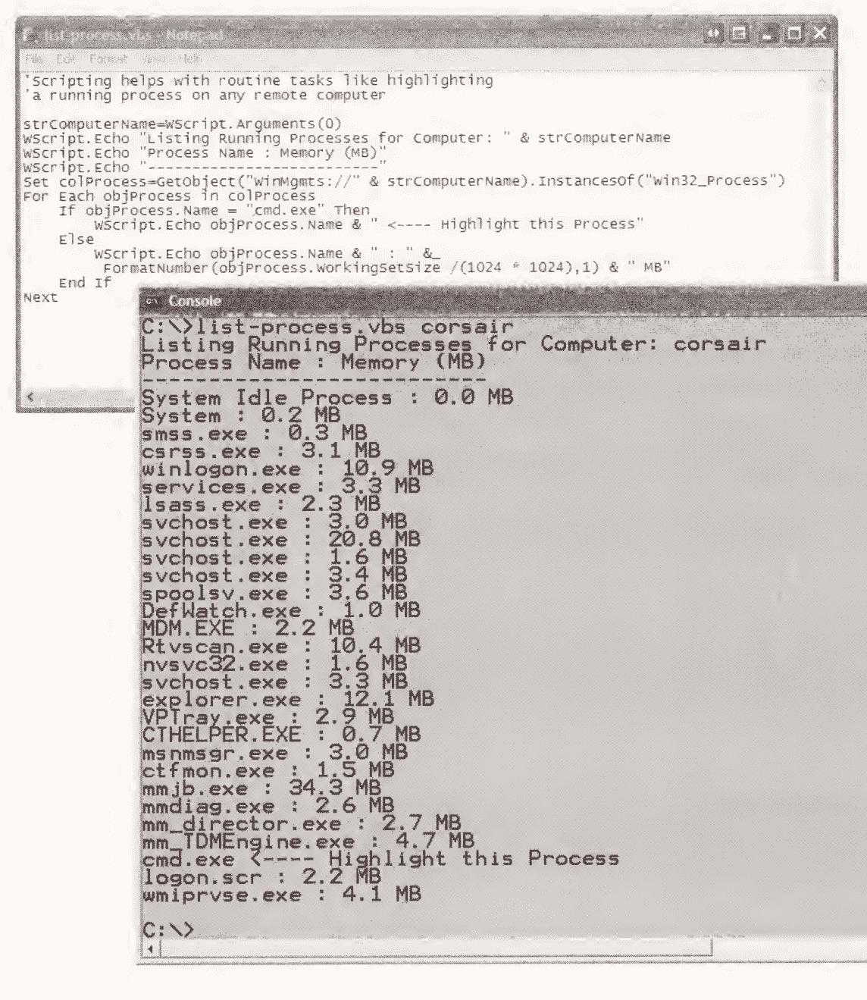

如前所述，第 4 章到第 13 章分别介绍了你作为系统管理员或工程师在工作环境中可能遇到的不同问题。问题在每章开头引入，并列出任何约束和要求。在对问题陈述、要求和约束进行简要讨论之后，我们将探讨解决该问题可能采用的工具或方法。


## 书籍结构

本书采用了许多与其它流行书籍相同的惯例。例如，代码使用等宽字体。注释、提示和 CD-ROM 参考资料在必要且合适的地方会高亮显示。

“注释”提供了关于某事物工作原理的额外解释，或指出了某种方法或技术的特别注意事项。

而“注释”可能提供注意事项，“提示”则提供一种可选的或提醒性的方法，这种方法可能对于解决特定问题更为巧妙或令人耳目一新。

CD-ROM 图标高亮显示了对随附 CD-ROM 中代码的引用。

示例代码可能如下所示：

```
'--------------------------------------------------
'somescript.vbs – WSH 脚本
'--------------------------------------------------
WScript.Echo "Hello Scripters"
```

要执行该脚本，请将其保存为文件 `somescript.vbs`，然后在命令行中键入：

```
cscript somescript.vbs
```

“你需要什么”部分介绍了一些可用于编写和运行本书脚本的工具。你可以使用简单的文本编辑器（如 Microsoft 记事本）创建和保存许多此类脚本。但是，随着你的脚本变得越来越复杂，使用更专业的脚本编辑器将会受益匪浅。

## 目标读者

请记住，本书的目的是向你展示如何通过解决实际问题来构建基于脚本的工具。本书涵盖的概念假设读者具备适当的技术经验和知识水平。书中的场景是为初级和中级系统管理员和工程师编写的。例如，如果你曾从头构建过 Windows NT®/XP/2000/Server 2003 系统，或者安装和配置过 Windows 2000 域控制器，那么你将能够轻松理解本书中的场景。

这些脚本使用了 Windows 2000 Server 和 Professional、Windows XP 以及 Windows Server 2003 平台技术和拓扑结构。因此，为了充分利用脚本解决问题的方面，你应该熟悉这些环境。如果你不熟悉 Active Directory，那么阅读一个关于如何转储 Active Directory 信息的脚本是没有用的。

你当然不需要开发背景，不过，如果你之前曾涉猎过脚本或其他语言，你将更能领会脚本中的微妙之处。书中散布着许多注释和提示，指出了开发最佳实践或编码技巧，这些技巧是标准的、常见的，或者仅仅是酷的。当你读完本书及其中的脚本后，你将清楚地了解有哪些技术可以帮助你在自己的环境中解决自己的问题。届时，你可能会觉得 JavaScript 适合你，从而购买一本专注于 JavaScript 的参考书。同样，你可以购买一本关于本书涵盖的任何特定技术主题的专门书籍。

## 你需要什么

本书中的脚本涵盖了 Windows 系统管理员面临的各种日常（或经常性）任务。对于其中的许多脚本，你可以使用如图 1.1 所示的两台计算机测试环境。在提取帐户信息时，域控制器的行为与成员服务器不同。因此，建议设置一台 Windows 2000 或 Windows 2003 Server 域控制器和另一台作为该域中成员服务器的计算机。访问 Microsoft Developer Network® (MSDN) 或 Microsoft TechNET® 网络资源也很重要。附录 A 列出了许多流行的脚本资源和工具的网址。

**图 1.1** 用于练习脚本的示例测试实验室。互联网连接对于脚本编写过程中的实时研究和参考很有用。

### 帐户和权限

在学习脚本并*在你的测试环境中*时，请在管理员或域管理员帐户下测试你的脚本。在特权帐户下运行脚本可以将安全权限从脚本无法运行的原因列表中移除。某些任务只能由管理员帐户（本地机器管理员组的成员）完成。你可能会选择在专用用户帐户（例如 `svcSomeServiceAccount`）下运行其他脚本，特别是在你决定计划任务重复运行的情况下。（设置一个专用服务帐户来运行计划任务可能工作量更大，但如果你在自己的帐户下运行，三个月后当你更改密码而你的帐户不断被锁定时，你可能会百思不得其解。）MSDN 中有关于脚本安全的详细文档，大多数对象都定义了允许指定运行安全上下文的方法或属性。在你成功掌握让脚本按你的意愿运行这一障碍后，请重新审视你的脚本，并移除任何上述约束（例如需要以管理员或域管理员身份运行）。随着你对脚本技术运作方式的了解，你很快就能从一开始就在脚本中编入安全逻辑。当你在学习新东西时使用特权帐户，请记住在测试环境中编写脚本。你会惊讶于对目录、计算机、注册表和其他关键基础结构组件进行更改是多么容易，因此你需要将脚本隔离，以最大限度地减少对生产环境或企业环境造成损害的任何可能性。

### 工具

记事本适合创建或编辑非常短的脚本或 README 文件。然而，对于任何较大规模的脚本编写，请考虑使用至少提供语法高亮功能的编辑器。许多更流行的编辑器还提供标签或语言自动完成，有些甚至包含集成调试器，使你可以在逐步执行脚本时查看变量值。

与许多方法一样，你可能有自己的偏好，或者喜欢上这里未提及的其他工具。太棒了！你会发现你将精通某个特定工具，它提供的某个功能，无论多小，你都会喜欢，比如它的缩进方式或它能为你自动完成什么。可用的编辑器，按从简单到最先进的复杂性顺序排列，包括记事本、Microsoft Visual Basic Editor®、Macromedia® HomeSite™ 和 Microsoft Visual Studio .NET®。


### 记事本

记事本提供了一个基本的脚本编辑器。大多数脚本编写者可能都是从这个基础工具（或其前身 MS-DOS® 编辑器）开始起步的。其功能列表包括跳转到特定行（按行号）和插入日期及时间的能力。除此之外，记事本只是一个非常基础的文本编辑器。它作为默认程序预装在每一个基于 Windows 的平台上，其无处不在的特性使其成为在未知机器上编写脚本时可靠的选择。

### Microsoft Office 和 Microsoft Visual Basic 编辑器

Microsoft® Office 核心应用程序支持 Visual Basic for Applications (VBA) 开发，并包含 Microsoft Visual Basic 编辑器。当你录制一个宏时，它实际上被写入保存在宿主 Office 文件内的一个模块中。可以通过选择“工具” > “宏” > “Visual Basic 编辑器”来访问宏。（或者，按 Alt + F11）。这个功能齐全的编辑器支持 VBA，并包含语法高亮和内联调试功能。该编辑器相当容易上手，非常适合编写快速脚本。由于 VBA 支持外部脚本技术，如 Windows Script Host (WSH) 或 Windows Management Interface (WMI)，你可以使用此编辑器和调试器来原型化或测试你的网络和 ADSI 脚本，并将脚本输出发送回易于使用和保存的 Office 文档。图 1.2 显示了 Microsoft Visual Basic 编辑器及其不同组件的示例。使用 Microsoft Visual Basic 编辑器的一个潜在缺点是它不支持 JScript 或 VBScript——仅支持 VBA。当你在 Office 应用程序内从头开始编写脚本时，这种选择的缺乏不会带来挑战，但如果你希望将现有脚本移植到 Office 应用程序中，这一点需要记住。
编辑器由各种窗口组成——项目资源管理器、代码窗口、属性窗口、本地窗口和三个监视窗口。

**项目资源管理器：** 项目资源管理器列出了应用程序的不同对象，例如你正在使用的工作表和任何模块。如果你正在创建一个新脚本，请右键单击“Microsoft Excel 对象”项，然后选择“插入” > “模块”，以在代码窗口中打开一个新模块。

**代码窗口：** 代码窗口是你 VBA 脚本的核心与灵魂，包含实际的开发代码。代码窗口支持语法高亮，它会自动将代码中的关键字大写并着色，使你的代码更易于阅读和调试。此外，如果你错误地输入了一行，编辑器会高亮显示错误，允许你在第一次运行代码之前就纠正错误。

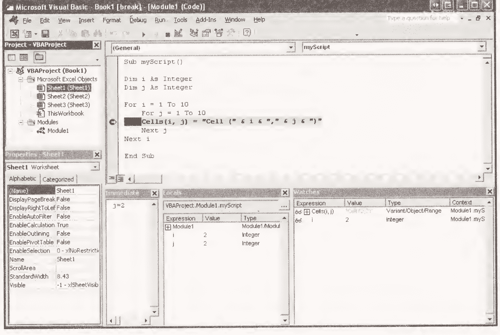

**图 1.2** Microsoft Office 提供了一个强大的 Visual Basic 编辑器，以帮助创建在 Office 应用程序中使用的宏和其他脚本。

**属性窗口：** 属性窗口显示工作簿或工作表对象的单独设置。例如，要将工作表名称从默认的 *Sheet1* 更改为 *Inventory*，请选择该属性并输入新值。

**本地窗口和监视窗口：** 本地窗口和监视窗口对于调试代码非常有用。使用 Microsoft Visual Basic 编辑器进行编码的一个优势是它能够逐行单步执行你的代码（或运行到代码中的指定行，然后在特定行停止，称为断点）。当你单步执行代码时（通过连续选择“调试” > “逐语句”或按 F8），本地窗口和监视窗口会列出你代码的变量及其当前值。当这些值被你的代码更新时，它们会立即显示。此功能对于调试和确定程序为何未按预期运行非常有用。

本地窗口列出你代码中识别的所有变量。监视窗口指定你代码中任何选定的变量或表达式。与显示所有局部变量的本地窗口不同，你必须明确指定希望在监视窗口中查看的对象。此外，你可以选择监视各种表达式。例如，指定 `Cells(i, j)` 会在变量 i 和 j 变化时显示单元格 i 和 j 的值。

**立即窗口：** 你可以在立即窗口中实时设置变量到表达式。此功能对于在运行脚本的中间微调值或强制条件很有用。例如，如果你有一个从 1 循环到 1,000 的变量，并且你想跳到结束，你可以使用立即窗口强制变量变为一个更高的值，例如 995。请注意，在这种情况下，你将跳过所有中间处理，并继续执行，就好像变量是 995 一样。


> 即使你不使用 Office 应用程序作为你的脚本引擎，你仍然可以使用 Microsoft Visual Basic 编辑器来创建和调试你的脚本。一旦你的脚本正常工作，将脚本复制到文本编辑器中，然后从控制台运行它。请注意，你必须删除任何在应用程序外无法工作的特定于 Office 的应用程序调用。例如，你可能需要将 `Cells(x, y) = "Some Output"` 替换为 `WScript.Echo "Some Output"`。

### Macromedia HomeSite

Macromedia HomeSite 是许多 Web 程序员青睐的编辑器。其优雅而强大的界面提供了现代开发者可能渴望的几乎所有功能。HomeSite 提供语法高亮、用于构建自己的脚本库的仓库以及标签补全。你会发现标签补全功能对于网页开发更有用，但其语法高亮以及面向文本和脚本的开发做得很好。图 1.3 显示了 HomeSite 界面。HomeSite 的缺点包括缺乏调试功能和不支持 VBA。

### Microsoft Visual Studio .NET

Microsoft Visual Studio .NET 是一个强大的集成开发环境 (IDE)。这个复杂而强大的工具可用于创建最复杂的应用程序。虽然对于更基本的脚本来说可能有点杀鸡用牛刀，但可以利用 Visual Studio 的强大功能来协助你的脚本设计。

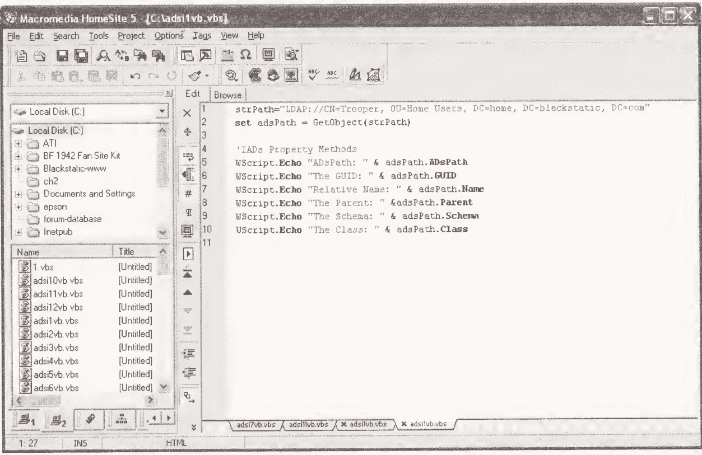

**图 1.3** Macromedia HomeSite 是脚本编写者和 Web 开发者青睐的工具。

### 哪个脚本工具适合我？

开始任何新事物可能最令人畏惧的挑战之一，就是简单地弄清楚它是如何工作的——不一定是问题本身的复杂性，而是理解用于解决问题的工具集。因此，请动动手，使用前面提到的编辑器编写（并运行）一些示例代码。这种实践就像在爬上梯子之前轻轻摇晃一下，以确保它是稳定和安全的，并且你可以信任它。一旦你确信你的脚本能运行，你就能很快进入更高级的任务。

### 总结

第 1 章介绍了可用于创建和调试脚本的众多工具中的一部分。第 2 章将研究用于为 Windows 平台创建脚本的一些不同技术，我们将开始使用这些工具来演示这些技术是如何工作的。

### 为什么使用脚本？

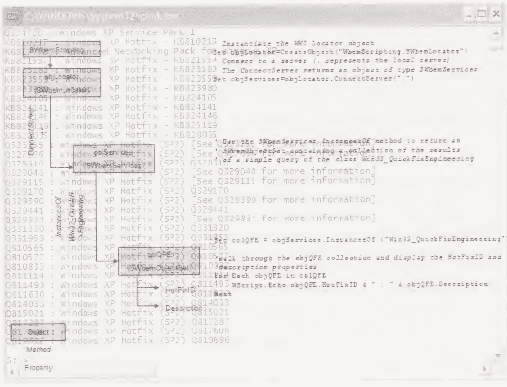

简单来说，脚本节省时间并减少错误。花点时间思考一下你日常重复执行的工作任务，或者你必须收集、审查或呈现系统信息的项目行动项。以信息安全领域的工程师或管理员为例，他们负责持续监控和检查数千条数据。可疑数据通常深埋在大量合法信息中；诀窍是筛选所有好的数据以找到坏的。考虑以下任务，每个任务都涉及在详细级别上管理大量信息。

-   监控哪些机器的哪些端口暴露在互联网上。
-   审计敏感服务器的用户和组成员身份。
-   当有权访问服务器的 IT 员工离开公司时，建立一种可靠的方式来轮换所有服务器的密码。

那么，你如何着手寻找你知道不应该存在的东西？你如何将相同的动作应用于多个服务器，同时最大限度地减少错误？手动扫描互联网痕迹、日志文件和帐户成员身份是乏味且容易出错的。自动化是关键，这就引出了下一个问题：是购买还是自己构建解决方案。

商业应用程序已被编写出来以解决所有这些问题；然而，它们需要花钱，并且可能无法在你的基础设施中完全按照你希望的方式执行。此外，应用程序可能不会以你期望的格式输出报告，或者不包含你需要的数据。Windows 2000 和 Windows Server 2003 是 Windows 平台悠久历史中的最新版本，随着时间的推移，已经创建了许多小程序，能够执行前面列出的一些任务。微软在各种产品资源工具包和支持工具中捆绑了数百个这样的工具。在可能的情况下使用这些节省时间的工具，并请记住，即使是这些工具也可以从自定义脚本中受益。

脚本与其说是重新发明轮子，不如说是利用已有的东西直接为你工作。很多时候，你可以为现有的二进制文件编写脚本“包装器”。这些包装器提供输入并将输出定向到各种文本文件或后续应用程序。有些脚本只有几行，而其他脚本则类似于小程序。第 4 章到第 13 章涵盖了许多直接示例，展示了脚本如何通过自动化任务并确保任务以可靠和可重复的方式执行，来隐式和切实地使你的生活更轻松。

让我们简要回顾一下前面提到的三个要点任务，并讨论一些有助于这些流程的脚本选项。

**监控哪些机器的哪些端口暴露在互联网上。**

要查找可能已向互联网开放外部端口的新机器或新服务，请考虑使用命令行端口扫描程序（如 NMAP）。端口扫描程序可以配置为在你的 ISP 分配给你的整个外部 IP 范围内查找开放端口。定期运行扫描程序（例如每两周一次），并将结果与之前生成的基线结果集进行比较。脚本包含你希望扫描的子网并启动端口扫描程序。脚本还会解析定期运行的输出，并查找新的或更改的


### 编程语言——你说了什么？

在过去十年中，计算机编程语言的数量大幅增长。在不久的过去，你还可以指望系统管理员或开发人员熟悉 FORTRAN 77 或 COBOL®。然而如今，开发语言已经分裂和碎片化为大量专有的和面向应用的方言。仅考虑 Web 开发——HTML、ASP、CFML、PHP、XML、VML、JavaScript、VBScript、ASPX 等等。

Windows 平台拥有自己的语言狂热者，他们大声地推崇自己最喜爱的语言，称其为最灵活、最简单、最强大，或者干脆就是最好的。事实上，最适合你的语言是你能够理解并能最成功地利用它来满足当前（以及希望是未来）业务需求的语言。不确定该选择什么？与你的内部开发人员交流，询问公司倾向于遵循哪些标准。一个重度使用 Microsoft 的团队可能更喜欢 VBScript，但如果你与任何有经验的 Web 开发人员交谈，他们可能更倾向于 JavaScript（Microsoft 术语中称为 JScript）。这些语言各有所长，你将在接下来的页面中看到其中一些。同时，也要考虑你可能获得的本地支持来帮助你进行脚本编写，尤其是如果你内部有开发专业人员——即使在不同的团队中。许多开发人员喜欢阐述他们最喜爱语言的优点，通常会不遗余力地帮助你解决问题。本书中的所有脚本都使用三种较为流行的 Windows 平台脚本技术编写：VBScript、Visual Basic for Applications 和 JScript。

### 但是批处理和 PERL 呢？

本书不涵盖批处理文件或用 PERL 编写的程序，也不涵盖 Unix 和 Linux shell 脚本或工具（例如 vi）。

### 批处理编程

你们中许多人可能正在使用批处理文件（或过去曾使用过）来完成一些令人惊叹的事情。然而，本书的重点是 Windows 2000、Windows Server 2003 和 Windows XP 脚本技术。你们中有些人可能是批处理编程专家，能够使用批处理文件编程复制本文中的许多脚本。（从本质上讲，正如你将看到的，许多脚本可以使用多种不同的语言和工具重新创建。）因此，如果你是批处理文件编程的高手，请考虑这些新技术如何能够补充和完善你自己的工具箱——你会感到惊喜的。

### PERL

PERL 在 Linux 程序员中是一种流行的语言，它也已在 Windows 平台上取得了重大进展。事实上，Microsoft 在 Windows 2000 Resource Kit 中包含了一些 PERL 脚本。PERL 在 Windows 2000 平台上的可分发性较低，因为它需要第三方 PERL 解释器，而该解释器默认情况下并未安装。但是，对于从单台计算机启动脚本来说，PERL 是一种非常出色的语言。访问 www.activestate.com/Solutions/Programmer/Perl.plex 获取更多信息或下载 ActivePerl®，这是领先的 Windows PERL 解释器。

### VBScript 和 Visual Basic for Applications (VBA)

VBScript 和 VBA 是 Microsoft 开发的语言，基于流行且易于学习的 BASIC 语言。VBScript 设计为一种轻量级和可移植的语言，非常适合独立的脚本任务和 Web 开发。VBA 提供了更强大的功能，集成了更大的 Microsoft 应用程序，包括 Microsoft Office 和 Microsoft Visio®。根据我的经验，你正在使用的工具（例如 Excel 或命令行）通常决定了你在 VBScript 和 VBA 之间的选择。随着你对脚本编写的总体了解加深，你可以查阅许多书籍或在线文档，其中更详细地描述了 VBScript 和 VBA 之间的区别。

VBScript 相对容易学习，因为其语法友好。此外，它在所有 Microsoft 脚本技术中的支持以及其"大哥" VBA 在 Microsoft Office 应用程序中的支持，使其广泛适用于 Windows 用户。

### JavaScript 和 JScript

Ecma-262 是流行脚本语言 JavaScript 的官方标准，该语言由 Netscape 发明，并于 1997 年成为标准。Microsoft 对此标准的完整实现称为 JScript。JScript 在 Web 开发人员中仍然很受欢迎，并受到最流行的 Microsoft 脚本技术的支持，例如 Windows Script Host。

JScript 更紧密地遵循 C 编程风格。（它要求使用分号终止代码，并共享类似的语句语法。）此外，备受关注的用于 Microsoft .NET 开发的 Microsoft C#® 语言大量借鉴了 Java 和 JavaScript 的背景，这使得 JScript 成为通向 C# 的良好跳板。

有趣的是，当你与开发人员交谈并询问他们的偏好——VBScript 还是 JavaScript。Web 开发人员倾向于偏好 JavaScript，而仅使用 Microsoft 的程序员似乎更偏爱 VBScript。随着你的学习，你会逐渐发现自己的偏好。

### 移植

选择一种语言而非另一种可能是困难的决定，但保持相对灵活地使用任何语言最终有助于你更容易接受不可避免的新技术。最坏的情况是，你可能需要将代码从一种语言移植到另一种语言。从 VBScript 移植到 JScript（反之亦然）是学习语言细微差别的良好练习，尽管这从来都不是真正有趣的事情。你最终可能需要编写辅助函数或针对目标语言限制的变通方案。

Microsoft .NET 在发布 Visual Basic .NET (VB.NET) 和废弃 Visual Basic® 6.0 (VB6) 方面引起了一些波动。这一举措激怒了许多 Visual Basic 程序员，因为从 VB6 到 VB.NET 的转换并不简单，需要大量的重新开发。虽然脚本编写也不能幸免于这些不可避免的技术进步，但脚本通常规模较小，总体上更简单。然而，请记住，在创建"杀手级脚本"时，你可能有朝一日需要将其移植到另一种语言。遵循开发结构（例如遵守变量命名约定）并充分注释代码，可以显著帮助未来的重新开发或移植工作。

### 编程基础

无论你使用哪种语言编写代码，你都必须学习一些基本的软件开发原则。本章其余部分涵盖了开始有效编写脚本所需的一些编程基础知识。如果你已经有一些基本的编程经验，可以略读本章或继续到第 3 章，该章开始介绍一些通过脚本可以访问的更流行的 Microsoft 技术。如前言所述，本书不是关于任何单一开发语言或过程的学术著作。相反，它通过一些实际脚本的实际示例来教你脚本编写。但是，话虽如此，一些非常基础的构建块是需要涵盖的。让我们通过一个实际脚本来展示这些基础知识。

脚本是一种以文本文件形式创建的计算机程序，运行时由语言解释器引擎实时解释。对于命令行脚本，Microsoft 提供了 Windows Script Host (WSH)，其中包含 VBScript 和 JScript 的引擎。

### 我们的第一段脚本

打开记事本，在新的文本文件中输入以下行：

```
WScript.Echo("Hello, World.");
```

将此文件保存为 HelloWorld.js。（确保覆盖扩展名，以免文件被保存为 .txt 扩展名。）接下来，打开命令窗口。（点击"开始" > "运行"，然后输入 cmd。）

在命令行中，通过输入 `CScript HelloWorld.js` 来执行脚本。你应该会看到 CScript 引擎的标志，后面跟着 Hello, World 这几个字。

接下来，输入 `WScript HelloWorld.js`。Windows 脚本宿主现在会通过其基于 GUI 的引擎而不是严格的基于命令行的引擎来处理此脚本，并在对话框中而不是在控制台中显示 Hello, World 这几个字。点击"确定"关闭窗口。

WScript 和 CScript 具有类似的功能。不过，你可能会发现控制哪个引擎来处理脚本是有益的。例如，如果你选择向用户逐行输出大量数据，你可能会发现 CScript 将其写入打开的命令窗口的能力比 WScript 对话框有用得多。不过，你也可以控制 WScript 的输出以达到所需的效果。例如，要显示较长的结果摘要，你可以将消息放入字符串中，然后在对话框中一次性显示该字符串。WScript 和 CScript 类似，但提供的功能并不完全相同。（例如，WScript 不支持标准输入和输出函数，我们稍后会介绍。）

在你自己的机器上，你可以控制 Windows 脚本宿主的默认行为。在命令行中，输入 `CScript /?`（或 `WScript /?`）以获取 WSH 配置参数列表。要永久关闭 WSH 标志并将基于控制台的 CScript 设为默认脚本宿主，请输入：

```
CScript //H:CScript //NoLogo //S
```

现在尝试通过在命令行中输入脚本名称来执行你的新脚本：

```
HelloWorld
```

你应该会看到脚本通过 CScript 脚本宿主引擎执行，而无需你指定 WScript 或 CScript。当然，即使设置了此标准，你始终可以通过指定脚本宿主来覆盖默认值。任何用户都可以设置要使用的默认 WSH 引擎（默认情况下，Windows 使用 WScript，除非被上述命令覆盖），这就是为什么你通常需要显式控制脚本的调用方式。例如，使用 `CScript HelloWorld.js` 调用脚本，而不是简单地在控制台输入 `HelloWorld`。这样做可以防止用户在错误的引擎下运行你的脚本的意外情况。

### 将你的应用程序移植到 VBScript

将文件 *HelloWorld.js* 复制为 *HelloWorld.vbs*，并尝试通过输入 `cscript HelloWorld.vbs` 来执行它。你会得到一个运行时错误。打开该文件，删除末尾的分号和括号，使文件包含以下行：

```
WScript.Echo "Hello, World."
```

保存文件，然后再次运行。当你看到预期的文本时，你就已经将第一个应用程序从 JScript 移植到了 VBScript。

上面的示例确实既不那么激动人心，也不太困难。然而，所使用的概念和基础知识与本书中任何脚本所使用的都是相同的。尽管这个示例很简单，但它演示了创建和运行脚本的整个过程。使用简单的示例为构建更复杂的场景打下了良好的基础。

> 话虽如此，让我们来了解一个基本脚本的框架，这个第一个示例分别用 JScript 和 VBScript 编写，如图 2.1 所示（包含在 CD-ROM 的 /chapter 2/scripts 文件夹中，作为清单 2.1 和 2.2）。

| JScript (framework.js) | VBScript (framework.vbs) |
| --- | --- |
| `//**********************************` | `'**********************************` |
| `//* Script Framework` | `' Script Framework` |
| `//* framework.js` | `' framework.vbs` |
| `//* Created: Feb 2003, Jeff Fellinge` | `' Created: Feb 2003, Jeff Fellinge` |
| `//**********************************` | `'**********************************` |
| `var i = 22;` | `Dim i` |
| `var j = '1';` | `i = 22` |
| `answer = sum(i, j);` | `Dim j` |
| `WScript.Echo(answer);` | `j = "1"` |
| `j = 1;` | `answer = sum(i, j)` |
| `WScript.Echo(sum(i, j));` | `WScript.Echo answer` |
| | `WScript.Echo concatenate(i, j)` |
| `//**********************************` | `'**********************************` |
| `//* sum/concatenate 2 variables` | `' Calculate sum of 2 numbers` |
| `//**********************************` | `'**********************************` |
| `function sum(a, b)` | `function sum(a, b)` |
| `{` | `    sum = a + b` |
| `    result = a + b;` | `end function` |
| `    return result;` | `'**********************************` |
| `}` | `' Concatenate two strings` |
| | `'**********************************` |
| | `function concatenate(a, b)` |
| | `    concatenate = a & b` |
| | `end function` |

**图 2.1** 分别用 VBScript 和 JScript 并排编写的简单脚本的框架。

### 注释

此脚本以注释部分开头，介绍脚本并定义任何输入参数、使用的函数、创建和修改日期以及作者。务必对你的代码进行注释，并描述脚本关键区域的功能。对代码进行充分的注释不仅有助于其他人理解你的意图（如果他们继承了你的成果），而且在你创建代码数月后不可避免地需要重新审视和更新时，也会对你有所帮助。JScript 和 VBScript 的注释语法如图 2.2 并排所示。

**图 2.2** JScript 和 VBScript 的注释语法。

注释是对代码功能的解释。你必须将注释与代码区分开来，这样解释器才不会试图执行它们。

> 避免使用"智能"文字处理器作为代码编辑器。例如，Microsoft Office 产品会自动将引号和撇号转换为弯引号和弯撇号，因此 ' 会变成 '，" 会变成 " 或 "。虽然这些字符看起来一样（即使复制到记事本中也是如此），但它们是不同的，可能会导致你编写脚本时出现头疼的问题。

JScript 使用 C 风格的注释，以 `/*` 开始，以 `*/` 结束，如下所示：

```
/* This is a comment block. Every word between these
delineators will be interpreted as a comment, and this is
a useful way for specifying multiline comments. A problem
is that if they are very long, you may forget what is
a comment and what isn't. A code editor with syntax
highlighting can help prevent mistakes with long comments.*/
```

或者，你可以使用两个正斜杠注释单行：

```
// This is a single-line comment in JScript.
// Multiple lines each need a separate delineator.
```

VBScript 使用撇号注释每一行：

```
' VBScript uses an apostrophe as its comment delineator.
' With this, too, you must comment each line individually.
```

### 变量

变量为你的程序使用的数据提供存储空间。在脚本编写中，你需要声明变量的名称（有时包括类型）、初始化变量的值，以及使用变量。

变量代表你已经熟悉的多种数据类型，例如整数（1、2、3）或字符串（"Hello"）。你可能不太熟悉的其他数据类型包括布尔值（true 和 false）以及对象。在本章后面，我们将讨论对象，但目前，你需要了解也可以通过变量来表示对象。

#### 声明变量

示例脚本的下一部分是声明变量。JScript 和 VBScript 不要求你声明变量，但这样做是一个好习惯。如果你转向强类型语言，你就需要声明变量并显式定义其类型。图 2.3 展示了 JScript 和 VBScript 如何声明变量并设置其值。声明变量的另一个优点是，在调试时，已声明的变量会出现在"局部变量"窗口中，而未声明的变量则不会。

| JScript | VBScript |
|---------|----------|
| `var i = 22;` | `Dim i` |
| `var j = '1';` | `i = 22` |
| | `Dim j` |
| | `j = "1"` |

**图 2.3** JScript 和 VBScript 之间的变量声明差异。

JScript 和 VBScript 是弱类型语言，这意味着一旦变量被声明（使用关键字 `var`），它可以容纳许多不同的字面量（值）类型。还需注意，使用 JScript 时，我们可以在同一行中声明变量及其字面量。JScript 和 VBScript 会自动确定变量的类型（字符串、数字或布尔值）。你需要确保它正确地做到了这一点。查看图 2.1 中的前面示例。注意我们将变量 `j` 的类型从字符串 "1" 更改为数字 1。此外，该函数使用了运算符

+，它不仅能将两个数字求和，还能拼接字符串与另一个字符串或数字。

当我们运行此脚本时，会得到以下输出：

```
C:\>framework.js
221
23
```

这可能并非我们预期的结果，具体取决于变量的类型。在本例中，值易于查看和控制。但如果你是从对象中返回值，或者处理的是未知变量，就需要确保能够控制其类型。为了便于排查问题，可以使用 JScript 的 `typeof` 运算符来确定变量或表达式的类型。

VBScript 使用关键字 `Dim` 来声明变量。同时请注意图 2.1 中的示例，VBScript 区分求和运算符（+）和拼接运算符（&）。无论数据类型如何，VBScript 都会尝试将变量作为数字求值：如果使用 +，则对两个变量求和；如果使用 &，则始终进行拼接。在 VBScript 中，我们必须创建两个独立的函数来分别实现求和或拼接，以获得与前面 *framework.js* 示例类似的结果。表 2.1 列出了 VBScript 和 JScript 的不同语言数据类型。

#### 表 2.1 VBScript 和 JScript 的语言数据类型

| VBScript | JScript |
|----------|---------|
| empty | undefined |
| null | null |
| Boolean | Boolean |
| string | string |
| object | object |
| byte | number |
| integer | |
| currency | |
| long | |
| single | |
| double | |
| date (time) | |
| error | |

#### 命名约定

遵循变量命名约定可以显著提高代码的可读性，并减少编程错误。不仅要将命名约定应用于变量，还要应用于函数以及你在深入编程过程中遇到的其他内容。命名约定能提高可读性，并在你（或他人）将来需要重新审视代码时方便维护。例如，变量名 `strName` 不仅表明该变量包含一个名称，还表明它是一个字符串。将此例与 `iRow` 比较，后者表示一个整数，代表某物的行号。你可能会想将 `1` 加到 `iRow` 上，但在将 `1` 加到 `strName` 之前你肯定会三思而后行。虽然有一些被普遍接受的命名约定，但许多人会选择自己觉得好用的命名方式。总之，选择并坚持一种适合你的变量命名约定。采用主流命名约定标准中的部分或全部内容是有益的，因为它会提高代码的可读性。比较著名的命名约定之一是匈牙利命名法，由曾在微软工作的 Charles Simonyi 博士创立。匈牙利命名法引入了在描述性变量名前加上其类型前缀的概念（以及其他内容）。微软在内部广泛采用了这种命名约定。尽管多年来出现了其他命名约定，但许多程序员仍在继续使用匈牙利命名法的变体。

本书中的示例和脚本遵循一种相当通用（且简单）的命名约定。每个变量都使用描述性名称并采用首字母大写，变量的数据类型作为前缀加在名称前面（例如 `strFirstName`、`bExists`、`iRow`、`dtCreated`）。过程（子程序和函数）也使用描述性名称并采用首字母大写；例如 `ListAllDetail` 或 `Tabulate`。全局和公共变量用 `g_` 表示，因此，例如，如果变量 `objwsSetup` 被声明为 `Public`，它将被命名为（并被引用为）`g_objwsSetup`，以表示其全局性质。表 2.2 列出了本书中使用的大部分命名约定前缀和变量名示例。

### 数组

使用数组可以定义一个包含多个元素的单一对象。VBScript 支持一维和多维数组。虽然 JScript 不支持多维数组，但你可以通过创建数组的数组来实现类似的功能。配置和使用数组涉及声明、赋值和取值。JScript 提供了更强大的数组操作功能，例如 push 和 pop 方法，允许你使用单个命令向数组添加新元素或删除元素。

#### 表 2.2 本书中使用的变量命名约定

| 数据类型 | 前缀 | 示例 |
|---|---|---|
| integer | i | iRow, iCol, i |
| string | str | strName, strOutput, strServer |
| Boolean | b | bGoHelp, bIsRandom, bIsUser |
| object | obj | objState, objWsSetup, objShell |
| date | dt | dtToday, dtCreated, dtPwdExpires |
| array | a | aGroup, aDrives, aList |
| XML 文档 | xml | xmlDoc, xmlRoot, xmlConfig |
| 正则表达式 | re | reValidFile |
| 对象集合 | col | colPrinters, colQFE |
| 枚举器 | e | eGroups, eLogicalDisk |
| | g_ | 全局 |

### VBScript 中的数组

要在 VBScript 中使用数组，必须先声明一个变量，然后将其赋值为数组。如果你知道将来不需要调整数组大小，可以创建一个固定大小的静态数组（例如 `Dim aList(10)`）。也可以通过省略大小来定义动态数组（例如 `Dim aList()`），或者使用 Array 函数显式定义数组元素（例如 `Dim aMonth` 后跟 `aMonth=Array("January", ..., "March")`），后者将数组声明为动态的并隐式定义数组大小。在 VBScript 中，数组大小必须在声明静态数组时定义，或者稍后使用 `ReDim` 函数为动态数组定义。例如，`Dim aList(10)` 定义了一个包含 10 个元素的数组，可以立即使用；而 `Dim aList()` 定义了一个动态数组，在使用之前必须使用 `ReDim` 来设定大小。动态数组可以通过后续调用 `ReDim` 语句来重新调整大小。使用 `ReDim` 可以清除数组并设定新大小，或使用 `ReDim Preserve` 参数保留之前的数组值。通过将索引元素赋值来显式设置数组元素值（例如 `aMonth(3)="April"`）。代码清单 2.3 展示了如何在 VBScript 中定义数组，并使用 `For...Next` 循环配合 `Ubound` 函数（返回数组的上界）来遍历数组。

#### 代码清单 2.3 在 VBScript 中使用一维数组

```
Dim aList(3)
Dim aMonth
aMonth= Array("January","February","March")
Redim Preserve aMonth(6)
aMonth(3)="April"
aMonth(4)="May"
aMonth(5)="June"
For i = 0 to Ubound(aMonth)
    WScript.Echo(i & ") " & aMonth(i))
Next
```

VBScript 支持多维数组。其构造方式与一维数组类似，只需在声明时定义数组维度即可（例如 Dim aMatrix(3,2)）。通过引用数组的行索引和列索引来设置值。与一维数组一样，使用 Ubound 函数返回数组的上界。不过，Ubound 还支持一个可选参数 dimension，用于指定要返回的维度上界。代码清单 2.4 展示了遍历 3x2 数组两个维度的示例。

#### 代码清单 2.4 在 VBScript 中使用多维数组

```
Dim aMatrix(3,2)
aMatrix(0,0)="r0c0"
aMatrix(0,1)="r0c1"
aMatrix(1,0)="r1c0"
aMatrix(1,1)="r1c1"
aMatrix(2,0)="r2c0"
aMatrix(2,1)="r2c1"
for iRow = 0 to Ubound(aMatrix,1)
    for iCol = 0 to Ubound(aMatrix,2)
        WScript.StdOut.Write(aMatrix(iRow,iCol) & "  ")
    Next
    WScript.StdOut.Write(vbcrlf)
Next
```

### JScript 中的数组

JScript 数组必须首先使用 `new Array(x)` 代码创建，其中 `x` 是可选的数组大小定义。与 VBScript 不同，你不必在初始化时指定数组大小，JScript 的数组 length 属性会返回数组中实际定义的元素数量。JScript 中的数组元素可以定义为字面量或通过索引值定义，如代码清单 2.5 所示。使用 for 循环从数组的起始位置遍历到其长度，即可遍历 JScript 数组中的元素。VBScript 和 JScript 的数组都基于零索引，即第一个元素的索引为 0。数组元素值也可以通过索引号显式设置，同样参见代码清单 2.5。

#### 代码清单 2.5 在 JScript 中使用一维数组

```
var i;
var aList1=new Array();
var aList2=new Array(10);
var aMonth=new Array("January","February","March");
aMonth[3]="April";
aMonth[4]="May";
aMonth[5]="June";
for(i=0;i < aMonth.length;i++) {
    WScript.Echo(i + ") " + aMonth[i]);
}
```

与 VBScript 不同，JScript 不支持多维数组。JScript 中的多维数组功能可以通过使用数组的数组来模拟。（请注意，如果 VBScript 的多维数组功能无法满足特定需求，这种技术也可以在 VBScript 中使用。）创建一个三行两列的数组（3x2 数组）实际上需要创建四个数组。第一个数组 aMatrix 由三个数组组成（每行一个）。主数组的第一个元素（aMatrix[0]，其中 0 等于行号）实际上是另一个数组，代表第一行。该行数组的第一个元素是第一列（aMatrix[0][0]），第二个元素代表第二列。使用此技术需要额外的边界检查，因为与矩阵不同，在 JScript 的数组的数组中，每一行可能有不同数量的列。代码清单 2.6 演示了设置 3x2 矩阵的行和列元素的值，然后显示结果。实际上，JScript 数组是功能完善的对象，拥有众多有用的方法和属性。尽管 JScript 数组起初可能看起来比 VBScript 的对应物更复杂，但学会有效地使用这些对象无疑会增强你的脚本编写能力。

#### 代码清单 2.6 在 JScript 中使用多维数组

```
var iRow,iCol;
var aMatrix=new Array();
aMatrix[0]=new Array();
aMatrix[1]=new Array();
```


### 代码主体

脚本中的代码主体是执行具体操作的地方。具有讽刺意味的是，根据代码的模块化程度，代码主体可能是（并且随着你在脚本编写、代码流程和最佳实践方面越来越熟练，它确实会是）脚本中最短的部分之一，因为你会开始使用函数来处理重复性工作。在我们的示例中，代码主体调用函数、传入变量，并在输出中显示结果。使用 Windows 脚本宿主时，我们调用的是 WScript 对象的 echo *方法*，如图 2.4 所示。方法提供与*对象*一起使用的操作。方法和对象都将在接下来的章节中介绍。

| JScript | VBScript |
| :--- | :--- |
| answer=sum(i,j); | answer=sum(i,j) |
| WScript.Echo(answer); | WScript.Echo answer |
| j = 1; | WScript.Echo concatenate(i,j) |
| WScript.Echo(sum(i,j)); | |

**FIGURE 2.4** 代码主体调用函数来执行重复性或专门的工作。

##### 函数

函数是独立的代码片段，被调用以执行特定的或重复的操作。程序的主体代码或其他函数都可以调用一个函数，并向其传递输入参数。函数随后对这些参数进行处理，然后将结果和代码执行返回给调用程序。函数的常见示例包括：将输出以特定格式写入文件或控制台的输出函数，或者列出某个组织单位中所有计算机或某个组中所有用户的函数。你会发现，能够将更多的代码分流或模块化为函数，代码的可移植性和可重用性就越高。理想情况下，一旦你创建了某个函数（例如管理日志文件的函数），就可以在许多其他脚本中重用该代码。为 JScript 和 VBScript 设置函数的语法如图 2.5 所示。

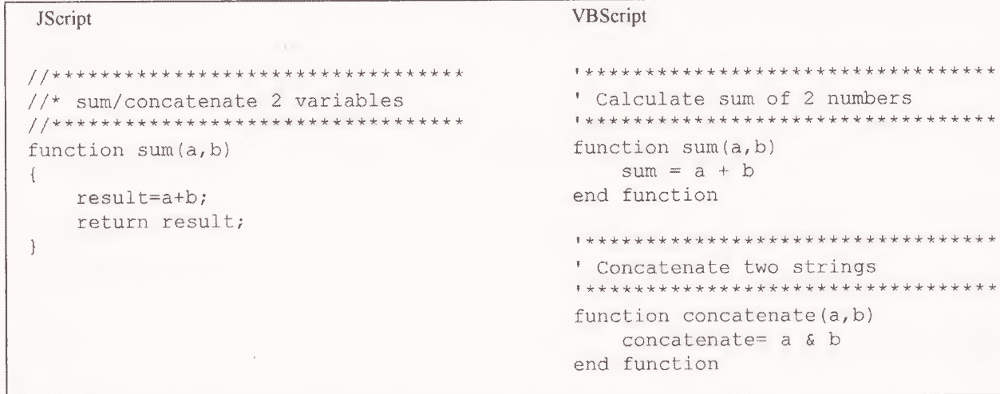

**FIGURE 2.5** 函数执行专门的工作，通常在不同的脚本之间重复使用。

请注意，由于运算符的差异，VBScript 代码需要两个函数，一个用于求和，另一个用于连接。还要注意，JScript 函数可以将任何变量作为函数的返回值返回给调用程序，而在 VBScript 中，必须将返回值赋给函数名称。

函数返回运算结果，并可用于表达式中。VBScript 包含另一种语句 Sub，它的操作类似于函数，但不同的是它不返回值，也不能用于表达式中。

## ## 脚本构建模块

对象是编程构造，它将方法和属性组合成一个单元。方法可以执行操作或完成工作，属性是关于对象的信息，你可以读取，有时也可以写入。你可以通过对象及其相关方法和属性与外部编程实体进行交互。

# IT 管理员的 10 大 Windows 入门脚本

*表达式*和*语句*构成了编程语言的骨架，提供了构建程序的语法。表达式包括*初始值设定项*和*运算符*。语句包括*流程控制*和*条件语句*。在接下来的章节中，我们将看到这些构建模块的主要类别。它们的使用示例详细展示在本书其余部分的脚本代码中。许多在线和纸质参考资料提供了这些编程概念的详细说明。请在 Microsoft 开发人员网络 (MSDN) 中为脚本内容创建书签，地址为 *http://msdn.microsoft.com*。在 MSDN 中搜索 JScript 和 VBScript，并展开"参考"部分以获取这些语言语法的详细信息。

本书出版时这些资源的链接如下：

**MSDN JScript 参考**

*http://msdn.microsoft.com/library/en-us/script56/html/js56jsoriJScript.asp*

**MSDN VBScript 参考**

*http://msdn.microsoft.com/library/en-us/script56/html/vtoriVBScript.asp*

## 对象

对象代表环境中的物理或逻辑组成部分。你会发现自己在整个脚本中都在使用对象。对象是一种数据类型，允许你通过应用程序编程接口 (API) 与操作系统和其他应用程序进行交互。API 由方法、属性和使用特定对象的文档组成。例如，Windows 脚本宿主包含 14 个对象，允许你的脚本与本地或远程计算机的网络、环境、文件系统进行交互，运行命令以及更改管理选项。你还可以从各种其他来源创建或获取对象，这使得你可以使用 WSH 从 IIS、WMI、ADSI 或 Microsoft 公开的其他支持接口中实例化对象。

图 2.6 通过将脚本架构与脚本语法并排比较，展示了对象、方法和属性之间的关系。

> 图 2.6 所示的示例包含在 CD-ROM 中，路径为 \chapter 2\scripts\listing_2_7.vbs)。

在整本书中，我们会介绍和讨论新的不同的对象。然而，JScript 和 VBScript 各有其以语言为中心的对象，列于表 2.3 中。在脚本编写中，大多数时候你会使用 COM 来使用其他应用程序或库公开的对象。

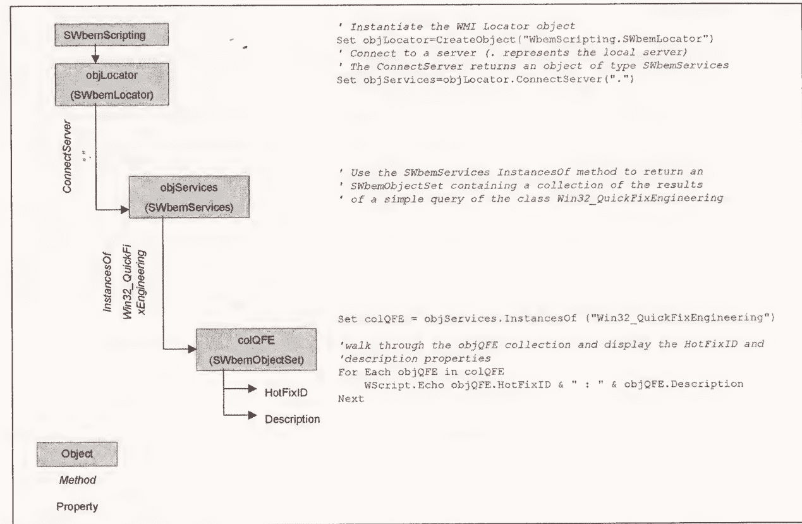

```vbscript
' Instantiate the WMI Locator object
Set objLocator=CreateObject("WbemScripting.SWbemLocator")
' Connect to a server (. represents the local server)
' The ConnectServer returns an object of type SWbemServices
Set objServices=objLocator.ConnectServer(".")

' Use the SWbemServices InstancesOf method to return an
' SWbemObjectSet containing a collection of the results
' of a simple query of the class Win32_QuickFixEngineering

Set colQFE = objServices.InstancesOf ("Win32_QuickFixEngineering")
'walk through the objQFE collection and display the HotFixID and
'description properties
For Each objQFE in colQFE
    WScript.Echo objQFE.HotFixID & " : " & objQFE.Description
Next
```

**FIGURE 2.6** 脚本的构建模块包括对象、方法和属性的层次结构。

**TABLE 2.3** VBScript 和 JScript 均内置的对象

| J submerged obj| VBScript |
| :--- | :--- |
| ActiveX | class |
| array | debug |
| arguments | err |
| Boolean | match |
| date | regular expression |
| debug | |
| enumerator | |
| error | |
| function | |
| global | |
| math | |
| number | |
| RegExp | |
| regular expression | |
| string | |
| VBArray | |

### 对象模型

对象模型由一组协同工作的对象组成，以提供服务。例如，Windows 脚本宿主对象模型定义了与 Windows 操作系统的交互，通过一组指令帮助你编写 Windows OS 管理任务的脚本，例如运行程序、记录事件或操作系统注册表。另一个模型的例子是*通用信息模型 (CIM)*，它被 Windows 管理规范 (WMI) 用于管理 Windows 资源。CIM 提供了在网络中物理和逻辑描述对象的框架。WMI 是 CIM 语法的基于 Windows 的实现，允许 Windows 计算机从任何支持 CIM 的计算机（Windows 或其他）访问信息。

你在脚本编写中最常使用的对象模型是组件对象模型 (COM)。例如，你可以使用 COM 自动化从基于控制台的脚本中创建一个新的 ActiveX 对象，代表一个 Excel 工作表，而无需实际打开 Excel。通过 COM，你的脚本创建一个新的 Excel 工作表对象，然后该对象公开该特定对象的所有 Excel 编程方法和属性。自动化是 COM 提供的能力，使脚本语言能够通过方法和属性处理 COM 对象。组件开发人员创建"自动化兼容"的接口——方法和属性——与脚本语言兼容，以便你可以自动化这些组件（对象）。

或者反过来，从 Excel 内部，你可以使用 COM 创建一个新的 Windows 脚本宿主 `FileSystemObject` 来读取文本文件。

##### 函数

函数是独立的代码片段，执行特定的、通常是独立的操作。函数通常内置于编程语言中，或者可以由你作为程序员来创建。许多函数的功能如其名称所示（例如，VBScript 函数 `IsNumeric` 返回布尔值 `True` 或 `False`，取决于传递给它的对象是否为数字）。如果你具有编程（或数学）背景，或者是 Excel 高级用户，其中一些内置函数可能对你来说很熟悉。

##### 方法

方法实现对象理解并可以启动的操作。方法像函数一样接受参数，但它们与函数的不同之处在于方法与其父对象直接绑定，而函数是独立存在的。与函数一样，你可以创建自己的对象并定义自定义方法。然而，在你的大部分脚本编写中，你会引用现有对象及其定义的方法。

 JScript 对方法的依赖远甚于 VBScript。例如，JScript 的大部分 `math` 功能依赖于 Math 对象及众多 Math 方法。例如，要在 JScript 中计算一个数的平方根，你可以使用代码 `Math.sqrt(number)`。在此示例中，`Math` 是对象，`sqrt` 是方法。`sqrt` 方法的参数是 `number`。与之对比，VBScript 定义了函数 `Sqr` 来计算平方根。无需对象；只需调用 `Sqr(number)` 即可返回参数 `number` 的平方根。

对象支持使它们能够执行操作的方法。例如，要将网络驱动器映射到计算机，你可以使用 Windows Script Host 对象模型的对象和方法，如下面的 JScript 示例所示。首先，创建对 `WshNetwork` 对象的引用：

```
objWshNetwork=new ActiveXObject("WScript.WshNetwork");
```

`WScript` 对象是 Windows Script Host 对象模型的根对象。`WshNetwork` 代表我们要操作的对象名称，并将其引用赋值给变量 `objWshNetwork`。`WshNetwork` 对象有八个方法——其中之一叫做 `MapNetworkDrive`。你可以使用以下代码访问此方法：

```
objWshNetwork.MapNetworkDrive("p:", "\\server\share")
```

注意，我们现在使用变量名 `objWshNetwork` 来调用方法。这种做法在使用对象和方法时很典型。第一步是创建对对象的引用，第二步是使用该引用来调用方法。方法支持必需参数和可选参数。`MapNetworkDrive` 方法支持两个必需参数和三个可选参数。在我们的示例中，唯一使用的参数是用于指定映射驱动器的本地名称和共享的通用命名约定（UNC）名称。我们还可以指定更新用户配置文件或使用不同的用户名或密码。良好的参考指南或帮助文本对于了解所有可用对象和方法支持的参数至关重要。幸运的是，Microsoft 在 MSDN 上在线提供此帮助，并通过其众多软件开发工具包（SDK）提供。Platform SDK 特别有用；它涵盖了本书讨论的许多脚本对象。可以在 www.microsoft.com/msdownload/platformsdk/sdkupdate/ 找到此 SDK。尽管这些 SDK 初看可能令人生畏，但你很快就能熟练地浏览它们，查找方法和属性并在自己的代码中使用它们。

让我们重新审视图 2.6，逐步介绍所使用的对象和方法。此 VBScript 示例首先创建对 `SWbemLocator` 对象的引用。接下来，调用 `ConnectServer` 方法，参数为 "."，表示使用本地服务器。

在我们的基本示例中使用的第二个方法是 `SWbemServices.InstancesOf`。`InstancesOf` 是 `SWbemServices` 对象支持的 18 个方法之一，它从指定的 WMI 类返回对象集合。将此方法与更灵活的 `SWbemServices.ExecQuery` 进行比较。`ExecQuery` 也从指定的 WMI 类返回对象集合；然而，它支持使用 *Windows Management Instrumentation 查询语言*（WQL）的类 SQL 选择条件。假设你想查询某个特定的快速修复工程（QFE）更新是否已安装在计算机上。你可以枚举并搜索 `InstancesOf` 方法返回的整个集合，或者，使用 `ExecQuery` 方法只请求返回满足你条件的更新。

为了演示这种灵活性，在图 2.6 中，将以下行：

```
Set colQFE = objServices.InstancesOf("Win32_QuickFixEngineering")
```

替换为以下行：

```
Set colQFE = objServices.ExecQuery("select * " _
& "from Win32_QuickFixEngineering where HotFixID='Q329048'")
```

（记住将热修复程序 Q329048 替换为你已知安装在运行此脚本的计算机上的热修复程序，以便获得结果。）

> *由于印刷书籍页面宽度的限制，前面的脚本被分为两行。在 VBScript 中，使用下划线字符（`_`）表示行的延续。因为断行发生在字符串内（引号之间），所以我们必须终止字符串、断行，然后连接该行的剩余部分。在 JScript 中不需要这种跨行写法，因为 JScript 使用分号（`;`）作为必需的行终止字符。*

表 2.4 和表 2.5 分别列出了用于将 JScript 和 VBScript 脚本组合在一起的内置函数，它们就像砂浆和胶水一样。

#### 表 2.4 内置 JScript 方法和函数，第 1 部分：方法

| | | | |
|:---|:---|:---|:---|
| abs | getFullYear | moveFirst | splice |
| acos | getHours | moveNext | split |
| anchor | getItem | parse | sqrt |
| apply | getMilliseconds | parseFloat | strike |
| asin | getMinutes | parseInt | sub |
| atan | getMonth | pop | substr |
| atan2 | getSeconds | pow | substring |
| attach | getTime | push | sup |
| big | getTimezoneOffset | random | tan |
| blink | getUTCDate | replace | test |
| bold | getUTCDay | reverse | toArray |
| call | getUTCFullYear | round | toDateString |
| ceil | getUTCHours | search | toExponential |
| charAt | getUTCMilliseconds | setDate | toFixed |
| charCodeAt | getUTCMinutes | setFullYear | toGMTString |
| compile | getUTCMonth | setHours | toLocaleDateString |
| concat (Array) | getUTCSeconds | setMilliseconds | toLocaleLowerCase |
| concat (String) | getVarDate | setMinutes | toLocaleString |
| cos | getYear | setMonth | toLocaleTimeString |
| decodeURI | hasOwnProperty | setSeconds | toLocaleUpperCase |
| decodeURIComponent | indexOf | setTime | toLowerCase |
| dimensions | isFinite | setUTCDate | toPrecision |
| encodeURI | isNaN | setUTCFullYear | toString |
| encodeURIComponent | isPrototypeOf | setUTCHours | toTimeString |
| escape | italics | setUTCMilliseconds | toUpperCase |
| eval | item | setUTCMinutes | toUTCString |
| exec | join | setUTCMonth | ubound |
| exp | lastIndexOf | setUTCSeconds | unescape |
| fixed | lbound | setYear | unshift |
| floor | link | shift | UTC |
| fontcolor | localeCompare | sin | valueOf |
| fontsize | log | slice (Array) | write |
| fromCharCode | match | slice (String) | writeln |
| getDate | max | small | |
| getDay | min | sort | |

#### 表 2.4 内置 JScript 方法和函数，第 2 部分：函数

| | | | |
|:---|:---|:---|:---|
| GetObject | ScriptEngineBuildVersion | ScriptEngineMajorVersion | ScriptEngineMinorVersion |
| ScriptEngine | | | |

#### 表 2.5 内置 VBScript 方法和函数

##### 方法

| | | | |
|:---|:---|:---|:---|
| Clear | Raise | Test | WriteLine |
| Execute | Replace | Write | |

##### 函数

| | | | |
|:---|:---|:---|:---|
| Abs | Escape | LCase | Sgn |
| Array | Eval | Left | Sin |
| Asc | Exp | Len | Space |
| Atn | Filter | LoadPicture | Split |
| CBool | FormatCurrency | Log | Sqr |
| CByte | FormatDateTime | LTrim; RTrim; and Trim | StrComp |
| CCur | FormatNumber | Maths | String |
| CDate | FormatPercent | Mid | StrReverse |
| CDbl | GetLocale | Minute | Tan |
| Chr | GetObject | Month | Time |
| CInt | GetRef | MonthName | Timer |
| CLng | Hex | MsgBox | TimeSerial |
| Conversions | Hour | Now | TimeValue |
| Cos | InputBox | Oct | TypeName |
| CreateObject | InStr | RGB | UBound |
| CSng | InStrRev | Right | UCase |
| CStr | Int, Fix | Rnd | Unescape |
| Date | IsArray | Round | VarType |
| DateAdd | IsDate | ScriptEngine | Weekday |
| DateDiff | IsEmpty | ScriptEngineBuildVersion | WeekdayName |
| DatePart | IsNull | ScriptEngineMajorVersion | Write |
| DateSerial | IsNumeric | ScriptEngineMinorVersion | WriteLine |
| DateValue | IsObject | Second | Year |
| Day | Join | SetLocale | |
| 派生数学函数 | LBound | | |


#### 属性

如果说方法是对象关联的操作，那么属性就是对象可读取（有时可设置）的特征。如果我的狗是一个对象，它可能具有品种和名字这两个属性，其值分别为“黄色拉布拉多”和“Trooper”。我的狗还可能拥有“玩耍”、“停留”、“吃饭”或“睡觉”等方法。

再次使用我们之前的例子（图2.6），我们显示了从 `Win32_QuickFixEngineering` 类返回的对象集合的属性。这个类没有方法，但确实有许多只读属性。（你会发现大多数 WMI 属性都是只读的。这个特性是因为许多属性代表了对象的物理状态，例如一个磁盘有一定数量的可用兆字节。你可以*获取*剩余空间大小，但不能*设置*剩余空间大小。明白了吗？）看看 `Win32_QuickFixEngineering` 类支持的属性：Caption、CSName、Description、FixComments、HotFixID、InstallDate、InstalledBy、InstalledOn、Name、ServicePackInEffect 和 Status。

仅仅通过这一个类（仅 Win32 WMI 类就超过 180 个），你可能开始感受到 WMI 的强大功能，以及从你管理的任何计算机中提取自定义信息是多么容易。

表 2.6 和 2.7 分别显示了 JScript 和 VBScript 的一些原生属性。

#### 表 2.6 JScript 原生属性

| $1...$9 | index | LOG10E | PI |
| --- | --- | --- | --- |
| 0...n | Infinity | LOG2E | POSITIVE_INFINITY |
| arguments | input | MAX_VALUE | propertyIsEnumerable |
| callee | lastIndex | message | prototype |
| caller | lastMatch | MIN_VALUE | rightContext |
| constructor | lastParen | multiline | source |
| description | leftContext | name | SQRT1_2 |
| E | length | NaN | SQRT2 |
| global | LN10 | NEGATIVE_INFINITY | undefined |
| ignoreCase | LN2 | number | |

#### 表 2.7 VBScript 原生属性

| VBScript | Global | IgnoreCase | Pattern |
|---|---|---|---|
| Description | HelpContext | Length | Source |
| FirstIndex | HelpFile | Number | Value |

### 事件

事件是 Windows 操作系统的主要信号机制之一。事件可以由对象、应用程序甚至用户设置。编写感知事件的代码可以很简单，例如通过监视 `onmouseover` 事件来更改菜单字体或颜色的网页；也可以复杂得多，例如监视并响应新的事件日志或进程。


图 2.7 图示了一个包含相当复杂代码的短脚本（包含在 CD-ROM 中的清单 2.8）。从命令行运行此脚本，可以监视和报告新进程的创建，以及启动它们时使用的命令行（如果有）。

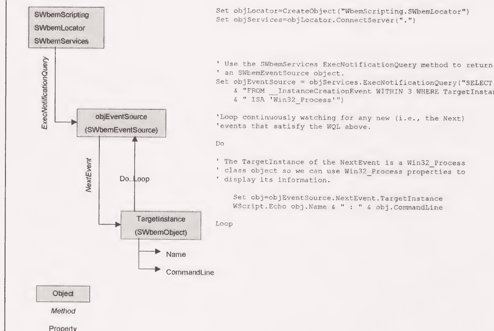

**图 2.7** 利用事件监视脚本之外的操作，例如何时创建了新进程。

此脚本演示了利用 WMI 访问系统事件的一种方法。除了进程之外，你还可以修改脚本以报告事件日志的新添加项或注册表的更改。

在前面的示例中，我们使用了 `ExecQuery` 方法从特定的 WMI 类返回数据子集。在此示例中，我们使用了 `ExecNotificationQuery` 方法，该方法接收事件并支持 WQL。

还需注意，WQL 查询语句变得有点长。让我们分解一下，看看它如何帮助我们获取事件。此语句应在单行中。

```
SELECT * FROM __InstanceCreationEvent WITHIN 3 WHERE TargetInstance ISA 'Win32_Process'
```

该语句的基本意思是每三秒轮询系统类 `__InstanceCreationEvent`，并向我返回任何新创建的 `Win32_Process` 对象。

`WITHIN 3` 语句指定了 WMI 查询的轮询间隔，即每三秒检查一次。指定较短的轮询间隔会增加系统资源利用率；但是，对于一些可能转瞬即逝的事件（例如创建一个进程然后快速删除），你可能会错过某些事件。其他持续存在的事件（例如添加到事件日志的新事件或磁盘容量的变化）则更适合较长的轮询间隔。

`WHERE` 子句的 `ISA` 运算符指示查询返回类层次结构中所有类的实例。

```
Do
    Set obj=objEventSource.NextEvent.TargetInstance
    WScript.Echo obj.Name & " : " & obj.CommandLine
Loop
```

脚本的最后一部分是一个基本的循环，它在每次新事件后使程序保持运行。脚本调用 `NextEvent` 方法，该方法等待满足先前条件的新事件。脚本将等待（如果需要，可以永远等待）直到有事件返回，并按照 `WITHIN` 语句中指定的时间间隔轮询系统。当检测到新事件时，它会将这些事件分配给一个对象，并显示对象的 `Name` 和 `CommandLine` 属性。

前面的示例代表了一个*同步查询*，这意味着系统会等待返回完整的结果。（你可以在 `NextEvent` 方法中指定超时值，但查询仍然是同步运行的。）然而，大多数 `WBemServices` 方法都提供了*异步*对应方法（例如，`ExecQueryAsync`、`ExecNotificationQueryAsync`）。这些方法异步执行查询，然后将脚本控制权返回给你，以便执行其他有用的操作，例如监视多个事件提供程序或提供状态信息。异步运行进程会很方便。

清单 2.9 显示了监视简单进程创建和删除事件的代码。代码更复杂，你可能想在学习更多关于脚本的知识后再回来看它，以理解其细微之处；但是，它确实很好地展示了如何异步管理事件。你需要使用 *CScript.exe* 而不是 *WScript.exe* 来运行此脚本，因为它使用了 *StdOut* 文本流对象，这与 *WScript.exe* 引擎不兼容。


**清单 2.9** 异步监视事件（仅使用 *CScript.exe* 运行）

```
Set objLocator=CreateObject("WbemScripting.SWbemLocator")
Set objServices=objLocator.ConnectServer(".")

Set sink = WScript.CreateObject("WbemScripting.SWbemSink","SINK_")

Set nvsSink=WScript.CreateObject("WbemScripting.SWbemNamedValueSet")
nvsSink.Add "Created: ",1
nvsSink.Add "Deleted: ",0

objServices.ExecNotificationQueryAsync sink,"SELECT * FROM " _
    & "__InstanceCreationEvent WITHIN 1 WHERE TargetInstance ISA " _
    & "'Win32_Process'",,,nvsSink("Created: ")

objServices.ExecNotificationQueryAsync sink,"SELECT * FROM " _
    & "__InstanceDeletionEvent WITHIN 1 WHERE TargetInstance ISA " _
    & "'Win32_Process'",,,nvsSink("Deleted: ")

Do
    WScript.StdOut.Write(".")
    WScript.Sleep(1000)
Loop

Sub SINK_OnObjectReady(objObject, objAsyncContext)
    set obj=objObject.TargetInstance
    WScript.Echo
    WScript.Echo Hour(Now) & ":" & Minute(Now) & ":" & Second(Now) _
        & " " & objAsyncContext.Name & obj.Name & " : " & obj.CommandLine
End Sub
```

要使用异步方法，必须创建一个 *SWbemSink* 对象，并将该对象传递给方法。接下来，创建状态函数，例如 *OnCompleted*、*OnObjectPut*、*OnObjectReady* 和 *OnProgress*，以监视该特定接收器的进度。如果希望重用接收器，你还可以向接收器传递一个上下文参数来标识调用函数。然后，脚本从接收器接收查询进度的通知，并在数据就绪时返回数据。

除了列出进程之外，还可以使用事件来跟踪事件日志或注册表更改，或者与支持脚本 API 接口的其他 Microsoft API 接口交互。Windows 是事件驱动的，通过利用这些信息信标，可以获得大量有用的信息和状态。

### 语句

语句是你应该熟悉的基本编程技术之一。语句为特定语言提供了主体，是语言语法和结构的基础元素。JScript 和 VBScript 的常用语句分别如表 2.8 和 2.9 所示。任何给定语句的语法通常取决于语言，但概念在任何语言中都是相同的。以下部分演示了你在脚本编写过程中可能遇到的一些更常见的语句和注意事项。

#### 表 2.8 内置 JScript 语句

| `/*..*/` | `catch` | `function` | `throw` |
|---|---|---|---|
| `//` | `continue` | `if...else` | `try` |
| `@cc_on` | `debugger` | `Labeled` | `var` |
| `@if` | `do...while` | `return` | `while` |
| `@set` | `for` | `switch` | `with` |
| `break` | `for...in` | `this` | |

#### 表 2.9 内置 VBScript 语句

| `Call` | `Exit` | `Property Get` | `Set` |
|---|---|---|---|
| `Class` | `For Each...Next` | `Property Let` | `Stop` |
| `Const` | `Forplex` | `Property Set` | `Sub` |
| `Dim` | `Function` | `Public` | `While...Wend` |
| `Do...Loop` | `If...Then...Else` | `Randomize` | `With` |
| `Erase` | `On Error` | `ReDim` | |
| `Execute` | `Option Explicit` | `Rem` | |
| `ExecuteGlobal` | `Private` | `Select Case` | |


## IT 管理员入门必学的 10 个 Windows 脚本

### 循环

循环可以重复执行一组操作指定次数。循环通常会嵌套（一个循环嵌在另一个循环内部）以进行多维迭代。例如，可以用一对嵌套循环来输出矩阵。还要注意 `WScript.Stdout.Write` 方法的使用。当你不希望每条语句都以换行符结尾时，该方法提供了比更基础的 `WScript.Echo` 更好的替代方案。不过，如果你决定使用 `StdOut` 或 `StdIn` 文本流对象，必须与 `CScript.exe`（而非 `WScript.exe`）WSH 引擎配合使用。它们在 `WScript` 下无法工作。你可能注意到，在清单 2.9 的异步事件示例中也使用了此方法来输出一行点号。

#### 清单 2.10 VBScript 循环（仅限 CScript）

```vbscript
WScript.Echo ("This nested loop will output a 9x9 matrix")
For i = 1 to 9
    For j = 1 to 9
        WScript.StdOut.Write ("(" & i & "," & j & ")")
    Next
    WScript.Echo
Next
```

### 枚举器

使用枚举器可以遍历对象集合。集合通常是从 WMI 或 ADSI 查询返回的对象；例如，某个组织单元（OU）中的所有用户或某个组的所有成员。前面的示例演示了通过 WMI 查询特定项目的某个属性。

```vbscript
Set colQFE = objServices.ExecQuery("select * from Win32_QuickFixEngineering where HotFixID='Q329048'")
```

此查询返回 HotFixID 等于 Q329048 的所有对象的集合。或者，我们也可以返回所有 `Win32_QuickFixEngineering` 项目：

```vbscript
Set colQFE = objServices.ExecQuery("select * from Win32_QuickFixEngineering")
```

然后逐个循环遍历每个项目，检查 HotFixID 值是否匹配。以这种方式遍历结果不如直接查询所需结果高效，但如果你一开始不确定要查找什么，希望从一个更大的（或完整的）列表开始，这种做法会很有用。

让我们通过列出计算机的共享和磁盘空间来进一步探讨这个问题，如清单 2.11 所示。

#### 清单 2.11 使用 VBScript 遍历集合

```vbscript
Const LOCAL_DRIVE = 3
Const NETWORK_DRIVE = 4
Dim strServer
Dim iFreeSpaceGb
Dim iTemp
strServer="panzer"

Set objLocator=CreateObject("WbemScripting.SWbemLocator")
Set objServices=objLocator.ConnectServer(strServer)

strQuery="SELECT * FROM Win32_LogicalDisk"
Set colLogicalDisk = objServices.ExecQuery(strQuery)

WScript.Echo "Displaying Local and Network Drive free space "_
    & "for server : " & strServer

For Each objLogicalDisk in colLogicalDisk

Select Case objLogicalDisk.DriveType
    Case LOCAL_DRIVE, NETWORK_DRIVE
        if isNull(objLogicalDisk.FreeSpace) then
            iFreeSpaceGb = 0
        Else
            iTemp=CSng(objLogicalDisk.FreeSpace/1024^3)
            iFreeSpaceGb=FormatNumber(iTemp,1)
        end if
        WScript.Echo objLogicalDisk.Name & " : " & iFreeSpaceGb & " GB"

    Case Else
End Select

Next
```

`DriveType` 是 `Win32_LogicalDisk` 对象的属性之一，其数值引用参照表 2.10 中的值。

**表 2.10** `Win32_LogicalDisk.DriveType` 属性表

| 值 | 类型 |
|-------|------|
| 0 | 未知 |
| 1 | 无根目录 |
| 2 | 可移动磁盘 |
| 3 | 本地磁盘 |
| 4 | 网络驱动器 |
| 5 | 光盘 |
| 6 | RAM 磁盘 |

出于文档目的，将我们关注的类型声明为表示 `DriveType` 属性值的常量会更加清晰，如下所示：

```vbscript
Const LOCAL_DRIVE = 3
Const NETWORK_DRIVE = 4
```

此声明允许我们用 `LOCAL_DRIVE` 代替常量值 3，有助于提高代码的可读性。

接下来，我们声明变量 `strServer` 并将其设置为计算机名称的字符串值；本例中计算机名称为 EUROPA。

```vbscript
Dim strServer
strServer="EUROPA"
```

> *你可能已经猜到了，但此示例也展示了在远程计算机上使用 WMI 有多么简单。尝试将 strServer 的值更改为网络上的其他计算机，以枚举它们的驱动器。（你必须拥有适当的权限，且远程计算机必须支持 WMI。）*

接下来，我们必须创建相应的 WMI 对象来连接到 `strServer` 中指定的计算机。还要注意，我们从 `ExecQuery` 返回了所有记录，没有像前面的示例那样筛选条件。

```vbscript
Set objLocator=CreateObject("WbemScripting.SWbemLocator")
Set objServices=objLocator.ConnectServer(strServer)

strQuery="SELECT * FROM Win32_LogicalDisk"
Set colLogicalDisk = objServices.ExecQuery(strQuery)
```

脚本的下一部分展示了几条语句的实际应用。首先，使用 VBScript 的 `For...Each` 语句遍历集合中的每个对象。JScript 需要使用特殊的枚举器对象，我们稍后会介绍。然后脚本遍历集合中的每个对象，并测试 `DriveType` 是否为本地磁盘或网络驱动器。由于我们之前声明了常量，可以直接引用常量名称而无需使用值。你可以看到，引用常量而非直接使用数值（`Case LOCAL_DRIVE, NETWORK_DRIVE` 而非 `Case 3,4`）提高了代码的可读性。对于测试多个条件，`Select...Case` 语句比多个 `If...Then` 语句更可取。在本例中，我们可以根据 `DriveType` 执行不同的任务。

```vbscript
WScript.Echo "Displaying Local and Network Drive free space "_
    & "for server : " & strServer

For Each objLogicalDisk in colLogicalDisk

    Select Case objLogicalDisk.DriveType
        Case LOCAL_DRIVE, NETWORK_DRIVE
```

使用 `Select...Case Case Else` 来处理默认情况（即使为空），并以 `End Select` 结束语句。此条件也可以用稍复杂的 `If...Then` 语句来处理。

```vbscript
If objLogicalDisk.DriveType = LOCAL_DRIVE_
    or objLogicalDisk.DriveType = NETWORK_DRIVE Then
    ...
Else (可选)
    ...
End If (必须)
```

两种方法都可以——选择你觉得更直观的一种。有多种机制可以解决这个问题，虽然某种方式可能稍微更高效或更简洁，但最终如果你是在"快速编写"脚本，应该使用对你来说更高效、更简单的方式。随着你变得更加熟练，你会自然而然地倾向于更优雅的脚本编写方法。

在接下来的代码中，我们进行了一些基本的异常（错误）处理，并对磁盘可用空间进行格式化以便美观输出。

当你枚举不同对象的集合并想要处理数据时，尽量插入代码以确保数据值是预期的且正确的。例如，如果你包含所有驱动器类型（包括软盘和 CD-ROM 驱动器），而某个磁盘不存在，则 `Win32_LogicalDisk` 的 `FreeSpace` 属性将返回空值（null，而非零）。如果你将这个空值传递给需要数字的函数，将会出错。

在本例中，我们测试空值，并根据结果将变量 `iFreeSpaceGb` 设置为 0。（我们同样可以将其设置为字符串"不可用"，然后将其余输出转换为字符串。）

```vbscript
if isNull(objLogicalDisk.FreeSpace) then
    iFreeSpaceGb = 0
Else
```

接下来，我们使用 `FormatNumber` 和 `CSng` 函数将 `FreeSpace` 属性从字节转换为千兆字节。`CSng` 函数将计算结果转换为单精度数据子类型。（单精度数据子类型支持范围从 +/- 1.4E-45 到 3.4E38 的单精度浮点数。）虽然对此脚本并非必需，但此函数演示了强制数据类型转换以确保传递给另一个函数的变量数据子类型。`FormatNumber` 插入千位分隔符并设置表达式的精度（例如，`FormatNumber(2344.2321,1)` 输出 2,344.2）。最后，我们输出结果并结束 `Select` 和 `Loop` 语句。

```vbscript
                temp=CSng(objLogicalDisk.FreeSpace/1024^3)
                    iFreeSpaceGb=FormatNumber(temp,1)
                end if
            WScript.Echo objLogicalDisk.Name & " : " & iFreeSpaceGb & " GB"
        Case Else
    End Select

Next
```

你可能仍在疑惑为什么这一节叫"枚举器"。为什么？虽然 VBScript 使用 `For...Each` 语句的语法来遍历集合，但 JScript 直接使用 `Enumerator` 对象来遍历集合。清单 2.12 展示了用 JScript 编写的同一示例，不仅展示了 VBScript 和 JScript 之间的语法差异，还说明了从根本上来说，无论你选择哪种语言，脚本流程都是一样的。

#### 清单 2.12 使用 JScript 枚举集合

```javascript
var LOCAL_DRIVE = 3;
var NETWORK_DRIVE = 4;
var iFreeSpaceGb;
```


var strServer="panzer";
var strOutput;

objLocator = new ActiveXObject("WbemScripting.SWbemLocator");
objServices = objLocator.ConnectServer(strServer);
strQuery="SELECT * FROM Win32_LogicalDisk";
colLogicalDisk = objServices.ExecQuery(strQuery);

strOutput="显示服务器本地和网络驱动器的可用空间：" + strServer;

WScript.Echo(strOutput);

eLogicalDisk = new Enumerator(colLogicalDisk);
for (;!eLogicalDisk.atEnd();eLogicalDisk.moveNext()) {
    x=eLogicalDisk.item()
    switch (x.DriveType) {
        case LOCAL_DRIVE:
        case NETWORK_DRIVE:
            if(!x.FreeSpace){
                iFreeSpaceGb = 0 }
            else {
            iFreeSpaceGb=(x.FreeSpace/Math.pow(1024,3)).toFixed(1);
            }
            WScript.Echo(x.Name + " : " + iFreeSpaceGb + " GB");
        break;
        default:
        break;
    }
}

在JScript中，你需要实例化一个新的`ActiveXObject`对象，而不是VBScript的`CreateObject`。同时，请注意每行代码以分号结束，循环和条件语句包含在花括号`({...})`中，而不是以某种`End`语句结束。JScript没有像VBScript（`_`）那样的行延续字符，因此为了确保代码行适合页面显示，示例将较长的输出字符串分解为变量`strOutput`，然后显示该变量。

var LOCAL_DRIVE = 3;
var NETWORK_DRIVE =  4;
var iFreeSpaceGb;
var temp;

var strServer="panzer";
var strOutput;

objLocator = new ActiveXObject("WbemScripting.SWbemLocator");
objServices = objLocator.ConnectServer(strServer);
strQuery="SELECT * FROM Win32_LogicalDisk";
colLogicalDisk = objServices.ExecQuery(strQuery);

strOutput="显示服务器本地和网络驱动器的可用空间：";
strOutput+=strServer;

WScript.Echo(strOutput);

`Enumerator`对象包含来自`ExecQuery`的集合对象。它还包含自己的方法：`atEnd`、`item`、`moveFirst`和`moveNext`。在循环中使用这些方法来遍历枚举器对象。

eLogicalDisk = new Enumerator(colLogicalDisk);
for (;!eLogicalDisk.atEnd();eLogicalDisk.moveNext()) {

> *使用JScript，你可以使用`for...in`循环语句遍历对象的属性。但是，要遍历集合，必须使用`Enumerator`对象，因为对象是JScript内置的，并具有特殊支持。*

如果你是JScript新手，你可能会注意到`for...loop`语法的一个奇特之处——它明显以分号开头。实际上，这个字符只是表示第一个参数是空的。此外，JScript的`for`循环比VBScript的`For...Next`或`For...Each`循环更灵活，因为它可以在参数中包含任何函数。注意在我们的语句中，我们有：

for ( ; !eLogicalDisk.atEnd() ; eLogicalDisk.moveNext())

分解来看，我们可以说从现在开始，执行`moveNext`方法直到到达最后一个枚举器对象。但是，尽管这个函数类似于VBScript中集合的`For...Each`对象，我们可以在JScript循环中放入任何函数。例如：

for (foo ; bar ; f(foobar))

当然，你的函数`f(foobar)`应该让你从`foo`到达`bar`，否则你将陷入无限循环；但你可以看到这个函数比简单地按算术或连续方式迭代更灵活。

另外，为了简化后续引用，我们将变量`x`设置为当前的枚举器项。我们同样可以使用引用`eLogicalDisk.item()`来引用属性。

x=eLogicalDisk.item()

JScript使用`switch...case`，类似于VBScript的`Select Case`。注意`break`语句。这个语句导致程序退出`switch`语句。如果没有它，后续的`case`可能满足之前的`case`，这可能导致不可预见的问题。同时注意`default`语句。这个语句处理所有未被之前`case`满足的条件。

还要注意，我们使用不等于运算符`!`代替了VBScript的`isNull`函数。本例使用JScript的`Math.Pow`函数计算`1024^3`，并使用JScript的`toFixed`函数代替`FormatNumber`。

switch (x.DriveType) {
    case LOCAL_DRIVE:
    case NETWORK_DRIVE:
        if(!x.FreeSpace){
            iFreeSpaceGb = 0
        }
        else {
            iFreeSpaceGb=(x.FreeSpace/Math.pow(1024,3)).toFixed(1);
        }
        WScript.Echo(x.Name + " : " + iFreeSpaceGb + " GB");
        break;
    default:
        break;
}

如你所见，代码结构在VBScript和JScript版本之间保持不变，但语法在语句以及使用的函数或方法上存在很大差异。有些人觉得VBScript比JScript更自然或更容易上手。然而，JScript是可以学习的，如果你看到自己将来会使用C#或其他高级语言，你会发现这些高级语言与JScript之间有更多相似之处。

### 运算符

运算符比较或操作两个表达式。表2.11列出了JScript和VBScript中分别使用的运算符。JScript支持赋值运算符，它既计算表达式又执行操作。例如，JScript中的`i++`等同于VBScript中的`i=i+1`。

| | JScript | VBScript |
|---|---|---|
| 加法赋值 | += | |
| 加法 | + | + |
| 字符串连接 | + | & |
| 赋值 | = | = |
| 按位与 | & | |
| 按位或 | \| | |
| 按位异或 | ^ | |
| 逗号 | , | |
| 条件三元 | ?: | |
| 递减 | -- | |
| 除法赋值 | /= | |
| 除法 | / | / |
| 等于 | == | = |
| 排除 | | Xor |
| 指数 (x^y) | Math.pow(x,y) | ^ |
| 大于 | > | > |
| 大于或等于 | >= | >= |
| 严格相等 * | === | = |
| 蕴含 | | Imp |
| 递增 | ++ | |
| 不等于 | != | <> |
| 整数除法 | | \\ |
| 小于 | < | < |
| 小于或等于 | <= | <= |
| 逻辑与 | && | And |
| 逻辑非 | ! | Not |
| 逻辑或 | \|\| | Or |
| 取模赋值 | %= | |
| 取模 | % | Mod |
| 乘法赋值 | *= | |
| 乘法 | * | * |
| 严格不相等 * | !== | |
| 减法赋值 | -= | |
| 减法 | - | - |
| 变量类型 | type of 运算符 | TypeName 函数 |

排除：无符号移位和位运算符。

* JScript中的严格相等和严格不相等运算符类似于等于和不等于运算符，但它们不尝试类型转换。

还要注意，JScript的赋值运算符与等于运算符非常不同。JScript表达式`i=1`将变量`i`设置为值`1`，而等于运算符`i==1`测试`i`是否等于值`1`。这个区别是JScript程序中bug的常见来源，下面的代码演示了这一点：

i=0;
if(i=1) {
    WScript.Echo("哎呀，用了一个赋值运算符。")
}
WScript.Echo(i); //返回 1

以下脚本可能是脚本编写者想要实现的：

i=0;
if(i==1) {
    WScript.Echo("使用了等于运算符。")
}
WScript.Echo(i); // 返回 0

VBScript不区分赋值和等于运算符，`=`用于两者。

### 调试

不可避免地，你会花相当多的时间来调试程序中的错误或失误。所有程序员，无论其技能和经验如何，都会花时间调试他们的程序。调试有多种形式，从简单地纠正拼写错误的变量名到完全重写一段代码。最明显的错误发生在运行时，带有错误消息会中止脚本的执行；然而，要小心更深层、更微妙的错误，例如那些导致数据计算错误的情况。在这些情况下，脚本可能从头到尾运行没有任何问题迹象，但最终会得到错误的答案。在上述任何一种情况下，逐行单步执行程序有助于实时发现和纠正错误。同样有帮助的是，使用独立于脚本的方法找到并确定答案，然后将你的发现与脚本的结果进行比较。例如，如果你的脚本列出了一个域组中的所有用户，请使用Active Directory用户和计算机手动验证脚本输出是否与独立工具的输出匹配。


此外，为了暴露缺陷，请在不同负载下的不同环境中运行您的脚本。例如，假设您的脚本检查您指定域中的所有计算机。在包含 10 台计算机的测试环境中运行脚本的结果，与在包含 500 或 1,000 台计算机的生产环境中运行脚本的结果相比，可能会暴露您脚本中存在的、在较小环境中未出现的缺陷。这些缺陷可能与计算机的数量有关（例如，某个变量的大小不足以处理更大的数量），或者仅仅是因为您的脚本必须运行的目标对象可能具有更大的多样性而暴露的缺陷。

语法错误最容易纠正，尤其是在使用 Microsoft Office VBA Visual Basic 编辑器等编程环境时。该编辑器会在您输入时标记并提醒某些错误（例如，遗漏括号）。Visual Basic 编辑器还包含一个功能强大的调试器，允许您逐行单步执行脚本，并观察其运行时的行为。您可以使用编辑器的各种监视窗口来检查程序变量的值。

Windows 脚本宿主也支持调试器。要激活此调试器，请通过 CScript 或 WScript 引擎执行您的 WSH 脚本，并使用 */D* 参数启用活动调试，如以下命令所示：

```
CScript //D myscript.vbs
```

然后，您将被提示选择要使用的调试器（如果安装了多个调试器），如图 2.8 所示。

选择调试器后，您的脚本将加载到编辑器中，但不会开始运行。此时，您可以选择希望程序如何运行。

使用 Microsoft 脚本编辑器，您可以从“调试”菜单中选择多种选项来指定您希望在编辑器中如何运行程序。最常见的选项有：*继续*，运行脚本直到下一个断点（我们稍后会介绍断点），如果没有错误则运行到脚本末尾；*逐语句*，将程序推进到下一行；以及*逐过程*。逐过程不会进入被调用的过程，而逐语句则会进入程序所在的任何过程。例如，假设您正在单步执行代码的主分支，并遇到一个调用子例程的命令，该子例程循环处理许多条目。逐过程会处理该过程，但不会引导您逐行执行。它会自动执行过程中的代码，然后在调用该过程之后的那一行停止，并将手动控制权交还给您。而逐语句则将您推进到过程中，并在过程的第一行停止并等待。

### 为什么使用脚本？

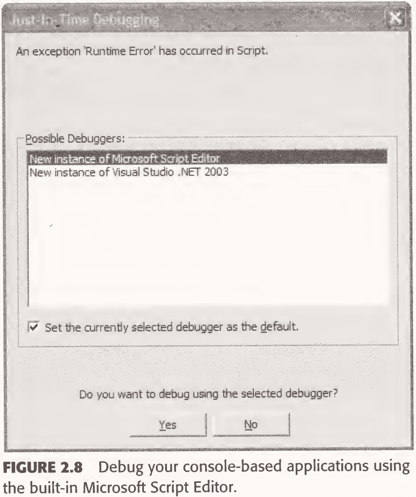

图 2.9 展示了使用 Microsoft 脚本编辑器尝试运行一个代码中有明显错误的脚本的示例。请注意，脚本编辑器会提醒您错误并高亮显示错误行。

同样在图 2.9 中，请注意监视窗口和命令窗口 - 即时窗口。监视窗口显示当前变量的值。您必须通过右键单击变量，然后选择“添加监视”来添加它们。在图 2.9 中，请注意变量 `strName` 的值是 `Topaz`，但最初设置为 `Trooper`。这种差异是因为我们在命令窗口 - 即时窗口中更改了 `strName` 的值。您可以在此窗口中直接设置或显示变量并运行程序命令。例如，如果您在此窗口中键入 `WScript.Echo("Something")`，文本 `Something` 将出现在您最初调用程序的控制台中。

## IT 管理员的 Windows 十大入门脚本

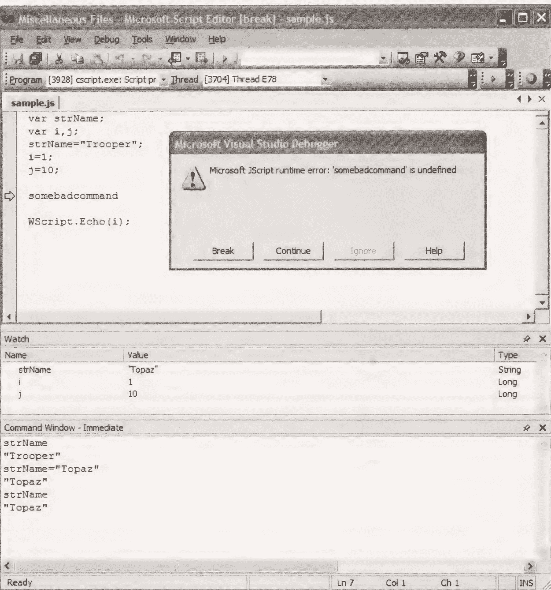

### 图 2.9 Microsoft 脚本编辑器为基于 WSH 控制台的脚本提供了调试器。

逐行单步执行程序可以让您很好地检查您的脚本究竟在做什么以及何时做。但是，您可以使用断点来运行到脚本中的特定点然后停止。断点是脚本中的一个停止标志。脚本运行到包含断点的那一行，然后暂停调试器。从这一点开始，您可以单步执行程序、检查变量，并继续调试程序。

使用一个简单的程序安装并试用调试器，熟悉它们的工作原理——您会很高兴将这个工具添加到您的脚本编写工具库中。

### 总结

本章的示例旨在让您对 VBScript 和 JScript 以及基本 Windows 脚本的框架和架构有所了解。您将用来创建脚本的许多对象、方法和属性与专业软件开发人员使用的实体相同（或非常相似）。

## 关键点

-   脚本提供了一套完全可定制、可重用的工具集，您可以利用它来构建解决方案，以减少重复性工作或自动化大型或冗长的任务。
-   VBScript 和 JScript 都提供了一套类似的脚本工具，您选择使用哪一个更可能取决于您的目标受众、应用程序、偏好或熟悉程度。
-   Windows 脚本宿主有两种形式：基于控制台的 CScript 和基于窗口的 WScript。某些方法和属性仅适用于特定的控制台。
-   使用注释来记录您的代码，并帮助他人理解您的思路。
-   养成声明变量的习惯，以避免错误并展现良好的编程实践。此外，声明变量可以让调试器知道在局部变量窗口中显示变量。
-   对象代表一个编程实体，该实体包含该实体的数据和功能；例如，到远程计算机的 WMI 连接是通过一个对象来引用的。
-   方法提供对象可以发起的操作；例如，ExecQuery 方法从远程计算机返回一组 WMI 数据。
-   函数提供可以从脚本或程序中调用的操作，独立于任何对象。
-   属性是对象的特征，可以读取（有时可以设置）；例如，Win32_LogicalDisk 类有一个名为 FreeSpace 的属性，它表示特定驱动器上的剩余空间。
-   事件是 Windows 操作系统的主要信号机制之一，可以由对象、应用程序甚至用户发送。
-   语句提供特定语言的词汇，是语言语法和结构的基础元素。循环、条件和声明都是语句的例子。
-   运算符比较或操作两个表达式；例如，=、>、*。

第 3 章，“Windows 可脚本化技术”，将介绍一些更流行的 Windows 脚本技术：Windows 脚本宿主 (WSH)、Windows 管理规范 (WMI) 和活动目录服务接口 (ADSI)。

## 3 Windows 可脚本化技术

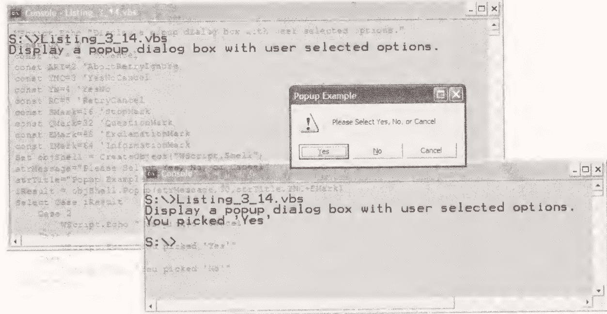

在第 2 章中，我们涵盖了由两种最流行的 Microsoft 脚本语言 VBScript 和 JScript 演示的编程基础知识。使用这些语言，您可以编写脚本并利用许多不同的 Microsoft 应用程序编程接口 (API)。Windows 操作系统的许多组件，以及一些企业软件（如 Microsoft® Exchange），都支持脚本访问以管理其行为。

在本章中，我们将讨论一些更流行的 Windows 可脚本化技术：*Windows 脚本宿主 (WSH)*、*Windows 管理规范 (WMI)* 和 *活动目录服务接口 (ADSI)*。这三者为系统管理员和工程师提供了自动化日常、大型或分布式任务的巨大机会。本书中的许多脚本都反复利用了这些技术。掌握了这些工具后，您将能够将学到的知识转移，从而在新的脚本技术发布时相当快速地掌握它们。

### WINDOWS 脚本宿主

Windows 脚本宿主 (WSH) 提供了一种与语言无关的机制，用于通过脚本管理和访问 Windows 平台。Microsoft 支持 VBScript 和 JScript，WSH 通过文件扩展名（.js 或 .vbs）识别脚本语言。WSH 使用直接调用的引擎（例如，*cscript script.vbs*）或使用注册的 WSH 脚本引擎（例如，在命令行中键入脚本名称，如 *script.vbs*，然后按 Enter 键）来处理脚本。CScript 提供命令行界面，而 WScript 提供基于 Windows 的界面。

除了 VBScript 和 JScript 语言解释器之外，WSH 还提供了对许多 Windows 平台资源的访问，包括文件系统、网络、Shell、环境变量以及可执行文件包装器，您可以从脚本中启动其他工具。此外，WSH 支持访问任何 ActiveX COM 支持的自动化接口，例如 Microsoft 活动目录 (AD) 或 WMI。这些对象、方法和属性提供了访问和编写脚本来提供 Windows 管理或维护功能。通过其支持的对象访问 WSH 基础结构。

#### WScript

`WScript` 对象在 WSH 中提供基本的编程功能。在第 2 章中，我们广泛使用了 `WScript` 对象在控制台或对话框中显示输出、暂停脚本以及使用异步事件处理程序捕获事件。`WScript` 对象也执行其他有用的任务。

#### WScript.Argument

`WScript` 对象提供了一种在脚本中捕获命令行参数的机制。参数是从外部传递给程序的参数，例如从命令行传递。让我们看一个使用常用工具 ping 的示例。


##### 清单 3.1 WScript.Arguments 的 JScript 示例

```
ping -n 10 127.0.0.1
```

在此示例中，`ping` 是命令，命令的其余部分是参数。`-n 10` 实际上是两个参数；`-n` 指定要发送的回显请求数量，`10` 是实际发送的数量。地址 `127.0.0.1` 是你想要 ping 的目标地址。你可能认为这理所当然，但思考一下其逻辑。`ping 127.0.0.1 -n 10` 同样有效。并且，如果你使用 `-n` 后没有跟数字，`ping` 会返回一个针对该数字参数的特定错误。

在你的脚本中，你也可能需要使用参数，而使用 WSH 实现起来快速且简单。通过访问属性 `WScript.Arguments` 来获取参数。返回的集合是一个 `WshArguments` 对象。在清单 3.1 中，我们捕获并输出了传递给脚本的第一个参数。

##### 清单 3.1 WScript.Arguments 的 JScript 示例

```javascript
var colArgs = WScript.Arguments;
var eArgs = new Enumerator(colArgs);
WScript.Echo(eArgs.item(0));
```

最好，我们可以将其简化为：

```javascript
WScript.Echo(WScript.Arguments(0));
```

让我们稍微扩展一下这个脚本，以展示如何捕获所有参数，然后根据接收到的参数决定执行什么操作。参数处理例程具有高度的可重用性，你可能会发现你自己的参数例程是你脚本工具箱中的必要组件。清单 3.2 展示了一个基本的参数处理例程。它是参数位置无关的（例如，`-a -f filename` 或 `-f filename -a`），并且也支持依赖参数（例如 `-f filename`）。还要注意，我们使用了 `Argument` 对象的 `length` 和 `item` 属性来遍历 `WshArguments` 集合。

##### 清单 3.2 基本参数处理例程

```javascript
var colArgs = WScript.Arguments;
for(i=0;i<colArgs.length;i++)
{
    switch(colArgs.item(i))
    {
        case "-a":
            WScript.Echo("flag -a received");
            break;
        case "-f":
            if(i+1<colArgs.length) {
                strText=colArgs.item(i+1);
                WScript.Echo("Dependent parameter: " + strText);
                i++;}
            else {
                WScript.Echo("flag -f needs additional argument");
                WScript.Quit(1);}
            break;
        case "-?":
        default :
            WScript.Echo("Flag not recognized. Display Help");
            WScript.Quit(1);
            break;
    }
}
WScript.Echo( colArgs.length + " Arguments Received");
```

前面的代码示例遍历传递的每一个参数，并且也可以根据设置的任何（或所有）参数采取特定操作。此外，该代码支持依赖参数，这意味着如果它看到参数 `-f`，它会寻找并接受一个后续参数作为某些文本（例如文件名）。错误处理包括确保存在依赖参数。然而，它不检查参数的有效性，也不包含在输入逻辑 `-f -a` 时出错的逻辑。在这种情况下，脚本将 `-a` 视为 `-f` 的依赖参数。运行时，我们会看到如图 3.1 所示的输出。

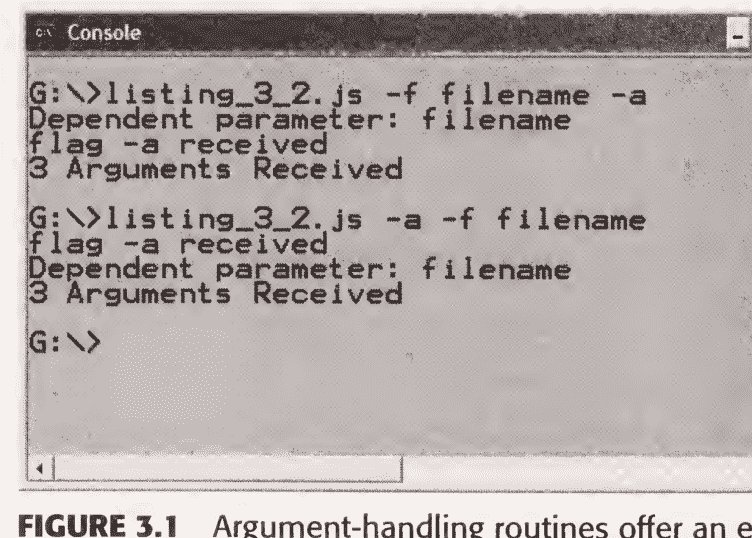

**图 3.1** 参数处理例程提供了一种配置脚本运行参数的简便方法。

前面的脚本是一个基本示例，它肯定可以受益于错误处理（例如，验证正确的文件名或在向用户显示任何内容之前搜索错误参数）。你不仅可以看到收集参数是多么容易，还可以看到后续的参数操作可以是多么灵活。

### WScript.Shell

`objShell` 对象提供了对 Windows 脚本宿主的脚本访问。使用 shell 对象的方法来读取或写入注册表、执行应用程序以及将事件记录到事件日志中。

使用以下代码实例化 shell 对象：

```vbscript
Set objShell = WScript.CreateObject("WScript.Shell")
```

```javascript
var objShell = WScript.CreateObject("WScript.Shell");
```

通过此对象，你可以访问 `WshShell` 对象、方法和属性，例如读取或写入注册表。

#### WshShell — 注册表

`WshShell` 对象提供了三种方法来访问本地计算机上的注册表：`RegRead`、`RegWrite` 和 `RegDelete`。在深入探讨 shell 对象的注册表方法之前，让我们先回顾一下注册表的组成部分。

> 使用 WMI 注册表提供程序来访问远程计算机上的注册表。

> 无论何时处理注册表——尤其是在创建或删除数据时——请务必先备份你的注册表。

Windows 注册表编辑器（*regedit.exe*）的标准显示有两个窗格，类似于图 3.2 中显示的左右窗格。左窗格包含 *项* 和 *子项*。右窗格包含 *值*。值由三部分组成——*名称*、*类型* 和 *数据*。顶级项（称为 *根项*）在脚本中可以缩写，如表 3.1 所示。

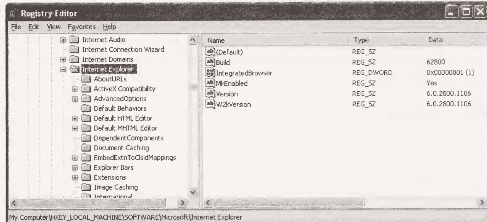

**图 3.2** Windows 注册表编辑器显示系统注册表的项和值。

##### 表 3.1 根项缩写

| 根项 | 缩写 |
|---|---|
| HKEY_CLASSES_ROOT | HKCR |
| HKEY_CURRENT_USER | HKCU |
| HKEY_LOCAL_MACHINE | HKLM |
| HKEY_USERS | HKEY_USERS |
| HKEY_CURRENT_CONFIG | HKEY_CURRENT_CONFIG |

`WshShell` 对象的注册表操作方法需要项的名称 *以及* 你希望读取或写入的特定值名称。此要求与命令行 *reg.exe* 二进制文件的要求略有不同，后者可以转储项以及值。

例如，项 `HKLM\SOFTWARE\Microsoft\Internet Explorer` 包含多个值，包括 Build、Integrated Browser、Version、MkEnabled、W2kVersion，以及可能的其他值，具体取决于计算机上安装的软件。要读取或写入某个值，你必须指定项和值名称，例如 `HKLM\SOFTWARE\Microsoft\Internet Explorer\Version`。

每个值都被定义为特定的数据类型。使用 `RegWrite` 方法创建值时，你可以指定表 3.2 中显示的数据类型之一。

##### 表 3.2 WshShell 注册表数据类型

| 数据 | 类型 | 示例 |
|---|---|---|
| 字符串值 | REG_SZ | Q123456 或 C:\WINDOWS\ |
| 二进制值 | REG_BINARY | 01 02 01 00 05 01 01 01 |
| DWORD 值 | REG_DWORD | 0x00000002 或 21 |
| 可扩展字符串值 | REG_EXPAND_SZ | %systemroot%\system32\ |

> 注意：多字符串值数据类型 `REG_MULTI_SZ` 不被 `RegWrite` 方法支持。

以下清单 3.3 中的 JScript 示例显示了本地计算机上 Internet Explorer 的版本。

##### 清单 3.3 读取本地计算机注册表

```javascript
var strRootKey="HKLM";
var strRegPath="\\SOFTWARE\\Microsoft\\Internet Explorer\\version";
var objShell = WScript.CreateObject("WScript.Shell");
strValue=objShell.RegRead(strRootKey+strRegPath);
WScript.Echo(strValue);
```

> 在 JScript 中，反斜杠表示一个特殊字符（如换行符 `\n`），所以当你想使用一个实际的反斜杠时，你必须用第二个反斜杠将其转义，如下所示：`\\`。

清单 3.4 展示了如何在注册表中插入一个新值。指定完整的项名称，包括值名称、值，以及可选的值类型。未指定的值类型默认为 `REG_SZ` 类型。（注意，运行此脚本会将条目添加到你的注册表中。）

##### 清单 3.4 添加或更新注册表项和值

```javascript
var strRootKey="HKLM";
var strRegPath="\\SOFTWARE\\Gadget\\ValueName";
var objShell = WScript.CreateObject("WScript.Shell");
strValue=objShell.RegWrite(strRootKey+strRegPath,"ValueData","REG_SZ");
```

删除注册表项或值也是一个简单的过程。指定要删除的项和值名称。

```vbscript
strValue=objShell.RegDelete("HKLM\\SOFTWARE\\Gadget\\ValueName");
```

通过在字符串末尾添加一个项名称后跟一个反斜杠来删除整个项。

```vbscript
strValue=objShell.RegDelete("HKLM\\SOFTWARE\\Gadget\\");
```

#### WshShell — 执行应用程序

`WshShell` 对象还允许你从脚本中执行应用程序。此功能非常有用，因为它允许你从脚本中调用现有应用程序并使用返回的数据。

将你的脚本视为你希望运行的可执行文件的一个包装器或外壳。下面是一些示例：

- 一个登录脚本，在运行需要局域网连接的程序之前，先 ping 远程计算机以验证网络连接。
- 一个指定 Windows 资源工具包工具（如 RoboCopy）运行参数的脚本。你的脚本可能包含一个源和目标网络名称数组，你遍历这些数组并生成在自定义和自动化参数下运行的 RoboCopy 实例。

两个用于执行应用程序的 shell 方法是 `Exec` 和 `Run`。

`Exec` 方法在 WSH 5.6 版本中受支持。（在运行早期版本 WSH 的计算机上，你必须使用 `Run` 方法。）`Exec` 方法返回一个 `WshScriptExec` 对象，该对象支持标准流对象 `StdIn`、`StdOut` 和 `StdErr`。此支持使脚本可以直接从应用程序读取输出，而无需先将输出保存到文件中。清单 3.5 中的以下脚本展示了如何使用 `Exec` 方法执行外部命令，然后使用标准流属性处理结果的示例。

##### 清单 3.5 Exec 方法支持标准流

```vbscript
WScript.Echo("Check Network using command line Ping")

Set objShell = CreateObject("WScript.Shell")
Set objWshScriptExec = objShell.Exec("%comspec% /c ping 127.0.0.1")
```


Set objStdOut = objWshScriptExec.StdOut
While Not objStdOut.AtEndOfStream
    strLine = objStdOut.ReadLine
    if instr(strLine, "Re") then
        strOutput=strOutput & strLine & vbCrLf
    end if
Wend

WScript.Echo(strOutput)

这个脚本的前提是执行 shell 对象的 Exec 方法，并捕获、格式化和显示输出。Exec 方法的输出保存在一个新的 WshScriptExec 对象中。（在示例脚本中，这个对象存储在名为 objWshScriptExec 的变量中。）StdOut、StdIn 和 Stderr 都是 WshScriptExec 对象的属性，它们本身也具有额外的方法和属性。此示例脚本遍历 objWshScriptExec 对象的 StdOut 属性。

> TextStream 对象稍后会在讨论 FileSystemObject 时详细说明。但是，适用于 TextStream 对象的许多方法和属性也适用于 Exec 方法的标准流。

> WSH 的标准流处理不具备某些其他语言中那种灵活的游标（文件指针）定位功能。你可以通过一次读取一行到临时字符串中，然后独立解析该行以寻找所需数据，来规避此限制。

```
While Not objStdOut.AtEndOfStream
    strLine = objStdOut.ReadLine
    if instr(strLine, "Re") then
        WScript.Echo strLine & vbCrLf
    end if
Wend
```

此代码遍历输出的每一行，并查找字符串 "Re"，它对应于 ping 命令返回的 "Request timed out"（请求超时）或 "Reply from"（来自的回复）。如果脚本找到匹配项，它会将该行连接到之前的结果中，最后显示出来。VB 常量 vbCrLf 代表新行（在 JScript 中，换行符是 \n），并指示代码插入回车或换行符。使用这些字符来格式化你不想在单行上连续显示的输出。

## Windows 管理员十大入门脚本

%comspec% 环境变量代表系统的命令解释器。Windows 9x 使用 command.exe，而 Windows NT 及更高版本使用 cmd.exe。使用 %comspec% 环境变量可确保在可能运行不同版本 WSH 的更广泛平台上实现兼容性。

旧版本的 WSH 不支持 Exec 对象，但你可以使用 Run 方法实现类似功能。Run 方法不支持访问标准输出，但你可以通过使用文本来规避此问题。只需将应用程序的输出重定向到一个文本文件（使用 >），然后从输出文本文件中读取结果。本章后面我们将介绍 FileSystemObject，并展示如何将 TextStream 对象与 Run 方法结合使用来实现这一目标。

### WshShell-日志事件

使用 shell 对象将事件记录到本地或远程计算机的应用程序事件日志中。记录事件的语法如代码清单 3.6 所示。

**代码清单 3.6** 使用 shell 对象将事件记录到应用程序事件日志

```
WScript.Echo("Log an Event")
strMessage="Success message logged to the Application Event Log"
Set objShell = CreateObject("WScript.Shell")
objShell.LogEvent 0, strMessage
```

运行此脚本会将一个事件记录到本地计算机的应用程序事件日志中，如图 3.3 所示。

LogEvent 方法支持三个参数：type（类型）、message（消息）和 computer（计算机，可选）。

```
objShell.LogEvent type, message, computer
```

message 是一个字符串，computer 是可选的。如果指定了计算机名称，该方法会将该消息记录到远程计算机的事件日志中。表 3.3 列出了可以使用 LogEvent 记录的不同类型的事件。

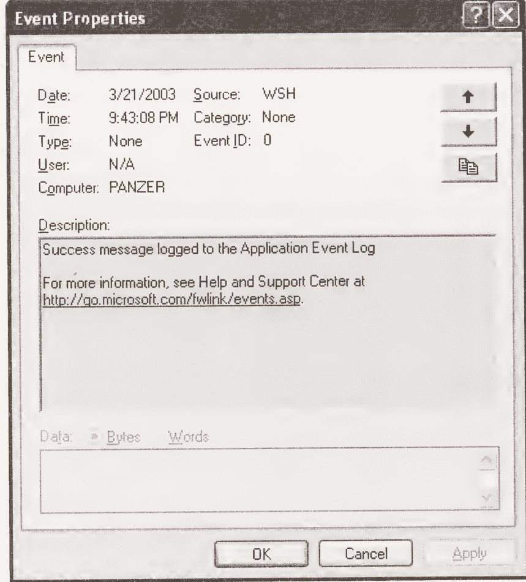

**图 3.3** 使用 shell 对象向应用程序事件日志发布事件。

**表 3.3** LogEvent 类型参数

| 值 | 事件类型 |
| :--- | :--- |
| 0 | 成功 |
| 1 | 错误 |
| 2 | 警告 |
| 4 | 信息 |
| 8 | 审计成功 |
| 16 | 审计失败 |

### WshShell–SendKeys

WSH 支持 COM，可以直接与支持 COM 自动化的应用程序（如 Microsoft Office）进行互操作。自动化是对象模型将其 API 暴露给其他 COM 支持客户端的过程。例如，你可以创建一个将信息输出到新 Word 文档的脚本。但是，你可能需要与不支持自动化的应用程序进行交互。SendKeys 方法提供了一种驱动未暴露任何自动化对象的应用程序的方法。将 SendKeys 与 Exec 或 Run 以及 AppActivate 方法结合使用来操作应用程序。代码清单 3.7 中的示例展示了如何使用记事本创建一个简单的文本文件。

**代码清单 3.7** SendKeys 使你能够操作不支持自动化的应用程序。

```
WScript.Echo("Drive Notepad")
Set objShell = CreateObject("WScript.Shell")
Set objWshScriptExec=objShell.Exec("notepad.exe")
WScript.Sleep 1000
objShell.AppActivate "Notepad"
strMessage="Enter this into Notepad"
objShell.SendKeys strMessage
objShell.SendKeys "%fac:\test.txt%s"
WScript.Sleep 1000
objShell.SendKeys "%{F4}"
WScript.Echo("Used Notepad to create and save c:\test.txt")
```

向程序发送按键可能是一个有风险的过程，因为控制时序和预测应用程序的结果可能很困难。例如，尝试运行上面的脚本两次。注意，由于第一次运行时文件已经存在，记事本会提示你是否替换该文件。由于我们没有为这个额外的按键操作编写代码，记事本实际上会跳出脚本。还要注意 Sleep 函数的使用。这个延迟会放慢脚本的执行速度，以确保前面的任务已经完成。例如，如果没有第一个延迟，脚本可能会在记事本完成加载之前尝试激活它。

> 由于前面提到的原因，请避免使用 SendKeys，除非是最基础的应用程序，并且即使那样，也要在绝对确定应用程序每次都会如何响应时才使用。

shell 对象方法 AppActivate 通过应用程序名称或进程 ID 激活应用程序，并将焦点切换到该应用程序。如果你打开了多个同名应用程序（并且选择不使用进程 ID），AppActivate 会随机将焦点切换到其中一个。

SendKeys 方法的参数包括你希望发送的字符字符串。表 3.4 分析了发送到记事本的字符串 `%fac:\test.txt%s`。

```
objShell.SendKeys "%fac:\test.txt%s"
```

##### 表 3.4 SendKeys 方法参数示例分析

| %f | a | C:\test.txt | %s |
|---|---|---|---|
| Alt-F | 另存为 | C:\test.txt | 保存 |
| 访问文件菜单 | 选择另存为的快捷键 A | 结果对话框默认将光标置于文件名字段，因此只需发送文件名 | 使用 Alt-S 保存文件 |

### WshShell–环境变量

WSH 通过 shell 对象的 Environment 属性提供对系统环境变量的访问。此属性返回一个 WshEnvironment 对象的集合，可以使用 VBScript 的 For...Each 循环或 JScript 的 Enumerator 对象进行枚举。

环境分为四个不同的组：SYSTEM（系统）、USER（用户）、VOLATILE（易失性）和 PROCESS（进程）。代码清单 3.8 中的脚本显示了当前的 SYSTEM 和 USER 环境变量。


##### 代码清单 3.8 使用 shell 对象的 Environment 属性显示系统和用户环境变量

```
WScript.Echo("Display Environment Variables- SYSTEM" & vbcrlf)
Set objShell = CreateObject("WScript.Shell")
Set colEnvironment = objShell.Environment("SYSTEM")
For Each objVariable In colEnvironment
    WScript.Echo(objVariable)
Next
WScript.Echo(vbcrlf & "Display Environment Variables- USER" & vbcrlf)
Set colEnvironment = objShell.Environment("USER")
For Each objVariable In colEnvironment
    WScript.Echo(objVariable)
Next
```

注意此集合与前述一些集合的区别。你不需要 item 方法来访问对象；你可以直接访问它。要访问特定的环境变量，请在集合对象中明确指定它，如下所示：

```
Set objShell = CreateObject("WScript.Shell")
Set colEnvironment = objShell.Environment("USER")
WScript.Echo(colEnvironment("Path"))
```

同样，你可以通过直接为变量赋新值来更改可写的环境变量，如以下示例所示：

```
Set objShell = CreateObject("WScript.Shell")
Set colEnvironment = objShell.Environment("USER")
colEnvironment("TEMP") = "c:\\"
```

## 文件系统对象

WSH 通过使用 FileSystemObject (FSO) 对象模型来支持对文件系统的访问。此模型的对象、方法和属性允许你访问系统上的文件、目录和驱动器。例如，你可以读取、写入、创建或删除文件，或查询驱动器的可用空间或大小。

FSO 模型的对象包括以下内容：

- FileSystemObject
- Drive
- Drives
- File
- Files
- Folder
- Folders
- TextStream

代码清单 3.9 中的示例展示了如何使用 FSO 对象模型从路径（在此示例中是 c: 的根目录）返回一组文件夹和文件。到目前为止，你应该已经熟悉了创建对象并使用该对象访问其他对象、方法和属性的过程。


### 代码清单 3.9 使用 FileSystemObject 列出文件夹中的子文件夹和文件

```
Set objFSO = CreateObject("Scripting.FileSystemObject")
Set objFolder= objFSO.GetFolder("c:")
Set colSubFolder =objFolder.SubFolders
For Each objFile in colSubFolder
    WScript.Echo (objFile.type & " : " & objFile.name)
Next
WScript.Echo
For Each objFile in objFolder.Files
    WScript.Echo (objFile.name & "  (" & objFile.type & ")")
Next
```

在此示例中，我们首先创建 `Scripting.FileSystemObject` 对象。接下来，我们获取特定路径的文件夹对象，然后遍历该文件夹对象的 `SubFolders` 和 `Files` 集合。通过此遍历，我们显示从 `SubFolder` 集合返回的每个文件夹和文件对象的名称和类型。

目前，FSO 模型仅支持通过使用 `TextStream` 对象来操作文本文件。文本文件非常适合临时存储命令或脚本的输出，您可以随后对其进行解析。

早于 5.6 版本的 WSH 版本不支持 `Exec` 方法及其标准 I/O 流。一种解决方法是使用 shell 对象的 `Run` 方法，然后使用文本文件作为这些数据的中间存储。`TextStream` 对象支持标准流。

代码清单 3.10 展示了围绕 `ipconfig` 命令的脚本框架。此脚本启动命令，使其将输出重定向到文本文件。命令完成后，脚本读取输出并显示它。（将此代码清单与使用 `Exec` 方法来封装 `ping` 命令的代码清单 3.5 进行比较。）

### 代码清单 3.10 使用 TextStream 对象读取和写入文本文件


```
WScript.Echo("Script harness for ipconfig.")
Set objShell = CreateObject("WScript.Shell")
strTemp=objShell.ExpandEnvironmentStrings("%temp%")
WScript.Echo("Writing to temp dir: " & strTemp)
strCommand="%comspec% /C ipconfig /all > " & strTemp & "\out.txt"
Return=objShell.Run(strCommand,0,true)
strOutput=ReadResults(strTemp & "\out.txt")
WScript.Echo(strOutput)
```

```
Function ReadResults(strFileName)
    Set objFSO = CreateObject("Scripting.FileSystemObject")
    If (objFSO.FileExists(strFileName)) Then
        Set objTextFile = objFSO.OpenTextFile(strFileName, 1, False)
        strOutput=""
        Do While objTextFile.AtEndOfStream <> True
            strReadLine=objTextFile.ReadLine
            strOutput=strOutput & strReadLine & vbCrLf
        Loop
        objTextFile.Close
    Else
        strOutput="Error reading file."
    End If
    ReadResults=strOutput
End function
```

让我们分解这个脚本并讨论它的工作原理。

```
WScript.Echo("Script harness for ipconfig.")
Set objShell = CreateObject("WScript.Shell")
strTemp=objShell.ExpandEnvironmentStrings("%temp%")
WScript.Echo("Writing to temp dir: " & strTemp)
```

请注意此示例中环境变量 `%temp%` 和再次出现的 `%comspec%` 的用法。无论最终用户的权限如何，`%temp%` 目录通常都开放读写访问；其实际位置可能因机器而异。`%temp%` 目录是存放此类临时文件的安全且合适的位置（与写入可能受限的根目录或系统目录相反）。

```
strCommand="%comspec% /C ipconfig /all > " & strTemp & "\out.txt"
Return=objShell.Run(strCommand, 0, true)
```

`Run` 方法类似于 `Exec` 方法。它采用以下形式：

```
Run(command, window style, wait on return)
```

`command` 是您希望运行的可执行文件的名称及其命令行属性。在我们的示例中，随着 `%temp%` 环境变量的完全展开，命令窗口中执行的命令是：

```
ipconfig /all > C:\DOCUME~1\temp\LOCALS~1\Temp\out.txt
```

`>` 符号将输出重定向到新的文本文件。`>>` 符号类似地重定向输出，但如果文件已存在，则会追加数据。

设置 `Run` 方法的窗口样式以确定是否显示命令窗口。将此选项设置为 0（零）意味着命令在后台运行。该参数支持从 0 到 10 的配置，并指示程序如何显示窗口（例如，无窗口、最小化或最大化）。表 3.5 显示了窗口显示参数的值。

##### 表 3.5 Run 方法窗口显示值

| 值 | 描述 |
|---|---|
| 0 | 隐藏窗口并激活另一个窗口。 |
| 1 | 首次显示窗口时使用。激活并以原始大小和位置显示窗口。 |
| 2 | 以最小化形式激活窗口。 |
| 3 | 以最大化形式激活窗口。 |
| 4 | 以当前大小和位置显示窗口，但保持活动窗口活动。 |
| 5 | 激活并以当前大小和位置显示窗口。 |
| 6 | 最小化指定窗口并激活下一个窗口（在 Z 序中）。 |
| 7 | 最小化窗口，但保持活动窗口活动。 |
| 8 | 以当前状态显示窗口，但保持活动窗口活动。 |
| 9 | 将最小化的窗口恢复为其原始大小和位置。 |
| 10 | 根据调用程序窗口的状态显示窗口。 |

`wait on return` 参数定义了命令执行完毕后 `Run` 方法应执行的操作。将该值设置为 `True` 会暂停脚本的执行，直到命令完成，然后恢复执行。例如，如果您将代码清单 3.10 中的命令更改为 `tracert` 或其他通常需要较长时间完成的命令，并将 `wait on return` 设置为 `False`，脚本将不会等待 `tracert` 完成；相反，脚本仅显示 `tracert` 开始报告的内容。但请注意，`tracert` 会继续在后台运行。稍后检查会发现 `tracert` 已完成将输出写入 `%temp%` 目录中的文本文件。

如示例中所示，将 `Run` 方法的窗口样式设置为 0，并将 `wait on return` 值设置为 `True`，会将程序设置为不显示任何额外的控制台窗口。程序会等待命令执行完成后再继续执行。

命令运行后，我们将输出读回脚本以进行解析。这种做法为将工作外包给函数提供了一个很好的机会。名为 `ReadResults` 的函数有一个输入参数 `strFileName`，它表示我们希望读取的文件的名称。该函数向调用程序返回一个包含文件内容的字符串。

脚本中的函数仅在被调用时才会运行。如果您的整个程序仅由函数内的代码组成，则程序运行时将不会执行任何操作。您必须插入代码（在主函数体或另一个函数中）来调用该函数。以下代码调用 `ReadResults` 函数，并传递我们希望读取的文件的路径和文件名。

```
strOutput=ReadResults(strTemp & "\out.txt")
WScript.Echo(strOutput)
```

`ReadResults` 函数创建一个新的 `FileSystemObject` 并验证文件是否存在。如果文件确实存在，该函数会打开文本文件，循环读取每一行数据，并将结果存储到一个变量中。该变量最终返回给调用程序。`vbcrlf` 是 VBScript 的一个内置常量，用于表示回车和换行。JScript 的等效项是换行符 `\n`。

```
Function ReadResults(strFileName)
    Set objFSO = CreateObject("Scripting.FileSystemObject")
    If (objFSO.FileExists(strFileName)) Then
        Set objTextFile = objFSO.OpenTextFile(strFileName,1,False)
        strOutput=""
        Do While objTextFile.AtEndOfStream <> True
            strReadLine=objTextFile.ReadLine
            strOutput=strOutput & strReadLine & vbcrlf
        Loop
```

`OpenTextFile` 方法需要一个文件名（例如 `strFileName`）作为参数。该方法支持三个可选参数。第一个可选参数 `iomode` 允许您指定文本文件是以读取（1）、写入（2）还是追加（8）模式打开。第二个可选参数 `create` 是一个布尔设置，用于指定如果文件不存在是否应创建文件。因为我们正在读取一个已存在的文件（并且已经测试了此状态），我们不想创建新文件，因此将 `create` 参数设置为 `False`。该

最后一个可选参数（在之前的代码示例中未使用）是格式值，用于指定文件应以 Unicode、ASCII 还是系统默认字符集打开。（Unicode 字符集是 ASCII 的超集，提供多语言字符支持。）

与进程结束时会自动关闭的标准流不同，TextStream 对象必须显式关闭。我们通过 Close 方法来实现。最后，我们将包含所读文件内容的字符串赋值给函数名并结束函数。

```
objTextFile.Close
Else
    strOutput="Error reading file."
End If
ReadResults=strOutput
End function
```

### Echo、StdOut.Write 和 PopUp

在脚本运行时向用户显示信息是一个有用且往往必要的功能。WSH 支持多种向用户显示信息的方法，其中一些已在前面演示过。最常见的方法是 Echo、StdOut.Write 和 PopUp。

#### 基本 Echo

WScript.Echo 是最简单的显示方法。它适用于 cscript.exe 和 wscript.exe，分别在控制台中显示一行文本（带换行符）或在消息框中显示文本。

图 3.4 和图 3.5 展示了使用代码清单 3.11 中的代码时，WScript.Echo 在 cscript.exe 和 wscript.exe 引擎下的示例输出。


```
strLine3="This is Line3"
WScript.Echo "Line 1" , "Line 2", strLine3
strLine4="This is Line4"
WScript.Echo "Take 2- Line 1" , "Take 2- Line 2", strLine4
```


**图 3.4** WScript.Echo 通过基于控制台的 *cscript.exe* WSH 引擎处理。

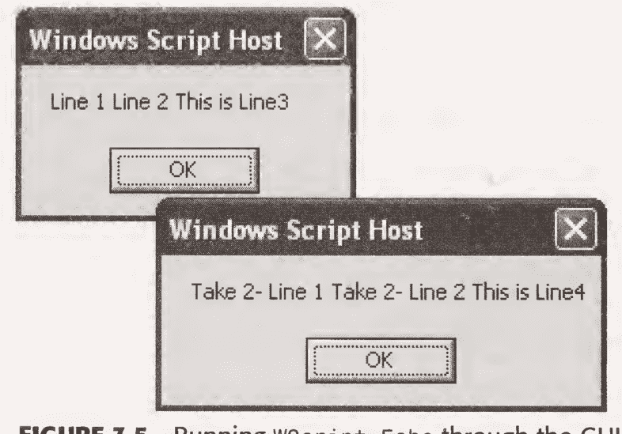

**图 3.5** 通过 GUI *wscript.exe* WSH 引擎运行 WScript.Echo。

使用 *wscript.exe* 时，每次调用 Echo 方法都会创建一个新对话框。要将多个结果输出到单个对话框中，可以考虑将每次调用的结果存储到一个临时字符串中，然后在脚本完成时显示该字符串，如代码清单 3.12 所示。

**代码清单 3.12** 将字符串拼接到单个变量中，以便在单个 Echo 对话框中显示

```
strLine3="This is Line3"
strTemp =  "Line 1" & " " & "Line 2" & " " & strLine3 & vbcrIf
strLine4="This is Line4"
strTemp = strTemp &  "Take 2- Line 1" & " " & "Take 2- Line 2" & " " &
strLine4
WScript.Echo strTemp
```

为了模拟图 3.4 中示例的输出，上面的示例在第一行之后插入了空格和回车符。图 3.6 展示了 *wscript.exe* 对话框，它与 *cscript.exe* 的输出更加接近，但显示在对话框中。

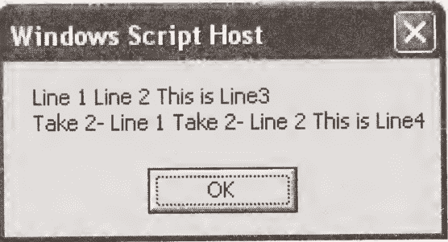

**图 3.6** 将字符串拼接到输出变量中可以输出到单个对话框。

#### 更精细的输出控制

在第 2 章的异步事件示例中，我们介绍了 `StdOut.Write` 方法，它提供逐字符的输出控制。如图 3.4 所示，`Echo` 方法每次调用时都会插入换行符。使用 `StdOut.Write` 方法可以在同一行上连续显示输出。代码清单 3.13 演示了 `Echo` 与 `StdOut.Write` 的对比，图 3.7 展示了输出结果。

**代码清单 3.13** WScript.Echo 与 StdOut.Write 的比较

```
For i = 33 To 43
    WScript.Echo Chr(i)
Next

For i = 33 To 43
    WScript.StdOut.Write Chr(i)
Next
```

#### 高级弹出窗口

`Popup` 方法提供一个弹出对话框，当脚本在 *cscript.exe* 或 *wscript.exe* 引擎中运行时显示。此方法提供最丰富的控件，包括按钮、图标、按钮响应的显示，甚至定时自动关闭。

# IT 管理员的 10 大 Windows 入门脚本

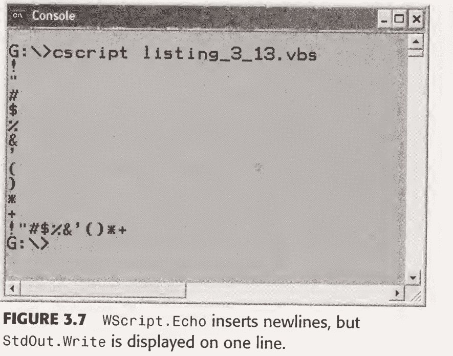

**图 3.7** WScript.Echo 插入换行符，而 StdOut.Write 在同一行显示。

调用 PopUp 方法非常简单。代码清单 3.14 中的代码创建一个带有感叹号图标以及"是"、"否"和"取消"按钮的对话框。脚本随后根据所选按钮执行相应操作。

**代码清单 3.14** PopUp 方法

```
WScript.Echo "Display a popup dialog box with user selected options."
const OK = 0
const OC = 1 'OKCancel
const ARI=2 'AbortRetryIgnore
const YNC=3 'YesNoCancel
const YN=4 'YesNo
const RC=5 'RetryCancel

const SMark=16 'StopMark
const QMark=32 'QuestionMark
const EMark=48 'ExclamationMark
const IMark=64 'InformationMark

Set objShell = CreateObject("WScript.Shell")
strMessage="Please Select Yes, No, or Cancel"
strTitle="Popup Example"
iResult = objShell.Popup(strMessage,30,strTitle,YNC+EMark)
Select Case iResult
    Case 2
        WScript.Echo "You picked 'Cancel'"
    Case 6
        WScript.Echo "You picked 'Yes'"
    Case 7
        WScript.Echo "You picked 'No'"
End Select
```

图 3.8 展示了 `Popup` 方法的输出以及对用户选择的确认。

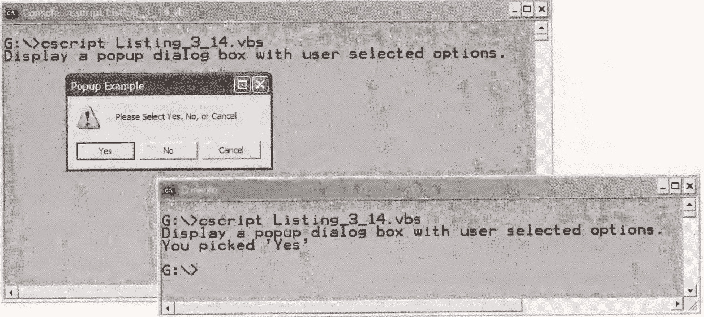

**图 3.8** `Popup` 方法提供通知图形和基本的用户交互。

### Network 对象

WSH 使用 `Network` 对象提供对网络共享、网络打印机和网络用户信息的访问。此功能在范围上类似于 net 命令，而非我们在本章前面介绍的其他网络命令（如 `ping` 或 `ipconfig`）。

此对象的一个用例是在 WSH 登录脚本中，第 7 章将详细介绍。在此示例中，登录脚本枚举当前的驱动器映射，然后仅映射尚不存在的驱动器（例如，在脚本执行之前已创建的持久映射）。登录脚本还使用 `Network` 对象的 `UserDomain`、`UserName` 和 `ComputerName` 属性来欢迎用户加入网络。代码清单 3.15 演示了如何使用 `Network` 对象显示所有已安装的打印机。

**代码清单 3.15** 使用 Network 对象枚举已安装的打印机

```
WScript.Echo("Display Installed Printers")
Set objNetwork = CreateObject("WScript.Network")
Set colPrinters = objNetwork.EnumPrinterConnections
for i = 0 to colPrinters.Count-1 Step 2
    WScript.Echo("Printer " & colPrinters.Item(i+1)_
    & " is installed on " & colPrinters.Item(i))
Next
```

运行此脚本将显示已安装的打印机，如图 3.9 所示。

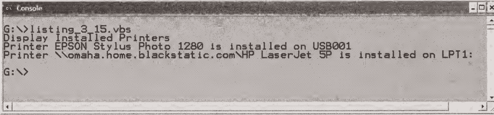

**图 3.9** Network 对象为脚本提供对打印机、共享和其它网络信息的访问。

请注意，EnumPrinterConnections 方法返回一个打印机集合，但后续遍历集合的循环使用的是 for...next 循环而非 for...each 循环。这种差异是因为返回的集合对象本身并不是一个对象，而是一个值数组，交替包含打印机连接和打印机名称。

实际数组如下表所示。

| 数组元素 | 值 |
|---|---|
| 0 | USB001 |
| 1 | EPSON Stylus Photo 1280 |
| 2 | LPT1: |
| 3 | \\omaha\HP LaserJet 5P |

因此，我们以步长 2 遍历数组，在单次循环迭代中同时打印 `colPrinter.Item(i)` 和 `colPrinter.Item(i+1)`。使用 `EnumNetworkDrives` 方法枚举驱动器会返回类似的基于数组的集合。

> *了解对象是以对象形式还是以数组形式返回集合，详见该对象的 SDK 或文档。无论使用什么参考材料，在开始编程时，都应查阅 SDK 以了解该特定对象的细节。附录 A 列出了许多 SDK 来源和对脚本编写有用的文档。不过 SDK 确实可能包含错误。如果在使用 SDK 中记录的功能时遇到困难，务必查阅互联网上的其他资源（如新闻组）或 Microsoft 技术支持，以确认或纠正该功能的正确操作方式。*

## WINDOWS 管理规范

Windows Management Instrumentation（WMI，Windows 管理规范）是 Microsoft Windows 对 Web-based Enterprise Management（WBEM，基于 Web 的企业管理）的实现，它定义了一个用于管理企业计算对象的跨平台标准。例如，使用 WMI 可以查找特定机器的基本输入/输出系统（BIOS）的日期，或查看服务器上的可用硬盘空间。硬件和软件供应商创建*提供程序*（providers），这些提供程序反过来提供对包含对象或服务描述的*类*（classes）的访问。

例如，Win_32 提供程序提供对许多类的访问——如 `Win32_OperatingSystem`。其他可以安装并与 WMI 一起使用的提供程序示例包括注册表、SNMP、DFS、磁盘配额、事件日志、IP 路由、ping、安全和终端服务器。

WBEM 定义了 Common Information Model（CIM，公共信息模型），用于定义对象层次结构。例如，你可以使用相同的 CIM 函数查询惠普® 服务器或戴尔® 服务器的风扇转速。供应商为其设备提供符合 WBEM 和 CIM 标准的模块，可通过一组通用 API 进行访问。这些对象和类构成了 WMI 对象模型。

WMI 在 Windows 2000 及更高版本中已预装。对于旧版系统，可以从 Microsoft 下载并安装 WMI Core。此外，Microsoft 提供 GUI 工具来检查给定计算机的 WMI *命名空间*。CIM 被分为多个命名空间，每个命名空间包含一个或多个类。类是对象的逻辑分组；例如，WMI Win32_Process 类包含与计算机上运行的进程相关的对象、方法和属性。这些工具为 WMI 程序员提供了探索所有可用的不同类和对象的良好机会。（WMI Core、WMI Tools


其他有用的 WMI 信息可以在 *http://msdn.microsoft.com/library/default.asp?url=/downloads/list/wmi.asp* 找到。

要了解不同的命名空间，请运行 WMI 工具 *CIM Studio*。在"连接到命名空间"对话框中，单击"浏览命名空间"图标，然后单击"连接"以列出该计算机的命名空间层次结构，如图 3.10 所示。

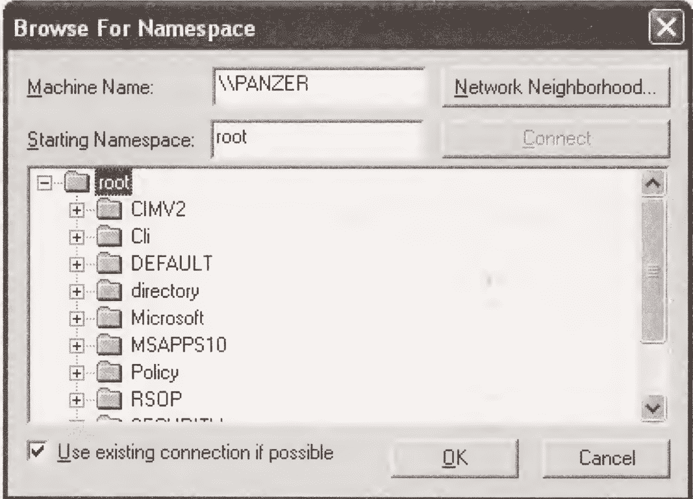

**图 3.10** CIM Studio 展示了 WMI 的广泛性。

我们在本书脚本中使用的大多数管理 WMI 类（以及 WMI 对象的默认命名空间）都包含在 `root/CIMV2` 命名空间中。

### 使用 WMI 连接到计算机

使用 WMI 连接到计算机只需要几个步骤，其中一些步骤你在第 2 章的某些示例中已经见过。这些步骤可以进一步精简为一段称为 *moniker* 的简单代码。但首先，让我们使用清单 3.16 中的代码作为第一个示例，逐一查看每个步骤。

#### 清单 3.16 使用 WMI 连接到计算机并显示所有已安装的更新


```
Set objLocator=CreateObject("WbemScripting.SWbemLocator")
Set objServices=objLocator.ConnectServer("localhost","root/cimv2")
objServices.Security_.ImpersonationLevel = 3

Set colQFE = objServices.InstancesOf ("Win32_QuickFixEngineering")

For Each objQFE in colQFE
    WScript.Echo objQFE.HotFixID & " : " & objQFE.Description
Next
```

WMI 的脚本 API 称为 WbemScripting。要访问给定计算机上的对象，必须实例化一个 SWbemLocator 对象，该对象返回一个 SWbemServices 对象。ConnectServer 方法允许你指定特定服务器的名称。如清单 3.16 中所使用的，ConnectServer 方法连接 localhost 计算机和 root/cimv2 命名空间。你还可以选择指定用于连接的用户名和密码。

下一行将 Security_.ImpersonationLevel 设置为 3，这对应于 wbemImpersonationLevelImpersonate。此级别指示 WMI 对象在调用者的上下文中运行，并且是 WMI 核心组件 1.5（Windows 2000 及更高版本）中的默认级别。在早期版本的 WMI 中，默认级别设置为 ImpersonationLevel=Identify，这可能会导致脚本失败。如果你计划在早期版本的 WMI 核心组件下远程运行脚本，请确保将安全性设置为 impersonate。

建立连接后，剩余的脚本会查询 WMI 以获取所需的数据类。如第 2 章简要介绍的那样，有几种查询数据的方法可用。使用 **InstancesOf** 或 **ExecQuery** 方法返回数据集合。

```
Set colQFE = objServices.InstancesOf ("Win32_QuickFixEngineering")

Set colQFE = objServices.ExecQuery ("Select * from Win32_QuickFixEngineering")
```

ExecQuery 方法支持 Windows 管理规范查询语言（WQL）。与仅限于基本查询指定类的较简单 InstancesOf 方法相比，该语言提供了额外的灵活性。

### 使用 WMI Moniker

WMI moniker 字符串是一种访问 WMI 数据的快捷方式。WMI moniker 字符串由前缀 `WinMgmts:`、可选的安全设置和对象路径构造而成。以下单行代码实现了与清单 3.16 中前四行代码相同的结果。它将模拟级别、服务器名称、命名空间和类组合到一个 moniker 中。

```
Set colQFE=GetObject("WinMgmts:{impersonationLevel=impersonate}" _
& "!//localhost/root/cimv2:Win32_QuickFixEngineering").Instances_
```

> 在上面的代码行中，第一个下划线（_）表示行继续，与前面的示例一样——代码应该在单行上。然而，第二个下划线是 Instances_ 方法名称的一部分，是必需的。它将该方法与底层对象的方法区分开来。

此 moniker 返回一个 SWBemObject（不是集合），因此我们可以使用 SWBemObject.Instances_ 方法返回一个集合，然后像前面的示例一样进行迭代。

清单 3.17 中的代码使用 InstancesOf 方法返回类似的对象。

#### 清单 3.17 WMI moniker 提供了一种连接到 WMI 类的更短方式

```
Set colQFE=GetObject("WinMgmts:{impersonationLevel=impersonate}" _
& "!//localhost/root/cimv2").InstancesOf("Win32_QuickFixEngineering")
For Each objQFE in colQFE
    WScript.Echo objQFE.HotFixID & " : " & objQFE.Description
Next
```

让我们再看一个示例。清单 3.18 返回名为 Europa 的计算机上是否正在运行万维网发布服务的特定实例。

#### 清单 3.18 使用 WMI 返回 W3Svc 服务的状态

```
strWMI="WinMgmts://localhost/root/cimv2:Win32_Service='w3svc'"
Set objService=GetObject(strWMI)
WScript.Echo objService.name & "  Status: " &objService.status
```

### 了解可用内容：转储 WMI 类

WMI 非常庞大，可能看起来令人不知所措。刚开始时，你可能会发现自己想知道任何给定对象的类名或属性名是什么。幸运的是，有许多工具可以为你枚举这些名称。使用 WMI 工具附带的 CIM Studio 来浏览和搜索类及对象详细信息。微软还提供了一个名为 Scriptomatic 的巧妙工具（在 msdn.microsoft.com 上搜索它），它列出所有类及其属性，甚至为你生成 WMI 示例代码。

清单 3.19 展示了一段列出这些类的代码片段。**InstancesOf** 类参数 **meta_class** 定义了一个架构查询，返回当前命名空间中的所有类。此查询返回一个类集合，然后可以使用 **SWBemObject Path_** 属性进行迭代和显示。

#### 清单 3.19 使用 meta_class 显示命名空间中的所有 WMI 类

```
Set colClass=GetObject("WinMgmts://localhost")_
.InstancesOf("meta_class")

For Each objClass in colClass
    WScript.Echo objClass.Path_
Next
```

本着转储信息的同样精神，清单 3.20 中的代码输出给定类实例的所有数据。如果你不确定特定属性的名称或可用性，或者只是想显示远程计算机的特定数据，此代码特别有用。

#### 清单 3.20 使用 GetObjectText 显示类的所有 WMI 属性

```
strClass=WScript.Arguments(0)
Set colClass=GetObject("WinMgmts://localhost").InstancesOf(strClass)
For Each objClass in colClass
    WScript.Echo objClass.GetObjectText_
Next
```

图 3.11 显示了此脚本以输入参数 Win32_Processor 为例的运行结果。

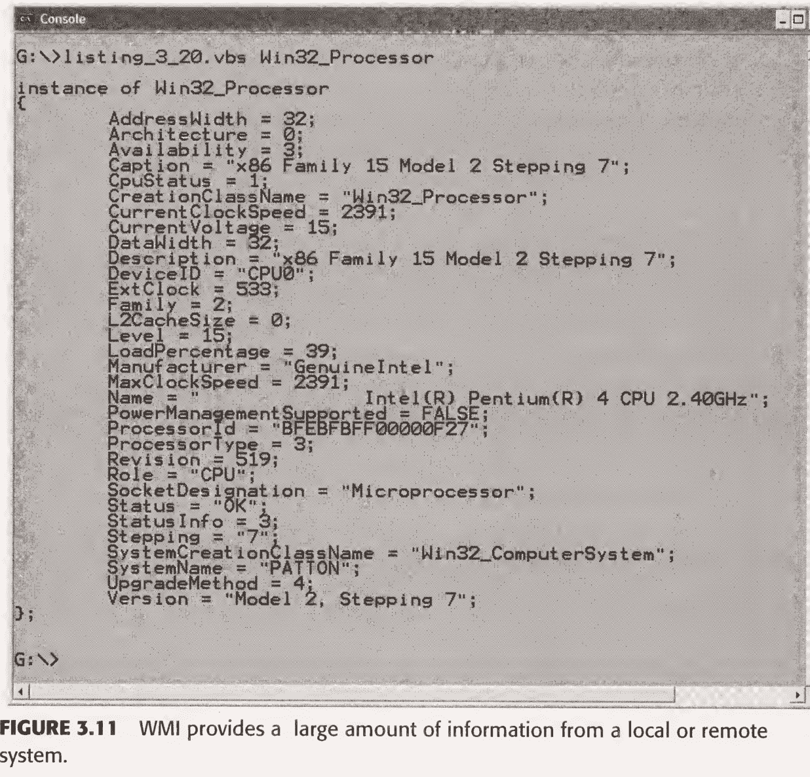

**图 3.11** WMI 从本地或远程系统提供大量信息。

这些使用 WMI 返回数据的示例相当简单，并且有意设计得较为宽泛，以便让你了解所有可以轻松获得的不同类型数据。有关所有可用的 WMI 类、对象、方法和属性，请参阅 WMI SDK。例如，尝试修改前面的代码以转储可用的命名空间或类的所有方法和属性。

### 如何查找内容：查询 WMI

第 2 章中的一些示例演示了使用 WQL 的函数和方法——也称为 WMI 的结构化查询语言（SQL）。WQL 提供了一种强大的方法，用于从庞大的 WMI 存储库中提取特定数据。此外，构造良好的 WQL 查询比遍历整个数据集查找特定信息执行得更快。WQL 允许你执行数据、事件和架构查询。接下来的示例侧重于数据查询，因为这种查询类型可能是你脚本的大部分内容。请参阅前面的事件查询示例（第 2 章，事件部分）和架构查询示例。WQL 是 SQL 的子集。然而，学习返回基本 WMI 数据的基础知识一点也不复杂。以下示例逐步介绍查询和显示有关系统上运行进程的信息。清单 3.21 展示了使用 ExecQuery 方法的 WQL 查询的基本框架。此示例列出了本地主机系统上的所有进程。

#### 清单 3.21 基本 WQL 查询


```
strWQL="SELECT * from Win32_Process"
Set colProcess=GetObject("WinMgmts://localhost").ExecQuery(strWQL)
For Each objProcess In colProcess
    WScript.Echo objProcess.GetObjectText_
Next
```

我们主要处理和修改 WQL 行：

```
strWQL="SELECT * from Win32_Process"
```

基本 WQL 查询采用以下形式：

```
SELECT [某内容] FROM [某处] WHERE [某内容] [与] [其他内容比较]
```

以下示例查询说明了这一点。要使用这些查询，只需将新的 strWQL 值替换到清单 3.21 中。

```
strWQL="SELECT * FROM Win32_Service WHERE State='Running' "_
& "and StartMode='Manual'"

strWQL="SELECT HotFixID FROM Win32_QuickFixEngineering"

strWQL="SELECT Name,Size FROM Win32_LogicalDisk WHERE MediaType=12"
```

第一个示例返回所有以手动模式运行的服务集合。第二个示例仅返回目标系统上安装的任何修补程序的 HotFixID，第三个示例返回任何固定硬盘介质的名称和大小（对应于 MediaType 为 12）。还记得感染未修补版本 SQL Server 的 SQL Slammer 蠕虫吗？想象一下，遍历 Win32_Services 查找 SQL Server 的运行实例，然后枚举 Win32_QuickFixEngineering 查看计算机是否已打补丁，这是多么容易。


 # IT 管理员 Windows 入门十大脚本精选

WQL 查询由多个关键字组成，这里介绍了其中的主要关键字。更复杂的示例将在后续章节的一些脚本中演示。所有关键字均在 WMI SDK 中定义。

**SELECT** 子句定义查询。你可以从类中选择要检查的属性。`SELECT` 还支持通配符 `*`。如果你不确定要使用哪些属性（或者想使用大部分属性），使用通配符会很方便。但是，在通过较慢的链路访问远程计算机（或网络带宽和时间较为重要）时，应指定具体的属性以减少发送的数据量和执行所需的时间。

在 **FROM** 子句中指定要查询的 WMI 类。通过在 **WHERE** 子句中指定所需的匹配条件来进一步细化查询结果集。WHERE 子句的条件支持属性名称和值的匹配。该子句是可选的，用于缩小结果集。不要用引号括起属性名称，但需要用引号括起属性值，如下一个示例所示：

```
strWQL="SELECT * FROM Win32_LogicalDisk WHERE Name='c:'"
```

在此示例中，属性名称是 `Name`，你要匹配的值是 `c:`。`Name` 不需要引号；字符串值 `c:` 需要。

你也可以将 WQL 字符串直接插入 `ExecQuery` 参数中，如下所示：

```
Set colProcess=GetObject("WinMgmts://localhost")._ ExecQuery("SELECT * FROM Win32_LogicalDisk WHERE Name='c:'")
```

在清单 3.22 的此示例中，查询仅返回进程使用内存大于 10MB 的实例。结果如图 3.12 所示。

#### **清单 3.22** WQL 支持变量比较，允许更复杂的结果集

```
iSize=10 ' in MB

strWQL="SELECT * from Win32_Process WHERE WorkingSetSize > "_ & iSize *1024 *1024

Set colProcess=GetObject("WinMgmts://localhost").ExecQuery(strWQL)
For Each objProcess In colProcess
    WScript.Echo objProcess.Caption & " " & objProcess.WorkingSetSize
Next
```

**图 3.12** 使用 WQL 对进程内存消耗进行告警。

WMI 提供对本地和远程计算机的访问，以查询其配置并协助管理。后续章节中的许多脚本都依赖 WMI，并使用前面介绍的许多基本原则作为其工作的关键要素。

你可能会在 IT 系统管理脚本工具包中依赖的另一个主要脚本技术是*活动目录服务接口*，即 ADSI。

## 活动目录服务接口

Microsoft 活动目录（AD）是随 Windows 2000 推出的目录服务，用于替代 Windows NT 的账户和组管理数据库。AD 基于轻量级目录访问协议（LDAP）。Microsoft 活动目录提供丰富的目录服务，集中存储详细的网络、用户和组数据。Microsoft 提供了许多工具来枚举、诊断和管理 AD，越来越多的商业工具也可提供帮助。然而，即使有这么多不断增长的支持选项，你可能仍然渴望一个直接的目录接口。也许你想编写一个基于 Web 的应用程序来创建用户账户，或者你想定期审计特定 OU 或组的成员关系。又或者你只想创建一个简单的工具，以特定格式列出组成员关系。幸运的是，Microsoft 发布了一个可脚本访问的接口，称为活动目录服务接口（ADSI），它允许你快速高效地编写此类程序。使用 ADSI，你可以用 VBScript 或 JScript 编写脚本来帮助管理网络资源，例如使用网络打印机、设置网络权限，以及查询、添加或删除用户和组。

ADSI 与 Windows 2000 及更高版本的 Windows 操作系统集成。此外，你可以下载适用于 Windows 9.x 和 Windows NT 的客户端扩展，使这些旧版操作系统能够使用 AD 的许多（但不是全部）功能。虽然这些扩展目前不支持某些 AD 功能（如 Kerberos、组策略、IPSec、SPN 或相互身份验证），但它们确实支持 ADSI，这正是我们讨论的内容。

目录是一种组织系统，用于存储关于特定对象的相关信息。过去（甚至现在），信息存储在不同的系统中，如网络登录、电子邮件、远程访问、安全系统、人力资源数据库系统、财务系统等。这些目录中每个都可能包含重复信息，需要花费时间和金钱来保持目录的更新。AD 是一个功能强大的全功能目录服务示例，可以作为业务和技术对象的信息交换中心——从联系人电话号码到防火墙配置信息。AD 为 Windows 2000 域结构提供了基石。向 AD 的迁移和支持进展缓慢但正在推进。Microsoft Exchange 2000 是一个完全集成 AD 的群件产品示例，许多第三方公司也开始认识并与 AD 进行互操作。

> 请认清与 AD 的集成程度。例如，一些供应商可能会说他们支持 AD，这可能会让你认为他们实际上将信息存储在 AD 中。然而，实际上他们可能建立了一个通道来将 AD 与自己的旧版目录同步。虽然这种设置既不好也不坏，但认识这一点很重要，因为它可能影响你设计脚本与任一目录交互的方式。

ADSI 提供了一组单一、定义明确的对象、方法和属性，用于与支持的目录进行交互。通过 ADSI *提供程序*可以对独立的目录资源进行抽象访问。Windows 2000 及更高版本中包含的支持提供程序包括 LDAP、Windows NT 4.0 目录（WinNT）、Internet 信息服务（IIS）、Novell NetWare 目录服务（NDS）和 NetWare 3 装订库（NWCOMPAT）。

本书中的脚本主要侧重于查询 AD 和本地计算机的用户和组成员关系信息。这些分别对应于 LDAP 和 WinNT 提供程序。

### ADSI 与 AD 的区别

请记住，AD 是一种目录服务的示例，而 ADSI 是一个接口，不仅可以访问 AD，还可以访问其他目录服务。我们使用 ADSI 及其 LDAP 和 WinNT 提供程序分别访问 AD 和 Windows NT Server 4.0 目录。

> LDAP 访问 Windows 2000 域控制器上的目录服务。虽然 WinNT 提供程序提供对旧版 Windows NT 4.0 目录的访问，但即使在运行 Windows 2000 及更高版本操作系统的计算机上，也应使用 WinNT 提供程序来访问本地用户和组账户。

### 名称的含义

要使用任何目录对象，你必须知道它的名称。AD 支持多种命名约定。

#### 相对可分辨名称（RDN）

*相对可分辨名称*（RDN）是对象及其属性类型的简单名称；例如，OU=Finance，或 CN=jeff，或 CN=Server1。一些 RDN 属性和示例如表 3.6 所示。

**表 3.6 相对可分辨名称属性**

| 属性 | 字符串 | 示例 |
| :--- | :--- | :--- |
| 域组件 | DC | DC=Some, DC=Domain, DC=com |
| 通用名称 | CN | CN=Jeff |
| 组织单元 | OU | OU=Users |
| 组织 | O | O= |
| 街道名称 | STREET | STREET= |
| 地区 | L | L= |
| 州或省 | ST | ST= |
| 国家 | C | C= |
| 用户 ID | UID | UID= |

#### 可分辨名称

*可分辨名称*（*DN*）由一系列相对可分辨名称组成，以逗号分隔，完整描述了对象在目录层次结构中的位置。例如，如果用户 Jeff 位于域 `home.blackstatic.com` 中的 `OU=Home Users`，则 DN 为：

```
CN=Jeff, OU=Home Users, DC=blackstatic, DC=com
```

一旦你清楚了不同对象的命名方式，就可以直接引用它们。根据你使用的提供程序，语法会有所不同，某些属性值也会有所不同。

例如，要连接或*绑定*到名为 `Europa` 的计算机，你可以使用 WinNT 或 LDAP 提供程序。在 LDAP 提供程序绑定字符串中，服务器名称是可选的，首选无服务器绑定。在这种情况下，ADSI 会在默认域中找到最佳域控制器。

```
WinNT://europa, computer
```

```
LDAP://CN=europa, OU=computer, DC=blackstatic, dc=com
```

```
GC://CN=europa, OU=computer, DC=blackstatic, dc=com
```

*当从 Windows 2000 域控制器查询 AD 对象或 ADSI 数据时，请使用 LDAP 提供程序。WinNT 提供程序允许枚举成员服务器和独立服务器上的本地账户。但是，在查询 AD 时，应尽可能始终使用 LDAP 提供程序，因为它受到更好的支持。*

*`GC` 符号使用 LDAP 提供程序绑定到全局编录以进行更快的搜索。全局编录包含 AD 数据的子集，用于快速检索。*

指定服务器名称如下所示，但你应该尽可能避免这样做，因为 ADSI 会尝试选择最佳域控制器。

```
LDAP://dc1.blackstatic.com/CN=europa, OU=computer, DC=blackstatic, dc=com
```

使用以下代码通过类似的命名约定绑定到用户对象：

```
WinNT://europa/jeff , user
```

```
LDAP://CN=jeff, OU=users, DC=home, DC=blackstatic, dc=com
```


### ADSI 技术概要

ADSI 对象是组件对象模型（COM）对象，我们在第 2 章中已经介绍过。访问和使用这些对象非常简单。首先，你需要获取对象的引用。然后请求你希望查看的属性（例如，使用 `GetInfo` 或 `Get` 方法）。之后你就可以查看或操作这些信息。用于访问 ADSI 对象的接口名称叫做 `IADs`，所有 ADSI 对象都支持该接口的方法和属性。`IADs` 接口定义了 ADSI 对象的命名方式、其父对象以及访问方式。

许多目录服务对象从 `IADs` 对象继承了方法和属性，可以像使用 `IADs` 一样使用。因此，例如，每个用户对象除了支持 `IADs` 接口外，还支持 `IADsUser` 接口。这些对象特定接口的名称都以 `IADs` 为前缀。再举一个例子，`IADsOU` 是专为管理 OU 设计的对象，包含用于访问其属性的相应属性和方法。表 3.7 列出了 LDAP 和 WinNT 提供程序可用的 `IADs` 接口。

**表 3.7** LDAP 和 WinNT 提供程序的 IADs 对象

| LDAP 的 ADSI 对象 | WinNT 的 ADSI 对象 |
|---|---|
| IADs | IADs |
| IADsClass | IADsClass |
| | IADsCollection |
| | IADsComputer |
| | IADsComputerOperations |
| IADsContainer | IADsContainer |
| IADsDeleteOps | |
| | IADsDomain |
| | IADsFileService |
| | IADsFileServiceOperations |
| | IADsFileShare |
| IADsGroup | IADsGroup |
| IADsLocality | |
| IADsMembers | IADsMembers |
| IADsNameTranslate | |
| IADsOU | |
| IADsObjectOptions | |
| IADsOpenDSObject | IADsOpenDSObject |
| IADsOU | |
| IADsPathname | |
| | IADsPrintJob |
| | IADsPrintJobOperations |
| IADsPrintQueue | IADsPrintQueue |
| IADsPrintQueueOperations | IADsPrintQueueOperations |
| IADsProperty | IADsProperty |
| IADsPropertyList | IADsPropertyList |
| | IADsResource |
| | IADsService |
| | IADsServiceOperations |
| | IADsSession |
| IADsSyntax | IADsSyntax |
| IADsUser | IADsUser |
| IDirectoryObject | |
| IDirectorySearch | |

每个接口都支持许多对象特定的方法和属性，Microsoft ADSI SDK 提供了很好的参考，可以查阅每个接口的详细信息。你还可以通过脚本枚举给定对象的属性，尽管这不像枚举 WMI 类的属性那么容易。我们将在稍后讨论更多关于访问 ADSI 对象的内容时介绍该脚本。

#### 目录服务层次结构

AD 是容器对象和叶对象的层次结构。容器对象可以包含其他容器对象和叶对象。叶对象不能包含对象。所有容器对象都支持 IADsContainer 接口。IADsContainer 的方法包括创建和删除新对象，以及访问所包含对象的信息。

#### 架构

AD 架构定义了目录可以存储的所有数据类型。如果你安装过 Exchange 2000 或 Microsoft Internet Security and Accelerator® (ISA) Server，你可能记得"扩展"架构。这意味着这些产品向 AD 中添加了信息，以增强特定对象或资源。仅 Exchange 2000 就会向 AD 添加 Exchange 容器。

AD 中的每个对象都必须遵循架构定义。例如，一个 OU 包含名称、地址、多个电话号码以及其他 60 多个属性。但是，如果你想为每个用户添加员工编号，那么你可以尝试将该编号放入现有属性中，或者扩展架构并添加一个新属性，例如名为 EmployeeNumber。

### 使用脚本绑定对象

使用 ADSI 接口编写脚本时，第一步是绑定到所需对象。清单 3.23 中的示例展示了如何使用 DN 绑定到 AD 用户对象 Trooper。从中我们可以列出该对象的多个 IADs 属性。

#### 清单 3.23 使用 ADSI LDAP 提供程序绑定到用户对象

```
strPath="LDAP://CN=Trooper, OU=Home Users, DC=home, "&_
DC=blackstatic, DC=com"
Set objUser = GetObject(strPath)

'IADs Property Methods
WScript.Echo "Uniquely Identifies the object: " & objUser.ADsPath
WScript.Echo "The GUID: " & objUser.GUID
WScript.Echo "Relative Name: " & objUser.Name
WScript.Echo "The Parent: " & objUser.Parent
WScript.Echo "The Schema: " & objUser.Schema
WScript.Echo "The Class: " & objUser.Class
```

此示例中的前两行定义了 DN，并将对象 objUser 绑定到目录服务对象的 ADsPath。接下来，示例使用六个 IADs 属性访问并显示目录中的用户属性信息。此示例的输出如图 3.13 所示。

图 3.13 使用 ADSI 从 Active Directory 检索用户信息。

注意，如果将 DN 更改为另一个属性，例如组织单位，脚本仍然可以运行，如图 3.14 所示。此脚本仅访问所有 ADSI 对象都可用的 IADs 属性。要查看 AD 层次结构，请将清单 3.23 中的 DN 更改为表示 OU home users。

```
strPath="LDAP://OU=Home Users, DC=home, DC=blackstatic, DC=com"
```

图 3.14 Active Directory 层次结构中 OU 的高级属性。

图 3.13 和图 3.14 展示了用户 Trooper 和 OU Home Users 的架构之间的关系。这些示例说明了 AD 的层次组织结构，以及如何通过架构属性唯一标识对象的位置。同时注意 class 属性的值。第一个示例指向一个遵循 user 类的用户对象。第二个示例指向一个 OU 并遵循该类。识别类很重要，因为它们有助于确定可用的其他 IADs 接口，以便从目录对象中提取额外的特定于类的属性（尽管类名和 IADs 接口之间不一定总是存在 1:1 的对应关系）。

例如，既然我们知道该类是 user，我们就可以提取任何 IADsUser 属性，如清单 3.24 所示，通过使用 Select Case 语句来实现。

#### 清单 3.24 根据对象的 ADSI 类执行操作

```
strPath="LDAP:// CN=Trooper, OU=Home Users, DC=home, "_
& "DC=blackstatic, DC=com"

set objUser = GetObject(strPath)

'IADs Property Attributes
WScript.Echo "ADsPath: " & objUser.ADsPath
WScript.Echo "The GUID: " & objUser.GUID
WScript.Echo "Relative Name: " & objUser.Name
WScript.Echo "The Parent: " & objUser.Parent
WScript.Echo "The Schema: " & objUser.Schema
WScript.Echo "The Class: " & objUser.Class & vbCrLf

Select Case objUser.Class
    'IADs User Attributes
    Case "user"
        WScript.Echo "FullName: " & objUser.FullName
        WScript.Echo "Password Last Changed: "_
            & objUser.PasswordLastChanged
    
    'IADsOU Attributes
    Case "organizationalUnit"
        WScript.Echo "Description: " & objUser.Description
    
    Case Else
        WScript.Echo "Not a user or an organizational unit."
End Select
```

图 3.15 展示了此示例分别使用用户和组织单位对象运行的结果。

### 列出对象的属性

通常很有用的是导出特定对象的所有属性。我们之前在清单 3.20 中已经这样做了，用于枚举整个 WMI 类。清单 3.25 中的代码展示了如何对 ADSI 对象执行同样的操作，尽管操作起来并不像 WMI 那么简单。

图 3.15 根据从目录检索到的属性进行脚本逻辑分支。

#### 清单 3.25 枚举 AD 对象的属性

```
strPath="LDAP://cn=Trooper, ou=Home Users, DC=Home, "
& "DC=Blackstatic, DC=com"

Set objUser = GetObject(strPath)
objUser.GetInfo
For i = 0 To objUser.PropertyCount-1
    strName= objUser.Item(i).Name
    iADsType= objUser.Item(i).ADsType
    WScript.Echo i & ") " & strName & " (" & iADsType & ")"
    Set objProperty = objUser.GetPropertyItem(strName, iADsType)
    For Each objEntry In objProperty.Values
        On Error Resume Next
        WScript.Echo objEntry.GetObjectProperty(objEntry.ADSType)
        On Error Goto 0
    Next
Next
```

此脚本的输出如图 3.16 所示。


#### 图 3.16

有时编写一个枚举所有对象的脚本对于了解对象很有帮助。

运行此代码会绑定到变量 `objUser` 中指定的对象，并遍历两个循环来显示属性名称和值。

```
strPath="LDAP://cn=Trooper, ou=Home Users, DC=Home, " _
& "DC=Blackstatic, DC=com"

Set objUser = GetObject(strPath)
```

## IT 管理员 Windows 入门十大脚本

方法 `GetInfo`（在 ADSI SDK 中也称为 `iADs::GetInfo`）会从目录中加载给定对象的所有属性到本地缓存中。（你可以使用方法 `GetInfoEx` 仅请求特定的属性。）属性列表从零开始计数，第一个循环遍历它们——从 0 到 `objUser.PropertyCount -1`。`PropertyCount` 是 `objUser` 对象的一个属性，由 `GetInfo` 方法返回，它返回列表中属性的数量。

```
objUser.GetInfo
For i = 0 To objUser.PropertyCount -1
```

属性可以是单值或多值的。例如，属性 `displayName` 是单值的，而属性 `memberOf` 是多值的，包含该用户所属的每个组的列表。需要第二个循环来遍历每个可能的多值属性。`On Error Resume Next` 是一个 VBScript 函数，它指示脚本在遇到当前行错误时继续执行下一行。此函数是必需的，因为某些属性可能没有值，在调用时会返回错误。

接下来，让我们看看用于访问属性及其值的 ADSI 方法。我们前面介绍过 `GetInfo`，它将目录对象的属性返回到本地属性缓存中。`iADsPropertyList` 接口用于访问此缓存。此接口支持 `Item` 方法，该方法可以通过名称或索引访问缓存中的属性。现在我们有了缓存中的特定项，就可以开始使用它了。首先，脚本显示属性的名称和 `ADsType`。

```
strName= objUser.Item(i).Name
iADsType= objUser.Item(i).ADsType
WScript.Echo i & ") " & strName & " (" & iADsType & ")"
```

每个属性都有一个 `ADsType`，它定义了值的格式（例如，是字符串还是整数、是否区分大小写、是安全描述符还是其他 29 种可能的类型之一）。`ADsType` 很重要，因为某些函数依赖于知道类型才能正确设置、显示或创建属性。`GetPropertyItem` 方法就是这样一种需要此信息的函数。`GetPropertyItem` 方法从缓存中返回属性项，脚本使用 `Values` 方法遍历该项可能的多个值。`GetObjectProperty` 方法返回对象的实际值，我们将其显示出来。

```
Set objProperty = objUser.GetPropertyItem(strName, iADsType)
For Each objEntry In objProperty.Values
    On Error Resume Next
    WScript.Echo objEntry.GetObjectProperty(objEntry.ADsType)
    On Error Goto 0
Next
```

图 3.17 展示了该脚本的示意图，说明了数据从目录经过缓存、经过连续的循环，最终到值显示的流程。

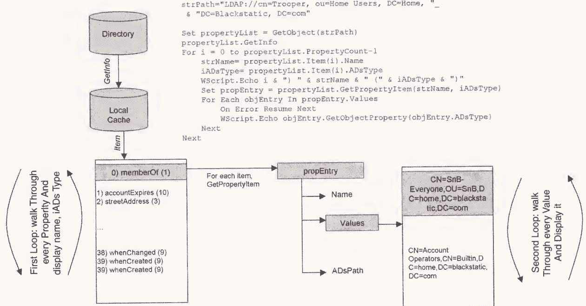

### **图 3.17** 从目录访问和列出 ADSI 属性及相应值的示意图。

### 从目录返回特定数据

清单 3.26 中的示例代码展示了如何直接从目录访问特定属性。

#### **清单 3.26** 从目录返回特定数据

```
strPath="LDAP://cn=Trooper, ou=Home Users, DC=Home," _
& "DC=Blackstatic, DC=com"

Set objUser = GetObject(strPath)
objUser.GetInfoEx Array("memberOf","displayName"), 0

WScript.Echo objUser.Get("displayName")

Set objProperty = objUser._
GetPropertyItem("memberOf", ADSTYPE_DN_STRING)

For Each objEntry In objProperty.Values
   On Error Resume Next
      WScript.Echo "   " & objEntry.GetObjectProperty(objEntry.ADsType)
   On Error Goto 0
Next
```

我们向 `GetInfoEx` 方法传递了一个包含属性 `memberOf` 和 `displayName` 名称的数组。（记住在从目录返回特定属性时使用 `GetInfoEx`。）对于已知的单值属性（如 `displayName`），脚本从缓存中获取值并显示。对于多值属性，脚本像前面的示例一样遍历这些值。但这一次我们知道属性的名称（`memberOf`）及其 `ADsType`（`ADSTYPE_DN_STRING`）。你可以使用前面的脚本或查阅 SDK 来获取其他属性的 `ADsType`。如果你不知道 `ADSTYPE`，并且只是简单地显示现有的属性值，可以选择使用 `ADSTYPE_UNKNOWN`。（注意，使用未知类型可能会导致某些方法报告错误，特别是在设置新值时。在这些情况下，请始终传递准确的 `ADsType`。）最后，我们遍历这些值并显示它们。此示例的输出如图 3.18 所示。

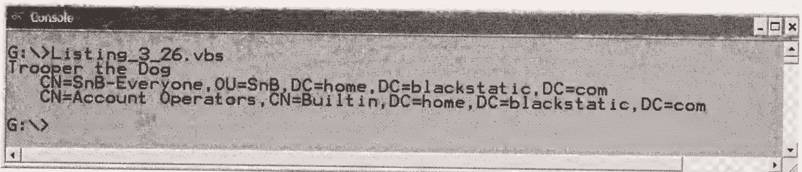

**图 3.18** 显示对象的名称和组成员关系。

### 提供程序返回不同的结果

因为提供程序最终连接到不同的目录服务，所以选择不同的提供程序会产生不同的结果，即使属性名称相同。清单 3.27 中的代码展示了如何使用两个不同的提供程序绑定到用户对象。第一个示例展示了无服务器绑定到用户对象 `cn=Jeff Fellinge`（用户名=Jeff），第二个示例展示了使用 WinNT 提供程序绑定到 Europa（home 域的域控制器）。（请记住，对于 Windows 2000 域控制器，本地账户就是域账户。）此代码的输出如图 3.19 所示，展示了两个提供程序之间可能看到的一些差异（请查看 GUID）。

#### 清单 3.27 选择不同的提供程序可能返回不同的结果

```
strPath="LDAP:// CN=Jeff Fellinge, OU=Home Users, " _
& "DC=home, DC=blackstatic, DC=com"

set objUser = GetObject(strPath)
WScript.Echo "Bind to user using LDAP provider:"
WScript.Echo "FullName: " & objUser.FullName
WScript.Echo "ADsPath: " & objUser.ADsPath
WScript.Echo "GUID: " & objUser.GUID
WScript.Echo "FullName: " & objUser.Schema & vbCrLf

objUser2="WinNT://europa/jeff, user"
set objUser2 = GetObject(objUser2)
WScript.Echo "Bind to user using WinNT provider:"
WScript.Echo "FullName: " & objUser2.FullName
WScript.Echo "ADsPath: " & objUser2.ADsPath
WScript.Echo "GUID: " & objUser2.GUID
WScript.Echo "FullName: " & objUser2.Schema
```

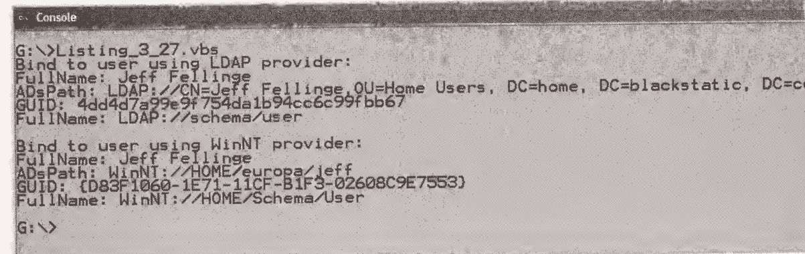

**图 3.19** 选择不同的提供程序会产生不同的结果。

### LDAP 还是 WinNT？

某些属性（如用户上次登录日期）存储在该用户登录过的每个域控制器上，且该属性不会被复制（这意味着当一个域控制器上更新时，它不会被复制到其他域控制器）。要查找最新的登录日期，你必须查询每个域控制器并使用最新的值。即使单独查询 Windows 2000 域控制器时，也要记住首先使用 LDAP 提供程序（假设它可以提供你所需的属性）。在某些情况下，例如查询成员服务器或独立服务器的本地用户账户和组时，你需要使用 WinNT 提供程序。对于其他 AD 查询，如组、用户、组成员关系以及大多数其他属性，请绑定到 LDAP 提供程序。

### 修改目录

到目前为止，我们所有的示例都围绕着使用 ADSI 获取和显示值。ADSI 还允许你创建对象并设置其属性；例如，从组中添加或移除成员、删除对象、或创建新的用户、OU 或组等。这些过程通过特定于接口的方法（例如 `iADSContainer::Create`、`iADSGroup::Add`）以及通用方法（`iADs::Put`）来完成。

ADSI 使用*属性缓存*。当你从目录获取信息时，ADSI 将其检索到计算机上的本地缓存中。同样，当你创建对象或修改对象属性时，这些操作仅在你的缓存中完成。然后你必须使用 `iADs::SetInfo` 方法来实际更新目录。

### 创建用户

创建用户是一个直接的过程，如清单 3.28 所示。

#### **清单 3.28** 使用 ADSI 创建用户


```
strPath="LDAP://OU=Home Users, DC=home, DC=blackstatic, DC=com"
Set objOU = GetObject(strPath)
Set objNewUser=objOU.Create("User","cn=New User")
objNewUser.Put "sAMAccountName","NewUser"
objNewUser.SetInfo
```

然而，这个最基本的示例创建的用户只是一个空壳。账户默认是禁用的，并且用户没有设置登录名、密码或个人信息，如图 3.20 所示。

让我们逐步分析此示例。首先，你必须绑定到要创建新用户对象的位置，然后使用 `iADSContainer::Create` 方法创建该用户。注意创建对象会返回对新对象的引用（脚本中调用 `objNewUser`）。现在我们完全使用这个新的 User 对象进行操作。

```
strPath="LDAP://OU=Home Users, DC=home, DC=blackstatic, DC=com"
Set objOU = GetObject(strPath)
Set objNewUser=objOU.Create("User","cn=New User")
```


#### 使用最少选项集创建的用户帐户是一个空帐户。

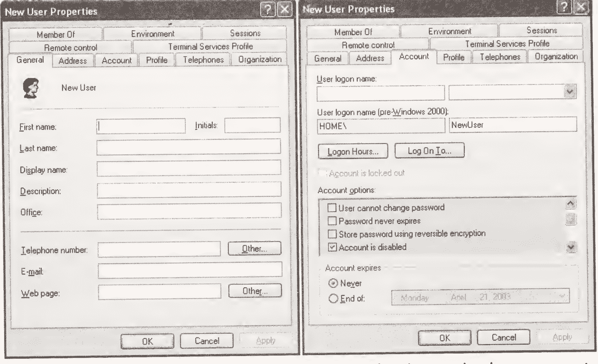

接下来，为该对象指定必需或可选的属性。ADSchema 用户对象需要以下属性：Common-Name、Instance-Type、NT-Security-Descriptor、Object-Category、Object-Class、Object-Sid 和 SAM-Account-Name。如果这个列表看起来很长，不必太担心。许多必需属性在创建对象时会自动生成，但你必须在更新目录之前设置其余的属性。如果在更新目录时未定义所有必需属性，你将收到错误提示。实际上，我们只需设置 SAM-Account-Name 即可实际创建该对象。但是，如图 3.20 所示，该 shell 非常空。

要更新 SAM-Account-Name 属性，请使用 `iADS::Put` 方法，同时指定属性和值。最后，使用 `iADS::SetInfo` 方法将此新用户对象更新到目录中。

```
objNewUser.Put "sAMAccountName", "NewUser"
objNewUser.SetInfo
```

> **提示**

许多人发现旧版 ADSI SDK 对脚本编写者来说不如 WMI SDK 友好。要查找任何给定类的所有必需和可选属性，请切换到 SDK Index 选项卡并查找 `ClassName [AD Schema]`。例如，要查找 User 类的所有详细信息（包括属性），请查找 `User [ADSchema]`。

### 创建和设置其他对象

使用类似的方法来创建其他目录对象。清单 3.29 中的示例展示了如何创建新的 OU、组和用户，然后将该新用户添加到新创建的组中。这些示例让你了解如何操作目录中的对象。它们展示了如何使用 LDAP 提供程序，你可以使用类似的方法和对象，通过 WinNT 提供程序将本地用户添加到你的计算机中。

创建组对象时的一个可选属性是 groupType。此属性允许你定义该组是本地组、域本地组、全局组还是通用组，以及它是通讯组还是安全组。该脚本包含组类型常量，你可以将它们的值相加来组合使用。例如，要创建一个通用安全组，你需要将 groupType 属性设置为：

```
ADS_GROUP_TYPE_UNIVERSAL_GROUP + ADS_GROUP_TYPE_SECURITY_ENABLED
```

或

```
0x00000008 + 0x80000000
```

或

```
0x80000008.
```

在脚本中表示此十六进制值的另一种方式是 &H80000008。

#### 清单 3.29 创建用户并将其分配到新的 OU 和组

```
Const ADS_GROUP_TYPE_GLOBAL_GROUP = &H2
Const ADS_GROUP_TYPE_DOMAIN_LOCAL_GROUP = &H4
Const ADS_GROUP_TYPE_UNIVERSAL_GROUP = &H8
Const ADS_GROUP_TYPE_SECURITY_ENABLED = &H80000000

strPath="LDAP://DC=home, DC=blackstatic, DC=com"
Set objADs = GetObject(strPath)

Set objNewOU= objADs.Create("organizationalUnit","OU=New OU")
objNewOU.SetInfo
Set objADs =Nothing
Set objADs =GetObject("LDAP://" & objNewOU.distinguishedName)

Set objNewUser= objADs.Create("User","cn=New User")
objNewUser.Put "sAMAccountName","NewUser"
objNewUser.SetInfo

Set objNewGroup= objADs.Create("Group","cn=New Group")
objNewGroup.Put "sAMAccountName","NewGroup"
objNewGroup.Put "groupType", _
    ADS_GROUP_TYPE_GLOBAL_GROUP + ADS_GROUP_TYPE_SECURITY_ENABLED
objNewGroup.SetInfo

objNewGroup.Add("LDAP://" & objNewUser.distinguishedName)
```

这些示例仅触及了 ADSI 的各种可能性中的一小部分。后续章节中以 ADSI 为中心的脚本将演示使用 ADSI 的许多细节。

### 搜索 ADSI

到目前为止，脚本已经演示了如何绑定到对象并返回其属性的一些基础知识。基于此，你可以创建一个*递归*函数——该函数深入每个容器并枚举其内容，然后进一步深入到它发现的任何新容器中，如此循环。但你可以使用一种更简单、更快速的方法来搜索目录。ADSI 支持使用 *ActiveX Data Objects*（即 *ADO*）进行搜索。使用 ADO 搜索是一种非常高效且强大的返回数据的方法。

使用 ADO 的限制在于你只能使用 LDAP 提供程序进行搜索，并且不能使用 ADO 更新目录。你仅限于搜索和检索数据。但尽管如此，ADO 仍是一个出色的工具，可用于在目录中爬行查找数据。

你可以使用多种途径来构建基于 ADO 的查询。以下脚本展示了一种使用三个基本 ADO 对象的方法——Connection、Command 和 RecordSet。我们稍后将分解该脚本，但首先让我们查看完整的脚本。清单 3.30 中的脚本使用 ADO 在整个目录中搜索用户。

#### 清单 3.30 ADO 提供了一种快速高效的目录搜索手段

```
Set objConnection = CreateObject("ADODB.Connection")
objConnection.Provider = "ADsDSOObject"
objConnection.Open

Set objCommand = CreateObject("ADODB.Command")
Set objCommand.ActiveConnection = objConnection
objCommand.CommandText = "<LDAP://DC=Home, DC=Blackstatic, DC=com>;" _
    & "(&objectCategory=user);" _
    & "Name,ADsPath;" _
    & "SubTree"
Set objRecordset=objCommand.Execute

While Not objRecordset.EOF
    WScript.Echo objRecordset.Fields.Item("Name").Value & "  " _
        & objRecordset.Fields.Item("ADsPath").Value
    objRecordset.MoveNext
Wend
```

##### Connection

创建 ADO ADSI 查询时需要设置的第一个对象是 Connection 对象。此对象用于验证用户身份。创建一个新的 Connection，并指定 ADSI OLE DB 提供程序。ADSI 的 OLE DB 提供程序名为 ADsDSOObject。

```
Set objConnection = CreateObject("ADODB.Connection")
objConnection.Provider = "ADsDSOObject"
```

你可以选择设置连接的身份验证，例如用户名和密码。如果不指定身份验证信息，则使用当前登录用户的凭据。下面的代码展示了这些可选的连接属性，以及修改后的 `Connection::Open` 方法（传递用户名和密码）。Open 方法的第一个参数是表示 DSN、用户名和密码的替代字符串，它是可选的。

```
objConnection.Properties("User ID") = strUser
objConnection.Properties("Password") = strPassword
objConnection.Properties("Encrypt Password") = True
objConnection.Open "", strUser, strPassword
```

我们的原始示例使用当前登录用户的凭据，我们只需使用 `Connection::Open` 方法且不带任何参数即可打开连接。

```
objConnection.Open
```

调用 Open 方法后，连接即被验证并建立。如果你选择使用特定身份验证但凭据不正确，脚本将在尝试打开连接时返回错误。

##### Command

Command 对象是可选的，但它包含用于调控查询的附加参数。创建一个新的 Command 对象，并将 ActiveConnection 设置为先前创建的 Connection 对象。

```
Set objCommand = CreateObject("ADODB.Command")
Set objCommand.ActiveConnection = objConnection
```

接下来，设置 CommandText 以定义查询。（此代码都在一行中，但由于页面宽度限制，已使用行续接字符 (_) 多次拆分。）

```
objCommand.CommandText = "<LDAP://DC=Home, DC=Blackstatic, DC=com>;" _
    & "(objectCategory=user);" _
    & "Name,ADsPath;" _
    & "SubTree"
```

ADSI ADO 提供程序理解两种查询方言：LDAP 方言和 SQL 方言。清单 3.30 使用的是 LDAP 方言。这些方言之间的差异将在接下来的几节中更详细地介绍。

Command 对象支持许多可选参数。这些参数称为 Command 对象的属性，包括 Timeout、Time Limit、Sort on、Cache results 等。

最后，在设置完 Command 对象的属性后，调用 Command::Execute 方法执行查询并将结果返回到 RecordSet 对象。

```
Set objRecordset=objCommand.Execute
```

## RecordSet

RecordSet 对象包含查询的结果，用于遍历和显示它们。脚本使用 EOF（文件末尾）和 MoveNext 方法遍历集合。脚本使用 Fields、Item 和 Value 方法及属性显示结果的名称和值，如下所示：

```
While Not objRecordset.EOF
    WScript.Echo objRecordset.Fields.Item("Name").Value & "  " _
        & objRecordset.Fields.Item("ADsPath").Value
    objRecordset.MoveNext
Wend
```


### SQL 与 LDAP 查询方言

ADSI 查询支持 LDAP 或 SQL 两种查询方言。两种查询类型都包含相同的基本参数：源、条件和返回字段；然而，它们的语法截然不同。表 3.8 展示了两种方言之间的基本查询参数映射。

| | LDAP | SQL |
|---|---|---|
| source | 基础判别名 | FROM |
| criteria | 搜索过滤器 | WHERE |
| returned fields | 属性 | SELECT 属性 |
| directory search instructions | | 搜索范围 |

在代码中，这两种方言采用以下形式：

LDAP 查询方言

```
objCommand.CommandText = "<LDAP://DC=Home, DC=Blackstatic, DC=com>;"_
                     & "(objectCategory=user);"_
                     & "Name,ADsPath;"_
                     & "SubTree"
```

SQL 查询方言

```
command.CommandText = "Select Name,ADsPath FROM "_
& "'LDAP://ou=Home Users, DC=Home, DC=Blackstatic, DC=com' "_
& "WHERE objectCategory='User'"
```

SQL 查询的语法与之前讨论的 WQL 查询类似。LDAP 方言包含四个参数，以分号分隔：基础判别名、LDAP 搜索过滤器、属性和搜索范围。LDAP 参数之间不允许使用空格，如果使用了空格，脚本将返回错误。

#### 基础判别名

基础判别名用于标识查询的起点，其形式为一个 ADsPath。基础判别名类似于 SQL 中的 FROM 子句。请将 ADsPath 括在方括号中。

#### 搜索过滤器

LDAP 搜索过滤器运算符用于定义限制查询结果的条件。通过嵌套过滤器，可以实现一种强大且灵活的方式来定义返回的数据集。过滤器必须括在圆括号中。

以下代码返回所有 objectClass 为 user 的对象：

```
(objectClass=user)
```

当你第一次使用上述过滤器运行查询时，它会同时返回用户和计算机对象。这是因为 objectClass 参数是多值的，包含对象所属的所有类，如表 3.9 所示。计算机对象默认属于以下对象类：top、person、organizationalPerson、user 和 computer。

表 3.9 ADSI 对象具有层次结构特性，可能属于多个对象类

| Computer 对象 | User 对象 |
| :--- | :--- |
| objectClass | objectClass |
| top | top |
| person | person |
| organizationalPerson | organizationalPerson |
| user | user |
| computer | |

使用单值属性 objectCategory 来查找特定类型的对象。objectCategory 已建立索引，可提供更高效的搜索查询。与 objectClass 属性类似，某些对象共享相同的 objectCategory，因此需要构造过滤器以确保获取所需的确切结果。例如，联系人和用户对象的 objectCategory 都是 person 类。要仅返回实际用户，我们必须使用过滤器组合。过滤器支持使用逻辑运算符进行圆括号嵌套，因此将上述两个示例组合在一起，我们得到了一个过滤器，返回所有 objectClass=user 且 objectCategory=person 的对象。（此方法能有效过滤掉计算机和类别对象。）注意我们使用了 & 逻辑运算符，表示"与"，并且该运算符位于两个单独过滤器的外部，格式如下：

```
(&(filter A)(filter B))
(&(objectClass=user)(objectCategory=person))
```

过滤器还可以包含通配符 *。以下示例返回任何通用名 cn= 中包含字符串 eff 的对象。

```
(cn=*eff*)
```

过滤器语法（包括逻辑运算符）在 RFC 1960 中定义，该 RFC 定义了 LDAP 搜索过滤器的字符串表示。部分列表如表 3.10 所示。

| | |
|---|---|
| and | & |
| or | \| |
| not | ! |
| equal | = |
| approx | ~= |
| greater than | >= |
| less than | <= |
| present | =* |
| none | Null |
| any | * |

##### 表 3.10 LDAP 搜索过滤器语法部分列表

#### 属性

在 LDAP 方言的属性部分指定你希望从查询中返回哪些属性。

#### 搜索范围

最后，通过设置搜索范围来指定查询应如何处理层次结构容器。指定是仅在此位置搜索，还是通过指定搜索范围将搜索扩展到子元素。搜索范围可以设置为多个参数，例如 subtree、base 或 one-level。

### 总结

现在你已经掌握了三种对 Windows 平台最有用且最强大的脚本技术——Windows 脚本宿主、Windows 管理接口和 Active Directory 服务接口。WSH、WMI 和 ADSI 共同构成了你脚本开发工作的基石。

## 要点

- Windows 脚本宿主提供了一系列与系统相关的对象、方法和属性，专注于帮助自动化基于 Windows 的任务，例如读取文本文件、管理注册表、执行应用程序或向控制台显示输出。
- Windows 管理规范（WMI）提供了一套详细且强大的本地和远程系统管理信息，例如软件版本、已安装的硬件、正在运行的进程以及许多其他系统配置数据。
- Active Directory 服务接口（ADSI）提供了一种查询和更新多种类型目录的机制，包括 Active Directory 以及本地计算机账户。

现在真正令人兴奋的部分开始了。接下来的 10 章将通过各种实际问题，探讨通过脚本解决这些问题的机会和技术。让我们开始吧！

# 4 枚举和导出 Active Directory 中的用户、组和计算机

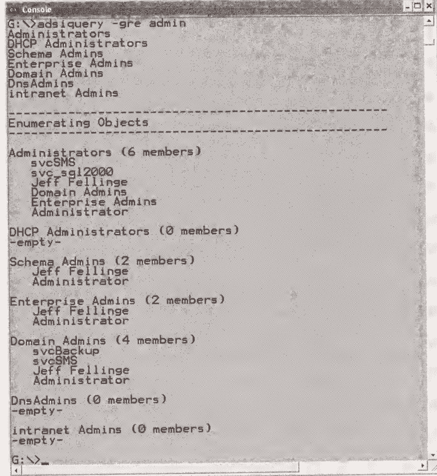

## 概述

Microsoft Active Directory（AD）提供了丰富的目录服务，集中存储了详细的网络、用户和组数据。AD 定义了 Windows 2000 和 Windows 2003 网络的逻辑结构，并为管理资源访问提供了基础。Active Directory 组策略、访问控制列表、域名服务（DNS）、站点和域都是 AD 所包含的服务示例。

Microsoft 提供了多种工具来帮助管理 AD，从图形化 MMC 插件（如 AD 用户和计算机、站点和服务、域和信任关系）到资源工具包中提供的多种命令行工具。这些工具允许你添加或编辑用户和组、更改组成员身份、定义策略、配置域和信任关系，以及以其他方式管理企业的 AD。

你可能会渴望一种自定义的方式来从 AD 中提取和呈现数据。在第 3 章中，我们演示了从 AD 查询数据以及创建新用户或组是多么容易。例如，你可能希望定期审计某个敏感组的成员身份，或者列出特定组或多个组中的所有用户。

本章所呈现的场景概述了一个脚本的需求，该脚本作为命令行工具来审计 AD 中特定组的成员身份。尽管已有列出和枚举组的工具可用，但开发自己的脚本来完成此任务可以教你如何与 AD 交互，并以你选择的方式格式化输出数据。

该工具使用 WSH 和 ADSI 创建命令行脚本，用于枚举和导出选定组的成员身份。该工具接受命令行参数来输入条件，并使用正则表达式来查找匹配的组。

## 场景

你是一家中型移动通信服务公司的系统工程师。你的公司为许多大型公司未提供服务的农村地区提供手机服务。三年前，你在整个公司部署了 AD，现在管理所有域。域结构由一个企业域和若干用于服务部门和测试部门的子域组成。

多位业务经理找到你，请求帮助管理其组的访问权限。例如，财务部门希望每周获得所有用户访问客户数据的权限报告。在 AD 组上设置的安全访问控制列表（ACL）控制着对存储在 Windows 2000 文件服务器上的客户数据的访问。财务管理员（用户）以团队形式服务于较大的客户。团队定义了 AD 组成员身份，用于调控对特定客户数据的访问。随着财务管理员在客户团队之间轮换，组成员身份会定期变化。财务经理希望每周审查一份能够访问客户数据的人员名单。

你的信息技术部门也提出了第二个请求。安全经理需要一份所有已安装并运行防病毒软件的域计算机清单。该经理需要一份各域中计算机的简单列表（每台计算机一行），然后可以将其输入到第二个命令行工具中以检查软件状态。


## 分析

你意识到这两个请求虽然不同，但本质上都是从 AD 中提取数据，然后以自定义方式展示。你决定开发一个灵活的基于控制台的工具，可以部署并按计划周期性地运行以处理每个请求。输出可以由脚本运行者实时查看，也可以重定向到文本文件或第二个程序以供后续处理。此工具主要由 IT 管理员使用，他们通常以自己的凭据运行应用程序，或计划脚本使用一个其他用户不使用的专用服务账户来运行。根据需求，脚本可能包含五个主要函数和若干辅助函数：

**主程序：** 评估参数并调用程序的函数。

- 评估输入参数，并设置相应的处理标志。
- 调用处理函数。

**ReadCriteria：** 从文件中读取组匹配条件。

- 使用 `FileSystemObject` 从文本文件中读取条件列表。这些条件将用于从 AD 中过滤结果。脚本允许条件通过命令行传入，也可以从指定的文本文件导入。示例条件可能包括财务管理员所属的组名。

**QueryObjects：** 构建并执行 ADSI 查询。

- 针对指定的 LDAP 目录服务初始化并执行 ADO 查询。使用 LDAP 方言过滤器显示与用户指定的过滤条件匹配的用户、计算机或组对象。

**Enumerate：** 显示结果。

- 遍历返回的数据对象以列出成员关系。组对象显示其成员，计算机和用户对象显示其所属的所有组。

**ListGroupMemberships：** 列举并显示指定用户所属的所有组。

- 确定并显示指定用户或计算机对象的组成员关系。`ListGroupMemberships` 使用 `Groups` 方法返回该对象所属组的集合。

**ListMembersOfGroup：** 列举并显示指定组的所有成员。

- `ListMembersOfGroup` 使用 `Members` 属性返回并显示指定组对象的成员集合。

辅助函数如下：

- **CurrentDomain：** 发现运行脚本的用户上下文的当前域。
  - 绑定到 RootDSE（目录服务器上目录数据树的根）以确定运行脚本的账户所在域。要查询其他域，可以通过 -D [domain] 参数覆盖当前域并指定新域。
- **Heading：** 格式化输出标题。
  - 为显示输出标题提供一致的样式。
- **Usage：** 显示脚本使用帮助屏幕。
  - 显示脚本的使用帮助。
- **ParamError：** 当依赖的脚本参数未包含时显示错误文本。
  - 如果参数未包含则显示错误。参数 -D [Domain]、-d [delimiter] 和 -f [file] 各自需要额外的依赖参数。
- **Tabulate：** 对齐文本输出。
  - 在指定的水平字符位置对齐列式输出。（需要 Windows Script 5.6 版本。）

# 分发与安装

该脚本由单个 JScript 文件组成，可在 Windows 2000 或更高版本上运行。你的公司使用 Microsoft Outlook®，它默认阻止访问 .vbs 和 .js 文件。因此，你决定将脚本发布到内部网上，有权限的用户可以下载并在本地运行。

将脚本计划为每周运行一次并将输出转储到文本文件中，为财务管理员提供便捷可靠的组成员关系更新。首先，使用 Windows 计划任务应用程序自动化脚本的周期性执行。接着，启动 Windows 2000 计划任务向导并设置新任务。将脚本复制到其运行位置，并指定启动脚本的程序。例如，选择使用包含指定参数的批处理文件来启动脚本，使后续更新变得简单。启动脚本的示例批处理文件可能包含一行：

```
%windir%\system32\cscript.exe c:\scripts\ADSQuery.js -D home -gre admin > c:\scripts\output.txt
```

### 枚举和转储 Active Directory 的用户、组和计算机

该批处理文件调用 cscript.exe 引擎来处理 ADSIQuery.js 脚本。发送给脚本的参数是指定的域（-D home）和 -gre admin，这告诉脚本列出组对象（g），使用正则表达式评估条件（r），枚举组的成员（e），并包含搜索条件 admin。使用方便的重定向符号 > 将控制台输出发送到指定的文本文件。（需要用户交互或显示必须点击才能通过的进度窗口的脚本不适合计划执行或重定向输出。）

保存此批处理文件，并计划其每周一凌晨 4:00 运行。指定批处理文件运行所使用的用户名和密码。以这种方式计划脚本运行，使其可以独立于当前登录用户运行。以这种方式计划，此批处理文件将每周运行一次，并将其结果输出到 c:\scripts 目录。

除了使用固定参数计划任务重复运行外，你还希望将其提供给公司其他系统管理员按需使用。只需在命令提示符下使用以下任意参数运行脚本：

```
Usage:
ADSIQuery -cugvrfe [filename] -D [Domain] -d [delimiter] [criteria]:
-c list computers
-u list users
-g list groups
-v verbose mode
-r use regular expressions for criteria matching
-f [filename] load criteria from a text file
-e Enumerate the results for group membership
-D [domain] specify domain other than default
-d [delimiter] specify delimiter to separate fields.
-a all non-RegExp criteria must match (default = any).
-? Help

Example:
ADSIQuery -ue jeff : Returns users that match 'jeff'
and will list all groups to which they belong
ADSIQuery -cr dc[12] : Returns computers that match
the regular expression dc[12] (e.g., dc1 or dc2)
```

你必须使用 cscript.exe 引擎，因为脚本使用了 StdOut.Write 方法，该方法在 wscript.exe 引擎中不受支持。正如你将在代码中看到的，脚本会确定自身是如何被调用的，并相应地运行或向用户显示警告。在脚本中构建这些安全机制和检查可能需要更多时间，但当其他用户使用你的程序时，它们可以大大减少可能的挫败感。

## IT 管理员 Windows 入门十大脚本

要访问不受信任域的目录，请考虑使用 runas 命令在该域的用户下执行命令 shell。（或者，你可以打开到该域中计算机的 Terminal Server、SSH 或 Telnet 会话，并在该会话中运行脚本。）在 Windows XP 中以其他用户身份启动命令 shell 的语法为：

```
%windir%\System32\runas.exe /user:domain\user "cmd"
```

runas 应用程序会提示你输入该用户的密码，然后打开一个在替代用户上下文中运行的命令提示符。在此新命令提示符下，针对所需域执行脚本。

# 输出

脚本的设计以控制台输出为中心。打开命令 shell，使用控制台驱动脚本并查看输出。使用控制台确保程序可以通过其他应用程序或计划服务正常工作。

## 解决方案摘要

要查询 AD 组成员关系，请创建一个基于控制台的脚本，并计划其在包含财务管理员数据的域中运行。为每个域创建自定义批处理文件，其中包含要枚举的组名称以及与该域相关的脚本参数。将结果重定向到财务管理员可以访问的中心位置，他们将每周查看一次。此外，将脚本分发给安全管理员和其他 IT 管理员，以便他们可以使用该工具列出 AD 对象并识别公司中任何域的组成员关系或用户和计算机成员关系。

# 目标

此脚本演示了使用 WSH 和 ADSI 查询 AD 以及显示和格式化结果的几种方法。脚本使用以下对象和方法：

ADODB.Connection

- Provider
- Open


# ADODB.Command

- ActiveConnection
- Properties
- CommandText
- Execute

# ADSI

- GetObject

# Array Object

- push

# Enumerator

- atEnd
- MoveNext

# LDAP Dialect Query

- Base DN
- Filter
- Attributes
- Scope

## RecordSet

- EOF
- Fields.Item(x).Value

### RegExp

- test

# RootDSE

- GetObject("LDAP://RootDSE")
- Get("defaultNamingContext")

## Scripting.FileSystemObject

- OpenTextFileReadLine
- FileExists
- AtEndOfStream
- Close

# String Functions

- split

### WScript.Arguments

- colArgs.length
- colArgs.Item

# 脚本本身

图 4.1 展示了脚本 *ADSIQuery* 的一个示例输出，该脚本用于枚举并显示默认域中管理组的成员身份。在此示例中，第一个参数 `-grev` 实际上包含了三个参数。这些参数指定仅列出组（g）、使用正则表达式（r）以及枚举成员身份（e）。第二个参数 `admin` 定义了在过滤器中使用的实际标准。图 4.2 展示了该脚本的另一个示例，这次是列出域中的所有计算机。（正则表达式中的 `.`（点）代表通配符。）此示例说明了脚本参数输入的灵活性。参数可以组合输入，也可以按任意顺序单独输入。例如，脚本处理以下参数的效果是相同的：

```
ADSIQuery -grev admin
ADSIQuery admin -g -e -v -r
ADSIQuery -rv -ge admin
```

一个例外是分隔符和域参数，它们必须单独输入（例如，`-grev -D domainname -d ~`）。此示例将域中的所有计算机作为简单列表列出，适合导入到其他应用程序中。

> 脚本文件位于 CD-ROM 的 `/chapter 4/scripts/ADSIQuery.js`。在继续下一节之前，请从 CD-ROM 打开实际脚本并在测试环境中运行几次，以感受其工作方式。自行浏览整个代码，然后继续阅读步骤详解，希望能解答您可能产生的任何疑问。此外，在脚本编辑器中查看完整的代码能让您对其范围有良好的把握，并允许我们在讲解其功能时对其进行调整。

本章剩余部分将逐步讲解 *ADSIQuery*，描述其工作原理以及为何做出某些设计决策。该脚本使用 JScript 编写，以展示该语言的众多特性。

```
G:\>adsiquery -gre admin
Administrators
DHCP Administrators
Schema Admins
Enterprise Admins
Domain Admins
DnsAdmins
intranet Admins
```

```
-----------------------------------------------------------
Enumerating Objects
-----------------------------------------------------------

Administrators (6 members)
   svcSMS
   svc_sql2000
   Jeff Fellinge
   Domain Admins
   Enterprise Admins
   Administrator

DHCP Administrators (0 members)
   -empty-

Schema Admins (2 members)
   Jeff Fellinge
   Administrator

Enterprise Admins (2 members)
   Jeff Fellinge
   Administrator

Domain Admins (4 members)
   svcBackup
   svcSMS
   Jeff Fellinge
   Administrator

DnsAdmins (0 members)
   -empty-

intranet Admins (0 members)
   -empty-

G:\>_
```

**图 4.1** 脚本 ADSIQuery.js 提供了一种灵活的方法来查询 AD 并枚举成员身份。

## IT 管理员的十大 Windows 入门脚本

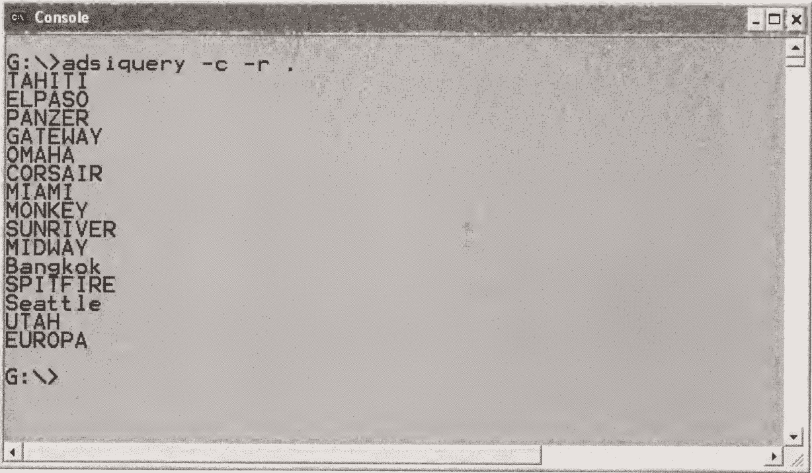

**图 4.2** 参数可以按任意顺序输入，并且可以有不同的输出详细级别。

此类控制台工具的另一个好处是，可以快速添加新功能或调整脚本输出。例如，如果您想返回任何用户对象的电话号码，您可以快速将 AD 属性 `TelephoneNumber` 添加到 LDAP 方言查询中，然后在迭代 `Recordset` 时显示此属性。正如您将看到的，本文中的一些更通用的函数在各个脚本中被重复使用，例如读取文本文件、显示帮助或错误信息，以及其他可重用的代码。即使您有自己的 ADSI 转储工具选择，您也可能会发现这些函数和方法对于在完全不同的脚本中重复使用非常有用。

## 初始化

脚本的开头几行声明变量并设置其初始值。在 JScript 中，如果在函数内部定义变量，则该变量被视为局部变量。否则，如果在任何函数之外但在调用该函数之前定义了变量，那么函数可以访问该变量。例如，程序中定义的所有变量对于该程序调用的函数也是可用的，只要它们在函数执行之前定义。然而，如果子函数声明了一个与之前使用的变量同名的变量，那么将使用局部作用域的变量。

请谨慎使用全局变量，而是显式地将变量或对象传递给函数。使用全局变量通常会降低代码的可移植性，并增加错误或潜在安全漏洞的风险。尽管编程界不赞成广泛使用全局变量，但许多人同意，如果在有节制且特定的情况下使用，全局变量可以是有价值的。

此脚本利用正则表达式来验证正确的文件名。正则表达式提供了强大的基于文本的过滤器，在模式匹配（以及其他许多方面）方面表现出色，此脚本展示了正则表达式提供的一些实用工具。正则表达式定义明确，许多 Unix 工具（例如 grep、sed、awk）广泛支持正则表达式模式匹配。尽管模式匹配语法通常在正则表达式实现中保持一致，但操作正则表达式的方法因语言而异。在网上搜索有关如何定义这些过滤器及其支持的一些更高级功能的更多信息。

在 JScript 中，正则表达式定义在斜杠之间，如下所示：`/RegExp/`。方括号表示位置内的可选字符。例如，正则表达式 `/[DdHh]og/` 将匹配文本 Dog、dog、Hog 和 hog。*ADSIQuery* 中的第一个正则表达式（`reValidFile`）定义了文件名中使用的无效字符。脚本在脚本运行时根据 `reValidFile` 测试用户提供的文件名，如果测试返回 true，脚本将拒绝该文件名。正则表达式 `/[\*\?\[\]\{\}\|\+\(\)]/` 仅查找字符 `*`、`?`、`[`、`]`、`{`、`}`、`|`、`+`、`(` 或 `)` 中的任何一个。反斜杠 `\` 代表正则表达式转义字符，用于定义这些原本具有特殊含义的字符。

### 主体部分

脚本使用数组对象来存储标准列表（`aCriteria`）以及匹配对象的 `ADsPath`（`aObjects`）。此脚本按顺序访问这些数组的成员，这与数组通过索引访问其成员的方式非常契合。

```
//---------------------------------------------------------------
// ADSIQuery.js
//---------------------------------------------------------------
var i=0,j=0;
var strCriteriaFile, strCriteria, iTotalCriteria;
var strQBDN, strQFilter, strQAttributes, strQScope;
var reValidFile = /[\*\?\[\]\{\}\|\+\(\)]/;
var strDelimit=" ";
var aCriteria = new Array();
var aObjects = new Array();
```

此脚本依赖于一个自定义对象（`objState`）来定义过程标志。JScript 允许轻松创建和使用可通过属性（`object.elementname`）引用的自定义对象。通过属性引用提供了一种易于阅读的方式来引用特定标志。例如，要确定组属性的状态，我们可以直接调用它（`objState.group`）。或者，我们本可以为每个值定义单独的标志（例如 `iGroup`、`iComputer`），但将它们全部作为属性包含在单个对象中是一种整洁的设计，可以将所有状态变量放在一起。此外，我们可以将单个对象传递给函数来确定状态，而不是传递多个独立的变量。

```
var objState = new Object;
objState.group=0;
objState.computer=0;
objState.user=0;
objState.reCustom=0;
objState.help=0;
objState.UseRegExp=0;
objState.verbose=0;
objState.enumerate=0;
objState.domain=0;
objState.all=0;
```

脚本使用了 `wscript.exe` 引擎不可用的功能。脚本使用 JScript 的 `IndexOf` 方法检查 `WScript` 对象的 `FullName` 属性，以确定脚本是否使用 `wscript.exe` 执行。如果是，脚本会显示一条警告，建议用户使用 `cscript.exe` 引擎重新运行脚本。

```
if(WScript.FullName.indexOf("WScript")>=0) {
  WScript.Echo("Due to some of the functionality of this script, " +
    "Please run this program using the cscript.exe engine.\n" +
    "for example: cscript.exe userquery.js");
  WScript.Quit()
}
```

函数 `CurrentDomain` 确定运行脚本的帐户的当前域。此函数允许在任何域中运行脚本，而无需在脚本中硬编码域名。为了适应在其他域中运行脚本，脚本支持一个参数（`-D domain_name`）来指定要搜索的域。


如果指定了备用域，脚本将绑定到该域，并使用运行脚本的账户的安全上下文执行目录服务查询。此实践说明了前述 `runas` 命令的实用之处：`runas` 允许你在不同的用户账户下运行脚本。通过指定域和用户账户，你可以从你的计算机查询任何域，前提是该域能在网络层面与你的计算机通信。或者，可以向脚本添加一个参数来定义不同的用户名，请求密码，然后使用该替代安全上下文执行查询。

```
strDomain=CurrentDomain();
```

参数枚举包括提取传递给脚本的命令行参数，遍历每个参数，并根据需要设置状态变量。以下代码遍历 `WScript.Arguments` 中的每个参数，并使用定义脚本参数的正则表达式对其进行测试。第一个测试使用 JScript 的 `indexOf` 方法检查参数字符串开头是否存在连字符（-）。`indexOf` 在一个字符串中搜索另一个字符串的存在，如果找到，则返回子字符串的起始位置。如果我们想确定一个字符串是否以连字符开头，可以检查 `indexOf` 是否返回 0（表示字符串的开头）。如果未找到子字符串，`indexOf` 返回 -1。

```
var colArgs = WScript.Arguments;
for(i=0;i<colArgs.length;i++) {
    strArg=colArgs.Item(i)
    if(strArg.indexOf("-") == 0) {
```

第二组嵌套测试查找匹配的参数，并为后续处理设置适当的状态变量。同样，`indexOf` 用于测试参数字符串中是否存在某个字符。如果该方法返回的值大于或等于 0，则该参数存在于参数字符串中。脚本在一次遍历中评估以连字符开头的参数，且测试与顺序无关。这意味着脚本评估参数 `-cgue` 或 `-eugc` 会产生相同的结果，因为 `indexOf` 只查找参数字符在字符串中的存在。这种设计提供了顺序无关性以及一种紧凑的方式来评估脚本参数。

```
    if(strArg.indexOf("c") >=0) objState.computer=1;
    if(strArg.indexOf("g") >=0) objState.group=1;
    if(strArg.indexOf("u") >=0) objState.user=1;
    if(strArg.indexOf("e") >=0) objState.enumerate=1;
    if(strArg.indexOf("?") >=0) objState.help=1;
    if(strArg.indexOf("r") >=0) objState.UseRegExp=1;
    if(strArg.indexOf("v") >=0) objState.verbose=1;
    if(strArg.indexOf("a") >=0) objState.all=1;
```

某些参数需要依赖参数。参数 `f` 表示使用文件名，脚本将下一个参数评估为要导入搜索条件的文件名。脚本通过使用 `length` 属性将当前参数编号与参数总数进行比较，来检查后续参数是否存在。如果依赖参数不存在，脚本将抛出错误。接下来，脚本验证后续参数的文件名中不包含非法字符。

JScript 中用于测试字符串是否匹配正则表达式的函数是 `re.text(string)`。如果测试为真，则脚本知道该字符串满足正则表达式。在我们的例子中，测试是查找包含非法字符的文件名。假设文件名结构良好，脚本将设置 `objState.file` 属性和 `strCriteriaFile`。

为了在下一次迭代中跳过包含文件名的参数，脚本递增计数器（`i`）。否则，文件名将被添加为搜索条件。

```
if(strArg.indexOf("f") >=0) {
    if(i+1 > colArgs.length-1) ParamError();
    if(!reValidFile.test(colArgs.Item(i+1))) {
        strCriteriaFile=colArgs.Item(i+1);
        objState.file=1;
        i++;
    }
    else {
        WScript.Echo("Import filename is not valid.");
        WScript.Quit();
    }
}
```

脚本对分隔符（`-d`）和域名（`-D`）参数的处理方式与文件名参数略有不同。脚本使用简单的条件语句检查参数是否等于 `-d` 或 `-D`。如果是，则脚本分别查找下一个参数作为分隔符或域名。像这样独立检查参数展示了与使用正则表达式不同的参数解释方法。分隔符定义了显示详细数据时使用的字符。自定义分隔符有助于在 Excel 等应用程序中进行未来的解析，你可以定义传统的逗号或制表符之外的自定义分隔符，而这些字符可能包含在有效数据中。域名允许用户查询与运行脚本的账户不同的域。

```
if(strArg=="-d") {
    if(i+1 > colArgs.length-1) ParamError();
    strDelimit=colArgs.Item(i+1);
    i++;
}
if(strArg=="-D") {
    if(i+1 > colArgs.length-1) ParamError();
    strDomain=colArgs.Item(i+1);
    objState.domain=1;
    i++;
}
}
```

最后，一个 `else` 语句捕获那些不是参数（即不以连字符开头）的剩余参数。脚本使用 `push` 方法将这些参数添加到数组 `aCriteria` 中。虽然我们可以通过索引在数组末尾添加一个新成员（例如 `aCriteria[aCriteria.length]="some criteria"`），但使用 `push` 方法稍微更简单、更优雅。这种方法允许你通过命令行指定任意数量的条件。

```
else {
    aCriteria.push(strArg);
}
}
```

通过这种设计，参数必须以连字符开头（但可以按任意顺序列出），并且可以在命令行输入多个独立的条件。以下参数演示了这种参数设计的灵活性。脚本将以下参数解释为相同含义：

```
ADSIQuery -gru admin operator -f filename.txt -D home
ADSIQuery -gruf filename.txt admin operator -D home
ADSIQuery -D home operator -fgru filename.txt admin
```

图 4.3 显示了脚本如何处理这些参数来构建数组 `aCriteria`。

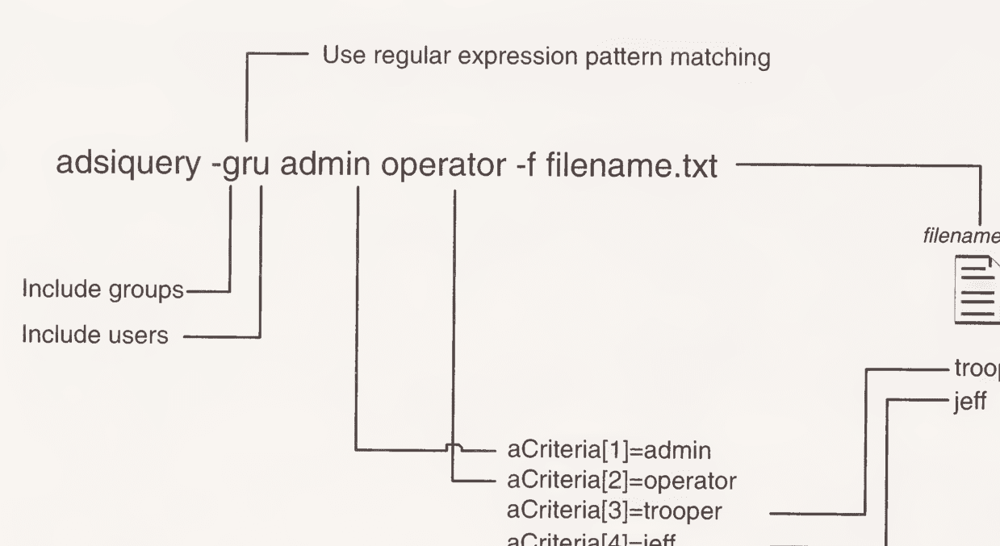

**图 4.3** *ADSIQuery* 灵活地处理命令行参数，构建用于搜索 Active Directory 的 `aCriteria` 数组。

处理完参数后，脚本评估状态变量并采取相应的操作。`-?` 参数设置 `objState.help` 属性，这又会调用 `Usage` 函数来显示简短的帮助消息，然后退出脚本。将帮助消息分离到其自己的函数中也允许其他函数调用 `Usage`。

*ADSIQuery* 在整个脚本中频繁使用状态属性 `verbose`（`objState.verbose）` 来显示更多信息。例如，它在以下代码中与文件状态属性结合使用，向用户回显指定的文件名。如果设置了文件状态属性（`objState.file`），脚本将调用 `ReadFile` 函数来打开用户指定的文件并将条件读入数组 `aCriteria`。因为在命令行输入的任何条件已经定义在此数组中，所以它被传递给 `ReadFile` 函数，该函数随后使用 `push` 方法向其添加新成员。返回的数组随后包含命令行条件和从文件导入的条件。

```
if(objState.help) Usage();
if(objState.verbose && objState.file){
    Heading("File Input");
    WScript.Echo("Importing criteria from file: " + strCriteriaFile);
}
if(objState.file) aCriteria=ReadFile(strCriteriaFile, aCriteria);
iTotalCriteria=aCriteria.length;
```

如果设置了 `objState.verbose`，脚本将遍历 `aCriteria` 并显示所有发现的条件。接下来，脚本可选择性地显示将要搜索的域名，然后调用 `QueryObjects` 函数。`QueryObjects` 函数构建并执行查询，然后显示结果。`QueryObjects` 将结果存储在第二个数组（`aObjects`）中，该数组在后续的枚举函数中使用。枚举函数（由参数 `-e` 指定）列出每个返回对象的成员关系。查询和枚举函数将在脚本后面列出函数代码时更详细地描述。

```
if(objState.verbose){
    Heading("Search Criteria - " + iTotalCriteria + " found" );
    for(i=0;i<iTotalCriteria;i++) {
        WScript.Echo(aCriteria[i]);
        }
    WScript.StdOut.Write("\nRegular Expression Searching: ");
    WScript.StdOut.Write(objState.UseRegExp?"On\n":"Off\n")
    }
if(objState.verbose){
    Heading("Default Detected Domain");
    WScript.Echo(strDomain);
    }
aObjects=QueryObjects(aCriteria, strDomain, objState);
if(objState.enumerate){
    Heading("Enumerating Objects");
    Enumerate(aObjects);
    }
```

### ReadFile

`ReadFile` 函数读取一个包含条件（每行一个项目）的文本文件，并将每个条件项插入一个数组中。除了之前验证文件名的检查外，`ReadFile` 在尝试打开文件之前调用 `FileExists` 方法来检查文件是否存在。该函数可以扩展以包含错误处理，例如验证文件是文本文件（而非二进制）、检查格式是否正确，或者在文件过大时停止处理。该函数使用 `OpenTextFile` 方法打开文件。在此脚本中，此方法所需的参数是要打开的文件的文件名和 `iomode`。`iomode` 定义了应如何打开文件，例如只读（1）、写入（2）或追加（8）。`OpenTextFile` 支持在第 3 章关于 `FileSystemObject` 的讨论中涵盖的其他可选要求。

脚本调用 `ReadLine` 方法，将文本文件中的每一行数据读入字符串。该字符串使用数组的 push 方法添加到条件数组中。本章前面讨论了 JScript 中的全局和局部作用域变量。请注意，此函数需要一个数组作为参数。然而，`ReadLine` 通过 `aContents` 来识别此对象，无论调用函数中使用的数组名称是什么。在函数末尾，`aContents` 通过 return 语句返回给调用函数。

```
//--------------------------------------------------
// Read a list of criteria from a file
//--------------------------------------------------
function ReadFile(strFileName, aContents)
{
    var objFSO = new ActiveXObject("Scripting.FileSystemObject");
    var strReadLine;
    if(objFSO.FileExists(strFileName)){
        objTextFile = objFSO.OpenTextFile(strFileName,1);
        while (!objTextFile.AtEndOfStream) {
            strReadLine=objTextFile.ReadLine();
            aContents.push(strReadLine);
        }
        objTextFile.close();
    }
    else {
        WScript.Echo("Error reading file.");
        WScript.Quit();
    }
    return aContents;
}
```

### QueryObjects

函数 `QueryObjects` 用于构建并执行 LDAP 查询。`QueryObjects` 需要三个参数：包含条件列表的数组、定义要搜索的域目录服务器的字符串，以及状态变量数组。`objState` 数组包含诸如是否搜索用户、计算机或组对象，以及是否显示详细输出等信息。

如第 3 章所述，一个 ADSI ADO 查询由三部分组成：`Connection` 对象、`Command` 对象和 `RecordSet` 对象。`Connection` 对象负责打开与 ADSI 目录服务的连接。

虽然我们在此没有这样做，但你可以选择通过在 Connection 对象中设置这些属性来设置用户名和密码，以及是否对密码进行加密。例如，此脚本的一个扩展可能是向脚本添加一个用户名参数，然后提示用户输入密码。获取密码的一种简单方法是使用 `StdIn.Read` 方法。然而，此方法有一个缺点，即密码会以明文形式显示在控制台中，而不是使用 * 字符对密码进行哈希处理。此外，如果你确实选择提示输入用户名和密码，请务必将 `Connection("Encrypt Password")` 属性设置为 true。否则，用户名和密码会在发送到服务器的网络流量请求中清晰可见。

```
//----------------------------------------------------
// Build and Execute the ADSI query
//----------------------------------------------------
function QueryObjects(aCriteria, strDomain, objState)
{
    objConnection = new ActiveXObject("ADODB.Connection");
    objConnection.Provider = "ADsDSOObject";
    objConnection.Open;
}
```

Command 对象包含如何执行查询的指令。首先，我们将 ActiveConnection 设置为刚刚创建的 Connection 对象，然后设置任何可选的命令属性。例如，要按名称排序结果，请添加属性 `objCommand.Properties("Sort On") = "Name"`。

为了支持超过 1,000 条结果的大数据集，脚本设置了命令对象的 Page Size 属性，该属性会开启分页支持并设置页面大小。页面大小是从服务器返回到客户端的对象数量（例如，页面大小为 999 时，服务器从 10,000 个对象中返回数据需要 11 页）。在大多数情况下，多个页面的传输对用户是透明的。但是，用户可能会在页面之间看到短暂的停顿，具体取决于网络速度。如果不使用分页，查询将只返回前 1,000 条结果然后停止。

接下来，我们开始构建 LDAP 方言查询。ADSI 支持 LDAP 和 SQL 方言查询。此脚本使用 LDAP 方言，因为使用 LDAP 方言时，嵌套多个筛选条件相当简单。使用 LDAP 方言的一个缺点是，它不支持非 LDAP 目录服务，例如 ADSI WinNT 提供程序（在少数必须使用该其他提供程序的情况下）。

```
objCommand = new ActiveXObject("ADODB.Command");
objCommand.ActiveConnection = objConnection;
objCommand.Properties("Page Size") = 999;
var strQBDN;
var strQFilter;
var strQAttributes;
var strQScope;
var reCriteria=new RegExp(".");
```

LDAP 方言查询的组成部分及其对应的变量包括：基本 DN（strQBDN）、筛选器（strQFilter）、属性（strQAttributes）和范围（strQScope）。基本 DN 为 ADO 查询提供其起点和范围。此脚本假定从域的顶层开始（例如，`LDAP://DC=domain, DC=com`）；但是，基本 DN 也可以定义为较低级别的容器（例如 `LDAP://OU=users, DC=domain, DC=com`）。范围设置查询应深入的层级。ADSIQuery 搜索基本容器及其所有子容器（scope="SubTree"），但你也可以选择将其限制为仅基本容器（scope="Base"）或仅基本容器及其子级（scope="One-Level"）。查询属性包括要从查询中返回的所有 ADSI 属性列表。脚本使用 objectClass 和 objectCategory 属性来确定对象是用户、计算机还是组，并使用 ADsPath 属性来唯一标识返回的对象。脚本显示对象的 Name。

```
strQBDN = "<LDAP://" + strDomain + ">;";
strQAttributes = "Name,ADsPath;";
strQScope = "SubTree";
```

LDAP 方言筛选器定义查询搜索条件。第 3 章介绍了一些构建基本筛选器的示例，以下代码在这些示例的基础上进行扩展以适应用户选择。例如，如果用户使用以下语法运行脚本：

```
ADSIQuery -ucg trooper topaz
```

生成的筛选器将类似于以下代码：

```
(&(|(&(objectClass=user)(objectCategory=person))(objectCategory=computer)(objectCategory=group))(|(Name=*trooper*)(Name=*topaz*)));
```

其含义为：获取所有 objectClass 为 user 且 objectCategory 为 person、computer 或 group，且名称包含 trooper 或名称包含 topaz 的对象。

通过将筛选器拆分为不同的行，此逻辑可能更加清晰：

```
(&
(|
(&(objectClass=user)(objectCategory=person))
(objectCategory=computer)
(objectCategory=group)
)
(|(Name=*trooper*)(Name=*topaz*))
);
```

计算机对象也是 objectClass=user 的成员，因此用户对象必须进一步定义为所有 objectClass=user *且* objectCategory=person。使用 objectCategory 更为推荐，因为它是索引的单值属性，而 objectClass 是多值属性，在用于搜索时效率较低。*联系人* AD 对象也具有 objectCategory=person，为了仅返回用户对象（不包括计算机或联系人对象），我们使用筛选器 objectClass=user 和 objectCategory=person。

```
strQFilter="(&";
strQFilter+="(|";
if(objState.user) strQFilter +=
"(&(objectClass=user)(objectCategory=person))";
if(objState.computer) strQFilter += "(objectCategory=computer)";
if(objState.group) strQFilter += "(objectCategory=group)";
strQFilter += ")";
```

脚本还支持使用正则表达式进行搜索；但是，LDAP 方言不支持此功能，因此必须编写自定义代码。脚本查找标志 `objState.UseRegExp`，该标志指示用户是否指定使用正则表达式作为搜索条件（通过脚本参数 -r）。如果设置了该标志，脚本会使用用户、计算机或组筛选器构建并执行 ADO 查询，然后在单独的程序中根据正则表达式条件测试查询结果。可以想象，这种额外的处理会从两个方面显著降低脚本速度。首先，ADO 查询返回的数据集大得多，需要进行处理（例如，所有用户）。接下来，脚本必须通过一对嵌套循环检查每个对象是否符合每条条件。

如果未设置 `objState.UseRegExp`，则脚本会遍历条件数组中包含的每一项，并使用 or 逻辑运算符（即 `|` 或 `&`，取决于用户是否指定了 all 参数（-a））将条件添加到 LDAP 方言筛选器中。包含（以及指定）这两个运算符中的任何一个都会增加脚本的实用性，因为它们允许用户指定输出结果

应包含所有条件或任一条件。如果设置了详细标志，脚本将显示其根据条件及其他用户选择构建的查询筛选器。这通常有助于故障排查或为其他脚本或应用程序提取信息。

```
if(!objState.UseRegExp)
{
    if(objState.all) {
        strQFilter+="(&";
    }
    else {
        strQFilter+="(|";
    }
    for(i=0;i<iTotalCriteria;i++) {
        strQFilter += "(Name=*" + aCriteria[i] + "*)";
    }
    strQFilter += ")";
}
strQFilter += ");"
if(objState.verbose){
    Heading("Query Filter");
    WScript.Echo(strQFilter);
}
```

随后，该函数将每个 LDAP 方言查询组件连接起来，以定义 Command 对象的 CommandText 属性。定义完成后，脚本调用 Execute 方法来执行查询，并将结果返回到指定的 RecordSet 对象（objRecordset）。

```
objCommand.CommandText=strQBDN + strQFilter + strQAttributes + strQScope;
objRecordset=objCommand.Execute();
```

显示结果的过程是遍历包含查询结果的 RecordSet 对象。除了显示名称外，脚本还会将对象的 ADsPath 添加到新数组中。以编程方式存储结果，便于后续使用而无需重新运行查询。ADsPath 是存储在数组中的唯一标识符，通过该标识符可以轻松引用有关该对象的其他信息。

以下代码包含处理正则表达式搜索条件的循环。对于从查询返回的每个对象，脚本会遍历每个条件并调用正则表达式的 test 方法，将对象与条件进行比较。如果测试为真，则显示该对象并将其 ADsPath 添加到上述数组中。尽管正则表达式搜索在条件定义方面提供了更大的灵活性，但搜索所需时间更长，且返回的 RecordSet 比使用 LDAP 筛选器搜索条件时更大。

```
if(objState.verbose){
    Heading("Results");
}
while (!objRecordset.EOF) {
    if (objState.UseRegExp) {
        for(i=0;i<iTotalCriteria;i++) {
            reCriteria = new RegExp(aCriteria[i],"i");
            if(reCriteria.test(objRecordset.Fields.Item("Name")
                              .Value)) {
                WScript.Echo(objRecordset.Fields.Item("Name")
                            .Value);
                aObjects.push(objRecordset.Fields.Item("ADsPath")
                             .Value);
            }
        }
    }
    else {
        WScript.Echo(objRecordset.Fields.Item("Name").Value);
        aObjects.push(objRecordset.Fields.Item("ADsPath").Value);
    }
    objRecordset.MoveNext;
}
return aObjects;
}
```

### 枚举

除了列出满足特定条件集的 AD 对象外，该脚本还提供对象的枚举功能，以显示它们与其他对象之间的关系。

如果设置了枚举标志（objState.enumerate），主程序将调用 Enumerate 函数。Enumerate 函数检查每个对象的 Class。如果 Class 为用户或计算机，则该函数将对象的 ADsPath 发送给 ListGroupMemberships 函数。此函数确定并显示特定用户或计算机所属的所有组。如果对象 Class 为组，则 Enumerate 函数调用 ListMembersOfGroup 函数以显示该组的所有成员。

aObjects 数组包含要检查的每个对象的 ADsPath。脚本调用 GetObject 方法以返回指向该对象的指针给变量 objADs。此对象指针将传递给其他函数，用于收集此成员资格数据。

```
//--------------------------------------------------------
// Enumerate the Results
//--------------------------------------------------------
function Enumerate(aObjects)
{
    for(i=0;i<aObjects.length;i++) {
        objADs=GetObject(aObjects[i]);
        switch (objADs.Class) {
            case 'user':
            case 'computer':
                ListGroupMemberships(objADs);
                break;
            case 'group':
                ListMembersOfGroup(objADs);
                break;
        }
    }
}
```

#### ListGroupMemberships

ListGroupMemberships 函数列出用户或计算机对象的所有组成员资格。此函数的输入参数是指向 AD 对象的指针。使用此指针，可以调用 Groups 方法，该方法专门返回对象所属的所有组。Groups 方法返回指向 IADsMembers 接口的指针，脚本使用 Enumerator 对该接口进行枚举。Groups 方法的 IADsMembers 接口 Count 属性存在已知问题（无法正常工作），因此脚本改为遍历对象来计数。

```
//--------------------------------------------------------
// List the group memberships of a user or computer
//--------------------------------------------------------
function ListGroupMemberships(objADs)
{
    groupList = objADs.Groups();
    iCount=0;
    eGroups = new Enumerator(groupList);
    for (;!eGroups.atEnd();eGroups.moveNext()) {
        iCount++; }
```

LDAP 查询返回的用户名称仅为名称本身（例如 Trooper），而使用 GetObject 方法绑定到对象并调用 IADs.Name 属性则返回对象的相对名称（例如，CN=Trooper）。我们希望脚本仅显示名称本身，而不显示相对名称属性。

为此，脚本使用正则表达式函数 split 在相对名称中搜索分隔符 =，然后仅显示其后的名称。split 方法将字符串与分隔符进行比较，并返回由分隔符之间的字段组成的数组。在我们之前的示例中，如果 strUser="CN=Trooper"，则 strUser.split("=") 返回一个包含两个成员的基于零的数组。（基于零的数组意味着第一个成员引用为零。例如，a[0]="first member"，a[1]="second member"。）第一个元素（由 a[0] 引用）是 "CN"，第二个元素 [1] 是 "Trooper"。综合起来，strUser.split("=")[1] = "Trooper"。

```
WScript.Echo("\nName: " + objADs.Name.split("=")[1] +
    " (member of " + iCount + " groups)");
if(objState.verbose) {
    WScript.Echo("objADs: " +objADs.objADs );
}
```

接下来，该函数显示该计算机或用户对象所属的所有组。由于 IADsMembers 指针 groupList 仍然存在，我们可以再次对其进行枚举并显示每个对象的名称、类和 ADsPath。脚本调用自定义函数 Tabulate 以左对齐列格式显示条目。Tabulate 确保每列中的所有数据都从相同的水平字符位置开始。Tabulate 函数根据给定的要显示的字符串、列号以及分隔符字符或字符串来定位并显示数据。Tabulate 依赖于标准流的 Column 属性，这需要 Windows Script 5.6 版本。

如果成员资格为空，则 iCount 将等于 0，并显示文本 "-none-"。

```
if (iCount>0) {
    eGroups = new Enumerator(groupList);
    for (;!eGroups.atEnd();eGroups.moveNext()) {
        x=eGroups.item();
        WScript.StdOut.Write(x.Name.split("=")[1]);
        if(objState.verbose) {
            Tabulate(x.Class, 35, strDelimit);
            Tabulate(x.objADs, 45, strDelimit);
        }
        WScript.StdOut.Write("\n");
    }
} else {
    WScript.Echo("-none-");
}
}
```

### ListMembersOfGroup

前一个函数显示用户或计算机对象所属的所有组。下一个函数显示组对象的所有成员（用户、计算机或组）。使用指向组对象的指针作为输入，ListMembersOfGroup 函数调用 Members 方法以返回属于该组的对象集合。与前面提到的 Groups 函数类似，Members 方法返回指向 IADsMembers 接口的指针，脚本随后对其进行枚举并显示。Members 方法返回的 IADsMembers 接口支持 Count 属性，该属性返回集合中的对象数量。这意味着不需要像上一个函数那样进行单独的迭代来计算 iCount。

脚本通过枚举 IADsMembers 集合并调用 Tabulate 函数来显示数据，从而呈现结果。

```
//--------------------------------------------------------------------
// List the individual members of a group
//--------------------------------------------------------------------
function ListMembersOfGroup(objADs)
{
    memberList = objADs.Members();
    iCount=memberList.Count;
    WScript.Echo("\n"+ objADs.Name.split("=")[1] +
        " (" + iCount + " members)");
    if(objState.verbose) {
        WScript.Echo("objADs: " +objADs.objADs );
    }
    if (iCount>0) {
        eMembers = new Enumerator(memberList);
        for (;!eMembers.atEnd();eMembers.moveNext()) {
            x=eMembers.item();
            WScript.StdOut.Write("    " + x.Name.split("=")[1]);
            if(objState.verbose) {
                Tabulate(x.Class, 35, strDelimit);
                Tabulate(x.objADs, 45, strDelimit);
            }
            WScript.StdOut.Write("\n");
        }
    }
    else {
        WScript.Echo("-empty-");
    }
}
```


### CurrentDomain

`CurrentDomain` 函数用于确定运行脚本的账户所在的域。例如，如果你使用账户 `somedomain\user` 运行脚本，那么脚本会确定你位于 `somedomain` 域。脚本通过无服务器绑定到 LDAP RootDSE 对象来确定这一点。RootDSE 提供关于目录服务的信息。为了确定运行脚本的账户的域，脚本获取 `defaultNamingContext` 属性。此属性是目录服务器（本例中为 RootDSE）所属域的可分辨名称。

```
//--------------------------------------------------------------------
// Discover the domain of the user context running the script
//--------------------------------------------------------------------
function CurrentDomain()
{
    var objRootDSE = GetObject("LDAP://RootDSE");
    return objRootDSE.Get("defaultNamingContext");
}
```

### Heading

以下 `Heading` 函数展示了一种编程技巧，即将重复的操作委托给专用函数。将格式化操作委托给专用函数使代码更易于阅读并确保格式一致性。隔离重复操作对你的代码有多种好处。首先，它使代码更易于阅读，因为每当读者看到代码 `Heading(sometext)`，就知道会发生什么。此外，使用专用函数简化了代码维护，因为你只需要在一处更新代码。例如，如果你想更改标题格式，只需更新函数中的代码，下次脚本运行时，更改会立即在函数调用的任何地方反映出来。

```
//--------------------------------------------------------------------
// Format headers in the output
//--------------------------------------------------------------------
function Heading(strMessage)
{
    WScript.Echo("\n--------------------------------------------------");
    WScript.Echo(strMessage);
    WScript.Echo("--------------------------------------------------");
}
```

### Usage

usage 函数出于对用户的礼貌，显示如何使用脚本的说明。它显示脚本的简要解释、用法、支持的参数列表，并包含一个示例。

```
//-------------------------------------------------------------------------
// Display the help screen
//-------------------------------------------------------------------------
function Usage()
{
WScript.Echo("Tool to search Microsoft Active Directory");
WScript.Echo("and display and enumerate group memberships.");
WScript.Echo("Usage:");
WScript.Echo("ADSIQuery -cugvrfe [filename] -D [Domain] " +
    "-d [delimiter] [criteria]:");
WScript.Echo("-c list computers");
WScript.Echo("-u list users");
WScript.Echo("-g list groups");
WScript.Echo("-v verbose mode");
WScript.Echo("-r use regular expressions for criteria matching");
WScript.Echo("-f [filename] load criteria from a text file");
WScript.Echo("-e Enumerate the results for group membership");
WScript.Echo("-D [domain] specify domain other than default");
WScript.Echo("-d [delimiter] specify delimiter to separate fields.");
WScript.Echo("-a all specified criteria must match (default is any).");
WScript.Echo("-? Help");
WScript.Echo("");
WScript.Echo("Example:");
WScript.Echo("ADSIQuery -ue jeff : Returns users that match 'jeff'");
WScript.Echo("and will list all groups to which they belong");
WScript.Echo("ADSIQuery -cr dc[12] : Returns computers that match");
WScript.Echo("the regular expression dc[12] (e.g., dc1 or dc2)");
}
```

### ParamError

ParamError 是另一个在脚本中被重复调用的函数示例。与其维护多处代码实例，不如将此功能委托给其自身的函数，这样可以提高可读性并简化代码。

```
//------------------------------------------------
// Display An error if a dependant script parameter is not included
//------------------------------------------------
function ParamError()
{
Heading("Parameter Error Received. Please check syntax.\n");
Usage();
WScript.Quit();
}
```

### 枚举和转储 Active Directory 的用户、组和计算机

```
//------------------------------------------------
// Display An error if a dependant script parameter is not included
//------------------------------------------------
function ParamError()
{
Heading("Parameter Error Received. Please check syntax.\n");
Usage();
WScript.Quit();
}
```

### Tabulate

使用 WScript.Echo 显示多个不同字段行的一个问题是列通常未对齐，呈现锯齿状外观，有时难以阅读。此脚本使用 Tabulate 函数以有序列的形式显示列数据。Tabulate 在特定文本列显示字符串，并提供了一种整洁的方法以有序列呈现数据。Tabulate 使用 StdOut.Column 属性获取当前 Stdout 行的当前水平字符位置。

> StdOut.Column 属性在 Windows Script 5.6 及更高版本中可用。如果你在默认构建的 Windows 2000 计算机上运行此脚本，Column 属性无法正常工作。请下载并安装 Windows Script 5.6 来修复此问题。

它会插入分隔符字符，直到达到所需的列，然后显示字符串。例如，调用函数 `Tabulate("MyData", 30, " ")` 会在第 30 列显示字符串 MyData。空格将被插入，直到间距在第 30 个字符处对齐。此函数还支持自定义分隔符字符（默认为空格，但此字符可以通过 `-d [delimiter]` 参数定义），这可能有助于解析输出。

```
//------------------------------------------------
// Display output in left-aligned columns
//------------------------------------------------
function Tabulate(strData, iColumn, strDelimit)
{
while(WScript.StdOut.Column<iColumn)
{WScript.StdOut.Write(strDelimit);}
WScript.StdOut.Write(strData);
}
```

### 总结

快速轻松地从 AD 中提取数据对于小型任务或大型项目来说都可以证明是一个巨大的时间节省。*ADSIQuery* 演示了如何使用 ADO 查询 AD 并以适合输入到其他脚本或程序的灵活格式呈现结果。此脚本中介绍的许多技术也可以应用于其他目录服务，例如 Exchange 或机器的本地帐户（使用 WinNT 提供程序）。此外，该工具可以精简，甚至可以提供一个命令行电话工具来快速查找员工的电话号码。此脚本也成为了本文中其他几个依赖于从 AD 查询数据的脚本的基础。

## 关键点

- 严格基于控制台的脚本的一个好处是，通常可以使用 Windows 计划任务进行调度，而无需大量特殊准备。
- 使用 runas 命令以管理员凭据或其他域的凭据调用命令提示符，以允许你的脚本运行而无需更改当前登录会话。
- 正则表达式为你的脚本带来极其强大的文本解析和过滤功能。虽然它们可能学起来很复杂，但其实用性会让你付出的学习曲线获得十倍的回报。要了解更多关于正则表达式的功能和用法，请访问 JScript 参考 MSDN 站点上的 RegEx 文档：http://msdn.microsoft.com/library/en-us/script56/html/js56reconIntroductionToRegularExpression.asp。
- 使用函数来委托重复任务。这样做不仅使你的代码更简单、更易于阅读，还允许你在其他脚本中重用函数。
- 自定义对象和数组为你的数据提供存储容器。数组是按顺序索引的，而对象允许你分配自定义属性和值。
- WSH `FileSystemObject` 提供方法，使你的脚本能够读取和写入文本文件。
- 使用 LDAP 或 SQL 查询语法来定义高效的 ADSI ADO 查询。ADO 查询由 `Connection` 对象、`Command` 对象和 `RecordSet` 对象组成。
- 使用 `objRootDSE` 对象通过无服务器绑定（例如，`LDAP://RootDSE`）获取有关运行脚本的用户的默认目录服务器的信息。


## 5 转储域用户的详细账户信息

```
G:\>userquery trooper -le

Account Status: Enabled
            Not Locked Out

Title: Senior Dog
Phone: 425-555-1234
SAM Name: Trooper
UPN: Trooper@home.blackstatic.com
Name: CN=Trooper
DN: CN=Trooper,OU=Home Users,DC=home,DC=blackstatic,DC=com
ADsPath: LDAP://CN=Trooper,OU=Home Users,DC=home,DC=blackstatic,DC=com
Email: trooper@blackstatic.com
Created: 3/8/2003 9:06:29 PM
Group Memberships: SnB-Everyone
                   Account Operators

Last Login        Pwd Expires        Pwd Changed
EUROPA 4/16/2003 10:24:44 PM 5/29/2003 9:10:20 PM na
G:\>
```

## 概述

ADSI LDAP 提供程序公开了许多仅在各个域控制器上可用的目录服务对象。例如，*LastLogin* 属性仅存储在验证用户身份的域控制器上，不会复制到其他域控制器。（这也意味着在具有多个域控制器的环境中，并非所有域控制器都拥有所有用户的 *LastLogin* 日期信息。）但是，仍然可以使用 LDAP 提供程序访问这些信息。不要执行无服务器绑定，而是指定要查询的特定域控制器。第 4 章中描述的 *ADSIQuery* 脚本使用 ADSI LDAP 查询返回并显示大量对象中的少量属性。本章介绍的 *UserQuery* 脚本是对 *ADSIQuery* 的补充，提供更详细但数量更少的对象属性。你会注意到第 4 章中使用的一些技术已延续到本脚本中，但本脚本也展示了解决第 4 章中某些任务的新替代方法。

## 场景

作为帮助台经理，你定期检查用户账户的状态，例如审核已禁用账户或过期密码、查找用户的全名或电话号码，或确定账户位于哪个域或组织单位中。MMC 插件 *Active Directory 用户和计算机* 提供了大部分此类信息，但你更喜欢可以使用命令行工具快速转储特定用户账户的信息。此外，你希望获取并显示该插件未直接提供的其他信息，例如账户何时过期或上次使用时间。你的公司最近还迁移到了与 Active Directory 集成的 Exchange 2000，你肯定希望扩展脚本以提取 Exchange 特定的数据。你还希望能够指定要收集和显示的信息，例如枚举组成员身份。

你认为基本脚本是合适的选择，因为你可以自定义输入以快速指定任何域，并且可以格式化输出以供多种用途。

## 分析

这个基于控制台的脚本同时使用 ADSI LDAP 和 WinNT 提供程序。在某些情况下，你可能需要利用 WinNT 提供程序来弥补一些空白，例如获取 LDAP 提供程序不可用的一些少数属性，或从非 Windows 2000 域控制器枚举本地用户账户。脚本使用 LDAP 提供程序查询存储在用户连接的每个单独域控制器上的最后登录信息。场景中概述的业务目标可以分解为表 5.1 中所示的技术需求。

#### 表 5.1 业务目标映射为技术需求

| 业务目标 | 技术需求 |
| --- | --- |
| 检查单个用户账户的状态。 | 创建 ADO ADSI 查询并选择与指定名称模式和 objectCategory='person' 匹配的用户账户。 |
| 检查已禁用账户、过期密码。 | 检查 ADSI `AccountDisabled` 和 `IsAccountLocked` 属性。 |
| 查找用户信息，包括全名、电话号码、域和 OU 信息。 | 获取 ADSI 属性，如 `Title`、`TelephoneNumber`、`sAMAccountName`、`uUPN`、`Name`、`DN`、`ADsPath` 和创建日期。 |
| 显示账户上次使用时间。 | 需要确定 `LastLogon` 属性，该属性存储在每个域控制器上。通过查找 `PrimaryGroupID=516` 的计算机来查找所有域控制器。使用 ADSI WinNT 提供程序查询每个域控制器以获取指定用户的 `LastLogon`。捕获错误，以防用户未使用该域登录网络。 |
| 显示 Exchange 2000 邮箱信息。 | 列出 ADSI `mail` 属性。 |
| 列出组成员身份。 | 遍历 ADSI `Groups` 属性。此属性仅列出用户所属的域组，不包括本地计算机组的成员。 |

该脚本重用了第 4 章中讨论的 *ADSIQuery* 脚本的一些基本操作功能，包括参数处理代码和枚举代码。ADO 目录服务查询过程已重写为使用 SQL 方言而非 LDAP 方言，并且 ADO 代码已卸载到其自己的函数中以提高可重用性。通过将查询隔离到其自己的函数中，同一函数可用于执行脚本的两个主要查询：搜索匹配条件的用户账户和搜索域控制器。

**主程序：** 评估参数并构建查询语法以发送到 queryDs 函数。

- 评估输入参数并设置适当的处理标志。
- 构建目录服务查询。
- 调用处理函数。
- **ListUserInfo：** 显示有关存储在目录服务中的用户对象的 ADSI LDAP 属性，如姓名、电子邮件地址、电话号码、账户是否被锁定或禁用，以及不同的账户命名结构。
- **ListLastLogon：** 使用 LDAP 和 WinNT 提供程序显示日期信息。
  - 使用 LDAP 提供程序绑定到指定（或默认）域的每个域控制器，并返回上次登录、密码过期和密码最后更改的日期和时间。
  - 使用 WinNT 提供程序绑定到各个域控制器以返回 *LastLogon* 日期。
- **ListGroupMemberships：** 列出对象所属的组。
  - 表示第 4 章中介绍的组枚举函数的截断版本。
- **QueryDS：** 返回满足给定 CommandText 的所有对象的数组。
  - 表示第 4 章中介绍的 LDAP 查询引擎的更精简版本。此版本接受 Command 对象的 CommandText 属性作为输入，执行指定查询，并返回包含结果集中每个对象的 ADsPath 的数组。
- **GetDomainInfo：** 获取当前域和域控制器的名称。
  - 确定当前域和域控制器的名称。已从第 4 章重用的辅助函数：
    - **CurrentDomain：** 发现运行脚本的用户上下文的当前域。
    - **Heading：** 格式化输出标题。
    - **Usage：** 显示有关如何使用脚本的帮助屏幕。
    - **ParamError：** 如果未包含依赖的脚本参数，则显示错误文本。
    - **Tabulate：** 对齐文本输出。

### 分发和安装

此脚本 `UserQuery.js` 重用了第 4 章中介绍的多个函数，使用 JScript 编写。该脚本将分发给帮助台工作人员，他们将从命令提示符运行该脚本。脚本使用 `WScript.StdOut` 方法，必须使用 `cscript.exe` 而非 `wscript.exe` 运行。

# 输出

脚本以块格式显示用户账户信息，并可选择在用户所属的组和每个域控制器中存储的最后登录信息中列出。图 5.1 中显示的示例展示了使用以下参数运行脚本时的输出：

```
UserQuery -le trooper
```

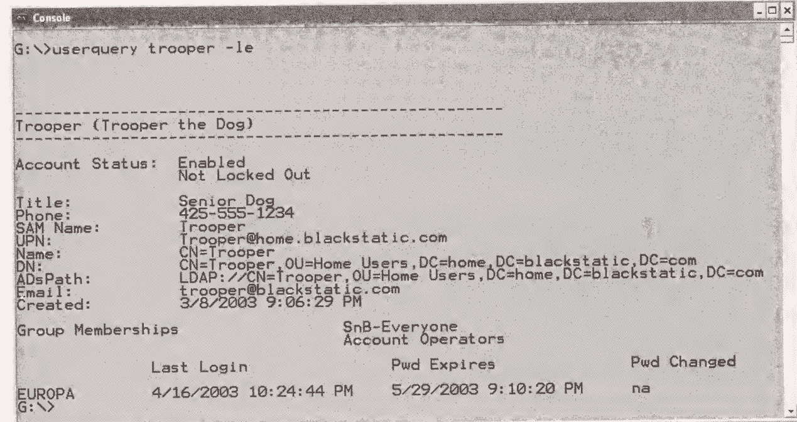

**图 5.1** *UserQuery.js* 呈现从 ADSI 查询的详细用户信息。

# 解决方案总结

*UserQuery* 提供了一个如何更新现有脚本以执行不同功能的示例。你会看到与第 4 章的 *ADSIQuery* 代码的相似之处；但是，请注意该脚本在某些地方更精简，而在其他地方增加了功能。该脚本有意使用不同的方法来解决第 4 章中解决的类似问题。检查多种替代方法可能会在你学习这些不同技术时带来额外的清晰度。此外，这种多管齐下的方法可能有助于回答第 4 章中遗留的问题。


IT 管理员的 Windows 十大入门脚本

# 目标

设计一个命令行工具，用于查询并显示用户账户状态、创建日期、密码过期日期、组成员身份以及通讯组列表成员身份。此脚本演示了 WSH 参数、ADSI、ADO、以及 LDAP 和 WinNT 提供程序的使用。

- **ADODB.Connection**
  - Provider
  - Open
- **ADODB.Command**
  - ActiveConnection
  - Properties
  - CommandText
  - Execute
- **ADSI—连接 LDAP 和 WinNT 提供程序**
  - GetObject
  - Groups
- **Array**
  - push
- **Enumerator**
  - atEnd
  - MoveNext
- **JScript 错误处理**
  - Try...Catch
- **SQL 方言查询**
  - SELECT, FROM, WHERE
- **RecordSet**
  - EOF
  - Fields.Item(x).Value
- **RootDSE**
  - GetObject("LDAP://RootDSE")
  - Get("defaultNamingContext")

#### 字符串函数
- split

### WScript.Arguments
- colArgs.length
- colArgs.Item

#### WScript.StdOut
- Write
- Column

# 脚本

UserQuery 是一个命令行工具，用于显示用户账户信息，如图 5.1 所示。此脚本中展示的属性仅演示了 IADsUser 接口 50 多个属性中的一小部分，你可以根据自己的环境或需求添加更多属性来自定义脚本。

运行该脚本会查询默认的 LDAP 目录服务（因为未指定 -d [域名]），使用的端口是众所周知的 LDAP 端口（TCP 端口 389）。

-l 参数指示脚本列出用户账户的登录日期。当用户登录 Windows 2000 网络时，登录日期和时间仅存储在验证该用户的域控制器上。这意味着为了准确显示最后登录日期，脚本必须查询域中所有域控制器的最后登录日期。运行脚本的计算机通过 WinNT 提供程序调用这些 ADSI 查询，使用 TCP 端口 445 进行这些直接的机器查询。WinNT 提供程序使用的端口与 LDAP 提供程序不同，因为 Windows 计算机不运行 LDAP 服务来提供本地账户信息。但是，Windows 2000 域控制器同时支持 WinNT 和 LDAP 提供程序查询，这两个服务分别监听不同的端口，提供关于同一对象目录的相似但不完全相同的信息。


该脚本在光盘中位于 /chapter 5/scripts/UserQuery.js。在继续下一节之前，请从光盘中打开实际脚本并在测试环境中运行几次，以感受其工作方式。自行浏览整个代码，然后继续阅读详解，希望能解答你可能有的任何问题。此外，在脚本编辑器中查看完整代码可以让你很好地了解其范围，也便于我们在讲解其功能时进行调整。

### 主体

现在，让我们来探讨脚本 *UserQuery.js*。脚本以传统的变量声明开头。变量 `i` 和 `j` 表示在整个脚本中使用的通用计数器变量。变量 `iTotalCriteria` 表示检测到的标准总数。对象 `objState` 包含各种状态标志参数，用于指示脚本应采取的操作。此脚本中定义的状态如下：

| 属性 | 描述 |
|----------|-------------|
| `objState.help` | 向用户显示帮助信息。 |
| `objState.verbose` | 显示超出默认范围的更详细信息。 |
| `objState.domain` | 使用用户指定的备用域名。 |
| `objState.lastlogin` | 枚举检测到的域控制器，并查询每个控制器记录的最后登录属性。 |
| `objState.enumerate` | 显示指定用户账户所属的组。 |

*UserQuery* 使用三个数组来跟踪数据：`aCriteria`、`aObjects` 和 `aDCs`。第一个数组 `aCriteria` 包含脚本用于匹配用户账户名称的名称（或部分名称）列表。第二个数组 `aObjects` 包含匹配 `aCriteria` 中所有标准的实际用户账户的 `AdsPath`。（`IADs` 接口的 `AdsPath` 属性表示 AD 中某个对象的完整唯一 LDAP 名称。）最后一个数组 `aDCs` 包含在目标域中发现的每个域控制器的 `AdsPath`。

```
//----------------------------------------------------------------------------
// UserQuery.js
//----------------------------------------------------------------------------
var i=0,j=0;
var strCriteria, iTotalCriteria;
var strDelimit=" ";
var objState = new Object;
var aCriteria = new Array();
var aObjects = new Array();
var aDCs = new Array();
objState.help=0;
objState.verbose=0;
objState.domain=0;
objState.lastlogin=0;
objState.enumerate=0;
objState.info=0;
objState.all=0;
if(WScript.FullName.indexOf("WScript")>=0) {
    WScript.Echo("Due to some of the functionality of this script, " +
    "Please run this program using the cscript.exe engine.\n" +
    "for example: cscript.exe UserQuery.js");
    WScript.Quit()
    }
```

函数 strDomain 使用与第 4 章中介绍的相同方法来发现运行脚本的域账户名称。此外，此脚本中使用的参数枚举例程与 ADSIQuery 中使用的相同。如果用户指定帮助参数（-?），脚本会调用 Usage 函数然后退出。

```
strDomain=CurrentDomain();
var colArgs = WScript.Arguments;
for(i=0;i<colArgs.length;i++) {
    strArg=colArgs.Item(i)
    if(strArg.indexOf("-")==0)          {
        if(strArg.indexOf("i")>=0)  objState.info=1;
        if(strArg.indexOf("l")>=0)  objState.lastlogin=1;
        if(strArg.indexOf("e")>=0)  objState.enumerate=1;
        if(strArg.indexOf("?")>=0)  objState.help=1;
        if(strArg.indexOf("v")>=0)  objState.verbose=1;
        if(strArg.indexOf("a")  >=0) objState.all=1;
        if(strArg=="-d") {
            if(i+1 > colArgs.length-1) ParamError();
            strDelimit=colArgs.Item(i+1);
            i++;
            }
        if(strArg=="-D") {
            if(i+1 > colArgs.length-1) ParamError();
            strDomain=colArgs.Item(i+1);
            objState.domain=1;
            i++;
            }
    }
    else {
        aCriteria.push(strArg);
        }
    }
if(!objState.info && !objState.lastlogin && !objState.enumerate)
    { objState.info=1;
    }
if(objState.help) Usage();
```

*UserQuery* 执行 ADSI 查询的方式与 *ADSIQuery* 略有不同。在 *ADSIQuery* 中，一个专用函数负责处理查询的整个构建和执行过程。然而，在 *UserQuery* 脚本中，主程序构建查询字符串，然后仅将 `CommandText` 字符串发送给查询函数 `QueryDS`。ADO `Command` 对象的 `CommandText` 属性定义了要执行的查询。然后 `QueryDS` 构建连接和命令对象、执行查询、解析 `RecordSet`，并将结果以数组形式返回给调用函数。

*ADSIQuery* 仅使用一次查询引擎，因此将整个查询过程放在一个函数中是合理的。然而，*UserQuery* 在每次运行时执行多个不同的查询，将大部分查询逻辑分离到自己的函数中可以使其可复用并减少代码重复。

另外，比较一下用于构建 ADSI 查询的 SQL 方言与第 4 章 *ADSIQuery* 中使用的 LDAP 方言。两个查询字符串实现相同的结果，`QueryDS` 使用的 `CommandText` 字符串可以采用任一方言。该查询搜索匹配给定标准集中的任何一个的用户对象。脚本将所有标准附加到查询字符串中，这意味着脚本只需执行一次查询，而无需遍历每个标准并为每个标准执行一次查询。

基于 SQL 方言的查询以 `SELECT` 语句开头。在以下代码中，查询字符串 `SELECT ADsPath,Name FROM LDAP://" + strDomain` 表示仅从 LDAP 服务器返回两个属性（`Adspath` 和 `Name`）给运行脚本的客户端。如第 3 章所述，定义 `LDAP://domainname` 而不指定特定域控制器的名称称为无服务器绑定。使用无服务器绑定时，Windows 会计算要连接和查询的最佳域控制器。

继续查看查询字符串，语法 `WHERE objectClass = 'user' AND objectCategory = 'person'` 仅定义用户对象。

```
iTotalCriteria=aCriteria.length;
strCommandText="SELECT ADsPath, Name FROM 'LDAP://" + 
  strDomain + "' WHERE objectClass = 'user' AND " +
  "objectCategory = 'person'";
```

接下来，代码将每个标准附加到查询字符串中。以下代码中的查询构建包含以下基本逻辑：

```
(user object) AND (Name= criteria 1 OR Name=criteria 2 ...OR...
Name=criteria n)
```

将此逻辑分解为以下伪代码：

```
user object
If Criteria > 1 then
  (AND Name=criteria 1
  Loop through Criteria 2 through n:
    OR Name=criteria n
  Follow with a closing parenthesis:
  )
```

通配符（\*）在每条条件的前后拼接，允许将部分条件与用户对象的 Name 属性进行匹配。例如，\*Tro\* 匹配 Trooper。根据应用程序的不同，您可能希望更改查询以匹配实际的用户名 sAMAccountName。例如，如果您的组织使用前缀 c- 来标识承包商账户（例如，c-jefff），并且您想要列出所有承包商账户的详细信息，您可以简单地更改查询字符串以返回 sAMAccountName 而不是 Name，然后匹配该属性。

```
if(iTotalCriteria > 0){
    strCommandText+=" AND (Name='*" + aCriteria[0] + "*'";
    for(i=1;i<iTotalCriteria;i++) {
        strCommandText+=(objState.all ? " AND ":" OR ") + "Name='*" +
            aCriteria[i] + "*'";      }
    strCommandText+=")";
}
```

此时，查询的 CommandText 已完全定义。以下是包含三个条件项的已完成查询的 CommandText 实际示例：

```
SELECT ADsPath, Name FROM 'LDAP://DC=blackstatic,DC=com' WHERE
objectClass = 'user' AND objectCategory = 'person' AND (Name='*jeff*'
OR Name='*kellie*' OR Name='*trooper*')
```

接下来，脚本显示有关查询的可选信息，然后通过将 CommandText 发送到函数 QueryDS 来执行查询。QueryDS 函数将结果返回到数组 aObjects 中。关于 QueryDS 如何运行的详细描述，请参见本脚本中实际函数部分的进一步说明。

```
if(objState.verbose){
    Heading("Query String");
    WScript.Echo(strCommandText);
    Heading("Using Domain");
    WScript.Echo(strDomain);
}
aObjects=QueryDS(strCommandText);
```

之前我们提到，*ADSIQuery* 中使用的查询引擎分为两部分。第一部分定义查询字符串的独特特征，第二部分代表一个更通用的函数，可供不同类型的查询重复使用。接下来的代码展示了 `QueryDS` 函数的重复使用，并以新的 `CommandText` 属性定义开始。第二个查询返回指定域中的所有域控制器。稍后，脚本将绑定到每个域控制器以提取指定用户的最后登录日期。如果脚本未使用最后登录参数（-1）运行，则脚本将跳过整个查询。单独绑定到多台机器可能需要一些时间，这就是为什么脚本可选地提供此功能的原因。

查询语法使用 SQL 方言，尽管 `QueryDS` 函数接受并处理使用 SQL 或 LDAP 方言查询字符串的 `CommandText`。它开始使用与之前的用户对象条件语法相似的语法。此查询仅需要 `IADs` 接口属性 `AdsPath` 和 `PrimaryGroupID`。`AdsPath` 定义了域控制器的唯一位置。Windows 2000 AD 域中的域控制器定义的 `PrimaryGroupID` 为 `516`。（`PrimaryGroupID` 是用户主组的相对标识符（RID）。）

*找到区分您所需搜索参数的特定、唯一条件（例如通过 `PrimaryGroupID` 为 516 来查找域控制器）对您来说可能就像大海捞针。* 首先，尝试在互联网上寻找信息——您可能会对可用的详细脚本信息的丰富程度感到惊讶。如果您仍需要更多信息，请尝试枚举几个不同对象的所有属性，看看是否能发现定义搜索参数的独特特征。（第 3 章介绍了一个 ADSI 属性枚举脚本。）

另外，要注意可能遗漏对象的查询。例如，在查找所有域控制器时，您可以查询内置组织单位"Domain Controllers"的内容；然而，有些组织可能并不总是使用那个容器，而可能将域控制器移动到其他容器中。搜索 RID 为 516 的结果会返回域控制器，无论它们在 AD 层次结构中被移动到何处。

域控制器已完成查询的示例看起来类似于：

```
SELECT ADsPath,PrimaryGroupID FROM 'LDAP://DC=blackstatic,DC=com'
WHERE PrimaryGroupID = '516'
```

此 CommandText 被发送到 QueryDS 函数，结果存储在数组 aDCs 中。脚本还可选地显示域控制器的 ADsPath。

```
if(objState.lastlogin) {
    strCommandText="SELECT ADsPath,PrimaryGroupID FROM 'LDAP://" +
        strDomain + "' WHERE PrimaryGroupID = '516'";
    aDCs=QueryDS(strCommandText);
    if(objState.verbose){
        Heading("Detected Domain Controllers");
        for(i=0;i<aDCs.length;i++) {
            WScript.Echo(aDCs[i]);
        }
    }
}
```

此时，所有用户账户对象和域控制器都已识别，现在脚本准备显示每个对象的信息。脚本遍历数组 aObjects，并使用 ADSI LDAP 提供程序绑定到每个用户账户对象。然后将此引用发送到三个函数进行最终处理。第一个函数 ListUserInfo 简单地收集有关对象的属性信息并将其显示到控制台。第二个函数 ListGroupMemberships 列出用户对象所属的所有组。最后一个函数 ListLastLogon 使用对象的 LDAP sAMAccountName 属性，通过 ADSI WinNT 提供程序绑定到每个域控制器。从每个域控制器提取用户账户日期信息，并以矩阵格式显示。这三个函数结束了脚本的主程序。

```
for(i=0;i<aObjects.length;i++) {
    objADs=GetObject(aObjects[i]);
    WScript.Echo("\n\n");
    Heading(objADs.sAMAccountName + " (" + objADs.displayName + ")");
    if(objState.info) {
        ListUserInfo(objADs,strDelimit);
    }
    if(objState.enumerate) {
        Wảnuit StdOut Wrirte("\n\nGroup Memberships");
        ListGroupMemberships(objADs);
    }
    if(objState.lastlogin) {
        ListLastLogon(aDCs,objADs);
    }
}
WScript.Echo;
WScript.Quit(0);
```

#### ListUserInfo

`ListUserInfo` 函数显示指定用户账户对象的各种 ADSI LDAP 属性值，如之前在图 5.1 中所见。该函数接受已建立的对象引用作为输入参数。（主程序（调用函数）之前通过调用方法 `GetObject(AdsPath)` 建立了此引用。）`ListUserInfo` 转而调用 `Tabulate` 函数，将 LDAP 属性左对齐到特定列。

此函数还使用 JScript 条件三元运算符（"x?y:z"）来显示两个结果之一，具体取决于条件结果。类似于 Excel 中的 `if(statement, true, false)` 函数，三元运算符提供了一个评估条件逻辑的快捷方式。三元运算符评估问号左侧的语句，如果为真，则代码执行问号右侧的第一个语句。否则，代码执行冒号右侧的第二个语句。

例如，以下语句：
*(scripting is fun ? of course it is : don't worry, it will get better!)*
如果 "scripting is fun" 评估为真，则程序返回 "of course it is"。否则，如果为假，程序返回 "don't worry, it will get better!" 三元运算符是对较长的 if...then...else 条件语句的优雅规避。

```
//-----------------------------------------------------------------------
// Display information about a User object from LDAP Provider
//-----------------------------------------------------------------------
function ListUserInfo(objADs,strDelimit)
{
WScript.StdOut.Write("\nAccount Status: " );
Tabulate(objADs.AccountDisabled?"Disabled":"Enabled",18,strDelimit);
WScript.StdOut.Write("\n");
Tabulate(objADs.IsAccountLocked?"Locked Out":"Not Locked Out",
18,strDelimit);
```


```
WScript.StdOut.Write("\n\nTitle: ");
Tabulate(objADs.Title,18,strDelimit);
WScript.StdOut.Write("\nPhone: ");
Tabulate(objADs.TelephoneNumber,18,strDelimit);
WScript.StdOut.Write("\nSAM Name: ");
Tabulate(objADs.sAMAccountName,18,strDelimit);
WScript.StdOut.Write("\nUPN: ");
Tabulate(objADs.userPrincipalName,18,strDelimit);
WScript.StdOut.Write("\nName: ");
Tabulate(objADs.Name,18,strDelimit);
WScript.StdOut.Write("\nDN: ");
Tabulate(objADs.distinguishedName,18,strDelimit);
WScript.StdOut.Write("\nADsPath: ");
Tabulate(objADs.ADsPath,18,strDelimit);
WScript.StdOut.Write("\nEmail: ");
Tabulate(objADs.mail,18,strDelimit);
WScript.StdOut.Write("\nCreated: ");
Tabulate(objADs.whenCreated,18,strDelimit);
}
```

前面的函数 `ListUserInfo` 显示的是 AD LDAP 目录服务中的属性，而接下来的函数 `ListLastLogon` 则绑定到每个域控制器，从 WinNT 提供程序中提取指定用户账户的信息。


尽管 Windows 2000 或 Windows 2003 域控制器不像成员服务器或独立服务器那样拥有本地用户，但 WinNT 提供程序仍然可以提供 LDAP 提供程序无法获取的关于域用户的附加信息。

#### ListLastLogon

函数 `ListLastLogon` 向域中发现的每个域控制器查询用户账户的日期信息，包括用户上次登录的日期和时间、密码过期时间以及密码上次更改的时间。你可能会感到惊讶，用户的实际上次登录信息并不会汇总到 LDAP 服务器，而是存储在对该用户进行身份验证的每个域控制器的本地。要确定实际上次登录时间，你必须查询每个域控制器并找到最近的日期。图 5.2 展示了使用 `ListLastLogon` 运行脚本的输出示例。

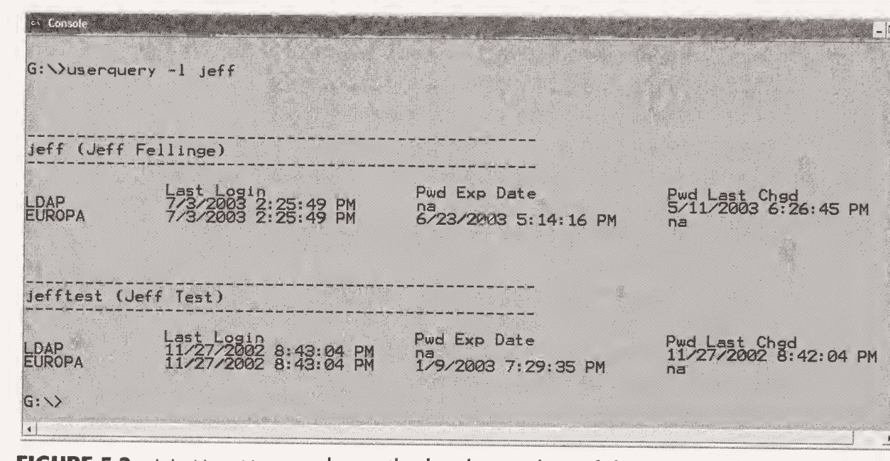

**图 5.2** ListLastLogon 使用 ADSI LDAP 和 WinNT 提供程序显示用户账户的上次登录日期。

> *变量 i 在此函数中使用——同时也在调用此函数的主程序中使用。如果变量在子函数中没有被重新声明，JScript 会将其视为全局变量，这可能会导致一些意想不到的结果。应通过在每个使用变量的函数中显式声明所有变量来避免使用全局变量。*

ListLastLogon 遍历 aDCs 数组的每个成员，并绑定到每台计算机上的用户对象。从计算机的 WinNT 提供程序指定用户对象的语法如下：

```
WinNT://ComputerName/UserName
```

aDCs 数组包含域控制器的 ADsPath（例如，`LDAP://CN=dc1,OU=Domain Controllers,DC=blackstatic,DC=com`），并使用此属性绑定到 ADSI LDAP 对象以获取其 Name 属性（例如，*CN=dc1*）。函数获取此 Name 属性并使用字符串方法 split 提取正则表达式（`"="`）右侧的数据，在本例中即为计算机的简单名称（如 *dc1*）。（记住，split 方法返回一个包含被拆分字符串的数组，在本例中只有一个等号，因此有两个部分——等号左侧部分和等号右侧部分。第一部分由数组元素 `array[0]` 表示，第二部分由 `array[1]` 表示。）

最后，函数将前缀 `WinNT://` 与计算机名称以及斜杠（`/`）和用户名拼接在一起。然后使用此字符串绑定到该计算机上的该用户对象。

#### 转储域用户的详细账户信息

在显示表头之后，函数遍历并显示当前域控制器的名称。然后函数尝试从此域控制器获取用户账户的日期属性。如果用户尚未登录到特定域控制器，则该值不存在。这说明了你必须捕获和处理的那种错误，因为你不知道它何时何地会发生。此函数使用 JScript 的 try...catch 语句在尝试获取属性时保护代码的执行。

JScript 的 try...catch 语句是一个有用的编程工具，它为 JScript 提供了复杂的错误处理。这对语句允许你安全地尝试有风险的操作。如果操作失败并导致错误，程序会转而执行备用代码。这段备用代码仅在错误情况下执行。除了为你的代码提供安全网之外，try...catch 还支持 error 对象，你可以从中获取有用的调试信息，包括错误描述和错误代码。正如你在下面的代码中看到的，使用 try...catch 几乎类似于 if...then...else 语句的结构，这使得即使是对它不熟悉的新程序员也能轻松读懂。

如果属性不存在，就会发生错误，catch 例程会拦截错误（在下一个示例中，错误包含在变量 e 中）并运行一组替代语句。在下面的代码中，函数将变量 dtTemp 赋值为日期属性的值，如果该属性不存在，则将变量 dtTemp 赋值为字符串 na。

```
//------------------------------------------------------------------------
// 向每个 DC 查询以从 WinNT 提供程序获取日期信息
//------------------------------------------------------------------------
function ListLastLogon(aDCs,objADs)
{
var dtTemp, i;
strUser=objADs.sAMAccountName;
WScript.StdOut.Write("\n");
Tabulate("Last Login",15,strDelimit);
Tabulate("Pwd Exp Date",40,strDelimit);
Tabulate("Pwd Last Chgad\n",65,strDelimit);

Tabulate("LDAP",0,strDelimit);
try {dtTemp=objADs.LastLogin;}
catch(e) {dtTemp="-none-";}
Tabulate(dtTemp,15,strDelimit);
Tabulate("na",40,strDelimit);
try {dtTemp=objADs.PasswordLastChanged;}
catch(e) {dtTemp="-none-";}
Tabulate(dtTemp,65,strDelimit);
```

```
WScript.StdOut.Write("\n");
for(i=0;i<aDCs.length;i++) {
    var strDC=GetObject(aDCs[i]).Name.split("=")[1];
    var objADs=GetObject("WinNT://" + strDC + "/" + strUser);
    WScript.StdOut.Write(strDC);
    try {dtTemp= objADs.LastLogin;}
    catch(e) {dtTemp="-none-";}
    Tabulate(dtTemp,15,strDelimit);
    try {dtTemp= objADs.PasswordExpirationDate;}
    catch(e) {dtTemp="-none-";}
    Tabulate(dtTemp,40,strDelimit);
    Tabulate("na",65,strDelimit);
    WScript.StdOut.Write("\n");
    }
}
```

#### ListGroupMemberships

ListGroupMemberships 函数类似于第 4 章中 ADSIQuery 所使用的函数，但进行了大幅简化。给定一个指向用户对象的现有 AdsPath 引用，该函数使用 Groups 方法枚举该对象所属的所有组。组的 Name 属性表示为相对可分辨名称 CN=groupname，因此使用正则表达式 split 方法将名称截取为仅保留组名部分。此名称会显示在控制台上。图 5.3 展示了使用 -e 参数运行脚本的输出示例，该参数会调用 ListGroupMemberships 函数。

```
//-------------------------------------------------------
// 列出用户或计算机的组成员关系
//-------------------------------------------------------
function ListGroupMemberships(objADs)
{
eGroups = new Enumerator(objADs.Groups());
for (;!eGroups.atEnd();eGroups.moveNext()) {
    x=eGroups.item();
    Tabulate(x.Name.split("=")[1],35,strDelimit);
    WScript.StdOut.Write("\n");
    }
}
```

**转储域用户的详细账户信息**

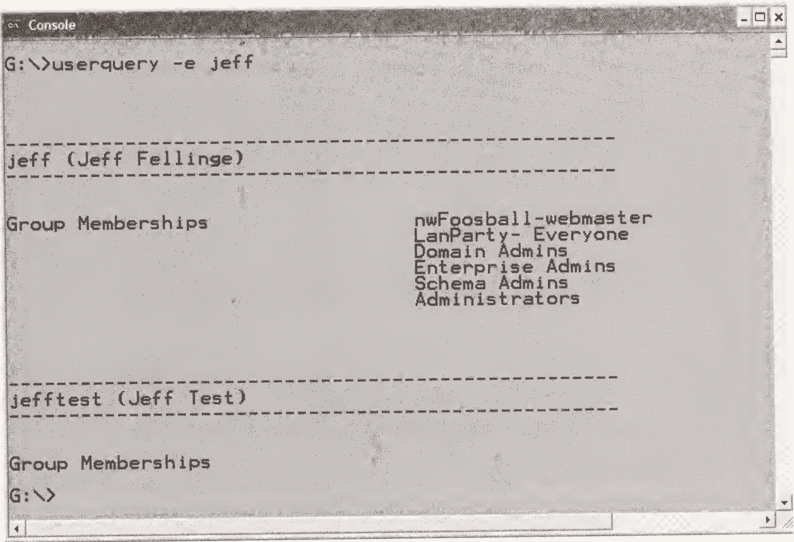

**图 5.3** ListGroupMemberships 枚举用户账户所属的域组。

### CurrentDomain

CurrentDomain 函数返回运行脚本的账户的当前域名。有关此函数的更多详情，请参阅第 4 章。

```
//-----------------------------------------------------------
// 发现运行脚本的用户上下文所在的域
//-----------------------------------------------------------
{
    var objRootDSE = GetObject("LDAP://RootDSE");
    return objRootDSE.Get("defaultNamingContext");
}
```

### QueryDS

QueryDS 函数相对于第 4 章脚本 ADSIQuery 中使用的 LDAP 查询设计有了重大变化。在这里，整个 ADO 查询设计被隔离到一个独立的函数中。函数的输入是一个字符串

该属性表示定义查询的 Command 对象的 CommandText 属性。该函数返回一个包含查询结果的数组。CommandText 字符串包含了查询的核心部分，正如前面代码描述所见，它可能相当复杂。其余的 ADO 查询机制相对简单，如以下代码所示，第 3 章将对其进行详细描述。与之前的 ADO 查询一样，首先创建 Connection 对象，然后创建 Command 对象，最后处理 RecordSet 对象，将感兴趣的数据添加到数组中并返回给调用函数。

```
//--------------------------------------------------------------------
// Query Active Directory given an LDAP query parameter
//--------------------------------------------------------------------
function QueryDS(strCommandText)
{
var aObjects = new Array();
objConnection = new ActiveXObject ("ADODB.Connection");
objConnection.Provider = "ADsDSOObject";
objConnection.Open;
objCommand = new ActiveXObject("ADODB.Command");
objCommand.ActiveConnection = objConnection;
objCommand.Properties("Page Size") = 999;
objCommand.Properties("Sort On") = "Name";
objCommand.CommandText=strCommandText;
objRecordset=objCommand.Execute();
while (!objRecordset.EOF) {
    aObjects.push(objRecordset.Fields.Item("ADsPath").Value);
    objRecordset.MoveNext;
}
return aObjects;
}
```

### Heading

Format headers 函数为重复使用的标题提供了统一的显示方式。

```
//--------------------------------------------------------------------
// Format headers in the output
//--------------------------------------------------------------------
function Heading(strMessage)
{
WScript.Echo("\n--------------------------------------------------------------------");
WScript.Echo(strMessage);
WScript.Echo("--------------------------------------------------------------------");
}
```

### Usage

Usage 函数出于对用户的友好提示，显示有关如何使用脚本的说明。它展示了脚本的简要说明、使用方法、支持的参数列表以及一个示例。

```
//-------------------------------------------------------------------------
// Display the help screen
//-------------------------------------------------------------------------
function Usage()
{
    WScript.Echo("Tool to list user information");
    WScript.Echo("Usage:");
    WScript.Echo("UserQuery -lev -D [Domain] " +
        "-d [delimiter] [criteria]:");
    WScript.Echo("-i list account information");
    WScript.Echo("-l list last login information");
    WScript.Echo("-e Enumerate the results for group membership");
    WScript.Echo("-v verbose mode");
    WScript.Echo("-D [domain] specify domain other than default");
    WScript.Echo("-d [delimiter] specify delimiter to separate fields.");
    WScript.Echo("-a all specified criteria must match (default is any).");
    WScript.Echo("-? Help");
    WScript.Echo("");
    WScript.Echo("Example:");
    WScript.Echo("UserQuery -le jeff : Displays user information about");
    WScript.Echo("user 'jeff' including login dates and groups");
    WScript.Echo("to which they belong");
    WScript.Echo("UserQuery jeff : Defaults to display user information");
    WScript.Quit(0);
}
```

### ParamError

ParamError 是脚本中反复调用的另一个函数示例。与其维护多份代码副本，不如将此功能抽取为独立函数，这样既提高了可读性，又精简了代码。

```
//-------------------------------------------------------------------------
// Display An error if a dependant script parameter is not included
//-------------------------------------------------------------------------
function ParamError()
{
    Heading("Parameter Error Received. Please check syntax.\n");
    Usage();
    WScript.Quit();
}
```

### Tabulate

Tabulate 函数将字符串在指定的文本列位置进行左对齐。关于该函数的详细运行机制，请参阅第 4 章。

```
//------------------------------------------------------------
// Display output in left-aligned columns
//------------------------------------------------------------
function Tabulate(strData, iColumn, strDelimit)
{
    while(WScript.StdOut.Column<iColumn)
        {WScript.StdOut.Write(strDelimit);}
    WScript.StdOut.Write(strData);
}
```

### SUMMARY

第 4 章的 ADSIQuery 引入了 ADSI 和 ADO 技术，用于从 AD 返回大量数据；而本章的 UserQuery 脚本提供了类似的查询功能，但对用户对象进行了更深入的检查。该脚本还演示了如何组合 LDAP 和 WinNT 提供程序查询，以收集用户对象的更多数据属性。UserQuery 还介绍了几种处理 ADSI 查询的替代方法，例如使用 SQL 方言以及将实际查询转移到独立函数中。在研究完本章的脚本后，请回顾第 4 章的 ADSIQuery，并比较从 ADSI 提取数据的不同方法。

### KEY POINTS

- 使用 ADSI 不仅可以在整个目录中搜索大量对象，还可以返回特定对象的详细数据。
- ADSI IADsUser 接口为用户帐户对象提供了超过 50 个可查看且大部分可定义的属性。
- *ADSIQuery* 使用 LDAP 方言，而 *UserQuery* 使用 SQL 方言来构建 ADSI 查询。两者各具优势，取决于你的需求。
- 尽可能使用 ADSI LDAP 提供程序从目录服务器获取数据。不过，你可能会发现需要使用 WinNT 提供程序直接连接到计算机以获取某些属性信息。
- 使你的函数具有通用性以提高可复用性。例如，对于 ADO 查询，通过在调用函数中定义命令字符串，你可以定义一个接受任意命令字符串的可复用函数，然后独立处理 `Connection`、`Command` 和 `Recordset` 对象。
- JScript 三元运算符为简单的条件判断提供了一种便捷的简写方式（例如 *scripting is fun ? of course it is : don't worry, it will get better!*）。
- 使用 JScript try...catch 语句进行健壮的错误处理和调试。

## 转储域用户的详细帐户信息

### 列出即将过期的域用户帐户

### OVERVIEW

在前两章中，我们研究了使用 ADSI 从 Active Directory 提取各类信息的脚本。如这些脚本所示，查询和显示 ADSI 属性是一个相当直接的过程，可以通过不同的技术来完成。本章通过剖析一个处理用户帐户日期属性的脚本，进一步展示 ADSI 的应用，例如确定帐户创建时间、密码过期时间，或列出许多帐户的各个属性。本脚本中的示例演示了处理对象、日期以及大数据整数和位字段等新数据类型的技术。

本章的代码建立在第 4 章和第 5 章所介绍的函数库基础之上。部分函数被重写，以提供解决问题的替代方法或增强额外功能。将本章的技术与之前的 ADSI 脚本进行比较，你会发现一旦理解了基本框架，调整和扩展会变得非常容易。本质上，这些脚本围绕查询满足特定条件的目录对象，并以独特且实用的格式显示数据展开。这是三个基于控制台的 ADSI 脚本中的最后一个，不过你会发现本书中许多需要计算机或用户列表的其他脚本都借鉴了这些章节中的 ADSI 技术。

### SCENARIO

你的公司采用了一项密码策略，要求用户每 90 天更改一次密码。作为信息安全官，你通过 AD 组策略从技术上强制执行该策略。作为提醒和对员工的善意，服务台经理希望向所有密码将在两周内过期的用户发送电子邮件，鼓励他们在密码过期前及时更换密码，并在需要时提供帮助。你主动提出帮助经理提供这些数据。你决定编写一个基于控制台的脚本来提供此信息。使用控制台脚本，你可以轻松地定期调度该脚本运行，为经理输出此信息。此外，你一直在寻找一种方法来跟踪整个域中的帐户状态，你还希望你的脚本显示密码设置为永不过期的帐户、在过去一周内创建的帐户以及被禁用或锁定的帐户。尽管实时查看每个创建的帐户可能比较繁琐，但你希望能够每周审查帐户创建活动。

服务台经理使用一个工单应用程序，该程序接受用户帐户列表以自动生成密码更换通知电子邮件。为了实现此功能，需要一个基于控制台的脚本，能够将数据输出到控制台或文本文件。


## 分析

该脚本将 ADSI 查询和显示方法与日期处理程序相结合。日期处理有时会很棘手，但正如我们将看到的，JScript 和 VBScript 都包含日期处理方法，使计算变得可管理。业务目标可以映射为技术要求，如表 6.1 所示。

**表 6.1** 业务目标映射为 *DateQuery* 脚本的技术要求

| 业务目标 | 技术要求 |
|---|---|
| 列出所有密码将在两周内过期的账户。 | 将今天的日期与每个用户账户的密码过期日期进行比较，并显示将在两周内过期的账户。计算用户账户密码过期日期为密码上次更改的日期加上允许的最大密码有效期。 |
| 定期安排脚本运行。 | 开发一个支持 Windows Script Host `cscript.exe` 引擎的脚本，该脚本将从命令行运行，并支持使用预定义的启动参数从计划任务运行。 |
| 显示设置为永不过期的密码的账户。 | 检查 `UserAccountControl` 属性以查看账户是否设置为永不过期。（请注意，这与第 5 章不同，第 5 章列出的是密码*实际*已过期的情况。） |
| 显示上周创建的账户。 | 将今天的日期与每个账户的创建日期进行比较，并只显示上周创建的账户列表。 |
| 显示禁用的账户。 | 根据 `UserAccountControl` 列出账户是否被禁用。 |
| 显示锁定的账户。 | 使用 ADSI WinNT 提供程序的 `IsAccountLocked` 属性列出账户是否被锁定。 |
| 将脚本结果输出到控制台。 | 开发一个支持 Windows Script Host `cscript.exe` 引擎的脚本。 |

该脚本通过扫描和生成显示账户创建和密码过期日期的列表，来审计您网络 AD 中定义的用户账户密码轮换策略。有效的密码管理策略包括指定使用强密码、在多次尝试输入错误密码后锁定账户，以及指定密码的最大有效期，超过该期限必须更改密码。这些策略中的许多都可以在技术上使用 AD 组策略强制执行，其中一些可以使用 ADSI 访问和查询。

创建新的组策略对象 (GPO) 可以为您的安全策略提供集中式强制执行。在组策略中，您可以定义密码策略和账户锁定策略。密码策略（如图 6.1 所示）允许您指定是否强制执行密码历史记录、最小和最大密码有效期、最小密码长度，以及密码是否必须为"强"（并满足 Microsoft 定义的复杂性要求）。账户锁定策略（如图 6.2 所示）定义账户锁定持续时间和阈值，并指定在账户锁定计数器重置之前等待多长时间。


**图 6.1** 通过定义组策略密码策略来集中强制执行您公司的密码策略。

### 列出即将过期的域用户账户

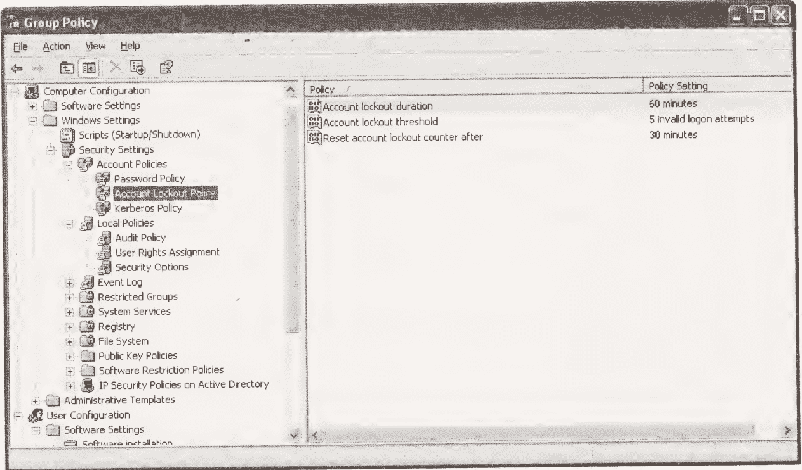

**图 6.2** 账户锁定策略保护账户免受重复的未授权访问尝试。

为确保所有用户获得一致的登录体验，账户和密码 GPO 属性在域级别设置。这实际上意味着您的 ADSI 脚本主要使用从 RootDSE 获取的域可分辨名称。实施密码策略后，您可能会发现用户锁定了他们的账户（也许是因为他们在更改密码之前忘记了注销终端服务器会话），或者系统管理员设置了豁免账户，其密码不会过期。结合您环境中存在多个域的前景，您决定审计域账户状态的最有效方法是安排脚本定期运行并向您发送结果。本章介绍的脚本将识别您域中的这些特殊账户。

### 主程序

- 读取和解析命令行参数。
- 构建查询以选择用户账户和域控制器。
- 遍历所有 `objectClass=user` 和 `objectCategory=person` 对象以收集账户数据，包括创建日期、账户是否被禁用或锁定，以及密码是否设置为永不过期。
- 确定所选域的最大密码有效期，并计算密码过期日期。
- 调用函数以各种格式显示脚本结果，例如：
  - 显示在指定日期内创建的账户。
  - 显示将在指定日期内过期的账户。
  - 显示应该已经过期的账户。
  - 显示将永远不会过期的账户。
  - 显示账户属性设置。

**ListAllDetail**
- 显示所有账户设置（详细模式）。

**ListCreated**
- 显示在指定日期创建的账户。

**ListExpired**
- 显示将在指定日期过期的账户。
- 显示应该已经过期的账户。

**ListPwdExpires**
- 显示密码将永远不会过期的账户。

**ShowLockouts**
- 显示锁定的账户。

**DumpUAC**
- 根据 `UserAccountControl` 属性计算用户账户设置。该属性包含 `ADS_USER_FLAG_ENUM` 枚举中由标志设置的 20 多个账户设置。
- 以矩阵和表格格式显示这些账户设置。

**GetMaxPwdAge**
- 获取 ADSI LDAP 属性 `maxPwdAge` 并将其从存储的大整数值（以 100 纳秒为间隔）转换为天数。

**ConvertNanoDays**
- 将 100 纳秒间隔转换为天数。

**CurrentDomain**
- 确定运行脚本的账户的域。

**QueryDSA**
- 构建 `Connection`、`Command` 和 `RecordSet` 对象以执行 ADSI 查询。在填充数组的对象中将数据集返回给调用程序。

**Heading**
- 显示通用标题格式。

### 列出即将过期的域用户账户

### 用法

- 显示脚本支持的命令行参数。

### ParamError

- 如果命令行参数未正确传递给脚本，则显示错误消息。

### Tabulate

- 垂直对齐脚本数据的列输出。

### 分发和安装

与之前的 ADSIQuery 和 UserQuery 脚本一样，本章的脚本 DateQuery.js 使用 JScript 编写。必须使用 cscript.exe 引擎运行。请记住，这一要求是因为使用了标准流 (WScript.StdOut)，而 wscript.exe 引擎不支持这些流。此外，Tabulate 函数使用的 StdOut.Column 属性仅在 Windows Script 版本 5.6 中受支持。dateQuery 的命令行参数如表 6.2 所示。

#### 表 6.2 dateQuery 的命令行参数

| 参数 | 说明 |
| --- | --- |
| -c | 列出在 [window] 天内创建的账户。 |
| -e | 列出将在 [window] 天内过期的账户。 |
| -l | 列出当前已锁定的账户。 |
| -n | 列出密码设置为永不过期的账户。 |
| -u[m] | 枚举 UserAccountControl 以显示账户属性。单独使用时，此参数遍历所有属性并显示满足每个属性的账户。与可选的 m 参数一起使用时，数据以矩阵格式为每个账户显示。 |
| -v | 启用详细模式，显示比默认更多的数据。 |
| -? | 显示帮助。 |
| -w [window] | 指定脚本在确定即将过期的账户或最近创建的账户时应用作边界的天数。 |
| -d | 指定用于分隔输出数据的可选分隔符。 |
| -D | 用户可以指定要查询的其他域。 |


要显示当前域中所有将在 14 天内过期的账户，请从命令行运行该脚本，并指定所需报告的类型和日期范围。还可以选择指定替代域名。以下代码：

```
DateQuery -e -w 14
```

显示从今天起 14 天内即将过期的所有账户，如图 6.3 所示。

**图 6.3** *DateQuery* 显示密码将在指定时间窗口内过期的账户名称。

```
DateQuery -c -w 28 -D BLVU
```

返回 BLVU 域中过去 28 天内创建的所有账户，如图 6.4 所示。

```
DateQuery -u
```

列出运行脚本所在域的所有账户属性，如图 6.5 所示。

**图 6.4** *DateQuery* 还显示在指定时间窗口内创建的账户。

**图 6.5** *DateQuery* 演示了 UserAccountControl 属性的枚举，其中包含 21 个账户属性的设置，例如账户是否被锁定。

## IT 管理员的 Windows 入门十大脚本

**DateQuery -um**

以矩阵格式呈现账户属性，如图 6.6 所示。要仅显示选定的信息，请运行 `DateQuery -um [n1] [n2]`，其中 n1 和 n2 是您希望查看的账户属性的编号。在日常域管理中，您可能不会用到所有这些账户属性，但本脚本中包含了所有属性，以展示 LDAP 属性 UserAccountControl 中存储的所有信息，该属性对应于 ADSI 枚举 ADS_USER_FLAG_ENUM。ADSI 枚举是一种在单个值中存储多个设置或标志的方法。例如，本脚本使用的 ADS_USER_FLAG_ENUM 枚举中存储的标志如表 6.3 所示。

**图 6.6** 用户账户标志也可以矩阵格式显示，便于快速浏览属性。

例如，要显示所有已禁用的账户，请运行 `DateQuery -u 2`。您可以指定多个数值参数。要查看所有已禁用的账户（2）或不需要密码的账户（5），请运行 `DateQuery -u 2 5`。请注意对 Microsoft 支持文章（Q250873）的引用，该文章指出使用 LDAP ADSI 提供程序时账户锁定信息无法正确显示。不幸的是，您在编写脚本的过程中可能会遇到必须承认并绕过的问题或缺陷。在本示例中，脚本通过使用一个完全独立的函数（`ShowLockouts`）来显示被锁定的账户，从而绕过了此缺陷。`-1` 参数调用一个单独的函数，该函数使用 ADSI WinNT 提供程序从主目录服务器获取数据。需要这个单独的函数来克服使用 LDAP 提供程序获取账户锁定状态时的已知 Microsoft 问题。

虽然未来的软件版本或更新可能会修复此问题，但请记住，当您编写较大的脚本时，可能会遇到必须使用的工具的陷阱或不足之处。幸运的是，通常有不止一种方法可以解决问题，因此不要害怕从不同角度尝试解决。

#### 表 6.3 ADS_USER_FLAG_ENUM ADSI 枚举包含许多定义用户账户设置的标志

| # | 标志名称 | 标志描述 |
|---|---|---|
| 1 | ADS_UF_SCRIPT | 执行登录脚本。 |
| 2 | ADS_UF_ACCOUNTDISABLE | 账户已禁用。 |
| 3 | ADS_UF_HOMEDIR_REQUIRED | 需要主目录。 |
| 4 | ADS_UF_LOCKOUT | 账户已锁定（使用 LDAP 时失败：参见 Q250873）。 |
| 5 | ADS_UF_PASSWD_NOTREQD | 不需要密码。 |
| 6 | ADS_UF_PASSWD_CANT_CHANGE | 用户无法更改密码。 |
| 7 | ADS_UF_ENCRYPTED_TEXT_PASSWORD_ALLOWED | 用户可以发送加密密码。 |
| 8 | ADS_UF_TEMP_DUPLICATE_ACCOUNT | 主账户在其他域中的用户的账户。 |
| 9 | ADS_UF_NORMAL_ACCOUNT | 普通账户。 |
| 10 | ADS_UF_INTERDOMAIN_TRUST_ACCOUNT | 允许信任账户。 |
| 11 | ADS_UF_WORKSTATION_TRUST_ACCOUNT | 成员服务器账户。 |
| 12 | ADS_UF_SERVER_TRUST_ACCOUNT | 备份域控制器（BDC）。 |
| 13 | ADS_UF_DONT_EXPIRE_PASSWD | 密码永不过期。 |
| 14 | ADS_UF_MNS_LOGON_ACCOUNT | MNS 登录账户。 |
| 15 | ADS_UF_SMARTCARD_REQUIRED | 登录需要智能卡。 |
| 16 | ADS_UF_TRUSTED_FOR_DELEGATION | 账户已启用 Kerberos 委派。 |
| 17 | ADS_UF_NOT_DELEGATED | 用户账户不能被委派。 |
| 18 | ADS_UF_USE_DES_KEY_ONLY | 限制账户仅使用 DES 密钥。 |
| 19 | ADS_UF_DONT_REQUIRE_PREAUTH | 不需要 Kerberos 预身份验证。 |
| 20 | ADS_UF_PASSWORD_EXPIRED | 密码已过期。 |
| 21 | ADS_UF_TRUSTED_TO_AUTHENTICATE_FOR_DELEGATION | 账户已启用委派。 |

# 输出

该脚本显示符合指定输入日期参数的匹配账户，如图 6.3 和 6.4 所示。除了提供账户创建和过期信息外，脚本还枚举账户设置以显示属性，例如该账户是否被锁定或是否已禁用，如图 6.5 和 6.6 所示。

## 解决方案摘要

服务台经理安排脚本每周运行一次，使用相关参数显示所有将在 14 天内过期的账户。启动脚本的批处理文件将输出重定向到一个文本文件，服务台经理每周检查该文件。安全经理临时运行脚本，在控制台中显示各种账户属性设置和账户状态。该脚本使用 ADSI LDAP 提供程序查询并显示满足日期特定条件或指定账户设置的账户信息。该脚本绑定到域和用户账户对象以收集域和账户的特定信息。然后，根据指定的参数，脚本遍历每个用户账户并在控制台中显示相应的报告。

# 目标

创建一个命令行工具，列出在指定范围内创建或将过期的 AD 账户。此外，显示账户状态，例如账户是否被锁定或已禁用、密码是否设置为永不过期，以及其他账户属性。

- **ADODB.Connection**
  - Provider
  - Open

- **ADODB.Command**
  - ActiveConnection
  - Properties
  - CommandText
  - Execute

- **ADSI**
  - GetObject
  - LDAP Provider
  - WinNT Provider

- **Arrays**
  - length
  - 遍历数组

- **Date**
  - getTime
  - setTime

- **Error Trapping**
  - Try...Catch

- **Enumeration Data Types**
  - 从枚举数据类型中提取数据

- **Large Integers**
  - 操作大整数

- **JScript Objects**

```
object={prop: "some prop", value: "some value"}
```

- **RecordSet**
  - EOF
  - Fields.Item(x).Value

- **RegExp**
  - test

- **RootDSE**

```
GetObject("LDAP://RootDSE")
Get("defaultNamingContext")
```

- **SQL Dialect Query**
  - 基本可分辨名称
  - 筛选器
  - 属性
  - 作用域

- **Ternary Operator**

```
(statement?true:false)
```

- **WScript.Arguments**
  - colArgs.length
  - colArgs.Item

- **WScript.Stdout**
  - Write
  - Column

# 脚本

脚本首先声明主程序中使用的变量。DateQuery 使用包含具有多个属性的对象的数组来存储数据。例如，本脚本中使用的主要数组 aAccounts 的成员是具有账户属性的对象，例如账户名称、ADSPath、过期日期、创建日期和其他账户信息。数组非常适合此任务，因为脚本使用循环来扫描并选择性地显示数组中包含的所有对象的各种属性。虽然数组本身是一个对象，但其成员可以包含其他对象。

用对象填充数组起初可能较难理解，但通过练习您会发现这是一种存储和检索数据的有用方法。数组可以包含任何数据类型，例如整数或字符串。数组还可以包含对象，如以下示例所示：

```
var objMyObject = new Object();
var aSomeArray = new Array();
aSomeArray[0] = objMyObject;
```

对象可用作名称值对的容器：

```
obj.someName = "someValue";
```

或者另一种方式：

```
obj["someName"] = "someValue";
```

您还可以一步初始化并定义对象：

```
var obj = { someName : "someValue" };
```

您甚至可以一步将对象赋值给数组索引：

```
a[0] = { someName : "someValue" };
```

您可以使用对象字面量定义数组，如下所示：

```
aSomeArray[0]= { name: "some name" , value: someValue};
aSomeArray[1]= { name: "another name" , value: anotherValue};
```

使用对象字面量为数组赋值可以让你随时回顾对象的属性。例如，`WScript.Echo(aSomeArray[1].name)` 输出文本 `some name`。类似地，`aSomeArray[2].value` 等于 `anotherValue`。数组 `aSomeArray` 包含两个元素，它们本身都是对象。每个对象有两个属性：`name` 和 `value`。换一种说法，你刚刚创建并定义了一个包含两个属性的自定义对象，你可以像使用任何其他对象一样使用这个对象，并将其传递给其他函数。

请看下面的示例，它演示了如何将对象数组中的某个元素传递给一个函数，并在保持其属性完整的情况下，将其作为对象本身进行操作：

```
//The Main Program
var aSomeArray =new Array;
aSomeArray[0]= { name: "some name" , value: 3};
aSomeArray[1]= { name: "another name" , value: 5};
MyFunction(aSomeArray[1]);
//A Function
function MyFunction(objSomeObject)
{
    WScript.Echo(objSomeObject.name); // Displays 'some name'
    WScript.Echo(objSomeObject.value); // Displays 3
}
```

要检索数据，请通过索引号指定数组元素，然后指定所需的属性。例如：

```
WScript.Echo(aSomeArray[0].name);
```

将输出文本 `some name`。

或者，你可以遍历整个数组，同时显示 name 和 value 属性。（请注意，属性的命名完全取决于你自己；你不必拘泥于 "name" 或 "value" 这样的属性名称。）

```
for(i=0;i<aSomeArray.length;i++){
    WScript.Echo(aSomeArray[i].name + " " +aSomeArray[i].value);
}
```

本脚本中的 `QueryDSA` 和 `DumpUAC` 函数提供了更多关于如何设置和读取数组中对象的示例和说明。

本脚本在 CD-ROM 中的路径为 /chapter 6/scripts/DateQuery.js。在继续阅读下一节之前，请从 CD-ROM 中打开实际脚本，并在你的测试环境中运行几次，以感受其工作方式。自行浏览完整代码，然后再继续阅读代码演练，希望能解答你可能存在的任何疑问。此外，在脚本编辑器中查看完整代码能让你很好地把握其整体范围，同时也方便你在跟随代码演练的过程中对其进行调整。

### 主体部分

通常你会发现，变量前缀 `dt` 代表日期时间变量。在本脚本中，`dtToday` 代表今天的日期（即脚本当前运行的日期）。变量 `dtWindowAhead` 和 `dtWindowAgo` 代表用于判断某个账户是否将在未来过期或在过去被创建的日期，判断依据是一个指定的时间窗口。变量 `iWindow` 可以通过参数 `-w [window days]` 进行设置，但如果未指定，则默认时间窗口为 14 天。脚本使用变量 `dtPwdExpires` 和 `dtPwdLastChg` 分别在日期计算中确定密码何时过期以及上次更改时间。你在前面脚本中已经见过的 `objState` 对象再次出现，用于跟踪用户通过命令行参数选择的不同运行选项。脚本用户可以通过 `-u` 或 `-um` 参数指定脚本应显示哪些账户属性，数组 `aUACTests` 包含要显示的这些属性的编号。数组 `aAccounts` 包含当前域中的所有账户信息，`objDomain` 包含指向主目录服务服务器的 LDAP 和 WinNT 提供程序引用。

与用于保存用户账户的数组（`aAccounts`）类似，脚本使用数组 `aUAC` 来包含定义 `ADS_USER_FLAG_ENUM` 枚举属性的对象。每个标志的符号引用、标志值和简短描述都被定义并存储在 `aUAC` 中作为属性。使用常量时，请使用它们的符号名称而非十六进制值来引用。这样做可以提高代码的可读性，并且通常被认为是良好的编程实践。请记住，通过在脚本开头声明和初始化这个数组（在调用任何其他函数之前），你可以确保该数组作为全局变量可供其他函数使用。在本例中，`aUAC` 同时被主程序和 `DumpUAC` 函数使用。

```
//-----------------------------------------------------------------------
// DateQuery.js
//-----------------------------------------------------------------------
var i=0, j=0;
var iWindow = 14;
```

### 列出即将过期的域用户账户

```
var iWindowMs;
var iPwdExp, iPwdExpMs;
var dtToday= new Date();
var dtWindowAhead = new Date();
var dtWindowAgo= new Date();
var dtPwdExpires = new Date();
var dtPwdLastChg = new Date();
var strDelimit=" ";
var objState = new Object;
var aUACTests= new Array();
var aAccounts = new Array();
var objDomain = new Object;
```

```
var aUAC = new Array();
aUAC[1] = { name: "ADS_UF_SCRIPT",  value : 0X0001,
  desc: "Logon script is executed" };
aUAC[2] = { name: "ADS_UF_ACCOUNTDISABLE",  value : 0X0002,
  desc: "Account disabled" };
aUAC[3] = { name: "ADS_UF_HOMEDIR_REQUIRED",  value : 0X0008,
  desc: "Home directory required" };
aUAC[4] = { name: "ADS_UF_LOCKOUT",  value : 0X0010,
  desc: "Account locked out (Fails with LDAP: see Q250873)" };
aUAC[5] = { name: "ADS_UF_PASSWD_NOTREQD",  value : 0X0020,
  desc: "Password not required" };
aUAC[6] = { name: "ADS_UF_PASSWD_CANT_CHANGE",  value : 0X0040,
  desc: "User can not change password." };
aUAC[7] = { name:
  "ADS_UF_ENCRYPTED_TEXT_PASSWORD_ALLOWED",value : 0X0080,
  desc: "User can send encrypted password" };
aUAC[8] = { name: "ADS_UF_TEMP_DUPLICATE_ACCOUNT",  value : 0X0100,
  desc: "Account for user whose primary account is in another domain" };
aUAC[9] = { name: "ADS_UF_NORMAL_ACCOUNT",  value : 0X0200,
  desc: "Normal account" };
aUAC[10] = { name: "ADS_UF_INTERDOMAIN_TRUST_ACCOUNT",
  value : 0X0800, desc: "Permit to trust account" };
aUAC[11] = { name: "ADS_UF_WORKSTATION_TRUST_ACCOUNT",
  value : 0X1000, desc: "Member server account" };
aUAC[12] = { name: "ADS_UF_SERVER_TRUST_ACCOUNT",  value : 0X2000,
  desc: "BDC" };
aUAC[13] = { name: "ADS_UF_DONT_EXPIRE_PASSWD",  value : 0X10000,
  desc: "Password does not expire" };
aUAC[14] = { name: "ADS_UF_MNS_LOGON_ACCOUNT",  value : 0X20000,
  desc: "MNS logon account" };
aUAC[15] = { name: "ADS_UF_SMARTCARD_REQUIRED",  value : 0X40000,
  desc: "Smartcard required for login" };
aUAC[16] = { name: "ADS_UF_TRUSTED_FOR_DELEGATION",  value : 0X80000,
  desc: "Account enabled for Kerberos delegation" };
aUAC[17] = { name: "ADS_UF_NOT_DELEGATED",  value : 0X100000,
  desc: "User account can not be delegated" };
aUAC[18] = { name: "ADS_UF_USE_DES_KEY_ONLY",  value : 0x200000,
  desc: "Restrict account to DES keys only" };
aUAC[19] = { name: "ADS_UF_DONT_REQUIRE_PREAUTH",  value : 0x400000,
  desc: "Kerberos preauthentication not required" };
aUAC[20] = { name: "ADS_UF_PASSWORD_EXPIRED",  value : 0x800000,
  desc: "Password expired." };
aUAC[21] = { name: "ADS_UF_TRUSTED_TO_AUTHENTICATE_FOR_DELEGATION",
  value : 0x1000000, desc: "Account enabled for delegation" };

objState.create=0;
objState.expire=0;
objState.verbose=0;
objState.help=0;
objState.domain=0;
objState.neverExpire=0;
objState.userAccountControl=0;
objState.uACMatrix=0;
objState.lockout=0;

if(WScript.FullName.indexOf("WScript")>=0) {
    WScript.Echo("Due to some of the functionality of this script, " +
        "Please run this program using the cscript.exe engine.\n" +
        "for example: cscript.exe UserQuery.js");
    WScript.Quit()
    }
```

本脚本的第一个函数调用是 `CurrentDomain` 过程，它确定运行脚本的账户所属的域。此函数相对于前面章节中的版本做了少量修改。该函数不再仅返回 LDAP 术语中的域名（例如，`defaultNamingContext` 被返回到变量 `strDomain`），而是返回一个包含 `defaultNamingContext` 和 `dnsHostName` 的数组。`dnsHostName` 是主目录服务器的完全限定 DNS 名称（例如 *dc.domain.com*）。`dnsHostName` 由 `ShowLockouts` 函数中的 WinNT 提供程序用于绑定到用户账户。这两个值以名为 `winnt` 和 `ldap` 的属性形式存储在数组 `objDomain` 中，可以在脚本中通过 `objDomain.ldap` 和 `objDomain.winnt` 进行检索。


### 列出即将过期的域用户帐户

`GetMaxPwdAge` 函数返回指定域的密码到期前的天数，并将结果存储在变量 `iPwdExp` 中。该函数通过将提供程序字符串前缀 `LDAP://` 与存储在数组元素 `objDomain.ldap` 中的 `defaultNamingContext` 进行拼接，创建目录服务器的 ADsPath。变量 `iPwdExpMs` 存储将最大密码有效期（`iPwdExp`）转换为毫秒后的值，这是 JScript 日期函数所使用的首选时间单位。

```
objDomain=CurrentDomain();
iPwdExp=GetMaxPwdAge("LDAP://" + objDomain.ldap);
iPwdExpMs=1000*60*60*24*iPwdExp;
var colArgs = WScript.Arguments;
```

*DateQuery* 使用的参数处理例程与第 4 章和第 5 章中介绍的两个命令行脚本中的类似。`objState` 属性用于跟踪运行脚本的用户所做的选择。

与之前的脚本一样，如果用户没有在参数 `d`、`w` 或 `D` 之后指定后续参数，则会调用 `ParamError` 函数并退出脚本。

任何不以连字符（`-`）开头或不属于后续参数一部分的参数都被视为一个或多个 `uACTests`。脚本确认该参数是 1 到 21 之间的数字，并将其添加到 `aUACTest` 数组中。

```
for(i=0;i<colArgs.length;i++) {
    strArg=colArgs.Item(i)
    if(strArg.indexOf("-")==0)              {
        if(strArg.indexOf("c")>=0)  objState.create=1;
        if(strArg.indexOf("e")>=0)  objState.expire=1;
        if(strArg.indexOf("l")>=0)  objState.lockout=1;
        if(strArg.indexOf("n")>=0)  objState.neverExpire=1;
        if(strArg.indexOf("u")>=0)  objState.userAccountControl=1;
        if(strArg.indexOf("m")>=0)  objState.uACMatrix=1;
        if(strArg.indexOf("v")>=0)  objState.verbose=1;
        if(strArg.indexOf("?")>=0)  objState.help=1;
        if(strArg=="-w") {
            if(i+1 > colArgs.length-1) ParamError();
            iWindow=colArgs.Item(i+1);
            i++;
        }
        if(strArg=="-d") {
            if(i+1 > colArgs.length-1) ParamError();
            strDelimit=colArgs.Item(i+1);
            i++;
        }
```

## IT 管理员的 Windows 入门十大脚本

```
if(strArg=="-D") {
    if(i+1 > colArgs.length-1) ParamError();
    objDomain.ldap=colArgs.Item(i+1);
    objState.domain=1;
    i++;
}
else ParamError();
}
else {
    if(strArg>0 && strArg < aUAC.length) {
        aUACTests.push(strArg);
    }
}
}
if(objState.help) Usage();
if(objState.verbose){
    Heading("Using Domain");
    WScript.Echo(objDomain.ldap);
}
```

AD 中的用户对象具有 UserAccountControl 属性。该属性是一个位字段，从中可以提取超过 20 个用户帐户属性设置。此位字段中包含的值由 ADS 枚举 ADS_USER_FLAG_ENUM 描述。由于这些标志中有许多可能并不总是脚本运行者所关注的，因此脚本支持指定一个或多个要显示的标志。例如，`DateQuery -u 5 6` 向数组 `aUACTests` 添加两个元素：5 和 6。这些元素对应于脚本将要处理和显示的 ADS_USER_FLAG_ENUM 标志。例如，属性 5 和 6 分别对应于帐户密码是否不需要或用户是否无法更改其密码。这个编号没有特殊含义，也不是 ADSI 编程的一部分——只是恰好这些是 ADS_USER_FLAG_ENUM 标志列表中的第五和第六个属性。有关如何提取 ADS_USER_FLAG_ENUM 中包含的数据的说明，请参见主循环的说明和 DumpUAC 函数的说明。如果用户没有指定任何特定测试，脚本会构建包含所有测试的 `aUACTests` 数组，并用从 1 到 `aUAC` 数组长度的整数填充该数组，`aUAC` 数组表示每个帐户属性。

```
//Fill in the aUACTests if needed
if(aUACTests.length==0) {
    for(i=1;i<aUAC.length+1;i++) aUACTests.push(i);
}
```

脚本使用了第 5 章中介绍的目录服务查询函数的修改版本。函数 `QueryDSA` 不再返回包含 `ADsPath` 的简单数组，而是返回一个对象数组，每个对象包含两个属性：目标域中所有用户帐户的 `ADsPath` 和 `sAMAccountName`。与之前使用的一样，查询所有用户帐户的语句被定义为所有 `objectClass=user` 和 `objectCategory=person` 对象。有关此查询语法的更详细说明，请参见第 3 章中的 ADSI 查询部分以及第 4 章中关于 *QueryDS* 脚本的讨论。

```
//Find the Users
strCommandText="SELECT ADsPath, sAMAccountName " +
  "FROM 'LDAP://" + objDomain.ldap + "' WHERE objectClass = 'user' and "
  +
  "objectCategory = 'person'";
aAccounts=QueryDSA(strCommandText);
```

两个变量 `dtWindowAgo` 和 `dtWindowAhead` 表示日期边界，用于确定是否显示最近创建的或即将过期的帐户。`dtWindowAgo` 和 `dtWindowAhead` 的值分别通过从今天的日期中减去或加上边界窗口（`iWindow`）来计算。日期计算可能有些棘手，因为必须考虑每月不同的天数、闰年，以及可能的不同时区。幸运的是，许多编程语言都包含将你从这些繁琐细节中抽象出来的方法。此脚本使用 JScript 的 `getTime` 方法来计算今天日期时间与 1970 年 1 月 1 日 GMT 午夜之间的毫秒数。接下来，脚本将 `iWindow` 从天转换为毫秒（每秒 1,000 毫秒，每分钟 60 秒，每小时 60 分钟，每天 24 小时），并将其添加到之前计算的自 1970 年 1 月 1 日以来的毫秒时间值。这个新值表示从 1970 年 1 月 1 日到日期窗口的毫秒数。最后，脚本使用 `setTime` 方法将此值转换回真正的日期和时间。脚本以这种方式计算 `dtWindowAhead` 和 `dtWindowAgo`。整个过程如图 6.7 所示。

```
//set the date windows
iWindowMs=1000*60*60*24 * iWindow;
dtWindowAgo.setTime((dtToday.getTime() - iWindowMs));
dtWindowAhead.setTime(dtToday.getTime() + iWindowMs);
```

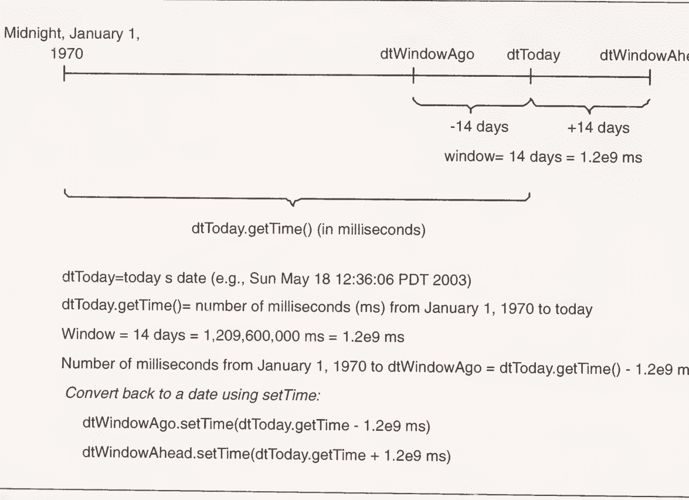

图 6.7 使用 JScript 的 getTime 和 setTime 函数可以轻松执行准确可靠的日期计算。

### 主循环

接下来，让我们检查 DateQuery 脚本的主循环，该循环遍历所有用户帐户并提取创建和过期日期参数以及其他帐户属性。此循环进一步用包含这些新帐户属性的新对象属性填充 `aAccounts` 数组。数组 `aAccounts` 由函数 `QueryDSA` 创建，最初包含具有两个属性的对象：名称（LDAP: sAMAccountName）和 ADsPath（LDAP: ADsPath）。name 属性提供了一个简短、易于识别的对象引用；ADsPath 属性提供了用户帐户的唯一字符串地址，可用于将来引用对象和获取数据。脚本立即使用当前用户对象的 ADsPath 来访问 UserAccountControl 属性。

如前所述，UserAccountControl 表示访问 ADS_USER_FLAG_ENUM 枚举标志的 LDAP 属性。要提取其中一个标志的值，必须对 UserAccountControl 属性和要检查的目标标志执行按位比较，以确定该属性是否为真。这是因为所有 21 个标志都存储在由 UserAccountControl 属性表示的单个值中，按位比较可以精确计算 21 个标志中是否有任何一个被设置。有关如何检查 ADS_USER_FLAG_ENUM 枚举标志的更多详细信息，请参见 DumpUAC 函数部分。

```
//main loop
for(i=0;i<aAccounts.length;i++) {
    objADs=GetObject(aAccounts[i].ADsPath);
//Poll the UAC
    iUAC=objADs.Get("UserAccountControl");
    var ADS_UF_DONT_EXPIRE_PASSWD = 0x10000;
    var ADS_UF_ACCOUNTDISABLE = 0X0002;
```

脚本使用三元运算符检查 ADS_USER_FLAG_ENUM 标志的值，然后设置 `aAccounts` 数组的新对象属性。一旦定义了一个对象（例如 `aAccounts` 中包含的任何帐户对象），可以通过简单地引用 `aAccount[x].someNewProperty` 来添加具有新属性的对象。通过这种方式，脚本设置 `bPwdExpires` 和 `disabled` 属性。

```
aAccounts[i].bPwdExpires=
    (iUAC & ADS_UF_DONT_EXPIRE_PASSWD?true:false);
aAccounts[i].bDisabled=(iUAC & ADS_UF_ACCOUNTDISABLE?true:false);
```

上例中的 `&` 字符是按位与运算符，用于确定某个属性是否被设置。按位与运算在标题为*以矩阵形式显示帐户属性*的章节中有更详细的描述。

### Active Directory 对象日期

AD 包含每个用户对象的创建日期，可以通过 `whenCreated` 属性（Top 类的一个属性）直接访问。

然而，`PasswordLastChanged` 属性仅存在于实际更改过密码的对象中。这意味着从未更改过密码的对象在脚本尝试访问此属性时会返回错误。为了捕获这种情况，脚本将此过程封装在 JScript 的 `try...catch` 语句中。如果获取 `PasswordLastChanged` 属性的尝试失败，则将值设置为空字符串（`""`）。

如果脚本成功获取了 `PasswordLastChanged` 属性，则继续计算密码过期日期，其方式与脚本计算 `dtWindowAhead` 和 `dtWindowAgo` 的方式大致相同。将 `maxPwdAge`（以毫秒存储在 `iPwdExpMs` 中）添加到从 1970 年 1 月 1 日午夜转换而来的毫秒数 `PasswordLastChanged` 日期中。此新值被转换回日期并存储在

dtPwdExpires。以下过程还会关闭遍历 `aAccounts` 数组各成员的主循环：

```
//Get account created date
aAccounts[i].created=new Date(objADs.whenCreated);
//Get password expires date
try{
    dtPwdLastChg=new Date(objADs.PasswordLastChanged);
    dtPwdExpires=new Date(objADs.PasswordLastChanged);
    dtPwdExpires.setTime((dtPwdLastChg.getTime() + iPwdExpMs));
    aAccounts[i].pwdLastChanged=dtPwdLastChg;
    aAccounts[i].expires=dtPwdExpires;
}
catch(e) {
    aAccounts[i].pwdLastChanged="";
    aAccounts[i].expires="";
}
```

### 显示结果

脚本在遍历每个用户账户对象并确定各账户的属性后，会进入处理过程的最后部分。该部分根据运行脚本的用户所选择的选项来显示各种报告。为了提高代码的可读性，每份报告都被隔离为独立的函数，由主程序调用。主程序在调用各函数时会传入函数所需的全部参数，以避免使用全局变量。各报告的详细说明将在其代码描述之后给出。

报告函数执行完毕后，脚本即结束运行。

```
if(objState.verbose) ListAllDetail(aAccounts, strDelimit, iPwdExp);
if(objState.create) ListCreated(aAccounts, strDelimit, dtWindowAgo);
if(objState.expire) ListExpired(aAccounts, strDelimit, dtWindowAhead,
    dtToday);
if(objState.neverExpire) ListPwdExpires(aAccounts, strDelimit);
if(objState.userAccountControl) {
    DumpUAC(aAccounts, aUCTests, objState);
}
if(objState.lockout) {
    ShowLockouts(aAccounts, objDomain);
}
WScript.Quit(0);
```

### ListAllDetail

第一份报告提供了脚本计算的所有日期的详细列表，通过 verbose（-v）标志指定。该函数显示一个标题以及在 `GetMaxPwdAge` 函数中计算出的最大密码有效期（`iPwdExp`）。接下来，报告遍历 `aAccounts` 数组中包含的所有用户账户，并显示账户创建日期、密码上次更改日期以及密码到期日期。此外，如果账户的密码被设置为永不过期或账户已被禁用，则会打印 "x" 标记。

```
//------------------------------------------------------
// Display Detailed Information
//------------------------------------------------------
function ListAllDetail(aAccounts, strDelimit, iPwdExp)
{
    Heading("Account Date Properties");
    WScript.Echo("Domain max password age: " + iPwdExp + " days");
    Tabulate("PD",26,strDelimit);
    Tabulate("Account Created",30,strDelimit);
    Tabulate("Password Last Changed",60,strDelimit);
    Tabulate("Password Expires\n",90,strDelimit);

    for(i=0;i<aAccounts.length;i++){
        Tabulate(aAccounts[i].name,0,strDelimit);
        if (aAccounts[i].bPwdExpires) Tabulate("x",26,strDelimit);
        if (aAccounts[i].bDisabled) Tabulate("x",27,strDelimit);
        Tabulate(aAccounts[i].created,30,strDelimit);
        Tabulate(aAccounts[i].pwdLastChanged,60,strDelimit);
        Tabulate(aAccounts[i].expires+"\n",90,strDelimit);
    }
    WScript.StdOut.Write("P:Password never expires, ");
    WScript.StdOut.Write("D:Account disabled, ");
    WScript.StdOut.Write("\n");
}
```

与详细报告类似，`ListCreated` 和 `ListExpired` 函数也遍历 `aAccounts` 数组，以显示所有符合指定日期条件的用户账户。

### ListCreated

`ListCreated` 函数列出在指定时间窗口内创建的所有账户。

```
//--------------------------------------------------------------------------
// Display Dates Accounts were Created
//--------------------------------------------------------------------------
function ListCreated(aAccounts, strDelimit, dtWindowAgo)
{
    Heading("Accounts Created in the last " + iWindow + " days.");
    Tabulate("Account Name",0,strDelimit);
    Tabulate("PD",26,strDelimit);
    Tabulate("Account Created\n",30,strDelimit);
    for(i=0;i<aAccounts.length;i++){
        if(dtWindowAgo < aAccounts[i].created) {
            Tabulate(aAccounts[i].name,0,strDelimit);
            if (aAccounts[i].bPwdExpires)
                Tabulate ("x",26,strDelimit);
            if (aAccounts[i].bDisabled)
                Tabulate ("x",27,strDelimit);
            Tabulate(aAccounts[i].created + "\n",30,strDelimit);
        }
    }
    WScript.StdOut.Write("\nP:Password never expires, ");
    WScript.StdOut.Write("D:Account disabled, ");
    WScript.StdOut.Write("\n");
}
```

### ListExpired

`ListExpired` 函数显示所有将在指定时间窗口内过期的账户。该函数对 `aAccounts` 进行第二次循环，检查密码到期日期是否已过。此报告对于查找一段时间内未活跃的账户非常有用。这两份报告都不包含已被禁用的账户，即 `aAccounts[i].bDisabled` 属性在主程序中已预先设置为禁用状态的账户。

```
//--------------------------------------------------------------------------
// Display Expired or Soon to Expire Accounts
//--------------------------------------------------------------------------
function ListExpired(aAccounts, strDelimit, dtWindowAhead, dtToday)
{
    Heading("Accounts that will expire in less than " + iWindow +
        " days. \nDisabled accounts not shown.");
    Tabulate("Account Name",0,strDelimit);
    Tabulate("Account Expires\n",30,strDelimit);
    for(i=0;i<aAccounts.length;i++){
        if( (aAccounts[i].expires < dtWindowAhead) &&
            aAccounts[i].expires > dtToday &&
            !aAccounts[i].bDisabled) {
            Tabulate(aAccounts[i].name,0,strDelimit);
            Tabulate(aAccounts[i].expires + "\n",30,strDelimit);
        }
    }
    Heading("WARNING: These accounts should have already expired." +
        "\nDisabled accounts not shown.");
    Tabulate("Account Name",0,strDelimit);
    Tabulate("P",26,strDelimit);
    Tabulate("Date Account Should Have Expired\n",30,strDelimit);
    for(i=0;i<aAccounts.length;i++){
        if(aAccounts[i].expires < dtToday && !aAccounts[i].bDisabled) {
            Tabulate(aAccounts[i].name,0,strDelimit);
            if (aAccounts[i].bPwdExpires) Tabulate ("x",26,strDelimit);
            Tabulate(aAccounts[i].expires + "\n",30,strDelimit);
        }
    }
    WScript.StdOut.Write("\nP:Password never expires, ");
    WScript.StdOut.Write("\n");
}
```

### ListPwdExpires

`ListPwdExpires` 报告使用与前面相同的技术来遍历账户，并显示那些密码被设置为永不过期的账户。

```
//-------------------------------------------------------------------
// Display Accounts that Never Expire
//-------------------------------------------------------------------
function ListPwdExpires(aAccounts, strDelimit)
{
    Heading("Accounts set to never expire. \nDisabled accounts not shown.")
    Tabulate("Account Name",0,strDelimit);
    Tabulate("Account ADsPath\n",30,strDelimit);
    for(i=0;i<aAccounts.length;i++){
        if(aAccounts[i].bPwdExpires && !aAccounts[i].bDisabled) {
            Tabulate(aAccounts[i].name,0,strDelimit);
            Tabulate(aAccounts[i].ADsPath + "\n",30,strDelimit);
        }
    }
}
```

### ShowLockouts

快速检查当前被锁定的账户对于系统管理员来说是一个有用的故障排查工具。`ADS_USER_FLAG_ENUM` 枚举包含一个用于账户锁定的标志；然而，其存在一个实现上的 bug，在 AD 中并不总是能成功更新。为了可靠地获取账户锁定状态，此脚本调用 `ShowLockouts` 函数，该函数绕过 LDAP `User-AccountControl`，通过获取 ADSI WinNT 提供程序的 `IsAccountLocked` 属性来判断账户是否被锁定。使用 WinNT 提供程序连接到主目录服务服务器相当简单。我们已经通过 `CurrentDomain` 函数获取了脚本用户的主目录服务服务器的 DNS 主机名，并将其存储在 `objDomain.winnt` 中。我们可以使用此 DNS 主机名来绑定到该目录服务器上的用户对象，如下例所示：

```
WinNT://directoryserver.domain.com/useraccountname
```

该函数随后使用 `IADsUser` 接口属性方法来访问对象的 `IsAccountLocked` 属性。如果 `IsAccountLocked` 返回 true，则打印该对象的名称。

```
//--------------------------------------------------------------------
// WinNT Provider workaround to enumerate account lockouts
//--------------------------------------------------------------------
function ShowLockouts(aAccounts, objDomain)
{
    Heading("Locked out Accounts");
    for(i=1;i<aAccounts.length;i++) {
        objAccount = GetObject("WinNT://" + objDomain.winnt + "/" +
            aAccounts[i].name);
        if(objAccount.IsAccountLocked) {
            WScript.Echo(aAccounts[i].name);
        }
    }
}
```

### DumpUAC

到目前为止，我们已经多次引用了用户账户对象的 LDAP `UserAccountControl` 属性。现在让我们更深入地了解此属性。ADSI LDAP 提供程序的 `UserAccountControl` 属性提供了对 `ADS_USER_FLAG_ENUM` 枚举的访问，该枚举存储了 21 个账户属性的状态。你也可以通过 WinNT 提供程序的 `userFlags` 属性来访问这些账户属性。这些账户属性可以通过脚本进行读取和设置，而且大多数属性可以

使用 Active Directory 用户和计算机 MMC 工具设置为账户选项，如图 6.8 所示。

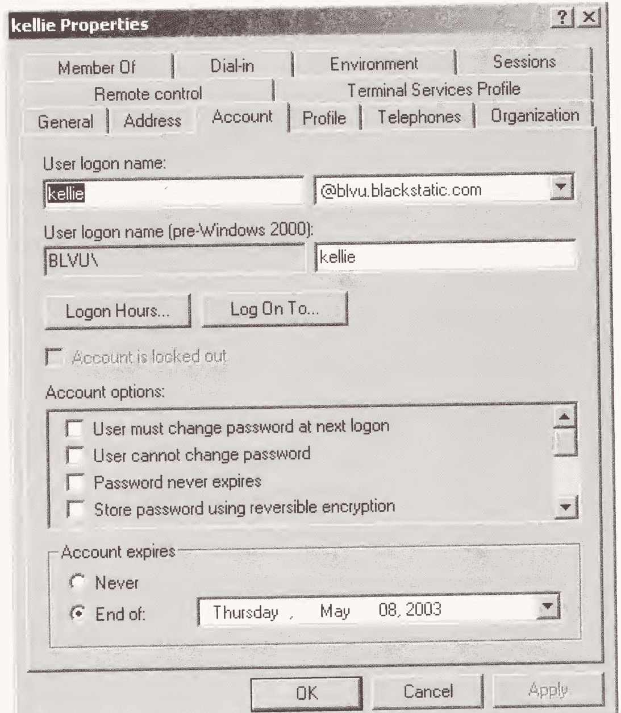

该脚本以矩阵形式或简单列表形式显示所有用户账户对象（例如 `aAccounts` 中包含的对象）的 `UserAccountControl` 属性。此外，用户可以指定要显示哪些属性，这些属性由数组 `aUACTests` 标识。遍历所有用户对象，并对每个用户遍历所有 `UserAccountControl` 属性，需要两个循环。循环的顺序取决于所需的报告类型。

### 以矩阵形式显示账户属性

脚本通过首先遍历每个用户对象，然后遍历每个 `ADS_USER_FLAG_ENUM` 标志来生成矩阵报告。在第一个循环之前，函数构建并显示矩阵标题。脚本遍历数组 `aUACTests` 的每个成员，并显示将要显示的flags编号。`aUACTests` 包含用户指定的标志编号。（如果用户未指定任何特定标志，则包含所有标志编号。）例如，如果用户指定仅显示编号为 2、5 和 12 的标志，则 `aUACTests` 将包含三个成员，索引分别为 0、1 和 2。在此示例中，数组如下所示：

```
aUACTests[0]=2, aUACTests[1]=5, aUACTests[2]=12
```

矩阵的第一行将是 2、5 和 12，每列之间间隔五个字符。

```
//----------------------------------------------------------------------
// Dump UserAccountControl Information
//----------------------------------------------------------------------
function DumpUAC(aAccounts, aUACTests, objState)
{
var bAccountExists;
if(objState.uACMatrix) {
    for(i=0;i<aUACTests.length;i++){
        Tabulate(aUACTests[i],30+i*5,strDelimit);
    }
    WScript.StdOut.Write("\n");
```

显示矩阵标题后，开始第一个遍历 `aAccounts` 的循环。对于此数组的每个成员，脚本使用 `aAccounts[i].ADsPath` 属性绑定到账户，其中 `i` 是循环指定的当前账户的索引。脚本显示账户的名称并获取 `UserAccountControl` 属性。

```
for(i=0;i<aAccounts.length;i++) {
    objADs=GetObject(aAccounts[i].ADsPath);
    Tabulate(aAccounts[i].name,0,strDelimit);
    iUAC=objADs.Get("UserAccountControl");
```

在 `ADS_USER_FLAG_ENUM` 枚举中存储数据的方法很有趣——尤其是对新手程序员而言。回想一下，LDAP `UserAccountControl` 属性包含一个引用所有已设置 `ADS_USER_FLAG_ENUM` 标志的单一值。该值通过累加所有为真的属性来计算。例如，一个普通账户（`ADS_UF_NORMAL_ACCOUNT = 0x0200`）且密码永不过期（`ADS_UF_DONT_EXPIRE_PASSWD = 0x10000`）的 `UserAccountControl` 值为 `0x10200`（`0x0200 + 0x10000`）。所有 21 个 `ADS_USER_FLAG_ENUM` 标志都有不同的定义值，因此当它们相加时，任何为真的标志组合都会求和得到一个唯一的数字。然后可以使用位比较（JScript 中的 `&` 运算符）将此数字与任何单个标志进行比较，以检查该标志是否为真。

> 这些值和计算都是十六进制的，如果你使用 `WScript.Echo`（或使用 ADSIEdit MMC）打印 `UserAccountControl`，该值将以十进制显示。

在获取当前用户账户的 `UserAccountControl` 属性值后，第二个循环遍历数组 `aUACTests` 的每个成员。将 `UserAccountControl` 值逐位与当前 `ADS_USER_FLAG_ENUM` 标志进行比较。使用按位 AND 进行此比较（在 JScript 中为 `&`，在 VBScript 中为 `AND`）。根据前面的示例，`UserAccountControl`（`0x10200`）& `ADS_UF_DONT_EXPIRE_PASSWD`（`0x10000`）将等于 `0x10000`，结果为真。然而，如果未设置 `ADS_UF_PASSWD_NOTREQD` 标志，则 `UserAccountControl` 将仅等于 `0x200`（`ADS_UF_NORMAL_ACCOUNT` 为真），且（`0x10000 & 0x200`）结果为零位匹配，为假。使用此过程，脚本将 `aUACTests` 中的每个成员与 `UserAccountControl` 值进行比较，并为每个匹配项在控制台显示一个 `x`。

```
for(j=0;j<aUACTests.length;j++){
    if (iUAC & aUAC[aUACTests[j]].value) {
        Tabulate ("x",30+j*5,strDelimit);
    }
    else { Tabulate ("-",30+j*5,strDelimit);}
}
WScript.StdOut.Write("\n");
}
WScript.StdOut.Write("\n");
```

最后，脚本通过遍历 `aUACTests` 的每个成员并显示其编号和描述，来显示每个已执行测试的图例。

```
for(i=0;i<aUACTests.length;i++){
    Tabulate(aUACTests[i] + ") ",0,strDelimit);
    Tabulate(aUAC[aUACTests[i]].desc+"\n",5,strDelimit);
}
}
```

### 以列表形式显示账户属性

脚本可以生成的第二种 `UserAccountControl` 报告是按 `ADS_USER_FLAG_ENUM` 标志列出的账户列表。可以将此报告视为矩阵报告的反向。外部循环遍历 `aUACTests` 数组中包含的所有指定标志，内部循环遍历 `aAccounts` 中包含的所有账户。如果某个账户对特定属性测试为真，则显示其名称。

```
else {
    for(i=0;i<aUACTests.length;i++){
        bAccountExists=false;
        WScript.Echo(aUACTests[i] + ") " + aUAC[aUACTests[i]].desc
            + " (" +aUAC[aUACTests[i]].name + ")");
        for(j=1;j<aAccounts.length;j++) {
            objADs=GetObject(aAccounts[j].ADsPath);
            iUAC=objADs.Get("UserAccountControl");
            if (iUAC & aUAC[aUACTests[i]].value) {
                Tabulate (aAccounts[j].name + "\n",5,strDelimit);
                bAccountExists=true;
            }
        }
        if(!bAccountExists) WScript.Echo("-none-");
        WScript.StdOut.Write("\n");
    }
}
}
```

### GetMaxPwdAge

要计算实际的密码过期日期，脚本必须确定域的最大密码龄设置。此值是特定于域的，可以在域对象的 `maxPwdAge` 属性中找到。函数 `GetMaxPwdAge` 返回指定域的最大密码龄（以天为单位）。该函数输入域的标识名（例如 `LDAP://dc=domain,dc=com`）。使用此值，函数绑定到域并获取 `maxPwdAge` 属性。`maxPwdAge` 值是一个负值的八字节大整数，表示以 100 纳秒为单位的最大密码龄。

在使用此值之前，必须将大整数转换为可用数字，然后将值从 100 纳秒单位转换为天。脚本调用函数 `ConvertNanoDays` 进行此转换，取该数字的绝对值（使正数或负数变为正数），然后将数字四舍五入到最接近的整数。结果值即为以天为单位的最大密码龄。

```
//-------------------------------------------------------------------
// Get the maximum password age
//-------------------------------------------------------------------
function GetMaxPwdAge(strADsPath)
{
    var objADs, objMaxPwdAge, iMaxPwdAge;
    objADs=GetObject(strADsPath);
    objMaxPwdAge=objADs.Get("maxPwdAge");
    iMaxPwdAge=Math.round(Math.abs(ConvertNanoDays(objMaxPwdAge)),0);
    return(iMaxPwdAge);
}
```

### ConvertNanoDays

AD 将一些大整数属性存储为八字节（64 位）对象，由 *high part* 和 *low part* 各 32 位组成。AD 返回一个具有 high part 和 low part 属性的对象。在使用这些值之前，必须提取并合并这些部分。high part 包含高 32 位，low part 包含低 32 位。要组装一个大整数，请使用以下公式：*assembled value = high part * 2^32 + low part*（在 JScript 中，2^32 使用 pow 方法表示为 `Math.pow(2,32)`）。

例如，如果 high part = -18,105，low part = 382,894,080，则：

*assembled value* = (-18,105 * 2^32) + 382,894,080 = -77,760,000,000,000

该值的单位是 100 纳秒间隔，因此脚本使用以下关系将值转换为天：每纳秒 100 个 100 纳秒间隔，每秒 1x10^9 纳秒，每天 86,400 秒。使用前面的示例，原始值转换为 90 天：

| 步骤 | 值 |
|---|---|
| high part | -18,105 |
| low part | 382,894,080 |
| assembled value | -18,105 * 2^32 + 382,894,080 = -77,760,000,000,000 |
| iOneHundredNanoSeconds | -77,760,000,000,000 |
| iNanoSeconds | -7,776,000,000,000,000 |
| iSeconds | -7,776,000 |
| iDays | -90 |

```
//-------------------------------------------------------------------
// Convert 8ByteInteger 100 Nanosecond Interval to Days
//-------------------------------------------------------------------
```


function ConvertNanoDays(objLargeInteger)
{
  var iOneHundredNanoSeconds, iNanoSeconds, iSeconds, iDays;
  iOneHundredNanoSeconds=objLargeInteger.HighPart * Math.pow(2,32) +
    objLargeInteger.LowPart;
  iNanoSeconds=iOneHundredNanoSeconds * 100;
  iSeconds=iNanoSeconds * Math.pow(10,-9);
  iDays=iSeconds / 86400;
  return(iDays);
}

### CurrentDomain

`CurrentDomain` 函数用于确定运行脚本的用户账户的域。第 4 章对此有详细说明。

```
//------------------------------------------------------------------------------
// Discover the domain of the user context running the script
//------------------------------------------------------------------------------
function CurrentDomain()
{
  var objDomain=new Array()
  var objRootDSE = GetObject("LDAP://RootDSE");
  objDomain.winnt=objRootDSE.Get("dnsHostName");
  objDomain.ldap=objRootDSE.Get("defaultNamingContext");
  return objDomain;
}
```

### QueryDSA

`QueryDSA` 函数的工作方式与第 4 章中的 `QueryDS` 函数类似，但它不是将结果填充到一个简单的数组中，而是定义一个新数组，并用对象来填充它，每个对象包含两个属性：ADsPath 和 Name。数组成员是一个对象，遍历 RecordSet 对象的循环会显式定义对象的属性。回顾一下前面如何用字面量定义对象的示例：

```
someObj= { name: "some name", value: someValue};
```

同样，对象也可以定义为数组元素：

```
someArray[i]= { name: "some name", value: someValue};
```

属性也可以是变量。`QueryDSA` 从 ADSI 查询返回的 RecordSet 对象数据中获取 ADsPath 和 name 属性的值并赋给对象。对象定义完成后，可以直接添加其他属性，例如 expired、pwdLastChanged 等在主程序中赋值的属性。

```
//-------------------------------------------------------------------
// Query Active Directory given an LDAP query parameter - return Array
//-------------------------------------------------------------------
function QueryDSA(strCommandText)
{
  var aAccounts = new Array();
  objConnection = new ActiveXObject ("ADODB.Connection");
  objConnection.Provider = "ADsDSOObject";
  objConnection.Open;
  objCommand = new ActiveXObject("ADODB.Command");
  objCommand.ActiveConnection = objConnection;
  objCommand.Properties("Page Size") = 999;
  objCommand.Properties("Sort On") = "Name";
  objCommand.CommandText=strCommandText;
  objRecordset=objCommand.Execute();
  j=1;
  while (!objRecordset.EOF) {
    aAccounts[aAccounts.length] = {
      ADsPath : objRecordset.Fields.Item("ADsPath").Value,
      name : objRecordset.Fields.Item("sAMAccountName").Value};
    j++;
    objRecordset.MoveNext;
  }
  return aAccounts;
}
```

### Heading、Usage、ParamError 和 Tabulate

`Heading`、`Usage`、`ParamError` 和 `Tabulate` 函数均沿用自第 4 章和第 5 章，其构建细节可以在之前的讨论中找到。

```
//-------------------------------------------------------------------
// Format headers in the output
//-------------------------------------------------------------------
function Heading(strMessage)
{
  WScript.Echo("\n-------------------------------------------------------------");
  WScript.Echo(strMessage);
  WScript.Echo("-------------------------------------------------------------");
}
```

```
//-------------------------------------------------------------
// Display the help screen
//-------------------------------------------------------------
function Usage()
{
  WScript.Echo("Tool to list user account date information");
  WScript.Echo("Usage:");
  WScript.Echo("DateQuery -cenu[m]v -D [Domain] " +
               "-d [delimiter] [criteria] -w [time window]:");
  WScript.Echo("-c list dates accounts were created");
  WScript.Echo("-e list dates accounts will expire");
  WScript.Echo("-n list accounts with passwords set to never expire");
  WScript.Echo("-l list locked out accounts");
  WScript.Echo("-u list user account settings");
  WScript.Echo("-um list user accounts settings in a matrix format");
  WScript.Echo("-v verbose mode");
  WScript.Echo("-D [domain] specify domain other than default");
  WScript.Echo("-d [delimiter] specify delimiter to separate fields.");
  WScript.Echo("-? Help");
  WScript.Echo("");
  WScript.Echo("Example:");
  WScript.Echo("DateQuery -c -w 14 : Displays accounts created in last");
  WScript.Echo(" 14 days.");
}
```

```
//-------------------------------------------------------------
// Display An error if a dependant script parameter is not included
//-------------------------------------------------------------
function ParamError()
{
  Heading("Parameter Error Received. Please check syntax.\n");
  Usage();
  WScript.Quit();
}
```

```
//-------------------------------------------------------------
// Display output in left-aligned columns
//-------------------------------------------------------------
function Tabulate(strData, iColumn, strDelimit)
{
  while(WScript.StdOut.Column<iColumn)
  {WScript.StdOut.Write(strDelimit);}
  WScript.StdOut.Write(strData);
}
```

### 总结

本章描述的 `DateQuery` 脚本完成了三个以 ADSI 为核心的控制台脚本。如你所见，尽管每个脚本专注于不同的任务，甚至使用了不同的技术，但它们的设计从根本上遵循着类似的模式。`DateQuery` 演示了如何查询、处理和显示日期相关的账户信息以及用户账户属性。ADSI 包含丰富的信息，本脚本介绍了几个较复杂的 ADSI 属性的提取、处理和显示方法。处理日期和大整数的技术可以扩展到本脚本未使用的其他 ADSI 属性。例如，ADSI 的 `lastlogon` 属性也以大整数格式存储，ADSI 使用超过 30 种枚举来存储其他目录数据。你可以使用与获取 `ADS_USER_FLAG_ENUM` 数据类似的技巧来访问它们。

### 关键要点

-   ADSI 中的大多数数据可以通过简单的属性和方法来检索和显示。然而，某些 AD 数据以大整数或位域的形式存储，需要提取和处理才能解释结果。
-   解码 `ADS_USER_FLAG_ENUM` ADSI 枚举，可以访问 ADSI 的 21 个属性，例如密码是否将过期或账户是否被禁用。
-   日期时间运算可能比较棘手；寻找一种将日期转换为整数的方法（例如自 1970 年 1 月 1 日以来的毫秒数），然后你就可以安全地在该数字上加减适当的单位，再将其转换回日期。
-   AD 中的许多时间值以大整数（八个字节长）的形式存储。将转换后的高部分加到低部分上，然后转换为你所需的单位。

# 7 摆脱批处理文件——全新的登录脚本

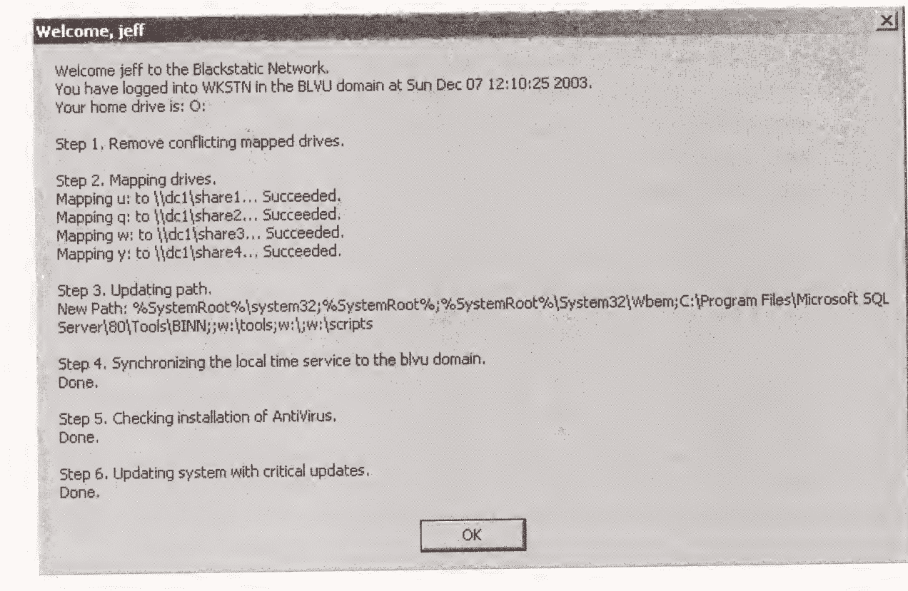

## 概述

网络登录脚本能够可靠地提供一种集中管理的方法，将通用的本地和网络设置分发给登录到网络的所有客户端。实用型脚本将网络共享映射到本地驱动器、更新环境变量、运行程序更新或补丁、加载防病毒程序等关键软件、设置本地计算机时间以及执行大量其他功能。偏向趣味性的脚本则会向用户打招呼并欢迎他们登录网络，或许还会提供一些类似中国幸运饼干上的"每日寄语"之类的建议。

即使有了 Windows 2000 组策略和其他面向企业集中管理的迁移手段，登录脚本仍然是向众多客户端分发任意代码或设置的主要方式之一，在其中扮演着关键角色。

登录脚本为处理用户登录提供了逻辑和结构。那些可能最初只是一条简单 `NET USE` 语句来映射驱动器的批处理文件，已经演变为能够调整或报告系统大部分运行状况的脚本。登录脚本提供了丰富的功能。例如，一个更智能的登录脚本不会每次用户登录时都反复尝试修补系统，而是首先检查注册表设置或其他来源以确定更新是否已应用。设想一个更精细的登录脚本，它不仅能映射驱动器，还能对计算机执行基本诊断、检查正在运行的服务，并在磁盘空间不足时向用户（或系统管理员）发出警告。你能将登录脚本扩展到什么程度，仅受限于你的想象力（当然，还有时间）。

企业中流行的应用程序，包括 Microsoft Systems Management Server® 和 Symantec Norton Anti-virus Corporate Edition®，都将登录脚本作为其产品的多种安装机制之一。登录脚本的另一个好处是，它们可以在任何登录到网络的客户端上运行——从 Windows 3.1 到 Windows Server 2003。请记住，编写登录脚本时要考虑哪些平台可能会登录到你的网络，或者提供与旧客户端兼容的向下兼容脚本。但如果你运行的是 Windows 2000 或更高版本的网络，你不仅可以利用本章中的各种方法，还能很好地在登录脚本中扩展和使用许多最新技术——如 WMI 和 ADSI。

> 登录脚本在资源管理器加载并将控制权交给用户之前运行。这意味着配置不当的登录脚本可能会导致你的计算机在登录时挂起。请务必彻底测试你的登录脚本，并包含错误处理以降低脚本挂起的风险。此外，请在测试实验室中测试你的脚本，确保可以从另一台计算机编辑有问题的脚本。如果你通过本地计算机策略配置了登录脚本且计算机挂起（可能意味着你完全无法登录），请记住计算机的网络连接已经处于活动状态。使用第二台计算机远程访问挂起计算机的文件系统，删除或编辑有问题的脚本，然后重启（例如，对于 Windows 2000 服务器，访问管理共享 c$，编辑位于 \\machinename\c$\winnt\system32\grouppolicy 中的脚本，然后编辑 User 目录中的登录/注销脚本或 Machine 目录中的启动/关机脚本）。


## 场景

贵公司已从一个以 Windows NT 4.0 域为主的环境迁移过来，最近开始利用 AD 和 Windows 2000。作为一家中型工程公司的系统管理员，您期待对自己的计算环境拥有更精细的控制。您计划实施组策略、磁盘配额以及其他 Windows 2000 功能。不过，今天您有一个更迫切的需求。您需要在环境中的各种计算机上部署一组补丁。此外，您预感供应商会不断推出更新，因此需要一种便捷的方法来更新部署机制以包含最新的补丁。最终，您将部署 Windows 软件更新服务，但目前您正在寻找一种快速方法来部署跨供应商的更新（不仅仅针对 Microsoft 产品）。您还想在尝试安装软件更新之前检查计算机的注册表，以确认该更新是否已经安装过。

过去，您一直依赖批处理文件登录脚本，现在您想知道是否可以将登录脚本更新为用于部署补丁，并为新的 Windows 2000 域提供新的登录脚本功能。您当前的批处理文件登录脚本会映射网络驱动器、修改搜索路径、设置当前时间并安装杀毒软件客户端。您想将其重新编码为 JScript 并增强其功能。除了提供基本的补丁部署服务外，您还想跟踪网络用户的实际登录时间和日期以及他们所登录的计算机，并将这些信息记录到集中式共享上的一个文本文件中。

## 分析

将批处理文件登录脚本转换为使用 Windows 脚本语言编写的脚本，可以更好地控制程序逻辑，同时还能访问许多 Windows 对象模型。起初您可能认为批处理文件登录脚本更简单、更简短。虽然对于基本脚本来说或许确实如此，但使用 JScript 或 VBScript 可以使代码的可管理性和适应未来变化的灵活性大大提高。

此外，您可以相当快地将批处理文件对外部命令的调用转换为使用 WSH 的 exec 或 run 方法的 WSH 脚本。这些方法使您的脚本能够启动外部应用程序——这是登录脚本的一项常见功能。使用这些方法调用第三方或供应商提供的批处理文件或命令行工具，这些工具不受 WSH 支持。您的需求对应于表 7.1 中列出的以下技术要求。

### 表 7.1 将登录脚本目标转化为技术要求

| 业务目标 | 技术要求 |
| --- | --- |
| 向域中所有尚未安装补丁的系统部署跨供应商补丁。 | 检查注册表中是否有特定的更新键，以表明该更新是否已经安装。如果尚未安装，则安装该更新。将所有更新及其注册表安装检查存储在可扩展标记语言 (XML) 文件中。 |
| 映射网络驱动器。 | 使用 WSH Network 对象删除冲突的驱动器映射，并添加存储在 XML 配置文件中的新驱动器映射。 |
| 修改搜索路径。 | 从 XML 配置文件中读取所需的路径添加项，如果它们尚不存在，则将其添加到用户路径中。 |
| 设置当前时间。 | 运行外部命令 NET TIME，将 Windows NT 4.0 计算机与域网络时间协议 (NTP) 服务器同步。 |
| 安装杀毒软件。 | 运行外部命令检查公司杀毒软件是否已安装。 |
| 记录登录信息和错误。 | 在所有人都可以访问的网络共享上创建或追加文本文件，并更新登录时间和任何已部署的更新。 |

这些技术要求对应于以下功能：

- **存根程序：** 主 JScript 登录脚本的批处理文件启动器。
  - 集中记录用户的登录。
  - 确保使用所需的 WSH 引擎执行主登录脚本。

- **主程序：** 包含登录脚本的主要代码。
  - 构建欢迎消息。
  - 通知用户其主目录。
  - 映射主目录和网络驱动器。
  - 扩展用户的目录搜索路径以包含其他常用目录。
  - 将时间同步到网络时间协议 (NTP) 服务器。
  - 调用杀毒软件包的安装程序。

- **日志文件**
  - 向网络共享或本地文件夹提供基于文件的日志服务。
  - **制表文件：** 与之前的制表函数类似，制表文件将输出格式化为日志文本文件。

- **补丁系统：** 提供用于部署程序更新和补丁的注册表检查服务。

- **评估条件：** 补丁系统的辅助函数。

- **检查注册表：** 提供用于部署更新和补丁的注册表查找功能。

### 分发和安装

登录脚本可以分配给域用户或本地计算机用户。域登录脚本可以在 AD 用户和计算机中指定，也可以在 GPO 中指定。如图 7.1 所示，使用 AD 用户和计算机指定登录脚本，可以使您的登录脚本能够被 Windows NT 4.0 计算机访问，并且这些脚本存储在 Windows 2000 域控制器的 NETLOGON 共享中，该共享物理映射到域控制器的 %Windir%\SYSVOL\sysvol\[domainname]\scripts 目录。该目录会复制到所有其他域控制器。

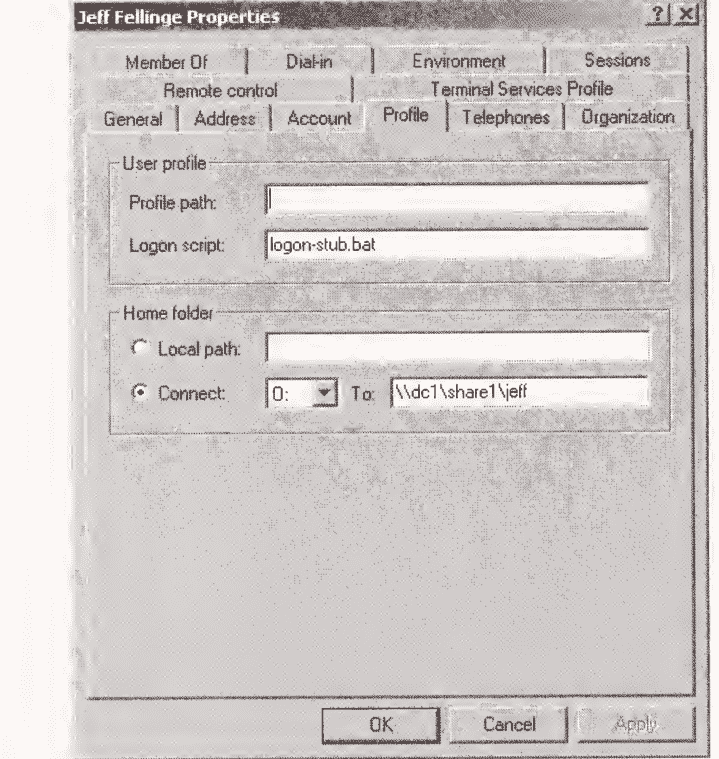

分配*本地*用户登录脚本的方法是：在目标计算机上打开计算机管理小程序，导航到本地用户和组，然后选择用户。双击该用户，单击配置文件选项卡，然后指定首选登录脚本的名称。本地登录脚本通常存储在 `%windir%\System32\Repl\Import\Scripts` 中。

# 使用组策略部署登录脚本

登录（以及注销、启动和关机）脚本也可以通过 GPO 分配，如图 7.2 所示，这使您能够将特定的登录脚本分配给域、站点、OU 或定义了组策略的任何其他位置。

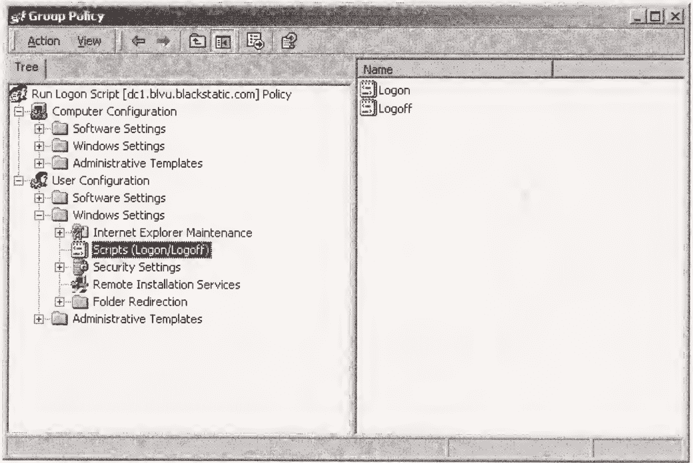

请记住，对用户进行域认证的身份验证域控制器也会向该用户提供登录脚本。将新的登录脚本复制到域控制器后，请留出时间让该脚本复制到网络中的其他域控制器。

回想一下，Windows 默认使用 *wscript.exe* WSH 引擎，某些用户可能会将此默认设置更改为基于控制台的 *cscript.exe* 引擎。正如我们在前面几个脚本中看到的，某些脚本对象和方法并非两种引擎都可用（例如，*wscript.exe* 不支持用于输入和输出数据的标准流）。为了确保您的脚本在环境中所有系统上可靠运行，我们指定用于执行脚本的引擎。为了确保每次都能使用首选引擎运行脚本，我们使用登录存根。登录存根是一个批处理文件，它使用首选引擎调用主登录脚本，然后退出。

这个批处理文件不必很复杂——可能只有一行（尽管下面示例中使用的实际 *logon-stub.bat* 文件提供了更多功能）：

```
call cscript %0\..\logon-body.js
```

此命令只是使用 *cscript.exe* 引擎调用 JScript 文件 *logon-body.js*。前缀 %0\..\ 确保 *logon-body.js* 的目录路径与调用批处理文件的目录路径相同（即，两个文件位于同一目录中）。此批处理文件中的变量 %0 包含批处理文件的名称和位置。因此，如果从 \\dc1\NETLOGON 调用，则 %0 将包含：\\dc1\NETLOGON\logon-stub.bat。整个参数 %0\..\logon.js 展开为 \\dc1\netlogon\logon.bat\..\logon.js。参数 .. INTERRUPash 指向对象的父目录，因此参数 \..\ 实际上会退回到文件名之上并仅返回路径（根据我们前面的例子，\\dc1\netlogon\）。请注意，这只是有效结果，意味着如果您展开 %0\..\logon.js，您会看到 \\dc1\NETLOGON\logon.bat\..\logon.js。通过附加新的批处理或脚本文件名，我们可以始终确保此第二个文件的确切位置，并且我们可以放心，从此批处理文件调用的任何后续文件如果存在于调用脚本所在的同一文件夹中，都将正常工作。（或者，如果您不介意将脚本放在用户登录的域控制器上，您也可以将第二个脚本的位置硬编码到所有用户都可以访问的网络共享。）

# 操作系统兼容性

每个登录到域的设备都会运行您的登录脚本，这要求您考虑操作系统和应用程序版本的兼容性。例如，如果有人使用运行 Windows NT 4.0 的计算机登录到您的网络，它能处理您的登录脚本吗？如果不能，它会挂起、崩溃还是正常退出？在编写必须部署到各种系统的脚本时，请考虑它们是否识别以下技术：

- **Active Directory 组策略** — Windows NT 4.0 无法识别。
- **ADSI** — 必须在基于 Windows 2000 之前的计算机上安装 ADSI 扩展，才能提供部分（并非全部）兼容性。
- **WMI** — 可以在早期操作系统上安装 WMI 核心组件，但即使是较新的 Windows 操作系统（如 Windows XP 和 Windows Server 2003）也提供了 Windows 2000 所没有的新类。
- **WSH** — Windows 2000 安装的是 WSH 5.1；当前 WSH 版本为 5.6。
- **XML** — Windows 2000 安装的是 MSXML 2.5。MSXML 支持并行安装，当前版本为 4.0。

本章介绍的登录脚本设计用于基于 AD 的域中运行 Windows 2000 及更高版本的计算机；但是，本章中的脚本
[/招人


在脚本中加入错误处理和软件版本检查功能，以便在遇到不支持的功能时能够优雅地退出（尽管后续功能会被中止）。例如，如果你选择使用 AD 组策略（而不是用户账户管理中的配置文件选项卡），运行 Windows NT 4.0 的计算机将不会处理这些脚本，但它们不应锁定系统或造成其他不良影响。该脚本需要同时安装 WSH 5.6 和 MSXML 3.0，但不使用 WMI 或 ADSI 技术。

# 输出

登录脚本会显示一个对话框，欢迎用户登录网络，并显示用户特定的信息。用户可以关闭该对话框，或者它会在 30 秒后自动关闭。

## 解决方案概要

你将创建两个文件：`logon-stub.bat` 和 `logon-body.js`，用于处理域用户的登录脚本功能。`logon-stub.bat` 文件是一个 MS-DOS 批处理文件，它通过 `cscript.exe` 引擎简单地调用 `logon-body.js` WSH 脚本。`logon-body.js` 脚本文件执行登录脚本的实际工作。这两个文件将被复制到域控制器的 NETLOGON 共享或特定的组策略登录脚本文件夹中，然后将被复制到你域中的所有其他域控制器。

登录信息、状态和错误日志将被记录到一个集中的位置。此信息记录了谁在何时登录了哪台计算机。

# 目标

此脚本演示了使用 Windows 脚本技术编写登录脚本，以提供比传统 MS-DOS 登录脚本更强大的功能和灵活性。脚本使用了以下对象：

### 数组
- length
- 循环遍历数组

### 错误捕获
- try...catch

### MSXML
- async
- getAttribute
- getElementsByTagName
- item
- length
- load
- parseError
- resolveExternals
- selectSingleNode
- setProperty

### RegExp
- match

## Scripting.FileSystemObject
- OpenTextFile
- Column
- CreateTextFile
- WriteLine

### WScript.Arguments
- Length

### WScript.Network
- ComputerName
- ExpandEnvironmentalStrings
- UserDomain
- UserName

### WScript.Shell
- Environment("Process")
- Environment("System")
- Environment("User")
- Run
- RegRead
- Popup

# 脚本

本章中的登录脚本实际上由两个脚本和一个配置文件组成：logon-stub.bat、logon-body.js 和 logon-config.xml。logon-stub.bat 的主要目的是确保使用适当的 WSH 引擎（cscript.exe）调用 logon-body.js，因为 logon-body.js 脚本使用了仅在此引擎中可用的方法和属性。此脚本通过使用此配置文件引入了 XML，并开始描述使用 XML 为你的脚本带来的一些好处。XML 的普及度不断提高，现在许多新的 IT 工具都支持导出 XML 格式的数据。了解 XML 的基础知识，即使只是通过像这样的基本脚本，也将帮助你在未来使用自己的脚本操作来自其他程序的 XML 数据。在查看登录脚本之前，让我们先通过检查此脚本使用的 XML 配置文件来简要介绍 XML。虽然此配置文件包含对我们尚未介绍的登录脚本的具体引用，但回顾 XML 文件的功能和形式为后面讨论实际登录脚本奠定了基础。

### 为什么使用 XML？

登录脚本使用一个 XML 数据文件来存储登录脚本配置信息。XML 是存储此数据的理想方法，因为它具有自我描述性（即，它不需要像数据库那样单独的外部结构或定义，尽管你可以选择定义一个外部结构，这称为模式），并且用于读取和访问数据的对象和方法非常适合处理各种数量的数据。此外，使用 XML 时，你可以按任何你希望的方式定义 XML，只要它是格式良好的。格式良好的 XML 遵循 XML 标准——基本上是一套规则。其中一些规则在“XML 配置文件”部分中进行了描述，该部分解释了配置 XML 数据文件的布局。XML 允许你定义自己的数据层次结构。例如，除配置信息外，此脚本的 XML 数据文件还定义了应安装哪些更新。使用 XML，你可以轻松添加新的更新。每个更新可以有一个或多个相关的标准来评估是否需要更新。在 XML 中，添加新的更新或标准就像添加定义新数据的新行一样简单。

由于 XML 本质上是层次化的，你不需要像使用文本文件存储数据时那样担心编写复杂的解析例程来处理新的或特殊的数据。MSXML 文档对象模型（DOM）提供了一组内置的方法和属性，通常可以为你处理数据解析。在你审查以下代码时，请参考实际的 XML 配置文件，并注意脚本如何分层访问数据。理解 XML 可能一开始有点令人困惑，但想想你可能会如何使用文本文件和 FileSystemObject 编码来处理这个问题。你会同意使用 XML 可以节省你大量的时间和精力，因为它为你处理了大部分的数据组织和解析工作。许多实用程序除了支持更传统的 CSV、TSV 或其他格式化的文本外，开始支持 XML 数据输出。了解如何操作 XML 数据对于操作和显示这些应用程序的输出非常有用。此脚本示例涵盖从特定配置文件加载数据，但这些概念可以扩展到解析任何类型的 XML 数据。

### XML 配置文件

XML 数据文件提供了一个存储登录脚本使用的配置数据的位置，这些数据可能因域而异。XML 数据看起来类似于 HTML，因为它使用标签（`<tag>`）来分隔对象。此脚本中提供的 XML 是基本的，不包括 XML 模式。XML 模式描述了数据必须遵守的结构和规则（例如，如果数据是字母数字混合的，其长度是否必须唯一等等）。如果你计划处理更大或更复杂的数据集，或者希望向可能使用你的 XML 数据的其他人提供清晰度，那么定义一个显式的 XML 模式是个好主意。

XML 数据的结构相当简单，并遵循一套基本规则。元素用标签描述，例如 `<element>`，它们有一个开始标签和结束标签。结束标签用斜杠表示，例如 `</element>`。元素文本在标签之间描述——`<element>some data text</element>`——不需要引号。属性是分配给元素的附加名称-值对。例如，在 XML 元素 `<domain ntp="b1vu" name="Blackstatic">` 中，元素名称是 domain，它的两个属性是 ntp 和 name，它们的值分别是 b1vu 和 Blackstatic。

必须定义一个单一的顶层节点来包含所有其他元素；在我们的登录脚本示例中，顶层节点是 `<config>`。在 `<config>` 之下是两个元素，`<domain>` 和 `<updates>`。`<domain>` 元素包含登录脚本的配置信息，包括各种日志的位置、主驱动器和映射驱动器的定义，以及应添加的路径语句。你可以有多个并行的不同名称的元素，并且通常可以自由地为任何元素分配属性。虽然没有定义显式的模式，但如果定义了，它将只允许三个日志：一个类型为错误，一个类型为登录，最后一个类型为补丁。它只允许一个主驱动器，但允许多个映射驱动器和路径元素。现在你可能开始明白为什么使用 XML 配置文件确实提高了脚本的灵活性。要添加另一个映射驱动器，只需复制并粘贴一个 `<mapdrive>` 元素，并添加驱动器属性和共享文本，脚本下次运行时就会自动包含它。

XML 数据文件的第二部分定义了我们希望登录脚本部署的更新。`<updates>` XML 结构允许多个 `<patch>` 元素，每个 `<patch>` 元素可以有一个或多个 `<criteria>` 元素。在部署某个 Microsoft 产品更新时，请考虑这种灵活性。对于一个给定的更新公告，你可能有多个版本的更新——一个用于 Windows NT，一个用于 Windows XP/2000/2003。接下来，你可能需要检查特定的产品版本。例如，Internet Explorer 5.01、5.5、6.0 和 6.0sp1 可能各自都有单独的更新。通过添加更多的 `<criteria>` 元素，你可以根据需要添加任意数量的子句。在下面的 XML 代码示例中，定义了一个补丁，其 `qfeid="sample"`。如果满足条件，登录脚本将运行位于 \\wkstn\patch 共享上的文件 applypatch.js。在此示例中，只有一个条件

已定义。脚本会在注册表中查找键 `HKLM\SOFTWARE\sample\Sample Patch`，其值是否为 1。如果该键存在且值为 1，则根据 `installIfTrue` 属性，脚本将不会安装该补丁。

```
<config>
  <domain ntp="blvu" name="Blackstatic">
    <log type="error">\\wkstn\logon\logon-errors.txt</log>
    <log type="logon">\\wkstn\logon\logon-log.txt</log>
    <log type="patch">\\wkstn\logon\patch-log.txt</log>

    <homedrive drive="p:">\\dc1</homedrive>

    <mapdrive drive="u:">\\dc1\share1</mapdrive>
    <mapdrive drive="q:">\\dc1\share2</mapdrive>
    <mapdrive drive="w:">\\dc1\share3</mapdrive>
    <mapdrive drive="y:">\\dc1\share4</mapdrive>

    <path>w:\tools</path>
    <path>w:\</path>
    <path>w:\scripts</path>
  </domain>
  <updates>
    <patch qfeid="sample" patchfile="\\wkstn\patch\applypatch.js">
      <criteria regpath="HKEY_LOCAL_MACHINE\SOFTWARE\Sample\Sample Patch" value="1" installIfTrue="no"/>
      <criteria regpath="HKEY_LOCAL_MACHINE\SOFTWARE\Sample\Version Number" value="10.0" installIfTrue="yes"/>
    </patch>
  </updates>
</config>
```

### 启动 Stub

下面给出了用于启动主 WSH 登录脚本的简单批处理文件代码。

> 该脚本由四行实际代码组成。在以下文本中，前两行和后两行实际上是单行，但由于本文的页面宽度限制而显示为两行。它们已经为可读性做了偏移处理，但在你的代码中应该是单行。

第一行使用 MS-DOS 批处理 `echo` 命令和重定向追加运算符（`>`），将日期、时间、用户名和计算机名写入位于网络共享 `\\wkstn\logon` 上中心位置的名为 *logon.txt* 的文本文件中。

（你需要更改此共享以反映你自己的环境。）下一行显示运行脚本的实际位置，通常仅供信息参考。了解此位置在排查从你的脚本调用的外部命令或批处理文件运行不正常的原因时很有用。有时问题可以追溯到缺失的文件或不正确的路径。第三行使用 *cscript.exe* 引擎调用主登录脚本，如前所述。*logon-body.js* 脚本的参数是一个 XML 登录脚本配置文件。最后一行将调用 *cscript.exe* 登录脚本时产生的任何错误报告到同一个 *logon.txt* 文件中。

```
echo %date%-%time% :: %USERNAME% logged in to %computername% > \\wkstn\logon\logon.txt
echo - Running logon script from: %0 > \\wkstn\logon\logon.txt
call cscript %0\..\logon-body.js logon-config.xml
If Errorlevel 1 echo Error: Check WSH installation and script location > \\wkstn\logon\logon.txt
```

*此脚本在 CD-ROM 上以 /chapter 7/scripts/logon-stub.bat 提供。它设计为与本章的第二个脚本 logon-body.js 配合使用，该脚本同样位于 CD-ROM 的此文件夹中：/chapter 7/scripts.logon-body.js。如前所述，请记住在部署到任何生产系统之前，先在测试环境中测试此脚本。*

### 激活登录脚本

将脚本复制到域控制器 NETLOGON 共享或测试域的 AD 组策略登录脚本目录后，通过 AD 用户和计算机或 AD 组策略激活登录脚本。

#### 在用户级别激活登录脚本

使用 AD 用户和计算机为每个用户配置登录脚本是最直接的方法——但也是设置最耗时的，因为你必须为域中的每个用户执行此操作。（当然你应该将其编写为脚本！）导航到要设置登录脚本的用户对象，双击打开其属性。单击配置文件选项卡，在登录脚本字段中输入登录脚本的名称，本例中为 *logon-stub.bat*，如图 7.1 所示。此外，还可以选择输入用户 *主文件夹* 的相关信息。我们将在 *映射驱动器与主驱动器* 一节中介绍主文件夹和主驱动器，该节涵盖登录脚本的驱动器映射功能。将登录脚本调用的任何文件复制到域控制器的 NETLOGON 共享之一中，它们将被复制到其他域控制器并可供登录脚本使用。就这样。注销并重新登录到成员服务器（或域控制器），登录脚本应自动运行。

#### 激活和使用 Active Directory 组策略

使用组策略配置和部署登录脚本稍微复杂一些。你应该理解并熟悉组策略，因为此处的更改可能会影响域中的部分或所有用户。与所有这些脚本一样，请先部署到测试域中，以确保脚本中的所有问题都已得到解决，包括对外部脚本、实用程序或程序的调用。

> 将登录脚本应用于特定用户可以通过多种方式实现，你如何在自己的环境中实施类似方案取决于你自己的 AD 设计和策略。例如，我们可以创建几个 OU，并为每个 OU 应用自定义 GPO。或者我们可以创建一个全域 GPO，为整个域定义登录脚本策略，然后对包含排除账户的 OU 阻止策略继承。另一种方法可能是创建一个名为"运行登录脚本"的全域 GPO，然后设置安全权限以拒绝包含排除用户账户的全局组的访问。实施定义登录脚本的 GPO 的可能性多种多样，不同 AD 实施之间的建议也不尽相同。

在以下示例中，我们配置了一个仅应用于实际人员用户账户的登录脚本。其他用户账户（如内置账户或服务账户）被排除在此组策略之外。我们通过将所有人员用户账户移至单独的 OU，然后为该 OU 专门配置一个运行登录脚本的 GPO 来实现。

为该 OU 创建新的 GPO，并导航到"用户配置"、"Windows 设置"、"脚本（登录/注销）"节点，如前面图 7.2 所示。在右窗格中，双击"登录"节点以打开"登录属性"对话框。单击"显示文件"按钮，打开一个资源管理器窗口，显示此特定 GPO 的登录脚本位置。路径类似于 `\\domain\sysVol\domain\Policies\GUID\User\Scripts\Logon`，其中 domain 是你的域的完全限定域名（FQDN），GUID 是此 GPO 的全局唯一标识符。（GUID 是一个保证唯一的编号——例如 {6AC1786C-016F-11D2-945F-00C04fB984F9}。每个 GUID 都是唯一的，你的将会不同。）将 *logon-stub.bat*、*logon-body.js* 和 *logon-config.xml* 文件复制到此文件夹中，并记下其位置，如图 7.3 所示。日后更新登录脚本时，必须更新此位置中的文件才能生效。

返回"登录属性"对话框，单击"添加"按钮。单击"浏览…"按钮，添加脚本 *logon-stub.bat*，如图 7.4 所示。在此对话框中，你可以添加多个登录脚本，但不要添加 *logon-body.js* 脚本，因为 *logon-stub.bat* 文件会直接调用它。单击两次"确定"退出对话框并关闭组策略 MMC。

## 摆脱批处理文件——一种新的登录脚本

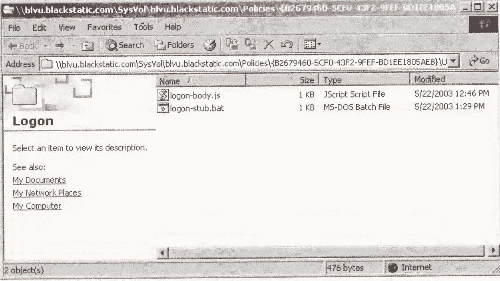

**图 7.3** 每个 GPO 包含一个唯一的位置，用于复制你的登录脚本。

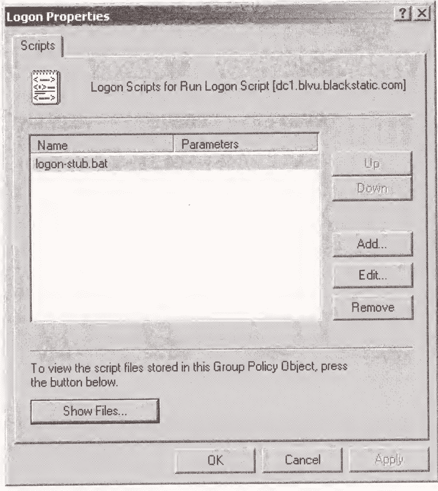

**图 7.4** 在目标 GPO 的"登录属性"对话框中指定登录脚本的名称。

接下来，在成员计算机上刷新机器策略（重新启动或在 Windows XP/Windows Server 2003 上运行 `gpupdate`，或在 Windows 2000 上运行 `secedit /refreshpolicy machine_policy`），以确保组策略已生效。以网络用户身份登录，并验证你配置用于写入登录信息的共享是否成功记录了你的登录并处理了你的脚本。

## 主体部分——logon-body.js

主登录脚本由几个部分组成。第一部分从 XML 配置文件加载配置数据。下一部分处理登录脚本的各个步骤。最后一部分包含用于支持脚本的辅助函数。
登录脚本使用对象数组来跟踪从 XML 配置文件加载的信息。（XML 配置文件在本章末尾脚本主体之后介绍。）变量 `strStatusText` 提供更新进度的滚动统计，并最终显示在弹出窗口中。数组 `aDrives`、`aPath` 和对象 `objLog` 包含用户定义的脚本数据，用于映射驱动器、添加路径语句以及指定脚本处理过程中使用的日志文件位置。`strNTPDomain` 包含用于将客户端同步到 NTP 时间服务的域名。`iResult` 用于评估通过 `Shell` 对象的 `Run` 命令调用的外部应用程序是否成功运行。脚本使用 `iStartIndex` 指定开始映射驱动器的 `aDrives` 索引，这对应于是否包含主目录。`strDomain`、`strUser` 和 `strComputer` 指的是 `Network` 对象的属性，分别指定运行登录脚本的域、用户和计算机。

一个出错的登录脚本可能会挂起登录会话，甚至阻止用户登录。因此，此脚本包含一个大型的 `try...catch` 语句，涵盖了脚本的大部分内容。其中一些函数也使用了这种错误处理机制。如果脚本中发生错误，`catch` 语句会尝试将错误记录到中央日志文件中，该文件可用于识别可能的问题。JScript 错误处理的另一个有用特性是支持嵌套的 `try...catch` 语句。这意味着你可以在主程序中包含一个较大的 `try...catch` 语句，同时在从主程序调用的各种函数中创建较小的 `try...catch` 语句。函数中的 `try...catch` 语句可能以该函数特有的方式处理错误，但你可以选择重新抛出错误（使用 `throw` 语句），这将触发上一级的 `try...catch` 语句。以下示例展示了这种嵌套的工作原理。

主程序包含一个 `try..catch` 语句。函数 `MyFunction` 也使用了自己的 `try...catch` 语句。在 `MyFunction` 中，故意抛出了一个错误（使用 `throw` 语句）。`MyFunction` 的 `try...catch` 语句使用其自身的局部错误处理来响应错误。然而，它随后重新抛出了该错误。这触发了主程序的 `try...catch` 语句，主程序使用其 `try...catch` 错误处理例程进行响应。


[content]

### trycatch

```javascript
try {
    MyFunction()
    }
catch(error) {
    WScript.Echo("Error triggered in main program: " + error)
    }

function MyFunction() {

try {
    throw "Error in my function"
    }
catch(errorInMyFunction) {
    WScript.Echo("Error triggered in My Function: " +
    errorInMyFunction);
    throw errorInMyFunction
    }
}
```

此示例代码（保存为 *trycatch.js*）的输出结果如下：

```
C:\>trycatch
Error triggered in My Function: Error in my function
Error triggered in main program: Error in my function

C:\>
```

接下来，脚本创建了两个 WScript 对象：`Network` 和 `Shell`。脚本使用 `Network` 对象来获取运行登录脚本的域名、用户和计算机的名称。虽然该对象不如 WMI 或 ADSI 等其他技术强大，但它与旧系统的兼容性更好，因为旧系统可能未安装最新的技术。

> *随着脚本分发范围的扩大，技术选择变得越来越重要。此登录脚本运行在安装了最新服务包的 Windows NT 4.0 上，但没有使用需要额外软件的 ADSI 或 WMI 技术。如果你的后续环境由 Windows XP、2000 或 Server 2003 计算机组成，或者你已加载了 WMI 核心组件或 ADSI 客户端扩展，则可以在登录脚本中使用这些技术来提供更多功能。*


脚本使用 XML 文件来存储登录脚本配置信息。将数据存储在脚本外部，使配置数据的初始或后续更新变得简单。例如，要添加额外的映射驱动器，只需在配置文件中添加新的 `mapdrives` 元素即可。脚本要求在命令行运行时参数中提供此配置文件的名称。它使用 `WScript.Arguments(0)` 解析参数，并将此配置脚本的名称存储在变量 `strUpdateFile` 中。如果未提供配置文件，脚本将返回错误并退出。

```javascript
// logon script
var strStatusText = "";
var i;
var aDrives = new Array();
var aPath= new Array();
var objDrives=new Object;
var objPath= new Object;
var objLog= new Object;
var strNTPDomain;
var iResult;
var iStartIndex;
var strDomain, strUser, strComputer;
var strUpdateFile;

try {
objNet=new ActiveXObject("WScript.Network");
objShell= new ActiveXObject("WScript.Shell");

var colArgs=WScript.Arguments;
if(colArgs.length == 0) {
    iResult=objShell.Popup("Please specify the config XML file.",30,
    "Logon Script Initialization Error");
    WScript.Quit(0);
}
strUpdateFile=WScript.Arguments(0);
```

此脚本使用 XML 文档对象模型（DOM）来访问和操作 XML 数据。另一种常用的 XML 数据处理方法是通过可扩展样式表语言转换，即 XSLT。XSLT 提供了将 XML 数据映射为几乎任何其他格式的能力。例如，XSLT 文档可以将 XML 数据转换为 HTML 文档。XSLT 是一种将数据转换为各种格式的高效手段。

通过实例化新的 MSXML 对象，你可以利用自动化技术将脚本与 XML 连接起来。在过去几年中，Microsoft 发布了多个新版本的 Microsoft XML 核心服务（MSXML），不同版本之间的兼容性各不相同。要查看系统支持哪些版本，可以在 `%windir%\system32` 中查找 `msxml*.dll` 文件。例如，如果你有 `msxml.dll` 和 `msxml3.dll`，则你的系统支持 XML 版本 1.x–2.x 和 3.0。（Microsoft 知识库文章 269238，http://support.microsoft.com/default.aspx?scid=kb;en-us;269238，列出了 MSXML 版本号与名称及 MSXML DLL 文件版本号的对应关系。）

你可以选择以两种模式运行 XML：并行模式或替换模式。并行模式提供最佳的兼容性，因为不同的 XML 版本可以在单台计算机上共存。不同版本支持不同的模式，例如，MSXML 3.0 及更早版本以并行模式安装，但 MSXML 3.0 SP2 仅以替换模式安装。MSXML 4.0 以并行模式安装。但这为什么重要呢？如果你在脚本中使用 XML 并将这些脚本部署到多台机器上运行（例如登录脚本的情况），你需要了解目标系统上安装了哪些版本的 MSXML，并调整脚本以使用适当的版本来确保兼容性。

为确保脚本在其他系统上运行时的兼容性和稳定性，请在实例化 MSXML 对象时指定要使用的 XML 版本。在以下代码中，脚本使用版本 3.0 创建了一个 MSXML 对象。如果你想使用 MSXML 4.0 的新功能，只需将代码更改为 `Msxml2.DOMDocument.4.0` 即可。但是，如果你尝试在未安装 MSXML 4.0 的系统上运行此代码，将会收到服务器自动化错误。这样指定 MSXML 版本的方式被称为指定版本相关的 progID。（progID 是对象的名称，例如 `Msxml2.DOMDocument.4.0`。）从 MSXML 4.0 开始，不再支持版本无关的 progID。更多信息请搜索 Microsoft MSDN 网站；关于 MSXML 解析器模式的一篇好文章是 Microsoft 知识库文章 303207（http://support.microsoft.com/default.aspx?scid=kb;en-us;303207）和 MSDN GUID 和 ProgID 信息文章（http://msdn.microsoft.com/library/en-us/xmlsdk/htm/sdk_guidprogid_367i.asp。）

XML DOM 描述了用于操作 XML 数据的对象、方法和属性。XML 文件加载后，由 MSXML 解析器解析为 DOM 树。DOM 树以层次格式表示数据，可从脚本中访问。数据包含在逻辑分组或节点中。节点包含 XML 数据的内容和结构。

除了 DOM 之外，另一种操作 XML 数据的方法是使用简单 XML API（SAX 或 SAX2）。该方法提供对 XML 数据的直接控制。DOM 在加载时将整个数据集解析为层次化 DOM 树，而 SAX 允许你控制对象的加载和解析；例如，你可以在找到特定值后停止解析。使用 SAX 时，你的程序管理 XML 解析过程。SAX 比 DOM 更节省内存，因为它不需要将所有 XML 数据加载到内存中，但需要你编写更多代码。DOM 提供了用于访问数据、执行复杂搜索、保存数据以及使用 XSLT 转换数据的结构、对象和方法。本文不涉及 SAX。

脚本在加载 XML 配置文件之前定义了两个 XML 一级属性。`async` 属性指示代码不允许异步下载 XML。这意味着当 XML 加载时，在整个 XML 文档加载完成之前，控制权不会返回给脚本。XML 设计用于在互联网上运行，并与 HTML 等其他 Web 友好协议相关联，支持外部链接以获取额外内容或结构定义。此脚本不依赖外部链接获取信息，因此第二个属性 `resolveExternals` 被设置为 false。

脚本使用 `load` 方法将 XML 文件加载并解析到 DOM 中，并将 XML 数据赋值给 XML 文档对象 `xmlDoc`。你可以通过 URL 或文件路径指定 XML 文件的位置。通过检查 `parseError` 对象来查看加载和解析过程中可能发生的任何错误。使用 DOM 时，XML 文档在加载时会自动解析错误，并通过 `parseError` 属性获取错误信息。XML DOM 的 `parseError` 对象返回一个对象，该对象进一步暴露其他属性来描述实际错误。例如，`parseError.reason` 描述错误内容，`parseError.line` 返回错误所在的行号。`parseError` 还包括 `errorCode`、`filepos`、`linepos`、`srcText` 和 `url`，用于进一步描述具体错误。

*快速验证 XML 数据文件的一个便捷方法是直接在支持 XML 的 Web 浏览器（如 Internet Explorer）中打开它。任何错误都会显示在浏览器中。如果一切正常，浏览器会以可折叠的层次视图显示你的 XML 文件。Internet Explorer 5.0 及更高版本是出色的 XML 查看器。*

```javascript
var xmlDoc=new ActiveXObject("Msxml2.DOMDocument.3.0");
xmlDoc.async = false;
xmlDoc.resolveExternals = false;
xmlDoc.load(strUpdateFile);
if (xmlDoc.parseError.errorCode != 0) {
  iResult=objShell.Popup("XML Parse Error: " +
    xmlDoc.parseError.reason,60, "Logon Script Config Error");
  WScript.Quit(0);
}
```

现在 XML 数据已加载到 DOM 树中，可以使用 DOM 对象、方法和属性进行访问。该树由节点组成，节点代表不同的 XML 实体，如元素、属性和文本等。可以通过多种方式从树中访问数据，例如遍历节点或查询特定元素、属性或文本的节点。此脚本演示了其中的几种方法。查询 XML 可以使用 XML 路径语言（XPath）或已弃用的 XSLPattern 选择语言。此脚本使用 XPath，它提供了一种查询语法，通过层次化引用数据和指定模式匹配条件来访问 XML 数据。通过使用 MSXML 将 `SelectionLanguage` DOM 属性设置为 XPath 来指定此语言

方法 `setProperty`。一级属性可以直接赋值（如前面的 `xmlDoc.async=false` 和 `xmlDoc.resolveExternals = false`）。但是，二级属性必须使用 `setProperty` 方法来设置。

定义好属性并完成 XML 数据的加载和解析后，我们就可以开始从配置中提取数据，并填充脚本中使用的变量。首先，脚本使用 `selectSingleNode` 方法将 `xmlConfig` 设置为节点 `/config/domain`，脚本在后续的数据请求中会引用该节点。此方法返回匹配 XPath 查询的第一个节点。如前所述，用于访问数据的 XPath 语法具有层次性。语法 `/config/domain` 引用位于 `config` 节点下的任意 `domain` 节点。方法 `selectSingleNode("/config/domain")` 返回匹配名为 `domain` 的元素的第一个节点（一个节点对象）。接下来，脚本使用 `selectSingleNode` 和 `getAttribute` 方法获取客户端时间同步到的域名。方法 `.getAttribute("ntp")` 返回名为 `ntp` 的属性的值。

你可以直接使用 `selectSingleNode` 方法操作和显示数据，因为它返回一个节点对象（例如，`selectSingleNode(XPath).xml` 或 `selectSingleNode(XPath).text`）。但是，当处理节点列表（包含多个节点）时，你必须先遍历列表并选择单个节点，然后才能显示数据。方法 `selectNodes` 或 `getElementsByTagName` 返回一个节点列表。例如：`WScript.Echo (xmlDoc.selectSingleNode("/config/domain").xml);` 显示单个节点及其子节点的 XML。要显示节点列表的 XML，你可以遍历列表并显示各个节点，就像处理其他集合一样：

```
objNodeList=xmlDoc.selectNodes("/config/domain");
for (i=0;i<objNodeList.length;i++)
{ WScript.echo(objNodeList.item(i).xml);}
```

按特定属性筛选选择仍然使用 `selectNodes` 方法，并且仍然返回必须遍历的节点列表，即使它只有一个成员：

```
objNodeList=xmlDoc.selectNodes("/config/domain[@ntp='blvu']");
for (i=0;i<objNodeList.length;i++) {
WScript.echo(objNodeList.item(i).xml);}
```

域名属性 `name` 是使用与获取 `ntp` 域成员相同的技术提取的。对象 `objLog` 包含脚本使用的三种不同日志的路径和文件名。脚本将错误记录到错误日志，用 `objLog.error` 表示。`objLog.logon` 记录登录信息，`objLog.patch` 记录补丁更新信息。这些日志的位置作为 XML 数据存储在 `xmlDoc` 对象中。如前面的提示所述，此代码使用 selectSingleNode 方法和 XPath 属性筛选器返回单个节点的文本。尽管有多个日志元素可用，但应该只有一个日志元素也具有 error、logon 或 patch 类型的属性。此代码将 objLog 对象设置为指定日志元素的文本。

```
xmlDoc.setProperty("SelectionLanguage", "XPath");
var xmlConfig = xmlDoc.selectSingleNode("/config/domain");
strNTPDomain= xmlConfig.getAttribute("ntp");
strNetwork= xmlConfig.getAttribute("name");
objLog.error =
xmlConfig.selectSingleNode("log[@type='error']").text;
objLog.logon =
xmlConfig.selectSingleNode("log[@type='logon']").text;
objLog.patch =
xmlConfig.selectSingleNode("log[@type='patch']").text;
```

学会浏览数据层次结构可以极大地帮助你进行 XML 编程。在可能的情况下，创建新的数据子集以简化编程。例如，考虑以下 XML：

```
<objects>
	<car>
		<name>Boxster</name>
		<color>Black</color>
	</car>

	<airplane>
		<name>Spitfire</name>
		<era>WW2</era>
	</airplane>
</objects>
```

以下过程：

```
objNodeList=xmlDoc.getElementsByTagName("name");
for (i=0;i<objNodeList.length;i++)
	{ WScript.echo(objNodeList.item(i).xml);}
```

显示以下数据：

```
<name>Boxster</name>
<name>Spitfire</name>
```

注意，它返回了任何（以及所有）匹配的元素——甚至跨越兄弟节点。要仅返回 car 节点的元素，请使用以下代码。（为了适应多辆汽车，此示例使用 selectNodes 方法。）

```
objNodeList=xmlDoc.selectNodes("/objects/car");
for (i=0;i<objNodeList.length;i++) {
WScript.echo(objNodeList.item(i).xml);}
```

如果你想仅返回汽车的名称，以下稍微低效的代码可以实现。首先，我们从 /objects/car 获取节点子集。然后，我们获取第二个包含所有名为 name 的标签的节点列表，最后打印结果节点的 XML。

```
objNodeList=xmlDoc.selectNodes("/objects/car");
for (i=0;i<objNodeList.length;i++) {
    objNodeList2=objNodeList.item(i).getElementsByTagName("name");
    for (j=0;j<objNodeList2.length;j++) {
        WScript.Echo(objNodeList2.item(j).xml)
    }
}
```

更清晰的方法是直接深入到 /objects/car/name，如下面的代码所示：

```
objNodeList=xmlDoc.selectNodes("/objects/car/name");
for (i=0;i<objNodeList.length;i++)
{ WScript.Echo(objNodeList.item(i).xml) }
```

这些示例演示了如何结合层次结构和基本节点搜索方法，并且根据你在 DOM 树中的起始位置，结果可能会有所不同。

### 映射驱动器与主驱动器

此登录脚本区分主驱动器和通用映射驱动器。该脚本将主驱动器与 Windows 主文件夹相关联，该文件夹在用户对象的"配置文件"选项卡上定义，如图 7.1 所示。AD 主文件夹具有与典型映射驱动器不同的特性。例如，当你启动命令 shell 时，它默认指向你的主文件夹。此外，当你使用 AD 用户和计算机为用户定义主文件夹时，此工具会自动创建文件夹并设置适当的权限以限制对该特定用户的访问。主文件夹由三部分组成：homeDrive (p:)、homeShare (\\\\dc1\users) 和 homePath (\username)。这种共享和路径的分离使得 Windows NT 4.0 计算机也能受益于主驱动器，即使 Windows NT 4.0 不支持将驱动器映射到共享和路径。

由于这些区别，登录脚本将主驱动器与任何映射驱动器区分开来。由于只存在一个主驱动器，脚本使用 selectSingleNode 方法来填充 aDrives 数组第一个元素中存储的 objDrives 对象的两个属性。脚本设置属性 objDrives.drive 和 objDrives.share，然后将其设置为 aDrive[0]。这些属性使用以下命名法作为字面量设置：objDrives = { drive: "驱动器字母" share: "\\\\server\\share" }。*驱动器字母* 是 `<homedrive>` 元素的属性，而 `\\\\server\\share` 是 `<homedrive>` 元素的 text 属性。

*此脚本显式设置对象的属性，然后将对象分配为数组的成员。或者，你可以采用快捷方法隐式进行此分配。例如，与其设置 obj.property1 和 obj.property2 然后设置 aArray[x]=obj，不如设置 aArray[x].property1 和 aArray[x].property2。*

```
//homedirectory
objDrives={
  drive: xmlConfig.selectSingleNode("homedrive")
  .getAttribute("drive"),
  share:xmlConfig.selectSingleNode("homedrive").text};
aDrives[0]=objDrives;
```

脚本从 XML 数据文件中读取映射驱动器，并以类似方式填充 aDrives 数组；但是，由于可以存在任意数量的映射驱动器（而不仅仅是一个），脚本使用 getElementsByTagName 方法返回包含所有 mapdrive 节点的 NodeList 对象。你可能会注意到 getElementsByTagName 方法与 xmlDoc 对象一起使用，它会返回任何和所有名为 mapdrive 的元素，无论它们可能位于层次结构中的什么位置。因为我们控制 XML 数据，所以完全可以确定 XML 中不可能有其他 `<mapdrive>` 元素。

脚本将 objDrives.drive 属性设置为 `<mapdrive>` 属性 drive，将 objDrives.share 属性设置为 `<mapdrive>` 元素 text。然后它将数组成员 aDrives[i+1] 设置为 objDrives。getElementsByTagName 从索引 0 开始，而 aDrives 从 1 开始，以便在需要时添加主驱动器。

```
//other mapped drives
objMapDrive = xmlDoc.getElementsByTagName("mapdrive");
for(i=0;i<objMapDrive.length;i++){
    objDrives={drive: objMapDrive.item(i).getAttribute("drive"),
    share: objMapDrive.item(i).text};
    aDrives[i+1]=objDrives;
}
```


### 设置路径

登录脚本还会扩展用户的路径，确保无论用户登录到哪台计算机，其路径声明都将包含在 XML 配置文件中指定的路径。额外的路径通过 `getElementsByTagName` 方法从 `xmlDoc` 对象中提取、解析，然后存储在 `aPath` 数组中。

```
objPath = xmlDoc.getElementsByTagName("path");
for(i=0;i<objPath.length;i++){
    aPath[i]=objPath.item(i).text;
}
```

`Shell` 对象提供对 `WshEnvironment` 对象环境变量的访问。Windows 支持三种类型的环境变量：`System`、`User` 和 `Process`。此登录脚本使用 `System` 和 `User` 变量来检索用户的当前路径，并使用 `Process` 类型来获取有关主文件夹状态的信息。

`strStatusText` 变量跟踪登录脚本的进度，并最终显示给用户。此消息的第一条文本欢迎用户加入网络，并告知他们登录到的域和计算机。

```
strDomain=objNet.UserDomain;
strUser=objNet.UserName;
strComputer=objNet.ComputerName;
objEnvSys=objShell.Environment("System");
objEnvUsr=objShell.Environment("User");
objEnvPro=objShell.Environment("Process");
strStatusText+="Welcome " + strUser + " to the " +
 strNetwork + " Network.\n";
strStatusText+="You have logged into " + strComputer +
 " in the " + strDomain +
 " domain at " + Date() + ".\n";
```

之前，我们提到了用户主文件夹的一些独特特性。使用 ADSI，此脚本可以为用户设置 `homePath`、`homeShare` 和 `homeDrive` 属性，这实际上配置了主文件夹。但是，仅仅设置这些属性并不会像 AD 用户和计算机工具那样创建文件夹或设置其适当的权限。脚本也可以做到这一点，但它会使脚本变得臃肿，并偏离其为用户初始化环境的主要功能。

但是，脚本确实会检查是否已经设置了主文件夹，方法是查找 `HOMESHARE` 环境变量的存在。此变量仅在已指定主文件夹时才存在。如果指定了主文件夹，则脚本将显示该驱动器的盘符，并跳过处理 XML 指定的 `<homedrive>`。它通过将 `iStartIndex` 变量设置为 1 来实现这一点。`iStartIndex` 在遍历映射驱动器 `aDrives` 数组时用作起始点。（请记住，`aDrives[0]` 保存有关主驱动器的数据，将 `iStartIndex` 设置为 1 会跳过数组的此元素。）

*Windows NT 4.0 用户的另一个注意事项：Windows NT 4.0 不支持将驱动器盘符映射到共享和路径（例如，`\\server\share\path`）。这意味着您必须将主驱动器指定为服务器（例如，`\\server`）。然后脚本会将用户名附加到此（例如，`\\server\username`）。您需要将每个用户的主目录作为共享本身共享出来。Windows 2000 允许映射到 `\\server\share\path`，并且您可以将主驱动器指定为 `\\server\share`。脚本附加用户名（例如，`\\server\share\username`），但只要 `\\server\share` 存在，并且在该共享下路径 `\\username` 存在，就可以访问它。*

如果 `HOMESHARE` 环境变量不存在，则脚本会将用户名连接到指定的主驱动器值，并将其设置为 `aDrive[0].share` 属性。对于运行 Windows 2000 及更高版本的计算机，此方法提供了指向用户自定义共享和路径的映射驱动器。

*主文件夹支持三个属性：drive、share 和 path，这也与 Windows NT 4.0 兼容。此特性代表了使用 AD 用户和计算机指定用户主文件夹的另一个好处，因为它将驱动器映射到 `\\server\share`，但也会将环境变量 `homePath` 设置为 `\username`。因此，当您启动命令 shell 时，它会打开到 `drive:\username`。*

```
//Determine the users home directory
if (!objEnvPro("HOMESHARE")) {
    objDrives.share+= "\\" + strUser;
    aDrives[0]=objDrives;
    strStatusText+="No AD profile home directory set. " +
        "Your locally mapped home directory is: " + objDrives.share;
    iStartIndex=0;
}
else {
    strStatusText+="Your home drive is: " + objEnvPro("HOMEDRIVE");
    iStartIndex=1;
}
```

## IT 管理员的 Windows 十大入门脚本

### 步骤 1. 删除冲突的映射驱动器

在将驱动器映射到 XML 配置中指定的驱动器之前，脚本会取消映射任何可能冲突的现有驱动器。脚本会遍历当前映射的每个驱动器，并将它们与脚本计划映射的驱动器进行比较。脚本使用 Network 对象的 `EnumNetworkDrives` 方法。`EnumNetworkDrives` 返回一个数组，其成员包含交替的驱动器和共享映射。例如，`aMappedDrives[0]` 等于第一个映射驱动器的盘符，`aMappedDrives[1]` 等于该驱动器的映射 `\\server\share`。因此，遍历现有映射驱动器的迭代步长为 2。

脚本使用正则表达式匹配方法将现有驱动器映射与建议的驱动器映射进行比较。脚本创建一个新的 `RegExp` 对象，其中包含正则表达式（在本例中是建议的驱动器盘符）和参数 `i`，该参数指定不区分大小写。如果 XML 配置数据为建议的驱动器映射包含 `h:` 或 `H:`，脚本将将其与现有的 `H:` 映射进行匹配。执行此比较并仅删除冲突的驱动器可确保用户可能先前配置的其他驱动器映射保持不变。

脚本使用 Network 对象的 `RemoveNetworkDrive` 方法删除任何匹配的驱动器。此方法接受两个布尔参数。第一个参数 `bForce` 指示该方法强制删除映射的驱动器。第二个参数确定该方法是否应从用户配置文件中删除驱动器映射。此脚本将两者都设置为 `true`；登录脚本会删除之前的映射，并从用户的配置文件中删除该映射。

```
//Unmap conflicting drives
aMappedDrives=objNet.EnumNetworkDrives();
strStatusText+="\n\nStep 1. Remove conflicting mapped drives.\n";
for (e=0;e<aMappedDrives.length-1;e=e+2) {
    for(i=iStartIndex;i<aDrives.length;i++) {
        objDrives=aDrives[i];
        var reDrive= new RegExp(objDrives.drive ,"i");
        if(aMappedDrives.item(e).match(reDrive)) {
            strStatusText+=objDrives.drive + " is mapped to " + aMappedDrives.item(e+1) +". Removing drive.\n";
            objNet.RemoveNetworkDrive(objDrives.drive,true,true);
        }
    }
}
```

### 步骤 2. 映射驱动器

实际的驱动器映射使用 `WScript.Network MapNetworkDrive` 方法，该方法需要将要映射的驱动器盘符和共享作为输入参数。由于之前已删除了任何冲突的驱动器，因此脚本无需检查可能的冲突。但是，脚本会先使用 `FileSystemObject FolderExists` 方法检查共享是否存在。如果 XML 数据文件配置错误或托管共享的服务器不可访问，可能会出现此问题。尽管前面的 try...catch 语句本可以处理任何尝试映射到不存在的共享时产生的错误，但使用 `FolderExists` 方法提供了一种更优雅的方式来报告可能的配置错误或问题，并使脚本继续运行。

```
//Map Drives
strStatusText+="\nStep 2. Mapping drives.\n";
for(i=iStartIndex;i<aDrives.length;i++) {
    objDrives=aDrives[i];
    strStatusText+="Mapping " + objDrives.drive + " to " +
        objDrives.share;
    var objFSO = new ActiveXObject("Scripting.FileSystemObject");
    if (objFSO.FolderExists(objDrives.share)) {
        objNet.MapNetworkDrive(objDrives.drive,objDrives.share);
        strStatusText+="... Succeeded.\n";
    }
    else {
        strStatusText+="... Failed.\n"
        LogFile(objLog.error, strComputer, strUser,
            "Mapped Drive not Accessible: " + objDrives.share);
    }
}
```

### 步骤 3. 更新路径

登录脚本还会向用户的路径声明添加任意数量的额外路径。路径声明由两部分组成——*系统*路径和*用户*路径。这两部分都作为环境变量存储。（您可以通过编辑系统小应用程序的高级选项卡中的环境变量来手动设置路径，如图 7.5 所示。）您也可以通过命令提示符手动设置路径，只需键入 `path=%path%;c:\some\new\path`。然而，这仅在该命令 shell 会话中有效。


### 第 4 步：同步本地时间服务

登录脚本尝试将客户端计算机的时间与域简单网络时间协议（SNTP）服务器同步。虽然 Windows 2000 及更高版本的计算机支持时间同步服务（W32Time），但对于 Windows NT 4.0 计算机，没有可用的直接方法通过脚本以编程方式同步时间，因此登录脚本只是运行一个命令 shell 并执行 net 实用工具。将时间设置为域的参数是 `net time /domain:somedomain /set /yes`。这会将时间设置为域 `somedomain`，并且不会在交互式提示中询问你是否要更改时间。使用 `net time` 扩展或自定义此示例，以运行你希望在登录时运行的任何其他实用工具。

Shell 对象的 `Run` 方法调用 `cmd` 命令以打开一个命令 shell，从该 shell 发出 `net time` 命令。启动命令 shell 时，`/C` 参数指示命令 shell 执行字符串中指定的命令，然后终止。WSH 运行 `cmd` 命令，该命令执行 `net time` 命令。完成后，`cmd` 窗口关闭。请注意，命令 shell 的终止与 Shell 对象 `Run` 方法的终止不同。

两个参数控制 `Run` 命令的执行。第一个参数定义窗口样式，你可以隐藏窗口（0），激活并显示窗口（1），或从多达 10 种样式中选择。第二个布尔参数 `bWaitOnReturn` 指示脚本等待命令终止还是继续处理。如果为 `true`，脚本将等待，在本例中，直到 `cmd` 窗口终止。如果为 `false`，登录脚本将立即继续处理，无论生成的命令 shell 的结果如何。在我们的代码中，`Run` 方法激活并显示窗口，并且在恢复处理之前不等待其退出。

在登录脚本中使用外部应用程序时，最保守的方法是显示窗口但允许脚本继续处理。这样做可以确保登录脚本不会因为某些隐藏的提示、脚本或批处理文件暂停等待命令或确认而挂起。因此，登录脚本始终显示窗口，并且从不等待命令完成以恢复处理。有时你可能需要脚本等待外部命令完成，例如如果脚本依赖于该命令的结果，但在这些情况下，请小心并在部署到许多用户之前测试你的脚本——尤其是在登录脚本中。

```javascript
//Set the client to the domain time server
strStatusText+="\nStep 4. Synchronizing the local time service " +
    "to the " + strNTPDomain + " domain.\n";
iResult=objShell.Run("cmd /C net time /domain:" +
    strNTPDomain + " /set /yes",1,false);
if(iResult) {
    strStatusText+= "Error synchronizing time service.\n";
    LogFile(objLog.error, strComputer, strUser, "NTP Error");
}
else
    { strStatusText+= "Done.\n"; }
```

### 第 5 步：检查防病毒程序的安装

类似于运行 `net time` 命令，登录脚本演示了如何调用命令提示符来运行其他批处理文件；在本示例中，是一个虚构的防病毒安装批处理文件。该防病毒安装批处理文件设计为每次用户登录时运行，并检查安装或升级用户的防病毒软件程序。与之前使用 `Run` 方法一样，此代码显示执行批处理文件的命令 shell 窗口，但在继续其他处理之前不会等待其完成。

```javascript
//Make sure Antivirus software is installed
strStatusText+="\nStep 5. Checking installation of AntiVirus.\n";
iResult=objShell.Run("cmd /C \\\\dc1\\share1\\avinstall.bat",1,false);
if(iResult) {
    strStatusText+= "Error configuring Antivirus software\n";
    LogFile(objLog.error, strComputer, strUser, "AV Install Error");
}
else
    { strStatusText+="Done.\n"; }
```

### 第 6 步：使用关键更新更新系统

登录脚本的最后一个主要功能提供基本的补丁安装服务。虽然基础，但此处展示的代码可能会让你了解如何结合使用 XML 与 Windows 脚本技术来评估计算机并根据观察到的结果采取行动。此代码的功能仅限于检查注册表中的指定值，以确定是否已安装补丁或应安装补丁；想象一下将此处理扩展为报告 Service Pack 级别、已安装的应用程序，或你可能需要定期报告的任何其他内容。
脚本调用函数 `patchsystem` 来启动补丁管理功能。该函数需要补丁日志的位置、计算机和用户的名称，以及包含补丁管理数据的 XML 对象。

```javascript
//Check for and Install Patches
strStatusText+="\nStep 6. Updating system with critical updates.\n";
PatchSystem(objLog.patch, strComputer, strUser, xmlDoc);
strStatusText+= "Done.\n";
```

### 显示结果

在结束时，登录脚本调用 Shell 对象的 `PopUp` 方法来显示脚本所执行操作的摘要，这些摘要包含在字符串 `strStatusText` 中。消息框的标题通过名称欢迎用户，主框包含状态文本。对话框保持显示 30 秒后自动关闭，这给用户时间查看，但不会强迫他们在每次登录域时手动关闭它。

在主主体的末尾，脚本还完成了初始的 `try...catch` 错误处理。如果在运行脚本主体时发生错误，代码执行将在 `catch` 语句处继续，错误存储在 `error` 变量中，该变量表示一个错误对象。脚本尝试将原始错误写入错误日志，并通过 `PopUp` 方法在退出之前向登录系统的用户显示错误。错误对象支持四个属性：`description`、`method`、`name` 和 `number`。属性 `description` 和 `message` 以最易读的术语显示错误（例如，一条错误消息可能显示"*该对象不支持此属性或方法*"）。`name` 属性包含错误的名称（例如名称 "TypeError"）。

> 通常，你会通过其十进制或十六进制值在开发 SDK 或 Internet 上查找错误编号。错误对象的 `number` 属性是一个 32 位数字，同时包含设施（高 16 位）和错误代码（低 16 位）。使用按位 AND（在 JScript 中，这是 `&` 字符）来提取各组成部分。例如：
>
> `error.number >> 16 & 0x1FFF = facility`
> `error.number & 0xFFFF = error code`
>
> 设施代表错误的数字类别，错误代码是实际的错误代码编号。使用这些属性，你可以从 `try...catch` 捕获的错误中提取有用的信息。

```javascript
iResult=objShell.Popup(strStatusText,30,"Welcome, " + objNet.UserName);

} //end of try Statement
//bail gracefully
catch(error) {
    LogFile(objLog.error, strComputer, strUser,
        "General Script Error: " + error + " : " + error.description);
    iResult=objShell.Popup("General Script Error: " + error +
        "\nName: " + error.name +
        "\nDescription: " + error.description, 30, "Logon Script Error");
    WScript.Quit(0);
}
```


### LogFile

`LogFile` 函数为登录脚本提供文件级日志记录。这个通用日志函数接受日志的位置和文件名，以及计算机名、用户名和要在日志中显示的消息。`try...catch` 语句用于处理用户指定的日志文件无法创建（例如日志文件路径无效）时的错误。日志文件的位置通过 XML 数据文件指定，可以是本地服务器或远程网络共享。使用网络共享使得将日志集中写入单个文件既实用又方便。该函数创建一个新的 `FileSystemObject` 对象，并使用 `OpenTextFile` 方法创建新文件或打开现有文本文件以进行追加。`OpenTextFile` 方法的最后一个布尔参数设置为 `true`，表示如果文件不存在则创建新文件。

与第 4、5、6 章脚本中使用的 `Tabulate` 函数类似，该脚本使用其修改版本将格式化的列文本输出到文本文件，而非控制台窗口。方法是相同的；不同之处在于，它不使用控制台的 `WScript.StdOut` 方法，而是将数据写入文件对象（`objFile`）。

```
//--------------------------------------------------------------------------
// Write to the Event Log
//--------------------------------------------------------------------------
function LogFile(strLog, strComputer, strUser, strMessage)
{
  try {
    var FOR_APPENDING = 8;
    objFSO=new ActiveXObject("Scripting.FileSystemObject");
    objFile=objFSO.OpenTextFile(strLog, FOR_APPENDING,true);
    TabulateFile(Date(), 0, " ", objFile);
    TabulateFile(strComputer, 30, " ", objFile);
    TabulateFile(strUser, 45, " ", objFile);
    TabulateFile(strMessage, 60, " ", objFile);
    objFile.WriteLine();
    objFile.close();
  } //end of try statement
  catch(error) {
    iResult=objShell.Popup("Error Writing Logfile: " + error +
      "\nName: " + error.name +
      "\nDescription: " + error.description,30, "Logon Script Error");
  }
}
```

### TabulateFile

```
//-----------------------------------------------------------
// Write text file output in left-aligned columns
//-----------------------------------------------------------
function TabulateFile(strData, iColumn, strDelimit, objFile)
{
    while(objFile.Column<iColumn)
        {objFile.Write(strDelimit);}
    objFile.Write(strData);
}
```

### 检查注册表和修补系统

修补过程由三个函数组成：PatchSystem、EvalCriteria 和 CheckRegistry，它们协同工作，遍历每个补丁并评估指定的条件是否在系统注册表中匹配。函数 PatchSystem 和 EvalCriteria 负责设置并遍历 XML 配置文件中定义的不同补丁和条件。PatchSystem 遍历每个 `<patch>` 元素，并创建一个包含该特定补丁所有条件的新 NodeList。脚本将此 NodeList 发送给 EvalCriteria，后者遍历该特定补丁的每个条件。条件由注册表键和值组成，以及当键与值匹配或不匹配时应执行的操作说明。实际的注册表查找和比较由 CheckRegistry 函数处理，该函数根据键是否存在且匹配指定的值返回 true 或 false。（可以考虑对此脚本进行扩展，例如添加一个检查文件是否存在的函数，命名为 checkFile。可以添加新条件以包含文件名和文件位置。XML 数据扩展起来也很简单：只需添加一个新元素 `<criteria-file>` 并查找它，或者向 `<criteria>` 添加一个新属性来定义条件类型为注册表或文件。）

### PatchSystem

PatchSystem 函数的参数包括日志文件名和位置、计算机名和用户名，以及包含补丁数据的 XML 对象（xmlDoc）。与之前的处理可能的用户配置数据的函数一样，所有 PatchSystem 代码都使用 `try...catch` 系统来处理错误。

该函数首先使用 getElementsByTagName 方法构建所有 `<patch>` 元素的 NodeList，并将其存储在 objPatches 中。此过程本质上从 XML 对象中去除了我们之前使用的配置信息，提供了与补丁相关的数据子集。然后脚本逐一循环处理这些节点。对于每个单独的 `<patch>`，脚本进行第二次 getElementsByTagName 调用以提取 `<criteria>` 并将其存储在 NodeList 对象 objCriteria 中。脚本然后通过条件语句调用 EvalCriteria 函数。这意味着脚本将 objCriteria 发送给 EvalCriteria 进行进一步处理。EvalCriteria 函数返回一个布尔值（true 或 false），PatchSystem 函数据此决定是否安装补丁。

如果 EvalCriteria 返回 true，则应用补丁。如果系统需要应用补丁，脚本调用 getAttribute 方法从当前 objPatches 项中检索存储在名为 patchfile 的属性中的补丁路径和文件名。该函数使用 Shell 对象的 Run 方法（之前用于同步网络时间和启动防病毒安装软件）来应用补丁。最后，日志文件更新一行代码，记录该特定补丁已被应用。

如果 EvalCriteria 函数返回 false，则不需要应用补丁，日志文件仅更新记录此信息。

```
//------------------------------------------------------------------
// Patch the system
//------------------------------------------------------------------
function PatchSystem(strLog,strComputer,strUser,xmlDoc)
{
  try {
    i=0;
    objPatches = xmlDoc.getElementsByTagName("patch");
    for(i=0;i<objPatches.length;i++){
      objCriteria = objPatches.item(i).getElementsByTagName("criteria");
      if(EvalCriteria(objCriteria)) {
        strPatchFile=objPatches.item(i).getAttribute("patchfile");
        iResult=objShell.Run("cmd /C " + strPatchFile,1,false);
        LogFile(strLog, strComputer, strUser, "-Applied: " + 
          objPatches.item(i).getAttribute("qfeid"));
      }
      else {
        LogFile(strLog, strComputer, strUser, " Need not apply: " + 
          objPatches.item(i).getAttribute("qfeid"));
      }
    }
  } // end of try statement
  catch(error) {
    LogFile(objLog.error, strComputer, strUser, 
      "Patch System Error: " + error + " : " + error.description);
    iResult=objShell.Popup("Patch System Error: " + error + 
      "\nName: " + error.name + 
      "\nDescription: " + error.description,30, "Logon Script Error");

WScript.Quit(0);
}
}
```

### EvalCriteria

EvalCriteria 函数使用由 PatchSystem 预处理过的 `<criteria>` 元素标签组成的 NodeList。条件标签包含三个属性：regpath、value 和 installIfTrue。对于每个 `<criteria>` 元素，该函数检查运行登录脚本的系统上指定的 regpath 是否等于指定的 value。

变量 bEval 表示条件匹配或不匹配时应执行的操作，它从 installIfTrue 属性转换而来。例如，假设一个 `<criteria>` 元素通过检查产品版本注册表键的值是否为 5.0（代表 Windows 2000）来判断计算机是否运行 Windows 2000。如果找到此键和值，则条件为 true，补丁将会应用。因此，installIfTrue 应为 yes，这通过三元运算符转换为 bEval 的值 true。

将此示例与检查特定更新是否已应用的 `<criteria>` 进行对比。通常（但不总是），Microsoft 更新会在注册表中记录成功的安装。在这种情况下，如果注册表检查为 true，则补丁已经安装。我们不希望重新安装它，因此我们将 installIfTrue 设置为 no，转换为 bEval 的值为 false。注意，这两个示例中注册表条目都存在；但一个表示补丁需要或适用，另一个表示不需要。

要实际测试注册表值，该函数调用 CheckRegistry 函数，并发送注册表键和值进行确认。此测试的结果也是布尔值，它们与 bEval 进行比较。如果结果等于 bEval，则函数返回 true，向调用函数 PatchSystem 指示应安装补丁。

```
//---------------------------------------------------------------------
// Check the criteria for any matches
//---------------------------------------------------------------------
function EvalCriteria(objCriteria)
{
var j;
var objShell=new ActiveXObject("WScript.Network");
for(j=0;j<objCriteria.length;j++) {
    var strRegPath=objCriteria.item(j).getAttribute("regpath");
    var strValue=objCriteria.item(j).getAttribute("value");
    var bEval=(objCriteria.item(j)
        .getAttribute("installIfTrue")=="yes"?true:false);
```


```
var bResult=CheckRegistry(strRegPath,strValue);
if(bResult == bEval) return(true);
}
return(false);
}
```

### CheckRegistry

`CheckRegistry` 函数从 `strRegPath` 指定的注册表位置读取一个值。该值与 `strValue` 进行比较，如果两者匹配，函数返回 `true`；如果不匹配，函数返回 `false`。如果注册表键不存在，WSH 会返回一个错误。不过，这个可能的错误是预期中的，并由 `try...catch` 语句处理，该语句返回 `false`，向调用函数表明该值不存在。

```
//---------------------------------------------------------------------------
// Check Registry
//---------------------------------------------------------------------------
function CheckRegistry(strRegPath,strValue)
{
var reValue=new RegExp(strValue,"i");
var objShell = WScript.CreateObject("WScript.Shell");
try{
    if(objShell.RegRead(strRegPath).match(reValue)) return(true);
    return(false);
    }
catch(error) { return(false); }
}
```

### 总结

除了登录脚本的功能之外，围绕这个可能被广泛部署的脚本所进行的设计，还提供了一个有趣的视角，展示了兼容性和错误处理方面的考量——这些因素在单独运行的实用脚本（如本书前面介绍的那些脚本）中可能不那么重要。Microsoft 持续改进企业服务，例如 AD 组策略，以集中管理大量用户。但正如我们所看到的，通过为简单且无处不在的登录脚本"增强功能"，你可以添加自定义功能，为用户提供更丰富的体验。使用集中式日志记录，你可以明确记录谁在何时访问了你的网络，并且在安装更新或登录域时也能响应用户的问题。诚然，集中式日志记录之类的功能并非必须，且确实增加了一定的复杂性，但这些功能确实有助于故障排除和追踪谁在何时访问了你的网络。

在为自己的测试部署更新此脚本时，请记得配置以下文件：

- *logon-stub.bat*——配置批处理文件，使其输出到所有用户都具有写入权限的网络共享位置。
- *logon-body.js*——虽然 XML 文件包含了大部分自定义配置，但仍需自定义或移除防病毒软件登录安装过程。包含该过程是为了演示如何将你自己的遗留应用程序整合到基于 Windows 脚本的登录脚本中。
- *logon-config.xml*——此 XML 文件包含大部分配置信息。请务必根据你的实际环境自定义此文件，并添加你希望扫描和部署的所有更新。

## 要点

- 开发基于组策略的登录脚本时要格外小心，确保任何编程错误都不会导致客户端计算机挂起。
- 使用 `WScript.Shell` 对象的 `Run` 或 `Exec` 命令来运行登录时需要的第三方工具或批处理文件。
- 你可能已经听说过 XML；考虑使用它来存储脚本的输入或输出数据。虽然与文本文件相比只稍微复杂一些，但 XML 提供了层次化结构和更强大的解析工具。
- XML 文档对象模型（DOM）提供了 XML 读取和解析功能，并返回一个易于访问和操作的 XML 对象。
- 将脚本输出记录到中央位置可以提供额外的故障排除工具，帮助排查异常行为。
- 登录脚本在待登录用户的上下文下本地运行，这意味着你拥有比操作远程计算机时更大的脚本灵活性（例如使用 `WScript.Shell` 注册表方法进行本地注册表查询）。

接下来，我们将脱离命令行 JScript 实用工具，研究如何利用 Office 应用程序和 Visual Basic for Applications（VBA）作为有用、强大且易于编程的平台，从中启动各种脚本。

## 基础：目录计算机导出工具

## 概述

你可能现在已经看出来，脚本为跨多个系统自动化执行大规模或可重复的变更提供了绝佳的机会。这些变更的一个重要基础，通常始于一份完整、可靠的清单，列出你希望逐个处理的所有计算机（或用户或其他对象）。我们在前面的脚本 *ADSIQuery* 和 *DateQuery* 中已经看到，使用 ADSI ADO 可以快速生成所需对象的列表，以此为基础执行后续操作。但有时，仅使用一次的动态生成列表并不理想。在某些情况下，你可能希望随着时间的推移维护一份对象及其特定属性的持久化清单。例如，你可以持续记录域中所有成员的防病毒软件的服务状态，或者记录一组系统中所有本地管理员的用户名和密码。又或者你可能想要扫描一组计算机上的所有本地共享，然后标注这些共享中包含的内容。但当你将来再次运行扫描时，你可能希望将数据追加到之前的运行结果中，而不是覆盖之前的标注。有一个工具在管理脚本输出和执行方面特别好用，那就是 Microsoft Excel。就像书本中的日志页面一样，Excel 工作表提供了一个出色的画布，可以记录脚本配置信息以及之前和当前运行的输出。对于脚本编写和执行，Excel 支持 Visual Basic for Applications（VBA），它提供了良好的开发环境并支持强大的调试功能。通过自动化和外部引用的引入，Excel（VBA）支持我们迄今使用过的大部分 Windows 脚本技术。此外，当你将脚本与 Excel 结合使用时，你还可以利用 Excel 对象模型，其中包括访问 Excel 函数、格式化功能以及 Excel 和 Office 特有的对象和方法——这些是 Windows Script Host 中没有的。

## 场景

你一直在深入学习脚本技术，并且已经列出了几个想要开始着手的新项目清单，特别是在远程管理领域。其中许多项目需要在你的域中的远程计算机上反复进行测试、探测或搜索属性。在生成计算机列表后，你想执行测试并将结果标注在计算机列表上。一周后，你将执行另一批测试。你不仅希望保留之前运行结果的记录，还希望将新的计算机添加到列表中（或标记不再找到的计算机），然后将结果记录在递增的列中。你计划将结果通过电子邮件发送给其他人，并希望保持计算机列表和结果文档的可移植性和格式化。

## 分析

Microsoft Excel 为此类脚本提供了一个易于使用的平台。由于数据和脚本以 Excel 工作簿格式（.xls）存储，因此便于携带，而且工作簿或单个工作表可以格式化一次，然后复制并通过电子邮件发送给任何其他 Excel 用户。此 VBA 脚本引用一个设置工作表作为运行时参数，使用 ADSI 查询 Active Directory（AD）以获取计算机列表，并将结果记录到用户指定的输出工作表中。一旦创建了此输出工作表，此脚本的后续运行将把新计算机添加到现有列表的底部，而不会修改工作表上已输入的现有数据。该脚本还会高亮显示它在目录中不再能找到的计算机名称。作为未来脚本的基础，此脚本设计为允许轻松插入新功能。

你意识到这个脚本主要是一个垫脚石，用于未来可以或多或少地插入到此脚本创建的列表中的脚本。因此，你的需求映射为表 8.1 中列出的技术要求。

**表 8.1 将脚本目标转化为技术要求**

| 脚本目标 | 技术要求 |
|---|---|
| 生成域中的计算机列表。 | 构建 ADSI 查询，从指定域的目录服务服务器返回所有计算机对象。用户可以指定域名。 |
| 追加并更新之前运行的结果。 | 扫描输出工作表，读取所有先前记录的计算机列表。存储计算机名称及其位置（按行号），供此脚本或后续脚本将来引用。 |
| 添加新计算机。 | 将当前 AD 查询的结果与之前的结果进行比较。将之前运行中未找到的任何新计算机添加到输出工作表列表的底部。 |
| 标记缺失的计算机。 | 在输出工作表上高亮显示之前运行中存在但当前扫描中未找到的计算机。 |
| 将结果通过电子邮件发送给其他人，并保持结果的可移植性。 | 脚本将输出写入 Excel 工作表，该工作表可以通过电子邮件发送给其他人或复制到单独的工作簿中。 |
| 能够灵活地格式化结果。 | 脚本提供基本格式化功能，脚本用户可以使用任何 Excel 格式化工具来格式化输出工作表。由于输出工作表是重复使用的，后续运行会保留之前运行的格式。 |
```


此脚本使用的函数和子程序如下：

**DumpComputers：** 主程序的起点。

- 从*Setup*工作表中读取脚本输入参数。
- 如果输出工作表尚不存在，则创建新的输出工作表。
- 构建ADSI查询以从AD返回计算机。
- 遍历ADSI查询结果，查找重复计算机、缺失计算机和新添加的计算机。
- 使用新找到的和更新的数据更新输出工作表。

**LoadComputerList：** 从先前的输出工作表构建aComputers数组。

- 遍历指定的输出工作表，查找先前的计算机。
- 使用新找到的数据构建aComputers数组。
- 在遍历输出工作表时标记找到的任何重复计算机。

**QueryDS：** 执行ADSI查询。

- 从提供的CommandText执行ADSI查询。

**FindPrevious：** 查找先前的匹配项。

- 给定计算机名和域，在aComputer数组中查找任何先前的计算机和域匹配项。

**MarkMissingComputers：** 标记在AD中找不到的计算机。

- 当输出工作表上的计算机在AD中找到（如从先前运行）或新添加到输出工作表时，aComputer(n).Exists属性（自定义数据类型）会更新。此脚本遍历aComputer数组并标记所有aComputer(n).Exists为False的计算机（表示ADSI查询未找到该计算机）。

**PreFormatTable：** 格式化新创建的输出工作表。

- 当程序创建新输出工作表时，格式化工作表的字体大小、类型和大小。
- 将表头添加到输出工作表。

**PostFormatTable：** 在运行结束时格式化输出工作表。

- 调整列大小以显示数据。

**FormatComputerMissing：** 格式化缺失计算机的行。

- 将缺失计算机的行变为红色并添加删除线。
- 将状态更新为*Missing*。

Foundation: A Directory Computer-Dump Tool

**FormatComputerDuplicate：** 格式化重复计算机的行。

- 将重复计算机的行变为蓝色并设为斜体。
- 将状态更新为Duplicate on Row: n。

**FormatComputerAdded：** 格式化新添加计算机的行。

- 将新添加计算机的行变为青色。
- 将状态更新为Newly Added。

**FormatClear：** 清除行的格式。

- 关闭先前的粗体、斜体或删除线格式。
- 将颜色设置为黑色。
- 将状态更新为Active。

### 分发和安装

要分发在Microsoft Office应用程序中创建的脚本，请共享或电子邮件发送包含脚本的文档。但是请记住，如果您使用Office应用程序提供的技术之外的技术（如ADSI、WMI或WSH），则必须注意在需要时更新收件人计算机上的这些技术。此做法与分发使用cscript.exe或wscript.exe的脚本没有什么不同。

此脚本的安装包括两部分：配置Excel以识别脚本中使用的引用，然后打开并配置名为Setup的工作表上列出的脚本启动参数。

### 指定引用

开发环境和脚本解释器可能以不同方式访问对象库。例如，WSH使用new ActiveXObject或CreateObject语法提供对任何已注册对象的访问。使用Excel或其他Microsoft Office应用程序时，您可以像WSH中一样实例化新对象。还可以通过将其库添加到引用列表来使对象可用。当库作为引用添加到Office文档时，它提供对该库中包含的所有对象、方法和属性的访问，并允许Office直接使用这些对象（即，您可以将变量声明为该类型的对象）。例如，此脚本使用ADODB对象执行ADSI查询。在之前的脚本中，我们使用如下代码实例化新的ADODB连接对象：

```
Set objConnection = CreateObject("ADODB.Connection").
```

通过将ADODB库添加为引用，我们可以在代码中声明新的连接对象，如下所示：

```
Dim objConnection As new ADODB.Connection.
```

当以这种方式声明变量时，Excel支持语法完成，并且您需要设置对对象库的引用。这意味着，如果您开始使用先前定义的变量——如前面的示例中，如果我们输入objConnection.——那么在句点之后，Excel将提供Connection对象可用的所有不同方法和属性的列表。此功能提供了一种方便且有用的方法来记住可能的方法和属性。

但是，当您在其他计算机上运行此代码时，必须确保目标计算机上存在适当的引用。如果没有引用，您将收到错误消息：*Compile error:verbose Can't find project or library*。要检查缺失和可用的引用，首先加载包含脚本的Excel文档，然后按Alt-F11进入Visual Basic编辑器。接下来，从菜单Tools中选择References。您会看到所有已选引用的列表以及可能缺失的引用，如图8.1所示。请注意，在此图中，对*Microsoft ActiveX Data Objects 2.7 Library*的突出显示引用是缺失的，因为脚本是在Microsoft Excel 2003中创建的，并添加了ADO 2.7的引用。该图是在运行Microsoft Excel 2000的计算机上拍摄的，而ADO 2.7在此较旧的系统上不可用。修复此问题很简单；只需取消选中缺失的引用，然后选择替代品。在本例中，我们首先取消选择*Microsoft ActiveX Data Objects 2.7 library*。接下来，我们将可用引用列表滚动到Ms，直到找到*Microsoft ActiveX Data Objects 2.1 Library*，然后选择它以使其可用。选择较旧的库时要小心，因为脚本中使用的任何对象、方法或属性必须与较旧版本兼容——否则您必须将包含较新库的DLL添加到系统中（或升级Office）。此脚本使用早期库中可用的基本ADO命令，因此降级到2.1是可以的。

> 为了避免从一开始就出现的向后兼容性问题，如果我们知道要在运行Office 2000的计算机上部署此脚本，我们可以在Excel 2003中选择ADO 2.1库。

### 配置Setup工作表

在setup工作表上，指定要枚举的域名以及输出工作表的名称。

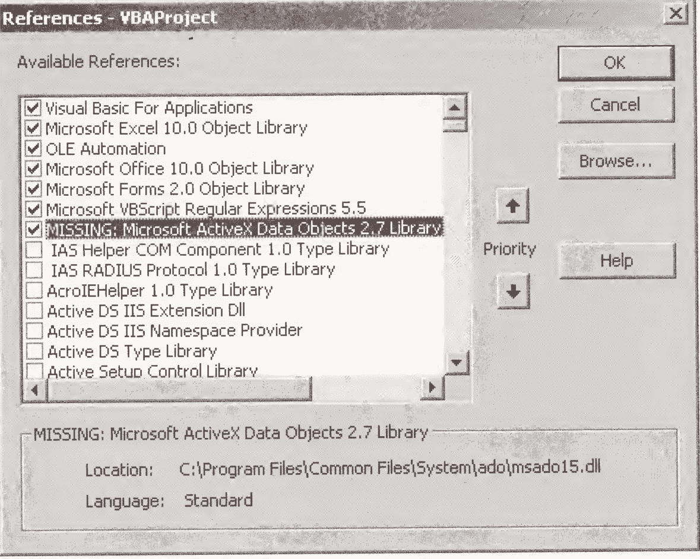

**图 8.1** Visual Basic编辑器引用对话框允许您指定要公开和使用的对象库，以便在Excel VBA脚本中使用。

# 输出

脚本在*setup*工作表中指定的输出工作表上列出所选域中的所有计算机。如果输出工作表尚不存在，脚本将创建新的输出工作表；否则，它将数据附加到先前的运行。

脚本的主要目的是在指定域中搜索新计算机并将其记录到指定的输出工作表。此外，如果从先前运行记录的计算机从AD中删除，则脚本的后续运行会将这些计算机标记为缺失。表8.2列出了按列记录在输出工作表上的数据。在VBA中，您可以通过其字母数字地址（如A1）或其数字地址（如Cells(1,1)）引用Excel单元格。通过将行和列引用作为其数值来引用，可以更容易地遍历循环。

### 表 8.2 脚本在输出工作表上记录的数据

| 列 | 列，索引 | 显示的数据 |
|--------|-------------|----------------|
| A | 1 | 将在将来的脚本中使用——用作标识行以供其他脚本将来处理的信号。 |
| B | 2 | 计算机名称——ADSI名称属性。 |
| C | 3 | 状态——列出系统在上次运行时的状态，包括：新添加、活动、重复或缺失。 |
| C | 4 | 脚本发现系统的日期（当系统是新添加时）。 |
| E | 5 | 域名。 |
| F | 6 | ADsPath——计算机的ADSI ADsPath属性。 |

列A将由将来的脚本使用，以表示要处理的具体计算机。列B列出计算机的名称，列C列出计算机在上次脚本运行时的状态（例如，新添加、活动、缺失）。在上次运行期间添加的计算机标记为*Newly Added*。脚本将先前运行记录的计算机标记为*Active*。在电子表格上列出但在AD中找不到的计算机标记为*Missing*，在输出工作表上列出多次的计算机标记为*Duplicates*状态，包括重复条目的行号。列D列出脚本记录计算机为新添加的日期。列E列出域，列F列出计算机的`ADsPath`。

图8.2显示了来自示例脚本运行的输出工作表，标识了活动、缺失、新添加和重复的计算机。在此示例中，脚本已运行两次。第一次运行生成了第6行至第17行中看到的列表。在第二次运行之前，删除了第12行和第14行中的计算机（*workstn006*和*workstn008*）。此外，第15行中的计算机（*workstn009*）被复制到第17行，第二次脚本运行将其标记为重复。第18行至第21行中的计算机在第一次运行后、第二次运行前添加到AD。如您所见，每周运行此脚本——即使没有其他功能或计算机扫描——也可以让您清楚了解AD中来来往往的情况。


**图 8.2** 一个示例输出工作表，显示了活跃、缺失、新添加和重复的计算机。

# 解决方案总结

本章介绍的脚本为本书后续脚本奠定了基础。本质上，该脚本会扫描一个域，并在特定工作表上列出所有计算机对象。不过，计算机扫描是非破坏性的，新计算机会被追加到上次运行生成的列表中。通过这种方式，未来的脚本可以利用这些信息，并实际使用输出工作表来添加包含脚本特定数据的新列。

脚本的操作流程可能如下所示：

- 1. 运行此脚本以生成域中所有计算机的列表。
- 2. 运行一个附加（未来的）脚本，处理这些计算机中的每一个，并将额外数据添加到第 1 步生成的工作表中。
- 3. 几天或几周后重新运行计算机扫描脚本，将新系统添加到工作表。
- 4. 标记新计算机，并重新运行附加脚本以仅处理这些计算机。

通过这些步骤，你可以在单个 Excel 文档中生成并维护计算机列表及未来数据。

# 目标

此脚本的目的是提供一个基于 Excel 的工具，用于添加和显示指定域的计算机成员。该脚本使用以下对象：

- **ADODB.Connection**
  - Provider
  - Open
- **ADODB.Command**
  - ActiveConnection
  - Properties
  - CommandText
  - Execute
- **Arrays (VBA)**
  - ReDim Preserve
  - Ubound
- **Excel Object Model**
  - Worksheet manipulation
  - Cell/range formatting
- **Recordset**
  - EOF
  - Fields.Item(x).Value
- **VBA Options**
  - Option Explicit
  - Option Compare Text
- **VBA Error Handling**
  - On Error Resume Next
  - On Error Goto 0
- **User Data Types**
  - Using Type to declare user-defined data types

# 脚本

该脚本包含在一个 Excel 文档的 VBA 模块中。将 Excel 文档视为一个记事本，你在其中持久记录脚本的输入参数以及脚本输出。分配给宏的快捷键或工作表上的 Visual Basic 可点击按钮会启动你的脚本。（将宏视为你可以编写的任何子例程。）使用 VBA 的第一步是启动 Excel 并打开包含脚本的文档。

该脚本以 `/chapter 8/scripts/dump computer list.xls` 的形式包含在随附的 CD-ROM 中。此脚本包含在一个需要 Excel 2000 或更高版本以及 Windows Script Host 5.6 的 Excel 文档中。在继续下一节之前，请从 CD-ROM 打开实际的脚本，并在测试环境中运行几次，以感受其工作方式。自行探索整个代码，然后继续本演练，希望它能回答你可能想到的任何问题。此外，在脚本编辑器中查看完整的代码能让你……

### 设置宏安全性

Microsoft 将 Excel 中的 VBA 脚本称为宏。当你加载包含 VBA 脚本或代码的文档时，根据你的宏安全设置，系统可能会提示你是否要启用或禁用宏来加载文档，如图 8.3 所示。（你必须启用宏才能运行此脚本——或 Excel 中的任何脚本。）要查看你的宏安全设置，请选择“工具”、“宏”、“安全性”。在此屏幕中，你可以选择设置高、中或低安全级别，如图 8.4 所示。中等安全性提供了良好的平衡，在此设置下，每当你打开包含宏（或 VBA 代码模块）的文档时，Excel 都会提示你。

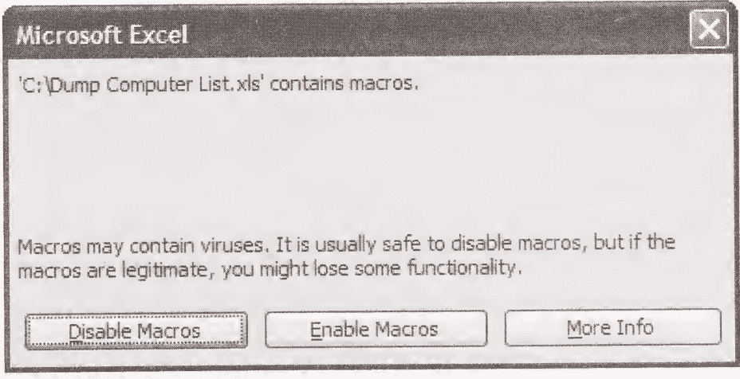

**图 8.3** 打开包含要运行的脚本的 Microsoft Office 文档时，必须启用宏。

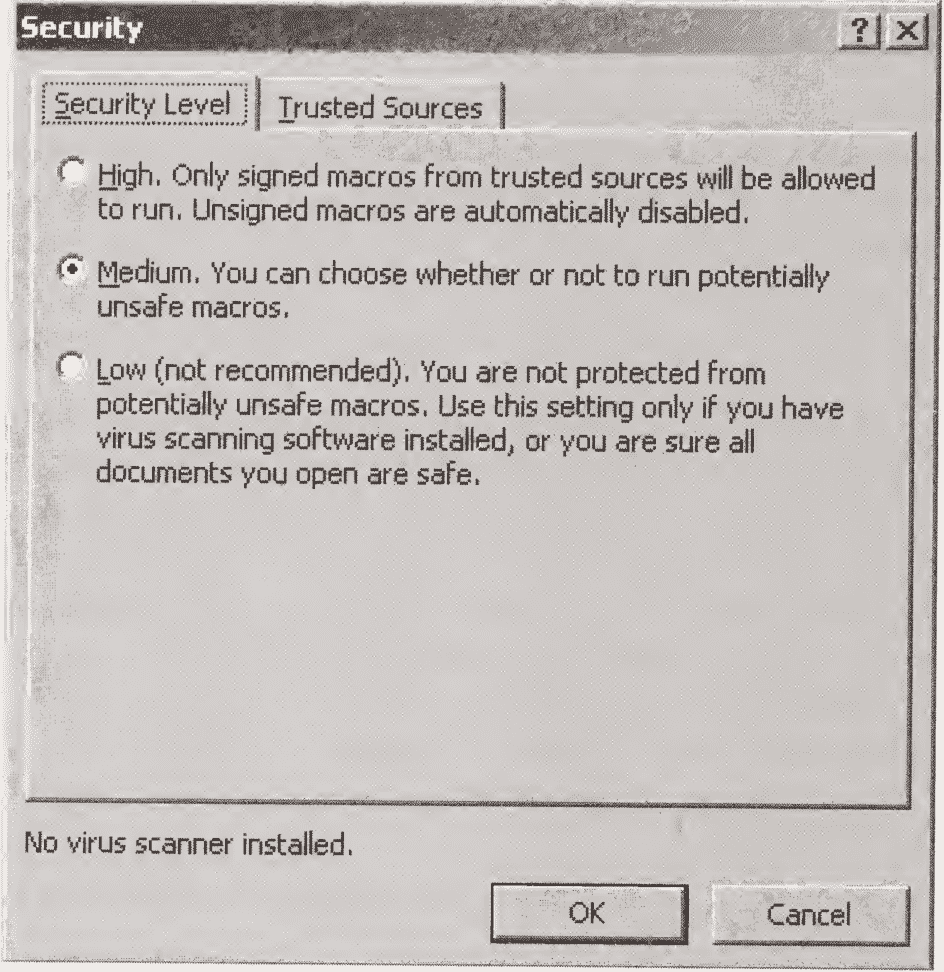

**图 8.4** 当设置为中等安全性时，每次打开包含 VBA 模块的文档，Excel 都会提示。

### 脚本架构

此脚本的框架由 VBA 代码和两个工作表组成。第一个名为 *setup* 的工作表包含脚本操作参数，如图 8.5 所示。这个简单的工作表包含用于处理脚本的参数——就像我们用来控制控制台脚本执行的命令行参数一样。在此工作表上，指定域的名称以及输出数据将写入的工作表的名称。当你准备好运行脚本时，单击 Visual Basic 按钮 *1. Pull Computers from Directory*，该按钮会执行一个调用脚本的过程。

脚本使用的第二个工作表存储脚本输出，你在 *setup* 工作表上将其命名为输出工作表。在此示例中，输出工作表恰当地命名为 *output*，脚本生成的运行示例如图 8.6 所示。能够为输出工作表指定任何名称的一个优点是，你可以创建多次脚本运行（例如，为环境中的每个域运行一次），并将其存储在不同的工作表中。

## 基础：目录计算机转储工具

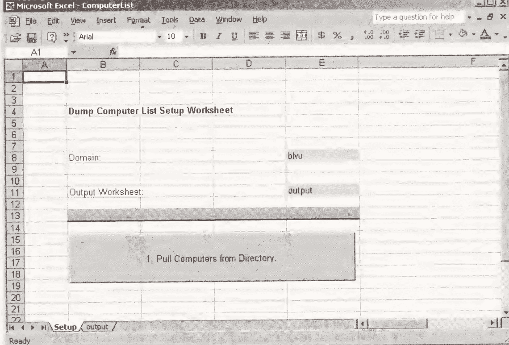

**图 8.5** 使用支持 VBA 的 Office 应用程序作为开发平台的一个优点是其文档管理功能，它使你能够轻松存储设置信息的记录。

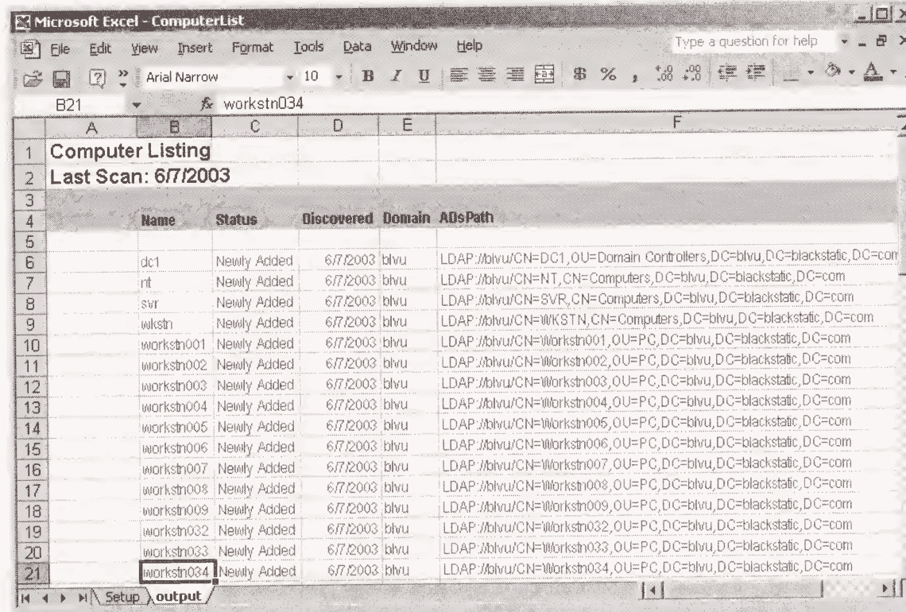

**图 8.6** 脚本将数据写入 Setup 工作表上指定的输出工作表——在本例中，数据被写入名为 *output* 的工作表。

该脚本支持随时间推移进行多次、后续运行，并捕获新添加的计算机和重复的计算机条目，同时标记那些在 AD 中已无法找到的计算机。通过这种方式，你可以管理 AD 中所有计算机的运行清单和历史记录。真正的优势在于能够扩展此脚本，作为未来可能针对此电子表格中存储的部分或全部计算机运行的脚本的基础。

### 如何在 Excel 中找到代码

Excel 中的脚本可以存放在多个位置，但都可以通过 Visual Basic 编辑器访问。首先，从随附的 CD-ROM 加载文档 *Dump Computer List.xls*，然后通过选择“工具”、“宏”、“Visual Basic 编辑器”（或按快捷键 Alt-F11）访问 Visual Basic 编辑器，你将看到如图 8.7 所示的屏幕。注意位于屏幕左侧的工程资源管理器。（如果它不在那里，请使用“视图”、“工程资源管理器”激活它。）注意 VBA 工程（*ComputerList.xls*），其下有两个节点：*Microsoft Excel 对象* 和 *模块*。展开 Microsoft Excel 对象节点，你会看到两个工作表和工作簿的名称。双击名为 *Setup* 的工作表。在主要代码菜单中，你会看到一个名为 `CommandButton1_Click()` 的私有子例程调用。其中只有一行代码：

```
Call DumpComputers
```

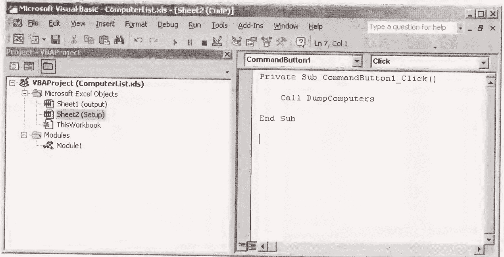

**图 8.7** Visual Basic 编辑器为 Microsoft Office 应用程序提供了强大的开发环境。

你所看到的是一个子例程，它定义了与 *Setup* 工作表上 `CommandButton1` 对象的单击事件关联的操作。当此事件发生时（即当单击按钮 `CommandButton1` 时），名为 `CommandButton1_Click` 的子例程会运行，并调用名为 `DumpComputers` 的子例程，这是执行实际工作的主脚本的实际名称。此按钮和单击事件代码提供了启动此脚本的入口点。（在 Excel 中启动脚本的另一种方法是使用“工具”、“宏”，但添加一个用户可以单击的按钮是启动脚本的一种更用户友好的方式。）但函数 `CommandButton1_Click` 如何与按钮关联呢？让我们现在来看看。

切换回 Excel 应用程序，单击（激活）*Setup* 工作表。除了一些基本的脚本配置文本外，还有一个名为 *1. Pull computers from Directory* 的大按钮。我们看到与 `CommandButton1_Click` 关联的代码告诉 Excel 当你单击 *Setup* 工作表上的按钮时该做什么。但是，如果你右键单击该按钮，则不会出现菜单，你也无法访问按钮的属性。你必须首先进入 Visual Basic 设计模式。从 Visual Basic 菜单（如果没有此菜单，请右键单击菜单栏以列出所有可用菜单并打开名为 Visual Basic 的菜单），单击“设计模式”按钮以激活设计模式，如图 8.8 所示。现在右键单击我们的大按钮并选择“属性”以显示按钮的所有属性。在这里，你可以更改按钮的标题（显示内容）、名称以及其他属性，如大小和颜色。要更改与单击它关联的操作，请关闭属性对话框并再次右键单击该按钮。这次，单击“查看代码”。注意，我们正在查看的是我们刚才查看的 `CommandButton1_Click` 的相同代码。但我们如何创建一个新的按钮或 Visual Basic 控件呢？这同样相当简单。


**图 8.8** Microsoft Excel 中的设计模式允许你编辑 Visual Basic 控件。

返回到*Setup*工作表，这次启用控件工具箱（与之前一样，右键单击菜单栏并启用菜单项Control Toolbox），如图8.9所示。此菜单为您提供了一个工具面板，您可以将工具拖放到工作表上。选择CommandButton（命令按钮），然后在*Setup*工作表上拖出一个轮廓，确定新按钮的位置。释放鼠标按钮时，请注意按钮已创建，并命名为类似`CommandButtonn`的名称。您应该仍处于之前的Design（设计）模式，因此可以右键单击此新按钮，并点击Properties（属性）或View Code（查看代码）来编辑其行为。如果您查看此新按钮的代码窗口，会看到一个名为`CommandButtonn_click`的新的子过程已创建，并且代码编辑器已将光标置于代码块内的位置。您在此处放置的任何代码都将在该按钮被点击时激活。

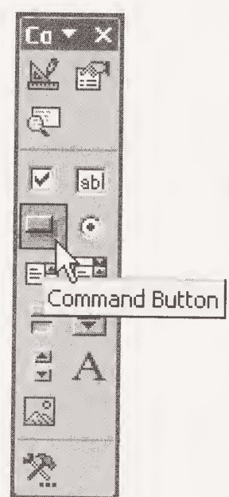

**图 8.9** 控件工具箱提供对按钮和复选框等控件的访问，您可以将其添加到Excel文档中并通过脚本进行控制。

*Dump Computer List.xls*文档中的主脚本就是通过这种方式启动的。主按钮的click事件通过一个简单的call语句调用`DumpComputers`子过程，如下所示：

```
Call DumpComputers()
```

接下来，我们来看一下`DumpComputers`，即脚本的主要代码。与特定工作表或Excel对象无关的独立代码可以存储在模块中。在Visual Basic编辑器的项目资源管理器中，展开Microsoft Excel Objects节点下的Modules节点。双击DumpComputerList图标。（此模块已被重命名——当您从新工作簿开始时，第一个模块名为*Module1*。）在代码窗口中，您可以看到构成*DumpComputerList*脚本的所有代码。与之前的脚本一样，此代码以线性方式呈现，从一个主子过程（我们称之为程序主体）DumpComputers调用到其他子过程和函数。但首先，让我们看看模块级别的代码——不属于任何其他子过程或函数的代码。

### 模块级代码

模块级代码提供在特定VBA项目中所有代码都可用的定义和指令。我们的脚本在模块级别定义了选项、类型定义和公共常量。

`Option`关键字定义了脚本的特定操作参数，并支持四个语句。`Option Base`声明数组下标的下界——0或1。与JScript类似，VBA中的数组默认是基于零的。但是，声明`Option Base 1`后，您可以将基数设置为1，尽管通常坚持使用公认的基于零的数组标准会更有益。

`Option Compare [method]`将脚本中方法的默认比较方法设置为`Text`、`Binary`或`Database`。例如，此脚本使用`StrComp`方法比较两个字符串。由于此方法识别`Option Compare`设置，脚本只需在开头使用`Option Compare Text`语句设置一次，而不是在每次`StrComp`中设置为`Text`。

当设置`Option Explicit`时，所有变量都必须声明（例如，使用`Dim`语句），否则编译器会抛出错误。此语句有助于排查可能的变量拼写错误，并鼓励开发者更深入地思考所使用的变量。

最后，语句`Option Private Module`可防止外部项目访问为其设置的项目内的公共数据。

VBA的`Type`语句允许创建自定义的用户定义数据类型，类似于在JScript中创建对象或在C语言中创建结构体。用户定义的数据类型包含一个或多个元素。（您可以将新数据类型想象为类似于具有一种或多种属性的JScript对象。）在下面的代码中，我们创建了一个名为`ComputerData`的新数据类型，包含五个元素：`Name`、`Row`、`Domain`、`Exists`和`ADsPath`。用户定义的数据类型可以定义为数组，并且其元素的访问方式类似于JScript对象中的属性。（例如，如果`aComputer()`被定义为`ComputerData`类型的数组，那么`aComputer(5).Name`将返回`aComputer`数组第五个元素的名称。）

```
Option Explicit
Option Compare Text

Type ComputerData
    Name As String
    Row As Integer
    Domain As String
    Exists As Integer
    ADsPath As String
End Type
```

脚本使用常量来定义输出工作表的列值。将这些值引用为常量可提高脚本的可读性，并且意味着您只需在一处更新定义。声明常量为Public可使其在VBA项目中的所有模块中可见。

```
Public Const COL_NAME = 2
Public Const COL_STATUS = 3
Public Const COL_DATE = 4
Public Const COL_DOMAIN = 5
Public Const COL_ADSPATH = 6
Public Const COL_OPTION1 = 7
Public Const COL_OPTION2 = 8
```

### DumpComputers

DumpComputers子过程查询AD以获取指定域中的所有计算机，然后将结果输出到用户指定的输出工作表。作为一个子过程，DumpComputers不返回任何值，并且不能在表达式中使用（与函数不同）。

脚本的主要数据存储在定义为用户数据类型ComputerData的数组中。数组aComputer存储从AD和脚本的先前运行中提取的所有计算机信息。

由于我们已在Excel中包含了对ADO的显式引用，我们可以在对象的声明部分实例化一个新的ADODB对象。代码`Dim objRecordset As ADODB.Recordset`实例化了一个新对象`objRecordset`，它代表ADODB Recordset对象。脚本将脚本中使用的两个工作表表示为对象`objWsSetup`和`objWsOutput`。这些对象被实例化，并分别指向Setup工作表和在Setup工作表中由用户命名的输出工作表。

> 您无需在Excel中运行Excel或VBA即可使用Excel对象。尽管工作表对象是Excel原生的，但它可以像任何其他对象一样从外部调用。例如，您可以创建一个cscript.exe控制台脚本，执行某些操作，然后创建一个新的Excel对象并将输出数据转储到其中。

`strCommandText`和`strDomain`分别表示用于代表ADSI查询命令和当前域的文本字符串。整数`i`、`iRowNum`和`iCount`表示子过程使用的各种计数器。

```
'--------------------------------------------------------------------
' 主函数: DumpComputers
'--------------------------------------------------------------------

Sub DumpComputers()
Dim aComputer() As ComputerData
Dim objRecordset As ADODB.Recordset
Dim objWsSetup As Worksheet
Dim objWsOutput As Worksheet
Dim strWsOutput, strCommandText, strDomain As String
Dim i, iRowNum, iCount As Integer
```

与之前的脚本解析命令行参数来获取操作参数不同，此脚本使用`Cells(row,column).Value`属性从*Setup*工作表读取其操作参数。`Worksheets`对象是Excel原生的，您可以无需实例化自己的对象即可使用它（就像我们之前在WSH脚本中使用的`GetObject`方法一样）。创建或打开Excel文档会暴露这些Excel特定的对象。

```
Set objWsSetup = Worksheets("Setup")
strWsOutput = objWsSetup.Cells(11, 5).Value
strDomain = objWsSetup.Cells(8, 5).Value
```

脚本会检查指定的输出工作表是否存在。如果不存在，则会创建并格式化一个新的输出工作表，并根据*Setup*工作表上指定的名称为其命名。脚本支持多个输出工作表——只需更改Setup页面上的输出工作表名称并重新运行脚本即可。例如，如果您有三个域，您可以为每个域运行一次脚本。并且您可以为每个域指定输出工作表的名称为*Output-A*、*Output-B*和*Output-C*。通过这种方式，您可以在各自的工作表上分别管理所有这些域中的计算机。

`On Error Resume Next`语句用于捕获在尝试设置输出工作表对象时可能生成的任何错误。脚本第一次运行时（或任何时候指定了新的输出工作表），会发生错误并将错误设置到变量`Err`。`On Error Resume Next`指示脚本在发生错误时继续处理，并跳过失败的代码。预期到此错误，脚本会立即测试`Err`是否存在。如果存在，脚本会创建新的输出工作表，将其命名为*Setup*工作表上指定的名称，并调用`PreFormatTable`子过程进行格式化。


用于格式化的例程。你可能还记得之前使用 Call 语句来运行子程序或函数。此语句并非必需；你可以直接调用过程。`On Error GoTo 0` 语句用于禁用错误处理。

```
On Error Resume Next
Set objWsOutput = Worksheets(strWsOutput)
If Err Then
    Set objWsOutput = Worksheets.Add(After:=Worksheets("Setup"))
    objWsOutput.Name = strWsOutput
    PreFormatTable
End If
On Error GoTo 0
```

你可以直接访问特定工作表上的数据，例如 `objWsOutput.Cells(1,1).Value`，也可以通过活动工作表来访问。脚本将 `objWsOutput` 设为活动工作表，所有调用的通用方法都将在此活动工作表上执行。以上面的例子为例，一旦 `objWsOutput` 被激活，你就可以直接引用其上的对象，如 `Cells(1,1).value`。

脚本调用 `LoadComputerList` 函数，将输出工作表中可能已存在（来自先前运行）的每台计算机加载到数组 `aComputer` 中。`LoadComputerList` 返回它找到的最后一个计算机对象的行号。变量 `iRowNum` 表示添加到输出工作表的新计算机的行号。行号 6 是输出工作表使用的第一行，因此如果不存在任何计算机，脚本会将 `iRowNum` 设为 6。

```
objWsOutput.Activate
iRowNum = LoadComputerList(aComputer, objWsOutput)
If iRowNum < 6 Then iRowNum = 6
```

接下来，脚本创建要在 `QueryDS` 函数中调用的 ADO 查询的命令对象中执行的 `CommandText`。此查询返回指定域中所有计算机对象的 `Name` 和 `ADsPath`。`QueryDS` 函数返回一个包含结果的 Recordset 对象（`objRecordset`）。

```
strCommandText = "SELECT ADsPath,Name FROM 'LDAP://" & strDomain & _
    "' WHERE objectCategory = 'computer'"
Set objRecordset = QueryDS(strCommandText)
```

与 JScript 不同，Visual Basic 中的动态数组在使用前必须声明为一个固定值，而且没有 `length` 属性来返回数组的大小。（例如，如果你将数组声明为 `aArray(100)`，但只使用了 65 个元素，没有任何属性可以返回已使用的元素数量。）Visual Basic 确实支持 `UBound` 方法，它返回数组的上界。在前面的示例中，无论实际使用了多少元素，`UBound(aArray)` 始终返回 100。为了使用此方法，此脚本使用 `ReDim Preserve` 语句将数组重新定义为当前元素数加 1。通过这种方式，`UBound(aComputer)-1` 始终返回数组中元素的确切数量。

脚本遍历 `objRecordset` 的每条记录，并调用 `Find-Previous` 函数，以检查 ADO 查询返回的计算机是否已存在于输出工作表中。如果计算机已存在，脚本不会对其进行任何操作，而是继续处理下一条记录。

但是，如果计算机不存在，脚本必须将其添加到输出工作表的第 `iRowNum` 行。请尽量不要将 `iRowNum` 与 `iCount` 混淆。`iRowNum` 表示新计算机的当前行号，而 `iCount` 变量表示 `aComputer` 数组中的计算机数量。添加新计算机时，脚本会递增 `iCount` 参数，并使用 `ReDim Preserve` 语句重新定义 `aComputer` 数组的大小。`Preserve` 关键字确保 `aComputer` 数组中的数据保持完整；否则，重新定义大小会清空数组。接下来，脚本将查询结果添加到 `aComputer` 数组中。计算机名称被转换为小写，并放入名为 `Name` 的用户定义数据类型 `ComputerData` 元素中。当前行号被添加到 `ComputerData Row` 元素中。脚本将 `aCompute.Exists` 设为 `True`，将 `aComputer.Domain` 设为 `strDomain`。

更新 `aComputer` 数组后，脚本在输出工作表上记录新计算机。脚本使用 `Cells(iRowNum, specifiedcolumn)` 属性更新输出工作表，以包含新发现的计算机数据，包括其名称、日期、域和 `ADsPath`。脚本调用 `FormatComputer-Added` 子程序，将状态标注为新发现并高亮显示新增内容。脚本递增 `iRowNum` 并循环到下一条记录。

```
iCount = UBound(aComputer)
While Not (objRecordset.EOF)
    If FindPrevious(objRecordset.Fields.Item("Name").Value, _
        aComputer(), strDomain) = 0 Then
        iCount = iCount + 1
        ReDim Preserve aComputer(iCount)
        aComputer(iCount).Name = _
            LCase(objRecordset.Fields.Item("Name").Value)
        aComputer(iCount).Row = iRowNum
        aComputer(iCount).Exists = True
        aComputer(iCount).Domain = strDomain
        Cells(iRowNum, COL_NAME) = aComputer(iCount).Name
        Cells(iRowNum, COL_DATE) = FormatDateTime(Now(), vbShortDate)
        Cells(iRowNum, COL_DOMAIN) = strDomain
        Cells(iRowNum, COL_ADSPATH) = _
            objRecordset.Fields.Item("ADsPath").Value
        FormatComputerAdded iRowNum
        iRowNum = iRowNum + 1
    End If
    objRecordset.MoveNext
Wend
```

遍历 ADO 查询 Recordset 后，脚本为输出工作表添加时间戳，然后调用 `MarkMissingComputers` 子程序遍历输出工作表并高亮显示所有缺失的计算机。最后，脚本调用 `PostFormatTable` 子程序调整列宽以适应新的计算机信息，然后退出。

```
Cells(2, 1) = "Last Scan: " & FormatDateTime(Now(), vbShortDate)
MarkMissingComputers aComputer(), strDomain
PostFormatTable

End Sub
```

### **LoadComputerList**

`LoadComputerList` 函数遍历输出工作表，解析每一行中的计算机信息，并将信息存储在 `aComputer` 数组中。脚本使用变量 `i` 作为计数器，表示当前 `aComputer` 数组的元素。变量 `strDomain` 和 `strComputer` 分别表示当前行的域和计算机名称。

该函数支持跳过多达 10 个空白行而不中断处理。这意味着在一次运行完成后，你可以对结果进行排序、添加间距，以及对计算机进行分类或分组，脚本仍会处理列表。`iRowNum` 表示解析脚本的当前行号，`iBlankLines` 提供最多 10 个空白行的计数器变量。在加载数据时，该函数会将所有新条目与已经发现并存储在 `aComputer` 中的内容进行比较。任何重复项都会被标记，其行号存储在 `iDupeRow` 中。脚本还会记录重复项的行号，以帮助用户追踪重复条目。首先，脚本将动态数组 `aComputer` 重新定义为单个元素。（添加数据后将再次重新定义。）

```
'------------------------------------------------------------------
' Load Existing Computer List
'------------------------------------------------------------------
Function LoadComputerList(aComputer() As ComputerData, objWsOutput) _
  As Integer
  Dim i As Integer
  Dim strDomain, strComputer As String
  Dim iRowNum, iBlankLines, iDupeRow As Integer
  ReDim aComputer(1)

  i = 1
  iRowNum = 6
  iBlankLines = 0
  iDupeRow = 0
```

解析函数由两个循环组成。第一个循环运行直到找到 10 个连续的空白行。第二个循环查找由输出工作表中应放置计算机名称的位置处的空单元格表示的单个空白行。如果单元格为空，则内层循环退出，`iRowNum` 和 `iBlankLines` 变量同时递增。如果 `iBlankLines` 大于 10，则外层循环退出。否则，将创建一个新的内层循环来检查新行号是否为空。

假设计算机数据存在，当前行的计算机名称将*不*为空。脚本将 `iBlankLines` 重置为零，并清除之前的任何格式。脚本重置 `iBlankLines` 是因为我们查找的是连续 10 个空白行，而不是总共 10 个空白行。脚本在此循环执行期间将 `ScreenUpdating` 设为 `False`，以减少运行时间。`FormatClear` 函数设置单元格格式属性（例如关闭粗体和斜体），这会导致工作表重绘，从而显著减慢脚本运行速度。在此函数末尾，`ScreenUpdating` 会重新启用。

要从输出工作表读取之前的数据，脚本将变量 `strComputer` 和 `strDomain` 分别设为当前行号对应 `COL_NAME` 和 `COL_DOMAIN` 列的单元格值。

```
Application.ScreenUpdating = False
  While iBlankLines < 10
        While IsEmpty(Cells(iRowNum, COL_NAME)) = False
              iBlankLines = 0
              FormatClear iRowNum
              strComputer = Cells(iRowNum, COL_NAME).Value
              strDomain = Cells(iRowNum, COL_DOMAIN).Value
```

获取名称和域后，脚本调用 `FindPrevious` 函数，检查在此循环中是否之前遇到过相同的计算机或域对。（注意，脚本重用了用于检查 ADO `RecordSet` 中的计算机是否与 `aComputer` 中的计算机匹配的同一个 `FindPrevious` 函数。）


如果未发现重复项，函数会将 aComputer 数组的当前元素 (i) 加载上关于计算机对象的数据，包括名称、行号、域和 ADsPath。脚本递增 i 并将 aComputer 数组重新定义为增加一个元素。通过这种方式，aComputer 数组的边界得到了严格控制。处理完此计算机后，脚本递增 iRowNum。

然而，如果新发现的计算机是之前某个计算机的重复项，脚本会将其标记为重复（包括原始计算机的行号），并调用 FormatComputerDuplicate 函数将该条目高亮显示为重复项。此条目不会被添加到 aComputer 数组中，脚本会递增 iRowNum 变量以处理下一行。

```
iDupeRow = FindPrevious(strComputer, aComputer(), strDomain)
If (iDupeRow = 0) Then
    aComputer(i).Name = Cells(iRowNum, COL_NAME).Value
    aComputer(i).Row = iRowNum
    aComputer(i).Domain = Cells(iRowNum, COL_DOMAIN)
    aComputer(i).ADsPath = Cells(iRowNum, COL_ADSPATH)
    i = i + 1
    ReDim Preserve aComputer(i)
    iRowNum = iRowNum + 1
Else
    FormatComputerDuplicate iRowNum, iDupeRow
    iRowNum = iRowNum + 1
End If
Wend
iRowNum = iRowNum + 1
iBlankLines = iBlankLines + 1
Wend
```

最后，作为清理步骤，脚本最后一次将 aComputer 数组重新定义为维度 i-1，这代表数组中计算机的真实数量。（请记住，脚本一直将数组定义多一个元素，是为了在添加下一个计算机时能提前准备好空间。）此外，由于允许有 10 个空行，脚本会从 iRowNum 中减去 10，并将该值返回给调用函数，这代表找到的最后一台计算机的行号。

```
ReDim Preserve aComputer(i - 1)
LoadComputerList = iRowNum - 10
Application.ScreenUpdating = True
End Function
```

### QueryDS

QueryDS 函数本质上是对第 5 章脚本中使用的 JScript QueryDS 函数的 VBA 移植。该函数接受一个表示 CommandText 的字符串作为输入，并将查询结果作为 Recordset 返回给调用过程。该过程包含简短的错误处理，用于捕获用户输入无法访问的域名时可能发生的错误。因为我们添加了对 Active X Objects 2.x 的引用，所以可以方便地将返回的数据类型实例化为 ADODB.Recordset。

```
'------------------------------------------------------------------------------
' 使用 LDAP 查询参数查询活动目录
'------------------------------------------------------------------------------
Function QueryDS(strCommandText) As ADODB.Recordset
Dim iRowNum, iComputerCount As Integer
Dim objConnection As New ADODB.Connection
Dim objCommand As New ADODB.Command
objConnection.Provider = "ADsDSOObject"
objConnection.Open
objCommand.ActiveConnection = objConnection
objCommand.Properties("Sort On") = "Name"
objCommand.CommandText = strCommandText
On Error Resume Next
Set QueryDS = objCommand.Execute()
If Err <> 0 Then
    MsgBox "连接域控制器时出错。 " & _
    "请检查域名并重试。", _
    vbCritical, "检查域名"
    End
End If
On Error GoTo 0
End Function
```

### FindPrevious

FindPrevious 函数将计算机名称和域对与 aComputer 数组中存储的每个计算机名称和域对进行比较。该函数循环遍历 aComputer 数组的所有元素，并使用 StrComp 方法比较字符串。StrComp 的语法为 StrComp(string1, string2, compare)，其中 string1 和 string2 是要比较的两个字符串，compare 是可选的第三个参数，用于指定比较方法（vbBinaryCompare、vbTextCompare 或 vbDatabaseCompare）。在下一个示例中，我们不使用 compare 参数，因为我们在模块级别设置了语句 Option Compare Text，该语句指定了整个模块的比较属性。

如果找到重复项，则将其标记为已存在，并将 aComputer 中匹配计算机的行号返回给调用函数。

```
'--------------------------------------------------
' 检查计算机名称是否已存在于 aComputer() 中
'--------------------------------------------------
Function FindPrevious(strComputer, aComputer() _
    As ComputerData, strDomain) As Integer

    FindPrevious = 0

    For i = 1 To UBound(aComputer)
        If StrComp(aComputer(i).Name, strComputer) = 0 And _
            StrComp(aComputer(i).Domain, strDomain) = 0 Then
            FindPrevious = aComputer(i).Row
            aComputer(i).Exists = True
            Exit Function
        End If
    Next i

End Function
```

### MarkMissingComputers

回想一下 DumpComputers 子程序中对 MarkMissingComputers 子程序的调用。此子程序扫描 aComputer 中的每台计算机，并检查 Exists 元素（这是我们用户定义数据类型 ComputerData 的一部分）。任何未将 Exists 设置为 true 的元素都未在 AD 扫描中被发现，这表明计算机可能已从 AD 中删除。此子程序仅处理在 Setup 工作表中指定的域中的计算机，并调用 FormatComputerMissing 子程序来高亮显示任何不再存在的计算机（或者更准确地说，在 ADSI 查询中未出现的计算机）。

```
'--------------------------------------------------
' 标记工作表上所有不再存在于活动目录中的计算机
'--------------------------------------------------
Sub MarkMissingComputers(aComputer() As ComputerData, strDomain)
    Dim i As Integer
    For i = 1 To UBound(aComputer)
        If aComputer(i).Domain = strDomain And Not aComputer(i).Exists _
            Then FormatComputerMissing aComputer(i).Row
    Next i

End Sub
```

### PreFormatTable

使用脚本格式化 Excel 中的数据可以真正节省时间，并有助于加快对大量数据的审查。例如，想象编写一个函数来扫描跨越数百行的区域，查找特定的属性或值。如果找到，则将单元格高亮显示为绿色。此脚本的格式化子程序执行类似的功能，用于高亮显示数据类别。

顾名思义，PreFormatTable 子程序格式化新创建的输出工作表。该函数主要使用 Excel 的方法和属性来设置字体名称、大小、颜色和样式，以及对行进行阴影处理和设置值。正如我们在之前的 Windows 脚本示例中已习惯看到的，对象及其方法和属性本质上是分层的。Excel 格式化对象也是如此。要格式化一个单元格，首先，我们指定 Cells 属性（单独调用时引用活动工作表），然后深入设置各个对象属性，如 Font.Name 和 Font.Size。


> 脚本使用 With 语句来捆绑一系列语句的执行。如果我们知道要对一个对象执行多个操作，我们可以使用 With 语句定义它来打开一个块，而不是反复引用该对象。后续的语句，如 .Name、.Size 和 .FontStyle，可以添加而无需重新指定对象。例如，以下示例展示了两段实现相同功能的代码，但使用 With 语句提高了可读性，也更为优雅。

**使用 With**

```
With Range("A1:A2").EntireRow.Font
    .Name = "Arial"
    .Size = 12
    .FontStyle = "Bold"
End With
```

**不使用 With**

```
Range("A1:A2").EntireRow.Font.Name = "Arial"
Range("A1:A2").EntireRow.Font.Size = 12
Range("A1:A2").EntireRow.Font.FontStyle = "Bold"
```

脚本使用 Range().Interior.ColorIndex 属性来设置标题的单元格底纹。

```
' ---------------------------------------------------------------
' 格式化新的输出工作表。
' ---------------------------------------------------------------
```


## IT 管理员 Windows 入门脚本 Top 10

```vba
Sub PreFormatTable()
    Cells.Font.Name = "Arial Narrow"
    Cells(1, 1) = "Computer Listing"
    With Range("A1:A2").EntireRow.Font
        .Name = "Arial"
        .Size = 12
        .FontStyle = "Bold"
    End With
    Cells(4, COL_NAME) = "Name"
    Cells(4, COL_STATUS) = "Status"
    Cells(4, COL_DATE) = "Discovered"
    Cells(4, COL_DOMAIN) = "Domain"
    Cells(4, COL_ADSPATH) = "ADsPath"
    Cells(4, COL_OPTION1) = "Option 1"
    Cells(4, COL_OPTION2) = "Option 2"
    Range("A3:H4").Interior.ColorIndex = 15
    Range("A3:H4").Font.FontStyle = "Bold"
End Sub
```

### PostFormatTable

DumpComputers 子程序完成后会调用 PostFormatTable 子程序来自动调整列宽。不指定任何参数使用 Cells 属性会为当前活动工作表中的所有单元格设置该属性。代码 `Cells.EntireColumn.AutoFit` 表示取工作表中的所有单元格及其关联列（即所有列）并自动调整其内容。自动调整会根据内容调整列宽，使所有数据都能显示出来，不会隐藏在过窄的列后面。

```vba
'------------------------------------------------------
' Format results after DumpComputer completes
'------------------------------------------------------
Sub PostFormatTable()
    Cells.EntireColumn.AutoFit
    Columns(1).ColumnWidth = 10
End Sub
```

### 格式化子程序

子程序 FormatComputerMissing、FormatComputerDuplicate、FormatComputerAdded 和 FormatClear 在概念上执行相同的操作，但指定了不同的格式。它们都接受一个行号作为参数，并为该行设置与该功能相关联的格式。例如，FormatComputerMissing 将指定行的字体颜色设置为红色，并添加删除线。将这些过程与调用函数分离可以缩短调用函数的长度，使其更易于阅读和调试。此外，当这些函数集中在一起并与调用过程隔离时，对其进行修改也会更容易。

```vba
' ----------------------------------------------------------------
' Format Rows: Computers in worksheet but not in Active Directory
' ----------------------------------------------------------------
Sub FormatComputerMissing(iRowNum)
    With Cells(iRowNum, 1).EntireRow.Font
        .Strikethrough = True
        .ColorIndex = 3 'Red
    End With
    Cells(iRowNum, COL_STATUS).Value = "Missing"
End Sub

' ----------------------------------------------------------------
' Format Rows: Duplicate computer/domain in worksheet
' ----------------------------------------------------------------
Sub FormatComputerDuplicate(iRowNum, iDupeRow)
    With Cells(iRowNum, 1).EntireRow.Font
        .Italic = True
        .ColorIndex = 5 'Blue
    End With
    Cells(iRowNum, COL_STATUS).Value = "Duplicate on row:" & iDupeRow
End Sub

' ----------------------------------------------------------------
' Format Rows: Computers in Active Directory but not in the Worksheet
' ----------------------------------------------------------------
Sub FormatComputerAdded(iRowNum)
    With Cells(iRowNum, 1).EntireRow.Font
        .ColorIndex = 14 'Teal
    End With
    Cells(iRowNum, COL_STATUS).Value = "Newly Added"
End Sub

' ----------------------------------------------------------------
' Format Rows: Clear formatting for subsequent runs.
' ----------------------------------------------------------------
Sub FormatClear(iRowNum)
    With Cells(iRowNum, 1).EntireRow.Font
        .Italic = False
        .Bold = False
        .Strikethrough = False
        .ColorIndex = 0 'Black
    End With
    Cells(iRowNum, COL_STATUS).Value = "Active"
End Sub
```

### 总结

在本章中，我们从使用 JScript 编写控制台应用程序转向使用 Excel 中的 VBA。虽然语法可能略有不同，但这些程序的技术和设计仍然非常相似。在 Microsoft Office 应用程序（如 Excel）中编写脚本，可以让你访问 WSH 可用的许多相同 Windows 脚本功能，以及所有 VBA Office 脚本支持。此外，在 Excel 等工具中进行脚本编写可以让你以各种格式格式化和保存数据。虽然基于控制台的脚本在从计划任务或批处理文件运行时可能很方便，但 Excel 提供了强大的格式化选项和丰富的开发环境。

## 要点

- Microsoft Office 套件为脚本编写人员提供了相当强大的 VBA 开发环境。
- Microsoft Excel 是原型设计以及快速报告和存档大量脚本信息（如计算机或用户列表）的理想画布。
- 大多数脚本技术都直接在 Excel VBA 中工作——包括 ADSI、WMI 甚至 WSH。
- 将格式化子程序与主函数分离可以提高代码的可读性并使更改更容易。
- 通过加载先前数据并将其与当前运行进行比较，此脚本突出显示了域中计算机列表的添加和删除，从而更容易识别更改和新计算机以供未来脚本处理。
- LoadComputerList 函数可以容忍多个空行，不关心行顺序，这提高了其灵活性，使你可以重新排序或分组计算机行（例如，将域控制器或服务器分组在一起）。

此脚本提供了指定域内所有计算机的实时统计，并作为未来脚本的基础，例如接下来几章中的蠕虫扫描器和本地账户枚举工具。

# 9 基于浏览器的计算机信息诊断

## 概述

许多组织依赖其服务台或技术支持部门提供从计算机系统的一般协助到特定应用程序支持的用户支持。Windows 操作系统内置的远程控制工具包括 Terminal Services®、Remote Assistance® 和 NetMeeting®，以及补充性的长期商业远程控制应用程序。然而，在许多情况下，这些工具可能过于侵入性或者不实用。例如，没有多少用户希望软件公司的技术支持技术人员远程控制他们的私人机器。此外，使用远程控制软件需要更高程度的计算机或应用程序和安全知识。检查注册表项和网络连接以及执行其他诊断需要操作系统知识以及对该用户如何配置其系统的熟悉程度。

本章中的场景概述了一个易于使用的工具的需求，该工具收集基本的本地计算机配置信息，不需要侵入性的软件安装。该工具可以对机器执行多项诊断——例如确定机器类型、运行中的进程和网络连接——然后将这些结果呈现给用户，用户随后可以将结果通过电子邮件发送给服务台或技术支持。

此脚本演示了如何编写一个基于*超文本应用程序（HTA）* shell 的基本客户端诊断应用程序，并使用 WMI 和 WSH 引擎收集数据。HTA 在 HTML GUI 中提供脚本功能——无需 Web 服务器。这意味着你可以通过浏览器直接从本地文件系统打开 HTA。此脚本假设你熟悉基本 HTML，例如创建和格式化表格和文本。

## 场景

你的公司提供应用程序服务提供商（ASP）解决方案，为订阅客户提供招聘服务。你的客户包括来自各种规模和背景公司的人力资源（HR）人员。通过互联网连接，你的客户上传职位描述，你代表他们发布到他们自己的网站上。候选人在你的网站上为特定职位上传自己的简历，你让这些简历私下可供客户的 HR 人员查看。由于应用程序中存在一些专有表单和控件，你要求客户使用最新版本的 Internet Explorer。

业务良好，你的公司正在快速增长。你的公司有一小群客户支持代表，负责回答关于应用程序的入站电话和电子邮件问题。高级技术问题会升级给 IT 部门和软件开发人员，他们管理网站并开发 ASP 代码。

为了抵消自身客户支持部门不断上升的成本，你希望创建一个诊断工具来协助收集客户系统的信息。该工具必须便于客户运行，且不能损害他们的隐私。工具的输出必须便于客户、客户支持部门和 IT 部门阅读。此外，该工具必须易于扩展，以允许新功能和未来测试。


## 分析

您与客户支持部门开会，讨论了该工具的需求。他们向您提供了应用程序的常见问题解答（FAQ)以及基础的故障排查技巧，用于解决最常见的问题。带着这些信息，您整理出了一份需求清单。这份清单可以防止*功能蔓延*，确保您的项目在功能和开发时间上都有适当的范围界定。我们都经历过功能蔓延——即项目在进行过程中范围不断扩展。例如，假设您打算粉刷家里的一个房间。在粉刷过程中，您决定把走廊和厨房也一起粉刷了。全部完成后，您花费了更多的时间（可能还有更多的金钱）来交付一个理想情况下更优质的产品。功能蔓延不一定是坏事，但如果不能识别并加以管理，它可能会对日程安排或资源造成严重破坏。

从客户支持部门的访谈中，您将业务目标提炼为一份技术需求清单，如表9.1所示。

**表 9.1** 将业务目标映射到技术需求

| 问题 | 诊断工具 |
| :--- | :--- |
| 一般故障排查。 | 获取操作系统版本、已安装的服务包、磁盘可用空间、品牌型号以及网络配置。 |
| 应用程序运行缓慢。 | 检查处理器速度、内存和互联网连接的延迟。 |
| 部分 ASP 网页无法正确加载（或完全无法加载）。 | 检查 Internet Explorer 的版本。检查所有运行中的进程，排查可能的冲突。 |
| 用户无法访问应用程序。 | 检查到应用程序 Web 服务器的网络连接。 |
| 应用程序在等待页面结果时超时。 | 检查互联网连接的延迟和稳定性。 |

根据这些需求，按功能构建一份技术诊断检查清单。请注意，需求正在演变为技术规范，您可以据此设计实际的脚本。在技术描述旁边是可以执行该诊断的技术。

**DoPCCheck：** 检查操作系统。

- 检查操作系统版本——WMI，从 Win32_OperatingSystem 获取操作系统信息。
- 检查品牌型号——WMI，从 Win32_ComputerSystem 获取。
- 检查处理器速度——WMI，从 Win32_Processor 获取速度。
- 检查内存——WMI，从 Win32_ComputerSystem 获取内存。

**DoNetworkCheck：** 检查网络。

- 检查到应用程序 Web 服务器的网络连接——Ping ASP 网关。
- 检查互联网连接的稳定性——多次 Ping ASP 网关。
- 检查互联网连接的延迟——对 ASP 网关执行 traceroute。
- 检查网络配置——运行 `ipconfig` 命令。

**DoProcessCheck：** 检查运行中的进程。

- 检查所有运行中的进程，排查可能的冲突——WMI，从 Win32_Process 获取进程。

该脚本运用了 WSH 和 WMI 的工具与技术。没有指定语言要求，因此您可以选择自己最熟悉的语言来编写。

# 分发与安装

该脚本将由客户在他们的计算机上运行，需求强调易用性和易于安装。由于客户订阅的产品是基于 Web 的 ASP，我们可以推断他们拥有可正常使用的互联网浏览器和互联网连接。最简单的工具是那种可以从任何计算机下载并直接运行、无需安装过程的工具。直接从网页托管此工具会更加复杂，因为需要在安全的 Web 浏览器之外运行该工具。（Web 浏览器的安全机制旨在将 Web 页面限制在沙箱内，阻止其访问本地系统信息。)下载多个文件需要将它们打包成单一的自安装程序（如使用 WinZip Computing® WinZip® 或 InstallShield® Software Corporation InstallShield®），这会使安装更加复杂（且更具侵入性）。

一种满足这些需求的技术是超文本应用程序，即 HTA。HTA 是一种基于 HTML 的脚本，在本地 Web 浏览器中运行，不通过 HTTP 从 Web 服务器提供。HTA 还在执行脚本的当前登录用户的安全上下文中运行，这扩展了脚本的操作功能，使其超越了浏览器沙箱的限制。另一个好处是，该工具支持用户交互，并且可以使用广泛熟知的 HTML 轻松设置格式。

# 输出

HTA 工具在 HTML 格式的窗口中显示工具的输出。HTA 支持运行它的计算机上可用的脚本环境。这意味着脚本可以使用 WSH FileScriptingObject 将输出写入文本文件。此外，根据原始规范，为确保所有人都能读取输出，脚本将包含一个将结果保存到文本文件的选项。

为了将结果转发给客户支持部门，客户可以直接从结果窗口复制并粘贴输出，也可以将输出文本文件作为附件通过电子邮件发送。

# 解决方案总结

客户将下载 HTA 应用程序，然后在他们的本地系统上运行。HTA 将在自己的上下文中运行，但不会连接到任何其他系统，因此隐私得以保护。客户将通过 HTML 前端界面导航，选择并启动诊断测试。HTA 将向用户展示测试的摘要输出，并允许他们将结果保存到文本文件。

# 目标

该脚本的目的是演示如何在格式易于设置的 HTA 脚本中，使用 WSH 和 WMI 脚本收集各种信息的过程。该脚本使用以下对象：

- **WScript.Shell**
  - ExpandEnvironmentalStrings
  - Run
  - RegRead
- **Scripting.FileSystemObject**
  - DeleteFile
  - OpenTextFile
  - ReadLine
  - CreateTextFile
  - WriteLine
- **WbemScripting.SwbemLocator**
  - ConnectServer
  - ExecQuery

### 超文本应用程序

- HTML、样式、类、按钮

该脚本包含在一个超文本应用程序（.hta）文件中，它将编程功能和 HTML 格式指令结合在单个脚本中。HTA 可以使用简单的文本编辑器编写，并以 HTA 扩展名保存。默认情况下，所有 HTA 文档都与 Web 浏览器关联，因此要运行它，只需执行 HTA 文件，它将在浏览器中打开。

# 脚本

图 9.1 展示了该工具的界面。脚本通过 HTML 表单控件接受用户输入，包括按钮、复选框和文本字段。用户可以选择要执行哪些测试，指定用于测试网络连接的 IP 地址，并最终将测试结果保存到文本文件。用户通过点击"运行"按钮启动测试，通过点击"退出"按钮退出应用程序。

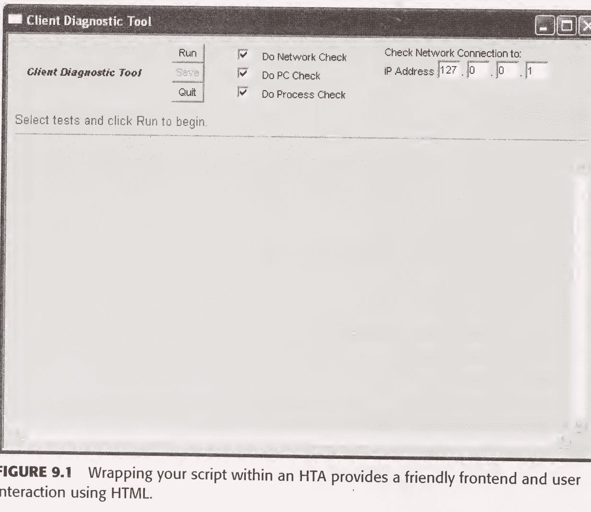

该脚本在 CD-ROM 中以 /chapter 9/scripts/ClientCheck.hta 的形式提供。在继续下一部分之前，请从 CD-ROM 中打开实际脚本，在测试环境中运行几次以了解其工作方式。自行浏览整个代码，然后继续阅读逐步讲解，这将解答您可能有的任何问题。此外，在脚本编辑器中查看完整代码可以让您对其范围有很好的了解，并且允许我们在讲解其功能时您对其进行调整。

在接下来的几页中，我们将逐步讲解实际脚本，并 inline 讨论它的工作原理以及做出某些决定的原因。

### 超文本应用程序

超文本应用程序（HTA)本质上是用 HTML 编写的网页，不需要在 Web 服务器上托管即可运行。相反，HTA 使用客户端机器的 Web 浏览器来运行，但它与在本地打开简单网页（例如，在浏览器中打开某个 somefile.html）有显著区别。正常的浏览器界面不可见（例如，导航按钮和地址栏）。然而，您可以定义 HTA 窗口的外观，例如是否使用滚动条、窗口的大小和位置以及其他 GUI 特性。HTA 使用本地登录用户的安全上下文（或按照底层脚本中另行指定的）对本地文件系统和注册表具有读写访问权限。文件的结构类似于标准网页，使用 HTML 来格式化输出。这些特性使 HTA 成为一个强大的平台，可用于交付美观且交互式的各类脚本——包括前面讨论过的 WMI、ADSI 和 WSH 技术。

HTA 是功能强大的工具，允许脚本在您 Web 浏览器的权限下运行。由于 Internet Explorer 和网页是病毒的热门目标和传播途径，某些杀毒程序在打开 HTA 时可能会警告您它可能包含病毒。对于在计算机上运行的任何 HTA，您都应该谨慎。在运行之前检查 HTA 文件很容易。在记事本（或您喜欢的文本编辑器）中打开 HTA 并查看源代码。作为最佳实践，您应该在运行来自本书或其他来源的任何脚本之前，先审查其源代码。

HTA 以标准 HTML 框架开始，但可能会包含额外的 `<script>` 标签来定义应用程序的功能，如下面的伪代码所示。伪代码是程序的提纲，您可以稍后将其转换为实际的编程语句。使用伪代码有时有助于界定问题的范围，或向他人传达您对程序的想法。


```html
<HTA:APPLICATION options/>
<head>
    <title>Untitled</title>
    <style> Include Cascading Style Sheet information here </style>
    <script> Include the program functionality here </script>
</head>
<body>
    Include the HTML document defining the HTA format here and
    call functions or subroutines from this section.
</body>
</html>
```

`<html>` 容器包裹整个应用程序。在此标签之后，使用 HTA:APPLICATION 对象来定义应用程序的操作方面。表 9.2 列出了可以在 HTA:APPLICATION 中设置的属性。

### 表 9.2 HTA:APPLICATION 属性定义了 HTA 的操作方面

| 名称 | 值（默认值） | 描述 |
| :--- | :--- | :--- |
| APPLICATIONNAME | | HTA 的名称。（与 `<title>` 不同。） |
| BORDER | *thick*, dialog, none, thin | 定义 HTA 窗口的边框。边框类型还包括是否包含带有关闭框的标题栏。请注意，只有使用 thick 边框时才可以调整 HTA 的大小。 |
| BORDERSTYLE | *normal*, complex, raised, static, sunken | 指定边框的外观。 |
| CAPTION | yes, no | 打开标题栏。 |
| CONTEXTMENU | yes, no | 开启和关闭上下文菜单（鼠标右键点击）。 |
| ICON | 文件名 | 指定 HTA 的 32x32 图标。 |
| INNERBORDER | yes, no | 打开内部 3D 边框。 |
| MAXIMIZEBUTTON | yes, no | 在标题栏中显示最大化按钮。 |
| MINIMIZEBUTTON | yes, no | 在标题栏中显示最小化按钮。 |
| NAVIGABLE | yes, no | 在 HTA 窗口内打开链接（而不是在新的浏览器窗口中打开）。 |
| SCROLL | yes, no, auto | 打开滚动条。当内容超出客户区域时，auto 会自动显示滚动条。 |
| SCROLLFLAT | yes, no | 滚动条为平面样式而非 3D 样式。 |
| SELECTION | yes, no | 允许通过鼠标或键盘选择 HTA 内容。 |
| SHOWINTASKBAR | yes, no | 在 Windows 任务栏中与其他正在运行的应用程序一起显示 HTA。 |
| SINGLEINSTANCE | yes, no | 同一时间只能运行一个 HTA 版本。 |
| SYSMENU | yes, no | 打开系统菜单（标题栏中的左上角图标或菜单）。 |
| VERSION | 字符串 | 设置或读取 HTA 的版本号。 |
| WINDOWSTATE | normal, minimize, maximize | 指定以最小化、最大化或正常状态打开 HTA。 |

请注意，在以下 ClientCheck 脚本的 HTA:APPLICATION 定义中，滚动条被关闭了。这意味着整个窗口将没有滚动条，但内部元素（如包含脚本输出的 `<div>` 元素）仍然可以有滚动条，如图 9.2 所示。在 HTA 中使用多个专用区域非常适合将应用程序配置区域与实际结果输出分隔开来。ClientCheck HTA 前端 GUI 由一个包含三行的 HTML 表格组成：顶部行包含配置数据（按钮和复选框所在的位置）；较小的中间行在应用程序执行期间提供状态信息；底部较大的行包含应用程序的输出。

```
<html>
<!-- ------------------------------
* ClientCheck.hta
---------------------------- -->
```

## IT 管理员的十大 Windows 入门脚本

```
<HTA:APPLICATION
    id="ClientDiagnostics"
    APPLICATIONNAME="Client Diagnostic Tool"
    SCROLL="no"
    SINGLEINSTANCE="yes"
    WINDOWSTATE="normal"
    BORDER="thick"
    BORDERSTYLE="normal"
    MAXIMIZEBUTTON="yes"
    MINIMIZEBUTTON="yes"
    SYSMENU="yes" />
```

**图 9.2** *ClientCheck* HTA 的输出包含在由该容器滚动条管理的独立容器中。

`<head>` 元素用于定义标题、样式和脚本。（网页还可以在此处定义元标签和搜索信息。）该工具的要求是无需安装过程即可轻松执行。整个工具包含在单个文件中，包括定义应用程序外观的层叠样式表（CSS），涵盖字体样式、大小和颜色。CSS 样式在 `<style>` 标签中定义。

> 另外，如果你设计了许多 HTA，可以从所有脚本都能访问的文件位置引入外部 CSS。这一步可确保你所有的 HTA 具有相似的外观。

### 定义样式

样式控制 HTML 元素的格式，可应用于大多数 HTML 元素。内联文本也可以通过将其包含在 division `<div>` 或 span `<span>` 标签中来分配样式。以点（`.`）开头的样式继承自先前分配的样式。以井号（`#`）开头的样式应用于具有相同 id 的元素。元素可以被分配 ID，这些 ID 可以通过编程方式引用。在下一个示例中，样式 `#output` 和 `#update` 仅应用于 `id="output"` 和 `id="update"` 的元素。

```
<head>
<title>Client Diagnostic Tool</title>
<style>
body
{background-color:#e8e8e8; font-family:Arial; font-size: 8pt;
margin-top:5px; margin-left:5px; margin-right:5px; margin-bottom:5px;}
.tbox
{font-family:Arial; font-size:8pt; width:25px;}
.button
{font-family:Arial; font-size:8pt; width:35px;}
.table
{font-family:Arial; font-size:8pt;}
#output
{font-family:Arial; font-size: 8pt;}
#update
{font-family: Arial; font-size: 10pt;color="Red";}
</style>
```

### 编程核心

`<script>` 元素保存应用程序的子程序和函数，并声明脚本语言（例如 VBScript）。`Option Explicit` 命令强制所有变量显式声明。在 C# 等强类型语言中声明变量是必需的，而使用 `Option Explicit` 来强制变量声明（即使在 VBScript 等弱类型语言中）有助于养成良好的编程习惯。

将跨所有函数和子程序使用的变量定义为 `Public`。在以下代码中，变量 `g_strTemp` 包含文本文件的路径和文件名，程序的所有子程序都使用该文件来存储临时数据。

g_ 前缀表示该变量为全局变量，有助于提醒你（以及其他阅读你代码的人）它的特殊状态。

```
<script type="text/vbscript">
Option Explicit

public g_strTemp
```

### Window_Onload

子程序 Window_Onload 在 HTA 运行时（更准确地说，当 _Onload 事件触发时）被自动调用。此过程设置 HTA 的初始参数，包括其大小以及最初禁用"保存"按钮的指令（因为还没有数据需要保存）。window 属性引用当前窗口，cmdRun 和 cmdSave 是元素 ID。元素 ID 使脚本中任何过程都可以通过编程方式访问这些元素。

```
'-------------------------------------------------------------------------------
' Initialize the Application
'-------------------------------------------------------------------------------
Sub Window_Onload
    Dim iReturn
    Dim objFSO
    Dim objShell
    Dim objLocator
    Dim strHTML
    window.ResizeTo 640,480
    cmdRun.disabled = False
    cmdSave.disabled = True
```

下一段代码提供了基本的错误处理。应用程序打开错误处理，然后尝试创建一个新的 WMI 对象。失败的尝试会自动将 Err 变量设置为错误代码（该值为非零值）。脚本查找非零值并显示一些有用信息，以帮助用户纠正问题。

> 在调试过程中，请记住禁用 On Error... 语句，因为它会隐藏真正的错误（它会按预期直接跳过有问题的语句）。虽然这听起来显而易见，但你会惊讶于它会多频繁地拖慢你查找软件 bug 的速度。

```
On Error Resume Next
Set objLocator = CreateObject("WbemScripting.SWbemLocator")
If Err <> 0 Then
    strHTML=Heading("The WMI Core Components do not " &_
```


### PerformDiagnostics

`PerformDiagnostics` 子程序从 `Run` 按钮的 `OnClick` 事件中调用。这实际上是程序大部分功能的启动点。应用程序完成其处理可能需要一些时间。因此，在其运行期间，所有按钮都暂时被禁用。禁用按钮可以防止用户在程序运行时尝试点击按钮。

应用程序底部的较大区域由 `id="output"` 定义，该区域被应用程序用于显示程序执行的所有诊断结果。属性 `innerHTML` 用于设置或检索元素的 HTML 内容。例如，代码 `output.innerHTML="Client Diagnostics Tool."` 将输出元素的 HTML 设置为该文本。在此脚本的后续部分中，此过程用于更新程序显示，包括程序更新和程序输出。

根据三个诊断复选框的选中状态，程序调用每个实际执行单独测试的三个子程序。

```
'--------------------------------------------------------------------------
' 运行诊断
'--------------------------------------------------------------------------
Sub PerformDiagnostics
    cmdQuit.disabled=True
    cmdSave.disabled=True
    cmdRun.disabled=True
    output.innerHTML="Client Diagnostics Tool."
    If chkPC.checked = true Then DoPCCheck()
    If chkProcess.checked = true Then DoProcessCheck()
    If chkNet.checked = true Then DoNetworkCheck()
    cmdSave.disabled = False
    update.innerHTML="Checks complete. Click Save to save results " &_
        "to a text file."
    cmdQuit.disabled=False
    cmdSave.disabled=False
    cmdRun.disabled=False

End Sub
```

如果系统不支持 WMI，脚本将禁用依赖 WMI 的诊断测试：`Check Process` 和 `Check PC`。程序 `<body>` 部分内的每个 HTML 输入元素都有一个唯一的 ID。`Check Process` 和 `Check PC` 复选框的 ID 分别是 `chkProcess` 和 `chkPC`。这些 ID 使得这些元素对脚本中的任何过程都可用，允许我们在此 `Window_Onload` 过程中通过将 `disabled` 设置为 `True` 和 `checked` 设置为 `False` 来禁用它们。同样，任何其他子程序也可以设置值、选中或取消选中复选框、获取或设置文本框值，或禁用控件。

```
output.innerHTML= strHTML
chkPC.checked=False
chkPC.disabled=True
chkProcess.checked=False
chkProcess.disabled=True
End If
```

在下面的代码中，公共变量 `g_strTemp` 被定义为位于用户计算机 `%temp%` 文件夹中的一个文件。此文件用于重定向从本程序调用的外部二进制文件（例如，`ping`、`tracert` 和 `ipconfig`）的执行输出。使用 `%temp%` 文件夹是一个好主意，特别是当您无法控制或不了解脚本运行所在的计算机时。这个特殊文件夹通常允许普通用户进行读写访问，而其他文件夹可能受到限制并导致程序停止。

```
On Error Goto 0
Set objShell=CreateObject ("WScript.Shell")
g_strTemp=objShell.ExpandEnvironmentStrings("%temp%") &_
"/tempdiagnostics.txt"
End Sub
```

### DoPCCheck

PC Check 子程序使用 WMI 来演示如何从本地计算机检索各种信息。结果被格式化并显示在 HTA 输出 `<div>` 中，状态显示在更新 `<div>` 中。

```
'--------------------------------------------------------------------------
' 运行 PC 检查
'--------------------------------------------------------------------------
Sub DoPCCheck()
    Dim objLocator, objServices
    Dim colService, colQueryResult
    Dim objItem, objShell
    Dim strWQL, strHTML
    Dim iFreeSpace
    update.innerHTML="Running PC Check.<hr/>"
```

如前所述，`Heading` 函数将基本的无格式字符串和颜色转换为预定义的 HTML 格式化字符串。格式化的字符串包括用于设置字符串颜色的适当样式标签，以及间距和水平线标签。

`DoPCCheck` 子程序从五个不同的 WMI 类返回数据：`Win32_OperatingSystem`、`Win32_BIOS`、`Win32_ComputerSystem`、`Win32_Processor` 和 `Win32_LogicalDisk`。该过程调用 `ExecQuery` 来返回这些类的对象集合并显示特定属性。虽然脚本必须包含对 `ExecQuery` 方法的单独调用，但 `Locator` 对象和服务器连接的初始 WMI 设置可以设置一次并重用于后续查询。这是一种节省空间的方法，较短的代码通常等同于较少的错误。

```
strHTML=Heading("Local Computer Information","Green")
On Error Resume Next
Set objLocator = CreateObject("WbemScripting.SWbemLocator")
Set objServices = objLocator.ConnectServer(".")
strWQL="Select * from Win32_OperatingSystem"
Set colQueryResult = objServices.ExecQuery(strWQL)
```

这五个类都以类似的方式使用 `For…Each` 循环枚举，以迭代返回的集合。这五个类的数据支持收集有关客户端计算机的处理器、磁盘和内存信息的设计要求。收集、格式化并显示各个属性。输出使用 HTML 语法格式化。该过程构建一个名为 `strHTML` 的单一字符串，而不是更新 `output.innerHTML`。在特定测试结束时，`strHTML` 被追加到现有的 `output.innerHTML` 中，并由浏览器呈现。

```
strHTML=strHTML & "<br><b>Operating System</b><br>"
For Each objItem In colQueryResult
    strHTML=strHTML &_
    "Operating System: <i>" & objItem.Caption & "</i><br>" &_
    "OS Version: <i>" &  objItem.Version & "</i><br>" &_
    "Service Pack Installed: SP <i>" &_
    objItem.ServicePackMajorVersion & "." &_
    objItem.ServicePackMinorVersion & "</i><br>"
Next
```

```
strWQL="Select * from Win32_BIOS"
Set colQueryResult = objServices.ExecQuery(strWQL)
strHTML=strHTML & "<br><b>BIOS Information</b><br>"
For Each objItem In colQueryResult
    strHTML=strHTML &_
        "Bios: <i>" & objItem.Description & "</i><br>"
Next
```

物理内存总量从字节转换为兆字节，并使用 `FormatNumber` 方法四舍五入到下一个整数。

```
strWQL="Select * from Win32_ComputerSystem"
Set colQueryResult = objServices.ExecQuery(strWQL)
strHTML=strHTML & "<br><b>Computer System Information</b><br>"
For Each objItem In colQueryResult
    strHTML=strHTML &_
        "Current User: <i>" & objItem.UserName & "</i><br>" &_
        "Computer Name: <i>" & objItem.Name & "</i><br>" &_
        "Make and Model: <i>" & objItem.Manufacturer & " " &_
        objItem.Model & "</i><br> Total Physical Memory <i>" &_
        FormatNumber((objItem.TotalPhysicalMemory/1024)/1024,0)&_
        " </i>MB<br>"
Next
```

```
strWQL="Select * from Win32_Processor"
Set colQueryResult = objServices.ExecQuery(strWQL)
strHTML=strHTML & "<br><b>Processor Information</b><br>"
For Each objItem In colQueryResult
    strHTML=strHTML &_
        "Processor: <i>" & objItem.Name & "</i><br>" &_
        "ClockSpeed: <i>" & objItem.MaxClockSpeed & " </i>Mhz<br>" &_
        "Percent Loaded: <i>" & objItem.LoadPercentage & "</i><br>"
Next
```

直到这一点，属性通常是唯一的（除非您在多处理器系统上运行此脚本，该系统会返回多个 `Win32_Processor` 对象）。一个显著的例外是枚举 `Win32_LogicalDisk` 集合，其中可能包含多个驱动器。脚本期望一个较大的数据集并构建一个 HTML 表格来显示结果。首先构建表格和包含标题信息的第一行。

```
strWQL="Select * from Win32_LogicalDisk"
Set colQueryResult = objServices.ExecQuery(strWQL)
strHTML=strHTML &_
    Heading("Storage Information","Green") &_
    "<table Border=1 class=table width=600px>" &_
    "<tr style='FONT-WEIGHT: bold'><td>Drive</td><td>" &_
    "Free Space</td><td>Description</td></tr>"
```

如果系统不支持 WMI，脚本将禁用依赖 WMI 的诊断测试：`Check Process` 和 `Check PC`。程序 `<body>` 部分内的每个 HTML 输入元素都有一个唯一的 ID。`Check Process` 和 `Check PC` 复选框的 ID 分别是 `chkProcess` 和 `chkPC`。这些 ID 使得这些元素对脚本中的任何过程都可用，允许我们在此 `Window_Onload` 过程中通过将 `disabled` 设置为 `True` 和 `checked` 设置为 `False` 来禁用它们。同样，任何其他子程序也可以设置值、选中或取消选中复选框、获取或设置文本框值，或禁用控件。

```
output.innerHTML= strHTML
chkPC.checked=False
chkPC.disabled=True
chkProcess.checked=False
chkProcess.disabled=True
End If
```


 ## 下一步

接下来，循环遍历集合中的每个对象，并为每个逻辑驱动器创建一个新的表格行。请注意，以下代码包含额外的测试，以验证 `objItem.FreeSpace` 是否为数字。如果 `IsNull` 函数返回 `True`，则将 `objItem.FreeSpace` 设置为 `0`。此设置对于处理带有可移动介质的驱动器（如软盘或 CD-ROM 驱动器）是必要的。如果未插入磁盘，该驱动器的 `FreeSpace` 将报告为 `Null`。`Null` 值会在后续方法 `FormatNumber` 中引发错误，因为该方法期望输入参数为数字。最后，将字符串 `strHTML` 追加到现有 HTML 中，该 HTML 包含在元素 `id="output"` 的 `<div>` 内。

```
For Each objItem In colQueryResult
    If Not IsNull(objItem.FreeSpace) Then
        iFreeSpace=(objItem.FreeSpace / 1024)/1024
    Else iFreeSpace=0
    End If
    strHTML=strHTML & "<tr>" & _
        "<td>" & objItem.Caption & "</td>" & _
        "<td>" & FormatNumber(iFreeSpace,2) & " MB free</td>" & _
        "<td>" & objItem.Description & "</td>" & _
        "</tr>"
Next
strHTML=strHTML & "</table><br>"

output.innerHTML=output.innerHTML & strHTML
On Error Goto 0
End Sub
```

### DoProcessCheck

`DoProcessCheck` 子程序使用 WMI 检索所有活动进程。连接到 WMI 提供程序并从 `Win32_Process` 返回集合的过程与 `DoPCCheck` 函数中上述 WMI 调用类似。此子程序包含额外的测试和格式化，以 HTML 表格形式显示活动进程和一些关键属性。

```
'----------------------------------------------------------------------
' Run Process Check
'----------------------------------------------------------------------
Sub DoProcessCheck()
    Dim strHTML, strCmdLine, strWQL
    Dim objLocator, objServices, objItem
    Dim colQueryResult, strFlagApp
    Dim bFlagApp
    Dim iPageFaults, iWSS, iPWSS
```

IT Administrator's Top 10 Introductory Scripts for Windows

```
On Error Resume Next
Set objLocator = CreateObject("WbemScripting.SWbemLocator")
Set objServices = objLocator.ConnectServer(".")
update.innerHTML="Processes.<hr/>"
strHTML=Heading("Current Processes","Green")
```

变量 strFlagApp 支持一个更大的设计，用于标记可疑进程。这些进程由脚本管理员事先识别。如果发现有进程在系统上运行，它们将被标记并以**粗体红色**突出显示。被标记的应用程序也会在活动应用程序表格下方的单独列表中呈现。此设计旨在帮助诊断信息的接收方快速识别与其他应用程序之间先前已知的兼容性问题。

```
strFlagApp="Flagged Applications:<br>"
bFlagApp=FALSE
```

WMI 类 Win32_Process 包含有关活动进程的大量信息，包括进程名称、启动时使用的命令行、进程消耗的内存量、进程导致的页面错误数等。由于我们想要列出所有进程，因此我们使用基本查询字符串调用 ExecQuery 方法。

使用 HTML 表格来格式化结果。第一行包含脚本显示数据的表格标题信息。

```
strWQL="Select * from Win32_Process"
Set colQueryResult = objServices.ExecQuery(strWQL)
strHTML=strHTML & "<table class=table width=600px border=1>" & _
"<tr style=" & chr(34) & "FONT-WEIGHT: bold" & chr(34) & _
"><td>Process</td><td>Command Line</td><td>Memory (KB)</td>" & _
"<td>Peak Mem(KB)</td><td>Page Faults</td></tr>"
```

返回的进程集合中的对象和属性也包含不同类型的数据，或根本没有数据。以下代码检查每个属性是否包含正确类型和格式的数据。此验证还提供了一个机会，可以为数据添加更易读的含义。例如，如果命令行不存在，脚本将用 n/a 替换该值。

同样，脚本确认每个进程的当前和峰值内存利用率是否为数字，然后将该值转换为兆字节。如果该值不是数字，脚本将用 -1 替换该值以表示错误。

```
For Each objItem In colQueryResult
  If IsNull(objItem.CommandLine) Then
    strCmdLine="n/a"
```

```
Else strCmdLine=objItem.CommandLine
End If
If IsNumeric(objItem.WorkingSetSize) Then
    iWSS=(objItem.WorkingSetSize / 1024)
Else iWSS=-1
End If
If IsNumeric(objItem.PeakWorkingSetSize) Then
    iPWSS=(objItem.PeakWorkingSetSize / 1024)
Else iPWSS=-1
End If
If IsNumeric(objItem.PageFaults) Then
iPageFaults=objItem.PageFaults
Else iPageFaults=-1
End If
```

被标记的应用程序使用 `Select...Case` 语句进行检测。这允许多个应用程序快速添加到列表中。默认被标记的应用程序 `mshta.exe` 实际上是 HTA 应用程序本身，用于在任何系统上演示被标记应用程序的操作方式和外观。添加逗号分隔的字符串列表以标记其他应用程序。

```
Select Case objItem.Description
    Case "mshta.exe"
        bFlagApp = TRUE
        strHTML=str Blob strHTML & "<tr style='COLOR: RED'>"
        strFlagApp=strFlagApp+objItem.Description & "<br>"
    Case Else
        strHTML=strHTML & "<tr>"
End Select
```

为每个进程构建一个单独的 HTML 表格行，并将数值数据四舍五入到下一个整数。

```
strHTML=strHTML & "<td>" & objItem.Description & "</td>" &_
    "<td>" & strCmdLine & "</td>" &_
    "<td align=right>" & FormatNumber(iWSS,0) & "</td>" &_
    "<td align=right>" & FormatNumber(iPWSS,0) &"</td>" &_
    "<td align=right>" & FormatNumber(iPageFaults,0) & "</td>" &_
    "</tr>"
Next
strHTML=strHTML & "</table><br>"
```

在显示活动进程之后，被标记的应用程序将被简单列出，并且整个 `strHTML` 字符串（包含所有格式化的 HTML 进程）将直接显示在 HTA 中。

### DoNetworkCheck

DoNetworkCheck 子程序使用 WSH `Run` 方法和 `FileSystemObject` 方法来驱动外部应用程序，如 `ping`、`ipconfig` 和 `tracert`。这些外部应用程序在单独的进程中运行，其输出被重定向到临时文本文件 `g_strTemp`。此脚本的设计要求包括测量网络延迟和网络连接的一致性。脚本使用 `ping` 和 `tracert` 网络工具，这些工具安装在大多数 Windows 平台上。

```
'--------------------------------------------------------------------------
' DoNetworkCheck
'--------------------------------------------------------------------------
Sub DoNetworkCheck()
    Dim bNetworkUp
    Dim iReturn
    Dim objShell, objFSO
    Dim strHTML, strPingAddress, strTRAddress
```

在运行测试之前，用户可以指定远程计算机的 IP 地址，以测量两台计算机之间连接的质量。默认情况下，此值设置为 `127.0.0.1` 或 `localhost`。此应用程序使用独立的框来测试有效的 IP 八位字节。如果 IP 地址无效，子程序将退出。否则，脚本将四个八位字节连接成格式正确的 IP 地址，并将地址字符串 `strPingAddress` 和 `strTRAddress` 设置为该值。

> 另外，可以使用单个字段，接受 IP 地址或系统的完全限定域名（FQDN）。可以使用正则表达式验证 IP 地址的格式是否正确。

```
If txtIP1.Value > 223 or txtIP2.Value > 255 or txtIP3.Value > 255_
  or txtIP4.Value > 254 or txtIP1.Value < 1 or txtIP2.Value < 0_
  or txtIP3.Value < 0 or txtIP4.Value < 0 Then
    update.innerHTML="IP address is invalid. Please correct."
    Exit Sub
End If

strPingAddress=txtIP1.Value & "." & txtIP2.Value & "." &_
  txtIP3.Value & "." & txtIP4.Value
strTRAddress=txtIP1.Value & "." & txtIP2.Value & "." &_
  txtIP3.Value & "." & txtIP4.Value
```


### 标题

之前，在首次提到 Heading 函数时曾对其进行了简要介绍。以下代码展示了该函数的实际实现。此函数接收一个文本字符串和一个颜色作为输入，并返回一个格式化的 HTML 字符串。

```
'---------------------------------------------------------------
' Format the Heading
'---------------------------------------------------------------
Function Heading(strHTML, strColor)
Heading = "<br><br><div style=" & chr(34) & "color=" & strColor & _
chr(34) & ">" & strHTML & "</div><hr/><br>"
End Function
```

### ProcessResults

ProcessResults 函数读取一个文本文件，并将其内容以字符串形式返回给调用过程。该函数不进行任何文本解析（例如去除空行）。错误检查仅限于调用 FileExists 方法。由于此函数读取的文本文件是由脚本创建的，因此不需要额外的错误检查。该方法使用 OpenTextFile 方法打开文件。OpenTextFile 的参数在第 3 章讨论 FileSystemObject 时以及在第 4 章讨论 ReadFile 函数时均有涉及。

文件读取完成后，该函数会删除文件。同样，这样做是可行且安全的，因为最初就是该脚本生成了文件。在使用完成后删除文件是一种良好的做法，因为它可以保持系统清洁，并且在脚本退出后不会残留任何文件。

```
'----------------------------------------------------------------------------
' Read a text file and return the contents
'----------------------------------------------------------------------------
Function ProcessResults(strFileName)
Dim objFSO, objTextFile
Dim strHTML, strReadLine

Set objFSO = CreateObject("Scripting.FileSystemObject")
If (objFSO.FileExists(strFileName)) Then
    Set objTextFile = objFSO.OpenTextFile(strFileName,1)
    strHTML=""
    Do While objTextFile.AtEndOfStream <> True
        strReadLine=objTextFile.ReadLine
        strHTML=strHTML & strReadLine & "<br>"
    Loop
    objTextFile.Close
    objFSO.DeleteFile(strFileName)
Else
    strHTML="Error reading file."
End If

ProcessResults=strHTML
End Function
```

### SaveResults

SaveResults 函数将脚本诊断生成的输出写入用户指定的文本文件。VBScript 函数 InputBox 提供了一种简便的方式来询问用户所需的文件名，如图 9.3 所示。InputBox 函数的参数如下：

```
strAnswer = InputBox(strPrompt, strTitle, strDefault, xPosition, _
yPosition, helpfile, context)
```

- `strAnswer` 是一个包含用户输入值的字符串。唯一必需的参数是 `strPrompt`，即显示给用户以请求其输入的文本。
- `strTitle` 标注 InputBox 的标题栏。
- `strDefault` 是一个预先填充到文本字段中的字符串。
- 可选地，通过设置 `xPosition` 和 `yPosition` 来指定对话框的位置。
- InputBox 还支持链接帮助文件和上下文，这可以为用户提供额外的信息。

第一个过程从命令 `ipconfig` 收集机器的网络配置。


> 一个设计假设是，所有将运行此程序的客户端机器上都已经安装了 `ipconfig`（以及其他外部应用程序）。然而，任何时候运行外部应用程序时，务必确保你完全确定它将如何运行。例如，`reg.exe` 命令（可用于从控制台读取和写入注册表设置）在 Windows XP 上经历了重大改造，大多数参数都发生了变化。如果你无法提供你在其上测试过的版本的外部应用程序（例如，通过将其复制到本地机器并使用精确路径调用已知应用程序的可执行文件），那么请注意你使用的参数，以防它们在未来的版本中发生变化。

脚本使用 `WScript.Shell.Run` 方法，而不是支持标准流（StdIn、StdOut、StdErr）的 ` Exec` 方法。做出这一设计决策是因为该程序可能在多台 Windows 计算机上运行。`Exec` 方法是在较新版本的 WSH 中引入的，在较早版本的 Windows 上会失败。`Run` 方法适用于带有旧版本 WSH 的 Windows 平台。`Run` 方法调用命令 `ipconfig /all` 并将输出（使用大于号 `>`）重定向到临时数据文件。`Run` 方法中的其余参数指示它不显示窗口（`0`），并暂停脚本直到外部命令执行完毕（`true`）。

```vbscript
update.innerHTML="Collecting IP and Network Information.<hr/>"
Set objShell = CreateObject("WScript.Shell")
iReturn=objShell.Run("%comspec% /C ipconfig /all > " & _
g_strTemp,0,true)
```

在执行 `ipconfig` 之后，脚本立即调用 `ProcessResults` 函数来实现此目的。`ProcessResults` 读取包含 `ipconfig` 输出数据的文本文件内容，并以字符串形式返回结果。对结果的任何特殊处理（例如仅显示 IP 地址）可以在从 `ProcessResults` 函数返回字符串之后在此函数中完成。`ProcessResults` 是一个通用函数，它只是读取文件并将其内容返回给调用函数。其工作机制在接下来几页函数被详细说明时进行介绍。

```vbscript
strHTML=ProcessResults(g_strTemp)
output.innerHTML=output.innerHTML & _
Heading("IP Configuration Settings","Green") & strHTML
```

使用 `tracert` 或多个 ping 测量网络连接，或者使用任何 `net` 命令（例如 `net use`）连接到计算机，有时可能需要相当长的时间——特别是当目标计算机宕机且无响应时。在发起其中一个超时较长的网络命令之前检测此状态，此脚本包含一个初步测试来检查网络连接的状态。发送单个 ping 请求，如果收到回复，则设置标志 `bNetworkUp` 并运行更全面的测试。`Ping` 是一个很好的解决方案，因为它可以配置为较小且快速完成（例如，单个 ping）。

```vbscript
update.innerHTML="Checking Network Connection.<hr/>"
bNetworkUp = False
iReturn=objShell.Run("%comspec% /C ping " & strPingAddress & _
" -n 1 > " & g_strTemp,0,true)

strHTML=ProcessResults(g_strTemp)
If (InStr(strHTML, "Reply")) Then bNetworkUp = True
If bNetworkUp Then
    strHTML= Heading("Network appears to be online.","Green")
    output.innerHTML= output.innerHTML & strHTML
```

需求规定脚本需要测量网络连接的一致性。下一个测试向远程机器发送 10 个 ping 并显示结果。对于存在问题的连接，此测试可以识别高延迟或丢包。显然，如果问题是间歇性的，此测试可能无法捕捉到。然而，发送多个 ping 可以大致了解连接的质量和速度。此 ping 测试与之前的侦察 ping 测试类似；但是，发送 10 个 ping 需要更长的时间（特别是当机器宕机或被防火墙过滤时），等待所有这些 ping 返回可能会让此工具的用户感到沮丧。

```vbscript
update.innerHTML="Performing Ping.<hr/>"
iReturn=objShell.Run("%comspec% /C ping " & strPingAddress & _
" -n 10 > " & g_strTemp,0,true)
strHTML= Heading("Ping Test to " & strPingAddress & _
" : Succeeded","Green")

strHTML= strHTML & ProcessResults(g_strTemp)
```

traceroute 命令测量客户端与其目的地之间每一跳的延迟。此测试完成所需的时间最长，但它可以精确定位延迟的来源（例如，如果某个特定的 ISP 或骨干网出现问题）。脚本以类似于上述 ping 命令的方式调用该命令。

```vbscript
update.innerHTML="Performing Traceroute.<hr/>"
iReturn=objShell.Run("%comspec% /C tracert " & strTRAddress & _
" > " & g_strTemp,0,true)

If Err Then alert("An error occurred")
strHTML=strHTML & Heading("Trace Route Results","Green") & _
ProcessResults(g_strTemp)
```

如果网络断开（例如，`bNetworkUp = False`），则脚本会显示一条消息告知用户。最后，所有网络检查的结果都会显示给用户。

```vbscript
Else
    strHTML=Heading("Network appears to be offline.","Red") & _
    strHTML
End If
output.innerHTML= output.innerHTML & strHTML
On Error Goto 0
End Sub
```


**图 9.3** VBScript 的 InputBox 函数提供了一种简便的方法来获取用户提供的信息。

如果用户输入了空条目，SaveResults 子程序将退出，但不会检查文件名中是否使用了非法字符。接下来，脚本使用 CreateTextFile 方法创建一个新的文本文件，并逐行写入 output.innerText 的内容。

innerText 属性与 innerHTML 属性类似，该脚本经常使用 innerHTML 将诊断数据发布到 `<div id="output">`。然而，innerHTML 支持 HTML，而 innerText 仅支持纯文本（无格式）。这一特性很有用，因为我们只想将文本写入保存文件。否则，如果脚本使用了 innerHTML，保存文件将包含实际的 HTML，用户阅读起来会更加困难。

> 或者，我们可以编写一个格式化为 HTML 文档的 savefile.html，这样我们就可以保留格式并写出 innerHTML。

```
' --------------------------------------------------
' save dialog
' --------------------------------------------------
Sub SaveResults
    Dim objFSO
    Dim strFileName
    Dim objTextFile

    Set objFSO = CreateObject("Scripting.FileSystemObject")
    strFileName = InputBox("Please enter the path to save file" _
        , "Save File", "c:\DiagnosticsOutput.txt")
    If strFileName = "" Then Exit Sub

    Set objTextFile = objFSO.CreateTextFile(strFileName)
    objTextFile.WriteLine output.innerText
    objTextFile.Close
End Sub
```

### QuitScript

QuitScript 子程序会清理任何遗留文件并退出函数。之前的 ProcessResults 函数应该已经充分清理了每个文本文件，这里的额外步骤通常是多余的。然而，在退出时提供一个关闭、清理类型的函数通常是一个有用且恰当的步骤。window.close() 方法是一个 HTA 方法，用于关闭当前窗口。

```
'-----------------------------------
'Quit
'-----------------------------------
Sub QuitScript
    On Error Resume Next
    Set objShell = CreateObject("WScript.Shell")
    Set objFSO = CreateObject("Scripting.FileSystemObject")
    objFSO.DeleteFile g_strTemp
    Set objFSO = Nothing
    window.close()
End Sub
```

## 使用 HTML 创建前端

使用 HTA 作为脚本的包装器或外壳的优势之一是易于格式化前端。这种便利性源于 HTA 本身就是一个基本的网页，并且支持 HTML 格式。

当 HTA 打开时，浏览器会解析并渲染所有 HTML，然后调用 Window_onload。这个函数可以立即调用其他子程序。接下来的代码使用标准 HTML 来定义 HTA 前端的外观和交互性。应用程序的按钮、复选框和文本字段使用 HTML input 元素定义。子程序通过定义 onClick 事件来启动。脚本通过分配的 id 引用元素属性。类定义了用于呈现元素的样式。

还要注意，在 script 标签内部，注释使用 VBScript 的撇号（'）语法表示。在 script 标签外部，使用注释约定 `<!-- comment -->`，如本脚本开头所示。

```
'-----------------------------------
'Format the HTA using standard HTML
'-----------------------------------
</script>
</head>

<body>
```

脚本显示在一个由三行四列组成的单个表格单元格中，如图 9.4 所示。在纸上绘制表格布局 diagramming 对编程表格元素很有帮助。在这个脚本中，底部的两行跨越了顶部一行中的所有四列。表格元素的尺寸对于确保 HTA 外观良好以及如果用户调整 HTA 大小时能够适当缩放也很重要。图 9.4 还显示了元素的初始尺寸。其中两个尺寸设置为 *，这意味着浏览器将浮动该维度以达到定义的容器总宽度或高度。其余元素保持固定大小。这导致 HTA 的窗口调整行为类似于典型的应用程序。

## IT 管理员的十大 Windows 入门脚本

```
<table width="100%" height="100%" class="table">
    <tr height = 75px>
        <td align="center" width=150px><b><i>Client Diagnostic Tool</i></b></td>
        <td width=50px>
```

HTML input 元素提供了用户与脚本的交互。脚本通过它们的 id 属性引用这些元素。这些元素支持许多属性。样式按钮之前在脚本的 `<style>` 部分定义，并通过定义的类（例如 `class="button"`）与元素关联。value 设置按钮的文本标签。许多 HTML 元素还支持事件（如 onClick），当记录到某些操作时会触发。例如，在以下代码中，当用户单击运行按钮时，input 元素的 onClick 事件会调用子程序 PerformDiagnostics，从而启动诊断测试。类似地，单击保存和退出按钮会分别启动 SaveResults 和 QuitScript 过程。

```
<input id=cmdRun class="button" type="button" value="Run"
       name="cmdRun" onClick="PerformDiagnostics()"><br>
<input id=cmdSave class="button" type="button" value="Save"
       name="cmdSave" onClick="SaveResults()"><br>
<input id=cmdQuit class="button" type="button" value="Quit"
       name="cmdQuit" onClick="QuitScript()"><br>
</td>
```

复选框允许用户定义他们希望执行的测试。通过包含定义 CHECKED 来指定复选框元素是否最初被选中。

```
<td width=150px>
<input id=chkNet class="button" type="checkbox" CHECKED >
 Do Network Check<br>
<input id=chkPC class="button" type="checkbox" CHECKED >
 Do PC Check<br>
<input id=chkProcess class="button" type="checkbox" CHECKED >
 Do Process Check<br>
</td>
```

input 元素 text 定义了文本字段，此脚本用于收集 IP 地址的四个八位字节。最大长度和初始值也在此处设置。

```
<td width=* valign=top>
Check Network Connection to:<br>
IP Address
<input id=txtIP1 class="tbox" type="text" MAXLENGTH=3 Value="127">.
<input id=txtIP2 class="tbox" type="text" MAXLENGTH=3 Value="0">.
<input id=txtIP3 class="tbox" type="text" MAXLENGTH=3 Value="0">.
<input id=txtIP4 class="tbox" type="text" MAXLENGTH=3 Value="1">
</td>
</tr>
```

第二行由单个列组成，该列跨越上一行的所有四列。为了控制该区域中的文本，表格数据单元格被分配了一个 `id="update"`。执行诊断测试的许多函数通过将 update.innerHTML 属性设置为更新消息来更新其状态。

```
<tr>
    <td  height = 50 colspan=4 id="update">
        Select tests and click Run to begin.<hr/></td>
</tr>
```

文本的输出显示方式与之前的更新文本类似。然而，接下来的代码使用了一种稍微不同的方法。没有将元素 `id="output"` 分配给表格数据单元格，而是创建了一个新的 division 元素 `<div>`，并为其分配了 id="output"。`<div>`（和 `<span>`）元素允许独立引用内联文本。因为此文本是此表格单元格中的唯一项目，`id="output"` 应该分配给表格数据单元格，但这种替代方法演示了如何将一个文本主体与一个 id 关联起来，如果在不使用表格元素的情况下可以使用这种方法。

```
<tr>
    <td height = * colspan=4><div id="output"
        style= "width:100%; height:100%; overflow:scroll"></div>
    </td>
</tr>

</table>
</body>
</html>
```


## 摘要

*ClientCheck* HTA 脚本展示了通过将脚本编写为 HTA 来为脚本添加基本前端界面的便捷性。与在 Office 应用程序中运行不同，该脚本依赖浏览器运行，这增加了可运行该脚本的机器数量。然而，请谨慎操作，因为这些脚本可以在当前登录用户的本地安全上下文中运行，从而带来强大的威力。但正是这种灵活性和强大功能，使得 HTA 成为脚本工具库中的利器。

## 关键点

-   考虑使用超文本应用程序（HTA）为脚本提供易于设计的用户界面。
-   HTA 为脚本提供用户交互性，例如复选框、单选按钮、文本框和其他控件。
-   使用 WMI 方法 ExecQuery 从本地或远程计算机高效返回 WMI 类数据。
-   务必理解方法或函数返回的对象类型——例如，方法返回的是单个对象还是对象集合？返回的对象类型是什么？使用软件开发工具包（SDK）查询可能不确定的新方法的具体信息。本脚本使用了多个 ExecQuery 方法调用，这些调用返回对象集合，在列出之前必须先进行枚举。
-   如果你无法（或不需要）通过脚本解决问题，可以考虑调用并利用现有工具，然后解析结果。虽然这可能不如编写自己的解决方案优雅，但许多基于 IT 的工具都刻意追求快速实用，调用外部工具同样有效。

# 10 蠕虫漏洞检测器

## 概述

蠕虫、病毒攻击以及其他不加区分地探测和攻击任何服务器的恶意软件，对我们的 IT 基础设施构成了日益增长的威胁。许多更成功的蠕虫，如 *Code Red* 和 *Nimda*，实际上利用的是软件供应商在攻击发生前数月就已修补的已知漏洞。由于这些蠕虫出现的频率和传播范围不断增加，防病毒和安全软件供应商持续加强其产品。然而，即使对新威胁保持了这种高度敏感性，IT 管理员仍然面临检查每台计算机是否存在易受攻击的服务和已应用更新的不可避免且艰巨的任务。

考虑一个轻量级、快速响应的脚本，它可以协助你侦察易受攻击的服务器。利用我们迄今为止探讨的一些技术——例如对每台计算机运行命令行工具、查找正在运行的特定服务以及检查已应用的补丁——我们可以创建一个脚本，评估你对特定蠕虫或漏洞利用的易受攻击性。

> 虽然此脚本有助于发现易受攻击的机器，但它不应取代专用的安全基础设施，如入侵检测系统、防火墙或防病毒软件。此脚本提供了一个框架，用于自动化你可能手动执行的一些步骤来评估这些漏洞。

## 场景

昨晚，一种新蠕虫登上了六点新闻。这种蠕虫利用了未打补丁的微软 Internet 信息服务 (IIS) 安装中的漏洞。作为一家软件公司的安全管理员，你想扫描你的网络以寻找潜在易受攻击的系统。微软很久以前就针对这个特定的漏洞利用发布了补丁，而且因为你遵循良好的补丁评估和部署计划来管理公司服务器，所以你不太担心那些系统。但你确实想确保那些可能在自己的工作系统上安装了 IIS 的开发人员也对其系统进行了补丁更新。你在互联网上搜索可用于扫描域内易受攻击机器的网络扫描工具，但一无所获；这些扫描器尚未针对这种特定蠕虫进行更新，而你想抢先一步评估你的环境暴露情况。

阅读了描述该蠕虫的安全公告后，你了解到该蠕虫仅攻击 Microsoft IIS 5.0 (Windows 2000) 在 TCP 端口 80（标准 Web 端口）上的服务，并且修补系统和关闭漏洞的更新是 Microsoft MS03-007 (Q815021)。

有了这些信息，你想快速识别那些可能易受攻击的机器，然后采取进一步行动。对于你域中的所有系统，你想扫描正在运行的 IIS 实例，查找打开的 TCP 80 和 TCP 443 端口，并检查是否安装了 Q815021。通过采取这种多管齐下的方法，你希望能获得一份可靠的系统清单，从而启动修复工作。

## 分析

这样一款易于配置的扫描器可以通过中央控制台快速识别可能易受攻击的机器，从而提高响应速度。此脚本自动化并集中扫描你域中的计算机，使用的是相当粗略的检查——尽管如此，这些检查仍然可以在潜在攻击的初期帮助你集中修复精力。

因此，你的需求对应于表 10.1 中列出的技术要求。

### 表 10.1 将业务目标转化为技术要求

| 业务目标 | 技术要求 |
| :--- | :--- |
| 扫描域中的计算机。 | 使用第 8 章介绍的 *DumpComputerList* 脚本生成指定域中的计算机列表。Ping 每台机器以查看其是否在网络上响应，然后对列表中的每台活动计算机执行每个选定的扫描。 |
| 扫描开放的 Windows 服务（例如名为 *w3svc* 的 Microsoft 万维网服务器）。 | 使用 WMI Win32_Service 类连接到远程计算机并查询所选服务的 State。突出显示状态为 Running 或 Stopped 的服务。 |
| 扫描开放的网络端口。 | 利用第三方的基于命令行的端口扫描工具扫描目标计算机的指定端口。 |
| 扫描已安装的 Microsoft QFE 更新。 | 使用 WMI Win32_QuickFixEngineering 类确定是否已安装指定的 QFE 更新。 |

此脚本包含多个函数，用于扫描针对特定蠕虫易受攻击的服务或系统。脚本检查正在运行的特定服务，利用流行的 *nmap* 网络扫描器查找特定的开放端口，并检查是否已应用特定的快速修复工程 (QFE) 热修复补丁。

> 该脚本利用了由 Fyodor 编写的流行命令行端口扫描器 nmap 的功能。从 www.insecure.org/nmap/nmap_download.html 下载 nmap 扫描器的 Windows 版本和详细的安装说明。要使用 nmap，你还需要 Windows 的 WinPcap 数据包捕获架构，可以从 http://winpcap.polito.it/install/default.htm 下载。此软件只需在执行实际扫描的计算机上安装。如果你选择不使用 nmap 扫描器，仍然可以通过从设置工作表中选择要运行的测试来执行其他测试。你可以通过编辑 PortCheck 函数来处理其他端口扫描器的语法参数和输出，从而使用你自己的命令行端口扫描器。

此脚本使用 Win32_QuickFixEngineering WMI 类来收集远程计算机上所有已安装更新的列表。在早期版本的 Windows 2000 计算机（SP3 之前）上，调用 Win32_QuickFixEngineering 类存在一个缺陷，这可能导致脚本挂起，并使客户端计算机的 Winmgmt.exe 进程在内存和 CPU 使用率上增加。微软在适用于 SP3 之前计算机的热修复补丁以及 Windows 2000 SP3 中修复了此错误。有关此问题及其解决方案的更多信息，请参见微软知识库 (http://support.microsoft.com/default.aspx?scid=kb;en-us;279225)。

因此，如果你知道目标机器已安装 SP3 或热修复补丁 Q279225.exe，则应指定仅扫描 QFE 更新。前述知识库文章中也包含了指向该热修复补丁的链接。如果你确实扫描了一台计算机，并且 Microsoft Excel 报告错误说 Excel 正在等待另一个应用程序完成 OLE 操作，那么你可能遇到了此缺陷。你将看到当前计算机的名称，此时应终止 Excel，检查远程计算机上的 Winmgmt.exe 进程，并将该计算机从未来的 QFE 更新扫描中移除（或按照知识库文章中的说明为该计算机打补丁）。

此脚本建立在第 8 章介绍的基于 Excel 的 DumpComputerList 脚本基础上，并使用该工具构建要扫描的计算机列表和记录输出。此脚本使用的函数和子程序如下：

-   **SetupScan：** 解析 *Setup* 工作表以获取所需的扫描。
    -   使用 *Setup* 工作表上识别的扫描更新 *Output* 工作表。

-   **SystemScan：** 遍历计算机列表，并调用各个扫描函数执行要执行的扫描。
    -   支持单个或多个选定的计算机。
    -   支持单个或多个选定的扫描。

-   **Pingable：** 确定系统是否响应网络 ping。
    -   使用 Shell 对象 Run 方法执行 ping 命令。
    -   使用 FileSystemObject 解析输出。


**ServiceCheck：**检查特定的运行服务。
- 使用 WMI Win32_Services 类返回远程计算机上服务的运行状态。

**PortCheck：**使用命令行端口扫描器扫描机器上的开放端口。
- 使用 Shell 对象的 Run 方法执行针对远程计算机的自定义 *nmap* 运行。*Nmap* 是一款流行的开源端口扫描器。
- 使用 FileSystemObject 解析输出结果。

**QFECheck：**检查特定的 QFE 热修复补丁。
- 执行 WMI ExecQuery 方法以确定是否已应用 QFE 热修复补丁。

**DisplayResults：**检查特定的热修复补丁或更新。
- 在 Excel 的指定单元格中显示格式化文本。

# 分发与安装

使用这个进化版脚本的方式与其前身 *DumpComputerList* 基本相同，后者在第 8 章中介绍过。在增强的 *Setup* 工作表上定义用于驱动脚本的参数。首先，与第 8 章的 *DumpComputerList* 脚本一样，输入域名和 *Output* 工作表的名称，然后单击第一个按钮（Pull Computers from Directory）以发起对指定域的目录查询。该脚本使用第 8 章中介绍的相同脚本创建并填充 *Output* 工作表。接下来，在第二个按钮下方显示的 Service Scan、Port Scan 和 QFE Scan 框中指定扫描信息，如图 10.1 所示。在您希望包含在 *Output* 工作表上的扫描旁边放置 x。通过这种选择性，您可以在此工作表上构建大量扫描列表，然后仅切换您希望复制到 *Output* 工作表的扫描。（在 *Output* 工作表上运行扫描之前，您可以进一步指定实际要运行的扫描。）*Column* 参数指定该扫描将添加到 *Output* 工作表的哪一列编号。更新 *nmap* 可执行文件的路径（或者如果 *nmap* 已在您的 Path 环境变量中，可以清除该单元格）。

> 在 Excel 中，列可以通过字母（A、B 或 C）或数字（1、2 或 3）引用。脚本通常使用数字列引用，因为使用数字比使用字母更容易进行迭代。

添加并配置好扫描后，准备更新 *Output* 工作表时，单击第二个按钮（Format Output Worksheet for System Scan）。这将启动 *SetupScan* 子程序，该子程序遍历三个扫描列表中的每一个，并将扫描类型和定义添加到 *Output* 工作表的相应列中。扫描类型包括服务扫描（s）、端口扫描（p）和 QFE 扫描（q）。

> 第二个按钮仅根据设置工作表中列出的参数格式化输出工作表。实际执行扫描的代码（SystemScan）仅使用输出工作表中的数据来确定要扫描的内容。如果您愿意，实际上可以跳过第二步并手动格式化输出工作表。第二步提供了便利，并确保输出工作表上的扫描语法格式正确。这就是设计自己的软件的美妙之处——您可以根据需要完全自定义外观、感觉和操作。

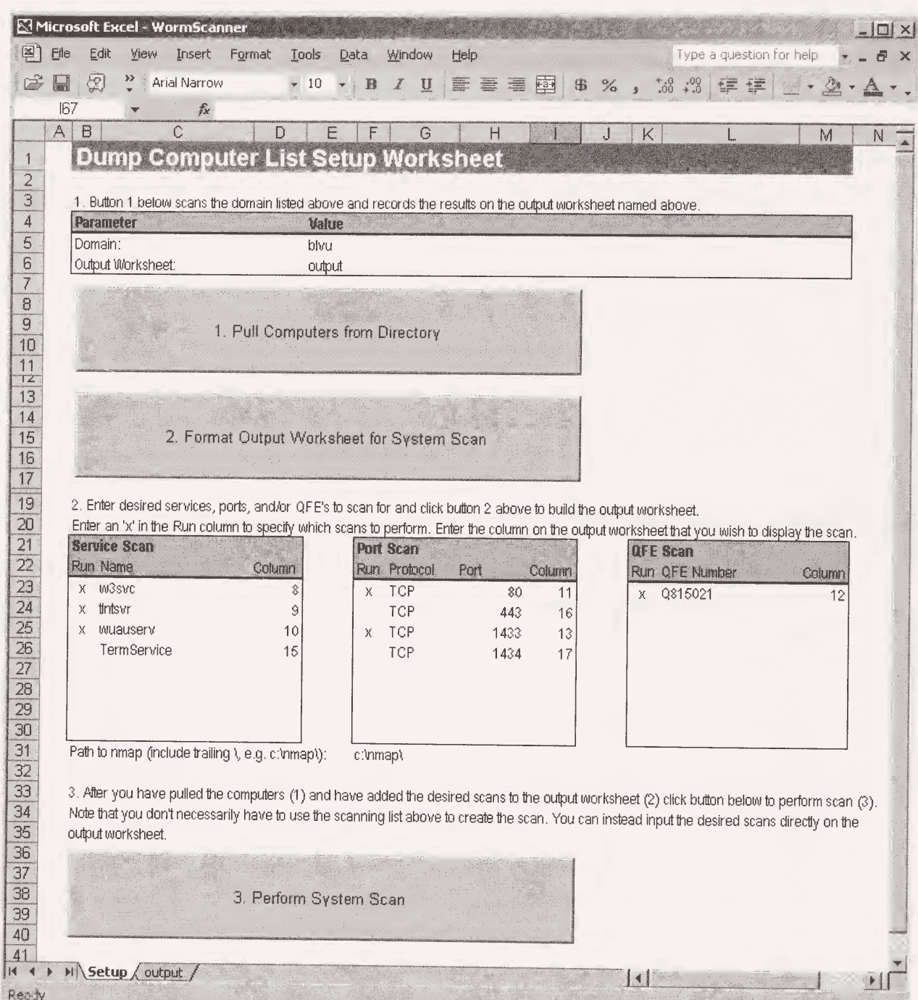

**图 10.1** WormScanner 的修改版 Setup 工作表定义了要执行哪些扫描。

单击第二个按钮运行脚本 SetupScan 后，单击 Output 工作表并确认您选择的扫描已转置到此工作表上，如图 10.2 所示。让我们看看此脚本的 Output 工作表与第 8 章 DumpComputerList 的 Output 工作表之间的一些差异。

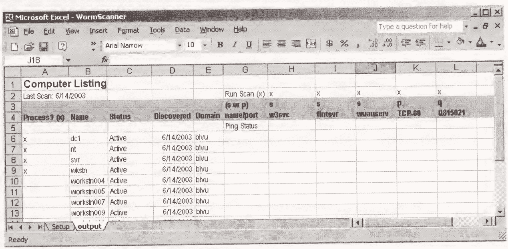

**图 10.2** Excel 工作表提供了一个很好的平台，可以在一个工作表上列出计算机和扫描数据。

第 1 列现在包含 x 标记。运行时，扫描脚本仅处理名称旁边带有 x 的计算机。这使您可以重新扫描一台或几台计算机，而无需再次扫描所有计算机——例如，检查计算机是否已成功修补或服务状态是否已禁用。同样，注意第 2 行的 x 标记。这些 x 表示应执行或跳过哪些扫描。第 3 行列出扫描类型为 s、p 或 q。脚本查找此值以确定是执行服务扫描、端口扫描还是 QFE 扫描。第 4 行包含有关特定扫描的详细信息。对于服务扫描，第 4 行包含要查找的服务名称。对于端口扫描，脚本查找要运行的端口扫描的协议-端口（例如，TCP-80 或 UDP-43）。对于 QFE 扫描，它查找 QFE HotFixID。QFE HotFixID 通常是 Microsoft 提供的更新的众所周知的引用。

返回 Setup 工作表，通过单击最后一个按钮（Perform System Scan）执行实际扫描。脚本激活 Output 工作表并开始遍历工作表，为每个选定的计算机执行扫描，同时显示其进度。如果您没有安装和配置端口扫描器 nmap（或其他命令行端口扫描器），脚本将跳过这些扫描并用短横线（-）记录结果。图 10.3 显示了基本扫描的结果。

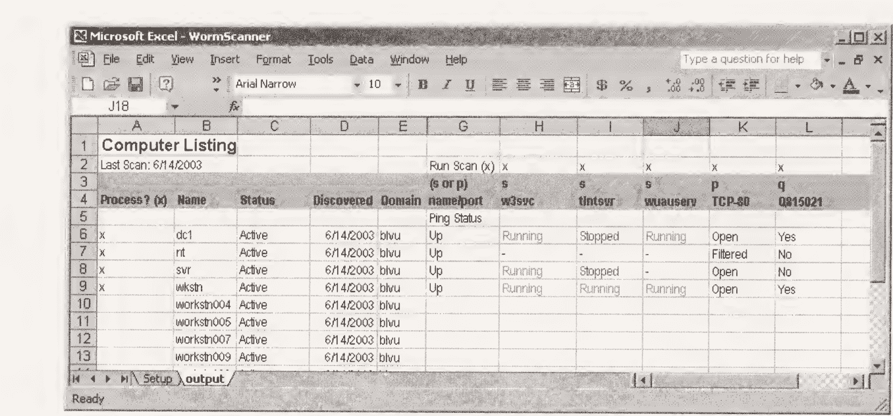

**图 10.3** 该脚本生成一个信息矩阵，帮助您评估对可能利用漏洞服务或系统的蠕虫或病毒的易感性。

该脚本使用对 Microsoft WMI Scripting V 1.2 Library 的 VBA 类型库引用。如果您计算机上没有较新版本，您可能需要将此库降级到 V 1.1。（从 Visual Basic 编辑器中，选择 Tools、References。取消选择标记为 *Missing* 的引用，然后查找并添加该库的旧版本。有关 Excel 如何使用引用的更多信息，请参阅第 8 章。）

# 输出

脚本将输出记录在 *Setup* 工作表上命名的 *Output* 工作表上，如图 10.3 所示。

## 解决方案摘要

这个基于 Excel 的脚本通过添加扫描选定计算机以查找可能的漏洞来源的功能，扩展了第 8 章中介绍的 *DumpComputerList* 脚本。该工具扫描运行中的服务、查找开放的网络端口，并检查已安装的 QFE 更新。

# 目标

一种基于 Excel 的工具，扫描计算机目录以查找特定服务、开放的网络端口或已安装的热修复补丁，以识别可能的蠕虫漏洞。

## Excel 对象模型

- 工作表操作
- 单元格/区域格式化

## RecordSet

- EOF
- Fields.Item(x).Value

## Scripting.FileSystemObject

- DeleteFile
- OpenTextFile
- ReadLine

## VBA 选项

- Option Explicit
- Option Compare Text

## VBA 错误处理

- On Error Resume Next
- On Error Goto 0

## 用户数据类型

- 使用 Type 声明用户自定义数据类型

## WbemScripting.SwbemObject

- ConnectServer
- ExecQuery

## WshShell

- Run
- ExpandEnvironmentStrings

# 脚本

这个脚本接续了第 8 章 *DumpComputerList* 脚本的内容。虽然对第 8 章的脚本进行了一些基本的单元格格式更改，但脚本的其余部分保持第 8 章中介绍的原样。该脚本呈现在 *WormScanner.xls* 工作簿的名为 *DumpComputerList* 的模块中。本章其余部分讨论的 *WormScanner* 脚本呈现在名为 *WormScanner* 的模块中。要访问代码，请打开工作簿 *WormScanner.xls* 和 Visual Basic 编辑器（从工作簿中按 Alt-F11），然后单击名为 *WormScanner* 的模块，如图 10.4 所示。

314 IT Administrator's Top 10 Introductory Scripts for Windows

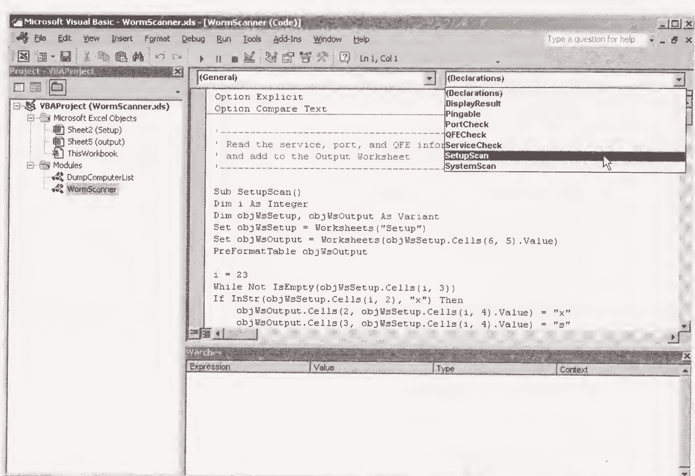

**图 10.4** WormScanner 特定的代码位于名为 WormScanner 的模块中。

> 注意在图 10.4 中，Declarations 下拉列表包含此特定模块的所有子程序和函数。这是在 Visual Basic 编辑器中查找特定子程序或函数的便捷方法。

名为 *DumpComputerList* 的模块包含第 8 章中介绍的 *ComputerList* 代码。Declarations 下拉框提供了对模块内子程序和函数的便捷访问。

> 该脚本在 CD-ROM 上以 /chapter 10/scripts/wormscanner.xls 的形式提供。此脚本包含在需要 Excel 2000 或更高版本以及 Windows Script Host 5.6 的 Excel 文档中。与本书中的其他脚本一样，请记住在部署到任何生产系统之前，在测试环境中测试此脚本。

### 模块级代码

Option 语句必须为每个模块指定，我们已在此模块中添加了 Option Explicit 和 Option Compare Text 语句。请记住，


 Option Explicit 强制声明所有变量，Option Compare Text 将默认的字符串比较方法设置为 Text。

```
Option Explicit
Option Compare Text
```

### SetupScan

子程序 SetupScan 遍历*Setup*工作表中的三个扫描列表，并将标记为 x 的扫描转置到*Output*工作表的指定列中。

首先，脚本调用子程序 PreFormatTable 清除*Output*工作表上可能存在的任何标题，例如来自上一次运行的标题。接下来，它调用子程序 TransposeColumns 并传入多个参数。TransposeColumns 之所以这样命名，是为了说明**分解**的概念。分解是将重复的代码过程精简到最小化重复程度的过程。例如，与其创建三个代码块，每个都遍历不同的数据并显示类似的输出，SetupScan 函数只需三次调用一个函数即可。当这段代码需要维护时，维护人员只需在一个地方而不是三个地方修改代码。

扫描配置信息包括扫描类型和扫描属性。第一组扫描数据是服务扫描，在*Output*工作表上用扫描类型 **s** 指定。服务扫描的唯一属性是服务名称（例如 w3svc）。

第二种扫描类型是端口扫描，用 **p** 表示。端口扫描属性包括协议（TCP 或 UDP）和端口号（1-65534）。例如，标准 Web 服务器通常在 TCP 端口 80。脚本在*Output*工作表上将此信息总结为 protocol-port（例如，TCP-80）。

此脚本执行的最后一次扫描是查找已安装的 QFE 更新，用扫描类型 **q** 表示。QFE 扫描的属性包括 QFE HotFixID。

在此脚本中，TransposeColumns 需要三个参数，外加一个可选的第四参数。在声明函数或子程序时使用关键字 Optional 可将参数设为可选。此脚本中的参数代表操作列。第一个参数 iColName 代表包含扫描名称的列号。第二个参数 iColColumn 代表*Output*工作表上插入扫描数据的目标列号。第三个参数代表扫描的名称，**s**、**p** 或 **q** 分别代表服务扫描、端口扫描或 QFE 扫描。第四个参数 iColOptName 是可选的，代表可能包含扫描第二个名称的第二列的列号。它仅用于端口扫描，将两个名称（如 TCP 和 80）连接起来显示为 TCP-80。

```
'-----------------------------------------------------------------------
' 从 Setup 工作表读取服务、端口和 QFE 信息
' 并添加到 Output 工作表
'-----------------------------------------------------------------------

Sub SetupScan()
Dim i As Integer
Dim objWsSetup, objWsOutput As Variant
Set objWsSetup = Worksheets("Setup")
Set objWsOutput = Worksheets(objWsSetup.Cells(6, 5).Value)
PreFormatTable objWsOutput

TransposeColumns 3, 4, "s"
TransposeColumns 7, 9, "p", 8
TransposeColumns 12, 13, "q"

End Sub
```

子程序 TransposeColumns 从 Setup 工作表读取指定的扫描配置数据，并将标记为 x 的扫描转置到 Output 工作表的指定列中。该子程序从第 23 行开始循环（对应于 Setup 工作表上每个扫描的第一行），并逐步遍历连续的行，直到遇到空单元格为止。对于每个扫描项，循环首先查找 x，如果存在，则读取扫描配置信息并将其插入到 Output 工作表的指定列中。

除了扫描属性之外，TransposeColumns 还在 Output 工作表的第 2 行放置一个 x。实际的扫描子程序 SystemScan 会查找这个 x 以确定是否应执行该扫描。这样，TransposeColumns 子程序默认启用所有扫描。相反，你可以简单地从 Output 工作表上其对应的上方移除 x 来禁用任何扫描。

```
Sub TransposeColumns(iColName, iColColumn, strScanType, Optional iColOptName)
Dim i
Dim strName
Dim objWsSetup, objWsOutput As Variant
Set objWsSetup = Worksheets("Setup")
Set objWsOutput = Worksheets(objWsSetup.Cells(6, 5).Value)
i = 23
While Not IsEmpty(objWsSetup.Cells(i, iColName))
If InStr(objWsSetup.Cells(i, iColName - 1), "x") Then
objWsOutput.Cells(2, objWsSetup.Cells(i, iColColumn).Value) = "x"
objWsOutput.Cells(3, objWsSetup.Cells(i, iColColumn).Value) = _
strScanType
```

```
If Not IsEmpty(objWsSetup.Cells(i, iColOptName)) Then
    strName = objWsSetup.Cells(i, iColName).Value & " - " & _
              objWsSetup.Cells(i, iColOptName).Value
Else
    strName = objWsSetup.Cells(i, iColName).Value
End If
objWsOutput.Cells(4, objWsSetup.Cells(i, iColColumn).Value) = _
    strName
End If
i = i + 1
Wend

End Sub
```

### SystemScan

子程序 SystemScan 遍历指定 Output 工作表上列出的所有计算机，对于第 1 列中标记为 x 的每一行，脚本执行选定的扫描。正如我们在子程序 SetupScan 中看到的，扫描在指定 Output 工作表的第 2 到第 4 行中定义。如果第 2 行中的扫描标记为 x，脚本将执行该扫描。否则，它将增加列计数器 j 以查找下一个扫描。它继续处理各列，直到找到五个连续的空列，然后继续处理下一台计算机。通过放置或移除 x，你可以轻松配置脚本以对所有计算机执行所有扫描，或仅对特定计算机执行特定扫描。

SystemScan 使用在第 8 章的 DumpComputerList 脚本中描述的自定义数据类型 aComputer 数组（在此工作簿的 DumpComputerList 模块中定义）来存储扫描中使用的计算机列表。脚本声明了多个字符串，用于存储每种扫描类型的输入和结果值。例如，strServiceName 包含要扫描的服务名称，strServiceState 包含该扫描的结果，例如服务是 Stopped 还是 Running。脚本使用变量 iBlankColumns 来计算 blank 列的数量，以指示要执行的扫描的结束。脚本还声明了 Setup（objWsSetup）和 Output（objWsOutput）工作表对象，以及定义当前域的字符串（strDomain）。

脚本使用函数 LoadComputerList 从 Output 工作表中列出的计算机填充数组 aComputer，该函数也在 DumpComputerList 脚本中先前讨论过。

```
' ------------------------------------------------------------------
' 执行服务和端口扫描的主程序
' ------------------------------------------------------------------
```

## IT Administrator's Top 10 Introductory Scripts for Windows

```
Sub SystemScan()
    Dim aComputer() As ComputerData
    Dim strDomain, strWsOutput, strServiceName, strServiceState As String
    Dim strProtocol, strPort, strPortState As String
    Dim strQFE, strQFEState As String
    Dim objWsSetup, objWsOutput As Worksheet
    Dim lFinalRowNum As Integer
    Dim i, j, iBlankColumns As Integer
    Set objWsSetup = Worksheets("Setup")
    strWsOutput = objWsSetup.Cells(6, 5).Value
    strDomain = objWsSetup.Cells(5, 5).Value
    Worksheets(strWsOutput).Activate
    lFinalRowNum = LoadComputerList(aComputer, objWsOutput)
```

SystemScan 在真正启动扫描之前启动三个循环并确认多个条件。在第一个循环中，脚本遍历数组 aComputer 中的所有计算机。扫描脚本通过用户定义的数据类型元素 aComputer(i).Name 和 aComputer(i).Row 获取当前计算机的名称和行号，其中计数器变量 i 从 1 递增到数组的上界。为了使当前计算机始终显示在屏幕上，脚本选择当前行上的一个单元格——这可以防止数据滚动出屏幕。

接下来，脚本检查当前计算机行的第 1 列是否包含 x，如果包含，则继续处理该计算机。如果不存在 x，则脚本继续处理下一台计算机。

作为下一个扫描前检查，脚本调用 Pingable 函数来 ping 计算机，以确认它已启动并在网络上响应。某些 Windows 网络函数（例如从远程计算机获取对象）在计算机不存在时会有显著的超时，而 ping 的超时则要短得多。如果计算机响应 ping，则脚本将状态设置为 Up，并继续设置循环遍历每个所需的扫描。

```
For i = 1 To UBound(aComputer)
    Cells(aComputer(i).Row, 7).Select
    If InStr(1, Cells(aComputer(i).Row, 1).Value, "x") Then
        If Pingable(aComputer(i).Name) Then
            Cells(aComputer(i).Row, COL_OPTION1) = "Up"
            j = 8
            iBlankColumns = 0
```

脚本使用两个单独的循环遍历每个用户所需的扫描。第一个循环计数最多五个空列。第二个循环在当前列的第 4 行查找空单元格。使用这两个循环，脚本扫描

### SystemScan

`用于检查是否存在指定的扫描项，同时允许扫描之间存在最多四个空白单元格。在输出工作表中，在扫描类别之间添加空白列可能有用，脚本允许最多四个连续空白列。
脚本通过检查当前列的第二行是否有 "x" 来判断是否应处理某台计算机，从而决定是否执行该扫描。如果存在 "x"，脚本将执行扫描；否则，它会跳过该扫描并继续处理下一个。

```
While iBlankColumns < 5
    While Not IsEmpty(Cells(4, j))
        If InStr(Cells(2, j), "x") Then
```

至此，脚本已确定要执行指定的扫描。脚本将 `iBlankColumns` 重置为 0（记住，它寻找的是连续空白列，而不是空白列的总数），并调用 `DisplayResult` 子程序来将当前正在处理的单元格高亮显示为 "Working"。脚本打开一个 `Select Case` 语句，根据当前列第三行的扫描类型值来决定执行哪种扫描。如果此单元格包含 "s"，则执行服务扫描。

```
iBlankColumns = 0
DisplayResult aComputer(i).Row, j, "Working", 3
Select Case Cells(3, j)
```

脚本从当前列的第四行获取要查找的服务名称。接下来，它调用 `ServiceCheck` 函数来确定该服务的状态。它将当前计算机名称和服务名称发送给 `ServiceCheck`，并将返回的服务状态赋值给 `strServiceState`。
脚本通过第二个 `Select Case` 处理 `strServiceState`，以提供更细粒度的结果报告。如果服务状态是 "Running"，它将以绿色显示结果。"Stopped" 的服务以红色显示。如果 `ServiceCheck` 函数遇到错误（例如服务未安装），它会返回 0，该 `Select Case` 语句会将其显示为破折号 (-)。任何其他 `strServiceState` 值则直接显示。

```
Case "s"
    strServiceName = Cells(4, j)
    strServiceState = _
    ServiceCheck(aComputer(i).Name, _
                strServiceName)
    Select Case strServiceState
        Case "Running"
            DisplayResult aComputer(i).Row, j, _
                strServiceState, 4
        Case "Stopped"
            DisplayResult aComputer(i).Row, j, _
                strServiceState, 3
        Case 0
            DisplayResult aComputer(i).Row, j, _
                "-", 0
        Case Else
            DisplayResult aComputer(i).Row, j, _
                strServiceState, 0
    End Select
```

脚本将端口扫描定义为扫描类型 "p"。端口扫描器需要三个参数才能运行：计算机名称、要扫描的协议（TCP 或 UDP）以及要扫描的端口（1 到 65535 之间的整数）。当前列的第四行包含协议和端口，格式为 *协议-端口*（类似于 TCP-80）。脚本拆分字符串并根据协议将变量 `strProtocol` 赋值，TCP 对应 `T`，UDP 对应 `U`。由于本模块开头定义了 `Option Compare Text` 语句，`InStr` 的不区分大小写比较使用文本比较。`strPort` 被定义为协议-端口对的第二部分。

尽管 VBA 的 `Split` 方法语法与之前脚本中使用的 JScript `split` 方法不同，但该方法实现了类似的结果。两种方法都返回一个按定义分隔符拆分的字符串数组。例如，将字符串 TCP-80 通过分隔符为破折号 (-) 的拆分函数传递，会得到一个包含两个元素的数组，可直接访问如下：`Split("TCP-80","-")(0)` = TCP 且 `Split("TCP-80","-")(1)` = 80。

在脚本填充了字符串 `strProtocol` 和 `strPort` 之后，它调用函数 `PortCheck` 对所选计算机进行端口扫描。扫描结果返回给变量 `strPortState`，然后由脚本显示。（我们也可以像之前的服务扫描代码那样，进一步解析结果并为输出添加颜色编码。）

```
Case "p"
    On Error Resume Next
    strProtocol = Split(Cells(4, j), "-")(0)
    If InStr(strProtocol, "u") Then
        strProtocol = "U"
    Else: strProtocol = "T"
    End If
    strPort = Split(Cells(4, j), "-")(1)
    strPortState = PortCheck( _
        aComputer(i).Name, strProtocol, strPort)
    On Error GoTo 0
    DisplayResult aComputer(i).Row, j, _
        strPortState, 0
```

最后一种扫描用于检查当前计算机上是否安装了特定的 QFE（快速修复工程）。脚本从当前列的第四行提取 QFE 名称，并调用 `QFECheck` 函数来确定其是否已安装，然后显示结果。

> 由于前面提到的 `Win32_QuickFixEngineering` 类中的一个错误，如果您打算针对一组计算机运行此脚本，但不知道它们安装了哪个服务包版本，则可以为此脚本添加一个检查是否安装了 SP3 的函数。如果安装了 SP3，脚本将调用 `QFECheck`，否则，它将简单地跳过 QFE 扫描。

```
Case "q"
    On Error Resume Next
    strQFE = Cells(4, j)
    strQFEState = QFECheck(aComputer(i).Name, _
        strQFE)
    On Error GoTo 0
    DisplayResult aComputer(i).Row, j, _
        strQFEState, 0
Case Else
End Select
```

正如我们所看到的，SystemScan 子程序包含许多循环和条件语句，这可能会让人感到困惑，尤其是要记住哪个 `End If` 或 `Wend` 对应哪个语句。在心中理清这些语句的一种方法是插入循环或条件终止注释，如下所示的代码所示。这些是代码片段注释，旨在将结束语句与其配对的语句关联起来。简化复杂嵌套循环或条件语句的另一种方法是提取内部代码分支。使用这种方法，循环中的循环变成了一个只需调用函数的循环，而该函数包含另一个循环。以这种方式提取循环会增加所需函数的数量，但它有助于理清更复杂的代码。

```
End If  ' 标记为要通过 x 处理的扫描
j = j + 1
Wend  ' 寻找空单元格的循环
j = j + 1
iBlankColumns = iBlankColumns + 1
Wend ' 寻找 iBlankColumns 的循环
```

如果函数 `Pingable` 返回 false，表示计算机不响应 ping，则脚本将计算机显示为 `Down` 并继续处理下一台计算机。对数组 `aComputer` 的循环完成，即完成了此子程序和整个 *WormScanner*。

```
Else ' else pingable if
    Cells(aComputer(i).Row, COL_OPTION1) = "Down"
End If  'end pingable if
End If  ' 标记为要通过 x 处理的计算机
Next i
End Sub
```

本章中其余的子程序和函数用于支持 `SystemScan` 子程序。

#### Pingable

`Pingable` 函数使用 WSH shell 对象调用命令 shell 并执行 ping 命令。ping 命令将其输出重定向到一个临时文件，函数读取并解析该文件。

> *Pingable* 调用 `Run` 方法而不是 `Exec` 方法，因为前者能够抑制命令 shell 对话框。如果我们使用 `Exec` 方法，我们会在屏幕上看到多个命令 shell 窗口弹出。很遗憾，支持标准流的 `Exec` 方法没有提供抑制显示被调用函数的属性。

该函数实例化一个 `FileSystemObject` 来逐行读取这个重定向的文本文件，并解析文本 "Reply"，以判断 ping 是否成功。（成功的 ping 会返回类似这样的行：*Reply from 192.168.0.3: bytes=32 time<1ms ttl=128*——此脚本寻找的是第一个单词 `Reply`。）此 ping 测试与第 9 章中介绍的 *ClientCheck* HTA 中的 ping 测试非常相似。

```
'------------------------------------------------------------------
'向计算机发送单个 ping 以检查其是否正常运行。
'------------------------------------------------------------------
```


**Pingable 函数**

Function Pingable(strComputer) As Boolean
Dim objShell As WshShell
Dim strTemp As String
Dim objFSO As FileSystemObject
Dim iReturn As Integer
Dim objTextFile As TextStream
Pingable = False
Set objShell = CreateObject("WScript.Shell")
strTemp = objShell.ExpandEnvironmentStrings("%temp%") & _
    "/tempping.txt"
iReturn = objShell.Run("%comspec% /C ping " & strComputer & _
    " -n 1 > " & strTemp, 0, True)
Set objFSO = CreateObject("Scripting.FileSystemObject")
Set objTextFile = objFSO.OpenTextFile(strTemp, 1)
While Not objTextFile.AtEndOfStream
    If InStr(objTextFile.ReadLine, "Reply") Then Pingable = True
Wend
objTextFile.Close
objFSO.DeleteFile (strTemp)

End Function

### 服务检查

`ServiceCheck` 函数用于查询远程计算机并返回指定服务的状态（例如，服务是`已停止`还是`正在运行`）。为此，脚本会建立一个到远程计算机的 WMI 连接，并返回一个指向特定 `Win32_Service` 的对象。该函数返回此对象的 WMI `state` 属性，该属性代表服务的状态。如果此计算机上不存在该服务，WMI 将会抛出一个错误，但脚本会处理此错误并返回 0，表示服务未安装。另外，请注意 WMI 标识符中缺少 `ImpersonationLevel`。尽管这使得 WMI 调用更简短、更易读（也更容易记住），但也要回想一下第 3 章的内容：如果你计划在早于 Windows 2000 的操作系统上运行此脚本，则需要将 `ImpersonationLevel` 设置为 3（`wbemImpersonationLevelImpersonate`），这会指示 WMI 对象在调用者的上下文中运行。此脚本需要 WMI 核心组件 1.5 或更高版本（在 Windows 2000 及更高版本上可用）。如果你计划在更早版本的 WMI 核心组件上运行此脚本，请参阅第 3 章关于如何指定 `ImpersonationLevel`。

> **早期绑定与后期绑定**——在此函数中，请注意 `objService` 被声明为 `WbemScripting.SWbemObject` 数据类型。在 Visual Basic（包括 VBA）中，当一个变量被声明为一种数据类型时，这被称为早期绑定。早期绑定会在编译时（而非运行时）对对象进行验证（语法和类型检查）。与不将对象声明为特定类型的后期绑定相比，此方法具有性能优势。要实现对对象的早期绑定，我们必须在 Excel 中添加对 WMI 脚本库的引用。早期绑定还有其他优点。通过建立对此类型库的引用，Excel 可以识别此对象，并为开发人员提供额外功能——例如，在使用此对象时自动完成语法。例如，如果我们输入 `objService.`，在输入句点（`.`）之后，Excel 会提供一个列表，显示所有可以对 `WbemScripting.SWBemObject` 对象调用的不同属性和方法。在 VBScript 中，我们无法像这样声明对象，并且仅限于使用 `Variant` 数据类型。在 VBScript 或 JScript 中无法使用早期绑定。

```
' --------------------------------------------------------------------------------
' 使用 WMI 检查指定服务的状态
' --------------------------------------------------------------------------------

Function ServiceCheck(strComputer, strServiceName) As String
    Dim strWMI As String
    Dim objService As WbemScripting.SWbemObject
    On Error Resume Next
    strWMI = "WinMgmts://" & strComputer & _
        "/root/cimv2:Win32_Service='" & strServiceName & "'"
    Set objService = GetObject(strWMI)
    ServiceCheck = objService.State
    If Err > 1 Then ServiceCheck = 0
    On Error GoTo 0
End Function
```

### 端口检查

`PortCheck` 函数本质上为一个外部命令行端口扫描器提供了一个脚本运行环境。此脚本是针对流行的 *nmap* 扫描器的语法编写的；不过，修改此代码以支持你喜爱的其他命令行端口扫描器也相当容易。

与之前的 `Pingable` 函数非常相似，`PortCheck` 创建一个 `Shell` 对象来运行外部命令，并将输出重定向到一个临时文件。然后，它使用 `FileSystemObject` 来读取和解析基于文本的输出，并查找指定端口状态为“开放”、“关闭”或“已过滤”的关键字。该函数将端口的状态返回给调用函数。

变量 strNmapCommand 包含用于执行扫描的 *nmap* 命令语法。尽管 *nmap* 支持大量命令行扫描选项，但此脚本使用基本语法来扫描单个计算机的单个端口，如下所示：

```
nmap -s[U|T] -p n computername
```

-s[U|T] 参数指定扫描类型；-sT 指示 *nmap* 使用 TCP 扫描，-sU 指定 UDP 扫描。参数 -p n 指定端口号，例如 -p 80 用于扫描端口 80。最后一个参数指定要扫描的计算机的名称。例如，要扫描监听 TCP 端口 80 的 Web 服务器，你可以使用：

```
nmap -sT -p 80 webserver
```

而要查找通常监听 UDP 端口 53 的 DNS 服务器，可以这样操作：

```
nmap -sU -p 53 dnsserver
```

脚本会为当前计算机和端口扫描组装这些命令，并将它们存储在变量 strNmapCommand 中。回想一下，脚本在之前将存储的协议 strProtocol 从 TCP 转换为 T，将 UDP 转换为 U。这是因为 *nmap* 使用参数 -sT 来指定 TCP 扫描，使用 -sU 进行 UDP 扫描。通过提前转换这些值，我们可以简单地将这些值连接到 -s 后面以组装参数。虽然这并不花哨，但它演示了一种在脚本中使用专有外部应用程序的方法。

```
'---------------------------------------------------------------
' 使用 nmap 扫描器确定远程端口状态
'---------------------------------------------------------------
Function PortCheck(strComputer, strProtocol, strPort)
Dim objShell As WshShell
Dim strTemp, strNmapCommand, strLine, strNmapPath As String
Dim iReturn As Integer
Dim objFSO As FileSystemObject
Dim objTextFile As TextStream
strNmapPath = Worksheets("Setup").Cells(39, 6).Value
PortCheck = "-"
Set objShell = CreateObject("WScript.Shell")
strTemp = objShell.ExpandEnvironmentStrings("%temp%") & _
    "\tempportscan.txt"
strNmapCommand = strNmapPath & "nmap -s" & strProtocol & " -p " & _
strPort & " " & strComputer
iReturn = objShell.Run("%comspec% /C " & strNmapCommand _
 & " > " & strTemp, 0, True)
Set objFSO = CreateObject("Scripting.FileSystemObject")
Set objTextFile = objFSO.OpenTextFile(strTemp, 1)
While Not objTextFile.AtEndOfStream
    strLine = objTextFile.ReadLine
    If InStr(strLine, "open") Then PortCheck = "Open"
    If InStr(strLine, "close") Then PortCheck = "Closed"
    If InStr(strLine, "filter") Then PortCheck = "Filtered"

Wend
objTextFile.Close
objFSO.DeleteFile (strTemp)
End Function
```

### QFE 检查

`QFECheck` 函数通过向远程计算机发起 WMI 调用并查找特定的更新，来检查某个特定 QFE 更新的安装情况。此函数使用 WMI 的 ExecQuery 方法执行一个针对 Win32_QuickFixEngineering 类的小型 WQL 查询，该查询搜索特定的 QFE HotFixID。如果查询返回任何结果，`QFECheck` 被设置为 "Yes"；否则，它保持为 "No"。对于任何错误，`QFECheck` 都被设置为 "No"。

Microsoft 最近更改了其 QFE 更新的命名约定。现在不再是 Q123456，有些被称为 KB123456。


```
'---------------------------------------------------------------------------
' 检查远程计算机是否已安装特定的 QFE
'---------------------------------------------------------------------------

Function QFECheck(strComputer, strQFE) As String
Dim colQFE As Variant
Dim objQFE As Variant
QFECheck = "No"
On Error Resume Next
Set colQFE = GetObject("WinMgmts://" & strComputer & "/root/cimv2") _
 .ExecQuery("SELECT * FROM Win32_QuickFixEngineering " & _
  "WHERE HotFixID='" & strQFE & "'")
```


 ```
For Each objQFE In colQFE
    QFECheck = "Yes"
    Exit For
Next
If Err > 1 Then QFECheck = "No"
On Error GoTo 0
End Function
```

### DisplayResult

子程序 DisplayResult 为该脚本提供辅助支持，用于在指定单元格中显示文本并将其格式设置为特定颜色。

```
'------------------------------------------------------------------------
' 在指定位置显示格式化输出
'------------------------------------------------------------------------

Sub DisplayResult(iRow, iColumn, strText, iColorIndex)

Cells(iRow, iColumn) = strText
Cells(iRow, iColumn).Font.ColorIndex = iColorIndex

End Sub
```

### SUMMARY

WormScanner 扩展了第8章的 DumpComputerList 脚本，加入了多项实用的扫描功能。尽管该脚本中展示的许多特性和功能都是基于前几章介绍的技术构建的，但将它们整合到 Excel 中为创建更丰富的应用程序提供了思路——使用单个脚本组件作为构建模块。此外，到现在你可能已经注意到这些反复出现的主题和技术，以及扩展脚本（或一组脚本）以添加自己的功能和灵活性是多么容易。该脚本设计为能够容忍额外空格（记住 iBlankLines 和 iBlankColumns），并且不依赖于任何特定的计算机顺序。因此，你可以随意重新排列和分类计算机及结果——甚至可以使用 Excel 的一些内置函数和功能来进一步自定义你的 Output 工作表。例如，图 10.5 展示了一个经过大量定制的 Output 工作表；但即使有了这些修改，扫描脚本仍然能够正确处理计算机并执行扫描。只要记住哪些单元格可以编辑，哪些单元格是脚本依赖的，并且你应该保持原样。

**图 10.5** 使用 Excel 作为脚本画布，让你能够完全自定义输出。即使有了这些修改，*WormScanner* 脚本仍然可以运行并更新此 *Output* 工作表，同时保留格式设置。

### KEY POINTS

- *WormScanner* 展示了将扫描或系统查询功能附加到 *DumpComputerList* 脚本上的众多可能性之一。
- 如果需要对结果程序的格式有更多控制（例如，隐藏命令 shell 终端窗口），请使用 `WScript.Run` 方法而不是 `Exec` 方法。
- Excel 支持 WMI 对象、方法和属性，使其成为功能强大的库存或扫描工具——例如扫描服务及其状态，或检查已安装的快速修复工程（QFE）更新。
- 使用 Excel 工作表来配置脚本设置选项，这使你的脚本更易于他人使用，也更容易重新配置和运行。
- 考虑利用 `ping` 命令快速评估计算机是否在网络中，然后再执行更耗时的远程 Windows 网络调用。

接下来，我们将查看 *DumpComputerList* 的另一个扩展，该扩展枚举并显示域中计算机的所有本地账户和组。如果你曾经经历过 IT 审计，你可能会欣赏下一个脚本所提供的便利。

## 11 远程枚举本地计算机账户

### OVERVIEW

正如我们所见，创建报告 Active Directory (AD) 中账户配置的脚本相对容易。然而，AD 并非用户账户的唯一存储库。每台 Windows NT 技术计算机（从 Windows NT 4.0 到 Windows Server 2003）还维护一个名为安全账户管理器（SAM）数据库的本地账户数据库。属于工作组（而非域）的计算机专门使用 SAM 来存储本地账户认证的用户和密码信息。但即使属于域的计算机也使用 SAM，并且包含合法的登录账户。其中一些账户，如本地管理员用户账户或管理员本地组的任何成员，为该计算机提供超级用户访问权限。此外，由于这些账户分布在您的整个组织中（每台计算机一个），管理这些 SAM 变得更加困难，因此这些账户成为攻击者寻找网络后门的首要目标。

许多评估组织安全性的 IT 审计会检查本地计算机组的成员身份，以确定谁实际拥有该计算机的管理或数据访问权限。审计通常包括所有本地账户和组成员的枚举，以及作为本地组成员的域组。

工具有助于枚举这些组。Microsoft 提供了一些工具，如 Microsoft 基线安全分析器（MBSA），用于检查计算机上哪些账户具有管理员级别访问权限。无处不在的 NET 命令提供了 NET USER 和 NET GROUP 来列出组信息（尽管 NET GROUP 仅限于在域控制器上运行）。此外，互联网上有许多资源工具包工具和其他工具可用于枚举这些账户。

不可避免地，你可能会发现自己想要显示一个自定义或特定的账户列表，而这些工具过于僵化（或简单）无法满足。使用第8章的 *DumpComputerList* 脚本，本章探讨如何使用 Excel 和 Windows 脚本技术创建一个健壮、易于修改的工具，该工具列出本地账户和组及其成员身份。

### SCENARIO

贵公司是多个区域和国家监管机构及联盟的成员，这些机构要求有严格的操作程序来保护客户数据。遵守这些组织的规范让现有和潜在客户放心。此外，市场部门在贵公司网站上显著位置展示标识，宣传贵公司遵守这些行业受认可的准则。

这些机构通过每半年一次对 IT 系统的审计来衡量合规性。这些审计检查 IT 运营的方方面面——从灾难恢复到物理安全到拓扑审查。审计中特别耗时的一项是彻底审查公司 500 多台服务器的用户账户访问权限。对于每台服务器，你必须提供所有本地用户和组的报告，包括这些本地组的成员。此外，你必须展开作为本地组成员的域组，以提供用户级别的计算机访问映射。审计人员将此访问映射与之前的审计进行比较，寻找你必须解释的更改。对于以前的审计，你编写了批处理文件将此数据转储到文本文件，但比较当前和过去的访问列表的核对过程需要花费大量时间。

你真正想要的是一个能够提取、枚举和记录系统列表中用户和组，并在运行之间标记增删的工具。你决定使用 Microsoft Excel 作为该工具的基础，因为它能够快速管理数据列表。此外，只需复制和重命名工作表即可轻松归档审计。

### ANALYSIS

与第10章介绍的 *WormScanner* 脚本类似，*GroupScanner* 脚本直接构建于第8章介绍的 *DumpComputerList* 工具之上，并包含了第4章和第5章介绍的用户和组枚举技术。与之前使用 ADSI LDAP 提供程序针对 AD 的脚本不同，*GroupScanner* 中的脚本使用 ADSI WinNT 提供程序针对本地 SAM。此外，该脚本演示了一种解决更难问题的方法：协调工具的多次运行，并以适合打印的格式显示收集到的大量数据。

业务目标映射为表 11.1 中列出的技术要求。

**表 11.1** 将业务目标转化为技术要求

| 业务目标 | 技术要求 |
|---|---|
| 生成指定域中所有计算机的列表。 | 从第8章介绍的 *DumpComputerList* 脚本开始，从指定域生成计算机列表。 |
| 列出列表中每个指定计算机的所有本地组。 | 使用 ADSI WinNT 提供程序，连接到每个选定的远程计算机并获取所有组对象的列表。在 *Output* 工作表上显示这些对象。脚本的后续运行应突出显示新增的组并标记已删除的组。 |
```


#### 表 11.1 将业务目标转化为技术需求（续）

| 业务目标 | 技术需求 |
| --- | --- |
| 对于发现的每个本地组，枚举并显示其成员。 | 使用 ADSI **Members** 方法返回一个对象集合，该集合代表特定本地组的成员。在 *enum* 工作表上显示此输出。与前面的需求类似，组成员的增删应在后续运行中高亮显示。 |
| 高亮显示与先前运行相比新增的本地组和新成员。 | 从 *Output* 工作表加载所有先前运行的数据，并与当前扫描进行比较。高亮显示新增项，并标记可能已删除的缺失组。 |
| 格式化输出以便于打印和分发给外部人员（审计人员）。 | 以编程方式使用 Excel 格式化功能，通过边框、底纹和颜色来区分输出。此外，允许用户指定用于显示枚举输出的列数。 |

本脚本或许是本书中最复杂的一个。这些概念不一定很高深；然而，用于操作和格式化数据的算法可能仅仅通过阅读定义它们的代码而难以理解。因此，请打开 *GroupScanner.xls* 文件中的脚本，并使用 Excel 调试器逐步执行代码。通过逐行执行脚本，你能更好地理解算法的工作原理和脚本的流程。获取计算机的本地组及其成员相对容易；事实上，第一个脚本 ADSIQuery 使用类似的方法从 AD 中提取组及其成员。但是，本脚本维护了组及其成员的列表。多次运行脚本可以高亮显示新增的组，划掉已删除的组，并将数据格式化为易于在 Excel 中打印的形式。正是格式化和审计功能增加了本脚本的复杂性。

本脚本的大部分内容涉及操作和格式化数据——包括首次收集和显示数据，以及在后续运行中将当前结果与先前创建的基准进行比较时。如前所述，实际连接到计算机、获取本地组名称及其成员的脚本机制仅占代码的一小部分。然而，该脚本揭示了创建用户界面以及操作和存储收集到的数据时面临的一些挑战和设计问题。

在考虑设计方法（和工具选择）时，请评估每种情况，并决定在可用性与严格功能之间应投入多少精力。例如，如前所示，生成计算机列表、然后生成该计算机的本地组列表、最后生成这些组的成员列表很容易，但要存储并在多次运行中高亮显示变化则要困难得多。事实上，虽然前面的脚本侧重于开发的技术方面，例如实际收集数据，但本脚本中的大部分代码用于管理和呈现数据的比较及展示。在这种情况下，正是数据的管理和呈现满足了许多关键需求。

*GroupScanner* 中使用的函数和子程序描述如下：

-   **GroupScan:** 扫描计算机列表，以查找可用于获取本地组的合格计算机。
    - 脚本的起点。
    - 检查 *Output* 工作表是否存在，并循环浏览先前生成的计算机列表，查找要枚举本地组的候选计算机。

-   **GetGroups:** 如果存在新组，则添加新组。
    - 对于特定计算机，获取当前组列表并与先前运行进行比较。
    - 将新组添加到 *Output* 工作表。
    - 如果用户选择，则调用函数获取组成员。
    - 以用户指定列数的矩阵形式显示新组。

-   **GetMembership:** 收集并显示特定组的成员。
    - 在 *enum* 工作表上记录成员信息。
    - 将新组添加到 *enum* 工作表。
    - 将新成员添加到 *enum* 工作表。

-   **LoadRow:** 将组信息读入用户自定义的 `GroupData` 数据类型。
    - 逐行扫描以读取先前发现的信息。
    - 将信息添加到 `GroupData` 用户自定义数据类型中。

-   **AddElement:** 比较并将对象添加到 `GroupData` 数据类型。
    - 如果账户名尚不存在，则将其添加到先前构建的账户列表中。

-   **MarkElementDeleted:** 高亮显示不再存在的组。
    - 标记不再存在的账户的单元格。

-   **InitializeEnumWs:** 构建 *enum* 工作表。
    - 创建并命名用于存储枚举数据的工作表。
    - 格式化工作表。

-   **CheckIfGroup:** 确定对象是否为组。
    - 检查账户的 objectClass 以查看对象是否为组对象。
    - 将组对象的单元格格式设置为蓝色斜体，以区别于用户或计算机账户。

-   **FindLastRow:** 返回工作表上使用的最后一行。
    - 用于确定插入新数据时要使用的下一行。

-   **HideColumns:** 隐藏用户选择的工作表上的列。
    - 自动隐藏用户选择的列，使数据更易于阅读。

### 分发和安装

安装此脚本的方式与其前身 *DumpComputerList* 大致相同。当你打开 *GroupScanner.xls* 工作簿时，选择 *Setup* 工作表。*Setup* 工作表提供了脚本的初步配置，如图 11.1 所示。与 *WormScanner* 配置一样，指定要扫描的域以及 *Output* 工作表的名称。本脚本新增了必须指定 *Output Enumeration* 工作表（*enum*）的名称。*enum* 工作表存储在计算机上找到的每个本地组的成员。在指定了这三个选项后，单击 **1. Pull Computers from Directory** 按钮以运行 *DumpComputerList* 脚本并构建 *Output* 工作表。

> 如果脚本因缺少引用而失败，请切换到 Visual Basic 编辑器，取消标记为缺失的引用，并查找该库的较旧版本添加。（有关 Excel 如何使用引用的更多内容在第 8 章中介绍。）

与第 8 章和第 10 章中的前面脚本一样，查看 *Output* 工作表，并通过在第 1 列中放置或删除 x 来选择要扫描的计算机。

接下来，返回 *Setup* 工作表，并通过在 Enumerate Local Groups (x) 的值列中放入 x 来指定是否要枚举本地组成员。此外，指定希望枚举数据跨越的列数。此步骤有助于限制脚本的横向输出，使其易于在标准尺寸的纸张上打印输出。请注意，前面 *Setup* 工作表中新增了 HideColumns 配置。此脚本允许你通过在名称旁放置 x 来指定要隐藏的列，这有助于减少在报告中显示或打印的数据量。

完成后准备运行时，单击 **2. Discover Groups and Membership** 以开始扫描。


**图 11.1** 在 *Setup* 工作表上指定要扫描的域、数据工作表的名称以及其他格式化选项。

# 输出

*Output* 工作表显示所列出的每台842每台计算机的本地组，如图 11.2 所示。请注意，组列表仅跨越三列，且 *ObjADs* 列（第 6 列）已隐藏。这两个配置确保工作表上的数据适合视图而无需向右滚动。此外，请注意名为 *aNewGroup* 的组的格式差异。*aNewGroup* 是在两次脚本运行之间添加到名为 *wkstn* 的计算机上的。脚本高亮显示了此新增项，使得在后续运行中轻松识别组的增删。

> 注：原文中"842"应为排版错误，保留原样。


## 336 位IT管理员的十大Windows入门脚本


图 11.2 *输出*工作表显示了计算机及其本地组的列表。新添加的组通过颜色高亮并加下划线。

现在，让我们查看*枚举*工作表上的组详细信息，如图11.3所示。*枚举*工作表显示了每台计算机本地组的成员信息。新增的成员用下划线和颜色编码标出。该脚本将作为其他组成员的组设置为*斜体*，以提醒用户检查这些组的成员资格。利用这些格式差异，可以很容易地发现*Blvu/Domain Admins*组和用户账户*Trooper*被添加到名为*wkstn*的计算机的*Administrators*组中。在这个例子中，我们希望*Trooper*不是攻击者。

## 解决方案摘要

这个基于Excel的脚本扩展了第8章中介绍的*DumpComputerList*工具，增加了枚举本地计算机组及其成员的功能。脚本创建的工作表设计为在多次运行之间保持，以便识别和高亮与上一次运行相比的变化。高亮变化使得审计每次运行之间的成员资格更加容易。


图 11.3 *enum*工作表显示了每台计算机本地组的账户成员信息，高亮显示了作为成员的组以及任何新增的成员。

# 目标

一个基于Excel的工具，用于扫描计算机目录，获取其本地组并枚举其成员。该脚本将每次新运行与上一次运行进行比较，以高亮显示变化，使审计列表更加容易。

## IT管理员的十大Windows入门脚本

- ADSI
  - WinNT Provider
  - 成员
  - 过滤器
  - 父级
- Excel对象模型
  - 工作表操作
  - 单元格/区域格式设置
- VBA选项
  - Option Explicit
  - Option Compare Text
- VBA错误处理
  - On Error Resume Next
  - On Error Goto 0
- 用户数据类型
  - 使用Type声明用户定义的数据类型

# 脚本

此脚本利用了第8章中介绍的*DumpComputerList.xls*的代码，以及第10章中*WormScanner*的几个函数。一个名为*GroupScanner*的新模块包含了此脚本独有的代码。

该脚本在CD-ROM上以/chapter 11/scripts/groupscanner.xls的形式提供。此脚本包含在一个Excel文档中，需要Excel 2000或更高版本，以及Windows Script Host 5.6。

### 模块级代码

与*DumpComputerList*和*WormScanner*类似，此VBA脚本设置了`Option Explicit`和`Option Compare Text`语句。此外，脚本创建了一个名为`GroupData`的新用户定义数据类型，用于存储读入系统的组信息。`GroupData`包含与*DumpComputerList*中使用的`ComputerData`相同的属性，并且行为方式也大致相同。`GroupData`包含组的名称、组在本地工作表上的行和列，以及该组是否确认存在。

GroupScanner还定义了一个名为Position的新用户定义数据类型。Position包含两个属性：row和column。数据类型Position用于从函数LoadRow返回行和列属性。LoadRow返回下一个要添加新数据的单元格的行号和列号。

该函数还声明了几个公共变量，代表此脚本使用的Setup、Output和enum工作表。将这些声明为公共变量允许任何代码访问这些公共工作表。公共变量g_iSpanCol表示用户选择用于显示组输出数据的列数跨度。允许用户控制输出宽度有助于他们在打印报告或屏幕上适应输出，而无需滚动。

```
Option Explicit
Option Compare Text
Type GroupData
    Name As String
    row As Integer
    Column As Integer
    Exists As Integer
    Class As String
End Type
Type Position
    row As Integer
    col As Integer
End Type
Public g_objWsSetup As Worksheet
Public g_objWsOutput As Worksheet
Public g_objWsEnum As Worksheet
Public g_iSpanCol As Integer
```

#### GroupScan

函数GroupScan开始脚本。GroupScan遍历Output工作表上的每台计算机，如果计算机在第1列被标记为x并且响应ping命令，则函数将计算机名称发送到GetGroups函数以确定该计算机的组。

函数声明了用户定义的数据类型变量aComputer和aGroup，这些变量包含在整个脚本中发现和管理的计算机和组列表。此外，脚本声明了变量dtStart和dtEnd，并使用它们来计时脚本的执行。

```
'----------------------------------------------------------------------------------------------------
' 执行组扫描的主程序
'----------------------------------------------------------------------------------------------------
Sub GroupScan()
    Dim aComputer() As ComputerData
    Dim aGroup() As GroupData
    Dim i, iRow As Integer
    Dim result As Variant
    Dim dtStart As Date
    Dim dtEnd As Date
    dtStart = Now
```

GroupScan使用*Setup*工作表收集脚本配置信息。脚本将先前声明的公共变量g_objWsSetup设置为此工作表。脚本还定义了变量g_iSpanCol，它表示脚本用户希望输出跨越的列数。例如，如果一台计算机有八个本地组，用户将列跨度设置为三，那么脚本将在三行三列中显示组，最后一行将只包含两个组。

```
Set g_objWsSetup = Worksheets("Setup")
g_iSpanCol = g_objWsSetup.Cells(16, 5).Value
```

*Setup*工作表始终存在，但*Output*工作表的名称可能由用户指定，并不总是存在。它必须首先通过单击*Setup*工作表上的第一个按钮来创建，该按钮调用*DumpComputerList*脚本。如果用户尚未以这种方式创建*Output*工作表（因此，它不存在），则脚本通知用户此情况，然后退出。此时，用户可以单击第一个按钮运行*DumpComputerList*脚本，然后在创建*Output*工作表后第二次运行GroupScan。

脚本调用MsgBox方法向用户显示消息以及一个感叹号图标（由常量vbExclamation标识）。VBA识别类型库中的常量，它们不需要像我们编写VBScript WSH脚本时那样显式声明。

```
On Error Resume Next
    Set g_objWsOutput = Worksheets(g_objWsSetup.Cells(6, 5).Value)
    If Err <> 0 Then
        MsgBox "Can not find Output worksheet. Have you run '1. " & _
               "Pull Computers from Directory'?", vbExclamation, _
               "Check Configuration"
        End
    End If
On Error GoTo 0
```

接下来，脚本激活*Output*工作表，并调用*DumpComputerList*函数`LoadComputerList`来扫描并读取*Output*工作表以获取选定的计算机名称。这些计算机名称存储在aComputer数组中。

```
objWsOutput.Activate
i = LoadComputerList(aComputer, objWsOutput)
```

在*Setup*工作表上，用户可以选择是否枚举组成员资格。此选择通过在Cell(15,5)中放置x来在*Setup*工作表上选择。如果用户选择启用此功能，脚本将调用子程序InitializeEnumWs，该子程序创建并格式化一个新的工作表来存储此成员数据。

```
If g_objWsSetup.Cells(15, 5).Value = "x" Then InitializeEnumWs
```

接下来，脚本启动一个循环，遍历aComputer数组中的每个项目，以确定是否应处理该计算机的本地组。此脚本依赖于独特的格式来帮助识别新的或更改的组或成员资格。脚本使用Excel格式方法和属性，通过线条和底纹视觉化地格式化数据。对于aComputer中的每台计算机，脚本从当前行的第一个单元格到最后一个跨越单元格打开顶部边框。

```
For i = 1 To UBound(aComputer)
    Set result = Range("B5:B65536").
        Find(aComputer(i).Name, , ,xlWhole)
    iRow = result.row
    Cells(iRow, 7).Select
    Range(Cells(iRow, 1), Cells(iRow, 10 + g_iSpanCol - 1)). _
        Borders(xlEdgeTop).LineStyle = xlContinuous
```

接下来，脚本检查当前行的第一列，以查看是否应处理该计算机。如果此单元格包含x，则脚本向用户显示一条状态消息，并调用pingable函数以查看计算机是启动还是关闭。（这是第10章中*WormScanner*脚本使用的同一个pingable函数。）如果计算机已启动（或至少响应ping），则脚本调用GetGroups函数开始处理计算机的本地组。如果计算机不响应ping，则脚本显示计算机已关闭。如果计算机不响应ping或未被选中检查组，则脚本继续处理下一台计算机。

```
If InStr(1, Cells(iRow, 1).Value, "x") Then
    DisplayResult iRow, 8, "Working", 3
```


如果 Pingable(aComputer(i).Name) 成立，那么
    Cells(iRow, 7) = "Up"
    GetGroups aComputer(i).Name, iRow
否则
    Cells(iRow, 7) = "Down"
    DisplayResult iRow, 8, "", 0
End If
End If
Next i

脚本在结束时会调用几个函数。PostFormatTable 用于格式化 Output 工作表，使所有数据可见；而 HideColumns 则根据 Setup 工作表中指定的列来开启其隐藏属性。最后，该函数使用 DateDiff 方法来显示运行所花费的时间，该方法返回开始日期 (dtStart) 和结束日期 (dtEnd) 之间的秒数 (s)。

PostFormatTable
HideColumns 3
HideColumns 7
dtEnd = Now
objWsOutput.Cells(3, 1) = "Elapsed Time: " & DateDiff("s", dtStart, dtEnd) & " seconds"
End Sub

#### GetGroups

GetGroups 在 Output 工作表上显示计算机的本地组。该函数的复杂性主要源于其设计能力：它能够查找任何先前已识别的组，然后将新发现的组添加到其中。同样，GetGroups 会突出显示任何不再能找到的组（例如，它们可能已被删除）。
数组 `aGroup` 包含当前计算机的组数据，并将动态填充已存在于 Output 工作表上或通过 ADSI 调用发现的数据。变量 `pos` 是一个用户定义的变量类型 Position，包含下一个可用于添加新组的空白单元格的行号和列号。
变量 `iTopRow` 和 `iStartCol` 代表其将显示的组列表的左上角起点。GetGroups 从第 10 列开始在 Output 工作表上显示组，因此子程序将 `iStartCol` 设置为 10。同样，子程序将 `iTopRow` 设置为 `iRow`，该变量作为参数传递给函数，表示当前正在处理的计算机的行号。函数使用这些引用来跟踪在构建组矩阵时应在何处显示数据。
变量 `iRow` 和 `iCol` 表示特定组对象的当前行和列。变量 `iNewGroup` 为添加到计算机的新组提供一个计数器，并在函数完成时在 *Output* 工作表上显示。

```
'-------------------------------------------------------------------------------------
' 列出计算机的组 - 在 Output 工作表上操作
'-------------------------------------------------------------------------------------
Sub GetGroups(strComputer, iRow)
    Dim aGroup() As GroupData
    Dim pos As Position
    Dim iTopRow, iStartCol, iCol As Integer
    Dim iNewGroup As Integer
    Dim objADs, objGroup As Variant
    iStartCol = 10
    iTopRow = iRow
    ReDim aGroup(0)
```

GetGroups 的第一阶段是检查并加载在脚本先前运行期间发现的任何组。如果单元格 `iTopRow, iStartCol` 为空，则脚本准备添加新数据，并将当前行 (`iRow`) 和列 (`iCol`) 分别设置为 `iTopRow` 和 `iStartCol`。但是，如果单元格中存在数据，脚本将调用 `LoadRow` 函数来读取先前收集的数据。在此条件判断之后，我们可以确定变量 `iRow` 和 `iCol` 已被设置，并代表下一个可用于添加任何新组名的可用单元格。

```
    If IsEmpty(Cells(iTopRow, iStartCol)) Then
        iRow = iTopRow
        iCol = iStartCol
    Else
        pos = LoadRow(iTopRow, iStartCol, aGroup())
        iRow = pos.row
        iCol = pos.col
    End If
```

脚本使用 ADSI WinNT 提供程序直接连接到目标计算机。脚本将 `Filter` 属性设置为 `Group`，这将返回对象限制为仅那些是组的对象。脚本将变量 `iNewGroup` 设置为 0，准备计算在脚本本次运行期间发现的每个新组。

```
Set objADs = GetObject("WinNT://" & strComputer)
objADs.Filter = Array("Group")
iNewGroup = 0
```

建立 ADSI 连接后，脚本开始循环遍历远程计算机上的组对象。对于这些组中的每一个，脚本都会调用 AddElement 函数来确定该组是否已在 LoadRow 函数的先前运行中被发现。组的名称 (objGroup.Name) 被传递给 AddElement 函数，以检查它是否已存在于数组 `aGroup` 中。如果它不在 `aGroup` 中，则 AddElement 返回 true，表示该组必须添加到 *Output* 工作表。

```
For Each objGroup In objADs
    If AddElement(aGroup(), objGroup.Name) Then
```

如果确实需要添加一个组，则会检查当前列 (`iCol`) 以查看是否应该换行。如果 `iCol` 大于起始列 (`iStartCol`) 加上要跨越的列数 (`g_iSpanCol`)，则函数会换行。它在工作表中插入一个新行，递增行号，并将列设置回 `iStartCol`。

```
If iCol >= iStartCol + g_iSpanCol Then
    iRow = iRow + 1
    Rows(iRow).Insert
    iCol = iStartCol
End If
```

现在，确保添加新组不会超过所需的列数，脚本将组的名称添加到工作表，将单元格格式设置为新添加项，并递增新组计数器。最后，递增列变量 (`iCol`) 以准备下一次添加。此步骤完成向 *Output* 工作表添加新组。

```
iNewGroup = iNewGroup + 1
Cells(iRow, iCol) = objGroup.Name
Cells(iRow, iCol).Font.ColorIndex = 14
Cells(iRow, iCol).Font.Underline = _
    xlUnderlineStyleSingle
iCol = iCol + 1
End If
```

如果选择了组成员枚举，则 GetGroups 调用 GetMembership 函数。给定计算机名和组名，GetMembership 函数列出给定计算机本地组的所有成员，并在 *Setup* 工作表上指定的 *enum* 工作表上显示结果。为防止屏幕在 *Output* 和 *enum* 工作表之间闪烁，脚本会关闭 ScreenUpdating，然后在返回到 *Output* 工作表时再次打开它。这允许更新 *Output* 工作表的显示（例如更新工作状态时）。这完成了对当前计算机每个组对象的循环。

```
Application.ScreenUpdating = False
If Worksheets("Setup").Cells(15, 5).Value = "x" Then _
    GetMembership objGroup.Name, strComputer
Application.ScreenUpdating = True
Next
```

枚举完组后，脚本调用 MarkElementDeleted 函数，该函数遍历 `aGroup` 并突出显示任何 Exists 属性设置为 False 的组。（我们尚未介绍此函数；AddElement 为当前扫描中找到的每个组将用户定义的数据类型 `aGroup.Exists` 属性设置为 True。）
最后，为了结束此函数，会显示总组数和新组数 (`iNewGroup`)。因为当新组添加到 `aGroup` 时，`aGroup` 会被动态调整大小，所以脚本使用 UBound 方法来确定其计数。脚本调用 PostFormatTable 以自动调整 *Output* 工作表中的单元格大小，使所有数据可见。

```
MarkElementDeleted aGroup()
If UBound(aGroup) = 0 Then
    DisplayResult iRow, 8, "", 0
Else
    DisplayResult iTopRow, 8, UBound(aGroup), 0
    Cells(iTopRow, 9) = iNewGroup
End If
PostFormatTable
End Sub
```

#### GetMembership

GetMembership 函数仅在 *enum* 工作表上操作，该工作表的存在已由函数 InitializeEnumWs 先前确认或创建。GetMembership 与先前讨论的 GetGroups 函数非常相似。
然而，`GetGroups` 枚举特定计算机的组，而 `GetMembership` 枚举特定组的成员身份。组的成员账户以与计算机显示组相同的水平方式显示。此函数甚至使用相同的函数：`LoadRow` 加载先前收集的数据，`AddElement` 检查这些先前的运行是否与当前数据匹配。
不过，这两个函数之间确实存在一些差异。`GetGroups` 使用计算机名来查找先前运行的唯一实例，而 `GetMembership` 使用计算机名*和*组名。这种重复是因为一台计算机可能有多个组，而相同的组名可能用于多台计算机。为适应这种情况，*enum* 工作表包含一列代表此唯一键的列，标题为 `ComputerName/GroupName`。
`GetMembership` 使用与先前函数 `GetGroups` 中描述的相同变量，但有几个例外。变量 `aTemp` 代表一个用作 `Split` 方法结果临时存储的数组。此外，起始列 (`iStartCol`) 在 *enum* 工作表上从第 5 列开始，而不是 *Output* 工作表使用的第 10 列。
首先，函数激活 *enum* 工作表并开始处理。

```
' ------------------------------------------------------------------------
' 列出组的成员 - 在 Enum 工作表上操作
' ------------------------------------------------------------------------

Sub GetMembership(strGroup, strComputer)
Dim aGroupMembership() As GroupData
Dim pos As Position
Dim iTopRow, iStartCol, iRow, iCol As Integer
Dim iNewGroup As Integer
Dim result, objADsGroup, objMember, colMembers As Variant
Dim aTemp() As String
iStartCol = 5
objWsEnum.Activate
```

`GetMembership` 的输入是当前正在被 `GetGroups` 处理的组和计算机名。此计算机名/组名也是 `GetMembership` 搜索先前收集数据的方式。该函数使用 Excel 的 `find` 方法搜索 computername/groupname 的任何先前出现。如果不存在，则我们知道需要添加新数据。然而，我们尚不知道在何处添加数据，因为 computer/groupname 的缺失可能意味着两种情况之一：要么计算机尚未被发现，要么该计算机上的组尚未被发现。为了解决此问题，脚本调用第二个 `find` 函数，仅查找计算机。

```
Set result = Range_("B5:B65536"). _
    Find(strComputer & "/" & strGroup, , ,xlWhole)
If result Is Nothing Then
    Set result = Range("C5:C65536"). _
        Find(strComputer, , ,xlWhole)
```

如果找不到计算机名，第二次 `find` 的结果将返回 `Nothing`，这表明我们确实需要将新的计算机添加到 `enum` 工作表中。这台新计算机被添加到工作表上任何先前存在数据的底部。脚本调用 `FindLastRow` 来确定添加新数据的下一行，并将此值存储到变量 `iTopRow` 中。正如在 `GetGroups` 中，`iTopRow` 代表一个计算机的组数据的顶行，在这里，`iTopRow` 代表当前组的成员数据的第一行。接下来，脚本设置这个新行的填充颜色。（`GroupScanner` 在计算机之间交替使用填充颜色，以更好地在视觉上分隔数据。）因为这是一台新添加到工作表底部的计算机，脚本会检查其正上方计算机（位于 `iTopRow-1`）的单元格填充颜色。如果填充颜色不是灰色（`ColorIndex = 15`），则脚本将新计算机行的颜色设置为灰色。通过这种方式，脚本在计算机列表之间交替颜色。

```
If result Is Nothing Then
    iTopRow = FindLastRow
    If Cells(iTopRow - 1, 3).Interior.ColorIndex <> 15 Then _
        Range(Cells(iTopRow, 1), Cells(iTopRow, _
            iStartCol + g_iSpanCol - 1)).Interior.ColorIndex = 15
```

然而，如果找到了计算机（但未找到组），那么我们只需要在该计算机的其他组旁边添加一个新组。`find` 语句返回对象第一次出现的行号，因此新的计算机/组对象被添加到先前记录的计算机/组对象的顶部。行号被设置为 `iTopRow`，并插入一个新行。（这导致 `iTopRow` 成为新的空行。）这一次，因为新组是先前记录的计算机的成员，其单元格底纹必须与其同类匹配。脚本将 `Interior.ColorIndex` 设置为与包含计算机对象的行（`iTopRow+1`）相同，并关闭该行的斜体格式，该格式可能是从上面一行继承的。

```
Else
    iTopRow = result.row
    Rows(iTopRow).Insert
    Range(Cells(iTopRow, 1), Cells(iTopRow, _
        iStartCol + g_iSpanCol - 1)).Interior.ColorIndex = _
        Cells(iTopRow + 1, 3).Interior.ColorIndex
    Rows(iTopRow).Font.Italic = False
End If
```

请记住，在脚本的这个阶段，我们仍然处于计算机/组名不存在的条件分支中，但我们已经确定了应该添加新数据的行号，并将该值存储在变量 `iTopRow` 中。接下来，脚本将计算机名/组名、计算机名和组名添加到 *enum* 工作表中，然后使用横跨新单元格顶部的连续边框对新行进行格式化。脚本还将字体颜色设置为蓝绿色（`ColorIndex=14`）以突出显示新增内容。新组已添加到电子表格中，但其成员身份尚未被枚举。

```
Cells(iTopRow, 2) = strComputer & "/" & strGroup
Cells(iTopRow, 3) = strComputer
Cells(iTopRow, 4) = strGroup
Cells(iTopRow, 4).Font.ColorIndex = 14
Cells(iTopRow, 4).Font.Underline = xlUnderlineStyleSingle
Cells(iTopRow, 4).Font.Bold = True
Range(Cells(iTopRow, 1), Cells(iTopRow, _
    iStartCol + g_iSpanCol - 1)).Borders(xlEdgeTop).LineStyle = _
    xlContinuous
```

但首先我们必须完成计算机名/组名已存在的情况的条件分支。如果脚本确实找到了计算机名/组名，它将执行此分支，并将 `iTopRow` 设置为找到结果的行号。脚本通过将其标记为活动并设置其颜色为黑色来注明此计算机/组组合先前已存在。

```
Else
    iTopRow = result.row
    Cells(iTopRow, 1) = "Active"
    If Cells(iTopRow, 4).Font.ColorIndex = 14 Then
        Cells(iTopRow, 4).Font.ColorIndex = 0
        Cells(iTopRow, 4).Font.Underline = xlUnderlineStyleNone
    End If
End If
```

在此阶段的脚本中，我们已设置计算机/组并知道其行号。脚本将动态数组 `aGroupMembership` 重新调整为 0，准备加载任何先前发现的数据。然后它检查存储组成员的第一个单元格是否为空。如果单元格为空，则脚本假设此计算机/组组合先前不存在组，并将当前行和列设置为 iTopRow 和 iStartCol。

然而，如果单元格不为空，则脚本假设该组的成员身份已在先前运行中被发现，并且脚本调用 LoadRow 函数来读取数据。此函数与先前的 GetGroups 函数调用的 LoadRow 函数相同。并且像之前的函数一样，下一个可用于存储任何新成员数据的单元格被设置为坐标 iRow, iCol。

```
ReDim aGroupMembership(0)
If IsEmpty(Cells(iTopRow, iStartCol)) Then
    iRow = iTopRow
    iCol = iStartCol
Else
    pos = LoadRow(iTopRow, iStartCol, aGroupMembership())
    iCol = pos.col
    iRow = pos.row
End If
```

GetGroups 函数与目标计算机建立 ADSI 连接以获取所有组，而此函数与当前计算机的特定组建立 ADSI 连接。例如，要获取计算机 wkstn 上管理员本地组的信息，你可以创建 ADSI 连接字符串 WinNT://wkstn/Administrators。属性方法 Members 返回一个表示该特定组成员身份的对象集合，脚本将其分配给 colMembers。

某些 Windows NT 4.0 计算机组（即复制器组）不支持 ADSI Members 枚举，这会导致错误。脚本采用错误处理来捕获此错误，并向用户显示发生错误的通知。如果发生错误（Err <>0），脚本将跳过进一步的成员枚举。

```
Set objADsGroup = _
    GetObject("WinNT://" & strComputer & "/" & strGroup)
On Error Resume Next
Set colMembers = objADsGroup.Members
If Err <> 0 Then
    Cells(iRow, iCol) = "-Err-"
    Cells(iRow, iCol).Font.ColorIndex = 14
    Cells(iRow, iCol).Font.Underline = xlUnderlineStyleSingle
```

如果没有发生错误，脚本将遍历 colMembers 的所有成员，构建并显示新添加组成员的网格，类似于先前的 GetGroup 函数为给定计算机构建组的网格。边框格式应仅应用于计算机名/组名组合的顶行。如果需要第二行来存储组成员，在添加行后，脚本关闭继承的行边框格式，并关闭任何斜体字型。

```
Else
    For Each objMember In colMembers
        If AddElement(aGroupMembership(), objMember.Name) Then
            If iCol >= iStartCol + g_iSpanCol Then
                iRow = iRow + 1
                Rows(iRow).Insert
                Range(Cells(iRow, 1), Cells(iRow, _
                iStartCol + g_iSpanCol - 1)).Borders(xlEdgeTop) _
                .LineStyle = False
                Rows(iRow).Font.Italic = False
                iCol = iStartCol
            End If
```

然后脚本将文本 *新添加* 添加到行的第一列，以突出显示向此特定计算机/组组合添加的新数据。它还通过下划线并将文本更改为蓝绿色来突出显示实际的新增内容。组、计算机或用户帐户可以是组的成员。为了区分用户和计算机帐户与组，脚本调用 CheckIfGroup 函数来确定新增内容是否是组，并在是组的情况下将其格式化为蓝色斜体字体。

```
Cells(iRow, 1) = "Newly Added"
Cells(iRow, 1).Font.Bold = True
Cells(iRow, iCol) = objMember.Name
Cells(iRow, iCol).Font.ColorIndex = 14
Cells(iRow, iCol).Font.Underline = xlUnderlineStyleSingle
CheckIfGroup objMember, iRow, iCol
iCol = iCol + 1
                    End If
                Next
            End If ' end of error handling
            On Error GoTo 0
```

最后，此函数调用 MarkElementDeleted 函数来突出显示先前列出但不再是该组成员的任何帐户，并调用 PostFormatTable 来格式化 *enum* 工作表。


#### LoadRow

此脚本的一个主要设计元素是报告随着时间推移的组成员身份变化。该功能通过突出显示工具后续运行之间的差异来实现这一点。函数 LoadRow 从工具的先前运行中读取数据，以便与当前数据进行比较。

例如，从函数 GetGroups 来看，LoadRow 从 *Output* 工作表的组区域中遍历所有单元格，起始于左上角单元格 iTopRow、iStartCol。通过此迭代，LoadRow 填充数组 aElement，并返回用于添加新组的下一个可用单元格的位置。

例如，如果 g_iSpanCol 设置为 3，之前运行的组列表可能如下所示：

| | g_iSpanCol=3 | | |
| --- | --- | --- | --- |
| | 10 (iStartCol) | 11 | 12 |
| iTopRow | administrators | backup operators | guests |
| iTopRow+1 | power users | replicator | users |
| iTopRow+2 | bangkoktesty | Web anonymous users | Web applications |
| iTopRow+3 | WINS users | iRow,iCol | |

在后续运行中，LoadRow 从 Cells(iTopRow,iStartCol) 开始，找到组名 administrators。此单元格不为空；函数将该名称读入数组 aElement 的第一个元素。函数移动到下一行 backup operators，并将其添加到 aElement 的第二个元素中。在读取组 guests 后，它遇到一个空白单元格。像打字机一样，函数移动到第二行，从 iStartCol 重新开始并读取 power users 组。它继续这样处理，直到处理完剩余的六个组。函数 LoadRow 返回下一个可用单元格的位置——在此示例中，是第 iTopRow+3 行，第 11 列。除了名称，LoadRow 还记录每个组名的行和列位置，这被 MarkElementDeleted 用于查找需要突出显示为缺失的组。

该函数本质上由两个循环组成，其中有许多必须满足才能跳出循环的条件。从原点 `iRow`、`iCol` 开始，内部循环向右在行中前进（通过递增 `iCol`），直到遇到空白单元格。这会跳出内部循环，脚本递增 `iRow` 并将 `iCol` 设置为起始列 (`iStartCol`)，然后检查外部循环的条件。如果满足外部循环的条件，函数将遍历第二行，依此类推。

外部循环的条件决定了实际构成当前数据集的行数。请记住，每个新的计算机（或计算机/组）数据集都包含沿顶行的边框。脚本会查找此边框，如果看到边框，就知道它遇到了下一个计算机或组的数据并应停止。但是，第一行（也包含顶部边框）必须被处理，因此第一行被排除在此顶部边框检查之外。此外，如果正在检查的计算机或组位于工作表的最底部，则脚本会查找一个空单元格，这也表示数据集的结束。

```
' ------------------------------------------------------------------------
' 使用单元格或行数据构建用户定义的数据类型组数据
' ------------------------------------------------------------------------
Function LoadRow(ByVal iRow, ByVal iCol, aElement() As GroupData) _
    As Position
    Dim i, iColStart, iTopRow As Integer
    Dim aTemp() As String
    Dim bFirstRow As Boolean
    iColStart = iCol
    i = 1
```

变量 `bFirstRow` 被设置为 true 以确保处理第一行（因为它也设置了顶部边框）。

```
bFirstRow = True
```

当当前单元格的顶部边框不存在或该程序位于第一行，并且当前单元格不为空时，外部循环将运行。

```
While (Not Cells(iRow, 2).Borders(xlEdgeTop).LineStyle = 1 _
    Or bFirstRow) And Not IsEmpty(Cells(iRow, iCol))
```

当当前单元格不为空时，内部循环将运行。函数还会将当前单元格的格式重置为黑色、非斜体、无下划线的字体。

```
While Not IsEmpty(Cells(iRow, iCol))
    If Cells(iRow, iCol).Font.ColorIndex = 14 Then
        Cells(iRow, iCol).Font.ColorIndex = 0
        Cells(iRow, iCol).Font.Italic = False
    End If
    If Cells(iRow, iCol).Font.Underline = _
        xlUnderlineStyleSingle Then Cells(iRow, iCol).Font _
        .Underline = xlUnderlineStyleNone
```

函数从当前单元格读取数据到数组 aElement 中，aElement 是 GroupData 的用户定义数据类型。LoadRow 会从任何组中剥离域名（例如，blvu/Domain Admins 被简单读取为 Domain Admins）。数据的行和列位置也会加载到 aElement 数组中。因为此脚本加载的是先前运行的数据，所以尚不清楚组数据是否是最新的，因此脚本将属性 Exists 设置为 False。

```
ReDim Preserve aElement(i)
aTemp = Split(Cells(iRow, iCol), "/")
aElement(i).Name = aTemp(UBound(aTemp))
aElement(i).Column = iCol
aElement(i).row = iRow
aElement(i).Exists = False
```

函数递增 i 以引用下一个 aElement 数组成员，并递增 iCol 向右移动一个单元格。当在数据的右侧读取到空单元格时，循环终止。

```
i = i + 1
iCol = iCol + 1
Wend
```

现在退出内部循环，程序递增 iRow 并将 iCol 设置到开始位置（就像打字机在行尾的操作一样）。此外，在此脚本的这一点上，至少已处理了一行，因此脚本将 bFirstRow 设置为 false，并检查外部循环，如果条件仍为 true，则再次运行内部循环。

```
iCol = iColStart
iRow = iRow + 1
bFirstRow = False
Wend
```

#### AddElement

LoadRow 返回下一个可用于放置数据的单元格的行和列位置。此位置定义为最后读取元素位置的右侧位置。如果下一个位置超出了跨越的行数，这里并不重要，因为在实际将数据添加到工作表之前会检查边界。

```
'将返回的行、列坐标设置为最后一个元素
LoadRow.col = aElement(UBound(aElement)).Column + 1
LoadRow.row = aElement(UBound(aElement)).row
End Function
```

函数 AddElement 在数组 aElement 的所有成员的 Name 属性中搜索对应于对象名称的特定字符串的存在。如果找到匹配项，则将 Exists 属性更新为 True（确认对象存在）。程序退出循环，函数返回 False，表示该对象不需要被添加。

然而，如果未找到匹配项，则函数会将数组递增一个维度，并将该字符串作为 aElement 的新成员添加。默认情况下，变量通过引用传递给函数，这意味着对 aElement 的任何更新也会反映在调用函数中。

```
'-----------------------------------------------------------------------------
' 在 GroupData 数据类型中搜索特定字符串，如果是新的则添加它
'-----------------------------------------------------------------------------
Function AddElement(aElement() As GroupData, strName) As Boolean
Dim bAdded As Boolean
Dim i
bAdded = True
For i = 1 To UBound(aElement)
    If StrComp(strName, aElement(i).Name) = 0 Then
        bAdded = False
        aElement(i).Exists = True
        Exit For
    End If
Next i
If bAdded Then
    ReDim Preserve aElement(i)
    aElement(i).Name = strName
    aElement(i).Exists = True
End If
AddElement = bAdded
End Function
```

#### MarkElementDeleted

函数 `MarkElementDeleted` 与第 8 章的函数 `MarkMissingComputers` 类似，但此函数已更新以处理 `GroupData` 用户定义数据类型。`MarkElementDeleted` 遍历数组 `aElement` 的所有成员，如果属性 `Exists` 为 `False`，则函数通过将其颜色更改为红色并打开删除线来突出显示该单元格。

```
'-----------------------------------------------------------------------
' 突出显示不再在 SAM 中的元素
'-----------------------------------------------------------------------
Sub MarkElementDeleted(aElement() As GroupData)
    Dim i As Integer
    For i = 1 To UBound(aElement)
        If Not aElement(i).Exists And aElement(i).Column > 0 Then
            With Cells(aElement(i).row, aElement(i).Column).Font
                .Strikethrough = True
                .ColorIndex = 3
            End With
        End If
    Next
End Sub
```

#### InitializeEnumWs

函数 `InitializeEnumWs` 准备 *enum* 工作表以供 *GroupScanner* 脚本使用。该函数将对象 `g_objWsEnum` 设置为 *Setup* 工作表中命名的工作表。如果发生错误，指定的 *enum* 工作表可能不存在，因此脚本会创建一个新的工作表，为其命名，并格式化它以用作新的 *enum* 工作表。

```
'-----------------------------------------------------------------------
' 创建新工作表以保存组枚举数据
'-----------------------------------------------------------------------
Sub InitializeEnumWs()
    Dim strWsEnum As String
    strWsEnum = Worksheets("Setup").Cells(7, 5)
    On Error Resume Next
    Set g_objWsEnum = Worksheets(strWsEnum)
    If Err Then
        Set g_objWsEnum = Worksheets.Add(After:=Worksheets("Setup"))
        objWsEnum.Name = strWsEnum
        objWsEnum.Cells.Font.Name = "Arial Narrow"
        objWsEnum.Cells(1, 1) = "计算机组成员枚举"
```


**IT管理员十大入门脚本：Windows**

```
With objWsEnum.Range("A1").EntireRow.Font
    .Name = "Arial"
    .Size = 12
    .FontStyle = "Bold"
End With
ActiveWindow.DisplayGridlines = False
objWsEnum.Cells(4, 2) = "Name/group"
objWsEnum.Cells(4, 3) = "Computer Name"
objWsEnum.Cells(4, 4) = "Group Name"
objWsEnum.Cells(4, 5) = "Membership"
objWsEnum.Range("A3:p4").Interior.ColorIndex = 15
objWsEnum.Range("A3:p4").Font.FontStyle = "Bold"
End If
On Error GoTo 0
objWsEnum.Range("A5:A65536").ClearContents
objWsEnum.Range("A5:A65536").Font.Bold = False
objWsOutput.Activate
End Sub
```

#### CheckIfGroup

CheckIfGroup 函数由 GetMembership 函数调用，其主要作用是**高亮显示属于其他组的组**。该函数接收从 Members 属性方法返回的一个对象并检查其类（class）。如果该类是一个组，则函数会将单元格格式设置为*蓝色斜体*。

此外，如果该对象是一个组，并且其父对象前缀不是 WinNT: 或 NT AUTHORITY，函数还会用组域名作为前缀添加到组名前。域名从对象的 Parent 属性中获取，然后使用分隔符 / 进行拆分。例如，如果计算机 wkstn 有两个组——wkstn/Administrators 和 blvu/domain admins——那么脚本将显示这些组为 Administrators 和 blvu/domain admins。

```
'----------------------------------------------------
' 确定对象是否为组，并高亮显示该单元格
'----------------------------------------------------
Sub CheckIfGroup(objMember, iRow, iCol)
Dim aTemp() As String
Dim strPrefix As String
If objMember.ObjectClass = "Group" Then
    With Cells(iRow, iCol).Font
        .Italic = True
        .ColorIndex = 5
    End With
```

```
aTemp = Split(objMember.Parent, "/")
strPrefix = aTemp(UBound(aTemp))
If StrComp(strPrefix, "NT AUTHORITY") <> 0 And _
    StrComp(strPrefix, "WinNT:") <> 0 Then _
    Cells(iRow, iCol) = _
    strPrefix & "/" & Cells(iRow, iCol)
End If
End Sub
```

#### FindLastRow

函数 `FindLastRow` 返回工作表底部下一个可用的行号。该函数在确定最后一行时检查三列（第2列、第5列和第10列）。检查多列是因为某些数据可能会延伸到计算机或组的主行（对于计算机来说称为 `iTopRow`）之下。该函数允许在有效数据之间存在最多99个空白行。

```
'---------------------------------------------------------------------------
' 查找枚举工作表的最后一行 - 这是新计算机将被添加的位置。
'---------------------------------------------------------------------------
Function FindLastRow()
Dim iRow, iBlankLines As Integer
iRow = 6
iBlankLines = 0
While iBlankLines < 99
    While Not IsEmpty(Cells(iRow, 2)) Or _
        Not IsEmpty(Cells(iRow, 5)) Or _
        Not IsEmpty(Cells(iRow, 10))
    iBlankLines = 0
    iRow = iRow + 1
Wend
iBlankLines = iBlankLines + 1
iRow = iRow + 1
Wend
FindLastRow = iRow - 99
End Function
```

#### HideColumns

`HideColumns` 主要是一个用于美观的函数，它读取 *Setup*（设置）工作表，并根据哪些单元格包含 `x` 来隐藏相应的列。该函数很短，因为计数变量 `i` 也对应于正在检查的列号。当函数遍历各列时，它递增 *Setup* 工作表中的行号并查找 `x`。如果找到 `x`，函数通过将 `Hidden` 属性设置为 `True` 来隐藏该列。

```
' -----------------------------------------------------------------------------
' HideColumns - 隐藏列以辅助格式化
' -----------------------------------------------------------------------------
Sub HideColumns(iCol)
Dim iRow, i As Integer

iRow = 25
For i = 2 To 9
    If StrComp(Worksheets("Setup").Cells(iRow, iCol), "x") = 0 Then
    Worksheets(Worksheets("Setup").Cells(23, iCol).Value) _
      .Columns(i).Hidden = True
    End If
    iRow = iRow + 1
Next i

End Sub
```

### 总结

*GroupScanner* 侧重于更通用的开发代码来驱动 Excel 发现并显示计算机组成员关系信息。实际用于枚举计算机的组和组成员关系的脚本相对于整个脚本的总长度来说很短。然而，脚本的大部分内容提供了一个框架，枚举函数可以在此框架内运行。此框架增加了脚本的实用性，因为它允许创建一个基线，未来的扫描可以与之进行比较。例如，审核、审查和批准一个组织计算机的成员关系可能需要数小时。如果你必须逐行比较成员关系，第二次完整的运行和审查可能同样耗时。该脚本通过仅高亮显示已更改的行，有效地自动化了此任务。尽管该示例适用于组枚举，但它也可以扩展到跟踪文件ACL、IIS配置设置、共享或任何其他随时间缓慢变化的大量数据。

### 远程枚举本地计算机账户

## 要点

- 有时，脚本的呈现形式和格式化所占用的长度和考虑程度，可能比执行实际工作的代码更多。例如，*GroupScanner* 支持不同的列和多行数据，这增加了函数的复杂性。

- *Groupscanner* 演示了如何重用处理类似格式但不同数据的函数。例如，`LoadRow` 和 `AddElement` 函数既适用于计算机组，也适用于组的成员。

- 由于可能遇到大量数据，此脚本包含额外的函数来高亮显示新增或删除的对象，例如将组添加到计算机或更改计算机的成员关系。

- 该脚本使用 ADSI WinNT 提供程序远程连接到所有指定的计算机并访问其 SAM，以获取用户和组信息。

- 而 *DumpComputerList* 和 *Wormscanner* 通过迭代对象数组来查找之前遇到的数据，*Groupscanner* 则利用专有的 Excel `find` 函数来实现类似的结果。使用优化的 `find` 函数执行搜索速度快得多，但将脚本的可移植性限制在仅能用于 Excel。

下一个脚本也是最后一个使用 *DumpComputerList* 框架的 Excel 脚本。它提供了一种方法，用于轮换域中计算机的本地管理员密码，并保留所有过去成功密码更改的存档记录。

## 12 本地密码审计和更改工具

## 概述

企业IT部门通常不赞成在匿名服务（如内网访问）之外使用共享账户。许多公司的安全策略规定了使用共享账户的准则，并限制超级用户或特权共享账户（如本地管理员账户）的使用。本地管理员可以在其计算机上执行任何操作，例如添加新用户和组、安装任何软件、重新配置系统和网络设置以及更改文件访问控制列表。此外，使用像本地管理员账户这样的通用账户所做的更改很难审计，因为任何知道用户名和密码并能访问计算机的人都可以进行更改。并且，所有更改都记录在本地管理员的名下（通常是 `计算机名\Administrator`）。因此，许多组织通常将单个用户账户（本地或域）添加到管理员组中，这提供了与本地管理员相似的访问级别，但允许由唯一的用户账户进行更改（和审计）。

每个基于 Windows NT 的计算机（包括 Windows XP、Windows 2000 和 Windows Server 2003）在安装时都会配置一个本地管理员账户。当计算机加入域时，该过程会将某些域账户添加到计算机的本地组中。例如，域组 *Domain Admins* 会被添加到本地组 *Administrators*，域组 *Domain Users* 会被添加到本地组 *Users*。这种添加允许集中管理的域账户访问本地计算机上的资源。Windows NT 自诞生以来一直以这种方式运行，并且运行良好。然而，即使有了这些集中管理的账户，原始的本地管理员账户仍然存在，并仍然提供对计算机的高级别访问权限。

本地管理员账户提供了一个关键且特殊的功能。如果计算机在物理上脱离网络，或者其账户已从域中删除，通常访问计算机的唯一途径可能是通过本地管理员账户（或使用之前登录的管理员的缓存配置文件）。

管理和轮换计算机本地管理员账户的密码非常重要。在许多组织中，许多（或所有）计算机的本地管理员密码是相同的，因为它们是使用自动化脚本或流程构建的，这些脚本或流程将本地管理员密码设置为相同的值。同样脆弱的是使用配置文件构建的机器，其中密码以明文形式存储在构建软盘或网络共享上的简单文本文件中。有时，计算机的构建者将密码设置为 *password* 之类的值，之后忘记将其更改为更复杂的密码。

许多组织将本地管理员账户的名称从 *administrator* 更改为其他更晦涩的名称，作为额外的保护层。然而，虽然你可以使用集中工具（如组策略）更改本地管理员账户的名称，但你无法从中心位置更改域中所有计算机的密码。本章中的脚本探讨了一种方法和设计，即使用基于 Excel 的 VBA 脚本集中管理组织内分布的本地管理员密码。该脚本可以存档和轮换域中计算机的本地管理员密码。


# 本地密码审计与修改工具

## 应用场景

贵公司雇佣了约30名系统工程师和管理员，管理着分布在全球五个数据中心、超过1500台的服务器。您的团队不断使用微软和第三方供应商工具的组合来自动化构建流程，以修复、重建和向网络中添加计算机。这些工具将本地管理员账户密码设置为一个参与构建和配置过程的IT人员都知道的通用值。贵公司的信息安全官维护着一个关键基础设施密码清单，并定期轮换这些密码。然而，由于涉及的计算机和人员数量众多，轮换本地管理员账户变得十分困难。在定期轮换密码时，保持密码的同步性和安全性至关重要。在系统构建和重建的紧张节奏中，有时使用非部署工具构建的计算机的本地管理员密码会被设置为非标准值——更糟的是，密码被设置成了*password*。

能够快速调出特定计算机的本地管理员密码也至关重要。偶尔，当计算机断开网络连接，且计算机上没有可用于登录的缓存域配置文件时，管理员需要该密码。您需要一个可靠的密码归档工具，它能够设置本地管理员密码并将其记录在安全的文档中。用户使用自己的域账户进行计算机的日常维护，但您需要为特殊用途或紧急情况快速可靠地访问本地管理员密码。此外，您希望为每个系统使用唯一的密码——如果您曾提供过某个系统的本地管理员密码，您会倾向于只轮换该系统的密码，而不是所有系统的密码都轮换。您希望您的工具能为每台指定计算机的本地管理员账户随机设置强壮且唯一的密码。

## 分析

此脚本利用了第8章介绍的 *DumpComputerList* 工具，并扩展了其功能，以确定本地管理员账户的名称并在选定的计算机上设置其密码。脚本首先确定计算机的本地管理员，然后使用 `SetPassword` 方法为该账户设置密码。脚本会捕获并显示任何错误，以帮助您了解（以及为什么）将密码设置为特定值可能失败。此外，脚本可以使用六个预定义字符集中的字符为您随机生成八位字符密码。

出于与 *GroupScanner* 场景（第11章）类似的原因，您决定使用Excel作为这些密码的首选存储文档。Excel提供了一个理想的工具来跟踪计算机名称和密码的矩阵，易于更新和参考。使用 *DumpComputerList* 工具，您已经有一种方法来收集域中的所有计算机名称，而Excel中的列则为管理本地管理员密码提供了直观、易于管理的统计信息。对于每台选定的计算机，您希望显示本地管理员账户的名称、通知密码更改进度的消息、建议的新密码以及旧密码的历史记录。

用于创建密码的字符由其ASCII十进制值定义（例如，字符 `A` 的ASCII值为65，而 `a` 的值为97）。构成六个字符集的所有字符跨越ASCII范围33到122，如表12.1所示。

| 字符集 | ASCII起始范围 | ASCII结束范围 |
|:---|:---|:---|
| 0-9 | 48 | 57 |
| A-Z | 65 | 90 |
| a-z | 97 | 122 |
| !"#$%&'()*+,-./ | 33 | 47 |
| :;<=>?@ | 58 | 64 |
| [\]^_` | 91 | 96 |

要从这些字符中的任何一个生成密码，密码生成器只需随机生成33到122之间的数字，然后使用 `Chr` 方法将每个ASCII值转换为相应的字符（例如，`Chr(65)=A`）。但是，根据用户选择包含哪些字符集，ASCII范围中可能存在空隙。例如，如果用户只选择字母数字字符集，则包含的字符将跨越ASCII值48-57、65-90和97-122。为了适应这些空隙，脚本会构建一个数组（`g_aValidChar`），其中包含所有选定字符的ASCII值。在前面的示例中，`g_aValidChar` 将包含62个元素，由三个字母数字字符集中的ASCII值组成。在函数认为随机生成的字符有效之前，它必须与 `g_aValidChar` 中的数字匹配。

*PWScanner* 中使用的函数和子程序描述如下。该脚本将识别本地管理员账户名称与实际更改密码分为两个独立的操作。

- **PwScan**：扫描计算机列表以获取要处理的选定计算机。
  - 脚本的起点。
  - 循环遍历计算机列表，并调用 `IDLocalAdmin` 和 `ChangePassword` 函数来识别本地管理员的名称，然后更改其密码。
- **IDLocalAdmin**：发现本地管理员账户。
  - 返回本地管理员账户的名称。
- **ChangePassword**：为指定的用户账户设置新密码。
  - 更改用户账户的密码。
  - 确认更改成功。

# 分发与安装

您必须从具有对目标计算机管理员访问权限的特权账户（例如域管理员）运行此脚本。例如，要访问其他域，您可以使用 `RunAs` 工具在您希望工作的域中的特权用户上下文中启动Excel。整个脚本包含在Excel工作簿中。


*此脚本中包含的数据——您的密码——极其敏感，您应确保将此文档存储在受保护的位置，例如离线并设置密码保护。这样做可以有效地保护好所谓的“城堡钥匙”。*

# 输出


要运行脚本，请从随附的CD-ROM中打开Excel工作簿 `pwscanner.xls`，并查看和设置 *Setup* 工作表上的配置参数，如图12.1所示。指定域名，然后单击第一个按钮 1. Pull Computers from Directory 以从指定域生成计算机列表。接下来，在 *Output* 工作表中，注意第1列中所有计算机最初都被x选中，如图12.2所示。这意味着脚本将对所有计算机进行操作。此时，您可以取消选择并重新选择计算机，对列表进行排序，或从生成的列表中删除计算机，直到获得您希望处理的计算机列表。


**图 12.1** *PWScanner Setup* 工作表允许您指定域名、是否强制使用强密码、保留旧密码，或指定在生成随机密码时使用哪些字符。

对计算机列表满意后，返回 *Setup* 工作表并单击名为 2. Identify Local Administrators 的按钮。单击此按钮会调用发现所有选定计算机的本地管理员账户的脚本。返回 *Output* 工作表，您会看到脚本已发现本地管理员账户的名称并将其列在标题为 Account Name 的列中，如图12.3所示。如果本地管理员账户的名称在后续运行之间发生变化，脚本会突出显示旧名称以引起您对更改的注意。在图12.3中，两个本地管理员账户已更改为 *nt4Admin* 和 *sysadmin*。另外，请注意IP地址也已列出，这可能有助于进一步识别或排除计算机问题。


## 本地密码审计与更改工具

**图 12.2** *输出*工作表允许你指定要处理的计算机，并显示脚本进度和输出结果。

**图 12.3** *PWScanner* 检测已重命名的本地管理员账户。

## IT 管理员的 10 个 Windows 入门脚本

脚本的第一步是识别本地管理员账户的名称——它们可能并不总是 *Administrator*。

更改密码是一个两步过程。首先，在 *Output* 工作表中，在名为 New Password 的列中输入所需的密码。如果你希望计算机自动生成一个随机密码，请为密码输入单词 `random`。当你准备好更改密码时，返回 *Setup* 工作表并单击名为 3. Change Passwords 的按钮。脚本会遍历计算机列表，并尝试更改所有选定计算机的密码。当过程完成时，你会看到突出显示进度的消息以及可能发生的任何错误。图 12.4 显示了更改密码后看到的消息示例。此图实际上包含大量关于脚本如何运行的数据。在第一列中，只选择了四台计算机进行处理。`workstnXXX` 计算机（通过 *Find local administrator* 脚本确定为 *Down*）未被选中进行处理，你可以从 Process 列中缺少 x 标记看出这一点。脚本会突出显示它在尝试更改密码时遇到的任何问题。在此示例中，我们选择处理计算机 `dc`，但没有输入新密码。因此，脚本会突出显示需要关注的单元格，并添加一条消息通知用户问题所在。


**图 12.4** 更改密码功能显示警告和状态消息，并归档当前和过去的密码。

在第 7 行和第 8 行，我们指定新密码应为随机生成。脚本随机生成一个新密码，并显示一条消息通知我们新密码。Current Password 列始终显示最新的密码。Current Password 右侧的列显示旧密码——在此情况下，脚本此前曾在 7 月 1 日和 8 日运行过。另外，你可能会注意到最新的随机生成的密码仅包含字母数字字符。这是因为，特别是对于这次最新的运行，只启用了 0-9、A-Z 和 a-z 字符集。最后，在第 9 行，我们尝试将密码设置为单词 *password*。脚本显示一条错误信息，通知我们强密码策略，并且不会更改密码。

## 解决方案摘要

创建一个基于 Excel 的脚本，显示计算机列表并发现这些计算机上的本地管理员账户名称。该脚本的主要目的是提供这些计算机本地管理员密码的记录，并在需要时进行更改。

# 目标

一个基于 Excel 的工具，用于扫描计算机目录、更改本地管理员账户的密码并维护更改记录。

- **ASCII**
  - ASCII 字符处理
- **ADSI**
  - WinNT Provider
  - SetPassword
  - SetInfo
- **Excel 对象模型**
  - 工作表操作
  - 单元格/区域格式化
- **随机数函数**
  - Randomize
  - Rnd
- **VBA 错误处理**
  - On Error Resume Next
  - On Error Goto 0
- **用户数据类型**
  - 使用 Type 声明用户定义的数据类型

# 脚本

当你在加载 *PWScanner* 的情况下打开 Microsoft Visual Basic 编辑器时，你可能会注意到模块名称来自本书之前的脚本；此脚本使用了之前脚本中的一些函数。但是，仅包含此脚本使用的函数（不包含之前脚本的所有函数）。

> *该脚本以 /chapter 12/scripts/pwscanner.xls 的形式包含在 CD-ROM 上。此脚本包含在一个 Excel 文档中，该文档需要 Excel 2000 或更高版本，以及 Windows Script Host 5.6。因为此脚本会更改域中选定计算机上账户的密码，所以请特别小心，在测试环境中测试此脚本，并在生产环境中使用之前熟悉并掌握其操作。*

### 模块级代码

与之前的 VBA 脚本一样，*PWScanner* 要求声明变量。它还将默认的全局比较属性设置为 Text。脚本将 *Setup* 和 *Output* 工作表的工作表对象声明为 `Public` 变量，以便所有其他函数无需显式声明和引用即可访问这些工作表。脚本还将数组 `g_aValidChar` 声明为 `Public`。此数组存储允许的有效字符，随机密码生成器使用这些字符来创建密码。

```
Option Explicit
Option Compare Text
Public g_objWsSetup As Worksheet
Public g_objWsOutput As Worksheet
Public g_aValidChar()
```

### PWScan

*PWScanner* 中的主函数名为 `PWScan`。`PWScan` 根据调用方式执行两个不同的功能。如果使用 1（`iSelection = 1`）调用 `PWScan`，则它会在指定的计算机上搜索本地管理员账户。如果使用 2（`iSelection=2`）调用 `PWScan`，则它尝试更改指定计算机上的本地管理员账户密码。因为这两个功能都需要遍历相同的计算机列表并 ping 它们以查看是否正在响应，所以在两个函数之间共享这段通用代码可以使脚本更短、更易于阅读，并鼓励代码重用。

## 本地密码审计与更改工具

用户定义数据类型 `ComputerData` 的数组 `aComputer` 存储从第 8 章的 *DumpComputerList* 脚本生成的计算机列表。脚本使用变量 `dtStart` 和 `dtEnd` 来计时并显示整个脚本执行所需的时间。变量 `iCol` 和 `iRow` 在遍历工作表数据时表示列和行值。脚本使用变量 `i` 和 `iCharSetCount` 作为通用计数器变量。

变量 `bIDLocalAdmin` 和 `bChangePassword` 分别表示脚本是应该查找本地管理员的名称还是更改本地管理员密码的代码分支。最初，这两个变量都设置为 `False`。如果使用 `1`（`iSelection=1`）调用 `PwScan`，则 `bIDLocalAdmin` 设置为 `True`，后续检查会查看 `bIDLocalAdmin` 以检查脚本是否应处理此代码分支。类似地，如果使用 `2`（`iSelection=2`）调用 `PwScan`，则 `bChangePassword` 设置为 `True`。

为了完成基本的脚本初始化，该函数将 `Worksheet` 对象 `g_objWsSetup` 设置为 *Setup* 工作表，并将动态数组 `g_aValidChar` 的维度重新调整为 `0` 以准备使用。它还通过 `Now` 方法将 `dtStart` 设置为当前时间来设置脚本的开始时间。

```
'------------------------------------------------------------------------------
' 主程序，用于执行密码扫描
'------------------------------------------------------------------------------
Sub PwScan(iSelection As Integer)
Dim aComputer() As ComputerData
Dim i, iRow, iCharSetCount, iCol  As Integer
Dim dtStart, dtEnd As Date
Dim computer As PingInfo
Dim bIDLocalAdmin, bChangePassword As Boolean
ReDim g_aValidChar(0)
dtStart = Now
Set g_objWsSetup = Worksheets("Setup")
If iSelection = 1 Then bIDLocalAdmin = True
If iSelection = 2 Then bChangePassword = True
```

脚本允许你指定在创建随机密码时使用哪些字符。脚本将这些字符分为六个不同的集合。前三个集合代表字母数字字符 0-9、A-Z 和 a-z。后三个集合代表非字母数字字符：!"#$%&'()*+,-./ :;@=:?@ 和 [\]^_`。你可以通过 *Setup* 工作表选择任何一组或所有这些字符集，方法是在所需字符集旁边的单元格中放置一个 `x`。脚本生成的随机密码由你指定集合中的字符组成。


请注意，您自身的网络密码策略可能要求通过本地或组策略强制使用*强*密码。Windows NT（及更高版本）的强密码定义要求密码必须包含以下四个字符集中的三个：0-9、A-Z、a-z以及非字母数字字符。无论您的密码策略如何，该脚本都允许您选择任意数量的字符集来生成随机密码。当脚本尝试为需要强密码的计算机设置密码时，如果您选择的字符集少于三个，脚本将失败并通知您需要强密码。如果您在*设置*工作表中选择了*要求强密码*（在 Cells(15,5) 中输入 x），那么脚本会检查定义强密码的四个字符集中是否至少勾选了三个。如果选择的字符集少于三个，脚本会发出警告。

该脚本使用一个简单的计数器（iCharSetCount）来统计已启用的字符集数量。字符集在*设置*工作表中设置。例如，如果启用了 0-9 字符集，则*设置*工作表的 Cells(27,7) 中会有一个 x，且 iCharSetCount 会增加一。类似地，虽然此脚本将非字母数字字符分为三组，但强密码要求将它们视为四个可能字符集中的一个。因此，脚本将三个非字母数字字符集单元格中任意一个的 x 视为一次计数。如果最终计数少于三个，则脚本会显示警告，要求增加使用的字符集数量。

某些组织可能不要求所有域都使用强密码，而倾向于使用更少或特定的字符集（例如，仅使用字母数字字符）来创建密码。在此示例中，请不要指定*要求强密码*，并仅选择您所需的字符集。通过强密码和自定义字符选择功能，此脚本可以同时满足这两种要求。

```
iCharSetCount = 0
If g_objWsSetup.Cells(15, 5) = "x" Then
    If g_objWsSetup.Cells(27, 7).Value = "x" Then _
        iCharSetCount = iCharSetCount + 1
    If g_objWsSetup.Cells(28, 7).Value = "x" Then _
        iCharSetCount = iCharSetCount + 1
    If g_objWsSetup.Cells(29, 7).Value = "x" Then _
        iCharSetCount = iCharSetCount + 1
    If g_objWsSetup.Cells(31, 7) = "x" Or _
        g_objWsSetup.Cells(32, 7) = "x" Or _
        g_objWsSetup.Cells(33, 7) = "x" Then _
        iCharSetCount = iCharSetCount + 1
    If iCharSetCount < 3 Then
        MsgBox "You have selected to Require Strong Passwords. " & _
            "To satisfy Windows strong password requirements, please " & _
```

```
"check at least 3 out of the 4 of the random character " & _
"types to use in the strong password. 0-9, A-Z, a-z or " & _
"non-alphanumerics. " & vbCrLf & vbCrLf & "Or, deselect " & _
"Require Strong Passwords.", vbCritical, "Check Password " & _
"Character Set"
Exit Sub
End If
End If
```

接下来，脚本会查找*输出*工作表是否存在，如果不存在则显示警告；此功能在第8章中首次引入时已有更详细的描述。

```
On Error Resume Next
    Set g_objWsOutput = Worksheets(g_objWsSetup.Cells(6, 5).Value)
If Err <> 0 Then
    MsgBox "Can not find Output worksheet. Have you run '1. " & _
    "Pull Computers from Directory'?", vbExclamation, _
    "Check Configuration"
    End
End If
On Error GoTo 0
```

然后，PwScan 激活*输出*工作表并开始工作。该脚本还可以存档密码。如果 PwScan 处于更改密码模式（bChangePassword 为 True），它会检查*设置*工作表的 Cells(16,5) 是否包含 x，这表示已选择存档密码（插入新列）选项。如果选中，脚本会插入一个新列并用当前日期标记。之前运行的密码数据会保留，但会向右移动一列。通过这种方式，当激活存档密码功能时，所有过去的密码历史记录都会被存储。

```
objWsOutput.Activate
If bChangePassword Then
    If g_objWsSetup.Cells(16, 5) = "x" Then
        Columns(12).Insert
    End If
    Cells(4, 12) = Format(Now(), "m/d/yy")
End If
```

脚本使用第8章中的 LoadComputerList 函数，将之前生成的计算机列表从*输出*工作表加载到数组 aComputer 中。脚本使用此数组遍历计算机列表。对于列表中的每台计算机，脚本会检查该计算机行号的第一列是否有 x，以确定是否应处理该计算机。如果脚本找到 x，会将该行设为斜体以突出显示为当前操作行。脚本还会将字体颜色和单元格内部颜色重置为默认值，并显示*正在工作*的消息。

```
i = LoadComputerList(aComputer, objWsOutput)
For i = 1 To UBound(aComputer)
    iRow = aComputer(i).row
    Cells(iRow, 7).Select
    If InStr(1, Cells(iRow, 1).Value, "x") Then
        Rows(iRow).Font.Italic = True
        Rows(iRow).Font.ColorIndex = 0
        Rows(iRow).Interior.ColorIndex = 0
        DisplayResult iRow, 7, "Working", 3
```

脚本首先通过 `Pingable` 函数 ping 计算机名称，以检查计算机是否已启动并正在运行。第10章中的 `Pingable` 函数已修改，不仅返回响应（通过 `responding` 属性），还返回通过 DNS 解析的计算机 IP 地址。`Pingable` 函数将 ping 响应和计算机的 IP 地址返回给变量 `computer`，该变量已定义为用户自定义数据类型 `PingInfo`。

> 通过从 `PWScanner` 工作簿打开 Visual Basic 编辑器，可以查看对 `Pingable` 函数的更改。双击名为 *WormScanner* 的模块，即可查看函数的新更改。

有时，错误的 DNS 条目在远程工作时可能会导致问题。在计算机名称旁显示解析后的 DNS IP 地址有助于故障排除。脚本在 `Cells(iRow,8)` 中显示计算机的 IP 地址（`computer.ip`）（由 DNS 返回）。

如果计算机响应 ping（`computer.responding = True`），则脚本会更新消息单元格以注明计算机已启动。然后，根据 `PwScan` 是处于查找本地管理员还是更改密码模式（如之前由变量 `iSelection` 定义），它会调用 `IDLocalAdmin` 或 `ChangePassword` 子程序。

如果计算机不响应 ping（`computer.responding = False`），则脚本会更新消息单元格以注明计算机*已关闭*。

```
computer = Pingable(aComputer(i).Name)
Cells(iRow, 8) = computer.ip
```

```
If computer.responding Then
    DisplayResult iRow, 7, "Up: Working", 3
    If bIDLocalAdmin Then IDLocalAdmin iRow
    If bChangePassword Then ChangePassword iRow
Else
    DisplayResult iRow, 7, "Down", 0
End If
```

通过 `IDLocalAdmin` 或 `ChangePassword` 函数处理完计算机后，脚本会关闭该行的斜体格式，以表明它不再是当前行。

然后，脚本更新活动计算机的当前密码单元格。此过程会查找计算机最后更改的密码，并将该密码插入到当前密码列中。通过这种方式，即使脚本的每次运行并非更改了所有密码，当前密码列也包含给定计算机的最后设置密码。图12.5显示了一个示例，说明脚本如何在当前密码列中显示每台计算机的当前密码，无论密码最后何时设置。


**图12.5** 即使您选择仅在少数计算机上运行 *PWScanner*，脚本也会将所有当前密码汇总到“当前密码”列中。

完成此任务的过程使用 `Do..Loop..Until` 语句继续执行，直到 `iCol` 达到某个值或到达工作表末尾。（Excel 工作表有 256 列，这就是为什么此循环的上限以 256 结束的原因。）


大于255的值）。从当前列（12,）右边紧邻的列开始，检查每个单元格的值。如果找到值，则将当前密码列（11）设置为此值。如果没有找到，则`iCol`递增，检查下一个单元格。

```
            Rows(iRow).Font.Italic = False
        End If
    iCol = 12
    Do
        If Cells(iRow, iCol) <> "" Then
            Cells(iRow, 11).Value = Cells(iRow, iCol).Value
            Exit Do
        End If
        iCol = iCol + 1
    Loop Until iCol > 255
    Next i
```

最后，脚本格式化结果。它调用 `PostFormatTable` 函数（在第8章中描述），并为第10列和第11列添加右边框，以区分不同的密码列（新密码、当前密码和存档密码）。为了结束此子程序，脚本调用 `HideColumns` 函数（在第11章中描述）来隐藏用户指定的任何列，并显示执行脚本所花费的时间。

```
    PostFormatTable
    Range(Cells(3, 10), Cells(aComputer(UBound(aComputer)).row, 10)). _
      Borders(xlEdgeRight).LineStyle = xlContinuous
    Range(Cells(3, 11), Cells(aComputer(UBound(aComputer)).row, 11)). _
      Borders(xlEdgeRight).LineStyle = xlContinuous
    HideColumns 3
    dtEnd = Now
    objWsOutput.Cells(3, 1).Value = "Elapsed Time: " & _
      DateDiff("s", dtStart, dtEnd) & " seconds"

    End Sub
```

### IDLocalAdmin

子程序 `IDLocalAdmin` 远程连接到一台计算机，并枚举其本地用户，以查找本地管理员账户的名称。默认情况下，此账户名为 *Administrator*。然而，许多组织选择将此名称更改为其他名称，以提高安全性。（可以说，安全性得到了提高，因为要登录到一个账户，您必须知道账户名和密码，如果您将众所周知的账户名 *Administrator* 更改为其他名称，就会使登录更加困难。）子程序 `IDLocalAdmin` 使用当前计算机的行号作为输入，并从该行获取处理所需的所有信息。计算机名存储在变量 `strComputer` 中。对象 `objADs` 和 `objUser` 分别表示到远程计算机的 ADSI 连接以及建立连接时对单个用户对象的引用。脚本使用布尔变量 `bUser` 和 `bAdmin` 来标记和跟踪可能的警报。脚本使用临时数组 `aTemp` 来存储 `objectSID` 属性的内容，该属性用于确定给定账户是否是本地管理员账户。

```
''--------------------------------------------------------------------
'' 扫描本地计算机用户账户，寻找本地管理员账户
''--------------------------------------------------------------------
Sub IDLocalAdmin(iRow)
Dim strComputer As String
Dim objADs, objUser As Variant
Dim bUser, bAdmin As Boolean
Dim g_aValidChar() As Integer
Dim aTemp() As Byte
```

首先，脚本将 `bUser` 和 `bAdmin` 设置为 `False`。随着脚本的推进，如果子程序通过某些目标，它会将这些变量更新为 `True`。最后，根据这些变量的状态，脚本显示自定义消息。
脚本还将变量 `strComputer` 设置为 `Cells(iRow,2)` 的值，该单元格包含计算机名称。`IDLocalAdmin` 使用 ADSI WinNT 提供程序连接到计算机，并将 `filter` 设置为所有 `User` 对象。这确保从此连接返回的所有对象仅为 `Users`，而不是计算机或组。

```
bUser = False
bAdmin = False
strComputer = Cells(iRow, 2).Value
Set objADs = GetObject("WinNT://" & strComputer)
objADs.Filter = Array("User")
```

`objADs` 引用远程计算机 `strComputer` 上的所有用户对象。脚本遍历每个对象，并尝试识别本地管理员账户，无论该账户可能已被重命名。
但首先，我们到达第一个检查点。请记住，此时远程计算机是正常运行的（它响应 ping）。但是，如果 `objADs` 不包含任何对象，那么运行脚本的账户可能没有足够的权限连接到此远程计算机，或者该计算机可能是非 Windows 计算机。但是，如果远程计算机确实至少有一个脚本可以读取的用户对象，那么 `bUser` 将设置为 `True`，这表明脚本可以成功枚举此远程计算机的本地用户。

```
For Each objUser In objADs
    bUser = True
```

请记住，本地管理员账户并不总是命名为 *Administrator*，这阻碍了我们简单地寻找以此名称命名的账户。确定真正本地管理员的一种方法是检查账户的 SID（安全标识符）。Windows 中的每个账户都有一个唯一的 SID。唯一账户（如本地管理员或来宾）具有不会更改的特定 SID 属性。例如，本地管理员的 SID 为 `S-1-5-21-x-y-z-500`，来宾账户的 SID 为 `S-1-5-21-x-y-z-501`。尽管前面示例中的 x、y 和 z 变量会随每个账户而变化，但相对标识符（RID）不会更改。RID 值是 SID 中的最后一个值。本地管理员的 RID 为 500，来宾账户的 RID 为 501。当 SID 表示为 `S-R-I-S-S`（例如 `S-1-5-21-x-y-z-500`）时，它被称为 *字符串* SID 格式。

> 提示：*要亲自查看 SID，请使用资源工具包实用程序 getsid.exe。此程序显示给定计算机和账户的字符串 SID。*

ADSI WinNT 提供程序提供对名为 `ObjectSID` 的属性的访问，该属性包含本地账户的 SID。对于每个用户账户，脚本获取 `ObjectSID`，其中包含以 *八位字节字符串* 形式存储的 SID 的字节表示。八位字节字符串格式与上述 SID 字符串格式不同。不幸的是，尽管 C++ 和 C# 都包含将一种 SID 格式转换为另一种格式的方法，但 Visual Basic 和 JScript 没有（尽管您可以找到第三方 DLL 和外部 Microsoft DLL，您可以安装它们来为您进行这些转换）。但是，我们可以通过检查 `ObjectSID` 在其本机格式中的结构来绕过这个不便。每个 `ObjectSID` 是一个包含 28 个元素的数组。每个元素都是字节数据类型。图 12.6 显示了多个账户的 ObjectSID 元素示例。请注意编号为 24 和 25 的元素。它们对于管理员账户是相同的。本地管理员账户的第 24 和 25 个元素的字节值分别为 244 和 1。

通过这种方式，我们不需要将 SID 转换为 SID 字符串来确定一个账户是否是本地管理员账户；我们只需检查第 24 个元素的值是否等于 244，第 25 个元素的值是否等于 1。

| 计算机名 | 账户名 | 1 | 2 | 3 | 4 | 5 | 6 | 7 | 8 | 9 | 10 | 11 | 12 | 13 | 14 | 15 | 16 | 17 | 18 | 19 | 20 | 21 | 22 | 23 | 24 | 25 | 26 | 27 |
| :--- | :--- | :--- | :--- | :--- | :--- | :--- | :--- | :--- | :--- | :--- | :--- | :--- | :--- | :--- | :--- | :--- | :--- | :--- | :--- | :--- | :--- | :--- | :--- | :--- | :--- | :--- | :--- | :--- |
| svr2 | jeff | 5 | 0 | 0 | 0 | 0 | 0 | 5 | 21 | 0 | 0 | 0 | 67 | 23 | 10 | 50 | 15 | 248 | 96 | 29 | 22 | 192 | 234 | 50 | 247 | 3 | 0 | 0 |
| dc1 | krbtgt | 5 | 0 | 0 | 0 | 0 | 0 | 5 | 21 | 0 | 0 | 0 | 217 | 49 | 248 | 66 | 209 | 218 | 116 | 3 | 7 | 229 | 59 | 43 | 246 | 1 | 0 | 0 |
| svr2 | SQLDebugger | 5 | 0 | 0 | 0 | 0 | 0 | 5 | 21 | 0 | 0 | 0 | 67 | 23 | 10 | 50 | 15 | 248 | 96 | 29 | 22 | 192 | 234 | 50 | 246 | 3 | 0 | 0 |
| svr2 | ACTUser | 5 | 0 | 0 | 0 | 0 | 0 | 5 | 21 | 0 | 0 | 0 | 67 | 23 | 10 | 50 | 15 | 248 | 96 | 29 | 22 | 192 | 234 | 50 | 245 | 3 | 0 | 0 |
| svr1 | Guest | 5 | 0 | 0 | 0 | 0 | 0 | 5 | 21 | 0 | 0 | 0 | 252 | 227 | 21 | 49 | 187 | 140 | 51 | 94 | 130 | 139 | 166 | 40 | 245 | 1 | 0 | 0 |
| dc1 | Guest | 5 | 0 | 0 | 0 | 0 | 0 | 5 | 21 | 0 | 0 | 0 | 217 | 49 | 248 | 66 | 209 | 218 | 116 | 3 | 7 | 229 | 59 | 43 | 245 | 1 | 0 | 0 |
| wkstn1 | Guest | 5 | 0 | 0 | 0 | 0 | 0 | 5 | 21 | 0 | 0 | 0 | 87 | 41 | 2 | 76 | 248 | 159 | 180 | 116 | 21 | 37 | 175 | 71 | 245 | 1 | 0 | 0 |
| wkstn2 | Guest | 5 | 0 | 0 | 0 | 0 | 0 | 5 | 21 | 0 | 0 | 0 | 205 | 124 | 65 | 102 | 253 | 67 | 70 | 30 | 21 | 37 | 175 | 71 | 245 | 1 | 0 | 0 |
| wkstn3 | Guest | 5 | 0 | 0 | 0 | 0 | 0 | 5 | 21 | 0 | 0 | 0 | 252 | 227 | 21 | 49 | 77 | 100 | 73 | 46 | 7 | 229 | 59 | 43 | 245 | 1 | 0 | 0 |
| svr2 | Guest | 5 | 0 | 0 | 0 | 0 | 0 | 5 | 21 | 0 | 0 | 0 | 67 | 23 | 10 | 50 | 15 | 248 | 96 | 29 | 22 | 192 | 234 | 50 | 245 | 1 | 0 | 0 |
| svr1 | Administrator | 5 | 0 | 0 | 0 | 0 | 0 | 5 | 21 | 0 | 0 | 0 | 252 | 227 | 21 | 49 | 187 | 140 | 51 | 94 | 130 | 139 | 166 | 40 | 244 | 1 | 0 | 0 |
| dc1 | Administrator | 5 | 0 | 0 | 0 | 0 | 0 | 5 | 21 | 0 | 0 | 0 | 217 | 49 | 248 | 66 | 209 | 218 | 116 | 3 | 7 | 229 | 59 | 43 | 244 | 1 | 0 | 0 |
| wkstn1 | Administrator | 5 | 0 | 0 | 0 | 0 | 0 | 5 | 21 | 0 | 0 | 0 | 87 | 41 | 2 | 76 | 248 | 159 | 180 | 116 | 21 | 37 | 175 | 71 | 244 | 1 | 0 | 0 |
| wkstn2 | Administrator | 5 | 0 | 0 | 0 | 0 | 0 | 5 | 21 | 0 | 0 | 0 | 205 | 124 | 65 | 102 | 253 | 67 | 70 | 30 | 21 | 37 | 175 | 71 | 244 | 1 | 0 | 0 |
| wkstn3 | Administrator | 5 | 0 | 0 | 0 | 0 | 0 | 5 | 21 | 0 | 0 | 0 | 252 | 227 | 21 | 49 | 77 | 100 | 73 | 46 | 7 | 229 | 59 | 43 | 244 | 1 | 0 | 0 |
| svr2 | Administrator | 5 | 0 | 0 | 0 | 0 | 0 | 5 | 21 | 0 | 0 | 0 | 67 | 23 | 10 | 50 | 15 | 248 | 96 | 29 | 22 | 192 | 234 | 50 | 244 | 1 | 0 | 0 |
| svr2 | VUSR_svr2 | 5 | 0 | 0 | 0 | 0 | 0 | 5 | 21 | 0 | 0 | 0 | 67 | 23 | 10 | 50 | 15 | 248 | 96 | 29 | 22 | 192 | 234 | 50 | 244 | 3 | 0 | 0 |
| svr2 | ASPNET | 5 | 0 | 0 | 0 | 0 | 0 | 5 | 21 | 0 | 0 | 0 | 67 | 23 | 10 | 50 | 15 | 248 | 96 | 29 | 22 | 192 | 234 | 50 | 242 | 3 | 0 | 0 |
| svr2 | IWAM_svr2 | 5 | 0 | 0 | 0 | 0 | 0 | 5 | 21 | 0 | 0 | 0 | 67 | 23 | 10 | 50 | 15 | 248 | 96 | 29 | 22 | 192 | 234 | 50 | 241 | 3 | 0 | 0 |
| svr1 | SWMAccount | 5 | 0 | 0 | 0 | 0 | 0 | 5 | 21 | 0 | 0 | 0 | 252 | 227 | 21 | 49 | 187 | 140 | 51 | 94 | 130 | 139 | 166 | 40 | 241 | 3 | 0 | 0 |
| svr2 | IUSR_svr2 | 5 | 0 | 0 | 0 | 0 | 0 | 5 | 21 | 0 | 0 | 0 | 67 | 23 | 10 | 50 | 15 | 248 | 96 | 29 | 22 | 192 | 234 | 50 | 240 | 3 | 0 | 0 |

**图 12.6** 通过检查构成 ObjectSID 的 28 个元素，我们可以在不将 SID 转换为字符串 SID 格式的情况下识别不同类型的用户账户。

通过此过程，脚本检查当前计算机的每个用户账户。如果发现某个账户是本地管理员账户，则到达第二个检查点，脚本将变量 bAdmin 设置为 True。此变量告诉脚本已成功找到本地管理员账户。稍后在此脚本中，如果 bAdmin 仍为 false，脚本将报告它无法找到本地管理员账户。

```
aTemp = objUser.ObjectSID
If aTemp(24) = 244 And aTemp(25) = 1 Then
    bAdmin = True
```

在脚本记录本地管理员的名称之前，它首先查看是否在之前的运行中为此计算机找到了本地管理员。脚本查看包含本地管理员账户名称的单元格（Cells(iRow, 9)）的值。如果该单元格不为空，并且该单元格的值与当前本地管理员的名称不同，则脚本显示此差异的消息。（如果有人在此脚本的后续运行之间更改了本地管理员账户的名称，可能会发生这种情况。）
否则，脚本更新消息单元格，指出计算机是 Up（它过去报告当前状态为 Up: Working），并在 Output 工作表上记录本地管理员的名称。
此步骤完成了已找到本地管理员的条件判断。Next 语句指示脚本继续处理下一个用户账户。


在搜索完所有用户账户后，脚本会报告其发现。如果未找到本地管理员账户，`bAdmin` 保持为 `False`，脚本会更新 *Output* 工作表，显示找不到本地管理员账户的消息。

如果脚本找不到任何用户账户（例如，如果计算机运行的是非 Windows 操作系统，或远程计算机上设置的权限阻止了账户枚举），则会显示一条消息，表明无法读取用户数据。

最后，为了容纳这些较长的消息，脚本会调整包含这些消息的列宽，并启用自动换行。自动换行会导致 Excel 将超出单元格宽度的文本换行到单元格的下一行。

```
If Not bAdmin Then DisplayResult iRow, 7, _
    "-err: Can not find local administrator.", 3
If Not bUser Then DisplayResult iRow, 7, _
    "-err: Can not read local system user data. Check permissions.", 3
Columns(7).ColumnWidth = 25
Cells(iRow, 7).WrapText = True
End Sub
```

### ChangePassword

子过程 `ChangePassword`，顾名思义，实际上就是更改本地管理员账户的密码。与 `IDLocalAdmin` 一样，`ChangePassword` 获取指定行 (`iRow`) 上的计算机和用户账户名。子过程从指定行的计算机读取变量 `strComputer` 和 `strUser` 的值。`strPassword` 存储该账户的新密码，其值要么从当前行读取，要么随机生成，具体取决于脚本是否配置为生成随机密码。

脚本使用布尔变量 `bRandom` 来指示密码是随机生成的还是显式指定的。变量 `objUser` 代表用于实际更改密码的远程计算机-用户对象连接。脚本使用 `iCounter` 作为通用计数器变量。

```
'----------------------------------------------------------------------------
' 更改本地管理员账户的密码
'----------------------------------------------------------------------------
Sub ChangePassword(iRow)
Dim strComputer, strPassword, strUser As String
Dim bRandom As Boolean
Dim objUser As Variant
Dim iCounter As Integer
strComputer = Cells(iRow, 2).Value
strPassword = ""
strUser = ""
```

在尝试更改密码之前，脚本会检查包含本地管理员名称和密码的单元格值是否不为空。如果单元格为空，脚本会显示错误消息并高亮显示需要关注的空白单元格。如果用户名或密码单元格为空，脚本不会尝试更改密码。

首先，脚本检查用户账户名是否不为空，如果为空则显示错误。

```
Select Case LCase(Cells(iRow, 9).Value)
    Case ""
        DisplayResult iRow, 7, "-err: Check Username", 3
        Cells(iRow, 9).Interior.ColorIndex = 35
    Case Else
        strUser = Cells(iRow, 9).Value
End Select
```

接下来，脚本检查密码是否不为空。如果用户名和密码都为空，脚本会显示一条自定义消息说明这种情况。否则，它会显示密码为空的消息。

```
Select Case Cells(iRow, 10).Value
    Case ""
        If Cells(iRow, 9).Value = "" Then
            DisplayResult iRow, 7, _
            "-err: Check Username and Password", 3
        Else
            DisplayResult iRow, 7, "-err: Check Password", 3
        End If
        Cells(iRow, 10).Interior.ColorIndex = 35
```

除了检查包含密码的单元格是否为空外，脚本还会检查该单元格是否包含值 `Random`（或其大小写变体 `random` 或 `RANDOM`）。如果是，则脚本为当前计算机的本地管理员生成一个随机密码。脚本将变量 `bRandom` 设置为 `True` 并调用函数 `GetRandomPassword`，该函数实际上根据 *Setup* 工作表上指定的字符集生成一个随机密码。

如果密码单元格不为空且不包含 `random` 这个词，则假定它包含此账户所需密码，变量 `strPassword` 将被设置为该值。

```
Case "random"
    bRandom = True
    strPassword = GetRandomPassword
Case Else
    strPassword = Cells(iRow, 10).Value
End Select
```

在继续执行实际更改密码的代码之前，脚本检查 `strUser` 和 `strPassword` 是否不为空。使用 ADSI WinNT 提供程序，脚本尝试连接到远程计算机上的用户对象。如果运行此脚本的账户没有权限进行此连接，或者用户账户不存在，则会发生错误。为了捕获这些错误，脚本启用错误处理，并在 *Output* 工作表上内联报告遇到的任何错误的描述。

```
If strUser <> "" And strPassword <> "" Then
    On Error Resume Next
    Set objUser = GetObject("WinNT://" & strComputer & "/" & strUser)
    If Err <> 0 Then
        DisplayResult iRow, 7, "-err: " & Err.Description, 3
        Columns(7).ColumnWidth = 25
        Cells(iRow, 7).WrapText = True
        Exit Sub
    End If
```

实际更改密码的代码出奇地简单。首先，脚本调用 `SetPassword` 方法来指定新密码。（请注意，使用此方法时，您不需要知道现有密码即可进行更改；但是，您确实需要具有适当的管理员级权限，例如是 *Domain Admins* 的成员或远程计算机 *Administrators* 组的成员账户。）脚本调用 `SetPassword` 方法后，会调用 `SetInfo` 方法将更改实际更新到远程计算机。直到调用 `SetInfo` 方法，更改才会提交到远程计算机。

```
objUser.SetPassword strPassword
objUser.SetInfo
```

实际更改密码可能因多种原因而失败。例如，如果密码不够长、在要求强密码的情况下密码不够强，或者用户没有权限更改密码。脚本会查找 `Err` 不等于 0 时指示的任何错误。

假设运行脚本的账户具有在远程计算机上更改密码的适当权限，您可能遇到的最常见错误是尝试设置不符合密码策略的密码。（您可以通过本地或组策略设置密码策略并控制设置，例如最小长度或密码是否必须满足强密码要求等。）例如，如果您的域组策略要求强密码，而您指定密码为 *apple*，则会出现以下描述的错误（错误号 2147022651）：

> *Automation error*
> *The password does not meet the password policy requirements. Check the minimum password length, password complexity and password history requirements.*

在尝试更改密码时，可能会发生多种错误，脚本会捕获并显示这些错误。然而，脚本为三种特定结果做了准备：

-   随机密码生成器创建的密码不符合强密码设置。
-   脚本用户指定的密码不符合强密码设置（或发生其他错误）。
-   密码已成功更改。

在第一种情况下，即使选择了所有字符集，随机密码生成器仍有可能创建不符合强密码设置的密码。强密码必须包含四个字符集中的三个字符集的字符。密码生成器从指定集合中的字符随机创建密码。因此，偶尔可能会生成一个全是大写、混合大小写（无数字）等的密码。为了检查这种情况，脚本会确定是否遇到了与密码策略相关的特定错误（`Err=-2147022651`），以及用户是否指定了一个随机

当需要生成密码（bRandom=True），且用户在*设置*工作表上指定了*要求强密码*时。

如果用户确实指定了要求强密码，那么脚本*有可能*创建出真正的强密码（只是密码生成器随机生成了一个“弱”密码）。当*要求强密码*启用时，脚本会强制要求至少选择四类字符集中的三类。

根据此设计，如果满足前述条件且*要求强密码*设置已启用，那么脚本会再次调用 `ChangePassword` 函数以重新开始并创建一个新的随机密码。此过程将持续，直到密码被成功更改。

> *此脚本的密码生成自动重试旨在更改组成密码的实际字符。如果您的密码策略限制了其他某些设置——例如要求密码长于八个字符——则必须修改此脚本，否则将无限循环。对于大多数使用当前版本 Windows 的组织，此脚本内的设置是典型的，并且在通常的密码策略内有效。*

然而，如果生成的随机密码失败，并且用户未指定*要求强密码*，那么脚本会向用户显示一个对话框，警告此错误。可能触发此警报的一个示例配置是：用户选择仅为随机密码使用大写字母集，并尝试在需要强密码的计算机上设置全大写密码。

```
If Err <> 0 Then
    If Err.Number = -2147022651 And bRandom Then
        If g_objWsSetup.Cells(15, 5) = "x" Then
            ChangePassword iRow
        Else
            MsgBox "You have selected to use Random Passwords" & _
                " , however this target computer's password " & _
                "settings require strong passwords. Enable " & _
                "Require Strong Passwords on the Setup worksheet.", _
                vbExclamation, "Check Setup"
        End If
    End If
```

脚本检查的第二种情况是，用户指定的密码不符合密码策略（或任何其他错误）。在这种情况下，脚本会报告错误及其描述，并在错误消息中附加尝试使用的密码。请注意，此警报会显示因尝试设置密码而导致的任何错误消息，而不仅仅是与密码策略相关的错误。

```
DisplayResult iRow, 7, "-err: " & Err.Description & _
" Attempted password: " & strPassword, 3
Columns(7).ColumnWidth = 25
Cells(iRow, 7).WrapText = True
Cells(iRow, 10).Font.ColorIndex = 3
Cells(iRow, 10).Interior.ColorIndex = 35
```

第三种情况是密码更改成功且未导致任何错误。当前密码单元格被更新，脚本报告一条消息，表明密码已成功更改为新密码。

```
    Else
        Cells(iRow, 12).Value = strPassword
        Cells(iRow, 7).WrapText = False
        DisplayResult iRow, 7, "Changed to: " & strPassword, 5
    End If
End If
End Sub
```

### GetRandomPassword

函数 `GetRandomPassword` 生成一个随机的八位密码，由用户选定的字符集中的字符组成。脚本用户在*设置*工作表上指定使用哪些字符集。`GetRandomPassword` 包含两个主要部分。第一部分确定字符集是否已加载到 `g_aValidChar` 数组中，第二部分则实际生成密码。

该函数使用变量 `iRow` 在读取字符集时跟踪*设置*工作表上的行。顾名思义，变量 `randomASC2` 是一个介于 33 到 122 之间的随机数，代表建议密码字符的 ASCII 值。如果随机生成的字符存在于所选字符集的 `g_aValidChar` 数组中，则脚本将 `bValidChar` 的值设置为 `True`。变量 `strPassword` 在函数将字符拼接其上时存储新密码。

```
' --------------------------------------------------------------------
' Generate an 8 character random password
' --------------------------------------------------------------------
Function GetRandomPassword()
Dim iCounter, iRow, i, randomASC2 As Integer
Dim bValidChar As Boolean
Dim strPassword As String
```

*PWScanner* 将 `g_aValidChar` 声明为 Public 变量，而主函数 PwScan 将其重新调整为长度为 0。当脚本第一次调用 `GetRandomPassword` 时，`g_aValidChar` 的上界将为 0，函数将构建数组 `g_aValidChar`。

变量 `iCounter` 代表 `g_aValidChar` 的当前索引，函数为添加到 `g_aValidChar` 的每个字符递增 `iCounter`。

每个字符集的实际 ASCII 上下限存储在*设置*工作表的随机字符配置部分，第 26 到 31 行。脚本逐行遍历，并在该行的第 7 列中查找 x。如果存在 x，则脚本会创建第二个循环，从第 8 列的值开始，到第 9 列的值结束。例如，如果 `Cells(26,8).Value=48` 且 `Cells(26,9).Value=57`，则函数将从 48 循环到 57，并用以下值填充 `g_aValidChar`：48、49、50、51、52、53、54、55、56 和 57。首先，脚本将数组 `g_aValidChar` 增量地重新调整为索引 `iCounter`，然后将新值添加到此索引，接着递增 `iCounter`。通过这种方式，函数构建 `g_aValidChar`，完成后，`g_aValidChar` 的上界等于数组中的元素数量。

```
If UBound(g_aValidChar) = 0 Then
    iCounter = 1
    For iRow = 26 To 31
        If g_objWsSetup.Cells(iRow, 7).Value = "x" Then
            For i = g_objWsSetup.Cells(iRow, 8).Value To _
                g_objWsSetup.Cells(iRow, 9).Value
                ReDim Preserve g_aValidChar(iCounter)
                g_aValidChar(iCounter) = i
                iCounter = iCounter + 1
            Next i
        End If
    Next
End If
```

`GetRandomPassword` 的第二部分实际上创建了八位随机密码。脚本首先随机生成一个字符，并检查该字符是否是有效字符集（`g_aValidChar`）的成员来创建密码。如果字符有效，脚本将字符添加到字符串 `strPassword` 中。此过程重复，直到 `strPassword` 的长度（`len`）达到八个字符。

该函数持续创建随机字符，直到生成有效字符。如果找到匹配项，布尔变量 `bValidChar` 被设置为 True，循环终止。

```
While Len(strPassword) < 8
    bValidChar = False
    While Not bValidChar
```

该函数使用 `Randomize` 语句用系统计时器的值为内置随机数生成器播种。随机数生成器需要一个种子值来生成随机数。种子值越随机，生成的数字就越随机。许多数学家和计算机科学家已经从理论上探讨了如何实际生成真正的随机数；然而，出于此脚本的目的，使用系统计时器生成随机种子值可产生令人满意的随机数。`Rnd` 函数实际上使用从 `Randomize` 语句生成的种子值生成大于 0 且小于 1 的随机数。

脚本使用函数 `(122-33+1)*Rnd+33` 将随机生成的数字转换为介于 33 到 122 之间的值，然后使用 `Round` 方法将其四舍五入到最接近的整数。这个新的整数表示要用于新密码的建议字符的 ASCII 值。但首先，脚本会遍历 `g_aValidChar` 数组中的每个元素，并验证此新字符是否包含在所选字符集之一中。如果字符有效，函数将 `bValidChar` 设置为 `True`，并将字符附加到 `strPassword`。

```
Randomize
randomASC2 = Round((122 - 33 + 1) * Rnd + 33, 0)
For i = 1 To UBound(g_aValidChar)
    If randomASC2 = g_aValidChar(i) Then
        bValidChar = True
        Exit For
    End If
Next i
Wend
strPassword = strPassword + Chr(randomASC2)
```

使用 Excel 存储密码时的一个特别注意事项是它将字符 `=` 和 `'` 解释为表示操作的特殊字符。当单元格值以等号（`=`）字符为前缀时，Excel 将该单元格视为函数，而单引号（`'`）表示单元格中的文本输入。为避免误解密码，脚本会丢弃任何以 `=` 或 `'` 开头的密码。

```
Select Case Left(strPassword, 1)
    Case "=", "'"
        strPassword = ""
End Select
```

此过程会重复进行，直到密码长度为八个字符，此时脚本将随机生成的八字符密码返回给调用函数。

```
Wend
GetRandomPassword = strPassword
End Function
```

## 摘要

虽然 Active Directory 用户和计算机 MMC 为更改存储在 AD 中的账户密码提供了一种集中且相当高效的方法，但轮换各个本地计算机的特权账户密码可能是一个繁琐的过程。*PWScanner* 脚本演示了一种跟踪和更改域中所有计算机的特权本地管理员账户的方法。该脚本连接到你指定域中的每台远程计算机，识别（可能已重命名的）本地管理员账户，并允许你为该账户指定或随机生成新密码。脚本会设置此密码，并保留过去密码更改的存档记录。

## 要点

- *PWScanner* 演示了如何使用基本的内置 ADSI 调用来查找本地管理员账户。
- 该脚本包含了适度的错误处理，以通知用户在使用远程计算机账户和密码时可能出现的各种问题。
- 脚本在更改密码时会报告其进度，并始终尝试通知用户当前密码是什么，或者在出现问题时，告知尝试过的密码是什么。
- 脚本使用随机数函数和 ASCII 字符值来创建随机密码，这些密码可满足用户选择的字符集或强密码策略的要求。

本脚本完成了基于 Excel VBA 的脚本部分。下一章也是最后一章介绍的脚本提供了额外的功能，你可以将其插入到任何以前的脚本中或你自己的创作中。下一个脚本演示了如何使用 CDO 将脚本结果通过电子邮件发送给其他人。

# 13 电子邮件脚本通知


## 概述

到目前为止，我们已经看到脚本有各种形式和规模。一些脚本通过命令行或 GUI 界面提供实时信息。其他脚本可以定期安排运行，并向系统管理员提供系统运行状况或配置的定期状态。

例如，如果你还记得，第 6 章中 *DateQuery* 脚本的需求之一是定期查询并显示前两周创建的所有账户。解决方案包括一个计划任务，该任务以所需的参数运行脚本，并将输出转储到控制台或文本文件。然后用户可以查看数据并将结果通过电子邮件发送给其他人。然而，如果直接让脚本具备邮件功能，自动将脚本结果通过电子邮件发送给任何邮件收件人，岂不是更简单、更强大？

事实证明，使用一种称为 Microsoft *Collaboration Data Objects*（CDO）的技术，为脚本启用邮件功能是简单易行的。CDO 提供了与消息应用程序编程接口（MAPI）的接口，Microsoft 消息产品（如 Microsoft Exchange 和 Microsoft Outlook®）使用 MAPI。但是，如果你的组织使用 Microsoft Exchange，你可以进一步利用 CDO 提供更多创造性的消息功能，例如将脚本结果发布到 Exchange 公共文件夹，或使用自定义表单来收集和报告脚本生成的数据。其更基本的替代方案 Windows 2000 的 CDO，允许你在任何 Windows 2000 Server 或 Server 2003（包括 Windows XP）上利用 CDO 功能，无需 Exchange Server，使用本地或远程邮件服务器生成和发送简单邮件传输协议（SMTP）电子邮件，无需 Microsoft Exchange Server。

## 场景

你已经创建了一个庞大的脚本库，执行着无数的任务，现在你想要能够将结果或警报通过电子邮件发送给外部收件人。因为到目前为止你已经编写了一段时间的脚本，你的脚本工具箱包括批处理文件、HTA 和复杂的 Office VBA 脚本，以及众多从命令行运行或设置为计划任务的基于控制台的脚本。你希望开发一个可以从现有脚本调用的电子邮件脚本，以及一个可以包含在新脚本中的函数，从一开始就支持电子邮件功能。你的脚本从各种位置运行——有些来自你自己的运行 Windows XP Professional 的计算机，其他来自网络各处的公用服务器。

你的公司使用 Microsoft Exchange 作为主要的消息平台，并且仅对邮件系统中也拥有邮箱的收件人支持中继 SMTP 消息。这种中继限制对于大多数企业 SMTP 服务器来说是典型的，但因为你计划将脚本配置为仅向 Exchange 系统的收件人发送，所以你不认为这会是一个问题。

> **注意**
>
> 由于未经请求的商业电子邮件（UCE，或称为垃圾邮件）的大量增加，邮件中继限制最近变得更加突出。当你使用 CDO 生成和发送电子邮件时，你是以 SMTP 消息的形式发送到远程 SMTP 服务器，根据你的收件人和发件人地址，该服务器可能会充当中继。例如，如果你的脚本通过 SMTP 服务器 smtp.internal.com 从 script@localhost 发送电子邮件到 someone@anexternaldomain.com，内部 SMTP 服务器可能会拒绝中继。但是，从 script@localhost 发送到 someone@internal.com 并通过 smtp.internal.com 发送的电子邮件很可能会成功。

## 分析

本章提出的场景的解决方案包含一个利用基于 CDO 的小型 `Mail` 函数的 JScript 脚本，该函数可在未来的脚本中重复使用。

该脚本包含一个简单的函数，你可以将其包含在现有脚本中，使它们能够使用 SMTP 将结果通过电子邮件发送给邮件收件人。这个独立的命令行驱动脚本接受许多与消息相关的参数，例如*收件人*、*发件人*、*抄送*和*密送*收件人，自定义*主题*和*正文*字段，以及附件支持。为了支持外部脚本输出的电子邮件发送，用户可以指定将文件作为附件发送，或将文件内容作为电子邮件正文发送。该脚本还支持通过标准电子邮件附件发送二进制文件。

驱动实际消息处理的基于 CDO 的 `Mail` 函数会检测本地 SMTP 服务是否正在运行，并使用该服务或指定的远程 SMTP 服务器（如果找不到本地服务器）。此功能使用 Windows 2000 的 CDO，它使用 SMTP，不需要 Exchange 服务器来创建和发送消息。此函数用 JScript 编写，但可以轻松移植到 VBScript。表 13.1 显示了这些功能请求如何映射到技术要求。

邮件函数的配套脚本提供了一个基本的命令行驱动脚本，允许你以各种格式发送电子邮件。此函数解释传递给脚本的命令行参数，解析它们，并生成电子邮件。脚本通常成对解释参数，例如 `-arg [option]`。例如，`-s "这是主题"` 指定参数 `-s`，表示主题，后跟所需的主题文本。因为命令行参数以空格分隔，所以必须将包含空格的任何文本用引号括起来。

### 表 13.1 将功能请求映射到技术要求

| 功能请求 | 技术要求 |
| :--- | :--- |
| 为新脚本添加邮件功能。 | 创建新的 JScript 函数，可以插入到新脚本中并作为脚本的组成部分调用。此功能利用 Windows 2000 的 CDO。 |
| 为旧脚本添加邮件功能。 | 提供一个辅助脚本，读取文本文件或文件附件，并独立于创建数据的脚本发送数据。此脚本也使用 CDO，不需要 Exchange Server。 |

这些服务的主要功能如下：

**Main 函数：** 提供 `Mail` 函数的配套脚本，解析命令行参数以设置新消息。

- 支持指定*收件人*、*发件人*、*抄送*和*密送*。
- 指定自定义主题和正文行。
- 支持多个文件附件。
- 支持读取文本文件并将其内容作为新消息的正文插入。

**mail：** 提供使用 SMTP 向一个或多个收件人发送消息主题、正文和可选附件的功能。

- 支持本地和远程 SMTP 服务器。
- 利用 Microsoft CDO 技术。
- 不需要 Exchange 服务器。

**ReadTextFile：** 打开并读取文本文件并返回结果。

- 使用 `FileSystemObject` 读取文本文件。
- 将结果作为字符串返回给调用函数。
- 由邮件配套脚本用于将文本文件内容作为消息正文插入。

**ServiceCheck：** 在指定计算机上搜索正在运行的服务。

- 检查本地或远程计算机上指定服务的 `Win32_Service` 状态。
- 由邮件配套脚本用于查看 SMTP 服务是否正在运行。

**ParamError：** 显示格式统一的错误。

**Usage：** 显示脚本帮助。


此脚本支持的参数如表13.2所示。

**表 13.2** *Mail* 脚本命令行参数与变量

| Mail 属性 | 参数 | mail.js 中的变量 | CDO 属性（通过 objMsg 引用） | 描述 |
|---|---|---|---|---|
| 收件人 | default | strTo | objMsg.To | 电子邮件的主要收件人。 |
| 主题 | -s | strSubject | objMsg.Subject | 电子邮件的主题。 |
| 正文 | -b | strTextBody | objMsg.TextBody | 电子邮件的正文内容。 |
| 发件人 | -f | strFrom | objMsg.From | 电子邮件的发送者。 |
| 抄送 | -cc | strCC | objMsg.CC | 电子邮件的次要收件人。 |
| 密送 | -bcc | strBCC | objMsg.BCC | 将收到电子邮件但不会被其他收件人看到的收件人。 |
| 附件 | -a | strAttachment, aAttachment | objMsg.AddAttachment | 此方法允许多次添加附件。 |

# 分发与安装

从命令行运行测试脚本 *mail.js*，或将其设置为计划任务。该脚本接受命令行参数，使其成为一个便捷的平台，可用于计划生成各类电子邮件。

# 输出

*mail.js* 函数创建自定义消息，然后发送到本地或远程 SMTP 服务器。图13.1展示了如何运行此脚本的一个示例，该示例使用运行脚本的本地计算机上安装的 SMTP 服务创建了一封简单邮件。这封简单邮件包含主题 *Some Subject Line* 和取自文件 *body.txt* 的正文，随附一个名为 *trooper.jpg* 的附件。此邮件由本地 SMTP 服务处理，该服务查找了 trooper@blackstatic.com 的正确目的地，并将消息直接转发到 *blackstatic.com* SMTP 邮件服务器。邮件服务器随后将消息投递到 Trooper 的收件箱，图13.2中的结果展示了 Trooper 电子邮件程序渲染的消息。


**图 13.1** 脚本 *mail.js* 允许您从命令行发送电子邮件，并支持多个收件人、自定义主题和正文字段以及多个文件附件。


**图 13.2** 该脚本发送标准的 SMTP 消息，这些消息会被电子邮件客户端程序正常解释和渲染。


**图 13.3** 使用 -SMTP 参数指定远程 SMTP 服务器。


**图 13.4** 使用 *mail.js* 脚本自定义 *收件人*、*发件人*、*抄送*、*密送*、*主题* 和 *正文* 字段。

# 解决方案总结

创建一个测试脚本和函数，为您的脚本添加电子邮件支持。这些选项展示了一种设计，可以将消息支持直接集成到您的脚本中，或者作为一种独立的方法，为原本不支持邮件的其他脚本或工具启用邮件功能。每个解决方案都使用 Windows CDO 对象模型来创建和发送邮件消息。

# 目标

创建一个命令行脚本，用于生成基于标准 SMTP 的电子邮件，这些邮件可用于通过电子邮件发送其他特定任务脚本的结果。

- 数组 (JScript)
  - push
- Windows 2000 的 CDO
  - CDO 配置对象
  - sendusing、smtpserverport 和 smtpserver 配置字段
  - To、From、CC 和 BCC 字段
  - Subject 和 TextBody 字段
  - AddAttachment
- FileSystemObject
  - OpenTextFile
  - ReadLine
  - Close

# 脚本

脚本 *mail.js* 包含一个主函数，该函数充当一个测试程序来收集和解析参数，然后将这些参数发送到特定的邮件函数。邮件函数是 CDO 邮件例程的核心，可以轻松地插入到您希望提供邮件支持的其他脚本中。该测试程序展示了如何调用邮件函数，以及如何提供一个生成基于命令行的电子邮件的简单方法。

该脚本在 CD-ROM 上的路径是 /chapter 13/scripts/mail.js。在继续下一节之前，请从 CD-ROM 打开实际的脚本文件，并在您的测试环境中运行几次，以感受其工作方式。自行探索整个代码，然后继续阅读演练，这有望解答您可能有的任何问题。此外，在脚本编辑器中看到完整的代码，将让您更好地了解其范围，并允许您在我们演练其功能时对其进行调整。

脚本以变量声明开始。此脚本旨在作为命令行邮件实用程序，因此包含了您自己独特的部署可能不需要的许多额外参数——例如，您可能不需要附加文件或密送收件人。

主要的字符串变量在前面的表13.2中已定义。脚本使用变量 `colArgs` 处理命令行参数，并使用 `bHelp` 跟踪用户是否指定了（或需要）脚本帮助命令。CDO 使用 `AddAttachment` 方法添加电子邮件附件，脚本使用数组 `aAttachment` 跟踪这些附件。

```
//-----------------------------------------------------------------
// mail.js
//-----------------------------------------------------------------
var strTo, strSubject, strTextBody, strFrom, strCC, strBCC;
var strAttachment;
var colArgs;
var bHelp = false;
var aAttachment = new Array();
```

脚本初始化常见变量，例如主题、收件人地址和发件人地址。这确保了如果脚本运行时缺少其中一个参数，脚本将用通用值替代并继续运行。域名 `@localhost` 指的是用户正在使用的计算机，在大多数情况下在 Windows 系统上无法投递。它仅用作占位符。

```
strTextBody="";
strSubject="Subject";
strSMTPServer="";
strFrom="script@localhost";
strTo="postmaster@localhost";
```

为了开始参数解析，脚本将变量 `colArgs` 设置为参数集合，然后开始循环遍历该集合的每个成员。脚本调用 JScript 的 `toLowerCase` 方法将参数字符串转换为全小写，并将 `strArgs` 设置为此值。这种设置允许用户在命令行参数中指定 `-From`、`-from` 或 `-FrOm`，脚本会以与 `-from` 相同的方式处理所有这三种情况。

接下来，脚本使用正则表达式 `/^-/` 检查参数是否以连字符 (`-`) 开头。脚本根据 `/^-/` 检查每个参数，该正则表达式匹配"行首后跟连字符"。因此，我们的参数 `-s`、`-cc` 都匹配，但 `user@localhost` 不匹配且不满足条件。参数解析的构造使得非连字符开头的参数被视为发送给（`To`）地址。

```
var colArgs = WScript.Arguments;
for(i=0;i<colArgs.length;i++) {
```

## IT 管理员 Top 10 Windows 入门脚本

```
strArg=colArgs.Item(i).toLowerCase();
    if(/^-/.test(strArg))
    {
```

如果脚本遇到帮助参数 (-?)，它只是将变量 bHelp 设置为 true，稍后它会检查该变量，显示帮助信息，然后退出。

脚本以相同方式处理参数 -s、-cc、-bcc、-from、-smtp 和 -b。当它找到这些参数时，它会将表示该参数的变量设置为随后的参数值，然后递增参数计数器以有效地跳过该值。

例如，如果用户调用以下邮件函数：

```
mail -s "Had a great day" trooper@blackstatic.com
```

脚本解释第一个参数 -s，然后立即读取下一个参数——在本例中是字符串 "Had a great day"——到变量 strSubject 中。脚本将参数计数器 i 递增一（将其设置为第二个参数），然后 for 循环再次递增它，因此下一个被解释的参数是字符串 sunshine@somewhere.com，脚本将其解析为电子邮件的收件人。

```
if(strArg=="-?") bHelp=true;
if(strArg=="-s") {
    if(i+1 > colArgs.length-1) ParamError();
    strSubject=colArgs.Item(i+1);
    i++;
}
if(strArg=="-cc") {
    if(i+1 > colArgs.length-1) ParamError();
    strCC=colArgs.Item(i+1);
    i++;
}
if(strArg=="-bcc") {
    if(i+1 > colArgs.length-1) ParamError();
    strBCC=colArgs.Item(i+1);
    i++;
}
if(strArg=="-from") {
    if(i+1 > colArgs.length-1) ParamError();
    strFrom=colArgs.Item(i+1);
    i++;
}
```


```
if(strArg=="-smtp") {
	if(i+1 > colArgs.length-1) ParamError();
	strSMTPServer=colArgs.Item(i+1);
	i++;
}
if(strArg=="-b") {
	if(i+1 > colArgs.length-1) ParamError();
	strTextBody=strTextBody+colArgs.Item(i+1);
	i++;
}
```

脚本对参数 -a、-f 和 -p 的解析方式与之前的参数略有不同。参数 -a 允许用户向电子邮件添加附件，并指示脚本使用 JScript 的 push 方法将下一个参数添加到 aAttachment 数组的末尾。在准备要发送的实际邮件时，脚本会遍历该数组，并调用 AddAttachment 方法来添加由数组成员所代表的附件文件。脚本通过简单地使用多个 -a 参数调用脚本，支持在单个电子邮件中包含多个附件（例如，-a [filename1] -a [filename2]），如图 13.5 所示。文件名必须指定为驱动器字母和文件名，而不能仅指定文件名（例如 "g:\\1.txt"）。


**图 13.5** *Mail.js* 脚本允许您将多个附件附加到通过命令提示符脚本生成的电子邮件中。

通过重复使用 -a 参数来指定多个附件。

```
if(strArg=="-a") {
    if(i+1 > colArgs.length-1) ParamError();
    aAttachment.push(colArgs.Item(i+1));
    i++;
}
```

脚本支持使用 -f 参数后跟文件名，将文本文件的内容作为电子邮件正文发送。如果您有某个外部函数或程序定期将其结果输出到文本文件，并且您希望有一种方便且自动化的方式来检查此输出，则此步骤非常有用。此脚本精简了 ClientCheck.hta 脚本（第 9 章）中提供的 ProcessResults 函数，并将其移植到 JScript。这个新函数名为 ReadTextFile，接受文件名作为参数，并返回文件的内容。

```
if(strArg=="-f") {
    if(i+1 > colArgs.length-1) ParamError();
    strTextBody=strTextBody+ ReadTextFile(colArgs.Item(i+1));
    i++;
}
```

将一个实用程序的输出管道传输到另一个实用程序，是一种将多个程序链接起来执行多步顺序操作的有用方法。例如，以下命令：

```
DIR | FIND "My"
```

返回包含文本 "My" 的所有行的目录结果。例如，从您的主目录运行此命令的 Windows XP 系统可能会返回 *My Documents*、*My Pictures*、*My Music* 等行。

本质上，DIR 命令的输出被作为*标准输出*发送。标准输出是标准流（也称为 stdio）的一部分，包括标准输出、标准输入和标准错误。管道字符 (|) 将此数据管道传输或发送到后续实用程序——在本例中，即 FIND 命令。通常，FIND 需要一个搜索字符串和一个搜索位置。该实用程序（与许多命令行实用程序一样）支持通过 stdio 输入数据。

通过一些技巧，您可以使用 WScript.StdIn 属性和 ReadAll 方法来模拟将数据管道传输到脚本。WSH 不支持健壮的流处理。例如，当您获取 AtEndOfStream 属性时，WSH 会等待回车符。如果存在输入流，脚本会正常处理数据。但如果您从没有任何输入流的命令行读取该属性，脚本将暂停，直到您在控制台中可选地输入一些数据并后跟必需的空格。虽然这种行为对于始终期望输入流的脚本来说可能没问题，但对于支持可选输入流的脚本（如本脚本）来说并不理想。

为了克服这种行为，此脚本查找 -p 参数，该参数表明用户希望将数据管道传输到脚本。遇到此参数时，脚本会读取 StdIn 属性，并将其内容设置到 strTextBody 变量中。

将数据管道传输到 WSH 脚本的第二个注意事项源于命令行的构造方式。使用脚本时，必须将输出从一个程序管道传输到 cscript.exe 程序，并将脚本名称作为参数，包括文件扩展名。例如，要将目录输出结果通过电子邮件发送给用户，请使用以下语法：

```
DIR | cscript.exe mail.js someuser@somewhere.com -p
```

图 13.6 展示了如何将我们在第 4 章中介绍的第一个脚本 ADSIQuery 的示例运行输出管道传输到此邮件脚本中。在收件箱中查看脚本结果比手动搜索和打开文件共享要方便得多。此外，将输出存储在电子邮件中可以提供历史输出记录，而无需重命名或归档文件。

```
if(strArg=="-p") {
    while(!WScript.StdIn.AtEndOfStream) {
        strTextBody=strTextBody + WScript.StdIn.ReadAll();
    }
}
```

脚本将任何不以连字符开头的参数解释为潜在的电子邮件收件人。但首先，脚本会筛选该参数以匹配商业 at 字符 (@) 的正则表达式。如果匹配，脚本会将 strTo 变量设置为该参数。如果参数不包含 @，则脚本将 bHelp 设置为 true，以帮助用户处理可能的错误参数。

```
else {
    if(/@/.test(strArg)) {
        strTo = strArg;
    }
    else bHelp=true;
}
```

**图 13.6** 使用 WSH 可以将数据从一个脚本或程序管道传输到另一个脚本，这提供了一种将一个程序的输出作为另一个程序输入的链接的绝佳方法。

Windows 2000 的 CDO 支持使用本地安装的 SMTP 服务发送邮件，或发送电子邮件到远程 SMTP 服务器。将电子邮件重定向到远程 SMTP 服务器的代码稍长一些，但它允许您从任何 Windows 2000（或更高版本）计算机发送电子邮件，而无需安装 SMTP 服务。


编写脚本以将电子邮件发送到远程 SMTP 服务器需要配置 CDO SMTP 配置属性。通过使用 -SMTP 参数后跟 SMTP 服务器名称来指定远程服务器（例如，*smtp.yourcompany.com*）。脚本将您指定的 SMTP 服务解释为触发向远程服务器发送所需的额外代码。

如果您未指定使用远程 SMTP 服务器，并且未安装和运行 SMTP 服务，则脚本会显示错误。脚本调用函数 `ServiceCheck`，传入运行脚本的本地计算机名称（localhost）和 SMTP 服务名称（SMTPSVC），以检查服务的状态。如果服务正在运行，`ServiceCheck` 返回 `true`。否则，它返回 `false`，脚本将向用户显示错误。

```
if(!ServiceCheck("localhost", "SMTPSVC") & strSMTPServer=="") {
    WScript.Echo("It does not appear that the local SMTP service " +
        "is installed or else not running.\nPlease start this service " +
        "or specify an external SMTP server using the '-smtp server' " +
        "command.\nEnter mail -? for help.");
    WScript.Quit();
    }
```

在将消息参数传递给邮件函数之前，脚本会检查用户是否指定了（或需要）帮助，并调用 `Usage` 函数向用户显示帮助消息。否则，脚本将使用所有用户指定的参数调用 `mail` 函数。

```
if(bHelp) Usage();
mail(strFrom, strSubject, strTextBody, strTo, strCC, strBCC,
    aAttachment, strSMTPServer);
```

### Mail

函数 `mail` 处理多个输入参数，以配置和发送使用 CDO 的基于 SMTP 的消息。该函数使用的两个主要 CDO 对象是 `Message` 和 `Configuration` 对象，在脚本中表示为 `objMsg` 和 `objConfiguration`。

```
//---------------------------------------------------------
// Generates and sends an email using local or external SMTP server
//---------------------------------------------------------
function mail(strFrom, strSubject, strTextBody, strTo, strCC, strBCC,
    aAttachment, strSMTPServer)
{
var objMessage, objConfiguration, objConfigFields;
objConfiguration = new ActiveXObject("CDO.Configuration");
```

CDO 使用 Configuration 对象来处理 CDO 实体的各种配置设置。如果您没有设置 CDO Configuration，那么 CDO 会在每次发送消息之前使用默认值为您设置一个。或者，您可以一次性设置 CDO Configuration，然后将其用于您发送的每条消息。在此脚本中，我们首先配置 CDO Configuration 对象，然后将此配置与我们要发送的 Message 关联起来。

我们使用的配置字段以名称/值对的形式指定，名称存储为*统一资源标识符*（URI）。URI 是表示资源的字符串。最常见的 URI 形式是统一资源定位符（URL），例如 `http://www.microsoft.com`。例如，CDO 配置字段 `smtpserverport` 完全（且唯一地）由 URI `http://schemas.microsoft.com/cdo/smtpserver` 标识。

> 如果您使用支持类型库的语言（如 VBA），则不必引用 URI。在这种情况下，在建立 CDO 引用后，您可以直接使用它们的名称来引用配置；例如，使用 `smtpserver` 而不是 `http://schemas.microsoft.com/cdo/smtpserver`。

此脚本使用的三个配置字段是 `sendusing`、`smtpserverport` 和 `smtpserver`。配置字段 `sendusing` 指示 CDO 是使用本地 SMTP 服务（`sendusing = 1`）发送消息（或其他 CDO 实体，如日历条目），发送到远程 SMTP 服务器（`sendusing=2`），还是使用 Exchange Server 邮件提交 URI（`sendusing=3`）发送。`sendusing` 默认使用本地 SMTP 服务，脚本仅在使用远程服务器时配置此项。

字段 `smtpserverport` 指定要使用的所需 TCP SMTP 端口，默认为 25。如果您的远程 SMTP 服务器在其他端口上监听，您可以将 CDO 配置为向该端口发送。

我们指定的最后一个配置字段是 `smtpserver`。此字段表示我们希望转发消息的远程 SMTP 服务器的名称。您可以指定 IP 地址或可解析的名称（例如 `smtp` 或 `smtp.your-company.com`）。如果您无法与 SMTP 服务器通信，请尝试 ping SMTP 服务器的名称，以确认您的名称解析工作正常。

最后，我们必须通过调用 Update 方法来更新配置。

```
objConfigFields = objConfiguration.Fields;
if(strSMTPServer != "") {
    objConfigFields.Item("http://schemas.microsoft.com/cdo/" +
        "configuration/sendusing") = 2;
    objConfigFields.Item("http://schemas.microsoft.com/cdo/" +
        "configuration/smtpserverport") = 25;
    objConfigFields.Item("http://schemas.microsoft.com/cdo/" +
        "configuration/smtpserver") = strSMTPServer;
    objConfigFields.Update();
}
```

在定义了 CDO 配置对象之后，脚本现在定义一个 CDO.Message 对象，该对象表示要发送的电子邮件。首先，脚本实例化一个新的 CDO.Message 对象，然后将其配置设置为先前定义的配置对象 objConfiguration。然后脚本开始设置消息属性，例如发件人地址、主题和正文。

此脚本仅演示了众多 CDO 属性中的一部分，还有更多属性。例如，CDO 支持 HTML 电子邮件、MIME 以及许多其他字段，如 SMTP 身份验证、回复地址以及其他大量配置选项。有关 CDO 技术的更多信息，请在 Platform SDK 中查阅 Messaging and Collaboration（更多信息请参阅第 14 章），或在 MSDN 网站上搜索 CDO。

```
objMsg = new ActiveXObject("CDO.Message");
objMsg.Configuration = objConfiguration;
objMsg.From = strFrom;
objMsg.Subject = strSubject;
objMsg.TextBody = strTextBody;
```

如您所知，通常可以在任何消息收件人字段（To、CC 和 BCC）中指定多个收件人。此脚本使用内置的 CDO 列表支持来支持多个收件人。CDO 中的收件人列表以逗号分隔。例如，要使用 CDO 向多人发送电子邮件，您可以将 To 属性设置为 recipient1@someaddress.com、recipient2@someotheraddress.com 等。

```
objMsg.To = strTo;
objMsg.CC = strCC;
objMsg.BCC = strBCC;
```

脚本通过遍历先前创建的 aAttachment 数组的每个成员来将附件添加到消息中，对于每个成员，它调用 AddAttachment 方法。

```
for(j=0;j<aAttachment.length;j++) {
    objMsg.AddAttachment(aAttachment[j]);
}
```

最后，脚本调用 send 方法来实际发送消息，从而完成邮件功能。

```
objMsg.Send();
}
```

### ReadTextFile

ReadTextFile 函数使用 Scripting.FileSystemObject 来打开并读取文本文件的内容。有关此函数如何工作的更完整描述，可以在第 9 章的 ProcessResults 函数说明中找到。脚本使用此函数将文本文件的内容作为要发送的消息正文。

```
//---------------------------------------------------------------
// Read a text file and iReturn the contents
//---------------------------------------------------------------
function ReadTextFile(strFileName)
{
    var objFSO;
    var objTextFile;
    var strReadLine="";
    objFSO = new ActiveXObject("Scripting.FileSystemObject");
    if(objFSO.FileExists(strFileName)) {
        objTextFile = objFSO.OpenTextFile(strFileName,1);
        while(!objTextFile.AtEndOfStream) {
            strReadLine = strReadLine + objTextFile.ReadLine();
        }
        objTextFile.Close();
    }
    else {
        strReadLine="Error reading file: " + strFileName;
    }
    return(strReadLine);
}
```

ServiceCheck 函数使用 WMI 扫描计算机，检查指定服务是否已安装。如果服务的状态为 Running，则脚本返回 true；否则，函数返回 false（例如，服务可能已停止或根本未安装）。

```
//---------------------------------------------------------------
// ServiceCheck: Uses WMI to check if SMTP service is installed
//---------------------------------------------------------------
function ServiceCheck(strComputer, strServiceName)
{
    var strWMI;
    var objService;
    try {
        strWMI = "WinMgmts://" + strComputer + 
            "/root/cimv2:Win32_Service='" + strServiceName + "'";
        objService = GetObject(strWMI);
        if (objService.State=="Running") return(true);
    }
    return(false);
}
```

`ParamError` 函数在用户未正确输入参数时显示错误信息，`Usage` 函数向用户显示有关如何使用此脚本的帮助信息。

```
//-----------------------------------------------------------------------
// Display the help screen
//-----------------------------------------------------------------------
function ParamError()
{
    WScript.Echo("Parameter Error Received. Please check syntax.\n");
    Usage();
}
//-----------------------------------------------------------------------
// Display the help screen
//-----------------------------------------------------------------------
function Usage()
{
    WScript.Echo("Tool to send email from command prompt.");
    WScript.Echo("Usage:\n");
    WScript.Echo("mail [recipient list] -s \"subject\" -cc [list] " + 
        "-bcc [list] -from sender@domain.com -a \"c:\\file.jpg\" " + 
        "-f \"c:\\textfile.txt\" -b \"Body of Message\" " + 
        "-smtp smtpserver.domain.com\n");
    WScript.Echo("[list] denotes a comma delimited list of email " + 
        "addresses with no spaces between the commas.");
    WScript.Echo("-s \"subject\"  specify subject of message " + 
        "(quote delimited).");
    WScript.Echo("-cc [list] carbon copies recipients.");
    WScript.Echo("-bcc [list] blind carbon copies recipients.");
    WScript.Echo("-from [sender@somedomain.com] specify the sender " + 
        "of the message.");
}
```


## # 14 接下来该怎么做

在本书中，我们仅探索了 Windows 提供的众多脚本可能性中的一小部分。通过使用一些较大且更易上手的脚本技术，如 ADSI、WSH、WMI 以及一些 Excel 对象，我们创建了许多以 IT 为核心的脚本。比这些脚本本身的适用性更重要的是，你能够将这些函数和子例程改造以适应你自己的环境和需求，或者以它们为模板（或仅仅是激发灵感），创建自己的脚本来解决你遇到的谜题和问题。

有一件事是肯定的：技术永远不会停止发展，利用在线资源保持对最新脚本工具包和 SDK 的了解非常重要。谁知道呢——你今天安装的产品未来可能会支持自己的 SDK。例如，在 Microsoft 发布 Internet Security Accelerator (ISA) Server 大约两年后，他们发布了一个 SDK，允许开发人员编写脚本来帮助管理 ISA Server 部署。即使从本书中包含的示例来看，我们也看到了 WMI 类在从 Windows NT 到 Windows 2000，再到 Windows XP 和 Windows Server 2003 的过程中获得了越来越多的支持。

在线资源包括厂商支持的网站——如 Microsoft MSDN 或 TechNet——互联网新闻组，以及数百个高质量代码示例网站中的任何一个。

### MSDN：Microsoft 开发者网络

Microsoft 开发者网络（MSDN）提供了 Windows 产品方面最全面的开发相关内容。大部分研究内容可通过网站免费获取，对于需要更多内容的用户，Microsoft 提供 MSDN 订阅服务，提供其软件产品和工具的开发者版本访问权限。

访问 MSDN 网址：http://msdn.microsoft.com

MSDN 提供有趣的文章、公告和网络广播，以及指向其他社区的链接，这些社区有时是专注于或推广特定 Microsoft 开发技术的第三方网站。该网站最有用的部分之一是 MSDN 库。库中包含文章、教程、*MSDN Magazine* 重印版、案例研究、白皮书以及大多数 Microsoft 技术的文档。此外，MSDN 库还包括大多数 SDK 的在线版本，当你需要快速了解某个对象的信息或想了解某个特定产品对开发的友好程度时，这非常方便。最好的是，MSDN 库支持搜索，这使其成为研究新脚本技术时的首选。

### 软件开发工具包

Microsoft SDK 提供了关于如何访问和使用其所有产品开发能力的指导手册。大多数 SDK 可以下载到你的计算机上安装，这大大提高了使用工具的速度和响应能力，相比在线访问要快得多。主要的 SDK 称为 Platform SDK，你可以从以下地址下载：

http://microsoft.com/msdownload/platformsdk/sdkupdate/

不要被吓到；SDK 包含了 Microsoft 开发工具各个方面的开发信息，远远超出了脚本的范畴。SDK 包含对 Microsoft 对象的引用——例如，它展示了如何正确使用 ADSI `IADsGroup::Members` 方法，同时也引用了非 Microsoft 技术，例如如何使用 JScript `try…catch…finally` 语句。

如图 14.1 所示的 SDK 文档查看器，包含搜索对话框、结果和文档窗口。在图 14.1 中，我们搜索了 *member* 这个词，找到了超过 500 个与之相关的话题。在本例中，如果我们正在寻找返回组成员的 ADSI 方法，那我们很幸运，因为 `IADsGroup::Members` 排在第一位。但如果你不太确定要找什么，可以点击搜索窗格的"索引"选项卡，尝试从那个角度入手。例如，如果我们正在寻找 ADSI 接口，可以切换到索引并开始输入 *IAD…*。如图 14.2 所示，索引结果可能有助于唤醒我们的记忆。


**图 14.1** 在 Platform SDK 中搜索对象、方法和属性的名称，以获取详细的使用语法。


**图 14.2** Platform SDK 索引允许你浏览主题，帮助你在不知道确切名称时找到信息。

SDK 中的文档提供了关于如何显式使用特定对象、方法、属性或语句的所有技术信息。例如，对于一个方法，SDK 会告诉你它的参数、返回值和版本要求，并且大多数时候会提供使用示例。这些信息很好，但有时不同技术之间的文档一致性有所不同。例如，ADSI 和 WMI 技术都在 Platform SDK 中有所涵盖；然而，涵盖这些技术的文档在风格和内容上感觉差异很大。此外，你可能会发现一些对脚本友好的技术提供了 Visual Basic 或 JScript 的示例。其他技术可能只提供 C 或 C++ 的示例代码。即使对于偶尔编写脚本的人来说，SDK 也是一个极好的、必不可少的资源。

### 其他 Microsoft 文档

除了 SDK，Microsoft 还提供了关于各种脚本技术的独立文档。例如，你可以下载 *JScript Language Reference*，它专门针对 JScript——从如何使用该语言到简短教程和语言参考。虽然许多参考材料包含在 SDK 中，但较小且更专注的 JScript 参考文档面向脚本编写者，在该文档中更容易找到关于如何完成 JScript 相关操作的具体信息。该指南还包含精选的教程，用于完成更常见的脚本任务。例如，它有一个关于使用 `FileSystemObject` 枚举计算机本地驱动器的优秀教程。

### 新闻组

Microsoft 托管了多个以开发为中心的公共新闻组，是获取信息的绝佳场所。从以下 URL 访问公共 MSDN 新闻组：*http://msdn.microsoft.com/newsgroups/*

从这里，你可以展开导航树到你感兴趣的类别。要找到脚本相关内容，展开 Web Development，然后展开 Scripting。（如果 Microsoft 重新设计 MSDN 并更改了 URL，请在 MSDN 上搜索 *scripting newsgroups*，搜索结果应该会将你引向相应的信息。）

在 Microsoft 之外，可以考虑搜索并订阅全球可用的脚本新闻组。或者，如果你没有新闻阅读器，可以使用 HTTP 新闻组浏览器，如 *http://groups.google.com* 来搜索你的问题的答案。

### 总结

Microsoft 提供了大量在线和可下载的参考资料，你可以利用它们来提升你的编程知识和效率。浏览 MSDN 网站不仅能让你发现新的工具来充实自己的技能库，还能看到所有其他的编程资源和能力，这些资源和能力用于构建各种形态和规模的软件——从一个简短的脚本到一个完整的企业级应用程序。


## 关于 CD-ROM

随《*IT 管理员 Windows 入门脚本精选 Top 10*》附赠的 CD-ROM 包含了书中所有示例的代码和项目。

### CD-ROM 文件夹

CD-ROM 上的每个章节都对应一个文件夹，并包含两个子文件夹：*figures* 和 *scripts*。

*第 # 章 - 标题\figures*：包含本章的插图。
*第 # 章 - 标题\scripts*：包含本章的所有脚本和示例代码清单。

### 整体系统要求

- Windows NT、Windows 2000、Windows XP Professional 或 Windows Server 2003
  - 请注意，本文中的许多示例代码和脚本利用并展示了使用 Windows 2000 技术的脚本编写。某些脚本在运行 Windows NT 的计算机上无法运行或无法针对其运行。如果您使用 Windows NT，则必须加载适用于 Windows NT 的 WMI 和 ADSI 技术，但某些脚本功能可能会受限。此外，其中一些脚本专门针对 Active Directory，这需要基于 Windows 2000 Server 或 Windows Server 2003 Active Directory 的域结构。
- Pentium II 或更高级别的处理器
- CD-ROM 驱动器
- 硬盘驱动器
- 最低 128MB RAM，推荐 256MB RAM
- 强烈建议：WSH 5.6
- 当前版本的 Microsoft Platform SDK

Windows Script Host 5.6 提供了 Windows Script Host 的最新对象、方法和属性。您可以使用 WSH 5.6 运行本文中的所有脚本，并确保您自己的脚本可以利用最新的开发工具。早期版本的 Windows 包含较旧版本的 Windows Script Host，因此您必须从 Microsoft 网站下载并安装最新版本：
http://msdn.microsoft.com/library/default.asp?url=/downloads/list/webdev.asp

Microsoft Platform SDK 不是必需的，但它会很方便，可作为查找本文中大多数代码定义和语法的参考。Platform SDK 可从 MSDN 网站 www.microsoft.com/msdownload/platformsdk/sdkupdate/ 获取。

## 索引

### A

- aAttachment 数组，397
- 访问，管理，114–118
- 帐户。请参见用户，帐户
- aCriteria 数组，构造，127–128
- Active Directory Services Interface (ADSI)
  - Active Directory (AD) 和，88，118–143
  - ADSIQuery 脚本，120–122，123–143，152，154，401
  - ADS_USER_FLAG_ENUM ADSI 枚举标志，177，197
  - 数据，检索/显示，203
  - 总体讨论，87–88
  - IASuser 接口，164
  - 对象，93–95，109
  - 搜索，105–107
  - 技术概述，91–93
- ActiveX Data Objects (ADO)，105–107
- AddAttachment 方法定义，397，399
- AddElement 函数定义，333，354
- 管理员帐户
  - 检测与 PWScanner，367，369
  - IDLocalAdmin 子程序定义，365，376–380
  - 密码，362
  - 安全标识符 (SID) 和，378
  - WinNT，配置，362
- ADSIQuery 脚本，120–122，123–143，152，154，401
- ADS_USER_FLAG_ENUM ADSI 枚举标志，177，197
- 警报，跟踪，377
- 防病毒程序，检查安装，236
- AppActivate 方法定义，66–67
- 应用程序编程接口 (API)，28
- 应用程序，操作，66
- 参数处理例程，基本，57–58
- 参数定义，56
- 数组
  - aAttachment，397
  - aCriteria，127–128
  - 总体讨论，22–23
  - JScript，24–26
  - Microsoft Visual Basic Editor (VBA)，261
  - 和对象，180
  - 填充，180
- ASCII
  - 字符集边界，386
  - 和密码生成，364
- 异步查询定义，37，38–39
- 属性，XML 定义，215

### B

- 基础专有名称定义，108
- 批处理编程和脚本，14
- 书籍
  - 读者对象，3–4
  - 内容组织，1–2
  - 结构，2–3

### C

- CDO。请参见 Microsoft Collaboration Data Objects (CDO)
- ChangePassword 函数定义，365
- ChangePassword 子程序定义，368，380–385
- 字符集，计数，372
- CheckIfGroup 函数定义，334，356–357
- CheckRegistry 函数定义，209，242
- ClientCheck HTA，输出，284，301
- 客户端诊断应用程序
  - 分发/安装，278–279
  - 概述，275–276
- 代码，主体部分，26
- Code 窗口，VBA 定义，6
- Command 对象定义，107
- Command Window-Immediate 定义，51
- 注释
  - 目的，53
  - 语法，19–20
- Common Information Model (CIM)，30
- 兼容性问题，避免，250
- Component Object Model (COM)，30
- 计算机
  - 帐户，枚举，329–330
  - 域列表，生成，247，331–332
  - Pingable 函数定义，308，322–323，374
  - ping 命令定义，56–57，296
  - 查询远程与 Windows Management Instrumentation (WMI)，42
  - 扫描，307，312
  - 易受攻击的，识别，306
- Configuration 对象定义，404
- Connection 对象定义，106
- 容器对象定义，92
- Continue 选项定义，50
- Control Toolbox，Excel 定义，260
- ConvertNanoDays 函数定义，172，199–200
- CScript，功能，17
- CurrentDomain 函数定义，116，124，139，146，161，172，200

### D

- 数据
  - 转换，222
  - 目录，返回，99–100
  - 层级结构，导航，226
  - 操作/显示，225，332
  - 管道传输，400–402
  - 检索/显示与 Active Directory Services Interface (ADSI)，203
  - 返回，99–100，114–118
  - 扫描，311
  - 敏感数据，365
  - XML
    - 访问/操作，222，223
    - 验证，224
    - XSLT 和，222
- 日期计算，执行，188
- DateQuery 脚本
  - 命令行参数，173
  - 功能，185
  - 循环，主循环，188–189
  - 技术要求/目标，169，390
- 调试，49–53，286。*另请参见* 错误处理
- 设计模式定义，Excel，259
- 开发，软件，16
- 诊断
  - 客户端应用程序
    - 分发/安装，278–279
    - 概述，275–276
  - PerformDiagnostics 子程序定义，287–288
  - 工具，创建，276，277
- 目录。*另请参见* Active Directory Services Interface (ADSI)；Microsoft Active Directory (AD)
  - 数据，返回，99–100
  - 修改，102–103
- 磁盘空间，操作，43–44
- DisplayResults 子程序定义，309，327
- 专有名称 (DN) 定义，90
- 域控制器
  - 查找，154，155
  - 和登录脚本，210
  - 搜索，145–147
- DoNetworkCheck 子程序定义，278，294–297
- DoPCCCheck 子程序定义，278，288–291
- DoProcessCheck 子程序定义，278，291–294
- 驱动器
  - 冲突，移除，231
  - 映射，232
  - 映射 *与* 主目录，227–228
- dt 变量前缀定义，182
- DumpComputers 子程序
  - 架构，256–258，260–261
  - 定义，248，262–266
  - 输出，记录/扫描，308
  - 和密码，363–365
- DumpUAC 函数定义，172，194–195

### E

- echo，基本显示方法，73–75
- 元素，XML 定义，215
- else 语句定义，127
- 电子邮件
  - 附件，添加，399，400
  - 二进制文件，391
  - 域列表，247
  - 多个收件人，405
  - 通知，概述，389–390
  - 中继限制，391
  - 脚本，启用，390
  - SMTP 服务器，远程，403
- Enumerate 函数定义，115，135–136
- 枚举
  - ADS_USER_FLAG_ENUM ADSI 枚举标志，177，197
  - 总体讨论，40–47
  - 成员资格，120–122，332
  - 对象属性，96–97
  - 打印机，78–79
  - 用户帐户，329–330
- Enumerator 对象定义，46
- 环境变量，WshShell，67–68
- 错误处理。*另请参见* 调试
  - 定义，58–59
  - 禁用，264
  - 超文本应用程序 shell (HTA)，286
  - 和登录脚本，242
  - 基本，43–44
  - try...catch 语句，JScript，159，165
- 错误对象，属性，237
- EvalCriteria 函数定义，209，241–242
- 事件
  - 总体讨论，36–39，54
  - 记录，64–65
- Excel。*请参见* Microsoft Excel
- Exec 方法定义，62–63，69
- ExecQuery 方法定义，32，81，304
- 表达式定义，28

### F

- 因式分解定义，315
- 文件
  - 二进制文件，电子邮件发送，391
  - 配置文件，XML，215–216
  - 名称，验证，123
  - 文本文件，读取/写入，69–70
- 文件系统对象，WSH，68–73
- FindLastRow 函数定义，334，357
- FindPrevious 函数定义，248，269–270
- 脚本分叉逻辑，基于属性，96
- FormatClear 子程序定义，249，272
- FormatComputerAdded 子程序定义，249，272
- FormatComputerDuplicate 子程序定义，249，268，272
- FormatComputerMissing 子程序定义，248，272
- 函数，总体讨论，26–27，30，53。*另请参见具体函数名称*

### G

- GetDomainInfo 函数定义，146
- GetGroups 函数定义，333，342–345
- GetInfoEx 方法定义，98
- GetInfo 方法定义，98
- GetMaxPwdAge 函数定义，185，198–199
- GetMembership 函数定义，333，345–351
- GetRandomPassword 函数定义，385–388
- 全局唯一标识符 (GUID) 定义，218
- g_ 前缀定义，286
- 组策略和登录脚本，部署，210–211
- 组，列出，331
- GroupScan 函数定义，333，339–342
- GroupScanner 脚本
  - 安装/分发，334–335
  - 输出，335–336
  - 概述，331–334

### H

- Heading 函数定义，116，139，146，162，172，297
- HideColumns 函数定义，334，357–358
- 主目录文件夹，属性，230
- Homesite。*请参见* Macromedia Homesite
- HTA。*请参见* 超文本应用程序 shell (HTA)
- HTA:APPLICATION 属性定义，282–283
- HTML 前端，创建，300–303
- 匈牙利命名法与命名，22
- 超文本应用程序 shell (HTA)
  - ClientCheck HTA，输出，284，301
  - 定义，281–285，304
  - 分发/安装，278–279
  - 错误处理/调试，286
  - 概述，275–276


### I

iCount 变量定义，265
IDLocalAdmin 子程序定义，365、376–380
Immediate 窗口，VBA 定义，8
indexOf 方法，JScript 定义，125、233
信息显示，73–77
InitializeEnumWs 函数定义，333、355–356
innerHTML，299
innerText，299
InputBox 函数定义，VBScript，298–299
iPwdExpMs 变量定义，185
iRowNum 方法定义，265

### J

JScript
- 数组，24–26
- 注释语法，19–20
- 与枚举，44–47
- 表达式，定义，123
- 函数，27
- indexOf 方法定义，125、233
- 方法，30–34
- Microsoft Visual Basic 编辑器 (VBA) 和，6
- MSDN 参考网址，28
- 命名约定，22、23
- 对象，29、124
- 运算符，47–49
- 属性，35–36
- 脚本框架，简单，18
- 语句，39
- 字符串，测试，126
- 三元运算符，156、165、189
- toLowerCase 方法，397
- try ... catch 语句和错误处理，159、165
- 变量，20–21、22、122
- 和 Windows 脚本宿主 (WSH)，16
- WScript.Arguments 和，57

### L

语言和脚本，13–14
LDAP
- 属性，110
- 方言筛选器，功能，132
- 方言查询，构建，131
- IADs 对象，91–92
- 对象，绑定，93
- 查询方言 *与* SQL 对比，108
- 搜索筛选器，109–110
- 搜索范围，110
- *与* WinNT 对比，101–102

叶对象定义，92
ListAllDetail 函数定义，172、191
ListCreated 函数定义，172、192
ListExpired 函数定义，172、192–193
ListGroupMemberships 函数定义，115、136–137、146、155、160
ListLastLogon 函数定义，146、155、157–160
ListMembersOfGroup 函数定义，115、138
ListPwdExpires 函数定义，172、193
列表，域，247
ListUserInfo 函数定义，146、155、156–157
LoadComputerList 函数定义，248、266–268
LoadRow 函数定义，333、351–354
Locals 窗口，VBA 定义，7–8
本地时间服务，同步，235
LogEvent 方法定义，64–65
LogFile 函数定义，208、238
logon-body.js 脚本，220–227
登录脚本。*参见* 脚本，登录
循环，一般讨论，40

### M

Macromedia Homesite，8
mail 函数定义，391、392、403–406
Mail 脚本
- 代码，396–403
- 命令行参数和变量，393
- 输出，394
MapNetworkDrive 方法定义，31
MarkElementDeleted 函数定义，333、345、355
MarkMissingComputers 子程序定义，248、270
成员身份
- 审计，13
- 通讯组列表，检查，148–164
- 枚举/显示，120–122、332、337
- Microsoft Active Directory (AD)，查询，114–118
- 方法，一般讨论，30–34、53。*另见* 各方法名称
Microsoft Active Directory (AD)
- 目录服务层次结构，92
- 组策略，激活，218–220
- 对象日期，189–190
- 概述，87、113–114
- 属性，枚举，96–97
- 查询，90
    - ADSI/WSH，118–143
    - 组成员身份，114–118
- 架构，93
- 用户对象，186
Microsoft 基线安全分析器 (MBSA)，330
Microsoft 协作数据对象 (CDO)
- 概述，390
- 属性，405
Microsoft 开发人员网络，412
Microsoft Excel
- 单元格，引用，251
- 列，引用，309
- 列值，定义，262
- 对象，特定，263
- 输出，格式化，251–253、310
- 和输出管理，246
- VBA，编辑，259
- VBA 和，246
Microsoft Office 和脚本技术，6–8
Microsoft 脚本编辑器和调试，50、51、52
Microsoft Visual Basic 编辑器 (VBA)
- 访问，258
- 数组，261
- 调试，50
- 编辑，259
- 引用，检查，250、251
- 和脚本技术，6–8
Microsoft Visual Studio.NET 和脚本，8
MSDN JScript 参考网址，28
MSDN VBScript 参考网址，28

### N

命名约定
- 一般讨论，22、23
- 匈牙利命名法和，22
- QFE 更新，326
网络连接，测量，296
网络对象，77–79
网络密码策略，要求，372
新闻组，415
nmap 扫描器，307–308、325
记事本和脚本，5–6

### O

objADs 对象定义，377
对象
- 和数组，180
- 绑定，93–95
- 集合，遍历，40–47
- 容器定义，92
- 创建/设置，104–105、249
- 定义，27、28–29、53
- JScript，29、124
- 模型，30
- 网络，77–79
- 和旧系统，221
- 属性
    - 枚举，96–97
    - 列出，95–99
    - 回想，181
    - 设置，228
- 查询，90
ObjectSID 和用户帐户，识别，379
objectState.domain 状态定义，150
objectState.enumerate 状态定义，150
objectState.help 状态定义，150
objectState.lastlogin 状态定义，150
objectState.verbose 状态定义，150
ObjUser 变量定义，377
八进制字符串，格式，378
Office。*参见* Microsoft Office
OpenTextFile 方法定义，72–73
运算符，47–49、54
Option Base 关键字定义，261
Option Compare [method] 定义，261
Option Explicit 命令定义，285
Option 关键字定义，261
Option Private Module 语句定义，261
操作系统功能和登录脚本，211–212

### P

ParamError 函数定义，116、140–141、146、163–164、173、392、407
PasswordLastChanged 属性定义，189
密码
- 管理员帐户，362
- 归档，373
- ASCII 和，364
- 捕获，131
- 更改，368、382、383
- 检查和 PWScanner，375
- DumpComputers 子程序，363–365
- 过期日期，检查，148–164、168–178
- 生成，363、364–388
- 管理策略，170
- 概述，361–362
- 随机，创建，371、382、386
- 安全，361–362
补丁，部署，207–212
PatchSystem 函数定义，209、239–241
路径
- 添加到，233
- 表示，234
- 设置，229
- 更新，232–234
path 语句定义，232
PerformDiagnostics 子程序定义，287–288
Perl 和脚本，14–15
权限和脚本，5
电话号码，返回，122
Pingable 函数定义，308、322–323、374
ping 命令定义，56–57、296
Platform SDK 索引，414
PopUp 方法定义，75–77
PortCheck 函数定义，309、324–326
移植，15–16、18
端口
- 监控，12–13
- PortCheck 函数定义，309、324–326
- 扫描，307、312、320、325
端口扫描属性，315
PostFormatTable 子程序定义，248、272
PreFormatTable 函数定义，248、271–272
PrimaryGroupID 定义，154
打印机，枚举，78–79
ProcessResults 函数定义，295、297–298
progID，指定，223
Project Explorer 窗口，VBA 定义，6
属性
- 分配，225
- 一般讨论，35–36、63
- 字面量，设置，228
- 查询，40–47
- ستخدم，98
Properties 窗口，VBA 定义，7
伪代码定义，281
PWScan 函数定义，365、370–376
PWScanner
- 管理员帐户，检测，367
- 密码，检查，375
- Setup 工作表，366
- 变量，声明，370

### Q

QFECheck 函数定义，309、326–327
QFE 扫描属性，315
QueryDSA 函数定义，172、200–201
QueryDS 函数定义，146、153、161–162、248、269
查询
- ADSIQuery 脚本，120–122、123–143、152、154、401
- 异步查询定义，37、38–39
- LDAP
    - 方言查询，构建，131
    - 查询方言 vs. SQL，108
- Microsoft Active Directory (AD)，90
    - ADSI/WSH，118–143
    - 组成员身份，114–118
- 对象，90
- 属性，40–47
- SQL 查询，基于方言，152、165
- 同步查询定义，37
- Windows 管理规范查询语言 (WQL)，32、37、81
- Windows 管理规范 (WMI)，40、42、84–87
- WinNT，165
QueryObjects 函数定义，115、129、130–135
QuitScript 子程序定义，300

### R

ReadCriteria 函数定义，115
ReadFile 函数定义，129–130
ReadResults 函数定义，72
ReadTextFile 函数定义，392、406–408
RecordSet 对象定义，107
引用
- 检查，250、251
- MSDN 网址，28
- 指定，249
注册表
- 检查，239
- CheckRegistry 函数定义，209、242
- 项，添加/更新，61–62
- 部分，59–60
- 读取/写入，59、61
- 值
    - 添加/更新，61–62
    - 测试，241–242
相对可分辨名称 (RDN) 定义，89
相对标识符 (RID) 定义，154、378
RemoveNetworkDrive 方法定义，231
结果和提供程序，100–101
re.text(string) 定义，126
根键缩写，60
runas 命令定义，125
run 命令，参数，235
Run 方法
- 定义，64、69、70
- 显示值，71

### S

SaveResults 函数定义，298
扫描类型，309–310
脚本
- 应用程序编程接口 (API)，28
- 批处理编程，14
- 构建块，27–49
- 组件对象模型 (COM)，30
- 语言和，13–14
- Macromedia Homesite，8
- 成员身份，审计，13
- Microsoft Office，6–8
- 记事本，5–6
- Perl 和，14–15
- 权限，5
- 和移植，15–16
- 端口，监控，12–13
- 目的，11–13、53
- 工具，选择，9
- 用户帐户，5
- 包装器和，12
脚本
- 定义，16
- 元素定义，285
- 电子邮件，启用，390
- 登录
    - 激活，217
    - 域控制器，210
    - 错误处理，242
    - 组策略，210–211
    - 目标到技术要求，208
    - 和操作系统功能，211–212
    - 概述，205–206、209–210
    - Windows 脚本宿主 (WSH)，216–217
    - 和 Windows 脚本技术，212–242
    - XML，214
安全
- 宏，设置，255–256
- Microsoft 基线安全分析器 (MBSA)，330
- 密码，361–362
- 安全帐户管理器 (SAM) 数据库，WinNT，329–330
- 安全标识符 (SID) 和管理员帐户，378
种子值，生成，387
SendKeys，66–67
无服务器绑定定义，152
ServiceCheck 函数定义，309、323–324、392、406
服务扫描，315
SetInfo 方法定义，383
SetPassword 方法定义，382
SetupScan 子程序定义，308、309、315–317
Setup 工作表，配置，250–251
ShowLockouts 函数定义，172、194
软件
- 开发，原则，16
- 状态检查，114–118
软件开发工具包 (SDK)，412–414
split 方法定义，137
SQL
- LDAP 查询方言 vs.，108
- 查询，基于方言，152、165
标准流定义，400
语句
- 定义，28
- 一般讨论，39、54
stdOut.write 方法定义，75
Step Into 选项定义，50
Step Over 选项定义，50
strComputer 变量定义，377
strFlagApp 变量定义，292
字符串，连接，74–75
样式，定义，285
同步查询定义，37
系统，更新，236
系统要求，CD-ROM，417
SystemScan 子程序定义，308、317–322

### T

TabulateFile 函数定义，209、239
Tabulate 函数定义，116、141、146、164、173
三元运算符，156、165、189
文本
- 列格式，输出，238
- 文件，读取/写入，69–70
- 单一节点，返回，226

TextStream 对象定义，69–70
toLowerCase 方法，JScript，397
traceroute 命令定义，296
TransposeColumns 子程序定义，315–316
Type 语句定义，VBA，261

### U

UBound 方法，VBA 定义，264–265
统一资源标识符定义，404
统一资源定位符定义，404
返回参数单位定义，71
更新
- 部署，207–212
- 扫描，307、312
- Win32_QuickFixEngineering WMI 类和，308
Usage 函数定义，116、140、146、163、173、392、407
UserAccountControl 属性定义，186、195
UserQuery 脚本
- 主体，主要，150–164
- 分发/安装，146
- 输出，147
- 概述，144、149
用户
- 帐户
    - 管理员，362、365、367、369、376–380
    - 枚举，329–330
    - 标志，显示，176
    - 识别和 ObjectSID，379
    - 信息，转储，143–165
    - 列表显示，198–203
    - 锁定策略，170–171
    - 矩阵显示，196–197
    - 成员身份，显示，337
    - 属性，呈现，176
    - 和脚本，5
    - 状态，144–147、148–164、168–195
- 创建，102–103
- 信息
    - 转储，143–165
    - 检索，94
- 登录脚本，209–210、217
- 对象，AD，186

### V

变量
- 声明，20–21、53、250、370
- 定义，20、22


# IT 管理员十大 Windows 入门脚本

-   dt 前缀定义，第 182 页
-   iCount 定义，第 265 页
-   iPwdExpMs 变量定义，第 185 页
-   邮件脚本，第 393 页
-   ObjUser 定义，第 377 页
-   Windows 环境，第 229 页
-   WshShell 环境，第 67–68 页
-   VBA。参见 Microsoft Visual Basic Editor (VBA)

-   VBScript
    -   集合，遍历，第 41 页
    -   注释语法，第 19–20 页
    -   以及枚举，第 44 页
    -   函数，第 27 页
    -   InputBox 函数定义，第 298–299 页
    -   循环，第 40 页
    -   方法，第 30–34 页
    -   以及 Microsoft Visual Basic Editor (VBA)，第 6, 15 页
    -   MSDN 参考网址，第 28 页
    -   命名约定，第 22, 23 页
    -   对象，第 29 页
    -   运算符，第 47–49 页
    -   属性，第 35–36 页
    -   简单脚本框架，第 18 页
    -   语句，第 39 页
    -   变量，第 20–21, 22 页
    -   Windows Script Host (WSH)，第 16 页

### W

-   监视窗口，VBA 定义，第 7–8, 51 页
-   Windows 环境变量，类型，第 229 页
-   Windows Management Instrumentation 查询语言 (WQL)
    -   事件与，第 37 页
    -   以及查询函数，第 32 页
    -   WMI 与，第 81 页

-   Windows Management Instrumentation (WMI)
    -   连接，第 80–81 页
    -   概述，第 79–80 页
    -   信息，转储，第 83–84 页
    -   moniker 字符串定义，第 82 页
    -   查询，第 40, 84–87 页
    -   以及远程计算机查询，第 42 页
    -   WQL 与，第 81 页

-   Windows Script Host (WSH)
    -   配置参数，第 17 页
    -   以及数据，管道传输，第 402 页
    -   调试，第 50 页
    -   文件系统对象，第 68–77 页
    -   概述，第 56 页
    -   以及 JScript，第 16 页
    -   登录脚本，第 216–217 页
    -   对象模型与，第 30, 31 页
    -   查询 Microsoft Active Directory (AD)，第 118–143 页
    -   流处理与，第 400 页
    -   以及 VBScript/JScript，第 16 页
    -   WScript.Argument，第 56–59 页
    -   WScript.Shell，第 59 页

### WinNT

-   管理员账户，配置，第 362 页
-   驱动器，映射，第 230 页
-   IADs 对象，第 91–92 页
-   查询使用，第 165 页
-   安全账户管理器 (SAM) 数据库，第 329–330 页
-   强密码定义，第 372, 384 页
-   与 LDAP 比较，第 101–102 页

-   WinPcap 数据包捕获和 nmap，第 307–308 页
-   Win32_QuickFixEngineering WMI 类和更新，第 308, 321 页
-   With 语句定义，第 271 页
-   WormScanner

    -   代码，第 314 页
    -   概述，第 305–306, 328 页
    -   安装工作表，第 310 页
    -   蠕虫漏洞检测器，第 305–306 页
-   WQL。Windows Management Instrumentation 查询语言 (WQL)
-   包装器和脚本，第 12 页

-   WScript
    -   定义，第 56 页
    -   功能，第 17 页

-   WScript.Argument，第 56–59 页

-   WScript.Shell
    -   执行应用程序，第 62–64 页
    -   概述，第 59 页
    -   对象注册表操作方法，第 60 页
    -   注册表数据类型，第 61 页

-   WshShell
    -   环境变量，第 67–68 页
    -   日志事件，第 64–65 页
    -   注册表，第 59–62 页
    -   SendKeys，第 66–67 页

### X

### XML

-   属性定义，第 215 页
-   配置文件，第 215–216 页
-   数据
    -   访问/操作，第 222, 223 页
    -   验证，第 224 页
    -   XSLT 与，第 222 页
-   文档对象模型 (DOM)，第 222, 223 页
-   元素定义，第 215 页
-   以及登录脚本，第 214 页
-   查询，第 224–225 页
-   模式，第 214 页

-   XPath
    -   语法，数据访问，第 225 页
-   XSLT 和 XML 数据，第 222 页

---

# Windows 2000 入门脚本管理员指南

安装说明：
1.  将 CD-ROM 插入驱动器
2.  浏览至 CD-ROM 文件

©2004 CHARLES RIVER MEDIA, INC.
版权所有。
ISBN: 1-58450-212-6
所有商标均为其各自所有者的财产。

CHARLES RIVER MEDIA

CDW 072-11902

---

# 学习脚本，提高生产力！

# IT 管理员十大 Windows 入门脚本

Jeff Fellinge

《IT 管理员十大 Windows 入门脚本》帮助管理员和系统工程师学习并快速实施新的脚本工具，以提高生产力并减少重复工作。它通过解释和分解真实世界示例来教授脚本基础知识，例如如何枚举和转储 Active Directory 的用户、组和计算机，以及一个易于使用的工具，用于收集基本的本地计算机配置信息。它不需要侵入式软件安装。本书围绕 10 个功能完整的脚本构建，这些脚本将帮助 IT 管理员立即开始管理其环境。管理员还将学习围绕这些真实脚本开发和实施的策略和战术。此外，各章节涵盖了假设的、真实的业务需求，并解释了如何规划基于脚本的解决方案，包括对首选语言、工具和技术的讨论。

> “严肃的脚本/自动化能力在很大程度上一直是 Unix 系统管理员的专属领域。直到现在。这本书将为 IT 系统管理员打开大门，使其能够发挥与 Unix 同行相同的力量。” —Nathan McCoy, 高级软件经理, Atlas DMT

## 关键特性

-   提供一个可以立即用于管理脚本目的的实践参考
-   以循序渐进的方式解释编程概念，帮助新手脚本编写者入门
-   包含现成的脚本，用于转储域用户的详细账户信息、列出即将过期的域用户账户、基于 XML 的登录脚本、蠕虫漏洞扫描器、计算机管理工具、密码归档和更改工具等
-   专注于 ADSI、WSH、WMI 和 XML 等新技术
-   讨论了使用不同脚本工具和技术创建基于 VBScript、JScript 和 VBA 脚本的优缺点
-   附带 CD-ROM，包含所有 10 个脚本的源代码

## 关于作者

Jeff Fellinge（华盛顿州贝尔维尤市）是 aQuantive, Inc. 的信息安全官。他曾为多家杂志撰稿，如 Windows & .NET Magazine、Security Administrator 和 Connected Home。

**书架分类：** 操作系统 / 网络
**级别：** 初级 / 中级

ISBN 1-58450-212-6
美国售价 $49.95 加拿大售价 $69.95

## CD 内容！
（详见附录）

-   **脚本**
    包含书中所有现成的脚本和示例代码清单
-   **图表**
    包含书中所有全彩图表，按章节排列

## 系统要求

PC：Windows NT、Windows 2000、Windows XP Pro 或 Windows Server 2003
（请注意，本书中的许多示例代码和脚本利用并演示了使用 Windows 2000 技术的脚本编写。有些脚本无法在运行 Windows NT 的计算机上运行，或无法针对运行 Windows NT 的计算机运行。如果您使用 Windows NT，则需要为 Windows NT 加载 WMI 和 ADSI 技术，并且某些脚本功能可能会受到限制。此外，其中几个脚本专门针对 Active Directory，这需要基于 Windows 2000 Server 或 Windows Server 2003 的 Active Directory 域结构。）；奔腾 II 或更高处理器；CD-ROM 驱动器；硬盘；最低 128 MB RAM，推荐 256 MB RAM；强烈推荐：WSH 5.6

**CHARLES RIVER MEDIA**
10 Downer Avenue
Hingham, MA 02043
(781) 740-0400
(781) 740-8816 传真
info@charlesriver.com
www.charlesriver.com

所有商标和服务标志均为其各自所有者的财产。
美国印刷。封面设计：The Printed Image
