# JavaScript 周末速成课


## 关于作者

**Steven W. Disbrow**（又名"Diz"）是一名自由撰稿人、技术讲师和程序员。他在 1989 年至 1995 年间担任《*GS+ Magazine*》的出版人。此后，他为多家技术出版物撰写文章，目前是《*Java Report*》杂志的"JavaScripting"专栏作家。他还为包括 JavaScript、HTML 和 XML 在内的大多数 Web 技术创建和交付课件。这是他的第一本书。

# 致谢

**组稿编辑**
Debra Williams Cauley

**项目编辑**
Barbra Guerra
Neil Romanosky

**技术编辑**
Galen Mayfield

**文字编辑**
Maarten Reilingh

**项目协调人**
Dale White

**美术与制作专员**
Joe Bucki
Sean Decker

**质量控制技术员**
Laura Albert
Andy Hollandbeck

**授权编辑**
Laura Moss

**媒体开发专员**
Travis Silvers

**媒体开发协调人**
Marisa Pearman

**校对与索引**
York Production Services, Inc.

本书献给所有支持 **GS+** 杂志的人、
我的父母以及 Robin 和 Maia。

## 前言

本书面向任何需要学习如何创建基于 JavaScript 的网站的人。如果你没有编程经验，你会找到 JavaScript 语言的完整入门介绍，以及如何完成常见 Web 编程任务的示例。如果你已经了解"JavaScript 这门语言"，你将找到大量技巧和技术，可用于增强你现有的网站。

## 谁应该阅读本书

如果你需要搭建一个不仅仅只是静态展示的网站，那么本书就是为你准备的。在一个周末的时间里，你将学习 JavaScript 语言以及它如何融入网页创建的整体方案。在此过程中，你还将了解许多其他 Web 技术，以及 JavaScript 如何与它们协同工作来创建具有交互性和趣味性的网站。

需要注意的是，这*不是*一本 JavaScript 参考书！如果你在寻找一连串 JavaScript 语言细节的表格，你不会在这里找到。相反，你会找到如何使用 JavaScript 解决实际 Web 编程挑战的示例。

## 本书内容

本书分为 30 节课程，每节课程讲解 JavaScript 语言的一个方面或某种 JavaScript 可以使用的技巧。每节课程大约需要 30 分钟完成，但如果你查看附带 CD-ROM 上的源代码，每节课程可能需要更多时间。因为本书的目标是在一个周末内教你 JavaScript 的基础知识，所以分为六个部分：

- **第一部分**包含四节课程（大约需要两小时完成），将教你 JavaScript 语言的基础知识以及 JavaScript 如何融入网页。
- **第二部分**包含六节课程（大约需要三小时完成）。它将向你介绍一些 JavaScript 的内置对象、浏览器对象模型以及浏览器事件的概念。
- **第三部分**同样包含六节课程。本书这一部分的重点是如何使用 JavaScript 动态创建 HTML 以及操控 HTML 表单中的各种控件。
- **第四部分**仅包含四节课程，但这足以让你了解如何使用 JavaScript 创建自己的对象并利用它们来增强你的网页。本部分的最后一节还将教你如何在网页加载*之后*动态构建和执行 JavaScript 语句。
- **第五部分**包含六节课程。本部分的课程重点在于识别不同的浏览器、使用动态 HTML 和级联样式表，以及使用窗口和框架。
- **第六部分**包含四节课程，重点在于如何使用 JavaScript 与其他进程进行通信。这些包括服务器端 CGI 进程、浏览器插件和 Java 小程序。

在每节课程结束时，你会找到一个简短的总结和一组问题，两者都旨在帮助你回顾在该节课程中学到的内容。在每个部分结束时，你会找到二十个问题，用于测试你在前面课程中实际掌握了多少。其中一些将是简单的简答题，但许多是实际的编程难题。鼓励你自己尝试解决这些问题，但如果需要立即找到答案，你可以在 CD-ROM 上找到。在完成整本书后，你可能还想尝试 CD-ROM 上的自测评估测试。这是一个简单的多项选择测试，将让你对自己实际学到了多少有一个清晰的了解。

与《*周末速成课程*》这一标题相呼应，你会发现本书注重于学习如何用 JavaScript *完成实际任务*。因此，本书与市面上大多数其他 JavaScript 书籍略有不同。大多数书籍会先告诉你 JavaScript"标准"有多么碎片化（每种浏览器的每个版本都有自己特色的 JavaScript），然后花费大量时间教你如何规避所有这些差异，而你

这是一些学习技巧，它们理应在*所有*各类浏览器中都有效。当然，你*将*学会如何绕过浏览器差异，但你会发现在使用最新浏览器时，这并不那么难，甚至没那么必要。

文本本身装饰有旨在吸引你注意力的图标。

- **“剩余分钟”图标**：“剩余分钟”图标标记了你在本次课程中的进度。
- **提示图标**：提示图标提供可以为你节省时间和精力的信息。
- **注释图标**：注释图标突出了那些澄清和拓展讨论的偶然性或技术性信息。
- **CD-ROM图标**：CD-ROM图标指向随书光盘提供的材料。用它来查找文中提到的程序和软件元素的电子版本。

# 致谢

当然，我必须感谢Neil Romanosky、Barbra Guerra、Galen Mayfield、Maarten Reilingh、Dale White、Debra Williams Cauley以及Hungry Minds的所有其他优秀伙伴。我一直担心写书会很艰难，但这些人让这看起来像小菜一碟。
我还要感谢Lisa Swayne和Swayne Agency的所有人，感谢他们给我机会并支持我。
最后，我需要感谢Zack Czengöldi、Jami Lowery和Jeff Berger，他们在我撰写本书时，贡献自己的时间和精力进行了“现实核查”。谢谢你们，伙计们！


首先，是我的 String 对象的名称 `prez`，后面跟着一个句点。这个句点告诉 JavaScript 解释器，我想要访问我命名的 String 对象中的某个属性或方法。所以，在句点之后，我命名我想要访问的内容，在这个例子中，就是 `toUpperCase` 方法。

我之前说过方法就像属于对象的函数。正如你在这个例子中看到的，与函数一样，方法名称后面跟着一对圆括号。有些方法接受参数，就像函数一样。所以，就像函数一样，你需要在圆括号内传递这些参数。重要的是要认识到，你创建的*每一个*字符串都能访问为 String 对象定义的每一个方法。但是，当你调用一个 String 方法时，它只对你命名的那个 String 对象中的数据起作用。例如，考虑这段代码：

## 第 5 讲——使用 JavaScript 字符串

```
var prez1 = "George Washington";
var upperPrez1 = prez1.toUpperCase();
var prez2 = "Thomas Jefferson";
var upperPrez2 = prez2.toUpperCase();
```

执行之后，`upperPrez1` 将是 "GEORGE WASHINGTON"，`upperPrez2` 将包含 "THOMAS JEFFERSON"。这就像看起来一样简单，也完全按照你认为应该的方式工作。`prez1.toUpperCase()` 语句告诉 JavaScript 你想要 `prez1` 中数据的大写副本。同样，`prez2.toUpperCase()` 告诉 JavaScript 你想要 `prez2` 中数据的大写副本。

掌握了这些之后，获取 `length` 属性应该就相当简单了：

```
document.write( prez1.length); // 输出值 17
document.write( prez2.length); // 输出值 16
```

同样，这只是简单地指定你想要操作哪个 String 对象，然后加上一个句点和你想要提取的属性名称。

> 许多编程语言对字符串中字符的编号从 1 开始。然而，JavaScript 从 0 开始为字符编号。所以，例如，字符串 "Baby" 的长度为 4 个字符，但这些字符的编号从 0（B）到 3（y）。

### 可以使用的字符串方法

既然我已经向你展示了如何调用 String 方法，那么有哪些方法可以调用呢？（注意，因为你只有一个周末来学习 JavaScript，本书只涵盖这门语言最有用的部分。如果你想深入了解 JavaScript 的每一个角落和细节（包括本书中不会出现的字符串方法），请查看你 CD-ROM 上的 JavaScript 官方语言规范。它在文件 ECMA-262.pdf 中。）

#### charAt() 方法

此方法允许你从 String 对象中的指定位置提取单个字符。例如，试试这段代码（如果你不想打字的话，它在你的 CD-ROM 上）：

```
var greeting = "!azoolaP-ybaB ot emocleW";
for (x=greeting.length - 1; x >=0 ; x--) {
    document.write( greeting.charAt( x));
}
```

当你运行这段代码时，你会看到它输出了 "Welcome to Baby-Palooza!" 如果你仔细观察 for 循环，你会明白原因：我通过将 x 设置为 greeting 的长度减一，从 greeting 字符串的末尾开始循环。（记住，JavaScript 字符串的位置编号从 0 开始。因此，最后一个字符的位置是长度减一。）然后循环向下进行（注意循环条件中的 x-- 语句），直到低于 0。（同样，记住字符串中第一个字符的位置是 0。）

每次循环时，charAt 方法从 greeting 的位置 x 处提取字符。最终结果是字符串数据被反向打印出来，给我们一个现在已经熟悉的问候语。

#### indexOf() 方法

此方法在字符串中搜索子字符串。如果找到了子字符串，则返回其所在的位置。如果未找到子字符串，该方法将返回值负一（-1）。调用此方法实际上有两种不同的形式。以下是第一种形式的示例：

```
var itemDesc = "Stroller and SunShade";
var sunPos = itemDesc.indexOf( "Sun");
if (sunPos != -1) {
    document.write("Found 'Sun' at position: " + sunPos);
} else {
    document.write( "Could not find 'Sun'!");
}
```

这里我正在检查字符串变量 itemDesc 中是否存在字符 "Sun"。它们确实存在，所以我输出一条简短的消息，告诉我 "Sun" 在字符串数据中被找到的位置（13）。（与 JavaScript 的其他部分一样，你在这里看到的每个 String 方法都是区分大小写的。所以，如果我搜索的是 "sun" 而不是 "Sun"，indexOf 方法将不会找到匹配项，并会返回 -1 的结果。）

正如你可能想象的那样，indexOf 方法从字符串数据的开头开始查找你的子字符串。这通常没问题，但有时你可能想要在搜索时排除字符串的某一部分。indexOf 方法的第二种形式就是用于这种情况的：

[content]


#### lastIndexOf() 方法

```javascript
var custEmail = "somebody@aol.com";
var atPos = custEmail.indexOf("@");
var aolPos = custEmail.indexOf("aol", atPos);
if (aolPos != -1) {
    document.write("Welcome AOL User!");
}
else {
    document.write("Welcome non-AOL User!");
}
```

在这个例子中，我正在测试一个电子邮件地址，看它是否属于某个特定的域名。由于我只需要测试 @ 符号后面的内容，因此我使用第一种形式的 indexOf 来查找 @。然后我将该位置信息用于第二种形式的 indexOf。在第二种形式中，我传入一个起始位置，该位置位于你要查找的子字符串之后。这个起始位置告诉方法在字符串数据的何处开始查找该子字符串。

该方法与 indexOf 方法所做的完全相同，只不过它从字符串数据的末尾开始搜索，而不是从开头。与 indexOf 一样，lastIndexOf() 方法也有两种形式。第一种形式中，你只需指定要搜索的子字符串。在第二种形式中，你指定子字符串以及一个起始位置。如果你指定了起始位置，搜索将从该点开始向后推进，朝向字符串数据的开头。下面是一个例子：

```javascript
var itemDesc = "Stroller and Stroller Carseat Adapter";
var strollPos = itemDesc.lastIndexOf("Stroller");
if (strollPos != -1) {
    document.write("Found 'Stroller' at position: " + strollPos);
}
else {
    document.write("Could not find 'Stroller'!");
}
```

如果你运行这段代码，你会发现 "Stroller" 被报告在位置 13 找到，而不是在位置 0。（无论搜索从哪一端开始，返回的位置始终是从字符串数据的起始位置开始计算的。）

#### split() 方法

`split` 方法接收一个字符串，并将其分割成一个数组。我还没有给你讲过数组，但我们很快就会讲到，在第 6 讲中。

#### substring() 方法

`substring` 方法从现有字符串的内部提取一个新的字符串。

```javascript
var greeting = "Welcome to Baby-Palooza";
document.write( greeting.substring( 11, 15) + "<br />"); // "Baby"
document.write( greeting.substring( 8, 10) + "<br />"); // "to"
document.write( greeting.substring( 16)); // "Palooza"
```

`substring` 方法的第一个参数是你要提取的字符串的起始位置。第二个参数是*比*你要提取的最后一个字符的位置大 1 的位置。这一点很重要：第一个参数中指定的字符*将会*成为提取字符串的一部分，但第二个参数中指定的字符*不会*。

另一件需要注意的事情是，第二个参数完全是可选的。如果你省略它（就像我在本例最后一行所做的那样），源字符串的剩余部分将被提取。

#### toLowerCase() 和 toUpperCase() 方法

正如你已经看到的，`toUpperCase` 方法返回字符串对象中数据的全大写版本。你可能已经猜到了，`toLowerCase` 方法返回字符串对象中数据的全小写版本。


## 回顾

你刚刚详细了解了 JavaScript 字符串。你了解到 JavaScript 字符串实际上是具有 `length` 属性和许多不同方法的对象。你还学习了如何访问 `length` 属性以及如何调用不同的字符串方法。

## 自我测验

1. 如何将两个字符串连接在一起？（参见"连接"）
2. 当你将数字与字符串连接时会发生什么？（参见"简单数值转换"）
3. 如何调用字符串方法？（参见"使用字符串方法和属性"）
4. `length` 属性告诉你关于字符串的什么信息？（参见"字符串方法和属性"）
5. JavaScript 字符串对象中的字符位置是如何编号的？（参见"字符串方法和属性"）


## 第讲


# 使用 JavaScript 数组

## 本讲要点

- 理解数组是什么以及如何处它们的理内容
- 理解可以在数组中存储哪些类型的数据
- 理解多维数组
- 了解数组方法

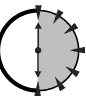

到目前为止，我每次需要存储一个新值时都会创建一个新变量。例如，在第 4 讲中，我使用以下代码来保存产品信息：

```javascript
strollerPrice = 199.95;
strollerDesc = "Rock & Stroll - Deluxe";
strollerPartNo = "st-001";
strollerShip = 20;
diaperPrice = 13.95;
diaperDesc = "Size 3, Extra Absorbent";
diaperPartNo = "dp-003";
diaperShip = 5;
carSeatPrice = 149.95;
carSeatDesc = "Ultra-Safe, Rear-Facing";
carSeatPartNo = "cs-001";
carSeatShip = 15;
```

虽然这非常直观，但这样做也非常繁琐。最糟糕的是，如果我的库存发生变化，我就必须为每个产品创建一组新的变量（每个变量都要有合适的名称）。如果有一种变量类型能够一次性容纳大量相关但不同的数据，那该多好啊？嗯，确实存在这样的变量，它叫做*数组*。

## 什么是数组？

数组是一个带有编号或命名*槽位*的变量，你可以在其中放入数据。你可以将这些槽位视为数组内部的一组独立变量。例如，以下代码展示了上述产品之一放入数组时的样子：

```javascript
var strollerInfo = new Array();
strollerInfo[0] = 199.95;
strollerInfo[1] = "Rock & Stroll - Deluxe";
strollerInfo[2] = "st-001";
strollerInfo[3] = 20;
```

与字符串一样，JavaScript 数组也是作为对象实现的。但与字符串不同的是，你不能仅仅通过给变量赋值来创建数组。相反，你必须实际创建一个 Array 对象。那么，如何创建 Array 对象呢？答案就在我们示例的第一行中：`var strollerInfo = new Array();`

像往常一样，我使用 `var` 关键字来表示我正在创建一个新变量，然后给这个新变量命名（`strollerInfo`）。后面跟着 `new` 关键字。这个关键字告诉 JavaScript 解释器，我想创建某种类型的新对象。在这种情况下，我想创建一个新的 Array 对象。因此，我在 `new` 关键字后面调用 `Array()` 构造函数方法。

*构造函数方法*是每种对象类型都具有的一种特殊方法。它的第一个特殊之处在于，它与所属对象类型的名称相同。（是的，String 对象也有一个名为 `String()` 的构造函数方法。）基本上，构造函数方法告诉 JavaScript 构建指定类型对象需要执行哪些步骤。这就是为什么它被称为构造函数方法；它实际上正在构建你所请求的对象。因此，这行代码执行完毕后，我就在 `strollerInfo` 变量中存储了一个新的 Array 对象。

## 如何使用数组

正如我之前所说，数组可以被看作是一个带有多个命名或编号槽位的变量。每个槽位都可以容纳自己的一块数据，就好像它本身就是一个变量一样。（实际上，槽位及其中的数据最常被称为数组的*元素*。）要访问这些槽位，你只需给出数组变量的名称，然后在方括号中跟上你想访问的槽位的编号或名称。（你分配给数组中某个槽位的编号或名称称为该槽位的*索引*。）

### 使用编号数组元素

在前面的示例中，我使用编号槽位来保存产品数据。注意，我从零开始为我的槽位编号。（实际上，你可以用任何你喜欢的数字开始为槽位编号，但从零开始是标准做法。）

你已经看到了如何将数据放入数组，但是如何从数组中取出数据呢？嗯，有很多方法可以做到这一点，但最常见的方法是从某种循环内部逐个处理数组中的每个槽位。当然，要这样做，你必须知道数组有多长。这就是为什么，与 String 对象一样，每个 Array 对象都有一个 `length` 属性，告诉你数组中存在多少个槽位。（当你向 Array 对象添加槽位时，JavaScript 解释器会自动更新该属性中的值。）因此，考虑到前面的示例，看看这个：

```javascript
for (x=0; x<strollerInfo.length; x++) {
    document.write( strollerInfo[x] + "<br />");
}
```

当你运行这段代码时（如果你不想输入，它在 CD-ROM 的 Listing6-2.htm 文件中），你会得到数组内容的列表。`for` 循环只是逐步遍历数组中的每个槽位，并使用存储在 `x` 中的数字，提取并显示数组每个槽位中的数据。

### 使用命名数组元素

在我的第一个示例中，我使用编号槽位来保存产品数据，而不是命名槽位。然而，我也可以同样容易地使用命名槽位，如下所示：

```javascript
var strollerInfo = new Array();
strollerInfo["price"] = 199.95;
strollerInfo["desc"] = "Rock & Stroll - Deluxe";
strollerInfo["partNo"] = "st-001";
strollerInfo["shipCost"] = 20;
```

这种方法的一个优点是，每个槽位的名称（而不是毫无意义的数字）准确地告诉程序员该槽位保存的是什么。缺点是，


但问题是，你无法再使用数字计数器来检索数组的内容。为了解决这个问题，JavaScript 提供了一种专门为这类任务设计的 `for` 循环的特殊变体。下面就是一个示例。

```
for (x in strollerInfo) {
    document.write( strollerInfo[x] + "<br />");
}
```

在这个版本的 `for` 循环中，通常控制循环的三个表达式被 `(x in strollerInfo)` 这个表达式所替代。该表达式告诉 JavaScript 解释器，每次循环时，`x` 的值应变为 `strollerInfo` 数组中下一个槽位的名称。因此，第一次循环时，`x` 包含 "price"。第二次循环时包含 "desc"，依此类推。这种方法还有一个额外的好处，由于 `x` 将依次获取每个槽位的名称，你可以检查 `x` 并利用其内容来显示每个槽位的名称。如下所示：

```
for (x in strollerInfo) {
    document.write( x + " is " + strollerInfo[x] + "<br />");
}
```

需要注意的是，如果你打算使用命名槽位，你可以为槽位指定任意名称，只要能放在一对引号内即可。即使该名称不是合法的 JavaScript 变量名也没关系！因此，例如下面所示的代码完全合法：

```
var strollerInfo = new Array();
strollerInfo["Price"] = 199.95;
strollerInfo["Product Description"] = "Rock & Stroll - Deluxe";
strollerInfo["Baby-Palooza Part Number"] = "st-001";
strollerInfo["Shipping Cost, Ground"] = 20;
for (x in strollerInfo) {
    document.write( x + " is " + strollerInfo[x] + "<br />");
}
```

这将产生如图 6-1 所示的更美观的输出。

遗憾的是，使用命名槽位有几个缺点：

- 使用命名槽位时，你只能按一个方向遍历数组，即从上到下。而使用数字编号的槽位时，你可以从底部（length - 1）遍历到顶部（0）。

直接使用命名槽位访问数组元素要求你知道该槽位的名称。如果你使用了冗长的槽位名称，这可能会使编程变得非常困难。更好的解决方案是使用数字编号的槽位，并留出一个槽位用于详细描述数组的内容。

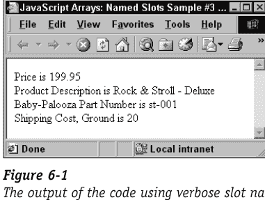

*图 6-1：使用冗长槽位名称的代码输出*

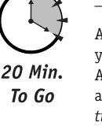

## 你可以将什么样的数据放入数组中？

实际上，由于 JavaScript 变量是弱类型的（如第 2 课所述），你可以将任何类型的数据放入 JavaScript Array 对象的任何槽位中。正如你已经看到的，你甚至可以为数组中的每个槽位分配不同类型的数据。这使得 JavaScript 数组非常强大。它还允许你创建*多维*数组。

## 什么是多维数组？

可以将多维数组理解为数组的数组。为什么你需要这样的东西呢？考虑一下我们的产品数据：在到目前为止我向你展示的示例中，我实际上只将*一个*产品的数据分配到了数组中。根据你目前所了解的内容，其他每个产品的信息也必须放入各自的 Array 对象中，然后你必须分别操作每一个。这里同样如此，如果有一种方法能将所有数据包装到一个可以轻松操作的单一变量中，那就太好了。考虑到这一点，请看下面的代码：

```javascript
var strollerInfo = new Array();
strollerInfo[0] = 199.95;
strollerInfo[1] = "Rock & Stroll - Deluxe";
strollerInfo[2] = "st-001";
strollerInfo[3] = 20;
var diaperInfo = new Array();
diaperInfo[0] = 13.95;
diaperInfo[1] = "Size 3, Extra Absorbent";
diaperInfo[2] = "dp-003";
diaperInfo[3] = 5;
var carSeatInfo = new Array();
carSeatInfo[0] = 149.95;
carSeatInfo[1] = "Ultra-Safe, Rear-Facing";
carSeatInfo[2] = "cs-001";
carSeatInfo[3] = 15;
var productInfo = new Array();
productInfo[0] = strollerInfo;
productInfo[1] = diaperInfo;
productInfo[2] = carSeatInfo;
```

正如预期的那样，我创建了单独的 Array 对象来保存每个产品的信息。然而完成之后，我又创建了第四个名为 `productInfo` 的数组。然后我将这个数组的槽位填充为我已经创建的三个产品信息数组。完成这些操作后，我得到了一个数组的数组。然后我就可以通过 `productInfo` 变量访问所有产品的全部信息。

### 如何访问多维数组中的数据

访问多维数组中的数据很简单，只需指定每个索引，就能逐层深入到相应数组中你想要的槽位。例如，汽车安全座椅的价格存储在 `productInfo` 中第三个数组的第一个槽位。因此，如果我们要打印出这个价格，可以编写如下代码：

```
document.write( "Car seat price: " + productInfo[2][0]);
```

看出它是如何工作的了吗？在多维数组的名称（`productInfo`）之后，我指定了要访问的子数组的索引（`[2]`）。如果你回顾一下创建这个数组的代码，你会看到这就是包含汽车安全座椅信息的槽位。一旦定位到了正确的数组，我只需指定要从中提取数据的槽位索引（`[1]`）。再举一个例子，如果我想将尿布的价格更改为 $15.95，可以编写如下代码：

```
productInfo[1][0] = 15.95;
```

作为最后一个示例，以下代码将取出我刚才创建的数组并显示每个槽位的内容。

```
for (x=0; x<productInfo.length; x++) {
    for (y=0; y<productInfo[x].length; y++) {
        document.write( productInfo[x][y] + "<br />");
    }
}
```

这里我使用了几个嵌套的 `for` 循环来显示多维数组中的所有数据。外层循环遍历主数组（`productInfo`），而内层循环显示每个子数组的内容。

## 数组方法

正如我们所看到的，JavaScript 数组实际上使用起来相当简单。然而，由于它们是对象，JavaScript 数组还附带了各种方法，使其更加实用和强大。在本节中，我们将介绍这些方法以及属于 String 对象的 `split()` 方法。（注意，每种方法的示例可以在你的 CD-ROM 上的 Session06 文件夹中找到。）

### Array() 构造函数方法

实际上，使用 `Array()` 构造函数方法有几种不同的方式。

- **new Array()** — 无参数。正如你已经看到的，这将创建一个空的 Array 对象。

- **new Array(length)** — 带长度参数。这将创建一个新的 Array 对象，其中包含指定数量的空槽位。

- **new Array(item1, item2, etc.)** — 带多个参数。这将创建一个 Array 对象，其槽位被你作为参数传递的项填充。

### concat() 方法

`concat()` 方法会将多个数组合并为一个新的 Array 对象。

### join() 方法

此方法会将数组的各个元素组合成一个单独的字符串。该字符串将使用你在调用 `join()` 方法时指定的字符作为分隔符。

```
var bpArray = new Array( "Diapers", "Baby Wipes", "Rattle");
var prodList = bpArray.join( "-");
```

执行这段代码后，`prodList` 将包含字符串 "Diapers-Baby Wipes-Rattle"。如果你没有指定分隔符，`join()` 方法将默认使用逗号。（可与本节末尾讨论的 String.split() 方法进行对比。）

### pop() 方法

此方法会移除并返回 Array 对象中的最后一个元素。该方法执行后，数组的 length 属性将比之前少一。例如，以下代码将使 `lastProduct` 包含字符串 "Rattle"。

```
var bpArray = new Array( "Diapers", "Baby Wipes", "Rattle");
var lastProduct = bpArray.pop();
```


> Macintosh 上的 Internet Explorer 5 不支持此方法以及以下方法（稍后描述）：push()、shift()、splice() 和 unshift()。

### push() 方法

此方法将一个新元素添加到数组的末尾。之后，数组的 length 属性将比之前多一。执行以下代码后，`bpArray` 变量的末尾将有一个包含字符串 "Diaper Cream" 的新元素。

```
var bpArray = new Array( "Diapers", "Baby Wipes", "Rattle");
bpArray.push( "Diaper Cream");
```


### reverse() 方法

此方法将反转 Array 对象中元素的顺序。

### shift() 方法

此方法将移除数组的第一个元素（元素 0），并将其他所有元素向前移动一个位置。之后，数组的 length 属性将比之前少一。

### slice() 方法

`slice()` 方法将返回一个新的 Array 对象，其中包含原始数组中元素的一个子集。你只需指定起始和结束元素，该方法就会返回一个新的 Array 对象，其中包含从起始位置到结束位置减一之间的每个元素。在以下示例中，`cleanUp` 变量将是一个包含两个元素的 Array 对象："Diapers" 和 "Baby Wipes"。同样请注意，指定的结束元素（元素 2，"Rattle"）*不*包含在新的 Array 对象中。

```
var bpArray = new Array( "Diapers", "Baby Wipes", "Rattle",
    "Stroller", "Booties");
var cleanUp = bpArray.slice( 0, 2)
```

### sort() 方法

`sort()` 方法允许你使用任何你想要的排序过程来排序 Array 对象的内容。你只需在调用 `sort()` 方法时指定一个合适的排序函数。

```
function simpleSort( item1, item2) {
    var result = 0;
    if (item1 > item2)
        result = 1;
    if (item1 < item2)
        result = -1;
    if (item1 == item2)
        result = 0;
    return result;
}
```

```
var bpArray = new Array( "Diapers", "Baby Wipes", "Rattle", "Car
Seat", "Stroller");
bpArray.sort( simpleSort);
```

排序函数（你必须自己编写）会被 sort() 方法反复调用，直到所有元素都排序完成。每次调用时，它都会接收两个参数（这里称为 item1 和 item2）。排序函数必须比较这些项，并根据比较返回结果。请注意，你使用的比较逻辑完全由你决定，但应该对你要排序的数据类型有意义。在上面的例子中，我只是在排序字符串，所以只需要简单的字符串比较。（JavaScript 使用字母顺序规则来比较字符串。因此，"ape" 小于 "zebra"。）

- 如果 item1 *大于* item2，该函数应返回一个正数。
- 如果 item1 *小于* item2，该函数应返回一个负数。
- 如果 item1 被发现 *等于* item2，排序函数应返回零。

sort() 方法使用这些结果来重新排列数组内容。（需要注意的是，你可以编写任意多个排序函数，并将它们与任何 Array 对象一起使用。例如，你可以编写一个函数来按升序排序，而另一个则按降序排序。）

### splice() 方法

splice() 方法是 Array 对象方法中最复杂的一个。它允许你从数组中删除项目，并可选择性地插入新项目来代替旧项目。在其最简单的形式中，splice() 方法可以删除一个或多个数组元素，如下所示：

```
var bpArray = new Array( "Diapers", "Baby Wipes", "Rattle",
"Car Seat", "Stroller");
bpArray.splice( 2, 1);
```

第一个参数告诉方法从哪个元素开始删除操作。（在这个例子中，是元素 2，"Rattle"。）第二个参数告诉 splice() 要删除多少个元素。在这个例子中，我指定了值为 1，因此只会删除 "Rattle" 元素。这实际上是从数组中间移除了该元素。

splice() 方法的第二种形式实际上并不删除任何元素，它只是替换它们的内容。例如：

```
var bpArray = new Array( "Diapers", "Baby Wipes", "Car Seat",
    "Stroller");
bpArray.splice( 1, 3, "Booties", "Sun Shield", "Baby Sling");
```

这里同样，第一个参数告诉 splice() 从哪里开始操作。第二个参数告诉它需要替换多少个元素，包括指定的起始元素。其余的参数是要分配给指定元素的新值。因此，在此代码运行后，bpArray[0] 将包含 "Diapers"，bpArray[1] 将包含 "Booties"，bpArray[2] 将包含 "Sun Shield"，bpArray[3] 将包含 "Baby Sling"。

### toString() 方法

此方法将 Array 对象中的所有元素组合成一个单一的字符串。每个元素将由单个逗号分隔。这与在不指定分隔符的情况下调用 join() 方法完全相同。

### unShift() 方法

此方法将向数组的开头添加一个新元素，并将所有旧元素向上移动一个位置。之后，数组的 length 属性将比之前多一。因此，在执行以下代码后，bpArray[0] 将包含字符串 "Stroller"。

```
var bpArray = new Array( "Diapers", "Baby Wipes", "Rattle");

bpArray.unshift( "Stroller");
```

### String.split() 方法

你需要了解的最后一个方法根本不是一个 Array 对象方法，而是 String 对象的 split() 方法。正如你可能已经猜到的，此方法接受一个字符串并将其分解为一个 Array 对象。关键问题是：它如何知道在哪里拆分字符串？嗯，当你调用 split() 方法时，你会指定一个分隔符，该方法将使用它来确定每个新元素的起始位置。例如，以下代码将创建一个包含 "Diapers"、"Baby Wipes" 和 "Rattle" 作为元素的数组。

```
var productList = "Diapers-Baby Wipes-Rattle";
var bpArray = productList.split( "-");
```

## 综合运用

至此，你已经掌握了所有真正开始实现功能所需的组件。你的 CD-ROM 中 Session06 文件夹中的两个文件（babyPalooza.js 和 index.htm 文件）将你迄今为止看到的所有内容结合起来，为 Baby-Palooza.com 商店页面奠定了基础。由于这些文件较长，我将不在这里展示它们，请将它们加载到你的编辑器（和 Web 浏览器）中，以便你可以跟着操作。

首先查看 babyPalooza.js 文件，你会看到我已使用 Array 对象重新组织了所有商店数据。这将使我能够通过单个变量 productInfo 来操作所有产品信息。

我还更新了 showProductInfo 函数，以利用它现在接收一个数组这一事实。因此，它现在直接从接收到的 Array 对象中提取要显示的产品数据，而不是处理一堆参数。作为该过程的一部分，我还使用了对 split() 方法的调用以及一个 switch 语句来确定产品的类别（"Stroller"、"Rattle" 等）。显示这些信息将让我的客户稍微更好地了解他们正在购买什么。

将所有这些联系起来的是 index.htm 文件。该文件的当前版本与你在第 4 课中看到的内容的主要区别在于，我不再为每个产品显式调用 showProductInfo。相反，我只需遍历我的 productInfo 数组，并将每个产品的信息 Array 对象传递给该函数。（请记住，productInfo[x] 实际上指的是我多维数组中的整个子数组。）

## 复习

在本课中，你学习了数组、JavaScript Array 对象以及它们可以使用的所有不同操作和方法。你看到了如何使用数组在单个变量中存储大量数据，同时仍然允许轻松访问这些数据。你还学习了如何创建和使用一个具有命名槽位而非数字槽位的数组。你甚至看到了一个 for 循环的变体，它将允许你处理具有命名槽位的数组。最后，我们查看了一个示例，展示如何将你迄今看到的所有内容结合使用，为一个灵活的 Web 商店页面奠定基础。

## 自我测验

1. 数组到底是什么？（参见“什么是数组？”）
2. 如何访问数组的内容？（参见“如何使用数组。”）
3. 为什么可能想使用命名槽位？（参见“使用命名数组元素。”）
4. 什么是多维数组？（参见“什么是多维数组？”）
5. `join()` 方法做什么？它与 String 对象的 `split()` 方法有什么关系？（参见“数组方法”。）


## 本讲清单

- 理解什么是浏览器对象模型
- 理解浏览器对象模型的结构
- 理解 JavaScript 如何与浏览器对象模型协同工作

到目前为止，我一直在向你介绍 JavaScript 这门编程语言。现在是时候谈谈 JavaScript 实际运行的环境了。如果你想到的是 Web 浏览器，那只答对了一半。虽然 Web 浏览器确实是你的 JavaScript 程序的宿主，但你的程序并不会直接与 Web 浏览器交互。相反，你将使用一组 JavaScript 对象，它们充当你的 JavaScript 程序与 Web 浏览器之间的中介。这组对象有时被称为*浏览器对象模型*。浏览器对象模型的目的在于，在你的 JavaScript 程序与 Web 浏览器之间提供一个简单、一致的接口。

为什么要这样做呢？考虑一下个人计算机行业。为一个平台（如 Macintosh）编写的程序，如果不经过大量的转换工作，就无法在另一个平台（如 Windows）上运行。这是因为它们使用截然不同的编程接口来完成相同的任务。

现在再来看看 Web 浏览器行业。你为 Internet Explorer 创建的 JavaScript 代码，应该能够在 Netscape 的 Navigator 上完美运行。（当然存在一些差异，但与在 Mac 和 Windows 之间迁移软件相比，这些差异微不足道！）你甚至可以将为 Linux 上的 Navigator 编写的代码，用于 Macintosh 上的 Internet Explorer。这是因为两种浏览器支持相同的编程接口，即浏览器对象模型。

## 浏览器对象模型里有什么？

你已经接触过浏览器对象模型的一部分：document 对象。正如你在第一讲中记得的，document 对象代表加载到 Web 浏览器中的实际 HTML 文档。就像你看过的其他对象一样（第五讲中的 String 对象和第六讲中的 Array 对象），document 对象拥有一整套属于自己的属性和方法。（事实上，document 对象如此重要，我们将在今天上午稍后的第九讲中详细讨论它。）

浏览器对象模型不仅仅是 document 对象。它由一大群对象组成，这些对象允许你的 JavaScript 程序探查 Web 浏览器的几乎每一个角落和缝隙。所有这些对象排列成一个看似倒置的树状结构。window 对象位于这棵树的顶端，浏览器对象模型中的所有其他对象都可以在它内部找到。图 7-1 展示了 Netscape Navigator 6 和 Internet Explorer 5 中浏览器对象模型的主要对象（其他浏览器会略有不同）。

从图 7-1 可以看出，浏览器对象模型非常庞大且相当复杂。因此，本讲的目的只是让你熟悉浏览器对象模型及其提供的功能。在本周末的剩余时间里，你将学习浏览器对象模型的各个组成部分。在下面的讨论中，我将给出浏览器对象模型中主要对象的名称，并简要描述每个对象。我还会告诉你该对象在哪一讲中讨论。

## window 对象

window 对象代表 Web 浏览器窗口。它还封装了本讲剩余部分将要讨论的所有其他对象。（还记得第六讲结尾的"数组的数组"吗？window 对象背后的概念与此非常相似。把它想象成一个包含许多其他对象的对象。）window 对象内部的大多数对象代表你在浏览器窗口中看到的各种控件。例如，`history` 对象（在第二十七讲中讨论）保存你访问过的网页地址。window 对象内部的其他对象和属性包括以下内容。

*图 7-1*
*浏览器对象模型*

document 对象：正如第一讲中提到的，document 对象代表当前加载的 HTML 页面。关于 document 对象还有更多信息将在本讲稍后介绍，我们将在第九讲中详细讨论它。

frames 数组：JavaScript 将浏览器窗口中出现的每个框架都视为一个独立的 window 对象。因此，如果你的网站使用了框架，代表实际浏览器窗口的 JavaScript window 对象（即，不是某个框架）被称为父窗口。这个父窗口包含一个名为 frames 数组的 Array 对象。frames 数组中的每个槽位都包含一个 window 对象，对应于 Web 浏览器中的一个框架。虽然 window 对象里面包含 window 对象听起来可能令人困惑，但实际操作起来非常简单，正如你将在第二十三讲中看到的那样。

location 属性：这是一个 String 对象，包含当前加载到 Web 浏览器中的网页地址。（location 对象在第二十七讲中讨论。）

navigator 对象：该对象保存有关你的 Web 浏览器品牌、版本和功能的详细信息。除了这些基本信息外，它还包含已安装插件的详细列表以及浏览器所了解的 MIME 类型。你的 JavaScript 程序可以使用这些信息来确定某种特定的多媒体文件是否能在浏览器中工作。（navigator 对象在第二十六讲中讨论。对插件和 MIME 类型的支持在第二十九讲中讨论。）

在这一点上，插图可能会有所帮助。图 7-2 展示了一个典型的浏览器窗口，包括框架，以及窗口的各个部分如何与你刚介绍的对象相对应。

window 对象的另一个重要方面是，它有多个不同的名称。通常如果你想引用 window 对象，只需使用名称 window。然而，你根本不需要命名 window 对象。如果 JavaScript 不知道你在谈论哪个对象，它会假设你在谈论 window 对象，并默认使用它。例如，以下两条语句是等效的：

```
document.write("Howdy!"); window.document.write("Howdy!");
```

如前所述，当你使用框架时，代表实际浏览器窗口的 window 对象可以被称为"parent"。即使你不使用框架，也可以使用这个名称。

最后，你还可以将 window 对象称为"self"或"top"。（名称"top"在框架的上下文中也很有用。我们将在第二十三讲中更多地讨论这一点。）因此，以下所有语句都是等效的。

```
document.write("Howdy!"); parent.document.write("Howdy!");
self.document.write("Howdy!"); top.document.write("Howdy!");
```

*图 7-2*
*浏览器窗口的各个部分及其对应的 JavaScript 对象*

## document 对象

你已经看到了如何使用 document 对象将字符串输出到浏览器窗口。然而，document 对象能做的远不止这些。document 对象允许你的 JavaScript 程序执行以下操作。

**与 HTML 表单交互：** 这包括操作 HTML 表单中可用的各种控件（文本框、按钮等）。你甚至可以验证表单中的数据（第十五讲）并更改表单提交的位置。这可能是 JavaScript 在网页上最有用的方面，因此我们将在第十二、十三和十五讲中极其详细地研究这一点。

**操作 cookie：** document 对象让你直接控制保存在 Web 浏览器客户端机器上的 cookie。我们将在第十六讲中讨论这一点。


## JavaScript 与浏览器对象模型

**与图像交互：** document 对象允许你直接访问和操纵加载到网页文档中的图像。在第 14 讲中，我们将看到 JavaScript 如何让我们加载图像，甚至创建简单的动画。

**与 Java 小程序交互：** document 对象还能让你访问网页可能加载的任何 Java 小程序。我们将在第 30 讲中讨论这一点。

现在你已经对浏览器对象模型有了基本了解，你可能会想知道如何实际使用它。我已经在讨论 window 对象时向你展示了一小部分示例。再来看一下这行代码：

```
window.document.write( "Howdy!" );
```

这行代码究竟告诉 JavaScript 做什么？还记得我们在讨论 String 对象方法时提到过，句点是一个运算符，它告诉 JavaScript *查看* 对象内部，以便访问其中包含的内容。所以，这段代码的意思是："查看 window 对象内部，获取 document 对象。然后，查看 document 对象内部，调用其 write() 方法。"这就是你使用 JavaScript 访问浏览器对象模型各个部分的方式：从 window 对象开始，列出能够通向你要访问的对象的对象名称。你需要记住的只是用句点分隔对象名称。这个对象名称列表将告诉 JavaScript 要遵循的路径，以访问你想要的浏览器对象模型对象。

### 简单示例

HTML 文件如何映射到浏览器对象模型？下面是一个示例。

```
<html>
<head><title>Browser Object Model</title></head>
<body bgcolor="white">
Welcome to Baby-Palooza!
<form name="order">
Number of Strollers:
<input type="text" name="strollCount" value="0" /><br />
Number of Diapers:
<input type="text" name="diaperCount" value="0" /><br />
Number of Rattles:
<input type="text" name="rattleCount" value="0" />
</form>
</body>
</html>
```

当 Web 浏览器加载此文件时，它实际上会创建一组完整的浏览器对象模型对象来表示它。对于这个文件，会创建以下对象：

| 对象 | 含义 |
|---|---|
| window 对象 | 这代表 Web 浏览器本身。 |
| document 对象 | 这代表 HTML 文件。 |
| 名为 "order" 的 form 对象 | 这代表我们在 HTML 文件中定义的 `<form>` 标签。注意，此对象的名称与你在 `<form>` 标签的 name 属性中指定的名称相同。（如果你的 HTML 文件中有多个 `<form>`，只需给它们各自一个唯一的 name 属性，即可通过 JavaScript 访问它们。） |
| 名为 "strollCount"、"diaperCount" 和 "rattleCount" 的三个 input 对象 | 这些对象代表订单表单中定义的文本框。每个对象都有一个 value 属性，该属性保存当前在文本框中输入的数字。同样，每个 JavaScript 对象的名称直接取自其对应 HTML `<input>` 标签中使用的 name 属性。 |

当然，还会创建其他对象。例如，也会创建一个 forms 数组。但是，由于 HTML 文件中没有对应的定义，这些对象将为空。（在这种情况下，forms 数组的长度为零。）在图 7-3 中，你可以看到这些对象是如何相互嵌套的。

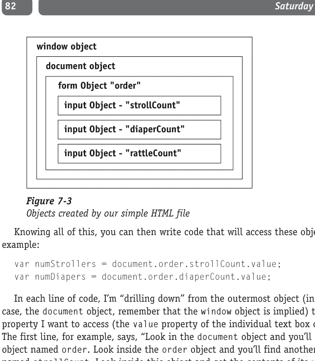

**图 7-3**
我们的简单 HTML 文件创建的对象

了解了所有这些以后，你就可以编写访问这些对象的代码了。例如：

```
var numStrollers = document.order.strollCount.value;
var numDiapers = document.order.diaperCount.value;
```

在每一行代码中，我从最外层的对象（在此案例中是 document 对象，记住 window 对象是隐含的）"深入挖掘"到我想要访问的属性（各个文本框对象的 value 属性）。例如，第一行代码的意思是："查看 document 对象，你会发现一个名为 order 的对象。查看 order 对象内部，你会找到另一个名为 strollCount 的对象。查看此对象内部，获取其 value 属性的内容。最后，将该结果放入 numStrollers 变量中。"当然，你也可以给这些属性赋值：

```
document.order.strollCount.value = 10;
document.order.diaperCount.value = 95;
```

**完成！**

然而，这些不仅仅是简单的赋值语句。请记住，这些对象对应于 JavaScript 程序执行时实际显示在屏幕上的 HTML 元素。所以，如果你给 rattleCount 文本框的 value 属性赋一个新值，该数字会立即出现在屏幕上的文本框中！这就是 JavaScript 与浏览器对象模型的结合如此强大的原因。通过将它们结合使用，你的 JavaScript 程序可以轻松与 HTML 页面的元素交互，并动态更改用户看到的信息。

## 复习

在本讲中，你学习了浏览器对象模型。你了解到，就 JavaScript 而言，Web 浏览器及其中的所有内容只是一组 JavaScript 对象。你还学习了如何创建语句来访问浏览器对象模型的各个部分。最后，你看到了 JavaScript 代码与浏览器对象模型之间的交互如何能够改变用户在 Web 浏览器中看到的内容。

## 自测题

- 1. `window` 对象代表什么？（参见 "window 对象"。）
- 2. `frames` 数组中保存的是什么？（参见 "window 对象"。）
- 3. `self` 对象指的是什么？（参见 "window 对象"。）
- 4. 浏览器对象模型如何使用 HTML 标签的 name 属性？（参见 "简单示例"。）
- 5. 当你给文本框对象的 value 属性赋值时会发生什么？（参见 "简单示例"。）

# 第 8 讲

## 使用 window 对象

## 本讲要点

- 了解 window 对象是什么
- 学习 window 对象的属性和方法

正如你在上一讲中看到的，window 对象是一个代表整个 Web 浏览器窗口的 JavaScript 对象。通过 window 对象进行操作，你的 JavaScript 代码可以有效控制浏览器的几乎每个方面。你可以想象，第 7 讲只是触及了 window 对象的皮毛。在本讲中，我们将更深入地挖掘 window 对象，以便你了解如何在其 JavaScript 程序中使用它的属性和方法。（这些属性和方法的示例可以在你 CD-ROM 的 Session08 文件夹中找到。）

> Netscape 和 Internet Explorer 都为 window 对象添加了专有属性和方法。因此，我将仅限于介绍那些在两种浏览器中都能正常工作的属性和方法。如果你需要编写针对特定浏览器的 JavaScript，请参阅第 26 讲。

## window 对象的属性

在阅读以下说明时，请记住 window 对象及其属性可以像任何其他对象一样赋给 JavaScript 变量。本讲中的许多示例都利用了这一特性来打开和跟踪多个窗口。

### *closed 属性*

这告诉你特定的 window 对象是否代表一个打开的浏览器窗口。如果窗口是打开的，closed 属性将为 false。如果窗口已关闭，则为 true。

### *defaultStatus 属性*

此属性指定一个字符串，该字符串将显示在浏览器的状态栏中。（状态栏通常位于浏览器窗口的左下角。）

### *document 属性*

这是 document 对象。它代表当前加载到浏览器窗口中的 HTML 文档，或加载到特定框架中的 HTML 文档。document 对象将在下一讲中详细讨论。

### *frames 数组*

此数组为多点框架网站中的每个框架保存一个 window 对象。（frames 数组将在第 23 讲中详细讨论。）

### *history 属性*

history 属性是一个包含历史列表的对象——即该 window 对象访问过的网站列表。每个 window 对象（包括 frames 数组中的对象）都有其自己的 history 属性。（history 对象将在第 27 讲中讨论。）


### location 属性

location 属性保存当前正在浏览的网页地址。如果为该属性赋一个新的网页地址，Web 浏览器将会加载该网页。（*location* 对象将在第 27 课中详细讨论。）

#### name 属性

该属性包含窗口对象的名称。注意，这与实际持有该窗口对象的 JavaScript 变量名称不同。例如：

```
var catalogWindow = window.open();
catalogWindow.name = "catalog";
```

一旦为窗口对象指定了名称，你就可以在锚标签的 target 属性中使用该名称。因此，在下面的示例中，点击"See the Catalog"链接将会把 catalog.htm 文件加载到由你的 JavaScript 代码打开的窗口中。

```
<a href="catalog.htm" target="catalog">See the Catalog</a>
```

### navigator 属性

navigator 对象包含有关 Web 浏览器的信息，包括其版本、品牌信息和平台信息。以下简单的脚本将显示 navigator 对象中包含的所有内容。（我们将在第 26 课中讨论如何使用这些信息来编写特定于浏览器的脚本。）

```
for (x in navigator)
    document.write( x + " = " + navigator[x] + "<br />");
```

### opener 属性

当一个窗口创建另一个窗口时（使用本课稍后讨论的 window.open() 方法），第一个窗口成为新窗口的 opener。这使你能够在窗口之间进行通信。（我们将在第 24 课中查看这一过程。）

```
self.name = "original";
var newWindow = window.open();
document.write( newWindow.opener.name);
```

### parent 属性

如果你的网站使用框架布局，每个框架都被视为独立的窗口。因此，每个框架都有自己的 `window` 对象。这些 `window` 对象都是将框架加载到 Web 浏览器中的框架集文档的"子项"。代表框架集文档的 `window` 对象因此被称为每个框架的 *parent*。`parent` 属性持有代表框架集文档的 `window` 对象。这在图 8-1 中有所说明。（图 8-1 的源代码位于文件 framesNparent.htm 中。）

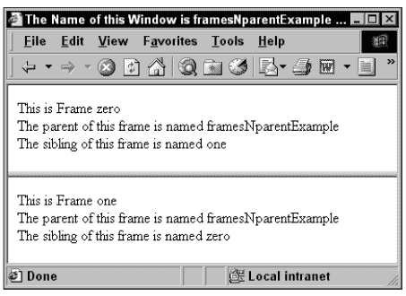

*图 8-1*
*框架与 parent 属性*

### screen 属性

`screen` 属性包含有关客户端显示器屏幕设置的信息。你可以使用这些信息来确定客户端显示器的分辨率，并加载适当大小的图形。（我们将在第 14 课中讨论 `screen` 属性。）

### status 属性

该属性持有将在浏览器状态栏中临时显示的字符串。短暂时间后，`defaultStatus` 属性中的字符串将替换此消息。

### top 属性

top 属性指的是基于框架的窗口集合中最顶层的窗口。这本质上代表实际 Web 浏览器窗口的窗口对象。这与 parent 属性有何不同？请看图 8-2。

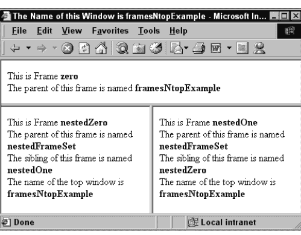

*图 8-2 框架中的框架与 top 属性*

此窗口显示了框架集内的框架集。如你所见，最内层的框架集（底部行）的 parent 本身是浏览器窗口中的一个框架。在这种情况下，这些框架的 parent 与实际浏览器窗口不是一回事。另一方面，top 属性始终代表实际的浏览器窗口。

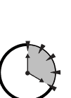

## window 对象的方法

window 对象提供了多种方法。在本节中，我们将介绍这些方法，并了解它们如何用于与用户和 Web 浏览器本身进行交互。

### alert() 方法

此方法显示一个包含你指定消息和单个 OK 按钮的对话框。调用此方法将暂停你的 JavaScript 程序的执行，直到用户点击 OK 按钮继续。（注意，在 Linux 版本的 Netscape Navigator 中，`alert()` 方法*不会*暂停程序的执行！）`alert()` 方法作为调试工具非常有用。如果你需要知道某个变量的值，只需将其放入 `alert()` 调用中，你就会看到该值弹出显示在屏幕上。例如，如果你想知道名为 `price` 的变量的值，只需编写 `alert(price)`。

### blur() 方法

`blur()` 方法将移除关联窗口对象的焦点。这意味着该窗口对象将不再接收用户输入的任何按键。如果你对框架中的窗口调用 `blur()`，焦点将转到其浏览器窗口中的顶层对象。如果你对顶级窗口（即代表浏览器的窗口）调用 `blur()`，该窗口通常会被发送到所有其他打开的浏览器窗口的后面。

### clearInterval() 和 clearTimeout() 方法

请参阅本课稍后对 `setInterval()` 和 `setTimeout()` 方法的讨论。

### close() 方法

调用 `close()` 方法将关闭关联的浏览器窗口。作为一种安全措施，大多数 Web 浏览器只允许你关闭自己创建的窗口。如果你尝试关闭系统创建的浏览器窗口，你通常会收到一个确认对话框，告知你正在查看的网页正在尝试关闭窗口。例如，假设你启动 Internet Explorer（Windows 版）并立即加载包含以下代码的文件：

```
var newWindow = window.open();
newWindow.close();
self.close();
```

第一个 `close()` 调用将按预期执行。然而，第二个 `close()` 调用将弹出一个对话框，要求你确认是否要关闭该窗口。

### confirm() 方法

confirm() 方法允许你向用户提出简单的"确定"或"取消"问题。你向 confirm() 方法传递一个包含问题的字符串，它会将问题呈现给用户，同时显示一组"确定"和"取消"按钮。如果用户点击"确定"按钮，将返回 true。如果用户点击"取消"按钮，将返回 false。

```
if (confirm("Would you like to proceed?")) {
    alert("Here we go...");
}
else {
    alert("I understand. These things can be scary!");
}
```

### focus() 方法

focus() 方法告诉 Web 浏览器将按键 directing 到指定的窗口对象。如果指定的窗口对象不是最前面的窗口，focus() 方法会将该窗口带到前面。

### moveBy() 方法

调用此方法将按指定像素数移动指定窗口。

```
self.moveBy(10, 30); self.moveBy(-10,-30);
```

第一条语句将窗口从其当前位置向右移动 10 像素，向下移动 30 像素。第二条语句将窗口从其当前位置向上移动 10 像素，向左移动 30 像素。注意，大多数浏览器不允许将窗口移出屏幕。

### moveTo() 方法

此方法将窗口移动到屏幕上的绝对位置。例如：

```
self.moveTo(0, 0); self.moveTo(100,300);
```

第一条语句将窗口移动到屏幕的左上角。第二条语句将窗口移动到距离屏幕顶部 100 像素、距离屏幕左侧 300 像素的位置。同样，大多数浏览器不允许将窗口移出屏幕。

### open() 方法

正如你在本课的其他几个示例中看到的，`open()` 方法打开一个新的浏览器窗口，并返回一个 `window` 对象来表示它。如果你不带参数调用 `open()` 方法，你将获得一个空的浏览器窗口。如果你想要更有趣的效果，可以按以下顺序传递最多四个参数：

- **`url`** — 这是你想要自动加载到新窗口中的网页的 Web 地址。
- **`name`** — 这是一个字符串，将被放入新窗口的 `window.name` 属性中。
- **`featuresList`** — 这是一个字符串，指定新窗口应具有的功能。该参数允许你指定窗口的大小、是否应有工具栏、滚动条等。（我们将在第 24 课中讨论这些功能。）
- **`replace`** — 这是一个布尔值，指定第一个参数中指定的 Web 地址是否应替换历史列表中的当前条目。

例如，以下代码将创建一个名为 "hungryMinds" 的新窗口对象，该对象将显示 Hungry Minds 网站。

```
var bookSite = window.open("http://www.hungryminds.com",
	"hungryMinds");
```

### prompt() 方法

`prompt()` 方法允许你向用户提问，并获取答案。你向 `prompt()` 方法传递两个参数：一个消息字符串和一个默认响应值。以下语句将向用户呈现图 8-3 所示的对话框。

```
var response = prompt("What is your favorite color?", "black");
```

请注意，在调用 `prompt()` 时指定的默认响应显示在文本框中。用户可以覆盖此值，或点击"确定"将其作为回复接受。如果他们点击"确定"，输入到文本框中的值将返回到你的脚本。如果用户点击"取消"，则将一个称为 *null* 的特殊值返回到你的脚本。`null` 告诉你的程序 `prompt()` 没有返回任何内容。（JavaScript 中使用 `null` 值来表示"无"或空对象。）由于 `null` 是 JavaScript 关键字，你可以像这样检查它：


```
var response = prompt("What is your favorite color?", "black");
if (response == null) {
    alert("You clicked the Cancel button");
}
else {
    alert("Your response was " + response);
}
```

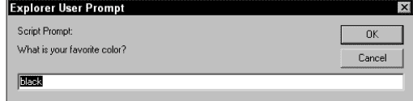

图 8-3
由 prompt() 方法创建的对话框

### resizeTo() 方法

此方法可将浏览器窗口调整为指定的宽度和高度。

```
self.resizeTo(50, 325); // 将宽度设为 50，高度设为 325
```

请注意，你指定的大小代表的是*整个*浏览器窗口（包括工具栏、按钮等），而不仅仅是窗口中文档的部分！

### scroll() 和 scrollTo() 方法

这两种方法都可以让你将窗口内容滚动到指定位置。指定的点将出现在窗口的左上角。

```
scroll(0, 0); scrollTo(0, 30);
```

第一条语句将滚动到文档顶部，而第二条语句将向下滚动 30 像素。

### scrollBy() 方法

scrollBy() 方法将文档从当前位置滚动指定的像素数。以下语句将向上滚动文档 25 像素。

```
scrollBy(0, -25);
```

### setInterval() 和 clearInterval() 方法

setInterval() 方法与 setTimeout() 方法几乎完全相同。（事实上，在继续阅读之前，你应该先查看 setTimeout() 方法的说明。）主要区别在于，传递给 setInterval() 的 JavaScript 语句会反复执行。每次执行后，计时器重置，倒计时再次开始。因此，以下语句将每隔两秒向下滚动文档，每次滚动 100 像素。

```
var intervalID = setInterval( 'scrollBy( 0, 100);', 2000);
```

停止此过程的唯一方法是关闭浏览器窗口，或者使用 clearInterval() 方法停止倒计时。

```
clearInterval( intervalID);
```

### setTimeout() 和 clearTimeout() 方法

此方法是 window 对象中最有用也最令人困惑的方法之一。setTimeout() 方法接受两个参数：第一个是一个字符串，表示有效的 JavaScript 语句。第二个是一个数字，表示以毫秒为单位的时间段。（毫秒是 1/1000 秒。因此，1000 毫秒等于 1 秒。）

setTimeout() 方法将第一个参数放入一个特殊的队列中。然后它使用第二个参数开始倒计时。例如，如果你为第二个参数传递 2000 毫秒，你将获得一个两秒的倒计时。

倒计时结束后，第一个参数被取出并传递给 JavaScript 解释器。JavaScript 解释器随后执行字符串中的语句，就好像你直接在源代码中输入它一样。

在此示例中，setTimeout() 方法将设置一个五秒的计数器。当它到期时（即超时），将执行语句 alert('Hello World!')。

```
setTimeout( "alert('Hello World!')", 5000);
```

请注意，我们传递的字符串是一个有效的 JavaScript 语句。还要注意我在此示例中如何嵌套引号。如果我这样写：

```
setTimeout( "alert("Hello World!")", 5000);
```

该语句将会失败，因为不能在单个字符串中使用两组相同类型的引号。

另一件需要注意的事情是，`setTimeout()` 方法*不会*对你指定的语句建立递归调用。第一个参数中的 JavaScript 语句只执行一次，且仅在指定的毫秒数过去之后执行。要反复执行某个语句，请改用 `setInterval()` 方法。

这些示例中未展示，但 `setTimeout()` 方法也会返回一个结果。此结果是一个计时器 ID，你可以选择保留它或完全忽略它。如果你决定保留它，可以将此计时器 ID 传递给 `clearTimeout()` 方法，计时器将被停止，相关的 JavaScript 语句将不会执行。

`setTimeout()` 方法是 window 对象中极其强大和重要的一部分。事实上，它非常有用，你会在本课程的许多示例文件中发现它被使用。（我们将在第 20 讲中更多讨论 `setTimeout()` 方法及其近亲 `eval()` 函数。）


> 在 JavaScript 中，你**绝对不要**编写递归函数！如果你这样做，很快就会生成一个错误消息，提示 JavaScript 解释器内存不足。在最坏的情况下，你甚至可能使浏览器崩溃！相反，请始终使用 `setInterval()` 或 `setTimeout()` 方法来设置重复函数或代码块。（递归函数的示例，请参见 Session08 文件夹中的 recurseBad.htm 文件。但在加载此文件之前，请务必保存所有工作！）


## 复习

这又是信息密集的一讲，但结果是你现在几乎已经了解了关于 `window` 对象的所有知识。你已经学习了构成 `window` 对象的属性和方法，而且如果你加载了 CD-ROM 上的任何源文件，你还看到了如何使用它们。

## 自测题

1. `parent` 和 `top` 属性有什么区别？（参见"'window 对象的属性'"）

2. `navigator` 对象中有什么？（参见"'window 对象的属性'"）

3. `opener` 属性包含什么？（参见"'window 对象的属性'"）

4. `alert()` 方法做什么？（参见"'window 对象的方法'"）

5. `setTimeout()` 和 `setInterval()` 方法做什么？（参见"'window 对象的方法'"）

# 第 9 讲：使用 document 对象

## 本讲清单

- 了解 document 对象是什么
- 学习 document 对象的属性和方法


还剩 30 分钟

document 对象是一个 JavaScript 对象，代表当前加载到 Web 浏览器中的 HTML 页面。与其他你见过的对象一样，document 对象包含大量属性和方法，让你可以查看和操作 HTML 页面。在本讲中，我们将查看这些属性和方法，了解如何从 JavaScript 中使用它们。（展示每种属性和方法用法的示例可以在 CD-ROM 的 Session09 文件夹中找到。）

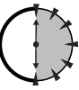

与 window 对象一样，每个主要 Web 浏览器都为 document 对象定义了几个专有属性和方法。同样，我将只讨论那些在最新版本的 Internet Explorer 和 Netscape Navigator 中应该有效的项目。

## document 对象的属性

在以下章节中，你将了解 document 对象的属性如何用于影响用户查看 HTML 文档的方式。

### alinkColor 属性

`alinkColor` 属性指定用于显示当前活动链接的颜色。当前活动链接是指如果你按下回车键或在其上单击鼠标，将会跟随的链接。要更改此设置，只需为其分配一个新颜色值：

```
document.alinkColor = "gray";
```

如果你需要对使用的颜色有更多控制，也可以分配十六进制颜色值。但请注意，这些十六进制值需要以英镑符号（#）开头，而不是你向 JavaScript 变量分配十六进制值时使用的 `0x`。因此，使用十六进制值的等效语句如下所示：

```
document.alinkColor = "#808080";
```

当你以这种方式分配颜色时，你指定的是将混合以创建最终颜色的红色、绿色和蓝色（RGB）颜色值。在上面的示例中，三种颜色都被分配了 `0x80` 的值（十进制为 128）。在以下示例中：

```
document.alinkColor = "#00FF77";
```

红色的值是 `0x00`（零，最低可能的值），绿色的值是 `0xFF`（即十进制的 255，是最高可能的值），蓝色的值是 `0x77`（即十进制的 119）。这些值将被混合以得到最终的显示颜色。

然而，如果你不想折腾数字，还有几种标准化的颜色值已经被分配了名称，你可以在你的颜色中使用。表 9-1 显示了标准的颜色名称（及其等效的十六进制值），你可以将其用于此属性以及 document 对象的其他与颜色相关的属性。
```

### 表 9-1
标准颜色名称和编号

| 颜色名称 | 十六进制颜色代码 (#RRGGBB) | 颜色名称 | 十六进制颜色代码 (#RRGGBB) |
|------------|--------------------------------------|------------|--------------------------------------|
| 水色 (aqua) | #00FFFF | 海军蓝 (navy) | #000080 |
| 黑色 (black) | #000000 | 橄榄色 (olive) | #808000 |
| 蓝色 (blue) | #0000FF | 紫色 (purple) | #800080 |
| 紫红色 (fuchsia) | #FF00FF | 红色 (red) | #FF0000 |
| 灰色 (gray) | #808080 | 银色 (silver) | #C0C0C0 |
| 绿色 (green) | #008000 | 青色 (teal) | #008080 |
| 酸橙绿 (lime) | #00FF00 | 白色 (white) | #FFFFFF |
| 栗色 (maroon) | #800000 | 黄色 (yellow) | #FFFF00 |

### 锚点数组

锚点数组包含文档中每组 `<a name="someName"></a>` 标签对应的锚点对象。每个锚点对象都有一个 name 属性，其中包含 HTML 锚点标签的 name 属性中指定的名称。因此，以下 HTML 代码

```
<a name="top">This is the top</a>
<!-- Lots of content would go here -->
<a name="bottom">This is the bottom</a>
```

将创建一个包含两个锚点对象的锚点数组。第一个锚点对象的 name 属性为 "top"，第二个的 name 属性为 "bottom"。

### Java 小程序数组

Java 小程序数组包含嵌入 HTML 文档中的所有 Java 小程序。（此数组中的每个项目对应 HTML 文档中的一个 `<applet>` 标签。）您可以访问这些 Java 小程序的属性和方法，将与每个小程序对外公开的属性和方法相同。我们将在第 30 课中更详细地讨论 Java 和 JavaScript 之间的关系。

### bgColor 属性

此属性允许您设置 HTML 文档的背景色。

```
document.bgColor = "red";
```

请注意，在 Netscape Navigator 中，您只能在 HTML 文档的开头（即位于 `<head></head>` 标签之间的脚本块中）为 `bgColor` 赋值。然而，在 Internet Explorer 中，您可以随时为此属性赋值。这将立即改变文档的背景色。

### cookie 属性

`cookie` 属性允许您读取和设置 HTML 文档的客户端 cookie 值。读取和写入 cookie 非常简单：

```
var theCookie = document.cookie; // read the cookie
document.cookie = theCookie; // write the cookie
```

但是，正如您将在第 16 课中看到的，实际使用 cookie 会稍微复杂一些。

### domain 属性

此属性包含加载 HTML 文档的 Web 服务器的主机名。（如果文档是从本地文件加载的，则此属性将包含空字符串。）正如我之前提示的，一个浏览器窗口中的 JavaScript 代码可以与另一个窗口中的 JavaScript 通信。但是，只有当每个需要通信的窗口的 `document.domain` 属性相同时，才允许这样做。因此，如果您想要通信的两个 HTML 文件来自您站点上的两个不同服务器（即两个不同的域名），这可能会带来问题。在第 24 课中，我将向您展示如何使用 `document.domain` 属性来解决此限制。

## 第 9 课——使用 document 对象

### embeds 数组

embeds 数组包含 HTML 文档中每个 `<embed>` 标签的条目。如果单个嵌入项具有 Java 风格的接口，您可以像与 applets 数组中的 Java 小程序交互一样与之交互。但是，这完全取决于嵌入项本身。

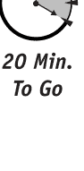

### fgColor 属性

此属性允许您更改 HTML 文档的前景色。

```
document.fgColor = "blue";
```

（与 bgColor 属性不同，只有 Netscape Navigator 的旧版本将此属性的使用限制在 HTML 文档的开头。在 Navigator v6 及更高版本中，您可以随时为 fgColor 赋值。）

### forms 数组

forms 数组包含 HTML 文档中每组 `<form></form>` 标签对应的一个表单对象。这些表单对象本身包含表示用户在表单中交互的各种控件（文本框、选择菜单等）的对象。表单对象及其内容是 document 对象最重要和最有用的部分之一，因此我将在第 12、13 和 15 课中详细讲解它们。

### images 数组

images 数组包含 HTML 文档中每个 `` 标签的条目。每个条目都是一个 JavaScript Image 对象，您可以使用它来加载新图像或创建简单动画。您可以在第 14 课中找到有关 images 数组及其使用方法的信息。

### lastModified 属性

这是一个字符串对象，包含 HTML 文件在磁盘上最后修改的日期。

### linkColor 属性

此属性包含用于显示文档中链接（`<a href="somedestination"></a>` 标签）的颜色。与 `fgColor` 属性一样，Netscape Navigator 的旧版本将此属性的使用限制在 HTML 文档的开头。在最新的浏览器中，您可以随时为 `linkColor` 赋值。

### links 数组

此数组为 HTML 文件中的每个 `<a href="somedestination"></a>` 标签包含一个 Link 对象。

### Link 对象

JavaScript `Link` 对象包含许多不同的属性，这些属性可以提供有关其代表的 HTML 链接的大量信息。这些信息可用于编写各种有趣的脚本。（您 CD-ROM 上的 linksArray.htm 文件展示了此信息的一个用途。）Link 对象的属性因浏览器而异，但最常见（也是最有用的）的属性在以下部分中描述。

**Link.hash 属性** 这是一个字符串对象，包含链接中指定的 Web 地址的 *哈希 (hash)* 部分。例如，在此链接中，哈希部分是 `#top`。

```
  <a href="http://www.baby-palooza.com/index.htm#top">Baby-
  Palooza</a>
```

**Link.host 属性** 这是一个字符串对象，包含链接 Web 地址的主机信息。例如，在此链接中，主机部分是 `www.baby-palooza.com:80`。

```
  <a href="http://www.baby-palooza.com">Baby-Palooza</a>
```

**Link.hostname 属性** 这是一个字符串对象，仅包含链接 Web 地址的主机名信息。例如，在此链接中，主机名部分是 `www.baby-palooza.com`。

```
  <a href="http://www.baby-palooza.com">Baby-Palooza</a>
```

#### Link.href 属性

此字符串对象包含链接中指定的整个 Web 地址。例如，在此链接中，href 部分是 http://www.baby-palooza.com/。

```
<a href="http://www.baby-palooza.com">Baby-Palooza</a>
```

#### Link.pathname 属性

如果 Web 地址指向服务器上某个文件夹中的文件，此属性将包含该文件的路径。在此链接中，pathname 属性将包含字符串 strollers/index.htm。

```
<a href="http://www.baby-palooza.com/strollers/index.htm">Strollers</a>
```

#### Link.port 属性

这是一个字符串对象，包含链接 Web 地址中指定的端口。

```
<a href="http://www.baby-palooza.com:80">Baby-Palooza!</a>
```

在此处，port 属性将包含值 80。

#### Link.protocol 属性

链接 Web 地址中指定的协议（http、ftp 等）。

#### Link.search 属性

这是 Web 地址中指定的查询字符串。

```
<a href="http://www.baby-palooza.com/search.htm?type=stroller">Show Strollers</a>
```

在此示例中，search 属性将包含字符串 ?type=stroller。请注意，问号包含在字符串的开头。

#### Link.target 属性

这是一个字符串对象，包含链接中指定的目标窗口名称。在下面的链接中，target 属性将包含字符串 goodBooks。

```
<a href="http://www.hungryminds.com" target="goodBooks">Hungry Minds</a>
```

#### Link.innerHTML 属性

此属性在 Netscape Navigator v6 和 Internet Explorer v5 及更高版本中可用。基本上，它是 Web 浏览器中为特定链接显示的文本。例如，在此链接中，字符串 "Hungry Minds" 将位于 innerHTML 属性中。


```html
<a href="http://www.hungryminds.com">Hungry Minds</a>
```

这个属性最精妙之处在于，你实际上可以为它赋一个新字符串，从而在屏幕上更改链接的文本！

### The location 属性

此属性保存着加载HTML文档的Web地址。为`location`赋一个新的Web地址，将强制浏览器加载存储在该地址的页面。

```
document.location = "http://www.hungryminds.com";
```

### The plugins 数组

这是`embeds`数组的另一个名称。Netscape Navigator 6不支持此属性，可能是为了避免与`navigator.plugins`数组（你将在第29课学习）混淆。`navigator.plugins`数组保存有关浏览器本身安装的扩展程序的信息，而`plugins`数组（以及`embeds`数组）保存有关嵌入单个HTML文档中的项目的信息。（尽管只有Internet Explorer支持此属性，我在此提及是为了区分`plugins`数组和`navigator.plugins`数组。）

### The referrer 属性

`referrer`属性是一个字符串对象，它保存着链接到当前HTML文档的来源文档的Web地址。（请注意，此属性存在于Internet Explorer和Netscape Navigator的最新版本中，但似乎不起作用。）

### The title 属性

此属性保存一个字符串，其中包含HTML文档的标题。这是在`<title></title>`标签之间指定的标题。（在Internet Explorer v5+和Netscape Navigator v6中，你可以为它赋一个新字符串，窗口的标题将会改变。）

## 第9课—使用 document 对象

### The URL 属性

此属性包含与`location`属性相同的信息。主要区别在于，在Netscape Navigator中，为`URL`属性赋一个新Web地址没有任何效果。（在Internet Explorer中，为`URL`属性赋一个新地址将强制浏览器加载该页面。）

### The vlinkColor 属性

此属性指定用于显示已访问链接的颜色。

## The document 对象的方法

除了前面章节讨论的属性外，`document`对象还包含几个方法，允许你操作文档的实际正文内容。

### The clear() 方法

过去，`clear()`方法用于清除浏览器窗口的内容。然而现在，`clear()`方法实际上已无多大作用。事实上，`clear()`方法将在不久的将来从JavaScript中移除。那么，为什么要提到它呢？嗯，网上有很多JavaScript代码使用了`clear()`方法，所以我认为你应该了解它。但是，请不要在自己的JavaScript代码中使用`clear()`方法！

### The open() 和 close() 方法

当你使用`write()`或`writeln()`方法向`document`对象写入字符串时，你实际上是向一个叫做“流”的东西发送数据。流实际上只是一个数据的暂存处。数据停留在流中，直到浏览器准备好接收它。在这种情况下，你的字符串数据停留在流中，直到浏览器可以将其写入浏览器窗口。为使用而准备流的过程称为打开流。相反，当你使用完一个流后，应该关闭它。这就是这些方法的作用。

`open()`方法告诉浏览器你想向当前`document`对象写入一些新的字符串数据。`close()`方法告诉浏览器你已完成数据写入。它还会强制浏览器输出流中剩余的任何数据。

通常，你不必使用这两个方法。当浏览器加载HTML文件时，它会自动打开一个输出流，并开始用HTML文件的内容以及你在JavaScript代码中调用的任何`document.write()`或`document.writeln()`的输出来填充它。然后，当HTML文件完全加载（并且你的JavaScript代码完成输出创建）后，浏览器将关闭流并显示页面。但是，如果你想在HTML页面加载*之后*向浏览器窗口发送任何文本，你需要按照以下步骤操作：

1. 调用`document.open()`。这将再次打开`document`对象以供写入。
2. 进行你的`document.write()`或`document.writeln()`调用。这将让你写出任何你希望的HTML或纯文本。
3. 调用`document.close()`。这告诉浏览器你已完成向浏览器窗口的输出。作为响应，它将关闭输出流，并将流中剩余的任何字符写入浏览器窗口。

正如你可能猜到的，这种调用组合实际上可以让你动态创建自己的HTML页面。虽然这是JavaScript的一个非常强大的特性，但`open()`方法有一个你需要了解的副作用：当你调用`open()`方法时，文档的内容会从浏览器窗口中清除。（这就是`clear()`方法不再使用的原因。`open()`方法的作用完全相同。）然后，无论你向浏览器窗口写入什么内容，一旦调用`close()`方法，它将*替换*浏览器窗口的旧内容！请看以下示例：

```
<html>
<head>
<title>The document Object: the open() and close() Methods</title>
<script language="javascript">
function writeNewStuff() {
    document.open();
    for (x=0; x<5; x++) {
        document.write( "Oh dear! I seem to have overwritten everything!<br />" );
    }
    document.close();
}
</script>
</head>
<body>
<p>Press the button below to see what happens!</p>
<form>
<input type="button" value="Click here!" onclick="writeNewStuff()">
</form>
</body>
</html>
```

```
</script>
</head>
<body bgcolor="white">
<script language="javascript">
for (x=0; x<5; x++) {
    document.write( "Shop at Baby-Palooza!<br />");
}
timeout( 'writeNewStuff()', 5000);
</script>
</body>
</html>
```

在这里，文件底部的代码输出五行宣传文字，然后设置一个定时器，该定时器将在五秒后调用`writeNewStuff()`函数。当此函数执行时，它调用`open()`方法，然后输出另外五行文本。最后，它调用`close()`将文本发送到浏览器窗口。如果你将此文件加载到浏览器中，你会在屏幕上看到初始文本几秒钟，然后它会突然被`writeNewStuff()`函数的输出替换。如果你随后查看浏览器窗口的源代码，你会发现HTML文档的原始内容已消失，包括你的JavaScript代码！

这个故事的寓意是，为你的代码所在的文档调用`open()`和`close()`方法是一个非常糟糕的主意。正如我们将在第23课看到的，一个更好的方法是将你的JavaScript代码放在一个控制框架中，将内容放在另一个显示框架中。这样，你的JavaScript代码就可以使用`open()`、`write()`和`close()`方法来更改显示框架中的内容，同时你的JavaScript代码本身不受影响。

### The write() 方法

至此，你应该非常熟悉`write()`方法的功能。它只是将一个字符串写入浏览器窗口。该字符串可以包含任何可打印字符，甚至包括构成HTML标签的字符。我们将在第11课中更详细地讨论这一点。

### The writeln() 方法

`writeln()`方法与`write()`方法类似，只是多了一点：在你指定的字符串末尾，它会添加一个换行符。虽然这不会出现在最终的HTML输出中，但它有助于格式化底层的HTML代码，通过在每行输出的末尾放置一个换行符（这使得后续的输出从下一行开始）。

## 回顾

在本课中，你学习了`document`对象的属性和方法。首先，你了解了如何使用属性来检查和更改当前加载的HTML文档的特性。然后，你了解了如何使用`document.open()`、`document.write()`和`document.close()`方法为浏览器窗口创建新内容。

## 自我测试

1.  什么是`document`对象？（参见“使用 document 对象”。）
2.  `forms`数组中保存了什么？（参见“forms 数组”。）
3.  `links`数组代表什么？（参见“links 数组”。）
4.  当你为`document.location`属性赋一个新的Web地址时会发生什么？（参见“location 属性”。）
5.  `document.open()`方法的主要副作用是什么？（参见“open() 和 close() 方法”。）


 第10课
响应事件

## 课程检查清单

- ✔ 理解什么是事件以及 JavaScript 如何处理它们
- ✔ 了解 JavaScript 可以处理哪些事件
- ✔ 学习如何使用事件来响应用户操作

你已经了解了 JavaScript 语言是如何工作的，也学到了很多关于浏览器对象模型如何让 JavaScript 与浏览器交互的知识。然而，到目前为止，我几乎向你展示的所有内容都需要你作为程序员主动采取行动。在本课中，你将学习如何编写 JavaScript 代码，让它等待事情发生并做出相应的反应。

## 什么是"事件"？

套用一句流行俗语来说，"事情总会发生"。这不仅在现实生活中如此，在 Web 浏览器中也是如此。当 Web 浏览器中发生有趣的事情时，这被称为*事件*。例如，当用户在表单中的按钮上单击鼠标时，这就是一个事件。然而，事件不仅仅由用户产生。

当浏览器完成加载网页时，这也是一个事件。事实上，在 Web 浏览器环境中，可以发生十几种不同类型的事件。有些事件会告诉你按键何时被按下、表单何时被提交，甚至文本框中的内容何时被更改！这样做的目的是，几乎所有可能在 Web 浏览器中发生的事情都有一个事件来代表。例如，你创建的每一个 HTML 控件都会产生自己的一组事件。因此，你可以编写 JavaScript 代码来单独响应每个控件的事件。这让你对网页的行为拥有难以置信的控制力。

响应一个事件被称为*处理*该事件，而你编写的用于处理事件的 JavaScript 代码被称为*事件处理程序*。所以，例如，你可以编写一个事件处理程序，在 HTML 文档完成加载时被调用，另一个则在表单中的选择菜单选择了新项时被调用。当然，你不必为*每个*事件都创建事件处理程序，但如果你确实需要，你随时可以这样做。

## 创建事件处理程序

事件处理程序通常采用 JavaScript 函数的形式，你专门创建它来处理某种特定类型的事件。事件处理程序也可以是嵌入在定义事件的 HTML 中的一个或多个 JavaScript 语句。

创建事件处理程序的第一步是实际定义你想要处理的事件。事件定义总是以字母 on 开头，通常作为 HTML 标签的一部分来定义。例如，*load* 事件在 Web 浏览器完成加载 HTML 文档时发生。所以，这个事件将被定义为文档 body 的 *onload* 事件。因此，*onload* 事件作为 `<body>` 标签的一部分来定义，如下所示：

```
<body onload="alert('Welcome to Baby-Palooza.com!')">
```

在这里，我有事件的名称（onload），后面跟着一个等号。之后，在引号中，我有想要响应该事件而执行的 JavaScript 语句。几乎所有事件定义都遵循这个相同的基本格式。

现在的问题是，"这到底做了什么？" 嗯，HTML 文档的 *onload* 事件发生在该文档的最后一个字符被加载到 Web 浏览器之后。所以，一旦 Web 浏览器加载完 HTML 文件的最后一个字符，它就会查看我是否在 `<body>` 标签中定义了 *onload* 事件处理程序。我确实定义了，所以在那时它会执行等号后引号中的 JavaScript 语句。最终结果是，页面加载后，会弹出一个警告窗口来欢迎用户访问 Baby-Palooza.com 网站。

> 触发一个事件的行为有时被称为*触发*事件。所以，你可能会听到有人说："当 onload 处理程序触发时，你将会被导向一个新的 Web 网站。"

事件处理程序可以不止一个 JavaScript 语句。所以，这是完全合法的：

```
<script language="javascript">
var pageLoaded = false;
</script>
<body onload="alert('Welcome!'); pageLoaded = true;">
```

这个事件处理程序包含一个对 `alert()` 方法的调用，后面跟着一个赋值语句。（记住，如第2课所示，你可以在一行上有多个 JavaScript 语句，只需用分号分隔即可。）这个处理程序中只有两条语句，但它完全可以包含三条语句或一打语句。

这个例子中另一个需要注意的重要点是，事件处理程序中的代码可以完全访问我的全局变量（在本例中是(reader)}*](/referenceURL]  - Discuss: Globally accessible within the document (or its children)  [^1^]: Available within the same document and any child documents/frames  [^2^]: Accessible everywhere in the code, including event handlers  [^3^]: Limited to the function/block where defined  (Note: The table seems to show variable scope in JS; current descriptions are slightly off. Correcting based on standard JS behavior:)  Actually, the descriptions in the table are a bit unclear. Let me provide accurate scope information:  - `var` (global): Function-scoped or globally scoped if declared outside function - `let`/`const` (global): Block-scoped but globally accessible - Function parameters: Function-scoped - Variables in event handlers: Depends on declaration, but can access global scope  Wait, I think I may be overcomplicating this. The key point from the text is simply:  > Another important point to notice in this example is that the code in my event handler has full access to my global variables... Remember, JavaScript global variables are accessible *everywhere*, including inside event handlers.)  [content] Another important point to notice in this example is that the code in my event handler has full access to my global variables (in this case, the pageLoaded variable). Remember, JavaScript global variables are accessible *everywhere*, including inside event handlers.  


# 第10讲——响应事件

*失去焦点*，通常意味着窗口已被发送到屏幕上所有其他窗口的后面。为窗口编码`onblur`处理程序实际上相当简单。只需在加载到窗口中的`<body>`或`<frameset>`标签中定义处理程序即可。例如：

```
<body bgcolor="white" onblur="doBlur()">
```

对于表单中的控件，*失去焦点*意味着用户的按键不再进入特定控件。例如，考虑以下表单：

```
<form>
    <input type="text" name="fname"
    onblur="alert('Enter your last name')" />
    <input type="text" name="lname"
    onblur="alert('Thanks!')" />
</form>
```

这里有两个文本字段。当我在第一个字段中输入时，它被称为具有*焦点*。（参见本讲后面关于`onfocus`事件的讨论。）这仅仅意味着我按下的任何键都将被发送到这个控件。如果我按Tab键移动到下一个字段（或者如果我用鼠标点击第二个字段来选择它），焦点将转移到第二个字段，第一个字段将触发`onblur`事件。这里需要注意的是，`onblur`事件几乎可以针对你能放入表单中的任何控件触发，而不仅仅是文本框。

### onchange事件

`onchange`事件可以由表单中的任何控件触发。但是，只有当控件的内容或选定值实际发生变化*并且*控件失去焦点时，它才会触发。如果内容没有变化或控件没有失去焦点，`onchange`事件将不会触发。有关详细示例，请参见onchangeEvent.htm文件。

### onclick和ondblclick事件

这些事件将在点击或双击定义事件的HTML元素时触发。这通常用于为表单中的按钮分配某种操作，如下所示：

```
<input type="button" value="Click Me!" onclick="doClickMe()" />
```

但是，这也可以与几乎任何非空标签（即具有开始和结束标签的任何标签）一起使用，使文本块可点击。例如：

```
<b ondblclick="alert('take things too far!')">You can...</b>
```

有关此概念的其他奇特变体，请参见CD-ROM上的anyTagCanHaveEvents.htm文件。此外，请参阅本讲末尾的"锚标签的非事件"，了解如何将onclick事件与`<a></a>`标签一起使用。

### onerror事件

`onerror`事件有两种用途：告知图像是否未正确加载，以及处理特定窗口中的JavaScript错误。

#### 捕获图像错误

对于图像，如果图像由于错误而未能加载，`onerror`事件将触发。例如，如果图像不存在，该``标签将触发onerror事件。

```

```

#### 捕获JavaScript错误

正如您现在可能已经注意到的，当JavaScript程序中发生错误时（例如，如果您尝试执行document.writ()调用），您获得的错误报告类型取决于您使用的浏览器。在Internet Explorer中，您会收到一个对话框，告诉您错误是什么，而Netscape Navigator将简单地停止执行您的脚本，除此之外不会做太多事情。（要从最新版本的Netscape获取实际的JavaScript错误信息，您必须在地址框中键入**javascript:**，然后按回车键。）如果您希望错误报告更加一致，您可以定义自己的JavaScript解释器错误处理函数。然后，当程序中发生错误时，将调用您的函数来处理错误。

不幸的是，定义这样的错误处理程序与到目前为止我们所看到的略有不同，但它仍然相当简单。只需将错误处理函数的名称分配给window对象的`onerror`属性，如下所示：

```
window.onerror = doWindowError;
```

然后，只需像定义任何其他函数一样定义错误处理函数。唯一的区别是这个函数必须接受三个参数：详细说明错误是什么的消息字符串、导致错误的文件的Web地址，以及发生错误的行号。一个简单的示例可能如下所示：

```
function doWindowError( msg, url, line ) {
    // 在这里以任何您想要的方式处理错误
    return true;
}
window.onerror = doWindowError;
```

请注意，在我的错误处理函数末尾，我向JavaScript解释器返回一个`true`。这告诉解释器我自己处理了错误，它不应该进一步处理它。当然，如果您返回一个`false`，JavaScript解释器将继续执行它认为必要的任何其他操作来处理错误。

### onfocus事件

这是`onblur`事件的对应事件。当窗口移到前面，或控件成为用户按键的目标时，它被称为获得了焦点。`onfocus`事件允许您响应此事件。

### onkeydown、onkeypress和onkeyup事件

这些事件允许您检测控件内部何时按下了键。我们将在第25讲中更详细地讨论这些事件。

### onload事件

此事件在两种不同情况下触发：当HTML文档完成加载时，以及当图像完成加载时。

#### 捕获HTML文档加载

要为HTML文档定义`onload`处理程序，只需在`<body>`标签中定义它。

```
<body onload="doLoad()">
```

然后，当浏览器加载了HTML文档的最后一个字符时，`onload`事件处理程序将执行。

重要的是要认识到，对于复杂的HTML文档，一个包含大量表单和其他元素的文档，浏览器加载文档的最后一个字符可能不等同于文档可以使用了。在文档可以使用之前，其内容必须由JavaScript解释器解析，以创建正确表示文档内容所需的所有浏览器对象模型对象。例如，如果文档中有五个表单，当`onload`处理程序触发时，所有五个相应的表单对象可能尚不存在。如果您尝试从`onload`处理程序中使用尚不存在的元素，这可能会导致大麻烦。我们将在第24讲中看到如何解决这个问题。

#### 捕获图像加载

与``标签一起使用时，此事件可以告诉您的JavaScript程序图像何时完成加载。（在第14讲中，您将看到如何使用它来创建动画。）

```

```

### `onmousedown`事件

这与`onclick`事件类似。当在元素内部点击鼠标时，它会触发。

### `onmousemove`事件

此事件告诉您鼠标何时在元素内部移动。

### `onmouseout`事件

当鼠标离开元素时，会触发此事件。通常，您使用此事件来撤销为响应`onmouseover`事件而可能做的任何事情。

### `onmouseover`事件

当鼠标移动到元素上方时，此事件会触发。您可以为几乎任何非空HTML标签定义此事件。通常，它用于在鼠标经过链接时更改窗口的状态行。如下所示：

```
<a href="http://www.baby-palooza.com"
onmouseover="window.status='Visit baby-palooza.com!'; return true">Baby-Palooza.com</a>
```

当鼠标经过此链接时，窗口底部的状态栏将更改为包含消息"Visit baby-palooza.com!"（请注意，在更改window.status属性后，我的事件处理程序返回一个true值。从事件处理程序内部更改window.status属性时，这是必需的。）

### onmouseup事件

与告诉您元素何时被点击的onclick和onmousedown事件相反，此事件告诉您鼠标按钮在元素中何时被释放。

### onreset事件

此事件仅在点击表单的Reset按钮时触发。例如：

```
<form onreset="return doReset()">
<input type="reset" value="Reset Form" />
</form>
```

请注意，我在`<form>`标签中定义onreset事件，并且我在事件处理程序中使用了return关键字。return关键字实际上将事件处理程序的布尔结果返回给JavaScript解释器。如果该值为true，JavaScript解释器会将reset事件传递给浏览器，浏览器随后会将表单重置为其原始状态。但是，如果返回值为false，JavaScript解释器将告诉浏览器不必费心重置表单。这意味着您的onreset处理程序可以将表单设置为它希望的任何状态，而不管表单的原始状态如何。

### onresize事件

当用户调整浏览器或框架的大小时，此事件会触发，HTML文档位于其中。您将其作为`<body>`标签的一部分进行定义，如下所示：

```
<body onresize="alert('You resized the window!')">
```

### onsubmit 事件

这是另一个属于表单的事件。当用户点击表单的"提交"按钮时触发。它的定义方式与 onreset 事件类似。

```html
<form onsubmit="return doSubmit()">
<input type="submit" value="Submit Form" />
</form>
```

与 onreset 事件一样，此事件处理程序会将其结果返回给 JavaScript 解释器。如果返回值为 true，则通知 JavaScript 继续执行，让浏览器提交表单及其数据。如果返回值为 false，JavaScript 解释器将*不允许*浏览器提交表单。这使得你的 onsubmit 处理程序可以在浏览器提交之前实际验证表单中的数据。如果数据正确，你返回 true，表单就会正常提交。如果数据有问题，你返回 false，然后你可以强制用户更正数据并重新提交。当然，什么构成数据的正确与否完全由你决定。（在第 15 课中，我们将了解不同的数据验证技术。）

### onunload 事件

当 HTML 文档从浏览器窗口中被移除时触发此事件。这可能发生在用户点击链接跳转到另一个 HTML 文档时，或者浏览器窗口被关闭时。你需要在 `<body>` 标签中指定一个 onunload 处理程序。

```html
<body bgcolor="white" onunload="alert('Bye-Bye...')">
```

接收到此事件是一个很好的信号，表明你的 JavaScript 程序是时候进行必要的清理工作了。正如你将在第 16 课中看到的，这是保存我需要保留购物车内容的信息的好时机。

### 锚标签的非事件

虽然以上所有事件都可以让你的网站更具交互性，但如何拦截普通链接上的简单点击呢？实际上，有几种非常有趣的方式可以使用 JavaScript 来增强链接的行为。

## 第 10 课——响应事件

首先，你可以执行一条或多条 JavaScript 语句，而不是跳转到另一个 HTML 页面。请看下面的示例：

```html
<a href="javascript:doSomething()">Click here to do something</a>
```

在这个示例中，我已经将 `href` 属性中的正常网址替换为了一条 JavaScript 语句。但请注意，与标准事件处理程序不同的是，我的语句以 `javascript:` 开头。这告诉 HTML 解释器后面跟的是一条 JavaScript 语句，而不是一个标准网址。

你还可以做的另一件事是将网址与 `onclick` 事件处理程序结合起来。

```html
<a href="http://www.hungryminds.com" onclick="alert('This handler will return false'); return false">This link goes nowhere. . .</a>
```

这里我添加了一个 `onclick` 处理程序，它首先显示一个警告窗口，然后返回 `false`。因为此 `onclick` 处理程序返回了 `false`，所以当用户点击此链接时，`href` 属性中指定的链接将*不会*被跳转。另一方面，此链接

```html
<a href="http://www.hungryminds.com" onclick="alert('This handler will return true'); return true">This link works as expected</a>
```

将显示警告窗口，然后 `href` 属性中指定的链接会被正常跳转，正如你所预期的那样。因此，通过将锚标签与 `onclick` 处理程序结合使用，你可以创建只在满足特定条件时才有效的链接。

## 复习

在本课中，你学习了如何编写响应事件的 JavaScript。你了解了 Web 浏览器环境中有哪些可用事件以及每个事件的含义。你还看到了如何为你想要响应的每个事件创建单独的事件处理程序。最后，你学习了如何使用 `onclick` 事件处理程序来创建有条件跳转的超链接，这取决于 `onclick` 处理程序的布尔返回结果。

## 自测

1.  什么是事件？（参见"什么是'事件'？"）
2.  什么是事件处理程序？（参见"创建事件处理程序"）
3.  onblur 事件在浏览器窗口和表单控件中有什么不同？（参见"onblur 事件"）
4.  如何使用 onerror 事件创建自己的错误处理例程？（参见"onerror 事件"）
5.  如何使用 onclick 事件处理程序创建只有在某个 JavaScript 函数返回 true 时才会跳转的超链接？（参见"锚标签的非事件"）

# 第三部分 周六上午

1.  什么是空字符串？
2.  下列语句执行后，myVar 中将存储什么？
    `var myVar = 9 + "";`
3.  编写一条语句，从以下句子中提取字母"Script"："I think JavaScript is neat!"
4.  编写一个函数，接受一个字符串，如果字符串中包含"JavaScript"这个词则返回 true。如果未找到"JavaScript"则返回 false。注意你应该检查"JavaScript"的任何大小写变体，包括"JAVASCRIPT"、"javascript"或任何其他大小写字母的组合。
5.  用自己的话描述浏览器对象模型。
6.  编写一条语句（或多条语句），从以下字符串创建一个数组："Strollers:Diapers:Rattles:Bottles."
7.  如何用 JavaScript 创建多维数组？
8.  编写并测试一个函数，将字符串数组按逆序排序（即从"Zebra"到"Apple"）。
9.  如何遍历使用命名槽的数组中的各项？
10. document 对象与 window 对象之间有什么关系？
11. alert() 方法的用途是什么？
12. Link 对象代表什么？
13. document.open() 和 document.close() 方法的用途是什么？
14. 编写一个函数，提示用户输入她的名字。
15. `document.write()` 和 `document.writeln()` 方法有什么区别？
16. 编写一个函数，使用 `confirm()` 方法来决定是否显示警告窗口。（警告窗口的内容无关紧要。）
17. `onclick` 事件代表什么？
18. `onblur` 和 `onfocus` 事件有什么区别？
19. 创建一个将用户引导至 `http://www.hungryminds.com` 的链接。包含一个 `onclick` 处理程序，询问用户是否真的要访问 Hungry Minds 主页。如果处理程序返回 `true`，则跳转到该页面。如果处理程序返回 `false`，则不跳转到该页面。
20. `onload` 事件与 `` 标签一起使用时表示什么？

# 第三部分 周六下午

- 第 11 课：动态创建 HTML 页面
- 第 12 课：使用 HTML 表单
- 第 13 课：使用 HTML 控件
- 第 14 课：使用图像
- 第 15 课：验证表单数据
- 第 16 课：用 JavaScript 烘焙 Cookie

# 第 11 课：动态创建 HTML 页面

### 课程清单

- 理解 JavaScript 如何动态创建 HTML 文档
- 理解 JavaScript 如何动态创建 JavaScript
- 了解调试动态创建的 HTML 和 JavaScript 的技巧

JavaScript 背后的初衷是用于增强 Web 页面的功能。事实上，JavaScript 所能做到的远不止增强 Web 页面；它实际上可以从零开始创建一个 Web 页面。例如，你已经看到（在第 4 课和第 6 课中）document.write() 方法如何用于输出创建表格所需的 HTML 标签。然而，你并不局限于只创建表格。你可以使用 JavaScript 来动态构建和输出几乎任何你想要的 HTML 标签。例如，你可以创建表单、图像标签、标题，甚至是一段额外的 JavaScript 代码——全部在你的 JavaScript 程序中完成。

### 非动态 HTML

需要特别注意的是，我在这里讨论的是"动态创建的 HTML"，而*不是*动态 HTML（也称为"DHTML"）。两者的区别是什么？

动态创建的 HTML 是指在 HTML 文档加载过程中由你的 JavaScript 代码创建并输出的 HTML。换句话说，你是使用 JavaScript 来实际创建定义 Web 页面初始外观的 HTML。

动态 HTML 是 JavaScript 和浏览器对象模型的结合，允许你的 JavaScript 程序操作已经加载到浏览器中的 HTML 的外观和属性。你将在第 22 课中学习动态 HTML。

### 动态创建 HTML

正如你在第 9 课中看到的，当浏览器开始加载 HTML 文档时，它本质上会调用 `document.open()` 方法，然后开始解析文档中的 HTML 代码。在解析 HTML 的过程中，它会将生成的任何输出发送到浏览器窗口供用户查看。在此过程中，如果进行了任何 `document.write()` 调用，这些调用的输出会被发送到 HTML 解析器并相应地处理。这里的关键词是"相应地处理"。如果 `document.write()` 调用的输出包含一个或多个 HTML 标签，这些标签将由 HTML 解析器渲染，结果发送到浏览器窗口，就好像这些标签是硬编码在原始 HTML 文件中一样。因此，以下 JavaScript 语句：

```javascript
document.write("<b>This is bold text!</b>");
```

与以下 HTML 代码具有相同的整体效果：

```html
<b>This is bold text!</b>
```

这里需要认识到的重要一点是，就 HTML 解析器而言，这些都只是待解析的字符流。请看以下 JavaScript 和 HTML 的组合。


## 第 11 课——动态创建 HTML 页面

```
<script language="javascript">
document.write("<b>This is bold text!");
</script>
</b>
```

在这里，我的粗体开始标签是通过调用 document.write() 生成的，而粗体结束标签则是外层 HTML 文档的一部分。然而，HTML 解析器看到的只是需要处理的字符流。这个过程会持续进行，直到文档中所有 HTML（包括任何由 JavaScript 生成的 HTML）都被处理完毕。此时，浏览器关闭文档，页面便显示在浏览器中。文档关闭后，只有两种方式可以更改窗口的内容：

- 使用 document.open() 重新打开文档。随后需要调用 document.write() 来输出所需的 HTML。全部输出完成后，再调用 document.close() 告诉浏览器显示新内容。正如我们在第 9 课中所看到的，这种方法的缺点是这组调用实际上会擦除窗口的当前内容。
- 唯一的其他选择是使用动态 HTML（DHTML）来修改 HTML 文档的结构。我们将在第 22 课中详细讨论这一点。

关键在于，如果你想动态生成 HTML 页面的内容，最佳时机就是在页面加载过程中。

### HTML == JavaScript 字符串

动态创建 HTML 的关键在于认识到，就浏览器而言，HTML 文档不过是一个字符流。在 JavaScript 的语境下，这意味着你将要创建的 HTML 可以被视为一个或多个字符串。这意味着你可以像操作其他任何 JavaScript 变量一样轻松地操作你想输出的 HTML。

### 将 HTML 标签存储在字符串变量中

使用 JavaScript 创建 HTML 最简单却最强大的技巧，就是将 HTML 标签放入字符串变量中。例如，在第 6 课中，我向你展示了一个函数 showProductInfo()，它通过一系列 document.write() 调用来创建一个表格行。该函数的那部分代码如下所示：

```
document.write( "<tr>");
document.write( "<td>" + category + "</td>");
document.write( "<td>" + pInfo[2] + "</td>");
document.write( "<td>" + pInfo[1] + "</td>");
document.write( "<td>$" + calcFinalCost( pInfo[0], pInfo[3]) + "</td>");
document.write( "</tr>");
```

在这里，字符串 "<td>"、"</td>"、"<tr>" 和 "</tr>" 被反复使用。但是，如果我用几个变量来保存这些字符串，代码可能会变成这样：

```
var tag_tr = "<tr>";
var tag_tr_end = "</tr>";
var tag_td = "<td>";
var tag_td_end = "</td>";
document.write( tag_tr);
document.write( tag_td + category + tag_td_end);
document.write( tag_td + pInfo[2] + tag_td_end);
document.write( tag_td + pInfo[1] + tag_td_end);
document.write( tag_td + "$" + calcFinalCost( pInfo[0], pInfo[3]) + tag_td_end);
document.write( tag_tr_end);
```

当然，这种改动并没有真正节省任何按键次数。事实上，我的代码实际上变大了。然而，这并不是为了节省空间：而是为了灵活性。假设我刚才定义的变量仍然存在，请看下面的代码：

```
var tableRow = tag_tr;
tableRow += tag_td + category + tag_td_end;
tableRow += tag_td + pInfo[2] + tag_td_end;
tableRow += tag_td + pInfo[1] + tag_td_end;
tableRow += tag_td + "$" + calcFinalCost( pInfo[0], pInfo[3]) + tag_td_end;
tableRow += tag_tr_end;
document.write( tableRow);
```

如你所见，在这个例子中，我将代表整个表格行的字符串放入了一个单独的变量中。然后，在构建好字符串之后，我只需调用一次 document.write() 将字符串发送给 HTML 解析器。这样做很好，但同样，重点不在于我把调用次数减少到了一次 document.write()。重点是，我现在将一个相当复杂的 HTML 结构（一个完整的表格行）的定义放在了一个单独的 JavaScript 变量中！这意味着在构建 HTML 页面时，我可以反复重用这个 HTML 结构。

### 创建自定义控件

虽然能够随意重用 HTML 结构很好，但动态创建 HTML 的真正威力在于可以为你的网页创建自定义控件。例如，如果 baby-palooza.com 的产品列表中包含用户可以点击以获取某个产品更多信息的链接，那就太好了。假设产品的部件号是其信息页面名称的基础，那么这就可以轻松实现，如下所示：

```
var tag_tr = "<tr>";
var tag_tr_end = "</tr>";
var tag_td = "<td>";
var tag_td_end = "</td>";
var tableRow = tag_tr;
tableRow += tag_td + category + tag_td_end;
tableRow += tag_td + pInfo[2] + tag_td_end;
tableRow += tag_td;
tableRow += "<a href='" + pInfo[2] + ".htm'>" + pInfo[1] + "</a>";
tableRow += tag_td_end;
tableRow += tag_td + "$" + calcFinalCost( pInfo[0], pInfo[3]) + tag_td_end;
tableRow += tag_tr_end;
document.write( tableRow);
```

有了这段代码，写入浏览器的每一行表格都将包含一个链接，指向包含该行表格中产品更多信息的页面。而且你不必仅限于创建简单的链接。你还可以创建一个更友好的链接：

```
tableRow += "<a href='" + pInfo[2] + ".htm'";
tableRow += " onmouseover='window.status=\"";
tableRow += "View more information about " + pInfo[1] + ";return true'";
tableRow += ">" + pInfo[1] + "</a>";
```

有了这段额外的代码，除了为用户提供更多信息的链接外，当他们将鼠标悬停在该链接上时，还会在浏览器的状态栏中看到一个友好的描述，告诉他们这个链接将带他们去哪里。在这些例子中，我只向你展示了如何构建自定义链接。如果你愿意，你同样可以轻松地构建其他类型的自定义控件。例如，假设你不是要创建表格行，而是希望你的函数为表单中的 select 列表创建一个菜单项。实现这一功能的 JavaScript 代码可能非常简单，如下所示：

```
var optionItem = "<option value='" + pInfo[2] + "'>";
optionItem += pInfo[1] + "</option>";
```

关键在于，你可以创建*任何*你想要的 HTML 元素类型，并且可以按照你的意愿进行自定义。

### 调试动态创建的 HTML

你在上面的例子中可能注意到的一个问题是，创建真正有用的 HTML 所需的 JavaScript 代码很快就会变得非常混乱。这可能会使你在测试 JavaScript 代码时难以找到任何问题的原因。

例如，创建一个带有 onmouseover 事件处理程序的链接所需的代码几乎不可读，因为你必须处理所有嵌套的引号。使这种引号嵌套更容易的一种方法是在你想构建的字符串中使用*转义*引号。转义引号是在引号前加上一个反斜杠字符（\\）。当 JavaScript 解释器看到转义引号时，它知道该引号不应被视为字符串的结束。例如，这是一个非法的 JavaScript 字符串：

```
var msg = 'That's already in your shopping cart.';
```

而这个版本，使用了转义的单引号，则是完全合法的：

```
var msg = 'That\'s already in your shopping cart.';
```

反斜杠告诉 JavaScript 解释器不应将这个引号视为字符串的结束。相反，它应该被视为字符串中的另一个字符。你也可以转义双引号：

```
var quote = "Maia says, \"I love shopping at baby-palooza.com!\"";
```

因此，前面创建复杂链接的示例可以改写为：

```
tableRow += " onmouseover='window.status=\"View more information about " + pInfo[1] + "\";return true'">" + pInfo[1] + "</a>";
```

虽然让代码更具可读性并不完全算是一种调试技巧，但它确实有助于从一开始就防止错误的发生。


此技术可以将任何字符放入字符串中。例如，`\n` 是换行符，`\t` 是制表符。你也可以通过字符的十六进制编码来包含一个字符。只需编写 `\xHH`（其中 *HH* 是十六进制字符编码），该字符就会被插入到你的字符串中。例如，`\x20` 会在你的最终字符串中插入一个空格。（要查看所有字符的值，请参阅 charCodes.htm 文件。）

动态生成 HTML 的另一个问题是，在某些浏览器中，当你在 Web 浏览器中查看页面源代码时，生成的 HTML 实际上根本不会显示出来。这可能导致各种各样的问题，因为调试你看不到的源代码是非常困难的！这里的解决方案是创建一个虚拟文本框控件，在你构建好要输出的 HTML 之后，将该 HTML 塞入文本框中，以便你可以对其进行检查。你还需要在放入文本框的每行 HTML 末尾添加一个换行符（`\n`），这样它们就不会全部连在一起。

### 一个完整的例子

在你的 CD-ROM 上的 Session11 文件夹中，你可以找到 babyPalooza.js 和 index.htm 文件的更新版本。这些文件将所有这些概念整合到了一个更新版本的 baby-palooza.com 产品列表中。（由于这些文件的长度较长，我无法在此展示，所以请务必在你的 HTML 编辑器中打开它们，以便跟随讨论。）虽然这些文件与你在 Session 6 结尾看到的基本相同，但这里有一些新的内容。如果你查看 babyPalooza.js 文件，你会注意到 showProductInfo() 函数已被修改为构建一个单一的输出字符串，而不是使用多个 document.write() 调用。除此之外，还添加了两个新的全局变量：debugFlag 和 debugInfo。如果 debugFlag 变量被设置为 true，showProductInfo() 函数会将其构建的字符串放入 debugInfo 变量中，后面跟两个回车符。新的 index.htm 文件也会检查 debugFlag 变量是否为 true。如果是，浏览器将输出一个全新的 HTML 表单。在这个表单内部有一个 `<textarea>` 控件，其中包含 debugInfo 变量中的所有信息。这让我可以看到我构建的 HTML 到底是什么样子。如果你将 index.htm 文件加载到浏览器中，你会看到类似图 11-1 的内容。

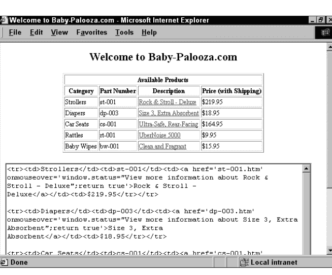

**图 11-1**
*显示动态生成 HTML 的购物车*

### 动态创建 JavaScript

现在，如果你能动态创建 HTML，你应该也能动态创建 JavaScript，对吧？是的，你可以。但是，在动态创建一段 JavaScript 代码时，有一个主要的"陷阱"需要注意。

当你输出 `<script>` 和 `</script>` 标签时，你*永远不应该*将这些标签作为完整的字符串输出。也就是说，你永远不应该编写这样的代码：

```
document.write( "<script>");
document.write( "</script>");
```

如果你这样做，HTML 和 JavaScript 解释器将会变得极度混乱。它们实际上会认为你正在当前脚本块内部开始一个新的脚本块。由于这是绝对不允许的，你会收到一个错误对话框，或者你的代码会在没有明显原因的情况下停止执行。

这个问题的解决方案实际上非常简单，只需在你的 document.write() 调用中将"标签"拆分即可，像这样：

```
document.write("<scrip" + ">");
document.write("<" + "/script>");
```

通过像这样拆分这些字符串，你可以防止 HTML 和 JavaScript 解释器将其误认为是 HTML 标签。动态生成 JavaScript 代码的这种能力是一个非常强大的特性，所以我将在 Session 20 和 23 中更详细地讨论它。

## 复习

在本节中，你学习了如何使用 JavaScript 动态创建 HTML 代码。你看到了如何生成链接和其他 HTML 控件，这些控件经过自定义以反映你向用户展示的信息。你还学习了如何使用文本区域控件来显示 JavaScript 动态创建的 HTML。最后，你了解到 JavaScript 也可以动态生成更多的 JavaScript 代码，但在生成新的 `<script></script>` 标签时可能会出现问题。

## 自我测验

1. 动态创建的 HTML 和 DHTML 之间有什么区别？（参见本节的开头段落。）
2. HTML 解析器如何看待 document.write() 调用的输出？（参见"动态创建 HTML"。）
3. 为什么你想将 HTML 标签存储在 JavaScript 变量中？（参见"在字符串变量中存储 HTML 标签"。）
4. 你可以用 JavaScript 动态创建哪些类型的 HTML 元素？（参见"创建自定义控件"。）
5. 为什么你不应该编写 document.write("<script>") 这样的语句？（参见"动态创建 JavaScript"。）


# 第 12 节 使用 HTML 表单

## 本节清单

- 了解 JavaScript 表单对象
- 理解 JavaScript 如何与 HTML 表单和输入控件交互

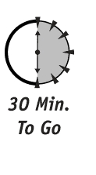

表单是 Web 上几乎所有活动的基础。例如，当你的用户订阅电子邮件通讯或购买新电脑时，你需要向他们展示一个表单才能完成任务。因此，要构建一个真正有效的网站，你必须了解如何使用 HTML 表单和 JavaScript 表单对象。

## 表单对象与 `<form>` 标签的关系

到现在，你应该对表单对象是什么有了一个相当好的认识。它就是一个代表一组 HTML `<form></form>` 标签的 JavaScript 对象。正如你在第 9 节中看到的，document 对象实际上包含一个表单对象数组，它有一个巧妙的名字叫 forms。在 HTML 文档被加载和解析之后，这个数组将为 HTML 文档中的每组 `<form></form>` 标签包含一个表单对象。以下代码展示了一个包含三个表单对象的简单 HTML 文档：

```
<html>
<body>
<form></form>
<form></form>
<form></form>
</body>
</html>
```

这将创建一个包含三个条目的 forms 数组。由于 forms 数组是 document 对象的一个属性，你可以像这样引用这些表单对象：

```
var firstForm = document.forms[0];
var secondForm = document.forms[1];
var thirdForm = document.forms[2];
```

### 给它一个名字

如果你不想通过编号来引用表单，你也可以给每个表单对象一个名称。例如，假设我刚才定义的简单 HTML 文档，我可以编写这样的代码：

```
document.forms[0].name = "formZero";
```

在这里，我只是将一个字符串赋给了 forms 数组中第一个条目的 name 属性。然后我可以像这样访问这个表单对象：

```
var firstForm = document.formZero;
```

能够分配名称很好，但你也可以在 HTML 文档中为表单对象指定名称，如下所示：

```
<html>
<body>
<form name="formZero"></form>
<form name="formOne"></form>
<form name="formTwo"></form>
</body>
</html>
```

当这个 HTML 文档被解析时，生成的 JavaScript 表单对象将自动将其 name 属性设置为每个 `<form>` 标签的 name= 属性中指定的名称。然后你可以像这样访问这些表单对象：

```
var firstForm = document.formZero; // 等同于 document.forms[0]
var secondForm = document.formOne; // 等同于 document.forms[1]
var thirdForm = document.formTwo; // 等同于 document.forms[2]
```

### **名字里有什么？**

这里需要注意的一点是，我给表单对象起的名字都是有效的 JavaScript 变量名。虽然这不是绝对必要的，但确保你只使用有效的 JavaScript 变量名作为表单对象以及其他基于 HTML 的对象的名称，这是一个非常好的做法。为什么呢？请考虑以下情况：

```
<html>
<body>
<form name="form Zero"></form>
<form name="form One"></form>
<form name="form Two"></form>
</body>
</html>
```

由于 HTML 对属性可以使用的值没有任何限制，这三个 name 属性完全是有效的 HTML。然而，如果我试图在 JavaScript 中使用这些名称，我就必须编写这样的代码：

```
var firstForm = document.form Zero;
var secondForm = document.form One;
var thirdForm = document.form Two;
```

不幸的是，这些语句都不会起作用，因为 JavaScript 解释器在处理每个名称中间的空格时会非常困难。因此，访问这些表单对象的唯一方法只能通过 forms 数组。这个故事的寓意是，如果你打算给 HTML 文档中的元素命名，尽量使用也是有效的 JavaScript 变量名的名称！

### **控件与表单对象的关系**

当你在 HTML 页面上构建一组 `<form></form>` 标签时，你很少会将其留空。在大多数情况下，你会用文本框、复选框、弹出

用户可以直接与之交互的菜单和其他控件。这些控件中的每一个都有一个或多个对应的HTML标签来定义。当HTML文档被浏览器加载和解析时，这些标签会导致相应的JavaScript对象被创建。正如你现在可能预料到的那样，这些控件对象可以在与它们关联的form对象内找到。例如，看看下面这个HTML文档。

```
<html>
<body>
<form name="formZero">
    <input type="text" name="userName">
</form>
<form name="formOne">
    <textarea name="address"></address>
</form>
<form name="formTwo">
    <input type="checkbox" name="spamMe">Add me to your mail list
</form>
</body>
</html>
```

在这里，我再次定义了三个form对象。然而，这些form对象中的每一个现在都包含一个表示表单内控件的对象。与我的表单类似，我为每个控件指定了一个name属性。因此，如果我想访问这些对象，我可以简单地编写如下代码：

```
var uNameObject = document.formZero.userName;
var addressObject = document.formOne.address;
var spamMeObject = document.formTwo.spamMe;
```

在这些语句执行之后，我创建的新变量将持有表示我三个表单中控件的对象。

假设你将那个HTML文档加载到Web浏览器中，并在userName文本框中输入你的名字。你实际上如何检索那个值？实际上，这做起来相当简单。

你可以在表单中创建的每种类型的控件都有一个对应的JavaScript对象类型。虽然这些对象确实有些不同，但它们都遵循相同的基本格式。特别是，它们都有一个名为value的属性。这个属性包含控件当前设置的值。控件值的概念因控件类型的不同而异，但在文本框或文本区域的情况下，value属性将持有当前在浏览器窗口中键入到控件中的字符串。因此，如果我想提取用户名，我可以编写如下代码：

```
var uNameString = document.formZero.userName.value;
```

同样，如果我想设置用户名，我可以编写如下代码：

```
document.formZero.userName.value = "John Doe";
```

在大多数情况下，这就是你使用JavaScript获取和设置任何HTML控件值的方式。然而，正如我之前所说，每种类型的控件对象都有一套略有不同的属性和方法，允许你做远不止获取或设置其值的事情。因此，我将在下一节详细介绍每种类型的控件。

## 深入了解form对象

form对象远不止name属性那么简单。以下是详细的属性和方法，它们将让你完全控制HTML页面上的表单。（一如既往，你可以在你CD-ROM上的Session12文件夹中找到这些属性和方法的示例程序。）

### form对象的属性

`<form>`标签有许多不同的属性，你可以设置它们来控制其行为。form对象有与这些属性对应的属性，这样你就可以从JavaScript中使用它们。

#### action属性

这个属性持有一个Web地址，告诉浏览器当用户点击提交按钮时将表单发送到哪里。这个属性的初始值取自`<form>`标签的action=属性。例如，给定以下HTML定义

```
<form name="orderForm" action="processOrder.cgi"></form>
```

document.orderForm.action的值将是"processOrder.cgi"。如果你给这个属性分配一个新的Web地址，那么当表单的提交按钮被点击时，表单将被发送到那个新地址。

#### elements数组

虽然能够使用名称直接访问控件很好，但有时你可能希望以更自动化的方式处理你的控件。

也有可能你的控件没有名称，或者它们的名称不是有效的JavaScript变量名。对于这些情况，form对象提供了`elements`数组。

`elements`数组是一个包含表单中定义的所有控件对象的数组。你可以通过两种方式访问这个数组中的项目：通过索引号或通过名称。例如，看看下面的表单定义。

```
<form name="myForm">
    First Name:<input type="text" name="fname"
    value="Maia" /><br />
    Last Name:<input type="text" name="last name"
    value="Disbrow" /><br />
    Favorite Food:<input type="text" name="favorite food"
    value="Bananas" />
</form>
```

在这个表单中，我定义了三个控件。其中两个控件的名称根本不是有效的JavaScript变量名。然而，我可以很容易地通过使用`elements`数组来访问这些控件。通过`elements`数组中的索引访问控件就像任何其他数组访问一样：

```
for (x=0; x<document.myForm.elements.length; x++) {
    document.write( document.myForm.elements[ x].name);
    document.write( " contains ");
    document.write( document.myForm.elements[ x].value);
    document.write( "<br />");
}
```

然而，如果我想使用控件的名称，我也可以这样做：

```
document.write( document.myForm.elements[ "fname"].name);
document.write( " contains ");
document.write( document.myForm.elements[ "fname"].value);
document.write( "<br />");
document.write( document.myForm.elements[ "last name"].name);
document.write( " contains ");
document.write( document.myForm.elements[ "last name"].value);
document.write( "<br />");
document.write( document.myForm.elements[ "favorite food"].name);
document.write( " contains ");
document.write( document.myForm.elements[ "favorite food"].value);
```

在这种情况下，`elements`数组的行为就像一个带有命名槽的数组...因为它就是！

#### encoding属性

这个属性等同于`<form>`标签中的`enctype=`属性。这个属性告诉Web浏览器当按下提交按钮时应使用哪种编码方案来传输表单数据。

> 关于编码类型的讨论超出了本书的范围，但你可以在万维网联盟的网站上找到完整的讨论。从以下链接开始你的研究：

www.w3.org/TR/html4/interact/forms.html#form-content-type

##### length属性

这个属性告诉你`form`对象中有多少个控件。这本质上与表单elements数组的`length`属性相同。

#### method属性

这个属性与`<form>`标签中的`method=`属性相同。这个属性告诉浏览器在点击提交按钮后发送表单数据时应使用哪种方法（post或get）。

##### name属性

正如你在本节中已经看到的，name属性与`<form>`标签的`name=`属性相同。

#### target属性

这个属性对应于`<form>`标签中的`target=`属性。这个属性让你指定一个浏览器窗口或框架的名称，用于显示表单提交的结果。例如，如果你的`<form>`标签如下所示

```
<form target="resultWindow">
```

当用户提交表单时，一个内部名称为"resultWindow"的新浏览器窗口将打开，并且表单提交的结果将显示在该窗口中。（如果名为"resultWindow"的浏览器窗口已经存在，它将被带到前面，并且提交结果将显示在那里。）

### form对象的方法

form对象还有几个方法，允许你触发表单可以执行的各种操作。这些方法使得自动化大多数表单操作变得容易。

#### reset()方法

当用户点击表单的重置按钮时，Web浏览器会触发一个onreset事件（如第10节所示），并将表单中的控件重置为其默认值。如果你想从JavaScript程序中重置表单，调用该表单的reset()方法与点击表单的重置按钮完全相同。事实上，以下控件定义具有相同的效果：

```
<input type="reset" value="Reset" />
<input type="button" value="Reset" onclick="document.formName.reset()" />
```

当然，简单地定义一个实际的重置按钮更容易，但使用reset()方法让你对重置表单的过程有更多控制。通过使用reset()方法，你作为程序员可以决定表单何时应该被重置。

#### submit()方法

reset()方法模拟点击重置按钮，而submit()方法模拟点击表单的提交按钮。调用submit()方法几乎完全与等待你的用户点击提交按钮相同，但有一个区别。当用户点击提交按钮时，会触发一个onsubmit事件。然而，当你的JavaScript程序调用submit()方法时，不会生成onsubmit事件。

这实际上非常有道理。onsubmit事件旨在让你的程序有机会在表单提交之前验证表单中的数据。但是，如果你显式调用submit()方法，你已经处于JavaScript程序的中间。因此，在尝试调用submit()方法之前，你应该已经验证了表单的数据。

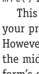


## 第12课 — 使用HTML表单

在本课中，你了解了JavaScript的form对象以及它与HTML `<form>` 标签的关系。你学习了 `form` 对象的属性和方法，以及如何利用它们来控制表单的行为。你还了解了表单中定义的控件与 `form` 对象之间的关系，以及如何通过控件名称或 `elements` 数组来访问这些控件。

## 自测

1. `form` 对象存储在 `document` 对象的哪里？（参见"form对象与 `<form>` 标签的关系"。）
2. 为什么应该始终为表单和控件命名？（参见"给它一个名字"。）
3. 哪个属性保存了屏幕上控件的当前值？（参见"form对象内部"。）
4. 如何使用 `elements` 数组来获取名称不是有效JavaScript变量名的控件？（参见"elements数组"。）
5. 调用表单的 `submit()` 方法时会发生什么？什么 *不会* 发生？（参见"submit()方法"。）

# 第13课 — 使用HTML控件

### 课程清单

- ✅ 学习如何结合JavaScript使用HTML控件

既然你已经了解了如何在JavaScript中使用表单，接下来该学习如何从JavaScript中使用每个HTML控件的具体细节了。你会看到，大多数控件都非常容易使用。你只需响应一两个事件，或者通过获取或设置控件的value属性来确定其当前状态即可。然而，某些控件（如选择列表）需要更多的工作才能有效使用。

### 使用按钮

按钮可能是你能定义的最简单的HTML控件。然而，按钮对你的JavaScript程序可以非常有用。通过为按钮定义一个 `onclick` 处理程序，你可以让该按钮触发JavaScript代码执行任意数量的操作。正如你在第10课中看到的，你可以像这样为按钮定义一个 `onclick` 处理程序：

```html
<input type="button" value="On Screen Button Name"
onclick="handler()" />
```

这样，当用户点击按钮时，handler函数就会被执行。（记住，事件处理程序不一定是一个函数调用，它可以是直接写在控件HTML定义中的一条或多条JavaScript语句。有关创建事件处理程序的详细信息，请回顾第10课。）

你会注意到，与我在第12课中给出的建议相反，我没有给这个示例按钮设置 `name=` 属性。如果需要，你 *可以* 给按钮命名，但通常没有必要。你想给控件命名的主要原因是想在其中存储数据。命名只是让数据的检索更加方便。对于按钮来说，按钮的 `value` 属性实际上会作为用户在按钮中看到的文本显示在屏幕上。因此，更改按钮的 `value` 并不是一个好主意。不过，如果你需要轻松区分各个按钮，可以给每个按钮命名。（例如，一个可能被多个按钮调用的函数可能需要知道具体是哪个按钮调用了它。）

除了上面所示的简单按钮之外，还有两种特殊按钮：提交按钮和重置按钮。这些按钮在HTML表单中有预定义的角色，因此它们实际上不支持 `onclick` 处理程序（或任何其他类型的事件处理程序）。

虽然你无法直接在这些按钮的定义中编写事件处理程序，但它们仍然会生成可以被JavaScript代码捕获的事件。当用户点击表单的提交按钮时，会生成一个 `onsubmit` 事件。同样，当用户点击表单的重置按钮时，会生成一个 `onreset` 事件。正如你在第10课中看到的，你不是在按钮本身中指定这些事件的处理程序，而是在 `<form>` 标签中指定。

```html
<form onsubmit="return doSubmit()" onreset="return doReset()">
    <!-- other controls go here -->
    <input type="submit" value="Submit This Form" />
    <input type="reset" value="Reset This Form" />
</form>
```

当 `onsubmit` 处理程序被调用时，你的程序就有了一个绝佳的机会来检查表单中的数据是否有效或无效。数据验证本身是一个重要的话题，所以我将在第15课中详细讨论。

### 使用复选框

使用复选框和使用按钮几乎一样简单。不过有一些重要的区别。例如，来看一下下面这个简单复选框的HTML定义：

```html
<input type="checkbox" name="overnight" value="Y" checked /> Overnight shipping?<br />
```

首先要注意的是，将显示在此复选框旁边的文字标签（"Overnight shipping"）并不是在标签本身中定义的。它只是出现在标签之后的一串字符。（标签也可以放在标签之前；这取决于你希望表单如何布局。）这意味着我们的value属性可以保存实际数据。在这个例子中，数据是一个字符"Y"。

虽然我给复选框设置了一个值，但这个值只有在复选框实际被选中时才是有效的。这里我说的"有效"是指"逻辑上"有效。也就是说，这个复选框的value属性将始终是"Y"，但如果复选框没有被选中，用户显然不希望与此选项有任何关系。因此，我将忽略复选框中保存的任何值。

那么问题就变成了，"如何知道复选框是否被选中？"这就是checked属性的作用。这是一个布尔属性，简单地告诉你复选框是否被选中。如果checked为true，则复选框被选中。如果为false，则复选框未被选中。你甚至可以给这个属性赋值，屏幕上的复选框外观会相应地改变。

> 如果复选框未被选中，而你提交了它所在的表单，则不会向服务器发送关于该复选框的任何信息。也就是说，复选框的名称和值都不会传输到表单提交时被调用的服务端程序。只有在复选框实际被选中时，才会传输复选框信息。

和按钮一样，复选框在被点击时也会生成onclick事件。这让你的程序有机会在用户选中或取消选中复选框时立即重置表单的其他部分。在复选框中使用onclick处理程序的技巧在于记住，onclick处理程序的代码是在复选框在屏幕上被选中或取消选中 *之后* 才被调用的。以下代码展示了复选框所有这些方面协同工作的效果。

```html
<script language="javascript">
function doStandard() {
    if (document.delivery.standard.checked) {
        // turn off overnight check box
        document.delivery.overnight.checked = false;
    }
}
function doOvernight() {
    if (document.delivery.overnight.checked) {
        // turn off standard check box
        document.delivery.standard.checked = false;
    }
}
</script>
<form name="delivery">
    Select a Delivery Method<br />
    <input type="checkbox" name="standard" value="Y"
           onclick="doStandard()" /> Standard Shipping<br />
    <input type="checkbox" name="overnight" value="Y"
           onclick="doOvernight()" /> Overnight shipping?<br />
</form>
```

在这个示例中，我定义了两个复选框。一个代表标准配送，另一个代表隔夜配送。每个复选框都有一个onclick处理程序，在该复选框被点击时触发。每个处理程序的结构相似，所以我只讲解标准配送复选框的处理程序。

当标准复选框被点击时，doStandard()函数执行。它首先检查标准复选框的checked属性。如果checked为true，则将隔夜复选框的checked属性赋值为false。此时，隔夜复选框会立即在屏幕上变为未选中状态。

另一种设置复选框的方式是调用其click()方法。这将切换复选框的状态，就像它被点击了一样。使用click()方法（而不是简单地给checked属性赋true值）的好处在于，该方法还会为复选框触发onclick事件。

复选框还支持onblur和onfocus事件（以及相应的blur()和focus()方法来模拟这些事件）。有关这些事件的更多信息，请务必参考第10课。

最后，如果你需要知道复选框最初是否被选中，可以检查其defaultChecked属性。如果该属性为true，则复选框在HTML文件首次加载时是被选中的。如果该属性为false，则复选框最初未被选中。

### 使用文件上传控件

如果你不熟悉HTML文件上传控件，不用担心。很少有人知道它的存在，更不用说如何使用它了。基本上，文件上传


### 使用单选按钮

之前你看到的复选框示例确保了同一时间只有一个复选框被选中。这种行为类似于另一种HTML控件——单选按钮所表现出的行为。单选按钮实际上与复选框非常相似。事实上，你可以把单选按钮看作一组相关的复选框。区别在于，在任何给定时刻，这些复选框中只能有一个被选中。开启一个单选按钮的简单操作就会关闭所有与之相关的其他单选按钮。

一组相关的单选按钮被称为*族*。你只需将族中所有单选按钮赋予完全相同的名称，即可创建一个单选按钮族。例如，我之前定义的复选框可以重新定义为如下所示的单选按钮族：

```
<input type="radio" name="dMethod" value="standard" checked />
Standard Shipping<br />
<input type="radio" name="dMethod" value="overnight" /> Overnight
Shipping<br />
```

这里，我创建了两个单选按钮，并将它们都放入名为"dMethod"（即"delivery method"的缩写）的族中。现在，当一个单选按钮被选中时，另一个将自动取消选中。（Web浏览器会处理所有的选中和取消选中操作。你的JavaScript程序无需做任何处理。）

需要注意的另一点是，每个单选按钮的值所保存的信息直接反映了该复选框背后的含义。因此，如果"Standard Shipping"复选框被选中，整个单选按钮族的"逻辑"值就是"standard"。

不幸的是，虽然一个单选按钮族可以被认为具有一个等于所选单选按钮值的逻辑值，但并没有一个单选按钮方法可以告诉你族中哪个单选按钮被选中。要确定哪个单选按钮被选中，你必须检查族中每个单选按钮的checked属性，直到找到值为true的那个。

如何做到这一点呢？毕竟，一个族中的每个单选按钮都有完全相同的名称，那你如何区分它们呢？实际上，这相当容易做到，因为当你创建一个单选按钮族时，JavaScript解释器会创建一个数组来保存族中每个单选按钮的信息。因此，在上面的示例中，dMethod[0]是"Standard Shipping"按钮，dMethod[1]是"Overnight Shipping"按钮。

> 当你提交包含单选按钮族的表单时，该族传输的值是与所选单选按钮关联的值（即，族中其他单选按钮的值不会被发送到服务器）。

同样，与复选框一样，单选按钮可以拥有*onclick*处理程序。因此，了解了所有这些内容后，处理一个单选按钮族实际上是一件相当简单的事情：

```
function doDelivery() {
    var dLen = document.delivery.dMethod.length;
    for (x=0; x < dLen; x++) {
        if (document.delivery.dMethod[x].checked) {
            methodValue = document.delivery.dMethod[x].value;
            alert("You have selected " + methodValue + " shipping");
            break;
        }
    }
}
</script>
<form name="delivery">
    Select a Delivery Method<br />
    <input type="radio" name="dMethod" value="standard"
           onclick="doDelivery()" checked /> Standard Shipping<br />
    <input type="radio" name="dMethod" value="overnight"
           onclick="doDelivery()" /> Overnight Shipping<br />
</form>
```

这里，我为单选按钮定义添加了一个onclick处理程序。由于这些单选按钮都属于同一个族，它们各自调用相同的事件处理程序。（注意它们不必调用相同的onclick处理程序，但同一族中的单选按钮使用不同的onclick处理程序是很少见的。）

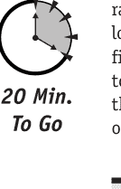

当处理程序开始执行时，它做的第一件事是确定保存单选按钮族的数组的长度。（这告诉它族中有多少个单选按钮。）此时，只需使用for循环检查数组中每个单选按钮的checked属性，直到找到值为true的那个。此时，它可以从该单选按钮中提取值，并在alert窗口中显示。`break`语句终止循环，这样它就不会花费时间去检查剩余的单选按钮。（记住，一个族中只能有一个单选按钮被选中。）

### 其他单选按钮技巧

如前所述，单选按钮和复选框有很多共同之处。与复选框一样，你可以将true赋值给单选按钮的checked属性，该单选按钮就会被选中。（同时族中所有其他单选按钮将自动取消选中。）

你也可以使用`click()`方法来模拟鼠标点击单选按钮，还可以使用`defaultChecked`属性来判断HTML文档加载时该单选按钮是否被选中。

而且，就像复选框一样，单选按钮也会接收`onblur`和`onfocus`事件（并拥有对应的`blur()`和`focus()`方法）。

### 使用选择列表

可用的最有用的HTML控件之一就是选择列表。选择列表让你可以向用户展示一个供他们选择的项目菜单。在进一步讨论之前，先来看一个简单选择列表的HTML定义。

```
Select a Product<br />
<select name="products" size="1">
    <option value="st-001">Rock & Stroll - Deluxe</option>
    <option value="dp-003">Size 3, Extra Absorbent</option>
    <option value="cs-001">Ultra-Safe, Rear-Facing</option>
    <option value="rt-001">UberNoise 5000</option>
    <option value="bw-001">Clean and Fragrant</option>
</select>
```

在这个示例中，我定义了一个包含五个项目的选择列表。（每组<option></option>标签定义一个单独的菜单项。）这些项目分别对应Baby-Palooza.com库存中的一种产品。如你所见，我将每个产品的部件号放入每个option的value=属性中，并使用产品描述来指定当该选项加载到Web浏览器中时在选择列表中显示的文本。虽然这是一个相当简单的选择列表，但它本身就是一个非常复杂的控件。那么问题就变成了："JavaScript如何与这个控件交互？"

#### select对象

如你所料，浏览器对象模型定义了一个名为Select对象的JavaScript对象。该对象拥有多个属性和方法，使你可以直接与HTML表单中定义的选择列表进行交互。

##### length属性

它告诉你选择列表中定义了多少组<option></option>标签。

##### name属性

这是在`<select>`标签的name=属性中指定的名称。


##### options 数组

这是一个 Option 对象的数组。数组中的每一项直接对应 select 列表中的一组 `<option></option>` 标签。理解 `options` 数组是与 select 列表打交道关键，因此我将在稍后更详细地讨论它。

##### selectedIndex 属性

该属性保存着 `options` 数组中选中项的数字索引。因此，如果用户选择了列表中的第一项，`selectedIndex` 属性的值将为零。（请记住，JavaScript 数组索引从零开始。）如果列表中没有选中任何项，该属性将包含负一（-1）。

##### blur() 和 focus() 方法

这两个方法分别用于移除 select 列表的焦点和取得 select 列表的焦点。它们还会为 select 列表生成相应的 `onblur` 和 `onfocus` 事件。

##### click() 方法

与你见过的其他控件一样，这会模拟在 select 列表上的鼠标点击。

##### onchange 事件

select 列表还定义了一个额外的事件：`onchange` 事件。当用户实际更改列表中的选择时，此事件触发。如果用户点击了列表，但没有更改选择，该事件永远不会触发。将其与 `onclick` 事件相比，后者无论列表中的选择是否更改都会触发。（还要注意，旧版本的 Netscape Navigator 根本不支持将 `onclick` 事件用于 select 列表，它们只支持 `onchange` 事件。）

#### 理解 Options 数组

正如我所说，`options` 数组是与 select 列表打交道的关键。因为它是一个数组，所以 `options` 数组具有 `length` 属性（它告诉你的信息与 Select 对象的 `length` 属性相同）。`options` 数组中的每一项都是一个 JavaScript Option 对象，每一个都代表一组 `<option></option>` 标签。每个单独的 Option 对象具有以下属性：

##### defaultSelected 属性

该属性保存一个布尔值，告诉你相应的菜单项是否默认被选中——也就是说，当 Web 浏览器首次加载 HTML 文件时。

##### selected 属性

这是一个布尔值，告诉你相应的菜单项当前是否被选中。如果为 `true`，则菜单项被选中；如果为 `false`，则菜单项未被选中。

##### text 属性

这是一个字符串对象，保存你在 `<option>` `</option>` 标签之间定义的文本。例如，在定义 `<option value="rt-001">UberNoise 5000</option>` 中，该 Option 对象的 `text` 属性将是字符串 "UberNoise 5000"。需要注意的是，你可以为此属性分配新值，从而有效地更改该菜单项显示的文本。

##### value 属性

与你见过的其他标签一样，此属性保存原始标签中 `value=` 属性的内容。主要区别在于，由于每个 Option 对象都有自己的 value 属性，因此 select 列表可以保存许多不同的可能值。

> 当你提交包含 select 列表的表单时，只有与选中菜单项关联的值才会传输到服务器。如果 select 列表允许多选，则所有选中项的值都会传输。

### 简单的 select 列表示例

由于 `options` 数组就是数组，你可能认为与 select 列表交互的最简单方式是简单地遍历 `options` 数组中的所有项，直到找到 `selected` 为 `true` 的项。你可以这样做，但不要忘记 `selectedIndex` 属性。由于此属性已经包含选中菜单项的索引号，你可以使用它直接跳转到感兴趣的菜单项。（此代码来自你 CD-ROM 上的 `selectList.htm` 文件。）

```
<script language="javascript">
function doProductPick() {
    var si = document.order.products.selectedIndex;
    var partNo = document.order.products.options[ si].value;
    var desc = document.order.products.options[ si].text;
    alert("You selected part number "+ partNo +", '"+ desc + "'");
    }
</script>
<form name="order">
    Select a Product<br />
    <select name="products" size="1" onchange="doProductPick()">
        <option value="st-001">Rock & Stroll - Deluxe</option>
        <option value="dp-003">Size 3, Extra Absorbent</option>
        <option value="cs-001">Ultra-Safe, Rear-Facing</option>
        <option value="rt-001">UberNoise 5000</option>
        <option value="bw-001">Clean and Fragrant</option>
    </select>
</form>
```

在此代码中，我在 select 列表定义中添加了一个 onchange 处理程序。因此，当用户更改列表中的选中项时，onchange 事件将触发，我的处理函数将被调用。当处理函数执行时，它首先检索保存在 select list 的 selectedIndex 属性中的值。然后，我可以使用此信息直接访问我的 select 列表中选中项的 value 和 text 属性，并将该信息汇报给用户。

### 选择列表中的项

正如你刚才所见，从 select 列表读取信息实际上非常简单。但是，如果你想实际导致列表中的某项被选中呢？你的第一冲动可能是为列表的 selectedIndex 属性分配一个新值。然而，这实际上不会发生任何效果。相反，你需要为你想要被选中的 Option 对象的 selected 属性分配一个 true 值。以下代码片段来自 selectAnOption.htm 文件，展示了你可能这样做的一种方式。

```
function pickNext() {
    var si = document.order.products.selectedIndex;
    if (si == (document.order.products.length - 1)) {
        next = 0;
            }
            else {
                next = ++si;
            }
            document.order.products.options[ next].selected = true;
        }
        function pickPrev() {
            var si = document.order.products.selectedIndex;
            if (si == -1) {
                si = 0;
            }
            if (si == 0) {
                next = (document.order.products.length - 1);
            }
            else {
                next = --si;
            }
            document.order.products.options[ next].selected = true;
        }
    </script>
    <form name="order">
        Select a Product<br />
        <select name="products" size="5">
            <option value="st-001">Rock & Stroll - Deluxe</option>
            <option value="dp-003">Size 3, Extra Absorbent</option>
            <option value="cs-001">Ultra-Safe, Rear-Facing</option>
            <option value="rt-001">UberNoise 5000</option>
            <option value="bw-001">Clean and Fragrant</option>
        </select><br />
        <input type="button" value="Next" onclick="pickNext()" />
        <input type="button" value="Previous" onclick="pickPrev()" />
    </form>
```

如果将此示例文件加载到 Web 浏览器中，然后点击 "Next" 和 "Previous" 按钮，你会看到随着点击按钮，选中项会发生变化。另外需要注意的一点是，当此 select 列表首次加载到 Web 浏览器中时，默认情况下不会有任何项被选中。这意味着 Select 对象的 selectedIndex 属性将为负一。因此，我必须在 pickPrev() 函数的代码中显式检查该情况。

虽然此示例不包含 onchange 处理程序，但需要注意的是，当你以这种方式选择菜单项时，*不会*生成 onchange 事件！（因此，如果你需要完全复制 onchange 事件，则必须在选择新菜单项后调用你的 onchange 事件处理程序。）

### 多选列表

迄今为止，你见过的所有示例都涉及单选列表。也就是说，一次只能选中一项的列表。然而，HTML 提供了另一种选择列表：多选列表。顾名思义，在多选列表中，用户可以从列表中选择任意多项。在 HTML 中，两者之间的唯一区别是在 select 列表定义中添加了 "multiple" 属性。然而在 JavaScript 中，差异则更为显著。

### selectedIndex 属性与多选列表

首先，在多选列表中，selectedIndex 属性的作用变得更加重要。在单选列表中，遇到没有选中项的列表的可能性相当低。如果列表的 HTML 定义指定了初始选中项，或者用户选择了一项，那么该列表将始终有一项被选中。然而在多选列表中，用户可以根据需要选择或取消选择任意多项。因此，完全可能出现没有任何选中项的列表。正因为如此，在对多选列表执行任何操作之前，你都应该始终检查 selectedIndex 属性。如果值为负一（-1），你就知道列表中没有选中任何项，并可以相应地采取行动。

如果 selectedIndex 的值不是负一，那么你就知道列表中至少有一项被选中。然而在这种情况下，selectedIndex 属性只告诉你列表中*第一个*被选中项的索引。确定其他选中项是什么则取决于你。以下代码来自你 CD-ROM 上的 multipleSelectList.htm 文件。它展示了一个典型的多选列表以及你可能如何使用它。

```
function showSelected() {
    var si = document.order.products.selectedIndex;
    if (si == -1) {
        alert("No items are selected!");
    }
    else {
```


 ```javascript
var report = "You have selected: \n";
var partNo = "";
var desc = "";
for (x=si; x < document.order.products.length; x++) {
    if (document.order.products.options[ x].selected) {
        partNo = document.order.products.options[x].value;
        desc = document.order.products.options[x].text;
        report += partNo + " - " + desc + "\n";
        }
    }
alert( report);
}
</script>
<form name="order">
    Select a Product<br />
    <select name="products" size="5" multiple>
        <option value="st-001">Rock & Stroll - Deluxe</option>
        <option value="dp-003">Size 3, Extra Absorbent</option>
        <option value="cs-001">Ultra-Safe, Rear-Facing</option>
        <option value="rt-001">UberNoise 5000</option>
        <option value="bw-001">Clean and Fragrant</option>
    </select><br />
    <input type="button" value="Show All Selected"
    onclick="showSelected()" />
</form>
```

从本例可以看出，处理多选列表其实并不太难。关键是在尝试操作列表之前立即检查 `selectedIndex` 属性。如果发现至少有一项被选中，我就进入一个简单的 for 循环来检查列表中的每一项。（不过请注意，for 循环从 `selectedIndex` 属性报告的索引号开始工作。这样可以跳过列表顶部未选中的项目。）

### **在下拉列表中添加或删除选项**

在本节中，我要告诉你的最后一点关于下拉列表的信息是如何在下拉列表中添加和删除项目。没错；JavaScript 允许你向下拉列表添加新项目，或者从列表中删除旧项目。

要从下拉列表中删除一项，只需将 `null` 值赋给包含要删除项目的 `options` 数组元素即可。这将从列表中删除该项目，并将所有位于其下方的项目上移以填充新空出的空间。

添加项目则稍微复杂一些。它需要两个步骤：

- 1. 使用 Option 对象的构造函数方法创建一个新的 Option 对象。（记住，我们在第 6 节中讨论过构造函数方法。）
- 2. 将这个新的 Option 对象赋给你希望新项目出现的下拉列表的 `options` 数组的末尾。

Option 对象的构造函数方法实际上非常简单。你最多可以给它传递四个参数，它会返回一个新的 Option 对象，你可以将其添加到下拉列表的末尾。这些参数按必须出现的顺序是：

- 1. text：这是添加新项目时你希望在菜单中显示的文本。
- 2. value：这将被放入新项目的 `value` 属性中。
- 3. defaultSelected：这用于设置新项目的 `defaultSelected` 属性。
- 4. selected：这告诉 JavaScript 解释器新项目被放入下拉列表时是否应该被选中。

所有这些参数都是可选的，但你通常至少应该提供前两个。（如果你不提供任何参数，可以在创建新的 Option 对象后设置相应的属性。）

addRemoveOptionsSelectList.htm 文件向你展示了如何使用这些方法来创建动态下拉列表。（请务必在 HTML 编辑器中打开此文件，以便你能跟上接下来段落的内容。）查看该文件的 HTML 部分，你会看到我有两个下拉列表，一个包含产品信息，另一个是空列表，用于存放用户购物车中的项目。当用户在产品列表中选择一项，然后点击"Add to Cart"按钮时，会调用 `addToCart()` 函数。首先，该函数检查产品列表中是否有被选中的项目。如果没有选中的项目，会显示一个警告窗口，告诉用户先选择一个项目。然而，如果有一个项目被选中，该函数会检索该项目的 `value` 和 `text` 属性，并将它们传递给 Option 构造函数方法以创建一个新的 Option 项目。然后将这个新的 Option 项目赋给我们代表购物车的下拉列表的末尾。这会使新项目立即出现在购物车中。最后，我将 `null` 赋给 products 下拉列表的相应元素，从而从该列表中删除最初被选中的项目。（`removeFromCart()` 的工作方式大致相同。下拉列表的名称被反转，以将选中的项目从购物车移回产品列表。）

### **处理基于文本的控件**

好了，在那之后，你可能想要处理一些更简单的东西。你很幸运，因为现在该谈谈 JavaScript 如何与各种基于文本的 HTML 控件交互了。当我说"基于文本"时，我指的是那些负责处理一行或多行文本的控件。这些包括文本框、文本区域、密码字段和隐藏字段。以下是每种控件的示例：

```
<!-- Text box -->
<input type="text" name="aTextBox" value="Hello World!" />
<!-- Text Area -->
<textarea name="aTextArea" rows="5" cols="60">Howdy
Terra!</textarea>
<!-- Password field -->
<input type="password" name="aPassword" />
<!-- Hidden Field -->
<input type="hidden" name="hiddenField" value="I'm Hidden!" />
```

虽然这些都是不同类型的控件，但 JavaScript 将它们都视为处理文本的控件。因此，你可以用非常相似的方式使用这些控件。

对于基于文本的控件，最有用的事情就是简单地获取或设置其中的文本字符串。由于用户可以直接在所有这些控件中输入（隐藏字段控件除外），这种能力让你有机会直接与用户交互。正如你现在无疑已经猜到的，要获取或设置这些控件中的信息，只需访问该控件的 `value` 属性即可。当你读取 `value` 属性时，你会得到控件中当时显示的文本。当你将字符串赋给 `value` 属性时，你会改变屏幕上该控件的内容。（有关如何使用这些控件的示例，请参阅 textBasedControls.htm 文件。）

### **基于文本控件的提示**

当你处理密码字段时，请记住屏幕上显示的内容将显示为所有星号（*）或其他字符。这是为了防止有人通过偷看别人的肩膀来窃取密码。但是，当你访问密码字段的 `value` 属性时，你会得到密码的实际文本。所以，如果你在屏幕上显示该信息，你就会泄露用户的密码！大多数用户不会喜欢这样，所以处理密码字段时要小心。

### **基于文本控件的事件**

隐藏字段已逐渐成为 HTML 控件的主力军。它们可以包含几乎任何类型的字符串或数字数据，并且它们保存的数据长度仅取决于 Web 浏览器愿意分配给它们的内存量。当你在互联网上浏览 JavaScript 代码时，你会看到很多程序员在隐藏字段中隐藏大量关键信息。所以，请留意这一点。

与大多数其他控件一样，基于文本的控件（隐藏字段除外）支持 `onblur` 和 `onfocus` 事件。基于文本的控件支持的另一个有趣的事件是 `onchange` 事件。当基于文本的控件的内容被更改，然后该控件失去焦点时，此事件就会触发。正如我们将在第 15 节中看到的，这些事件为你的程序提供了对用户输入做出反应并验证他们在你的表单中输入的值的绝佳机会。

### **回顾**

在本节中，你详细了解了 JavaScript 如何与每种类型的 HTML 控件交互。虽然所有控件的工作方式大致相同（通过将真正重要的内容保存在 `value` 属性中），但你知道了每种不同的控件需要你的 JavaScript 代码采取稍微不同的方法。你学习了复选框和单选按钮之间的区别，以及如何使用下拉列表。你还学习了如何使用各种基于文本的控件。在第 15 节中，你将在此基础上进一步学习，了解如何确保用户输入你的表单控件的数据对你的应用程序来说是有效的。

### **自我测验**

- 1. 要检查某个特定的复选框或单选按钮是否被选中，你需要查看哪个属性？（参见"Working with Check Boxes"和"Working with Radio Buttons"）
- 2. 文件上传控件的 `value` 属性中保存的是什么？（参见"Working with the File Upload Control"）


+   3. 究竟什么是单选按钮组？（请参阅"使用单选按钮"）。
    4. `selectedIndex` 属性能告诉你关于选择列表的什么信息？（请参阅"使用选择列表"）。
    5. 如何动态地向选择列表添加新项？（请参阅"在选择列表中添加或删除选项"）。

# 14 图像处理

### 会话清单

- 学习如何使用 JavaScript 控制 HTML 页面上的图像
- 理解 JavaScript Image 对象
- 理解如何创建基于 JavaScript 的翻转按钮和动画


图像传输能力是万维网最受欢迎的方面之一。正因为图像如此流行，它们已经渗透到网络浏览体验的几乎每个部分。例如，大多数网站不再使用 HTML 按钮，而是采用可点击的图像，当你将鼠标移到上面时，这些图像还会发生变化。虽然你可能了解和喜爱所有这些巧妙的小图形技巧，但你可能不知道，JavaScript 正是几乎每一个这种效果背后的力量。在本会话中，你将学习如何使用 JavaScript 与 HTML 文档中的图像进行交互，以及如何创建这些简单的动画来增强你网站上的用户体验。

## 理解 Image 对象

操控 HTML 文档中图像的关键在于 JavaScript 的 Image 对象。当 HTML 文档加载到 Web 浏览器中时，JavaScript 解释器会为它在文档中找到的每个 `` 标签创建一个 Image 对象。它将这些 Image 对象全部放入一个 `images` 数组中（你可以在 document 对象中找到该数组）。如果你不想使用 `images` 数组，可以为每个 `` 标签指定一个 `name=` 属性，从而直接访问你的 Image 对象。例如，假设以下标签是文档中的第一个图像：

```

```

你可以使用 `document.images[0]` 或 `document.happyBaby` 来访问关联的 Image 对象。如果由于某种原因，你无法为图像命名有效的 JavaScript 变量名，你仍然可以通过使用 `images` 数组按名称访问它们，就像你在表单对象中使用 `elements` 数组一样。例如，如果你有一个这样定义的图像：

```

```

你可以使用 images 数组来访问它，如下所示：

```
var poorlyNamedImage = document.images['poorly named'];
```

### Image 对象的属性

既然你已经知道如何访问 Image 对象，接下来你可能想知道在其中能找到什么。（你可以在 CD-ROM 的 Session14 文件夹中找到练习所有这些属性的示例源代码。）

#### border 属性

该属性包含在 `` 标签中为图像设置的边框值。例如，给定此标签，`document.happyBaby` 的 `border` 属性将为 10：

```

```

#### complete 属性

这是一个布尔属性，用于告诉你图像是否已完成加载。

#### height 和 width 属性

这些属性告诉你图片当前的宽度和高度（以像素为单位）。如果你在 `` 标签中指定了 height 和 width 属性，这些属性将反映这些值。如果你没有指定这些属性，这些属性将是图像的实际宽度和高度。注意，图像加载后，你可以为任一属性赋值新值，图像将相应地调整大小。（有关这两个属性的示例，请参阅 CD-ROM 上的 heightNwidthProperties.htm 文件。）

#### hspace 和 vspace 属性

这些表示用于将图像与周围内容隔开的水平和垂直填充量。注意，这些属性可以在图像完成加载后更改，图像将相应地重新定位。（另请参阅下面关于 `vspace` 属性的讨论。）

#### name 属性

这是图像的名称。如果 name 是有效的 JavaScript 变量名，你可以使用它直接访问图像，而不必通过 `images` 数组。

#### src 和 lowsrc 属性

这是应该为该图像加载的图片的网络地址。如果你为该属性赋一个新值，Web 浏览器实际上会加载存储在该地址的图片。这是所有基于 JavaScript 的动画的基础。更多信息，请参阅本会话后面"用 JavaScript 创建翻转效果"和"用 JavaScript 创建动画"部分。

`lowsrc` 属性是图像低分辨率版本的网络地址。如果浏览器在低分辨率设备上运行，将使用此图像而不是由 `src` 属性指定的图像。

### Image 对象事件

正如你在第 10 会话中看到的，`` 标签支持多个事件，使你可以检测图像是否以及何时成功加载。我在这里再次列出它们以确保完整，但你应该返回参考第 10 会话的示例源代码，查看这些事件处理程序实际应用的简单示例。

#### onabort 事件

如果用户停止加载图像，即如果用户在图像完全加载之前单击浏览器的停止按钮，则会触发此事件。

#### onerror 事件

如果在加载图像期间发生错误，则会触发此事件。

#### onload 事件

图像成功加载到浏览器后，会触发此事件。

### 没有 `` 标签的 Image 对象

正如我在本会话开头所说，JavaScript 解释器会为它在 HTML 文档中找到的每个 `` 标签创建一个 Image 对象。但是，如果你愿意，你可以创建没有关联 `` 标签的 Image 对象。你可以使用 Image 对象构造函数来实现这一点，如下所示：

```javascript
var myImage = new Image();
```

此语句将创建一个没有关联 `` 标签的新 Image 对象。此时，你可以通过向其 `src` 属性赋值一个网络地址，将实际的图像文件加载到此 Image 对象中，如下所示：

```javascript
myImage.src = "happyBaby.jpg";
```

当此图片完成加载后，你将获得一个加载了图片的 Image 对象。但是，该图片将*不会*显示在 Web 浏览器中！为了使图像显示在 Web 浏览器中，它*必须*与 HTML 文档中的某个 `` 标签相关联。如果没有这种关联，Web 浏览器根本不知道在哪里绘制图像。假设你刚刚查看的代码已经执行，并且在你的 HTML 文件中有以下 `` 标签：

```

```

如果你执行以下 JavaScript 语句

```javascript
document.babyFace.src = myImage.src;
```

`document.babyFace` 中包含的图形将被 `myImage` 中的图形替换。此外，由于 `document.babyFace` 与 HTML 文档中的 `` 标签相关联，新图形将在 Web 浏览器中替换旧图形！

## 用 JavaScript 创建翻转效果

既然你已经看到一张图形可以替换另一张图形，你可能想知道如何利用这一事实来做一些有用的事情。使用这种技术最简单的事情就是创建所谓的翻转按钮。它们被称为翻转，是因为当你将鼠标移到它们上面时，它们会以某种方式发生变化。效果可以简单到高亮度的变化，或者你完全可以切换到完全不同的图形。

创建翻转按钮的第一步是创建恰好是图像的链接。这很简单，只需用一组 `<a href=""></a>` 标签包围 `` 标签即可。例如，假设我想创建一个"更多信息"图像，让我的用户跳转到包含产品进一步信息的页面。这样一个链接可能看起来像这样：

```
<a href='st-001.htm'></a>
```

这将在 HTML 页放置一个被标准链接包围的图像。当用户点击此图像时，链接将激活，她会跳转到指定页面。

为了创建翻转效果，你必须告诉浏览器在鼠标移到图像顶部时将此图像与另一张图像交换。然后，为了完成翻转效果，你需要在鼠标移开时恢复原始图像。如果你记得在第 10 会话中学到的内容，你可能已经意识到创建这种效果的关键是使用 `onmouseover` 和 `onmouseout` 事件来检测鼠标何时移入和移出图像。

现在，`<a>` 和 `` 标签都支持 `onmouseover` 和 `onmouseout` 事件，所以将这些事件关联到哪个标签实际上取决于个人偏好。创建翻转效果时，我个人更喜欢将事件挂接到 `` 标签。这样，我就在一个标签中创建了一个完整的小动画。例如：

```
<a href='st-001.htm'>
</a>
```

虽然这看起来可能是一段非常复杂的代码，但实际上相当简单。和以前一样，`<a></a>` 标签创建了一个围绕我们 `` 标签的链接。因此，当图像被点击时，用户将跳转到指定页面。


``标签被命名为"stMore"，并通过"src="属性被告知初始加载图形文件moreInfo.jpg。边框属性设置为零，这样图像周围就不会出现边框。

事件处理器是所有操作发生的地方。onmouseover处理器说："当鼠标移到此标签上时，将document.stMore Image对象的src属性更改为moreInfoOn.jpg。"正如您之前所学，当您更改Image对象的src属性时，浏览器实际上会加载指定的图像。如果Image对象与``标签关联（就像这个例子），新图像将替换Web浏览器中的旧图像。

当鼠标移到此图像上时，新图像将被加载并替换旧图像。要完成此效果，只需恢复旧图像即可。

当鼠标移出图像时，onmouseout事件处理器将执行。如您所见，此处理器与onmouseover处理器几乎相同。唯一的区别是此处理器将原始图形重新分配给Image对象的src属性。这迫使浏览器重新绘制原始图形，并完成翻转效果。（请注意，您可以在CD-ROM上的simpleRollover.htm文件中找到此示例的源代码。）

# 使用JavaScript创建动画

到现在为止，您可能已经自己弄清楚如何制作动画了。这只是带有更多图像的翻转效果，对吧？嗯，某种程度上是这样。执行动画时，除了切换图像之外，还需要考虑一些其他事项。首先，您必须决定如何跟踪动画中的所有图像。其次，您必须以某种方式预加载动画中的图像，这样第一次运行时，帧之间就不会出现明显的延迟。最后，您必须决定动画的速度。

### 将动画帧存储在数组中

第一个问题的答案其实很简单：只需将动画的每一帧存储在一个数组中。记住，JavaScript数组可以容纳任何类型的数据，因此构建一个包含一系列Image对象的数组很简单。当然，将图像存储在数组中意味着您将使用数字索引逐帧步进。这反过来意味着您必须以某种顺序将图像加载到数组中。所有这一切的结果是，动画的帧需要存储在一系列文件中，这些文件按帧应播放的顺序编号。例如，如果您有一个三帧动画，您可能会像这样对单个图形文件进行编号：

```
myAnim0.jpg, myAnim1.jpg, myAnim2.jpg
```

（当然，您可以从"1"开始编号，但由于JavaScript从零开始对数组编号，我发现从零开始编号也更容易。）

### 预加载图像

第二个问题是预加载构成动画的图像。解决此问题很简单，只需创建将容纳帧的Image对象，然后将其src属性设置为相应的文件名即可。这将在HTML页面仍在加载到浏览器中时开始加载每一帧。然后，您可以延迟动画的开始，直到最后一帧的complete属性变为true。

### 创建和加载动画帧的示例

此时，最好继续向您展示我到目前为止讨论的内容如何组合在一起。以下代码向您展示如何创建图像数组并开始将所有动画帧加载到其中。

```
var titleFrames = new Array();
var titleNumFrames = 16;
for (x=0; x < titleNumFrames; x++) {
    titleFrames[ x ] = new Image();
    titleFrames[ x ].src = "titleAnim" + x + ".jpg";
    }
```

首先需要注意的是，此代码中没有部分属于函数。事实上，当您查看此代码来自的实际源文件（simpleAnimation.htm文件）时，您会看到这些代码行位于HTML文档顶部的`<script>`块中。因此，这些行在文档加载时立即执行。第一行创建一个名为titleFrames的新Array对象。（此示例的目的是为baby-palooza.com站点创建标题动画，因此所有关联的变量名都以字符串"title"开头。）接下来，我设置一个全局变量，告诉程序动画中有多少帧。在这个例子中，有16帧，命名为titleAnim0.jpg到titleAnim15.jpg。

设置变量后，我进入一个for循环。每次循环，我都会创建一个新的Image对象并将其分配给数组中的下一个槽位。创建Image对象后，我立即将其src属性设置为动画中下一个图像文件的名称。请注意我如何利用JavaScript将字符串与数字连接的能力，在每次循环时生成正确的文件名。每次我为这些src属性之一赋值时，Web浏览器就开始加载指定的图像文件。

### 设置动画时间

现在是时候实际启动和运行动画了。为了正确讨论这是如何完成的，我需要向您展示所有涉及的源代码。所以，这是：

```
<script language="javascript">
var titleFrames = new Array();
var titleNumFrames = 16;
var titleAnimSpeed = 200;
var titleCurrentFrame = 1;
for (x=0; x < titleNumFrames; x++) {
    titleFrames[ x] = new Image();
    titleFrames[ x].src = "titleAnim" + x + ".jpg";
    }
function titleAnimate() {
    if (titleFrames[ titleNumFrames - 1].complete) {
        document.titleAnim.src = titleFrames[
        titleCurrentFrame++].src;
        if (titleCurrentFrame == titleNumFrames) {
            titleCurrentFrame = 0;
            }
        }
    else {
        setTimeout('titleAnimate()', titleAnimSpeed);
        }
    }
</script>

```

在此代码的顶部，您可以看到我指定了另外两个全局变量。第一个，titleAnimSpeed，保存帧之间应延迟的毫秒数。第二个，titleCurrentFrame，告诉程序接下来显示动画的哪一帧。在设置全局变量之后，您会发现将动画帧加载到我的Image对象数组中的for循环。

## 第14节—处理图像

之后是`titleAnimate()`函数。此函数实际上执行动画中的图像交换。我稍后会回到这一点。

最后，您看到实际驱动动画的``标签。我给这个``命名为`titleAnim`，最初加载到其中的图片是titleAnim0.jpg（这是我动画的第一帧）。

那么，``标签如何驱动我的动画呢？嗯，看看为此标签定义的`onload`处理器，并记住``标签的`onload`事件仅在图像实际完成加载时触发。当图像加载完成时，`onload`处理器将调用`setTimeout()`方法，并传递我的动画函数的名称，并告诉它等待200毫秒再调用它。（记住`titleAnimSpeed`中的值是200。）

因此，在我的动画第一帧加载后200毫秒，调用`titleAnimate()`函数。此函数首先检查我的动画最后一帧是否已加载完成。如果*没有*完成，该函数将再次调用`setTimeout()`方法，这会将动画开始延迟另外200毫秒。这会持续进行，直到动画的最后一帧加载完成并且动画准备开始。

如果我的动画最后一帧已加载完成，该函数将当前动画帧的`src`属性赋值给`titleAnim` Image对象的`src`属性。由于`titleAnim` Image对象与``标签关联，新图片将替换屏幕上的旧图片。

请注意赋值语句中增量运算符（++）的使用。这将使动画的当前帧增加一。后面的`if`语句将检查是否已到达动画末尾。如果已到达，当前帧的编号将重置为零，以便动画可以重新开始。

如果您认为整个场景中缺少什么，您是完全正确的。即使您理解这段代码的每一行，您可能想知道："下一个对`setTimeout()`的调用在哪里？如果`titleAnimate()`函数不再次调用`setTimeout()`，动画如何继续？"

实际上，不需要再次调用`setTimeout()`方法，因为``标签中已经内置了一个！您看，当您为Image对象的`src`属性分配新值时，您正在重新开始加载图像的过程。因此，如果该Image对象与``标签关联，并且该标签具有`onload`处理器，那么每次您为Image对象的`src`属性分配新值时，该处理器都会被执行。这意味着切换动画帧的简单动作实际上启动了加载下一帧的过程。

好吧，我承认...以这种方式创建动画需要大量工作。然而，此技术确实适用于您的浏览器可以加载的任何图形文件格式。因此，

如果你有一堆 `.jpg` 或 `.png` 文件想要制作成动画，完全不必将它们转换成 `.gif` 动画。事实上，如果你不嫌麻烦，甚至可以使用不同图形格式存储的文件来创建动画！

### 根据屏幕尺寸加载图像

在第8课中，我简要提到了 `window` 对象的 `screen` 属性。该属性包含了客户端当前屏幕设置的信息。因此，你可以利用这些信息来判断你的图形是否适合显示在客户端屏幕上。如果你的默认图形无法完美适配屏幕，你可以加载一组尺寸正确的图形（这要求你确实有一套尺寸正确的图形），或者动态重置 `Image` 对象的 `width` 和 `height` 属性。第一种方法的示例如下所示：

```
for (x=0; x < titleNumFrames; x++) {
    titleFrames[ x ] = new Image();
    if (screen.availWidth < 800) {
        titleFrames[ x ].src = "titleAnim" + x + "-small.jpg";
    }
    else {
        titleFrames[ x ].src = "titleAnim" + x + ".jpg";
    }
}
```

这里，我检查的是 `window.screen` 对象的 `availWidth` 属性。如果它小于800像素，我就加载一个等效但尺寸更小的动画帧版本。

另一种方法则依赖于这样一个事实：如果你沿着一个轴调整图像大小，浏览器会自动沿另一个轴进行适当的缩放。

```

<script language= "javascript">
if (screen.availWidth < 800) {
    document.titleAnim.width = document.titleAnim.width / 2;
}
</script>
```

## 复习

在本课中，你学习了关于JavaScript如何与HTML页面上的图像交互的所有内容。你看到了如何创建悬停按钮，以及如何使用事件处理程序作为触发器来更改Web浏览器中显示的图像。你还学习了如何创建基于JavaScript的动画，以及如何在浏览器中动态调整图像大小以适应客户端浏览器窗口的可用空间。掌握了所有这些知识后，是时候开始美化购物车了。在你的CD-ROM上，你会找到 `index.htm` 和 `babyPalooza.js` 文件的新版本。这些新版本融合了你在本课中学到的所有内容，为基本的产品展示添加了动画标题和悬停按钮。（要查看购物车的新外观，请从 Session14 文件夹加载 `index.htm` 文件。）花点时间研究这些文件，你就会很好地了解如何将本课的信息与你已有的知识结合起来。

## 自我测验

- 1. `Image` 对象的 `complete` 属性告诉你什么？（参见“`complete` 属性。”）
- 2. 当你将一个图像文件的Web地址赋值给 `Image` 对象的 `src` 属性时会发生什么？（参见“`src` 和 `lowsrc` 属性。”）
- 3. 如何在不使用相应的HTML `` 标签的情况下创建 `Image` 对象？（参见“不使用 `` 标签的图像。”）
- 4. 哪些事件允许你创建悬停图形按钮？（参见“使用JavaScript创建悬停效果。”）
- 5. 如何确定基于JavaScript的动画帧之间的时间间隔？（参见“为你的动画计时。”）

# 第15课

验证表单数据

### 课程清单

- 学习如何使用JavaScript验证表单中的数据
- 理解防御性编程的价值

**还剩30分钟**

JavaScript最受欢迎的用途之一是在将表单数据发送到服务器之前对其进行验证。随着Web越来越受欢迎，这种能力变得越来越重要。毕竟，如果每秒钟有成千上万的人访问同一个网站，如果大部分数据验证任务可以在客户端完成，Web服务器就能更容易地应对。

在客户端执行数据验证的另一个原因是，你的用户可以立即获得反馈。当你用JavaScript验证表单数据时，你可以立即告诉用户存在问题并使其得到纠正。如果你将数据发送到服务器进行验证，用户就不得不坐在那里等待数据发送、处理，并返回结果页面。如果数据有问题，用户然后必须返回上一页，修正它，然后再次发送。这可能会非常令人沮丧，尤其是当服务器返回的错误消息晦涩难懂或不完整时。

### 进行防御性编程

数据验证的关键是从一开始就假设用户会输入错误的数据。是的，这是一种悲观的看法，它确实意味着作为程序员的你，需要做更多的工作，但从长远来看，采用这种方法将为你省去很多麻烦。实际上，额外的工作并没有那么多；你所要做的就是寻找消除输入错误数据可能性的方法。一些方法包括：

- 设置合理的默认值。如果你在表单字段中提供了良好的默认值，用户可能根本不会去碰大多数字段，这意味着他们不会在这些字段中输入错误数据。（另一个好处是，如果用户重置表单，默认值将被重新加载。如果这不是你想要的行为，你可以创建一个 `onreset` 事件处理程序来按你希望的方式重置表单。）
- 保护不希望被更改的字段。很少有人意识到JavaScript可以轻松地设置一个字段，让用户无法修改它。正如你将在本课后面看到的，一个 `onfocus` 处理程序就能实现这一点。
- 尽可能使用选择列表。如果你向用户提供一个表单字段的可能值列表，他们就不可能在该字段中输入错误数据。例如，与其在文本框中输入两个字符的州代码（如 AL、AK 等），不如为他们提供一个包含所有州的下拉选择列表。像这样：

```
<select name="state" size="1">
    <option value="AL">Alabama</option>
    <option value="AK">Alaska</option>
    <!-- 其他州紧随其后 -->
</select>
```

- 提供一个控制用户如何更改表单的界面。例如，提供增加或减少某个值一定数量的按钮。

### 设置默认值

如果你使用JavaScript动态生成你的HTML页面（如第11课所见），那么为控件设置合适的默认值就非常简单了。举个例子，让我回到我一直在构建的购物车。为了创建一个信息丰富的购物车显示，一个好主意是包含每件商品的库存数量和用户放入购物车的数量。在屏幕上显示这些信息的一种方法是将每个值放入自己的文本字段中。为了在我的购物车中实现这一点，我需要向我的产品数组添加两个槽：一个用于库存数量，另一个用于用户购物车中的商品数量。因此，我的产品数组定义现在看起来会像这样（注意，你将在本课中看到的所有代码都可以在CD-ROM上Session15文件夹的 `index.htm` 和 `babyPalooza.js` 文件中找到）：

```
var index = 0;
var strollerInfo = new Array();
strollerInfo[index++] = 199.95;
strollerInfo[index++] = "Rock & Stroll - Deluxe";
strollerInfo[index++] = "st-001";
strollerInfo[index++] = 20;
strollerInfo[index++] = 10; // 库存数量
strollerInfo[index++] = 0; // 购物车中的数量
```

现在，假设我想将每个新值显示在一个文本字段中，生成相应HTML的JavaScript代码是相当简单的。例如，下面展示了我将添加到 `showProductInfo()` 函数中的代码，以创建所需的文本字段。

```
var onHandBox = "<input type='text' name='quan_" + pInfo[2] + "'";
onHandBox += " value='" + pInfo[4] + "' size='6' />";
var inCartBox = "<input type='text' name='inCart_" + pInfo[2]+
"'";
inCartBox += " value='" + pInfo[5] + "' size='6' />";
```

如你所见，这段代码将创建两个文本字段定义。每个定义都将有一个直接从我的产品信息数组中获取的默认值属性。此代码创建的标签将如下所示：

```
<input type='text' name='quan_st-001' value='10' size='6' />
<input type='text' name='inCart_st-001' value='0' size='6' />
```

（另一个简单的防御性技巧是使用文本字段的 `maxlength=` 属性来限制可以输入到字段中的数据量。例如，如果一个字段将容纳一个5位数的邮政编码，你会将 `maxlength=` 属性设置为5。）


### 使用 onfocus 事件处理程序保护字段

既然我已经定义好了这些文本字段，我需要确定希望用户如何与它们交互。`inCart` 字段相当简单：我希望用户能直接在其中输入数字，以便他们能确切地指定需要多少件商品。如果还能有一两个按钮，能将此字段中的数字增减一，那就更好了。我稍后会展示如何做到这一点，但首先我需要谈谈库存数量字段。

库存数量字段带来了一个小问题：我希望自己能够更新它（以反映某件商品还剩多少件），但我不希望用户能更改字段中的值。幸运的是，这个问题的解决方案非常简单，如下所示：

```
<input type='text' name='quan_st-001'
onfocus="document.cart.elements['inCart_st-001'].focus()"
value='10' size='6' />
```

在这段代码中，我为库存数量文本字段的定义添加了一个 `onfocus` 事件处理程序。该处理程序所做的只是调用相应 `inCart` 文本字段的 `focus()` 方法。如我之前提到的，`onfocus` 事件在某个控件成为用户击键的目标时触发。因此，如果用户点击此字段或按 Tab 键切换到它，`onfocus` 处理程序就会被调用。然后，该处理程序将调用 `inCart` 字段的 `focus()` 方法。此方法随后会使 `inCart` 控件成为用户击键的目标。整体效果是，当用户试图在库存数量字段中输入内容时，插入点实际上会跳转到 `inCart` 字段！这样做的结果是，有了这个事件处理程序，用户就永远无法在我的库存数量字段中输入任何内容。（如果你的网站基于 HTML v4.0 或 XHTML，一种更简单的方法是使用 `readonly` 属性来创建控件。顾名思义，此属性使控件变为只读，因此用户无法编辑其内容。例如，`<input type="text" readonly />` 会创建一个只读文本框。但是，此属性在 HTML 的旧版本中不可用，而上面所示的基于 JavaScript 的方法在大多数支持 JavaScript 的浏览器中都应有效。）

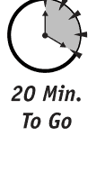

### 控制用户输入

保护好库存数量字段后，我现在可以将注意力转向 `inCart` 字段。如前所述，我希望用户能在此字段中输入一个数字，以立即指定他们想要多少件商品。然而，除了这个功能外，我还想为用户提供一组按钮，允许他们一次增加或减少一个单位。这些按钮（连同新购物车设计的其余部分）如图 15-1 所示，位于每行的末尾。

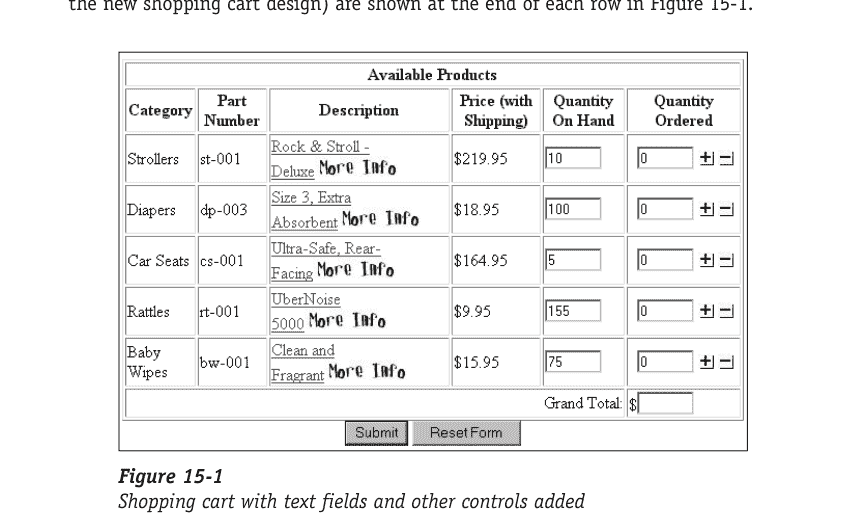

**图 15-1**
添加了文本字段和其他控件的购物车

如你所见，这些是简单的加号和减号按钮。当用户点击一个按钮时，我希望按钮能产生适当的动画响应——也就是说，按钮应该看起来被按下然后弹回——并在相应的 `inCart` 文本字段中增加或减少一个单位。设置此功能的 HTML 如下所示：

```
\

```

在这段代码中，我使用了三个与鼠标相关的事件处理程序来控制按钮的动画。（onmouseout 处理程序是必要的，用于处理用户点击按钮但在释放鼠标按钮前将鼠标移开按钮的情况。）如上所示，此代码仅创建了几个动画按钮。如果我确实想响应对这些按钮的点击，我必须更改 onmouseup 处理程序，使其调用一个将更新我文本字段中值的函数。

```
onmouseup="doPlus('st-001');document.images['plus_st-001'].src='plus.jpg'"
onmouseup="doMinus('st-001');document.images['minus_st-001'].src='minus.jpg'"
```

在这里，我定义了两个新函数：doPlus() 和 doMinus()。这两个函数分别向用户的购物车中添加一件商品和减少一件商品。为了指定正在添加或移除的是哪件商品，我向每个函数传递一个相应的零件号。由于这些函数非常相似，我只介绍第一个 doPlus()：

```
function findPartNo( partNo) {
    var result = "";
    for (x=0; x < productInfo.length; x++) {
        if (productInfo[x][2] == partNo) {
            result = productInfo[x];
            break;
        }
    }
    return result;
}

function doPlus( partNo) {
    var prodInfo = findPartNo( partNo);
    // 我们是否有足够的库存来执行此操作？
    if (prodInfo[ 4] > 0) {
        // 更新数组中的数量
        prodInfo[ 4]--;
        prodInfo[ 5]++;
        // 将这些新值复制到表单中
        document.cart.elements[ "quan_" + partNo].value =
            prodInfo[ 4];
        document.cart.elements[ "inCart_" + partNo].value =
            prodInfo[ 5];
    }
    else {
        alert( "此商品已无库存！");
    }
}
```

当调用 doPlus() 时，它首先使用 findPartNo() 函数搜索包含所选产品信息的数组。如你所见，findPartNo() 函数只是一个简单的 for 循环，它遍历 productInfo 数组，直到找到与指定零件号匹配的条目。此时，整个子数组将被返回给调用者（在此例中为 doPlus() 函数）。

一旦 doPlus() 函数获得了正确的产品信息，它就会检查库存中是否还有单位剩余。如果没有，将显示一个警告窗口来提醒用户这一情况。然而，如果库存中至少还有一件，该函数将从库存数量字段中减去一件，并向购物车数量字段中添加一件。

之后，剩下的就是将这些新值复制到屏幕上的文本字段中。为此，该函数使用传入的零件号，通过表单中的 elements 数组来访问文本字段。（记住，表单对象中的 elements 数组允许你通过提供一个包含控件名称的字符串来访问表单中的控件。我并非硬编码该字符串，而是动态构建它。）这会更新屏幕上的文本字段，并告知用户该商品已添加到购物车中。

### 验证文本字段

此时，剩下的就是确保用户不会在某个 `inCart` 文本字段中输入无效的内容。这可以使用 onchange 事件处理程序轻松完成。以下 HTML 展示了如何设置此功能。

```
<input type='text' name='inCart_st-001' 
onchange='enterQuantity("st-001")' value='0' size='6' />
```

如前所述，onchange 事件在用户更改控件中的值且控件失去焦点时触发。因此，这是确保用户输入了适合该控件的值的绝佳时机。在这种情况下，我需要检查控件是否为空，如果不为空，它是否包含一个数字？

### 检查空白文本字段

检查空白文本字段是编程中最简单、也是最常见的数据验证任务之一。毕竟，如果用户没有提供你需要的所有信息，你就很难给他们想要的东西。因此，手头有一个能检查字段中是否为空字符串的函数非常重要。


### 检查空白文本字段

`isBlank()` 函数首先做的是检查字符串是否等于空字符串。如果不为空，它会逐字符检查字符串中的每个字符，看是否有不是空格的字符。只要有一个字符不是空格，该字符串就不是空白的，函数返回 `false`。否则，函数返回 `true`。

```javascript
function isBlank(theString) {
    var result = true;
    if (theString != "") {
        for (x = 0; x < theString.length; x++) {
            var theChar = theString.charAt(x);
            if (theChar != " ") {
                result = false;
                break;
            }
        }
    }
    return result;
}
```

（你可能已经注意到这个函数检查的是字符串而不是文本字段。稍后我会向你展示如何在文本字段中使用这个函数。）

### 检查数值

另一个常见任务是检查用户输入，确保其中只包含数字。有很多方法可以实现这一点，其中一种方法如下所示：

```javascript
function isNumeric(theString) {
    var validChars = "0123456789";
    var result = true;
    for (x = 0; x < theString.length; x++) {
        var theChar = theString.charAt(x);
        // 这个字符在 validChars 中吗？
        if (validChars.indexOf(theChar) == -1) {
            result = false;
            break;
        }
    }
    return result;
}
```

这是另一个相当简单的操作。我简单地检查字符串中的每个字符，看它是否是 0 到 9 之间的字符之一。即使只有一个字符不在这组有效字符中，整个字符串也会被拒绝。

### 在程序中使用数据验证

现在我有了检查空白值和数值的函数，我可以使用这些函数来创建我的 `enterQuantity()` 函数。这个函数相当长，因此与其在这里展示它，不如请你在 `babyPalooza.js` 文件中查找它（在 CD-ROM 的 Session15 文件夹中），并在你的 HTML 编辑器中跟着做。

正如你之前看到的，我其中一个 `inCart` 文本字段中的 `onchange` 事件会导致这个函数执行。`enterQuantity()` 函数首先做的是获取用户试图更新的产品信息数组。然后，它检索输入到文本字段中的值，并检查该值是否为空。如果是，我们将值设置为 `"0"` 字符串并继续。（在我看来，有人清空一个字段是为了将其归零，所以这段代码就是这么假设的。）

一旦函数从文本框中检索到字符串，它需要确保它实际上是一个数字。如果 `isNumeric()` 函数说该字符串不是数字，函数会弹出一个提示窗口说明这一点，并将 `inCart` 文本字段中的值重置为保存在产品信息数组中的值。然而，如果该值是数字，事情就变得更有趣了。首先，函数使用一个名为 `parseInt()` 的 JavaScript 函数将字符串转换为实际的数字。`parseInt()` 函数最多可以接受两个参数，第一个是你想要转换的字符串，第二个是字符串所表示的数字的基数。在这种情况下，我的数字是十进制值，所以我传递的基数是 10。（请注意，你不必向 `parseInt()` 函数提供基数信息。然而，如果你不提供，`parseInt()` 会查看字符串本身以获取数字基数的提示。如果数字以 0 字符开头，它将假设该数字是八进制的（基数 8）。如果数字以 0x 开头，它将假设它是十六进制的（基数 16）。所以，为了保险起见，我总是指定我要转换的数字的基数。）

转换完成后，函数确保有足够的单位来满足请求。如果没有，它将显示一个提示窗口，并将 `inCart` 文本字段中的值重置为保存在产品信息数组中的值。

如果有足够的单位来满足请求，函数执行必要的数学运算来更新产品信息数组，然后将这些新值放入表单中的相应字段。（如果你想知道为什么这个函数返回一个布尔结果，请参阅本 Session 后面"表单提交时验证数据"部分。）

### 验证其他类型的控件

当然，并非每个表单都只由文本字段组成。然而，文本字段可能是最难验证的。毕竟，文本字段可以包含几乎任何类型的数据，而且这些数据可能有各种各样的限制。我刚刚向你展示的技术旨在让你了解如何为自己的文本字段编写数据验证程序。你可以在表单中包含的其他类型字段，大多数情况下是自动验证的。例如，如果你设置正确，选择列表应该只包含有效值。至于复选框和单选按钮，如果你需要求其中一项或多项被选中或未选中，你可以简单地查看每个控件的 `checked` 属性并相应地进行处理。

唯一真正需要某种数据验证的另一种控件类型是文件上传字段。（有关如何验证这类字段的示例，请参阅第 13 节中的"使用文件上传控件"。）

### 表单提交时验证数据

到目前为止，我展示的例子尝试在用户输入数据时验证表单中的数据。然而，你可以等到表单提交时再验证其数据。正如你在第 10 节中看到的，你可以通过为 `onsubmit` 事件创建事件处理程序来做到这一点。当用户点击提交按钮时，会生成一个 `onsubmit` 事件。然后你的 `onsubmit` 处理程序可以检查表单中的每个字段是否包含有效数据。如果你发现表单有问题，你的事件处理程序可以返回 `false`，表单将不会被提交。如果数据没问题，你可以简单地返回 `true`，表单将被提交。

实际上，通常最好两种数据验证都做。换句话说，在数据输入时进行检查，然后在用户点击提交按钮时再次检查。这为你提供了额外的保护，防止那些喜欢花时间寻找破坏网站方法的用户。考虑到这一点，这是我用来在提交数据之前最后检查数据的 `doSubmit()` 函数。

```javascript
function doSubmit() {
    var partNo = "";
    var result = true;
    // 查看库存中的每个产品
    for (y = 0; y < productInfo.length; y++) {
        partNo = productInfo[y][2]; // 获取零件编号
        // 并用它检查每个字段
        if (!enterQuantity(partNo)) {
            result = false;
            break;
        }
    }
    return result;
}
```

你可能已经注意到 `enterQuantity()` 函数返回一个布尔结果。原因如下：通过返回布尔结果，我可以重复使用 `enterQuantity()` 函数来从 `doSubmit()` 函数自动验证每个字段。如果任何字段包含错误数据，`enterQuantity()` 会报告该事实，然后 `doSubmit()` 函数可以返回一个 `false` 值来取消表单的提交。

## 回顾

在本节中，你看到了几种不同的数据验证技术。你学习了如何即时验证数据，以及如何在用户点击提交按钮时验证数据。你看到了防御性编程和使用默认值如何帮助减少你实际需要做的数据验证量。我还向你展示了如何使用 `onfocus` 处理程序保护文本字段免受用户输入。你甚至学习了如何创建一组基于自定义图形的控件，将表单的用户输入范围限制在一定范围内。

## 自我测验

1. 选择列表可以减少你的数据验证工作吗？（参见"防御性编程"）
2. 你的 JavaScript 程序如何生成带有默认值的自定义控件？（参见"设置默认值"）
3. 你如何使用 `onfocus` 事件处理程序来保护字段？（参见"使用 `onfocus` 处理程序保护字段"）
4. 为什么要检查空白文本字段？（参见"检查空白文本字段"）
5. `onsubmit` 处理程序如何让你验证表单数据？（参见"表单提交时验证数据"）


# 第 16 课

# 用 JavaScript 制作 Cookie

### 课程清单

1. 了解 Cookie 的内部结构及其操作方式
2. 学习如何判断 Cookie 是否处于激活状态

到目前为止，我的购物车几乎已经具备了所需的全部基本功能。但有一个明显的缺陷：如果用户离开网站后稍后返回，购物车中的内容将会丢失，用户不得不重新选择所有商品。为了解决这个问题，我需要某种机制，让购物车能够记住其内容并据此重新构建。浏览器 Cookie 正是为了解决这类问题而诞生的。

## 什么是 Cookie？

Cookie 是 Web 浏览器存储在客户端机器上的一小块数据。我说"一小块"，大约是 4 KB（4,096 字节），不过具体大小取决于所使用的浏览器。（只要将你的 Cookie 控制在 4,000 字节以内，一般不会有什么问题。）虽然 Cookie 通常被认为是一种纯客户端机制，但实际上它是由 Web 浏览器和 Web 服务器协同管理的。Web 浏览器可以将 Cookie 发送给服务器，服务器会将其存储起来以备后用。然后，当 Web 浏览器请求一个 HTML 文档时，服务器会查看所有可用的 Cookie，并决定哪些应该随请求的文档一起发送。这些 Cookie 以头部信息的形式发送，在实际的 HTML 文档之前到达。当这些 Cookie 头部到达浏览器时，它们会被解析并整合到该 HTML 文档的浏览器对象模型（Browser Object Model）表示中。

正如你在第 9 课中可能记得的，就 JavaScript 而言，Cookie 只不过是 document 对象的另一个属性。这使得读写 Cookie 变得非常简单：

```
var theCookie = document.cookie; // read the cookie
document.cookie = theCookie; // write the cookie
```

然而，实际*使用* Cookie 的内容可能要复杂得多。但要理解其中的原因，你必须先了解 Cookie 的结构。

## Cookie 的组成成分

将 Cookie 简化到最基本的层面，它就是一个名称字符串，后跟一个等号，再后跟一个表示 Cookie 值的字符串。分号标记该值字符串的结束。因此，你能制作的最简单的 Cookie 看起来可能是这样的：*name*=*value*; 你给 Cookie 命的名称几乎可以是任何内容。但是，它不能包含空白字符（空格、制表符等）、逗号或分号。Cookie 的值部分也有相同的限制。

虽然 Cookie 名称几乎可以是任何内容，但你可能希望给 Cookie 一个能准确描述其内容的名称。例如，由于我的 Cookie 最终将保存购物车信息，我可能想将它命名为"bpShopCart"（代表"baby-palooza 购物车"）或类似的名称。因此，在不知道购物车具体内容的情况下，我的基本 Cookie 可能看起来像这样：

```
bpShopCart=shopcartcontents;
```

## Cookie 属性

在初始的名称和值对之后，你可以添加以下四个属性中的任意一个或全部，以更好地控制 Cookie 的使用方式。

**expires**：该属性后跟一个值，指定 Cookie 的过期日期。这个日期告诉 Web 浏览器何时应从客户端机器上删除该 Cookie。如果未指定过期日期，Cookie 将在用户退出 Web 浏览器时被删除。我将在本课稍后更详细地讨论 expires 属性。

**domain**：默认情况下，Cookie 仅对与创建该 Cookie 的文档位于同一服务器上的 HTML 文档可用。例如，如果一个 Cookie 是由"www.baby-palooza.com"服务器上的文档创建的，那么该 Cookie 对"orders.baby-palooza.com"服务器上的文档将不可用。你可以通过在 Cookie 中添加域名规范来更改此行为：

`bpShopCart=shopcartcontents;domain=baby-palooza.com`

这里指定的域名意味着该 Cookie 将对从"www.baby-palooza.com"、"orders.baby-palooza.com"或"baby-palooza.com"域中任何其他服务器请求的 HTML 文档可用。

**path**：通常，Cookie 仅对与创建该 Cookie 的文档位于同一文件夹中的 HTML 文档可用。（换句话说，如果一个 Cookie 是由 Session16 文件夹中的文档创建的，那么它对 Session15 文件夹中的文档将不可用。）但是，通过在 Cookie 中添加路径规范，你可以使其对其他文件夹中的文档可用。例如，如果我希望我的 Cookie 对 Web 服务器根目录下所有以"Session"开头的文件夹中的所有文档都可用，我可以指定：

`bpShopCart=shopcartcontents;path=/Session`

有了这个路径规范，Web 服务器将随来自任何以"Session"开头的根级文件夹的 HTML 文档一起提供此 Cookie。（请注意，你指定的 path 和 domain 属性只有在你的 Web 区分大小写时才是大小写敏感的。）如果你想让 Cookie 随服务器上的每个 HTML 文档一起发送，可以指定路径为 /。（这指定了根目录及其下的所有内容！）

**secure**：如果指定了此属性，则只有在客户端和服务器之间通过安全连接（即"https"或其他安全连接）连接时才会发送 Cookie。`bpShopCart=shopcartcontents;secure`

## Cookie 的值

此时，你可能觉得 Cookie 看起来很简单。确实如此。不过，我还没有考虑我的 Cookie 的值实际上会是什么样的。记住，我必须将购物车的全部内容存储在 Cookie 中。我该怎么做呢？我*可以*为产品清单中的每个商品创建一个单独的 Cookie，然后逐一检查每个 Cookie。然而，Cookie 规范规定客户端最多只能存储 300 个 Cookie，且来自同一域名的 Cookie 不能超过 20 个。因此，如果我的产品清单有超过 20 个产品，这个限制将使"每个产品一个 Cookie"的方案无法实施。

一个好得多的方案是将所有购物车信息存储在单个 Cookie 中。我可以通过编码购物车中每个商品的零件编号和数量，并将所有这些信息放入一个值字符串来实现这一点。

记住，Cookie 的值几乎可以包含任何你想要的内容，但空白字符、逗号和分号除外。幸运的是，我不需要使用这些字符中的任何一个来创建我的 Cookie 值。（当然，如果你确实需要使用 Cookie 中不允许的字符，可以使用 JavaScript 的 *escape()* 函数将这些字符编码为可以安全保存在 Cookie 中的形式。要解码这些字符，可以使用 *unescape()* 函数将其恢复为原始状态。我将在第 28 课中更详细地讨论这些函数。）那么，我的 Cookie 实际上会是什么样的呢？请看以下示例 Cookie：

```
bpShopCart=3st-0015dp-003;
```

根据你对 Baby-Palooza 产品清单结构的了解，你或许能够判断出，根据这个 Cookie，购物车中有三个编号为 st-001 的商品和五个编号为 dp-003 的商品。然而，你能做出这个判断只是因为你熟悉清单的组织方式，并且人脑是已知宇宙中最强大的模式匹配机器。而 JavaScript 程序则完全不知道这个字符串意味着什么。更糟糕的是，它几乎无法从中提取任何有意义的信息。因此，让我优化一下 Cookie 的设计，使其更容易看出数据的实际排列方式：

```
bpShopCart=3:st-001|5:dp-003;
```

在这个版本中，我添加了两个不同的分隔符来分隔 Cookie 中的值，使其具有一定的结构。竖线（有时也称为"管道"）字符用于分隔每个产品的信息，


购物车（也就是将尿布与婴儿车分开）。在每个这样的分区内部，使用冒号字符来分隔购物车中的数量与它所对应的产品编号。因此，只需扫一眼，人类就能看明白这个购物车中有三件编号为 st-001 的部件和五件编号为 dp-003 的部件。而且，正如我很快就会展示给你的，JavaScript 程序现在可以轻而易举地从这个 Cookie 中提取有用的信息。

那么，我为什么要用竖线和冒号字符作为分隔符呢？说实话，我选择它们是因为对我来说，这些字符在视觉上能最好地提示数据的排列方式。当你们设计自己项目中要使用的 Cookie 时，可以随意选择任何分隔符字符。唯一的限制是你不能使用空白字符、逗号或分号，而且你的分隔符不应该是可能出现在 Cookie 数据内部的字符。（例如，由于我的产品编号中包含连字符，我就不想把连字符用作分隔符之一。）

到这个时候，重要的是你要意识到我在这里构建的 Cookie 字符串对于这个购物车来说是*独一无二*的。很可能，你参与的每个项目都会需要一种完全不同的 Cookie 结构（如果该项目使用 Cookie 的话）。本节课的重点是让你了解在使用 Cookie 时会遇到的问题，而不是让你觉得构建和使用 Cookie 只有唯一正确的方式。


## Cookie 使用指南

多年来，Cookie 收到了不少负面报道。这是因为一些聪明的公司发现，由于 Cookie 可以存放几乎任何东西，它们同样可以轻松存放个人信息以及购物车内容。这可能包括信用卡号、密码，以及或许最令人不安的——关于一个人网页浏览习惯的信息。当隐私倡导者得知此事后，普遍出现了反对使用 Cookie 的呼声。可想而知，使用 Cookie 的能力实在太有用了，不可能完全消失，因此网页浏览器厂商的回应是允许单个用户设置他们的浏览器，在保存 Cookie 时通知他们，或者自动拒绝所有 Cookie。这意味着，如果你构建了一个依赖 Cookie 启用的网站，你必须做好准备应对不可避免的情况——某个用户已经关闭了 Cookie，它们根本不可用。

稍后将向你展示，判断 Cookie 是否关闭并不难，但要*说服*讨厌 Cookie 的人甚至使用你的网站则要困难得多。最好的办法是告诉访问者你正在使用 Cookie，并向他们准确解释你用这些 Cookie 追踪什么。这通常可以通过一个简单的免责声明或隐私政策信息页面来实现。如果用户在阅读你的免责声明后，仍然不希望你的 Cookie 留在她的机器上，你几乎无能为力。虽然这对隐私倡导者来说可能是一场胜利，但对 JavaScript 程序员来说却可能是个头疼的问题。如果 Cookie 不可用，你要么将用户*拒之门外*（如果你正在构建在线业务，这不是留住客户的好办法），要么在不使用 Cookie 的情况下为用户提供尽可能多的功能。（对于 Baby-Palooza 网站，我将努力为用户提供尽可能多的功能。）

## 构建和保存 Cookie

如你所见，保存 Cookie 的动作实际上*非常*简单。你所要做的就是构建你的 Cookie 字符串，然后发出类似这样的语句：

```
document.cookie = theCookie;
```

棘手的部分在于*实际构建* Cookie 字符串。然而，一旦你决定了 Cookie 值的实际样子，这就不太难做了。正如你从本节课前面所记得的，我的 Cookie 字符串看起来会是这样的：

```
bpShopCart=quantity:partNumber|quantity:partNumber|etc. ...;
```

所以，实际上我只需要一个简单的循环，遍历我的产品信息数组，将每个产品的信息添加到我最终的 Cookie 字符串中。这里有一个简单的函数，可以很好地完成这项工作。

```
function saveCart() {
    var theCookieName = "bpShopCart=";
    var theCookieValue = "";
    for (x=0; x<productInfo.length; x++) {
        // Only include if this item has
        // been placed in the shopping cart
        if (productInfo[x][5] > 0) {
            // if this is the first item we've found
            // do not add a separator
            if (theCookieValue != "") {
                theCookieValue += "|";
            }
            // add the quantity to the cookie
            theCookieValue += productInfo[x][5] + ":";
            // add the part number to the cookie
            theCookieValue += productInfo[x][2];
        }
        document.cookie = theCookieName + theCookieValue + ";";
        alert( document.cookie);
    }
}
```

如你所见，这段代码并不算太复杂。我只是在遍历我的产品信息数组，如果某个产品已被放入购物车，我就将其信息添加到我的 Cookie 值字符串中。在构建好 Cookie 值之后，我只需将其与 Cookie 的名称和一个分号连接起来，然后赋值给 `document.cookie` 属性。对 `alert()` 方法的调用只是让我能够检查 Cookie 的内容，以便确认我是否正确地构建了它。

到了这个时候，问题就变成了："我*什么时候*构建和保存我的 Cookie？" 如果你回顾一下第 10 节课，你可能会注意到一个叫做 `onunload` 的事件。这个事件在浏览器卸载当前网页时触发。这发生在用户跳转到另一个页面时，或者点击"刷新"按钮时。通过在 HTML 文档的 `<body>` 标签中指定你的处理程序，你可以捕获 `onunload` 事件。所以，如果我将 `<body>` 标签改成这样：

```
<body bgcolor="white" onunload="saveCart()" />
```

那么，每当包含我的购物车的页面被卸载时，`saveCart()` 函数就会被调用。所以，如果我在购物车中放入三辆婴儿车和两个摇铃，然后刷新页面，我会得到一个警告窗口，其中的 Cookie 字符串看起来像这样：

```
bpShopCart=3:st-001|2:rt-001.
```

希望这几乎正是你所预期的 Cookie 样子。然而，如果你仔细看，会发现*少了点什么*：结尾的分号。尽管 `saveCart()` 函数在保存 Cookie 时会在末尾添加一个分号，但当你稍后检查 `document.cookie` 属性时，那个分号并不是 Cookie 字符串的一部分。虽然这可能出乎意料，但它实际上使处理 Cookie 变得更简单，仅仅因为你不必担心去掉那个分号。

## 添加过期日期

就目前而言，我的 Cookie 已经可以使用了。然而，还缺少一个小东西：过期日期。没有过期日期，这个 Cookie 只会在用户打开她的网页浏览器期间存在。这是因为，正如我前面提到的，*没有保存过期日期的 Cookie 会在用户结束浏览器会话时立即被删除*。

要知道，当你关闭网页浏览器时，其关闭过程的一部分就是查看它收集的所有 Cookie 的过期日期。如果某个 Cookie 的过期日期已过，或者该 Cookie 根本没有过期日期，浏览器就会从客户端机器上删除该 Cookie。所以，以目前的形式，我的 Cookie 只在用户关闭她的网页浏览器之前有效。虽然这听起来可能足够了，但想想那个可怜的用户：她花了一个小时在你的网站上购物，往购物车里塞满了各种好东西，结果却发现她的信用卡*已经过期*了。几天后 renewed 了她的信用卡，她回到你的网站，却发现她所选的所有东西*全都消失了*！她有多大可能重复所有那些工作，*仅仅为了给你送钱*？

同样，你通过在 Cookie 末尾添加一个 `expires=` 属性来指定 Cookie 的过期日期。这会给你一个看起来像这样的 Cookie：

```
bpShopCart=shopcartcontents;expires=expiration-date;
```

这里的*难点*在于，你必须以*非常特定*的格式来格式化过期日期。幸运的是，JavaScript 包含了一个对象，使得创建格式正确的过期日期变得非常简单。

## 在 Cookie 中使用 Date 对象

如其名称所示，JavaScript 的 Date 对象用于保存关于日期的信息。与你见过的其他内置 JavaScript 对象一样，你使用 `new` 关键字来创建一个新的 Date 对象，像这样：`var currentDate = new Date();`

在这个例子中，我没有向 Date 构造函数传递任何参数。正因为如此，构造函数将返回一个包含客户端系统时钟中当前时间和日期信息的 Date 对象。一旦你创建了一个 Date 对象，你可以用它做很多不同的事情。然而，目前我只对用它来创建 Cookie 的过期日期感兴趣。（我将在第 27 课详细讨论 Date 对象。现在，我只讨论 Date 对象中对创建 Cookie 有用的部分。）

我可以通过向我的 Date 对象添加一个时间间隔，然后使用得到的日期来给 Cookie 末尾附加一个过期日期来实现这一点。例如，如果我想让我的 Cookie 在两周后过期，我创建一个代表当前时间的 Date 对象，加上两周，然后使用这个新的日期（即两周后的日期）来生成我的 Cookie 的过期日期。为了完成这个任务，你需要了解 JavaScript Date 对象的三个方法。


## 第 16 讲——用 JavaScript 烘焙 Cookie

- `getTime()` 方法。该方法返回自 1970 年 1 月 1 日午夜起已过去的毫秒数所表示的日期。
- `setTime()` 方法。该方法接受一个参数：自 1970 年 1 月 1 日午夜起已过去的毫秒数。该数值用于将 `Date` 对象重置为对应日期。
- `toGMTString()` 方法。Cookie 的过期日期必须遵循特定格式。具体而言，它必须格式化为格林威治标准时间（GMT）日期字符串。该方法恰好以该格式返回 `Date` 对象的内容。

既然你已经了解了 `Date` 对象的这些方法，来看看修订后的 `saveCart()` 函数。

```javascript
function saveCart() {
    var theCookieName = "bpShopCart=";
    var theCookieValue = "";
    for (x=0; x<productInfo.length; x++) {
        // Only include if this item has
        // been placed in the shopping cart
        if (productInfo[x][5] > 0) {
            // if this is the first item we've found
            // do not add a separator
            if (theCookieValue != "") {
                theCookieValue += "|";
            }
            // add the quantity to the cookie
            theCookieValue += productInfo[x][5] + ":";
            // add the part number to the cookie
            theCookieValue += productInfo[x][2];
        }
    }
    var expireTime = new Date(); // add the expiration date
    // How many milliseconds are there in two weeks?
    var twoWeeks = 14 * 24 * 60 * 60 * 1000;
    expireTime.setTime(expireTime.getTime() + twoWeeks);
    document.cookie = theCookieName + theCookieValue + ";expires="
    + expireTime.toGMTString() + ";";
    alert(document.cookie);
}
```

如你所见，这并没有什么复杂的。第一个新步骤是创建一个包含客户端系统时钟当前时间和日期的 `Date` 对象。之后，通过简单的计算得出两周间隔所包含的毫秒数。（记住，一秒有 1,000 毫秒。）然后我用 `getTime()` 方法提取组成当前日期的毫秒数，并将两周的间隔加到其上。接着将结果传递给 `setTime()` 方法，我的 `expireTime` `Date` 对象就会包含一个两周后的日期。

剩下的唯一工作就是以 GMT 格式化字符串的形式提取这些信息，并将其附加到 cookie 字符串的末尾。全部完成后，生成的 cookie 字符串可能看起来像这样：

```
bpShopCart=2:rt-001;expires=Tue, 12 Dec 2000 19:38:17 UTC;
```

## 加载和解码 Cookie

既然我已经保存好了 cookie，而且知道它会存在一段时间，我就必须将注意力转向当用户返回我的网站时如何将其加载回来。

你可能已经猜到，如果 `onunload` 事件是保存 cookie 的好时机，那么 `onload` 事件就是加载 cookie 的完美信号。如果你还记得，加载实际的 cookie 非常简单：`var theCookie = document.cookie;`

与保存 cookie 一样，真正的工作来自于解码 cookie 字符串值部分所包含的信息。幸运的是，你在第 5 讲和第 6 讲中看到的数组和字符串处理方法使这变得非常容易。

```javascript
function loadCart() {
    var myCookieName = "bpShopCart";
    var theCookie = document.cookie;
    // Remember, there can be multiple name=value pairs!
    // So, break the cookie up along the semi-colons
    var allCookies = theCookie.split(";");
    // Now, take each of those name=value pairs and split them
    for (a=0; a<allCookies.length; a++) {
        var thisCookie = allCookies[a].split("=");
        // Does the name in this cookie match?
        if (thisCookie[0] == myCookieName) {
            // break out the products in the cart
            if (thisCookie.length > 1) {
                var products = thisCookie[1].split("|");
                if (products.length > 0) {
                    // Split out the part numbers and quantities
                    // for each product
                    for (b=0; b<products.length; b++) {
                        var detailInfo = products[b].split(":");
                        // Store the new value in the
                        // on-screen text box
                        document.cart.elements['inCart_' +
                          detailInfo[1]].value = detailInfo[0];
                        // Finally, use the enterQuantity function
                        // to validate the value and update the
                        // main productInfo array
                        enterQuantity( detailInfo[1]);
                    }
                }
                else {
                    // If there is nothing in the cookie,
                    // do nothing
                    break;
                }
            }
        }
    }
}
```

如你所见，我正在使用 String 对象的 `split()` 方法将 cookie 分解成越来越小的信息单元。第一次调用 `split()` 将 cookie 中的任何 name=value 对分开。然后我遍历这些对，并使用第二次 `split()` 调用将其分解成组成部分（即名称和值）。接着我在每一对中搜索我用于 cookie 的名称（"bpShopCart"）。

如果名称匹配，且 cookie 不为空，我就知道这是我感兴趣的值。然后我将该值分割成另一个数组，其中包含保存 cookie 时购物车中所有产品的信息。最后一个循环将每块产品信息分割成包含零件编号和数量的数组。

此时，将数量分配给屏幕上相应的文本框就很简单了。最后调用 `enterQuantity()` 函数确保该值有效，并更新实际 `productInfo` 数组中的值。有了这些代码，每当用户返回购物车时，购物车就会自动重建。（只要他们在两周内回来！）

## 删除 Cookie

虽然让 cookie 保持存在很好，但有时你也想完全摆脱它们。一个这样的时刻可能是用户实际下订单时。毕竟，一旦他们订购了购物车中的产品，肯定不想再看到这些项目出现在购物车中。

真正删除 cookie 的唯一方法是保存一个同名但值为空且没有过期日期的 cookie。这将强制浏览器在用户完成使用 Web 浏览器时删除该 cookie。对于 Baby-Palooza 网站，这可以相当简单地实现。我只需要创建一个名为 `clearCookie` 的新全局变量。然后，当订单表单成功提交时，`clearCookie` 将被设置为 `true`。剩下的就是修改 `saveCart()` 函数的最后几行，使其看起来像这样：

```javascript
if (clearCookie) {
    document.cookie = theCookieName + ";expires=";
}
else {
    document.cookie = theCookieName + theCookieValue +
        ";expires=" + expireTime.toGMTString() + ";";
}
```

## 判断 Cookie 是否被关闭

最后，我需要说明如何确定 cookie 是否在用户浏览器中被禁用。对于我在这里构建的购物车而言，无法使用 cookie 并不会是什么大问题。如果用户离开或重置带有购物车的页面，她只会简单地丢失之前添加到购物车中的所有项目。虽然这对 Baby-Palooza 网站来说不是什么大问题，但对其他一些网站来说可能真的是个麻烦。所以，最好有办法确定 cookie 是否可用。这里展示的函数可以做到这一点：

```javascript
function cookiesActive() {
    var result = false;
    if (document.cookie != "") { //Handle the simple case first
        result = true;
    }
    else {
        document.cookie = "active=yes:";
        // Try to save and reload it
        if (document.cookie == "active=yes") {
            result = true; // now trash it...
            document.cookie = "active=;expires=:";
        }
    }
    return result;
}
```

如你所见，这个函数采用了非常简洁的方法来解决这个问题。如果 `document.cookie` 属性不为空，cookie 一定是启用的。如果为空，它会检查是否可以保存并重新加载一个简单的 cookie。如果可以，cookie 是启用的。如果不能，cookie 一定是关闭的。就是这么简单！

> 如果你的浏览器是 Internet Explorer 5 版或 Netscape Navigator 6 版，你还可以检查 `navigator.cookieEnabled` 属性。你将在第 26 讲中了解更多关于这个属性的内容。

## 复习

在本讲中，你学习了关于 cookie 的所有知识以及如何从 JavaScript 中使用它们。你了解到 cookie 以 name=value 对的形式存储。你还了解了可以为 cookie 指定的四个 cookie 属性（expires、domain、path 和 secure）。你学会了如何使用 cookie 的值部分来存储多段信息，而不是将这些信息分散到多个 cookie 中。我还告诉了你一些关于 cookie 的隐私问题，以及如何在网站上处理这些问题。你学习了如何使用 `onunload` 和 `onload` 事件来触发 cookie 信息的保存和加载。我向你展示了如何构建一个带有过期日期的完整 cookie（使用 JavaScript `Date` 对象）。你还看到了如何删除 cookie 以及如何确定客户端浏览器中是否启用了 cookie。


 ## 测验你自己

- 1. 你可以在 cookie 中存储什么？（参见“cookie 的构成成分”。）
- 2. 浏览器如何知道何时删除 cookie？（参见“添加过期日期”。）
- 3.  reserving如何删除 cookie？（参见“删除 Cookie”。）
- 4.  什么语句会加载 cookie？（参见“什么是 Cookie？”）
- 5.  如何判断客户端浏览器中是否启用了 cookie？（参见“判断 Cookie 是否被关闭”。）

# 第三部分

# 周六下午

- 1. 创建一个简单的 HTML 文档，使用 JavaScript 动态创建一个新的 JavaScript 代码块。这个新代码块应执行以下 `alert()` 调用：`alert("Welcome to Babies-A'Plenty!")`
- 2. 表单对象中的 `elements` 数组代表什么？
- 3. 表单对象的 `reset()` 方法有什么作用？
- 4. 以下 JavaScript 代码代表什么？`document.forms[2]`
- 5. 如何使用 JavaScript 来选中或取消选中表单中的复选框？
- 6. Select 对象中的 `options` 数组代表什么？
- 7. 如果你从密码字段中提取值，实际上会得到什么？
- 8. 提交按钮或重置按钮与普通按钮有什么区别？
- 9. Image 对象的 `src` 属性代表什么？
- 10. `` 标签的 `onload` 事件表示什么？
- 11. `` 标签的 `onerror` 事件表示什么？
- 12. 用你自己的话描述，基于 JavaScript 的*rollover*是如何工作的？
- 13. `parseInt()` 函数有什么作用？
- 14. 为什么要在数据输入时以及用户提交表单时都尝试验证数据？
- 15. 为什么要假设用户会在你的表单中输入不良数据？
- 16. 用你自己的话说明，为什么数据验证如此重要？
- 17. 一个 cookie 可以容纳多少数据？
- 18. 保存和加载 cookie 的理想时间是什么时候？
- 19. cookie 的过期日期表示什么？
- 20. 你可能注意到，在第 15 讲中，baby-palooza.com 网站上出现了一个"总计"文本框。然而，并没有添加任何代码来实际显示总计。请使用第 16 讲的最终源代码，并在用户更改购物车中其他位置的数量时，更新它以计算并显示总计。此外，请确保保护总计文本框，使用户无法在其中输入任何内容。（注意：当你完成此代码后，可能会发现计算出的总计值包含比预期更多的小数位。你将在第 25 讲中学习如何解决此问题。）

# 第四部分

# 周六晚上

- 第 17 讲：理解 JavaScript 对象
- 第 18 讲：创建和使用方法
- 第 19 讲：使用 JavaScript 对象增强 HTML
- 第 20 讲：动态创建和执行 JavaScript

# 理解 JavaScript 对象

### 会话清单

- ✅ 学习如何创建自己的对象
- ✅ 理解构造函数
- ✅ 学习如何为对象定义属性
- ✅ 理解"this"是什么

到目前为止，你已经看到了创建一个基于 JavaScript 的网站所需的一切。然而，如果你想发挥 JavaScript 的真正威力，你需要学习如何创建和使用自己的 JavaScript 对象。

## 什么是对象？

我已经使用"对象"这个词有一段时间了，但我还没有真正解释过什么是对象。当然，你知道现实世界中的对象是什么：它就是一个独立的实体。例如，高尔夫球是一个对象，人也是一个对象。

在现实世界中，对象具有物理属性以及可以由它们执行、对它们执行或与它们一起执行的动作。例如，高尔夫球具有物理属性，包括它的大小（直径 4.27 厘米）、形状（好的通常是球形的）和质地（它有很多可爱的小凹坑）。你也可以用高尔夫球做很多事情：你可以滚动它们、弹跳它们，甚至可以用它们打高尔夫球。

关于现实世界对象的一个有趣之处是，它们可以包含其他对象。高尔夫球包含一个橡胶球，周围紧紧缠绕着橡皮筋。（好吧，那是我七岁时我祖父切开的那一个里面的东西！）这些本身都是对象，但它们被包装在一起形成了一种新类型的对象。

基于计算机的对象在概念上非常相似。主要区别在于，我们处理的不是物理物质的块，而是计算机数据的块。因此，基于计算机的对象具有*属性*以及一组它们可以执行的*动作*。（正如你现在所猜到的，这些动作对于基于计算机的对象来说被称为*方法*。）最后，与现实世界的对象一样，基于计算机的对象也可以组合起来创建全新类型的对象。

在本书的前半部分，你已经看到了这些内容的示例。例如，JavaScript 的 String 对象有一个 `length` 属性，告诉你字符串中有多少个字符。它还有许多不同的方法（动作）可以执行。例如，`toUpperCase()` 方法将返回字符串中所有字符的大写形式。

你还看到了对象如何组合起来创建全新的实体。例如，document 对象只是各种不同类型对象的集合——表单、控件、一些字符串——每个都有自己的一组属性和方法。所有这些对象一起工作，创造出更有趣和更有用的东西。

这与现实世界中的某个人进行对比。一个人实际上只是一组对象的集合——肾脏、肺、一两个大脑——每个都有自己的属性和"方法"，所有这些都协同工作，创造出更有趣和更有用的东西。

## 为什么要费心创建自己的对象？

在本讲开始时，我提到你已经知道创建一个基于 JavaScript 的网站所需的一切。那么，为什么还要费心学习如何创建和使用对象呢？实际上，对于大多数网站来说，你根本不需要使用对象（除了 JavaScript 内置的那些）！然而，正如你在接下来的几讲中看到的，如果你想构建真正酷、复杂且有用的网站，你就需要使用对象。

当然，使用对象还有其他原因。其中之一就是可重用性。当你定义一种新类型的对象时，你会得到一个完整的、自包含的实体，描述了特定类型数据的属性和方法。（这被称为*封装*。）然后你可以获取该对象定义，并将其放入你工作的任何新项目中。这比不得不从头开始重建一切要好得多。（如果你认为可重用性不是什么大事，那就去问问你的医生：移植一个肾脏和从头构建一个新的，哪个更容易？）

想象一下，如果你愿意，一个购物车对象。现在想象一下，你那相当疯狂的雇主要求你搭建 50 个电子商务网站。如果你能把你的购物车对象在每个网站中重用到几乎不需要修改，那该有多好？

## 如何定义和创建 JavaScript 对象

每个支持对象的编程语言都有稍微不同的创建对象的方式。然而，这些差异通常只是语法问题；你所经历的步骤几乎总是完全相同的。

首先，你必须决定你的对象将代表什么类型的数据。它是一个字符串、一个数组，还是一个销售明细？为了本次讨论的目的，我将定义一个对象来代表我产品信息数组中的单个产品。

接下来，你必须决定你的对象应该具有什么样的属性和方法。为此，请停下来思考你试图在对象中封装的数据。你需要在对象中存储什么样的信息？你需要能够对这些数据执行什么样的操作？

一旦你所有的这些都被确定下来，你就可以开始编写实际定义对象的程序代码了。在 JavaScript 中，你可以通过定义一个构造函数以及一个或多个将实现对象方法的函数来做到这一点。

我已经有了一个产品信息数组的定义，如下所示：

```
第一个槽位 = 价格
第二个槽位 = 描述
第三个槽位 = 零件编号
第四个槽位 = 运费
第五个槽位 = 库存数量
第六个槽位 = 订购数量
```

有了这个定义，我就能编写一堆赋值语句来创建产品信息数组。就像这样：


### **这到底是什么？**

这正好引出了 *this* 关键字的主题。简单来说，每当你看到 *this* 关键字，它指代的就是当前对象。那么，*this* 在构造函数中起什么作用呢？

要回答这个问题，先回忆一下构造函数的作用：它实际上是构建一个对象并用数据填充它。现在，假设你正在构建一个对象的过程中，那个对象实际上还没有名字，因此 JavaScript 解释器需要某种方式将它与内存中可能存在的其他对象区分开来。*this* 关键字恰好解决了这个问题：当在构造函数内部使用时，它指向的正是当时正在被构建的那个对象。（注意，你也可以在构造函数之外使用 *this* 关键字。它是一个非常方便的关键字！）

### **对象是如何被构造的？**

既然已经有了构造函数，让我来展示它的用法。有了这个构造函数，你就不必编写这样的代码：

```
var index = 0;
var strollerInfo = new Array();
strollerInfo[index++] = 199.95;
strollerInfo[index++] = "Rock & Stroll - Deluxe";
strollerInfo[index++] = "st-001";
strollerInfo[index++] = 20;
strollerInfo[index++] = 5;
strollerInfo[index++] = 0;
```

现在你可以编写这样的代码：

```
function itemInfo( oPrice, oDesc, oPartNum, oShipping, oInStock) {
    this.price = oPrice;
    this.description = oDesc;
    this.partNumber = oPartNum;
    this.shipping = oShipping;
    this.inStock = oInStock;
    this.inCart = 0;
}
var strollerInfo = new itemInfo( 199.95, "Rock & Stroll - Deluxe",
"st-001", 20, 5);
```

那么，这里发生了什么呢？和基于数组的版本一样，我使用 new 关键字来调用一个构造函数。然而不同的是，我调用的是我自己编写的构造函数（即 itemInfo() 构造函数），而不是 JavaScript 解释器内置的构造函数。

当构造函数被调用时，它接收五个参数。第一个参数被传入名为 oPrice 的参数变量中。然后执行以下语句：this.price = oPrice;

请记住，此时 JavaScript 解释器正在创建一个新对象。在这种情况下，这条语句告诉 JavaScript 解释器，这个新对象应该有一个名为 "price" 的属性。此外，price 属性的值应该是通过 oPrice 参数传入的值。所以，由于这条语句是在对象创建的上下文中执行的，它实际上做了几件事：

- 它在新对象中创建了一个属性。
- 它为新创建的属性赋了一个初始值。

当构造函数执行完毕后，strollerInfo 变量中就存储了一个新对象。该对象的结构和内容如表 17-1 所示。

#### 表 17-1：strollerInfo 对象的内容

| 属性名 | 值 |
| --- | --- |
| price | 199.95 |
| description | "Rock & Stroll – Deluxe" |
| partNumber | "st-001" |
| shipping | 20 |
| inStock | 5 |
| inCart | 0 |

这里需要注意的是，我没有使用参数值来填充 inCart 属性。相反，我只是给它赋了一个合理的默认值。（毕竟，当购物车刚创建时，它应该是空的。）再次强调，构造函数本质上就是函数。这意味着你可以根据需要让它们变得复杂或简单。只要记住：构造函数的目的是创建一个新对象，*而不是*让你程序中的其他部分执行某些操作。（此时，你可能想知道如何定义属于这个对象的方法。这并不难做到，但由于它比定义属性稍微复杂一些，我将在下一讲中讨论如何定义和使用方法。）那么，话虽如此，我现在可以用对象来替换我的产品信息数组，如下所示：

```
var strollerInfo = new itemInfo( 199.95, "Rock & Stroll - Deluxe",
"st-001", 20, 5);
var diaperInfo = new itemInfo( 13.95, "Size 3, Extra Absorbent",
"dp-003", 5, 100);
var carSeatInfo = new itemInfo( 149.95, "Ultra-Safe, Rear-Facing",
"cs-001", 15, 5);
var rattleInfo = new itemInfo( 4.95, "UberNoise 5000", "rt-001",
5, 155);
var babyWipeInfo = new itemInfo( 9.95, "Clean and Fragrant", "bw-
001", 6, 75);
```

你可能听过其他程序员在谈论对象时使用 *class*（类）和 *instance*（实例）这两个术语。这些术语是什么意思呢？当上面的代码执行完毕后，我将拥有五个不同的对象，每个对象都保存着库存中不同产品的信息。然而，由于每个对象都是由同一个构造函数创建的，它们都被认为属于**同一个类，具体来说，就是 `itemInfo` 类。**（类的名称来源于它的构造函数。）然而，每一个单独的对象被称为该类的一个**实例**。在现实世界中，一个类可以被看作是一群人，例如美国公民。这个类的一个实例就是一个具体的公民，比如前美国总统杰拉尔德·福特。

当这段代码执行完毕后，我将拥有五个 `itemInfo` 对象。每个对象都拥有完全相同的属性，但这些属性中的值会根据传给构造函数的不同参数而有所不同。表 17-2 清楚地说明了这一点。

#### 表 17-2：五个 itemInfo 对象的内容

| 属性 | strollerInfo | diaperInfo | carSeatInfo | rattleInfo | babyWipeInfo |
|---|---|---|---|---|---|
| price | 199.95 | 13.95 | 149.95 | 4.95 | 9.95 |
| description | "Rock & Stroll – Deluxe" | "Size 3, Extra Absorbent" | "Ultra-Safe, Rear-Facing" | "UberNoise 5000" | "Clean and Fragrant" |
| partNumber | "st-001" | "dp-003" | "cs-001" | "rt-001" | "bw-001" |
| shipping | 20 | 5 | 15 | 5 | 6 |
| inStock | 5 | 100 | 5 | 155 | 75 |
| inCart | 0 | 0 | 0 | 0 | 0 |

## 使用你创建的对象

现在，如果我简单地让代码保持这个状态，会有一个大问题：到目前为止我创建的所有代码都使用数组来操作产品信息。当然，我仍然需要一种简便的方式来遍历所有库存项目，所以目前最好保留主 productInfo 数组不变。这意味着以下代码可以完全保持原样：

```
index = 0;
var productInfo = new Array();
productInfo[index++] = strollerInfo;
productInfo[index++] = diaperInfo;
productInfo[index++] = carSeatInfo;
productInfo[index++] = rattleInfo;
productInfo[index++] = babyWipeInfo;
```

接下来要做的，就是修改所有将 productInfo 当作多维数组来处理的函数。其中一个函数就是你编写的用于计算购物车中所有商品总价的函数。（你在周六下午章节复习题中编写了这个函数。）我的版本如下：


 function calcGrandTotal() {
    var grandTotal = 0;
    for (x=0; x<productInfo.length; x++) {
        // 购物车中有这个商品吗？
        if (productInfo[x][5] > 0) {
            grandTotal += calcFinalCost( productInfo[x][0],
                productInfo[x][3]) * productInfo[x][5];
            }
        }
    document.cart.elements['grandTotal'].value = grandTotal;
    }
```

所以，我这里需要做的是重写这个函数，以及 `babyPalooza.js` 中的其他函数，使它们不再试图访问 `productInfo` 数组的第二维度。`babyPalooza.js` 文件中有很多函数需要考虑，但修复每个函数的方法基本相同，所以我这里就只讲解 `calcGrandTotal()` 函数所需的更改。

```
function calcGrandTotal() {
    var grandTotal = 0;
    for (x=0; x<productInfo.length; x++) {
        var thisItem = productInfo[x];
        // 购物车中有这个商品吗？
        if (thisItem.inCart > 0) {
            grandTotal += calcFinalCost( thisItem.price,
                thisItem.shipping) * thisItem.inCart;
            }
        }
    document.cart.elements['grandTotal'].value = grandTotal;
    }
```

如你所见，这与之前的版本没有太大不同。主要区别在于，当我遍历 `productInfo` 数组时，我会提取出 `itemInfo` 对象并将其放入一个名为 `thisItem` 的局部变量中。就像这样：`var thisItem = productInfo[x];`。然后，我可以访问该对象中的相应属性来进行所需的计算。如下所示：

```
grandTotal += calcFinalCost( thisItem.price, thisItem.shipping) *
thisItem.inCart;
```

再举一个例子，让我们看看特权函数 `findPartNo()` 和 `doPlus()` 在改为支持对象后是什么样子。

```
function findPartNo( partNo) {
    var result = "";
    for (x=0; x < productInfo.length; x++) {
        var thisItem = productInfo[x];
        if (thisItem.partNumber == partNo) {
            result = thisItem;
            break;
        }
    }
    return result;
}
function doPlus( partNo) {
    var prodInfo = findPartNo( partNo);
    // 我们的库存足够完成这个操作吗？
    if (prodInfo.inStock > 0) {
        // 更新数组中的数量
        prodInfo.inStock--;
        prodInfo.inCart++;
        // 将这些新值复制到表单中
        document.cart.elements[ "quan_" + partNo].value =
            prodInfo.inStock;
        document.cart.elements[ "inCart_" + partNo].value =
            prodInfo.inCart;
        calcGrandTotal()
    }
    else {
        alert( "该商品已无库存！");
    }
}
```

如你所见，这里真的没有太大的不同。我所做的只是从使用数组索引切换到了使用对象属性名。（要将这些新函数与其旧版本进行比较，请参阅你 CD-ROM 上 Session16 文件夹中的 `babyPalooza.js` 文件。）你应该会发现 baby-palooza.com 网站的行为与之前完全相同。（作为挑战，你可以从 PartReview03 文件夹中获取代码，并将其更改为使用对象。但千万不要偷看 Session17 文件夹中的代码！）

## 复习

在本次课程中，你学习了创建自己的 JavaScript 对象的基础知识。你了解了对象是什么，以及它们与现实世界中的对象有许多相同的特质。你学习了如何创建一个简单的构造函数，以及如何调用它来创建一个新对象。你还了解了 `this` 关键字，并看到了它在构造函数中的用法。（别担心，在接下来的课程中，我会告诉你如何在其他地方使用 `this`。）最后，你看到了如何在 JavaScript 代码中使用你创建的对象。当然，到目前为止，我还没有向你展示太多足以推荐使用对象而非数组的理由。我将在下一课中解决这个问题，届时我会向你如何为对象定义和使用方法。

## 自我测验

- 1. 你在 JavaScript 程序中定义的对象与现实世界中的对象有什么区别？（参见“什么是对象？”）
- 2. 构造函数是做什么的？（参见“对象是如何构造的？”）
- 3. `this` 关键字代表什么？（参见“`this` 到底是什么？”）
- 4. 构造函数和普通函数有什么区别？（参见“对象是如何构造的？”）
- 5. 如何访问你创建的对象中的属性？（参见“使用你创建的对象”。）

# 第 18 课

## 创建和使用方法

### 课程清单

- 为你的 JavaScript 对象添加方法

正如你在上一课中看到的，创建自己的 JavaScript 对象其实并不太难。然而，那些只包含属性（比如上一课中的 `itemInfo` 对象）的非常简单的对象，其实并没有给你带来太大的收益。当你为对象添加方法时，它们才会变得真正有趣和更有用。

## 什么是方法？

正如我之前所说，方法有点像属于一个对象的函数。实际上，方法属于整个类。例如，作为 String 类成员的每个对象都有一个 `toUpperCase()` 方法。因此，更准确地说，方法是属于整个类的函数。

这一点的结论是——与属性一样——当你定义一个新类（通过创建构造函数）时，你在类中定义的任何方法都将可用于你用该构造函数创建的每一个对象。

## 定义方法

在 JavaScript 中，为类添加方法是一个两部分的过程。

- 在构造函数中定义方法。这需要一行代码。在这行代码中，你给方法命名，并将其与一个实际执行方法过程的函数关联起来。
- 编写实现该方法的函数。当你调用一个方法时，一个实际的 JavaScript 函数会被执行。关键在于，当你创建自己的对象时，你必须自己编写这些函数。幸运的是，这些函数就像你到目前为止见过的其他所有函数一样。唯一的区别是，你不应该直接执行它们；它们应该只在调用方法时才被调用。

如果这有点令人困惑，别担心。一旦你看到一个例子，它就会变得清晰。

但是，在我展示例子之前，我需要稍微回退一下，确切地决定我想为哪个东西编写方法。为此，我将返回到我在上一课中定义的 `itemInfo` 对象，看看它是否能从一两个方法中受益。

那么，对于这种类型的对象来说，哪些操作可能是有意义的？查看我到目前为止编写的源代码，我可以看到 `calcFinalCost()` 函数是将其转换为该类对象方法的理想候选者。以下是上次你见到 `calcFinalCost()` 时的代码：

```
function calcFinalCost( baseCost, shippingCost) {
    return baseCost + shippingCost;
}
```

如你所见，这是一个非常简单的函数。它接受两个数字作为参数，并返回这些数字的总和。虽然它是一个相当简单的函数，但使用它比它是 `itemInfo` 类的一个方法要复杂一些。例如，考虑 `calcGrandTotal()` 函数的原始源代码：

```
function calcGrandTotal() {
    var grandTotal = 0;
    for (x=0; x<productInfo.length; x++) {
        var thisItem = productInfo[x];
        // 购物车中有这个商品吗？
        if (thisItem.inCart > 0) {
            grandTotal += calcFinalCost( thisItem.price,
```

```
thisItem.shipping) * thisItem.inCart;
    }
    document.cart.elements['grandTotal'].value = grandTotal;
}
```

看这个，你可能会想这怎么可能更简单。请注意，为了调用 `calcFinalCost()`，我实际上必须从我正在处理的 `itemInfo` 对象中提取出 `price` 和 `shipping` 属性。稍后你会看到，通过将 `calcFinalCost()` 重构为一个方法，我可以完全省掉这两个步骤！

### 在构造函数中指定方法

既然我已经决定将什么转换为方法，我就可以向你展示如何实际操作了。首先，我必须修改 `itemInfo` 构造函数来实际定义这个方法。这在我的更新后的 `itemInfo` 构造函数中有所展示。

```
function itemInfo( oPrice, oDesc, oPartNum, oShipping, oInStock) {
    this.price = oPrice;
    this.description = oDesc;
    this.partNumber = oPartNum;
    this.shipping = oShipping;
    this.inStock = oInStock;
    this.inCart = 0;
    this.calcFinalCost = itemInfo_doCalcFinalCost;
}
```

在新版本的 `itemInfo` 构造函数中，只有一件事发生了变化：我在函数末尾添加了以下语句。

```
this.calcFinalCost = itemInfo_doCalcFinalCost;
```

这个语句的左侧工作方式与它上面的语句完全相同。它告诉 JavaScript 解释器，对于这个正在创建的对象，我想添加一个新的槽位，其名称为 "calcFinalCost"。

那么，这与属性的定义有什么区别呢？嗯，诀窍就在于这个语句的右侧。这个语句的右侧是名称 "itemInfo_doCalcFinalCost"。现在，由于这不是一个局部或全局变量的名称，也不是一个数字值或带引号的字符串，JavaScript 解释器意识到它一定是别的东西。事实上，它就是用于实现该方法的函数的名称，该方法的名称由语句的左侧给出。


换句话说，这行代码告诉JavaScript解释器，由该构造函数创建的每个对象都将拥有一个名为"calcFinalCost"的方法。但是，每当调用`calcFinalCost()`方法时，JavaScript解释器实际上应该执行名为"itemInfo_doCalcFinalCost"的函数。

所以，总结一下，语句左侧的名称是我想要赋予*方法*的名称，但语句右侧的名称是调用该方法时将实际执行的*函数*的名称。（技术人员喜欢说该函数*实现*了该方法。）

再次说明，我使用的这些名称并没有什么神奇之处。我只是采用了一种标准的方式来命名方法以及实现它们的函数。具体来说，我总是以这些实现函数所属的类名作为前缀，后跟一个下划线和字符"do"。这让我能快速地看出哪些函数是方法的实现函数，以及它们属于哪个类。如果你愿意，你可以为你的方法实现函数起任何有效的函数名。实际上，许多程序员会为方法和实现函数使用相同的名称。这完全没有问题，但当你几个月后重新查看源代码时，可能会导致一些混淆。

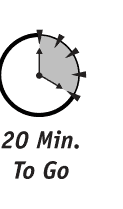

### 编写一个函数来实现一个方法

在我的构造函数中定义了方法后，我需要实际创建一个将要实现该方法的函数。幸运的是，在这种情况下，我所需要做的就是重命名并微调`calcFinalCost()`函数，如下所示：

```
function itemInfo_doCalcFinalCost() {
    return this.price + this.shipping;
}
```

如你所见，这里唯一改变的就是函数的名称，以及`this`关键字现在出现在函数中。为什么这是必要的？嗯，记住这个方法将可以从由`itemInfo`构造函数创建的任何对象中访问到。因此，该方法需要某种方式来确定使用哪个`price`属性和哪个`shipping`属性。这里再次，`this`关键字告诉方法使用属于当前对象的属性。当然，这就引出了一个问题：“一个对象如何成为‘当前’对象？”

假设你刚刚看到的方法定义是有效的，请考虑以下代码：

```
var strollerInfo = new itemInfo( 199.95, "Rock & Stroll - Deluxe",
"st-001", 20, 5);

var diaperInfo = new itemInfo( 13.95, "Size 3, Extra Absorbent",
"dp-003", 5, 100);

var strollPrice = strollerInfo.calcFinalCost();
var diaperPrice = diaperInfo.calcFinalCost();
```

在这个例子中，我创建了两个新的`itemInfo`对象：`strollerInfo`和`diaperInfo`。然后我继续调用每个对象的`calcFinalCost()`方法。现在，当我调用该方法时，我必须给出对象的名称以及方法的名称。仅仅在调用时同时指定对象和方法的名称，就告诉了JavaScript解释器在方法中遇到`this`关键字时应该使用哪个对象。很巧妙，对吧？

### 在你的程序中使用自定义方法

既然我的方法及其实现函数都已定义，我需要做的最后一件事就是更改程序中的其他代码，以便将所有对旧的`calcFinalCost()`函数的调用转变为对`calcFinalCost()`方法的调用。（实际上有两三处地方需要这样做，所以我只向你展示`calcGrandTotal()`函数中的更改。）

```
function calcGrandTotal() {
    var grandTotal = 0;
    for (x=0; x<productInfo.length; x++) {
        var thisItem = productInfo[x];
        // Are there any of this item in the cart?
        if (thisItem.inCart > 0) {
            grandTotal += thisItem.calcFinalCost() *
            thisItem.inCart;
        }
    }
    document.cart.elements['grandTotal'].value = grandTotal;
}
```

如你所见，这实际上让我的代码更小、也简单多了！

当我说“更简单”时，我不仅指它更容易输入；我也是在谈论未来的维护和添加功能。在这个例子中，我只需要在两三处地方更改代码。但是，如果计算最终成本所需的实际数学运算发生了变化怎么办？（例如，如果销售税成为一个考虑因素呢？）使用旧的设置，我可能必须更改每一处对`calcFinalCost()`函数的调用（也许是为了包含第三个或第四个参数）。然而，通过使用对象和方法的方式，我只需要在一个地方更改代码：实现函数。

### 不需要参数

查看我新的`itemInfo`构造函数，你可能已经注意到，当我在定义方法时没有指定任何参数。

```
this.calcFinalCost = itemInfo_doCalcFinalCost;
```

这并不是因为`itemInfo_doCalcFinalCost()`函数不接受任何参数，而是因为在定义方法时，你根本不允许列出参数（甚至是一对空的括号）。就像你创建的每个其他JavaScript函数一样，实现你方法的函数可以接受任意少或多的参数。你只是不能在构造函数中列出它们。

### 将库存实现为一个对象

既然熟能生巧，让我带你过一遍将库存重构为一个对象的过程。基本上，我想将我一直使用的`productInfo`数组作为处理所有与库存相关任务的更大对象的一部分。就目前情况而言，这些任务包括在库存中查找项目、将项目添加到库存以及增加和减少库存中的单位数量。像以前一样，我的第一步是为新的库存类创建一个构造函数。

```
function inventory() {
    this.productList = new Array();
    this.addInventoryItem = inventory_doAddInventoryItem;
    this.findPartNo = inventory_doFindPartNo;
    this.plusOne = inventory_doPlusOne;
    this.minusOne = inventory_doMinusOne;
}
```

这个构造函数的第一行创建了一个名为`productList`的属性。它最终将服务于与旧的`productInfo`数组相同的目的。（注意我并没有必须更改名称；然而，由于这个数组现在是一个更大结构的一部分，我觉得这个新名字更好地描述了数组的用途。）

第二行定义了一个名为`addInventoryItem`的方法。顾名思义，这个方法的目的是将一个项目添加到我的库存中。在旧的方案中，我只是将项目一个接一个地添加到我的`productInfo`数组中。然而，既然这个数组现在包含在一个对象中，为这个任务提供一个方法而不是直接访问数组就更有意义了。

这就引出了使用对象的另一个优点：如果将来某个时候，我决定改变项目在库存中的存储方式（也就是说，我想把它们存储在数组以外的其他东西中），我不必费力去查找并替换所有将项目添加到库存的代码。相反，我只需要重写`addInventoryItem`方法即可。

剩下的语句定义了我当前库存类需要的其他三个方法。这些名字可能看起来很熟悉，因为它们是我已经写过的三个函数！所以，我所需要做的就是稍微修改一下它们，将它们转换成方法。所有这四个方法都相当直接，所以现在我就把它们全部给你。

```
function inventory_doAddInventoryItem( theItem) {
    var next = this.productList.length;
    this.productList[ next] = theItem;
}

function inventory_doFindPartNo( partNo) {
    var result = "";
    for (x=0; x < this.productList.length; x++) {
        var thisItem = this.productList[x];
        if (thisItem.partNumber == partNo) {
            result = thisItem;
            break;
        }
    }
    return result;
}

function inventory_doPlusOne( partNo) {
    var prodInfo = this.findPartNo( partNo);
    // Do we have enough on hand to do this?
    if (prodInfo.inStock > 0) {
        // Update the quantities in the array
        prodInfo.inStock--;
        prodInfo.inCart++;
        // Copy these new values to the form
        document.cart.elements[ "quan_" + partNo].value = prodInfo.inStock;
        document.cart.elements[ "inCart_" + partNo].value = prodInfo.inCart;
        calcGrandTotal()
    }
    else {
```


function inventory_doMinusOne( partNo) {
    var prodInfo = this.findPartNo( partNo);
    // 我们手头的库存是否足够执行此操作？
    if (prodInfo.inCart > 0) {
        // 更新数组中的数量
        prodInfo.inStock++;
        prodInfo.inCart--;
        // 将这些新值复制到表单中
        document.cart.elements[ "quan_" + partNo].value =
        prodInfo.inStock;
        document.cart.elements[ "inCart_" + partNo].value =
        prodInfo.inCart;
        calcGrandTotal()
    }
    else {
        alert("You have no more in your shopping cart!");
    }
}

如果将这些方法与它们派生而来的函数进行比较，你会发现它们之间确实没有太大的区别。当然，所有对旧的 `productInfo` 数组的引用都已被替换为对 `productList` 的引用，但这可能是最明显的变化。不那么明显的是，`this` 关键字已经悄悄地进入了所有这些方法中。为什么？嗯，请记住这些现在是方法了，所以它们属于某个对象。到目前为止，只可能有一个购物车，里面只有一个库存。但是，现在所有内容都正在被重写为对象，非常现实的可能性是存在多个购物车，每个购物车里面有一个或多个库存对象！正因如此，这些方法必须使用 `this` 关键字，以便在被调用时知道它们实际操作的是哪个库存对象。

这里唯一真正新的方法是 `addInventoryItem()` 方法。不过正如你所看到的，它并没有太多内容。你只需向它传递一个 `itemInfo` 对象，它就会将其添加到 `productList` 数组的末尾。

现在唯一剩下的就是实际投入使用新的库存对象。执行此操作的代码如下所示。

```javascript
// 创建库存对象
var bpInventory = new inventory();
```

// 现在，用商品填充它

```javascript
var strollerInfo = new itemInfo( 199.95, "Rock & Stroll - Deluxe", "st-001", 20, 5);
var diaperInfo = new itemInfo( 13.95, "Size 3, Extra Absorbent", "dp-003", 5, 100);
var carSeatInfo = new itemInfo( 149.95, "Ultra-Safe, Rear-Facing", "cs-001", 15, 5);
var rattleInfo = new itemInfo( 4.95, "UberNoise 5000", "rt-001", 5, 155);
var babyWipeInfo = new itemInfo( 9.95, "Clean and Fragrant", "bw-001", 6, 75);
```

```javascript
bpInventory.addInventoryItem( strollerInfo);
bpInventory.addInventoryItem( diaperInfo);
bpInventory.addInventoryItem( carSeatInfo);
bpInventory.addInventoryItem( rattleInfo);
bpInventory.addInventoryItem( babyWipeInfo);
```

差不多就是这些了！当然，其他需要访问 `productList` 数组的代码片段也需要进行一些改写。不过，所需的更改是非常简单的。以下代码展示了 `calcGrandTotal()` 函数如何进行更改以适应库存对象。（请务必将其与之前本节中展示的 `calcGrandTotal()` 原始代码进行比较。）

```javascript
function calcGrandTotal() {
    var grandTotal = 0;
    for (x=0; x<bpInventory.productList.length; x++) {
        var thisItem = bpInventory.productList[x];
        // 购物车中是否有该商品？
        if (thisItem.inCart > 0) {
            grandTotal += thisItem.calcFinalCost() *
                          thisItem.inCart;
        }
    }
    document.cart.elements["grandTotal"].value = grandTotal;
}
```

## 复习

在本节中，你学习了如何向 JavaScript 对象添加方法。作为其中的一部分，你学习了方法与函数的区别以及什么是实现函数。你还看到了几个将"普通"JavaScript 代码转换为具有一组属性和方法的对象的示例。

## 自我测验

1.  方法与函数有什么区别？（参见"什么是方法？"）
2.  向类添加方法的步骤是什么？（参见"定义方法。"）
3.  什么是方法的实现函数？（参见"定义方法。"）
4.  你如何实际指定一个对象将包含特定的方法？（参见"在构造函数中指定方法。"）
5.  你应该如何命名方法和实现函数？（参见"在构造函数中指定方法。"）

# 第 19 节

## 使用 JavaScript 对象增强 HTML

### 本节检查清单

-   使用 JavaScript 对象来增强 HTML 控件
-   了解 JavaScript 对象如何使数据验证更加容易
-   向预定义的 JavaScript 对象添加自己的属性和方法

至此，你已经知道如何创建和使用自己的对象了。你还知道如何使用 JavaScript 来操作 HTML 页面的各个部分。所以，你可能在想，如果能创建自定义对象来使操作 HTML 文档变得更加容易，那将会非常棒。嗯，你可以！

### 增强 HTML 控件

你可能能做的最有用的事情就是创建自定义的 JavaScript 对象来增强网页上的 HTML 控件。正如你在第 13 节中回忆到的，所有各种 HTML 控件已经有等效的 JavaScript 对象，配备了大量的属性和方法。然而，这些对象实际上只提供了最基本的功能。例如，为什么没有一个 `getValue()` 方法来返回一组单选按钮中被选中的那个的值呢？当然，你可以自己找出哪个单选按钮被选中并获取它的值，但这种缺失令人困惑。当然，仅仅因为一个方法缺失，并不意味着你会想扔掉一个完全可用的对象。理想的解决方案是获取已经存在的 JavaScript 对象（比如 String 对象或代表单选按钮的对象），然后向它们添加你想要的新属性和方法。

在其他编程语言中，这种事情非常容易做到。你拿一个已存在的类，向它添加一些新的属性和方法，你就得到了一个新类。这个新类被称为*子类*；它可以包含旧类（被称为"超类"）的所有属性和方法，以及你添加的所有新属性和方法。这个过程不会以任何方式影响旧类，因此两个类实际上会在你的程序中共存。不幸的是，在 JavaScript 中，这并不像它应该的那样简单。JavaScript *确实*提供了一种向预定义类添加新属性和方法的方式，但它并不真正允许你创建子类，而且似乎对浏览器对象模型中的类完全不起作用。（我将在本节稍后的"扩展现有的 JavaScript 对象"部分讨论 JavaScript 的这一方面。）

### 创建对象包装器

由于你不能直接修改控件对象的属性和方法，我将向你展示如何做次优选择：创建一个包装器对象。顾名思义，*包装器对象*是包裹在另一个对象外面的对象。由于包装器本身也是一个对象，你可以给它任何你想要的属性和方法。现在，在这变得太复杂之前，让我通过一个例子来向你确切地展示我在说什么。

在这个例子中，我将尝试解决我之前对单选按钮的抱怨。具体来说，为什么没有一个与单选按钮对象关联的 `getValue()` 方法？在接下来的代码中，我将创建一个包装器对象，它将把这个方法以及其他一些方法添加到单选按钮上。与你创建的任何其他对象一样，你需要决定你的包装器对象应该具有什么功能。快速看一下我包装器的构造函数，应该能让你了解我想要什么样的功能。（此源代码可以在你 CD-ROM 上的 Session19 文件夹中找到。）

```javascript
function radioObj( radioFamilyObject) {
    this.control = radioFamilyObject;
```


### this.getLength = radioObj_doGetLength;
this.getSelected = radioObj_doGetSelected;
this.setSelected = radioObj_doSetSelected;
this.channelUp = radioObj_doChannelUp;
this.channelDown = radioObj_doChannelDown;
this.getValue = radioObj_doGetValue;
}

在这个构造函数中，我定义了一个属性（`control`）和六个新方法。你还会注意到这个构造函数接受一个参数 `radioFamilyObject`。该参数在对象创建时被赋值给 `control` 属性。那么，`control` 属性到底是什么呢？请记住，这是一个*包装器*对象。它所包装的实际上是另一个对象。在这里，它包装的是一个已有的 JavaScript 单选按钮对象。如果这还不够清楚，请看下面的代码。

```
<form name="delivery">
    Select a Delivery Method<br />
    <input type="radio" name="dMethod" value="standard" checked />
    Standard Shipping<br />
    <input type="radio" name="dMethod" value="overnight" />
    Overnight Shipping<br />
    <input type="radio" name="dMethod" value="snail mail" />
    Slowest Possible<br />
    <script language="javascript">
    // 'wrap' my custom object around the JavaScript object
    var dMethodRadio = new radioObj( document.delivery.dMethod);
    </script>
</form>
```

在这个清单中，我创建了一个非常简单的表单，其中包含一组单选按钮。在随后的脚本块中，我调用 `radioObj` 构造函数，并将表示该单选按钮组的 JavaScript 对象传递给它。这个对象被赋值给包装器对象内部的 `control` 属性。因此，当这段代码执行完毕后，我的包装器对象就可以访问这个控件对象及其附带的所有属性和方法。例如，如果我编写

```
alert( dMethodRadio.control.length);
```

将会弹出一个包含"3"的警告窗口。

为包装器对象创建方法的诀窍只有一点，就是记住使用 `control` 属性来实际获取 JavaScript 控件对象的信息。虽然实现这一点的代码并不难，但确实*相当冗长*！所以，请打开 CD-ROM 上 Session19 文件夹中的 radioObj.htm 文件，快速浏览一下，然后用它来配合理解后续的讨论。

我的包装器中第一个方法 `getLength()` 是最简单的一个。就像我之前给出的简短示例一样，它只是读取控件对象的 `length` 属性并返回它。同时注意 `this` 关键字的使用。请记住，由于这是一个对象，这个 HTML 文档中实际上可能定义了数十甚至数百组单选按钮（以及 `radioObj` 对象）。同样，`this` 关键字告诉 JavaScript 解释器我当前实际操作的是哪一个 `radioObj` 对象。

其余的方法的工作方式大致相同。不过你还会注意到，其他每个方法都有相互调用的倾向。例如，`getValue()` 方法会调用 `getSelected()` 方法来确定应该返回哪个单选按钮的 `value` 值。

### 将对象绑定到 HTML

这个谜题的最后一块，就是将你的自定义对象实际绑定到 HTML 页面的方式。正如你已经看到的，你的自定义对象实际上可以将一个已有的 JavaScript 对象作为属性包含在内。但是，如何让这些对象与 HTML 页面的其他部分进行交互呢？一如既往，答案是事件处理器。请查看 radioObj.htm 文件末尾的 `<form>`，你就会明白我的意思。

这基本上与你在本节中看到的第一个表单相同，但我在单选按钮上添加了 `onclick` 处理器。我还添加了几个普通按钮，每个按钮都有一个 `onclick` 处理器，分别调用 `dMethodRadio` 对象的不同方法。

> 不要忘记，几乎*任何*非空的 HTML 标签（即任何有开始标签和结束标签的 HTML 标签）都可以触发事件。因此，如果需要的话，你可以将自定义对象（甚至是你原有的普通函数）挂接到文档中几乎任何 HTML 标签上。

### 扩展已有的 JavaScript 对象

正如我在本节开头所提到的，JavaScript 包含一种机制，允许你向某些已有的 JavaScript 对象添加属性和方法。这是通过向对象的*原型*添加属性和/或方法来实现的。

你可以把对象的原型想象成它的蓝图。如果你改变了原型，你就改变了对象的结构。这有点像修改对象的构造函数，区别在于你可以在程序运行时进行修改。

现在，在进一步讨论之前，我需要再介绍一下 JavaScript 对象的工作方式。除了你已经学过的 String 和 Array 对象之外，JavaScript 还有若干其他内置对象。（你将在后续章节中学习其中的大部分对象。）然而，所有这些对象都基于一个名为 Object 的单一父对象。Object 类是 JavaScript 中几乎所有对象的基础，包括你自己创建的对象。

这一切的重点在于，你只能修改内置于 JavaScript 语言的类或者你自己定义的类的原型。因此，虽然你可以修改例如 String 类的原型，但你无法修改单选按钮对象的原型。这是因为单选按钮对象属于浏览器对象模型（Browser Object Model），而不是 JavaScript 语言的一部分。

### 增强 String 类

那么，考虑到这一点，对于 String 这样的类，有哪些增强功能会比较好呢？如你所知，字符串最常见的数据验证任务之一是检查字符串是否为空。因此，让我们为 String 类添加一个执行此功能的方法。下面的代码行展示了如何向 String 类实际添加一个新方法。

```
String.prototype.isBlank = String_doIsBlank;
```

很简单吧？在我这条语句的左边是类名（这里就是 String），后面跟着 prototype 关键字，然后是新方法的名称（isBlank）。语句的右边是实现该新方法的函数名。剩下的就是实际编写实现函数并进行测试。

```
function String_doIsBlank() {
    var result = true;
    if (this != "") {
        for (x=0; x < this.length; x++) {
            var theChar = this.charAt( x);
            if (theChar != " ") {
                result = false;
                break;
            }
        }
    }
    return result;
}
var oldAndBlank = "  ";
// Add the new method to the String prototype
String.prototype.isBlank = String_doIsBlank;

var blank = "";
var notBlank = "Not blank!";
var alsoBlank = "   ";
alert( blank.isBlank());
alert( notBlank.isBlank());
alert( alsoBlank.isBlank());
// Even 'old' strings get the new method!
alert( oldAndBlank.isBlank());
```

如果你觉得 isBlank() 方法的代码看起来很眼熟，那你就说对了。这其实就是我一直在使用的 isBlank() 函数的代码。当然，它做了一点修改：传入的参数（它告诉函数要检查哪个字符串）被 `this` 关键字替换了。

从这段代码可以看出，在我修改了 String 类的原型之后，我创建的每个 String 对象都可以立即使用这个新方法。然而，你可能没想到的是，甚至在添加新方法之前创建的 String 对象（本例中的 oldAndBlank 变量）也能使用它！据我所知，这种相当令人惊讶的行为是 JavaScript 独有的，它使得原型成为所有对象的"追溯性蓝图"，而不仅仅是你创建的新对象的简单蓝图。

### 通过原型添加属性

当然，你可以用与添加方法完全相同的方式来添加属性。你赋给这些属性的值将立即在该类的所有对象中可用。例如，如果我想给所有 String 对象添加一个 language 属性，我只需编写：

```
String.prototype.language = "English";
var greeting = "Bonjour!";
greeting.language = "French";
```

然后我可以像使用 String 类的任何其他属性一样使用这个属性；我甚至可以创建与该属性配合使用的方法。当然，如果你想使用


## 第19课—用JavaScript对象增强HTML

如果你使用原型方法来扩展一类对象，请务必将所有修改原型的语句放在HTML文档的开头。这样，你就能确保所有修改在代码主体开始执行之前就已完成。

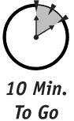

### 为HTML控件添加数据验证

如果你在脑海中把这些内容综合起来思考，我认为你可能开始意识到这些技术的一个自然用途就是为HTML表单中的控件添加增强的数据验证方法。例如，如果你的文本框能够自行验证，那岂不是很好？当然！

```
function textObj( textControl, validChars ) {
    this.control = textControl;
    this.allowedChars = validChars;
    this.isValid = textObj_doIsValid;
    this.getText = textObj_doGetText;
    this.setText = textObj_doSetText;
    this.isBlank = textObj姑息_isBlank;
}
```

这里我定义了一个相当简单的对象，它将能够包装一个JavaScript文本框控件对象。control属性和你之前见过的一样，我相信你也能猜出getText()、setText()和isBlank()方法的作用。但是，allowedChars属性和isValid()方法是全新的。

基本上，allowedChars属性允许你指定哪些字符可以输入到控件中，而isValid()方法则确保控件中实际只包含这些字符。例如，如果我想创建一个只接受数字字符的控件，我的HTML可能如下所示：

```
<input type="text" size="30" name="NumText" />
```

而我的JavaScript代码如下：

```
var numText = new textObj( document.formName.NumText,
"0123456789");
```

textOjb.htm文件中的代码展示了实现所有这些方法的一种方式。（同样，这段代码并不太难，但确实比较长，所以请在HTML编辑器中打开文件以便跟随学习。）

这个文件中定义的大多数方法都非常直观。（不过你会注意到，`isBlank()`方法只是简单地调用了我添加到String类中的`isBlank()`方法。要了解具体实现方式，请参阅CD-ROM上的textObj.htm文件。）其中唯一比较巧妙的方法是`isValid()`方法。该方法检查输入到控件中的字符，并将它们与对象的`allowedChars`属性中的字符进行比较。如果任何字符不在`allowedChars`集合中，就会显示一个警告窗口，告知用户哪些字符是被允许的。

通过这种方式，我可以设置一个文本框，使其能够根据我定义的任意字符集来验证自身内容。更好的是，我不必为每种不同类型的数据编写自定义验证例程。CD-ROM上的示例文件创建了检查数字字符、字母数字字符、十六进制字符、八进制字符等多种类型的文本框。不过，如果你真的想的话，你也可以设置一个只允许输入辅音或只允许输入元音的文本框。这完全取决于你。

当然，我仍然需要将这个验证例程绑定到我的控件上。与往常一样，这只需要一个适当的事件处理程序。

```
<input type="text" size="30" name="NumText"
onchange="numText.isValid()" />
```


## 复习

在本课中，你了解了如何使用JavaScript对象来增强HTML文档的功能。你学习了如何创建包装对象，为表示HTML表单中控件的JavaScript对象添加新的属性和方法。你还学习了如何更改任何JavaScript内置对象的原型，为这些对象添加新的属性和方法。最后，你看到了一个示例，展示如何使用这些新技术创建一个"知道"如何验证自身内容的文本框对象。

## 自我测试

- 1. 什么是包装对象？（参见"创建对象包装器"。）
- 2. 如何将JavaScript对象"挂接到"你的HTML上？（参见"将对象绑定到HTML"。）
- 3. 什么是对象的原型？（参见"扩展现有JavaScript对象"。）
- 4. 当你通过类的原型添加属性或方法时，哪些对象可以使用新的属性或方法？（参见"增强String类"。）
- 5. 为什么你可能想要创建自验证控件？（参见"为HTML控件添加数据验证"。）

---

# 第20课—动态创建和执行JavaScript

## 课程学习清单

- 了解eval()函数
- 理解setTimeout()和setInterval()如何与JavaScript对象配合工作

在第11课中，你学习了如何使用JavaScript动态创建HTML标签。你还了解了如何动态创建JavaScript代码块。这两种技巧背后的理念是，你可以在浏览器显示页面之前就构建好自定义的网页。但是，如果你需要在网页加载完成后创建并执行JavaScript语句呢？正如你在第9课中所看到的，尝试在页面加载后生成新内容实际上会清除页面当前的内容。所以，你需要某种方式来动态创建和执行新的JavaScript语句，同时不损害HTML文档的当前内容。幸运的是，JavaScript提供了一个函数，正好可以实现这一点。

## 使用eval()函数

eval()函数可能是整个JavaScript中最酷、最强大的函数。简单来说，eval()函数接受一个字符串，并将其传递给JavaScript解释器执行。因此，这行代码：

```
eval( "alert( 'Hello World!')")
```

如前所述，你将一个字符串传递给eval()函数，让它转交给JavaScript解释器。在上面的示例中，我传递了一个硬编码的字符串。不过，我也可以传递一个包含字符串的变量：

```
var myCommand = "alert( 'Hello World!')";
eval( myCommand);
```

结果是一样的。事实上，你可以混合使用变量和硬编码字符串。

```
var myCommand = "alert";
eval( myCommand + "( 'Hello World!')");
```

只要最终结果是一个字符串，eval()函数就会忠实地将其传递给JavaScript解释器执行。

虽然eval()函数非常酷，但它并非魔法。因此，当你的字符串到达JavaScript解释器时，它仍然必须是一条有效的JavaScript语句。例如，以下eval()调用会产生错误，就像你将该语句硬编码到程序中一样：

```
eval( "allert( 'Hello World!')");
```

## 变量与eval()函数

当eval()函数将字符串传递给JavaScript解释器执行时，解释器执行该命令的方式就好像它是你程序的一部分。这意味着该命令可以访问你的所有全局变量，以及在程序该位置普通语句可以访问的任何局部变量。例如：

```
var who = "World!";
var greeting = "Hello ";
eval( "alert( greeting + who )");
function greet() {
    var who = "Everybody!";
    eval( "alert( greeting + who )");
}
greet();
```

这里，第一个eval()调用会产生一个显示"Hello World!"的警告窗口。然而在函数内部，我声明了一个名为who的局部变量，它将被第二个eval()调用使用。这将产生一个显示"Hello Everybody!"的警告窗口。

在上面的示例中，你会注意到我传递给eval()函数的字符串包含了我希望alert()方法显示的变量名。

```
eval( "alert( greeting + who )");
```

换句话说，greeting和who变量的内容要等到这个命令字符串传递给JavaScript解释器之后才会被求值。不过，我也可以用稍微不同的方式编写这条语句：

```
eval( "alert( '" + greeting + who + "')" );
```

你看出区别了吗？在第二个版本中，我的变量内容在传递给JavaScript解释器*之前*就被提取出来并放入了命令字符串中。这等同于编写：

```
eval( "alert( 'Hello World!')" );
```

所以，关于应该传递变量还是硬编码字符串的问题，基本上取决于个人偏好。不过，从这些简单语句中你可以看出，从编码的角度来看，直接传递变量名并让JavaScript解释器为你处理一切当然更简单。

## 你能eval()哪些类型的语句？

到目前为止，我展示的所有示例都是非常简单的语句传递给eval()函数。然而，eval()函数可以处理最复杂的JavaScript语句。以下例子虽然不是最复杂的，但应该能让你了解我所说的意思：

```
<form name="myForm">
<input type="text" name="result" />
</form>
<script language="javascript">
var theForm = "myForm";
var theControl = "result";
var val = "Hello World!";
eval( "document." + theForm + "." + theControl + ".value = val");
</script>
```

在第11课中，我说过使用JavaScript创建HTML最强大的功能之一就是你可以将整个HTML结构存储在

JavaScript变量，然后通过编程重新排列它们以获得所需的输出。在这个例子中，我将同样的想法应用到了JavaScript结构中。通过将这些结构的名称（即我的表单和文本框的名称）放入JavaScript变量中，我可以使用它们来构建命令，并传递给`eval()`函数执行。

## `setTimeout()` 和 `setInterval()` 方法

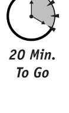

你可能会想，`eval()`函数看起来非常类似于你在第8节中学到的`window.setTimeout()`和`window.setInterval()`方法。嗯，确实如此！`window`对象的这些方法与`eval()`函数所做的几乎完全相同，它们只是在一个指定的延迟之后执行。（有关这些方法的详细示例，请回顾第8节。）

## 在 `setTimeout()` 和 `setInterval()` 中使用对象

正如我所说，这些方法与`eval()`函数的主要区别在于，`eval()`函数会立即执行你的命令。而`setTimeout()`和`setInterval()`方法则会等待指定的毫秒数过去后才执行你的命令。由于当今计算机的运行速度，即使是几毫秒也可能对你的程序状态产生*重大*影响。因此，如果你想在对象上使用其中任何一种方法，你必须更仔细地考虑如何构造传递给该方法的命令。例如，考虑以下代码：

```javascript
function annoying_doAnnoy() {
    alert( this.msg);
    setTimeout( 'this.annoy()', 5000);
    }
function annoying( message) {
    this.msg = message;
    this.annoy = annoying_doAnnoy;
    }
var annoyEM = new annoying( "Hello!");
annoyEM.annoy();
```

看到这个，你可能会认为这段代码会重复显示一个包含消息"Hello!"的警告窗口。嗯，这正是它的意图，但代码中存在一个缺陷，导致它在显示第一个警告窗口后就会失败。缺陷在于`setTimeout()`语句：`setTimeout('this.annoy()', 5000);`

## 第20节——动态创建和执行 JavaScript

这条语句告诉JavaScript解释器等待五秒钟，然后调用这个对象的`annoy()`方法。问题在于，五秒钟后，`this`的值几乎肯定会是`undefined`，仅仅因为我们的方法在五秒钟前就已经执行完毕了。实际上，在这五秒钟内，`this`可能已经取了几个新的值。不幸的是，它们中没有一个可能与调用`setTimeout()`方法时相同。最终结果是，`annoy()`方法将无法被找到，你会得到一个错误信息。

唯一的解决方法是指定你希望调用其方法的对象的名称。当然，所有浏览器对象模型对象都足够聪明，会将它们的名称隐藏在自身内部。你可以对自定义对象做同样的事情，但这确实需要在定义对象时做一点额外的工作。下面的简短程序将向你展示我的意思。

```javascript
function annoying_doAnnoy() {
    alert( this.msg);
    setTimeout( this.name + '.annoy()', 5000);
    }
function annoying( name, message) {
    this.name = name;
    this.msg = message;
    this.annoy = annoying_doAnnoy;
    }
var annoyEM = new annoying( "annoyEM", "Hello!");
annoyEM.annoy();
```

在这个代码清单中，我在对象定义中添加了一个`name`属性。需要注意的是，我赋予这个属性的值与我用来存储正在创建的对象的JavaScript变量的名称相同。换句话说，我对象中的`name`属性与持有该对象的JavaScript变量的名称相同。在这种情况下，该名称是"annoyEM"。

为什么这么麻烦？嗯，通过让对象知道它自己的JavaScript变量名，我可以创建像这样的`setTimeout()`调用：

```javascript
setTimeout( this.name + '.annoy()', 5000);
```

在这种情况下，`this`等同于编码：

```javascript
setTimeout( 'annoyEM.annoy()', 5000);
```

当这条语句在五秒后执行时，正确的对象将被引用，调用将会成功。（注意，我在这里告诉你的关于`setTimeout()`的所有内容也可以应用于`setInterval()`。）

## 使用 `setTimeout()` 创建动画对象

不要被这个概念的简单性所迷惑。将对象的JavaScript变量名保存在其内部是一种极其强大的技术，可以让你执行各种本来会相当困难的任务。例如，在第14节中，我向你展示了如何创建一个简单的动画。虽然涉及的代码相当简单，但它确实不适合在同一页面上进行多个动画。然而，如果这段代码可以重写为一个对象，那么在你的页面中散布基于JavaScript的动画将是一件简单的事情。以下是创建动画对象的一种方法。

```javascript
function animation_doPreLoad() {
    for (x=0; x < this.numFrames; x++) {
        this.animFrames[ x ] = new Image();
        this.animFrames[ x ].src = this.imgPath + this.name + x +
        ".jpg";
    }
}
function animation_doAnimate() {
    if (this.animFrames[ this.numFrames - 1].complete) {
        eval( "document." + this.imgName + ".src =
        this.animFrames[ this.currentFrame++].src");
        if (this.currentFrame == this.numFrames) {
            this.currentFrame = 0;
        }
    }
    else {
        setTimeout( this.name + '.animate()', this.animSpeed);
    }
}
function animation( name, path, numFrames, speed) {
    this.name = name;
    this.imgName = name + "_img";
    this.imgPath = path;
    this.animFrames = new Array();
    this.numFrames = numFrames;
    this.animSpeed = speed;
    this.currentFrame = 1;
    this.preLoad = animation_doPreLoad;
    this.animate = animation_doAnimate;
    this.preLoad();
}
```

在这里，我采用了第14节中的动画代码，并将其转换为一个简单的对象。`animation`构造函数函数的第一个参数是将持有该对象的JavaScript变量的名称。我还决定我的图形文件的名称也将基于此名称。（因此，如果我的JavaScript变量是`titleAnim`，磁盘上的图形文件名将是`titleAnim0.jpg`、`titleAnim1.jpg`等。）这是一个任意的决定，但它使对象的设计变得简单得多，并在图形文件和将要处理它们的JavaScript代码之间建立了一种逻辑关系。

第二个参数是服务器上必须遵循的路径，以实际获取我动画的图形。注意，这是一个部分路径，直到但不包括实际的文件名。

其余参数指定了动画中的帧数以及动画应以什么速度回放。定义了这个对象后，创建和播放动画所需的就是一条简单的JavaScript语句，如下所示：

```javascript
var titleAnim = new animation( 'titleAnim', "../images/", 16, 250);
```

以及HTML文档中相应的``标签：

```html

```

查看`animate()`方法，你可以看到`eval()`函数和`setTimeout()`方法都在使这个动画工作方面发挥了作用。`eval()`函数（以及``标签的名称）需要用于加载下一帧。但是，在动画可以开始之前，需要`setTimeout()`方法（以及JavaScript变量的名称）来检查所有帧是否已加载。当你处理简单函数时，执行这些任务很容易，但当你转向基于对象的动画时，你需要访问相关的名称才能使事情顺利运行。

## 创建购物车对象

终于！你已经看到了创建购物车对象所需的所有技术。那么，事不宜迟，让我向你展示购物车对象的构造函数。（注意，由于涉及大量代码，我将只向你展示最重要的部分。当然，你可以在你的CD-ROM的Session20文件夹中找到购物车对象的所有源代码。）


```
function shopCart( cartName) {
    this.name = cartName;
    this.cartForm = cartName + "_form";
    this.cookieName = cartName + "_cookie";
    this.clearCookie = false;
    this.inven = new inventory();
    this.initCart = shopCart_doInitCart;
    this.calcGrandTotal = shopCart_doCalcGrandTotal;
    this.plusOne = shopCart_doPlusOne;
    this.minusOne = shopCart_doMinusOne;
    this.enterQuantity = shopCart_doEnterQuantity;
    this.showProductInfo = shopCart_doShowProductInfo;
    this.drawCart = shopCart_doDrawCart;
    this.saveCart = shopCart_doSaveCart;
    this.loadCart = shopCart_doLoadCart;
    this.submitCart = shopCart_doSubmitCart;
    this.initCart();
}
```

你可能已经猜到了，我简单地改造了原来的函数，使它们成为 shopCart 类的方法。由于这些方法大部分都是你已经见过的，让我来介绍一下这里定义的属性。

第一个属性是 name。与本教程中看到的其他示例一样，name 属性用于动态创建 JavaScript 语句。然而，这些语句并未与 `eval()` 函数一起使用。请考虑以下摘自 showProductInfo() 方法的代码片段。

```
var inCartBox = "<input type='text' name='inCart_" + pInfo.partNumber + "'";
inCartBox += "onchange='" + this.name + ".enterQuantity(\"" + pInfo.partNumber + "\")'";
inCartBox += " value='" + pInfo.inCart + "' size='6' />";
```

对于库存中的每一项，我创建一个文本框，显示用户购物车中该项商品的数量。这段代码定义了该文本框。现在，如果用户更改此文本框中的值，我需要调用一个 onchange 处理程序来验证输入的值是否有效。这项工作由 enterQuantity() 方法完成，但我还需要指定此方法属于哪个对象。（请记住，可能存在多个购物车对象，因此我不能在此处硬编码变量名称。）这就是 name 属性变得无比宝贵的地方。假设我的购物车变量名称为 "bpCart"，则此代码将为库存中的第一项生成以下 HTML：

## 第 20 讲 —— 动态创建和执行 JavaScript

```
<input type='text' name='inCart_st-001' 
onchange='bpCart.enterQuantity("st-001")' value='0' size='6' />
```

如你所见，生成的 onchange 处理程序正是调用 bpCart 变量的 enterQuantity() 方法所需的内容。

第二个属性是 cartForm。这只是名称后面加上 "_form"。对象的优势之一是它们让你能够"封装"某物可以执行的所有操作。我希望购物车能够执行的操作之一是创建并输出用于显示其信息的表单。因此，这是我将用于创建该表单的名称。此名称在 shopCart 方法的许多不同地方都有使用，但最简单的是 calcGrandTotal() 方法，如下所示：

```
function shopCart_doCalcGrandTotal() {
    var grandTotal = 0;
    for (x=0; x<this.inven.productList.length; x++) {
        var thisItem = this.inven.productList[x];
        // Are there any of this item in the cart?
        if (thisItem.inCart > 0) {
            grandTotal += thisItem.calcFinalCost() *
            thisItem.inCart;
        }
    }
    eval( "document." + this.cartForm +
    ".elements['grandTotal'].value = grandTotal");
}
```

这里值得关注的是方法中的最后一条语句。在这里，我使用 cartForm 属性创建一条命令字符串，然后将其传递给 `eval()` 函数。一旦 JavaScript 解释器执行此语句，显示订单总计的文本框就会更新为新的总额。shopCart 类中其余属性和方法的工作方式大致相同。cookieName 属性让每个购物车维护自己的 cookie，所有其他方法都已 reworked 以使用 cartForm 属性与每个 shopCart 对象关联的 HTML 表单进行通信。

花一分钟将 Session20 文件夹中的 index.htm 文件加载到你的 Web 浏览器中。如你所见，它的工作方式与你看到的上一个版本完全相同。唯一的区别是，几乎所有底层的 JavaScript 都已转换为使用对象。

## 复习

在本讲中，你学习了如何使用 `eval()` 函数动态创建和执行 JavaScript 语句。你还学习了此函数如何与全局变量和局部变量配合使用。接下来，你了解了将 `setTimeout()` 和 `setInterval()` 方法与 JavaScript 对象一起使用时可能导致的问题。我向你展示了解决这个问题的一种方法是给你的 JavaScript 对象添加一个 name 属性，用于保存对象所在的 JavaScript 变量名称。然后可以使用此名称来构建能访问正确对象并正常工作的 `setTimeout()` 和 `setInterval()` 语句。最后，你看到了如何将所有这些技术结合起来创建一个像购物车对象这样的复杂对象。

## 自我测验

1. `eval()` 函数有什么作用？（参见"使用 eval() 函数"）
2. `eval()` 与 `setTimeout()` 或 `setInterval()` 有什么不同？（参见"setTimeout() 和 setInterval() 方法"）
3. 为什么不应该在 `setTimeout()` 和 `setInterval()` 方法中使用 `this` 关键字？（参见"将对象与 setTimeout() 和 setInterval() 一起使用"）
4. 应该向 `eval()` 函数传递字符串还是变量名？（参见"变量与 eval() 函数"）
5. 不应该向 `eval()` 函数传递哪种语句？（参见"可以 eval() 哪些类型的语句？"）

# 部分

# 周六晚上

1. 谈到对象时，类和实例之间有什么区别？

2. 在构造函数内部使用时，`this` 关键字指的是什么？

3. 创建自定义对象类需要经过哪些步骤？

4. 可以在对象的属性中存储哪种类型的数据？

5. 可以向构造函数传递多少个参数？

6. 构造函数内部方法的参数是如何表示的？

7. 用你自己的话，什么是方法？

8. 方法和实现函数之间有什么区别？

9. 在方法内部使用时，`this` 关键字指的是什么？

10. 假设以下语句出现在构造函数内部，它表示什么含义？

```
this.action = doAction;
```

11. 如何用 JavaScript 对象增强 HTML 控件？

12. 如何将包装器对象连接到它所包装的对象？

13. 当你向对象的原型添加属性或方法时会发生什么？

14. 你会使用什么语句向 String 类添加一个名为 "languageDirection" 的新属性？

15. 什么是 Object 类？

# 第四部分 —— 周六晚上部分复习

16. 当你将语句传递给 `eval()` 函数时，该语句何时执行？

17. 执行以下语句时会发生什么？

```
eval("document.write( \"Hello World!\")");
```

18. 将对象的 JavaScript 变量名称存储在对象中有什么优势？

19. 以下哪条语句更有可能成功？

```
setTimeout("myObject.myMethod()", 1000);
setTimeout("this.myMethod()", 1000);
```

20. 在第 20 讲中，我创建了一个动画类。按照所写，这个类只能与 JPEG 图形配合使用。从 Session20 文件夹中取出 animationObject.js 源代码并进行修改，使得在创建新动画对象时可以指定要用于动画的图形类型。

- [x] 周五
- [x] 周六
- [x] 周日

# 第五部分 —— 周日上午

**第 21 讲** *使用层叠样式表*

**第 22 讲** *使用 JavaScript 创建动态 HTML*

**第 23 讲** *使用框架*

**第 24 讲** *使用窗口*

**第 25 讲** *改进用户界面*

**第 26 讲** *使用不同的浏览器*

# 第六部分 —— 周日下午

**第 27 讲** *处理日期、数字和 Web 地址*

**第 28 讲** *与服务器端进程通信*

**第 29 讲** *支持多媒体*

**第 30 讲** *使用 Java 小程序*
```


# 第五部分

# 周日早晨

- **第21讲**
  使用层叠样式表
- **第22讲**
  使用 JavaScript 创建动态 HTML
- **第23讲**
  使用框架
- **第24讲**
  使用窗口
- **第25讲**
  改进用户界面
- **第26讲**
  兼容不同的浏览器

# 第21讲
### 使用层叠样式表

## 本讲要点

- 了解层叠样式表的基础知识
- 了解 JavaScript 如何与层叠样式表协同工作
- 了解文档对象模型

**还剩30分钟**

在过去几年里，业界大力推动将网页内容（网页上的文字和图片）与内容的呈现样式（字体、字号等）分离开来。其理念是，如果能将内容与样式分离，就可以仅通过更改所使用的样式，在各种设备（如 Macintosh、Palm PDA、Windows PC、电视等）上呈现相同的内容。为了实现这一目标，万维网联盟（通常称为 W3C）制定了一项名为层叠样式表（简称 CSS）的标准。通过使用 CSS，你可以控制 HTML 页面上几乎所有元素的外观，包括字体族、大小、颜色、透明度和位置。最重要的是，你可以使用 JavaScript 在页面加载并绘制到网页浏览器中之后修改这些样式。但是，在我告诉你如何使用 JavaScript 来处理样式表之前，我需要先向你介绍一下样式表本身的工作原理。（顺便说一下，由于本书主要关注的是 JavaScript，我不会详细讲解 CSS 标准。如需了解关于 CSS 的所有信息，请访问官方 CSS 信息网站 www.w3.org/TR/REC-CSS2。）

### CSS 基础

首先要了解的是，如果你打算使用样式表，就应该承诺在网页中将样式表用于所有样式。这意味着不使用任何 `<font>` 标签，也不使用表格中的 color 或 bgcolor 属性！虽然这听起来像是很大的牺牲，但相信我，一旦你用几次样式表，你就*永远*不想再回到使用 `<font>` 标签了！（如果你实在无法放弃 `<font>` 标签，你*可以*将样式表与旧的样式选项混合使用。但我*强烈*建议你在熟悉样式表后立即全面转向样式表。）

#### 什么是样式表？

简单来说，样式表是告诉浏览器如何为 HTML 文档中的各种元素设置样式的规则列表。这些样式规则会在浏览器加载并在浏览器窗口中绘制你的 HTML 文档时应用。例如，我可以定义一条样式规则说："我希望 `<address></address>` 标签内的所有内容显示为绿色。" 有了这些信息，浏览器就会扫描我的文档，每当它找到一组 `<address></address>` 标签时，就会将内部的文字着色为绿色。

#### `<style>` 标签

现在你已经知道样式表是什么了，问题就变成了"如何将它们放入我的 HTML 文档中？" 实际上有多种方法可以将样式插入到你的 HTML 文档中，但最简单的方法是使用 HTML `<style>` 标签。例如，下面这个 `<style>` 标签会告诉浏览器将我的所有 `<address>` 标签着色为绿色：

```html
<style type="text/css">
address { color:green }
</style>
```

这个标签本身告诉浏览器接下来会有一系列样式规则。type= 属性告诉浏览器这些规则遵循什么标准。这里指定的类型告诉浏览器这些规则是纯文本，并且遵循层叠样式表标准。（注意，至少还有另一个样式表"标准"。讽刺的是，它是由 Netscape 开发的 JavaScript 样式表标准。然而，即使这是一本关于 JavaScript 的书，我们也不会讨论这个标准，因为它不是 W3C 的官方标准，而且只有 Netscape 浏览器支持它。）当然，你可以在一个样式块中包含多个规则，如下所示：

```html
<style type="text/css">
address { color:green }
p { color:red }
</style>
```

关于 `<style>` 标签，你唯一需要记住的另一点是，你应该将它放在 HTML 文档的顶部（最好放在 `<head></head>` 标签内），这样浏览器在尝试渲染你的文档之前就能了解你的规则。

#### 样式规则的结构

那么，规则 `address { color:green }` 到底是什么意思，它是如何工作的呢？在最基本的层面上，CSS 规则是用于应用到 HTML 标签的。所以，规则的第一部分就是你想应用规则的 HTML 标签名称；在这个例子中，就是 `<address>` 标签。

规则的其余部分用大括号（{}）括起来，告诉浏览器你希望它如何为指定标签的内容设置样式。在这个例子中，我指定了希望这个标签内容的颜色为绿色。

知道了这一点，就很容易看出示例中的第二条规则 `p { color:red }` 告诉浏览器我要将所有 `<p>` 标签中的所有文本着色为红色。

这就引出了一个重要的观点：当你以这种方式指定样式规则时，你是在请求*每个*出现的指定标签都以完全相同的方式设置样式。虽然这可能有用，但更常见的是希望将样式应用到文档的个别部分。为了实现这一点，CSS 标准还允许使用*类*（class）和*ID*。

#### 使用 CSS 类

CSS 类与你昨晚学习的对象类并不相同，但概念上类似。当你希望 HTML 页面上的一组元素使用相同样式时，你可以定义一个 CSS 类。例如，考虑下面的样式表。

```html
<style type="text/css">
p { font-weight:bold }
p.alert { font-style:italic }
</style>
```

第一条规则说明所有 `<p>` 块都应该是粗体。第二条规则定义了一个名为 `alert` 的 `<p>` 块类。该规则说明 `alert` 类中的任何 `<p>` 块都应以斜体显示。（你可以在大括号中列出多个样式规范。）现在的诀窍就是创建一个属于 "alert" 类的 `<p>` 块。这只需通过向 `<p>` 标签添加适当的 `class=` 属性来实现：

```html
<p>写信给我们：</p>
<p class="alert">
Hungry Minds<br />
909 Third Avenue<br />
New York, NY 10022<br />
</p>
<p>谢谢您！</p>
```

如果你将前面定义的样式表应用于此，你会看到类似图 21-1 的效果。

**图 21-1**
*我们的样式表应用到 HTML 时的效果*

如你所见，第一行是粗体，地址是斜体，最后一行又变回纯粗体。你可能还没注意到的是，斜体部分其实也是粗体。这就是 CSS 中"层叠"的含义。当两个或多个规则匹配到一个元素时，它们都会应用到该元素。如果规则之间存在冲突，更精确匹配该元素的规则胜出。如果两个或多个规则都精确匹配该元素，则最后定义的规则胜出。作为示例，考虑以下内容：

### 第21讲——使用层叠样式表

```html
<style type="text/css">
p { font-weight:bold }
p.alert { font-weight:normal; font-style:italic }
</style>
<p>写信给我们：</p>
<p class="alert">
Hungry Minds<br />
909 Third Avenue<br />
New York, NY 10022<br />
</p>
<p>谢谢您！</p>
```

如果你在浏览器中加载这段代码，你会看到类似图 21-2 的效果。

**图 21-2**
层叠和冲突样式规则示例

两条规则都定义了 font-weight 的设置，但第二条规则胜出，因为它更精确地匹配了环绕地址的 HTML 标签。

在这些示例中，我展示了为特定标签定义的类。虽然这完全有效，但你不必将类绑定到任何特定类型的标签。以下代码展示了如何定义一个几乎可用于任何 HTML 标签的类。

```html
<style type="text/css">
p { font-weight:bold }
.alert { font-weight:normal; font-style:italic }
</style>
<p>写信给我们：</p>
```


```
Hungry Minds
909 Third Avenue
New York, NY 10022
或给我们发邮件！
谢谢！
```

注意，在这个示例中，我只用了一个以句点开头的规则来定义类，而**没有使用标签**。整个规则先写你priate要使用的类名，然后是用在该类元素上的样式。之后我就可以在`<p>`标签和`<a>`标签中都使用这个类了。

## 使用 CSS ID

好的，现在你已经可以创建文档级样式和应用于你指定的一组标签的样式了。如果你想让某个样式只应用于**单个**元素，而不应用于其他元素呢？在这种情况下，你可以创建一个与 CSS ID 关联的样式。这个 ID 在特定类型的 HTML 标签中应该是唯一的。换句话说，你可以有一个 ID 为 contactInfo 的`<p>`标签，也可以有一个 ID 为 contactInfo 的`<h1>`标签，但你不能有两个 ID 同为 contactInfo 的`<p>`标签（或两个`<h1>`标签）。下面展示了如何使用 ID 声明和应用样式规则。

```
<style type="text/css">
p { font-weight:bold }
#contactInfo { font-weight:normal; font-style:italic }
a#contactInfo { font-weight:bold; font-style:italic }
</style>
<p>Write to us at:</p>
<p id="contactInfo">
Hungry Minds<br />
909 Third Avenue<br />
New York, NY 10022<br />
</p>Or, send us an
<a id="contactInfo"
href="mailto:custserdum@hungryminds.com">e-mail!</a>
<p>Thank You!</p>
```

如你所见，ID 定义前面有一个井号（#）字符。在这里我定义了两个面向 ID 的规则：第一个会匹配任何 id= 属性为 contactInfo 的元素，第二个只会匹配 id= 属性为 contactInfo 的`<a>`标签。

样式也可以通过使用 style= 属性应用到单个标签。你只需列出想要应用到该标签的样式规范，并用分号隔开。例如，如果我只想让一组`<p></p>`标签显示红色粗体，又不想麻烦地定义 ID，我可以这样写：

```
<p style="color:red;font-weight:bold">我会显示为红色粗体！</p>
```

这种方法的问题在于，它把样式定义分散在整个 HTML 文档中，一旦需要修改，就会非常麻烦。

## The `<span>` 标签

大多数包含文本的 HTML 标签都有副作用。例如，`<a></a>`标签会创建链接，`<p></p>`标签会通过在标签内文本的上下方添加空白来营造段落的外观。那么，如果你只想对一段文本应用样式，而不想有任何视觉上的副作用，该用什么标签呢？你可以使用`<span>`标签！

`<span>`标签是 HTML 的新增元素，它的存在唯一的目的就是让你能够划定一段文本。这使其成为应用样式而不产生任何 HTML 相关副作用的完美选择。下面是`<span>`标签的实际应用示例。

```
<style type="text/css">
p { font-weight:bold }
#contactInfo { font-weight:normal; font-style:italic }
a#contactInfo { font-weight:bold; font-style:italic;
text-decoration:none }
.noticeMe { text-decoration:underline }
</style>
<p>Write to us at:</p>
<p id="contactInfo">
Hungry Minds<br />
909 Third Avenue<br />
New York, NY 10022<br />
</p><span class="noticeMe">或给我们发邮件</span>
<a id="contactInfo"
href="mailto:custserdum@hungryminds.com">e-mail!</a>
<p>Thank You!</p>
```

使用`<span>`标签，配合适当的样式规则，让我可以给想要的文本添加下划线，而**没有任何其他视觉副作用**。

## 使用外部样式表

虽然`<style>`标签让为文档创建样式变得简单，但直到你将样式表用于为整个网站的文档设置样式时，你才真正发挥样式表的威力。你可以将样式规则存储在一个外部文件中，然后将该文件链接到你想使用这些规则的每个 HTML 文档。将样式保存在外部文件中有一个巨大的优势：如果你需要更改网站上的某个样式，只需修改外部样式表，所有使用该外部样式表的页面都会立即反映这一更改。如果你的网站只有几页，这可能看起来不太重要，但如果你的网站有几百甚至几千页，它可以为你节省数小时甚至数天的工作！有两种基本方法可以在 HTML 文档中使用外部样式表：`<link>`标签和`@import`规则。（注意，在外部样式表中指定的任何规则都可以被你在文档的`<style>`块中指定的规则覆盖。只需在链接外部样式表*之后*定义你想要优先的样式。）

### 使用 `<link>` 标签

`<link>`标签是一个 HTML 标签，它可以让你建立 HTML 文档与某种外部文档之间的链接。用它来创建与外部样式表的链接其实非常简单。你只需编写如下代码：

```
<link rel="stylesheet" type="text/css" href="babyPalooza.css"
title="bpStyles" />
```

这个标签非常简单。`rel=`属性告诉浏览器我们正在链接到什么类型的文档，`type=`属性告诉浏览器这是什么类型的样式表，`href=`属性告诉浏览器外部文件的网络地址。最后，`title=`属性给外部文件一个名称，浏览器可以用它来引用该文件。

### @import 规则

引入外部样式表的另一种方法是在`<style>`块的开头使用`@import`规则。它看起来像这样。

Session 21—Working with Cascading Style Sheets

261

```
<style type="text/css">
@import "babyPalooza.css";
p { font-weight:bold }
</style>
```

你只需创建一条以@import 开头的新规则，然后跟上你想导入的样式表的网络地址。（你可以使用这些方法中的任何一种或全部来指定样式。但是，如果你要使用`@import`规则，请确保在定义任何其他样式之前使用它。如果不这样做，`@import`规则将被浏览器忽略。）

以上就是使用 CSS 所需了解的基本知识。当然，还有*t大量*的其他样式选项可以指定。要了解所有这些其他细节，我再次建议你访问 www.w3.org/TR/REC-CSS2 上的官方 CSS 文档页面。好了，说了这么多，是时候向你展示如何同时使用 CSS 和 JavaScript 了。

## 将 JavaScript 与 CSS 结合使用

将 JavaScript 与样式表结合使用的关键在于文档对象模型。我已经向你介绍过浏览器对象模型，但文档对象模型略有不同。浏览器对象模型是一组对象，它允许编程语言（在我们的例子中是 JavaScript）与 Web 浏览器及其中的所有内容进行交互，包括加载到浏览器中的文档。文档对象模型（简称 DOM）是一组标准化的对象，可用于在任何环境中表示 HTML 或 XML 文档。（与 CSS 一样，DOM 标准由 W3C 维护。）幸运的是，浏览器对象模型中包含的 document 对象是基于 DOM 的，这正是你的 JavaScript 程序能够与你应用到 HTML 文档中各元素的样式进行交互的原因。

在 Session 9 中，你已经对 document 对象有了相当全面的了解。不过，为了节省空间（并避免混淆），我省略了 DOM 标准中规定的许多方法。然而，现在要告诉你的是其中一个方法：getElementById() 方法。你要知道，当 HTML 文档被转换为符合 DOM 的对象时，文档中的每个元素（即每组标签）都会创建一个相应的对象来表示它。这些对象被称为*元素对象*，它们包含了关于该元素及其内部内容的难以置信的大量信息。但是，在查看或更改任何这些信息之前，你必须先获取到该元素

这就是 `getElementById()` 方法的用武之地。如果你将元素的 ID 传递给这个方法，它会返回对应的元素对象。然后，你就可以对该元素进行几乎任何操作，并且更改会显示在浏览器窗口中。

作为示例，我将创建一个基于 CSS 的脚本，仅通过更改与控件关联的样式规则来隐藏和显示一个控件。为了使这个示例既有趣又实用，我将操作的控件是 Baby-Palooza.com 主页上的调试信息文本框。首先，我需要定义几个样式，以便使隐藏和显示控件成为可能。

```
body { background-color:white; font-family:arial; font-size:8pt }
td { font-size:8pt }
textarea.debug { visibility:visible }
textarea.debugHidden { visibility:hidden }
```

接下来，我需要稍微更改定义文本区域控件的标签，该控件将显示我的调试信息。（这是在 index.htm 文件中。）

```
<textarea id='debugCtl' name='debug' rows='20' cols='70'>
```

现在剩下要做的就是定义一个按钮来触发更改，以及一个实际执行该操作的 JavaScript 函数。这是来自 index.htm 文件的新按钮定义：

```
input type='button' name='toggle' value='Hide Debug Info'
onclick="doShowHideDebug()" />
```

JavaScript 函数如下所示：

```
function doShowHideDebug() {
    var debugText = document.getElementById( "debugCtl");
    if (document.forms[1].toggle.value == "Hide Debug Info") {
        debugText.className = "debugHidden";
        document.forms[1].toggle.value = "Show Debug Info";
    }
    else {
        debugText.className = "debug";
        document.forms[1].toggle.value = "Hide Debug Info";
    }
}
```

这个函数首先调用 `document.getElementById()` 方法并传递其 ID `debugCtl`。这将返回一个表示我的文本区域控件的元素对象。然后我使用一个 `if` 语句来确定是应该隐藏还是显示该控件。这个决定基于按钮内的值。（记住，按钮的 `value` 属性是实际显示在屏幕按钮上的字符串。）如果按钮的值是 "Hide Debug Info"，则控件必须是可见的。因此，我将文本区域的 `className` 属性更改为 `debugHidden`。这会立即切换应用于该控件的样式规则，并将其从屏幕上移除。最后一步是更改我的按钮的 `value` 属性，使按钮显示 "Show Debug Info"。（再次显示控件的方式非常相似。要查看所有这些代码的实际运行效果，请从你 CD-ROM 上的 Session21 文件夹中加载 index.htm 文件。）

正如我之前所说，`getElementById()` 方法返回的对象暴露了关于所讨论元素的很多信息。然而，你可能用这些信息做的其他任何事情都属于动态 HTML (Dynamic-HTML) 的范畴。这是一个很大的主题，有太多有趣的内容需要涵盖，我现在先放一放，以便在下一节课中深入讨论它。

## 决定使用哪个样式表

记得在这节课开始时，我说过样式表旨在帮助将网页的内容与其呈现的样式分离开来。因此，你可以为 Windows PC 定义一组样式，为 Macintosh 定义另一组样式，以此类推。关键在于决定使用哪一组样式。

当然，你可以在 `<style></style>` 标签内指定样式，所以你可以使用 JavaScript 在页面加载时动态地在页面内生成所有规则。然而，这会非常低效，因为你必须将所有支持平台的样式都放在你的 JavaScript 代码中。因此，使用外部样式表并动态决定链接哪个样式表才是可行之道。唯一的问题是，你如何确定浏览器运行在哪个平台上，以便动态生成相应的 `<link>` 标签？

在第 26 课中，我将向你详细介绍 `navigator` 对象以及它如何帮助你编写跨浏览器的脚本。在此之前，`navigator` 对象的一个属性为这个问题提供了完美的解决方案。这个名为 `platform` 的属性，正如你所想的那样告诉你：浏览器运行在哪个计算机平台上。表 21-1 显示了 `navigator.platform` 在几种浏览器和平台上的值。

**表 21-1：`navigator.platform` 的值**

| 平台 | 浏览器 | `navigator.platform` 的值 |
| :--- | :--- | :--- |
| Windows Me | Netscape/Internet Explorer | Win32 |
| Macintosh OS 9.0.4 | Netscape/Internet Explorer | MacPPC |
| Linux (Mandrake 7.1) | Netscape | LinuxELF2.0 |

如你所见，找出你正在运行的计算机平台相当简单。下面的代码将向你展示如何使用这些信息（以及一些字符串方法）来动态生成相应的 `<link>` 标签。

```
var styleLink = '<link rel="stylesheet" type="text/css" title="bpStyles" ';
var platform = navigator.platform.substring(0, 3).toUpperCase();
if (platform == "WIN") {
    styleLink += 'href="babyPalooza-Win.css" />';
}
if (platform == "MAC") {
    styleLink += 'href="babyPalooza-Mac.css" />';
}
if (platform == "LIN") {
    styleLink += 'href="babyPalooza-Linux.css" />';
}
document.writeln( styleLink);
```

当然，为了正常工作，此代码应出现在 HTML 文档的顶部。

## 复习

在本节课中，你学习了层叠样式表 (Cascading Style Sheets)。你了解了如何在 HTML 文档内创建样式表以及如何加载外部样式表。你看到了 JavaScript 如何从文档对象中提取代表单个元素（标签）的对象。你还了解到，一旦你获得了该元素对象，就可以对它做各种各样的事情。最后，你了解了 `navigator` 对象的 `platform` 属性如何帮助你创建一个 JavaScript 程序，让你可以动态加载最适合浏览器运行平台的样式表。在下一节课中，我将更深入地探讨这些主题，并向你展示如何使用动态 HTML (Dynamic HTML) 在网页上创建各种有趣的效果。

## 自我测验

1.  样式表的目的是什么？（参见本节课开头的段落。）
2.  链接到外部样式表的两种方法是什么？（参见“使用外部样式表”。）
3.  CSS 类 (class) 和 CSS ID 之间有什么区别？（参见“使用 CSS 类”和“使用 CSS ID”。）
4.  `document.getElementById()` 方法的作用是什么？（参见“将 JavaScript 与 CSS 结合使用”。）
5.  `navigator.platform` 属性包含什么信息？（参见“决定使用哪个样式表”。）

# 课程：使用 JavaScript 创建动态 HTML

### 课程清单

-   学习 JavaScript 如何动态操作 HTML
-   了解 DHTML 属性
-   使用 CSS 和 JavaScript 在屏幕上移动元素
-   在页面加载后更改屏幕上的文本

在第 11 课中，你学习了如何动态创建 HTML，以便为用户提供定制的网页。在本节课中，你将学习如何使用 JavaScript 在 HTML 页面 *已经加载到 Web 浏览器中之后*，动态更改其外观和内容。这个过程被称为动态 HTML (Dynamic-HTML)，简称 DHTML。

过去，创建 DHTML 是一项相当深奥的艺术。每个主要浏览器都有不同的底层对象模型，因此，你必须为每个浏览器编写完全不同的 DHTML 和 JavaScript 代码块才能实现相同的功能。幸运的是，随着最新的文档对象模型 (Document Object Model, DOM) 标准的采用，以及最新版本的 Internet Explorer 和 Netscape Navigator 的发布，这种情况开始好转。但不幸的是，DOM 支持在两个浏览器中都还不完整，因此仍然需要使用一些技巧来创建无需修改即可运行的 DHTML 脚本。但这确实可以做到，而且实际上*非常*简单！


 > **注意：** 撰写本文时，DOM 的最新版本为 Level 2。如上所述，主流浏览器已经实现了 Level 2 DOM 的大部分功能，但仍有一些部分尚未支持。我将重点介绍在 Internet Explorer 和 Netscape Navigator 最新版本中均可用的部分。（换言之，本节所学内容*不保证*在旧版浏览器中能够正常运行。）如需了解更多关于 DOM Level 2 标准的信息，请访问 www.w3.org/TR/DOM-Level-2-Core/。

## 动态更改样式

上一节中你所学习的级联样式表（CSS）是 DOM 中所有样式操作的基础。因此，为了使样式易于操作，DOM 规定浏览器可以定义样式对象，其中包含将各种样式信息应用于 HTML 页面元素所需的全部信息。Internet Explorer 和 Netscape Navigator 的最新版本都通过名为 `style` 的对象（它是元素对象的一个属性）将这些信息提供给你的 JavaScript 程序。

在 DOM 的语境中，*element*（元素）一词指的是成对的开始和结束 HTML 标签及其内容，或单个空 HTML 标签。例如：

```
<p>This is an element</p>
```

在上面这行代码中，所有内容（包括 `</p>` 标签）构成一个元素。此外，元素（和元素对象）可以相互嵌套。在下面这行代码中

```
<p>This is a <b>bunch</b> of elements</p>
```

实际上有多个元素：一个对应 `</p>` 标签，一个对应 `<b></b>` 标签。而下面每一小段文本：

```
This is a
bunch
of elements
```

无论占据多少行，都各自构成一个独立的元素。最后，像 `<hr />` 这样的空标签也是一个元素。

### 获取元素对象

如果你还记得上一节的内容，只需调用 `document.getElementById()` 方法并传入你感兴趣元素的 `id=` 属性，即可获取该元素对象。因此，如果我有如下 HTML 定义：

```
<p id="welcome">Welcome to Baby-Palooza.com!</p>
```

你可以使用以下 JavaScript 获取代表这组 `<p></p>` 标签（包括所有子元素）的元素对象：

```
var welcomeElement = document.getElementById("welcome");
```

一旦你拥有了元素对象，事情就会变得*非常*有趣。

### 检查 style 对象

在上一节中，我向你展示了如何通过更改元素关联的 CSS 类来显示或隐藏元素。虽然这是一个很巧妙的技巧，但实现方式并不够优雅。毕竟，当你更改元素的 CSS 类时，实际上是更改了该元素的*所有*样式信息。如果能在不影响元素类别或其他样式属性的情况下只更改某个特定方面的样式，那就更好了。这正是 `style` 对象允许你做的事情。

获取元素的 `style` 对象很简单：只需使用 `getElementById()` 方法提取目标元素，然后就可以检查 `style` 对象中你感兴趣的任何属性。例如，要查看前面定义的 `welcomeElement` 的 `color` 属性，我可以编写：

```
alert( welcomeElement.style.color);
```

到这里，你可能非常好奇 `style` 对象内部所有属性的名称。嗯，不幸的是，属性数量*非常多*。不开玩笑，真的是*很多*！

因此，我不会逐一详细介绍每个属性。取而代之的是，我会给你一个简短的 JavaScript 程序来列出所有属性及其内容。我会介绍一些比较常用的属性，但如需查看完整列表（包括每个属性的有效值），你应该查阅 `www.w3.org/TR/REC-CSS2` 上的 CSS 信息页面。

```
<p id="welcome">Welcome to Baby-Palooza.com</p>
<script language="javascript">
```

```
// 获取代表我们测试段落的元素
var welcomeElement = document.getElementById("welcome");
// 列出元素 style 对象的所有属性
for (x in welcomeElement.style) {
    document.write( x + " = ");
    document.write( eval( 'welcomeElement.style.' + x));
    document.write("<br />");
}
```

如果你加载这个程序（它位于 CD-ROM 上的 Session22 文件夹中），你会看到欢迎文本后面紧跟从 `style` 对象中直接获取的属性列表。

### 更改样式属性

`style` 对象的优点在于它的所有属性都是可更改的。因此，如果我想让欢迎文本变成红色，只需编写：

```
welcomeElement.style.color = "red";
```

文本就会立即在屏幕上变为红色。当然，虽然你可以为 `style` 对象的各种属性赋值，但需要确保你赋予的值对该属性是有效的。同样，你可以在 www.w3.org/TR/REC-CSS2 找到每个样式属性的有效值完整列表。但为了让你能立即上手，这里列出了一些比较常用的样式属性及其有效值。（和往常一样，你可以在 CD-ROM 上找到演示每个属性的程序。在使用 CD-ROM 上的示例程序时，不必太担心输入无效值。通常情况下，DOM 会拒绝无效值并自动使用合适的默认值。你可能遇到的最糟糕情况不过是一个简单的 JavaScript 错误对话框。）


当你将 W3C 网站上的样式属性列表与这里的列表进行对比时，你会发现 W3C 属性的名称类似 "background-color" 而非 "backgroundColor"。由于 W3C 名称不是合法的 JavaScript 变量名，浏览器制造商移除了连字符并将第二个单词的首字母大写，以便在 JavaScript 中使用。然而，当你在 CSS 样式规则中使用这些属性时，必须使用带连字符的形式。

#### backgroundColor 属性

该属性控制元素的背景颜色。有效值包括第 9 节中的任何标准颜色名称或任何六位 RGB 十六进制颜色值。（部分列表请参见表 9-1。）

```
welcomeElement.style.backgroundColor = "yellow";
```

#### backgroundImage 属性

该属性允许你指定一张图片作为元素的背景（位于背景颜色之上，但在文本之下）。你必须以非常特定的格式指定图片的网络地址，如下所示。（注意括号内不需要引号。）

```
welcomeElement.style.backgroundImage =
"url(../images/happyBaby.jpg)";
```

#### backgroundRepeat 属性

如果你指定了背景图片，还可以通过设置此属性来指定该图片是否在元素中重复。有效值为 `repeat`（默认值）、`repeat-x`（在页面水平方向重复）、`repeat-y`（在页面垂直方向重复）和 `no-repeat`。（如需实现一些非常酷炫的背景图片效果，请务必查阅 www.w3.org/TR/REC-CSS2 上的 `background-attachment` 和 `background-position` 属性。）

```
welcomeElement.style.backgroundRepeat = "no-repeat";
```

#### borderColor 属性

如果你在元素周围创建了边框（参见本节后面的 `borderStyle` 属性），可以使用此属性设置边框颜色。有效值与 `color` 属性相同。

```
welcomeElement.style.borderColor = "green";
```

你还可以传入多个值来为边框的每条边指定不同的颜色。

```
welcomeElement.style.borderColor = "green red black blue";
```

#### borderStyle 属性

该属性允许你指定元素周围边框的样式。有效值为 `dashed`、`dotted`、`double`、`groove`、`inset`、`none`、`outset`、`ridge` 和 `solid`。你可以指定单个值，它将应用于边框的四条边。或者，你可以为两条、三条或全部四条边分别指定值。例如，以下语句将在元素周围创建双线边框。

```
welcomeElement.style.borderStyle = "double";
```

以下语句将创建上下为实线、左右为虚线的边框。

```
welcomeElement.style.borderStyle = "solid dashed";
```

（如需更精确地控制元素边框，可以分别设置 `border-top`、`border-left`、`border-right` 和 `border-bottom` 属性。）

#### borderWidth 属性

如果你在元素周围创建了边框（参见上面的 `borderStyle` 属性），可以使用此属性设置绘制边框所用线条的宽度。有效值为 `medium`、`thin`、`thick` 或像素数值。（注意不能指定负数。）

```
welcomeElement.style.borderWidth = "10px";
```

你还可以传入多个值来为边框的每条边指定不同的宽度。

```
welcomeElement.style.borderWidth = "thin thick medium 20px";
```

#### color 属性

该属性控制元素文本的绘制颜色。有效值包括第 9 节中的任何标准颜色名称或任何六位 RGB 十六进制颜色值。（部分列表请参见表 9-1。）

```
welcomeElement.style.color = "brown";
```

#### display 属性

该属性控制元素在 Web 浏览器中的布局和显示方式。有效值为 `block`、`inline`、`list-item` 和 `none`。元素


#### display 属性

在屏幕上“划定”区域的元素（如 `<p></p>` 标签）应具有 `block` 值，而存在于其他元素内部的元素（如 `<b></b>` 标签）的 display 值应为 `inline`。`list-item` 设置类似于 block 设置，但添加了列表项标记。（换句话说，即项目符号。请注意，并非所有浏览器都支持此设置。）要使元素从屏幕上移除，并让屏幕上的其他元素填充该元素原先的位置，请将该元素的 `display` 属性设置为 `none`。

```
welcomeElement.style.display = "none";
```

#### fontFamily 属性

此属性控制用于绘制元素内文本的字体族（如 Helvetica、Arial、Times 等）。理论上，你可以指定客户端上安装的任何字体族。如果你指定的字体族未安装在客户端，浏览器将使用其默认字体。

```
welcomeElement.style.fontFamily = "symbol";
```

#### fontSize 属性

此属性控制元素内文本的字体大小。任何从零开始的数字都是有效的，但你还需要为指定的大小提供单位度量。表 22-1 列出了有效的单位。

| 单位 | 用途 |
|------|-------|
| % | 字体应按给定百分比相对于元素的默认字体大小进行缩放。（例如，如果默认高度为 10pt，且指定了 120% 的 `fontSize`，则字体将缩放至 12pt。） |
| cm | 厘米——大小以厘米为单位提供。 |
| em | em——这意味着数字以 em 为单位表示。 |
| ex | x-height——这将字体相对于字体中字符 x 的高度进行缩放。 |
| mm | 毫米——大小以毫米为单位提供。 |
| pc | Picas——提供的数字是 picas 的数量。 |
| pt | 点——这是传统的字体点大小。（大约为 1/72 英寸。） |
| px | 像素——这意味着提供的数字是像素的数量。（请注意，如果你不提供单位标识符，默认将使用 px。） |

因此，以下任何语句都是对 `fontSize` 属性的有效赋值：

```
welcomeElement.style.fontSize = "10px";
welcomeElement.style.fontSize = "45%";
welcomeElement.style.fontSize = "10cm"; // 天啊！
```

#### fontStyle 属性

此属性控制应用于元素内文本的样式。有效值为 `normal`、`italic` 和 `oblique`。（大多数浏览器渲染 `italic` 和 `oblique` 的方式相同。）

```
welcomeElement.style.fontStyle = "italic";
```

#### fontWeight 属性

此属性控制元素内文本的粗细（密度）。有效值为 `normal`、`bold`、`bolder`、`lighter`、100、200、300、400、500、600、700、800 和 900。`normal` 设置等同于 400，`bold` 设置等同于 700。

```
welcomeElement.style.fontWeight = "900"; // 尽可能粗！
```

#### height 属性

此属性指定元素在屏幕上的高度。你可以为该属性分配任何正数，元素将被调整大小。（请注意，你可以使用前面关于 fontSize 属性的讨论中表 22-1 指定的相同测量单位。同时请注意，百分比值被解释为浏览器窗口中可见垂直空间的百分比。）

```
welcomeElement.style.height = "50%";
```

#### margin 属性

此属性允许你指定围绕元素的边距。有效值包括正数和负数。（请注意，并非所有浏览器都支持指定负值。你可以使用表 22-1 中指定的相同测量单位。）

```
welcomeElement.style.margin = "50px";
```

你也可以传递多个值，为元素的每一边指定不同的边距大小。

```
welcomeElement.style.margin = "20px 50pt 10px 35mm";
```

（为了更精确地控制元素周围的边距，你可以分别设置 margin-top、margin-left、margin-right 和 margin-bottom 属性。）

#### padding 属性

此属性允许你指定元素内部的填充（即元素外部边缘与内部文本之间的空间）。有效值包括从零开始的任何正数。（你可以使用表 22-1 中指定的相同测量单位。）

```
welcomeElement.style.padding = "50px";
```

你也可以传递多个值，为元素的每一边指定不同的填充宽度。

```
welcomeElement.style.padding = "20px 50pt 10px 35mm";
```

（为了更精确地控制元素内部的填充，你可以分别设置 padding-top、padding-left、padding-right 和 padding-bottom 属性。）

#### textAlign 属性

此属性指定元素中文本的对齐方式。有效值为 left、right 和 center。

```
welcomeElement.style.textAlign = "center";
```

#### visibility 属性

此属性决定元素是否可见。有效值为 *visible* 和 *hidden*。

```
welcomeElement.style.visibility = "hidden";
```

请注意，即使你隐藏了一个元素，它仍然会占用页面上的空间。要从页面布局中移除一个元素，请将其 *display* 属性设置为 *none*。（有关更多信息，请参阅本节前面关于 *display* 属性的讨论。）

#### width 属性

此属性指定元素在屏幕上的宽度。你可以为该属性分配任何正数，元素将被调整大小。（请注意，你可以使用表 22-1 中指定的相同测量单位。同时请注意，百分比值被解释为浏览器窗口中可见水平空间的百分比。）

```
welcomeElement.style.width = "25px";
```

## 移动元素

CSS 的一个妙处在于它允许你*精确*地在屏幕上定位元素。只需为样式对象的 *position*、*top*、*left*、*bottom* 和 *right* 属性指定适当的值，你就可以告诉浏览器你希望某个元素如何以及出现在屏幕上的什么位置。然而，真正酷的是，你还可以通过简单地*改变*这些与位置相关的属性中的一个或多个，在浏览器窗口中移动元素。（使用样式对象的位置相关属性，你还可以做很多其他巧妙的事情。遗憾的是，本书没有足够的篇幅涵盖所有内容。因此，我将只关注如何在屏幕上移动东西。要了解这些属性提供的所有其他功能，请务必访问官方 CSS 文档网站 www.w3.org/TR/DOM-Level-2-Core/。）

### position 属性

基于 CSS 动画的关键在于 *position* 属性。此属性允许你告诉浏览器你*希望*元素在页面上*如何*定位，而不是确切地定位在哪里。你可以为 `position` 属性分配几个不同的值，但为了动画目的，你需要指定 `absolute` 值。此值告诉浏览器，作为程序员的你，将告知浏览器确切地在页面上定位元素的位置。然后，你需要通过将 `top`、`left`、`bottom`、`right`、`height` 和 `width` 属性设置为适当的值来为元素指定物理位置和大小。你已经了解了 `height` 和 `width` 属性，所以让我稍微介绍一下其他几个。

`top`、`left`、`bottom` 和 `right` 属性让你确定元素在其所在的父元素内部绘制的位置。例如，如果你在 `<p></p>` 内有一个 `<span></span>`，并且你重置了 `<span></span>` 元素的 `top`、`left`、`bottom` 或 `right` 属性，你指定的值将被视为相对于 `<p></p>` 元素的位置。

例如，如果我将 `<span></span>` 元素的 `bottom` 属性赋值为 50，该元素的底部将移动到距离 `<p></p>` 元素底部 50 像素的位置。

如果一个元素没有父元素（或者父元素本身未定位），这些元素将相对于 `<body></body>` 元素（换句话说，即浏览器窗口）指定元素的位置。

如果你觉得有点困惑，别担心……一旦看到实际效果，它真的并不难。那么，考虑到这一点，启动你的 HTML 编辑器，打开光盘上 Session22 文件夹中的 movingThings.htm 文件。这是一个相当简单（尽管有些长）的程序，它获取一个段落元素并使其在浏览器窗口顶部来回移动。我添加了一张背景图片，这样你就可以看到段落在其上浮动。

查看此代码，你会看到在指定我的样式后，我创建了一个包含我常用问候语的简单段落元素。当我的 JavaScript 开始执行时，它做的第一件事是获取我段落的元素对象。接下来，我为该元素的 `position` 属性分配一个 "absolute" 值。这将使元素脱离页面的布局流，并赋予我移动它的能力。

跳到最后，你会看到一个简单的 `setInterval()` 方法调用是启动动画并使其持续的关键。每 10/1000 秒，它调用 `moveit()` 函数，该函数使段落在页面上来回滑动。虽然 `moveit()` 函数背后的概念相当简单，但在当今浏览器中样式的工作方式使其可能比你预期的要复杂一些。

第一个问题是，除非你为 `top`、`left`、`bottom` 或 `right` 样式属性指定非零值，否则在你为它们赋值之前，它们将包含空字符串。因此，`moveit()` 函数会检查这一点，并在 `left` 属性实际上为空时将 `curPos` 变量设置为零。


如果 `left` 属性不是空的，我们实际上需要处理一个更棘手的问题。你看，所有四个位置相关的属性实际上都是以字符串形式存储的，末尾还带着单位信息！因此，如果你给 `left` 属性赋值为零，稍后实际得到的值会是 `0px`。这使得对这些属性进行数学运算变得相当困难。所以，与其折腾一堆中间字符串方法调用，`moveit()` 函数将 `left` 属性的内容拆分为一个数组（使用 `px` 中的 `p` 作为分隔符），然后将数字部分转换为实际的数字。（记住，`px` 是所有数值样式的默认单位。因此，如果你使用不同的单位集，你将需要相应地修改代码以提取所需的数字。）一旦我获得了需要的值，我就会检查移动方向，并相应地递增或递减 `left` 属性。

最后，你会注意到为了改变方向，我被迫将元素的 `left` 位置与屏幕宽度减去一个硬编码值（470）进行比较。这是必要的，因为除非你设置了元素的 `width` 属性，否则无法知道它的宽度。所以，如果你看一下我为段落定义的样式规则，你会看到我将其宽度设置为 450 像素，刚好足够让我的所有消息文本显示在一行上。（多出的 20 像素是为了窗口右侧的滚动条。）

虽然这是一个非常简单的程序，但它实际上包含了创建自己的基于 CSS 的动画所需的所有技巧。记住，使用这种技术，你可以移动*任何*元素：一个段落、一个列表、一张图片，任何你想要的东西。

## 在浏览器窗口中更改文本

我想与你分享的最后一个 DHTML 技巧是如何更改你在浏览器窗口中看到的文本。正如你之前看到的，如果你试图通过 `document.write()` 调用来做到这一点，最终只会擦除浏览器窗口的内容。幸运的是，DHTML 使看似不可能的事情变得异常简单。

### innerHTML 属性

这个技巧的关键在于元素对象的一个奇妙的非标准属性，名为 `innerHTML`。没错，我说它是非标准的。遗憾的是，在 DOM 中真的没有与 `innerHTML` 属性等效的简单方法。这很糟糕，因为 `innerHTML` 属性使用起来异常简单，同时也非常强大。尽管 `innerHTML` 不是 DOM 的一部分，但我在这里告诉你它有两个原因：

## 第 22 节——使用 JavaScript 创建动态 HTML

1. 正如我之前所说，主要浏览器中的 DOM 兼容性尚未达到 100%。因此，虽然可能有一种多步骤的方法通过 DOM 实现同样的事情，但主要浏览器的所有版本并未完全支持 DOM 以实现这一点。
2. 令人惊讶的是，所有平台上的所有当前浏览器版本（我所能测试的）都支持 innerHTML 属性。这一点加上它的实用性和流行度，让我确信 innerHTML 属性将长期存在。

那么，innerHTML 属性是做什么的？嗯，它允许你更改元素内部的 HTML。就这么简单，也这么强大。例如，考虑以下代码。

```
<p id="welcome">Welcome to Baby-Palooza.com</p>
<script language="javascript">
    var welcomeElement = document.getElementById( "welcome");
    welcomeElement.innerHTML = "<b>Thanks for your business!</b>";
</script>
```

像往常一样，这段代码定义了一个段落元素，然后调用 getElementById() 方法来检索代表该元素的对象。然而，最后一条语句正是使 innerHTML 属性如此特别的原因。你会注意到我正在为 innerHTML 属性赋值一个新的字符串。这个字符串的一部分是一组 `<b></b>` 标签。这条语句执行后，我段落中的文本将立即更改为“Thanks for your business!”并且会显示为粗体！（如果你不相信，可以试试 innerHTMLProperty.htm 文件，亲眼看看。）如果这看起来很简单，那确实如此！幸运的是，innerHTML 属性既简单又强大。因此，当你使用 innerHTML 属性时，请确保确切知道你正在更改什么，并记住关键是为每个元素分配一个唯一的 ID。一旦你这样做，创建你的 DHTML JavaScript 代码就变得异常简单。

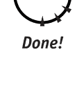

## 复习

在本节中，你学习了如何创建 JavaScript 代码来动态操作网页中的 HTML 元素。你学习了元素的 style 对象包含了操作页面上元素外观所需的一切。此外，你还了解了 JavaScript 如何在浏览器窗口中移动 HTML 元素。最后，你学习了如何更改元素的 innerHTML 属性以在屏幕上放置新文本。

由于本节包含如此多的概念和理论，我没有空间向你展示一个精巧的小 JavaScript 程序，它允许你随意研究 style 对象的所有属性。你可以在随附 CD-ROM 的 dhtmlStyle.htm 文件中找到这个程序。将它加载到你最喜欢的浏览器中，开始更改样式属性。在你玩了一会儿之后，看看源代码。它几乎包含了我们在本节中讨论的所有内容，以及本书其他部分的不少概念。此外，它本身就是一个非常有用的调查工具！

## 自测题

1. 元素的样式信息存储在哪里？（参见“动态更改样式”。）
2. 到底什么是元素？（参见“动态更改样式”。）
3. 当你将 Web 地址赋给 style 对象的 backgroundImage 属性时，应该如何格式化？（参见“backgroundImage 属性”。）
4. CSS 和 style 对象的属性使用哪些不同的计量单位？（参见“fontSize 属性”。）
5. 使用与位置相关的 top、left、bottom 和 right 属性时，你需要注意什么？（参见“position 属性”。）


# 使用框架

## 本节清单

- ✔ 理解 JavaScript 如何在框架之间通信
- ✔ 为框架动态创建新内容
- ✔ 处理未在其框架集中加载的基于框架的文档
- ✔ 使用 JavaScript 调整框架大小

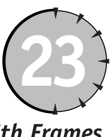

## 还剩 30 分钟

无论你喜欢还是讨厌它们，基于框架的网站都将持续存在。幸运的是，从 JavaScript 程序员的角度来看，使用基于框架的站点几乎与使用无框架的站点一样容易。

## JavaScript 如何看待框架

要创建基于框架的站点，你首先必须定义一个 HTML 框架集文档。这只是一个包含 `<frameset></frameset>` 标签集而不是 `<body></body>` 标签集的 HTML 文档。在 `<frameset></frameset>` 标签内，你定义一个或多个 `<frame>` 标签，告诉浏览器为每个框架加载哪个文件以及框架在浏览器窗口中应如何显示。以下代码显示了一个简单的框架集文档。（请注意，此代码位于 Session23 文件夹的 listing23-1.htm 文件中。）

```
<html>
<head><title>Welcome to Baby-Palooza.com!</title></head>
<frameset rows="70%,*" frameborder="0">
    <frame name="prodInfo" src="welcome.htm" scrolling="yes"
    frameborder="no"></frame>
    <frame name="cart" src="cart.htm" scrolling="yes"
    frameborder="no"></frame>
</frameset>
</html>
```

在第 8 节中，我提到过，就 JavaScript 而言，框架只是另一个 `window` 对象。因此，当你将此文档加载到 Web 浏览器中时，它实际上会创建三个 `window` 对象：一个代表框架集文档本身，另外两个代表每个 `<frame>` 标签。代表框架集文档的 `window` 对象成为 `parent` 对象，而其他对象成为 `parent.frames` 数组中的条目。

如果你仔细观察前面的代码，你会看到，除了指定将哪个 HTML 文件加载到每个框架中（`src=` 属性），我还为每个框架指定了一个 `name=` 属性。正如你可能预期的那样，这些最终将用作代表每个框架的 JavaScript `window` 对象的名称。

### 框架间通信

如果你在一个框架中有一段 JavaScript 需要与另一个框架中的另一段 JavaScript 通信，这非常简单。例如，假设前面显示的框架集已加载，并且以下代码在 welcome.htm 文件中定义：

```
function welcome() {
    alert( "Welcome to Baby-Palooza.com!");
}
```

如果我想从 cart.htm 文件调用此函数，以下任一语句都可以实现。

```
parent.prodInfo.welcome();
parent.frames[0].welcome();
parent.frames['prodInfo'].welcome();
```


这是如何工作的呢？让我们看看这些语句中的第一个：

```
parent.prodInfo.welcome();
```

首先要记住的是，这个语句是在某个框架（确切地说是购物车框架）内部执行的。因此，为了访问到 `prodInfo` 框架，代码必须与 `prodInfo` 框架有一个共同的参考点。这就是 `parent` 对象的作用所在。由于这两个框架都是从同一个框架集文档创建的，它们拥有相同的父对象。因此，这段代码的意思是：“查看我的父对象内部。在里面，你应该能找到另一个名为 `prodInfo` 的对象。查看这个对象内部并调用名为 `welcome` 的函数。” 其他两个语句的工作方式几乎完全相同。唯一的区别是它们通过父对象的 `frames` 数组进行访问，而不是直接通过名称来引用框架。

框架间的通信不仅限于函数调用。你可以访问在另一个框架中定义的任何变量、函数或对象。

## 使用嵌套框架

正如你所见，使用 JavaScript 来操作框架非常简单。然而，完全有可能创建一个基于框架的网站，其中包含多个嵌套在一起的框架集。请看以下框架集文档：

```
<html>
<head><title>Welcome to Baby-Palooza.com!</title></head>
<frameset rows="70%,*" frameborder="0">
    <frame name="prodInfo" src="welcome.htm" scrolling="yes"
    frameborder="no"></frame>
    <frameset cols="50%,50%" frameborder="0">
        <frame name="cart" src="cart.htm" scrolling="yes"
        frameborder="no"></frame>
        <frame name="ads" src="ads.htm" scrolling="yes"
        frameborder="no"></frame>
    </frameset>
</frameset>
</html>
```

在这里，我的第一个框架集定义了两行，而我的第二个框架集则将底部的行分成了两列。假设我的 `welcome()` 函数仍然在 `welcome.htm` 文件中定义，那么 `ads` 框架中的代码如何调用它呢？以下任一语句都可以工作。

```
parent.parent.prodInfo.welcome();
top.prodInfo.welcome();
```

当你嵌套框架时，每组 `<frameset></frameset>` 标签都会成为其内部定义的框架的父对象。因此，因为我的 `ads` 框架在两组 `<frameset></frameset>` 标签内部，所以我必须通过两个父对象才能到达 `prodInfo` 框架。

当然，如果你有*很多*嵌套的框架，逐一穿过所有这些父对象很快就会变得繁琐。因此，JavaScript 提供了 `top` 对象。`top` 对象代表加载到浏览器中的实际框架集文档。`top` 对象的一个特殊之处在于，它没有使用多维数组来保存嵌套框架，而是将每个框架的 `window` 对象转换为 `top` 对象的属性。因此，即使 `ads` 框架嵌套了两层深，你也可以简单地通过编码 `top.ads` 来访问它。`top.prodInfo` 和 `top.cart` 也是如此。所以，假设以下函数在 `ads.htm` 文件中定义：

```
function showAd() {
    alert("Please support our sponsors!");
}
```

你只需编码 `top.ads.showAd();` 就可以从 `welcome.htm` 文件中调用此函数。

## 时序问题

大多数情况下，框架间的通信非常简单。然而，这假设了你所有框架的内容都已完全加载。如果在加载过程中，你第一个框架中的 JavaScript 代码试图调用最后一个框架中的函数会怎样？如果你最后一个框架中的 HTML 文档尚未加载完成，并且该函数不存在，你将收到一条错误消息，并且你的 JavaScript 程序将停止。如何解决这个问题呢？唯一的真正解决方案是，在尝试访问框架中的任何内容之前，先检查并确认该框架的内容是否已完全加载。

例如，假设我们第二个框架集文档的代码正在加载。浏览器将做的第一件事是加载第一个框架（`welcome.htm` 文件）的内容并执行其中找到的任何 JavaScript。如果此文件中的某个 JavaScript 语句试图调用 `ads.htm` 文件中的 `showAd()` 函数，该语句很可能会失败，因为 `ads.htm` 文件根本没有时间被加载到 `ads` 框架中。

你可能会想，只需在 `ads.htm` 文件中放入一个 `onload` 事件处理程序。这个处理程序可以向 `prodInfo` 框架发送某种消息，告诉它已经加载完成，可以安全地调用 `showAd()` 函数。虽然这对于非常简单的 HTML 文件有效，但对于包含大量表单和控件的复杂 HTML 文件可能不起作用。原因是 `onload` 处理程序仅在页面的所有数据加载完毕时触发。不幸的是，这并不总是对应于页面上的所有数据加载完毕然后*解析*成构成浏览器对象模型的所有 JavaScript 对象的时间。因此，即使页面的数据已加载到浏览器中，代表这些数据的 JavaScript 对象可能尚不可用。这个问题的解决方案其实相当简单，但并非显而易见。

```
<html>
<head>
<script language="javascript">
function showAd() {
    alert("Please support our sponsors!");
    }
</script>
</head>
<body>
This is the advertising frame!
<form name="dummy">
<input type="hidden" name="dummy" />
</form>
</body>
</html>
```

在这里你会注意到我定义了一个虚拟表单。它除了占用空间外没有其他目的。要理解原因，请看这个 `welcome.htm` 文件的版本。

```
<html>
<head>
<script language="javascript">
function welcome() {
    alert( "Welcome to Baby-Palooza.com!");
    }
function doAdShow() {
    var tryAgain = true;
    if (top.ads != null) {
    if (top.ads.document != null) {
    if (top.ads.document.forms.length > 0) {
        top.ads.showAd();
        tryAgain = false;
    }
}
if (tryAgain) {
    setTimeout( 'doAdShow()', 1000);
}
</script>
</head>
<body onload="doAdShow()">
Welcome to Baby-Palooza.com!<br />
</body>
</html>
```

我没有直接调用 `showAd()` 函数，而是定义了一个 `onload` 处理程序来调用 `doAdShow()` 函数。此函数首先设置一个名为 `tryAgain` 的局部变量并将其赋值为 `true`。完成此操作后，该函数使用三个 `if` 语句来检查 `ads` 框架的内容是否已完全加载并解析。首先，它检查 `top.ads` 对象是否存在。此对象的存在告诉函数，至少用于加载 `ads.htm` 文件的 `<frame>` 标签已被解析。然后，函数检查 `top.ads.document` 对象是否存在。如果此对象存在，你可以确定 `ads.htm` 文件已开始加载。最后，函数检查 `top.ads.document.forms` 数组的 `length` 属性是否大于零。如果此值大于零，函数就能确定虚拟表单已被加载、解析，并且可供 JavaScript 使用。

为什么要检查 `forms` 数组的长度？请记住，JavaScript 解释器是从上到下加载和解析 HTML 文档中的信息的。通过在文档末尾放置一个空表单，然后检查该表单是否已加载和解析，我就可以判断该表单之前的所有内容是否都已加载和解析！因此，如果所有这些测试都成功，函数就可以完全放心地调用 `showAd()` 函数，并将 `tryAgain` 变量设置为 `false`。但是，如果任何这些 `if` 语句失败，`tryAgain` 的值将保持为 `true`，并且对 `setTimeout()` 方法的调用将告诉 JavaScript 解释器一秒钟后再次尝试。

## 动态创建框架内容

在第 11 课中，你了解了如何使用 `document.write()` 和 `document.writeln()` 在窗口中动态创建 HTML 和 JavaScript 代码。同样，也可以使用这些调用来在不同的框架中动态创建 HTML 和 JavaScript 代码。

实际上，向不同框架写入 HTML 或 JavaScript 的过程与向当前框架写入 HTML 几乎完全相同。唯一的区别是你必须指定要写入的框架的名称。

例如，看看这个稍有不同的 `nested.htm` 文件版本。

```
<html>
<head><title>Welcome to Baby-Palooza.com!</title>
<script language="javascript">
function loadProdInfo() {
    top.prodInfo.document.open();
    top.prodInfo.document.writeln( "<html><body bgcolor='white'>");
    top.prodInfo.document.writeln( "Welcome to Baby-Palooza.com!");
    top.prodInfo.document.writeln( "</body></html>");
    top.prodInfo.document.close();
    }
</script>
</head>
<frameset onload="loadProdInfo()" rows="70%,*" frameborder="0">
    <frame name="prodInfo" src="" scrolling="yes"
    frameborder="no"></frame>
    <frameset name="shopInfo" cols="50%,50%" frameborder="0">
        <frame name="cart" src="" scrolling="yes"
        frameborder="no"></frame>
        <frame name="ads" src="" scrolling="yes"
        frameborder="no"></frame>
    </frameset>
</frameset>
</html>
```

一旦最外层的框架集加载完成，`loadProdInfo()` 函数就会被调用。此函数包含五个简单的语句，将一个全新的 HTML 文档存储到 `prodInfo` 框架中。其中第一个语句调用


## 修改框架大小

我要分享的最后一个基于框架的技巧是如何使用 JavaScript 来改变屏幕上框架的大小。（注意，这个技巧依赖于 CSS 和元素对象中至少一个非标准字段。因此，它只在最新版本的 Internet Explorer 和 Netscape Navigator 中有效。）

当你访问电子商务网站时，通常会有一个购物车图标，你可以点击它来查看购物车中的内容。这通常会加载一个新页面来显示购物车的内容。然后，要回到刚才的操作，你必须点击后退按钮并等待页面重新加载。如果购物车显示能够放在一个隐藏的框架中，当你想查看它时弹出，看完后再消失，那不是很好吗？以下是实现这一效果的一种方法。

```html
<script language="javascript">
function toggleCart( turnOn ) {
    var frameSetElement = parent.document.getElementById(
"bpFrames");
    if (turnOn) {
        frameSetElement.rows = "40%,*";
    }
    else {
        frameSetElement.rows = "100%,*";
    }
}
</script>
<frameset id="bpFrames" rows="100%,0" frameborder="0">
    <frame id="prodInfo" name="prodInfo" src="bpMenu.htm"
    scrolling="yes" frameborder="no"></frame>
    <frame id="cart" name="cart" src="bpCart.htm" scrolling="yes"
    frameborder="no"></frame>
</frameset>
```

这里我定义了一个包含两个框架的框架集。不过，我还给它指定了 ID 为 bpFrames。这个 ID 信息被 `toggleCart()` 函数用来根据传递给函数的布尔值隐藏或显示第二个框架。`toggleCart()` 函数本身非常简单。它使用 `getElementById()` 方法来检索代表 bpFrames 框架集的元素对象。然后对元素对象的 `rows` 属性进行简单的赋值。更改此属性实际上会调整框架集中框架的大小以匹配新指定的尺寸。（是的，还有一个 `cols` 属性，它对框架集中的列执行完全相同的功能。）

因此，如果 `turnOn` 参数为 true，`rows` 属性将设置为 `"40%,*"`，这将把顶行的大小缩小到仅占用可见浏览器窗口的 40%，并让第二行占据剩余空间。如果 `turnOn` 参数为 false，`rows` 属性将设置为 `"100%,0"`，这将使顶行完全填满可见浏览器窗口，并将第二行的高度设置为零像素。有了这个代码之后，我所需要的只是几个按钮或链接来调用 `toggleCart()` 函数并传递适当的 `turnOn` 参数值。假设 `toggleCart()` 函数将成为框架集文档的一部分，这段代码可能看起来像这样。


```html
<a href="javascript:parent.toggleCart(true)">Show Cart</a><br />
<a href="javascript:parent.toggleCart(false)">Hide Cart</a>
```

## 回顾

在本节中，你了解了 JavaScript 如何看待框架，以及如何编写 JavaScript 语句来跨框架边界工作。你还学习了如何动态创建框架内的新文档，以及如何确保框架内容完全加载和解析。你还学会了如何确定来自框架集的页面是否已在其框架外部加载，以及如何修复这种情况。最后，你学会了如何使用 JavaScript 和元素对象来动态更改框架集中框架的大小。

为了将所有这些概念联系在一起，我已更新了 Baby-Palooza.com 购物车，使其在一组框架内工作。要查看这个新版本，请从 CD-ROM 上的 Session23 文件夹加载 index.htm 文件。当页面加载时，你应该只会看到一个框架。点击"Show Cart"链接，购物车框架应该会出现在浏览器窗口的底部。在你操作了一会儿之后，开始浏览源代码，看看本节中的所有概念如何与你在前面各节中学到的内容结合在一起。

## 使用框架集文档作为控制中心

在许多基于框架的网站上，你会发现控制网站的所有 JavaScript 代码都被加载到一个框架中。然后，这些 JavaScript 代码会创建或操作其他框架的内容。奇怪的是，这些 JavaScript 代码几乎总是在网站的一个可见框架中找到。一个鲜为人知的事实是，你可以在框架集文档内部运行 JavaScript 代码。这使它成为与网站相关的所有 JavaScript 代码的完美"控制中心"。事实上，许多网站实际上将他们的 JavaScript 代码放在一个"隐藏"的框架中。例如：

```html
<frameset rows="100%,0" frameborder="0">
    <frame name="prodInfo" src="welcome.htm" scrolling="yes"
    frameborder="no"></frame>
    <frame name="cart" src="cart.htm" scrolling="yes"
    frameborder="no"></frame>
</frameset>
```

第二个框架的高度为零像素，因此它将被隐藏起来。网站的作者可以将她所有的 JavaScript 代码放入 cart.htm 文件中，这样它会比较安全，不易被窥探。

## 保护你的 JavaScript 源代码

专业程序员对 JavaScript 最大的担忧之一就是"如何保护我的源代码？"不幸的是，这几乎是不可能做到的。由于 JavaScript 只是纯文本，用户很容易通过使用他们 Web 浏览器的"查看源代码"或"查看框架源代码"来看到它。

即使将代码隐藏在隐藏框架中也提供不了真正的保护。一个坚定的用户可以简单地查看你的框架集文档的源代码，然后加载你隐藏框架中 `src=` 属性指定的文件。所以，如果你的 JavaScript 代码将包含商业机密，你应该认真考虑将其重写为服务器端进程。

## 处理加载不正确的框架

一些用户不喜欢框架的一个原因是，当他们收藏基于框架的网站时，他们通常会收藏框架内的单个页面，而不是网站本身。然而，通过在网站的每个页面上添加几行 JavaScript，这个问题很容易解决。如果我将这些行添加到 welcome.htm 文件的顶部：

```javascript
if (parent == self) {
    document.location.href = "index.htm";
}
```

当页面加载时，它会检查 `parent` 对象是否等于加载文档的 `window` 对象。如果两者相等，你就知道没有框架集存在，这意味着 welcome.htm 文件是单独加载的。如果是这种情况，语句 `document.location.href = "index.htm";` 将强制 Web 浏览器立即加载 index.htm 文件。这反过来会将网站在浏览器窗口中正确设置好。

当然，如果你的网站非常复杂，用户会希望有一个书签能让他们直接返回到之前所在的页面。他们还会希望网站的其他框架重新出现，包含书签创建时加载的页面。做到这一点要困难一些。

不幸的是，大多数浏览器在收藏基于框架的网站时只存储框架集文档的 Web 地址。所以，也许提供此功能的最佳方式是在你的网站上提供一个按钮，点击后会创建一个 cookie，详细说明每个框架中显示的页面。当用户返回网站时，可以检查此 cookie，并将正确的页面重新加载到适当的框架中。

## 为 prodInfo 框架编写 document.open() 方法

如你在第 9 节中学到的，这会清除框架的当前内容并向其中打开一个输出流。

接下来的三条语句将新的 HTML 文档写入框架。重要的是你要意识到这些语句正在写出一个完整且有效的 HTML 文档！当你以这种方式替换框架内容时，*必须* 输出一组有效的 `<html></html>` 和 `<body></body>` 标签，如果你希望新文档被正确处理的话。这包括任何额外的属性（如 `<body>` 标签中的 `bgcolor=` 属性），你需要这些属性来使文档格式正确。虽然今天的浏览器会假设文档是 HTML 文档，但未来的浏览器没有义务这样做！所以，为了获得正确的结果，始终尽可能输出更多的信息。

最后一条语句为 `prodInfo` 框架调用 `document.close()`。这会关闭输出流并告诉浏览器你已经完成向文档添加文本。浏览器随后将完成渲染你发送到框架的 HTML 的过程。


## 自我测试

1.  `top` 对象和 `parent` 对象有何区别？（参见“使用嵌套框架。”）
2.  框架对象和窗口对象有何异同？（参见“JavaScript 如何看待框架。”）
3.  如果尝试访问一个尚未完全加载的框架中的内容，会发生什么？（参见“时序问题。”）
4.  你使用哪些方法将新内容写入框架？（参见“动态创建框架内容。”）
5.  如何创建一个“隐藏”的框架来放置你的 JavaScript 代码？（参见“使用 frameset 文档作为控制中心。”）

# 课程：使用窗口


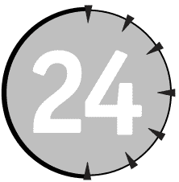

### 课程清单

-   使用 JavaScript 打开和关闭窗口
-   理解 JavaScript 如何在窗口之间进行通信
-   在不同窗口中创建内容

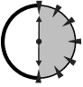

**30 分钟后出发**

正如你在整个这个周末所看到的，JavaScript 让你几乎可以完全控制 Web 浏览器。这包括创建自己的浏览器窗口并用你认为合适的任何内容填充它们的能力。

### 打开新的浏览器窗口

在第 8 课中，我简要介绍了 `window.open()` 方法。此方法打开一个新的浏览器窗口，并返回代表该窗口的 `window` 对象。如第 8 课所述，`window.open()` 最多可以接受四个参数，顺序如下：

-   **url**：这是你想要自动加载到新窗口中的网页的 Web 地址。
-   **name**：这是一个字符串，将被放入新窗口的 `window.name` 属性中。
-   **featuresList**：这是一个字符串，用于指定新窗口应具有的功能。使用此参数，你可以指定窗口的大小、是否具有工具栏、滚动条等。（我们将在下面的“使用窗口功能列表”部分讨论这些功能。）
-   **replace**：这是一个布尔值，用于指定第一个参数中指定的 Web 地址是否应替换 Web 浏览器历史记录列表中的当前条目。

当然，如果你想要的只是一个空白的新窗口，你根本不需要向 `window.open()` 方法传递任何参数。例如，以下代码将创建一个空的浏览器窗口，并将代表该窗口的对象赋值给一个变量：

```
var blankWindow = window.open();
```

另一方面，如果你想让你的新窗口自动显示一些内容，你只需将想要加载到窗口中的页面的 Web 地址传递过去。

```
var hungryMindsSite = window.open( "http://www.hungryminds.com");
```

#### 为你的窗口命名

正如你在第 8 课中所看到的，窗口对象有一个 `name` 属性。`window.open()` 方法的第二个参数允许你在创建窗口时设置此属性。例如，以下代码创建一个空窗口，并将其 `name` 属性设置为 "cartWin"。

```
var cartWin = window.open( "", "cartWin");
```

请注意，在创建新窗口时，你并非必须为其命名。如果你愿意，可以稍后设置：

```
var cartWin = window.open(); cartWin.name = "cartWin";
```

在这些示例中，我将新窗口对象的 `name` 属性设置为与保存该对象的 JavaScript 变量名完全相同。（正如你在第 20 课中所学，这不是必须的，但在动态创建 JavaScript 代码时可能很有帮助。）设置你创建的窗口的 `name` 属性完全是可选的。但是，如果你计划同时打开多个窗口，最好为它们都命名，以便于区分。

### 使用窗口功能列表

如果你只使用 `window.open()` 方法的前两个参数，你打开的窗口看起来都会一模一样。它们都会有工具栏、菜单栏、滚动条以及标准 Web 浏览器的所有其他配件。如果你想让你的新窗口看起来有点不同，你必须使用 `featuresList` 参数指定你想要（和不想要）的功能。`featuresList` 参数是一个可以包含一个或多个功能标志的字符串。这些标志用逗号分隔，看起来像这样：

```
"feature1=yes,feature2=no,feature3=no"
```

表 24-1 显示了每个功能标志及其可能的值。

| 标志名称 | 可能的值 | 用法 |
|-----------|-----------------|-------|
| directories | yes 或 no | 指定窗口是否应具有一组目录按钮。（在 Internet Explorer 中，这是链接栏。在 Netscape Navigator 中，它是个人工具栏。） |
| height 和 width | 任何正整数值 | 指定新窗口的高度和宽度（以像素为单位）。 |
| location | yes 或 no | 指定窗口是否应有一个用户可以输入 Web 地址的框。（在 Internet Explorer 中，这是地址栏。在 Netscape Navigator 中，它是位置工具栏。） |
| menubar | yes 或 no | 指定窗口是否应具有主菜单栏。（包含文件和编辑菜单的那个。注意，这不适用于 Macintosh Web 浏览器。） |
| resizable | yes 或 no | 指定用户是否应该能够调整窗口大小。（注意 "resizable" 中间没有 "e"！） |
| scrollbars | yes 或 no | 指定窗口是否应具有滚动条。 |
| status | yes 或 no | 指定窗口底部是否应有一个状态栏。 |
| toolbar | yes 或 no | 指定窗口是否应具有一个主工具栏。（这是包含前进和后退箭头、重新加载和停止按钮等的工具栏。） |

因此，如果我想创建一个带有状态栏和滚动条的空窗口，我会这样编码：

```
var cartWin = window.open( "", "cartWin",
"status=yes,scrollbars=yes");
```

如果你执行此代码，你会注意到创建的窗口*只有*一个状态栏和一个滚动条；其他窗口控件根本没有出现！这是因为，当你指定 `featuresList` 参数时，你未列出的任何功能都会自动获得 `no` 的值。（当然，`height` 和 `width` 功能除外。如果你不给它们提供值，新窗口的高度和/或宽度将与创建它的窗口相同。）因此，如果你只使用 `height` 和 `width` 功能创建一个窗口，如下所示：

```
var cartWin = window.open( "", "cartWin", "height=100,width=200");
```

你将得到的只是一个带有标题栏和主机操作系统提供的任何窗口控件（如关闭框）的小窗口。这种行为起初可能看起来有点奇怪，但它实际上使得创建自定义窗口变得更加容易。这仅仅是因为，在定制窗口时，列出你想要的东西通常比列出所有你不想要的东西要快。

### 在新窗口中创建内容

一旦你打开了一个新窗口，你可能会想在里面放一些内容。当然，你可以只使用 `window.open()` 调用的 `url` 参数，在新窗口打开时将 HTML 文档加载到其中。但是，如果你需要在新窗口中创建自定义文档，你可能会发现依赖 `document.write()` 调用更容易。

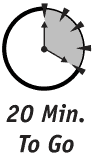

在不同窗口中创建内容的过程与在不同框架中创建内容的过程几乎完全相同。唯一的区别是，你不是通过 `parent` 或 `top` 对象，而是直接通过代表新窗口的 `window` 对象。例如，如果我想创建一个只显示 "Hello World!" 的新窗口，这里展示的代码可以完成这个任务。

```
var greetWin = window.open( "", "greetWin",
"height=100,width=200");
greetWin.document.open();
greetWin.document.write( "<html><body bgcolor='white'>");
greetWin.document.write( "Hello World!");
greetWin.document.write( "</body></html>");
greetWin.document.close();
```

如你所见，这与你在上一课中看到的基本相同。首先，我打开我的新窗口，并将代表它的对象存储在 `greetWin` 变量中。接下来，`greetWin.document.open()` 调用打开一个指向新窗口内 `document` 对象的流。此时，只需进行几次 `document.write()` 调用即可输出我希望在新窗口中显示的内容。之后，我调用 `document.close()` 来关闭流并强制内容在窗口中显示。

与框架一样，记住写出创建完整 HTML 文档所需的*所有*内容非常重要。这包括 `<html></html>` 和 `<body></body>` 标签集，以及你希望包含在这些标签中的任何属性。

### 窗口间通信

正如你在上一课中所看到的，JavaScript 程序之间的框架到框架通信并没有那么困难。那么，既然框架实际上就是窗口，窗口到窗口的通信也应该相当容易，对吧？嗯，是的，确实如此，但有一个小的区别。正如你刚才看到的，当一个窗口（我称之为“父窗口”）打开另一个窗口（我称之为“子窗口”）时，父窗口可以轻松地访问子窗口的方法（以及属性和函数和全局变量），只需通过它从 `window.open()` 方法获得的窗口对象进行操作即可。然而，子窗口没有办法自动访问其父窗口。（特别是，它没有像框架那样的 `parent` 对象可以使用。）

为了解决这个问题，每个 window 对象都包含一个 opener 属性（我在第 8 讲中简要讨论过）。如果一个窗口是由另一个窗口打开的，它的 opener 属性将包含一个代表其父窗口的 window 对象。通过 opener 属性，子窗口可以访问父窗口中定义的任何对象、函数或变量。（当然，如果一个窗口不是通过 `window.open()` 调用打开的，它的 opener 属性将为 null。）以下这段 JavaScript 代码会打开一个新窗口并定义一个简单的函数（这是在 listing24-2.htm 文件中）。

```javascript
var childWin = window.open( "childWin.htm", "childWin");
function doGreeting( theGreeting) {
    alert( "The kid says: " + theGreeting + "");
}
```

这个新窗口将自动加载 childWin.htm 文档：

```html
<html>
<head>
<title>调用窗口的 opener</title>
<script language="javascript">
if (self.opener != null) {
    self.opener.doGreeting( "Hello from the new window!"");
    }
</script>
</head>
<body>
</body>
</html>
```

如果你将 listing24-2.htm 文件加载到 Web 浏览器中，你会看到子窗口打开，然后片刻之后你会收到一个提示框，显示 "The kid says: 'Hello from the new window!'"。这表明，只要有了 opener，子窗口就可以访问其父窗口中定义的任何方法、属性、函数或全局变量。

## 解决窗口的时序问题

在第 23 讲中，你了解到，如果一个框架中的 JavaScript 尝试调用另一个框架中的函数，而第二个框架尚未完全加载，就可能会发生错误。在处理多个窗口时，也会出现同样的时序问题。如果父窗口尝试在子窗口完全加载之前调用子窗口中的函数或填写表单字段，你很可能会收到一个 "not defined" 错误。但是，由于窗口和框架非常相似，这个问题的解决方案也类似。再次强调，我假设有一个函数需要在子窗口打开后尽快调用。以下将显示加载到子窗口中的 HTML 文件。（这是来自你 CD-ROM 上的 ads.htm 文件。）

```html
<html>
<head>
<title>一则广告！</title>
<style type="text/css">
body { background-color:white }
</style>
<script language="javascript">
function showAd() {
    alert("Please support our sponsors!");
    }
</script>
</head>
<body>
This might as well be a pop-up ad!
<form name="dummy">
<input type="hidden" name="dummy" />
</form>
</body>
</html>
```

与框架一样，解决这个问题的关键是在要加载的文档末尾放置一个虚拟表单。下一段 JavaScript 代码显示了父窗口中的代码，它将确保子窗口完全加载。

```javascript
function doAdShow() {
    var tryAgain = true;
    if ( adWin != null) {
        if (adWin.document != null) {
            if (adWin.document.forms.length > 0) {
                adWin.showAd();
                tryAgain = false;
                }
            }
        }
    }
    if (tryAgain) {
        setTimeout( 'doAdShow()', 1000);
    }

    var adWin = window.open( "ads.htm", "adWin",
    "height=100,width=200");
    // 尝试调用子窗口内部的函数
    doAdShow();
```

这里，解决方案与框架的解决方案惊人地相似。打开子窗口后，我调用 doAdShow() 函数。该函数使用一系列 if 语句来确保窗口及其 document 对象存在，并且窗口中的最后一个表单已被 JavaScript 解释器加载和解析。只有当所有这些条件都为真时，该函数才会调用子窗口内部的 showAd() 函数。如果其中任何一个条件为假，该函数将使用 setTimeout() 调用在一秒后重试。

## 使用 document.domain 属性


到目前为止，你所看到的所有窗口都能够轻松地相互通信。然而，有一种情况 JavaScript 实际上会禁止窗口之间进行通信。如果你的 JavaScript 代码位于来自不同服务器的两个 HTML 文档中，这些文档中的 JavaScript 将无法通信。这样做是为了给你的 JavaScript 代码提供基本的安全保障。毕竟，你肯定不希望来自 "evil-crackers.com" 的一段 JavaScript 代码能够与你网站上的 JavaScript 代码对话！然而，这样做的缺点是，即使你的代码位于同一域的不同服务器上（例如 "www.baby-palooza.com" 和 "support.baby-palooza.com"），通信仍然被禁止。幸运的是，解决方案存在于 document.domain 属性中。最初，该属性将包含 HTML 文档来源的 Web 服务器的域名和子域名。例如，如果你将 "http://www.baby-palooza.com/index.htm" 加载到 Web 浏览器中，该文档的 document.domain 属性将是 "www.baby-palooza.com"。

现在，如果这个文件中的一些 JavaScript 代码想要打开并与 "http://support.baby-palooza.com/problemForm.htm" 处的文件内容进行通信，这两个文件都需要先确认它们位于同一域，然后才允许通信。（注意，由于我不知道你实际拥有什么样的设置，而且 "www.baby-palooza.com" 或 "support.baby-palooza.com" 实际上并不存在，所以我只给你实现这一目标所需的代码，然后你可以将其适配到你自己的网络设置中。）

在 "www" 服务器上的 index.htm 文件中，你可能会有一些类似这样的代码：

```javascript
var readyToTalk = false;
var probFormWin = window.open( "http://support.baby-
palooza.com/problemForm.htm", "probFormWin");
self.document.domain = "baby-palooza.com";
```

然后，在 "support" 服务器上的 problemForm.htm 文件中，你可能会有这样的代码：

```javascript
self.document.domain = "baby-palooza.com";
// 然后在文件的底部 . . .
self.opener.readyToTalk = true;
```

这整个过程的关键在于这条语句

```javascript
self.document.domain = "baby-palooza.com";
```

它出现在两个文件中。这告诉 JavaScript 解释器，这两个 HTML 文档属于同一域，应该允许它们通信。但你可能在想，"那 'evil-cracker.com' 的人把他们的文档的 domain 属性设置为 'baby-palooza.com' 怎么办？" 实际上，阻止他们的正是 JavaScript 解释器！你看，JavaScript 解释器只允许你将 domain 属性设置为文档来源的域后缀。因此，来自 "www.evil-crackers.com" 的文档只能将其 domain 属性设置为 "evil-crackers.com"，而不能设置为 "baby-palooza.com"（或其他任何东西）。

## 关闭你的窗口

一旦你用完了某个窗口，你可以允许用户关闭它，或者你可以通过调用 `window.close()` 方法自行关闭它。使用 `window.close()` 方法相当简单；你调用它，相关窗口就会消失。

- 如果你的 JavaScript 代码创建了一个子窗口，然后尝试关闭它，子窗口应该会直接消失。
- 如果你的 JavaScript 代码创建了一个子窗口，然后子窗口尝试关闭自己，这也应该完全按照你的预期工作。
- 如果你的 JavaScript 代码在*任何*窗口中运行，尝试关闭其父窗口或你打开的第一个浏览器窗口，你会收到一个对话框，要求你确认关闭窗口。这是一项安全功能，旨在防止恶意的 JavaScript 程序关闭用户的 Web 浏览器（这意味着真的没有办法绕过它）。


## 复习

在本讲中，你学习了如何使用 `window.open()` 方法打开新窗口。你还了解了可以传递给 `window.open()` 方法的所有不同参数，以创建具有你所需功能的窗口（菜单栏、滚动条等）。你了解到，在新窗口中动态创建内容的方式与使用框架时几乎完全相同。你看到了使用 `window.opener` 属性创建父窗口和子窗口之间的双向通信是多么容易。这使得一个窗口中的 JavaScript 可以访问另一个窗口中的对象、函数和全局变量。你学习了来自不同服务器的 HTML 文档如何被禁止相互通信，除非它们的 `document.domain` 属性具有相同的值。最后，你学习了如何使用 `window.close()` 方法关闭窗口。

## 自我测验

1. 为什么要给你的新窗口命名？（参见"给你的窗口命名"）
2. 如何创建一个空窗口？（参见"打开一个新的浏览器窗口"）
3. status 功能标志决定了新窗口的什么特性？（参见"使用窗口功能列表"）
4. `document.domain` 属性用于什么？（参见"使用 document.domain 属性"）
5. 当子窗口尝试关闭其父窗口时会发生什么？（参见"关闭你的窗口"）


# 改进用户界面

## 本讲清单

- 使用视觉提示来改进用户界面
- “伪装”只读文本框
- 修正浮点数的显示

上次我摆弄我的购物车（在第23讲末尾）时，它已经很接近完成了。但是，尽管它不需要更多功能，但仍有一些可以调整的地方，让它更易于使用。因此，在本讲中，我将向你展示几种可以使用 JavaScript、HTML 和层叠样式表（CSS）的方法，让你的网页更易于用户理解和使用。（和我之前展示的其他基于 CSS 的技巧一样，本讲中讨论的内容并非在所有浏览器中都能正常工作。不过，这将在未来的浏览器版本中得到修正。）

## 使用视觉提示

当今的 Web 很大程度上是一种视觉媒介。正因为如此，加上最流行的操作系统都是基于图形的，用户变得有点懒惰，期望事物的工作方式只需瞥一眼就能明显看出。（当然，所有网页的工作方式基本相同，但创建一个让即使是最老练的用户也会感到困惑的网站仍然很容易。）

## 突出显示链接

你可以为用户做的最基本的事情之一，就是确保他们能分辨出什么是链接，什么不是。按照惯例，Web 浏览器会给链接添加下划线，并用与周围文本不同的颜色来绘制它。然而，如果你有一些普通文本想要加下划线，这仍然可能导致用户产生一些困惑。幸运的是，CSS 可以轻松设置你的链接，使它们在鼠标经过时改变颜色。这为用户的创建了一个简单的视觉提示，告诉他们相关文本是一个可以点击的链接。要设置这个效果，你只需定义一个像这样的 CSS 规则：

```
a:hover { color:red }
```

有了这个规则，你告诉浏览器，当鼠标悬停在一组 `<a></a>` 标签上时，应该将其中的文本颜色变为红色。虽然这相当明显，但 `:hover` 这个指定是你以前没有见过的。它不是类定义，也不是 ID 定义，那它是什么呢？

嗯，这条规则中的 `:` 将它标记为一个 CSS *伪类*。CSS 伪类可以被看作是"便捷"类。它们代表了一些常见情况，你可能想要在这些情况下改变元素的外观。在这个例子中，我是在鼠标悬停时改变链接的外观。（如果你觉得这听起来像第14讲中看到的图像翻转效果，你是对的，只是整个过程由 CSS 和浏览器管理。）

> > 还有其他几个 CSS 伪类。然而，在我写这篇文章时，当前这批浏览器只支持其中少数几个。关于这些其他伪类的更多信息，请务必访问 CSS 文档页面 www.w3.org/TR/REC-CSS2/。

## 用 JavaScript 模拟 :hover

根据 CSS 文档，`:hover` 伪类有朝一日将对任何 HTML 元素都有效。但到目前为止，它似乎只对 `<a></a>` 标签有效。这很不走运，因为悬停效果是一种让用户知道鼠标所在位置实际上是某种控件的好方法。

事实上，这是一个如此优秀的用户界面工具，值得花一点时间和 JavaScript 来模拟网页上其他元素的这种效果。例如，在我的购物车中，如果 + 和 - 控件在鼠标悬停时高亮显示，那就太好了。

因为这些控件是以图像形式实现的，所以高亮它们的方法之一（不绘制新图像并创建翻转效果）是在鼠标经过时在它们周围绘制边框。然而，你可能还记得，我在 HTML 文档中定义这些图像时是没有边框的。所以，我首先要做的是修改我的 `` 标签，让它们有边框。当然，如果我直接修改 `` 标签，我最终会得到始终显示的黑色边框。所以，与其直接修改每个控件的 `` 标签，不如定义一个像这样的 CSS 类：

```
img.button { border-style:solid;border-color:white;border-width:1px }
```

然后，我可以修改我的 `` 标签定义以使用这个类，如下所示：

```

```

（注意我省略了 `` 标签的大部分内容以节省空间。）这将创建一个图像类，它们都有宽度为一像素的实线白色边框。（而且由于我的背景色也是白色的，这个边框实际上将是不可见的。当然，你*可以*使用 DHTML 动态添加边框。但如果你这样做，你的图像会在边框被你的 DHTML 代码添加和移除时在页面上跳动。如果从不可见的边框开始，你会得到更好的效果。）

此时，创建一个类似于你在第14讲中看到的翻转效果就很简单了。然而，与交换图像不同，这个翻转效果实际上会改变应用到我的元素的样式。因为这比图像交换要复杂一些，所以我将定义几个新方法来处理这个效果。

```
// 这个方法通过将边框变为红色来高亮显示元素
function shopCart_doHilightBorder( theID) {
    var theElement = document.getElementById( theID);
    theElement.style.borderColor = "red";
}
// 这个方法移除元素上的边框高亮
function shopCart_doDimBorder( theID) {
    var theElement = document.getElementById( theID);
    theElement.style.borderColor = "white";
}
```

如你所见，这些方法中的每一个都接收一个元素 ID 字符串，并用它来检索该 ID 的元素对象。然后它将该元素样式的 `borderColor` 属性设置为 `red` 或 `white`，取决于该元素是被高亮还是变暗。当然，我还需要将这些方法与我的图像控件关联起来。像往常一样，只需指定适当的事件处理程序即可完成。

```

```

为所有 + 和 - 控件添加这段代码后，将鼠标移到这些控件中的任何一个上时，控件都会被红色边框高亮显示。当鼠标移开时，边框颜色将变为白色，高亮显示将消失。

> 如果你使用的是 Macintosh 或 Netscape 6，可能会发现当你将鼠标移过 + 和 - 控件时，这段代码会产生错误。你将在下一讲中学习如何解决此问题。

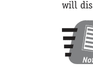

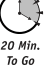

## 文本框的视觉提示

虽然上面基于 JavaScript 的悬停效果可用于任何类型的元素，但它对文本框特别有用。你甚至可以使用刚才看到的相同代码。你所要做的就是定义适当的事件处理程序，如下所示。（同样，我省略了标签的一些代码以节省空间并专注于相关部分。）

```
<input type='text' id='inCart_st-001' name='inCart_st-001'
onmouseover="bpCart.hilightBorder('inCart_st-001')"
onmouseout="bpCart.dimBorder('inCart_st-001')"
value='0' size='6' />
```

有了这些处理程序，我的 "inCart" 文本框在鼠标移到上面时将以红色高亮显示。（记住，文本框已经有边框了，所以不需要特殊的 CSS 规则。）

## 高亮显示活动文本框

另一个目前似乎无法正常工作的 CSS 伪类是 `:focus` 伪类。这个类让你可以决定元素在获得焦点时应该是什么样子。这是另一个非常有用的伪类，所以，再一次，一点 JavaScript 将让我模拟它，直到浏览器世界跟上标准。接下来的代码展示了我为购物车对象定义的两个新方法。这些方法让我可以改变当前具有焦点的文本框的样式。

```
function shopCart_doFocusInCart( partNo) {
    var tFieldElement = document.getElementById( 'inCart_' +
    partNo);
    tFieldElement.style.borderStyle = "ridge";
    tFieldElement.style.backgroundColor = "#dddddd";
    eval( "document." + this.cartForm + ".elements['inCart_" +
    partNo + "'].select()");
}
function shopCart_doBlurInCart( partNo) {
    var tFieldElement = document.getElementById( 'inCart_' +
    partNo);
    tFieldElement.style.borderStyle = "inset";
    tFieldElement.style.backgroundColor = "white";
}
```

以下是使用这些方法的文本框定义，以及前面讨论过的高亮方法。

```
<input type='text' id='inCart_st-001' name='inCart_st-001'
onfocus='bpCart.focusInCart("st-001")'
onblur='bpCart.blurInCart("st-001")'
onmouseover="bpCart.hilightBorder('inCart_st-001')"
onmouseout="bpCart.dimBorder('inCart_st-001')"
onchange='bpCart.enterQuantity("st-001")'
value='0' size='6' />
```

当这个文本框获得焦点时，focusInCart() 方法将把文本框的边框样式更改为 ridge 值。这将给文本框一个略微凸起的外观。然后它会将背景色更改为 #dddddd。这是一种相当浅的灰色，可以显示该框具有焦点，而不会让框中的文本显得过于突兀。

最后，focusInCart() 方法使用 eval() 函数调用文本框的 select() 方法。这个方法会选择文本框中的所有文本。因此，当用户开始输入时，她输入的内容将自动替换框中之前的内容。


当文本框失去焦点时，`blurInCart()` 方法会将文本框的边框样式重置为 `inset`，然后将文本框的背景颜色恢复为白色。当然，你可以修改这个事件处理程序，为你的文本框应用任何你喜欢的样式。

### 消除只读文本框的视觉提示

就目前而言，我的购物车有一个*非常*令人困惑的方面：有些文本框可以输入内容，有些则不能。具体来说，用户可以在"订购数量"文本框中输入内容，但无法在"库存数量"或"总计"文本框中输入。

正如你在第22课中看到的，可以使用 JavaScript 和 DHTML 完全从屏幕上移除这些文本框，代之以一组 `<span></span>` 标签，这些标签可以更新以反映新的合计值。然而，这将需要大量工作来完成文本框本身就已经做得很好的事情：显示文本。

与其移除文本框，不如直接移除告诉用户这些*是*文本框的视觉提示？由于多年的使用习惯，大多数用户通过三个简单的视觉提示来识别文本框：闪烁的插入点（当文本框获得焦点时）、I 形光标（当鼠标悬停在文本框上时）以及独特的边框。移除这些提示，大多数用户永远不知道他们看到的是一个文本框。

插入点的问题已经解决了。如果你还记得，在第15课中，你看到了如何使用 `onfocus` 事件（以及 `focus()` 方法）来防止插入点落入你想要写保护的文本框中。

处理最后两个提示就更容易了。I 形光标和独特的文本框边框都可以通过定义一个合适的 CSS 类，然后将其应用于你想要的文本来消除。例如，以下是 CSS 类的定义。

```
input.noEdit { border-style:none; cursor:default }
```

以下是属于此类的文本框的定义。

```
<input type='text' class='noEdit' name='quan_st-001'
onfocus="document.bpCart_form.elements['inCart_st-001'].focus()"
value='5' size='6' />
```

这里唯一新增的内容是 CSS 类中的 `cursor` 部分。`cursor` 规则告诉浏览器当鼠标悬停在某个元素上时显示什么样的鼠标指针。在本例中，我将其设置为使用 `default` 指针，在大多数操作系统中，这是一个标准的箭头指针。（你还可以使用其他 cursor 值，例如：crosshair、wait 和 help。你甚至可以定义自己的光标并让浏览器使用它们！）因此，当浏览器绘制此类文本框时，它们将没有边框，当鼠标经过时，指针也不会变成 I 形。然而，由于它们仍然是文本框，你仍然可以通过简单的 JavaScript 语句来更改它们的值。图25-1显示了这在浏览器窗口中的效果。

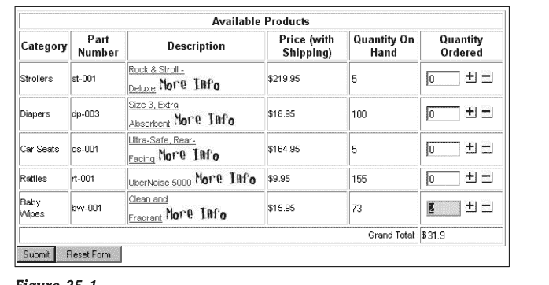

*图25-1*
无边框文本框

## 使用状态栏

如果你的网页充满了链接、控件和图像，即使是经验最丰富的用户也可能很难弄清楚每个元素的作用。因此，通过浏览器底部状态栏中的简短消息给用户一些提示，已经成为一种相当标准的做法。（是的，你以前见过这种做法，但它是一项非常重要的技术，所以我还是想在这里介绍。）例如，在第23课中，我定义了几个链接来显示和隐藏包含我的购物车的框架。这些链接看起来像这样：

```
<a href="javascript:parent.toggleCart(true)">Show Cart</a>
<a href="javascript:parent.toggleCart(false)">Hide Cart</a>
```

如果你将鼠标悬停在其中一个链接上，你会看到状态栏发生变化，显示点击链接时将执行的实际 JavaScript 语句。虽然这是关于链接功能的极其详细的信息，但它并不是最友好的形式。

解决方案是使用 onmouseover 事件处理程序将状态栏的内容更改为更具描述性的文字。

```
<a href="javascript:parent.toggleCart(true)"
onmouseover="window.status='View your shopping cart...';return
true;">Show Cart</a>
<a href="javascript:parent.toggleCart(false)"
onmouseover="window.status='Hide your shopping cart...';return
true;">Hide Cart</a>
```

现在，当鼠标进入其中一个链接时，状态栏将显示一条友好而清晰的消息，告诉用户点击链接后会发生什么。（别忘了在事件处理程序的末尾添加 `return true;` 语句。没有它，你的自定义消息将不会显示！）

> 使用包含大量控件的复杂网页时，一个比较烦人的问题是 Tab 键的工作方式。默认情况下，Web 浏览器会按照 HTML 文档中控件定义的顺序在控件之间进行切换。不幸的是，这可能与屏幕上控件的排列方式不匹配。这可能导致很多混乱，因为用户反复按 Tab 键，焦点却跳到了页面完全不同区域的控件上。要解决这个问题，可以为 HTML 控件指定一个 tabIndex 属性。该属性允许你指定页面上的控件通过 Tab 键访问的顺序。只需给第一个控件的 tabIndex 设为 1，第二个设为 2，依此类推。如果你想让 Tab 键跳过某些控件，将它们的 tabIndex 设为 0。

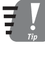

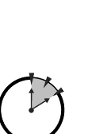

## 纠正浮点数的显示

如果你到现在还没有注意到，我的购物车显示浮点数的方式存在严重问题。如果你还没有发现，请仔细看看图25-1中显示的总计。根据我的计算，显示的值应该是 $50.85。然而，实际显示的是 $50.8499999。

信不信由你，这个值实际上是正确的；至少就 JavaScript 而言。你看，JavaScript 内部以二进制（基数为2）格式存储数字。虽然二进制非常适合存储整数，但在表示浮点值方面略有不足。正因如此，简单的浮点数相加操作可能会导致你在这里看到的这种错误。

**需要特别注意的是，从内部计算的角度来看，该值是完全正确的。** 换句话说，这个问题*不会*影响你在 JavaScript 程序中执行的任何浮点计算。唯一受影响的是浮点数的*显示*。

不幸的是，解决这个问题的唯一真正方法是编写一个自定义函数，在浮点数显示之前将其截断为适当的小数位数。好消息是，一旦你编写了这个函数，你就可以将其用于所有需要显示的浮点数。你会在 CD-ROM 上的 floatingPoint.js 文件中找到以下函数：

```
function twoDecimals( theNum) {
    var result = "";
    // Change the number to a string for manipulation
    var fpString = theNum + "";
    // find the decimal point
    var decimalAt = fpString.indexOf( ".");
    // if there is no decimal point, add one along with two zeroes
    if (decimalAt == -1) {
        result = fpString + ".00";
    }
    else {
        // pull off the fractional part
        var frac = fpString.substring( decimalAt);
        // multipy it by 100
        frac = parseFloat( frac) * 100;
        // Round this new number off
        frac = Math.round( frac);
        // and use it to rebuild our two decimal places
        // and return the result
        var wholeNum = fpString.substring( 0, decimalAt)
        result = wholeNum + "." + frac;
    }
    return result;
}
```

在这段代码中，我定义了一个简单的函数，它接受一个浮点数并返回四舍五入到两位小数的结果。该函数首先将数字转换为字符串（通过将其与空字符串连接）。在那

此时，使用 `indexOf()` 方法来判断字符串中是否已存在小数点。如果不存在，该函数只需在字符串末尾添加一个小数点和两个零，然后将结果返回。

如果存在小数点，情况就更有意思了。首先，将数字的小数部分（连同小数点一起）截取下来，存储在 `frac` 变量中。然后使用 `parseFloat()` 函数将 `frac` 中的字符串转换为实际的浮点数。可以看到，`parseFloat()` 函数对浮点数的作用，正如 `parseInt()` 函数（在第 15 讲中讨论过）对整数的作用一样。不过，与 `parseInt()` 函数不同的是，无需担心基数参数；`parseFloat()` 函数只接受十进制值。

接着，将这个新的浮点数值乘以 100。这实际上将小数点向右移动了两位。因此，如果 `frac` 原本是 ".8499999994"，现在就变成了 "84.99999994"。

现在，我可以使用 `Math.round()` 方法将其四舍五入为最接近的整数（在上面的例子中就是 "85"）。正如你可能猜到的，`Math` 对象是 JavaScript 中内置的一个对象。它提供了各种数学常量和方法，可以在 JavaScript 程序中用于操作数字。（我将在第 27 讲中更详细地讨论这个对象。）遗憾的是，`Math` 对象不包含将浮点数四舍五入到指定小数位数的方法。因此，你不得不采用如示例中所示的技巧来获得正确四舍五入的浮点数。

一旦正确地将小数部分四舍五入，我就将其重新附加到原数字的整数部分上，并将结果返回给调用该函数的地方。就我的购物车而言，调用该函数的将是 `shopCart.calcGrandTotal()` 方法。幸运的是，该方法中只需更改一行代码即可支持此功能：

```
eval( "document." + this.cartForm + ".elements['grandTotal'].value = twoDecimals( grandTotal)");
```

加上这段代码后，我的购物车现在就能正确地计算和显示所有的浮点数值了。

## 回顾

在本讲中，你了解了使用 JavaScript 和 CSS 为网站添加视觉提示是多么简单。如果使用得当，这些提示可以帮助网站访客更有效地理解和使用你的网站。你学到的一类视觉提示是 CSS 伪类。虽然这些伪类还不能在所有浏览器中使用，但你看到 JavaScript 可以用来模拟其中一些较有用的伪类。你还学习了如何使用 CSS 去除页面上某些元素（在本例中是文本框）的视觉提示，使用户只专注于他们可以实际交互的元素。你重新回顾了在浏览器状态栏中显示有用信息的过程。最后，你了解了 JavaScript 在显示某些浮点数时存在的问题以及如何纠正它。

如你所见，学会在网页中有效地使用 JavaScript 不仅仅是学习 JavaScript 本身。更多时候，你需要能够将各种技术混合搭配使用，以达到你想要的效果。因此，花一点时间回顾光盘中 Session25 文件夹中的所有源代码，看看所有这些不同的元素是如何融合在一起，形成你在本讲中所看到的效果。

## 自测

1.  :hover 表示什么？（参见"高亮你的链接。"）
2.  如何用 JavaScript 模拟 :hover 伪类？（参见"用 JavaScript 模拟 :hover。"）
3.  :focus 的作用是什么？（参见"高亮活动文本框。"）
4.  CSS 的 cursor 规则允许你更改什么？（参见"去除只读文本框的视觉提示。"）
5.  如何纠正 JavaScript 的浮点数显示问题？（参见"纠正浮点数的显示。"）

# 处理不同的浏览器

## 本讲要点

-   检测不同的浏览器品牌和版本
-   要求客户端浏览器使用特定版本的 JavaScript
-   向不兼容的浏览器隐藏 JavaScript 代码

到目前为止，我展示的几乎所有内容都是"浏览器无关的"。也就是说，它应该在两种主要的 Web 浏览器中无需修改即可运行。（到目前为止你看到的所有内容应该在*任何*支持 ECMAScript、DOM Level 2 和 CSS Level 2 标准的浏览器中都能运行。）虽然生活*理应*如此，但直到最近，编写既有实用功能、又能在两种浏览器中运行、且只需一份代码的 JavaScript 几乎是不可能的。虽然情况已经大为改善，但仍可能有某些场合需要你创建针对特定浏览器定制的 JavaScript 程序。

## navigator 对象的属性

创建针对特定浏览器的 JavaScript 程序的关键在于 `window.navigator` 对象。这个对象（其名称源自早期的 Netscape Navigator 产品）包含了你需要的所有信息，可以用来确定你的程序正在哪种浏览器品牌和版本中执行。使用 `navigator` 对象实际上非常简单。你只需查看 `navigator` 对象的一个或多个属性的内容，就能确定浏览器的品牌和版本。然后，根据这些信息，执行你已知能在该浏览器中运行的代码。

这一简单过程的难点在于，各浏览器厂商并不是按照统一的格式来存储 `navigator` 对象中的信息，而是各自使用略微不同的格式来存储数据。因此，虽然你*知道*可以从 `navigator` 对象中确定浏览器版本，但每个浏览器*确定*版本的方式是不同的。在我实际展示如何从 `navigator` 对象中提取这些信息之前，让我先快速介绍一下它更有用的属性。（是的，`navigator` 对象中还有其他属性，但它们通常是特定于某种浏览器的。）

### appCodeName 属性

程序员喜欢代号。我猜这是因为代号让我们觉得自己像特工，而不是我们实际的极客模样。不管原因如何，几乎每个开发过的计算机程序都有一个代号。因此，`navigator` 对象包含一个 `appCodeName` 属性，它应该包含浏览器开发时使用的代号。这是一个简单的 String 对象，所以非常容易检查和使用。

虽然这个属性看起来是确定你所用浏览器的好方法，但其实不然。你知道，当微软进入浏览器市场时，他们希望确保自己的浏览器尽可能与 Netscape Navigator（当时的市场领导者）兼容。不幸的是，当时许多脚本依赖于它们在 `appCodeName` 属性中找到的值。因此，为了尽可能少地破坏现有脚本，所有版本的 Internet Explorer 返回的 `appCodeName` 与 Netscape Navigator 完全一样：Mozilla。（Mozilla 是最初的图形化 Web 浏览器的名称。此后几乎所有的 Web 浏览器都以某种方式基于它。Mozilla 至今仍在开发中，许多人更偏爱它而非那些大牌浏览器。要获取副本，请访问 Mozilla 组织的主页 `www.mozilla.org`。）

### appName 属性

虽然 `appCodeName` 属性几乎没什么用，但 `appName` 属性确实非常有用。如果你在 Netscape 浏览器中检查它，会得到 "Netscape"。如果你在 Microsoft 的浏览器中检查它，会得到 "Microsoft Internet Explorer"。同样，这是一个简单的 String 对象，所以你可以轻松检查其内容。

### appVersion 属性

这可能是 navigator 对象中最重要的属性。顾名思义，它告诉你你的代码正在执行的浏览器的版本号。不幸的是，如何解释这些信息取决于你使用的是哪种浏览器。我将在"确定浏览器版本"这一节中详细讨论这一过程。虽然你可能期望这个属性是一个简单的数值，但它实际上是一个 String 对象。

### cookieEnabled 属性

这是一个简单的布尔值，让你可以确定浏览器中是否启用了 cookie。这个属性是各大 Web 浏览器最新版本中新增的，所以如果你需要在较旧的浏览器中检查 cookie 的可用性，不要依赖这个属性的存在。（有关如何检查 cookie 可用性的示例，请参见 cookies.js 文件中的 cookiesActive() 函数。）

### language 和 userLanguage 属性

这些属性可以告诉你访问者将其 Web 浏览器设置为显示哪种语言。请注意，language 属性只在 Netscape 浏览器中存在，而 userLanguage 属性只在 Internet Explorer 中存在。你可以通过将其与 null 进行比较来简单地检查其中一个属性是否存在。（这类似于第 23 讲中用来确定框架内容是否已加载的技巧。）

```
if (navigator.language != null) {
    // 处理 Netscape 语言信息
}
if (navigator.userLanguage != null) {
    // 处理 Internet Explorer 语言信息
}
```


## mimeTypes 数组

该数组包含了客户端计算机所知道的所有 MIME 类型的列表。MIME 代表多用途互联网邮件扩展（Multipurpose Internet Mail Extensions）。最初，MIME 类型用于识别电子邮件附件中包含的数据类型。该数组与 plugins 数组紧密关联，后者在本节后面会提到。在第 29 节中，当你学习如何识别和使用浏览器插件及多媒体时，你会对 MIME 类型有更深入的了解。

## platform 属性

在第 21 节中，你已经了解到 navigator.platform 属性包含一个 String 对象，它可以告诉你浏览器运行在哪个计算机平台上。你可以使用这个值来为你的访问者提供特定平台的内容，或者将他们引导到专注于其计算机平台的网站。关于该属性的一种用法示例，请参见第 21 节中的"决定使用哪个样式表"。

## plugins 数组

plugins 数组包含了客户端 Web 浏览器中安装的所有插件的列表。如果你需要在 Web 浏览器中显示特定类型的多媒体文件（如 Acrobat PDF 文件或 QuickTime 电影），你可以搜索此数组，查看用户是否安装了适当的插件。plugins 数组与 mimeTypes 数组（前面提到过）紧密关联，因此在第 29 节学习多媒体时，你会听到更多关于两者的内容。

## userAgent 属性

传统上，此属性仅包含 appCodeName 和 appVersion 属性的组合，两个值之间用正斜杠 / 分隔。然而，Netscape 6 浏览器现在包含了一些与其 HTML 渲染引擎（名为 Gecko）相关的额外信息。（这些信息也可以在两个 Netscape 6 特定的属性中找到：navigator.product 和 navigator.productSub。目前尚不清楚如何使用这些信息，但如果有需要，这些信息就在那里。）

## 确定浏览器版本

查看 `navigator` 对象的属性，你可能会想："天哪，确定浏览器版本看起来很简单！"嗯，它确实*应该*很简单。但是，正如我之前所说，每个浏览器厂商将其版本信息存储在略有不同的格式中。因此，虽然确定你正在使用哪个浏览器（通过 `appName` 属性）以及你的代码运行在哪个平台（通过 `platform` 属性）非常简单，但要确定浏览器版本却有点棘手。例如，以下是 Macintosh 上 Netscape Navigator 6 的 `navigator.appVersion` 值。

```
5.0 (Macintosh; en-US)
```

而以下是 Macintosh 上 Internet Explorer 5 的 `navigator.appVersion` 值。

```
4.0 (compatible; MSIE 5.0; Macintosh; I; PPC)
```

### 提取 Netscape 版本信息

Netscape 的信息相当直接：它是浏览器的实际版本号（请记住，从未正式发布过 Netscape 5，但 Netscape 6 的内部版本实际上是 5.0），后面跟着括起来的平台和语言信息。因此，从此信息中提取版本号实际上非常简单，如下所示：

```
var versionNum = "";
if (navigator.appName == "Netscape") {
    var fParen = navigator.appVersion.indexOf("(");
    if (fParen != -1) {
        versionNum = navigator.appVersion.substring(0, fParen);
        versionNum = parseFloat(versionNum, 10);
    }
    else {
        document.write("Could not determine version number!<br />");
        document.write("The appVersion property contains:<br />");
        document.write(navigator.appVersion);
    }
}
else {
    document.write("This is not a Netscape Browser!");
}
if (versionNum != "") {
    document.write("You are using version " + versionNum + " of " + navigator.appName);
}
```

如你所见，这非常简单。在确认这确实是 Netscape 浏览器之后，代码找到了 appVersion 属性中第一个括号的位置。然后由 substring() 方法使用此位置来提取实际的版本号。但是，在调用 substring() 之前，代码会检查以确保确实找到了第一个括号。如果没有找到，代码会显示错误消息，告诉用户无法获取浏览器的版本号。（检查这一点很重要，因为虽然罕见，但*确实*有可能通过浏览器定制软件更改 appVersion 属性中的信息。因此，在基于此信息做出任何决策之前，最好确保版本信息的格式正确。）

### 提取 Internet Explorer 版本信息

既然你已经知道如何从 Netscape 浏览器获取版本信息，那么从 Internet Explorer 中提取相同的信息似乎就是一项相当简单的任务了。好吧，让我们再看一下从 Macintosh 上 Internet Explorer 5 的 appVersion 属性中实际获得的内容：

```
4.0 (compatible; MSIE 5.0; Macintosh; I; PPC)
```

如你所见，这里的版本号是 4.0。但是，与 Netscape 不同，Internet Explorer 并没有跳过版本号，所以这*应该*是 5.0 版本，对吧？没错。

你在这里看到的是另一个例子，说明 Microsoft 希望 Internet Explorer 尽可能与 Netscape 兼容。因此，Internet Explorer 的 appVersion 属性中的第一个版本号是此版本 Internet Explorer 兼容的 *Netscape* 版本号！换句话说，这是在告诉你此浏览器与 Netscape 4.0 版本*兼容*。那么，你如何知道这是哪个版本的 Internet Explorer 呢？好吧，一旦你知道在哪里查找，这其实非常容易。

如果你注意到，在此 appVersion 值的正中间是字符串"MSIE 5.0"。*这*才是告诉你正在处理哪个版本的 Internet Explorer 的信息。虽然此信息埋藏在 appVersion 属性中，但它*始终*以字符"MSIE"（代表"Microsoft Internet Explorer"）开头，所以获取它实际上非常容易：

```
var versionNum = "";
if (navigator.appName == "Microsoft Internet Explorer") {
    var msieFlag = navigator.appVersion.indexOf("MSIE");
    if (msieFlag != -1) {
        var msieVersionEnd = navigator.appVersion.indexOf(";", msieFlag);
        versionNum = navigator.appVersion.substring(msieFlag + 4, msieVersionEnd);
        versionNum = parseFloat(versionNum);
    }
    else {
        document.write("Could not find version number!<br />");
        document.write("The appVersion property is:<br />");
        document.write(navigator.appVersion);
    }
}
else {
    document.write("This is not Microsoft Internet Explorer!");
}
if (versionNum != "") {
    document.write("You are using version " + versionNum + " of " + navigator.appName);
}
```

这与确定 Netscape 版本号的过程几乎完全相同。唯一的真正区别是，你必须从 appVersion 属性的中间而不是开头提取字符串。

### 要求特定的浏览器版本

如果你创建一个使用某些较新的 JavaScript 功能或层叠样式表甚至 HTML 功能的网站，你就需要知道何时有不兼容的浏览器来访。这里的选择与你在第 16 节学习 cookie 支持时相同。如果客户端的浏览器不支持你的网站所需的功能，你完全阻止他们使用网站，或者将他们重定向到更适合的你网站的版本。

例如，考虑一下我在本书中一直构建的网站。虽然对于一直跟着读的人来说，它可能看起来相当简单（至少我希望如此），但它实际上非常依赖许多只有主流 Web 浏览器的最新版本才提供的技巧。因此，如果网站接待使用旧版浏览器的访问者，与其生成一堆错误，礼貌的做法是告诉他们需要更新浏览器，并提供更新链接。考虑到这一点，我创建了一组函数，可用于确定我的 JavaScript 代码正在哪个浏览器、浏览器版本和平台中执行。这些函数都可以在 CD-ROM 上 Session26 文件夹中的 browserSnoop.js 文件中找到。你其实已经在不同场合看到过此文件中所有函数的代码，因此在表 26-1 中，你会找到每个函数及其功能的简要说明。

表 26-1：browserSnoop.js 中定义的函数

| 函数名称 | 用途 |
|---|---|
| isNetscape() | 如果当前浏览器是 Netscape，则返回 true。 |
| isIE() | 如果当前浏览器是 Internet Explorer，则返回 true。 |
| getNetscapeVersion() | 返回 Netscape 浏览器的版本。（如果用于 Internet Explorer，则返回该浏览器兼容的 Netscape 版本。） |
| getIEVersion() | 返回 Internet Explorer 浏览器的版本。 |
| isMac() | 如果浏览器运行在 Macintosh 上，则返回 true。 |
| isWin() | 如果浏览器运行在 Windows PC 上，则返回 true。 |
| isLinux() | 如果浏览器运行在 Linux 上，则返回 true。 |

通过一起使用这些函数，你可以轻松确定你的 JavaScript 代码正在哪种类型的浏览器中执行，并生成适当的内容。正如我之前所说，对于 Baby-Palooza 网站，我想告诉旧版浏览器的用户他们的浏览器不兼容，并提供下载最新浏览器的链接。因此，我将此功能放入了 CD-ROM 上 Session26 文件夹中的 index.htm 文件中。这段代码有点长，所以在你的 HTML 编辑器中打开它快速看一下。起初，这段代码可能看起来很复杂，但如果你研究一下，你会发现其实没什么大不了的。一系列简单的 if 语句确定当前浏览器是否为 Netscape


## 为特定浏览器创建代码

即使你拥有合适版本的浏览器，该浏览器仍然可能无法支持你希望它执行的所有功能。例如，在上一节中，我为购物车中的 + 和 - 按钮添加了一个高亮轮廓。我还附上了一段相当晦涩的说明：在 Macintosh 上，并且在使用此高亮代码的情况下，将鼠标移到这些按钮上可能会引发错误。原因在于，虽然这段代码在 Windows 上的 Internet Explorer v5.5 中运行完美，但它在 Macintosh 上的 Internet Explorer v5 中却不行。它在 Netscape 6 中也不行！虽然生成的错误不会致命，但它们看起来确实不太好。

幸运的是，一旦你知道如何检查浏览器版本和平台，创建仅在某些浏览器中工作的代码就变得极其简单。例如，以下是上一节中引发问题的代码。

```
// This method highlights an element by turning its border red
function shopCart_doHilightBorder( theID ) {
    var theElement = document.getElementById( theID);
    theElement.style.borderColor = "red";
}
// This method removes the border highlight from an element
function shopCart_doDimBorder( theID ) {
    var theElement = document.getElementById( theID);
    theElement.style.borderColor = "white";
}
```

实际上，代码本身并没有什么严重的问题。它*确实*可以工作，当你用它来高亮文本框周围的边框时，但在 Netscape 6 和 Macintosh 上的 Internet Explorer 5 中，它根本无法用于图像。原因是，这些浏览器不为图像元素提供 style 对象。因此，你无法以这种方式设置图像的边框颜色。（幸运的是，当这些浏览器变得更加符合 CSS 标准时，这个问题可能会得到修复。）解决方案非常简单：如果当前浏览器不是 Windows 上的 Internet Explorer v5 或更高版本，就不要尝试执行这两个操作。所以，你只需要添加一个简单的 if 语句，如下所示：

```
// This method highlights an element by turning its border red
function shopCart_doHilightBorder( theID) {
    if (isWin() && isIE()) {
        var theElement = document.getElementById( theID);
        theElement.style.borderColor = "red";
    }
}
// This method removes the border highlight from an element
function shopCart_doDimBorder( theID) {
    if (isWin() && isIE()) {
        var theElement = document.getElementById( theID);
        theElement.style.borderColor = "white";
    }
}
```

如果你想知道为什么我没有检查浏览器版本，请记住，我在用户第一次访问网站时就已经检查过了。如果他们没有合适的浏览器版本，他们甚至不会看到购物车，更不用说走到这一步了！

## 要求使用 JavaScript

至此，你已经知道如何使用 JavaScript 来要求你的网站必须使用特定品牌和版本的浏览器。但是，如果 JavaScript 本身不可用怎么办？是的，尽管听起来很可怕，确实存在不支持 JavaScript 的浏览器。更糟糕的是，一些支持 JavaScript 的浏览器允许用户完全关闭 JavaScript 支持！

幸运的是，处理这种情况有一个简单的方法：`<noscript>` `</noscript>` 标签。只需在你的网站首页放置一组这样的标签，任何加载该页面的不支持 JavaScript 的浏览器都会显示标签内的内容。（另一方面，支持 JavaScript 的浏览器会忽略这些标签及其内容。）对于 Baby-Palooza 网站，我可能希望包含以下内容：

```
<noscript>
<body>
<h1>
Welcome to Baby-Palooza!
</h1>
<span id='badBrowser'>Unfortunately, your browser
is not compatible with the Baby-Palooza Web site.
<br />This site requires either Netscape Navigator
v6+ or Internet Explorer v5+.<br />You can find
these browsers by clicking on one of the following links<br />
<br /><a href='http://www.microsoft.com/windows/ie'>
Get Internet Explorer</a><br />
<a href='http://www.netscape.com/download'>
Get Netscape Navigator</a></span>
</body>
</noscript>
```

使用这段代码，当不支持 JavaScript 的浏览器，或者关闭了 JavaScript 支持的浏览器访问我的网站时，`<noscript></noscript>` 标签之间的 HTML 将会显示，告诉用户他需要升级浏览器。

## 对旧浏览器隐藏 JavaScript

虽然要求浏览器必须支持 JavaScript 是件好事，但更多时候，你可能会发现自己处于这样的情况：你的页面通过 JavaScript 得到了增强，但 JavaScript 对页面的运行并非必不可少。在这种情况下，仅仅因为客户端浏览器不支持 JavaScript 就将其拒之门外是愚蠢的。然而，如果这样的用户确实访问了你的网站，你的 JavaScript 代码很可能会出现在页面的最终输出中，除非你将其对浏览器隐藏起来。这通常是由于大多数 HTML 渲染引擎处理不支持标签的方式造成的。当 HTML 渲染引擎遇到不支持的标签时，它会丢弃该标签，但会使用页面的默认特性（字体、大小等）显示标签内的文本。

因此，如果旧浏览器遇到一组 `<script></script>` 标签，并且不知道它们是什么，它就会简单地丢弃这些标签，并将里面的 JavaScript 当作普通文本显示，而它确实是普通文本！这个问题的解决方案极其简单：将你的 JavaScript 代码包裹在一组 HTML 注释标签中。所以，以下代码块：

```
<script language="javascript">
alert( "Welcome to Baby-Palooza!");
</script>
```

会变成这样：

```
<script language="javascript">
<!--
alert( "Welcome to Baby-Palooza!");
// -->
</script>
```

当旧的 HTML 渲染引擎处理这个时，它会丢弃 `<script></script>` 标签，然后，多亏了 HTML 注释标记，忽略里面所有的 JavaScript 代码。然而，支持 JavaScript 的浏览器足够聪明，能够识别这个小技巧，所以它会忽略 HTML 注释，只执行 JavaScript。

## 要求特定的 JavaScript 版本

最后，还有一种情况是你需要确保客户端浏览器正在运行特定版本的 JavaScript。当然，最新的大牌浏览器运行的是最新版本的 JavaScript 语言，所以它们包含你在本书中看到的所有语言特性。然而，旧浏览器运行的是旧版本的 JavaScript，而这些版本缺少一些好东西，比如数组（在 JavaScript 1.1 版本中添加）、Image 对象（也在 JavaScript 1.1 版本中添加）和 screen 对象（在 JavaScript 1.2 版本中添加）。

要要求特定版本的 JavaScript，你只需在 `<script>` 标签的 language 属性中指定你需要的版本。例如：

```
<script language="javascript1.2">
alert( "Your screen is " + screen.width + " pixels wide.");
</script>
```

通过这种方式指定 JavaScript 版本，你是在告诉浏览器："如果此浏览器中未提供 JavaScript 1.2 或更高版本，请不要执行此代码块。"

## 回顾

在本节中，你了解了 navigator 对象，以及如何将它与 JavaScript 一起使用来确定哪个品牌和版本的浏览器正在执行你的 JavaScript 程序。你还了解了如何使用这些信息来编写能够绕过特定浏览器可能缺失的功能的程序。


## 第26讲——处理不同的浏览器

你学会了如何为网站创建初始页面，以检查浏览器版本，并在必要时向用户显示一条消息，告知他们需要升级浏览器才能使用你的网站。你了解了如何使用`<noscript></noscript>`标签来排除不支持 JavaScript 的浏览器。你还学会了如何使用 HTML 注释标签将 JavaScript 代码对旧浏览器隐藏。最后，你学会了如何使用`<script>`标签的`language=`属性来告诉浏览器，运行特定脚本块中的代码需要某个版本的 JavaScript。

## 自我测验

-   1. `navigator.appCodeName`属性包含什么内容？为什么它不太有用？（参见"appCodeName 属性"部分）
-   2. 版本信息是如何存储在`navigator.appVersion`属性中的？（参见"确定浏览器版本"部分）
-   3. Internet Explorer 浏览器的`navigator.appVersion`属性中的第一个版本号代表什么？（参见"提取 Internet Explorer 版本信息"部分）
-   4. 如何利用浏览器版本、品牌和平台信息来生成能够解决浏览器问题的代码？（参见"为特定浏览器创建代码"部分）
-   5. `<noscript></noscript>`标签有什么作用？（参见"要求使用 JavaScript"部分）

# 第五部分 周日早晨

-   1. 什么是样式表？
-   2. HTML `<span></span>`标签的用途是什么？
-   3. 为什么要使用外部样式表？
-   4. 使用 document 对象的什么方法来获取元素对象？需要向该方法传递什么值？
-   5. 如果为元素的`style.top`属性赋值，但没有指定计量单位，会默认使用什么计量单位？
-   6. 元素的`innerHTML`属性代表什么？如果为该属性赋一个新值，会发生什么？
-   7. `style.position`属性为元素指定什么？
-   8. `top`对象代表什么？
-   9. 在框架中工作时，`parent`对象代表什么？
-   10. 假设一个 HTML 文档只能作为一组框架的一部分显示，如何判断该 HTML 文档是否在*没有*其框架集的情况下被加载？
-   11. 如果打开一个新窗口，只指定其高度和宽度，该窗口会有哪些工具栏？
-   12. 如何关闭你创建的窗口？
-   13. 如何判断窗口的内容是否已完全加载？
-   14. `opener`属性告诉你关于窗口的什么信息？
-   15. `parseFloat()`函数的作用是什么？
-   16. 为什么 JavaScript 难以精确显示浮点数？
-   17. 如何使文本框控件看起来就像屏幕上的另一段普通文本？
-常用的转写规则。

### session 27 处理日期、数字和 Web 地址

### 本讲要点清单

-   使用 JavaScript 内置的 Date 和 Math 对象
-   使用浏览器对象模型的 history 和 location 对象

与任何编程语言一样，JavaScript 的某些部分足够重要，你需要了解它们，但又不足以在书中单列一章。因此，在本讲中，我将详细为你介绍几个实用类和方法。其中两个是 JavaScript 语言的一部分，两个是浏览器对象模型的一部分。虽然这些项目对于创建 JavaScript 程序都不是必需的，但了解如何使用它们可以让你的生活轻松许多。

## 第五部分 周日上午

-   1. 什么是样式表？
-   2. HTML `<span></span>`标签的作用是什么？
-   3. 为什么要使用外部样式表？
-   4. 使用 document 对象的什么方法来获取元素对象？需要向该方法传递什么值？
-   5. 如果为元素的`style.top`属性赋值时未指定计量单位，会使用什么默认计量单位？
-   6. 元素的`innerHTML`属性代表什么？为其赋新值会发生什么？
-   7. `style.position`属性为元素指定什么？
-   8. `top`对象代表什么？
-   9. 在框架内工作时，`parent`对象代表什么？
-   10. 假设某个 HTML 文档应仅作为一组框架的一部分显示，如何判断该文档是否*未*通过其框架集加载？
-   11. 如果打开新窗口时仅指定高度和宽度，该窗口将具有哪些工具栏？
-   12. 如何关闭创建的窗口？
-   13. 如何判断窗口内容是否已完全加载？
-   14. `opener`属性提供窗口的什么信息？
-   15. `parseFloat()`函数的作用是什么？
-   16. 为什么 JavaScript 难以精确显示浮点数？
-   17. 如何使文本框控件看起来如同屏幕上的普通文本？
-   18. `navigator.appVersion`属性中的字符串"MSIE"表示什么？
-   19. 如何告知 Web 浏览器执行`<script></script>`块需要特定版本的 JavaScript？
-   20. 如何将 JavaScript 代码对旧的、不支持 JavaScript 的 Web 浏览器隐藏？

## 第六部分 周日下午

-   **第27讲** 处理日期、数字和 Web 地址
-   **第28讲** 与服务器端进程通信
-   **第29讲** 支持多媒体
-   **第30讲** 使用 Java 小程序

# 第27讲 处理日期、数字和 Web 地址

## 本讲要点

-   使用 JavaScript 内置的 Date 和 Math 对象
-   使用浏览器对象模型的 history 和 location 对象

与任何编程语言一样，JavaScript 中有一些部分二十一世
纪重要的知识，你需要了解它们，但又不足以在书中单独列出一章。因此，在本讲中，我将详细介绍几个实用的类和对象。其中两个属于 JavaScript 语言，两个属于浏览器对象模型。虽然这些项目对于创建 JavaScript 程序都不是必需的，但了解如何使用它们可以让你的工作轻松许多。

## Date 类

在这些实用项目中，最有用的或许是 JavaScript 内置的 Date 类。正如你在第16讲中学到的，这个类允许你创建包含日期和时间信息的对象。Date 类的构造函数可以用多种不同方式创建 Date 对象。最简单的方式是你在第16讲中见到的：

```
var rightNow = new Date();
```

这样调用时，Date 构造函数会读取客户端机器的系统时钟，并使用找到的时间日期设置创建一个 Date 对象。你也可以这样创建 Date 对象：

```
var numMilliseconds = 0;
var myDate = new Date( numMilliseconds);
```

用这种方式创建 Date 对象时，得到的日期和时间表示自格林威治时间（GMT）1970年1月1日午夜12点以来经过的毫秒数（千分之一秒）。但是，除非客户端实际上位于 GMT 时区，否则日期和时间将被调整为对应客户端的时区。

例如，我住在美国东部时区。这比 GMT 晚五个小时。因此，当我执行上述代码并显示生成的 Date 对象时，会看到类似这样的内容：

```
Wed Dec 31 19:00:00 GMT-0500 1969
```

这比1970年1月1日午夜早五个小时。这引出了一个重要观点：你使用的毫秒值可以是正数或负数。正值给出1970年1月1日 GMT 之后的日期，负值给出1970年1月1日 GMT 之前的日期。根据 ECMAScript 标准，一天恰好有86,400,000毫秒。（不考虑闰秒。）Date 对象可以表示1970年1月1日 GMT 午夜前后最多100,000,000天内的任何日期。

如果你不知道代表日期的毫秒数，可以直接向 Date 构造函数传递一个指定日期的字符串，如下所示：

```
var myDate = new Date( "May 5, 2000 21:40:00");
```

这个日期字符串的格式是"Month Day, Year Hours:Minutes:Seconds"。可以省略"Hours:Minutes:Seconds"部分，但如果要包含，必须使用24小时制。

最后，你可以通过传递一系列代表新对象中时间的整数来创建 Date 对象。例如，与上面等价的写法是：

```
var myDate = new Date( 2000, 4, 5, 21, 40, 0);
```

在这种情况下，参数为：

```
var myDate = new Date( year, month, day, hours, minutes, seconds);
```

需要注意的一点是，与 JavaScript 中几乎所有其他内容一样，其中几个值是从零开始的。因此，我传递4而不是5来代表五月。（一月是0月，十二月是11月。没有12月。但是，对于月份中的日期，我传递5，因为一个月中没有0日。）

类似地，小时、分钟和秒应该分别保持在0到23（小时）以及0到59（分钟和秒）的范围内。（因为一天中没有第24小时，一小时中没有第60分钟，一分钟中没有第60秒。）

如果不想处理小时、分钟和秒，可以不提供它们。因此，要表示2000年5月5日午夜，我可以只写：

```
var myDate = new Date( 2000, 4, 5);
```

### Date 类的方法

Date 类有超过三十六种不同的方法，因此我不会逐一介绍所有方法，以免让你感到厌烦，我只介绍在日常编程活动中最有用的那些。（当然，你可以通过 CD-ROM 中的 ECMAScript 文档了解所有 Date 方法。）此外，由于大多数 Date 方法都是成对出现的，分别用于获取和设置 Date 对象中的某个值，我将这些方法成对介绍。

#### *getDate()* 和 *setDate()* 方法

这些方法用于获取或设置 Date 对象中的月份日期。让我再说一遍。这些方法用于获取或设置 Date 对象中的*月份日期*。将其与下面讨论的 *getDay()* 方法进行比较，你就会明白我为什么重复强调这一点。如果你调用 *setDate()*，只需传递一个1到31之间的值，代表你要放入 Date 对象的月份日期。当你调用 *getDate()* 方法时，会得到一个1到31之间的数字。

```
var myDate = new Date( "May 5, 2000 21:40:00");
myDate.setDate( 25);
alert( myDate.getDate());
```

#### *getDay()* 方法

此方法获取 Date 对象中的星期*几*。调用此方法时，会得到一个0（星期日）到6（星期六）之间的值。


#### getFullYear() 和 setFullYear() 方法

这些方法允许你在 Date 对象中获取和设置完整的四位数年值（即 "1999" 而不是 "99"）。请注意，当你将 Date 对象的年份设置为不同的值时，JavaScript 会自动重新计算星期几，以确保新的日期是有效的。例如，2000 年 5 月 5 日是星期五。但执行以下代码后，myDate 对象中的星期几将变为星期六：

```
var myDate = new Date( "May 5, 2000 21:40:00");
myDate.setFullYear( 2001);
```


是的，Date 对象确实提供了允许你设置两位数年值的方法。然而，如果 Y2K 问题教会了我们什么，那就是你应该*始终*使用四位数年值以避免歧义。所以，*请*始终使用四位数年！（相信我，2099 年的程序员会感谢你的。）

#### getHours() 和 setHours() 方法

这些方法用于获取和设置 Date 对象中的小时值。请记住，小时以 0（午夜）到 23（晚上 11 点）之间的值表示。

#### getMinutes() 和 setMinutes() 方法

这些方法用于获取和设置 Date 对象中的分钟值。请记住，在 JavaScript 中，分钟以 0 到 59 之间的值表示。（因为一小时中没有第 60 分钟。）

#### getMonth() 和 setMonth() 方法

这些方法用于获取和设置 Date 对象中的月份值。请记住，在 JavaScript 中，月份以 0（一月）到 11（十二月）之间的值表示。请注意，当你将 Date 对象的月份设置为不同的值时，JavaScript 会自动重新计算星期几，以确保新的日期是有效的。例如，2000 年 5 月 5 日是星期五。但执行以下代码后：

```
var myDate = new Date( "May 5, 2000 21:40:00");
myDate.setMonth( 9);
```

myDate 对象中的星期几将是星期四。

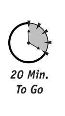

#### getTime() 和 setTime() 方法

正如你在第 16 课中看到的（在讨论如何创建 Cookie 过期日期时），这些方法用于获取和设置自 1970 年 1 月 1 日午夜以来的毫秒数时间。能够以这种格式获取日期，使你可以轻松进行日期计算。例如，要确定我女儿第一个生日是哪一天，我可以使用以下代码：

```
var bDate = new Date( "May 5, 2000 21:40:00");
var oneYear = 86400000 * 365;
var bDayMS = bDate.getTime();
bDate.setTime( bDayMS + oneYear);
```

然后，bDate 变量将包含日期：Sat May 5 21:40:00 EDT 2001

#### getTimeZoneOffset() 方法

此方法返回指定 Date 对象与格林威治标准时间之间的时间差，以分钟为单位。

```
var myDate = new Date( "May 5, 2000");
var tzOffset = myDate.getTimezoneOffset();
document.write( "The date is: " + myDate + "<br />");
document.write( "The time zone offset is: " + tzOffset + " minutes");
```

#### toGMTString() 方法

正如你在第 16 课中学到的（在讨论如何创建 Cookie 过期日期时），此方法将返回 Date 对象的内容，并将时间转换为其在格林威治标准时区的等效时间。例如，以下代码：

```
var myDate = new Date( "May 5, 2000 21:40:00");
alert( myDate.toGMTString());
```

将产生一个显示以下日期的警告窗口：Sat, 6 May 2000 01:40:00 UTC

#### toLocaleString() 方法

此方法将 Date 对象中的时间作为格式化字符串返回。此字符串的格式可能因浏览器而异，但你通常会得到星期几（完整拼写出来，即 "Saturday" 而不是 "Sat"）、月份（也拼写出来）、日期以及小时、分钟和秒。如果你需要以友好的、人类可读的格式显示日期，这通常是任何 Date 方法能提供的最友好的格式。如果这还不够友好，你随时可以提取日期的各个部分（使用上面讨论的方法）并构建自己的日期字符串进行显示。

#### UTC 日期方法

几乎所有剩余的 Date 方法都涉及 UTC（世界协调时间）。也就是说，它们报告的时间就像客户端计算机位于格林威治标准时区一样。这些方法与你刚才看到的方法基本相同，只是在名称中添加了 "UTC" 字符。例如，`getUTCHours()` 方法将检索日期的小时部分，就像该日期位于格林威治标准时区一样。如果你需要，这些方法允许你将所有时间计算标准化为单一的、与客户端无关的时区。（有关这些方法的使用示例，请参阅 CD-ROM 上 Session27 文件夹中的 UTCmethods.htm 文件。）

### 在网站上使用 Date 对象

Date 对象更常见的用途之一是在网站上显示时间和/或日期，并不断更新它。因此，我将在 Baby-Palooza 网站的菜单页面上添加一个每秒更新一次的日期和时间显示。首先，我需要某个地方来实际显示时间和日期。由于这将是一个动态变化的显示，在文本框中显示信息将是最简单的。所以，我需要定义一个表单和一个文本框，如下所示：

```
<form name="timeDisplay">
<input type="text" class="noEdit" name="theTime" value="" />
</form>
```

请注意，此文本框的类是 `noEdit`。如果你还记得第 25 课的内容，这是我定义的类，用于移除文本框的边框，并确保鼠标经过文本框时光标不会变化。所以，这个文本框看起来就像是页面上的另一段文字。

接下来，我需要定义一个函数来显示和更新此文本框中的时间。

```
function showTime() {
    var rightNow = new Date();
    var tString = rightNow.toLocaleString();
    document.timeDisplay.theTime.value = tString;
    setTimeout( 'showTime()', 1000);
}
```

这个极其简单的函数就能达到目的。它首先创建一个新的 Date 对象，包含当前时间（从客户端的系统时钟获取）。然后通过 `toLocaleString()` 方法将时间信息提取为格式化字符串，并将其放入我刚创建的文本框中。最后调用 `setTimeout()` 方法确保 `showTime()` 函数在一秒后被再次调用，这会使整个过程重新开始并更新时间显示。

## Math 对象

Math 对象是一个 JavaScript 对象，它包含各种数学常量，并提供对常见数学函数的访问。（注意，这*不是*一个类！所以，你不能创建新的 Math 对象。你所能做的就是使用 JavaScript 内置的那个 Math 对象。幸运的是，这正是你真正需要的。）其中一些你会从高中和大学数学课程中熟悉，而另一些可能是你从没听说过的。基本上，如果你需要编写执行大量数字运算的 JavaScript 程序，你会庆幸 Math 对象的存在。如果不是，好吧，你不必使用它，但知道它就在那里以备不时之需是*很好*的。

### Math 对象的常量属性

Math 对象包含以下*常量属性*。它们被称为*常量*原因很简单，因为你无法改变它们（所以它们有恒定的值）。然而，你可以像访问任何其他对象的属性一样访问它们。（注意，Math 对象中定义了更多的常量属性。请务必查看 CD-ROM 上的 ECMAScript 文档以了解其他的。）

#### Math.E 属性

这是常量值 2.718281828459045。

#### Math.PI 属性

这是常量值 3.141592653589793。（即 π）

#### Math.SQRT2 属性

这是常量值 1.4142135623730951。（即 √2）

### Math 对象的方法

Math 对象中有近二十种不同的方法，其中很少有用于日常编程的。所以，我在这里只介绍最有用的。请务必查看 CD-ROM 上的 ECMAScript 文档以了解 Math 对象所有方法的详细信息。这些方法和其他方法的示例可以在 CD-ROM 上的 mathMethods.htm 文件中找到。

#### Math.abs() 方法

此方法将返回你传递给它的数字的绝对值。

#### Math.max() 和 Math.min() 方法

你给这些方法传递两个或更多数字，它们分别返回其中最大或最小的数字。

#### Math.pow() 方法

你给此方法传递两个数字。第一个数字将被提升到第二个数字的幂。例如，以下与 2 * 2 * 2 相同。

```
var result = Math.pow( 2, 3);
```

#### Math.random() 方法

此方法不带任何参数，返回 0 到 1 之间的伪随机数。


#### Math.round() 方法

此方法会将你传入的数字四舍五入到最接近的整数值。

#### Math.sqrt() 方法

此方法会返回你传入数字的平方根。

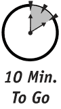

## location 对象

在第8课和第9课中，你分别学习了 `window.location` 属性和 `document.location` 属性。如果你观察仔细，可能会注意到每个属性似乎都表示同一件事：当前加载到浏览器中的 HTML 文档的网络地址。正如你在后续课程中所看到的，你实际上可以通过向其中一个属性分配新的网络地址来强制浏览器加载新的 HTML 文档。

虽然这些看起来只是简单的字符串对象，但每个 location 属性实际上本身就是一个复杂的对象。虽然你可以将其用作简单的重定向工具，但 location 对象的属性和方法可以为你提供很多关于当前加载到浏览器中的网络地址的信息。

（虽然 `window.location` 和 `document.location` 属性包含基本相同的信息，但 `document.location` 属性可能会逐渐被淘汰，取而代之的是 `document.URL` 属性。因此，我将把讨论限制在 `window.location` 上。）

### location 对象的属性

以下任何属性都可以设置为新值。这样做通常会导致浏览器加载由新值指定的文档。然而，这是一种特定于浏览器的行为，因此，确保你的新文档将被加载的最佳方法是始终将你的新网络地址构建为一个完整的字符串，然后将其分配给 `location.href` 属性。

#### hash 属性

它包含一个字符串对象，其中包含 `href` 属性中指定的网络地址的 "hash" 部分。例如，如果 `href` 属性包含

```
http://www.baby-palooza.com/index.htm#top
```

hash 部分就是 `#top`。

#### host 属性

它包含一个字符串对象，其中包含来自 `href` 属性中指定的网络地址的主机信息。例如，如果 `href` 属性包含

```
http://www.baby-palooza.com
```

host 部分就是 "www.baby-palooza.com:80"。

#### hostname 属性

它包含一个字符串对象，其中只包含来自 `href` 属性中网络地址的主机名信息。例如，如果 `href` 属性包含在此链接中：

```
http://www.baby-palooza.com
```

hostname 部分就是 "www.baby-palooza.com"。

#### href 属性

它包含当前位置的完整网络地址。将新的网络地址分配给此属性将强制 Web 浏览器加载该地址的文档。

#### pathname 属性

如果 `href` 属性中的网络地址指向服务器上某个文件夹中深藏的文件，此属性将包含指向该文件的路径。例如，如果这是 `href` 属性：

```
http://www.baby-palooza.com/strollers/index.htm
```

pathname 属性将包含字符串 "strollers/index.htm"。

#### port 属性

这是一个字符串对象，其中包含 `href` 属性中指定的端口。

```
http://www.baby-palooza.com:80
```

在这里，port 属性将包含值 80。

#### protocol 属性

这是用于加载 `href` 属性中指定的网络地址的协议（`http`、`ftp` 等）。

#### search 属性

这是 `href` 属性中网络地址指定的查询字符串。

```
http://www.baby-palooza.com/search.htm?type=stroller
```

在此示例中，`search` 属性将包含字符串 `?type=stroller`。请注意，问号*确实*包含在字符串的开头。

### location 对象的方法

如果你想将新页面加载到 Web 浏览器中，你*可以*只需将新的网络地址分配给 `location.href` 属性。但是，以下方法之一将让你对该过程有更多控制。

#### reload() 方法

此方法告诉浏览器重新加载 `href` 属性中引用的文档。此方法可以接受一个布尔参数，名为 `force`。如果 `force` 参数为 `true`，则即使浏览器缓存中存在最新副本，页面也将从 Web 服务器重新加载。

#### replace() 方法

调用此方法时，你需要传递一个你想要加载到 Web 浏览器中的新文档的网络地址。这个新文档将被加载到 Web 浏览器中，并且其网络地址将*替换*浏览器历史记录列表中当前加载文档的网络地址。（有关历史记录列表的讨论，请参阅下一节。）如果你有一系列“不可见”的 JavaScript 页面，每个页面都触发加载下一个页面，直到达到最终页面，这可能会非常方便。如果这些临时页面中的每一个都使用 `replace()` 方法加载下一个页面，那么只有最终页面（用户实际看到的那个）最终会出现在历史记录列表中。因此，当用户点击浏览器中的后退按钮时，所有临时页面都将被跳过，用户将直接返回到起始页面。（完整的示例可以在 CD-ROM 上的 `locationReplaceMethod.htm` 文件中找到。）

## history 对象

本节课中我想告诉你的最后一个对象是 `window.history` 对象。顾名思义，此对象保存了用户自启动浏览器以来访问过的网络地址列表。

### length 属性

`history` 对象只有一个属性：`length`。此属性告诉你历史记录列表中有多少个条目。

### history 对象的方法

到目前为止，`history` 对象看起来很像一个数组，不是吗？嗯，它是的，但它是一个相当特殊的数组。因为它包含有关用户 Web 浏览习惯的信息，所以已决定 JavaScript 程序不应能够实际读取历史记录列表中的任何网络地址。换句话说，像 `alert( history[0])` 这样的语句要么会产生错误，要么会得到值 `undefined`。因此，你能做的最好的事情就是使用 `history` 对象的方法之一来在浏览器中来回移动访问过的页面列表。

#### back() 方法

调用此方法将导致浏览器重新加载存储在上一个历史记录列表条目中的网络地址（如果存在）。（这就像点击浏览器的后退按钮。）

#### forward() 方法

调用此方法将导致浏览器加载存储在下一个历史记录列表条目中的网络地址（如果存在）。（这就像点击浏览器的前进按钮。）

#### go() 方法

调用此方法时，你需要传递一个正整数或负整数。浏览器将在历史记录列表中跳过该数量的位置（如果数字为正则向前跳，如果数字为负则向后跳），并加载存储在该历史记录列表位置的网络地址。

### history 对象、框架和窗口

虽然 history 对象一开始可能看起来不那么令人兴奋，但它一个非常重要的方面是你创建的每个框架和每个窗口都有自己的 `history` 对象。因此，完全有可能创建一组位于一个框架中的控件，允许你在另一个框架的历史记录中来回移动。

另一件需要了解的重要事情是，在基于框架的网站中，顶层对象也有一个 `history` 对象，它有点像是其所有框架的 `history` 对象的混合体。因此，如果用户更改了一个框架中的页面，然后又更改了另一个框架中的页面，这些单独的更改不仅会进入每个框架的历史记录列表，而且它们都会进入 `top` 对象的主历史记录列表。在此历史记录列表中来回移动实际上会更改相应框架的内容，而不是 `top` 窗口。


## 复习

在本节课中，你学习了 JavaScript 语言和浏览器对象模型中内置的几个实用对象和类。你了解了如何使用 Date 类来创建包含时间和日期信息的 Date 对象。你还学习了如何执行简单的日期数学运算来创建新的日期。你了解了 Math 对象及其属性和方法。你了解了 `location` 对象如何用于将浏览器从一个 HTML 文档移动到另一个 HTML 文档，以及如何使用此对象的属性来获取有关当前加载文档的信息。最后，你了解了 `history` 对象如何用于在浏览器启动以来查看过的页面列表中来回移动。

## 自我测验

- 1. 如何创建一个包含当前日期和时间的 Date 对象？（参见 "The Date Class."）
- 2. 在 JavaScript Date 对象中，哪个整数值代表星期一？哪个值代表星期六？（参见 "The getDay() method."）


# 第28讲

## 与服务器端进程通信

### 课程清单

- ✔ 准备数据以传输到服务器端进程
- ✔ 解码嵌入在网页地址中的数据

虽然 JavaScript 是一门功能非常强大的语言，但在网页浏览器中，它无法完成一些事情。例如，它无法与数据库建立连接。它也不擅长创建图表、图形或其他图形界面。当遇到 JavaScript 无法完成（或完成得不好）的任务时，你可能需要将其交给某种服务器端应用程序来处理。

## 通用网关接口

如果你使用网络已有一段时间，无疑听说过通用网关接口或 CGI。通常，你会在应用程序的语境下听到 CGI——例如，“我不得不编写一个 CGI 应用程序来从网页表单中收集数据并将其放入数据库。”术语 *CGI 应用程序* 确实有点用词不当，因为它暗示该应用程序是用某种名为 CGI 的语言编写的。但是，CGI 不是一种编程语言；它只是客户端程序用来与服务器端程序通信的协议。因此，当你听到有人谈论他们编写的“CGI 应用程序”时，他们实际上是在说他们编写了一个使用 CGI 协议与某个其他进程发送/接收数据的程序。所以，CGI 应用程序可以用任何支持该协议的语言编写。Perl、C 和 Python 都是创建 CGI 应用程序的流行语言，但它们绝不是你可以用来创建 CGI 应用程序的*唯*语言。

### 理解 CGI 数据格式

关于 CGI 的专著可以（而且已经）写了很多。（要了解所有关于 CGI 的技术细节，你应该访问 www.w3.org/CGI/ 上的 CGI 规范页面。）然而，整个事情最终归结为数据的格式化方式，以便在客户端和服务器之间传输。基本上，通过 CGI 传输的数据格式如下所示：

```
name1=value1&name2=value2&name3=value3
```

如你所见，这只是一系列由“与”符号（&）分隔的名称和值对。尽管看起来很简单，但要通过 CGI 正确传输数据，你仍然需要遵循几条规则。

- 不允许有空格。在你想通过 CGI 发送的数据中，任何位置都不允许有空格和其他空白字符。如果你想发送一个空格，你必须将其替换为 + 号或发送其等效的十六进制代码。要传输其他空白字符（如制表符和换行符），你应该发送它们的十六进制代码。这当然引出了一个问题：“我如何创建这些十六进制代码？”为了回答这个问题，JavaScript 提供了 `escape()` 函数。（将字符串中的特殊字符替换为其十六进制等效值通常被称为对字符串进行 *转义*。）你将在本讲稍后学习这个函数及其反函数 `unescape()` 函数。

- 任何其他特殊字符，包括“与”符号（&）和等号（=），也应作为十六进制字符传输。当你通过 CGI 传输数据时，等号总是用于将值与名称关联起来，而“与”符号总是被视为名称=值对的分隔符。因此，如果你的某个值包含“与”符号或等号，它必须以十六进制代码发送，这样接收程序才不会误解你的数据。

举个例子，假设你有三个字段需要通过 CGI 传输：`firstName`、`lastName` 和 `address`。进一步假设这些字段的值是 "John"、"Public" 和 "123 Anyplace Rd."。这些信息可以通过以下两种形式中的任意一种进行传输：

```
firstName=John&lastName=Public&address=123+Anyplace+Rd.
firstName=John&lastName=Public&address=123%20Anyplace%20Rd.
```

在第一种形式中，地址中的空格已被替换为加号（+）。在第二种形式中，空格已被替换为它们的等效十六进制代码（20）。百分号（%）用于告诉 CGI 应用程序，接下来的两个字符是一个十六进制字符代码，在进一步处理之前应将其转换回实际的字符。（这可能会让你好奇如何通过 CGI 传输 + 和 % 而不引起混淆。我马上就会讨论这个问题。）

## CGI 方法

正如我之前所说，CGI 是客户端和服务器之间用来相互传输数据的协议。数据的格式化只是该协议的一部分。另一部分是格式化后的数据实际如何到达目的地。在 CGI 协议中，有两种用于传输数据的标准方法。这些方法被称为 *post* 和 *get*。（请注意，CGI 协议不使用对象，因此这些方法与 `toUpperCase()` 是 `String` 对象的方法并非同一概念。它们被称为方法，因为它们各自描述了一个传输数据的过程。这使得它们成为“方法”，因为它们描述了如何执行一项实际任务——将数据从一个地方移动到另一个地方——而不是与抽象对象相关联。）

### get 方法

`get` 方法是两者中较简单的一种。当数据以这种方式传输时，它会被格式化为如上所示，然后直接附加到 CGI 应用程序的网页地址末尾。因此，如果我想通过 `get` 方法将我的 `firstName` 和 `lastName` 数据发送到 Baby-Palooza 网站上的一个应用程序，我会使用一个如下的网页地址：

```
http://www.babypalooza.com/cgiapp.exe?firstName=John&lastName=Public
```

这里，`cgiapp.exe` 是我想调用的服务器端 CGI 应用程序的名称。问号后面的所有内容都称为 *查询字符串* 或 *搜索字符串*。（从这里开始，我将称其为“搜索字符串”，因为这是 JavaScript 对它的称呼。）当 Web 服务器查看这个地址时，它会看到 `cgiapp.exe` 是一个可执行程序，而不是一个 HTML 文档。因此，它会启动这个程序，并向其传递一个包含搜索字符串的参数，该字符串是作为网页地址的一部分发送的。然后由 `cgiapp.exe` 从搜索字符串中提取所需信息，处理它，并将结果返回给 Web 服务器。Web 服务器随后会获取这些结果（通常是一个完整的 HTML 文档）并将其发送回客户端。

如你所见，`get` 方法非常易于使用。然而，它的缺点是，你能够以这种方式传输的数据量是有限的。Web 浏览器通常对网页地址有一个最大允许长度，因此如果你想传输大量数据（例如一个或多个文本字段的内容），`get` 方法并不是一个合适的选择。

### post 方法

`post` 方法更适合传输大量数据。虽然数据的格式完全相同，但发送方式不同。当通过 `post` 方法传输数据时，不会在网页地址末尾添加任何内容。相反，会发送一个特殊的头部（header），告诉 Web 服务器正在传输多少字节的数据。然后，实际数据会作为一个大块发送给 Web 服务器。Web 服务器会将相同的信息（字节数和大块数据）传递给 CGI 应用程序。然后，CGI 应用程序可以从标准输入流（类似于你在第9讲中学习的流）中读取数据，并以与从搜索字符串获取数据完全相同的方式进行处理。

## CGI 如何与 HTML 和 JavaScript 协同工作

当你创建一个 HTML 表单时，你可以使用 `method=` 属性来指定你希望浏览器在向 Web 服务器发送表单数据时使用这两种 CGI 方法（`get` 或 `post`）中的哪一种。例如，给定以下表单定义：

```
<form method="post" action="cgiapp.exe">
<input type="text" name="fName" />
<input type="text" name="fName" />
<input type="submit" value="submit" />
</form>
```


当此表单的“提交”按钮被点击时，其数据将通过 post 方法发送到 cgiapp.exe 应用程序。如果初始的 `<form>` 标签是这样的：

```
<form method="get" action="cgiapp.exe">
```

那么表单中的数据将通过 get 方法发送。（许多人没有意识到，如果你没有为表单指定方法，它将默认为 get 方法。如果你的表单数据包含敏感信息，如密码或信用卡信息，这可能非常糟糕。因为，当使用 get 方法提交表单数据时，浏览器会将该数据，包括任何敏感信息，附加到表单 `action=` 属性中指定的 Web 地址末尾。另一方面，当你使用 post 方法时，表单中的数据会避开随意观察者。所以，如果你想要的是 post 方法，请*务必*在定义表单时指定它！）

## 在 HTML 中使用 get 和 post

正如我之前提到的，如果你想通过 CGI 发送空格或其他特殊字符，你需要确保这些字符在发送前已经过正确转义。如果你只是在表单中收集数据，然后让浏览器在点击“提交”按钮时发送该数据，那么你无需担心任何事情。浏览器会自动将你的数据整理成 CGI 兼容的格式，并在发送前转义表单中的所有数据。换句话说，如果你让它这样做，浏览器会自动为你处理所有 CGI 的繁琐工作。

## 在 JavaScript 中使用 get 方法

虽然浏览器完全能够处理简单的数据提交，但有时你可能需要对发送到服务器端进程的内容进行更多控制。在那些情况下，你可以使用 JavaScript 来构建并通过 get 方法提交自己的 CGI 兼容数据。

### 构建和使用搜索/查询字符串

使用 JavaScript 创建一个符合 get 方法的搜索字符串非常容易，你甚至不需要使用表单来完成。例如，假设我需要创建一系列链接，当点击时将调用一个生成销售报告的服务器端应用程序。调用此应用程序时，它期望接收两个参数：一个年份和一个季度，用于总结销售数据。（请注意，以下所有示例的代码都可以在你的 CD-ROM 上 Session28 文件夹中的 bpReports.htm 和 qtrSalesSummary.htm 文件中找到。）首先，我必须定义适当的链接，它们可能看起来像这样：

```
<a href="javascript:doQtrSummary( 2001, 1)">Q1, 2001</a>
<a href="javascript:doQtrSummary( 2001, 2)">Q2, 2001</a>
<a href="javascript:doQtrSummary( 2001, 3)">Q3, 2001</a>
<a href="javascript:doQtrSummary( 2001, 4)">Q4, 2001</a>
```

在每个链接中，我调用一个名为 `doQtrSummary()` 的 JavaScript 函数。此函数将接收我传递给它的参数（我报告的年份和季度），并构建一个适当的搜索字符串，我可以用它来调用我的服务器端进程。该函数如下所示：

```
function doQtrSummary( year, qtr) {
    var sStr = "year=" + year;
    sStr += "&qtr=" + qtr;
    location.href = "qtrSalesSummary.htm" + "?" + sStr;
    }
```

如你所见，这并没有什么复杂的。首先，我取年份值并将其与字符串 `year=` 连接起来。这将给我代表年份参数的名称=值对。接下来，我取这个字符串，并将其与将代表季度参数的名称=值对连接起来。注意分隔两个名称=值对的&符号。当前两行代码完成时，我将得到一个如下所示的字符串（假设点击的是第一个链接）：`year=2001&qtr=1`

剩下的就是将其附加到我要调用的服务器端 CGI 应用程序的 Web 地址末尾。这在函数的最后一行完成。（当然，由于我不知道你拥有什么样的服务器设置，我无法在此示例中真正调用传统的 CGI 应用程序。作为替代，我只是调用另一个 HTML 文件。但是，我调用此 HTML 文件的方式与你调用任何其他 CGI 应用程序的方式完全相同。）请注意，在 CGI 应用程序的 Web 地址和搜索字符串之间，有一个问号。这个问号分隔了 CGI 应用程序的实际 Web 地址和你要发送给它的搜索字符串。所以，当所有这些连接完成后，我最终的 Web 地址将如下所示：`qtrSalesSummary.htm?year=2001&qtr=1`

一旦我构建了这个 Web 地址和搜索字符串的组合，我所要做的就是将其分配给 `location` 对象的 `href` 属性。正如你在上一节课中看到的，这将告诉浏览器从 Web 服务器请求此文档。当 Web 服务器看到此请求时，它会分离出搜索字符串（从问号开始的所有内容）并将其传递给我请求的 CGI 应用程序。然后由 CGI 应用程序处理搜索字符串并将其结果传回 Web 服务器，Web 服务器再将其传回 Web 浏览器。

### 转义搜索字符串中的值

如你所见，构建和发送一个 get 方法请求到 CGI 应用程序非常简单。然而，我刚刚向你展示的是最简单的情况。此示例中的任何值都没有需要在通过 CGI 发送前转义的空格或特殊字符。因此，为了让事情更有趣一点，我将修改我的函数，允许用户为报告添加标题。

```
function doQtrSummary( year, qtr) {
    var title = prompt( "Title for report...", "Sales Summary");
    if (title != null) {
        var sStr = "year=" + year;
        sStr += "&qtr=" + qtr;
        sStr += "&title=" + escape( title);
        location.href = "qtrSalesSummary.htm" + "?" + sStr;
    }
}
```

在这个版本的函数中，一个提示窗口要求用户指定报告使用的标题。由于用户可以在此提示窗口中输入任何内容，我需要确保她输入的任何空格或特殊字符都能正确通过 CGI。所以，我取用户输入的值并将其传递给 `escape()` 函数。`escape()` 函数查看字符串中的每个字符，如果字符是空格或特殊字符，它会将该字符替换为其十六进制代码值，前面加上一个百分号（%）。例如，以下语句：

```
alert( escape("Hello & Welcome!"));
```

将打开一个警报窗口，显示以下字符串：

```
Hello%20%26%20Welcome%21
```

在这种情况下，`escape()` 函数将每个空格字符变成了 %20，将&字符变成了 %26，将感叹号变成了 %21。与它们所代表的字符不同，这些字符代码可以安全地通过 CGI。理解你*只应该*转义搜索字符串中的各个值，而*不是*整个搜索字符串，这一点非常重要！考虑这个函数：

```
function doQtrSummary( year, qtr) {
    var title = prompt( "Title for report...", "Sales Summary");
    if (title != null) {
        var sStr = "year=" + year;
        sStr += "&qtr=" + qtr;
        sStr += "&title=" + title;
        location.href = "qtrSalesSummary.htm?" + escape(sStr);
    }
}
```

嗯，在这个版本的函数中，我转义的是整个搜索字符串，而不仅仅是其中的值。这会给我一个如下所示的搜索字符串：

```
year%3D2001%26qtr%3D1%26title%3DSales%20Summary
```

而不是正确的字符串，如下所示：

```
year=2001&qtr=1&title=Sales%20Summary
```

### 转义 + 字符

正如我之前所说，当你构建搜索字符串时，你必须将该字符串中的任何空格替换为 + 字符或其十六进制等效字符（%20）。我写这篇文章时，使用 + 字符替换空格的情况已经越来越少见。因此，许多 CGI 应用程序如果搜索字符串中也有十六进制等效字符，就简单地将它们视为 + 字符。然而，许多较旧的 CGI 应用程序仍将加号视为空格并相应替换。不幸的是，除非你实际尝试（或者你自己编写它），否则你永远不知道 CGI 应用程序会如何表现。然而，你*可以*指望所有 CGI 应用程序都能正确处理十六进制等效字符。所以，每当你构建搜索字符串时，转义数据中可能存在的任何加号总是一个好主意。但这可能是个问题，因为就目前而言，`escape()` 函数实际上*不会*转义加号！所以，如果我执行这个语句：

```
alert( escape("One + One is Two"));
```


显示的内容将是：One%20+%200One%20is%20Two 将此传递给 CGI 应用程序可能会引发问题，如果该 CGI 应用程序没有以你预期的方式处理加号。因此，唯一的真正解决方案是为 `escape()` 函数创建一个包装函数，该函数还会转义字符串中发现的任何加号字符：

```javascript
function escapePlus( tStr) {
    var escaped = escape( tStr);
    var result = "";
    for (x=0; x<escaped.length; x++) {
        if (escaped.charAt( x) == "+") {
            result += "%2B";
        }
        else {
            result += escaped.charAt( x);
        }
    }
    return result;
}
```

这个函数首先调用 `escape()` 函数并传递我要转义的字符串。这将转义所有适当的字符，但加号除外。然后函数进入一个 for 循环，逐一检查转义后字符串中的每个字符。如果字符是加号，则将加号的十六进制等效值（%2B）添加到结果字符串的末尾。如果字符不是加号，则将该字符直接复制到结果字符串的末尾。当循环结束时，结果字符串被返回给调用者，提供一个将所有必要字符更改为其十六进制等效值的字符串。

### 从 get 方法请求中检索数据

在我的示例中，get 请求的目标是另一个 HTML 文件。没有多少人意识到，你实际上可以使用 get 方法请求将数据传递给另一个 HTML 文件。然后，在目标文件中，你可以使用 JavaScript 来检索这些数据并对其进行处理。

在这个示例中，get 方法请求的目标是文件 qtrSalesSummary.htm。当此文件加载时，传递给它的搜索字符串将可在 `location` 对象的 `search` 属性中获取。因此，在最简单的情况下，我可以检索此信息并像这样显示它：

```
alert( location.search);
```

在 `location.search` 属性中找到的内容将是构成发送到 HTML 页面的 get 方法请求的原始数据。因此，假设用户点击了第一季度链接并保留了报告标题不变，`location.search` 中的值将是：

```
?year=2001&qtr=1&title=Sales%20Summary
```

查看这个值，你会注意到数据仍然是其转义形式，并且在数据的开头有一个问号。不幸的是，问号将始终存在，因此在处理数据之前，你必须先将其去除。（不过你将看到，这并不太困难。）此外，由于其余数据以 name=value 对的形式排列，处理起来就像处理你在第 16 课中学习的 cookie 数据一样简单。事实上，编写一个函数来从搜索字符串中提取任意给定值相当容易，这样你就可以在 JavaScript 程序中轻松使用它。以下代码展示了 `qtrSalesSummary.htm` 文件中的这样一个函数。

```javascript
function getParam( paramName) {
    var sStr = location.search.substring( 1);
    var result = "undefined";
    if (sStr != "") {
        var nvPairs = sStr.split( "&");
        for (x=0; x<nvPairs.length; x++) {
            if (nvPairs[ x].indexOf( paramName + "=") != -1) {
                var nvItem = nvPairs[ x].split( "=");
                result = unescape( nvItem[ 1]);
                break;
            }
        }
    }
    return result;
}
```

这个函数首先要做的是从 `location.search` 属性中检索实际的搜索字符串。请注意，它使用对 `substring()` 方法的调用来提取除搜索字符串开头的问号之外的所有内容。如果搜索字符串不为空，函数随后使用 `split()` 方法创建一个数组。数组中的每个条目保存来自搜索字符串的一个 name=value 对。然后一个 for 循环遍历此数组，搜索传递给函数的参数名称。当找到该参数名称时，该 name=value 对本身被拆分为一个新数组。此数组的第二个元素（name=value 对的值部分）随后被传递给 `unescape()` 函数并返回给调用该函数的任何人。我相信你大概能猜到 `unescape()` 函数的作用。它只是接受一个字符串并搜索其中的十六进制字符编码。当找到一个时，它将其替换为等效的可打印字符。就这么简单！

## 在 JavaScript 中使用 post 方法

虽然在 JavaScript 中使用 get 方法请求相当简单，但使用 post 方法请求可能稍显复杂。首先，JavaScript 实际上没有任何方法可以从 post 方法请求中检索数据。这意味着如果你想将数据从一个 HTML 页面发送到另一个 HTML 页面，你必须使用 get 方法。因此，就 post 方法而言，唯一剩下的就是使用 JavaScript 构建一个 post 方法请求，以便将其传输到 Web 服务器上更传统的 CGI 应用程序。


实际上，你已经见过如何做到这一点了。你看，当你验证数据或为表单控件赋值时，你正在更改当用户点击该表单的提交按钮或当你调用表单的 `submit()` 方法时将被发送的数据。因此，你在第 12、13 和 15 课中学到的所有内容都可以用来为通过 post 方法传输的数据做准备。事实上，这些课程同样适用于 get 方法。正如我在本课前面提到的，如果你使用 get 方法提交表单，浏览器将简单地构建一个搜索字符串（就像你在本课前面学习构建的那个一样——它甚至会为你转义值），并将其附加到你在 `<form>` 标签的 `action=` 属性中指定的 Web 地址的末尾。

## 复习

在本课中，你学习了通用网关接口（CGI）协议以及 JavaScript 如何与之配合向服务器端进程或另一个 HTML 文件发送数据。你学习了数据必须如何格式化为搜索字符串才能被 CGI 应用程序使用。你了解了搜索字符串中不允许使用的字符以及如何用等效的十六进制代码替换这些字符。你看到了 JavaScript 如何检索 get 方法请求的内容并从中提取信息以用于你的 JavaScript 程序。最后，你发现所有关于在表单中验证数据和使用表单控件的知识，实际上只是创建有效的 post 或 get 请求的各个方面，这些请求将在表单提交时被发送。

## 自我测验

1.  你可以使用什么编程语言来编写 CGI 应用程序？（参见"通用网关接口"。）
2.  在 CGI 兼容的搜索字符串中，数据是如何格式化的？（参见"理解 CGI 数据格式"。）
3.  `escape()` 和 `unescape()` 函数的作用是什么？（参见"转义搜索字符串中的值"和"从 get 方法请求中检索数据"。）
4.  在 CGI 协议中，& 和 = 字符的作用是什么？（参见"理解 CGI 数据格式"。）
5.  get 和 post 的区别是什么？（参见"CGI 方法"。）

# 第 29 课 多媒体支持

## 课程要点

-   检测和使用插件与辅助应用程序
-   了解 JavaScript 如何增强 `<object>` 标签

当今 Web 浏览器最酷的功能之一是它们可以显示许多不同类型的数据。然而，它们并不总是独自完成。事实上，归根结底，大多数 Web 浏览器只能显示文本（HTML）和基本类型的图形。如果你想显示不同类型的文件或数据，你可能需要使用浏览器插件或辅助应用程序来完成这项工作。

## 理解插件和辅助应用程序

浏览器"插件"只是一个在 Web 浏览器内部工作的程序，它允许浏览器显示其原本无法显示的数据类型。例如，Adobe 提供了一个免费的浏览器插件，允许你直接在 Web 浏览器中查看便携式文档格式（PDF）文件，而无需启动单独的程序。


另一方面，*辅助应用程序*是与浏览器分离的程序。如果浏览器不知道如何处理某种特定类型的文件，并且没有可用的插件来处理文件中的数据，它将启动一个合适的辅助应用程序，并告诉它打开并显示该文件。

插件和辅助应用程序最棒的地方在于，如果你的 HTML 代码结构正确，浏览器将自动加载正确的插件（或运行正确的辅助程序）并自动显示你的数据。虽然插件和辅助程序可以显著增强 Web 浏览器的功能，但有一个小小的限制：它们必须安装在客户端才能使用。这就是 JavaScript 的用武之地。你可以使用 JavaScript 来确定客户端机器是否安装了正确查看你特定类型数据所需的插件或辅助应用程序。如果已安装，你可以动态生成加载并显示数据所需的 HTML。如果没有，你可以生成另一批 HTML，告诉用户他们需要某个特定的插件，并提供一个链接供他们获取该插件。（这与你在第 26 课中讨论的处理旧版或不支持 JavaScript 的浏览器的方式基本相同。）为了使用 JavaScript 检测插件或辅助应用程序，你必须利用 `navigator` 对象的两个特殊属性：`mimeTypes` 数组和 `plugins` 数组。

**注意**

由于某种原因，微软当前版本的 Windows 版 Internet Explorer 完全不支持 `mimeTypes` 或 `plugins` 数组（当你考虑到 Macintosh 版 Internet Explorer *确实* 支持这些数组时，这种遗漏就更加令人费解！）。幸运的是，这应该会在不久的将来得到修复。在此之前，你将要阅读的内容仅适用于 Netscape 浏览器和 Macintosh 版 Internet Explorer。

## 使用 mimeTypes 数组

正如你在第 26 课所学到的，`navigator` 对象包含有关客户端用于执行你的 JavaScript 程序的浏览器的各种信息。除了这些浏览器信息外，它还提供有关客户端计算机已知的 MIME 类型的信息。

### *MIME（类型）有什么用？*

基本上，MIME 类型的发明是为了让电子邮件程序能够查看附加在电子邮件中的文件，并确定文件中的数据类型。如果用户尝试保存附加文件，电子邮件程序可以使用 MIME 类型信息来保存文件，并附带正确的文件类型信息。

在从一种类型的计算机向另一种类型的计算机发送文件时，这是一个非常重要的能力。例如，Windows 通过使用文件名末尾的三个字符扩展名来跟踪文件类型。另一方面，Macintosh 将文件类型信息保存在文件本身内部。因此，如果你从 Windows 机器向 Macintosh 发送一个文本文件，Macintosh 上的电子邮件客户端将使用为文件指定的 MIME 类型，以确保文件在 Macintosh 上被正确保存（作为文本文件）。

由于 MIME 类型与平台无关，它们迅速成为在 Internet 上指定文件类型的标准。当 Web 浏览器请求文档时，Web 服务器发回给浏览器的第一个信息片段就是文档的 MIME 类型。浏览器查看 MIME 类型信息，并使用它来确定如何处理该文档。

MIME 类型的第一部分是一个字符串，指定文件中数据的通用类型：例如，“text”。后面是一个正斜杠（/），再后面是一个字符串，指定文件中数据的具体类型：例如，“html”。因此，HTML 文档的完整 MIME 类型如下所示：`text/html`。当 Web 浏览器收到具有此 MIME 类型的文档时，它就知道它正在处理一个 HTML 文件并据此做出反应。

> **互联网号码分配机构（IANA）维护当前定义的 MIME 类型列表。你可以访问他们的网站 www.iana.org。到达该网站后，请在“协议号码和分配服务”中查找 MIME 类型目录。（IANA 将这些称为“媒体类型”。）**

### *mimeTypes 数组中有什么？*

mimeTypes 数组包含客户端计算机上定义的每种 MIME 类型的一个 mimeType 对象。每个 mimeType 对象有四个属性：

- description：这是此 MIME 类型所代表的数据的简短描述。
- enabledPlugin：如果有一个已安装的插件处理此类数据，此属性将是指向该插件的引用。（这实际上是 `plugins` 数组中某个条目的引用。有关更多信息，请参阅即将讨论的 `plugins` 数组。）如果此属性为 `null`，则很可能没有可用的插件来处理此类数据。但是，此属性并非总是确定某种数据类型是否有可用插件的最佳方式。要做出此判断，你需要检查 `plugins` 数组。
- suffixes：这是可能在此 MIME 类型文件上找到的文件名后缀的逗号分隔列表。例如，与 `text/html` MIME 类型关联的后缀是 `htm` 和 `html`。
- type：这是实际的 MIME 类型规范字符串（即 “text/html”）。

### 获取 MIME 类型列表

由于 `navigator.mimeTypes` 属性只是一个数组，获取客户端机器上定义的 MIME 类型列表非常简单。以下代码清单显示了一个简单的 JavaScript 和 HTML 代码片段，它将生成一个格式良好的表格，显示 `mimeTypes` 数组中的所有相关信息。（此代码可以在你 CD-ROM 上 Session29 文件夹中的 `mimeTypes.htm` 文件中找到。）

```
<table border="1" width="100%">
  <tr>
    <th>MIME Type</th>
    <th>Plug-in Available</th>
    <th>Description</th>
    <th align="left">File Suffixes</th>
  </tr>
  <script language="javascript">
    for (x = 0; x < navigator.mimeTypes.length; x++) {
      document.write("<tr>");
      document.write("<td width='25%'>" +
        navigator.mimeTypes[x].type + "&nbsp;</td>");
      if (navigator.mimeTypes[x].enabledPlugin != null) {
        document.write("<td width='25%'>" +
          navigator.mimeTypes[x].enabledPlugin.name +
          "&nbsp;</td>");
      }
      else {
        document.write( "<td width='25%'>Handled by Default Plug-in or Helper Application</td>");
      }
      document.write( "<td width='25%'>" + navigator.mimeTypes[x].description + "&nbsp;</td>");
      document.write( "<td width='25%'>" + navigator.mimeTypes[x].suffixes + "&nbsp;</td>");
      document.write( "</tr>");
    }
  </script>
</table>
```

此代码清单中的代码应该看起来很熟悉。这是一个简单的 for 循环，检查 mimeTypes 数组中的每个条目，并将其发现的内容显示在表格中。这里唯一的技巧是检查某个 MIME 类型是否有可用的 enabledPlugin。如果有，程序将显示插件的 name 属性。如果没有，它将显示一条简短的消息，告诉你此 MIME 类型将由默认插件或辅助应用程序处理。（默认插件顾名思义。如果浏览器找不到专门针对给定 MIME 类型的插件，将尝试由默认插件处理数据。如果它无法处理，浏览器随后将搜索辅助应用程序来处理数据。）

> **提示：** 如果你加载 mimeTypes.htm 文件并查看输出，你会注意到有一些 MIME 类型看起来像这样：`image/x-targa`。`x-` 表示此 MIME 类型尚未成为标准化的 MIME 类型。

## 理解 plugins 数组

现在你已经理解了 MIME 类型以及如何从 JavaScript 获取这些信息，我需要告诉你关于 plugins 数组。正如你在上一节中看到的，plugins 数组中的条目通过 enabledPlugin 属性与 mimeTypes 数组相关联。plugins 数组中的每个条目都是一个 plugin 对象，它描述了安装在客户端浏览器中的一个插件。plugin 对象有四个属性：

- description：这是一个简短的描述，告诉你一些关于该插件的信息。这通常包括插件供应商的名称和插件的功能。


### 访问插件的 MIME 类型数组

使用 `plugin` 对象的关键在于与插件关联的 `mimeType` 对象数组。如果你需要确切知道某个插件支持哪些类型的数据，只需遍历这个数组并检查每个条目中指定的 MIME 类型即可。如果所需的 MIME 类型在列表中，你就可以确定该插件能够处理该类型的数据。

实际上，访问这个 MIME 类型列表并不太难。最大的诀窍只是知道它的存在。一旦你知道了，只需将 `plugins` 数组视为多维数组即可获取其中的信息。（事实上，它就是多维数组！）接下来的代码清单展示了一个简单的程序，它将显示客户端机器上安装的所有插件以及每个插件支持的 MIME 类型。（这段代码也可以在你的 CD-ROM 上的 plugIns.htm 文件中找到。）

<table border="1" width="100%">
    <tr>
        <th>插件名称</th><th>插件文件名</th>
        <th>支持的 MIME 类型</th><th>描述</th>
    </tr>
    <script language="javascript">
    for (x = 0; x < navigator.plugins.length; x++) {
        document.write( "<tr>");
        document.write( "<td width='25%'>" +
        navigator.plugins[x].name + "&nbsp;</td>");
        document.write( "<td width='25%'>" +
        navigator.plugins[x].filename + "&nbsp;</td>");
        if (navigator.plugins[x].length > 0) {
            document.write( "<td width='25%'>");
            for (y=0; y < navigator.plugins[x].length; y++) {
                document.write( navigator.plugins[x][y].type +
                    "<br />");
            }
            document.write( "</td>");
        }
        else {
            document.write( "<td width='25%'>没有 MIME 类型</td>");
        }
        document.write( "<td width='25%'>" +
            navigator.plugins[x].description + "&nbsp;</td>");
        document.write( "</tr>");
    }
    </script>
</table>

再次强调，这里并没有什么特别困难的。这段代码只是遍历 `plugins` 数组并显示数组中每个条目的内容。唯一有点技巧的部分是显示插件支持的 MIME 类型的代码，但即便那也相当简单。该代码只是检查当前 `plugin` 对象的 `length` 属性，然后遍历未命名数组中的每个 `mimeType` 对象。对于该数组中的每个条目，程序会输出实际的 MIME 类型信息以及一个 `<br />` 标签。

### 检测插件和支持的 MIME 类型

观察 `mimeType` 和 `plugin` 对象的结构，你可能已经对如何检查插件的存在性有了一些想法。实际上有几种不同的方法，我将逐一介绍。

#### 通过名称检查插件

最简单、也最不可靠的检查插件的方法是通过名称检查。你可以这样做，因为 JavaScript 使用每个 `plugin` 对象的 `name` 属性作为 `plugins` 数组中每个条目的索引。例如，要检查 Apple Computer 的 QuickTime 插件是否存在，你可以简单地编写如下 `if` 语句：

```javascript
if (navigator.plugins[ "QuickTime Plug-In"]) {
    // 在此处嵌入 QuickTime 影片
}
else {
    // 告诉用户去获取该插件
}
```

麻烦的是，这个插件名称在不同计算机平台之间，甚至在插件的不同版本之间都不一致！例如，名称 "QuickTime Plug-In" 来自我一台 Windows NT 计算机上安装的 2.x 版本插件。而看看我桌面上的 Macintosh，我发现那里安装的 QuickTime 插件的名称是 "QuickTime Plug-in 5.0。"

一个稍好一点的方法是遍历 `plugins` 数组并检查插件名称中具有特征性的部分。下面显示了一个执行此操作的函数。（请注意，此函数和其他几个函数可以在你 CD-ROM 上的 multimedia.js 文件中找到。）

```javascript
function findPluginByPartialName( theName) {
    var foundMatchAt = -1;
    if (navigator.plugins.length > 0) {
        for (x=0; x < navigator.plugins.length; x++) {
            var plugName =
                navigator.plugins[ x].name.toUpperCase();
            if (plugName.indexOf( theName.toUpperCase()) != -1) {
                foundMatchAt = x;
                break;
            }
        }
    }
    return foundMatchAt;
}
```

如果此函数找到与提供的部分名称匹配的项，它将返回在 `plugins` 数组中找到该插件的索引号。然后可以使用此索引号来检查与该插件关联的 MIME 类型。这种方法的一个缺点是，如果两个插件的名称非常相似，这个函数完全有可能检测到错误的插件。虽然你可以检查 MIME 类型以确保你得到了正确的插件，但这额外的一步其实没有必要。

#### 通过 MIME 类型检查插件

迄今为止，检查合适插件最简单、最可靠的方法是简单地检查每个已安装的插件，看看它们是否支持你要显示的数据的 MIME 类型。一旦找到支持你的数据类型的插件，就可以停止搜索，让浏览器处理其余的事情。

这*确实*意味着你可能最终得到的插件并非你想要的那个特定插件。例如，QuickTime 和 Netscape 旧的 LiveAudio 插件都将处理 WAV 声音文件。这意味着只要安装了其中任何一个，你就应该能够在客户端的 Web 浏览器中嵌入并播放 WAV 文件。

当然，如果你*必须*拥有只有一个插件才能提供的功能，那么你应该确保该插件可用。但是，如果该插件不可用，你应该认真考虑通过其他可用的插件来提供你的数据。说了这么多，下面是一个检查支持特定 MIME 类型的插件的函数。

```javascript
function findPluginByMIMEType( theMIMEType) {
    var foundMatchAt = -1;
    if (navigator.plugins.length > 0) {
        var numTypes = 0;
        for (x=0; x < navigator.plugins.length; x++) {
            numTypes = navigator.plugins[x].length;
            for (y=0; y < navigator.plugins[x].length; y++) {
                if (navigator.plugins[x][y].type == theMIMEType) {
                    foundMatchAt = x;
                    break;
                }
            }
            if (foundMatchAt != -1) {
                break;
            }
        }
    }
    return foundMatchAt;
}
```

## 检测辅助应用程序

如果你找不到支持你要显示的数据类型的插件，你可能想检查一下是否有辅助应用程序可用。为此，只需遍历 `mimeTypes` 数组，看看描述你的数据的 MIME 类型是否已定义。如果定义了，客户端的机器应该就有用于该类型数据的辅助应用程序。以下是一个函数，它将检查 `mimeTypes` 数组中是否存在指定的 MIME 类型。

```javascript
function findHelperApp( theMIMEtype ) {
    var foundMatchAt = -1;
    if (navigator.mimeTypes.length > 0) {
        for (x=0; x < navigator.mimeTypes.length; x++) {
            if (navigator.mimeTypes[x].type == theMIMEtype) {
                foundMatchAt = x;
                break;
            }
        }
    }
    return foundMatchAt;
}
```

## 使用多媒体文件

既然你知道了如何检测插件和辅助应用程序，你需要学习如何利用这些知识实际地向你的用户呈现多媒体文件。在你查看实现此功能的代码之前，让我先概述一下你需要警惕的不同情况。

- 你能期望的绝对最佳情况是用户安装了合适的插件。如果是这样，你可以简单地生成 JavaScript 代码或 HTML 标签（或多个标签）将数据嵌入到你的网页中，然后让浏览器处理其余的事情。
- 如果没有插件可用，次佳的情况是存在辅助应用程序。在这种情况下，你必须以某种方式触发辅助应用程序的启动。你可以通过提供一个指向你的数据文件的链接供用户点击来实现。如果你想跳过让用户点击链接的这一步，你可以通过将你的数据的 Web 地址赋值给……（后续内容在原文中未提供完整）

举个例子，看看你 CD-ROM 上的 `openPDF.htm` 文件。它展示了将 Adobe Acrobat (PDF) 文件嵌入网页所需的代码。（我在本示例中嵌入的 PDF 文件是同样位于你 CD-ROM 上的 ECMAScript 文档文件。）查看这段代码，你会注意到，一旦我确认加载 PDF 文件是安全的（`plugInAvail` 或 `helperAvail` 为 `true`），我就直接将 PDF 文件的网址赋给 `location.href` 属性。这样做是因为我发现这是调用 Acrobat PDF 查看器插件的最简单有效的方式。

这一点很重要：每个插件都不同。有时同一个插件在不同版本或不同平台上会有不同的行为。因此，关键在于你需要使用你想用的插件进行大量测试。本节展示的技术只是帮助你判断一个插件是否可用。实际让插件正常工作则取决于插件本身。

如果既找不到插件也找不到辅助应用程序，代码会显示一条简单消息，告诉用户去哪里获取插件。同时还会提供一个链接，让用户尝试加载 PDF 文件，以防 `mimeTypes` 和 `plugins` 数组中的信息有误。

最后，代码会检查当前浏览器是否为运行在 Windows 上的 Internet Explorer（使用第 26 节中 `browserSnoop.js` 文件里的几个函数）。请记住，我在本节开头提到过，当前 Windows 版本的 Internet Explorer（我撰写本文时为 5.x 版本）不允许你对 `mimeTypes` 或 `plugins` 数组做*任何*操作。你甚至无法获取它们的长度！因此，如果这段代码在 Windows 机器上的 Internet Explorer v5.x 中加载，它将无法找到插件或辅助应用程序，只会显示末尾的备用文本。

不过，考虑到几乎所有 Windows 电脑都会预装 Adobe Acrobat，可以相当放心地假设：如果浏览器是 Windows 上的 Internet Explorer，那么 Acrobat Reader 插件就是可用的。所以如果是这种情况，我会再次尝试将 PDF 文件加载到浏览器中。如果插件或辅助应用程序可用，文件将加载到浏览器中，备用文本也会消失。否则，文件不会加载，备用消息将保留在屏幕上。

PDF 文件实际上有些特殊，只需将其网址赋给 `location.href` 属性就能轻松地在浏览器中显示。通常，在确认插件可用后，你需要生成一个合适的 `<object>` 标签来将数据插入网页。（过去，其他 HTML 标签（尤其是 `<embed>` 和 `<applet>`）曾被用于将文件嵌入网页。`<object>` 标签最终会取代这些标签，所以这里我将重点介绍它。）

`<object>` 标签有很多可用的属性，但其基本格式如下：

```
<object data="Web address of file" type="MIME type of file">
HTML to parse if file cannot be embedded
</object>
```

当浏览器遇到 `<object>` 标签时，它基本上会执行与显示 PDF 文件的代码相同的步骤。它会尝试查找支持指定 MIME 类型的插件。如果找到，就让该插件显示指定的文件。

然而，如果浏览器找不到合适的插件，它不会去查找文件的辅助应用程序。相反，它只会解析 `<object></object>` 开闭标签之间的 HTML。这些 HTML 可以是几乎任何内容，包括更多的 `<object>` 标签。虽然这确实意味着你可以嵌套 `<object>` 标签，尝试在文档中嵌入类型依次降低的数据，但你不能用这种方法来启动已存在的辅助应用程序。

当然，你可能认为可以在 `<object></object>` 标签中放入一段 JavaScript 来检查辅助应用程序并在其存在时启动它。不幸的是，事实证明，`<object></object>` 标签内的任何 JavaScript 无论对象是否加载成功都会被执行。

更糟糕的是，`<object>` 标签不支持 `onerror` 事件处理程序。所以你无法编写一个在对象未加载时执行的事件处理程序（尽管 `<object>` 标签确实支持许多其他事件处理程序）。所有这些加在一起意味着，在使用 `<object>` 标签时，你需要用一些巧妙的技巧来检查辅助应用程序。下一个示例尝试显示一个 QuickTime 影片，你将看到我所说的技巧。

```
<script language="javascript">
function checkHelper() {
    if (findHelperApp( "video/quicktime")) {
        location.href = "baby.mov";
    }
}
</script>
<object data="baby.mov" type="video/quicktime" width="100%" height="100%">

You don't seem to have the QuickTime Plug-In. You can go
<a href="http://www.apple.com/quicktime">here</a> to get it.<br />
Or, you can try viewing the movie in a separate window by clicking
<a href="baby.mov">here</a>.
</object>
```

在这个示例中，我定义了一个 `<object>` 标签，尝试加载并播放一个 QuickTime 影片。如果 QuickTime 插件可用，浏览器将自动加载并播放该影片。然而，如果 QuickTime 插件不可用，`<object></object>` 标签内的 HTML 代码将被解析并显示在浏览器窗口中。

这些 HTML 代码大部分都是你之前见过的内容。不过第一行是新的：一个 `` 标签。这个标签显示一张可爱的小图片——一个悲伤的婴儿（鉴于影片无法加载，这很合适）。此外，这个 `` 标签有一个 onload 处理程序。当这张悲伤婴儿图片加载完成后，函数 `checkHelper()` 将被调用。该函数检查是否存在 QuickTime 影片的辅助应用程序，如果找到就告诉浏览器立即加载该影片。当然，悲伤婴儿的图片可能不适合你的网站，但你可以始终使用一张不可见的图片（即 1×1 像素或与背景颜色相同的小方块）来产生同样的效果。这虽然巧妙，但确实有效！

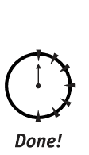

## 复习

在本节中，你学习了浏览器插件和辅助应用程序，以及如何使用 JavaScript 与它们配合工作。你了解了什么是 MIME 类型，以及它们如何用于指定通过互联网传输的文件的类型信息。你了解到 `navigator.mimeTypes` 数组包含浏览器能够自行显示或借助辅助应用程序显示的所有不同文件类型的列表。你还了解到 `navigator.plugins` 数组包含所有已安装的浏览器插件的列表，以及每个插件可以显示哪些 MIME 类型的信息。你看到了如何使用 JavaScript 搜索这些数组，以确定是否安装了特定插件或是否为特定 MIME 类型提供了辅助应用程序。

最后，你了解了当 `<object>` 标签因找不到插件而无法加载多媒体文件时，JavaScript 如何检查辅助应用程序的存在。

## 自测

1.  插件和辅助应用程序有什么区别？（参见"理解插件和辅助应用程序"。）
2.  什么是 MIME 类型？（参见"使用 mimeTypes 数组"。）
3.  MIME 类型的前半部分告诉你什么？后半部分告诉你什么？（参见"MIME（类型）有什么用？"。）
4.  检查是否存在处理特定 MIME 类型的插件，最可靠的方法是什么？（参见"按 MIME 类型检查插件"。）
5.  如何使用 JavaScript 和 `` 标签来判断对象是否加载失败？（参见"使用多媒体文件"。）


# 第30讲

# 使用Java小程序

## 本讲要点

-   在HTML文档中嵌入Java小程序
-   了解JavaScript如何与Java小程序通信

你可以嵌入网页的较为实用的对象类型之一就是Java小程序。与大多数其他可嵌入对象不同，Java小程序实际上是迷你应用程序。这意味着它们可以完成JavaScript程序能做的所有事情，甚至更多！最重要的是，根据客户端使用的浏览器，你实际上可以使用JavaScript来控制Java小程序。

本章将要讨论的内容*应该*能在所有主流浏览器中运行。然而，在撰写本文时，唯一支持JavaScript与Java通信的浏览器是PC版的Internet Explorer 5.x和Netscape Navigator 4.x。Macintosh版的Internet Explorer根本不支持这种功能。虽然Netscape 6据称支持此特性，但在其第一个版本中似乎并未包含此功能。因此，请将这最后一讲视为对未来功能的展望，或者你可以为拥有这些浏览器的用户带来的一些惊喜。

## 在HTML文档中添加Java小程序

大多数Java开发环境会在你需要时自动生成HTML文档，展示如何将Java小程序嵌入HTML文档。不过，如果你使用Sun的JDK工具从零开始构建Java小程序，就需要自己掌握如何操作。

### `<applet>` 标签

`<applet>` 标签是目前将Java小程序添加到HTML文档中最简单的方式。（需要注意的是，未来`<object>`标签将取代`<applet>`标签。但目前来看，`<object>`标签在处理小程序时似乎存在不少问题。）虽然`<applet>`标签可以相当复杂，但你几乎总是可以只用几个简单的属性就搞定了。通常，applet标签看起来像这样：

```
<applet name="appletName" code="applet.class"
codebase="folderToLookIn">
<param name="param1Name" value="value for first parameter" />
<param name="param2Name" value="value for second parameter" />
HTML to include if browser does not support applets
</applet>
```

与之前介绍的其他标签一样，`name=`属性指定了JavaScript用于与小程序通信的名称。`code=`属性是浏览器将实际加载和执行的Java .class文件的名称。（.class文件是Java中相当于Windows环境中.exe文件的文件。）`codebase=`属性告诉浏览器在哪个文件夹中查找`code=`属性中指定的类文件。（如果类文件与包含`<applet>`标签的HTML文档在同一文件夹中，你可以省略此属性。）

如果你想向小程序传递参数，可以指定一系列`<param>`标签。每个标签将定义一个参数，在小程序加载后直接传递给它。

最后，以防客户端的浏览器不支持Java小程序，你还可以指定一段HTML内容来显示。通常，这会是一条简单的消息，告诉用户需要使用支持Java的浏览器来查看小程序，但也可以是任何你想要的内容。（奇怪的是，JavaScript代码块在这里似乎不起作用。不过，正如你即将看到的，如果需要的话，你可以使用第29讲中的``标签技巧来触发JavaScript函数。）

### 与Java小程序通信

一旦你在HTML文档中嵌入了Java小程序，你的JavaScript代码就可以引用该小程序并访问其公共方法和属性。（"公共"（public）是Java中等同于JavaScript中"全局"（global）的概念。除非在小程序中被定义为public，否则你无法访问Java小程序中的任何内容。）

基本上，操作方式和你想象的一样简单。从第9讲中你应该记得，`document`对象内部有一个名为`applets`的数组。正如你所预期的，这就是当前加载的HTML文档中所有已定义的Java小程序的数组。这意味着你可以通过名称或通过`applets`数组来访问你的小程序。例如，假设我的HTML文档中的第一个小程序名为"myApplet"，它有一个名为`getInfo()`的公共方法，我可以用以下任一JavaScript语句来调用该方法。

```
document.applets[ 0 ].getInfo();
document.myApplet.getInfo();
```

就这么简单！

> **你可能在想，如果Java小程序中的代码能够调用网页中的JavaScript代码就好了。嗯，确实如此！遗憾的是，唯一支持这一点的浏览器是旧版本的Netscape Navigator。Netscape 6本应支持此功能，但该特性在第一个版本中似乎也存在缺陷。**

#### 使用横幅小程序

那么，为了将所有内容整合在一起，让我来展示一个完整的示例。首先，我需要一个小程序来演示。当你从http://java.sun.com的Java站点下载Java开发工具包（JDK）时，你会发现其中附带了大约二十几个示例程序。因此，我决定从中选取一个，为Baby-Palooza网站制作一个漂亮的横幅。（不用担心，Sun公司慷慨地允许你复制、修改和重新分发这些示例程序，只要给予适当的致谢即可。比如，就像这段说明。）我使用的小程序叫做"Nervous Text"。这个小程序接收一个字符串，并在屏幕上以一种仿佛刚喝了十杯咖啡的方式对其进行动画显示。（换句话说，字母会到处跳动。）该小程序的基本`<applet>`标签如下所示：

```
<applet name="banner" code="NervousText.class"
    width="100%" height="50">
    <param name="text" value="Welcome to Baby-Palooza!" />
</applet>
```

text参数就是你希望小程序进行动画显示的字符串。虽然这既简单又好用，但该小程序不允许在加载*之后*进行任何更改。换句话说，一旦加载，它只会对你最初传入的字符串进行动画显示。

我想要的是更灵活一些的功能。具体来说，我希望能够更改显示的文本以及小程序的背景颜色和文本颜色。因此，我不得不对小程序做一些小的修改来实现这些功能。这不是一本Java编程书籍，所以我不会详细讲述这些修改。（如果你想查看所有更改内容，修改后的小程序的最终源代码可以在光盘上Session30文件夹中的NervousText.java文件中找到。）不过，我会介绍重置小程序显示文本所需的更改。

## 使用公共Java方法

当Nervous Text小程序首次被调用时，它会读取从HTML文件传递给它的text参数，并将其存储在一个名为banner的变量中。这意味着，要更改小程序显示的文本，就需要更改banner变量的值。因此，我添加了一个简单的方法来实现这一点：

```
public void setBanner( String newBanner) {
    banner = newBanner;
    resetBanner();
}
```

如你所见，Java的语法与JavaScript非常相似。然而，这里需要注意的重要一点是，该方法被定义为public。这意味着*任何人*都可以调用它，包括在Web浏览器中运行的JavaScript解释器。因此，假设我的`<applet>`标签按前面所示的方式定义，我可以用如下语句来调用此方法：

```
document.banner.setBanner( "Be sure to stock up on baby-wipes!");
```

横幅中的跳动文字就会更改为我传入的字符串。


正如我所说，我希望能够不仅更改横幅中的文本，还能更改背景色和文本颜色。这需要在Java小程序中创建几个更多的公共方法。但是，一旦它们被创建，就可以用同样的方式进行访问。

### nervousBaby.htm 文件

在HTML编辑器和网络浏览器中同时打开nervousBaby.htm文件。在网络浏览器中稍加操作小程序，然后在HTML编辑器中查看我在后续段落中的讨论内容。

首先，`<applet>`标签现在包含了两个新参数：bgColor和textColor。这些是RGB颜色值（类似于你在第9课学到的），它们分别告诉浏览器为小程序使用什么背景色和文本颜色SSE。（注意，这些参数应该只包含原始的颜色值，不带任何十六进制表示字符——也就是说，你可以传递FFFFFF但不能传递0xFFFFFF。）

在`<applet>`标签内还有一段HTML文本，如果浏览器不支持小程序，将会显示这段文本。注意，我使用了第29课中的``标签技巧，在小程序未加载时触发一个JavaScript函数。触发的函数会检查客户端浏览器是否定义了"application/java" MIME类型。如果定义了，那很可能用户只是在她的浏览器中关闭了Java支持。在这种情况下，该函数会显示一条简短的消息，告诉用户如果她想查看小程序，需要重新打开Java支持。

接下来，一个onload处理器尝试检索小程序的默认值，并将它们显示在页面底部的表单中。你会注意到这个处理器利用了另一个函数checkAppletStatus()，该函数会告诉它小程序是否已加载。小程序可能非常庞大和复杂，因此在尝试与小程序通信之前，确保它们已加载是个好主意。这里的过程与你在第23课和第24课中看到的完全相同。主要区别在于我为这个小程序添加了一个方法（getLoadStatus()），当小程序启动并运行时，该方法实际上会返回true。（有关此方法的详细信息，请参见NervousText.java文件。）

一旦确定小程序已准备就绪，onload处理器会从小程序中检索横幅文本、背景色和文本颜色，并将这些值放入表单中供用户查看。

最后，是页面底部的表单。这个表单包含多个控件，允许用户查看小程序使用的值并更改这些值。更改值是通过一个简单的onclick处理器完成的，该处理器调用小程序中的相应方法。

例如，要更改横幅文本，用户只需在表单中输入新文本，然后单击“设置横幅文本”按钮。此按钮的onclick处理器从文本框中提取文本，并将其传递给小程序的setBanner()方法。

## 复习

在本课中，你学习了用JavaScript控制Java小程序实际上非常简单。唯一真正的要求是你想要访问的Java方法和属性必须在Java小程序中声明为public。具备此条件和合适的Web浏览器后，JavaScript可以访问加载到HTML文档中的任何小程序中的任何公共方法或属性。

## 自测

- 1. 小程序位于浏览器对象模型的何处？（参见“与Java小程序通信”。）
- 2. `<applet>`标签中的`<param>`标签代表什么？（参见“`<applet>`标签”）
- 3. 为了使JavaScript能够访问Java方法或属性，该方法或属性在Java小程序中必须如何声明？（参见“与Java小程序通信”。）
- 4. 如何判断小程序是否已加载？（参见“nervousBaby.htm文件”）
- 5. 如何判断小程序是否加载失败？（参见“nervousBaby.htm文件”）

# 第六部分

# 星期天下午

- 1. 你会使用什么语句来创建一个Date对象，使其包含2001年1月15日上午9:47:25的日期和时间？
- 2. 你的JavaScript程序如何强制Web浏览器重新加载HTML文档，即使该文档已在浏览器缓存中？
- 3. 运用你在第19课学到的技术，扩展Date类以包含两个新方法：`getDayName()`和`getMonthName()`。第一个方法应返回Date对象中存储的星期几的名称。第二个方法应返回Date对象中存储的月份名称。
- 4. 如第25课所述，Math对象没有将数字四舍五入到指定位数的方法。创建一个名为`roundTo()`的新函数，让你可以将一个值四舍五入到指定位数。此函数应接受两个参数：要四舍五入的数字和要四舍五入到的位数。（提示：第25课的`twoDecimals()`函数是一个很好的起点。）
- 5. 在基于框架的网站中有多少个`history`对象？
- 6. `location.replace()`方法的目的是什么？
- 7. 如果`<form>`标签没有指定`method=`属性，将使用什么默认的CGI方法？
- 8. HTML文档中的JavaScript程序如何从post方法请求中提取数据？
- 9. 如果一个HTML文件通过get方法请求将数据发送到另一个HTML文件，目标HTML文件中的JavaScript程序在哪里可以找到这些数据？

# 第六部分—星期天下午部分复习

- 10. 为什么必须对你想要通过CGI发送的数据进行转义？
- 11. 如果你需要将大量数据从HTML文档传输到服务器端CGI应用程序，你应该使用哪种CGI方法？
- 12. mimeType对象的enabledPlugin属性告诉你什么？
- 13. plugin对象的length属性告诉你什么？
- 14. mimeType对象的suffixes属性包含什么？
- 15. 什么是默认插件？
- 16. 查看MIME类型时，组合字符x-表示什么？
- 17. 全局函数或变量的Java等价物（大致）是什么？
- 18. `<applet>`标签的code=属性代表什么？
- 19. 假设一个名为shoppingCart的小程序包含一个名为printCart()的公共方法，你会使用什么JavaScript语句来调用此方法？
- 20. 如果这个小程序是HTML文档中的第四个小程序，你如何通过applets数组调用此方法？

## 附录

## 部分复习答案

### 星期五晚上复习答案

- 1. 你可以在HTML文件中的几乎任何位置放置这些标签。但按照惯例，它们通常位于HTML文件开头的`<head></head>`标签之间。
- 2. 函数实际上只是一个带有名称的代码块。你可以向它传递参数进行处理，它也可以返回结果。
- 3. 只有两个布尔值：`true`和`false`。
- 4. 代码块可以是单行JavaScript代码，也可以是任意多行用花括号（`{}`）括起来的JavaScript代码。就JavaScript解释器而言，代码块在逻辑上等同于单行代码。
- 5. JavaScript变量和函数名必须以美元符号、下划线或字母字符开头。之后，它们可以是字母、数字、下划线或美元符号的任何组合。
- 6. 行中任何位置的两个正斜杠（`//`）都会将该行的其余部分标记为注释。对于多行注释，请将注释包含在`/*`和`*/`之间。
- 7. 这有点像陷阱题。JavaScript代码只是纯ASCII文本，所以你不必将其存储在任何特殊的文件格式中。
- 8. 此属性告诉Web浏览器脚本是用哪种脚本语言编写的。如果你没有为`language=`属性指定值，则假定为JavaScript。
- 9. 只需使用`return`关键字，后跟你要返回的值或表达式。
- 10. 答案会有所不同。一个可能的解决方案在你的CD-ROM上。
- 11. 答案会有所不同。一个可能的解决方案在你的CD-ROM上。
- 12. 这是另一个陷阱题。函数可以有任意少或多的参数。但请记住，即使没有参数的函数在定义和调用时也必须包含一组括号。
- 13. 此属性允许你指定包含JavaScript源代码的外部文件的位置。此代码将被加载并可用于HTML文件中的JavaScript。
- 14. 第一个表达式设置循环计数器变量的初始状态。第二个表达式指定每次循环时要进行的测试。如果测试结果为`false`，循环执行将停止。第三个表达式在每次循环结束时执行，并修改你的计数器变量，以便循环最终终止。
- 15. 全局变量在JavaScript程序的任何部分都可用。局部变量仅在定义它们的函数中可用。请确保使用`var`关键字定义局部变量。
- 16. x的值将是29。y的值将是100。这个问题的关键在于第二个语句的条件表达式中只有一个*等号*。因此，y将被赋值为100，条件将评估为`true`（因为100不是0[记住，如果不是0，它就等同于布尔值`true`]），所以x将被赋值为29。
- 17. JavaScript变量是松散类型的，因此你可以为它们分配任何类型的数据。
- 18. 答案会有所不同。一个可能的解决方案在你的CD-ROM上。
- 19. 答案会有所不同。一个可能的解决方案在你的CD-ROM上。
- 20. 答案会有所不同。一个可能的解决方案在你的CD-ROM上。


### 周六上午复习答案

1.  空字符串是不包含任何字符数据且长度为零的字符串。然而，就JavaScript而言，它仍然是一个字符串。

2.  `myVar` 的内容将是一个包含一个字符的字符串对象：9。为什么？因为当你将数字9与空字符串连接时，JavaScript解释器会将9转换为一个字符串，然后将该字符串与空字符串连接。结果字符串是9。

3.  答案会有所不同。一个可能的解决方案在你的光盘上。

4.  答案会有所不同。一个可能的解决方案在你的光盘上。

5.  浏览器对象模型是一组JavaScript对象的集合，这些对象代表了Web浏览器和加载到其中的HTML文档的各个部分。这些对象的属性和方法允许你的JavaScript程序访问和操作Web浏览器以及这些对象所代表的HTML文档。

6.  答案会有所不同。一个可能的解决方案在你的光盘上。

7.  在JavaScript中，多维数组仅仅是一个包含其他数组的数组。因此，你首先创建你的子数组，然后将每个子数组分配给主数组的元素。主数组随后将被认为是多维的。

8.  答案会有所不同。一个可能的解决方案在你的光盘上。

9.  要遍历具有命名槽的数组元素，请使用第6课“使用命名数组元素”部分描述的 `for ... in` 语句。

10. `document` 对象是 `window` 对象的属性。`window` 对象代表一个浏览器窗口或框架，而 `document` 对象则代表加载到该窗口或框架中的实际HTML文档。

11. `alert()` 方法用于在弹出窗口中显示简单消息。用户可以通过单击提供的OK按钮来关闭警报窗口。

12. 链接对象代表一组单独的 `<a href="some Web address"></a>` 标签。链接对象存储在 `document` 对象的 `links` 数组属性中。

13. `document.open()` 方法打开文档对象，以便你可以向其中写入新文本。然后，你使用 `document.write()` 或 `document.writeln()` 调用将文本发送到文档对象。当你写完文本后，调用 `document.close()` 来关闭文档，并告诉浏览器显示你写好的文本。

14. 答案会有所不同。一个可能的解决方案在你的光盘上。

15. `document.write()` 方法只写入你指定的文本。`document.writeln()` 方法在你指定的文本后跟一个换行符。

16. 答案会有所不同。一个可能的解决方案在你的光盘上。

17. `onclick` 事件代表在元素内部的鼠标单击。

18. 当一个窗口或表单元素被选中并接收击键时，它被称为获得了`焦点`。一旦窗口或表单元素成为焦点，就会触发 `onfocus` 事件。当窗口或表单控件失去焦点时，它就`模糊`了。每当窗口或表单元素失去焦点时，都会触发 `onblur` 事件。

19. 答案会有所不同。一个可能的解决方案在你的光盘上。

20. 当与 `` 标签一起使用时，`onload` 事件告诉你图像已实际完成加载到Web浏览器中。

### 周六下午复习答案

1.  答案会有所不同。一个可能的解决方案在你的光盘上。

2.  `elements` 数组保存了与表单中定义的控件相对应的所有JavaScript对象。

3.  调用表单的 `reset()` 方法与单击该表单的重置按钮相同。它将为表单触发一个 `onreset` 事件，然后将表单中的值重置为其默认值。

4.  JavaScript中的 `document.forms[2]` 代表与HTML文档中定义的第三个表单相对应的JavaScript Form对象。（记住，所有JavaScript数组都从零开始编号，而不是一。）

5.  你可以通过为其 `checked` 属性分配 `true` 或 `false` 来选中或取消选中一个复选框。

### 各部分复习答案

**385**

6.  `options` 数组中的每个条目代表选择列表中的单个菜单项。

7.  如果你从一个密码字段中取出 `value`，你实际上会得到密码的原始文本。它不会被加密或以任何其他方式受到保护。

8.  表单的提交和重置按钮有非常明确的目的。它们要么提交表单，要么重置表单。你可以通过编写适当的 `onsubmit` 和 `onreset` 处理程序来稍微修改它们的行为，但你实际上不能对它们进行太多更改。另一方面，一个通用按钮几乎可以做任何你想做的事情。（包括提交或重置表单！）你所要做的就是编写一个适当的 `onclick` 处理程序。

9.  Image对象的 `src` 属性保存加载到该Image对象中的图形文件的Web地址。

10. 对于 `` 标签，当Web浏览器成功加载了 `src` 属性中指定的图形文件时，`onload` 事件就会触发。

11. 如果Web浏览器无法加载 `src` 属性指定的图形文件，它将为 `` 标签触发一个 `onerror` 事件。

12. 基于JavaScript的鼠标悬停效果利用两个事件来工作：`onmouseover` 和 `onmouseout`。当你的 `` 标签触发 `onmouseover` 事件时，你将图像的 `src` 属性切换为指向代表悬停“开启”状态的新图形。当 `onmouseout` 事件触发时，你将图像的 `src` 属性切换回指向原始图像。

13. `parseInt()` 函数接受一个字符串并将其转换为实际的数值。

14. 验证两次数据只是良好防御性编程的另一个例子。

15. 人们会犯错。什么？你还需要另一个理由吗？

16. 答案会有所不同，但这里的基本概念是，如果你的表单传来的数据无效，那么所有基于该数据的内容都将是有缺陷的。这可能意味着未完成的订单、错误的人口统计数据等等。一点前期的数据验证可以为你省去日后大量的烦恼。

17. 一个cookie可以保存大约4KB的数据。这包括名称、等号以及其后的值。

18. `onunload` 和 `onload` 事件是保存和加载cookie值的理想时机。

19. cookie的过期日期告诉Web浏览器何时应删除该cookie。

20. 答案会有所不同。一个可能的解决方案在你的光盘上。

### 周六晚上复习答案

1.  类是一组对象，所有这些对象都是由同一个构造函数创建的。实例是类中的一个单独对象。

2.  在构造函数内部使用时，`this` 关键字指的是正在由构造函数创建的对象。

3.  首先决定你的自定义类将代表什么类型的数据。其次，决定类中应包含哪些属性和方法。最后，编写并测试代码来实现该类。这包括构造函数和类方法的所有实现函数。

4.  你可以在对象的属性中存储任何类型的JavaScript数据。

5.  构造函数仍然是一个函数，因此你可以传递任意数量的参数。

6.  实际上，方法的参数不能在构造函数内部显示。你只应在方法的实现函数中列出该方法的参数。

7.  答案会有所不同，但方法是绑定到一类对象的函数。

8.  方法是属于一类对象的函数。实现函数是实际执行方法任务的代码。

9.  在方法内部使用时，`this` 关键字指的是调用该方法的对象。例如，在语句 `myString.toUpperCase()` 中，`toUpperCase()` 方法内部的 `this` 值将是 `myString` 对象。

10. 此语句正在为构造函数将要创建的对象定义一个方法。方法名是 `action`，其实施函数名为 `doAction`。

11. 你可以通过创建包装在那些控件的标准浏览器对象模型对象周围的自定义JavaScript对象来增强HTML控件。这些自定义对象可以包含扩展HTML控件功能的新属性和方法。


### 部分复习题答案

12. 只需将原始对象存储在包装对象内部的一个属性中。
13. 当你更改某个对象的原型时，基于该原型的每个对象都会获得新的属性或方法。这甚至包括已经存在的对象。
14. `String.prototype.languageDirection = "leftToRight";`
15. Object 类是在 JavaScript 解释器内部定义的类。所有其他在 JavaScript 语言中定义的类（String、Array 等），以及你定义的所有类，都是基于它的。
16. 传递给 `eval()` 函数的语句会被立即求值并执行。
17. 这条语句将产生错误。（不存在 `documint` 对象。）
18. 通过将对象的 JavaScript 变量名保存在对象内部，你可以轻松地从该对象创建自引用代码。这在动态创建 JavaScript 和 HTML 时非常有价值。
19. 第一条语句将会成功。这是因为它明确指定了计时器到期时要调用的对象和方法。第二条语句将会失败，因为当计时器到期时，`this` 的值将是未定义的，或者与调用 `setTimeout()` 语句时完全不同。
20. 答案会有所不同。一种可能的解决方案在你的 CD-ROM 上。

### 周日上午复习答案

1. 样式表是一组规则，它告诉 Web 浏览器如何对你的 HTML 文档中的各种元素进行样式设置。
2. `<span></span>` 标签用于标记一段文本。然后你可以将事件处理程序和/或样式附加到该段文本，而不会像使用其他 HTML 标签那样产生任何视觉副作用。
3. 通过使用外部样式表，你可以将所有样式定义放在一个地方。然后，你的网站中的每个 HTML 页面都可以通过链接外部样式表来使用这些定义。这样，如果你需要更改网站中使用的某个样式，只需更改外部样式表，所有 HTML 页面将自动反映该更改。
4. 你使用 `document.getElementById()` 方法来获取元素对象。你需要向该方法传递要检索的元素的 ID。
5. 所有样式属性的默认测量单位是像素（px）。
6. `innerHTML` 属性表示元素内部的实际 HTML 代码（标签和文本）。如果你更改元素的 `innerHTML` 属性，新值将立即显示在浏览器窗口中。
7. 这个属性让你告诉浏览器你希望元素在页面上如何定位（相对于何处）。`absolute` 位置值告诉浏览器你将提供元素应被放置的精确坐标（通过 `top`、`bottom`、`left` 和 `right` 属性）。
8. `top` 对象代表屏幕上实际可见的浏览器窗口。它将包含对已加载到浏览器中的所有帧的引用，无论它们嵌套得多深。
9. `parent` 对象代表加载该帧的框架集文档。
10. 只需将文档的 `self` 对象与其 `parent` 对象进行比较。如果它们相同，则该文档是单独加载到一个窗口中的，而不是加载到框架集中。
11. 该窗口将完全没有工具栏。请记住，如果你在 `featuresList` 参数中指定了哪怕一个特性，那么你*没有*指定的特性将全部被关闭。因此，如果你只指定高度和宽度，所有其他窗口特性都将被关闭，这意味着新窗口中将不会出现任何工具栏。
12. 只需对你想要关闭的窗口调用 `window.close()` 方法。如果你的窗口保存在名为 `myWindow` 的变量中，你可以这样编写代码：`myWindow.close();`
13. 在你将要加载到新窗口的 HTML 文档末尾定义一个虚拟表单。然后，检查新窗口中 forms 数组的 `length`。当这个数组的长度等于新窗口中的表单数量时，你就知道 HTML 文档中的所有内容都已加载完毕并可以使用了。
14. 如果一个窗口是由另一个窗口打开的，它的 `opener` 属性将包含对打开它的窗口的引用。
15. `parseFloat()` 函数接收一个包含浮点数的字符串，并将其转换为实际的数值。

### 周日下午复习答案

16. 这有点像个陷阱问题。正如我在第 25 讲中所说的，就 JavaScript 而言，它显示的浮点数是正确的。事实上，它们*确实*正确到了 JavaScript 内部表示浮点数所允许的精度。不幸的是，这不是我们人类期望看到的结果，所以为了向人类展示这些值，需要使用专门编写的函数对它们进行四舍五入。
17. 使用一组样式规则将文本框的边框样式设置为 `none`，并将光标（当它位于文本框上方时）的外观设置为 `default`。然后文本框看起来就像是浏览器窗口中的另一个文本区域。
18. 字符串 "MSIE" 表示紧随其后的数字是该 Web 资源的 Internet Explorer 版本号。
19. 你在 `<script>` 标签的 `language=` 属性中指定所需的 JavaScript 版本。像这样：`<script language="javascript1.1">`
20. 只需将你的 JavaScript 代码用一组 HTML 注释标记括起来。像这样：

```html
<script language="javascript">
<!--
document.write("Hello World!");
// -->
</script>
```

1. `var myDate = new Date( 2001, 0, 15, 9, 47, 25);`
2. 通过调用 `location.reload()` 方法并向其传递 `true` 参数，你可以强制 Web 浏览器重新加载当前在 Web 浏览器中加载的 HTML 文档。
3. 答案会有所不同。一种可能的解决方案在你的 CD-ROM 上。
4. 答案会有所不同。一种可能的解决方案在你的 CD-ROM 上。
5. 这个问题的答案取决于帧的数量。基本上，每个帧会有一个 `history` 对象，外加 `top` 对象的一个 `history` 对象。每个帧的 `history` 对象将保存已在该帧中显示的页面列表。`top` 对象的 `history` 对象将保存已在所有帧中显示的所有页面列表。
6. `location.replace()` 方法允许你加载一个新的 HTML 文档，并让其 Web 地址替换历史记录列表中当前文档的 Web 地址。这允许你从窗口或帧的历史记录列表中删除中间文档。
7. 如果 `<form>` 标签没有指定 `method=` 属性，默认将使用 `get` 方法。
8. 这是个陷阱问题。HTML 文档不会从 `post` 方法请求中接收数据。
9. 发送的数据可以在 `location` 对象的 `search` 属性中找到。
10. 某些字符（空格、& 符号、等号等）在 CGI 协议中充当分隔符和/或停止符。为了让这些字符安全地通过 CGI，必须将这些字符替换为它们的十六进制代码等价物。
11. 要传输大量数据，你应该始终使用 `post` 方法。该方法将数据作为单个大块传输，并将其作为输入流提供给 CGI 应用程序。另一方面，`get` 方法将数据作为 CGI 应用程序 Web 地址的一部分进行传输。这使其可能受到 Web 浏览器或 Web 服务器对 Web 地址长度施加的任何限制。
12. `mimeType` 对象的 `enabledPlugin` 属性告诉你是否可以处理此 MIME 类型的插件已安装。如果有，此属性将包含对适当 plugin 对象的引用。如果没有，此属性将为 null。
13. `plugin` 对象的 `length` 属性告诉你该插件支持多少种 MIME 类型。代表这些 MIME 类型的未命名 `mimeType` 对象数组是每个 plugin 对象的一部分。
14. `mimeType` 对象的 `suffix` 属性保存与该类型文件相关联的各种文件后缀的逗号分隔列表。
15. 默认插件（Default Plug-in）是一种浏览器插件，它尝试处理任何其他插件都无法处理的 MIME 类型。如果默认插件无法处理某个 MIME 类型，浏览器将尝试查找并执行该 MIME 类型的辅助应用程序。


16. MIME 类型中的 x- 表示该 MIME 类型尚不是标准的 MIME 类型。

17. 在 Java 中，你希望全局访问的内容必须声明为 *public*。这大致（非常粗略地）等同于 JavaScript 中的 *global* 概念。

18. `<applet>` 标签的 code= 属性指定浏览器应加载的 Java .class 文件。

19. 你可以使用以下语句调用此方法：

```
document.shoppingCart.printCart();
```

```
document.applets[3].printCart();
```

## 附录

### CD-ROM 中的内容

本附录提供随书附带的 CD-ROM 的内容信息。

本 CD 中包含七个程序：

- Acrobat Reader 4.0
- ECMAScript 标准文档
- BBEdit Lite 和 BBEdit（适用于 Macintosh 用户）
- Netscape Navigator 链接（适用于 Macintosh 和 Windows）
- Internet Explorer（适用于 Macintosh 和 Windows）
- 自测评估

CD 中还包含本书的源代码示例、一个包含最新版本 ECMAScript 标准的 PDF 文件，以及可用 Adobe Acrobat Reader 查看的电子版可搜索版本。

#### 系统要求

请确保你的计算机满足本节列出的最低系统要求。如果你的计算机不符合大多数要求，你可能在使用 CD 内容时遇到问题。

适用于 Microsoft Windows 9x、Windows ME、Windows NT 或 Windows 2000：

- 配备 Pentium 处理器、运行速度不低于 120 MHz 的 PC
- 至少 64 MB 内存
- 以太网网卡（NIC）或速度不低于 28,800 bps 的调制解调器
- CD-ROM 驱动器——双速（2x）或更快

适用于 Macintosh：

- iMac、iBook 或任何其他基于 G3 处理器的 Macintosh
- 至少 64 MB 内存
- CD-ROM 驱动器——双速（2x）或更快

安装 CD 中的所有软件至少需要 150 MB 的硬盘空间。

#### 在 Microsoft Windows 上使用 CD

1. 将 CD 插入计算机的 CD-ROM 驱动器。
2. 打开桌面上的"我的电脑"图标。
3. 右键单击 CD-ROM 驱动器图标并选择"资源管理器"。
4. 此时你可以安装任何想要的软件，也可以将示例源代码文件从 CD-ROM 复制到本地硬盘。
5. 如果选择安装第三方软件，请在开始安装过程后仔细按照屏幕上显示的说明操作。

#### 在 Mac OS 上使用 CD

1. 将 CD 插入计算机的 CD-ROM 驱动器。
2. 双击桌面上出现的 CD-ROM 图标。
3. 此时你可以安装任何想要的软件，也可以将示例源代码文件从 CD-ROM 复制到本地硬盘。
4. 如果选择安装第三方软件，请在开始安装过程后仔细按照屏幕上显示的说明操作。

#### CD 中的内容

CD-ROM 包含源代码示例、应用程序和本书的电子版。以下是按类别排列的 CD-ROM 内容摘要。

##### 源代码

每个课程的源代码文件各自位于一个单独的文件夹中。这些文件夹以"Sessionxx"命名，其中 xx 为课程编号。每个文件夹的内容都设计为独立可用，因此你可以直接使用浏览器打开任何课程文件夹中的文件。还有一个 images 文件夹，包含所有课程文件夹中代码使用的所有图片。如果你将课程文件夹复制到硬盘，请务必同时复制 images 文件夹。

部分复习中的一些题目要求你创建 JavaScript 程序。这些题目的答案可以在 CD-ROM 上的"PartReviewxx"文件夹中找到。（其中 xx 为部分复习的编号。）

##### 应用程序

以下是 CD-ROM 上的应用程序。

##### 浏览器

浏览器是用于访问互联网文件或阅读本地 HTML 文件的客户端软件。

- **Internet Explorer：** 适用于 Windows 9x 及更高版本和 Macintosh 的 Web 浏览器。免费软件。更多信息请访问：www.microsoft.com
- **Netscape Navigator：** 适用于 Windows 9x 及更高版本和 Macintosh 的 Web 浏览器。免费软件。更多信息请访问：www.netscape.com

##### 编辑器

如果你还没有一个好的 HTML 编辑器，CD-ROM 上提供了几款优秀的编辑器。

- **BBEdit Lite 和 BBEdit Demo：** 这可以说是 Macintosh 上最好的文本编辑器。提供两个版本：BBEdit Lite 是一款免费编辑器，具备你需要的所有基本功能。BBEdit Demo 是完整 BBEdit 程序的受限演示版。更多信息请访问：web.barebones.com

##### ECMA Script 标准的电子版

完整的 ECMA Script 标准文本以 Adobe 的可移植文档格式（PDF）存储在 CD-ROM 上，可使用 Adobe Acrobat Reader（也已包含）阅读。有关 Adobe Acrobat Reader 的更多信息，请访问 www.adobe.com。

##### JavaScript 周末速成课程的电子版

本书的完整（可搜索）文本以 Adobe 的可移植文档格式（PDF）存储在 CD-ROM 上，可使用 Adobe Acrobat Reader（也已包含）阅读。

##### 自测评估

自测评估软件帮助你评估从本周末速成课程中学到了多少内容。它还将帮助你确定哪些课程已掌握，哪些可能需要重新学习。

##### 故障排除

如果在安装或使用 CD-ROM 程序时遇到困难，请尝试以下解决方案：

- **关闭可能正在运行的所有杀毒软件。** 安装程序有时会模拟病毒活动，导致计算机误以为感染了病毒。（请务必稍后重新开启杀毒软件。）
- **关闭所有正在运行的程序。** 运行的程序越多，其他程序可用的内存就越少。安装程序通常也会更新文件和程序；如果让其他程序继续运行，安装可能无法正常进行。

如果 CD 仍有问题，请致电 Hungry Minds 客服电话：(800) 762-2974。美国以外地区请致电 (317) 572-3993。Hungry Minds 仅提供安装和其他一般质量控制方面的技术支持；关于应用程序本身的技术支持，请咨询程序供应商或作者。

# 索引

- <a> 标签，259
  - :hover 伪类，304–306
  - onmouseout 事件支持，167
  - onmouseover 事件支持，167
- action 属性，139
- 活动链接的颜色，98–99
- 加法赋值运算符（+=），17
- addToCart() 函数，159
- Adobe Acrobat，369
- alert() 方法，90，111，193，238–239，383
- alinkColor 属性，98–99
- allowedChars 属性，233
- Anchor 对象，99
- anchor 标签
  - onclick 事件和，119
  - 窗口对象名称，87
- anchors 数组，99
- animate() 方法，243
- 动画帧，存储在数组中，168–169
- 动画对象，使用 setTimeOut() 创建，242–243
- 动画，101，168–172
  - 按钮动画，179–180
  - 图像交换，171
  - 使用 position 属性，276–278
  - 预加载图像，169
  - 字符串动画，375–376
  - 计时，170–172
- appCodeName 属性，316
- <applet> 标签，370，374–376
  - bgColor 参数，377
  - code 属性，374，391
  - codebase 属性，374
  - 默认值，377
  - HTML 文本，377
  - name 属性，374
  - text 参数，376
  - textColor 参数，377
- applets 数组，99–100，375
- appName 属性，316–317
- appVersion 属性，317
- `Array()` 构造方法，62，67
- **Array 对象，196-198**
  - 创建，62
  - `length` 属性，63
- **数组**
  - 向数组添加元素，68，71
  - 用于存储动画帧，168-169
  - applets 数组，99-100
  - 将元素组合为单个字符串，68，71
  - 连接数组，67
  - 数组中的数据，65
  - 定义，62
  - 元素，63
  - 从数组中提取数据，63
  - 数组的功能，62-63
  - 数组的方法，67-71
  - 遍历数组，383
  - 多维数组，65-67，383
  - 命名槽位，63-65
  - 用于存储对象信息，212-214
  - 用于单选按钮信息，150
  - 移除首元素，69
  - 移除末元素，68
  - 反转元素顺序，69
  - 用于搜索字符串数据，356-357
  - 数组切片，69
  - 数组内容排序，69-70
  - 拼接元素，70-71
  - 将 String 对象拆分为数组，58
- **赋值错误，31**
- **赋值运算符，17-18**
- **赋值语句，14，207-208**

# B

- **"后退"按钮，343-344**
- **背景颜色**
  - 元素的背景颜色，271
  - HTML 文档的背景颜色，100
- **背景图像，元素的背景图像，271**
- **反斜杠字符（\\），** 作为转义字符，130
- **横幅小程序，365-366**
- **banner 变量，376**
- **BBEdit**
  - BBEdit Lite，10
  - CD-ROM 上的内容，395
- **bgColor 属性，100**
- **位标志运算符，20-21**
- **空格**
  - CGI 数据中的空格，348
  - 在字符串中放置空格，52
- **代码块，28**
- **`blur()` 方法，90**
- **`blurInCart()` 方法，308**
- **模糊效果，112-113，384**
- **`<body>` 标签，10，288**
  - `onblur` 处理器，113
  - `onload` 事件，110
  - `onload` 处理器，115-116
  - `onunload` 处理器，193
- **布尔表达式，24**
- **布尔值，15，23-24，31，381**
- **布尔变量，取反，27**
- **边框**
  - 元素的边框，271-272，389
  - `` 标签的边框，305
- **`<br>` 标签，30，365**
- **`break` 语句，32**
- **浏览器对象模型，75-77，383**
  - 访问其各部分，80-82
  - `window` 对象，76-79
- **浏览器窗口，76-79。** 另见 `window` 对象
  - 地址栏或位置工具栏，295
  - 清除内容，105-106
  - 关闭窗口，90，118，301-302
  - 窗口间通信，297-301
  - 在窗口中创建内容，296-297
  - 目录按钮，295
  - 功能特性，295-296
  - 功能规格，92


# 索引

聚焦，91

高度和宽度，295

加载，检查，298–300

将网页加载到其中，92

菜单栏，295

移动，91

命名，294

打开者，87

打开，92，293–294

移除焦点，90

调整大小，93，117，295

滚动条，295

滚动浏览，93

状态栏，296

定时问题，298–300

工具栏，296，388

写入字符串，107

browserOK 变量，323

## 按钮，145–146

动画效果，180–181

分配动作，113–114

命名，146

翻转按钮，167–168

value 属性，146，263

case 语句，32

## 随书 CD-ROM

- addRemoveOptionsSelectList.htm 文件，159
- anyTagCanHaveEvents.htm 文件，114
- 应用程序，395
- 数组方法，67
- babyPalooza.js 文件，44，72，131
- bpReports.htm 文件，352
- 浏览器，7，395
- browserSnoop.js 文件，322
- 内容，393
- 控件操作示例，263
- document 对象示例，97
- ECMAScript 文档，339–340，396
- 编辑器，395
- enterQuantity() 函数，183
- 事件示例，112
- fileUpload.htm 文件，149
- floatingPoint.js 文件，311
- 框架集文档示例，282
- heightNwidthProperties.htm 文件，165
- Image 对象示例，164
- index.htm 文件，72，131
- innerHTMLProperty.htm 文件，279
- linksArray.htm 文件，102
- Listing4-1.htm 文件，37–38
- Listing4-2.htm 文件，39
- Listing4-3.htm 文件，40
- Listing4-4.htm 文件，42
- Listing4-5.htm 文件，44
- Listing6-2.htm 文件，63
- locationReplaceMethod.htm 文件，343
- mimeTypes.htm 文件，362
- movingThings.htm 文件，277
- multipleSelectList.htm 文件，157–158
- nervousBaby.htm 文件，377
- NervousText.java 文件，376
- 官方语言规范，55
- openPDF.htm 文件，369
- plugIns.htm 文件，364
- qtSalesSummary.htm 文件，352
- radioObj.htm 文件，230
- 递归函数，95
- selectAnOption.htm 文件，155–156
- selectList.htm 文件，154
- 购物车代码，243
- simpleRollover.htm 文件，168
- 源代码示例，395
- 样式属性和值，270
- 系统要求，393–394
- textObj.htm 文件，233–234
- 故障排除，396
- window 对象示例，85
- 包装器对象示例，228

## C

### C 语言，6，348

### 取消问题，91

### 层叠样式表（CSS），253–254，268。另见样式表

- 类，255–258
- 元素定位，276
- :focus 伪类，306–307
- ID，258–259
- 链接颜色设置，304
- 伪类，304
- 网站，253，261

### 大小写敏感性

- String 方法，56
- 变量名，16

### CGI 应用程序

- 发送空白字符和特殊字符，349–351

### 字符，15

### charAt() 方法，55–56

### 复选框，146–148

- checked 属性，147，384
- defaultChecked 属性，148
- onblur 和 onfocus 事件，147
- onclick 事件，147
- 文本标签，147
- 切换状态，148
- 值，147

### checkAppletStatus() 函数，377

### checkHelper() 函数，371

### .class 文件，374

### 类，CSS，255–258

- 更改，269

### 类，对象，211，386

### clear() 方法，105

### clearCookie 变量，198

### clearInterval() 方法，90，94

### clearTimeout() 方法，90，94–95

### click() 方法，148

### 点击，鼠标，113–114

### close() 方法，90，105–107，297，301–302，388

### closed 属性，86

### 代码

- 浏览器特定，323–324
- 从框架集文档控制，288
- 导入，43–44
- 保护，288–289
- 安全性，300
- 包装在注释标签中，325–326

### 代码块，28，381

- 重复，32–33
- 选择，27–32

### 代码文件，减小大小，40

### 编码风格，29

### 冒号字符（:）

- cookie 定义中，191
- CSS 伪类，304

### 颜色

- 背景，100
- 链接，98–99，102，105

### 注释标记，正斜杠作为，381

### 注释，21–22

- 块，21–22

### 通用网关接口（CGI），347–348

- 数据格式，348–349
- 方法，349–350
- 规范页面，348
- 应用程序，347–348，390
- 转义字符，349–351，353–355
- get 方法请求，352–353
- 搜索字符串，350

### 比较运算符，24–26

### concat() 方法，67

### 连接，52–53

### 条件表达式，28，382

### 条件运算符，35

### confirm() 方法，91

### 常量属性，Math 对象，339–340

### 常量，339–340

### 构造函数，207–210，386

- 创建，222
- 方法规范，219–220
- 参数和，222
- 参数，208
- this 关键字，208–209

### 构造方法，62

- 数组，67

### 内容

- 创建，296–297
- 与样式分离，253。另见层叠样式表（CSS）

### continue 语句，34–35

### 控制框架，107

### control 属性，229，233

### 控件。另见 HTML 控件

### cookie 属性，100

### cookieEnabled 属性，317

### cookie，8，385

- 可用性，189，317
- 构建，192–196
- 组成部分，188
- 解码，196–198
- 定义，187
- 删除，198
- domain 属性，189
- 过期日期，189，193–196，386
- expires 属性，189
- 加载，196
- 操作，79
- 命名，188
- path 属性，189
- 隐私问题，191–192
- 保存，196
- secure 属性，189
- 分隔字符，190–191
- 状态，198–199
- 值，190–191

### 计数器变量，34

### 计数器，94–95

### 花括号 {}，28–29

- 代码块，381
- 函数，39
- 样式规则，255

### 光标，类型，308–309

### cursor 规则，308–309

## D

### 数据，写入 document 对象，105–107

### 数据传输方法，349–350

### 数据类型，15

### 数据验证，146，175，357，385

- 控件，233–234
- HTML 表单，181–183
- 表单提交时，184–185

### Date 类，333–334

- 构造函数，333–334
- getDate() 方法，335
- getDay() 方法，335–336
- getFullYear() 方法，336
- getHours() 方法，336
- getMinutes() 方法，336
- getMonth() 方法，336–337
- getTime() 方法，337
- getTimeZoneOffset() 方法，337
- 方法，335–338
- setDate() 方法，335
- setFullYear() 方法，336
- setHours() 方法，336
- setMinutes() 方法，336
- setMonth() 方法，336–337
- setTime() 方法，337
- toGMTString() 方法，337
- toLocalString() 方法，338

### Date 对象

- 与 cookie，194–196
- 创建，194，333–335
- getTime() 方法，195
- setTime() 方法，195
- 作为字符串，338
- toGMTString() 方法，195
- 用途，338–339

### 日期，335

### 星期几，335–336

### 调试

- alert() 方法，90
- 动态创建 HTML，130–131

### 递减运算符，20

### 默认插件，363，390

### default 语句，32

### defaultStatus 属性，86

### 对话框。另见消息

- 创建，92–93

### 显示框架，107

### document 对象，10，76，78–81，86，97，261，383

- alinkColor 属性，98–99
- anchors 数组，99
- applets 数组，99–100，375
- bgColor 属性，100
- clear() 方法，105
- close() 方法，105–107，297
- cookie 属性，100
- domain 属性，100，300–301
- embeds 数组，101
- fgColor 属性，100
- forms 数组，101
- getElementById() 方法，261–263，388
- images 数组，101
- lastModified 属性，101
- linkColor 属性，102
- links 数组，102–103，383
- location 属性，104
- 方法，105–107
- open() 方法，105–107，384
- plugins 数组，104
- 属性，98–105
- referrer 属性，104
- title 属性，104
- URL 属性，104
- vlinkColor 属性，105
- write() 方法，107，297，394
- writeIn() 方法，107

### 文档对象模型（DOM），261，267–268

- 兼容性，279

### document 属性，86

### domain 属性，100，300–301

### doPlus() 函数，180–181

### doQtrSummary() 函数，352

### doStandard() 函数，148

### doSubmit() 函数，184–185

### 双击，鼠标，113–114

### do...while 语句，33

### 虚拟表单，285，299

### 动态 HTML（DHTML），126–127，267

- 基于 CSS 的动画，276–278


 # 索引

403

## E

- *ECMAScript 标准*，6
  - CD-ROM 上的，396
- *编辑器*，10
  - CD-ROM 上的，395
- *元素对象*，261–263
  - `innerHTML` 属性，278–279
  - 嵌套，268
  - 获取，269
- *元素*，63, 268
  - 动画效果，276–278
  - 背景色，271
  - 背景图像，271
  - 边框颜色，271, 306
  - 边框样式，272
  - 边框宽度，272
  - 更改其中的 HTML，279
  - 显示，272–273
  - 高度，274–275
  - 边距，275
  - 内边距，275
  - 定位，276–278
  - 的样式对象，269
  - 文本对齐，275
  - 文本颜色，272
  - 文本字体，273–274
  - 可见性，276
  - 宽度，276
- *elements 数组*，384
  - 用于 form 对象，139–140
- *else 关键字*，29
- *电子邮件，MIME 类型*，361
- `<embed>` 标签，101, 370
- *embeds 数组*，101
- *空字符串*，383
  - 与数字连接，53
- *enabledPlugin 属性*，362–363
- *封装*，38, 207
- *encoding 属性*，141
- *编码类型，用于表单*，141
- `enterQuantity()` *函数*，183, 185, 198
- *等号（=）*，14, 17
  - 用于赋值操作，25, 30–31
- *相等运算符*，25
- *错误处理程序，用于 JavaScript 错误*，114–115
- *错误*
  - 图像加载时的，114
  - JavaScript，114–115
- `escape()` *函数*，190, 348, 353–354, 390
  - 其包装函数，355
- *转义引号*，130
- *欧洲计算机制造商协会（ECMA）*，6
- `eval()` *函数*，237–239, 307, 387
  - 功能，239–240
- `eval()` *方法*，245
  - 用于动画对象，243
- *事件处理程序*，110, 146
  - 创建，110–111
  - 用于自定义对象，230
  - 函数中的，111
  - 全局变量访问，111
  - 多条语句的，111
  - 命名，111
- *事件处理*，110
- *事件*，109–110
  - 定义，110
  - 触发，111
  - Image 对象的，165–166
  - `onabort` 事件，112
  - `onblur` 事件，112–113
  - `onchange` 事件，113
  - `onclick` 事件，113–114
  - `ondblclick` 事件，113–114
  - `onerror` 事件，114–115
  - onfocus 事件，115
  - onkeydown 事件，115
  - onkeypress 事件，115
  - onkeyup 事件，115
  - onload 事件，110, 115–116
  - onmousedown 事件，116
  - onmousemove 事件，116
  - onmouseover 事件，116–117
  - onmouseup 事件，117
  - onreset 事件，117
  - onresize 事件，117
  - onsubmit 事件，118
  - onunload 事件，118

- *感叹号（!），用于取反操作，* **27**

- *异或运算，* **26–27**

## **表达式**

- 选择，35
- 取反，27

## **外部文件**

+   - 源文件，43–44
- 指定位置，382

- *外部样式表，* **260–261, 263–264, 387**

## **F**

- *false 关键字，* **23**

- *功能标志，* **295–296**

- *featureslist 参数，* **295–296, 388**

- *fgColor 属性，* **100**

- *文件打开对话框，* **149**

- *文件上传控件，* **148–149**
  - onchange 事件支持，149

- *文件上传字段，验证，* **184**

- *浮点数，* **15–16**

+   - 显示，310–311, 389
- 截断，311–312

- *控制流语句，* **27–28**

+   - 跳出，32
- do...while 语句，33–34
- if 语句，28–30
- if...else 语句，29–30
- while 语句，32–33

- *focus() 方法，* **91**

- *:focus 伪类，* **306–307**

- *focusInCart() 方法，* **307**

- *聚焦，* **113, 115, 384**

- *`<font>` 标签，* **254**

## **for 循环**

+   - 用于动画，169–170
- 用于命名槽位操作，64
- 用于遍历数组，67

- *for 语句，* **33–34**

- *前景色，HTML 文档的，* **101**

- *for...in 语句，* **383**

- *form 对象，* **81, 101, 135–136**

- action 属性，139

- 控件和，137–138

- elements 数组，139–140

- encoding 属性，141

- length 属性，141

- method 属性，141, 350

- 方法，142

- name 属性，141

- 命名，136–137

- 属性，139–141

- reset() 方法，142, 384

- submit() 方法，142

- target 属性，141

- *`<form>` 标签，* **81, 101, 135, 390**

  - 其中的 onsubmit 和 onreset 事件，146

- *表单。参见 HTML 表单*

- *forms 数组，* **81, 101, 136**

  - 长度，286

- *前进按钮，* **344**

- *斜杠（//），作为注释标记，* **381**

- *`frac` Js 变量，* **312**

- *`<frame>` 标签，* **281–282**

## **框架**

- 书签，289

- 帧间通信，282–283

- 动态创建内容，287–289

- 隐藏或显示，290–291

- 的 history 对象，345, 390

- 加载，289

- 嵌套，283–284

- 父框架，88

- 调整大小，117, 290–291

- 加载和调用时机，284–286

- 最顶层框架，89

- 的 window 对象，88, 282, 284

- *frames 数组，* **78, 86**

## **frameset 文档，282–284**

+   - 从中控制 JavaScript 代码，288
- top 对象，284

- *`<frameset>` 标签，* **281–282**

- 其中的 `onblur` 处理程序，113

- 作为 parent 对象，284

- **frameset，282–284**

- *function 关键字，* **39, 208**

## **函数，381**

+   - 调用，39–40

- 创建，38–39

- 空参数列表，40–41

- 事件处理程序，111

- 用于方法实现，219–221

- 名称，39, 382

- 参数，39, 382

- 减少代码量，40

- 作用域，41–43

- `this` 关键字，220–221

## G

- *get 方法，* **349–357**

- *get 方法请求，* **352–353**

- 从中检索数据，355–356

- *getDate() 方法，* **335**

- *getDay() 方法，* **335–336**

- *getElementById() 方法，* **269, 291, 388**

- *getFullYear() 方法，* **336**

- *getHours() 方法，* **336**

- *getLoadStatus() 函数，* **377**

- *getMinutes() 方法，* **336**

- *getMonth() 方法，* **336–337**

- *getText() 方法，* **233**

- *getTime() 方法，* **195, 337**

- *getTimeZoneOffset() 方法，* **337**

## **全局作用域，41–43**

## **全局变量，111, 382**

## **格林威治标准时间信息，337**

## H

- *Web 地址的 hash 部分，* **102**

- *hash 属性，* **341**

- *`<head>` 标签，其中的样式块，* **255**

## **辅助应用程序，359–360**

+   - 检测，368
- 启动，370–371
- 触发启动，368–369

## **十六进制代码**

+   - 用于空白和空白字符，348
- 替换为可打印字符，357
- 用于特殊字符，348

- *十六进制颜色值，用于链接，* **98–99**

- *十六进制数，* **16**

## **隐藏字段，** 160–161

## **历史列表，** 86, 344–345

- *history **对象**，* **77, 344–345, 390**

- back() 方法，344

- forward() 方法，344

- go() 方法，344

- length 属性，344

- *history **属性**，* **86**

- *小时值，* **336**

## **悬停效果，** 304–306

- *:hover **伪类**，* **304–306**

- *href **属性**，* **341, 353**

## **HTML**

- 调试，130–131

- 动态创建，126–132

- 在框架中动态创建，287–289

## **HTML 控件**

- 访问，140

- 失去焦点，113

- 按钮，145–146

- 更改，113

- 复选框，146–148

- 自定义，129–130

- 数据验证，233–234

- 增强，227–228, 386

- 生成的事件，110

- 文件上传控件，148–149

- *form* 对象和，137–138

- 获取和设置，139

- 隐藏或显示，262–263

- 高亮显示，304–306

- 对应的 JavaScript 对象，138

- 单选按钮，149–151

- 选择列表，152–159

- *tabIndex* 属性，310
- 基于文本的，160–161

- 验证，184

- 值，138

- 包装对象，228–230

## **HTML 文档**

- 添加 applet，374

- 背景色，100

- 更改内容，127

- cookie 值，100

- 域信息，100

- 嵌入项，101

- 前景色，101

- 最后修改日期，101

- 链接到外部文档，260

- 加载，115–116

- 位置信息，104

- 使用 Tab 键导航，310

- 引用文档信息，104

- 重新加载，343

- 样式。*参见* 层叠样式表（CSS）；层叠样式表

- 标题信息，104

- 卸载，118

## **HTML 文件，* **9–10**

- 处理顺序，12

## **HTML 表单，* **135**

- 控制用户输入，179–181

- 数据验证，118, 146, 175,

  181–183

- 提交时的数据验证，

  184–185

- 默认值，176–177

- 显示结果，141

- 虚拟表单，285, 299

- 编码，141

- 交互，79

- 加载和解析，检查，285–286

- 命名，136–137

- *onfocus* 事件处理程序，178

- 保护字段，176, 178

- 重置按钮，117, 142

- 重置，142

- 限制字段长度，177


 ## 索引

选择列表，176
发送到Web地址，139
提交按钮，142
提交，118，142
更新文本字段，181
用户界面，176

**HTML框架集文档**，281–282

**HTML Kit**，10

**HTML页面**。另见文档对象

动态创建，106
发送数据到，106

**HTML解析器**，10

**HTML渲染引擎**，325

`<html>` **标签**，10，288

**HTML标签**

- `class`属性，256–258
- 将自定义对象连接到，230
- 动态构建，125
- 事件，112
- `id`属性，258–259
- 用于JavaScript，8–9
- 非空，114
- 存储在字符串变量中，127–128
- `style`属性，259

**Hungry Minds客户服务**，396

**超文本标记语言**。参见**HTML**

**I**

**I形光标，消除**，308

**if语句**，28–30

**if...else语句**，29–30

**Image对象**，101，164

- 访问，164
- `border`属性，164
- `complete`属性，164
- 创建，166
- 动态调整大小，172
- 事件，165–166
- `height`属性，165
- `hspace`属性，165
- `lowsrc`属性，165
- `name`属性，165
- 没有``标签，166
- 属性，164–165
- `src`属性，165，385
- `vspace`属性，165
- `width`属性，165

**Image对象构造函数**，166

**图像**

- 中止加载，112
- 用于动画，169
- 加载错误，114
- 水平和垂直填充，165
- 交互，80
- 作为链接，167
- 加载，115–116
- 低分辨率版本，165
- 命名，165
- 重新定位，165
- 调整大小，165
- Web地址，165

**images数组**，101，164

`` **标签**，101，164，371

- 用于动画对象，243
- 用于动画，171
- 与图像关联，166
- 边框，305
- `onload`事件处理器，116，384
- `onload`事件，171，385
- 支持`onmouseout`事件，167
- 支持`onmouseover`事件，167
- 用其触发函数，377

**实现函数**，386

**@import规则**，260–261

**自增运算符**，19–20

**索引，插槽的**，63

+ indexOf() **方法**，56–57
  - 位置信息，57

**不等运算符**，26

**无限循环**，33

innerHTML **属性**，278–279，388

`<input>` **标签**，81

**插入点，定位**，308

**实例，对象**，211

**整数**，15–16

**互联网号码分配机构 (IANA)**，361

**Internet Explorer (IE)**，7

- appCodeName **属性**，316
- 数组方法与，68
- 背景颜色规范，100
- 在CD-ROM上，395
- JavaScript到Java通信支持，373
- mimeTypes **属性**和plugins数组支持，360，369
- navigator.cookieEnabled **属性**，199
- 版本信息，320–321，389

isBlank() **方法**，231–234

isNumeric() **函数**，183

isValid() **方法**，233–234

**J**

**Java**，6

- 与JavaScript比较，8
- 语法，376

**Java小程序**，373

- 添加到HTML文档，374
- 数组，99–100
- 横幅小程序，365–366
- 与之通信，375–378
- getInfo() **方法**，375
- 交互，80
- 传递参数给，374
- 公共方法，375–377，391

setBanner() **方法**，378

**Java开发工具包 (JDK)**，365

**JavaScript**

- 在ASCII文本中，10
- 动态创建，132–133
- 错误，114–115
- 功能，7
- 隐藏，325–326
- 用于JavaScript的HTML标签，8–9
- 与Java比较，8
- 起源，6
- 需要浏览器功能，324–325
- 限制，8
- 服务器端版本，7
- 标准化版本，6
- 需要的版本，326，389
- 从零开始，335

**JavaScript解释器**，10

- 字符串求值，237–239

**JavaScript程序，停止执行**，90

**JavaScript样式表**，254–255

join() **方法**，68

.jpg文件，动画，172

.js文件扩展名，44

JScript，6

- 服务器端，7

**K**

**按键事件**，115

**关键字**，23–24

**L**

language **属性**，232–233，317，382

lastIndexOf() **方法**，57

lastModified **属性**，101

length **属性**，141

- Array对象的，63
- String对象的，54–55

Link **对象**，102，383

`<link>` **标签**，260

- 动态生成，263–264

linkColor **属性**，102

Link.hash **属性**，102

Link.host **属性**，102

Link.hostname **属性**，102

Link.href **属性**，102

Link.innerHTML **属性**，103

Link.pathname **属性**，103

Link.port **属性**，103

Link.protocol **属性**，103

链接

- 颜色，98–99，102，105
- 自定义，129
- 使用执行语句，119
- 哈希信息，102
- 高亮显示，304
- 主机信息，102
- href信息，102
- 图像作为，167
- 屏幕文本，103
- 路径名信息，103
- 端口信息，103
- 协议信息，103
- 查询字符串，103
- 状态栏描述，129
- 目标窗口名称，103

links **数组**，102–103，383

Link.search **属性**，103

Link.target **属性**，103

Linux，Netscape Navigator版本，90

LiveScript，5–6

LiveWire，7

局部作用域，41–43

局部变量，34，382

location对象，341–343

- hash属性，341
- host属性，342
- hostname属性，342
- href属性，341–342，353，369
- pathname属性，342
- port属性，342
- protocol属性，343
- reload()方法，343，389
- replace()方法，343，390
- search属性，343，356，390

location属性，78，87，104

逻辑与操作，26

逻辑表达式，24

逻辑非操作，27

逻辑运算符，26–27

逻辑或操作，26

逻辑值，24

循环计数器，382

循环

- 用于检查单选按钮值，150–151
- 无限循环，33
- for循环，33–34
- 用于遍历数组，63
- 测试，34–35
- while循环，32–33

**M**

Mac OS，使用CD-ROM，394

Math对象，312，339–341

- abs()方法，340
- 常量属性，339–340
- max()方法，340
- 方法，340
- min()方法，340
- pow()方法，340
- random()方法，340
- round()方法，341
- sqrt()方法，341

Math.E **属性**，340

数学运算符，18–21

Math.PI **属性**，340

- `Math.round()`方法，312
- `Math.SQRT2`属性，340

**消息**

- 警告，90
- 确认消息，91
- 用户提示，92–93

`method` **属性**，141，350

**方法**，54，386

- 添加到现有对象，228–233
- 数组方法，67–71
- 调用，54，218
- 创建，222–224
- 自定义，221
- 定义，217–221
- `document`对象的方法，105–107
- `form`对象的方法，142
- 实现函数，219–221
- 命名，219–220
- 参数与，222
- 参数，54
- 在构造函数中指定，219–220
- `this`关键字，224
- `window`对象的方法，89–95

**Microsoft JScript**，6

**Microsoft Windows，使用CD-ROM**，394

`mimeType` **对象**，361–362

- `description`属性，361
- `enabledPlugin`属性，362–363，390
- `suffixes`属性，362，390
- `type`属性，362

`mimeTypes` **数组**，361–362

- 遍历，368

`mimeTypes` **属性**，318，360

**分钟值**，336

**取模运算符**，20

**月份值**，336–337

**鼠标，悬停效果**，304–306

- **鼠标点击事件**，116
- **鼠标移动事件**，116
- **鼠标经过事件**，116–117
- **鼠标释放事件**，117

**鼠标翻转**，167–168，305，385

- 创建，167–168

`moveBy()` **方法**，91

`moveIt()` **函数**，277–278

`moveTo()` **方法**，91

**Mozilla**，316

**多维数组**，65–67，383

- 访问数据，66–67

**多媒体文件，客户端支持能力**，368–369

**多用途互联网邮件扩展 (MIME) 类型**，78，318，361，391

- 列表，362–363
- 在`plugin`对象中，364–365
- 插件支持，367

**N**

`name` **属性**，87，141，244

`navigator` **对象**，78，87，263

- `appCodeName`属性，316
- `appName`属性，316–317
- `appVersion`属性，317，319–321
- `cookieEnabled`属性，317
- `language`属性，317
- `mimeTypes`属性，318，360–363
- `platform`属性，263–264，318
- `plugins`数组，318，360
- `product`属性，318
- `productSub`属性，318
- 属性，315–316
- `userAgent`属性，318
- `userLanguage`属性，317

`navigator` **属性**，87


 ## 索引

- `navigator.plugins` 数组，**104**
- **取反**，27
- ***Nervous Text* 小程序**，375–376
- ***Netscape 公司***，5–6
- ***Netscape Navigator***，7
  - 背景颜色指定，100
  - CD-ROM 上，395
  - 前景颜色值，101
  - JavaScript 错误信息，114
  - JavaScript 样式表，254–255
  - JavaScript 与 Java 通信支持，373
  - 链接颜色值，102
  - `navigator.cookieEnabled` 属性，199
  - `onchange` 事件支持，153
  - `userAgent` 属性，318
  - 版本信息，319–320
- `new` **关键字**，62, 210
- `<noscript>` 标签，324–325
- ***记事本***，10
- `null` **值**，92–93
- **数字**
  - 转换为字符串，53
  - 指定，16

## O

- ***Object 类***，**231**，387
- `<object>` 标签，**370–371**，374
  - 作为 `<applet>` 的替代，374
- **对象**，15
  - 访问其中的属性，213
  - 的动作，206
  - 向对象添加方法和属性，230–233
  - 数组作为，62
  - 的构造函数，207–210
  - 的构造方法，62
  - 控件，等价于，227–228
  - 创建，207–212
  - 自定义，228, 230, 386
  - 的定义，54, 205–206
  - 指定为当前对象，220–221
  - 的封装，207
  - 实现，222–225, 243–245
  - 的方法，206。*另见* 方法
  - `name` 属性，241
  - 的父类，231
  - 的属性，206
  - 的原型，230–233, 387
  - 字符串作为，53
  - 的子类和超类，228
  - 的用途，206–207
  - 中的变量名，387
  - 的包装对象，228–230
- ***八进制数***，**16**
- ***OK 问题***，91
- `onabort` ***事件***，112, 166
- `onblur` ***事件***，112–113, 384
- `onchange` ***事件***，113
  - 用于文件上传控件，149
- `onchange` ***处理程序***，181, 244–245
- `onclick` ***事件***，113–114, 119, 384
- `onclick` ***处理程序***，377–378
  - 用于按钮，145
  - 用于复选框，147–148
- `ondblclick` ***事件***，113–114
- `onerror` ***事件***，114–115, 166, 385
- `onfocus` ***事件***，115, 384
- `onfocus` ***处理程序***，178
- `onkeydown` ***事件***，115
- `onkeypress` ***事件***，115
- `onkeyup` ***事件***，115
- `onload` **事件**，110, 115–116, 166, 384–385
  - 用于加载 cookie，196
- `onload` **处理程序**，377
  - 用于框架加载，285–286
- `onmousedown` **事件**，116
- `onmousemove` **事件**，116
- `onmouseout` **事件**，167, 385
- `onmouseout` **处理程序**，168
- `onmouseover` **事件**，116–117, 167
- `onmouseover` **处理程序**，168, 310, 385
- `onmouseup` **事件**，117
- `onmouseup` **处理程序**，180
- `onreset` **事件**，117, 142, 146
- `onresize` **事件**，117
- `onsubmit` **事件**，118, 146
- `onsubmit` **处理程序**，184
- `onunload` **事件**，118, 193, 385
- `open()` **方法**，92, 105–107, 293–294, 384
- `opener` **属性**，87, 298, 388
- **打开者**，87
- **操作**，嵌套，27
- **连接运算符**，52–53
- **Option 对象构造方法**，159
- **Option 对象**，153
- `<option>` **标签**，152
- `options` **数组**，153–154, 385
  - `defaultSelected` **属性**，154
  - 中的 `null` **值**，158
  - `selected` **属性**，154–156
  - `text` **属性**，154
  - `value` **属性**，154
- `parent` **对象**，283, 388
  - `<frameset>` **标签作为**，284
- `parent` **属性**，88
- `parent` **窗口**，78
- **括号，用于条件表达式**，28
- `parseFloat()` **函数**，312, 388
- `parseInt()` **函数**，183, 312, 385
- **密码字段**，160
  - `value` **属性**，160, 385
- **百分号 (%)，作为十六进制代码标记**，349
- **句点**
  - 用于访问对象内容，80
  - 用于访问 String 方法，54
- **Perl**，348
- `pickPrev()` **函数**，156
- **平台信息**，318
- `platform` **属性**，263–264, 318
- `plugin` **对象**，363–364
  - `description` **属性**，363
  - `filename` **属性**，364
  - `length` **属性**，364–365, 390
  - `mimeTypes` **对象数组**，364–365
  - `name` **属性**，364–366
- **插件**，78, 359–360
  - 访问其 MIME 类型数组，364–365
  - 检查是否存在，369
  - 按 MIME 类型检查，367
  - 按名称检查，365–366
- `plugins` **数组**，104, 318, 360, 363–365
- **加号 (+)**
  - 用于空白空格，348–349
  - 作为连接运算符，52
  - 转义，354–355
- **.png** **文件，动画化**，172
- `pop()` **方法**，68
- **便携式文档格式 (PDF) 文件**，369–370

## P

- `<p>` **标签**，259
- `<param>` **标签**，374
- **参数**，38–40
  - 空参数列表，40–41
- `position` **属性**，276–278
  - absolute 值，277
- `post` **方法**，350–351, 357, 390
- **井号 (#)，用于 CSS ID** 定义，258
- **隐私问题**，cookie 与，191–192
- `prompt()` **方法**，92–93
- **属性**，54, 386
  - 向预先存在的对象添加，228–233
  - document 对象的，98–105
  - form 对象的，139–141
- `prototype` **关键字**，231
- **原型**，387
  - 向原型添加方法和属性，230–233
- **伪类**，CSS，304
- `public` **方法**，375–377
- `push()` **方法**，68
- **Python**，348

## Q

- **查询字符串**，349–350
- **问号 (?)**，356
  - 在搜索字符串中，352
- **QuickTime 电影插件**，371
- **引号**
  - 转义的，130
  - 嵌套，14
  - 单引号与双引号，14

## R

- **单选按钮**，149–151
  - `checked` 属性，150–151
  - `click` 方法，151
  - `defaultChecked` 属性，151
  - 的组，150
  - `getValue()` 方法，228–229
  - **onblur 和 onfocus** 事件，151
  - **onclick** 处理程序，150–151
- `readonly` **属性**，178
- **referrer** 属性，104
- **保留字**，23–24
- **重置** 按钮，117, 142, 146, 385
- `reset()` **方法**，142, 384
- `resizeTo()` **方法**，93
- `return` **关键字**，39, 117, 383
- `reverse()` **方法**，69
- **翻转效果**，167–168, 305, 385

## S

- **作用域**，41–43
- `screen` **属性**，88, 172
- **屏幕设置**，相关信息，88
- `<script>` **块**，169
- `<script>` **标签**，8–9, 325–326
  - 嵌入到其他标签中，9
  - language 属性，9, 326
  - 输出，132
  - 放置位置，9, 11–12
  - src 属性，43–44
- **脚本语言**，8
- **脚本**，5
- `scroll()` **方法**，93
- `scrollBy()` **方法**，93
- `scrollTo()` **方法**，93
- **搜索字符串**，350
  - 转义其中的值，353–355
  - 从中提取数据，356
  - get 方法兼容性，351–352
- **搜索**，子字符串，56–57
- **安全性**，cookie 与，189
- **选择列表**，152–159
  - 添加和删除选项，158–159
  - 示例，154–155
  - 用于 HTML 表单，176
  - 多选列表，157–158
  - onchange 事件，157
  - selectedIndex 属性，157–158
  - 在其中选择项目，155–156
- `select()` **方法**，307
- **Select 对象**，152–153
  - `blur()` 方法，153
  - `click()` 方法，153
  - `focus()` 方法，153
  - `length` 属性，152
  - `name` 属性，152
  - `onchange` 事件，153
  - `options` 数组，153–154
  - `selectedIndex` 属性，153–155
- **selectedIndex 属性**，153–155, 157–158
- **自我评估测试**，*CD-ROM 上*，396
- **分号 (;)**，14
  - 在 cookie 定义中，188, 193
- **服务器端 JavaScript**，7
- **服务器端进程**。*另见* **CGI 应用程序**；**通用网关接口 (CGI)**
  - 与之通信，347–348
- `setDate()` **方法**，335
- `setFullYear()` **方法**，336
- `setHours()` **方法**，336
- `setInterval()` **方法**，94, 240–241
- `setMinutes()` **方法**，336
- `setMonth()` **方法**，336–337
- `setText()` **方法**，233
- `setTime()` **方法**，195, 337
- `setTimeOut()` **方法**，94, 240–241
  - 用于动画对象，242–243
- `shift()` **方法**，69
- **购物车**，11
- **SimpleText**，10
- **斜杠 (//)**，作为注释标记，21
- `slice()` **方法**，69
- **槽位**，62
  - 访问，63
  - 的索引，63
  - 命名的，63–65
  - 编号的，63
- `sort()` **方法**，69–70
- **数组内容排序**，69–70
- **源代码**。*另见* **代码**
  - 保护，288–289
- `<span>` **标签**，259–260, 277, 387
- **特殊字符**
  - 转义，353–355, 390
  - 的十六进制代码，348
- `splice()` **方法**，70–71
- `split()` **方法**，58, 197, 356
- `src` **属性**，43–44, 385
- **标准输入流**，350
- **语句**
  - 赋值，14
  - 结束标点，14
  - 通过链接执行，119
  - 的执行，立即与指定，240
  - 递归函数，95
  - 重复调用，95
- **状态栏**
  - 其中的链接描述，129
  - 用途，309–310
- `status` **属性**，88
- **停止按钮**，112
- **流**，105
  - 打开，105
- **String 类**，增强，231–232
- **`String()`** **构造方法**，62
- **String 方法**，大小写敏感性，56


 # String 对象

- `isBlank()` 方法, 231–232
- `language` 属性, 232–233

# String 对象, 53–54

- 转换大小写, 58
- 从中提取单个字符, 55–56
- 从中提取子字符串, 58
- 其方法和属性, 54–58
- 搜索子字符串, 56–57
- `split()` 方法, 197
- 分割为数组, 58

**字符串变量，其中存储 HTML 标签, 127–128**

# 字符串, 15

- 动画效果, 375–376
- 分解为 Array 对象, 71
- 连接, 52–53
- 创建, 51
- 作为日期信息, 338
- 空字符串, 383
- 用引号括起, 14
- 硬编码的, 52
- 其 `length` 属性, 54–55
- 字面量, 52
- 其中字符的编号, 55
- 数值转换, 53
- 传递给解释器, 237–239
- 在其中放置空白空格, 52
- 排序, 70

**`String.split()` 方法, 71**

**`<style>` 块, `@import` 规则, 260–261**

# style 对象, 269

- background color 属性, 271
- background image 属性, 271
- border color 属性, 271–272
- display 属性, 272–273
- font family 属性, 273
- font size 属性, 273–274
- font style 属性, 274
- font weight 属性, 274
- height 属性, 274–275
- margin 属性, 275
- padding 属性, 275
- 属性，更改, 270
- 属性，显示, 269–270
- text alignment 属性, 275
- text color 属性, 272
- visibility 属性, 276
- width 属性, 276

**样式规则, 255, 389**

# T

- **制表键 (tab key)**, 310
- **target** 属性, 87
- **target** 属性, 141
- **任务**, 自动执行, 7
- **文本区域 (text areas)**, 160
- **基于文本的控件 (text-based controls)**, 160–161
  - `onblur` 和 `onfocus` 事件, 161
  - `onchange` 事件, 161
  - `value` 属性, 160
- **文本框 (text boxes)**, 160
  - 对其的视觉提示, 306–309, 389
- **文本字段 (text fields)**
  - 检查是否为空白, 181–182
  - 检查其中是否为数值, 182–183
  - 验证, 181–183
- **this** 关键字, 208–209, 220–221, 224, 386
  - 用于包装器对象, 230
- **时间信息**. *另见* Date 对象
  - 显示, 338–339
- **时区信息**, 337
- **定时器 ID**, 95
- **title** 属性, 104
- `<title>` 标签, 104
- **toGMTString()** 方法, 195, 337
- **toLocalString()** 方法, 338
- **toLowerCase()** 方法, 58
- **top** 对象, 284, 388
  - 其 `history` 对象, 345
- **top** 属性, 89
- **toString()** 方法, 71
- **toUpperCase()** 方法, 54–55, 58
- **true** 关键字, 23

# U

- **unescape()** 函数, 190, 357
- **世界协调时 (Universal Coordinated Time, UTC)**, 338
- **unShift()** 方法, 71
- **URL** 属性, 105
- **用户输入**, 控制, 179–181
- **userAgent** 属性, 318
- **userLanguage** 属性, 317
- **用户**
  - 来自用户的反馈, 91
  - 与用户交互, 160
  - 提示用户输入信息, 92–93
  - 对用户的视觉提示. *见 visual cues（视觉提示）*

# V

- **value** 属性, 263, 385
  - 基于文本的控件的, 160
- **var** 关键字, 41–43, 62, 382
- **变量**, 14–17
  - 数组. *见 数组*
  - 将字符串赋给, 51
  - 将值赋给, 14
  - 创建, 15
  - 全局, 382
  - 局部, 382
  - 弱类型的, 382
  - 名称, 16–17, 43, 382
  - 作用域, 41–43
  - 类型, 15
- **竖线 (|)**, 在 cookie 定义中, 190–191
- **vi**, 10

# 索引

已访问链接，其颜色，105

视觉提示
- 消除, 308–309
- 针对链接的, 303–305
- 针对文本框的, 306–309

`vlinkColor` 属性, 105

版本特定的网站以及, 321–323

窗口。 *见 browser window（浏览器窗口）*

网页
- 地址, 78
- 位置信息, 87
- 在多个网页之间共享函数, 43

Web 服务器，cookie 管理, 187–188

网站
- 基于框架的, 281–282. *另见 frames（框架）*
- 历史列表, 86
- 版本特定的, 321–323
- 网站上的视觉提示. *见 visual cues（视觉提示）*

# W

Web 浏览器
- Back 按钮, 343–344
- 针对特定浏览器的代码, 323–324
- CGI 合规能力, 351
- 其上的 cookie 可用性, 317
- cookie 管理, 187–188
- 确定平台, 263–264
- DOM 标准支持, 267–268
- 扩展, 104
- Forward 按钮, 344
- 辅助应用程序以及, 360
- 对浏览器隐藏 JavaScript, 325–326
- 有关浏览器的信息, 78, 87, 315–316
- 与 JavaScript 程序的接口, 75–76. *另见 Browser Object Model（浏览器对象模型）*
- 支持和不支持 JavaScript 的, 324–325
- 语言信息, 317
- 名称信息, 316–317
- 平台信息, 318
- 插件, 104, 318, 359–360
- 要求 JavaScript 版本支持, 326
- 指定浏览器, 315–316
- 状态栏, 86
- 状态信息, 88
- Stop 按钮, 112
- 版本信息, 317
- 提取版本信息, 319–321

while 语句, 32–33

空白字符, 29
- 在 CGI 数据中, 348
- 转义, 353–355, 390

`window` 对象, 76–79, 81, 85, 383
- `alert()` 方法, 90
- `blur()` 方法, 90
- `clearInterval()` 方法, 90, 94
- `clearTimeout()` 方法, 90, 94–95
- `close()` 方法, 90, 301–302, 388
- `closed` 属性, 86
- `confirm()` 方法, 91
- `defaultStatus` 属性, 86
- `document` 对象, 78
- `document` 属性, 86
- `featureslist` 参数, 295–296, 388
- `focus()` 方法, 91
- `frames` 数组, 78, 86
- `history` 属性, 86, 344–345
- `location` 属性, 78, 87, 341–343
- 其方法, 89–95
- `moveBy()` 方法, 91
- `moveTo()` 方法, 91
- `name` 属性, 87, 294

- `window` 对象（续）
  - `navigator 对象`. *见 navigator 对象*
  - `navigator` 属性, 87
  - `open()` 方法, 92, 293–294
  - `opener` 属性, 87, 298, 388
  - `parent` 属性, 88
  - `prompt()` 方法, 92–93
  - **其属性**, 86–89
  - `resizeTo()` 方法, 93
  - `screen` 属性, 88, 172
  - `scroll()` 方法, 93
  - `scrollBy()` 方法, 93
  - `scrollTo()` 方法, 93
  - `setInterval()` 方法, 94
  - `setTimeout()` 方法, 94
  - `status` 属性, 88
  - `top` 属性, 89

- `windows`. *另见 browser window（浏览器窗口）*
  - 使获得焦点, 115
  - 其 `history` 对象, 345

- *Windows Scripting Host (WSH)*, 7

- *WordPad*, 10

- *World Wide Web Consortium*, 253
  - 网站, 141

- *包装器对象 (wrapper objects)*, 228–230, 386
  - `control` 属性, 229

- `write()` 方法, 107, 297, 384

- `writeln()` 方法, 107

# X

- *XHTML*, 30–31

# Y

- *年份值 (year values)*, 336

# 一个周末快速入门！

Flash™ 5 周末速成课程™
作者：Shamms Mortier
408 页
ISBN 0-7645-3546-3

Red Hat® Linux® 7 周末速成课程™
作者：Naba Barkakati
432 页
附带 3 张 Red Hat Linux 7 CD
ISBN 0-7645-4741-0

Visual Basic® 6 周末速成课程™
作者：Richard Mansfield
408 页
ISBN 0-7645-4679-1

Dreamweaver® 4 周末速成课程™
作者：Wendy Peck
408 页
ISBN 0-7645-3575-7

另有：

- Access® 2000 编程周末速成课程™
  *作者：Cary N. Prague, Jennifer Reardon, Lawrence S. Kasevich, Diana Reid, and Phuc Phan*
  600 页
  ISBN 0-7645-4688-0

- Active Server Pages 3 周末速成课程™
  *作者：Eric Smith*
  450 页
  ISBN 0-7645-4756-9

- C++ 周末速成课程™
  *作者：Stephen R. Davis*
  552 页
  ISBN 0-7645-4689-9

- C# 周末速成课程™
  *(2001 年 7 月上市)*
  *作者：Stephen R. Davis*
  432 页
  ISBN 0-7645-4789-5

- HTML 4.01 周末速成课程™
  *作者：Greg Perry*
  480 页
  ISBN 0-7645-4746-1

- Java™ 2 周末速成课程™
  *作者：Julio Sanchez and Maria Canton*
  432 页
  ISBN 0-7645-4768-2

- JavaScript 周末速成课程™
  *作者：Steven Disbrow*
  408 页
  ISBN 0-7645-4804-2

- JSP 周末速成课程™
  *作者：Andrew Utter And Geremy Kawaller*
  408 页
  ISBN 0-7645-4796-8

- Linux® 周末速成课程™
  *作者：Naba Barkakati*
  410 页
  ISBN 0-7645-3593-5

每本书均附带 CD-ROM，包含 30 节快速精讲课程，只需 15 小时即可让您上手运行。

各地书店有售，或访问：www.hungryminds.com

© 2001 Hungry Minds, Inc. 版权所有。Hungry Minds、Hungry Minds 标志以及 Weekend Crash Course 是 Hungry Minds 的商标或注册商标。所有其他商标均为其各自所有者的财产。

# CD-ROM 安装说明

每个章节的示例 JavaScript 程序分别存放在 CD-ROM 上各自的文件夹中。例如，第 1 章的程序存放在 Session01 文件夹中，第 20 章的程序存放在 Session20 文件夹中。您可以直接从 CD-ROM 将这些程序加载到 Web 浏览器中，也可以将任意文件夹复制到硬盘上，然后从硬盘运行这些程序。

每个第三方程序（Netscape Navigator、Internet Explorer 和 BBEdit）都存放在各自的文件夹中。只需运行提供的安装程序，然后按照说明操作即可。详细信息请参见附录 B。

名为 Self-Assessment Test 的目录中包含安装程序 Setup_st.exe。将本书的 CD-ROM 放入光驱后，打开 Self-Assessment Test 目录，双击 Setup_st 的程序图标即可安装自测软件并运行测试。自测软件要求测试运行时 CD-ROM 必须留在光驱中。
