# Java 傻瓜书全能宝典


- Java 基础
- 编程基础
- 面向对象编程
- 字符串、数组与集合
- 编程技巧
- Swing
- Web 编程
- 文件与数据库
- 趣味与游戏

## 关于作者

**Doug Lowe** 自 Java 发明者们还在上高中的时候就开始撰写计算机编程书籍。他写过关于 COBOL、Fortran、Visual Basic、IBM 大型机、中型系统、PC、Web 编程等方面的书籍，可能还有一些他已经忘记了。他是 30 多本 *For Dummies* 书籍的作者，例如 *Networking For Dummies*（第 7 版）、*Networking For Dummies All-in-One Desk Reference*、*PowerPoint 2003 For Dummies* 和 *Internet Explorer 6 For Dummies*。他居住在阳光明媚的全美城市加利福尼亚州弗雷斯诺，该城市的座右铭是"这是一个阳光明媚的全美城市"，与妻子和三个女儿中最小的一个一起生活。他还是一个强迫性的装饰狂热者，在圣诞节会挂起数万盏灯，并制作计算机控制的万圣节装饰，足以与迪士尼的鬼屋相媲美。也许他的下一本书应该是 *Tacky Holiday Decorations For Dummies*。

## 献词

献给 Debbie、Rebecca、Sarah 和 Bethany。

## 作者致谢

我要感谢项目编辑 Kim Darosett，尽管时间紧迫且截止日期经常被错过，她仍然出色地完成了本书所需的全部编辑工作；还要感谢策划编辑 Katie Feltman，她使整个项目成为可能。我还要感谢 John Purdum，他对整个手稿进行了彻底的技术审查，测试了每一行代码，并提出了许多出色的建议；以及文字编辑 Rebecca Senninger，她确保 i 被划了叉、t 被点了点（哎呀，说反了！）。像往常一样，感谢所有幕后人员，他们提供了我甚至不知道的帮助。

### 出版商致谢

我们为这本书感到自豪；请通过我们位于 www.dummies.com/register/ 的在线注册表向我们发送您的评论。

帮助本书出版的人员包括以下人士：

#### 策划、编辑与媒体开发

- **项目编辑：**Kim Darosett
- **策划编辑：**Katie Feltman
- **文字编辑：**Rebecca Senninger
- **技术编辑：**John Purdum
- **编辑经理：**Leah Cameron
- **媒体开发经理：**Laura VanWinkle
- **媒体开发主管：**Richard Graves
- **编辑助理：**Amanda Foxworth
- **漫画：**Rich Tennant (www.the5thwave.com)

#### 排版服务

- **项目协调员：**Maridee Ennis
- **排版与图形：**Andrea Dahl、Lauren Goddard、Stephanie D. Jumper、Melanee Prendergast、Heather Ryan、Julie Trippetti
- **校对员：**John Greenough、Leeann Harney、Jessica Kramer、Arielle Mennelle、Carl Pierce
- **索引编制：**Ty Koontz

#### 技术类 Dummies 图书出版与编辑

- **Richard Swadley，**副总裁兼执行集团出版人
- **Andy Cummings，**副总裁兼出版人
- **Mary Bednarek，**执行策划总监
- **Mary C. Corder，**编辑总监

#### 消费类 Dummies 图书出版

- **Diane Graves Steele，**副总裁兼出版人
- **Joyce Pepple，**策划总监

#### 排版服务

- **Gerry Fahey，**生产服务副总裁
- **Debbie Stailey，**排版服务总监


## 索引

## 简介

欢迎阅读*Java 多功能参考大全*，这是一本能替代你书架上所有枯燥乏味 Java 书籍的 Java 书。本书包含了你入门 Java 编程所需的所有基础及进阶信息，从编写语句、使用变量，到使用动画和编写游戏的技术。在此过程中，你还会了解到用户界面编程、类和对象的使用、Web 应用程序的创建，以及文件和数据库的处理等知识。

你当然可以，而且应该最终为每个主题购买单独的书籍。不久之后，你的书架上就会堆满 10,000 多页关于 Java 编程各种细节的详尽信息。但在深入每个主题之前，你需要一个宏观的概览。这就是本书的目的。

如果你已经拥有 10,000 多页的 Java 资料，你可能会被大量的细节所淹没，并想知道：我真的需要读 1,200 页的 JSP 书籍才能创建一个简单的网页吗？我真的需要一本六磅重的 Swing 书吗？事实是，大多数 1,200 页的编程书大约有 200 页真正有用的信息——你每天会用到的那种——以及大约 1,000 页令人痛苦的细节，主要适用于编写核导弹制导控制程序或纽约证券交易所交易系统的人。

这里的基本思路是，我试图从九个不同的 Java 编程主题中提取出最有用的 100 页左右的信息：安装与配置、基础编程、面向对象编程、编程技巧、Swing、文件与数据库编程、Web 编程，以及动画和游戏编程。因此，这是一本精简的 900 页的书，实际上是九本 100 页的书。（好吧，它们并非每本都刚好 100 页。但差不多！）

所以，无论你是 Java 编程的新手，还是经验丰富的专业人士，你都找到了正确的书。

## 关于本书

*Java 多功能参考大全*旨在成为你编写 Java 程序时可能需要了解的各种精彩（也许还有一些不太精彩的）事项的参考。当然，你可以为本书涵盖的每个编程主题购买一本 1,200 页的巨著。但是，谁会帮你从书店把它们搬回家呢？你又能在哪里找到书架来存放它们呢？在这本书中，你所需的信息都被方便地打包在一套封面之间。

本书并不假装是对这些主题的每一个细节的全面参考。相反，它向你展示如何快速上手，让你有更多时间去做你真正想做的事。采用易于遵循的*达人迷*格式设计，本书帮助你轻松获取所需信息，无需费力寻找。

*Java 多功能参考大全*是一本由几本较小的书——迷你书，如果你愿意这么叫的话——组成的大书。每本迷你书涵盖编程一个关键要素的基础知识，例如安装 Java、编译和运行程序，或使用基本 Java 语句，或使用 Swing 编写 GUI 应用程序。

每当一个大东西由几个小东西组成时，混乱总是有可能的。这就是为什么本书设计成具有多个入口点来帮助你找到所需内容。书的开头是整个书的详细目录。然后，每本迷你书开头都有一个迷你目录，让你一眼就能看到该迷你书包含哪些章节。每页顶部的实用眉题指出该页讨论的主题。页面侧面还有方便的拇指标签，帮助你快速找到每本迷你书。最后，全面的索引让你能在整本书中找到任何信息。

这不是那种你会从头到尾读完的书，好像它是一本廉价小说一样。如果我看到你在海滩上读它，我会往你脸上踢沙子。这本书更像是一本参考书，你可以拿起来，翻到几乎任何一页，就开始阅读。你不必记住书中的任何内容。这是一本"需要时查阅"的书：你需要知道什么的时候拿起它。需要复习一下 `ArrayList` 类的构造函数？拿起这本书。记不清匿名内部类的奇怪语法了？拿起这本书。找到你需要的东西后，放下书，继续你的生活。

## 如何使用本书

本书像参考书一样使用。从你想要了解的主题开始。在目录或索引中查找它。目录足够详细，你可以找到大多数你要找的主题。如果找不到，翻到索引，那里有更详细的细节。

当然，这本书信息量很大，所以如果你想对你主题进行简短的探索，非常欢迎。如果你想了解继承的全貌，阅读关于继承的整章。但如果你只想了解调用超类构造函数的规则，只需阅读关于继承和构造函数的那一节。

每当我描述程序的控制台输出或屏幕上看到的信息时，我会按以下方式呈现：

```
一条来自不是又一个 Hello World 程序的消息
```

如果程序涉及与用户的交互，你会看到用户输入的文本以**粗体**显示。

## 本书的组织结构

*Java 多功能参考大全*中包含的九本迷你书都可以独立阅读。以下是每本迷你书的简要说明。

### 第 I 册：Java 基础

这本迷你书包含你开始使用 Java 所需的信息。在简要介绍 Java 是什么以及为什么如此流行之后，你下载 Java 并将其安装到你的计算机上，使用其命令行工具。然后，你使用两个流行的开发工具——TextPad 和 Eclipse——来创建 Java 程序。

### 第 II 册：编程基础

这本迷你书涵盖了使用 Java 语言编程的所有基本细节。我从数据类型、变量和语句等基础知识开始，然后转到表达式、条件语句、循环语句和方法。最后讨论了如何处理异常。如果你是编程新手，你可能需要在这里花很多时间，因为要进行任何严肃的编程，你真的需要了解这本迷你书中的所有内容。

### 第 III 册：面向对象编程

这本迷你书深入探讨了 Java 面向对象编程的细节。你将创建自己的类，以及使用继承和多态。你还会了解抽象类、接口、包、内部类，甚至匿名内部类的内幕。

### 第 IV 册：字符串、数组和集合

这本迷你书专注于字符串、数组和集合的处理。你将了解 Java 奇怪的不可变字符串，以及 `StringBuilder` 和 `StringBuffer` 类。你还将创建和使用数组，以及它们的集合对应物，包括数组列表和链表。在此过程中，你会了解一种很酷的新面向对象编程特性——泛型，它旨在简化数组和集合的处理。

### 第 V 册：编程技巧

在这本迷你书中，你会发现各种有趣且通常很有用的编程技巧。例如，我有一章关于使用线程的内容，让你可以创建同时做多件事的程序。有一章关于使用正则表达式，向你展示如何进行一些惊人的字符串处理。还有一章关于一种叫做递归的编程技巧，每个程序员都需要熟练掌握。

### 第 VI 册：Swing

Swing 是 Java 中让你创建图形用户界面的部分。在这本迷你书中，你会发现关于 Swing 的所有内容：如何创建带有按钮、文本字段、复选框、下拉列表等控件的窗口；如何编写当用户点击按钮或输入文本时做出响应的程序；以及如何控制复杂表单的布局。


## 第1X册：趣味与游戏

本迷你册将介绍Java编程中一些更有趣和好玩的方面。具体来说，你将玩转字体和颜色、绘制图形、处理图像和多媒体，甚至创建动画和编写简单的游戏程序。

## 本书网站

本书配有配套网站（www.dummies.com/go/javaaiofd），包含更多丰富内容。如果你希望节省打字时间，网页上提供了本书中使用的所有代码清单。对于那些渴望获取更多Java信息的读者，务必查看网站上的三个 bonus 章节："使用 BigDecimal 类"、"位操作技巧"和"使用菜单"。

## 本书使用的图标

与所有"傻瓜书"一样，本书充满了各种有用的图标，用以引起你对特别重要事项的注意。你会在本书中看到以下图标：


请特别注意此图标，它提示你即将出现特别实用的信息。


且慢——过度技术性的内容即将出现。显然，由于这是一本编程书，接下来约900页的几乎每一段都可能配上此图标。因此，我仅仅将其保留给那些深入解释某些事物底层工作原理的段落——可能比为了使用某项功能而需要了解的更深，但往往很有启发性。

有时你也会发现此图标出现在我想用示例说明某个观点的时候，该示例使用了一些书中尚未涉及但稍后介绍的Java特性。在这种情况下，该图标只是提醒你不要在示例的细节上纠缠，而应关注更大的要点。


危险，威尔·罗宾逊！此图标突出显示可能帮助你避免灾难的信息。


编程专家之间的热门话题之一是*设计模式*的概念，它提供了执行常见任务的可预测方式。此图标出现在描述此类模式的旁注旁边。

## 何去何从

是的，从这里你可以到达彼岸。手持本书，你已准备好披荆斩棘穿越崎岖的Java地形。浏览目录，决定从哪里开始。大胆些！勇敢些！勇于冒险！最重要的是，玩得开心！

# 第I册

## Java基础

**第五波** 作者：Rich Tennant


> "我相信毕业时会有一份好的就业市场。我制造了一种病毒，会在那一年发作。"

## 目录一览

- 第1章：欢迎来到Java世界 .................................................................................................... 9
- 第2章：安装和使用Java工具 ..................................................................... 21
- 第3章：使用TextPad ....................................................................................... 35
- 第4章：使用Eclipse ................................................................................................... 43

## 第1章：欢迎来到Java世界

### 本章内容

- 了解编程
- 概览Java
- 将Java与其他编程语言比较
- 理解Java令人费解的版本号

本章是对Java世界的温和介绍。在接下来的几页中，你将了解Java是什么，它从何而来，又将走向何方。你还会发现Java的一些独特优势，以及它的一些弱点。我还会将Java与其他流行的编程语言进行比较，包括C、C++、C#和Visual Basic。

顺便说一下，我在本章中假设你至少具备足够的背景知识来了解计算机编程的基本概念。这并不意味着我假设你是专家或职业程序员。只是我不会花时间解释什么是计算机程序、什么是编程语言等基础知识。如果你完全没有编程经验，我建议你去找一本*Java 2 For Dummies*。

在本章中，你会发现一些Java程序代码片段，以及用C、C++或Basic等其他语言编写的少量代码片段。如果你完全不明白这些代码的含义或作用，不要惊慌。我只是想让你感受一下Java编程的样子，以及它与其他语言编程相比如何。


本书中使用的所有代码清单均可在 www.dummies.com/go/javaaiofd 下载。

### Java是什么，为什么它如此出色？

Java是一种沿袭C和C++传统的编程语言。因此，如果你有任何C或C++的经验，在学习Java的各项特性时，你会经常发现自己处于熟悉的领域。（有关Java与C或C++的异同点的更多信息，请参见本章后面的"将Java与其他语言比较"部分。）

然而，Java与其他编程语言有一些重要的不同之处。以下各节描述了最重要的区别。

### 平台无关性

Java如此受欢迎的主要原因之一是它的*平台无关性*，简单来说，就是Java程序可以在许多不同类型的计算机上运行。Java程序可以在任何安装了*Java运行时环境*（也称为*JRE*）的计算机上运行。几乎所有你能想到的计算机都有JRE可用，从运行任意版本Windows的PC、Macintosh电脑、Unix或Linux电脑、大型主机，甚至到手机。

在Java之前，其他编程语言通过为不同平台提供兼容的编译器来承诺平台无关性。（*编译器*是将用编程语言编写的程序翻译成可以在计算机上实际运行的形式的程序。）其理念是为每个平台编译不同版本的程序。不幸的是，这个理念从未真正奏效。各平台上的编译器从未完全相同——每个都有自己的细微差别。结果，你必须为想要支持的每个平台维护不同版本的程序。

Java的平台无关性并非基于为不同平台提供兼容的编译器。相反，Java基于*虚拟机*的概念。你可以将Java虚拟机（有时称为*JVM*）视为一种假想的计算机平台——一种并不存在于任何实际计算机上的计算机设计。相反，Java运行时环境是一个模拟器，它创建一个可以执行Java程序的Java虚拟机环境。

Java编译器不会将Java翻译成程序运行所在的计算机的机器语言。相反，编译器将Java翻译成Java虚拟机的机器语言，称为*字节码*。然后Java运行时环境在JVM中运行字节码。由于JVM的存在，你可以在任何安装了Java运行时环境的计算机上执行Java程序，而无需重新编译程序。

这就是Java实现平台无关性的方式，信不信由你，它运作得相当好。你编写的程序在运行任何版本Windows的PC、Macintosh、Unix或Linux，或者任何其他安装了JRE的计算机上都能同样良好地运行。

当你今晚辗转反侧，思考Java平台无关性的重要意义时，这里还有一些额外的思考供你 ponder：

- JRE与Java编译器是分开的。因此，你不需要安装Java编译器来运行已编译的Java程序。你只需要JRE即可。


 + 当有人问你的电脑“是否有Java”，他们通常指的是“你是否安装了Java运行时环境”，这样你才能运行Java程序。

+ 平台独立性仅此而已。如果你拥有某种冷门的计算机系统，比如一台古老的Olivetti Programma 101，而Java JRE又无法用于它，你就无法在上面运行Java程序。

+ 如果你感兴趣的话，Java虚拟机是完全*面向栈*的——它没有用于存储本地数据的寄存器。我不打算解释这意味着什么，所以如果没听懂，就跳过吧。这不重要。这只是对那些了解栈、寄存器以及类似事物的极客来说有趣而已。

+ Java的平台独立性并不完美。尽管字节码在每台安装了JRE的计算机上运行方式完全相同，但Java的某些部分使用了底层操作系统提供的服务。因此，有时会出现细微的差异，尤其是在使用图形界面的应用程序中。

+ 因为模拟Java虚拟机的运行时系统会执行Java字节码，有些人错误地将Java与解释型语言（如Basic或Perl）相提并论。然而，那些语言根本没有被编译。相反，解释器在执行每条语句时读取并解释它。Java是一种真正的编译语言——只是编译目标是JVM的机器语言，而不是实际计算机平台的机器语言。

+ 我没有虚构Olivetti Programma 101。它是20世纪60年代早期制造的一种台式计算机，恰好是我计算机编程的启蒙。（我的初中数学老师教室后面有一台，并让我在午餐时间玩它。）在谷歌上搜索“Olivetti Programma 101”，你可以找到几个关于它的有趣网站。

## 面向对象

Java本质上是*面向对象*的，这意味着Java程序由称为*对象*的编程元素组成。简单地说（你不觉得在计算机书里读到“简单地说”很亲切吗？），对象是一个编程实体，代表现实世界的对象或抽象概念。

所有对象都有两个基本特征：

+ 对象拥有数据，也称为*状态*。例如，一个代表书的对象拥有诸如书名、作者和出版社等数据。

+ 对象也有*行为*，这意味着它们可以执行某些任务。在Java中，这些任务称为*方法*。例如，一个代表汽车的对象可能有诸如启动、停止、行驶或碰撞等方法。有些方法只是允许你访问对象的数据。例如，一个书对象可能有一个`getTitle`方法，告诉你书名。

*类*与对象密切相关。类是你编写的用于创建对象的程序代码。类描述了定义对象状态和行为的数据和方法。然后，在程序执行时，使用类来创建对象。

例如，假设你正在编写一个工资单程序。这个程序可能需要对象来代表公司的员工。因此，程序包含一个类（可能名为`Employee`），该类定义了每个`employee`对象的数据和方法。然后，当你的程序运行时，它使用这个类为公司的每位员工创建一个对象。

## Java API

Java语言本身非常简单。然而，Java附带了一个类库，提供了大多数Java程序都离不开的常用实用函数。这个类库，称为*Java API*，与语言本身一样是Java的重要组成部分。事实上，学习使用Java的真正挑战不在于学习语言本身；而在于学习API。Java语言只有48个关键字，但Java API有数千个类，数万个方法可在你的程序中使用。

例如，Java API包含可以让你进行三角函数运算、将数据写入文件、在屏幕上创建窗口或从数据库检索信息的类。API中的许多类是通用且常用的。例如，一整个系列的类用于存储数据集合。但也有许多是冷门的，只在特殊情况下使用。

幸运的是，你不必学习Java API的全部内容。大多数程序员只精通其中一小部分——即与他们编写的程序类型最直接相关的那部分。如果你需要使用API中某个还不熟悉的类，可以在`java.sun.com/docs`的Java API文档中查找该类的功能。

## 互联网

Java经常与互联网联系在一起，这是理所当然的。那是因为阿尔·戈尔在发明互联网几天后发明了Java。好吧，Java实际上不是阿尔·戈尔发明的。但Java是在互联网的万维网成为一种现象时开发的，而且Java是专门设计来利用Web的。特别是，Java虚拟机背后的整个概念就是允许任何连接到互联网的计算机都能运行Java程序，无论计算机类型或其运行的操作系统是什么。

你可以在互联网上找到两种不同类型的Java程序：

+ **Applets**，是直接在Web浏览器中运行的Java程序。要运行一个applet，浏览器会启动一个Java虚拟机，并将该虚拟机分配到网页的一部分区域来工作。然后虚拟机运行applet的字节码。

Applets是一个很棒的想法。然而，微软和Sun之间的市场和法律斗争使applet处于岌岌可危的境地。问题在于，并非所有Web浏览器都提供JVM，而那些提供的浏览器通常提供的是旧版本，无法利用最新、最强大的Java特性。

+ **Servlets**，是基于Web的Java程序，运行在互联网服务器计算机上，而不是在互联网用户的Web浏览器中。许多（如果不是大多数）商业网站就是通过Servlets工作的。基本上，Servlet是一个生成HTML页面的程序，该页面随后被发送到用户的计算机，并在Web浏览器中显示。例如，如果你向在线商店请求有关产品的信息，商店的Web服务器会运行一个Servlet来生成包含你所请求的产品信息的HTML页面。

你将在第七册中学习如何创建这两种类型的应用程序。

# 什么是Java，它为什么如此出色？

## 将Java与其他语言比较

表面上看，Java与许多先于它的编程语言非常相似。例如，这是用C编程语言编写的经典“Hello, World!”程序：

```
main()
{
    Printf("Hello, world!");
}
```

这个程序只是在计算机控制台上显示文本“Hello, World!”。这是用Java编写的（几乎）相同的程序：

```
public class HelloApp
{
    public static void main(String[] args)
    {
        System.out.println("Hello, World!");
    }
}
```

## 14 将Java与其他语言比较

尽管Java版本更啰嗦一些，但两者有几个相似之处：

+ 两者都要求每条可执行语句以分号结尾。
+ 两者都使用花括号（{}）来标记代码块。
+ 两者都使用一个名为`main`的例程作为程序的主要入口点。

除了这个简单示例中不明显的这些之外，还有很多其他相似之处。

然而，这两个简单的例子将C和Java之间的主要区别推到了前台：Java本质上是面向对象的。即使在这个简单的例子中，面向对象编程也显露无遗：

+ 在Java中，即使是最简单的程序也是一个类，所以你必须提供一行来声明类的名称。在这个例子中，类名为`HelloApp`。`HelloApp`有一个名为`main`的方法，当程序运行时，Java虚拟机会自动调用它。
+ 在C的例子中，`printf`是你调用来将信息打印到控制台的库函数。在Java中，你使用`PrintStream`类将信息写入控制台。`PrintStream`？这个程序里没有`PrintStream`！实际上有。每个Java程序都可以使用一个将信息写入控制台的`PrintStream`对象。你可以通过调用另一个名为`System`的类的`out`方法来获取这个`PrintStream`对象。因此，`System.out`获取了写入控制台的`PrintStream`对象。`PrintStream`类本身有一个名为`println`的方法，它向控制台写入一行。所以`System.out.println`实际上做了两件事：

    - 它使用`System`类的`out`字段来获取一个`PrintStream`对象。
    - 然后它调用该对象的`println`方法向控制台写入一行。

困惑？确实如此。当你在第三册第一章阅读关于面向对象编程的内容时，一切都会变得清晰。

+ `void`看起来很熟悉。虽然它没有在C的例子中显示，但你可以在main函数声明中编写`void`来表示main函数不返回值。`void`在Java中具有相同的含义。但是`static`呢？那是什么意思？那也是Java面向对象的证据。不过在本章解释它的含义还为时过早，但你可以在第二册第七章找到答案。


 ## Java 语言的重要特性

如果你相信 Sun 公司和其他厂商的营销炒作，你会觉得 Java 是自内存发明以来计算机领域最棒的东西。Java 或许没有*那么*具有革命性，但它确实拥有许多内置特性，使其有别于其他语言（微软的 C# 可能是个例外，它基本上是对 Java 的抄袭）。以下几节仅介绍使 Java 如此受欢迎的众多特性中的三个。

### 类型检查

所有编程语言都必须以某种方式处理*类型检查*。类型检查指的是语言如何处理存储不同类型数据的变量。例如，数字、字符串和日期是大多数编程语言中常用的数据类型。大多数编程语言还有几种不同类型的数字，如整数和实数。

所有语言都必须进行类型检查，以确保你不会尝试做不合逻辑的事情，比如用国民生产总值乘以你的姓氏。问题在于，语言是否要求你声明每个变量的类型，以便在编译程序时进行类型检查，还是只在运行程序后才进行类型检查？

有些语言，如 Basic，在编译时几乎不做类型检查。例如，在微软的 Visual Basic for Applications（VBA）中，你可以将任何类型的数据赋值给变量。因此，以下语句都是允许的：

```
Let A = 5
Let A = "Strategery"
Let A = 3.14159
```

这里，三种不同类型的数据——整数、字符串和小数——被赋值给了同一个变量。这种灵活性很方便，但也是有代价的。例如，以下序列在 VBA 中是完全合法的：

```
Let A = 5
Let B = "Strategery"
Let C = A * B
```

这里，一个整数被赋值给变量 A，一个字符串被赋值给变量 B。然后第三条语句尝试用字符串乘以整数。字符串不能相乘，所以第三条语句会失败。

另一方面，Java 在运行时进行完整的类型检查。因此，你必须将所有变量声明为特定类型，以便编译器确保你正确使用变量。例如，以下 Java 代码无法编译：

```
int a = 5;
String b = "Strategery";
String c = a * b;
```

如果你尝试编译这些代码，你会收到错误消息，提示 Java 不能将整数和字符串相乘。

在 Java 中，你定义的每个类都会为语言创建一种新的数据类型。因此，Java 中可用的数据类型不仅仅是简单的预定义类型，如数字和字符串。你可以创建自己的类型。例如，如果你正在编写一个工资系统，你可能会创建一个 `Employee` 类型。然后你可以声明 `Employee` 类型的变量，这些变量只能存放 `Employee` 对象。这可以防止很多编程错误。例如，考虑这段代码片段：

```
Employee newHire;
newHire = 21;
```

这段代码创建了一个变量（`newHire`），它只能存放 `Employee` 对象。然后它尝试将数字 21 赋值给它。Java 编译器不会让你运行这个程序，因为 21 是一个数字，而不是员工。

Java 中一个重要的面向对象编程特性称为*继承*，它为类型检查增添了一个有趣且极其有用的变化。继承太过复杂，现在还不能完全深入，所以这里我简要说明一下。在 Java 中，你可以创建派生自其他数据类型的数据类型。例如，员工是人。客户也是人。因此你可以创建一个 `Person` 类，然后创建 `Employee` 和 `Customer` 类，它们都继承 `Person` 类。然后你可以编写如下代码：

```
Person p;
Employee e;
Customer c;
p = e;   // 这是允许的，因为员工也是人。
c = e;   // 这是不允许的，因为员工不是客户。
```

还没搞懂？如果是这样，那是我的错。对于 Java 书籍的第 1 章来说，继承是一个相当深奥的话题。如果它毫无意义，不要惊慌。当你读完本书第三卷第 4 章时，一切都会清晰明了，该章涵盖了使用继承的所有微妙细节。

### 自动内存管理

内存管理是所有编程语言都必须处理的另一个细节。所有编程语言都允许你创建变量。当你创建变量时，语言会分配计算机内存的一部分来存储变量所引用的数据。无论使用哪种语言，内存分配的具体方式通常是一个你可以安全忽略的细节。但许多语言*不*允许你安全忽略的细节是，当你不再需要存储在其中的数据时，这些内存会发生什么。

在 C++ 和类似语言中，你必须编写显式释放内存的代码，以便其他程序可以访问它。如果你不这样做，或者做错了，你的程序可能会出现*内存泄漏*，这意味着你的程序会缓慢但肯定地从其他程序那里吸走内存，直到操作系统内存耗尽，你的计算机陷入瘫痪。

在 Java 中，当你用完内存时，不需要显式释放它。相反，当内存不再需要时，它会自动释放。Java 虚拟机包含一个特殊的进程，称为*垃圾收集器*，它在虚拟机的内存中四处探查，确定数据何时不再被使用，并自动删除该数据，释放其占用的内存。

与垃圾收集相关的一个特性是*边界检查*，它保证程序不能访问不属于它们的内存。C 或 C++ 等语言没有这种安全机制。因此，C 或 C++ 中的编程错误可能导致一个程序践踏另一个程序正在使用的内存。反过来，这可能导致你的整台计算机崩溃。

### 异常处理

正如罗伯特·彭斯所说："老鼠和人们最好的计划常常出错，留给我们的只有悲伤和痛苦，而非承诺的欢乐。"（好吧，这不是他的原话，但意思差不多。）当你摆弄计算机编程时，你会很快发现他的意思。无论你多么仔细地计划和测试程序，错误总会发生。而当它们发生时，它们威胁着让整个程序陷入崩溃的停顿。

Java 有一种独特的错误处理方法，优于任何其他语言（除了我多次提到的 C#，它只是照搬了 Java 的方法）。在 Java 中，Java 运行时环境会拦截所有类型的错误，并将其封装到一种特殊类型的对象中，称为*异常对象*。毕竟，Java 彻头彻尾是面向对象的，所以它的异常处理特性为什么不应该是面向对象的呢？

Java 要求任何可能引发异常的语句都必须用能够捕获和处理异常的代码括起来。换句话说，作为程序员，你必须预见程序运行时可能发生的错误，并确保这些错误得到妥善处理。虽然这个特性有时可能很烦人，但结果是程序更加可靠。

## 不足之处：Java 的弱点

到目前为止，我一直在大力吹捧 Java。免得你以为学习 Java 是轻而易举的事，以下几段指出了 Java 的一些缺点。请注意，许多这些缺点与 API 有关，而不是语言本身：

- API 太大了。它包含如此多的类和方法，你永远学不会其中的一半。而且 Java API 的巨大规模不允许你自己随意浏览，希望发现那个恰好适合你正在解决的问题的类。

- API 设计过度。在某些情况下，Java 设计者似乎故意把本应简单的事情变得难以使用。例如，定义多行文本输入区域的 API 类没有滚动条。相反，一个单独的类定义了带有滚动条的面板。要创建带有滚动条的多行文本区域，你必须同时使用两个类。如果你想创建一个没有滚动条的文本区域，这没问题，但你永远不会这样做。Java 的设计者为了应对一个没有人使用或想要使用的情况，而使文本区域和滚动面板类的设计变得复杂。

- API 的某些角落设计草率。大多数问题可以追溯到 Java 的初始版本，当时为了赶上 20 世纪 90 年代末万维网爆炸的浪潮，它被匆忙推向市场。从那以后，API 的许多部分已经被更周到地重新设计。但 API 仍然充斥着 Java 早期的残余。

- 只要微软和 Sun 不和，装有 Internet Explorer 的 Windows 计算机在运行 Java 应用程序时就会有问题。这些问题很容易通过访问 Sun 网站并下载最新版本的 Java 运行时环境来解决，但这需要额外的努力，在理想世界中，你不应该处理这些。唉。也许有一天会有和平。

- 在我看来，Java 最大的弱点是它不直接支持真正的十进制数据。这个问题现在讲起来有点太复杂了，但含义是这样的：如果没有特殊编码（很少有 Java 书籍会解释），Java 不知道如何加法。例如，考虑这段代码：

```java
double x = 5.02;
double y = 0.01;
double z = x + y;
System.out.println(z);
```

这个小程序应该输出 5.03，对吧？但实际上并没有。它输出的是 5.029999999999999。这个小小的误差看似微不足道，但累积起来可能就很可观了。如果你在网购时发现销售税差了一分钱，原因就在于此。关于这些误差为何发生以及如何避免，其解释相当技术性，但这是每个Java程序员都需要理解的。你可以在本书网站的 Bonus Chapter 1 中找到所有详尽的细节。

## Java 版本混乱

与大多数产品一样，Java 会定期进行升级和增强。自 1996 年首次发布以来，Java 经历了以下版本更新：

- **Java 1.0：** 1996 年发布的原始版本。Java 语言本身大部分内容与 1.0 版本相比仍然非常相似，但自该版本以来，API 已经发生了很大变化。
- **Java 1.1：** 这是 Java 的第一次升级，于 1997 年发布。这个版本很重要，因为大多数互联网浏览器都内置了对基于 Java 1.1 的小程序的支持。要运行基于更高版本 Java 的小程序，在大多数情况下，你必须下载并安装当前的 JRE。
- **Java 1.2：** 该版本于 1998 年底发布，相较于前一版本有了巨大改进。事实上，改进如此之大，以至于 Sun 公司将其称为 "Java 2"。它引入了一个全新的 API，名为 Swing，用于创建图形用户界面，以及其他主要特性。
- **Java 1.3：** 该版本于 2000 年发布，主要侧重于通过改变运行时系统的工作方式来提高性能。有趣的是，Java 1.3 实际上被称为 Java 2 版本 1.3。真让人费解。
- **Java 1.4：** 于 2001 年发布，提供了大量改进。你可能猜到了，它被称为 Java 2 版本 1.4。继续费解吧...
- **Java 1.5：** 于 2004 年发布，这个版本的 Java 是当时最新最强大的版本。为了进一步增加 Sun 公司在版本编号上显而易见的不可预测性，这个版本官方有两个版本号。Sun 公司的官方 Java 网站这样解释：

> "版本号 \"1.5.0\" 和 \"5.0\" 都被用来标识这个 Java 2 平台标准版的发布版本。版本 \"5.0\" 是产品版本，而 \"1.5.0\" 是开发者版本。"

这下清楚了，不是吗？我个人认为，Sun 公司里有人一直在和乔治·卢卡斯交流。我完全期待下一个版本的 Java 会是一部前传，叫做 Java 2 Episode 1。

无论如何，在整本书中，我将版本号 1.5 和 5.0 交替使用，都指代当前版本。（当然，Sun 公司对 Java 还没完事，所以将来很可能还会有 1.6 或 6.0 或其他什么版本。）

如果你编写的程序需要在早期版本的 Java 上运行，那么你可能需要留意版本差异。然而请记住，Java 的主要优势之一是其运行时系统是免费的，最终用户可以轻松下载和安装。因此，当你需要使用 Java 1.5 的特性时，不应该犹豫。

## 名字里有什么？

本章我想涵盖的最后一个话题是构成 Java 技术的各个部分的名称——具体来说，是你在阅读或谈论 Java 时不断遇到的首字母缩略词，比如 JVM、JRE、JDK、J2EE 等等。以下是它们，按重要性无特定顺序排列：

- **JDK：** *Java 开发工具包* —— 即包含 Java 编译器和运行环境的开发者工具包。要编写 Java 程序，你需要 JDK。这个术语在 Java 的原始版本（1.0 和 1.1）中使用，在 1.2 版本时被 *SDK* 取代。但在 5.0 版本时，JDK 这个术语官方又重新流行起来。
- **SDK：** *软件开发工具包* —— Sun 公司在 1.2、1.3 和 1.4 版本中对 JDK 的称呼。
- **JRE：** *Java 运行时环境* —— 模拟 JVM 的程序，以便用户可以运行 Java 程序。要运行 Java 程序，你只需要下载并安装 JRE。
- **JVM：** *Java 虚拟机* —— 由 JRE 模拟的平台无关的机器。所有 Java 程序都在 JVM 中运行。
- **J2SE：** *Java 2 标准版* —— 一个描述 Java 语言和用于创建 Windows 和小程序应用程序的基本 API 库集合的术语。本书大部分内容聚焦于 J2SE。
- **J2EE：** *Java 2 企业版* —— 一个扩展的 API 库集合，提供特殊功能，例如 servlets。

## 第二章：安装和使用 Java 工具

### 本章内容

- 从 Sun 网站下载 Java
- 安装 Java
- 使用 Java 命令行工具
- 获取帮助

Java 开发环境有两种基本方法。一方面，你可以使用功能齐全的集成开发环境（IDE），例如 Sun 的 Forte for Java 或 Inprise 的 JBuilder。这些工具将功能齐全的源代码编辑器（允许你编辑 Java 程序文件）与集成开发工具结合在一起，包括允许你通过将可视化组件拖放到设计界面上来创建应用程序的可视化开发工具。

另一方面，你可以只使用 Sun Java 网站 (`java.sun.com`) 上免费提供的基本命令行工具。然后你可以使用任何你喜欢的文本编辑器来创建包含 Java 程序的文本文件（称为 *源文件*），并通过在命令提示符下输入命令来编译和运行你的程序。

作为折中方案，你可能希望使用一个简单的开发环境，例如 TextPad 或 Eclipse。TextPad 是一个价格合理的 Java 工具，提供了一些不错的 Java 程序编辑功能（如自动缩进）以及编译和运行程序的快捷方式。但是，它不会为你生成任何代码，也不会提供任何类型的可视化设计辅助工具。TextPad 是我用于开发本书所有示例的工具。有关下载和使用 TextPad 的信息，请参阅 Book I, Chapter 3。Eclipse 是一个开源的免费开发环境，正日益流行。我在 Book I, Chapter 4 中对此进行了描述。


## 下载和安装 Java 开发工具包

在你开始编写 Java 程序之前，你必须为你正在使用的计算机系统下载并安装正确版本的 Java 开发工具包（JDK）。Sun 的 Java 网站提供了适用于 Windows、Solaris 和 Unix 的版本。以下部分将向你展示如何下载和安装 JDK。

**22** 下载和安装 Java 开发工具包

### 下载 JDK

要进入下载页面，请将你的浏览器指向：`java.sun.com/j2se/1.5.0/download.jsp`。然后按照相应的链接下载适用于你的操作系统的 J2SE 5.0 JDK。


在我撰写本书时，Java 主页 `java.sun.com` 的右侧有一个流行下载菜单。该菜单的顶部有一个指向当前版本 Java 下载站点的链接。因此，如果你不想输入完整的链接，可以直接访问 `java.sun.com`，然后使用流行下载链接进入下载页面。

当你进入 Java 下载页面时，你会找到下载 JDK 或 JRE 的链接。请遵循 JDK 链接；JRE 链接只会让你获得 Java 运行时环境，而不是完整的 Java 开发工具包。

JDK 下载有两个版本：一个在线版本需要活动的互联网连接来安装 JDK，另一个离线版本允许你将 JDK 安装文件下载到磁盘，然后稍后安装。我建议你使用离线版本。这样，如果需要，你可以重新安装 JDK 而无需再次下载。

离线版本的确切大小取决于平台，但它们都在 40MB 到 50MB 之间。因此，如果你没有高速互联网连接，下载可能需要几个小时。使用有线电视、DSL 或 T1 连接，下载时间不到五分钟。

> **法律套话**

> 在你下载 JDK 之前，你必须同意 Java 许可协议，它总共有 2,393 个字，包括 Sun 法务部门精心拟定的 thereafores、whereases 和 hithertos。我不是律师（我也没有在电视上扮演过律师），但我将尝试为你总结许可协议：

> ✔ Sun 授予你按原样使用 Java 的权利，并不承诺它会做任何事。

> ✔ 协议的第二方（你）反过来承诺仅将 Java 用于编写程序。你不允许试图弄清楚 Java 的工作原理并将你的秘密卖给微软。

> ✔ 你不能使用 Java 来运行核电站。（我不是在瞎编。这实际上在许可协议里。）


## 安装JDK

下载JDK文件后，你可以通过运行下载的可执行文件来安装它。安装步骤会因你的操作系统而略有不同，但基本流程都是在下载后运行JDK安装程序文件：

- 在Windows系统中，打开你保存安装程序的文件夹，然后双击安装程序的图标。
- 对于Linux或Solaris系统，使用控制台命令切换到你下载文件所在的目录，然后运行该程序。

启动安装程序后，它会询问正确安装JDK所需的任何问题。系统会提示你提供诸如要安装哪些功能、将JDK安装到哪个文件夹等信息。你可以放心地为每个选项选择默认答案。

## 查看JDK文件夹

JDK安装完成后，会在你的硬盘驱动器上创建几个文件夹。这些文件夹的位置因系统而异，但在大多数情况下，JDK根文件夹位于启动驱动器的`Program Files\Java`目录下。JDK根文件夹的名称也因你安装的具体Java版本而异。对于1.5版本，根文件夹名为`jdk1.5.0`。

表2-1列出了在JDK根文件夹中创建的子文件夹。在使用Java时，你会经常参考这些文件夹。

| 文件夹 | 描述 |
|--------|-------------|
| bin | 编译器和其他Java开发工具。 |
| demo | 你可以研究这些示例程序，学习如何使用各种Java特性。 |
| docs | Java API文档。（关于如何创建此文件夹的说明，请参阅本章后面的“使用Java文档”部分。） |
| include | 该库包含将Java与其他语言编写的程序集成所需的文件。 |
| jre | 运行时环境文件。 |
| lib | 库文件，包括Java API类库。 |
| src | Java API类的源代码。仅在你解压`src.zip`文件（此文件可能名为`src.jar`）时才会创建此文件夹。在你对Java有初步了解后，查看这些源代码文件是深入了解API类工作原理的好方法。 |

## 下载并安装Java开发工具包

除了这些文件夹外，JDK还会在JDK根文件夹中安装几个文件。我在表2-2中列出了这些文件。

### 表2-2 JDK根文件夹中的文件

| 文件 | 描述 |
| :--- | :--- |
| README.html | HTML格式的Java自述文件。 |
| README.txt | 再次是自述文件，这次是文本格式。 |
| LICENSE | 你下载JDK时同意的Java许可证，以防你第一次非常喜欢它而想再读一遍。（如果你在微软工作，你可能*应该*再读一遍，至少两遍。） |
| LICENSE.rtf | 许可证文件再次出现，这次是RTF格式。（RTF是一种大多数文字处理程序都能理解的文档格式。） |
| COPYRIGHT | 大多数公司乐于只在*自述*文件或*许可证*文件的底部标注© 2004 Sun Microsystems, Inc.。但Sun不是。它将版权声明放在一个单独的文本文件中，并附有所有适用的版权和出口法律信息。 |

我猜你必须至少同意两次的Java许可证——一次是在你下载JDK时，另一次是在安装时——还不够清楚说明你不能用Java做什么。许可证说你不能将其用于核电应用。但版权声明（在COPYRIGHT文件中）也禁止你将其用于导弹系统或化学或生物武器系统。如果你在国防部工作，你最好读一下版权声明！

## 设置路径

安装JDK后，你需要配置操作系统，使其能够找到JDK命令行工具。为此，你必须设置Path环境变量。此变量是操作系统用于定位可执行程序的文件夹列表。在Windows XP上执行此操作，请按照以下步骤操作：

1.  **打开控制面板并双击系统图标。**

    将出现系统属性对话框。

2.  **单击高级选项卡，然后单击环境变量按钮。**

    将出现环境变量对话框，如图2-1所示。

3.  **在系统变量列表中，选择Path，然后单击编辑按钮。**

    会出现一个小对话框，让你编辑Path变量的值。

4.  **将JDK bin文件夹添加到路径值的开头。**

    使用分号将bin文件夹与路径中可能已有的其他信息分开。*注意：* 你系统上bin文件夹的确切名称可能有所不同。例如：

    ```
    c:\Program Files\Java\jdk1.5.0\bin;*other directories...*
    ```

5.  **单击三次确定以退出。**

    第一次确定让你返回环境变量对话框。第二次确定让你返回系统属性对话框。第三次确定关闭系统属性对话框。

对于早期版本的Windows（如古老的Windows 98或Me），你通过在C盘根目录的`AutoExec.bat`文件中添加Path语句来设置路径。例如：

```
path c:\Program Files\Java\jdk1.5.0\bin;*other directories...*
```

对于Linux或Solaris，步骤取决于你使用的shell。请查阅你使用的shell文档以获取更多信息。

## 使用Java的命令行工具

Java附带了几个命令行工具，你可以直接从命令提示符运行。其中最重要的是用于编译程序的Java编译器`javac`和用于运行Java程序的运行时`java`。无论你使用什么操作系统，这些工具的工作原理基本相同。本节中的示例都适用于Windows XP。

## 编译程序

你可以通过在命令提示符下使用`javac`命令来编译程序。然而，在此之前，你需要一个要编译的程序。使用任何文本编辑器，将以下文本输入到一个文件中并将其保存为HelloApp.java：

```
public class HelloApp
{
    public static void main(String[] args)
    {
        System.out.println("Hello, World!");
    }
}
```

将文件保存在任何你希望的目录中。特别注意大小写。例如，如果你输入`Public`而不是`public`，程序将无法工作。（如果你不想费心打字，你可以从本书网站下载示例程序。）

打开一个命令提示符，使用`cd`命令切换到你保存程序文件的目录。然后输入命令`javac HelloApp.java`。此命令编译程序（`javac`）并创建一个名为HelloApp.class的类文件。

假设你输入的程序完全正确，`javac`命令不会显示任何消息。如果程序包含任何错误，则会显示一条或多条错误消息。例如，如果你输入`Public`而不是`public`，编译器将显示以下错误消息：

```
C:\java\samples>javac HelloApp.java
HelloApp.java:1: 'class' or 'interface' expected
Public class HelloApp
          ^
1 error

C:\java\samples>
```

编译器错误消息表明HelloApp.java文件的第1行有一个错误。如果编译器报告像这样的错误消息，你的程序包含编码错误。你需要找到错误，更正它，然后再次编译程序。

## 编译多个文件

通常，`javac`命令仅编译你在命令行上指定的文件。但是，你可以通过使用我在以下段落中描述的任何技术来引导`javac`一次编译多个文件：

- 如果你在命令行上指定的Java文件包含对同一文件夹中另一个由`java`文件定义的Java类的引用，Java编译器也会自动编译该类。

  例如，假设你有一个名为`TestProgram`的`java`程序，该程序引用一个名为`TestClass`的类，并且`TestClass.java`文件与`TestProgram.java`文件位于同一文件夹中。那么，当你使用`javac`命令编译`TestProgram.java`文件时，编译器也会自动编译`TestClass.java`文件。

- 你可以在`javac`命令上列出多个文件名。例如，以下命令编译三个文件：

  ```
  javac TestProgram1.java TestProgram2.java TestProgram3.java
  ```

- 你可以使用通配符来编译文件夹中的所有文件，如下所示：

  ```
  javac *.java
  ```

- 如果你需要一次编译大量文件，但不想使用通配符（也许你想编译大量文件，但不是文件夹中的所有文件），你可以创建一个列出要编译文件的*参数文件*。在参数文件中，你可以输入任意多的文件名。你可以使用空格或换行符来分隔文件。例如，这是一个名为`TestPrograms`的参数文件，列出了三个要编译的文件：

  ```
  TestProgram1.java
  TestProgram2.java
  TestProgram3.java
  ```

  然后，你可以在`javac`命令行上使用`@`字符后跟参数文件名来编译此文件中的所有程序，如下所示：

  ```
  javac @TestPrograms
  ```

## 使用Java编译器选项

`javac`命令有一大堆选项，你可以使用它们来影响编译程序的方式。供你参考，我在表2-3中列出了这些选项。要使用一个或多个这些选项，请在源文件名之前或之后输入该选项。例如，以下任一命令都使用`-verbose`和`-deprecation`选项编译`HelloApp.java`文件：

```
javac HelloWorld.java -verbose -deprecation
javac -verbose -deprecation HelloWorld.java
```

如果你不理解所有这些选项的作用，不要感到困惑。其中大多数仅在不常见的情况下有用。你最常用的选项是


## 28 使用Java的命令行工具

- **-classpath** 或 **-cp**：如果您的程序使用了存储在单独文件夹中的类文件，请使用此选项。
- **-deprecation**：如果您希望编译器在您使用已*弃用*的API方法时发出警告，请使用此选项。（已弃用的方法是Java标准API的一部分但现已过时的旧方法。它们仍然有效，但在未来的Java版本中可能不再有效。）
- **-source**：使用此选项将编译器限制为以前的Java版本。但是请注意，此选项仅适用于Java语言本身的功能，而不适用于API类库。例如，如果您指定`-source 1.4`，编译器将不允许您使用Java 1.5引入的新的Java语言功能，例如泛型或增强的`for`循环。但是，您仍然可以使用版本1.5添加的新API功能，例如`Scanner`类。
- **-help**：使用此选项列出`javac`命令可用的选项。

| 选项 | 描述 |
|---|---|
| `-g` | 生成所有调试信息 |
| `-g:none` | 不生成任何调试信息 |
| `-g:{lines,vars,source}` | 仅生成部分调试信息 |
| `-nowarn` | 不生成任何警告 |
| `-verbose` | 输出编译器正在执行的操作信息 |
| `-deprecation` | 输出使用已弃用API的源位置 |
| `-classpath <path>` | 指定查找用户类文件的位置 |
| `-cp <path>` | 指定查找用户类文件的位置 |
| `-sourcepath <path>` | 指定查找输入源文件的位置 |
| `-bootclasspath <path>` | 覆盖引导类文件的位置 |
| `-extdirs <dirs>` | 覆盖已安装扩展的位置 |
| `-endorseddirs <dirs>` | 覆盖认可标准路径的位置 |
| `-d <directory>` | 指定放置生成的类文件的位置 |
| `-encoding <encoding>` | 指定源文件使用的字符编码 |
| `-source <release>` | 提供与指定发行版的源兼容性 |
| `-target <release>` | 为特定的VM版本生成类文件 |
| `-version` | 版本信息 |
| `-help` | 打印标准选项的概要 |
| `-X` | 打印非标准选项的概要 |
| `-J<flag>` | 将`<flag>`直接传递给运行时系统 |

## 运行Java程序

成功编译Java程序后，您可以通过输入`java`命令后跟包含程序`main`方法的类名来运行该程序。Java运行时环境会连同您指定的类一起加载，然后在该类中运行`main`方法。例如，要运行`HelloApp`程序，请输入以下命令：

```
C:\java\samples>java HelloApp
```

程序响应是显示消息“Hello, World!”。

该类必须包含在与类同名且扩展名为`.class`的文件中。您通常不必担心类文件的名称，因为在使用`javac`命令编译程序时它会自动创建。因此，如果您编译名为`HelloApp.java`的文件中的程序，编译器将创建一个名为`HelloApp`的类，并将其保存在名为`HelloApp.class`的文件中。

如果Java找不到与类对应的文件名，您会收到一条简单的错误消息，表明找不到该类。例如，如果您输入`JelloApp`而不是`HelloApp`，会得到以下结果：

```
C:\java\samples>java JelloApp
Exception in thread "main"
  java.lang.NoClassDefFoundError: JelloApp
```

此错误消息只是表示Java找不到名为`JelloApp`的类。

然而，如果您正确指定了类名但大小写写错了，您会得到一堆错误消息。请思考此示例：

```
C:\java\samples>java helloapp
Exception in thread "main" java.lang.
  NoClassDefFoundError: helloapp (wrong name:
  HelloApp)
  at java.lang.ClassLoader.defineClass1(Native Method)
  at java.lang.ClassLoader.defineClass(ClassLoader.
  java:620)
  at java.security.SecureClassLoader.defineClass
    (SecureClassLoader.java:124)
  at java.net.URLClassLoader.defineClass
    (URLClassLoader.java:260)
  at java.net.URLClassLoader.access$100
    (URLClassLoader.java:56)
  at java.net.URLClassLoader$1.run
    (URLClassLoader.java:195)
  at java.security.AccessController.doPrivileged
    (Native Method)
  at java.net.URLClassLoader.findClass
    (URLClassLoader.java:188)
  at java.lang.ClassLoader.loadClass
    (ClassLoader.java:306)
  at sun.misc.Launcher$AppClassLoader.loadClass
    (Launcher.java:268)
  at java.lang.ClassLoader.loadClass
    (ClassLoader.java:251)
  at java.lang.ClassLoader.loadClassInternal
    (ClassLoader.java:319)
```

哇，考虑到唯一的问题是我忘了将`HelloApp`首字母大写，这组错误消息看起来相当严重。Java不仅是大小写敏感的，而且是*非常*大小写敏感。

与Java编译器类似，Java运行时允许您指定可以影响其行为的选项。表2-4列出了最常用的选项。

### 表2-4 常用Java命令选项

| 选项 | 描述 |
|---|---|
| `-client` | 运行客户端VM。 |
| `-server` | 运行服务器VM，针对服务器系统进行了优化。 |
| `-classpath directories and archives` | 用于搜索类文件的目录或JAR或Zip归档文件的列表。 |
| `-cp <search path>` | 与`-classpath`相同。 |
| `-D name=value` | 设置系统属性。 |
| `-verbose` | 启用详细输出。 |
| `-version` | 显示JRE版本号，然后停止。 |
| `-showversion` | 显示JRE版本号，然后继续。 |
| `-? or -help` | 列出标准选项。 |
| `-X` | 列出非标准选项。 |
| `-ea or -enableassertions` | 启用`assert`命令。 |
| `-ea classes or packages` | 为指定的类或包启用断言。 |
| `-esa or -enablesystemassertions` | 启用系统断言。 |
| `-dsa or -disablesystemassertions` | 禁用系统断言。 |

## 使用javap命令

`javap`命令被称为Java*反汇编器*，因为它分解类文件并告诉您其中的内容。这不是您经常使用的命令，但使用它来了解特定Java语句的工作原理有时很有趣。如果您没有用于创建该类的源代码，您也可以使用它来查找某个类有哪些可用的方法。

例如，以下是运行`javap HelloApp`命令时得到的信息：

```
C:\java\samples>javap HelloApp
Compiled from "HelloApp.java"
public class HelloApp extends java.lang.Object{
    public HelloApp();
    public static void main(java.lang.String[]);
}
```

如您所见，`javap`命令显示`HelloApp`类是从`HelloApp.java`文件编译的，并且它由一个`HelloApp`公共类和一个`main`公共方法组成。


您可能想与`javap`命令一起使用两个选项。如果您使用`-c`选项，`javap`命令将显示编译器为该类创建的实际Java字节码。如果您使用`-verbose`选项，则会显示字节码以及关于类内部结构的大量其他有趣信息。例如，以下是`HelloApp`类的`-c`输出：

```
C:\java\samples>javap HelloApp -c
Compiled from "HelloApp.java"
public class HelloApp extends java.lang.Object{
public HelloApp();
  Code:
     0:  aload_0
     1:  invokespecial   #1; //Method java/lang/Object."<init>":()V
     4:  return

public static void main(java.lang.String[]);
  Code:
     0:  getstatic       #2; //Field java/lang/System.out:Ljava/io/PrintStream;
     3:  ldc             #3; //String Hello, World!
     5:  invokevirtual   #4; //Method java/io/PrintStream.println:(Ljava/lang/String;)V
     8:  return

}
```

如果您成为了一位了不起的Java大师，您可以使用此类信息来准确了解某些Java功能的工作原理。在那之前，您可能应该远离`javap`命令，除非在极少数情况下您想用您对Java的深入了解给朋友留下深刻印象。（只是希望当您这样做的时候，他们不会问您aload或invokevirtual指令是做什么的。）

## 其他Java命令行工具

Java还有许多其他命令行工具，这些工具可能时不时会派上用场。您可以在以下网站找到命令行工具的完整列表：

```
java.sun.com/j2se/1.5.0/docs/tooldocs/index.html#basic
```

我在本书的其他地方描述了其中三个额外的工具：

- **applet viewer**：运行Web小程序应用程序。更多信息，请参见第七卷，第1章。
- **javadoc**：为您的Java类自动创建HTML文档。更多信息，请参见第三卷，第8章。
- **jar**：创建Java归档文件，该文件将类存储在类似于Zip文件的压缩文件中。我在第三卷第8章中介绍了此命令。

## 使用Java文档

在学习Java的过程中，您很快就会发现自己想知道某个类是否有本书中未描述的其他方法，或者是否有其他类可能更适合您正在开发的应用程序。当那个时间到来时，您将需要查阅Java帮助页面。

完整的Java文档可从Sun Java网站`java.sun.com/docs`获取。虽然此页面包含许多指向文档页面的链接，但您最常使用的两个是J2SE API文档页面和Java语言规范页面。以下各节将描述这两个链接。

如果您没有可靠的高速互联网连接，可以使用主`java.sun.com/docs`页面上的下载链接下载Java的文档。然后，您可以直接从计算机访问文档页面。


## JS2E API 文档

Java 2 SDK，标准版，文档标题下的链接将引导您查看当前所有受支持版本的 Java API 的完整文档，包括英文和日文版本。图 2-2 展示了英文版的 JS2E API 文档页面。

您可以使用此页面查找 API 中任何类的完整信息。默认情况下，所有 Java 类都列在页面左下角的框架中。您可以从页面左上角的菜单中选择特定的包来限制显示范围，仅显示该包中的类。（如果您不知道什么是包，请不要担心。您将在 Book I，第 4 章中了解包。）

在类列表中单击您要查找的类，即可调出其文档页面。例如，图 2-3 显示了 `String` 类的文档页面。如果您向下滚动此页面，您将找到有关此类可用操作的所有完整信息，包括对该类功能的深入讨论、其提供的各种方法的列表，以及每个方法功能的详细描述。此外，您还可以找到指向类似其他类的链接。

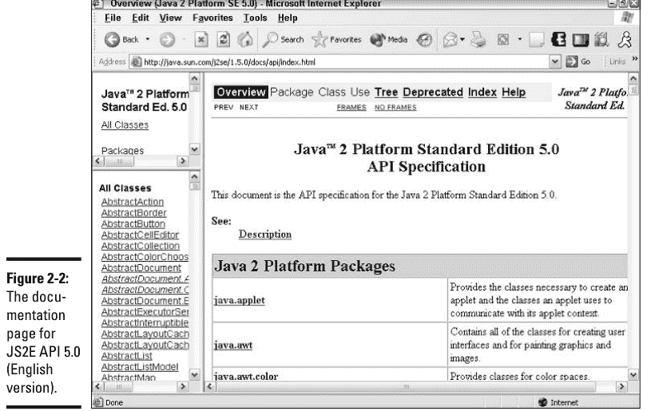

**图 2-2：** JS2E API 5.0 的文档页面（英文版）。

34 使用 Java 文档

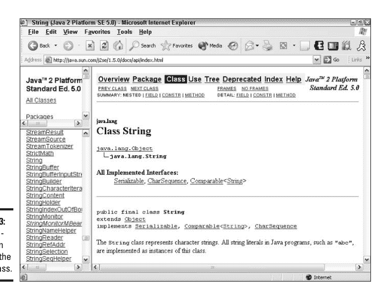

图 2-3：String 类的文档页面。

## Java 语言规范

如果您有兴趣了解 Java 语言本身某些元素的细节，而不是 API 类库中有关类的信息，请单击页面底部附近的 Java 语言规范链接。这将引导您访问一组页面，这些页面有时会以极其详尽和晦涩的细节描述 Java 语言的每个元素具体如何工作。

坦率地说，这份文档对初学者来说帮助不大。它是计算机科学家为计算机科学家编写的。您只需看一眼目录就会知道它不适合新手。第一章叫做简介（这还不错），但随后第 2 章和第 3 章的标题是“语法”和“词法结构”。

毕竟，这就是您阅读本书的原因。您甚至不会在本书中找到一句关于词法结构的话（当然，除了这一句）。即便如此，在您 Java 学习的某个阶段，您可能想要深入了解支配 Java 特性（如匿名内部类）的规则。当那一天到来时，带上六罐 Jolt 可乐，卷起袖子，打开 Java 语言规范页面吧。

## 第 3 章：使用 TextPad

**本章内容**

- 下载并安装 TextPad
- 使用 TextPad 编辑源文件
- 编译 Java 程序
- 运行 Java 程序

TextPad 是一款价格低廉（29 美元）的文本编辑器，您可以将其与 Java SDK 集成，以简化编写、编译和运行 Java 程序的任务。它不是一个真正的集成开发环境（IDE），因为它缺少集成调试、代码生成器或用于创建图形用户界面的拖放工具等功能。如果您想使用 IDE，我建议您跳过本章，转而查看 Book I，第 4 章，其中介绍了一款名为 Eclipse 的免费 IDE。

TextPad 由于其简单性和速度，是开发 Java 程序的流行工具。它非常适合学习 Java，因为它不会为您生成任何代码。自己编写每一行代码可能看起来很麻烦，但从长远来看，这种练习是有回报的，因为它能让您更好地理解 Java 的工作原理。

## 下载和安装 TextPad

您可以从 Helios Software Systems 的 www.textpad.com 下载 TextPad 的免费评估版本。您可以免费使用评估版本，但如果您决定保留该程序，则必须付费。Helios 接受在线信用卡支付。

如果在安装 TextPad 时计算机上已经安装了 Java SDK，TextPad 会自动配置自身以编译和运行 Java 程序。如果在安装 TextPad 之后才安装 SDK，则需要为 Java 配置 TextPad。请按照以下步骤操作：

1.  选择 Configure > Preferences。
2.  单击出现在 Preferences 对话框左侧树状结构中的 Tools。

## 编辑源文件

3.  单击 Add 按钮以显示选项下拉列表，然后单击 Java SDK Commands。

图 3-1 显示了安装 Java 工具后 Preferences 对话框的外观。如您所见，对话框左侧树状结构中的 Tools 项包含三个 Java 工具：Compile Java、Run Java Application 和 Run Java Applet。

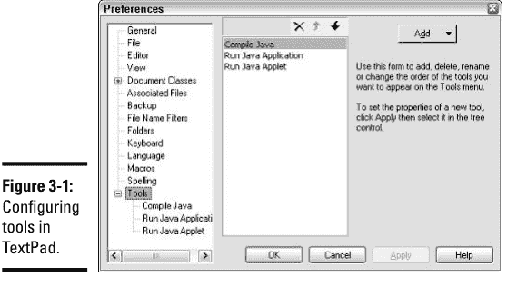

4.  单击 OK。

用于编译和运行 Java 程序的命令已添加到 TextPad 的 Tools 菜单中。

图 3-2 显示了 TextPad 正在编辑一个 Java 源文件。如果您以前使用过 Windows 文本编辑器，学习使用 TextPad 的基础知识将不会遇到任何困难。我不会介绍诸如打开和保存文件之类的操作，因为它们是标准操作。相反，以下段落描述了 TextPad 对于编辑 Java 程序文件有用的某些功能。

> 当您第一次创建文件时（通过单击工具栏上的 New 按钮或选择 File > New），TextPad 会将该文件视为普通文本文件，而不是 Java 程序文件。保存文件（单击 Save 按钮或选择 File > Save）并将 `java` 指定为文件扩展名后，TextPad 的 Java 编辑功能就会启用。

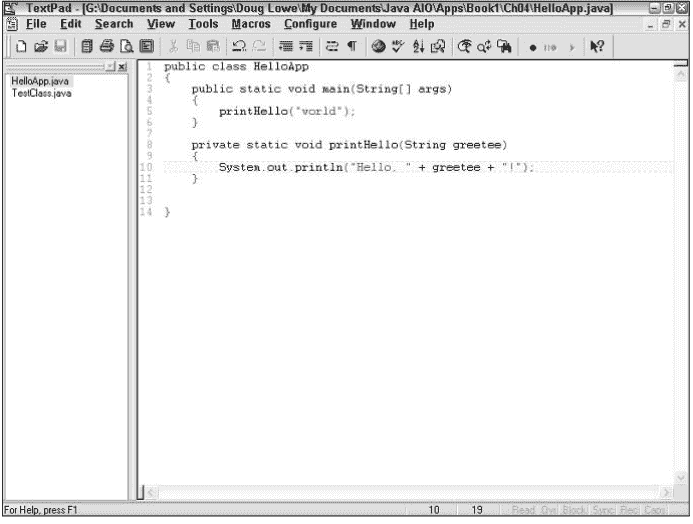

以下段落描述了 TextPad 处理 Java 文件的一些更值得注意的功能：

- 从图 3-2 中您可能无法真正看出，但 TextPad 使用不同的颜色来表示程序中每个单词或符号的功能。括号是红色的，以便您能快速发现并确保它们正确配对。关键字是蓝色的。注释和字符串字面量是绿色的。其他文本（如变量或方法名）是黑色的。
- TextPad 在您输入左括号时会自动缩进，然后在您输入右括号时恢复到之前的缩进级别。保持代码对齐很容易。
- 行号显示在编辑窗口的左边缘。您可以通过选择 View > Line Numbers 来打开或关闭这些行号。
- 要转到特定行，请按 Ctrl+G 打开“转到”对话框。确保在“转到什么”框中选择了“行”，在文本框中输入行号，然后单击“确定”。
- 如果打开了多个文件，您可以使用 Document Selector（TextPad 窗口左侧的窗格）在文件之间切换。如果 Document Selector 不可见，请选择 View > Document Selector 来调出它。

## 使用工作区

在 TextPad 中，*工作区* 是您一起处理的文件集合。工作区对于涉及多个文件的项目非常有用。当您打开一个工作区时，TextPad 会打开工作区中的所有文件。您可以配置 TextPad，使其在每次启动时自动打开您上次使用的工作区。

要创建工作区，首先打开所有您希望成为工作区一部分的文件。然后，选择 File > Workspace > Save As 并为工作区命名。（构成工作区的文件列表保存在一个扩展名为 .tws 的文件中。）

要打开工作区，请选择 File > Workspace > Open。然后，选择您之前保存的工作区文件并单击“打开”。或者，从 File > Workspace 菜单底部显示的最近使用的工作区列表中选择该工作区。

要配置 TextPad，使其在启动时自动打开最近使用的工作区，请选择 Configure > Preferences。单击对话框左侧首选项树中的 General，然后选中 Reload Last Workspace at Startup 选项，然后单击 OK 关闭首选项对话框。

- 在多个文件之间切换的另一种方法是选择 View > Document Tabs。文档窗口底部将显示选项卡。您可以单击这些选项卡来切换文档。

- 一个方便的匹配括号功能可以让您配对括号、大括号和圆括号。要使用此功能，请将插入点移动到括号处。然后按 Ctrl+M。TextPad 会找到匹配的括号。

- 要搜索文本，请按 F5。在“查找”对话框中，输入您要查找的文本，然后单击“确定”。要重复搜索，请按 Ctrl+F。

- 要替换文本，请按 F8。

## 编译程序

要在 TextPad 中编译 Java 程序，请选择 Tools > Compile Java 或使用键盘快捷键 Ctrl+1。javac 命令将在单独的命令提示符窗口中启动，并将编译器输出显示到单独的“命令结果”窗口中。如果程序编译成功，TextPad 会立即返回到源程序。但如果编译器发现您的程序有问题，“命令结果”窗口将保持打开状态，如图 3-3 所示。

在此示例中，显示了以下三条编译器错误消息：

```
J:\Book1\Ch04\HelloApp.java:10: ')' expected
    System.out.println("Hello,  + greetee + "!");
```


## 编译程序

J:\Book1\Ch04\HelloApp.java:10: 未闭合的字符串字面量
        System.out.println("Hello,  + greeatee + "!");
        ^
J:\Book1\Ch04\HelloApp.java:11: 需要';'
        }
        ^
3 个错误

工具以退出码 1 完成

如果双击每条错误消息的第一行，TextPad 会带你到发生错误的位置。例如，如果你双击带有*未闭合的字符串字面量*消息的那一行，你会被带到第 10 行，光标会定位在该行最后的引号上，正是编译器发现错误的地方。然后，你可以纠正错误并重新编译程序。

通常，一个错误可能会导致显示多个错误消息。这里就是这样。错误是我在第 10 行的 Hello 这个词后面漏掉了一个右引号。这一个错误导致了全部三个错误消息。

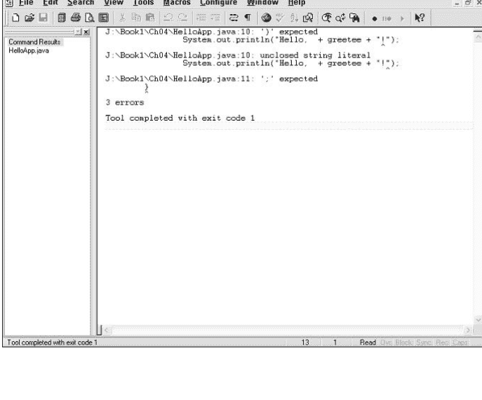

图 3-3：Java 编译器显示的错误消息。

## 运行 Java 程序

在编译没有错误的 Java 程序后，你可以通过选择 工具➞运行 Java 应用程序 或按 Ctrl+2 来运行它。会打开一个命令窗口，程序在其中运行。例如，图 3-4 显示了 HelloApp 程序在 TextPad 窗口上方的单独窗口中运行。

当程序结束时，命令窗口中会显示`Press any key to continue`消息。当你按任意键时，窗口关闭，TextPad 恢复活动。

如果你想知道的话，TextPad 实际上是通过创建和运行一个*批处理文件*来运行你的程序的——一个短文本文件，包含运行程序所需的命令。这个批处理文件被赋予一个晦涩的名称，例如`tp02a11c.BAT`。以下是为 HelloApp 程序生成的批处理文件：

```
@ECHO OFF
C:
CD \Book1\Ch04
"G:\Program Files\Java\jdk1.5.0\bin\java.exe" HelloApp
PAUSE
```

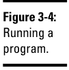

以下是这些命令的详细说明：

- 第一个命令告诉 MS-DOS 在批处理文件执行时不要在命令窗口中显示命令。
- 接下来的两个命令切换到包含 Java 程序的驱动器和目录。
- 接下来，调用`java.exe`程序来运行`HelloApp`类。
- 最后，执行一个`PAUSE`命令。这就是程序结束时显示`Press any key to continue`消息的原因。

## 运行 Applet

你也可以直接从 TextPad 运行 applet。首先，编译程序。然后，如果程序没有错误，选择 工具➩运行 Java Applet 或按 Ctrl+3。会出现一个命令窗口。然后，Java applet 查看器启动。它在单独的窗口中运行 applet，无需使用 Web 浏览器。图 3-5 显示了一个运行中的 applet。

当你退出 applet 时，applet 查看器窗口和 DOS 命令窗口关闭，你返回 TextPad。

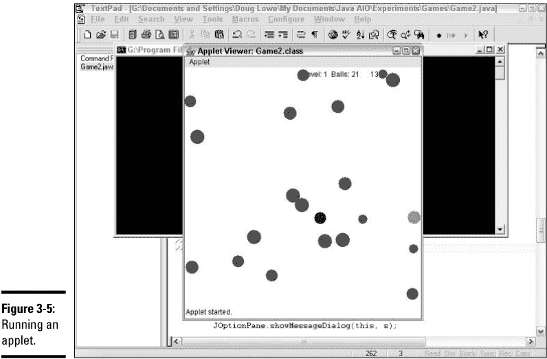

## 第 4 章：使用 Eclipse

### 本章内容

- 了解 Eclipse 项目和工作台
- 创建 Java 项目
- 使用 Eclipse 编译、运行和调试
- 使用 Eclipse 重构

Eclipse 是一个开发环境，包含许多用于创建 Java 程序的强大功能。因为 Eclipse 是免费的且非常强大，它在 Java 开发者中很受欢迎。在本章中，你将发现使用 Eclipse 进行简单 Java 开发的基础知识。


因为 Eclipse 是一个如此强大的工具，它有陡峭的学习曲线。如果你是 Java 的新手，我建议你从更简单的环境开始，比如**TextPad**（在 Book I，第 3 章中描述），只有在你掌握了一些 Java 编程基础之后再转向 Eclipse。这样，你一开始可以专注于 Java 编程，而不是学习 Eclipse。

当你准备好开始使用 Eclipse 时，访问 Eclipse 网站（`www.eclipse.org`），点击下载链接，下载当前版本的 Eclipse。与大多数程序不同，Eclipse 没有复杂的安装程序。你只需下载 Eclipse 的 Zip 文件，解压所有文件，然后直接从解压到的文件夹中运行 Eclipse 可执行文件（`eclipse.exe`）。


如果你使用的是 Windows，你可能想为 Eclipse 添加快捷方式到桌面，以便更方便地启动。要做到这一点，打开包含`eclipse.exe`文件的文件夹。然后，右键单击该文件并将其拖到桌面。释放鼠标按钮，并从出现的菜单中选择**创建快捷方式**。然后，你可以通过双击此桌面快捷方式来启动 Eclipse。

请注意，本章中描述的许多技术，在你学会如何使用它们所应用的 Java 编程功能之前，可能不太容易理解。例如，关于如何创建新的 Java 类文件的信息，在你学习 Book III 中创建 Java 类之前，可能不太容易理解。当你在后面章节中学习 Java 编程功能时，你可能想要参考本章来了解相关的 Eclipse 功能。

如果你打算使用 Eclipse，我建议你购买一本 Barry Burd（Wiley Publishing）所著的*Eclipse For Dummies*。

## 了解 Eclipse 的一些背景

Eclipse 被设计为一个通用的开发环境，这意味着它不是专门为 Java 设计的。它就像 IDE 界的 *Seinfeld*：正如其设计者所说，Eclipse 是"一个适用于任何事物又什么都不特别针对的 IDE"。你可以轻松地使用称为*功能*的插件组件来定制 Eclipse，使其适用于特定类型的开发任务。而且因为 Eclipse 最常用于 Java 程序开发，它预装了为开发 Java 程序而设计的功能。

Eclipse 使用一些不寻常的术语来描述其基本操作。特别是：

- **工作台（Workbench）：***工作台*是 Eclipse 的基本桌面环境。当你运行 Eclipse 时，工作台会在一个窗口中打开，如图 4-1 所示。

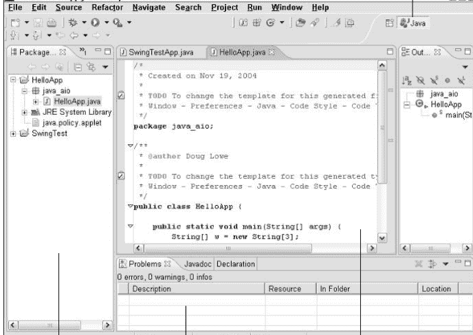

如果你能同时抛接球和嚼口香糖，你可能想打开两个工作台窗口来同时处理两个不同的项目。然而，我们这些注意力不及超级英雄的人可以一次只使用一个工作台窗口。

- **编辑器（Editor）：***编辑器*是工作台窗口窗格，用于编辑特定类型的文件。Eclipse 附带一个标准文本编辑器，可以编辑任何类型的文本文件，以及一个专门为编辑 Java 程序而设计的特殊 Java 编辑器。在图 4-1 中，Java 编辑器位于工作台窗口的中间部分。

此图中的 Java 编辑器看起来很小，因为我是在计算机显示器设置为 800 x 600 像素时捕捉此屏幕图像的。然而，由于 Eclipse 同时在屏幕上显示如此多的信息，最好在大型显示器（最好是 19 英寸或更大）上以至少 1,024 x 768 的分辨率运行它。这样，编辑器窗口足够大，让你可以舒适地处理程序的文本，同时为 Eclipse 工作台窗口中显示的其他元素留出充足的空间。

- **视图（Views）：***视图*是工作台窗口的窗格，显示在你使用 Eclipse 工作时有用的其他信息。图 4-1 除了编辑器外还显示了几个附加视图。例如，*包资源管理器视图*让你可以浏览组成 Eclipse 项目的各种文件，而*问题视图*显示错误消息。

你可以将视图显示在其自己的窗格中，或与其他视图组合在单个窗格中。然后，窗格中的视图用标签分隔符指示，你可以点击以在窗格中调出每个视图。例如，图 4-1 中的问题视图与另外两个视图共享其窗格，称为 JavaDoc 和声明。

严格来说，编辑器是一种视图。

- **透视图（Perspective）：***透视图*是为帮助你完成特定类型编程任务而设计的视图集合。例如，图 4-1 所示的工作台窗口显示了*Java 透视图*，专为处理 Java 程序文件而设计。图 4-2 显示了不同的透视图，称为*调试透视图*。在此透视图中，Java 编辑器仍然存在，但显示了一组不同的视图，这些视图在测试和调试 Java 程序时很有用。例如，窗口底部会出现一个控制台视图，让你可以看到程序创建的输出，而一个变量视图让你可以在程序执行时监控变量的内容。（有关调试透视图的更多信息，请参阅本章后面的"调试 Java 程序"部分。）


## 理解项目

一个 Eclipse *项目* 是一组 Java 文件的集合，这些文件共同构建一个 Java 程序。虽然一些简单的 Java 程序仅由一个文件组成，但大多数实际的 Java 程序由多个 Java 程序文件构成。事实上，一个复杂的 Java 程序可能需要数百个 Java 程序文件。当你处理需要多个文件的程序时，Eclipse 允许你将这些文件作为一个项目来整体管理。

一个项目不仅包含 Java 源文件，还包括编译项目时创建的 `class` 文件，以及程序所需的任何其他文件。这些可能包括数据文件或配置文件，以及其他文件，如 `readme` 文件、程序文档、图像文件、声音文件等等。

项目的所有文件都存储在一个项目文件夹中，如果需要，该文件夹可以包含子文件夹。除了程序所需的文件外，项目文件夹还包括 Eclipse 创建的用于存储项目本身信息的文件。例如，名为 `.project` 的文件存储项目的描述性信息，名为 `.classpath` 的文件存储项目所使用类的位置信息。

你所有的项目文件夹都存储在一个名为 *工作空间* 的文件夹中。每次启动 Eclipse 时，都会出现一个对话框，要求指定工作空间文件夹的位置。如果要切换到不同的工作空间，请使用“文件 -> 切换工作空间”。

Eclipse 允许你创建两种类型的项目：

- **对于简单项目**，即只有少量 Java 源文件的项目，你可以创建一个项目，将所有的 Java 文件存储在单个文件夹中。然后，当这些文件被编译时，生成的 `class` 文件也存储在这个相同的文件夹中。这种类型的项目最容易使用，非常适合中小型项目。

- **对于大型项目**——即涉及几十甚至几百个 Java 源文件的项目——你可以创建一个项目，使用一个或多个子文件夹来存储源文件。然后你可以自由创建任何你想要的子文件夹来帮助你组织文件。例如，你可以创建一个子文件夹用于用户界面类，另一个用于数据库访问类，第三个用于应用程序显示的图像文件。

Eclipse 没有“文件 -> 打开”命令来打开项目或单个文件。相反，“包资源管理器”视图（位于 Java 透视图的左侧；参考图 4-1）会列出你工作空间中的所有 Java 项目。当你启动 Eclipse 时，你上次工作的项目会自动显示。你可以在“包资源管理器”中右键单击项目，然后选择“打开项目”来切换到另一个项目。你还可以通过在“包资源管理器”中双击项目中的文件来打开该项目中的单个文件。

## 创建一个简单项目

以下步骤将引导你完成创建一个简单项目的过程，该示例基于《第 I 册》第 1 章中“Hello, World!”程序的一个稍复杂版本。请按照以下步骤创建此应用程序：

1. **启动 Eclipse，当“工作空间启动器”对话框出现时点击“确定”。**

   “工作空间启动器”对话框要求指定你工作空间文件夹的位置；在大多数情况下，默认位置是可接受的。当你点击“确定”时，Eclipse 会以 Java 透视图打开，不显示任何项目或文件，如图 4-3 所示。

2.  选择“文件 -> 新建 -> 项目”。

    “新建项目”对话框出现，如图 4-4 所示。此对话框列出了你可以用来创建各种类型 Eclipse 项目的几个向导。

3.  从向导列表中选择“Java 项目”，然后点击“下一步”。

    “新建 Java 项目”对话框出现，如图 4-5 所示。

4.  在文本框中键入 `HelloApp`，然后点击“完成”。

    `HelloApp` 是项目名称。此对话框中的其他选项允许你指定项目是存储在工作空间文件夹还是其他文件夹中，以及项目是将项目文件夹用于源文件，还是为源文件创建单独的子文件夹。对于 `HelloApp` 应用程序，这两个选项的默认设置都可以。

    当你点击“完成”时，你会返回到 Java 透视图。但现在，`HelloApp` 出现在“包资源管理器”视图中，表明你已将同名项目添加到工作空间。

5.  在“包资源管理器”视图中右键单击 `HelloApp`，然后从出现的快捷菜单中选择“新建 -> 类”。

    “新建 Java 类”对话框打开，如图 4-6 所示。

6.  设置新类的选项。

    具体来说：
    -   将“包”文本字段设置为 `JavaAIO`。
    -   将“名称”文本字段设置为 `HelloApp`。
    -   选中 `public static void main(String[] args)` 复选框。

7.  点击“完成”。

    `HelloApp.java` 文件被创建，Eclipse 在 Java 编辑器中显示它，如图 4-7 所示。

8.  编辑 `main` 方法。

    将插入点移动到 `main` 方法的空块中，然后将其编辑成完全像这样：

    ```
    public static void main(String[] args) {
        String[] w = new String[3];
        w[0] = "Hello";
        w[1] = ", ";
        w[2] = "world!";
        for (int i = 0; i<3; i++)
            System.out.print(w[i]);
    }
    ```

9.  选择“运行 -> 运行方式 -> Java 应用程序”。

    程序被编译并运行。一个包含程序输出的控制台窗口出现在 Eclipse 窗口的底部，如图 4-8 所示。

    **注意：** 如果在程序运行前出现“保存资源”对话框，请点击“确定”。然后程序会运行。

## 添加类文件

在本节中，我将引导你完成向 `HelloApp` 应用程序添加第二个类文件的过程，以展示 Eclipse 一些最有用的特性，这些特性通过为常用的类特性生成代码来加速 Java 程序开发。

除非你已经阅读了《第 III 册》，否则你可能不太理解（甚至完全不理解）此过程中展示的代码。别担心；一旦你阅读了关于创建自己的类的内容，这些代码就会完全讲得通。

请按照以下步骤向 `HelloApp` 应用程序添加第二个类：

1.  **在“包资源管理器”中右键单击 `HelloApp`，然后选择“添加 -> 类”。**

    “新建 Java 类”对话框打开（参考图 4-6）。

2.  **设置新类的选项。**

    对于此类，按如下方式设置选项：
    -   将“包”文本字段保留为 `JavaAIO`。
    -   将“名称”文本字段设置为 `HelloSayer`。
    -   取消选中 `public static void main(String[] args)` 复选框。

3.  点击“完成”。

    一个名为 `HelloSayer` 的新类文件被创建，Eclipse 在 Java 编辑器中打开它。

4.  为两个名为 `greeting` 和 `addressee` 的公共字段添加声明。

    在声明 `HelloSayer` 类的行之后立即添加这些行。然后，除了类开头的注释和 `package` 语句外，该类看起来像这样：

    ```
    public class HelloSayer {

        private String greeting;
        private String addressee;

    }
    ```

5.  使用向导为类添加一个构造函数。

    为此，请选择“源代码 -> 使用字段生成构造函数”。“使用字段生成构造函数”对话框出现，如图 4-9 所示。


## 54 添加类文件

在要初始化的字段列表中同时勾选 greeting 和 addressee，在 Insertion Point 下拉列表中选择 First Method，并勾选 Omit Call to Default Constructor Super() 选项。然后点击 OK。以下代码将被插入到类中：

```
/**
 * @param greeting
 * @param addressee
 */
public HelloSayer(String greeting, String
        addressee) {
    this.greeting = greeting;
    this.addressee = addressee;
}
```

### 6. 添加名为 sayHello 的方法的代码。

在第 5 步创建的构造函数之后添加以下代码，位于程序最后一行的右花括号（}）之前：

```
public void sayHello()
{
    System.out.println(greeting + ", " + addressee
        + "!");
}
```

完整的 HelloSayer 类文件如清单 4-1 所示。

### 清单 4-1：HELLO SAYER 类

```
/*
 * Created on Nov 22, 2004
 *
 * TODO To change the template for this generated file go to
 * Window - Preferences - Java - Code Style - Code Templates
 */
package JavaAIO;

/**
 * @author Doug Lowe
 *
 * TODO To change the template for this generated type comment
 * go to Window - Preferences - Java - Code Style - Code Templates
 */
public class HelloSayer {

    private String greeting;
    private String addressee;

    /**
     * @param greeting
     * @param addressee
     */
public HelloSayer(String greeting, String addressee) {
    this.greeting = greeting;
    this.addressee = addressee;
}

public void sayHello() {
    System.out.println(greeting + ", " + addressee + "!");
}
```

7. 点击 Java 编辑器窗格顶部的 HelloApp.java 选项卡。

HelloApp.java 文件将显示在前面，以便你进行编辑。

8. 编辑 main 方法，使其使用新的 HelloSayer 类。

删除 main 方法中原来的代码，并替换为以下代码：

```
public static void main(String[] args) {
    HelloSayer h = new HelloSayer("Hello",
    "World!");
    h.sayHello();
}
```

现在整个 HelloApp.java 类如清单 4-2 所示。除了 main 方法中的两行代码外，其余所有代码均由 Eclipse 自动生成。

### 清单 4-2：HELLOAPP 类

```
/*
 * Created on Nov 22, 2004
 *
 * TODO To change the template for this generated file go to
 * Window - Preferences - Java - Code Style - Code Templates
 */
package JavaAIO;

/**
 * @author Doug Lowe
 *
 * TODO To change the template for this generated type comment
 * go to Window - Preferences - Java - Code Style - Code Templates
 */
public class HelloApp {

    public static void main(String[] args) {
        HelloSayer h = new HelloSayer("Hello", "World!");
        h.sayHello();
    }
}
```

## 运行程序

输入 Eclipse 项目的源代码后，你可以运行程序以查看其是否按预期工作。Eclipse 提供了多种运行 Java 程序的方式：

- 在 Package Explorer 中，选择要运行的类的源文件。然后选择 Run➔Run As➔Java Application。
- 右键点击要运行的类的源文件，然后从弹出的快捷菜单中选择 Run➔Java Application。
- 在 Package Explorer 中选择源文件，然后点击运行按钮（如侧边所示），并从弹出的菜单中选择 Run As➔Java Application。（如果最近运行过该程序，你还可以从此菜单中最近运行的程序列表中选择该程序。）

程序运行时，其控制台输出将显示在 Java 编辑器窗格下方的 Console 视图中，如图 4-10 所示。

> **注意：** 如果程序使用 Swing 创建窗口，该窗口将单独显示，而不是在 Eclipse 工作台窗口内显示。（有关 Swing 的更多信息，请参阅第六卷。）

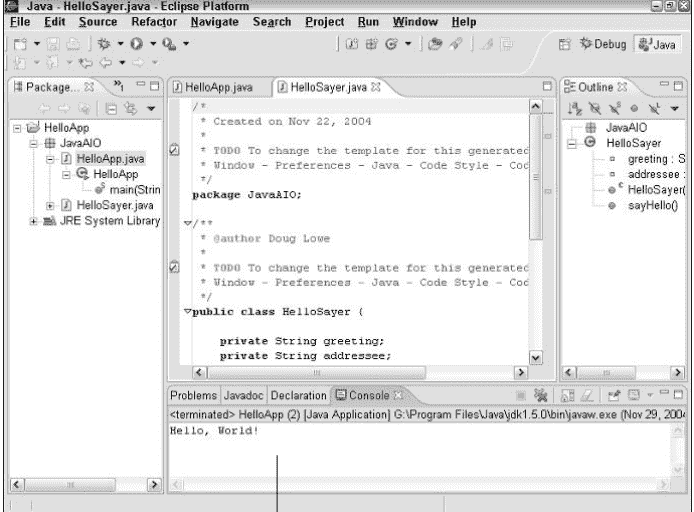

**图 4-10：** Console 视图显示程序的控制台输出。

Console 视图

Eclipse 被设计为在你编辑代码时自动编译 Java 程序。每次在 Eclipse 中保存 Java 源文件时，该文件都会自动编译以生成类文件。因此，通常不需要在运行程序之前单独执行编译步骤。如果项目包含较大的源文件，此功能可能会变得令人烦恼。要禁用自动编译，请选择 Project ➔ Build Automatically。然后，你必须在运行程序之前手动构建项目，方法是选择 Project ➔ Build All。（要切换回自动构建，再次选择 Project ➔ Build Automatically。）

## 调试 Java 程序

无论你多么仔细地规划程序，迟早都会遇到 bug。你需要留意两种基本类型的 bug：

- **不正确的结果**，例如一个程序本应计算考试分数，但当你得了 99 分（满分 100）时却给你一个 C，或者一个程序本应计算 5% 的销售税，但却显示 29.95 美元的销售税为 149.75 美元而不是 1.50 美元。
- **程序崩溃**，例如一个程序本应将一个数除以另一个数并打印结果，但却输出了以下信息：

```
Exception in thread "main" java.lang.ArithmeticException: / by zero
 at BugApp.main(BugApp.java:19)
```

然后程序突然停止。

幸运的是，Eclipse 拥有强大的调试器，可以帮助你找到任一类型 bug 的原因并修复它。要启动调试器，选择 Project ➔ Debug As ➔ Java Application（而非 Project ➔ Run As ➔ Java Application）来运行程序。或者点击 Workbench 工具栏上的调试按钮（如侧边所示）。Eclipse 将切换到调试透视图，如图 4-11 所示，并以调试模式运行程序。

以下各节介绍了调试透视图的一些关键功能，这些功能对于跟踪和修正 Java 程序中的 bug 非常有用。

### 单步执行程序

调试最基本的技能之一是逐条执行程序语句。这称为*单步执行*，它是一种非常有用的调试技术。通过逐条语句地单步执行程序，你可以查看每条语句的效果并识别错误的来源。有时，仅知道正在执行哪些语句就足以确定程序无法正常运行的原因。

## 58 调试 Java 程序

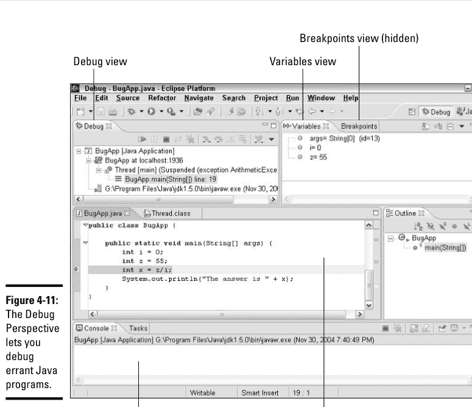

**图 4-11：** 调试透视图让你可以调试出错的 Java 程序。

在 Eclipse 中，调试透视图的 Debug 视图部分是你控制正在调试的程序执行的地方。此视图显示一棵树，指示程序中的每个线程。（如果你不知道线程是什么，不用担心。大多数基于控制台的程序，如图 4-11 所示的 BugApp 程序，反正只使用一个线程。你将在第五卷中学习如何编写使用多个线程的程序。）

在控制线程的执行之前，你必须先挂起该线程，使其语句停止执行。通常，你可以通过三种方式挂起线程进行调试：

- 当发生未处理的异常时，线程会自动挂起。在图 4-11 中，BugApp 程序的 main 方法被挂起，因为发生了除零异常且程序未捕获该异常。如果你的程序抛出了一个预期之外的异常，你可以直接调试程序并让异常挂起线程。然后，你可以尝试追踪问题的原因。

## 调试 Java 程序

- 在调试程序之前，你可以在程序中的任意语句处设置*断点*。然后，当执行到该语句时，线程将被挂起。要设置断点，只需双击 Java 编辑器中要挂起线程的语句旁边的左边缘即可。

- 如果一个长时间运行的线程处于循环中，你可以通过在 Debug 视图窗口中点击该线程并点击挂起按钮（如侧边所示）来挂起它。

当你挂起线程时，下一条将要执行的语句会在 Java 编辑器中高亮显示。然后，你可以通过点击 Debug 视图顶部的按钮来一次或多次地继续执行线程的语句。表 4-1 描述了最常用的按钮。

### 表 4-1：常用按钮

| 按钮 | 名称 | 说明 |
|---|---|---|
| [图标] | Resume（恢复） | 恢复从下一条语句开始执行。线程继续执行，直到被未捕获的异常或断点挂起。 |
| [图标] | Terminate（终止） | 终止线程。 |
| [图标] | Step Into（单步进入） | 执行高亮显示的语句，然后挂起线程。 |
| [图标] | Step Over（单步跳过） | 跳过高亮显示的语句，执行下一条语句，然后挂起线程。 |
| [图标] | Run to Return（运行到返回） | 执行高亮显示的语句，并继续执行语句直到到达当前方法的末尾。然后线程被挂起。 |

### 检查变量

当线程被挂起时，你可以检查其变量，查看它们是否被设置为预期的值。在许多情况下，你可以发现编程错误。例如，如果你认为名为 `customerFirstName` 的变量应包含客户的名字，但它却包含了客户所在州的名称，你可以推断出你没有正确地给变量赋值。（当然，如果客户恰好叫印第安纳·琼斯，这就可能存在歧义了。）


## 调试Java程序

检查变量值的最简单方法是在Java编辑器中直接将鼠标悬停在变量上。例如，图4-12展示了当鼠标指针悬停在变量`i`上时，其值的显示方式。此时，弹出消息表明变量`i`是`int`类型，值为0。（这条消息可能是程序抛出除零异常的线索。）

**图4-12：** 显示变量值。

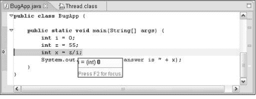

你也可以通过“变量”视图来检查变量，如图4-13所示。每个变量都单独列在“变量”视图的上半部分。此外，下半部分（称为“详细信息”窗格）显示当前选定变量的值。请注意，当单步执行程序中的各条语句时，变量会在声明时出现在“变量”视图中，当它们超出作用域时则会从视图中消失。

**图4-13：** “变量”视图显示每个变量的值。

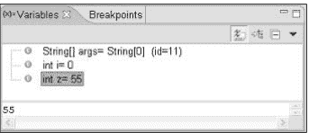

## 设置断点

*断点*是你希望程序暂停执行的代码行。设置断点允许你高效地执行程序中运行正常的部分，同时在程序到达你认为有错误的行时停止执行。

程序中的所有断点都列在“断点”视图中，如图4-14所示。以下段落描述了你在此视图中处理断点的一些方法：

- 每个断点旁边的复选框指示该断点是否已启用。只有当断点启用时，执行才会在该断点处暂停。
- 你可以通过点击断点选中它，然后按Delete键或点击“移除选中的断点”按钮（如侧边栏所示）来删除一个断点。
- 你可以通过点击“移除所有断点”按钮（如侧边栏所示）来删除你设置的所有断点。
- 如果在“断点”视图中双击某个断点，Java编辑器窗口将滚动到设置该断点的行。
- 如果你只希望程序在命中断点特定次数后才暂停，请右键点击该断点，然后在出现的快捷菜单中选择“命中次数”。然后，输入你希望语句在程序暂停前执行的次数，并点击“确定”。

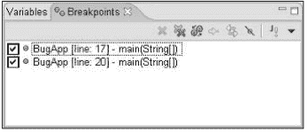

图4-14：你在此处控制断点的“断点”视图。

## 重构你的代码

*重构*指的是对项目进行大规模修改的任务。例如，假设你决定在项目开始时创建的某个类名并不能准确描述该类的用途，因此你想更改它。简单的文本编辑器（如TextPad）包含一个“替换”命令，允许你更改文件中的文本字符串，但更改类名需要你更改项目所有文件中的该名称。

Eclipse包含一整套重构选项菜单——你可能猜到了，它叫做“重构”菜单。此菜单包含18种不同类型的重构命令。如果你刚开始学习Java，这18个命令中的大多数对你来说可能毫无意义。例如，“重构”菜单包含允许你将匿名内部类更改为嵌套类、将成员向下推送到子类或引入工厂的命令。

当你在学习Java基础知识的过程中，其中一些“重构”菜单命令对你很有用。具体来说：

- **重命名：** 允许你重命名变量、方法或其他符号。首先，选择要重命名的符号。然后，选择“重构⇨重命名”，输入新名称，然后点击“确定”。
- **提取方法：** 此命令允许你从一条或多条语句创建一个单独的方法。选择要放入方法中的语句，然后选择“重构⇨提取方法”。在出现的对话框中，输入你希望用于该方法的名称。Eclipse会用你选定的语句创建一个方法，然后用对该新方法的调用替换原始选中的内容。
- **内联：** 此命令基本上与“提取方法”命令相反。它用定义在该方法主体中的语句替换对该方法的调用。当你认为某个方法会比实际情况更复杂，或者你认为会从更多位置调用它而实际上并未如此时，此命令最为有用。
- **提取局部变量：** 这个有点奇怪。有时，你会发现有一连串的语句都使用了同一个表达式，比如`x + 1`。如果创建一个单独的变量来保存`x + 1`的值，然后使用该变量而不是重复计算表达式，不是更好吗？“提取局部变量”命令可以为你做到这一点。突出显示表达式的第一次出现，然后选择“重构⇨提取局部变量”。Eclipse会创建一个局部变量，添加一条将该表达式赋值给新局部变量的赋值语句，然后将所有出现的表达式替换为该局部变量。

## 第二卷

## 编程基础


## 内容概览

| 章节 | 页码 |
|---|---|
| 第1章：Java编程基础 | 65 |
| 第2章：使用变量和数据类型 | 83 |
| 第3章：处理数字和表达式 | 113 |
| 第4章：做出选择 | 141 |
| 第5章：循环往复（或，使用循环） | 161 |
| 第6章：切换变换 | 187 |
| 第7章：为你的代码添加一些方法 | 199 |
| 第8章：处理异常 | 217 |

## 第1章：Java编程基础

### 本章内容

- 著名的Hello, World!程序
- Java程序的基本元素，如关键字、语句和块
- 向程序添加注释的不同方式
- 面向对象编程的基本信息
- 导入类

在本章中，你将找到编写简单Java程序的基础知识。你在本章看到的程序不会做任何非常有趣的事情；它们只是在控制台（在Windows中，是命令提示符窗口）上显示简单信息。在开始编写任何有价值的程序之前，你还需要再学习几章。但你在本章看到的简单程序足以说明Java程序的基本结构。

需要注意的是，在本章中，我将向你介绍一些Java编程特性，这些特性将在后面的章节中更详细地解释。例如，你会看到一些变量声明、一个方法，甚至一个if语句和一个for循环。本章的目标不是让你精通这些编程元素，而只是让你对它们有一个初步了解。


你可以在`www.dummies.com/go/javaaiofd`找到本书使用的所有代码清单。

### 考察著名的Hello, World!程序

许多编程书籍都以一个在控制台上显示文本`Hello, World!`的简单示例程序开始。在第一卷第1章中，我展示了一个这样的Java程序，用以与C语言编写的类似程序进行比较。现在，让我们仔细看看这个程序的每个元素，如清单1-1所示。


# 66 审视臭名昭著的 Hello, World! 程序

```
清单 1-1：HelloApp 程序
public class HelloApp
{
    public static void main(String[] args)
    {
        System.out.println("Hello, World!");
    }
}
```

在本章后面，你将详细了解构成这个程序的所有元素。但首先，我想逐字逐句地带你走一遍。

第 1 行和第 2 行标记了一个名为 HelloApp 的公共类的声明：

**→ 1 public**：一个 Java 语言的*关键字*，表示其后出现的元素应该对其他 Java 元素可用。在本例中，其后出现的是一个名为 HelloApp 的类。因此，这个关键字表示 HelloApp 类是一个*公共类*，即其他类可以使用它。（在本书第三册第 2 章中，我会介绍 public 最常见的替代方案：private。还有其他替代方案，但会在后面的章节中介绍。）

**class**：另一个 Java 关键字，表示此处定义的元素是一个类。所有 Java 程序都由一个或多个类组成。类定义包含的代码定义了程序创建和使用的对象的行为。尽管大多数真实世界的程序由多个类组成，但你在本迷你书中看到的简单程序只有一个类。

**HelloApp**：一个*标识符*，为这里定义的类提供名称。关键字（如 public 和 class）是由 Java 编程语言定义的单词，而标识符是你创建的单词，用于为程序中使用的各种元素提供名称。在本例中，标识符 HelloApp 为这里定义的公共类提供了名称。（虽然 *identifier* 是技术上正确的术语，但有时标识符被称为 *符号或名称*。）

**→ 2 {**：第 2 行的左花括号标志着类*主体*的开始。主体的结束由第 7 行的右花括号标记。出现在这些花括号之间的所有内容都属于这个类。当你使用 Java 时，你会发现它大量使用这些花括号。很快，你右手的第三和第四根手指就会确切地知道它们在键盘上的位置。

第 3 到第 6 行定义了 `HelloApp` 类中一个名为 `main` 的方法：

**→ 3 public**：`public` 关键字再次使用，这次用于表明此处声明的方法应该具有公共访问权限。这意味着 `HelloApp` 类之外的其他类也可以使用它。所有 Java 程序都必须至少有一个类声明一个名为 `main` 的公共方法。`main` 方法包含当你运行程序时执行的语句。

**static**：关于 `static` 关键字的所有内容都可以在本书第三册第 3 章找到。现在，请相信我的话：Java 语言要求你在声明 `main` 方法时必须指定 `static`。

**void**：在 Java 中，方法是一个可以计算并返回值的代码单元。例如，你可以创建一个计算销售总额的方法。那么，销售总额就是该方法的返回值。如果方法不需要返回值，你必须使用 `void` 关键字来表明不返回任何值。因为 Java 要求 `main` 方法不返回值，所以你在声明 `main` 方法时必须指定 `void`。

**main**：最后，是为这个方法提供名称的标识符。正如我已经提到的，Java 要求此方法必须命名为 `main`。除了 `main` 方法，你还可以创建具有任何你想要使用的名称的附加方法。你会在本书第二册第 7 章学习如何创建附加方法。在那之前，程序只包含一个名为 `main` 的方法。

**(String[] args)**：哎呀。这个 Java 元素目前来说太高级了，还无法彻底解释。它被称为参数列表，用于向方法传递数据。Java 要求 `main` 方法必须接收一个参数，即 `String` 对象的数组。按照惯例，这个参数被命名为 `args`。如果你不知道什么是参数、`String` 或数组，不用担心。你可以在下一章了解什么是 `String`，参数在本书第二册第 7 章；字母在本书第四册。在此期间，请意识到你必须在所有程序的 `main` 方法声明中编写 `(String[] args)`。

**→ 4 另一个 {**：另一组花括号从第 4 行开始，到第 6 行结束。这些标志着 `main` 方法的主体。请注意，第 6 行的右花括号与第 4 行的左花括号配对，而第 7 行的右花括号与第 2 行的花括号配对。这种配对在 Java 中很常见。简而言之，每当你遇到一个右花括号时，它会与最近的尚未关闭的左花括号配对——也就是说，尚未与右花括号配对的那个。

**→ 5 System.out.println("Hello, World!");**：这是整个程序中唯一的语句。它调用一个名为 `println` 的方法，该方法属于 `System.out` 对象。`println` 方法在控制台上显示一行文本。要显示的文本作为参数传递给 `println` 方法，位于单词 `println` 后面的括号中。在本例中，文本是用一组引号括起来的字符串字面量 `Hello, World!`。因此，这条语句在控制台上显示文本 `Hello, World!`。

请注意，在 Java 中，语句以分号结尾。因为这是程序中唯一的语句，所以这一行是唯一需要分号的。

**→ 6 }**：第 6 行包含右花括号，标志着由第 4 行的花括号开始的 `main` 方法主体的结束。

**→ 7 另一个 }**：第 7 行包含右花括号，标志着由第 2 行的花括号开始的 `HelloApp` 类主体的结束。因为这个程序只包含一个类，所以这一行也标志着程序的结束。

要运行这个程序，你首先必须使用文本编辑器将其完全按照清单 1-1 所示输入到一个名为 `HelloApp.java` 的文本文件中。然后，你可以在命令提示符处运行以下命令来编译它：

```
javac HelloApp.java
```

此命令创建一个名为 `HelloApp.class` 的类文件，其中包含为 `HelloApp` 类编译的 Java 字节码。

你可以通过输入以下命令来运行程序：

```
java HelloApp
```

现在你已经看到了 Java 程序的实际样子，你就更有能力准确理解此命令的作用。首先，它将 Java 虚拟机加载到内存中。然后，它定位 `HelloApp` 类，该类必须包含在名为 `HelloApp.class` 的文件中。最后，它运行 `HelloApp` 类的 `main` 方法。`main` 方法依次在控制台上显示消息 "Hello, World!"。

本章的其余部分更详细地描述了 Java 编程语言的一些基本元素。

## # 68 处理关键字

*关键字*是由 Java 编程语言定义具有特殊含义的单词。前面清单 1-1 所示的程序使用了四个关键字：`public`、`class`、`static` 和 `void`。总共，Java 有 51 个关键字。它们在表 1-1 中按字母顺序列出。

表 1-1 Java 的关键字

| abstract | do | if | package | synchronized |
|---|---|---|---|---|
| boolean | double | implements | private | this |
| break | else | import | protected | throw |
| byte | extends | instanceof | public | throws |
| case | false | int | return | transient |
| catch | final | interface | short | true |
| char | finally | long | static | try |
| class | float | native | strictfp | void |
| const | for | new | super | volatile |
| continue | goto | null | switch | while |
| default | | | | |

奇怪的是，表 1-1 中列出的三个关键字——true、false 和 null——在技术上并不被视为关键字。相反，它们被称为字面量。尽管如此，它们仍然像关键字一样被 Java 语言保留使用，所以我把它们和关键字归为一类。

更奇怪的是，有两个关键字——const 和 goto——被 Java 保留但不起任何作用。它们都是从 C++ 编程语言沿袭而来的。`const` 关键字定义常量，在 Java 中由 `final` 关键字处理。至于 `goto`，它是 C++ 语句，被认为是有损面向对象编程纯粹主义者形象的，所以 Java 中不使用它。Java 将其保留为关键字，唯一的目的就是在你试图使用它时训斥你。

与 Java 中其他所有内容一样，关键字是区分大小写的。因此，如果你键入 If 而不是 if，或者 For 而不是 for，编译器就会抱怨你的错误。由于 Visual Basic 的关键字以大写字母开头，如果你曾用 Visual Basic 编程，你会经常犯这个错误。

考虑到 Java 社区对 Visual Basic 的蔑视，当你将关键字大写时生成的错误信息竟然没有更具侮辱性，这令人惊讶。意外地以 Visual Basic 风格将关键字大写真的会让 Java 编译器陷入混乱。例如，考虑这个程序，它只包含一个将单词 For 大写的错误：

```
public class CaseApp
{
    public static void main(String[] args)
    {
        For (int i = 0; i<5; i++)
            System.out.println("Hi");
    }
}
```

当你尝试编译这个程序时，编译器会为这一个错误生成总共六条错误信息：

```
C:\Java AIO\CaseApp.java:5: '.class' expected
for (int i = 0; i<5; i++)
                       ^
C:\Java AIO\CaseApp.java:5: ')' expected
for (int i = 0; i<5; i++)
                       ^
C:\Java AIO\CaseApp.java:5: illegal start of type
for (int i = 0; i<5; i++)
                       ^
C:\Java AIO\CaseApp.java:5: > expected
for (int i = 0; i<5; i++)
                       ^
C:\Java AIO\CaseApp.java:5: not a statement
for (int i = 0; i<5; i++)
                       ^
C:\Java AIO\CaseApp.java:5: ';' expected
for (int i = 0; i<5; i++)
                       ^
```

6 errors

尽管这一个错误产生了六条错误信息，但没有一条信息能真正指出问题所在。源代码行下方的小箭头指示了行中错误的部分，而这些错误信息没有一条的箭头指向 `For` 附近的任何位置！编译器不够智能，无法意识到你本意是 `for` 而非 `For`。因此，它将 `For` 视为一个合法的标识符，然后抱怨该行之后的所有其他内容。如果它能生成类似以下这样的错误信息，将会更有帮助：

```
C:\Java AIO\CaseApp.java:5: 'For' is not a keyword
For (int i = 0; i<5; i++)
           ^
```

这个故事的寓意是，关键字是区分大小写的，如果你的程序无法编译且错误信息令人费解，请检查是否误将关键字大写了。

## 处理语句

与大多数编程语言一样，Java 使用语句来构建程序。但与大多数编程语言不同的是，在 Java 中，语句并不是代码的基本单位。相反，这一荣誉属于类。然而，每个类都必须有一个主体，而类的主体由一条或多条语句组成。换句话说，没有至少一条语句，你无法拥有一个有意义的 Java 程序。以下章节将描述处理 Java 语句的方方面面。

### 语句的类型

Java 有许多不同类型的语句。有些语句只是创建可用于存储数据的变量。这类语句通常被称为*声明语句*，其形式往往如下所示：

```
int i;
String s = "This is a string";
Customer c = new Customer();
```

另一种常见的语句类型是*表达式语句*，它执行计算。以下是一些表达式语句的示例：

```
i = a + b;
salesTax = invoiceTotal * taxRate;
System.out.println("Hello, World!");
```

请注意，这组语句中的最后一条与代码清单 1-1 中的第 5 行相同。因此，`HelloApp` 程序中的单条语句就是一条表达式语句。

除了这两种类型之外，还有许多其他类型的语句。例如，`if`-`then` 语句仅在满足特定条件时执行其他语句。而 `for`、`while` 或 `do` 等语句则执行一组语句一次或多次。

人们常说所有的 Java 语句都必须以分号结尾。实际上，这并不完全正确。某些类型的 Java 语句必须以分号结尾，但其他的则不需要。基本规则是，声明和表达式语句必须以分号结尾，但大多数其他类型的语句则不需要。然而，这个规则的复杂之处在于，大多数其他类型的语句都包含一条或多条确实使用分号的声明或表达式语句。例如，这是一个典型的 `if` 语句：

```
if (total > 100)
    discountPercent = 10;
```

这里，如果 `total` 变量的值大于 `100`，则名为 `discountPercent` 的变量将被赋予 `10` 的值。表达式语句以分号结尾，但 `if` 语句本身并不以分号结尾。（Java 编译器会在你不该使用分号却使用了分号时提示你。）

### 空白

在 Java 中，*空白*这一术语指的是一个或多个连续的空格字符、制表符或换行符。所有空白都被视为相同。换句话说，一个空格与一个制表符或换行符，或空格、制表符、换行符的任何组合，其处理方式都是一样的。

如果你曾在 Visual Basic 中编程，会发现这里的空白规则与你习惯的不同。在 Visual Basic 中，除非使用特殊的续行符，否则换行符标志着语句的结束。在 Java 中，你无需做任何特殊处理就可以将语句延续到第二行。因此，语句

```
x = (y + 5) / z;
```

与这个语句完全相同：

```
x =
(y + 5) / z;
```

事实上，如果你愿意，可以将上面的语句写成这样：

```
x
=
(
y
+
5
)
/
z
;
```

我不建议这样做，但该语句确实能正确编译和执行。

在程序中大量使用空白是一个好主意。具体来说，你应该通常使用换行符将每条语句放在单独的行上，并使用制表符来对齐属于同一逻辑块的元素。编译器会忽略额外的空白，因此它不会影响为你的程序创建的字节码。结果，在程序中使用额外的空白不会对程序的性能产生任何影响，但它确实使程序的源代码更易于阅读。

## 处理代码块

*代码块*是一条或多条被花括号括起来的语句组。代码块以左花括号 (`{`) 开始，以右花括号 (`}`) 结束。在左花括号和右花括号之间，你可以编写一条或多条语句。例如，这是一个包含三条语句的代码块：

```
{
    int i, j;
    i = 100;
    j = 200;
}
```

代码块本身就是一种语句类型。因此，任何时候 Java 语言要求一条语句时，你都可以用一个代码块来替代，以执行多条语句。例如，在第 II 卷第 4 章中，你会了解到 `if` 语句的基本语法如下：

```
if ( expression ) statement
```

这里的*statement*可以是单条语句，也可以是一个代码块。如果你觉得这个想法令人困惑，别担心。当你阅读第 II 卷第 4 章时，它会变得更加清晰。

你可以用两种流行的方式编写标记代码块的花括号。一种是将两个花括号分别放在单独的行上，然后缩进构成代码块的语句。例如：

```
if ( i > 0)
{
    String s = "The value of i is " + i;
    System.out.print(s);
}
```

另一种风格是将代码块的左花括号放在与该代码块关联的语句的同一行上，如下所示：

```
if ( i > 0) {
    String s = "The value of i is " + i;
    System.out.print(s);
}
```

使用哪种风格是个人偏好问题。我更喜欢第一种风格，这也是我在本书中使用的风格。但这两种风格都有效，许多程序员更喜欢第二种，因为它更简洁。

## 创建标识符

*标识符*是你用来按名称引用 Java 编程元素的词语。虽然你可以为多种不同类型的 Java 元素分配标识符，但它们最常用于以下元素：

- 类，例如代码清单 1-1 中的 `HelloApp` 类
- 方法，例如代码清单 1-1 中的 `main` 方法
- 变量和字段，用于保存程序使用的数据
- 参数，用于向方法传递数据值

标识符有时也被称为*名称*。严格来说，名称与标识符并不完全相同。名称通常由两个或多个用句点（称为*点*）连接的标识符组成。例如，在代码清单 1-1 的第 5 行中，`System` 和 `out` 都是标识符。但 `System.out` 是一个名称。实际上，*名称*和*标识符*这两个术语可以互换使用。

创建标识符时，必须遵循一些简单的规则：

- 标识符区分大小写。因此，`SalesTax` 和 `salesTax` 是不同的标识符。
- 标识符可以由大写或小写字母、数字、下划线字符 (`_`) 和美元符号 (`$`) 组成。
- 所有标识符必须以字母开头。因此，`a15` 是一个有效的标识符，但 `13Unlucky` 不是，因为它以数字开头。
- 标识符不能与表 1-1 中列出的任何 Java 关键字相同。因此，你不能创建一个名为 `for` 的变量或一个名为 `public` 的类。
- Java 语言规范建议你在创建的名称中避免使用美元符号。相反，美元符号由代码生成器用于创建标识符。因此，避免使用美元符号有助于避免创建与生成的名称冲突的名称。

## 编写注释

*注释*是提供代码解释的一段文本。编译器会完全忽略注释，因此你可以在注释中放置任何你想要的文本。在程序中使用大量注释来解释程序的功能和工作原理是一个好主意。

Java 有三种基本类型的注释：*行尾注释*、*传统注释*和 *JavaDoc 注释*。

### 行尾注释

行尾注释以序列 `//` 开始，到行尾结束。你可以在任何行的末尾放置行尾注释。你在 `//` 之后键入的所有内容都会被编译器忽略。例如：

`total = total * discountPercent; // calculate the discounted total`

如果你愿意，也可以将行尾注释放在单独的行上，如下所示：

`// calculate the discounted total`

`total = total * discountPercent;`


你可以在跨越两行或更多行的语句中间放置行尾注释。例如：

```
total = (total * discountPercent)  // apply the discount first
      + salesTax;                  // then add the sales tax
```

## 传统注释

传统注释以序列 `/*` 开始，以序列 `*/` 结束，并且可以跨越多行。例如：

```
/* HelloApp sample program.
   This program demonstrates the basic structure
   that all Java programs must follow. */
```

传统注释可以在线上的任何位置开始和结束。如果你愿意，你甚至可以将注释夹在其他 Java 编程元素之间，像这样：

```
x = (y + /* a strange place for a comment */ 5) / z;
```

通常，传统注释出现在单独的行上。传统注释的一个常见用法是在类的开头放置一段注释行，以表明有关类的信息，例如类的功能、编写者等等。然而，这种注释通常最好编码为 JavaDoc 注释，如下一节所述。

你可能会想通过在范围的第一行前面放置 `/*` 并在范围的最后一行后面放置 `*/` 来临时注释掉一段行。但是，如果你尝试注释掉的行范围包括一个传统注释，这可能会让你陷入麻烦。这是因为传统注释不能 *嵌套*。例如，以下代码将无法编译：

```
/*
int x, y, z;
y = 10;
z = 5;
x = (y + /* a strange place for a comment */ 5) / z;
*/
```

在这里，我尝试注释掉一段已经包含传统注释的行。不幸的是，第五行末尾附近的 `*/` 序列被解释为从第一行开始的传统注释的结束。然后，当编译器遇到第六行中的 `*/` 序列时，它会生成一条错误消息。


### JavaDoc 注释

JavaDoc 注释实际上是一种特殊类型的传统注释，可用于自动为程序创建基于 Web 的文档。因为当你对面向对象编程有更深入的了解时，你会更好地理解 JavaDoc 注释，所以我在第三册第八章中专门介绍了一节关于创建和使用 JavaDoc 注释的内容。

## 面向对象编程简介

介绍了 Java 编程语言的一些最基本元素后，大多数 Java 书籍接下来会转向变量和数据类型这些重要主题。然而，由于 Java 是一种内在的面向对象编程语言，而类是面向对象编程的核心，因此我接下来首先探讨类，以了解它们在创建对象中所扮演的重要角色。我将在下一章首先介绍变量和数据类型。

### 理解类和对象

正如我已经提到的，*类* 是定义名为 *对象* 的 Java 编程元素行为的代码。对象是一个同时具有 *状态* 和 *行为* 的实体。对象的状态包括对象可能跟踪的任何数据，而行为包括对象可以执行的操作。行为在类中由一个或多个可以调用以执行操作的方法来表示。

类和对象之间的区别类似于蓝图和房子之间的区别。蓝图是房子的计划。房子是蓝图的实施。一套蓝图可用于建造许多房子。同样，类是对象的计划，而对象——用 Java 术语来说——是类的一个 *实例*。你可以使用单个类创建多个对象。

当创建一个对象时，Java 会分配一块计算机内存区域，该区域足以容纳对象存储的所有数据。因此，类的每个实例都有自己的数据，独立于同一类其他实例使用的数据。

### 理解静态方法

你不一定需要创建类的实例才能使用类的方法。如果一个方法使用 `static` 关键字声明，则可以在不先创建类实例的情况下调用该方法。这是因为静态方法是从类调用的，而不是从对象调用的。

当你在命令提示符下键入 `java` 命令运行 Java 应用程序时，Java 不会创建应用程序类的实例。相反，它只是调用程序的静态 `main` 方法。

当你在第三册中更深入地研究面向对象编程时，静态和非静态方法之间的差异将变得更加明显。但目前，请考虑这个类比。房子的蓝图包括在完工的房子中实际执行工作的系统的详细信息，例如电气和管道系统。为了使用这些系统，你必须实际建造一所房子。换句话说，你不能仅通过蓝图来打开热水；你必须有一所实际的房子来加热水。

然而，蓝图确实包括房屋尺寸的详细测量。因此，你可以使用蓝图来确定客厅的面积。现在想象一下，蓝图实际上有一个内置的计算器，如果你按下“客厅”按钮，它就会显示客厅的大小。该按钮就像类中的静态方法：你实际上不必建造房屋来使用它；你可以仅从蓝图中使用它。

许多 Java 程序——事实上，第二册其余部分中的许多程序——完全由静态方法组成。然而，大多数现实世界的程序要求你创建一个或多个对象，程序在执行时会使用这些对象。因此，学习如何创建简单的类以及如何从这些类创建对象是 Java 编程中的一项基本技能。

### 从类创建对象

在 Java 中，你可以通过多种方式从类创建对象。但最直接的方法是创建一个变量，该变量提供一个可用于引用对象的名称，然后使用 `new` 关键字创建类的实例，并将生成的对象分配给该变量。执行此操作的语句的一般形式如下：

```
ClassName variableName = new ClassName();
```

例如，要创建一个名为 `Class1` 的类的对象实例并将其分配给名为 `myClass1Object` 的变量，你可以编写如下语句：

```
Class1 myClass1Object = new Class1();
```

为什么你必须列出类名两次？第一次，你为变量提供了一个 *类型*。换句话说，你是在说你在这里创建的变量可用于保存从 `Class1` 类创建的对象。第二次列出类名时，你是在从类创建一个对象。`new` 关键字告诉 Java 创建一个对象，而类名提供了用于创建对象的类的名称。

等号 (`=`) 是一个赋值运算符。它只是说获取由 `new` 关键字创建的对象并将其分配给变量。因此，此语句实际上做了三件事：

- 它创建了一个名为 `myClass1Object` 的变量，该变量可用于保存从 `Class1` 类创建的对象。此时，尚未创建任何对象——只是一个可用于存储对象的变量。
- 它从 `Class1` 类在内存中创建一个新对象。
- 它将这个新创建的对象分配给 `myClass1Object` 变量。这样，你就可以使用 `myClassObject` 变量来引用创建的对象。

### 使用对象的程序

为了让你提前了解面向对象编程的真实面貌，清单 1-2 和 1-3 显示了 `HelloApp` 应用程序的另一个版本，这次使用了两个类，其中一个类在程序运行时实际上被创建为一个对象。第一个类名为 `HelloApp2`，如清单 1-2 所示。这个类类似于清单 1-1 中显示的 `HelloApp` 类。然而，它使用从第二个类（名为 `Greeter`）创建的对象来实际在控制台上显示 "Hello, World!" 消息。`Greeter` 类如清单 1-3 所示。它定义了一个名为 `sayHello` 的方法，用于显示消息。

> `HelloApp` 和 `Greeter` 类都是公共类。Java 要求每个公共类存储在一个单独的文件中，文件名与类名相同，扩展名为 `.java`。因此，`HelloApp2` 类存储在名为 `HelloApp2.java` 的文件中，而 `Greeter` 类存储在名为 `Greeter.java` 的文件中。

### `HelloApp2` 类

`HelloApp2` 类如清单 1-2 所示。

```
LISTING 1-2: THE `HelloApp2` CLASS

// This application displays a hello message on
// the console by creating an instance of the
// Greeter class, then calling the Greeter
// object's sayHello method.

public class HelloApp2
{
    public static void main(String[] args)
    {
        Greeter myGreeterObject = new Greeter();
```


```markdown
以下段落描述了各要点：

- 1. 本类以一系列注释行开头，用于标识程序的功能。对于这些注释，我使用了简单的行尾注释，而非传统注释。（关于注释的更多内容，请参见本章前面的"编写注释"部分。）
- 6. HelloApp2 类从第 6 行的 public 类声明开始。由于使用了 public 关键字，名为 HelloApp2.java 的文件必须包含此类。
- 8. main 方法的声明形式与该程序第一版（代码清单 1-1）中的 main 方法相同。请熟悉这种形式，因为所有 Java 应用程序都必须包含以这种方式声明的 main 方法。
- 10. main 方法体中的第一行代码创建了一个名为 myGreeterObject 的变量，该变量可以持有从 Greeter 类创建的对象。然后，它使用 Greeter 类创建一个新对象，并将该对象赋值给 myGreeterObject 变量。
- 11. main 方法体中的第二行代码调用了 myGreeterObject 对象的 sayHello 方法。你稍后会看到，该方法只是在控制台上显示消息"Hello, World!"。

## Greeter 类

Greeter 类如代码清单 1-3 所示。

### 代码清单 1-3：GREETER 类

```
// This class creates a Greeter object
// that displays a hello message on
// the console.

public class Greeter
{
    public void sayHello()
    {
        System.out.println("Hello, World!");
    }
}
```

## 那么区别到底在哪？

以下段落描述了各要点：

- 1. 该类同样以一系列注释行开头，用于标识程序的功能。
- 5. 类声明从这一行开始。该类被声明为 public，以便其他类可以使用它。此声明是必需的，这样 HelloApp2 类才能访问 Greeter 类。
- 7. sayHello 方法使用 public 关键字声明，以便使用 Greeter 类的其他类能够访问它。void 关键字表示该方法不会向调用它的类返回任何数据，而 sayHello 只是该方法的名称。
- 9. 该方法的方法体仅包含一行代码，用于在控制台上显示"Hello, World!"消息。

你可能注意到，在 HelloApp2 程序中，唯一真正执行实际工作的代码行是 Greeter 类（代码清单 1-3）中的第 9 行，而这一行恰好与原始 HelloApp 类（代码清单 1-1）中的第 5 行完全相同。除了第二版的代码量大约是第一版的两倍之外，这两个应用程序之间真正的区别是什么？

简单来说，第一版是面向过程的，第二版是面向对象的。在程序的第一版中，应用程序类的 main 方法独自完成应用程序的所有工作：它只是说"你好"。第二版定义了一个知道如何向世界问好的类，然后从该类创建一个对象，并让该对象说"你好"。应用程序本身并不知道也不关心 Greeter 对象具体是如何说"你好"的。它不知道问候语具体是什么、问候语使用什么语言，甚至不知道问候语将如何显示。

为了说明这一点，请考虑如果使用代码清单 1-4 中的 Greeter 类而不是代码清单 1-3 中的 Greeter 类会发生什么。这个版本的 Greeter 类使用了一个名为 JOptionPane 的 Java 库类来在对话框中显示消息，而不是在控制台窗口中显示。（我不打算解释这段代码是如何工作的，但你可以在下一章中了解更多。）如果你使用这个版本的 Greeter 类来运行 HelloApp2 应用程序，你将看到如图 1-1 所示的对话框。

### 代码清单 1-4：另一个版本的 GREETER 类

```
// This class creates a Greeter object
// that displays a hello message
// in a dialog box.

import javax.swing.JOptionPane;

public class Greeter
{
    public void sayHello()
    {
        JOptionPane.showMessageDialog(null, "Hello, World!","Greeter", JOptionPane.
                INFORMATION_MESSAGE);
    }
}
```

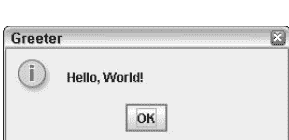

这里需要认识到的重要一点是，`HelloApp2` 类不需要做任何改动就能使用这个新版本的 `Greeter` 类。你只需要用新的 `Greeter` 类替换旧的 `Greeter` 类，而 `HelloApp2` 类不会察觉到任何差异。这就是面向对象编程的主要优势之一。

## 导入 Java API 类

你可能已经注意到，代码清单 1-4 中的 `Greeter` 类包含了这条语句：

```
import javax.swing.JOptionPane;
```

`import` 语句的目的是让编译器知道程序正在使用一个由 Java API 定义的名为 `JOptionPane` 的类。

由于 Java API 实际上包含数千个类，因此需要某种组织形式来使这些类更易于访问。Java 通过将类分组为称为 `package`（包）的可管理组来实现这一点。在前面的示例中，包含 `JOptionPane` 类的包名为 `javax.swing`。

严格来说，`import` 语句从来不是必需的。但如果你不使用 `import` 语句来导入程序所使用的 API 类，那么在使用这些类时必须*完全限定*类名，即在类名前加上包名。因此，如果代码清单 1-4 中的类在第 5 行没有包含 `import` 语句，你就必须将第 11 行编写为：

```
javax.swing.JOptionPane.showMessageDialog(null, "Hello, World!", "Greeter", JOptionPane.INFORMATION_MESSAGE);
```

换句话说，每次引用这个类时，你都必须指定 `javax.swing.JOptionPane`，而不仅仅是 `JOptionPane`。


以下是使用 `import` 语句的一些额外规则：

- `import` 语句必须出现在类文件的开头，在任何类声明之前。
- 你可以包含任意数量的 `import` 语句，以导入程序使用的所有类。
- 你可以通过列出包名后跟一个星号通配符来导入特定包中的所有类，如下所示：`import javax.swing.*;`
- 由于许多程序使用 `java.lang` 包中包含的类，因此你不必导入该包。这些类对所有程序自动可用。`System` 类定义在 `java.lang` 包中。因此，你不必提供 `import` 语句来使用这个类。

# 第 2 章：使用变量和数据类型

## 本章内容

- 创建正确的变量声明
- 了解基本类型和引用类型之间的区别
- 查看 Java 的内置数据类型
- 介绍字符串
- 从控制台获取输入
- 使用旧版 Java 时如何获取输入

在本章中，你将了解 Java 中变量的基础知识。变量是使 Java 程序具有通用性的关键。例如，上一章中的 Hello, World! 程序非常具体：它们唯一能说的就是"Hello, World!"。但有了变量，你可以让这类程序变得更加通用。例如，你可以变换问候语，让它有时说"Hello, World!"，有时说"Greetings, Foolish Mortals."。或者你可以个性化问候语，让它不再说"Hello, World!"，而是说"Hello, Bob!"或"Hello, Amanda!"。

变量也是创建能够执行计算的程序的关键。例如，假设你想创建一个程序，根据圆的半径计算圆的面积。这样的程序需要使用两个变量：一个表示圆的半径，另一个表示圆的面积。程序要求用户输入第一个变量的值，然后计算第二个变量的值。

## 声明变量

在 Java 中，你必须在使用变量之前显式声明它们。这一规则与某些语言形成对比——最突出的是 Basic 和 Visual Basic——这些语言允许你使用未自动声明的变量。允许使用未显式声明的变量乍看起来似乎是个好主意。但这是由拼错变量名导致的 bug 的常见来源。Java 要求你显式声明变量，这样如果你拼错了变量名，编译器就能检测到错误并显示编译错误。
```


# 声明变量

变量声明的基本形式如下：

```
type name;
```

以下是一些示例：

```
int x;
String lastName;
double radius;
```

在这些示例中，声明了名为 `x`、`lastName` 和 `radius` 的变量。变量 `x` 用于存储整数值，变量 `lastName` 用于存储字符串值，而变量 `radius` 用于存储双精度浮点值。关于这些类型含义的更多信息，请参阅本章后面的“使用基本数据类型”部分。在此之前，你只需知道 `int` 变量可以存储整数（如 5、1、340 和 -34），`double` 变量可以存储带小数部分的数字（如 0.5、99.97 或 3.1415），而 `String` 变量可以存储文本值（如 "Hello, World!" 或 "Jason P. Finch"）。

请注意，变量声明以分号结束。这是因为变量声明本身是一种语句。

变量名遵循与其他 Java 标识符相同的规则，正如我在《第二卷》第一章中所述。简而言之，变量名可以是字母和数字的任意组合，但必须以字母开头。大多数程序员倾向于将变量名的首字母小写，并将名称中各个单词的首字母大写。例如，`firstName` 和 `salesTaxRate` 是典型的变量名。

## 在一条语句中声明两个或更多变量

你可以在一条语句中声明两个或更多相同类型的变量，只需用逗号分隔变量名即可。例如：

```
int x, y, z;
```

这里，使用名称 `x`、`y` 和 `z` 声明了三个 `int` 类型的变量。

作为规则，我建议你避免在一条语句中声明多个变量。如果你为每个变量使用单独的声明，你的代码将更易于阅读和维护。

## 声明类变量

类变量是可以被类中任何方法访问的变量，包括像 `main` 这样的静态方法。声明类变量时，你需要遵循两个基本规则：

- 你必须将声明放在类体内部，但不能放在任何类方法内部。
- 你必须在声明中包含 `static` 关键字。`static` 关键字放在变量类型之前。

以下程序展示了声明名为 `helloMessage` 的类变量的正确方式：

```
public class HelloApp
{
    static String helloMessage;

    public static void main(String[] args)
    {
        helloMessage = "Hello, World!";
        System.out.println(helloMessage);
    }
}
```

如你所见，声明中包含 `static` 关键字，并且位于 `HelloApp` 类体内部，但不在 `main` 方法体内部。

你不必将类变量声明放在类的开头。一些程序员更喜欢将它们放在类的末尾，如本例所示：

```
public class HelloApp
{
    public static void main(String[] args)
    {
        helloMessage = "Hello, World!";
        System.out.println(helloMessage);
    }

    static String helloMessage;
}
```

这里，`helloMessage` 变量在 `main` 方法*之后*声明。

我认为如果变量先声明，类会更易于阅读，因此本书中你看到它们都出现在前面。

## 声明实例变量

*实例变量*类似于类变量，但其声明中不包含 `static` 关键字。顾名思义，实例变量与类的实例相关联。因此，你只能在创建类的实例时使用它们。因为静态方法与类的实例无关，所以你不能在静态方法（包括 `main` 方法）中使用实例变量。

例如，以下程序将无法编译：

```
public class HelloApp
{
    String helloMessage;     // 错误 -- 应使用 static 关键字

    public static void main(String[] args)
    {
        helloMessage = "Hello, World!";
        System.out.println(helloMessage);   // 无法编译
    }
}
```

如果你尝试编译此程序，会得到以下错误信息：

```
C:\Java\HelloApp.java:7: non-static variable helloMessage
        cannot be referenced from a static context
                              helloMessage = "Hello, World!";
                              ^
C:\Java\HelloApp.java:8: non-static variable helloMessage
        cannot be referenced from a static context
                              System.out.println(helloMessage);
                              ^
```

这两个错误发生的原因是 `main` 方法是静态的，因此无法访问实例变量。

当你创建自己的类时，实例变量很有用。但由于我在《第三卷》中才介绍这一点，所以在《第二卷》剩余的章节中你不会看到太多实例方法的例子。

## 声明局部变量

*局部变量*是在方法体内声明的变量。然后，你只能在该方法内部使用该变量。类中的其他方法甚至不知道该变量的存在。

这是 `HelloApp` 类的一个版本，其中 `helloMessage` 变量被声明为局部变量：

```
public class HelloApp
{
    public static void main(String[] args)
    {
        String helloMessage;
        helloMessage = "Hello, World!";
        System.out.println(helloMessage);
    }
}
```

请注意，在声明局部变量时，你不指定 `static`。如果你指定了，编译器将生成错误消息并拒绝编译你的程序。局部变量总是存在于方法的上下文中，并且仅在该方法执行时存在。因此，无论类的实例是否已经创建都无关紧要。

与类变量和实例变量不同，局部变量声明的位置很重要。特别地，你必须将声明放在实际使用该变量的第一条语句之前。因此，以下程序将无法编译：

```
public class HelloApp
{
    public static void main(String[] args)
    {
        helloMessage = "Hello, World!";    // 错误 -- helloMessage
        System.out.println(helloMessage); // 尚未声明
        String helloMessage;
    }
}
```

当编译器到达 `main` 方法的第一行时，它会生成一条错误消息，抱怨找不到符号 "`helloMessage`"。这是因为该变量尚未声明。

虽然大多数局部变量都声明在方法体的开头附近，但你也可以在由大括号标记的更小的代码块内声明局部变量。当你阅读有关使用代码块的语句（如 `if` 和 `for` 语句）时，这会更有意义。但这里有一个例子：

```
if (taxRate > 0)
{
    double taxAmount;
    taxAmount = subTotal * taxRate;
    total = subTotal + total;
}
```

这里，变量 `taxAmount` 只存在于属于 `if` 语句的那对大括号内。

# 初始化变量

在 Java 中，局部变量不会获得默认的初始值。编译器会检查以确保你在使用局部变量之前为其赋值。例如，以下程序将无法编译：

```
public class testApp
{
    public static void main(String[] args)
    {
        int i;
        System.out.println("The value of i is " + i);
    }
}
```

如果你尝试编译此程序，会得到以下错误信息：

```
C:\Java\testApp.Java:6: variable i might not have been initialized
    System.out.println("The value of i is " + i);
```

要避免此错误信息，你必须在使用局部变量之前对其进行初始化。你可以通过使用赋值语句或初始化器来实现，正如我在以下部分所描述的那样。

与局部变量不同，类变量和实例变量会获得默认值。数值类型自动初始化为零，`String` 变量初始化为空字符串。因此，你不必初始化类变量或实例变量，尽管如果你想让它们具有默认值以外的初始值，也可以这样做。

## 使用赋值语句初始化变量

初始化变量的一种方法是在变量声明之后编写一条*赋值语句*。赋值语句的一般形式如下：

```
variable = expression;
```

这里的*表达式*可以是任何产生与变量相同类型值的 Java 表达式。例如，以下是前面示例中 `main` 方法的一个版本，它在使用 `i` 变量之前正确地初始化了它：

```
public static void main(String[] args)
{
    int i;
    i = 0;
    System.out.println("i is " + i);
}
```


## 使用初始化器初始化变量

在这个例子中，变量在被`println`方法调用以打印其值之前被初始化为零。

你将在本书第二卷第3章中了解更多关于表达式的知识。目前，你可以直接使用简单的字面量值，例如本例中的`0`。

Java还允许你在声明变量的同一语句中初始化该变量。为此，你需要使用一个*初始化器*，其一般形式如下：

```
type name = expression;
```

实际上，初始化器让你可以将声明和赋值语句合并为一个简洁的语句。以下是一些例子：

```
int x = 0;
String lastName = "Lowe";
double radius = 15.4;
```

在每种情况下，变量都在一条语句中同时完成声明和初始化。

当你在一句话句中声明多个变量时，每个变量都可以有自己的初始化器。例如，以下代码声明了名为`x`和`y`的变量，并将`x`初始化为`5`，将`y`初始化为`10`：

```
int x = 5, y = 10;
```

当你在一句话句中声明两个类变量或实例变量但只使用一个初始化器时，你可能会错误地认为该初始化器适用于两个变量。例如，考虑以下语句：

```
static int x, y = 5;
```

在这里，你可能会认为`x`和`y`都会被初始化为`5`。但初始化器只适用于`y`，因此`x`被初始化为其默认值`0`。（如果你将这个错误用于局部变量，编译器会对第一个使用`x`变量的语句显示错误消息，因为它没有被正确初始化。）

## 使用 Final 变量（或常量）

*final 变量*，也称为*常量*，是一种一旦初始化后其值就不能更改的变量。要声明一个 final 变量，你需要在变量声明中添加`final`关键字，像这样：

```
final int WEEKDAYS = 5;
```

虽然你可以创建 final 局部变量，但大多数 final 变量都是类变量或实例变量。要创建一个 final 类变量（有时称为*类常量*），请在声明中添加`static final`（不是`final static`）：

```
static final WEEKDAYS = 5;
```

虽然不是强制的，但将 final 变量名全部使用大写字母是常见的做法。这样你可以轻松地在程序中识别出 final 变量的使用。

常量对于在程序多个地方使用且在程序运行期间不会改变的值非常有用。例如，假设你正在编写一个以弹跳球为特色的游戏，你希望球的半径始终为 6 像素。这个程序可能需要在几个不同的地方使用球的直径——例如，在屏幕上绘制球、判断球是否撞到墙、判断球是否撞到另一个球等等。与其在需要球半径时直接指定 6，不如设置一个名为`BALL_RADIUS`的类常量，像这样：

```
static final BALL_RADIUS = 6;
```

使用类常量有两个优点：

-   如果你后来决定将球的半径改为 7，你只需要在一个地方进行修改——即`BALL_RADIUS`常量的初始化器。
-   常量有助于记录程序的内部工作原理。例如，如果使用了球半径的复杂计算中指定的是`BALL_RADIUS`而不是 6，那么它的操作就更容易理解。

## 处理基本数据类型

术语*数据类型*指的是可以存储在变量中的数据类型。Java 有时被称为*强类型*语言，因为当你声明变量时，必须指定变量的类型。然后，编译器会确保你不会尝试将错误类型的数据赋值给该变量。例如，以下代码会生成编译器错误：

```
int x;
x = 3.1415;
```

因为`x`被声明为`int`类型的变量（用于存储整数），所以不能将值`3.1415`赋值给它。

Java 在*基本类型*和*引用类型*之间有一个重要的区别。基本类型是由语言本身定义的数据类型。相比之下，引用类型是由 Java API 中的类定义的类型，而不是由语言本身定义的。

基本类型和引用类型之间的一个关键区别是，与基本类型变量相关联的内存位置包含变量的实际值。因此，基本类型有时被称为*值类型*。相比之下，与引用类型变量相关联的内存位置包含一个地址（称为*指针*），该地址指示实际对象的内存位置。我在本章后面的"使用引用类型"一节中更全面地解释了引用类型，所以如果这个解释目前还无法理解，不用担心。

引用类型由 Java API 定义而非由 Java 语言规范定义的说法并不完全准确。少数引用类型，例如`Object`和`String`，是由 API 中的类定义的，但这些类是在 Java 语言 API 中指定的。而一种称为*数组*的特殊变量，可以包含基本类型或引用类型变量的多个实例，被认为是引用类型。

Java 总共定义了八种基本类型。供你参考，表 2-1 列出了它们。在八种基本类型中，六种用于数字，一种用于字符，一种用于真/假值。在六种数字类型中，四种是整数类型，两种是浮点数类型。我将在以下各节中描述每种基本类型。

| 类型 | 说明 |
|------|-------------|
| `int` | 32 位（4 字节）整数值 |
| `short` | 16 位（2 字节）整数值 |
| `long` | 64 位（8 字节）整数值 |
| `byte` | 8 位（1 字节）整数值 |
| `float` | 32 位（4 字节）浮点数值 |
| `double` | 64 位（8 字节）浮点数值 |
| `char` | 使用 Unicode 编码方案的 16 位字符 |
| `boolean` | 真或假的值 |

### 整数类型

*整数*是整数——也就是说，没有分数或小数部分的数字。Java 有四种不同的整数类型，你可以用来存储不同大小的数字。最常用的整数类型是`int`。这种类型使用四个字节来存储整数值，其范围大约从负二十亿到正二十亿。

如果你正在编写一个计算麦当劳售出了多少个汉堡的应用程序，`int`变量可能不够用。在这种情况下，你可以改用`long`整数。`long`是一个 64 位整数，可以容纳从大约负 9,000 万亿到正 9,000 万亿的数字。即使以联邦赤字的标准来看，这也是一个很大的数字。

在某些情况下，你可能不需要标准`int`类型提供的那么大的整数。对于这些情况，Java 提供了两种较小的整数类型。`short`类型表示一个两位整数，可以容纳从 -32,768 到 +32,767 的数字。而`byte`类型定义了一个 8 位整数，范围可以从 -128 到 +127。

虽然`short`和`byte`类型比`int`或`long`类型需要的内存更少，但通常很少需要使用它们。大多数程序中多几个或少几个字节不会有什么性能差异，所以你应该大部分时间坚持使用`int`和`long`。并且只有在知道你要处理的数字对于`int`来说太大时才使用`long`。

在 Java 中，整数数据类型的大小由语言规定，无论程序在什么计算机上运行都是相同的。与 C 和 C++ 语言相比，这是一个巨大的改进，因为 C 和 C++ 让不同平台的编译器来确定整数数据类型的最佳大小。因此，在一台计算机上编写和测试的 C 或 C++ 程序在另一台计算机上可能不会完全相同地执行。

Java 允许你将整数类型*提升*为更大的整数类型。例如，Java 允许以下操作：

```
int xInt;
long yLong;
xInt = 32;
yLong = xInt;
```

在这里，你可以将`xInt`变量的值赋给`yLong`变量，因为`yLong`的大小比`xInt`大。然而，Java 不允许相反的操作：

```
int xInt;
long yLong;
yLong = 32;
xInt = yLong;
```

`yLong`变量的值不能被赋给`xInt`，因为`xInt`比`yLong`小。因为这种赋值可能导致数据丢失，所以 Java 不允许这样做。

（如果你需要将`long`赋值给`int`变量，必须使用本章后面"类型转换"一节中描述的显式强制转换。）


## 基本数据类型

### 浮点类型

浮点数是带有小数部分的数字。当你需要使用带有小数的数字时，比如 19.95 或 3.1415，就应该使用浮点类型。

Java 有两种用于浮点数的原始类型：`float`，占用四个字节；以及 `double`，占用八个字节。在几乎所有情况下，当你需要使用带有小数值的数字时，都应该使用 `double` 类型。

浮点值的精度表示该值可以具有多少位有效数字。`float` 类型的精度仅约为 6 或 7 位十进制数字，这对于大多数类型的计算来说是不够的。例如，如果你使用 Java 编写工资系统，对于教师或消防员等员工的薪资，你可能会使用 `float` 变量来存储，但对于职业棒球运动员或高管来说就不行了。

相比之下，`double` 变量的精度约为 15 位数字，这足以满足大多数用途。

浮点数实际上使用指数表示法（也称为科学计数法）来存储其值。这意味着浮点数实际上记录了两个数字：一个基值（也称为尾数）和一个指数。浮点数的实际值通过将尾数乘以 2 的指数次幂来计算。对于 `float` 类型，指数可以是 -127 到 +128。对于 `double` 类型，指数可以是 -1023 到 +1024。因此，`float` 和 `double` 变量都能够表示非常大和非常小的数字。

你可以在 Book II, Chapter 3 中找到关于浮点值一些细微之处的更多信息。

使用浮点字面量时，你应该始终包含小数点，像这样：

```
double period = 99.0;
```

如果你省略小数点，Java 编译器会将该字面量视为整数。然后，当它看到你试图将该字面量赋给 `double` 变量时，就会生成编译器错误信息。

你可以在浮点字面量后添加 F 或 D 后缀，以指示该字面量本身是 `float` 还是 `double` 类型。例如：

```
float value1 = 199.33F;
double value2 = 200495.995D;
```

### 浮点数的科学表示法

如果你有科学头脑，可能希望在编写浮点字面量时使用科学计数法。例如：

```
double e = 5.10e+6;
```

这个等式等价于：

```
double e = 5100000D;
```

如果指数为正数，符号是可选的，因此你也可以写成：

```
double e = 5.10e6;
```

注意，指数可以为负，以表示小于 1 的值。例如：

```
double impulse = 23e-7;
```

这个等式等价于：

```
double impulse = 0.0000023;
```

如果省略后缀，则默认为 `D`。因此，对于 `double` 字面量，通常可以省略 D 后缀。

有趣的是，浮点数有两个不同的零值：负零和正零。你不必太担心这些，因为 Java 将它们在计算中视为相等。不过，这可以作为 *Jeopardy!* 节目的好题目。（"我要选择'奇怪的数字'，200美元，Alex。"）

### *char* 类型

`char` 类型表示 Unicode 字符集中的单个字符。需要记住的是，字符与字符串并不相同。你将在本章后面的"使用字符串"部分了解字符串。目前，只需知道 `char` 变量只能存储一个字符，而不能像字符串那样存储字符序列。

要为 `char` 变量赋值，你需要使用字符字面量，它总是用单引号而非双引号括起来。例如：

```
char code = 'X';
```

这里，字符 `X` 被赋给名为 `code` 的变量。

以下语句将无法编译：

```
char code = "X";  // 错误——应该使用单引号，而不是双引号
```

这是因为双引号用于标记字符串，而不是字符常量。

*Unicode* 是一种双字节字符编码，可以表示世界上大多数语言所使用的字符。目前，Unicode 字符集中定义了大约 35,000 个编码。这还留下另外 29,000 个编码未使用。Unicode 字符集中的前 256 个字符与 ASCII 字符集相同，ASCII 字符集是西欧语言计算机最常用的字符集。

有关 Unicode 字符集的更多信息，请参见 Unicode 官方网站 `www.unicode.org`。

字符字面量也可以使用特殊的*转义序列*来表示特殊字符。表 2-2 列出了允许的转义序列。这些转义序列允许你为那些无法在字符常量中直接输入的字符创建字面量。

| 转义序列 | 说明 |
| --- | --- |
| `\b` | 退格 |
| `\t` | 水平制表符 |
| `\n` | 换行 |
| `\f` | 换页 |
| `\r` | 回车 |
| `\"` | 双引号 |
| `\'` | 单引号 |
| `\\` | 反斜杠 |

### boolean 类型

*boolean* 类型可以有两个值之一：`true` 或 `false`。布尔值用于执行逻辑运算，最常见的是用来判断某个条件是否为真。例如：

```
boolean enrolled = true;
boolean credited = false;
```

这里，声明了一个名为 `enrolled` 的 `boolean` 类型变量，并将其初始化为 `true`；另一个名为 `credited` 的 `boolean` 变量被声明并初始化为 `false`。

在某些语言中，如 C 或 C++，整数值可以被视为布尔值，0 等于 `false`，任何其他值等于 `true`。Java 则不然。在 Java 中，你不能在整数类型和布尔值之间进行转换。

## 包装类

每种基本数据类型在 Java API 类库中都有对应的类。这个类有时被称为*包装类*，因为它用一个原始值，加上对象化的精美包装纸和蝴蝶结，使基本类型看起来和行为上都像对象。表 2-3 列出了八种基本数据类型各自的包装类。

正如你将在本章后面了解到的，你可以使用这些包装类将原始值转换为字符串，反之亦然。

### 表 2-3

| 基本数据类型 | 包装类 |
| :--- | :--- |
| `int` | `Integer` |
| `short` | `Short` |
| `long` | `Long` |
| `byte` | `Byte` |
| `float` | `Float` |
| `double` | `Double` |
| `char` | `Character` |
| `boolean` | `Boolean` |

## 使用引用类型

在 Book III, Chapter 1 中，你将了解一些面向对象编程的基本概念。特别是，你将看到所有 Java 程序都是由一个或多个类组成的，以及如何使用类来创建对象。在本节中，我将展示如何创建与从类创建的对象一起工作的变量。

首先，*引用类型*是基于类而非 Java 语言内置的基本类型之一的类型。该类既可以是 Java API 类库提供的类，也可以是你自己编写的类。无论哪种情况，当你从类创建对象时，Java 会为存储该对象分配所需的内存。然后，如果你将对象赋给一个变量，该变量实际上被赋的是该对象的*引用*，而非对象本身。这个引用就是对象存储的内存位置的地址。

例如，假设你正在编写一个涉及球的游戏程序，并创建了一个名为 `Ball` 的类来定义球的行为。要声明一个可以引用 `Ball` 对象的变量，你可以使用如下语句：

```
Ball b;
```

这里，变量 `b` 是一个 `Ball` 类型的变量。

要从类创建对象的新实例，你需要使用 `new` 关键字和类名。第二次引用类名实际上是调用类的一个特殊例程，称为*构造函数*。构造函数负责初始化新对象。例如，以下语句声明了一个 `Ball` 类型的变量，调用 `Ball` 类构造函数创建一个新的 `Ball` 对象，并将该 `Ball` 对象的引用赋给变量：

```
Ball b = new Ball();
```

使用引用类型的一个关键概念是记住：特定类型的变量实际上并不包含该类型的对象。相反，它包含对该类型对象的引用。一个重要的副作用是两个变量可以引用同一个对象。例如，考虑以下语句：

```
Ball b1 = new Ball();
Ball b2 = b1;
```

这里，我声明了两个 `Ball` 变量，分别名为 `b1` 和 `b2`。但我只创建了一个 `Ball` 对象。在第一条语句中，`Ball` 对象被创建，`b1` 被赋给它一个引用。然后，在第二条语句中，变量 `b2` 被赋给由 `b1` 引用的同一个对象的引用。结果，`b1` 和 `b2` 都引用同一个 `Ball` 对象。

如果你使用其中一个变量来改变球的某些方面，无论你使用哪个变量，这个改变对该球都是可见的。例如，假设 `Ball` 类有一个名为 `setSpeed` 的方法，允许你将球的速度设置为任何 `int` 值，还有一个 `getSpeed` 方法，返回反映球当前速度的整数值。现在考虑以下语句：

```
b1.setSpeed(50);
b2.setSpeed(100);
int speed = b1.getSpeed();
```

当这些语句执行完毕后，变量 `speed` 的值是 50 还是 100？正确答案是 100。因为 `b1` 和 `b2` 都引用同一个 `Ball` 对象，使用 `b2` 改变速度也会影响 `b1`。

这是使用 Java 等面向对象语言编程时最令人困惑的方面之一，所以如果你偶尔被难住，不要感到难过。


## 字符串操作

*字符串*是一串文本字符，例如本章及前一章所介绍的 `HelloApp` 程序显示的消息 "Hello, World!"。在 Java 中，字符串是一种特殊的类型。Java 并未将字符串定义为基本类型。相反，字符串是一种*引用类型*，由 Java API 中的 String 类定义。Java 语言确实内置了一些用于处理字符串的特性。在某些情况下，这些特性使得字符串看起来像是基本类型而非引用类型。

Java 的字符串处理功能相当强大，值得用一整章来讲解。因此，关于字符串的详细内容，我建议你参阅第 IV 卷第 1 章。以下各节仅介绍字符串操作的基础知识，以便你能在程序中使用简单的字符串。

### 声明和初始化字符串

字符串的声明和初始化与基本类型非常相似。事实上，你最初可能注意到的唯一区别是 `String` 首字母大写，而不像 `int` 和 `double` 等基本类型的关键字那样全部小写。这是因为 `String` 不是关键字，而是提供字符串对象的 Java API 类的名称。

以下语句定义并初始化了一个字符串变量：

```
String s;
s = "Hello, World!";
```

这里，声明了一个名为 `s` 的 `String` 类型变量，并用字符串字面量 "Hello, World!" 对其进行了初始化。请注意，字符串字面量是用双引号括起来的，而不是单引号。单引号用于字符字面量，它与字符串字面量不同。

与任何变量声明一样，字符串声明也可以包含初始化器。因此，你可以在一条语句中声明并初始化一个字符串变量，如下所示：

```
String s = "Hello, World!";
```

> 提示：类变量和实例变量会自动初始化为空字符串，但局部变量不会。要将局部字符串变量初始化为空字符串，请使用如下语句：

```
String s = "";
```

### 连接字符串

使用加号 (+) 作为*连接运算符*来连接两个字符串。（在 Java 术语中，连接字符串被称为 *concatenation*。）例如，以下语句将两个字符串变量的值组合起来创建第三个字符串：

```
String hello = "Hello, ";
String world = "World!";
String greeting = hello + world;
```

`greeting` 变量的最终值为 "Hello, World!"

当 Java 连接字符串时，它不会在字符串之间插入任何空白字符。因此，如果你想组合两个字符串并在它们之间出现一个空格，你需要确保第一个字符串以空格结尾，或者第二个字符串以空格开头。在前面的例子中，第一个字符串以空格结尾。

或者，你可以将字符串字面量与字符串变量一起连接。例如：

```
String hello = "Hello";
String world = "World!";
String greeting = hello + ", " + world;
```

这里，`Hello` 和 `World` 之间的逗号和空格是作为字符串字面量插入的。

连接是最常用的字符串处理技术之一，因此你会在本书中看到很多例子。事实上，我在本章中已经使用过一次连接。之前，我向你展示了一个包含以下代码行的程序：

```
System.out.println("The value of i is " + i);
```

这里，`System.out` 对象的 `println` 方法打印了当字面量 "The value of i is " 与 `i` 变量的值连接时创建的字符串。

### 将基本类型转换为字符串

由于字符串连接允许你组合两个或多个字符串值，而 `int` 和 `double` 等基本类型*不是*字符串类型，你可能想知道上一节的最后一个示例如何能工作。换句话说，Java 如何能够在此语句中将字符串字面量 "The value of i is " 与 `i` 的整数值连接起来：

```
System.out.println("The value of i is " + i);
```

答案是，当你在连接中使用基本类型的值时，Java 会自动将基本类型的值转换为字符串值。

你可以使用基本类型的包装类的 `toString` 方法显式地将基本类型的值转换为字符串。例如，要将 `int` 变量 `x` 转换为字符串，你可以使用此语句：

```
String s = Integer.toString(x);
```

在下一章中，你将了解如何使用一个名为 `NumberFormat` 类的特殊类，在将基本类型转换为字符串的同时应用各种格式，例如添加逗号、美元符号或百分比符号。

### 将字符串转换为基本类型

将基本类型的值转换为字符串值相当容易。反过来——将字符串值转换为基本类型——则稍微复杂一些，因为它并不总是有效。例如，如果一个字符串包含值 `10`，你可以轻松地将其转换为整数。但如果字符串包含 `thirty-two`，你就无法转换。

要将字符串转换为基本类型，你需要使用相应包装类的 `parse` 方法，如表 2-4 所列。例如，要将字符串值转换为整数，你可以使用如下语句：

```
String s = "10";
int x = Integer.parseInt(s);
```

当然，你没有真正的理由这样做。然而，正如你在本章后面所看到的，你可以使用 parse 方法将用户输入的字符串值转换为基本类型。这样，你就可以编写程序，允许用户通过控制台窗口输入数字数据。

| 包装类 | 解析方法 | 示例 |
| --- | --- | --- |
| Integer | parseInt(String) | int x = Integer.parseInt("100"); |
| Short | parseShort(String) | short x = Short.parseShort("100"); |
| Long | parseLong(String) | long x = Long.parseLong("100"); |
| Byte | parseByte(String) | byte x = Byte.parseByte("100"); |
| Float | parseFloat(String) | float x = Float.parseFloat("19.95"); |
| Double | parseDouble(String) | double x = Double.parseDouble("19.95"); |
| Character | （无） |  |
| Boolean | parseBoolean(String) | boolean x = Boolean.parseBoolean("true"); |

请注意，将 `String` 转换为 `Character` 不需要 `parse` 方法。如果你需要这样做，可以在第 IV 卷第 1 章中找到方法。

### 数值数据的转换和强制转换

你需要不时地将一种类型的数值数据转换为另一种类型。例如，你可能需要将双精度值转换为整数，反之亦然。有些转换可以自动完成，而其他转换则需要使用一种称为*强制类型转换*的技术。我将在以下章节中描述自动类型转换和强制类型转换。

### 自动转换

Java 可以自动将某些基本类型转换为其他类型，并在必要时执行转换。图 2-1 显示了 Java 允许进行哪些转换。请注意，图中用虚线箭头表示的转换可能会导致值的精度损失。例如，`int` 可以转换为 `float`，但较大的 `int` 值将无法精确转换，因为 `int` 值可能具有比 `float` 类型所能表示的更多位数。

当你对两个类型不同的值执行数学运算时，Java 会自动将其中一个转换为另一个的类型。以下是 Java 执行此转换时遵循的规则：

- 如果其中一个值是 `double`，则另一个值将转换为 `double`。
- 如果两者都不是 `double`，但其中一个是 `float`，则另一个将转换为 `float`。
- 如果两者既不是 `double` 也不是 `float`，但其中一个是 `long`，则另一个将转换为 `long`。
- 如果以上条件都不满足，则两个值都将转换为 `int`。

### 类型强制转换

强制类型转换类似于转换，但不会自动完成。你使用强制类型转换来执行图 2-1 中*未*显示的转换。例如，如果你想将 `double` 转换为 `int`，必须使用强制类型转换。

使用强制类型转换时，你可能会丢失信息。例如，`double` 可以比 `int` 存储更大的数字。此外，`int` 无法存储 `double` 的小数部分。因此，如果你将 `double` 强制转换为 `int`，就有丢失数据或精度的风险。例如，3.1415 会变成 3。

要将基本类型的值从一种类型强制转换为另一种类型，你需要使用*强制类型转换运算符*，它只是放在要转换的值之前括号中的基本类型名称。例如：

```
double pi = 3.1314;
int iPi;
iPi = (int) pi;
```

请注意，当强制转换为整数时，double 的小数部分会被简单地丢弃，而不是四舍五入。例如：

```
double price = 9.99;
int iPrice = (int) price;
```

这里，`iPrice` 被赋值为 9。如果你想在转换 double 值时进行四舍五入，请使用 `Math` 类的 `Round` 方法，我将在下一章中向你展示。

## 理解作用域

变量的*作用域*指的是变量在类中的哪些部分存在。简而言之，每个变量仅存在于其所在的代码块内。


该变量被声明后，其所在的代码块内的所有内容均可访问。这就是为什么在类体中声明的类变量和实例变量可以被类中定义的任何方法访问，而在方法内部定义的局部变量只能由定义它的方法访问。

在Java中，**代码块**由一对匹配的花括号标记。Java有多种不同类型的代码块：类体、方法体，以及属于`if`或`for`等语句的语句块。但在每种情况下，代码块都标记了其中声明变量的作用域边界。

清单2-1中的程序有助于阐明类变量和局部变量的作用域。

## 清单 2-1：演示类变量和局部变量作用域的程序

```
public class ScopeApp
{
    static int x;

    public static void main(String[] args)
    {
        x = 5;
        System.out.println("main: x = " + x);
        myMethod();
    }

    public static void myMethod()
    {
        int y;
        y = 10;
        if (y == x + 5)
        {
            int z;
            z = 15;
            System.out.println("myMethod: z = " + z);
        }
        System.out.println("myMethod: x = " + x);
        System.out.println("myMethod: y = " + y);
    }
}
```

以下段落解释了此类中每个变量的作用域：

## 104 变量遮蔽

1.  变量 x 是一个类变量。其作用域从第2行开始，到第27行结束。因此，`main`方法和`myMethod`方法都可以访问它。

2.  变量 y 是在第16行初始化的局部变量。因此，其作用域从第16行开始，到第25行（即`myMethod`方法体的末尾）结束。

3.  变量 z 是一个局部变量，它在第17行属于`if`语句的语句块中声明并初始化。其作用域从变量在第20行被初始化时开始，到该语句块在第22行结束时终止。

> 严格来说，局部变量的作用域从变量被初始化时开始，到包含该变量声明的代码块结束时终止。相比之下，类变量或实例变量的作用域是整个声明该变量的类。这意味着你可以在一个物理位置上出现在变量声明之前的方法中使用类变量或实例变量。但你不能在局部变量声明之前使用它。

## 变量遮蔽

被遮蔽的变量是指一个本应可访问的变量，但由于在更直接的作用域中声明了同名变量，而暂时变得不可用。这听起来有些绕口，但清单2-2中的示例会使这个概念变得清晰。这里声明了一个名为 x 的类变量。然后，在 `main` 方法中，声明了一个同名的局部变量。

```
public class ShadowApp
{
    static int x;

    public static void main(String[] args)
    {
        x = 5;
        System.out.println("x = " + x);
        int x;
        x = 10;
        System.out.println("x = " + x);
        System.out.println("ShadowApp.x = " +
            ShadowApp.x);
    }
}
```

## 使用 System.out 打印数据 105

以下段落解释了此程序中的作用域问题：

-   类变量 x 在第4行声明。其作用域是整个类体，从第2行到第16行。
-   类变量 x 在第8行被赋值为5。然后，这个值在第9行被打印到控制台。
-   在第10行，声明了一个名为 x 的局部变量。这个局部变量遮蔽了类变量 x，因此从第10行到本方法结束（第14行），任何对 x 的引用都指的是局部变量，而不是类变量。
-   局部变量 x 在第11行被初始化。此时，局部变量 x 进入作用域，并保持在作用域内，直到方法结束（第14行）。
-   第12行的 `System.out.println` 语句打印了局部变量 x 的值。注意，这个语句与第9行的语句相同，但第9行打印的是类变量 x，因为当时类变量尚未被遮蔽。
-   当类变量被遮蔽时，你可以通过指定类名来访问它，如第13行所示。这里，`ShadowApp.x` 指的是类变量。
-   当 `main` 方法在第14行结束时，类变量 x 不再被遮蔽。

遮蔽类变量的局部变量的作用域，并不一定与局部变量本身作用域的起始点相同。遮蔽开始于局部变量被声明时，但局部变量的作用域直到变量被初始化时才开始。如果你尝试在声明和初始化之间访问该变量，Java编译器会显示错误消息。

由于遮蔽是常见的错误来源，我建议你尽可能避免它。

## 使用 System.out 打印数据

你已经见过多个使用 `System.out.println` 在控制台显示输出的程序。在以下部分，我将正式向你展示这个方法的工作原理，以及一个名为 `print` 的相关方法。

## 标准输入和输出流

Java应用程序被设计为在终端I/O环境中工作。每个Java应用程序都可使用三个为基于终端的输入和输出设计的I/O流，即一次发送或接收一个字符的数据。这三个流是：

## 106 使用 System.out 打印数据

-   **标准输入：** 用于接收输入数据的流。该流通常连接到运行程序的计算机的键盘。这样，用户就可以直接将字符输入到标准输入流中。在本章后面出现的“使用 Scanner 类获取输入”部分，你将把这个输入流连接到一个名为 `Scanner` 的类，该类使得从标准输入流读取原始数据类型变得容易。

-   **标准输出：** 用于在屏幕上显示文本输出的流。当你在 Windows 下运行 Java 程序时，会打开一个特殊的控制台窗口，标准输出流连接到该窗口。然后，你发送到标准输出的任何文本都会在该窗口中显示。

-   **标准错误：** 另一个用于输出的流。该流也连接到控制台窗口。因此，写入标准输出流的文本经常与写入错误流的文本混合在一起。


Windows和其他操作系统允许你将标准输出*重定向*到其他目的地——通常是一个文件。当你这样做时，只有标准输出数据会被重定向。写入标准错误的文本仍然会显示在控制台窗口中。

要重定向标准输出，你需要在运行 Java 类的命令上使用一个大于号，后跟要保存标准输出文本的文件名。例如：

```
C:\Java>java TestApp >output.txt
```

这里，类 `TestApp` 创建的标准输出被保存在名为 `output.txt` 的文件中。但是，发送到标准错误流的任何文本仍然会出现在控制台窗口中。因此，标准错误流对于使用输出重定向来显示状态消息、错误消息或其他信息的程序非常有用。

所有三个标准流都可以通过 `System` 类的字段供每个 Java 程序使用，如表2-5所述。

| 字段 | 描述 |
|-------|-------------|
| `System.in` | 标准输入 |
| `System.out` | 标准输出 |
| `System.err` | 标准错误 |

## 使用 System.out 和 System.err

`System.out` 和 `System.err` 都代表一个名为 `PrintWriter` 的类的实例，该类定义了用于向控制台写入数据的 `print` 和 `println` 方法。你可以对 `String` 参数或任何原始数据类型的参数使用这两个方法。

`print` 和 `println` 方法之间唯一的区别是，`println` 方法在输出末尾添加一个换行符，因此下一次调用 `print` 或 `println` 的输出将从新行开始。

因为 `print` 方法不另起新行，所以当你想在同一行打印两个或更多项时非常有用。例如：

```
int i = 64;
int j = 23;
System.out.print(i);
System.out.print(" and ");
System.out.println(j);
```

这些行产生的控制台输出是：

```
64 and 23
```

注意，你可以通过使用字符串连接，用一个 `println` 调用来完成同样的事情，像这样：

```
int i = 64;
int j = 23;
System.out.println(i + " and " + j);
```

## 使用 Scanner 类获取输入

直到最近，在基于控制台的 Java 程序中从用户获取文本输入并不容易。但从 Java 1.5 开始，引入了一个名为 `Scanner` 的新类来简化从用户获取输入的任务。在以下部分，你将使用 `Scanner` 类从用户获取简单的输入值。我在这里介绍的技术将用于本书后面展示的许多程序中。

如果你使用的是旧版本的 Java，你仍然应该阅读本节，因为本书中的许多程序都使用了 `Scanner` 类。但是，你也应该阅读下一节“使用 JOptionPane 类获取输入”，因为该节描述了一种适用于早期 Java 版本的获取用户输入的方法。


# **108 使用 Scanner 类获取输入**

在接下来的几节中，我会提到清单 2-3 中展示的程序。这个简单的程序使用 `Scanner` 类从用户处读取一个整数值，然后将该值显示回控制台，以验证程序收到了用户输入的值。以下是该程序的控制台窗口示例：

```
Enter an integer: 5
You entered 5.
```

程序首先在第一行显示消息 `Enter an integer:`。然后，它等待你输入一个数字。当你按下回车键时，它会在第二行显示确认消息（`You entered 5.`）。

## **清单 2-3：使用 SCANNER 类的程序**

```java
import java.util.Scanner;

public class ScannerApp
{

    static Scanner sc = new Scanner(System.in);

    public static void main(String[] args)
    {
        System.out.print("Enter an integer: ");
        int x = sc.nextInt();
        System.out.println("You entered " + x + ".");
    }

}
```

## **导入 Scanner 类**

在程序中使用 `Scanner` 类之前，必须先导入它。为此，你需要在程序开头、类声明之前编写一条 `import` 语句，如清单 2-3 的第 1 行所示：

```java
import java.util.Scanner;
```

注意 `java` 和 `util` 没有大写，但 `Scanner` 是大写的。

如果你要使用 `java.util` 包中的其他类，可以通过如下方式编写 `import` 语句来导入整个包：

```java
import java.util.*;
```

## **声明并创建 Scanner 对象**

在使用 `Scanner` 类从控制台读取输入之前，你必须声明一个 `Scanner` 变量并创建一个 `Scanner` 类的实例。我建议你将 `Scanner` 变量创建为类变量，并在类变量初始化器中创建 `Scanner` 对象，如清单 2-3 的第 6 行所示：

```java
static Scanner sc = new Scanner(System.in);
```

这样，你就可以在类中的任何方法中使用 `sc` 变量。

要创建 `Scanner` 对象，你需要使用 `new` 关键字，后接对 `Scanner` 类构造函数的调用。注意 `Scanner` 类需要一个参数来指示输入来自哪个*输入流*。这里你可以使用 `System.in` 来指定标准键盘控制台输入。

## **获取输入**

要从用户处读取输入值，你可以使用表 2-6 中列出的 `Scanner` 类的方法之一。如你所见，每种基本数据类型都有单独的方法。

| 方法 | 说明 |
|--------|-------------|
| `boolean nextBoolean()` | 从用户处读取一个 `boolean` 值。 |
| `byte nextByte()` | 从用户处读取一个 `byte` 值。 |
| `double nextDouble()` | 从用户处读取一个 `double` 值。 |
| `float nextFloat()` | 从用户处读取一个 `float` 值。 |
| `int nextInt()` | 从用户处读取一个 `int` 值。 |
| `String nextLine()` | 从用户处读取一个 `String` 值。 |
| `long nextLong()` | 从用户处读取一个 `long` 值。 |
| `short nextShort()` | 从用户处读取一个 `short` 值。 |

注意表中第一列的每个方法列表都以方法返回值的类型开头。例如，`nextInt` 方法返回一个 `int` 值。另外，注意每个方法的末尾都有一组空括号。这意味着这些方法都不需要参数。如果方法需要参数，参数会列在这些括号内。

由于这些方法从用户处读取一个值并返回该值，所以你通常在将值赋给变量的语句中使用它们 additional content them。例如，清单 2-3 的第 11 行读取一个 `int` 并将其赋给名为 `x` 的变量。

# **110 使用 Scanner 类获取输入**

当执行 `nextInt` 方法时，程序会等待用户在控制台窗口中输入一个值。为了让用户知道程序期望什么样的输入，你通常应该在调用 `Scanner` 方法获取输入之前调用 `System.out.print` 方法。例如，清单 2-3 的第 10 行调用 `System.out.print` 在控制台上显示消息 `Enter an integer:`。这样，用户就知道程序正在等待输入。

如果用户输入的值无法转换为正确的类型，程序就会崩溃，也就是说它会突然终止。程序崩溃时，会显示一条晦涩的错误消息，指出导致失败的原因。例如，如果你输入 `three` 而不是实际的数字，控制台窗口看起来像这样：

```
Enter an integer: **three**
Exception in thread "main" java.util.InputMismatchException
    at java.util.Scanner.throwFor(Scanner.java:819)
    at java.util.Scanner.next(Scanner.java:1431)
    at java.util.Scanner.nextInt(Scanner.java:2040)
    at java.util.Scanner.nextInt(Scanner.java:2000)
    at ScannerApp.main(ScannerApp.java:11)
```

这条消息表明发生了一个名为 `InputMismatchException` 的`异常`，这意味着程序期望看到一个整数，但却得到了其他东西。在第二卷第八章中，你将了解如何处理这类异常，以便程序能够显示更友好的消息，并让用户再次尝试输入正确的值。在此之前，你只能接受这样一个事实：如果用户输入了错误的数据，你的程序就会不雅地崩溃。

你可以通过使用表 2-7 中列出的方法之一先测试下一个输入是否有效，来防止 `nextInt` 及类似方法因错误的输入数据而崩溃。我还没有介绍执行此测试所需的 Java 语句。别担心；在第二卷第八章中，我会向你展示解决方案。

### **表 2-7 检查有效输入值的 Scanner 类方法**

| 方法 | 说明 |
|---|---|
| `boolean hasNextBoolean()` | 如果用户输入的下一个值是有效的 `boolean` 值，则返回 `true`。 |
| `boolean hasNextByte()` | 如果用户输入的下一个值是有效的 `byte` 值，则返回 `true`。 |
| `boolean hasNextDouble()` | 如果用户输入的下一个值是有效的 `double` 值，则返回 `true`。 |
| `boolean hasNextFloat()` | 如果用户输入的下一个值是有效的 `float` 值，则返回 `true`。 |
| `boolean hasNextInt()` | 如果用户输入的下一个值是有效的 `int` 值，则返回 `true`。 |
| `boolean hasNextLong()` | 如果用户输入的下一个值是有效的 `long` 值，则返回 `true`。 |
| `boolean hasNextShort()` | 如果用户输入的下一个值是有效的 `short` 值，则返回 `true`。 |

## **使用 JOptionPane 类获取输入**

如果你使用的是 Java 1.5 之前的版本，则无法使用 `Scanner` 类通过控制台窗口直接从用户处读取输入。然而，你可以使用 `JOptionPane` 类来显示简单的对话框（如图 2-2 所示），以从用户处获取文本输入。然后，你可以使用基本类型包装类的 `parse` 方法将用户输入的文本转换为适当的基本类型。

虽然 `JOptionPane` 类有很多方法，但获取简单文本输入只需要 `showInputDialog` 方法即可。这个方法使用一个参数来指定在对话框中显示的提示信息。它返回一个字符串值，然后你可以将其解析为正确的类型。

`JOptionPane` 类是 `javax.swing` 包的一部分，因此你需要在任何使用此类的程序开头添加 `import javax.swing.JOptionPane` 语句。

清单 2-4 展示了一个使用 `JOptionPane` 类获取整数值并在控制台上显示该值的简单程序。


## 使用 JOptionPane 类获取输入

### 清单 2-4：一个使用 JOptionPane 类获取用户输入的程序

```
import javax.swing.JOptionPane;

public class DialogApp
{
    public static void main(String[] args)
    {
        String s;
        s = JOptionPane.showInputDialog("Enter an integer:");
        int x = Integer.parseInt(s);
        System.out.println("You entered " + x + ".");
    }
}
```

以下段落描述了此程序中的重要行：

- 1 这一行导入了 `JOptionPane` 类。
- 8 此语句显示一个输入对话框，提示为 `Enter an integer:`，并将用户输入的字符串赋值给名为 `s` 的变量。
- 9 此语句使用 `Integer` 类的 `parseInt` 方法将用户输入的字符串转换为整数。
- 10 此语句显示整数值，以确认用户输入的数据已正确转换为整数。

如果用户在输入对话框中输入了整数以外的任何内容，此程序将突然终止。例如，如果用户输入 `ten`，程序将终止，并显示一条晦涩的消息，表明发生了 `NumberFormatException`。你可以在第二卷第八章中处理这种情况。在此之前，使用 `JOptionPane` 类时，请务必输入正确的数字。

## 第 3 章：处理数字和表达式

## 本章内容

- 处理运算符，如 +、-、* 和 /
- 创建精心设计的表达式
- 递增和递减
- 接受赋值
- 使用 Math 类
- 格式化你的数字
- 数字可能出现的奇怪情况

在第二卷第二章中，你发现了 Java 支持的各种基本数字类型。在本章中，你将在此知识的基础上，进行数字的基本运算。本章大部分内容集中在表达式这个复杂主题上，表达式将数字与运算符组合以执行计算。但本章还涵盖了在显示数字时格式化数字的技术以及使用 Math 类执行高级计算。此外，你将了解为什么 Java 的数学运算有时会产生你可能意想不到的结果。

## 使用算术运算符

*运算符*是一个特殊符号或关键字，用于指定可以对一个或多个值（称为*操作数*）执行的数学运算或其他类型的操作。Java 总共有大约 40 个不同的运算符。本章重点关注执行算术运算的运算符。这些*算术运算符*执行基本的算术运算，例如加法、减法、乘法和除法。总共有 7 个。表 3-1 对它们进行了总结。

| 运算符 | 描述 |
|----------|-------------|
| + | 加法 |
| - | 减法 |
| * | 乘法 |
| / | 除法 |
| % | 取余 |
| ++ | 递增 |
| -- | 递减 |

以下代码段可以帮助阐明这些运算符如何用于 `int` 类型：

```
int a = 21, b = 6;
int c = a + b;      // c is 27
int d = a - b;      // d is 15
int e = a * b;      // e is 126
int f = a / b;      // f is 3  (21 / 6 is 3 remainder 3)
int g = a % b;      // g is 3  (21 / 6 is 3 remainder 3)
a++;                // a is now 22
b--;                // b is now 5
```

请注意，对于除法，结果会被截断。因此，`21 / 6` 返回 3，而不是 3.5。有关整数除法的更多信息，请参阅本章后面的“整数除法”部分。

以下是运算符如何处理 `double` 值的示例：

```
double x = 5.5, y = 2.0;
double m = x + y;           // m is 7.5
double n = x - y;           // n is 3.5
double o = x * y;           // o is 11.0
double p = x / y;           // p is 2.75
double q = x % y;           // q is 1.5
x++;                        // x is now 6.5
y--;                        // y is now 1.0
```

当你除以两个 `int` 值时，结果是整数值，即使你将其赋值给 `double` 变量。例如：

```
int a = 21, b = 6;
double answer = a / b;  // answer = 3.0
```

## 按操作数数量对运算符进行分类

对 Java 运算符进行分类的一种常见方法是按运算符操作的操作数数量。以此方式对运算符进行分类，有三种类型：

- **一元运算符**：仅对一个操作数进行操作的运算符。一元运算符的例子有取负（`-x`，返回 `x` 的负值）和递增（`x++`，将 `x` 加 1）。

  一元运算符可以是前缀运算符或后缀运算符。*前缀运算符*写在操作数之前，如下所示：
  
  `operator operand`
  
  *后缀运算符*写在操作数之后：
  
  `operand operator`

- **二元运算符**：对两个操作数进行操作的运算符。二元运算符的例子有加法（`x + y`）、乘法（`invoiceTotal * taxRate`）和比较运算符（`x < leftEdge`）。在 Java 中，所有二元运算符都是*中缀运算符*，这意味着它们出现在操作数之间，如下所示：
  
  `operand1 operator operand2`

- **三元运算符**：对三个操作数进行操作的运算符。Java 只有一个三元运算符，称为*条件运算符*（`?:`）。条件运算符也是中缀的：
  
  `operand1 ? operand2 : operand3`

如果这不是你想要的，你可以在执行除法之前将其中一个操作数转换为 `double`，如下所示：

```
int a = 21, b = 6;
double answer = (double)a / b;   // answer = 3.5
```

这个故事的寓意是，如果你想除以 `int` 值并获得精确的 `double` 结果，你必须至少将其中一个 `int` 值转换为 `double`。

今晚当你躺在床上思考 Java 算术运算符的奇妙之处时，还有几件事需要考虑：

- 在代数中，你可以将一个数字直接写在变量旁边来表示乘法。例如，4x 表示“四乘以 x”。在 Java 中则不是这样。以下语句无法编译：
  
  `int x;`
  
  `y = 4x;    // error, won't compile`

- 取余运算符（`%`）也称为*模*运算符。当第一个操作数除以第二个操作数时，它返回余数。取余运算符通常用于确定一个数是否能被另一个数整除，此时结果为 0。更多信息，请参阅下一节“整数除法”。

## 整数除法

- 所有运算符，包括算术类运算符，在 Java 中都被视为分隔符。因此，在表达式中使用任何空格都是可选的。因此，以下两个语句是等效的：

```
    a = ( (x + 4) * 7 ) / (y * x) ;
    a= ( (x+4) *7) / (y*x) ;
```

只需记住，一点点空格不会伤害任何人，有时它有助于使 Java 更具可读性。

## 整数除法

当你将一个整数除以另一个整数时，结果总是另一个整数。任何余数都被简单地丢弃，并且结果*不会*四舍五入。例如，5 / 4 的结果是 1，3 / 4 的结果是 0。如果你想知道 5 / 4 实际上是 1.25 或 3 / 4 实际上是 0.75，你需要使用浮点数或双精度数而不是整数。

如果你需要知道两个整数相除时的余数，请使用取余运算符（%）。例如，假设你有一定数量的弹珠要分发，以及一定数量的孩子要分给他们。清单 3-1 中的程序允许你输入弹珠的数量和孩子的数量。然后，它计算每个孩子得到的弹珠数量以及你剩余的弹珠数量。

以下是该程序的控制台输出示例，其中输入的弹珠数量为 93，孩子数量为 5：

```
Welcome to the marble divvy upper.
Number of marbles: 93
Number of children: 5
Give each child 18 marbles.
You will have 3 marbles left over.
```

### 清单 3-1：一个分配弹珠的程序

```
import java.util.Scanner;

public class MarblesApp
{
    static Scanner sc = new Scanner(System.in);

    public static void main(String[] args)
    {
        // declarations
        int numberOfMarbles;
        int numberOfChildren;
        int marblesPerChild;
        int marblesLeftOver;
```


```
// 获取输入数据
System.out.println("欢迎使用大理石分配器。");
System.out.print("大理石数量：");
numberOfMarbles = sc.nextInt();
System.out.print("儿童数量：");
numberOfChildren = sc.nextInt();

// 计算结果
marblesPerChild = numberOfMarbles / numberOfChildren;
marblesLeftOver = numberOfMarbles % numberOfChildren;

// 打印结果
System.out.println("给每个孩子 " +
    marblesPerChild + " 块大理石。");
System.out.println("你会剩下 " +
    marblesLeftOver + " 块大理石。");
}
}
```

以下段落描述了该程序中的关键行：

- **1** 导入 `java.util.Scanner` 类，以便程序可以使用它从用户获取输入。
- **5** 创建 `Scanner` 对象并将其赋给一个类变量，以便在类的任何方法中使用它。
- **9** 接下来的四行声明了程序使用的局部变量。
- **15** 接下来的五行从用户获取输入。
- **23** 使用整数除法（会丢弃余数）计算要给每个孩子的大理石数量。
- **24** 计算剩余的大理石数量。
- **26** 接下来的两条语句打印结果。

如果你思考一下，这可能很明显，但你应该意识到，如果你使用整数除法将 `a` 除以 `b`，那么结果乘以 `b` 加上余数等于 `a`。换句话说：

```
int a = 29;        // 任何值都可以
int b = 3;         // 任何值都可以
int c = a / b;
int d = a % b;
int e = (c * b) + d;  // e 将始终等于 a
```

## 118 组合运算符

你可以组合运算符来形成复杂的表达式。当你这样做时，操作执行的顺序由表达式中每个运算符的*优先级*决定。算术运算符的优先级顺序如下：

- 增量（++）和减量（--）运算符首先被求值。
- 接下来，应用符号运算符（+ 或 -）。
- 然后，求值乘法（*）、除法（/）和求余（%）运算符。
- 最后，应用加法（+）和减法（-）运算符。

例如，在表达式 `a + b * c` 中，乘法比加法具有更高的优先级。因此，首先将 `b` 乘以 `c`。然后，该乘法的结果被加到 `a` 上。

如果一个表达式包含两个或多个具有相同优先级顺序的运算符，则运算符从左到右求值。因此，在表达式 `a * b / c` 中，首先将 `a` 乘以 `b`，然后将结果除以 `c`。

如果需要，你可以使用括号来改变操作执行的顺序。括号内的操作始终在括号外的操作之前执行。因此，在表达式 `(a + b) * c` 中，首先将 `a` 加到 `b`。然后，结果乘以 `c`。

如果一个表达式有两组或多组括号，则最先执行最内层括号中的操作。例如，在表达式 `(a * (b + c)) / d` 中，首先将 `b` 加到 `c`。然后，结果乘以 `a`。最后，该结果除以 `d`。

除了增量和减量运算符之外，这些优先级规则和括号的使用与基本代数中相同。因此，如果你在八年级时认真听讲了，优先级应该很容易理解。

对于 `double` 或 `float` 值，更改相同优先级运算符的从左到右顺序不会影响结果。然而，对于整数类型，如果涉及除法，可能会产生巨大差异。例如，考虑这些语句：

```
int a = 5, b = 6, c = 7;
int d1 = a * b / c;     // d1 是 4
int d2 = a * (b / c);   // d2 是 0
```

这种差异的发生是因为整数除法总是返回一个整数结果，它是实际结果的截断版本。因此，在第一个表达式中，a 首先乘以 b，得到结果 30。然后，这个结果除以 c。截断答案得到结果 4。但在第二个表达式中，b 首先除以 c，得到截断结果 0。然后，这个结果乘以 a，得到最终答案 0。

## 使用一元加和减运算符

加和减一元运算符允许你更改操作数的符号。请注意，用于这些操作的实际运算符与二元加法和减法运算符相同。编译器通过检查表达式来确定你是要使用这些运算符的二元版本还是一元版本。

一元减运算符不一定使操作数具有负值。相反，它会更改操作数开始时具有的任何符号。因此，如果操作数以正值开始，一元减运算符会将其更改为负值。但如果操作数以负值开始，一元减运算符会使其变为正值。以下示例说明了这一点：

```
int a = 5;     // a 是 5
int b = -a;    // b 是 -5
int c = -b;    // c 是 +5
```

有趣的是，一元加运算符实际上什么也不做。例如：

```
int a = -5;    // a 是 -5
int b = +a;    // b 是 -5
a = 5;         // a 现在是 5
int c = +a;    // c 是 5
```

请注意，如果 a 以正值开始，+a 也是正值。但如果 a 以负值开始，+a 仍然是负值。因此，一元 + 运算符没有效果。我猜 Java 提供一元加运算符是出于平衡的需要。

你也可以在更复杂的表达式中使用这些运算符，如下所示：

```
int a = 3, b = 4, c = 5;
int d = a * -(b + c);    // d 是 -27
```

这里，b 加到 c 上，得到结果 9。然后，应用一元减号，得到结果 -9。最后，-9 乘以 a，得到结果 -27。

## 使用增量和减量运算符

计算机编程中最常见的操作之一是从变量中加或减 1。向变量加 1 称为 *增量* 变量。减 1 称为 *减量*。增量变量的传统方式如下：

```
a = a + 1;
```

这里，计算表达式 `a + 1`，并将结果赋给变量 `a`。

Java 提供了一种更简单的方法来进行这种类型的计算：增量（++）和减量（--）运算符。这些是应用于单个变量的一元运算符。因此，要增量变量 `a`，你可以编写如下代码：

```
a++;
```

请注意，使用增量或减量运算符的表达式本身就是一个语句。这是因为增量或减量运算符也是一种赋值运算符，因为它会更改它所应用的变量的值。

你只能对变量使用增量和减量运算符，不能对数字字面量或其他表达式使用。例如，Java 不允许以下表达式：

```
a = b * 5++;      // 不能增量数字 5
a = (b * 5)++;    // 不能增量表达式 (b * 5)
```

请注意，你可以在赋值语句中使用增量或减量运算符。例如：

```
int a = 5;
int b = a--;      // a 和 b 都被设置为 4
```

当执行第二条语句时，首先求值表达式 `a--`，因此 `a` 被设置为 4。然后，`a` 的新值被赋给 `b`。因此，`a` 和 `b` 都被设置为 4。

增量和减量运算符是不寻常的，因为它们是一元运算符，可以放在应用于它们的变量之前（*前缀*）或之后（*后缀*）。你是将运算符放在变量之前还是之后，对表达式的求值方式有重大影响。如果你将增量或减量运算符放在其变量之前，则在求值表达式的其余部分之前应用该运算符。因此，变量的增量值被用于表达式中。相反，如果你将运算符放在变量之后，则在表达式求值之后应用运算符。因此，变量的原始值被用于表达式中。

感到困惑了吗？一个简单的例子可以澄清它。首先，考虑这些使用后缀增量的表达式的语句：

```
int a = 5;
int b = 3;
int c = a * b++;   // c 被设置为 15
```

当第三条语句中的表达式被求值时，b 的原始值 - 3 - 被用于乘法中。因此，c 被设置为 15。然后，b 增量到 4。

现在考虑这个版本，使用前缀增量：

```
int a = 5;
int b = 3;
int c = a * ++b;  // c 被设置为 20
```

这一次，b 在执行乘法之前被增量，因此 c 被设置为 20。无论哪种方式，b 最终都被设置为 4。

类似地，考虑这个例子：

```
int a = 5;
int b = --a;    // b 被设置为 5，a 被设置为 4。
```

这个例子类似于之前的例子，但这次使用了前缀减量运算符。当执行第二条语句时，a 的值被赋给 b。然后，a 减量。结果，b 被设置为 5，a 被设置为 4。

由于增量和减量运算符在表达式中与其他运算符一起使用时可能会令人困惑，我建议你单独使用它们。每当你想将增量或减量运算符合并到更大的表达式中时，请将增量或减量从表达式中拉出，并将其作为一条单独的语句放在表达式之前或之后。换句话说，编写如下代码：

```
b++;
c = a * b;
```

而不是这样：

```
c = a * ++b;
```

在第一个版本中，很清楚 b 在乘法完成之前被增量。


## 使用赋值运算符

标准赋值运算符（=）用于将表达式的结果赋给变量。其最简单的形式如下：

```
variable = expression;
```

例如：

```
int a = (b * c) / 4;
```

你已经见过大量类似的赋值语句示例，因此我不再赘述。不过，我想指出——仅作为记录——你不能在等号左侧编写算术表达式。因此，以下语句无法编译：

```
int a;
a + 3 = (b * c);
```


在本节剩余部分，我将指出一些使用赋值运算符的不寻常方式。我实际上并不建议你使用这些技巧，因为它们很少必要，而且几乎总是令人困惑。然而，了解它们可以帮助你理解 Java 表达式的工作原理，有时还能帮助你发现代码中隐蔽的问题。

理解本节剩余内容的关键在于认识到：在 Java 中，赋值是表达式，而非语句。换句话说，`a = 5` 是一个赋值表达式，而不是赋值语句。只有当你在末尾添加分号时，它才成为赋值语句。

赋值表达式的结果是赋给变量的值。例如，表达式 `a = 5` 的结果是 5。同样，表达式 `a = (b + c) * d` 的结果是表达式 `(b + c) * d` 的结果。

这意味着你可以在其他表达式中间使用赋值表达式。例如，以下是合法的：

```
int a;
int b;
a = (b = 3) * 2;    // a 为 6，b 为 3
```

与任何表达式一样，括号内的部分先求值。因此，`b` 被赋值为 3。然后执行乘法运算，结果（6）被赋给变量 `a`。

现在考虑一个更复杂的情况：

```
int a;
int b = 2;
a = (b = 3) * b;  // a 为 9，b 为 3
```

这里发生的是，括号内的表达式先求值，这意味着在乘法执行之前，`b` 已被设置为 3。

在前面的例子中，括号很重要，因为如果没有括号，赋值运算符在 Java 的优先级顺序中是最后求值的运算符。因此，再看一个例子：

```
int a;
int b = 2;
a = b = 3 * b;  // a 为 6，b 为 6
```

这次，乘法 `3 * b` 先执行，结果为 6。然后，这个结果赋给 `b`。最后，该赋值表达式（6）的结果赋给 `a`。

顺便提一下，以下表达式也是合法的：

```
a = b = c = 3;
```

这个表达式将值 3 赋给所有三个变量。虽然这段代码看起来无害，但你最好还是写成三个赋值语句。（你可能猜测将赋值放在一起比写在三行上更高效，但你错了。无论哪种方式，这三个赋值都需要相同数量的字节码指令。）

## 使用复合赋值运算符

*复合赋值运算符*是一种同时执行计算和赋值的运算符。Java 的所有二元算术运算符（即作用于两个操作数的运算符）都有等效的复合赋值运算符。表 3-2 列出了它们。

| 运算符 | 说明 |
|----------|-------------|
| += | 加法与赋值 |
| -= | 减法与赋值 |
| *= | 乘法与赋值 |
| /= | 除法与赋值 |
| %= | 取余与赋值 |

例如，这条语句

`a += 10;`

等效于

`a = a + 10;`

而这条语句

`z *= 2;`

等效于

`z = z * 2;`


为避免混淆，复合赋值表达式最好单独使用，不要与其他表达式组合。例如，考虑以下语句：

```
int a = 2;
int b = 3;
a *= b + 1;
```

`a` 被设置为 7 还是 8？

换句话说，第三条语句等效于

```
a = a * b + 1;      // 这将得到结果 7
```

还是

```
a = a * (b + 1);    // 这将得到结果 8
```

乍一看，你可能期望答案是 7，因为乘法的优先级高于加法。但赋值是所有运算符中优先级最低的，这里的乘法是作为赋值的一部分执行的。因此，加法在乘法之前执行。所以答案是 8。（中招了吧！）

## 使用 Math 类

Java 的内置运算符很有用，但远不能满足大多数 Java 程序员的数学需求。这就是 Math 类的用武之地。它包含大量内置方法，执行各种各样的数学计算，从基本函数（如计算绝对值或平方根）到三角函数（如 sin 和 cos），再到实用函数（如四舍五入或生成随机数）。


> 我本来打算在这里开个玩笑，说为了充分欣赏 Math 类，你得去上 Math 课；或者如果你数学课成绩不好，最好远离 Math 类；或者如果你是橄榄球队的，也许可以找人帮你上 Math 课。但这似乎太简单了，所以我决定不这么做。


`Math` 类的所有方法都声明为静态方法，这意味着你可以通过指定类名 `Math`，后跟一个句点和方法名来使用它们。例如，以下语句计算存储在名为 `y` 的变量中的数字的平方根：

```
double x = Math.sqrt(y);
```

`Math` 类包含在 `java.lang` 包中，该包自动对所有 Java 程序可用。因此，你无需提供 `import` 语句即可使用 `Math` 类。

以下部分描述 `Math` 类中最有用的方法。

### Math 类的常量

`Math` 类定义了两个对许多数学计算有用的常量。表 3-3 列出了这些常量。

| 常量 | 它是什么 | 值 |
|----------|------------|-------|
| PI | 常量 Pi（π），圆的半径与直径之比 | 3.141592653589793 |
| E | 自然对数的底数 | 2.718281828459045 |

注意，这些常量只是近似值，因为 *π* 和 *e* 都是无理数。

清单 3-2 所示的程序展示了常量 `PI` 的典型用法。这里，要求用户输入圆的半径。然后程序在第 13 行计算圆的面积。（该语句中的表达式括号并非必需，但它们有助于明确该表达式是圆面积公式的 Java 等效形式，*πr²*。）

以下是该程序典型执行的控制台输出，其中用户输入 5 作为圆的半径：
Welcome to the circle area calculator.
Enter the radius of your circle: 5
The area is 78.53981633974483

```
import java.util.Scanner;

public class CircleAreaApp
{
    static Scanner sc = new Scanner(System.in);

    public static void main(String[] args)
    {
        System.out.println(
                "Welcome to the circle area calculator.");
        System.out.print("Enter the radius of your circle: ");
        double r = sc.nextDouble();
        double area = Math.PI * (r * r);
        System.out.println("The area is " + area);
    }
}
```

清单 3-2：圆面积计算器

### 数学函数

表 3-4 列出了 Math 类提供的基本数学函数。如你所见，你可以使用这些函数来计算诸如数字的绝对值、两个值的最小值和最大值、平方根、幂和对数等。

表 3-4：Math 类提供的数学函数

| 方法 | 说明 |
| :--- | :--- |
| abs(argument) | 返回参数的绝对值。参数可以是 int、long、float 或 double。返回值类型与参数相同。 |
| cbrt(argument) | 返回参数的立方根。参数和返回值均为 double。 |
| exp(argument) | 返回 e 的 argument 次幂。参数和返回值均为 double。 |
| hypot(arg1, arg2) | 根据勾股定理计算直角三角形的斜边——√x²+y²。参数和返回值均为 double。 |


## 使用 Math 类

| 方法 | 说明 |
| :--- | :--- |
| `log(argument)` | 返回参数的自然对数（以 *e* 为底）。参数和返回值均为 `doubles` 类型。 |
| `log10(argument)` | 返回参数的常用对数（以 10 为底）。参数和返回值均为 `doubles` 类型。 |
| `max(arg1, arg2)` | 返回两个参数中较大的一个。参数可以是 `int`、`long`、`float` 或 `double` 类型，但两者必须类型相同。返回类型与参数类型一致。 |
| `min(arg1, arg2)` | 返回两个参数中较小的一个。参数可以是 `int`、`long`、`float` 或 `double` 类型，但两者必须类型相同。返回类型与参数类型一致。 |
| `pow(arg1, arg2)` | 返回第一个参数的第二个参数次幂的值。两个参数和返回值均为 `doubles` 类型。 |
| `random()` | 返回一个大于或等于 0.0 但小于 1.0 的随机数。此方法不接受参数，但返回值为 `double` 类型。 |
| `signum(argument)` | 返回一个表示参数符号的数字：如果参数为负数，则返回 -1.0；如果参数为零，则返回 0.0；如果参数为正数，则返回 1.0。参数可以是 `double` 或 `float` 类型。返回值与参数类型一致。 |
| `sqrt(argument)` | 返回参数的平方根。参数和返回值均为 `doubles` 类型。 |

程序清单 3-3 中的程序演示了除 `random` 外的所有这些方法。运行时，它会产生类似于以下内容的输出：

```
abs(b)      = 50
cbrt(x)     = 2.924017738212866
exp(y)      = 54.598150033144236
hypot(y, z) = 5.0
log(y)      = 1.0986122886681096
log10(y)    = 0.47712125471966244
max(a, b)   = 100
min(a, b)   = -50
pow(a, c)   = 1000000.0
random()    = 0.8536014557793756
signum(b)   = -1.0
sqrt(x)     = 1.7320508075688772
```

你可以通过此输出了解这些 `Math` 类方法返回的值。例如，你可以看到当 `y` 为 25.0 时，表达式 `Math.sqrt(y)` 返回的值为 5.0。

以下段落指出了有关这些方法的一些有趣细节：

- 你可以使用 abs 和 signum 方法来强制一个变量的符号与另一个变量的符号匹配，如下所示：

```
int a = 27;
int b = -32;
a = Math.abs(a) * Math.signum(b);  // a 现在是 -27；
```

- 你可以使用 pow 方法对一个数进行平方，如下所示：

```
double x = 4.0;
double y = Math.pow(x, 2);  // y 现在是 16；
```

然而，简单地将数字乘以自身通常同样简单且易于理解：

```
double x = 4.0;
double y = x * x;  // y 现在是 16；
```

- 在经典电影《绿野仙踪》中，当奥兹巫师终于赋予稻草人智慧时，稻草人突然变得聪明并引用了勾股定理，而 `Math` 类的 `hypot` 方法正是使用了该定理。不幸的是，他引用错了。稻草人在电影中实际说的是："任何等腰三角形任意两边平方根的和等于第三边的平方根。" 傻稻草人。他当然应该说："任何直角三角形斜边的平方等于另外两边平方的和。"

- 每次运行程序清单 3-3 中的程序，你都会得到 `random` 方法调用的不同结果。`random` 方法很有趣，因此我将在下一节“创建随机数”中单独介绍它。

### 程序清单 3-3：一个使用 Math 类数学方法的程序

```java
public class MathFunctionsApp
{
    public static void main(String[] args)
    {
        int a = 100;
        int b = -50;
        int c = 3;
        double x = 25.0;
        double y = 3.0;
        double z = 4.0;

        System.out.println("abs(b)      = " + Math.abs(b));
        System.out.println("cbrt(x)     = " + Math.cbrt(x));
        System.out.println("exp(y)      = " + Math.exp(y));
        System.out.println("hypot(y, z) = " + Math.hypot(y, z));
        System.out.println("log(y)      = " + Math.log(y));
        System.out.println("log10(y)    = " + Math.log10(y));
        System.out.println("max(a, b)   = " + Math.max(a, b));
        System.out.println("min(a, b)   = " + Math.min(a, b));
        System.out.println("pow(a, c)   = " + Math.pow(a, c));
        System.out.println("random()    = " + Math.random());
        System.out.println("signum(b)   = " + Math.signum(b));
        System.out.println("sqrt(x)     = " + Math.sqrt(x));
    }
}
```

## 创建随机数

迟早，你会想要编写能够玩简单游戏的程序。几乎所有游戏都包含一些随机元素，因此你需要一种方法来创建计算机程序，使其每次运行时不会完全相同。最简单的方法就是使用 `Math` 类的 `random` 方法。

`random` 方法返回一个 `double` 值，该值大于或等于 0.0 但小于 1.0。在此范围内，`random` 方法每次调用返回的值都是不同的，并且本质上是随机的。

> 技术说明：严格来说，计算机无法生成真正的随机数。然而，多年来聪明的计算机科学家们开发出了能够生成对于所有实际目的来说都是随机的数字的方法。这些数字被称为伪随机数，因为尽管它们并非完全随机，但对大多数凡人来说看起来是随机的。

`random` 方法生成一个介于 0.0（包含，意味着可以是 0.0）和 1.0（不包含，意味着不能是 1.0）之间的随机 `double` 值。然而，大多数需要随机值的计算机应用程序需要介于某个任意低值（通常是 1，但不总是）和某个任意高值之间的随机整数。例如，一个掷骰子的程序需要 1 到 6 之间的随机数，而一个发牌的程序则需要 1 到 52（如果使用大小王则为 53）之间的随机数。

因此，你需要一个 Java 表达式，将 `random` 函数返回的 `double` 值转换为你的程序所需范围内的 `int` 值。以下代码展示了如何实现这一点，其值为掷骰子游戏设置的 1 和 6：

```java
int low = 1;                  // 范围内的最低值
int high = 6;                 // 范围内的最高值
int rnd = (int) (Math.random() * (high - low + 1)) + low;
```

这个表达式有点复杂，所以我将逐步向你展示它的求值过程：

1.  调用 `random` 方法获取一个随机的 `double` 值。该值大于 0.0 但小于 1.0。
2.  随机值乘以范围的高端减去低端，再加上 1。在此示例中，高端为 6，低端为 1，因此你现在拥有一个大于或等于 0.0 但小于 6.0 的随机数。（它可能是 5.999999999999999，但永远不会是 6.0。）
3.  然后通过 `(int)` 强制类型转换将此值转换为整数。你现在拥有一个整数，其值为 0、1、2、3、4 或 5。（请记住，当将 `double` 转换为 `int` 时，值的任何小数部分都会被简单地丢弃。由于该数字小于 6.0，因此在转换为 `int` 时永远不会截断为 6。）
4.  现在将范围中的 `low` 值添加到随机数中。假设 `low` 为 1，那么随机数现在为 1、2、3、4、5 或 6。这正是你想要的：一个介于 1 和 6 之间的随机数。

为了让你了解这个随机数计算的工作原理，程序清单 3-4 展示了一个将此计算放入名为 `randomInt` 的方法中，然后调用它来模拟 100 次掷骰子的程序。`randomInt` 方法接受两个代表范围低端和高端的参数，并返回范围内的一个随机整数。在该程序的 `main` 方法中，调用了 100 次 `randomInt` 方法，并通过调用 `System.out.print` 打印每个随机数。

该程序的控制台输出大致如下所示：

```
Here are 100 random rolls of the dice:
4 1 1 6 1 2 6 6 6 6 5 5 5 4 5 4 4 1 3 6 1 3 1 4 4 3 3 3 5 6 5 6 6 3 5 2
  2 6 3 3
4 1 2 2 4 2 2 4 1 4 3 6 5 5 4 4 2 4 1 3 5 2 1 3 3 5 4 1 6 3 1 6 5 2 6 6
  3 5 4 5
2 5 4 5 3 1 4 2 5 2 1 4 4 4 6 6 4 6 3 3
```

然而，每次运行此程序时，你看到的 100 个数字的序列都不同。

### 程序清单 3-4：掷骰子

```java
public class DiceApp
{
    public static void main(String[] args)
    {
        int roll;
        String msg = "Here are 100 random rolls of the dice:";
```


 ```
System.out.println(msg);
for (int i=0; i<100; i++)
{
    roll = randomInt(1, 6);
    System.out.print(roll + " ");
}
System.out.println();
    }

    public static int randomInt(int low, int high)
    {
        int result = (int)(Math.random()
            * (high - low + 1)) + low;
        return result;
    }
}
```

以下段落解释了该程序的工作原理，但即使你无法完全理解该程序中的所有元素，也不要担心。主要需要关注的是将 `Math.random` 方法返回的随机 double 值转换为整数的表达式。

- → 8 for 语句使其循环体中的语句（第 10 行和第 11 行）执行 100 次。暂时不必担心该语句的具体工作原理；你将在第二卷第 5 章中了解它。

- → 10 该语句调用 `randomInt` 方法，指定 1 和 6 作为要生成的随机整数的范围。生成的随机数被赋值给 `roll` 变量。

- → 11 `System.out.print` 方法用于打印随机数，后面跟一个空格。因为该语句调用的是 `print` 方法而不是 `println` 方法，所以随机数打印在同一行上，而不是分别打印在不同行。

- → 16 `randomInt` 方法的声明表明该方法返回一个 `int` 值，并接受两个 `int` 参数，一个名为 `low`，另一个名为 `high`。

- → 18 该表达式将随机的 double 值转换为 `low` 到 `high` 之间的整数。

- → 20 return 语句将随机数返回给调用 `randomInt` 方法的语句。

## 舍入函数

`Math` 类有四个用于舍入或截断 `float` 或 `double` 值的方法。表 3-5 列出了这些方法。如你所见，这些方法各自使用不同的技术来计算接近作为参数传入的 `double` 或 `float` 值的整数值。请注意，尽管这四种方法都将浮点值舍入为整数值，但只有 `round` 方法实际返回整数类型（`int` 或 `long`，取决于参数是 `float` 还是 `double`）。其他方法返回的是恰好为整数值的 `double`。

| 方法 | 说明 |
|--------|-------------|
| `ceil(argument)` | 返回大于或等于参数值的最小整数 `double` 值。 |
| `floor(argument)` | 返回小于或等于参数值的最大整数 `double` 值。 |
| `rint(argument)` | 返回最接近参数值的整数 `double` 值。如果两个整数值同样接近，则返回偶数。如果参数已经是整数，则返回参数值。 |
| `round(argument)` | 返回最接近参数的整数。如果参数是 `double`，返回 `long`。如果参数是 `float`，返回 `int`。 |

清单 3-5 展示了一个程序，该程序使用这四种方法对三个不同的 `double` 值进行舍入：29.4、93.5 和 -19.3。以下是该程序的输出：

```
round(x) = 29
round(y) = 94
round(z) = -19

ceil(x) = 30.0
ceil(y) = 94.0
ceil(z) = -19.0

floor(x) = 29.0
floor(y) = 93.0
floor(z) = -20.0

rint(x) = 29.0
rint(y) = 94.0
rint(z) = -19.0
```

请注意，对于其中至少一个值，这四种方法产生的结果各不相同：

- 除了 `ceil` 之外，所有方法对值 29.4 都返回 29.0（或 29）。`ceil` 返回 30.0，这是大于 29.4 的最小整数。

- 除了 `floor` 之外，所有方法对值 93.5 都返回 94.0（或 94）。`floor` 返回 93.0，因为这是小于 93.5 的最大整数。`rint` 返回 94.0，因为它是偶数，而 93.5 正好介于 93.0 和 94.0 之间。

- 除了 `floor` 之外，所有方法对 -19.3 都返回 -19.0（或 -19）。`floor` 返回 -20，因为 -20 是小于 -19.3 的最大整数。

```
清单 3-5：使用 Math 类舍入方法的程序

public class RoundingApp
{
    public static void main(String[] args)
    {
        double x = 29.4;
        double y = 93.5;
        double z = -19.3;

        System.out.println("round(x) = " + Math.round(x));
        System.out.println("round(y) = " + Math.round(y));
        System.out.println("round(z) = " + Math.round(z));
        System.out.println();
        System.out.println("ceil(x) = " + Math.ceil(x));
        System.out.println("ceil(y) = " + Math.ceil(y));
        System.out.println("ceil(z) = " + Math.ceil(z));
        System.out.println();
        System.out.println("floor(x) = " + Math.floor(x));
        System.out.println("floor(y) = " + Math.floor(y));
        System.out.println("floor(z) = " + Math.floor(z));
        System.out.println();
        System.out.println("rint(x) = " + Math.rint(x));
        System.out.println("rint(y) = " + Math.rint(y));
        System.out.println("rint(z) = " + Math.rint(z));
    }
}
```

## 格式化数字

到目前为止，你看到的大多数程序都使用 `System.out.println` 或 `System.out.print` 方法来打印包含数字的变量的值。当你将数字变量传递给这些方法之一时，变量的值会在打印之前转换为字符串。用于表示该值的具体格式并不十分美观。例如，大数值打印时没有任何逗号分隔。而且 `double` 或 `float` 值的所有小数位都会被打印出来，无论你是否需要。

在许多情况下，你希望在打印数字之前对其进行格式化。例如，你可能希望在大数值中添加逗号，并限制打印的小数位数。或者，如果某个数字代表金额，你可能希望添加美元符号（或适合你所在区域设置的任何货币符号）。为此，你可以使用 `NumberFormat` 类。表 3-6 列出了 `NumberFormat` 类的方法。

与 Java 的许多方面一样，使用 `NumberFormat` 类的过程有些繁琐。它的设计旨在满足需要格式化大量数字的应用程序的效率需求，但对于大多数应用程序来说，这有些大材小用。

### 表 3-6 NumberFormat 类的方法

| 方法 | 说明 |
|--------|-------------|
| `getCurrencyInstance()` | 静态方法，返回用于格式化货币值的 `NumberFormat` 对象。 |
| `getPercentInstance()` | 静态方法，返回用于格式化百分比的 `NumberFormat` 对象。 |
| `getNumberInstance()` | 静态方法，返回用于格式化基本数字的 `NumberFormat` 对象。 |
| `format(number)` | 返回包含格式化数字的字符串。 |
| `setMinimumFractionDigits(int)` | 设置小数点右侧要显示的最少位数。 |
| `setMaximumFractionDigits(int)` | 设置小数点右侧要显示的最多位数。 |

使用 `NumberFormat` 类格式化数字的过程需要一些时间来适应。首先，你必须调用某个静态 `getXxxInstance` 方法来创建一个能够以特定方式格式化数字的 `NumberFormat` 对象。然后，如果需要，你可以调用 `setMinimumFractionDigits` 或 `setMaximumFractionDigits` 方法来设置要显示的小数位数。最后，你调用该对象的 `format` 方法来实际格式化数字。

请注意，`NumberFormat` 类位于 `java.text` 包中，因此你必须在任何使用 `NumberFormat` 的类开头包含以下 `import` 语句：

```
import java.text.NumberFormat;
```

以下示例使用 `NumberFormat` 类将 `double` 值格式化为货币：

```
double salesTax = 2.425;
NumberFormat cf = NumberFormat.getCurrencyInstance();
System.out.println(cf.format(salesTax));
```

运行此代码时，以下行将被打印到控制台：

$2.43

请注意，货币格式将值从 2.425 舍入为 2.43。

以下示例使用通用数字格式格式化数字，恰好保留三位小数：

```
double x = 19923.3288;
NumberFormat nf = NumberFormat.getNumberInstance();
nf.setMinimumFractionDigits(3);
nf.setMaximumFractionDigits(3);
System.out.println(nf.format(x));
```

运行此代码时，将打印以下行：

19,923.329

这里，数字使用逗号格式化，并且该值被舍入到三位。

以下示例使用百分比格式：

```
double grade = .92;
NumberFormat pf = NumberFormat.getPercentInstance();
System.out.println(pf.format(grade));
```

运行此代码时，将打印以下行：

92%

如果你的程序需要格式化多个数字，请考虑将 `NumberFormat` 对象创建为类变量。这样，`NumberFormat` 对象在程序启动时创建一次。然后，你可以从程序类中的任何方法使用该 `NumberFormat` 对象。以下是一个简单的示例，展示了其工作原理：

```
import java.text.NumberFormat;

public class NumberFormatClassApp
{
    static NumberFormat cf =
        NumberFormat.getCurrencyInstance();

    public static void main(String[] args)
    {
        printMyAllowance();
        printCostOfPaintBallGun();
    }
```


```java
public static void printMyAllowance()
{
    double myAllowance = 5.00;
    cf = NumberFormat.getCurrencyInstance();
    System.out.println("My allowance: "
        + cf.format(myAllowance));
}

public static void printCostOfPaintBallGun()
{
    double costOfPaintBallGun = 69.95;
    cf = NumberFormat.getCurrencyInstance();
    System.out.println("Cost of Paint Ball Gun: "
        + cf.format(costOfPaintBallGun));
}
```

在这里，`cf` 变量被创建为一个类变量。因此，`printMyAllowance` 和 `printCostOfPaintBallGun` 这两个方法都可以使用它。

## Java 数学的奇怪之处

信不信由你，计算机——即使是功能最强大的计算机——在执行数学计算时也有其局限性。这些局限通常无关紧要，但有时会突然出现并给你制造麻烦。以下几节将描述在 Java 中进行数学运算时需要注意的事项。

## 整数溢出

整数类型的基本问题在于它们具有固定大小。因此，可以存储在 `short`、`int` 或 `long` 变量中的数字大小是有限的。尽管 `long` 变量可以容纳非常大的数字，但迟早你会遇到一个大到连 `long` 变量也容纳不了的数字。

例如，考虑下面这个虽然有些刻意但很典型的例子：

```java
int a = 1000000000;
System.out.println(a);
a += 1000000000;
System.out.println(a);
a += 1000000000;
System.out.println(a);
a += 1000000000;
System.out.println(a);
```

在这里，你期望每次加法后 `a` 的值都会变大。但显示的输出结果是：

```
1000000000
2000000000
-1294967296
-294967296
```

第一次加法似乎成功了，但之后，数字变成了负数！这是因为该值已经达到了 `int` 数据类型的大小限制。不幸的是，Java 并不会告诉你发生了这个错误。它只是尽可能地用位填满 `int` 变量，丢弃所有不合适的位，并希望你不会注意到。由于 `int` 存储负值的方式，大的正值会突然变成大的负值。

这个故事的寓意是，如果你正在处理大的整数，你应该使用 `long` 而不是 `int`，因为 `long` 可以比 `int` 存储大得多的数字。如果你的程序处理的数字大到连 `long` 都成问题，考虑改用浮点类型。正如你在下一节中看到的，浮点类型甚至能处理比 `long` 更大的值，并且当超过它们的容量时会通知你。

## 浮点数的怪异之处

浮点数有其自身的问题。首先，浮点数使用二进制数制（基数为 2）存储，但人类使用十进制数制（基数为 10）处理数字。不幸的是，有时在这两种数制之间精确转换数字是不可能的。这是因为在任何数制中，某些分数都无法精确表示。例如，十进制数制无法精确表示分数 1/3。你可以将其近似为 0.3333333，但最终你会达到存储位数的限制，因此不得不停止。在二进制中，恰好有一个你无法精确表示的分数，即十进制值 0.1。换句话说，`float` 或 `double` 变量无法精确表示 `0.1`。

不相信我？尝试运行这段代码：

```java
float x = 0.1f;
NumberFormat nf = NumberFormat.getNumberInstance();
nf.setMinimumFractionDigits(10);
System.out.println(nf.format(x));
```

输出结果如下：

```
0.1000000015
```

尽管 `0.1000000015` *接近* `0.1`，但它并不精确。

在大多数情况下，Java 的浮点数学运算足够接近，以至于无关紧要。误差范围非常小。如果你使用 Java 来测量你房子的大小，你需要一台电子显微镜才能注意到这个误差。然而，如果你编写处理金融交易的应用程序，正常的四舍五入有时会放大误差，使其变得显著。你可能会多收或少收一分钱的销售税。并且在极端情况下，你的发票上可能会出现明显的加法错误。

关于这个浮点数的问题，我将在本书网站上的奖励章节 1 中有更多论述。现在，只要意识到你不能使用 `float` 或 `double` 来表示金钱，除非你不在乎你的账目是否平衡。

当然，整数类型也是以二进制存储的。但整数不会受到浮点类型相同的错误的影响，因为整数根本不表示分数。因此你不必担心整数类型的此类错误。

## 除以零

根据数学的基本规则，你不能将一个数字除以零。原因很简单：除法是乘法的逆运算。这意味着如果 `a * b = c`，那么 `a = c / b` 也成立。如果你允许 `b` 为零，除法就失去了意义，因为任何数乘以零都等于零。因此，`a` 和 `c` 也必须都为零。简而言之，数学家们在几个世纪前就解决了这个难题，规定不允许除以零。

那么，如果你在 Java 程序中尝试将一个数字除以零会怎样呢？答案取决于你是进行整数除法还是浮点数除法。如果你进行的是整数除法，尝试除以零的语句会引发所谓的 *异常*，这是使程序崩溃的一种不礼貌的方式。在第二卷第八章中，你将了解如何拦截这个异常以允许你的程序继续运行。但与此同时，你编写的任何尝试整数除以零的程序都会崩溃。

如果你尝试将一个浮点类型除以零，结果不会那么突然。相反，Java 会将浮点结果赋值为表 3-7 列出的特殊值之一。以下段落解释了这些特殊值是如何确定的：

- 如果你将一个数字除以零，并且两个数字的符号相同，结果是正无穷大。例如，`40.0` 除以 `0.0` 是正无穷大，`-34.0` 除以 `-0.0` 也是正无穷大。
- 如果你将一个数字除以零，并且两个数字的符号不同，结果是负无穷大。例如，`-40.0` 除以 `0.0` 是负无穷大，`34.0` 除以 `-0.0` 也是负无穷大。
- 如果你将零除以零，无论符号如何，结果都是“非数字”（Not a Number）。

浮点数零可以是正的也可以是负的。Java 在数值上认为正零和负零是相等的。

如果你尝试打印具有这些特殊值之一的浮点值，Java 会将该值转换为适当的字符串。例如，假设你执行以下语句：

```java
double i = 50.0;
double j = 0.0;
double k = i / j;
System.out.println(k);
```

控制台的输出结果是：

```
infinity
```

如果 `i` 是 `-50.0`，控制台将显示 `-infinity`。如果 `i` 是零，控制台将显示 `NaN`。

表 3-7 float 和 double 类类的特殊常量

| 常量 | 含义 |
| :--- | :--- |
| `POSITIVE_INFINITY` | 正无穷大 |
| `NEGATIVE_INFINITY` | 负无穷大 |
| `NaN` | 非数字 |

以下段落描述了在本章结束之前我想补充的一些最后的怪异之处：

- `NaN` 不等于它自己，这可能会产生一些奇怪的后果。例如：

```java
double x = Math.sqrt(-50);    // 不是一个数字
double y = x;
if (x == y)
    System.out.println("x equals y");
```

好吧，我知道我在这里提前讲到了 `if` 语句，因为我直到第二卷第四章才会介绍 `if` 语句。所以为了论证起见，就假设 `if` 语句测试变量 `x` 是否等于变量 `y`。因为这个测试紧跟在一个将 `x` 的值赋给 `y` 的赋值语句之后，你可以有把握地认为 `x` 等于 `y`，对吧？


## 140 个关于 Java 数学运算的奇怪之处

错了。因为 x 是 NaN，y 也是 NaN。而 NaN 永远不被认为与其他任何值相等，包括另一个 NaN。因此，if 语句中的比较会失败。

另一个奇怪的后果：你不能假设一个数减去它自己总是等于零。看看这条语句：

```
double z = x - x;    // 不一定是零
```

这条语句不总是会把 z 设置为零吗？如果 x 是 NaN，就不是了。在这种情况下，非数减去非数仍然是非数。

还有一点，说完这个我就停：任何涉及无穷大的数学运算，结果要么是另一个无穷大，要么是非数。例如，无穷大 + 5 仍然等于无穷大。所以巴斯光年的“飞向无穷大，超越极限”是不可能实现的。但是无穷大减去无穷大则得到非数。

## 第四章：做出选择

## 本章内容

- 为了乐趣和利润（或者说，为了乐趣*或*利润？）的布尔表达式
- 你基本的、普通的 `if` 语句
- `else` 子句和 `else-if` 语句
- 嵌套的 `if` 语句
- 使用逻辑运算符
- 奇怪的 `?:` 运算符
- 进行字符串比较的正确方法

到目前为止，本书中的所有程序都是从头到尾直线运行的，沿途没有做任何决策。在本章中，你将发现两种 Java 语句，它们可以让你的程序增加一些多样性。`if` 语句让你在某个条件测试结果为真时，才执行一条语句或一个语句块。而 `switch` 语句让你根据一个整型变量的值，执行多个语句块中的一个。

`if` 语句严重依赖于使用*布尔表达式*，这种表达式产生简单的 `true` 或 `false` 结果。因为即使是最简单的 `if` 语句也离不开布尔表达式，所以本章将首先向你展示如何编写简单的布尔表达式来测试变量的值。之后，在了解 `if` 语句如何工作的细节后，我将回顾布尔表达式，看看如何将它们组合起来做出复杂的逻辑决策。然后，我将介绍 `switch` 语句。

你必须在本章的大部分内容中开动脑筋，因为其中大部分内容涉及逻辑谜题。在房子里找个安静的地方，找把舒服的椅子，关掉电视，给自己倒杯咖啡。

## 使用简单的布尔表达式

所有的 `if` 语句，以及我将在第二部分第 5 章（`while`、`do` 和 `for`）中描述的其他几种控制语句，都使用*布尔表达式*来决定是执行还是跳过一条语句（或一个语句块）。布尔表达式是一种 Java 表达式，当求值时，返回一个布尔值——要么是 `true`，要么是 `false`。

## 142 使用简单的布尔表达式

正如你将在本章后面发现的那样，布尔表达式可能非常复杂。然而，大多数时候，你使用的简单表达式会将一个变量的值与另一个变量、一个字面量，或者可能是一个简单的算术表达式的值进行比较。这种比较使用表 4-1 中列出的*关系运算符*之一。所有这些运算符都是*二元运算符*，这意味着它们作用于两个操作数。

表 4-1 关系运算符
| 运算符 | 描述 |
|---|---|
| == | 如果左边的表达式求值结果与右边的表达式相同，则返回 `true`。 |
| != | 如果左边的表达式求值结果与右边的表达式不同，则返回 `true`。 |
| < | 如果左边的表达式求值结果小于右边的表达式，则返回 `true`。 |
| <= | 如果左边的表达式求值结果小于或等于右边的表达式，则返回 `true`。 |
| > | 如果左边的表达式求值结果大于右边的表达式，则返回 `true`。 |
| >= | 如果左边的表达式求值结果大于或等于右边的表达式，则返回 `true`。 |

基本的布尔表达式具有以下形式：

*表达式 关系运算符 表达式*

Java 求值一个布尔表达式时，首先求值左边的表达式，然后求值右边的表达式，最后应用关系运算符来确定整个表达式的求值结果是 `true` 还是 `false`。

以下是一些关系表达式的简单示例。对于每个示例，假设使用了以下语句来声明和初始化变量：

```
int i = 5;
int j = 10;
int k = 15;
double x = 5.0;
double y = 7.5;
double z = 12.3;
```

现在，以下是示例表达式及其基于提供值的结果：

| 表达式 | 值 | 解释 |
|---|---|---|
| i == 5 | true | i 的值是 5。 |
| i == 10 | false | i 的值不是 10。 |
| i == j | false | i 是 5，j 是 10，所以它们不相等。 |
| i == j - 5 | true | i 是 5，j - 5 是 5。 |
| i > 1 | true | i 是 5，大于 1。 |
| j == i * 2 | true | j 是 10，i 是 5，所以 i * 2 也是 10。 |
| x == i | true | 允许类型转换进行比较，5.0 等于 5。 |
| k < z | false | 允许类型转换进行比较，15 大于 12.3。 |
| i * 2 < y | false | i * 2 是 10，不小于 7.5。 |

请注意，测试相等性的关系运算符是两个等号（==）。单个等号是赋值运算符。当你刚开始学习 Java 时，你可能会在想使用等于运算符时，错误地输入赋值运算符，就像这样：

```
if (i = 5)
```

Java 不会让你得逞，所以你必须纠正错误并重新编译程序。

起初，这样做似乎很麻烦。但你用 Java 越多，就越意识到这确实是个麻烦，但却是你可以习惯的麻烦。

另一个重要的警告：不要使用表 4-1 中列出的任何关系运算符来测试字符串，包括等于运算符。你可能很想这样测试字符串：

```
inputString == "Yes"
```

然而，这不是在 Java 中比较字符串的正确方法。你将在本章后面的“比较字符串”部分找到正确的方法。

144 *使用 If 语句*

## 使用 If 语句

`if` 语句是任何编程语言中最重要的语句之一，Java 也不例外。以下各节详细介绍了使用 Java 强大的 `if` 语句的各种形式的方方面面。

## 简单的 if 语句

在最基本的形式中，`if` 语句让你仅在布尔表达式求值为 `true` 时执行一条语句或一个语句块。`if` 语句的基本形式如下：

```
if (*布尔表达式*)
    *语句*
```

请注意，布尔表达式必须用括号括起来。另外，如果你只使用单条语句，它必须以分号结尾。但语句也可以是用大括号括起来的语句块。在这种情况下，语句块内的每条语句都需要分号，但语句块本身不需要。

这是一个典型的 `if` 语句示例：

```
double commissionRate = 0.0;
if (salesTotal > 10000.0)
    commissionRate = 0.05;
```

在这个示例中，一个名为 `commissionRate` 的变量被初始化为 `0.0`，然后在 `salesTotal` 大于 `10,000` 时被设置为 `0.05`。

一些程序员发现将 `if` 语句的操作可视化为流程图很有帮助，如图 4-1 所示。在这个流程图中，菱形符号表示条件测试。如果销售总额大于 10,000，则执行矩形中的语句。如果不满足，则跳过该语句。

将语句缩进到 `if` 语句下方是惯例，这使得代码结构更加清晰。这不是必需的，但总是一个好主意。

这是一个使用语句块而非单条语句的示例：

```
double commissionRate = 0.0;
if (salesTotal > 10000.0)
{
    commissionRate = 0.05;
    commission = salesTotal * commissionRate;
}
```


图 4-1：`if` 语句的流程图。

在这个示例中，如果 `salesTotal` 大于 10000.0，则执行大括号内的两条语句。否则，两条语句都不会执行。

关于简单的 `if` 语句，还有几点补充说明：

-   有些程序员喜欢将语句块的开始大括号与 `if` 语句本身放在同一行，像这样：

```
if (salesTotal > 10000.0) {
    commissionRate = 0.05;
    commission = salesTotal * commissionRate;
}
```

这种方法仅仅是代码风格的问题，因此两种技巧都是可接受的。

-   仅仅缩进并不能创建一个代码块。例如，考虑这段代码：

```
if (salesTotal > 10000.0)
    commissionRate = 0.05;
    commission = salesTotal * commissionRate;
```

这里，我没有使用大括号来标记一个代码块，而是将最后一条语句进行了缩进，使其看起来像是 `if` 语句的一部分。别被迷惑了；无论 `if` 中的表达式是否求值为 `true`，最后一条语句都会被执行。

-   有些程序员喜欢为那些只条件执行一条语句的 `if` 语句也编写语句块。例如：

```
if (salesTotal > 10000.0)
{
    commissionRate = 0.05;
}
```

这并不是一个坏主意，因为它通过在语句周围添加额外的空白，使代码的结构更加清晰。而且如果你后来决定需要向该块添加几条语句时，大括号已经存在了。

-   如果只需要条件执行一条语句，一些程序员会将其与 `if` 语句放在同一行，像这样：

`if (salesTotal > 10000.0) commissionRate = 0.05;`

这种方法可行，但我建议避免使用。如果你使用换行和缩进来突出代码结构，你的代码将更容易阅读。

## if-else 语句

`if-else` 语句为基本的 `if` 语句增加了一个额外的元素：当布尔表达式不为 `true` 时执行的一个语句或语句块。其基本格式是

```
if (boolean-expression)
    statement
else
    statement
```

这是一个例子：

```
double commissionRate;
if (salesTotal <= 10000.0)
    commissionRate = 0.02;
else
    commissionRate = 0.05;
```

在这个例子中，如果销售总额小于或等于 10,000，则佣金率设置为 2%。如果销售总额大于 10,000，则佣金率设置为 5%。

图 4-2 展示了这个 `if-else` 语句的流程图。

在某些情况下，你可以通过巧妙地重新排列代码来避免使用 `if-else` 语句的 `else` 部分。例如，这段代码与前面的 `if-else` 语句效果相同：

```
double commissionRate = 0.05;
if (salesTotal <= 10000.0)
    commissionRate = 0.02;
```

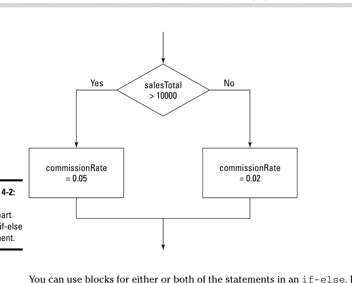

你可以为 `if-else` 中的一个或两个语句使用代码块。例如，下面是一个两个语句都是代码块的 `if-else` 语句：

```
double commissionRate;
if (salesTotal <= 10000.0)
{
    commissionRate = 0.02;
    level1Count++;
}
else
{
    commissionRate = 0.05;
    level2Count++;
}
```

## 嵌套 if 语句

`if-else` 语句中位于 `if` 或 `else` 部分的语句可以是任何类型的 Java 语句，包括另一个 `if` 或 `if-else` 语句。这被称为*嵌套*，而包含另一个 `if` 或 `if-else` 语句的 `if` 或 `if-else` 语句被称为*嵌套 if 语句*。

嵌套 `if` 语句的一般形式如下：

```
if (expression-1)
    if (expression-2)
        statement-1
```

```
    else
        statement-2
    else
        if (expression-3)
            statement-3
        else
            statement-4
```

在这个例子中，首先对 *expression-1* 进行求值。如果其值为 *true*，则对 *expression-2* 进行求值。如果 *expression-2* 的值为 *true*，则执行 *statement-1*；否则，执行 *statement-2*。但是，如果 *expression-1* 的值为 *false*，那么会对 *expression-3* 进行求值。如果 *expression-3* 的值为 *true*，则执行 *statement-3*；否则，执行 *statement-4*。

包含在另一个 `if` 语句中的 `if` 语句称为*内部 `if` 语句*，而包含另一个 `if` 语句的 `if` 语句称为*外部 `if` 语句*。因此，在前面的例子中，测试 *expression-1* 的 `if` 语句是一个外部 `if` 语句，而测试 *expression-2* 和 *expression-3* 的 `if` 语句是内部 `if` 语句。

**提示** 嵌套的复杂程度可以随心所欲，但请尽量保持其简单。并且务必使用缩进来指示嵌套语句的结构。

举个例子，假设你的公司有两类销售代表（1 类和 2 类），他们在销售额低于 10,000 美元和高于 10,000 美元时，根据下表获得不同的销售佣金：

| 销售额 | 1 类 | 2 类 |
| --- | --- | --- |
| $0 至 $9,999 | 2% | 2.5% |
| $10,000 及以上 | 4% | 5% |

你可以使用嵌套的 `if` 语句来实现这个佣金结构：

```
if (salesClass == 1)
    if (salesTotal < 10000.0)
        commissionRate = 0.02;
    else
        commissionRate = 0.04;
else
    if (salesTotal < 10000.0)
        commissionRate = 0.025;
    else
        commissionRate = 0.05;
```

这个例子假设 `salesClass` 变量如果不是 1，就必须是 2。如果情况并非如此，你就必须为 2 类销售代表使用一个额外的 `if` 语句：

```
if (salesClass == 1)
    if (salesTotal < 10000.0)
        commissionRate = 0.02;
    else
        commissionRate = 0.04;
else if (salesClass == 2)
    if (salesTotal < 10000.0)
        commissionRate = 0.025;
    else
        commissionRate = 0.05;
```

注意我将这个额外的 `if` 语句与 `else` 关键字放在了同一行。对于一种特殊形式的嵌套 if 语句（称为 else-if 语句），这是一种常见的做法。你将在下一节中找到更多关于此类嵌套的信息。

你也可以只使用两个独立的 `if` 语句：

```
if (salesClass == 1)
    if (salesTotal < 10000.0)
        commissionRate = 0.02;
    else
        commissionRate = 0.04;

if (salesClass == 2)
    if (salesTotal < 10000.0)
        commissionRate = 0.025;
    else
        commissionRate = 0.05;
```

结果是一样的。然而，这种技术仅在 `if` 语句本身不会更改被测试变量的情况下有效。如果第一个 `if` 语句更改了 `salesClass` 变量的值，这种语句就不起作用了。

请注意，你也可以通过在外层 `if` 语句中测试销售级别，而在内层语句中测试销售代表的类别来实现销售佣金结构：

```
if (salesTotal < 10000)
    if (salesClass == 1)
        commissionRate = 0.02;
    else
        commissionRate = 0.04;
else
    if (salesClass == 1)
        commissionRate = 0.025;
    else
        commissionRate = 0.05;
```

## 使用 If 语句的技巧

> **警告！** 使用嵌套 if 语句的技巧在于了解 Java 如何将 else 关键字与 if 语句配对。规则实际上非常简单：每个 if 关键字都与它之前最近的、尚未与 else 关键字配对的 if 语句配对。你无法通过使用缩进来诱使 Java 以不同的方式配对 if 和 else 关键字。例如，假设 2 类销售代表不获得任何佣金，因此前例中的内部 if 语句不需要 else 语句。你可能想用这段代码来计算佣金率：

```
if (salesTotal < 10000)
    if (salesClass == 1)
        commissionRate = 0.02;
else
    if (salesClass == 1)
        commissionRate = 0.025;
```

然而，它不会按预期工作。缩进给人的印象是 `else` 关键字与第一个 `if` 语句配对，但实际上它与第二个 `if` 语句配对。结果是，对于 10,000 美元或以上的销售额，没有设置销售佣金率。

这个问题有两个解决方案。一个是使用大括号来明确结构：

```
if (salesTotal < 10000)
{
    if (salesClass == 1)
        commissionRate = 0.02;
}
else
{
    if (salesClass == 1)
        commissionRate = 0.025;
}
```

另一个是向第一个内部 `if` 语句添加一个 `else` 语句，该语句指定一个*空语句*（一个单独的分号）：

```
if (salesTotal < 10000)
    if (salesClass == 1)
        commissionRate = 0.02;
    else ;
else
    if (salesClass == 1)
        commissionRate = 0.025;
```

这个空的 `else` 语句与内部的 `if` 语句配对，因此第二个 `else` 关键字就正确地与外部的 `if` 语句配对了。


## else-if 语句

嵌套 `if` 语句的一个常见模式是，在 `else` 部分中包含另一个 `if-else` 语句，形成一系列 `if-else` 语句：

```
if (*expression-1*)
    *statement-1*
else if (*expression-2*)
    *statement-2*
else if (*expression-3*)
    *statement-3*
```

这有时被称为 `else-if` 语句，但这并非官方术语。实际上，这不过是 `else` 部分中的语句恰好是另一个 `if` 语句，因此这种语句只是嵌套 `if` 语句的一种类型。然而，它是一种特别有用的嵌套形式。

例如，假设你想根据销售总额，按照下表分配四种不同的佣金率：

| 销售额 | 佣金率 |
|---|---|
| 超过 $10,000 | 5% |
| $5,000 至 $9,999 | 3.5% |
| $1,000 至 $4,999 | 2% |
| 低于 $1,000 | 0% |

你可以轻松地用一系列 `else-if` 语句来实现：

```
if (salesTotal >= 10000.0)
    commissionRate = 0.05;
else if (salesTotal >= 5000.0)
    commissionRate = 0.035;
else if (salesTotal >= 1000.0)
    commissionRate = 0.02;
else
    commissionRate = 0.0;
```

图 4-3 显示了这一系列 `else-if` 语句的流程图。

你必须仔细思考如何设置这些 `else-if` 语句。例如，乍一看，下面这个序列似乎也能工作：

```
if (salesTotal > 0.0)
    commissionRate = 0.0;
else if (salesTotal >= 1000.0)
    commissionRate = 0.02;
else if (salesTotal >= 5000.0)
    commissionRate = 0.035;
else if (salesTotal >= 10000.0)
    commissionRate = 0.05;
```

然而，这个场景行不通。这些 `if` 语句总是将佣金率设置为 0%，因为第一个 `if` 语句中的布尔表达式总是测试为*真*（假设 `salesTotal` 不是零或负数——如果是，其他 `if` 语句也不起作用）。因此，其他 `if` 语句都不会被评估。

## 史波克先生最爱的运算符（当然是逻辑运算符）

*逻辑运算符*（有时称为*布尔运算符*）是一种运算符，它根据一个或两个其他表达式的布尔结果返回布尔结果。使用逻辑运算符的表达式有时称为*复合表达式*，因为逻辑运算符的效果是让你能够将两个或多个条件测试组合成一个表达式。表 4-2 列出了逻辑运算符。

**表 4-2 逻辑运算符**

| 运算符 | 名称 | 类型 | 描述 |
|---|---|---|---|
| ! | 非 (Not) | 一元 | 如果右侧操作数的求值结果为 `false`，则返回 `true`。如果右侧操作数为 `true`，则返回 `false`。 |
| & | 与 (And) | 二元 | 如果两个操作数的求值结果都为 `true`，则返回 `true`。在应用与运算符之前，两个操作数都会被求值。 |
| \| | 或 (Or) | 二元 | 如果至少一个操作数的求值结果为 `true`，则返回 `true`。在应用或运算符之前，两个操作数都会被求值。 |
| ^ | 异或 (Xor) | 二元 | 如果且仅有一个操作数的求值结果为 `true`，则返回 `true`。如果两个操作数都为 `true` 或都为 `false`，则返回 `false`。 |
| && | 条件与 (Conditional And) | 二元 | 与 & 相同，但如果左侧操作数返回 `false`，则直接返回 `false`，而不对右侧操作数求值。 |
| \|\| | 条件或 (Conditional Or) | 二元 | 与 \| 相同，但如果左侧操作数返回 `true`，则直接返回 `true`，而不对右侧操作数求值。 |

以下各节将详细描述这些运算符。

### 使用 ! 运算符

最简单的逻辑运算是 `非` (!)。从技术上讲，它是一个一元前缀运算符，这意味着它与一个操作数一起使用，并且编码在该操作数的正前方。（此外，该运算符在技术上称为*补码运算符*，而不是*非运算符*。但在现实生活中，每个人都称之为 `非`。）

非运算符会反转布尔表达式的值。因此，如果表达式为 `true`，非运算符会将其更改为 `false`。如果表达式为 `false`，非运算符会将其更改为 `true`。

例如：

```
!(i = 4)
```

如果 `i` 是除 4 之外的任何值，此表达式求值结果为 `true`。如果 `i` 是 4，则求值结果为 `false`。它的工作原理是首先对表达式 `(i = 4)` 求值。然后，它反转该求值结果。

不要混淆非逻辑运算符 (`!`) 和不等于关系运算符 (`!=`)。虽然它们有时用法相似，但非运算符更通用。例如，我可以将前面的示例写成这样：

```
i != 4
```

结果是相同的。但是，非运算符可以应用于任何返回 `true-false` 结果的表达式，而不仅仅是相等性测试。

***注意：*** 你几乎总是必须将 `!` 运算符应用于的表达式用括号括起来。例如，考虑这个表达式：

```
! i == 4
```

假设 `i` 是一个整型变量，编译器不允许这个表达式，因为它看起来像是你试图将 `!` 运算符应用于变量，而不是比较的结果。用括号括起来可以快速解决这个问题：

```
!(i == 4)
```

### 使用 & 和 && 运算符

`&` 和 `&&` 运算符组合两个布尔表达式，仅当两个表达式都为 `true` 时才返回 `true`。这被称为*与运算*，因为第一个表达式和第二个表达式必须都为 `true`，与运算符才返回 `true`。

例如，假设当销售类别为 `1` 且销售总额为 `$10,000` 或更多时，销售佣金率应为 2.5%。你可以用两个独立的 `if` 语句来执行此测试（就像我在本章前面所做的那样），或者你可以将测试合并到一个 `if` 语句中：

```
if ( (salesClass == 1) & (salesTotal >= 10000.0) )
    commissionRate = 0.025;
```

这里，表达式 `(salesClass == 1)` 和 `(salesTotal >= 10000.0)` 是分别求值的。然后，`&` 运算符比较结果。如果两者都为 `true`，`&` 运算符返回 `true`。如果其中一个或两个都为 `false`，`&` 运算符返回 `false`。

注意，我大量使用了括号来澄清一个表达式在哪里结束，另一个从哪里开始。使用括号并非总是必要，但当你使用逻辑运算符时，我建议你始终使用括号来清晰地标识正在比较的表达式。

`&&` 运算符与 `&` 运算符类似，但利用了我们关于逻辑的知识。因为由 `&` 运算符比较的两个表达式必须都为 `true`，整个表达式才为 `true`，所以如果第一个表达式返回 `false`，就没有理由对第二个表达式求值。`&` 不知道这一点，所以它在确定结果之前会盲目地对两个表达式求值。`&&` 运算符足够聪明，一旦知道结果就会停止。

因此，几乎总是应该使用 `&&` 而不是 `&`。这是前面的示例，这次使用 `&&` 进行智能编码：

```
if ( (salesClass == 1) && (salesTotal >= 10000.0) )
    commissionRate = 0.025;
```

为什么我说你*几乎*总是应该使用 `&&`？因为有时表达式本身具有重要的副作用。例如，第二个表达式可能涉及一个更新数据库的方法调用，并且无论第一个表达式求值结果为 `true` 还是 `false`，你都希望数据库被更新。在这种情况下，你需要使用 `&` 而不是 `&&` 来确保两个表达式都被求值。

依赖表达式的副作用可能有风险，而且你几乎总能找到更好的方法来编写代码以避免副作用。换句话说，将重要的数据库更新方法调用放在嵌套在 `if` 语句中的复合表达式内，可能不是一个好主意。

### 使用 | 和 || 运算符

`|` 和 `||` 运算符被称为*或*运算符，因为如果第一个表达式为 `true` 或者第二个表达式为 `true`，它们就返回 `true`。如果两个表达式都为 `true`，它们也返回 `true`。（你可以在键盘上找到 `|` 符号，就在 Enter 键正上方。）

假设销售代表在总销售额低于 $1,000 或销售类别为 3 时没有佣金。你可以用两个独立的 `if` 语句来实现：

```
if (salesTotal < 1000.0)
    commissionRate = 0.0;
if (salesClass == 3)
    commissionRate = 0.0;
```


## 156 斯波克先生最爱的运算符（当然是逻辑运算符）

但使用或运算符，你可以通过组合条件来完成同样的事情：

```
if ((salesTotal < 1000.0) | (salesClass == 3))
    commissionRate = 0.0;
```

要评估这个 `if` 语句的表达式，Java 会先评估 `|` 运算符两侧的表达式。然后，如果其中至少有一个为 `true`，则整个表达式为 `true`。否则，表达式为 `false`。

> 提示：在大多数情况下，你应该使用条件或运算符（`||`）而不是常规或运算符（`|`），像这样：

```
if ((salesTotal < 1000.0) || (salesClass == 3))
    commissionRate = 0.0;
```

与条件与运算符（`&&`）类似，条件或运算符一旦知道结果就会停止评估。例如，假设销售总额为 500 美元。那么，就没有必要评估第二个表达式。因为第一个表达式评估为 `true`，并且只需要一个表达式为 `true`，Java 就可以完全跳过第二个表达式。当然，如果销售总额是 5000 美元，仍然必须评估第二个表达式。

与与运算符一样，只有当你的程序依赖于第二个表达式的某些副作用（例如方法调用完成的工作）时，才应该使用常规或运算符。

### 使用 `^` 运算符

`^` 运算符执行逻辑世界中称为*异或*的操作，通常缩写为 *xor*。当且仅当两个子表达式中的一个为 `true` 时，它返回 `true`。如果两个表达式都为 `true` 或两个表达式都为 `false`，则 `^` 运算符返回 `false`。

> 技术要点：大多数程序员不使用 `^` 运算符，因为它相当令人困惑。如果你跳过这一节，我也不会介意。

换句话说，如果两个子表达式的结果不同，`^` 运算符返回 `true`。如果它们的结果相同，则返回 `false`。

举个例子，假设你正在编写控制你的模型铁路套件的软件，你想找出两个开关是否处于可能引起碰撞的危险位置。如果开关由名为 `switch1` 和 `switch2` 的简单整数变量表示，1 表示轨道向左切换，2 表示轨道向右切换，你可以像这样轻松地测试它们：

```
if ( switch1 == switch2 )
    System.out.println("Trouble! The switches are the same");
else
    System.out.println("OK, the switches are different.");
```

但如果由于某种原因，其中一个开关由一个 int 变量表示，其中 1 表示开关向左，任何其他值表示开关向右，而另一个是一个 int 变量，其中 -1 表示开关向左，任何其他值表示开关向右。（谁知道呢，也许开关是由不同的制造商制造的。）你可以像这样使用一个复合条件：

```
if ( ((switch1==1)&&(switch2==-1)) ||
     ((switch1!=1)&&(switch2!=-1)))
    System.out.println("Trouble! The switches are the same");
else
    System.out.println("OK, the switches are different.");
```

但异或运算符可以用更简单的表达式来完成这项工作：

```
if ( (switch1==1)^(switch2==-1))
    System.out.println("OK, the switches are different.");
else
    System.out.println("Trouble! The switches are the same");
```

坦率地说，`^` 运算符可能是你应该避免使用的一个。事实上，我书架上的大多数 Java 书籍（相信我，我有很多）甚至没有提到这个运算符，除了它在其他更有用的应用中作为位运算符（有关位运算符的信息，请参阅本书网站上的附赠第 2 章）。这可能是因为许多应用程序不将其用作逻辑运算符，而它适用的应用程序也可以用更传统的与和或运算符来解决。

### 组合逻辑运算符

你可以组合简单的布尔表达式来创建更复杂的表达式。例如：

```
if ((salesTotal<1000.0)||((salesTotal<5000.0)&&
    (salesClass==1))||((salesTotal < 10000.0)&&
    (salesClass == 2)))
    commissionRate = 0.0;
```

你能说出这个 `if` 语句中的表达式是做什么的吗？如果以下三个条件中的任何一个为真，它就将佣金设置为零：

- 销售总额小于 1000 美元。
- 销售总额小于 5000 美元，并且销售类别为 1。
- 销售总额小于 10000 美元，并且销售类别为 2。

## 158 斯波克先生最爱的运算符（当然是逻辑运算符）

在许多情况下，你只需通过不同的缩进和间距来澄清表达式的工作方式。例如，下面这个版本的 `if` 语句更容易理解一些：

```
if (
        (salesTotal < 1000.0)
    || ((salesTotal < 5000.0) && (salesClass == 1))
    || ((salesTotal < 10000.0) && (salesClass == 2))
   )
    commissionRate = 0.0;
```

然而，准确弄清楚这个 `if` 语句的作用仍然很困难。在许多情况下，更好的做法是跳过复杂的表达式，编写单独的 `if` 语句：

```
if (salesTotal < 1000.0)
    commissionRate = 0.0;
if ((salesTotal < 5000.0) && (salesClass == 1))
    commissionRate = 0.0;
if ((salesTotal < 10000.0) && (salesClass == 2))
    commissionRate = 0.0;
```

当你使用多个逻辑运算符时，布尔表达式可能会变得有点复杂，特别是当你混合使用与和或运算符时。例如，考虑这个表达式：

```
if ( a==1 && b==2 || c==3 )
    System.out.println("It's true!");
else
    System.out.println("No it isn't!");
```

你认为如果 a 是 5，b 是 7，c 是 3，这个 `if` 语句会做什么？答案是表达式评估为 `true`，并且打印 `"It's true!"`。这是因为 Java 从左到右应用运算符。所以 `&&` 运算符应用于 `a==1`（这是 `false`）和 `b==2`（这也是 `false`）。因此，`&&` 运算符返回 `false`。然后 `||` 运算符应用于这个 false 结果和 `c==3` 的结果（这是 `true`）。因此，整个表达式返回 `true`。

如果你使用一组括号来澄清表达式的作用，这个表达式不是更清晰吗？例如：

```
if ( (a==1 && b==2) || c==3 )
    System.out.println("It's true!");
else
    System.out.println("No it isn't!");
```

现在你可以清楚地看到 `&&` 运算符是首先被评估的。

### 使用条件运算符

Java 有一个特殊的运算符叫做*条件运算符*，它旨在某些情况下完全消除对 `if` 语句的需求。它是一个*三元运算符*，这意味着它使用三个操作数。使用条件运算符的一般形式是：

`boolean-expression ? expression-1 : expression-2`

首先评估布尔表达式。如果评估结果为 `true`，则评估 `expression-1`，并且该表达式的结果成为整个表达式的结果。如果表达式为 `false`，则评估 `expression-2`，并使用其结果作为替代。

例如，假设你想要在总销售额小于 10,000 美元时将整数变量 `salesTier` 的值设置为 0，如果销售额为 10,000 美元或更多时设置为 1。你可以用这个语句来完成：

`int tier = salesTotal > 10000.0 ? 1 : 0;`

虽然不是必需的，但一组括号有助于使这个语句更容易理解：

`int tier = (salesTotal > 10000.0) ? 1 : 0;`

条件运算符的一个常见用法是在你使用连接构建文本字符串，并且根据整数变量的值，某个单词可能需要复数形式时。例如，假设你想要创建一个字符串，内容是 "You have x apples"，其中 x 是名为 `appleCount` 的变量的值。但如果苹果数量是 1，字符串应该是 "You have 1 apple"，而不是 "You have 1 apples"。

以下语句可以实现这个技巧：

`String msg = "You have " + appleCount + " apple" + ((appleCount>1) ? "s." : ".");`

当 Java 遇到 `?` 运算符时，它会评估表达式 `(appleCount>1)`。如果为 `true`，它使用第一个字符串（"s."）。如果为 `false`，它使用第二个字符串（"."）。

### 比较字符串

在 Java 中比较字符串需要格外小心，因为 `==` 运算符实际上并不能像它应该的那样工作。例如，假设你想知道名为 `answer` 的字符串变量是否包含值 "Yes"。你可能很想编写一个 `if` 语句，像这样：

## 字符串比较

```java
if (answer == "Yes")
    System.out.println("The answer is Yes.");
```

不幸的是，这样做并不正确。问题在于，在 Java 中，字符串是**引用类型**，而非**基本类型**，当你对引用类型使用 `==` 运算符时，Java 比较的是对象的引用，而不是对象本身。因此，表达式 `answer == "Yes"` 并不是在测试 `answer` 变量所引用的字符串的值是否为 `"Yes"`。相反，它测试的是 `answer` 字符串与字面量字符串 `"Yes"` 是否指向内存中的同一个字符串对象。在很多情况下，它们确实如此。但有时并非如此，而且结果难以预测。

测试字符串是否具有给定值的正确方法是使用 `String` 类的 `equals` 方法：

```java
if (answer.equals("Yes"))
    System.out.println("The answer is Yes.");
```

这个方法实际上是将变量所引用的字符串对象的值与你作为参数传入的字符串进行比较，并返回一个布尔结果，以表明两个字符串是否具有相同的值。

`String` 类还有另一个方法 `equalsIgnoreCase`，它在比较字符串时也很有用。它在比较字符串时忽略大小写，这在测试用户输入的字符串值时特别有用。例如，假设你正在编写一个程序，只有当用户输入单词 `End` 时才会结束。你可以使用 `equals` 方法来测试字符串：

```java
if (input.equals("end"))
    // end the program
```

但这样一来，用户必须完全输入 `end`。如果用户输入 `End` 或 `END`，程序将不会结束。更好的写法是将 `if` 语句写成这样：

```java
if (input.equalsIgnoreCase("end"))
    // end the program
```

这样，用户就可以通过输入 `end`、`End`、`END`，甚至 `eNd` 来结束程序。

你可以在第四卷第一章中找到更多关于字符串操作的内容。目前，只需记住：要在 `if` 语句（或在下一章介绍的其他控制语句）中测试字符串相等性，必须使用 `equals` 或 `equalsIgnoreCase` 方法，而不是 `==` 运算符。

## 第五章：循环往复（或者说，使用循环）

### 本章内容

- `while` 循环的震撼
- 无限循环的狂喜
- `do` 循环的壮丽
- 验证输入的乐趣
- `for` 循环的奇妙
- 嵌套循环的狂喜

到目前为止，本书中的所有程序都是启动后，快速执行完它们的 `main` 方法，然后结束。如果《*绿野仙踪*》里的桃乐丝使用这些程序，她可能会说："我的程序来去匆匆啊！"

在本章中，你将学习如何编写不会这么快来去匆匆的程序。它们通过使用*循环*来保持运行，循环让它们可以多次执行相同的语句。

循环是编写最常见类型程序的关键：这些程序从用户那里获取输入，对其做些处理，然后再从用户那里获取更多输入并做处理，如此反复，直到用户受够了为止。

或者换个说法，循环就像你洗发水上的说明：涂抹。冲洗。*重复。*

与 `if` 语句一样，循环也依赖条件表达式来告诉自己何时停止循环。没有条件表达式，循环就会永远运行下去，你的用户会在等待中老去。所以，如果你还没有阅读第二卷第四章，我建议你在继续深入之前先读一下。

### 你的基本 while 循环

Java 中最基本的循环语句是 `while`。`while` 语句创建了一种称为 *while 循环* 的循环，它本质上是一个只要某个条件表达式求值为 `true` 就会持续执行的循环。`while` 循环在各种编程场景中都很有用，所以你会经常使用 `while` 循环。（本章后面会介绍其他类型的循环。）

#### while 语句

`while` 语句的基本格式如下：

```java
while (expression)
    statement
```

`while` 语句首先对表达式求值。如果表达式为 `true`，则执行 `statement`。然后，再次对表达式求值，整个过程重复。如果表达式为 `false`，则 `statement` 不会执行，`while` 循环结束。

注意，`while` 循环的 statement 部分可以是单条语句，也可以是用一对大括号括起来的语句块。只有一条语句的循环不太有用，所以你编写的几乎所有 `while` 循环都会使用语句块。（好吧，有时候单条语句的循环也有用。并非闻所未闻。只是不太常见。）

#### 计数循环

下面是一个简单的程序，它使用 `while` 循环在控制台打印从 2 到 20 的偶数：

```java
public class EvenCounter
{
    public static void main(String[] args)
    {
        int number = 2;
        while (number <= 20)
        {
            System.out.print(number + " ");
            number += 2;
        }
        System.out.println();
    }
}
```

如果你运行这个程序，控制台窗口会显示以下输出：

```
2 4 6 8 10 12 14 16 18 20
```

该程序 `while` 语句中的条件表达式是 `number <= 20`。这意味着只要 `number` 的值小于或等于 20，循环就会重复。循环体由两条语句组成。第一条打印 `number` 的值，后面跟一个空格以分隔这个数字和下一个数字。然后，第二条语句将 `number` 加上 2。

图 5-1 展示了该程序的流程图。这个流程图可以帮助你可视化循环的基本决策过程。

### 跳出循环

在很多程序中，你需要设置一个带有某种"逃生条款"的循环。Java 的逃生条款是 `break` 语句。当 `break` 语句在 `while` 循环中执行时，循环立即结束。循环中任何剩余的语句都会被忽略，接下来执行的是循环后面的语句。

### 永远循环下去

例如，假设你害怕数字 12。（我不是医生，也不扮演医生，但我认为这种情况的科学名称应该是 *duodecaphobia*，即"十二恐惧症"。）你可以修改上一节展示的计数程序，使得当它数到 12 时，惊慌失措并中止循环：

```java
public class Duodecaphobia
{
    public static void main(String[] args)
    {
        int number = 2;
        while (number <= 20)
        {
            if (number == 12)
                break;
            System.out.print(number + " ");
            number += 2;
        }
        System.out.println();
    }
}
```

当你运行这个程序时，控制台会显示以下一行：

```
2 4 6 8 10
```

呼！好险。差点就数到 12 了。

#### 无限循环

一种常见的循环形式称为*无限循环*。那是一种永远运行下去的循环。在 Java 中，你可以用很多方式创建无限循环（并非所有都是故意的），但最简单的方法是将 `while` 的表达式直接指定为 `true`。

下面是一个例子：

```java
public class CountForever
{
    public static void main(String[] args)
    {
        int number = 2;
        while (true)
        {
            System.out.print(number + " ");
            number += 2;
        }
    }
}
```

如果你运行这个程序，你的控制台窗口会迅速填满数字，并且持续不断地继续。如果你喜欢偶数，这很棒，但最终你会厌倦并想要停止它。你可以用三种方式停止无限循环：

- 关掉你的电脑。
- 用斧头或其他重物砸你的电脑。
- 关闭控制台窗口。

最后一种可能是你最想选择的。

显然，无限循环是你想在程序中避免的东西。所以每当你使用总是为 `true` 的 `while` 表达式时，务必加入一个 `break` 语句，给你的循环提供某种终止的方式。例如，你可以在十二恐惧症程序中使用带有 `break` 语句的无限循环：

```java
public class Duodecaphobia
{
    public static void main(String[] args)
    {
        int number = 2;
        while (true)
        {
            if (number == 12)
                break;
            System.out.print(number + " ");
            number += 2;
        }
        System.out.println();
    }
}
```

在这里，循环看起来可能会永远运行下去，但 `break` 语句在数到 12 时惊慌失措地跳出了循环。

#### 让用户决定何时退出

事实证明，当你想让用户掌控何时停止循环时，无限循环也很有用。例如，假设你不知道用户害怕什么数字，所以你想一直数下去，直到用户说停。下面是一个实现该功能的程序：

```java
import java.util.Scanner;

public class NumberPhobia
{
    static Scanner sc = new Scanner(System.in);

    public static void main(String[] args)
```


[第 193 页]

```
{
    int number = 2;
    String input;

    while (true)
    {
        System.out.println(number + " ");
        System.out.print("Do you want keep counting?"
            + " (Y or N)");
        input = sc.next();
        if (input.equalsIgnoreCase("N"))
            break;
        number += 2;
    }
    System.out.println("\nWhew! That was close.\n");
    }
}
```

这是该程序的一些典型控制台输出，针对一位有“数字八恐惧症”的用户：

```
2
Do you want keep counting? (Y or N)y
4
Do you want keep counting? (Y or N)y
6
Do you want keep counting? (Y or N)n

Whew! That was close.
```

## 另一种让用户决定的方式

另一种编写用户可以选择退出的循环的方法是在 `while` 条件中测试输入字符串。这里的唯一技巧是，你必须先将输入字符串初始化为使循环继续的值。否则，循环根本不会执行！以下是 NumberPhobia 程序的一个变体，使用了这种技术：

```
import java.util.Scanner;

public class NumberPhobia2
{
    static Scanner sc = new Scanner(System.in);

    public static void main(String[] args)
    {
        int number = 2;
        String input = "Y";
```

```
while (input.equalsIgnoreCase("Y"))
{
    System.out.println(number + " ");
    System.out.print("Do you want keep counting?"
        + " (Y or N)");
    input = sc.next();
    number += 2;
}
System.out.println("\nWhew! That was close.");
    }
}
```

这个程序的工作原理与前一个版本几乎相同，但有一个细微的区别。在第一个版本中，如果在程序显示 6 之后用户输入 `N`，那么循环结束后 `number` 变量的值是 6。这是因为 `break` 语句在将 2 加到 `number` 之前就退出了循环。但在这个版本中，`number` 的值是 8。

## 使用 **continue** 语句

`break` 语句相当强硬：它会完全跳出循环。有时这正是你需要的，但很多时候，你并不真的需要完全退出循环；你只需要跳过循环的某一次特定迭代。例如，本章前面介绍的 Duodecaphobia 程序在达到 12 时停止了循环。如果你只是想跳过数字 12，从而直接从 10 跳到 14 呢？

为此，你可以使用 `break` 语句更温和、更友善的兄弟——`continue` 语句。`continue` 语句将控制权立即送回循环顶部，并在那里重新计算循环条件。如果条件仍为 `true`，循环体语句或语句块将再次执行。

这是 Duodecaphobia 程序的一个版本，它使用 `continue` 语句来跳过数字 12，而不是在到达 12 时完全停止计数：

```
public class Duodecaphobia2
{
    public static void main(String[] args)
    {
        int number = 0;
        while (number < 20)
        {
            number += 2;
            if (number == 12)
                continue;
            System.out.print(number + " ");
```

```
}
    System.out.println();
    }
}
```

运行此程序，你会在控制台窗口中得到以下输出：

```
2 4 6 8 10 14 16 18 20
```

注意，为了使程序能使用 `continue` 语句而不是 `break` 语句，我对程序做了几处修改。如果我只是简单地用 `continue` 替换 `break` 这个词，程序将无法工作。这是因为在原始版本中，将 2 加到 `number` 的语句出现在 `break` 语句之后。因此，如果你只是将 `break` 语句替换为 `continue` 语句，一旦到达 12，你最终会得到一个无限循环，因为将 2 加到 `number` 的语句永远不会被执行。

为了使这个程序能使用 `continue` 语句工作，我重新排列了循环体中的语句，使得将 2 加到 `number` 的语句出现在 `continue` 语句之前。这样，`continue` 语句跳过的唯一语句就是将 `number` 打印到控制台的语句。

不幸的是，这一更改也影响了程序中的其他语句。因为 `number` 在打印之前就增加了 2，所以我不得不将 `number` 的初始值从 2 改为 0，并且不得不将 `while` 表达式从 `number <= 20` 改为 `number < 20`。

## do-while 循环

*do-while 循环*（有时简称 *do 循环*）类似于 *while* 循环，但有一个关键区别：在 `do-while` 循环中，直到循环体中的语句执行完毕后，才会测试停止循环的条件。`do-while` 循环的基本形式如下：

```
do
    *statement*
while (*expression*);
```

请注意，`while` 关键字和表达式是在循环体*之后*才编码的。与 `while` 循环一样，`do-while` 循环的循环体可以是单条语句，也可以是用花括号括起来的一组语句。

另外，请注意表达式后面有一个分号。`do-while` 是唯一以分号结尾的循环语句。

这是 EvenCounter 程序的一个版本，它使用 `do-while` 循环代替了 `while` 循环：

```
public class EvenCounter2
{
    public static void main(String[] args)
    {
        int number = 2;
        do
        {
            System.out.print(number + " ");
            number += 2;
        } while (number <= 20);

        System.out.println();
    }
}
```

关于 `do-while` 循环，最重要的一点是：`do-while` 循环体中的语句*总是*至少执行一次。相比之下，如果 `while` 表达式在第一次求值时为 `false`，则 `while` 循环体中的语句根本不会执行。

查看图 5-2 中的流程图，你就会明白我的意思。你可以看到，执行从循环顶部开始，在循环体执行一次后流经决策测试。然后，如果决策测试为 `true`，控制权就飞回循环顶部。否则，它就从流程图底部退出。

关于 `do-while` 循环，还有几点需要注意：

-   你通常可以跳过在循环前初始化表达式中出现的变量，因为表达式至少在循环体中的语句执行一次后才会被求值。
-   你可以在 `do-while` 循环中使用 `break` 和 `continue` 语句，就像在 `while` 循环中一样。
-   一些程序员喜欢将开始循环体的花括号放在与 `do` 语句同一行，并将结束 `do-while` 循环的 `while` 语句放在标记循环体结束的花括号同一行。只要你开心就好。只需记住，编译器在缩进和间距问题上是不分青红皂白的。

## 验证用户输入

`do-while` 循环对于验证用户输入特别有用。例如，假设你正在编写一个进行投注游戏的程序，并且你想从控制台获取用户的投注金额。用户可以投注任何他想要的金额（仅限整数美元），但不能投注超过他在银行的金额，也不能投注负数或零。这是一个使用 `do-while` 循环从用户获取此输入的程序：

```
import java.util.Scanner;

public class GetABet
{
    static Scanner sc = new Scanner(System.in);

    public static void main(String[] args)
    {
        int bank = 1000;   // 假设用户有 $1,000
        int bet;           // 用户输入的投注额

        System.out.println("You can bet between 1 and " + bank);
        do
        {
            System.out.print("Enter your bet: ");
            bet = sc.nextInt();
        } while ( (bet <= 0) || (bet > bank) );
        System.out.println("Your money's good here.");
    }
}
```

在这里，do-while 循环使用的表达式验证了用户输入的数据，这意味着它根据一些标准检查数据以确保数据是可接受的。

> 请注意：|| 运算符执行的是“或”测试。如果运算符两侧的任一表达式为 true，则它返回 true。因此，如果投注额小于或等于零（bet <= 0），或者投注额大于银行中的钱（bet > bank），此表达式返回 true。

> 警告！这种类型的验证测试仅检查用户是否输入了有效的数字，并且该数字是否在可接受的范围内。如果用户输入的不是有效数字，例如单词 Buttercup 或 Humperdink，程序会严重出错，并在控制台上喷出一堆令人讨厌的异常消息。你将在第二册第 8 章中了解如何清理这个烂摊子。

（实际上，你可以通过使用第二册第 2 章中我描述的 do 循环或 while 循环以及 Scanner 类的 hasNextDouble 方法来避免此问题。）

如果你想在用户输入错误输入时显示错误消息，你必须在循环内使用 if 语句，并且这个 if 语句必须重复验证输入数据的表达式。因此，执行验证的表达式必须出现两次。例如：


## 172 验证用户输入

```java
import java.util.Scanner;

public class GetABet2
{

  static Scanner sc = new Scanner(System.in);

  public static void main(String[] args)
  {
    int bank = 1000;   // assume the user has $1,000
    int bet;           // the bet entered by the user

    System.out.println("You can bet between 1 and " +
      bank);
    do
    {
      System.out.print("Enter your bet: ");
      bet = sc.nextInt();
      if ( (bet <= 0) || (bet > bank) )
        System.out.println("What, are you crazy?");
    } while ( (bet <= 0) || (bet > bank) );
    System.out.println("Your money's good here.");
  }
}
```

这里的 `if` 语句在用户试图输入不合理的赌注时，会显示消息 `What, are you crazy?`。

有两种方法可以避免重复编写执行数据验证的表达式。一种是添加一个布尔变量，当数据无效时在 `do-while` 循环体中设置该变量，如下面的示例所示：

```java
import java.util.Scanner;

public class GetABet3
{

  static Scanner sc = new Scanner(System.in);

  public static void main(String[] args)
  {
    int bank = 1000;    // assume the user has $1,000
    int bet;            // the bet entered by the user
    boolean validBet;  // indicates if bet is valid

    System.out.println("You can bet between 1 and " +
      bank);
    do
    {
      System.out.print("Enter your bet: ");
      bet = sc.nextInt();
      validBet = true;
      if ( (bet <= 0) || (bet > bank) )
      {
          validBet = false;
          System.out.println("What, are you crazy?");
      }
    } while (!validBet);
    System.out.println("Your money's good here.");
  }
}
```

在这个示例中，我使用了一个名为 `validBet` 的布尔变量来指示用户是否输入了有效的赌注。在用户输入赌注之后，该变量在 `if` 语句测试验证条件之前被设置为 `true`。然后，如果 `if` 语句发现赌注无效，`validBet` 就会被设置为 `false`。

## 著名的 for 循环

除了 `while` 和 `do-while` 循环之外，Java 还提供了另一种循环：`for` 循环。你可能已经注意到，本小节中到目前为止展示的许多循环都涉及计数。事实上，计数循环在计算机程序中非常常见，因此设计计算机编程语言的人（他们被称为"计算机编程语言设计师"）很早就构思了一种专门用于计数的特殊循环机制。

`for` 循环背后的基本原理是，循环本身维护一个*计数器变量*——也就是说，一个每次执行循环体时值都会增加的变量。例如，如果你想让一个循环从 1 数到 10，你会使用一个初始值为 1 的计数器变量，每次循环增加 1。然后，你会使用一个测试来在计数器变量达到 10 时结束循环。`for` 循环让你可以用一条方便的语句来完成所有这些设置。

主修计算机科学的人将计数器变量称为*迭代器*。他们这样做是因为觉得我们不知道这个词是什么意思。但我们非常清楚，迭代器就是你放啤酒保持冰凉的地方。

## for 循环的正式格式

我现在想告诉你 `for` 循环的正式格式，以便你从现在起知道如何构建它。`for` 循环遵循以下基本格式：

```java
for (initialization-expression; test-expression; count-expression)
    statement;
```

关键字 `for` 后面括号中的三个表达式控制着 `for` 循环的工作方式。以下段落解释了这三个表达式的作用：

- *初始化表达式*在循环开始之前执行。通常，你使用此表达式来初始化计数器变量。如果你之前没有在 `for` 语句中声明计数器变量，也可以在这里声明。
- *测试表达式*在每次执行循环时都会被求值，以确定循环是否应该继续执行。通常，此表达式测试计数器变量以确保它仍然小于或等于你想要数到的值。只要此表达式的求值结果为 `true`，循环就会持续执行。当测试表达式的求值结果为 `false` 时，循环结束。
- *计数表达式*在每次循环执行时都会被求值。它的工作通常是递增计数器变量。

图 5-3 展示了一个流程图，帮助你形象地理解 `for` 循环的工作原理。

以下是一个简单的 `for` 循环，在控制台上显示数字 1 到 10：

```java
public class CountToTen
{
    public static void main(String[] args)
    {
        for (int i = 1; i <= 10; i++)
            System.out.println(i);
    }
}
```

运行这个程序，你会在控制台上看到以下内容：

```
1
2
3
4
5
6
7
8
9
10
```

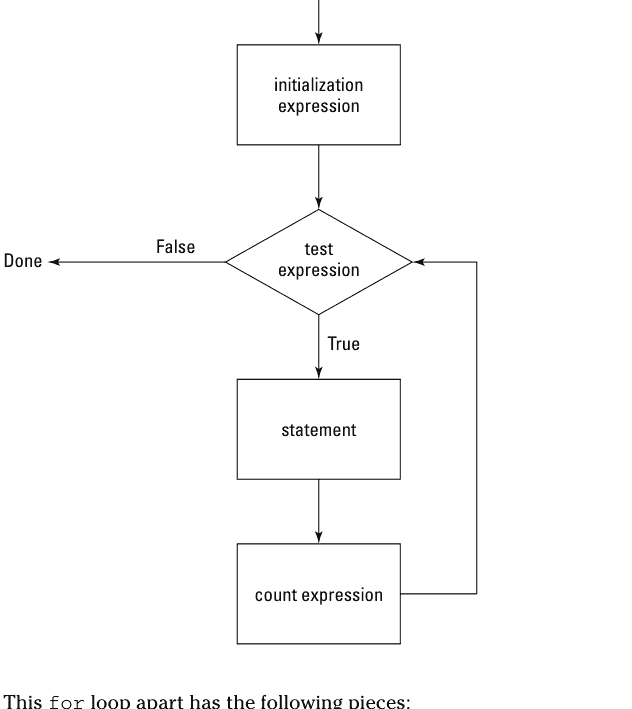

**图 5-3：** for 循环的流程图。

这个 `for` 循环包含以下部分：

- 初始化表达式是 `int i = 1`。此表达式声明了一个名为 `i` 的 `int` 类型变量，并将其初始值赋为 `1`。
- 测试表达式是 `i <= 10`。因此，只要 `i` 小于或等于 `10`，循环就会继续执行。
- 计数表达式是 `i++`。因此，每次循环执行时，变量 `i` 都会递增。
- 循环体是单条语句 `System.out.println(i)`。因此，每次循环执行时，`i` 变量的值都会被打印到控制台。


这些用来描述 `for` 循环中三个表达式的术语是我编的。正式地，Java 将它们称为 *ForInit 表达式*、*Expression* 和 *ForUpdate 表达式*。你不觉得我起的术语更具描述性吗？

## 探索计数器变量的作用域

如果你在初始化语句中声明计数器变量，那么计数器变量的作用域仅限于 `for` 语句本身。因此，你可以在括号内出现的其他表达式以及循环体中使用该变量，但不能在循环外部使用它。例如，以下代码会导致编译器错误：

```java
public class CountToTenError
{
    public static void main(String[] args)
    {
        for (int i = 1; i <=10; i++)
            System.out.println(i);
        System.out.println("The final value of i is " + i);
    }
}
```

这是因为 `main` 方法中的最后一条语句引用了变量 `i`，而 `i` 已经超出了作用域，因为它是在 `for` 循环内部声明的。

但是，你不必在 `for` 语句本身中声明计数器变量。因此，以下程序可以正常运行：

```java
public class CountToTenErrorFixed
{
    public static void main(String[] args)
    {
        int i;
        for (i = 1; i <=10; i++)
            System.out.println(i);
        System.out.println("The final value of i is " + i);
    }
}
```

请注意，由于变量 `i` 是在 `for` 语句之前声明的，因此初始化表达式不需要指定变量的数据类型。当你运行这个程序时，控制台窗口中将显示以下内容：

```
1
2
3
4
5
6
7
8
9
10
The final value of i is 11
```

## 计数偶数

在本章前面，你看到了一个计数偶数直到 20 的程序。你也可以用 `for` 循环来实现。你需要做的只是调整计数表达式。例如，以下是 CountEven 程序的一个使用 `for` 循环的版本：

```java
public class ForEvenCounter
{
    public static void main(String[] args)
    {
        for (int number = 2; number <= 20; number += 2)
            System.out.print(number + " ");
        System.out.println();
    }
}
```

运行这个程序，果然，控制台窗口显示以下内容：

```
2 4 6 8 10 12 14 16 18 20
```

## 倒序计数

没有任何规则说 `for` 循环只能正向计数。要倒序计数，你只需调整 `for` 循环的三个表达式即可。和往常一样，初始化表达式指定计数器变量的起始值。测试表达式使用大于测试代替小于测试。计数表达式从计数器变量中减去而不是增加。

例如：

```java
public class CountDown
{
    public static void main(String[] args)
    {
        for (int count = 10; count >= 1; count--)
        {
            System.out.println(count);
        }
    }
}
```

运行这个程序，你会在控制台窗口中看到以下结果：

```
10
9
8
7
6
5
```


## 著名的 for 循环

对于像我一样在 20 世纪 60 年代长大、虔诚地观看 NASA 发射的人来说，你会喜欢这个倒计时程序的变体：

```java
public class LaunchControl
{
    public static void main(String[] args)
    {
        System.out.print("We are go for launch in T minus ");
        for (int count = 10; count >= 0; count--)
        {
            if (count == 8)
                System.out.println("Ignition sequence start!");
            else
                System.out.println(count + "...");
        }
        System.out.println("All engines running!");
        System.out.println("Liftoff! We have a liftoff!");
    }
}
```

运行程序后，控制台会显示如下输出：

```
We are go for launch in T minus 10...
9...
Ignition sequence start!
7...
6...
5...
4...
3...
2...
1...
0...
All engines running!
Liftoff! We have a liftoff!
```

你是不是听到了保罗·哈尼的声音？他可是 20 世纪 60 年代 NASA 著名的"任务控制之声"。如果你没有这种感觉，说明你远远没有我这么痴迷。

### *没有循环体的 for 循环*

有些程序员喜欢把代码写得尽可能简洁。我觉得《宋飞正传》有一集就是讲这个的……杰瑞有个女朋友是个"简洁型程序员"。他不得不跟她分手，因为他看不懂她的代码。

总之，简洁型程序员有时喜欢在 `for` 语句上做文章，试图完全去掉 `for` 循环的循环体。为此，他们利用了一个事实：`for` 语句的计数表达式部分可以编写任意表达式，包括方法调用。例如，下面这个程序使用一个没有循环体的 `for` 语句在控制台打印 1 到 10 的数字：

```java
public class TerseCoder
{
    public static void main(String[] args)
    {
        for (int i = 1; i <=10; System.out.println(i++));
    }
}
```

这里的计数表达式是对 `System.out.println` 的调用。`println` 方法的参数巧妙地使用了自增运算符，使得变量在同一个表达式中既被打印又被递增。

远离简洁型程序员吧！宋飞跟她分手是对的。

### 组合表达式

`for` 循环有一个不太为人知的特性，那就是初始化表达式和计数表达式实际上可以是用逗号分隔的表达式列表。当你需要同时跟踪两个计数变量时，这有时会很有用。例如，下面这个程序使用两个计数变量，同时从 1 数到 10 和从 10 数到 1：

```java
public class CountBothWays
{
    public static void main(String[] args)
    {
        int a, b;
        for (a = 1, b = 10; a <= 10; a++, b--)
            System.out.println(a + " " + b);
    }
}
```

运行这个程序后，你会在控制台窗口看到如下输出：

```
1 10
2 9
3 8
4 7
5 6
6 5
7 4
8 3
9 2
10 1
```

使用多个表达式作为初始化和计数表达式时，请记住以下规则：

- 在初始化表达式中，如果你使用了多个表达式，就不能声明变量。这就是为什么我在 CountBothWays 示例中在 `for` 语句之前就声明了 `a` 和 `b` 变量。
- 表达式列表中的表达式可以是赋值语句、自增或自减语句（如 `a++`）、方法调用，或是使用 `new` 关键字从类创建对象的对象创建语句。其他类型的语句，如 `if` 语句或循环语句，是不允许使用的。
- 测试表达式中不能列出多个表达式。不过，你可以使用布尔运算符创建复合条件，所以不需要使用表达式列表。

下面是一个使用无循环体 `for` 循环的 LaunchController 程序版本，只是为了证明我能做到：

```java
public class ExpressionGanging
{
    public static void main(String[] args)
    {
        System.out.print("We are go for launch in T minus ");
        for (int count = 10; count >= 0;
             System.out.println((count == 8) ?
                               "Ignition sequence start!" :
                               count + "..."),
             count--    );
        System.out.println("All engines running!");
        System.out.println("Liftoff! We have a liftoff!");
    }
}
```

这个程序实际上比看起来更复杂。计数表达式是一个包含两个表达式的列表。第一个是对 `System.out.println` 的调用，使用三元 `?:` 运算符来决定打印什么内容。`?:` 运算符首先计算 `count` 变量，看看它是否等于 8。如果是，字符串"Ignition sequence start!"会被发送给 `println` 方法。否则，`count + "..."` 会被发送。第二个表达式只是对 count 变量进行递增。

我想你会同意，像这个示例这样编写 `for` 语句实在太过分了。最好保持表达式简单，把真正的工作放在循环体中完成。

### 省略表达式

`for` 循环的另一个奇特之处在于，三个表达式都是可选的。如果你省略了一个或多个表达式，只需用分号作为占位符，这样编译器才能识别。

省略测试表达式或迭代表达式并不常见，但省略初始化表达式是很常见的。例如，你在 `for` 循环中递增的变量可能在进入循环之前就已经声明和初始化了。在这种情况下，你可以省略初始化表达式，如下例所示：

```java
Scanner sc = new Scanner(System.in);
System.out.print("Where should I start? ");
int a = sc.nextInt();
for ( ; a >= 0; a--)
    System.out.println(a);
```

这个 `for` 循环只是从用户输入的数字倒数到零。

如果你省略了测试表达式，最好在循环中某个地方加一个 `break` 语句。否则，你会陷入无限循环。

你也可以省略所有三个表达式，如下例所示：

```java
for(;;)
    System.out.println("Oops");
```

这个程序同样会导致无限循环。几乎没有理由这样做，因为 `while(true)` 有同样的效果，而且更加直观。

### 在 for 循环中使用 break 和 continue

你可以在 `for` 循环中使用 break，就像在 `while` 或 `do-while` 循环中一样。例如，下面我重新编写了本章前面的 Duodecaphobia 程序，这次使用 `for` 循环：

```java
public class ForDuodecaphobia
{
    public static void main(String[] args)
    {
        for (int number = 2; number <=20; number += 2)
        {
            if (number == 12)
                break;
            System.out.print(number + " ");
        }
        System.out.println();
    }
}
```

和之前一样，这个版本以 2 为步长递增，直到达到 20。但当它遇到 12 时，它会恐慌并中止循环，所以实际上永远不会到达 14、16、18 或 20。因此控制台输出如下：

```
2 4 6 8 10
```

下面是一个使用 `continue` 语句的版本，它只是跳过 12 而不是中止整个循环：

```java
public class ForDuodecaphobia2
{
    public static void main(String[] args)
    {
        for (int number = 2; number <=20; number += 2)
        {
            if (number == 12)
                continue;
            System.out.print(number + " ");
        }
        System.out.println();
    }
}
```

这个版本的控制台输出如下：

```
2 4 6 8 10 14 16 18 20
```

## 182 嵌套循环

循环可以包含循环。这个技术术语叫做*Loop-de-Loop*。开玩笑的。实际上，技术术语叫做*嵌套循环*。嵌套循环就是一个完全包含在另一个循环内部的循环。内部的循环叫做*内层循环*，外部的循环叫做*外层循环*。

### 简单的嵌套 for 循环

为了演示嵌套的基本原理，下面是一个使用一对嵌套 `for` 循环的小程序：

```java
public class NestedLoop
{
    public static void main(String[] args)
    {
        for(int x = 1; x < 10; x++)
        {
            for (int y = 1; y < 10; y++)
```


 ```
System.out.print(x + "-" + y + " ");
System.out.println();
}
}
}
```

这个程序由两个`for`循环组成。外层循环使用`x`作为计数器变量，内层循环使用`y`。外层循环每执行一次，内层循环执行10次，并打印一行，显示每次内层循环执行时`x`和`y`的值。当内层循环结束时，调用不带参数的`System.out.println`开始新的一行。然后，外层循环继续，打印下一行。

运行这个程序时，控制台会显示以下文本：

```
1-1    1-2    1-3    1-4    1-5    1-6    1-7    1-8    1-9
2-1    2-2    2-3    2-4    2-5    2-6    2-7    2-8    2-9
3-1    3-2    3-3    3-4    3-5    3-6    3-7    3-8    3-9
4-1    4-2    4-3    4-4    4-5    4-6    4-7    4-8    4-9
5-1    5-2    5-3    5-4    5-5    5-6    5-7    5-8    5-9
6-1    6-2    6-3    6-4    6-5    6-6    6-7    6-8    6-9
7-1    7-2    7-3    7-4    7-5    7-6    7-7    7-8    7-9
8-1    8-2    8-3    8-4    8-5    8-6    8-7    8-8    8-9
9-1    9-2    9-3    9-4    9-5    9-6    9-7    9-8    9-9
```

## 猜谜游戏

清单5-1展示了一个更复杂但更实际的嵌套示例。这个程序实现了一个简单的猜谜游戏：电脑在1到10之间选一个数字，你需要猜出这个数字。猜完之后，电脑告诉你猜对了还是猜错了，然后问你是否想再玩一次。如果你输入Y或y，游戏重新开始。

嵌套的作用在于，整个游戏写在一个`while`循环中，只要你说想再玩一次，循环就会继续。然后，在这个循环内部，每次游戏向用户请求输入时，它使用`do-while`循环来验证用户的输入。因此，当游戏让用户猜一个1到10之间的数字时，它会一直循环，直到用户输入的数字在该范围内。当游戏问用户是否想再玩一次时，它会循环，直到用户输入Y、y、N或n。

以下是该程序显示的控制台输出示例：

```
Let's play a guessing game!

I'm thinking of a number between 1 and 10.
What do you think it is? **5**
You're wrong!  The number was 8
Play again? (Y or N)**y**

I'm thinking of a number between 1 and 10.
What do you think it is? **32**
I said, between 1 and 10. Try again: **5**
You're wrong! The number was 6

Play again? (Y or N)**maybe**

Play again? (Y or N)**ok**

Play again? (Y or N)**y**

I'm thinking of a number between 1 and 10.
What do you think it is? **5**
You're right!

Play again? (Y or N)**n**
Thank you for playing.
```

## 清单 5-1：猜谜游戏

```
import java.util.Scanner;

public class GuessingGame
{
    static Scanner sc = new Scanner(System.in);

    public static void main(String[] args)
    {
        boolean keepPlaying = true;

        System.out.println("Let's play a guessing game!");
        while (keepPlaying)
        {
            boolean validInput;
            int number, guess;
            String answer;

            // Pick a random number
            number = (int)(Math.random() * 10) + 1;

            // Get the guess
            System.out.println("\nI'm thinking of a number "
                + "between 1 and 10.");
            System.out.print("What do you think it is? ");
            do
            {
                guess = sc.nextInt();
                validInput = true;
                if ( (guess < 1) || (guess > 10) )
                {
                    System.out.print("I said, between 1 and 10. "
                        + "Try again: ");
                    validInput = false;
                }
            } while (!validInput);                                                  → 36

            // Check the guess
            if (guess == number)                                                   → 39
                System.out.println("You're right!");
            else
                System.out.println("You're wrong!");

            // Play again?
            do                                                                     → 46
            {
                System.out.print("\nPlay again? (Y or N)");
                answer = sc.next();
                validInput = true;
                if (answer.equalsIgnoreCase("Y"))
                    ;
                else if (answer.equalsIgnoreCase("N"))
                    keepPlaying = false;
                else
                    validInput = false;
            } while (!validInput);                                              → 57
            System.out.println("\nThank you for playing!");                   → 58
        }                                                                   → 59
    }
}
```

以下段落描述了该程序中的一些关键行：

- **→10** 定义了一个名为`keepPlaying`的布尔变量，初始化为`true`，当用户表示对这个愚蠢的游戏感到厌倦时，将其改为`false`。
- **→13** 开始游戏的主`while`循环。只要`keepPlaying`为true，循环就会继续。该循环在第58行结束。
- **→15** 定义了一个名为`validInput`的布尔变量，用于指示用户的输入是否有效。同一个变量既用于用户猜测数字的输入，也用于每轮结束时Y或N字符串的输入。
- **→20** 在1到10之间选择一个随机数。更多信息请参阅Book II, Chapter 3。
- **→26** 开始`do-while`循环，从用户那里获取有效的猜测。该循环在第36行结束。此循环中的语句从控制台读取用户的猜测，然后测试确认它是否在1到10之间。如果是，`validInput`被设置为`true`。否则，`validInput`被设置为`false`，显示错误消息，循环重复，迫使用户重新猜测。只要`validInput`为`false`，循环就会继续。
- **→39** `if`语句将用户的猜测与电脑的数字进行比较。显示一条消息，指示用户猜对了还是猜错了。
- **→46** 开始`do-while`循环，询问用户是否想再玩一次。该循环在第57行结束。此循环中的语句从用户那里读取一个字符串。如果用户输入`Y`或`y`，`validInput`被设置为`true`。（`keepPlaying`已经是`true`，所以保持不变。）如果用户输入`N`或`n`，`validInput`被设置为`true`，`keepPlaying`被设置为`false`。而如果用户输入其他内容，`validInput`被设置为`false`。只要`validInput`为`false`，循环就会继续。
- **→59** 该语句在程序的主`while`循环结束后执行，感谢用户玩游戏。

# 第6章：玩转switch

## 本章内容

- 庞大的`else-if`语句带来的麻烦
- 使用`switch`语句
- 创建case组
- 在case中使用字符
- 遗漏的break

在Book II, Chapter 4中，你了解了Java决策制定的主力军：布尔表达式和强大的`if`语句。在本章中，你将发现另一个用于决策的Java工具：`switch`语句。`switch`语句是一个相当有限的工具，但它在一种特定类型的决策制定方面表现出色：根据存储在整数变量中的值，从多个动作中选择一个。事实证明，需要这样做的场景经常出现。因此，当这种需求出现时，你会希望将`switch`语句放在手边。

## else-if 的噩梦

许多应用程序需要根据控制一切的某个值，简单地选择要执行的操作。正如我在Book II, Chapter 4中描述的，这类需求通常用一长串`else-if`语句来处理。

不幸的是，这些东西很快就会失控。`else-if`链条最终看起来像DNA双螺旋结构，或者像《黑客帝国》中从电脑屏幕顶部滴下来的那些东西。

例如，清单6-1展示了可能被用于解码佛罗里达或俄亥俄州投票机错误代码的程序片段。

清单6-1：投票机错误解码器的else-if版本

```
import java.util.Scanner;

public class VoterApp
{

    static Scanner sc = new Scanner(System.in);

    public static void main(String[] args)
    {
        System.out.println("Welcome to the voting machine "
            + "error code decoder.\n\n"
            + "If your voting machine generates "
            + "an error code,\n"
            + "you can use this program to determine "
            + "the exact\ncause of the error.\n");
        System.out.print("Enter the error code: ");
        int err = sc.nextInt();

        String msg;
        if (err==1)
            msg = "Voter marked more than one candidate.\n"
                + "Ballot rejected.";
        else if (err==2)
            msg = "Box checked and write-in candidate "
                + "entered.\nBallot rejected.";
        else if (err==3)
            msg = "Entire ballot was blank.\n"
                + "Ballot filled in according to secret plan.";
        else if (err==4)
            msg = "Nothing unusual about the ballot.\n"
                + "Voter randomly selected for tax audit.";
        else if (err==5)
            msg = "Voter filled in every box.\n"
                + "Ballot counted twice.";
        else if (err==6)
            msg = "Voter drooled in voting machine.\n"
                + "Beginning spin cycle.";
        else if (err==7)
            msg = "Voter lied to pollster after voting.\n"
                + "Voter's ballot changed "
                + "to match polling data.";
        else
            msg = "Voter filled out ballot correctly.\n"
                + "Ballot discarded anyway.";
        System.out.println(msg);
    }
}
```

哇！而这个程序只需要解码7种不同的错误代码。如果这台机器有500种不同的代码呢？
```


## 投票机错误解码器程序的更佳版本

幸运的是，Java 提供了一种专门语句，正好适用于投票机错误解码器程序这类任务：`switch` 语句。具体来说，`switch` 语句在需要根据整数或字符类型变量的值从多个选项中选择一个时非常有用。

清单 6-2 展示了投票机错误解码器程序使用 `switch` 语句替代大型 `else-if` 结构的版本。相信你会同意，这个版本的程序更易于理解。`switch` 语句清楚地表明，所有信息都是根据 `err` 变量的值来选择的。

### 清单 6-2：投票机错误解码器的 switch 版本

```java
import java.util.Scanner;

public class VoterApp2
{

    static Scanner sc = new Scanner(System.in);

    public static void main(String[] args)
    {

        System.out.println("Welcome to the voting machine "
            + "error code decoder.\n\n"
            + "If your voting machine generates "
            + "an error code,\n"
            + "you can use this program to determine "
            + "the exact\ncause of the error.\n");
        System.out.print("Enter the error code: ");
        int err = sc.nextInt();

        String msg;

        switch (err)
        {
            case 1:
                msg = "Voter marked more than one candidate.\n"
                    + "Ballot rejected.";
                break;
            case 2:
                msg = "Box checked and write-in candidate "
                    + "entered.\nBallot rejected.";
                break;
            case 3:
                msg = "Entire ballot was blank.\n"
                    + "Ballot filled in according to secret plan.";
                break;
            case 4:
                msg = "Nothing unusual about the ballot.\n"
                    + "Voter randomly selected for tax audit.";
                break;
            case 5:
                msg = "Voter filled in every box.\n"
                    + "Ballot counted twice.";
                break;
            case 6:
                msg = "Voter drooled in voting machine.\n"
                    + "Beginning spin cycle.";
                break;
            case 7:
                msg = "Voter lied to pollster after voting.\n"
                    + "Voter's ballot changed "
                    + "to match polling data.";
                break;
            default:
                msg = "Voter filled out ballot correctly.\n"
                    + "Ballot discarded anyway.";
                break;
        }
        System.out.println(msg);
    }
}
```

## 使用 `switch` 语句

`switch` 语句的基本形式如下：

```java
switch (expression)
{
    case constant:
        statements;
        break;
    [ case constant-2:
        statements;
        break; ] ...
    [ default:
        statements;
        break; ] ...
}
```

表达式的求值结果必须是 `int`、`short`、`byte` 或 `char`。不能是 `long` 或浮点类型。

你可以根据需要编写任意数量的 case 组。每个 case 组以 `case` 关键字开头，后跟一个常量（通常是简单的数字字面量）和冒号。然后，编写一个或多个语句，当 `switch` 表达式的值等于该常量时将被执行。每个 case 组的最后一行是 `break` 语句，它会使整个 `switch` 语句结束。

`default` 组是可选的，类似于捕获所有情况的 case 组。只有当之前的 case 常量都不匹配 `switch` 表达式时，才会执行它的语句。

请注意，case 组不是用花括号标记的真正代码块。相反，每个 case 组以 `case` 关键字开始，以下一个 case 组的 `case` 关键字结束。但是，所有 case 组一起构成一个由花括号标记的代码块。

每个 case 组的最后一条语句通常是 `break` 语句。`break` 语句会导致控制跳转到 `switch` 语句的末尾。如果省略 `break` 语句，控制会*贯穿*到下一个 case 组。意外遗漏 `break` 语句是 `switch` 语句最常见的问题根源。

## 一个无聊的商业示例，附带流程图

好了，投票机错误解码器有点意思。现在来看一个更接地气的例子。假设你需要根据销售等级设置佣金率，销售等级用整数表示，可以是 1、2 或 3，具体如下表所示：

| 等级 | 佣金率 |
|-------|---------------|
| 1 | 2% |
| 2 | 3.5% |
| 3 | 5% |
| 任何其他值 | 0% |

你可以使用以下 `switch` 语句实现：

```java
double commissionRate;
switch (salesClass)
{
    case 1:
        commissionRate = 0.02;
        break;
    case 2:
        commissionRate = 0.035;
        break;
    case 3:
        commissionRate = 0.05;
        break;
    default:
        commissionRate = 0.0;
        break;
}
```

图 6-1 展示了描述该 switch 语句操作的流程图。如你所见，此流程图与第二册第 4 章中的图 4-3 所示的流程图相似。这是因为 switch 语句的操作与一系列 else-if 语句的操作相似。

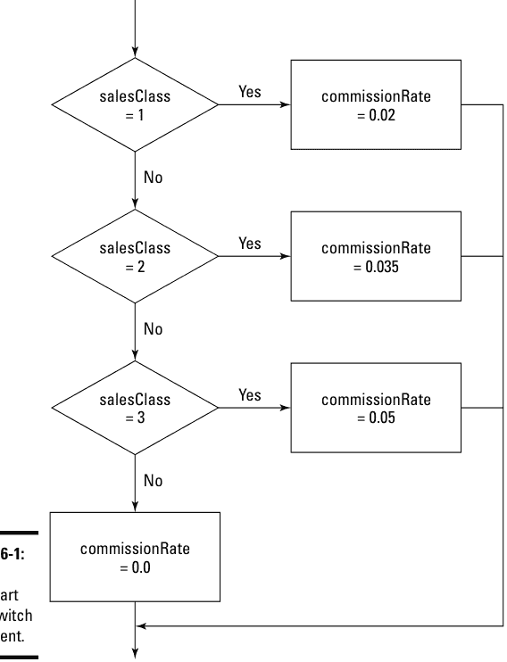

> **提示** 我喜欢流程图，因为它们让我回想起早期计算机编程的日子，那时我们必须在编写任何代码之前为每个程序绘制流程图。流程图并没有真正帮助我们编写更好的程序，但绘制它们很有趣。

## 在 `switch` 语句中嵌套 `if` 语句

你可以在 case 组中包含任何类型的语句，包括 `if` 语句。例如，假设你的佣金结构不仅取决于销售等级，还取决于总销售额，如下所示：

| 等级 | 销售额 < $10,000 | 销售额 $10,000 及以上 |
|---|---|---|
| 1 | 1% | 2% |
| 2 | 2.5% | 3.5% |
| 3 | 4% | 5% |
| 任何其他值 | 0% | 0% |

那么，你可以使用以下 `switch` 语句：

```java
double commissionRate;
switch (salesClass)
{
    case 1:
        if (salesTotal < 10000.0)
            commissionRate = 0.01;
        else
            commissionRate = 0.02;
        break;
    case 2:
        if (salesTotal < 10000.0)
            commissionRate = 0.025;
        else
            commissionRate = 0.035;
        break;
    case 3:
        if (salesTotal < 10000.0)
            commissionRate = 0.04;
        else
            commissionRate = 0.05;
        break;
    default:
        commissionRate = 0.0;
        break;
}
```

这里，每个 case 组都包含一个 `if` 语句。如有必要，这些 `if` 语句可以是复杂的嵌套 `if` 语句。

除了 case 组中的 `if` 语句外，这里没什么其他可看的了，各位。继续吧。

## 创建字符 case

除了有一个好听的头韵标题外，本节还展示了如何在 `switch` 语句中使用 `char` 变量而非整数。使用 `char` 类型时，通常为每个 case 组提供两个连续的 `case` 常量，以同时允许大小写字母。例如，假设你需要根据字符代码而非整数值设置销售等级的佣金率，具体如下表所示：

| 等级 | 佣金率 |
|---|---|
| A 或 a | 2% |
| B 或 b | 3.5% |
| C 或 c | 5% |
| 任何其他值 | 0% |

以下是实现此功能的 `switch` 语句：

```java
double commissionRate;
switch (salesClass)
{
    case 'A':
    case 'a':
        commissionRate = 0.02;
        break;
    case 'B':
    case 'b':
        commissionRate = 0.035;
        break;
    case 'C':
    case 'c':
        commissionRate = 0.05;
        break;
    default:
        commissionRate = 0.0;
        break;
}
```

理解这个示例的关键在于认识到：case 组中完全可以不包含任何语句，而且如果 case 组中省略 `break` 语句，控制会贯穿到下一个 case 组。因此，`case 'A'` 组不包含任何语句，但会贯穿到 `case 'a'` 组。


创建字符字面量时使用撇号，而非引号。

## 贯穿裂缝

虽然 `switch` 语句最常见的问题是在 case 组末尾意外遗漏 `break` 语句，但有时你需要故意这样做。例如，许多应用程序的功能是根据控制变量逐步添加的。例如，你当地的洗车店可能提供多种包含不同服务的套餐：

| 套餐 | 服务 |
|---------|----------|
| A | 清洗、吸尘和手工擦干 |
| B | 套餐 A + 打蜡 |
| C | 套餐 B + 皮革/乙烯基护理 |
| D | 套餐 C + 轮胎护理 |
| E | 套餐 D + 新车清香 |

清单 6-3 展示了一个应用程序，当你订购特定套餐时，它会显示你获得的所有产品。它通过在 `switch` 语句中反向测试套餐代码（从套餐 E 开始），并将每个套餐附带的产品添加到 `details` 变量中。除了最后一个 case 组外，其他 case 组都未包含 `break` 语句。结果，控制会从每个 case 组贯穿到下一个 case 组。因此，一旦某个 case 组测试为 `true`，`switch` 语句中其余的 case 组都会被执行。

### 清单 6-3：洗车应用程序

```java
import java.util.Scanner;

public class CarWashApp
{
    static Scanner sc = new Scanner(System.in);

    public static void main(String[] args)
    {
```


## 坠入缝隙之中

## 清单 6-3（续）

```
System.out.println("The car wash application!\n\n");
System.out.print("Enter the package code: ");
String s = sc.next();
char p = s.charAt(0);

String details = "";

switch (p)
{
  case 'E':
  case 'e':
    details += "\tNew Car Scent, plus...\n";
  case 'D':
  case 'd':
    details += "\tTire Treatment, plus...\n";
  case 'C':
  case 'c':
    details += "\tLeather/Vinyl Treatment, plus...\n";
  case 'B':
  case 'b':
    details += "\tWax, plus...\n";
  case 'A':
  case 'a':
    details += "\tWash, vacuum, and hand dry.\n";
    break;
  default:
    details = "That's not one of the codes.";
    break;
}
System.out.println("\nThat package includes:\n");
System.out.println(details);
  }
}
```

说实话，编写像这个示例一样依赖 switch 语句“坠入缝隙”的程序，实在不是一个好主意。相反，可以考虑将每个 case 组的语句放在单独的方法中，然后根据需要为每个 case 组调用所有相关方法。接着通过迭代处理下一组，以防止这种穿透现象。清单 6-4 展示了一个洗车应用程序的版本，它使用了这种技术来避免 switch 语句中的穿透问题。（使用简单的穿透来处理大小写字母的情况不那么令人困惑，因此这个程序仍然使用了该技术。）

## 清单 6-4：避免不良穿透的洗车程序版本

```
import java.util.Scanner;

public class CarWashApp2
{
  static Scanner sc = new Scanner(System.in);

  public static void main(String[] args)
  {

    System.out.println("The car wash application!\n\n");
    System.out.print("Enter the package code: ");
    String s = sc.next();
    char p = s.charAt(0);

    String details = "";

    switch (p)
    {
      case 'E':
      case 'e':
        details = packageE() + packageD() + packageC()
          + packageB() + packageA();
        break;
      case 'D':
      case 'd':
        details = packageD() + packageC()
          + packageB() + packageA();
        break;
      case 'C':
      case 'c':
        details = packageC() + packageB() + packageA();
        break;
      case 'B':
      case 'b':
        details = packageB() + packageA();
        break;
      case 'A':
      case 'a':
        details = packageA();
        break;
      default:
        details = "That's not one of the codes.";
        break;
    }
    System.out.println("\nThat package includes:\n");
    System.out.println(details);
  }

  public static String packageA()
  {
    return "\tWash, vacuum, and hand dry.\n";
  }

  public static String packageB()
  {
    return "\tWax, plus...\n";
  }
```

198 坠入缝隙之中

```
清单 6-4（续）

public static String packageC()
{
  return "\tLeather/Vinyl Treatment, plus...\n";
}

public static String packageD()
{
  return "\tTire Treatment, plus...\n";
}

public static String packageE()
{
  return "\tNew Car Scent, plus...\n";
}

}
```

## 第七章：为你的程序添加一些方法

### 本章内容

- 介绍静态方法
- 在程序中使用方法的一些好理由
- 创建返回值的方法
- 创建接受参数的方法

在 Java 中，*方法* 是一个语句块，它有一个名称，并且可以通过从程序的其他地方 *调用*（也称为 *调用*）来执行。你可能没有意识到，但你已经非常熟练地使用方法了。例如，要向控制台打印文本，你使用 `println` 或 `print` 方法。要从用户那里获取一个整数，你使用 `nextInt` 方法。而要比较字符串值，你使用 `equals` 方法或 `equalsIgnoreCase` 方法。至于所有方法的鼻祖 `main`，它就是包含程序运行时执行的语句的方法。

到目前为止你使用过的所有方法（除了 `main`），都是由 Java API 定义并且属于某个特定 Java 类的方法。例如，`nextInt` 方法属于 `Scanner` 类，而 `equalsIgnoreCase` 方法属于 `String` 类。

相比之下，`main` 方法属于你的应用程序定义的类。在本章中，你将了解如何创建作为应用程序类一部分的额外方法。然后你可以从你的 `main` 方法中调用这些方法。正如你将看到的，这种方法对于除了最短的 Java 程序之外的所有程序都非常有用。

### 方法的乐趣

使用方法可以极大地提高你的编程生活质量。例如，假设你的程序要解决的问题很复杂，你需要至少 1000 条 Java 语句来完成它。你可以把这 1000 条语句全部放在 `main` 方法中，但那样它会变得非常长。更好的方法是将你的程序分解成几个定义良好的代码段，并将每个代码段放在一个单独的方法中。然后，你的 `main` 方法可以简单地按正确顺序调用其他方法。

或者，假设你的程序需要执行某些计算，比如在月球飞行中进行中途修正时主火箭需要燃烧多长时间，并且程序需要在几个不同的地方执行这个计算。如果不使用方法，你就必须复制执行这个计算的语句。这不仅容易出错，而且会使你的程序更难测试和调试。但如果你把这个计算放在一个方法中，你就可以在任何需要执行计算的时候简单地调用该方法。因此，方法有助于减少重复代码。

方法的另一个好处是简化使用长循环的代码结构。例如，假设你有一个 `while` 循环，其主体中有 500 条语句。这使得很难找到标记主体结束的右花括号。等你找到它时，你可能已经忘记了这个 `while` 循环是干什么的了。你可以通过将 `while` 循环体中的代码放入一个单独的方法中来简化它。这样，`while` 循环只需调用新方法即可。

说到这里，面向对象编程的狂热者们开始发出嘘声和不满。其中一些人已经离开了礼堂。他们很不满，因为我用传统的面向过程编程术语而不是现代的面向对象编程术语来描述方法。

哼，管他呢。他们是对的，但那又怎样？我在第三卷中讲到了方法的面向对象用途。在那里你会发现，方法的目的远不止是将一个长的 `main` 方法拆分成更小的部分。但即便如此，据我所知，一些最面向对象的程序也使用方法只是为了避免重复代码或将一个大方法拆分成几个较小的方法。所以呢。

## 创建方法的基础

所有方法——包括 `main` 方法——都必须以 *方法声明* 开头。以下是一个方法声明的基本形式，至少是我本章讨论的那种方法：

```
public static 返回类型 方法名（参数列表）
{
    语句...
}
```

以下段落将逐一描述方法声明的各个部分：

- **public:** 这个关键字表明该方法的存在应该向外界公开，并且任何知道你的程序（或者更准确地说，知道你的 Java 程序定义的类）的 Java 程序都应该能够使用你的方法。这对你在本书这个阶段处理的程序类型来说意义不大，但以后会变得更重要。在第三卷中，你将更多地了解 `public` 的含义，以及在各种不同情况下有用的 `public` 替代方案。

- **`static`:** 这个关键字声明该方法是一个 *静态方法*，这意味着可以在不首先创建其所在类的实例的情况下调用它。`main` 方法必须始终是静态的，而在包含 `main` 方法的类中的任何其他方法通常也应该是静态的。

- **`返回类型`:** 在 `static` 之后是 *返回类型*，它表明当方法被调用时是否返回一个值，以及如果是，该值的类型是什么。如果方法不返回值，则指定 `void`。（我将在本章后面的“返回值的方法”部分更多地讨论返回值的方法。）

- **`方法名`:** 现在是你方法的名称。创建方法名的规则与创建变量名的规则相同：你可以使用字母和数字的任何组合，但名称必须以字母开头。此外，它可以包含美元符号（$）和下划线字符（_）。不允许使用其他特殊字符。

  为方法选择名称时，尽量选择一个相对简短但具有描述性的名称。像 `calculateTheTotalAmountOfTheInvoice` 这样的方法名有点长，但只写 `calc` 又太模糊了。类似 `calculateInvoiceTotal` 这样的名字对我来说似乎更合理。

- **`参数列表`:** 你可以通过将值列在方法名后的圆括号中，将一个或多个值传递给方法。方法声明中的参数列表让 Java 知道方法应该接收什么类型的参数，并提供名称，以便方法体中的语句可以将参数作为局部变量访问。你将在本章后面的“使用接受参数的方法”部分发现更多关于参数的信息。

  如果方法不接受参数，你仍然必须编写包围参数列表的圆括号。你只需让圆括号为空即可。

- **方法体:** 方法体由包含在一对花括号中的一个或多个 Java 语句组成。与 `if`、`while` 和 `for` 等 Java 语句不同，即使你的方法体只有一条语句，你也必须使用花括号。

## 一个例子

好了，刚才那些有点抽象。现在给一个具体的例子，我提供一个版本的 Hello, World! 程序，其中的消息不是由 `main` 方法显示的，而是由一个名为 `sayHello` 的方法显示的，该方法由 `main` 方法调用：

```
public class HelloWorldMethod
{
```


# 202 创建方法的基础

```
public static void main(String[] args)
{
    sayHello();
}

public static void sayHello()
{
    System.out.println("Hello, World!");
}
```

这个程序 admittedly 很简单，但它说明了在 Java 中创建和使用方法的基础。在这里，`main` 方法中的语句调用了 `sayHello` 方法，而后者又在控制台上显示了一条消息。


方法在 Java 源文件中出现的顺序并不重要。唯一的规则是所有方法都必须在类的体内声明——也就是说，在第一个左花括号和最后一个右花括号之间。例如，这是 HelloWorldMethod 程序的一个版本，其中我颠倒了方法的顺序：

```
public class HelloWorldMethod
{
    public static void sayHello()
    {
        System.out.println("Hello, World!");
    }

    public static void main(String[] args)
    {
        sayHello();
    }

}
```

这个版本的程序与之前的版本工作方式完全相同。

## 另一个示例

好吧，上一个示例有点傻。任何头脑正常的人都不会创建一个只有一行代码的方法，然后从另一个也只有一行代码的方法中调用它。Hello, World! 程序太简单了，无法说明任何稍微现实一点的情况。

例如，Book II, Chapter 5 中的一个程序玩一个猜数字游戏。该程序 `main` 方法的大部分是一个大的 `while` 循环，只要用户想继续玩，游戏就会重复进行。这个循环的循环体中有 41 条语句。这还不算太糟，但如果游戏的复杂程度增加 100 倍，以至于 `while` 循环需要 4,100 条语句才能玩完游戏的一个周期呢？你真的想要一个循环体中有 4,100 条语句的 `while` 循环吗？我想不会。

清单 7-1 展示了如何通过将主 `while` 循环的循环体放入一个单独的方法来简化这个游戏。我将这个方法命名为 `playARound`，因为它的职责是玩一轮猜数字游戏。现在，这个程序的 `main` 方法不再实际玩一轮游戏，而是将这项任务委托给 `playARound` 方法。

## 清单 7-1：使用 playARound 方法的猜数字游戏程序版本

```
import java.util.Scanner;

public class GuessingGameMethod
{
    static Scanner sc = new Scanner(System.in);
    static boolean keepPlaying = true;

    public static void main(String[] args)
    {
        System.out.println("Let's play a guessing game!");
        while (keepPlaying)
        {
            playARound();
        }
        System.out.println("\nThank you for playing!");
    }

    public static void playARound()
    {
        boolean validInput;
        int number, guess;
        String answer;

        // Pick a random number
        number = (int)(Math.random() * 10) + 1;
        System.out.println("\nI'm thinking of a number "
            + "between 1 and 10.");

        // Get the guess
        System.out.print("What do you think it is? ");
        do
        {
            guess = sc.nextInt();
            validInput = true;
            if ( (guess < 1) || (guess > 10) )
            {
                System.out.print("I said, between 1 "
                    + "and 10. " + "Try again: ");
                validInput = false;
            }
        } while (!validInput);

        // Check the guess
        if (guess == number)
            System.out.println("You're right!");

        // continued
```

*待续*

```
LISTING 7-1 (CONTINUED)

        else
            System.out.println("You're wrong!"
                               + " The number was " + number);

        // Play again?
        do
        {
            System.out.print("\nPlay again? (Y or N)");
            answer = sc.next();
            validInput = true;
            if (answer.equalsIgnoreCase("Y"))
                ;
            else if (answer.equalsIgnoreCase("N"))
                keepPlaying = false;              → 60
            else
                validInput = false;
        } while (!validInput);
    }
}
```

关于这个方法，以下是一些需要注意的重要细节：

-   → 7 由于 `main` 方法（在第 12 行）和 `playARound` 方法（在第 60 行）都必须访问 `keepPlaying` 变量，因此我将它声明为类变量，而不是 `main` 方法中的局部变量。

    如果你打算从静态方法中访问类变量，它们必须是 `static` 的。

-   →14 `main` 方法中 `while` 循环的循环体只有一行：调用 `playARound` 方法。因此，每次循环重复时，程序都会与用户玩一轮游戏。

-   →19 `playARound` 方法的声明将该方法标记为 `static`，以便静态的 `main` 方法可以调用它。

> `playARound` 方法的循环体与本书 Book II, Chapter 5 中展示的单方法版本程序中 `while` 循环的循环体完全相同。如果你想复习这段代码的工作原理，我客气地请你参考那一章。

## 返回值的方法

只执行工作而不返回任何数据的方法只在有限的情况下有用。方法的真正效用在于它们能够执行一些繁琐的任务（如计算），然后将该计算的值返回给调用方法，以便调用方法可以用这个值做某些事情。你将在以下各节中了解如何实现这一点。

## 声明方法的返回类型

要创建一个返回值的方法，你只需在方法声明中用返回值的类型替换 `void` 关键字。例如，以下是一个方法声明，创建了一个返回 `int` 值的方法：

```
public static int getRandomNumber()
```

在这里，`getRandomNumber` 方法计算一个随机数，然后将该数返回给调用者。


方法的返回类型可以是 Java 的任何基本返回类型（在 Book II, Chapter 2 中描述）：

```
int        long       float       char
short      byte       double      boolean
```

或者，返回类型可以是引用类型，包括 API 定义的类（如 `String`）或你自己创建的类。

## 使用 return 语句返回值

当你在方法声明中指定了 `void` 以外的返回类型时，方法的循环体必须包含一个 `return` 语句，用于指定要返回的值。`return` 语句的形式如下：

```
return expression;
```

该表达式必须计算出一个与方法声明中列出的类型相同的值。换句话说，如果方法返回一个 `int`，那么 `return` 语句中的表达式必须计算为一个 `int`。

例如，以下是一个使用方法来确定 1 到 10 之间随机数的程序：

```
public class RandomNumber
{
    public static void main(String[] args)
    {
        int number = getRandomNumber();
        System.out.println("The number is " + number);
    }

    public static int getRandomNumber()
    {
        int num = (int) (Math.random() * 10) + 1;
        return num;
    }
}
```

在这个程序中，`getRandomNumber` 方法使用 `Math.random` 方法计算一个 1 到 10 之间的随机数。（有关 `Math.random` 方法的更多信息，请参见 Book II, Chapter 3。）`return` 语句返回计算出的随机数。

由于 `return` 语句可以指定表达式以及简单变量，我也可以像这样编写 `getRandomNumber` 方法：

```
public static int getRandomNumber()
{
    return (int)(Math.random() * 10) + 1;
}
```

在这里，`return` 语句包含了计算随机数的表达式。

## 使用返回类型的方法

你可以在赋值语句中使用返回值的方法，像这样：

```
int number = getRandomNumber();
```

在这里，调用了 `getRandomNumber` 方法，它返回的值被赋给变量 `number`。

你也可以在表达式中使用返回值的方法。例如：

```
number = getRandomNumber() * 10;
```

在这里，`getRandomNumber` 方法返回的值乘以 10，结果赋给 `number`。

## 你必须有正确的 return 语句

如果一个方法声明了 `void` 以外的返回类型，它*必须*使用 `return` 语句返回一个值。编译器不会让你侥幸使用没有正确 `return` 语句的方法。

如果你的 `return` 语句在 `if` 语句内部，情况有时会变得复杂。有时，编译器可能会被误导并拒绝编译你的程序。为了解释这一点，我提供以下故事，讲述多次尝试解决一个本应是简单编程问题的情况：

假设你想创建一个随机数方法，返回 1 到 20 之间的随机数，但从不返回 12（因为你患有被称为 duodecaphobia 的病症，正如 *Peanuts* 中的 Lucy 会告诉你的，这是对数字 12 的恐惧）。你的第一个想法是直接忽略 12，像这样：


## 返回值的方法

```
public static int getRandomNumber()
{
    int num = (int)(Math.random() * 20) + 1;
    if (num != 12)
        return num;
}
```

然而，编译器并不会被你的小把戏愚弄。它知道如果数字是 12，`return` 语句就不会被执行。因此它会发出 `missing return statement` 的消息，并拒绝编译你的程序。

你的下一个想法是简单地在出现 12 时用 11 代替：

```
public static int getRandomNumber()
{
    int num = (int)(Math.random() * 20) + 1;
    if (num != 12)
        return num;
    else
        return 11;
}
```

然而，后来你意识到这个解决方案并不好，因为数字不再是真正随机的了。一个好的随机数生成器的要求之一是，下一个出现的任何数字都应该与其他数字一样有可能出现。但因为你把所有的 12 都改成了 11，这使得 11 出现的可能性变成了其他数字的两倍。

为了修正这个错误，你决定将随机数生成器放在一个循环中，只有当随机数不是 12 时才结束：

```
public static int getRandomNumber()
{
    int num;
    do
    {
        num = (int)(Math.random() * 20) + 1;
        if (num != 12)
            return num;
    } while (num == 12);
}
```

但现在编译器再次拒绝编译这个方法。事实证明，编译器很聪明，但不是真的那么聪明。它没有发现 `do-while` 循环中的条件与 `if` 语句中的条件是相反的，这意味着退出这个循环的唯一方式是通过 `if` 语句中的 `return` 语句。所以编译器又抱怨 `missing return statement`。

思考了一会儿后，你想出了这个解决方案：

```
public static int getRandomNumber()
{
    int num;
    while (true)
    {
        num = (int) (Math.random() * 20) + 1;
        if (num != 12)
            return num;
    }
}
```

现在大家都满意了。编译器知道退出循环的唯一方式是通过 `return` 语句，你的恐十二症用户不必担心看到数字 12，你也知道随机数为 11 的可能性不会是其他数字的两倍。生活真美好，你可以继续下一个话题了。

## 猜谜游戏程序的另一个版本

为了说明使用返回值的方法的好处，清单 7-2 展示了猜谜游戏程序的另一个版本，它在 `main` 之外还使用了四个方法：

- **playARound：** 此方法玩一轮猜谜游戏。它不返回值。
- **getRandomNumber：** 返回一个 1 到 10 之间的随机数。
- **getGuess：** 获取用户的猜测，确保它在 1 到 10 之间，如果在可接受范围内则返回该猜测值。
- **askForAnotherRound：** 此方法询问用户是否再玩一轮，并返回一个布尔值来表示用户是否想继续玩。

```
清单 7-2：猜谜游戏程序的另一个版本

import java.util.Scanner;

public class GuessingGameMethod2
{
    static Scanner sc = new Scanner(System.in);

    public static void main(String[] args)
    {
        System.out.println("Let's play a guessing game!");
        do
        {
            playARound();
        } while (askForAnotherRound());
    }

    static void playARound()
    {
        // ... (下文续接)
    }
}
```

```
System.out.println("\nThank you for playing!");
}

public static void playARound()
{
    boolean validInput;
    int number, guess;
    String answer;

    // Pick a random number
    number = getRandomNumber();

    // Get the guess
    System.out.println("\nI'm thinking of a number "
        + "between 1 and 10.");
    System.out.print("What do you think it is? ");
    guess = getGuess();

    // Check the guess
    if (guess == number)
        System.out.println("You're right!");
    else
        System.out.println("You're wrong!"
            + " The number was " + number);
}

public static int getRandomNumber()
{
  .randomNumber()
{
    return (int)(Math.random() * 10) + 1;
}

public static int getGuess()
{
    while (true)
    {
        int guess = sc.nextInt();
        if ( (guess < 1) || (guess > 10) )
        {
            System.out.print("I said, between 1 and 10. " + "Try again: ");
        }
        else
            return guess;
    }
}

public static boolean askForAnotherRound()
{
    while (true)
    {
        String answer;
        System.out.print("\nPlay again? (Y or N) ");
        answer = sc.next();
        if (answer.equalsIgnoreCase("Y"))
            return true;
        else if (answer.equalsIgnoreCase("N"))
            return false;
    }
}
}
```

第二卷
第 7 章
为你的程序添加一些方法

## 返回值的方法

以下段落指出了本程序的关键行：

- **11** `main` 方法中 `do` 循环的开始。这个 `do` 循环的每次迭代都玩一轮游戏。`do` 循环持续执行，直到用户表明他或她想停止游戏。
- **13** 调用 `playARound` 方法来玩一轮游戏。
- **14** 调用 `askForAnotherRound` 方法来确定用户是否想再玩一轮。此方法返回的布尔值用作 `do` 循环的表达式。因此，如果 `askForAnotherRound` 方法返回 `true`，`do` 循环就会重复执行。
- **18** `playARound` 方法的开始。
- **25** 这一行调用 `getRandomNumber` 方法来获取 1 到 10 之间的随机数。此方法返回的值存储在 `number` 变量中。
- **31** 这一行调用 `getGuess` 方法来获取用户的猜测。此方法返回 1 到 10 之间的数字，存储在 `guess` 变量中。
- **41** `getRandomNumber` 方法的开始，表明此方法返回一个 `int` 值。
- **43** `getRandomNumber` 方法的 `return` 语句。随机数使用 `Math.random` 方法计算，此计算的结果作为 `getRandomNumber` 方法的值返回。
- **46** `getGuess` 方法的开始，表明此方法返回一个 `int` 值。
- **48** `getGuess` 方法使用了一个 `while` 循环，只有当用户输入 1 到 10 之间的数字时才会退出。
- **57** `getGuess` 方法的 `return` 语句。注意，这个 `return` 语句位于一个 `if` 语句的 `else` 部分中，该 `if` 语句检查数字是否小于 1 或大于 10。如果数字不在可接受范围内，`return` 语句就不会被执行。相反，程序会显示一条错误消息，`while` 循环会重复执行。
- **61** `askForAnotherRound` 方法的开始，该方法返回一个 `boolean` 值。
- **63** `askForAnotherRound` 方法使用了一个 `while` 循环，只有当用户输入有效的 Y 或 N 回答时才会退出。
- **69** 如果用户输入 Y 或 y，`askForAnotherRound` 方法返回 `true`。
- **71** 如果用户输入 N 或 n，`askForAnotherRound` 方法返回 `false`。

## 使用带参数的方法

*参数*是可以传递给方法的一个值。方法可以像使用一个局部变量一样使用该参数，该局部变量由调用方法传入的值初始化。

例如，清单 7-2 中展示的猜谜游戏应用程序有一个名为 `getRandomNumber` 的方法，它返回 1 到 10 之间的随机数：

```
public static int getRandomNumber()
{
    return (int)(Math.random() * 10) + 1;
}
```

这个方法很有用，但如果你能告诉它你想要随机数落在哪个范围内，它会变得更有用。例如，如果你可以像这样调用它来获取 1 到 10 之间的随机数就很好了：

```
int number = getRandomNumber(1, 10);
```

然后，如果你的程序需要掷骰子，你可以调用同一个方法：

```
int number = getRandomNumber(1, 6);
```

或者，从 52 张牌的牌堆中随机选一张牌，你可以这样调用：

```
int number = getRandomNumber(1, 52);
```

而且你也不一定非要从 1 开始。要获取 50 到 100 之间的随机数，你可以这样调用：

```
int number = getRandomNumber(50, 100);
```

在接下来的章节中，你将编写接受参数的方法。

## 声明参数

接受参数的方法必须在方法声明中列出参数。参数列在方法名称后面括号中的*参数列表*中。对于方法使用的每个参数，你需要列出参数类型，后跟参数名称。如果需要多个参数，用逗号分隔它们。

例如，这是一个接受参数的 `getRandomNumber` 方法的版本：

```
public static int getRandomNumber(int min, int max)
{
```

## 212 使用带参数的方法

```
return (int)(Math.random()
        * (max - min + 1)) + min;
}
```

这里，该方法使用了两个参数，类型都是 `int`，分别命名为 `min` 和 `max`。然后，在方法体内，这些参数可以像局部变量一样使用。

你为参数选择的名称可以与你调用方法时传递给方法的变量名称相同，但并非必须相同。例如，你可以这样调用 `getRandomNumber` 方法：

```
int min = 1;
int max = 10;
int number = getRandomNumber(min, max);
```

或者，你也可以这样调用它：

```
int low = 1;
int high = 10;
int number = getRandomNumber(low, high);
```

或者，你也可以完全不用变量，直接向方法传递字面量值：

```
int number = getRandomNumber(1, 10);
```

你也可以将表达式指定为参数值：

```
int min = 1;
int max = 10;
int number = getRandomNumber(min * 10, max * 10);
```

这里，`number` 被赋予一个介于 10 到 100 之间的值。

## 探究参数的作用域

参数的作用域是声明该参数的方法。因此，一个参数可以与在其他方法中使用的局部变量同名，而不会引起任何冲突。例如，考虑以下程序：

```
public class ParameterScope
{
    public static void main(String[] args)
    {
        int min = 1;
        int max = 10;
        int number = getRandomNumber(min, max);
        System.out.println(number);

public static int getRandomNumber(int min, int max)
{
    return (int)(Math.random()
        * (max - min + 1)) + min;
}
```

这里，`main` 方法声明了名为 `min` 和 `max` 的变量，而 `getRandomNumber` 方法则使用 `min` 和 `max` 作为其参数名。这不会引起任何冲突，因为在每种情况下，作用域都限于单个方法。

## 理解按值传递

当 Java 通过参数将一个变量传递给方法时，方法本身接收到的是该变量值的副本，而不是变量本身。这个副本称为*按值传递*，它有一个重要的后果：如果方法更改了作为参数接收的值，此更改*不会*反映在传递给方法的原始变量中。以下程序有助于澄清这一点：

```
public class ChangeParameters
{
    public static void main(String[] args)
    {
        int number = 1;
        tryToChangeNumber(number);
        System.out.println(number);

    }

    public static void tryToChangeNumber(int i)
    {
        i = 2;
    }
}
```

这里，一个名为 `number` 的变量被设置为 `1`，然后传递给名为 `tryToChangeNumber` 的方法。该方法将变量接收为名为 `i` 的参数，然后将 `i` 的值设置为 `2`。与此同时，回到 `main` 方法，在 `tryToChangeNumber` 方法返回后，使用 `println` 打印 `number` 的值。

因为 `tryToChangeNumber` 只接收到了 `number` 的副本，而不是 `number` 变量本身，所以该程序在控制台上显示以下内容（鼓点声响起……）：`1`。

关键点是：即使 `tryToChangeNumber` 方法更改了其参数的值，此更改也不会影响传递给方法的原始变量。

## 猜谜游戏程序的另一个示例

为了展示接受参数的方法带来的好处，清单 7-3 展示了猜谜游戏程序的另一个版本。除了 `main` 之外，此版本使用以下方法：

- **`playARound`**：此方法进行一轮猜谜游戏。它不返回值，但接受两个参数：`min` 和 `max`，它们表示要猜测的数字的最小值和最大值。
- **`getRandomNumber`**：返回介于作为参数传递的 `min` 和 `max` 值之间的随机数。
- **`getGuess`**：此方法也接受两个参数 `min` 和 `max`，以限制用户必须猜测的范围。
- **`askForAnotherRound`**：此方法询问用户是否再玩一轮，并返回一个布尔值以指示用户是否想继续玩。它接受一个 `String` 值作为参数；此字符串显示在控制台上以提示用户回复。

```
import java.util.Scanner;

public class GuessingGameMethod3
{
    static Scanner sc = new Scanner(System.in);

    public static void main(String[] args)
    {
        System.out.println("Let's play a guessing game!");
        do
        {
            playARound(1, getRandomNumber(7, 12));
        } while (askForAnotherRound("Try again?"));
        System.out.println("\nThank you for playing!");
    }

    public static void playARound(int min, int max)
    {
        boolean validInput;
        int number, guess;
        String answer;

        // Pick a random number
        number = getRandomNumber(min, max);

        // Get the guess
        System.out.println("\nI'm thinking of a number "
            + "between " + min + " and " + max + ".");
        System.out.print("What do you think it is? ");
        guess = getGuess(min, max);

        // Check the guess
        if (guess == number)
            System.out.println("You're right!");
        else
            System.out.println("You're wrong!"
                + " The number was " + number);
    }

    public static int getRandomNumber(int min, int max)
    {
        return (int)(Math.random()
            * (max - min + 1)) + min;
    }

    public static int getGuess(int min, int max)
    {
        while (true)
        {
            int guess = sc.nextInt();
            if ( (guess < min) || (guess > max) )
            {
                System.out.print("I said, between "
                    + min + " and " + max
                    + ". Try again: ");
            }
            else
                return guess;
        }
    }

    public static boolean askForAnotherRound(String prompt)
    {
        while (true)
        {
            String answer;
            System.out.print("\n" + prompt + " (Y or N) ");
            answer = sc.next();
            if (answer.equalsIgnoreCase("Y"))
                return true;
            else if (answer.equalsIgnoreCase("N"))
                return false;
        }
    }
}
```

以下段落指出了该程序的关键行：

- **→13** 调用 `playARound` 方法进行一轮游戏。`min` 和 `max` 的值作为字面量传递。为了给游戏增加一点变化，这里调用了 `getRandomNumber` 方法，将 `max` 的值设置为一个从 7 到 12 的随机数。
- **→25** 对 `getRandomNumber` 方法的调用将 `min` 和 `max` 的值作为参数传递，以设置随机数的范围。
- **→29** 向用户宣布计算机已选择随机数的消息使用了 `min` 和 `max` 参数来指示范围。
- **→31** 对 `getGuess` 方法的调用现在传递了可接受的猜测范围。
- **→41** `getRandomNumber` 方法的声明指定了 `min` 和 `max` 参数。
- **→43** 随机数的计算因 `min` 可能不是 1 而变得稍微复杂一些。
- **→47** `getGuess` 方法的声明接受 `min` 和 `max` 参数。
- **→52** `getGuess` 方法中的 `if` 语句使用 `min` 和 `max` 值来验证用户的输入。
- **→59** `getGuess` 方法的 `return` 语句。请注意，此 `return` 语句位于一个检查数字是否小于 1 或大于 10 的 `if` 语句的 `else` 部分中。如果数字超出可接受范围，则不执行 `return` 语句。相反，程序会显示一条错误消息，`while` 循环会重复执行。
- **→63** `askForAnotherRound` 方法接受一个字符串变量用作提示。

# 第 8 章：处理异常

**本章内容**

- ✓ 当好事发生在好程序上遭遇坏事时该怎么做
- ✓ 关于异常的一切
- ✓ 使用 `try`、`catch` 和 `finally`
- ✓ 从源头防止异常发生

本章介绍当 Java 遇到无法处理的错误情况时会发生什么。多年来，计算机编程语言已经设计出许多不同的方式来处理这些类型的错误。最早的编程语言处理得很粗暴，它们会突然终止程序并以十六进制形式打印出计算机内存的全部内容。这种输出被称为*转储*。

后来的编程语言尝试了各种方法，以便在发生严重错误时让程序继续运行。在某些语言中，可能引起错误的语句被添加了额外的元素，以便提供关于错误的反馈。例如，从磁盘文件读取数据的语句在发生 I/O 错误时可能会返回一个错误代码。还有一些语言允许你创建一个特殊的错误处理程序部分，如果发生错误，控制权将转移到该部分。

Java 作为一种面向对象的编程语言，通过使用在发生错误时创建的特殊*异常对象*来处理错误。此外，Java 有一个特殊的语句，称为 `try` 语句，你必须使用它来处理异常对象。在本章中，你将找到有关使用异常对象和 `try` 语句的所有详细信息。

## 理解异常

*异常*是在 Java 程序中发生错误且 Java 无法自动修复该错误时创建的对象。异常对象包含有关发生的错误类型的信息。然而，最重要的信息——错误的原因——是由用于创建异常的异常类的名称来指示的。你通常不需要对异常对象做任何事情，只需弄清楚你拥有的是哪一种异常。


 ## 218 理解异常

每一个可能发生的异常都由一个不同的异常类来表示。例如，以下是一些典型的异常：

- **IllegalArgumentException**：你已向方法传递了不正确的参数。
- **InputMismatchException**：控制台输入与 Scanner 类方法所期望的数据类型不匹配。
- **ArithmeticException**：你尝试了一种非法的算术运算类型，例如将整数除以零。
- **IOException**：执行 I/O 操作的方法遇到了不可恢复的 I/O 错误。
- **ClassNotFoundException**：无法找到必需的类。

除了这些之外，还有许多其他类型的异常。在本书的后续章节中，你会了解到很多。

关于异常，你还需要知道几点其他事项：

- 当发生错误并创建异常对象时，Java 就被称为*抛出了一个异常*。Java 有个相当不错的投掷臂力，因此异常总是被准确地抛回给导致它产生的那条语句。
- 导致异常的语句可以根据需要*捕获*该异常。但如果它不想捕获，也可以不捕获。相反，它可以躲开，让其他人来捕获这个异常。那个其他人就是调用当前正在执行的方法的那条语句。
- 如果每个人都躲开，异常从未被程序捕获，程序就会突然终止，并在控制台上显示一条难看的异常信息。下一节会详细介绍这一点。
- Java 中的异常分为两种基本类型：受检异常（checked exception）和非受检异常（unchecked exception）：
 LETTER
  - *受检异常*是编译器要求你必须以某种方式处理的异常。如果你不这样做，你的程序就无法编译。
  - *非受检异常*是你可以处理，但不一定非要处理的异常。
- 到目前为止，在本书中，我避免了使用任何会抛出受检异常的 Java API 方法。不过，我确实使用了可能抛出非受检异常的方法。例如，如果用户输入的不是有效的整数值，Scanner 类的 `nextInt` 方法就会抛出一个非受检异常。欲了解更多信息，请继续阅读。

##  witnessing 一个异常

现提交您审议，这是一个匆忙编写的 Java 程序，快速拼凑而成，用以说明某些 Java 编程细节，同时忽略其他细节。眼不见，心不烦，正如他们所说。这个程序与用户玩了一个猜谜游戏，通过名为 `Scanner` 的类接收数字输入。然而，这个程序忽略了用户可能输入奇怪和意外数据的非常现实的可能性，这些数据很难被认为是数字，至少从传统意义上来说是这样。时间：现在。地点：此处。这个程序即将跨越到……异常地带。

我在这里谈论的程序，当然就是最近几章中以多种形式出现的猜谜游戏程序。（你可以在《卷 II》第 7 章末尾找到最新版本。）这个程序包含一个验证例程，防止用户猜测不在 1 到 10 之间的数字。但是，这个验证例程假设用户已经输入了一个有效的整数。如果用户输入了非整数值，`Scanner` 类的 `nextInt` 方法就会严重失败。

图 8-1 展示了如果用户输入文本（例如 `five`）而不是数字时控制台的样子。用户输入错误数据后的第一行显示程序遇到了一个名为 `InputMismatchException` 的异常。简而言之，这个异常意味着用户输入的数据无法与 `Scanner` 类期望的数据类型正确匹配。这是因为 `nextInt` 方法期望找到一个整数，但它却发现的是单词 `five`。

> 图 8-1：这个程序已经滑入了异常地带。

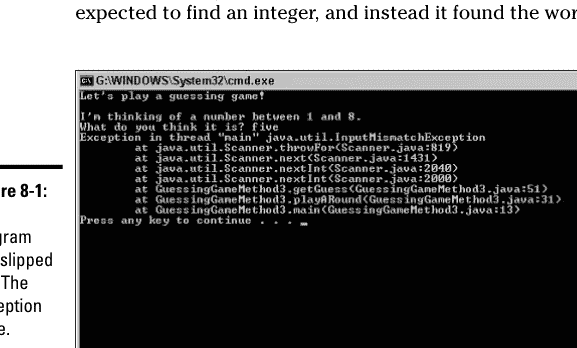

## 找出元凶

通过检查显示在指示遇到哪个异常的那一行之后的几行，你可以在你的程序中找到导致异常发生的确切语句。这些行称为*堆栈跟踪*（stack trace），它们列出了异常在程序完全终止之前经过的不同方法。通常，第一个列出的方法深藏在 Java API 的核心，而最后一个列出的方法是你应用程序的 `main` 方法。在中间某处，你会发现从 Java API 方法切换到你的程序中的方法的位置。那通常就是你程序中导致错误的语句所在。

在图 8-1 中，堆栈跟踪行看起来像这样：

```
at java.util.Scanner.throwFor(Scanner.java:819)
at java.util.Scanner.next(Scanner.java:1431)
at java.util.Scanner.nextInt(Scanner.java:2040)
at java.util.Scanner.nextInt(Scanner.java:2000)
at GuessingGameMethod3.getGuess(GuessingGameMethod3.java:51)
at GuessingGameMethod3.playARound(GuessingGameMethod3.java:31)
at GuessingGameMethod3.main(GuessingGameMethod3.java:13)
```

每一行不仅列出了类名和方法名，还包含包含该类的源文件名以及异常发生的行号。因此，这个堆栈跟踪中的第一行表明，异常是在 `Scanner` 类的 `throwFor` 方法中处理的，位于 `Scanner.java` 文件的第 819 行。接下来的三行也指示了 `Scanner` 类中的方法。第一个提到猜谜游戏类（`GuessingGameMethod3`）的是第五行。它显示异常发生在 `GuessingGameMethod3.java` 文件的第 51 行。果然，这就是调用 `Scanner` 类的 `nextInt` 方法来获取用户输入的那一行。

## 220 捕获异常

每当你使用可能抛出异常的语句时，你都应该编写特殊的代码来预判并捕获该异常。这样，如果异常发生，你的程序就不会像图 8-1 那样崩溃。

你可以使用 `try` 语句来捕获异常，它有以下一般形式：

```
try
{
    可能抛出异常的语句
}
catch (exception-type identifier)
{
    异常抛出时执行的语句
}
```

在这里，你将可能抛出异常的语句放在一个*try 块*中。然后，用一个*catch 块*来捕获异常。

关于 `try` 语句，有几点需要注意：

- 你可以编写多个 `catch` 块。这样，如果 `try` 块中的语句可能抛出多种类型的异常，你可以在不同的 `catch` 块中分别捕获每种异常。

- 对于作用域而言，`try` 块是它自己独立的封闭块，与 `catch` 块分开。因此，你在 `try` 块中声明的任何变量对 `catch` 块都不可见。如果你希望它们可见，请在 `try` 语句之前立即声明它们。

- 你还可以在所有 `catch` 块之后编写一个特殊的块，称为*finally 块*。有关编写 `finally` 块的更多信息，请参阅本章后面的"使用 finally 块"一节。

- Java API 中的各种异常类定义在不同的包中。如果你使用的异常类不是定义在始终可用的标准 `java.lang` 包中，你需要为定义该异常类的包提供 `import` 语句。

## 一个简单示例

为了说明如何处理异常，这里有一个程序，它除以两个数字，并使用 `try/catch` 语句来捕获异常，如果第二个数字恰好为零的话：

```
public class DivideByZero
{
    public static void main(String[] args)
    {
        int a = 5;
        int b = 0;              // 你知道这行不通
        try
        {
            int c = a / b;      // 但你还是尝试了
        }
        catch (ArithmeticException e)
        {
            System.out.println("Oops, you can't divide by
                zero.");
        }
    }
}
```

在这里，除法运算发生在 `try` 块中，而 `catch` 块处理 `ArithmeticException`。`ArithmeticException` 由 `java.lang` 定义，因此不需要为它写 `import` 语句。


## 捕获异常

当你运行这个程序时，控制台会显示以下内容：

```
Oops, you can't divide by zero.
```

除此之外，这里没有更多可看的内容了。不过，下一节将展示一个更复杂的例子。

## 另一个示例

代码清单 8-1 展示了一个简单程序的例子，该程序使用一个方法从用户那里获取一个有效的整数。如果用户输入的值不是有效的整数，`catch` 块会捕获错误并强制循环重复。

```
代码清单 8-1：获取有效整数

import java.util.*;

public class GetInteger
{
    static Scanner sc = new Scanner(System.in);

    public static void main(String[] args)
    {
        System.out.print("Enter an integer: ");
        int i = GetInteger();
        System.out.println("You entered " + i);
    }

    public static int GetInteger()
    {
        while (true)
        {
            try
            {
                return sc.nextInt();
            }
            catch (InputMismatchException e)
            {
                sc.next();
                System.out.print("That's not an integer. "
                    + "Try again: ");
            }
        }
    }
}
```

在这里，从用户获取输入并将其返回给调用方法的语句被编码在 `try` 块中。如果用户输入了一个有效的整数，这是该方法中唯一执行的语句。

然而，如果用户输入的数据无法转换为整数，`nextInt` 方法将抛出一个 `InputMismatchException`。然后，这个异常被 `catch` 块拦截，该块通过调用 `next` 方法处理掉用户错误的输入，并显示一条错误消息。接着，`while` 循环重复执行。

以下是此程序一次典型执行时控制台可能的样子：

```
Enter an integer: three
That's not an integer. Try again: 3.001
That's not an integer. Try again: 3
You entered 3
```

关于此程序，还有几点需要注意：

- `import` 语句指定了 `java.util.*` 以导入 `java.util` 包中的所有类。这样，`InputMismatchException` 类就被导入了。

- 必须在 `catch` 块中调用 `next` 方法来处理掉用户无效的输入，因为当抛出 `InputMismatchException` 时，`nextInt` 方法会将输入值留在 `Scanner` 的输入流中。如果你省略了调用 `next` 的语句，`while` 循环会不断读取它，抛出异常，并在无限循环中显示错误消息。如果你不相信我，请查看图 8-2。我是费了很大劲才发现这个错误的。（唯一的解决方法是关闭控制台窗口。）

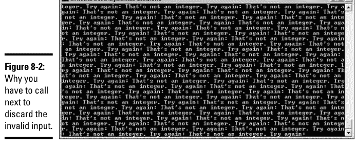

## 通过先发制人处理异常

`try` 语句是一种

## 224 通过先发制人处理异常

情况下是。关键是在执行可能导致异常的操作之前测试你的数据，并跳过或绕过处理有问题的数据。（我真正讨厌的一件事就是有问题的数据。）

例如，通常可以通过在执行除法之前检查数据来避免因整数数据除以零而导致的 `ArithmeticException`：

```
if (b != 0)
    c = a / b;
```

这消除了将除法操作包裹在 `try` 块中的需要，因为你知道除以零不会发生。

你可以将同样的技术应用于使用 `Scanner` 类的 `hasNextInt` 方法进行输入验证。此方法检查下一个输入值以确保它是一个有效的整数。（`Scanner` 类将下一个输入值称为一个 token，但这不会在考试中出现。）你可以用多种方式实现这个技术，我从第二册第二章开始就一直鼓励你思考这个问题。现在，期待已久的答案来了。代码清单 8-2 展示了 `GetInteger` 方法的一个版本，它使用 `while` 循环来避免异常。

```
代码清单 8-2：GetInteger 方法的另一个版本

import java.util.*;

public class GetInteger2
{
    static Scanner sc = new Scanner(System.in);

    public static void main(String[] args)
    {
        System.out.print("Enter an integer: ");
        int i = GetInteger();
        System.out.println("You entered " + i);
    }

    public static int GetInteger()
    {
        while (!sc.hasNextInt())
        {
            sc.nextLine();
            System.out.print("That's not an integer. " + "Try again: ");
        }
        return sc.nextInt();
    }
}
```

这是一段巧妙的小程序，你不觉得吗？`while` 语句中的条件表达式调用 `Scanner` 的 `hasNextInt` 方法，以查看下一个值是否为整数。只要此调用返回 `false`（表示下一个值不是有效的整数），`while` 循环就会重复执行。循环体调用 `nextLine` 丢弃错误数据并显示错误消息。只有当你知道输入流中是有效数据时，循环才会结束，因此 `return` 语句调用 `nextInt` 将数据解析为整数并返回结果值。

## 一次性捕获所有异常

Java 提供了一个名为 `Exception` 的通用异常类，所有其他类型的异常都基于它。（不用担心我这么说的细节。当你阅读第三册第四章时，它会更有意义。）

如果你不想在 `catch` 块中过于具体，可以指定 `Exception` 而不是更具体的异常类。例如：

```
try
{
    int c = a / b;
}
catch (Exception e)
{
    System.out.println("Oops, you can't divide by zero.");
}
```

在这个例子中，`catch` 块指定了 `Exception` 而不是 `ArithmeticException`。

如果你有一些代码可能抛出几种不同类型的异常，并且你想为其中一些提供特定处理，而为所有其他异常提供通用处理，可以这样编写 `try` 语句：

```
try
{
    // 可能抛出几种类型异常的语句
}
catch (InputMismatchException e)
{
    // 处理 InputMismatchException 的语句
}
catch (IOException e)
{
    // 处理 IOException 的语句
}
catch (Exception e)
```

## 226 显示异常消息

```
{
    // 处理所有其他异常类型的语句
}
```

在这个例子中，假设 `try` 块中的代码可能抛出 `InputMismatchException`、`IOException` 以及可能其他一些未预料到的异常类型。这里，三个 `catch` 块为每种可能性都提供了处理。


当你在 `try` 语句上编写多个 `catch` 块时，总是将更具体的异常列在前面。如果你包含了一个用于捕获 `Exception` 的 `catch` 块，请将它列在最后。

## 显示异常消息

在大多数情况下，`try` 语句的 `catch` 块根本不会对传递给它的异常对象做任何事情。然而，你可能偶尔想显示一条错误消息；异常对象有几个有趣的方法，可以不时派上用场。这些方法列在表 8-1 中。

表 8-1 Exception 类的方法

| 方法 | 描述 |
|---|---|
| `String getMessage()` | 描述错误的文本消息。 |
| `void printStackTrace()` | 将堆栈跟踪打印到标准错误流。 |
| `String toString()` | 返回异常的描述。此描述包括异常类的名称，后跟一个冒号和 `getMessage` 消息。 |

以下示例展示了如何在 `catch` 块中打印异常消息：

```
try
{
    int c = a / b;
}
catch (Exception e)
{
    System.out.println(e.getMessage());
}
```

如果 `b` 的值为零，此代码将在控制台上显示文本 `/ by zero`。通过在 `catch` 子句中使用这行代码，你可以获得更有趣的输出：

```
e.printStackTrace(System.out);
```

## 使用 finally 块

`finally` 块是出现在语句的所有 `catch` 块之后的一个块。无论 `try` 块是否抛出异常或是否被任何 `catch` 块捕获，它都会被执行。它的目的是让你清理异常可能留下的任何残局，例如打开的文件或数据库连接。

带有 `finally` 块的 `try` 语句的基本框架如下：

```
try
{
    可能抛出异常的语句
}
catch (异常类型 标识符)
{
    异常抛出时执行的语句
}
finally
{
    无论异常是否发生都执行的语句
}
```

代码清单 8-3 展示了一个虽为人为构造但很有帮助的例子，它演示了如何使用 `finally` 子句。在这个例子中，一个名为 `divideTheseNumbers` 的方法尝试两次除法。如果第一次除法失败（由于除以零异常），它会再次尝试除法。我知道，这完全不合逻辑。但就像青少年一样，很执着。

## 代码清单 8-3：使用 finally 子句的程序

```
public class CrazyWithZeros
{
    public static void main(String[] args)
    {
        try
        {
            int answer = divideTheseNumbers(5, 0);                          → 7
        }
        catch (Exception e)                                                   → 9
        {
            System.out.println("Tried twice, "
                + "still didn't work!");
        }
    }

    public static int divideTheseNumbers(int a, int b)                         → 16
        throws Exception
```


## 228 使用 finally 代码块

### 清单 8-3（续）

```java
{
    int c;
    try
    {
        c = a / b;                                → 22
        System.out.println("It worked!");           → 23
    }
    catch (Exception e)
    {
        System.out.println("Didn't work the first time.");  → 27
        c = a / b;                                 → 28
        System.out.println("It worked the second time!");   → 29
    }
    finally
    {
        System.out.println("Better clean up my mess.");     → 33
    }
    System.out.println("It worked after all.");             → 35
    return c;                                          → 36
}
```

以下是该程序的控制台输出：

```
Didn't work the first time.
Better clean up my mess.
Tried twice, still didn't work!
```

以下段落逐步解释其运行过程：

- → 7 `main` 方法调用 `divideTheseNumbers` 方法，传入 5 和 0 作为参数。你已经知道这个方法不会正常工作。
- → 9 `catch` 子句捕获第 7 行抛出的任何异常。
- → 16 `divideTheseNumbers` 方法声明它抛出 `Exception`。
- → 22 第一次尝试进行除法运算。
- → 23 如果第一次尝试成功，则执行这一行，并打印消息 "It worked!"。可惜，除法运算抛出了异常，所以这一行永远不会被执行。
- → 27 相反，`catch` 子句捕获了异常，并显示消息 "Didn't work the first time."。这是控制台输出中的第一行。
- → 28 `divideTheseNumbers` 方法固执地再次尝试将相同的两个数相除。这一次，没有 `try` 语句来捕获错误。
- → 29 然而，由于第二次除法运算又抛出了异常，这一行永远不会被执行。因此，你在控制台上看不到消息 "It worked the second time!"。（如果你看到了，那你一定是在*阴阳魔界*的某一集中。）
- → 33 `finally` 子句中的这条语句总会被执行，无论发生什么。控制台输出的第二行就是从这里来的。

在 `finally` 子句执行之后，`ArithmeticException` 被抛回调用方法，在那里它被第 9 行捕获。控制台输出的最后一行就是从这里来的。

- → 35 如果除法确实成功了，这一行会在 `try` 代码块结束后被执行，你会在控制台上看到消息 "It worked after all."。
- → 36 然后，`return` 语句会返回除法运算的结果。

## 处理 Checked 异常

Checked 异常是 Java 的设计者认为你的程序无论如何都必须处理的异常。每当你编写可能抛出 checked 异常的语句时，你的程序必须做以下两件事之一：

- ◆ 使用 `try` 语句将该语句包围起来，并用 `catch` 代码块捕获该异常。
- ◆ 在包含该语句的方法上指定 `throws` 子句，表明你的方法不想处理该异常，因此将其向上传递。

这被称为**捕获或抛出**规则。简而言之，任何包含可能抛出 checked 异常的语句的方法都必须承认它知道该异常可能被抛出。该方法通过直接处理异常，或将其传递给调用者来实现这一点。


为了说明 checked 异常的使用，我必须使用一些会抛出 checked 异常的类的方法。到目前为止，我一直避免介绍会抛出 checked 异常的类。因此，下面的示例使用了一些你还不熟悉的类。不要担心这些类做什么或如何工作。重点是学习如何处理它们抛出的 checked 异常。

## 捕获或抛出的编译器错误

以下是一个使用名为 `FileInputStream` 的类的程序。要从这个类创建对象，你必须向构造函数传递一个包含计算机上存在的文件路径和名称的字符串。如果找不到该文件，`FileInputStream` 会抛出一个 `FileNotFoundException`，你必须捕获或抛出它。这个类在 `java.io` 包中，所以任何使用它的程序都必须包含 `import java.io` 语句。

考虑以下程序：

```java
import java.io.*;

public class FileException1
{
    public static void main(String[] args)
    {
        openFile("C:\\test.txt");
    }

    public static void openFile(String name)
    {
        FileInputStream f = new FileInputStream(name);
    }
}
```

这个程序无法编译。编译器发出以下错误消息：

```
恬unreported exception java.io.FileNotFoundException;  
must be caught or declared to be thrown
```

这条消息仅仅意味着你必须处理 `FileNotFoundException`。

## 捕获 FileNotFoundException

处理 `FileNotFoundException` 的一种方法是使用普通的 `try` 语句捕获它：

```java
import java.io.*;

public class FileException2
{
    public static void main(String[] args)
    {
        openFile("C:\\test.txt");
    }

    public static void openFile(String name)
    {
        try
        {
            FileInputStream f = new
                FileInputStream(name);
        }
        catch (FileNotFoundException e)
        {
            System.out.println("File not found.");
        }
    }
}
```

在这个例子中，如果 C:\test.txt 文件不存在，则显示消息 "File not found."。

## 抛出 FileNotFoundException

假设你不想去 `openFile` 方法中处理这个错误条件，而是想将异常传递给调用 `openFile` 方法的方法？

为此，你省略 `try` 语句。相反，你向 `openFile` 方法的声明添加 `throws` 子句。这表明 `openFile` 方法知道它包含的语句可能抛出 `FileNotFoundException`，但它不想在这里处理该异常。相反，异常被传递给调用者。

以下是添加了 `throws` 子句的 `openFile` 方法：

```java
public static void openFile(String name)
    throws FileNotFoundException
{
    FileInputStream f = new FileInputStream(name);
}
```

如你所见，`throws` 子句只是列出了该方法可能抛出的异常。如果列表中有多个异常，用逗号分隔它们：

```java
public static void readFile(String name)
    throws FileNotFoundException, IOException
```

向 `openFile` 方法添加 `throws` 子句意味着当 `FileNotFoundException` 发生时，它会被直接抛给调用 `openFile` 方法的方法。这意味着调用方法（在本例中为 `main`）必须捕获或抛出该异常。要捕获该异常，`main` 方法必须像这样编写：

```java
public static void main(String[] args)
{
    try
    {
        openFile("C:\\test.txt");
    }
    catch (FileNotFoundException e)
    {
        System.out.println("File not found.");
    }
}
```

## 从 main 方法抛出异常

如果你根本不想让程序处理 `FileNotFoundException`，你可以向 `main` 方法添加 throws 子句，如下所示：

```java
public static void main(String[] args)
    throws FileNotFoundException
{
    openFile("C:\\test.txt");
}
```

这样，如果异常发生，程序会突然终止，并显示异常消息和堆栈跟踪。

## 吞掉异常

如果你不想在发生 checked 异常时做任何处理呢？换句话说，你想直接忽略该异常？你可以通过在 `try` 语句的 `catch` 代码块中捕获异常，但让 `catch` 代码块的主体保持为空来实现这一点。例如：

```java
public static void openFile(String name)
{
    try
    {
        FileInputStream f = new FileInputStream(name);
    }
    catch (FileNotFoundException e)
    {
    }
}
```

这里，`FileNotFoundException` 被捕获并忽略。这被称为**吞掉异常**。


吞掉异常被认为是一种不良的编程实践。在处理复杂程序时，吞掉那些你知道应该处理的异常是很诱人的。因为你计划在理顺程序的基本功能后再回来处理那个异常处理程序，所以吞掉一点异常似乎并不是那么糟糕的想法。问题是，你不可避免地永远不会再回到那个异常处理程序。所以你的程序就带着被吞掉的异常匆匆投入生产了。

如果你必须吞掉异常，至少向控制台写一条消息，表明发生了异常。这样，你就有一个持续的提醒，说明你的程序还有一些未完成的细节需要处理。


## 抛出你自己的异常

请注意，并非所有的异常吞没都是错误的。例如，假设你希望 `openFile` 方法返回一个布尔值来指示文件是否存在，而不是抛出异常。那么，你可以这样编写该方法：

```
public static boolean openFile(String name)
{
    boolean fileOpened = false;
    try
    {
        FileInputStream f = new FileInputStream(name);
        fileOpened = true;
    }
    catch (FileNotFoundException e)
    {
    }
    return fileOpened;
}
```

这里，异常并没有被真正吞没。相反，它的含义被转换为一个布尔结果，该结果从方法中返回。因此，由 `FileNotFoundException` 指示的错误条件并未丢失。

## 抛出你自己的异常

虽然不常见，但你可能希望编写完全由自己抛出异常的方法。为此，你需要使用 `throw` 语句。`throw` 语句具有以下基本格式：

```
throw new exception-class();
```

`exception-class` 可以是 `Exception` 或派生自 `Exception` 的类。你将在第三册中了解如何创建自己的类——包括异常类。现在，我只专注于编写抛出通用 `Exception` 的方法。

以下是一个演示抛出异常的方法的基本结构的程序：

```
public class MyException
{
    public static void main(String[] args)
    {
        try
        {
            doSomething(true);
        }
        catch (Exception e)
        {
            System.out.println("Exception!");
        }
    }

    public static void doSomething(boolean t) throws
        Exception
    {
        if (t)
            throw new Exception();
    }
}
```

这里，`doSomething` 方法接受一个布尔值作为参数。如果这个值是 `true`，它就会抛出一个异常。否则，它什么都不做。

从这个显而易见的例子中，你需要掌握以下要点：

- 通过执行 `throw` 语句来抛出异常。`throw` 语句指定要抛出的异常对象。
- 如果一个方法包含 `throw` 语句，则必须在其声明中包含 `throws` 子句。
- 调用抛出异常的方法的方法必须捕获或抛出该异常。
- 是的，这个例子非常简单。但它说明了基本要点。

---

## 第三册

## 面向对象编程

---

## 内容概览

- 第1章：理解面向对象编程...........................................................................237
- 第2章：创建你自己的类.............................................................................249
- 第3章：使用静态成员................................................................................265
- 第4章：使用子类和继承........................................................................273
- 第5章：使用抽象类和接口............................................................293
- 第6章：使用 Object 和 Class 类...............................................................305
- 第7章：使用内部类..................................................................................329
- 第8章：打包和记录你的类....................................................339

---

## 第1章：理解面向对象编程

### 本章内容

- 了解什么是面向对象编程
- 理解对象和类
- 探究继承和接口
- 使用对象设计程序
- 使用 UML 进行图解

本章是对面向对象编程的基本介绍。它将介绍你在学习 Java 中面向对象编程的具体细节时需要了解的一些基本概念和术语。

如果你更喜欢动手实践，你可能想直接跳过本章，前往第三册的第2章，在那里你将了解如何在 Java 中创建你自己的类。然后，你总是可以稍后返回本章，学习驱动面向对象编程的基本概念。对我来说，无论你现在阅读本章，还是跳过它以后再回来阅读，都是一样的。我拿的报酬都一样。

## 什么是面向对象编程？

术语*面向对象编程*有许多不同的含义。但其核心是，面向对象编程是一种基于以下前提的计算机编程类型：所有程序本质上都是对现实世界对象或抽象概念的计算机模拟。例如：

- 飞行模拟器程序试图模仿真实飞机的行为。有些做得非常出色：军用和商用飞行员在上面进行训练。在 20 世纪 60 年代，阿波罗宇航员使用计算机控制的模拟器来练习他们的登月。
- 许多计算机游戏是人类实际玩游戏的模拟，比如棒球、纳斯卡赛车和国际象棋。但即使是像吃豆人或最终幻想 4 这样的抽象游戏，也试图模拟*可能*存在于某处的生物和对象的行为。因此，这些程序模拟的是一种概念性的游戏——一种实际上无法在现实世界中进行的游戏，但可以由计算机模拟。
- 业务程序可以被视为业务流程的模拟，例如订单接收、客户服务、发货和计费。例如，发票不仅仅是一张纸；它是一张代表公司与其客户之间发生的交易的纸张。因此，基于计算机的发票实际上只是对这种交易的模拟。

编程语言具有这种前提的想法并不新鲜。传统的编程语言，如 C 及其前身，甚至包括 COBOL，都是基于计算机程序是过程的计算机化实现这一前提的——相当于“步骤 1：将 A 标签插入 B 插槽”的电子版本。LISP 编程语言基于这样一个理念：所有编程问题都可以被视为操作列表的不同方式。而广受欢迎的数据库操作语言 SQL 则将编程问题视为操作数学集合的方式。

以下是关于计算机程序是现实世界对象或抽象概念的模拟这一概念的一些额外思考：

- 有时模拟比实物更好。文字处理程序最初是打字机的模拟，但现代文字处理程序远胜于任何打字机。
- 所有计算机程序都是某种类型的模拟这一想法并不新鲜。事实上，第一种面向对象编程语言（Simula）是在 20 世纪 60 年代开发的。到 1967 年，这种语言已经具备了我们现在认为是面向对象编程基础的许多特性，包括类、对象、继承和虚方法。
- 想想看，手动的商业记录保存系统也是模拟。一个装满打印发票的文件柜并不保存实际订单。它保存的是这些订单的书面表示。计算机是比文件柜更好的模拟设备，但两者都是模拟。

## 理解对象

所有这些关于模拟的讨论对我来说有点存在主义了，所以我现在要转向构成面向对象编程的对象的本质。对象——无论是在现实世界还是在编程世界中——都是具有某些基本特征的实体。以下部分将描述其中一些更重要的特征：标识、类型、状态和行为。

### 对象具有标识

面向对象程序中的每个对象都有一个*标识*。换句话说，特定类型对象的每个出现——称为*实例*——都可以与相同类型对象的每个其他出现区分开来，也可以与其他类型的对象区分开来。

在现实世界中，对象标识是一个相当直观和明显的概念。拿起两个苹果，你知道虽然它们都是苹果（这是对象类型，在下一节中描述），但你知道它们不是同一个苹果。每个都有一个独特的标识。它们大致是相同的颜色，但并不完全相同。它们大致是圆形，但形状有细微差异。任何一个（或两个）里面都可能有一条虫子。

打开一个装满发票的文件柜，你会发现一页又一页看起来几乎相同的纸张。然而，每张纸的页眉附近都印有一个发票号码。这个号码并不是真正赋予这些发票中每张独特标识的东西，但它为你提供了一种识别每张发票的简便方法，就像你的名字为他人提供了一种识别你的简便方法一样。

在面向对象编程中，每个对象在计算机内存中都有自己的位置。因此，两个对象，即使它们可能是相同类型，也有自己的内存位置。对象的起始位置地址为我们提供了一种区分一个对象与另一个对象的方法，因为没有两个对象可以占据内存中的相同位置。

以下是关于 Java 中对象标识的一些其他重要思想：

- Java 基本上将每个对象的标识留给自己。换句话说，没有简单的方法可以获取对象的内存地址。Java 认为这与你无关，而且确实如此。如果 Java 轻易地将该信息提供给你，你会忍不住去修改它，这可能会导致各种各样的问题，任何 C 或 C++ 程序员都可以告诉你这一点。
- Java 对象有一种叫做*哈希码*的东西，它是一个为每个对象自动生成的 `int` 值，*几乎*代表了对象的标识。在大多数情况下，对象的哈希码是基于对象的内存地址。但并非总是如此。Java 不保证两个不同的对象不会有相同的哈希码。
- 当与对象一起使用时，相等运算符（==）实际上测试的是两个变量或表达式的对象标识。如果它们引用同一个对象实例，则认为这两个变量或表达式相等。


## 对象具有类型

我记得在大学主修英语时，曾研读过亨利·里德于1942年创作的优秀诗作《部件命名》：

> 今天我们来命名部件。昨天，
我们进行了日常清洁。明天早上，
我们将学习开火后要做什么。但今天，
今天我们来命名部件。贴梗海棠
在邻近的花园中如珊瑚般闪耀，
而今天我们来命名部件。

诚然，这是一首优秀的反战诗篇，但它也对面向对象编程颇有启发。首节过后，诗中继续命名步枪的各个部件：

> 这是下背带环。而这是
上背带环，其用途你将看到，
当你拿到背带时。而这是堆叠环，
但在你这里，你没有这个部件。

想象一整屋子的新兵正在拆卸他们的步枪，而教官告诉他们“这是下背带环。这是上背带环……”每个士兵的步枪都有这些部件——用面向对象的术语来说，就是特定类型的一个对象。每个士兵步枪中的下背带环是不同的对象，但都属于`LowerSlingSwivel`类型。

就像这首诗中的教官一样，面向对象编程允许你为程序中不同种类的对象分配名称。在Java中，类型由类定义。因此，当你从一个类型创建对象时，你就在声明该对象属于该类指定的类型。例如，以下语句创建了一个`Invoice`类型的对象：

```
Invoice i = new Invoice();
```

接着，该对象的标识（即其在内存中的地址）被赋值给变量`i`，编译器知道`i`可以持有对`Invoice`类型对象的引用。

## 对象具有状态

现在转向另一位文学天才：

> 一条鱼，两条鱼，
红鱼，蓝鱼

用面向对象的术语来说，苏斯博士在此列举了一对`Fish`类型的对象。`Fish`类型显然有两个属性——我们称之为`number`和`color`。这两个对象在这些属性上的值不同：

| 属性 | 对象1 | 对象2 |
|-----------|----------|----------|
| 数量 | 一 | 二 |
| 颜色 | 红色 | 蓝色 |

对象的类型决定了它拥有哪些属性。因此，所有特定类型的对象都具有相同的属性。然而，它们在这些属性上的值不一定相同。在这个例子中，所有`Fish`都有名为`Number`和`Color`的属性，但两个`Fish`对象在这些属性上具有不同的值。

对象所有属性的值的组合称为对象的*状态*。与其标识不同，对象的状态可以并且通常在其生命周期内发生变化。例如，有些鱼可以改变颜色。客户的总销售额每次购买新产品时都会改变。学生的平均绩点每次记录新课程成绩时都会改变。而员工的地址和电话号码如果员工搬家则会改变。

以下是关于对象状态的一些其他有趣细节：

- 对象的部分属性是公开已知的，但其他属性可以是私有的。私有属性可能对对象的内部操作至关重要，但对象外部没有人知道它们的存在。它们就像你的私人想法：它们影响你的言行，但除了你自己无人知晓。
- 在Java中，对象的状态由类变量表示，这些变量被称为*字段*。一个`public`字段是使用`public`关键字声明的字段，因此该变量对外部世界可见。

## 对象具有行为

对象的另一个特征是它们具有*行为*，这意味着它们可以做事。与状态一样，对象的具体行为取决于其类型。但与状态不同的是，行为对于类型的每个实例来说并不是不同的。例如，假设教室里所有学生都有相同类型的计算器。让他们都拿出计算器，将两个数字相加——可以是他们选择的任何两个数字。所有计算器显示不同的数字，但它们的加法方式都相同。换句话说，它们状态不同，但行为相同。

另一种说明对象具有行为的方式是说它们提供可以被其他对象使用的服务。你已经见过许多提供服务给其他对象的对象示例。例如，从`NumberFormat`类创建的对象提供格式化服务，将数字值转换为格式美观的字符串，如`$32.95`。

在Java中，对象的行为由其方法提供。因此，`NumberFormat`类的`format`方法为`NumberFormat`对象提供了格式化行为。

以下是关于对象行为的其他一些要点：

- 类的*接口*是该类公开的方法和字段集合，以便其他对象可以访问它们。
- 对象如何完成其工作的确切方式可以并且应该隐藏在对象内部。使用该对象的人需要知道对象做什么，但不需要知道它是如何工作的。如果你后来找到了对象完成工作的更好方法，你可以换用新的改进版本，而无人知晓差异。

## 对象的生命周期

在使用Java中的对象时，理解对象如何诞生、生活和消亡非常重要。这个主题被称为对象的*生命周期*，大致如下：

- 在从类创建对象之前，必须先*加载*该类。为此，Java运行时在磁盘（在`.class`文件中）定位该类并将其读入内存。然后，Java查找任何初始化静态字段的*静态初始化器*——这些字段不属于类的任何特定实例，而是属于类本身，并由从该类创建的所有对象共享。

当你第一次从该类创建对象或第一次访问该类的静态字段或方法时，该类将被加载。例如，当你运行一个类的`main`方法时，该类将被初始化，因为`main`方法是静态的。

- 当你使用`new`关键字时，就从类创建了一个对象。为了初始化该类，Java为对象分配内存，并设置对对象的引用，以便Java运行时可以跟踪它。然后，Java调用类的*构造函数*，它类似于一个方法，但只在对象创建时调用一次。构造函数负责执行初始化对象所需的任何处理，例如初始化变量、打开文件或数据库等。

- 对象在其生命周期内，向所有需要和希望使用它的实体提供对其公共方法和字段的访问。

- 当对象需要消亡时，对象将从内存中移除，Java会丢弃其内部引用。你不必自己销毁对象。Java运行时的特殊部分*垃圾回收器*负责在对象不再使用时销毁所有对象。

## 处理相关类

到目前为止，你在本书中看到的大多数类都创建了独立的对象，每个对象都是一个独立的小岛。然而，面向对象编程的真正威力在于其能够创建描述彼此密切相关的对象的类。

例如，棒球与垒球相似。两者都是球的具体类型。它们都有直径和重量。两者都可以被投掷、接住或击打。然而，它们具有不同的特征，导致在投掷、接住或击打时表现不同。

如果你正在创建一个模拟棒球和垒球工作方式的程序，你需要一种方式来表示这两种球。一种选择是创建单独的类来表示每种球。这些类相似，因此你可以将大部分代码从一个类复制到另一个类。

另一种选择是使用单个类来表示这两种球。然后，你将参数传递给构造函数以指示类的行为像棒球还是垒球。

然而，Java有两个专门设计用于处理像这样相关的类的面向对象编程特性：继承和接口。我将在以下章节中简要描述这些特性。

## 继承

*继承*是一种面向对象编程技术，它允许你使用一个类作为另一个类的基础。现有的类被称为*基类*、*超类*或*父类*，从中派生出的新类被称为*派生类*、*子类*或*子类*。

当你创建子类时，子类会自动获得其超类定义的所有方法和字段。你可以原样使用这些方法和字段，或者覆盖它们以改变其行为。此外，你可以添加额外的方法和字段，以定义子类特有的数据和行为。

你可以使用继承来解决上一节中的棒球/垒球问题，方法是创建一个名为`Ball`的类，该类提供所有类型球的基本功能，然后将其用作名为`BaseBall`和`SoftBall`的独立类的基类。然后，这些类可以覆盖需要对每种球类型表现不同的方法。

思考继承的一种方式是将其视为实现*是一种类型*关系的方法。例如，垒球是一种球，棒球也是一种球。因此，继承是实现这些相关类的合适方式。有关继承的更多信息，请参阅第三册第四章。


## 接口

一个*接口*是一个类必须提供以*实现*该接口的方法与字段的集合。接口本身只是一组被赋予名称的公共方法和字段声明。请注意，接口本身不提供任何实现这些方法的代码，而只提供声明。随后，一个*实现*该接口的类为接口定义的每个方法提供具体实现。

你可以通过使用接口来解决棒球/垒球问题，方法是创建一个名为`Ball`的接口，该接口指定一个球应具备的所有方法和字段。然后，你可以创建`SoftBall`和`BaseBall`类，使它们都实现`Ball`接口。

接口与继承密切相关，但有两个关键区别：

- 接口本身不提供实现其任何方法的代码。接口只是一组方法和字段的签名。相比之下，基类可以为其部分或全部方法提供实现。
- 一个类只能有一个基类。然而，一个类可以根据需要实现任意多个接口。

你将在第三卷第5章学习接口。

## 用对象设计程序

一个面向对象的程序通常不只是单个对象，而是一组协同工作以完成任务的对象。开发面向对象程序最重要的部分是设计用于创建程序对象的类。其基本思想是将一个大问题分解成一系列在规模和复杂度上都易于管理的类。然后，你编写Java代码来实现这些类。

因此，设计一个面向对象应用程序的任务可以归结为确定应用程序需要哪些类，以及每个类的公共接口是什么。如果你的类设计得好，实现应用程序就会很容易。但如果你的类设计得很差，你将很难让应用程序正常运行。

设计面向对象应用程序的一种常见方法是将应用程序划分为几个不同的*层*，这些层提供不同类型的职能。最常见的是三层方法，如图1-1所示。这里，应用程序的对象被分为三个基本层：

- **表示层：** 此层中的对象处理与用户的所有直接交互。例如，Web应用程序中的HTML页面属于此层，基于GUI的应用程序中的Swing页面和框架类也属于此层（我在第六卷介绍Swing）。
- **逻辑层：** 此层中的对象代表应用程序的核心对象。对于典型的商业类型应用程序，此层包括代表商业实体的对象，如客户、产品、订单、供应商等。此层有时被称为*业务规则层*，因为此层中的对象负责执行管理应用程序的规则。
- **数据库层：** 此层中的对象处理与应用程序使用的任何形式的数据存储交互的所有细节。例如，如果数据存储在SQL数据库中，则此层中的对象处理所有SQL操作。

## 使用UML绘制类图

自计算机编程诞生之初，程序员就喜欢为他们的程序创建图表。最初，他们绘制流程图，以图形方式表示程序的程序逻辑。

流程图擅长描述过程，但过于详细。当20世纪70年代结构化编程热潮兴起，程序员开始思考程序的整体结构时，他们从流程图转向了*结构图*，该图说明了程序或系统模块之间的组织关系。

既然面向对象编程已成为主流，程序员绘制*类图*来说明构成应用程序的类之间的关系。例如，图1-2所示的简单类图展示了一个具有四个类的简单系统的类图。矩形代表类本身，箭头代表类之间的关系。

你可以用多种方式绘制类图。为了使图表保持一致性，大多数程序员使用称为*UML*的标准，即*统一建模语言*。图1-2中的类图是一个简单的UML图示例，但UML图可以比这个例子复杂得多。

以下各节描述了创建UML类图的细节。请注意，这些章节甚至远未解释UML的所有功能。我只包含创建UML类图的基础知识，以便你在看到UML图时能够理解，并且知道如何绘制简单的类图来帮助你设计应用程序的类结构。如果你有兴趣深入了解UML，请查看Michael Jesse Chonoles和James A. Schardt所著的《UML 2 For Dummies》（Wiley出版社）。

### 绘制类

类图中的基本元素是类。在UML中，每个类被绘制为一个矩形。至少，矩形必须包含类名。然而，你可以将矩形细分为两个或三个部分，以包含关于类的附加信息，如图1-3所示。

| CustomerDB |
|---|
| +connectionString |
| +connectionStatus |
| +getCustomer |
| +updateCustomer |
| +deleteCustomer |
| +addCustomer |
| +getCustomerList |

类的中间部分列出类变量，而底部部分列出类方法。每个变量或方法的名称前面可以有一个*可见性指示符*，该指示符可以是表1-1中列出的符号之一。在实际应用中，省略可见性指示符并仅列出具有公共可见性的字段或方法是很常见的。

**表1-1** | **类变量和方法的可见性指示符**
---|---
***指示符*** | ***描述***
+ | 公共
- | 私有
# | 受保护

如果你愿意，可以为变量以及方法和参数包含类型信息。变量的类型通过在变量名后跟冒号和类型来表示：

```
connectionString: String
```

方法的返回类型以相同方式表示：

```
getCustomer(): Customer
```

参数列在括号内，并列出名称和类型。例如：

```
getCustomer(custno: int): Customer
```

> **注意：** 在UML图中省略类型和参数信息是常见的。

### 绘制接口

接口的绘制方式与类几乎相同，只是类名前有单词*interface*：

```
«interface»
ProductDB
```

*注意：* 单词*interface*被包含在一对双左箭头和双右箭头中。这些箭头不是连续输入的两个小于或大于符号；它们是一个特殊符号。幸运的是，这个符号是ASCII字符集的标准部分。你可以在Microsoft Word中通过插入符号命令访问它们。

### 绘制箭头

除了表示类的矩形外，类图还包括表示类之间关系的箭头。UML使用多种不同类型的箭头，我将在以下段落中描述。

一条一端带有空心封闭箭头的实线表示继承：

箭头指向基类。

一条一端带有空心封闭箭头的虚线表示一个类实现了一个接口：

箭头指向接口。一条带有开口箭头的实线表示*关联*：

关联仅表示两个类协同工作。可能是一个类创建另一个类的对象，或者一个类需要另一个类的对象来执行其工作。或者，也许一个类的实例包含另一个类的实例。

你可以为关联箭头添加名称以指示其目的。例如，如果关联箭头表示一个类的实例创建另一个类的对象，你可以在箭头旁边放置单词`创建`。


## 第二章：创建你自己的类

-   本章内容
-   创建你自己的类
-   查看类声明的各个部分
-   了解类字段
-   构造构造函数
-   为你的类添加方法
-   使用 `this` 关键字

好了，同学们，是时候学习如何创建你自己的类了。

在本章中，你将发现Java中创建类的基础知识。所有Java程序都是类，所以你已经见过很多类的例子了。例如，你见过像 `public class GuessingGame` 这样的类头，以及像 `public static void main` 这样的静态方法。现在，在本章中，我将向你展示如何创建拥有多个类的程序。

## 声明一个类

所有类都必须通过一个*类声明*来定义，该声明提供类的名称和类体。以下是类声明的最基本形式：

```
[public] class ClassName {class-body}
```

`public` 关键字表明该类可供其他类使用。虽然它是可选的，但你通常会在类声明中包含它。毕竟，你编写类声明的主要原因是为了让其他类能够从该类创建对象。更多关于使用 `public` 关键字的内容，请参阅本章后面的“类的位置”部分。


在本书后面的章节中，你会发现一些可以放在类声明中的其他元素。我在这里描述的格式只是基本格式，用于创建基本类。

### 选择类名

`ClassName` 是一个标识符，为你的类提供名称。你可以使用任何标识符来命名一个类，但以下三个准则可以简化你的工作：

-   ◆ **以大写字母开头命名类名。** 如果类名包含多个单词，请将每个单词首字母大写。例如，`Ball`、`RetailCustomer` 和 `GuessingGame`。
-   ◆ **尽可能使用名词作为类名。** 类创建对象，而名词是用于标识对象的词。因此，大多数类名应该是名词。
-   ◆ **避免使用Java API类的名称。** 没有规则说你必须这样做，但如果你创建的类与Java API类同名，你就必须使用完全限定名（如 `java.util.Scanner`）来区分你的类和API中的同名类。


事实上，有数千个Java API类，所以要全部避开它们相当困难。但至少，你应该避免使用常用的Java类名以及你的应用程序可能使用的任何API类名。例如，创建一个名为 `String` 或 `Math` 的类纯粹是自找麻烦。

### 类体中放什么

类的 `class body` 是类声明末尾花括号内的所有内容。类声明的 `public class ClassName` 部分只占一行，但类声明的主体可能占数百行。或者如果你写得太多，可能占数千行。

类体可以包含以下元素：

-   ◆ **字段：** 变量声明定义类的公共或私有字段。
-   ◆ **方法：** 方法声明定义类的方法。
-   ◆ **构造函数：** `构造函数` 是一个类似于方法的代码块，但在创建实例时运行以初始化对象。构造函数必须与类本身同名，虽然它类似于方法，但它没有返回类型。
-   ◆ **初始化器：** 这些是独立的代码块，只在类初始化时运行一次。实际上有两种类型，称为 `静态初始化器` 和 `实例初始化器`。虽然你不会经常使用它们，但我将在本章后面的“使用初始化器”部分讨论实例初始化器。有关静态初始化器的信息，请参阅第三卷第三章。
-   **其他类和接口：** 一个类可以包含另一个类，这被称为*内部类*或*嵌套类*。类也可以包含接口。有关内部类的更多信息，请参阅第三卷第七章。有关接口的信息，请参阅第三卷第五章。

> 与某些编程语言不同，类体中项目出现的顺序无关紧要。不过，保持类中放置内容的顺序一致性是个好主意。这样你就知道在哪里找到它们。我通常在类开始处将所有字段放在一起，然后是构造函数，最后是方法。如果类包含初始化器，我会将它们放在它们初始化的字段附近。如果类包含内部类，我通常将它们放在使用它们的方法之后。

有些程序员喜欢将字段放在类的末尾而不是开头。无论哪种方式能让你感到愉快，对我来说都很好。

> 类中包含的字段、方法、类和接口称为类的*成员*。构造函数和初始化器不被视为成员，原因太技术性，现在无法解释。（你可以在第三卷第三章找到解释。）

### 类的位置

公共类必须写在一个与类同名、扩展名为 `java` 的源文件中。例如，一个名为 `Greeter` 的公共类必须放在名为 `Greeter.java` 的文件中。

因此，你不能将两个公共类放在同一个文件中。例如，以下源文件（名为 `DiceGame.java`）将无法编译：

```
public class DiceGame
{
    public static void main(String[] args)
    {
        Dice d = new Dice();
        d.roll();
    }
}

public class Dice
{
    public void roll()
    {
        // code that rolls the dice goes here
    }
}
```

编译器会抛出一条消息，指出 `Dice` 是一个公共类，必须在名为 `Dice.java` 的文件中声明。

这个问题有两个解决方案。第一个是从 `Dice` 类中移除 `public` 关键字：

```
public class DiceGame
{
    public static void main(String[] args)
    {
        Dice d = new Dice();
        d.roll();
    }
}

class Dice
{
    public void roll()
    {
        // code that rolls the dice goes here
    }
}
```

编译器会欣然接受这个程序。

这与内部类不同。内部类是在另一个类体内定义的类，只能从该类内部访问。有关内部类的更多信息，请参阅第三卷第七章。

当你在单个源文件中编写多个类时，Java仍然会为每个类创建一个单独的类文件。因此，当你编译 `DiceGame.java` 文件时，Java编译器会创建两个类文件，分别名为 `DiceGame.class` 和 `Dice.class`。

对于相对较小的程序，从类中移除 `public` 关键字是可以接受的。但其局限性在于，`Dice` 类只能被定义在 `DiceGame.java` 文件中的类访问。如果你希望 `Dice` 类更广泛可用，请选择第二个解决方案：将其——带有 `public` 关键字——放在一个单独的名为 `Dice.java` 的文件中。

如果你打算创建一个拥有多个公共类的应用程序，请为该应用程序创建一个单独的文件夹。然后，将该应用程序的所有类文件保存到此文件夹中。如果你的类文件在同一个文件夹中，Java编译器可以找到它们。如果将它们放在单独的文件夹中，你可能需要调整你的 `ClassPath` 环境变量来帮助编译器找到这些类。

## 处理成员

类的*成员*是类体中定义的字段和方法。（从技术上讲，类中定义的类和接口也是成员。但本章不讨论它们，所以你现在可以忽略它们。）

以下部分介绍在你的类中处理字段和方法的基础知识。

### 字段

*字段*是在类体中、任何方法之外定义的变量。字段，也称为*类变量*，对类的所有方法可用。此外，如果字段指定了 `public` 关键字，则该字段在类外部可见。如果你不希望字段在类外部可见，请改用 `private` 关键字。

字段的定义与任何其他Java变量相同，但可以有一个修饰符来指定字段是公共的还是私有的。以下是一些公共字段声明的示例：

```
public int trajectory = 0;
public String name;
public Player player;
```

要创建私有字段，请指定 `private` 而不是public：

```
private int x-position = 0;
private int y-position = 0;
private String error-message = "";
```

字段也可以声明为 `final`：

```
public final int MAX_SCORE = 1000;
```

一旦 `final` 字段被初始化，其值就不能更改。

***注意：*** 将 `final` 字段名称拼写为全大写是惯例（但不是必需的）。

### 方法

你可以使用我在第二卷第七章中描述的相同技术为类定义方法。要声明一个对你的类用户可用的方法，请在方法声明中添加 `public` 关键字：

```
public boolean isActive()
{
    return this.isActive;
}
```


要创建一个可以在类内部使用但在类外部不可见的私有方法，请使用 `private` 关键字：

```
private void calculateLunarTrajectory()
{
    // code to get the calculated lunar trajectory
}
```

## 理解可见性

在前面的章节中，我提到过字段和方法都可以使用 `public` 或 `private` 关键字来指示该字段或方法是否可以被类外部访问。这被称为字段或方法的 *可见性（visibility）*。

所有具有 `public` 访问权限的成员的组合有时被称为类的 *公共接口（public interface）*。这些成员是其他对象与你的类的对象进行通信的唯一方式。因此，要仔细考虑你的类声明哪些公共字段和方法。

术语 *暴露（expose）* 有时用于指代创建公共字段和方法。例如，如果某个类有一个名为 `isActive` 的公共方法，你可以说该类 *暴露（expose）* 了 `isActive` 方法。这仅仅意味着该方法对其他类可用。

你可以在类内部使用私有字段和方法，但不能从其他类中使用。它们用于提供对类的运行可能至关重要但不应暴露给外部世界的实现细节。私有字段和方法有时被称为 *内部成员（internal members）*，因为它们只能从类内部访问。

## Getters 和 Setters

面向对象编程的基本目标之一是将类的实现细节隐藏在类内部，同时仔细控制类的哪些方面暴露给外部世界。一般来说，你应该避免创建公共字段。相反，你可以将所有字段设为私有。然后，你可以通过向类中添加称为 *访问器（accessors）* 的特殊方法，有选择地授予对这些字段所包含数据的访问权限。

访问器有两种类型：*get 访问器*（也称为 *getter*）是检索字段值的方法，而 *set 访问器*（*setter*）是设置字段值的方法。这些方法通常分别命名为 `get`*FieldName* 和 `set`*FieldName*。例如，如果字段名为 `count`，则 getter methods 和 setter methods 分别命名为 `getCount` 和 `setCount`。

下面是一个使用名为 `Health` 的私有字段来表示游戏程序中玩家生命值的类：

```
public class Player
{
    private int health;

    public int getHealth()
    {
        return health;
    }

    public void setHealth(int h)
    {
        health = h;
    }
}
```

在这里，`health` 字段本身被声明为私有，因此不能直接访问。相反，它只能通过 `getHealth` 和 `setHealth` 方法来访问。

创建带有访问器而不是简单公共字段的类有几个好处：

- 你可以通过提供 get 访问器但不提供 set 访问器来创建只读属性。这样，其他类可以检索属性值，但不能修改它。

- 不将属性值存储在私有字段中，而是可以在每次调用 get 访问器方法时计算它。例如，假设你有一个名为 `Order` 的类，它包含名为 `unitPrice` 和 `quantityOrdered` 的字段。这个类可能还包含一个如下所示的 `getOrderTotal` 方法：

```
public double getOrderTotal()
{
    return unitPrice * quantityOrdered;
}
```

在这里，get 访问器不返回类字段的值，而是计算要返回的值。

- 你可以在属性 set 访问器中验证数据来保护类免受不良数据的影响，并在传入无效数据时忽略它或抛出异常。例如，假设你有一个名为 `Health` 的 `int` 属性的 set 访问器，其值范围为 0 到 100。下面是一个防止 `Health` 属性被设置为不正确值的 set 访问器：

```
public void setHealth(int h)
{
    if (h < 0)
        health = 0;
    else if (h > 100)
        health = 100;
    else
        health = h;
}
```

在这里，如果 `setHealth` 方法被调用时传入的值小于零，则生命值被设置为零。同样，如果值大于 100，则生命值被设置为 100。

关于访问器使用的更多见解，请参阅边栏"访问器模式"。

### 访问器模式

本章"Getters 和 Setters"一节中描述的访问器使用是 Java 程序员常用的设计模式的一个例子。*访问器模式（Accessor pattern）* 旨在提供一种一致的方式来设置或检索类字段的值，而无需将字段本身暴露给外部世界。

大多数 Java 程序员很快就了解到，面向对象编程的基本准则之一是避免公共字段。不幸的是，他们常常对这一准则的回应是将所有字段设为私有，然后为每个字段提供 get 和 set 访问器，无论它们是否需要。于是他们编写的类看起来像这样：

```
public class MyClass
{
    private int fieldX;
    private int fieldY;
    public int getX() { return x; }
    public void setX(int xValue) { this.x = xValue; }
    public int getY() { return y; }
    public void setY(int yValue) { this.y = yValue; }
}
```

为什么不直接将 `fieldX` 和 `fieldY` 设为公共字段并跳过访问器呢？

说实话，你大可以这样做。将字段设为私有的目的是为了能够仔细控制对它们的访问。如果你盲目地为所有字段创建访问器，那你还不如直接将字段设为公共。

相反，应该仔细考虑哪些字段确实应该对外部世界可访问，并只为那些真正需要的字段提供访问器。

## 方法重载

Java 类可以包含两个或更多同名的方法，只要这些方法接受的参数不同即可。这称为 *方法重载（overloading）*，是为类构建灵活性的关键之一。通过方法重载，你可以预见某人可能想要调用对象功能的不同方式，然后为每种替代方案提供重载方法。

术语 *重载（overloading）* 是准确的，但有点不幸。通常，当你说某物过载时，意味着有问题。例如，我曾经看到一张大众捷达的照片，上面堆了 3000 磅的木材。（你可以在 [www.snopes.com/photos/lumber.asp](http://www.snopes.com/photos/lumber.asp) 找到这张照片，由 Snopes.com——都市传说参考网页提供。）那是重载的典型例子。你不必担心 Java 会在重载方法的重量下崩溃。

你已经熟悉几个具有重载方法的类，尽管你可能没有意识到。例如，`PrintWriter` 类（通过 `System.out` 访问）定义了十个不同版本的 `println` 方法，允许你打印不同类型的数据。以下行显示了这些重载的方法声明：

```
void println()
void println(boolean x)
void println(char x)
void println(char[] x)
void println(double x)
void println(float x)
void println(int x)
void println(long x)
void println(Object x)
void println(String x)
```

创建重载方法时的基本规则是，每个方法必须有唯一的签名。方法的 *签名（signature）* 是其名称与它所接受的参数数量和类型的组合。因此，每个 `println` 方法都有不同的签名，因为尽管每个方法名称相同，但每个方法接受的参数类型不同。

以下两点 *不* 属于方法签名的一部分：

- **方法的返回类型：** 你不能编写两个名称和参数相同但返回类型不同的方法。

- **参数的名称：** 方法签名只关心参数的类型以及它们出现的顺序。因此，以下两个方法具有相同的签名：

```
double someMethodOfMine(double x, boolean y)
double someMethodOfMine(double param1, boolean param2)
```


# 创建构造函数

*构造函数* 是在创建对象实例时被调用的一段代码。在许多方面，构造函数与方法类似，但也存在一些区别：

- 构造函数没有返回类型。
- 构造函数的名称必须与类的名称相同。
- 与方法不同，构造函数不被视为类的成员。（这仅在涉及继承时才重要，相关内容在第三册第 4 章中介绍。）
- 构造函数在创建新的对象实例时被调用。实际上，是 `new` 关键字调用了构造函数。创建对象后，无法再次调用构造函数。

以下是编写构造函数的基本格式：

```
public ClassName (parameter-list) [throws exception...]
{
    statements...
}
```

`public` 关键字表示其他类可以访问该构造函数。这通常是你想要的效果，尽管在下一章中你会了解为何有时需要创建 `private` 构造函数。`ClassName` 必须与包含该构造函数的类名相同。参数列表的编写方式与方法相同。

还要注意，如果构造函数遇到无法恢复的情况，它可以抛出有关抛出异常的更多信息，请参考第二册第 8 章。

## 基本构造函数

编写构造函数最常见的原因可能是在创建对象时为类字段提供初始值。例如，假设你有一个名为 `Actor` 的类，其中包含名为 `firstName` 和 `lastName` 的字段。你可以为 `Actor` 类创建一个构造函数：

```
public Actor(String first, String last)
{
    firstName = first;
    lastName = last;
}
```

然后，通过调用此构造函数来创建 `Actor` 类的一个实例：

```
Actor a = new Actor("Arnold", "Schwarzenegger");
```

这样就创建了一个新的 `Actor` 对象，代表 Arnold Schwarzenegger。

与方法一样，构造函数也可以重载。换句话说，你可以为一个类提供多个构造函数，只要每个构造函数具有唯一的签名。例如，以下是 `Actor` 类的另一个构造函数：

```
public Actor(String first, String last, boolean good)
{
    firstName = first;
    lastName = last;
    goodActor = good;
}
```

这个构造函数允许你在演员姓名之外，创建包含附加信息的 `Actor` 对象：

```
Actor a = new Actor("Arnold", "Schwarzenegger", false);
```

## 默认构造函数

我是看着 *《警网铁金刚》* 长大的。我至今还能听到 Joe Friday 向某个暴徒宣读他的权利："你有权在审讯期间获得律师。如果你希望有律师但无力承担，将免费为你指派一名律师。"

Java 构造函数就像这样。每个类都有权拥有一个构造函数。如果你不提供构造函数，Java 会免费为你指定一个。这个免费的构造函数称为 *默认构造函数*。它不接受任何参数，也不执行任何操作，但它确实允许你的类被实例化。

因此，以下两个类是等效的：

```
public Class1
{
    public Class1() { }
}

public Class1 { }
```

在第一个示例中，类显式声明了一个不接受任何参数且其主体中没有语句的构造函数。在第二个示例中，Java 创建了一个默认构造函数，其作用与第一个示例中显示的构造函数相同。

如果你为类声明了任何构造函数，则 *不会* 创建默认构造函数。因此，如果你声明了一个接受参数的构造函数，并且仍然希望拥有一个空的构造函数（不带参数且没有主体），则必须为类显式声明一个空的构造函数。

一个例子可以澄清这一点。以下代码 *无法* 编译：

```
public class BadActorApp
{
    public static void main(String[] args)
    {
        Actor a = new Actor();    // 错误：无法编译
    }
}

class Actor
{
    private String lastName;
    private String firstName;
    private boolean goodActor;

    public Actor(String last, String first)
    {
        lastName = last;
        firstName = first;
    }

    public Actor(String last, String first, boolean good)
    {
        lastName = last;
        firstName = first;
        goodActor = good;
    }
}
```

这个程序无法编译，因为它没有为 `Actor` 类显式提供默认构造函数，并且由于它提供了其他构造函数，因此不会自动生成默认构造函数。

## 调用其他构造函数

构造函数可以使用特殊关键字 `this` 作为方法调用来调用同一类的另一个构造函数。当你有多个相互关联的构造函数时，这种技术通常很常用。

例如，考虑这个类：

```
public class Actor
{
    private String lastName;
    private String firstName;
    private boolean goodActor;

    public Actor(String last, String first)
    {
        lastName = last;
        firstName = first;
    }

    public Actor(String last, String first, boolean good)
    {
        this(last, first);
        goodActor = good;
    }
}
```

这里，第二个构造函数调用第一个构造函数来设置 `lastName` 和 `firstName` 字段。然后，它设置 `goodActor` 字段。

在使用 `this` 关键字作为构造函数调用时，有一些限制：

- 你只能在构造函数的第一条语句中调用另一个构造函数。因此，以下代码无法编译：

    ```
    public Actor(String last, String first, boolean good)
    {
        goodActor = good;
        this(last, first);        // 错误：无法编译
    }
    ```

    如果你尝试编译包含此构造函数的类，你会收到一条消息，指出对 `this` 的调用必须是构造函数中的第一条语句。

- 每个构造函数只能调用另一个构造函数。但是，你可以将构造函数链接在一起。例如，如果一个类有三个构造函数，第一个构造函数可以调用第二个，而第二个又可以调用第三个。

- 你不能创建构造函数相互调用的循环。例如，以下是一个无法编译的类：

    ```
    class CrazyClass
    {
        private String firstString;
        private String secondString;

        public CrazyClass(String first, String second)
        {
            this(first);
            secondString = second;
        }
    ```

    ```
    public CrazyClass(String first)
    {
        this(first, "DEFAULT");  // 错误：无法
        // 编译
    }
    ```

    第一个构造函数首先调用第二个构造函数，而第二个构造函数又调用第一个构造函数。编译器会报错称此错误为 `递归构造函数调用`，并礼貌地拒绝编译该类。

如果你没有在构造函数的第一行显式调用构造函数，Java 会插入代码自动调用基类的默认构造函数——即这个类所继承的类。这个小细节直到你开始处理继承时才变得重要，相关内容在第三册第 4 章中介绍。所以你现在完全可以忽略它。

## *this* 的更多用途

正如我在上一节所述，你可以在构造函数中使用 `this` 关键字来调用当前类的另一个构造函数。你也可以在类构造函数或方法的主体中使用 `this` 来引用当前对象——即调用该构造函数或方法的类实例。

`this` 关键字通常用于限定对当前对象实例变量的引用。例如：

```
public Actor(String last, String first)
{
    this.lastName = last;
    this.firstName = first;
}
```

这里，`this` 并非真正必要，因为编译器可以判断 `lastName` 和 `firstName` 引用的是类变量。然而，假设你将 `lastName` 和 `firstName` 用作构造函数的参数名：

```
public Actor(String lastName, String firstName)
{
    this.lastName = lastName;
    this.firstName = firstName;
}
```

这里，需要使用 `this` 关键字来区分名为 `lastName` 和 `firstName` 的参数与同名的实例变量。


## 使用初始化器

一个*初始化器*（有时称为*初始化块*）是一段独立的代码块，它放置在任何方法、构造函数或其他代码块之外。每当类的实例被创建时，初始化器就会被执行，无论使用哪个构造函数来创建该实例。

初始化器块与用于初始化变量的变量初始化器类似。区别在于，使用初始化器块，你可以编写多条语句。例如，下面是一个类，它在类初始化时从用户那里获取类字段的值：

```java
class PrimeClass
{
    private Scanner sc = new Scanner(System.in);

    public int x;

    {
        System.out.print(
            "Enter the starting value for x: ");
        x = sc.nextInt();
    }
}
```

你几乎总是可以使用其他编码技术来实现相同的效果，这些技术通常更直接。例如，你可以在构造函数中提示用户输入值。或者，你可以在字段初始化器中调用一个方法，像这样：

```java
class PrimeClass
{
    private Scanner sc = new Scanner(System.in);

    public int x = getX();

    private int getX()
    {
        System.out.print("Enter the starting value for x: ");
        return sc.nextInt();
    }
}
```

无论哪种方式，效果都是相同的。

以下是关于初始化器的一些其他信息：

- 如果一个类包含多个初始化器，初始化器将按照它们在程序中出现的顺序执行。
- 初始化器在任何类构造函数之前执行。
- 一种特殊的初始化器块称为*静态初始化器*，它允许你初始化静态字段。更多信息，请参阅下一章。
- 初始化器有时用于匿名类，正如我在第 III 卷第 6 章中所述。

## 第 3 章：使用静态成员

### 本章内容

- 向类添加静态字段
- 创建静态方法
- 创建可以实例化的类
- 使用静态初始化器

*静态方法*是与类的实例无关的方法。（除非你直接跳到本章，否则你已经知道了这一点。）相反，该方法属于类本身。因此，你可以在不先创建类实例的情况下调用该方法。在本章中，你将了解创建和使用静态字段和方法所需的一切知识。

### 理解静态字段和方法

根据我手边的韦氏词典，*static* 这个词有几种不同的含义。其中大多数与静止或不变的概念有关。例如，*静态显示*是指不移动的显示。*静电*是指不流动的电荷。*静态设计*是指不改变的设计。

Java 中使用的*static*一词并不意味着不变。例如，你可以创建一个静态字段，然后在程序执行时为其赋值。因此，静态字段的值是可以改变的。

更令人困惑的是，*static* 这个词也可以指干扰，就像无线电静电会阻止你清晰地收听音乐一样。但在 Java 中，*static* 这个术语与干扰或接收不良无关。

那么，*static* 这个术语在 Java 中是什么意思呢？它用于描述一种特殊类型的字段或方法，这种字段或方法不与类的特定实例相关联。相反，静态字段和方法与类本身相关联。这意味着你不必创建类的实例就可以访问静态字段或方法。相反，你通过指定类名而不是引用对象的变量来访问静态字段或方法。

### 使用静态字段

静态字段和方法有许多常见用途。以下仅列出几种：

- **提供与类实例无关的常量或其他值。** 例如，一个 `Billing` 类可能有一个名为 `SALES_TAX_RATE` 的常量，用于提供州销售税率。
- **统计已创建的类实例数量。** 例如，游戏中使用的 `Ball` 类可能有一个静态字段，用于统计当前存在的球数。这个计数不属于 `Ball` 类的任何一个实例。
- **在商业应用程序中，跟踪分配给每个新对象实例的引用或序列号。** 例如，一个 `Invoice` 类可能维护一个静态字段，该字段保存分配给从该类创建的下一个 `Invoice` 对象的发票号码。
- **提供创建类实例的替代方式。** 一个很好的例子是 `NumberFormat` 类，它有静态方法如 `getCurrencyInstance` 和 `getNumberInstance`，这些方法返回对象实例以特定方式格式化数字。你可能想使用这种技术的一个原因是创建只能有一个对象实例的类。这称为*单例类*，在本章后面的侧边栏“单例模式”中有更详细的描述。
- **提供与对象完全无关的实用函数。** Java API 库中的一个好例子是 `Math` 类，它提供了一堆用于数学计算的静态方法。你自己可以编写的一个例子是一个 `DataValidation` 类，其中包含用于验证输入数据的静态方法，或者一个数据库类，其中包含用于执行数据库操作的静态方法。

### 使用静态字段

*静态字段*是使用 `static` 关键字声明的字段，如下所示：

```java
private static int ballCount;
```

请注意，`static` 关键字和可见性关键字（`private` 和 `public`，以及我将在下一章中描述的 `protected`）的位置是可以互换的。因此，以下语句同样有效：

```java
static private int ballCount;
```

按照惯例，大多数程序员倾向于将可见性关键字放在前面。

你可以为静态字段提供初始值：

```java
private static String district = "Northwest";
```

静态字段在类首次加载时创建和初始化。这发生在类的静态成员被引用时，或者类的实例被创建时，以先发生者为准。

初始化静态字段的另一种方法是使用 `static initializer`，我将在本章后面的“使用静态初始化器”一节中介绍。

### 使用静态方法

`static method` 是使用 `static` 关键字声明的方法。与静态字段一样，静态方法与类本身相关联，而不是与从该类创建的任何特定对象相关联。因此，你不必在使用类定义的静态方法之前从类创建对象。

最著名的静态方法是 `main`，它由 Java 运行时调用以启动应用程序。`main` 方法必须是静态的，这意味着应用程序默认在静态上下文中运行。

使用静态方法的基本规则之一是，你不能从静态方法中访问非静态方法或字段。这是因为静态方法没有类的实例可用于引用实例方法或字段。例如，以下代码将无法编译：

```java
public class TestClass
{
    private int x = 5;        // an instance field

    public static void main(String[] args)
    {
        int y = x;             // error: won't compile
    }
}
```

请注意，你不能在类方法中使用 `static` 关键字。因此，以下代码将无法编译：

```java
static private void someMethod()
{
    static int x;
}
```

换句话说，字段可以是静态的，但局部变量不能是静态的。


 ## 268 统计实例数量

在这里，`main` 方法是静态的，因此它无法访问实例变量 `x`。

**注意：** 不过，你*可以*从实例方法中访问静态方法和字段。例如，以下代码可以正常工作：

```
public class Invoice
{
    private static double taxRate = 0.75;

    private double salesTotal;

    public double getTax()
    {
        return salesTotal * taxRate;
    }
}
```

在这里，名为 `getTax` 的实例方法访问静态字段 `taxRate` 没有任何问题。

## 统计实例数量

静态变量的一种常见用途是跟踪已创建的类的实例数量。为了说明如何做到这一点，请考虑清单 3-1 中的程序。该程序包含两个类。`CountTest` 类是一个简单的类，用于跟踪其构造函数被调用的次数。然后，`CountTestApp` 类使用 `for` 循环创建该类的十个实例，并在每次创建实例后显示已创建的实例数量。

请注意，此应用程序中的实例计数在每次运行应用程序时都会重置为零。因此，它并不会跟踪 `CountTest` 类总共创建了多少个实例，而只会跟踪在程序的一次特定执行过程中创建了多少个实例。

## 清单 3-1：CountTest 应用程序

```
public class CountTestApp                              → 1
{
    public static void main(String[] args)
    {
        printCount();
        for (int i = 0; i < 10; i++)
        {
            CountTest c1 = new CountTest();              → 8
            printCount();                                → 9
        }
    }
}
```

```
private static void printCount()
{
    System.out.println("There are now "
        + CountTest.getInstanceCount()
        + " instances of the CountTest class.");
}
}
```

```
class CountTest
{
    private static int instanceCount = 0;

    public CountTest()
    {
        instanceCount++;
    }

    public static int getInstanceCount()
    {
        return instanceCount;
    }
}
```

以下段落描述了该程序的一些要点：

- **1** `CountTestApp` 类的开头，用于测试 `CountTest` 类。
- **8** 创建 `CountTest` 类的一个实例。由于此代码包含在 `for` 循环中，因此总共会创建 10 个实例。
- **9** 调用 `printCount` 方法，打印到目前为止已创建的 `CountTest` 对象数量。
- **15** 此行打印一条消息，指示到目前为止已创建多少个 `CountTest` 对象。它调用 `CountTest` 类的静态 `getInstanceCount` 方法来获取实例计数。
- **21** `CountTest` 类的开头。
- **23** 静态 `instanceCount` 变量，用于存储实例计数。
- **25** `CountTest` 类的构造函数。注意，`instanceCount` 变量在构造函数中递增。这样，每次创建该类的新实例时，实例计数都会递增。
- **29** 静态 `getInstanceCount` 方法，它只是返回静态 `instanceCount` 字段的值。

## 单例模式

*单例*（singleton）是一种只能用于创建一个实例的类。当你尝试创建实例时，该类首先检查实例是否已经存在。如果是，则使用现有实例；如果不是，则创建一个新实例。

你无法使用 Java 构造函数来实现这种效果，因为类实例在构造函数执行之前就已经被创建了（这就是为什么你可以在构造函数内部使用 `this` 关键字）。因此，实现单例类的通常方式是将该类的所有构造函数声明为 `private`。这样，其他类就无法使用这些构造函数。然后，你提供一个返回实例的静态方法。该方法要么创建一个新实例，要么返回一个现有实例。

以下是一个单例类的基本示例：

```
class SingletonClass
{
    private static SingletonClass instance;

    private SingletonClass()
    {
    }

    public static SingletonClass getInstance()
    {
        if (instance == null)
            instance = new SingletonClass();
        return instance;
    }
}
```

在这里，`SingletonClass` 包含一个 `private` 实例变量，用于维护对该类实例的引用。然后，默认构造函数被声明为 `private` 可见性，以防止该构造函数在类外部被使用。最后，静态 `getInstance` 方法在 `instance` 变量为 `null` 时调用构造函数创建一个实例。然后，它将该实例返回给调用者。

以下是调用 `getInstance` 方法两次，然后比较结果对象的代码片段：

```
SingletonClass s1 = SingletonClass.getInstance();
SingletonClass s2 = SingletonClass.getInstance();
if (s1 == s2)
    System.out.println("The objects are the same");
else
    System.out.println("The objects are not the same");
```

当运行此代码时，第一次调用 `getInstance` 会创建 `SingletonClass` 类的一个新实例。第二次调用 `getInstance` 只是返回在第一次调用中创建的实例的引用。因此，`if` 语句中的比较结果为 `true`，第一条消息被打印到控制台。

## 阻止实例化

有时，你希望创建一个完全不能被实例化的类。那么，该类将完全由静态字段和方法组成。Java API 中的一个很好的例子是 `Math` 类。它的方法提供了实用类型的功能，这些功能实际上并不与特定对象相关联。你可能会偶尔发现自己也需要创建类似的类。例如，你可能创建一个带有静态方法的类，用于验证输入数据。或者，你可能创建一个数据库访问类，该类具有从数据库检索数据的静态方法。你不需要创建这些类中的任何一个的实例。

你可以使用一个简单的技巧来阻止任何人实例化某个类。要创建一个类实例，你必须至少有一个公共构造函数。如果你没有在类中提供构造函数，Java 会自动插入一个默认构造函数，而这个构造函数恰好是公共的。

那么，要阻止创建类实例，你所要做的就是提供一个单独的 `private` 构造函数，如下所示：

```
public class Validation
{
    private Validation() {}          // 阻止实例化

    // 静态方法和字段放在这里
}
```

现在，由于构造函数是 `private` 的，该类无法被实例化。

顺便说一下，`Math` 类使用这种技术来阻止你从中创建实例。以下是来自 `Math` 类的一段实际代码：

```
public final class Math {

    /**
     * Don't let anyone instantiate this class.
     */
    private Math() {}
}
}

我想，如果这个技巧对编写 `Math` 类的人来说足够好，那对我也足够好了。

## 使用静态初始化器

在上一章中，你了解了可用于初始化实例变量的*初始化块*。初始化块在创建类的实例之前不会执行，因此你不能指望它们来初始化静态字段。毕竟，你可能会在创建类的实例之前访问静态字段。

## 使用静态初始化器

Java 提供了一种称为*静态初始化器*的功能，专门用于让你初始化静态字段。静态初始化器的一般形式如下：

```
static
{
    statements...
}
```

如你所见，静态初始化器类似于初始化块，但以 `static` 关键字开头。与初始化块一样，你将静态初始化器编写在类主体中，但在任何其他块之外，例如方法或构造函数的主体。

当你第一次访问静态成员（如静态字段或静态方法）时，会执行类中的任何静态初始化器，前提是你尚未创建该类的实例。这是因为静态初始化器在你第一次创建实例时也会执行。在这种情况下，静态初始化器在构造函数执行*之前*执行。

如果一个类有多个静态初始化器，它们将按在程序中出现的顺序执行。

以下是一个包含静态初始化器的类的示例：

```
class StaticInit
{
    public static int x;

    static
    {
        x = 32;
    }

// 其他类成员（如构造函数和方法）放在这里...
}
```

这个例子相当简单。事实上，你可以在声明变量时将值 32 赋给它，从而达到相同的效果。但是，假设你必须执行复杂的计算来确定 `x` 的值，或者假设它的值来自数据库？在这种情况下，静态初始化器可能非常有用。


## 第四章：使用子类和继承

### 本章内容

-   解释继承
-   创建子类
-   使用受保护访问
-   创建最终类
-   揭开多态的神秘面纱
-   创建自定义异常类

如你在第三册第一章中所知，一个 Java 类可以基于另一个类。这样，这个类就变成了父类的子类：它继承了父类的所有特征，无论好坏。父类的所有字段和方法都会传递给子类。子类可以原样使用这些字段或方法，也可以重写它们以提供自己的版本。此外，子类还可以添加自己的字段或方法。

在本章中，你将探索这种“魔法”是如何运作的，以及创建和使用继承其他类的 Java 类的基础知识。你还将发现一些巧妙的技巧，帮助你充分利用继承。

### 介绍继承

*继承*这个词会让人联想到几种不同的非计算机含义：

-   子女从父母那里继承某些特征。例如，我三个孩子中有两个是红头发。希望他们到了30岁时不会变成半秃。
-   子女也可能从父母那里继承行为。正如俗话所说，有其父必有其子。
-   当某人去世时，他们的继承人会得到他们的财产。有些是好东西，但有些可能不是。我的孩子们将会很有趣，他们会翻遍我的车库，决定谁得到什么。
-   你也可以继承权利和财产。例如，你可能因为父母是某国公民而成为该国公民。

在 Java 中，*继承*指的是面向对象编程的一个特性，它允许你创建从其他类派生的类。一个基于另一个类的类被称为*继承*了另一个类。被继承的类称为*父类*、*基类*或*超类*。进行继承的类称为*子类*、*派生类*或*子类*。

> **提示**
> *子类*和*超类*这两个术语似乎是 Java 专家们的首选术语。所以，如果你想让自己看起来很内行，就使用这些术语。另外，请注意*子类*这个词也可以用作动词。例如，当你创建一个继承基类的子类时，你就是在*子类化*这个基类。

关于继承，你需要知道几件重要的事情：

-   ✦ 派生类会自动继承其基类的所有行为和属性。因此，如果你需要创建几个不同的类来描述不完全相同但具有许多共同特征的类型，你可以创建一个定义所有共同特征的基类。然后，你可以创建几个继承这些共同特征的派生类。
-   ✦ 派生类可以通过定义自己的方法和字段来为它继承的基类添加功能。这是派生类区别于其基类的一种方式。
-   ✦ 派生类也可以改变基类提供的行为。例如，一个基类可能规定所有派生自它的类都有一个名为 `play` 的方法，但每个类都可以自由提供 `play` 方法的自己的实现。在这种情况下，所有扩展基类的类都提供自己的 `play` 方法实现。
-   ✦ 继承最适合用于实现*是一种*关系。例如：纸牌游戏是游戏的一种类型；卡车是车辆的一种类型；发票是交易的一种类型。在每种情况下，一种特定类型的对象都是更一般类别的特定类型。

以下部分提供了一些帮助说明这些要点的例子。

### 汽车、火车和飞机

继承通常用现实世界中的对象来解释，比如汽车和摩托车、鸟类和爬行动物，或其他熟悉的现实世界对象。例如，考虑各种类型的车辆。汽车和摩托车是两种不同类型的车辆。如果你正在编写表示车辆的软件，你可以从创建一个名为 `Vehicle` 的类开始，这个类描述所有类型车辆的共同特征，比如轮子、司机、载客能力以及执行驾驶、停车、转弯或碰撞等动作的能力。

摩托车是一种进一步细化 `Vehicle` 类的车辆类型。`Motorcycle` 类将继承 `Vehicle` 类，因此它将有轮子、司机、可能的乘客以及驾驶、停车、转弯或碰撞的能力。此外，它将有区别于其他类型车辆的特征。例如，它有两个轮子，并使用车把进行转向控制。

汽车也是一种车辆类型。`Car` 类将继承 `Vehicle` 类，因此它也将有轮子、司机、可能的乘客以及驾驶、停车、转弯或碰撞的能力。另外，它还有一些自己的特征，比如有四个轮子和一个方向盘、安全带和安全气囊，以及可选的自动变速器。

## 玩游戏

因为你不太可能真的编写一个模拟汽车、摩托车或其他车辆的程序，所以让我们看一个更常见的例子：游戏。假设你想开发一系列棋盘游戏，比如《人生》、《抱歉》或《大富翁》。大多数棋盘游戏有一些共同特征：

-   它们有一个游戏棋盘，上面有玩家可以占据的位置。
-   它们有用对象表示的玩家。
-   游戏通过每个玩家轮流进行。一旦游戏开始，就会持续进行，直到有人获胜。（如果你不相信我，问问那些试图在有人赢之前阻止《勇敢者的游戏》的孩子们。）

每种具体类型的游戏都有这些基本特征，但会添加自己的特色。例如，《人生》增加了金钱、保险单、配偶和子女，以及棋盘中央一个漂亮的转盘。《抱歉》有你可以抽取来决定每一步移动的卡牌，以及其他玩家不能攻击你的安全区。而《大富翁》有“机会”和“命运”卡、地产、房屋、酒店和金钱。

如果你在为这些游戏设计类，你可能会创建一个通用的 `BoardGame` 类，定义所有棋盘游戏的共同基本特征，然后将其用作表示特定棋盘游戏的类的基类，例如 `LifeGame`、`SorryGame` 和 `MonopolyGame`。

### 一个商业示例

如果车辆或游戏的例子还不够清楚，这里有一个来自商业世界的例子。假设你正在设计一个工资系统，并且正在处理表示员工的类。你意识到工资系统基本上包括两类员工：领固定薪水的员工和按小时计酬的员工。所以你决定创建两个类，合理地命名为 `SalariedEmployee` 和 `HourlyEmployee`。

你很快发现这两个类完成的大部分工作是相同的。这两类员工都有姓名、地址、社会保障号码、全年已支付总额、预扣税款总额等等。

然而，它们有重要的区别。最明显的是，领固定薪水的员工有年薪，而按小时计酬的员工有小时工资率。但还有其他区别。例如，按小时计酬的员工有每周变化的排班。而领固定薪水的员工可能有一个不向按小时计酬员工提供的福利计划。

所以，你决定创建三个类，而不是两个。一个名为 `Employee` 的类处理这两类员工的共同所有特征。然后，这个类成为 `SalariedEmployee` 和 `HourlyEmployee` 类的基类。这些类提供了区分领固定薪水的员工和按小时计酬员工的额外特征。

### 继承层次结构

继承最重要的方面之一是，从基类派生的类可以反过来用作另一个派生类的基类。因此，你可以使用继承来形成一个类的层次结构。

例如，你已经看到 `Employee` 类如何可以用作基类来创建两种子类：用于领固定薪水员工的 `SalariedEmployee` 类和用于按小时计酬员工的 `HourlyEmployee` 类。假设领固定薪水员工分为两类：管理和销售。那么，你可以使用 `SalariedEmployee` 类作为另外两个类的基类，分别命名为 `Manager` 和 `SalesPerson`。

因此，`Manager` 是 `SalariedEmployee` 的一种类型。而由于 `SalariedEmployee` 是 `Employee` 的一种类型，`Manager` 也是 `Employee` 的一种类型。


所有类最终都派生自一个名为 `Object` 的 Java 类。任何没有明确说明派生自哪个类的类，都假定派生自 `Object` 类。这个类提供了一些所有 Java 类共有的基本特征，例如 `toString` 方法。更多信息，请参阅第三册第五章。


## 创建子类

创建子类的基本过程很简单。只需在子类的声明中使用`extends`关键字即可。继承基类的类的基本声明格式如下：

```
public class ClassName extends BaseClass
{
    // 类主体放在这里
}
```

例如，假设你有一个名为`Ball`的类，它定义了一个基本的球，你想创建一个名为`BouncingBall`的子类，为其添加弹跳能力。

```
public class BouncingBall extends Ball
{
    // 为基本Ball对象添加弹跳能力的方法和字段：

    public void bounce()
    {
        // 弹跳方法
    }
}
```

## 委托模式

继承是面向对象编程语言（如Java）的一大特性。然而，它并不能解决所有的编程问题。而且，坦率地说，许多Java程序员使用得过于频繁。在很多情况下，简单地在一个类中包含另一个类的实例，而不是使用继承，会更加容易。这种技术有时被称为*委托设计模式*。

创建这个类的一种方法是扩展Java API提供的某个集合类，例如`ArrayList`类。然后，你的`EmployeeCollection`类将成为`ArrayList`类的一个专门版本，并拥有`ArrayList`类所有可用的方法。

然而，一个更简单的替代方案是在`EmployeeCollection`类中声明一个类型为`ArrayList`的类字段。然后，你可以提供方法，使用这个`ArrayList`对象来向集合中添加或检索员工。

例如，假设你需要创建一个名为`EmployeeCollection`的类，它代表一组员工。为什么这种技术被称为*委托*？因为你可以不写代码来实现集合的功能，而是将这项任务*委托*给`ArrayList`对象，因为`ArrayList`对象已经知道如何执行这些功能。（有关`ArrayList`类的更多信息，请参阅第IV卷第3章。）

## 重写方法

在这里，我正在创建一个名为`BouncingBall`的类，它扩展了`Ball`类。（*Extends*是Java中*继承*的意思。）

子类自动拥有它所扩展的类的所有方法和字段。因此，如果`Ball`类有名为`size`和`weight`的字段，`BouncingBall`类也会拥有这些字段。同样，如果`Ball`类有一个名为`throw`的方法，`BouncingBall`类也会获得该方法。

要正确使用继承，你需要了解一些重要的细节：

-   子类继承其基类的所有成员。然而，构造方法*不*被视为成员。因此，子类*不*继承其基类的构造方法。
-   从基类继承的任何成员的可见性（`public`或`private`）在子类中保持不变。这意味着你无法从子类中访问基类中声明为`private`的方法或字段。
-   你可以在子类中声明一个具有相同签名的新成员来*重写*方法。有关更多信息，请参阅下一节。
-   有一种特殊的可见性类型叫做`protected`，它将字段和方法对其他类隐藏，但对子类可用。有关更多信息，请参阅本章后面的"保护你的成员"。
-   你还可以向子类添加额外的方法或字段，`private`或`protected`的都可以。例如，本章前面展示的`BouncingBall`类添加了一个名为`bounce`的公共方法。

如果子类声明的方法与基类的公共方法具有相同的签名，则子类的方法版本*重写*了基类的方法版本。这种技术允许你修改基类的行为，以满足子类的需要。

例如，假设你有一个名为`Game`的基类，它有一个名为`play`的方法。这个基类不代表任何特定的游戏，它实现这个方法的方式如下：

```
public class Game
{
    public void play()
    {
    }
}
```

然后，你声明一个名为`Chess`的类，它扩展了`Game`类，但为`play`方法提供了一个实现：

```
public class Chess extends Game
{
    public void play()
    {
        System.out.println("I give up. You win.");
    }
}
```

在这里，当你调用`Chess`对象的`play`方法时，游戏会宣布它认输。（我本打算为这个示例提供一个完整的实际国际象棋游戏程序实现，但这会让本章变成大约600页长。所以我这里选择了更简单的版本。）

注意，要重写方法，必须满足三个条件：

-   类必须扩展定义了你想要重写的方法的类。
-   方法必须在基类中声明为`public`访问。你无法重写`private`方法。
-   子类中的方法必须与基类中的方法具有相同的签名。换句话说，方法的名称和参数类型必须相同。

## 保护你的成员

你已经熟悉`public`和`private`关键字，它们用于指示类成员是否在类外部可见。当你继承一个类时，超类的所有公共成员都对子类可用，但私有成员不可用。它们确实会成为派生类的一部分，但你无法在派生类中直接访问它们。

Java提供了第三种可见性选项，在创建子类时非常有用：`protected`。具有`protected`可见性的成员对子类可用，但对其他类不可用。例如，考虑这个例子：

```
public class Ball
{
    private double weight;

    protected double getWeight()
    {
        return this.weight;
    }

    protected void setWeight(double weight)
    {
        this.weight = weight;
    }
}

public class BaseBall extends Ball
{
    public BaseBall()
    {
        setWeight(5.125);
    }
}
```

在这里，`getWeight`和`setWeight`方法声明为`protected`访问，这意味着它们在子类`BaseBall`中可见。然而，这些方法对不扩展`Ball`的类不可见。

## 在子类中使用 this 和 super

你已经知道`this`关键字：它提供了一种引用当前对象实例的方式。它通常用于区分局部变量或参数与同名的类字段。例如：

```
public class Ball
{
    private int velocity;

    public void setVelocity(int velocity)
    {
        this.velocity = velocity;
    }
}
```

在这里，`this`关键字表明赋值语句左侧引用的`velocity`变量是名为`velocity`的类字段，而不是同名参数。

但是如果你需要引用属于基类的字段或方法呢？为此，你需要使用`super`关键字。它的工作方式类似于`this`，但引用的是基类的实例，而不是当前类的实例。

例如，考虑这两个类：

```
public class Ball
{
    public void hit()
    {
        System.out.println("You hit it a mile!");
    }
}

class BaseBall extends Ball
{
    public void hit()
    {
        System.out.println("You tore the cover off! ");
        super.hit();
    }
}
```

在这里，`BaseBall`类中的`hit`方法调用其基类对象的`hit`方法。因此，如果你调用`BaseBall`对象的`hit`方法，控制台上会显示以下两行：

```
You tore the cover off!
You hit it a mile!
```

你还可以在子类的构造方法中使用`super`关键字来显式调用超类的构造方法。有关更多信息，请参阅下一节。

## 继承与构造方法

当你创建子类的实例时，Java会在执行子类构造方法之前自动调用基类的默认构造方法。例如，考虑以下类：

```
public class Ball
{
    public Ball()
    {
        System.out.println(
            "Hello from the Ball constructor");
    }
}

public class BaseBall extends Ball
{
    public BaseBall()
    {
        System.out.println(
            "Hello from the BaseBall constructor");
    }
}
```


## 282 继承与构造方法

如果你创建一个 `BaseBall` 类的实例，控制台将显示以下两行信息：

```
Hello from the Ball constructor
Hello from the BaseBall constructor
```

如果你愿意，可以使用 `super` 关键字从子类显式调用父类的构造方法。由于 Java 会自动为你调用默认构造方法，这样做的唯一目的是调用父类中带参数的构造方法。例如，以下是 `Ball` 和 `BaseBall` 类的一个版本，其中 `BaseBall` 的构造方法调用了 `Ball` 的一个带参数的构造方法：

```
public class Ball
{
    private double weight;

    public Ball(double weight)
    {
        this.weight = weight;
    }
}

public class BaseBall extends Ball
{
    public BaseBall()
    {
        super(5.125);
    }
}
```

这里，`BaseBall` 的构造方法调用了 `Ball` 的构造方法，为球提供一个默认的重量。

在使用父类构造方法时，你需要遵守一些规则：

-   ◆ 如果你使用 `super` 调用父类的构造方法，必须将其放在构造方法的第一条语句中。
-   ◆ 如果你没有显式调用 `super`，编译器会自动插入对父类默认构造方法的调用。在这种情况下，父类必须有一个默认构造方法。如果父类没有默认构造方法，编译器将拒绝编译程序。
-   ◆ 如果父类本身也是一个子类，那么对它的父类构造方法的调用将以同样的方式进行。这种情况会一直沿着继承层次向上追溯，直到到达 `Object` 类，它没有父类。

## 使用 final

Java 有一个 `final` 关键字，它有三个用途。当你将 `final` 用于变量时，它会创建一个一旦初始化就不能更改其值的常量。常量在第二卷第2章中介绍，因此这里不再详细描述 `final` 关键字的这一用法。`final` 关键字的另外两个用途是创建 final 方法和 final 类。我将在以下各节中描述 `final` 的这两种用法。

### Final 方法

Final 方法是不能被子类重写的方法。要创建 final 方法，你只需在方法声明中添加 `final` 关键字。例如：

```
public class SpaceShip
{
    public final int getVelocity()
    {
        return this.velocity;
    }
}
```

这里，方法 `getVelocity` 被声明为 `final`。因此，任何以 `SpaceShip` 类为基类的类都不能重写 `getVelocity` 方法。如果尝试重写，编译器将发出错误消息。

关于 final 方法还有一些额外细节：

-   - 你可能认为子类不需要重写某个方法，但没有理由可以肯定这一点。预测其他人可能如何使用你的类是困难的。因此，除非有充分的理由，否则你应该避免使用 final 方法。
-   Final 方法比非 final 方法执行效率更高。这是因为编译器在编译时就知道对 final 方法的调用不会被其他方法重写。性能提升并不巨大，但对于性能至关重要的应用程序，这可能是显著的。
-   私有方法自动被视为 final。这是因为你无法重写一个你看不见的方法。

### Final 类

Final 类是不能用作基类的类。要将类声明为 final，只需在类声明中添加 `final` 关键字：

## 284 向上和向下转型

```
public final class BaseBall
{
    // BaseBall 类的成员放在这里
}
```

那么，没有人可以使用 `BaseBall` 类作为另一个类的基类。

当你将一个类声明为 final 时，它的所有方法也被视为 final。这是有道理的。因为 final 类不能用作另一个类的基类，所以没有任何类可以重写 final 类中的任何方法。因此，final 类的所有方法都是 final 方法。

### 向上和向下转型

派生类型的对象可以被视为其基类型的对象。例如，如果 `BaseBall` 类扩展了 `Ball` 类，那么 `BaseBall` 对象可以被视为 `Ball` 对象。这称为向上转型，Java 会自动执行，因此你不需要编写转型运算符。所以，以下代码是合法的：

```
Ball b = new BaseBall();
```

这里，创建了一个 `BaseBall` 类型的对象。然后，将此对象的引用赋值给类型为 `Ball`（而不是 `BaseBall`）的变量 `b`。

现在假设你有一个球类游戏应用程序中的方法 `hit`，其声明如下：

```
public void hit(Ball b)
```

换句话说，这个方法接受一个 `Ball` 类型作为参数。当你调用这个方法时，你可以传递一个 `Ball` 对象或一个 `BaseBall` 对象，因为 `BaseBall` 是 `Ball` 的子类。所以以下代码是可行的：

```
BaseBall b1 = new BaseBall();
hit(b1);
Ball b2 = b1;
hit(b2);
```

然而，自动转型不能反向进行。因此，你不能在需要 `BaseBall` 对象的地方使用 `Ball` 对象。例如，假设你的程序有一个声明如下的方法：

```
public void toss(BaseBall b)
```

那么，以下代码将*无法编译*：

```
Ball b = new BaseBall();
toss(b);           // 错误：无法编译
```

但是，你可以显式地将 `b` 变量转换为 `BaseBall` 对象，如下所示：

```
Ball b = new BaseBall();
toss((BaseBall) b);
```

请注意，如果变量 `b` 引用的对象不是 `BaseBall` 对象，第二个语句将抛出 `ClassCastException` 类型的异常。所以，以下代码无法工作：

```
Ball b = new SoftBall();
toss((BaseBall) b);        // 错误：b 不是 Softball
```

如果你希望通过一个父类变量引用来调用子类中定义的方法呢？例如，假设 `SoftBall` 类有一个名为 `riseBall` 的方法，而 `Ball` 类没有定义此方法。如何从 `Ball` 变量调用它？一种方法是创建一个子类变量，然后使用赋值语句来转型对象：

```
Ball b = new SoftBall();
SoftBall s = (SoftBall)b;    // 将 Ball 转型为
                            // SoftBall
s.riseBall();
```

但有一个更好的方法：Java 允许你在同一语句中将 `Ball` 对象转换为 `SoftBall` 并调用 `riseBall` 方法。你只需要额外的一对括号：

```
Ball b = new SoftBall();
((SoftBall) b).riseBall();
```

这里，表达式 `((SoftBall) b)` 返回由变量 `b` 引用的对象，并将其转型为 `SoftBall`。然后，你可以使用点运算符调用 `SoftBall` 类的任何方法。（如果 `b` 不是 `SoftBall` 对象，此运算符将抛出 `ClassCastException`。）

作为一般规则，你应该将方法参数声明为尽可能高的类层次结构中的类型。例如，与其创建分别接受 `BaseBall` 和 `SoftBall` 对象的单独 `toss` 方法，不如创建一个接受 `Ball` 对象的 `toss` 方法。如果有必要，`toss` 方法可以使用 `instanceof` 运算符（下一节将描述）来确定它正在抛出哪种类型的球。

### 确定对象的类型

如上一节所述，一个类型的变量可能持有对另一个类型对象的引用。例如，如果 `SalaryEmployee` 是 `Employee` 类的子类，那么以下语句完全合法：

```
Employee emp = new SalaryEmployee();
```

这里，`emp` 变量的类型是 `Employee`，但它引用的对象是一个 `SalaryEmployee`。

假设你有一个名为 `getEmployee` 的方法，其返回类型是 `Employee`，但实际上返回的是 `SalaryEmployee` 或 `HourlyEmployee` 对象：

```
Employee emp = getEmployee();
```

在许多情况下，你不需要担心这个方法返回的是哪种类型的员工。但有时你需要。例如，假设 `SalaryEmployee` 类通过添加一个名为 `getFormattedSalary` 的方法扩展了 `Employee` 类，该方法返回员工格式化为货币形式的薪水。同样，`HourlyEmployee` 类通过一个 `getFormattedRate` 方法扩展了 `Employee` 类，该方法返回员工格式化为货币形式的时薪。那么，你需要知道特定对象是哪种类型的员工，才能知道应该调用 `getFormattedSalary` 方法还是 `getFormattedRate` 方法来获取员工的工资。

要判断哪种类型的对象被赋值给了 `emp` 变量，你可以使用专门为此目的设计的 `instanceof` 运算符。以下是使用 `instanceof` 运算符重写的前面的代码：

```
Employee emp = getEmployee();
String msg;
if (emp instanceof SalaryEmployee)
{
    msg = "员工的薪水是：";
    msg += ((SalaryEmployee) emp).getFormattedSalary();
}
else
{
    msg = "员工的时薪是：";
    msg += ((HourlyEmployee) emp).getFormattedRate();
}
System.out.println(msg);
```

这里，`instanceof` 运算符在 `if` 语句中用于确定 `getEmployee` 方法返回的对象的类型。然后，`emp` 可以在不担心 `CastClassException` 的情况下进行转型。


## 什么是多态？

术语*多态*指的是Java能够使用基类变量来引用子类对象、跟踪对象属于哪个子类，并在程序编译时未知子类的情况下使用其重写方法的能力。

这听起来有些拗口，但结合示例来看并不难理解。假设你正在开发一个可以玩经典井字棋游戏的应用程序。你首先创建一个名为`Player`的类来表示玩家之一。这个类有一个名为`move`的公共方法，返回一个`int`来表示玩家想要标记棋盘的哪个格子：

```java
class Player
{
    public int move()
    {
        for (int i = 0; i < 9; i++)
        {
            System.out.println("\nThe basic player says:");
            System.out.println("I'll take the first open square!");
            return firstOpenSquare();
        }
        return -1;
    }

    private int firstOpenSquare()
    {
        int square = 0;
        // code to find the first open square goes here
        return square;
    }
}
```

这个基本版本的`Player`类使用简单的策略来确定下一步走法：选择棋盘上第一个空的格子。这种策略会让你自我感觉良好，认为每次都能打败电脑。（为了保持示例简洁，我省略了实际选择走法的代码。）

现在，你需要创建一个`Player`类的子类，使用更智能的方法来选择下一步走法：

```java
class BetterPlayer extends Player
{
    public int move()
    {
        System.out.println("\nThe better player says:");
        System.out.println("I'm looking for a good move...");
        return findBestMove();
    }

    private int findBestMove()
    {
        int square;
        // code to find the best move goes here
        return square;
    }
}
```

如你所见，这个版本的`Player`类重写了`move`方法，并使用更好的算法来选择走法。（同样，为了保持示例简洁，我没有展示实际选择走法的代码。）

接下来要做的是编写一个简短的类，使用这两个`Player`类来实际进行游戏。这个类包含一个名为`playTheGame`的方法，它接受两个`Player`对象。它调用第一个玩家的`move`方法，然后调用第二个玩家的`move`方法：

```java
public class TicTacToeApp
{
    public static void main(String[] args)
    {
        Player p1 = new Player();
        Player p2 = new BetterPlayer();
        playTheGame(p1, p2);
    }

    public static void playTheGame(Player p1, Player p2)
    {
        p1.move();
        p2.move();
    }
}
```

请注意，`playTheGame`方法并不知道两个玩家中哪个是基础玩家，哪个是更优玩家。它只是为每个`Player`对象调用`move`方法。

当运行这个程序时，控制台会显示以下输出：

```
Basic player says:
I'll take the first open square!

Better player says:
I'm looking for a good move...
```

当为`p1`调用`move`方法时，执行的是`Player`类的`move`方法。但当为`p2`调用`move`方法时，调用的是`BetterPlayer`类的`move`方法。

Java知道调用`BetterPlayer`子类的`move`方法，因为它使用了一种称为*延迟绑定*的技术。延迟绑定意味着当编译器无法确定变量引用的对象类型时，它不会在编译程序时硬编码方法调用。相反，它等到程序执行时才确定具体调用哪个方法。

## 创建自定义异常

本章最后要讨论的主题是如何使用继承来创建自定义异常。我在第二卷第八章中涵盖了处理异常的大部分细节。然而，当时我还没有探讨继承，所以无法在那一章讨论自定义异常类。因此，我承诺会在这个小册子中讲解。以下各节将兑现这个期待已久的承诺。

## Throwable层次结构

如你所知，你使用`try`/`catch`语句来捕获异常，使用`throw`语句来抛出异常。每种可以被捕获或抛出的异常类型都由不同的异常类表示。你可能没有意识到的是，这些异常类使用了相当复杂的继承链，如图4-1所示。

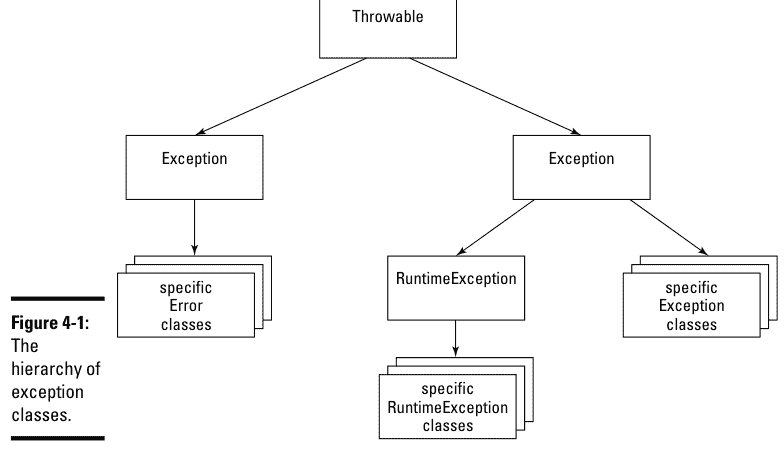

以下段落描述了此层次结构中的每个类：

- **Throwable**：异常层次结构的根是`Throwable`类。这个类表示任何可以用`throw`语句抛出并用`catch`子句捕获的对象。
- **Error**：这个`Throwable`的子类表示合理的程序无法恢复的严重错误条件。这个类的子类表示可能发生的具体错误类型。例如，如果虚拟机内存不足，会抛出`VirtualMachineError`。你不必担心在程序中捕获这些错误。
- **Exception**：这个`Throwable`的子类表示大多数程序应该尝试恢复的错误条件。因此，`Exception`实际上是你用`try/catch`语句捕获的异常类型的层次结构顶部。
- **RuntimeException**：这个`Exception`的子类表示未检查异常。你不必捕获或抛出未检查异常，但如果你想的话也可以。`RuntimeException`的子类包括`NullPointerException`和`ArithmeticException`。

除了`RuntimeException`（抱歉双关），`Exception`的子类表示必须被捕获或抛出的特定类型的检查异常。请注意，其中一些子类本身还有子类。例如，名为`IOException`的异常类有超过25个子类，表示可能发生的各种I/O异常。

如果你的应用程序需要抛出自定义异常，你可以创建一个继承此层次结构中任何类的异常类。然而，通常你会从`Exception`类开始来创建自定义检查异常。下一节将解释如何操作。

## 创建异常类

要创建自定义异常类，你只需定义一个扩展Java异常层次结构中某个类的类。通常，你扩展`Exception`来创建自定义检查异常。

例如，假设你正在开发一个从文件或数据库中检索产品数据的类，并且你希望遇到I/O错误的方法抛出自定义异常，而不是Java API中提供的通用`IOException`。你可以通过创建一个扩展`Exception`类的类来实现：

```java
public class ProductDataException extends Exception
{
}
```

不幸的是，构造函数不被视为类成员，因此在扩展类时它们不会被继承。因此，`ProductDataException`只有一个默认构造函数。`Exception`类本身以及大多数其他异常类都有一个构造函数，允许你传递一个字符串消息，该消息随异常存储，并可以通过`getMessage`方法检索。因此，你需要向类中添加这个构造函数。这意味着你还需要添加一个显式的默认构造函数。所以`ProductDataException`类现在看起来像这样：

```java
public class ProductDataException extends Exception
{
    public ProductDataException()
    {
    }

    public ProductDataException(String message)
    {
        super(message);
    }
}
```

尽管可能，但向自定义异常类添加额外的字段或方法是不常见的。

## 抛出自定义异常

对于任何异常，你都使用`throw`语句来抛出自定义异常。你通常会在捕获某些其他更通用异常的`catch`子句中间编写这个`throw`语句。例如，这里有一个从文件中检索产品数据的方法，如果发生`IOException`，它会抛出`ProductDataException`：

```java
public class ProductDDB
{
    public static Product getProduct(String code)
        throws ProductDataException
    {
        try
        {
            Product p;
            // code that gets the product from a file
            // and might throw an IOException
            p = new Product();
            return p;
        }
        catch (IOException e)
        {
            throw new ProductDataException(
                "An IO error occurred.");
        }
    }
}
```


创建自定义异常

以下是一些调用 `getProduct` 方法并捕获异常的代码：

```
try
{
    Product p = ProductDB.getProduct(productCode);
}
catch (ProductDataException e)
{
    System.out.println(e.getMessage());
}
```

在这里，如果抛出 `ProductDataException` 异常，消息会简单地显示在控制台上。在实际的程序中，你需要记录错误、通知用户，并想办法在出现此数据异常的情况下优雅地继续程序。

## 第五章：使用抽象类和接口

### 本章内容

- 抽象方法和抽象类
- 基本接口
- 使用接口作为类型
- 向接口添加常量
- 接口的继承
- 处理回调

在本章中，你将学习如何使用两个相似但又有微妙区别的特性：抽象类和接口。两者都允许你将类实现的方法和字段的签名与类本身分开声明。抽象类通过继承来实现这一点。接口则不使用继承，但效果相似。

### 使用抽象类

Java 允许你将一个方法或整个类声明为 *抽象*，这意味着该方法没有方法体。抽象方法只是一个方法的原型：一个返回类型、一个名称、一个参数列表，以及（可选的）一个 `throws` 子句。

要创建抽象方法，你需要指定 `abstract` 修饰符，并用分号替换方法体：

```
public abstract int hit(int batSpeed);
```

在这里，名为 `hit` 的方法被声明为一个返回 `int` 值并接受一个 `int` 参数的抽象方法。

包含至少一个抽象方法的类被称为 *抽象类*，必须在类声明中使用 `abstract` 修饰符。例如：

```
public abstract class Ball
{
    public abstract int hit(int batSpeed);
}
```

如果你省略类声明中的 `abstract` 修饰符，Java 编译器会抛出错误消息，提醒你必须将该类声明为 `abstract`。

抽象类不能被实例化。因此，根据前面的声明，以下代码行将无法编译：

```
Ball b = new Ball();    // 错误：Ball 是抽象的
```

### 抽象工厂模式

抽象类的一个常见用途是提供一种在事先不知道需要哪个子类的情况下获取多个子类实例的方式。为此，你可以创建一个 *抽象工厂* 类，该类有一个或多个返回抽象类子类的方法。

例如，假设你想创建一个 `Ball` 对象，但你想让用户选择是创建一个 `SoftBall` 还是一个 `BaseBall`。要使用抽象工厂模式，你可以创建一个类（我称之为 `BallFactory`），其中包含一个名为 `getBallInstance` 的方法。这个方法接受一个 String 参数，如果你想创建一个 `BaseBall` 对象，则将其设置为 "BaseBall"，如果你想创建一个 `SoftBall` 对象，则将其设置为 "SoftBall"。

以下是工厂类：

```
class BallFactoryInstance
{
    public static Ball getBall(String s)
    {
        if (s.equalsIgnoreCase("BaseBall"))
            return new BaseBall();
        if (s.equalsIgnoreCase("SoftBall"))
            return new SoftBall();
        return null;
    }
}
```

然后，假设字符串变量 `userChoice` 已根据用户的选择设置好，你可以像这样创建所选类型的球对象：

```
Ball b = BallFactory.getBallInstance(userChoice);
```

在实际的应用程序中，最好使用 `enum` 变量而不是字符串变量来指示要返回的对象类型。

这里的问题不在于将变量 b 声明为 Ball 类型。问题在于尝试使用 new 关键字和 Ball 类来创建 Ball 对象。因为 Ball 是一个抽象类，所以你不能用它来创建对象实例。

你可以像这样从一个抽象类创建一个子类：

```
public class BaseBall extends Ball
{
    public int hit(int batSpeed)
    {
        // 实现 hit 方法的代码放在这里
    }
}
```

当你继承一个抽象类时，子类必须为抽象类中的每个抽象方法提供实现。换句话说，它必须用一个非抽象方法重写每个抽象方法。（如果它不这样做，子类也是抽象的，因此它也不能被实例化。）

当你想创建一个用作两个或多个子类超类的泛型类型，但超类本身不表示实际对象时，抽象类非常有用。例如，如果所有员工要么是领薪的，要么是按小时计酬的，那么创建一个抽象 Employee 类是合理的，然后用它作为 SalariedEmployee 和 HourlyEmployee 子类的基类。

以下是关于抽象类需要思考的几个要点：

-   并非抽象类中的所有方法都必须是抽象的。一个类可以为它的某些方法提供实现，但不是全部。实际上，你可以将一个没有任何抽象方法的类声明为抽象类。在这种情况下，该类不能被实例化。
-   私有方法不能是抽象的。这很合理，因为子类不能重写私有方法，而抽象方法必须被重写。
-   虽然你不能创建抽象类的实例，但你可以使用抽象类作为类型来声明变量。然后，使用该变量来引用该抽象类的任何子类的实例。
-   一个类不能同时指定 `abstract` 和 `final`。那会导致其中一个逻辑悖论，从而导致整个宇宙的彻底毁灭。嗯，希望影响是局部的。但关键在于，因为 `abstract` 类只能在子类化它时使用，而 `final` 类不能被子类化，所以允许你为同一个类同时指定 `abstract` 和 `final` 是没有意义的。

-   抽象类在 Java API 中被广泛使用。许多抽象类的名称以 Abstract 开头，例如 AbstractBorder、AbstractCollection 和 AbstractMap。但大多数抽象类并非如此。例如，InputStream 类（由 System.in 使用）就是抽象的。

### 使用接口

接口类似于抽象类。然而，它只能包含抽象方法和 final 字段（常量），并且它不能用作基类。相反，一个类通过为接口中声明的每个方法提供实现来实现接口。

-   接口比继承更容易使用，因为你不必担心在接口中提供任何实现细节。
-   一个类只能继承一个其他类，但它可以根据需要实现任意数量的接口。

以下部分描述了创建和使用接口的细节。

#### 创建基本接口

这是一个定义了名为 Playable 的单个方法的基本接口，其中包含一个名为 play 的方法：

```
public interface Playable
{
    void play();
}
```

这个接口声明，任何实现 Playable 接口的类都必须为一个名为 play 的方法提供实现，该方法不接受参数且不返回值。

这个接口有几个有趣的细节：

-   接口本身被声明为 public，以便其他类可以使用它。与公共类一样，公共接口必须在同名文件中声明。因此，此接口必须位于名为 Playable.java 的文件中。
-   接口的名称（Playable）是一个形容词。大多数接口使用形容词而不是名词来命名，因为它们描述了实现该接口的类的某些额外能力或品质。因此，实现 Playable 接口的类表示可以播放的对象。


## 使用接口

假设你已经很久没上英语课了，*形容词*是一种修饰名词的词。你可以通过在动词后添加 -able 将许多动词转换为形容词。例如：*可玩的*、*可读的*、*可驾驶的* 和 *可停止的*。这种类型的形容词通常用于接口名称。

另一种常见的命名接口方法是将形容词与名词结合，表示该接口为特定类型的对象添加了某些功能。例如，你可以将一个提供纸牌游戏特有方法的接口命名为 `CardGame`。该接口可能包含 `deal`、`shuffle` 和 `getHand` 等方法。

接口中的所有方法都被视为公共和抽象的。如果你愿意，可以在接口方法上编写 `public` 和 `abstract` 关键字。然而，这被认为是不好的做法，因为它可能表明你认为默认值是私有的而非抽象的。

## 实现接口

要实现接口，一个类必须做两件事：

- 必须在类声明中指定 `implements` 子句。
- 必须为接口声明的每个方法提供实现。

例如，这是一个实现 `Playable` 接口的类：

```java
public class TicTacToe implements Playable
{
    // 其他字段和方法放在这里

    public void play()
    {
        // 游戏逻辑代码放在这里
    }

    // 其他字段和方法放在这里
}
```

这里，`TicTacToe` 类的声明指定了 `implements Playable`。然后，类体中包含了 `play` 方法的实现。

一个类可以实现多个接口：

```java
public class Hearts implements Playable, CardGame
{
    // 必须实现 Playable 和 CardGame 接口的方法
}
```

一个类可以继承一个超类并实现一个或多个接口。例如：

```java
public class Poker extends Game
    implements Playable, CardGame
{
    // 继承 Game 类的所有成员
    // 必须实现 Playable 和 CardGame 接口的方法
}
```

## 将接口用作类型

在 Java 中，接口是一种类型，就像类一样。因此，你可以将接口用作变量、参数或方法返回值的类型。

考虑以下代码片段：

```java
Playable game = getGame();
game.play();
```

这里，我假设 `getGame` 方法返回一个实现了 `Playable` 接口的对象。在第一条语句中，这个对象被赋值给一个类型为 `Playable` 的变量。然后，第二条语句调用该对象的 `play` 方法。

另一个稍微复杂一点的例子，假设你有一个名为 `Dealable` 的接口，它定义了一个名为 `deal` 的方法，该方法接受要发牌的数量作为参数：

```java
public interface Dealable
{
    void deal(int cards);
}
```

现在，假设你有一个名为 `startGame` 的方法，它接受两个参数：一个 `Dealable` 对象和一个表示要玩什么游戏的 `String`。这个方法可能看起来像这样：

```java
private void startGame(Dealable deck, String game)
{
    if (game.equals("Poker"))
        deck.deal(5);
    else if (game.equals("Hearts"))
        deck.deal(13);
    else if (game.equals("Gin"))
        deck.deal(10);
}
```

假设你还有一个名为 `CardDeck` 的类实现了 `Dealable` 接口，你可以使用类似这样的语句来开始一局红心游戏：

```java
Dealable d = new CardDeck();
startGame(d, "Hearts");
```

注意，变量 `d` 被声明为 `Dealable` 类型。你同样可以将其声明为 `CardDeck` 类型：

```java
CardDeck d = new CardDeck();
startGame(d, "Hearts");
```

因为 `CardDeck` 类实现了 `Dealable` 接口，所以它可以作为参数传递给 `startGame` 方法。

## 接口的更多用途

接口不仅仅可以创建抽象方法。以下部分描述了你可以对接口进行的一些其他有趣操作。请继续阅读...

### 向接口添加字段

除了抽象方法之外，接口还可以包含最终字段——即常量。接口字段用于提供与接口相关的常量值。例如：

```java
public interface GolfClub
{
    int DRIVER = 1;
    int SPOON = 2;
    int NIBLICK = 3;
    int MASHIE = 4;
}
```

这里，任何实现 `GolfClub` 接口的类都可以使用这四个字段常量。

请注意，接口字段自动被视为 `static`、`final` 和 `public`。你可以在创建接口常量时包含这些关键字，但并非必须。

### 扩展接口

你可以使用 `extends` 关键字来扩展接口。扩展现有接口的接口称为*子接口*，而被扩展的接口称为*超接口*。

当你对接口使用 `extends` 关键字时，超接口的所有字段和方法实际上都被复制到子接口中。因此，子接口由其自身的字段和方法以及超接口的字段和方法组合而成。

这里有一个例子：

```java
public interface ThrowableBall
{
    void throwBall();
    void catchBall();
}

public interface KickableBall
{
    void kickBall();
    void catchBall();
}

public interface PlayableBall
    extends ThrowableBall, KickableBall
{
    void dropBall();
}
```

这里声明了三个接口。第一个名为 `ThrowableBall`，定义了两个方法：`throwBall` 和 `catchBall`。第二个名为 `KickableBall`，也定义了两个方法：`kickBall` 和 `catchBall`。第三个名为 `PlayableBall`，扩展了 `ThrowableBall` 和 `KickableBall`，并添加了自己的方法 `dropBall`。

因此，任何实现 `PlayableBall` 接口的类都必须为四个方法提供实现：`throwBall`、`catchBall`、`kickBall` 和 `dropBall`。请注意，由于 `ThrowableBall` 和 `KickableBall` 接口定义的 `catchBall` 方法具有相同的签名，因此 `PlayableBall` 接口中只包含一个版本的 `catchBall` 方法。

### 使用接口进行回调

在戏剧中，回调是指你初次试演后，他们喜欢你的表现，所以希望你再来一次以便再看看。

在 Java 中，`callback` 有点类似。它是一种编程技术，其中一个对象让另一个对象知道，当某个特定事件发生时，第二个对象应该调用第一个对象的某个方法。第一个对象被称为 `event listener`（事件监听器），因为它耐心等待其他对象调用它。第二个对象被称为 `event source`（事件源），因为它是导致对监听器进行调用的事件来源。

## 标记接口模式

*标记接口*是一种没有任何成员的接口。它的唯一目的是标识一个类属于具有一些共同能力或特征的一组类。

最著名的标记接口示例是 Java API 的 `Cloneable` 接口。它标记可克隆的类。所有类最终都继承的 `Object` 类提供了一个名为 `clone` 的方法，可用于创建对象的副本。然而，只有当对象实现了 `Cloneable` 接口时，你才被允许调用 `clone` 方法。如果你尝试对未实现 `Cloneable` 的对象调用 `clone`，将抛出 `CloneNotSupportedException`。（有关 `clone` 方法的更多信息，请参阅第三部分第 6 章。）

以下是 `Cloneable` 接口的实际代码：

```java
public interface Cloneable {
}
```

在某些情况下，你可能会在自己的应用程序中找到标记接口的用途。例如，如果你正在开发一系列用于创建游戏的类，你可能会创建一个名为 `Winnable` 的标记接口，以区分有赢家的游戏和仅为娱乐而玩的游戏。

好吧，我之前的戏剧类比有点牵强。Java 中的回调并不真正像试镜大角色时的回调。回调更像是你需要联系某人时，在你知道他们不在的时候打电话，将你的电话号码留在他们的语音信箱中，以便他们可以给你回电。

Java 中使用一组为此目的设计的接口来处理回调。回调最常见的用途是在使用 Swing 构建的图形应用程序中，你创建处理用户界面事件（如鼠标点击）的事件监听器。

你将在第六部分全面了解 Swing。现在，我将使用 `Timer` 类（它是 `javax.Swing` 包的一部分）来探讨回调。这个类实现了一个基本的计时器，可以按固定间隔生成事件，并允许你设置一个监听器对象来处理这些事件。监听器对象必须实现 `ActionListener` 接口，该接口定义了一个名为 `actionPerformed` 的方法，每个计时器事件都会调用该方法。

`Timer` 类构造函数接受两个参数：

- 第一个参数是一个 `int` 值，表示计时器事件发生的频率。


 302 接口的更多用途

第二个参数是实现了`ActionListener`接口的对象。每当计时器事件发生时，就会调用该对象的`actionPerformed`方法。

`ActionListener`接口定义在`java.awt.event`包中。它包含以下代码：

```
public interface ActionListener extends EventListener {
    /**
     * Invoked when an action occurs.
     */
    public void actionPerformed(ActionEvent e);
}
```

如你所见，`ActionListener`接口由一个名为`actionPerformed`的单一方法组成。它接收一个`ActionEvent`类型的参数，但你在此处并未使用这个参数。（但在第六卷中，你会用到`ActionEvent`类。）

`Timer`类有大约20个方法，但我这里只介绍其中一个：`start`，它用于启动计时器。此方法不需要任何参数，也不返回任何值。

清单5-1展示了一个使用`Timer`类的程序，它每隔一秒钟在控制台交替显示“Tick . . .”和“Tock . . .”消息。`JOptionPane`类用于显示一个对话框；程序会一直运行，直到用户点击此对话框中的“确定”按钮。图5-1展示了运行中的Tick Tock程序。

## 清单5-1：TICK TOCK 程序

```
import java.awt.event.*;        -> 1
import javax.swing.*;           -> 2

public class TickTock
{
    public static void main(String[] args)
    {
        // create a timer that calls the Ticker class
        // at one second intervals
        Timer t = new Timer(1000, new Ticker());  -> 10
        t.start();                               -> 11

        // display a message box to prevent the
        // program from ending immediately
        JOptionPane.showMessageDialog(null,
            "Click OK to exit program");        -> 15
    }
```

接口的更多用途

```
class Ticker implements ActionListener
{
    private boolean tick = true;

    public void actionPerformed(ActionEvent event)
    {
        if (tick)
        {
            System.out.println("Tick...");
        }
        else
        {
            System.out.println("Tock...");
        }
        tick = !tick;
    }
}
```

以下段落描述了该程序运行的重要细节：

- **→1** `ActionListener`接口是`java.awt.event`包的一部分，因此需要此`import`语句。
- **→2** `Timer`类是`javax.swing`包的一部分，因此需要此`import`语句。
- **→10** 此语句创建一个新的`Timer`对象。计时器的间隔设置为1,000毫秒——相当于一秒。一个新的`Ticker`类实例作为第二个参数被传递。计时器在每个计时器周期调用此对象的`actionPerformed`方法——换句话说，每秒一次。

304 接口的更多用途

- **→11** 此语句调用`start`方法以启动计时器。
- **→15** `JOptionPane`类用于显示一个对话框，提示用户点击“确定”按钮以停止应用程序。你可能认为我加入这个对话框是为了给用户提供一种结束程序的方式。但实际上，我用它来给计时器一些运行时间。如果你在启动计时器后就结束`main`方法，应用程序会结束，计时器也会被终止。通过在此处使用`JOptionPane`，只要对话框显示，应用程序就会继续运行。（关于`JOptionPane`的更多信息，请参见第二卷，第2章。）
- **→20** `Ticker`类的声明，它实现了`ActionListener`接口。
- **→22** 一个私有布尔类型类字段，用于跟踪`Ticker`显示的是`Tick. . .`还是`Tock. . .`。每次调用`actionPerformed`方法时，此字段的值会被切换。
- **→24** `actionPerformed`方法，在每个计时间隔时被调用。
- **→28** 如果`tick`为真，则在控制台打印`Tick. . .`。
- **→32** 如果`tick`为假，则在控制台打印`Tock. . .`。
- **→34** 切换`tick`变量的值。换句话说，如果`tick`为真，则将其设置为`false`；如果`tick`为假，则将其设置为`true`。

## 第六章：使用Object和Class类

### 本章内容

- 使用`toString`方法
- 实现`equals`方法
- 尝试使用`clone`方法
- 理解`Class`类

在本章中，你将学习如何使用Java API中两个对面向对象编程很重要的类：

- `Object`类，所有其他类都继承它——包括Java API中的所有类以及你创建的任何类
- `Class`类，用于获取关于对象类型的信息

> 技术细节：如果可以，我真想在整个章节上贴上一个巨大的“技术细节”图标。所有这些内容都偏技术向，许多Java程序员多年来在不理解或不使用它的情况下也能胜任。不过，我建议你仔细阅读本章。即使不能完全理解，它也可能有助于解释为什么Java中某些东西的工作方式与你预想的不同，并且本章的信息可能在某天帮助你摆脱编程困境。

### 万物之母：Object

`Object`是所有类的母类。在Java中，每个类最终都继承`Object`类。此类提供了一组所有Java对象都可用的方法。

#### 每个对象都是一个Object

任何没有`extends`子句的类都隐式继承`Object`。因此，你永远不需要编写像这样的类：

```
public class Product extends Object...
```

306 万物之母：Object

如果子类有一个指定了`Object`以外的父类的`extends`子句，该类仍然继承`Object`。这是因为继承层次结构最终会到达一个没有`extends`子句的父类，而该父类继承`Object`并将其传递给所有子类。

例如，假设你有这些类：

```
public class Manager extends SalariedEmployee...

public class SalariedEmployee extends Employee...

public class Employee extends Person...

public class Person...
```

这里，`Manager`类间接继承了`Object`类，因为它继承了`SalariedEmployee`，而`SalariedEmployee`继承了`Employee`，`Employee`继承了`Person`，`Person`继承了`Object`。

在Java中，不可能创建一个不继承`Object`的类。

## 将Object用作类型

如果你不知道或不关心一个变量所引用的对象的类型，你可以将其类型指定为`Object`。例如，以下代码是完全合法的：

```
Object emp = new Employee();
```

然而，你无法对`emp`变量执行任何有用的操作，因为编译器不知道它是一个`Employee`。例如，如果`Employee`类有一个名为`setLastName`的方法，以下代码将无法工作：

```
Object emp = new Employee();
emp.setLastName("Smith"); // error: won't compile
```

因为`emp`是一个`Object`，而不是`Employee`，编译器不知道`setLastName`方法。

请注意，你仍然可以将对象转换为`Employee`：

```
Object emp = new Employee();
((Employee)emp).setLastName("Smith"); // this works
```

但这样做的意义何在？你还不如一开始就将`emp`声明为`Employee`。

307 万物之母：Object

然而，在某些情况下，将变量、参数或返回类型声明为`Object`确实非常合理。例如，Java API提供了一组旨在维护对象集合的类。其中最常用的是`ArrayList`类。它有一个名为`add`的方法，该方法接受一个`Object`作为参数。此方法将指定的对象添加到集合中。因为参数类型是`Object`，你可以使用`ArrayList`类来创建任何类型对象的集合。（关于`ArrayList`类和其他集合类的更多信息，请参见第四卷。）

## Object类的方法

表6-1列出了`Object`类的所有方法。通常，我不会列出一个类的所有方法——我只会列出我认为最有用的那些。然而，由于`Object`在面向对象编程中如此重要，我认为向你展示它的所有功能是最好的，即使其中一些方法有点晦涩。

我警告过你，整个章节都应该有一个“技术细节”图标。

表6-1：Object类的方法

| 方法 | 功能描述 |
| :--- | :--- |
| `protected Object clone()` | 返回此对象的一个副本。 |
| `boolean equals(Object obj)` | 指示此对象是否等于`obj`对象。 |
| `protected void finalize()` | 当对象被销毁时，由垃圾回收器调用。 |
| `Class getClass()` | 返回一个表示此对象运行时类的`Class`对象。 |
| `int hashCode()` | 返回此对象的哈希码。 |
| `void notify()` | 用于多线程应用程序，唤醒在此对象上等待的线程。 |
| `void notifyAll()` | 用于多线程应用程序，唤醒所有在此对象上等待的线程。 |
| `String toString()` | 返回此对象的`String`表示。 |
| `void wait()` | 导致此对象的线程等待，直到另一个线程调用`notify`或`notifyAll`。 |
| `void wait(Long timeout)` | 基本`wait`方法的一个变体。 |
| `void wait(Long timeout, int nanos)` | `wait`方法的另一个变体。 |

注意：这些方法中几乎一半（`notify`、`notifyAll`以及三个`wait`方法）都与线程有关。你可以在第五卷第1章中找到关于这五个方法的完整信息。以下是对其余六个方法的概要说明：


 ## 万类之母：Object

- **clone：** 这个方法常用于复制对象，在自己的类中重写它并不罕见。本章后面的“clone 方法”一节中，我会详细解释这个方法。

- **equals：** 这个方法常用于比较对象。任何表示可以与其他对象进行比较的类的对象，都应该重写这个方法。更多信息请参阅本章后面的“equals 方法”一节。

- **finalize：** 当垃圾收集器发现某个对象不再使用、可以被丢弃时，会调用这个方法。该方法的初衷是让你能够创建可以自行清理的对象，即在丢弃之前关闭已打开的文件并执行其他清理任务。但由于 Java 垃圾收集器的工作方式，无法保证 `finalize` 方法真的会被调用。因此，这个方法并不常用。

- **getClass：** 这个方法有时会与 `Class` 类一起使用，本章后面的“Class 类”一节中会介绍。

- **hashCode：** 每个 Java 对象都有一个*哈希码*，它是类的一个 `int` 表示形式，对某些操作很有用。在你开始使用哈希表之前，这个方法并不太重要——而哈希表是一种相当高级的技术，最好留给那些口袋里装着保护垫、用胶带粘着眼镜的人来研究。

- **toString：** 这个方法是 Java 中最常用的方法之一。本章后面的“toString 方法”一节中会有描述。

## 基本类型不是对象

需要注意的是，基本类型（如 `int` 和 `double`）不是对象。因此，它们不会继承 `Object` 类，也无法访问上一节列出的方法。

因此，以下代码无法工作：

```
int x = 50;
String s = x.toString();   // 错误：无法编译
```

如果你真的想以这种方式将 `int` 转换为字符串，可以使用包装类（如 `Integer`）从该值创建对象，然后调用它的 `toString` 方法：

```
String s = new Integer(x).toString();   // 可以
```

每个包装类还定义了一个静态 `toString` 方法，可以像这样使用：

```
String s = Integer.toString(x);
```

有时，使用编译器提供的快捷方式会更方便，它允许你在字符串连接表达式中使用基本类型：

```
String s = "" + x;
```

这里，`int` 变量 `x` 与一个空字符串连接。

所有这些的要点是：基本类型不是对象，因此它们不会从 `Object` 继承任何东西。如果你想将基本类型的值当作对象处理，可以使用该基本类型的包装类，具体方法我在第 II 册第 2 章中有描述。

## toString 方法

`toString` 方法返回对象的字符串表示形式。默认情况下，`toString` 方法返回对象的类名加上其哈希码。在下面的章节中，我将向你展示如何使用 `toString` 方法，以及如何在自己的类中重写它以创建更有用的字符串。

### 使用 toString

下面是一个简单的程序，演示了 `toString` 方法的用法：

```
public class TestToString
{
    public static void main(String[] args)
    {
        Employee emp = new Employee("Martinez",
            "Anthony");
        System.out.println(emp.toString());
    }
}

class Employee
{
    private String lastName;
    private String firstName;

    public Employee(String lastName, String firstName)
    {
        this.lastName = lastName;
        this.firstName = firstName;
    }
}
```

这里，这段代码创建了一个新的 `Employee` 对象，然后将其 `toString` 方法的结果打印到控制台。运行这个程序时，以下行会打印在控制台上：

```
Employee@82ba41
```

**310** toString 方法

**注意：** 哈希码——在本例中是 82ba41——在你的系统上可能不同。

事实证明，在这个例子中显式调用 `toString` 并不是真正必要的。我可以很容易地将 `main` 方法的第二行写成这样：

```
System.out.println(emp);
```

这是因为 `println` 方法会自动调用你传递给它的任何对象的 `toString` 方法。

### 重写 toString

默认的 `toString` 实现在大多数情况下并不是很有用。例如，通过哈希码你无法真正了解一个 `Employee` 对象。如果 `toString` 方法返回对象的一些实际数据，例如员工的姓名，岂不是更好？

要做到这一点，你必须在自己的类中重写 `toString` 方法。事实上，Java 面向对象编程的基本准则之一就是*始终*重写 `toString`。下面是一个简单的程序，其中的 `Employee` 类重写了 `toString`：

```
public class TestToString
{
    public static void main(String[] args)
    {
        Employee emp = new Employee("Martinez",
            "Anthony");
        System.out.println(emp.toString());
    }
}

class Employee
{
    private String lastName;
    private String firstName;

    public Employee(String lastName, String firstName)
    {
        this.lastName = lastName;
        this.firstName = firstName;
    }

    public String toString()
    {
        return "Employee["
            + this.firstName + " "
            + this.lastName + "]";
    }
}
```

运行这个程序时，以下行会显示在控制台上：

```
Employee[Anthony Martinez]
```

请注意，输出由类名和括号中的对象数据组成。这种约定在 Java 编程中很常见。

前面示例唯一的问题是类名被硬编码到了 `toString` 方法中。你可以使用 `getClass` 方法在运行时获取实际的类名：

```
public String toString()
{
    return this.getClass().getName() + "["
        + this.firstName + " "
        + this.lastName + "]";
}
```

这里，`getClass` 方法返回一个 `Class` 对象，该对象表示当前对象的类。然后，使用 `Class` 对象的 `getName` 方法来获取实际的类名。（关于 `Class` 对象的更多内容，将在本章后面介绍。）

## equals 方法

测试对象是否相等是任何面向对象编程语言的基本任务之一。不幸的是，Java 在这方面并不擅长。例如，考虑这个程序：

```
public class TestEquality1
{
    public static void main(String[] args)
    {
        Employee emp1 = new Employee(
            "Martinez", "Anthony");
        Employee emp2 = new Employee(
            "Martinez", "Anthony");
        if (emp1 == emp2)
            System.out.println(
                "These employees are the same.");
        else
            System.out.println(
                "These are different employees.");
    }
}

class Employee
{
    private String lastName;
    private String firstName;

    public Employee(String lastName, String firstName)
    {
        this.lastName = lastName;
        this.firstName = firstName;
    }
}
```

这里，`main` 方法创建了两个数据相同的 `Employee` 对象，然后进行比较。遗憾的是，比较返回 `false`。即使这两个 `Employee` 对象的数据完全相同，它们也不被视为相等。这是因为相等运算符（`==`）比较的是对象引用，而不是对象包含的数据。因此，只有当 `emp1` 和 `emp2` 都引用 `Employee` 类的同一个实例时，比较才会返回 `true`。

如果你想创建在包含相同数据时被视为相等的对象，必须做两件事：

1. 使用 `equals` 方法而不是相等运算符来比较它们。
2. 在自己的类中重写 `equals` 方法，基于数据来比较对象。

以下各节描述了这两个步骤。

### 使用 equals

要使用 `equals` 方法而不是相等运算符来测试对象，你只需像这样重写比较表达式：

```
if (emp1.equals(emp2))
    System.out.println("These employees are the same.");
else
    System.out.println("These are different
        employees.");
```

这里，使用了 `emp1` 的 `equals` 方法来比较 `emp1` 和 `emp2`。

默认情况下，`equals` 运算符返回与相等运算符相同的结果。因此，仅仅将 `==` 替换为 `equals` 方法并不会产生任何效果，除非你同时重写 `equals` 方法，如下一节所述。

使用哪个对象的 `equals` 方法不应该有区别。因此，这个 `if` 语句返回相同的结果：

```
if (emp2.equals(emp1))
    System.out.println("These employees are the same.");
else
    System.out.println("These are different employees.");
```


## 重写 equals 方法

你可以重写 `equals` 方法，以便基于对象的值进行比较。表面上看，你可能会觉得这很容易。例如，你可能会想为 `Employee` 类这样编写 `equals` 方法：

```java
// warning -- there are several errors in this code!
public boolean equals(Employee emp)
{
    if (this.getLastName().equals(emp.getLastName())
     && this.getFirstName().equals(emp.getFirstName())
    )
        return true;
    else
        return false;
}
```

这段代码的基本问题——也是编写良好 `equals` 方法的挑战——在于传递给 `equals` 方法的参数必须是 `Object` 类型，而不是 `Employee` 类型。这意味着 `equals` 方法必须准备好处理传入的任何对象。例如，有人可能试图将一个 `Employee` 对象与一个 `Banana` 对象进行比较。或者与 null 进行比较。`equals` 方法必须准备好应对所有可能性。

具体来说，Java API 文档指出，每当重写 `equals` 方法时，你必须确保 `equals` 方法满足五个特定条件。以下是直接引用自 API 文档的条件：

- **自反性。** 对于任何非空引用值 x，`x.equals(x)` 应返回 `true`。
- **对称性。** 对于任何非空引用值 x 和 y，当且仅当 `y.equals(x)` 返回 `true` 时，`x.equals(y)` 应返回 `true`。
- **传递性。** 对于任何非空引用值 x、y 和 z，如果 `x.equals(y)` 返回 `true` 且 `y.equals(z)` 返回 `true`，那么 `x.equals(z)` 应返回 `true`。
- **一致性。** 对于任何非空引用值 x 和 y，只要对象 equals 比较中使用的信息未被修改，多次调用 `x.equals(y)` 应一致地返回 `true` 或一致地返回 `false`。
- 对于任何非空引用值 x，`x.equals(null)` 应返回 `false`。

听起来很混乱？幸运的是，它并不像一开始看起来那么复杂。你可以安全地忽略传递性规则，因为如果你正确地处理了其他规则，这条规则会自动满足。而一致性规则基本上意味着你要返回一致的结果。只要你在比较中没有调用 `Math.random`，这就不应该成为问题。

以下是创建良好 `equals` 方法的通用公式（假设参数名为 `obj`）：

**1. 测试自反性规则。**

使用如下语句：

```java
if (this == obj)
    return true;
```

换句话说，如果有人愚蠢到想检查一个对象是否等于它自己，它应该返回 `true`。

**2. 测试非空规则。**

使用如下语句：

```java
if (obj == null)
    return false;
```

Null 不等于任何东西。

**3. 测试 `obj` 是否与 `this` 属于同一类型。**

你可以使用 `getClass` 方法来做到这一点，如下所示：

```java
if (this.getClass() != obj.getClass())
    return false;
```

如果两个对象不属于同一类型，它们就不可能相等。（起初可能不明显，但此测试是满足对称性规则所必需的——即如果 `x` 等于 `y`，那么 `y` 也必须等于 `x`。）

**4. 将 `obj` 转换为你的类的一个变量。然后，比较你希望作为返回值基础的字段，并返回结果。**

这是一个例子：

```java
Employee emp = (Employee) obj;
return this.lastName.equals(emp.getLastName())
    && this.firstName.equals(emp.getFirstName());
```

请注意，对于 String 值的字段比较使用的是 `equals` 方法而不是 `==`。这是因为你不能信任 `==` 来比较字符串。如果你需要比较基本类型，可以使用 `==`。但对于字符串和任何其他引用类型，你应该使用 `equals`。

将所有内容放在一起，清单 6-1 展示了一个使用正确构造的 `equals` 方法比较两个 `Employee` 对象的程序。

### 清单 6-1：比较对象

```java
public class TestEquality2
{
    public static void main(String[] args)
    {
        Employee emp1 = new Employee(
            "Martinez", "Anthony");
        Employee emp2 = new Employee(
            "Martinez", "Anthony");
        if (emp1.equals(emp2))
            System.out.println(
                "These employees are the same.");
        else
            System.out.println(
                "These are different employees.");
    }
}

class Employee
{
    private String lastName;
    private String firstName;

    public Employee(String lastName, String firstName)
    {
        this.lastName = lastName;
        this.firstName = firstName;
    }

    public String getLastName()
    {
        return this.lastName;
    }

    public String getFirstName()
    {
        return this.firstName;
    }

    public boolean equals(Object obj)
    {
        // an object must equal itself
        if (this == obj)
            return true;

        // no object equals null
        if (obj == null)
            return false;

        // objects of different types are never equal
        if (this.getClass() != obj.getClass())
            return false;

        // cast to an Employee, then compare the fields
        Employee emp = (Employee) obj;
        return this.lastName.equals(emp.getLastName())
            && this.firstName.equals(emp.getFirstName());
    }
}
```

以下是此清单中的一些值得注意的要点：

- 第 5 行：创建一个名为 Anthony Martinez 的 Employee 对象。
- 第 7 行：创建另一个名为 Anthony Martinez 的 Employee 对象。
- 第 9 行：使用 equals 方法比较两个 Employee 对象。
- 第 18 行：Employee 类。
- 第 39 行：重写的 equals 方法。
- 第 42 行：如果比较的是同一个对象实例，则返回 true。这满足了第一个相等性测试，即一个对象必须始终等于它自己。
- 第 46 行：如果被比较的对象为 null，则返回 false。这满足了最后一个相等性测试，即任何东西都不等于 null。
- 第 50 行：如果被比较的对象类型不正确，则返回 false。这有助于确保对称性测试，即如果 x 等于 y，那么 y 也必须等于 x。
- 第 54 行：通过其他测试后，你现在可以假设你正在比较两个不同的 Employee 对象。因此下一步是将另一个对象转换为 Employee。
- 第 55 行：将另一个对象转换为 Employee 后，比较两个字段（lastName 和 firstName），并返回复合比较的结果。

## clone 方法

克隆是指创建一个对象的精确副本的过程。不幸的是，这个过程在像 Java 这样的面向对象语言中被证明是一项相当困难的任务。你可能认为克隆会像这样简单：

```java
Employee emp1 = new Employee("Stewart", "Martha");
Employee emp2 = emp1;
```

然而，这段代码根本没有创建 `Employee` 对象的副本。相反，你现在有两个变量引用同一个对象，这通常不是你想要的。例如，假设你执行这些语句：

```java
emp1.setLastName("Washington");
emp2.setLastName("Graham");
String lastName = emp1.getLastName();
```

这些语句执行后，`lastName` 返回 `Washington` 还是 `Graham`？正确答案是 `Graham`，因为 `emp1` 和 `emp2` 都引用同一个 `Employee` 对象。

相比之下，*克隆*是一个全新的对象，具有与原始对象相同的值。你通常可以使用如下代码手动创建克隆：

```java
Employee emp1 = new Employee("Stewart", "Martha");
Employee emp2 = new Employee();
emp2.setLastName(emp1.getLastName());
emp2.setFirstName(emp1.getFirstName());
emp2.setSalary(emp1.getSalary());
```

这里，创建了一个新的 `Employee` 对象，并将其字段设置为与原始对象相同的值。

Java 提供了一种更优雅的对象复制方式——`clone` 方法，它对所有类都可用，因为它继承自 `Object` 类。然而，正如你在以下部分中所发现的，`clone` 方法可能难以创建和使用。因此，你只想为那些你认为能真正从克隆中受益的类实现它。

## 实现 clone 方法

`clone` 方法由 `Object` 类定义，因此它对所有 Java 类都可用。然而，`clone` 在 `Object` 类中声明为具有 `protected` 访问权限。因此，给定类的 `clone` 方法仅在该类内部可用。如果你希望其他对象能够克隆你的对象，你必须重写 `clone` 方法并赋予其公共访问权限。

请注意，由 `Object` 类定义的 `clone` 方法返回 `Object` 类型。这是完全合理的，因为 `Object` 类不知道你将重写 `clone` 方法的类的类型。这带来的一个不便的副作用是，每当调用一个重写了 `clone` 的类的 `clone` 方法时，你都必须将结果强制转换为所需的对象类型。


# 318 clone 方法

清单 6-2 给出了一个克隆 Employee 对象的简单示例程序。简而言之，该程序为 Employee 类重写了 clone 方法。它创建一个员工对象，然后克隆它。接着，它修改原始 Employee 对象的姓名，并将两个对象都打印到控制台。

## 清单 6-2：克隆示例

```java
public class CloneTest
{
    public static void main(String[] args)
    {
        Employee emp1 = new Employee(
            "Martinez", "Anthony");
        emp1.setSalary(40000.0);
        Employee emp2 = (Employee)emp1.clone();
        emp1.setLastName("Smith");
        System.out.println(emp1);
        System.out.println(emp2);
    }
}

class Employee
{
    private String lastName;
    private String firstName;
    private Double salary;

    public Employee(String lastName, String firstName)
    {
        this.lastName = lastName;
        this.firstName = firstName;
    }

    public String getLastName()
    {
        return this.lastName;
    }

    public void setLastName(String lastName)
    {
        this.lastName = lastName;
    }

    public String getFirstName()
    {
        return this.firstName;
    }

    public void setFirstName(String firstName)
    {
        this.firstName = firstName;
    }

    public Double getSalary()
    {
        return this.salary;
    }

    public void setSalary(Double salary)
    {
        this.salary = salary;
    }

    public Object clone()
    {
        Employee emp;
        emp = new Employee(
            this.lastName, this.firstName);
        emp.setSalary(this.salary);
        return emp;
    }

    public String toString()
    {
        return this.getClass().getName() + "["
            + this.firstName + " "
            + this.lastName + ", "
            + this.salary + "]";
    }
}
```

运行此程序时，控制台会显示以下行：

```
Employee[Anthony Smith, 40000.0]
Employee[Anthony Martinez, 40000.0]
```

如你所见，第二个 `Employee` 对象的姓名已成功更改，而不影响第一个 `Employee` 对象的姓名。

以下段落将吸引你注意该程序的一些要点：

-   → 5 为名为 Anthony Martinez 的员工创建第一个 `Employee` 对象。

-   → 7 设置 Martinez 先生的工资。

-   → 8 创建 Martinez 先生的 `Employee` 对象的克隆。注意，返回值必须强制转换为 `Employee`。这是因为 `clone` 方法的返回值是 `Object`。

-   → 9 更改第二个 `Employee` 对象的姓氏。

-   → 10 打印第一个 `Employee` 对象。

-   → 11 打印第二个 `Employee` 对象。

-   → 15 `Employee` 类。此类定义了用于存储姓氏、名字和工资的私有字段，以及每个字段的 getter 和 setter 方法。

-   → 57 此方法重写了 `clone` 方法。注意其返回类型是 `Object`，而不是 `Employee`。

-   → 60 使用当前对象的姓氏和名字创建一个新的 `Employee` 对象。

-   → 62 将新员工对象的工资设置为当前对象的工资。

-   → 63 返回克隆的 `Employee` 对象。

# 使用 clone 创建浅拷贝

在前面的示例中，`clone` 方法手动创建原始对象的副本并返回它。在许多情况下，这是创建克隆的最简单方法。但是，如果你的类有一百个或更多需要复制的字段呢？那么，意外忘记复制其中一个字段的可能性就很高。而且，如果以后向类中添加字段，你可能会忘记修改 `clone` 方法来包含新字段。

幸运的是，你可以通过在自己的 `clone` 方法中直接使用 `Object` 类的 `clone` 方法来解决这个问题。`Object` 类的 `clone` 方法可以自动创建对象副本，其中包含所有基本类型（如 `int` 和 `double`）字段的副本，以及不可变引用类型的副本——最值得注意的是字符串。因此，如果类中的所有字段都是基本类型或字符串，你可以使用 `Object` 类提供的 `clone` 方法来克隆你的类。

这种类型的克隆称为*浅拷贝*，原因我将在下一节中解释。

要从你自己的 `clone` 方法调用 `clone` 方法，只需指定 `super.clone()`。但在那之前，你必须做两件事：

-   声明该类支持 `Cloneable` 接口。`Cloneable` 接口是一个标记接口，不提供任何方法。它只是将一个类标记为适合克隆。

-   将 `super.clone()` 的调用封装在捕获异常 `CloneNotSupportedException` 的 `try/catch` 语句中。如果你在未实现 `Cloneable` 接口的类上尝试调用 `clone`，则会抛出此异常。如果你实现了 `Cloneable`，此异常将永远不会发生。但由于 `CloneNotSupportedException` 是受检异常，你必须捕获它。

以下是使用 `super.clone()` 来克隆自身的 `Employee` 类的 clone 方法示例：

```java
class Employee implements Cloneable
{
    // 字段和方法已省略...

    public Object clone()
    {
        Employee emp;
        try
        {
            emp = (Employee) super.clone();
        }
        catch (CloneNotSupportedException e)
        {
            return null;    // 永远不会发生
        }
        return emp;
    }
}
```

注意，此方法不必了解 `Employee` 类中声明的任何字段。然而，此 `clone` 方法仅适用于所有字段都是基本类型或不可变对象（如字符串）的类。

# 创建深拷贝

类中的某些字段实际上是其他对象，这并不罕见。例如，`Employee` 类可能有一个 `Address` 类型的字段，用于存储每位员工的地址：

```java
class Employee
{
    public Address address;

    // 其他字段和方法已省略
}
```

如果是这种情况，`super.clone()` 方法将无法创建对象的完整副本。克隆不会获得 address 字段的克隆。相反，它拥有与原始对象相同的 address 对象的引用。

## clone 方法

要解决这个问题，你必须对 `Employee` 对象进行*深拷贝*。深拷贝是一种克隆，其中主对象内的任何子对象也会被克隆。为实现这一目标，clone 方法重写首先调用 `super.clone()` 来创建对象的浅拷贝。然后，它调用主对象包含的每个子对象的 clone 方法来创建这些对象的克隆。（当然，要使深拷贝起作用，这些对象也必须支持 `clone` 方法。）

清单 6-3 展示了一个示例。这里，`Employee` 类包含一个名为 `address` 的公共字段，它保存 `Address` 类的实例。如你所见，`Employee` 类的 clone 方法创建 `Employee` 对象的浅拷贝，然后将副本的 `address` 字段设置为原始对象 `address` 字段的克隆。为使此示例工作，`Address` 类也重写了 clone 方法。它的 clone 方法调用 `super.clone()` 来创建 `Address` 对象的浅拷贝。

## 清单 6-3：创建深拷贝

```java
public class CloneTest2
{
    public static void main(String[] args)
    {
        Employee emp1 = new Employee(
            "Martinez", "Anthony");                          // → 5
        emp1.setSalary(40000.0);
        emp1.address = new Address(                         // → 8
            "1300 N. First Street",
            "Fresno", "CA", "93702");
        Employee emp2 = (Employee)emp1.clone();             // → 11

        System.out.println(                                 // → 13
            "**** after cloning ****\n");
        printEmployee(emp1);
        printEmployee(emp2);

        emp2.setLastName("Smith");                          // → 18
        emp2.address = new Address(                         // → 19
            "2503 N. 6th Street",
            "Fresno", "CA", "93722");

        System.out.println(                                 // → 23
            "**** after changing emp2 ****\n");
        printEmployee(emp1);
        printEmployee(emp2);

    }
}
```


## clone 方法

```java
private static void printEmployee(Employee e) {
    System.out.println(e.getFirstName()
        + " " + e.getLastName());
    System.out.println(e.address.getAddress());
    System.out.println("Salary: " + e.getSalary());
    System.out.println();
}
}
```

```java
class Employee implements Cloneable {
    private String lastName;
    private String firstName;
    private Double salary;

    public Address address;

    public Employee(String lastName, String firstName) {
        this.lastName = lastName;
        this.firstName = firstName;
        this.address = new Address();
    }

    public String getLastName() {
        return this.lastName;
    }

    public void setLastName(String lastName) {
        this.lastName = lastName;
    }

    public String getFirstName() {
        return this.firstName;
    }

    public void setFirstName(String firstName) {
        this.firstName = firstName;
    }

    public Double getSalary() {
        return this.salary;
    }

    public void setSalary(Double salary) {
        this.salary = salary;
    }

    public Object clone() {
        Employee emp;
        try {
            emp = (Employee) super.clone();
            emp.address = (Address) address.clone();
        } catch (CloneNotSupportedException e) {
            return null;   // will never happen
        }
        return emp;
    }

    public String toString() {
        return this.getClass().getName() + "["
            + this.firstName + " "
            + this.lastName + ", "
            + this.salary + "]";
    }
}

class Address implements Cloneable {
    private String street;
    private String city;
    private String state;
    private String zipCode;

    public Address() {
        this.street = "";
        this.city = "";
        this.state = "";
        this.zipCode = "";
    }

    public Address(String street, String city,
                  String state, String zipCode) {
        this.street = street;
        this.city = city;
        this.state = state;
        this.zipCode = zipCode;
    }

    public Object clone() {
        try {
            return super.clone();
        } catch (CloneNotSupportedException e) {
            return null;   // will never happen
        }
    }

    public String getAddress() {
        return this.street + "\n"
            + this.city + ", "
            + this.state + " "
            + this.zipCode;
    }
}
```

`CloneTest2` 类的主方法创建了一个 `Employee` 对象并设置其姓名、薪水和地址。然后，它创建了该对象的克隆体，并打印两个对象中包含的数据。接着，它修改第二个员工的姓氏和地址，并再次打印数据。以下是运行此程序时产生的输出：

```
**** after cloning ****

Anthony Martinez
1300 N. First Street
Fresno, CA 93702
Salary: 40000.0

Anthony Martinez
1300 N. First Street
Fresno, CA 93702
Salary: 40000.0

**** after changing emp2 ****

Anthony Martinez
1300 N. First Street
Fresno, CA 93702
Salary: 40000.0
Anthony Smith
2503 N. 6th Street
Fresno, CA 93722
Salary: 40000.0
```

如你所见，两个 `Employee` 对象在克隆后拥有相同的数据。但是，在修改了第二个员工的字段后，它们的数据变得不同。因此，你可以安全地修改其中一个对象的数据，而不会影响另一个对象。

以下段落描述了该程序的一些要点：

-   **5** 创建名为 Anthony Martinez 的员工。
-   **8** 设置员工的地址。
-   **11** 克隆该员工。
-   **13** 克隆后打印两个 `Employee` 对象。它们应该拥有相同的数据。
-   **18** 修改第二个员工的姓名。
-   **19** 修改第二个员工的地址。
-   **23** 在修改第二个员工的数据后打印两个 `Employee` 对象。此时这些对象应该拥有不同的数据。
-   **30** 一个用于打印 `Employee` 对象数据的实用方法。
-   **40** `Employee` 类。请注意此类实现了 `Cloneable`。
-   **46** `address` 字段，它持有类型为 `Address` 的对象。
-   **85** `Employee` 类中的 `clone` 方法。
-   **90** 创建 `Employee` 对象的浅拷贝。
-   **91** 创建 `Address` 对象的浅拷贝并将其赋值给被克隆的 `Employee` 对象的 `address` 字段。
-   **93** 捕获 `CloneNotSupportedException`，这永远不会发生，因为该类实现了 `Cloneable`。编译器要求此处使用 `try/catch` 语句，因为 `CloneNotSupportedException` 是一个受检异常。
-   **97** 返回克隆的 `Employee` 对象。
-   **109** `Address` 类，它也实现了 `Cloneable`。
-   **133** `Address` 类的 `clone` 方法。
-   **137** 返回 `Address` 对象的浅拷贝。

## Class 类

同学们，在结束本章之前，我们来学习最后一个类：`Class` 类。这可能会有点令人困惑，所以请认真思考。Java 应用程序使用的每个类在内存中都由一个类型为 `Class` 的对象来表示。例如，如果你的程序使用 `Employee` 对象，那么也会有一个对应于 `Employee` 类的 `Class` 对象。这个 `Class` 对象包含的信息不是关于特定员工的，而是关于 `Employee` 类本身的。

你已经了解了如何通过使用 `getClass` 方法获取一个 `Class` 对象。这个方法由 `Object` 类定义，因此每个对象都可以使用它。例如：

```java
Employee emp = new Employee();
Class c = emp.getClass();
```

注意，你必须用一个对象实例初始化一个变量，然后才能调用其 `getClass` 方法。这是因为 `getClass` 方法返回的 `Class` 对象对应于变量所引用的对象类型，而不是变量声明的类型。

例如，假设一个 `HourlyEmployee` 类扩展了 `Employee` 类。然后考虑以下语句：

```java
HourlyEmployee emp = new Employee();
Class c = emp.getClass();
```

这里，`c` 指向的是 `HourlyEmployee` 类的 `Class` 对象，而不是 `Employee` 类的。

`Class` 类有超过 50 个方法，但只有两个值得你关注：

-   **`getName()`：** 返回一个表示该类名称的字符串。
-   **`getSuperclass()`：** 返回另一个 `Class` 对象，该对象表示此 `Class` 对象的超类。

如果你对 `Class` 类的其他功能感兴趣，可以随时查看 Java API 文档。

`getClass` 方法最常见的用途之一是通过比较两个对象的 `Class` 对象来判断它们是否属于同一类型。这是可行的，因为 Java 保证应用程序使用的每个不同的类只有一个对应的 `Class` 实例。因此，即使你的应用程序实例化了 1000 个 `Employee` 对象，`Employee` 类也只有一个 `Class` 对象。

因此，以下代码可以确定两个对象是否都是同一类型的对象：

```java
Object o1 = new Employee();
Object o2 = new Employee();
if (o1.getClass() == o2.getClass())
    System.out.println("They're the same.");
else
    System.out.println("They are not the same.");
```

在这种情况下，两个对象的类型都是 `Employee`，所以比较结果为真。

要查明一个对象是否属于特定类型，请使用对象的 `getClass` 方法获取对应的 `Class` 对象。然后，使用 `getName` 方法获取类名，并使用字符串比较来检查类名。例如：

```java
if (emp.getClass().getName().equals("Employee"))
    System.out.println("This is an employee object.");
```

如果一长串的方法调用让你头疼，你可以将它拆开：

```java
Class c = emp.getClass();
String s = c.getName();
if (s.equals("Employee"))
    System.out.println("This is an employee object.");
```

结果是一样的。


## 第7章：使用内部类

### 本章内容
- ✔ 使用内部类
- ✔ 创建静态内部类
- ✔ 实现匿名类

本章将介绍如何使用三种高级类：内部类、静态内部类和匿名内部类。这三种类在特定场景下都很有用。特别是，内部类和匿名内部类常与使用Swing创建的图形应用程序配合使用。关于Swing的更多信息，请参阅第六册。本章将专注于创建这些类型类的机制。

本章几乎每个段落都可以贴上"技术细节"的图标。我在此介绍的一些信息可能看起来实用性存疑。但请相信我，当你开始编写Swing应用程序时，这些知识是必需的。如果你想暂时跳过本章，也没问题。当你学习Swing并需要了解内部类和匿名内部类的工作原理时，随时可以回来参考。

## 声明内部类

*内部类*是在另一个类内部声明的类。因此，创建内部类的基本结构如下：

```
class outerClassName
{
    private class innerClassName
    {
        // 内部类的主体
    }
}
```

包含内部类的类称为*外部类*。你可以为内部类使用访问修饰符，指定该类应该是`public`、`protected`还是`private`。这种可见性决定了其他类是否能看到这个内部类。

## 理解内部类

从表面看，内部类只是一个包含在另一个类内部的类。然而，其内涵不止于此。以下是关于内部类的一些要点：

- 内部类可以自动访问外部类的所有字段和方法——甚至是私有字段和方法。因此，内部类对其外部类的访问权限比子类对其父类的访问权限更大。（子类可以访问父类的public和protected成员，但不能访问private成员。）

- 内部类携带一个指向其外部类当前实例的引用，这使它能够访问外部类的实例数据。

- 由于存在外部类的实例引用，你无法从外部类的静态方法中创建或引用内部类。但是，你可以创建一个*静态内部类*，正如我将在本章后面的“使用静态内部类”部分所描述的那样。

- 创建内部类的主要原因之一是创建一个仅对外部类有意义的类。因此，你通常会将内部类声明为private，这样其他类就无法访问它们。

- 有时，内部类中的代码需要引用其外部类的实例。为此，你需要列出外部类的名称，后跟点运算符和`this`。例如，如果外部类名为`MyOuterClass`，则使用`MyOuterClass.this`来引用外部类的实例。

## 示例

第三册第5章介绍了一个使用Swing包（`javax.swing.Timer`）中的`Timer`类的应用程序，该应用程序在控制台上以一秒为间隔显示`Tick...`和`Tock...`行。它使用一个名为`Ticker`的类，该类实现了`ActionListener`接口来处理`Timer`对象的时钟事件。

在本章中，你将看到这个应用程序的三个不同版本。如果你不清楚这个应用程序如何使用`Timer`类来显示`Tick...`和`Tock...`消息，或者为什么需要`JOptionPane`对话框，可以快速回顾第三册第5章。

清单7-1展示了将`Ticker`类实现为内部类的该应用程序版本。

### 清单7-1：使用内部类的滴答时钟

```java
import java.awt.event.*;
import javax.swing.*;

public class TickTockInner
{
    private String tickMessage = "Tick...";
    private String tockMessage = "Tock...";

    public static void main(String[] args)
    {
        TickTockInner t = new TickTockInner();
        t.go();
    }

    private void go()
    {
        // 创建一个计时器，每秒调用一次
        // Ticker类
        Timer t = new Timer(1000, new Ticker());
        t.start();

        // 显示一个消息框，防止
        // 程序立即结束
        JOptionPane.showMessageDialog(null,
            "点击确定退出程序");
        System.exit(0);
    }

    class Ticker implements ActionListener
    {
        private boolean tick = true;

        public void actionPerformed(ActionEvent event)
        {
            if (tick)
            {
                System.out.println(tickMessage);
            }
            else
            {
                System.out.println(tockMessage);
            }
            tick = !tick;
        }
    }
}
```

## 观察者模式

Java中的事件监听器是称为委托事件模型的Java模型的一部分。委托事件模型是一种更通用设计模式的实现，称为观察者模式。当你需要创建对象，这些对象在其中一个对象的状态发生变化时相互交互，这种模式非常有用。被监控变化的对象称为*可观察对象*，监控这些变化的对象称为*观察者对象*。观察者对象向可观察对象注册自己，然后可观察对象在状态改变时通知观察者对象。

你将在第六册中了解更多关于Java如何为事件处理实现此模式的内容。但如果你感兴趣，可以研究Java API中的`Observer`和`Observable`接口。它们提供了一种创建观察者模式简单实现的标准方式。

以下段落描述了该程序的一些要点：

- **→ 6** 名为`tickMessage`和`tockMessage`的String变量（第7行）包含要在控制台打印的消息。注意这些变量被定义为外部类的字段。如你将看到的，内部类`Ticker`可以直接访问这些字段。
- **→ 11** 由于内部类只能通过实例化对象使用，你不能直接从静态`main`方法中使用它。因此，此程序中的`main`方法只是创建了应用程序类（`TickTockInner`）的一个实例。
- **→ 12** 这一行执行了`TickTockInner`类新实例的`go`方法。第11行和第12行使用的技术是一种相当常见的编程技巧，它使应用程序能够快速从静态上下文进入面向对象模式。
- **→ 15** 从第12行调用的`go`方法。
- **→ 19** 这一行创建了一个`Timer`类的实例，计时器间隔设置为1000毫秒（1秒），`ActionListener`设置为名为`Ticker`的内部类的一个新实例。
- **→ 24** 这里，`JOptionPane`类用于显示一个对话框。这个对话框是必要的，目的是给计时器运行的机会。当用户点击确定时，应用程序结束。
- **→ 26** 这一行调用`System`类的`exit`方法，该方法会立即关闭Java虚拟机。此方法调用在这里并非严格必需，但如果你省略它，点击确定后计时器会继续运行几秒钟，然后JVM才会意识到应该停止计时器。
- 这一行是名为`Ticker`的内部类的声明。注意这个类实现了`ActionListener`接口。
- `actionPerformed`方法由`Timer`对象每1000毫秒调用一次。
- 在这一行和第41行中，内部类直接访问了外部类的一个字段。

## 使用静态内部类

*静态内部类*类似于内部类，但不需要外部类的实例。其基本形式如下：

```
class outerClassName
{
    private static class innerClassName
    {
        // 内部类的主体
    }
}
```

与静态方法一样，静态内部类不能访问其外部类中的任何非静态字段或方法。但是，它可以访问静态字段或方法。

清单7-2展示了使用静态内部类而不是常规内部类的Tick Tock应用程序版本。

### 清单7-2：使用静态内部类的滴答时钟

```java
import java.awt.event.*;
import javax.swing.*;

public class TickTockStatic
{
    private static String tickMessage = "Tick...";
    private static String tockMessage = "Tock...";

    public static void main(String[] args)
    {
        TickTockStatic t = new TickTockStatic();
        t.go();
    }
```

续


## 代码清单 7-2（续）

```java
private void go()
{
    // 创建一个计时器，每隔一秒
    // 调用一次 Ticker 类
    Timer t = new Timer(1000, new Ticker());
    t.start();

    // 显示一个消息框，防止
    // 程序立即结束
    JOptionPane.showMessageDialog(null,
        "Click OK to exit program");
    System.exit(0);
}

static class Ticker implements ActionListener
{
    private boolean tick = true;

    public void actionPerformed(ActionEvent event)
    {
        if (tick)
        {
            System.out.println(tickMessage);
        }
        else
        {
            System.out.println(tockMessage);
        }
        tick = !tick;
    }
}
```

此版本的应用程序与代码清单 7-1 版本只有三个区别：

- `tickMessage` 字段被声明为 `static`。这是必需的，以便静态类可以访问它。
- `tockMessage` 字段也被声明为 `static`。
- `Ticker` 类被声明为 `static`。

## 使用匿名内部类

匿名内部类（通常简称为*匿名类*）可能是 Java 编程语言中最奇特的特性。当你第一次看到匿名类时，你几乎肯定会认为有人犯了错误，这段代码不可能编译通过。但它确实能编译，甚至还能运行。一旦你掌握了使用匿名类的诀窍，你会想知道以前没有它们是怎么过来的。

匿名类是一个在需要实例化的地方当场定义的类。因为你在需要它的地方直接编写了类体，所以不必给它一个名字。这就是它被称为*匿名*类的原因。

### 创建匿名类

声明和实例化匿名类的基本形式如下：

```java
new ClassOrInterface() { class-body }
```

如你所见，你指定了 `new` 关键字，后跟一个类或接口的名称，该类或接口指定了从匿名类创建的对象的类型。这个类或接口名称后面跟着括号，括号中可以包含传递给匿名类构造函数的参数列表。然后，你编写一个用花括号括起来的类体。这个类体可以包含普通类体可以包含的任何内容：字段、方法，甚至其他类或接口。

这里有一个简单的匿名类示例：

```java
public class AnonClass
{
    public static void main(String[] args)
    {
        Ball b = new Ball()
        {
            public void hit()
            {
                System.out.println("You hit it!");
            }
        };
        b.hit();
    }

    interface Ball
    {
        void hit();
    }
}
```

在这个例子中，我创建了一个名为 `Ball` 的接口，它有一个名为 `hit` 的单一方法。然后，回到 `main` 方法中，我声明了一个 `Ball` 类型的变量，并使用匿名类创建了一个对象。匿名类的体由 `hit` 方法的实现组成，该实现只是在控制台上显示消息 `You hit it!`。在匿名类被实例化并赋值给 `b` 变量后，下一条语句调用了 `hit` 方法。

当你运行这个程序时，控制台上会显示一行 `You hit it!`。

以下是你使用匿名类时需要思考的一些事情：

- 你不能为匿名类创建构造函数。因为匿名类没有名字，你无论如何也不能给构造函数命名。
- 如果你在类名后面的括号中列出了参数，Java 会在该类中查找与你提供的参数匹配的构造函数。如果找到一个，就会用参数调用该构造函数。如果没有找到，就会产生编译器错误。
- 如果匿名类是基于接口的，你不能传递参数。这是有道理的，因为接口没有构造函数，所以 Java 没有地方可以传递参数。
- 赋值语句可以使用匿名类，如本例所示。在这种情况下，匿名类体后面跟着一个分号，表示赋值语句的结束。注意，这个分号是赋值语句的一部分，而不是匿名类的一部分。（在下一节中，你会看到一个匿名类作为方法参数传递的例子。在那个例子中，体后面没有分号。）
- 匿名类是一种特殊类型的内部类。因此，像任何内部类一样，它自动可以访问其外部类的字段和方法。
- 匿名类不能是 `static` 的。

### 使用匿名类实现滴答滴答

代码清单 7-3 展示了一个更复杂的匿名类示例：一个使用匿名类作为计时器动作监听器的 Tick Tock 应用程序版本。

```java
// 代码清单 7-3：使用匿名类的 Tick Tock

import java.awt.event.*;
import javax.swing.*;

public class TickTockAnonymous
{
    private String tickMessage = "Tick...";
    private String tockMessage = "Tock...";

    public static void main(String[] args)
    {
        TickTockAnonymous t = new TickTockAnonymous();
        t.go();
    }

    private void go()
    {
        // 创建一个计时器，每隔一秒
        // 调用一次 Ticker 类
        Timer t = new Timer(1000,
                           new ActionListener()
                           {
                               private boolean tick = true;

                               public void actionPerformed(
                                       ActionEvent event)
                               {
                                   if (tick)
                                   {
                                       System.out.println(tickMessage);
                                   }
                                   else
                                   {
                                       System.out.println(tockMessage);
                                   }
                                   tick = !tick;
                               }
                           } );

        t.start();

        // 显示一个消息框，防止
        // 程序立即结束
        JOptionPane.showMessageDialog(null,
                "Click OK to exit program");
        System.exit(0);
    }
}
```

到目前为止，你已经看到了足够多版本的这个程序，应该能理解它的工作原理了。以下段落解释了此版本如何使用匿名类作为传递给 `Timer` 构造函数的 `ActionListener` 参数：

- 匿名类在静态上下文中不起作用，因此 `main` 方法创建了 `TickTockAnonymous` 类的一个实例并执行了 `go` 方法。
- 在 `go` 方法中，创建了 `Timer` 类的一个实例。
- `Timer` 构造函数的第二个参数是实现了 `ActionListener` 接口的对象。这个对象在这里通过匿名类创建。`ActionListener` 被指定为这个类的类型。
- 这个左花括号标记了匿名类体的开始。
- 计时器每 1,000 毫秒调用一次 `actionPerformed` 方法。注意，这个方法可以自由访问外部类中定义的字段。
- 这一行的右花括号标记了匿名类体的结束。然后，右括号标记了 `Timer` 构造函数参数列表的结束。与这个右括号配对的左括号在第 19 行。最后，分号标记了从第 19 行开始的赋值语句的结束。

## 第 8 章：打包和记录你的类

### 本章内容

- 为你的类创建包
- 将你的包存档在 JAR 文件中
- 使用 JavaDocs 记录你的类

现在你已经了解了关于创建类的所有知识，本章将向你展示如何处理你创建的类。具体来说，我将向你展示如何将你的类组织成整洁的包。包使你能够将你的类与 Java API 中的类分开，允许你在其他应用程序中重用你的类，甚至可以让你将你的类分发给其他人，假设其他人可能对你的类感兴趣。

如果是这样，你可能不想只把这些单独的类文件发送给那些人。相反，你希望将它们捆绑成一个称为 JAR 文件的单个文件。这也在本章中介绍。

最后，你将了解如何使用名为 JavaDocs 的功能，它允许你为你的类添加文档注释。通过 JavaDocs，你可以自动构建看起来专业的文档页面。当你将你的 JavaDoc 页面发布到你的网站上时，你的朋友会认为你是一个真正的 Java 专家。

### 使用包

*包*是一组属于一起的类。没有包，整个 Java 类的世界将是一个巨大的、杂乱无章的集合。想象一下 Java API 中可用的数千个类，加上全世界 Java 程序员创建的数百万个 Java 类，都扔进一个大锅里。包让你可以将这个大锅组织成更小的、可管理的相关类集合。

#### 导入类和包

当你在 Java 源文件的开头使用 `import` 语句时，你可以让 `import` 语句中提到的包中的类在整个文件中可用。（我在第二卷，第 1 章中介绍了 `import` 语句，但在这里重复一下也无妨。）


## 处理包

`import`语句可以使用星号通配符导入包中的所有类：

```
import java.util.*;
```

此处，`java.util`包中的所有类都被导入了。

或者，你也可以一次导入一个类：

```
import java.util.ArrayList;
```

此处，只导入了`ArrayList`类。

> **注意：** 你不必使用`import`语句来使用包中的类。但如果你不使用`import`语句，则必须*完全限定*对该类的任何引用。例如，你可以在不导入`java.util`的情况下使用`ArrayList`类：

```
java.util.ArrayList = new java.util.ArrayList();
```

因为总是拼写完全限定名很麻烦，你应该始终使用`import`语句来导入你的应用程序所使用的包或单个类。

你从不需要显式导入两个包：

-   **`java.lang`：** 这个包包含的类使用非常频繁，以至于Java编译器使它们对每个程序都可用。此包中的类示例包括`String`、`Exception`以及各种包装类，如`Integer`和`Boolean`。
-   **默认包：** 这个包包含那些没有被特意放入其他包的类。到目前为止，我在本书中展示的所有程序都依赖于默认包。

对于简单的程序开发和实验，使用默认包是可以接受的。但是，如果你开始开发严肃的Java应用程序，请为其创建一个单独的包，并将该应用程序的所有类都放在那里。你将在下一节中了解如何操作。

### 创建自己的包

创建你自己的包来存放你的类很容易。嗯，至少相对容易。你必须经过几个步骤：

**1. 为你的包选择一个名称。**

你可以使用任何你喜欢的名称，但我建议你遵循既定的惯例，使用你的互联网域名（如果你有的话），只是反过来写。我拥有一个名为`LoweWriter.com`的域名，因此我所有的包都使用名称`com.lowewriter`。（使用你反过来的域名可以确保你的包名是唯一的。）

请注意，包名全部使用小写字母。这不是绝对要求，但这是你应该遵守的Java惯例。如果你开始在包名中使用大写字母，你肯定会被称为叛逆者。

> 提示
> 
> 如果你愿意，可以在域名之外添加额外的级别。例如，我将我的实用工具类放在一个名为`com.lowewriter.util`的包中。
> 
> 如果你没有完全属于自己的域名，请尝试使用你反过来的电子邮件地址。例如，如果你的电子邮件地址是`SomeBody@SomeCompany.com`，则使用`com.somecompany.somebody`作为你的包名。这样，它们仍然是唯一的。（不过，如果你想分发你的Java包，你应该注册一个域名。没有什么比一个以`com.aol`开头的包名更能说明"业余"了。）

**2. 在你的硬盘上选择一个目录作为你的类库的根目录。**

你需要在硬盘上有一个地方来存储你的类。我建议你创建一个像`c:\javaclasses`这样的目录。这个文件夹将成为你的Java包的*根目录*。

**3. 在包根目录下为你的包名创建子目录。**

例如，对于名为`com.lowewriter.util`的包，在`c:\javaclasses`目录（假设那是你的根目录名称）中创建一个名为`com`的目录。然后，在`com`目录中，创建一个名为`lowewriter`的目录。接着，在`lowewriter`中，创建一个名为`util`的目录。因此，包含`com.lowewriter.util`包中类的目录的完整路径是`c:\javaclasses\com\lowewriter\util`。

**4. 将你的包的根目录添加到ClassPath环境变量中。**

执行此操作的确切过程取决于你的操作系统。在Windows XP中，你可以通过双击控制面板中的System来设置ClassPath。单击Advanced选项卡，然后单击Environment Variables。

小心不要扰乱ClassPath中已经列出的任何目录。要将你的根目录添加到ClassPath，请在ClassPath值的末尾添加一个分号，然后是你的根目录的路径。例如，假设你的ClassPath已经设置为：

```
.;c:\util\classes
```

然后，你将其修改为如下所示：

```
.;c:\util\classes;c:\javaclasses
```

这里，我在ClassPath值的末尾添加了`;c:\javaclasses`。

**5. 将你希望位于特定包中的任何类的文件保存到该包的目录中。**

例如，将属于`com.lowewriter.util`包的类的文件保存到`c:\javaclasses\com\lowewriter\util`中。

**6. 在属于包的每个源文件的开头添加一条package语句。**

`package`语句只是为文件中的任何类所在的包提供名称。例如：

```
package com.lowewriter.util;
```

`package`语句必须是文件中的第一条非注释语句。

### 一个示例

假设你已经开发了一个名为`Console`的实用工具类，它有一堆方便的静态方法，用于从控制台获取用户输入。例如，这个类有一个名为`askYorN`的静态方法，它从用户那里获取Y或N，并返回一个布尔值来指示用户输入了哪个值。你决定将这个类放在名为`com.lowewriter.util`的包中，这样你和其他志同道合的程序员就可以在他们的程序中使用它。

这是`Console`类的源文件：

```java
package com.lowewriter.util;

import java.util.Scanner;

public class Console
{
    static Scanner sc = new Scanner(System.in);

    public static boolean askYorN(String prompt)
    {
        while (true)
        {
            String answer;
            System.out.print("\n" + prompt + " (Y or N) ");
            answer = sc.next();
            if (answer.equalsIgnoreCase("Y"))
                return true;
            else if (answer.equalsIgnoreCase("N"))
                return false;
        }
    }
}
```

好的，到目前为止这个类只有一个方法（askYorN），但总有一天你会添加一堆其他有用的方法到它上面。同时，你想把它设置在一个包中，以便你可以立即开始使用它。

因此，你创建一个名为`c:\javaclasses\com\lowewriter\util`的目录（如前一节所述），并将源文件保存到这个目录中。然后，你编译程序，以便`Console.class`文件也存储在该目录中。接着，你将`c:\javaclasses`添加到你的`ClassPath`环境变量中。

现在，你可以使用以下程序来测试你的包是否正常运行：

```java
import com.lowewriter.util.*;

public class PackageTest
{
    public static void main(String[] args)
    {
        while (Console.askYorNAvailableto("Keep going?"))
        {
            System.out.println("D'oh!");
        }
    }
}
```

这里，`import`语句导入了`com.lowewriter.util`包中的所有类。然后，`main`方法中的`while`循环反复询问用户是否想继续。

## 将类放入JAR文件

*JAR文件*是一个单文件，可以以压缩格式包含多个类，Java运行时环境可以快速访问这些类。（*JAR代表Java归档文件。*）一个JAR文件可以只包含几个类，或者数千个类。事实上，整个Java API都存储在一个名为`rt.java`的单个JAR文件中。（`rt`代表*运行时*。）这是一个相当大的文件，超过35MB，但考虑到它包含超过12,000个类，这已经很不错了。

JAR文件由`jar`工具创建，你可以在Java的`bin`目录中找到它，以及其他Java命令行工具，如`java`和`javac`。JAR文件的格式与Zip文件类似，这是一种流行的压缩格式


## 344 将你的类放入 JAR 文件中

JAR 文件与 PKZIP 程序创建的 ZIP 文件类似。主要区别在于，JAR 文件包含一个特殊的文件，称为 *清单文件*，其中包含了关于归档中文件的信息。此清单文件由 `jar` 工具自动创建，但你也可以提供自己的清单文件，以提供关于归档文件的额外信息。

JAR 文件是分发已完成 Java 应用程序的标准方式。完成应用程序后，你可以从命令提示符运行 `jar` 命令来准备 JAR 文件。然后，其他用户可以将该 JAR 文件复制到他们的计算机上。用户随后可以直接从该 JAR 文件运行应用程序。

JAR 文件也用于分发类库。你可以将 JAR 文件添加到 ClassPath 环境变量中。这样，JAR 文件中的类对于任何导入了包含这些类的包的 Java 程序来说都是可用的。

## jar 命令行选项

`jar` 命令是一个老式的、类似 Unix 的命令，具有一些晦涩的命令行选项，如果你希望 `jar` 做些有用的事情，就必须正确设置这些选项。

`jar` 命令的基本格式如下：

```
jar options jar-file [manifest-file] class-files...
```

选项指定了你希望 `jar` 执行的基本操作，并提供了关于你希望命令如何工作的额外信息。表 8-1 列出了这些选项。

表 8-1 jar 命令的选项

| 选项 | 描述 |
|---|---|
| `c` | 创建一个新的 `jar` 文件。 |
| `u` | 更新一个现有的 `jar` 文件。 |
| `x` | 从现有的 `jar` 文件中提取文件。 |
| `t` | 列出 `jar` 文件的内容。 |
| `f` | 指定 `jar` 文件作为参数提供。你几乎总是需要使用此选项。 |
| `v` | 详细输出。此选项告诉 `jar` 命令在执行时显示额外信息。 |
| `0` | 添加文件到归档时不对文件进行压缩。此选项使用不多。 |
| `m` | 指定提供了一个清单文件。它列在 jar 文件之后的下一个参数位置。 |
| `M` | 指定不应将清单文件添加到归档中。此选项很少使用。 |

请注意，你必须至少指定 `c`、`u`、`x` 或 `t` 选项之一，以告诉 `jar` 你想执行什么操作。

## 归档一个包

`jar` 工具最常见的用途是创建整个包的归档文件。执行此操作的过程因你使用的操作系统而略有不同。然而，无论你的操作系统是什么，`jar` 命令本身都是相同的。以下是在运行 Windows XP 的 PC 上归档一个包的步骤：

1.  **打开一个命令窗口。**

    最简单的方法是选择"开始">"运行"，在"打开"文本框中键入 `cmd`，然后单击"确定"。

2.  **使用 `cd` 命令导航到你的包根目录。**

    例如，如果你的包存储在 `c:\java\classes`，请使用此命令：

    ```
    cd \java\classes
    ```

3.  **使用指定选项 `cf`、JAR 文件名以及要归档的类文件路径的 `jar` 命令。**

    例如，要创建一个名为 `utils.jar` 的归档文件，其中包含 `com.lowewriter.util` 包中的所有类文件，请使用此命令：

    ```
    jar cf utils.jar com\lowewriter\util\*.class
    ```

4.  **要验证 `jar` 文件是否已正确创建，请使用指定选项 `tf` 和 jar 文件名的 `jar` 命令。**

    例如，如果 `jar` 文件名为 `utils.jar`，请使用此命令：

    ```
    jar tf utils.jar
    ```

    这将列出 `jar` 文件的内容，以便你可以查看添加了哪些类。以下是此命令的一些典型输出：

    ```
    META-INF/
    META-INF/MANIFEST.MF
    com/lowewriter/util/Console.class
    com/lowewriter/util/Random.class
    ```

    如你所见，`utils.jar` 文件包含了我在 `com.lowewriter.util` 包中的两个类，`Console` 和 `Random`。

5.  **就是这样！**

    你完成了。你可以将 `jar` 文件保留在原处，或者可以将它交给你的朋友，以便他们可以使用其中包含的类。

## 将 jar 添加到你的类路径

要使用归档中的类，你必须将 `jar` 文件添加到你的 ClassPath 环境变量中。我在本章前面的“创建自己的包”一节中描述了在 Windows XP 中修改 ClassPath 变量的过程。所以我不再重复细节。

要将归档添加到 ClassPath 变量，只需将归档的完整路径添加进去，确保用分号将其与 ClassPath 中已有的其他路径分开。例如：

```
.;c:\javaclasses\utils.jar;c:\javaclasses
```

这里，我将路径 `c:\javaclasses\utils.jar` 添加到了我的 ClassPath 变量中。

ClassPath 变量中的第一个路径总是一个点（.），它允许 Java 在当前目录中查找类。

另外，请注意 Java 会按照你在 ClassPath 变量中列出的顺序搜索各种路径和归档文件。因此，在前面的示例中，Java 首先在当前目录中搜索类，然后在 `utils` 归档中搜索，最后在 `c:\javaclasses` 目录中搜索。

## 直接从归档运行程序

只需稍加设置，你就可以配置归档，以便可以直接从中运行 Java 程序。你所要做的就是在创建归档之前创建一个 *清单文件*。然后，当你运行 `jar` 工具创建归档时，在 `jar` 命令行中包含清单文件。

清单文件是一个简单的文本文件，包含关于归档中文件的信息。虽然它可以包含许多行信息，但要制作一个可执行的 `jar` 文件，它只需要一行：

```
Main-Class: ClassName
```

`ClassName` 是包含用于启动应用程序的 `main` 方法的类的完全限定名。这不是必需的，但通常使用扩展名 `.mf` 表示清单文件。

例如，假设你有一个应用程序，其主类是 `GuessingGame`，该应用程序的所有类文件都在包 `com.lowewriter.game` 中。首先，在 `com\lowewriter\game` 目录中创建一个名为 `game.mf` 的清单文件。此文件包含以下行：

```
Main-Class: com.lowewriter.game.GuessingGame
```

然后，运行带有选项 `cfm`、要创建的归档名称、清单文件名以及类文件路径的 `jar` 命令。例如：

```
jar cfm game.jar com\lowewriter\game\game.mf com\lowewriter\game\*.class
```

现在，你可以通过在命令提示符下使用带有 `-jar` 开关的 `java` 命令和归档文件名来直接运行应用程序。例如：

```
java -jar game.jar
```

此命令启动 JRE 并执行 `game.jar` 归档文件中清单文件指定的类的 `main` 方法。

> **提示**
> 如果你的操作系统配置正确，你也可以通过双击 `jar` 文件的图标来运行应用程序。

## 使用 JavaDoc 为你的类生成文档

在你发布你那超酷的新类库或应用程序之前，还剩最后一步：为其类准备文档。幸运的是，Java 提供了一个名为 *JavaDoc* 的工具，它可以根据源文件中的注释自动创建精美的基于 HTML 的文档。你所要做的就是为每个公共类、字段和方法添加一个注释，通过 `javadoc` 命令运行源文件，然后，*瞧！* 你就拥有了看起来很专业的、基于 Web 的类文档。

以下部分向你展示如何向源文件添加 JavaDoc 注释，如何通过 `javadoc` 命令运行源文件，以及如何查看生成的文档页面。

## 添加 JavaDoc 注释

创建 JavaDoc 注释的基本规则是它们以 `/**` 开头，以 `*/` 结尾。你可以将 JavaDoc 注释放在源文件中的三个不同位置中的任何一个：

- 紧接在公共类声明之前
- 紧接在公共字段声明之前
- 紧接在公共方法或构造函数声明之前


## 使用JavaDoc为你的类编写文档

JavaDoc注释可以包含描述类、字段或方法的文本。多行JavaDoc注释的每一后续行通常以星号开头。JavaDoc会忽略这个星号及其与行中第一个单词之间的所有空白。

如果你希望应用特殊格式，JavaDoc注释中的文本可以包含HTML标记。你应该避免使用标题标签（<h1>及类似标签），因为JavaDoc会创建这些标签，而你的标题标签只会造成混乱。但是你可以使用表示粗体和斜体的标签（<b>和<i>）或格式化代码示例（使用<pre>标签）。

此外，你可以包含特殊的*文档标签*，它们提供特定信息，供JavaDoc用于格式化文档页面。表8-2总结了最常用的标签。

表8-2 常用的JavaDoc标签

| 标签 | 说明 |
| :--- | :--- |
| @author | 提供作者信息，通常是作者的姓名、电子邮件地址、网站信息等。 |
| @version | 版本号。 |
| @since | 用于指示添加此字段、类或方法时所用的版本。 |
| @param | 提供方法或构造函数参数的名称和描述。 |
| @return | 提供方法返回值的描述。 |
| @throws | 指示方法或构造函数抛出的异常。 |
| @deprecated | 指示该类、字段或方法已弃用，不应再使用。 |

为了让你了解JavaDoc注释的典型用法，清单8-1展示了一个包含JavaDoc注释的`Employee`类。

```
package com.lowewriter.payroll;

/**
 * Represents an employee.
 * @author Doug Lowe
 * @author www.LoweWriter.com
 * @version 1.5
 * @since 1.0
 */
public class Employee
{
    private String lastName;
    private String firstName;
    private Double salary;

    /** Represents the employee's address. */
    public Address address;

    /** Creates an employee with the specified name.
     * @param lastName The employee's last name.
     * @param firstName The employee's first name.
     */
    public Employee(String lastName, String firstName) {
        this.lastName = lastName;
        this.firstName = firstName;
        this.address = new Address();
    }

    /** Gets the employee's last name.
     * @return A string representing the employee's last name.
     */
    public String getLastName() {
        return this.lastName;
    }

    /** Sets the employee's last name.
     * @param lastName A String containing the employee's last name.
     * @return No return value.
     */
    public void setLastName(String lastName) {
        this.lastName = lastName;
    }

    /** Gets the employee's first name.
     * @return A string representing the employee's first name.
     */
    public String getFirstName() {
        return this.firstName;
    }
}
```

## 清单8-1（续）

```
/** Sets the employee's first name.
 * @param firstName A String containing the employee's
 *                 first name.
 * @return No return value.
 */
public void setFirstName(String firstName)
{
    this.firstName = firstName;
}

/** Gets the employee's salary.
 * @return A double representing the employee's salary.
 */
public double getSalary()
{
    return this.salary;
}

/** Sets the employee's salary.
 * @param lastName A double containing the employee's
 *                salary.
 * @return No return value.
 */
public void setSalary(double salary)
{
    this.salary = salary;
}
```

## 使用 javadoc 命令

javadoc命令有许多选项可以设置，使其成为一个复杂的命令。但是，你可以忽略所有这些选项来创建一套基本的文档页面。只需指定你希望为其创建文档的所有Java文件的完整路径，就像这样：

```
javadoc com\lowewriter\payroll\*.java
```

javadoc命令会在当前目录中创建文档页面，因此你可能需要先切换到希望页面存放的目录。

有关使用此命令的更完整信息，请参阅Sun网站上的javadoc文档。你可以在以下地址找到它：

```
java.sun.com/j2se/1.5.0/docs/guide/javadoc/index.html
```

## 查看JavaDoc页面

运行`javadoc`命令后，你可以从`index.html`页面开始访问文档页面。要快速显示此页面，只需在运行`javadoc`命令后在命令提示符下输入`index.html`。或者，你可以启动浏览器，导航到创建文档页面的目录，然后打开`index.html`页面。无论哪种方式，图8-1都显示了一个列出了两个类的索引页面。

如果你觉得这个页面看起来很熟悉，那是因为Java API的文档就是使用JavaDoc创建的。所以你可能已经知道如何在这些页面中导航了。

要查看某个类的文档，请单击类名链接。一个包含该类完整文档的页面就会出现。例如，图8-2显示了`Employee`类文档页面的一部分。JavaDoc根据清单8-1所示的源文件生成了此页面。

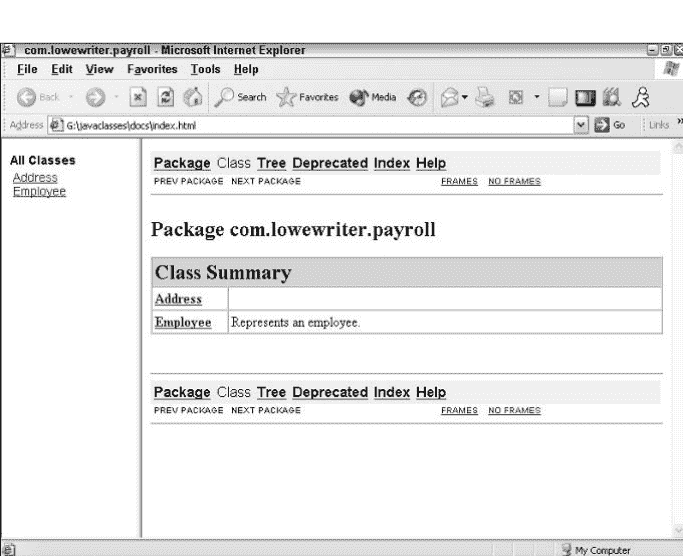

图8-1：一个JavaDoc索引页。

## 使用JavaDoc为你的类编写文档

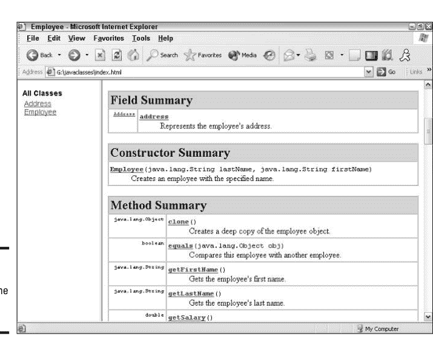

| 返回类型 | 方法 | 描述 |
|---|---|---|
| Address | address | 表示员工的地址。 |

**字段摘要**

| | |
|---|---|
| Address | address — 表示员工的地址。 |

**构造函数摘要**

| | |
|---|---|
| Employee(java.lang.String lastName, java.lang.String firstName) | 创建一个具有指定名称的员工。 |

**方法摘要**

| 返回类型 | 方法 | 描述 |
|---|---|---|
| java.lang.Object | clone() | 创建员工对象的深拷贝。 |
| boolean | equals(java.lang.Object obj) | 将此员工与另一个员工进行比较。 |
| java.lang.String | getFirstName() | 获取员工的名字。 |
| java.lang.String | getLastName() | 获取员工的姓氏。 |
| double | getSalary() | |

图8-2：Employee类的文档。

---

## 第四部分

## 字符串、数组和集合

第五波

作者：Rich Tennant


> "你的数据库已经无法修复，但在我告诉你我们的备份建议之前，让我先问你一个问题。你认为有多少张索引卡能贴满你计算机房的墙壁？"

## 内容概览

- 第1章：使用字符串 ................................................................ 355
- 第2章：使用数组 ............................................................................ 371
- 第3章：使用 ArrayList 类 .......................................................... 397
- 第4章：使用 LinkedList 类 ....................................................... 409
- 第5章：创建泛型集合类 ....................................... 419

## 第1章：使用字符串

### 本章内容

- 快速回顾你已知的关于字符串的知识
- 探究字符串类方法
- 处理子字符串
- 拆分字符串
- 使用 `StringBuilder` 和 `StringBuffer` 类
- 使用 `CharSequence` 接口

字符串是Java中最常见的对象类型之一。本书中包含了处理字符串的各种技巧。你已经看到了如何创建字符串变量，如何连接字符串，以及如何比较字符串。但到目前为止，我只是浅尝辄止地介绍了你能用字符串做什么。在本章中，我将深入探讨Java对字符串能做的操作。

我首先简要回顾一下我目前关于字符串的内容，这样你就不必翻遍全书去找基本信息。然后，我研究`String`类本身及其为处理字符串提供的一些方法。最后，你将研究两个几乎相同的类`StringBuilder`和`StringBuffer`，它们提供了基本`String`类所不具备的特性。

### 回顾字符串

为了省去你翻阅本书寻找字符串基本信息的麻烦，以下段落总结了前几章中关于字符串的内容：

- 字符串是引用类型，而不是值类型，比如`int`或`boolean`。因此，字符串变量持有的是对从`String`类创建的对象的引用，而不是字符串本身的值。
- 即使字符串不是基本类型，Java编也有一些设计特性，让你可以几乎像处理基本类型一样处理字符串。例如，Java允许你将字符串字面量赋值给字符串变量，如下所示：

    `String linel = "Oh what a beautiful morning!";`


## 356 复习字符串


## 不可变模式

许多应用程序可以从描述*不可变对象*的类中受益。不可变对象是一种一旦创建就永远无法更改的对象。`String` 类是最常见的不可变对象示例。创建 `String` 对象后，无法更改它。

创建不可变对象时，请遵循以下三个简单规则：

1.  提供一个或多个接受参数的构造函数，以设置对象的初始状态。
2.  不允许任何方法修改对象中的任何实例变量。使用构造函数设置实例变量，然后保持原样。
3.  任何修改对象的方法都应通过创建具有修改值的新对象来实现。然后，此方法将新对象作为其返回值返回。

例如，假设你正在设计一个游戏，游戏区域有固定的障碍物，如树木。你可以使用不可变模式创建 `Tree` 类。`Tree` 类的构造函数可以接受定义树木大小、类型和位置的参数。但一旦创建了树，你就无法移动它。

-   字符串可以包含由斜杠后跟另一个字符组成的*转义序列*。最常见的转义序列是 `\n` 用于换行，`\t` 用于制表符。如果要在字符串中包含斜杠，必须使用转义序列 `\\`。
-   字符串和字符是不同的。字符串字面量用引号标记；字符字面量用撇号标记。因此，"a" 是一个恰好长度为一个字符的字符串字面量。相比之下，'a' 是一个字符字面量。
-   你可以使用 `+` 运算符组合或*连接*字符串，如下所示：

```java
String line2 = line1 + "\nOh what a beautiful day!";
```

-   你也可以对字符串使用 `+=` 运算符，如下所示：

```java
line2 += "\nI've got a beautiful feeling";
```

-   在连接表达式中使用时，Java 会自动将原始类型转换为字符串。因此，Java 允许以下操作：

```java
int empCount = 50;
String msg = "Number of employees: " + empCount;
```

-   各种原始包装类（如 `Integer` 和 `Double`）具有 `parse` 方法，可以将字符串值转换为数字类型。例如：

```java
String s = "50";
int i = Integer.parseInt(s);
```

-   不能使用相等运算符（`==`）比较字符串。相反，应该使用 `equals` 方法。例如：

```java
if (lastName.equals("Lowe"))
    System.out.println("This is me!");
```

-   `String` 类还有一个 `equalsIgnoreCase` 方法，可在不考虑大小写的情况下比较字符串。例如：

```java
if (lastName.equalsIgnoreCase("lowe"))
    System.out.println("This is me again!");
```

## 使用 String 类

`String` 类是用于创建字符串对象的类。它有一大堆方法，旨在让你获取有关 `String` 类所代表的字符串的信息。表 1-1 列出了这些方法中最有用的一些。

| 方法 | 描述 |
|---|---|
| `char charAt(int)` | 返回字符串中指定位置的字符。 |
| `int compareTo(String)` | 根据字母顺序将此字符串与另一个字符串进行比较。如果此字符串在另一个字符串之前，则返回 -1；如果字符串相同，则返回 0；如果此字符串在另一个字符串之后，则返回 1。 |
| `int compareToIgnoreCase(String)` | 类似于 `compareTo`，但忽略大小写。 |
| `boolean contains(CharSequence)` | 如果此字符串包含参数值，则返回 `true`。参数可以是 `String`、`StringBuilder` 或 `StringBuffer`。 |
| `boolean endsWith(String)` | 如果此字符串以参数字符串结尾，则返回 `true`。 |
| `boolean equals(String)` | 如果此字符串与参数字符串具有相同的值，则返回 `true`。 |
| `boolean equalsIgnoreCase(String)` | 类似于 `equals`，但忽略大小写。 |
| `int indexOf(char)` | 返回字符参数在此字符串中首次出现的索引。如果字符不在字符串中，则返回 -1。 |
| `int indexOf(String)` | 返回 String 参数在此字符串中首次出现的索引。如果字符串不在此字符串中，则返回 -1。 |
| `int indexOf(String, int start)` | 类似于 `indexOf`，但搜索从字符串中的指定位置开始。 |
| `int lastIndexOf(char)` | 返回字符参数在此字符串中最后一次出现的索引。如果字符不在字符串中，则返回 -1。 |
| `int lastIndexOf(String)` | 返回 String 参数在此字符串中最后一次出现的索引。如果字符串不在此字符串中，则返回 -1。 |
| `int lastIndexOf(String, int)` | 类似于 `lastIndexOf`，但搜索从字符串中的指定位置开始。 |
| `int length()` | 返回此字符串的长度。 |
| `String replace(char, char)` | 返回一个基于原始字符串的新字符串，但将第一个参数的每个出现替换为第二个参数。 |
| `String replaceAll(String old, String new)` | 返回一个基于原始字符串的新字符串，但将第一个字符串的每个出现替换为第二个参数。请注意，第一个参数可以是正则表达式。 |
| `String replaceFirst(String old, String new)` | 返回一个基于原始字符串的新字符串，但将第一个字符串的首次出现替换为第二个参数。请注意，第一个参数可以是正则表达式。 |
| `String[] split(String)` | 将字符串分割成字符串数组，使用字符串参数作为模式来确定分割字符串的位置。 |
| `boolean startsWith(String)` | 如果此字符串以参数字符串开头，则返回 `true`。 |
| `boolean startsWith(String, int)` | 如果此字符串在 int 参数指示的位置包含参数字符串，则返回 `true`。 |
| `String substring(int)` | 从 int 参数指示的位置开始，从此字符串中提取子字符串，一直持续到字符串末尾。 |
| `String substring(int, int)` | 从第一个参数指示的位置开始，到第二个参数值减一的位置结束，从此字符串中提取子字符串。 |
| `char[] toCharArray()` | 将字符串转换为单个字符数组。 |
| `String toLowerCase()` | 将字符串转换为小写。 |
| `String toString()` | 将字符串作为 String 返回。（如果你问我，这相当无意义，但所有类都必须有一个 toString 方法。） |
| `String toUpperCase()` | 将字符串转换为大写。 |
| `String trim()` | 返回字符串的副本，但移除所有前导和尾随空白。 |
| `String valueOf(primitiveType)` | 返回任何原始类型的字符串表示形式。 |


> 关于 String 类最重要的一点要记住的是，尽管它有无数个方法，但这些方法中没有一个能让你以任何方式修改字符串。这是因为 String 对象是不可变的，这意味着它无法更改。

虽然创建字符串后无法更改它，但可以使用 String 类的方法创建新字符串，这些新字符串是原始字符串的变体。以下部分将介绍你可以使用这些方法做的一些更有趣的事情。

## 查找字符串的长度

最基本的字符串操作之一是确定字符串的长度。你可以使用 `length` 方法完成此操作。例如：

```java
String s = "A wonderful day for a neighbor.";
int len = s.length();
```

这里，`len` 被赋值为 30，因为字符串 `s` 由 30 个字符组成。

获取字符串的长度本身通常不是很有用。但 `length` 方法在其他字符串操作中经常扮演重要角色，正如你在以下各节中看到的。


## **360 使用字符串类**

## 进行简单的字符串修改

`String`类的许多方法都会返回原始字符串的修改版本。例如，`toLowerCase`将字符串转换为全小写字母：

```
String s = "Umpa Lumpa";
s = s.toLowerCase();
```

这里，`s`被设置为字符串`umpa lumpa`。`toUpperCase`方法的工作原理相同，但将字符串转换为全大写字母。

`trim`方法会移除单词开头和结尾的空白字符（空格、制表符、换行符等）。例如：

```
String s = "   Umpa Lumpa   ";
s = s.trim();
```

这里，`Umpa Lumpa`前后的空格都被移除了。因此，结果字符串的长度是10个字符。

> 请记住，由于字符串是不可变的，这些方法实际上并不会修改`String`对象。相反，它们会创建一个新的具有修改后值的`String`。一个常见的错误——尤其是在Java新手但熟悉其他语言的程序员中——是忘记将这些方法的返回值赋给变量。例如，以下语句对`s`没有任何影响：

```
s.trim();
```

这里，`trim`方法修剪了字符串，但随后程序丢弃了结果。解决方法是将此表达式的结果赋回给`s`，如下所示：

```
s = s.trim();
```

## 从字符串中提取字符

你可以使用`charAt`方法从字符串的特定位置提取一个字符。执行此操作时，请记住字符串中第一个字符的索引号是0，而不是1。此外，在提取字符之前，应该检查字符串的长度。如果指定的索引值超出了字符串的末尾，将抛出`StringIndexOutOfBoundsException`异常。（幸运的是，这是一个非受检异常，因此你不必将`charAt`方法放在`try/catch`语句中。）

下面是一个使用`charAt`方法计算用户输入字符串中元音字母数量的程序示例：

```
import java.util.Scanner;

public class CountVowels
{
    static Scanner sc = new Scanner(System.in);

    public static void main(String[] args)
    {
        System.out.print("Enter a string: ");
        String s = sc.nextLine();

        int vowelCount = 0;

        for (int i = 0; i < s.length(); i++)
        {
            char c = s.charAt(i);
            if (    (c == 'A') || (c == 'a')
                 || (c == 'E') || (c == 'e')
                 || (c == 'I') || (c == 'i')
                 || (c == 'O') || (c == 'o')
                 || (c == 'U') || (c == 'u') )
                vowelCount++;
        }
        System.out.println("That string contains "
            + vowelCount + " vowels.");
    }
}
```

这里，`for`循环检查字符串的长度，以确保索引变量`i`不会超过字符串长度。然后，提取每个字符并用`if`语句检查它是否是元音字母。此`if`语句中的条件表达式有点复杂，因为它必须检查五种不同的元音字母，以及它们的大写和小写形式。

## 从字符串中提取子字符串

`substring`方法允许你提取字符串的一部分。此方法有两种形式。第一种形式接受一个整数参数。它返回从该参数指定的位置开始并延伸到字符串其余部分的子字符串。（请记住，字符串位置从0开始，而不是1。）例如：

```
String s = "Baseball";
String b = s.substring(4);      // "ball"
```

这里，`b`被赋值为字符串`ball`。

`substring`方法的第二种版本接受两个参数，分别表示要提取的子字符串的起始和结束位置。请注意，子字符串实际上结束于第二个参数指定位置之前的那个字符。因此，要提取位置2到5的字符，请将起始位置指定为1，结束位置指定为6。例如：

```
String s = "Baseball";
String b = s.substring(2, 6);      // "seba"
```

这里，`b`被赋值为字符串`seba`。

以下程序使用子字符串将用户输入字符串中的所有元音字母替换为星号：

```
import java.util.Scanner;

public class MarkVowels
{
    static Scanner sc = new Scanner(System.in);

    public static void main(String[] args)
    {
        System.out.print("Enter a string: ");
        String s = sc.nextLine();
        String originalString = s;

        int vowelCount = 0;

        for (int i = 0; i < s.length(); i++)
        {
            char c = s.charAt(i);
            if (        (c == 'A') ||      (c == 'a')
                    || (c == 'E') ||      (c == 'e')
                    || (c == 'I') ||      (c == 'i')
                    || (c == 'O') ||      (c == 'o')
                    || (c == 'U') ||      (c == 'u') )
            {
                String front = s.substring(0, i);
                String back = s.substring(i+1);
                s = front + "*" + back;
            }
        }
        System.out.println();
        System.out.println(originalString);
        System.out.println(s);
    }
}
```

此程序使用`for`循环和`charAt`方法从字符串中提取每个字符。然后，如果该字符是元音字母，就创建一个名为`front`的字符串，它由元音字母之前的所有字符组成。接着创建第二个名为`back`的字符串，它由元音字母之后的所有字符组成。最后，用一个由`front`字符串、一个星号和`back`字符串组成的新字符串替换`s`字符串。

以下是此程序的一些示例控制台输出，以便你了解其工作原理：

```
Enter a string: Where have all the vowels gone?

Where have all the vowels gone?
Wh*r* h*v* *ll th* v*w*ls g*n*?
```

## 拆分字符串

`split`命令对于根据分隔符字符将字符串拆分为单独的字符串特别有用。例如，假设你有一个字符串，其中地址的各个部分用冒号分隔，如下所示：

```
1500 N. Third Street:Fresno:CA:93722
```

使用`split`方法，你可以轻松地将此字符串拆分为四个字符串。在这个过程中，冒号会被丢弃。

不幸的是，使用`split`方法需要你使用数组，而数组将在下一章中介绍。无论如何，我将继续介绍这一节，希望你已经了解一些关于数组的基本知识。如果没有，你可以在阅读下一章后随时回到这一节。

`split`方法将一个字符串拆分为由通过字符串参数传递的分隔符字符分隔的字符串数组。下面是一个将地址拆分为单独字符串并打印所有字符串的例程：

```
String address =
    "1500 N. Third Street:Fresno:CA:93722";

String[] parts = address.split(":");

for (int i = 0; i < parts.length; i++)
    System.out.println(parts[i]);
```

如果你运行此代码，控制台将显示以下几行：

```
1500 N. Third Street
Fresno
CA
93722
```

## **364 使用字符串类**

传递给`split`方法的字符串实际上是一种用于模式识别的特殊字符串，称为*正则表达式*。你将在第五册中学习正则表达式。现在，这里有一些在使用`split`方法时可能有用的正则表达式：

| 正则表达式 | 解释 |
| --- | --- |
| `\\t` | 一个制表符 |
| `\\n` | 一个换行符 |
| `\\|` | 一个竖线 |
| `\\s` | 任何空白字符 |
| `\\s+` | 一个或多个任何空白字符的出现 |

此表中的最后一个正则表达式`\\s+`对于将字符串拆分为单独的单词特别有用。例如，以下程序从用户处接受一个字符串，将其拆分为单独的单词，然后在单独的行上显示这些单词：

```
import java.util.Scanner;

public class CountWords
{
    static Scanner sc = new Scanner(System.in);

    public static void main(String[] args)
    {
        System.out.print("Enter a string: ");
        String s = sc.nextLine();

        String[] word = s.split("\\s+");

        for (String w : word)
            System.out.println(w);
    }
}
```

以下是此程序典型执行的控制台输出示例：

```
Enter a string: This string has several words
This
string
has
several
words
```


## 替换字符串中的部分内容

你可以使用 `replaceFirst` 或 `replaceAll` 方法，将字符串中与所提供模式匹配的部分替换为其他文本。例如，下面是某个程序的 `main` 方法，它从用户那里获取一行文本，然后将字符串中所有出现的 `cat` 替换为 `dog`：

```
public static void main(String[] args)
{
    Scanner sc = new Scanner(System.in);
    System.out.print("Enter a string: ");
    String s = sc.nextLine();

    s = s.replaceAll("cat", "dog");

    System.out.println(s);
}
```

下面是该程序一次典型执行的控制台输出：

```
Enter a string: I love cats. Cats are the best.
I love dogs. Cats are the best.
```

与 `split` 方法一样，`replace` 方法的第一个参数可以是正则表达式，用于提供复杂的匹配字符串。更多信息请参阅第五册。


> 再次提醒，不要忘记字符串是不可变的。因此，`replace` 方法实际上并不会修改 `String` 对象本身。相反，它们会返回一个新 `String` 对象，其中包含修改后的值。

请注意，用户输入字符串中的某些单词前面有多个空格字符。`split` 方法使用的 `\s+` 模式在分割单词时，会将任何连续的空白字符视为单个分隔符。

## 使用 StringBuilder 和 StringBuffer 类

`String` 类功能强大，但对于需要大量字符串操作程序来说，效率并不高。因为 `String` 对象是不可变的，所以 `String` 类中任何以任何方式修改字符串的方法都必须创建一个新的 `String` 对象，并将原始字符串对象的修改内容复制到新字符串中。如果这种情况只是偶尔发生，那还不算太糟，但在经常执行此操作的程序中，效率可能会很低。

甚至字符串连接本身也是低效的。例如，考虑以下语句：

```
int count = 5;
String msg = "There are ";
String msg += count;
String msg += " apples in the basket.";
```

这四条语句实际上创建了五个 `String` 对象：

-   "There are "：为第二条语句中的字面量创建。`msg` 变量被赋值为对该字符串的引用。
-   "5"：用于保存 `count.toString()` 的结果。第三条语句隐式调用 `toString` 方法，以便将 `count` 与 `msg` 连接。
-   "There are 5"：第三条语句中连接操作的结果。对该对象的引用被赋给 `msg`。
-   "apples in the basket."：用于保存第四条语句中的字面量。
-   "There are 5 apples in the basket."：用于保存第四条语句中连接操作的结果。对该对象的引用被赋给 `msg`。

对于仅进行偶尔字符串连接和简单字符串操作的程序来说，这些低效率并不是什么大问题。然而，对于进行大量字符串操作的程序，Java 提供了 `String` 类的两个替代方案：`StringBuilder` 和 `StringBuffer` 类。

`StringBuilder` 和 `StringBuffer` 类彼此互为镜像。两者具有相同的方法并执行相同的字符串操作。唯一的区别是，`StringBuffer` 类可以安全地用于多线程应用程序。`StringBuilder` 不适用于多线程应用程序，但比 `StringBuffer` 更高效。因此，除非你的应用程序使用线程，否则应该使用 `StringBuilder` 类。（了解如何使用线程，请参阅第五册。）

**注意：** `StringBuilder` 类是在 Java 1.5 版本中引入的。如果你使用的是较旧的 Java 编译器，则必须使用 `StringBuffer` 代替。

### 创建 StringBuilder 对象

你无法像使用 `String` 对象那样直接将字符串字面量赋给 `StringBuilder` 对象。不过，`StringBuilder` 类有一个接受 `String` 作为参数的构造函数。因此，要创建 `StringBuilder` 对象，你需要使用如下语句：

```
StringBuilder sb = new StringBuilder("Today is the day!");
```

在内部，`StringBuilder` 对象会维护一块固定大小的内存区域来存储字符串值。这块内存区域称为*缓冲区*。存储在此缓冲区中的字符串不必使用整个缓冲区。因此，`StringBuilder` 对象具有 *length*（长度）和 *capacity*（容量）。长度表示 `StringBuilder` 维护的字符串的当前长度，而 *capacity* 表示缓冲区本身的大小。注意，长度不能超过容量。

创建 `StringBuilder` 对象时，容量最初设置为字符串长度加 16。`StringBuilder` 类会在必要时自动增加其容量，因此你不必费心担心会超过容量。

### 使用 StringBuilder 方法

表 1-2 列出了 `StringBuilder` 类最有用的方法。请注意，`StringBuffer` 类使用相同的方法。因此，如果你必须使用 `StringBuffer` 而不是 `StringBuilder`，只需更改类名并使用相同的方法。

#### 表 1-2 StringBuilder 方法

| 方法 | 说明 |
|---|---|
| `append(primitiveType)` | 将基本类型的字符串表示形式追加到字符串末尾。 |
| `append(Object)` | 调用对象的 `toString` 方法并将结果追加到字符串末尾。 |
| `append(CharSequence)` | 将字符串追加到 `StringBuilder` 字符串值的末尾。参数可以是 `String`、`StringBuilder` 或 `StringBuffer`。 |
| `int capacity()` | 返回此 `StringBuilder` 的容量。 |
| `char charAt(int)` | 返回字符串中指定位置的字符。 |
| `delete(int, int)` | 删除从第一个 `int` 开始、到第二个 `int` 之前的字符为止的字符。 |
| `deleteCharAt(int)` | 删除指定位置的字符。 |
| `ensureCapacity(int)` | 确保 `StringBuilder` 的容量至少等于该 `int` 值。如有必要，会增加容量。 |
| `int indexOf(String)` | 返回指定字符串首次出现的索引。如果该字符串未出现，则返回 -1。 |
| `int indexOf(String, int)` | 返回指定字符串首次出现的索引，从指定索引位置开始搜索。如果该字符串未出现，则返回 -1。 |
| `insert(int, primitiveType)` | 在 `int` 参数指定的位置插入基本类型的字符串表示形式。 |
| `insert(int, Object)` | 调用 `Object` 参数的 `toString` 方法，然后在 `int` 参数指定的位置插入所得字符串。 |
| `insert(int, CharSequence)` | 在 `int` 参数指定的位置插入字符串。第二个参数可以是 `String`、`StringBuilder` 或 `StringBuffer`。 |
| `int lastIndexOf(String)` | 返回指定字符串最后一次出现的索引。如果该字符串未出现，则返回 -1。 |
| `int lastIndexOf(String, int)` | 返回指定字符串最后一次出现的索引，从指定索引位置开始搜索。如果该字符串未出现，则返回 -1。 |
| `int length()` | 返回此字符串的长度。 |
| `replace(int, int, String)` | 用第三个参数提供的字符串替换由前两个参数指示的子字符串。 |
| `reverse()` | 反转字符的顺序。 |
| `setCharAt(int, char)` | 将指定位置的字符设置为指定字符。 |
| `setLength(int)` | 设置字符串的长度。如果小于当前长度，则截断字符串。如果大于当前长度，则用十六进制零填充新字符。 |
| `String substring(int)` | 提取从 `int` 参数指示的位置开始到字符串末尾的子字符串。 |
| `String substring(int, int)` | 提取从第一个参数指示的位置开始、到第二个参数值的前一个位置结束的子字符串。 |
| `String toString()` | 将当前值作为 `String` 返回。 |
| `String trimToSize()` | 将 `StringBuffer` 的容量缩减为与字符串大小相匹配。 |


## 一个 StringBuilder 示例

为了说明 `StringBuilder` 类的工作原理，这里提供本章前面 `MarkVowel` 程序的 `StringBuilder` 版本：

```java
import java.util.Scanner;

public class StringBuilderApp
{
    static Scanner sc = new Scanner(System.in);

    public static void main(String[] args)
    {
        System.out.print("Enter a string: ");
        String s = sc.nextLine();

        StringBuilder sb = new StringBuilder(s);

        int vowelCount = 0;

        for (int i = 0; i < s.length(); i++)
        {
            char c = s.charAt(i);
            if (     (c == 'A')  || (c == 'a')
                 || (c == 'E')  || (c == 'e')
                 || (c == 'I')  || (c == 'i')
                 || (c == 'O')  || (c == 'o')
                 || (c == 'U')  || (c == 'u') )
            {
                sb.setCharAt(i, '*');
            }
        }
        System.out.println();
        System.out.println(s);
        System.out.println(sb.toString());
    }
}
```

这个程序使用 `setCharAt` 方法直接将发现的任何元音替换为星号。这比 `String` 版本程序中拼接子字符串的方式效率高得多。

## 使用 CharSequence 接口

Java API 包含一个有用的接口，名为 `CharSequence`。本章介绍的三个类（`String`、`StringBuilder` 和 `StringBuffer`）都实现了这个接口。该方法的存在主要是为了让你可以互换使用 `String`、`StringBuilder` 和 `StringBuffer`。

为此，`String`、`StringBuilder` 和 `StringBuffer` 类的多个方法都使用 `CharSequence` 作为参数类型。对于这些方法，你可以传递 `String`、`StringBuilder` 或 `StringBuffer` 对象。请注意，字符串字面量被视为 `String` 对象，因此你可以在任何需要 `CharSequence` 的地方使用字符串字面量。

如果你有兴趣，`CharSequence` 接口定义了四个方法：

* `char charAt(int)`：返回指定位置处的字符。
* `int length()`：返回序列的长度。
* `subSequence(int start, int end)`：返回由 start 和 end 参数指示的子序列。
* `toString()`：返回序列的 `String` 表示。

如果你打算将 `CharSequence` 作为方法的参数类型，以便该方法能与 `String`、`StringBuilder` 或 `StringBuffer` 对象一起使用，请注意你只能使用这四个方法。

# 第二章：使用数组

## 本章内容

- 使用基本的一维数组
- 使用数组初始化器设置数组的初始值
- 将 `for` 循环与数组结合使用
- 使用二维数组
- 使用 `Arrays` 类

**我**需要加点薪水……。

哦，是 *数组*。抱歉。

数组是任何编程语言的重要方面，Java 也不例外。在本章中，你将发现关于使用数组你需要知道的一切。我将介绍普通的一维数组、多维数组，以及两个用于处理数组的类：`Array` 和 `Arrays`。

## 理解数组

*数组* 是一组变量，通过一个变量名结合一个索引号来引用。数组中的每一项称为一个 *元素*。数组中的所有元素必须是相同的类型。因此，数组本身有一个类型，指定了它可以包含哪种元素。例如，一个 `int` 数组可以包含 `int` 值，一个 `String` 数组可以包含字符串。

索引号写在变量名之后，并用方括号括起来。所以，如果变量名是 `x`，你可以用像 `x[5]` 这样的表达式来访问特定元素。

你可能认为 `x[5]` 指的是数组中的第五个元素。但是索引号从零开始，第一个元素是 0，所以 `x[5]` 实际上指的是第六个元素。这个小细节是使用数组时问题的主要原因之一——特别是如果你在数组索引从 1 而不是 0 的语言中开始编程的话。所以，要习惯从 0 开始计数，而不是从 1。

## 创建数组

数组的真正威力源于一个简单的事实：你可以使用变量甚至完整的表达式作为数组索引。所以，例如，与其编写 `x[5]` 来引用特定的数组元素，你可以编写 `x[i]` 来引用索引变量 `i` 所指示的元素。你将在本章中看到大量索引变量的例子。

在深入创建和使用数组的细节之前，这里有一些关于数组的额外信息供你思考：

- 数组本身就是一个对象。你可以通过使用数组的变量名（不带索引）来引用整个数组对象，而不是数组的特定元素。因此，如果 `x[5]` 指的是数组的一个元素，那么 `x` 指的是数组本身。
- 数组有一个固定的长度，在创建数组时设置。这个长度决定了可以存储在数组中的元素数量。你可以对任何数组使用的最大索引值比数组的长度少一。因此，如果你创建一个有 10 个元素的数组，你可以使用 0 到 9 的索引值。
- 在创建数组后，你不能更改数组的长度。
- 你可以通过使用数组变量的 `length` 字段来访问数组的长度。例如，`x.length` 返回数组 `x` 的长度。

在创建数组之前，你必须首先声明一个指向数组的变量。这个变量声明应该指示数组存储的元素类型，后跟一对空方括号，像这样：

```java
String[] names;
```

这里，声明了一个名为 `names` 的变量。它的类型是一个 `String` 对象数组。

为了确保你尽可能地困惑，Java 也允许你把方括号放在变量名上而不是类型上。例如，以下两条语句都创建了 `int` 元素的数组：

```java
int[] array1;    // 一个 int 元素的数组
int array2[];    // 另一个 int 元素的数组
```

这两条语句的效果完全相同。大多数 Java 程序员更喜欢把方括号放在类型上，而不是变量名上。

这条语句本身并不创建数组。它只是声明了一个可以引用数组的变量。你实际上可以用两种方式创建数组：

- 使用 `new` 关键字后跟数组类型，这次括号中要填写以指示数组可以容纳多少个元素。例如：

```java
String[] names;
names = new String[10];
```

这里，创建了一个可以容纳 10 个字符串的 `String` 对象数组。该数组中的每个字符串都初始化为空字符串。

- 像任何其他变量一样，你可以将声明和创建合并为一条语句：

```java
String[] names = new String[10];
```

这里，数组变量被声明，同时创建了一个数组。

> 如果你在编译时不知道数组需要多少个元素，你可以使用变量或表达式作为数组长度。例如，这里有一个方法中的例程，它将玩家名称存储在字符串数组中。它首先询问用户团队中有多少名玩家。然后，它创建一个正确大小的数组：

```java
System.out.print("How many players? ");
int count = sc.nextInt();       // sc 是一个 Scanner
String[] players = new String[count];
```

## 初始化数组

初始化数组中值的一种方法是简单地逐个赋值：

```java
String[] days = new String[7];
days[0] = "Sunday";
days[1] = "Monday";
days[2] = "Tuesday";
days[3] = "Wednesday";
days[4] = "Thursday";
days[5] = "Friday";
days[6] = "Saturday";
```

Java 有一种简写方式来创建数组并用常量值初始化它：

```java
String[] days = { "Sunday", "Monday", "Tuesday",
                "Wednesday", "Thursday",
                "Friday", "Saturday" };
```


## 使用for循环处理数组

在这里，要分配给数组的每个元素都列在*数组初始化器*中。这是一个`int`数组初始化器的示例：

```
int[] primes = { 2, 3, 5, 7, 11, 13, 17 };
```

**注意：** 使用初始化器创建的数组的长度由初始化器中列出的值的数量决定。

编写初始化器的另一种方式是这样的：

```
int[] primes = new int[] { 2, 3, 5, 7, 11, 13, 17 };
```

要使用这种类型的初始化器，你需要使用`new`关键字，后跟数组类型和一组空括号。然后，你编写初始化器。

## 使用for循环处理数组

处理数组最常用的方法之一是使用`for`循环。事实上，`for`循环就是专门为处理数组而发明的。例如，这是一个`for`循环，它创建了一个包含100个随机数字的数组，值范围从1到100：

```
int[] numbers = new int[100];
for (int i = 0; i < 100; i++)
    numbers[i] = (int)(Math.random() * 100) + 1;
```

而这是一个循环，它用用户输入的字符串填充一个玩家姓名数组：

```
String[] players = new String[count];
for (int i = 0; i < count; i++)
{
    System.out.print("Enter player name: ");
    players[i] = sc.nextLine();    // sc is a Scanner
}
```

在这个例子中，假设`count`是一个`int`变量，用于保存要输入的玩家数量。

你也可以使用`for`循环来打印数组的内容。例如：

```
for (int i = 0; i < count; i++)
    System.out.println(players[i]);
```

这里，名为`players`的`String`数组的元素被打印到控制台。

前面的例子假设在循环执行之前，数组的长度已经存储在一个变量中。如果你手边没有数组长度，你可以从数组的`length`属性中获取它：

```
for (int i = 0; i < players.length; i++)
    System.out.println(players[i]);
```

## 使用数组解决作业问题

偶尔，一个数组和一两个`for`循环可以帮助你解决孩子的作业问题。例如，我曾经帮助我的女儿解决了一道七年级数学课的难题作业。题目大致是这样的：

Bobo（这类问题里总有一个叫Bobo的角色）在周六参观当地高中，发现学校所有的1000个储物柜都整齐地关着。于是他从学校一端开始，把它们全部打开。然后，他回到起点，关上每隔一个的储物柜（2、4、6号等等）。接着，他回到起点，处理每隔三个的储物柜：如果它是开着的，他就关上它；如果它是关着的，他就打开它。然后他处理每隔四个、每隔五个的储物柜，以此类推。整个周末他都这样做，在走廊里来回走动，打开又关闭储物柜1000次。然后他觉得无聊就回家了。学校的1000个储物柜中有多少个是开着的？它们是哪些？

天哪！

这道题是个挑战，而我这个计算机极客老爸觉得，这是时候给我女儿讲解`for`循环和数组了。于是我写了一个小程序，创建了一个包含1000个布尔值的数组。每个布尔值代表一个储物柜：`true`表示打开，`false`表示关闭。然后我写了一对嵌套的`for`循环来进行计算。

我的第一次尝试告诉我，1000个储物柜中有10000个被打开了，所以我猜我肯定在哪里搞错了。而当我查看代码时，我意识到储物柜编号是从1到1000，但我数组中的元素编号是从0到999，这正是导致我第一个答案如此荒谬的混乱根源。

于是我决定创建一个有1001个元素的数组，然后忽略第一个元素。这样索引就和储物柜号码完美对应了。

经过几个小时的努力，我完成了清单2-1中的程序。

### 清单2-1：经典储物柜问题的解决方案！

```
public class BoboAndTheLockers
{
    public static void main(String[] args)
    {
        // true = open; false = closed
        boolean[] lockers = new boolean[1001];

        // close all the lockers
        for (int i = 1; i <= 1000; i++)
            lockers[i] = false;

        for (int skip = 1; skip <= 1000; skip++)
        {
            System.out.println("Bobo is changing every "
                + skip + " lockers.");
            for (int locker = skip; locker < 1000;
                    locker += skip)
                lockers[locker] = !lockers[locker];
        }

        System.out.println("Bobo is bored"
            + " now so he's going home.");

        // count and list the open lockers
        String list = "";
        int openCount = 0;
        for (int i = 1; i <= 1000; i++)
            if (lockers[i])
            {
                openCount++;
                list += i + " ";
            }

        System.out.println("Bobo left " + openCount
            + " lockers open.");
        System.out.println("The open lockers are: "
            + list);
    }
}
```

以下是这个程序工作原理的要点：

-   **→ 6** 这一行设置了一个包含1001个布尔值的数组。我比需要的多创建了一个元素，这样我就可以忽略元素零。
-   **→ 9** 这个`for`循环关闭了所有的储物柜。这一步其实并非必要，因为布尔值初始化为`false`。但明确地进行初始化是好的。
-   **→ 12** 这个循环的每一次迭代代表在走廊里完整地走一趟，打开和关闭储物柜。`skip`变量表示Bobo每次经过时跳过多少个储物柜。首先他处理每个储物柜，然后是每隔一个储物柜，再然后是每隔两个储物柜。所以这个循环只是从1数到1000。
-   **→ 16** 这个循环的每一次迭代代表在走廊中一趟行程里停在一个储物柜前。`for`语句（在下一行）中的第三个表达式将`skip`变量加到`index`变量上，以便Bobo在每一趟行程中都能访问到每个*第n个*储物柜。
-   **→ 18** 这个语句使用非运算符（`!`）来反转每个储物柜的设置。因此，如果储物柜是打开的（`true`），它就被设置为关闭（`false`）。反之亦然。
-   **→ 27** 又一个`for`循环遍历所有储物柜并计数那些开着的。它还将每个开着的储物柜的号码添加到一个字符串的末尾，以便可以打印出所有开着的储物柜。

这个程序产生了超过1000行的输出。但只有最后几行是重要的。它们如下：

```
Bobo is bored now so he's going home.
Bobo left 31 lockers open.
The open lockers are: 1 4 9 16 25 36 49 64 81 100 121
    144 169 196 225 256 289 324 361 400 441 484 529 576
    625 676 729 784 841 900 961
```

所以答案是：有31个储物柜是开着的。我得了一个A。（我是说，我女儿得了一个A。）

> 顺便说一句，你注意到那些开着的储物柜的编号都是完全平方数吗？或者31是其平方小于1000的最大数字？我也没注意到，直到第二天我女儿放学后告诉我。

## 使用增强型for循环

Java 1.5引入了一种新的`for`循环，称为*增强型for循环*，旨在简化处理数组和集合（我将在下一章介绍）的循环。当与数组一起使用时，增强型`for`循环具有以下格式：

```
for (type identifier : array)
{
    statements...
}
```

*类型*指定了数组中元素的类型，*标识符*提供了一个用于访问每个元素的局部变量的名称。而*数组*则命名了你想要处理的数组。

这里有一个例子：

```
String[] days = { "Sunday", "Monday", "Tuesday",
                  "Wednesday", "Thursday",
                  "Friday", "Saturday" };
for (String day : days)
{
    System.out.println(day);
}
```

这个循环在控制台上打印以下行：

```
Sunday
Monday
Tuesday
Wednesday
Thursday
Friday
Saturday
```

换句话说，它在单独的行上打印数组中的每个字符串。

增强型for循环是Java 1.5的新特性，所以如果你使用的是早期版本，就不能使用它。（这是你应该尽快升级的众多原因之一。）

## 在方法中使用数组

你可以编写接受数组作为参数并返回数组作为返回值的方法。你只需要使用空括号来表明参数类型或返回类型是数组。

例如，这里有一个静态方法，它创建并返回一个包含星期几名称的String数组：

```
public static String[] getDaysOfWeek()
{
    String[] days = { "Sunday", "Monday", "Tuesday",
                        "Wednesday", "Thursday",
                        "Friday", "Saturday" };

    return days;
}
```


下面是一个静态方法，用于将任意`String`数组的内容逐行打印到控制台：

```
public static void printStringArray(String[] strings)
{
    for (String s : strings)
        System.out.println(s);
}
```

最后，这是调用这些方法的两行代码：

```
String[] days = getDaysOfWeek();
printStringArray(days);
```

第一条语句声明了一个`String`数组，然后调用`getDaysOfWeek`来创建该数组。第二条语句将数组作为参数传递给`printStringArray`方法。

## 使用二维数组

数组的元素可以是任何类型的对象，包括另一个数组。这称为*二维数组*，有时也称为*数组的数组*。

二维数组通常用于以行列格式跟踪数据，类似于电子表格的工作方式。例如，假设你正在编写一个程序，用于跟踪某公司五年（2001 年至 2005 年）的销售数据，数据按四个销售区域（北部、南部、东部和西部）细分。你可以创建 20 个单独的变量，名称如`sales2001North`、`sales2001South`、`sales2001East`等等。但这有点繁琐。

或者，你可以创建一个包含 20 个元素的数组，如下所示：

```
double[] sales = new double[20];
```

但是，如何在这个数组中组织数据，以便你知道每个元素对应的年份和销售区域呢？

使用二维数组，你可以创建一个数组，其中每个元素对应一个年份。而这些元素中的每一个，又都是一个数组，其中每个元素对应一个区域。

将二维数组视为表格或电子表格是很常见的，如下所示：

| | 北部 | 南部 | 东部 | 西部 |
| --- | --- | --- | --- | --- |
| **2001** | 23,853 | 22,838 | 36,483 | 31,352 |
| **2002** | 25,483 | 22,943 | 38,274 | 33,294 |
| **2003** | 24,872 | 23,049 | 39,002 | 36,888 |
| **2004** | 28,492 | 23,784 | 42,374 | 39,573 |
| **2005** | 31,932 | 23,732 | 42,943 | 41,734 |

在这里，电子表格的每一行代表一年的销售额，每一列代表四个销售区域之一。

### 创建二维数组

要为这些销售数据声明二维数组，只需列出两组空括号，如下所示：

```
double sales[][];
```

这里，`sales`是一个`double`类型的二维数组。或者换句话说，`sales`是一个`double`数组的数组。

要实际创建数组，需要使用`new`关键字并为每组括号提供长度。例如：

```
sales = new double[5][4];
```

这里，第一个维度指定`sales`数组有五个元素。该数组代表表中的行。第二个维度指定这些元素中的每一个都有一个包含四个元素的`double`类型数组。该数组代表表中的列。

这里需要理解的一个关键点是，第一个数组只有一个实例，但第一个数组中每个元素的第二个数组都有单独的实例。因此，这条语句实际上创建了五个包含四个元素的`double`数组。然后这五个数组被用作第一个数组的元素。

注意，与一维数组一样，你可以在一个语句中声明和创建二维数组，如下所示：

```
double[][] sales = new double[5][4];
```

这里，`sales`数组在一个语句中被声明和创建。

### 访问二维数组元素

要访问二维数组的元素，需要使用两个索引。例如，这条语句设置 2001 年北部地区的销售额：

```
sales[0][0] = 23853.0;
```

正如你所想象的，通过硬编码每个索引值来访问二维数组中的数据可能会很繁琐。因此，通常会使用 for 循环。例如，以下代码使用 for 循环将销售数组的内容打印到控制台，用制表符分隔。每年打印在单独的一行上，年份在开头。此外，在打印销售数据之前，会先打印一行销售区域的标题。代码如下：

```
NumberFormat cf = NumberFormat.getCurrencyInstance();
System.out.println("\tNorth\t\tSouth\t\tEast\t\tWest");
int year = 2001;
for (int y = 0; y < 5; y++)
{
    System.out.print(year + "\t");
    for (int region = 0; region < 4; region++)
    {
        System.out.print(cf.format(sales[y][region]));
        System.out.print("\t");
    }
    year++;
    System.out.println();
}
```

假设销售数组已经初始化，这段代码会在控制台上产生以下输出：

| | 北部 | 南部 | 东部 | 西部 |
|---|---|---|---|---|
| 2001 | $23,853.00 | $22,838.00 | $36,483.00 | $31,352.00 |
| 2002 | $25,483.00 | $22,943.00 | $38,274.00 | $33,294.00 |
| 2003 | $24,872.00 | $23,049.00 | $39,002.00 | $36,888.00 |
| 2004 | $28,492.00 | $23,784.00 | $42,374.00 | $39,573.00 |
| 2005 | $31,932.00 | $23,732.00 | $42,943.00 | $41,734.00 |

> 警告！

访问二维数组中每个索引的 for 循环的嵌套顺序至关重要！前面的示例将每年的销售额列在单独的一行上，销售区域按列排列。例如，你可以通过反转嵌套数组索引的 for 循环顺序，打印出每个区域的销售额在单独一行上，年份按列排列的列表：

```
for (int region = 0; region < 4; region++)
{
    for (int y = 0; y < 5; y++)
    {
        System.out.print(cf.format(sales[y][region]));
        System.out.print("   ");
    }
    System.out.println();
}
```

这里，外层循环索引区域，内层循环索引年份。

```
$23,853.00 $25,483.00 $24,872.00 $28,492.00 $31,932.00
$22,838.00 $22,943.00 $23,049.00 $23,784.00 $23,732.00
$36,483.00 $38,274.00 $39,002.00 $42,374.00 $42,943.00
$31,352.00 $33,294.00 $36,888.00 $39,573.00 $41,734.00
```

### 初始化二维数组

通过在大括号中编码数组元素值来初始化数组的技术同样适用于二维数组。你只需要记住，主数组的每个元素实际上都是另一个数组。因此，你必须嵌套数组初始化器。

以下是一个初始化销售数组的示例：

```
double[][] sales =
    { {23853.0, 22838.0, 36483.0, 31352.0},     // 2001
      {25483.0, 22943.0, 38274.0, 33294.0},     // 2002
      {24872.0, 23049.0, 39002.0, 36888.0},     // 2003
      {28492.0, 237\h.23784.0, 42374.0, 39573.0},     // 2004
      {31932.0, 23732.0, 42943.0, 41734.0} };   // 2005
```

这里，我在每行末尾添加了一条注释，以显示该行初始化的年份。请注意，整个初始化器的左大括号在第二行的开头，而关闭整个初始化器的右大括号在最后一行的末尾。然后，每年的初始化器都放在其自己的大括号组中。

### 使用锯齿数组

当你使用诸如`new int[5][3]`这样的表达式创建数组时，你指定的是主数组的每个元素实际上是一个包含三个元素的`int`类型数组。然而，Java 允许你创建二维数组，其中主数组每个元素的长度可以不同。这有时称为*锯齿数组*，因为数组不形成漂亮的矩形。相反，它的边缘是锯齿状的。

例如，假设你需要跟踪四个团队，每个团队由两到三人组成。团队如下：

团队成员

A 亨利·布莱克、约翰尼·马尔卡希
B 本杰明·皮尔斯、约翰·麦金泰尔、乔纳森·塔特尔
C 玛格丽特·霍利亨、弗兰克·伯恩斯
D 马克斯·克林格、雷达·奥赖利、伊戈尔·斯特拉明斯基

以下代码为这些团队创建了锯齿数组：

```
String[][] teams
        = { {"Henry Blake", "Johnny Mulcahy"},
            {"Benjamin Pierce", "John McIntyre",
              "Jonathan Tuttle"},
            {"Margaret Houlihan", "Frank Burns"},
            {"Max Klinger", "Radar O'Reilly",
              "Igor Straminsky"} };
```

这里，每个嵌套数组初始化器表示每个子数组的字符串数量。例如，第一个子数组有两个字符串，第二个有三个字符串，依此类推。

你可以使用嵌套 for 循环来访问锯齿数组中的各个元素。对于主数组的每个元素，你可以使用 length 属性来确定该元素的子数组中有多少个条目。例如：

```
for (int i = 0; i < teams.length; i++)
{
    for (int j = 0; j < teams[i].length; j++)
        System.out.println(teams[i][j]);
    System.out.println();
}
```

请注意，每个子数组的长度是通过表达式`teams[i].length`确定的。这个 for 循环每行打印一个名字，团队之间有空行，如下所示：

```
Henry Blake
Johnny Mulcahy

Benjamin Pierce
John McIntyre
Jonathan Tuttle

Margaret Houlihan
Frank Burns

Max Klinger
Radar O'Reilly
Igor Straminsky
```


## 超越二维维度

Java 并不限制你只使用二维数组。数组可以在数组内嵌套，达到程序所需的任意多层。要声明一个多维数组，只需根据需要指定相应数量的空括号即可。例如：

```
int[][][] threeD = new int[3][3][3];
```

这里创建了一个三维数组，每个维度包含三个元素。你可以将此数组想象为一个立方体。每个元素需要三个索引才能访问。

你可以通过指定数组所需的索引数量来访问多维数组中的元素。例如：

```
threeD[0][1][2] = 100;
```

此语句将第0行、第1列中的第2个元素设置为`100`。

你还可以使用多个嵌套的 `if` 语句来处理具有三个或更多维度的数组。例如，以下是另一种用数字1到27初始化三维数组的方法：

```
int[][][] threeD2 = new int[3][3][3];
int value = 1;
for (int i = 0; i < 3; i++)
    for (int j = 0; j < 3; j++)
        for (int k = 0; k < 3; k++)
            threeD2[i][j][k] = value++;
```

## 一个有趣但复杂的示例：国际象棋棋盘

好了，商务示例就到这里。下面是一个更有趣的例子——至少如果你认为国际象棋有趣的话。清单2-2中的程序使用一个二维数组来表示棋盘。它的唯一目的是根据马（对于那些在里奥林达的人来说就是马）的起始位置，计算出它所有可能的走法。用户被要求输入一个起始位置（例如f1），程序会通过显示可能的格子来回应。然后，程序会打印出一个粗糙但可识别的棋盘表示，其中马的位置用X标记，其可能的走法用问号标记。

如果你不熟悉国际象棋，它是在一个8x8的棋盘上进行的，棋盘格颜色黑白相间。识别每个格子的通常方法是使用一个字母和一个数字，其中字母代表列（称为*file*），数字代表行（称为*rank*），如图2-1所示。马的移动模式很有趣：它在一个方向上移动两个格子，然后转90度，再向左或向右移动一个格子。在起始位置为e4的情况下，马的可能走法用深色阴影表示。如图所示，这匹马有八种可能的走法：c3、c5、d6、f6、g5、g3、f2和d2。

以下是你在控制台输入马的位置`e4`后显示的示例：

```
Welcome to the Knight Move calculator.

Enter knight's position: e4

The knight is at square e4
From here the knight can move to:
c5
d6
f6
g5
g3
f2
d2
c3
_ _ _ _ _ _ _ _
_ _ _ _ _ _ _ _
_ _ _ ? _ ? _ _
_ _ ? _ _ _ ? _
_ _ _ _ X _ _ _
_ _ ? _ _ _ ? _
_ _ _ ? _ ? _ _
_ _ _ _ _ _ _ _

Do it again? (Y or N) n
```

如你所见，程序表明马从e4出发的合法走法是c5、d6、f6、g5、g3、f2、d2和c3。而棋盘的图形表示则指出了马的位置以及它可以移动到的位置。

### 清单2-2：在《*傻瓜书*》里玩国际象棋？

```
import java.util.Scanner;

public class KnightMoves
{
    static Scanner sc = new Scanner(System.in);

    // 以下静态数组表示马可以走的8种可能走法
    // 这是一个8 x 2的数组
    static int[][] moves = { {-2, +1},
                             {-1, +2},
                             {+1, +2},
                             {+2, +1},
                             {+2, -1},
                             {+1, -2},
                             {-1, -2},
                             {-2, -1} };

    public static void main(String[] args)
    {
        System.out.println("Welcome to the "
            + "Knight Move calculator.\n");
        do
        {
            showKnightMoves();
        }
        while (getYorN("Do it again?"));
    }

    public static void showKnightMoves()
    {
        // 第一个维度是file（a, b, c等）
        // 第二个维度是rank（1, 2, 3等）
        // 因此，board[3][4]是格子d5。
        // 值为0表示格子为空
        // 1表示马在该格子中
        // 2表示马可以移动到该格子
        int[][] board = new int[8][8];

        String kSquare; // 马的位置字符串
        Pos kPos;       // 马的位置对象

        // 获取马的初始位置
        do
        {
            System.out.print("Enter knight's position: ");
            kSquare = sc.nextLine();
            kPos = convertSquareToPos(kSquare);
        } while (kPos == null);

        board[kPos.x][kPos.y] = 1;
        System.out.println("\nThe knight is at square "
            + convertPosToSquare(kPos));

        System.out.println(
            "From here the knight can move to:");

        for (int move = 0; move < moves.length; move ++)
        {
            int x, y;
            x = moves[move][0];  // 此次移动的x增量
            y = moves[move][1];  // 此次移动的y增量
            Pos p = calculateNewPos(kPos, x, y);
            if (p != null)
            {
                System.out.println(convertPosToSquare(p));
                board[p.x][p.y] = 2;
            }
        }

        printBoard(board);
    }

    // 此方法将a1或d5等格子转换为
    // [0][0]或[3][4]等x、y坐标
    public static Pos convertSquareToPos(String square)
    {
        int x = -1;
        int y = -1;
        char rank, file;

        file = square.charAt(0);
        if (file == 'a') x = 0;
        if (file == 'b') x = 1;
        if (file == 'c') x = 2;
        if (file == 'd') x = 3;
        if (file == 'e') x = 4;
        if (file == 'f') x = 5;
        if (file == 'g') x = 6;
        if (file == 'h') x = 7;

        rank = square.charAt(1);
        if (rank == '1') y = 0;
        if (rank == '2') y = 1;
        if (rank == '3') y = 2;
        if (rank == '4') y = 3;
        if (rank == '5') y = 4;
        if (rank == '6') y = 5;
        if (rank == '7') y = 6;
        if (rank == '8') y = 7;

        if (x == -1 || y == -1)
        {
            return null;
        }
        else
            return new Pos(x, y);
    }

    // 此方法将[0][0]或[3][4]等x、y坐标转换为
    // a1或d5等格子。
    public static String convertPosToSquare(Pos p)
    {
        String file = "";

        if (p.x == 0) file = "a";
        if (p.x == 1) file = "b";
        if (p.x == 2) file = "c";
        if (p.x == 3) file = "d";
        if (p.x == 4) file = "e";
        if (p.x == 5) file = "f";
        if (p.x == 6) file = "g";
        if (p.x == 7) file = "h";

        return file + (p.y + 1);
    }

    // 此方法根据起始位置、x移动量和y移动量计算新的位置。
    // 如果计算出的移动会导致超出棋盘，则返回null。
    public static Pos calculateNewPos(Pos p, int x, int y)
    {
        // 排除非法移动
        if (p.x + x < 0)
            return null;
        if (p.x + x > 7)
            return null;
        if (p.y + y < 0)
            return null;
        if (p.y + y > 7)
            return null;

        // 返回新位置
        return new Pos(p.x + x, p.y + y);
    }

    public static void printBoard(int[][] b)
    {
        for (int y = 7; y >= 0; y--)
        {
            for (int x = 0; x < 8; x++)
            {
                if (b[x][y] == 1)
                    System.out.print(" X ");
                else if (b[x][y] == 2)
                    System.out.print(" ? ");
                else
                    System.out.print(" - ");
            }
            System.out.println();
        }
    }

    public static boolean getYorN(String prompt)
    {
        // 方法体未在提供的文本中显示
    }
}
```

清单 2-2（续）

```
{
    while (true)
    {
        String answer;
        System.out.print("\n" + prompt + " (Y or N) ");
        answer = sc.nextLine();
        if (answer.equalsIgnoreCase("Y"))
            return true;
        else if (answer.equalsIgnoreCase("N"))
            return false;
    }
}
}

// 这个类表示棋盘上的 x, y 坐标
class Pos
{
    public int x;
    public int y;

    public Pos(int x, int y)
    {
        this.x = x;
        this.y = y;
    }
}
```

你需要开动脑筋来理解这个程序。它稍微有点复杂。以下段落可以帮助你理解更复杂的代码行：

+   →10 这行声明了一个二维数组，用于存储骑士（马）所有可能的移动，以 *x* 和 *y* 坐标表示。例如，骑士向左移动两格、向上移动一格表示为 {−2, 1}。总共有八种可能的移动，每种移动有两个值（*x* 和 *y*）。因此，这个二维数组有八行两列。

→26 获取用户输入的骑士起始位置并进行所有计算的代码非常复杂，我不想把它放在 `main` 方法中，所以我把它放在一个名为 `showNightMoves` 的单独方法里。这样，`main` 方法中的 `do` 循环就保持简单了。它只是不断循环，直到用户在调用 `getYorN` 时输入 `N`。

→31 `showNightMoves` 方法从这里开始。

→39 `board` 数组将棋盘表示为一个二维数组，有八行代表横线（rank），八列代表竖线（file）。这个数组存储 `int` 值。值为零表示该方格为空。骑士所在的方格值为 1，骑士可以移动到的任何方格值为 2。

# 一个有趣但复杂的例子：棋盘

+   45 这个 `do` 循环提示用户输入一个有效的方格来放置骑士。循环中包含对 `convertSquareToPos` 方法的调用，该方法将用户输入（例如 `e4`）转换为一个 `Pos` 对象。（`Pos` 类在程序后面定义；它用 x, y 坐标对表示棋盘位置。）如果用户输入不正确的方格，如 `a9` 或 `x4`，该方法返回 `null`。因此，为了让用户输入有效的方格，循环会在 `convertSquareToPos` 返回 `null` 时重复执行。

+   52 用户输入的棋盘位置被设置为 1，以表示骑士的位置。

+   59 使用一个 `for` 循环来测试骑士的所有可能移动，利用早在第 10 行创建的 `moves` 数组，检查这些移动从骑士当前位置是否有效。在此循环体内，调用 `calculateNewPos` 方法。该方法接受一个棋盘位置以及 x 和 y 偏移值，以指示骑士可以移动到的位置。如果结果移动是合法的，它返回一个新的 `Pos` 对象，表示移动所到达的位置。如果移动不合法（即移出棋盘），`calculateNewPos` 方法返回 `null`。

假设 `calculateNewPos` 返回一个非空值，循环体然后打印该方格（它调用 `convertPosToSquare` 将 `Pos` 对象转换为字符串，例如 `c3`）。然后，它将移动所代表的棋盘位置标记为 2，以表示骑士可以移动到这个方格。

+   72 在计算完所有移动后，调用 `printBoard` 方法来打印棋盘数组。

+   78 这是 `convertSquareToSquare` 方法。它使用一对强制的 `if` 语句将类似 `a1` 或 `e4` 的字符串转换为表示相同位置的 `Pos` 对象。我本可以通过将字符串中的第一个字母转换为一个 `Char`，然后减去字母 `a` 的偏移量，将该值转换为适当的整数，从而使这个方法稍微优雅一些。但我认为强制方法更清晰，而且只多了几行代码。

请注意，如果用户输入了不正确的方格（例如 `a9` 或 `x2`），则返回 `null`。

+   114 这是 `convertPosToSquare` 方法，它与 `convertSquareToPos` 方法相反。它接受一个 `Pos` 参数，并返回一个对应于该位置的字符串。它使用一系列强制的 `if` 语句来确定对应于竖线的字母，但通过简单的加法来计算横线。（`Pos` 对象使用从零开始的数组索引作为 y 坐标。因此，加上 1 以得到从 1 开始的横线编号。）

+   134 `calculateNewPos` 方法接受一个起始位置、一个 x 偏移量和一个 y 偏移量。如果移动合法，它返回一个新位置；否则，它返回 `null`。为了找到非法移动，它将 `x` 和 `y` 偏移量加到起始 `x` 和 `y` 位置上，并检查结果是否小于零或大于 7。如果移动合法，它创建一个新的 `Pos` 对象，其位置是通过将 `x` 和 `y` 偏移量加到起始位置的 `x` 和 `y` 值来计算的。

→**150** `printBoard` 方法使用嵌套的 `for` 循环来打印棋盘。外层循环打印每一行横线。请注意，它以反向索引数组，从 7 开始向下到 0。这是必要的，以便第一行横线打印在控制台输出的底部。一个内部 `for` 循环用于打印每行横线的方格。在此循环中，一个 `if` 语句检查与该方格对应的 `board` 数组元素的值，以确定是打印 X、问号还是连字符。

→**167** `getYorN` 方法只是在屏幕上显示一个提示，要求用户输入 *Y* 或 *N*。如果用户输入 *Y*，它返回 `true`；如果用户输入 *N*，则返回 `false`。如果用户输入其他任何内容，此方法会再次提示用户。

→**183** `Pos` 类只是定义了两个公共字段 `x` 和 `y` 来跟踪棋盘位置。它还定义了一个接受 `x` 和 `y` 位置作为参数的构造函数。

## 使用 Arrays 类

本章的最后一个主题是 `Arrays` 类，它提供了一组 `static` 方法，对于处理数组非常有用。`Arrays` 类位于 `java.util` 包中，因此你必须使用 `import java.util.Arrays` 或整个 `java.util.*` 包的 `import` 语句才能使用此类。表 2-1 列出了 `Arrays` 类最常用的方法。

### 表 2-1 Arrays 类的实用方法

| 方法 | 描述 |
|---|---|
| `static int binarySearch(array, key)` | 在数组中搜索指定的键值。返回值是匹配键的元素的索引。如果找不到键，则返回 -1。数组和键必须是相同类型，可以是任何基本类型或对象。 |
| `boolean deepEquals(array1, array2)` | 如果两个数组具有相同的元素值，则返回 `true`。此方法适用于二维及更多维的数组。 |
| `boolean equals(array1, array2)` | 如果两个数组具有相同的元素值，则返回 `true`。此方法仅检查一维数组的相等性。 |
| `static void fill(array, value)` | 用指定值填充数组。值和数组必须是相同类型，可以是任何基本类型或对象。 |
| `static void fill(array, from, to, value)` | 用指定值填充由 *from* 和 *to* int 参数指示的元素。值和数组必须是相同类型，可以是任何基本类型或对象。 |
| `static void sort(array)` | 将数组按升序排序。 |
| `static void sort(array, from, to)` | 将数组的指定元素按升序排序。 |
| `static String toString(array)` | 将数组值格式化为字符串。每个元素值用方括号括起来，元素值之间用逗号分隔。 |

## 填充数组

如果你想用非数组类型默认值以外的值预先填充数组，`fill` 方法会很方便。例如，以下代码创建一个整数数组，并将每个元素初始化为 100：

```
int[] startValues = new int[10];
Arrays.fill(startValues, 100);
```

虽然你可以将复杂的表达式作为第二个参数，但 `fill` 方法只会计算此表达式一次。然后，它将此表达式的结果分配给数组中的每个元素。

例如，你可能认为你可以用 1 到 100 之间的随机数填充一个包含 1,000 个整数的数组，像这样：

```
int[] ran = new int[1000];
Arrays.fill(ran, (int) (Math.random() * 100) + 1);
```

不幸的是，这行不通。实际发生的情况是，表达式被计算一次以获得一个随机数。然后，数组中的所有 1,000 个元素都被设置为该随机数。

## 数组排序

`sort` 方法是快速将数组排序的方法。例如，以下语句创建一个包含 100 个随机数的数组，然后将数组排序，使随机数按顺序排列：

```
int[] lotto = new int[6];
```

# 搜索数组

`binarySearch` 方法是一种通过值来定位数组中元素的有效方式。例如，假设你想知道幸运数字是否在上一个示例中创建的 `lotto` 数组中。你可以像这样使用 `for` 循环：

```
int lucky = 13;
int foundAt = -1;
for (int i = 0; i < lotto.length; i++)
    if (lotto[i] == lucky)
        foundAt = i;
if (foundAt > -1)
    System.out.println("My number came up!");
else
    System.out.println("I'm not lucky today.");
```

这里，`for` 循环将数组中的每个元素与我的幸运数字进行比较。这对小数组来说效果很好，但如果数组有 1,000,000 个元素而不是 6 个呢？在这种情况下，逐个查看每个元素会花费一些时间。如果数组已按顺序排序，`binarySearch` 方法可以更高效且使用更少的代码来找到你的幸运数字：

```
int lucky = 13;
int foundAt = Arrays.binarySearch(lotto, lucky);
if (foundAt > -1)
    System.out.println("My number came up!");
else
    System.out.println("I'm not lucky today.");
```

`binarySearch` 方法使用了一种类似于猜数字策略的技术。如果我说我想一个 1 到 100 之间的数字，你不会从 1 开始按顺序猜测数字。相反，你会猜 50。如果我告诉你 50 太小了，你就猜 75。然后，如果我告诉你 75 太大了，你就猜 50 和 75 之间的中间数。以此类推，直到你找到这个数字。`binarySearch` 方法使用了类似的技术，但它只在数组先排序的情况下才有效。

# 比较数组

如果你使用相等运算符 (`==`) 来比较数组变量，只有当两个变量指向完全相同的数组实例时，才认为它们相等。要逐个元素地比较两个数组，你应该改用 `Arrays.equals` 方法。例如：

```
if (Arrays.equals(array1, array2))
    System.out.println("The arrays are equal!");
```

这里，两个数组 `array1` 和 `array2` 被逐个元素地比较。如果两个数组具有相同数量的元素，并且每个元素的值都相同，`equals` 方法返回 `true`。如果有任何元素不相等，或者一个数组的元素比另一个多，`equals` 方法返回 `false`。

> 如果数组具有多个维度，你可以改用 `deepEquals` 方法。它会逐个元素地比较任何子数组，以确定两个数组是否完全相同。

# 将数组转换为字符串

`Arrays` 类的 `toString` 方法在你想快速将数组内容转储到控制台以查看其包含内容时非常方便。此方法返回一个字符串，该字符串以方括号括起数组的元素，并用逗号分隔元素。

例如，下面是一个例程，它创建一个数组，用随机数填充它，然后使用 `toString` 方法打印数组元素：

```
int[] lotto = new int[6];
for (int i = 0; i < 6; i++)
    lotto[i] = (int)(Math.random() * 100) + 1;
System.out.println(Arrays.toString(lotto));
```

以下是此代码生成的控制台输出示例：

```
[4, 90, 65, 84, 99, 81]
```

请注意，`toString` 方法仅适用于一维数组。要使用 `toString` 方法打印二维数组的内容，请使用 `for` 循环为每个子数组调用 `toString` 方法。

# 第 3 章：使用 ArrayList 类

## 本章内容

- 介绍 `ArrayList` 类
- 创建一个数组列表
- 向数组列表添加元素
- 从数组列表中删除或修改元素
- 泛型简介

有些人喜欢收集东西。我的妻子收集很多东西。盐和胡椒瓶、坚果夹、小熊、子弹杯和锡制标牌，仅举几例。

如果我要编写一个程序来跟踪她的某个收藏，那么使用数组来存储数据将是一个糟糕的选择。这是因为在任何一天，她都可能带着一件在遗产销售或拍卖会上找到的新物品回家。所以如果她之前有 87 个锡制标牌，而我创建了一个足够容纳所有 87 个标牌的数组，那么我将不得不修改数组声明以容纳 88 个标牌。

Java 的*集合类*旨在简化必须跟踪对象组的应用程序的编程。这些类功能非常强大，而且出奇地易于使用——至少基础用法是这样。集合类的更高级功能需要一些严肃的编程才能正确实现，但对于大多数应用程序来说，使用集合类只需要几个简单的方法。

不幸的是，Java 的集合类是根据一个相当复杂的继承层次结构组织的，这对初学者来说可能非常令人困惑。我书架上的大多数 Java 书籍都是从解释这个继承方案开始，展示各种集合类如何融入这个方案以及为什么这样设计。

我不会这样做，因为我认为对于集合的新手来说，在了解基本类如何工作的细节之前，必须先钻研一个没有意义的类层次结构，这会非常令人困惑。因此，我将向你展示如何使用其中两个最好的类。在本章中，你将了解如何使用 `ArrayList` 类。然后，在下一章中，你将了解如何使用它的近亲 `LinkedList`。一旦你知道如何使用这两个类，你应该就能轻松学会如何根据 API 文档使用其他集合类。

Java 1.5 引入了一项主要的新语言特性，称为*泛型*，其专门旨在使集合更易于使用。因为泛型是 Java 1.5 中集合工作方式的组成部分，所以我从本章一开始就将泛型特性融入其中。我会指出不使用泛型时使用 `ArrayList` 的区别，以防你使用的是旧版本的 Java 或正在处理在 Java 1.5 发布之前编写的程序。有关泛型特性如何工作的完整解释，你可以参考第 4 册第 5 章。

# ArrayList 类

*数组列表*是 Java 集合中最基本的类型。你可以把数组列表想象成加强版的数组。它类似于数组，但避免了使用数组时许多最常见的问题。具体来说：

- **数组列表会在必要时自动调整大小。** 如果你创建一个有 100 个元素的数组，然后将其填满并需要添加第 101 个元素，你就无能为力了。你能做的最好的事情是创建一个有 101 个元素的新数组，将旧数组中的 100 个元素复制到新数组，然后将新数据放入第 101 个元素。使用数组列表，你可以创建的元素数量永远不会有限制。只要愿意，你可以一直添加元素。

- **数组列表允许你将元素插入到集合的中间。** 使用数组时，插入元素相当困难。假设你有一个可以容纳 100 个元素的数组，但只有前 50 个有数据。如果你需要在第 25 个项目之后插入一个新元素，你必须首先将第 26 到 50 个元素进行复制，以便为新元素腾出空间。使用数组列表，你只需说想在第 25 个项目之后插入新元素，数组列表就会负责处理其他元素的移动。

- **数组列表允许你删除项目。** 如果你从数组中删除一个项目，被删除的元素变成 null，但该项目占据的空位仍留在数组中。当你从数组列表中删除一个项目时，数组中的任何后续项目都会自动向前移动一个位置，以填补被删除项目的位置。

- **`ArrayList` 类实际上在内部使用一个数组来存储你添加到数组列表的数据。** `ArrayList` 类负责管理此数组的大小。当你将项目添加到数组列表且底层数组已满时，`ArrayList` 类会自动创建一个容量更大的新数组，并将现有项目复制到新数组，然后再添加新项目。


`ArrayList` 类拥有多个构造方法和大量的方法。供您参考，表 3-1 列出了 `ArrayList` 类的构造方法和方法。

## 表 3-1 ArrayList 类

| 构造方法 / 方法 | 说明 |
|---|---|
| **构造方法** | **说明** |
| `ArrayList()` | 创建一个初始容量为 10 个元素的数组列表。 |
| `ArrayList(int capacity)` | 创建一个具有指定初始容量的数组列表。 |
| `ArrayList(Collection c)` | 创建一个数组列表，并将指定集合中的所有元素复制到新的数组列表中。 |
| **方法** | **说明** |
| `add(Object element)` | 将指定的对象添加到数组列表。如果在创建数组列表时指定了类型，则该对象必须是正确的类型。 |
| `add(int index, Object element)` | 将指定的对象添加到数组列表中指定索引位置。如果在创建数组列表时指定了类型，则该对象必须是正确的类型。 |
| `addAll(Collection c)` | 将指定集合中的所有元素添加到此数组列表。 |
| `addAll(int index, Collection c)` | 将指定集合中的所有元素添加到此数组列表中指定索引位置。 |
| `clear()` | 删除数组列表中的所有元素。 |
| `clone()` | 返回数组列表的浅拷贝。副本中包含的元素与原始列表中的元素是相同的对象实例。 |
| `contains(Object elem)` | 返回一个布尔值，指示指定对象是否在数组列表中。 |
| `containsAll(Collection c)` | 返回一个布尔值，指示此数组列表是否包含指定集合中的所有对象。 |
| `ensureCapacity(int minCapacity)` | 将数组列表的容量增加到指定值。（如果容量已经大于指定值，则此方法不执行任何操作。） |
| `get(int index)` | 返回列表中指定位置的对象。 |
| `indexOf(Object elem)` | 返回指定对象在数组列表中首次出现的索引位置。如果对象不在列表中，则返回 -1。 |
| `isEmpty()` | 返回一个布尔值，指示数组列表是否为空。 |
| `iterator()` | 返回数组列表的迭代器。 |
| `lastIndexOf(Object elem)` | 返回指定对象在数组列表中最后一次出现的索引位置。如果对象不在列表中，则返回 -1。 |
| `remove(int index)` | 移除指定索引位置的对象。返回被移除的元素。 |
| `remove(Object elem)` | 从列表中移除一个对象。请注意，可能有多个元素匹配；此方法仅移除其中一个。返回一个布尔值，指示对象是否在列表中。 |
| `remove(int fromIndex, int toIndex)` | 移除所有索引值在指定值之间的对象。请注意，fromIndex 和 toIndex 位置的元素本身不会被移除。 |
| `removeAll(Collection c)` | 从该数组列表中移除指定集合中的所有对象。 |
| `retainAll(Collection c)` | 从该数组列表中移除所有不属于指定集合的对象。 |
| `set(int index, Object elem)` | 将指定元素设置为指定对象。之前位于该位置的元素作为方法的返回值返回。 |
| `size()` | 返回列表中的元素数量。 |
| `toArray()` | 将数组列表的元素作为对象数组（Object[]）返回。 |
| `toArray(type[] array)` | 将数组列表的元素作为与通过参数传递的数组类型相同的数组返回。 |

本章其余部分将向您展示如何使用这些构造方法和方法来操作 `ArrayList` 对象。

## 创建 ArrayList 对象

要创建一个数组列表，您首先声明一个 ArrayList 变量，然后调用 ArrayList 构造方法来实例化一个数组列表对象并将其赋值给该变量。您可以在不同的行完成此操作：

```
ArrayList signs;
signs = new ArrayList();
```

或者，您可以在单行内完成：

```
ArrayList signs = new ArrayList();
```

以下是关于创建数组列表的一些注意事项：

- ArrayList 类位于 java.util 包中，因此您的程序必须导入 java.util.ArrayList 或 java.util.*。

- 与数组不同，您不必为数组列表指定容量。但是，如果您愿意，可以指定。以下是创建一个初始容量为 100 的数组列表的语句：

```
ArrayList signs = new ArrayList(100);
```

如果您未指定数组列表的容量，则初始容量设置为 10。在创建每个数组列表时，至少粗略估计它可以容纳多少个元素是一个好主意。

- 数组列表的容量不是固定限制。ArrayList 类会在必要时自动增加列表的容量。

- 如果您使用的是 Java 1.5，您还可以指定数组列表允许包含的元素类型。例如，以下语句创建一个保存 String 对象的数组列表：

```
ArrayList<String> signs = new ArrayList<String>();
```

在声明数组列表时指定类型的优势在于，如果您尝试向列表添加错误类型的对象，编译器会报错。（此特性称为泛型，因为它允许 Java API 设计者创建可用于存储任何类型对象的通用集合类。有关更多信息，请参阅第四册第 5 章。）

- ArrayList 类还有一个构造方法，允许您指定另一个集合对象（通常是另一个数组列表），其项目会被复制到新的数组列表中。这提供了一种复制数组列表的简便方法，但您也可以使用它将任何其他类型的集合转换为数组列表。

## 添加元素

创建数组列表后，您可以使用 `add` 方法将对象添加到数组列表中。例如，以下是将字符串添加到数组列表的代码：

```
signs.add("Drink Pepsi");
signs.add("No minors allowed");
signs.add("Say Pepsi, Please");
signs.add("7-Up: You Like It, It Likes You");
signs.add("Dr. Pepper 10, 2, 4");
```

如果您在创建数组列表时指定了类型，则通过 `add` 方法添加的对象必须是正确的类型。

您可以通过在 `add` 方法中列出位置，在列表的特定位置插入对象。例如，考虑以下语句：

```
ArrayList<String> nums = new ArrayList<String>();
nums.add("One");
nums.add("Two");
nums.add("Three");
nums.add("Four");
nums.add(2, "Two and a half");
```

这些语句执行后，`nums` 数组列表包含以下字符串：

```
One
Two
Two and a half
Three
Four
```

向数组列表添加元素时，需要记住以下几点：

- 如果在添加元素时数组列表已达到其容量，数组列表会自动扩展其容量。虽然这种容量是灵活的，但效率不高。因此，只要有可能，您应该预测要向数组列表添加多少个元素，并相应地设置列表的初始容量。（您也可以随时通过调用 `ensureCapacity` 方法来更改容量。）

- 与数组类似，数组列表的索引从零开始。当您使用接受索引号的 `add` 方法版本时，请记住这一点。

- 在特定索引位置插入元素的 `add` 方法，如果该索引位置没有对象，会抛出未检查异常 `IndexOutOfBoundsException`。

## 访问元素

要访问数组列表中的特定元素，您可以使用 `get` 方法。它指定要检索的元素的索引值。例如，以下是一个打印数组列表中所有字符串的 `for` 循环：

```
for (int i = 0; i < nums.size(); i++)
    System.out.println(nums.get(i));
```

这里，`size` 方法用于设置 `for` 循环索引变量的限制。

访问数组列表中所有元素的最简单方法是使用增强的 `for` 语句。它让您无需处理索引或 `get` 方法即可检索元素。例如：

```
for (String s : nums)
    System.out.println(s);
```

这里，`nums` 数组列表中的每个 `String` 元素都被打印到控制台。

如果您需要知道数组列表中特定对象的索引号并且拥有该对象的引用，可以使用 `indexOf` 方法。例如，以下是一个增强的 `for` 循环，它打印每个字符串的索引号和字符串：

```
for (String s : nums)
{
    int i = nums.indexOf(s);
    System.out.println("Item " + i + ": " + s);
}
```

根据数组列表的内容，此循环的输出类似于：

Item 0: One
Item 1: Two
Item 2: Three
Item 3: Four

## 打印 ArrayList

`ArrayList` 类（以及其他集合类）的 `toString` 方法旨在方便快速打印列表的内容。它返回数组列表的内容，包含在一组方括号中，每个元素值用逗号分隔。调用每个元素的 `toString` 方法以获取元素值。


## 使用迭代器

访问数组列表（或任何其他集合类型）中所有元素的另一种方式是使用迭代器。*迭代器* 是一种特殊类型的对象，其存在的唯一目的是让你能够遍历集合中的元素。

Java 1.5 引入的增强 `for` 语句旨在简化使用迭代器的程序。因此，如果你使用的是 Java 1.5，你可以使用增强 `for` 语句来代替迭代器。尽管如此，你仍可能遇到使用迭代器的现有程序，因此你需要了解它们的工作原理。

迭代器对象实现了 `Iterator` 接口，该接口是 `java.util` 包的一部分。因此，要使用迭代器，你必须导入 `java.util.Iterator` 或 `java.util.*`。`Iterator` 接口仅定义了三个方法，如表 3-2 所列。这些方法是你访问集合中每个元素所需的全部。（实际上，你只需要 `hasNext` 和 `next` 方法。`remove` 方法是额外的福利。）

**表 3-2：迭代器接口**

| 方法 | 说明 |
|--------|-------------|
| `hasNext()` | 如果集合中至少还有一个尚未检索到的元素，则返回 `true`。 |
| `next()` | 返回集合中的下一个元素。 |
| `remove()` | 移除最近检索到的元素。 |

## 迭代器模式

Java 的迭代器遵循一种称为 *迭代器模式* 的常见设计模式。当你需要提供对对象集合的顺序访问时，迭代器模式非常有用。迭代器模式依赖于接口，因此使用迭代器的代码不必知道实际正在迭代的类是什么。只要该类实现了迭代器接口，就可以被迭代。

`Iterator` 接口本身定义了用于顺序访问的方法。其常见模式是该接口至少提供两个方法：

- **hasNext**：返回一个布尔值，指示是否还有下一个可用项。
- **next**：返回下一个项。

Java 还为其 `Iterator` 接口定义了第三个方法：`remove`，用于移除最近检索到的对象。

除了 `Iterator` 接口，集合类本身还需要一种获取迭代器对象的方式。它通过 `iterator` 方法实现，该方法简单地返回一个用于该集合的迭代器对象。`iterator` 方法由 `Iterable` 接口定义。因此，任何实现了 `Iterable` 的对象都有一个 `iterator` 方法，该方法为该对象提供一个迭代器。

要使用迭代器，你首先调用数组列表的 `iterator` 方法来获取迭代器。然后，使用迭代器的 `hasNext` 和 `next` 方法来检索集合中的每个项。通常使用 `while` 循环来实现这一点。例如：

```java
ArrayList<String> nums = new ArrayList<String>();
nums.add("One");
nums.add("Two");
nums.add("Three");
nums.add("Four");

String s;
Iterator e = nums.iterator();
while (e.hasNext())
{
    s = (String)e.next();
    System.out.println(s);
}
```

例如，考虑以下语句：

```java
ArrayList<String> nums = new ArrayList<String>();
nums.add("One");
nums.add("Two");
nums.add("Three");
nums.add("Four");
System.out.println(nums);
```

当你运行这些语句时，控制台会显示以下内容：

```
[One, Two, Three, Four]
```

尽管此输出对于实际应用并不十分有用，但它对于测试目的或调试使用数组列表的程序问题时非常方便。

第 IV 册 第 3 章

使用 ArrayList 类

## 更新元素

在这里，前五条语句创建了一个数组列表并添加了四个字符串。接下来，调用 `iterator` 方法为 nums 数组列表获取一个迭代器。在 `while` 语句中调用 `hasNext` 方法，并调用 `next` 方法获取要打印的元素。

请注意，`next` 方法返回的对象必须强制转换为 `String`。这是因为 `Iterator` 接口对集合中存储的对象类型一无所知。因此，它只返回一个 `Object`。你必须先将此对象强制转换为正确的类型，然后才能使用它。

## 更新元素

你可以使用 `set` 方法用另一个对象替换现有对象。例如：

```java
ArrayList<String> nums = new ArrayList<String>();
nums.clear();
nums.add("One");
nums.add("Two");
nums.add("Three");
System.out.println(nums);
nums.set(0, "Uno");
nums.set(1, "Dos");
nums.set(2, "Tres");
System.out.println(nums);
```

在这里，创建了一个包含三个字符串的数组列表，并将数组列表的内容打印到控制台。然后，将三个字符串中的每一个替换为另一个字符串，并再次打印内容。当你运行此代码时，控制台会打印以下内容：

```
[One, Two, Three]
[Uno, Dos, Tres]
```

因为数组列表包含的是对象的引用，而不是对象本身，所以你对数组列表中对象所做的任何更改都会自动反映在列表中。因此，你通常不需要使用 `set` 方法。

例如：

```java
ArrayList<Employee> emps = new ArrayList<Employee>();

// 将员工添加到数组列表
emps.add(new Employee("Addams", "Gomez"));
emps.add(new Employee("Taylor", "Andy"));
emps.add(new Employee("Kirk", "James"));

// 打印数组列表
System.out.println(emps);

// 更改其中一个员工的姓名
Employee e = emps.get(1);
e.changeName("Petrie", "Robert");

// 再次打印数组列表
System.out.println(emps);
```

它使用 `Employee` 类，该类的构造函数接受员工的姓和名来创建新的员工对象，以及一个同样接受姓和名的 `changeName` 方法。此外，`Employee` 类重写了 `toString` 方法，返回员工的名和姓。

`main` 方法首先创建一个 `ArrayList` 对象并添加三个员工。然后，打印出数组列表的内容。接下来，它检索索引号为 1 的员工并更改该员工的姓名。最后，它再次打印数组列表的内容。

以下是此代码在控制台上的输出：

```
[Gomez Addams, Andy Taylor, James Kirk]
[Gomez Addams, Robert Petrie, James Kirk]
```

请注意，第二个员工的姓名被更改了，即使程序没有使用 `set` 方法来替换集合中已更改的 `Employee` 对象。这是因为数组列表仅仅存储了对 `Employee` 对象的引用。

## 删除元素

`ArrayList` 类提供了多种方法，让你可以从集合中移除元素。要移除所有元素，请使用 `clear` 方法，如下所示：

```java
emps.clear();
```

要移除特定元素，请使用 `remove` 方法。它允许你根据索引号移除元素，如下所示：

```java
emps.remove(0);
```

在这里，数组列表中的第一个元素被移除。

或者，你可以传递你想要移除的实际对象。如果你不知道要移除的对象的索引，但恰好有对该实际对象的引用，这会很有用。例如：

```java
ArrayList<Employee> emps = new ArrayList<Employee>();

// 创建员工对象
Employee emp1 = new Employee("Addams", "Gomez");
Employee emp2 = new Employee("Taylor", "Andy");
Employee emp3 = new Employee("Kirk", "James");

// 将员工对象添加到数组列表
emps.add(emp1);
emps.add(emp2);
emps.add(emp3);

// 打印数组列表
System.out.println(emps);

// 移除其中一个员工
emps.remove(emp2);

// 再次打印数组列表
System.out.println(emps);
```

以下是此代码在控制台上的输出：

```
[Gomez Addams, Andy Taylor, James Kirk]
[Gomez Addams, James Kirk]
```

如你所见，Andy Taylor 在不知道其索引位置的情况下被从列表中移除。

以下是需要记住的一些重要细节：

- `clear` 和 `remove` 方法实际上并不删除对象。它们只是从数组列表中移除对对象的引用。与任何其他对象一样，集合中的对象由垃圾收集器自动删除，并且仅在对象不再被程序引用时才会删除。
- 你可以使用 `removeRange` 方法一次移除多个元素。通过该方法，你可以指定起始和结束索引号。（请注意，此方法会移除你指定元素之间的所有元素，但你指定的元素本身不会被移除。例如，`removeRange(5, 8)` 会移除元素 6 和 7。元素 5 和 8 不会被移除。）
- 你还可以使用 `removeAll` 方法将一个集合中的所有对象从另一个集合中移除。还有一个类似的方法 `retainAll`，它会移除所有不在另一个集合中的对象。


## 第4章：使用 `LinkedList` 类

## 本章内容

-   链表简介
-   链表与数组列表的比较
-   创建链表
-   向链表中添加元素
-   从链表中检索元素
-   在链表中更新和删除元素

上一章介绍的 `ArrayList` 类是一种基于数组的集合类。数组有其优势，也有其不足。数组的优势在于非常高效——至少在填满之前，或者在试图通过插入或删除元素来重组数组之前是如此。一旦发生这些情况，它就会突然变得非常低效。

多年来，计算机科学家们开发了各种数组的替代方案，它们在某些类型的访问操作上更加高效。其中最古老的一种就是*链表*。链表在根据索引号直接访问元素等方面不如数组高效。但是，当需要在列表中间插入或删除元素时，链表的表现远超数组。

本章将介绍如何使用 Java 的 `LinkedList` 类，它提供了一种基于链表而非数组的集合。你会发现，虽然 `LinkedList` 类提供了与 `ArrayList` 类许多相同的功能，但它也有自己独特的一些技巧。

## LinkedList 类

*链表*是一种集合，其中列表中的每个对象都维护着一个指向列表中下一个对象和前一个对象的指针。链表完全不涉及数组，整个列表完全通过这些指针来管理。

不用担心——你不必自己管理这些指针，`LinkedList` 类会为你处理好一切。

这种结构相比数组有一些显著的优势：

-   因为 `ArrayList` 类使用数组来存储列表数据，当你向列表中添加元素时，`ArrayList` 类经常需要重新分配数组。而 `LinkedList` 类则没有这个问题。链表没有任何大小限制，你可以不断向链表中添加元素，直到计算机内存耗尽为止。

-   与 `ArrayList` 类一样，`LinkedList` 类也允许你在列表中间插入元素。但是，使用 `ArrayList` 类时，这是一个相当低效的操作。它必须将插入点之后的所有元素依次后移一个位置，以便为要插入的元素腾出空间。而 `LinkedList` 类则没有这个问题。要在链表中间插入一个元素，你只需要修改前一个对象和后一个对象中的指针即可。

-   使用数组列表从列表中删除元素也是相当低效的。`ArrayList` 类必须将被删除元素之后的每个元素都向前移动一个位置，以填补被删除元素留下的空缺。而 `LinkedList` 类则没有这个问题。要从链表中删除一个元素，只需更新被删除元素前后元素中的指针即可。

例如，如果你想从一个包含 10,000 个元素的列表中删除第三个元素，`ArrayList` 类必须复制 9,997 个元素。相比之下，`LinkedList` 类只需更新两个元素即可完成。等到 `ArrayList` 类处理完毕的时候，`LinkedList` 类早就割完草、看完书、去完迪士尼乐园了。

-   链表尤其适合创建以下两种常见的列表类型：
    -   **栈：** 栈是一种只能从列表前端添加和取出元素的列表。
    -   **队列：** 队列是一种始终从列表末尾添加元素、始终从前端取出元素的列表。

数组在处理栈和队列所需的这类操作时效率极低。（你可以在第4卷第5章中看到使用链表创建栈和队列的示例。）

-   `ArrayList` 类实际上在内部使用数组来存储你添加到数组列表中的数据。`ArrayList` 类负责管理这个数组的大小。当你向数组列表中添加一个元素，而底层数组已满时，`ArrayList` 类会自动创建一个容量更大的新数组，并在添加新元素之前将现有元素复制到新数组中。

天下没有免费的午餐。链表的灵活性是有代价的：链表比数组需要更多的内存，并且在进行简单的顺序访问时也比数组更慢。

与 `ArrayList` 类一样，`LinkedList` 类也有多个构造方法和大量方法。供你参考，表 4-1 列出了 `LinkedList` 类的构造方法和方法。


查看这些方法时，你会发现有些方法似乎做的是相同的事情。这些相似的方法通常有细微的差别。例如，`getFirst` 和 `peek` 方法都返回列表的第一个元素而不删除该元素。唯一的区别在于当列表为空时的行为：`getFirst` 会抛出异常，而 `peek` 则返回 `null`。

但在某些情况下，方法是完全相同的。例如，`remove` 和 `removeFirst` 方法就是一样的。事实上，如果你有兴趣去查看 `LinkedList` 类的源代码，你会发现 `remove` 方法只有一行代码：调用 `removeFirst` 方法。

| 构造方法 | 说明 |
|-------------|-------------|
| `LinkedList()` | 创建一个空的链表。 |
| `LinkedList(Collection c)` | 创建一个链表，并将指定集合中的所有元素复制到新链表中。 |

| 方法 | 说明 |
| --- | --- |
| `add(Object element)` | 将指定对象添加到链表末尾。如果在创建链表时指定了类型，该对象必须是正确的类型。 |
| `add(int index, Object element)` | 将指定对象添加到链表中的指定索引位置。如果在创建链表时指定了类型，该对象必须是正确的类型。 |
| `addAll(Collection c)` | 将指定集合中的所有元素添加到此链表中。 |
| `addAll(int index, Collection c)` | 将指定集合中的所有元素添加到此链表中的指定索引位置。 |
| `addFirst(Object element)` | 将指定对象插入到列表的开头。如果在创建链表时指定了类型，该对象必须是正确的类型。 |
| `addLast(Object element)` | 将指定对象添加到列表的末尾。此方法与 `add` 方法功能相同。如果在创建链表时指定了类型，该对象必须是正确的类型。 |
| `clear()` | 删除链表中的所有元素。 |
| `clone()` | 返回链表的一个副本。副本中的元素与原始列表中的元素是相同的对象实例。 |
| `contains(Object elem)` | 返回一个布尔值，指示指定对象是否在链表中。 |
| `containsAll(Collection c)` | 返回一个布尔值，指示此链表是否包含指定集合中的所有对象。 |
| `element()` | 从列表中检索第一个元素。（不会删除该元素。） |
| `get(int index)` | 返回列表中指定位置的对象。 |
| `getFirst()` | 返回列表中的第一个元素。如果列表为空，抛出 `NoSuchElementException`。 |
| `getLast()` | 返回列表中的最后一个元素。如果列表为空，抛出 `NoSuchElementException`。 |
| `indexOf(Object elem)` | 返回指定对象在列表中首次出现的索引位置。如果对象不在列表中，返回 -1。 |
| `isEmpty()` | 返回一个布尔值，指示链表是否为空。 |
| `iterator()` | 返回链表的迭代器。 |
| `lastIndexOf(Object elem)` | 返回指定对象在链表中最后一次出现的索引位置。如果对象不在列表中，返回 -1。 |
| `offer(Object elem)` | 将指定对象添加到列表末尾。此方法返回一个布尔值，始终为 `true`。 |
| `peek()` | 返回（但不删除）列表中的第一个元素。如果列表为空，返回 `null`。 |
| `remove()` | 检索第一个元素并将其从列表中删除。返回被检索的元素。如果列表为空，抛出 `NoSuchElementException`。 |
| `remove(int index)` | 删除指定索引处的对象。返回被删除的元素。 |


# 创建链表

如同其他任何类型的对象，创建链表是一个两步过程。首先，声明一个 `LinkedList` 变量，然后调用 `LinkedList` 的某个构造方法来创建对象。例如：

```
LinkedList officers = new LinkedList();
```

此处，创建了一个链表并将其赋值给变量 `officers`。

如果你使用的是 Java 1.5（你应该使用它），你可以在声明链表时指定其类型。例如，以下语句创建一个存放字符串的链表：

```
LinkedList<String> officers = new LinkedList<String>();
```

之后，你就只能向该列表添加 `String` 对象。如果你试图添加任何其他类型的对象，编译器会报错。（垒包员前进。）

# 向 LinkedList 中添加元素

`LinkedList` 类提供了多种向列表添加元素的方法。最基本的是 `add` 方法，其工作方式与 `ArrayList` 类中的基本相同。示例如下：

```
LinkedList<String> officers = new LinkedList<String>();
officers.add("Blake");
officers.add("Burns");
officers.add("Houlihan");
officers.add("Pierce");
officers.add("McIntyre");
for (String s : officers)
    System.out.println(s);
```

`add` 方法将这些元素添加到列表末尾。因此输出结果如下：

```
Blake
Burns
Houlihan
Pierce
McIntyre
```

`addLast` 方法的工作方式相同。然而，`addFirst` 方法将元素添加到列表的前面。考虑以下语句：

```
LinkedList<String> officers = new LinkedList<String>();
officers.addFirst("Blake");
officers.addFirst("Burns");
officers.addFirst("Houlihan");
officers.addFirst("Pierce");
officers.addFirst("McIntyre");
for (String s : officers)
    System.out.println(s);
```

此处，输出结果将显示军官顺序颠倒：

```
McIntyre
Pierce
Houlihan
Burns
Blake
```

要将对象插入到列表中的特定位置，请在 `add` 方法中指定索引。例如：

```
LinkedList<String> officers = new LinkedList<String>();
officers.add("Blake");
officers.add("Burns");
officers.add("Houlihan");
officers.add("Pierce");
officers.add("McIntyre");
officers.add(2, "Tuttle");
for (String s : officers)
    System.out.println(s);
```

这些语句的控制台输出如下：

```
Blake
Burns
Tuttle
Houlihan
Pierce
McIntyre
```

在思考如何向链表添加元素时，还有其他一些要点需要考虑：

- 如果你在创建列表时指定了类型，那么你添加的元素必须是正确的类型。如果类型不匹配，编译器会报错。
- 与数组以及 Java 中的其他一切一样，链表的索引从零开始。
- 如果你指定的索引不存在，`add` 方法会抛出 `IndexOutOfBoundsException`。这是一个未检查异常，因此你无需处理它。
- `LinkedList` 还有一个名为 `offer` 的特殊方法。它向列表末尾添加一个元素，返回类型为 `boolean`。然而，它总是返回 `true`。`offer` 方法由 `Queue` 接口定义，而 `LinkedList` 实现了该接口。一些实现 `Queue` 的类可能会拒绝通过 `offer` 添加到列表的对象。在这种情况下，`offer` 方法返回 `false`。但由于链表永远不会空间不足，因此 `offer` 方法总是返回 `true` 以表示添加到列表的对象已被接受。

万一你不是《陆军野战医院》的粉丝，图特尔是霍克和比杰在某一集中虚构的一个军官，以便他们能领取他的薪水并将钱捐给当地的孤儿院。不幸的是，这个诡计失控了。当图特尔获得勋章且一位将军想要亲自颁发时，他们安排图特尔在一次不幸的直升机事故中丧生。

# 从 LinkedList 中检索元素

与 `ArrayList` 类一样，你可以使用 `get` 方法根据索引检索元素。如果你传递给它一个无效的索引号，`get` 方法会抛出未检查的 `IndexOutOfBoundsException`。

你也可以使用增强的 `for` 循环来检索链表中的所有元素。上一节中的示例使用了这种增强的 `for` 循环来打印 `officers` 链表的内容：

```
for (String s : officers)
    System.out.println(s);
```

如果你愿意，也可以使用 `iterator` 方法获取一个可以访问列表的迭代器。有关迭代器的更多信息，请参阅第四卷，第三章。

`LinkedList` 类还提供了多种其他从列表中检索元素的方法。其中一些方法在检索元素时会将其删除。一些方法在列表为空时会抛出异常，而另一些则返回 `null`。

有六种方法用于检索列表中的第一个元素：

- **`getFirst`**：从列表中检索第一个元素。此方法不删除该元素。如果列表为空，则抛出 `NoSuchElementException`。
- **`element`**：与 `getFirst` 方法完全相同。这个名称奇特的方法之所以存在，是因为它是由 `Queue` 接口定义的，而 `LinkedList` 类实现了 `Queue`。
- **`peek`**：类似于 `getFirst`，但如果列表为空则不抛出异常。它只是返回 `null`。（`Queue` 接口也定义了此方法。）
- **`remove`**：类似于 `getFirst`，但同时从列表中移除该元素。如果列表为空，则抛出 `NoSuchElementException`。
- **`removeFirst`**：与 `remove` 完全相同。如果列表为空，则抛出 `NoSuchElementException`。
- **`poll`**：类似于 `removeFirst`，但如果列表为空则返回 `null`。（这是另一个由 `Queue` 接口定义的方法。）

还有两种方法用于检索列表中的最后一个元素：

- **`getLast`**：从列表中检索最后一个元素。此方法不删除该元素。如果列表为空，则抛出 `NoSuchElementException`。
- **`removeLast`**：类似于 `getLast`，但同时移除该元素。如果列表为空，则抛出 `NoSuchElementException`。

六种方法获取第一个元素，却只有两种方法获取最后一个元素，这不是很奇怪吗？在我看来，应该有一些方法命名为 `lastElement`、`peekLast` 和 `pollLast`，以镜像 `element`、`peek` 和 `poll` 方法。但他们没问我。

# 更新 LinkedList 元素

与 `ArrayList` 类一样，你可以使用 `set` 方法将链表中的一个对象替换为另一个对象。例如，在霍克和比杰虚构图特尔上尉的那集《陆军野战医院》中，当他在那次不幸的直升机事故中丧生后，他们很快找到了一个替代者。以下是 Java 如何实现那一集的：

```
LinkedList<String> officers = new LinkedList<String>();

// add the original officers
officers.add("Blake");
officers.add("Burns");
officers.add("Tuttle");
officers.add("Houlihan");
officers.add("Pierce");
officers.add("McIntyre");
System.out.println(officers);

// replace Tuttle with Murdock
officers.set(2, "Murdock");
System.out.println("\nTuttle is replaced:");
System.out.println(officers);
```

此代码的输出如下：

```
[Blake, Burns, Tuttle, Houlihan, Pierce, McIntyre]

Tuttle is replaced:
[Blake, Burns, Murdock, Houlihan, Pierce, McIntyre]
```

与 `ArrayList` 一样，你对从链表中检索到的对象所做的任何更改都会自动反映在列表中。这是因为列表包含的是对对象的引用，而不是对象本身。有关此问题的更多信息，请参阅第四卷，第三章。

# 移除 LinkedList 元素

你已经看到，一些从链表中检索元素的方法也会移除元素。具体来说，`remove`、`removeFirst` 和 `poll` 方法移除列表中的第一个元素，而 `removeLast` 方法移除最后一个元素。

| 方法 | 说明 |
| :--- | :--- |
| `remove(Object elem)` | 从列表中移除一个对象。请注意，如果多个元素引用同一个对象，此方法仅移除其中一个。返回一个布尔值，指示该对象是否在列表中。 |
| `removeAll(Collection c)` | 从此链表中移除指定集合中的所有对象。 |
| `removeFirst()` | 检索第一个元素并将其从列表中移除。返回被检索的元素。如果列表为空，则抛出 `NoSuchElementException`。 |
| `removeLast()` | 检索最后一个元素并将其从列表中移除。返回被检索的元素。如果列表为空，则抛出 `NoSuchElementException`。 |
| `retainAll(Collection c)` | 从此链表中移除所有不在指定集合中的对象。 |
| `set(int index, Object elem)` | 将指定索引处的元素设置为指定对象。之前位于该位置的元素作为方法的返回值返回。 |
| `size()` | 返回列表中的元素数量。 |
| `toArray()` | 将链表的元素作为对象数组 (`Object[]`) 返回。 |
| `toArray(type[] array)` | 将链表的元素作为类型与通过参数传递的数组相同的数组返回。 |


## 删除 LinkedList 中的项目

你也可以通过指定索引号或对象引用来移除任意项目，只需在 `remove` 方法中操作即可。例如，要移除第3个项目，可以使用如下语句：

```
officers.remove(3);
```

如果你已经持有要移除项目的引用，则可以这样使用 `remove` 方法：

```
officers.remove(tuttle);
```

要移除列表中的所有项目，请使用 `clear` 方法：

```
officers.clear();      // Goodbye, Farewell, and Amen.
```

## 第五章：创建泛型集合类

### 本章内容

- 了解泛型特性被发明的原因
- 在自己的类中使用泛型
- 在泛型类中使用通配符
- 研究一对演示泛型的类

在前两章中，你已经了解了如何为 `ArrayList` 或 `LinkedList` 指定类型，从而让编译器防止你意外地向集合中添加错误类型的数据。`ArrayList` 和 `LinkedList` 类之所以能做到这一点，是因为它们利用了 Java 1.5 的一个新特性，称为 *泛型*。

本章将向你展示泛型特性的工作原理，以及如何在自己的类中运用它。具体来说，你将看到两个类的示例，它们都使用 `LinkedList` 类来实现特定类型的集合。第一个是 *栈*，这是一种总是将项目添加到列表前端并从列表前端取出的集合。第二个是 *队列*，这是一种将项目添加到列表末尾并从列表前端取出的集合。

本章是那种整章都带有技术含量标记的章节。坦率地说，泛型是面向对象编程的前沿技术。即使不了解本章的任何信息，你也能应付过去，所以如果你正打算学习更有趣的内容，完全可以跳过本章。然而，即使你只是想了解 `ArrayList` 和 `LinkedList` 类如何使用新的泛型特性，本章也值得一读。而且，你可能会发现将来有一天你想创建自己的泛型类。你的朋友们一定会认为你是天才。

可以肯定的是，我不会涵盖泛型编程的所有复杂细节。如果你的下一份工作恰好是为 Sun 公司编写 Java 类库，那么你需要了解的泛型知识将远超本章内容。我将专注于编写简单泛型类的基础知识。

## 为什么需要泛型？

在 Java 1.5 之前，集合类可以持有任何类型的对象。例如，ArrayList 类的 add 方法具有如下声明：

```
public boolean add(Object o)
{
    // code to implement the add method
}
```

因此，你可以向 add 方法传递任何类型的对象，数组列表都会欣然接受。

当你从集合中检索一个项目时，在对它进行任何操作之前，必须先将其转换为正确的对象类型。例如，如果你有一个名为 empList 的、包含 Employee 对象的数组列表，你可以使用这样的语句来获取列表中的第一个 Employee：

```
Employee e = (Employee)empList.get(0);
```

问题在于，如果列表中的第一个项目不是 Employee 怎么办？由于 add 方法接受任何类型的对象，当时无法保证只能将特定类型的对象添加到集合中。

这就是发明泛型的原因。现在，你可以这样声明 ArrayList：

```
ArrayList<Employee> empList = new ArrayList<Employee>();
```

这里，empList 被声明为一个只能持有 Employee 类型的 ArrayList。现在，add 方法的声明相当于这样：

```
public boolean add(Employee o)
{
    // code to implement the add method
}
```

因此，你只能将 Employee 对象添加到列表中。而 get 方法的声明相当于这样：

```
public Employee get(int index)
{
    // code to implement the get method
}
```

这样，get 方法返回 Employee 对象。你无需将结果转换为 Employee，因为编译器已经知道该对象是 Employee。

## 创建泛型类

泛型允许你创建在编译时可由程序员指定任何类型的类。为此，Java 设计者在语言中引入了一个新特性，称为 *形式类型参数*。要创建一个使用形式类型参数的类，你需要在类名后使用尖括号列出类型参数。类型参数有一个名称——Sun 建议使用单个大写字母作为类型参数名——然后你可以在类中任何原本使用类型的地方使用这个名称。

例如，下面是 `ArrayList` 类的简化版类声明：

```
public class ArrayList<E>
```

我省略了 extends 和 implements 子句，以便聚焦于形式类型参数：`<E>`。`E` 参数指定了列表中存储的元素类型。Sun 建议使用 `E`（代表 Element）作为任何指定集合中元素类型的参数名。

所以，考虑这个语句：

```
ArrayList<Employee>  empList;
```

这里，`E` 参数是 `Employee`，这仅仅意味着这个 `ArrayList` 类实例的元素类型是 `Employee`。

现在，看看 `ArrayList` 类的 `add` 方法的声明：

```
public boolean add(E o)
{
    // body of method omitted  (thank you)
}
```

在通常期望看到参数类型的地方，你看到的是字母 `E`。因此，这个方法声明指定了 `o` 参数的类型是为形式类型参数 `E` 指定的类型。如果 `E` 是 `Employee`，那就意味着 `add` 方法只接受 `Employee` 对象。

到目前为止，一切顺利。现在看看如何将形式类型参数用作返回类型。这是 `get` 方法的声明：

```
public E get(int index)
{
    // body of method omitted  (you're welcome)
}
```

这里，`E` 被指定为返回类型。这意味着如果 `E` 是 `Employee`，那么这个方法就返回 `Employee` 对象。

在继续之前，你需要了解最后一个技巧：你可以在类内部使用形式类型参数来创建任何其他接受形式类型参数的类的对象。例如，ArrayList 类的 clone 方法是这样编写的：

```
public Object clone()
{
    try
    {
        ArrayList<E> v = (ArrayList<E>) super.clone();
        v.elementData = (E[])new Object[size];
        System.arraycopy(elementData, 0, v.elementData, 0, size);
        v.modCount = 0;
        return v;
    }
    catch (CloneNotSupportedException e)
    {
        // this shouldn't happen since we're Cloneable
        throw new InternalError();
    }
}
```

你不必过多关注这个方法中的细节；只需注意 try 块中的第一条语句声明了一个类型为 <E> 的 ArrayList。换句话说，ArrayList 类使用自己的形式类型参数来创建另一个相同类型的数组列表对象。仔细想想，这非常合理。毕竟，clone 方法的作用就是：创建另一个和这个一模一样的数组列表。

泛型的关键好处在于，这种类型检查发生在编译时。因此，一旦你指定了形式类型参数的值，编译器就知道如何执行该参数所暗示的类型检查。这就是它知道不能让你向 Employee 集合中添加 String 对象的方式。

## 通用栈类

既然你已经了解了创建泛型类的基础知识，在本节中，你将研究一个实现栈的简单泛型类。栈是一种简单的集合类型，允许你将对象添加到集合顶部，并从顶部移除它们。我在这个部分将此类命名为 GenStack，它有五个方法：

- ◆ **push:** 此方法将一个对象添加到栈顶。
- ◆ **pop:** 此方法从栈顶检索项目。此过程会将项目从栈中移除。如果栈为空，则此方法返回 null。


## 一个通用栈类

peek：此方法允许你查看栈顶的元素。换句话说，它返回栈顶的元素但不将其移除。如果栈为空，则返回 null。

hasItems：如果栈中至少有一个元素，此方法返回布尔值 true。

size：此方法返回一个 int 值，表示栈中有多少元素。

GenStack 类使用 LinkedList 来实现栈。在大多数情况下，这个类只是将 LinkedList 类的各种方法以更适合栈的名称暴露出来。GenStack 类的完整代码如清单 5-1 所示。

```java
LISTING 5-1: THE GENSTACK CLASS

import java.util.*;

public class GenStack<E>
{
    private LinkedList<E> list = new LinkedList<E>();

    public void push(E item)
    {
        list.addFirst(item);
    }

    public E pop()
    {
        return list.poll();
    }

    public E peek()
    {
        return list.peek();
    }

    public boolean hasItems()
    {
        return !list.isEmpty();
    }

    public int size()
    {
        return list.size();
    }
}
```

以下几点突出显示了这个类中的重要细节：

- **3** 类声明指定了形式类型参数 `<E>`。因此，该类的用户可以指定栈元素的类型。
- **5** 这个类使用私有的 LinkedList 对象 `list` 来存储栈中的元素。LinkedList 声明的类型与 GenStack 类本身的类型相同。因此，如果 `E` 类型参数是 Employee，那么这个 LinkedList 的类型就是 Employee。
- **7** push 方法接受一个 `E` 类型的参数。它使用链表（LinkedList）的 addFirst 方法将元素添加到列表的开头。
- **12** pop 方法返回一个 `E` 类型的值。它使用链表（LinkedList）的 poll 方法，该方法移除并返回链表中的第一个元素。如果列表为空，poll 方法——因此 pop 方法——返回 null。
- **17** peek 方法也返回一个 `E` 类型的值。它只是返回链表（LinkedList）的 peek 方法的结果。
- **22** hasItems 方法返回链表（LinkedList）的 isEmpty 方法的相反值。
- **27** size 方法只是返回链表（LinkedList）的 size 方法的结果。

以上就是全部内容。下面的程序让 GenStack 类进行一次简单的测试，以确保它正常工作：

```java
public class GenStackTest
{
    public static void main(String[] args)
    {
        GenStack<String> gs = new GenStack<String>();

        System.out.println(
            "Pushing four items onto the stack.");
        gs.push("One");
        gs.push("Two");
        gs.push("Three");
        gs.push("Four");

        System.out.println("There are "
            + gs.size() + " items in the stack.\n");

        System.out.println("The top item is: " +
            gs.peek() + "\n");

        System.out.println("There are still "
            + gs.size() + " items in the stack.\n");

        System.out.println("Popping everything:");
        while (gs.hasItems())
            System.out.println(gs.pop());

        System.out.println("There are now "
            + gs.size() + " items in the stack.\n");

        System.out.println("The top item is: " +
            gs.peek() + "\n");
    }
}
```

这个程序创建了一个可以存储 String 对象的 GenStack 对象。然后它将四个字符串压入栈中，并打印栈中元素的数量。接着，它使用 peek 方法打印栈顶元素，并再次打印元素数量，以确保 peek 方法不会意外移除元素。接下来，它使用 while 循环将每个元素弹出栈并打印。然后它再次打印元素数量（现在应该为零），并查看栈顶元素（应该是 null）。

运行此程序时产生的输出如下：

```
Pushing four items onto the stack.
There are 4 items in the stack.

The top item is: Four

There are still 4 items in the stack.

Popping everything:
Four
Three
Two
One
There are now 0 items in the stack.

The top item is: null
```

注意，当程序将元素弹出栈时，它们以与压入栈时相反的顺序出来。这是栈的正常行为。事实上，栈因此有时被称为"后进先出"列表，或简称 LIFO 列表。

## 426 使用通配符类型参数

### 使用通配符类型参数

假设你有一个声明如下所示的方法：

```java
public void addItems(ArrayList<Object> list)
{
    // body of method not shown
}
```

思考题：以下语句能否编译通过？

```java
addItems(new ArrayList<String>());
```

答案：不能。

这很令人意外，因为 String 是 Object 的子类型。所以你会认为一个声明接受 Object 的 ArrayList 的参数，也能接受 String 的 ArrayList。

遗憾的是，当涉及形式类型参数时，继承并不完全是这样运作的。相反，你必须使用泛型的另一个特性，称为**通配符**。

简而言之，如果你想创建一个接受任何类型 ArrayList 的方法，你必须像这样编写方法：

```java
public void addItems(ArrayList<?> list)
```

这里，问号表示你可以在此处使用任何类型。

这几乎和继承一样好，但如果你想将参数限制为特定超类的集合呢？例如，假设你正在开发一个工资系统，该系统有一个 Employee 超类，以及两个名为 HourlyEmployee 和 SalariedEmployee 的子类，你希望这个方法接受 Employee 对象、HourlyEmployee 对象或 SalariedEmployee 对象的 ArrayList？

在这种情况下，你可以在通配符中添加 extends 子句，如下所示：

```java
public void addItems(ArrayList<? extends Employee> list)
```

然后，你可以使用 Employee 类型、HourlyEmployee 类型或 SalariedEmployee 的 ArrayList 来调用 addItems 方法。

现在，在结束之前，将这个例子再推进一步。假设这个 `addItems` 方法出现在一个使用形式类型参数 `<E>` 来指定类接受的元素类型的泛型类中，你希望 `addItems` 方法接受类型为 `E` 或其任何子类的 `ArrayList`。为此，你需要像这样声明 `addItems` 方法：

```java
public void addItems(ArrayList<? extends E> list)
```

这里，通配符类型参数 `<? extends E>` 简单地表示 `ArrayList` 可以是 `E` 类型或任何继承 `E` 的类型。

## 一个通用队列类

现在你已经看到了如何在泛型类中使用通配符，本节将介绍一个实现队列的泛型类。*队列*是另一种集合类型，允许你将对象添加到集合的末尾，并从顶部移除它们。队列在各种应用中都有广泛使用，从数据处理应用程序到复杂的网络系统。

这个队列类名为 `GenQueue`，具有以下方法：

- **enqueue：** 此方法将一个对象添加到队列的末尾。
- **dequeue：** 此方法从队列中检索第一个元素。在此过程中，该元素从队列中移除。如果队列为空，此方法返回 `null`。
- **hasItems：** 如果队列中至少有一个元素，此方法返回布尔值 `true`。
- **size：** 此方法返回一个 `int` 值，表示栈中有多少元素。
- **addItems：** 此方法接受另一个 `GenQueue` 对象作为参数。该队列中的所有元素都被添加到此队列中。在此过程中，传递给方法的队列中的所有元素都被移除。`GenQueue` 参数必须与此队列的类型相同，或是此队列类型的子类型。

`GenQueue` 类使用 `LinkedList` 来实现其队列。`GenQueue` 类的完整代码如清单 5-2 所示。

```java
LISTING 5-2: THE GENQUEUE CLASS

import java.util.*;

public class GenQueue<E>
{
    private LinkedList<E> list = new LinkedList<E>();

    public void enqueue(E item)
    {
        list.addLast(item);
    }

    public E dequeue()
    {
        return list.poll();
    }

    public boolean hasItems()
    {
        return !list.isEmpty();
    }

    public int size()
    {
        return list.size();
    }

    public void addItems(GenQueue<? extends E> q)
    {
        while (q.hasItems())
            list.addLast(q.dequeue());
    }
}
```

以下几点指出了这个类的亮点：

1. 类声明指定了形式类型参数 `<E>`。因此，该类的用户可以指定队列元素的类型。
2. 与 GenStack 类一样，这个类使用私有的 LinkedList 对象 `list` 来存储其元素。
3. enqueue 方法接受一个 `E` 类型的参数。它使用链表（LinkedList）的 addLast 方法将元素添加到队列的末尾。
4. dequeue 方法返回一个 `E` 类型的值。与 GenStack 类的 pop 方法一样，此方法使用链表（LinkedList）的 poll 方法来返回列表中的第一个元素。


## 430 一个通用的队列类

```java
public class GenQueueTest
{
    public static void main(String[] args)
    {
        GenQueue<Employee> empList;
        empList = new GenQueue<Employee>();

        GenQueue<HourlyEmployee> hList;
        hList = new GenQueue<HourlyEmployee>();
        hList.enqueue(new HourlyEmployee(
            "Trump", "Donald"));
        hList.enqueue(new HourlyEmployee(
            "Gates", "Bill"));
        hList.enqueue(new HourlyEmployee(
            "Forbes", "Steve"));

        empList.addItems(hList);

        while (empList.hasItems())
        {
            Employee emp = empList.dequeue();
            System.out.println(emp.getFirstName()
                + " " + emp.getLastName());
        }
    }
}
```

```java
class Employee
{
    public String lastName;
    public String firstName;

    public Employee() {}

    public Employee(String last, String first)
    {
        this.lastName = last;
        this.firstName = first;
    }

    public String toString()
    {
        return firstName + " " + lastName;
    }
}
```

```java
class HourlyEmployee extends Employee
{
    public double hourlyRate;

    public HourlyEmployee(String last, String first)
    {
        super(last, first);
    }
}
```

`hasItems`方法返回链表`isEmpty`方法的相反结果。

`size`方法返回链表`size`方法的结果。

`addItems`方法接受一个参数，该参数必须是另一个`GenQueue`对象，其元素类型要么与此`GenQueue`对象的元素类型相同，要么是此`GenQueue`对象元素类型的子类型。该方法使用`while`循环从`q`参数中移除所有项目，并将它们添加到此队列中。

以下程序测试了`GenQueue`类：

该程序首先创建一个可以容纳`Employee`对象的`GenQueue`对象。此队列被赋值给名为`empList`的变量。

接下来，程序创建另一个`GenQueue`对象。这个对象可以容纳`HourlyEmployee`对象（`HourlyEmployee`是`Employee`的子类），并被赋值给名为`hList`的变量。

然后，创建三名新员工并将其添加到`hList`队列中。接着调用`empList`队列的`addItems`方法，将这些员工从`hList`队列转移到`empList`队列。由于`HourlyEmployee`是`Employee`的子类，`empList`队列的`addItems`方法接受`hList`作为参数。

最后，使用`while`循环打印现在位于`empList`队列中的员工。

运行此程序时，控制台会打印以下内容：

```
Donald Trump
Bill Gates
Steve Forbes
```

因此，`addItems`方法成功地将员工从持有`HourlyEmployee`对象的`hList`队列转移到了持有`Employee`对象的`empList`队列。

# 第五卷

# 编程技术

*第五波* 作者：Rich Tennant


# 目录一览

第1章：编程线程 ............................................................................433

第2章：网络编程 ...........................................................................453

第3章：使用正则表达式 ......................................................................475

第4章：使用递归 ......................................................................................491

# 第1章：编程线程

## 本章内容

- 了解线程
- 从`Thread`类创建线程
- 实现`Runnable`接口
- 创建协作线程
- 中断线程

**记**得老*艾德·沙利文秀*里那个转盘子的人吗？他 somehow 能让所有那些盘子都转起来，从一根杆子跑到另一根杆子，给每个盘子轻轻一推——刚好足够让它继续转下去。

在Java中，*线程*就相当于那个转盘子的人。线程让你将一个应用程序的工作分成几个独立的部分，然后让它们同时运行。结果是一个更快、更高效的程序，但伴随着速度的提升，编程和调试也变得更加困难。

说实话，线程编程的微妙之处是计算机科学专业学生的话题。但使用线程的基础知识并没有那么难学。在本章中，我专注于这些基础知识，把高级技术留给研究生们。

> 警告！我在本章中用来演示线程的主要应用程序模拟了航天飞机的倒计时钟。使用线程并不是真正的火箭科学，但线程是用来解决困难的编程问题的。你不可避免地会发现自己试图让两个或多个独立的代码片段协调它们的活动，而这并不像你一开始想象的那么容易。因此，我不可能不进行一些具有挑战性的思维训练就谈论线程。所以要准备好花费一些精力来弄清楚它是如何工作的。

> 记住 本章以及全书中的代码清单可在 www.dummies.com/go/javaaiofd 获取。

## 了解线程

*线程*是较大程序中的单个可执行代码序列。本书到目前为止展示的所有程序都只使用了一个线程——当你运行程序时自动启动的主线程。然而，Java允许你创建启动额外线程来执行特定任务的程序。

你可能已经熟悉使用线程同时执行多个任务的程序。以下是一些常见示例：

- Web浏览器可以在让你查看网页的同时下载文件。当你在Web浏览器中下载文件时，浏览器会启动一个单独的线程来处理下载。
- 电子邮件程序不会让你等到所有消息都下载完才能阅读第一条消息。相反，这些程序使用单独的线程来显示和下载消息。
- 文字处理器可以在你继续工作的同时在后台打印长文档。这些程序启动一个单独的线程来处理打印作业。
- 文字处理器还会在你打字时检查拼写。根据文字处理器的编写方式，它可能会在单独的线程中运行拼写检查。
- 游戏程序通常使用多个线程来处理游戏的不同部分，以提高游戏的整体响应性。
- 所有基于GUI的程序至少使用两个线程——一个线程运行应用程序的主要逻辑，另一个线程监控鼠标和键盘事件。你将在第六卷中学习如何在Java中创建GUI程序。
- 事实上，Java虚拟机本身也使用线程来完成一些内部维护工作。例如，垃圾回收器作为一个单独的线程运行，这样它就可以持续监控虚拟机内存的状态，并决定何时需要移除不再使用的对象以释放一些内存。

## 创建线程

假设你正在为NASA开发软件，你负责控制航天飞机最后31秒倒计时的程序。你的软件必须协调时钟到达某些点时发生的几个关键事件。特别是：

- **T减16秒：** 淹没发射台。这会将350,000加仑的水释放到发射台上，有助于在发射期间保护航天飞机系统。（我不是在编这部分。）
- **T减6秒：** 启动主发动机。在真实的航天飞机中，三台发动机不是同时启动的。相反，发动机1在T减6.6秒启动，发动机2在120毫秒后于T减6.48秒启动，发动机3再隔120毫秒于T减6.36秒启动。我在程序中做了简化，让所有三台发动机都在T减6秒启动。
- **T减0秒：** 发射！固体火箭助推器点火，夹具释放，航天飞机飞向太空。

对于这个程序，我实际上不会启动任何火箭发动机或释放大量水。相反，我只是在控制台上显示消息来模拟这些事件。但我确实创建了四个独立的线程来让一切工作。一个线程管理倒计时钟。另外三个线程分别在T减16秒（淹没发射台）、T减6秒（点火发动机）和T减0秒（发射）触发它们各自的事件。

对于这个程序的第一次尝试，我只让倒计时钟运行起来。倒计时钟由一个名为`CountDownClock`的类表示。这个类所做的只是以一秒为间隔从20倒数到0，在倒数时显示诸如`T_minus_20`之类的消息。这个版本的程序做不了太多事情，但它确实演示了如何启动一个线程。但首先，我需要看看`Thread`类。

## 了解Thread类

`Thread`类允许你创建一个可以作为多线程Java应用程序中的线程运行的对象。`Thread`类有相当多的构造函数和方法，但对于大多数应用程序，你只需要使用表1-1中列出的那些。（注意，此表旨在让你了解`Thread`类并作为参考。不要担心每个构造函数和方法的细节。到本章结束时，我会解释每个构造函数和方法。）

表1-1：Thread类的构造函数和方法

| 构造函数 | 说明 |
| :--- | :--- |
| `Thread()` | 基本的`Thread`构造函数，无参数。此构造函数只是创建`Thread`类的一个实例。 |
| `Thread(String name)` | 创建`Thread`对象并为线程分配指定的名称。 |
| `Thread(Runnable target)` | 一个更高级的构造函数，允许你将任何实现了名为`Runnable`的API接口的对象转换为线程。你将在本章后面看到这个构造函数的使用方法。 |
| `Thread(Runnable target, String name)` | 从任何实现了`Runnable`的对象创建线程，并为线程分配指定的名称。 |

（待续）


## 创建线程

| 构造方法 | 说明 |
| --- | --- |
| static int activeCount() | 返回活动线程的数量。 |
| static int enumerate(Thread[] t) | 将每个活动线程的副本填充到指定数组中。返回值是添加到数组中的线程数。 |
| String getName() | 返回线程的名称。 |
| int getPriority() | 返回线程的优先级。 |
| void interrupt() | 中断此线程。 |
| boolean isInterrupted() | 检查线程是否已被中断。 |
| void setPriority(int priority) | 设置线程的优先级。 |
| void setName(String name) | 设置线程的名称。 |
| static void Sleep(int milliseconds) | 使当前执行的线程休眠指定的毫秒数。 |
| void run() | 当线程启动时调用此方法。将你希望线程执行的代码放在此方法内。 |
| void start() | 启动线程。 |
| static void yield() | 使当前执行的线程让步给其他等待执行的线程。 |

## 扩展 Thread 类

创建线程最简单的方法是编写一个扩展 `Thread` 类的类。然后，要启动线程，你只需创建线程类的实例并调用其 `start` 方法。

例如，清单 1-1 是一个扩展了 `Thread` 类的 `CountDownClock` 类的版本。

### 清单 1-1：CountDownClock 类（版本 1）

```java
public class CountDownClock extends Thread
{
    public void run()
    {
        for (int t = 20; t >= 0; t--)
        {
            System.out.println("T minus " + t);
            try
            {
                Thread.sleep(1000);
            }
            catch (InterruptedException e)
            {}
        }
    }
}
```

在这个类中需要注意几个关键点：

- 1. `CountDownClock` 类扩展了 `Thread` 类。`Thread` 定义在 `java.lang` 包中，因此你不需要提供 `import` 语句就可以使用它。
- 3. `CountDownClock` 类有一个名为 `run` 的方法。当计时器线程启动后，Java 会调用此方法。线程执行的所有处理都必须在 `run` 方法中，或者在 `run` 方法调用的其他某个方法中。
- 5. `run` 方法包含一个 `for` 循环，从 20 倒数到 0。
- 10. `CountDownClock` 类使用 `sleep` 方法暂停一秒。因为 `sleep` 方法会抛出 `InterruptedException`，所以使用 `try/catch` 语句来处理此异常。如果捕获到异常，则直接忽略。

在执行过程中的某个时刻，`run` 方法必须调用 `sleep` 或 `yield` 以给其他线程执行的机会。

## 创建并启动线程

在你定义了一个 `Thread` 对象的类之后，你就可以创建并启动该线程了。例如，下面是倒计时应用程序第一个版本的主类：

```java
public class CountDownApp
{
    public static void main(String[] args)
    {
        Thread clock = new CountDownClock();
        clock.start();
    }
}
```

这里，声明了一个 `Thread` 类型的变量，并创建了一个 `CountDownClock` 的实例并将其赋值给它。这创建了一个线程对象，但在线程开始执行之前，直到调用其 `start` 方法。

当你运行此程序时，线程开始以一秒为单位倒计时，并在控制台上显示如下消息：

```
T-minus 20
T-minus 19
T-minus 18
```

如此继续，一直到零。到目前为止，一切正常。

## 实现 Runnable 接口

对于触发特定倒计时事件的线程，例如注水、点火或起飞，我创建了另一个名为 `LaunchEvent` 的类。此类使用另一种创建和启动线程的技术，它需要更多几行代码，但更灵活。

创建扩展 `Thread` 类的类的问题在于，一个类只能有一个超类。如果你希望你的线程对象扩展其他类呢？在这种情况下，你可以创建一个实现 `Runnable` 接口而不是扩展 `Thread` 类的类。`Runnable` 接口标记了一个可以作为线程运行的对象。它只有一个方法 `run`，其中包含在线程中执行的代码。（`Thread` 类本身实现了 `Runnable`，这就是为什么 `Thread` 类有一个 `run` 方法。）

## 使用 Runnable 接口

要使用 `Runnable` 接口创建并启动线程，你必须执行以下步骤：

1. **创建一个实现 `Runnable` 的类。**
2. **在 `Runnable` 类中提供一个 `run` 方法。**
3. **创建 `Thread` 类的实例，并将你的 `Runnable` 对象作为参数传递给其构造函数。**
   这会创建一个可以运行你的 `Runnable` 类的 `Thread` 对象。
4. **调用 `Thread` 对象的 `start` 方法。**
   这会调用你的 `Runnable` 对象的 `run` 方法，该方法将在单独的线程中执行。

前两个步骤很简单。技巧在于第三和第四步，因为你可以用几种方式完成它们。假设你的 `Runnable` 类名为 `RunnableClass`，这里有一种方式：

```java
RunnableClass rc = new RunnableClass();
Thread t = new Thread(rc);
t.start();
```

Java 程序员喜欢尽可能简洁，所以你经常会看到压缩成类似这样：

```java
Thread t = new Thread(new RunnableClass());
t.start();
```

或者甚至只是这样：

```java
new Thread(new RunnableClass()).start();
```

这种单行版本在你不需要在程序后期访问线程对象的情况下是有效的。

## 创建一个实现 Runnable 的类

为了对 NASA 应用程序的发射事件进行排序，我创建了一个名为 `LaunchEvent` 的 `Runnable` 对象。这个类的构造函数接受两个参数：事件触发的倒计时时间，以及时间到达时显示的消息。然后，这个类的 `run` 方法使用 `Thread.sleep` 等待所需时间到达，然后显示消息。

清单 1-2 显示了这个类的代码。

### 清单 1-2：LAUNCHEVENT 类（版本 1）

```java
public class LaunchEvent implements Runnable // 1
{
    private int start;
    private String message;

    public LaunchEvent(int start, String message) // 6
    {
        this.start = start;
        this.message = message;
    }

    public void run()
    {
        try
        {
            Thread.sleep(20000 - (start * 1000)); // 16
        }
        catch (InterruptedException e)
        {}
        System.out.println(message); // 20
    }
}
```

以下段落提请你注意清单中的关键行：

- 1 此类实现了 Runnable 接口。
- 6 构造函数接受两个参数：一个表示开始时间（秒）的整数，以及一个时间到达时显示的字符串消息。构造函数只是将这些参数值存储在私有字段中。
- 16 在 run 方法中，调用 Thread.sleep 方法使线程休眠，直到所需的倒计时时间到达。线程应该休眠的时间长度由表达式 20000 - (start * 1000) 计算得出。倒计时钟从 20 秒开始，即 20,000 毫秒。这个表达式只是从 20,000 中减去对应于所需开始时间的毫秒数。因此，如果所需的开始时间是 6 秒，sleep 方法将休眠 14,000 毫秒——即 14 秒。
- 20 当线程醒来时，它在控制台上显示通过其构造函数传递的消息。

## 使用 CountDownApp 类

现在你已经看到了 LaunchEvent 和 CountDownClock 类的代码，清单 1-3 显示了一个使用这些类来发射航天飞机的 CountDownApp 类的代码。

```java
public class CountDownApp
{
    public static void main(String[] args)
    {
        Thread clock = new CountDownClock();          // 5

        Runnable flood, ignition, liftoff;             // 7
        flood = new LaunchEvent(16, "Flood the pad!");
        ignition = new LaunchEvent(6, "Start engines!");
        liftoff = new LaunchEvent(0, "Liftoff!");

        clock.start();                                 // 12

        new Thread(flood).start();                     // 14
        new Thread(ignition).start();
        new Thread(liftoff).start();
    }
}
```


## 442 创建协同工作的线程

以下段落总结了本程序的工作原理：

1.  `main` 方法首先创建一个 `CountDownClock` 类的实例，并将其保存在 `clock` 变量中。

2.  接着，它创建三个 `LaunchEvent` 对象，用于在倒计时 16 秒时注水冷却台、6 秒时启动引擎、以及 0 秒时点火升空。这些对象被赋值给名为 `flood`、`ignition` 和 `liftoff` 的 `Runnable` 类型变量。

3.  启动 `clock` 线程。倒计时开始滴答作响。

4.  最后，程序将这三个 `LaunchEvent` 对象作为线程启动。具体做法是创建一个 `Thread` 类的新实例，将 `LaunchEvent` 对象作为参数传递给 `Thread` 构造函数，然后调用 `start` 方法来启动线程。

请注意，由于本程序在线程启动后无需对其执行任何操作，因此不必费心为它们创建变量。

当你运行此程序时，控制台会显示以下输出：

```
T minus 20
T minus 19
T minus 18
T minus 17
T minus 16
Flood the pad!
T minus 15
T minus 14
T minus 13
T minus 12
T minus 11
T minus 10
T minus 9
T minus 8
T minus 7
T minus 6
Start engines!
T minus 5
T minus 4
T minus 3
T minus 2
T minus 1
Liftoff!
T minus 0
```

如你所见，`LaunchEvent` 的消息与 `CountDownClock` 的消息相互交织。因此，发射事件在正确的时间点被触发。

你可以通过使用 `ArrayList` 来存储 `Runnable` 对象，从而改进本类的 `main` 方法。然后，你可以使用增强型 `for` 循环来启动所有 `LaunchEvent` 线程。改进后的代码如下所示：

```
public static void main(String[] args)
{
    Thread clock = new CountDownClock();

    ArrayList<Runnable> events
        = new ArrayList<Runnable>();
    events.add(new LaunchEvent(16, "Flood the pad!"));
    events.add(new LaunchEvent(6, "Start engines!"));
    events.add(new LaunchEvent(0, "Liftoff!"));

    clock.start();

    for (Runnable e : events)
        new Thread(e).start();
}
```

这种方法的优点在于，你无需为每个 `LaunchEvent` 创建单独的变量。

## 创建协同工作的线程

不幸的是，上一节中介绍的倒计时应用程序存在一个主要缺陷。`CountDownClock` 和 `LaunchEvent` 线程严格依赖时间来协调其活动。这些线程启动后，它们彼此独立地运行。因此，时间上的随机变化可能导致线程行为发生改变。

例如，如果你连续多次运行该程序，你会发现有时 `Start engines!` 消息出现在 `T minus 6` 消息之后，有时则出现在其之前。这对你来说可能不是什么大事，但对于航天飞机上的宇航员来说，这可能是灾难性的。

这些类真正需要的是一种相互通信的方式。清单 1-4 展示了一个改进版的倒计时应用程序，其中包含几项增强功能。本版本中的 `CountDownClock` 类新增了一个名为 `getTime` 的方法，用于获取倒计时中的当前时间。接着，`LaunchEvent` 类每 10 毫秒检查一次倒计时时间，并且仅在倒计时钟真正到达预定时间时才触发事件。这个版本的应用程序运行结果是一致的。

此外，你希望让 `LaunchEvent` 类能够监控 `CountDownClock` 的状态，但又不想让 `LaunchEvent` 和 `CountDownClock` 类耦合得太紧密。例如，假设你后来开发了一个更好的倒计时钟？如果 `LaunchEvent` 类知道是哪个类在执行倒计时，那么当你使用一个不同的倒计时类时，你就必须重新编译它。

解决方案是使用一个接口作为类之间的缓冲。该接口定义了一个获取时钟当前状态的方法。然后，`CountDownClock` 类可以实现这个接口，而 `LaunchEvent` 类可以使用任何实现了该接口的对象来获取时间。

## 清单 1-4：倒计时应用程序（版本 2）

```java
import java.util.ArrayList;

// version 2.0 of the Countdown application
public class CountDownApp
{
    public static void main(String[] args)
    {
        CountDownClock clock = new CountDownClock(20);

        ArrayList<Runnable> events = new ArrayList<Runnable>();

        events.add(
            new LaunchEvent(16, "Flood the pad!", clock));
        events.add(
            new LaunchEvent(6, "Start engines!", clock));
        events.add(
            new LaunchEvent(0, "Liftoff!", clock));

        clock.start();

        for (Runnable e : events)
            new Thread(e).start();
    }
}

interface TimeMonitor
{
    int getTime();
}

class CountDownClock extends Thread implements TimeMonitor
{
    private int t;

    public CountDownClock(int start)
    {
        this.t = start;
    }

    public void run()
    {
        for (; t >= 0; t--)
        {
            System.out.println("T minus " + t);
            try
            {
                Thread.sleep(1000);
            }
            catch (InterruptedException e)
            {}
        }
    }

    public int getTime()
    {
        return t;
    }
}

class LaunchEvent implements Runnable
{
    private int start;
    private String message;
    TimeMonitor tm;

    public LaunchEvent(int start, String message,
        TimeMonitor monitor)
    {
        this.start = start;
        this.message = message;
        this.tm = monitor;
    }

    public void run()
    {
        boolean eventDone = false;
        while (!eventDone)
        {
            try
            {
                Thread.sleep(10);
            }
            catch (InterruptedException e)
            {}
            if (tm.getTime() <= start)
            {
                System.out.println(this.message);
                eventDone = true;
            }
        }
    }
}
```

## 清单 1-4（续）

以下段落描述了本版本的关键点：

1.  如你在第 35 行所见，`CountDownClock` 类的构造函数现在接受一个参数来指定倒计时的起始时间。因此，这一行将 `CountDownClock` 对象的起始时间指定为 20。

2.  使用一个 `LaunchEvent` 对象的 `ArrayList` 来存储每个发射事件。

3.  创建 `LaunchEvent` 对象的行将 `CountDownClock` 对象作为参数传递给 `LaunchEvent` 构造函数。这样，`LaunchEvent` 对象在需要时可以调用时钟的 `abort` 方法。

4.  启动时钟！

5.  使用增强型 `for` 循环启动线程来运行 `LaunchEvent` 对象。

6.  `TimeMonitor` 接口只定义了一个名为 `getTime` 的方法。此方法返回一个整数，表示倒计时器上剩余的秒数。

7.  `CountDownClock` 类现在实现了 `TimeMonitor` 接口。

8.  使用一个名为 `t` 的私有字段来存储倒计时钟的当前值。这样，构造函数、`run` 方法和 `getTime` 方法都可以访问当前时钟值。

9.  `CountDownClock` 类的构造函数接受倒计时的起始时间作为参数。因此，这个倒计时钟不必从 20 秒开始。通过此参数传递的值保存在 `t` 字段中。

10. `run` 方法中的 `for` 循环测试并递减 `t` 变量。但由于该变量已经初始化，因此它没有初始化表达式。

11. `getTime()` 方法只是返回 `t` 变量的值。

12. `LaunchEvent` 类的开头。

## 同步方法

每当你处理使用线程的程序时，都必须考虑*并发*这个棘手的问题。特别是，如果两个线程试图在同一时刻访问一个对象的某个方法，会发生什么？除非你小心编程，否则结果可能是灾难性的。一个执行简单计算的方法可能返回不准确的结果。在一个在线银行应用程序中，你可能会发现一些存款被重复计入，而一些取款则根本没有计入。在一个在线订单系统中，一个客户的订单可能会被记录在另一个客户的账户中。

处理并发问题的关键在于识别那些更新数据且可能被多个线程调用的方法。一旦你识别出这些方法，解决方案就很简单：你只需在方法声明中添加 `synchronized` 关键字，如下所示：

```
public synchronized void someMethod()...
```

这告诉 Java 在该对象上放置一个*锁*，使得在此方法完成之前，没有其他方法可以调用该对象的任何其他同步方法。换句话说，它暂时禁用了该对象的多线程功能。

困难的部分在于知道哪些方法需要同步。当我说任何更新数据的方法都可以同步时，我指的不仅仅是任何更新数据库的方法。任何更新实例变量的方法都有风险，需要同步。这是因为当两个或多个线程同时运行一个方法时，它们共享该方法实例变量的同一副本。

即使只有一行代码的方法也存在风险。例如，考虑这个方法：

```
int sequenceNumber = 0;

public int getNextSequenceNumber()
{
    return sequenceNumber++;
}
```

你可能认为由于这个方法只有一条语句，其他线程无法在执行过程中打断它。唉，事实并非如此。此方法必须获取 `sequenceNumber` 字段的值，将其加 1，将更新后的值保存回 `sequenceNumber` 字段，然后返回该值。实际上，这单条 Java 语句会编译成 11 条字节码指令。如果线程在执行其中任何一条指令时被另一个调用相同方法的线程抢占，序列号就会被打乱。


## 线程中断 447

出于安全考虑，为什么不直接让所有方法都同步呢？原因有两点：

-   同步方法需要时间。Java 必须获取被同步对象的锁，运行方法，然后释放锁。但在执行这些操作之前，它必须先检查确保没有其他线程已经持有该对象的锁。所有这些都需要时间。
-   更重要的是，同步所有方法违背了多线程的初衷。因此，应该只同步那些确实需要同步的方法。

> `synchronized` 关键字并不会阻止对对象的所有访问。即使在对象被锁定时，其他线程仍然可以运行该对象的非同步方法。

`Object` 类提供了三个方法，可以让同步的对象协调它们的活动。`wait` 方法会将一个线程置于等待状态，直到其他线程调用该对象的 `notify` 或（更常见的）`notifyAll` 方法。这些方法在一个线程必须等待另一个线程完成某些操作后才能继续执行的场景中非常有用。经典的例子是银行系统，其中一个线程处理取款，另一个处理存款。如果客户的账户余额降至零，执行取款的线程可以调用 `wait`。然后，执行存款的线程可以调用 `notifyAll`。这样，每发生一次存款，取款线程就可以重新检查客户的账户余额，查看是否有足够的资金进行取款。

## 线程中断

你可以通过调用另一个线程的 `interrupt` 方法来中断它，前提是你持有对该线程的引用。例如：

```
t.interrupt();
```

这里，`t` 变量引用的线程被中断。现在，被中断的线程需要做的是找出它已被中断并做出相应的响应。这是接下来几节的主题。

## 查明你是否已被中断

你已经看到，`Thread` 类的几个方法，包括 `sleep` 和 `yield`，都会抛出 `InterruptedException`。到目前为止，我一直告诉你可以简单地忽略这个异常。在很多情况下，这样做是合适的。然而，许多（如果不是大多数）线程应该以某种方式响应 `InterruptedException`。在大多数情况下，线程在被中断时应该终止。

## 线程中断

不幸的是，查明线程是否已被中断并不像听起来那么容易。`InterruptedException` 是在另一个线程在该线程未执行时调用其 `interrupt` 方法时抛出的。这就是那些可能导致线程放弃控制权给另一个线程的方法会抛出此异常的原因。这样，当线程恢复执行时，你就知道它曾被中断过。

然而，`yield` 和 `sleep` 方法并不是线程失去控制权的唯一方式。有时，线程调度器会介入并说："你已经用了足够的时间，现在该轮到别人了。" 如果这种情况发生，然后另一个线程调用你的线程的 `interrupt` 方法，`InterruptedException` 并不会被抛出。取而代之的是，一个名为 *中断标志* 的特殊标志会被设置，以表明该线程已被中断。你可以通过调用静态的 `interrupted` 方法来测试此标志的状态。

不幸的是，这意味着你的线程必须检查两次才能知道它们是否已被中断。通常的做法是遵循以下模式：

```
public void run()
{
    boolean done = false
    boolean abort = false;
    while(!done)
    {
        // 在这里执行线程的工作
        // 完成后将 done 设为 true
        try
        {
            sleep(100);  // 短暂休眠
        }
        catch(InterruptedException e)
        {
            abort = true;
        }
        if (Thread.interrupted())
            abort = true;
        if (abort)
            break;
    }
}
```

这里，如果抛出 `InterruptedException` 或中断标志被设置，布尔变量 `abort` 就会被设为 `true`。然后，如果 `abort` 已被设为 `true`，就会执行 `break` 语句以退出 `while` 循环。当然，这个方案有无数种变体。但这个在大多数情况下都有效。

## 中止倒计时

为了说明如何中断线程，清单 1-5 展示了倒计时应用程序的另一个版本。这个版本会在任何发射事件出现问题时中止倒计时。

为了简化代码，我假设 NASA 的情况不顺利，所以每个发射事件都会导致失败，从而指示中止倒计时。因此，每当 `LaunchEvent` 的开始时间到达时，`LaunchEvent` 类就会尝试中止倒计时。不言而喻，在真正的发射控制程序中，除非确实出了问题，否则你不会希望中止发射。

### 清单 1-5：带中止功能的倒计时应用程序

```java
import java.util.ArrayList;

public class CountDownApp
{
    public static void main(String[] args)
    {
        CountDownClock clock = new CountDownClock(20);

        ArrayList<Runnable> events = new ArrayList<Runnable>();
        events.add(
            new LaunchEvent(16, "Flood the pad!", clock));
        events.add(
            new LaunchEvent(6, "Start engines!", clock));
        events.add(
            new LaunchEvent(0, "Liftoff!", clock));

        clock.start();

        for (Runnable e : events)
            new Thread(e).start();
    }
}

interface TimeMonitor
{
    int getTime();
    void abortCountDown();
}

class CountDownClock extends Thread implements TimeMonitor
{
    private int t;
```

### 清单 1-5（续）

```java
public CountDownClock(int start)
{
    this.t = start;
}

public void run()
{
    boolean aborted = false;                   → 40
    for (; t >= 0; t--)
    {
        System.out.println("T minus " + t);
        try
        {
            Thread.sleep(1000);
        }
        catch (InterruptedException e)
        {
            aborted = true;                  → 50
        }
        if (Thread.interrupted())
            aborted = true;                  → 53
        if (aborted)                          → 54
        {
            System.out.println("Stopping the clock!");
            break;
        }
    }
}

public int getTime()
{
    return t;
}

public synchronized void abortCountDown()     → 67
{
    Thread[] threads = new Thread[Thread.activeCount()];
    Thread.enumerate(threads);                      → 69
    for(Thread t : threads)                         → 70
        t.interrupt();                              → 71
}
}

class LaunchEvent implements Runnable
{
    private int start;
    private String message;
    TimeMonitor tm;

    public LaunchEvent(int start, String message,
        TimeMonitor monitor)
    {
        this.start = start;
        this.message = message;
        this.tm = monitor;
    }

    public void run()
    {
        boolean eventDone = false;
        boolean aborted = false;
        while (!eventDone)
        {
            try
            {
                Thread.sleep(10);
            }
            catch (InterruptedException e)
            {
                aborted = true;
            }
            if (tm.getTime() <= start)
            {
                System.out.println(this.message);
                eventDone = true;
                System.out.println("ABORT!!!!!");
                tm.abortCountDown();
            }
            if (Thread.interrupted())
                aborted = true;
            if (aborted)
            {
                System.out.println("Aborting " + message);
                break;
            }
        }
    }
}
```

以下几点指出了这个程序的要点：

-   `CountDownApp` 类本身没有改变。这就是面向对象编程的美妙之处。虽然我更改了 `CountDownClock` 和 `LaunchEvent` 类的实现，但我没有更改这些类的公共接口。因此，`CountDownApp` 类不需要任何更改。
-   `LaunchEvent` 类需要一种方式来通知 `CountDownTimer` 类应中止倒计时。为此，我在 `TimeMonitor` 接口中添加了一个 `abortCountDown` 方法。
-   `CountDownClass` 的 `run` 方法使用一个名为 `aborted` 的布尔变量来指示线程是否已被中断。如果在第 50 行捕获到 `InterruptedException`，该变量会被设为 true。如果在第 53 行 `Thread.interrupted()` 返回 true，它也会被设为 true。
-   如果 `aborted` 字段已被设为 true，意味着线程已被中断。因此会显示消息 `Stopping the clock!`，并执行 `break` 语句退出循环。于是，线程被终止。


## 线程中断

- **67** `abortCountDown` 方法是同步的。这是因为任何 `LaunchEvent` 对象都可能调用它，并且无法保证它们不会全部同时尝试调用它。

- **69** `abortCountDown` 方法首先创建一个 `Thread` 对象数组，该数组足够大，可以容纳所有活动线程。活动线程的数量由 `Thread` 类的 `activeCount` 方法提供。

- **70** 然后，`abortCountDown` 方法调用 `Thread` 类的 `enumerate` 方法，将所有活动线程复制到此数组中。请注意，此方法是静态的，因此您不需要任何特定线程的引用来使用它。（第 69 行中使用的 `activeCount` 方法也是静态的。）

- **71** 使用增强的 `for` 循环对所有活动线程调用 `interrupt` 方法。这将关闭一切。

- **92** 与 `CountDownClock` 类一样，`LaunchEvent` 类使用一个布尔变量来指示线程是否已被中断。如果在第 101 行捕获到 `InterruptedException`，或者在第 111 行 `Thread.interrupted()` 返回 `true`，则会设置此线程。然后，在第 112 行对其进行测试。如果已将其设置为 `true`，线程将打印一条消息，指示启动事件已中止，并使用 `break` 语句退出循环，从而终止线程。

- **101** 当启动事件的开始时间到来时，`LaunchEvent` 类显示消息 `ABORT!` 并调用 `abortCountDown` 方法。因此，第一次发生任何启动事件时，倒计时即被中止。

当您运行此版本的倒计时应用程序时，控制台将显示以下内容：

```
T minus 20
T minus 19
T minus 18
T minus 17
T minus 16
Flood the pad!
ABORT!!!!
Stopping the clock!
Aborting Flood the pad!
Aborting Start engines!
Aborting Liftoff!
```

## 第 2 章：网络编程

### 本章内容

- IP 地址、DNS 名称和其他有趣的东西
- `InetAddress` 类
- `Socket` 类
- `ServerSocket` 类
- 一个简单的客户端/服务器程序
- 一个使用线程的服务器程序

*网络编程*这个术语可能意味着很多不同的东西。小程序是一种网络编程形式，Java Server Pages 和 servlet 也是。我在第七册中详细介绍了这些网络编程功能。

文件和数据库编程也可以被认为是一种网络编程形式，因为文件和数据库可以位于服务器计算机上，而不是运行应用程序的计算机上。第八册涵盖了文件和数据库编程的网络方面。

在本章中，您将了解如何使用 Java 的 *sockets 接口*，它允许您在客户端和服务器计算机上的程序之间设置输入和输出流。实际上，我将向您展示如何创建一个可以通过互联网访问的简单服务器程序。

在此过程中，您将了解 TCP/IP 网络协议、IP 地址和端口以及其他有用的网络主题。

### 理解网络编程

网络编程通常涉及两种类型的程序：客户端程序和服务器程序。*服务器程序*是向一个或多个运行*客户端程序*以访问这些服务的用户提供服务的程序。这些客户端和服务器计算机通过成熟的*协议*相互通信，这些协议规定了客户端和服务器之间通信的性质。

客户端和服务器程序的例子比比皆是：

- 万维网使用提供服务的 *Web 服务器*。万维网中的客户端是 Web 浏览器，例如 Internet Explorer 或 Navigator。Web 服务器和浏览器之间用于通信的协议称为 *HTTP*。
- 电子邮件由称为*简单邮件传输协议*或 SMTP 的协议实现。服务器是邮件服务器，例如 sendmail 和 Microsoft Exchange；客户端是电子邮件程序，例如 Microsoft Outlook。
- 将人类友好的地址（如 `www.dummies.com`）转换为数字 IP 地址（如 208.215.179.139）的互联网系统由称为 DNS（代表*域名系统*）的协议管理。您自己的计算机充当 DNS 客户端，向 DNS 服务器请求地址查找。例如，当您在 Web 浏览器中键入 `www.dummies.com` 时，浏览器首先询问 DNS 服务器以获取该网站的正确 IP 地址。

我可以继续说下去。

### IP 地址和端口

*IP 地址*是唯一标识 IP 网络上每台计算机的数字。IP 地址是 32 位二进制数，这意味着理论上整个互联网中最多可以存在大约 40 亿个唯一的主机地址。

IP 地址通常以称为*点分十进制表示法*的格式表示。在点分十进制表示法中，每组八位（称为*八位字节*）用其十进制等效值表示。例如：

```
192.168.136.28
```

您通常会看到 IP 地址以此格式表示。

除了 IP 地址，您还必须使用端口才能通过互联网从计算机访问数据。服务器计算机可能提供的各种服务被分配了众所周知的端口号。例如，Web 协议 HTTP 的端口号是 80。因此，想要访问 Web 服务器 HTTP 的计算机必须通过端口 80 进行。

端口号通常在 IP 地址后跟一个冒号来指定。例如，IP 地址为 192.168.10.133 的服务器上的 HTTP 服务是 192.168.10.133:80。

实际上有成千上万个已建立的端口在使用中。如果您需要为应用程序编造一个端口号，请选择大于 49151 的数字。这些数字可供私人使用。

### 主机名、DNS 和 URL

*主机名*是与特定 IP 地址关联的名称。主机名是使用称为 DNS（代表*域名系统*）的命名标准创建的。如果没有 DNS，您将从 207.171.166.48 购买书籍，而不是从 `www.amazon.com`；您将在 66.135.192.87 出售二手家具，而不是在 `www.ebay.com`；您将在 216.239.57.99 搜索网页，而不是在 `www.google.com`。

互联网在全球范围内拥有一个完整的 DNS 服务器计算机网络，用于查找主机名并提供相应的 IP 地址。例如，当您在 Web 浏览器的地址栏中输入 `www.dummies.com` 时，您的浏览器会咨询 DNS 服务器以查找 `www.dummies.com` 的 IP 地址。然后它显示该地址的主页。

与 DNS 密切相关的是 URL，它代表*统一资源定位符*。URL 是一种命名方案，可以唯一标识互联网上的任何资源。通过*资源*，我通常指*文件*。因此，URL 将 DNS 命名系统转变为一个巨大的文件系统，允许您访问互联网上任何地方的任何可用文件。它通过将文件路径信息附加到主机名的末尾来实现这一点，如下所示：

```
ftp.someserver.com/pub/myfile.txt
```

此 URL 指的是由主机名 `ftp.someserver.com` 标识的计算机上名为 `pub` 的目录中名为 `myfile.txt` 的文件。我不会在本章中讨论 URL，但它们在 Web 编程中扮演着重要角色。因此，请准备好在第七册中重新审视它们。

每台计算机都有一个特殊的主机名和 IP 地址，用于向自身标识自己。此主机名是 `localhost`，IP 地址是 `127.0.0.1`。这个完全关于我自己的地址有时被称为*回环地址*。`localhost` 是一个无价的测试功能，因为它允许您测试网络程序而无需使用单独的计算机。换句话说，您可以通过让它们都使用 `localhost` 相互引用，在同一台计算机上运行客户端和服务器程序。

### Telnet

Telnet 是一个方便的调试工具，可以让您交互式地检查网络程序。它几乎随每个操作系统免费提供，尽管它可能自动安装也可能不自动安装。因此，如果您没有它，您可能必须从操作系统磁盘中检索它。


## 456 获取互联网主机信息

使用 telnet 很简单。在命令提示符下，只需输入 `telnet`，后跟主机名称（或其 IP 地址）以及你要连接的端口号。例如：

```
telnet somecomputer.com 80
```

此命令连接到 `somecomputer.com` 的 80 端口。

要连接到运行在你执行 telnet 命令的同一台计算机上的网络服务器程序，只需使用 `localhost` 作为主机名。例如，以下命令连接到使用 1234 端口的服务器程序：

```
telnet localhost 1234
```

一旦 telnet 启动，你输入的任何内容都会被发送到该端口，而从该端口接收到的任何内容都会显示在 telnet 窗口中。

你可能需要配置 telnet 以回显你输入的字符，这样你才能看到自己输入的内容。每个 telnet 程序的实现方式不同，因此你需要查阅程序的帮助文档来了解具体操作方法。（尝试从命令提示符运行 `telnet -?` 以获取帮助。）

`telnet` 命令是一个基于命令行的 telnet 客户端。Windows 还附带了一个基于 Windows 的 telnet 客户端，名为超级终端（Hyperterminal）。你可以通过选择“开始” > “程序” > “附件” > “通信” > “超级终端”来运行它。

## 获取互联网主机信息

用于网络编程的最有用的 Java API 类之一是 `InetAddress` 类。在以下章节中，你将了解这个类的功能以及如何在一个显示任何域名所用 IP 地址的简单程序中使用它。

### InetAddress 类

如你所知，IP 地址只是与互联网上特定主机计算机对应的一个数字。Java 的设计者本可以简单地将 IP 地址表示为 `long` 数字。但是，他们创建了一个名为 `InetAddress` 的强大类来表示 IP 地址。

`InetAddress` 包含许多有用的方法，允许你从表示 IP 地址或主机名的字符串创建 `InetAddress` 对象，或执行有用的查找以确定给定主机名的 IP 地址，反之亦然。表 2-1 列出了最常用的方法。

## 表 2-1 InetAddress 类的方法

| 方法 | 描述 |
| --- | --- |
| `byte[] getAddress()` | 将原始 IP 地址作为字节数组返回。 |
| `static InetAddress[] getAllByName(String host)` | 返回指定主机名的互联网地址数组。此方法执行 DNS 查询以获取地址。如果指定的主机不存在，则抛出 `UnknownHostException`。 |
| `static InetAddress getByName(String host)` | 返回指定主机名或 IP 地址的互联网地址。此方法执行 DNS 查询以获取地址。如果指定的主机不存在，则抛出 `UnknownHostException`。 |
| `String getCanonicalHostName()` | 返回此 IP 地址的完全限定主机名。 |
| `String getHostAddress()` | 将 IP 地址作为格式化的字符串返回。 |
| `String getHostName()` | 执行反向 DNS 查找以获取此 IP 地址的主机名。 |
| `boolean isReachable(int timeout)` | 确定 IP 地址是否可达。如果在超时时间（以毫秒为单位）过去之前没有收到响应，则尝试失败。 |
| `String toString()` | 将 IP 地址转换为字符串。结果包括主机名和 IP 地址。 |

关于此类，还有几点需要说明：

- 此类没有构造函数。相反，创建它的通常方式是调用其静态方法之一，例如 `getByName`。
- `isReachable`、`getAllByName` 和 `getByName` 方法会抛出异常。
- 这些方法中有几个执行 DNS 查询来确定其返回值。这些方法使用为你的系统配置的 DNS 服务器来执行这些查询。
- 此类是 `java.net` 包的一部分，因此任何使用它的程序都必须导入 `java.net.InetAddress` 或 `java.net.*`。

### 查找主机名的程序

清单 2-1 展示了一个使用 `InetAddress` 类查找与任何给定主机名关联的 IP 地址的程序。此程序使用 `InetAddress` 类的 `getAllByName` 方法来执行此查找。以下是这个便捷小程序可以做的事情的示例：

```
Welcome to the IP lookup application.

Enter a host name: www.wiley.com
www.wiley.com/208.215.179.146

Look up another? (Y or N) y

Enter a host name: www.dummies.com
www.dummies.com/208.215.179.139

Look up another? (Y or N) y

Enter a host name: amazon.com
amazon.com/207.171.166.48
amazon.com/207.171.166.102
amazon.com/207.171.163.30
amazon.com/207.171.163.90

Look up another? (Y or N) n
```

> **外观模式**
>
> `InetAddress` 类是一个常用设计模式的例子，称为*外观模式*。在此模式中，你使用单个类来隐藏复杂对象或一组相关类的细节。`InetAddress` 类将 IP 地址的表示与通常与 IP 地址相关的各种任务（例如使用 DNS 根据主机名获取 IP 地址）结合在一起。（外观模式的一个更好的例子是 `URL` 类，它提供了一个单类来访问 URL 的复杂功能。）
>
> 外观模式在 Java 编程中很常用，尤其是在需要集成访问复杂现有系统的系统中。例如，假设你已经有一个完全集成的订单处理系统，你想为 Web 用户提供一种方式，让他们通过该系统直接向你的公司下订单。不幸的是，现有的系统对你的客户来说太复杂了，无法直接使用——它是为经过培训的销售人员设计的，提供了许多你的客户不需要也不应该接触到的不同销售功能。
>
> 一种方法是为订单系统创建一个外观。这个外观包括一个接口，该接口仅提供在线订单系统所需的类和方法，同时尽可能隐藏真实订单系统的复杂性。

如你所见，此程序会提示用户输入主机名。然后它查找该主机名的 IP 地址（或多个地址），显示结果，并询问用户是否要查找另一个主机。

## 清单 2-1：HOSTLOOKUP 应用程序

```
import java.util.Scanner;
import java.net.*;

public class HostLookup
{
    static Scanner sc = new Scanner(System.in);

    public static void main(String[] args)
    {
        System.out.println(
            "Welcome to the IP lookup application.");
        String host;
        do
        {
            System.out.print("\nEnter a host name: ");
            host = sc.nextLine();
            try
            {
                InetAddress[] addresses
                    = InetAddress.getAllByName(host);
                for (InetAddress ip : addresses)
                    System.out.println(ip.toString());
            }
            catch (UnknownHostException e)
            {
                System.out.println("Unknown host.");
            }
        } while (doAgain());
    }

    private static boolean doAgain()
    {
        System.out.println();
        String s;
        while (true)
        {
            System.out.print("Look up another? (Y or "
                + "N) ");
            s = sc.nextLine();
            if (s.equalsIgnoreCase("Y"))
                return true;
            else if (s.equalsIgnoreCase("N"))
                return false;
        }
    }
}
```

## 460 *创建网络服务器应用程序*

以下段落描述了此程序中的关键行：

- **→ 2** `InetAddress` 类位于 `java.net` 包中，因此使用它需要 `import` 语句。
- **→11** 此 `do` 循环允许用户查找任意数量的主机名。循环在第 26 行结束，该行调用 `doAgain` 方法询问用户是否要查找另一个主机。
- **→14** 此行获取用户想要查找的主机名，并将其保存在字符串变量 `host` 中。
- **→17** 此语句创建一个名为 `addresses` 的数组变量，其类型为 `InetAddress`。换句话说，此变量保存一个互联网地址数组。然后，它调用 `InetAddress` 类的静态 `getAllByName` 方法，并将第 14 行输入的主机名作为参数传递。此方法对主机名执行 DNS 查找，并返回一个包含该名称所有互联网地址的数组。
- **→19** 使用增强的 `for` 循环来处理 `addresses` 数组中的每个 `InetAddress` 对象。
- **→20** 此行调用 `toString` 方法将互联网地址转换为字符串。`toString` 方法返回的字符串同时包含主机名和 IP 地址。

## *创建网络服务器应用程序*

网络编程的一种流行形式是创建协同工作以执行特定任务的客户端和服务器程序。这些程序通过在网络上发送信息进行相互通信。这种信息的格式由*协议*规定，协议仅仅是对客户端和服务器可以发送和发送的消息类型的约定。

已经有数百种成熟的协议用于诸如发送电子邮件和网页、查找 DNS 名称、共享文件等事情。然而，对于专业的网络应用程序，你可能会发现自己需要开发自己的协议来协调你的客户端和服务器。

每个协议通常被分配一个唯一的端口。例如，端口 80 保留用于交换网页的 HTTP 协议，端口 25 用于交换电子邮件消息的 SMTP 协议。如果你最终创建了自己的协议，你需要选择一个与任何已知端口或用户可能已用于其他目的的任何端口都不冲突的端口。

客户端和服务器计算机通过一种称为 `socket` 的特殊对象在端口上建立连接。在接下来的章节中，我将讨论两个旨在与套接字一起工作的 Java 类。然后，你将看到一个简单服务器程序和一个与之协同工作的客户端的示例。


在本节中，我将介绍两个用于通过套接字进行通信的类。第一个是`Socket`类，代表基本的套接字对象。第二个是`ServerSocket`类，用于帮助服务器与客户端建立套接字连接。

## Socket类

`Socket`类代表两个程序之间的套接字连接。虽然这两个程序可以运行在同一台计算机上，但并非必须如此。实际上，任何两台连接到互联网的计算机都可以通过套接字相互通信。表2-2列出了该类最常用的构造方法和方法。

**表2-2：Socket类的构造方法和方法**

| 构造方法 | 描述 |
|---|---|
| `Socket()` | 创建一个未连接的套接字。 |
| `Socket(InetAddress address, int port)` | 创建一个套接字并将其连接到指定的地址和端口。 |
| `Socket(String host, int port)` | 创建一个套接字并将其连接到指定的主机和端口。 |

| 方法 | 描述 |
|---|---|
| `void close()` | 关闭套接字。 |
| `void connect(InetSocketAddress endpoint)` | 将套接字连接到指定地址。 |
| `InetAddress getInetAddress()` | 获取套接字所连接的地址。 |
| `InputStream getInputStream()` | 获取一个输入流，可用于接收通过此套接字发送的数据。 |
| `OutputStream getOutputStream()` | 获取一个输出流，可用于通过此套接字发送数据。 |
| `int getPort()` | 获取此套接字连接到的端口。 |
| `boolean isBound()` | 指示套接字是否已绑定到端口。 |
| `boolean isClosed()` | 指示套接字是否已关闭。 |

以下是关于`Socket`类的一些重要细节：

- 虽然`Socket`类有可以连接到特定地址的构造方法，但创建套接字的正常方式是使用`ServerSocket`类的`accept`方法。

- `getInputStream`方法返回的`InputStream`对象可以传递给`Scanner`类的构造方法。然后，你可以使用生成的`Scanner`对象从套接字检索数据。

- `getOutputStream`方法返回一个`OutputStream`类的对象。这与`System.out`使用的类相同。因此，你可以使用熟悉的`print`和`println`方法向套接字发送数据。

- 除了默认构造方法和`getInetAddress`、`getPort`、`isBound`以及`isClosed`方法外，该类的所有构造方法和方法都会抛出异常。因此，你需要将对这些方法的调用包裹在`try/catch`语句中。

## ServerSocket类

*服务器套接字*是一种允许客户端连接到你的应用程序的套接字。当客户端连接时，服务器套接字会创建一个`Socket`对象，应用程序随后可以使用该对象与客户端通信。表2-3列出了该类最常用的构造方法和方法。

**表2-3：ServerSocket类的构造方法和方法**

| 构造方法 | 描述 |
|---|---|
| `ServerSocket()` | 创建一个未绑定到任何端口的服务器套接字。 |
| `ServerSocket(int port)` | 创建一个服务器套接字并将其绑定到指定端口。然后，服务器套接字会监听该端口上的连接尝试。 |

| 方法 | 描述 |
|---|---|
| `Socket accept()` | 通过此套接字绑定的端口监听连接尝试。调用此方法的线程将等待，直到连接建立。然后，此方法返回，传递一个可用于与客户端通信的`Socket`对象。 |
| `void bind(InetSocketAddress endpoint)` | 将此服务器套接字绑定到指定地址。 |
| `void close()` | 关闭服务器套接字。 |
| `InetAddress getInetAddress()` | 获取服务器套接字所连接的地址。 |
| `boolean isBound()` | 指示服务器套接字是否已绑定到端口。 |
| `boolean isClosed()` | 指示服务器套接字是否已关闭。 |

关于`ServerSocket`类，有以下几点需要记住：

- 当你调用`accept`方法时，线程会挂起，直到连接建立。

- 第二个构造方法以及`accept`、`bind`和`close`方法会抛出异常。因此，你需要将对这些方法的调用包裹在`try`/`catch`语句中。

## 介绍BART

在本节中，我将创建一个简单的网络服务器程序，该程序向客户端提供从一部名为*《辛普森一家》*的著名电视节目中随机选择的引言。节目中有一个未透露姓名的小男孩，他经常因为受罚而不得不在黑板上写句子。据他所写的这些句子，具有一定的娱乐价值。

我将这个服务器称为BartServer，与之通信所使用的协议称为BART，即*黑板作业检索事务*的缩写，因为它允许你随机检索黑板作业。协议本身很简单：

1. 当你连接到BartServer时，它会显示一行问候语和一行说明。
2. 如果你发送命令`get`，BartServer会通过向你发送一条从这个小男孩的黑板作业中随机选择的句子作为回复。
3. 如果你发送命令`bye`，BartServer会断开你的连接。
4. 如果你发送其他任何内容，BartServer会回复"Huh?"。

BartServer通过端口1234进行通信。一旦你在计算机上启动并运行了BartServer，你就可以通过命令提示符运行`telnet`命令来测试它。输入命令`telnet localhost 1234`，你会收到一条指示你已成功连接的消息。以下是与BartServer的一个典型telnet会话：

```
Welcome to BartServer 1.0
Enter GET to get a quote or BYE to exit.
get
I will not waste chalk.
get
I will not instigate a revolution.
get
I will not conduct my own fire drills.
gte
Huh?
bye
So long, suckers!

Connection to host lost.
```

别忘了，这是*《辛普森一家》*。我们可不想被起诉，对吧？

## BartQuote类

在你卷起袖子，查看实现BartServer所需的网络编程之前，请先看一下名为`BartQuote`的辅助类。这个类有一个名为`getQuote`的单一方法，它返回20条随机选择的黑板句子中的一条。该类的代码如清单2-2所示。

请注意，这些句子是硬编码到这个程序中的。如果你真的想使用BartServer，就不会这样做。相反，你会将句子放在一个文件中，并在每次启动服务器时读取该文件。然而，我在第VIII部分才会介绍文件I/O，并且我不想在这里引入任何你无法理解的代码，因为本章其余部分的网络编程已经足够复杂了。别紧张，伙计。

> 清单2-2：BARTQUOTE类

```java
import java.util.ArrayList;

public class BartQuote
{
    ArrayList<String> q = new ArrayList<String>();

    public BartQuote()
    {
        q.add("I will not waste chalk.");
        q.add("I will not skateboard in the halls.");
        q.add("I will not burp in class.");
        q.add("I will not instigate a revolution.");
        q.add("It's potato, not potatoe.");
        q.add("I will not encourage others to fly.");
        q.add("Tar is not a plaything.");
        q.add("I will not sell school property.");
        q.add("I will not get very far with this attitude.");
        q.add("I will not sell land in Florida.");
        q.add("I will not grease the monkey bars.");
        q.add("I will not hide behind the Fifth Amendment.");
        q.add("I am not a dentist.");
        q.add("I will finish what I started.");
        q.add("Hamsters cannot fly.");
        q.add("I will not aim for the head.");
        q.add("I will not expose the ignorance "
            + "of the faculty.");
        q.add("I will not conduct my own fire drills.");
        q.add("I will not fake seizures.");
        q.add("This punishment is not boring "
            + "and meaningless.");
    }

    public String getQuote()
    {
```


## BartServer 程序

BartServer 程序是运行在服务器计算机上的程序，用于为需要的客户端提供随机选取的黑板句子。该程序如代码清单 2-3 所示。

### 代码清单 2-3：BARTSERVER 程序

```java
import java.net.*;                                                            → 1
import java.util.*;
import java.io.*;

public class BartServer
{
    public static void main(String[] args)
    {
        int port = 1234;                                                       → 9

        BartQuote bart = new BartQuote();                                      → 11

        try
        {
            System.out.println("BartServer 1.0");
            System.out.println("Listening on port " + port);
            ServerSocket ss;                                                   → 17
            ss = new ServerSocket(port);
            Socket s;                                                          → 20
            s = ss.accept();

            String client;
            client = s.getInetAddress().toString();                              → 24
            System.out.println("Connected to " + client);

            Scanner in;
            in = new Scanner(s.getInputStream());                               → 28

PrintWriter out;
out = new PrintWriter(s.getOutputStream(),
                       true);                                          → 31

out.println("Welcome to BartServer 1.0");                             → 33
out.println("Enter GET to get a quote "
           + "or BYE to exit.");

while (true)                                                          → 37
{
    String input = in.nextLine();                                     → 39
    if (input.equalsIgnoreCase("bye"))
        break;
    else if (input.equalsIgnoreCase("get"))
    {
        out.println(bart.getQuote());
        System.out.println("Serving " + client);
    }
    else
        out.println("Huh?");
}
out.println("So long, suckers!");
s.close();                                                            → 51
System.out.println(
        "Closed connection to " + client);
}
catch (Exception e)                                                   → 55
{
    e.printStackTrace();
}
}
```

下面的段落将带你了解该程序的关键部分：

1.  该程序首先使用一条 `import` 语句导入 `java.net` 包。注意同时还导入了 `java.io` 包。稍后在本程序中，你将看到该程序使用了 `PrintWriter` 类。你已经熟悉这个类了——`System.out` 就是一个 `PrintWriter` 对象。
2.  `port` 变量存储服务器通信所用的端口。这里硬编码为 `1234`，但同样可以轻松地要求用户输入端口号，或者从配置文件中读取。
3.  这一行创建了一个 `BartQuote` 类的新实例，并将其赋值给名为 `bart` 的变量。
4.  这一行和下一行声明了一个 `ServerSocket` 变量，并使用 `port` 变量创建了一个新的 `ServerSocket` 对象。因此，这个 `ServerSocket` 对象可用于在端口 `1234` 上建立客户端连接。
5.  这一行声明了一个 `Socket` 变量。然后下一行使用 `ServerSocket` 对象的 `accept` 方法来等待客户端连接到端口 1234。当客户端连接时，会创建一个 `Socket` 对象并赋值给变量 `s`。
6.  该语句使用 `Socket` 对象的 `getInetAddress` 方法获取一个表示客户端 IP 地址的 `InetAddress` 对象。然后，使用 `InetAddress` 对象的 `toString` 方法创建一个显示客户端地址的字符串。该字符串保存到 `client` 变量中。
7.  BartServer 程序使用一个 `Scanner` 对象通过套接字读取客户端发送的数据。在这一行中，它使用套接字的 `getInputStream` 方法获取套接字的标准输入流。然后，将该输入流作为参数传递给 `Scanner` 构造函数，从而创建一个通过套接字输入流工作的 `Scanner` 对象。之后，你可以使用 `in` 变量引用的 `Scanner` 对象来获取客户端发送给服务器的命令。
8.  接下来，你做类似的操作来获取一个 `PrintWriter` 对象，用于通过套接字向客户端发送数据。`getOutputStream` 方法获取标准输出流，然后将其作为参数传递给 `PrintWriter` 构造函数。这个 `PrintWriter` 随后被赋值给名为 `out` 的变量。
9.  这几行向客户端发送问候消息。
10. `while` 循环处理客户端的命令，直到输入 `bye` 命令为止。这样，客户端就可以按需请求任意数量的黑板句子。
11. `Scanner` 对象用于从客户端获取一行输入。然后使用嵌套的 `if` 语句检查客户端输入。如果客户端发送了 `bye`，则 `break` 语句跳出 `while` 循环。如果客户端发送了 `get`，则调用 `BartQuote` 对象的 `getQuote` 方法获取一条随机引言。然后，通过 `println` 命令将引言发送给客户端。如果用户输入了其他任何内容，服务器则返回 `Huh?`。
12. 当循环结束时，程序显示一条告别消息并关闭套接字连接。
13. 大多数 `Socket` 类的方法在套接字连接出现问题时会抛出异常。这就是为什么 `main` 方法中的大部分语句都包含在一个 `try` 块中。如果抛出异常，则调用 `e.printStackTrace` 在控制台上打印异常的详细信息。

你可能已经注意到，BartServer 程序在运行时会在其控制台窗口中显示各种状态消息。例如，当客户端连接时，它会显示一条消息，展示客户端的 IP 地址。当客户端请求引言时，控制台上也会显示一条消息。下面是 BartServer 的一个典型控制台画面，其中客户端连接后请求了三条引言，然后断开连接：

```
BartServer 1.0
Listening on port 1234
Connected to /127.0.0.1
Serving /127.0.0.1
Serving /127.0.0.1
Serving /127.0.0.1
Closed connection to /127.0.0.1
```

作为网络服务器程序来说，该程序相当简单。不过，它展示了网络服务器编程的基本技术。许多服务器程序主要由一个大的 `while` 循环组成，该循环从客户端获取输入，检查输入以了解客户端想要做什么，执行客户端的请求，然后将一些输出发送回客户端。

## BartClient 程序

上一节向你展示了如何使用 telnet 连接到 BartServer 程序以与服务器交互。现在，本节介绍一个与 BartServer 服务器通信的客户端程序。该程序首先询问用户主机名。然后，连接到该主机上的 BartServer，请求一条引言，并在计算机的控制台上显示该结果 20 次（就像控制台是一块黑板一样）。

图 2-1 展示了该程序的一次典型执行。这里我输入了 `localhost` 作为 BartServer 主机。`localhost` 对于在同一台计算机系统上测试客户端和服务器非常有用。该程序的 Java 代码如代码清单 2-4 所示。

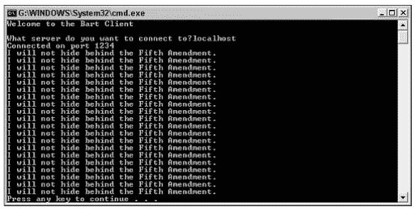


## 清单 2-4：BartClient 程序

```java
import java.net.*;
import java.util.*;
import java.io.*;

public class BartClient
{
    public static void main(String[] args)
    {
        int port = 1234;

        System.out.println("Welcome to the Bart Client\n");

        Socket s = getSocket(port);

        try
        {
            System.out.println("Connected on port " + port);

            Scanner in =
                new Scanner(s.getInputStream());
            PrintWriter out;
            out = new PrintWriter(s.getOutputStream(),
                true);

            // 丢弃欢迎消息
            in.nextLine();

            // 丢弃退出说明
            in.nextLine();

            // 获取一句引用语
            out.println("get");
            String quote = in.nextLine();

            // 断开与服务器的连接
            out.println("bye");
            s.close();

            // 在黑板上写下引用语
            for (int i = 0; i < 20; i++)
                System.out.println(quote);
        }
        catch (Exception e)
        {
            e.printStackTrace();
        }
    }

    private static Socket getSocket(int port)
    {
        Socket s;
        String host;
        InetAddress ip;

        Scanner sc = new Scanner(System.in);

        while (true)
        {
            System.out.print(
                "What server do you want to connect to?");
            host = sc.nextLine();
            try
            {
                ip = InetAddress.getByName(host);
                s = new Socket(ip, port);
                return s;
            }
            catch (UnknownHostException e)
            {
                System.out.println("The host is unknown.");
            }
            catch (IOException e)
            {
                System.out.println("Network error.");
            }
        }
    }
}
```

以下是对该程序中一些较难理解方面的解释：

- **→13** 连接到服务器是一个足够复杂的过程，因此我将其放在一个名为 `getSocket` 的单独方法中。该方法会提示用户输入主机名，并在用户输入程序可以连接到的主机名之前不会返回。端口号作为参数传递，返回值是一个已连接到服务器的 `Socket` 对象。（此方法如何工作的详细细节从第 50 行开始。）
- **→20** 这条语句获取一个 `Scanner` 对象，可用于通过套接字的输入流读取客户端的数据。
- **→23** 这条语句获取一个 `PrintWriter` 对象，可用于通过套接字的输出流向客户端发送数据。
- **→26** 连接成功后，服务器会发送一条欢迎消息。这条消息对通过 telnet 连接的用户很有帮助，但对像这样的客户端程序来说用处不大。因此，这条语句只是使用 `Scanner` 对象从输入流中读取一行并丢弃它。因为欢迎消息包含服务器的版本号，程序可以读取该行并检查它，以确保你连接的是当前版本的服务器。不过，我认为对 BartServer 的额外功能需求不会太大，所以你不必担心版本检查。
- **→29** 服务器还会发送一行有用的说明，你需要从流中读取并丢弃。
- **→32** 这行将单词 `get` 发送到服务器。这就是客户端程序要求服务器发回一个随机选择的句子的方式。
- **→33** 发送 `get` 请求后，客户端从套接字输入流读取下一行数据。注意，如果网络延迟导致延迟，`nextLine` 方法只会等待直到该行被发送。
- **→36** 在获得所需内容（黑板句子）后，客户端程序向服务器发送一个 `bye` 命令。服务器发回一条粗鲁的告别消息，但客户端程序对此不感兴趣，甚至懒得去读它。
- **→37** 与服务器的连接被关闭。
- **→41** 既然客户端程序已经有了它的黑板句子书写任务，它使用一个 `for` 循环将其在黑板上写 20 次。
- **→46** 任何一条 `socket I/O` 语句都可能抛出异常。它们都在这里被捕获为通用异常，并将诊断信息发送到控制台，以便你可以调试可能出现的任何问题。
- **→50** `getSocket` 方法接受一个端口号作为参数，并返回一个通过指定端口连接的套接字。该方法不会放弃，直到用户输入程序可以连接到的主机名。
- **→62** 从控制台读取主机名。
- **→65** 调用 `InetAddress` 类的静态 `getByName` 方法，为用户输入的主机名获取 IP 地址。注意，如果用户输入的主机名不存在，将抛出 `UnknownHostException`。此异常在第 69 行被捕获。
- **→66** 既然你有了 IP 地址，这行尝试使用指定的地址和端口创建一个 `Socket` 对象。如果无法连接到 IP 地址和端口，此方法会抛出 `IOException`。
- **→67** 如果你执行到这一行，可以假设套接字已创建且已连接。因此，`return` 语句在第 13 行将套接字传递回调用者。

## BartServer 2.0

上一节介绍的 BartServer 程序运行良好，但它有一个主要缺陷：它只能处理一个客户端的连接。更糟糕的是，当该客户端断开连接时，它就会退出。这算不上是一个很好的服务器。

因此，在收到大量用户反馈后，我决定发布带有新功能和改进功能的 BartServer 2.0。BartServer 2.0 使用线程允许多个客户端同时连接到服务器。每当有客户端连接时，就会启动一个线程来处理该客户端的任何请求。主线程继续运行，等待其他客户端连接。图 2-2 展示了 BartServer 2.0 多线程功能的运行情况。清单 2-5 展示了 BartServer 2.0 版本的代码。

### 清单 2-5：BartServer 2.0

```java
import java.net.*;
import java.io.*;
import java.util.*;

public class BartServer2
{
    public static void main(String[] args)
    {
        int port = 1234;

        BartQuote bart = new BartQuote();

        try
        {
            System.out.println("BartServer 2.0");
            System.out.println("Listening on port " + port);
            ServerSocket ss = new ServerSocket(port);

            while (true)                                                // → 19
            {
                Socket s = ss.accept();
                System.out.println(
                    "Connection established!");
                Thread t = new Thread(
                    new BartThread(s, bart));                          // → 25
                t.start();
            }
        }
        catch (Exception e)
        {
            System.out.println("System exception!");
        }
    }
}

class BartThread implements Runnable                                // → 36
{
    private Socket s;
    private BartQuote bart;

    public BartThread(Socket socket, BartQuote bart)                   // → 41
    {
        this.s = socket;
        this.bart = bart;
    }

    public void run()
    {
        String client = s.getInetAddress().toString();
        System.out.println("Connected to " + client);
        try
        {
            Scanner in = new Scanner(s.getInputStream());
            PrintWriter out;
            out = new PrintWriter(s.getOutputStream(),
                                 true);
        
            out.println("Welcome to the Bart Server");
            out.println("Enter BYE to exit.");
        
            while (true)
            {
                String input = in.nextLine();
                if (input.equalsIgnoreCase("bye"))
                    break;
                else if (input.equalsIgnoreCase("get"))
                {
                    out.println(bart.getQuote());
                    System.out.println("Serving " + client);
                }
                else
                    out.println("Huh?");
            }
            out.println("So long, suckers!");
            s.close();
        }
        catch (Exception e)
        {
            e.printStackTrace();
        }
        System.out.println("Closed connection to " + client);
    }
}
```

大部分代码与 1.0 版本中的代码相同，因此我只重点说明关键更改：

- **19** 使用 `while` 循环通过 `ServerSocket` 对象的 `accept` 方法来处理连接请求。
- **25** 每次有新客户端连接时，使用 `BartThread` 类创建一个线程的 `Runnable` 对象来创建线程。然后，启动此线程。与此同时，主线程保持在 `while` 循环中，等待其他客户端连接。

如果线程让你感到非常头疼，你可能需要翻回一章，复习第 V 册第 1 章中关于线程编程的信息。

## 第 V 册第 2 章

## 网络编程


 # BartServer 2.0

+ →36 `BartThread` 负责处理每个已连接客户端所需的处理工作。该类实现了 `Runnable`，这意味着它必须定义一个 `run` 方法。每次创建新线程时都会调用 `run` 方法。

+ →41 `BartThread` 类的构造函数使用从主线程传入的参数值来初始化两个类字段。这些参数分别是客户端所连接的 `Socket` 对象，以及主线程创建的 `BartQuote` 对象的共享副本。

> 这里未展示，但此版本 BartServer 使用的 `BartQuote` 类的 `getQuote` 方法应该是同步的。这是因为多个线程会访问它。更多信息请参阅本书第5卷第1章。

+ →47 `run` 方法为连接到 BartServer 的单个客户端提供服务请求。该方法中的大部分代码直接从前一版本复制而来，因此你应该不难理解它的工作原理。

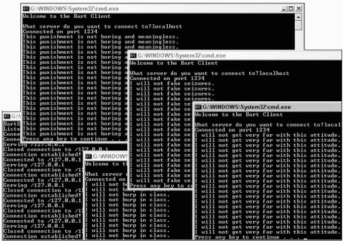

图 2-2：大批 BartClients！

## 第3章：使用正则表达式

### 本章内容

- 介绍正则表达式
- 借助实用程序试验正则表达式
- 创建匹配字符模式的简单表达式
- 使用正则表达式的特性，如自定义类、量词和分组
- 将正则表达式与 String 类结合使用
- 使用 Pattern 和 Matcher 类进行更广泛的正则表达式工作

正则表达式并不是指那些含有大量纤维的饮食表达式。相反，*正则表达式* 是一种特殊的模式匹配字符串，对于进行字符串操作的程序非常有用。正则表达式字符串包含特殊的模式匹配字符，可以将其与另一个字符串进行匹配，以查看另一个字符串是否符合该模式。正则Build正则表达式非常方便用于复杂的数据验证 —— 例如，确保用户输入格式正确的电话号码、电子邮件地址或社会安全号码。

正则表达式还有许多其他用途，包括搜索文本文件以查看它们是否包含特定模式（可以说谷歌吗？），根据内容过滤电子邮件，或执行复杂的查找替换功能。

在本章中，你将了解使用正则表达式的基础知识。我强调验证，重点是将用户输入的字符串与正则表达式指定的模式进行比较，以查看它们是否匹配。对于正则表达式更复杂的用途，你需要查阅更全面的正则表达式参考资料。

正则表达式实际上是使用一种简单而强大的小型语言构建的，因此它们本身就像小程序一样。不幸的是，这种小型语言非常简洁 —— *非常* 简洁 —— 有时甚至到了晦涩难懂的地步。它很大程度上依赖于单个字符，而这些字符往往承载着晦涩难懂的含义。所以请注意 —— 正则表达式的语法需要一点时间来适应。但一旦你掌握了基本概念，就会发现简单的正则表达式并不难创建，而且非常有用。

另外请注意，本章仅涵盖正则表达式全部功能的冰山一角。如果你发现需要使用更复杂的模式，可以在互联网上找到大量有用的信息。只需在任何搜索服务中搜索 `regular expression` 即可。

> **提示** 正则表达式通常被称为 *regex*。大多数人发音时使用软 *g*，就像拼成 *rejex* 一样。也有人发音时像拼成 *rejects* 一样。

## 一个用于试验正则表达式的程序

在我深入讲解如何构建正则表达式之前，清单 3-1 展示了一个简短的程序，它在你学习创建正则表达式时是一个非常有用的工具。该程序允许你输入一个正则表达式。然后，你可以输入一个字符串，程序会将其与正则表达式进行测试，并让你知道该字符串是否与正则表达式匹配。接着，程序会提示你输入另一个要进行比较的字符串。你可以继续输入字符串与你已输入的正则表达式进行比较。完成后，只需直接按回车键而不输入字符串。程序随后会问你是否要输入另一个正则表达式。如果你回答 Y，整个过程将重复。如果你回答 N，程序将结束。

以下是该程序的一次示例运行。目前，不要担心正则表达式字符串的细节。只需注意它应该匹配任何以 *f* 开头、以 *r* 结尾，且中间有 *a*、*i* 或 *o* 的三字母单词。

```
Welcome to the Regex Tester

Enter regex:   f[aio]r
Enter string:  for
Match.
Enter string:  fir
Match.
Enter string:  fur
Does not match.
Enter string:  fod
Does not match.
Enter string:
Another? (Y or N) n
```

在此测试中，我输入了正则表达式 f[aio]r。然后，我输入了字符串 for。程序指示该字符串与表达式匹配，并要求输入另一个字符串。于是我又输入了 fir，它也匹配了。接着我输入了 fur 和 fod，它们都不匹配。然后我输入了一个空字符串，所以程序问我是否要测试另一个正则表达式。我输入了 n，程序便结束了。

该程序使用了 Pattern 和 Matcher 类，我将在本章末尾才讲解它们。不过，我建议你在阅读本章的同时使用这个程序。如果你实际运行正则表达式并观察它们的实际效果，那么正则表达式会变得更容易理解。此外，通过在学习过程中尝试简单的变体，你可以学到很多。（如果你不想自己输入，总是可以从本书的网站下载该程序的源代码。）

事实上，在本章接下来的内容中，我将使用来自该程序的部分控制台输出来演示正则表达式。没有什么比看到一个表达式以及一些匹配和不匹配该表达式的字符串示例更好的方式来理解正则表达式的工作原理了。

## 清单 3-1：正则表达式测试程序

```
import java.util.regex.*;
import java.util.Scanner;

public final class Reg {
    static String r, s;
    static Pattern pattern;
    static Matcher matcher;
    static boolean match, validRegex, doneMatching;

    private static Scanner sc = new Scanner(System.in);

    public static void main(String[] args)
    {
        System.out.println("Welcome to the Regex Tester\n");
        do
        {
            do
            {
                System.out.print("\nEnter regex: ");
                r = sc.nextLine();
                validRegex = true;
                try
                {
                    pattern = Pattern.compile(r);
                }
```

## 478 基本字符匹配

**清单 3-1（续）**

```
catch (Exception e)
{
    System.out.println(e.getMessage());
    validRegex = false;
}
}while (!validRegex);

doneMatching = false;
while (!doneMatching)
{
    System.out.print("Enter string: ");
    s = sc.nextLine();
    if (s.length() == 0)
        doneMatching = true;
    else
    {
        matcher = pattern.matcher(s);
        if (matcher.matches())
            System.out.println("Match.");
        else
            System.out.println(
                "Does not match.");
    }
}
} while (askAgain());
}

private static boolean askAgain()
{
    System.out.print("Another? (Y or N) ");
    String reply = sc.nextLine();
    if (reply.equalsIgnoreCase("Y"))
        return true;
    return false;
}
}
```

## 基本字符匹配

大多数正则表达式只是进行字符匹配，以查看字符串是否符合简单模式。例如，你可以检查字符串以查看其是否匹配社会安全号码（xxx-xx-xxxx）、电话号码 [(xxx) xxx-xxxx] 的格式，或更复杂的模式，如电子邮件地址。（实际上，社会安全号码和电话号码比你想象的更复杂。稍后再详述。）在以下各节中，你将了解如何创建用于基本字符匹配的 regex 模式。


## 匹配单个字符

最简单的正则表达式模式完全按照字符串字面量进行匹配。例如：

```
Enter regex:  abc
Enter string: abc
Match.
Enter string: abcd
Does not match.
```

在这里，模式 `abc` 匹配字符串 `abc`，但不匹配 `abcd`。

## 使用预定义字符类

*字符类* 表示一种特定类型的字符，而不是某个具体字符。正则表达式允许你使用两种字符类：预定义类和自定义类。预定义字符类如表 3-1 所示。

| Regex | 匹配 . . . |
|-------|---------------|
| . | 任意字符 |
| \\d | 任意数字 (0–9) |
| \\D | 任意非数字字符（除 0–9 以外的任何字符） |
| \\s | 任意空白字符（空格、制表符、换行符、回车符和退格符） |
| \\S | 除空白字符外的任意字符 |
| \\w | 任意单词字符（a–z、A–Z、0–9 或下划线） |
| \\W | 除单词字符外的任意字符 |

句点类似于通配符，可以匹配任意字符。例如：

```
Enter regex:  c.t
Enter string: cat
Match.
Enter string: cot
Match.
Enter string: cart
Does not match.
```

在这里，`c.t` 匹配任何以 `c` 开头、以 `t` 结尾的三字母字符串。在这个例子中，前两个字符串（`cat` 和 `cot`）匹配，但第三个字符串（`cart`）不匹配，因为它超过三个字符。

## 480 基本字符匹配

`\d` 类表示数字，常用于验证输入数据的正则表达式模式中。例如，下面是一个简单的正则表达式模式，用于验证美国社会安全号码，其格式必须为 XXX-XX-XXXX：

```
Enter regex:  \d\d\d-\d\d-\d\d\d\d
Enter string: 779-54-3994
Match.
Enter string: 550-403-004
Does not match.
```

在这里，正则表达式模式指定字符串必须包含三个数字、一个连字符、两个数字、另一个连字符和四个数字。

请注意，这个正则表达式模式实际上不足以验证真实的社会安全号码，因为政府对这些号码的限制不仅仅是 XXX-XX-XXXX 这种模式。例如，没有任何社会安全号码可以以 779 开头。因此，前面例子中输入的号码 779-54-3994 实际上并不是一个有效的社会安全号码。


请注意，`\d` 类有一个对应的 `\D` 类。`\D` 类匹配任何*不*是数字的字符。例如，下面是验证机器人名字正则表达式的一个初步尝试：

```
Enter regex:  \D\d-\D\d
Enter string: R2-D2
Match.
Enter string: C2-D0
Match.
Enter string: C-3PO
Match.
Does not match.
```

在这里，该模式匹配以非数字字符开头，接着是数字，然后是连字符，再接着是非数字字符，最后以数字结尾的字符串。因此，R2-D2 和 C3-P0 匹配。不幸的是，这个正则表达式远非完美，任何《星球大战》粉丝都能告诉你这一点。因为那个闪闪发光的金色礼仪机器人的正确拼写是 C-3PO，而不是 C3-P0。真是典型的错误。

`\s` 类匹配空白字符，包括空格、制表符、换行符、回车符和退格符。当你希望允许用户以各种方式分隔字符串的各个部分时，这个类非常有用。例如：

```
Enter regex:  ...\s...
Enter string: abc def
Match.
Enter string: abc     def
Match.
```

在这里，模式指定字符串可以是两组任意三个字符，中间由一个空白字符分隔。在第一个输入的字符串中，各组之间用空格分隔。在第二组中，它们用制表符分隔。`\s` 类也有一个对应的 `\S`。它匹配任何不是空白字符的字符。


如果你想将空白字符限制为实际的空格，只需在正则表达式中使用空格即可。例如：

```
Enter regex:   ... ...
Enter string: abc def
Match.
Enter string: abc    def
Does not match.
```

在这里，正则表达式指定两组任意字符，中间用空格分隔。第一个输入字符串匹配此模式，但第二个不匹配，因为各组之间用制表符分隔。

最后一组预定义类是 `\w` 和 `\W`。`\w` 类识别任何通常在单词中使用的字符。这包括大小写字母、数字和下划线。例如：

```
Enter regex:   \w\w\w\W\w\w\w
Enter string: abc def
Match.
Enter string: 123 456
Match.
Enter string: 123A456
Does not match.
```

在这里，模式要求两组单词字符之间由一个非单词字符分隔。


下划线竟然被认为是单词字符，这不是很奇怪吗？我所知道的英语单词（或者其他任何语言的单词）中，没有几个是带下划线的。我想这正是正则表达式源自计算机极客的起源所体现出来的特点吧。

## 使用自定义字符类

要创建*自定义字符类*，你只需将所有想要包含在类中的字符列在一组方括号内即可。例如：

```
Enter regex:   b[aeiou]t
Enter string: bat
Match.
Enter string: bet
Match.
Enter string: bit
Match.
Enter string: bot
Match.
Enter string: but
Match.
Enter string: bmt
Does not match.
```

在这里，模式指定字符串必须以字母 b 开头，接着是一个可以包含 a、e、i、o 或 u 的类，最后是 t。换句话说，它接受以 *b* 开头、以 *t* 结尾、中间有一个元音字母的三字母单词。

如果你想让模式同时包含大写和小写字母，你必须把两者都列出来：

```
Enter regex:  b[aAeEiIoOuU]t
Enter string: bat
Match.
Enter string: BAT
Does not match.
Enter string: bAt
Match.
```

你可以在一行中使用任意多个自定义组。例如，下面这个表达式为第一个和最后一个字符定义了类，这样它们也可以是大写或小写：

```
Enter regex:  [bB][aAeEiIoOuU][tT]
Enter string: bat
Match.
Enter string: BAT
Match.
```

这个模式指定了三个字符类。第一个可以是 b 或 B，第二个可以是任意大小写的元音字母，第三个可以是 t 或 T。

### 使用范围

自定义字符类还可以指定字母和数字的*范围*。例如：

```
Enter regex:  [a-z][0-5]
Enter string: r2
Match.
Enter string: b9
Does not match.
```

在这里，字符串可以是两个字符长。第一个必须是从 a 到 z 的字符，第二个必须是从 0 到 5 的字符。

你也可以在一个类中使用多个范围，像这样：

```
Enter regex:  [a-zA-Z][0-5]
Enter string: r2
Match.
Enter string: R2
Match.
```

在这里，第一个字符可以是小写 a 到 z 或大写 A 到 Z。

> 提示：你可以使用范围来构建一个只接受真实单词中出现的字符的类，而不是像 `\w` 类那样允许下划线：

```
Enter regex:  [a-zA-Z0-9]
Enter string: a
Match.
Enter string: N
Match.
Enter string: 9
Match.
```

### 使用否定

正则表达式可以包含匹配除类中列出字符之外的*任意*字符的类。要做到这一点，你需要在类的开头使用脱字符，像这样：

```
Enter regex:  [^cf]at
Enter string: bat
Match.
Enter string: cat
Does not match.
Enter string: fat
Does not match.
```

在这里，字符串必须是一个以 at 结尾的三字母单词，但不能是 fat 或 cat。

## 匹配多个字符

本章到目前为止描述的正则表达式模式要求输入字符串中的每个位置始终匹配特定的字符类。例如，模式 `\d\W[a-z]` 要求第一个位置是数字，第二个位置是空白字符，第三个位置是 a 到 z 之间的字母之一。这些要求相当严格。

### 基本字符匹配

要创建更灵活的模式，你可以使用表 3-2 中列出的任何*量词*。这些量词允许你创建在字符串中特定位置匹配可变数量字符的模式。

| Regex | 前面的元素匹配 . . . |
|-------|--------------------------------------|
| ? | 零次或一次 |
| * | 零次或多次 |
| + | 一次或多次 |
| {n} | 恰好 *n* 次 |
| {n,} | 至少 *n* 次 |
| {n,m} | 至少 *n* 次但不超过 *m* 次 |

要使用一个量词，你需要将它紧跟在你希望它应用的元素之后。例如，下面是使用量词的一个社会安全号码模式版本：

```
Enter regex:  \d{3}-\d{2}-\d{4}
Enter string: 779-48-9955
Match.
Enter string: 483-488-9944
Does not match.
```

在这里，模式匹配三个数字，接着是一个连字符，接着是两个数字，然后是另一个连字符，最后是四个数字。


简单地重复元素而不是使用量词也同样容易，甚至更容易理解。例如，`\d\d` 和 `\d{2}` 一样清晰明了。

`?` 量词允许你创建一个可选元素，该元素在字符串中可能存在也可能不存在。例如，假设你想允许用户输入不带连字符的社会安全号码。那么，你可以使用这个模式：

```
Enter regex:  \d{3}-?\d{2}-?\d{4}
Enter string: 779-48-9955
Match.
Enter string: 779489955
Match.
Enter string: 779-489955
Match.
Enter string: 77948995
Does not match.
```


问号表示连字符是可选的。请注意，此模式允许你包含或省略任一连字符。最后一个输入的字符串不匹配，因为它只有八位数字，而模式要求九位。

## 使用转义

在正则表达式中，某些字符具有特殊含义。这就引出了一个问题：如果你想搜索这些特殊字符之一怎么办？在这种情况下，你需要在字符前加上反斜杠来*转义*该字符。例如：

```
Enter regex: \(\d{3}\) \d{3}-\d{4}
Enter string: (559) 555-1234
Match.
Enter string: 559 555-1234
Does not match.
```

这里，`\(` 代表左括号，`\)` 代表右括号。如果不加反斜杠，正则表达式会将括号视为分组元素。

关于转义，还有几点需要思考：

- 严格来说，你只需要对在正则表达式中具有特殊含义的字符使用反斜杠转义。但是，我建议你转义任何标点符号或符号，以确保万无一失。
- 你不能转义字母字符。那是因为反斜杠后跟某些字母字符代表一个字符、一个字符类或其他正则表达式元素。
- 要转义一个反斜杠，请连续输入两个反斜杠。例如，正则表达式 `\d\d\\\d\d` 接受由两个数字、一个反斜杠和另外两个数字组成的字符串，例如 `23\88` 和 `95\55`。

## 使用括号对字符进行分组

你可以使用括号将字符分组，以便将其他正则表达式元素应用于该组。例如：

```
Enter regex: (bla)+
Enter string: bla
Match.
Enter string: blabla
Match.
Enter string: blablabla
Match.
Enter string: bla bla bla
Does not match.
```

这里，括号将 `bla` 视为一个组，因此 `+` 量词应用于整个序列。因此，此模式寻找一个或多个出现的序列 `bla`。

这是一个查找可能有可选区号的美国电话号码的示例：

```
Enter regex: `(\(\d{3}\)\s?)?\d{3}-\d{4}`
Enter string: **555-1234**
Match.
Enter string: **(559) 555-1234**
Match.
Enter string: **(559)555-1239**
Match.
```

这个正则表达式模式有点复杂，但如果你逐个元素地检查它，你应该能够弄明白。它以一个表示可选区号的组开始：`(\(\d{3}\)\s?)?`。这个组以标记组开始的左括号开头。组中的字符包括一个转义的左括号、三个数字、一个转义的右括号和一个可选的空白字符。然后，一个右括号关闭该组，问号表示整个组是可选的。正则表达式模式的其余部分寻找三个数字，后跟一个连字符和另外四个数字。

当你用括号标记一组字符时，与该组匹配的文本会被*捕获*，以便你可以在模式的后面使用它。被捕获的组称为*捕获组*，从1开始编号。然后，你可以使用一个反斜杠后跟捕获组编号来指示文本必须与为指定捕获组捕获的文本匹配。

例如，假设按照模式 `\w\d-\w\d` 命名的机器人必须在第二和第五个字符中具有相同的数字。换句话说，`r2-d2` 和 `b9-k9` 是有效的机器人名称，而 `r2-d4` 和 `d3-r4` 则不是。

这是一个可以验证这种类型名称的示例：

```
Enter regex: `\w(\d)-\w\1`
Enter string: **r2-d2**
Match.
Enter string: **d3-r4**
Does not match.
Enter string: **b9-k9**
Match.
```

这里，`\1` 引用第一个捕获组。因此，字符串中的最后一个字符必须与第二个字符（必须是数字）相同。

## 使用 | 符号

`|` 符号定义了一个“或”运算，允许你创建接受两个或更多变体中任意一个的模式。例如，这是验证机器人名称模式的改进：

```
Enter regex: (\w\d-\w\d) | (\w-\d\w\w)
Enter string: r2-d2
Match.
Enter string: c-3po
Match.
```

这里，`|` 字符表示左侧或右侧的组都可以用于匹配字符串。左侧的组匹配一个单词字符、一个数字、一个连字符、一个单词字符和另一个数字。右侧的组匹配一个单词字符、一个连字符、一个数字和两个单词字符。

你可能想在 `|` 适用的整个模式部分周围添加一组额外的括号。然后，你可以在 `|` 组之前或之后添加额外的模式元素。例如，如果你想让用户输入电话号码的区号，括号可有可无。这是一个实现此功能的正则表达式模式：

```
Enter regex: ((\d{3} ) | (\(\d{3}\) ))?\d{3}-\d{4}
Enter string: (559) 555-1234
Match.
Enter string: 559 555-1234
Match.
Enter string: 555-1234
Match.
```

此模式的第一部分是一个组，由两个更小的组组成，用 `|` 字符分隔。第一个组匹配一个没有括号的区号后跟一个空格，第二个组匹配一个有括号的区号后跟一个空格。因此，外层组匹配一个有或没有括号的区号。这个整个组被标记为可选（使用问号），然后模式继续匹配三个数字、一个连字符和四个数字。

## 在 Java 程序中使用正则表达式

到目前为止，本章已向你展示了创建正则表达式的基础知识。现在，以下各节将向你展示如何在 Java 程序中使用它们。

### 字符串问题

在介绍处理正则表达式的类之前，我想让你了解一个 Java 在处理包含正则表达式的字符串时遇到的问题。正如你在本章中所看到的，正则表达式模式依赖反斜杠字符来标记模式的不同元素。坏消息是 Java 将字符串字面量中的反斜杠字符视为转义字符。因此，你不能直接在字符串字面量中引用正则表达式，因为 Java 会在它们到达正则表达式类之前窃取反斜杠字符。

在大多数情况下，编译器只会抱怨字符串字面量不正确。例如，以下行将无法编译：

```
String regex = "\w\d-\w\d";    // 错误：无法编译
```

编译器看到字符串中的反斜杠，并期望找到一个有效的 Java 转义序列，而不是正则表达式。

不幸的是，这个问题的解决方案很丑陋：你必须在出现反斜杠的地方将它们加倍。Java 将两个连续的反斜杠视为一个转义的反斜杠，并在字符串中放置一个单独的反斜杠。因此，你必须将上一段中显示的语句编码如下：

```
String regex = "\\w\\d-\\w\\d";    // 现在可以编译了
```

这里，我在正则表达式中想要的每个反斜杠，在字符串字面量中都被编码为一对反斜杠。

> 如果你不确定你的字符串字面量编码是否正确，只需使用 `System.out.println` 打印结果字符串。然后，你可以检查控制台输出以确保你正确编写了字符串字面量。例如，如果我在上一条语句之后添加 `System.out.println(regex)`，控制台上将显示以下输出：

```
\w\d-\w\d
```

因此，我知道我正确编码了正则表达式的字符串字面量。

## 与 String 类一起使用正则表达式

如果你只想用正则表达式检查字符串是否匹配某个模式，你可以使用 `String` 类的 `matches` 方法。此方法接受一个正则表达式作为参数，并返回一个布尔值，指示字符串是否与模式匹配。

例如，这是一个验证机器人名称的静态方法：

```
private static boolean validDroidName(String droid)
{
    String regex = "(\\w\\d-\\w\\d)|(\\w-\\d\\w\\w)";
    return droid.matches(regex);
}
```

这里，机器人的名称通过参数传递，该方法返回一个布尔值，指示机器人的名称是否有效。该方法只是从字符串字面量创建一个正则表达式，然后使用 `droid` 字符串的 `matches` 方法来匹配该模式。

你还可以使用 `split` 方法，根据与正则表达式匹配的分隔符将字符串拆分为 `String` 对象数组。一种常见的做法是简单地创建一个可用于分隔符的自定义字符类。例如：

```
String s = "One:Two;Three|Four\tFive";
String regex = "[;|\t]";
String strings[] = s.split(regex);
for (String word : strings)
    System.out.println(word);
```

这里，一个字符串被拆分成由冒号、分隔号、竖线或制表符标记的单词。运行此程序时，控制台上显示的内容如下：

```
One
Two
Three
Four
Five
```

## 使用 Pattern 和 Matcher 类

`matches` 方法适用于偶尔使用正则表达式。但是，如果你想让程序执行大量模式匹配，你应该改用 `Pattern` 和 `Matcher` 类。`Pattern` 类代表已编译成可执行形式的正则表达式（记住，正则表达式就像小程序）。然后，你可以使用编译后的 `Pattern` 对象创建一个 `Matcher` 对象，然后可以使用该对象来匹配字符串。


# 490 在Java程序中使用正则表达式

`Pattern`类本身非常简单。虽然它大约有十个方法，但通常你只需要用到这两个：

- `static Pattern compile(String pattern)`：编译指定的模式。这个静态方法返回一个`Pattern`对象。如果模式包含错误，它会抛出`PatternSyntaxException`。
- `Matcher matcher(String input)`：创建一个`Matcher`对象，用于将此模式与指定的字符串进行匹配。

首先，你使用`compile`方法创建一个`Pattern`对象。（`Pattern`是那种没有构造函数的奇怪类之一。相反，它依赖于静态`compile`方法来创建实例。）因为`compile`方法会抛出`PatternSyntaxException`，所以在编译模式时，你必须使用`try/catch`语句来捕获这个异常。

一旦你有了一个`Pattern`实例，接下来就使用`matcher`方法创建一个`Matcher`类的实例。这个类有超过30个方法，可以让你用正则表达式做各种本章未涉及的事情，比如在输入字符串中查找模式的多次出现，或者将匹配模式的文本替换为替换字符串。就本书而言，我只关心`matches`方法：`static boolean matches()`返回一个布尔值，指示整个字符串是否与模式匹配。

为了说明如何使用这些方法，这里有一个增强版的`validDroidName`方法，它为机器人验证正则表达式创建一个模式并将其保存在一个静态类字段中：

```java
private static Pattern droidPattern;

private static boolean validDroidName(String droid)
{
    if (droidPattern == null)
    {
        String regex = "(\\w\\d-\\w\\d)|(\\w-\\d\\w\\w)";
        droidPattern = Pattern.compile(regex);
    }
    Matcher m = droidPattern.matcher(droid);
    return m.matches();
}
```

这里，私有类字段`droidPattern`保存了用于验证机器人的已编译模式。`validDroidName`方法中的`if`语句检查模式是否已经创建。如果没有，则通过调用`Pattern`类的静态`compile`方法创建模式。然后，使用`matcher`方法为作为参数传递的字符串创建一个`Matcher`对象，并通过调用`Matcher`对象的`matches`方法来验证该字符串。

# 第4章：使用递归

## 本章内容

- 介绍递归
- 使用递归计算阶乘
- 使用递归列出目录
- 使用递归进行排序

**递归**是一种基本的编程技术，其中一个方法调用自身来解决某个问题。使用这种技术的方法称为*递归方法*。许多编程问题只能通过递归来解决，而一些可以通过其他技术解决的问题，使用递归来解决会更好。

我不确定，但我认为术语*递归*来源于拉丁语*recurse, recursi, recursum*，意思是反复诅咒。我确实知道，这正是许多程序员在处理复杂的递归编程问题时的感受。

确实，有时递归的概念可能有点棘手。因此，许多程序员会避开它，寻找其他技术来解决手头的问题。而且在许多情况下，非递归解决方案是最好的。然而，许多问题正是呼唤递归来解决。

## 经典的阶乘示例

介绍递归的经典问题之一是计算一个整数的阶乘。任何给定整数的*阶乘*——我称之为*n*以便听起来更数学化——是从1到*n*所有整数的乘积。因此，5的阶乘是120：5乘以4乘以3乘以2乘以1。

### 非递归解决方案

你不必使用递归来计算阶乘。相反，你可以使用一个简单的`for`循环。例如，这里有一个方法，它接受一个`int`数字并以`long`形式返回该数字的阶乘：

```java
private static long factorial(int n)
{
    long f = 1;
    for (int i = 1; i <=n; i++)
        f = f * i;
    return f;
}
```

这个方法只是使用一个`for`循环从1计数到该数字，并在过程中跟踪乘积。这里有一段调用此方法并显示结果的代码片段：

```java
int n = 5;
long fact;
fact = factorial(n);
System.out.println("The factorial of "+ n + " is "
    + fact + ".");
```

如果你运行这段代码，控制台上将显示以下内容：

```
The factorial of 5 is 120.
```

阶乘增长很快。你应该使用`long`而不是`int`来计算结果。并且你应该使用`NumberFormat`类来格式化结果。例如，如果`int`是20而不是5，前面的代码会在控制台上打印这个：

```
The factorial of 20 is 2432902008176640000.
```

如果你使用`NumberFormat`类来格式化结果，控制台输出将更具可读性：

```
The factorial of 20 is 2,432,902,008,176,640,000.
```

### 递归解决方案

阶乘问题的非递归解决方案可行，但它并不太有趣。递归解决方案基于这样的概念：任何数字*n*的阶乘等于*n*乘以*n* – 1的阶乘，前提是*n*大于1。如果*n*是1，*n*的阶乘就是1。

阶乘的这个定义是递归的，因为定义包含了阶乘方法本身。它还包含了任何递归方法最重要的部分：*终止条件*。终止条件指示递归方法何时应停止调用自身。在这种情况下，当*n*为1时，我直接返回1。如果没有终止条件，递归方法会永远调用自身。

这是阶乘方法的递归版本：

```java
private static long factorial(int n)
{
    if (n == 1)
        return 1;
    else
        return n * factorial(n-1);
}
```

这个方法返回的结果与上一节中的版本完全相同，但它使用递归来计算阶乘。

想象一下你有五个朋友，分别叫Jordan、Jeremy、Jacob、Justin和Bob。这种可视化方式可以帮助你理解递归的工作原理。你的朋友们不是很聪明，但他们非常相似。事实上，他们是彼此的克隆。克隆技术还不完美，所以这些克隆体有局限性。每个克隆体只能进行一次乘法运算，并且只能向另一个克隆体提一个问题。

所以你走向Joshua并说：“Joshua，五的阶乘是多少？”

Jordan说：“我不知道，但我知道它是四的阶乘乘以五。Jeremy，四的阶乘是多少？”

Jeremy说：“我不知道，但我知道它是三的阶乘乘以四。Jacob，三的阶乘是多少？”

Jacob说：“我不知道，但我知道它是二的阶乘乘以三。Justin，二的阶乘是多少？”

Justin说：“我不知道，但我知道它是一的阶乘乘以二。嘿，Bob！一的阶乘是多少？”

Bob是这群人中最聪明的，因为他名字不是J开头的，他回答道：“当然是1。”于是他把答案告诉了Justin。

Justin说：“啊！二乘以一等于二。”于是他把答案告诉了Jacob。

Jacob说：“谢谢。三乘以二等于六。” Jacob把他的答案告诉了Jeremy。

Jeremy说：“老兄！四乘以六等于24。” Jeremy把他的答案告诉了Jordan。

Jordan说：“非常好！五乘以二十四等于120。”于是他把答案告诉了你。

这大概就是递归的工作原理。

## 显示目录

递归非常适合需要遍历目录结构的应用程序，例如Windows或Unix文件系统。在文件系统中，目录是文件和其他目录的列表。每个目录本身又是文件和其他目录的列表，如此类推。目录可以舒适地嵌套在其他目录内部，且数量没有限制。

清单4-1展示了一个使用递归方法列出从给定路径开始找到的所有目录的程序。我使用缩进来显示目录结构。例如，这是我为整理本书文档而使用的目录的控制台输出：

```
Welcome to the Directory Lister
Enter a path: C:\Java AIO

Listing directory tree of:
C:\Java AIO
    Apps
        Book 1
        Book 2
        Book 3
        Book 4
        Book 5
    Manuscript
        Book 1
        Book 2
        Book 3
        Book 4
        Book 5
        Front
    Plans
Another? (Y or N) n
```

好吧，正如你所看到的，我还没有做第六到第九部分。当你读到本章时，还会有更多的目录需要列出！

除非你准备好等待很长时间让程序完成列出硬盘上的所有目录，否则不要输入c:\。

目录列表应用程序非常简单。不过，在我解释其细节之前，我想指出这个程序使用了`File`类，它是`java.io`包的一部分。`File`类表示单个文件或目录。你将在第八卷中了解关于此类的更多信息。现在，你只需要知道这五个细节：


- 这个类的构造函数接受一个目录路径作为参数，并创建一个表示该指定目录的对象。
- 你可以使用`exists`方法来查明路径参数指定的目录是否存在。
- `listFiles`方法返回一个`File`对象的数组，该数组表示当前`File`对象中的每个文件和目录。
- `isDirectory`方法返回一个布尔值，指示当前的`File`对象是否为目录。如果此方法返回 false，你可以认为该`File`对象是一个文件。
- `getName`方法返回文件的名称。

```java
import java.io.File;
import java.util.Scanner;

public class DirList
{
    static Scanner sc = new Scanner(System.in);

    public static void main(String[] args)
    {
        System.out.print(
            "Welcome to the Directory Lister");
        do
        {
            System.out.print("\nEnter a path: ");
            String path = sc.nextLine();

            File dir = new File(path);
            if (!dir.exists() || !dir.isDirectory())
                System.out.println(
                    "\nThat directory doesn't exist.");
            else
            {
                System.out.println(
                    "\nListing directory tree of:");
                System.out.println(dir.getPath());
                listDirectories(dir, "  ");
            }
        } while(askAgain());
    }

    private static void listDirectories(
        File dir, String indent)
    {
        File[] dirs = dir.listFiles();
        for (File f : dirs)
        {
            if (f.isDirectory())
            {
                System.out.println(
                    indent + f.getName());
                listDirectories(f, indent + "  ");
            }
        }
    }

    private static boolean askAgain()
    {
        System.out.print("Another? (Y or N) ");
        String reply = sc.nextLine();
        if (reply.equalsIgnoreCase("Y"))
            return true;
        return false;
    }
}
```

## 显示目录

以下段落重点介绍了这个程序的工作原理：

→1 这个 import 语句是使用 File 类所必需的。

→15 一个 Scanner 对象用于从用户处获取路径名。

→17 路径名被传递给 File 类的构造函数，以创建一个新的 File 对象，代表用户输入的目录。

→18 调用`exists`和`isDirectory`方法，以确保用户输入的路径存在，并且指向的是一个目录而非文件。

→25 如果用户输入了正确的路径，调用`getPath`方法来显示该 File 对象所代表的路径名称。（我在这里也可以直接显示 path 变量。）

→26 调用`listDirectories`方法来列出用户指定目录中的所有子目录。

→28 询问用户是否想要列出另一个目录，如果用户输入 Y，循环将重复。

1. 这是`listDirectories`方法的开始。这个方法接受两个参数：一个代表要列出的目录的`File`对象，以及一个提供用于缩进列表每一行的空格的`String`对象。当从 main 方法第一次调用这个方法时，缩.spacing 缩进量通过字符串字面量设置为两个空格。
2. 调用`listFiles`方法来获取该目录中所有`File`对象的数组。
3. 使用增强型 for 循环来处理数组中的所有`File`对象。
4. 这个 if 语句检查一个文件是否为目录，而不是普通文件。
5. 如果该`File`对象是一个目录，则打印缩进字符串，后跟由`getName`方法返回的目录名称。
6. 接着，递归调用`listDirectories`方法来列出`f`目录的内容。但是，在缩进字符串中添加两个空格，以便`f`目录中的任何目录都比当前目录向右缩进两个空格。

如果你难以理解这个程序中的递归是如何工作的，可以这样思考：`listDirectories`方法会列出一个目录中的所有子目录。对于每个目录，这个方法执行两件事：（1）打印该目录的名称，（2）调用自身来打印该目录的任何子目录。

> 之前我提到过，所有递归方法都必须有某种类型的条件测试，以使方法停止调用自身。在这个程序中，条件测试可能不太明显。然而，最终`listDirectories`方法会被传递一个没有子目录的目录。当这种情况发生时，递归就结束了——至少对于该目录树的分支而言是这样。

## 编写你自己的排序例程

世界上到处都是比你更不了解计算机的计算机科学专业学生。然而，他们曾经上过一门课，老师在课上解释了排序算法是如何工作的。他们可能在那门课上只得了个 C，但这足以让他们毕业了。

现在，你有机会学习因未主修计算机科学而错过的内容。我将向你展示最常用的一种排序技术是如何工作的。它被称为*快速排序*（Quicksort），是对递归的一种非常巧妙的运用。我还会向你展示一个它的简单 Java 实现。

快速排序无疑是本书中技术含量最高的部分。如果你从未想主修计算机科学，如果你甚至不想与那些主修过的人交谈，你现在可能想直接跳过本章的其余部分。

对我们大多数人来说，学习快速排序等排序算法的工作原理仅仅是一种智力练习。Java API 已经内置了排序功能——例如，查看`Arrays.sort`方法。那些排序例程比你我写的任何排序都要好得多。

## 理解快速排序的工作原理

快速排序技术使用递归对数值数组进行排序。其基本步骤如下：

1. **选取一个位于数组数值范围内的任意值。**
这个值被称为枢轴点（pivot point）。选择枢轴点最常见的方法是简单地选取数组中的第一个值。人们已经通过更复杂的方式选择枢轴点以获得更快的排序速度来撰写博士论文。我喜欢坚持用数组中的第一个元素作为枢轴点。

2. **重新排列数组中的值，使得所有小于枢轴点的值都在数组的左侧，所有大于或等于枢轴点的值都在数组的右侧。**
枢轴值标志着数组左侧和右侧之间的边界。它可能不会正好在中间，但这并不重要。这一步被称为分区，而数组的左右两部分被称为分区。

3. **现在将数组的两个部分分别视为独立的数组，并对该部分从步骤 1 重新开始。**
这是该算法的递归部分。

快速排序算法中最困难的部分是分区步骤。这一步必须重新排列分区，使得所有小于枢轴点的值都在左侧，所有大于枢轴点的元素都在右侧。例如，假设数组有以下十个值：

```
38 17 58 22 69 31 88 28 86 12
```

在这里，枢轴点是 38，分区步骤的任务是将数组重新排列成类似这样的形式：

```
17 12 22 28 31 38 88 69 86 58
```

请注意，这些值仍然无序。然而，数组已经围绕值 38 分成了两部分：所有小于 38 的值都在 38 的左侧，所有大于 38 的值都在 38 的右侧。

现在，你可以在值 38 处将数组分成两个分区，并对每一侧重复这个过程。枢轴值本身归入左侧分区，因此左侧分区如下：

```
17 12 22 28 31 38
```

这次，分区步骤选择 17 作为枢轴点，并将元素重新排列如下：

```
12 17 22 28 31 38
```

如你所见，数组的这一部分现在已经排好序了。不幸的是，快速排序此时并不知道这一点，所以它还需要再递归几次才能确定。但这就是基本过程。

## sort 方法

驱动快速排序例程的实际代码出奇地简单：

```java
public static void sort(int low, int high)
{
    if (low >= high)
        return;
    int p = partition(low, high);
    sort(low, p);
    sort(p + 1, high);
}
```

这个方法对传递给它的 low 和 high 索引值所指示的数组部分进行排序。暂时忽略 if 语句，sort 方法通过调用一个 partition 方法来工作。这个方法将数组重新排列成两个称为分区的部分，使得左分区中的所有值都小于右分区中的所有值。partition 方法返回左分区末尾的索引。然后，sort 方法调用自身两次：一次用于排序左分区，然后再一次用于排序右分区。

要启动排序，你用零作为 low 值，用数组长度减一作为 high 值来调用它。因此，sort 方法开始时对整个数组进行排序。每次 sort 方法执行时，它会调用自身两次来排序数组的更小分区。


## 分区方法

`sort` 方法开头的 `if` 语句将低端值与高端值进行比较。如果低端值大于或等于高端值，则该分区仅包含一个元素（或可能没有元素），因此已经是有序的。在这种情况下，`sort` 方法会直接返回，而不再调用自身。这就是结束递归的条件。

`sort` 方法本身是快速排序技术中简单的部分。困难的部分在于 `partition` 方法。该方法接受两个参数：标识应排序数组部分的低端索引和高端索引。分区方法的基本轮廓大致如下：

1.  选择一个基准点。
2.  将所有小于基准点的元素移动到分区的左侧。
3.  将所有大于基准点的元素移动到分区的右侧。
4.  返回基准点的索引。

最常用的数组分区技术是维护两个索引变量，分别命名为 `i` 和 `j`，它们从数组的两端向中心移动。首先，`i` 从数组开头开始并向前移动，直到遇到一个大于基准值的值。然后，`j` 从数组的另一端开始并向后移动，直到找到一个小于基准点的值。此时，`partition` 方法在数组左侧有一个大于基准点的值，在右侧有一个小于基准点的值。因此，它将它们交换。

然后，它重复这个循环：`i` 递增直到找到另一个大于基准值的值，`j` 递减直到找到另一个小于基准值的值，然后交换元素。这个过程一直重复，直到 `j` 小于 `i`，这意味着索引已经交叉，分区完成。

现在用一些代码将其组合起来：

```
public static int partition(int low, int high)
{
    int pivot = a[low];

    int i = low - 1;
    int j = high + 1;

    while (i < j)
    {
        for (i++; a[i] < pivot; i++);
        for (j--; a[j] > pivot; j--);
        if (i < j)
            swap(i, j);
    }
    return j;
}
```

请注意，在此代码中，正在被排序的数组是一个名为 `a` 的静态 `int` 数组。要进行分区的分区的低端和高端作为参数传入，方法首先选择分区的第一个元素作为基准点的值。接下来，它根据参数初始化索引变量 `i` 和 `j`。请注意，低端值减去 1，高端值加上 1。索引变量在循环开始前从数组退后一步，以便有一个良好的开始。

`while` 循环用于指示分区何时完成。只要 `i` 小于 `j`，它就会重复。一旦这些索引变量停止，分区完成，`j` 的值被返回，以指示将左分区与右分区分开的索引点。

在 `while` 循环的主体中，有两个奇怪的、没有循环体的 `for` 循环。这些 `for` 循环没有循环体，因为它们的唯一目的是移动其索引值，直到找到一个小于或大于基准值的值。

第一个 `for` 循环递增 `i` 索引变量，直到找到一个大于基准点的值。因此，这个 `for` 循环找到可能需要移动到数组另一侧的第一个值。

接下来，第二个 `for` 循环递减 `j` 索引变量，直到找到一个小于基准点的值。因此，这个循环找到一个可能需要与第一个 `for` 循环找到的值交换的值。

最后，`if` 语句检查索引是否已经交叉。假设它们还没有交叉，则调用 `swap` 方法交换元素。`swap` 方法非常简单：

```
public static void swap(int i, int j)
{
    int temp = a[i];
    a[i] = a[j];
    a[j] = temp;
}
```

此方法将 `i` 元素移动到一个临时变量，将 `j` 元素移动到 `i` 元素，然后将临时变量移动到 `j` 元素。

## 整合起来

现在你已经了解了创建快速排序程序所需的基本步骤，清单 4-2 展示了一个让这些方法发挥作用的程序。该程序创建一个包含 100 个随机数的数组，数值范围从 1 到 100。它打印数组，使用前面章节中展示的排序方法对数组进行排序，然后打印排序后的数组。以下是一个示例运行：

未排序数组：

65 51 38 47 93 87 50 36 77 58 22 92 46 60 49 90 28 39 27 8
66 76 40 99 90 35 34 30 7 41 45 34 41 17 36 63 52 65 50 77
2 93 48 6 91 67 34 69 33 47 50 12 88 15 65 40 29 74 34 14
55 37 28 25 98 66 69 88 88 66 27 29 88 29 87 9 29 77 32 4 11
68 40 17 61 50 90 24 1 59 91 69 5 82 69 51 45 29 38 61 86

排序后数组：

1 2 4 5 6 7 8 9 11 12 14 15 17 17 22 24 25 27 27 28
28 29 29 29 29 29 30 32 33 34 34 34 34 35 36 36 37 38 38 39
40 40 40 41 41 45 45 46 47 47 48 49 50 50 50 50 51 51 52 55
58 59 60 61 61 63 65 65 65 66 66 66 67 68 69 69 69 69 74 76
77 77 77 82 86 87 87 88 88 88 90 90 90 91 91 92 93 93 98 99

如你所见，第一个数组是随机顺序，但第二个数组排列得很整齐。

### 清单 4-2：一个排序程序

```
public class QuickSortApp
{
    public static void main(String[] args)
    {
        int LEN = 100;
        int[] unsorted = new int[LEN];
        for (int i = 0; i<LEN; i++)                                    → 7
            unsorted[i] = (int)(Math.random() * 100) + 1;
        System.out.println("Unsorted array:");
        printArray(unsorted);                                          → 10
        int[] sorted = sort(unsorted);                                 → 11
        System.out.println("\n\nSorted array:");
        printArray(sorted);                                            → 13
    }

    private static void printArray(int[] array)                        → 16
    {
        System.out.println();
        for (int i = 0; i < array.length; i++)
        {
            if (array[i] < 10)
                System.out.print(" ");
            System.out.print(array[i] + " ");
            if ((i+1) % 20 == 0)
                System.out.println();
        }
    }

    private static int[] a;

    public static int[] sort(int[] array)
    {
        a = array;
        sort(0, a.length - 1);
        return a;
    }

    public static void sort(int low, int high)
    {
        if (low >= high)
            return;
        int p = partition(low, high);
        sort (low, p);
        sort (p+1, high);
    }

    public static int partition(int low, int high)
    {
        int pivot = a[low];

        int i = low - 1;
        int j = high + 1;

        while (i < j)
        {
            for (i++; a[i] < pivot; i++);
            for (j--; a[j] > pivot; j--);
            if (i < j)
                swap(i, j);
        }
        return j;
    }

    public static void swap(int i, int j)
    {
        int temp = a[i];
        a[i] = a[j];
        a[j] = temp;
    }
}
```

这个程序中的大部分代码已经在前面解释过了，所以我只指出几个要点：

-   **7** 这个 `for` 循环为数组赋值了 100 个随机数。
-   **10** 调用 `printArray` 方法来打印未排序的数组。
-   **11** 调用 `sort` 方法来对数组进行排序。
-   **13** 再次调用 `printArray` 方法来打印排序后的数组。
-   **16** `printArray` 方法使用一个 `for` 循环来打印数组元素。每个元素之间用两个空格分隔。然而，如果元素的值小于 10，则会在每个元素前额外打印一个空格。这样，数值就能在列中对齐。此外，还使用取模运算符（%）每 20 个元素调用一次 `println` 方法。因此，这个方法打印五行，每行有 20 个值。（如果数组的最后几个值恰好是 100，它们不会完全对齐，但这没关系。）
-   **29** 一个名为 `a` 的静态变量用于在数组排序期间保存它。
-   **31** `sort` 方法有两个版本。第一个接受一个 `int` 数组作为参数，并返回一个包含排序后值的 `int` 数组。此方法将通过参数传递的数组赋值给静态变量 `a`，调用第二个版本的 `sort` 方法对整个数组进行排序，然后返回排序后的数组。
-   **38** 这是第二个 `sort` 方法。它对参数指示的分区进行排序。此方法的操作在标题为“sort 方法”的部分中有详细解释。
-   **47** `partition` 方法也在前一节中进行了详细解释。
-   **64** `swap` 方法只是简单地交换两个指定的值。

还记得那个无需临时变量就能交换两个整数值的巧妙 XOR 技巧吗？你可以通过用这段代码替换 `swap` 方法来稍微提高排序性能：

```
public static void swap(int i, int j)
{
    a[i] ^= a[j];
    a[j] ^= a[i];
    a[i] ^= a[j];
}
```


# 第六卷

# Swing

**第五波** &nbsp;&nbsp; 作者：里奇·坦南特


> > "……以上就是将文档转换为 HTML 文件的全部内容。"

## *目录一览*

- 第1章：初探 Swing ...........................................................................................507
- 第2章：处理事件 .................................................................................................521
- 第3章：获取用户输入 ...............................................................................537
- 第4章：从列表中选择 ...........................................................................................563
- 第5章：使用布局管理器 .......................................................................................585

# 第1章：初探 Swing

本章内容

- 了解一些基本的 Swing 概念
- 折腾框架
- 在框架中放置面板
- 了解标签
- 从按钮开始
- 跃入布局

到目前为止，本书中的所有程序都是基于控制台的，就像直接从 1980 年代搬出来的一样。基于控制台的 Java 程序自有其用武之地，尤其是在你刚开始学习 Java 时。但最终，你会想要创建带有图形用户界面（GUI）的程序。

本章将带你朝这个方向迈进。你将创建简单的 GUI 应用程序，显示简单的按钮和文本标签。在此过程中，你会了解两个关键类：`JFrame` 和 `JPanel`，它们提供了可视容器，用于容纳按钮、标签以及我在后续章节中讨论的其他组件。

## 你需要了解的一些重要 Swing 概念

学习 Swing 是学习 Java 中最复杂的任务之一。事实上复杂到我在深入编写 GUI 代码的细节之前，必须先介绍一些概念性信息。所以在接下来的几节中，请戴上你的思考帽。

### 理解 Swing 的作用

*Swing* 是一个包，它让你能够创建使用华丽图形用户界面（*GUI*）的应用程序，而不是乏味的控制台界面。图 1-1 展示了一个使用 Swing 创建的典型窗口。如你所见，这个窗口包含多种用户界面组件，包括标签、文本字段、下拉列表和按钮。

508 你需要了解的一些重要 Swing 概念


图 1-1：一个典型的 Swing 窗口。

## Swing 类层次结构

Swing API 提供了许多不同的类，用于创建各种类型的用户界面元素。在本章中，我将介绍其中的三个类：JFrame、JPanel 和 JLabel。然而，这三个类是一个更大类集合的一部分，它们都通过继承相互关联，如图 1-2 所示。Swing 家族树在 Component 类处分为两支：一组派生自 JComponent 类，另一支则源自 Window 类。

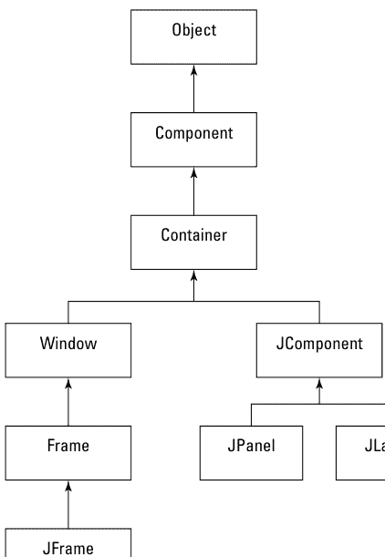

图 1-2：Swing 家族树。

以下段落简要描述了此图中显示的每个类：

- **Object：** 所有类最终都派生自 `Object`，因此这个类位于树的顶端并不奇怪。
- **Component：** `Component` 类代表一个具有可视表现形式的对象，可以在屏幕上显示并与用户交互。这个类定义了一些所有 Swing 类都可用的基本方法。例如，`setVisible` 方法决定组件是可见还是隐藏。而 `setBounds` 方法设置组件的位置和大小。这是一个 AWT 类，不是 Swing 类。
- **Container：** `Container` 类在 `Component` 类的基本可视能力之上，增加了容纳其他容器的能力。这也是一个 AWT 类而非 Swing 类。从这个类中，你可以获得 `add` 方法，它让你可以向容器添加组件。如你所见，在几乎所有 GUI 程序中都会使用这个方法。
- **Window：** 这个类定义了一个窗口，它是一种特殊的容器对象，具有边框、标题栏、最小化、最大化和关闭窗口的按钮，并且可以被用户重新定位，甚至可能调整大小。
- **Frame：** `frame` 是一种 `Window` 类型，作为 Java GUI 应用程序的基础。`Frame` 是一个 AWT 类，已被 `JFrame` 类改进。
- **JFrame：** 旧版 `Frame` 类的 Swing 版本。你的大多数 Swing 应用程序都包含至少一个 `JFrame` 对象。
- **JComponent：** `JComponent` 类是一个 Swing 类，它是除框架外所有其他 Swing 组件的基础。
- **JPanel：** 这个类创建 `panel`（面板），面板是用于组织和控制其他组件（如标签、按钮、文本字段等）布局的容器。在大多数 Swing 应用程序中，一个或多个面板被添加到框架中。然后，当框架显示时，添加到其面板中的组件就会可见。
- **JLabel：** 这个类创建一个标签，用于显示简单的文本值。

在使用 Swing 时，你会发现一些使用的类定义在 `javax.swing` 包中。因此，你需要用以下行开始每个 Swing 应用程序：

```
import javax.swing.*;
```

此外，你会发现一些 Swing 功能使用 `java.awt` 和 `java.awt.event` 包中的类。因此，你可能还需要导入这些包。

# 我被框架了！

大多数基于 Swing 的应用程序的顶级组件称为 *frame*（框架），由 `JFrame` 类定义。框架本身做不了太多事情。但要在 Swing 中做任何其他事情，你必须首先创建一个框架。图 1-3 展示了一个框架，它除了在标题栏中显示 `Hello, World!` 消息外，什么都不做。

**图 1-3：** Hello, World! 程序显示的框架。

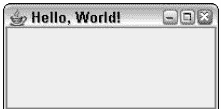

`JFrame` 大约有无数种方法，但大多数程序中只用到其中少数几种。表 1-1 列出了你最常用的 `JFrame` 方法，以及几个构造函数。

**表 1-1：有用的 JFrame 构造函数和方法**

| 构造函数 / 方法 | 描述 |
|---|---|
| `JFrame()` | 创建一个无标题的新框架。 |
| `JFrame(String title)` | 创建一个具有指定标题的新框架。 |
| `void add(Component c)` | 将指定的组件添加到框架中。 |
| `JMenuBar getJMenuBar()` | 获取此框架的菜单。 |
| `void pack()` | 调整框架大小以适应你添加到其中的组件。 |
| `void remove(Component c)` | 从框架中移除指定的组件。 |
| `void setDefaultCloseOperation(int operation)` | 设置用户关闭框架时采取的操作。你几乎应该始终指定 `JFrame.EXIT_ON_CLOSE`。 |
| `void setIconImage(Icon image)` | 设置框架最小化时显示的图标。 |
| `void setLayout(LayoutManager layout)` | 设置用于控制框架显示时组件排列方式的布局管理器。默认是 BorderLayout 管理器。 |
| `void setLocation(int x, int y)` | 设置框架在屏幕上的 x 和 y 位置。屏幕左上角为 0, 0。 |
| `void setLocationRelativeTo(Component c)` | 如果参数为 null，则将框架在屏幕上居中。 |
| `void setResizable(boolean value)` | 设置用户是否可以更改框架的大小。默认设置为 `true`（框架可以调整大小）。 |
| `void setSize(int width, int height)` | 将框架大小设置为指定的宽度和高度。 |
| `void setJMenuBar(JMenuBar menu)` | 设置此框架的菜单。 |

至少，你想为新框架设置一个标题，设置框架的大小使其足够大以查看你添加的任何组件（默认情况下，框架宽度和高度均为零像素，所以不是很有用），并调用 `setVisible` 方法使框架可见。一种实现这三件事的方法是创建 JFrame 类的实例，并使用如下语句设置其属性：

```
JFrame frame = new JFrame("This is the title");
frame.setSize(350, 260);
frame.setVisible(true);
```

然而，通过声明一个扩展 JFrame 类的类来创建框架更为常见。然后，你在构造函数中调用这些方法，如下一节所述。

默认情况下，用户可以更改框架的大小。如果你想固定框架的大小，使用户无法更改它，只需调用 `setResizable(false)`。

## Swing 中的 Hello, World!

为了让你开始使用 Swing，清单 1-1 展示了经典 Hello, World! 程序的 Swing 版本，仅使用框架。如果你运行这个程序，屏幕上会显示图 1-1 所示的框架。如你所见，框架的标题栏包含文本 "Hello, World!"

这个看似毫无意义的简短程序的目的是说明当你使用 Swing 时遇到的第一个问题的一种解决方案：`main` 方法是静态方法，但 Swing 框架是对象。因此，你必须想办法让你的程序脱离静态上下文。这个程序通过将应用程序创建为扩展 JFrame 的类来实现这一点。然后，`main` 方法调用类的构造函数，实际上创建了自身的一个实例。这就是 `main` 方法所做的全部；这个应用程序的实际工作由构造函数完成。


## Swing中的“Hello, World!”程序

```java
import javax.swing.*;

public class HelloFrame extends JFrame
{
    public static void main(String[] args)
    {
        new HelloFrame();
    }

    public HelloFrame()
    {
        this.setSize(200,100);
        this.setDefaultCloseOperation(
            JFrame.EXIT_ON_CLOSE);
        this.setTitle("Hello World!");
        this.setVisible(true);
    }
}
```

**清单 1-1：Hello, World! 程序的 Swing 版本**

以下段落描述了本程序的大部分特性：

- 1 程序以一条导入 `javax.swing` 包中所有类的导入语句开始。大多数 Swing 类都在此包中定义。不过，根据你程序使用的 GUI 特性，你可能还需要导入其他类。
- 3 本应用程序的类名为 `HelloFrame`，它继承了一个名为 `JFrame` 的 Swing 类。继承 `JFrame` 的类通常被称为框架类。`JFrame` 类定义了一个基本框架，你可以在其中显示 GUI 组件，例如标签和文本框。所有 Swing 应用程序都需要至少一个继承 `JFrame` 的类。
- 5 Swing 应用程序仍然是 Java 应用程序，所有 Java 应用程序都需要一个启动程序的静态 `main` 方法。因此，本类中列出的第一个方法就是 `main` 方法。
- 7 `main` 方法的第一条（也是唯一一条）语句创建了 `HelloFrame` 类的一个新实例。与控制台应用程序不同，Swing 应用程序不能在静态上下文中运行。因此，Swing 应用程序中静态 `main` 方法的主要目的是创建应用程序框架类的一个实例。
- 10 当第 7 行创建了 `HelloFrame` 类的一个实例时，本行开始的构造函数被执行。框架类构造函数的主要工作是设置框架选项，并创建框架中显示的任何 GUI 组件。
- 12 构造函数设置的第一个选项是框架的大小。为此，它调用了 `setSize` 方法。参数指定了框架应为 200 像素宽、100 像素高。（*像素*是构成计算机屏幕图像的小点之一。*像素*是 *picture element* 的缩写，但这不会在考试中出现。）
- 13 构造函数设置的下一个选项是：如果用户通过点击“关闭”按钮（通常出现在框架的右上角）关闭框架时该怎么做。默认情况下，点击“关闭”按钮会隐藏框架，但不会终止应用程序。因此，应用程序的主线程（即通过 `main` 方法在静态上下文中仍在运行的线程）会继续运行一段时间。最终，Java 会检测到没有活动并关闭应用程序。但如果你使用 `setDefaultCloseOperation` 将关闭操作设置为 `JFrame.EXIT_ON_CLOSE`，应用程序退出会更干净。这会导致框架关闭时程序终止。
- 15 下一条语句使用 `setTitle` 方法设置框架的标题。
- 16 构造函数中的最后一条语句调用 `setVisible` 方法，参数值为 `true`，这使得框架在屏幕上可见。如果你省略这条语句，框架虽然被创建了，但用户永远看不到它。

本程序到此就介绍完了。诚然，它比第 I 册第 1 章中基于控制台的 Hello, World! 程序稍微复杂一点。但也没复杂多少。为了确保其运行过程清晰，下面是程序运行时发生的事情回顾：

- 1. Java 运行 `HelloWorld` 类的静态 `main` 方法。
- 2. `main` 方法创建 `HelloWorld` 类的一个实例，这导致构造函数被执行。
- 3. 构造函数设置框架大小、默认关闭操作和标题。
- 4. 构造函数完成后，程序继续执行 `main` 方法，在该方法中调用 `setVisible` 方法来显示框架。

## 514 使用 JPanel 类

`JFrame` 类提供了两个方法，让你可以指定框架在屏幕上的位置。如果你想将框架放置在屏幕上的任意位置，请使用 `setLocation` 方法。例如，要将框架放在屏幕的左上角，请使用以下语句：

```java
frame.setLocation(0,0);
```

如果你想将框架在屏幕上居中，请调用 `setLocationRelativeTo` 方法并传递 `null` 作为参数：

```java
frame.setLocationRelativeTo(null);
```

此方法旨在让你相对于已显示的其他组件来定位框架。但如果你传递 `null` 作为参数，该方法会将框架在屏幕上居中。

如果你想将窗口定位在除了左上角或屏幕正中心以外的其他位置，你可能需要知道用户屏幕的宽度和高度，以便计算框架的位置。要确定用户屏幕的大小，你可以使用名为 `Toolkit` 的类。`Toolkit` 类有一系列方法，但这里你需要了解其中两个：

- **getDefaultToolkit**：一个创建 `Toolkit` 对象的静态方法。在使用 `getScreenSize` 方法之前，你必须先使用此方法。
- **getScreenSize**：返回屏幕的大小，其类型为 `Dimension` 对象。`Dimension` 类有两个表示屏幕大小的公共字段：`height` 和 `width`。两个字段的类型都是 `int`。

假设你想定位一个框架，使其左下角正好位于屏幕中心。以下放置在框架构造函数中的代码可以实现此目的：

```java
Toolkit tk = Toolkit.getDefaultToolkit();
Dimension d = tk.getScreenSize();
int x = d.width / 2;
int y = (d.height / 2) - this.getHeight();
this.setLocation(x, y);
```

此代码首先创建一个 `Toolkit` 对象，并使用它来获取屏幕尺寸。它通过将屏幕宽度除以 2 来将 `x` 位置设置为屏幕的水平中心。然后将 `y` 位置设置为垂直中心（屏幕高度除以 2）减去框架的高度。这样就把框架的底部放在了垂直中点上。

## 使用 JPanel 类

`panel`（面板）是一种容器，设计用于容纳一组组件，以便它们可以显示在框架上。显示一组控件（如文本字段、标签、按钮和其他 GUI 小部件）的通常方式是将这些控件添加到面板中，然后将面板添加到框架中。如果你想，也可以绕过面板直接将控件添加到框架，但使用单独的面板来容纳框架的控件几乎总是一个好主意。

面板由 `JPanel` 类定义。像 `JFrame` 类一样，`JPanel` 类也有一系列方法。表 1-2 列出了 `JPanel` 类最常用的构造函数和方法。

**表 1-2：常用的 JPanel 构造函数和方法**

| 构造函数/方法 | 描述 |
|---|---|
| `JPanel()` | 创建一个新面板。 |
| `JPanel(boolean isDoubleBuffered)` | 创建一个新面板。如果参数为 `true`，则面板使用一种称为双缓冲的技术，这可以使图形应用程序的显示效果更好。此构造函数通常用于游戏程序或其他显示动画的面板。 |
| `JPanel(LayoutManager layout)` | 使用指定的布局管理器创建一个新面板。默认布局管理器是 FlowLayout。 |
| `void add(Component c)` | 将指定的组件添加到面板中。 |
| `void remove(Component c)` | 从面板中移除指定的组件。 |
| `void setLayout(LayoutManager layout)` | 设置用于控制面板显示时组件排列方式的布局管理器。默认是 FlowLayout 管理器。 |
| `void setLocation(int x, int y)` | 设置框架在屏幕上的 x 和 y 位置。屏幕左上角为 0, 0。 |
| `void setSize(int width, int height)` | 将框架的大小设置为指定的宽度和高度。 |
| `void setToolTipText(String text)` | 设置当用户将鼠标悬停在面板的空白区域上时显示的工具提示文本。 |

你可以使用几种不同的技术来创建面板并将其添加到框架中。一种是简单地创建一个 `JPanel` 对象并在 `JFrame` 构造函数中将其赋值给一个变量。然后你可以向面板添加组件，再将面板添加到框架。例如：

```java
// HelloFrame 构造函数
public HelloFrame()
{
    this.setSize(200,100);

    this.setDefaultCloseOperation(JFrame.EXIT_ON_CLOSE);
    this.setTitle("Hello, World!");

    JPanel panel = new JPanel();

    // 向面板添加组件的代码放在这里

    this.setVisible(true);
}
```


## 使用面板

另一种常用的技巧是为面板创建一个独立的类。这个类应该继承 JPanel。然后，你可以在构造函数中添加面板所需的任何组件：

```java
class HelloPanel extends JPanel
{
    public HelloPanel()
    {
        // 在此处添加面板组件的代码
    }
}
```

然后，在框架类的构造函数中，创建一个面板类的实例并将其添加到面板中：

```java
HelloPanel panel = new HelloPanel();
this.add(panel);
```

或者，仅用下面这条语句也能达到同样效果：

```java
this.add(new HelloPanel());
```

## 使用标签

既然你已经知道如何创建框架和面板，现在你可以创建一个实用的组件来添加到面板中：标签。标签是一种仅用于显示文本的组件。标签有多种用途：为其他控件（如文本字段或组合框）显示标题、显示信息性消息、或显示计算或数据库查询的结果。

标签还可以显示图像，或者同时显示图像和一些文本。而且你可以完全控制文本的外观：你可以指定字体、大小、文本是否为**粗体**、*斜体*或下划线、文本显示的颜色等等。在本章中，我将讨论如何使用基本标签。有关标签的更多功能，请参阅第九卷第1章和第2章。


要创建标签，你需要使用 JLabel 类。表 1-3 展示了最常用的构造函数和方法。

**表 1-3：常用的 JLabel 构造函数和方法**

| **构造函数** | **说明** |
|---|---|
| `JLabel()` | 创建一个没有初始文本的新标签。 |
| `JLabel(String text)` | 创建带有指定文本的新标签。 |
| **方法** | **说明** |
| `String getText()` | 返回标签显示的文本。 |
| `void setText(String text)` | 设置标签显示的文本。 |
| `void setToolTipText(String text)` | 设置当用户将鼠标悬停在标签上片刻时显示的提示文本。 |
| `void setVisible(boolean value)` | 显示或隐藏标签。 |

创建标签时，你可以将希望显示的文本传递给构造函数，如下所示：

```java
JLabel label1 = new JLabel("Hello, World!");
```

或者，你可以先创建标签，然后再设置文本：

```java
JLabel label1 = new JLabel();
label1.setText("Hello, World!");
```

标签只有在添加到面板，而面板又被添加到框架之后才会显示。下面是一个框架类构造函数的示例，它创建了一个面板、一个标签，将标签添加到面板中，再将面板添加到框架中：

```java
// HelloFrame 构造函数
public HelloFrame()
{
    this.setSize(200,100);

    this.setDefaultCloseOperation(JFrame.EXIT_ON_CLOSE);
    this.setTitle("Hello, World!");

    JPanel panel1 = new JPanel();
    JLabel label1 = new JLabel("Hello, World!");
    panel1.add(label1);
    this.add(panel1);

    this.setVisible(true);
}
```

图 1-4 展示了运行该程序时框架的外观。

图 1-4：带有面板的框架，面板中有一个标签。


## 创建按钮

除了标签之外，你最常使用的 Swing 组件是 `JButton` 组件，它创建一个用户可以点击的按钮。图 1-5 展示了一个带有单个按钮的框架。

图 1-5：带有面板的框架，面板中包含一个按钮。


在下一章中，你将了解如何编写响应用户点击按钮的代码。这里，我只关注如何创建按钮以及如何控制其外观。表 1-4 列出了 `JButton` 类最常用的构造函数和方法。

**表 1-4：常用的 JButton 构造函数和方法**

| **构造函数** | **说明** |
|---|---|
| `JButton()` | 创建一个没有初始文本的新按钮。 |
| `JButton(String text)` | 创建带有指定文本的新按钮。 |
| **方法** | **说明** |
| `doClick()` | 触发按钮的动作事件，就像用户点击了它一样。（在下一章中我会告诉你为什么这有时很有用。） |
| `String getText()` | 返回按钮显示的文本。 |
| `void setBorderPainted(boolean value)` | 显示或隐藏按钮的边框。默认设置为 `true`（显示边框）。 |
| `void setContentAreaFilled(boolean value)` | 指定按钮的背景是否应该填充或保持空白。默认设置为 `true`（填充背景）。 |
| `void setEnabled(boolean value)` | 启用或禁用按钮。默认设置为 `true`（启用）。 |
| `void setRolloverEnabled(boolean value)` | 启用或禁用悬停效果，当鼠标移到按钮上时边框会变粗。默认设置为 `true`（启用悬停效果）。 |
| `void setText(String text)` | 设置按钮显示的文本。 |
| `void setToolTipText(String text)` | 设置当用户将鼠标悬停在按钮_exit上时显示的提示文本。 |
| `void setVisible(boolean value)` | 显示或隐藏按钮。默认设置为 `true`（按钮可见）。 |

如你所见，`JButton` 类的构造函数与 `JLabel` 类的构造函数类似：你可以创建空按钮或带有文本的按钮。例如，以下是创建图 1-5 所示按钮的代码：

```java
JButton button1 = new JButton("Click me!");
```

如果你在调用构造函数时没有提供按钮文本，可以稍后通过 `setText` 方法提供，如下所示：

```java
JButton button1 = new JButton();
button1.setText("Click me!");
```

你可能觉得不会这样做，但有时按钮的含义会根据用户正在进行的操作而变化。例如，一个让用户添加、修改或删除文件中记录的程序，可能会根据用户当前正在执行的操作，将按钮文本设置为 `Add Record`、`Change Record` 或 `Delete Record`。在这样的程序中，你可能需要使用 `getText` 方法来查明按钮当前显示的文本。

表中列出的其他方法大多只影响按钮的外观。要禁用按钮使用户无法点击，调用 `setEnabled(false)`。要移除按钮边缘的深色边框，调用 `setBorderPainted(false)`。要移除按钮的背景使其只显示文本，调用 `setContentAreaFilled(false)`。要使按钮完全消失，调用 `setVisible(false)`。


## 关于组件布局的一点说明

控制面板上组件的布局是使用 Swing 最困难的事情之一。事实上，难到我专门用第六卷第5章来讨论它。在此之前，你需要了解几个要点：

- 面板上（或框架中）组件的布局由布局管理器控制，它决定每个组件的最终放置位置。布局管理器在做出决定时，会考虑组件的大小、面板的大小以及附近其他组件的位置。

- Swing 提供了七种不同的布局管理器供你选择。每种都有自己决定组件位置的方式。

- 面板的默认布局管理器称为 FlowLayout。它按行逐个放置组件，只有在到达面板（或包含它的框架）末尾时才会开始新的一行。

- 使用 FlowLayout（以及其他布局管理器）时，如果用户更改框架大小，布局会发生变化。框架的大小对 FlowLayout 如何排列控件有很大影响。


- 你可以随时调用框架的 `setResizable(false)` 方法来防止用户调整框架大小。

- 如果你想更改面板使用的布局管理器，可以调用面板的 `setLayout` 方法。


- 对于许多（如果不是大多数）Swing 应用程序，你可以使用多个面板来显示组件。每个面板可以有不同的布局管理器。通过这种方式，你可以创建复杂的布局，包含大量组件，全部按照你想要的方式排列。

- 如有需要，你也可以完全关闭布局管理器。为此，调用面板的 `setLayout` 方法并将参数设置为 `null`。然后，你使用绝对定位，通过调用每个组件的 `setBounds` 方法来设置每个组件的 x、y 位置和大小。

- 这个列表还可以继续说下去。有关控制布局的更多信息，请参阅第六卷第5章。


## 第2章：处理事件

### 本章内容

- 理解重要的事件概念
- 使用事件处理类和接口
- 响应按钮点击
- 使用内部类进行事件处理
- 提供一个退出按钮
- 处理关闭按钮

在上一章中，你了解了如何创建包含面板、标签和按钮的 Swing 框架。然而，这些框架只是静静地待在那里。它们看起来不错，但完全没有任何响应。任你随意点击，它们都纹丝不动。有点像*青少年*。

在本章中，你将让这些按钮动起来。具体来说，你将了解如何编写代码，使其在用户点击按钮时执行。这种技术叫做*事件监听*，它是编写 Swing 程序最重要的方面之一。一开始可能看起来有点复杂，但一旦你掌握了其中的*诀窍*（抱歉，打了个双关），事件监听就会变得非常合理。

> **提示**
> 虽然事件监听主要用于响应按钮点击，但它也可以用于响应其他类型的用户交互。例如，你可以使用事件监听来编写代码，当用户从下拉框中进行选择、将鼠标移动到标签上方或按下键盘上的某个键时执行。本章中的事件监听技术同样适用于这些事件。

### 审视事件

*事件*是指用户对你的某个用户界面组件执行了值得注意的操作时生成的对象。例如，如果用户点击按钮、在标签上拖动鼠标或从下拉框中选择项目，就会生成一个事件对象。然后，这个事件对象会被传递给一个你创建的特殊方法，称为*事件监听器*。事件监听器可以检查事件对象，确定究竟发生了什么类型的事件，并做出相应的响应。例如，如果用户点击了按钮，事件监听器可能会将用户通过文本字段输入的任何数据写入文件。如果用户将鼠标移到标签上方，事件处理器可能会更改标签显示的文本。而如果用户从下拉框中选择了某个项目，事件处理器可能会使用所选值在数据库中查找信息。可能性无穷无尽！

有几种不同类型的事件对象，由各种继承自 `AWTEvent` 的类表示。表 2-1 列出了最常用的事件类。此外，该表还列出了用于创建能够监听该事件并在其生成时处理它的对象的*监听器接口*。


请注意，这些事件类包含在 `java.awt` 包中。严格来说，事件处理由 AWT 提供，而不是由 Swing 提供。

| 表 2-1 | 常用事件类 |
| :--- | :--- | :--- |
| **事件类** | **监听器接口** | **说明** |
| `ActionEvent` | `ActionListener` | 当用户对按钮或其他组件执行操作时创建。通常，这意味着用户点击了按钮。然而，用户也可以通过 Tab 键切换到按钮并按下 Enter 键来触发按钮动作。 |
| `ItemEvent` | `ItemListener` | 当列表控件（如下拉框或列表框）中的选中项发生变化时创建。 |
| `DocumentEvent` | `DocumentListener` | 当用户更改文本组件（如文本字段）的内容时创建。 |
| `WindowEvent` | `WindowListener` | 当窗口（框架）的状态发生变化时创建。 |
| `KeyEvent` | `KeyListener` | 当用户按下键盘上的某个键时创建。此事件可用于监视用户输入的特定按键。 |
| `MouseEvent` | `MouseListener` | 当用户对鼠标执行某些有趣的操作时创建，例如点击某个按钮、拖动鼠标，或将鼠标移到另一个对象上方。 |
| `FocusEvent` | `FocusListener` | 当组件获得或失去焦点时创建。 |

表 2-1 中列出的事件可以分为两类。前三种（`ActionEvent`、`ItemEvent` 和 `DocumentEvent`）称为*语义事件*，因为它们与用户交互有关，通常具有某些特定含义。例如，当用户点击按钮时，他或她正试图执行某个特定操作。相比之下，其他事件称为*底层事件*。

如果你正在突击备考，有三个重要术语你必须掌握：

- **事件**：当用户对组件执行值得注意的操作（例如点击）时创建的对象。
- **事件源**：生成事件对象的组件。通常，事件源是按钮或其他用户可以点击的组件，但任何 Swing 组件都可以作为事件源。
- **事件监听器**：监听事件并在发生时处理它们的对象。事件监听器对象必须实现适合该事件的接口。这些监听器接口定义了事件源在事件发生时调用的方法。表 2-2 列出了表 2-1 中每个接口所定义的方法。

| 表 2-2 | 监听器接口方法 |
| --- | --- | --- |
| **监听器接口** | **方法** | **说明** |
| `ActionListener` | `void actionPerformed(ActionEvent e)` | 当动作事件发生时调用。 |
| `ItemListener` | `void itemStateChanged(ItemEvent e)` | 当所选项目发生变化时调用。 |
| `DocumentListener` | `void changedUpdate(DocumentEvent e)` | 当文本更改时调用。 |
| | `void insertUpdate(DocumentEvent e)` | 当插入文本时调用。 |
| | `void removeUpdate(DocumentEvent e)` | 当删除文本时调用。 |
| `WindowListener` | `void windowActivated(WindowEvent e)` | 当窗口被激活时调用。 |
| | `void windowClosed(WindowEvent e)` | 当窗口被关闭后调用。 |
| | `void windowClosing(WindowEvent e)` | 当用户尝试关闭窗口时调用。 |
| | `void windowDeactivated(WindowEvent e)` | 当窗口被停用时调用。 |
| | `void windowDeiconified(WindowEvent e)` | 当窗口从图标恢复为正常状态时调用。 |
| | `void windowIconified(WindowEvent e)` | 当窗口最小化为图标时调用。 |
| | `void windowOpened(WindowEvent e)` | 当窗口被打开时调用。 |
| `KeyListener` | `void keyPressed(KeyEvent e)` | 当用户按下某个键时调用。 |
| | `void keyReleased(KeyEvent e)` | 当用户释放某个键时调用。 |
| | `void keyTyped(KeyEvent e)` | 当用户键入某个键时调用。 |
| `MouseListener` | `void mouseClicked(MouseEvent e)` | 当用户点击鼠标时调用。 |
| | `void mouseEntered(MouseEvent e)` | 当鼠标移到某个组件上方时调用。 |
| | `void mouseExited(MouseEvent e)` | 当鼠标离开某个组件时调用。 |
| | `void mousePressed(MouseEvent e)` | 当用户按下鼠标按钮时调用。 |
| | `void mouseReleased(MouseEvent e)` | 当用户释放鼠标按钮时调用。 |
| `FocusListener` | `void focusGained(FocusEvent e)` | 当组件获得焦点时调用。 |
| | `void focusLost(FocusEvent e)` | 当组件失去焦点时调用。 |

处理事件

现在你已经了解了用于事件处理的基本对象，接下来需要将它们实际连接起来，创建一个能够响应事件的程序。

要编写响应事件的 Java 代码，你需要执行以下操作：

**1. 创建一个能够生成事件的组件。**

你需要向框架中添加按钮或其他能够生成事件的组件，以便显示用户可以与之交互的组件。（严格来说，所有 Swing 组件都可以生成某些事件。即使是一个标签，当用户将鼠标移到其上方时也会生成 MouseEvent。但一个只包含标签的框架并不是很有用。）


通常，你将引用事件源的变量声明为私有类字段，位于框架的构造函数或任何其他方法之外。例如：

```
private JButton button1;
```

然后，在框架类的构造函数中，你可以创建按钮。例如，以下代码创建了一个面板、创建了一个按钮、将其添加到面板，然后将面板添加到框架：

```
JPanel panel = new JPanel();
button1 = new JButton("Click me!");
panel.add(button1);
this.add(panel);
```

注意，这段代码出现在框架类的构造函数中，因此最后一行的 `this` 指的是框架。

## 2. 创建一个实现你想要处理的事件的监听器接口的类。

例如，要处理动作事件，你应该创建一个实现 `ActionListener` 接口的类。正如你在本章后面看到的，你至少有四种方式可以做到这一点。但最简单的方法之一是直接在框架类的定义中添加 `implements ActionListener`。这样，框架类声明看起来像这样：

```
public class ClickMe
    extends JFrame implements ActionListener
```

在本章后面，我会告诉你实现事件监听器接口的其他方法。

## 3. 编写监听器定义的任何方法的代码。

当你实现一个监听器接口时，你必须提供该接口定义的每个方法的实现。大多数监听器接口只定义一个方法，对应于该接口监听的事件类型。例如，`ActionListener` 接口定义了一个名为 `actionPerformed` 的方法。每当创建动作事件时，就会调用这个方法。因此，你在 `actionPerformed` 方法中放置的代码会在动作事件发生时执行。

例如，以下是一个响应动作事件的 `actionPerformed` 方法：

```
public void actionPerformed(ActionEvent e)
{
    if (e.getSource() == button1)
        button1.setText("You clicked!");
}
```

这里，如果事件源是 `button1`，这段代码会改变 `button1` 显示的文本。

## 4. 将监听器注册到源。

最后一步是将事件监听器注册到事件源。每个作为事件源的组件都提供一个方法，让你注册事件监听器来监听该事件。对于 ActionEvent 源，该方法是 addActionListener。以下是对框架构造函数代码的修改，创建 button1 按钮并将框架类注册为动作事件监听器：

这里，你可以将 `this` 指定为事件监听器，因为框架类本身实现了 ActionListener。

```
JPanel panel = new JPanel();
button1 = new JButton("Click me!");
button1.addActionListener(this);
panel.add(button1);
this.add(panel);
```

## ClickMe 程序

要了解所有这些元素如何在一个完整的程序中协同工作，图 2-1 展示了一个名为 ClickMe 的程序创建的框架的三种形态。该程序显示一个带有一个按钮的框架，按钮最初显示 Click Me!。当用户点击按钮时，按钮的文本变为 I've been clicked!，如图所示的第二个框架。然后，如果用户再次点击按钮，文本变为 I've been clicked 2 times!，如图所示的第三个框架。此后，每次点击按钮计数都会增加。清单 2-1 展示了该程序的完整代码。


图 2-1：ClickMe 程序的运行效果。


```
清单 2-1：CLICKME 程序
import javax.swing.*;
import java.awt.event.*;

public class ClickMe
    extends JFrame implements ActionListener
{
    public static void main(String [] args)
    {
        new ClickMe();
    }

    private JButton button1;

    public ClickMe()
    {
        this.setSize(200,100);

        this.setDefaultCloseOperation(JFrame.EXIT_ON_CLOSE);
        this.setTitle("I'm Listening");

        JPanel panel1 = new JPanel();
        button1 = new JButton("Click Me!");
        button1.addActionListener(this);
        panel1.add(button1);
        this.add(panel1);

        this.setVisible(true);
    }

    private int clickCount = 0;

    public void actionPerformed(ActionEvent e)
    {
        if (e.getSource() == button1)
        {
            clickCount++;
            if (clickCount == 1)
                button1.setText("I've been clicked!");
            else
                button1.setText("I've been clicked "
                    + clickCount + " times!");
        }
    }
}
```

以下段落指出了程序的一些关键行：

- → 2 程序必须导入 `java.awt.event` 包，该包定义了 `ActionEvent` 类和 `ActionListener` 接口。

- → 5 `ClickMe` 类扩展了 `JFrame` 类并实现了 `ActionListener`。这样，这个类身兼两职：它定义了框架，并监听由添加到框架的组件生成的事件。

- → 7 `main` 方法像往常一样是必需的。它只是创建了一个 `ClickMe` 类的实例来启动框架。

- → 12 `button1` 变量被定义为私有类字段，因此 `ClickMe` 构造函数和 `actionPerformed` 方法都可以访问它。

- → 14 构造函数执行了框架类构造函数通常所做的所有工作：设置框架大小、默认关闭操作和标题，然后将组件添加到框架。最后调用 `setVisible` 使框架在屏幕上可见。

- → 21 这一行创建了一个按钮并将其赋值给 `button1` 字段。

- → 22 这一行将当前对象添加为 `button1` 按钮的动作监听器。

- → 29 一个名为 `clickCount` 的字段用于跟踪按钮被点击的次数。该字段在对象创建时初始化为零。

- → 31 由于 `ClickMe` 类实现了 `ActionListener` 接口，所以必须编写 `actionPerformed` 方法。每当用户点击按钮时，`button1` 对象就会调用此方法。`ActionEvent` 参数是按钮点击生成的事件。

- → 33 调用 `ActionEvent` 参数的 `getSource` 方法来确定事件源。在这个程序中，这个 `if` 语句并不是真正必需的，因为程序只有一个事件源。然而，大多数 Swing 程序有多个事件源，所以你需要在事件监听器中测试事件源。

- → 35 这条语句增加点击计数，表示按钮已被点击。

- → 36 这个 `if` 语句测试 `clickCount` 字段的值，并相应地改变按钮显示的文本。

## 使用内部类监听事件

正如在第三册第七章中解释的，内部类是嵌套在另一个类中的类。内部类通常用于事件监听器。这样，定义框架的类就不必实现事件监听器。相反，它包含一个处理事件的内部类。

清单 2-2 展示了 ClickMe 程序的一个版本，该版本使用内部类来处理按钮的动作事件。

## 清单 2-2：使用内部类的 ClickMe2 程序

```
import javax.swing.*;
import java.awt.event.*;

public class ClickMe2 extends JFrame
{
    public static void main(String [] args)
    {
        new ClickMe2();
    }

    private JButton button1;

    public ClickMe2()
    {
        this.setSize(200,100);
        this.setDefaultCloseOperation(JFrame.EXIT_ON_CLOSE);
        this.setTitle("I'm Listening");

        ClickListener cl = new ClickListener();

        JPanel panel1 = new JPanel();
        button1 = new JButton("Click Me!");
        button1.addActionListener(cl);
        panel1.add(button1);
        this.add(panel1);

        this.setVisible(true);
    }

    private class ClickListener
        implements ActionListener
    {
        private int clickCount = 0;

        public void actionPerformed(ActionEvent e)
        {
            if (e.getSource() == button1)
            {
                clickCount++;
                if (clickCount == 1)
                    button1.setText("I've been clicked!");
                else
                    button1.setText("I've been clicked "
                        + clickCount + " times!");
            }
        }
    }
}
```


## 530 添加退出按钮

本程序与清单 2-1 所示程序的工作方式基本相同，因此我不会回顾基础知识。相反，我只指出一些重点：

-  第4行 `ClickMe2` 类仍然继承自 `JFrame`，但不再实现 `ActionListener`。
-  第11行 作为事件源的按钮必须由类字段引用，以便内部类可以访问它。该字段可以是私有的，因为内部类可以访问包含它们的类的私有成员。
-  第20行 该语句创建 `ClickListener` 类（内部类）的实例，并将其赋值给变量 `c1`。
-  第24行 该语句将 `c1` 添加为按钮的动作监听器。请注意，因为该框架只有一个按钮，我也可以省略第20行，并将第24行编写如下：
`button1.addActionListener(new ClickListener());`
然而，由于大多数实际应用有不止一个事件源，因此先创建监听器类的实例，然后将该对象作为每个事件源的监听器进行重用是常见的做法。
-  第32行 `ClickListener` 类通过将其声明完全置于 `ClickMe2` 类内部来声明为内部类。`ClickListener` 类实现 `ActionListener` 接口，以便它可以处理动作事件。
-  第34行 `clickCount` 变量在内部类中声明为类字段。
-  第38行 这里 `button1` 变量对内部类可用，因为内部类可以访问包含它们的类的私有成员。

## 添加退出按钮

在本书第六卷第1章中，你将了解如何创建一个框架，当用户单击框架的退出按钮时退出应用程序。要向应用程序添加退出按钮，你必须执行三件事：

1. **创建退出按钮并将其添加到框架。**
通常，你实际上是将退出按钮添加到一个面板，然后该面板再被添加到框架。
2. **为按钮添加动作事件监听器。**
3. **在动作监听器的 `actionPerformed` 方法中添加代码，当用户单击按钮时退出应用程序。**
通常通过调用 `System.exit(0)` 来实现。

在许多应用程序中，你不希望只是盲目地终止应用程序。相反，你应该确保用户在结束之前已保存其数据。如果没有，你可以自动保存数据，或者要求用户在允许程序结束之前保存数据。

假设你想修改清单 2-2 所示的 `ClickMe2` 应用程序，使其具有一个退出按钮，但退出按钮不允许用户退出，除非他或她至少单击过一次 ClickMe 按钮。首先，你将第11行更改为声明一个 `exitButton` 类字段：

```
private JButton button1, exitButton;
```

接下来，你在构造函数中添加代码以创建按钮、注册事件监听器并将按钮添加到面板：

```
exitButton = new JButton("Exit");
exitButton.addActionListener(cl);
panel1.add(exitButton);
```

最后，你修改 `ClickListener` 类的 `actionPerformed` 方法来处理退出按钮：

```
public void actionPerformed(ActionEvent e)
{
    if (e.getSource() == button1)
    {
        clickCount++;
        if (clickCount == 1)
            button1.setText("I've been clicked!");
        else
            button1.setText("I've been clicked "
                + clickCount + " times!");
    }
    else if (e.getSource() == exitButton)
    {
        if (clickCount > 0)
            System.exit(0);
        else
        {
            JOptionPane.showMessageDialog(ClickMe3.this,
                "You must click at least once!",
                "Not so fast, buddy",
                JOptionPane.ERROR_MESSAGE);
        }
    }
}
```

这里，使用 `if` 语句来确定当 `actionPerformed` 方法被调用时单击了哪个按钮。此步骤是必要的，因为 `ClickHandler` 类用于处理两个按钮的动作事件。如果事件源是退出按钮，另一个 `if` 语句检查 `clickCount` 变量是否大于零。如果是，调用 `System.exit(0)` 结束应用程序。否则，使用 `JOptionPane` 显示错误消息，并且应用程序不会结束。

不幸的是，仅将此逻辑添加到退出按钮是不够的，因为用户可以通过单击框架的关闭按钮绕过你的退出按钮。你希望的是让框架关闭按钮的行为与退出按钮完全相同。为此，除了动作事件监听器之外，还需要添加窗口事件监听器，如我在下一节中所述。

## 捕获 WindowClosing 事件

本书第六卷第1章向你展示了如何使用 `JFrame` 类的 `setDefaultCloseOperation` 方法，让用户通过使用框架的关闭按钮退出应用程序。然而，如果你的应用程序在允许用户退出之前检查数据是否已保存或其他条件是否已满足，此方法将不起作用。在这种情况下，你希望设置关闭按钮，使其与你的退出按钮工作方式相同。

为此，你需要向框架添加一个监听窗口事件的监听器。当用户单击关闭按钮时，框架生成 `windowClosing` 事件，你可以通过向框架本身注册 `WindowListener` 来处理该事件。然后，在 `WindowListener` 的 `windowClosing` 方法中，你可以调用退出按钮的 `doClick` 事件。这会触发退出按钮的动作事件，就好像用户单击了它一样。因此，关闭按钮的处理方式与退出按钮完全相同。

设置窗口监听器的第一步是消除当用户单击关闭按钮时自动退出应用程序的默认行为。为此，你必须将 `setDefaultCloseOperation` 中使用的常量从 `EXIT_ON_CLOSE` 更改为 `DO_NOTHING_ON_CLOSE`，如下所示：

```
this.setDefaultCloseOperation(JFrame.DO_NOTHING_ON_CLOSE);
```

这样，`JFrame` 类的默认行为就是完全忽略关闭按钮。然后，你可以安装窗口监听器，以任何你想要的方式处理关闭按钮。

接下来，你可以设置 `WindowListener` 来监听窗口事件。一种方法是创建实现 `WindowListener` 接口的内部类。不幸的是，`WindowListener` 接口有很多方法，即使你不想要对某个方法执行任何操作，也必须为每个方法提供实现。因此，你的 `WindowListener` 看起来像这样：

```
private class Closer implements WindowListener
{
    public void windowClosing(WindowEvent e)
    {
        exitButton.doClick();
    }

    public void windowActivated(WindowEvent e) {}
    public void windowClosed(WindowEvent e) {}
    public void windowDeactivated(WindowEvent e) {}
    public void windowDeiconified(WindowEvent e) {}
    public void windowIconified(WindowEvent e) {}
    public void windowOpened(WindowEvent e) {}
}
```

最后，通过在框架类构造函数中调用其 `addWindowListener` 方法向框架注册 `WindowListener`：

```
this.addWindowListener(new Closer());
```

如果你发现实现 `WindowListener` 接口时必须编写所有这些虚拟方法很烦人，可以使用*适配器类*代替。适配器类是实现接口并为接口定义的所有方法提供虚拟实现的类。与其实现接口，不如扩展适配器类。然后，你只需要为你感兴趣的一个或多个方法提供实现。

Java 的许多事件监听器接口都有相应的适配器类。它们在表 2-3 中列出。如果你扩展 `WindowAdapter` 而不是实现 `WindowListener`，Closer 类看起来像这样：

```
private class Closer extends WindowAdapter
{
    public void windowClosing(WindowEvent e)
    {
        exitButton.doClick();
    }
}
```

这节省了一些代码。然而，你可以通过完全跳过 `Closer` 类，并使用匿名内部类来处理窗口关闭事件来节省更多代码。然后，框架构造函数中注册窗口事件监听器的语句看起来像这样：

```
addWindowListener(new WindowAdapter()
{
    public void windowClosing(WindowEvent e)
    {
        exitButton.doClick();
    }
});
```


此处，窗口监听器被创建为一个匿名内部类，该类继承自`WindowAdapter`并定义了`windowClosing`方法。

| 监听器接口 | 适配器类 |
|---|---|
| WindowListener | WindowAdapter |
| KeyListener | KeyAdapter |
| MouseListener | MouseAdapter |
| FocusListener | FocusAdapter |

> 匿名内部类就是没有名称的类，它在程序中只使用一次，并且就在使用的位置定义。有关创建匿名内部类所使用语法的详细介绍，请参阅第三册第七章。

## 再看 ClickMe 程序

现在你已经了解了创建退出按钮和处理关闭按钮的各种技巧，清单 2-3 展示了 ClickMe 程序的第三个版本，该版本添加了所有这些功能，以便你能看到它们如何协同工作。此版本的程序添加了一个退出按钮，但在用户至少单击一次 ClickMe 按钮之前不允许退出。并且它将关闭按钮视同用户单击了退出按钮。

### 清单 2-3：带有退出按钮的 ClickMe 应用程序

```java
import javax.swing.*;
import java.awt.event.*;

public class ClickMe3 extends JFrame
{
    public static void main(String [] args)
    {
        new ClickMe3();
    }

    private JButton button1, exitButton;                          → 11

    public ClickMe3()
    {
        this.setSize(275,100);
        this.setTitle("I'm Listening");
        this.setDefaultCloseOperation(                              → 17
            JFrame.DO_NOTHING_ON_CLOSE);

        ClickListener cl = new ClickListener();

        JPanel panel1 = new JPanel();

        addWindowListener(new WindowAdapter()
        {
            public void windowClosing(WindowEvent e)
            {
                exitButton.doClick();
            }
        });

        button1 = new JButton("Click Me!");
        button1.addActionListener(cl);
        panel1.add(button1);

        exitButton = new JButton("Exit");
        exitButton.addActionListener(cl);
        panel1.add(exitButton);
        this.add(panel1);

        this.setVisible(true);
    }

    private class ClickListener implements ActionListener
    {
        private int clickCount = 0;

        public void actionPerformed(ActionEvent e)
        {
            if (e.getSource() == button1)
            {
                clickCount++;
                if (clickCount == 1)
                    button1.setText("I've been clicked!");
                else
                    button1.setText("I've been clicked "
                        + clickCount + " times!");
            }
            else if (e.getSource() == exitButton)
            {
                if (clickCount > 0)
                    System.exit(0);
                else
                {
                    JOptionPane.showMessageDialog(
                        ClickMe3.this,
                        "You must click at least once!",
                        "Not so fast, buddy",
                        JOptionPane.ERROR_MESSAGE);
                }
            }
        }
    }
}
```

第六册
第二章

处理事件

以下段落将引导你关注此程序的关键部分：

- 11 `exitButton`变量与`button1`变量一起声明为类字段，以便内部类可以访问它。
- 17 `setDefaultCloseOperation`方法告诉 JFrame 类，当用户关闭窗口时不执行任何默认操作。
- 24 在框架上安装了一个窗口监听器来监听窗口事件。该监听器由一个继承自`WindowAdapter`类的匿名内部类构造。
- 28 在`windowClosing`方法中，调用了退出按钮的`doClick`方法。这样，关闭按钮的处理方式与用户单击退出按钮完全相同。
- 36 此行及接下来的两行创建退出按钮、注册其动作事件监听器，并将其添加到面板中。
- 61 在动作监听器类的`actionPerformed`方法中，这个`if`语句检查动作事件是否来自退出按钮。如果是，另一个`if`语句检查用户是否至少单击了一次 ClickMe 按钮。如果是，应用程序退出。否则，显示一条消息，程序拒绝执行。

## 第三章：从用户获取输入

### 本章内容

- 文本字段
- 文本区域
- 滚动条
- 复选框
- 单选按钮
- 边框
- 滑块

在第六册的前两章中，你了解了如何使用两个基本的 Swing 用户界面组件——标签和按钮，以及如何处理用户单击这些按钮时产生的事件。如果你只想编写用户单击按钮时显示文本的程序，你现在就可以放下这本书了。但如果你想编写真正有用程序，就需要使用其他 Swing 组件。

在本章中，你将了解如何使用从用户获取信息的组件。首先，我介绍两个从用户获取文本输入的组件：文本字段（获取一行文本）和文本区域（获取多行文本）。然后，我介绍两个从用户获取二选一信息的组件：单选按钮和复选框。

在此过程中，我还会介绍一些用于装饰这些控件以使其更具功能性的特性。具体来说，我介绍了滚动条（常与文本区域配合使用）和边框（用于单选按钮和复选框）。

### 使用文本字段

文本字段是用户可以在其中输入文本的框。你使用 JTextField 类来创建文本字段。表 3-1 列出了该类一些比较常用且实用的构造方法和方法。

表 3-1 实用的 JTextField 构造方法和方法

| 构造方法 | 说明 |
|---|---|
| `JTextField()` | 创建一个新的文本字段。 |
| `JTextField(int cols)` | 创建一个指定宽度的新文本字段。 |
| `JTextField(String text, int cols)` | 创建一个指定宽度和初始文本值的新文本字段。 |

| 方法 | 说明 |
|---|---|
| `String getText()` | 获取输入到字段中的文本值。 |
| `void requestFocus()` | 请求将焦点移动到此文本字段。 |
| `void setColumns(int cols)` | 设置文本字段的大小。（最好在构造方法中进行设置。） |
| `void setEditable(boolean value)` | 如果为 false，则使字段为只读。 |
| `void setText(String text)` | 设置字段的文本值。 |
| `void setToolTipText(String text)` | 设置当用户将鼠标悬停在文本字段上几秒钟时显示的工具提示文本。 |

当你通过调用`JTextField`类的构造方法创建文本字段时，可以指定文本字段的宽度和初始文本值，如以下示例所示：

```java
JTextField text1 = new JTextField(15);
JTextField text2 = new JTextField("Initial Value", 20);
```

宽度以列数指定，这是一个模糊且不精确的度量单位，大致等于文本字段所用字体中一个字符的宽度。你需要通过一些试验才能获得合适大小的文本字段。

使用文本字段的通常方式是在框架构造方法中创建它们，然后在与框架上某个按钮关联的动作监听器的`actionPerformed`方法中检索用户输入的文本，使用如下代码：

```java
String lastName = textLastName.getText();
```

此处，用户输入到`textLastName`文本字段中的值被赋给 String 变量`lastName`。

以下段落描述了使用文本字段需要了解的一些额外细节：

- 当你使用文本字段时，通常还需要在其附近放置一个标签，告诉用户应在字段中输入什么类型的文本。
- 你可以通过调用`setEditable`方法并传入`false`值来创建只读文本字段。该文本字段周围有边框，像普通文本字段一样，但背景为灰色而非白色，并且用户无法更改控件中显示的文本。
- 在大多数程序中，你需要确保用户在文本字段中输入了可接受的数据。如果用户需要在文本字段中输入数字数据，这一点尤其重要，我将在本章后面的"使用文本字段进行数字输入"一节中介绍。

### 查看示例程序

图 3-1 展示了一个简单程序的运行效果，该程序使用文本字段询问用户的姓名。如果用户输入了姓名，程序会使用`JOptionPane`向用户问好，显示如图 3-1 中间所示的消息框。但如果用户在未输入任何内容的情况下单击了按钮，程序会显示图 3-1 底部所示的第二个`JOptionPane`消息。

此程序的代码如清单 3-1 所示。

```java
import javax.swing.*;
import java.awt.event.*;

public class Namer extends JFrame
{
    public static void main(String [] args)
    {
        new Namer();
    }
    // 继续
```


# 使用文本框

```
LISTING 3-1 (CONTINUED)

private JButton buttonOK;
private JTextField textName; -> 12

public Namer()
{
    this.setSize(325,100);
    this.setTitle("Who Are You?");
    this.setDefaultCloseOperation(
        JFrame.EXIT_ON_CLOSE);

    ButtonListener bl = new ButtonListener();

    JPanel panel1 = new JPanel();

    panel1.add(new JLabel("Enter your name: ")); -> 25

    textName = new JTextField(15); -> 27
    panel1.add(textName);

    buttonOK = new JButton("OK");
    buttonOK.addActionListener(bl);
    panel1.add(buttonOK);

    this.add(panel1);

    this.setVisible(true);
}

private class ButtonListener implements
    ActionListener
{
    public void actionPerformed(ActionEvent e)
    {
        if (e.getSource() == buttonOK)
        {
            String name = textName.getText(); -> 46
            if (name.length() == 0) -> 47
            {
                JOptionPane.showMessageDialog(
                    Namer.this,
                    "You didn't enter anything!",
                    "Moron",
                    JOptionPane.INFORMATION_MESSAGE);
            }
            else
            {
                JOptionPane.showMessageDialog(
                    Namer.this,
                    "Good morning " + name,
                    "Salutations",
                    JOptionPane.INFORMATION_MESSAGE);
            }
            textName.requestFocus();
        }
    }
}
```

这个程序并不复杂，因此以下段落只介绍要点：

- 4 框架类的名称为 `Namer`。

- 12 使用一个类变量来存储对文本框的引用，以便构造函数和动作监听器都能访问它。

- 25 创建一个标签，告知用户应在文本框中输入什么数据。

- 27 创建一个长度为 15 列的文本框，然后将其添加到面板中。

- 46 在动作监听器类的 `actionPerformed` 方法中，这条语句检索用户输入的值并将其存储在字符串变量中。

- 47 这条 `if` 语句通过检查第 46 行创建的字符串变量的长度来判断用户是否输入了内容。如果长度为零，则使用 `JOptionPane` 显示错误消息。否则，使用 `JOptionPane` 向用户说早安。

- 63 调用 `requestFocus` 方法将焦点移回文本框，这发生在用户点击按钮之后。如果不这样做，焦点会停留在按钮上，用户必须使用 Tab 键才能将焦点移到文本框。

## 使用文本框进行数字输入

如果使用文本框从用户处获取数字数据，需要特别注意。`getText` 方法返回的是一个字符串值。你可以将该值传递给基本数值类型的包装类的某个解析方法。例如，要将文本框中输入的值转换为 `int`，可以使用 `parseInt` 方法：

```
int count = Integer.parseInt(textCount.getText());
```

这里，`getText` 方法的结果被用作 `parseInt` 方法的参数。

**表 3-2 将字符串转换为数字的方法**

| 包装类 | 解析方法 |
|:---|:---|
| Integer | parseInt(String) |
| Short | parseShort(String) |
| Long | parseLong(String) |
| Byte | parseByte(String) |
| Float | parseFloat(String) |
| Double | parseDouble(String) |

如果你的程序使用了不止一两个数字输入文本框，建议创建单独的方法来验证用户的输入。例如，下面的方法接受一个文本框和一个字符串，该字符串提供了当输入的数据无法转换为 `int` 时显示的错误消息。方法返回一个布尔值，指示该文本框是否包含有效的整数：

```
private boolean isInt(JTextField f, String msg)
{
    try
    {
        Integer.parseInt(f.getText());
        return true;
    }
    catch (NumberFormatException e)
    {
        JOptionPane.showMessageDialog(f,
            "Entry Error", msg,
            JOptionPane.ERROR_MESSAGE);
        f.requestFocus();
        return false;
    }
}
```

然后，你可以在需要检查文本框是否包含有效整数时调用此方法。例如，下面是某个程序的 `actionPerformed` 方法，该程序获取 `textCount` 文本框中输入的值，如果输入的值是有效整数，则在 `JOptionPane` 消息框中显示它：

```
public void actionPerformed(ActionEvent e)
{
    if (e.getSource() == buttonOK)
    {
        if (isInt(textCount,
            "You must enter an integer."))
        {
            JOptionPane.showMessageDialog(Number.this,
                    "You entered "
                    +
                    Integer.parseInt(textCount.getText()),
                    "Your Number",
                    JOptionPane.INFORMATION_MESSAGE);
        }
        textCount.requestFocus();
    }
}
```

这里调用了 `isInt` 方法来确保用户输入的文本可以转换为 `int`。如果可以，则将文本转换为 `int` 并在消息框中显示。（在此示例中，外部类的名称为 `Number`，这就是为什么 `showMessageDialog` 方法的第一个参数指定为 `Number.this`。）

## 创建验证类

如果你有足够的雄心，可以创建一个单独的类来保存执行数据验证的方法。我建议将方法设为静态的，这样你就不必创建验证类的实例来使用其方法。为了避免对数据进行两次解析，应将验证方法设计为返回两个值：一个布尔值表示数据是否可以被解析，以及一个基本类型提供解析后的值。

当然，一个方法只能返回一个值。要让方法返回两个值，唯一的办法是返回一个包含这两个值的对象。为此，你需要创建一个定义该对象的类。以下是你可以用作验证整数的方法的返回值的一个类示例：

```
public class IntValidationResult
{
    public boolean isValid;
    public int value;
}
```

以下是一个提供名为 `isInt` 的静态方法的类，该方法验证整数数据并返回一个 `IntValidationResult` 对象：

```
public class Validation
{
    public static IntValidationResult isInt(
            JTextField f, String msg)
    {
        IntValidationResult result =
                new IntValidationResult();
        try
        {
            result.value =
            Integer.parseInt(f.getText());
            result.isValid = true;
            return result;
        }
        catch (NumberFormatException e)
        {
            JOptionPane.showMessageDialog(f,
                "Entry Error", msg,
                JOptionPane.ERROR_MESSAGE);
            f.requestFocus();
            result.isValid = false;
            result.value = 0;
            return result;
        }
    }
}
```

以下是使用该类的 `isInt` 方法来验证 `textCount` 字段的 `actionPerformed` 方法：

```
public void actionPerformed(ActionEvent e)
{
    if (e.getSource() == buttonOK)
    {
        IntValidationResult ir;
        ir = Validation.isInt(textCount,
            "You must enter an integer.");
        if (ir.isValid)
        {
            JOptionPane.showMessageDialog(Number2.this,
                "You entered " + ir.value,
                "Your Number",
                JOptionPane.INFORMATION_MESSAGE);
        }
        textCount.requestFocus();
    }
}
```

## 使用文本区域

文本区域与文本框类似，但允许用户输入多行文本。如果用户在文本区域中输入的文本过多，无法一次全部显示，文本区域可以使用滚动条让用户滚动查看全部内容。图 3-2 展示了一个文本区域的实际效果。

要创建如图 3-2 所示的文本区域，实际上需要使用两个类。首先，使用 `JTextArea` 类创建文本区域。但遗憾的是，文本区域本身没有滚动条。因此你


# 使用文本区域

要将文本区域添加到名为*滚动窗格*（scroll pane）的第二个组件中，滚动窗格由`JScrollPane`类创建。然后，你将滚动窗格（而非文本区域）添加到面板中，以便进行显示。

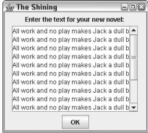

**图 3-2：** 使用文本区域的窗口。

创建文本区域并不像听起来那么难。以下是我用于创建图 3-2 中所示文本区域的代码，随后将其添加到了面板中：

```
textNovel = new JTextArea(10, 20);
JScrollPane scroll = new JScrollPane(textNovel,
    JScrollPane.VERTICAL_SCROLLBAR_ALWAYS,
    JScrollPane.HORIZONTAL_SCROLLBAR_NEVER);
panel1.add(scroll);
```

这里，第一条语句创建了一个文本区域，指定其初始大小为 10 行 20 列。然后，第二条语句创建了一个滚动窗格。请注意，文本区域对象作为参数传递给了`JScrollPane`的构造函数，同时还有常量，用于指示滚动窗格是否应包含垂直或水平滚动条（或两者都有）。最后，第三条语句将滚动窗格添加到名为`panel1`的面板中。

以下各节将更详细地描述`JTextArea`和`JScrollPane`类的构造函数和方法。

## JTextArea 类

表 3-3 列出了`JTextArea`类最常用的构造函数和方法，你使用它们来创建文本区域。在大多数情况下，你使用第二个构造函数，它可以设置要显示的行数和列数。`rows`参数控制文本区域的高度，而`cols`参数设置宽度。

| 构造函数 | 说明 |
| :--- | :--- |
| `JTextArea()` | 创建一个新的文本区域。 |
| `JTextArea(int rows, int cols)` | 创建一个足以显示指定行数和列数的新文本区域。 |
| `JTextArea(String text, int rows, int cols)` | 创建一个带有指定初始文本值的新文本区域，大小足以显示指定的行数和列数。 |

| 方法 | 说明 |
| :--- | :--- |
| `void append(String text)` | 将指定文本添加到文本区域文本值的末尾。 |
| `int getLineCount()` | 获取文本值中当前的行数。 |
| `String getText()` | 获取输入到字段中的文本值。 |
| `void insert(String str, int pos)` | 在指定位置插入指定文本。 |
| `void requestFocus()` | 请求将焦点移到此文本字段。 |
| `void replaceRange(String str, int start, int end)` | 用新指定的文本替换由起始和结束位置指示的文本。 |
| `void setColumns(int cols)` | 设置文本区域的宽度。（最好在构造函数中执行此操作。） |
| `void setEditable(boolean value)` | 如果为 false，则使字段变为只读。 |
| `void setLineWrap(boolean value)` | 如果为 true，则文本在一行显示不下时自动换行。 |
| `void setText(String text)` | 设置字段的文本值。 |
| `void setToolTipText(String text)` | 设置提示文本，当用户将鼠标悬停在文本字段上几秒钟时显示。 |
| `void setWrapStyleWord()` | 如果为 true，则文本在单词边界处换行。 |

要检索用户在文本区域中输入的文本，你可以使用`getText`方法。例如，以下是一个动作监听器中的`actionPerformed`方法，它从文本区域中检索文本：

```
public void actionPerformed(ActionEvent e)
{
    if (e.getSource() == buttonOK)
    {
        String text = textNovel.getText();
        if (text.contains("All work and no play"))
            JOptionPane.showMessageDialog(textNovel,
                "Can't you see I'm working?",
                "Going Crazy",
                JOptionPane.ERROR_MESSAGE);
    }
}
```

这里，如果文本包含字符串`All work and no play`，则会显示一个消息框。

请注意，除了`getText`方法外，`JTextArea`类还有允许你将文本添加到文本区域当前值末尾（`append`）、在值中间插入文本（`insert`）以及替换文本（`replace`）的方法。你可以使用这些方法来编辑文本区域的值。

> 提示：有两个`JTextArea`方法用于控制超出文本区域宽度的行的处理方式。如果你用值`true`调用`setLineWrap`，过长的行会自动换到下一行。而如果你用值`true`调用`setWrapStyleWord`，任何换行的行都会在单词之间断开，而不是在单词中间断开。通常你会同时使用这两个方法：

```
textItinerary = new JTextArea(10, 20);
textItinerary.setLineWrap(true);
textItinerary.setWrapStyleWord(true);
```

## JScrollPane 类

没有滚动条，文本区域的用途就不大。要创建带有滚动条的文本区域，你需要使用`JScrollPane`类，其构造函数和字段列在表 3-4 中。请注意，此表没有显示`JScrollPane`类的任何方法。`JScrollPane`类确实有方法（实际上有很多）。但对于普通编程来说，它们都不是特别有用，所以我没有在表中包含任何方法。

### 表 3-4 基本的 JScrollPane 构造函数和字段

| 构造函数 | 说明 |
|---|---|
| `JScrollPane(Component view)` | 为指定的组件创建滚动窗格。 |
| `JScrollPane(Component, int vert, int hor)` | 为指定的组件创建滚动窗格，并指定垂直和水平滚动条的策略。 |

| 字段 | 说明 |
|---|---|
| `VERTICAL_SCROLLBAR_ALWAYS` | 始终添加垂直滚动条。 |
| `VERTICAL_SCROLLBAR_AS_NEEDED` | 必要时添加垂直滚动条。 |
| `VERTICAL_SCROLLBAR_NEVER` | 从不添加垂直滚动条。 |
| `HORIZONTAL_SCROLLBAR_ALWAYS` | 始终添加水平滚动条。 |
| `HORIZONTAL_SCROLLBAR_AS_NEEDED` | 必要时添加水平滚动条。 |
| `HORIZONTAL_SCROLLBAR_NEVER` | 从不添加水平滚动条。 |

创建滚动窗格的常用方法是使用第二个构造函数。你用此构造函数的第一个参数指定要添加滚动条的组件。例如，要为`textNovel`文本区域添加滚动条，你需要将`textNovel`指定为第一个参数。

第二个参数告诉滚动窗格是否创建垂直滚动条。为此参数指定的值应为表 3-4 中列出的前三个字段之一。如果你希望滚动窗格始终显示垂直滚动条，请指定`VERTICAL_SCROLLBAR_ALWAYS`。如果你希望仅在文本区域包含的行数超过一次可显示的数量时才显示垂直滚动条，请指定`VERTICAL_SCROLLBAR_AS_NEEDED`。这样，垂直滚动条仅在需要时才会显示。最后，如果你从不希望看到垂直滚动条，请指定`VERTICAL_SCROLLBAR_NEVER`。

第三个参数使用三个`HORIZONTAL_SCROLLBAR`常量来指示滚动窗格始终、从不或仅在需要时包含水平滚动条。

因此，以下代码为文本区域添加了滚动条。垂直滚动条始终显示，但水平滚动条仅在需要时显示：

```
JScrollPane scroll = new JScrollPane(textNovel,
    JScrollPane.VERTICAL_SCROLLBAR_ALWAYS,
    JScrollPane.HORIZONTAL_SCROLLBAR_AS_NEEDED);
```

> 提示：除了文本区域外，还可以将`JScrollPane`类与其他类型的组件一起使用。正如你在下一章中看到的，滚动窗格也经常与列表控件一起使用。

## 使用复选框

*复选框*是一种用户可以单击以选中或取消选中的控件。复选框通常用于让用户对某个选项指定是或否。图 3-3 显示了一个带有三个复选框的窗口。

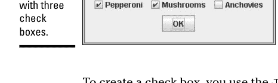

要创建复选框，你需要使用`JCheckBox`类。其常用的构造函数和方法如表 3-5 所示。


## 表 3-5 重要的 JCheckBox 构造方法和方法

| 构造方法 / 方法 | 说明 |
| --- | --- |
| `JCheckBox()` | 创建一个新的复选框，初始状态为未选中。 |
| `JCheckBox(String text)` | 创建一个新的复选框，显示指定的文本。 |
| `JCheckBox(String text, boolean selected)` | 创建一个新的复选框，带有指定的文本。布尔参数决定复选框初始状态为选中（`true`）还是未选中（`false`）。 |
| **方法** | **说明** |
| `void addActionListener(ActionListener listener)` | 添加一个 `ActionListener` 来监听动作事件。 |
| `void addItemListener(ItemListener listener)` | 添加一个 `ItemListener` 来监听选项事件。 |
| `String getText()` | 获取复选框显示的文本。 |
| `Boolean isSelected()` | 如果复选框被选中则返回 `true`，未被选中则返回 `false`。 |
| `void setSelected(boolean value)` | 如果参数为 `true` 则选中复选框；如果参数为 `false` 则取消选中。 |
| `void setText(String text)` | 设置复选框的文本。 |
| `void setToolTipText(String text)` | 设置提示文本，当用户将鼠标悬停在复选框上一段时间时显示。 |

与任何 Swing 组件一样，如果你想在框架类构造方法以及监听器中引用该组件，就必须声明类变量来引用复选框组件，如下所示：

```
JCheckBox pepperoni, mushrooms, anchovies;
```

然后，你可以在框架构造方法中使用如下语句来创建复选框并将它们添加到面板中（在本例中为 `panel1`）：

```
pepperoni = new JCheckBox("Pepperoni");
panel1.add(pepperoni);

mushrooms = new JCheckBox("Mushrooms");
panel1.add(mushrooms);

anchovies = new JCheckBox("Anchovies");
panel1.add(anchovies);
```

## 使用复选框

注意，我没有在构造方法中指定这些复选框的初始状态。因此，它们初始状态为未选中。如果你想创建一个初始状态为选中的复选框，可以像这样调用构造方法：

```
pepperoni = new JCheckBox("Pepperoni", true);
```

在事件监听器中，你可以使用 `isSelected` 方法来测试复选框的状态，也可以通过调用其 `setSelected` 方法来设置复选框的状态。例如，以下是一个 `actionPerformed` 方法，当用户点击 OK 按钮时，它会显示一个消息框并取消选中所有三个复选框：

```
public void actionPerformed(ActionEvent e)
{
    if (e.getSource() == buttonOK)
    {
        String msg = "";
        if (pepperoni.isSelected())
            msg += "Pepperoni\n";
        if (mushrooms.isSelected())
            msg += "Mushrooms\n";
        if (anchovies.isSelected())
            msg += "Anchovies\n";
        if (msg.equals(""))
            msg = "You didn't order any toppings.";
        else
            msg = "You ordered these toppings:\n" + msg;
        JOptionPane.showMessageDialog(buttonOK,
            msg, "Your Order",
            JOptionPane.INFORMATION_MESSAGE);
        pepperoni.setSelected(false);
        mushrooms.setSelected(false);
        anchovies.setSelected(false);
    }
}
```

在这里，用户选择的每个配料名称都会被添加到一个文本字符串中。例如，如果你选择了 Pepperoni 和 Anchovies，将显示以下消息：

> You ordered these toppings:
Pepperoni
Anchovies

如果你愿意，可以为复选框添加事件监听器，以响应用户点击复选框时生成的事件。复选框支持动作监听器和选项监听器。它们之间的区别很微妙：

- 每当用户点击复选框以改变其状态时，就会生成一个动作事件。
- 每当复选框的状态发生变化时，就会生成一个选项事件，无论是由于用户点击还是因为程序调用了 `setSelected` 方法。

假设你的餐厅菜单上有凤尾鱼，但你拒绝制作带有凤尾鱼的披萨。以下是一个来自动作监听器的 `actionPerformed` 方法，如果用户尝试选中 Anchovies 复选框，它会显示一条消息并取消选中该复选框：

```
public void actionPerformed(ActionEvent e)
{
    if (e.getSource() == anchovies)
    {
        JOptionPane.showMessageDialog(anchovies,
            "We don't do anchovies here.",
            "Yuck!",
            JOptionPane.WARNING_MESSAGE);
        anchovies.setSelected(false);
    }
}
```

> **提示** 只有当你需要在用户选中或取消选中复选框时立即向用户提供反馈时，才为复选框添加监听器。在大多数应用程序中，你会等到用户点击按钮后再检查框架上任何复选框的状态。

## 使用单选按钮

单选按钮与复选框类似，但有一个关键区别：单选按钮以组为单位，用户每组一次只能选择一个单选按钮。当你点击一个单选按钮选中它时，之前选中的任何单选按钮都会自动取消选中。图 3-4 显示了一个带有三个单选按钮的框架。

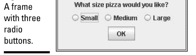

要使用单选按钮，你需要使用两个类。首先，使用 `JRadioButton` 类创建单选按钮本身，其构造方法和方法如表 3-6 所示。然后，使用 `ButtonGroup` 类为按钮创建一个组。你必须将单选按钮本身添加到面板中以便显示，并添加到按钮组中以便与其他按钮正确分组。

### 表 3-6 各种 JRadioButton 构造方法和方法

| 构造方法 / 方法 | 说明 |
| :--- | :--- |
| `JRadioButton()` | 创建一个没有文本的新单选按钮。 |
| `JRadioButton(String text)` | 创建一个带有指定文本的新单选按钮。 |
| **方法** | **说明** |
| `void addActionListener(ActionListener listener)` | 添加一个 `ActionListener` 来监听动作事件。 |
| `void addItemListener(ItemListener listener)` | 添加一个 `ItemListener` 来监听选项事件。 |
| `String getText()` | 获取单选按钮显示的文本。 |
| `Boolean isSelected()` | 如果单选按钮被选中则返回 `true`，未被选中则返回 `false`。 |
| `void setSelected(boolean value)` | 如果参数为 `true` 则选中该单选按钮。 |
| `void setText(String text)` | 设置单选按钮的文本。 |
| `void setToolTipText(String text)` | 设置提示文本，当用户将鼠标悬停在单选按钮上一段时间时显示。 |

创建单选按钮的通常方式是声明一个变量作为类变量来引用该按钮，以便可以在类的任何地方访问它。例如：

```
JRadioButton small, medium, large;
```

然后，在框架构造方法中，调用 `JRadioButton` 构造方法来创建单选按钮：

```
small = new JRadioButton("Small");
```

然后，你可以用通常的方式将单选按钮添加到面板中。

要创建一个按钮组来将协同工作的单选按钮分组，只需调用 `ButtonGroup` 类的构造方法：

```
ButtonGroup group1 = new ButtonGroup();
```

然后，调用 `ButtonGroup` 的 add 方法将每个单选按钮添加到该组中：

```
group1.add(small);
group1.add(medium);
group1.add(large);
```

请注意，按钮组与单选按钮在框架上的显示方式无关。按钮可以出现在框架的任何位置，甚至在不同的面板中。（我将在下一节"使用边框"中向你展示如何通过使用边框来直观地分组单选按钮和其他组件。）

当你在一个表单上有不止一组单选按钮时，按钮组才真正派上用场。例如，假设除了选择披萨的尺寸外，用户还可以选择饼底的样式——薄底或厚底。在这种情况下，你总共需要使用五个单选按钮和两个按钮组。创建这些单选按钮的构造方法代码可能如下所示：

```
ButtonGroup size = new ButtonGroup();
ButtonGroup crust = new ButtonGroup();

small = new JRadioButton("Small");
medium = new JRadioButton("Medium");
large = new JRadioButton("Large");
size.add(small);
size.add(medium);
size.add(large);

thin = new JRadioButton("Thin Crust");
thick = new JRadioButton("Thick Crust");
crust.add(thin);
crust.add(thick);
```

（为了保持这个示例简单，我省略了将单选按钮添加到面板的语句。）

严格来说，如果框架上所有的单选按钮都在同一组中，你不必创建按钮组。在这种情况下，Swing 会创建一个默认组并将所有单选按钮添加到其中。然而，因为这只需要多写几行代码，我建议即使只有一组单选按钮，你也应该始终创建一个按钮组。

## 使用边框

*边框*是一种装饰性元素，通过围绕组件绘制线条来直观地分组组件。图 3-5 显示了一个框架，其中一些单选按钮和复选框被放置在边框内。


## 使用边框

你可以为任何继承自 JComponent 的对象应用边框，但通常的技术是将边框应用于面板，然后将希望出现在边框内的任何组件添加到面板中。要创建边框，你需要调用表 3-7 中列出的静态方法之一。这些方法中的每一个都会创建具有略有不同视觉样式的边框。然后，你通过调用面板的 `setBorder` 方法将 `Border` 对象应用于面板。

> 提示：`BorderFactory` 类位于 `javax.swing` 包中，但定义生成边框对象的 `Border` 接口位于 `javax.swing.border`。因此，如果你计划使用边框，除了导入 `javax.swing.*` 之外，还需要在类的开头包含以下导入语句：

```
import javax.swing.border.*;
```

### 表 3-7 用于创建边框的 BorderFactory 方法

| 方法 | 描述 |
|---|---|
| Border createBevelBorder(int type) | 创建指定类型的斜面边框。type 参数可以是 `BevelBorder.LOWERED` 或 `BevelBorder.RAISED`。 |
| Border createEmptyBorder(int top, int left, int bottom, int right) | 创建一个占据参数指示空间的空白边框。 |
| Border createEtchedBorder() | 创建蚀刻边框。 |
| Border createLineBorder() | 创建线条边框。 |
| Border createLoweredBevelBorder() | 创建凹陷的斜面边框。 |
| Border createRaisedBevelBorder() | 创建凸起的斜面边框。 |
| Border createTitledBorder(String title) | 创建带标题的蚀刻边框。 |
| Border createTitledBorder(Border b, String title) | 根据指定的边框创建带标题的边框。 |

## 工厂模式

`BorderFactory` 类是一个非常常见的设计模式示例，称为 *工厂模式*。简而言之，当你使用工厂模式时，你不会使用构造函数来创建对象。相反，你使用一个拥有 *工厂方法* 的 *工厂类*，由这些方法为你创建对象。

工厂模式的一个好处是，工厂类的用户不需要知道实际创建的是哪种类型的对象。例如，Swing 实际上为边框定义了几个不同的类，所有这些类都实现了 `Border` 接口。如果你必须使用构造函数来创建边框对象，你必须了解所有边框类。通过创建一个返回 `Border` 对象的 `BorderFactory` 类，你只需了解 `BorderFactory` 类及其方法即可。

Java API 的设计者本可以创建一个 `Border` 类（而不是接口），让你通过传递给构造函数的参数来指定要创建的边框类型。然而，这种方法存在许多问题。首先，`Border` 类会很复杂，因为它必须实现每种类型的边框。但更重要的是，以后添加新类型的边框很困难。使用工厂模式，你可以通过 (1) 为新边框创建一个实现 `Border` 接口的类，以及 (2) 向 `BorderFactory` 类添加一个方法来创建新边框类型，从而轻松地创建新的边框类型。

表 3-7 中列出的所有方法都是静态方法。因此，你不必创建 `BorderFactory` 类的实例就可以调用这些方法。

例如，下面是一段创建面板、创建带标题的边框并将边框应用于面板的代码片段：

```
JPanel sizePanel = new JPanel();
Border b1 = BorderFactory.createTitledBorder("Size");
sizePanel.setBorder(b1);
```

然后，你添加到 `sizePanel` 的任何组件都将显示在此边框内。

表 3-7 中列出的最后一个方法需要稍作解释。它只是为通过 `BorderFactory` 类的任何其他创建方法创建的边框添加一个标题。例如，你可以这样创建一个带有标题 Options 的凸起斜面边框：

```
Border b = BorderFactory.createRaisedBevelBorder();
b = BorderFactory.createTitledBorder(b, "Options");
```

## 设计披萨订购程序

为了让你了解边框如何与单选按钮和复选框协同工作，清单 3-2 提供了创建图 3-5 所示框架的完整程序代码。当用户单击 OK 按钮时，此程序显示一个消息框，总结用户的订单。例如，如果用户订购了带有意大利香肠和蘑菇的中号披萨，则会显示以下消息：

You ordered a medium pizza with the following toppings: Pepperoni Mushrooms

如果你订购的披萨没有配料，消息大致如下：

You ordered a medium pizza with no toppings.

### 清单 3-2：披萨订购程序

```
import javax.swing.*;
import java.awt.event.*;
import javax.swing.border.*;

public class Pizza extends JFrame
{
    public static void main(String [] args)
    {
        new Pizza();
    }

    private JButton buttonOK;
    private JRadioButton small, medium, large;
    private JCheckBox pepperoni, mushrooms, anchovies;

    public Pizza()
    {
        this.setSize(320,200);
        this.setTitle("Order Your Pizza");
        this.setDefaultCloseOperation(JFrame.EXIT_ON_CLOSE);

        ButtonListener bl = new ButtonListener();

        JPanel mainPanel = new JPanel();

        JPanel sizePanel = new JPanel();
        Border b1 =
            BorderFactory.createTitledBorder("Size");
        sizePanel.setBorder(b1);

        ButtonGroup sizeGroup = new ButtonGroup();

        small = new JRadioButton("Small");
        small.setSelected(true);
        sizePanel.add(small);
        sizeGroup.add(small);

        medium = new JRadioButton("Medium");
        sizePanel.add(medium);
        sizeGroup.add(medium);

        large = new JRadioButton("Large");
        sizePanel.add(large);
        sizeGroup.add(large);

        mainPanel.add(sizePanel);

        JPanel topPanel = new JPanel();
        Border b2 =
            BorderFactory.createTitledBorder("Toppings");
        topPanel.setBorder(b2);

        pepperoni = new JCheckBox("Pepperoni");
        topPanel.add(pepperoni);

        mushrooms = new JCheckBox("Mushrooms");
        topPanel.add(mushrooms);

        anchovies = new JCheckBox("Anchovies");
        topPanel.add(anchovies);

        mainPanel.add(topPanel);

        buttonOK = new JButton("OK");
        buttonOK.addActionListener(bl);
        mainPanel.add(buttonOK);

        this.add(mainPanel);

        this.setVisible(true);
    }

    private class ButtonListener implements ActionListener
    {
        public void actionPerformed(ActionEvent e)
        {
            if (e.getSource() == buttonOK)
            {
                String tops = "";
                if (pepperoni.isSelected())
                    tops += "Pepperoni\n";
                if (mushrooms.isSelected())
                    tops += "Mushrooms\n";
                if (anchovies.isSelected())
                    tops += "Anchovies\n";

                String msg = "You ordered a ";
                if (small.isSelected())
                    msg += "small pizza with ";
                if (medium.isSelected())
                    msg += "medium pizza with ";
                if (large.isSelected())
                    msg += "large pizza with ";

                if (tops.equals(""))
                    msg += "no toppings.";
                else
                    msg += "the following toppings:\n"
                        + tops;
                JOptionPane.showMessageDialog(
                    buttonOK, msg, "Your Order",
                    JOptionPane.INFORMATION_MESSAGE);

                pepperoni.setSelected(false);
                mushrooms.setSelected(false);
                anchovies.setSelected(false);
                small.setSelected(true);
            }
        }
    }
}
```

我在本章（或前面的章节）中涵盖了此程序中的所有内容，因此这里只强调重点：

- **12** 添加到框架的组件被声明为类变量，这样构造函数和动作事件监听器的 `actionPerformed` 方法都可以访问它们。
- **24** 此行创建了 `mainPanel`，这是程序使用的三个面板中的第一个。该面板包含另外两个面板，它们使用边框来直观地分组其组件。
- **26** 此行创建了 `sizePanel`，用于容纳允许用户选择披萨尺寸的单选按钮的面板。
- **27** `BorderFactory` 类用于创建一个标题为 Size 的带标题边框。
- **29** 带标题的边框附加到尺寸面板。
- **31** 为单选按钮创建一个按钮组。
- **33** 创建了 Small 单选按钮。注意调用了此按钮的 `setSelected` 方法。因此，Small 是披萨订单的默认尺寸。还要注意，该单选按钮同时添加到了 `sizePanel` 面板和 `size` 按钮组。
- **38** 创建了 Medium 单选按钮，并将其添加到面板和按钮组。
- **42** 创建了 Large 单选按钮，并将其添加到面板和按钮组。


## 使用滑块

如图3-6所示，滑块是一种组件，允许用户通过移动旋钮从一个设定的范围（例如从0到50）中选取值。当输入值落在一个固定范围内时，滑块是一种方便的获取用户数值输入的方式。

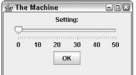

要创建滑块控件，你需要使用 `JSlider` 类。表3-8列出了它的构造方法和方法。

| **表3-8** | **JSlider 常用构造方法和方法** |
|---|---|
| **构造方法** | **描述** |
| `JSlider()` | 创建一个新的滑块。最小值和最大值默认分别为0和100，初始值设置为50。 |
| `JSlider(int min, int max)` | 创建一个具有指定最小值和最大值的新滑块。初始值位于最小值和最大值的中间。 |
| `JSlider(int min, int max, int value)` | 创建一个具有指定最小值、最大值和初始值的新滑块。 |
| `JSlider(int orientation, int min, int max, int value)` | 创建一个具有指定最小值、最大值和初始值的新滑块。方向可以是 `JSlider.HORIZONTAL` 或 `JSlider.VERTICAL`。 |
| **方法** | **描述** |
| `void addChangeListener(ChangeListener listener)` | 添加一个 `ChangeListener` 来监听变更事件。 |
| `int getValue()` | 获取旋钮当前位置所指示的值。 |
| `void setInvert(boolean value)` | 如果为 `true`，则反转滑块的方向，使最大值在左侧，最小值在右侧。 |
| `void setMajorTickSpacing(int value)` | 设置主刻度标记的间隔。除非调用 `setPaintTicks(true)`，否则刻度标记不会显示。 |
| `void setMinimum(int value)` | 设置最小值。 |
| `void setMaximum(int value)` | 设置最大值。 |
| `void setMinorTickSpacing(int value)` | 设置次刻度标记的间隔。除非调用 `setPaintTicks(true)`，否则刻度标记不会显示。 |
| `setOrientation(int orientation)` | 设置方向。允许的值为 `JSlider.HORIZONTAL` 和 `JSlider.VERTICAL`。 |
| `void setPaintLabels(boolean value)` | 如果为 `true`，则显示刻度标签。 |
| `void setSnapToTicks(boolean value)` | 如果为 `true`，则 `getValue` 方法返回的值会四舍五入到最近的刻度标记。 |
| `void setToolTipText(String text)` | 设置工具提示文本，当用户将鼠标悬停在滑块上片刻后会显示该文本。 |

要创建一个最简单的滑块，只需调用 `JSlider` 构造方法即可。你可以像这样创建一个范围从0到100的滑块：

```
slider = new JSlider();
```

此处，`slider` 变量被声明为 `JSlider` 类型的类变量。

如果你想指定最小值和最大值，请使用此构造方法：

```
slider = new JSlider(0, 50);
```

此处，滑块允许用户从0到50之间选择一个值。旋钮的初始位置为25，位于最小值和最大值的中间。

要设置不同的初始值，请使用此构造方法：

```
slider = new JSlider(0, 0, 50);
```

此处，滑块范围从0到50，初始值为0。

你通常希望至少为滑块添加一些修饰以使其更实用。图3-6所示的滑块带有可见的最小和最大刻度标记及标签。以下是用于创建它的代码：

```
slider = new JSlider(0, 50, 0);
slider.setMajorTickSpacing(10);
slider.setMinorTickSpacing(1);
slider.setPaintTicks(true);
slider.setPaintLabels(true);
panel1.add(slider);
```

> **注意：** 即使你设置了主刻度和次刻度的间隔值，除非你调用 `setPaintTicks` 并将参数设置为 `true`，否则刻度标记不会显示。`setPaintLabels` 方法会连同刻度标记一起显示标签。而 `setSnapToTicks` 方法会将值四舍五入到最近的刻度标记。

要获取滑块的值，你需要使用 `getValue` 方法。例如，以下是附加在图3-6中确定按钮上的动作监听器的 `actionPerformed` 方法：

```
public void actionPerformed(ActionEvent e)
{
    if (e.getSource() == buttonOK)
    {
        int level = slider.getValue();
        JOptionPane.showMessageDialog(slider,
            "Remember, this is for posterity.\n"
            + "Tell me...how do you feel?",
            "Level " + level,
            JOptionPane.INFORMATION_MESSAGE);
    }
}
```

此处，当用户点击确定按钮时会显示一个消息框。`slider` 组件的当前设置被获取并存储在一个名为 `level` 的 `int` 变量中，然后用它来创建消息框的标题。

你还可以添加一个事件监听器，当用户改变滑块的值时进行响应。为此，你需要使用 `addChangeListener` 方法。参数必须是一个实现了 `ChangeListener` 接口的对象，该接口定义了一个名为 `stateChanged` 的方法。以下是可用于响应滑块变化的类的示例：

```
private class SliderListener implements ChangeListener
{
    public void stateChanged(ChangeEvent e)
    {
        if (slider.getValue() == 50)
        {
            JOptionPane.showMessageDialog(slider,
                "No! Not 50!",
                "The Machine",
                JOptionPane.WARNING_MESSAGE);
        }
    }
}
```

要将此类的实例连接到滑块，请使用此方法：

```
slider.addChangeListener(new SliderListener());
```

之后，每当用户将旋钮移动到另一个位置时，`stateChanged` 方法就会被调用。它会检查滑块的值，并在用户将滑块一路调到50时显示一个消息框。

## 第4章：从列表中选择

### 本章内容

- 组合框
- 列表
- 微调器
- 树

一整类 Swing 组件旨在让用户从列表中选择一个或多个项目。本章介绍四种这样的控件。前三种——JList、JComboBox 和 JSpinner——比较直观。第四种——JTree——稍微复杂一些，但值得花时间学习。

如果你在框架上放置一个 JTree 控件，你的朋友一定会认为你是某种高手。他们会开始向你提出各种问题并寻求你的帮助。因此，只有当你的应用程序确实需要时才使用这个组件——并且你觉得自己有能力应对弄清其工作原理的技术挑战。

### 使用组合框

组合框是文本框和下拉列表的组合，用户可以从中选择一个值。如果控件的文本框部分是可编辑的，用户可以在字段中输入一个值或编辑从下拉列表中检索到的值。然而，将文本框设为不可编辑是很常见的做法。这样，用户必须从列表中选择一个值。图4-1显示了一个带有简单组合框的框架。

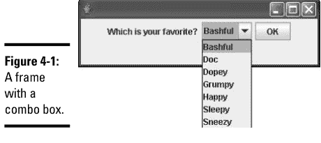


## 564 使用组合框

你可以使用 `JComboBox` 类来创建组合框。表 4-1 列出了该类最常用的构造函数和方法。

**表 4-1：常见的 JComboBox 构造函数和方法**

| 构造函数/方法 | 描述 |
|---|---|
| `JComboBox()` | 创建一个空的组合框。 |
| `JComboBox(Object[] items)` | 创建一个组合框，并用数组中的值填充它。 |
| `JComboBox(Vector[] items)` | 创建一个组合框，并用向量中的值填充它。 |
| `void addActionListener(ActionListener listener)` | 为组合框添加一个动作监听器。 |
| `void addItem(Object item)` | 向组合框中添加一个条目。 |
| `void addItemListener(ItemListener listener)` | 为组合框添加一个条目监听器。 |
| `Object getItemAt(int index)` | 返回指定索引处的条目。 |
| `int getItemCount()` | 返回组合框中条目的数量。 |
| `int getSelectedIndex()` | 返回所选条目的索引。 |
| `Object getSelectedItem()` | 返回所选条目。 |
| `void insertItemAt(Object item, int index)` | 在指定索引处插入一个条目。 |
| `Boolean isEditable()` | 指示组合框的文本字段是否可编辑。 |
| `void removeAllItems()` | 移除组合框中的所有条目。 |
| `void removeItem(Object item)` | 移除指定的条目。 |
| `void removeItemAt(int index)` | 移除指定索引处的条目。 |
| `void setEditable(boolean value)` | 指定组合框的文本字段是否可编辑。 |
| `void setMaximumRowCount(int count)` | 设置组合框列表下拉时显示的行数。 |
| `void setSelectedIndex(int index)` | 选择指定索引处的条目。如果索引小于零或大于组合框中条目的数量，则抛出 `IllegalArgumentException`。 |
| `void setSelectedItem(Object item)` | 选择指定的条目。如果该条目不在组合框中，则抛出 `IllegalArgumentException`。 |

## 创建组合框

创建组合框很简单。你有三个构造函数可供选择。第一个创建一个空的组合框：

```
JComboBox combo1 = new JComboBox();
```

然后，你可以使用 `addItem` 向组合框中添加条目：

```
combo1.addItem("Bashful");
combo1.addItem("Doc");
combo1.addItem("Dopey");
combo1.addItem("Grumpy");
combo1.addItem("Happy");
combo1.addItem("Sleepy");
combo1.addItem("Sneezy");
```

或者，你可以创建一个组合框，并从数组初始化其内容。例如：

```
String[] theSeven = {"Bashful", "Doc", "Dopey", "Grumpy",
                  "Happy", "Sleepy", "Sneezy"};
JComboBox combo1 = new JComboBox(theSeven);
```

或者，如果你有一个现有的 `Vector` 对象，其中包含要显示的数据：

```
JComboBox combo1 = new JComboBox(vector1);
```

如果要显示的数据位于数组列表或其他类型的集合中，请使用 `toArray` 方法将集合转换为数组，然后将该数组传递给 `JComboBox` 构造函数：

```
JComboBox combo1 = new JComboBox(arraylist1.toArray());
```

你可以向组合框中添加任何类型的对象。组合框会调用每个条目的 `toString` 方法来确定在下拉列表中显示的文本。例如，假设你有一个 `Employee` 对象数组。如果你从这个数组创建一个组合框，则每个员工的 `toString` 方法返回的字符串将显示在组合框中。

默认情况下，用户不允许编辑组合框文本字段部分中的数据。如果你想允许用户编辑文本字段，请调用 `setEditable(true)`。然后，用户可以输入一个不在组合框中的值。

要从组合框中移除条目，请使用其中一个 `remove` 方法。如果你知道要移除的条目的索引位置，请调用 `removeItemAt` 方法并将索引号作为参数传递。否则，如果你拥有要移除的对象，请调用 `removeItem` 并传递该对象。

要移除组合框中的所有条目，请调用 `removeAllItems`。例如，假设你有一个名为 `custCombo` 的组合框，其中填充了从文件读取的 `Customer` 对象，并且你需要定期刷新此组合框以确保它包含所有当前客户。以下是一个执行此操作的方法：

```
private void fillCustomerCombo()
{
    ArrayList<Customer> customers = getCustomers();
    custCombo.removeAllItems();
    for (Customer c : customers)
        custCombo.addItem(c);
}
```

在此示例中，调用了一个名为 `getCustomers` 的方法来从文件中获取 `Customer` 对象的 `ArrayList`。然后，删除组合框中当前的所有条目，并使用增强型 `for` 循环将客户添加到组合框中。

## 从组合框中获取条目

要获取用户选择的条目，请使用 `getSelectedItem` 方法。不幸的是，此方法返回 `Object` 类型，因此在使用之前必须将返回的值转换为适当的类型。例如，以下是创建图 4-1 所示组合框框架的程序的事件监听器的 `actionPerformed` 方法：

```
public void actionPerformed(ActionEvent e)
{
    if (e.getSource() == buttonOK)
    {
        String s = (String)combo1.getSelectedItem();
        JOptionPane.showMessageDialog(combo1,
            "You picked " + s,
            "Your Favorite",
            JOptionPane.INFORMATION_MESSAGE);
    }
}
```

这里，`getSelectedItem` 方法检索所选条目，将其转换为 `String`，并将其保存在名为 `s` 的 `String` 变量中。然后，显示一个 `JOptionPane` 消息框来展示用户的选择。

如果你愿意，可以通过调用 `getSelectedIndex` 方法来获取所选条目的索引。如果组合框包含与存储在数组或集合中的对象相对应的字符串值，你可能会使用此方法。然后，你可以使用检索到的索引值从集合中获取实际的对象。

## 处理组合框事件

当用户从组合框中选择一个条目时，会生成一个动作事件。在大多数应用程序中，你只需忽略此事件。这是因为当用户选择一个条目时，你通常不需要立即执行任何操作。相反，当用户单击按钮时，才会处理所选条目。

如果你想在用户选择条目时提供即时反馈，你可以用通常的方式处理动作事件：创建一个 `ActionListener`，在 `actionPerformed` 方法中处理该事件，然后调用组合框的 `addActionListener` 方法来添加动作监听器。以下动作监听器类在用户选择 Dopey 时显示一个消息框，显示*也是我的最爱！*：

```
private class ComboListener implements ActionListener
{
    public void actionPerformed(ActionEvent e)
    {
        if (e.getSource() == combo1)
        {
            String s =
(String)combo1.getSelectedItem();
            if (s.equals("Dopey"))
                JOptionPane.showMessageDialog(combo1,
                        "He's my favorite too!",
                        "Good Choice",
                        JOptionPane.INFORMATION_MESSAGE);
        }
    }
}
```


当用户选择一个条目时，组合框也会生成条目事件。实际上，当用户选择一个条目时，组合框会生成*两个*条目事件，这可能会让人有点困惑。第一个事件是在先前选择的条目被取消选择时生成的。然后，当新条目被选择时，会生成另一个条目事件。在大多数情况下，你处理的是组合框动作事件而不是条目事件。

## 使用列表

*列表*是一个功能强大的 Swing 组件，它在框内显示对象列表。根据列表的配置方式，可以允许用户从列表中选择一个条目或多个列表条目。此外，你还可以对列表中条目的显示方式拥有惊人的控制，尽管这并不总是一个优势。列表几乎总是与滚动窗格（在上一章中介绍）一起使用，以允许用户滚动列表的内容。图 4-2 展示了一个带有列表组件的示例框架。


列表框和组合框有几个重要区别：

-   列表框没有可供用户编辑所选项目的文本框。相反，用户必须直接从列表中选择项目。
-   列表框不会下拉展开。相反，列表项会显示在一个你可以指定大小的框中。
-   列表框不提供滚动条，因此你几乎总是需要将列表组件添加到滚动窗格中，以便用户可以滚动浏览列表。
-   列表框允许你选择多个项目。默认情况下，列表组件允许你选择列表中项目的任意组合。但是，你可以配置列表以允许选择单个连续范围的值或仅单个值。
-   创建列表后，你不能直接更改列表中的值。如果你想创建一个可以更改值的列表，你必须采取一些额外步骤，正如我将在本章后面的“更改列表项”一节中描述的那样。

> 提示

要在列表中选择多个项目，请按住 Ctrl 键并单击要选择的项目。要选择一系列项目，请单击第一个项目，然后按住 Shift 键并单击最后一个项目。

你使用 `JList` 类来创建组合框。表 4-2 列出了该类最常用的构造方法和方法。

| 表 4-2 常用 JList 构造方法和方法 | |
|---|---|
| **构造方法** | **描述** |
| `JList()` | 创建一个空列表。 |
| `JList(ListModel list)` | 创建一个使用指定列表模型的列表。 |
| `JList(Object[] items)` | 创建一个列表并用数组中的值填充它。 |
| `JList(Vector[] items)` | 创建一个列表并用向量中的值填充它。 |
| `void clearSelection()` | 清除所有选择。 |

## 创建列表

要创建列表并指定其项目，你将一个数组传递给 `JList` 构造方法。然后，你调用 `setVisibleRowCount` 方法来设置你希望可见的行数，将列表添加到滚动窗格，再将滚动窗格添加到你可以稍后添加到框架的面板中。例如

```
String[] toppings = {"Pepperoni", "Sausage",
    "Linguica",
                    "Canadian Bacon", "Salami",
    "Tuna",
                    "Olives", "Mushrooms", "Tomatoes",
                    "Pineapple", "Kiwi", "Gummy
    Worms"};
list1 = new JList(toppings);
list1.setVisibleRowCount(5);
JScrollPane scroll = new JScrollPane(list1);
```

| 方法 | 描述 |
| --- | --- |
| `int getSelectedIndex()` | 返回第一个选中项目的索引，如果没有项目被选中，则返回 `-1`。 |
| `int[] getSelectedIndexes()` | 返回一个包含每个选中项目索引的数组。如果没有项目被选中，则数组为空。 |
| `Object getSelectedValue()` | 返回第一个选中的项目，如果没有项目被选中，则返回 `null`。 |
| `Object[] getSelectedValues()` | 返回一个包含所有选中项目的数组。如果没有项目被选中，则数组为空。 |
| `boolean isSelectedIndex(int index)` | 如果指定索引处的项目被选中，则返回 `true`。 |
| `boolean isSelectionEmpty()` | 如果没有项目被选中，则返回 `true`。 |
| `void setFixedCellHeight(int height)` | 设置每一行的高度。 |
| `void setFixedCellWidth(int width)` | 设置每一行的宽度。 |
| `void setSelectedIndex(int index)` | 选中指定索引处的项目。 |
| `void setSelectedIndices(int[] indices)` | 选中数组中指定索引处的项目。 |
| `void setSelectionMode(int mode)` | 设置选择模式。允许的值包括：`ListSelectionModel.SINGLE_SELECTION`、`ListSelectionModel.SINGLE_INTERVAL_SELECTION` 和 `ListSelectionModel.MULTIPLE_INTERVAL_SELECTION`。 |
| `void setVisibleRowCount(int count)` | 设置列表显示的行数。 |

# 570 使用列表

有关 `JScrollPane` 类的更多信息，包括如何指定要显示的滚动条，请参阅第 VI 卷，第 3 章。

要控制用户可以选择的类型，请使用 `setSelectionMode` 方法。你可以向此方法传递 `ListSelectionModel` 类定义的三个字段之一：

-   `ListSelectionModel.SINGLE_SELECTION`：用户一次只能选择一个项目。
-   `ListSelectionModel.SINGLE_INTERVAL_SELECTION`：用户可以选择多个项目，前提是它们都在单个范围内。
-   `ListSelectionModel.MULTIPLE_INTERVAL_SELECTION`：用户可以选择项目的任意组合。

例如，此语句将列表限制为单选：

```
list1.setSelectionMode(ListSelectionModel.SINGLE_SELECTION);
```

请注意，默认设置是允许多个选择的任意组合。

## 从列表中获取项目

对于只允许单选的列表，你可以通过调用 `getSelectedValue` 方法来检索选中的项目。在使用该值之前，你必须将其转换为适当的类型。例如：

```
String topping = (String)list1.getSelectedValue();
```

如果列表允许多选，`getSelectedValue` 方法只返回第一个选中的项目。要获取所有选择，你必须改用 `getSelectedValues` 方法。此方法返回一个对象数组，其中包含用户选择的每个项目。当你检索这些对象时，你必须将每个对象转换为适当的类型——Java 没有提供任何方法来转换整个数组。

例如，你可以在图 4-2 所示的列表框的动作监听器中使用以下 `actionPerformed` 方法：

```
public void actionPerformed(ActionEvent e)
{
    if (e.getSource() == buttonOK)
    {
        String s = (String)combo1.getSelectedItem();
        JOptionPane.showMessageDialog(combo1,
            "You picked " + s,
            "Your Favorite",
            JOptionPane.INFORMATION_MESSAGE);
    }
}
```

这里，`getSelectedItem` 方法检索选中的项目，将其转换为 String 类型，并保存在名为 s 的 String 变量中。然后，显示一个 JOptionPane 消息框来显示用户的选择。

如果你愿意，你可以通过调用 `getSelectedIndex` 方法来获取选中项目的索引。如果组合框包含与存储在数组或集合中的对象相对应的字符串值，你可能会使用此方法。然后，你可以使用检索到的索引值从集合中获取实际对象。

```
public void actionPerformed(ActionEvent e)
{
    if (e.getSource() == buttonOK)
    {
        Object[] toppings = list1.getSelectedValues();
        String msg =
            "You selected the following toppings:\n";
        for (Object topping : toppings)
            msg += (String)topping + "\n";
        JOptionPane.showMessageDialog(list1,
            msg,
            "Your Pizza",
            JOptionPane.INFORMATION_MESSAGE);
        list1.clearSelection();
    }
}
```

这里，`getSelectedValues` 方法返回一个数组，其中包含用户选择的配料。然后，使用增强的 `for` 循环构建一个字符串，将每个选中的配料列在单独的行中。接着，使用 JOptionPane 类在消息框中显示 msg 字符串。

## 更改列表项

默认情况下，创建列表后，JList 组件中的项目无法更改。如果你想创建一个项目可更改的列表，你必须使用另一个名为 `DefaultListModel` 的类来创建一个称为列表模型的对象，该对象包含你希望在 JList 组件中显示的项目。然后，你将列表模型对象传递给 JList 构造方法。列表模型负责管理由 JList 组件显示的列表。因此，你可以使用列表模型的方法来添加或删除项目。JList 组件会自动更新自身以反映列表的变化。表 4-3 显示了 `DefaultListModel` 类最常用的构造方法和方法。

# 572 使用列表

表 4-3 实用的 DefaultListModel 构造方法和方法

| 构造方法 | 描述 |
|---|---|
| `DefaultListModel()` | 创建一个新的列表模型对象。 |

| 方法 | 描述 |
|---|---|
| `void add(Object element, int index)` | 在指定位置添加一个元素。 |
| `void addElement(Object element)` | 在列表末尾添加一个元素。 |
| `void clear()` | 从列表中移除所有元素。 |
| `boolean contains(Object element)` | 如果指定元素在列表中，则返回 `true`。 |
| `Object firstElement()` | 返回列表中的第一个元素。 |
| `Object get(int index)` | 返回指定位置的元素。 |
| `boolean isEmpty()` | 如果列表为空，则返回 `true`。 |
| `Object lastElement()` | 返回列表中的最后一个元素。 |
| `void remove(int index)` | 从列表中的指定位置移除元素。 |
| `void removeElement(Object element)` | 从列表中移除指定的元素。 |
| `int size()` | 返回列表中的元素数量。 |
| `Object[] toArray()` | 返回一个包含列表中每个元素的数组。 |

当你创建默认数据模型时，它是空的。但你可以调用 `add` 或 `addElement` 方法向列表添加元素。例如：

```
String[] values = {"Pepperoni", "Sausage", "Linguica",
                   "Canadian Bacon", "Salami", "Tuna",
                   "Olives", "Mushrooms", "Tomatoes",
                   "Pineapple", "Kiwi", "Gummy Worms"};
DefaultListModel model = new DefaultListModel();
for (String value : values)
    model.addElement(value);
```

这里，`values` 数组中的元素被添加到列表模型中。然后，当你创建列表控件时，将列表模型传递给 `JList` 构造方法：

```
list = new JList(model);
```

你可以通过调用 `remove` 或 `removeElement` 方法从列表模型中移除一个元素。要从模型中移除所有元素，请调用 `clear` 方法。


## 使用微调框

*微调框*是一种文本框，其旁边带有两个小箭头。用户可以点击其中一个箭头来增加或减少文本框中的值。通常，文本框中包含一个数字，因此点击小箭头会使数字递增或递减。不过，你也可以创建一个从数组或集合中获取数据的微调框。图 4-3 展示了一个包含三个微调框的窗体，它们被排列成一个简单的时间选择器。

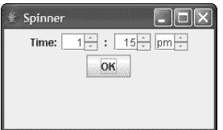

要创建微调框控件，你需要使用 `JSpinner` 类，其构造方法和方法如表 4-4 所示。请注意，第二个构造方法接受一个 `SpinnerModel` 类型的对象作为参数。该表还展示了两个实现了 `SpinnerModel` 接口的类的构造方法。

### 表 4-4 JSpinner 及相关类

| 构造方法 | 描述 |
| :--- | :--- |
| `JSpinner()` | 创建一个默认微调框。默认微调框允许用户选择一个整数，初始值为零，没有最小值和最大值限制。 |
| `JSpinner(SpinnerModel model)` | 使用指定的 `SpinnerModel` 对象创建一个微调框。 |

| 方法 | 描述 |
| :--- | :--- |
| `void addChangeListener(ChangeListener listener)` | 添加一个 `ChangeListener` 来监听变更事件。 |
| `int getValue()` | 获取当前值。 |
| `void setToolTipText(String ext)` | 设置工具提示文本，当用户将鼠标悬停在滑块上片刻时会显示该文本。 |

| SpinnerModel 类的构造方法 | 描述 |
| :--- | :--- |
| `SpinnerNumberModel(int init, int min, int max, int step)` | 创建一个数字微调框模型，允许用户选择从 `min` 到 `max` 的整数值，步长为 `step`。初始值设置为 `init`。 |
| `SpinnerNumberModel(double init, double min, double max, double step)` | 创建一个数字微调框模型，允许用户选择从 `min` 到 `max` 的双精度浮点值，步长为 `step`。初始值设置为 `init`。 |
| `SpinnerListModel(Object[] values)` | 使用指定数组中的值创建一个列表微调框模型。 |
| `SpinnerListModel(List collection)` | 使用指定集合中的值创建一个列表微调框模型。该集合必须实现 `List` 接口。 |

你可以创建一个允许用户选择整数值的默认微调框，方法如下：

```
JSpinner spinner = new JSpinner();
```

此微调框的初始值为零，每次用户点击微调框的箭头时，值会增加或减少一。你可以随时通过以下方式获取微调框的当前值：

```
int value = spinner.getValue();
```

对于大多数微调框，你需要使用第二个构造方法，这要求你首先创建一个实现了 `SpinnerModel` 接口的对象。表 4-4 列出了两个实现了 `SpinnerModel` 的类的构造方法。第一个是 `SpinnerNumberModel`，它创建数字微调框控件，允许你控制初始值、最小值和最大值，以及每次用户点击箭头时增加或减少的步长值。

以下是如何使用 `SpinnerNumberModel` 创建图 4-3 中第一个微调框的代码，该微调框接受 1 到 12 的整数，起始值为 1：

```
JSpinner hours = new JSpinner(
    new SpinnerNumberModel(1, 1, 12, 1));
```

以下是图 4-3 中第二个微调框的代码，允许用户选择 0 到 59 的数字：

```
JSpinner minutes = new JSpinner(
    new SpinnerNumberModel(0, 0, 59, 1));
```

你也可以使用 `SpinnerListModel` 类来构建一个从列表中选择值的微调框控件。该类的构造方法接受一个数组或一个实现了 `List` 接口的对象。`ArrayList` 类实现了此接口，这意味着你可以使用 `SpinnerListModel` 创建一个从 `ArrayList` 对象中选择项目的微调框。

以下是图 4-3 中第三个微调框的代码，允许用户选择 am 或 pm：

```
String[] ampmString = {"am", "pm"};
ampm = new JSpinner(
        new SpinnerListModel(ampmString));
```

在此示例中，`SpinnerListModel` 使用了一个包含两个元素的字符串数组：am 和 pm。

## 使用树

*树*是一种精美的 Swing 组件，以大纲形式显示层次化数据，我们计算机专业人员称之为树。树由 `JTree` 类创建。

你最熟悉的树类型可能是磁盘驱动器的目录结构。图 4-4 展示了一个包含树控件的 Swing 窗体。在此示例中，我使用树控件来表示我最喜欢的几个电视节目以及从中衍生出的节目。

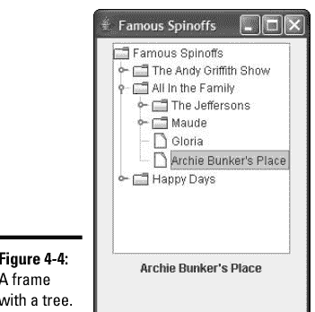

**图 4-4：** 一个带有树的窗体。

树控件可能是所有 Swing 控件中最难使用的。为了全面介绍它们，我需要专门用一整章 30 页甚至更多的篇幅。因此，在本章剩余的有限篇幅中，我只介绍基础知识：如何创建如图 4-4 所示的树组件，以及如何找出用户选择了哪个元素。

在介绍如何创建树控件的具体操作之前，你需要了解一些描述树中元素的术语：

- ◆ **节点：** 树中的每个元素称为一个*节点*。树中的节点必须从实现了 `TreeNode` 接口的类创建。如果你愿意，可以创建自己的类来实现 `TreeNode`。但在大多数情况下，你可以使用 `DefaultMutableTreeNode` 类。（遗憾的是，在使用树控件时，你需要频繁输入这个类名。）
- ◆ **根节点：** 树的起始节点。每个树组件必须有且仅有一个根节点。创建树组件时，你需要将根节点传递给 `JTree` 构造方法。
- ◆ **子节点：** 直接出现在给定节点下方的节点称为该节点的子节点。一个节点可以有多个子节点。
- ◆ **父节点：** 直接位于给定节点上方的节点称为该节点的父节点。除根节点外，每个节点必须有且仅有一个父节点。
- ◆ **兄弟节点：** 同一个父节点的子节点。
- ◆ **叶节点：** 没有任何子节点的节点。这些节点代表分支的末端。
- ◆ **路径：** 一个节点及其所有祖先——即它的父节点、父节点的父节点，依此类推——一直到根节点。
- ◆ **展开节点：** 子节点可见的节点。
- ◆ **折叠节点：** 子节点被隐藏的节点。

### 构建树

在实际创建树控件之前，你必须先构建它所显示的树。最简单的方法是使用 `DefaultMutableTreeNode` 类，其详细信息如表 4-5 所示。

> `DefaultMutableTreeNode` 类实现了 `TreeNode` 接口。因此，你可以在本表中列出的任何需要 `TreeNode` 对象的方法中使用 `DefaultMutableTreeNode` 对象。


### 表 4-5：DefaultMutableTreeNode 类

| 构造方法 | 描述 |
| :--- | :--- |
| `DefaultMutableTreeNode()` | 创建一个空的树节点。 |
| `DefaultMutableTreeNode(Object userObject)` | 创建一个带有指定用户对象的树节点。 |

| 方法 | 描述 |
| :--- | :--- |
| `void add(TreeNode child)` | 添加一个子节点。 |
| `TreeNode getFirstChild()` | 获取该节点的第一个子节点。 |
| `DefaultMutableTreeNode getNextSibling()` | 获取下一个兄弟节点。 |
| `TreeNode getParent()` | 获取该节点的父节点。 |
| `Object getUserObject()` | 获取该节点的用户对象。 |

`DefaultMutableTreeNode` 类为每个节点提供三个基本特征：

- *用户对象*，包含节点所表示的数据。在我的示例中，我使用字符串作为用户对象。不过，你可以使用任何类型的对象作为用户对象。树控件会调用用户对象的 `toString` 方法来确定为每个节点显示什么文本。设置用户对象最简单的方法是通过 `DefaultMutableTreeNode` 构造方法传递它。
- 该节点的父节点，除非该节点恰好是根节点。
- 该节点的所有子节点，除非该节点恰好是叶节点。你可以通过调用 `add` 方法来创建子节点。

`DefaultMutableTreeNode` 类还有更多用于遍历树的方法，远不止这里列出的这些。然而，给定一个根节点，你可以使用 `getFirstChild` 和 `getNextSibling` 方法来"遍历"整棵树并访问每个节点。

在本节中，我将构建一棵树，列出三部过去热门电视节目的衍生节目：

- *安迪·格里菲斯秀*，它有两个衍生节目：*哥默·派尔，美国海军陆战队* 和 *梅贝里 R.F.D.*。
- *一家子*，它直接衍生出四个节目：*杰斐逊一家*、*莫德*、*格洛丽亚* 和 *阿奇·邦克的住所*。此外，其中两个衍生节目又有自己的衍生节目，涉及女佣角色：杰斐逊一家的女佣成为了一部名为*入住登记*的节目主角，莫德的女佣则成为了*美好时光*的主角。
- *欢乐时光*，它衍生出了*莫克与明蒂*、*拉文与雪莉* 和 *乔妮爱查奇*。

构建树有很多不同的方法，其中大多数涉及一些递归编程。关于递归编程的更多信息，请参阅 Book V, 第 4 章。为了保持简单，我将在本节中避免使用递归编程。但这意味着你必须将树的一些细节硬编码到程序中。大多数实际

处理树结构程序需要使用某种递归编程来构建树。

创建树的第一步是为每个非叶子节点声明一个`DefaultMutableTreeNode`变量：

```
DefaultMutableTreeNode andy, archie, happy, george, maude;
```

这些变量可以是框架构造函数中的局部变量，因为在树结构设置完成后，就不再需要这些变量了。你很快就会明白为什么不需要为叶子节点创建变量。

接下来，创建根节点：

```
DefaultMutableTreeNode root =
    new DefaultMutableTreeNode("Famous Spinoffs");
```

现在，为了简化创建所有其他节点的任务，我创建了一个名为`makeShow`的辅助方法：

```
private DefaultMutableTreeNode makeShow(String title,
        DefaultMutableTreeNode parent)
{
    DefaultMutableTreeNode show;
    show = new DefaultMutableTreeNode(title);
    parent.add(show);
    return show;
}
```

这个方法接受一个字符串和另一个节点作为参数，并返回一个用户对象设置为字符串参数的节点。返回的节点也会被添加为父节点的子节点。因此，你可以调用这个方法来同时创建一个新节点并将其放入树中。

现在我创建一些节点。首先是*The Andy Griffith Show*及其衍生剧的节点：

```
andy = makeShow("The Andy Griffith Show", root);
makeShow("Gomer Pyle, U.S.M.C.", andy);
makeShow("Mayberry R.F.D.", andy);
```

这里，调用`makeShow`为*The Andy Griffith Show*创建一个节点，指定根节点作为其父节点。这个方法返回的节点保存在`andy`变量中。然后，调用`makeShow`两次来创建衍生剧节点，这次指定`andy`作为父节点。

由于*Gomer Pyle*和*Mayberry R.F.D.*都没有衍生剧，我不需要将这些节点作为父参数传递给`makeShow`方法。这就是为什么我不费心创建变量来引用这些节点。

接下来，我需要为*All In the Family*及其衍生剧创建节点：

```
archie = makeShow("All In the Family", root);
george = makeShow("The Jeffersons", archie);
makeShow("Checking In", george);
maude = makeShow("Maude", archie);
makeShow("Good Times", maude);
makeShow("Gloria", archie);
makeShow("Archie Bunker's Place", archie);
```

在这种情况下，*The Jeffersons*和*Maude*都有自己的子节点。因此，这两个节目需要变量，以便在创建*Checking In*和*Good Times*的节点时可以将它们作为父参数传递给`makeShow`。

最后，这是创建*Happy Days*及其衍生剧节点的代码：

```
happy = makeShow("Happy Days", root);
makeShow("Mork and Mindy", happy);
makeShow("Laverne and Shirley", happy);
makeShow("Joanie Loves Chachi", happy);
```

完整的树已在内存中成功创建，所以我可以继续创建`JTree`组件来展示这棵树的任务。

## 创建 JTree 组件

使用JTree类来创建一个显示树节点的树组件。表4-6展示了这个类的关键构造函数和方法。

| 表 4-6 | JTree 类的常用构造函数和方法 |
| :--- | :--- |
| **构造函数** | **描述** |
| void JTree() | 创建一个空树。要我说，这没什么用处。 |
| void JTree(TreeNode root) | 创建一个树，显示从指定节点开始的树。 |
| **方法** | **描述** |
| void addTreeSelectionListener(TreeSelectionListener listener) | 添加指定的监听器来监听树选择事件。 |
| Object getLastSelectedPathComponent() | 获取当前选中的节点。 |
| TreeSelectionModel getSelectionModel() | 获取树的 selection model。参见正文了解你可以用 TreeSelectionModel 对象做什么。 |
| void setVisibleRowCount(int count) | 设置显示中可见的行数。 |

### 580 使用树

创建`JTree`组件的第一步是将`JTree`变量声明为类实例变量，以便你可以访问构造函数和其他方法：

```
JTree tree1;
```

然后，在框架构造函数中，调用`JTree`构造函数来创建树组件，传递你想要显示的树的根节点作为参数：

```
tree1 = new JTree(root);
```

默认情况下，用户可以从树中选择多个节点。要限制用户只能选择单个节点，可以使用这个奇怪的咒语：

```
tree1.getSelectionModel().setSelectionMode(
    TreeSelectionModel.SINGLE_TREE_SELECTION);
```

这里，调用`getSelectionModel`方法来获取一个`TreeSelectionModel`对象，该对象确定用户如何选择树中的节点。这个类提供了一个名为`setSelectionMode`的方法，让你可以设置选择模式。要将树限制为单个节点选择，你必须向这个方法传递`TreeSelectionModel.SINGLE_TREE_SELECTION`字段。（我认为他们本可以为我们省去很多麻烦，为`JTree`类提供一个`setSingleTreeSelection`方法，但没人问我。）

你可以通过调用`setVisibleRowCount`方法来控制树组件的大小。例如：

```
tree1.setVisibleRowCount(12);
```

这里，树的大小刚好足够一次显示12行。

最后，你需要将树组件添加到滚动窗格中，这样如果树无法适应提供的空间，用户就可以滚动它。然后，你应该将滚动窗格添加到一个面板中，该面板再添加到框架中：

```
JScrollPane scroll = new JScrollPane(tree1);
panel1.add(scroll);
```

就是这样！树组件现在显示为前面图4-4所示的样子。

## 获取选中的节点

确定树控件中当前选中节点的最简单方法是调用`getLastSelectedPathComponent`方法。这个方法返回一个对象，所以你需要将其转换为正确的类型。例如：

```
Object o = tree1.getLastSelectedPathComponent();
DefaultMutableTreeNode show = (DefaultMutableTreeNode) o;
```

这里，检索选中的节点并存储在Object变量o中。然后，将其强制转换为DefaultMutableTreeNode对象。

你可以在动作事件监听器中使用这个方法，在用户点击按钮时检索选中的节点。但如果你的程序需要在用户选择节点时立即响应呢？例如，图4-4所示的框架在列表框下方有一个标签。这个标签会在用户选择树中的节目时更新为所选节目的标题。要做到这一点，你需要安装一个监听器来监听树选择事件。

要创建树选择监听器，你需要提供一个实现TreeSelectionListener接口的类。这个接口提供了一个名为valueChanged的单一方法，它接收一个TreeSelectionEvent对象作为参数。以下是一个示例TreeSelectionListener类，它只是将一个名为showName的标签的值设置为所选项目的用户对象的值：

```
private class TreeListener
    implements TreeSelectionListener
{
    public void valueChanged(TreeSelectionEvent e)
    {
        Object o = tree1.getLastSelectedPathComponent();
        DefaultMutableTreeNode show;
        show = (DefaultMutableTreeNode) o;
        String title = (String)show.getUserObject();
        showName.setText(title);
    }
}
```

然后，你可以使用这个语句安装这个类的实例来监听树选择事件：

```
tree1.addTreeSelectionListener(new TreeListener());
```

JTree类还提供了许多其他方法来检索选中的节点。此外，你可以添加监听器来监听用户选择节点时生成的树选择事件。这些事件让你可以创建在用户选择节点时立即显示该节点数据的应用程序。如果你想使用这些功能，请查看JTree类的API文档。

## 整合在一起

唷！消化的信息量真大。为了将它们整合在一起，清单4-1展示了创建图4-4所示框架的完整程序。


## 使用树

该程序允许用户从树中选择一个节目。然后，所选节目的标题会显示在树下方的标签中。

## 清单 4-1：衍生节目程序

```java
import javax.swing.*;
import java.awt.event.*;
import javax.swing.tree.*;
import javax.swing.event.*;

public class SpinOffs extends JFrame
{
    public static void main(String [] args)
    {
        new SpinOffs();
    }

    private JTree tree1;                                           → 13
    private DefaultTreeModel model;
    private JLabel showName;

    public SpinOffs()
    {
        this.setSize(225,325);
        this.setTitle("Famous Spinoffs");
        this.setDefaultCloseOperation(JFrame.EXIT_ON_CLOSE);

        JPanel panel1 = new JPanel();

        DefaultMutableTreeNode root, andy, archie,
                                happy, george, maude;              → 25

        root =                                                    → 28
            new DefaultMutableTreeNode("Famous Spin-offs");

        andy = makeShow("The Andy Griffith Show", root);           → 31
        makeShow("Gomer Pyle, U.S.M.C.", andy);
        makeShow("Mayberry R.F.D.", andy);

        archie = makeShow("All In the Family", root);              → 35
        george = makeShow("The Jeffersons", archie);
        makeShow("Checking In", george);
        maude = makeShow("Maude", archie);
        makeShow("Good Times", maude);
        makeShow("Gloria", archie);
        makeShow("Archie Bunker's Place", archie);

        happy = makeShow("Happy Days", root);                      → 43
        makeShow("Mork and Mindy", happy);
        makeShow("Laverne and Shirley", happy);
        makeShow("Joanie Loves Chachi", happy);

        tree1 = new JTree(root);                                  → 48
        tree1.getSelectionModel().setSelectionMode(
            TreeSelectionModel.SINGLE_TREE_SELECTION);
        tree1.setVisibleRowCount(12);
        tree1.addTreeSelectionListener(new TreeListener());

        JScrollPane scroll = new JScrollPane(tree1);
        panel1.add(scroll);

        showName = new JLabel();
        panel1.add(showName);
        this.add(panel1);
        this.setVisible(true);
    }

    private DefaultMutableTreeNode makeShow(
        String title, DefaultMutableTreeNode parent)
    {
        DefaultMutableTreeNode show;
        show = new DefaultMutableTreeNode(title);
        parent.add(show);
        return show;
    }

    private class TreeListener
        implements TreeSelectionListener
    {
        public void valueChanged(TreeSelectionEvent e)
        {
            Object o = tree1.getLastSelectedPathComponent();
            DefaultMutableTreeNode show;
            show = (DefaultMutableTreeNode) o;
            String title = (String)show.getUserObject();
            showName.setText(title);
        }
    }
}
```

本程序中的所有代码已在之前本章中展示过，因此这里仅简要指出要点：

- →13 树和列表模型被定义为类实例变量。
- →25 为根节点以及每个拥有衍生节目的节目定义了`DefaultMutableTreeNode`变量。
- →28 使用文本`Famous Spin-offs`创建根节点。
- →31 这些行创建*The Andy Griffith Show*及其衍生节目的节点。
- →35 这些行创建*All In the Family*及其衍生节目的节点。
- →43 这些行创建*Happy Days*及其衍生节目的节点。

第六册
第四章

## 从列表中选择

## 使用树

→48 此行创建`JTree`组件，指定`root`作为树的根节点。

→50 这些行配置`JTree`组件，使其仅允许单选、一次显示12行，并添加树选择监听器。

→55 `JTree`组件被添加到滚动面板中，然后滚动面板被添加到框架中。

→64 `makeShow`方法根据字符串创建一个节点，并将其添加到作为父参数传入的节点中。

→73 `TreeListener`类处理`valueChanged`事件，以在`showName`标签中显示所选节目的标题。

## 第五章：使用布局管理器

### 本章内容

- ✓ 流式布局
- ✓ 边框布局
- ✓ 盒式布局
- ✓ 网格布局
- ✓ 网格袋布局

控制框架上组件的布局是使用 Swing 时最困难的方面之一。事实上，它可能令人非常沮丧。有时组件似乎有自己的想法。它们顽固地拒绝移动。当你希望它们并排时，它们却堆叠在一起。你对标签或文本字段稍作更改，整个框架似乎就会重新排列。有时你会想一拳打穿显示器。

我不建议你把拳头打穿显示器。你会弄得一团糟，割伤手，还得花钱买新显示器，而且当你再次让电脑工作时，组件仍然不会按你想要的方式排列。


问题不在于组件，而在于负责确定每个组件在其框架或面板中位置的布局管理器。在本章中，你将学习如何使用 Swing 的七种布局管理器。本章将揭开 Swing 布局的神秘面纱，让你完全掌控组件的放置位置。

### 布局管理器简介

理解布局管理器是创建既美观又实用的 Swing 框架的关键。Swing 提供了七种不同的布局管理器供你使用（以下列表描述了其中五种）：

- ◆ **流式（Flow）：** 这是面板的默认布局管理器。它将组件一个接一个地排列，直到没有空间为止。然后，它开始新的一行组件。
- ◆ **边框（Border）：** 这是框架的默认布局管理器。它将容器分为五个区域，称为北（North）、南（South）、东（East）、西（West）和中（Center）。添加组件时，你可以指定要将组件放在哪个区域。
- ◆ **盒式（Box）：** 此布局管理器将组件排列成单行或单列，具体取决于创建布局管理器时指定的对齐方式。
- ◆ **网格（Grid）：** 当你想要创建大小相同的组件网格时，此布局管理器是理想选择。
- ◆ **网格袋（GridBag）：** 此布局管理器使用比网格布局管理器更灵活的网格。使用网格袋布局时，每行或每列可以是不同的大小，组件可以跨两行或更多行、两列或更多列，你还可以告诉布局管理器当组件小于或大于分配给它的空间时该做什么。

图 5-1 展示了使用这些布局管理器排列的框架。

除了这些布局管理器外，Java 还提供了一些额外的布局管理器。卡片布局管理器（Card）允许你创建选项卡式布局，但此管理器已基本被其他更有效地实现相同功能的组件所取代。而弹簧布局管理器（Spring）使用一种称为*弹簧（springs）*的奇怪概念来定位组件。此布局管理器不是为手工编码而设计的。相反，它是为创建 GUI 代码的代码生成器设计的。本书不涵盖这两种布局管理器。

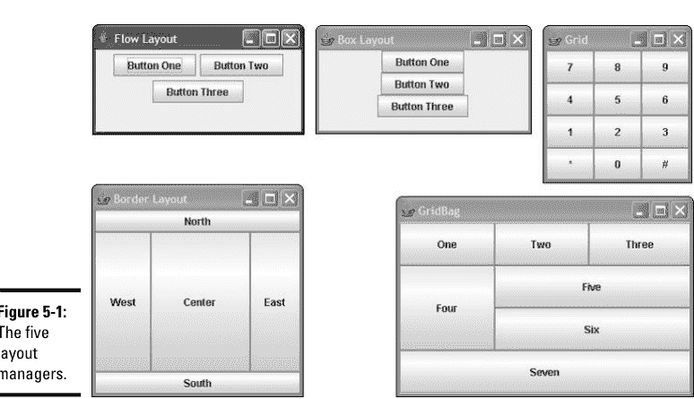

> 在许多情况下，创建复杂框架布局的最佳方法是组合使用多种布局管理器。例如，你可能创建一个按钮面板，显示在框架底部。此面板将使用流式布局。然后，可以将此面板添加到框架的南（South）区域，该区域默认使用边框布局。

要为面板或框架设置布局管理器，可以使用`setLayout`方法。例如，以下是如何创建面板并将其布局管理器设置为网格袋布局：

```java
JPanel panel1 = new JPanel();
panel1.setLayout(new GridBagLayout());
```

> 如果你希望对面板使用流式布局，或对框架使用边框布局，则无需执行任何操作，因为它们是默认布局。

## 使用流式布局

由于流式布局是面板的默认布局管理器，你已经熟悉它的工作方式。如果可能，组件将按单行排列。如果组件不适合当前行，则开始新的一行。

就其本身而言，流式布局管理器并不是很有用。你可能主要将其用于由少量组件组成的小面板，例如一排按钮，然后将其添加到使用其他布局管理器的大面板中。

表 5-1 列出了`FlowLayout`类的构造方法，可用于创建新的流式布局管理器。

**表 5-1 FlowLayout 构造方法**

| 构造方法 | 说明 |
|---|---|
| `FlowLayout()` | 创建一个居中对齐、无间隙的流式布局管理器。 |
| `FlowLayout(int align)` | 创建具有指定对齐方式的流式布局管理器。align 参数可以是`FlowLayout.LEFT`、`FlowLayout.CENTER`或`FlowLayout.RIGHT`。 |
| `FlowLayout(int align, int hgap, int vgap)` | 创建具有指定对齐方式的流式布局管理器。`int`参数指定在元素之间插入的间隙大小（以像素为单位），以使布局稍微分散一些。 |


## 使用边框布局

默认情况下，行是居中的。你可以像这样为面板指定左对齐：

```java
JPanel panel1 = new JPanel();
panel1.setLayout(new FlowLayout(FlowLayout.LEFT));
```

若要指定右对齐，请改用此语句：

```java
panel1.setLayout(new FlowLayout(FlowLayout.RIGHT));
```

你也可以指定在每个组件之间插入的间距。例如：

```java
panel1.setLayout(new FlowLayout(FlowLayout.LEFT, 20, 15));
```

这里，水平间距设置为20，垂直间距设置为15。图5-2展示了使用这些设置创建的包含六个按钮的面板。

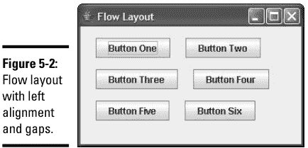

## 使用边界布局

边界布局管理器将框架或面板划分为五个区域：北、南、东、西和中，如图5-3所示。然后，当你向框架或面板添加组件时，可以指定该组件放置在哪个区域。

边界布局是框架的默认布局。要创建一个使用边界布局的面板，请使用`BorderLayout`类（如表5-2所示）的构造函数之一。例如：

```java
JPanel panel1 = new JPanel();
panel1.setLayout(new BorderLayout());
```

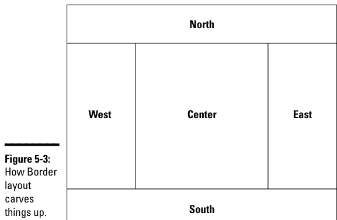

**表5-2：边界布局构造函数和字段**

| 构造函数 / 字段 | 描述 |
| :--- | :--- |
| `BorderLayout()` | 创建一个无间距的边界布局管理器。 |
| `BorderLayout(int hgap, int vgap)` | 创建一个带有指定水平和垂直间距的边界布局管理器。 |
| `字段` | **描述** |
| `NORTH` | 北部区域（位于容器的顶部）。 |
| `SOUTH` | 南部区域（位于容器的底部）。 |
| `WEST` | 西部区域（位于容器的左侧）。 |
| `EAST` | 东部区域（位于容器的右侧）。 |
| `CENTER` | 中部区域。 |

当你向使用边界布局管理器的面板或框架添加组件时，可以使用`BorderLayout`的字段之一来指定放置组件的区域，例如：

```java
panel1.add(new JLabel("Welcome!"), BorderLayout.NORTH);
```

这里，标签被添加到了北部区域。

以下是关于边界布局需要了解的几个额外要点：

*   如果在添加组件时未指定区域，则组件将被放置在中心区域。
*   当边界布局管理器确定每个区域的大小时，它首先确定边缘区域（北、南、东、西）的大小。然后，剩余的空间将全部分配给中心区域。
*   边界布局管理器会自动调整每个区域中组件的大小，以完全填满该区域。如果你不希望这种情况发生，请将组件放入使用流式布局的单独面板中，然后再将这些面板添加到边界布局区域。
*   如果你向边界布局面板或框架的同一个区域添加两个或更多组件，最后一个添加的组件将赢得空间争夺战；其他组件将完全不可见。要向一个区域添加多个组件，你需要先将组件添加到一个面板，然后再将该面板添加到边界布局区域。

## 使用箱式布局

你可以使用箱式布局来创建一个包含单行或单列组件的面板。如果组件排列成单行，则该框称为*水平框*。如果组件堆叠成一列，则该框是*垂直框*。

虽然你可以直接将箱式布局应用于面板，但更常见的是使用`Box`类，它类似于面板，但默认使用箱式布局而非流式布局。此外，`Box`类有几个静态方法，对于在框中布局组件非常有用。表5-3列出了该类的方法。

**表5-3：Box 类方法**

| Box 方法 | 描述 |
|-------------|-------------|
| `static Component createGlue()` | 创建一个胶水组件。该组件会使其任意一侧的组件尽可能相互远离。 |
| `static Box createHorizontalBox()` | 创建一个水平框。 |
| `static Component createHorizontalGlue()` | 创建一个水平胶水组件。该组件会使其两侧的组件尽可能相互远离。 |
| `static Component createHorizontalStrut(int width)` | 创建一个水平支撑组件，该组件在两侧组件之间插入指定大小的空间。 |
| `static Component createRigidArea(Dimension d)` | 创建一个固定大小的区域。 |
| `static Box createVerticalBox()` | 创建一个垂直框。 |
| `static Component createVerticalGlue()` | 创建一个垂直胶水组件。该组件会使其上下的组件尽可能相互远离。 |
| `static Component createVerticalStrut(int height)` | 创建一个垂直支撑组件，该组件在其上方和下方的组件之间插入指定大小的空间。 |

**表5-4：Dimension 构造函数**

| Dimension 构造函数 | 描述 |
| :--- | :--- |
| `Dimension(int width, int height)` | 创建一个具有指定宽度和高度的新 Dimension 对象。 |

以下是一个创建水平框并向其添加三个按钮的示例：

```java
Box box1 = Box.createHorizontalBox();
box1.add(new JButton("Accept"));
box1.add(new JButton("Cancel"));
box1.add(new JButton("Close"));
```

箱式布局的真正威力在于支撑、刚性区域和胶水的使用：

*   支撑是一种在组件之间插入指定空间量的组件。你可以根据想要创建的支撑类型，调用 `createHorizontalStrut` 或 `createVerticalStrut` 方法来创建支撑。例如，假设你希望前一个示例中的三个按钮之间相隔20像素，并且希望框的两端也有20像素的空白空间。以下代码实现了这一点：

```java
Box box1 = Box.createHorizontalBox();
box1.add(Box.createHorizontalStrut(20));
box1.add(new JButton("Accept"));
box1.add(Box.createHorizontalStrut(20));
box1.add(new JButton("Cancel"));
box1.add(Box.createHorizontalStrut(20));
box1.add(new JButton("Close"));
box1.add(Box.createHorizontalStrut(20));
```

*   刚性区域类似于支撑，但会在水平和垂直方向上都隔开组件。例如：

```java
box1.add(new JButton("Accept"));
box1.add(Box.createRigidArea(new Dimension(20, 40)));
box1.add(new JButton("Cancel"));
```

这里，我使用了一个20x40像素的刚性区域将 Accept 按钮与 Cancel 按钮隔开。此刚性区域的一个副作用是它将框本身的高度增加到40像素。按钮的上下都留有空白空间。

*   **胶水**类似于支撑，但它会将组件在框本身的边界内尽可能相互推开。例如，以下代码使用胶水根据框的宽度将第三个按钮尽可能远离前两个按钮：

```java
Box box1 = Box.createHorizontalBox();
box1.add(Box.createHorizontalStrut(20));
box1.add(new JButton("Accept"));
box1.add(Box.createRigidArea(new Dimension(20, 40)));
box1.add(new JButton("Cancel"));
box1.add(Box.createHorizontalGlue());
box1.add(new JButton("Close"));
box1.add(Box.createHorizontalStrut(20));
```

现在，如果你将此箱式布局添加到框架的南部区域，按钮将如图5-4所示出现。

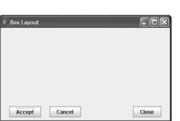

## 使用网格布局

网格布局专为需要将固定数量、大小相同的组件排列成网格的面板设计。你可能不会经常使用它，但如果你需要创建类似计算器或电话的东西，这正是你需要的布局管理器。表5-4列出了`GridLayout`类的构造函数，用于创建网格布局。

**表5-5：GridLayout 构造函数**

| 构造函数 | 描述 |
|-------------|-------------|
| `GridLayout()` | 创建一个将组件排列成单行的网格布局。这等效于 `GridLayout(1, 0)`。 |
| `GridLayout(int rows, int columns)` | 创建一个具有指定行数和列数的网格布局。如果其中一个参数为零，网格将扩展以填充所需的行数或列数。（两个参数不能同时指定为零。） |
| `GridLayout(int rows, int columns, int hgap, int vgap)` | 创建一个具有指定行数和列数、且行与列之间具有指定间距的网格布局。 |

要创建一个使用网格布局的面板，你需要调用 `GridLayout` 构造函数来指定网格的大小。其中一个参数可以为零，以允许网格扩展到容纳你添加到面板的所有组件所需的行数或列数。

例如，以下是创建类似于图5-1中所示的电话界面的网格布局面板的代码：

```java
JPanel panel1 = new JPanel();
panel1.setLayout(new GridLayout(0, 3));
panel1.add(new JButton("7"));
panel1.add(new JButton("8"));
panel1.add(new JButton("9"));
panel1.add(new JButton("4"));
panel1.add(new JButton("5"));
panel1.add(new JButton("6"));
panel1.add(new JButton("1"));
panel1.add(new JButton("2"));
panel1.add(new JButton("3"));
panel1.add(new JButton("*"));
panel1.add(new JButton("0"));
panel1.add(new JButton("#"));
```

当你向使用网格布局的面板添加组件时，组件会逐行逐列地放入网格的单元格中。每填满一行，就开始新的一行。

## 使用网格包布局

网格包布局管理器是你最常用于布局复杂面板的布局管理器。与网格布局管理器类似，网格包允许你将面板划分为网格。然而，该网格具有以下特殊功能：


## 使用 GridBag 布局

- 各行和各列不必大小相同。相反，GridBag 会根据你添加到面板中的组件自动调整每列的宽度和每行的高度。
- 你可以指定每个组件要放入哪个单元格。你可以控制每个组件在面板上的位置。
- 你可以创建跨越多行或多列的组件。例如，你可以创建一个占两列宽的按钮，或一个占四行高的列表框。
- 如果组件不够大，无法填满其分配的所有空间，你可以让 GridBag 拉伸该组件以填满整个空间。你可以指定这种拉伸是水平进行、垂直进行，还是同时进行。
- 如果组件没有填满其分配的区域，你可以告诉 GridBag 你希望组件在该区域内如何定位。例如，组件可以左对齐或右对齐。

以下各节介绍了使用 GridBag 布局的方方面面。

### 绘制规划草图

准备创建 GridBag 面板时，第一步是绘制一幅草图，展示你希望面板上的组件如何显示。然后，将面板划分为行和列，并从左上角开始将行和列编号为零。图 5-5 展示了这样一幅草图，由我亲手绘制。

完成面板草图后，列出组件清单，包括它们在网格上的 x 和 y 坐标、对齐方式，以及组件是否跨越多行或多列。例如：

| 组件 | x | y | 对齐方式 | 跨度 |
| :--- | :--- | :--- | :--- | :--- |
| "姓名"标签 | 0 | 0 | 右对齐 | |
| "电话"标签 | 0 | 1 | 右对齐 | |
| "地址"标签 | 0 | 2 | 右对齐 | |
| 姓名文本框 | 1 | 0 | 左对齐 | 2 |
| 电话文本框 | 1 | 1 | 左对齐 | |
| 地址文本框 | 1 | 2 | 左对齐 | |
| 尺寸框 | 0 | 3 | 左对齐 | |
| 样式框 | 1 | 3 | 左对齐 | |
| 配料框 | 2 | 3 | 左对齐 | |
| 按钮框 | 2 | 4 | 右对齐 | |

完成网格布局后，你就可以编写代码将每个组件添加到正确位置。

### 向 GridBag 添加组件

在使用 GridBag 布局向面板添加组件之前，必须首先将 GridBag 指定为面板的布局管理器。你可以通过调用 `setLayout` 方法，传入一个新的 `GridBagLayout` 对象作为参数来实现：

```
JPanel panel1 = new JPanel();
panel1.setLayout(new GridBagLayout());
```

当面板使用 GridBag 布局时，`add` 方法接受两个参数：要添加的组件，以及一个 `GridBagConstraints` 对象，该对象指定组件在网格中的放置位置。使用 GridBag 布局的诀窍在于如何设置 `GridBagConstraints` 的值，以使每个组件放到你想要的位置。表 5-5 列出了 `GridBagConstraints` 类的字段。

表 5-5 GridBagConstraints 类

| 字段 | 说明 |
|---|---|
| `int gridx` | 组件的 x 位置。 |
| `int gridy` | 组件的 y 位置。 |
| `int gridwidth` | 组件跨越的列数。默认值为 1。 |
| `int gridheight` | 组件跨越的行数。默认值为 1。 |
| `double weightx` | 一个值，向网格布局提供如何分配组件宽度的提示。 |
| `double weighty` | 一个值，向网格布局提供如何分配组件高度的提示。 |
| `Insets insets` | 一个 `Insets` 对象，指示每个组件周围用作内边距的空间大小。`Insets` 类有一个简单的构造函数：`Insets(int top, int left, int bottom, int right)`。 |
| `int anchor` | 一个常量，指示当组件未填满空间时将其放置在哪里。值可以是 `GridBagConstraints` 类的以下任意字段：`CENTER`、`NORTH`、`NORTHEAST`、`EAST`、`SOUTHEAST`、`SOUTH`、`SOUTHWEST`、`WEST` 和 `NORTHWEST`。 |
| `int fill` | 一个常量，指示是否拉伸对象以填充可用空间。值可以是 `GridBagConstraints` 类的以下任意字段：`NONE`、`HORIZONTAL`、`VERTICAL` 或 `BOTH`。 |

其中一些字段需要额外说明：

- `weightx` 和 `weighty` 字段向 GridBag 布局管理器提供如何调整列和行大小的提示。如果你将其中一个值设为零，该行或列将保持固定大小。一种常见的技术是将这两个参数都设为 100，然后如果你认为布局可以从调整中受益，再进行微调。
- `insets` 字段允许你在组件周围提供一些内边距。你需要将这个字段设置为一个 `Insets` 对象。例如，假设 `GridBagConstraints` 对象名为 `gc`，以下语句在组件的每一边提供 5 像素的空间，并按如下方式设置 `insets` 字段：

	`gc.insets = new Insets(5, 5, 5, 5);`

- 默认情况下，组件会拉伸以填充网格单元格。这很少是你想要的效果，所以你通常希望设置 `fill` 字段来更改此行为。

你还需要设置 anchor 字段，以指示当组件未填满其分配的单元格或单元格区域时，你希望将其放置在哪里。

### 使用 GridBagConstraints

要创建 GridBagConstraints 对象，你需要调用 GridBagConstraints 构造函数，然后设置任何你希望与默认值不同的字段。例如，以下代码创建了一个 GridBagConstraints 对象，用于添加前面图 5-5 中显示的姓名文本框：

```
GridBagConstraints nameConstraints
    = new GridBagConstraints();
nameConstraints.gridx = 1;
nameConstraints.gridy = 0;
nameConstraints.gridwidth = 2;
nameConstraints.gridheight = 1;
nameConstraints.weightx = 100.0;
nameConstraints.weighty = 100.0;
nameConstraints.insets = new Insets(5, 5, 5, 5);
nameConstraints.anchor = GridBagConstraints.WEST;
nameConstraints.fill = GridBagConstraints.NONE;
```

然后，你可以调用 add 方法将姓名文本框添加到面板：

```
panel1.add(name, nameConstraints);
```

显然，这种控制约束的方法将需要大量编码。除了为添加到面板的每个组件创建新的约束对象外，你还有两种常见的替代方案。第一种是创建单个约束对象，并在面板的所有组件中重用它。然后，你只需为每个组件更改需要更改的字段。例如，以下代码使用单个约束对象添加所有三个文本框：

```
GridBagConstraints gc = new GridBagConstraints();
gc.gridx = 0;
gc.gridy = 0;
gc.gridwidth = 1;
gc.gridheight = 1;
gc.weightx = 100.0;
gc.weighty = 100.0;
gc.insets = new Insets(5, 5, 5, 5);
gc.anchor = GridBagConstraints.WEST;
gc.fill = GridBagConstraints.NONE;

gc.gridy = 0;
gc.gridwidth = 2;
add(name, gc);
gc.gridy = 1;
gc.gridwidth = 1;
add(phone, gc);
gc.gridy = 2;
gc.gridwidth = 2;
add(address, gc);
```

这里，第一组语句创建了一个名为 `gc` 的 `GridBagConstraints` 对象，并将其值设置为我希望应用于面板中大多数组件的默认值。然后，第二组语句在将每个文本框添加到面板之前设置 `gridy` 和 `gridwidth` 字段。

第二种选择是创建一个辅助方法，你可以调用它，只传递每个组件不同的值。例如，以下是一个名为 `addItem` 的方法，它添加一个组件并在指定的单元格中将其左对齐：

```
private void addItem(JPanel p, JComponent c, int x, int y,
    int width, int height, int align)
{
    GridBagConstraints gc = new GridBagConstraints();
    gc.gridx = x;
    gc.gridy = y;
    gc.gridwidth = width;
    gc.gridheight = height;
    gc.weightx = 100.0;
    gc.weighty = 100.0;
    gc.insets = new Insets(5, 5, 5, 5);
    gc.anchor = align;
    gc.fill = GridBagConstraints.NONE;
    p.add(c, gc);
}
```

然后，你可以调用此方法来向面板添加组件。你必须传递面板和组件、其 x 和 y 位置，以及其宽度和高度。例如，以下是你添加姓名文本框的方式：

```
addItem(panel1, name, 0, 1, 2, 1,
    GridBagConstraints.WEST);
```

### GridBag 布局示例

清单 5-1 展示了显示我在图 5-5 中绘制的框架的代码，图 5-6 展示了运行该程序时此框架的显示效果。如你所见，此框架的最终外观与我在麦当劳草拟的草图非常接近。我可能只需要稍微调整一下就能修复一些细微的差异。


图 5-6：
运行中的 Pizza Order 应用程序。

使用 GridBag 布局 599

第六册
第 5 章

使用
布局
管理器

## 清单 5-1：Pizza Order 应用程序

```
import javax.swing.*;
import java.awt.event.*;
import java.awt.*;

public class Pizza extends JFrame
{
    public static void main(String [] args)
    {
        new Pizza();
    }

    JTextField name, phone, address;
    JRadioButton small, medium, large, thick, thin;
    JCheckBox pepperoni, mushrooms, anchovies;
    JButton okButton, closeButton;

    public Pizza()
    {
        this.setTitle("Pizza Order");
        this.setDefaultCloseOperation(JFrame.EXIT_ON_CLOSE);

        JPanel panel1 = new JPanel();
        panel1.setLayout(new GridBagLayout());

        addItem(panel1, new JLabel("Name:"),
            0, 0, 1, 1, GridBagConstraints.EAST);
        addItem(panel1, new JLabel("Phone:"),
            0, 1, 1, 1, GridBagConstraints.EAST);
        addItem(panel1, new JLabel("Address:"),
            0, 2, 1, 1, GridBagConstraints.EAST);

        name = new JTextField(20);
        phone = new JTextField(10);
        address = new JTextField(20);

        addItem(panel1, name, 1, 0, 2, 1,
            GridBagConstraints.WEST);
        addItem(panel1, phone, 1, 1, 1, 1,
            GridBagConstraints.WEST);
        addItem(panel1, address, 1, 2, 2, 1,
            GridBagConstraints.WEST);

        Box sizeBox = Box.createVerticalBox();
        small = new JRadioButton("Small");
        medium = new JRadioButton("Medium");
        large = new JRadioButton("Large");
        ButtonGroup sizeGroup = new ButtonGroup();
        sizeGroup.add(small);
        sizeGroup.add(medium);
        sizeGroup.add(large);
        sizeBox.add(small);
        sizeBox.add(medium);
        sizeBox.add(large);
        sizeBox.setBorder(
            BorderFactory.createTitledBorder("Size"));
        addItem(panel1, sizeBox, 0, 3, 1, 1,
            GridBagConstraints.NORTH);

        Box styleBox = Box.createVerticalBox();
        thin = new JRadioButton("Thin");
        thick = new JRadioButton("Thick");
        ButtonGroup styleGroup = new ButtonGroup();
        styleGroup.add(thin);
        styleGroup.add(thick);
        styleBox.add(thin);
        styleBox.add(thick);
        styleBox.setBorder(
            BorderFactory.createTitledBorder("Style"));
        addItem(panel1, styleBox, 1, 3, 1, 1,
            GridBagConstraints.NORTH);

        Box topBox = Box.createVerticalBox();
        pepperoni = new JCheckBox("Pepperoni");
        mushrooms = new JCheckBox("Mushrooms");
        anchovies = new JCheckBox("Anchovies");
        ButtonGroup topGroup = new ButtonGroup();
        topGroup.add(pepperoni);
        topGroup.add(mushrooms);
        topGroup.add(anchovies);
        topBox.add(pepperoni);
        topBox.add(mushrooms);
        topBox.add(anchovies);
        topBox.setBorder(
            BorderFactory.createTitledBorder("Toppings"));
        addItem(panel1, topBox, 2, 3, 1, 1,
            GridBagConstraints.NORTH);

        Box buttonBox = Box.createHorizontalBox();
        okButton = new JButton("OK");
        closeButton = new JButton("Close");
        buttonBox.add(okButton);
        buttonBox.add(Box.createHorizontalStrut(20));
        buttonBox.add(closeButton);
        addItem(panel1, buttonBox, 2, 4, 1, 1,
            GridBagConstraints.NORTH);

        this.add(panel1);
        this.pack();
        this.setVisible(true);
    }

    private void addItem(JPanel p, JComponent c,
        int x, int y, int width, int height, int align)
    {
        GridBagConstraints gc = new GridBagConstraints();
        gc.gridx = x;
        gc.gridy = y;
        gc.gridwidth = width;
        gc.gridheight = height;
        gc.weightx = 100.0;
        gc.weighty = 100.0;
        gc.insets = new Insets(5, 5, 5, 5);
        gc.anchor = align;
        gc.fill = GridBagConstraints.NONE;
        p.add(c, gc);
    }
}
```

请注意，此应用程序不包含任何事件监听器，因此按钮除了演示如何使用 GridBag 布局外，不做任何其他事情。以下段落指出了要点：

- 23 此行为面板创建了一个 GridBag 布局管理器。
- 25 这些行将标签添加到面板。
- 36 这些行将文本字段添加到面板。
- 43 这些行使用垂直 Box 对象创建单选按钮，让用户选择尺寸。
- 59 这些行使用垂直 Box 对象创建单选按钮，让用户选择饼皮样式。
- 72 这些行使用垂直 Box 对象创建复选框，让用户选择配料。
- 88 这些行使用水平 Box 对象来放置“确定”和“关闭”按钮。

# 第七册

# Web 编程

第 5 波 Rich Tennant

> "嗯，这挺喜庆的——一个微型内网，在一堆 Java 小程序中旋转。"

## 内容概览

- 第 1 章：创建小程序 ....................................................................................................605
- 第 2 章：创建 Servlet ...................................................................................................613
- 第 3 章：使用 Java Server Pages .......................................................................................633
- 第 4 章：使用 JavaBeans ...................................................................................................647

## 第 1 章：创建小程序

### 本章内容

- ✔ 了解小程序
- ✔ 创建小程序
- ✔ 创建用于显示小程序的 HTML
- ✔ 使用小程序查看器测试小程序

小程序不是一种小型水果。相反，它是一种 Java 应用程序，旨在 Internet 用户的计算机上的浏览器窗口中运行。当 Internet 用户访问包含小程序的 Web 页面时，Java 小程序类会被下载到用户的计算机并在那里运行。小程序接管页面的一部分区域，并在该区域内可以执行任何它想做的事情。

小程序，至少在大多数情况下，是 Swing 应用程序。因此，第六册涵盖的所有内容都适用于小程序。在本章中，你将创建包含 Swing 组件的小程序。然后，你将小程序添加到 Web 页面，以便任何查看该页面的人都可以使用它。

### 理解小程序

小程序类似于 Swing 应用程序，但有几个关键区别：

- 小程序不是扩展 `JFrame` 类，而是扩展 `JApplet` 类。`JFrame` 和 `JApplet` 都为你的 Swing 应用程序提供了一个运行的“空间”：
  - 使用 `JFrame` 时，该空间是由主机操作系统的窗口系统管理的窗口。
  - 使用 `JApplet` 时，该空间是由 Web 浏览器管理的 Web 页面的矩形区域。

独立的 Swing 应用程序在 JVM 调用静态 `main` 方法时启动。因此，Swing 应用程序通常以创建扩展 `JFrame` 的类的实例开始。相比之下，当小程序启动时，浏览器会自动创建扩展 `JApplet` 的类的实例。因此，小程序没有静态 `main` 方法。相反，会调用名为 `init` 的方法来启动小程序。因此，`init` 方法是你放置通常放在扩展 `JFrame` 的类的构造函数中的代码的地方。

## 606 JApplet 类

- 独立的 Swing 应用程序需要一种让用户关闭它们的方法。通常，Swing 应用程序包含一个“退出”按钮或“退出”菜单命令。小程序则没有。只要包含它的页面仍在显示，小程序就会保持活动状态。

- 小程序不在窗口中显示；它们显示在 Web 页面的一个区域中。因此，你无法设置小程序标题栏的文本，也无法设置 `DefaultCloseOperation`，因为没有可供用户点击的“关闭”按钮。此外，用户无法调整小程序的大小。

- 出于安全原因，小程序被禁止执行某些操作。特别是，不允许小程序执行任何影响客户端计算机文件系统的操作，包括在客户端计算机上读取或写入文件或运行程序。

除了这些区别和限制之外，小程序的工作方式与 Swing 应用程序基本相同。事实上，小程序内部的 Swing 组件的外观和行为与独立的 Swing 应用程序中的*完全*相同。因此，小程序让你能够创建 Swing 应用程序并在世界任何地方的任何计算机上运行它们。是这样吗？

但愿如此。不幸的是，制造世界上最受欢迎的 Web 浏览器的公司——我不想提它的名字，但它的首字母是 MICROSOFT——与 Sun 公司合作得并不愉快。或者也许 Sun 公司与 Microsoft 公司合作得并不愉快。谁知道呢。无论如何，结果是在用户的计算机是否能够运行小程序，以及如果可以，它们支持哪个版本的 Java 这方面一团糟。用户可以从 Sun 下载 Java 插件，但下载量很大，大多数用户要么不想花时间，不了解这个过程，要么不信任它。

因此，小程序并不是创建面向大众使用的 Web 应用程序的最佳方式。互联网上最大的网站，如 eBay 和 Amazon，并*没有*使用小程序实现；相反，它们是使用第七册其他章节中描述的 servlet 和 Java Server Pages 等工具构建的。

## JApplet 类

正如我已经提到的，小程序扩展的是 `JApplet` 类，而不是 `JFrame` 类。在大多数情况下，`JApplet` 类的工作方式与 `JFrame` 类基本相同。因此，你可以向其中添加面板和其他组件、创建菜单、在其上绘图等等。表 1-1 列出了 `JApplet` 类最常用的方法。

## 表 1-1：有用的 JApplet 构造函数和方法

| 构造函数/方法 | 描述 |
|---|---|
| `JApplet()` | 创建一个新的 applet。通常你不需要调用 `JApplet` 构造函数，因为在浏览器加载 applet 时它会自动被调用。 |
| `void add(Component c)` | 将指定的组件添加到 applet 中。 |
| `void destroy()` | 由浏览器调用，通知 applet 其内存即将被 JVM 回收。大多数 applet 不需要重写此方法。 |
| `void init()` | 由浏览器调用，通知 applet 已被加载。此方法取代了 Swing 应用程序中 `JFrame` 构造函数的作用。 |
| `void setLayout(LayoutManager layout)` | 设置用于控制 applet 显示时组件排列方式的布局管理器。默认值是 Border Layout 管理器。 |
| `void setLocation(int x, int y)` | 设置 applet 在屏幕上的 x 和 y 位置。屏幕的左上角为 0,0。 |
| `void setLocationRelativeTo(Component c)` | 如果参数为 `null`，则将 applet 在屏幕居中。 |
| `void setSize(int width, int height)` | 将 applet 的大小设置为指定的宽度和高度。 |
| `void setJMenuBar(JMenuBar menu)` | 为此 applet 设置菜单。 |
| `void start()` | 由浏览器调用，通知 applet 开始执行。 |
| `void stop()` | 当 applet 暂时离开视图时由浏览器调用。如果你需要在 applet 隐藏时停止活动，请重写此方法。 |

## 查看一个示例 Applet

要了解完整 applet 的工作原理，清单 1-1 展示了一个完整 applet 的代码，它允许用户点购三种尺寸（小、中、大）之一并搭配三种配料（意大利辣香肠、蘑菇和鳀鱼）之一的披萨。图 1-1 展示了此 applet 在网页上的实际运行效果。

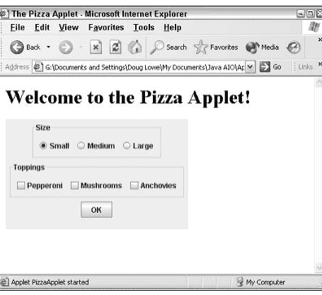

### 清单 1-1：披萨订单 APPLET

```java
import javax.swing.*;
import java.awt.event.*;
import javax.swing.border.*;

public class PizzaApplet extends JApplet
{
    private JButton buttonOK;
    private JRadioButton small, medium, large;
    
    private JCheckBox pepperoni, mushrooms, anchovies;
    
    public void init()
    {
        this.setSize(320,200);
        
        ButtonListener bl = new ButtonListener();
        
        JPanel mainPanel = new JPanel();
        
        JPanel sizePanel = new JPanel();
        Border b1 =
            BorderFactory.createTitledBorder("Size");
        sizePanel.setBorder(b1);
        
        ButtonGroup sizeGroup = new ButtonGroup();
        small = new JRadioButton("Small");
        small.setSelected(true);
        sizePanel.add(small);
        sizeGroup.add(small);

        medium = new JRadioButton("Medium");
        sizePanel.add(medium);
        sizeGroup.add(medium);

        large = new JRadioButton("Large");
        sizePanel.add(large);
        sizeGroup.add(large);

        mainPanel.add(sizePanel);

        JPanel topPanel = new JPanel();
        Border b2 =
            BorderFactory.createTitledBorder("Toppings");
        topPanel.setBorder(b2);

        pepperoni = new JCheckBox("Pepperoni");
        topPanel.add(pepperoni);

        mushrooms = new JCheckBox("Mushrooms");
        topPanel.add(mushrooms);

        anchovies = new JCheckBox("Anchovies");
        topPanel.add(anchovies);

        mainPanel.add(topPanel);

        buttonOK = new JButton("OK");
        buttonOK.addActionListener(bl);
        mainPanel.add(buttonOK);

        this.add(mainPanel);

        this.setVisible(true);
    }

    private class ButtonListener implements ActionListener
    {
        public void actionPerformed(ActionEvent e)
        {
            if (e.getSource() == buttonOK)
            {
                String tops = "";
                if (pepperoni.isSelected())
                    tops += "Pepperoni\n";
                if (mushrooms.isSelected())
                    tops += "Mushrooms\n";
                if (anchovies.isSelected())
                    tops += "Anchovies\n";

                String msg = "You ordered a ";
                if (small.isSelected())
                    msg += "small pizza with ";
                if (medium.isSelected())
                    msg += "medium pizza with ";
                if (large.isSelected())
                    msg += "large pizza with ";

                if (tops.equals(""))
                    msg += "no toppings.";
                else
                    msg += "the following toppings:\n"
                        + tops;
                JOptionPane.showMessageDialog(buttonOK,
                    msg, "Your Order",
                    JOptionPane.INFORMATION_MESSAGE);

                pepperoni.setSelected(false);
                mushrooms.setSelected(false);
                anchovies.setSelected(false);
                small.setSelected(true);
            }
        }
    }
}
```

这是本书第六册第三章中一个 Swing 程序的 applet 版本。关于 Swing 组件工作原理的详细信息，你可以参考该章节。在这里，我只想指出几个 applet 特有的细节：

- **5** 该类继承 `JApplet` 而不是 `JFrame`。
- **12** 重写了 `init` 方法，通常放在 `JFrame` 类构造函数中的代码被放到了 `init` 方法中。
- **14** 调用 `setSize` 方法来设置 applet 的大小。

然而，Swing 版本程序中出现的几个方法在此被移除了。特别是 `setTitle` 和 `setDefaultCloseOperation` 方法被删除了，因为这些方法不适用于 applet。但从该方法的其他部分可以看出，大部分代码与独立的 Swing 应用程序完全相同。

## 为 Applet 创建 HTML 页面

要运行 applet，你必须创建一个包含 APPLET 标签的 HTML 页面，该标签指定了 applet 的名称以及你希望让 applet 在其内部运行的区域大小。APPLET 标签还包含当 Web 浏览器无法运行 applet 时显示的文本。

APPLET 标签的基本形式如下：

```html
<APPLET code="classname" width=width height=height>
    如果 applet 无法加载时显示的文本
</APPLET>
```

例如，以下是我用于显示图 1-1 所示页面的 HTML 文件：

```html
<html>
  <head>
    <title>The Pizza Applet</title>
  </head>
  <body>
    <H1>Welcome to the Pizza Applet!</H1>
    <APPLET code="PizzaApplet" width="300" height="180">
    Sorry, your browser isn't able to run Java applets.
    </APPLET>
  </body>
</html>
```

## 测试 Applet

Java 附带了一个名为 *applet 查看器* 的特殊程序，让你在编译 applet 后可以快速运行它。图 1-2 展示了在 applet 查看器中显示的披萨 applet。

**图 1-2：** 在 applet 查看器中显示的披萨 applet。

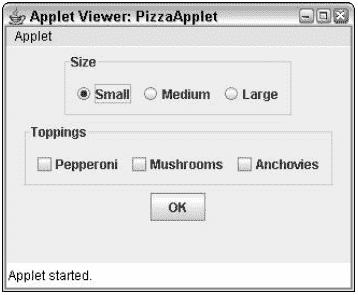

如果你使用的是 TextPad，可以在编译 applet 后按 Ctrl+3 来调用查看器。从命令提示符，你必须首先按照上一节所述创建一个 HTML 文件。然后，导航到包含该 HTML 文件的目录并输入以下命令：

```
appletviewer *文件名*
```

例如，要使用名为 `PizzaApplet.html` 的 HTML 文件显示披萨 applet，请使用以下命令：

```
Appletviewer PizzaApplet.html
```

# 第 2 章：创建 Servlets

- 在本章中
  - 了解 servlets
  - 下载、安装和配置 Tomcat
  - 创建简单的 servlets
  - 使用表单从用户获取数据

Servlets 是当今开发 Web 应用程序最流行的方式之一。互联网上许多最知名的网站都是由 servlets 驱动的。在本章中，我只介绍基础知识：什么是 servlet、如何设置你的计算机以便编写和测试 servlets，以及如何创建一个简单的 servlet。接下来的两章将在本章的基础上介绍更多的 Web 编程技术。

## 了解 Servlets

在理解什么是 servlet 以及它如何工作之前，你需要了解 Web 服务器工作原理的基础知识。Web 服务器使用一种名为 *HTTP* 的网络协议向用户发送网页。（HTTP 代表 *超文本传输协议*，但这不会出现在考试中。）使用 HTTP 时，客户端计算机使用 URL 来请求位于服务器计算机上的文档。HTTP 使用*请求/响应模型*，这意味着客户端计算机（Web 用户）向 HTTP 服务器发送请求消息，而服务器又将响应消息发送回客户端。

一个基本的 HTTP 交互大致如下：

1. 使用运行在客户端计算机上的 Web 浏览器程序，你指定想要访问的文件的 URL。在某些情况下，你确实会输入地址的 URL。但大多数时候，你点击的是一个指定了 URL 的链接。
2. 你的 Web 浏览器向由 URL 指示的服务器计算机发送 HTTP 请求消息。该请求包含你想要检索的文件名称。
3. 服务器计算机接收文件请求，检索所请求的文件，并以 HTTP 响应消息的形式将文件发送回你。


614 使用 Tomcat

+   4. Web 浏览器接收该文件，解析其中包含的 HTML，并在屏幕上显示结果。

关于普通的 Web 交互，最重要的一点是它们是*静态的*。我的意思是，发送给用户的文件内容始终是相同的。如果用户连续 20 次请求同一个文件，那么同一个页面就会显示 20 次。

相比之下，*servlet* 提供了一种使内容动态化的方式。servlet 就是一个扩展了 `javax.servlet.Servlet` 类的 Java 程序。`Servlet` 类使程序能够在 Web 服务器上响应用户请求运行，并且 servlet 的输出会作为 HTML 页面发送回 Web 用户。

使用 servlet 时，前面步骤中的第 1、2、4 步是相同的。关键的第 3 步使 servlet 与众不同。如果用户指定的 URL 指向的是 servlet 而非文件，那么第 3 步更像这样：

+   3. 服务器计算机接收到 servlet 请求，找到请求所指示的 Java 程序，运行它，并以 HTTP 响应消息的形式返回程序的输出。

换句话说，服务器发送的不是文件的内容，而是 servlet 程序生成的输出。通常，servlet 程序生成一些 HTML，由浏览器进行显示。

servlet 旨在快速完成工作后即结束。每次 servlet 运行时，它处理来自浏览器的一个请求，生成一个发送回浏览器的页面，然后结束。下次同一用户或任何其他用户请求同一 servlet 时，servlet 会再次运行。

## 使用 Tomcat

遗憾的是，你不能在任意一台计算机上运行 servlet 程序。首先，你需要安装一个叫做 *servlet 引擎*的特殊程序，将你的计算机变成一台能够运行 servlet 的服务器。最知名的 servlet 引擎叫做 Tomcat，你可以从 Apache 软件基金会免费获取，网址为 `jakarta.apache.org/tomcat`。

Tomcat 也可以作为基本的 Web 服务器使用。在实际的生产环境中，Tomcat 通常与专业的 Web 服务器（如 Apache 的 HTTP Server）配合使用。

## 安装和配置 Tomcat

安装 Tomcat 并非难如登天，但也不是轻而易举。以下是你可以按照的在 Windows XP 系统上安装 Tomcat 5.5 的步骤：

-   1. 下载 Tomcat Zip 文件。

你可以在 Apache 网站上找到 Zip 文件。虽然 Apache 也提供可执行的安装文件来安装 Tomcat，但我建议你改用下载 Zip 文件。

-   2. 右键单击 Zip 文件并选择"全部解压缩"来解压其内容。然后，指定 `c:\` 作为解压缩文件的目标位置。

我知道你不想让一堆文件弄乱你的根目录，但 Tomcat Zip 文件只包含一个名为 jakarta-tomcat-5.5.4（版本号可能有所不同）的文件夹，因此只会创建这一个文件夹。所有文件解压完成后，将此文件夹重命名为一个更容易输入的名称。我建议使用 `c:\tomcat`。

-   3. 创建一个名为 `JAVA_HOME` 的环境变量，指向你的 JDK 所在位置。

要创建环境变量，请打开控制面板，双击"系统"图标，单击"高级"选项卡，然后单击"环境变量"。接着，单击"新建"并创建一个名为 `JAVA_HOME` 的变量。此变量的值需要是你 JDK 安装文件夹的完整路径。例如：`c:\Program Files\Java\jdk1.5.0`。

一个常见的错误是将此变量设置为 `bin` 目录或 JRE 的目录，而不是 JDK。如果稍后 Tomcat 无法启动，请仔细检查 `JAVA_HOME` 目录。

-   4. 将 `servlet-api.jar` 文件复制到你的 JDK 根目录下的 `jre\lib\ext` 文件夹中。

例如，如果你的 JDK 安装在 `c:\Program Files\Java\jdk1.5.0`，请将此文件复制到 `c:\Program Files\Java\jdk1.5.0\jre\lib\ext`。假设你将 Tomcat 文件解压到了 `c:\tomcat`，你可以在 `c:\tomcat\common\lib` 中找到 `servlet-api.jar` 文件。

如果你跳过此步骤或将 `servlet-api.jar` 文件复制到了错误的位置，你将无法编译 servlet 程序。如果你收到编译器报错，提示 `javax.servlet` 包不存在，请仔细检查你是否正确执行了此步骤。

-   5. 编辑 `context.xml` 配置文件，在 `<context>` 标签中添加 `reloadable="true"`。

`context.xml` 文件位于 `c:\tomcat\conf` 中。第二行最初是这样的：

```
<Context>
```

将其改为：

```
<Context reloadable="true">
```

-   6. **修改 `web.xml` 文件以启用 `invoker` servlet。**

与 `context.xml` 一样，`web.xml` 文件也位于 `c:\tomcat\conf` 中。它包含两组用于配置 Tomcat 中称为 *invoker servlet* 功能的行，你需要对其进行修改。这些行最初被注释掉了以禁用 invoker servlet；你只需删除每组行前后出现的注释行即可。

你需要取消注释的第一组如下所示：

```
<!--
    <servlet>
        <servlet-name>invoker</servlet-name>
        <servlet-class>
org.apache.catalina.servlets.InvokerServlet
        </servlet-class>
        <init-param>
            <param-name>debug</param-name>
            <param-value>0</param-value>
        </init-param>
        <load-on-startup>2</load-on-startup>
    </servlet>
-->
```

只需删除首行的 `<!--` 和末行的 `-->` 即可。

第二组如下所示：

```
<!--
    <servlet-mapping>
        <servlet-name>invoker</servlet-name>
        <url-pattern>/servlet/*</url-pattern>
    </servlet-mapping>
-->
```

同样，你必须删除首行和末行，使这些行不再被视为注释。

你可以通过搜索 `invoker` 这个词快速找到这些行。

-   7. **创建 `classes` 目录。**

默认情况下，Tomcat 在 `c:\tomcat\webapps\ROOT\WEB-INF\classes` 目录中查找 servlet 的类文件。遗憾的是，`classes` 目录不存在。因此，你必须导航到 `c:\tomcat\webapps\ROOT\WEB-INF` 并创建 `classes` 目录。（当然，如果你将 Tomcat 安装在其他位置，这些路径中的 `c:\tomcat` 部分会有所不同。）

## 启动和停止 Tomcat

安装并配置好 Tomcat 后，你可以通过打开命令窗口，切换到 `c:\tomcat\bin` 目录，然后输入 `startup` 来启动它。会运行一个批处理文件来启动 Tomcat。当 Tomcat 启动时，它会打开第二个命令窗口来显示各种状态消息。图 2-1 展示了这两个窗口运行时的状态。

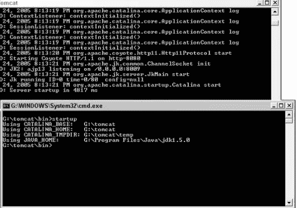

**图 2-1：** 启动 Tomcat。

当你看到类似下面这样显示启动耗时的一行信息时，你就知道 Tomcat 已经成功启动了：

```
INFO: Server startup in 2817 ms
```

如果 Tomcat 窗口出现几秒钟后，一条异常消息快速闪过然后窗口关闭，最可能的原因是你系统上已经有一个 Web 服务器在运行，并且该服务器已经占用了 Tomcat 想要用于 HTTP 通信的端口。解决此问题的方法是编辑 `c:\tomcat\conf` 中的 `server.xml` 文件，找到此标签：

```
<Connector port="8080" ... />
```

将端口号从 8080 改为其他数字，例如 18080。之后，当你在浏览器窗口中显示 servlet 时，必须将此数字指定为 HTTP 端口号，而不是 8080。

一旦启动 Tomcat，除非你对其配置文件进行了更改，否则不需要关闭它。如果进行了更改，你可以通过从 `c:\tomcat\bin` 目录运行 `shutdown` 批处理文件来关闭 Tomcat。然后，你可以运行 `startup` 批处理文件来再次启动 Tomcat。

## 测试 Tomcat

要检查你是否正确安装了 Tomcat，你可以尝试运行安装 Tomcat 时自动安装的测试 servlet。打开浏览器窗口并输入以下地址：

```
http://localhost:8080/servlets-examples/index.html
```

（如果你通过编辑 `server.xml` 文件更改了端口号，请使用你指定的端口号而不是 8080。）将出现如图 2-2 所示的页面。如果没有，请回到前面的"安装和配置 Tomcat"部分，仔细检查你是否正确执行了每个步骤。

> **注意：** 如果你向下滚动此页面，会发现指向各种示例 servlet 的链接，你可以运行它们，同时还有指向每个 servlet 源代码的链接。一定要试试这些示例，以了解 servlet 的工作原理以及你能用它们做什么。

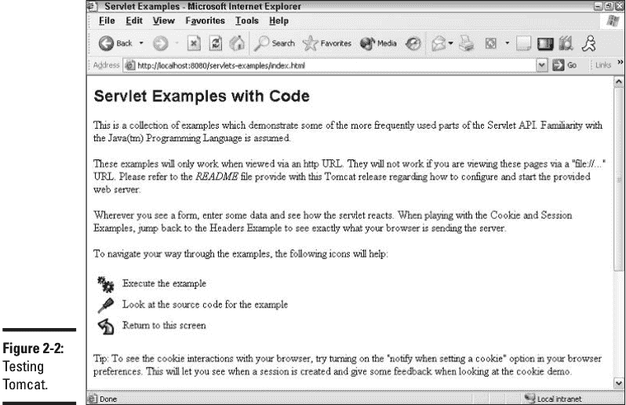

**图 2-2：** 测试 Tomcat。


# 创建简单的 Servlet

好了，配置相关的内容就到此为止；现在你可以开始编写代码了。以下章节将介绍创建简单的 Hello, World! 类型 Servlet 的基础知识。

## 导入 Servlet 包

大多数 Servlet 需要访问至少三个包——`javax.servlet`、`javax.servlet.http` 和 `java.io`。因此，你通常从这些 `import` 语句开始：

```
import java.io.*;
import javax.servlet.*;
import javax.servlet.http.*;
```

根据你的 Servlet 执行的其他处理，你可能需要额外的 `import` 语句。

## 扩展 HttpServlet 类

要创建一个 Servlet，你需要编写一个扩展 `HttpServlet` 类的类。表 2-1 列出了你可以在 Servlet 类中重写的六个方法。

### 表 2-1：HttpServlet 类

| 方法 | 调用时机 | 签名 |
|--------|------------|----------|
| doDelete | HTTP DELETE 请求 | public void doDelete(HttpServletRequest request, HttpServletResponse response) throws IOException, ServletException |
| doGet | HTTP GET 请求 | public void doGet(HttpServletRequest request, HttpServletResponse response) throws IOException, ServletException |
| doPost | HTTP POST 请求 | public void doPost(HttpServletRequest request, HttpServletResponse response) throws IOException, ServletException |
| doPut | HTTP PUT 请求 | public void doPut(HttpServletRequest request, HttpServletResponse response) throws IOException, ServletException |
| init() | Servlet 首次运行时 | public void init() throws ServletException |
| destroy() | Servlet 被销毁时 | public void destroy() |

大多数 Servlet 至少会重写 `doGet` 方法。当用户通过在浏览器地址栏中输入地址或点击指向该 Servlet 的链接来请求 Servlet 时，Servlet 引擎会调用此方法。

`doGet` 方法接收两个参数：

-   一个 `HttpServletRequest` 对象，代表来自用户的传入请求。你主要使用 `request` 参数来获取用户在表单字段中输入的数据。你将在本章后面学习如何做到这一点。
-   一个 `HttpServletResponse` 对象，代表发送回用户的响应。你使用 `response` 参数来构建发送回用户的输出内容。你将在下一节中学习如何做到这一点。

## 向 Web 页面输出内容

大多数 Servlet 的主要工作之一是编写发送回用户浏览器的 HTML 输出。为此，你首先调用 `HttpServletResponse` 类的 `getWriter` 方法。这将返回一个与响应对象相连的 `PrintWriter` 对象。因此，你可以使用熟悉的 `print` 和 `println` 方法来写入 HTML 文本。

例如，下面是一个简单 `HelloWorld` Servlet 的 `doGet` 方法：

```
public void doGet(HttpServletRequest request,
        HttpServletResponse response)
        throws IOException, ServletException
{
    PrintWriter out = response.getWriter();
    out.println("Hello, World!");
}
```

这里，`response.getWriter()` 返回的 `PrintWriter` 对象用于向浏览器发送一个简单的文本字符串。如果你运行这个 Servlet，浏览器将显示文本 `Hello, World!`。

## 以 HTML 形式响应

在大多数情况下，你不希望向浏览器发送简单的文本。相反，你希望发送格式化的 HTML。为此，你必须首先告诉响应对象输出内容是 HTML 格式。你可以通过调用 `setContentType` 方法并传入字符串 `"text/html"` 作为参数来实现。然后，你可以使用 `PrintWriter` 对象来发送 HTML。例如，清单 2-1 展示了一个发送 HTML 响应的基本 HelloWorld Servlet。

### 清单 2-1：HelloWorld Servlet

```
import java.io.*;
import javax.servlet.*;
import javax.servlet.http.*;
import java.util.*;

public class HelloWorld extends HttpServlet
{
    public void doGet(HttpServletRequest request,
            HttpServletResponse response)
            throws IOException, ServletException
    {
        response.setContentType("text/html");
        PrintWriter out = response.getWriter();
        out.println("<html>");
        out.println("<head>");
        out.println("<title>HelloWorld</title>");
        out.println("</head>");
        out.println("<body>");
        out.println("<h1>Hello, World!</h1>");
        out.println("</body>");
        out.println("</html>");
    }
}
```

这里，以下 HTML 被发送到浏览器（我添加了缩进以展示 HTML 的结构）：

```
<html>
  <head>
    <title>HelloWorld</title>
  </head>
  <body>
    <h1>Hello, World!</h1>
  </body>
</html>
```

运行后，HelloWorld Servlet 将生成如图 2-3 所示的页面。

显然，你需要对 HTML 有扎实的理解才能编写 Servlet。如果 HTML 对你来说像一门外语，那么在继续深入之前，你需要挑选一本好的 HTML 书籍，例如 Ed Tittel 和 Natanya Pitts 所著的 *《HTML 4 入门经典》*。供你参考，表 2-2 汇总了本书中使用的所有 HTML 标签。

图 2-3：在浏览器中显示的 HelloWorld Servlet。

### 表 2-2：够用的 HTML 知识

| HTML 标签 | 描述 |
|---|---|
| `<html>`、`</html>` | 标记 HTML 文档的开始和结束。 |
| `<head>`、`</head>` | 标记 HTML 文档头部部分的开始和结束。 |
| `<title>`、`</title>` | 标题元素。开始和结束标签之间的文本显示在浏览器窗口的标题栏中。 |
| `<body>`、`</body>` | 标记 HTML 文档主体部分的开始和结束。文档的内容在这些标签之间提供。 |
| `<h1>`、`</h1>` | 这些标签之间的文本被格式化为一级标题。 |
| `<h2>`、`</h2>` | 这些标签之间的文本被格式化为二级标题。 |
| `<h3>`、`</h3>` | 这些标签之间的文本被格式化为三级标题。 |
| `<form action="url", method="method">` | 标记表单的开始。`action` 属性指定表单提交到的页面、Servlet 或 JSP 的名称。`method` 属性可以是 GET 或 POST；它指示发送到服务器的 HTTP 请求类型。 |
| `</form>` | 标记表单的结束。 |
| `<input type="type", name="name">` | 创建一个输入字段。指定 `type="text"` 来创建文本字段，或指定 `type="submit"` 来创建提交按钮。`name` 属性提供你在程序中用来获取用户输入数据的名称。 |
| `&nbsp;` | 一个不间断空格。 |

## 运行 Servlet

那么具体如何运行一个 Servlet 呢？首先，你必须将编译后的类文件移动到 Tomcat 可以运行该 Servlet 的目录中。出于测试目的，你可以将 Servlet 的类文件移动到 `c:\tomcat\webapps\ROOT\WEB-INF\classes`。然后，在浏览器的地址栏中输入如下地址：

http://localhost:8080/servlet/HelloWorld

你可能还想重写 `doPost` 方法。当用户通过表单请求你的 Servlet 时，会调用此方法。在许多情况下，你只需在 `doPost` 方法中调用 `doGet`，这样 GET 和 POST 请求都会以相同的方式处理。

如你所知，每当用户在地址栏中输入你的 Servlet 地址或点击指向你的 Servlet 的链接时，`doGet` 方法都会被调用。但是许多——即使不是大多数——Servlet 与 HTML 表单相关联，这些表单提供了用户可以输入数据的字段。从浏览器向服务器发送表单数据的正常方式是使用 HTTP POST 请求，而不是 GET 请求。

如果你希望 Servlet 响应 POST 请求，你可以重写 `doPost` 方法来替代或同时配合 `doGet` 方法。除了方法名不同之外，`doPost` 与 `doGet` 具有相同的签名。事实上，经常可以看到 Servlet 中的 `doPost` 方法只是简单地调用 `doGet`，从而使 POST 和 GET 请求得到相同的处理。要实现这一点，可以像这样编写 `doPost` 方法：

```
public void doPost(HttpServletRequest request,
    HttpServletResponse response)
    throws IOException, ServletException
{
    doGet(request, response);
}
```

## 改进的 HelloWorld Servlet

前面清单 2-1 中展示的 HelloWorld Servlet 并不是非常有趣，因为它总是发送相同的文本。从本质上讲，它是一个静态 Servlet，这在很大程度上违背了使用 Servlet 的初衷。你同样可以轻松地提供一个静态 HTML 页面。

清单 2-2 展示了一个更具动态性的 HelloWorld Servlet 的代码。该版本随机显示六种不同问候语中的一种。它使用 `Math` 类的 `random` 方法从 1 到 6 中随机选取一个数字，然后

## 624 改进的 HelloWorld Servlet

使用此数字来决定显示哪个问候语。它还覆盖了 doPost 方法以及 doGet 方法，因此 POST 和 GET 请求的处理方式相同。

**清单 2-2：Hello Servlet**

```java
import java.io.*;
import javax.servlet.*;
import javax.servlet.http.*;
import java.util.*;

public class HelloServlet extends HttpServlet
{
    public void doGet(HttpServletRequest request,
        HttpServletResponse response)
        throws IOException, ServletException
    {
        response.setContentType("text/html");
        PrintWriter out = response.getWriter();
        String msg = getGreeting();
        out.println("<html>");
        out.println("<head>");
        out.println("<title>HelloWorld Servlet</title>");
        out.println("</head>");
        out.println("<body>");
        out.println("<h1>");
        out.println(msg);
        out.println("</h1>");
        out.println("</body>");
        out.println("</html>");
    }
    public void doPost(HttpServletRequest request,
        HttpServletResponse response)
        throws IOException, ServletException
    {
        doGet(request, response);
    }

    private String getGreeting()
    {
        String msg = "";
        int rand = (int)(Math.random() * (6)) + 1;
        switch (rand)
        {
            case 1:
                return "Hello, World!";
            case 2:
                return "Greetings!";
            case 3:
                return "Felicitations!";
            case 4:
                return "Yo, Dude!";
            case 5:
                return "Whasssuuuup?";
            case 6:
                return "Hark!";
        }
        return null;
    }
}
```

## 从用户获取输入

如果 Servlet 被来自表单提交的 HTTP GET 或 POST 请求调用，可以调用 `request` 对象的 `getParameter` 方法来获取用户在每个表单字段中输入的值。例如：

```java
String name = request.getParameter("name");
```

这里，从名为 `name` 的表单输入字段中检索输入的值，并将其赋值给 `String` 变量 `name`。

## 使用表单

如你所见，在 Servlet 中检索用户输入的数据很容易。困难的部分是创建一个用户可以在其中输入数据的表单。有两种基本方法来实现这一点。一种是使用单独的 HTML 文件来创建表单。例如，清单 2-3 展示了一个名为 `InputServlet.html` 的 HTML 文件，它显示了图 2-4 中所示的表单。

### 清单 2-3：InputServlet.html 文件

```html
<html>
  <head>
    <title>Input Servlet</title>
  </head>
  <body>
    <form action="/servlet/InputServlet" method="post">
      Enter your name:&nbsp;
      <input type="text" name="Name">
      <br><br>
      <input type="submit" value="Submit">
    </form>
  </body>
</html>
```

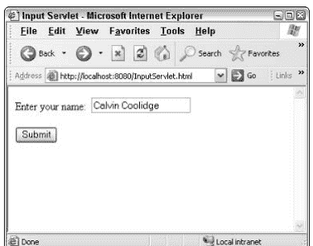

**图 2-4：** 一个简单的输入表单。

此表单中 `form` 标签的 `action` 属性指定了表单提交时调用 `/servlet/InputServlet`，`method` 属性表示表单通过 POST 而非 GET 请求提交。

该表单本身包含一个名为 `name` 的输入文本字段和一个提交按钮。没什么花哨的；刚好足够从用户那里获取一些文本并将其发送给 Servlet。

## InputServlet Servlet

清单 2-4 展示了一个可以检索清单 2-3 中表单数据的 Servlet。

```java
import java.io.*;
import javax.servlet.*;
import javax.servlet.http.*;

public class InputServlet extends HttpServlet
{
    public void doGet(HttpServletRequest request,
            HttpServletResponse response)
            throws IOException, ServletException
    {
        String name = request.getParameter("Name");

        response.setContentType("text/html");
        PrintWriter out = response.getWriter();
        out.println("<html>");
        out.println("<head>");
        out.println("<title>Input Servlet</title>");
        out.println("</head>");
        out.println("<body>");
        out.println("<h1>");
        out.println("Hello " + name);
        out.println("</h1>");
        out.println("</body>");
        out.println("</html>");
    }

    public void doPost(HttpServletRequest request,
            HttpServletResponse response)
            throws IOException, ServletException
    {
        doGet(request, response);
    }
}
```

如你所见，这个 Servlet 与清单 2-1 中的第一个 HelloWorld Servlet 并没有太大不同。最大的区别在于它检索用户在 `name` 字段中输入的值，并将其用于发送到响应 `PrintWriter` 对象的 HTML 中。例如，如果用户在 `name` 输入字段中输入 `Calvin Coolidge`，则生成以下 HTML：

```html
<html>
  <head>
    <title>HelloWorld</title>
  </head>
  <body>
    <h1>Hello Calvin Coolidge</h1>
  </body>
</html>
```

因此，页面上显示消息 `Hello Calvin Coolidge`。

尽管真实的 Servlet 做的不仅仅是重复用户输入的信息，但大多数都遵循这种令人惊讶的简单结构，当然也有一些变化。例如，实际的 Servlet 会验证输入数据，如果用户输入了不正确的数据或遗漏了重要数据，则会显示错误消息。而且大多数实际的 Servlet 会从文件或数据库中检索或更新数据。即便如此，基本结构还是差不多的。

## 在 Servlet 中使用类

开发 Servlet 时，经常需要访问其他已创建的类，例如从文件或数据库中检索数据的 IO 类、提供数据验证等常用功能的工具或辅助类，以及可能代表客户或产品等业务对象的类。要做到这一点，只需将类文件保存在 Servlet 主目录的 `classes` 目录中，对于本章来说，该目录是 `c:\tomcat\webapps\ROOT\WEB-INF\classes`。

为了说明使用多个类的 Servlet，图 2-5 展示了一个从文本文件中读取电影列表的 Servlet 的输出。此 Servlet 使用了三个类：

- **Movie**：代表单个电影的类。
- **MovieIO**：一个具有名为 `getMovies` 的静态公共方法的类。此方法返回一个 `ArrayList` 对象，包含从文件中读取的所有电影。
- **ListFiles**：主 Servlet 类。它调用 `MovieIO.getMovies` 类来获取电影的 `ArrayList`，然后在页面上显示电影。

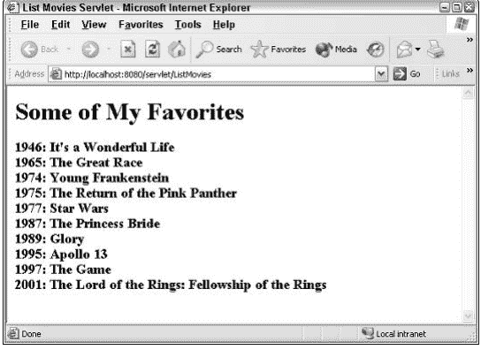

`Movie` 类的代码如清单 2-5 所示。如你所见，这个类内容不多：它定义了三个公共字段（`title`、`year` 和 `price`）以及一个构造函数，允许你创建新的 `Movie` 对象并初始化这三个字段。请注意，此 Servlet 未使用 `price` 字段。

### 清单 2-5：Movie 类

```java
public class Movie
{
    public String title;
    public int year;
    public double price;

    public Movie(String title, int year, double price)
    {
        this.title = title;
        this.year = year;
        this.price = price;
    }
}
```

清单 2-6 展示了 MovieIO 类。此类使用了 Book VIII 第 2 章中介绍的文件 I/O 功能从文本文件读取数据。该文本文件使用制表符分隔字段，包含以下行：

```
It's a Wonderful Life	1946	14.95
The Great Race	1965	12.95
Young Frankenstein	1974	16.95
The Return of the Pink Panther	1975	11.95
Star Wars	1977	17.95
The Princess Bride	1987	16.95
Glory	1989	14.95
Apollo 13	1995	19.95
The Game	1997	14.95
The Lord of the Rings: The Fellowship of the Ring	2001	19.95
```

这里，箭头代表文件中的制表符。我在这里不会详细介绍这个类的细节，只想指出 `getMovies` 是类中唯一的公共方法，而且它是静态的，因此你不必创建 MovieIO 类的实例来使用它。有关此类的详细工作原理，请参阅 Book VIII 第 2 章。

### 清单 2-6：MovieIO 类

```java
import java.io.*;
import java.util.*;

public class MovieIO
{
    public static ArrayList<Movie> getMovies()
    {
        ArrayList<Movie> movies = new ArrayList<Movie>();
        BufferedReader in =
            getReader("c:\\data\\movies.txt");
        Movie movie = readMovie(in);
        while (movie != null)
        {
            movies.add(movie);
            movie = readMovie(in);
```


# 630 在 Servlet 中使用类

```java
private static BufferedReader getReader(String name)
{
    BufferedReader in = null;
    try
    {
        File file = new File(name);
        in = new BufferedReader(
            new FileReader(file) );
    }
    catch (FileNotFoundException e)
    {
        System.out.println("The file doesn't exist.");
        System.exit(0);
    }
    catch (IOException e)
    {
        System.out.println("I/O Error");
        System.exit(0);
    }
    return in;
}

private static Movie readMovie(BufferedReader in)
{
    String title;
    int year;
    double price;
    String line = "";
    String[] data;

    try
    {
        line = in.readLine();
    }
    catch (IOException e)
    {
        System.out.println("I/O Error");
        System.exit(0);
    }

    if (line == null)
        return null;
    else
    {
        data = line.split("\t");
        title = data[0];
        year = Integer.parseInt(data[1]);
        price = Double.parseDouble(data[2]);
        return new Movie(title, year, price);
    }
}
```

清单 2-7 展示了 ListMovie Servlet 类的代码。

# 清单 2-7：LISTMOVIE SERVLET 类

```java
import java.io.*;
import javax.servlet.*;
import javax.servlet.http.*;
import java.util.*;

public class ListMovies extends HttpServlet
{
    public void doGet(HttpServletRequest request,
        HttpServletResponse response)
            throws IOException, ServletException
    {
        response.setContentType("text/html");
        PrintWriter out = response.getWriter();
        String msg = getMovieList();
        out.println("<html>");
        out.println("<head>");
        out.println("<title>List Movies Servlet</title>");
        out.println("</head>");
        out.println("<body>");
        out.println("<h1>Some of My Favorites</h1>");
        out.println("<h3>");
        out.println(msg);
        out.println("</h3>");
        out.println("</body>");
        out.println("</html>");
    }

    public void doPost(HttpServletRequest request,
        HttpServletResponse response)
            throws IOException, ServletException
    {
        doGet(request, response);
    }

    private String getMovieList()
    {
        String msg = "";
        ArrayList<Movie> movies = MovieIO.getMovies();
        for (Movie m : movies)
        {
            msg += m.year + ": ";
            msg += m.title + "<br>";
        }
        return msg;
    }
}
```

以下段落描述了其每个方法的作用：

+   8 `doGet` 方法调用 `getMovieList` 方法，获取一个字符串，其中包含所有电影的列表，各项之间用换行标签分隔。然后，它使用一系列 `out.println` 语句来编写 HTML，以显示此列表。

+   28 `doPost` 方法只是简单地调用 `doGet` 方法。这样，无论 servlet 是由 GET 还是 POST 请求调用，都能正常工作。

+   35 `getMovieList` 方法调用 `MovieIO.getMovies` 方法，获取一个 `ArrayList`，其中包含从文件读取的所有电影。然后，它使用增强的 `for` 循环来检索每个 `Movie` 对象。每部电影的年份和标题被添加到 `msg` 字符串中，并用 `<br>` 标签分隔。

# 第 3 章：使用 Java Server Pages

## 本章内容

- 了解 servlet 的工作原理
- 使用页面指令
- 尝试表达式
- 使用脚本小段
- 编写声明
- 理解类

在上一章中，你学习了如何创建 servlet，通过 `response.out` 访问的 `PrintWriter` 对象直接将 HTML 数据写入页面。虽然这种技术可行，但它有一个主要缺点：你必须手动将 HTML 作为一堆字符串字面量来编写。如果 HTML 有错误，你只有在运行 servlet 查看其外观时才能发现。而且，在 `out.println` 语句中手工编写 HTML 绝对不是创建美观网页的最有效方式。

这正是 *Java Server Pages*（通常简称 *JSP*）的用武之地。JSP 是一个 HTML 文件，其中在特殊标签中嵌入了 Java servlet 代码。当你运行 JSP 时，所有的 HTML 会自动作为响应的一部分发送，连同你在 JSP 文件中嵌入的 Java 代码所创建的任何 HTML。因此，JSP 免去了你编写所有那些 `out.println` 语句的麻烦。

在本章中，你将学习如何创建基本的 Java Server Pages。然后，在下一章，我将向你展示如何将称为 *JavaBeans* 的特殊 Java 类整合到你的 JSP 页面中。

## 理解 Java Server Pages

Java Server Page 是一个 HTML 文档，保存在扩展名为 `.jsp` 而非 `.htm` 或 `.html` 的文件中。与 servlet 类文件不同，你可以将 JSP 文件存储在 Web 服务器可用的任何目录中。

634 理解 Java Server Pages

当用户第一次请求 JSP 文件时，该文件会通过一个转换程序，将其转换为 Java servlet 程序并进行编译。原始 JSP 文件中的所有 HTML 都被转换为 `out.print` 语句，将 HTML 发送到响应中，而 JSP 文件中的 Java 语句则被整合到 servlet 程序中。然后，servlet 程序被执行，结果被发送回浏览器。

请注意，此转换仅在首次请求 JSP 时发生一次。此后，当用户请求 JSP 时，将直接运行 servlet 本身。

概念已经讲得够多了，现在来看代码。当你创建 JSP 时，需要将特殊的 JSP 元素与你的普通 HTML 混合在一起。你可以包含四种类型的 JSP 元素：

+   - **指令：** *指令*是一个选项设置，它影响如何从 JSP 页面构建 servlet。指令允许你执行诸如指定 servlet 所需的 `import` 语句、指定 servlet 是否是线程安全的以及在 servlet 中包含其他源文件等操作。
- **表达式：** *表达式*可以是任何 Java 表达式。表达式被求值，（如果需要）转换为字符串，结果被插入到文档中。表达式采用以下形式：`<%= expression %>`
- **脚本小段：** *脚本小段*是一系列 Java 语句，直接插入为 JSP 生成的 servlet 代码中。你几乎可以在脚本小段中做任何你想做的事情，包括 `if` 语句、循环和调用其他方法。你甚至可以使用 `out.println` 向页面添加输出；输出会插入到脚本小段所在的位置。脚本小段采用以下形式：`<% statements %>`
- **声明：** *声明*是放在 servlet 类中任何方法之外的 Java 代码。你使用声明来创建类变量或定义可由脚本小段或表达式调用的方法。声明采用以下形式：`<%! statements %>`

本章的剩余部分将向你展示如何创建包含每种这些元素的 JSP 页面。

> 遗憾的是，当前版本的 Tomcat（5.5.4）除非你进行一系列额外的配置操作，否则不支持 Java 1.5 的新特性。由于这些操作可能很危险，我在本章中避免使用 Java 1.5 的特性。希望下一版本的 Tomcat 能更好地与 Java 1.5 配合使用。

# 使用页面指令

*页面指令*是一个 JSP 元素，它设置选项以确定 JSP 如何转换为 servlet。页面指令的基本格式如下：

```
<%@ page attribute=value %>
```

*attribute* 可以是表 3-1 中列出的任何属性。（除了这些之外还有一些其他属性，但很少使用。）

| 名称 | 描述 |
|------|-------------|
| `import="package.class"` | 向 servlet 添加一条 `import` 语句，这样你就可以在其他 JSP 元素中使用类，而无需完全限定它们。 |
| `content-Type="MIME-type"` | 允许你指定 servlet 创建的文档类型。默认是 `text/html`。你很少需要更改此设置。 |
| `isThreadSafe="boolean"` | 如果为 `true`，则假定 servlet 是线程安全的。如果为 `false`，则会在 servlet 类声明中添加 `implements SingleThreadModel`，以便线程在单线程模型下运行。默认值为 `true`。 |
| `session="boolean"` | 如果为 `true`，servlet 将使用会话管理。默认值为 `true`。 |
| `buffer="size"` | 指定 `out` 变量使用的缓冲区大小。默认值取决于服务器，但不会小于 8K。 |
| `errorPage="URL"` | 指定错误页面的名称，当此 servlet 抛出未捕获的异常时显示该页面。 |
| `isErrorPage="boolean"` | 如果为 `true`，则此页面是其他某个 JSP 页面的错误页面。默认值为 `false`。 |

你最常用的页面指令是 `import`，因为它允许你导入 API 类的包，以便你可以在表达式、脚本小段和声明元素中使用它们。例如，这是一个导入 `java.util` 包的页面指令：

```
<%@ page import="java.util.*" %>
```

你可以在 JSP 文档中的任何位置放置页面指令，但我建议将它们放在顶部或靠近顶部的位置。


## 使用表达式

JSP*表达式*是任何可计算为字符串的 Java 表达式。实际上，表达式并不需要直接求值。例如，以下是如何使用 `java.util.Date` 类来显示当前日期和时间：

```
<%=new java.util.Date()%>
```

此表达式创建了 `java.util.Date()` 类的一个新实例，该实例表示当前的日期和时间。`toString()` 方法会被隐式调用，将此对象转换为字符串。

如果你包含了 `page import` 指令，就可以省略此表达式中的限定名。例如：

```
<%@ page import="java.util" %>
<%=new Date()%>
```

要使用表达式完成更有趣的操作，可以使用*预定义变量*，也称为*隐式对象*。这些是在整个 JSP 页面中对表达式、脚本小程序或声明都可用的 Java 变量。表 3-2 列出了最常用的 JSP 隐式对象。

表 3-2 | 隐式对象
--- | ---
**名称** | **说明**
`out` | 用于向响应中写入数据，等同于 Servlet 中的 `response.getWriter()`。
`request` | 请求对象，等同于 Servlet 的 `doGet` 或 `doPost` 方法中的 `request` 参数。
`response` | 响应对象，等同于 Servlet 的 `doGet` 或 `doPost` 方法中的 `response` 参数。
`session` | 用于管理会话。等同于 Servlet 中的 `request.getSession()`。

隐式对象的工作方式与其在 Servlet 中对应的对象相同。例如，`response` 对象实际上就是传递给 `doGet` 或 `doPost` 方法的 `response` 参数。

在表达式中最常用的隐式对象是 `request` 对象。特别是，你可以使用它的 `getParameter` 方法来获取用户在表单中输入的值。例如，以下表达式显示名为 `Name` 的输入字段中输入的值：

```
<%= request.getParameter("Name")%>
```

Name 字段的值会被插入到该表达式在 JSP 文件中出现的任何位置。例如，以下是一个名为 `InputJSP.jsp` 的简单 JSP，它显示一个输入文本框和一个按钮。当用户点击按钮时，他在输入字段中输入的任何文本都会显示在按钮下方：

```
<html>
  <head>
    <title>Input JSP</title>
  </head>
  <body>
    <form action="InputJSP.jsp" method="post">
      Enter some text:&nbsp;
      <input type="text" name="Text">
      <br><br>
      <input type="submit" value="Submit">
    </form><br>
    <h3>You entered:&nbsp;
    <%= request.getParameter("Text")%></h3>
  
  </body>
</html>
```

此 JSP 的 HTML 定义了一个表单，其中包含一个名为 `Text` 的输入文本字段和一个提交按钮。当用户点击提交按钮时，会向服务器发送一个 HTTP POST 请求来请求 `InputJSP.jsp`。用户输入的任何文本会随请求一起发送。当 Servlet 运行时，文本通过表达式 `request.getParameter("Text")` 被检索出来并显示在按钮下方。图 3-1 展示了此 Servlet 的运行效果。

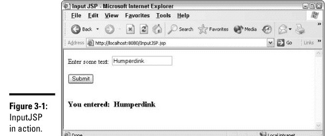

**注意：** 表达式还可以调用通过声明元素添加到 JSP 中的方法。你将在本章后面的"使用声明"部分看到相关示例。

## 使用脚本小程序

脚本小程序是直接插入到 Servlet 中的一条或多条语句，插入位置就是生成周围 HTML 的 `out.print` 语句所在之处。简而言之，脚本小程序允许你将自定义代码添加到渲染页面的代码中。

脚本小程序遵循以下基本形式：

```
<% statements... %>
```

例如，以下是一个名为 `DateJSP.jsp` 的 JSP，它使用 `DateFormat` 类来格式化日期并将其显示在页面上：

```
<html>
    <%@ page import="java.text.*" %>
    <%@ page import="java.util.*" %>
    <head>
        <title>Date JSP</title>
    </head>
    <body>
        <h1>
            Today is
            <%
                DateFormat df = DateFormat.getDateInstance(
                    DateFormat.FULL);
                Date today = new Date();
                String msg = df.format(today);
                out.println(msg);
            %>
        </h1>
        <h1>Have a nice day!</h1>
    </body>
</html>
```

此 JSP 以一对 page import 指令开头，用于导入 java.text 和 java.util 包。然后，以下 Java 语句被直接插入到生成文本 "Today is" 和 "Have a nice day!" 的行之间：

```
DateFormat df
    = DateFormat.getDateInstance(DateFormat.FULL);
Date today = new Date();
String msg = df.format(today);
out.println(msg);
```

这些行创建了一个名为 `msg` 的字符串变量，然后使用 `out.println` 将字符串写入响应输出。结果是，格式化后的日期被插入到 `<h1>Today is </h1>` 和 `<h1>Have a nice day! </h1>` 之间。图 3-2 展示了此 JSP 生成的页面。

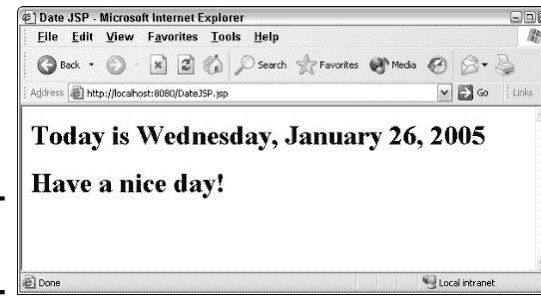

**图 3-2：** DateJSP 的运行效果。

**注意：** 脚本小程序不必向 HTML 输出中添加任何内容。在许多情况下，它们执行的是诸如将信息写入文件等操作。例如，假设你有一个 JSP，它从包含名为 `FirstName` 和 `LastName` 的输入文本字段的表单中获取数据。再假设你有一个名为 `CustFile` 的类，其中有一个名为 `writeCustomer` 的静态方法，该方法接受名字和姓氏作为参数，并将它们写入文件。以下脚本小程序获取名字和姓氏，并调用 `writeCustomer` 方法将姓名写入客户文件：

```
<% String firstName =
    request.getParameter("FirstName");
    String lastName = request.getParameter("LastName");
    CustFile.writeCustomer(firstName, lastName);
%>
```

如果你愿意，可以对脚本小程序做些巧妙的用法。没有任何规则要求你必须在单个脚本小程序中完成 `if` 或 `while` 等块语句。如果在脚本小程序末尾留一个未关闭的块，后续的任何 HTML 都会由包含在该块中的 `out.print` 语句生成。唯一的限制是你最终必须用另一个脚本小程序来关闭该块。

例如，以下是一个名为 `LoopyJSP.jsp` 的脚本小程序，它通过将一行文本包含在 `for` 循环的块中，将该行在页面上重复显示 12 次：

```
<html>
  <head>
    <title>Can't you see I'm trying to work here?</title>
  </head>
  <body>
    <% for (int i = 0; i < 12; i++)
      {
    %>
  All work and no play makes Jack a dull boy.<br>
  <%
      }
%>
</body>
</html>
```

如果你运行此脚本小程序，页面将如图 3-3 所示。

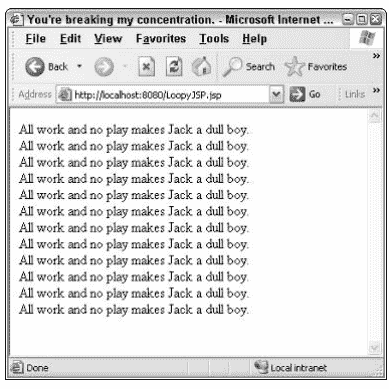

**警告！** 显然，这种编程结构容易出错。我建议你尽可能避免使用它。

## 使用声明

声明是包含在 Servlet 中但在任何方法之外的代码。声明用于创建可在表达式、脚本小程序或其他声明中使用的类变量或方法。声明遵循以下格式：

```
<%! statements... %>
```

你可以将声明放在 JSP 中的任何位置。

以下 Servlet 声明了一个名为 `count` 的静态类字段，每次显示页面时该字段递增：

```
<html>
	<%@ page import="java.text.*" %>
	<%@ page import="java.util.*" %>

	<head>
		<title>Counter JSP</title>
	</head>
	<body>
	    <h1>
	        This JSP has been displayed <%= count++ %>
	        time.</h1>
	    </body>
</html>

<%!
private static int count = 1;
%>
```

在此 Servlet 中，`count` 变量由 JSP 文档末尾的声明元素声明：

```
<%!
private static int count = 1;
%>
```

然后，文档主体中的表达式显示并递增 `count` 变量：

```
<%= count++ %>
```

运行后，JSP 将显示自服务器启动以来页面被显示的次数。

以下是另一个示例，这次声明了一个在表达式中调用的方法：

```
<html>
  <%@ page import="java.text.*" %>
  <%@ page import="java.util.*" %>
  <head>
    <title>Date JSP</title>
  </head>
  <body>
    <h1>
      Today is <%= getDate() %></h1>
    <h1>Have a nice day!</h1>
  </body>
</html>
```

```
<%!
private String getDate()
{
    DateFormat df =
        DateFormat.getDateInstance(DateFormat.FULL);
    Date today = new Date();
    return df.format(today);
}
%>
```


## 使用类

本文档末尾声明的方法返回当前日期的字符串表示。随后，通过表达式 `<%= getDate() %>` 将日期插入文档中。

大多数 JSP 应用都足够复杂，需要额外的类来保持代码的可管理性。例如，你可能需要创建处理应用程序文件或数据库 I/O 的类，或者创建代表业务对象（如 `Products` 或 `Customers`）的类。

设置 Tomcat 以使用类可能有点棘手，但遵循以下简单准则就会变得容易：

-   将所有类包含在包中。为你的应用选择一个合适的包名，然后在每个类文件的开头添加 `package` 语句。

-   将类文件（不一定是源文件）存储在 JSP 页面存储目录下的 `WEB-INF\classes\package\` 目录中。例如，如果你将 JSP 页面存储在 `c:\tomcat\webapps\ROOT\Movies`，并且使用的包名是 movie，则将类文件保存在以下目录：

    `C:\tomcat\webapps\ROOT\Movies\WEB-INF\classes\movie`

-   或者，你可以将类文件保存在 `c:\tomcat\shared\classes\package` 中，其中 *package* 是你的包名。这样，这些类就可以被任何 JSP 或 servlet 访问。

-   任何使用你的类的 JSP 必须包含一个导入该包的页面指令。例如

    `<%@ page import="movie.*" %>`

-   将保存包的目录添加到你的 ClassPath 环境变量中。注意，你需要添加包含包的目录，而不是包含类本身的目录。这是因为 Java 编译器使用包名来查找包目录。所以，如果你将类放在 `shared\classes` 目录中，你需要将 `c:\tomcat\shared\classes` 添加到你的 ClassPath。

为了说明 JSP 如何使用类，图 3-4 展示了一个列出 `movies.txt` 文件中电影的 JSP。

显示此页面的 JSP 文件如代码清单 3-1 所示。JSP 文件本身存储在 `c:\tomcat\webapps\ROOT` 中。

### 代码清单 3-1：ListMovies.JSP

```
<!doctype html public "-//W3C//DTD HTML 4.0
Transitional//EN">
<%@ page import="movie.*" %>
<%@ page import="java.util.*" %>
<html>
    <head>
        <title>List Movies: The Servlet</title>
    </head>
    <body>
        <h1>Some of My Favorites</h1>
        <h3>
            <%= getMovieList() %>
        </h3>
    </body>
</html>

<%!
    private String getMovieList()
    {
        String msg = "";
        ArrayList movies = MovieIO.getMovies();
        for (int i = 0; i < movies.size(); i++)
        {
            Movie m = (Movie)movies.get(i);
            msg += m.year + ": ";
            msg += m.title + "<br>";
        }
        return msg;
    }
%>
```

以下是此 JSP 关键行的解释：

-   3 该 JSP 包含两个页面指令，分别导入 `movie` 和 `java.util` 包。

-   12 使用一个表达式调用 `getMovieList` 方法，该方法返回要显示的电影列表（作为字符串）。

-   18 `getMovieList` 方法在声明中定义。

-   21 调用 `MovieIO` 类的 `getMovies` 方法，以检索包含 `movies.txt` 文件中所有电影的 `ArrayList`。注意，我没有为 `ArrayList` 类指定类型。这是因为 Tomcat 在没有额外配置的情况下无法处理泛型所需的语法。

### 644 使用类

→22 使用传统的 `for` 循环而非增强型 `for` 循环从 `ArrayList` 中获取电影。同样，这是为了避免使用 Java 1.5 的特性。

→24 从 `ArrayList` 中检索 `Movie` 对象，并将年份和标题添加到 `msg` 字符串中。注意，从 `ArrayList` 检索的对象必须转换为 `Movie` 对象。

→28 返回完成的 `msg` 字符串。

代码清单 3-2 展示了 `Movie` 类。这里没有特别需要注意的地方，除了将 `Movie` 类放入 `movie` 包的 `package` 语句。从这个 `.java` 文件编译的类文件保存在 `c:\tomcat\shared\classes\movie` 中。

```
代码清单 3-2: MOVIE.JAVA

package movie;

public class Movie
{
    public String title;
    public int year;
    public double price;

    public Movie(String title, int year, double price)
    {
        this.title = title;
        this.year = year;
        this.price = price;
    }
}
```

最后，代码清单 3-3 展示了 `MovieIO` 类。该类从文本文件中读取电影数据。关于此类工作原理的详细解释，请跳转到第八部分，第2章。注意，这个类与 `Movie` 类一样，包含一个 `package` 语句，将 `MovieIO` 类放入 `movie` 包中。从这个 `.java` 文件编译的类文件保存在 `c:\tomcat\shared\classes\movie` 中。

```
package movie;

import java.io.*;
import java.util.*;

public class MovieIO
{
    public static ArrayList<Movie> getMovies()
    {
        ArrayList<Movie> movies = new ArrayList<Movie>();
        BufferedReader in =
            getReader("g:\\data\\movies.txt");
        Movie movie = readMovie(in);
        while (movie != null)
        {
            movies.add(movie);
            movie = readMovie(in);
        }
        return movies;
    }

    private static BufferedReader getReader(String name)
    {
        BufferedReader in = null;
        try
        {
            File file = new File(name);
            in = new BufferedReader(
                new FileReader(file) );
        }
        catch (FileNotFoundException e)
        {
            System.out.println("The file doesn't exist.");
```

### 代码清单 3-3 (续)

```
            System.exit(0);
        }
        catch (IOException e)
        {
            System.out.println("I/O Error");
            System.exit(0);
        }
        return in;
    }

    private static Movie readMovie(BufferedReader in)
    {
        String title;
        int year;
        double price;
        String line = "";
        String[] data;

        try
        {
            line = in.readLine();
        }
        catch (IOException e)
        {
            System.out.println("I/O Error");
            System.exit(0);
        }

        if (line == null)
            return null;
        else
        {
            data = line.split("\t");
            title = data[0];
            year = Integer.parseInt(data[1]);
            price = Double.parseDouble(data[2]);
            return new Movie(title, year, price);
        }
    }
}
```

## 第四章：使用 JavaBeans

### 本章内容

-   什么是 JavaBean？
-   创建你自己的 JavaBean 类
-   在 JSP 页面中使用 JavaBeans
-   使用会话作用域创建一个简单的购物车

*JavaBean* 是一种特殊类型的 Java 类，你可以通过多种有趣的方式来使用它，从而简化程序开发。一些 bean，如 Swing 组件，被设计为可视组件，可以在 GUI 编辑器中使用以快速构建用户界面。其他 bean，称为 *Enterprise JavaBeans*，被设计为在特殊的 EJB 服务器上运行，可以处理大型 Web 应用程序的数据访问和业务逻辑。

在本章中，我将探讨一种更简单的 JavaBean 类型，旨在简化构建 Java Server Pages 的任务。简而言之，你可以使用简单的 JavaBeans 来构建 Java Server Pages，而无需在 JSP 本身编写任何 Java 代码。JavaBeans 允许你通过在 JSP 页面中使用类似 HTML 的特殊标签来访问 Java 类。

### 什么是 JavaBean？

简单来说，JavaBean 是任何符合以下规则的 Java 类：

-   **它必须有一个空构造函数。** 也就是，一个不接受任何参数的构造函数。如果类根本没有构造函数，它也符合条件，因为默认构造函数没有参数。但是，如果类至少有一个接受一个或多个参数的构造函数，那么它也必须有一个无参数构造函数才能符合 JavaBean 的标准。

-   **它不能有 `public` 实例变量。** 类定义的所有实例变量必须是 `private` 或 `protected` 的。

-   **它必须提供名为 `getProperty` 和 `setProperty` 的方法** 来获取和设置类提供的任何*属性*的值，除了使用 `isProperty` 来获取属性值的布尔属性。术语*属性*实际上不是 Java 的官方术语。简而言之（或者应该说，在一个 *beanpod* 里？），属性是对象的任何值，可以通过 `get` 方法（如果属性是


## 查看示例 Bean

boolean）或通过 set 方法设置。例如，如果一个类有一个名为 `lastName` 的属性，它应该使用名为 `getLastName` 的方法来获取姓氏，使用 `setLastName` 方法来设置姓氏。或者，如果一个类有一个名为 `taxable` 的布尔属性，设置它的方法叫做 `setTaxable`，检索它的方法叫做 `isTaxable`。

请注意，一个类不必拥有任何属性就能成为 JavaBean，但如果它有属性，则必须按照这种命名模式来访问属性。此外，并非所有属性都必须同时拥有 `get` 和 `set` 访问器。*只读属性*可以只有 `get` 访问器，*只写属性*可以只有 `set` 访问器。

在访问属性的方法中，属性名的首字母会被大写，但属性名本身不会。因此，`setAddress` 设置的是名为 `address` 的属性，而不是 `Address`。

就这么简单。更高级的 bean 还可以具有其他特性，使它们拥有可视界面，从而可以在 IDE 中以拖放方式使用。还有一些 bean 实现了某个接口，允许将其状态写入输出流，以便稍后重新创建。但这些功能是可选的；任何满足上述三个标准的类都是一个 bean，可以在 JSP 页面中作为 bean 使用。

你已经见过很多类拥有名为 `getCount` 和 `setStatus` 这样的方法。这些名称是 *访问器模式*（Accessor pattern）的一部分，该模式在第三册第 2 章中介绍。因此，你在本书中已经见过许多 bean 的示例，而且你可能已经自己编写过许多 bean 类了。

任何符合这种模式的类都是一个 bean。没有需要继承的 `JavaBean` 类，也没有需要实现的 `Bean` 接口才能成为 bean。一个类成为 bean 唯一需要做的就是遵循这种模式。

## 查看示例 Bean

清单 4-1 展示了一个名为 `Triangle` 的示例 JavaBean 类，它用于计算勾股定理——即在已知两条短边长度的情况下计算直角三角形的长边。这个类定义了三个属性：`sideA` 和 `sideB` 代表三角形的两条短边，`sideC` 代表长边。使用这个 bean 的常规方式是先使用 `setSideA` 和 `setSideB` 方法将 `sideA` 和 `sideB` 属性设置为短边的长度，然后使用 `getSideC` 方法获取长边的长度。

万一你已经不记得高中时学过的内容，长边等于第一条短边的平方加上第二条短边的平方，再对结果取平方根。

### 清单 4-1：TRIANGLE BEAN

```java
package calculators;

public class Triangle
{
    private double sideA;
    private double sideB;

    public Triangle()
    {
        this.sideA = 0.0;
        this.sideB = 0.0;
    }

    public String getSideA()
    {
        return Double.toString(this.sideA);
    }

    public void setSideA(String value)
    {
        try
        {
            this.sideA = Double.parseDouble(value);
        }
        catch (Exception e)
        {
            this.sideA = 0.0;
        }
    }

    public String getSideB()
    {
        return Double.toString(this.sideB);
    }

    public void setSideB(String value)
    {
        try
        {
            this.sideB = Double.parseDouble(value);
        }
        catch (Exception e)
        {
            this.sideB = 0.0;
        }
    }

    public String getSideC()
    {
        if (sideA == 0.0 || sideB == 0.0)
            return "Please enter both sides.";
        else
        {
            Double sideC;
            sideC = Math.sqrt(
                (sideA * sideA) + (sideB * sideB));
            return Double.toString(sideC);
        }
    }
}
```

以下段落指出了这个 bean 类的要点：

- 与大多数 servlet 类一样，这个 bean 是一个包的一部分。在这个例子中，包名为 `calculators`。（我假设如果你需要一个计算勾股定理的 bean，你可能还需要其他 bean 来计算导数、质数、Demlo 数等等。你也可以将这些 bean 放在这个包中。）
- 这个类使用一对实例变量来跟踪两条短边。根据 JavaBeans 的规则，这些实例变量被声明为 `private`。
- 声明了一个无参构造函数。（严格来说，这个构造函数不必在这里显式编写，因为默认构造函数就能完成这个工作，而且两个实例变量会自动初始化为默认值零。）
- `getSideA` 方法以字符串形式返回 `sideA` 属性的值。
- `setSideA` 方法允许你使用字符串设置 `sideA` 属性的值。这个方法使用 `try/catch` 语句来捕获当字符串无法解析为 `double` 时抛出的异常。如果字符串无效，`sideA` 属性将被设置为零。
- `getSideB` 方法以字符串形式返回 `sideB` 属性的值。
- `setSideB` 方法从字符串设置 `sideB` 属性的值。同样，`try/catch` 语句会捕获所有异常，并在字符串无法解析为 `double` 时将属性设置为零。
- `getSideC` 方法计算长边的长度，然后以字符串形式返回结果。但是，如果任何一个值为零，该方法会假设用户还没有输入任何数据，因此返回一条错误消息。（这是一个合理的假设，因为三角形的任何一条边都不可能为零。）请注意，没有 `setSideC` 方法。因此，`sideC` 是一个只读属性。


> 关于勾股定理和 *《绿野仙踪》* 的一则趣闻，请参阅第三册第 2 章。

## 在 JSP 页面中使用 Bean

要在 JSP 页面中使用 bean，你需要在页面中添加特殊标签来创建 bean、设置其属性和检索其属性。表 4-1 列出了这些标签，接下来的各节将描述使用每个标签的详细信息。

| 标签 | 描述 |
|---|---|
| `<jsp:useBean id="name" class="package.class" />` | 建立对 bean 的引用，并在必要时创建实例。`id` 属性中指定的名称被其他标签用于引用该 bean。 |
| `<jsp:getProperty name="name" property="property" />` | 从 `name` 属性指定的 bean 中检索指定的属性。 |
| `<jsp:setProperty name="name" property="property" value="value" />` | 将指定属性设置为 `value` 属性中指定的值。 |
| `<jsp:setProperty name="name" property="property" param="parameter" />` | 将指定属性设置为 `param` 属性中指定的参数值。`parameter` 通常是表单字段的名称。 |
| `<jsp:setProperty name="name" property="*" />` | 将 bean 定义的所有属性设置为对应的参数值，前提是存在具有正确名称的参数。 |

### 创建 bean 实例

要在 JSP 页面中包含一个 bean，你需要在页面中添加一个特殊的 `jsp:useBean` 标签。其最简单的形式如下：

```jsp
<jsp:useBean id="name" class="package.Class" />
```

`id` 属性提供了你在 JSP 其他地方用来引用该 bean 的名称，`class` 属性提供了类的完整名称，包含包名。例如，下面是一个使用 `Triangle` bean 的 `jsp:useBean` 标签：

```jsp
<jsp:useBean id="triangle" class="calculators.Triangle" />
```

`jsp:useBean` 标签通过调用空构造函数来创建 bean 的实例（如果实例尚不存在）。但是，如果 bean 已经存在，则使用现有的实例。

关于 `jsp:useBean` 标签，你还需要了解以下几点：

- `jsp:useBean` 标签可以出现在 JSP 文档中的任何位置，但它必须出现在任何引用该 bean 的其他标签之前。
- 此标签以及所有 bean 标签都区分大小写，因此请务必按照所示方式准确编写。`<jsp:useBean . . ./>` 将无法工作。
- 如果 Tomcat 在运行 JSP 时提示找不到你的 bean，请仔细检查包名和类名——它们也区分大小写——并确保 bean 存储在 `WEB-INF\classes` 下与包名同名的目录中。例如，将 `Triangle` bean 的类文件存储在 `WEB-INF\classes\calculators` 中。
- `jsp:useBean` 元素可以包含一个正文，其中包含用于初始化属性值的 `jsp:setProperty` 标签。此时，该元素的格式更类似于正常的 HTML，具有正确的开始和结束标签。例如：

```jsp
<jsp:useBean id="t1" class="calculators.Triangle" >
    <jsp:setProperty name="t1" property="sideA" value="3.0" />
    <jsp:setProperty name="t1" property="sideB" value="3.0" />
</jsp:useBean>
```

暂时不必担心 `jsp:setProperty` 标签的细节。只需注意，它们仅在 `jsp:useBean` 标签实际创建了 bean 的新实例时才会执行。如果 bean 的实例已经存在，则不会执行 `jsp:setProperty` 标签。

- `jsp:useBean` 标签还有一个 `scope` 属性，我将在本章后面的"限定 Bean 的作用域"一节中进行说明。

### 获取属性值

要获取 bean 属性的值，请使用 `jsp:getProperty` 标签。该标签的形式很直观：

```jsp
<jsp:getProperty name="name" property="property" />
```


例如，下面是一个从上一节创建的 `Triangle` Bean 中获取 `sideC` 属性的标签：

```jsp
<jsp:getProperty name="triangle" property="sideC" />
```

`name` 属性必须与创建 Bean 的 `jsp:useBean` 标签中 `id` 属性指定的值一致。而 `property` 属性用于确定 getter 方法的名称——在本例中是 `getSideC`。

请记住，属性名必须以小写字母开头。如果你指定 `property="SideC"`，运行页面时服务器会返回错误信息。

在大多数情况下，你使用 `jsp:getProperty` 将属性的值插入到页面中。不过，你也可以用它来为 JSP 文档中的其他标签指定属性值。例如：

```html
<input type="text" name="sideA"
       value="<jsp:getProperty name='triangle'
                              property='sideA' />" >
```

这里，`sideA` 属性的值被检索出来，并用作名为 `sideA` 的输入字段的 `value` 属性。因此，当这个输入字段发送到浏览器时，其初始值就是来自 `Triangle` Bean 的值。

要特别注意匹配引号和标签的开闭括号。在这个例子中，整个 `jsp:getProperty` 标签被包含在表示输入字段 `value` 属性值的引号内。最后出现的右括号关闭了 input 元素本身。

## 设置属性值

要设置属性值，你可以使用 `jsp:setProperty` 标签的几种变体之一。如果你想将属性设置为一个字面字符串，可以这样编写标签：

```jsp
<jsp:setProperty name="triangle"
                  property="sideA"
                  value="4.0" />
```

这里，`name` 属性必须与创建 Bean 的 `jsp:useBean` 标签中的 `id` 属性匹配，`property` 属性用于确定 setter 方法的名称（本例中是 `setSideA`），而 `value` 属性提供要设置的值。

我将此标签写成三行，仅仅是因为它太长了，无法在本页的边距内写在一行。在实际应用中，大多数 JSP 开发者会将这些标签写在一行上，除非它们变得*非常*长，这种情况并不常见。

虽然这种形式的 `jsp:setProperty` 标签很有用，但 `param` 形式更有用。它允许你将属性设置为用户在表单字段中输入的值，或通过查询字符串传递给 JSP 的值。例如，如果你的 JSP 包含一个名为 `FirstSide` 的输入字段，你可以这样将该字段的值赋给 `sideA` 属性：

```html
<input type="text" name="FirstSide" >
<jsp:setProperty name="triangle"
                property="sideA"
                param="FirstSide" />
```

这里，如果用户在 `FirstSide` 字段中输入一个值，该值将被赋给 Bean 的 `sideA` 属性。

在前面的例子中，我特意使用了与 `sideA` 不同的输入字段名称，这样你就不会因为 `property` 和 `param` 属性指定相同值而感到困惑。在实际应用中，你通常会给输入字段一个与其关联属性相同的名称，如下所示：

```html
<input type="text" name="sideA" >
<jsp:setProperty name="triangle"
                property="sideA"
                param="sideA" />
```

如果你的输入字段名称与属性名称相同，你可以用一个标签将它们全部赋给对应的属性，如下所示：

```jsp
<jsp:setProperty name="triangle" property="*" />
```

这里，`property` 属性中的星号 (*) 表示所有名称与表单字段（或查询字符串参数）相同的属性将被自动赋值。对于包含大量字段的表单，这种形式的 `jsp:setProperty` 标签可以节省大量编码工作。

## 使用 Bean 的 JSP 页面

**654** 在 JSP 页面中使用 Bean


代码清单 4-2：TRIANGLE.JSP 页面

```jsp
<html>
<jsp:useBean id="triangle"
             class="calculators.Triangle" />
<jsp:setProperty name="triangle" property="*" />
<head>
    <title>Right Triangle Calculator</title>
</head>
<body>
    <h1>The Right Triangle Calculator</h1>
    <form action="Triangle.jsp" method="post">
        Side A:&nbsp;
        <input type="text" name="sideA"
               value="<jsp:getProperty
                           name='triangle'
                           property='sideA' />" >
        <br><br>
        Side B:&nbsp;
        <input type="text" name="sideB"
               value="<jsp:getProperty
                           name='triangle'
                           property='sideB' />" >
        <br><br>
        Side C:&nbsp;
        <jsp:getProperty name="triangle"
                     property="sideC" />
        <br><br>
        <input type="submit" value="Calculate" >
    </form>
</body>
</html>
```

第七册
第四章
使用 JavaBeans

以下段落解释了此 JSP 中的关键行：

- `jsp:useBean` 标签创建了一个 `calculators.Triangle` Bean 的实例，并将其命名为 `triangle`。
- `jsp:setProperty` 标签将 `sideA` 和 `sideB` 属性设置为名为 `sideA` 和 `sideB` 的相应输入字段的值。
- `form` 标签创建了一个表单，该表单使用 HTTP POST 方法回发到同一个 JSP 文件。
- 两个输入文本字段中的第一个。此字段名为 `sideA`，其初始值设置为 Bean 的 `sideA` 属性的值。
- 第二个输入文本字段名为 `sideB`。其初始值设置为 Bean 的 `sideB` 属性的值。
- 这一行是检索 `sideC` 属性的地方，从而根据边 A 和边 B 的长度计算三角形边 C 的长度。结果直接插入到文档中。
- 提交按钮提交表单，以便 `Triangle` Bean 可以执行其操作。

## 限定 Bean 的作用域

JavaBean 的 `scope` 表示 Bean 保持存活的时间。你通过在 `jsp:useBean` 标签上使用 `scope` 属性来指定作用域。`scope` 属性可以是表 4-2 中列出的四个值中的任何一个。

表 4-2 作用域设置

| 作用域 | 解释 |
| :--- | :--- |
| `page` | Bean 与当前页面关联。这意味着每次用户请求该页面时，都会创建一个新的 Bean。然后，当页面发送回浏览器时，Bean 就被销毁。因此，每次往返服务器都会创建一个 Bean 的新实例。 |
| `request` | 类似于 `page`，但 Bean 对同一请求处理的其他页面可用。此作用域对于使用多个不同 servlet 或 JSP 处理单个请求的应用程序很有用。 |
| `session` | Bean 与用户的会话关联。当用户第一次从应用程序请求页面时，会创建一个 Bean 并与该用户关联。然后，同一用户后续的其他请求将使用同一个 Bean。 |
| `application` | 应用程序的所有用户使用 Bean 的单个副本。 |

默认作用域是 `page`，这意味着每次用户请求新页面时都会创建和销毁 Bean。然而，`session` 作用域对于需要从一个页面到下一个页面跟踪用户信息的 Web 应用程序非常有用。最著名的例子是购物车，用户可以在其中选择他/她想要购买的商品。购物车的内容可以保存在会话 Bean 中。

## 购物车应用程序

图 4-2 显示了一个简单的购物车应用程序，用户可以通过单击三个按钮之一来选择购买我最近的三本书。当用户单击按钮时，一个项目将被添加到购物车中。如果用户已经将该书添加到购物车中，则数量会增加一。在图中，用户两次单击了 *Networking All-in-One Desk Reference For Dummies* 的按钮，一次单击了 *Networking For Dummies* 的按钮。

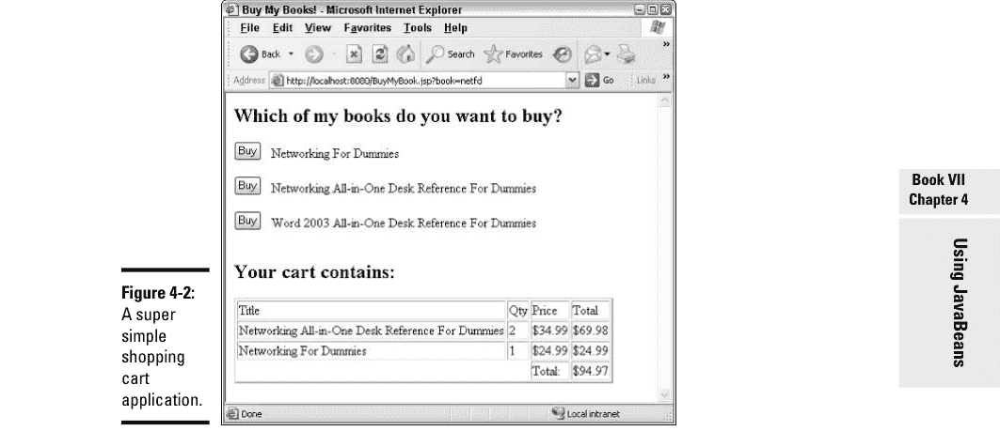

以下段落描述了使此购物车工作的关键技术：

- 购物车本身是一个 JavaBean，只有两个公共方法：`setBook`，用于将一本书添加到购物车中；`getList`，返回一个字符串，该字符串以 HTML 表格的形式漂亮地格式化显示购物车项目。
- 购物车类包含一个内部类，表示一个 `Book` 对象。为保持应用程序简单，`Book` 类将三个书名硬编码在其中。在真实的购物车程序中，你会使用文件或数据库来替代硬编码这些值。


* 页面顶部显示的产品列表实际上是三个独立的表单，每个产品对应一个表单。每个表单都通过一个查询字符串参数传递给服务器上的 JSP。该参数的名称是`book`，其值为用户订购的图书的代码。此参数绑定到购物车 bean 的`book`属性，因此当用户点击其中一个按钮时，会调用`setBook`方法，并传入通过`book`参数传递的值。这就是购物车知道用户订购了哪本书的方式。

* 在图书列表下方，JSP 使用`jsp:getProperty`标签获取`list`属性，该属性会显示购物车。

## 购物车页面

清单 4-3 显示了购物车页面的 JSP。

清单 4-3：BuyMyBook.jsp

```
<html>
<jsp:useBean id="cart" class="books.BookCart"
    scope="session"/>
<jsp:setProperty name="cart" property="*" />
<head>
    <title>Buy My Books!</title>
</head>
<body>
    <h1>Which of my books do you want to buy?</h1>
    <form action="BuyMyBook.jsp?book=netfd"
        method="post">
        <input type="submit" value="Buy" >&nbsp;&nbsp;
        Networking For Dummies<br><br>
    </form>
    <form action="BuyMyBook.jsp?book=netaio"
        method="post">
        <input type="submit" value="Buy" >&nbsp;&nbsp;
        Networking All-in-One Desk Reference For Dummies
        <br><br>
    </form>
    <form action="BuyMyBook.jsp?book=wordaio"
        method="post">
        <input type="submit" value="Buy" >&nbsp;&nbsp;
        Word 2003 All-In-One Desk Reference For Dummies
        <br><br>
    </form>
    <br><h2>Your cart contains:</h2>
    <jsp:getProperty name="cart" property="list" />
</body>
</html>
```

以下段落描述了该 JSP 中最重要的几行：

- `jsp:useBean`标签加载`books.BookCart` JavaBean，并指定其具有 session 作用域。因此，每次请求页面后该 bean 不会被删除。相反，用户在整个会话期间使用同一个 bean 实例。
- 参数属性被设置。用户第一次显示`BuyMyBook.jsp`页面时，没有参数，所以此方法不执行任何操作。但当用户点击三个表单按钮之一时，一个`book`参数会被添加到发布到服务器的 URL 末尾，因此会调用购物车的`setBook`方法。这会导致将所选图书的一个副本添加到购物车中。
- 这是第一本书的表单。每本书都有自己的表单，包含一个标签为"Buy"的提交按钮和一个书名。`action`属性指定当点击提交按钮时，表单会以`book`参数设置为`netfd`的方式发布到`BuyMyBook.jsp`。
- 第二本书的表单。此表单指定`netaio`作为`book`参数值。
- 第三本书的表单。此表单指定`wordaio`作为`book`参数值。
- 在每本书的表单之后，`jsp:getProperty`标签调用 bean 的`getList`方法。这返回一个包含 HTML 表格的字符串，该表格显示购物车的当前内容。

## BookCart JavaBean

既然你已经看到了购物车应用程序的 JSP，让我们来看看`BookCart` bean 的 Java 代码。它显示在清单 4-4 中。

```
package books;

import java.util.ArrayList;
import java.text.NumberFormat;

public class BookCart
{
    private ArrayList<Book> cart;

    private NumberFormat cf
        = NumberFormat.getCurrencyInstance();

    public BookCart()
    {
        cart = new ArrayList<Book>();
}

public void setBook(String code) {
    boolean found = false;
    for (Book b : cart)
        if (b.getCode().equals(code)) {
            b.addQuantity(1);
            found = true;
        }
    if (!found)
        cart.add(new Book(code));
}

public String getList() {
    String list = "<table border=2>";
    list += "<tr><td>Title</td><td>Qty</td>"
            + "<td>Price</td><td>Total</td></tr>";
    double total = 0.0;
    for (Book b : cart) {
        list += "<tr><td>" + b.getTitle() + "</td>"
                + "<td>" + b.getQuantity() + "</td>"
                + "<td>" + cf.format(b.getPrice()) + "</td>"
                + "<td>" + cf.format(b.getTotal()) + "</td>"
                + "</tr>";
        total += b.getTotal();
    }
    list += "<tr><td></td><td></td><td>Total:</td>"
            + "<td>" + cf.format(total) + "</td></tr>";
    list += "</table>";
    return list;
}

private class Book {
    private String code;
    private int quantity;

    public Book(String code) {
        this.code = code;
        this.quantity = 1;
    }

    public String getCode() {
        return this.code;
    }

    public String getTitle() {
        if (code.equals("netfd"))
            return "Networking For Dummies";
        else if (code.equals("neraio"))
            return "Networking All-in-One Desk "
                + "Reference For Dummies";
        else if (code.equals("wordaio"))
            return "Word 2003 All-in-One Desk "
                + "Reference For Dummies";
        else
            return "Unknown book";
    }

    public double getPrice()
    {
        if (code.equals("netfd"))
            return 24.99;
        else if (code.equals("neraio"))
            return 34.99;
        else if (code.equals("wordaio"))
            return 29.99;
        else
            return 0.0;
    }

    public int getQuantity()
    {
        return this.quantity;
    }

    public void addQuantity(int qty)
    {
        this.quantity += qty;
    }

    public double getTotal()
    {
        return this.quantity * this.getPrice();
    }
    }
}
```

以下段落描述了该 bean 的要点：

- BookCart 类位于 books 包中。
- 购物车本身作为 Book 项的私有数组列表保存在 BookCart bean 内部。
- 要成为一个 JavaBean，需要一个无参数构造函数。此构造函数只是初始化 cart 数组列表。
- `setBook`方法用于将图书添加到购物车。图书的代码作为参数传递。此方法首先查看数组列表中的所有图书，以查看用户是否已经添加了具有此代码的图书。如果是，则调用该图书的`addQuantity`方法，将该图书的订购数量增加 1。如果没有，则创建具有指定代码的新图书并将其添加到购物车中。
- 此方法构建一个包含购物车中所有图书的字符串，以 HTML 表格形式呈现。如果你不熟悉 HTML 表格，你只需要知道`<tr>`和`</tr>`标签标记每行的开始和结束，`<td>`和`</td>`标签标记行内每个单元格的开始和结束。表格为购物车中的每本图书包含一行。每行包含标题、数量、价格和小计的单元格。如果你将此方法中的代码与图 4-2 中显示的实际表格进行比较，你可以了解此方法实际创建的 HTML。

    还要注意，构建每表格行的循环会保持整个购物车的累计总额，该总额显示在表格底部的一个单独行中。此外，表格开头会显示一行标题。
- `Book`类被定义为内部类，因此它可以表示数组列表中的图书。
- `Book`类只为每本图书存储两条信息：图书代码和数量，后者表示用户订购的图书数量。其他值由返回它们的方法计算得出。
- 构造函数接受一个图书代码并初始化实例字段。请注意，数量被初始化为 1。
- `getCode`方法只是返回`code`变量。
- `getTitle`方法根据代码返回三个书名之一。如果代码不是三个预定义代码之一，则返回`Unknown book`。
- 同样，`getPrice`方法根据代码返回三个价格之一。如果代码不是三个允许代码之一，该书免费！
- `getQuantity`方法只是返回`quantity`变量。
- `addQuantity`方法将一个值加到`quantity`变量上。
- `getTotal`方法通过将价格乘以数量来计算总额。


# 第八卷

## 文件与数据库

### 第五波

作者：里奇·坦南特

> "我无法让这个'工作技能'程序在我的电脑上运行，于是更换了主板，升级了 BIOS，还编写了一个程序将其连接到我的个人数据库。结果它告诉我，我缺乏技术头脑，应该去从事销售工作。"

## 目录概览

- 第 1 章：文件操作
- 第 2 章：使用文件流
- 第 3 章：数据库，100 美元，请
- 第 4 章：使用 JDBC 连接数据库
- 第 5 章：XML 操作

## 第 1 章：文件操作

**本章内容**

- 检视 `File` 类
- 理解命令行参数
- 介绍 `JFileChooser` 类

在本章中，你将全面了解文件和目录操作的方方面面。虽然不会涉及如何读写文件，但你将学会如何在磁盘上查找文件、如何创建、删除或重命名文件，以及如何操作目录。你还将学会如何使用 Swing 文件选择器对话框，为 Swing 应用添加文件管理功能。最后，你将了解如何从命令行获取参数——这是一项实用的技术，因为命令行参数经常被用来向控制台程序传递文件信息。

### 使用 File 类

`File` 类是处理文件和目录的关键。`File` 对象代表一个文件或目录。请注意，该文件或目录实际上不一定存在于磁盘上。`File` 对象代表的是一个可能存在也可能不存在的文件。

Java 使用同一个类来表示文件和目录，因为目录实际上不过是一种特殊类型的文件。Java 的设计者本来可以创建一个单独的 `Directory` 类来表示目录，但使用同一个类来表示两者有其优势。

`File` 类位于 `java.io` 包中，因此任何使用它的程序都应导入 `java.io.File` 或 `java.io.*`。

表 1-1 列出了 `File` 类的主要构造方法和方法。

### 表 1-1：File 类

| **构造方法** | **描述** |
| :--- | :--- |
| `File(String pathname)` | 使用指定路径名创建一个文件对象。 |

| **字段** | **描述** |
| :--- | :--- |
| `String separator` | 在当前系统中用于分隔路径名各部分的字符；通常为 `\` 或 `/`。 |

| **方法** | **描述** |
| :--- | :--- |
| `boolean canRead()` | 判断文件是否可读。 |
| `boolean canWrite()` | 判断文件是否可写。 |
| `boolean createNewFile()` | 如果文件不存在，则在磁盘上创建该文件。如果文件创建成功则返回 `true`，如果文件已存在则返回 `false`。抛出 `IOException`。 |
| `boolean delete()` | 删除文件或目录。如果删除成功则返回 `true`。 |
| `boolean exists()` | 如果文件存在于磁盘上则返回 `true`，不存在则返回 `false`。 |
| `String getCanonicalPath()` | 返回文件的完整路径，在 Windows 系统上包括盘符。抛出 `IOException`。 |
| `String getName()` | 获取此文件的名称。 |
| `String getParent()` | 获取此文件或目录的父目录名称。 |
| `File getParentFile()` | 获取一个代表此文件或目录的父目录的 `File` 对象。 |
| `boolean isDirectory()` | 如果此 `File` 对象是目录则返回 `true`，是文件则返回 `false`。 |
| `boolean isFile()` | 如果此 `File` 对象是文件则返回 `true`，是目录则返回 `false`。 |
| `boolean isHidden()` | 如果此文件或目录被操作系统标记为隐藏则返回 `true`。 |
| `long lastModified()` | 返回文件最后修改的时间，以自 1970 年 1 月 1 日凌晨 0:00:00 起的毫秒数表示。 |
| `long length()` | 返回文件的大小（以字节为单位）。 |
| `String[] list()` | 返回一个 `String` 对象数组，包含此目录中每个文件和目录的名称。每个字符串是简单的文件名，不是完整路径。如果此 `File` 对象不是目录，则返回 `null`。 |
| `File[] listFiles()` | 返回一个 `File` 对象数组，代表此目录中的每个文件和目录。如果此 `File` 对象不是目录，则返回 `null`。 |
| `static File[] listRoots()` | 返回一个数组，包含 Java 运行时环境中每个可用文件系统根目录的 `File` 对象。Unix 系统通常只有一个根目录，而 Windows 系统每个驱动器都有一个根目录。 |
| `boolean mkdir()` | 从当前 `File` 对象在磁盘上创建一个目录。如果目录创建成功则返回 `true`。 |
| `boolean mkdirs()` | 从当前 `File` 对象在磁盘上创建一个目录，包括路径中列出但尚不存在的任何父目录。如果目录创建成功则返回 `true`。 |
| `boolean renameTo(File dest)` | 将 `File` 对象重命名为指定的目标 `File` 对象。如果重命名成功则返回 `true`。 |
| `boolean setLastModified(long time)` | 设置 `File` 对象的最后修改时间。如果设置成功则返回 `true`。 |
| `boolean setReadOnly()` | 将文件标记为只读。如果标记成功则返回 `true`。 |
| `String toString()` | 以字符串形式返回此文件或目录的路径名。 |

### 创建 File 对象

要创建 `File` 对象，你需要调用 `File` 构造方法，并传入一个表示文件名的字符串作为参数。例如：

```
File f = new File("hits.log");
```

这里文件名为 `hits.log`，位于当前目录中，通常是启动 Java 虚拟机时所在的目录。

如果你不想让文件位于当前目录，可以在参数字符串中提供完整路径名。但请注意，这涉及 Java 中少数几个与系统相关的领域之一，因为路径名的编写方式取决于你所使用的操作系统。例如，`c:\logs\hits.log` 是 Windows 系统上的有效路径名，但在 Unix 或 Macintosh 系统上则不行，因为它们不使用盘符，并且使用正斜杠而非反斜杠来分隔目录。

> 如果你将路径名硬编码为字符串字面量，请记住反斜杠字符在 Java 字符串中是转义字符。因此，你必须编写两个反斜杠才能在路径名中得到一个反斜杠。例如，你必须像这样编写路径 `c:\logs\hits.log`：

```
String path = "c:\\logs\\hits.log";
```

### 创建文件

创建 `File` 对象并不会在磁盘上创建文件。它只是创建了一个内存对象，代表磁盘上可能存在也可能不存在的文件或目录。要判断文件或目录是否存在，可以使用 `exists` 方法。例如：

```
File f = new File(path);
if (!f.exists())
    System.out.println("The input file does not exist!");
```

如果文件不存在，控制台上将显示一条错误信息。

要在磁盘上创建新文件，首先创建一个使用你想要的文件名的 `File` 对象。然后使用 `createNewFile` 方法，如下所示：

```
File f = new File(path);
if (f.createNewFile())
    System.out.println("File created.");
else
    System.out.println("File could not be created.");
```

注意 `createNewFile` 方法返回一个布尔值，指示文件是否创建成功。如果文件已存在，`createNewFile` 返回 `false`，因此你不必在调用 `createNewFile` 之前先使用 `exists` 方法。

使用 `createNewFile` 方法创建的文件是空的。如果你希望文件包含数据，可以使用我在下一章中介绍的类将信息写入文件。

### 获取文件信息

`File` 类的许多方法只是返回关于文件或目录的信息。例如，你可以通过调用 `File` 对象的 `isDirectory` 或 `isFile` 方法来判断它代表的是文件还是目录。其他方法可以让你判断文件是否只读或隐藏，或者获取文件的创建时间和最后修改时间。

你可以通过几种常用方式获取 `File` 对象所代表的文件名称：

- 要获取文件名，请使用 `getName` 方法。此方法返回仅包含文件名的字符串，不包含完整路径。
- 要获取创建 `File` 对象时指定的路径（如 `\logs\hit.log`），请使用 `toString` 方法。


要获取文件的完整路径——即包括驱动器盘符（对于Windows系统）以及所有指向该文件的目录和子目录的完整路径——请使用 `getCanonicalPath` 方法。该方法会移除任何系统相关的特殊性，例如相对路径、点（代表当前目录）和双点（代表父目录），从而获取文件的实际路径。

## 获取目录内容

目录是一种包含其他文件或文件列表的文件。由于目录只是一种特殊类型的文件，它由 `File` 类的对象表示。你可以通过调用特定 `File` 对象的 `isDirectory` 方法来判断它是否是一个目录。如果该方法返回 `true`，则 `File` 对象代表一个目录。然后，你可以通过调用 `listFiles` 方法获取该目录中所有文件的数组。

例如，以下代码片段列出了存储在字符串变量 `path` 中的目录路径下所有文件的名称：

```
File dir = new File(path);
if (dir.isDirectory())
{
    File[] files = dir.listFiles();
    for (File f : files)
        System.out.println(f.getName());
}
```

下面的代码片段选择性更强：它只列出文件，不列出子目录，并且不列出隐藏文件：

```
File dir = new File(path);
if (dir.isDirectory())
{
    File[] files = dir.listFiles();
    for (File f : files)
    {
        if (f.isFile() && !f.isHidden())
            System.out.println(f.getName());
    }
}
```


目录列表特别适合递归编程，因为 `listFiles` 方法返回的每个 `File` 对象本身可能又是一个目录，而这个目录又包含自己的文件和目录列表。关于递归编程以及一个递归列出目录的示例，请参见第 V 卷，第 4 章。

## 重命名文件

你可以使用 `renameTo` 方法重命名文件。该方法使用另一个 `File` 对象作为参数，该参数指定了你想要将当前文件重命名为什么。它返回一个布尔值，指示文件是否成功重命名。

例如，以下语句将名为 `hits.log` 的文件重命名为 `savedhits.log`：

```
File f = new File("hits.log");
if (f.renameTo(new File("savedhits.log")))
    System.out.println("File renamed.");
else
    System.out.println("File not renamed.");
```

根据操作系统的能力，`renameTo` 方法还可以将文件从一个目录移动到另一个目录。例如，此代码将文件 `hits.log` 从 `logs` 文件夹移动到 `savedlogs` 文件夹：

```
File f = new File("logs\\hits.log");
if (f.renameTo(new File("savedlogs\\hits.log")))
    System.out.println("File moved.");
else
    System.out.println("File not moved.");
```

始终测试 `renameTo` 方法的返回值，以确保文件已成功重命名。

## 删除文件

要删除文件，请为该文件创建一个 `File` 对象，然后调用 `delete` 方法。例如：

```
File f = new File("hits.log");
f.delete();
```

如果文件是一个目录，则该目录必须为空才能被删除。

通过一些递归编程，你可以创建一个方法来删除非空目录。该方法大致如下所示：

```
private static void deleteFile(File dir)
{
    File[] files = dir.listFiles();
    for (File f : files)
    {
        if (f.isDirectory())
            deleteFile(f);
        else
            f.delete();
    }
    dir.delete();
}
```

然后，要删除名为 `folder1` 的文件夹及其所有文件和子目录，请调用 `deleteFile` 方法：

```
deleteFile(new File("folder1"));
```

> 警告！将此功能添加到程序中极其危险！未经仔细测试请勿使用。如果不慎删除了硬盘上的所有文件，请勿归咎于我。

## 使用命令行参数

从第 I 卷，第 1 章开始，我至今为止展示的每个 Java 程序都使用了这样的结构：

```
public static void main(String[] args)
```

是时候了解 `main` 方法的 `args` 参数是用于什么的了。`args` 参数是一个字符串数组，它允许你访问用户在运行程序时指定的任何命令行参数。

例如，假设你从命令行程序运行一个名为 Test 的 Java 程序，如下所示：

```
C:\>java Test the quick brown fox
```

在这种情况下，Java 程序接收四个参数：`the`、`quick`、`brown` 和 `fox`。你可以通过 `args` 数组访问这些参数。

假设 `Test` 类的 `main` 方法编写如下：

```
public static void main(String[] args)
{
    for (String s : args)
        System.out.println(s);
}
```

那么，当使用前面几段所示的命令运行程序时，程序会在控制台显示以下输出：

```
the
quick
brown
fox
```

命令行参数在与文件打交道的 Java 程序中很有用，可以作为一种向程序传递路径名的方式。例如，下面是一个列出作为参数传递给程序的目录中所有文件的程序：

```
import java.io.*;

public class ListDirectory
{
    public static void main(String[] args)
    {
        String path = args[0];
        File dir = new File(path);
        if (dir.isDirectory())
        {
            File[] files = dir.listFiles();
            for (File f : files)
            {
                System.out.println(f.getName());
            }
        }
        else
            System.out.println("Not a directory.");
    }
}
```

## 在 Swing 应用程序中选择文件

在大多数情况下，你不会想在 Swing 应用程序中处理命令行参数。相反，你会想使用 `JFileChooser` 类让用户选择他们想要处理的文件。这个类让你只需几行代码就能显示“打开”和“保存”对话框，类似于你在其他 GUI 应用程序中见过的那些。

例如，图 1-1 显示了一个仅用两行代码创建的“打开”对话框：

```
JFileChooser fc = new JFileChooser();
int result = fc.showOpenDialog(this);
```

这段代码出现在一个扩展 `JFrame` 类的框架类中，因此 `showOpenDialog` 调用中的 `this` 关键字指的是父框架。

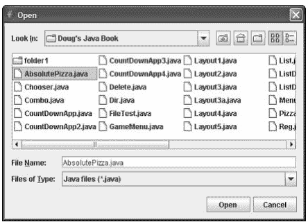

图 1-1：由 JFileChooser 类显示的“打开”对话框。

`showOpenDialog` 方法返回的结果指示用户选择打开文件还是单击“取消”。并且 `JFileChooser` 类提供了一个便捷的 `getSelectedFile` 方法，你可以用它获取用户所选文件的 `File` 对象。

关于 `JFileChooser` 类需要记住的重要一点是，它实际上并不打开或保存用户选择的文件。相反，它只是返回一个代表用户所选文件的 `File` 对象。你的程序则需要负责打开或保存该文件。

当然，`JFileChooser` 类有许多附加方法，你可以用几乎任何想象得到的方式来定制其外观和行为。表 1-2 列出了这个强大类的常用构造方法和方法。

表 1-2 JFileChooser 类
| 构造方法 | 描述 |
| :--- | :--- |
| `JFileChooser()` | 创建一个文件选择器，从用户的默认目录开始。在 Windows 系统上，这通常是“我的文档”。 |
| `JFileChooser(File file)` | 创建一个文件选择器，从 `file` 参数指示的位置开始。 |
| `JFileChooser(String path)` | 创建一个文件选择器，从 `path` 字符串指示的位置开始。 |
| 方法 | 描述 |
| `void addChoosableFileFilter(FileFilter filter)` | 向选择器添加一个文件过滤器。 |
| `File getSelectedFile()` | 返回一个代表用户所选文件的 File 对象。 |
| `File[] getSelectedFiles()` | 如果文件选择器允许多选，则返回一个代表用户所选文件的 File 对象数组。 |
| `void setAcceptAllFileFilterUsed(boolean value)` | 如果为 false，则从文件选择器中移除“所有文件”过滤器。 |
| `void setApproveButtonText(String text)` | 设置“确认”按钮的文本。 |
| `void setDialogTitle(String title)` | 设置文件选择器对话框显示的标题。 |
| `void setFileHidingEnabled(boolean value)` | 如果为 true，则不显示隐藏文件。 |
| `void setMultiSelectionEnabled(boolean value)` | 如果为 true，用户可以选择多个文件。 |
| `int showDialog(Component parent, String text)` | 显示一个自定义对话框，其中“接受”按钮的文本为指定文本。返回值为 JFileChooser.CANCEL_OPTION、APPROVE_OPTION 和 ERROR_OPTION。 |
| `void setFileSelectionMode(int mode)` | 确定用户可以选择文件、目录还是两者兼选。参数可以指定为 JFileChooser.FILES_ONLY、DIRECTORIES_ONLY 或 FILES_AND_DIRECTORIES。 |
| `int showOpenDialog(Component parent)` | 显示“打开”对话框。返回值与 showDialog 方法相同。 |
| `int showSaveDialog(Component parent)` | 显示“保存”对话框。返回值与 showDialog 方法相同。 |

## 创建“打开”对话框

正如你刚刚看到的，你只需几行代码就可以创建一个“打开”对话框。首先，调用 JFileChooser 构造方法创建一个 JFileChooser 实例。然后，调用 showOpenDialog 方法来显示“打开”对话框。


如果未向构造函数传递参数，文件选择器将从用户的默认目录开始，该目录在大多数系统上是操作系统的当前目录。如果你想从其他目录开始，有两个选择：

- 你可以为目录创建一个 `File` 对象，然后将该 `File` 对象传递给构造函数。
- 你也可以直接将要开始使用的目录路径名传递给构造函数。

`JFileChooser` 类还包含一些方法，允许你控制选择器对话框的外观。例如，你可以使用 `setDialogTitle` 方法设置标题（默认为“打开”），使用 `setFileHidingEnabled` 方法控制是否显示隐藏文件。如果你想允许用户选择多个文件，请使用 `setMultiSelectionEnabled` 方法。

`setFileSelectionMode` 方法允许你指定用户是选择文件、目录，还是两者都可选。该方法的选项需要稍作解释：

- **`JFileChooser.FILES_ONLY`：** 这是默认选项，用户只能通过文件选择器对话框选择文件。用户可以在对话框中浏览目录，但不能实际选择目录。
- **`JFileChooser.DIRECTORIES_ONLY`：** 使用此选项，用户只能选择目录，不能选择文件。此选项的一个常见用途是让用户选择应用程序文件的默认存储位置，而无需实际打开文件。
- **`JFileChooser.FILES_AND_DIRECTORIES`：** 此选项允许用户选择文件或目录。对于大多数应用程序，你希望用户选择文件或目录，但不要两者都选。因此，你可能不会经常使用此选项。

除了“打开”对话框，你还可以通过调用 `showSaveDialog` 方法显示“保存”对话框。“保存”对话框与“打开”对话框类似，但标题和“批准”按钮上显示的文本的默认值不同。除此之外，这些对话框的工作方式基本相同。

## 获取选定的文件

文件选择器对话框是一个*模态*对话框，这意味着在调用 `showOpenDialog` 方法后，你的应用程序将被阻塞，直到用户通过单击“打开”或“取消”按钮关闭对话框。

## 在 Swing 应用程序中选择文件

你可以通过检查 `showOpenDialog` 方法返回的值来确定用户单击了哪个按钮：

- 如果用户单击“打开”，此值为 `JFileChooser.APPROVE_OPTION`。
- 如果用户单击“取消”，返回值为 `JFileChooser.CANCEL_OPTION`。
- 如果发生 I/O 错误或其他错误，返回值为 `JFileChooser.ERROR_OPTION`。

假设 `showOpenDialog` 方法返回 `APPROVE_OPTION`，你可以使用 `getSelectedFile` 方法获取用户选定文件的 `File` 对象。然后，你可以在程序的其他地方使用此 `File` 对象来读取或写入数据。

综合以上，这是一个显示文件选择器对话框并返回用户选定文件的 `File` 对象的方法。如果用户取消操作或发生错误，则返回 `null`：

```
private File getFile()
{
    JFileChooser fc = new JFileChooser();
    int result = fc.showOpenDialog(null);
    File file = null;
    if (result == JFileChooser.APPROVE_OPTION)
        file = fc.getSelectedFile();
    return file;
}
```

你可以在操作事件处理程序中调用此方法，当用户单击按钮、选择菜单命令或以其他方式表示他们想要打开文件时。

## 使用文件过滤器

文件选择器对话框包含一个“文件类型”下拉列表过滤器，用户可以选择它来控制选择器显示哪些类型的文件。默认情况下，此下拉列表中唯一的选项是“所有文件”，它根本不进行任何过滤。如果你想向此列表添加另一个过滤器，必须首先创建一个扩展 `FileFilter` 抽象类的类。然后，将此类的实例传递给 `addChoosableFileFilter` 方法。

表 1-3 列出了 `FileFilter` 类的方法。幸运的是，它只有两个你需要实现的方法。此类位于 `javax.swing.filechooser` 包中。

由于某种原因，Java 设计者给这个类起了与 `java.io` 包中一个接口相同的名称，而该接口也经常在处理文件的应用程序中使用。因此，当你扩展此类时，需要使用完全限定名，如下所示：

```
class JavaFilter
    extends javax.swing.filechooser.FileFilter
```

| 方法 | 描述 |
|--------|-------------|
| public boolean abstract accept(File f) | 你必须实现此方法，如果你希望文件在选择器中显示，则返回 `true`；如果不希望显示，则返回 `false`。 |
| public String abstract getDescription() | 你必须实现此方法，以返回在选择器对话框的“文件类型”下拉列表中显示的描述字符串。 |

`getDescription` 方法仅返回“文件类型”下拉列表中显示的文本。你通常使用单个 `return` 语句实现它，返回描述。例如：

```
public String getDescription()
{
    return "Java files (*.java)";
}
```

这里，字符串 `Java files (*.java)` 将显示在“文件类型”下拉列表中。

`accept` 方法执行文件过滤的工作。文件选择器会为它显示的每个文件调用此方法。文件作为参数传递。`accept` 方法返回一个布尔值，指示是否显示该文件。

`accept` 方法可以使用任何它想要的标准来决定接受哪些文件和拒绝哪些文件。大多数过滤器基于文件名中的文件扩展名部分来实现。不幸的是，`File` 类没有返回文件扩展名的方法。但你可以使用 `getName` 方法获取名称，然后使用 `matches` 方法和正则表达式来确定文件是否是你正在查找的类型。例如，这是一个 `if` 语句，用于确定 `name` 变量中的文件名是否是 Java 文件：

```
if (name.matches(".*\\.java"))
```

这里，正则表达式匹配以任意字符序列开头并以 `.java` 结尾的字符串。（有关正则表达式的更多信息，请参阅第 V 卷，第 3 章。）

这是一个完整的文件过滤器类，用于显示扩展名为 `.java` 的文件：

```
private class javaFilter
    extends javax.swing.filechooser.FileFilter
{
    public boolean accept(File f)
    {
        if (f.isDirectory())
            return true;
        String name = f.getName();
        if (name.matches(".*\\.java"))
            return true;
        else
            return false;
    }

    public String getDescription()
    {
        return "Java files (*.java)";
    }
}
```

创建实现文件过滤器的类后，你可以通过调用 `addChoosableFileFilter` 方法并传递文件过滤器类的新实例，将文件过滤器添加到文件选择器：

```
fc.setChoosableFileFilter(new JavaFilter());
```

如果需要，你可以通过调用 `setAcceptAllFileFilterUsed` 方法移除“所有文件”过滤器，如下所示：

```
fc.setAcceptAllFileFilterUsed(false);
```

然后，只有你添加到文件选择器的过滤器会出现在“文件类型”下拉列表中。

# 第 2 章：使用文件流

## 本章内容

- 理解流
- 读取文本文件
- 写入文本文件
- 读取二进制文件
- 写入二进制文件

I/O，I/O，我开始工作去了。

或者就像这首经典歌曲所唱的，它几乎概括了计算机的全部目的。没有 I/O，计算机——以及运行在上面的程序——将毫无价值。

想象任何一个不做某种形式 I/O 的有用计算机程序都很困难。即使是本书中的第一个程序——经典的 Hello, World! 程序——也执行了 I/O：它在屏幕上显示一条简单的消息。

在本章中，你将了解 Java 中将数据输入和输出程序的最基本技术：流。在本书中，你一直在使用流。当你使用 `System.out.print` 或 `System.out.println` 方法在控制台上显示文本时，你实际上是在将数据发送到输出流。而当你使用 `Scanner` 对象从 `System.in` 获取数据时，你正在从输入流读取数据。

在本章中，你将基于已知的流 I/O 知识，了解如何使用它来读取和写入磁盘文件。

## 理解流

*流* 简单来说就是字符流向和流出程序。流的另一端可以是任何能够接受或生成字符流的东西，包括控制台窗口、打印机、磁盘驱动器上的文件，甚至另一个程序。

流不知道数据的结构或含义；流只是一系列字符。在第八卷的后续章节中，你将了解如何通过使用数据库和 XML 在更高层次上处理数据。

## 680 读取字符流

你可以大致将 Java 流式 I/O 的世界分为两大阵营：

- **字符流**：*字符流*（*Character streams*）读取和写入表示字符串的文本字符。你可以将字符流连接到文本文件，以便在磁盘上存储文本数据。通常，文本文件使用称为*分隔符*的特殊字符来分隔文件的各个元素。例如：
    - *逗号分隔文件*使用逗号来分隔各个数据字段。
    - *制表符分隔文件*使用制表符来分隔字段。
    你通常可以在文本编辑器中显示文本文件，并对其内容有一定的理解。

- **二进制流**：*二进制流*（*Binary streams*）读取和写入表示基本数据类型的单个字节。你可以将二进制流连接到*二进制文件*，以便在磁盘上存储二进制数据。二进制文件的内容对于读取和写入它们的程序来说完全有意义。然而，如果你尝试在文本编辑器中打开二进制文件，文件的内容看起来就像乱码。


从概念上讲，理解流工作原理的最棘手的部分是掌握所有不同的类。Java 有 60 多个用于处理流的类。幸运的是，对于大多数文件 I/O 应用程序，你只需要了解其中几个。在本章的其余部分，我将向你介绍用于处理字符流和二进制流的最重要类。


本章中的所有类都在 `java.io` 包中。因此，处理文件流的程序包含一条 `import java.io.*` 语句。

## 读取字符流

要通过字符流读取文本文件，你通常使用以下类：

- **File**：`File` 类在前一章中有详细介绍，它表示磁盘上的一个文件。在文件 I/O 应用程序中，`File` 类的主要目的是标识你要从中读取或写入的文件。

- **FileReader**：`FileReader` 类提供了从源自文件的字符流中读取数据的基本方法。它提供了让你逐个字符读取数据的方法。你通常不会直接处理这个类。相反，你创建一个 `FileReader` 对象来将程序连接到文件，然后将该对象传递给 `BufferedReader` 类的构造函数，后者提供对文件更高效的访问。（这个类扩展了抽象类 `Reader`，`Reader` 是各种可以从流中读取字符数据的类的基类。）

- **BufferedReader**：这个类"包装"在 `FileReader` 类周围，以提供更高效的输入。这个类为输入流添加了一个缓冲区，允许从磁盘上大块地读取输入，而不是一次读取一个字节。这可以带来巨大的性能提升。`BufferedReader` 类允许你一次读取一个字符或一行数据。在大多数程序中，你一次读取一行数据，然后使用 Java 的字符串处理功能将行拆分为单个字段。

表 2-1 列出了这些类最重要的构造函数和方法。

| 构造函数 | 描述 |
|---|---|
| BufferedReader(Reader in) | 从任何扩展 Reader 类的对象创建缓冲读取器。通常，你会向这个构造函数传递一个 FileReader 对象。 |
| FileReader(File file) | 从指定的 File 对象创建文件读取器。如果文件不存在或是目录而非文件，则抛出 FileNotFoundException。 |
| FileReader(String path) | 从指定的路径名创建文件读取器。如果文件不存在或是目录而非文件，则抛出 FileNotFoundException。 |

| 方法 | 描述 |
|---|---|
| void close() | 关闭文件。抛出 IOException。 |
| int read() | 从文件中读取单个字符并将其作为整数返回。如果已到达文件末尾，则返回 -1。抛出 IOException。 |
| String readLine() | 读取整行并将其作为字符串返回。如果已到达文件末尾，则返回 null。抛出 IOException。 |
| void skip(long num) | 跳过指定数量的字符。 |

在下面的章节中，你将了解如何读取名为 movies.txt 的文件，该文件包含十部最爱电影的每一行。文件的每一行包含电影标题、一个制表符、电影发行年份、另一个制表符，以及我在音像店购买它的价格。以下是文件的内容：

```
It's a Wonderful Life	1946	14.95
The Great Race	1965	12.95
Young Frankenstein	1974	16.95
The Return of the Pink Panther	1975	11.95
Star Wars	1977	17.95
The Princess Bride	1987	16.95
Glory	1989	14.95
Apollo 13	1995	19.95
The Game	1997	14.95
The Lord of the Rings: The Fellowship of the Ring	2001	19.95
```

（在此列表中，箭头代表制表符。）在本章后面，我将向你展示一个将数据写入此文件的程序。

如果你使用文本编辑器创建此文件，请确保你的文本编辑器正确保留制表符。

## 创建 BufferedReader

将字符流连接到文件的正常方式是使用前一章介绍的技术为文件创建一个 `File` 对象。然后，你可以调用 `FileReader` 构造函数来创建一个 `FileReader` 对象，并将此对象传递给 `BufferedReader` 构造函数以创建一个 `BufferedReader` 对象。例如：

```
File f = new File("movies.txt");
BufferedReader in = new BufferedReader(
    new FileReader(f));
```

在这里，创建了一个 `BufferedReader` 对象来读取 `movies.txt` 文件。

## 从字符流读取

要从文件读取一行，你使用 `BufferedReader` 类的 `readLine` 方法。当到达文件末尾时，此方法返回 `null`。因此，在 `while` 循环中测试 `readLine` 方法返回的字符串以处理文件中的所有行是常见的做法。

例如，此代码片段从文件中读取每一行并将其打印到控制台：

```
String line = in.readLine();
while (line != null)
{
    System.out.println(line);
    line = in.readLine();
}
```

从文件读取一行数据后，你可以使用 Java 的字符串处理功能从行中提取各个数据片段。特别是，你可以使用 `split` 方法将行拆分为由制表符分隔的各个字符串。然后，你可以使用适当的解析方法（如 `parseInt` 和 `parseDouble`）将每个字符串转换为正确的数据类型。

例如，下面是一个将从 movies.txt 文件读取的行转换为标题（字符串）、年份（int）和价格（double）的例程：

```
String[] data = line.split("\t");
String title = data[0];
int year = Integer.parseInt(data[1]);
double price = Double.parseDouble(data[2]);
```


读取完整个文件后，你可以通过调用 `close` 方法关闭流：

```
in.close();
```

## 读取 movies.txt 文件

清单 2-1 展示了一个完整但简单的程序，该程序读取 movies.txt 文件并将文件内容打印到控制台。

```
import java.io.*;
import java.text.NumberFormat;

public class ReadFile
{
    public static void main(String[] args)
    {
        NumberFormat cf = NumberFormat.getCurrencyInstance();

        BufferedReader in = getReader("movies.txt");

        Movie movie = readMovie(in);
        while (movie != null)
        {
            String msg = Integer.toString(movie.year);
            msg += ": " + movie.title;
            msg += " (" + cf.format(movie.price) + ")";
            System.out.println(msg);
            movie = readMovie(in);
        }
    }

    private static BufferedReader getReader(String name)
    {
        BufferedReader in = null;
        try
        {
            File file = new File(name);
            in = new BufferedReader(
                new FileReader(file) );
        }
        catch (FileNotFoundException e)
        {
```


## 684 读取字符流

```java
清单 2-1（续）

System.out.println("文件不存在。");
System.exit(0);
}
catch (IOException e)
{
System.out.println("I/O 错误");
System.exit(0);
}
return in;
}

private static Movie readMovie(BufferedReader in)  → 45
{
String title;
int year;
double price;
String line = "";
String[] data;

try
{
line = in.readLine();
}
catch (IOException e)
{
System.out.println("I/O 错误");
System.exit(0);
}

if (line == null)
return null;
else
{
data = line.split("\t");
title = data[0];
year = Integer.parseInt(data[1]);
price = Double.parseDouble(data[2]);
return new Movie(title, year, price);
}
}

private static class Movie  → 75
{
public String title;
public int year;
public double price;

public Movie(String title, int year, double price)
{
this.title = title;
this.year = year;
this.price = price;
}
}
}
```

如果你运行这个程序，控制台会显示以下输出：

```
+   1946: 生活多美好 ($14.95)
1965: 大赛车 ($12.95)
1974: 新科学怪人 ($16.95)
1975: 粉红豹的复仇 ($11.95)
1977: 星球大战 ($17.95)
1987: 公主新娘 ($16.95)
1989: 荣誉 ($14.95)
1995: 阿波罗13号 ($19.95)
1997: 致命游戏 ($14.95)
2001: 指环王：护戒使者 ($19.95)
```

由于我已经解释了大部分代码，接下来的段落仅为本程序提供一个路线图：

- **1** 程序以 `import java.io.*` 开头，导入程序所使用的所有 Java I/O 类。
- **10** 程序使用一个名为 `getReader` 的方法创建一个可以读取文件的 `BufferedReader` 对象。文件名作为参数传递给该方法。请注意，在实际程序中，你可能会通过 `JFileChooser` 对话框或其他方式从用户那里获取此文件名。无论如何，`getReader` 方法返回的 `BufferedReader` 对象被保存在一个名为 `in` 的变量中。
- **12** 另一个名为 `readMovie` 的方法用于从文件中读取每一部电影。该方法返回一个 `Movie` 对象——`Movie` 是程序后面定义的一个私有类。如果已到达文件末尾，此方法返回 `null`。
- **13** 使用一个 `while` 循环来处理每部电影。此循环只是从 `Movie` 对象构建一个消息字符串，将其显示在控制台上，然后调用 `readMovie` 读取文件中的下一部电影。
- **21** 程序结束时没有关闭文件。不过这没问题，因为在打开它的程序结束时，文件会自动关闭。如果程序在完成文件处理后还要进行其他处理，则需要先关闭文件。
- **23** `getReader` 方法为作为参数传递的文件名创建一个 `BufferedReader` 对象。如果在尝试创建 `BufferedReader` 时抛出任何异常，程序将退出。
- **45** `readMovie` 方法从作为参数传递的读取器中读取一行，解析行中的数据，根据数据创建一个 `Movie` 对象，并返回该 `Movie` 对象。如果到达文件末尾，此方法返回 `null`。从文件读取行的语句被包含在一个 `try/catch` 块中，如果发生 I/O 错误，程序将退出。

→75 Movie 类是一个私有内部类，用于定义电影对象。为保持类简单，它使用公共字段和一个初始化字段的构造函数。

## 写入字符流

向文本文件写入数据的通常方式是使用 `PrintWriter` 类，幸运的是你已经熟悉它了：它就是提供用于写入控制台输出的 `print` 和 `println` 方法的同一个类。因此，向文本文件写入输出的唯一真正技巧是弄清楚如何将打印写入器连接到文本文件。为此，你需要使用三个类：

- **FileWriter:** `FileWriter` 类连接到一个 `File` 对象，但仅提供基本的写入能力。
- **BufferedWriter:** 此类连接到 `FileWriter` 并提供输出缓冲。如果没有缓冲，数据将一次写入一个字符到磁盘。此类允许程序在缓冲区中累积数据，仅在缓冲区已满或程序请求写入数据时才将数据写入磁盘。
- **PrintWriter:** 此类连接到一个 `Writer`，该 `Writer` 可以是 `BufferedWriter`、`FileWriter` 或任何扩展抽象 `Writer` 类的其他对象。最常见的是，你将此类连接到 `BufferedWriter`。

`PrintWriter` 类是这些类中唯一一个在向文件写入数据时通常使用其方法的类。表 2-2 列出了此类最重要的构造方法和方法。

### 表 2-2：PrintWriter、BufferedWriter 和 FileWriter 类

| 构造方法 | 描述 |
| :--- | :--- |
| `PrintWriter(Writer out)` | 为指定的输出写入器创建一个打印写入器。 |
| `PrintWriter(Writer out, boolean flush)` | 为指定的输出写入器创建一个打印写入器。如果第二个参数为 true，则每次调用 `println` 方法时都会自动刷新缓冲区。 |
| `BufferedWriter(Writer out)` | 从指定的写入器创建一个带缓冲的写入器。通常，你将此构造方法传递一个 `FileWriter` 对象。 |
| `FileWriter(File file)` | 从指定的 `File` 对象创建一个文件写入器。如果发生错误，抛出 `IOException`。 |
| `FileWriter(File file, boolean append)` | 从指定的 `File` 对象创建一个文件写入器。如果发生错误，抛出 `IOException`。如果第二个参数为 true，并且文件已存在，则数据将添加到文件末尾。 |
| `FileWriter(String path)` | 从指定的路径名创建一个文件写入器。如果发生错误，抛出 `IOException`。 |
| `FileWriter(String path, boolean append)` | 从指定的路径名创建一个文件写入器。如果发生错误，抛出 `IOException`。如果第二个参数为 true，并且文件已存在，则数据将添加到文件末尾。 |

| PrintWriter 方法 | 描述 |
| :--- | :--- |
| `void close()` | 关闭文件。 |
| `void flush()` | 将缓冲区的内容写入磁盘。 |
| `int read()` | 从文件中读取一个字符并将其作为整数返回。如果已到达文件末尾，返回 `-1`。抛出 `IOException`。 |
| `void print(value)` | 写入值，可以是任何基本类型或任何对象。如果值是对象，则调用对象的 `toString()` 方法。 |
| `void println(value)` | 写入值，可以是任何基本类型或任何对象。如果值是对象，则调用对象的 `toString()` 方法。值之后写入一个换行符。 |

## 将 PrintWriter 连接到文本文件

要将字符流连接到输出文件，首先需要按照我在前一章描述的方式为文件创建一个 `File` 对象。然后，调用 `PrintWriter` 构造方法来创建一个可用于写入文件的 `PrintWriter` 对象。此构造方法包装了一个 `BufferedWriter` 对象，而后者又包装了一个 `FileWriter` 对象，如下所示：

```java
File file = new File("movies.txt");
PrintWriter out =
    new PrintWriter(
        new BufferedWriter(
            new FileWriter(file) ) );
```

如果你觉得这有点令人困惑，那很好！这让我感觉好一点，因为我也觉得有点令人困惑。这里的基本思想是，每个类都为其包装的类添加了一种能力。最底层是 `FileWriter` 类，它具有将字符写入文件的能力。`BufferedWriter` 类在其中添加了缓冲功能，将数据保存在缓冲区中，直到适合一次性将数据大量写入文件时再写入。而 `PrintWriter` 类添加了基本的格式设置功能，例如在每行末尾添加行尾符以及将基本类型转换为字符串。

`FileWriter` 和 `PrintWriter` 类都有一个可选的布尔参数，你可以使用它来为文件流添加额外的功能。


## 编写字符流

如果在 `FileWriter` 构造方法中指定 `true`，则文件在已存在时会进行*追加*。这仅仅意味着文件中的任何数据都会被保留；你在程序中写入文件的数据只是被添加到文件的末尾。以下是一个将数据追加到文件的 `PrintWriter` 构造方法：

```
File file = new File("movies.txt");
PrintWriter out =
    new PrintWriter(
        new BufferedWriter(
            new FileWriter(file, true ))); // append mode
```

如果将 `true` 改为 `false`，或者完全省略这个参数，已有文件会被删除，其数据也会丢失。

`PrintWriter` 类中的 `boolean` 参数后果没那么严重。它只是告诉 `PrintWriter` 类，应该通知 `BufferedWriter` 类在你每次使用 `println` 方法写入一行数据时刷新其缓冲区。虽然这个选项可能会略微降低程序的效率，但它也使程序更加可靠，因为它降低了因程序或整个计算机崩溃而导致缓冲区中未写入数据丢失的风险。

不幸的是，指定此选项的代码看起来有点别扭，因为 `BufferedWriter` 和 `FileWriter` 类的构造方法是嵌套的：

```
File file = new File("movie.txt");
PrintWriter out =
    new PrintWriter(
        new BufferedWriter(
            new FileWriter(file) ), true); // flush mode
```

如果所有这些嵌套构造方法让你头晕目眩，你完全可以分别构造每个对象并使用变量来跟踪它们。下面是一个示例，它为 `FileWriter` 开启了追加模式，为 `PrintWriter` 开启了刷新模式：

```
FileWriter fw = new FileWriter(file, true);
BufferedWriter bw = new BufferedWriter(fw);
PrintWriter out = new PrintWriter(bw, true);
```

如果你觉得这种编码技巧更容易理解，请务必使用它。

## 向字符流写入数据

成功将字符流连接到文件后，向其写入数据与向控制台写入文本一样简单。你只需使用 `print` 和 `println` 方法，就像向控制台写入一样。

一个小问题是，如果你要以分隔符格式向文本文件写入数据，你必须包含将分隔符字符写入文件的语句。例如，假设你要写入文本文件的电影的标题和年份存储在名为 `title` 和 `year` 的字符串变量中。以下代码片段在两个字段之间使用制表符作为分隔符进行写入：

```
System.out.print(title);
System.out.print("\t");
System.out.println(year);
```

这里，最后一个要写入的项使用了 `println` 方法而不是 `print` 方法。这会结束当前行。

如果你想要稍微高效一些，可以构建一个表示整行的字符串，然后一次性写入该行：

```
String line = title + "\t" + year;
System.out.println(line);
```

这种方式比前一个版本稍微高效一些，但并没有你想象的那么显著。在大多数情况下，`BufferedWriter` 会将你的文本保存在缓冲区中，直到调用 `println` 方法。

> 如果你在创建 `PrintWriter` 对象时没有指定刷新选项，你仍然可以通过调用 `flush` 方法定期将缓冲区中的数据强制写入磁盘：

```
out.flush();
```

此外，当你完成向文件写入数据后，可以通过调用 `close` 方法关闭文件：

```
out.close();
```

## 编写 movies.txt 文件

清单 2-2 展示了一个将数据行写入文本文件的完整程序。写入的数据来自硬编码在程序中的数组，但你可以很容易地想象如何通过控制台输入提示或在 Swing 应用程序中使用文本框来从用户获取数据。

```
清单 2-2：写入文本文件

import java.io.*;

public class WriteFile
{
    public static void main(String[] args)
    {
        Movie[] movies = getMovies();

        PrintWriter out = openWriter("movies.txt");
        for (Movie m : movies)
            writeMovie(m, out);
        out.close();
    }

    private static Movie[] getMovies()
    {
        Movie[] movies = new Movie[10];

        movies[0] = new Movie("It's a Wonderful Life", 1946, 14.95);
        movies[1] = new Movie("The Great Race", 1965, 12.95);
        movies[2] = new Movie("Young Frankenstein", 1974, 16.95);
        movies[3] = new Movie("The Return of the Pink Panther", 1975,
                             11.95);
        movies[4] = new Movie("Star Wars", 1977, 17.95);
        movies[5] = new Movie("The Princess Bride", 1987, 16.95);
        movies[6] = new Movie("Glory", 1989, 14.95);
        movies[7] = new Movie("Apollo 13", 1995, 19.95);
        movies[8] = new Movie("The Game", 1997, 14.95);
        movies[9] = new Movie("The Lord of the Rings: The Fellowship
                                 of the Ring", 2001, 19.95);

        return movies;
    }

    private static PrintWriter openWriter(String name)
    {
        try
        {
            File file = new File(name);
            PrintWriter out =
                new PrintWriter(
                    new BufferedWriter(
                        new FileWriter(file) ), true );
            return out;
        }
        catch (IOException e)
        {
            System.out.println("I/O Error");
            System.exit(0);
        }
        return null;
    }

    private static void writeMovie(Movie m,
                                   PrintWriter out)
    {
        String line = m.title;
        line += "\t" + Integer.toString(m.year);
        line += "\t" + Double.toString(m.price);
        out.println(line);
    }

    private static class Movie
    {
        public String title;
        public int year;
        public double price;

        public Movie(String title, int year, double price)
        {
            this.title = title;
            this.year = year;
            this.pricequia = price;
        }
    }
}
```

由于本程序中的所有编码元素都已在本章中进行了说明，以下段落仅为程序的主要部分提供路线图：

- 5 main 方法首先调用一个名为 getMovies 的方法，该方法返回一个要写入文件的 Movie 对象数组。（Movie 类在程序的后面作为内部类定义。）然后，它调用 openWriter，创建一个程序可用于向文件写入数据的 PrintWriter 对象。接下来，它使用增强 for 循环对数组中的每部电影调用 writeMovie 方法。该方法接受一个包含要写入的电影的 Movie 对象和一个用于写入电影的 PrintWriter 对象。最后，关闭 PrintWriter。

- 15 getMovies 方法返回一个要写入文件的 Movie 对象数组。在实际程序中，你可能会做些别的事情，而不是在此方法中硬编码电影信息。例如，你可以提示用户输入数据，或者使用 Swing 窗体来获取数据。

- 40 openWriter 方法为传递给它的文件名参数创建一个 PrintWriter 对象。该 PrintWriter 使用一个缓冲区，每次调用 println 时都会被刷新。

- 58 writeMovie 方法接受两个参数：要写入的 Movie 对象和应该写入到的 PrintWriter。它创建一个字符串，包含标题、制表符、年份、另一个制表符和价格。然后，将该字符串写入文件。

- 67 Movie 类是一个定义电影对象的内部类。该类仅由三个公共字段（title、year 和 price）和一个初始化这些字段的构造方法组成。

## 读取二进制流

二进制流比字符流稍微难读一些，但并不难太多。读取二进制流时需要跨越的最大障碍是你需要确切知道写入文件的每个项目的类型。如果文件中有任何不正确的数据，程序将无法正常工作。因此，你需要确保文件包含程序期望的数据。

要读取二进制文件，你通常需要使用以下类：

- **File**：你再次使用 `File` 类来表示文件本身。
- **FileInputStream**：`FileInputStream` 用于将输入流连接到文件。
- **BufferedInputStream**：该类为基本的 `FileInputStream` 添加了缓冲功能，提高了流的效率，并赋予它柔软有弹性的口感。
- **DataInputStream**：这是你实际用来从流中读取数据的类。其他 `Stream` 类一次读取一个字节。该类知道如何读取基本数据类型，包括原始类型和字符串。

表 2-3 列出了这些类的重要构造方法和方法。

| 构造方法 | 描述 |
| --- | --- |
| BufferedInputStream (InputStream in) | 从任何继承 `InputStream` 类的对象创建缓冲输入流。通常，你向此构造方法传递一个 `FileInputStream` 对象。 |
| DataInputStream (InputStream in) | 从任何继承 `InputStream` 类的对象创建数据输入流。通常，你向此构造方法传递一个 `BufferedInputStream` 对象。 |
| FileInputStream (File file) | 从指定的 `File` 对象创建文件输入流。如果文件不存在或者它是目录而不是文件，则抛出 `FileNotFoundException`。 |
| FileInputStream (String path) | 从指定的路径名创建文件输入流。如果文件不存在或者它是目录而不是文件，则抛出 `FileNotFoundException`。 |

| DataInputStream 方法 | 描述 |
| --- | --- |
| boolean readBoolean() | 从输入流读取一个 boolean 值。抛出 `EOFException` 和 `IOException`。 |
| byte readByte() | 从输入流读取一个 byte 值。抛出 `EOFException` 和 `IOException`。 |
| char readChar() | 从输入流读取一个 char 值。抛出 `EOFException` 和 `IOException`。 |


## DataInputStream 方法

| 方法 | 描述 |
|---|---|
| `double readDouble()` | 从输入流中读取一个double值。抛出EOFException和IOException。 |
| `float readFloat()` | 从输入流中读取一个float值。抛出EOFException和IOException。 |
| `int readInt()` | 从输入流中读取一个int值。抛出EOFException和IOException。 |
| `long readLong()` | 从输入流中读取一个long值。抛出EOFException和IOException。 |
| `short readShort()` | 从输入流中读取一个short值。抛出EOFException和IOException。 |
| `String readUTF()` | 从输入流中读取以UTF格式存储的字符串。抛出EOFException、IOException和UTFDataFormatException。 |

以下部分展示了如何在名为 movies.dat 的二进制文件中读写数据，该文件包含电影信息。该文件中的每条记录由一个包含电影标题的 UTF 字符串、一个表示电影发行年份的 int 值，以及一个表示我在本地折扣音像店购买这部电影所支付价格的 double 值组成。尽管此文件的格式与本章前面展示的 movies.txt 文件不同，但文件包含相同的数据。您可以参考本章前面的“读取字符流”部分查看此文件中的电影列表。

## 创建 DataInputStream

要从二进制文件中读取数据，您需要将一个 `DataInputStream` 对象连接到一个输入文件。为此，您使用一个 `File` 对象来表示文件，一个 `FileInputStream` 对象将文件表示为输入流，一个 `BufferedInputStream` 对象添加缓冲功能，最后是一个 `DataInputStream` 对象来提供读取各种数据类型的方法。这种构造函数如下所示：

```
File file = new File("movies.dat");
DataInputStream in = new DataInputStream(
    new BufferedInputStream(
        new FileInputStream(file) ) );
```

如果所有的嵌套让您感到不适，您也可以这样写：

```
File file = new File("movies.dat");
FileInputStream fs = new FileInputStream(file);
BufferedInputStream bs = new BufferedInputStream(fs);
DataInputStream in = new DataInputStream(bs);
```

无论哪种方式，效果都是一样的。

## 从数据输入流读取

对于二进制文件，您不会将整行读入程序并解析为单独的字段。相反，您使用 `DataInputStream` 类的各种读取方法逐一读取字段。为此，您必须知道数据值在文件中出现的精确顺序。

例如，以下是一个代码片段，用于读取单部电影的信息并将数据存储在变量中：

```
String title = in.readUTF();
int year = in.readInt();
double price = in.readDouble();
```

请注意，如果到达文件末尾，所有读取方法都会抛出 `EOFException`，如果发生 I/O 错误，则抛出 `IOException`。因此，您需要在捕获这些异常的 `try/catch` 块中调用这些方法。`readUTF` 方法还会抛出 `UTFDataFormatException`，但该异常是 `IOException` 的一种类型，因此您可能不需要单独捕获它。

读取方法通常在 `while` 循环中使用，以从文件中读取所有数据。当到达文件末尾时，会抛出 `EOFException`。然后您可以捕获此异常并停止循环。一种方法是使用一个 `boolean` 变量来控制循环：

```
boolean eof = false;
while (!eof)
{
    try
    {
        String title = in.readUTF();
        int year = in.readInt();
        double price = in.readDouble();
        // 在这里处理数据
    }
    catch (EOFException e)
    {
        eof = true;
    }
    catch (IOException e)
    {
        System.out.println("An I/O error has occurred!");
        System.exit(0);
    }
}
```

这里，当抛出 `EOFException` 时，`boolean` 变量 `eof` 被设置为 `true`，只要 `eof` 为 `false`，循环就继续执行。

## 读取 movies.dat 文件

既然您已经了解了从二进制文件中读取数据的各个元素，清单 2-3 展示了一个使用这些技术的完整程序。此程序读取 `movies.dat` 文件，为每个标题、年份和价格值创建一个 `Movie` 对象，并在控制台上打印一行电影信息。如果您运行此程序，输出看起来与本章前面“读取 `movies.txt` 文件”部分中展示的文本文件版本完全相同。

**清单 2-3：从二进制文件读取**

```
import java.io.*;
import java.text.NumberFormat;

public class ReadBinaryFile
{
    public static void main(String[] args)  → 6
    {
        NumberFormat cf = NumberFormat.getCurrencyInstance();

        DataInputStream in = getStream("movies.dat");

        boolean eof = false;
        while (!eof)
        {
            Movie movie = readMovie(in);
            if (movie == null)
            {
                eof = true;
            }
            else
            {
                String msg = Integer.toString(movie.year);
                msg += ": " + movie.title;
                msg += " (" + cf.format(movie.price) + ")";
                System.out.println(msg);
            }
        }
        closeFile(in);
    }

    private static DataInputStream getStream(String name)  → 28
    {
        DataInputStream in = null;
        try
        {
            File file = new File(name);
            in = new DataInputStream(
                new BufferedInputStream(
                    new FileInputStream(file) ) );
        }
        catch (FileNotFoundException e)
        {
            System.out.println("The file doesn't exist.");
            System.exit(0);
        }
        catch (IOException e)
        {
            System.out.println("I/O Error creating file.");
            System.exit(0);
        }
        return in;
    }

    private static Movie readMovie(DataInputStream in)  → 51
    {
        String title = "";
        int year = 0;
        double price = 0.0;

        try
        {
            title = in.readUTF();
            year = in.readInt();
            price = in.readDouble();
        }
        catch (EOFException e)
        {
            return null;
        }
        catch (IOException e)
        {
            System.out.println("I/O Error");
            System.exit(0);
        }
        return new Movie(title, year, price);
    }

    private static void closeFile(DataInputStream in)
    {
        try
        {
            in.close();
        }
        catch(IOException e)
        {
            System.out.println("I/O Error closing file.");
            System.out.println();
        }
    }

    private static class Movie
    {
        public String title;
        public int year;
        public double price;

        public Movie(String title, int year, double price)
        {
            this.title = title;
            this.year = year;
            this.price = price;
        }
    }
}
```

以下段落描述了此程序中每个方法的作用：

- **6** `main` 方法被有意保持简单，以便它可以专注于控制程序的流程，而不是执行访问文件的详细工作。因此，它调用一个名为 `getStream` 的方法来获取一个用于读取文件的数据输入流对象。然后，它使用一个 `while` 循环调用一个名为 `readMovie` 的方法来获取一个电影对象。如果 `Movie` 对象不是 `null`，则电影数据随后被打印到控制台。最后，当循环结束时，调用一个名为 `closeFile` 的方法来关闭文件。
- **28** `getStream` 方法为作为参数传递的文件名创建一个 `DataInputStream` 对象。如果抛出任何异常，程序将退出。
- **51** `readMovie` 方法读取单部电影的数据并创建一个 `Movie` 对象。如果到达文件末尾，该方法返回 `null`。
- **76** `closeFile` 方法关闭输入流。
- **89** 与本章中的其他程序一样，`Movie` 类被定义为一个私有内部类。


## 写入二进制流

要向二进制文件写入数据，你需要使用以下类：

- **FileOutputStream**：`FileOutputStream`类连接到一个`File`对象，并创建一个可以写入文件的输出流。然而，这个输出流的功能有限：它只能向文件写入原始字节。换句话说，它不知道如何写入`ints`、`doubles`或`strings`这样的值。
- **BufferedOutputStream**：此类连接到`FileOutputStream`并添加输出缓冲。
- **DataOutputStream**：此类添加了向流写入基本数据类型和字符串的能力。

表2-4列出了这些类的核心构造方法和方法。

### 表2-4 DataOutputStream、BufferedOutputStream和FileOutputStream类

| 构造方法 | 描述 |
|---|---|
| `DataOutputStream(OutputStream out)` | 为指定的输出流创建一个数据输出流。 |
| `BufferedOutputStream(OutputStream out)` | 为指定的流创建一个缓冲输出流。通常，你会将一个`FileOutputStream`对象传递给此构造方法。 |
| `FileOutputStream(File file)` | 从文件创建一个文件写入器。如果发生错误，则抛出`FileNotFoundException`。 |
| `FileOutputStream(File file, boolean append)` | 从文件创建一个文件写入器。如果发生错误，则抛出`FileNotFoundException`。如果第二个参数为true，并且文件已存在，则数据会追加到文件末尾。 |
| `FileOutputStream(String path)` | 从指定的路径名创建一个文件写入器。如果发生错误，则抛出`FileNotFoundException`。 |
| `FileOutputStream(String path, boolean append)` | 从指定的路径名创建一个文件写入器。如果发生错误，则抛出`FileNotFoundException`。如果第二个参数为true，并且文件已存在，则数据会追加到文件末尾。 |

| DataOutputStream 方法 | 描述 |
|---|---|
| `void close()` | 关闭文件。 |
| `void flush()` | 将缓冲区的内容写入磁盘。 |
| `int size()` | 返回写入文件的字节数。 |
| `void writeBoolean(boolean value)` | 向输出流写入一个`boolean`值。抛出`IOException`。 |
| `void writeByte(byte value)` | 向输出流写入一个字节值。抛出`IOException`。 |
| `void writeChar(char value)` | 向输出流写入一个字符值。抛出`IOException`。 |
| `void writeDouble(double value)` | 向输出流写入一个双精度浮点值。抛出`IOException`。 |
| `void writeFloat(float value)` | 向输出流写入一个单精度浮点值。抛出`IOException`。 |
| `void writeInt(int value)` | 向输出流写入一个整数值。抛出`IOException`。 |
| `void writeLong(long value)` | 向输出流写入一个长整型值。抛出`IOException`。 |
| `void writeShort(short value)` | 向输出流写入一个短整型值。抛出`IOException`。 |
| `void writeUTF(String value)` | 向输出流写入以UTF格式存储的字符串。抛出`EOFException`、`IOException`和`UTFDataFormatException`。 |

## 创建一个 DataOutputStream

创建一个DataOutputStream对象需要使用那些疯狂的嵌套构造方法之一：

```java
File file = new File(name);
DataOutputStream out = new DataOutputStream(
    new BufferedOutputStream(
        new FileOutputStream(file) ) );
```

如果你愿意，你可以像这样拆开构造方法：

```java
File file = new File(name);
FileOutputStream fos = new FileOutputStream(file);
BufferedOutputStream bos = new BufferedOutputStream(fos);
DataOutputStream out = new DataOutputStream(bos);
```

FileOutputStream类有一个可选的布尔参数，你可以用它来指示如果文件存在则应该追加数据。要使用此特性，可以像这样调用构造方法：

```java
File file = new File(name);
DataOutputStream out = new DataOutputStream(
    new BufferedOutputStream(
        new FileOutputStream(file, true) ) );
```

如果你指定false而不是true，或者完全省略该参数，那么已存在的文件将被删除，其数据将丢失。

## 写入二进制流

成功将`DataOutputStream`连接到文件后，向其写入数据只需调用各种write方法将不同数据类型写入文件即可。例如，以下代码将`Movie`对象的数据写入文件：

```java
out.writeUTF(movie.title);
out.writeInt(movie.year);
out.writeDouble(movie.price);
```

当然，这些方法会抛出`IOException`。因此，你必须将它们包含在`try/catch`块中。

如果你在流中包含了`BufferedOutputStream`类，它会在其缓冲区中累积数据，直到它决定将数据写入磁盘。如果你愿意，你可以通过调用`flush`方法强制将缓冲区写入磁盘，如下所示：

```java
out.flush();
```

另外，当你完成向文件写入数据时，通过调用`close`方法关闭文件，如下所示：

```java
out.close();
```

`flush`和`close`方法也会抛出`IOException`，因此你需要一个`try/catch`来捕获异常。

## 写入 movies.dat 文件

清单2-4展示了一个程序，该程序将值硬编码到程序中的`Movie`对象数组写入`movies.dat`文件。

```
清单 2-4：写入文本文件

import java.io.*;

public class WriteBinaryFile
{
    public static void main(String[] args) → 5
    {
        Movie[] movies = getMovies();
        FileOutputStream out = openOutputStream("movies.dat");
        for (Movie m : movies)
            writeMovie(m, out);
        closeFile(out);
    }

    private static Movie[] getMovies() → 14
    {
        Movie[] movies = new Movie[10];

        movies[0] = new Movie("It's a Wonderful Life", 1946, 14.95);
        movies[1] = new Movie("The Great Race", 1965, 12.95);
        movies[2] = new Movie("Young Frankenstein", 1974, 16.95);
        movies[3] = new Movie("The Return of the Pink Panther", 1975, 11.95);
        movies[4] = new Movie("Star Wars", 1977, 17.95);
        movies[5] = new Movie("The Princess Bride", 1987, 16.95);
        movies[6] = new Movie("Glory", 1989, 14.95);
        movies[7] = new Movie("Apollo 13", 1995, 19.95);
        movies[8] = new Movie("The Game", 1997, 14.95);
        movies[9] = new Movie("The Lord of the Rings: The Fellowship of the Ring", 2001, 19.95);
        return movies;
    }

    private static DataOutputStream openOutputStream(String name)
    {
        DataOutputStream out = null;
        try
        {
            File file = new File(name);
            out = new DataOutputStream(
                    new BufferedOutputStream(
                        new FileOutputStream(file) ) );
            return out;
        }
        catch (IOException e)
        {
            System.out.println(
                    "I/O Exception opening file.");
            System.exit(0);
        }
        return out;
    }

    private static void writeMovie(Movie m, DataOutputStream out)
    {
        try
        {
            out.writeUTF(m.title);
            out.writeInt(m.year);
            out.writeDouble(m.price);
        }
        catch (IOException e)
        {
            System.out.println(
                    "I/O Exception writing data.");
            System.exit(0);
        }
    }

    private static void closeFile(DataOutputStream out)
    {
        try
        {
            out.close();
        }
        catch (IOException e)
        {
            System.out.println("I/O Exception closing file.");
            System.exit(0);
        }
    }

    private static class Movie
    {
        public String title;
        public int year;
        public double price;

        public Movie(String title, int year, double price)
        {
            this.title = title;
            this.year = year;
            this.price = price;
        }
    }
}
```

→ 89

由于本章解释了该程序中所有的编码元素，以下段落仅为程序的主要部分提供一个路线图：

- **5** `main`方法调用`getMovies`获取一个`Movie`对象数组。然后，它调用`openOutputStream`获取一个输出流以向文件写入数据。接着，一个增强的`for`循环调用`writeMovie`将电影写入文件。最后，它调用`closeFile`关闭文件。
- **14** `getMovies`方法创建要写入文件的电影数组。
- **39** `openOutputStream`方法创建一个`DataOutputStream`对象，以便程序可以向文件写入数据。
- **59** `writeMovie`方法接受两个参数：要写入的电影和用于写入数据的输出流。
- **76** `closeFile`方法关闭文件。
- **89** 再次，`Movie`类作为内部类被包含进来。


第三章：价值百元的数据库

## 本章内容

- 了解一些基础数据库概念
- 快速浏览SQL
- 创建表
- 查询数据
- 连接数据
- 更新与删除数据

SQL是**结构化查询语言**（Structured Query Language）的缩写。SQL是关系型数据库的*通用语言*（这可不是某种意大利面——而是一种语言）。SQL是用于创建和访问关系型数据库的标准语言，也是Java中数据库处理的基础。

请注意，Java本身并未提供任何SQL实现。相反，Java提供了*JDBC*（Java数据库连接）——它让你能够编写SQL语句，将其发送到数据库服务器，并处理结果。但要使用JDBC，你需要了解SQL数据库的一些基本概念，并掌握足够的SQL知识来编写合理的SQL语句。

本章不会让你成为数据库大师或SQL专家。SQL是一门复杂的语言，有许多专门的著作对其进行探讨，包括艾伦·G·泰勒（Allen G. Taylor）所著的《SQL入门经典》（*SQL For Dummies*，Wiley出版社）。本章仅涵盖让你能够开始使用JDBC所需的SQL知识。此外，本章不涉及JDBC的内容。我决定将其推迟到下一章，这样如果你已经了解SQL，可以完全跳过本章。

## 什么是关系型数据库？

术语*关系型数据库*是计算机领域中最常用且被滥用的流行词之一。关系型数据库可以是：

- **一种将数据存储在表中的数据库。** 表之间可以根据共同信息建立关系。例如，客户表和发票表可能都包含一个客户编号列。该列可以作为两表之间关系的基础。
- **一种通过结构化查询语言（SQL）访问的数据库。** SQL最初由IBM在20世纪70年代发明，旨在提供一种访问存储在关系型数据库中数据的实用方法。
- **自大约1980年以来开发的任何数据库系统，** 少数尖端面向对象数据库除外。市场营销人员很快明白，销售数据库程序的方式就是将其宣传为关系型的。因此，几乎每个曾经制造的数据库程序都声称自己是关系型的，无论它是否真的是。

从Java程序员的角度来看，只有第二个定义是重要的。如果你能使用SQL访问数据库，那么该数据库就是关系型的。

## 什么是SQL？如何发音？

SQL是一种查询语言，这意味着它被设计用于提取、组织和更新关系型数据库中的信息。早在20世纪70年代，当SQL被发明时（SQL的年龄足以成为Java的祖父），SQL被设想为一种类似英语的查询语言，未经训练的最终用户可以使用它来访问和更新关系型数据库数据，而无需编程。当然，这并没有发生。SQL一点也不像英语。它对于未经训练的最终用户来说过于复杂和深奥，难以学习，但它已成为程序员中最受青睐的语言。

自从你第一次看到字母SQL，你可能就一直想知道如何发音。如果不是，请迁就一下我。关于这个主题存在两种流派：

- 按字母拼读：*Es – Que – El*。
- 将其发音为单词*sequel*（音同“续集”）。

两种发音都能达到目的，但*sequel*会让你听起来不那么像个数据库新手。

## SQL语句

与Java不同，SQL*不是*面向对象的。记住，SQL是在尼克松政府时期发明的。然而，与Java一样，SQL确实使用语句来完成工作。表3-1列出了你最常使用的SQL语句。

**表3-1：常用SQL语句**

| SQL语句 | 描述 |
|---|---|
| *数据操作* | |
| `select` | 从一个或多个表中检索数据。这是你最常使用的语句。 |
| `insert` | 向表中插入一行或多行数据。 |
| `delete` | 从表中删除一行或多行数据。 |
| `update` | 更新表中的现有行。 |
| *数据定义* | |
| `create` | 创建表和其他数据库对象。 |
| `alter` | 更改表或其他数据库对象的定义。 |
| `drop` | 删除表或其他数据库对象。 |
| `use` | 在脚本中使用，以指明后续语句适用于哪个数据库。 |

请注意，与Java不同，SQL语句不区分大小写。因此，你可以写成`select`、`Select`或`SELECT`。如果你想恶作剧一下，甚至可以写成`sElEcT`。

## 创建SQL数据库

在将数据存储到关系型数据库之前，你必须先创建数据库。你通常不会从Java程序中完成此操作。相反，你是通过编写一个脚本文件来完成的，该文件包含创建表所需的`create`语句，然后通过数据库服务器的管理程序运行该脚本。（请注意，一些数据库服务器也允许你交互式定义数据库。但是，脚本方式是首选，因为在测试应用程序时，你经常需要删除并重新创建数据库。）

本节（以及本章其余部分）所示的脚本适用于MySQL 4.1版本。MySQL是一个免费的SQL数据库服务器，你可以从[www.mysql.com](http://www.mysql.com)下载。MySQL包含一个名为MySQL命令行客户端的程序，它允许你从提示符输入SQL命令并立即看到结果。

脚本语句以分号结尾。这大概是SQL脚本与Java之间唯一的共同点。但请注意，在Java程序中使用SQL语句时，分号不是必需的。只有在脚本中或从MySQL命令行客户端程序交互式使用SQL语句时，分号才是必需的。

我这本书没有足够的篇幅来完整介绍编写创建SQL数据库脚本的教程。因此，我将提供一个示例脚本（清单3-1），该脚本创建一个名为`movies`的数据库（该数据库将在本章剩余部分和下一章中使用），并带你了解其最重要的几行。

```
### 清单3-1：数据库创建脚本

drop database movies;                           → 1
create database movies;                          → 2
use movies;                                      → 3
create table movie (                             → 4
    id int not null auto_increment,              → 5
    title varchar(50),                           → 6
    year int,                                    → 7
    price decimal(8,2),                          → 8
    primary key(id)                              → 9
);

insert into movie (title, year, price)           → 12
    values ("It's a Wonderful Life", 1946, 14.95);
insert into movie (title, year, price)
    values ("The Great Race", 1965, 12.95);
insert into movie (title, year, price)
    values ("Young Frankenstein", 1974, 16.95);
insert into movie (title, year, price)
    values ("The Return of the Pink Panther", 1975, 11.95);
insert into movie (title, year, price)
    values ("Star Wars", 1977, 17.95);
insert into movie (title, year, price)
    values ("The Princess Bride", 1987, 16.95);
insert into movie (title, year, price)
    values ("Glory", 1989, 14.95);
insert into movie (title, year, price)
    values ("Apollo 13", 1995, 19.95);
insert into movie (title, year, price)
    values ("The Game", 1997, 14.95);
insert into movie (title, year, price)
    values ("The Lord of the Rings: The Fellowship of the Ring", 2001,
    19.95);
```

以下段落描述了该脚本中的重要行：

- **1** 创建数据库的脚本通常以`drop database`语句开始，以删除任何同名的现有数据库。在测试期间，删除并重新创建数据库是常见做法，因此你希望在脚本中包含此语句。
- **2** 此语句创建一个名为`movies`的新数据库。
- **3** `use`语句表明，后续的脚本语句适用于新创建的`movies`数据库。
- **4** 此`create table`语句创建一个名为`movie`的表，其中包含名为`id`、`title`、`year`和`price`的列。此语句还指定该表的主键是`id`列。

5 `id`列的数据类型是`int`，对应于Java的`int`类型。该列还指定了`not null`，这意味着每一行都必须有值，并且指定了`auto increment`，这意味着数据库服务器本身为该列提供值。每次向表中添加新行时，`id`列的值会自动递增。

6 `title`列的数据类型是`varchar`，类似于Java的`String`。

7 `year`列的数据类型是`int`。

8 `price`列的数据类型是`decimal`。Java没有`decimal`类型，因此该列的值会转换为`double`。

9 `create table`语句指定`id`列是表的主键。*主键*是一列（或列的组合），它为表中的每一行包含一个唯一值。每个表都应该有一个主键。

12 `insert`语句向数据库添加数据。这些语句中的每一个都向`movie`表添加一行。`insert`语句的语法有些特殊，因为你首先要列出要插入数据的所有列，然后再列出实际的数据。例如，每个insert语句都为三列插入数据：`title`、`year`和`price`。第一个insert语句（第12行的那个）插入了值"It's a Wonderful Life"、1946和14.95。

要在MySQL中运行此脚本，请从“开始”菜单启动MySQL命令行客户端。然后，使用`source`命令并指定脚本名称。例如：

```
mysql> source c:\data\create.sql
```

## 查询数据库

正如结构化查询语言这个名称所暗示的，查询是SQL的核心。*查询*是对一个或多个SQL表执行的操作，它从表中提取数据，并创建一个包含所选行和列的*结果集*。需要理解的关键点是，结果集本身就是一个由行和列组成的表。当您从Java程序查询数据库时，结果集会通过从`ResultSet`类创建的对象返回给程序。该类具有允许您从结果集中的每一行的每一列提取数据的方法。

## 使用基本的select查询

要查询数据库，您需要使用`select`语句。在`select`语句中，您列出要从中检索数据的表，要检索的具体表列（您可能对表中的所有内容都不感兴趣），以及其他子句，这些子句指定了要检索哪些特定行、以什么顺序显示行等。以下是一个简单的`select`语句，列出了`movie`表中的所有电影：

```
select title, year
    from movie
    order by year;
```

当您逐步分解这个语句时，得到：

- `select title, year` 指定了您希望包含在查询结果中的列。
- `from movie` 指定了您希望从中检索行的表。
- `order by year` 表示结果按`year`列排序，因此最早的电影出现在前面。

换句话说，此`select`语句检索`movie`表中所有行的标题和日期，并按`year`排序。您可以通过直接在MySQL命令行客户端中输入此语句来运行此查询。结果如下：

```
mysql> select title, year from movie order by year;
+---------------------------------------+------+
| title                                 | year |
+---------------------------------------+------+
| It's a Wonderful Life                 | 1946 |
| The Great Race                        | 1965 |
| Young Frankenstein                    | 1974 |
| The Return of the Pink Panther        | 1975 |
| Star Wars                             | 1977 |
| The Princess Bride                    | 1987 |
| Glory                                 | 1989 |
| Apollo 13                             | 1995 |
| The Game                              | 1997 |
| The Lord of the Rings: The Fellowship of the Ring | 2001 |
+---------------------------------------+------+
10 rows in set (0.09 sec)
```

如您所见，命令行客户端显示了`select`语句返回的行。当您规划程序所需的`select`语句，或者当您正在测试更新表的程序并想确保更新正确时，这非常方便。


如果您希望查询检索每一行中的所有列，可以使用星号而不是列出各个列：

```
select * from movie order by year;
```

然而，在程序中使用星号并不是一个好主意，因为构成表的列可能会发生变化。如果您使用星号，您的程序将无法处理表结构的更改。

到目前为止的两个示例都包含一个`order by`子句。在SQL数据库中，存储在表中的行不被假定为任何特定的顺序。因此，如果您想按顺序显示查询的结果，必须在`select`语句中包含`order by`。

## 缩小查询范围

假设您想查找某个特定视频标题的信息。要从表中选择特定的行，请在`select`语句中使用`where`子句。例如：

```
mysql> select title, year from movie
    ->      where year <= 1980
    ->      order by year;
+-----------------------------+------+ 
| title                       | year | 
+-----------------------------+------+ 
| It's a Wonderful Life       | 1946 | 
| The Great Race              | 1965 | 
| Young Frankenstein           | 1974 | 
| The Return of the Pink Panther | 1975 | 
| Star Wars                   | 1977 | 
+-----------------------------+------+ 
5 rows in set (0.00 sec)
```

此处，`select`语句选择所有`year`列小于或等于1980的行。结果按`year`列排序。

## 排除行

也许您想检索除了满足特定条件之外的所有行。例如，这是一个忽略1970年代制作的电影的查询（这可能是个好主意）：

```
mysql> select title, year from movie
    ->      where year < 1970 or year > 1979
    ->      order by year;
+----------------------------------------------+------+ 
| title                                        | year | 
+----------------------------------------------+------+ 
| It's a Wonderful Life                        | 1946 | 
| The Great Race                               | 1965 | 
| The Princess Bride                           | 1987 | 
| Glory                                        | 1989 | 
| Apollo 13                                    | 1995 | 
| The Game                                     | 1997 | 
| The Lord of the Rings: The Fellowship of the Ring | 2001 | 
+----------------------------------------------+------+ 
7 rows in set (0.41 sec)
```

## 单行选择

当您想检索特定行的信息时，请在`where`子句中提及主键列，如下所示：

```
mysql> select title, year from movie where id = 7;
+--------+------+
| title  | year |
+--------+------+
| Glory  | 1989 |
+--------+------+
1 row in set (0.49 sec)
```

此处，`where`子句选择`id`列等于7的行。这种类型的`select`语句称为*单行选择*，因为它只检索一行。单行选择在Java程序中很常见，用于允许用户访问或更新特定的数据库行。

## 模糊查询

假设您想检索关于一部电影的信息，但您不太记得名字了。您知道其中包含*princess*这个词。`where`子句一个更有趣的变体是使用`like`，它允许您使用通配符搜索行。以下是一个示例，其中百分号（%）是通配符字符：

```
mysql> select title, year from movie
    ->      where title like "%princess%";
+------------------+------+
| title            | year |
+------------------+------+
| The Princess Bride | 1987 |
+------------------+------+
1 row in set (0.00 sec)
```

## 列函数

如果您想知道电影表中的电影总数？或者1970年之前制作的电影数量？为此，您可以使用*列函数*。SQL的列函数允许您对列进行计算。您可以计算整个列的总和、平均值、最大值或最小值，或者计算值的数量。表3-2总结了这些函数。请注意，这些函数操作的是结果集中的返回值，不一定是整个表。

| 函数 | 描述 |
|:---|:---|
| `sum(列名)` | 将列中的值相加。 |
| `avg(列名)` | 计算列的平均值。空值不计入计算。 |
| `min(列名)` | 确定列中的最低值。 |
| `max(列名)` | 确定列中的最高值。 |


## 计数和分组函数

| 函数 | 说明 |
| --- | --- |
| count(column-name) | 统计该列中有数据值的行数。 |
| countDistinct (column-name) | 统计该列中不同值的数量。 |
| count(*) | 统计结果集中的行数。 |

要使用这些函数之一，请在 `select` 语句中指定函数而不是列名。例如，以下 `select` 语句计算表中的行数以及最古老电影的年份：

```
mysql> select count(*), min(year) from movie;
+----------+-----------+
| count(*) | min(year) |
+----------+-----------+
|       10 |      1946 |
+----------+-----------+
1 row in set (0.00 sec)
```

如你所见，表中有十部电影，最古老的一部制作于1946年。

如果 `select` 语句包含 `where` 子句，则只有符合条件的行才会被纳入计算。例如，以下语句找出表中在1970年之前制作的电影数量：

```
mysql> select count(*) from movie where year < 1970;
+----------+
| count(*) |
+----------+
|        2 |
+----------+
1 row in set (0.00 sec)
```

结果只有两部。

## 从多个表中选择

在现实世界中，大多数 `select` 语句从两个或多个表中检索数据。假设你想要一份当前借给朋友的所有电影的清单。为此，你必须在数据库中创建另一个表，列出你朋友的姓名以及他们借过的任何电影的编号。以下是一个 `create table` 语句，用于创建这样一个表：

```
create table friend (
    lastname varchar(50),
    firstname varchar(50),
    movieid int
);
```

现在填入一些数据：

```
insert into friend (lastname, firstname, movieid)
    values ("Haskell", "Eddie", 3);
insert into friend (lastname, firstname, movieid)
    values ("Haskell", "Eddie", 5);
insert into friend (lastname, firstname, movieid)
    values ("Cleaver", "Wally", 9);
insert into friend (lastname, firstname, movieid)
    values ("Mondello", "Lumpy", 2);
insert into friend (lastname, firstname, movieid)
    values ("Cleaver", "Wally", 3);
```

完成这些之后，你就可以开始在一个 `select` 语句中同时使用 `friend` 和 `movie` 两个表了。你只需在 `from` 子句中列出两个表，然后在 `where` 子句中提供一个关联表的条件。例如：

```
mysql> select lastname, firstname, title
    ->     from movie, friend
    ->     where movie.id = friend.movieid;
+----------------+-----------+-------------------+
| lastname  | firstname | title             |
+----------------+-----------+-------------------+
| Haskell   | Eddie     | Young Frankenstein |
| Haskell   | Eddie     | Star Wars         |
| Cleaver   | Wally     | The Game          |
| Mondello  | Lumpy     | The Great Race    |
| Cleaver   | Wally     | Young Frankenstein |
+----------------+-----------+-------------------+
5 rows in set (0.00 sec)
```

在这里，你可以看到哪些电影已经被借出以及谁在持有它们。请注意，`where` 子句中的 `id` 和 `movieid` 列用所属表的名称进行了限定。

以下是一个 `select` 语句，列出 Eddie Haskell 借过的所有电影：

```
mysql> select title from movie, friend
    ->     where movie.id = friend.movieid
    ->     and lastname = "Haskell";
+-------------------+
| title             |
+-------------------+
| Young Frankenstein |
| Star Wars         |
+-------------------+
2 rows in set (0.00 sec)
```

那家伙借走了你两部最好的电影！请注意，在这个例子中，即使你没有实际检索 `friend` 表的任何列，你仍然可以在 `where` 子句中引用它。但是，你必须在 `from` 子句中同时提及两个表。

## 消除重复

如果你只想知道所有借出电影的人的姓名，你可以对 `friend` 表进行简单的 `select`：

```
mysql> select lastname, firstname from friend;
+----------+-----------+
| lastname | firstname |
+----------+-----------+
| Haskell  | Eddie     |
| Haskell  | Eddie     |
| Cleaver  | Wally     |
| Mondello | Lumpy     |
| Cleaver  | Wally     |
+----------+-----------+
5 rows in set (0.00 sec)
```

然而，这个结果集有一个问题：Eddie Haskell 和 Wally Cleaver 各被列出了两次。如果你能消除重复行该有多好？你的愿望在下一段中得以实现。

你可以通过在 `select` 语句中添加 `distinct` 关键字来消除重复行：

```
mysql> select distinct lastname, firstname from friend;
+----------+-----------+
| lastname | firstname |
+----------+-----------+
| Haskell  | Eddie     |
| Cleaver  | Wally     |
| Mondello | Lumpy     |
+----------+-----------+
3 rows in set (0.07 sec)
```

请注意，没有出现重复；每个不同的姓名在结果集中只出现一次。

## 更新和删除行

你已经了解了如何创建数据库、插入行和检索结果集。现在剩下的就是更新和删除表中的数据了。为此，你可以使用 `update` 和 `delete` 语句，详见以下章节。我先解释 `delete` 语句，因为它的语法更简单。

### delete 语句

`delete` 语句的基本语法是：

```
delete from table-name where condition;
```

例如，以下语句删除编号为10的电影：

```
mysql> delete from movie where id = 10;
Query OK, 1 row affected (0.44 sec)
```

请注意，命令行客户端显示该语句影响了一行。你可以通过随后的 `select` 语句确认该电影已被删除：

```
mysql> select * from movie;
+----+------------------------------------------+------+-------+
| id | title                                    | year | price |
+----+------------------------------------------+------+-------+
|  1 | It's a Wonderful Life                    | 1946 | 14.95 |
|  2 | The Great Race                           | 1965 | 12.95 |
|  3 | Young Frankenstein                       | 1974 | 16.95 |
|  4 | The Return of the Pink Panther           | 1975 | 11.95 |
|  5 | Star Wars                                | 1977 | 17.95 |
|  6 | The Princess Bride                       | 1987 | 16.95 |
|  7 | Glory                                    | 1989 | 14.95 |
|  8 | Apollo 13                                | 1995 | 19.95 |
|  9 | The Game                                 | 1997 | 14.95 |
+----+------------------------------------------+------+-------+
9 rows in set (0.00 sec)
```

如你所见，10号电影已经消失。

如果 `where` 子句选择了多行，所有被选中的行都会被删除。例如：

```
mysql> delete from糊 friend where lastname = "Haskell";
Query OK, 2 rows affected (0.45 sec)
```

快速查询 friend 表，显示 Eddie Haskell 的两条记录都被删除了：

```
mysql> select * from friend;
+----------+-----------+---------+
| lastname | firstname | movieid |
+----------+-----------+---------+
| Cleaver  | Wally     |       9 |
| Mondello | Lumpy     |       2 |
| Cleaver  | Wally     |       3 |
+----------+-----------+---------+
3 rows in set (0.00 sec)
```

如果你不包含 `where` 子句，整个表都会被删除。例如，这条语句删除 movie 表中的所有行：

```
mysql> delete from movie;
Query OK, 9 rows affected (0.44 sec)
```

快速查询 movie 表确认它现在为空：

```
mysql> select * from movie;
Empty set (0.00 sec)
```

幸运的是，你现在可以重新运行 create.sql 脚本来创建该表。

### update 语句

`update` 语句从表中选择一行或多行，然后修改所选行中一个或多个列的值。其语法如下：

```
update table-name
    set expressions...
    where condition;
```

`set` 表达式类似于 Java 赋值语句。例如，以下语句将8号电影的价格更改为18.95：

```
mysql> update movie set price = 18.95 where id = 8;
Query OK, 1 row affected (0.44 sec)
Rows matched: 1  Changed: 1  Warnings: 0
```

你可以使用快速的 `select` 语句验证价格已被更改：

```
mysql> select id, price from movie;
+----+-------+
| id | price |
+----+-------+
|  1 | 14.95 |
|  2 | 12.95 |
|  3 | 16.95 |
|  4 | 11.95 |
|  5 | 17.95 |
|  6 | 16.95 |
|  7 | 14.95 |
|  8 | 18.95 |
|  9 | 14.95 |
| 10 | 19.95 |
+----+-------+
10 rows in set (0.01 sec)
```

要更新多个列，请使用逗号分隔表达式。例如，以下语句更改 friend 表中 Eddie Haskell 的姓名：

```
mysql> update friend set lastname = "Bully",
    ->      firstname = "Big"
    ->      where lastname = "Haskell";
Query OK, 2 rows affected (0.46 sec)
Rows matched: 2  Changed: 2  Warnings: 0
```


## 更新和删除行

同样，快速查询可以确认行已正确更新：

```
mysql> select firstname, lastname from friend;
+-----------+----------+
| firstname | lastname |
+-----------+----------+
| Big       | Bully    |
| Big       | Bully    |
| Wally     | Cleaver  |
| Lumpy     | Mondello |
| Wally     | Cleaver  |
+-----------+----------+
5 rows in set (0.00 sec)
```

关于 `update` 语句，还有一个你应该了解的技巧：`set` 表达式可以包含计算。例如，以下语句将所有电影的价格提高 10%：

```
mysql> update movie set price = price * 1.1;
Query OK, 10 rows affected (0.46 sec)
Rows matched: 10  Changed: 10  Warnings: 0
```

以下是验证更新是否生效的 `select` 语句：

```
mysql> select id, price from movie;
+----+-------+
| id | price |
+----+-------+
|  1 | 16.45 |
|  2 | 14.25 |
|  3 | 18.65 |
|  4 | 13.15 |
|  5 | 19.75 |
|  6 | 18.65 |
|  7 | 16.45 |
|  8 | 20.85 |
|  9 | 16.45 |
| 10 | 21.95 |
+----+-------+
10 rows in set (0.01 sec)
```

## 第 4 章：使用 JDBC 连接数据库

**本章内容**

- ✓ 配置 JDBC 驱动程序
- ✓ 创建连接
- ✓ 执行 SQL 语句
- ✓ 检索结果数据
- ✓ 更新和删除数据

JDBC —— Java 数据库连接 —— 是 Java 的一项功能，它可以让你连接到几乎所有关系型数据库系统，执行 SQL 命令，并在 Java 程序中处理结果。在本章中，你将设置 JDBC 并使用它来访问 MySQL 数据库中的数据。

如果你不熟悉 SQL 基础知识，请在学习本章之前先阅读上一章。

### 设置驱动程序

在编写 Java 程序通过 JDBC 访问数据库之前，你必须先安装一个驱动程序，将 Java 的数据库 API 类与实际的数据库连接起来。正确设置驱动程序可能有些棘手，但一旦设置成功，访问数据库就很容易了。

以下章节描述了设置驱动程序连接数据库的两种基本方法：ODBC 或数据库连接器。

### 设置 ODBC 数据源

ODBC 是一种通用的数据库连接标准，几乎所有可用的数据库程序都支持。它的效率天生不高，但设置简单，对于小型应用程序和测试用途来说性能已足够。如果你使用 Access 文件作为数据库，ODBC 是合适的选择。

假设你已经在 Access 中创建了一个想要通过 Java 程序访问的数据库，你可以按照以下步骤为 Access 数据库创建 ODBC 数据源：

1.  打开控制面板，双击"管理工具"。一个包含各种管理工具图标的窗口会弹出。

2.  双击"数据源 (ODBC)"。ODBC 数据源管理器对话框将打开，如图 4-1 所示。

    **图 4-1：** ODBC 数据源管理器对话框。

    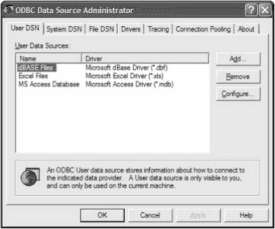

3.  单击"系统 DSN"选项卡，然后单击"添加"。一个列出一堆 ODBC 驱动程序的对话框将出现。

4.  选择 "Microsoft Access Driver"，然后单击"完成"。"完成"按钮的命名有些奇怪，但真正的配置实际上是在这时才开始的。此时将出现如图 4-2 所示的对话框。

    **图 4-2：** 配置 Access 数据源。

    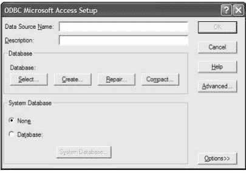

5.  为数据源输入一个名称。你将在 Java 程序中使用此名称来访问数据源，因此请谨慎选择。

6.  单击"选择"按钮，然后选择要连接的数据库并单击"确定"。将出现一个"选择数据库"对话框。通过此对话框，你可以导航到包含 Access 数据文件的文件夹来选择它。

7.  单击"确定"。数据源将被添加到已配置的 ODBC 数据源列表中。

8.  单击"确定"关闭 ODBC 数据源管理器。全部完成。

### 设置 MySQL JDBC 连接器

使用 ODBC 的替代方案是使用*数据库连接器*，这是由数据库供应商提供的驱动程序。数据库连接器专为特定类型的数据库而设计。因此，它们比 ODBC 效率更高、功能更强。

你必须从所用数据库服务器的制造商那里获取对应数据库的 JDBC 连接器。例如，你可以从 MySQL 网站 `www.mysql.com` 获取 MySQL 的 JDBC 连接器。除了驱动程序外，你还会获得详细的设置说明。但以下步骤适用于简单的测试环境：

1.  从 `www.mysql.com/products/connector` 下载驱动程序并解压。你需要的驱动程序叫做 *MySQL Connector/J*。从 MySQL 网站下载后，将文件解压到任何你想要的文件夹。我建议使用路径简单的文件夹，例如 `c:\MySql`。

2.  将驱动程序的 `.jar` 文件添加到你的 ClassPath 变量中。要更改 ClassPath，请打开控制面板并双击"系统"。然后单击"高级"选项卡，再单击"环境变量"。然后你可以单击"新建"来添加新的环境变量。ClassPath 变量必须指定连接器 `.jar` 文件的完整路径。例如，以下是位于 `c:\mysql` 的驱动程序的 ClassPath 变量示例：

    `.;c:\mysql\mysql-connector-java-3.1.6-bin.jar`

    请注意，ClassPath 变量以句号和分号开头。这确保 Java 能够找到当前目录中的类。

    > **提示**
    如果 ClassPath 变量已存在，只需将连接器的 `jar` 文件添加到现有文本的末尾即可。

以上就是你需要做的全部操作。现在你可以从 Java 程序连接到 MySQL 了。

### 连接数据库

在使用 JDBC 访问 SQL 数据库之前，你必须先建立与数据库的连接。建立连接的第一步是*注册*驱动程序类，使其可用。为此，你需要使用 `Class` 类的 `forName` 方法，指定驱动程序的包名和类名。例如，要注册 MySQL 连接器，请使用以下语句：

```
Class.forName("com.mysql.jdbc.Driver");
```

要注册标准 ODBC 驱动程序，请使用以下语句：

```
Class.forName("sun.jdbc.odbc.JdbcOdbcDriver");
```

请注意，`forName` 方法会抛出 `ClassNotFoundException`，因此你必须将此语句包含在捕获 `ClassNotFoundException` 的 `try/catch` 块中。

注册驱动程序类后，你可以调用 `DriverManager` 类的静态 `getConnection` 方法来打开连接。此方法接受三个 `String` 参数：数据库 URL、用户名和密码。以下是一个示例：

```
String url = "jdbc:mysql://localhost/Movies";
String user = "root";
String pw = "pw";
con = DriverManager.getConnection(url, user, pw);
```

URL 参数的语法如下：

```
jdbc:subprotocol:subname
```

其中 *subprotocol* 对于 MySQL 数据库是 `mysql`，对于 ODBC 驱动程序是 `odbc`。*subname* 是数据库名称。对于 MySQL 数据库，这可以是一个完整的 URL，但对于你自己计算机上的数据库，只需指定 `//localhost/` 加上数据库名称即可。

对于 ODBC，使用你创建数据源时使用的名称。例如：

```
String url = "jdbc:odbc:Movies";
```

用户名和密码参数也必须对你所使用的数据库服务器有效。对于 MySQL 数据库的测试，你可以使用 `root` 和安装 MySQL 时创建的密码。对于 ODBC，测试时使用 `admin`，无需密码。

请注意，`getConnection` 方法会抛出 `SQLException`，因此你需要将它包含在捕获此异常的 `try/catch` 块语句中。

将所有内容组合在一起，以下是返回连接到 MySQL 中 `movies` 数据库的 `Connection` 对象的方法：

```
private static Connection getConnection()
{
    Connection con = null;
    try
    {
        Class.forName("com.mysql.jdbc.Driver");
        String url = "jdbc:mysql://localhost/Movies";
        String user = "root";
        String pw = "NuttMutt";
        con = DriverManager.getConnection(url, user, pw);
    }
    catch (ClassNotFoundException e)
    {
        System.out.println(e.getMessage());
        System.exit(0);
    }
    catch (SQLException e)
    {
        System.out.println(e.getMessage());
        System.exit(0);
    }
    return con;
}
```

你可以在 `java.sql` 包中找到这些类——以及用于处理 SQL 数据库的其他类。因此，在任何使用 JDBC 的程序中，你都必须包含指定此包的 `import` 语句。

### 查询数据库

建立与数据库的连接后，你可以执行 `select` 语句来检索数据。为此，你需要使用几个类和接口：

- ◆ **Connection：** `Connection` 类有两个你可能会用到的方法。`close` 方法用于关闭连接，`createStatement` 方法返回一个 `Statement` 对象，你随后使用它来执行语句。


## 722 查询数据库

- **Statement：** `Statement` 接口包含向数据库发送语句以执行并返回结果所需的方法。特别地，你可以使用 `executeQuery` 方法来执行 `select` 语句，或者使用 `executeUpdate` 方法来执行 `insert`、`update` 或 `delete` 语句。

- **ResultSet：** `ResultSet` 接口表示从查询返回的行。它提供了可以用来在行间移动以及获取列数据的方法。

表 4-1 列出了 `Connection` 类和 `Statement` 接口中用于执行查询的方法。关于 `ResultSet` 接口的众多方法，将在本章后面的“浏览结果集”一节中介绍。

| Connection 类方法 | 说明 |
| --- | --- |
| `void close()` | 关闭连接。 |
| `Statement createStatement()` | 创建一个 `Statement` 对象，该对象可以通过此连接执行数据库上的 SQL 语句。 |
| `Statement createStatement (int type, int concur)` | 创建一个 `Statement` 对象，该对象可以通过此连接执行数据库上的 SQL 语句。 |
| **Statement 接口方法** | **说明** |
| `ResultSet executeQuery (String sql)` | 执行字符串参数中包含的 `select` 语句，并将结果数据作为 `ResultSet` 对象返回。 |
| `ResultSet executeQuery (String sql)` | 执行字符串参数中包含的 `select` 语句，并将结果数据作为 `ResultSet` 对象返回。 |
| `int executeUpdate (String sql)` | 执行字符串参数中包含的 `insert`、`update` 或 `delete` 语句，并将结果数据作为 `ResultSet` 对象返回。 |

`createStatement` 方法的第一个参数指定所创建结果集的类型，可以是以下值之一：

```
ResultSet.TYPE_FORWARD_ONLY
ResultSet.TYPE_SCROLL_INSENSITIVE
ResultSet.TYPE_SCROLL_SENSITIVE
```

第二个参数指示结果集是只读的还是可更新的，可以是以下值之一：

```
ResultSet.CONCUR_READ_ONLY
ResultSet.CONCUR_UPDATABLE
```

## 执行 select 语句

以下代码片段执行 `select` 语句并获取结果集：

```
Statement s = con.createStatement();
String select = "Select title, year, price "
                + "from movie order by year";
ResultSet rows = s.executeQuery(select);
```

这里，结果集存储在 `rows` 变量中。

## 浏览结果集

`executeQuery` 语句返回的 `ResultSet` 对象包含了 `select` 语句检索到的所有行。你一次只能访问其中的一行。结果集维护一个称为*游标（cursor）*的指针来跟踪当前行。你可以使用表 4-2 中所示的方法来移动结果集中的游标。

例如，以下代码片段展示了如何构建处理结果集中每一行的代码结构：

```
while(rows.next())
{
    // process the current row
}
```

你只需要将注释替换为从结果集中检索数据并对其进行处理的语句即可，如下一节所述。

| 表 4-2 | ResultSet 接口的导航方法 |
| :--- | :--- |
| **方法** | **说明** |
| `void close()` | 关闭结果集。 |
| `void last()` | 将游标移动到最后一行。 |
| `int getRow()` | 获取当前行号。 |
| `boolean next()` | 移动到下一行。 |

## 从结果集中获取数据

表 4-3 列出了 `ResultSet` 接口中可用于从当前行检索数据的方法。如你所见，每种方法都有两个版本：一种通过名称指定列，另一种通过索引号指定列。如果你知道索引号，使用它比使用列名访问列值更高效。

以下是获取当前行的 title、year 和 price 的一段代码：

```
String title = row.getString("title");
int year = row.getInt("year");
double price = row.getDouble("price");
```

以下代码执行相同的操作，假设列按顺序出现：

```
String title = row.getString(1);
int year = row.getInt(2);
double price = row.getDouble(3);
```

请注意，与 Java 中几乎其他所有索引不同，列索引从 1 开始，而不是零。

| 方法 | 说明 |
| --- | --- |
| BigDecimal getBigDecimal(String columnName) | 获取指定列的值作为 BigDecimal。 |
| BigDecimal getBigDecimal(int columnIndex) | 获取指定列的值作为 BigDecimal。 |
| boolean getBoolean(String columnName) | 获取指定列的值作为 boolean。 |
| boolean getBoolean(int columnIndex) | 获取指定列的值作为 boolean。 |
| Date getDate(String columnName) | 获取指定列的值作为 Date。 |
| Date getDate(int columnIndex) | 获取指定列的值作为 Date。 |
| double getDouble(String columnName) | 获取指定列的值作为 double。 |
| double getDouble(int columnIndex) | 获取指定列的值作为 double。 |
| float getFloat(String columnName) | 获取指定列的值作为 float。 |
| float getFloat(int columnIndex) | 获取指定列的值作为 float。 |
| int getInt(String columnName) | 获取指定列的值作为 int。 |
| int getInt(int columnIndex) | 获取指定列的值作为 int。 |
| long getLong(String columnName) | 获取指定列的值作为 long。 |
| long getLong(int columnIndex) | 获取指定列的值作为 long。 |
| short getShort(String columnName) | 获取指定列的值作为 short。 |
| short getShort(int columnIndex) | 获取指定列的值作为 short。 |
| String getString(String columnName) | 获取指定列的值作为 String。 |
| String getString(int columnIndex) | 获取指定列的值作为 String。 |

## 综合起来：一个从数据库读取数据的程序

现在你已经了解了使用 JDBC 查询数据库的程序的各个组成部分，清单 4-1 展示了一个从 movies 数据库读取数据并将其列在控制台上的程序。当你运行此程序时，控制台上会显示以下内容：

```
1946: It's a Wonderful Life ($16.45)
1965: The Great Race ($14.25)
1974: Young Frankenstein ($18.65)
1975: The Return of the Pink Panther ($13.15)
1977: Star Wars ($19.75)
1987: The Princess Bride ($18.65)
1989: Glory ($16.45)
1995: Apollo 13 ($20.85)
1997: The Game ($16.45)
2001: The Lord of the Rings: The Fellowship of the Ring
    ($21.95)
```

### 清单 4-1：电影列表程序

```
import java.sql.*;
import java.text.NumberFormat;

public class ListMovies
{
    public static void main(String[] args)
    {
        NumberFormat cf = NumberFormat.getCurrencyInstance();

        ResultSet movies = getMovies();
        try
        {
            while (movies.next())
            {
                Movie m = getMovie(movies);
                String msg = Integer.toString(m.year);
                msg += ": " + m.title;
                msg += " (" + cf.format(m.price) + ")";
                System.out.println(msg);
            }
        }
        catch (SQLException e)
        {
            System.out.println(e.getMessage());
        }

    private static ResultSet getMovies()
    {
        Connection con = getConnection();
        try
        {
            Statement s = con.createStatement();
            String select = "Select title, year, price "
                + "from movie order by year";
            ResultSet rows;
            rows = s.executeQuery(select);
            return rows;
        }
        catch (SQLException e)
        {
            System.out.println(e.getMessage());
        }
        return null;
    }

    private static Connection getConnection()
    {
        Connection con = null;
        try
        {
            Class.forName("com.mysql.jdbc.Driver");
            String url = "jdbc:mysql://localhost/Movies";
            String user = "root";
            String pw = "NuttMutt";
            con = DriverManager.getConnection(url, user, pw);
        }
        catch (ClassNotFoundException e)
        {
            System.out.println(e.getMessage());
            System.exit(0);
        }
        catch (SQLException e)
        {
            System.out.println(e.getMessage());
        }
```


## Book VIII
## Chapter 4
## 使用 JDBC 连接数据库

# 728 更新 SQL 数据

以下段落描述了该程序工作原理的基础：

`main`方法首先调用`getMovies`方法，获取一个包含待列出电影的`ResultSet`对象。然后，使用`while`循环读取结果集的每一行。调用`getMovie`方法，根据当前行中的数据创建一个`Movie`对象。接着，创建输出字符串并发送到控制台。该循环包含在`try`/`catch`语句中，因为`next`方法可能会抛出`SQLException`。

`getMovies`方法负责获取数据库连接，然后查询数据库以获取电影。第一个任务委托给`getConnection`方法完成。然后，创建并执行一个`Statement`对象，使用以下`select`语句：

```
select title, year, price from movie order by year
```

随后，将结果集返回给`main`方法。

`getConnection`方法创建一个连接到数据库的`Connection`对象。请注意，用户 ID 和密码已硬编码到该方法中。在实际应用中，您需要从用户或配置文件中获取此信息。

`getMovie`方法从当前行中提取标题、年份和价格，并使用这些值创建一个`Movie`对象。

`Movie`类被创建为内部类。为简化此应用程序，该类使用公共字段和一个构造函数，该构造函数使用作为参数传递的值初始化字段。

```java
System.exit(0);
}
return con;
}

private static Movie getMovie(ResultSet movies)
{
    try
    {
        String title = movies.getString("Title");
        int year = movies.getInt("Year");
        double price = movies.getDouble("Price");
        return new Movie(title, year, price);
    }
    catch (SQLException e)
    {
        System.out.println(e.getMessage());
    }
    return null;
}

private static class Movie
{
    public String title;
    public int year;
    public double price;

    public Movie(String title, int year, double price)
    {
        this.title = title;
        this.year = year;
        this.price = price;
    }
}
```

# 更新 SQL 数据

除了执行 select 语句之外，您还可以使用`Statement`对象执行 insert、update 或 delete 语句。为此，您需要调用`executeUpdate`方法，而不是`executeQuery`方法。该方法返回一个`int`值，指示更新了多少行。您可以测试返回值以确定数据是否已正确更新。

例如，以下是一个接受电影 ID、姓氏和名字，并向`friend`表插入一行的方法：

```java
private static void loanMovie(int id, String lastName,
    String firstName)
{
    Connection con = getConnection();
    try
    {
        Statement stmt = con.createStatement();
        String insert = "insert into friend "
            + "(lastname, firstname, movieid) "
            + "values ("
            + "\"" + lastName + "\", \""
            + firstName + "\", " +
            + id + ")";
        int i = stmt.executeUpdate(insert);
        if (i == 1)
            System.out.println("Loan recorded.");
        else
            System.out.println("Loan not recorded.");
    }
    catch (SQLException e)
    {
        System.out.println(e.getMessage());
        System.exit(0);
    }
}
```

此方法开头调用的`getConnection`方法与清单 4-1 中的`getConnection`方法相同。创建连接后，创建一个`Statement`对象，并使用通过参数传递的值构造 insert 语句。例如，如果您传递 id 3、姓氏 Haskell 和名字 Eddie，则会构建以下 insert 语句：

```
Insert into friend (lastname, firstname, movieid)
    Values ("Haskell", "Eddie", 3)
```

然后，调用`executeUpdate`方法来执行 insert 语句。使用`if`语句来确定该行是否已插入。

您可以用相同的方式执行 update 或 delete 语句。

在测试执行由字符串构建的 SQL 语句的数据库代码时，添加一个`System.out.println`调用将语句打印到控制台。这样，您可以验证语句是否被正确创建。

# 使用可更新的 RowSet 对象

如果您使用的是较新的 JDBC 驱动程序（支持 JDBC 2.0 或更高版本），您还有另一种更新数据的选项：使用可更新结果集。使用可更新结果集，您可以更改结果集行中的数据、向结果集添加一行，或从结果集中删除一行。执行这些操作时，更新会自动写回底层数据库。

要创建可更新结果集，您必须在创建`Statement`对象时，在`createStatement`方法上指定`ResultSet.CONCUR_UPDATABLE`字段，如下所示：

```java
Statement stmt = con.createStatement(
    ResultSet.TYPE_SCROLL_SENSITIVE,
    ResultSet.TYPE_CONCUR_UPDATABLE);
```

第一个参数表示结果集是可滚动的，这意味着您可以在结果集中向后或向前移动光标。您可以使用表 4-4 中列出的方法来滚动结果集。此参数还表示结果集可以与数据库同步，以便反映其他用户所做的任何更改。

# 730 使用可更新的 RowSet 对象

| 方法 | 描述 |
|---|---|
| `boolean absolute(int row)` | 将光标移动到此`ResultSet`对象中的给定行号。 |
| `void afterLast()` | 将光标移动到此`ResultSet`对象的末尾，即最后一行之后。 |
| `void beforeFirst()` | 将光标移动到此`ResultSet`对象的开头，即第一行之前。 |
| `boolean first()` | 将光标移动到此`ResultSet`对象中的第一行。 |
| `boolean last()` | 将光标移动到此`ResultSet`对象中的最后一行。 |
| `boolean next()` | 将光标从当前位置向下移动一行。 |
| `boolean previous()` | 将光标移动到此`ResultSet`对象中的前一行。 |
| `boolean relative(int rows)` | 将光标移动相对行数，可以是正数或负数。 |

第二个参数表示结果集是可更新的，您对结果集所做的任何更改都会自动写回数据库。您可以使用表 4-5 中列出的任何方法来更新结果集，从而更新底层数据库。

| 方法 | 描述 |
|---|---|
| `void cancelRowUpdates()` | 取消对此`ResultSet`对象当前行所做的更新。 |
| `void deleteRow()` | 从此`ResultSet`对象和底层数据库中删除当前行。 |
| `void insertRow()` | 将插入行的内容插入到此`ResultSet`对象和数据库中。 |
| `void moveToCurrentRow()` | 将光标移动到记住的光标位置，通常是当前行。 |
| `void moveToInsertRow()` | 将光标移动到插入行。 |
| `void refreshRow()` | 使用数据库中其最新值刷新当前行。 |
| `void updateRow()` | 使用此`ResultSet`对象当前行的新内容更新底层数据库。 |

# 删除一行

要从结果集中删除一行，请使用表 4-4 中的导航方法之一移动到要删除的行，然后使用`deleteRow`方法删除该行。例如，以下代码删除结果集中的第三行：

```java
try
{
    rs.absolute(3);
    rs.deleteRow();
}
catch (SQLException e)
{
    System.out.println(e.getMessage());
    System.exit(0);
}
```

# 更新行列的值

要更新行列的值，请导航到要更新的行，然后使用表 4-6 中列出的更新器方法之一更改一个或多个列值。最后，调用`updateRow`应用更改。

例如：

```java
try
{
    rs.absolute(6);
    rs.updateInt("year", 1975);
    rs.updateRow();
}
catch (SQLException e)
{
    System.out.println(e.getMessage());
    System.exit(0);
}
```

这里，结果集中第六行的`year`列被更改为 1975。

| | ResultSet 接口的更新方法 |
|---|---|
| **按列名更新** | **按列索引更新** |
| `void updateBigDecimal(String columnName, BigDecimal value)` | `void updateBigDecimal(int columnIndex, BigDecimal value)` |
| `void updateBoolean(String columnName, boolean value)` | `void updateBoolean(int columnIndex, boolean value)` |
| `void updateDate(String columnName, Date value)` | `void updateDate(int columnIndex, Date value)` |

（续）


## 732 使用可更新的 RowSet 对象

| 通过列名更新 | 通过列索引更新 |
|---|---|
| void updateDouble(String columnName, double value) | void updateDouble(int columnIndex, double value) |
| void updateFloat(String columnName, float value) | void updateFloat(int columnIndex, float value) |
| void updateInt(String columnName, int value) | void updateInt(int columnIndex, int value) |
| void updateLong(String columnName, long value) | void updateLong(int columnIndex, long value) |
| void updateShort(String columnName, short value) | void updateShort(int columnIndex, short value) |
| void updateString(String columnName, String value) | void updateString(int columnIndex, String value) |

## 插入一行

要插入一行，你需要使用结果集中的一个特殊行，称为插入行。首先，调用 `moveToInsertRow` 方法将光标移动到插入行。然后，使用 `update` 方法为插入行中的每一列设置值。接着，调用 `insertRow` 方法将插入行复制到结果集中，这反过来会向数据库写入一个新行。最后，调用 `moveToCurrentRow` 移回结果集中的先前位置。

这里有一个示例：

```
try
{
    rs.moveToInsertRow();
    rs.updateString("title",
            "Monty Python and the Holy Grail");
    rs.updateInt("year", 1975);
    rs.updateDouble("price", 13.95);
    rs.insertRow();
    rs.moveToCurrentRow();
}
catch (SQLException e)
{
    System.out.println(e.getMessage());
    System.exit(0);
}
```

## 第五章：处理 XML

## 本章内容

- 理解 XML
- 使用 DTD 定义结构
- 了解 DOM 和 SAX
- 将文档读入内存
- 导航文档
- 获取属性和元素值

在本章中，你将学习如何处理 XML——至少根据一些过分热情的预测者所说，这是自真空管发明以来计算领域最好的事情。

本章重点介绍将 XML 文档读入内存并从中提取数据的基础知识。掌握了本章的背景知识，你应该可以毫不费力地自行研究 API 文档，以了解更多关于 XML 编程的内容。

## XML 到底是什么？

XML 是计算领域最新最热门的潮流。大多数计算机行业权威人士都认为 XML 将彻底改变你使用计算机的方式。以下是 XML 将彻底改变计算机世界的一些方式：

- 解锁锁定在企业大型计算机金库中的所有海量数据仓库。
- 使地球上从最复杂的超级计算机到台式电脑、手机、腕表的每一个电子设备都能相互通信。
- 允许编写的每一个计算机程序与编写的每一个其他计算机程序交换数据。
- 甚至可能治愈癌症并解决预算赤字。

呵欠。

那么，XML 究竟是什么？简单来说，XML 是一种以标准化方式存储和交换信息的方式，易于创建、检索，并可在不同类型的计算机系统或程序之间交换。

当 XML 存储在文件中时，该文件通常以扩展名 `xml` 命名。

## 标签

与 HTML 类似，XML 使用标签来标记数据。例如，这里是一段描述一本书的 XML：

```
<Book>
  <Title>Java All-In-One Desk Reference For Dummies</Title>
  <Author>John Smith</Author>
  <Year>2023</Year>
</Book>
```

（注：由于原文在代码示例处中断，翻译也在此处保持一致的中断。）

名为 year 的属性。它还可以指定根元素名为 Movies，由任意数量的 Movie 元素组成。

DTD 的主要目的是阐明 XML 文档的结构，以便文档的用户知道如何解析它。但 DTD 的另一个同样重要的用途是验证文档，确保其没有结构错误。例如，如果你创建了一个 Movies XML 文档，其中某部电影有两个标题，你可以使用 DTD 来检测此错误。

你可以将 XML 文档的 DTD 存储在与 XML 数据相同的文件中，但更常见的做法是将 DTD 存储在单独的文件中。这样，你就可以使用一个 DTD 来管理多个相同类型的 XML 文档的格式。为了指明包含 DTD 的文件名称，你需要在 XML 文档中添加一个 `<!DOCTYPE>` 标签。例如：

```
<!DOCTYPE Movies SYSTEM "movies.dtd">
```

这里，XML 文件被标识为 Movies 文档，其 DTD 可以在 movies.dtd 文件中找到。将此标签添加在 movies.xml 文件的开头附近，紧跟在 `<?xml>` 标签之后。

清单 5-2 展示了清单 5-1 中所示的 movies.xml 文件的 DTD 文件。

## 清单 5-2：Movies.XML 文件的 DTD 文件

```
<?xml version="1.0" encoding="UTF-8"?>
<!ELEMENT Movies (Movie*)>
<!ELEMENT Movie (Title, Price)>
<!ATTLIST Movie year CDATA #REQUIRED>
<!ELEMENT Title (#PCDATA)>
<!ELEMENT Price (#PCDATA)>
```

DTD 中的每个 ELEMENT 标签定义了一种可以在文档中出现的元素类型，并指明该元素类型的内容可以是什么。ELEMENT 标签的通用形式如下：

```
<!ELEMENT element (content)>
```

使用表 5-1 中列出的规则来表示内容。

例如，我在清单 5-2 中展示的 DTD 的第一个 ELEMENT 标签表示 Movies 元素由零个或多个 Movie 元素组成。第二个 ELEMENT 标签表示 Movie 元素由一个 Title 元素后跟一个 Price 元素组成。第三个和第四个 ELEMENT 标签表示 Title 和 Price 元素由文本数据组成。

### 表 5-1：指定元素内容

| 内容 | 描述 |
|---------|-------------|
| `element*` | 指定的元素可以出现零次或多次。 |
| `element+` | 指定的元素可以出现一次或多次。 |
| `element?` | 指定的元素可以出现零次或一次。 |
| `element1\|element2` | 可以出现 element1 或 element2。 |
| `element1, element2` | element1 后跟 element2。 |
| `#PCDATA` | 文本数据。 |
| `ANY` | 允许任何子元素。 |
| `EMPTY` | 不允许任何类型的子元素。 |

如果这种表示法看起来似曾相识，那是因为它源自正则表达式。

ATTLIST 标签提供每个属性的名称。其通用形式如下：

```
<!ATTLIST element attribute type default-value>
```

以下是此标签的详细说明：

- `element` 指定该属性可以出现在哪个元素的标签中。
- `attribute` 提供属性的名称。
- `type` 指定什么可以作为属性的值。`type` 可以是表 5-2 中列出的任何项。
- `default` 提供一个默认值，并指明该属性是必需的还是可选的。`default` 可以是表 5-3 中列出的任何项。

### 表 5-2：属性类型

| 元素 | 属性值... |
|---------|------------------------|
| `CDATA` | 可以是任何字符串。 |
| `(string1\|string2...)` | 可以是列出的字符串之一。 |
| `NMTOKEN` | 必须是名称令牌，即由字母和数字组成的字符串。 |
| `NMTOKENS` | 必须是一个或多个由空格分隔的名称令牌。 |
| `ID` | 是一个必须唯一的名称令牌。换句话说，文档中没有其他元素可以为此属性使用相同的值。 |
| `IDREF` | 必须与文档中其他位置使用的 ID 值相同。 |
| `IDREFS` | 是由空格分隔的 IDREF 值列表。 |

### 表 5-3：属性默认值

| 默认值 | 可选还是必需？ |
|---------|----------------------|
| `#REQUIRED` | 必需的。 |
| `#IMPLIED` | 可选的。 |
| `value` | 可选的。如果省略该属性，则使用此值。 |
| `#FIXED value` | 可选的。但是，如果包含该属性，它必须是此值；如果省略，则默认使用此值。 |

例如，以下是 `movies.dtd` 中的 `ATTLIST` 标签声明：

```
<!ATTLIST Movie year CDATA #REQUIRED>
```

此声明表示该属性属于 `Movie` 元素，名为 `year`，可以是任何类型的数据，并且是必需的。

以下是一个指定了可能值列表和默认值的 `ATTLIST` 标签：

```
<!ATTLIST Movie genre (SciFi|Action|Comedy|Drama) "Comedy">
```

这种形式的 `ATTLIST` 标签允许你创建一个类似于枚举的属性，带有一组可接受的值。

## 以两种方式处理 XML

一般来说，你可以在 Java 程序中以两种方式处理 XML 文档。这两种方式分别称为 DOM 和 SAX：

- **DOM：***DOM* 是 *Document Object Model*（文档对象模型）的缩写。DOM 的基本思想是，你将整个 XML 文件读入内存，在内存中文档以树形结构的对象集合形式存储。然后你可以按照自己的需要处理树的元素（称为*节点*）。如果你更改了任何节点，可以将文档写回文件。

- **SAX：**SAX 是 *Simple API for XML*（XML 简单 API）的缩写。SAX 是一种只读的 XML 处理技术，它允许你从文件中读取 XML 文档的元素并在读取时对其做出反应。由于 SAX 不需要将整个 XML 文档一次性存储在内存中，因此它常用于处理非常大的 XML 文档。

在本章中，我将介绍使用 DOM 从 XML 文档中检索信息的基础知识。DOM 在内存中将 XML 文档表示为一个 `Node` 对象树。例如，图 5-1 展示了一个具有两个 `Movie` 元素的 XML 文档的简化 DOM 树。注意，根元素（`Movies`）是一个节点，每个 `Movie` 元素是一个节点，每个 `Title` 和 `Price` 元素也是一个节点。此外，文本值作为它们所属元素的子节点存储。因此，`Title` 和 `Price` 元素各自有一个包含这些元素文本的子节点。


## 读取 DOM 文档

在处理 DOM 文档之前，你需要将文档从 XML 文件读入内存。你可能会认为这是一个相当简单的过程，但遗憾的是，它涉及一些相当复杂的操作。与其逐一介绍你需要使用的所有类和方法，我直接展示一个完整方法的最终代码，该方法接受一个包含文件名的 `String` 作为参数，并返回一个文档对象作为返回值。在此过程中，你会了解每个类和方法的作用。

以下是代码：

```
private static Document getDocument(String name)
{
    try
    {
        DocumentBuilderFactory factory =
            DocumentBuilderFactory.newInstance();
        factory.setIgnoringComments(true);
        factory.setIgnoringElementContentWhitespace(true);
        factory.setValidating(true);
        DocumentBuilder builder =
            factory.newDocumentBuilder();
        return builder.parse(new InputSource(name));
    }
    catch (Exception e)
    {
        System.out.println(e.getMessage());
    }
    return null;
}
```

### 创建文档构建器工厂

上面示例中的第一条语句调用 `DocumentBuilderFactory` 类的 `newInstance` 方法来创建一个新的 `DocumentBuilderFactory` 对象。文档构建器工厂的职责是创建能够读取 XML 输入并在内存中创建 DOM 文档的文档构建器对象。

为什么不直接调用 `DocumentBuilderFactory` 的构造函数呢？事实上，`DocumentBuilderFactory` 是一个抽象类，因此它没有构造函数。`newInstance` 是一个静态方法，它根据系统的配置方式来确定要创建哪个类的实例。


## 配置文档构建器工厂

获取文档构建器工厂后，你可以对其进行配置，使其按照你想要的方式读取文档。以下三条语句配置了应用于该工厂对象所创建的文档构建器的三个选项：

```
factory.setIgnoringComments(true);
factory.setIgnoringElementContentWhitespace(true);
factory.setValidating(true);
```

下面详细介绍这些语句：

- **setIgnoringComments 方法告诉文档构建器不要为 XML 文件中的注释创建节点。**大多数 XML 文件不包含注释，但如果有的话，它们也不是文档所表示数据的一部分，因此可以安全地忽略。设置此选项会自动忽略它们。（如果不设置此选项，文档中的每个注释都会创建一个节点。而且由于无法预测注释何时或在哪里出现，你的程序必须检查它处理的每个节点，以确保它不是注释。）

- **setIgnoringElementContentWhitespace 方法使文档构建器忽略任何不属于文本值的空白字符。**如果不包含此选项，DOM 文档将包含表示空白字符的节点。这些空白字符节点唯一的作用就是让 DOM 文档更难处理，因此你应该始终设置此选项。

- **setValidating 方法告诉文档构建器在输入 XML 指定了 DTD 时对其进行验证。**验证输入也可以大大简化你的程序，因为你知道 DOM 文档符合 DTD 的要求。例如，如果你正在处理前面清单 5-1 中所示的 `movies.xml` 文件，你可以确定 `Movie` 元素的第一个子元素是 `Title` 元素，第二个子元素是 `Price` 元素。如果没有验证，你只知道 `Movie` 元素的第一个子元素*应该是* `Title` 元素，但你必须检查才能确定。

## 创建文档构建器和文档

设置选项后，你可以调用 `newDocumentBuilder` 方法来创建文档构建器：

```
DocumentBuilder builder =
    factory.newDocumentBuilder();
```

这里，文档构建器由名为 `builder` 的变量引用。

最后，你可以通过调用文档构建器的 `parse` 方法来创建 DOM 文档。此方法接受一个 `InputSource` 对象作为参数。幸运的是，`InputSource` 类有一个以文件名作为参数的构造函数，并返回一个链接到该文件的输入源。因此，你可以在一个语句中创建输入源、解析 XML 文件、创建 DOM 文档，并将 DOM 文档返回给调用者：

```
return builder.parse(new InputSource(name));
```

请注意，其中几个方法会抛出异常。特别是，`newDocumentBuilder` 会抛出 `ParserConfigurationException`，`parse` 会抛出 `IOException` 和 `SAXException`。为保持此示例简单，我在一个 `catch` 子句中捕获所有异常，并将异常消息打印到控制台。

## 使用 getDocument 方法

通过添加 `getDocument` 方法，你可以用一条语句从文件创建 DOM 文档，如下所示：

```
Document doc = getDocument("movies.xml");
```

这里，`movies.xml` 文件被读取，DOM 文档被创建并赋值给 `doc` 变量。

另外，注意你必须提供三个 `import` 语句才能使用 `getDocument` 方法：

```
import javax.xml.parsers.*;
import org.w3c.dom.*;
import org.xml.sax.*;
```

`DocumentBuilder` 和 `DocumentBuilderFactory` 位于 `javax.xml.parsers` 包中，`Document` 位于 `org.w3c.dom` 中，`InputSource` 位于 `org.xml.sax` 中。

还记得我说过本章不会使用 SAX 吗？我撒谎了。`DocumentBuilder` 类的 `parse` 方法使用 SAX 来读取 XML 文件，同时构建 DOM 对象。

## 读取 DOM 节点

在内存中拥有 DOM 文档后，你可以轻松地从文档的节点中检索数据。DOM API 基于接口而非类，因此 DOM 文档的每个节点都由一个实现一个或多个 DOM 接口的对象表示。以下段落概述了你需要使用的接口：

- **Document**：整个文档由实现 `Document` 接口的对象表示。你最常使用的此接口方法是 `getDocumentElement`，它返回一个表示文档根节点的 `Element` 对象。获取根节点后，你就可以导航到文档中的其他节点以获取所需的信息。
- **Node**：`Node` 接口表示 DOM 文档中的一个节点。此接口提供了所有节点共有的方法。表 5-4 列出了其中最有用的方法。此表还列出了 `getNodeType` 方法可能返回的一些字段值。
- **Element**：`Element` 接口表示与 XML 文档中的元素对应的节点。`Element` 扩展了 `Node`，因此任何实现 `Element` 的对象也是 `Node`。表 5-5 列出了此接口的一些更有用的方法。
- **Text**：元素中的文本内容并不包含在元素本身中，而是存储在作为元素子节点的 `Text` 节点中。`Text` 接口有一些你可能想查看的有趣方法，但对于大多数应用程序，你只需使用从 `Node` 接口继承的 `getNodeValue` 方法来检索 `text` 节点存储的文本。
- **NodeList**：`NodeList` 是一个节点集合，由 `Node` 接口的 `getChildNodes` 方法或 `Element` 接口的 `getElementsByTagName` 方法返回。`NodeList` 只有两个方法：`item(int i)`，返回指定索引处的节点；以及 `getLength()`，返回列表中的项目数。（*几乎*与 Java 中所有其他索引一样，第一个节点的索引是 0，不是 1。）

**表 5-4 Node 接口**

| 方法 | 描述 |
| :--- | :--- |
| `NodeList getChildNodes()` | 获取包含此节点所有子节点的 `NodeList` 对象。 |
| `Node getFirstChild()` | 获取此节点的第一个子节点。 |
| `Node getLastChild()` | 获取此节点的最后一个子节点。 |
| `int getNodeType()` | 获取一个 `int`，指示节点的类型。该值可以是本表后面列出的字段之一。 |
| `String getNodeValue()` | 获取此节点的值（如果该节点有值）。 |
| `Node getNextSibling()` | 获取下一个兄弟节点。 |
| `Node getPrevSibling()` | 获取前一个兄弟节点。 |
| `boolean hasChildNodes()` | 确定该节点是否有任何子节点。 |
| **字段** | **描述** |
| `ATTRIBUTE_NODE` | 该节点是属性节点。 |
| `CDATA_SECTION_NODE` | 该节点包含内容数据。 |
| `COMMENT_NODE` | 该节点是注释。 |
| `DOCUMENT_NODE` | 该节点是文档节点。 |
| `ELEMENT_NODE` | 该节点是元素节点。 |
| `TEXT_NODE` | 该节点是文本节点。 |

**表 5-5 Element 接口**

| 方法 | 描述 |
| :--- | :--- |
| `String getAttribute(String name)` | 获取指定属性的值。 |
| `NodeList getElementsByTagName(String name)` | 获取一个 `NodeList` 对象，其中包含此元素内所有具有指定名称的元素节点。 |
| `boolean hasAttribute(String name)` | 确定该元素是否具有指定的属性。 |

## 处理元素

假设你在构建文档时使用 DTD 验证 XML 文件，通常可以在文档中导航以获取所需信息，而不必借助 NodeList 对象。例如，以下是一个简单的例程，它计算在 movies.xml 文件（前面在清单 5-1 中所示）被解析成名为 doc 的 Document 对象后，其中所有 Movie 元素的数量：

```
int count = 0;
Element root = doc.getDocumentElement();
Node movie = root.getFirstChild();
while (movie != null)
{
    count++;
    movie = movie.getNextSibling();
}
System.out.println("There are " + count + " movies.");
```

此方法首先调用 getFirstChild 方法来获取根元素的第一个子元素。然后，它使用每个子元素的 getNextSibling 方法来获取同样是根元素子元素的下一个元素。

如果运行包含这些行的程序，控制台上将出现以下行：

```
There are 10 movies.
```


这个程序除了计算 `Movie` 元素的数量外，没有对它们进行其他操作，但你很快就会看到如何从 `Movie` 元素中提取数据。

处理 `movies.xml` 文件中所有元素的另一种方法是使用 `getChildNodes` 方法，该方法返回一个包含所有元素的 `NodeList` 对象。然后，你可以使用 `for` 循环来逐个访问每个元素。例如，下面这段代码片段列出了每个元素的名称：

```
Element root = doc.getDocumentElement();
NodeList movies = root.getChildNodes();
for (int i = 0; i < movies.getLength(); i++)
{
    Node movie = movies.item(i);
    System.out.println(movie.getNodeName());
}
```

在这里，`for` 循环中使用了 `item` 方法来检索每个 `Movie` 元素。如果你运行一个包含这些代码行的程序，控制台窗口将显示十行包含单词 `Movie` 的文本。

## 获取属性值

要获取元素属性的值，请调用 `getAttribute` 方法并将属性的名称作为参数传递。这将返回属性的字符串值。如果需要，你可以将此值转换为另一种类型。请注意，该值可能包含一些空格，因此你应该对值运行 `trim` 方法以去除任何多余的空格。

下面是一个示例，它从 `movies.xml` 文件中的每部电影获取 `year` 属性，并确定集合中最古老电影的年份：

```
Element root = doc.getDocumentElement();
Element movie = (Element)root.getFirstChild();
int oldest = 9999;
while (movie != null)
{
    String s = movie.getAttribute("year");
    int year = Integer.parseInt(s);
    if (year < oldest)
        oldest = year;
    movie = (Element)movie.getNextSibling();
}
System.out.println("The oldest movie in the file "
    + "is from " + oldest + ".");
```

`year` 属性是通过以下两行代码提取的：

```
String s = movie.getAttribute("year");
int year = Integer.parseInt(s);
```

第一行获取 `year` 属性的字符串值，第二行将其转换为 `int`。

注意此方法中进行的额外类型转换。这是必要的，因为 `movie` 变量必须是 `Element` 类型，这样你才能调用 `getAttribute` 方法。然而，`getNextSibling` 方法返回的是一个 `Node`，而不是一个 `Element`。因此，编译器不允许你将节点赋值给 `movie` 变量，除非你先将其强制转换为 `Element`。

## 获取子元素的值

你可能会惊讶地发现，元素的文本内容并不与元素存储在一起。相反，它存储在类型为 `Text` 的子节点中。例如，考虑以下 XML：

```
<Title>The Princess Bride</Title>
```

此元素在 XML 文档中产生两个节点：一个名为 `Title` 的 `Element` 节点，以及一个包含文本 `The Princess Bride` 的 `Text` 节点。

因此，如果你手头有一个 `Title` 元素，你必须首先获取 `Text` 元素，然后才能获取文本内容。例如：

```
Node textElement = titleElement.getFirstChild();
String title = textElement.getNodeValue();
```

如果你希望代码更简洁一些，可以用一条语句这样写：

```
String title =
    titleElement.getFirstChild().getNodeValue();
```

如果你觉得这个写法有点繁琐，并且在你的程序中经常这样做，可以为自己编写一个辅助方法。例如：

```
private static String getTextValue(Node n)
{
    return n.getFirstChild().getNodeValue();
}
```

然后，你可以通过调用 `getTextValue` 方法来获取元素的文本内容，如下所示：

```
String title = getTextValue(titleElement);
```

获取文本内容后，如果需要，你可以将其解析为数字类型。

## 整合起来：一个列出电影的程序

既然你已经看到了从 XML 文件获取数据所使用的各种接口和类，清单 5-3 显示了一个完整的程序，该程序读取 movies.xml 文件（如前面的清单 5-1 所示）并在控制台上列出每部电影的标题、年份和价格。当你运行此程序时，控制台上将显示以下内容：

1946: It's a Wonderful Life ($14.95)
1965: The Great Race ($12.95)
1974: Young Frankenstein ($16.95)
1975: The Return of the Pink Panther ($11.95)
1977: Star Wars ($17.95)
1987: The Princess Bride ($16.95)
1989: Glory ($14.95)
1995: Apollo 13 ($19.95)
1997: The Game ($14.95)
2001: The Lord of the Rings: The Fellowship of the Ring ($19.95)

**清单 5-3：读取 XML 文档**

```
import java.io.*;
import javax.xml.parsers.*;
import org.xml.sax.*;
import org.w3c.dom.*;
import java.text.*;

public class ListMoviesXML
{
	private static NumberFormat cf =
		NumberFormat.getCurrencyInstance();

	public static void main(String[] args)
	{
		Document doc = getDocument("movies.xml");

		Element root = doc.getDocumentElement();

		Element movieElement = (Element)root.getFirstChild();
		Movie m;
		while (movieElement != null)
		{
			m = getMovie(movieElement);
			String msg = Integer.toString(m.year);
			msg += ": " + m.title;
			msg += " (" + cf.format(m.price) + ")";
			System.out.println(msg);
			movieElement =
				(Element)movieElement.getNextSibling();
		}
	}
```

```
private static Document getDocument(String name) → 33
{
    try
    {
        DocumentBuilderFactory factory =
            DocumentBuilderFactory.newInstance();
        factory.setIgnoringComments(true);
        factory.setIgnoringElementContentWhitespace(true);
        factory.setValidating(true);
        DocumentBuilder builder =
            factory.newDocumentBuilder();
        return builder.parse(new InputSource(name));
    }
    catch (Exception e)
    {
        System.out.println(e.getMessage());
    }
    return null;
}
```

```
private static Movie getMovie(Element e) → 53
{
    // 获取 year 属性
    String yearString = e.getAttribute("year");
    int year = Integer.parseInt(yearString);

    // 获取 Title 元素
    Element tElement = (Element)e.getFirstChild();
    String title = getTextValue(tElement).trim();

    // 获取 Price 元素
    Element pElement =
        (Element)tElement.getNextSibling();
    String pString = getTextValue(pElement).trim();
    double price = Double.parseDouble(pString);

    return new Movie(title, year, price);
}
```

```
private static String getTextValue(Node n) → 72
{
    return n.getFirstChild().getNodeValue();
}
```

```
private static class Movie → 77
{
    public String title;
    public int year;
    public double price;

    public Movie(String title, int year, double price)
    {
        this.title = title;
        this.year = year;
        this.price = price;
    }
}
```

因为本程序中的所有代码都在本章的其他地方，所以以下段落只对本程序中每个方法的作用提供一个简单的描述：

- → 1 哇，要导入这么多包。可惜 Java 的设计者没能把所有这些 XML 类放在一个大包里。

- → 12 main 方法首先调用 getDocument 方法，从文件 movies.xml 获取一个 Document 对象。然后，它获取根元素，并使用一个 while 循环遍历所有子元素，因为文档在解析时进行了验证，所以你知道这些子元素是 Movie 元素。在处理每个 Movie 元素时，将其传递给 getMovie 方法，该方法提取 year 属性以及 title 和 price 元素，并返回一个 Movie 对象。然后，将电影打印到控制台。

- → 33 getDocument 方法接受一个文件名作为参数，并返回一个 Document 对象。在创建 DocumentBuilder 对象之前，它设置了配置选项，以便忽略注释和空格，并对 XML 文件进行验证。

- → 53 getMovie 方法接收一个表示 Movie 元素的 Element 对象。它提取 year 属性，获取 title 元素的文本值，并将 price 元素的文本值解析为 double 类型。然后，它使用这些值创建一个新的 Movie 对象，并将其返回给调用者。

- → 72 getTextValue 方法只是一个辅助方法，用于从节点获取文本内容。此方法假设节点有一个包含文本值的子节点，因此除非你确定情况确实如此，否则不应调用此方法。（因为 XML 文档已经过验证，所以你知道情况确实如此。）

- → 77 Movie 类是一个私有内部类，表示单部电影。它使用公共字段来保存标题、年份和价格，并提供一个简单的构造函数来初始化这些字段。


# 图书 IX

## 趣味与游戏

## 第五波

作者：Rich Tennant


> "这次，纯粹为了好玩，让我们看看你长个蝙蝠耳朵、鼻子像个南瓜会是什么样子。"

## 内容速览

- 第1章：字体与颜色的乐趣 ....753
- 第2章：绘制形状 ....767
- 第3章：使用图像与声音 ....789
- 第4章：动画与游戏编程 ....803

## 第1章：字体与颜色的乐趣

### 本章内容

- 设置文本控件的字体
- 获取可用字体列表
- 玩转颜色
- 使用系统颜色
- 设置前景色和背景色

在本章中，我将介绍如何美化 Swing 控件中显示的文字。具体而言，我会向你展示如何更改文本显示的字体——包括**粗体**、*斜体*和字号大小，以及如何更改文本颜色。

大多数示例都使用标签，但设置字体和颜色的方法适用于所有 Swing 组件，因为它们由所有 Swing 组件继承的 `Component` 类所定义。

此外，本章中关于字体和颜色的信息也适用于《图书 IX》第3章中通过 `Graphics2D` 类方法创建的图形。

### 使用字体

在 Java 中，字体由 `Font` 类表示。每个 `Font` 对象都有三个基本特征：字体名称、样式标识符（普通、**粗体**、*斜体* 或粗斜体）和磅值大小。

尽管 `Font` 类有大量方法，但除非你在用 Java 编写桌面出版程序，否则你可能不会用到它们。相反，你可以使用基本构造函数，其形式如下：

```
Font(String name, int style, int size)
```

例如，以下语句为名为 Papyrus 的字体创建了一个 `Font` 对象：

```
Font("Papyrus", Font.PLAIN, 14)
```

这里，字体样式为普通，大小为 14 磅。

重要的是要认识到，`Font` 类构造函数并不会真正创建字体。相反，它会创建一个 `Font` 对象，代表计算机上已安装的字体。用名称 "Comic Strip" 创建 `Font` 对象并不会真正创建名为 `Circus Clowns` 的字体，除非该字体已安装在计算机上。

### 使用字体名称

`name` 参数指定你要使用的已安装字体的名称。例如，如果你指定 `Times New Roman`，就会使用 Times New Roman 字体。

为特定字体编写字符串字面量通常不是好主意，因为你无法保证每台计算机都有你指定的确切字体。有两种方法可以解决这个问题：

- 让用户通过从可用字体列表中选择来配置字体。请参见后面的"获取所有可用字体列表"部分。
- 使用 Java 提供的几种*逻辑字体名称*，以便让你通用地指定字体。表 1-1 列出了逻辑字体名称。使用逻辑字体名称时选择不多，但至少你可以在基本衬线字体、无衬线字体和等宽字体之间进行选择。而且你可以使用 `Dialog` 和 `Dialog Input` 字体来设置对话框中使用的字体。

| 逻辑字体 | 说明 |
|---|---|
| Serif | 基本衬线字体。Windows 上为 Times New Roman，其他系统上通常为 Times Roman。 |
| SansSerif | 无衬线字体。Windows 上为 Arial，非 Windows 系统上通常为 Helvetica。 |
| Monospaced | 等宽字体。Windows 上为 Courier New，非 Windows 系统上通常为 Courier。 |
| Dialog | 用于在系统对话框中显示文本的字体。 |
| DialogInput | 用于在系统对话框中输入文本的字体。 |

### 使用字体样式

字体可以有四种样式：普通、**粗体**、*斜体* 和粗斜体。要设置字体样式，请将以下三个常量用作 `Font` 类构造函数的第二个参数：

```
Font.BOLD
Font.ITALIC
Font.PLAIN
```

例如，以下是为 24 磅 JSL Ancient Bold 创建 Font 对象的方法：

```
Font("JSL Ancient", Font.BOLD, 24)
```

你可能已经注意到粗斜体没有常量。要创建粗斜体字体，你需要用 `|` 运算符将 Font.BOLD 和 Font.ITALIC 常量组合起来，如下所示：

```
Font("Garamond", Font.BOLD | Font.ITALIC, 12)
```

这里，Font 对象是 Garamond，**粗体**且*斜体*，12 磅。

### 设置组件的字体

要设置用于显示组件的字体，只需调用组件的 setFont 方法并传递一个 Font 对象即可。例如：

```
JLabel textLabel = new JLabel("Arghh, Matey");
Font f = new Font("JSL Ancient", Font.PLAIN, 16);
textLabel.setFont(f);
```

这里，名为 textLabel 的标签的字体设置为 16 磅 JSL Ancient。（JSL Ancient 是我的个人最爱之一；它在迪士尼乐园的加勒比海盗游乐项目中使用。）

如果该字体仅用于一个组件，你可以直接在 setFont 方法调用中创建组件：

```
textLabel.setFont(new Font("JSL Ancient", Font.PLAIN, 16));
```

如果你希望组件继承其容器的字体（例如面板），请调用组件的 setFont 方法并将参数设置为 null。例如，以下代码将名为 panel1 的面板中一对按钮的字体设置为 JSL Ancient：

```
JPanel panel1 = new JPanel();
panel1.setFont(new Font("JSL Ancient", Font.PLAIN, 16));

JButton b1 = new JButton("Jolly");
b1.setFont(null);
panel1.add(b1);

JButton b2 = new JButton("Roger");
b2.setFont(null);
panel1.add(b2);
```

在此示例中，两个按钮的字体都设置为 `null`，因此它们都继承其父容器 `panel1` 的字体。

### 获取所有可用字体列表

如果你想让用户选择字体，你需要获取系统上所有可用字体的列表，以便将字体名称放入组合框中。为此，你首先需要获取一个称为 `GraphicsEnvironment` 的对象，它代表程序运行所在的图形环境。`GraphicsEnvironment` 类有一个名为 `getLocalGraphicsEnvironment` 的静态方法可以帮你完成此操作：

```
GraphicsEnvironment g;
g = GraphicsEnvironment.getLocalGraphicsEnvironment();
```

注意 `GraphicsEnvironment` 类在 `java.awt` 包中，因此你需要提供 `import` 语句来导入该包。

获得 `GraphicsEnvironment` 对象后，你可以调用其 `getAvailableFontFamilyNames` 方法，该方法返回一个字符串数组，包含系统上所有可用的字体名称。例如：

```
String[] fonts;
fonts = g.getAvailableFontFamilyNames();
```

然后你可以在组合框的构造函数中使用此数组，如下所示：

```
JComboBox fontComboBox = new JComboBox(fonts);
```

接着，你可以使用类似的代码从用户选择的名称创建字体：

```
String name = (String) fontComboBox.getSelectedItem();
Font f = new Font(name, Font.PLAIN, 12);
```

### 一个玩转字体的程序

为了让你了解这些元素如何协同工作，清单 1-1 展示了一个简单的程序，让用户为显示的示例文本选择字体、样式和大小。图 1-1 展示了该程序的运行效果。每当用户从某个组合框中选择字体或大小，或勾选/取消勾选某个复选框时，用于.React 表单顶部显示的文本字体就会相应更改。

### 使用字体

图 1-1：Fonts 程序的运行效果。


### 清单 1-1：玩转字体的程序

```
import javax.swing.*;
import java.awt.event.*;
import java.awt.*;

public class Fonts extends JFrame
{
    public static void main(String [] args)
    {
        new Fonts();
    }

    private JLabel sampleText;

    private JComboBox fontComboBox;
    private JComboBox sizeComboBox;
    private JCheckBox boldCheck, italCheck;

    private String[] fonts;

    public Fonts()
    {
        this.setSize(500,150);
        this.setTitle("Fun with Fonts ");
        this.setDefaultCloseOperation(JFrame.EXIT_ON_CLOSE);

        FontListener fl = new FontListener();

        sampleText = new JLabel(
            "All work and no play makes Jack a dull boy");
        this.add(sampleText, BorderLayout.NORTH);

        GraphicsEnvironment g;
        g = GraphicsEnvironment
            .getLocalGraphicsEnvironment();
        fonts = g.getAvailableFontFamilyNames();

        JPanel controlPanel = new JPanel();

        fontComboBox = new JComboBox(fonts);
        fontComboBox.addActionListener(fl);
        controlPanel.add(new JLabel("Family: "));
        controlPanel.add(fontComboBox);

        Integer[] sizes = {7, 8, 9, 10, 11, 12,
                           14, 18, 20, 22, 24, 36};
```

→ 12

→ 14

→ 18

→ 26

→ 30

→ 32

→ 37

→ 39

→ 44

待续

图书 IX 第 1 章

字体与颜色的乐趣


758 字体的使用

## 清单 1-1（续）

```
sizeComboBox = new JComboBox(sizes);
sizeComboBox.setSelectedIndex(5);
sizeComboBox.addActionListener(fl);
controlPanel.add(new JLabel("Size: "));
controlPanel.add(sizeComboBox);

boldCheck = new JCheckBox("Bold");
boldCheck.addActionListener(fl);
controlPanel.add(boldCheck);

italCheck = new JCheckBox("Ital");
italCheck.addActionListener(fl);
controlPanel.add(italCheck);

this.add(controlPanel, BorderLayout.SOUTH);
fl.updateText();

this.setVisible(true);
}

private class FontListener implements ActionListener
{
    public void actionPerformed(ActionEvent e)
    {
        updateText();
    }

    public void updateText()
    {
        String name
            = (String) fontComboBox.getSelectedItem();

        Integer size
            = (Integer)sizeComboBox.getSelectedItem();

        int style;
        if ( boldCheck.isSelected()
             && italCheck.isSelected())
            style = Font.BOLD | Font.ITALIC;
        else if (boldCheck.isSelected())
            style = Font.BOLD;
        else if (italCheck.isSelected())
            style = Font.ITALIC;
        else
            style = Font.PLAIN;

        Font f = new Font(name, style,
                          size.intValue());
        sampleText.setFont(f);
    }
}
}
```

以下段落概述了该程序的要点：

- 12 当用户做出选择时，其字体随之改变的标签。

- 14 用户用于选择字体、字号和样式的控件。

- 18 `fonts` 变量是一个字符串数组，用于保存系统上每种可用字体的名称。

- 26 `fl` 变量保存着一个动作监听器对象的引用，该监听器处理两个组合框和两个复选框的动作事件。

- 30 包含示例文本的标签被添加到框架的北部区域。

- 32 这几行代码获取 `GraphicsEnvironment` 对象，然后使用它将系统上可用字体的名称填充到 `fonts` 数组中。

- 37 使用一个面板来容纳两个组合框和两个复选框控件。

- 39 这几行代码创建字体组合框并将其添加到面板中。

- 44 这几行代码创建字号组合框并将其添加到面板中。该组合框使用一个包含常用磅值字号的整数数组进行填充。如果需要，你可以调用 `setEditable(true)` 使该组合框可编辑，这样用户就可以在组合框中输入任意所需的字号。为了保持应用程序简单，我没有将该组合框设为可编辑。

- 52 这几行代码创建加粗复选框并将其添加到面板中。

- 56 这几行代码创建斜体复选框并将其添加到面板中。

- 60 将面板添加到框架的南部区域。然后，下一行调用动作监听器的 `updateText` 方法，将当前选定的字体、样式和字号应用到标签上。（如果此处不调用该方法，标签最初将使用默认字体显示，而非字体组合框初始值所指示的字体。）

- 70 动作监听器类的 `actionPerformed` 方法仅调用 `updateText`。

- 73 `updateText` 方法将 `sampleText` 标签的字体更改为用户选择的字体。首先，它获取字体组合框中选定的名称。接着，获取用户在字号组合框中选择的字号。由于组合框返回的是对象，因此选定的项目被强制转换为 `Integer`。然后，评估两个复选框的设置以确定如何设置 `style` 变量。最后，创建一个新的 `Font` 对象并将其赋值给 `sampleText` 标签。

### 颜色的使用

在 Java 中，特定颜色由 `Color` 类的实例表示。每种颜色都是三种不同组成颜色的唯一组合：红色、绿色和蓝色。每个组成颜色由一个范围从 0 到 255 的整数表示，其中零表示该组成颜色完全不存在，255 表示该颜色完全饱和。

在以下各节中，你将了解如何使用 `Color` 类创建颜色对象。然后，将颜色应用于 Swing 组件。最后，你将使用一个名为颜色选择器的便捷 Swing 对话框。

#### 创建颜色

创建 `Color` 对象的一种方式是调用 `Color` 构造方法，并传入所需的红色、绿色和蓝色值。例如：

```
Color c = new Color(255, 255, 0);
```

此处创建了一个满红色、满绿色、无蓝色的颜色。结果为亮黄色。

如果三种组成颜色的值均为零，则结果颜色为黑色。如果均为 255，则结果为白色。如果三个值相同且介于 0 到 255 之间，则结果为某种灰色。

由于颜色数字使用起来比较复杂且难以记忆，`Color` 类提供了几个静态常量，为你提供预定义的颜色。表 1-2 列出了这些常量。例如，以下语句创建了一个表示红色的 `Color` 对象：

```
Color c = Color.RED;
```

| 表 1-2 |  | Color 类定义的常量 | |
|---|---|---|---|
| BLACK | GRAY | MAGENTA | RED |
| BLUE | GREEN | ORANGE | WHITE |
| CYAN | LIGHT_GRAY | PINK | YELLOW |
| DARK_GRAY |  |  | |

颜色还具有一个称为 *alpha* 的特性，它表示颜色的透明度。默认情况下，alpha 设置为 255，表示颜色完全不透明。如果要设置不同的 alpha 值，可以调用第二个 `Color` 构造方法，该方法接受 alpha 值作为第四个参数。例如：

```
Color c = new Color(255, 0, 0, 128);
```

此处的颜色为半透明。

以下段落描述了一些关于 `Color` 类值得了解的额外细节：

- `Color` 对象是不可变的；没有 `set` 方法可以让你更改颜色。
- 你可以通过 `getRed`、`getGreen`、`getBlue` 和 `getAlpha` 方法获取红色、绿色、蓝色和 alpha 值。
- 你可以使用 `brighter` 方法创建一个比当前颜色更亮的颜色。同样，`darker` 方法返回一个比当前颜色略深的颜色对象。这些方法通过增加红色、绿色和蓝色的值但保持它们之间的比例来实现。
- 如果你调用 `Color` 构造方法时传入的参数小于零或大于 255，将抛出 `IllegalArgumentException`。因此，你需要在调用构造方法之前检查参数值。
- `Color` 类提供了一个替代构造方法，允许你使用 0.0 到 1.0 之间的 `float` 值来设置组成颜色。
- `Color` 类位于 `java.awt` 包中，因此你需要一个指定 `java.awt.Color` 或 `java.awt.*` 的 `import` 语句。

#### 使用系统颜色

你可以使用 `SystemColor` 类获取与底层操作系统为各种 GUI 元素（如菜单文本或桌面背景）配置的颜色相对应的颜色。请注意，`SystemColor` 类扩展了 `Color` 类，因此你可以将 `SystemColor` 对象与 `setForeground` 和 `setBackground` 方法或任何其他需要 `Color` 对象的方法一起使用。

`SystemColor` 类拥有大量静态方法，用于返回系统 GUI 界面不同部分所使用颜色的 `SystemColor` 对象，如表 1-3 所列。例如，以下语句将按钮的背景色设置为工具提示所使用的背景色：

```
button1.setBackground(SystemColor.info);
```

762 颜色的使用

| 字段 | 描述 |
|---|---|
| static SystemColor activeCaption | 活动窗口标题栏的背景色。 |
| static SystemColor activeCaptionBorder | 活动窗口标题栏的边框色。 |
| static SystemColor activeCaptionText | 活动窗口标题栏的文本色。 |
| static SystemColor control | 控件使用的背景色。 |
| static SystemColor controlText | 控件使用的文本色。 |
| static SystemColor desktop | 桌面使用的背景色。 |
| static SystemColor inactiveCaption | 非活动窗口标题栏使用的背景色。 |
| static SystemColor inactiveCaptionBorder | 非活动窗口标题栏使用的边框色。 |
| static SystemColor inactiveCaptionText | 非活动窗口标题栏使用的文本色。 |
| static SystemColor info | 工具提示使用的背景色。 |
| static SystemColor infoText | 工具提示使用的文本色。 |
| static SystemColor menu | 菜单使用的背景色。 |
| static SystemColor menuText | 菜单使用的文本色。 |
| static SystemColor textHighlight | 高亮文本使用的背景色。 |
| static SystemColor textHighlightText | 高亮文本使用的文本色。 |
| static SystemColor textInactiveText | 非活动文本使用的文本色。 |
| static SystemColor textText | 文本框和其他文本控件使用的文本色。 |
| static SystemColor extHighlight | 高亮文本使用的背景色。 |
| static SystemColor window | 窗口使用的背景色。 |
| static SystemColor windowBorder | 窗口使用的边框色。 |
| static SystemColor windowText | 窗口使用的文本色。 |


## 设置 Swing 组件的颜色

每个 Swing 组件都有两个可用于设置绘制颜色方法：`setForeground` 和 `setBackground`。`setForeground` 方法用于设置绘制组件文本时使用的颜色，`setBackground` 方法用于设置文本背后的填充颜色。

例如，以下代码将标签的前景色设置为红色：

```
JLabel errorMessage = new JLabel("Oops!");
errorMessage.setForeground(Color.RED);
```

与字体设置类似，你可以通过将颜色设置为 `null` 来强制组件使用其容器的颜色，如下所示：

```
textLabel.setForeground(null);
```

这样，如果你将 `textLabel` 添加到面板中，该标签就会使用面板的前景色。

## 使用颜色选择器

`JColorChooser` 类创建一个标准化对话框，让用户选择颜色。该对话框包含三个选项卡，让用户可以通过三种方法之一来选择颜色：

- **色板**选项卡（如图 1-2 所示）提供了 279 种不同的预定义颜色选择。
- **HSB** 选项卡让用户通过指定色调（即基础颜色）、饱和度（颜色的量）和亮度来选择颜色。
- **RGB** 选项卡让用户指定颜色的红、绿、蓝值。

只需一行代码即可显示颜色选择器对话框。只需调用静态的 `showDialog` 方法，该方法需要三个参数：

- 用于对话框的父组件（`null` 表示将对话框居中显示在屏幕上）
- 标题栏中显示的文本
- 初始颜色

`showDialog` 方法返回用户选择的颜色，如果用户取消选择而不选择颜色，则返回 `null`。


下面是一个示例：

`Color c = JColorChooser.showDialog(null, "Choose a Color", sampleText.getForeground());`

为了证明使用颜色选择器是多么简单，清单 1-2 展示了使用颜色选择器的程序的完整代码。该程序显示如图 1-3 所示的窗口；当用户单击 **选择颜色** 按钮时，会出现类似于图 1-2 的颜色选择器。然后，当用户选择颜色并单击“确定”时，用户选择的颜色将应用于标签。


```
**LISTING 1-2: A PROGRAM THAT USES A COLOR CHOOSER**
    }

    private JLabel sampleText;
    private JButton chooseButton;

    public ColorChooser()
    {
        this.setSize(300,100);
        this.setTitle("Color Chooser");
        this.setDefaultCloseOperation(JFrame.EXIT_ON_CLOSE);

        JPanel panel1 = new JPanel();

        sampleText = new JLabel(
                "All work and no play makes Jack a dull boy");
        sampleText.setBackground(null);
        panel1.add(sampleText);

        chooseButton = new JButton("Choose Color");
        chooseButton.addActionListener(new ButtonListener());
        panel1.add(chooseButton);

        this.add(panel1);
        this.setVisible(true);
    }

    private class ButtonListener implements ActionListener
    {
        public void actionPerformed(ActionEvent e)
        {
            Color c = JColorChooser.showDialog(null,
                    "Choose a Color",
                    sampleText.getForeground());
            if (c != null)
                sampleText.setForeground(c);
        }
    }
}
```

在浏览此程序时，请注意以下要点：

- **→12** 此标签的颜色设置为用户选择的值。
- **→40** 在附加到按钮的动作监听器的 `actionPerformed` 方法中，此语句调用 `JColorChooser` 类的静态 `showDialog` 方法来显示颜色选择器对话框。用户选择的颜色保存在变量 c 中。
- **→43** 如果 c 为 `null`，表示用户取消了颜色选择器对话框，因此标签的前景色不变。否则，调用标签的 `setForeground` 方法，将标签的颜色设置为用户选择的颜色。

## 第九册：趣味与游戏

## 第 2 章：绘制图形

**本章内容**

- 创建基本图形，如线条、矩形和椭圆
- 设置填充颜色和描边粗细
- 创建透明图形
- 创建渐变填充
- 旋转图形
- 在屏幕上绘制文本

你是否曾经是那些孩子中的一员——很久以前在学校时，通过在课本空白处涂鸦来打发代数课的无聊时光？如果是的话，那你很幸运。现在你长大了，正在学习 Java 编程，你不必再在课本上涂鸦了。相反，你可以编写在屏幕上涂鸦的程序。

本章是对 Java 绘图迷人世界的温和介绍。Java 的设计者将此功能称为 *Java 2D*。借助 Java 2D，你可以绘制基本图形，如线条、弧线、矩形、椭圆等。你可以设置绘制图形轮廓时使用的样式，并且可以使用纯色、渐变填充或从图像创建的文本来填充图形。你可以使你的图形变为实心或透明，还可以对它们进行旋转、裁剪、倾斜以及各种各样其他不可名状的操作。

### 获取图形上下文

在使用 Java 2D 进行任何绘制之前，你必须先获取一个称为 *图形上下文* 的对象。最佳方法是将执行绘图的所有代码放在添加到框架或面板以便显示的组件的 `paint` 方法中。`paint` 方法将组件的图形上下文作为参数接收。

当组件因任何原因需要重绘时，Swing 会调用 `paint` 方法。这种情况在组件首次显示时发生，但当用户最小化显示该组件的窗口然后恢复它，或者当用户将另一个窗口移到它上面然后将该窗口移开时，也可能再次发生。此外，你可以在任何时候通过调用组件的 `repaint` 方法来触发 `paint` 方法的调用。每当发生影响组件外观的事情时，你都应该这样做。

图形上下文对象是从名为 `Graphics2D` 的类创建的。然而，令人恼火的是，`paint` 方法接收的是 `Graphics` 类的对象，而 `Graphics2D` 是从该类派生而来的。因此，你在 `paint` 方法中需要做的第一件事就是将 `Graphics` 参数强制转换为 `Graphics2D` 对象，如下所示：

```
public void paint(Graphics g)
{
    Graphics2D g2 = (Graphics2D)g;

    // more to come...
}
```

> `Graphics2D` 类有一个 `setRenderingHint` 方法，允许你设置各种 *提示*，这些提示会影响绘图如何渲染到组件上。大多数都相当深奥，但有一个可以让你的图形外观显著改善：抗锯齿提示。要应用它，请使用以下语句：

```
g2.setRenderingHint(
    RenderingHints.KEY_ANTIALIASING,
    RenderingHints.VALUE_ANTIALIAS_ON);
```

### 绘制图形

要绘制图形，你首先必须创建一个代表要绘制的图形的 `Shape` 对象。Java 2D 提供了几个实现 `Shape` 接口的不同类。本章稍后我会详细讨论这些类，但为了入门，我先创建一个基本矩形：

```
Shape rect = new Rectangle2D.Float(10, 20, 120, 150);
```

这条语句创建一个左上角位于 (10, 20)、宽度为 120、高度为 150 的矩形。请注意，组件的左上角是 (0, 0)，因此该矩形出现在组件显示区域的左上部分。

暂时不必理会 `Rectangle2D.Float` 这个奇怪的咒语。我会在本章后面的"创建图形"一节中解释。

拿到图形后，你可以通过调用图形上下文的 `draw` 方法来绘制它，如下所示：

```
g2.draw(rect);
```

此方法使用当前颜色绘制图形的轮廓。

以下是一些可以调整图形的方法：


## 绘制形状

在绘制形状之前更改颜色：调用 `setColor` 方法，如下所示：

```java
g2.setColor(Color.RED);
```

此处，颜色被更改为红色。

更改用于绘制形状的线条粗细：调用 `setStroke` 并传入 `BasicStroke` 类的一个新实例。例如：

```java
g2.setStroke(new BasicStroke(4));
```

此处，线条粗细被设置为 4。

用颜色填充形状：调用 `fill` 方法。例如：

```java
g2.fill(rect);
```

创建同时具有轮廓和填充颜色的形状：同时调用 `draw` 和 `fill`，并在两者之间更改颜色。例如：

```java
g2.setColor(Color.BLACK);
g2.draw(rect);
g2.setColor(Color.MAGENTA);
g2.fill(rect);
```

此处，矩形以黑色轮廓绘制，然后填充为洋红色。

为了让您了解图形程序通常是如何构建的，代码清单 2-1 展示了一个显示椭圆的简单程序。图 2-1 显示了该程序显示的框架。它并不十分令人兴奋，但我保证到本章结束时一切会变得更有趣。

> 提醒
我在整章中都使用这个程序的基本结构来说明图形编程的工作原理。特别是，每当您看到调用名为 `g2` 的对象上方法的代码示例时，您可以假定该代码出现在 `paint` 方法内部，例如本代码清单中所示的方法。


# 绘制形状

```
代码清单 2-1：SimpleShape 程序
import javax.swing.*;                      → 1
import java.awt.*;
import java.awt.geom.*;

public class SimpleShape extends JFrame     → 5
{
    public static void main(String [] args)  → 7
    {
        new SimpleShape();
    }

    public SimpleShape()                     → 12
    {
        this.setSize(300, 300);
        this.setTitle("A Simple Shape Program");
        this.setDefaultCloseOperation(JFrame.EXIT_ON_CLOSE);
        this.add(new PaintSurface(), BorderLayout.CENTER);
        this.setVisible(true);
    }

    private class PaintSurface extends JComponent → 23
    {
        public void paint(Graphics g)        → 25
        {
            Graphics2D g2 = (Graphics2D)g;
            g2.setRenderingHint(             → 29
                RenderingHints.KEY_ANTIALIASING,
                RenderingHints.VALUE_ANTIALIAS_ON);
            Shape s = new Ellipse2D.Float(    → 33
                20, 50, 250, 150);
            g2.setPaint(Color.BLACK);
            g2.draw(s);
        }
    }
}
```

以下段落介绍了该程序的要点：

-   → 1 该程序导入了三个包：`javax.swing`、`java.awt` 和 `java.awt.geom`。大多数绘制图形的程序至少需要这三个类，某些功能可能需要您导入额外的类。
-   → 5 `SimpleShape` 类继承了 `JFrame`。但是，通过改为继承 `JApplet`，它同样可以作为小程序工作，前提是您移除调用 `JApplet` 未定义方法的构造函数语句（特别是 `setTitle` 和 `setDefaultCloseOperation`）。
-   → 7 `main` 方法只是创建 `SimpleShape` 类的一个新实例来启动程序。
-   → 12 `SimpleShape` 构造函数执行常规的框架管理职责。然后，它在使框架可见之前将 `PaintSurface` 类的一个实例添加到框架中。
-   → 23 `PaintSurface` 类继承了 `JComponent`。
-   → 25 `paint` 方法在此处被重写。它接收一个 `Graphics` 类型的参数，名为 `g`。请注意，该方法做的第一件事是将 `Graphics` 参数强制转换为 `Graphics2D` 变量。此参数允许您使用 `Graphics2D` 类的功能，而如果将图形上下文视为 `Graphics` 对象则无法使用这些功能。
-   → 29 强制转换图形上下文对象后，程序将渲染提示设置为使用抗锯齿。这会产生更平滑的输出。
-   → 33 设置渲染提示后，该程序创建一个形状（一个椭圆），将绘制颜色设置为黑色，并在组件上绘制该形状。

### 创建形状

您可以使用 Java 2D 绘制的所有各种形状都是通过实现 `Shape` 接口的类创建的。虽然 `Shape` 接口本身有一些有趣的方法，但现在我专注于实现 `Shape` 接口的各种类，如表 2-1 所列。

| 类构造函数 | 描述 |
| --- | --- |
| `Arc2D.Float(float x, float y, float w, float h, float start, float extent, int type)` | 创建圆弧，它是椭圆的一段，由前四个参数定义。`start` 是圆弧的起始角度（以度为单位），`extent` 是圆弧的角度范围，`type` 是要绘制的圆弧类型。类型可以是 `OPEN`、`CHORD` 和 `PIE`。 |
| `Ellipse2D.Float(float x, float y, float w, float h)` | 创建一个椭圆，该椭圆位于左上角在 (x, y)、宽度为 w、高度为 h 的矩形内。要创建圆形，请为 w 和 h 指定相同的值。 |
| `Line2D.Float(float x1, float y1, float x2, float y2)` | 创建从 (x1, y1) 到 (x2, y2) 的线段。 |
| `Line2D.Float(Point2D p1, Point2D p2)` | 创建从 `p1` 到 `p2` 的线段。 |
| `Rectangle2D.Float(float x, float y, float w, float h)` | 创建一个矩形，其左上角位于 (x, y)，宽度为 w，高度为 h。 |
| `RoundRectangle2D.Float(float x, float y, float w, float h, float arcw, float arch)` | 创建一个圆角矩形，其左上角位于 (x, y)，宽度为 w，高度为 h。`arcw` 和 `arch` 参数指定圆角弧的宽度和高度。 |

使用这些类时，您会立即注意到的一个复杂之处是类名很奇怪。例如，用于创建矩形的类是 `Rectangle2D.Float`。原因如下：`Float` 类实际上是 `Rectangle2D` 类的内部类，而 `Rectangle2D` 是一个抽象类。表中未显示的是，每个这样的类还有一个名为 `Double` 的内部类，允许您以更高的精度表示形状。对于大多数用途，`float` 精度就足够了，但如果您正在开发需要高精度表示形状的应用程序，则可能需要使用 `Double` 类。

图 2-2 显示了在框架中绘制的其中一些形状。创建此图的代码将在本章后面的代码清单 2-2 中展示。不过，在详细检查代码之前，我先描述如何使用表 2-1 中列出的每个构造函数来创建这些形状。

### 创建线段

最基本的形状类型是线段，使用 `Line2D.Float` 类创建。要创建线段，您需要指定线段起点和终点的 x 和 y 坐标。例如：

```java
Shape line1 = new Line2D.Float(0, 0, 100, 200);
```

此处，创建了一条从 (0,0) 到 (100, 200) 的线段。

`Line2D.Float` 类有一个替代构造函数，接受 `Point2D` 对象作为参数。`Point2D` 也是一个抽象类，具有名为 `Float` 和 `Double` 的内部类，因此您必须使用 `Point2D.Float` 或 `Point2D.Double` 来实际创建 `Point2D` 对象。例如，以下是使用 `Point2D` 对象创建的同一条线段：

```java
Point2D start = new Point2D.Float(0, 0);
Point2D end = new Point2D.Float(100, 200);
Shape line1 = new Line2D.Float(start, end);
```

图 2-2 中的网格线是通过 `for` 循环内的线段形状绘制的，如下所示：

```java
for (int i = 0; i < getSize().width; i += 10)
    g2.draw(new Line2D.Float(i, 0, i,
        getSize().height));
for (int i = 0; i < getSize().height; i += 10)
    g2.draw(new Line2D.Float(0, i, getSize().width, i));
```

第一个 `for` 循环绘制垂直线，第二个绘制水平线。


### 创建矩形

矩形需要一个 (x, y) 起点以及宽度和高度。例如，以下是创建图 2-2 中第一个矩形的代码：

```java
Shape rect1 = new Rectangle2D.Float(10, 10, 60, 80);
```

此处，矩形从 (10, 10) 开始。宽度为 60，高度为 80。

Java2D 还提供了 `RoundRectangle2D` 类，允许您创建带有圆角的矩形。该类的构造函数接受两个额外的参数，用于指定绘制圆角所用弧的宽度和高度。例如，以下是图 2-2 第一行形状中中间的圆角矩形：

```java
Shape round1 = new RoundRectangle2D.Float(
            110, 10, 80, 80, 10, 10);
```

此处，圆角的弧高度和宽度均为 10。

通过为弧的宽度和高度使用不同的值，您可以创建一些有趣的形状。例如，以下是图 2-2 第一行中第三个形状的代码：


### 创建形状

```java
Shape round2 = new RoundRectangle2D.Float(210, 10, 60,
    80, 50, 75);
```

这里，圆弧的宽度是 50，高度是 75。

#### 创建椭圆

椭圆是一种内接于矩形区域的圆形。因此，`Ellipse2D.Float` 类的构造函数与 `Rectangle2D.Float` 构造函数类似。以下是一个创建椭圆的示例，其外接矩形是一个正方形：

```java
Shape ellipse1 = new Ellipse2D.Float(10, 110, 80, 80);
```

请注意，如果外接矩形恰好是正方形，那么椭圆就是一个圆。这个形状是图 2-2 中第二行的第一个形状。以下是图中第二个椭圆的代码：

```java
Shape ellipse2 = new Ellipse2D.Float(110, 110, 80, 40);
```

这里，椭圆内接于一个宽度为 80、高度为 40 的矩形。因此，这个椭圆又短又宽，有点像我。如果我少吃一点，多锻炼一点，也许我看起来会更像第三个椭圆，它是由以下代码创建的：

```java
Shape ellipse3 = new Ellipse2D.Float(210, 110, 40, 80);
```

#### 创建弧形

另一种有用的形状类型是弧形，它是椭圆的一段。要创建一个弧形，你需要提供包含该椭圆的外接矩形。以下是需要指定的参数：

1.  弧形的起始角度（以度为单位）——0 度代表正东方向，或者像电影里说的“3点钟方向”。
2.  范围（extent），这是一个表示弧形跨越椭圆多少部分的角度值，同样以度为单位。需要了解的重要一点是，弧形从起始点开始逆时针方向延伸。因此，如果你指定 0 作为起点，90 作为范围，那么弧形将从3点钟方向延伸到12点钟方向。
3.  三种弧形类型之一：`Arc2D.OPEN` 表示你只想绘制弧形本身。`Arc2D.CHORD` 表示你希望绘制弧形，并用一条直线连接两端以形成一个封闭形状。`Arc2D.PIE` 表示你希望用直线将两端连接回椭圆中心，形成一个看起来像馅饼块的形状。

以下是一个创建图中第一个弧形的示例：

```java
Shape arc1 = new Arc2D.Float(10, 210, 80, 80, 90, 90,
                                Arc2D.OPEN);
```

第二个弧形是用以下语句创建的：

```java
Shape arc1 = new Arc2D.Float(110, 210, 80, 80, 0, 180,
                                Arc2D.CHORD);
```

第三个弧形（馅饼块）是由以下语句创建的：

```java
Shape arc1 = new Arc2D.Float(210, 210, 45, 180, 45, 90,
                                Arc2D.PIE);
```

## 查看 ShapeMaker 程序

既然你已经了解了如何创建各种形状，现在可以浏览一下代码清单 2-2，它绘制了图 2-2 中之前展示的形状。这个程序依赖于一个对任何需要处理多个形状的程序都非常有用的技术。不是在 `paint` 方法中分别创建和绘制每个形状，而是将形状存储在一个 `Shape` 类型的 `ArrayList` 对象中。形状在 `PaintComponent` 构造函数中创建，因此创建形状的代码只执行一次。然后，在 `paint` 方法中，使用增强的 for 循环绘制 `ArrayList` 中的每个形状。这种技术对于允许用户绘制形状的程序特别方便。每次用户绘制一个新形状时，你只需将该形状添加到 `ArrayList` 中。然后，每当调用 `paint` 方法时，所有形状都会被绘制出来。

```java
import javax.swing.*;
import java.awt.event.*;
import java.awt.*;
import java.awt.geom.*;
import java.util.*;

public class ShapeMaker extends JFrame
{
    public static void main(String [] args)
    {
        new ShapeMaker();
    }

    public ShapeMaker()
    {
        this.setSize(300, 300);
        this.setTitle("Shape Maker");
        this.setDefaultCloseOperation(JFrame.EXIT_ON_CLOSE);
        this.add(new PaintSurface(), BorderLayout.CENTER);
        this.setVisible(true);
    }

    private class PaintSurface extends JComponent
    {
        ArrayList<Shape> shapes = new ArrayList<Shape>();
        Point startDrag, endDrag;
        Shape found = null;

        public PaintSurface()
        {
            Shape s;

            // 一个矩形
            s = new Rectangle2D.Float(10, 10, 60, 80);
            shapes.add(s);

            // 一个圆角矩形
            s = new RoundRectangle2D.Float(110, 10, 80, 80, 10, 10);
            shapes.add(s);

            // 一个圆角矩形
            s = new RoundRectangle2D.Float(210, 10, 60, 80, 50, 75);
            shapes.add(s);

            // 一个圆
            s = new Ellipse2D.Float(10, 110, 80, 80);
            shapes.add(s);

            // 一个椭圆
            s = new Ellipse2D.Float(110, 110, 80, 40);
            shapes.add(s);

            // 另一个椭圆
            s = new Ellipse2D.Float(210, 110, 40, 80);
            shapes.add(s);

            // 一个弧形
            s = new Arc2D.Float(10, 210, 80, 80, 90, 90, Arc2D.OPEN);
            shapes.add(s);

            // 另一个弧形
            s = new Arc2D.Float(110, 210, 80, 80, 0, 180, Arc2D.CHORD);
            shapes.add(s);

            // 另一个弧形
            s = new Arc2D.Float(210, 210, 80, 80, 45, 90, Arc2D.PIE);
            shapes.add(s);
        }

        public void paint(Graphics g)
        {
            Graphics2D g2 = (Graphics2D)g;

            // 开启抗锯齿
            g2.setRenderingHint(
                RenderingHints.KEY_ANTIALIASING,
                RenderingHints.VALUE_ANTIALIAS_ON);

            // 绘制背景网格
            g2.setPaint(Color.LIGHT_GRAY);
            for (int i = 0; i < getSize().width; i += 10)
                g2.draw(new Line2D.Float(i, 0, i, getSize().height));
            for (int i = 0; i < getSize().height; i += 10)
                g2.draw(new Line2D.Float(0, i, getSize().width, i));

            // 绘制数组列表中的所有形状
            g2.setColor(Color.BLACK);
            g2.setStroke(new BasicStroke(2));
            for (Shape s : shapes)
                g2.draw(s);
        }
    }
}
```

## 填充形状

正如本章前面所解释的，你可以通过先调用 `setPaint` 方法设置填充颜色，然后调用 `fill` 方法来填充形状。例如：

```java
g2.setColor(Color.RED);
g2.fill(rect1);
```

这里，填充颜色设置为红色，然后填充名为 `rect1` 的形状。

但填充不仅仅局限于纯色。在以下部分中，你将了解如何创建部分透明的填充，以及如何创建从一种颜色逐渐淡化到另一种颜色的填充。

## 透明绘制

Java 2D 允许你通过指定 *合成规则（compositing rule）* 来创建透明形状。合成规则的作用远不止设置透明度，但它的其他用途超出了本简短章节的范围。因此，与其深入探讨所有繁琐的细节，不如直接接受我的说法：要设置透明度，你必须使用这个奇特的语法：

```java
g2.setComposite(AlphaComposite.getInstance(
    AlphaComposite.SRC_OVER, 0.50f));
```

这里的关键是 `float` 参数值，它必须介于 0.0 到 1.0 之间。在这个例子中，透明度设置为 0.50F，这意味着形状是 50% 透明的。因此，当绘制形状时，其下方的内容会部分地显露出来。

## 使用渐变填充

你可以指定 *渐变填充（gradient fill）* 来代替纯色，它使用 `GradientPaint` 类混合两种颜色，该类的构造函数如表 2-2 所示。渐变填充由两个颜色点创建。想象在这两个点之间画一条线。渐变填充的颜色会从第一个点设置的颜色平滑地过渡到第二个点设置的颜色。然后，它将这条线上的颜色以与线成90度角的方向延伸，以填充整个区域。

| **表 2-2：GradientPaint 类的构造函数** | |
|---|---|
| **构造函数** | **描述** |
| `GradientPaint(float x1, float y1, Color c1, float x2, float y2, Color c2)` | 创建一个渐变，其中点 x1, y1 处的颜色为 c1，点 x2, y2 处的颜色为 c2，中间的点平滑混合。所有超出 x1, y1 点范围的点都具有 c1 颜色，所有超出 x2, y2 点范围的点都具有 c2 颜色。 |
| `GradientPaint(Point2D p1, Color c1, Point2D p2, Color c2)` | 创建一个渐变，其中点 p1 处的颜色为 c1，点 p2 处的颜色为 c2，中间的点平滑混合。所有超出 p1 点范围的点都具有 c1 颜色，所有超出 p2 点范围的点都具有 c2 颜色。 |
| `GradientPaint(float x1, float y1, Color c1, float x2, float y2, Color c2, boolean cyclic)` | 与第一个构造函数相同，但如果 cyclic 参数为 true，则渐变模式将在两个点之外无限重复。 |
| `GradientPaint(Point2D p1, Color c1, Point2D p2, Color c2, boolean cyclic)` | 与第二个构造函数相同，但如果 cyclic 参数为 true，则渐变模式将在两个点之外无限重复。 |

以下是一个设置渐变填充的示例，颜色从品红色渐变到黄色：

```java
GradientPaint gp =
    new GradientPaint(0, 0, Color.MAGENTA,
                      0, 100, Color.YELLOW);
```


以下是关于选择两个颜色点位置的一些建议：

- 这些点相对于组件的左上角，而不是你正在填充的形状。通常你希望两个点都位于你正在绘制的形状的边缘或附近。
- 保持数值清晰的最简单方法是创建名为 `x`、`y`、`width` 和 `height` 的变量，并使用这些变量来创建形状和渐变填充。
- 如果你希望第一种颜色在顶部，第二种颜色在底部，则第一个点使用 (x, y)，第二个点使用 (x, y+height)。
- 如果你希望第一种颜色在左侧，第二种颜色在右侧，则第一个点使用 (x, y)，第二个点使用 (x+width, y)。
- 每个点都用你指定的完整颜色绘制。如果你希望在对象边缘出现渐变开始前有一条纯色带，请选择位于对象内部的点。例如，使用 (10, 10) 和 (width-10, height-10)。
- 如果你使用第三个或第四个构造函数，并为 `cyclic` 参数指定 `true`，则渐变图案会重复自身。此时，你希望选择距离更近的点，以便在对象内部看到重复效果。例如，如果对象的宽度为 150，选择如 (0, 0) 和 (0, 50) 这样的点，以便在对象内部看到循环重复三次。

表 2-3 展示了使用 `GradientPaint` 类创建的四种不同渐变填充示例。每个矩形都是 100 x 100。该表还显示了每个填充的点位置相对于 x、y、width 和 height 的关系。对于每个填充，点 1 的颜色为黑色，点 2 为白色。

| 渐变填充 | 名称 | 点 1（黑色） | 点 2（白色） |
|---|---|---|---|
|  | gp1 | x, y | x, y + height |
|  | gp2 | x, y | x + width, y |
|  | gp3 | x, y+35 | x, y + height + 35 |
|  | gp4 | x+35, y+35 | x+width-35, y+height-35 |

以下是创建这四种渐变填充的代码：

```
GradientPaint gp1 = new GradientPaint(x, y,
    Color.BLACK,
    x, y + h, Color.WHITE);
GradientPaint gp2 = new GradientPaint(x, y,
    Color.BLACK,
    x + w, y, Color.WHITE);
GradientPaint gp3 = new GradientPaint(x, y+35,
    Color.BLACK, x, y+h-35, Color.WHITE, true);
GradientPaint gp4 = new GradientPaint(x+35, y+35,
    Color.BLACK, x+w-35, y+h-35, Color.WHITE, true);
```

以这段代码为起点，你可以构思许多不同的变体来创建自己的填充。

## 旋转和平移

本节介绍 `Graphics2D` 类的两种方法，它们可以修改形状的绘制方式：

- `translate` 方法将 (0, 0) 点从左上角移动到任意一点。
- `rotate` 方法旋转组件的坐标系，使形状以一定角度绘制。

## Translate 方法

translate 方法接受两个参数，即你希望指定为宇宙中心的点的 x 和 y 坐标。对于许多图形应用程序，将坐标平移到组件中心很有用，这样 (0, 0) 就位于组件的中心。然后，x 值为负的点出现在中心左侧，y 值为负的点出现在中心上方。以下代码片段可以实现这一点，无论组件大小如何：

```
int cx = getSize().width / 2;        // 中心 X;
int cy = getSize().height / 2;       // 中心 Y;
g2.translate(cx, cy);
```

## Rotate 方法

旋转稍微复杂一些。`rotate` 方法本身足够简单——它只接受一个参数，用于按你指定的角度旋转坐标系。例如：

```
g2.rotate(angle);
```

角度不是以度为单位测量的。相反，它是以*弧度*为单位测量的，如果你还记得高中数学的话，弧度是由角度所对弧的长度（假设半径为 1）。Java 的 `Math` 类有一个方便的 `toRadians` 方法，可以自动将度转换为弧度。因此，要将坐标空间旋转 45 度，你可以使用这条语句：

```
g2.rotate(Math.toRadians(45));
```

注意，`rotate` 方法旋转的是正在绘制的组件的整个坐标空间，而不仅仅是单个形状。因此，要绘制绕其中心旋转的形状，你首先需要平移到要旋转的形状的中心，调用 `rotate` 方法，然后绘制形状。`Graphics2D` 类提供了一个方便的 `rotate` 方法版本，可以自动为你完成这些操作。它接受三个参数：旋转角度以及你希望围绕其旋转的点的 x 和 y 坐标。例如：

```
g2.rotate(Math.toRadians(45), 100, 150);
```

这里，坐标空间围绕点 100, 150 旋转 45 度。（平移只是临时的；`rotate` 方法在完成旋转后会恢复之前的平移。）

以下是来自 `paint` 方法的一个示例，它创建一个椭圆，然后以不同旋转角度多次绘制：

```
int x = 50;
int y = 75;
int width = 200;
int height = 100;
Shape r1 = new Ellipse2D.Float(x, y, width, height);
for (int angle = 0; angle <= 360; angle += 45)
{
    g2.rotate(Math.toRadians(angle),
              x + width/2, y + height/2);
    g2.setPaint(Color.YELLOW);
    g2.fill(r1);
    g2.setStroke(new BasicStroke(4));
    g2.setPaint(Color.BLACK);
    g2.draw(r1);
}
```

这里，`rotate` 方法在 `for` 循环内部调用，该循环将角度从 0 度变化到 360 度，以 45 度为增量。假设 `paint` 方法已设置抗锯齿和 50% 透明度，并绘制了前面示例中所示的网格线，图 2-3 展示了这些语句绘制的形状的外观。

## 绘制文本

你可以使用 `drawString` 方法来绘制字符串中包含的文本。该方法接受三个参数：要绘制的字符串，以及要绘制的第一个字符左下角的 x 和 y 坐标（从技术上讲，是文本基线的起点）。例如：

`g2.drawString("This is some text!", 100, 50);`

这里，字符串 "This is some text!" 绘制在点 (100, 50) 处。

当前的描边、颜色、平移和旋转也适用于绘制的文本，以及你通过 `setFont` 方法指定的当前字体。该方法接受一个 `Font` 对象，如下所示：

`g2.setFont(new Font("Times New Roman", Font.PLAIN, 36));`

这里，字体设置为 36 磅 Times New Roman。有关创建字体的更多信息，请参阅第九卷第一章。

## 让用户在组件上绘图

在许多应用程序中，你需要让用户直接在面板上涂鸦。为此，你需要创建监听鼠标事件的监听器，例如点击、拖动或只是基本移动。然后，你需要将这些监听器与 `paint` 方法协调，以便将用户生成的鼠标事件转换为在组件上绘制的形状。表 2-4 列出了在允许用户绘制形状的程序中需要监听的鼠标事件。

**表 2-4** | **鼠标事件和监听器**
--- | ---
**MouseListener 方法** | **说明**
`void mouseClicked(MouseEvent e)` | 用户点击了鼠标按钮。
`void mouseEntered(MouseEvent e)` | 鼠标进入了一个组件。
`void mouseExited(MouseEvent e)` | 鼠标离开了组件。
`void mousePressed(MouseEvent e)` | 用户按下了鼠标按钮。
`void mouseReleased(MouseEvent e)` | 用户释放了鼠标按钮。
**MouseMotionListener 方法** | **说明**
`void mouseMoved(MouseEvent e)` | 用户在没有按下按钮的情况下移动了鼠标。
`void mouseDragged(MouseEvent e)` | 用户在按住按钮的情况下移动了鼠标。
**MouseEvent 方法** | **说明**
`int getButton()` | 获取被点击、按下或释放的鼠标按钮。结果可以是 BUTTON1、BUTTON2、BUTTON3 或 NOBUTTON。
`int getClickCount()` | 获取点击次数，以确定用户是否双击或三击。
`Point getPoint()` | 以 `Point` 对象的形式获取鼠标位置。
`int getX()` | 获取 x 位置。
`int getY()` | 获取 y 位置。

注意，`MouseListener` 和 `MouseMotionListener` 接口都有相应的适配器类，名为 `MouseAdapter` 和 `MouseMotionAdapter`。如果你使用其中一个或两个适配器类，你只需要覆盖你想要响应的事件方法。（有关适配器类和监听器的更多信息，请参阅第六卷第二章。）

要了解如何使用鼠标事件创建允许用户在屏幕上绘图的程序，请查看一个简单的程序，该程序允许用户绘制矩形。程序使用的基本技术大致如下：

- 当用户按下鼠标按钮时，记下位置作为要绘制的矩形的起点。


784 允许用户在组件上绘制

*   当检测到鼠标移动时，你需要记录鼠标位置并调用 `repaint` 强制组件重绘。然后，在 `paint` 方法中，你从原始起始位置到当前鼠标位置绘制一个临时矩形，以便用户在绘制矩形时获得视觉提示。该矩形使用浅灰色线条绘制，不填充颜色。每次用户移动鼠标时，都会根据当前鼠标位置重新绘制该矩形。因此，矩形会随着鼠标移动而呈现扩大和缩小的效果。

*   当用户释放鼠标按钮时，你使用原始起始位置和释放按钮时的鼠标位置创建一个新的 `Rectangle2D.Float` 对象。然后将该矩形添加到 `Shape` 对象的 `ArrayList` 中，并调用 `repaint` 强制组件重绘。这将导致 `ArrayList` 中的所有矩形按照用户创建的顺序进行绘制。

*   同样在用户释放鼠标按钮时，你需要清除用户绘制矩形期间保存的两个鼠标位置。这样，`paint` 方法就知道不要绘制临时矩形了。

在深入代码之前，以下是关于此程序的几个其他要点：

*   使用 `Rectangle2D` 类创建的矩形始终通过左上角的 (x, y) 坐标以及宽度和高度来指定。然而，用户并不总是从左上角开始绘制矩形。用户可能按下鼠标按钮来锚定矩形，然后向左上方拖动鼠标，使得原始位置成为右下角而不是左上角。为了方便这种情况，程序包含一个辅助方法，该方法可以通过标记对角的任意两个点来创建矩形。该方法使用这些点来确定左上角的位置以及宽度和高度。

*   为了使矩形在视觉上更有趣，程序使用颜色数组为每个矩形填充不同的颜色。并且每个矩形都以 50% 的透明度填充，以便其下方的矩形可见。

*   组件表面还显示使用 `Line2D` 图形绘制的网格。

图 2-4 展示了该程序运行时的效果，此时用户已经绘制了几个矩形。清单 2-3 提供了该程序的完整代码。


```
import javax.swing.*;
import java.awt.event.*;
import java.awt.*;
import java.awt.geom.*;
import java.util.*;

public class DrawingBoard extends JFrame
{
    public static void main(String [] args)  // → 8
    {
        new DrawingBoard();
    }

    public DrawingBoard()  // → 13
    {
        this.setSize(300, 300);
        this.setTitle("The Drawing Board");
        this.setDefaultCloseOperation(JFrame.EXIT_ON_CLOSE);
        this.add(new PaintSurface(), BorderLayout.CENTER);
        this.setVisible(true);
    }

    private class PaintSurface extends JComponent
    {
        ArrayList<Shape> shapes = new ArrayList<Shape>();  // → 24
        Point startDrag, endDrag;

        public PaintSurface()
        {
            this.addMouseListener(new MouseAdapter()
            {
                public void mousePressed(MouseEvent e)  // → 31
                {
                    startDrag = new Point(e.getX(), e.getY());
```

## 清单 2-3（续）

```
                    endDrag = startDrag;
                    repaint();
                }

                public void mouseReleased(MouseEvent e)
                {
                    Shape r = makeRectangle(
                        startDrag.x, startDrag.y,
                        e.getX(), e.getY());
                    shapes.add(r);
                    startDrag = null;
                    endDrag = null;
                    repaint();
                }
            } );

            this.addMouseMotionListener(new MouseMotionAdapter()
            {
                public void mouseDragged(MouseEvent e)
                {
                    endDrag = new Point(e.getX(), e.getY());
                    repaint();
                }
            } );
        }

        public void paint(Graphics g)
        {
            Graphics2D g2 = (Graphics2D)g;

            // turn on antialiasing
            g2.setRenderingHint(
                RenderingHints.KEY_ANTIALIASING,
                RenderingHints.VALUE_ANTIALIAS_ON);

            // draw background grid
            g2.setPaint(Color.LIGHT_GRAY);
            for (int i = 0; i < getSize().width; i += 10)
            {
                Shape line = new Line2D.Float(
                    i, 0, i, getSize().height);
                g2.draw(line);
            }

            for (int i = 0; i < getSize().height; i += 10)
            {
                Shape line = new Line2D.Float(
                    0, i, getSize().width, i);
                g2.draw(line);
            }

            // draw the shapes
            Color[] colors = {Color.RED, Color.BLUE,
                Color.PINK, Color.YELLOW,
                Color.MAGENTA, Color.CYAN };
            int colorIndex = 0;
```

788 允许用户在组件上绘制

```
            g2.setStroke(new BasicStroke(2));
            g2.setComposite(AlphaComposite.getInstance(
                AlphaComposite.SRC_OVER, 0.50f));

            for (Shape s : shapes)
            {
                g2.setPaint(Color.BLACK);
                g2.draw(s);
                g2.setPaint(colors[(colorIndex++)%6]);
                g2.fill(s);
            }

            // paint the temporary rectangle
            if (startDrag != null && endDrag != null)
            {
                g2.setPaint(Color.LIGHT_GRAY);
                Shape r = makeRectangle(
                    startDrag.x, startDrag.y,
                    endDrag.x, endDrag.y);
                g2.draw(r);
            }
        }

        private Rectangle2D.Float makeRectangle(
            int x1, int y1, int x2, int y2)
        {
            int x = Math.min(x1, x2);
            int y = Math.min(y1, y2);
            int width = Math.abs(x1 - x2);
            int height = Math.abs(y1 - y2);
            return new Rectangle2D.Float(
                x, y, width, height);
        }
    }
}
```

- →8 main 方法创建了 DrawingBoard 类的一个实例。
- →13 DrawingBoard 类的构造函数以常规方式初始化框架，并添加一个名为 PaintSurface 的 JComponent 类的新实例。
- →24 PaintSurface 类首先定义了三个实例变量。第一个名为 shapes，是一个 ArrayList 对象，用于保存用户绘制的图形。接下来两个是 Point 对象，表示用户当前正在绘制的矩形的起点和终点。
- →31 PaintSurface 构造函数使用匿名内部类创建鼠标监听器。当用户按下鼠标按钮时，将调用 mousePressed 方法。它将 startDrag 和 endDrag 变量设置为鼠标的当前位置，然后调用 repaint 强制组件重绘。

以下段落提供了该程序的导览：

- →38 当用户释放鼠标时，调用 mouseReleased 方法，表示矩形已经绘制完成。它调用 makeRectangle 方法，根据起始 x 和 y 值以及当前的 x 和 y 值创建一个矩形。然后，将该矩形添加到 shapes 集合中，清除 startDrag 和 endDrag 点，并调用 repaint 强制组件重绘。

- →52 MouseMotionAdapter 匿名类中的 mouseDragged 方法在按住按钮移动鼠标时被调用。该方法简单地将 endDrag 变量设置为新的鼠标位置，并调用 repaint 重绘组件。

- →59 paint 方法是该程序中核心逻辑所在。它首先将 Graphics 对象转换为 Graphics2D 对象，开启抗锯齿，并绘制背景网格。然后，从 shapes 集合中绘制图形。

- →85 为了用不同颜色填充每个矩形，程序创建了一个 Color 对象数组，指定了六种不同的颜色。然后，定义一个名为 colorIndex 的变量作为数组索引。每次绘制矩形时，该索引递增。

- →90 线条粗细设置为 2，并使用 setComposite 方法将透明度设置为 50%。

- →94 使用增强的 for 循环绘制每个矩形。首先，将颜色设置为黑色，绘制矩形轮廓。然后，设置颜色并填充矩形。取模运算符 (%) 用于将索引限制在 0 到 5 之间，并且索引递增，以便下一个矩形使用数组中的下一种颜色。

- →103 这个 if 语句在用户拖动鼠标时绘制临时矩形。如果 startDrag 或 endDrag 为 null，则不绘制矩形。

- →113 makeRectangle 是一个辅助方法，给定两个对角点后创建一个 Rectangle2D.Float 对象。它将起始点设置为两个 x 值中较小的一个和两个 y 值中较小的一个，并将宽度和高度设置为两个 x 值之差和两个 y 值之差的绝对值。


## 第3章：使用图像和声音

### 本章内容

- 在Swing组件中显示图像
- 直接在面板上绘制图像
- 缩放图像
- 使用文件选择器选择图像
- 为你的程序添加烦人的音效和音乐

到目前为止，本书中所有的Swing应用程序都相当乏味。它们有大量的标签、文本框、组合框等，但就是没有图片！

本章将弥补这一不足。你将学会如何将图形图像（也就是图片——不一定是具有图形性质的图像）整合到你的Swing应用程序中。而且，为了让事情更有趣，我还会向你展示如何添加音效和音乐。

Java对图像和声音的支持是基于你将在通过慢速互联网连接运行的applet中使用它们这一假设而设计的。因此，它们不遗余力地适应那些可能需要很长时间下载的大文件。它们包含了一个名为`MediaTracker`的特殊类，该类旨在让你监控长时间下载的进度，这样你既可以显示进度条，也可以在图像或声音文件到达时分部分显示或播放。幸运的是，它们还包含了一些快捷方法，让你只需加载一个图像或声音文件就可以使用它，而无需担心`MediaTracker`的细节。


我是一个快捷方式的坚定信奉者，家庭度假时除外。有一次全家去拉森山旅行时，我抄了一条近路。结果那条近路包含大约五英里的蜿蜒土路，花了一个小时。如果我们走远路，反而能早到半小时。但请相信我，这不是那种类型的快捷方式。如果你跳过`MediaTracker`的细节直到最后，你确实能更快地到达目的地。

## 使用图像

图像是一种包含图片的文件。Java支持多种不同格式的图片，包括：

- **GIF：** 图形交换格式，通常用于小图像，例如用作按钮图标等。
- **JPEG：** 一个名为联合图像专家小组（JPEG名称由此而来）的组织设计了这种格式，以压缩形式存储摄影图像。JPEG是较大图像的首选格式。
- **PNG：** 可移植网络图形格式，专门为可移植性和网络访问而设计。你可能认为这将是Java应用程序最常见的格式，因为Java也是为可移植性和网络访问而设计的。但是，尽管Java确实支持PNG，GIF和JPEG是更受欢迎的选择。


Java*不*直接支持其他常见的图形文件格式，如BMP（Windows位图）、PCX（PC Paintbrush位图）或WMF（Windows媒体格式）。处理这种限制最简单的方法就是简单地将你的图像转换为GIF、JPEG或PNG。能够进行这种转换的程序很容易获得。如果你坚持使用这些格式的图像，你可以获取第三方软件包来实现。上网并访问你最喜欢的搜索引擎，搜索“Java”和你想要支持的格式。

### 使用ImageIcon类

处理图像最简单的方法是使用`ImageIcon`类。该类允许你使用文件名或URL从文件加载图像。然后，你可以通过将其附加到标签或按钮组件上，或直接绘制它来显示它。`ImageIcon`类通过自动等待整个图像加载，让你免受使用`MediaTracker`类细节的困扰。


图标通常是小图像，用于提供按钮功能的视觉提示。然而，`ImageIcon`类不仅仅用于小图像。你也可以用它来显示大图像，只要你在图像加载时愿意暂停你的程序。对于Swing应用程序，这通常不是问题。对于小程序，你可能想考虑为大图像文件寻找替代方案。

表3-1列出了你用于处理`ImageIcon`对象的类最重要的构造方法和方法。我将在后续章节中描述这些构造方法和方法。

表3-1：用于处理ImageIcon对象的类

| ImageIcon构造方法和方法 | 描述 |
|---|---|
| `ImageIcon(String filename)` | 根据指定文件名指示的文件创建一个ImageIcon对象。 |
| `ImageIcon(URL url)` | 根据指定URL指示的文件创建一个ImageIcon对象。 |
| `Image getImage()` | 获取与此ImageIcon关联的Image对象。 |

| JLabel和JButton构造方法 | 描述 |
|---|---|
| `JLabel(Icon image)` | 创建一个带有指定图像的标签。（注意ImageIcon实现了Icon接口。） |
| `JButton(Icon image)` | 创建一个带有指定图像的按钮。 |
| `JButton(String text, Icon image)` | 创建一个带有指定文本和图像的按钮。 |

### 在Swing应用程序中使用ImageIcon

在Swing应用程序中，你可以通过在ImageIcon构造方法中指定文件名，直接将图像加载到ImageIcon对象中，像这样：

```
ImageIcon pic = new ImageIcon("HalfDome.jpg");
```

这里，一个ImageIcon对象是从名为`HalfDome.jpg`的文件创建的。此文件必须与类文件位于同一目录中。但是，你同样可以在String参数中提供路径，像这样：

```
ImageIcon pic = new ImageIcon("c:\\HalfDome.jpg");
```

这里，文件位于C:驱动器的根目录中。（记住，要在Java字符串字面量中获得单个反斜杠，必须使用两个反斜杠。）

然后，你可以将图像附加到Swing组件（如标签或按钮）上来显示图像。许多Swing组件可以直接显示图标，包括`JLabel`、`JButton`、`JCheckBox`和`JRadioButton`。如果你只想显示图像，请使用`JLabel`组件并在其构造方法中指定ImageIcon对象，像这样：

```
JLabel picLabel = new JLabel(pic);
```

这里，一个标签是从之前创建的名为`pic`的ImageIcon对象创建的。然后，当你将此标签添加到面板或框架时，图像就会显示出来。

将所有这些整合在一起，这是一个在框架中显示`HalfDome.jpg`图像的完整应用程序；图3-1显示了运行此程序时显示的框架。

792 使用ImageIcon类

```
import javax.swing.*;

public class PictureApp extends JFrame
{
    public static void main(String [] args)
    {
        new PictureApp();
    }

    public PictureApp()
    {
        this.setTitle("Picture Application");
        this.setDefaultCloseOperation(JFrame.EXIT_ON_CLOSE);

        JPanel panel1 = new JPanel();

        ImageIcon pic = new ImageIcon("HalfDome.jpg");
        panel1.add(new JLabel(pic));

        this.add(panel1);
        this.pack();
        this.setVisible(true);
    }
}
```


**图3-1：** 在Swing应用程序中显示图像。

虽然这个例子展示了如何显示一个大的JPEG文件，但ImageIcon类也通常用于将较小的GIF图像附加为各种类型按钮的图标。为此，你只需将ImageIcon对象传递给按钮构造方法即可。

例如，以下代码生成了边注中显示的按钮：


```
JButton openButton;
ImageIcon openIcon = new ImageIcon("OpenIcon.gif");
openButton = new JButton(openIcon);
```

你也可以创建同时带有文本和图标的按钮。例如，我用这段代码创建了边注中显示的按钮：

```
openButton = new JButton("Open", openIcon);
```

### 在Applet中使用ImageIcon

如果程序是一个小程序，请使用URL而不是文件名来标识图像文件。唯一的技巧是弄清楚如何获取与applet本身位于同一位置的文件的URL。为此，你可以使用这个奇怪但功能性的语句：

```
URL url = PictureApplet.class.getResource("HalfDome.jpg");
```

这里，你使用定义applet的类（本例中为`PictureApplet`）的`class`属性来获取其`Class`对象，然后调用`getResource`方法，该方法返回指定文件的`URL`对象。获得图像文件的URL后，你可以像这样从它创建一个`ImageIcon`：

```
pic = new ImageIcon(url);
```

然后，你可以在标签或按钮组件中使用`ImageIcon`对象，或者你可以使用`getImage`方法获取底层的`Image`对象，以便将其直接绘制到屏幕上。

### 使用Image类

如果你想将图像直接绘制到图形上下文（例如，从面板的`paintComponent`方法），你需要使用`Image`类来表示图像。你希望在面板构造方法中创建`Image`对象，但在`paintComponent`方法中绘制它。因此，你需要将引用图像的变量声明为实例变量，以便在构造方法和`paintComponent`方法中都能引用它。实例变量的声明大致如下：

```
Image img;
```

表3-2列出了你用于处理`Image`对象的类最重要的构造方法和方法。我将在后续章节中描述这些构造方法和方法。


## 794 使用 Image 类

### 表 3-2：用于处理图像对象的类

| Image 类方法和字段 | 描述 |
|---|---|
| `Image getScaledInstance(int x, int y, int hints)` | 获取一个已根据 x 和 y 参数缩放的 Image 对象。如果 x 或 y 为负值，则保持图像的纵横比。hint 参数可以是以下字段之一：DEFAULT、SPEED 或 SMOOTH。 |
| `int DEFAULT` | 默认的缩放方法。 |
| `int SPEED` | 一种倾向于速度而非平滑度的缩放方法。 |
| `int SMOOTH` | 一种倾向于平滑度而非速度的缩放方法。 |

| Toolkit 类方法 | 描述 |
|---|---|
| `static Toolkit getDefaultToolkit()` | 获取一个 Toolkit 对象。 |
| `Image getImage(String filename)` | 从指定的文件名获取一个 Image 对象。 |

| Graphics 类方法 | 描述 |
|---|---|
| `void drawImage(Image img, int x, int y, ImageObserver observer)` | 在 x 和 y 参数指定的位置绘制指定的图像。observer 参数指定监听图像更新事件的对象。 |
| `void drawImage(Image img, int x, int y, int width, int height, ImageObserver observer)` | 在 x 和 y 参数指定的位置，使用 width 和 height 参数指定的大小绘制指定的图像。observer 参数指定监听图像更新事件的对象。 |

### 创建 Image 对象

Image 是一个抽象类，因此它没有方便的构造函数，可以让你从文件或 URL 创建图像。然而，你可以通过两种相当简单的方式从文件创建 Image 对象：使用 ImageIcon 类（如前一节所述），或者使用 Toolkit 类。

要从 ImageIcon 对象创建图像，首先按照前一节所述创建一个 ImageIcon 对象。然后，你可以使用 getImage 方法从 ImageIcon 中提取 Image。例如：

```
ImageIcon picIcon = new ImageIcon("c:\\HalfDome.jpg");
Image picImage = picIcon.getImage();
```

你希望将此代码放在面板构造函数中，以便它只执行一次。

另一种方法是使用 `Toolkit` 类的 `getImage` 方法。首先，你使用静态的 `getDefaultToolkit` 方法获取一个 `Toolkit` 对象。然后，你调用 `getImage` 从文件加载图像。例如：

```
Toolkit kit = Toolkit.getDefaultToolkit();
img = kit.getImage("HalfDome.jpg");
```

同样，此代码应放在面板构造函数中，以避免在每次需要绘制时都重新加载图像。

如果你只是加载单个图像且图像很小，两种技术都适用。如果你加载大量图像，或者图像很大，`Toolkit` 技术是更好的选择，原因有二。首先，它避免了创建一堆不必要的 `ImageIcon` 对象。其次，它不会在加载整个图像之前阻塞应用程序。

## 绘制 Image 对象

加载图像并创建 `Image` 对象后，你可以通过在 `paint` 方法中添加代码来绘制它：

```
g.drawImage(img, 0, 0, this);
```

`drawImage` 方法接受四个参数。前三个很容易理解：它们是要绘制的图像以及你希望图像出现的 x 和 y 坐标。第四个参数是一个实现了 `ImageObserver` 接口的对象。该接口包含一个名为 `imageUpdate` 的方法，每当图像状态发生变化时都会调用该方法。对于小图像或从本地文件加载图像的应用程序，此方法可能只被调用一次，即在图像加载完成时。然而，如果你通过互联网加载大图像（例如，在小程序中），`imageUpdate` 方法可能会在接收到图像的每个块时被多次调用。

幸运的是，事实证明所有 Swing 组件（包括 `JPanel`）都实现了 `ImageObserver` 接口，并且它们对 `imageUpdate` 方法的默认实现只是简单地调用 `repaint`。此方法又会调用 `paint` 方法，因此图像会自动重新绘制。

请注意，`drawImage` 方法还有另一种形式，允许你设置希望绘制图像的大小。例如：

```
g.drawImage(img, 0, 0, 200, 200, this);
```

这里，图像绘制在一个从面板左上角开始的 200 x 200 的矩形区域内。


根据原始图像的大小，这可能会导致一些失真。例如，如果原始图像是 400 x 600，将其显示为 200 x 200 意味着图像宽度为原始宽度的一半，但高度只有原始高度的三分之一，使得每个人看起来又矮又胖。缩放图像的更好方法是调用图像的 getScaledInstance 方法：

```
img = img.getScaledInstance(200, -1,
    Image.SCALE_DEFAULT);
```

此方法的前两个参数指定所需的宽度和高度。如果你将其中一个参数设置为负值，getScaledInstance 方法会在保持原始图像纵横比的同时计算出适当的值。第三个参数是一个常量，指示要使用的缩放方法。你最常用的三个选择是 SCALE_DEFAULT（使用默认方法）、SCALE_SPEED（倾向于速度而非平滑度）和 SCALE_SMOOTH（倾向于平滑度而非速度）。

## *一个 Image 示例*

为了展示前两节介绍的元素如何协同工作，清单 3-1 展示了一个使用 Image 类在面板中显示图像的完整程序。

为了增加一点趣味性，此应用程序使用 JFileChooser 对话框让用户选择要显示的图像，如图 3-2 所示。文件选择器包含一个过滤器，因此只列出 JPEG、GIF 和 PNG 文件。有关 JFileChooser 类的更多信息，请参阅第 VIII 册第 1 章。


## 清单 3-1：图片框应用程序

```
import javax.swing.*;
import java.awt.event.*;
import java.awt.*;
import java.io.*;

public class PictureFrame extends JFrame
    implements ActionListener
{
    Image img;
    JButton getPictureButton;

    public static void main(String [] args)
    {
        new PictureFrame();
    }

    public PictureFrame()
    {
        this.setSize(300, 300);
        this.setTitle("Picture Frame Application");
        this.setDefaultCloseOperation(JFrame.EXIT_ON_CLOSE);

        JPanel picPanel = new PicturePanel();
        this.add(picPanel, BorderLayout.CENTER);

        JPanel buttonPanel = new JPanel();
        getPictureButton = new JButton("Get Picture");
        getPictureButton.addActionListener(this);
        buttonPanel.add(getPictureButton);
        this.add(buttonPanel, BorderLayout.SOUTH);

        this.setVisible(true);
    }

    public void actionPerformed(ActionEvent e)
    {
        String file = getImageFile();
        if (file != null)
        {
            Toolkit kit = Toolkit.getDefaultToolkit();
            img = kit.getImage(file);
            img = img.getScaledInstance(
                300, -1, Image.SCALE_SMOOTH);
            this.repaint();
        }
    }

    private String getImageFile()
    {
        JFileChooser fc = new JFileChooser();
        fc.setFileFilter(new ImageFilter());
        int result = fc.showOpenDialog(null);
        File file = null;
        if (result == JFileChooser.APPROVE_OPTION)
        {
            file = fc.getSelectedFile();
            return file.getPath();
        }
        else
            return null;
    }

    private class PicturePanel extends JPanel
    {
        public void paint(Graphics g)
        {
            g.drawImage(img, 0, 0, this);
        }
    }

    private class ImageFilter
        extends javax.swing.filechooser.FileFilter
    {
        public boolean accept(File f)
        {
            if (f.isDirectory())
                return true;
            String name = f.getName();
            if (name.matches(".*((.jpg)|(.gif)|(.png))"))
                return true;
            else
                return false;
        }

        public String getDescription()
        {
            return "Image files (*.jpg, *.gif, *.png)";
        }
    }
}
```

以下段落重点介绍了此程序：

- 9 `img` 变量在此声明，以便类可以访问它。
- 23 在框架类构造函数中，创建了一个新的 `PicturePanel` 类实例并添加到框架的中心。
- 26 接下来，创建一个面板来容纳用户点击以打开图像文件的按钮。该按钮将 `this` 指定为动作监听器，面板被添加到框架的 South 区域。
- 35 当用户点击 Get Picture 按钮时，将调用 `actionPerformed` 方法。它调用 `getImageFile` 方法，该方法显示文件选择器并返回用户选择文件的文件名。然后，假设返回的文件名不为 `null`，使用 `Toolkit` 类加载图像。然后图像被缩放

其宽度为300像素，同时保持纵横比，然后重新绘制框架。

`getImageFile` 方法创建并显示一个文件选择器对话框，该对话框仅显示.jpg、.gif和.png文件。如果用户选择了一个文件，则返回用户所选文件的完整路径。否则，返回 `null`。

`PicturePanel` 类定义了显示图片的面板。它只包含一个方法 —— `paint`，该方法使用 `drawImage` 方法绘制图像。

`ImageFilter` 类用于将文件选择器显示限制为仅.jpg、.gif和.png文件。它使用以下正则表达式来实现：

```
.*((.jpg)|(.gif)|(.png))
```

有关文件筛选器的更多信息，请参考第八册，第一章。有关正则表达式的更多信息，请查阅第五册，第三章。

## 播放声音与制作音乐

Java 提供了对播放声音和音乐文件的内置支持。你可以播放多种格式的声音和音乐文件，包括几种格式的波形文件（WAV、AU、RMF 和 AIFF）以及 MIDI 文件。波形文件通常用于为你的应用程序添加特定的音效，例如钟声、爆炸声或鼓点。MIDI 文件则允许你在应用程序运行时播放音乐。

音频文件由一个实现了 `AudioClip` 接口的对象表示，其方法列于表 3-3 中。如你所见，这个接口很简单：你可以播放一次声音、循环播放声音以及停止播放声音。请注意，当你播放或循环播放声音时，你的程序不会等待声音播放完毕。相反，声音是在一个单独的线程中播放的，因此你的程序可以继续执行其他任务。

**表 3-3：AudioClip 接口**

| 方法 | 描述 |
| :--- | :--- |
| `void play()` | 播放一次剪辑。 |
| `void loop()` | 循环播放剪辑。 |
| `void stop()` | 停止播放剪辑。 |

有趣的是，创建 `AudioClip` 对象最简单的方法是使用 `Applet` 类的一个名为 `newAudioClip` 的静态方法。这有点令人困惑；因为它是一个静态方法，你可以像在小程序中一样轻松地在非小程序程序中使用它。真是奇怪。无论如何，`newAudioClip` 方法需要一个 URL，而不是一个简单的文件名，因此你必须首先弄清楚如何获取你想要播放的声音文件的 URL。

以下是一段代码片段，它从名为 `hit.wav` 的文件创建一个 `AudioClip` 并播放它：

```
URL url = MyApp.class.getResource("hit.wav");
click = Applet.newAudioClip(url);
click.play();
```

第一行获取当前类（此处假设为 `MyApp`）的 `Class` 对象，然后使用 `getResource` 方法获取指定文件的 `URL` 对象，该文件必须与 `MyApp` 类位于同一目录中。然后，调用 `newAudioClip` 方法创建一个 `AudioClip` 对象。最后，调用 `play` 方法播放它。

为了增加一点趣味性，清单 3-2 展示了一个程序，该程序在程序的框架中每次点击鼠标时播放 `hit.wav` 声音。该程序显示一个空框架，并安装了一个 `MouseListener`。然后，每次调用 `mouseClicked` 方法时，就会播放声音。

**清单 3-2：MOUSECLICKER 程序**

```
import javax.swing.*;
import java.awt.event.*;
import java.awt.*;
import java.applet.*;
import java.net.URL;

public class MouseClicker extends JFrame
{
    AudioClip click;

    public static void main(String [] args)
    {
        new MouseClicker();
    }

    public MouseClicker()
    {
        this.setSize(400, 400);
        this.setTitle("Mouse Clicker");
        this.addMouseListener(new Clicker());

        URL urlClick = MouseClicker.class.getResource("hit.wav");
        click = Applet.newAudioClip(urlClick);
        this.setVisible(true);
    }

    private class Clicker extends MouseAdapter
    {
        public void mouseClicked(MouseEvent e)
        {
            click.play();
        }
    }
}
```

## 第四章：动画与游戏编程

### 本章内容

- 使用线程控制动画
- 创建一个弹跳球
- 创建一整个房间的弹跳球
- 设计一个简单的类似 Pong 的游戏

由于其强大的绘图能力，Java 特别适合创建游戏程序——尤其是那些作为小程序创建、可以在线玩的游戏。游戏编程是一个庞大的主题，足以写满一整架的书。在本章中，我只是浅尝辄止，涉及创建基本动画和玩简单游戏的表面知识。具体来说，你将了解如何在小程序中让一个球弹跳起来，如何创建一个挡板来击球，以及如何发现你错过了球。

换句话说，欢迎来到 1970 年代！你将创建一个玩 Pong 的小程序！

本章结合了本书几个不同章节中介绍的功能。具体来说，关于绘制形状的信息请参考第九册，第二章。关于使用线程的信息，请参考第五册，第一章。关于创建事件监听器的信息，请参阅第六册，第二章。关于创建和运行小程序的详细信息，请参阅第七册，第一章。

### 精灵动画

在动画和游戏编程中，在屏幕上移动的对象通常被称为*精灵*。精灵本身可以通过多种方式绘制。如果精灵是一个简单的几何形状，例如一个圆，你可以创建一个 `Ellipse2D` 对象并使用 `draw` 或 `fill` 方法来渲染它。更常见的是，精灵由一个小图像表示。然后，你使用 `drawImage` 方法来渲染精灵。

在某些情况下，精灵可能有一系列相关联的图像。例如，如果精灵是一个在游戏世界中行走的小人物，你可能会有几张图像分别代表他向左和向右行走，或者代表他小步伐的不同阶段。然后，你可以将这些图像放入一个数组中，并使用一个索引变量来跟踪要绘制哪张图像。

无论精灵看起来如何，在 Java 中动画化精灵的基本技术是相同的：创建一个线程，该线程定期重绘绘图组件，然后在每次重绘组件时计算精灵的新位置并在其新位置绘制精灵。

例如，假设你想创建一个在组件中移动的球，从组件的左侧开始移动到右侧。为此，你需要执行以下操作：

- 创建绘制球的组件。通常，这个组件可以直接扩展 JComponent。
- 创建一个线程，其 run 方法包含一个循环。在循环内部，调用 sleep 方法休眠一小段时间间隔（通常为 10 或 20 毫秒），然后调用绘图组件的 repaint 方法。最简单的做法是让绘图组件不仅扩展 JComponent，而且实现 Runnable。这样，你就可以将 run 方法作为绘图组件类的一个成员来创建。
- 在 paint 方法中，重新计算每个被动画化的形状的位置，然后绘制它。
- 要让动画运行起来，创建绘图组件的一个实例并将其添加到框架或小程序中。然后，将这个实例传递给 Thread 类的构造函数以创建 Thread 对象。最后，调用 Thread 对象的 start 方法。

听起来很简单？清单 4-1 展示了一个动画移动球的小程序程序的第一个版本。图 4-1 显示了该小程序在 applet viewer 中运行时的效果。

**清单 4-1：BallRoom 小程序**

```
import java.applet.*;
import java.awt.*;
import javax.swing.*;
import java.awt.geom.*;

public class BallRoom extends JApplet
{
    private final int WIDTH = 350;
    private final int HEIGHT = 300;

    private PaintSurface canvas;

    public void init()
    {
        this.setSize(WIDTH, HEIGHT);
        canvas = new PaintSurface();
        this.add(canvas, BorderLayout.CENTER);
        Thread t = new AnimationThread(this);
        t.start();
    }
}

class AnimationThread extends Thread
{
    JApplet c;

    public AnimationThread(JApplet c)
    {
        this.c = c;
    }

    public void run()
    {
        while (true)
        {
            c.repaint();
            try
            {
                Thread.sleep(20);
            }
            catch (InterruptedException ex)
            {
                // 吞掉异常
            }
        }
    }
}

class PaintSurface extends JComponent
```


清单 4-1（续）
```java
{
    int x_pos = 0;       // 球的初始X位置
    int y_pos = 150;     // 球的初始Y位置
    int d = 20;          // 球的直径

    public void paint(Graphics g)   → 55
    {
        Graphics2D g2 = (Graphics2D)g;
        g2.setRenderingHint(
            RenderingHints.KEY_ANTIALIASING,
            RenderingHints.VALUE_ANTIALIAS_ON);

        x_pos += 1;     // 球向右移动一个像素

        Shape ball = new Ellipse2D.Float(
            x_pos, y_pos, d, d);
        g2.setColor(Color.RED);
        g2.fill(ball);
    }
}
```

以下段落描述了此程序的关键部分：

→ 6 `BallRoom` 类继承自 `JApplet`，并定义了两个名为 `WIDTH` 和 `HEIGHT` 的公共静态常量。这些常量用于设置球在其中进行动画的组件大小。它还定义了一个名为 `canvas` 的 `PaintSurface` 变量，用作绘制动画球的画布。

→ 13 `init` 方法在小程序启动时被调用。它设置小程序的大小，然后创建一个新的 `PaintSurface` 类实例（球在其上进行动画）并将其添加到小程序中。接着，它使用 `AnimationThread` 类创建一个线程，然后调用该线程的 `start` 方法来启动动画。

→ 23 `AnimationThread` 类定义了用于使球动画化的线程。

→ 27 `AnimationThread` 类的构造函数接受一个 `JApplet` 对象作为参数，并将其存储在变量 `c` 中，以便稍后使用。

→ 32 `run` 方法包含控制动画的代码。如你所见，它包含一个无限循环，该循环调用传递给构造函数的 `JApplet` 对象的 `repaint` 方法。接着，调用 `sleep` 方法使线程休眠20毫秒。（由于 `sleep` 方法可能抛出 `InterruptedException`，因此必须在 `try`/`catch` 语句中调用它。然而，`catch` 子句只是忽略了该异常。）

**→ 49** `PaintSurface` 类继承自 `JComponent`。为该类定义的实例变量定义了动画球的特征：其在组件上的 x 和 y 位置以及球的直径。

**→ 55** 每当需要重绘 `PaintSurface` 组件时，就会调用 `paint` 方法。此方法由 `AnimationThread` 类的 `run` 方法每20毫秒触发一次。`paint` 方法首先将图形上下文强制转换为 `Graphics2D` 对象并启用抗锯齿。然后，它通过将 x 位置增加1来计算球的新位置。接着，它创建一个 `Shape` 对象，使用 `d` 变量指定的宽度和高度，表示在当前 `x_pos` 和 `y_pos` 位置的椭圆形球体。最后，它设置颜色并通过调用 `fill` 方法绘制球体。

## 关于双缓冲？

如果你之前研究过动画和游戏编程，你可能听说过一种叫做*双缓冲*的技术，它被用来产生平滑、无闪烁的动画。使用双缓冲时，你不会直接将形状绘制到组件上。相反，你会创建一个称为*缓冲区*的离屏图像对象，并将形状绘制到它上面。然后，当所有形状绘制完成后，你再将整个缓冲区图像传输到组件上。

幸运的是，你在 Swing 组件上进行的任何绘制都会自动进行双缓冲。在 Swing 之前，你必须通过创建一个 `Image` 对象并创建一个图形上下文来手动进行双缓冲，以便你可以写入 `Image`。但对于 Swing，你无需做任何特殊处理即可使用双缓冲。

如果出于某种原因你想关闭双缓冲——也许只是为了看看它对你的应用程序动画有多大改善——你可以通过调用你正在绘制的组件的 `setDoubleBuffered` 方法来实现，如下所示：

```java
this.setDoubleBuffered(false);
```

## 球的弹跳

清单 4-1 所示的程序说明了精灵动画程序的基本框架。然而，它所动画的球并不十分有趣：它只是在屏幕上沿直线飞行，然后从右边缘消失，再也看不到了。为了更有趣，球应该向不同方向移动，并在组件边缘弹跳，从而保持可见。

使球沿非水平（或垂直）线移动并从墙壁弹跳的动画技巧是为每个动画周期计算球的新 (x, y) 位置。这个问题至少有两种基本方法：

-   最真实的方法是跟踪球的两个变量：它行进的角度和速度。然后，你可以使用高中三角函数来计算每个周期球的新 (x, y) 位置。如果球击中某个边缘，你必须计算球的新角度。你可能需要一些正弦和余弦，也许还需要一个平方根或对数之类的。我不确定，我数学不太好。
-   更简单的方法是存储两个变量——称之为 `x_speed` 和 `y_speed`——它们代表每个动画周期球水平移动和垂直移动的距离。这种技术要简单得多，因为它不需要比加法更复杂的数学运算。对于每个动画周期，只需将 `x_speed` 加到 x 位置，将 `y_speed` 加到 y 位置。如果球击中左边缘或右边缘，则将 `x_speed` 取反以反转球的水平方向；如果球击中顶部或底部边缘，则将 `y_speed` 取反，使球反转其垂直方向。结果就是一种相当令人信服的从墙壁弹跳的效果。

为了增加球的弹跳能力，你需要添加一些实例变量并稍微修改 `paint` 方法。由此产生的 `PaintSurface` 类如清单 4-2 所示。

### 清单 4-2：PAINTSURFACE 类的弹跳版本

```java
class PaintSurface extends JComponent
{
    int x_pos = 0;                                                // 3
    int y_pos = 0;
    int x_speed = 1;
    int y_speed = 2;
    int d = 20;
    int width = BallRoom.WIDTH;
    int height = BallRoom.HEIGHT;

    public void paint(Graphics g)
    {
        Graphics2D g2 = (Graphics2D)g;
        g2.setRenderingHint(
                RenderingHints.KEY_ANTIALIASING,
                RenderingHints.VALUE_ANTIALIAS_ON);
        if (x_pos < 0 || x_pos > width - d)           // 17
            x_speed = -x_speed;
        if (y_pos < 0 || y_pos > height - d)           // 19
            y_speed = -y_speed;
        x_pos += x_speed;                              // 21
        y_pos += y_speed;

        Shape ball = new Ellipse2D.Float(
            x_pos, y_pos, d, d);
        g2.setColor(Color.RED);
        g2.fill(ball);
    }
}
```

以下段落描述了此类的关键元素：

-   → 3 对于此版本的 `PaintSurface` 类，实例变量跟踪球的 x 和 y 位置、速度，以及其直径和绘图表面的高度和宽度。
-   → 17 这个 `if` 语句检查球是否击中了左墙（x 位置小于零）或右墙（x 位置大于组件的宽度减去球的直径）。如果是，则反转 x 速度。（在右墙上你必须考虑球的直径，因为 x 位置表示球左侧的位置，而你希望球在其右侧击中右墙时弹跳。）
-   → 19 这个 `if` 语句将相同的逻辑应用于 y 速度，以查看球是否击中了顶部或底部墙壁。
-   → 21 在调整了用于弹跳的 x 和 y 速度值之后，接下来的两条语句移动球。如果 `x_speed` 是正数，球向右移动。如果是负数，球向左移动。类似地，如果 `y_speed` 是正数，球向下移动；如果是负数，球向上移动。
-   → 24 这些行在新位置绘制球。

## 弹跳多个球

大多数游戏要求你动画化多个精灵。例如，屏幕上可能同时有多个球，或者可能有球以外的其它精灵。因此，`paint` 方法需要能够移动和绘制多个精灵。

一种方法是为要动画化的精灵创建一个类，然后将该类的实例添加到数组列表或其他集合中。然后，`paint` 方法可以使用循环来移动和绘制集合中的每个精灵。

## 创建 Ball 类

为了增加动画化多个球的能力，首先添加一个表示单个球的类，如清单 4-3 所示。


## 弹跳多个球

### 清单 4-3：`Ball` 类

```java
class Ball extends Ellipse2D.Float
{
    private int x_speed, y_speed;
    private int d;
    private int width = BallRoom.WIDTH;
    private int height = BallRoom.HEIGHT;

    public Ball(int diameter)
    {
        super((int)(Math.random() * (BallRoom.WIDTH - 20) + 1),
              (int)(Math.random() * (BallRoom.HEIGHT - 20) + 1),
              diameter, diameter);
        this.d = diameter;
        this.x_speed = (int)(Math.random() * 5 + 1);
        this.y_speed = (int)(Math.random() * 5 + 1);
    }

    public void move()
    {
        if (super.x < 0 || super.x > width - d)
            x_speed = -x_speed;
        if (super.y < 0 || super.y > height - d)
            y_speed = -y_speed;
        super.x += x_speed;
        super.y += y_speed;
    }
}
```

以下段落指出了该程序的要点：

1. 因为球本质上是一个带有几个额外特性的椭圆，所以这个类继承自 `Ellipse2D.Float` 类。以这种方式实现 `Ball` 类的一个优点是，你可以直接将 `Ball` 对象传递给 `draw` 和 `fill` 方法来绘制球。

3. `Ball` 类定义了五个私有实例变量，分别表示 x 和 y 方向的速度、球的直径，以及球在其中动画的组件的宽度和高度。注意，球的 x 和 y 位置没有实例变量。因为 `Ellipse2D.Float` 类已经跟踪了它的 x 和 y 位置，所以你只需在需要这些值时使用父类的 `x` 和 `y` 字段。

8. `Ball` 类定义了一个单一的构造函数，接受要创建的球的直径作为参数，但其他值都是随机计算的。因此，你可以多次调用 `Ball` 构造函数来创建多个球，每个球都有不同的起始位置和轨迹。

18. `Ball` 类还有一个 `move` 方法，可以调用该方法来移动球。该方法首先检查球是否撞击了某条边，如果是，则调整球的轨迹。然后，它只是将 `x_speed` 和 `y_speed` 的值加到父类的 `x` 和 `y` 字段上。

## 动画化随机球

有了 `Ball` 类，清单 4-4 展示了一个版本的 `PaintComponent` 类，它创建了一个包含 10 个随机放置的球的数组列表，然后在 `paint` 方法中绘制每一个球。

### 清单 4-4：用于弹跳球的 `PaintSurface` 类

```java
class PaintSurface extends JComponent
{
    public ArrayList<Ball> balls = new ArrayList<Ball>();

    public PaintSurface()
    {
        for (int i = 0; i < 10; i++)
            balls.add(new Ball(20));
    }

    public void paint(Graphics g)
    {
        Graphics2D g2 = (Graphics2D)g;
        g2.setRenderingHint(
            RenderingHints.KEY_ANTIALIASING,
            RenderingHints.VALUE_ANTIALIAS_ON);
        g2.setColor(Color.RED);
        for (Ball ball : balls)
        {
            ball.move();
            g2.fill(ball);
        }
    }
}
```

该类首先声明了一个名为 `balls` 的实例变量，用于保存要动画化的球。然后，在构造函数中，它循环 `for` 循环创建 10 个球并将它们添加到集合中。而在每 20 毫秒调用一次的 `paint` 方法中，使用 `for` 循环调用每个球的 `move` 方法，然后将球传递给 `fill` 方法，在组件上绘制它。

图 4-2 展示了这个程序的运行效果，十个球在屏幕上随机弹跳。如果你胆子大，可以尝试修改 `PaintComponent` 构造函数中的 `for` 语句，让它创建 100 个球而不是 10 个。小小的 applet 窗口会变得相当拥挤！

## 创建可碰撞的球


图 4-2：一个充满弹跳球的房间！

前面所示的 `Ball` 类创建的球有一个略微不真实的特性：它们对彼此是透明的。如果两个球碰巧同时到达同一位置，它们会直接穿过对方，毫无察觉。

如果你想创建既能彼此反弹又能从墙壁反弹的球，只需对 `Ball` 类的 `move` 方法稍作修改。获取包含所有其他球的集合的引用，并检查每个球，看看当前球是否撞击了其他任何球。如果是，相应地调整每个球的轨迹。

清单 4-5 展示了一个版本的 `Ball` 类，其中的球会彼此反弹。

### 清单 4-5：处理碰撞的 `Ball` 类

```java
class Ball extends Ellipse2D.Float
{
    public int x_speed, y_speed;
    private int d;
    private int width = BallRoom.WIDTH;
    private int height = BallRoom.HEIGHT;
    private ArrayList<Ball> balls;

    public Ball(int diameter, ArrayList<Ball> balls)
    {
        super((int)(Math.random() * (BallRoom.WIDTH - 20) + 1),
              (int)(Math.random() * (BallRoom.HEIGHT - 20) + 1),
              diameter, diameter);
        this.d = diameter;
        this.x_speed = (int)(Math.random() * 5 + 1);
        this.y_speed = (int)(Math.random() * 5 + 1);
        this.balls = balls;
    }

    public void move()
    {
        // detect collision with other balls
        Rectangle2D r = new Rectangle2D.Float(
            super.x, super.y, d, d);
        for (Ball b : balls)
        {
            if (b != this &&
                b.intersects(r))
            {
                // on collision, the balls swap speeds
                int tempx = x_speed;
                int tempy = y_speed;
                x_speed = b.x_speed;
                y_speed = b.y_speed;
                b.x_speed = tempx;
                b.y_speed = tempy;
                break;
            }
        }
        if (super.x < 0)
        {
            super.x = 0;
            x_speed = Math.abs(x_speed);
        }
        else if (super.x > width - d)
        {
            super.x = width - d;
            x_speed = -Math.abs(x_speed);
        }
        if (super.y < 0)
        {
            super.y = 0;
            y_speed = Math.abs(y_speed);
        }
        else if (super.y > height - d)
        {
            super.y = height - d;
            y_speed = -Math.abs(y_speed);
        }
        super.x += x_speed;
        super.y += y_speed;
    }
}
```

以下各行描述了该版本 `Ball` 类的要点：

9. 构造函数接受一个指向保存球的数组列表的引用。`Ball` 类需要这个列表，以便每个球可以确定它是否撞击了其他任何球。指向数组列表的引用保存在一个名为 `balls` 的实例变量中。

20. `move` 方法首先为当前球创建一个矩形。稍后你会看到这是如何使用的。然后，它使用 `for` 循环检查与 `balls` 数组列表中每个球的碰撞。

27. 对于每个球，`if` 语句测试两个条件。首先，它通过检查 `b != this` 排除当前球。如果允许球与自身碰撞，球将一直处于碰撞状态，无法移动。接下来，`if` 语句检查当前球是否与另一个球发生了碰撞。它通过调用 `intersects` 方法来实现这一点，这是由 `Shape` 接口定义的方法。该方法接受一个矩形对象，如果形状与指定矩形的任何部分相交，则返回 true。在 `for` 循环开始前创建的矩形对象被用作该方法的参数。（注意，这不是一个完美的碰撞检测；它有时会将擦边球视为碰撞。但已经足够接近了。）

30. 如果检测到碰撞，两个球的 x 和 y 速度值会交换。这意味着不仅球会彼此弹开，而且较慢的球会加速，较快的球会减速。

37. 如果检测到碰撞，会执行 `break` 语句。这是为了防止检测到与多个球的碰撞。没有这个 `break` 语句，涉及两个以上球的碰撞通常会导致相当奇怪的行为。尝试移除 `break` 语句看看会发生什么。（即使有这个 `break` 语句，球有时也会表现出意想不到的行为。我觉得看着挺有趣的，不过话说回来，我这个人也很容易乐在其中。）

40. 该方法的其余部分与之前的版本不同，主要是因为当检查与组件边缘和其他球的碰撞时，球总是有机会同时与边缘和另一个球发生碰撞。因此，检查边缘碰撞的 `if` 语句会强制将 x 和 y 速度值设置为适当的负数或正数。

## 玩游戏

将动画程序转变为游戏程序的关键是添加用户交互，无论是通过鼠标还是键盘。无论哪种方式，技术都是一样的：你添加事件监听器来处理键盘或鼠标事件。


然后，在事件监听器中，根据用户的操作对游戏的精灵进行适当的更改。

例如，假设你想要创建一个挡板，用户可以通过拖动鼠标来回移动它。要做到这一点，只需添加一个鼠标移动监听器，并将鼠标的 x 位置保存在一个实例变量中，该变量代表挡板的左上角。以下是使用匿名内部类实现此功能的代码：

```
addMouseMotionListener(new MouseMotionAdapter()
{
    public void mouseMoved(MouseEvent e)
    {
        paddle_x = e.getX() - 30;
    }
} );
```

将此代码放在绘制动画的组件的构造函数中。注意，我从 x 位置减去了 30。这是因为挡板的宽度为 60，而你希望鼠标位置是挡板的中心，而不是左边缘。

将鼠标位置存储在实例变量中后，你可以在`paint`方法中使用它来绘制挡板。例如：

```
Shape paddle = new Rectangle2D.Float(
                           paddle_x, 360, 60, 8);
g2.setColor(Color.BLACK);
g2.fill(paddle);
```

这里，挡板被绘制为 60 x 8 的黑色矩形。当用户在小程序上移动鼠标时，挡板会跟随鼠标移动。

为了展示如何将这种技术整合到一个玩简单游戏的程序中，清单 4-6 展示了一个类似 Pong 的简单游戏的完整代码，其中球在四处弹跳，用户试图用挡板击中它。每次用户击中球时，他/她会根据球当时的移动速度获得分数。如果用户没有击中球，则扣除 1,000 分，球会被一个具有随机速度和轨迹的新球替换。

为了给这个 admittedly 无聊的游戏增加一点趣味性，玩家可以在击球瞬间快速移动鼠标来给球加*旋转*。当程序检测到这种移动时，球会改变颜色，并且其 x 速度增加 50%。因此，球会以一个倾斜的角度从挡板反弹，并增加速度。玩家每次击球得分更多，但当然当球移动更快时也更难击中。

图 4-3 显示了这个程序的运行情况。正如你所看到的，我已经玩得很熟练了。

## 816 玩游戏


图 4-3：NotPong 游戏运行中。

## 清单 4-6：NOTPONG 程序

```
import java.applet.*;
import java.awt.*;
import java.awt.event.*;
import javax.swing.*;
import java.awt.geom.*;

public class NotPong extends JApplet
{
    public static final int WIDTH = 400;
    public static final int HEIGHT = 400;

    private PaintSurface canvas;

    public void init()
    {
        this.setSize(WIDTH, HEIGHT);
        canvas = new PaintSurface();
        this.add(canvas, BorderLayout.CENTER);
        Thread t = new AnimationThread(this);
        t.start();
    }
}

class AnimationThread extends Thread
{
    JApplet c;

    public AnimationThread(JApplet c)
    {
        this.c = c;
    }
```

```
    public void run()
    {
        while (true)
        {
            c.repaint();
            try
            {
                Thread.sleep(20);
            }
            catch (InterruptedException ex)
            {
                // swallow the exception
            }
        }
    }
}
```

```
class PaintSurface extends JComponent
{
    int paddle_x = 0;
    int paddle_y = 360;

    int score = 0;
    float english = 1.0f;

    Ball ball;

    Color[] color = {Color.RED, Color.ORANGE,
                     Color.MAGENTA, Color.ORANGE,
                     Color.CYAN, Color.BLUE};
    int colorIndex;

    public PaintSurface()
    {
        addMouseMotionListener(new MouseMotionAdapter()
        {
            public void mouseMoved(MouseEvent e)
            {
                if (e.getX() - 30 - paddle_x > 5)
                    english = 1.5f;
                else if (e.getX() - 30 - paddle_x < -5)
                    english = -1.5f;
                else
                    english = 1.0f;
                paddle_x = e.getX() - 30;
            }
        } );
        ball = new Ball(20);
    }

    public void paint(Graphics g)
    {
        Graphics2D g2 = (Graphics2D)g;
        g2.setRenderingHint(
            RenderingHints.KEY_ANTIALIASING,
            RenderingHints.VALUE_ANTIALIAS_ON);
```

## 818 玩游戏

```
LISTING 4-6 (CONTINUED)

    Shape paddle = new Rectangle2D.Float(
        paddle_x, paddle_y, 60, 8);                                  → 91

    g2.setColor(color[colorIndex % 6]);                             → 94

    if (ball.intersects(paddle_x, paddle_y, 60, 8)                 → 96
        && ball.y_speed > 0)
    {
        ball.y_speed = -ball.y_speed;
        ball.x_speed = (int)(ball.x_speed * english);
        if (english != 1.0f)
            colorIndex++;
        score += Math.abs(ball.x_speed * 10);
    }

    if (ball.getY() + ball.getHeight()                             → 106
        >= NotPong.HEIGHT)
    {
        ball = new Ball(20);
        score -= 1000;
        colorIndex = 0;
    }
    ball.move();                                                    → 113
    g2.fill(ball);

    g2.setColor(Color.BLACK);                                       → 116
    g2.fill(paddle);

    g2.drawString("Score: " + score, 250, 20);                     → 119
    }
}

class Ball extends Ellipse2D.Float                                  → 123
{
    public int x_speed, y_speed;
    private int d;
    private int width = NotPong.WIDTH;
    private int height = NotPong.HEIGHT;

    public Ball(int diameter)
    {
        super((int)(Math.random() * (NotPong.WIDTH - 20) + 1),
              0, diameter, diameter);
        this.d = diameter;
        this.x_speed = (int)(Math.random() * 5 + 5);
        this.y_speed = (int)(Math.random() * 5 + 5);
    }

    public void move()
    {
        if (super.x < 0 || super.x > width - d)
            x_speed = -x_speed;
        if (super.y < 0 || super.y > height - d)
```

```
            y_speed = -y_speed;
        super.x += x_speed;
        super.y += y_speed;
    }
}
```

以下段落解释了该程序工作原理的细节：

- 7 与本章其他示例一样，`NotPong`类扩展了`JApplet`。不过，只需进行少量修改，就可以让该程序作为独立的 Swing 应用程序运行。

- 15 `init`方法在小程序启动时被调用。它设置小程序的大小，创建一个新的`PaintSurface`对象并将其添加到小程序中，然后创建并启动控制动画的线程。

- 25 该程序中的`AnimationThread`类与本章其他程序中的相同。在`run`方法中，`while`循环调用`repaint`方法强制动画更新自身，然后休眠 20 毫秒。

- 51 `PaintSurface`类扩展了`JComponent`。它提供了绘制动画的表面。

- 53 这些实例变量定义了挡板的初始位置。

- 56 这些实例变量用于跟踪分数和施加给球的旋转。旋转最初设置为 1.0，但如后文所示，如果用户在击球时快速移动挡板，它会变为 –1.5 或 1.5。

- 59 这个实例变量代表球。

- 61 使用`Color`对象数组和索引变量，以便可以用多种不同颜色绘制球。每次用户以旋转效果击中球时，索引变量递增，因此球会以不同颜色绘制。

- 66 `PaintSurface`类的构造函数添加了一个扩展`MouseMotionAdapter`类的鼠标移动监听器。在这个匿名类中，`mouseMoved`方法只是更新挡板的 x 位置。添加监听器后，会创建一个新的球对象。

- 84 `paint`方法在每次重绘组件时被调用，由于线程`run`方法中的循环调用了`repaint`方法，这大约每 20 毫秒发生一次。该方法首先将图形上下文对象转换为`Graphics2D`，并启用抗锯齿以消除闪烁。

- 91 该语句创建代表挡板的`Shape`对象。


## 820 玩游戏

→ 94 这条语句设置用于绘制球的颜色。注意这里使用了取余运算符来提供一个始终在0到6之间的索引值。

→ 96 这个 `if` 语句判断球是否击中了球拍。它通过调用球的 `intersects` 方法来实现（`Ball` 类从其基类 `Rectangle2D.Float` 继承了此方法）。（`if` 条件的第二部分确保球在击中时是向下运动的。这样，如果球向上运动，就不会记录为一次击球。这种情况偶尔会发生，尤其是当球移动得很快时。）

如果球击中了球拍，y方向的速度会反转（使球向上而不是向下运动），x方向的速度会乘以*英语量*。然后，如果英语量不是1.0，颜色索引变量会递增。最后，玩家的得分会增加10乘以球的x速度。因此，如果玩家击中快速移动的球，得分会更高。

→ 106 这个 `if` 语句检查球是否击中了南墙。如果是，则创建一个新球，将颜色索引重置为零，并从得分中扣除1,000点。

→ 113 这些语句移动球并在其新位置绘制它。

→ 116 这些语句在将颜色设置为黑色后绘制球拍。

→ 119 这条语句在游戏区域的右上角附近绘制得分。

→ 123 这个类定义了球。事实上，这个类与本章前面"创建Ball类"一节中显示的 `Ball` 类几乎相同。有关其工作原理的解释，请参考那一节。

## 索引

### 符号和数字

- &（与号），用于 `and` 运算符，154–155
- *（星号）
  - 在复合赋值运算符（`*=`）中，123，124
  - 用于 JavaDoc 注释（`/**` 和 `*/`），347
  - 作为乘法运算符，114，118
  - 作为正则表达式量词，484
  - 作为 SQL 通配符，708
  - 用于传统注释（`/*` 和 `*/`），75
- @（at 符号），在文档标签中，348
- \（反斜杠）
  - 在字符类中，479
  - 在转义序列中，95，356，485
  - 转义，485
  - 字符串问题，488
- { }（大括号）
  - 用于代码块，72–73
  - 用于类体，66
  - 用于方法体，67
  - 用于 do-while 循环，169
  - 与 if 语句一起使用，145
- ^（插入符号）
  - 用于正则表达式中的否定，483
  - 用于异或运算符（`^`），156–157
- :（冒号），在 IP 地址中，454
- $（美元符号），避免在名称中使用，74
- .（点号）
  - 在名称中，74
  - 在正则表达式中，479
- =（等号）
  - 作为赋值运算符，78，122–123
  - 在复合赋值运算符中，123–124，356
  - 与 JSP 表达式一起使用，634
  - 在关系运算符中，142，159–160
- !（感叹号）
  - 与 JSP 表达式一起使用，634
  - 在不等关系运算符（`!=`）中，142
  - 作为 not 运算符，153–154
- >（大于号）
  - 用于重定向标准输出，106
  - 在关系运算符中，142
- #（井号），在类图中，247
- <（小于号），在关系运算符中，142
- -（减号）
  - 在类图中，247
  - 在复合赋值运算符（`-=`）中，123
  - 作为递减运算符（`--`），114，118，120–121
  - 作为减法运算符，114，118
- ( )（圆括号）
  -  enclosing 布尔表达式，144
  -  enclosing 带有 not 运算符的表达式，154
  - 在正则表达式中，485–487
- %（百分号）
  - 在复合赋值运算符（`%=`）中，123
  - 与 JSP 元素一起使用，634
  - 作为取余运算符，114，115，116–117，118
  - 作为 SQL 通配符，710
- .（点号）。参见 .（点号）
- +（加号）
  - 作为加法运算符，114，118
  - 在类图中，247
  - 在复合赋值运算符（`+=`）中，123，124，356
  - 作为连接运算符，99，356
  - 作为递增运算符（`++`），114，118，120–121
  - 作为正则表达式量词，484
- ?（问号）
  - 用于条件运算符（`?`），159
  - 作为正则表达式量词，484–485
- ;（分号）
  - 结束 SQL 脚本语句，705
  - 结束语句，71
  - 结束变量声明，84
- /（斜杠）
  - 在复合赋值运算符（`/=`）中，123
  - 作为除法运算符，114，116，118
  - 用于行尾注释（`//`），74
  - 用于 JavaDoc 注释（`/**` 和 `*/`），347
  - 用于传统注释（`/*` 和 `*/`），75
  - 三层设计方法，244–245
- |（竖线）
  - 用于 `or` 运算符（`|` 和 `||`），155–156，171
  - 在正则表达式中，487

### 零

- 数组索引起始于，371
- 除以，138–139
- 除以零的异常处理，221–222
- 正数与负数，139

### 事件处理与，525

- 用于标签，517
- 用于滑块，561–562
- 用于文本区域，546–547
- 用于文本字段，542–543，544

- `Actor` 类，258–262
- `add` 方法
  - `ArrayList` 类，399，402，420
  - `DefaultListModel` 类（Swing），572
  - 泛型特性与，420
  - `LinkedList` 类，411，414–415，417
- `addActionListener` 方法，564，566
- `addChoosableFileFilter` 方法，674，676，678
- `addFirst` 方法，411，414
- `addItems` 方法，427，429
- `addLast` 方法，412，414
- `addWindowListener` 方法（Swing），533–534
- `alter` 语句（SQL），705
- 与号（`&`），用于 `and` 运算符，154–155
- `and` 运算符，154–155
- 动画
  - 动画随机球，811–812
  - `Ball` 类，809–811，812–814
  - `BallRoom` 小程序，804–807
  - 弹跳多个球，809–812
  - 弹跳球，807–809
  - 可碰撞球，812–814
  - 双缓冲，807
  - `PaintSurface` 类，807，808–809，811
  - 滚动球，804–807
  - 精灵用于，803–804
  - 转变为游戏，814–820
- 匿名类，334–336
- Apache Tomcat。*参见* Tomcat servlet 引擎
- Apache 网站，614
- API。*参见* Java API
- `APPLET` HTML 标签，611
- 小程序查看器，32，41，611–612
- 小程序。*参见* Swing
  - `BallRoom` 动画，804–807
  - 为其创建 HTML 页面，611
  - 定义，13
  - 其中的 `ImageIcon` 类，793
  - `init` 方法，605
  - `JApplet` 类，605，606–607
  - 小程序的法律问题，13
  - 在 TextPad 中运行，41
  - 示例小程序，607–610
  - 安全限制，606
  - Sun/Microsoft 之争与，606
  - 作为 Swing 应用程序，605
  - 与 Swing 比较，605–606
  - 其中的 Swing 组件，606
  - 在小程序查看器中测试，611–612
  - 查看器，32，41，611–612
- 弧线，在 Java 2D 中创建，774–775
- `main` 方法的 `args` 参数，671–672
- 编译器的参数文件，27
- 算术运算符
  - 代数用法与 Java 对比，115
  - 在表达式中组合，118–119
  - 复合赋值，123–124

## # 822

*Java 全合一桌面参考*

## A

- `abortCountDown` 方法，450，452
- `abs` 方法，126，128
- 抽象类
  - 抽象工厂类，294
  - 声明，293–294
  - 定义，293
  - 继承与，293
  - 阻止实例化，294–295
  - 在 Java API 中，296
  - 签名与，293
  - 子类，295
  - 用途，295
- 抽象工厂设计模式，294
- 抽象方法，293，295，296
- `abstract` 修饰符，293，295
- `ac` 方法，677
- Access，ODBC 数据源设置，717–719
- 访问器设计模式，256
- 访问器，254，255–256
- `ActionListener` 接口，333
- `actionPerformed` 方法（Swing）
  - 用于复选框，550，551
  - `ClickListener` 类，531
  - ClickMe 程序，527，528
  - 用于组合框，566，567

## 索引 823

- 递减，120–121
- 与 `double` 类型，114–115
- 递增，120–121
- 与 `int` 类型，114
- 优先级顺序，118
- 概述，113–116
- 取余，116–117
- 汇总表，114
- 一元正号和负号，119
- `ArithmeticException`，218
- 数组列表。*参见* `ArrayList` 类
  - 访问元素，403
  - 添加元素，398，402，410
  - 与数组对比，398
  - 创建，401
  - 定义，398
  - 删除元素，398，407–408，410
  - 泛型特性，398，401
  - 使用迭代器，404–406
  - 打印，403–404
  - 自动调整大小，398，402
  - 指定初始容量，401
  - 指定元素类型，401
  - 更新元素，406–407
- 数组的数组。*参见* 二维数组
- `ArrayList` 类。*参见* 数组列表
  - `add` 方法，399，402，420
  - `clear` 方法，399，407，408
  - `clone` 方法，399，422
  - 构造函数，399，401
  - 创建对象，401
  - 形式类型参数，421–422，426–427
  - 泛型特性与，420
  - `get` 方法，399，403，420
  - 导入，401
  - 内部数组，398
  - `iterator` 方法，400，404–406
  - 与 `LinkedList` 类对比，410–411
  - 方法（表），399–400
  - `remove` 方法，400，407–408
  - `removeAll` 方法，400，408
  - `removeRange` 方法，408
  - `retainAll` 方法，400，408
  - `set` 方法，400，406–407
  - `toString` 方法，403–404
- `ArrayList` 构造函数，399，401
- 数组
  - 与数组列表对比，398
  - `ArrayList` 类使用，398
  - 不适合集合，397
  - 用于组合框内容（Swing），565
  - 比较，394–395
  - 转换为字符串，395
  - 创建，372–373
  - 定义，371
  - 元素，371
  - 增强型 `for` 循环用于，377–378
  - 求长度，372
  - `for` 循环与，374–378，381–382，383–384
  - 索引号，371
  - 初始化，373–374，382，393
  - 锯齿状数组，382–384
  - 用于骑士移动计算器，385–392
  - 长度固定，372
  - 与链表对比，409，410–411
  - 用于储物柜问题解决方案，375–377
  - 方法使用数组，378–379
  - 多维数组，嵌套，384–385
  - 作为对象，372
  - 使用快速排序技术，497–504
  - 搜索，394
  - 排序，393–394
  - 二维数组，379–384
  - 类型与，371
  - 变量声明，372，373
  - 长度变量或表达式，373
- `Arrays` 类
  - `binarySearch` 方法，392，394
  - `equals` 方法，392，394–395
  - `fill` 方法，393
  - 导入包，392
  - 方法（表），392–393
  - `sort` 方法，393–394
  - `toString` 方法，393，395
- 类图中的箭头，248
- `askForAnotherRound` 方法
  - `GuessingGameMethod2` 类，208，209，210
  - `GuessingGameMethod3` 类，214，215，216
- 赋值运算符，78
- 赋值语句
  - 与匿名类，336
  - 递增或递减运算符在，120
  - 初始化变量，88–89
- 关联，248
- 星号（`*`）
  - 在复合赋值运算符（`*=`）中，123，124
  - 用于 JavaDoc 注释（`/**` 和 `*/`），347


## **B**

反斜杠（\\）
- 在字符类中，479
- 在转义序列中，95、356、485
- 转义，485
- 字符串问题，488

球体动画
- 弹跳多个球体，809–812
- 弹跳球体，807–809
- 可碰撞球体，812–814
- NotPong 游戏，815–820
- 滚动球体，804–807

Ball 类
- 用于弹跳球体，809–811
- 用于可碰撞球体，812–814
- 构造函数继承与，281–282
- 受保护可见性与，279–280
- 其中的 super 关键字，280–281
- 其中的 this 关键字，280

BallFactoryInstance 工厂类，294

BallRoom 小程序，804–807

BartClient 程序，468–471

BartQuote 类，464–465

BartServer 程序
- 用于它的 BartClient 客户端程序，468–471
- BartQuote 类，464–465
- 代码清单，465–467
- 协议，463
- 状态消息，467–468
- 使用 telnet 测试，463
- 版本 2.0，471–474

基类（超类或父类）。*另见* 继承
- 定义，243、274
- 重写其方法，278–279
- 多态性与，287–289
- 指示的 super 关键字，280–281、282
- 向上转型与，284–285

Basic，Java 与，11

批处理文件，TextPad 创建，40–41

Bean。*见* JavaBeans

行为，11–12、241–242、274

BetterPlayer 类，287–288

bin 文件夹，23

二进制文件，680

二元运算符，115、142

二进制流
- 字符流与，680
- 定义，680
- 读取，692–697
- 写入，698–702

binarySearch 方法，392、394

位运算符，157

代码块。*另见* for 循环；if 语句
- 大括号标记，72–73
- 在其中声明局部变量，87
- 定义，72
- 与 if 语句，145–146
- 仅缩进不能创建，145
- 变量作用域与，102–103
- 在 try 语句中，220–221

BMP（Windows 位图）格式，790

BoboAndTheLockers 类，376–377

本书中的粗体，3

BookCart JavaBean，659–662

布尔表达式
- 基本形式，142
- 组合逻辑运算符，157–158
- 比较字符串，159–160
- 条件运算符，159
- 定义，141
- 逻辑运算符，153–158
- 括号括起，144
- 关系运算符，142
- if 语句需要，141
- 简单表达式，141–143

布尔运算符。*见* 逻辑运算符

布尔参数
- FileOutputStream 类，699
- FileWriter 类，687–688
- PrintWriter 类，688

布尔类型，95

Border 接口，554

- **边框布局管理器**（Swing），585–586、588–590
- **BorderFactory 类**（Swing），554–555
- **BorderLayout 类**（Swing），588–589
- **边框（Swing）**
  - BorderFactory 类，554–555
  - 定义，553
  - 导入接口，554
  - 披萨订购程序，556–559
- **BouncingBall 子类**，277–278
- **边界检查**，17
- **Box 类（Swing）**，589–590
- **Box 布局管理器**（Swing），586、590–592
- **大括号（{ }）**
  - 用于代码块，72–73
  - 用于类体，66
  - 用于方法体，67
  - 用于 do-while 循环，169
  - 与 if 语句，145
- **break 语句**
  - 用于避免无限循环，165
  - 与 continue 语句，167、168
  - 用于结束 while 循环，163–164、165
  - 与 for 循环，181–182
  - 从 switch 语句中省略，195–196
  - 与 switch 语句，191
- **断点**，60–61
- **BufferedInputStream 类**，692
- **BufferedOutputStream 类**，698、700
- **BufferedReader 类**，681、682–683
- **BufferedWriter 类**，686
- **业务规则层**，245

- **ButtonGroup 类**（Swing），552–553
- **按钮（Swing）**。*另见* 事件（Swing）
  - 添加文本，519
  - ClickMe 程序，526–528
  - ClickMe2 程序，528–530
  - ClickMe3 程序，534–536
  - 控制外观，519
  - 创建，519
  - 禁用，519
  - 退出按钮，530–532、534–536
- **BuyMyBook.jsp JSP**，657–659
- **byte 类型**，92、101–102
- **字节码**，10

# C

- **C 语言**，Java 与比较，13–14
- **-c 选项**（javap 命令），31
- **calculateNewPos 方法**，389、391–392
- **计算**，方法用于，200
- **回调**，300–304
- **大小写**。*另见* 区分大小写
  - 编译器错误消息与，69–70
  - final 字段名中，253
  - final 变量名中，90
  - 包名中，341
  - Visual Basic 中，69–70
- **卡片布局管理器**（Swing），586
- **脱字符（^）**
  - 正则表达式中的否定，483
  - 异或运算符（^），156–157
- **CarWashApp 类**，195–196

- **CarWashApp2 类**，196–198
- **区分大小写**。*另见* 大小写
  - 编译器错误消息与，69–70
  - 标识符的，74
  - 关键字的，69–70
  - SQL 语句与，705
- **强制类型转换**，102、314
- **catch 块**
  - 用于已检查异常，229
  - 用于自定义异常，291–292
  - 定义，220
  - 显示错误消息，226–227
  - 多个块，221
  - 变量与，221
- **捕获异常**
  - 定义，218
  - 除以零示例，221–222
  - 用于 Exception 类，225–226
  - 整数输入示例，222–223
  - try 语句用于，220–221
- **cbrt 方法**，126
- **ceil 方法**，132–133
- **ChangeParameters 类**，213
- **char 类型**
  - 自动转换，101–102
  - 字符与字符串，94
  - 概述，94–95
  - 使用的 switch 语句，194–195
- **字符类**。*另见* 正则表达式
  - 自定义，481–482
  - 定义，479
  - 预定义，479–481
- **字符常量**，94–95

字符匹配。*见* 正则表达式

字符流
- 二进制流与，680
- 定义，680
- 读取，680–686
- 写入，686–691

字符
- 从字符串中提取，360–361、370
- 字符串与，94
- Unicode 字符集，94、95

`charAt` 方法
- 描述，357
- 用于提取字符，360–361
- 在 `MarkVowels` 类中，362–363

`charAt` 方法（`CharSequence` 接口），370

`CharSequence` 接口，369–370

复选框（Swing），548–551

已检查异常
- 用于 `catch` 块，229
- 使用 `try` 语句捕获，230–231
- catch-or-throw 编译器错误，229–230
- catch-or-throw 规则，229
- 定义，218、229
- 吞没，232–233
- 从调用方法抛出，231–232
- 从 `main` 方法抛出，232
- 用于 `throws` 子句，229

`Chess` 类，279

使用数组的棋盘，385–392

子类。*见* 子类（派生或子类）

圆面积计算器，125–126

`CircleAreaApp` 类，126

`Class` 类，327–328

类常量，90

类声明。*见* 声明类

类图，246–248

`class` 关键字，66

类变量。*另见* 字段；变量
- 用于复选框（Swing），548
- 创建
  - `Scanner` 变量作为，109
- 声明，84–85
- 默认值，88
- 定义，84
- final 变量（类常量），90
- 作用域，103、104
- 遮蔽，105
- 字符串，98

类。*另见* Java API；特定类
- 抽象，293–296
- 访问器方法，254–256
- 在 Eclipse 中添加，52–55
- 归档于 JAR 文件，343–347
- 集合类，397–398
- 从中创建对象，77–78
- 为它们创建包，340–343
- 由定义的数据类型，16
- 声明，249–252
- 声明类变量，84–85
- 事件类，522
- final，283–284
- 作为代码的基本单元，70
- 层次结构，276
- 标识符，66、250
- 其中的 `import` 语句，81–82
- 从包导入，339–340
- 导入 Java API 类，81–82
- 继承，243
- Java 与 C，14
- 用于 JDBC 查询，721–722
- 与 JSP，642–646
- `J2SE` API 文档，32–34
- 加载，242
- 成员，251、253–254
- 嵌套，251
- 对象与，12、76
- 阻止 Rational，271
- public，66
- 用于读取二进制流，692–693
- 用于读取字符流，680–681
- 相关，243–244
- 在 Servlet 中，627–632
- 单例，270
- 源文件，251–252
- 包装类，96
- 用于写入二进制流，698–699
- 用于写入字符流，686–687

`ClassNotFoundException`，218、720

`-classpath` 编译器选项，28

`ClassPath` 环境变量，341–342、346、642

`clear` 方法
- `ArrayList` 类，399、407、408
- `LinkedList` 类，418

`ClickListener` 类（Swing），529、530

`ClickMe` 程序，526–528


## 索引 827

ClickMe2 程序，528–530
ClickMe3 程序，534–536
客户端程序，453–454
`Clonable` 接口，301，320–321
`clone` 方法（ArrayList 类），399，422
`clone` 方法（`Object` 类）
-   `Clonable` 接口用于，301，320–321
-   克隆的定义，316
-   创建深拷贝，321–326
-   创建浅拷贝，320–321
-   定义，307，308
-   实现，317–320
-   必要性，316–317
-   重写，317–320
-   `protected` 访问权限用于，317
`CloneNotSupportedException`，301，320–321，326
`CloneTest` 类，318–320
`CloneTest2` 类，322–326
`close` 方法，695，700，721
`Closer` 类（Swing），532–533
集合。*另见* 数组列表；泛型特性；链表
-   集合类，397–398
-   增强型 `for` 循环用于，377
-   队列，410，427–430
-   栈，410，421–425
冒号（:）在 IP 地址中，454
颜色选择器程序，763–765

`Color` 类，760
`Color` 构造方法，760–761
Java 2D 形状的填充颜色，769
颜色（Swing）
-   `Color` 类，760
-   `Color` 构造方法，760–761
-   创建 `Color` 对象，760–761
-   为组件设置颜色，763
-   系统颜色，761–762
-   使用颜色选择器，763–765
列函数（SQL），710–711
组合框（Swing）
-   添加项目，565
-   创建，565–566
-   定义，563
-   从中获取项目，566
-   处理事件，567
-   初始化内容，565
-   `JComboBox` 类，564
-   与列表的区别，568
-   删除项目，565–566
文件的命令行参数，671–672
命令行工具
-   小程序查看器，32，41，611–612
-   `jar` 命令，32，343–346
-   `java` 命令，25，29–30
-   `javac` 编译器，25–28
-   `javadoc` 命令，32，350–352
-   `javap` 命令，31–32
-   在线列表，32
-   概述，21
注释，74–76，347–350
比较运算符。*见* 关系运算符
`compile` 方法，490

编译器
-   参数文件，27
-   生成的字节码，10
-   错误消息，26
-   解释型与编译型语言，11
-   `javac` 命令，25–28
-   与 JRE 分离，10
-   与 JVM，10
-   限制为早期 Java 版本，28
-   选项，27–28
-   空白字符与，72
编译器错误。*见* 错误消息（编译器）
编译
-   通过 Eclipse，57
-   final 方法与，283
-   使用 `javac` 命令编译多个文件，26–27
-   在 TextPad 中编译程序，38–39
-   使用 `javac` 命令编译程序，26–28
补码（非）运算符，153–154
`Component` 类（Swing），509
合成规则（Java 2D），777–778
复合赋值运算符，123–124
复合表达式，153
拼接
-   定义，99
-   示例，99
-   使用 `String` 类的低效率，365–366
-   运算符，99，356
-   与 `println` 方法，99，107
拼接运算符，99，356
线程的并发问题，446
条件与运算符（&&），154，155

条件运算符（?），159
条件或运算符（||），155，156，171
配置。*另见* 安装
-   DOM 文档构建器工厂，742
-   TextPad 文本编辑器，35–36，38
-   Tomcat  servlet 引擎，615–616，642
Connection 类（JDBC），724–725
const 关键字，69
常量。*另见* final 变量或字段（常量）
-   类常量，90
-   final 关键字用于，69
-   用常量初始化数组，373–374
-   Math 类常量，125–126
-   float 和 double 类的特殊常量，139
构造方法
-   在 Eclipse 中添加，53–54
-   匿名类缺少，336
-   ArrayList 类的构造方法，399，401
-   基本构造方法，创建，258–259
-   基本形式，258
-   BorderLayout 类构造方法（Swing），589
-   Box 类构造方法（Swing），590
-   BufferedInputStream 类构造方法，692
-   BufferedOutputStream 类构造方法，698
-   BufferedReader 类构造方法，681
-   BufferedWriter 类构造方法，686
-   调用其他构造方法，260–262
-   类声明中的构造方法，250
-   颜色的构造方法，760–761
-   DataInputStream 类构造方法，692
-   DataOutputStream 类构造方法，698
-   默认构造方法，259–260，262
-   DefaultListModel 类构造方法（Swing），572
-   DefaultMutableTreeNode 类构造方法（Swing），576
-   定义，242，258
-   File 类构造方法，666
-   FileInputStream 类构造方法，692
-   FileOutputStream 类构造方法，698
-   FileWriter 类构造方法，686–687
-   FlowLayout 类构造方法（Swing），587
-   字体的构造方法，753–755
-   GradientPaint 类构造方法，778
-   GridLayout 类构造方法（Swing），593
-   ImageIcon 类构造方法，791
-   继承与构造方法，281–282
-   JApplet 类构造方法，607
-   JavaBeans 的构造方法，空构造方法，647
-   JButton 类构造方法（Swing），518，791
-   JCheckBox 类构造方法（Swing），549
-   JComboBox 类构造方法（Swing），564
-   JFileChooser 类构造方法（Swing），673
-   JFrame 类构造方法（Swing），510
-   JLabel 类构造方法（Swing），516，791
-   JList 类构造方法（Swing），568
-   JPanel 类构造方法（Swing），515
-   JRadioButton 类构造方法（Swing），552
-   JScrollPane 类构造方法（Swing），547
-   JSlider 类构造方法（Swing），560
-   JSpinner 类构造方法（Swing），573
-   JTextArea 类构造方法（Swing），546
-   JTextField 类构造方法（Swing），538
-   JTree 类构造方法（Swing），579
-   LinkedList 类构造方法，411，413
-   与方法的比较，258
-   重载，259
-   PrintWriter 类构造方法，686–687
-   私有构造方法，用于防止实例化，271
-   私有构造方法，用于单例类，270
-   public 关键字用于，258
-   ServerSocket 类构造方法，462
-   形状的构造方法（Java 2D），771–772
-   Socket 类构造方法，461
-   SpinnerModel 类构造方法（Swing），573–574
-   子类构造方法中的 super 关键字，281，282
-   与 this 关键字，260–263
-   Thread 类构造方法，435
Container 类（Swing），509
context.xml 文件，615–616
continue 语句
-   do-while 循环，169
-   for 循环，181，182
-   while 循环，167–168
转换
-   数组转换为字符串，395
-   自动转换，101–102
-   数值数据在类型之间转换，101–102
-   基本类型转换为字符串，99–100，356
-   random 方法结果转换为 int 值，129–130
-   字符串转换为基本类型，100–101，357
-   类型转换用于，102
convertPosToSquare 方法，389，391
convertSquareToPos 方法，388，391
COPYRIGHT 文件，24
计数表达式（*for* 循环）
-   定义，174
-   ForUpdate Expression 名称，175
-   多个表达式，179–180
-   省略，181
CountBothWays 类，179
CountDown 类，177–178
CountDownApp 类，440–441，442–445，449–452
CountDownClock 类
-   中止倒计时与，449–450，451
-   描述，435
-   第一版，436–437
-   带 `getTime` 方法，442–444，445
-   `run` 方法，437
-   使用 `for` 循环，442
计数器变量（*for* 循环），173，176
CountForever 类，164
CountTest 类，268–269
CountTestApp 类，268–269
CountToTen 类，174–175
CountToTenError 类，176
CountToTenErrorFixed 类，176
-cp 编译器选项，28
CrazyWithZeros 类，227–229
create table 语句（SQL），705，706，707，711–712
createNewFile 方法，666，668
createStatement 方法（JDBC），721，722–723
自定义异常，289–292

数据库层，245
数据库。*见* JDBC（Java 数据库连接）；关系数据库；SQL（结构化查询语言）
DataInputStream 类，692–694
DataOutputStream 类，698–699，700
DateJSP.jsp JSP，637–638
调试程序。*另见* 错误消息（编译器）；错误消息（运行时）
-   在 Eclipse 中，57–61
-   检查变量，59–80
-   设置断点，60–61
-   单步执行，57–59
-   挂起线程，58–59
-   错误类型，57
十进制数据
-   关于此内容的 bonus 章节，19
-   浮点类型用于，93–94
-   Java 处理此功能的弱点，18–19
声明语句，71
声明（JSP），634，640–642
声明类
-   抽象类的声明，293–294
-   基本形式，249
-   类体，250–251
-   标识符，250
-   内部类的声明，329–333
-   `public` 关键字，249
-   Java 中必需，249
声明方法
-   基本形式，200
-   方法体，201
-   Hello! World 示例，201–202
-   方法命名，201
-   顺序，202
-   参数列表，201
-   `private` 关键字，254
-   `public` 关键字，200–201，253
-   返回类型，201，205
-   `static` 关键字，201
声明变量
-   数组列表的声明，401
-   数组的声明，372，373
-   基本形式，84
-   类变量，84–85
-   `for` 循环的计数器变量，175
-   显式声明，原因，83
-   字段，253
-   final 变量（常量），89–90
-   实例变量，85–86
-   链表的声明，413
-   局部变量，86–87
-   引用类型与声明，96–97
-   `Scanner` 变量，109
-   以分号结尾，84
-   字符串，98
-   一条语句中声明两个或多个，84
-   使用抽象类类型，295
递减运算符，118，120–121
`DefaultListModel` 类（Swing），571–572
`DefaultMutableTreeNode` 类（Swing），576–578
默认值
-   类变量值，88
-   默认构造方法，259–260，262
-   实例变量值，88
-   包的默认值，340
-   `switch` 语句的 default 组，191
-   XML 属性，739
委托设计模式，277
委托事件模型，332

`delete` 方法，666，670–671
`delete` 语句（SQL），705，713–715
`deleteRow` 方法，730–731
删除
-   数组列表元素，398，407–408，410
-   组合框项目（Swing），565–566
-   使用 JDBC 删除数据库行，730–731
-   使用 SQL 删除数据库行，713–715
-   使用 SQL 删除数据库表，714
-   文件，670–671
-   链表项目，410，416，417–418
demo 文件夹，23
`-deprecation` 编译器选项，28
`dequeue` 方法，427，428
派生类。*见* 子类（派生类或子类）
设计模式图标，6
设计模式
\n-   抽象工厂，294\n-   访问器，256\n-   委托，277\n-   外观，458\n-   工厂，555\n-   不可变，356\n-   迭代器，405\n-   标记接口，301\n-   观察者，332\n-   单例，270\n设计，三层方法，244–245\n开发环境，21。*见* Eclipse IDE\n对话框\n-   `JOptionPane` 类用于，80–81，111–112\n-   打开（Swing），672–678\n-   保存（Swing），676\n`DialogApp` 类，112\n`Dice` 类，251–252\n掷骰子程序示例，129–131\n`DiceApp` 类，129–131\n`DiceGame` 类，251–252\n指令。*见* 页面指令（JSP）\n目录\n-   将根目录添加到 ClassPath，341–342\n-   检查存在性，668\n-   使用递归显示，494–497\n-   `File` 对象的目录，667\n-   获取内容，669\n-   `jar` 命令的目录，343\n-   JDK 目录，23\n-   列出文件，672\n-   包的根目录，341\n-   Tomcat servlet 引擎的目录，615，616，642\n目录列表应用程序，494–497\n显示图像（Swing）\n-   将图像附加到组件，791\n-   创建 `Image` 对象，794–795\n-   绘制 `Image` 对象，795–796\n-   支持的文件格式，790\n-   Halfdome 示例，791–793\n-   `Image` 类用于，793–799\n-   `ImageIcon` 类用于，790–793\n-   Java 支持，789\n-   `MediaTracker` 类用于，789\n-   画框应用程序，796–799\n`distinct` 关键字（SQL），713\n`DivideByZero` 类，221–222\n


## 索引

`divideTheseNumbers` 方法，227，228

除法
运算符优先级，118
优先级和，118–119
取模运算符，115，116–117
除以零，异常处理，221–222
除以零，结果，138–139

DNS（域名系统），454，455

`docs` 文件夹，23

`DOCTYPE` 标签用于 DTD，737

`Document` 接口，744，745–746

文档对象模型。*参见* DOM

文档类型定义（DTD），736–739

Java 文档
完整文档，32
Java 语言规范，34
J2SE API，32，33–34

程序文档
类常量，90
JavaDoc 注释，75–76，347–350
JavaDoc 页面，347，350–352

`DocumentBuilderFactory` 类（DOM），741–743

`doGet` 方法，620，623

美元符号（$），命名中避免使用，74

DOM（文档对象模型）
定义，739
文档树，740
电影列表程序示例，748–750
读取 DOM 文档，741–743
读取 DOM 节点，743–747

域名，使用反转形式命名包，340–341

域名系统（DNS），454，455

点号（.）
在名称中，74
在正则表达式中，479

点分十进制表示法，454

双缓冲，807

`double` 类型
算术运算符，114–115
自动类型转换，101–102
转换为 `int`，102，129–130
精度，93
取整函数，131–133

`do-while` 循环
基本形式，168
花括号，169
`break` 语句，169
`continue` 语句，169
使用计数偶数，169
流程图，169，170
变量初始化，169
嵌套循环，183–186
始终执行的语句，169
用于验证用户输入，170–173

下载。*另见* 网络资源
Eclipse IDE，43
Java 文档，32
JDK，22
JRE，22
`MediaTracker` 类用于监控，789，790
MySQL 数据库服务器，705
Tomcat servlet 引擎，614，615

`draw` 方法，768

`drawImage` 方法（Swing），795–796

绘制形状。*参见* Java 2D

DrawingBoard 程序，782–788

`drawString` 方法，782

`drop` 语句（SQL），705

DTD（文档类型定义），736–739

转储，217

Duodecophobia 类，164，165

Duodecophobia2 类，167–168

##E

E 常量，125

Eclipse IDE
添加类文件，52–55
创建桌面快捷方式，43
编译，57
创建简单项目，47–52
调试视图，45–46，58–59
调试程序，57–61
描述，21，43
下载与安装，43
编辑器，44
提取局部变量命令，62
提取方法命令，62
更多信息，43
内联命令，62
检查变量，59–60
Java 视图，44，45
新建 Java 类对话框，50
新建 Java 项目对话框，48–49
新建项目对话框，48，49
视图定义，44
项目概述，46–47
重构，61–62
重命名命令，62
运行，43
运行程序，56–57
保存资源对话框，51
设置断点，60–61
简单项目与大型项目，47
单步调试程序，57–59
挂起线程，58–59
切换项目，47
视图，44
工作台，43–44
工作空间启动器对话框，47–48

编辑器（Eclipse），44

EJB（企业 JavaBeans），647

`Element` 接口，744，745，746–747

`element` 方法，412，416

ELEMENT 标签（DTD），737–738

椭圆，在 Java 2D 中创建，774

`else-if` 语句，149，151–152，187–188

电子邮件地址，使用反转形式命名包，341

递归的结束条件，492

行尾注释，74–75

增强型 `for` 循环，377–378，404–406

`enqueue` 方法，427，428

企业 JavaBeans（EJB），647

`EOFException`，694

相等运算符，239，311–312，394

`equals` 方法（`Arrays` 类），392，394–395

`equals` 方法（`Object` 类）
重写的条件，313–314
定义，307，308
相等运算符的局限性，311–312
重写，313–316
使用，312–313

`equals` 方法（`String` 类），160

等号（=）
作为赋值运算符，78，122–123
在复合赋值运算符中，123–124，356
与 JSP 表达式，634
在关系运算符中，142，159–160

`equalsIgnoreCase` 方法，160

`Error` 类，289，290

错误消息（编译器）。*另见* 调试程序
大写错误，69–70
捕获或抛出错误，229–230
来自 `javac` 命令，26
缺少 `abstract` 修饰符，294
`missing return` 语句，207–208
非静态变量消息，86
在 TextPad 中，38–39
未声明的局部变量，87
未初始化的变量，88
在循环外使用计数器变量，176

错误消息（运行时）。*另见* 调试程序；异常处理
`Exception` 类显示，226–227
类名错误，29–30
程序崩溃，57

转义序列
用于字符常量，95
在正则表达式中，485
在字符串中，356

`EvenCounter` 类，162

`EvenCounter2` 类，169

事件监听器（Swing）。*另见* 事件（Swing）
用于动作事件与项目事件，550–551
适配器类，534
用于复选框，550–551
定义，300，523
实现接口，525
实现方法，525
使用内部类，528–530
接口，522
方法，523–524
用于鼠标事件，783–784
观察者设计模式，332
概述，521–522
向事件源注册，526
用于滑块，562
树选择监听器，581

事件源（Swing）
定义，300，523
向其注册监听器，526
引用它的变量，525

事件（Swing）。*另见* 事件监听器（Swing）
动作事件与项目事件，550–551
ClickMe 程序，526–528
ClickMe2 程序（使用内部类），528–530
ClickMe3 程序（带退出按钮），534–536
定义，521，523
事件类，522
退出按钮，530–532
处理事件，524–526
监听器接口，522
底层事件，523
鼠标事件，782–784
语义事件，523
`WindowClosing` 事件，532–534

`Exception` 类
自定义类继承，290–291
定义，290
显示错误消息，226–227
方法，226
`throw` 语句，233
`Throwable` 层次结构，289，290
使用 `try` 语句，225–226

异常处理
捕获异常，218，220–223
受检异常，229–233
受检与非受检异常，218
创建异常类，290–291
自定义异常，289–292
显示错误消息，226–227
使用 `Exception` 类，225–226
异常对象，17，217–218
`finally` 块，221，227–229
定位导致异常的语句，219–220
继承，289–292
必要性，17
概述，17–18
异常类的包，221
防止异常，223–225
读取二进制流，694，695
吞没异常，232–233
`Throwable` 层次结构，289–290
抛出定制异常，281–282
抛出异常，218，233–234
典型异常，218

异常对象，17，217，218

感叹号（!）
与 JSP 表达式，634
在非等关系运算符（!=）中，142
作为非运算符，153–154

异或运算符（^），156–157

`executeQuery` 方法，722

执行。*参见* 运行

退出按钮（Swing）
ClickMe3 程序，534–536
概述，530–532

`exp` 方法，126

科学计数法，93，94

暴露字段和方法，254


## 索引 835

正零与负零，139
精度，93
科学记数法，93

- `floor` 方法，132–133
  - 用于计数偶数，177
  - 声明计数器变量，175
  - 屏幕定位，513–514
  - 设置布局管理器，587

- 流式布局管理器（Swing），585，587–588

- 增强型 `for` 循环，377–378，404–406
  - 大小设置，511，512–513

- 流程图
  - 阶乘的，491–492
  - 作为顶层组件，510

- `do-while` 循环，169
  - 流程图，175

- `else-if` 语句，152

- 初始化表达式（ForInit Expression），174，175

- `from` 子句（SQL），708，712

- `for` 循环，175
  - 用于储物柜问题解决方案，375–377

- `if` 语句，144，145
  - 在 `LoopyJSP.jsp` 中，639–640

- 函数。另见方法

- `if-else` 语句，147
  - 多个表达式的，179–180

- 用于过程逻辑，245

## G

- `switch` 语句，192
  - 嵌套，182–183，383–384，385

- `while` 循环，163

- Game 类，278

- 游戏。另见猜数字游戏程序
  - 棋盘游戏的基类，275
  - 设计，继承与，275
  - 骑士移动计算器，385–392
  - NotPong 程序，815–820
  - 作为模拟，237–238
  - 用户交互，814–815

- FlowLayout 类（Swing），520，587–588
  - 省略表达式，181

- `flush` 方法，700
  - 概述，173

- 文件夹。另见目录
  - 简单示例，174–175

- Font 类构造方法，753–755
  - 测试表达式（Expression），174，175

- 垃圾收集器，17，242
  - 不带主体，178–179

- `ForDuodecophobia2` 类，182

- 泛型特性
  - `ArrayList` 类使用，420
  - 创建泛型类，421–422
  - 形式类型参数与，421–422，426–427
  - Java 版本与，398
  - 需求，420
  - 队列类使用，427–430
  - 指定元素类型，401
  - 栈类使用，421–425
  - 技术本质，419
  - 通配参数，426–427

- `ForEvenCounter` 类，177

- `for` 循环。另见
  - 与 ArrayList 的块，403
  - 与数组，374–378，381–382，383–384
  - 基本形式，174
  - `break` 语句，181–182
  - `continue` 语句，181，182
  - 计数表达式（ForUpdate Expression），174，175
  - 计数器变量，定义，173
  - 倒计数，177–178

- `format` 方法，134

- 数字格式化
  - 创建 `NumberFormat` 对象作为类变量，135–136
  - 需求，133–134
  - `NumberFormat` 类方法，134
  - 使用 `NumberFormat` 类，134–135

- Forte for Java（Sun），21

- Frame 类（Swing），509

- 框架（Swing）。另见 `JFrame` 类（Swing）；布局管理器（Swing）
  - 添加面板，517
  - 创建，511
  - 退出按钮，530–532

- `GenQueue` 类，427–430
- `GenQueueTest` 程序，429–430

- **GenStack 类**，422–425
- **GenStackTest 程序**，424–425
- **get 访问器**，254，255–256
- **get 方法**
  - ArrayList 类，399，403，420
  - 泛型特性与，420
  - LinkedList 类，412，416
- **GET 请求与 Servlet**，623
- **GetABet 类**，171
- **GetABet2 类**，172
- **GetABet3 类**，172–173
- **getAllByName 方法**，457，458，460
- **getAttribute 方法（XML）**，746–747
- **getAvailableFontFamilyNames 方法**，756
- **getCanonicalPath 方法**，666，669
- **getClass 方法**
  - 比较 Class 对象，327–328
  - 定义，307，308
  - 覆盖 toString 方法与，311
- **getCurrencyInstance 方法**，134
- **getDaysOfWeek 方法**，378
- **getDefaultToolkit 方法**，514
- **getDescription 方法**，677
- **getDocument 方法（XML）**，743，750
- **getFirst 方法**，412，416
- **getFirstChild 方法（XML）**，747
- **getGuess 方法**
  - GuessingGameMethod2 类，208，209，210
  - GuessingGameMethod3 类，214，215，216

- **GetInteger 类**，222–223
- **GetInteger2 类**，224–225
- **getLast 方法**，412，416
- **getLocalGraphicsEnvironment 方法**，756
- **getName 方法**
  - Class 类，327–328
  - File 类，666，668
- **getNextSibling 方法（XML）**，747
- **getNumberInstance 方法**，134
- **getPercentInstance 方法**，134
- **getProperty 方法（JavaBeans）**，647–648
- **getRandomNumber 方法**
  - 接受参数，211–212
  - GuessingGameMethod 类，205–206
  - GuessingGameMethod2 类，208，209，210
  - GuessingGameMethod3 类，214，215
- **getScreenSize 方法**，514
- **getSelectedFile 方法**，674，676
- **getSelectedIndex 方法**
  - JComboBox 类，564，566
  - JList 类，569，571
- **getSelectedItem 方法**，564，566
- **getSelectedValue 方法**，569，570
- **getSelectedValues 方法**，569，570，571
- **getSuperclass 方法**，327
- **getters（get 访问器）**，254，255–256

- **getTextValue 方法（XML）**，747，750
- **getYorN 方法**，389–390，392
- **GIF（图形交换格式）**，790
- **glue（Swing）**，592
- **goto 关键字**，69
- **GradientPaint 类**，778–780
- **Graphics 类**，794
- **Java 2D 的图形上下文**，767–768
- **图形交换格式（GIF）**，790
- **GraphicsEnvironment 类**，756
- **Graphics2 类**，768
- **大于号（>）**
  - 用于重定向标准输出，106
  - 在关系运算符中，142
- **Greeter 类**
  - 导入 Java API 类，81–82
  - 原始示例，79–80
  - 使用 JOptionPane，80–81
- **网格布局管理器（Swing）**，586，592–593
- **网格袋布局管理器（Swing）**
  - 添加组件，595–597
  - 定义，586
- **GridBagConstraints 类**，596，597–598
  - 布局示例，598–601
  - 绘制计划草图，594–595
  - 特殊功能，593–594
- **GridBagConstraints 类（Swing）**，596，597–598
- **GridLayout 类（Swing）**，592–593

## 索引 837

猜数字游戏程序
  - 使用 do-while 循环，183–186
  - 异常与，219
  - 使用四个方法，208–210
  - 使用接受参数的方法，214–216
  - 使用一个方法，202–204
- GuessingGame 类，183–186
- GuessingGameMethod 类，202–204
- GuessingGameMethod2 类，208–210
- GuessingGameMethod3 类，214–216

  - 使用对象的示例，78–80
- Greeter 类，79–81
- HelloApp 类，50，55，66
- HelloApp2 类，78–79
- HelloSayer 类，52–55
  - javap 命令，31–32
  - main 方法，51，55，67–68
  - 在 Eclipse 中运行，51
  - 在 TextPad 中运行，40–41
  - 使用 java 命令运行，29，68
- HelloApp2 类，78–79
- HelloFrame 类（Swing），512–513
- HelloFrame 构造方法（Swing），517
- HelloSayer 类，52–55
- HelloServlet 类，624–625
- HelloWorld Servlet
  - 动态版本，623–625
  - 静态版本，619–622
- HelloWorldMethod 类，201–202

- 帮助。另见 Java 文档
  - `-help` 编译器选项，28
  - javac 命令，28
  - telnet，456

- 类层次结构。另见继承
  - 集合类，397–398
  - 概述，276
  - Swing API 中，508–509
  - Throwable 类，289，290

- 主机名
  - 定义，455
  - localhost，455，456
  - 查找程序，458–460
- HostLookup 程序，458–460

- HTML。另见 JSP（Java Server Pages）
  - APPLET 标签，611
  - 为 Applet 创建页面，611
  - 更多信息，621
  - Servlet 响应使用，620–622
  - 本书中的标签（表格），622
  - XML 与，735

- HTTP（超文本传输协议），613–614，623，625
- HttpServlet 类，619–620
- 超文本传输协议（HTTP），613–614，623，625
- hypot 方法，126，128

## H

- 异常处理。另见异常处理
- 对象的哈希码，239
- 类图中的井号（#），247
- hashCode 方法，307，308
- hasItems 方法
  - GenQueue 类，427，429
  - GenStack 类，423，424
- hasNext 方法，404–406

- Hello! World 示例。另见 HelloApp.java 程序
  - 声明方法，201–202
  - Swing，511–513

- HelloApp 类，50，55，66
- HelloApp.java 程序
  - 在 Eclipse 中添加类文件，52–55
  - 编译器选项，27
  - 在 TextPad 中编译，38–39
  - 使用 javac 命令编译，26，68
  - 在 Eclipse 中创建，47–51

## I

- 图标
  - 定义，790
  - ImageIcon 类，790，791–793
  - 本书页边，5–6

- 标识符。另见名称
  - 类的，66，250
  - 定义，66，73
  - 使用标识符的元素，73
  - 接口的，297
  - 方法的，67，201
  - 名称与标识符，74
  - 创建规则，74，84
  - 变量的，84

- 身份，239

- IDE（集成开发环境），21。另见 Eclipse IDE

- if 语句。另见块
  - 基本形式，144
  - 块，145–146
  - 需要布尔表达式，141
  - 块的括号，73
  - 比较字符串，159–160
  - 条件运算符，159
  - 声明变量，87，104
  - 显示错误消息，171–172
  - else-if 语句，151–152，187–188
  - 空 else 语句，150
  - 流程图，144，145，147，152
  - if-else 语句，146–147
  - 重要性，144
  - 缩进，144，145
  - instanceof 运算符，286
  - 逻辑运算符，153–158
  - NaN 常量与比较，139–140
  - 嵌套，147–150，385
  - 其中的 return 语句，206–208
  - else 关键字配对规则，150
  - 分号，71
  - 简单语句，144–146
  - switch 语句中的，193–194
  - 方法和字段，794
  - paintComponent 方法与（Swing），793

- ImageIcon 类，790，791–793

- 图像。另见显示图像（Swing）

- 不可变设计模式，356
- 不可变对象，356，359，365

- `implements` 子句，297
- 隐式对象（JSP），636
- import 页面指令（JSP），635

- import 语句。另见导入
  - 异常类包，221
  - Java API 类，81–82
  - 包，339–340
  - 使用规则，82
    - 使用 `import` 语句，81，82
    - 不使用 `import` 语句，82

- include 文件夹，23
- 增量运算符，118，120–121
- 代码缩进，144，145，148

- 数组索引
  - 初始化数组，373
  - 最大值，372
  - 二维数组，381–382
  - 从 0 开始，371

- index.html 页面（JavaDoc），351–352
- `IndexOutOfBoundsException`，402，415，416

- 导入
  - `ArrayList` 类，401
  - `Border` 接口，554
  - 从包导入类，339–340
  - 异常类包，221
  - `File` 类，665
  - `InetAddress` 类，457
  - `Iterator` 接口，404
  - Java API 类，81–82
  - `java.io` 包，619，665，680
  - `java.net` 包，457
  - `java.sql` 包，721
  - `java.text` 包，134
  - `java.util` 包，108，392，401，404
  - 包，339–340
  - 不需要导入的包，82，340
  - `Scanner` 类，108
  - Servlet 包，619
  - Swing 相关包，509，554

- `InetAddress` 类
  - 外观模式与，458
  - 主机名查找程序使用，458–460
  - 概述，456–457

- 无限循环，164，165–167

- 继承。另见基类（超类或父类）；子类（派生类或子类）
  - 抽象类与，293
  - 行为与，274
  - 类图中，248
  - 构造方法与，281–282
  - 自定义异常使用，289–292
  - 定义，16，243，274
  - 委托设计模式与，277
  - 层次结构，276
  - 接口优势，296
  - 接口与，244
  - is-a-type-of 关系，274
  - 成员与，278

- IllegalArgumentException，218
- Image 类
  - 创建对象，794
  - 绘制 Image 对象，795–796


## 索引

非计算机含义，273–274

Object类与，305–306

方法重写与，278–279

多态性，287–289

现实世界的例子，274–276

类型检查与，16

向上转型与，284–285

用途，243

可见性与，278

applet的init方法，605

初始化表达式（for循环）

- 定义，174
- ForInit表达式名称，175
- 多个表达式，179–180
- 省略，181

初始化器

- 数组的，374，384
- 类的，250
- 执行顺序，264
- 概述，89
- 静态的，264，271–272
- 静态与实例，250
- 字符串的，98
- 使用，263–264

数组初始化

- 单独赋值，373
- 使用常量值，373–374
- fill方法，393
- 二维数组，382

变量初始化

- 使用赋值语句，88–89
- 布尔值，95
- 在do-while循环中，169
- 使用初始化器，89
- 必要性，88
- 字符串，98

内联命令（Eclipse），62

内部类

- 访问外部类的字段和方法，330
- 匿名的，334–338
- 基本形式，329
- 声明，329–333
- 定义，251
- 用于事件监听器，528–530
- 实现Ticker类的示例，330–333
- 要点，330
- 与源文件中多个类的对比，252
- 中的外部类引用，330
- 私有的，330
- 引用外部类实例，330
- 静态的，333–334

内部if语句，148

Inprise的JBuilder，21

InputJSP.jsp JSP，637

InputMismatchException，218，222–223

InputServlet servlet，626–627

insert语句（SQL），705，707

插入数据库行

- 使用JDBC，732
- 使用SQL，705，707

安装。另见配置

- Eclipse IDE，43
- JDK，23
- TextPad文本编辑器，35
- Tomcat servlet引擎，615–616

实例类

- 防止实例化，271
- 与单例类，270
- 跟踪创建数量，268–269

实例变量。另见变量

- 声明，85–86
- 默认值，88
- 定义，85
- 确定类型，286
- 作用域，103，104
- 静态方法与之，86
- 字符串，98

instanceof运算符，286

int类型

- 算术运算符与，114
- 自动转换，101–102
- 将double转换为，102，129–130
- 对象的哈希码，239
- 整数溢出，136–137
- 概述，91–92
- 提升，92

整数溢出，136–137

整数类型。另见特定类型

- 自动转换，101–102
- 除以零与，138
- 整数定义，91
- 整数溢出，136–137
- Java与其他语言的对比，92
- 概述，91–92
- 提升，92

集成开发环境（IDE），21。另见Eclipse IDE

接口。另见特定接口

- 添加字段，299
- 相对于继承的优势，296
- 基本的，创建，296–297
- 用于回调，300–304
- 在类声明中，251
- 在类图中，248
- 定义，242，244
- 扩展，299–300
- 中的final字段，296，299
- 的实现，244

接口（续）

- 实现，297–298
- 继承与，244
- 用于JDBC，722，724–725
- 监听器，522，523–524，534
- 标记接口，301
- 命名，297
- 公共的，254
- 用于读取DOM节点，743–745
- 签名与，293
- 用作类型，298–299

互联网，Java与之关联，12–13

互联网资源

- Apache网站，614
- 命令行工具信息，32
- Eclipse网站，43
- Java API文档，12
- Java完整文档，32
- Java语言规范，34
- `javadoc`信息，350
- JDK下载站点，22
- JRE下载站点，22
- J2SE API文档，32，33–34
- MySQL网站，705，719
- servlet示例，618
- Snopes.com，257
- Sun的Java网站，21
- 用于测试Tomcat servlet引擎，618
- Tomcat servlet引擎，614
- Unicode网站，95
- 本书网站，5，9，433

解释型语言与Java，11

`interrupt`方法，447，448

`InterruptedException`，437，447–448，451，452

`IntValidationResult`类（Swing），543

I/O流

- 字符与二进制，680
- 定义，679
- 导入包，680
- 概述，105–106
- 读取二进制流，692–697
- 读取字符流，680–686
- `System`类与，106
- 写入二进制流，698–702
- 写入字符流，686–691

`IOException`，218，694，695

IP地址

- 定义，454
- 点分十进制表示法，454
- `InetAddress`类，456–460
- 由DNS管理，454，455
- 中的端口号，454

is-a-type-of关系，274

`isDirectory`方法，666，668，669

`isFile`方法，666，668

`isInt`方法（Swing），542

迭代器设计模式，405

`Iterator`接口，404–406

`iterator`方法，400，404–406

迭代器，404–406

## J

不规则数组，382–384

`JApplet`类，605，607

`jar`命令

- 归档包，345–346
- 基本形式，344
- 描述，32
- 目录，343
- 选项，344–345

JAR（Java归档）文件

- 添加到ClassPath，346
- 归档包，345–346
- 定义，343
- 中的清单文件，344，346–347
- `rt.java`文件，343
- 从中运行程序，346–347
- 与Zip文件的对比，343–344

页边图标，5–6

组织，3–6

概述，1–2

排版约定，3

使用，1，3，6

网站，5，9，433

Java API

- 中的抽象类，296
- 在线文档，12，32–34
- JDK根文件夹中的文件夹，23
- 导入类，81–82
- 在J2SE与J2EE中，20
- 概述，12
- 定义的引用类型，90，91
- `rt.java`文件，343
- 大小，12，18
- 弱点，18

Java归档文件。见JAR文件

Java基础

- 缩写词，20
- API，12
- 自动内存管理，17
- 文档，32–34
- 异常处理，17–18
- 标识，239
- 互联网与Java，12–13
- 解释型与编译型语言，11
- Java定义，9
- Java语言规范，34
- 面向对象，11–12，14
- 其他语言与Java的比较，13–14
- 平台独立性，10–11
- 强类型语言，90
- Sun网站，21
- 类型检查，15–16
- Java程序类型，13
- 版本，19–20
- 弱点，18–19

`java`命令，25，29–30。另见JRE（Java运行时环境）

Java数据库连接。见JDBC

Java开发工具包。见JDK

`java`文件扩展名，TextPad与，36

Java语言规范，34

Java运行时环境（JRE），10，20，22。另见`java`命令

Java 2企业版（J2EE），20

Java 2标准版。见J2SE

Java 2D

- 基本形状的类，771–772
- 形状颜色，769
- 合成规则，777–778
- 创建弧形，774–775
- 创建椭圆，774
- 创建线条，772–773
- 创建矩形，773–774
- 创建透明形状，777–778
- 绘制形状，768–771
- 绘制文本，782
- DrawingBoard程序，782–788
- 渐变填充，778–780
- 的图形上下文，767–768
- 让用户在组件上绘制，782–788
- rotate方法，780–782
- ShapeMaker程序，775–777
- SimpleShape程序，769–771
- 实心填充，769，777
- translate方法，780

Java虚拟机（JVM），10，11，17，20

`java.awt`包，221，522

`java.awt.event`包，221

JavaBeans。另见Swing

- BookCart示例，659–662
- 创建实例，651–652
- 定义，647–648
- 的空构造器，647
- 企业（EJBs），647
- 获取属性值，652–653
- 与JSP页面，651–662
- `jsp:getProperty`标签，651，652–653
- `jsp:setProperty`标签，651，653–654
- `jsp:useBean`标签，651–652
- 所需方法，647–648
- 属性，647–648
- 禁止公共实例变量，647
- 作用域，656–657
- 设置属性值，653–654
- 购物车示例，657–659
- Triangle示例，648–651
- Triangle.jsp示例，654–656

`javac`命令。另见编译器

- 参数文件，27
- 编译器选项，27–28
- 编译程序，26
- 编译多个文件，26–27
- 定义，25
- 错误消息，26–27

`javadoc`命令

- 创建JavaDoc页面，350
- 描述，32
- 更多信息，350
- 查看创建的页面，351–352

JavaDoc注释

- 添加到源文件，347–348
- 从中创建文档页面，347，350
- 定义，75–76
- 文档标签，348
- Employee类示例，348–350
- 位置，347

JavaDoc页面

- 从注释创建，347，350
- 查看，351–352

JavaDoodle。见Java 2D

`javaFilter`类，678

`JAVA_HOME`环境变量，615

`java.io`包，619，665，680

`java.lang`包，82，125，340

`java.net`包，457

`javap`命令，31–32

`java.sql`包，721

`java.text`包，134

`java.util`包，108，223，392，401，404

`javax.servlet`包，619

`javax.servlet.http`包，619

`javax.swing`包，509

`javax.swing.border`包，554

JBuilder（Inprise），21

`JButton`类（Swing），518–519，791

`JCheckBox`类（Swing），548–549

`JColorChooser`类（Swing），763–765

`JComboBox`类（Swing），564

`JComponent`类（Swing），509

JDBC（Java数据库连接）

- 查询类，721–722
- 连接数据库，720–721
- 定义，717
- 删除行，730–731
- 驱动程序设置，717–720
- 插入行，732
- Movie Listing程序示例，725–728
- MySQL连接器，719–720
- ODBC数据源设置，717–719
- 查询数据库，721–728
- 注册驱动程序类，720
- `ResultSet`接口，722，723–725
- 所需SQL知识，703
- `Statement`接口，722
- 更新SQL数据，728–729
- 使用可更新的`RowSet`对象，729–732

JDK（Java开发工具包）

- 定义，20
- 下载，22
- 根文件夹中的文件，24
- 文件夹，23
- 安装，23
- 许可协议，22，24
- 必要性，21
- 在线与离线版本，22
- 路径设置，24–25

`JFileChooser`类（Swing）

- `addChoosableFileFilter`方法，674，676，678
- 构造器和方法（表），673–674
- `getSelectedFile`方法，674，676
- 在Picture Frame应用中，796
- `setAcceptAllFileFilterUsed`方法，674，678
- `setChoosableFileFilter`方法，678
- `setDialogTitle`方法，674，675
- `setFileHidingEnabled`方法，674，675
- `setFileSelectionMode`方法，674，675
- `setMultipleSelectionEnabled`方法，674，675
- `showOpenDialog`方法，672–673，674–675，676
- `showSaveDialog`方法，674，675

`JFrame`类（Swing）

- 构造器，510
- 描述，509
- 框架位置方法，513–514
- 与`JApplet`类对比，605
- 方法，510–511

`JLabel`类（Swing），509，516–517，791

`JList`类（Swing），568–569

联合图像专家组（JPEG）格式，790

`JOptionPane`类

- 显示消息，80–81
- 获取输入，111–112
- Greeter类使用，80–81
- `showInputDialog`方法，111–112
- TickTock程序使用，302，304，331，332

`JPanel`类（Swing），509，515–516

JPEG（联合图像专家组）格式，790

`jre`文件夹，23

JRE（Java运行时环境），10，20，22。另见`java`命令

`JScrollPane`类（Swing），545，547–548

`JSlider`类（Swing），560

JSP（Java服务器页面）。另见JavaBeans

- BuyMyBook.jsp示例，657–659
- 类与，642–646
- DateJSP.jsp示例，637–638
- 声明，634，640–642
- 定义，633
- 元素，634
- 表达式，634，636–637
- 隐式对象，636


## 索引 843

InputJSP.jsp 示例, 637
与 JavaBeans 配合使用, 651–662
`jsp:getProperty` 标签, 651, 652–653
`jsp:setProperty` 标签, 651, 653–654
`jsp:useBean` 标签, 651–652
LoopyJSP.jsp 示例, 639–640
概述, 633–634
页面指令, 634, 635
脚本片段, 634, 638–640
嵌入的 servlet 代码, 633
Triangle.jsp 示例, 654–656
`jsp:getProperty` 标签, 651, 652–653
JSpinner 类 (Swing), 573, 574
`jsp:setProperty` 标签, 651, 653–654
`jsp:useBean` 标签, 651–652
JTextArea 类 (Swing), 545–547
JTextField 类 (Swing), 537–538
JTree 类 (Swing), 579–580
J2EE (Java 2 企业版), 20
J2SE (Java 2 标准版)
API 文档, 32, 33–34
定义, 20
JVM (Java 虚拟机), 10, 11, 17, 20

## K

关键字。另见 运算符；*特定关键字*
大小写敏感性, 69–70
定义, 68
标识符禁用, 74
Java 中的关键字 (表), 69
与字面量相比, 69
操作数, 113
骑士移动计算器, 385–392

## L

标签 (Swing), 516–518
后进先出 (LIFO) 列表, 425
后期绑定, 289
`LaunchControl` 类, 178
`LaunchEvent` 类, 439–440, 442–443, 444, 445, 450–451
布局管理器 (Swing)
Border, 585–586, 588–590
Box, 586, 590–592
Card, 586
组合使用, 587
Flow, 585, 587–588
Grid, 586, 592–593
GridBag, 586, 593–601
要点, 520
Spring, 586
Applet 的法律问题, 13
长度
查找数组长度, 372
查找字符串长度, 359, 370
数组固定长度, 372
数组的变量或表达式长度, 373
`length` 方法
`CharSequence` 接口, 370
`String` 类, 358, 359
小于号 (<) 关系运算符, 142
lib 文件夹, 23
JDK 许可协议, 22, 24
LICENSE 文件, 24
LICENSE.rtf 文件, 24
对象的生命周期, 242
LIFO (后进先出) 列表, 425
`like` 关键字 (SQL), 710
在 Java 2D 中创建线条, 772–773
链表。另见 `LinkedList` 类
添加项目, 410, 414–415
与数组相比, 409, 410–411
创建, 413
定义, 409
内存使用量, 411
队列, 410, 427–430
移除项目, 410, 416, 417–418
检索项目, 416–417
栈, 410, 421–425
用于字符串, 413
更新项目, 417
`LinkedList` 类。另见 链表
add 方法, 411, 414–415, 417
`addFirst` 方法, 411, 414
`addLast` 方法, 412, 414
与 `ArrayList` 类相比, 410–411
`clear` 方法, 418
构造方法, 411, 413
创建对象, 413
`element` 方法, 412, 416
使用 `GenQueue` 类, 427–430
使用 `GenStack` 类, 422–425
`get` 方法, 412, 416
`getFirst` 方法, 412, 416
`getLast` 方法, 412, 416
方法 (表), 411–413
`offer` 方法, 412, 415
`peek` 方法, 412, 416
`poll` 方法, 416
`remove` 方法, 412–413, 416, 417–418
`removeFirst` 方法, 413, 416, 417
`removeLast` 方法, 413, 416, 417

## 844 Java 大全 桌面参考 傻瓜书

LinkedList 类 *(续)*
- remove 方法, 412–413, 416, 417–418
- removeFirst 方法, 413, 416, 417
- removeLast 方法, 413, 416, 417

ListDirectory 类, 672
监听器接口, 522, 523–524, 534
监听器。见 事件监听器 (Swing)
listFiles 方法, 666, 669
ListMovies servlet 类, 628, 631–632
ListMovies.jsp JSP, 643–644
ListMoviesXML 类, 748–750
列表 (Swing)
- 更改项目, 571–572
- 与组合框相比, 568
- 控制选择类型, 570
- 创建, 569–570
- DefaultListModel 类, 571–572
- 定义, 567
- 从中获取项目, 570–亿人里
- JList 类, 568–569
- ListSelectionModel 类, 570
- ListSelectionModel 类 (Swing), 570

字面量
- 浮点型字面量, 93–94
- 与关键字相比, 69

加载类, 242
局部变量。另见 变量
- 代码块与, 87
- 声明, 86–87
- 定义, 86
- 需要初始化, 88
- 声明位置, 87
- 作用域, 103, 104
- 被其遮蔽, 104–105
- 字符串字面量, 98

localhost 主机名, 455, 456
储物柜问题, 375–377
log 方法, 127
对数, 125, 127
逻辑层, 245
逻辑运算符
- 与 (& 和 &&), 154–155
- 组合, 157–158
- 定义, 153
- 非 (!), 153–154
- 或 (| 和 ||), 155–156
- 汇总表, 153
- 异或 (^), 156–157

log10 方法, 127
long 类型
- 自动转换, 101–102
- 用于阶乘, 492
- 概述, 91–92
- 用于防止整数溢出, 136–137

循环。另见 for 循环；特定语句
- break 语句, 163–164
- 需要条件表达式, 161
- continue 语句, 167–168
- do-while 循环, 168–173, 183–186
- 流程图, 163, 169, 175
- 无限循环, 165–167
- 嵌套, 182–186
- 概述, 161
- 用方法简化, 200
- 用于验证用户输入, 170–173
- while 循环, 162–167

LoopyJSP.jsp JSP, 639–640
低级事件 (Swing), 523

## M

main 方法
- args 参数, 671–672
- 从中调用方法, 199
- HelloApp.java 程序, 51, 55, 67–68
- HelloApp2 类, 79
- 需要 static 关键字, 67, 267
- Swing 中的, 511, 512, 513
- 从中抛出异常, 232

JAR 文件中的清单文件, 344, 346–347
MarblesApp 类, 116–117
标记接口设计模式, 301
MarkVowel 程序, 362–363, 369
MarkVowels 类, 362–363
Matcher 类, 477, 489–490
matcher 方法, 490
matches 方法, 489
匹配字符。见 正则表达式

Math 类
- 常量, 125–126
- 创建随机数, 129–131
- 阻止实例化, 271
- 来自 java.lang 包, 125
- 数学函数, 126–129
- 方法声明为 static, 125
- 舍入函数, 131–133
- 用途, 124–125

MathFunctionsApp 类, 127–129
max 方法, 127
MediaTracker 类 (Swing), 789, 790
类成员
定义, 243, 251
继承与, 278
内存管理, 17
消息, 错误。见 错误消息 (编译器)；错误消息 (运行时)

方法。另见 特定方法
- 抽象方法, 293
- 访问器, 254–256
- ArrayList 类, 399–400
- Arrays 类, 392–393
- 与数组配合使用, 378–379
- BorderFactory 类 (Swing), 554
- Box 类 (Swing), 589–590
- BufferedReader 类, 681
- 从 main 方法调用, 199
- 从 switch 语句调用, 196–198
- CharSequence 接口, 369–370
- 类声明中的, 250
- 与构造方法相比, 258
- 用于将字符串转换为基本类型, 100–101
- DataInputStream 类, 692–693
- DataOutputStream 类, 698–699
- 声明局部变量, 86–87
- 声明方法, 200–204, 253–254
- DefaultListModel 类 (Swing), 572
- DefaultMutableTreeNode 类 (Swing), 577
- 定义, 11–12, 67, 199
- Element 接口, 745
- 事件监听器接口的, 523–524
- 在 Eclipse 中提取, 62
- File 类, 666–667
- FileFilter 类 (Swing), 677
- final, 283, 284
- Graphics 类, 794
- HttpServlet 类, 619
- 标识符, 67
- Image 类, 794
- ImageIcon 类, 791
- InetAddress 类, 457
- 继承与方法, 274, 278
- Iterator 接口, 404–406
- JApplet 类, 607
- JavaBean 要求, 647–648
- JButton 类 (Swing), 518–519
- JCheckBox 类 (Swing), 549
- JComboBox 类 (Swing), 564
- JFileChooser 类 (Swing), 674
- JFrame 类 (Swing), 510–511
- JLabel 类 (Swing), 517
- JList 类 (Swing), 569
- JPanel 类 (Swing), 515
- JRadioButton 类 (Swing), 552
- JSlider 类 (Swing), 560
- JSpinner 类 (Swing), 573
- JTextArea 类 (Swing), 546
- JTextField 类 (Swing), 538
- JTree 类 (Swing), 579
- 后期绑定, 289
- LinkedList 类, 411–413
- Math 类, 用于舍入, 131–133
- Math 类, 数学方法, 126–129
- Node 接口, 744
- NumberFormat 类, 134
- 重载, 257
- 重写, 278–279, 295
- 按值传递, 213
- PrintWriter 类, 687
- 私有方法, 254, 283
- 公共方法, 67, 200–201, 253
- 递归方法, 491
- ResultSet 接口 (JDBC), 722, 724–725, 730, 731–732
- 用于 return 语句, 205–208
- 返回值, 204–210
- 命名规则, 201
- 参数作用域, 212–213
- ServerSocket 类, 462
- 签名, 257, 278
- Socket 类, 461
- String 类, 357–359
- StringBuilder 类, 367–368
- SystemColor 类, 761–762
- 接受参数, 211–216
- 方法体中的 this 关键字, 263
- Thread 类, 436
- 从中抛出异常, 231–232, 233–234
- Toolkit 类 (Swing), 794
- 用途, 199–200

方法 *(续)*
可见性, 定义, 254
类图中的可见性指示器, 247
`void` 关键字用于, 14, 67
Microsoft, 与 Sun 的竞争, 13, 18, 606
Microsoft Windows
- 为 Eclipse 添加桌面快捷方式, 43
- 在 XP 中设置 ClassPath, 341–342
- 设置 JDK 路径, 25

`min` 方法, 127
减号 (`-`)
- 类图中, 247
- 复合赋值运算符中 (`-=`), 123
- 作为递减运算符 (`--`), 114, 118, 120–121
- 作为减法运算符, 114, 118

缺少 `return` 语句消息, 207–208
模态对话框, 675
模 (余数) 运算符, 115, 116–117
鼠标事件和监听器 (Swing), 782–784
MouseClicker 程序, 800–801
`Movie` 类
- 与 JSP 配合使用, 644–645
- 与 servlet 配合使用, 628–629
影片列表示例
- JDBC, 725–728
- JSP, 643–644
- 读取二进制流, 695–697
- 读取字符流, 681–682, 683–686
- servlet, 628, 631–632
- 写入二进制流, 700–702
- 写入字符流, 681–682, 689–691
- XML, 748–750
`MovieIO` 类
- 与 JSP 配合使用, 645–646
- 与 servlet 配合使用, 628, 629–631
`movies.dat` 文件
- 读取, 695–697
- 写入, 700–702
`movies.txt` 文件
- 连接 `PrintWriter` 对象到, 687–688
- 内容, 681–682
- 读取, 683–686
- 写入, 689–691
`movies.xml` 文件
- 内容, 735–736
- DOM 文档树, 740
- DTD 文件, 737
- 影片列表程序, 748–750
`MyException` 类, 233–234
MySQL 数据库服务器
- 下载, 705
- JDBC 连接器, 719–720
- MySQL 命令行客户端, 705
- 网站, 705, 719

## N

Namer 类 (Swing), 539–541
名称。另见 标识符
- 点号在名称中, 74
- 字体名称, 754
- 标识符与名称, 74
- 包名称, 340–341
- 重命名命令 (Eclipse), 62
- 重命名文件, 670
- 源文件名称, 251
*零件命名* (Reed, Henry), 239
`NaN` 常量, 139–140
正则表达式中的否定, 483
`NEGATIVE_INFINITY` 常量, 139
嵌套数组
- 多维, 384–385
- 二维, 379–384
嵌套类。见 内部类
嵌套 `if` 语句
- 定义, 147
- `else-if` 语句, 149, 151–152, 187–188
- 示例, 148–149
- 通用形式, 147–148
- 缩进, 148
- 内部 `if` 语句, 148
- 与多维数组配合使用, 385
- 外部 `if` 语句, 148
- `else` 关键字配对规则, 150
`NestedLoop` 类, 182–183
循环嵌套
- 与数组, 383–384, 385
- `do-while` 循环, 183–186
- `for` 循环, 182–183, 383–384, 385
网络编程。另见 特定编程形式
- BartServer 程序示例, 463–474
- 客户端程序, 453
- DNS, 454, 455
- 形式, 453
- 主机名, 455
- `InetAddress` 类, 456–460
- IP 地址和端口, 454–455
- 服务器应用程序, 460–463
- 服务器程序, 453


## 索引 847

telnet, 455–456
URLs, 455
网络服务器

## 应用

BartServer 程序示例, 463–474
概述, 460–461
用于它的 `ServerSocket` 类, 462–463
用于它的 `Socket` 类, 461–462

新建 Java 类对话框 (Eclipse), 50

新建 Java 项目对话框 (Eclipse), 48–49

`new` 关键字
- 用于匿名类, 335
- 用于创建数组, 373
- 用于创建对象实例, 77, 242

新建项目对话框 (Eclipse), 48, 49

`newAudioClip` 方法, 800

`next` 方法, 404–406

`nextInt` 方法, 109–110

`Node` 接口, 744–745

`NodeList` 接口, 744

`not` 运算符, 153–154

`notify` 方法, 307, 447

`notifyAll` 方法, 307, 447

NotPong 游戏, 815–820

`NumberFormat` 类, 134–136, 492

`NumberFormatClassApp` 类, 135–136

`NumberPhobia` 类, 165–166

`NumberPhobia2` 类, 166–167

## 数字

另请参阅浮点类型；整数类型

- 算术运算符, 113–124
- 字符类, 479, 480
- 在类型之间转换数据, 101–102
- 除以零, 138–139
- 阶乘, 491–493
- 格式化, 133–136
- `Math` 类, 124–133
- 特殊常量, 139–140
- Java 中的怪异之处, 136–140

## O

## Object 类 (Java)

另请参阅具体方法

- 继承与, 305–306
- 方法, 307–308
- 作为所有类的母类, 305
- 基本类型与, 308–309
- 同步对象与, 447
- 用作类型, 306–307

Object 类 (Swing), 509

Java 的面向对象性, 11–12, 14

## 面向对象编程

- 类与对象, 76
- 从类创建对象, 77–78
- 用对象设计程序, 244–245
- 用 UML 绘制类图, 245–248
- 使用对象的示例程序, 78–80
- 对象生命周期, 242
- 对象概述, 238–242
- 相关类, 243–244
- 模拟作为前提, 237–238
- 静态方法, 76–77

## 对象

- 数组作为对象, 372
- 基本特征, 11–12
- 行为, 11–12, 241–242
- 类与对象, 12, 76
- 从类创建, 77–78
- 用对象设计程序, 244–245
- 确定类型, 286
- 使用对象的示例程序, 78–80
- 哈希码, 239
- 标识, 239
- 不可变对象, 356
- 实例, 239
- 生命周期, 242
- 用于创建实例的 `new` 关键字, 77, 242
- 可观察对象与观察者, 332
- 概述, 238–242
- 基本类型不是对象, 308–309
- 状态, 11, 240–241
- 类型, 240

可观察对象, 332

观察者设计模式, 332

观察者对象, 332

ODBC, 717–720

`offer` 方法, 412, 415

Olivetti Programma 101, 11

打开对话框 (Swing)
- 控制外观, 675
- 创建, 672–673, 674–675
- 获取选定文件, 675–676
- 作为模态对话框, 675
- 设置选择选项, 675
- 使用文件过滤器, 676–678

## 操作数

- 按操作数分类运算符, 115
- 定义, 113
- 后缀运算符与, 115, 120–121

## 运算符

另请参阅具体运算符

- 算术运算符, 113–116
- 赋值运算符, 78, 122–123
- 位运算符, 157
- 按操作数分类, 115
- 在表达式中组合, 118–119
- 复合赋值运算符, 123–124
- 连接运算符, 99
- 条件运算符, 159
- 递减运算符, 120–121
- 定义, 113
- 递增运算符, 120–121
- `instanceof` 运算符, 286
- 逻辑运算符, 153–158
- 后缀运算符, 115, 120–121
- 前缀运算符, 120–121
- 取余运算符, 116–117
- 作为分隔符, 116
- 一元正负号, 119
- 空白与, 116

或运算符 (`|` 和 `||`), 155–156, 171, 487

`order by` 子句 (SQL), 708, 709

初始化器的执行顺序, 264

算术运算符的优先级, 118

外部 `if` 语句, 148

## 重载

- 构造函数, 259
- 方法, 257

## 重写方法

- 抽象类子类与, 295
- `clone` 方法, 317–320
- `doGet` 方法, 620
- `equals` 方法, 313–316
- 概述, 278–279
- `toString` 方法, 310–311

## P

`package` 语句, 342

## 包

另请参阅导入；具体包

- 将根目录添加到 ClassPath, 341–342
- 在 JAR 文件中归档, 345–346
- 用于 `Arrays` 类, 392
- 创建, 340–343
- 默认包, 340
- 定义, 339
- 分发, 341
- 自定义包示例, 342–343
- 用于异常类, 221
- 用于 `File` 类, 665
- 导入类, 340
- 导入包, 339–340
- 用于 `Iterator` 接口, 404
- 命名, 340–341
- 根目录, 341
- 用于 servlet, 619
- 用于 SQL 数据库, 721
- 用于 Swing, 509

页面指令 (JSP), 634, 635

`paint` 方法 (Swing), 767–768

`paintComponent` 方法 (Swing), 793

`PaintSurface` 类
- 用于弹跳球, 808–809
- 用于多个弹跳球, 811
- 用于滚动球, 807

## 面板 (Swing)

- 添加标签, 517
- 添加到框架, 517
- 应用边框, 555
- 创建, 515–516
- 定义, 514
- 在其上显示控件, 514
- 设置布局管理器, 520, 587

## 参数

- 匿名类与, 336
- 在类图中, 247
- 命令行参数, 用于文件, 671–672
- 在参数列表中声明, 67, 201, 211–212
- 定义, 211
- 形式类型参数, 421–422, 426–427
- `getRandomNumber` 方法示例, 211–212
- 方法签名与, 257
- 按值传递, 213
- 作用域, 212–213
- 用于传递的 `this` 关键字, 262, 263
- 通配符, 泛型特性与, 426–427

`ParameterScope` 类, 212–213

父类。参见基类 (超类或父类)

圆括号 `[()]`
- 括起布尔表达式, 144
- 括起包含 `not` 运算符的表达式, 154
- 在正则表达式中, 485–487

`parse` 方法, 100–101, 357

`partition` 方法, 500–501

按值传递, 213

路径，为 JDK 设置, 24–25

`Pattern` 类, 477, 489–490

PCX (PC Paintbrush 位图) 格式, 790

## 850 Java 一全书桌参考指南

## `peek` 方法

- `GenStack` 类, 423, 424
- `LinkedList` 类, 412, 416

百分号 (`%`)
- 在复合赋值运算符 (`%=`) 中, 123
- 与 JSP 元素一起, 634
- 作为取余运算符, 114, 115, 116–117, 118
- 作为 SQL 通配符, 710

点号。参见点 (`.`)

Perl, Java 与之比较, 11

## 透视图 (Eclipse)

- 调试透视图, 45–46, 58–59
- 定义, 44
- Java 透视图, 44, 45

`PI` 常量, 125–126

图片框应用程序, 796–799

`PictureApp` 类, 792–793

## 比萨订购程序

- 小程序版本, 607–610
- Swing 版本, 556–559, 598–601

Java 的平台独立性, 10–11

`Playable` 接口, 296–298

`playARound` 方法
- `GuessingGameMethod` 类, 203–204
- `GuessingGameMethod2` 类, 208, 209, 210
- `GuessingGameMethod3` 类, 214–215

`Player` 类, 255, 287

## 播放声音和音乐文件 (Swing), 799–801

加号 (`+`)
- 作为加法运算符, 114, 118
- 在类图中, 247
- 在复合赋值运算符 (`+=`) 中, 123, 124, 356
- 作为连接运算符, 99, 356
- 作为递增运算符 (`++`), 114, 118, 120–121
- 作为正则表达式量词, 484

PNG (便携式网络图形) 格式, 790

`poll` 方法, 416

多态性, 287

`pop` 方法, 422, 424

端口号, 454

便携式网络图形 (PNG) 格式, 790

`POSITIVE_INFINITY` 常量, 139

使用 servlet 的 POST 请求, 623

后缀运算符, 115, 120–121

`pow` 方法, 127, 128

算术运算符的优先级, 118

预定义变量 (JSP), 636

首选项对话框 (TextPad), 35–36

前缀运算符, 120–121

表示层, 245

`PrimeClass` 类, 263–264

## 基本类型

另请参阅具体类型

- 自动转换, 101–102
- 布尔类型, 95
- 字符类型, 94–95
- 将字符串转换为基本类型, 100–101, 357
- 转换为字符串, 99–100, 356
- 定义, 90
- 浮点类型, 93–94
- 整数类型, 91–92
- 不是对象, 308–309
- 引用类型与之比较, 90–91
- 总结表, 91
- 类型转换, 102
- 作为值类型, 91
- 包装类, 96

## `print` 方法

- 将数字数据转换为字符串, 133
- `println` 方法与之比较, 107
- 用于提示输入, 110
- 与 servlet 一起, 620
- 使用, 107
- 写入字符流, 688–689

`printBoard` 方法, 389, 392

## 打印

另请参阅 `print` 方法；`println` 方法

- 数组列表, 403–404
- `println` 与 `print` 方法用于打印, 107
- `System.out` 用于打印, 105–107
- 使用 servlet 打印到网页, 620

## `println` 方法

- 与连接, 99, 107
- 在控制台上显示文本, 14, 67–68
- 将数字数据转换为字符串, 133
- 作为重载方法, 257
- `print` 方法与之比较, 107
- 与 servlet 一起, 620
- 与 `this` 关键字一起, 263
- 写入字符流, 688–689

`PrintStream` 类, 14

`printStringArray` 方法, 379

## `PrintWriter` 类

另请参阅 `print` 方法；`println` 方法

- 布尔参数, 688
- 连接到文本文件, 687–688
- 构造函数, 686–687
- 创建对象, 687
- 方法, 687
- 用于写入控制台的方法, 107
- 重载方法, 257
- 概述, 686
- 与 servlet 一起, 620

`private` 关键字
- 用于字段, 253
- 用于内部类, 330
- 用于方法, 254

## 私有方法

- 在类图中, 247
- 声明, 254
- 作为 `final`, 283
- 不允许是 `abstract`, 295

## 私有变量

- 在类图中, 247
- 字段, 253, 255–256

`ProductDataException` 类, 290–291

`ProductDDB` 类, 291–292

## 项目 (Eclipse)

- 创建简单项目, 47–52
- 概述, 46–47
- 简单与大型项目, 47
- 切换, 47

提升整数类型, 92

## 属性 (JavaBeans)

- 定义, 647–648
- 获取值, 652–653
- 设置值, 653–654

## 受保护的可见性

- 在类图中, 247
- `clone` 方法的, 317
- 定义, 278, 279
- 示例, 279–280

## 协议

另请参阅具体协议

- 用于客户端和服务器程序, 454
- 定义, 453, 460
- 用于套接字, 460

## 公共类

- 定义, 66
- 源文件与, 251–252

## 公共字段

- 避免使用, 254, 255, 256
- 定义, 241
- 示例, 253

公共接口, 254

`public` 关键字
- 用于类, 66, 249, 252
- 用于构造函数, 258
- 用于字段, 241, 253
- 用于接口, 296
- 用于方法, 67, 200–201, 253

## 公共方法

- 在类图中, 247
- 声明, 200–201, 253
- 定义, 67
- 程序必需, 67

## 公共变量

- 在类图中, 247
- JavaBeans 中禁止使用, 647

`push` 方法, 422, 424

## 勾股定理

- `hypot` 方法与, 126, 128
- 使用它的 JavaBean, 648–651
- 使用它的 JSP, 654–656

## Q

## 使用 JDBC 查询数据库

- 用于查询的类, 721–722
- `createStatement` 方法, 721, 722–723
- 从结果集获取数据, 723–725
- 影片列表程序示例, 725–728
- 导航结果集, 723
- `select` 语句, 723

## 使用 SQL 查询数据库

另请参阅 `select` 语句 (SQL)

- 基本 `select`, 707–709
- 确认删除, 714–715
- 定义, 707
- 消除重复项, 713
- 排除行, 709
- 从多个表, 711–712
- 缩小查询范围, 709
- 单值查询, 709–710
- 使用列函数, 710–711
- 使用通配符, 708, 710
- 验证更新, 715, 716

问号 (`?`)
- 用于条件运算符 (`?`), 159
- 作为正则表达式量词, 484–485

## 队列

另请参阅链表

- 定义, 410, 427
- `GenQueue` 类, 427–430

## 快速排序技术

- 算法, 498
- `partition` 方法, 500–501
- 分区, 498–499
- 枢轴点, 497–504
- `QuickSortApp` 类, 502–504
- 示例运行, 502
- `sort` 方法, 499–500
- 技术性质, 498

## R

## 单选按钮 (Swing), 551–553

## `random` 方法

- 将 `double` 值转换为 `int`, 129–130
- 定义, 127


## 索引

- 骰子点数程序示例，129–131
- 每次调用的不同结果，128
- 返回的双精度值，129
- 使用getRandomNumber方法，206
- RandomNumber类，205–206
- 正则表达式中的范围，482–483
- ReadBinaryFile类，695–697
- ReadFile类，683–686

读取二进制流的类，692–693
关闭流，695
创建DataInputStream对象，693
异常处理，694, 695
读取movies.dat文件，695–697
字符串处理，695
类型与，692
使用DataInputStream读取方法，694
用于读取的while循环，694

读取字符流的类，680–681
创建BufferedReader对象，682
用于示例的movies.txt文件，681–682
读取movies.txt文件，683–686
使用readLine方法，682–683

读取DOM文档的代码清单，741
配置文档构建器工厂，742
创建文档构建器和文档，742–743

- 创建文档构建器工厂，741
- getDocument方法，743

读取DOM节点
获取属性值，746–747
获取子元素值，747
相关的接口，743–745
处理元素，745–746
readLine方法，681, 682–683
README.html文件，24
README.txt文件，24
只读属性，使用访问器创建，255
矩形，在Java 2D中创建，773–774

## 递归
定义，491
用于显示目录，494–497
终止条件，492
用于阶乘问题，491–493
递归方法，491
用于排序程序，497–504
重定向标准输出，106
Reed, Henry (《部件的命名》)，239
重构，61–62
引用类型，90–91, 96–97。另请参阅字符串
Regex Tester程序，476–478
注册事件监听器（Swing），526
JDBC驱动类，720

## 正则表达式
定义，475
使用圆括号对字符进行分组，485–487

- 在Java程序中，488–490
- 使用Matcher类，489–490
- 匹配多个字符，483–485
- 匹配单个字符，479
- 用于它们的微型语言，475–476
- 使用Pattern类，489–490
- 实验性程序，476–478
- 量词，484
- 使用String类，489
- 字符串问题，488
- 用途，475, 478
- 使用 | 符号，487
- 使用自定义字符类，481–482
- 使用转义，485
- 使用否定，483
- 使用预定义字符类，479–481
- 使用范围，482–483

## 关系型数据库
另请参阅 JDBC (Java数据库连接)；SQL (结构化查询语言)
创建，705–707
定义，703–704
删除行，713–715
删除表，714
查询，707–713
更新，715–716

关系运算符作为二元运算符，142
比较字符串，159–160
NaN常量与，139–140
总结表格，142
取余运算符，115, 116–117
“记住”图标，5

remove方法
ArrayList类，400, 407–408
Iterator接口，404, 405
LinkedList类，412–413, 416, 417–418
removeAll方法，400, 408
removeAllItems方法，564, 566
removeFirst方法，413, 416, 417
removeItemAt方法，564, 565
removeLast方法，413, 416, 417
removeRange方法，408
移除。*参见* 删除
重命名命令（Eclipse），62
renameTo方法，667, 670
重命名。*另请参阅* 标识符；名称
用于重命名的Eclipse命令，62
文件重命名，670
replaceAll方法，358, 365
replaceFirst方法，358, 365

## ResultSet接口 (JDBC)
executeQuery方法，722
get方法，724–725
从结果集获取数据，723–725
导航结果集，723
概述，722
可滚动结果集方法，730
可更新结果集方法，730
可更新结果集，729–732
update方法，731–732

retainAll方法，400, 408

## return语句
基本形式，205
带返回值的表达式，206
在if语句内，206–208
随机数示例，205–206
非void返回类型所需，205, 206–208

## 返回类型
在类图中，247
声明，201, 205
正式类型参数与，421
不是方法签名的一部分，257
return语句与，205–208
使用带返回类型的方法，206
刚性区域（Swing），591–592
rint方法，132–133
包的根目录，341
rotate方法，780–782
round方法，131–133
Math类中的取整函数，131–133
RoundingApp类，132–133
rt.java文件，341

## run方法
CountDownClock类，437
LaunchEvent类，440
Runnable对象，438

## Runnable接口，438–440

运行。*另请参阅* 特定命令
在TextPad中运行小程序，41
Eclipse IDE运行，43
从JAR文件运行程序，346–347
在Eclipse中运行程序，56–57
在TextPad中运行程序，40–41
运行servlet，623
在MySQL中运行SQL脚本，707
运行Tomcat servlet引擎，617

## 运行时环境
java命令，25, 29–30
JRE (Java运行时环境)，10, 20, 22

运行时错误。*参见* 错误消息（运行时）
RuntimeException类，289, 290

# S

\s 字符类，479, 480–481
\S 字符类，479, 481
保存对话框（Swing），676
保存资源对话框（Eclipse），51
SAX (XML的简单API)，740

## sayHello方法
Greeter类，79, 80
HelloSayer类，54
HelloWorldMethod类，201–202

Scanner类，107–111
ScannerApp类，108
科学计数法，93, 94
JavaBean的作用域，656–657
参数的作用域，212–213

## 变量的作用域
定义，102–103
for循环计数器变量，176
演示程序，103–104
被遮蔽的变量，104–105
ScopeApp类，103–104

## 脚本片段 (JSP)，634, 638–640

脚本 (SQL)，705, 706–707
SDK (软件开发工具包)，20
搜索数组，394
小程序的安全限制，606

## select语句 (JDBC)，723

## select语句 (SQL)
另请参阅使用SQL查询数据库
基本用法，707–709
from子句，708, 712
列函数，710–711
确认删除，714–715
描述，705
distinct关键字，713
like关键字，710
多表查询，711–712
order by子句，708, 709
验证更新，715, 716
where子句，709–710, 711, 712
通配符与，708, 710
语义事件（Swing），523

## 分号 (;)
结束SQL脚本语句，705
结束语句，71
结束变量声明，84
分隔符，运算符作为，116
服务器程序，453–454
ServerSocket类，462–463
servlet引擎，614。另请参阅 Tomcat servlet引擎 (Apache)
servlet-api.jar文件，615

## servlet
另请参阅 JSP (Java服务器页面)
其中的声明（JSP），634, 640–642
定义，13
doGet方法，620, 623
doPost方法，623
提供的动态内容，614
扩展HttpServlet类，619–620
GET和POST请求，623, 625
获取用户输入，625–627
HelloWorld servlet，动态，623–625
HelloWorld servlet，简单，619–622
为servlet导入包，619
InputServlet servlet，626–627
JSP与，633
页面指令（JSP），634, 635
向网页打印输出，620
使用HTML响应，620
每个请求运行一次，614
运行，623
其中的脚本片段，634, 638–640
Tomcat servlet引擎，614–618
在servlet中使用类，627–632
Web服务器与，613–614
set访问器，254, 255–256
set方法，400, 406–407
setAcceptAllFileFilterUsed方法，674, 678
setBorderPainted方法，518, 519
setBounds方法（Swing），520
setCharAt方法，368, 369
setChoosableFileFilter方法，678
setColor方法，769
setContentAreaFilled方法，519
setDialogTitle方法，674, 675
setDoubleBuffered方法（Swing），807
setEditable方法，564, 565
setEnabled方法，519
setFileHidingEnabled方法，674, 675
setFileSelectionMode方法，674, 675
setFont方法（Swing），755–756
setIgnoringComments方法（DOM），742
setIgnoringElementContentWhitespace方法（DOM），742
setLayout方法，515, 520, 587
setLocation方法，510, 513–514
setMaximumFractionDigits方法，134
setMinimumFractionDigits方法，134
setMultipleSelectionEnabled方法，674, 675
setPaint方法，777
setProperty方法（JavaBean），647–648
setRenderingHint方法，768
setResizable方法，511, 520
setSize方法，511
setStroke方法，769
setter（set访问器），254, 255–256
setText方法，519
setValidating方法（DOM），742

**Java傻瓜书一册通**

- setVisible方法
  - JButton类（Swing），519
  - JFrame类（Swing），511
- setVisibleRowCount方法，569
- ShadowApp类，104–105
- 被遮蔽的变量，104–105
- Shape对象，768
- ShapeMaker程序，775–777
- 形状。参见 Java 2D
- 购物车应用程序
  - 用于购物车的BookCart bean，659–662
  - 用于购物车的JSP，657–659
- short类型
  - 自动类型转换，101–102
  - 整数溢出，136–137
  - 概述，92
  - 提升，92
- showInputDialog方法，111–112
- showKnightMoves方法，387–388, 390–391
- showOpenDialog方法，672–673, 674–675, 676
- showSaveDialog方法，674, 675
- 关闭Tomcat servlet引擎，618
- 方法签名，257, 278–279, 293
- signnum方法，127, 128
- XML的简单API (SAX)，740
- SimpleShape程序，769–771
- 简化，用于简化的方法，199–200
- 模拟，237–238
- 单例类，270
- 单例设计模式，270
- SingletonClass类，270

## size方法
GenQueue类，427, 429
GenStack类，423, 424

## 斜杠 (/)
- 在复合赋值运算符（/=）中，123
- 作为除法运算符，114, 116, 118
- 用于行尾注释（//），74
- 用于JavaDoc注释（/** 和 */），347
- 用于传统注释（/* 和 */），75

sleep方法，436, 437, 440
SliderListener类，562
滑块（Swing），559–562
Snopes.com网站，257
Socket类，461–462

## 套接字
创建，461
定义，460
用于套接字的ServerSocket类，462–463
用于套接字的Socket类，461–462

软件开发工具包 (SDK)，20

## sort方法
Arrays类，393–394
快速排序技术，499–500

## 排序
数组排序，393–394
用于排序的快速排序技术，497–504
用于排序的递归程序，497–504
-source 编译器选项，28

## 源文件
添加JavaDoc注释，347–348
定义，21
在TextPad中编辑，36–38

- 用于Java API类的文件夹，23
- 包含多个类，251–252
- 命名，251
- 其中的package语句，342

## 航天飞机倒计时程序
中止倒计时，449–452
CountDownApp类，440–441, 442–445, 449–452
CountDownClock类，435, 436–437, 442–444, 445, 449–450, 451
LaunchEvent类，439–440, 442–443, 444, 445, 450–451
问题陈述，434–435
其定时问题，442
SpinnerModel类（Swing），573–575
微调器（Swing），573–575
Spin-Off程序（Swing），581–584
split方法，489, 695
Spring布局管理器（Swing），586
SQL脚本，705, 706–707

## SQL (结构化查询语言)
另请参阅使用SQL查询数据库
alter语句，705
create table语句，705, 706, 707, 711–712
定义，703, 704
delete语句，705, 713–715
drop语句，705
insert语句，705, 707
发明，704
JDBC与，703
发音，704


 # 索引

select语句, 705, 707–713
update语句, 705, 715–717
use语句, 705
SQLException, 721
sqrt方法, 127
src文件夹, 23
JVM的栈方向, 11
堆栈跟踪, 219–220
栈。参见链表
定义, 410, 422
GenStack类, 422–425
作为LIFO列表, 425
标准错误, 106
标准输入
定义, 106
使用JOptionPane类获取, 111–112
使用Scanner类获取, 107–111
标准输出, 106
start方法, 436, 438–439
startGame方法, 298–299
启动。参见运行
对象的状态, 11, 240–241
Statement接口（JDBC）, 722
语句。参见具体语句
块, 72–73
重要性, 70–71
以分号结尾, 71
类型, 71
空白字符, 71–72
static, 定义,
静态字段

类加载和, 242
声明, 266
定义, 265, 266
用途, 266
使用, 266–267
静态初始化器, 242, 264, 271–272
静态内部类, 333–334
static关键字
调用用其声明的方法, 76
用于类变量, 85
用于字段, 266–267
用于final类变量, 90
用于初始化器, 272
实例变量和, 85
局部变量和, 87
用于方法, 201, 267
main方法必需, 67, 267
静态方法
与数组, 378–379
调用, 76
定义, 265, 267
实例变量和, 86
main方法作为, 267
Math类方法作为, 125
与非静态方法比较, 77
用途, 266
使用, 267–268
静态变量, 268–269
StaticInit类, 272
逐行执行程序（Eclipse）, 57–59
停止
无限循环, 165
Tomcat servlet引擎, 618
流。参见I/O流
String类。参见具体方法
CharSequence接口, 369–370
拼接效率低下, 365–366
初始化字符串变量, 98
方法, 357–359
对象为不可变的, 359, 365
正则表达式, 489
StringBuffer类, 366, 369–370
StringBuilder类
CharSequence接口, 369–370
创建对象, 366–367
示例, 369
Java版本和, 366
方法, 367–368
非线程安全, 366
与StringBuffer类比较, 366
StringBuilderApp类, 369
字符串。参见拼接；正则表达式
字符与, 94
比较, 159–160
转换为数组, 395
转换为基本类型, 99–100, 356
转换为基本类型, 99–100
声明, 98
定义, 98
从中提取字符, 360–361, 370
从中提取子串, 361–363, 370
求长度, 359, 370
初始化器, 98
初始化, 98
链表用于, 413
进行简单修改, 360
概述, 355–357
正则表达式的问题, 488
作为引用类型, 98
替换部分, 365
分割, 363–365
String对象不可变, 359, 365
结构图, 245
结构化查询语言。参见SQL

- struts（Swing）, 591
- 字体样式, 754–755
- 子类（派生类或子类）。参见继承
  - 抽象类的, 295
  - 基本形式, 277
  - 创建, 277–278
  - 自定义异常的, 289–292
  - 定义, 243, 274
  - 实现接口, 297
  - 重写方法, 278–279
  - 多态性, 287–289
  - super关键字和, 280–281, 282
  - this关键字和, 280
  - 向上转型, 284–285
- 子类化, 274
- 子接口, 299–300
- subSequence方法（CharSequence接口）, 370
- substring方法, 359, 361–363
- Sun Microsystems
  - Forte for Java, 21
  - Java网站, 21, 32
  - JDK许可协议, 22, 24
  - 与Microsoft的竞争, 13, 18, 606
- super关键字, 280–281, 282
- 超类。参见基类（超类或父类）
- super.clone方法, 320, 321–322
- 超接口, 299–300
- 暂停线程（Eclipse）, 58–59
- 吞掉异常, 232–233
- Swing。参见小程序；事件（Swing）；Java 2D；具体类和组件
  - 作为应用程序的小程序, 605
  - 与小程序比较, 605–606
  - Border布局管理器, 585–586, 588–590
  - 边框, 553–559
  - Box布局管理器, 586, 590–592
  - 按钮, 518–519
  - 使用Timer类的回调, 301–304
  - Card布局管理器, 586
  - 复选框, 548–551
  - 在应用程序中选择文件, 672–678
  - 颜色, 760–765
  - 组合布局管理器, 587
  - 组合框, 563–567
  - 小程序中的组件, 606
  - 创建保存对话框, 675
  - 定义, 507
  - 显示图像, 790–799
  - 双缓冲, 807
  - 事件类, 522
  - Flow布局管理器, 585, 587–588
  - 字体, 753–759
  - 框架, 510–511, 512–514
  - 粘合剂, 592
  - Grid布局管理器, 586, 592–593
  - GridBag布局管理器, 586, 593–601
  - Hello! World示例, 511–513
  - 类的层次结构, 508–509
  - 导入包, 509
  - 标签, 516–518
  - 组件的布局, 520
  - 让用户在组件上绘制, 782–788
  - 列表框, 567–572
  - 其中的main方法, 511, 512, 513
  - 面板, 514–516, 517, 520
  - 披萨订购程序, 556–559, 598–601
  - 播放声音和音乐文件, 799–801
  - 单选按钮, 551–553
  - 刚性区域, 591–592
  - 滚动条, 547–548
  - 滑块, 559–562
  - 微调器, 573–575
  - Spring布局管理器, 586
  - struts, 591
  - 文本区域, 544–548
  - 文本字段, 537–544
  - 树, 575–584
  - 用它创建的典型窗口, 507–508
- switch语句
  - 基本形式, 190
  - break语句, 191
  - 从中调用方法, 196–198
  - case组, 191
  - char变量, 194–195
  - 佣金率示例, 191–195
  - 数据类型, 190
  - default组, 191
  - 流程图, 192
  - 其中的if语句, 193–194
  - 省略break语句, 195–196
  - 用途, 187
- synchronized关键字, 446–447
- System类, 106
- SystemColor类, 761–762

System.err对象, 107

System.out对象, 106, 107。参见println方法

## T

标签
doc标签（JavaDoc）, 348
HTML, 611, 622
jsp:getProperty标签, 651, 652–653
jsp:setProperty标签, 651, 653–654
jsp:useBean标签, 651–652
XML, 734–735

技术要点图标, 5

telnet, 455–456, 463

三元运算符, 115

TerseCoder类, 179

test表达式（for循环）
复合条件, 180
定义, 174
Expression名称, 175
省略, 181

TestEquality1类, 311–312

TestEquality2类, 315–316

测试相等性
相等运算符, 239
相等运算符的局限性, 311–312, 394
equals方法（Arrays类）, 394–395
equals方法（Object类）, 307, 308, 312–316

TestToString类
重写toString方法, 310–311
使用toString方法, 309–310

文本区域（Swing）
创建, 544–545
定义, 544
JScrollPane类, 545, 547–548
JTextArea类, 545–547
滚动条, 547–548

文本, 绘制, 782

文本字段（Swing）
创建, 538
定义, 537
示例程序, 539–541
JTextField类, 537–538
要点, 538–539
用于数字输入, 541–543
验证类, 543–544

Text接口, 744, 747

TextPad文本编辑器
创建批处理文件, 40–41
编译程序, 38–39
配置, 35–36, 38
描述, 21, 35
下载, 35
编辑源文件, 36–38
错误消息, 38–39
功能, 37–38
安装, 35
运行程序, 40–41
运行小程序, 41
工作区, 38

this关键字
用于调用其他构造方法, 260–262
单独使用, 263
在方法体中, 263
用于传递参数, 262, 263
用于限定变量引用, 262
子类和, 280
用其测试equals方法, 314

Thread类
构造方法, 435
CountDownClock类扩展, 436–437
方法, 436
Runnable接口, 438–439

线程。参见航天飞机倒计时程序
使用挑战, 433
在线代码清单, 433
常见示例, 434
并发问题, 446
创建, 437
创建协同工作的线程, 442–445
定义, 433
中断, 447–452
主线程, 433–434
Runnable接口, 438–439
启动, 437–438
StringBuilder与StringBuffer类, 366
暂停, 58–59
同步方法, 446–447

三层设计方法, 244–245

throw语句, 233–234, 291

Throwable类, 289–290

抛出异常
从调用方法, 231–232
自定义异常, 281–282
定义, 218
从main方法, 232
throw语句, 233–234
throws子句, 229, 231–232

throws子句, 229, 231–232


 858 Java All-in-One Desk Reference For Dummies（Java 完全参考手册）

- Tick Tock 应用程序
  - 使用匿名类，336–338
  - 使用内部类，330–333
  - 使用静态内部类，333–334
  - 使用 Timer 类（Swing），302–304
- TicTacToe 类，297
- TicTacToeApp 类，288–289
- Timer 类（Swing）
  - 使用回调，301–302
  - TickTock 程序使用，302–304
- Tip 图标，5
- toLowerCase 方法，359，360
- Tomcat servlet 引擎（Apache）
  - 下载，614，615
  - 安装和配置，615–616
  - 不支持 Java 1.5，634
  - 设置为使用类，642
  - 关闭，618
  - 启动，617
  - 测试，618
- Toolkit 类（Swing），514，794，795
- toString 方法
  - ArrayList 类，403–404
  - Arrays 类，393，395
  - CharSequence 接口，370
  - 用于组合框项，565
  - File 类，667，668
  - Object 类，100，307–311
  - toString 方法（Object 类）
    - 定义，307
    - 重写，310–311
    - 普遍性，308
    - 使用，309–310
    - 包装类，100，308–309
- toUpperCase 方法，359，360
- 传统注释，75
- translate 方法，780
- TreeListener 类（Swing），581
- 树（Swing）
  - 构建，576–579
  - 创建 JTree 组件，579–580
  - DefaultMutableTreeNode 类，576–578
  - 定义，575
  - 获取选中节点，580–581
  - JTree 类，579–580
  - 演示程序，581–584
  - 术语，576
  - 树选择监听器，581
- TreeSelection Listener 接口，581
- Triangle JavaBean，648–651
- Triangle.jsp JSP，654–656
- trim 方法，359，360
- try 块，220，221
- try 语句
  - catch 块，220，221，226–227
  - 自定义异常，291–292
  - 显示错误消息，226–227
  - 除以零示例，221–222
  - Exception 类，225–226
  - FileNotFound Exception，230–231
  - finally 块，221，227–229
  - 一般形式，220
  - 整数输入示例，222–223
  - try 块，220，221
- 二维数组
  - 访问元素，381
  - 创建，380
  - 定义，379
  - 初始化，382
  - 锯齿形数组，382–384
- 骑士移动计算器使用，385–392
- 用于表格或电子表格，379–380
- tws 文件扩展名，38
- 类型检查，15–16
- 类型。*参见* 数据类型
- 本书排版约定，3

## U

- UML（统一建模语言），246–248
- 一元运算符，115，118
- 未检查异常，218，289，290
- Unicode 字符集，94，95
- 统一建模语言（UML），246–248
- 向上转型，284–285
- update 方法，731–732
- update 语句（SQL），705，715–717
- 更新
  - 数组列表元素，406–407
  - 使用 JDBC 更新数据库，728–732
  - 使用 SQL 更新数据库，715–716
- URL（统一资源定位符），455，793

859

- use 语句（SQL），705
- 使用 servlet 获取用户输入，625–627
- 使用 Swing 获取用户输入
  - 复选框，548–551
  - 组合框，563–567
  - 让用户在组件上绘图，782–788
  - 列表框，567–572
  - 披萨订购程序，556–559
  - 单选按钮，551–553
  - 滑块，559–562
  - 微调器，573–575
  - 文本区域，544–548
  - 文本字段，537–544
  - 树，575–584

## V

- 验证输入
  - 检查数字范围，170–173
  - `do-while` 循环，170–173
  - 异常处理，222–223
  - `if` 语句错误消息，171–172
  - 整数输入，222–223，224–225
  - 防止异常，224–225
  - `Scanner` 类方法，110–111
  - set 访问器，255–256
  - 验证类，543–544
- Validation 类（Swing），543–544
- 值类型。*参见* 基本类型
- 变量。*另参见* 数据类型；字段；字符串；*特定种类*
  - 数组长度，373
  - 声明类变量，84–85
  - 声明实例变量，85–86
  - 声明局部变量，86–87
  - 事件源（Swing），525
  - 在 Eclipse 中提取局部变量，62
  - final 变量（常量），89–90
  - 隐式对象（JSP），636
  - 初始化，88–89
  - 在 Eclipse 中检查，59–80
  - 局部变量，88
  - 多态性，287–289
  - 预定义（JSP），636
  - 命名规则，84
  - 作用域，102–105
  - 隐藏，104–105
  - `this` 关键字，262–263
  - 类图中的可见性指示符，247
  - `Vector` 对象与组合框（Swing），565
- -verbose 选项（`javap` 命令），31
- Java 版本
  - 增强型 `for` 循环，378，404
  - 泛型特性，398
  - 限制编译器使用先前版本，28
  - 概述，19–20
  - `Scanner` 类，107
  - `StringBuilder` 类，366
  - Tomcat，634
- 竖线（`|`）
  - 或运算符（`|` 和 `||`），155–156，171
  - 正则表达式，487
- 查看
  - 小程序，32，41，611–612
  - JavaDoc 页面，351–352
- 视图（Eclipse），44
- 可见性
  - 类图中，247
  - 字段和方法，254
  - 继承，278
  - `protected`，247，278，279–280，317
- `void` 关键字，14，67
- Voter Machine Error Decoder 程序，188–190
- `VoterApp` 类，188
- `VoterApp2` 类，189–190

## W

- `\w` 字符类，479，481
- `\W` 字符类，479，481
- `wait` 方法，307，447
- Warning! 图标，5
- Web 编程。*参见* 小程序；JavaBeans；JSP（Java 服务器页面）；servlet
- `web.xml` 文件，616
- `where` 子句（SQL）
  - 列函数，711
  - `delete` 语句，713–714
  - 排除行，709
  - `like` 关键字，710
  - 多表，712
  - 缩小查询范围，709
  - `select` 语句，709–710，711，712
  - 单例选择，709–710
  - `update` 语句，715
- `while` 循环
  - 基本形式，162
  - `break` 语句，163–164，165
  - 计算偶数，162–163
  - 流程图，163
  - 无限循环，164–167
  - 打印偶数，162–163
  - 读取二进制流，694
  - 使用方法简化，200
  - `while` 条件中测试输入字符串，166–167

## 空白

- 字符类，479，480–481
- 运算符，116
- 语句中，71–72
- 用于可读性，72

## 通配符

- 泛型特性，426–427
- `javac` 命令，27
- 正则表达式，479
- SQL `select` 语句，708，710

## Window 类（Swing），509

## windowClosing 方法（Swing），533–534，535，536

Windows。*参见* Microsoft Windows

## Windows 位图（BMP）格式，790

## Windows 媒体格式（WMF），790

## WMF（Windows 媒体格式），790

## 单词字符，479，481

## 工作台（Eclipse），43–44

## Workspace Launcher 对话框（Eclipse），47–48

## 工作区（TextPad），38

## 包装类

- 基本类型转换为字符串，100
- 字符串转换为基本类型，100–101
- 定义，96
- `parse` 方法，100–101，357
- 汇总表，96
- `toString` 方法，100，308–309
- `write` 方法，699，700

## WriteBinaryFile 类，700–702

## WriteFile 类，689–691

## 写入二进制流

- 类，698–699
- 关闭文件，700
- 连接到文件，699
- 创建 `DataOutputStream` 对象，699
- 写入 `movies.dat` 文件，700–702

## 写入字符流

- 类，686–687
- 连接到文本文件，687–688
- `movies.txt` 文件示例，681–682
- 使用 `print` 和 `println` 方法，688–689
- 写入 `movies.txt` 文件，689–691

## X

## XML

- 属性，735
- 定义，734
- DOM 方法，739，740–747
- DTD，736–739
- 元素，734
- HTML 与 XML，735
- Movie Listing 程序示例，748–750
- `movies.xml` 文件清单，735–736
- 前景，733
- 读取 DOM 文档，741–743
- 读取 DOM 节点，743–747
- 根元素，734
- SAX 方法，740
- 标签，734–735

## xor 运算符（`^`），156–157

## Z

## 零

- 数组索引从零开始，371
- 除以零，138–139
- 除以零的异常处理，221–222
- 正零与负零，139

## 商业、职业与个人理财

另有：
- Accounting For Dummies † — 0-7645-5314-3
- Business Plans Kit For Dummies † — 0-7645-5365-8
- Cover Letters For Dummies — 0-7645-5224-4
- Frugal Living For Dummies — 0-7645-5403-4
- Leadership For Dummies — 0-7645-5176-0
- Managing For Dummies — 0-7645-1771-6
- Marketing For Dummies — 0-7645-5600-2
- Personal Finance For Dummies * — 0-7645-2590-5
- Project Management For Dummies — 0-7645-5283-X
- Resumes For Dummies † — 0-7645-5471-9
- Selling For Dummies — 0-7645-5363-1
- Small Business Kit For Dummies *† — 0-7645-5093-4

## 家庭与商务计算机基础

另有：
- ACT! 6 For Dummies — 0-7645-2645-6
- iLife '04 All-in-One Desk Reference For Dummies — 0-7645-7347-0
- iPAQ For Dummies — 0-7645-6769-1
- Mac OS X Panther Timesaving Techniques For Dummies — 0-7645-5812-9
- Macs For Dummies — 0-7645-5656-8
- Microsoft Money 2004 For Dummies — 0-7645-4195-1
- Office 2003 All-in-One Desk Reference For Dummies — 0-7645-3883-7
- Outlook 2003 For Dummies — 0-7645-3759-8
- PCs For Dummies — 0-7645-4074-2
- TiVo For Dummies — 0-7645-6923-6
- Upgrading and Fixing PCs For Dummies — 0-7645-1665-5
- Windows XP Timesaving Techniques For Dummies — 0-7645-3748-2

## 美食、家居、园艺、爱好、音乐与宠物

另有：
- Bass Guitar For Dummies — 0-7645-2487-9
- Diabetes Cookbook For Dummies — 0-7645-5230-9
- Gardening For Dummies * — 0-7645-5130-2
- Guitar For Dummies — 0-7645-5106-X
- Holiday Decorating For Dummies — 0-7645-2570-0
- Home Improvement All-in-One For Dummies — 0-7645-5680-0
- Knitting For Dummies — 0-7645-5395-X
- Piano For Dummies — 0-7645-5105-1
- Puppies For Dummies — 0-7645-5255-4
- Scrapbooking For Dummies — 0-7645-7208-3
- Senior Dogs For Dummies — 0-7645-5818-8
- Singing For Dummies — 0-7645-2475-5
- 30-Minute Meals For Dummies — 0-7645-2589-1

## 互联网与数字媒体

另有：
- 2005 Online Shopping Directory For Dummies — 0-7645-7495-7
- CD & DVD Recording For Dummies — 0-7645-5956-7
- eBay For Dummies — 0-7645-5654-1
- Fighting Spam For Dummies — 0-7645-5965-6
- Genealogy Online For Dummies — 0-7645-5964-8
- Google For Dummies — 0-7645-4420-9
- Home Recording For Musicians For Dummies — 0-7645-1634-5
- The Internet For Dummies — 0-7645-4173-0
- iPod & iTunes For Dummies — 0-7645-7772-7
- Preventing Identity Theft For Dummies — 0-7645-7336-5
- Pro Tools All-in-One Desk Reference For Dummies — 0-7645-5714-9
- Roxio Easy Media Creator For Dummies — 0-7645-7131-1

\* 另有加拿大版
† 另有英国版

在各地书店有售。更多信息或订购：美国客户请访问 www.dummies.com 或致电 1-877-762-2974。英国客户请访问 www.wileyeurope.com 或致电 0800 243407。加拿大客户请访问 www.wiley.ca 或致电 1-800-567-4797。


## 体育、健身、育儿、宗教与灵性


另有以下图书可供选购：

- 领养知识入门 0-7645-5488-3
- 篮球入门 0-7645-5248-1
- 圣经入门 0-7645-5296-1
- 佛教入门 0-7645-5359-3
- 天主教入门 0-7645-5391-7
- 冰球入门 0-7645-5228-7
- 犹太教入门 0-7645-5299-6
- 武术入门 0-7645-5358-5
- 普拉提入门 0-7645-5397-6
- 宗教入门 0-7645-5264-3
- 教孩子阅读入门 0-7645-4043-2
- 力量训练入门 0-7645-5168-X
- 瑜伽入门 0-7645-5117-5

0-7645-5146-9

0-7645-5418-2

## 旅游


另有以下图书可供选购：

- 阿拉斯加入门 0-7645-1761-9
- 亚利桑那入门 0-7645-6938-4
- 坎昆与尤卡坦入门 0-7645-2437-2
- 邮轮度假入门 0-7645-6941-4
- 欧洲入门 0-7645-5456-5
- 爱尔兰入门 0-7645-5455-7
- 拉斯维加斯入门 0-7645-5448-4
- 伦敦入门 0-7645-4277-X
- 纽约市入门 0-7645-6945-7
- 巴黎入门 0-7645-5494-8
- 房车度假入门 0-7645-5443-3
- 华特迪士尼世界与奥兰多入门 0-7645-6943-0

0-7645-5438-7

0-7645-5453-0

## 图形、设计与网页开发


另有以下图书可供选购：

- Adobe Acrobat 6 PDF入门 0-7645-3760-1
- 建立网站入门 0-7645-7144-3
- Dreamweaver MX 2004入门 0-7645-4342-3
- FrontPage 2003入门 0-7645-3882-9
- HTML 4入门 0-7645-1995-6
- Illustrator CS入门 0-7645-4084-X
- Macromedia Flash MX 2004入门 0-7645-4358-X
- Photoshop 7全能桌面参考手册 0-7645-1667-1
- Photoshop CS省时技巧 0-7645-6782-9
- PHP 5入门 0-7645-4166-8
- PowerPoint 2003入门 0-7645-3908-6
- QuarkXPress 6入门 0-7645-2593-X

0-7645-4345-8

0-7645-5589-8

## 网络、安全、编程与数据库


另有以下图书可供选购：

- A+认证入门 0-7645-4187-0
- Access 2003全能桌面参考手册 0-7645-3988-4
- 编程入门 0-7645-4997-9
- C语言入门 0-7645-7068-4
- 防火墙入门 0-7645-4048-3
- 家庭网络入门 0-7645-4279-6
- 网络安全入门 0-7645-1679-5
- 网络入门 0-7645-1677-9
- TCP/IP入门 0-7645-1760-0
- VBA入门 0-7645-3989-2
- 无线全能桌面参考手册 0-7645-7496-5
- 无线家庭网络入门 0-7645-3910-8

0-7645-6852-3

0-7645-5784-X
