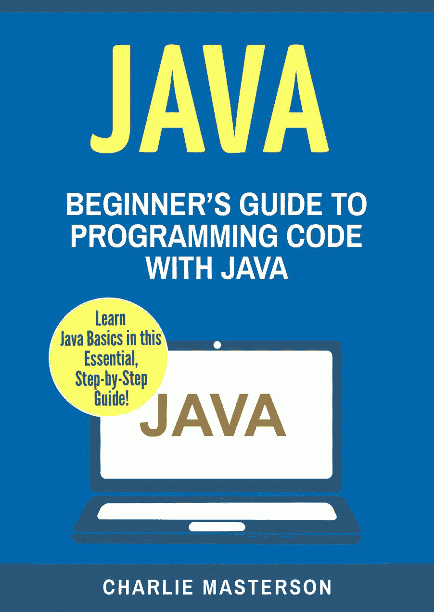

# Java 编程入门指南



## 目录

- 介绍
- 第 1 章：Java
- 第 2 章：变量
- 第 3 章：Java 的控制流
- 第 4 章：数组
- 第 5 章：字符串
- 结论

## 介绍

恭喜下载《Java：Java 编程代码入门指南》，感谢你的支持。

接下来的章节将讨论 Java 是什么以及它的用途。

读完这本书后，你应该能够像使用任何其他编程语言一样使用 Java。

请记住，Java 和 JavaScript 不是同一个。它们是两种完全不同的语言。

市场上有很多关于这个主题的书，再次感谢你选择这一本！我们已尽全力确保它包含尽可能多的有用信息，请尽享！

## 第 1 章：Java

开始学习 Java 时最困难的事情是确保你已经安装了所有要在 Java 中使用的内容。在能够编写代码之前，你必须拥有所有这些程序，否则你将给自己带来头恼。

### 虚拟机

Java 平台将独立于任何其他程序。因此，它可以在你可能工作的任何操作系统上运行。得益于 Java 虚拟机，它可以在任何系统上运行。这台机器将为编程提供帮助，以确保你的代码被正确处理。在运行任何 Java 代码之前，必须安装虚拟机程序。

一家名为 Oracle 的公司拥有 Java，在他们的网站上，你可以找到虚拟机的下载链接，它也被称为 Java 运行环境或 `JRE`。

当你检查电脑是否已安装了 `JRE` 时，可以点击 Oracle 页面上写有“我有 Java ？”的链接。该链接位于页面顶部下载按钮下方。点击此链接后，电脑将进行扫描，然后你将得到是否已安装的结果。如果没有，你就可以从该页面下载。

一旦下载了虚拟机，你需要重启系统以便程序能够正常运行。

### 软件开发工具包

现在软件已经安装，Java 就能在你的电脑上运行了。但在你编写代码之前，你还需要从 Oracle 网站安装软件开发工具包。

这套工具包被称为标准版，你想要使用的被称为 `NetBeans`。下载文件相当大，但一旦完成，你就可以编写 Java 代码了。

### Java 的工作原理

Java 代码将在文本编辑器中编写，这些代码被称为源代码。你编写的任何代码都将保存在扩展名为 `.java` 的文件中。`javac` 程序能够将你编写的任何源代码转换为 Java 字节码，这被称为编译。一旦文件编译完成，就会创建一个扩展名为 `.class` 的新文件。

在类文件创建时，虚拟机就可以运行该文件。`NetBeans` 是一个可以为你处理文件创建和编译的程序。但在幕后观察，你会注意到你的源代码会被创建为 Java 文件，然后启动 `javac` 来创建你的类文件。

### NetBeans

第一次进入 `NetBeans` 时，你需要等待一会儿，因为这个程序并不快。但当它终于加载后，你需要点击 `file`（文件）和 `new project`（新建项目）来创建一个应用程序。

在点击 `Java Application`（Java 应用程序）后，点击 `next`（下一步）按钮进入下一部分。显然你需要为项目命名，这将更改窗口底部的文本使其与你命的项目名称一致。

将根据你的文件名创建一个类。如果你将其命名为 `firstproject.FirstProject`，类名将大写 `F` 和 `P`，而包名将小写。

`NetBeans` 会自动设置保存，但你可以根据需要进行更改以便更好地查找。系统还会创建一个包含你项目名称的文件夹。点击 `finish`（完成）按钮后，你就创建了所需的所有文件。

在返回 IDE（集成开发环境）后，你可以查看你的项目，看看是否有正在处理的项目。当你点击项目名称旁加加符号，你会看到与该项目相关的所有文件夹。每个文件夹都会进一步展开，让你看到存储源代码的文件。

你的源代码应该显示在右侧的文本区域内。万你没有看到代码窗口，你需要双击你的项目，以便代码出现并让你开始工作。

你的文件名和类名必须匹配，否则 Java 将不允许其正常工作，并且在编译时你会遇到错误。

在你创建了一个新项目后，你会发现文本窗口中有些文字是灰色的，并且包含星号或斜杠。这些区域将成为你的注释，当程序运行时，这些注释将被程序忽略。你可以在注释中输入任何你想输入的内容，但大多数情况下，注释会解释你正在对代码进行的操作。单行注释通过在前面输入两个斜杠来输入。

```java
// this is a comment
```

当你需要多行注释时，你有两个选择：

```java
// your comment
//and it is going to continue here
```

或者

```java
/*
your comment
And it is going to continue here
*/
```

你也可以选择使用所谓的 Javadoc 注释，在那种注释中，你会看到一个正斜杠带有两个星号，并以一个单星号和一个斜杠结束。但是，每一行的前面都会有一个星号。Javadoc 注释通常用于文档代码。这些代码将被转换为一个 HTML 页面，以帮助他人。

如果你点击 NetBeans 顶部菜单上的“运行（run）”，你可以选择“生成 Javadoc”。然而，由于你还没有编写任何代码，你什么也看不见。你可以删除 NetBeans 生成的注释。

## Java 结构

包名将出现在你的代码开头。该行将以分号结尾，如果你不小心漏掉了那个分号，程序将无法编译。在你的包名之后，将列出类名。

将你的类名视为一段代码。必须使用大括号来告诉 Java 代码从哪里开始到哪里结束。代码将以左括号开始，以右括号结束。每当这些括号中放置了任何内容时，你就有了一个代码段。

当你编写代码时，你需要包含 `main` 单词，以便 Java 知道它从哪里开始。这个方法将是一段代码，但它将帮助执行 `main` 大括号内部的任何代码。如果你忘记在编写的程序中放入 `main` 入口点，就会发生错误消息。

## 运行 Java 程序

每当程序运行时，它将在屏幕底部可见的输出窗口中运行。你不需要启动任何终端或控制台窗口，因为输出窗口就是你的控制台。

在 NetBeans 中，你有多种方法可以运行你的程序。但对你来说最简单的方法是直接按 F6。如果你不想这样做，也可以进入菜单并选择“运行项目（run project）”按钮。

在工具栏上还可以找到一个绿色按钮，它可以运行你的程序。运行你程序的另一种方法是进入“项目（projects）”窗口。你可以通过右键点击你想要运行的项目并选择“运行文件（run file）”来确保正确的代码将运行。这种方法也可以在实际文本窗口内通过点击代码所在的地方来实现。

只要你正确编写了代码，你选择任何方式都会在输出窗口中运行你的程序。

## 第 2 章：变量

大多数程序将通过操作放在程序内存中的数据来工作。这些数据将是对象、金额、文本以及内存区域中的任何其他指针。当你给数据命名时，你可以在需要时对其重命名，但该名称和值被视为变量。

### 金额

当 Java 中需要存储一个金额时，你有几种可以使用的。有像 8 或 12 这样的整数，可以存储在 `int` 变量中。`int` 代表整数（integer）。

然后是像 8.4 或 10.5 这样的浮点数，它们存储在 `double` 变量中。当你存储这些时，你需要使用等号。

```java
public static void main(String[] args) {
    int last_amount;
    System.out.println("My Last Project");
}
```

程序要求开发者与其通信，告知想要保存一个整数，因此你需要输入 `int` 并在后面加一个空格。然后你将被允许输入你想要命名的变量名称。变量可以命名为你想要的任何名称，但有一组你必须遵守的特定规则：

- 变量名可以有不同的含义。由于名称对大小写敏感，像 `firstname` 或 `FirstName` 这样的名称是两个不同的名称。
- 变量名不能以金额作为第一个字符。使用单词拼写金额是可以的，但使用实际金额会导致 Java 抛出错误消息。金额将用于 Java 的其他地方。
- 变量名不允许有空格。`int first amount` 的变量声明将向你抛出错误。你可以使用下划线或随后的大写字母。
- 不允许使用关键字作为变量名。Java 中有几个关键字，NetBeans 会你的编码中将这些单词显示为蓝色。

当你想要存储一个名为 `last_amount` 的变量时，你要在想要存储的值之前输入一个等号。

```java
public static void main(String[] args) {
    int last_amount;
    last_amount = 10;
    System.out.println("My Last Project");
}
```

大量的数值可以存储在 `int` 变量中，但限制是 `2147483647`。你也可以存储负数，能够达到的最低值是 `-2147483648`。更大或更小的数值将使用 `double` 变量类型。

### Double 变量

`Double` 变量可以存储从极大到极小的各种数值。你能够达到的最高和最低数值将是 17 后面跟着大约三百零七个零。`double` 变量将用于存储浮点数。如果你尝试将浮点值存储到任何 `int` 变量中，程序将标出代码错误所在的地方，以便你可以在运行之前进行修改并接收错误消息。

```java
int last_amount, third_amount, result;

double last_amount, third_amount, result;

last_amount = 11.5;

third_amount = 22.8;

result = last_amount + third_amount ;
```

现在可以运行程序来向你展示它的样子。

### Short 和 float

`Short` 变量将保存存储在 `-32768` 和 `32767` 之间的较小数值。你将不再像以前那样使用它，而是将使用 `short`。当你使用 `short` 时，你需要确保你使用的数值落这两个数值之间。

`Double` 值将用于存储较大的浮点数数值。你将不再使用 `double` 而是使用 `float`。当你存储一个 `float` 变量时，数值末尾需要加上字母 `f`。

```java
float last_amount, third_amount, result ;

last_amount = 10.5f;

second_number = 20.8f;
```

### 简单算术

当你对变量进行数学运算时，你将使用基本符号进行计算。

- 加法 (`+`)
- 减法 (`-`)
- 乘法 (`*`)
- 除法 (`/`)

### 运算符优先级

在 Java 中可以计算两个以上的数值，但在涉及计算内容时你必须小心。

```java
last_amount = 200;

third_amount = 85;

fourth_amount = 45;

result = last_amount – third_amount + fourth_amount;
```

计算将按照它们出现的顺序进行。所以你需要做的是从 `200` 中减去 `85` 得到 `115`。然后你加上第三个数值得到 `160`。

为了确保 Java 按你想要的方式运行，可以使用括号。

```java
result = (last_amount – third_amount) + fourth_amount

result = last_amount – (third_amount + fourth_amount)
```

在乘法中，乘法将优先于任何加法或其他操作。优先级的顺序是乘法和除法高于加法或减法。

### String 变量

数值并不是唯一可以存储的内容，变量也可以存储文本。当你想要存储一个字符时，你需要使用 `char` 关键字，以便 Java 知道你使用的是字符而不是数值。当你存储多个一个字符时，你将使用 `string` 变量。

像第一章那样开始一个新项目，将项目命名为类似 `StringVars` 的名称。需要勾选方框以创建一个主类。你可以删除 `stringvars` 之后的 `main`，并输入 `StringVariables` 代替。

删除所有注释后，你将拥有一个与之前类似的代码窗口。为了创建一个字符串，你将使用单词 `string` 作为你的关键字，后面紧跟变量名。分号仍然会被使用。

```java
String last_amount;

middle_name = "William";
```

```java
String inherited_name
```

```java
inherited_name = "Shakespeare";
```

```java
System.out.println(middle_name + " ")
```

```java
middle_name = "W"
```

```java
middle_name = "W";
```

### 客户端输入

当你对变量进行数学运算时，你将使用基本符号进行计算。

```java
import java.util.Scanner ;
```

```java
public class StringVariables {

}
```

```java
Scanner client_input = new Scanner(System.in)
```

```java
String middle_name;

middle_name = client_input.next() ;
```

```java
System.out.print (" Enter your middle name: " ) ;

middle_name = client_input.next() ;
```

```java
System.out.print (“Enter your family name: “);
inherited_name = client_input.next() ;
```

这段代码是完全相同的，但 Java 会将客户端提供的任何输入保存在一个新变量中。如果你想打印获取到的输入，可以这样做：

```java
String complete_name;
complete_name = middle_name + “” + family_name ;
System.out.println (“You are” + complete_name);
```

当运行此程序时，Java 将停顿，以便客户端输入数据。一旦输入了所有所需的数据，屏幕上将显示正确的输出。

最终，`Scanner` 类将用于从客户端获取输入。客户端键的任何内容都将被存储在相应的变量中。

## 选项面板 (Option Panes)

与 `Scanner` 类一样，还有一个 `JOptionPane` 类，在你尝试从客户端获取输入时非常有用。该类会弹出一个输入窗口，让客户端输入正确的数据，并弹出显示类似“Hello”等内容的窗口。

```java
import javax.swing.JOptionPane;
```

Java 将被告知你想使用 `JOptionPane` 类，并且它位于 `javax.swing` 库中。

如果你不想更改之前的任何代码，可以再次启动一个新项目来练习这个。当你输入代码时，可能会发现 `import javax.swing.JOptionPane;` 下有下划线。这是因为这段代码尚未被使用。一旦使用了它，下划线就会消失。

为了获得一个允许客户端输入某些类型数据的框，你将从 `JOptionPane` 中选择 `showInputDialog` 方法。这将导致输入的数据直接存储到相应的变量中。

```java
String middle_name;
middle_name = JOptionPane.showInputDialog (“ Middle Name “) ;
```

在你使用 `JOptionPane` 输入完一个句号后，会弹出一个列表。在这里，你可以双击 `showInputDialog`，这样你就可以在括号之间输入你想显示的消息。像其他任何内容一样，它应该位于双引号之间。

```java
String inherited_name;
inherited_name = JOptionPane.showInputDialog (“Family Name”) ;
String complete_name;
complete_name = “You are” + middle_name +”” + inherited_name;
JOptionPane.showMessageDialog (null, complete_name );
```

此时，你将想要选项列表中的 `showMessageDialog`。单词 `null` 现在将出现在你的括号之间，这个关键字让 Java 知道对话框与程序的关系不大。符号将出现在你想在消息框内显示的文本中。

在你代码的底部，你可能会发现有一段新代码。`system.exit(0);` 使程序能够退出并从内存中移除任何对象。

当运行你的代码时，你将得到弹出框，询问你指定的希望客户端输入的数据。一旦点击“确定”按钮，你的输入就会显示出来。再次点击“确定”将程序结束。

## 第三章：Java 的控制流 (Control Flow for Java)

在此之前你所做的任何编程都将被称为顺序编程（sequential programming），这基本上意味着你输入的代码是从上到下读取的，每一行都按照其书写的方式读取。然而，并不是所有程序都是这样工作的。

某些代码必须在满足特定条件的情况下运行。对于代码来说，你可能希望客户端处于某个年龄。这就是你通过条件逻辑控制程序运行流的地方。

条件语句大多将使用 `if` 单词，但也可以其他单词来创建条件语句。

### If 语句

代码每当事情发生时就会执行，而不是等待其他事情，这在编程中是最常见的，因此创建了 `if` 语句。

一个 `if` 语句看起来如下：

```java
if ( statement ) {
}
```

在将你的条件放在一组括号中之前，`if` 单词将写为小写。大括号将用于划分代码块。这段代码只有在满足条件的情况下才会执行。

```java
if( client < 18) {
}
```

这个条件表示如果客户端小于 18 岁。为了不把全部写出来，将使用一种简写方法，使代码块更短且更易读。

```java
if( client < 18) {
// display message
}
```

因此，如果客户端大于 18 岁，两组大括号中设置的代码将被跳过，Java 将按照预期方式继续。大括号中间的任何内容只有在满足条件时才会执行。

另一个简写概念是将三角形指向右侧，表示大于。

```java
if( client > 18) {
//display message
}
```

代码完全相同，只是条件适用于那些 18 岁以上的人。

### If ... else

与其使用 `if` 语句，可以使用 `if else` 语句。

```java
if( condition_to_test) {
}
else {
}
```

第一行仍然以 `if` 开头，后面跟着条件。大括号将划分不同的部分。第二种选择将位于 `else` 之后，并带有自己的大括号。你只有两个选择，客户端要么小于 18 岁要么大于 18 岁。

### If ... else if

可以同时测试多个两个条件。如果你想测试某个年龄范围，将使用 `if else if` 语句。语法如下：

```java
if(condition_one) {
}
else if ( condition_ two ) {
}
else {
}
```

当发送 `if` 语句时，紧随其后的是圆括号。第二个条件位于新的括号之间，但它不会被第一个条件捕获。

你需要使用的条件运算符有：

- 大于 `>`
- 小于 `<`
- 大于等于 `>=`
- 小于等于 `<=`
- 与 `&&`
- 或 `||`
- 等于 `==`
- 非 `!`

两个与符号符号将用于同时测试多个条件。

```java
else if ( client > 18 && client < 40)
```

通过这段代码，你将想要知道客户端的年龄并查看他们是否大于 18 岁但小于 40 岁。你只是试图查看客户端输入的变量内容。客户端必须大于 18 岁且小于 40 岁。由于使用了 `&&` 运算符，客户端必须满足这两个条件。

### 嵌套 if (Nested if)

`if` 语句可以像 `if else` 和 `if else if` 语句一样嵌套。嵌套的 `if` 语句是将一个 `if` 语句与另一个放在一起。

```java
if( client < 19) {
    System.out.println ( “ 18 or younger”) ;
}
```

为了检查客户端是否大于十六岁，必须在你已创建的 `if` 语句内部另一个 `if` 语句。

```java
if( client < 20) {
    if( client > 20 && client < 23 ) {
        System.out.println (“ You are 21 or 22”) ;
    }
}
```

第一个 `if` 语句是客户端小于 19 岁时捕获他们的地方，第二个将缩小范围直到他们大于 16 岁。当你想打印不同的消息时，可以使用 `if else` 语句。

```java
if( client < 20) {
    if( client > 20 && client < 23 ) {
        System.out.println( “You are 21 or 22”) ;
    } else {
        System.out.println (“22 or younger”) ;
    }
}
```

代码中放置的花括号必须准确，否则程序将无法运行。嵌套 `if` 语句很难学习，但可以对其进行简化。

### 布尔值

布尔值只有 `true` 或 `false`、`1` 或 `0`，甚至是 `yes` 或 `no`。Java 有一个专门用于布尔值的变量：

```java
Boolean client = true;
```

你不需要输入 `int`、`string` 或 `double`，你需要使用小写的 b 来输入 `Boolean`。变量名将在赋值为 `true` 或 `false` 之后出现。赋值使用一个等号。但是，如果你要评估该变量且它有值，那么你需要使用两个等号。

```java
Boolean client = true;
if ( client == true) {
    System.out.println (“it’s true”) ;
} else {
    System.out.println(“it’s false”) ;
}
```

`if` 语句将检查客户端输入的变量是否为 `true`。`else` 将检查它是否为 `false`。你不需要说 `else if ( client == false)`。当某结果不是 `true` 时，它显然是 `false`。你会使用 `else`，因为在涉及布尔值时只有两种选择。

另一个用于条件的运算符是 `NOT` 运算符，它用于布尔值。

```java
Boolean client = true ;
if( !client) {
    System.out.println (“it’s false”) ;
} else {
    System.out.println (“it’s true”) ;
}
```

`NOT` 运算符将位于 `client` 变量之前。该运算符使用单个感叹号，但它将位于需要测试的变量之前。代码将对否定进行测试，这意味着它不是它实际的样子。

由于 `client` 变量已设置为 `true`，`!client` 最终将测试 `false` 值。如果条件被设置为 `false`，那么 `NOT` 运算符将测试值为 `true`。

### Switch 语句

为了管理脚本的运行，开发者可以使用 `switch` 语句。`switch` 语句将为你提供变量设置的值范围内的选项。本质上，这些是长且复杂的 `if else if` 语句。

因此，它的语法如下：

```java
Switch ( variable_to_test) {
    Case value:
        //Code_here;
        Break;
    Case value:
        //Code_here;
        Break;
    Default:
        // The values_that_were_not_caught_from_the _conditions_above;
}
```

此代码将以关键字 `switch` 开始，后面跟着一组括号。任何你想评估的变量都将放在 `switch` 括号的中间。花括号将包含 switch 语句的所有其他部分。对于你需要检查的每个情况，开发者将使用一个名为 `case` 的关键字，以便他们检查 case 的值。

`case` 值后面将跟有一个冒号。任何你想发生的事情都会发生，但仅在值正确对应的情况下。你想要执行的代码将被执行。在 switch 语句的每种情况下，每当需要 `break` 的地方都会使用 `break` 单词。

将使用 `default` 值，但它是完全可选的。如果你没有在 switch 语句的其他地方检查它，你可以在变量中包含其他值。

```java
public static void main(String[] args) {
    int client = 17;
    switch ( client ) {
        case 19:
            System.out.println(“ You are 19”) ;
            break ;
        case 20:
            System.out.println (“ You are 20”) ;
            break ;
        case 21: 
            System.out.println (“ You are 21”) ;
            break ;
        default:
            System.out.println (“ You are  not 19, 20, or 21”) ;
    }
}
```

代码将设置一个必须测试的值。一个整数变量将被称为 `client`。在这段代码中，值被设置为 `18`。通过 `switch` 语句，将检查变量以查看其内容。

### 循环

由于流程是顺序的且向下运行的，如果你不希望是这样，你需要告诉 Java 以不同的方式执行。因此，为了中断这种流程，你可以创建一个循环。通过这种，循环将强制程序返回并重复执行代码行。

```java
int addition = 1 + 1;
```

### For 循环

For 循环是最常用的循环之一。`for` 循环的语法为：

```java
for ( beginning_value; last_value ; increment_amount) {
    //this where code will appear
}
```

在圆括号中，你有三个不同的项目：循环的起始值、结束值以及它将遵循的路径。

```java
package loops ;

public class ForLoops {
    public static void main (String[] args) {
        int loopVal;
        int last_value = 15;
        for (loopVal = 0; loopVal < last_value; loopVal++) {
            System.out.println (“Loop Value = “ + loopVal) ;
        }
    }
}
```

每当设置一个整数值，它将被称为 `loopVal`。下一行需要设置的是另一个整数变量。该变量将用作循环结束的值。

在括号内部，你有：

`loopVal = 0; loopVal < last_value ; loopVal++`

Java 将告知哪个值开始循环。这也是将值从零分配给 `loopVal` 变量的地方。第二部分是条件逻辑：

`loopVal < last_value`

`loopVal` 比 `last_value` 小。`for` 循环将一直持续到值小于结尾变量。只要值保持为 `true`，Java 就会继续循环花括号之间的代码。

循环的最后部分 `loopVal++` 表示值每次增加。

### While 循环

While 循环比 for 循环更容易理解。`while` 循环的语法为：

```java
while ( condition) {
}
```

`while` 单词将是小写，你的条件将放在括号之间。

```java
int loopVal = 0;
while (loopVal < 5) {
    System.out.println (“Printing some text”);
    loopVal++;
}
```

括号中的条件将是正常的，花括号中的代码将是必须打印的代码。循环将永远进行下去，因为没有值为 0 的情况。

计数器 `loopVal` 将到达条件的末尾。当你不需要计算一个值而是在检查一个值时，`while` 循环非常好用。对于代码来说，当键盘上没有按下按键时，它可以保持循环。但是，字母 `x` 将退出循环。

### do while

`do while` 循环与 `while` 循环一样，但它看起来不同。

```java
int loopVal = 0;
do {
    System.out.println("Printing some text");
    loopVal++;
} while (loopVal < 5);
```

循环将一直持续到条件满足为止。这两个循环之间最大的区别在于你放在括号中的代码。`do while` 循环的代码至少会被检查一次，而在 `while` 循环中，它将一直执行直到满足条件。

Java 将跳出循环而不执行括号内的代码。当你想要测试这一点时，你需要先使用 `while` 循环。在运行代码之前，必须更改 `loopVal` 变量的值。文本将不会被打印。

## 第 4 章：数组

数组一次可以持有多个值；它更像是一个项目列表。当你考虑到数组时，你应该考虑到电子表格以及它的列。你可以有一列，也可以有很多列。

位于单列的数组看起来像这样：

```
0 – 10
1 – 14
2 – 36
3 – 27
4 – 43
5 – 18
```

就像电子表格一样，每一行都有一个位置索引。位置从零开始，每次增加一。每个位置将像上面的代码一样持有一个值。

当你想要设置数组时，你需要让 Java 知道你正在向数组中放入什么类型的数据。你还需要准确说明数组将有多少个位置。

语法为：`int [] aryNums;`

区别在于，一旦设置了数据类型，普通的整数变量将位于方括号中。括号会让 Java 知道你已经设置了一个数组。数组的名字是 `aryNums`。但像任何普通变量一样，你可以使用你喜欢的任何名称。

当你告诉 Java 数组有多少个位置时，你必须为数组创建一个新对象。

```java
aryNums = new int[6];
```

起初你从数组名称开始，然后是一个等号。在进入数据类型之前，等号前面有一个 `new` 关键字。所使用的数据类型后面是数组的大小。大小会让 Java 知道数组需要多少个位置。

如果你更喜欢代码看起来那样，你也可以将所有内容写在一行。

```java
int [] aryNums = new int[6];
```

Java 将知道你正在使用一个包含六个位置的数组，数据类型是整数。因此，默认值是从零到六。

当你想要给不同数量的位置赋值时，你可以像往常一样操作。

```java
aryNum[0] = 10;
```

十这个值将被赋值给数组中的零。

记住，数组始终从零开始，第三个位置是索引为二的位置。

为了方便设置数组，你可以这样做：

```java
int [] aryNums = { 1, 2, 3, 4 };
```

通过这种方法，你将数组的值放在花括号中。第一个值始终是零。`int` 后面会有方括号，但没有 `new` 关键字，也不会重复任何数据类型。你只能对 `int`、`char` 和 `string` 值使用这种方法，除非你想使用 `new` 关键字。

```java
String[] aryStrings = {"Autumn", "Spring", "Summer", "Winter"};
```

这是可以的：

```java
Boolean[] aryBools = {false, true, false, true};
```

这是不对的！在设置 `Boolean` 数组时，你必须使用 `new` 关键字：

```java
Boolean[] aryBools = new Boolean[] {false, true, false, true};
```

### 循环与数组

数组有自己的循环。当一个值被赋值给数组时，你将使用上一节中看到的语法。虽然这并不完全实际，但在有大量数量需要赋值给数组时，它是可以的。

```java
package prjarrays;

public class ArrayTest {
    public static void main(String[] args) {
        int [] lottery_amounts = new int [49];
        int I;
        for (I = 0; I < lottery_amounts.length ; i++) {
            lottery_amounts[I] = I +1;
            System.out.println(lottery_amounts[1]);
        }
    }
}
```

这个数组将包含 49 个不同的整数。循环末尾有一个 `length`，它会记录数组将有多少个位置。为了给位置分配数量，你将使用：`lottery_amounts[I] = I +1;`

循环将一直持续到 `lottery_amounts.length` 大于 `I`。数组中的每个位置每次循环都会增加一。

### 字符串与数组

数组像整数一样放入字符串中。

```java
String[ ] aryString = new String[ 5 ] ;
aryString[ 0 ] = “this” ;
aryString[ 1 ] = “is” ;
aryString[ 2 ] = “a” ;
aryString[ 3 ] = “string” ;
aryString[ 4 ] = “array” ;
```

这段代码有五个不同的位置，每一段文本都被放置在它所属的数组中。

这是一个循环将使用数组的所有位置，但它会打印出每一个位置。

```java
int I ;
for ( I = 0 ; I < aryString.length ; i++ ) {
    System.out.println( aryString[ I ] ) ;
}
```

该循环将一直重复，直到值小于数组范围调用的值。

数组也可以按字母顺序进行排序，因此 `aa` 会在 `ab` 之前。但是，由于 Java 使用了被称为 `Unicode` 的字符集，为了将字符串中的字母与其他字母对比，大写字母会出现在小写字母之前。

```java
package strings1 ;
import java.util.Arrays ;

public class StringArrays {
    public static void main(String[] args) {
        String[ ] aryString= new String[ 5 ] ;
        aryString[ 0 ] = “This” ;
        aryString[ 1 ] = “is” ;
        aryString[ 2 ] = “a” ;
        aryString[ 3 ] = “string” ;
        aryString[ 4 ] = “array” ;
        Arrays.sort( aryString ) ;
        int I ;
        for ( I = 0; I < aryString.length ; i++) {
            System.out.println ( aryString[ I ] ) ;
        }
    }
}
```

### 多维数组

在本章之前讨论的数组只有单列数据，但你可以设置具有多列的数组。这些数组被称为多维数组。

```
0 – 10 – 12 -43 – 11 - 22
1 – 20 – 45 -56 – 1 – 33
2 – 30 – 67 – 32 – 14 – 44
3 – 40 – 12 – 87 – 14 - 55
4 – 50 – 86 – 66 – 13 – 66
5- 60 – 53 – 44 – 12 – 11
```

多维数组按照这种方式排列：

```java
int[ ] [ ] aryAmounts = new int[ 6 ] [ 5 ] ;
```

该数组的设置与普通数组完全一样，但会有组方括号。第一组括号告诉 Java 有多少行，而第二组括号告诉有多少列。

```java
aryAmounts[0][0] = 10;
aryAmounts[0][1] = 12;
aryAmounts[0][2] = 43;
aryAmounts[0][3] = 11;
aryAmounts[0][4] = 22;
```

第一行像往一样从零开始，然后列将到四，这将导致数组上放置五个项目。

你的第二行是：

```java
aryAmounts[1][0] = 20;
aryAmounts[1][1] = 45;
aryAmounts[1][2] = 56;
aryAmounts[1][3] = 1;
aryAmounts[1][4] = 33;
```

第一个 for 循环将使用行中金额的位置，而第二个循环根据列使用位置。第一个循环的 `I` 的值将是零。嵌套在循环内部的代码将用于用于另一个循环。下一个循环只要变量 `I` 为零，就会继续评估。

### 用于数组的列表

很难确定数组内确切有多少个项目，因此使用 `ArrayList` 对你来说会更容易。`ArrayList` 是一种动态数据结构。因此，你可以添加和删除项目。普通数组的数据是静态的，因为你无法更改已创建数组的原始大小。

设置 `ArrayList` 时，你必须确保使用以下语法从库中提取包。

```java
import java.util.ArrayList;
```

一旦导入，你就可以使用此语法在列表中创建新对象：

```java
ArrayList listTest = new ArrayList( );
```

在使用 Array List 时，你不需要方括号。

```java
listTest.add( "first item" );
listTest.add( "second item" );
listTest.add( "third item" );
listTest.add( 7 );
```

落在括号中间的内容将被添加到列表中。你只能添加对象。此列表中的前三个项目将作为字符串对象添加。最后一个项目是一个金额，因为有整数金额对象。

当这段代码按字母顺序排序时，`a` 不会排在第一位，因为它是小写的。因此，`a` 的值为 `u\0061`。大写的字母 `T` 的值为 `u\0054`。

在操作具有不同文本的字符串时，你可以使用以下一些方法：

- `toUpperCasse`
- `toLowerCase`
- `compareTo`
- `IndexOf`
- `endWith`, `startsWith`
- `Substring`
- `Equals`
- `charAt`
- `trim`
- `valueOf`

关于大小写字母，Java 将以一种直观的方式将文本转换为小写或大写，并将使用内置的 `toUpperCase` 和 `toLowerCase` 方法来实现。

```java
package prjstrings;

public class StringManipulation {

    public static void main (String[] args) {
        String changeCase = "text to change";
        String result;
        result = changeCase.toUpperCase();
        System.out.println(result);
    }
}
```

开头几行告诉了字符串变量设置在哪里，同时保留了在打印之前需要更改的文本。第三行调用了变量的结果。最后，在第四行中进行了转换。

```java
result = changeCase.toUpperCase();
```

该字符串方法将适用于任何字符串。你只需要在变量后输入一个点，就可以看到你可以对你的 `changeCase` 字符串进行操作。如果你想让它变成大写，那么就选择它，但请记住，大写后面应该有一组空括号。

一旦结果完成转换，它将作为存储为新结果。如果你不想存储结果，可以使用以下代码：

```java
System.out.println(changeCase.toUpperCase())
```

当你想要执行 `toLowerCase` 时，将使用相同的方法。

### 字符串比较

可以通过十六进制值对字符串进行比较。你只需要使用 `compareTo` 方法即可。

```java
package prjstrings;

public class StringManipulation {

    public static void main (String[] args) {
        int result;
        String Word1 = "Ape";
        String Word2 = "App";
        result = Word1.compareTo(Word2);
        if (result < 1) {
            System.out.println("Word1 is less than word2");
        } else if (result > 0) {
            System.out.println("Word 1 is more than word 2");
        } else if (result == 0) {
            System.out.println("the same word");
        }
    }
}
```

当这两个单词进行比较时，使用了带有此语法的 `compareTo` 方法：

```java
result = Word1.compareTo(Word2);
```

返回的值将是一个大于零、小于零或等于零的值。你需要确保分配了正确的值，以便将 `compareTo` 的结果返回给变量。代码中将包含 `if` 语句来测试并查看结果是什么。

但是，当比较两个字符串时，Java 将比较十六进制值而不是单词的字母。由于由于两者都包含大写字母，`App` 的 `A` 将排在 `ape` 之前。

### indexOf

`indexOf` 将定位当前字符串或任何其他字符串中的字符。

```java
package prjstrings;

public class StringManipulation {

    public static void main (String[] args) {
        char ampersand = '@';
        String email_address = "meme@me.com";
        int result;
        result = email_address.indexOf(ampersand);
        System.out.println(result);
    }
}
```

这段代码正在检查提供的电子邮件地址中是否存在 `@` 符号。由于使用了单引号，它是一个 `char` 变量。一旦设置好电子邮件，你将得到结果，结果是一个 `int` 变量。因此，得益于 `indexOf` 方法，你的结果是一个整数。

由于这一行的存在，你的符号位置将是这段代码的结果：

```java
result = email_address.indexOf(ampersand);
```

当你指定要使用 `indexOf` 方法时，你想要搜索的字符串将出现在点之后。括号内是你提供多个选项的地方。首先，你可以输入单个字符。通过此操作，Java 在存储变量结果的值之前，会告诉你该字符在字符串中的位置。

当运行代码时，输出将是四。由于 `indexOf` 和其他所有内容一样从零开始，因此 `&` 是电子邮件字符串中的第四个字符。

如果你要找的字符不存在，那么 `indexOf` 将给你返回负一的结果。

```java
package prjstrings;

public class StringManipulation {

    public static void main (String[] args) {
        char ampersand = '@';
        String email_address = "mememe.com";
        int result;
        result = email_address.indexOf(ampersand);
        if (result == -1) {
            System.out.println("invalid email address");
        } else {
            System.out.println("email address is ok");
        }
    }
}
```

虽然代码看起来完全一样，但你现在将使用字符串变量来包含你想要检查的文本。再次返回负一的结果表示未找到搜索的文本。`IndexOf` 也可以用于测试多个字符。

```java
public static void main (String[] args) {
    String dotcom = ".com";
    String email_address = "meme@me.com";
    int result;
    result = email_address.indexOf(dotcom);
    if (result == -1) {
        System.out.println("invalid email address");
    } else {
        System.out.println("email address is ok");
    }
}
```
