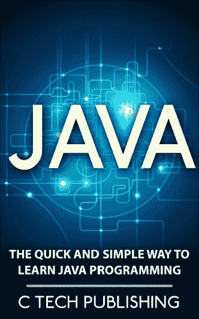

# Java 编程：入门



## 引言

如果你对编程有一点兴趣，你可能听说过 Java。

## 这本书将教你什么？

如果你对编程感兴趣，你可能听说过 Java。事实上，它是为了各种目的而设计的语言。在开始之前，你可能需要了解一些基础。

## Java 简史

Java 最初创建于 1991 年。在 Sun Microsystems 工作时 James Gosling 和他的团队创建了 Java。它最初是为各种家用电器设计的。在 1995 年，Netscape 发布了其版本的浏览器，该浏览器能够运行 Java。

在花了一些时间思考一个合适的名称来取代 `Oak` 后，他们发现已经有语言叫这个名字。由于 `java` 是流行饮料的另一种说法，这给了他们一个新名字的想法。2010 年，Sun Microsystems 被一家名为 Oracle 的软件公司收购。从那时，他们继续开发 Java 及相关产品。

## Java 的流行程度

Java 如此流行的原因之一是它非常流行。基本上，它是世界上最常用的编程语言之一。许多程序员在职业生涯的某个阶段都有过 Java 的经验。如果你正在考虑学习编程，但不知道先学哪种语言，Java 是一个推荐的选择。

由于 Java 目前非常流行，对于那些依赖自由职业程序员和顾问的人来说，它是一个很棒的选择。未来寻找可以帮助维护代码的人将非常容易。这消除了对创建未来可访问代码的担忧。这种普及性对许多人都有吸引力，特别是对于那些外包编程业务的人。

除了流行之外，Java 也很棒，因为它易于使用。这意味着它可以为各种不同的操作系统和平台创建程序。Java 在系统的服务器端占据主导地位。

看看 Java 可以做的某些事情，以及为什么它是一个很棒的编程语言：

## 平台无关性

这是 Java 如此流行的关键原因。平台无关性是指它在不同计算机上运行的能力。如果你有一个可以运行适当 `JRE`（Java 运行环境）的系统，它就能运行 Java 应用程序。这包括 Windows、Mac、Linux、Unix、大型主机，甚至是许多移动设备。

## Java API

实际上学习 Java 相当简单，因为该语言中只有 50 个不同的关键字。然而，有一个包含数千个不同类的库。此外，在程序中使用的方法数量要多得多。库的内容为 Java 提供了各种功能。没有库，Java 将无法具备这些功能，因此它对 Java 来说就像语言本身一样不可或缺。这个类库被称为 `Java API`。你并不局限于某一个库，有很多选择，而且它们有各种用途。假设你想创建一个某种类型的游戏，例如。你可能会找到一个专门为了让该任务更简单而创建的特殊库。通过这种方式，你基本上获得了一个定制的工作环境来工作，而无需从零开始构建一切。

在你开始恐慌之前，请理解为没有完全学习 `Java API`。程序员通常只完整地学习其中的较小部分。如果有人需要使用某些不熟悉的类，可以很容易地查找它们的更多细节。

## 对象导向

从本质上说，Java 是一种面向对象的编程语言。使用它编写的程序将由对象组成。这些对象是代表抽象概念或真实对象的程序元素。

以下是对象的两个基本特征：

- 对象有自己的行为。这意味着它能够执行特定任务，这些任务被称为 `methods`。例如，如果一个对象代表应用程序中的一个车辆，它的方法可能包括启动、行驶、停止和碰撞。有时，方法仅允许用户访问对象的数据，例如它的标题。

- 它们还有自己的状态，这基本上是数据。例如，如果一个对象代表一本书，它可能包含关于该书作者、标题和出版者的数据。

## 类

类与对象密切相关，因为类是用于创建对象而编写的代码。类描述了定义对象行为和状态的方法和数据。当程序运行时，通过使用类创建对象。

想象一下你正在制作一个处理工资单的应用程序。公司的员工需要由对象来表示。为了创建这些对象，你需要创建一个类，来定义让每个员工成为一个对象的方法和数据。你可能会将这个类命名为 `Employees`。虽然你的类名不会出现在运行工资单应用程序的用户面前，但它编码过程中对你非常有帮助。

# 入门

有几种不同的方法可以获取开始 Java 编程所需的内容。你需要这三样基本东西：

- `Java API`
- 一个 `Java Compiler`
- 一个 Java 虚拟机

你可以直接从 [Oracle 网站](http://www.oracle.com/) 下载，这是收购了 Sun Microsystems 的公司。他们提供了两个不同的下载供你选择：

- 软件开发工具包 (`SDK`)。它包含了你需要的三个工具。你可以用它来编写 Java 应用程序。确保获取的是与你的电脑和操作系统兼容的版本。

- Java 运行时环境 (`JRE`)。它只包含一个虚拟机和一个应用程序编程语言。然而，对于学习 Java 的目的，这是不够的。`JRE` 只适用于运行 Java 应用程序，但不包含实际的编译器。

或者，你可以选择作为商业包的一部分来获取。有很多选择，包括 `Borland JBuilder` 和 `Visual J++`。目前，在你开始学习 Java 时，建议你直接从 Oracle 获取 Java 运行时环境。

即使你决定使用第三方 Java 开发工具，你也应该使用 Oracle 的 Java 运行时环境。这是确保你的程序具有尽可能兼容性的极方法。

## 使用专用 IDE

这些工具允许你创建代码，但它们提供了许多很棒的功能，让 Java 工作变得简单，尽管它们也可以处理其他编程语言。如果你愿意，可以简单地使用文本编辑器。然而，专用的 IDE 会让学习工作变得容易得多，因此这本书将用于学习目的。

## Netbeans

有很多供选择。有些需要花钱购买，但也有一些很棒的免费选择。出于本书的目的，你应该下载 [NetBeans IDE](http://www.netbeans.com)，这是一款开源的免费软件。确保你下载的是与你的操作系统兼容的 Netbeans 版本。完成安装过程，你就可以准备好开始你的第一段 Java 代码了。

对于书中包含的指令，你需要下载并安装 `NetBeans IDE`。

稍后，一旦你对 Java 编程更加熟悉，你可能想找其他东西来使用，但这真的是个人选择。

## 使用文本编辑器

计算机程序是使用代码创建的，而代码是由原始形式的文本组成的。理理，为了编写和编辑代码（即文本），你需要一个文本编辑器。你可能熟悉文字处理器，它们也可以创建文本。然而，那些工具非常适合制作格式化文本，包括信件、报告、书籍等。你需要处理的是纯的、未格式化的文本，所以像 Word 这样的工具是不可接受的。

有很多用于编写代码的文本编辑器，其中一个你可能已经用过了，叫做 `Notepad`，它是 Windows 自带的。这些工具很小且通常是免费的，尽管也有一些收费的文本编辑器。

你可以使用像 `Notepad` 这样基础的编辑器来编写代码，但使用具有更多功能的会容易得多。专门为编码设计的编辑器将是最用的。以下是编辑器中可以寻找的一些功能：

- 代码语法高亮
- 方便运行和编译程序的快捷键
- 代码补全
- 程序预览
- 许多其他让工作变得简单的有用功能

虽然现在这被认为老派，但许多程序员仍然使用简单的文本编辑器。它允许他们处理各种语言，而无需切换正在使用的软件。正如上面提到的，在开始阶段你应该使用 Netbeans IDE。

# 学习术语（缩写）

在开始理解 Java 编程语言之前，你应该熟悉以下缩写。你在学习 Java 时会遇到它们，因此尽早了解概述是有帮助的。现在不要尝试记住所有的它们，因为这需要时间。是的，其中一些术语对计算机来说是通用的，但对程序员来说是重要的。这就是为什么在你开始学习 Java 时，熟悉它们是好的。

## CPU - 中央处理器

你可能已经知道这一个。它是计算机系统的“大脑”。它包含算术逻辑单元、控制单元和临时存储，即 `RAM`（随机存内存）。

## CRT - 阴射线管

这是显示器中利用电子束激发荧光点的部分。`CRT` 通常被用来代替计算机显示器（屏幕）。

## ALU - 算术逻辑单元

这是 `CPU` 中处理数学方程的部分。

这实际上是一系列连接的计算机，它们可以共享存储空间和安装的程序。这与互联网不同，因为它是本地的。局域网（LAN）通常建立在办公大楼、学校，甚至人们的家中。

## IDE - 集成开发环境

这是一个用于从单个程序创建并编译所有必要代码组件的环境。

## DOS - 磁盘操作系统

这是首个被大量用户使用的计算机操作系统。它由微软公司为 IBM 开发。它通过处理存储设备来管理计算机上的任何类型数据。名称中的“磁盘”部分是因为许多存储设备包含旋转磁盘。

## OOP - 面向对象程序编程

这是 Java 的一个流行特性。它涉及使用可重用的小部分来创建一个更大的软件整体。

## ROM - 只读存储器

这是系统上是“硬连线”的内存，因此无法被更改。它包含了允许系统在没有安装操作系统的情况下也能运行的信息。

## RAM - 随机访问存储器

与用于存储的普通内存不同，RAM 是暂性的。你可以将其想象成计算机的内存，用于执行任务。在计算机关闭后，这些将会丢失。

# 编程语言基础

现在你已经对 Java 的核心元素稍微熟悉了一些，请看一眼编程语言基础。

## 变量

你已经知道任何对象的状态都存储在字段（field）中。你会发现 Java 中既使用变量也使用字段。然而，对于编程初学者来说，它们看起来可能是一样的的。重要的是要接受它们是不同的，并且你应该像那样对待它们。

变量是任何编程语言中必不可少的一部分，Java 也不例外。变量基本上是一个存储位置，一个与该位置关联的符号名称，以及特定数量的信息（称为值）。这是一种对变量的相当有技术性的思考方式，但从一开始就观察正确的术语是有帮助的。

这里有一种更容易理解变量的方法：它们是存储信息的一种方式，以便以后使用。为了访问这些信息，会使用特定的名称。例如，想象一个网站要求你输入姓名。会出现一个文本框，要求你输入名字。那个框就代表变量。拥有该网站的人可能将那个框命名为 `username`，这就是符号名称。至于你输入的那个名称，它就是一个值。无论这些信息存储在何处，那里就是存储位置。

## 变量类型

现在你知道什么是变量了，你可以学习不同的类型。对于 Java 来说，仅仅知道某物是一个变量是不够的。它还需要知道你想用你的变量存储什么类型的信息。

这里是一些重要的变量类型：

- 整数（Integer）。这只是一个不包含任何小数的数字。例如，`5`、`10`、`50` 甚至 `-5`、`-10` 等。如果你尝试使用整数来存储任何带有小数的数字，会导致你的应用程序报错。因此，整数是只能存储整数的变量。

- 字符串（String）。这用于包含字符字符串的数据。Java 将直接按照输入的方式存储这种类型的数据，而无需担心其含义或现实世界的价值。例如，如果你将字符串 `1` 和 `5` 相加，你不会得到 `6`。你会得到 `15`，因为 Java 将简单地将两个变量拼接在一起。

这本书将不会深入探讨变量类型。现在，更重要的是理解变量是用来做什么的，以及有不同的类型可供。

## 控制结构

控制结构是任何查看变量、分析它们，然后根据变量的元素选择执行操作的代码块。

更简单的解释是，计算机在运行时会查看应用程序代码的每一行。它从顶部开始，向下移动，通常从左向右移动。这与人阅读书的方式相同，被称为代码流。

当计算机在代码中移动时，它可能会遇到某些需要做出的区域。应用程序通常不像书籍那样线性运行。它们经常随着不同事件的发生而跳跃，例如对象之间的相互作用。计算机实际上无法自己做出这些选择，因此它需要一套严格的规则来告诉它做什么。这些决策被称为控制结构。

在控制结构内部，计算机将根据你变量的状态做出某些决定。你之前在书中已经看过了状态。所以，现在你可以看到对象如何影响计算机在运行不同代码时的反应方式。如果你正在运行一个赛车游戏，而你的汽车对象的状态显示它已经撞上了墙，计算机就会导致你的汽车撞毁。情况比这要复杂得多，但目前这是一个很好的例子。

## 语法（Syntax）

这个词在书中已经出现过，但你可能已经听过它了。在人们说话和书写的语言方面，它有自己的定义。然而，对于编程来说，它有一点不同。编程语言的语法基本上是定义不同符号如何工作的规则，以及它们在以特定方式一起使用时会做什么。

Java 使用括号、大括号、变量和不同的符号。你可以将语法想象成编程语言遵循的语法规则。你需要使用某些符号，以特定的方式，并妥善地放置内容。如果你没有使用正确的语法，Java 将无法理解你想做什么。

使用正确的语法是你应该尽早学习的。始终确保你的语法是正确的。

## 数据结构

在编程世界中，数据结构是在计算机内部组织和存储数据的方式。它是以允许计算机高效使用的方式进行的。可以将数据简单存储在一个堆中，这样计算机就可以使用。然而，如果做得不高效，你可能会得到一个非常不稳定的应用程序。

编程的很大一部分是尝试创建高效的代码，以便其运行良好。这还可以让代码更容易升级和维护。反过来也可以更容易改进应用程序、创建新功能或修复问题。

## 算术运算符

Java 有五个基本的算术运算符。这些是：

- 加 `+`
- 减 `-`
- 除 `/`
- 乘 `*`
- 取模 `%`

你可能在过去在学校的数学课上就认识这些了。为了了解 Java 中可以用它们做什么，请看这些示例，它们使用了名为 `op1` 和 `op2` 的运算符：

| 使用 | 如果为真，将返回 |
| :--- | :--- |
| `op1 + op2` | `op1` 加上 `op2` |
| `op1 - op2` | `op1` 减去 `op2` |
| `op1 / op2` | `op1` 除以 `op2` |
| `op1 * op2` | `op1` 乘以 `op2` |
| `op1 % op2` | `op1` 除以 `op2` 以找到余数 |

# 你的第一个应用程序：Hello World

```java
public class HelloWorld {
    public static void main(String[] args) {
        System.out.println("Hello,!");
    }
}
```

一旦你安装了上一章详细介绍的软件，现在就可以开始编写一个非常简单的应用程序了。记住，你需要使用 `Netbeans` IDE，你也被指示下载了它。起初，你可能不会理解你所做的一切，但只需按照详细说明完成所有步骤即可。理解会在之后产生，但每个人都必须从某处开始。

你将创建一种人们在初开始学习编程时经常制作应用程序。这使其成为你创建的第一个完美代码。它被称为“Hello World”，极其简单。这听起来可能过于基础，但该程序仅仅是显示“Hello World!”。它本身并不是任何复杂的内容，甚至并不特别有用。然而，它是掌握 Java 编码一些最基础部分的极佳方法。

## 创建你的 IDE 项目

通过创建一个 IDE 项目，你正在创建一个用于构建应用程序的环境。使用像 `Netbeans` 这样的 IDE 的用处之一是它可以避免配置问题。如果你在文本编辑器中创建代码，可能会遇到一些问题。

要创建你的 IDE 项目，请遵循以下步骤：

- 启动你下载的 `Netbeans` IDE。
- 点击 `File`（文件） > `New Project`（新建项目）。将打开 `New Project` 向导。
- 点击 `Java` 类别将其展开，然后选择 `Java Application`（Java 应用程序）并点击 `Next`（下一步）。
- 打开 `Name`（名称）和 `Location`（位置）部分：
    - 输入“Hello World App”作为项目名称。
    - 在 `Create Main Class`（创建主类）区域输入 `helloworldapp.HeloWorldApp`。
- 点击 `Finish`（完成）。

你刚刚创建了第一个项目，你将看到几个窗口，包括：

- `Navigator`（导航）窗口，你可以在这里轻松在不同类的部分之间导航。
- `Source Editor`（源编辑器）窗口，你可以在这里看到刚刚创建的新项目文件 `HelloWorldApp.java`。
- `Projects`（项目）窗口，显示项目每个组件的层级布局。这包括你的代码所需的 `libraries`（库）、源文件等。

你可能需要添加你所拥有的 `JDK` 版本。这是因为你有一个新版本，它尚未列在 `Netbeans` 中，但可能性不大。

- 点击 `Tools`（工具）。
- 转到 `Java Platform`（Java 平台）并选择它。
- 你将看到带有 `JDK` 的列表，并能轻松判断你的版本是否已经列出。

接下来，你将向生成的源文件中添加一些代码。在 `New Project` 向导中创建项目时，你勾选了 `Create Main Class`（创建主类）复选框。这导致 IDE 自动创建一个骨架类。

在源编辑器中，找到以下行：

```java
// TODO code application logic here
```

你需要将该行替换为以下行：

```java
System.out.println("Hellow World!"); // Display string.
```

下一步将向你展示如何向代码添加注释。当你添加注释时，它们不会被视为实际代码的一部分。它们仅供你阅读。

找到以下四行：

```java
/**
*
* @author
*/
```

将它们替换为以下四行：

```java
/**
* This app simply prints “Hello World!”
*
*/
```

在编写代码时，请务必小心输入完全正确的内容。要确保你使用了正确的大小写，因为 Java 启动器和编译器都是区分大小写的。

例如，当你选择名称 `HelloWorldApp` 时，与输入 `helloworldapp` 是不同的。

接下来，你将保存新应用程序。点击 `File`（文件） > `Save`（保存）。

## 将你的源码编译为 .class 文件

你现在将运行你的第一个应用程序。在 `Netbeans` 主菜单中，点击 `Run`（运行） > `Build Project (Hello World App)`（构建项目）。

输出窗口不会在源编辑器下方显示构建后的代码。你应该能看到打印出的“Hello World!”。更重要的是，你应该看到“BUILD SUCCESSFUL”（构建成功）字样。如果是这样，你刚刚制作了第一个成功的应用程序。

如果看到“BUILD FAILED”（构建失败）怎么办？你的代码可能存在某种语法错误。不要担心，因为使用像 `Netbeans` 这样的专用 IDE 处理此类错误会更容易。错误将显示在你的 Output（输出）窗口中，并以超链接的形式显示。如果你想找到错误来源，双击其超链接。这将方便你修改错误。之后，你可以再次运行项目，看看是否解决了问题。

在导航窗口中，你点击 `Files`（文件）选项卡，然后展开 `Hello World App` > `build` > `classes` > `helloworldapp`。这是为你的项目生成的类文件。

一旦构建了项目并确认没有问题，你就可以正式运行它。在主菜单中，点击 `Run` > `Run Main Project`（运行主项目）。

程序将在你的 Output 窗口中打印文本“Hello World!”以及其他构建脚本输出。

你刚刚运行了第一个程序。恭喜你！

## Hello World!是如何工作的

你应该理解 Hello World! 应用程序做了什么，但可能急于了解它是如何工作的。再次看看你使用的那些代码：

```java
class HelloWorldApp {
    System.out.println("Hello World!"); // Display string.
}
```

构成你应用程序的是三个基本部分：

- `HelloWorldApp` 类。
- 源代码中的注释。
- `main` 方法。

这些解释将让你对代码有一个初步了解。然而，可能需要一些时间才能真正理解它是什么。

### HelloWorldApp 类

查看这一行：

```java
class HelloWorld App{
```

这创建了一个类定义，告诉代码使用哪个类。随后的大括号将包含你想要的代码。这可能会变得非常复杂，但你现在只需要学习基础知识。

### 源代码中的注释

查看在你代码中 `//` 之后编写的文本。这是一个注释，编译器会完全忽略它。你可能觉得不需要在代码中添加注释，因为你已经知道为什么要这样做。记住，许多代码会变得非常长且复杂。人们很容易迷失，或者忘记为什么要执行某些事情，因此创建注释是非常重要的。当其他程序员需要处理你创建的代码时，注释也有帮助，让他们可以轻松地导航并理解一切。

有三种类型的注释，它们的工作方式略有不同：

`/** your documentation */`

编译器将忽略 `/**` 和 `*/` 之间的所有内容，但该注释将被视为“文档注释”。它是 documentation comment 的缩写。所有的文档注释以后都可以使用工具进行编译，方便创建参考文档。

`// text`

`//` 之后的整行内容都会被编译器忽略。

`/* your comment */`

当你使用这种注释时，`/*` 和 `*/` 之间的所有内容都将被你的编译器忽略。

### main 方法

最后，查看这一行实际上告诉你的应用程序 `HelloWorldApp` 类是做什么的：

```java
System.out.println("Hello World!");
```

`System` 类来自 Java 的基础库。它只是告诉系统向标准输出打印“Hello World!”。这就是为什么当你运行应用程序时，它会在屏幕上打印这些词。

# 更多定义

## 对象

你已经处理过对象，并对它们有了初步了解。现在你已经完成了一项实战编程练习，是时候查看更多关于对象的理论以及它们的作用了。在 `Java` 中，对象是至关重要的，因为它是一门面向对象的语言。这不是唯一以这种方式工作的语言，但它是 `Java` 最受欢迎特性之一。

为了更好地理解对象，现在观察一下你周围的环境。你可能会看到许多不同的对象，从你正在使用的电脑到你的椅子、你的狗，甚至你周围的其他的人。把一只狗想象成 `Java` 中的一个对象。它有自己的状态（名称、品种、颜色）以及行为（摇尾巴、睡觉、汪叫）。为了更好地理解对象在 `Java` 中是如何工作的，请尝试从状态和行为的角度来思考不同的现实世界对象。

对象的状态存储在字段（field）中。请务必注意这里，因为这是面向对象语言如此如此独特的特性之一。对象的行为通过方法（method）暴露出来。这些方法由对象的状态引导，并告诉它如何与其他对象交互。`Java` 中的对象通过内部状态工作，其他对象无法直接访问这些状态。这被称为数据封装。

再次把狗想象成 `Java` 中的一个对象。虽然该对象具有某些行为（方法），让你能够观察并与狗交互，但你并不知道它的内部状态。你无法直接改变狗的内部状态，除非你处理它的外部行为。

这种编程类型与非面向对象的编码相比具有巨大的优点：

- **内置隐藏**。其他对象只与对象的方法（行为）交互，因此内部状态可以保持隐藏。
- **模块化**。对象可以在较大的代码块（应用程序）之外进行编码和处理。当一个对象完成后，可以将其引入源代码中，在其中它可以与其他对象交互。
- **调试和插拔性**。如果你发现某个对象工作不正常，很容易将其移除进行调试。然后接入一个不同的对象也很简单，看看效果是否更好。通过这种方式，程序员只需要替换对象，而不是修复整个应用程序。
- **代码复用**。如果有人已经创建了适用于另一个程序的特定对象，那么很容易复用它。

## 类 (Classes)

你还查看了类，甚至在自己的应用程序中使用过类。更深入地研究它们，以发现它们究竟是什么。再次思考你所生活的现实世界。有许多相同类型的不同对象。例如，世界上有很多不同的汽车。即使是相同型号的汽车也会有差异。

所有汽车本质上都是同一种对象，具有相同的基本组件，即使存在差异。你可以将一辆汽车看作是汽车（cars）这一对象类的一个特定实例（instance）。你可以将类看作是对象的一种基础蓝。

## 继承 (Inheritance)

许多对象虽然是不同的，但它们通常与其他对象具有某些共同点。再次考虑汽车，以及世界上许多不同的型号和类型。在任何时刻，它们都具有许多相同的特征，例如当前速度、所处的挡挡位，以及发动机中的汽油量。

所有这些汽车都具有某些与其他汽车不同的特征。这些包括座椅数量、发动机类型以及它们所属的法律汽车分类。

在 `Java` 这样的面向对象语言中，类可以从不同的类继承其他行为和状态。汽车类可以变成卡车、公共汽车或面包车。那么通用的汽车类就被视为这些其他类的超类（superclass）。一个类可以仅有一个超类，而超类反过来可以拥有任意数量的子类。

如果你想为你的超类（`car`）创建一个子类（`truck`），可以使用以下语法：

```java
class Car extends truck {
  // 你将在此处编写定义卡车的代码
}
```

这将告诉你的代码 `truck` 包含与 `car` 相同的方法和字段。然而，它允许你创建新特性，使卡车区别于汽车。

当你创建一个新的超类时，请务必编写文档注释，以描述你赋予给它的任何新行为和状态。这是重要的，因为你将无法在子类的源文件中看到这些信息。

# Java 代码示例 (Java Code Examples)

这一部分假设你对编码有所了解，或者你愿意亲自尝试。正如你所看到的，代码中有注释，以便你看到它们的作用。在这里你可以你可以尽情玩耍，尝试一些预构建的代码。首先，将它们粘贴到你的 `Netbeans` 源码编辑器窗口中，进行构建并运行。你会发现它们可以正常工作，然后你可以通过尝试来体验它们是如何运作的。

## 调用方法 (Calling Methods)

这是一个在同一类中调用方法的代码示例。

```java
/* CallingMethodsInSameClass.java
*
* 演示了如何从同一类中的方法
* 调用该类的静态方法
*/
public class CallingMethodsInSameClass {
    public static void main(String[] args) {
        printOne();
        printOne();
        printTwo();
    }
    public static void printOne() {
        System.out.println("Hello World");
    }
    public static void printTwo() {
        printOne();
        printOne();
    }
}
```

### 字符串示例 (Example of Strings)

这里是一些不同的操作。

```java
public class StringExample {
    public static void main(String[] args) {
        String s1 = "Computer Science";
        int x = 307;
        String s2 = s1 + " " + x;
        String s3 = s2.substring(10,17);
        String s4 = "is fun";
        String s5 = s2 + s4;
        System.out.println("s1: " + s1);
        System.out.println("s2: " + s2);
        System.out.println("s3: " + s3);
        System.out.println("s4: " + s4);
        System.out.println("s5: " + s5);
        // 优先级演示
        x = 3;
        int y = 5;
        String s6 = x + y + "total";
        String s7 = "total" + x + y;
        String s8 = " " + x + y + "total";
        System.out.println("s6: " + s6);
        System.out.println("s7: " + s7);
        System.out.println("s8: " + s8);
    }
}
```

### 值参数 (Value Parameters)

在 `Java` 中，参数都是按值传递的。此示例了值参数的行为。

```java
public class PrimitiveParameters {
    public static void main(String[] args) {
        go();
    }
    public static void go() {
        int x = 3;
        int y = 2;
        System.out.println("In method go. x: " + x + " y: " + y);
        falseSwap(x,y);
        System.out.println("in method go. x: " + x + " y: " + y);
        moreParameters(x,y);
        System.out.println("in method go. x: " + x + " y: " + y);
    }
    public static void falseSwap(int x, int y)
}
```

## 作为值参数指针

```java
import java.awt.Rectangle;

public class ObjectVarsAsParameters
{
    public static void main(String[] args)
    {
        go();
    }

    public static void go()
    {
        Rectangle r1 = new Rectangle(0, 0, 5, 5);
        System.out.println("In method go. r1 " + r1 + "\n");
        // could have been
        // System.out.println("r1" + r1.toString());
        r1.setSize(10, 15);
        System.out.println("In method go. r1 " + r1 + "\n");
        altertee(r1);
        System.out.println("In method go. r1 " + r1 + "\n");
        alterPointer(r1);
        System.out.println("In method go. r1 " + r1 + "\n");
    }

    public static void altertee(Rectangle r)
    {
        System.out.println("In method altertee. r " + r + "\n");
        r.setSize(20, 30);
        System.out.println("In method altertee. r " + r + "\n");
    }

    public static void alterPointer(Rectangle r)
    {
        System.out.println("In method alterPointer. r " + r + "\n");
        r = new Rectangle(5, 10, 30, 35);
        System.out.println("In method alterPointer. r " + r + "\n");
    }
}
```

## 数组示例

```java
// Mike Scott
// examples of array manipulations
public class ArrayExamples
{
    public static void main(String[] args)
    {
        int[] list = {1, 2, 3, 4, 1, 2, 3};
        findAndPrintPairs(list, 5);
        bubblesort(list);
        showList(list);
        list = new int[]{1, 2, 3, 4, 5, 6, 7, 8, 9, 0};
        bubblesort(list);
        showList(list);
        list = new int[]{1, 10, 9, 8, 7, 6, 5, 4, 3, 2, 1, 0, -2};
        bubblesort(list);
        showList(list);
        list = new int[]{1};
        bubblesort(list);
        showList(list);
    }

    // pre: list != null, list.length > 0
    // post: 返回数组中最小元素的元素的索引
    public static int findMin(int[] list)
    {
        assert list != null && list.length > 0 : "failed precondition";
        int indexOfMin = 0;
        for (int i = 1; i < list.length; i++)
        {
            if (list[i] < list[indexOfMin])
            {
                indexOfMin = i;
            }
        }
        return indexOfMin;
    }

    /*
    * pre: list != null, newSize >= 0
    * post: 无. 该方法没有成功地调整参数的大小
    */
    public static void badResize(int[] list, int newSize)
    {
        assert list != null && newSize >= 0 : "failed precondition";
        int[] temp = new int[newSize];
        int limit = Math.min(list.length, newSize);
        for (int i = 0; i < limit; i++)
        {
            temp[i] = list[i];
        }
        // 噢！！改变了指针，而不是指针的内容。这破坏了参数和参数之间的关系
        list = temp;
    }

    /*
    * pre: list != null, newSize >= 0
    * post: 返回一个大小为 newSize 的数组。从 0 到 newSize - 1 的元素将被复制到新数组中
    */
    public static int[] goodResize(int[] list, int newSize)
    {
        assert list != null && newSize >= 0 : "failed precondition";
        int[] result = new int[newSize];
        int limit = Math.min(list.length, newSize);
        for (int i = 0; i < limit; i++)
        {
            result[i] = list[i];
        }
        return result;
    }

    /*
    * pre: list != null
    * post: 打印 list 中满足 list[a] + list[b] = target 的所有数字的索引和值
    */
    public static void findAndPrintPairs(int[] list, int target)
    {
        assert list != null : "failed precondition";
        for (int i = 0; i < list.length; i++)
        {
            for (int j = i + 1; j < list.length; j++)
            {
                if (list[i] + list[j] == target)
                {
                    System.out.println("索引 " + i + " 和 " + j + " 处的元素 " + list[i] + " 和 " + list[j] + " 之和为 " + target);
                }
            }
        }
    }

    /*
    * pre: list != null;
    * post: 对 list 的元素进行升序排序
    */
    public static void bubblesort(int[] list)
    {
        assert list != null : "failed precondition";
        int temp;
        boolean changed = true;
        for (int i = 0; i < list.length && changed; i++)
        {
            changed = false;
            for (int j = 0; j < list.length - i - 1; j++)
            {
                assert (j > 0) && (j + 1 < list.length) : "loop counter j " + j + " out bounds.";
                if (list[j] > list[j + 1])
                {
                    changed = true;
                    temp = list[j + 1];
                    list[j + 1] = list[j];
                    list[j] = temp;
                }
            }
        }
    }
}
```

```java
    }

    assert isAscending(list);

    }

    public static void showList(int[] list)
    {
        for(int i = 0; i < list.length; i++)
            System.out.print(list[i] + " " );
        System.out.println();
    }

    /*
        pre: list != null
        post: 如果 list 是升序排列的返回 true，否则返回 false
    */
    public static boolean isAscending(int[] list)
    {
        boolean ascending = true;
        int index = 1;
        while(ascending && index < list.length)
        {
            assert index >= 0 && index < list.length;
            ascending = (list[index - 1] <= list[index]);
            index++;
        }
        return ascending;
    }
}
```

## 连接网页并从中读取内容

```java
import java.io.InputStreamReader;
import java.net.URL;
import java.net.URLConnection;
import java.util.Scanner;

public class URLExpSimple {
    public static void main(String[] args)
    {
        try {
            URL mySite = new URL("http://www.cs.utex.edu/~scott");
            URLConnection yc = mySite.openConnection();
            Scanner in = new Scanner(new InputStreamReader(yc.getInputStream()));
            int count = 0;
            while (in.hasNext()) {
                System.out.println(in.next());
                count++;
            }
            System.out.println("Number of tokens: " + count);
            in.close();
        } catch (Exception e) {
            e.printStackTrace();
        }
    }
}
```

## 可以存储任何内容（而非整数）的列表

```java
/**
* 提供简单列表的类。
* List 会自动调整大小。用于演示
* Java 类中各种* 设计和实现细节。
*
* @author scott
*/
public class GenericList{
    // 默认大小的类常量
    private static final int DEFAULT_CAP = 10;
    // 实例变量
    // iValues 存储列表的元素，
    // 可能有额外的容量
    private Object[] iValues;
    private int iSize;
    /**
    * 默认添加方法。向此列表末尾添加 x。
    * 列表的大小增加 1。
    * @param x 要添加到此列表末尾的值。
    */
    public void add(Object x){
        insert(iSize, x);
    }
    public Object get(int pos){
        return iValues[pos];
    }
    /**
    * 在位置 pos 插入 obj。
    * post: get(pos) = x, size() = 旧 size() + 1
    * @param pos 0 <= pos <= size()
    * @param obj 要添加的元素。
    */
    public void insert(int pos, Object obj){
        ensureCapcity();
        for(int i = iSize; i > pos; i--){
            iValues[i] = iValues[i - 1];
        }
        iValues[pos] = obj;
        iSize++;
    }
    public Object remove(int pos){
        Object removedValue = iValues[pos];
        for(int i = pos; i < iSize - 1; i++)
            iValues[i] = iValues[i + 1];
        iValues[iSize - 1] = null;
        iSize--;
        return removedValue;
    }
    private void ensureCapcity(){
        // 是否有额外的可用容量？
        // 如果没有，则调整大小
        if(iSize == iValues.length)
            resize();
    }
    public int size(){
        return iSize;
    }
    // 按因子 2 调整内部容器
    private void resize() {
        Object[] temp = new Object[iValues.length * 2];
        System.arraycopy(iValues, 0, temp, 0, iValues.length);
        iValues = temp;
    }
    /**
    * 返回此列表的字符串版本。包含大小和    * 元素。
    */
    public String toString(){
        // 可以使用 StringBuffer 使此更高效。
        // 查看替代版本
        String result = "size: " + iSize + ", elements: [";
        for(int i = 0; i < iSize - 1; i++)
            result += iValues[i].toString() + ", ";
        if(iSize > 0 )
            result += iValues[iSize - 1];
        result += "]";
        return result;
    }
    // 仅为了测试不提供这个和 toString
    public String toStringUsingStringBuffer(){
        StringBuffer result = new StringBuffer();
        result.append("size: ");
        result.append(iSize);
        result.append(", elements: [");
        for(int i = 0; i < iSize - 1; i++){
            result.append(iValues[i]);
            result.append(", ");
        }
        if( iSize > 0 )
            result.append(iValues[iSize - 1]);
        result.append("]");
        return result.toString();
    }
    /**
    * 默认构造函数。创建一个空列表。
    */
    public GenericList(){
        // 重定向到单 int 构造函数
        this(DEFAULT_CAP);
        // 其他语句可以放在这里。
    }
    /**
    * 构造函数允许类用户指定
    * 初始容量，以防他们打算向新列表
    * 添加大量元素。创建一个空列表。
    * @param initialCap > 0
    */
    public GenericList(int initialCap) {
        assert initialCap > 0 : "违反了前置条件。IntListVer1(int initialCap):"
                + "initialCap 必须大于 0。initialCap 的值为: " + initialCap;
        iValues = new Object[initialCap];
        iSize = 0;
    }
    /**
    * 如果此 IntList 等于其他，则返回 true。
    * pre: 无
    * @param other 要与此比较的对象
    * @return 如果 other 是一个非空、IntList 对象，
    * 且与 thisList 大小相同且元素顺序相同，则返回 true；否则如此。
    */
    public boolean equals(Object other){
        boolean result;
        if(other == null)
            // 我们为空所以不相等
            result = false;
        else if(this == other)
            // 检查是否指向同一个 IntList 对象
            result = true;
        else if(this.getClass() != other.getClass())
            // other 不是 IntList 所以不相等
            result = false;
        else{
            // other 不空且是 IntList
            GenericList otherList = (GenericList)other;
            result = this.size() == otherList.size();
            int i = 0;
            while(i < iSize && result){
                result = this.iValues[i].equals(otherList.iValues[i]);
                i++;
            }
        }
        return result;
    }
}
```

```java
public static void main(String[] args) {
    try {
        File f = new File("ciaFactBook2008.txt");
        Scanner sc;
        sc = new Scanner(f);
        // sc.useDelimiter("[^a-zA-Z']+");
        Map<String, Integer> wordCount = new TreeMap<String, Integer>();
        while(sc.hasNext()) {
            String word = sc.next();
            if(!wordCount.containsKey(word))
                wordCount.put(word, 1);
            else
                wordCount.put(word, wordCount.get(word) + 1);
        }
        // show results
        for(String word : wordCount.keySet())
            System.out.println(word + " " + wordCount.get(word));
        System.out.println(wordCount.size());
    }
    catch(IOException e) {
        System.out.println("Unable to read from file.");
    }
}
{
    System.out.println("An error occured while trying to write to the file");
}
}
```

## 使用 Scanner 类从文件读取整数

```java
import java.util.Scanner;

public class ScannerAndKeyboard
{
    public static void main(String[] args)
    {
        Scanner s = new Scanner(System.in);
        System.out.print( "Enter your name: " );
        String name = s.nextLine();
        System.out.println( "Hello " + name + "!" );
    }
}
```

JAVA

由 C Tech Publishing 提供的免费书籍及相关信息

点击下方


出版商：

C Tech Publishing

加拿大制造

版权 2015 © 版权所有
