# Java：完全参考，第十版（完全参考系列）

## 关于作者

畅销作家 Herbert Schildt 在过去的三十多年里撰写了大量关于编程的著作，是 Java 语言的权威专家。他的书籍在全球销量数数百万，并被翻译成所有主要外语。他编写了许多关于 Java 的书籍，包括 *Java: A Beginner's Guide*、*Herb Schildt's Java Programming Cookbook*、*Introducing JavaFX 8 Programming* 以及 *Swing: A Beginner's Guide*。他还编写了大量关于 C、C++ 和 C# 的书籍。尽管对计算的所有方面感兴趣，他的主要关注点是计算机语言。Schildt 拥有伊利诺伊大学的硕士和本科科学学位。他的个人网站是 www.HerbSchildt.com。

## 关于技术编辑

Danny Coward 博士参与了 Java 平台的所有版本工作。他领导了 Java Servlets 进入第一代 Java EE 平台及后续版本，将 Web 服务引入 Java ME 平台，并负责了 Java SE 7 的策略和规划。他创立了 JavaFX 技术，最近设计了 Java EE 7 标准中最大的扩展——Java WebSocket API。从 Java 编码到与行业专家合作设计 API，再到担任多年 Java 社区进程（JCP）的高管，他在技术的多个方面都拥有独特的广阔视角。此外，他还编写了两本关于 Java 编程的书籍：*Java WebSocket Programming* 和 *Java EE: The Big Picture*。Coward 博士拥有牛津大学的数学学士、硕士和博士学位。

## 前言

### 第一部分 Java 语言

#### 第一章 Java 的历史与演进

##### Java 的血缘

现代编程的诞生：C

C++：下一步

为 Java 准备好舞台

##### Java 的创立

与 C# 的联系

Java 对互联网的影响

Java Applets

安全性

可移植性

Java 的魔力：字节码

超越 Applets

Servlets：服务器端的 Java

Java 术语

简单

面向对象

健壮

多线程

架构中立

解释执行与高性能

分布式

动态

##### Java 的演变

Java SE 9

创新文化

#### 第 2 章 Java 概述

面向对象编程

两种范式

抽象

OOP 的三大原则

第一个简单程序

进入程序

编译程序

深入观察第一个示例程序

第二个短程序

两个控制语句

`if` 语句

`for` 循环

使用代码块

词法问题

空格符

标识符

字面量

注释

分隔符

Java 关键字

Java 类库

#### 第 3 章 数据类型、变量与数组

Java 是一门强类型语言

基本类型

整数类型：

`byte`

`short`

`int`

`long`

浮点类型

`float`

`double`

字符

布尔值类型

深入观察字面量

整数字面量

浮点型字面量

布尔型字面量

字符字面量

字符串字面量

变量

声明变量

动态初始化

变量的作用域和生命周期

类型转换与强制转换

Java 的自动转换

强制转换不兼容类型

表达式中的类型提升

类型提升规则

数组

一维数组

多维数组

替代数组声明语法

关于字符串的几点

#### 第 4 章 运算符

算术运算符

基础算术运算符

取模运算符

算术复合赋值运算符

递增与自减

位运算符

位逻辑运算符

左移

右移

无符号右移

位运算符复合赋值

关系运算符

布尔逻辑运算符

短路逻辑运算符

赋值运算符

`?` 运算符

运算符优先级

使用括号

Java 的选择语句

`if`

`switch`

迭代语句

`while`

`do-while`

`for`

`for` 循环的 For-Each 版本

嵌套循环

跳转语句

使用 `break`

类的基础

类的通用形式

一个简单类

声明对象

深入观察 `new`

赋值对象引用变量

引入方法

在 Box 类中添加方法

返回值

添加带参数的方法

构造函数

参数化构造函数

`this` 关键字

实例变量隐藏

垃圾收集

一个栈类

方法重载

构造函数重载

使用对象作为参数

深入观察参数传递

返回对象

递归

引入访问控制

理解 `static`

引入 `final`

重温数组

引入嵌套类和内部类

探索 `String` 类

使用命令行参数

Varargs：变长参数

重载 vararg 方法

Varargs 与歧义

继承基础

成员访问与继承

一个更实用的示例

父类变量可以引用子类对象

使用 `super`

使用 `super` 调用父类构造函数

`super` 的第二个用法

创建多级层次结构

构造函数的执行时机

方法重写

动态方法分发

为什么要重写方法？

应用方法重写

使用抽象类

在继承中使用 `final`

使用 `final` 防止重写

使用 `final` 防止继承

`Object` 类

包

定义包

查找包与 `CLASSPATH`

一个简短的包示例

包与成员访问

一个访问示例

导入包

接口

定义接口

实现接口

嵌套接口

应用接口

接口中的变量

接口可以扩展

默认接口方法

默认方法基础

一个更实用的示例

多重继承问题

在接口中使用 `static` 方法

私有接口方法

关于包和接口的最后思考

#### 第 10 章 异常处理

异常处理基础

异常类型

未捕获的异常

使用 `try` 和 `catch`

显示异常描述

多个 `catch` 子句

嵌套 `try` 语句

`throw`

`throws`

`finally`

Java 内置异常

创建你自定义的异常子类

链式异常

三个额外的异常特性

使用异常

#### 第 11 章 多线程编程

Java 线程模型

线程优先级

同步

消息

`Thread` 类与 `Runnable` 接口

主线程

创建线程

实现 `Runnable`

扩展 `Thread`

选择一种方法

创建多个线程

使用 `isAlive()` 和 `join()`

线程优先级

同步

使用 `synchronized` 方法

`synchronized` 语句

线程间通信

死锁

挂起、恢复与停止线程

获取线程状态

使用工厂方法创建并启动线程

使用多线程

#### 第 12 章 枚举、自动装箱与注解

枚举

枚举基础

`values()` 和 `valueOf()` 方法

Java 枚举是类类型

枚举类继承自 `Enum`

另一个枚举示例

类型包装类

`Character`

`Boolean`

数值类型包装类

自动装箱

自动装箱与方法

自动装箱/拆箱发生在表达式中

自动装箱/拆箱布尔值和字符值

自动装箱/拆箱有助于防止错误

警告事项

注解

注解基础

通过反射在运行时指定保留时间

`AnnotatedElement` 接口

使用默认值

标记注解

单成员注解

内置注解

类型注解

重复注解

某些限制

I/O 基础

流

字节流

字符流

预定义流

读取控制输入

读取字符

读取字符串

输出控制输出

`PrintWriter` 类

读取与写入文件

自动关闭文件

`transient` 和 `volatile` 修饰符

使用 `instanceof`

`strictfp`

原生方法

使用 `assert`

断言启用与禁用选项

`static import`

什么是泛型？

简单的泛型示例

泛型仅适用于引用类型

泛型根据类型参数而不同

泛型如何提高类型安全

带有两个参数的泛型类

泛型类的通用形式

边界类型

使用通配符参数

边界通配符

创建泛型方法

泛型构造函数

泛型接口

泛型层次结构

使用泛型父类

泛型子类

泛型层次结构中的运行时比较

强制转换

在泛型类中重写方法

泛型的类型推断

擦除

桥方法

歧义错误

某些泛型限制

类型参数无法实例化

静态成员限制

泛型数组限制

泛型异常限制

引入 Lambda 表达式

Lambda 表达式基础

函数式接口

Lambda 表达式示例

代码块 Lambda 表达式

泛型函数式接口

将 Lambda 表达式作为参数

Lambda 表达式与异常

Lambda 表达式与变量捕获

方法引用

静态方法引用

实例方法引用

带泛型方法引用

构造方法引用

预定义函数式接口

模块基础

简单的模块示例

编译并运行第一个模块示例

深入观察 `requires` 和 `exports`

`java.base` 与平台模块

旧代码与未命名模块

导出到特定模块

使用 `requires transitive`

使用服务

服务与服务提供者基础

基于服务的关键字

基于模块的服务示例

模块图

三种特殊的模块功能

开放模块

`opens` 语句

`requires static`

引入 `jlink` 与模块 JAR 文件

链接解压目录中的文件

链接模块 JAR 文件

JMOD 文件

关于层和自动模块的简要介绍

关于模块的最后思考

字符串构造函数

字符串长度

特殊字符串操作

字符串字面量

字符串拼接

与其他数据类型的字符串拼接

字符串转换与 `toString()`

`charAt()`

`getChars()`

`getBytes()`

`toCharArray()`

字符串比较

`equals()` 和 `equalsIgnoreCase()`

`regionMatches()`

`startsWith()` 和 `endsWith()`

`equals()` 与 `==`

`compareTo()`

查找字符串

修改字符串

`substring()`

`concat()`

`replace()`

`trim()`

使用 `valueOf()` 进行数据转换

更改字符串内字符的大小写

合并字符串

额外的字符串方法

`StringBuilder`

`StringBuilder` 构造函数

`length()` 和 `capacity()`

`ensureCapacity()`

`setLength()`

`charAt()` 和 `setCharAt()`

`getChars()`

`append()`

`insert()`

`reverse()`

`delete()` 和 `deleteCharAt()`

`replace()`

`substring()`

额外的 `StringBuilder` 方法

`StringBuilder`

基本类型包装类

`Number`

`Double` 和 `Float`

理解 `isInfinite()` 和 `isNaN()`

`Byte`、`Short`、`Integer` 和 `Long`

`Character`

为支持 Unicode 码点扩展的 `Character`

`Boolean`

`Void`

`Process`

`Runtime`

内存管理

执行其他程序

`Runtime.Version`

`ProcessBuilder`

`System`

使用 `currentTimeMillis()` 记录程序执行时间

`arraycopy()`

环境属性

`System.Logger` 和 `System.LoggerFinder`

`Object`

使用 `clone()` 和 `Cloneable` 接口

`Class`

`ClassLoader`

`Math`

三角函数

指数函数

舍入函数

其他数学方法

`StrictMath`

`Compiler`（编译器）

`Thread`、`ThreadGroup` 和 `Runnable`

`Runnable` 接口

`Thread`

`ThreadGroup`

`ThreadLocal` 和 `InheritableThreadLocal`

`Package`

`Module`

`ModuleLayer`

`RuntimePermission`

`Throwable`

`SecurityManager`

`StackTraceElement`

`StackWalker` 和 `StackWalker.StackFrame`

`Enum`

`ClassValue`

`CharSequence` 接口

`Comparable` 接口

`Appendable` 接口

`Iterable` 接口

`Readable` 接口

`AutoCloseable` 接口

`Thread.UncaughtExceptionHandler` 接口

`java.lang` 子包

`java.lang.annotation`

`java.lang.instrument`

`java.lang.invoke`

`java.lang.management`

`java.lang.ref`

`java.lang.reflect`

`Dictionary`

关于集合的思考

扫描基础

设置分隔符

`ResourceBundle`、`ListResourceBundle` 和 `PropertyResourceBundle` 类

`java.util` 子包

`AutoCloseable`、`Closeable` 和 `Flush` 接口

数据示例

#### 第 24 章 事件处理

`MouseListener`

`WindowFocusListener`

处理鼠标事件

匿名内部类

`paint()` 方法

调整图形大小

一个颜色演示程序

`FlowLayout`、`BorderLayout` 使用内边距 (`Insets`)

#### 第 27 章 图像

创建图像对象、加载图像

显示图像、双缓冲

`ImageProducer` 内存源

`ImageConsumer`

`PixelGrabber`

`ImageFilter`

`CropImageFilter`

`RGBImageFilter`

额外的图像类

#### 第 28 章 并发工具类

并发 API 包

`java.util.concurrent`

`java.util.concurrent.atomic`

`java.util.concurrent.locks`

使用同步对象

`Semaphore`（信号量）

`CountDownLatch`

`CyclicBarrier`（循环屏障）

`Exchanger`（交换器）

`Phaser`（相器）

使用 `Executor`

一个简单的 `Executor` 示例

使用 `Callable` 和 `Future`

`TimeUnit` 枚举

并发集合

原子操作

通过 Fork/Join 框架进行并行编程

主要的 Fork/Join 类

分治策略

一个简单的第一个 Fork/Join 示例

理解并行化程度的影响

一个使用 `RecursiveTask<V>` 的示例

异步执行任务

取消任务

确定任务的完成状态

重启任务

待探索的内容

一些 Fork/Join 技巧

并发工具类对比 Java 的传统方法

#### 第 29 章 Stream API

Stream 基础

`Stream` 接口

如何获取 Stream

一个简单的 Stream 示例

归约操作 (Reduction Operations)

使用并行流

映射 (Mapping)

收集 (Collecting)

迭代器与 Stream

配合 `Spliterator` 使用 `Iterator`

使用 `Spliterator`

Stream API 更多探索内容

#### 第 30 章 正则表达式及其他包

正则表达式处理

`Pattern`（模式）

`Matcher`（匹配器）

正则表达式语法

演示模式匹配

两种模式匹配选项

探索正则表达式

反射

远程方法调用 (RMI)

使用 `Remote` 的简单客户端/服务器应用程序

使用 `java.text` 格式化日期和时间

`DateFormat` 类

`SimpleDateFormat` 类

`java.time` 时间和日期 API

时间和日期基础

格式化日期和时间

解析日期时间字符串

`java.time` 中的其他探索内容

### 第三部分 使用 Swing 引入 GUI 编程

#### 第 31 章 介绍 Swing

##### Swing 的起源

Swing 构建在 AWT 之上

两个关键 Swing 特性

Swing 组件是轻量级的

Swing 支持可插拔外观 (Pluggable Look and Feel)

##### MVC 连接

组件和容器

组件

容器

顶层容器面板 (Panes)

##### Swing 包

一个简单的 Swing 应用程序

事件处理

在 Swing 中绘制

绘图基础

计算可绘制区域

一个绘图示例

#### 第 32 章 探索 Swing

`JLabel` 和 `ImageIcon`

`JTextField`

Swing 按钮

`JButton`

`JToggleButton`

复选框

单选按钮

`JTabbedPane`

`JScrollPane`

`JList`

`JComboBox`

树 (Trees)

表格 (`JTable`)

#### 第 33 章 介绍 Swing 菜单

菜单基础

`JMenuBar`、`JMenu` 和 `JMenuItem` 概述

`JMenuBar`

`JMenu`

`JMenuItem`

创建主菜单

为菜单项添加助记符和加速器

为菜单项添加图像和工具提示

使用 `JRadioButtonMenuItem` 和 `JCheckMenuItem`

创建弹出菜单

创建工具栏

使用 Actions

将整个 MenuDemo 程序整合

继续对 Swing 的探索

### 第四部分 使用 Java 引入 GUI 编程

#### 第 34 章 介绍 JavaFX 编程

JavaFX 基础概念

JavaFX 包

`Stage` 和场景图 (Scene Graphs)

节点和场景图

布局

`Application` 类及其周期方法

启动 JavaFX 应用程序

JavaFX 应用程序骨架

编译并运行 JavaFX 程序

`Application` 线程

一个简单的 JavaFX 控件：`Label`

使用按钮和事件

事件基础

介绍按钮控件

演示模式匹配

使用按钮和事件的控件

#### 第 35 章 探索 JavaFX 控件

JavaFX 基础

`ImageView`

使用 `Image` 加载图像

`ToggleButton`（切换按钮）

`ListView`（列表视图）

使用列表的另一种方式

`CheckBox`（复选框）

`ListView`

使用滚动条 (`ScrollPane`)

`TreeView`（树视图）

JavaFX 切换和转换

切换

转换

使用 JavaFX 切换

切换

工具提示 (Tooltips)

控件

#### 第 36 章 介绍 JavaFX 菜单

菜单基础

`MenuBar`、`Menu` 和 `MenuItem` 概述

`MenuBar`

`Menu`

`MenuItem`

创建主菜单

为菜单项添加助记符和加速器

为菜单项添加图像

使用 `RadioMenuItem` 和 `CheckMenuItem`

创建上下文菜单 (Context Menu)

创建工具栏

将整个 Demo 程序整合

继续对 Java 的探索

### 第五部分 应用 Java

#### 第 37 章 JavaBeans

什么是 Java Bean？

JavaBeans 的优势

内省 (Introspection)

属性

事件设计模式

`BeanInfo` 接口

绑定和约束属性

自定义

JavaBeans API

`Introspector`

`PropertyDescriptor`

`EventSetDescriptor`

`MethodDescriptor`

一个 Bean 示例

#### 第 38 章 介绍 Servlets

背景

Servlet 的生命周期

Servlet 开发选项

使用 Tomcat

一个简单的 Servlet

创建并编译 Servlet 源码

启动 Tomcat

使用浏览器启动 Servlet

Servlet API

`javax.servlet` 包

`Servlet` 接口

`ServletConfig` 接口

`ServletContext` 接口

`ServletRequest` 接口

`HttpServletResponse` 接口

`GenericServlet` 类

`ServletInputStream` 类

`ServletOutputStream` 类

Servlet 异常类

读取 Servlet 参数

`javax.servlet.http` 包

`HttpRequest` 接口

`HttpResponse` 接口

`HttpSession` 接口

`Cookie` 类

`HttpServlet` 类

处理 HTTP 请求

处理 GET 请求

处理 POST 请求

使用 Cookie

会话跟踪

### 第六部分 附录

#### 附录 A 使用 Java 文档注释

Javadoc 标签

`@author`

`{@code}`

`@deprecated`

`{@docRoot}`

`@exception`

`@hidden`

`@index`

`{@inheritDoc}`

`{@link}`

`{@linkplain}`

`{@literal}`

`@param`

`@provides`

`@return`

`@see`

`@serial`

`@serialData`

`@serialField`

`@since`

`@throws`

`@uses`

`{@value}`

`@version`

文档注释的通用格式

Javadoc 输出

一个使用文档注释的示例

#### 附录 B Java Web Start 概述

什么是 Java Web Start？

Java Web Start 的四个关键要素

Java Web Start 需要 JAR 文件

Java Web Start 应用需要签名

Java Web Start 依赖 JNLP 文件

链接到 Java Web Start JNLP 文件

使用本地文件系统实验 Java Web Start

为 ToggleButtonDemo 创建 JAR 文件

创建密钥库并签名 `ToggleButtonDemo.jar`

为 ToggleButtonDemo 创建 JNLP 文件

创建一个名为 `StartTBD.html` 的短 HTML 文件

将 `ToggleButtonDemo.jnlp` 添加到 Java 控制面板的异常列表中

使用 `javaws` 执行 Java Web Start

配合 Applet 使用 Java Web Start

#### 附录 C 介绍 JShell

JShell 基础

列、编辑和重新运行代码

添加方法

创建类

使用接口

计算表达式并使用内置变量

导入包

异常

更多 JShell 命令

进一步探索 JShell

#### 附录 D 两种类型的 Applet

Applet 基础

`Applet` 类

Applet 架构

一个 Applet 骨架

Applet 初始化和终止

Swing Applet

### 索引

JShell 是最有趣的工具之一。JShell 是一个提供交互式环境的工具，可以在其中轻松地实验代码片段，而无需编写整个程序。初学者和资深人士都会发现它非常有用。关于 JShell 的介绍请参阅附录 C。与之前的版本一样，JDK 9 对 Java 语言及其 API 库进行了多项细微更新和增强。因此，更新后的内容贯穿于全书。最后一点：Java 9 将 App 小程序（applets）和 App API 隔离开来。因此，它们不再在正书中介绍。然而，附录 D 提供了 applet 的简要介绍。

### 面向所有程序员的书籍

本书适用于所有程序员，无论你是新手还是经验丰富的资深人士。初学者会发现书中节奏安排得当的讨论和大量的示例特别有帮助。它对 Java 高级特性和库的深度涵盖将吸引资深人士。对于这两者来说，它都提供了一份持久的资源和方便的参考资料。

### 本书内容

本书是 Java 语言的详尽指南，描述了它的语法、关键字和基本编程原理。书中还探讨了 Java API 库的大部分内容。本书分为五部分，每部分都关注 Java 编程环境的不同方面。

- 第一部分是 Java 语言的深度教程。它从基础开始，包括数据类型、运算符、控制语句和类等。随后进入多线程。接着，它描述了注解、枚举、自动装箱（autoboxing）、泛型和 Lambda 表达式。还介绍了 I/O。第一部分的最后一章涵盖了模块（modules）。如前所述，模块是 Java 9 中最重要的新特性。

- 第二部分研究了 Java 标准 API 库的方面。主题包括字符串、I/O、网络、标准实用程序、集合框架（Collections Framework）、AWT、事件处理、图像、并发（包括 Fork/Join 框架）、正则表达式和流库（stream library）。

- 第三部分提供了三个介绍 Swing 的章节。

- 第四部分提供了三个介绍 JavaFX 的章节。

- 第五部分包含两个展示 Java 运行示例的章节。第一章讨论 Java Beans。第二章介绍了 servlet 的介绍。

### 特别感谢

我要特别感谢 Patrick Naughton、Joe O'Neil 和 Danny Coward。

Patrick Naughton 是 Java 语言的创建者之一。他还协助编写了本书的第一版。例如，在许多其他贡献中，第 21、23 和 27 章的大部分材料最初是由 Patrick 提供的。他的见解、专业知识和精力对那本书的成功做出了巨大贡献。

在本书第二版和第三版的准备期间，Joe O'Neil 为本版第 30、32、37 和 38 章的内容提供了初稿。Joe 帮助过我的几本书工作，他的建议、见解和想法一直都是顶尖的。

Danny Coward 是本书的技术编辑。Danny 参与过我的几本书的工作，他的建议、见解和想法一直具有巨大的价值，并深受我的感激。

HERBERT SCHILDT

### 进一步学习

《Java: The Complete Reference》（Java 完全参考）是你通往 Herb Schildt Java 编程系列书籍的门径。以下是其他你可能感兴趣的书籍：

- Herb Schildt 著《Java Programming Cookbook》

- 《Java: A Beginner's Guide》

- 《Introducing JavaFX 8 Programming》

- 《Swing: A Beginner's Guide》

- 《The Art of Java》

## 部分

### I Java 语言

第 1 章 Java 的历史与演变

第 2 章 Java 概述

第 3 章 数据类型、变量与数组

第 4 章 运算符

第 5 章 控制语句

第 6 章 类简介

第 7 章 深入理解方法与类

第 8 章 继承

第 9 章 包与接口

第 10 章 异常处理

第 11 章 多线程编程

第 12 章 枚举

第 13 章 I/O、自动装箱与 Try-with-Resources

第 14 章 泛型

第 15 章 Lambda 表达式

第 16 章 模块

## Java 的历史与演变

要完全理解 Java，必须了解塑造它的原因、导致它的力量以及它所继承的遗产。正如之前成功的语言一样，Java 是一种混合体。虽然书中章节描述了它的语法、库和应用，但重要的是记住，Java 是如何产生的以及它是如何演变的。正如你将看到的，Java 的开发是由于以下原因：

- 适应变化的环境和用途

- 能够实现改进和创新

正如你将看到的，Java 的开发是由于这些因素驱动的。

### Java 的血脉

Java 与 C++ 有关，而 C++ 是 C 的直接后代。Java 的语法源于 C。Java 的特征源于这些语言。事实上，Java 的许多特性深受 C++ 的影响。Java 并非例外。

### 现代编程的诞生：C

C 语言震惊了计算机世界。它的影响不应被低估，因为它从根本上改变了编程的方式和思维。C 的创建是需要一种结构化的、高效的高级语言来取代汇编代码的结果。正如你所知，在设计计算机语言时，通常会权衡，例如：

- 易用性与性能

- 安全性与效率

- 活性与扩展性

在 C 之前，程序员通常要在两者之间做出。例如，虽然 FORTRAN 可以用于科学应用程序编写高效程序，但它对系统代码并不友好。虽然容易学习，但不强大，而且缺乏结构使其可用性存疑。汇编语言可以编写非常高效的程序，但不容易学习或使用。此外，调试汇编代码可能非常困难。

另一个复合问题是，早期的计算机语言如 BASIC、COBOL 和 FORTRAN 并不是围绕结构原则设计的。相反，它们依赖 GOTO 作为主要的控制方法。结果是使用这些语言编写的程序往往产生“面条代码”（混乱的跳转和条件分支使得程序几乎无法理解）。虽然像 Pascal 这样的语言是结构化的，但它们并不是为了效率设计的，而且缺少使其适用于广泛范围的某些特征。（特别是，考虑到当时的 Pascal 方言，将 Pascal 用于系统级代码是不现实的。）

因此，在发明 C 之前，还没有语言能够协调一直困扰早期努力的冲突属性。然而，对这种语言的需求是迫在眉睫的。20 世纪 70 年代初，计算机革命开始流行，软件的需求迅速超过了程序员生产的能力。学术界投入了大量精力试图创建一种更好的计算机语言。但是，最重要的是，一种次要力量开始显现。计算机硬件终于变得足够普及，达到了临界点。计算机不再被关在门后。第一次，程序员获得了对机器的无限访问权限。这允许了实验。它也允许程序员开始创建自己的工具。在 C 诞生前夕，计算机语言的飞跃性舞台已经准备就绪。

C 语言由 Dennis Ritchie 在运行 UNIX 操作系统的 DEC PDP-11 上发明并首次实现。它的诞生源于一个开发过程，该过程始于一种由 Martin Richards 开发的名为 BCPL 的旧语言。BCPL 影响了由 Ken Thompson 发明的 B 语言，进而导致了 20 世纪 70 年代 C 语言的发展。多年，C 语言的事实标准是 UNIX 操作系统提供的版本，并由 Brian Kernighan 和 Dennis Ritchie 在《C 语言程序》（Prentice-Hall, 1978）一书中进行了阐述。C 语言于 1989 年 12 月正式标准化，当时美国国家标准协会（ANSI）采纳了 C 语言标准。

许多人认为，C 的创造标志着现代计算机语言时代的开端。它成功地融合了曾困扰早期语言的冲突属性。其结果是一门强大、高效、结构化且相对易读的语言。它还包含了一个几乎难以捉摸的特征：这是一门为程序员编写的语言。在 C 语言发明之前，计算机语言通常不是作为学术练习设计的，就是由官僚委员会设计的。C 则不同。它是由真实的、在工作的程序员设计、实现和开发的，反映了他们处理编程工作的方式。它的特征经过了使用该语言的人的磨炼、测试、思考和重新思考。结果是一门程序员喜欢使用的语言。事实上，C 迅速吸引了许多对它有着近乎宗教般热情的追随者。因此，它在程序员社区中获得了广泛而快速的接受。简而言之，C 是一门由程序员设计并为程序员服务的语言。正如你将看到的，Java 继承了这一遗产。

### C++：下一步

在 20 世纪 70 年代后期，C 成为主导地位的计算机编程语言，并且至今仍被广泛使用。既然 C 是一门成功且实用的语言，你可能会问为什么还需要其他东西。答案是复杂性。在整个编程史上，程序日益增长的复杂度驱动了对更好地管理这种复杂性的需求。C++ 就是对这种需求的响应。为了更好地理解为什么管理程序复杂性对于创建 C++ 至关重要，请考虑以下内容。

自从计算机发明以来，编程方法发生了巨大的变化。例如，当计算机刚发明时，编程是通过在前面板手动切换二进制机器指令来完成的。只要程序只有几百条指令长，这种方法就是有效的。随着程序的增长，汇编语言被发明了，使得程序员可以使用机器指令的符号表示来处理更大规模、日益复杂的程序。随着程序的持续增长，高级语言的引入为程序员提供了更多工具来处理复杂性。

毫无疑问，第一种广泛使用的语言无疑是 FORTRAN。虽然 FORTRAN 迈出了令人印象深刻的第一步，但它很难说是一门鼓励编写清晰易于理解程序的语言。20 世纪 60 年代诞生了结构化编程。这是像 C 等语言所推崇的编程方法。结构化标签的使用让程序员第一次轻松地编写出中等复杂的程序。然而，即使有了结构化编程方法，一旦项目达到一定的规模，其复杂性就会超过程序员能够管理的范围。到 20 世纪 80 年代初，许多项目已将结构化方法推向了极限。为了解决这个问题，发明了一种新的编程方法，称为面向对象编程（OOP）。本书将详细讨论面向对象编程，但这里有一个简短的定义：OOP 是一种编程方法，通过使用继承、封装和多态来帮助组织复杂的程序。

从最终分析来看，尽管 C 是世界上伟大的编程语言之一，但它处理复杂性的能力是有极限的。程序的规模超过某个点时，它会变得极其复杂，难以整体把握。虽然发生这种情况的精确尺寸取决于程序的性质和程序员的水平，但始终存在一个程序变得不可管理的阈值。C++ 添加的特性增强了这一阈值被突破的可能，允许程序员能够理解和管理更大的程序。

C++ 是 Bjarne Stroustrup 在 1979 年发明的，当时他正在新泽西州穆雷·希尔的贝尔实验室工作。Stroustrup 最初将该语言称为“带类的 C”（C with Classes）。然而，在 1983 年，名称更改为 C++，C++ 通过添加面向对象的特性扩展了 C。因为 C++ 是建立在 C 的基础上的，所以它包含了 C 的所有特性、属性和优势。这是 C++ 作为一种语言取得成功的关键原因。C++ 的发明并不是试图创建一个完全全新的编程语言。相反，它是对一种已经非常成功的语言的增强。

### Java 的舞台已经就绪

到 20 世纪 80 年代末和 20 世纪 90 年代初，使用 C++ 的面向对象编程占据了主导。事实上，在短的一段时间，似乎程序员们终于找到了完美的语言。因为 C++ 将 C 的高效率和风格元素与面向对象的范式相结合，它是一门可以创建各种程序的语言。然而，正如过去一样，力量正在酝酿，这些力量将再次推动计算机语言的演进。在几年内，万维网和互联网将达到临界点。

### Java 的诞生

Java 是由 James Gosling、Patrick Naughton、Chris Warth、Ed Frank 和 Mike Sheridan 在 1991 年于 Microsystems 公司构思的。他们花了 18 个月开发出第一个版本。这种语言最初被称为“Oak”，但在 1995 年更名为“Java”。在 1992 年秋 Oak 的最初实现到 1995 年春 Java 公布之间，更多的人对该语言做出了贡献。Bill Joy、Arthur van Hope、Jonathan Payne、Frank Yellin 和 Tim Lindholm 是关键。令人惊讶的是，Java 的原始动力并不是互联网！相反，主要的动力是需要一种平台无关（即架构中立）的语言，用于创建嵌入在各种消费电子设备（如微波炉和遥控器）中的软件。

在 Java 的细节正在确定的期间，第二种最终更重要的因素出现了，它对 Java 的未来起着至关重要的作用。这第二种力量无疑是万维网。如果 Web 没有在 Java 实现的同时形成，Java 可能仅仅是一门用于编程消费电子产品的有用但冷门的语言。然而，随着 Web 的出现，Java 被推向了语言设计的前沿，因为 Web 也需要可移植性。这一事件引发了另一场编程革命。

随着互联网和万维网的出现，移植性这一老问题再次卷土重来。毕竟，互联网是由由各种类型的计算机、操作系统和 CPU 构成的多样化、分布式宇宙。尽管有许多平台连接到互联网，但用户希望它们都能够运行相同的程序。这曾经是一个令人恼火但优先级较低的问题，现在已变成了一个备受关注的必要需求。

到 1993 年，Java 设计团队的成员们意识到，在为嵌入式控制器编写代码时经常遇到的可移植性问题，在尝试为互联网编写代码时也会遇到。事实上，Java 最初设计用于在小规模上解决的同一个问题，也可以在更大规模上应用于互联网。这一发现使 Java 的重心从计算机电子转向了互联网编程。因此，虽然架构中立的编程语言提供了最初的火花，但互联网最终导致了 Java 的大规模成功。

正如前面提到的，Java 的特性源于 C 和 C++。这是有刻意为之。Java 的设计者知道，使用 C 熟悉的语法并呼应 C++ 的面向对象特征，将使他们的语言对海量经验丰富的 C/C++ 程序员具有吸引力。除了表面上的相似之处外，Java 还共享了一些让 C 和 C++ 成功的其他属性。首先，Java 是由工作中的程序员设计、测试和完善的。它是一种基于设计它的人们的需求和经验的语言。Java 是程序员的语言。其次，Java 具有凝聚性和逻辑一致性。第三，对于互联网环境带来的限制，Java 让你这个程序员拥有完全控制权。如果你写得好，你的程序就会反映这一点；如果你写得不好，你的程序也会反映这一点。不同的是，Java 不是一种带有辅助轮的语言。它是为专业程序员准备的语言。

由于 Java 和 C++ 之间的相似性，人们很容易将 Java 简单地认为是“互联网版本的 C++”。然而，这样做将是一个巨大的错误。Java 具有显著且哲学上的差异。虽然 Java 确实受到 C++ 的影响，但它并不是 C++ 的增强版。当然，它与 C++ 的相似性是巨大的，如果你是一个 C++ 程序员，那么你会在 Java 中感到如鱼得水。另一点：Java 的设计并不是为了取代 C++。Java 的设计是为了解决一组问题，而 C++ 的设计是为了解决另一组问题。两者在未来的许多年都将共存。

正如本章开头提到的，计算机语言的演变有两个原因：适应环境的变化以及实现编程艺术的进步。促使 Java 产生的环境变化是需要设计在互联网上分发的与平台无关程序。然而，Java 也体现了人们编写程序方式的改变。例如，Java 增强并完善了 C++ 使用的面向对象范式，增加了对多线程的集成支持，并提供了一个简化互联网访问的库。但归根结底，并不是 Java 的某个特定特性让它如此卓越，而是这种语言本身。Java 是对当时新兴的、高度分布式计算宇宙需求的完美回应。Java 之于互联网编程，正如 C 语言之于系统编程：它是一种改变世界的革命性力量。

### C# 的联系

Java 的影响力和力量在计算机语言开发领域持续被感受到。它的许多创新特性、结构和概念已成为任何新语言的基准。Java 的成功实在太巨大，无法忽视。

也许 Java 影响最重要的例子之一是 C#。C# 由微软创建用于支持 .NET 框架，它与 Java 密切相关。例如，两者共享相同的通用语法，支持分布式编程，并使用相同的对象模型。Java 和 C# 之间当然存在差异，但这些语言的整体“外观和感受”非常相似。这种从 Java 到 C# 的“交叉授粉”是迄今为止最有力的证明，说明 Java 重新定义了我们思考和使用计算机语言的方式。

### Java 如何影响互联网

互联网帮助 Java 进入编程前沿，而 Java 反过来对互联网产生了深远的影响。除了简化了一般的 Web 编程，Java 还创新了一种新型网络程序——Applet（小程序），改变了在线世界对内容的看法。Java 还解决了与互联网相关的一些棘手问题：可移植性和安全性。让我们仔细看看其中的每一个。

### Java Applet（小程序）

在 Java 创建时，它最令人兴奋的特性之一是 Applet。Applet 是一种特殊的 Java 程序，设计用于通过互联网传输并在兼容 Java 的网络浏览器中自动执行。如果用户点击包含 applet 的链接，该 applet 将下载并在浏览器中运行。Applet 的设计初衷是小型程序。它们通常用于显示服务器提供的数据、处理用户输入或提供简单功能（例如贷款计算器），在本地执行而非在服务器上执行。从本质上说，applet 让某些功能可以从服务器移动到客户端。

Applet 的创建非常重要，因为在当时，它扩展了可以在网络空间中自由移动的对象宇宙。通常，在服务器和客户端之间传输的对象大类分为被动信息和动态程序。例如，当你阅读电子邮件时，你查看的是被动数据。即使当你下载程序时，在执行之前它是被动的。相比之下，applet 是一个动态的、自执行的程序。

在 Java 早期，applet 是 Java 编程的关键部分。它们展示了 Java 的力量和优势，为网页增添了趣味，并让程序员探索了 Java 的可能性。尽管今天在使用 applet，但随着时间的推移它们变得不再重要。正如将提到的，从 JDK 9 开始，applet 正在被淘汰，其他机制提供了通过 Web 动态程序的替代方案。

### 安全

动态网络程序虽然理想，但它们也可能在安全性和移植性方面带来问题。显然，在客户端计算机上下载并自动执行的程序必须防止其造成伤害。它还能够在不同的环境和不同的操作系统下运行。正如你将看到的，Java 以有效且优雅的方式解决了这些问题。让我们更仔细地看看这个问题，从安全性开始。

正如你可能所知，每当你下载一个“普通”程序时，你都在冒险，因为你下载的代码可能包含病毒、木马或其他有害代码。问题的核心在于，恶意代码由于获得了未经授权的系统资源访问权限而造成损害。例如，病毒程序可能会搜索你计算机本地文件系统的内容来收集私人信息，如信用卡号、银行余额和密码。为了让 Java 能够安全地在客户端计算机上下载并执行程序，必须将应用程序限制在 Java 执行环境中并防止其访问计算机的其他部分。Java 通过这种方式实现了这种保护。（你稍后将看到是如何实现的。）在某种程度的信心下下载程序的能力可能是 Java 最具创新性的方面之一。

### 可移植性 (Portability)

可移植性是互联网的一个大特性，因为连接到互联网的有许多不同类型的计算机和操作系统。如果一个 Java 程序要在几乎任何连接到互联网的计算机上运行，就需要某种方法让该程序能够在不同的系统上执行。换句话说，需要一种机制，使得同一个应用程序能够被各种 CPU、操作系统和浏览器下载并执行。为不同的计算机准备不同版本的应用程序是不现实的。因此，必须有某种生成可移植执行代码的手段能够在所有计算机上运行。我们需要相同的代码。正如你很快将看到的，帮助确保安全性的相同机制也有助于创建可移植性。

### Java 的魔法：字节码 (The Bytecode)

让 Java 能够解决上述安全性和移植性问题的关键在于，Java 编译器的输出不是可执行代码，而是字节码。字节码是一种高度优化的指令集，旨在由 Java 运行时系统（称为 Java 虚拟机，JVM）执行。从本质上说，原始 JVM 被设计为字节码的解释器。这可能会让你感到有些意外，因为许多现代语言出于性能考虑，被设计成编译成可执行代码。然而，Java 程序由 JVM 执行这一事实解决了与基于网络的程序相关的大问题。原因如下。

将 Java 程序翻译成字节码使得在各种环境中运行程序变得简单得多，因为每个平台只需要实现 JVM。一旦为特定系统存在了运行时包，任何 Java 程序都可以在其上运行。请记住，尽管 JVM 的细节会随平台的不同而异，但它们都理解相同的 Java 字节码。如果 Java 程序被编译成原生代码，那么必须为每个连接的每类型 CPU 存在同一个程序的不同版本。这不是一个可行的解决方案。因此，通过 JVM 执行字节码是创建真正可移植程序最简单的方法。

Java 程序由 JVM 执行这一事实也有助于提高其安全性。由于 JVM 掌握着控制权，它管理着程序的执行。因此，JVM 可以创建一个名为“沙箱”（sandbox）的受限执行环境并将程序包含其中，从而防止对机器的无限制访问。Java 语言中存在的某些限制也增强了安全性。

通常情况下，当一个程序被编译成中间形式然后由虚拟机解释时，它的运行速度比编译成可执行代码要慢。但对于 Java 来说，两者之间的差异并不大。由于字节码已经过高度优化，字节码的使用使得 JVM 执行程序的速度比你预期的要快得多。

尽管 Java 被设计为解释性语言，但 Java 没有任何地方可以阻止将字节码即时编译成原生代码以提高性能。正因如此，HotSpot 技术在 Java 初始发布很久之后才被引入。HotSpot 为字节码提供了即时编译（JIT）编译器。当 JIT 编译器作为 JVM 的一部分时，选定的字节码部分会实时编译成可执行代码，这种编译是按需逐点的。重要的一点是，整个 Java 程序完全没有被编译成可执行代码。相反，JIT 编译器在执行过程中根据需要编译代码。此外，并不是所有的字节码序列都会编译——只有那些能从编译中受益的序列会被编译。然而，这种即时方法仍然带来了显著的性能提升。即使对字节码应用动态编译，可移植性和安全性特性仍然适用，因为 JVM 仍然负责执行环境。

有一点：从 JDK 9 开始，选定的 Java 环境将包含一个“预编译编译器”（ahead-of-time compiler），它可以在 JVM 执行之前将字节码编译成原生代码，而不是即时编译。预编译是一项专门的特性，并不取代上述描述的 Java 传统方法。此外，预编译有若干限制。以下是三个示例：在本文写作时，预编译是用于。

在程序开发早期就能避免错误。同时，Java 让你无需担心许多导致编程错误的常见原因。由于 Java 是一门强类型语言，它会在编译时检查你的代码。然而，它也会在运行时检查你的代码。许多在难以复现的运行时情况下出现的、且难以追踪的 bug，在 Java 中根本是不可能创建的。在各种条件下，知道你所编写的内容将以可预测的方式运行，是 Java 的一项关键特性。

为了更好地理解 Java 是如何健壮的，请考虑程序失败的两个主要原因：内存管理和异常情况处理不当（即运行时错误）。在传统的编程环境中，内存管理可能是一项艰巨且乏味的任务。例如，在 C/C++ 中，程序员通常会手动分配和释放动态内存。这有时会导致问题，因为程序员可能会忘记释放之前分配的内存，或者更糟糕，尝试释放代码中其他部分仍在使用的内存。Java 通过替你管理内存的分配和释放，几乎消除了这些问题。（事实上，释放是完全自动的，因为 Java 为未使用的对象提供了垃圾回收机制。）传统环境中的异常情况通常出现在如除以零或“找不到文件”等情况下，它们必须用笨拙且难以阅读的结构来管理。Java 通过提供面向对象的异常处理在这一领域提供了帮助。在一个编写得良好的 Java 程序中，所有的运行时错误都可以并且应该由你的程序进行管理。

### 多线程

Java 的设计是为了满足创建交互式网络化程序的现实世界需求。Java 支持多线程编程，这允许你编写同时执行许多任务的程序。Java 运行时系统提供了一个优雅而复杂的解决方案：用于多处理的同步机制，它让你能够构建运行平稳的交互式系统。Java 易用的方法允许你思考程序的特定行为，而不是多任务子系统。

### 体系结构无关

Java 设计者考虑的一个核心问题是代码的生命周期和可移植性。在 Java 创建时，程序员面临的主要问题之一是，没有办法能保证你今天写了一个程序，明天它还能运行——即使在同一台机器上。操作系统的升级、处理器的升级以及核心系统资源的变化都可能共同导致程序发生故障。

Java 设计者在 Java 语言和 Java 虚拟机中做了一些强硬的决定，试图改变这种局面。他们的目标是“编写一次，随处运行，任何时间，永久运行”。在很大程度上，这个目标得以实现。

### 解释型与高性能

如前所述，Java 通过编译成一种称为 Java 字节码的中间表示，实现了跨平台程序的创建。这种代码可以在任何实现了 Java 虚拟机的系统上执行。之前大多数跨平台解决方案的尝试都是以牺牲性能为代价的。正如之前解释的，Java 字节码经过仔细设计，以便通过即时编译器（just-in-time compiler）轻松地翻译成原生机器码，从而获得极高的性能。提供这一功能的 Java 运行时系统没有丢失平台无关代码的任何优势。

### 分布式

Java 是为互联网的分布式环境设计的，因为它能够处理 TCP/IP 协议。事实上，使用 URL 访问资源与访问文件没有太大区别。Java 还支持远程方法调用（RMI）。这一功能允许程序跨网络调用方法。

### 动态

Java 程序携带了大量的运行时类型信息，用于在运行时验证和解析对对象的访问。这使得以安全且快捷的方式动态链接代码成为可能。这对于 Java 环境的健壮性至关重要，在特定环境中，小的字节码片段可以在运行中的系统上进行动态更新。

### Java 的演进

Java 的最初发布简直是革命性的，但它并没有标志 Java 快速创新时代的终结。与其他通常趋于小、增量式改进模式的软件系统不同，Java 继续以爆炸式的速度进化。在 Java 1.0 发布后不久，Java 的设计者就已经创建了 Java 1.1。Java 1.1 添加的功能比次要版本号的增加你所认为的要意义重大且实质得多。Java 1.1 增加了许多新的库元素，重新定义了事件处理方式，并重新配置了 1.0 库的许多特性。它还废弃（使失效）了几个最初由 Java 1.0 定义的特性。因此，Java 1.1 在其原始规范的基础上进行了增加和删减。

Java 的下一次发布是 Java 2，其中“2”表示“第二代”。Java 2 的创建是一个分水岭事件，标志着 Java “现代时代”的开始。Java 2 的第一个版本版本号为 1.2。Java 2 的第一个版本使用 Java 库的内部版本号，然后泛指代整个发布版本，这看起来可能很奇怪。通过 Java 2，Sun 公司将 Java 产品重新封装为 J2SE（Java 2 标准版），版本号开始应用于该产品。

Java 2 增加了对许多新功能的支持，如 Swing 和集合框架（Collections Framework），并增强了 Java 虚拟机和编程工具。Java 2 还包含了一些废弃。最重要的影响了 `Thread` 类，类中的 `suspend()`、`resume()` 和 `stop()` 方法被废弃了。

J2SE 1.3 是原始 Java 2 版本的首次重大升级。在大多数情况下，它增加了现有功能并“收紧”了开发环境。通常，为版本 1.2 编写的程序和为版本 1.3 编写的程序是源代码兼容的。虽然版本 1.3 的变化比前三个主要版本少，但它仍然非常重要。

新的语言特性是作为 Project Coin 项目的一部分开发的。Project Coin 的目的是识别 Java 语言中的许多小改进，并将其整合到 JDK 7 中。尽管这些特性被统称为“微小”，但从代码影响的角度来看，这些更改是非常巨大的。事实上，对于许多程序员来说，这些更改可能是 Java SE 7 中最重要的新特性。以下是 JDK 7 添加的语言特性列表：

- `String` 类型现在可以控制 `switch` 语句。

- 二进制整数字面量。

- 数字字面量中的下划线。

- 扩展的 `try` 语句，称为 `try-with-resources`，支持自动资源管理。（例如，当流不再需要时，可以自动关闭。）

- 构建泛型实例时的类型推断（通过菱形运算符）。

- 增强的异常处理，单个 `catch` 块可以捕获两个或多个异常（多重捕获），并对重抛的异常进行更好的类型检查。

- 虽然不是语法变化，但改进了与某些变长参数（varargs）方法相关的编译器警告，你对警告有了更多的控制权。

如你所见，尽管 Project Coin 的特性被认为是语言的微小更改，但它们的收益远大于“微小”这一形容词所暗示的。特别是 `try-with-resources` 语句深刻地影响了基于流的代码的编写方式。此外，使用 `String` 控制 `switch` 语句是一个长期渴望的改进，简化了许多情况下的编码。

Java SE 7 为 Java API 库添加了多个内容。其中最重要的两个是对 NIO 框架的增强以及 Fork/Join 框架的引入。NIO（最初代表 New I/O）在 1.4 版本中添加到 Java。然而，Java SE 7 添加的更改从根本上扩展了它的功能。这些更改如此重大，以至于 Fork/Join 框架为并行编程提供了重要支持。并行编程是有效利用包含多个处理器（包括多核系统）的计算机技术的名称。多核环境的优势在于显著提高程序性能的展望。Fork/Join 框架通过以下方式解决并行编程问题：

- 简化可以并发执行的任务的创建和使用

- 自动利用多个处理器

因此，通过使用 Fork/Join 框架，你可以轻松创建可扩展的应用程序，自动利用执行环境中的可用处理器。当然，并不是所有算法都适合并行化，但对于适合的算法，可以获得执行速度的显著提高。

Java 的下一个版本是 Java SE 8，其开发工具称为 JDK 8。这是 Java 语言的一次重大升级，因为它包含了一个影响深远的新语言特性：lambda 表达式（lambda expression）。lambda 表达式的影响过去是、也是深远的，它改变了编程解决方案的概念化以及 Java 代码的编写方式。正如第 15 章详细解释的那样，lambda 表达式为 Java 增加了函数式编程特性。在此过程中，lambda 简化并减少了创建构造（如匿名类类型）所需的源代码。lambda 表达式的添加还导致语言引入了一个新运算符 (`->`) 和一个新的语法元素。

lambda 表达式的引入对 Java 库产生了广泛影响，添加了许多特性来利用它们。其中最重要的之一是新的 Stream API，它封装在 `java.util.stream` 中。Stream API 支持对数据进行流水线操作，并针对 lambda 表达式进行了优化。另一个新包 `java.util.function` 定义了许多函数式接口（functional interfaces），为 lambda 表达式提供了额外支持。其他新的 lambda 相关的特性遍布整个 API 库。

另一个受 lambda 启发的特性影响了接口（interface）。从 JDK 8 开始，为接口指定的方法定义默认实现。如果没有为默认方法创建实现，将使用接口定义的默认值。

### Java SE 9

一个特别受关注的是 JShell，它是一个支持交互式实验和学习的工具。（JShell 的介绍见附录 C。）另一个有趣的升级是支持接口方法，这些方法的引入进一步增强了 JDK 8 对默认方法的支持。JDK 9 为 javadoc 工具添加了搜索功能，并引入了新的标签 `@index` 来支持它。与之前的版本相比，JDK 9 包含了 Java 库的许多增强。在 JDK 9 中，包现在被组织成模块（modules）。

尽管模块构成了一个重大的 Java 版本，但它们在概念上是简单直接的。此外，对模块前的遗留代码完全支持，模块可以集成到开发过程中。无需立即更改现有代码来处理模块。简而言之，模块在不改变 Java 本质的情况下增加了实质性的功能。

## 第 2 章 Java 概述

与所有其他计算机语言一样，Java 的元素并不是孤立存在的。相反，它们共同工作以形成整个语言。然而，这种相互关联性可能导致在不涉及其他几个方面的情况下描述 Java 的某一个方面变得困难。通常，对一个特征的讨论意味着对另一个特征有先验知识。因此，本章介绍了 Java 几个关键特征的快速概述。这里描述的材料将为你提供一个立足点，让你编写并理解简单的程序。讨论的大部分将在第一部分的后续章节中进行更详细的检查。

### 面向对象编程

面向对象编程（OOP）是 Java 的核心。事实上，所有的 Java 程序在某种程度上都是面向对象的。OOP 对 Java 来说至关重要，因此在你开始编写简单的 Java 程序之前，最好理解它的基本原理。因此，本章从讨论 OOP 的理论方面开始。

### 两种范式

所有的计算机程序都由两个元素组成：代码和数据。此外，程序可以在概念上围绕其代码或数据组织。也就是说，一些程序是围绕“发生了什么”编写的，而另一些则是围绕“谁受了影响”编写的。这两种范式决定了程序的构建方式。第一种方法被称为面向过程的模型。这种方法将程序描述为一系列线性步骤，这些步骤被视为作用于数据上的代码。像 C 这样的过程化语言采用了这种模型并取得了相当成功。然而，正如第 1 章提到的，随着程序变得越来越大和复杂，这种方法的问题就会出现。

为了管理日益增长的复杂性，产生了第二种方法，被称为面向对象编程。面向对象编程围绕其数据（即对象）和一组定义良好的数据接口来组织程序。面向对象的程序可以被描述为数据控制对代码的访问。正如你将看到的，通过将控制实体切换到数据，你可以实现几个组织上的优势。

### 抽象

面向对象编程的一个基本元素是抽象。人类通过抽象来管理复杂性。例如，人们不会将汽车看作成千上万个单独部件的集合。他们将其看作一个具有独特行为的定义良好的对象。这种抽象允许人们开车去杂货店，而不会被各个部件的复杂性所淹没。他们可以忽略引擎、变速箱和刹车系统如何工作的细节。相反，他们可以自由利用整个对象。

管理抽象的一种强大方法是使用分级分类。这允许你学习复杂系统的语义，将其拆分为更易于管理的片段。从外部看，汽车是一个对象。从内部看，你会发现汽车由几个子系统组成：转向、刹车、音响系统、安全带、加热、手机等。反之，每一个子系统又由更专门的单元组成。例如，音响系统可能由收音机、CD 播放器和/或 MP3 播放器组成。重点在于通过使用分级抽象来管理汽车（或任何其他复杂系统）的复杂性。

复杂系统的分级抽象也可以应用于计算机程序。传统面向过程程序的数据可以通过抽象转换为其组件对象。一系列过程步骤可以变成这些对象之间消息的集合。因此，这些对象中的每一个都描述了其特有的行为。你可以将这些对象视为具体的实体，它们响应于告诉它们做某事的消息。这就是面向对象编程的精髓。

面向对象的概念构成了 Java 的核心，正如它们构成了人类理解的基础一样。理解这些概念如何转化为程序是非常重要的。正如你将看到的，面向对象编程是一种强大且自然的范式，用于创建能够生存任何大型软件项目生命周期中伴随不可避免变化的程序，包括构思、增长和衰老。例如，一旦你拥有了定义良好的对象以及指向这些对象的清洁、可靠接口，你就可以优雅地停用或替换旧系统的部分而无需担心。

### 三大 OOP 原则

所有的面向对象编程语言都提供了帮助你实现面向对象模型的机制。它们是封装、继承和多态。让我们现在来看这些概念。

### 封装

封装是将代码及其操纵的数据结合在一起的机制，并保持两者免受外部干扰和误用。考虑封装的一种方式是保护性外壳，防止代码和数据被访问和修改。

这使得一个对象可以成为更通用情况的特定实例。让我们仔细观察一下这个过程。

大多数人自然地认为世界是由相互以层级关系相关的对象构成的，例如动物、哺乳动物和狗。如果你想以抽象的方式描述动物，你会说它们具有某些属性，例如尺寸、智力和骨骼系统类型。动物还具有某些行为特征；它们会进食、呼吸和睡眠。这种对属性和行为的描述就是动物的类定义（class definition）。

如果你想描述一类更具体的动物，例如哺乳动物，它们将具有更具体的属性，例如齿的类型和乳腺。这被称为动物的子类（subclass），其中动物被称为哺乳动物的超类（superclass）。

由于哺乳动物只是定义得更精确的动物，它们继承（inherit）了动物的所有属性。深层继承的子类继承其在类层次结构（class hierarchy）中每个祖先的所有属性。

继承与封装也存在相互作用。如果给定的类封装了某些属性，那么任何子类都具有相同的属性加上它作为特化部分添加的任何属性。这是一个关键概念，让面向对象的程序的复杂度呈线性增长而非几何级数增长。一个新的子类继承其所有祖先的所有属性。它不会与系统中大部分其他代码产生不可预测的相互作用。

多态（Polymorphism，源自希腊语，意为“多种形式”）是一种允许一个接口用于一类通用操作的特性。具体操作取决于情况的准确性质。考虑一个栈（这是一个后进先出的列表）。你可能有一个需要三种类型栈的程序。一个栈用于整数值，一个用于浮点值，一个用于字符。实现每个栈的算法是相同的，尽管存储的数据是不同的。在非面向对象的语言中，你将被要求创建三组不同的栈例程，且每组都使用不同的名称。然而，由于多态的存在，在 Java 中，你可以指定一组通用的栈例程，它们都共享相同的名称。

更普遍地说，多态的概念通常用“一个接口，多个方法”一句话来表达。这意味着可以为一组相关活动设计一个通用的接口。这通过允许使用相同的接口来指定一类通用操作，有助于降低复杂度。编译器的工作是为每个情况选择它所应用的特定操作（即作为方法）。程序员不需要手动进行这种选择。你只需要记住并利用通用接口。

延续狗的例子，狗的嗅觉是多态的。如果狗闻到了猫，它会吠叫并追逐。如果狗闻到了食物，它会流口水并向碗跑。同样的嗅觉在两种情况下都在起作用。区别在于闻到了什么，即狗鼻子处理的数据类型！这个同样通用的概念可以在 Java 中实现，并适用于 Java 程序中的方法。

### 多态、封装和继承的协同工作

当被正确应用时，多态、封装和继承结合在一起产生一个可扩展的环境，支持开发比过程模型更健壮、更可扩展的程序。设计良好的类层次结构是重用你投入精力和进行开发和测试的代码的基础。封装允许你随着推移迁移实现，而不会破坏依赖于类公共接口的代码。多态允许你创建整洁、合理、可读且具有韧性的代码。

在两个真实世界的示例中，汽车完全说明了面向对象设计的威力。从继承的角度来看，狗很有趣，但汽车更像程序。所有驾驶员都依靠继承来驾驶不同类型（子类）的车辆。无论车辆是巴士、梅赛德斯轿车、保时捷还是家庭多用途车，驾驶员都能在很大程度上操作方向盘、刹车和加速器。在经过一段时间的磨合后，大多数人甚至可以处理手动挡和自动挡的区别，因为他们从根本上理解了它们的共同超类。

人们一直在与封装的特征打交道。刹车和油门通过一个极其简单的接口隐藏了巨大的复杂性，你用脚就能操作它们！引擎的实现、刹车的样式和轮胎的尺寸对你如何与踏板的类定义交互没有影响。

最后一个属性多态清楚地反映在汽车制造商在基本上相同的车辆上提供广泛选择的能力。例如，你可以获得防抱死刹车系统或传统刹车、动力转向或齿轮转向，以及 4 缸、6 缸或 8 缸引擎。无论哪，你都需要按下刹车踏板停止，转动方向盘改变方向，并在你想移动时按下加速器。同一个接口用于控制许多不同的实现。

正如你所看到的，正是通过封装、继承和多态的应用，各个部分才转变为被称为“汽车”的对象。计算机程序也是如此。通过应用面向对象的原则，一个复杂程序的各个部分可以组合在一起形成一个凝聚的、易于维护的整体。

正如在本节开头提到的，每个 Java 程序都是面向对象的。或者，更准确地说，每个 Java 程序都涉及封装、继承、多态。尽管本章其余部分显示的短示例程序可能没有表现出所有这些特性，但它们确实存在。正如你将看到的，Java 提供的许多特性是其内置类库的一部分，这些库大量使用了封装、继承和多态。

### 第一个简单程序

现在已经讨论了 Java 的面向基础，让我们来看实际的 Java 程序。让我们从编译和运行这里显示的短示例程序开始。你会看到的，这比你想象的要复杂一点。

```java
/* 这是一个简单的 Java 程序。
   将此文件命名为 "Example.java"。
*/
class Example {
    // 你的程序从 main() 开始
    public static void main(String[] args) {
        System.out.println("这是一个简单的 Java 程序.");
    }
}
```

> 注意 描述使用的是标准的 Java SE 9 开发包 (JDK 9)，可以从 Oracle 获取。如果你正在使用集成开发环境 (IDE)，则需要按照不同的程序编译和执行 Java 程序。在这种情况下，请参阅你的 IDE 文档获取详情。

### 输入程序

对于大多数计算机语言，存放程序源代码的文件名无关紧要。然而，Java 并非如此。学习 Java 的第一件事就是，给源文件命名非常重要。对于这个示例，源文件的名称应该是 `Example.java`。让我们看看为什么。

在 Java 中，源文件正式称为编译单元。它是一个文本文件，包含（除其他外）一个或多个类定义。（目前，我们将使用仅包含一个类的源文件。）Java 编译器要求源文件使用 `.java` 文件名扩展名。

通过观察程序可以看到，程序定义的类名也是 `Example`。这并非巧合。在 Java 中，所有代码都存在于类内部。按照约定，主类的名称应与包含该程序的文件名相同。你还应该确保文件名的大小写与类名匹配。这是因为 Java 是区分大小写的。此时，这种文件名与类名对应的约定看起来似乎是随意的。然而，这种约定使得你的程序的维护和组织变得容易。

### 编译程序

要编译 Example 程序，请执行编译器 `javac`，并在命令行中指定源文件的名称，所示：

```
C:\>javac Example.java
```

`javac` 编译器会创建一个名为 `Example.class` 的文件，其中包含了程序的字节码版本。如之前讨论的，Java 字节码是程序的中间表示，包含了 Java 虚拟机将执行的指令。因此，`javac` 的输出并不是可以直接执行的代码。

要运行程序，你必须使用名为 `java` 的 Java 启动器。将类名 `Example` 作为命令行参数传递，所示：

```
C:\>java Example
```

当程序运行时，将显示以下输出：

```
这是一个简单的 Java 程序。
```

当 Java 源代码被编译时，每个单独的类都会被放入一个以类命名并使用 `.class` 扩展名的独立输出文件中。这就是为什么将你的 Java 源文件命名为其包含的类的相同名称是一个好主意——源文件的名称将与 `.class` 文件名匹配。当你像这样执行 `java` 时，你实际上是在指定你想要执行的类名。它会自动搜索具有 `.class` 扩展名的同名文件。如果找到了文件，它将执行指定类中包含的代码。

### 详细观察第一个示例程序

尽管 `Example.java` 非常短，但它包含了所有 Java 程序共有的几个关键特性。让我们仔细检查程序的每个部分。程序从以下几行开始：

```java
/*
这是一个简单的 Java 程序。
将此文件命名为 "Example.java"。
*/
```

这是一个注释。和其他大多数编程语言一样，Java 允许你在源文件中输入备注。编译器会忽略注释的内容。注释向任何阅读其源代码的人描述或解释程序的操作。在这种情况下，注释描述了程序，并提醒你源文件应该命名为 `Example.java`。当然，在实际应用中，注释通常解释程序的某些部分的工作原理或特定功能的作用。

Java 支持三种风格的注释。程序顶部显示的这种被称为多行注释。这种类型的注释必须以 `/*` 开始，并以 `*/` 结束。这两个注释符号之间的任何内容都会被编译器忽略。正如名称所示，多行注释可能有几行长。

程序中的下一行代码所示：

```java
class Example {
```

这一行使用关键字 `class` 来声明定义了一个新类。`Example` 是一个标识符，即该类的名称。整个类定义（包括其所有的成员）都将位于左大括号 `{` 和右大括号 `}` 之间。目前，不必过于担心类的细节，只需注意在 Java 中，所有的程序活动都发生在类内部。（至少在某种程度上是）面向对象的。

程序中的下一行是单行注释，所示：

```java
// 你的程序从调用 main() 开始。
```

这是 Java 支持的第二种注释类型。单行注释以 `//` 开始，并在行尾结束。根据一般规则，程序员使用多行注释来编写较长的备注，并使用单行注释进行简短的逐行描述。第三种注释类型——文档注释，将在本章稍后的“注释”部分进行讨论。

程序中的下一行是：

```java
public static void main(String[] args) {
```

这里是另一个简短的示例。

请将此文件命名为 "Example2.java"。

```java
class Example2 {
    public static void main(String args []) {
        int num; // 声明了一个名为 num 的变量

        num = 100; // 将 num 赋值为 100

        System.out.println("This is num: " + num);

        num = num * 2;

        System.out.print("The value of num * 2 is ");
        System.out.println(num);
    }
}
```

当你运行这个程序时，你将看到以下输出：

```
This is num: 100
The value of num * 2 is 200
```

让我们仔细观察为什么会生成这个输出。程序中的第一个新行在这里：

```java
int num; // 声明了一个名为 num 的变量
```

这一行声明了一个名为 `num` 的整数型变量。Java（和大多数其他语言一样）要求在使用变量之前对其进行声明。

以下是变量声明的通用形式：

```
type var-name;
```

在这里，`type` 指定了正在声明的变量类型，`var-name` 是变量名。如果你想声明多个指定类型的变量，可以使用一个用逗号分隔的变量名列表。Java 定义了多种数据类型，包括整数、字符和浮点数。关键字 `int` 指定了整数类型。

在程序中，这一行

```java
num = 100; // 将 100 赋值给 num
```

在 Java 中，赋值运算符是单个等号。

下一行代码输出了字符串 "This is num." 之前的 `num` 的值。

```java
System.out.println("This is num: " + num);
```

在这条语句中，加号 `+` 导致 `num` 的值被附加到它前面的字符串之后，然后输出生成的字符串。（实际上，`num` 首先从整数转换为其等效字符串，并与前面的字符串进行拼接。这个过程在书的后面部分会详细描述。）使用 `+` 运算符，你可以在单个 `println()` 语句中连接任意数量的项。

下一行代码将 `num` 乘以 2 的值赋值给 `num`。像大多数其他语言一样，Java 使用星号 `*` 运算符表示乘法。在该行执行后，`num` 将包含值 200。

这里是程序中的两行：

```java
System.out.print("The value of num * 2 is ");
System.out.println(num);
```

这里发生了几处新变化。首先，使用了内置方法 `print()` 来显示字符串 "The value of num * 2 is "。这个字符串后面没有跟换行符。这意味着当生成下一个输出时，它将从同一行开始。`print()` 方法与 `println()` 相似，区别在于它在每次调用后不输出换行符。现在看对 `println()` 的调用。注意 `num` 是单独使用的。`print()` 和 `println()` 都可以用于输出 Java 任何内置类型的值。

### 两个控制语句

虽然第 5 章将详细介绍控制语句，但这里简要介绍了两个，以便它们能用于第 3 章和第 4 章的示例程序中。它们还将说明 Java 的一个重要方面：代码块。

### `if` 语句

Java 的 `if` 语句工作方式与任何其他语言中的 IF 语句非常相似。它根据某些条件为真还是假来决定执行流。其最简单的形式如下所示：

```java
if(condition) statement;
```

在这里，`condition` 是一个布尔表达式。（布尔表达式是一个求值为真或假的表达式。）如果 `condition` 为真，则执行该语句。如果 `condition` 为假，则跳过该语句。这里有一个示例：

```java
if(num < 100) System.out.println("num is less than 100");
```

在这种情况下，如果 `num` 包含一个小于 100 的值，则该条件表达式为真，`println()` 将执行。如果 `num` 包含一个大于或等于 100 的值，则将跳过 `println()` 方法。

正如你将在第 4 章中看到的，Java 定义了一套完整的关系运算符，可以用于条件表达式中。这里是其中几个：

| 运算符 | 含义 |
| --- | --- |
| `<` | 小于 |
| `>` | 大于 |
| `==` | 等于 |

注意相等性测试是双等号。

这里是一个说明 `if` 语句的程序：

```java
/*
演示 if。
请将此文件命名为 "IfSample.java"。
*/
class IfSample {
    public static void main(String args[]) {
        int x, y;

        x = 10;
        y = 20;

        if (x < y) System.out.println("x is less than y");

        x = x * 2;
        if (x == y) System.out.println("x now equal to y");

        x = x * 2;
        if (x > y) System.out.println("x now greater than y");

        // 这不会显示任何内容
        if (x == y) System.out.println("you won't see this");
    }
}
```

该程序生成的输出所示：

```
x is less than y
x now equal to y
x now greater than y
```

注意该程序中的另外一点。内部的两个语句在

```java
int x, y;
```

### `for` 循环

循环语句是几乎任何语言的重要部分，因为它们提供了一种重复执行某些任务的方法。正如你将在第 5 章看到的，最通用的是 `for` 循环。其最简单的形式如下：

```
for(initialization; condition; iteration)
```

在这里，`initialization` 将循环变量设置为初始值。`condition` 是测试循环的布尔表达式。如果为真，则执行语句。如果为假，则循环终止。这里是一个说明此点的短程序：

```java
/* 演示 for。请将此文件命名为 "ForTest.java"。 */
class ForTest {
    public static void main(String args[]) {
        int x;
        for(x = 0; x<10; x = x+1) System.out.println("This is x: " + x);
    }
}
```

该程序产生了以下输出：

```
This is x: 0
This is x: 1
This is x: 2
This is x: 3
This is x: 4
This is x: 5
This is x: 6
This is x: 7
This is x: 8
This is x: 9
```

在迭代开始时（包括第一次），执行条件测试 `x<10`。执行 `println()` 语句，执行迭代部分，增加 `x` 1。这个过程持续到条件测试为假。

作为一点兴趣，在专业编写的 Java 中，你几乎永远看不到将循环的迭代部分写成这样：

```java
x = x + 1;
```

由于 Java 包含一个特殊的增加运算符，可以更高效地执行此操作。该运算符是 `++`。（即两个加号相邻）。该运算符将其操作数增加1。通过该运算符，前述语句可以写成这样：

```java
x++;
```

因此，上述程序中的 `for` 通常写成这样：

```java
for(x = 0; x<10; x++)
```

### 代码块

Java 允许将两个或多个语句分组为代码块，也称为代码块。这是通过将语句封装在大括号之间来实现的。一旦创建了代码块，它就变成了一个逻辑单元，可以使用任何可以使用语句的地方。例如，块可以作为 Java `if` 和 `for` 语句的目标。考虑这个 `if` 语句：

```java
if(x < y) { // 开始块
  x = y;
  y = 0;
} // 块结束
```

在这里，如果 `x` 小于 `y`，则块内的两个语句都将执行。块内的两个语句形成一个逻辑单元，一个语句的执行不能离开另一个语句的执行。这里的关键在于，每当你需要逻辑上连接两个或多个语句时，你都是通过创建一个块来实现的。

```java
/*
Demonstrate a block of code.
Call this file "BlockTest.java"
*/
class BlockTest {
    public static void main(String args[]) {
        int x, y;
        y = 20;
        // the target of this loop is a block
        for(x=0; x<10; x++) {
            System.out.println("This is x: " + x);
            System.out.println("This is y: " + y);
            y = y - 2;
        }
    }
}
```

该程序生成的输出所示：

```
This is x: 0
This is y: 20
This is x: 1
This is y: 18
This is x: 2
This is y: 16
This is x: 3
This is y: 14
This is x: 4
This is y: 12
This is x: 5
This is y: 10
This is x: 6
This is y: 8
This is x: 7
This is y: 6
This is x: 8
This is y: 4
This is x: 9
This is y: 2
```

在这种情况下，`for` 循环的目标是一个代码块，而不仅仅是一个单独的语句。因此，每次循环迭代时，块内的三个语句都会被执行。这一事实当然由程序生成的输出所证明。

正如你将在本书后面看到的，代码块具有额外的属性和用途。然而，它们存在的主要原因是为了创建逻辑上不可分割的代码单元。

## 词法问题

现在你已经看到了几个短 Java 程序，是时候正式描述 Java 的原子元素了。Java 程序是空格、标识符、字面量、注释、运算符、分隔符和关键字的集合。运算符将在下一章中描述。其他内容将在接下来描述。

### 空格

Java 是一种自由格式的语言。这意味着你不需要遵循任何特殊的缩进规则。例如，Example 程序可以全部写在一行上，或者以任何其他你觉得方便的方式输入，只要每个未被运算符或分隔符分隔的标记之间至少有一个空格字符。在 Java 中，空格是空格、制表符、换行符或换页符。

### 标识符

标识符用于命名事物，如类、变量和方法。标识符可以是任何描述性的大写和小写字母、数字、下划线和美元符号字符的序列。（美元符号字符不用于一般用途。）它们不能以数字开头，以免与数字字面量混淆。同样，Java 是区分大小写的，所以 `VALUE` 是与 `Value` 不同的标识符。一些有效标识符的示例是：

| `AvgTemp` | `count` | `$test` | `this_is_ok` |

无效的标识符名称包括：

| `2count` | `high-temp` | `Not/ok` |

> 注意 从 JDK 9 开始，下划线（underscore）不能单独用作标识符。

### 字面量

Java 中的常量值是通过使用它的表示来创建的。例如，这里有一些字面量：第一个字面量指定一个整数，下一个是浮点值，第三个是字符常量，最后一个是字符串。字面量可以在其类型允许的任何地方使用。

### 注释

如前所述，Java 定义了三种类型的注释。你已经看到了两种：单行和多行。第三种类型称为文档注释。这种类型的注释用于生成以 `/**` 开头并以 `*/` 结尾的文件。文档注释在附录 A 中进行了解释。

### 分隔符

在 Java 中，有一些字符用作分隔符。Java 中最常用的分隔符是分号。分隔符如下表所示：

| 符号 | 名称 | 用途 |
| --- | --- | --- |
| `()` | 圆括号 | 用于包含方法定义和调用中的参数列表。也用于表达式中的优先级，以及包围类型。 |
| `{}` | 大括号 | 用于包含类、方法和局部作用域的代码块。也用于初始化数组。 |
| `[]` | 方括号 | 用于声明数组类型。也用于解引用值。 |
| `;` | 分号 | 终止语句。 |
| `,` | 逗号 | 在变量声明中分隔连续的标识符。也用于将语句链接在一起。 |
| `.` | 句点 | 用于将包名与子包和类分开。也用于将变量或方法与引用分开。 |
| `::` | 双冒号 | 用于创建方法或构造函数引用。 |
| `...` | 省略号 | 表示可变参数。 |
| `@` | 艾特符号 | 开始注解。 |

### Java 关键字

Java 语言目前定义了 61 个关键字（见表 2-1）。这些关键字与运算符和分隔符的语法相结合，构成了 Java 语言的基础。一般来说，这些关键字不能用作标识符，这意味着它们不能用作变量、类或方法的名称。此规则的例外是 JDK 9 为支持模块而添加的上下文敏感关键字。（详见第 16 章。）此外，从 JDK 9 开始，下划线本身被视为关键字，以防止它被用作程序中某物的名称。

| `abstract` | `assert` | `boolean` | `break` | `byte` | `case` |
| `catch` | `char` | `class` | `const` | `continue` | `default` |
| `do` | `double` | `else` | `enum` | `exports` | `extends` |
| `final` | `finally` | `float` | `for` | `goto` | `if` |
| `implements` | `import` | `instanceof` | `int` | `interface` | `long` |
| `module` | `native` | `new` | `open` | `opens` | `package` |
| `private` | `protected` | `provides` | `public` | `requires` | `return` |
| `short` | `static` | `strictfp` | `super` | `switch` | `synchronized` |
| `this` | `throw` | `throws` | `to` | `transient` | `transitive` |
| `try` | `uses` | `void` | `volatile` | `while` | `with` |

**表 2-1** Java 关键字

### Java 类库

本章中显示的示例程序使用了 Java 的两个内置方法：`println()` 和 `print()`。如前所述，这些方法通过 `System.out` 可用。`System` 是 Java 定义的一个类，会自动包含在你的程序中。从更广泛的角度来看，Java 环境依赖于几个内置类，这些类包含许多内置方法，为 I/O、字符串处理、网络和图形等提供支持。标准类还为图形用户界面（GUI）提供支持。因此，Java 作为一个整体是 Java 语言本身及其标准类的组合。正如你将看到的，类库提供了 Java 附带的许多功能。事实上，成为 Java 程序员的一部分就是学习使用标准 Java 类。在本书的第一部分中，标准库类和方法的各个元素将根据需要描述。在第二部分中，将详细描述几个类库。

## 第 3 章 数据类型、变量和数组

本章考察 Java 的三个最基本的元素：数据类型、变量和数组。与所有现代编程语言一样，Java 支持多种数据类型。你可以使用这些类型来声明变量和创建数组。正如你将看到的，Java 对这些项的处理是干净、高效和一致的。

它们构成了你可以创建的所有其他类型数据的基础。

基本类型表示单个值——而不是复杂对象。尽管 Java 在其他方面是完全面向对象的，但基本类型却不是。它们类似于在大多数其他非面向对象语言中找到的简单类型。这样做的原因是出于效率。将基本类型制成对象会导致性能严重下降。

基本类型被定义为具有明确的范围和数学行为。C 和 C++ 等语言允许整数的大小根据执行环境的规定而变化。然而，Java 则有所不同。由于 Java 的可移植性要求，所有数据类型都有严格定义的范围。例如，`int` 是 32 位的，无论特定平台如何。这使得编写的程序保证可以在任何架构上运行而无需进行移植。虽然严格指定整数的大小在某些环境中可能会导致微小的性能损失，但为了实现可移植性，这是必要的。

让我们逐一查看每种数据类型。

### 整数

Java 定义了四种整数类型：`byte`、`short`、`int` 和 `long`。这些类型都是带符号的正值和负值。Java 不支持无符号的仅正整数。许多其他计算机语言都支持有符号和无符号整数。然而，Java 的设计者认为无符号整数是没有必要的。具体来说，他们认为无符号的概念主要用于指定高位的行为，高位定义了整数值的正负位。正如你将在第 4 章中看到的，Java 以不同的方式管理高位的含义，即添加了一个特殊的“无符号右移”运算符。因此，对无符号整数类型的需求被消除了。

整数类型的宽度不应被看作它消耗的存储量，而应看作它为该类型变量和表达式定义的行为。Java 运行时可以自由使用它想要的任何尺寸，只要这些类型的行为与你声明的一致。这些整数类型的宽度和范围差异很大，如下表所示：

| 名称 | 宽度 | 范围 |
|---|---|---|
| `long` | 64 | -9,223,372,036,854,775,808 到 9,223,372,036,854,775,807 |
| `int` | 32 | -2,147,483,648 到 2,147,483,647 |
| `short` | 16 | -32,768 到 32,767 |
| `byte` | 8 | -128 到 127 |

让我们查看每种整数。

### `byte`

最小的整数类型是 `byte`。这是一种带符号的 8 位类型，范围从 -128 到 127。当你处理来自网络或文件的数据流时，`byte` 类型的变量特别有用。当你处理可能与 Java 其他内置类型不直接兼容的原始二进制数据时，它们也很有用。

`byte` 变量通过使用 `byte` 关键字声明。例如：

```java
byte b, c;
```

### `short`

`short` 是一种带符号的 16 位类型。它的范围从 -32,768 到 32,767。它可能是 Java 中最少使用的类型。以下是一些 `short` 声明的示例：

```java
short s;
short t;
```

### `int`

最常用的整数类型是 `int`。它是一种带符号的 32 位类型，范围从 -2,147,483,648 到 2,147,483,647。除了其他用途，`int` 类型的变量常用于控制循环和索引数组。尽管你可能认为在不需要 `int` 更大范围的情况下使用 `byte` 或 `short` 比使用 `int` 更高效，但事实并非如此。原因是当表达式求值时，表达式中使用的 `byte` 和 `short` 值会被提升为 `int`（类型提升将在稍后描述）。因此，当需要整数时，`int` 通常是最佳选择。

### `long`

`long` 是一种带符号的 64 位类型，适用于那些 `int` 类型不足以容纳所需值的情况。`long` 的范围很大。这使得它在需要大整数时非常有用。例如，这里的程序计算光在指定天数内移动的英里：

```java
// 使用 long 变量计算距离。
class Light {
    public static void main(String args[]) {
        long lightspeed;
        long days;
        long distance;

        // 光速以每秒英里为近似值
        lightspeed = 186000;

        days = 1000; // 指定天数

        long seconds = days * 24 * 60 * 60; // 转换为秒
        distance = lightspeed * seconds; // 计算距离

        System.out.print("In " + days);
        System.out.print(" days light will travel about ");
        System.out.println(distance + " miles.");
    }
}
```

此程序产生以下输出：

```
In 1000 days light will travel about 16070400000000 miles.
```

显然，结果不能存储在 `int` 变量中。

### 浮点类型

浮点数也称为实数。在需要表示小数时使用浮点数。Java 实现了 IEEE-754 标准的浮点类型，即 `float` 和 `double`。它们的宽度和范围如下：

| 名称 | 位宽 | 范围 |
|---|---|---|
| `double` | 64 | -1.8e308 到 1.8e308 |
| `float` | 32 | -3.4e38 到 3.4e38 |

接下来查看每种浮点类型。

### `float`

`float` 是一种带符号的 32 位类型，范围从 -3.4e38 到 3.4e38。当你处理来自网络或文件的数据流时，`float` 类型的变量特别有用。当你处理可能与 Java 其他内置类型不直接兼容的原始二进制数据时，它们也很有用。

`float` 变量通过使用 `float` 关键字声明。例如：

```java
float f, g;
```

### `double`

`double` 是一种带符号的 64 位类型，范围从 -1.8e308 到 1.8e308。在需要高精度时使用双精度值。以下是一些 `double` 声明示例：

```java
double d, e;
```

### 字符

在 Java 中，用于存储字符的数据类型是 `char`。需要理解的关键点是 Java 使用 Unicode 来表示字符。Unicode 定义了一个完整的国际字符集，可以表示所有语言中找到的字符。它是几十种字符集的统一，如拉丁、希腊、阿拉伯、西里尔、希伯来、片假名、韩语等。在 Java 创建时，Unicode 需要 16 位。因此，Java 中的 `char` 是 16 位类型。`char` 的范围是 0 到 65535。没有负 `char`。被称为 ASCII 的标准字符集范围仍然是 0 到 127，扩展 8 位字符集 ISO-Latin-1 的范围是 0 到 255。由于 Java 设计用于允许在世界范围内编写程序，因此使用 Unicode 来表示字符是有道理的。

这里有一个演示 `char` 变量的程序：

```java
// 展示 char 数据类型。
class CharDemo {
    public static void main(String args[]) {
        char ch1, ch2;

        ch1 = 88; // X 的代码
        ch2 = 'Y';

        System.out.print("ch1 and ch2: ");
        System.out.println(ch1 + " " + ch2);
    }
}
```

```java
// char 变量像整数一样行为。
class CharDemo2 {
    public static void main(String args[]) {
        char ch1;

        ch1 = 'X';
        System.out.println("ch1 contains " + ch1);

        ch1++; // 递增 ch1
        System.out.println("ch1 is now " + ch1);
    }
}
```

该程序生成的输出所示：

```
ch1 contains X
ch1 is now Y
```

在程序中，`ch1` 首先被赋值为值 `X`。接下来，`ch1` 进行了递增。这导致 `ch1` 包含字符 `Y`，即 ASCII（以及 Unicode）序列中的下一个字符。

> **注意** 在 Java 的正式规范中，`char` 被称为整数类型，这意味着它与 `int`、`short`、`long` 和 `byte` 属于同一大类。然而，它的主要用途是表示 Unicode 字符，`char` 通常被认为是一个自成类别。

### 布尔值

Java 有一种名为 `boolean` 的基本类型，用于表示逻辑值。它只有两个可能的值之一：`true` 或 `false`。这是所有关系运算符返回的类型，例如在 `a < b` 的情况下。`boolean` 也是控制 `if` 和 `for` 等控制语句的条件表达式所需要的类型。

这里是一个演示 `boolean` 类型的程序：

```java
// Demonstrate boolean values.
class BoolTest {
    public static void main(String args[]) {
        boolean b;

        b = false;
        System.out.println("b is " + b);
        b = true;
        System.out.println("b is " + b);

        // boolean 值可以控制 if 语句
        if (b) System.out.println("This is executed.");

        b = false;
        if (b) System.out.println("This is not executed.");

        // 关系运算符的结果是一个布尔值
        System.out.println("10 > 9 is " + (10 > 9));
    }
}
```

该程序生成的输出所示：

```
b is false
b is true
This is executed.
10 > 9 is true
```

关于 `println()` 显示 "true" 或 "false" 有三点值得注意的地方。首先，正如你所看到的，当布尔值通过 `println()` 输出时；其次，布尔变量的值本身就足以控制 `if` 语句。不需要编写像这样的 `if` 语句：

```java
if (b == true) ...
```

第三，关系运算符（如 `<`）的结果是一个布尔值。这就是为什么表达式 `10>9` 显示为值 "true"。此外，`10>9` 外层额外的圆括号是必要的，因为 `+` 运算符的优先级高于 `>` 运算符。

### 深入观察字面量

在第 2 章中曾简要地提到了字面量。现在内置类型已经有了正式的描述，让我们更仔细地观察一下它们。

### 整数字面量

整数可能是典型程序中最常用的类型。任何整数值都是整数字面量。例如 1、2、3 和 42。这些都是十进制值，意味着它们描述的是一个 10 进制的数字。在整数字面量中还可以使用的另外两种进制是八进制（8 进制）和十六进制（16 进制）。八进制值在 Java 中用前导零表示。普通的十进制数不能有前导零。因此，看似有效的值 09 将导致编译器错误，因为 9 超出了八进制 0 到 7 的范围。程序员使用的数字中更常见的进制是十六进制，它与模 8 的字大小匹配得非常完美，例如 8 位、16 位、32 位和 64 位。用前导零-x（`0x` 或 `0X`）来表示十六进制常量。十六进制数字的范围是 0 到 15，因此 A 到 F（或 a 到 f）被用来代替 10 到 15。

整数字面量创建一个 `int` 值，在 Java 中，`int` 是一个 32 位的整数值。由于 Java 是强类型的，你可能会奇怪如何将整数字面量赋值给 Java 的其他类型之一（如 `byte` 或 `long`）而不会引起类型不匹配。幸运的是，这种情况很容易被处理。当字面量值被赋值给 `byte` 或 `short` 时，如果该字面量在目标类型的范围内，则不会产生错误。整数字面量始终可以赋值给 `long` 变量。然而，要指定 `long` 字面量，你需要通过在字面量后面附加大写或小写 L 来显式告诉编译器。例如，`0x7fffffffffffffffL` 或 `9223372036854775807L` 是最大的 `long`。整数也可以赋值给 `char`，只要它在范围内即可。

从 JDK 7 开始，你还可以通过二进制指定整数字面量。这样做时，在值的前面加上 `0b` 或 `0B`。例如，这使用二进制字面量指定了十进制值 10：

```java
int x = 0b1010;
```

除了其他用途外，二进制字面量的加入使得作为位码输入值变得容易。在这种情况下，值的十进制（或十六进制）表示在直观上无法传达其相对含义。而二进制字面量则可以。

同样从 JDK 7 开始，你可以在整数字面量中嵌入一个或多个下划线。这样做使得大整数字面量更容易读。当字面量被编译时，下划线会被丢弃。例如，给定

```java
int x = 123_456_789;
```

赋值给 `x` 的值将是 123,456,789。下划线将被忽略。

下划线只能用于分隔数字。它们不能出现在字面量的开头或结尾。然而，在两个数字之间使用多个下划线是允许的。例如，这是有效的：

```java
int x = 123__456__789;
```

在整数字面量中使用下划线在编码如电话号码、客户 ID 号、零件号等时特别有用。在指定二进制字面量时，它们对于提供视觉分组也很有用。例如，二进制值通常以四位为一个单位进行视觉分组，所示：

```java
int x = 0b1101_0101_0001_1010;
```

### 浮点数字面量

浮点数表示带有小数部分的十进制值。它们可以用标准计数法或科学计数法表示。标准计数法由一个整数部分组成，后面跟着一个小数点，然后是小数部分。例如，2.0、3.14159 和 0.6667 代表了有效的标准计数法浮点数。科学计数法使用标准计数法浮点数加上一个后缀，该后缀指定了数字要乘以 10 的几次幂。指数由 E 或 e 表示，后面跟着一个小数，可以是正的也可以负的。示例包括 6.022E23、314159E-05 和 2e+100。

Java 中的浮点数字面量默认为双精度。要指定 `float` 字面量，你必须在常量后附加 F 或 f。你也可以通过附加 d 或 D 来显式指定 `double` 字面量。当然，这样做是多余的。默认的 `double` 类型消耗 64 位存储，而较小的 `float` 只需要 32 位。

也支持十六进制浮点数字面量，但很少使用。它们必须是类似于科学计数法的形式，使用 P 而不是 E 或 e。例如，`0x12.2P2` 是一个有效的浮点数字面量。从 JDK 7 开始，你可以在浮点数字面量中使用一个或多个下划线。这一功能与整数字面量相同。当字面量被编译时，下划线会被丢弃。例如，给定

```java
double num = 9_423_497_862.0;
```

赋值给 `num` 的值是 9423497862.0。小数部分也可以使用下划线。在这种情况下，小数部分是 .109。

### 布尔字面量

布尔字面量非常简单。布尔值只有两个逻辑值，`true` 和 `false` 不转换为任何数值表示。Java 中的 `true` 字面量不等于 1，`false` 字面量也不等于 0。在 Java 中，布尔字面量只能赋值给声明为 `boolean` 的变量或用于布尔表达式。

### 字符字面量

Java 中的字符是 Unicode 索引。它们是 16 位的值，可以转换为整数并使用整数运算符进行操作，例如加法和减法运算符。字符表示在单引号内。所有可见的 ASCII 字符都可以直接输入引号内，如 `'a'`、`'z'` 和 `'@'`。对于无法直接输入的字符，有几种转义序列允许你输入所需的字符，如用于单引号字符的 `'\''` 和用于换行的 `'\n'`。还有一种机制可以直接以八进制或十六进制输入字符的值。对于八进制表示，反斜杠后面跟着三位数字。对于十六进制，`'\u'` 加上四个十六进制数字。例如，`'\u0061'` 是 ISO-Latin-1 `'a'` 因为最高位为零。`'\ua432'` 是一个日语假名。表 3-1 显示了字符转义序列。

| 转义序列 | 描述 |
| --- | --- |
| `\ddd` | 八进制字符 (ddd) |
| `\uxxxx` | 十六进制 Unicode 字符 (xxxx) |
| `\'` | 单引号 |
| `\"` | 双引号 |
| `\\` | 反斜杠 |
| `\r` | 回车 |
| `\n` | 换行符（也称为行行符） |
| `\f` | 分页符 |
| `\t` | 制表符 |
| `\b` | 退格符 |

**表 3-1** 字符转义序列

### 字符串字面量

Java 中的字符串字面量的定义方式与其他大多数语言相似——通过在一对双引号之间包含字符序列来实现。字符串字面量的示例如下：

- "Hello World"

- "two\nlines"

- "\"This is in quotes\""

为字符字面量定义的转义序列和八进制/十六进制表示法，在字符串字面量内部的工作方式相同。关于 Java 字符串需要注意的一个重要点是，它们必须在同一行内开始并结束。Java 并不像某些其他语言那样提供行延续转义序列。

> **注意** 如你所知，在某些其他语言中，字符串被实现为字符数组。但 Java 并非如此。字符串实际上是对象类型。正如你将在书中后面看到的，由于 Java 将字符串实现为对象，因此 Java 包含了强大且易于使用的字符串处理能力。

### 变量

变量是 Java 程序中存储的基本单位。变量由标识符、类型和可选的初始化器组合定义。此外，所有变量都有作用域（定义了它们的可见性）和生命周期。接下来将检查这些元素。

### 声明变量

在 Java 中，所有变量在使用之前必须先声明。变量声明的基本形式所示：

```
类型 标识符 [= 值], 标识符 [= 值] ...;
```

以下是不同类型的变量声明示例。某些包含了初始化。

```java
int a, b, c;               // 声明了三个整数 a, b 和 c。
int d = 3, e, f = 5;      // 声明了另外三个整数，并初始化
                           // d 和 f。
byte z = 22;              // 初始化 z。
double pi = 3.14159;      // 声明了 pi 的近似值。
char x = 'x';              // 变量 x 的值为 'x'。
```

你选择的标识符其名称中没有任何指示其类型的内在含义。Java 允许任何格式正确的标识符拥有任何已声明的类型。

### 动态初始化

虽然前面的示例仅使用了常量作为初始化器，但 Java 允许使用变量声明时任何有效的表达式对变量进行动态初始化。

例如，这里有一个短程序，它根据给定直角三角形的两条直角边的长度来计算其斜边的长度：

```java
// 动态初始化。
class DynInit {
    public static void main(String args[]) {
        double a = 3.0, b = 4.0;

        // c 是动态初始化的
        double c = Math.sqrt(a * a + b * b);

        System.out.println("Hypotenuse is " + c);
    }
}
```

在这里，声明了三个局部变量——`a`、`b` 和 `c`。前两个变量 `a` 和 `b` 由常量初始化。然而，`c` 被动态初始化为斜边长度（使用勾股定理）。该程序使用了 Java 的另一个内置方法 `sqrt()`，它是 `Math` 类的成员方法，用于计算其平方根。这里的关键点是，初始化表达式可以使用初始化时任何有效的元素，包括对方法的调用、其他变量或字面量的引用。

### 变量的作用域和生命周期

到目前为止，所有使用的变量都在 `main()` 方法开始处声明。然而，Java 允许在任何块（block）中声明变量。正如第 2 章所示，块以左大括号开始，以右大括号结束。一个块定义了一个作用域。因此，每当你开始一个新的块时，你都在创建一个新的作用域。作用域决定了哪些对象对程序的其他部分可见。它还决定了这些对象的生命周期。

许多其他计算机语言定义了两个大类作用域：全局和局部。然而，这些传统分类并不适用于 Java 严格的面向对象模型。虽然可以创建等同于全局作用域的内容，但这例外而非例外。在 Java 中，两个主要的作用域分别由类定义和由方法定义。这种区分有些人为性。但是，由于类具有若干不适用于方法定义的作用域的独特属性和特征，这种区分是有意义的。由于这些差异，关于类作用域（以及其中声明的变量）的讨论将推迟到第 6 章，那里将描述类。目前，我们只检查由方法定义或方法内部的作用域。

方法定义的作用域从它的左大括号开始。然而，如果该方法有参数，它们也包含在方法的作用域内。虽然本书将在第 6 章更深入地研究参数，但为了便于讨论，它们与任何方法变量的工作相同。

作为一个一般规则，在作用域内部声明的变量外部代码不可见（即无法访问）。当你在作用域内声明变量时，你是将变量局部化并保护它免受未经授权的访问和/或修改。事实上，作用域规则为封装提供了基础。作用域是可以嵌套的。例如，每当你创建一个代码块时，你都在创建一个嵌套的作用域。当这种情况发生时，外部作用域包含内部作用域。这意味着外部作用域中定义的对象对内部作用域的代码是可见的。然而反之不然。内部作用域内定义的对象在外部不可见。

为了理解嵌套作用域的影响，请考虑以下程序：

```java
// 演示块作用域。
class Scope {
    public static void main(String args[]) {
        int x; // 对 main 内部的所有代码可见

        x = 10;
        if(x == 10) { // 开始新作用域
            int y = 20; // 仅在此块可见

            // x 和 y 在这里都是可见的
            System.out.println("x and y: " + x + " " + y);
            x = y * 2;
        }
        // y = 100; // 错误！y 在此处无效

        // x 在这里仍然可见。
        System.out.println("x is " + x);
    }
}
```

正如你所看到的，每次进入内部 `for` 循环时，`y` 都会重新初始化为 -1。尽管它随后被赋值为值 100，但这个值丢失了。

最后一点：虽然块可以嵌套，但你不能声明一个与外部作用域中同名的变量。例如，以下程序是违法的：

```java
// This program will not compile
class ScopeErr {
    public static void main(String args[]) {
        int bar = 1; // 创建一个新的作用域
        int bar = 2; // 编译错误 - bar 已经定义！
    }
}
```

### 类型转换与强制类型转换

你有之前的编程经验，已经知道将一种类型的值赋值给另一种类型的变量是非常常见的。如果这两个类型是兼容的，Java 将自动执行转换。例如，始终可以将 `int` 类型的值赋值给 `long` 类型的变量。然而，并不是所有类型都是兼容的，因此并不是所有的类型转换都是隐式允许的。例如，没有定义从 `double` 到 `byte` 的自动转换。幸运的是，仍然可以在不兼容类型之间进行转换。要做到这一点，你必须使用强制转换，它在不兼容类型之间执行显式转换。让我们来看看自动类型转换和强制类型转换。

### Java 的自动转换

当将一种数据类型赋值给另一种类型的变量时，如果满足以下两个条件，就会发生自动类型转换：

- 两个类型是兼容的。

- 目标类型大于源类型。

当这两个条件满足时，就会发生宽转换。例如，`int` 类型始终足够容纳所有有效的 `byte` 值，因此不需要显式的强制转换语句。

对于宽转换，数值类型（包括整数和浮点类型）彼此是兼容的。然而，从数值类型到 `char` 或 `boolean` 没有自动转换。此外，`char` 和 `boolean` 之间是不兼容的。

正如前面提到的，当将字面量常量存储到 `byte`、`short`、`long` 或 `char` 类型的变量时也会执行自动类型转换。

### 强制转换不兼容类型

虽然自动类型转换很有帮助，但它们无法满足所有需求。例如，如果你想将一个 `int` 值赋值给 `byte` 变量怎么办？这种转换将不会自动执行，因为 `byte` 比 `int` 小。这种转换有时被称为收窄转换，因为你显式地让值变窄，以适应目标类型。

要在两个不兼容的类型之间创建转换，你必须使用强制转换。强制转换是一种显式类型转换。它具有这种通用形式：

```
(target-type) value
```

指定要将指定的值转换的目标类型。例如，以下代码段将 `int` 强制转换为 `byte`。如果整数的值大于 `byte` 的范围，它将通过模运算（整数除以 `byte` 范围的余数）来减小。

```java
int a;
byte b;
// ...
b = (byte) a;
```

当将浮点值赋值给整数类型时，会发生另一种类型的转换：截断。如你所知，整数没有小数部分。因此，当将浮点值赋值给整数类型时，小数部分会丢失。例如，如果将值 1.23 赋值给整数，结果将简单地是 1。0.23 将被截断。当然，如果整个数字太大到无法放入目标整数类型，那么该值将对目标类型的范围进行模运算。

以下程序演示了一些需要强制转换的类型转换：

```java
// 演示强制转换。
class Conversion {
    public static void main(String args[]) {
        byte b;
        int i = 257;
        double d = 323.142;

        System.out.println("\nint 到 byte 的转换.");
        b = (byte) i;
        System.out.println("i and b " + i + " " + b);

        System.out.println("\ndouble 到 int 的转换.");
        i = (int) d;
        System.out.println("d and i " + d + " " + i);

        System.out.println("\ndouble 到 byte 的转换.");
        b = (byte) d;
        System.out.println("d and b " + d + " " + b);
    }
}
```

该程序产生以下输出：

```
int 到 byte 的转换。
i and b 257 1

double 到 int 的转换。
d and i 323.142 323

double 到 byte 的转换。
d and b 323.142 67
```

让我们来看每次转换。当将值 257 强制转换为 `byte` 变量时，结果是 257 除以 256（`byte` 的范围）的余数，在这种情况下是 1。当 `d` 转换为 `int` 时，它的小数部分丢失了。当 `d` 转换为 `byte` 时，它的小数部分对 256 取模，在这种情况下是 67。

### 表达式中的自动类型提升

除了赋值之外，还有另一个发生某些类型转换的地方：表达式。为了理解原因，请考虑以下内容。在表达式中，中间值所需的精度有时会超过任一操作数的范围。例如，查看以下表达式：

```java
byte a = 40;
byte b = 50;
byte c = a + b; // 错误！
```

因此，数组的元素类型决定了数组将存储的数据类型。例如，以下代码声明了一个名为 `month_days` 的类型为“int 数组”的数组：

```java
int month_days[];
```

虽然该声明建立了 `month_days` 是数组变量这一事实，但实际上数组不存在。要将 `month_days` 与实际的物理整数数组关联，你必须使用 `new` 分配一个并将其赋值给 `month_days`。`new` 是一个分配内存的特殊运算符。

你将在后面的章节中详细查看 `new`，但你需要使用它为数组分配内存。`new` 应用于一维数组的一般形式如下：

```
array-var = new type[size];
```

在这里，`type` 指定要分配的数据类型，`size` 指定数组中的元素个数，`array-var` 是与数组关联的变量。也就是说，使用 `new` 分配数组时必须指定要分配的类型和元素数量。由 `new` 分配的数组元素将自动初始化为零（数值类型）、false（布尔类型）或 null（引用类型，将在后面的章节中描述）。此示例分配了一个包含 12 个元素的整数数组并将其关联到 `month_days`：

```java
month_days = new int[12];
```

在该语句之后，`month_days` 将指向一个包含 12 个整数的数组。此外，数组中的所有元素都将初始化为零。

让我们回顾一下：获取数组是一个两步骤的过程。首先，你必须声明所需类型的变量。其次，你必须使用 `new` 分配存储数组的内存并将其赋值给数组变量。因此，在 Java 中，所有数组都是动态分配的。如果你对动态分配的概念不熟悉，不要担心。它将在书的后面详细描述。

一旦你分配了数组，就可以在方括号内指定索引来访问数组中的特定元素。所有数组索引都从零开始。例如，该语句将值 28 赋值给 `month_days` 的第二个元素：

```java
month_days[1] = 28;
```

下一行显示存储在索引 3 处的值：

```java
System.out.println(month_days[3]);
```

将所有部分结合起来，这里有一个创建每月天数数组的程序：

```java
// 演示一维数组。
class Array {
    public static void main(String args[]) {
        int month_days[];
        month_days = new int[12];
        month_days[0] = 31;
        month_days[1] = 28;
        month_days[2] = 31;
        month_days[3] = 30;
        month_days[4] = 31;
        month_days[5] = 30;
        month_days[6] = 31;
        month_days[7] = 31;
        month_days[8] = 30;
        month_days[9] = 31;
        month_days[10] = 30;
        month_days[11] = 31;
        System.out.println("April has " + month_days[3] + " days.");
    }
}
```

当你运行此程序时，它会打印出四月的天数。如所述，Java 数组索引从零开始，因此四月的天数是 `month_days[3]` 或 30。

可以将数组变量的声明与数组本身的分配相结合，如下所示：

```java
int month_days[] = new int[12];
```

这是你会在专业编写的 Java 程序中通常看到的写法。

数组可以在声明时进行初始化。该过程与初始化简单类型的方法相同。数组初始化器是一个由大括号包围的逗号分隔的表达式列表。逗号分隔数组元素的值。数组将自动创建足够大的空间以容纳你在数组初始化器中指定的元素数量。不需要使用 `new`。例如，为了存储每个月的天数，以下代码创建了一个初始化的整数数组：

```java
// 上一个程序的改进版本。
class AutoArray {
    public static void main(String args[]) {
        int month_days[] = { 31, 28, 31, 30, 31, 30, 31, 31, 30, 31, 30, 31 };
        System.out.println("April has " + month_days[3] + " days.");
    }
}
```

当你运行此程序时，将得到与之前版本相同的输出。

Java 会严格检查以确保你不会意外尝试存储或引用数组范围之外的值。Java 运行时系统将检查所有数组索引是否在正确范围内。例如，运行时系统将检查 `month_days` 的每个索引值，确保它在 0 到 11 之间（包含边界）。如果你尝试访问数组范围外的元素（负数或大于数组长度的数），将导致运行时错误。

这是另一个使用一维数组的示例。它计算一组数字的平均值。

```java
// 数组值的平均值。
class Average {
    public static void main(String args[]) {
        double nums[] = {10.1, 11.2, 12.3, 13.4, 14.5};
        double result = 0;
        int i;
        for(i=0; i<5; i++) {
            result = result + nums[i];
        }
        System.out.println("Average is " + result / 5);
    }
}
```

### 多维数组

在 Java 中，多维数组被实现为数组的数组。要声明多维数组，使用另一个方括号指定每个额外的索引。例如，以下代码声明了一个名为 `twoD` 的二维数组变量：

```java
int twoD[][] = new int[4][5];
```

这分配了一个 4x5 的数组并将其赋值给 `twoD`。在内部，它被实现为数组的数组。概念上，该数组看起来像图 3-1。

当为多维数组分配内存时，只需要指定第一个（最左侧）维度的内存。你可以单独分配剩余的维度。

例如，以下代码在声明时为第一个维度分配内存。单独分配第二个维度：

```java
int twoD[][] = new int[4][];
twoD[0] = new int[5];
twoD[1] = new int[5];
twoD[2] = new int[5];
twoD[3] = new int[5];
```

在这种情况下单独分配第二个维度并没有优势，但在其他情况下可能有。例如，当你单独分配维度时，你不需要为每个维度分配相同数量的元素。如前所述，由于多维数组实际上是数组的数组，每个数组的长度由你控制。例如，以下程序创建了一个第二个维度大小不等的二维数组：

```java
// 手动分配不同大小的维度。
class TwoDAgain {
    public static void main(String args[]) {
        int twoD[][] = new int[4][];
        twoD[0] = new int[1];
        twoD[1] = new int[2];
        twoD[2] = new int[3];
        twoD[3] = new int[4];

        int i, j, k = 0;
        for(i=0; i<4; i++) {
            for(j=0; j<i+1; j++) {
                twoD[i][j] = k;
                k++;
            }
        }

        for(i=0; i<4; i++) {
            for(j=0; j<i+1; j++) {
                System.out.print(twoD[i][j] + " ");
            }
            System.out.println();
        }
    }
}
```

此程序生成以下输出：

```
0
1 2
3 4 5
6 7 8 9
```

使用不均匀（或不规则）的多维数组在许多应用程序中可能并不合适，因为它违背了人们在遇到多维数组时的预期。然而，在某些情况下，不规则数组可以被有效使用。如果多维数组的填充是稀疏的（即并非所有元素都会用到），那么不规则数组可能是一个完美的解决方案。

多维数组是可以初始化的。要这样做，只需将每个维度的初始化器包含在自己的大括号对中。下面的程序创建了一个矩阵，其中每个元素包含行索引和列索引的乘积。请注意，你可以在数组初始化器中使用表达式，也可以使用字面量。

```java
// Initialize a two-dimensional array.
class Matrix {
    public static void main(String args[]) {
        double m[][] = {
            {0*0, 1*0, 2*0, 3*0},
            {0*1, 1*1, 2*1, 3*1},
            {0*2, 1*2, 2*2, 3*2},
            {0*3, 1*3, 2*3, 3*3}
        };
        int i, j;

        for (i=0; i<4; i++) {
            for (j=0; j<4; j++) {
                System.out.print(m[i][j] + " ");
            }
            System.out.println();
        }
    }
}
```

当你运行此程序时，你将得到以下输出：

```
0.0 0.0 0.0 0.0
0.0 1.0 2.0 3.0
0.0 2.0 4.0 6.0
0.0 3.0 6.0 9.0
```

如所示，数组中的每一行都是按照初始化列表指定的方式初始化的。

让我们来看另一个使用多维数组的示例。下面的程序创建了一个 3x4x5 的三维数组。然后它将每个元素加载为其索引的乘积。最后，它显示这些乘积。

```java
// Demonstrate a three-dimensional array.
class ThreeDMatrix {
    public static void main(String args[]) {
        int threeD[][][] = new int[3][4][5];
        int i, j, k;

        for(i=0; i<3; i++)
            for(j=0; j<4; j++)
                for(k=0; k<5; k++)
                    threeD[i][j][k] = i * j * k;

        for(i=0; i<3; i++) {
            for(j=0; j<4; j++) {
                for(k=0; k<5; k++) {
                    System.out.print(threeD[i][j][k] + " ");
                }
                System.out.println();
            }
            System.out.println();
        }
    }
}
```

此程序生成以下输出：

```
0 0 0 0 0
0 0 0 0 0
0 0 0 0 0
0 0 0 0 0

0 0 0 0 0
0 1 2 3 4
0 2 4 6 8
0 3 6 9 12

0 0 0 0 0
0 2 4 6 8
0 4 8 12 16
0 6 12 18 24
```

### 数组声明的替代语法

有另一种形式可用于声明数组：

```java
type[] var-name;
```

在这里，方括号跟在类型说明符后面，而不是数组变量名。例如，以下两个声明是等效的：

```java
int a[] = new int[3];
int[] a2 = new int[3];
```

以下声明也是等效的：

```java
char twod1[][] = new char[3][4];
char[][] twod2 = new char[3][4];
```

这种替代声明形式在同时声明多个数组时提供了便利。例如：

```java
int[] nums, nums2, nums3; // 创建三个数组
```

创建了三个 `int` 类型的数组变量。这与编写等同于：

```java
int nums[], nums2[], nums3[]; // 创建三个数组
```

替代声明方法在指定数组作为方法的返回类型时也很有用。本书中都使用了这两种形式。

### 关于字符串的几句话

正如你可能注意到的，在之前关于数据类型和数组的讨论中，没有提到字符串或字符串数据类型。这并不是因为 Java 不支持这种类型——它确实支持。只是 Java 的字符串类型（称为 `String`）不是基本类型。它也不是字符数组。相反，`String` 定义了一个对象，对其的完整描述需要对若干与对象相关的特征有理解。正如本书后面提到的，这将在描述对象之后进行介绍。但是，为了让你能在示例程序中使用简单的字符串，这里的简短介绍是很有必要的。

`String` 类型用于声明字符串变量。你还可以声明字符串数组。一个带引号的字符串常量可以赋值给 `String` 变量。可以将 `String` 类型的变量赋值给另一个 `String` 类型的变量。你可以像使用 `println()` 一样使用 `String` 类型的对象作为参数。例如，考虑以下片段：

```java
String str = "this is a test";
System.out.println(str);
```

在这里，`str` 是 `String` 类型的对象。它被赋值为字符串 "this is a test"。该字符串通过 `println()` 显示。

正如你将看到的，`String` 对象具有许多特殊的功能和属性，使它们非常强大且易于使用。然而，在接下来的几章中，你只会看到它们最简单的形式。

### 算术复合赋值运算符

Java 提供了特殊的运算符，可将算术运算与赋值结合。正如你可能知道的，这样的语句在编程中非常常见：

```java
a = a + 4;
```

在 Java 中，你可以将此语句重写如下所示：

```java
a += 4;
```

此版本使用了 `+=` 复合赋值运算符。这两个语句的操作完全相同：将 `a` 的值增加 4。

这是另一个示例：

```java
a = a % 2;
```

可以表示为：

```java
a %= 2;
```

在这种情况下，`%=` 获取 `a / 2` 的余数，并将结果写回 `a`。

所有的算术二元运算符都有复合赋值运算符。因此，任何形式如下的语句

```
var = var op expression;
```

都可以重写为：

```
var op= expression;
```

复合赋值运算符有两个优点。首先，它们节省了你的输入量，因为它们是等效长形式的“简写”。其次，在某些情况下，它们比等效的长形式更高效。由于这些原因，你经常会在专业编写的 Java 程序中看到复合赋值运算符。

下面是一个展示多个 `op=` 赋值效果的示例程序：

```java
// 演示几个赋值运算符。
class OpEquals {
    public static void main(String args[]) {
        int a = 1;
        int b = 2;
        int c = 3;

        a += 5;
        b *= 4;
        c += a * b;
        c %= 6;
        System.out.println("a = " + a);
        System.out.println("b = " + b);
        System.out.println("c = " + c);
    }
}
```

该程序的输出所示：

```
a = 6
b = 8
c = 3
```

### 递增递减

`++` 和 `--` 是 Java 的递增和递减运算符。它们在第 2 章中介绍。在这里将进行详细讨论。正如你所看到的，它们具有一些特殊属性，使得它们非常有趣。让我们先回顾一下递增和递减运算符的具体作用。

递增运算符将其操作数加 1。递减运算符将其操作数减 1。例如，这条语句：

```java
x = x + 1;
```

可以使用递增运算符重写为：

```java
x++;
```

同样，这条语句：

```java
x = x - 1;
```

等同于

```java
x--;
```

这些运算符的独特之处在于，它们既可以以后置形式出现（如上所示跟在操作数后面），也可以以前缀形式出现（在操作数之前）。在前面的示例中，前缀形式和后置形式没有区别。然而，当递增和递减运算符是更大表达式的一部分时，这两种形式之间存在细微但强大的区别。在前缀形式中，操作数在值被用于表达式之前就先递增或递减。在后置形式中，先获取旧值用于表达式中使用，然后才修改操作数。例如：

```java
x = 4;
y = ++x;
```

在这种情况下，`y` 会如你预期的设置为 5，因为递增发生在 `x` 赋值给 `y` 之前。因此，`y = ++x;` 这一行等同于两条语句：

```java
x = x + 1;
y = x;
```

然而，如果这样写：

```java
x = 4;
y = x++;
```

在执行递增运算符之前会获取 `x` 的值，因此 `y` 的值是 4。当然，在两种情况下 `x` 都被设置为 5。在这里，`y = x++;` 这一行等同于两条语句：

```java
y = x;
x = x + 1;
```

下面的程序演示了递增运算符：

```java
// 演示 ++
class IncDec {
    public static void main(String args[]) {
        int a = 1;
        int b = 2;
        int c;
        int d;
        c = ++b;
        d = a++;
        c++;
        System.out.println("a = " + a);
        System.out.println("b = " + b);
        System.out.println("c = " + c);
        System.out.println("d = " + d);
    }
}
```

程序的输出如下：

```
a = 2
b = 3
c = 4
d = 1
```

### 位运算符

Java 定义了多种可以应用于整数类型（`long`、`int`、`short` 和 `byte`）的位运算符。这些运算符作用于操作数的每一个位。总结如下表：

| 运算符 | 结果 |
| :--- | :--- |
| `~` | 位非 |
| `&` | 位与 |
| `\|` | 位或 |
| `^` | 位异或 |
| `>>` | 右移 |
| `>>>` | 无符号右移 |
| `<<` | 左移 |
| `&=` | 位与赋值 |
| `\|=` | 位或赋值 |
| `^=` | 位异或赋值 |
| `>>=` | 右移赋值 |
| `>>>=` | 无符号右移赋值 |
| `<<=` | 左移赋值 |

由于位运算符操作位，因此理解这些操作对值的影响非常重要。具体来说，了解 Java 如何存储整数值以及如何表示负数很有用。在继续之前，让我们简单回顾这两个主题。所有的整数类型都由不同宽度的二进制数表示。例如，`byte` 值 42 是 `00101010`，其中右位代表 2^0。左侧下一个位置是 2^1，即 2，然后是 2^2，即 4、8、16、32，以此类推。因此，42 在位置 1、3 和 5 上的位（从右侧 0 开始计数）为 2^1 + 2^3 + 2^5，即 2 + 8 + 32。

所有的整数类型（`char` 除外）都是符号整数。这意味着它们既可以表示负值也可以表示正值。Java 使用补码作为编码，这意味着通过反转值中的所有位（1 变 0，反之亦然）并在结果加 1 来表示负数。例如，42 的位 00101010 反转得到 11010101，加 1 得到 11010110，即 -42。要解码一个负数，首先反转所有位，加 1。例如，11010110 反转得到 00101001，当你加 1 时得到 42。

Java（以及大多数其他计算机语言）使用补码的原因在考虑零交叉问题时很容易看出。假设一个 `byte` 值为零，表示为 `00000000`。在反码中，简单反转所有位产生 `11111111`，这产生了负零。问题在于负零在整数运算中是无效的。这个问题通过使用补码来表示负值解决了。当使用补码时，补码加 1 产生 `100000000`。这产生一个太左的 1 回 `byte` 值，得到了期望的行为：-0 等于 0，而 `11111111` 是 -1 的编码。尽管在前一个示例中使用了 `byte` 值，但相同的原理适用于 Java 的所有整数类型。

由于 Java 使用补码存储负数——由于 Java 中的所有整数都是符号值——应用位运算符很容易产生意想不到的结果。例如，开启高位会导致结果被解释为负数，无论这是否是你的本意。

下表显示了每种操作的结果。在接下来的讨论中，请记住位运算符应用于每一个位。

| A | B | `A\|B` | `A&B` | `A^B` | `~A` |
| :--- | :--- | :--- | :--- | :--- | :--- |
| 0 | 0 | 0 | 0 | 0 | 1 |
| 1 | 0 | 1 | 0 | 1 | 0 |
| 0 | 1 | 1 | 0 | 1 | 1 |
| 1 | 1 | 1 | 1 | 0 | 0 |

单元非运算符 `~` 反转其操作数的所有位。例如，数字 42 具有以下位模式：

```
00101010
```

在应用非运算符后，变为

```
11010101
```

### 位与

与运算符 `&` 在两个操作数的对应位都为 1 时产生一个 1 位。在所有其他情况下都产生 0。这是一个示例：

```
00101010 42
&00001111 15
```

```
00001010 10
```

### 位或

或运算符 `|` 组合位，如果操作数中的位有任何一个为 1，则结果位为 1，如下所示：

```
00101010 42
|00001111 15
```

```
00101111 47
```

### 位异或

异或运算符 `^` 组合位，当恰好有一个操作数为 1 时，则结果为 1。否则，结果为 0。下面的示例演示了 `^` 的效果。这个示例还展示了异或操作的一个有用属性。注意 42 的位模式在第二个操作数具有 0 位的地方被反转，第一个操作数保持不变。

```
00101010 42
^00001111 15
```

```
00100101 37
```

```java
// 演示位逻辑运算符。
class BitLogic {
    public static void main(String args[]) {
        String binary[] = {
            "0000", "0001", "0010", "0011", "0100", "0101", "0110", "0111",
            "1000", "1001", "1010", "1011", "1100", "1101", "1110", "1111"
        };
        int a = 3; // 2 + 1 或者二进制的 0011
        int b = 6; // 4 + 2 + 0 或者二进制的 0110
        int c = a | b;
        int d = a & b;
        int e = a ^ b;
        int f = (~a & b) | (a & ~b);
        int g = ~a & 0x0f;

        System.out.println("a = " + binary[a]);
        System.out.println("b = " + binary[b]);
        System.out.println("a|b = " + binary[c]);
        System.out.println("a&b = " + binary[d]);
        System.out.println("a^b = " + binary[e]);
        System.out.println("~a&b|a&~b = " + binary[f]);
        System.out.println("~a = " + binary[g]);
    }
}
```

在这个示例中，`a` 和 `b` 的位模式展示了两个二进制位的所有四种可能性：0-0、0-1、1-0 和 1-1。你可以通过 `c` 和 `d` 的结果看到 `|` 和 `&` 是如何对每个位操作的。赋予 `e` 和 `f` 的值是相同的，并说明了 `^` 是如何工作的。字符串数组 `binary` 保存了数字 0 到 15 的可读二进制表示。在这个示例中，通过数组索引来显示二进制值 `n` 的二进制表示是如何构造的，使得 `binary[n]` 是正确的二进制字符串表示。`~a` 的值与 `0x0f`（二进制为 0000 1111）进行 AND 运算，以便将其值减少到小于 16，从而可以使用 `binary` 数组进行打印。此程序的输出如下：

```
a = 0011
b = 0110
a|b = 0111
a&b = 0010
a^b = 0101
~a&b|a&~b = 0101
~a = 1100
```

### 左移

左移运算符 `<<` 将值中的位向左移动指定的次数。它具有如下通用形式：

```
value << num
```

在这里，`num` 指定了将 `value` 中的值向左移动的位数。也就是说，`<<` 将指定 `value` 中的所有位向左移动 `num` 所指定的位数。对于每个被移动的位，高位会被移出（并丢失），并在右侧会补入一个零。这意味着当对一个 `int` 操作数应用左移时，一旦字节被移出第 31 位，字节就会丢失。如果操作数是 `long`，则字节在第 63 位之后会丢失。

当你位移 `byte` 和 `short` 值时，Java 的自动类型提升会产生意想不到的结果。如你所知，在计算表达式时，`byte` 和 `short` 值会被提升为 `int`。此外，此类表达式的结果也是 `int`。这意味着对 `byte` 或 `short` 值进行左移的结果将是 `int`，然后进行位移。这意味着你必须丢弃 `int` 结果的高端高位字节。例如，如果你左移一个 `byte` 值，该值首先会被提升为 `int` 然后进行位移。这意味着如果你想要的是位移后的 `byte` 值的结果，就必须丢弃结果的前三个字节。实现此点的最简单方法是直接将结果强制转换回 `byte`。以下程序演示了这一概念：

```java
// 左移一个 byte 值。
class ByteShift {
    public static void main(String args[]) {
        byte a = 64, b;
        int i;

        i = a << 2;
        b = (byte) (a << 2);

        System.out.println("Original value of a: " + a);
        System.out.println("i and b: " + i + " " + b);
    }
}
```

此程序生成的输出所示：

```
Original value of a: 64
i and b: 256 0
```

由于 `a` 为了计算被提升为 `int`，因此在 `i` 中将值 `64` (0100 0000) 左移两次会包含值 `256` (1 0000 0000)。然而，`b` 中的值在位移后包含 `0`，低位字节现在是 0。它的第 1 位已经被移出。

由于每次左移都有将原值翻倍的效果，程序员经常使用此作为乘以 2 的高效替代方案。但你需要注意。如果你将一个 1 位移入高位位置（第 31 位或第 63 位），该值将变成负数。以下程序说明了这一点：

```java
// 乘以 2 的位移方法。
class MultByTwo {
    public static void main(String args[]) {
        int i;
        int num = 0xFFFFFFE;

        for(i=0; i<4; i++) {
            num = num << 1;
            System.out.println(num);
        }
    }
}
```

### 右移

右移运算符 `>>` 将值中的位向右移动指定的次数。它具有如下通用形式：

```
value >> num
```

在这里，`num` 指定了将 `value` 中的值向右移动的位数。也就是说，`>>` 将指定 `value` 中的所有位向右移动 `num` 所指定的位数。对于每个被移动的位，低位会被移出（并丢失），并在左侧会补入一个符号位（即符号位取决于符号位）。

```java
// 掩码符号扩展。
class HexByte {
    static public void main(String args[]) {
        char hex[] = {
            '0', '1', '2', '3', '4', '5', '6', '7',
            '8', '9', 'a', 'b', 'c', 'd', 'e', 'f'
        };
        byte b = (byte) 0xf1;

        System.out.println("b = 0x" + hex[(b >> 4) & 0x0f] + hex[b & 0x0f]);
    }
}
```

### 无符号右移

无符号右移运算符 `>>>` 将值中的位向右移动指定的次数，并在左侧补入零。对于 32 位和 64 位值是有意义的。请记住，较小的值在表达式中会自动提升为 `int`。这意味着会发生符号扩展，位移操作将在 32 位值而不是 8 位或 16 位值上进行。也就是说，你可能期望对字节值进行无符号右移时从第 7 位开始补零。事实并非如此，因为实际上位移的是 32 位值。以下程序演示了这种效果：

```java
// 对字节值进行无符号位移
public class ByteUShift {
    static public void main(String args[]) {
        char[] hex = {
            '0', '1', '2', '3', '4', '5', '6', '7',
            '8', '9', 'a', 'b', 'c', 'd', 'e', 'f'
        };
        byte b = (byte) 0xf1;
        byte c = (byte)(b >> 4);
        byte d = (byte)(b >>> 4);
        byte e = (byte)((b & 0xff) >> 4);

        System.out.println("b = 0x" + hex[(b >> 4) & 0x0f] + hex[b & 0x0f]);
        System.out.println("b >> 4 = 0x" + hex[(c >> 4) & 0x0f] + hex[c & 0x0f]);
        System.out.println("b >>> 4 = 0x" + hex[(d >> 4) & 0x0f] + hex[d & 0x0f]);
        System.out.println("(b & 0xff) >> 4 = 0x" + hex[(e >> 4) & 0x0f] + hex[e & 0x0f]);
    }
}
```

该程序的后续输出显示了 `>>>` 运算符在处理字节时似乎不起作用。为了演示此效果，变量 `b` 被设置了一个任意的字节值。然后，将 `c` 赋值为 `b` 右移 4 位的字节位值，由于预期的符号扩展，该值为 `0xff`。接着，将 `d` 赋值为 `b` 无符号右移 4 位的值，你可能期望结果是 `0x0f`，但实际上由于 `b` 在位移之前提升为 `int` 时发生了符号扩展，结果实际上是 `0xff`。最后一个表达式将 `e` 赋值为使用 AND 运算符对 `b` 进行 8 位掩码后的字节值，然后右移 4 位，这产生了预期的值 `0x0f`。注意，对于 `d` 没有使用无符号右移运算符，因为 AND 操作后符号位的符号值是已知的。

```
b = 0xf1
b >> 4 = 0xff
b >>> 4 = 0xff
(b & 0xff) >> 4 = 0x0f
```

### 位运算符复合赋值

所有的二进制位运算符都有与代数运算符相似的复合形式，这种形式将赋值与位运算结合在一起。例如，以下语句（将值向右位移 4 位）是等价的：

```java
a = a >> 4;
a >>= 4;
```

同样，以下两个语句（将 `a` 赋值为位表达式 `a OR b` 的结果）是等价的：

```java
a = a | b;
a |= b;
```

以下程序创建了几个整数变量，然后使用复合位运算符赋值来操作这些变量：

```java
class OpBitEquals {
    public static void main(String args[]) {
        int a = 1;
        int b = 2;
        int c = 3;

        a |= 4;
        b >>= 1;
        c <<= 1;
        a ^= c;

        System.out.println("a = " + a);
        System.out.println("b = " + b);
        System.out.println("c = " + c);
    }
}
```

该程序的输出所示：

```
a = 3
b = 1
c = 6
```

### 关系运算符

关系运算符决定一个操作数与另一个操作数的关系。具体来说，它们决定了相等性和顺序。关系运算符所示：

| 运算符 | 结果 |
| :--- | :--- |
| `==` | 等于 |
| `!=` | 不等于 |
| `>` | 大于 |
| `<` | 小于 |
| `>=` | 大于等于 |
| `<=` | 小于等于 |

这些操作的结果是一个布尔值。关系运算符经常用于控制 `if` 语句和各种循环语句的表达式。

Java 中的任何类型（包括整数、浮点数、字符和布尔值）都可以使用相等性测试 `==` 和不等性测试 `!=` 进行比较。注意，在 Java 中，相等性用两个等号表示，而不是一个。（记住：单个等号是赋值运算符）。只有数值类型可以使用顺序运算符进行比较。也就是说，只有整数、浮点数和字符操作数可以进行比较，以判断哪个更大或更小。

如所述，关系运算符产生的结果是一个布尔值。例如，以下代码片段是完全有效的：

```java
int a = 4;
int b = 1;
boolean c = a < b;
```

在这种情况下，`a < b` 的结果（为 false）存储在 `c` 中。

### 布尔逻辑运算符

布尔逻辑运算符所示。这些运算符只能操作布尔操作数。所有二元逻辑运算符都组合两个布尔值以产生结果布尔值。

| 运算符 | 结果 |
| :--- | :--- |
| `&` | 逻辑与 |
| `\|` | 逻辑或 |
| `^` | 逻辑异或 |
| `\|\|` | 短路或 |
| `&&` | 短路与 |
| `!` | 逻辑一元非 |
| `&=` | 与赋值 |
| `\|=` | 或赋值 |
| `^=` | 异或赋值 |
| `==` | 等于 |
| `!=` | 不等于 |
| `?:` | 三元 if-then-else |

### 短路逻辑运算符

Java 提供了两个逻辑运算符，在其他许多计算机语言中是没有的：短路与 `&&` 和短路或 `||`。如你所知，与运算符 `&` 在两个操作数都为真时结果为真。或运算符 `|` 在任一操作数为真时结果为真。短路运算符与它们类似，但有一个重要的区别：如果结果可以通过仅评估第一个操作数来确定，则不会评估第二个操作数。

### 赋值运算符

你从第 2 章就一直在使用赋值运算符了。现在是时候正式观察它了。赋值运算符是单个等号，`=`。赋值运算符在 Java 中的工作方式与任何其他计算机语言相似。它具有如下通用形式：

```
var = expression;
```

在这里，`var` 的类型必须与 `expression` 的类型兼容。

赋值运算符有一个有趣的属性，你可能不熟悉：它允许你创建赋值链。例如，考虑这个片段：

```java
int x, y, z;
x = y = z = 100; // 将 x、y 和 z 设置为 100
```

该片段使用单个语句将变量 `x`、`y` 和 `z` 设置为 100。这是因为赋值运算符 `=` 产生它赋值的值。因此，`z = 100` 的值是 100，然后赋值给 `y`，然后赋值给 `x`。使用“赋值链”是在一组变量中设置公共值的简便方法。


# 赋值与运算符

在这里，`var`的类型必须与表达式的类型兼容。赋值运算符有一个你可能不熟悉的有趣属性：它允许你创建一个赋值链。例如，考虑这段代码片段：

```java
int x, y, z;
```

```java
x = y = z = 100; // 将 x, y, 和 z 设置为 100
```

这段代码片段使用单个语句将变量`x`、`y`和`z`设置为100。这是因为`=`是一个运算符，它会产生右侧表达式的值。因此，`z = 100`的值为100，然后被赋值给`y`，随后再赋值给`x`。使用“赋值链”为一组变量设置相同值的一种简单方法。

## ? 运算符

Java包含一种三元（三路）运算符，可以替换某些类型的if-then-else语句。这个运算符是`?`。它起初看起来可能有些困惑，但一旦掌握，就可以很好地使用。`?`的通用形式如下：

```java
expression1 ? expression2 : expression3
```

在这里，`expression1`可以是任何求值为布尔值的表达式。如果`expression1`为真，则求值`expression2`；否则求值`expression3`。`?`操作的结果是被求值的表达式的结果。`expression2`和`expression3`都返回相同的（或兼容的）类型，且该类型不能是`void`。

这是一个`?`的用法示例：

```java
ratio = denom == 0 ? 0 : num / denom;
```

当Java执行此赋值时，首先查看问号左侧的表达式。如果`denom`等于零，则问号和冒号之间的表达式会被求值，并作为整个`?`的值。如果`denom`不等于零，则冒号后的表达式会被求值，并作为整个`?`的值。`?`运算符产生的结果会被赋值给`ratio`。

下面是一个演示使用`?`运算符获取变量绝对值的程序。

```java
// 演示 ?.
class Ternary {
    public static void main(String args[]) {
        int i, k;

        i = 10;
        k = i < 0 ? -i : i; // 获取 i 的绝对值
        System.out.print("Absolute value of ");
        System.out.println(i + " is " + k);

        i = -10;
        k = i < 0 ? -i : i; // 获取 i 的绝对值
        System.out.print("Absolute value of ");
        System.out.println(i + " is " + k);
    }
}
```

程序生成的输出所示：

```
Absolute value of 10 is 10
Absolute value of -10 is 10
```

## 运算符优先级

表4-1显示了Java运算符的优先级，从高到低排序。同一行的运算符优先级相等。在二元运算中，求值顺序是从左到右（赋值运算符除外，是从右到左）。虽然它们在技术上是分隔符，但`[`、`]`和`.`也可以充当运算符的作用。在这种情况下，它们具有最高优先级。此外，注意箭头运算符（`->`）。它用于lambda表达式。

| 最高 | | | | | | | |
| :--- | :--- | :--- | :--- | :--- | :--- | :--- |
| `++` (postfix) | `--` (postfix) | | | `+` (unary) | `-` (unary) | (type-cast) |
| `++` (prefix) | `--` (prefix) | `~` | `!` | | | | |
| `*` | `/` | `%` | | | | | |
| `+` | | `-` | | | | | |
| `>>` | `>>>` | `<<` | | | | | |
| `>` | `>=` | | `<=` | `instanceof` | | | |
| `==` | `!=` | | | | | | | |
| `&` | | | | | | | | |
| `^` | | | | | | | | |
| `|` | | | | | | | | |
| `&&` | | | | | | | | |
| `||` | | | | | | | | |
| `?:` | | | | | | | | |
| `->` | | | | | | | | |
| `=` | `op=` | | | | | | | |
| 最低 | | | | | | | | |

表4-1 Java运算符的优先级

## 使用括号

括号可以提高内部操作的优先级。这对于获得你想要的结果通常是必要的。例如，考虑以下表达式：

```
a >> b + 3
```

该表达式首先将`b`加3，然后根据该结果将`a`向右移动。也就是说，该表达式可以使用冗余括号重写为：

```
a >> (b + 3)
```

然而，如果你想先将`a`向右移动`b`位，然后对该结果加3，你需要这样对表达式加括号：

```java
(a >> b) + 3
```

除了改变运算符的正常优先级外，括号有时也可以用于帮助澄清表达式的含义。对于任何阅读你代码的人来说，复杂的表达式可能难以理解。在复杂表达式中添加冗余或澄清的括号有助于防止混淆。例如，以下哪个表达式更易读？

```java
a | 4 + c >> b & 7
(a | (((4 + c) >> b) & 7))
```

另一点：括号（无论是否冗余）都不会降低程序的性能。

# 控制语句

编程语言使用控制语句来确定执行流。控制语句分为：选择、迭代和跳转。

## 选择语句

选择语句允许程序根据条件选择不同的执行路径。最常见的选择语句是if-then-else。三元运算符`?`也是选择语句的一种。

## 迭代语句

迭代语句允许程序多次执行某个代码块。常见的迭代语句是`for`、`while`和`do-while`循环。

## 跳转语句

跳转语句允许程序将控制转移到程序的其他部分。常见的跳转语句包括`break`、`continue`和`return`。

## if-else-if 阶梯

一种基于嵌套if语句序列的常用编程结构是if-else-if阶梯。它的结构如下：

```java
if(condition)
  statement;
else if(condition)
  statement;
else if(condition)
  statement;
else
  statement;
```

`if`语句从上到下执行。一旦控制if的条件之一为真，与该if关联的语句就会执行，并跳过阶梯的其他部分。如果没有任何条件为真，则将执行最后的`else`语句。最后的`else`充当默认条件；也就是说，如果所有其他条件测试都失败，则执行最后一个`else`语句。如果没有最后的`else`且所有其他条件为假，则不会采取任何操作。

这是一个使用if-else-if阶梯来确定特定月份所属季节的程序。

```java
// 展示 if-else-if 语句。
class IfElse {
    public static void main(String args[]) {
        int month = 4; // 四月
        String season;

        if (month == 12 || month == 1 || month == 2)
            season = "Winter";
        else if (month == 3 || month == 4 || month == 5)
            season = "Spring";
        else if (month == 6 || month == 7 || month == 8)
            season = "Summer";
        else if (month == 9 || month == 10 || month == 11)
            season = "Autumn";
        else
            season = "Bogus Month";

        System.out.println("April is in the " + season + ".");
    }
}
```

这是该程序产生的输出：

```
April is in the Spring.
```

在继续之前，你可能想尝试一下这个程序。你会发现，无论你给`month`赋予什么值，阶梯内只有一个且唯一的赋值语句会被执行。

## switch

`switch`语句是Java的多路分支语句。它提供了一种简单的方法，根据表达式的值将执行分发到代码的不同部分。因此，它通常提供比大量一系列if-else-if语句更好的替代方案。以下是`switch`语句的一般形式：

```java
switch (expression) {
  case value1:
    // statement sequence
    break;
  case value2:
    // statement sequence
    break;
  case valueN:
    // statement sequence
    break;
  default:
    // default statement sequence
}
```

对于JDK 7之前的Java版本，表达式必须解析为类型`byte`、`short`、`int`、`char`或枚举（`enumeration`，枚举在第12章中描述）。从JDK 7开始，表达式也可以也可以是`String`类型。在`case`语句中指定的每个值必须是一个唯一的常量表达式（例如字面量值）。不允许有重复的`case`值。每个值的类型必须与表达式的类型兼容。

`switch`语句的工作原理如下：表达式的值与`case`语句中的每个值都进行比较。如果找到匹配项，则执行该`case`语句随后的代码序列。如果没有常量与表达式的值匹配，则执行`default`语句。然而，`default`语句是可选的。如果没有匹配的`case`且没有`default`，则不采取进一步操作。

`break`语句用于`switch`内部以终止语句序列。当遇到`break`语句时，执行将跳转到整个`switch`语句之后的第一行代码。这具有“跳出”`switch`的效果。这是一个使用`switch`语句的简单示例：

```java
// switch 的简单示例。
class SampleSwitch {
    public static void main(String args[]) {
        for (int i=0; i<6; i++) {
            switch(i) {
                case 0:
                    System.out.println("i is zero.");
                    break;
                case 1:
                    System.out.println("i is one.");
                    break;
                case 2:
                    System.out.println("i is two.");
                    break;
                case 3:
                    System.out.println("i is three.");
                    break;
                default:
                    System.out.println("i is greater than 3.");
            }
        }
    }
}
```

该程序产生的输出显示在此：

```
i is zero.
i is one.
i is two.
i is three.
i is greater than 3.
i is greater than 3.
```

你可以看到，每次循环时，与匹配`i`的`case`常量关联的语句都会执行。所有其他语句都被跳过。在`i`大于3之后，没有`case`语句匹配，因此执行了`default`语句。

`break`语句是可选的。如果你省略了`break`，执行将继续到下一个`case`。有时，在多个`cases`之间不放置`break`语句是合人意愿的。例如，考虑以下程序：

```java
// 在 switch 中，break 语句是可选的。
class MissingBreak {
    public static void main(String args[]) {
        for(int i=0; i<12; i++) {
            switch(i) {
                case 0:
                case 1:
                case 2:
                case 3:
                    System.out.println("i is less than 4.");
                    break;
                case 4:
                case 5:
                case 6:
                case 7:
                    System.out.println("i is less than 8.");
                    break;
                case 8:
                case 9:
                case 10:
                case 11:
                    System.out.println("i is less than 12.");
                    break;
                default:
                    System.out.println("i is greater than 12.");
            }
        }
    }
}
```

此程序产生输出：

```
i is less than 4.
i is less than 4.
i is less than 4.
i is less than 4.
i is less than 8.
i is less than 8.
i is less than 8.
i is less than 8.
i is less than 12.
i is less than 12.
i is less than 12.
i is less than 12.
```

正如你所看到的，省略`break`允许执行继续到下一个`case`。当多个`cases`产生相同的操作时，这种不带`break`的做法是有意义的。虽然前面的示例是为了说明而设计的，但为了看到更真实的用法，请考虑对季节示例的重写：

```java
// 季节程序的改进版本。
class Switch {
    public static void main(String args[]) {
        int month = 4;
        String season;

        switch (month) {
            case 12:
            case 1:
            case 2:
                season = "Winter";
                break;
            case 3:
            case 4:
            case 5:
                season = "Spring";
                break;
            case 6:
            case 7:
            case 8:
                season = "Summer";
                break;
            case 9:
            case 10:
            case 11:
                season = "Autumn";
                break;
            default:
                season = "Bogus Month";
        }
        System.out.println("April is in the " + season + ".");
    }
}
```

从JDK 7开始，你可以使用字符串来控制`switch`语句。例如：

```java
// 使用字符串控制 switch 语句。
class StringSwitch {
    public static void main(String args[]) {
        String str = "two";

        switch(str) {
            case "one":
                System.out.println("one");
                break;
            case "two":
                System.out.println("two");
                break;
            case "three":
                System.out.println("three");
                break;
            default:
                System.out.println("no match");
                break;
        }
    }
}
```

正如你预期的，程序的输出是：

```
two
```

`str`包含的字符串（在此程序中为`"two"`）与case常量进行测试。当找到匹配项（如在第二个case中所示），就会执行与该case关联的代码序列。

在`switch`语句中使用字符串可以简化许多情况。例如，使用基于字符串的`switch`优于等效的if/else语句序列。然而，对字符串进行切换比对整数切换开销更大。因此，只有在控制数据已经是字符串形式的情况下，最好对字符串进行切换。

## 嵌套 switch 语句

你可以在`switch`作为外部`switch`语句序列的一部分。这被称为嵌套`switch`。由于`switch`语句定义了自己的块，因此内部`switch`中的case常量与外部`switch`中的常量之间不会产生冲突。例如，以下代码片段是完全有效的：

```java
switch(count) {
  case 1:
    switch(target) // 嵌套 switch
      case 0:
        System.out.println("target is zero");
        break;
      case 1: // 与外部 switch 不产生冲突
        System.out.println("target is one");
        break;
  }
  break;
  case 2: // ...
}
```

在这里，内部switch中的`case 1`语句与外部switch中的`case 1`语句不产生冲突。`count`变量只与外层级的case列表进行比较。如果`count`为1，则`target`将与内部的case列表进行比较。

总而言之，`switch`语句有三个重要的特征需要注意：

- `switch`与`if`的区别在于，`switch`只能进行相等性测试，而`if`可以评估任何类型的布尔表达式。也就是说，`switch`只查找表达式的值与其其中一个常量之间的匹配项。
- 同一个`switch`中没有两个`case`常量可以具有相同的值。当然，一个`switch`语句与其封装的外部`switch`可以有共同的`case`常量。
- `switch`语句通常比一组嵌套的`ifs`更高效。

最后一点特别有趣，因为它让我们对Java编译器的工作原理有了深入的了解。当它编译一个`switch`语句时，Java编译器会检查每个`case`常量，并创建一个“跳转表”（jump table），它根据该表根据表达式的值来选择执行路径。因此，如果你需要在大组值中进行选择，`switch`语句的运行速度会比使用一系列`if-elses`编写的等效逻辑更快。编译器之所以这样做是因为它知道`case`常量都是同一种类型，并且必须与`switch`表达式进行相等比较。编译器对长长的`if`表达式列表没有这种此类信息。

# 迭代语句

Java的迭代语句是`for`、`while`和`do-while`。这些语句创建了我们通常所说的循环。正如你可能知道的，循环会重复执行同一指令集，直到满足终止条件。正如你将看到的，Java拥有能够适应任何编程需求的循环。

## while

`while`循环是Java最基础的循环语句。当控制表达式为真时，它会重复执行语句或块。它的通用形式如下：

```java
while(condition) {
    // 循环体
}
```

`condition`可以是任何布尔表达式。只要条件表达式为真，循环体就会执行。当`condition`变为假时，控制立即传递到紧随循环的下一行代码。如果只重复一个语句，则不需要大括号。

这里是一个从10倒计数的`while`循环，它会精确打印十行的"tick"：

```java
// 展示 while 循环。
class While {
    public static void main(String args[]) {
        int n = 10;

        while(n > 0) {
            System.out.println("tick " + n);
            n--;
        }
    }
}
```

当你运行这个程序时，它会“tick”十次：

```
tick 10
tick 9
tick 8
tick 7
tick 6
tick 5
tick 4
tick 3
tick 2
tick 1
```

由于`while`循环在循环顶部评估其条件表达式，如果条件从一开始为假，则循环体一次都不会执行。例如，在下面的代码段中，`println()`的调用永远不会执行：

```java
int a = 10, b = 20;
while(a > b)
    System.out.println("This will not be displayed");
```

`while`（或Java的任何循环）的体可以是空的。这是因为空语句（仅由分号组成的语句）在Java语法上是有效的。例如，考虑以下程序：

```java
// 循环的目标可以为空。
class NoBody {
    public static void main(String args[]) {
        int i, j;

        i = 100;
        j = 200;

        // 寻找 i 和 j 之间的中点
        while(++i < --j); // 此循环没有体

        System.out.println("Midpoint is " + i);
    }
}
```

该程序找到`i`和`j`之间的中点。它生成了如下输出：

```
Midpoint is 150
```

这是该`while`循环的工作原理。`i`的值增加，`j`的值减小。然后对这些值进行相互比较。如果`i`的新值仍然小于`j`的新值，则循环重复。如果`i`等于或大于`j`，则循环停止。退出循环后，`i`将持有位于原始`i`和`j`的值之间中点的值。（当然，这个过程仅在`i`初始小于`j`时起作用。）正如你所见的，不需要循环体；所有的操作都发生在条件表达式本身。在专业编写的Java代码中，当控制表达式可以处理所有细节时，短循环经常被编写为不带体。

## do-while

正如你刚刚看到的，如果控制`while`循环的条件表达式初始为假，则循环体将完全不会执行。然而，有时至少执行一次体是有希望的。`do-while`循环至少执行一次，因为它的条件表达式在循环的末尾。它的通用形式是：

```java
do {
    statement
} while (condition);
```

这是一个展示`do-while`的“tick”程序：

```java
// 展示 do-while 循环
class DoWhile {
  public static void main(String args[]) {
    int n = 10;

    do {
      System.out.println("tick " + n);
      n--;
    } while (n > 0);
  }
}
```

上一个在技术上正确的循环可以更高效地写为：

```java
do {
  System.out.println("tick " + n);
} while (--n > 0);
```

在这个示例中，`(--n > 0)`将`n`的减少和对零的测试合并为一个表达式。它的工作原理是：首先执行`--n`语句，减少`n`并返回新值。然后将该值与零进行比较。如果它大于零，循环继续；否则终止。

`do-while`循环在处理菜单时有用，因为你通常希望循环体至少执行一次。考虑以下程序，它为Java的选择和迭代语句实现了一个帮助系统：

```java
// 使用 do-while 处理菜单
class Menu {
    public static void main(String args[]) throws java.io.IOException {
        char choice;

        do {
            System.out.println("Help on: ");
            System.out.println("1. if:");
            System.out.println("2. switch:");
            System.out.println("3. while:");
            System.out.println("4. do-while:");
            System.out.println("5. for\n");
            System.out.print("Choose one: ");
            choice = (char) System.in.read();
        } while (choice < '1' || choice > '5');

        System.out.println("\n");

        switch (choice) {
            case '1':
                System.out.println("The if:");
                System.out.println("if condition statement; ");
                break;
            case '2':
                System.out.println("The switch:");
                System.out.println("switch(expression) {");
                System.out.println(" case constant: ");
                System.out.println(" statement sequence; ");
                System.out.println(" break; ");
                System.out.println(" //...; \n");
                System.out.println("}");
                break;
            case '3':
                System.out.println("The while:");
                System.out.println("while(condition) statement; ");
                break;
            case '4':
                System.out.println("The do-while:");
                System.out.println("do {");
                System.out.println(" statement; ");
                System.out.println("} while (condition); ");
                break;
            case '5':
                System.out.println("The for:");
                System.out.print("for(init; condition; iteration) ");
                System.out.println("statement; ");
                break;
        }
    }
}
```

这里是该程序的一个示例运行：

```
Help on:
1. if:
2. switch:
3. while:
4. do-while:
5. for

Choose one: 4

The do-while:
do {
 statement;
} while (condition);
```

在程序中，`do-while`循环被用于验证用户是否输入了有效的选择。如果不是，则会重新提示用户。由于菜单至少显示一次，因此`do-while`是完成此任务的完美循环。

关于此点的其他几点：请注意，字符是通过调用`System.in.read()`从键盘读取的。这是Java的控制台输入函数之一。虽然在第13章之前将不会详细讨论Java的控制台I/O方法，但此处使用了`System.in.read()`来获取用户的选择。它从标准输入中读取字符（以整数形式返回，这就是为什么返回值被强制转换为`char`）。默认情况下，标准输入是缓冲的，因此在您输入的任何字符发送到您的程序之前，您必须按回车键。

Java的控制台输入用起来可能有些笨拙。此外，大多数现实世界的Java程序使用图形用户界面（GUI）。由于这些原因，本书没有怎么使用控制台输入。另一个需要考虑的点是：由于使用了`System.in.read()`，程序必须指定`throws java.io.IOException`子句。这一行对于处理输入错误是必要的。它是Java异常处理功能的一部分，这些功能将在第10章进行讨论。

# for

你在第2章中接触了简单形式的`for`循环。正如你所看到的，它是一种强大且多功能的结构。

`for`循环有两种形式。第一种是自Java原始版本以来就存在的传统形式。第二种是JDK 5添加的较新的“for-each”（增强型）形式。两种类型的循环在这里都会被讨论，从传统形式开始。

以下是传统for语句的一般形式：

```java
for(initialization; condition; iteration) {
  // 循环体
}
```

如果只重复一条语句，则不需要大括号。

`for`循环的运行机制如下：当循环首次启动时，循环的初始化部分将被执行。通常，这是一个设置循环控制变量值的表达式，该变量充当控制循环的计数器。重要的是，初始化表达式只执行一次。接下来，评估条件。这必须是一个布尔表达式。它通常测试循环控制变量与目标值之间的关系。如果该表达式为真，则执行循环体。如果为假，则循环终止。接下来，执行循环的迭代部分。这通常是一个增加或递减循环控制变量的表达式。然后循环进行迭代，每次迭代首先评估条件表达式，然后执行循环体，最后执行迭代表达式。这个过程不断重复，直到控制表达式为假。

这里是使用`for`循环的“tick”程序的一个版本：

```java
// 演示 for 循环。
class ForTick {
  public static void main(String args[]) {
    int n;
    for(n=10; n>0; n--) {
      System.out.println("tick " + n);
    }
  }
}
```

## 在 for 循环内部声明循环控制变量

通常，控制`for`循环的变量只需要用于循环本身，而在其他地方不使用。在这种情况下，可以在`for`的初始化部分声明该变量。例如，这里是之前的程序重新编写的代码，使得循环控制变量`n`在`for`内部被声明为`int`：

```java
// 在 for 内部声明循环控制变量。
class ForTick {
    public static void main(String args[]) {

        // 这里，n 被声明在 for 循环内部
        for (int n=10; n>=0; n--)
            System.out.println("tick " + n);
    }
}
```

当你在`for`循环内部声明变量时，有一个重要的点需要记住：该变量的作用域在`for`语句结束时结束（也就是说，变量的作用域仅限于`for`循环）。在`for`循环之外，该变量将不再存在。如果你需要在程序的其他地方使用循环控制变量，你将无法在`for`循环内部声明它。

当循环控制变量在其他地方不需要时，大多数程序员会在`for`内部声明它。例如，这里有一个测试数字的简单程序。

```java
// 测试质数。
class FindPrime {
    public static void main(String args[]) {
        int num;
        boolean isPrime;

        num = 14;

        if (num < 2) isPrime = false;
        else isPrime = true;

        for (int i=2; i <= num; i++) {
            if (num % i == 0) {
                isPrime = false;
                break;
            }
        }

        if (isPrime) System.out.println("Prime");
        else System.out.println("Not Prime");
    }
}
```

## 使用逗号

有时你可能想在`for`循环的初始化和迭代部分包含多于一条语句。例如，考虑以下程序：

```java
class Sample {
    public static void main(String args[]) {
        int a, b;

        b = 4;
        for(a=0, b=4; a<b; a++, b--) {
            System.out.println("a: " + a + " b: " + b);
        }
    }
}
```

## for-each 循环

从JDK 5开始，Java引入了第二种形式的`for`循环，称为for-each或增强型`for`循环。for-each循环设计用于以严格的顺序从头到尾遍历对象集合（如数组）。for-each风格的`for`循环的一般形式如下：

```java
for(type itr-var : collection) statement-block
```

在这里，`type`指定了类型，`itr-var`是迭代变量的名称，该变量将从集合中逐个接收元素。`collection`是被遍历的集合。循环一直持续，直到集合中的所有元素都被获取。

由于迭代变量接收来自集合的值，其类型必须与存储在集合中的元素相同（或兼容）。因此，在遍历数组时，类型必须与数组的元素类型兼容。

为了理解for-each循环（增强for循环）背后的动机，请考虑它设计用于替换的for循环类型。以下片段使用传统的`for`循环来计算数组中值的和：

```java
int nums[] = { 1, 2, 3, 4, 5, 6, 7, 8, 9, 10 };
int sum = 0;
```

```java
for(int i=0; i < 10; i++) sum += nums[i];
```

为了计算和，`nums`中的每个元素都按照从头到尾的顺序被读取。因此，整个数组是严格按照顺序被读取的。这是通过通过循环控制变量`i`手动对`nums`数组进行索引来实现。

for-each风格遍历了上述的循环。具体而言，它消除了建立循环计数器、指定起始和结束值以及手动对数组进行索引的需要。相反，它会自动遍历整个数组，从头到尾按顺序一次获取一个元素。例如，这里是使用`for`的for-each版本重写的前述片段：

```java
int nums[] = { 1, 2, 3, 4, 5, 6, 7, 8, 9, 10 };
int sum = 0;
```

```java
for(int x: nums) sum += x;
```

在循环的每次通过中，`x`都会自动赋予`nums`中下一个元素的值。因此，在第一次迭代中，`x`包含1；在第二次迭代中，`x`包含2；以此类推。这不仅简化了语法，还防止了边界错误。

这里是一个演示上述for-each版本`for`循环的完整程序：

```java
// 使用 for-each 风格的循环。
class ForEach {
    public static void main(String args[]) {
        int nums[] = {1, 2, 3, 4, 5, 6, 7, 8, 9, 10 };
        int sum = 0;

        // 使用 for-each 风格显示并累加值
        for(int x : nums) {
            System.out.println("Value is: " + x);
            sum += x;
        }

        System.out.println("Summation: " + sum);
    }
}
```

程序的输出显示所示：

```
Value is: 1
Value is: 2
Value is: 3
Value is: 4
Value is: 5
Value is: 6
Value is: 7
Value is: 8
Value is: 9
Value is: 10
Summation: 55
```

如输出所示，for-each for会自动从最低索引到最高索引顺序遍历数组。

尽管for-each for循环会一直持续到数组中的所有元素都被检查完毕，但可以使用`break`语句提前终止循环。例如，此程序只累加`nums`的前五个元素：

```java
// 在 for-each 风格中使用 break。
class ForEach2 {
    public static void main(String args[]) {
        int sum = 0;
        int nums[] = { 1, 2, 3, 4, 5, 6, 7, 8, 9, 10 };

        // 使用 for 来显示并累加值
        for(int x : nums) {
            System.out.println("Value is: " + x);
            sum += x;
            if(x == 5) break; // 获取到 5 时停止循环
        }
        System.out.println("Summation of first 5 elements: " + sum);
    }
}
```

这是产生的输出：

```
Value is: 1
Value is: 2
Value is: 3
Value is: 4
Value is: 5
Summation of first 5 elements: 15
```

显而易见，for循环在获取第五个元素后停止。`break`语句也可以用于Java的其他循环，将在本章稍后部分进行详细讨论。

关于for-each风格有一个重要的点需要理解。它的迭代变量对于底层数组来说是“只读”的。对迭代变量的赋值对底层数组没有影响。换句话说，你不能通过给迭代变量赋新值来改变数组的内容。例如，考虑此程序：

```java
// for-each 循环本质上是只读的。
class NoNoChange {
    public static void main(String args[]) {
        int nums[] = { 1, 2, 3, 4, 5, 6, 7, 8, 9, 10 };

        for(int x : nums) {
            System.out.print(x + " ");
            x = x * 10; // 对 nums 没有影响
        }

        System.out.println();

        for(int x : nums) {
            System.out.print(x + " ");
        }

        System.out.println();
    }
}
```

for-each循环将迭代变量扩大了10倍。然而，这对`nums`没有影响。此处输出证明了这一点：

```
1 2 3 4 5 6 7 8 9 10
1 2 3 4 5 6 7 8 9 10
```

## 遍历多维数组

for-each同样适用于多维数组。然而，在Java中，多维数组由数组组成。这很重要，因为每次迭代获取的是一个数组。为了理解这一点，请考虑以下程序：

```java
// 对多维数组使用 for-each 风格。
class ForEach3 {
    public static void main(String args[]) {
        int sum = 0;
        int nums[][] = new int[3][5];

        // 给 nums 某些值
        for(int i = 0; i < 3; i++)
            for(int j = 0; j < 5; j++)
                nums[i][j] = (i+1)*(j+1);

        // 使用 for-each 风格显示并累加值
        for(int x[] : nums) {
            for(int y : x) {
                System.out.println("Value is: " + y);
                sum += y;
            }
        }
        System.out.println("Summation: " + sum);
    }
}
```

程序的输出所示：

```
Value is: 1
Value is: 2
Value is: 3
Value is: 4
Value is: 5
Value is: 2
Value is: 4
Value is: 6
Value is: 8
Value is: 10
Value is: 3
Value is: 6
Value is: 9
Value is: 12
Value is: 15
Summation: 90
```

在程序中，特别注意此行：

```java
for(int x[] : nums) {
```

注意`x`的声明方式。它是一维数组的引用。这是必要的，因为每次迭代从`nums[0]`开始获取下一个数组。内部的for循环随后遍历这些每一个数组。

## 应用增强 for

由于for-each风格只能从头到尾顺序遍历数组，你可能认为它的用途是有限的，但事实并非如此。许多算法都需要这种机制。最常见的之一是搜索。例如，以下程序使用for循环在未排序数组中搜索一个值。如果找到了该值，则停止。

```java
// 使用 for-each 风格搜索数组。
class Search {
    public static void main(String args[]) {
        int nums[] = { 6, 8, 3, 7, 5, 6, 1, 4 };
        int val = 5;
        boolean found = false;

        // 使用 for-each 风格在 nums 中搜索 val
        for(int x : nums) {
            if(x == val) {
                found = true;
                break;
            }
        }

        if (found) {
            System.out.println("Value found!");
        }
    }
}
```

for-each for是此应用的极佳选择，因为搜索未排序数组涉及顺序检查每个元素。（当然，如果数组是排序的，可以使用二分查找，这将需要不同风格的循环。）其他受益于for-each风格循环的应用类型包括计算平均值、寻找集合的最小值或最大值、查找重复项等。

尽管在本章的示例中使用数组，但for-each风格for在操作由集合框架定义的集合时特别有用，该框架在第二部分有描述。更广泛地说，for可以遍历任何对象集合中的元素，只要该集合满足第19章中描述的一组特定约束。

## 嵌套循环

与所有其他编程语言一样，Java允许循环嵌套。这意味着一个循环可以位于另一个循环内部。例如，这里有一个循环程序：

```java
// 循环可以嵌套。
class Nested {
    public static void main(String args[]) {
        int i, j;

        for(i=0; i<10; i++) {
            for(j=0; j<10; j++) {
                System.out.print(".");
            }
            System.out.println();
        }
    }
}
```

该程序产生的输出所示：

```
..........
..........
..........
..........
..........
..........
..........
..........
..........
..........
```

# 跳转语句

Java支持三种跳转语句：`break`、`continue`和`return`。这些语句将控制转移到程序的其他部分。这里将逐一检查这些语句。

> 注意：除了这里讨论的跳转语句外，Java还支持另一种你改变程序执行流的方法：通过异常处理。异常处理提供了一种结构化方法，使程序能够捕获并处理运行时错误。它通过`try`、`catch`、`throw`、`throws`和`finally`关键字支持。本质上，异常处理机制允许你的程序执行非局部分支。由于异常处理是一个大话题，它将在专门的章节——第10章中讨论。

## 使用 break

在Java中，`break`语句有三种用法。首先，如你所见，它终止`switch`语句中的语句序列。其次，它可以用于退出循环。第三，它可以用作`goto`的“文明化”形式。这里将解释后两种用法。

## 使用 break 退出循环

通过`break`，你可以强制立即终止循环，跳过条件表达式和循环体中的任何剩余代码。当循环内部遇到`break`语句时，循环将终止，程序控制从循环后的下一语句开始恢复。这里是一个简单的示例：

```java
// 使用 break 退出循环。
class BreakLoop {
    public static void main(String args[]) {
        for(int i=0; i<100; i++) {
            if (i == 10) break; // 如果 i 等于 10 则终止循环
            System.out.println("i: " + i);
        }
        System.out.println("Loop complete.");
    }
}
```

该程序生成以下输出：

```
i: 0
i: 1
i: 2
i: 3
i: 4
i: 5
i: 6
i: 7
i: 8
i: 9
Loop complete.
```

如你所见，尽管for循环设计为从0运行到99，但`break`语句导致它在`i`等于10时提前终止。

`break`语句可以用于Java的任何循环，包括故意的无限循环。例如，这里是使用`while`循环编写的前述程序。该程序的输出与刚才所示相同。

```java
// 使用 break 退出 while 循环。
class BreakLoop2 {
    public static void main(String args[]) {
        int i = 0;

        while (i < 100) {
            if (i == 10) break; // 如果 i 等于 10 则终止循环
            System.out.println("i: " + i);
            i++;
        }
        System.out.println("Loop complete.");
    }
}
```

当在嵌套循环内部使用时，`break`语句只会跳出最内层的循环。例如：

```java
// 在嵌套循环中使用 break。
class BreakLoop3 {
    public static void main(String args[]) {
        for (int i=0; i<3; i++) {
            System.out.print("Pass " + i + ": ");
            for (int j=0; j<100; j++) {
                if (j == 10) break; // 如果 j 等于 10 则终止循环
                System.out.print(j + " ");
            }
            System.out.println();
        }
        System.out.println("Loops complete.");
    }
}
```

该程序生成以下输出：

```
Pass 0: 0 1 2 3 4 5 6 7 8 9
Pass 1: 0 1 2 3 4 5 6 7 8 9
Pass 2: 0 1 2 3 4 5 6 7 8 9
Loops complete.
```

如你所见，内层循环中的`break`语句仅导致该循环的终止。外层循环不受影响。

关于`break`还有另外两点需要记住。首先，循环中可能出现多个`break`语句。但要小心，过多的`break`语句往往会破坏代码。其次，终止`switch`语句的`break`只影响该`switch`语句，而不影响任何嵌套循环。

记住：`break`设计并不是提供终止循环的普通手段。循环的条件表达式具有此目的。只有当发生某种特殊情况时，才应该使用`break`语句取消循环。

## 使用 break 作为 goto 的形式

除了在`switch`语句和循环中使用外，`break`语句还可以单独使用，提供`goto`语句的“文明化”形式。Java没有`goto`语句，因为它以一种无结构的方式进行跳转。这通常会让带有`goto`的代码难以理解和维护。然而，在某些地方，`goto`是有效且合法的构造。例如，当你从深度嵌套的循环退出时，`goto`是很有用的。通过使用这种形式的`break`，你可以退出一个或多个代码块。这些代码块可以是循环或`switch`的一部分。此外，你可以指定执行恢复的地方。如你所见，`break`给了你`goto`的好处而没有它的问题。

标签`break`语句的形式此处所示：

```java
break label;
```

通常，`label`是标识代码块的名称。它可以是一个独立的代码块，也可以是另一个语句的目标块。当这种形式的`break`执行时，控制转移出该代码块。标签块必须包含`break`语句。在它的开头放置一个标签。例如，以下程序显示如何使用标签`break`退出嵌套循环。

```java
// 使用 break 退出嵌套循环。
class BreakNested {
    public static void main(String args[]) {
        outer: for (int i=0; i<3; i++) {
            System.out.print("Pass " + i + ": ");
            for (int j=0; j<100; j++) {
                if (j == 10) break outer; // 退出循环
                System.out.print(j + " ");
            }
            System.out.println("This will not print");
        }
        System.out.println("Loops complete.");
    }
}
```

该程序产生输出：

```
Pass 0: 0 1 2 3 4 5 6 7 8 9
Pass 1: 0 1 2 3 4 5 6 7 8 9
Pass 2: 0 1 2 3 4 5 6 7 8 9
Loops complete.
```

如你所见，当内层循环break到外层循环时，两个循环都终止了。

记住你不能break到任何非包含块。例如，以下程序是无效且无法编译：

```java
// 此程序包含错误。
class BreakErr {
    public static void main(String args[]) {
        one: for (int i=0; i<3; i++) {
            System.out.print("Pass " + i + ": ");
        }

        for(int j=0; j<100; j++) {
            if (j == 10) break one; // 错误
            System.out.print(j + " ");
        }
    }
}
```

由于标签块没有包含`break`语句，因此无法在该块转移控制。

## 使用 continue

`continue`语句有两种用法。首先，如你所见，它跳过循环当前迭代的剩余部分。其次，它可以用于跳过多次迭代。这里解释第一种。

## 使用 continue 跳过迭代

有时强制循环的提前迭代是有用的。也就是说，你可能希望继续循环，但停止处理该特定迭代体中的剩余代码。这实际上相当于`goto`到循环体的末尾。这里有一个简单的示例：

```java
// 使用 continue 跳过迭代。
class ContinueLoop {
    public static void main(String args[]) {
        for(int i=0; i<10; i++) {
            if (i == 5) continue; // i 等于 5 时跳过剩余部分
            System.out.println("i: " + i);
        }
        System.out.println("Loop complete.");
    }
}
```

该程序生成以下输出：

```
i: 0
i: 1
i: 2
i: 3
i: 4
i: 6
i: 7
i: 8
i: 9
Loop complete.
```

如你所见，尽管for循环设计为从0运行到9，但`continue`语句导致它在`i`等于5时跳过迭代。

`continue`语句可以用于Java的任何循环，包括无限循环。例如，这里是使用`while`循环编写的前述程序。该程序的输出与刚才所示相同。

```java
// 在 while 循环中使用 continue 跳过迭代。
class ContinueLoop2 {
    public static void main(String args[]) {
        int i = 0;

        while (i < 10) {
            if (i == 5) {
                i++;
                continue;
            }
            System.out.println("i: " + i);
            i++;
        }
        System.out.println("Loop complete.");
    }
}
```

在嵌套循环组中使用时，`continue`语句只会继续最内层的循环。例如：

```java
// 在嵌套循环中使用 continue。
class ContinueLoop3 {
    public static void main(String args[]) {
        for (int i=0; i<3; i++) {
            System.out.print("Pass " + i + ": ");
            for (int j=0; j<10; j++) {
                if (j == 5) continue; // j 等于 5 时跳过剩余部分
                System.out.print(j + " ");
            }
            System.out.println();
        }
        System.out.println("Loops complete.");
    }
}
```

此程序产生以下输出：

```
Pass 0: 0 1 2 3 4 6 7 8 9
Pass 1: 0 1 2 3 4 6 7 8 9
Pass 2: 0 1 2 3 4 6 7 8 9
Loops complete.
```

如你所见，`continue`语句在内层循环中只会跳过该循环的剩余部分。外层循环不受影响。

## 跳过多次迭代

除了跳过当前迭代的剩余部分外，`continue`语句还可以用于跳过多次迭代。此处使用标签`continue`语句的形式所示：

```java
continue label;
```

```java
// 使用 continue 跳过多次迭代。
class ContinueMultiple {
    public static void main(String args[]) {
        outer: for (int i=0; i<5; i++) {
            for (int j=0; j<5; j++) {
                if (i == 2 && j == 2) {
                    continue outer; // 跳过外层循环的剩余部分
                }
                System.out.println("i: " + i + ", j: " + j);
            }
        }
        System.out.println("Loop complete.");
    }
}
```

该程序生成以下输出：

```
i: 0, j: 0
i: 0, j: 1
i: 0, j: 2
i: 0, j: 3
i: 0, j: 4
i: 1, j: 0
i: 1, j: 1
i: 1, j: 2
i: 1, j: 3
i: 1, j: 4
i: 3, j: 0
i: 3, j: 1
i: 3, j: 2
i: 3, j: 3
i: 3, j: 4
i: 4, j: 0
i: 4, j: 1
i: 4, j: 2
i: 4, j: 3
i: 4, j: 4
Loop complete.
```

```java
// Demonstrate continue.
class Continue {
    public static void main(String args[]) {
        for(int i=0; i<10; i++) {
            System.out.print(i + " ");
            if(i%2 == 0) continue;
            System.out.println("");
        }
    }
}
```

这段代码使用`%`运算符来检查`i`是否为偶数。如果是，循环将继续执行而不打印换行。以下是该程序的输出结果：

```
0 1
2 3
4 5
6 7
8 9
```

与`break`语句一样，`continue`也可以指定一个标签来描述要继续执行哪个循环。这里有一个使用`continue`打印0到9的三角形乘法表的示例程序：

```java
// Using continue with a label.
class ContinueLabel {
    public static void main(String args[]) {
        outer: for(int i=0; i<10; i++) {
            for(int j=0; j<10; j++) {
                if(j > i) {
                    System.out.println();
                    continue outer;
                }
                System.out.print(" " + (i * j));
            }
        }
        System.out.println();
    }
}
```

此示例中的`continue`语句终止了计数`j`的循环，并继续计数`i`循环的下次迭代。以下是该程序的输出：

```
0
0 1
0 2 4
0 3 6 9
0 4 8 12 16
0 5 10 15 20 25
0 6 12 18 24 30 36
0 7 14 21 28 35 42 49
0 8 16 24 32 40 48 56 64
0 9 18 27 36 45 54 63 72 81
```

`continue`的良好用例并不常见。原因之一是Java提供了一套丰富的循环语句，能够适用于大多数应用程序。然而，对于那些需要提前迭代的特殊情况，`continue`语句提供了一种结构化的实现方法。

## return

最后一条语句是`return`。`return`语句用于显式地从方法返回。也就是说，它会导致程序控制转移回方法的调用者。因此，它被归类为跳转语句。虽然对`return`的全面讨论必须等到第6章讨论方法时，但这里对`return`进行了简要介绍。

在方法的任何时候，都可以使用`return`语句导致执行分支回方法的调用者。因此，`return`语句会立即终止其所在的方法。下面的示例说明了这一点。在这里，`return`导致执行返回Java运行时系统，因为是运行时系统调用了`main()`：

```java
// Demonstrate return.
class Return {
    public static void main(String args[]) {
        boolean t = true;

        System.out.println("Before the return.");

        if(t) return; // return to caller

        System.out.println("This won't execute.");
    }
}
```

该程序的输出所示：

```
Before the return.
```

如你所见，最后的`println()`语句没有执行。一旦执行了`return`，控制权就会传回调用者。

最后一点：在前面的程序中，`if(t)`语句是必须的。如果没有它，Java编译器将标记一个“不可到达的代码”错误，因为编译器知道最后的`println()`语句永远不会执行。为了防止这个错误，这里使用了`if`语句为了演示而欺骗编译器。

# 第6章 类

类（Class）是Java的核心。它是构建整个Java语言的逻辑结构，因为它定义了对象的形状和本质。因此，类构成了Java面向对象编程的基础。你希望在Java程序中实现的任何概念都必须封装在类中。

由于类对Java至关重要，本章及接下来的几章将致力于它。在这里，你将接触类的基本元素，并学习如何使用类来创建对象。你还将学习方法、构造函数和`this`关键字。

## 类基础知识

从本书开始就已经使用了类。然而，直到现在，只展示了类最原始的形式。在前章节中创建的类主要为了封装`main()`方法，该方法被用于演示Java语法的基础知识。正如你所见，类比目前展示的局限类要强大得多。

关于类可能最重要的一点是它定义了一种新的数据类型。一旦定义，这种新类型就可以用于创建该类型的对象。因此，类是对象的`template`（模板），而对象是类的`instance`（实例）。因为对象是类的实例，你经常会看到`object`和`instance`这两个词被交替使用。

## 类的通用形式

当你定义一个类时，你实际上声明了它的精确形状和本质。你通过指定它包含的数据和操作这些数据的代码来实现。虽然非常简单的类可能只包含代码或只包含数据，但现实世界的类二者兼备。正如你所见，类的`code`定义了其数据的接口。

类是通过`class`关键字声明的。一个类的通用形式如下：

```java
class classname {
  type instance-variable1;
  type instance-variable2;
  // ...
  type instance-variableN;

  type methodName1(parameter-list) {
    // body of method
  }
  type methodName2(parameter-list) {
    // body of method
  }
  // ...
  type methodNameN(parameter-list) {
    // body of method
  }
}
```

在类内部的数据或变量被称为实例变量。代码包含在方法之中。总之，定义在类内部的方法和变量被称为类的成员。在大多数类中，实例变量会被方法操作。因此，类的每个实例包含这些变量的副本。

## 简单类

让我们从简单的示例开始学习类。这里有一个类`Box`，定义了三个实例变量：`width`、`height`和`depth`。目前`Box`不包含任何方法。

```java
class Box {
    double width;
    double height;
    double depth;
}
```

正如所述，类定义了一种新的数据类型。在这种情况下，新数据类型是`Box`。你将使用这个名称声明`Box`类型的对象。重要的是，类声明只创建一个模板，并没有创建实际的对象。因此，前面的代码并没有导致任何`Box`类型对象的产生。

要实际创建一个`Box`对象，你将使用像下面的语句：

```java
Box mybox = new Box(); // 创建一个名为 mybox 的 Box 对象
```

在该语句执行后，`mybox`将指向`Box`的实例。因此，它将具有“物理”现实性。暂不用担心该语句的细节。

```java
/* A program that uses the Box class.

  Call this file BoxDemo.java
 */
class Box {
  double width;
  double height;
  double depth;
}

// This class declares an object of type Box.
class BoxDemo {
  public static void main(String args[]) {
    Box mybox = new Box();
    double vol;

    // assign values to mybox's instance variables
    mybox.width = 10;
    mybox.height = 20;
    mybox.depth = 15;

    // compute volume of box
    vol = mybox.width * mybox.height * mybox.depth;
    System.out.println("Volume is " + vol);
  }
}
```

你应该调用包含此程序的文件的`BoxDemo.java`，因为`main()`方法位于名为`BoxDemo`的类中，而不是`Box`类。编译这个程序时，你会发现了两个`.class`文件，分别对应`Box`和`BoxDemo`。Java编译器会自动将每个类放入各自的`.class`文件中。`Box`和`BoxDemo`类并不非要在同一个源文件中。你可以将每个类放在自己的独立文件中，分别命名为`Box.java`和`BoxDemo.java`。

要运行这个程序，你必须执行`BoxDemo.class`。执行时，你将看到以下输出：

```
Volume is 3000.0
```

正如前面所述，每个对象都有其自己的实例变量副本。这意味着如果你有两个`Box`对象，每个对象都有自己的`depth`、`width`和`height`拷贝。重要的是要理解对一个对象的实例变量的变化对另一个对象的实例变量没有影响。例如，以下程序声明了两个`Box`对象：

```java
// This program declares two Box objects.

class Box {
    double width;
    double height;
    double depth;
}

class BoxDemo2 {
    public static void main(String args[]) {
        Box mybox1 = new Box();
        Box mybox2 = new Box();
        double vol;

        // assign values to mybox1's instance variables
        mybox1.width = 10;
        mybox1.height = 20;
        mybox1.depth = 15;

        // assign different values to mybox2's
        mybox2.width = 3;
        mybox2.height = 6;
        mybox2.depth = 9;

        // compute volume of first box
        vol = mybox1.width * mybox1.height * mybox1.depth;
        System.out.println("Volume is " + vol);

        // compute volume of second box
        vol = mybox2.width * mybox2.height * mybox2.depth;
        System.out.println("Volume is " + vol);
    }
}
```

该程序产生的输出所示：

```
Volume is 3000.0
Volume is 162.0
```

如你所见，`mybox1`的数据与`mybox2`的数据是完全分开的。

## 声明对象

正如解释的那样，当你创建一个类时，你实际上是在创建一个新的数据类型。你可以使用这种类型来声明该类型的对象。然而，获取一个类的对象是一个两步骤的过程。首先，你必须声明一个类类型的变量。这个变量并没有定义对象。相反，它仅仅是一个可以引用对象的变量。其次，你必须获取该对象的实际物理副本并将其赋值给该变量。你可以使用`new`运算符来实现。`new`运算符为对象动态分配（即在运行时）内存并返回该对象的引用。这个引用就是由`new`分配的内存中的地址。然后这个引用被存储在变量中。因此，在Java中，所有类对象都必须动态分配。让我们来看此过程的细节。

在之前的示例程序中，使用了类似下面的行来声明一个`Box`类型的对象：

```java
Box mybox = new Box();
```

这条语句结合了上述描述的两个步骤。可以重写如下以更清晰地显示每个步骤：

```java
Box mybox; // 声明对象的引用
mybox = new Box(); // 分配一个 Box 对象
```

第一行声明`mybox`为指向`Box`类型对象的引用。此时，`mybox`尚未指向任何实际对象。下一行分配了一个对象并将其引用赋值给`mybox`。在执行第二行代码后，你就可以像使用`Box`对象一样使用`mybox`了。但实际上，`mybox`本质上仅仅持有了实际`Box`对象的内存地址。

## 深入理解 new

正如前面解释的，`new`运算符为对象动态分配内存。在赋值的上下文中，它具有如下通用形式：

```java
class-var = new classname ( );
```

在这里，`class-var`是正在创建的类类型的变量。`classname`是被实例化的类名。名称后面的括号指定了类的构造函数（constructor）。构造函数定义了在创建类对象时会发生什么。构造函数是所有类的重要部分，并具有重要的属性。大多数现实世界的类会在类定义内部定义自己的构造函数。然而，如果没有指定显式的构造函数，Java将自动提供一个默认构造函数。`Box`类就是如此。目前，我们将使用默认构造函数。很快，你将看到如何定义自己的构造函数。

此时，你可能会疑惑为什么对于整数或字符等内容不需要使用`new`。答案是Java的基本类型没有实现为对象。相反，它们被实现为“普通”变量。这是为了效率考虑。正如你将看到的，对象具有许多特征和属性，要求Java对待它们区别于基本类型。通过不施加与基本类型相同的开销，Java可以更高效地实现基本类型。稍后，你将在需要这些类型的完整对象的情况下，看到可供使用的基本类型的对象版本。

理解`new`在运行时为对象分配内存是非常关重要的。这种方法的优点是，你的程序可以在执行期间根据需要创建任意数量或少数的对象。然而，由于内存是有限的，`new`可能无法为对象分配内存，因为内存不足。如果发生这种情况，将会产生运行时异常。（你将在第10章学习处理异常。）对于书中的示例程序，你不需要担心内存不足，但在编写现实程序时需要考虑这一点。

让我们再次回顾类和对象之间的区别。类创建一个用于创建对象的新数据类型。也就是说，类创建了一个定义其成员之间关系的逻辑框架。当你声明一个类的对象时，你是在创建一个类的实例。因此，类是一个逻辑构架。对象具有物理实体。（也就是说，对象占用内存空间。）记住这种区别至关重要。

## 赋值对象引用变量

对象引用变量在赋值发生时的行为与你预期的不同。例如，你认为以下代码片段的作用是什么？

```java
Box b1 = new Box();
Box b2 = b1;
```

你可能认为`b2`被赋值为`b1`所指对象的拷贝。也就是说，你可能认为`b1`和`b2`指向两个不同的对象。然而，这是错误的。相反，在执行这段代码后，`b1`和`b2`将指向同一个对象。将`b1`赋值给`b2`没有分配任何内存，也没有拷贝对象的任何部分。它只是让`b2`指向与`b1`相同的对象。因此，通过`b2`对对象进行的任何更改都会影响`b1`所指向的对象，因为它们是同一个对象。

虽然`b1`和`b2`都指向同一个对象，但它们之间没有其他方式的关联。例如，对`b1`的后续赋值将仅仅将`b1`从原始对象中解绑，而不影响该对象或影响`b2`。例如：

```java
Box b1 = new Box();
Box b2 = b1;
// ...
b1 = null;
```

在这里，`b1`被设置为`null`，但`b2`仍然指向原始对象。

记住：当你将一个对象引用变量赋值给另一个对象变量时，你并不是在创建对象的拷贝，你只是在创建引用的拷贝。

## 介绍方法

正如本章开头所提到的那样，类通常由两个部分组成：实例变量和方法。方法是一个宏大的课题，因为Java赋予了它们巨大的威力和灵活性。事实上，下一章的大部分内容都是关于方法的。然而，你现在仍需要了解一些基础知识，以便开始向你的类中添加方法。

以下是方法的通用形式：

```java
type name(parameter-list) {
  // method body
}
```

在这里，`type`指定了方法返回的数据类型。可以是任何有效类型，包括你创建的类类型。如果方法没有返回值，其返回类型必须是`void`。方法的名称由`name`指定。它可以是当前作用域内其他项目未被使用的任何合法标识符。`parameter-list`是一个由逗号分隔的类型和标识符对的序列。参数本质上是变量，在方法被调用时接收传递给方法的参数值。如果方法没有参数，则参数列表为空。

具有`void`以外返回类型的方法使用以下形式的`return`语句向调用程序返回一个值：

```java
return value;
```

在这里，`value`是返回的值。

在接下来的几个章节中，你将看到如何创建各种类型的方法，包括带有参数的方法和返回值的方法。

## 在 Box 类中添加方法

虽然创建一个只包含数据的类是完全可以的，但这种情况很少发生。大多数时候，你将使用方法来访问由类定义的实例变量。事实上，方法定义了大多数类的接口。这允许类的实现者在整洁的方法抽象之后隐藏内部数据结构的特定布局。除了定义提供数据访问的方法外，你还可以定义类本身内部使用的方法。

让我们从向`Box`类添加一个方法开始。在查看之前的程序时，你可能已经意识到计算箱的体积最好由`Box`类来处理，而不是`BoxDemo`类。毕竟，由于箱的体积取决于箱的大小，让`Box`类来计算它是有意义的。为了做到，你必须在`Box`中添加一个方法，如下：

```java
// 此程序在 box 类内部包含一个方法。
class Box {
    double width;
    double height;
    double depth;

    // 显示箱的体积
    void volume() {
        System.out.print("Volume is ");
        System.out.println(width * height * depth);
    }
}

class BoxDemo3 {
    public static void main(String args[]) {
        Box mybox1 = new Box();
        Box mybox2 = new Box();

        // 为 mybox1 的实例变量赋值
        mybox1.width = 10;
        mybox1.height = 20;
        mybox1.depth = 15;

        /* 为 mybox2 的
        实例变量赋上不同的值 */
        mybox2.width = 3;
        mybox2.height = 6;
        mybox2.depth = 9;

        // 显示第一个箱的体积
        mybox1.volume();

        // 显示第二个箱的体积
        mybox2.volume();
    }
}
```

此程序产生以下输出，与之前的版本相同。

```
Volume is 3000.0
Volume is 162.0
```

仔细观察以下两行代码：

```java
mybox1.volume();
mybox2.volume();
```

第一行调用了`mybox1`的`volume()`方法。也就是说，它通过对象名后接点运算符，相对于`mybox1`对象调用`volume()`。因此，对`mybox1.volume()`的调用显示了`mybox1`定义的箱的体积，而对`mybox2.volume()`的调用显示了`mybox2`定义的箱的体积。每次调用`volume()`，它都会显示特定箱的体积。

如果你不熟悉调用方法的概念，下面的讨论将有助于理清思路。当`mybox1.volume()`执行时，Java系统会将控制转移到`volume()`内部定义的代码。在`volume()`内部的语句执行完毕后，控制返回给调用程序。从广义上说，方法是Java实现子程序的方式。

在`volume()`方法内部有一点非常需要注意：实例变量`width`、`height`和`depth`是直接引用的，而没有通过对象名或点运算符来限定它们。当方法使用由其类定义的实例变量时，它是直接使用的，没有显式引用对象，也没有使用点运算符。这是因为该方法是变量所在类的一部分。

## 带参数的方法

虽然方法可以不带参数，但大多数方法都需要参数。参数允许方法被泛化。也就是说，带参数的方法可以对不同的数据、不同的对象等执行操作。为了说明这一点，这里有一个非常简单的示例，它返回10的平方：

```java
int square() {
    return 10 * 10;
}
```

虽然这个方法确实返回了10的平方，但它的用途非常有限。然而，如果你修改该方法以接收一个参数，如下所示，那么`square()`就变得有用了。

```java
int square(int i) {
    return i * i;
}
```

现在，`square()`将返回调用时传入的任何值的平方。也就是说，`square()`现在是一个通用的方法，可以计算任何整数值的平方，而不仅仅是10。

这里有一个示例：

```java
int x, y;
x = square(5); // x equals 25
x = square(9); // x equals 81
y = 2;
x = square(y); // x equals 4
```

在第一次调用`square()`时，5将传递给参数`i`。在第二次调用中，`i`将接收`y`的值（在本例中为2）。正如这些示例所示，`square()`能够返回传递给它的任何数据的平方。

区分“参数”（parameter）和“实参”（argument）这两个术语非常重要。参数是由方法定义的变量，在方法被调用时接收一个值。例如，在`square()`中，`i`就是一个参数。实参是在方法被调用时传递给方法的值。例如，`square(100)`将100作为实参传递。在`square()`内部，参数`i`接收该值。

你可以使用带参数的方法来改进`Box`类。在之前的示例中，每个盒子的尺寸必须通过使用一系列语句单独设置，例如：

```java
mybox1.width = 10;
mybox1.height = 20;
mybox1.depth = 15;
```

虽然这段代码可以工作，但它有两个方面令人困扰。首先，它既笨拙又容易出错。例如，很容易忘记设置某个尺寸。其次，在设计良好的Java程序中，实例变量应该通过其类定义的方法来访问。在将来，你可以更改方法的行为，但无法更改暴露的实例变量的行为。

因此，设置盒子尺寸的更好方法是创建一个方法，该方法在参数中接收盒子的尺寸，并恰当地设置每个实例变量。这一概念通过以下程序实现：

```java
// This program uses a parameterized method.
class Box {
    double width;
    double height;
    double depth;

    // compute and return volume
    double volume() {
        return width * height * depth;
    }

    // sets dimensions of box
    void setDim(double w, double h, double d) {
        width = w;
        height = h;
        depth = d;
    }
}

class BoxDemo5 {
    public static void main(String args[]) {
        Box mybox1 = new Box();
        Box mybox2 = new Box();
        double vol;

        // initialize each box
        mybox1.setDim(10, 20, 15);
        mybox2.setDim(3, 6, 9);

        // get volume of first box
        vol = mybox1.volume();
        System.out.println("Volume is " + vol);

        // get volume of second box
        vol = mybox2.volume();
        System.out.println("Volume is " + vol);
    }
}
```

如你所见，`setDim()`方法用于设置每个盒子的尺寸。例如，当执行`mybox1.setDim(10, 20, 15);`时，10被复制到参数`w`，20被复制到`h`，15被复制到`d`。在`setDim()`内部，`w`、`h`和`d`的值随后分别赋值给`width`、`height`和`depth`。

对于许多读者来说，前面章节介绍的概念是熟悉的。然而，如果方法调用、实参和参数这些内容对你来说是新的，那么你可能想在继续之前花时间进行实验。方法调用、参数和返回值的概念是Java编程的基础。

## 构造方法 (Constructors)

在每次创建实例时初始化类中的所有变量可能是枯燥的。即使你添加了如`setDim()`这样的便利函数，在对象首次创建时完成所有设置也会更加简单简洁。由于初始化需求非常常见，Java允许对象在创建时进行初始化。这种自动初始化是通过使用构造方法完成的。

构造方法在对象创建时立即初始化对象。它的名称与其所属的类相同，在语法上与方法相似。一旦定义，构造方法会在对象创建时、`new`运算符完成之前自动被调用。构造方法看起来有点奇怪，因为它们没有返回类型，甚至没有`void`。这是因为类构造方法的隐式返回类型是类本身。构造方法的职责是初始化对象的内部状态，以便创建实例的代码将立即获得一个完全初始化且可用的对象。

你可以回想`Box`示例，在构建对象时自动初始化盒子尺寸。为了实现这一点，将`setDim()`替换为构造方法。让我们先定义一个简单的构造方法，将每个盒子的尺寸设置为相同的值。此版本所示：

```java
/* Here, Box uses a constructor to initialize the
 dimensions of a box.
*/
class Box {
    double width;
    double height;
    double depth;

    // This is the constructor for Box.
    Box() {
        System.out.println("Constructing Box");
        width = 10;
        height = 10;
        depth = 10;
    }

    // compute and return volume
    double volume() {
        return width * height * depth;
    }
}

class BoxDemo6 {
    public static void main(String args[]) {
        Box mybox1 = new Box();
        Box mybox2 = new Box();
        double vol;

        // get volume of first box
        vol = mybox1.volume();
        System.out.println("Volume is " + vol);

        // get volume of second box
        vol = mybox2.volume();
        System.out.println("Volume is " + vol);
    }
}
```

当运行此程序时，它会生成如下：

```
Constructing Box
Constructing Box
Volume is 1000.0
Volume is 1000.0
```

如你所见，每个对象都按照构造方法指定的进行了初始化。

## 参数构造方法 (Parameterized Constructors)

虽然前面示例中的`Box()`构造方法可以初始化`Box`，但它并不实用——所有的盒子尺寸都相同。我们需要一种构建不同尺寸盒子的方法。简单的解决方案是在构造方法中添加参数。你可能猜到，这让它变得有用得多。例如，以下`Box`版本定义了一个参数构造方法，根据这些参数设置盒子的尺寸。特别注意Box对象是如何创建的。

```java
/* Here, Box uses a parameterized constructor to initialize the
 dimensions of a box.
*/
class Box {
  double width;
  double height;
  double depth;

  // This is the constructor for Box.
  Box(double w, double h, double d) {
    width = w;
    height = h;
    depth = d;
  }

  // compute and return volume
  double volume() {
    return width * height * depth;
  }
}

class BoxDemo7 {
  public static void main(String args[]) {
    // declare, allocate, and initialize Box objects
    Box mybox1 = new Box(10, 20, 15);
    Box mybox2 = new Box(3, 6, 9);

    double vol;
    // get volume of first box
    vol = mybox1.volume();
    System.out.println("Volume is " + vol);

    // get volume of second box
    vol = mybox2.volume();
    System.out.println("Volume is " + vol);
  }
}
```

此程序的输出在此：

```
Volume is 3000.0
Volume is 162.0
```

例如，在下一行中，

```java
Box mybox1 = new Box(10, 20, 15);
```

当`new`创建对象时，值10、20和15被传递给`Box()`构造函数。因此，`mybox1`的宽度、高度和深度副本将分别包含值10、20和15。

## this 关键字

有时，方法需要引用调用它的对象。为了实现这一点，Java定义了`this`关键字。`this`可以在任何方法内部使用，引用当前对象。也就是说，`this`始终是对当前类对象的引用，位于任何允许当前类对象引用的地方。

为了更好地理解`this`指的是什么，请考虑以下版本的`Box()`：

```java
// 一个冗余的 w
Box(double w, double h, double d) {
  this.width = w;
  this.height = h;
  this.depth = d;
}
```

这个版本的`Box()`运行与之前的版本完全相同。使用`this`是多余的，但完全正确。在`Box()`内部，`this`始终引用调用者对象。虽然在这种情况下它是多余的，但在其他上下文中是有用的，这将在下一节中解释。

## 实例变量隐藏

如你所知，在Java中，在同一作用域或嵌套作用域内声明两个同名的局部变量是非法的。有趣的是，你可以拥有局部变量（包括方法的形式参数），它们的名称与类实例变量的重叠。然而，当局部变量与实例变量同名时，局部变量会隐藏实例变量。这就是为什么在`Box`类内部，`width`、`height`和`depth`没有被用作`Box()`构造函数的参数名。如果它们用了，那么例如`width`将指向形式参数，从而隐藏实例变量`width`。虽然通常使用不同的名称更容易，但还有另一种方法可以处理这种情况。因为`this`允许你直接引用对象，你可以使用它来解决实例变量和局部变量之间可能发生的任何命名空间冲突。例如，这里是`Box()`的另一个版本，它使用`width`、`height`和`depth`作为参数，然后使用`this`来访问同名的实例变量：

```java
// 使用 this 解析命名空间冲突。
Box(double width, double height, double depth) {
  this.width = width;
  this.height = height;
  this.depth = depth;
}
```

需要注意的是：在这样的语境中使用`this`有时会引起混淆，一些程序员会谨慎避免使用隐藏实例变量的局部变量和形式参数名称。当然，其他程序员持有相反意见——认为为了清晰使用相同的名称是一种良好的习惯，并使用`this`来克服实例变量隐藏。采用哪种方法取决于个人。

## 垃圾收集

由于对象是通过使用`new`操作符动态分配的，你可能会好奇对象是如何被销毁以及内存何时释放以便以后重新分配。在某些语言（如传统的C++）中，动态分配的对象必须通过`delete`操作符手动释放。Java采取了不同的方法；它会自动为你处理释放。实现这一点的技术称为垃圾收集。它的工作原理是：当不存在对对象的引用时，该对象被认为不再需要，该对象占用的内存就可以被回收。不需要显式销毁对象。垃圾收集会在程序执行期间偶然发生（如果发生的话）。它不会仅仅因为存在一个或多个不再使用的对象而发生。此外，不同的Java运行时实现将采取不同的垃圾收集方法，但在大多数情况下，你在编写程序时不需要考虑它。

## 栈类

虽然`Box`类有助于说明类的基本元素，但它的实际价值很小。为了展示类的真正威力，本章将以一个更复杂的示例结束。正如你从第2章介绍的面向对象编程(OOP)讨论中回想起的那样，OOP最重要的益处之一就是对数据以及操作这些数据的代码进行封装。正如你所看到的，类是Java中实现封装的机制。通过创建一个类，你正在创建一种新的数据类型，该类型定义了被处理的数据的性质以及处理这些数据的例程。此外，方法为类数据定义了一个一致且受控的接口。因此，你可以通过类的方法使用该类，而不必担心其实现细节或数据在类内部实际上是如何被管理的。在某种意义上，类就像一个“数据引擎”。通过其控件使用引擎时，不需要了解引擎内部做了什么。事实上，它的内部工作机制可以根据需要进行更改。只要你的代码通过类的方法使用类，内部细节的改变而不会引起类外部的副作用。

为了看到上述讨论的实际应用，让我们开发封装的典型示例之一：栈。栈使用后进先出的顺序存储数据。也就是说，栈就像桌上的一叠盘子——先放在桌子上的盘子是最后一个使用的盘子。栈通过传统上称为`push`（入栈）和`pop`（弹出）的操作来控制。要在栈顶添加一个元素，你将使用`push`。要从栈中取出元素，你将使用`pop`。正如你将看到的，封装整个栈机制很容易。

这是一个名为`Stack`的类，它实现了一个最多存储十个整数的栈：

```java
// 此类定义了一个可以容纳10个值的整数栈
class Stack {
    int stck[] = new int[10];
    int tos;

    // 初始化栈顶
    Stack() {
        tos = -1;
    }

    // 将元素推入栈
    void push(int item) {
        if (tos == 9)
            System.out.println("Stack is full.");
        else
            stck[++tos] = item;
    }

    // 从栈中弹出元素
    int pop() {
        if (tos < 0) {
            System.out.println("Stack underflow.");
            return 0;
        }
        else
            return stck[tos--];
    }
}
```

你可以看到，`Stack`类定义了两个数据项、两个方法和一个构造函数。整数栈由数组`stck`保存。该数组由变量`tos`索引，`tos`始终包含栈顶索引。`Stack()`构造函数将`tos`初始化为-1，表示栈为空。`push()`方法将元素放入栈。要检索元素，调用`pop()`。由于通过`push()`和`pop()`访问栈，栈存储在数组中的事实并不是相关的。例如，栈可以是更复杂的数据结构（如链表），但由`push()`和`pop()`定义的接口保持不变。

这里的`TestStack`类演示了`Stack`类。它创建了两个栈，向每个栈推了一些值，然后将它们弹出。

```java
class TestStack {
    public static void main(String args[]) {
        Stack mystack1 = new Stack();
        Stack mystack2 = new Stack();

        // 将一些数字推入栈
        for(int i=0; i<10; i++) mystack1.push(i);
        for(int i=10; i<20; i++) mystack2.push(i);

        // 从栈中弹出这些数字
        System.out.println("Stack in mystack1:");
        for(int i=0; i<10; i++)
            System.out.println(mystack1.pop());

        System.out.println("Stack in mystack2:");
        for(int i=0; i<10; i++)
            System.out.println(mystack2.pop());
    }
}
```

该程序产生以下输出：

```
Stack in mystack1:
9
8
7
6
5
4
3
2
1
0
Stack in mystack2:
19
18
17
16
15
14
13
12
11
10
```

正如你可以看到的，每个栈的内容是独立的。

关于`Stack`类的最后一点。按照目前的实现，持有栈的数组`stck`可能会被`Stack`类外部的代码修改。这使得`Stack`容易被误用或恶意破坏。在下一章中，你将看到如何解决这种情况。

# 第7章 深入理解方法与类

本章继续了上一章开始的关于方法和类的讨论。它探讨了与方法相关的几个主题，包括重载、参数传递和递归。随后本章回到类，讨论了访问控制、`static`关键字的使用，以及Java最重要的内置类之一：`String`。

## 方法重载

在Java中，可以在同一个类中定义两个或多个同名的方法，只要它们的参数声明不同。在这种情况下，这些方法被称为重载（overloaded），该过程被称为方法重载。方法重载是Java支持多态的方式之一。如果你从未用过允许方法重载的语言，这个概念起初可能看起来很奇怪。但正如你将看到的，方法重载是Java最令人兴奋且实用的特性之一。

当调用重载方法时，Java将使用参数的类型和/或数量作为依据，确定实际调用哪一个版本的重载方法。因此，重载方法必须在参数类型和/或数量上不同。虽然重载方法可以不同的返回类型，但仅凭返回类型不足以区分两个版本的方法。当Java遇到对重载方法的调用时，它只需执行参数与调用中使用的参数相匹配的版本。

这里是一个说明方法重载的简单示例：

```java
// Demo方法重载。
class OverloadDemo {
  void test() {
    System.out.println("No parameters");
  }

  // 针对整数的重载 test
  void test(int a) {
    System.out.println("a: " + a);
  }

  // 针对两个整数参数的重载 test
  void test(int a, int b) {
    System.out.println("a and b: " + a + " " + b);
  }

  // 针对 double 参数的重载 test
  double test(double a) {
    System.out.println("double a: " + a);
    return a;
  }
}

class Overload {
  public static void main(String args[]) {
    OverloadDemo ob = new OverloadDemo();
    double result;

    // 调用所有版本的 test()
    ob.test();
    ob.test(10);
    ob.test(10, 20);
    result = ob.test(123.25);
    System.out.println("Result of ob.test(123.25): " + result);
  }
}
```

该程序产生以下输出：

```
No parameters
a: 10
a and b: 10 20
double a: 123.25
Result of ob.test(123.25): 123.25
```

如你所示，`test()`被重载了四次。第一个版本没有参数，第二个版本接受一个整数参数，第三个接受两个整数参数，第四个接受一个`double`参数。`test()`的第四个版本也返回了一个值，这一事实对重载没有影响，因为返回类型在重载解析中并不起作用。

当调用重载方法时，Java会查找调用方法时使用的参数与方法参数之间的匹配项。然而，这种匹配并不总是完全精确的。在某些情况下，Java的自动类型转换可以在重载解析中发挥作用。例如，考虑以下程序：

```java
// 自动类型转换适用于重载。
class OverloadDemo {
    void test() {
        System.out.println("No parameters");
    }

    // 针对两个整数参数的重载 test
    void test(int a, int b) {
        System.out.println("a and b: " + a + " " + b);
    }

    // 针对 double 参数的重载 test
    void test(double a) {
        System.out.println("Inside test (double) a: " + a);
    }
}

class Overload {
    public static void main(String args[]) {
        OverloadDemo ob = new OverloadDemo();
        int i = 88;

        ob.test();
        ob.test(10, 20);

        ob.test(i); // 这将调用 test (double)
        ob.test(123.2); // 这将调用 test (double)
    }
}
```

该程序产生以下输出：

```
No parameters
a and b: 10 20
Inside test(double) a: 88
Inside test(double) a: 123.2
```

如你所示，这个版本的`OverloadDemo`并没有定义`test(int)`。因此，当使用整数参数调用`test()`时，没有找到匹配的方法。然而，Java可以自动将整数转换为`double`，这种转换可以用于解决这种情况。因此，在未找到`test(int)`后，Java将`i`提升为`double`并调用`test(double)`。当然，如果定义了`test(int)`，则它会被调用。Java只有在没有找到精确匹配项时，才会采用其自动类型转换。

方法重载通过“一种接口，多个方法”的范式支持多态。要理解它是如何实现的，请考虑以下内容。在不支持重载的语言中，每个方法必须赋予一个唯一的名称。然而，你通常想要为不同的类型实现相同的方法。重载的价值在于它允许相关方法通过共同名称进行访问。因此，你作为程序员只需要记住执行的通用操作。由编译器为特定情况选择正确的版本。通过多态的应用，多个名称被简化为一个。尽管这个示例非常简单，但如果你扩展这个概念，就能看到重载如何帮助你处理更大的复杂性。当你重载一个方法时，该方法的每个版本都可以执行你想要的任何活动。并没有规则规定重载的方法必须相互相关。然而，从风格的角度来看，方法重载暗示了关系。因此，虽然你可以使用相同名称重载无关的方法，但你不应该这样做。例如，你可以使用`sqr`名称创建返回整数平方和返回浮点值平方根的方法。但这两个操作在根本上是不同的。在实践中，你应该只重载相关的操作。

## 重载构造函数

除了重载普通方法，你还可以重载构造函数。事实上，对于你创建的大多数类，重载构造函数是常态而非异常。为了理解为什么，回到上一章开发的`Box`类。以下是`Box`的最新版本：

```java
class Box {
  double width;
  double height;
  double depth;

  // 这是 Box 的构造函数。
  Box(double w, double h, double d) {
    width = w;
    height = h;
    depth = d;
  }

  // 计算并返回体积
  double volume() {
    return width * height * depth;
  }
}
```

如你所示，`Box()`构造函数需要三个参数。这意味着所有`Box`对象的声明都必须向`Box()`构造函数传递三个参数。例如，以下语句目前是无效的：

```java
Box ob = new Box();
```

由于`Box()`需要三个参数，在不提供参数的情况下调用它是一个错误。这引发了一些重要的问题。如果你想要一个`Box`但不在乎（或不知道）它的初始尺寸是多少呢？或者，如果你想要能够通过指定一个值（该值将用于三个维度）来初始化一个立方体？按照目前的`Box`类编写，这些其他选项尚未供您使用。

幸运的是，解决这些问题的办法非常简单：只需重载`Box`构造函数，使其处理上述描述的情况。以下是一个包含改进版`Box`的程序，它正实现了这一功能：

```java
/* 这里，Box 定义了三个构造函数，以多种方式初始化箱的尺寸。
*/
class Box {
    double width;
    double height;
    double depth;

    // 当指定所有维度时使用的构造函数
    Box(double w, double h, double d) {
        width = w;
        height = h;
        depth = d;
    }

    // 当未指定任何维度时使用的构造函数
    Box() {
        width = -1; // 使用 -1 表示
        height = -1; // 未初始化的
        depth = -1; // 箱子
    }

    // 当指定立方体时使用的构造函数
    Box(double len) {
        width = height = depth = len;
    }

    // 计算并返回体积
    double volume() {
        return width * height * depth;
    }
}

class OverloadCons {
    public static void main(String args[]) {
        // 使用各种构造函数创建箱子
        Box mybox1 = new Box(10, 20, 15);
        Box mybox2 = new Box();
        Box mycube = new Box(7);

        double vol;

        // 获取第一个箱子的体积
        vol = mybox1.volume();
        System.out.println("Volume of mybox1 is " + vol);

        // 获取第二个箱子的体积
        vol = mybox2.volume();
        System.out.println("Volume of mybox2 is " + vol);

        // 获取立方体的体积
        vol = mycube.volume();
        System.out.println("Volume of mycube is " + vol);
    }
}
```

该程序产生的输出所示：

```
Volume of mybox1 is 3000.0
Volume of mybox2 is -1.0
Volume of mycube is 343.0
```

如你所见，在执行`new`时，会根据指定的参数调用相应的重载构造函数。

## 使用对象作为参数

到目前为止，我们一直只使用简单类型作为方法的参数。然而，将对象传递给方法既是正确的也是常见的。例如，考虑以下短程序：

```java
// 对象可以传递给方法。
class Test {
    int a, b;

    Test(int i, int j) {
        a = i;
        b = j;
    }

    // 如果 o 等于调用对象，则返回 true
    boolean equalTo(Test o) {
        if(o.a == a && o.b == b) return true;
        else return false;
    }
}

class PassOb {
    public static void main(String args[]) {
        Test ob1 = new Test(100, 22);
        Test ob2 = new Test(100, 22);
        Test ob3 = new Test(-1, -1);

        System.out.println("ob1 == ob2: " + ob1.equalTo(ob2));
        System.out.println("ob1 == ob3: " + ob1.equalTo(ob3));
    }
}
```

该程序生成以下输出：

```
ob1 == ob2: true
ob1 == ob3: false
```

如你所见，`Test`内部的`equalTo()`方法比较两个对象的相等性并返回结果。也就是说，它将调用对象与传递给它的对象进行比较。如果它们包含相同的值，则方法返回`true`。否则，返回`false`。注意`equalTo()`中的参数`o`指定了`Test`为其类型。虽然`Test`是由程序创建的类类型，但它的使用方式与Java的内置类型完全相同。

对象参数最常用的用途之一涉及构造函数。通常，你可能想要构造一个新对象，使其在初始时与某个现有对象相同。要实现这一点，你必须定义一个接收该类对象作为参数的构造函数。例如，以下版本的`Box`允许一个对象初始化另一个对象：

```java
// 这里，Box 允许一个对象初始化另一个。

class Box {
    double width;
    double height;
    double depth;

    // 注意这个构造函数。它接收一个 Box 类型的对象。
    Box(Box ob) { // 将对象传递给构造函数
        width = ob.width;
        height = ob.height;
        depth = ob.depth;
    }

    // 当指定所有维度时使用的构造函数
    Box(double w, double h, double d) {
        width = w;
        height = h;
        depth = d;
    }

    // 当未指定任何维度时使用的构造函数
    Box() {
        width = -1; // 使用 -1 表示
        height = -1; // 未初始化的
        depth = -1; // 箱子
    }

    // 当创建立方体时使用的构造函数
    Box(double len) {
        width = height = depth = len;
    }

    // 计算并返回体积
    double volume() {
        return width * height * depth;
    }
}

class OverloadCons2 {
    public static void main(String args[]) {
        // 使用各种构造函数创建箱子
        Box mybox1 = new Box(10, 20, 15);
        Box mybox2 = new Box();
        Box mycube = new Box(7);

        Box myclone = new Box(mybox1); // 创建 mybox1 的副本

        double vol;

        // 获取第一个箱子的体积
        vol = mybox1.volume();
        System.out.println("Volume of mybox1 is " + vol);

        // 获取第二个箱子的体积
        vol = mybox2.volume();
        System.out.println("Volume of mybox2 is " + vol);

        // 获取立方体的体积
        vol = mycube.volume();
        System.out.println("Volume of mycube is " + vol);

        // 获取克隆的体积
        vol = myclone.volume();
        System.out.println("Volume of myclone is " + vol);
    }
}
```

## 深入观察参数传递

通常，传递参数有两种方法。第一种是值传递（call-by-value）。当你将简单类型传递给方法时，传递的是值的副本。因此，方法内部对参数的任何更改都不会影响原始变量。例如，考虑以下程序：

```java
// 简单类型按值传递。
class Test {
    void meth(int i, int j) {
        i *= 2;
        j /= 2;
    }
}

class CallByValue {
    public static void main(String args[]) {
        int a = 15, b = 20;
        Test ob = new Test();

        System.out.println("a and b before call: " + a + " " + b);

        ob.meth(a, b);

        System.out.println("a and b after call: " + a + " " + b);
    }
}
```

该程序的输出所示：

```
a and b before call: 15 20
a and b after call: 15 20
```

如你所见，`meth()`内部的操作没有影响`a`和`b`的值。第二种是引用传递（call-by-reference）。当你将对象引用传递给方法时，你只是创建引用的副本。然而，由于传递的值指向一个对象，参数将指向该对象。例如，考虑以下程序：

```java
// 对象通过引用传递。
class Test {
    int a, b;

    Test(int i, int j) {
        a = i;
        b = j;
    }

    // 传递一个对象
    void meth(Test o) {
        o.a *= 2;
        o.b /= 2;
    }
}

class PassObjRef {
    public static void main(String args[]) {
        Test ob = new Test(15, 20);
        System.out.println("ob.a and ob.b before call: " + ob.a + " " + ob.b);

        ob.meth(ob);

        System.out.println("ob.a and ob.b after call: " + ob.a + " " + ob.b);
    }
}
```

该程序生成以下输出：

```
ob.a and ob.b before call: 15 20
ob.a and ob.b after call: 30 10
```

如你所见，在这种情况下，`meth()`内部的动作影响了作为参数的对象。

记住，当对象引用传递给方法时，引用本身是通过值传递完成的。然而，由于传递的值指向一个对象，该值的副本仍然指向与相应参数相同的对象。

## 返回对象

方法可以返回任何类型的数据，包括你创建的类类型。例如，在下面的程序中，`incrByTen()`方法返回一个对象，该对象的`a`的值比调用对象中的值增加了十。

```java
// Returning an object.
class Test {
    int a;

    Test(int i) {
        a = i;
    }

    Test incrByTen() {
        Test temp = new Test(a+10);
        return temp;
    }
}

class RetOb {
    public static void main(String args[]) {
        Test obj1 = new Test(2);
        Test obj2;

        obj2 = obj1.incrByTen();
        System.out.println("obj1.a: " + obj1.a);
        System.out.println("obj2.a: " + obj2.a);
        obj2 = obj2.incrByTen();
        System.out.println("obj2.a after second increase: " + obj2.a);
    }
}
```

该程序生成的输出所示：

```
obj1.a: 2
obj2.a: 12
obj2.a after second increase: 22
```

如你所见，每当调用`incrByTen()`，就会创建一个新对象，并将其引用返回给调用例程。

前面的程序说明了另一个重要的一点：由于所有对象都是使用`new`动态分配的，你不需要担心对象因为创建它的方法终止而超出作用域。只要你的程序中某处对它有引用，该对象就会继续存在。当没有对它的引用时，该对象将在下一次垃圾回收发生时被回收。

## 递归

Java支持递归。递归是用自身来定义某物的过程。在Java编程中，递归是允许方法调用自身的属性。调用自己的方法被称为递归方法。

递归的经典例子是计算数字的阶乘。数字N的阶乘是1到N之间所有数字的乘积。例如，3的阶乘是1 × 2 × 3，即6。以下是使用递归方法计算阶乘的方法：

```java
// A simple example of recursion.
class Factorial {
    // this is a recursive method
    int fact(int n) {
        int result;

        if(n==1) return 1;
        result = fact(n-1) * n;
        return result;
    }
}

class Recursion {
    public static void main(String args[]) {
        Factorial f = new Factorial();

        System.out.println("Factorial of 3 is " + f.fact(3));
        System.out.println("Factorial of 4 is " + f.fact(4));
        System.out.println("Factorial of 5 is " + f.fact(5));
    }
}
```

该程序的输出所示：

```
Factorial of 3 is 6
Factorial of 4 is 24
Factorial of 5 is 120
```

如果你不熟悉递归方法，那么`fact()`的操作可能会看起来有些困惑。以下是它的工作原理：带参数1调用`fact()`，函数返回1；否则，它返回`fact(n-1)*n`的乘积。为了计算这个表达式，带参数`n-1`调用`fact()`。这个过程重复，直到`n`等于1，方法开始返回。

为了更好地理解`fact()`如何工作，让我们来看一个简短的例子。当你计算3的阶乘时，第一次调用`fact()`将导致产生带参数2的第二次调用。这次调用将第三次调用`fact()`且参数为1。这将返回1，然后将其乘以2（第二次调用时`n`的值）。此结果（即为2）随后被返回给`fact()`的原始调用，并乘以3（`n`的原始值）。这得出了答案6。你可能会发现插入`println()`语句很有趣，它们将显示每次调用处于哪种层次以及中间答案是什么。

当方法调用自身时，新的局部变量和参数从栈上为这些新变量分配存储空间。随着每个递归调用返回，旧的变量和参数从栈中移除，执行将从方法内部的调用点继续。递归方法可以被认为是像“望远镜”一样展开又收回。

由于额外的方法调用带来的开销，递归版本的例程执行速度可能比迭代等效版本慢一点。对方法进行大量的递归调用可能会导致栈溢出。因为参数和局部变量的存储在栈上，且每次新创建都会创建这些变量的新副本，栈可能会耗尽。如果发生这种情况，Java运行系统将抛出异常。然而，除非递归例程陷入无限，否则这通常不是问题。

递归方法的主要优势是它们可以创建比迭代版本更清晰、更简单的算法版本。例如，QuickSort排序算法用迭代方式实现非常困难。此外，某些与AI相关的算法最容易使用递归解决方案实现。

在编写递归方法时，你必须在某处有一个`if`语句来强制方法在执行调用之前返回。这是递归的一个例子。

```java
// Another example that uses recursion.
class Test {
    int values[];
    Test(int i) {
        values = new int[i];
    }

    void printArray(int i) {
        if(i==0) {
            System.out.println("end");
        } else {
            System.out.println(values[i]);
            printArray(i-1);
        }
    }
}

class Recursion2 {
    public static void main(String args[]) {
        Test obj = new Test(10);
        for(int i=0; i<10; i++) {
            obj.values[i] = i;
        }
        obj.printArray(9);
    }
}
```

此程序产生：

```
9
8
7
6
5
4
3
2
1
0
end
```

## 访问控制

封装将数据与操作它的代码相关联。然而，封装提供了另一个属性：访问控制。通过封装，你可以控制类的一部分。通过控制访问，你可以防止误用。例如，正确实现时，类创建了一个“黑盒”，其内部机制是不开放的。虽然`push()`和`pop()`方法提供了受控的接口，但这种接口并没有强制。也就是说，程序的其他部分可以绕过这些方法直接访问数据。当然，在错误的人手中，这会导致问题。在本节中，你将介绍精确控制访问的机制。成员如何被访问取决于附加它的修饰符。Java提供了丰富的修饰符。访问控制的方面大多与继承或包有关。（包本质上是类的分组。）这些Java访问控制机制的部分将在后续章节中讨论。在这里，让我们开始检查适用于单个类的访问控制。一旦你理解了访问控制的基础，剩下的就很简单了。

> 注意：JDK 9添加的新模块也会影响可访问性。模块见第16章。

Java的访问修饰符有`public`、`private`和`protected`。Java还定义了默认访问级别。`protected`仅在涉及继承时适用。其他修饰符将在介绍。

让我们从定义`public`和`private`开始。当类成员被修改为`public`时，该成员可以被任何其他代码访问。当类成员被指定为`private`时，该成员只能被该类的其他成员访问。现在你可以理解为什么`main()`总是由`public`修饰符引导。它是由程序外部的代码调用的——即由Java运行时系统。当不使用访问修饰符时，默认情况下类成员在自己的包内是公开的，但不能在包外访问。

访问修饰符位于成员其余类型规范之前。也就是说，它必须是成员声明语句的开头。这是一个示例：

```java
public int i;
private double j;
```

```java
private int myMethod(int a, char b) { //...
```

为了理解`public`和`private`访问权限的影响，请考虑以下程序：

```java
/* 此程序演示了 public 和 private 之间的区别。
*/
class Test {
    int a; // 默认权限
    public int b; // public 权限
    private int c; // private 权限

    // 访问 c 的方法
    void setc(int i) { // 设置 c 的值
        c = i;
    }
    int getc() { // 获取 c 的值
        return c;
    }
}

class AccessTest {
    public static void main(String args[]) {
        Test ob = new Test();

        // 这些是可以的，a 和 b 可以直接访问
        ob.a = 10;
        ob.b = 20;

        // 这些是不允许的，会导致错误
        // ob.c = 100; // 错误！

        // 你必须通过它的方法访问 c
        ob.setc(100); // 正确
        System.out.println("a, b, and c: " + ob.a + " " + ob.b + " " + ob.getc());
    }
}
```

如你所见，在`Test`类内部，`a`使用默认权限，在本例中与指定`public`相同。`b`被显式指定为`public`。成员`c`被赋予了`private`权限。这意味着类外部的代码无法访问它。因此在`AccessTest`类内部，不能直接使用`c`。它必须通过它的公共方法：`setc()`和`getc()`来访问。如果你移除下面行的开头注释符号，

```java
// ob.c = 100; // 错误！
```

那么你将无法编译此程序，因为访问冲突。

要查看如何将访问控制应用于更实用的示例，请考虑第6章末尾所示的`Stack`类的改进版本。

```java
// 此类定义了一个可以存储 10 个值的整数栈。
class Stack {
    /* 现在，stck 和 tos 都是私有的。这意味着
       它们不会被意外或恶意地修改，从而避免对栈产生影响。
   */
    private int stck[] = new int[10];
    private int tos;

    // 初始化栈顶
    Stack() {
        tos = -1;
    }

    // 将一个项目推入栈
    void push(int item) {
        if (tos==9) {
            System.out.println("Stack is full.");
        } else
            stck[++tos] = item;
    }

    // 从栈中弹出一个项目
    int pop() {
        if(tos < 0) {
            System.out.println("Stack underflow.");
            return 0;
        }
        else
            return stck[tos--];
    }
}
```

如你所见，现在持有栈的`stck`和作为栈顶索引的`tos`都指定为`private`。这意味着除了`push()`和`pop()`之外，无法访问或修改它们。例如，将`tos`设为私有可以防止程序的其他部分无意中将其设置为超出`stck`数组范围的值。

以下程序演示了改进后的`Stack`类。尝试移除注释掉的行，向自己证明`stck`和`tos`成员确实是不可访问的。

```java
class TestStack {
    public static void main(String args[]) {
        Stack mystack1 = new Stack();
        Stack mystack2 = new Stack();

        // 将一些数字推入栈
        for(int i=0; i<10; i++) mystack1.push(i);
        for(int i=10; i<20; i++) mystack2.push(i);

        // 从栈中弹出这些数字
        System.out.println("Stack in mystack1:");
        for(int i=0; i<10; i++)
            System.out.println(mystack1.pop());

        System.out.println("Stack in mystack2:");
        for(int i=0; i<10; i++)
            System.out.println(mystack2.pop());

        // 这些语句是不合法的
        // mystack1.tos = -2;
        // mystack2.stck[3] = 100;
    }
}
```

虽然方法通常会提供对类定义的数据的访问，但并不总是如此。在有理由的情况下，允许实例变量为`public`是完全妥当的。例如，书中的大多数简单类为了简单起见，在创建时很少考虑实例变量的访问问题。然而，在大多数现实世界的类中，你将需要只通过方法对数据进行操作。下一章将回到访问控制这一主题。正如你所看到的，当涉及继承时，这一点尤为重要。

## 理解 static

有时你可能想要定义一个类成员，该成员可以独立于该类的任何对象而使用。通常，类成员必须结合该类的对象才能进行访问。然而，如果你将成员声明为`static`，则可以使用类名而不是对象引用来访问它。

静态成员在以下几种情况下非常有用：

- 当你需要一个不依赖于类的任何实例变量的方法时。
- 当你需要一个所有类实例共享的常量时。
- 当你需要一个创建类实例的工厂方法时。

以下示例演示了静态方法和静态常量：

```java
class Circle {
    static final double PI = 3.14159;
    double radius;

    Circle(double radius) {
        this.radius = radius;
    }

    double area() {
        return PI * radius * radius;
    }

    static double square(double x) {
        return x * x;
    }
}

public class Test {
    public static void main(String args[]) {
        // 在不创建对象的情况下访问静态常量和方法
        System.out.println("PI: " + Circle.PI);
        System.out.println("Square of 5: " + Circle.square(5));

        Circle c = new Circle(5.0);
        System.out.println("Area of circle: " + c.area());
    }
}
```

如你所见，静态成员通过类名访问。当方法或变量不依赖于类的特定实例时，这种方式非常有用。

## 介绍 final

一个字段可以被声明为`final`。这样做可以防止其内容被修改，从本质上说，它是一个常量。这意味着你会在声明`final`字段时对其进行初始化。你可以通过两种方式实现这一点：第一，可以在声明时给它赋值；第二，可以在构造函数中为其赋值。第一种方法是最常见的。这是一个示例：

```java
final int FILE_NEW = 1;
final int FILE_OPEN = 2;
final int FILE_SAVE = 3;
final int FILE_SAVEAS = 4;
final int FILE_QUIT = 5;
```

程序的后续部分现在可以使用`FILE_OPEN`等常量，就像它们是常量一样，而不必担心值被改变。一种常见的编码惯例是为`final`字段选择全大写的标识符，正如此示例所示。

除了字段外，方法参数和局部变量也可以被声明为`final`。将参数声明为`final`可以防止它在方法内部被更改。将局部变量声明为`final`可以防止它被多次赋值。

`final`关键字也可以应用于方法，但其含义与应用于变量时有本质区别。`final`的这种额外用法将在下一章描述，该章节将介绍继承。

## 重温数组

数组在本书早些部分就已经介绍，在讨论类之前。现在你已经了解类，可以关于数组提出一个重要点：它们被实现为对象。正因如此，有一个特殊的数组属性是你想要利用的。具体来说，数组的大小——即数组容纳的元素数量——在它的`length`实例变量中。所有数组都有这个变量，它将始终持有数组的大小。下面是一个演示该属性的程序：

```java
// 这个程序演示了 length 成员。
class Length {
    public static void main(String args[]) {
        int a1[] = new int[10];
        int a2[] = {3, 5, 7, 1, 8, 99, 44, -10};
        int a3[] = {4, 3, 2, 1};

        System.out.println("length of a1 is " + a1.length);
        System.out.println("length of a2 is " + a2.length);
        System.out.println("length of a3 is " + a3.length);
    }
}
```

该程序显示了以下输出：

```
length of a1 is 10
length of a2 is 8
length of a3 is 4
```

如你所示，每个数组的大小都被显示出来了。请记住，`length`的值与实际使用的元素数量无关。它只反映了数组设计用于容纳的元素数量。

你可以在许多情况下充分利用`length`成员。例如，这里是`Stack`类的改进版本。正如你可能记得的，该类的早期版本总是创建一个十个元素的栈。以下版本允许你创建任何大小的栈。`stck.length`的值用于防止栈溢出。

```java
// 使用 length 数组成员的改进版 Stack 类。
class Stack {
    private int stck[];
    private int tos;

    // 分配并初始化栈
    Stack(int size) {
        stck = new int[size];
        tos = -1;
    }

    // 将项目推入栈
    void push(int item) {
        if(tos==stck.length-1) // 使用 length 成员
            System.out.println("Stack is full.");
        else
            stck[++tos] = item;
    }

    // 从栈中弹出项目
    int pop() {
        if(tos < 0) {
            System.out.println("Stack underflow.");
            return 0;
        } else
            return stck[tos--];
    }
}

class TestStack2 {
    public static void main(String args[]) {
        Stack mystack1 = new Stack(5);
        Stack mystack2 = new Stack(8);

        // 将一些数字入栈
        for(int i=0; i<5; i++) mystack1.push(i);
        for(int i=0; i<8; i++) mystack2.push(i);

        // 从栈中弹出这些数字
        System.out.println("Stack in mystack1:");
        for(int i=0; i<5; i++)
            System.out.println(mystack1.pop());

        System.out.println("Stack in mystack2:");
        for(int i=0; i<8; i++)
            System.out.println(mystack2.pop());
    }
}
```

注意程序创建了两个栈：一个深度为五个元素，另一个深度为八个元素。如你所示，数组维护自身长度信息的事使得创建任何大小的栈变得简单。

## 介绍嵌套类和内部类

在另一个类内部定义一个类是可能的；此类类被称为嵌套类。嵌套类的作用范围限于其外部类的作用范围。因此，如果`B`定义在类`A`内部，那么`B`就不独立于`A`存在。嵌套类可以访问其所嵌套的类的成员，包括私有成员。然而，反过来则不然。

嵌套类有两种：静态（static）和非静态（non-static）。

尽管我们一直关注在外部类作用域内作为成员定义的内部类，但在任何块作用域内定义内部类都是可能的。例如，你可以在方法定义的块内，甚至在for循环体内定义嵌套类，如接下来的程序所示：

```java
// 演示内部类
class Outer {
    int outer_x = 100;

    void test() {
        Inner inner = new Inner();
        inner.display();
    }

    // 这是一个内部类
    class Inner {
        void display() {
            System.out.println("display: outer_x = " + outer_x);
        }
    }
}

class InnerClassDemo {
    public static void main(String args[]) {
        Outer outer = new Outer();
        outer.test();
    }
}
```

此应用程序的输出在此：

```
display: outer_x = 100
```

```java
// Define an inner class within a for loop.
class Outer {
    int outer_x = 100;

    void test() {
        for(int i=0; i<10; i++) {
            class Inner {
                void display() {
                    System.out.println("display: outer_x = " + outer_x);
                }
            }
            Inner inner = new Inner();
            inner.display();
        }
    }
}

class InnerClassDemo {
    public static void main(String args[]) {
        Outer outer = new Outer();
        outer.test();
    }
}
```

该程序的输出所示：

```
display: outer_x = 100
display: outer_x = 100
display: outer_x = 100
display: outer_x = 100
display: outer_x = 100
display: outer_x = 100
display: outer_x = 100
display: outer_x = 100
display: outer_x = 100
display: outer_x = 100
```

虽然嵌套类并不适用于所有情况，但它们在处理事件时特别有帮助。我们将在第24章重新回到嵌套类的话题。你将看到如何使用内部类来简化处理某些类型事件所需的代码。你还将学习匿名类，即没有名称的内部类。

一点令人感兴趣的是：Java最初的1.0规范是不允许嵌套类的。它们是在Java 1.1中引入的。

# 探索 String 类

虽然在本书的第二部分将对`String`类进行深入研究，但现在对它进行简短探索是有必要的，因为我们将在第一部分末尾的一些示例中将使用字符串。`String`可能是Java类库中最常用的类。其显而易见的原因是字符串是编程中非常重要的一部分。

关于字符串需要理解的第一点是，你创建的每一个字符串实际上都是`String`类型的对象。即使是字符串常量实际上也是`String`对象。例如，在语句

```java
System.out.println("This is a String, too");
```

字符串`"This is a String, too"`就是一个`String`对象。

关于字符串需要理解的第二点是，`String`类型的对象是不可变的；一旦创建了`String`，其内容就无法更改。虽然这看起来像是一个严重的限制，但并非如此，原因有两个：

- 如果你需要更改字符串，你可以始终创建一个包含修改内容的新字符串。
- Java定义了`String`的对等类，称为`StringBuffer`和`StringBuilder`，它们允许字符串被修改，因此Java中仍然可以使用所有的普通字符串操作。（`StringBuffer`和`StringBuilder`在本书的第二部分进行了描述。）

字符串可以通过多种方式构造。最简单的方法是使用这样的语句：

```java
String myString = "this is a test";
```

一旦你创建了`String`对象，就可以在任何允许字符串的地方使用它。例如，这条语句显示了`myString`：

```java
System.out.println(myString);
```

Java为`String`对象定义了一个运算符：`+`。它用于连接两个字符串。例如，这条语句

```java
String myString = "I" + " like " + "Java.";
```

结果`myString`包含`"I like Java."`。接下来的程序演示了上述概念：

```java
// Demonstrating Strings.
class StringDemo {
    public static void main(String args[]) {
        String str01 = "First String";
        String str02 = "Second String";
        String str03 = str01 + " and " + str02;

        System.out.println(str01);
        System.out.println(str02);
        System.out.println(str03);
    }
}
```

该程序产生的输出所示：

```
First String
Second String
First String and Second String
```

`String`类包含了几个你可以使用的方法。这里是其中几个。你可以使用`equals()`测试两个字符串是否相等。你可以通过调用`length()`方法获取字符串的长度。你可以通过调用`charAt()`获取字符串中指定索引处的字符。这三个方法的一般形式所示：

```java
boolean equals(secondStr)
int length()
char charAt(index)
```

这里是一个演示这些方法的程序：

```java
// Demonstrating some String methods.
class StringDemo2 {
    public static void main(String args[]) {
        String str01 = "First String";
        String str02 = "Second String";
        String str03 = str01;

        System.out.println("Length of str01: " + 
            str01.length());

        System.out.println("Char at index 3 in str01: " + 
            str01.charAt(3));

        if(str01.equals(str02)) {
            System.out.println("str01 == str02");
        } else {
            System.out.println("str01 != str02");
        }

        if(str01.equals(str03)) {
            System.out.println("str01 == str03");
        } else {
            System.out.println("str01 != str03");
        }
    }
}
```

该程序生成以下输出：

```
Length of str01: 12
Char at index 3 in str01: s
str01 != str02
str01 == str03
```

当然，你可以拥有字符串数组，就像你可以拥有其他类型的数组一样。例如：

```java
// Demonstrate String arrays.
class StringDemo3 {
    public static void main(String args[]) {
        String[] str = { "one", "two", "three" };

        for(int i=0; i<str.length; i++)
            System.out.println(i + ": " + str[i]);
    }
}
```

这是该程序的输出：

```
0: one
1: two
2: three
```

## Varargs：变长参数

从JDK 5开始，Java引入了一种创建需要接受数量参数的方法的功能。这种特性被称为varargs，它是variable-length arguments（变长参数）的缩写。接受数量参数的方法被称为variable-arity method或varargs method。

需要将数量的参数传递给方法的情况并不罕见。例如，一个打开Internet连接的方法可能需要用户名、密码、文件名、协议等，如果未提供这些信息，那么只传递这些信息将非常方便。在这种情况下，默认参数并不适用。另一个例子是属于Java I/O库的`printf()`方法。正如你将在第21章看到的，它接受数量不定的参数，并对其进行格式化处理和输出。

在JDK 5之前，变长参数可以通过两种方式处理，每一种方式都不太理想。首先，如果参数的最大数量较小且已知，那么你可以为每种可能的方法调用方式创建方法的重载版本。虽然这种方法有效并适用于某些情况，但它只适用于很窄的情况。

当潜在参数的最大数量更大或未知时，会使用第二种方法即将参数放入数组中，然后将数组传递给方法。这种方法由下面的程序所示：

```java
// Use an array to pass a variable number of
// arguments to a method. This is the old-style
// approach to variable-length arguments.
class PassArray {
    static void vaTest(int v[]) {
        System.out.print("Number of args: " + v.length + 
              " Contents: ");

        for(int x : v)
            System.out.print(x + " ");

        System.out.println();
    }

    public static void main(String args[]) {
        // 注意必须创建数组来保存参数。
        int n1[] = { 10 };
        int n2[] = { 1, 2, 3 };
        int n3[] = { };

        vaTest(n1); // 1 个参数
        vaTest(n2); // 3 个参数
        vaTest(n3); // 无参数
    }
}
```

程序的输出显示在此：

```
Number of args: 1 Contents: 10
Number of args: 3 Contents: 1 2 3
Number of args: 0 Contents:
```

在程序中，方法`vaTest()`通过数组`v`传递其参数。这种旧式的变长参数方法允许`vaTest()`接收任意数量的参数。然而，它要求在调用`vaTest()`之前手动将这些参数封装成一个数组。每次调用`vaTest()`都要构造一个数组不仅繁琐，而且可能容易出错。变长参数（varargs）特性提供了一个更简单、更好的选择。

变长参数通过三个点（`...`）指定。例如，这里使用变长参数编写了`vaTest()`：

```java
static void vaTest(int ... v) {
```

这种语法告诉编译器`vaTest()`可以带零个或多个参数调用。结果是`v`被隐式声明为`int[]`类型的数组。因此，在`vaTest()`内部，使用标准的数组语法访问`v`。以下是使用变长参数重写的之前的程序：

```java
// 演示变长参数。
class VarArgs {

    // vaTest() 现在使用变长参数。
    static void vaTest(int ... v) {
        System.out.print("Number of args: " + v.length + 
                          " Contents: ");

        for(int x : v)
            System.out.print(x + " ");

        System.out.println();
    }

    public static void main(String args[]) {
        // 注意 vaTest() 如何被调用
        // 使用不同数量的参数。
        vaTest(10); // 1 个参数
        vaTest(1, 2, 3); // 3 个参数
        vaTest(); // 无参数
    }
}
```

程序的输出与原始版本相同。

关于这个程序，有两个重要的点需要注意。首先，如所解释，在`vaTest()`内部，`v`被当作数组进行操作。这是因为`v`是一个数组。语法告诉编译器将使用变数量的参数，这些参数将存储在由`v`引用的数组中。其次，在`main()`中，调用`vaTest()`时使用了不同数量的参数，包括完全没有参数的情况。参数会自动放入数组并传递给`v`。在没有参数的情况下，数组的长度为零。

一个方法可以有一个“普通”参数并同时带有一个变长参数。然而，变长参数必须是该方法声明的最后一个参数。例如，这种方法声明是完全可以接受的：

```java
int doIt(int a, int b, double c, int ... vals) {
```

在这种情况下，调用`doIt()`时使用的前三个参数与前三个参数匹配。然后，任何剩余的参数都假定属于`vals`。

记住，变长参数必须置于最后。例如，以下声明是错误的：

```java
int doIt(int a, int b, double c, int ... vals, boolean stopFlag) { // 错误！
```

在这里，试图在变长参数之后声明一个普通参数，这是非法的。

还有一个限制需要注意：只能有一个变长参数。例如，此声明也是无效的：

```java
int doIt(int a, int b, double c, int ... vals, int morevals) { // 错误！
```

尝试声明第二个变长参数是非法的。

以下是重构后的`vaTest()`方法版本，它接收一个普通参数和一个变长参数：

```java
// 使用标准参数使用变长参数
class VarArgs2 {

    // 这里，msg 是普通参数，v 是一个
    // 变长参数。
    static void vaTest(String msg, int ... v) {
        System.out.print(msg + v.length + 
            " Contents: ");
        for(int x : v) {
            System.out.print(x + " ");
        }
        System.out.println();
    }

    public static void main(String args[]) {
        vaTest("One vararg: ", 10);
        vaTest("Three varargs: ", 1, 2, 3);
        vaTest("No varargs: ");
    }
}
```

程序的输出显示在此：

```
One vararg: 1 Contents: 10
Three varargs: 3 Contents: 1 2 3
No varargs: 0 Contents:
```

## 重载变长参数方法

你可以重载接收变长参数的方法。例如，以下程序重载了`vaTest()`三次：

```java
// 变长参数与重载。
class VarArgs3 {

    static void vaTest(int ... v) {
        System.out.print("vaTest(int ...):" +
                          "Number of args: " + v.length + 
                          " Contents: ");

        for(int x : v) {
            System.out.print(x + " ");
        }

        System.out.println();
    }

    static void vaTest(boolean ... v) {
        System.out.print("vaTest(boolean ...):" +
                          "Number of args: " + v.length + 
                          " Contents: ");

        for(boolean x : v) {
            System.out.print(x + " ");
        }

        System.out.println();
    }

    static void vaTest(String msg, int ... v) {
        System.out.print("vaTest(String, int ...):" +
                          msg + v.length + 
                          " Contents: ");

        for(int x : v) {
            System.out.print(x + " ");
        }
        System.out.println();
    }

    public static void main(String args[]) {
        vaTest(1, 2, 3);
        vaTest("Testing: ", 10, 20);
        vaTest(true, false, false);
    }
}
```

此程序的输出如下：

```
vaTest(int ...):Number of args: 3 Contents: 1 2 3
vaTest(String, int ...):Testing: 2 Contents: 10 20
vaTest(boolean ...):Number of args: 3 Contents: true false false
```

此程序说明了重载变长方法的两种方式。首先，变长参数的类型可以不同。因此，你可以使用不同的变长参数来重载方法。另一种重载变长方法的方法是添加一个或多个普通参数。变长方法也可以被非变长方法重载。例如，`vaTest(int x)`是上述程序的重载。该版本在存在一个`int`参数时调用。

## 变长参数与歧义

在重载接收变长参数的方法时可能会产生意外的错误。这些错误涉及到歧义，因为可能对重载变长方法创建模糊调用。例如，考虑以下程序：

```java
// 变长参数、重载与歧义。
// 此程序包含错误且无法
// 编译！
class VarArgs4 {

    static void vaTest(int ... v) {
        System.out.print("vaTest(int ...):" +
                          "Number of args: " + v.length + 
                          " Contents: ");

        for(int x : v) {
            System.out.print(x + " ");
        }

        System.out.println();
    }

    static void vaTest(boolean ... v) {
        System.out.print("vaTest(boolean ...):" +
                          "Number of args: " + v.length + 
                          " Contents: ");

        for(boolean x : v) {
            System.out.print(x + " ");
        }

        System.out.println();
    }

    public static void main(String args[]) {
        vaTest(1, 2, 3); // OK
        vaTest(true, false, false); // OK
        vaTest(); // 错误：歧义！
    }
}
```

在这个程序中，`vaTest()`的重载是完全正确的。然而，此程序将因为以下调用而无法编译：

```java
vaTest(); // 错误：歧义！
```

因为变长参数可以为空，此调用可以被翻译为对`vaTest(int ...)`或`vaTest(boolean ...)`的调用。两者同样有效。因此，该调用本质上是歧义的。

这是另一个歧义的例子。以下重载的`vaTest()`版本尽管其中一个接收普通参数，但它们本质上仍然是歧义的：

```java
static void vaTest(int ... v) { // ...
```

```java
static void vaTest(int n, int ... v) { // ...
```

尽管`vaTest()`的参数列表不同，但编译器没有办法解析以下调用：

```java
vaTest(1)
```

这会被翻译为对一个带有一个变长参数的`vaTest(int ...)`的调用，还是对一个没有变长参数的`vaTest(int, int ...)`的调用？编译器无法回答这个问题。因此，这种情况是具有歧义的。

由于像刚才那样的歧义错误，有时你可能需要放弃重载，简单地使用两个不同的方法名。此外，在某些情况下，歧义错误暴露了你代码中的概念缺陷，你可以通过更仔细地设计解决方案来修复它。

# 第8章 继承

继承是面向对象编程的基石之一，因为它允许创建层级分类。使用继承，你可以创建一个通用类，定义一组相关项的共同特征。该类可以被其他更具体的类继承，每个类都添加其特有的内容。在Java术语中，被继承的类被称为父类（superclass）。执行继承的类被称为子类（subclass）。因此，子类是父类的特殊版本。它继承了父类定义的所有成员，并添加了它自己的独特元素。

## 继承基础

要继承一个类，你只需要通过`extends`关键字将一个类的定义整合到另一个类中。为了查看如何操作，让我们从一个短的示例开始。以下程序创建了一个名为`A`的父类和一个名为`B`的子类。注意如何使用`extends`关键字来创建`A`的子类。

```java
// 一个继承的简单示例。

// 创建一个父类。
class A {
    int i, j;

    void showij() {
        System.out.println("i and j: " + i + " " + j);
    }
}

// 通过扩展类 A 创建子类。
class B extends A {
    int k;

    void showk() {
        System.out.println("k: " + k);
    }

    void sum() {
        System.out.println("i+j+k: " + (i+j+k));
    }
}

class SimpleInheritance {
    public static void main(String args[]) {
        A superOb = new A();
        B subOb = new B();

        // 父类可以单独使用。
        superOb.i = 10;
        superOb.j = 20;
        System.out.println("Contents of superOb: ");
        superOb.showij();
        System.out.println();

        /* 子类可以访问其父类
           所有的公共成员。 */
        subOb.i = 7;
        subOb.j = 8;
        subOb.k = 9;
        System.out.println("Contents of subOb: ");
        subOb.showij();
        subOb.showk();
        System.out.println();

        System.out.println("Sum of i, j and k in subOb: ");
        subOb.sum();
    }
}
```

该程序的输出所示：

```
Contents of superOb:
i and j: 10 20

Contents of subOb:
i and j: 7 8
k: 9

Sum of i, j and k in subOb:
i+j+k: 24
```

你可以看到，子类`B`包含了其父类`A`的所有成员。这就是为什么`subOb`可以访问`i`并调用`showij()`。此外，在`sum()`内部，可以直接引用`i`和`j`，就像它们是`B`的一部分一样。

尽管`A`是`B`的父类，但它也是一个完全独立的独立类。作为子类的父类并不意味着父类不能被单独使用。此外，一个子类可以是另一个子类的父类。继承父类的类声明的标准形式所示：

```java
class subclass-name extends superclass-name {
  // 类的体
}
```

对于你创建的任何子类，只能指定一个父类。Java不支持将多个父类继承到单个子类中。如所述，你可以创建一个继承层级，其中子类成为另一个子类的父类。然而，任何类都不能是它自身的父类。

## 成员访问与继承

虽然子类包含了其父类的所有成员，但它无法访问那些声明为私有（private）的父类成员。例如，考虑简单的类层次结构：

```java
/* 在类层次结构中，私有成员对于其类仍然是私有的。

此程序包含一个错误并将无法
编译。
*/

// 创建一个父类。
class A {
    int i; // 默认公共
    private int j; // 对 A 私有

    void setij(int x, int y) {
        i = x;
        j = y;
    }
}

// 通过扩展类 A 创建子类。
class B extends A {
    int total;

    void sum() {
        total = i + j; // 错误：j 有私有访问
    }
}
```

该程序将无法编译，因为`j`在`A`中被声明为`private`。子类无法访问父类的私有成员。

## 实际示例

让我们看一个更实际示例来说明继承的力量。在这里，子类将扩展父类。

```java
// 在这里，Box 被扩展以包含重量。
class Box {
    double width;
    double height;
    double depth;

    double volume() {
        return width * height * depth;
    }
}

// BoxWeight 扩展 Box 以包含重量
class BoxWeight extends Box {
    double weight;

    double volume() {
        return super.volume() + weight;
    }
}

class DemoBox {
    public static void main(String args[]) {
        BoxWeight b1 = new BoxWeight();
        b1.width = 10.0;
        b1.height = 10.0;
        b1.depth = 5.0;
        b1.weight = 10.0;
        System.out.println("Volume of b1: " + b1.volume());

        BoxWeight b2 = new BoxWeight();
        b2.width = 5.0;
        b2.height = 5.0;
        b2.depth = 2.0;
        b2.weight = 5.0;
        System.out.println("Volume of b2: " + b2.volume());
    }
}
```

该程序的输出为：

```
Volume of b1: 510.0
Volume of b2: 55.0
```

你可以看到，继承允许我们重用代码并根据需要进行扩展。这是面向对象编程中一个非常强大的工具。

```java
class RefDemo {
  public static void main(String args[]) {
    BoxWeight weightbox = new BoxWeight(3, 5, 7, 8.37);
    Box plainbox = new Box();
    double vol;

    vol = weightbox.volume();
    System.out.println("Volume of weightbox is " + vol);
    System.out.println("Weight of weightbox is " + 
        weightbox.weight);
    System.out.println();

    // assign BoxWeight reference to Box reference
    plainbox = weightbox;

    vol = plainbox.volume(); // OK, volume() defined in Box
    System.out.println("Volume of plainbox is " + vol);

    /* The following statement is invalid because plainbox
    does not define a weight member. */
    // System.out.println("Weight of plainbox is " + plainbox.weight);
  }
}
```

在这里，`weightbox`是一个`BoxWeight`对象的引用，而`plainbox`是一个`Box`对象的引用。由于`BoxWeight`是`Box`的子类，因此允许将指向`weightbox`对象的引用赋值给`plainbox`。

需要重要的是，决定可以访问哪些成员的是引用变量的类型，而不是它所引用的对象的类型。也就是说，当将一个子类对象的引用赋值给父类变量时，你只能访问该对象中由父类定义的部分。这就是为什么即使`plainbox`指向的是一个`BoxWeight`对象，它也无法访问`weight`。如果你仔细考虑，这是很合理的，因为父类并不知道子类向它添加了什么内容。这就是为什么上一个片段中的最后一行代码被注释掉了。`Box`引用无法访问`weight`字段，因为`Box`并没有定义它。

尽管上述内容看起来有些深奥，但它具有一些重要的实际应用——其中两个将在本章稍后的部分进行讨论。

## 使用 super

在前面的示例中，派生自`Box`的类实现并没有所能做到的高效或健壮。例如，`BoxWeight`的构造函数显式地初始化了`Box`的`width`、`height`和`depth`字段。这不仅重复了其父类中的代码，导致效率低下，还意味着子类被授予了访问这些成员的权限。然而，在某些情况下，你希望创建一个父类来保留自己的实现细节（即保留其数据成员）。在这种情况下，子类将无法直接访问或初始化这些变量。由于封装是面向对象编程（OOP）的一个基本属性，Java提供了使用`super`关键字来引用其直接父类的方法，这并不意外。

`super`有两种通用形式。第一种是调用父类的构造函数。第二种是用于访问被子类成员隐藏的父类成员。这里将检查每一种用法。

## 使用 super 调用父类构造函数

子类可以通过以下`super`形式调用由其父类定义的构造函数：

```java
super(arg-list);
```

在这里，`arg-list`指定了父类构造函数所需的任何参数。`super()`必须是子类构造函数内部执行的第一条语句。

为了看到`super()`如何使用，请考虑这个改进版本的`BoxWeight`类：

```java
// BoxWeight 现在使用 super 来初始化它的 Box 属性。
class BoxWeight extends Box {
    double weight; // 盒的重量

    // 使用 super() 初始化宽度、高度和深度
    BoxWeight(double w, double h, double d, double m) {
        super(w, h, d); // 调用父类构造函数
        weight = m;
    }
}
```

`BoxWeight()`使用参数`w`、`h`和`d`调用了`super()`。这导致了`Box`构造函数的调用，它使用这些值初始化了宽度、高度和深度。`BoxWeight`不再自己初始化这些值。它只需要初始化于`weight`的唯一值。这使得`Box`可以根据需要将这些值设为私有。

在前面的示例中，`super()`是三个参数调用的。由于构造函数可以重载，可以使用父类定义的任何形式来调用`super()`。执行的构造函数将是与参数匹配的那一个。这里是`BoxWeight`的完整实现，它为构建盒的各种方式提供了构造函数。在每情况下，都使用相应的参数调用`super()`。注意`width`、`height`和`depth`已经在`Box`中被设为私有。

```java
// BoxWeight 的完整实现。
class Box {
    private double width;
    private double height;
    private double depth;

    // 构建对象的克隆
    Box(Box ob) { // 将对象传递给构造函数
        width = ob.width;
        height = ob.height;
        depth = ob.depth;
    }

    // 指定所有维度时使用的构造函数
    Box(double w, double h, double d) {
        width = w;
        height = h;
        depth = d;
    }

    // 在未指定任何维度时使用的构造函数
    Box() {
        width = -1; // 使用 -1 表示
        height = -1; // 未初始化的
        depth = -1; // 盒
    }

    // 创建立方体时使用的构造函数
    Box(double len) {
        width = height = depth = len;
    }

    // 计算并返回体积
    double volume() {
        return width * height * depth;
    }
}

// BoxWeight 现在使用 super 来初始化它的 Box 属性。
class BoxWeight extends Box {
    double weight; // 盒的重量

    // 使用 super() 初始化宽度、高度和深度
    BoxWeight(double w, double h, double d, double m) {
        super(w, h, d); // 调用父类构造函数
        weight = m;
    }

    // 构建对象的克隆
    BoxWeight(BoxWeight ob) { // 将对象传递给构造函数
        super(ob);
        weight = ob.weight;
    }

    // 指定所有维度时使用的构造函数
    BoxWeight(double w, double h, double d) {
        super(w, h, d);
        weight = 0;
    }

    // 未指定任何维度时使用的构造函数
    BoxWeight() {
        super();
        weight = 0;
    }

    // 创建立方体时使用的构造函数
    BoxWeight(double len) {
        super(len);
        weight = 0;
    }
}
```

```java
class B extends A {
  int i; // this hides the i in A

  B(int a, int b) {
    super.i = a; // i in A
    i = b; // i in B
  }

  void show() {
    System.out.println("i in superclass: " + super.i);
    System.out.println("i in subclass: " + i);
  }
}

class UseSuper {
  public static void main(String args[]) {
    B subOb = new B(1, 2);

    subOb.show();
  }
}
```

该程序显示以下内容：

```
i in superclass: 1
i in subclass: 2
```

尽管`B`中的实例变量`i`隐藏了`A`中的`i`，但`super`允许访问父类中定义的`i`。正如你所看到的，`super`也可以用于调用被子类隐藏的方法。

## 创建多级体系

到目前为止，我们一直在使用的是仅包含一个父类和一个子类的简单类层次结构。然而，你可以构建包含许多层继承的层次结构。正如前面提到的，将一个子类作为另一个类的子类是完全可以的。例如，有三个类`A`、`B`和`C`，`C`可以是`B`的子类，而`B`又是`A`的子类。当这种情况发生时，每个子类都继承自其所有父类的所有特征。在这种情况下，它继承了`B`和`A`的所有方面。为了看到多级体系如何有用，请考虑以下程序。在程序中，子类`BoxWeight`被用作父类创建一个名为`Shipment`的子类。`Shipment`继承了`BoxWeight`和`Box`的所有特征，并增加了一个`cost`的字段，用于存储此类包裹的运费。

```java
// 扩展 BoxWeight 以包含运费。

// 从 Box 开始。
class Box {
    private double width;
    private double height;
    private double depth;

    // 构造对象的拷贝
    Box(Box ob) { // 将对象传递给构造函数
        width = ob.width;
        height = ob.height;
        depth = ob.depth;
    }

    // 当指定所有维度时使用的构造函数
    Box(double w, double h, double d) {
        width = w;
        height = h;
        depth = d;
    }

    // 当未指定任何维度时使用的构造函数
    Box() {
        width = -1; // 使用 -1 表示
        height = -1; // 未初始化的
        depth = -1; // 箱
    }

    // 当创建立方体时使用的构造函数
    Box(double len) {
        width = height = depth = len;
    }

    // 计算并返回体积
    double volume() {
        return width * height * depth;
    }
}

// 添加重量。
class BoxWeight extends Box {
    double weight; // 箱的重量

    // 构造对象的拷贝
    BoxWeight(BoxWeight ob) { // 将对象传递给构造函数
        super(ob);
        weight = ob.weight;
    }

    // 当指定所有参数时使用的构造函数
    BoxWeight(double w, double h, double d, double m) {
        super(w, h, d); // 调用父类构造函数
        weight = m;
    }

    // 默认构造函数
    BoxWeight() {
        super();
        weight = -1;
    }

    // 当创建立方体时使用的构造函数
    BoxWeight(double len, double m) {
        super(len);
        weight = m;
    }
}

// 添加运费。
class Shipment extends BoxWeight {
    double cost;

    // 构造对象的拷贝
    Shipment(Shipment ob) { // 将对象传递给构造函数
        super(ob);
        cost = ob.cost;
    }

    // 当指定所有参数时使用的构造函数
    Shipment(double w, double h, double d, double m, double c) {
        super(w, h, d, m); // 调用父类构造函数
        cost = c;
    }

    // 默认构造函数
    Shipment() {
        super();
        cost = -1;
    }

    // 当创建立方体时使用的构造函数
    Shipment(double len, double m, double c) {
        super(len, m);
        cost = c;
    }
}

class DemoShipment {
    public static void main(String args[]) {
        Shipment shipment1 = new Shipment(10, 20, 15, 10, 3.41);
        Shipment shipment2 = new Shipment(2, 3, 4, 0.76, 1.28);

        double vol;

        vol = shipment1.volume();
        System.out.println("Volume of shipment1 is " + vol);
        System.out.println("Weight of shipment1 is " + shipment1.weight);
        System.out.println("Shipping cost: $" + shipment1.cost);
        System.out.println();

        vol = shipment2.volume();
        System.out.println("Volume of shipment2 is " + vol);
        System.out.println("Weight of shipment2 is " + shipment2.weight);
        System.out.println("Shipping cost: $" + shipment2.cost);
    }
}
```

该程序的输出是：

```
Volume of shipment1 is 3000.0
Weight of shipment1 is 10.0
Shipping cost: $3.41

Volume of shipment2 is 24.0
Weight of shipment2 is 0.76
Shipping cost: $1.28
```

## 方法重写

当在类型为`B`的对象上调用`show()`时，将使用`B`中定义的`show()`版本。也就是说，`B`内部的`show()`版本覆盖了在`A`中声明的版本。

如果你想访问被重写方法的父类版本，可以使用`super`。例如，在`B`的这个版本中，子类版本内部调用了父类的`show()`版本。这允许所有实例变量都被显示出来。

```java
class B extends A {
    int k;

    B(int a, int b, int c) {
        super(a, b);
        k = c;
    }

    void show() {
        super.show(); // 这调用了 A 的 show()
        System.out.println("k: " + k);
    }
}
```

如果你将此版本的`B`替换到之前的程序，你将看到以下输出：

```
i and j: 1 2
k: 3
```

在这里，`super.show()`调用了父类的`show()`。

方法重写只有在两个方法的名称和类型签名完全相同时才会发生。如果它们不相同，那么这两个方法仅仅是重载。例如，考虑上述示例的此修改版本：

```java
// 类型签名不同的方法是重载的，而不是重写的。
class A {
    int i, j;

    A(int a, int b) {
        i = a;
        j = b;
    }

    // 显示 i 和 j
    void show() {
        System.out.println("i and j: " + i + " " + j);
    }
}

// 通过扩展类 A 来创建一个子类。
class B extends A {
    int k;

    B(int a, int b, int c) {
        super(a, b);
        k = c;
    }

    // 重载 show()
    void show(String msg) {
        System.out.println(msg + k);
    }
}

class Override {
    public static void main(String args[]) {
        B subObj = new B(1, 2, 3);

        subObj.show("This is k: "); // 这调用 B 中的 show()
        subObj.show(); // 这调用 A 中的 show()
    }
}
```

此程序产生的输出所示：

```
This is k: 3
i and j: 1 2
```

`B`中的`show()`版本接受一个字符串参数。这使得它的类型签名与`A`中不接受参数的版本不同。因此，没有发生重写（或名称隐藏）。相反，`B`中的`show()`版本仅仅是重载了`A`中的`show()`版本。

## 动态方法分派

虽然前面的示例演示了方法重写的机制，但它们并没有展示它的威力。事实上，如果方法重写除了命名空间约定别无其他，那么它充其是一个有趣的趣闻，但毫无价值。然而，事实并非如此。方法重写是Java最强大的概念之一的基础：动态方法分派。动态方法分派是在运行时而非编译时解析对被重写方法调用的机制。动态方法分派之所以重要，因为这是Java实现运行时多态的方式。

让我们先重申一个重要原则：父类引用变量可以指向子类对象。Java利用这一事实在运行时解析对重写方法的调用。具体方法如下：当通过父类引用调用重写方法时，Java会根据调用时所指向对象的类型来确定执行该方法的哪个版本。指向不同类型的对象时，将调用重写方法的不同版本。换句话说，是指向对象的类型（而不是引用变量的类型）决定了将执行哪个版本的重写方法。因此，如果父类包含一个被子类重写的方法，那么当通过父类引用变量指向不同类型的对象时，就会执行该方法的不同版本。

这是一个说明动态方法分派的示例：

```java
// 动态方法分派
class A {
  void callme() {
    System.out.println("Inside A's callme method");
  }
}

class B extends A {
  // 重写 callme
  void callme() {
    System.out.println("Inside B's callme method");
  }
}

class C extends A {
  // 重写 callme
  void callme() {
    System.out.println("Inside C's callme method");
  }
}

class Dispatch {
  public static void main(String args[]) {
    A a = new A(); // 类型为 A 的对象
    B b = new B(); // 类型为 B 的对象
    C c = new C(); // 类型为 C 的对象

    A r; // 获取类型为 A 的引用

    r = a; // r 指向 A 对象
    r.callme(); // 调用 A 版本的 callme

    r = b; // r 指向 B 对象
    r.callme(); // 调用 B 版本的 callme

    r = c; // r 指向 C 对象
    r.callme(); // 调用 C 版本的 callme
  }
}
```

程序的输出如所示：

```
Inside A's callme method
Inside B's callme method
Inside C's callme method
```

## 使用抽象类

在某些情况下，你可能希望定义一个父类，用于声明抽象的结构，而不为每个方法提供完整的实现。也就是说，有时你希望创建一个父类，它只定义一个被所有子类共享的通用形式，而将具体细节留给每个子类去填充。这种类决定了子类必须实现的方法性质。这种情况发生的一种方式是父类无法为某个方法创建有意义的实现。上一个示例中使用的`Figure`类就是此类情况。`area()`的定义仅仅是一个占位符。它不会计算并显示任何类型对象的面积。

在你创建自己的类库时，方法在其父类的上下文中没有有意义的定义，这并不罕见。你可以通过两种方式处理这种情况。其中一种方法（如上一个示例所示）是让它报告一个警告消息。虽然这种方法在某些情况下（例如调试）可能有用，但并不合适。你可能拥有某些必须由子类重写的方法，以便使子类具有任何意义。考虑`Triangle`类。如果没有定义`area()`，那么它就没有意义。在这种情况下，你希望有某种方式确保子类确实重写了所有必要的方法。Java对此问题的解决办法是抽象方法。

你可以通过指定`abstract`类型修饰符来要求子类重写某些方法。这些方法有时被称为“子类责任”，因为它们在父类中没有指定的实现。因此，子类必须重写它们——它们不能简单地使用父类中定义的版本。要声明抽象方法，请使用此通用形式：

```java
abstract type name(parameter-list);
```

如你所见，这里没有方法体。

任何包含一个或多个抽象方法的类也必须声明为抽象类。要声明一个抽象类，你只需要在类声明开头的`class`关键字前面使用`abstract`关键字。抽象类不能有任何对象。也就是说，抽象类不能用`new`操作符直接实例化。这样的对象将是没用的，因为抽象类没有被完全定义。此外，你不能声明抽象构造函数或抽象静态方法。抽象类的任何子类必须实现父类中所有的抽象方法，或者本身也被声明为抽象类。

这里是一个带有抽象方法的类的简单示例，随后是一个实现该方法的类：

```java
// A Simple demonstration of abstract.
abstract class A {
    abstract void callme();

    // 抽象类中仍然允许具体方法
    void callmetoo() {
        System.out.println("This is a concrete method.");
    }
}

class B extends A {
    void callme() {
        System.out.println("B's implementation of callme.");
    }
}

class AbstractDemo {
    public static void main(String args[]) {
        B b = new B();

        b.callme();
        b.callmetoo();
    }
}
```

注意，程序中没有声明类`A`的对象。如所述，实例化抽象类是不可能的。另一点：类`A`实现了一个名为`callmetoo()`的具体方法。这是完全可以接受的。抽象类可以根据你的需要包含此类实现。

虽然抽象类不能用于实例化对象，但它们可以用于创建对象引用，因为Java运行时多态的方法是通过使用父类引用实现的。因此，必须能够创建一个抽象类的引用，以便它可以指向子类对象。你将在下一个示例中看到这一特性的应用。

使用抽象类，你可以改进之前显示的`Figure`。由于对于未定义的二维图形，面积没有有意义的概念，程序的后续版本在`Figure`内部将`area()`声明为抽象的。所有派生自`Figure`的类都必须重写`area()`。

```java
// Using abstract methods and classes.
abstract class Figure {
    double dim1;
    double dim2;

    Figure(double a, double b) {
        dim1 = a;
        dim2 = b;
    }

    // area 现在是一个抽象方法
    abstract double area();
}

class Rectangle extends Figure {
    Rectangle(double a, double b) {
        super(a, b);
    }

    // 为矩形重写 area
    double area() {
        System.out.println("Inside Area for Rectangle.");
        return dim1 * dim2;
    }
}

class Triangle extends Figure {
    Triangle(double a, double b) {
        super(a, b);
    }

    // 为直三角形重写 area
    double area() {
        System.out.println("Inside Area for Triangle.");
        return dim1 * dim2 / 2;
    }
}

class AbstractAreas {
    public static void main(String args[]) {
        // Figure f = new Figure(10, 10); // 现在是非法的
        Rectangle r = new Rectangle(9, 5);
        Triangle t = new Triangle(10, 8);
        Figure figref; // 这是可以的，没有创建对象

        figref = r;
        System.out.println("Area is " + figref.area());

        figref = t;
        System.out.println("Area is " + figref.area());
    }
}
```

如你所见，由于`Figure`现在是抽象的，不再可能声明`Figure`对象。而且，`Figure`的所有子类必须重写`area()`。为了证明这一点，尝试创建一个不重写`area()`的子类。你将收到一个编译错误。

虽然不能创建`Figure`的对象，但你可以创建`Figure`的引用。变量`figref`被声明为`Figure`，这意味着它可以指向任何子类对象。正如所述，重写的方法是通过类引用在运行时解析的。

## 在继承中使用 final

`final`关键字有三种用法。首先，它可以用于创建常量。这种用法在前一章中描述过。`final`的另外两种用法适用于继承。这里将检查两者。

### 使用 final 防止重写

虽然方法重写是Java最强大的功能之一，但在某些情况下你可能希望阻止它的发生。要防止方法被重写，请在声明开始处指定`final`修饰符。声明为`final`的方法不能被重写。以下片段演示了`final`：

```java
class A {
    final void method() {
        System.out.println("This is a final method.");
    }
}

class B extends A {
    void method() { // 错误！不能重写
        System.out.println("Illegal!");
    }
}
```

由于`method()`被声明为`final`，它不能在`B`中被重写。如果你尝试这样做，将产生编译错误。

声明为`final`的方法有时可以提供性能增强。编译器可以内联（inline）对它们的调用，因为它“知道”它们不会被重写。当调用较小的`final`方法时，Java编译器通常可以将子程序的字节码直接复制到调用方法的编译代码中，从而消除与方法调用相关的昂贵开销。内联对于`final`方法可选。通常，Java在运行时动态解析方法调用。这被称为晚绑定。然而，由于`final`方法不能被重写，对它们的调用可以在编译时解析。这被称为早绑定。

### 使用 final 防止继承

有时你可能希望防止一个类被继承。要做到这一点，请将类声明为`final`。将类声明为`final`也会隐式地将其所有方法声明为`final`。正如你预料的那样，将一个类同时声明为`abstract`和`final`是非法的，因为抽象类本身是不完整的，它依赖于子类提供完整的实现。

这里是一个`final`类的示例：

```java
final class A {
  //...
}

// The following class is illegal.
class B extends A { // ERROR! Can't subclass A
  //...
}
```

正如注释所示，`B`继承`A`是非法的，因为`A`被声明为`final`。

## Object 类

Java定义了一个特殊的类：`Object`。所有其他类都是`Object`的子类。也就是说，`Object`是所有其他类的父类。这意味着一个类型为`Object`的引用变量可以指向任何其他类的对象。此外，由于数组是作为类实现的，类型为`Object`的变量也可以指向任何数组。

`Object`定义了以下方法，这意味着这些方法在每个对象中都是可用的：

| 方法 | 用途 |
| --- | --- |
| `Object clone()` | 创建一个与被克隆对象相同的新对象。 |
| `boolean equals(Object object)` | 判断一个对象是否等于另一个对象。 |
| `void finalize()` | 在未使用的对象被回收之前调用。（JDK 9中已弃用。） |
| `Class<?> getClass()` | 在运行时获取对象的类。 |
| `int hashCode()` | 返回与调用对象相关的哈希码。 |
| `void notify()` | 恢复等待调用对象的线程的执行。 |
| `void notifyAll()` | 恢复所有等待调用对象的线程的执行。 |
| `String toString()` | 返回一个描述对象的字符串。 |
| `void wait()` | 等待另一个执行线程。 |
| `void wait(long milliseconds, int nanoseconds)` | 等待另一个执行线程。 |

方法`getClass()`、`notify()`、`notifyAll()`和`wait()`被声明为`final`。你可以重写其他方法。这些方法在本书的其他地方另有描述。然而，请注意现在这两个方法：`equals()`和`toString()`。`equals()`方法比较两个对象。如果对象相等，则返回`true`，否则返回`false`。相等的精确定义可能取决于所比较的对象的类型。`toString()`方法返回一个包含对调用该方法的对象的描述的字符串。此外，当使用`println()`输出对象时，该方法会被自动调用。许多类都重写（override）了此方法。这样做允许它们为所创建的对象类型定制描述。


最后一点：注意`getClass()`返回类型中不寻的语法。这与Java的泛型（generics）特性有关，该特性将在第14章介绍。

## 章节

## #9 包与接口

本章将研究Java最创新的两个特性：包（packages）和接口（interfaces）。包是类的容器。它们用于保持类命名空间的隔离。例如，一个包允许你创建一个名为`List`的类，你可以将其存在自己的包中，而不必担心它会与别处的其他`List`类冲突。包按层次顺序存储，并显式导入到新的类定义中。正如你将在第16章中看到的，包在新的模块功能中也起着重要作用。

在之前的章节中，你已经看到方法是如何定义类中数据的访问接口的。通过使用`interface`关键字，Java允许你将接口从其实现中完全抽象出来。使用`interface`，你可以指定一组可以由一个或多个类实现的方法。在传统的形式中，接口本身实际上并没有定义任何实现。尽管它们与抽象类相似，但接口具有一项额外能力：一个类可以实现多个接口。相比之下，一个类只能继承一个父类（无论是抽象类还是普通类）。

## 包

在前面的章节中，每个示例类的名称都取自同一个命名空间。这意味着每个类都必须使用唯一名称以避免冲突。过一段时间，如果没有某种管理命名空间的方法，你可能会耗尽用于各个类的方便且具描述性的名称。你还需要某种方法来确保类名是相对唯一的，且不会与其它程序员选择的类名冲突。（想象一下一小群程序员正在争夺谁可以使用“Foobar”作为类名。或者，想象整个互联网社区都在争论谁最先将一个类命名为“Espresso”。）坦率地说，Java提供了一种将类空间划分为更易管理的分块的机制。这种机制就是包。包既是一种命名机制，也是一种可见性控制机制。你可以在包内部定义类，这些类在包外部的代码无法访问。你还可以定义仅暴露给同一包内其他成员的类成员。这允许你的类对彼此有深入了解，但不会将这些知识暴露给世界其他。

### 定义包

创建一个包非常简单：只需在Java源文件的第一行包含一个`package`语句即可。在该文件中声明的任何类都将属于指定的包。`package`语句定义了一个存储类的命名空间。如果你省略了`package`语句，类名将被放在没有名称的默认包中。（这就是为什么你在此之前不需要担心包。）虽然默认包对于短小、简单的程序是没问题的，但对于实际应用程序是不够的。在大多数情况下，你会为你的代码定义一个包。

这是`package`语句的一般形式：

```
package pkg;
```

在这里，`pkg`是包名。例如，以下语句创建了一个名为`mypack`的包：

```
package mypackage;
```

Java使用文件系统目录来存储包。例如，你声明为属于`mypack`的任何类的`.class`文件必须存储在名为`mypack`的目录中。记住大小写是敏感的，目录名必须与包名匹配。多个文件可以包含同一个包。`package`语句指定了文件中的类属于哪个包。大多数现实世界中的包跨越多个文件。

你可以创建包的层次结构。要这样做，只需用点将每个包名与其上包隔开。多级包语句的一般形式如下：

```
package pkg1.pkg2.pkg3;
```

包的层次结构必须在文件系统中反映。例如，声明为

```
package a.b.c;
```

的包在Windows环境下存储在`a\b\c`。

## 查找包和CLASSPATH

正如所述，包是由目录对应的。这提出了一个重要的问题：Java运行时去哪里查找创建的包？对于本章中的示例，答案包含三个部分。首先，默认情况下，Java运行时使用当前工作目录作为起点。因此，如果你的包位于当前目录的子目录下，它将被找到。其次，你可以通过设置环境变量`CLASSPATH`来指定目录路径或多个路径。第三，你可以在使用`java`和`javac`时使用`-classpath`选项来指定类的路径。需要注意的是，从JDK 9开始，包可以是模块的一部分，因此可以在模块路径上找到。然而，关于模块和模块路径的讨论推迟到第16章。现在我们只使用类路径。

例如，考虑以下包规范：

```
package mypack;
```

为了让程序找到`mypack`，可以从`mypack`之前的目录执行程序，或者将`CLASSPATH`设置为包含`mypack`的路径，或者在通过`java`运行程序时使用`-classpath`选项指定`mypack`的路径。

当使用后两种选项时，类路径不能包含`mypack`本身。它必须指定`mypack`的路径。例如，在Windows环境下，如果`mypack`的路径是

```
C:\MyPrograms\Java\mypack
```

那么`mypack`的类路径就是

```
C:\MyPrograms\Java
```

尝试书中所示示例简单的方法是在当前开发目录下方创建包目录，将`.class`文件放入相应的目录中，然后从开发目录执行程序。这就是示例中所采用的方法。

## 简短包示例

考虑到之前的讨论，你可以尝试这个简单的包：

```java
// A simple package
package mypack;

class Balance {
  String name;
  double bal;

  Balance(String n, double b) {
    name = n;
    bal = b;
  }

  void show() {
    if(bal<0) {
      System.out.print("--> ");
      System.out.println(name + ": $" + bal);
    }
  }
}
```

```java
class AccountBalance {
  public static void main(String args[]) {
    Balance current = new Balance[3];
    current[0] = new Balance("K. J. Fielding", 123.23);
    current[1] = new Balance("Will Tell", 157.02);
    current[2] = new Balance("Tom Jackson", -12.33);

    for(int i=0; i<3; i++) {
      current[i].show();
    }
  }
}
```

将此文件命名为`AccountBalance.java`并将其放入名为`mypack`的目录中。

接下来，编译该文件。确保生成的`.class`文件也在`mypack`目录中。然后，使用以下命令行执行`AccountBalance`类：

```
java mypack.AccountBalance
```

记住，在执行此命令时，你需要在`mypack`目录的上一级目录中。（或者，你可以使用前一节描述的其他两个选项之一来指定路径`mypack`。）

正如所解释的，`AccountBalance`并不是包`mypack`的。这意味着它不能独立执行。也就是说，你不能使用此命令行命令：

```
java AccountBalance
```

`AccountBalance`必须带有其包名进行限定（qualified name）。

## 包与成员访问

在前面的章节中，你学习了Java访问控制机制的各个方面及其访问修饰符。例如，你已经知道，对类私有（private）成员的访问仅授予给该类的其他成员。包为访问控制增添了另一个维度。正如你将看到的，Java提供了许多层级的保护，允许对类、子类和包内变量及方法的可见性进行细粒度的控制。

类和包都是封装和包含变量及方法名称与空间的手段。包充当类及其子包的容器。类充当数据和代码的容器。类是Java最小的抽象单元。关于类与包之间的相互作用，Java对类成员处理了四类可见性：

- 同一包中的子类
- 同一包中的非子类
- 不同包中的子类
- 既不在该包中也不是子类的类

这三个访问修饰符`private`、`public`和`protected`提供了多种方式来实现满足这些类别所需的多个层级访问。表9-1汇总了这些交互关系。

| Private | 无修饰符 | Protected | Public |
|---|---|---|---|
| 同一类 | 是 | 是 | 是 | 是 |
| 同一包子类 | 否 | 是 | 是 | 是 |
| 同一包非子类 | 否 | 是 | 是 | 是 |
| 不同包子类 | 否 | 否 | 是 | 是 |
| 不同包非子类 | 否 | 否 | 否 | 是 |

表9-1 类成员访问

Java的访问控制机制似乎很复杂，我们可以将其简化如下。任何声明为`public`的内容都可以从不同的类和不同的包访问。任何声明为`private`的内容都无法在类之外被看到。当一个成员没有显式的访问规范时，它对子类以及同一包中的其他类是可见的。这是默认访问权限。如果你想允许一个元素在当前包之外可见，但仅对直接子类于你的类可见，请将该元素声明为`protected`。

表9-1仅适用于类成员。非嵌套类只有两种可能的访问级别：默认和`public`。当一个类被声明为`public`时，它可以从其包之外被访问。如果一个类具有默认访问权限，那么它只能被其所在包内的其他代码访问。当一个类是`public`时，它必须是该文件中声明的唯一`public`类，且文件名必须与类名相同。

注意JDK 9添加的模块功能也会影响可访问性。模块将在第16章中描述。

## 一个访问示例

接下来的示例展示了访问控制修饰符的所有组合。此示例包含两个包和五个类。记住，两个不同包的类需要存储在以各自包名命名的目录中——在这种情况下，即`p1`和`p2`。

第一个包源码定义了三个类：`Protection`、`Derived`和`SamePackage`。第一个类在每个合法的保护模式下都定义了四个`int`变量。变量`n`声明为默认保护，`n_pri`是`private`，`n_pro`是`protected`，而`n_pub`是`public`。

此示例中的后续每个类都将尝试访问该类实例中的变量。由于访问限制而无法编译的行已被注释掉。在这些每一行之前，都有一条注释列出了允许该层级保护访问的位置。

第二个类`Derived`是同一包`p1`中`Protection`的子类。这使得`Derived`能够访问`Protection`中的每一个变量，但`n_pri`（即那个私有变量）除外。第三个类`SamePackage`不是`Protection`的子类，但位于同一个包中，并且也可以访问除`n_pri`以外的所有内容。

这是文件`Protection.java`：

```java
package pl;

public class Protection {
    int n = 1;
    private int n_pri = 2;
    protected int n_pro = 3;
    public int n_pub = 4;
}
```

这是文件`Derived.java`：

```java
package pl;

class Derived extends Protection {
    Derived() {
        System.out.println(n);
        System.out.println(n_pro);
        System.out.println(n_pub);
        // System.out.println(n_pri);
    }
}
```

这是文件`SamePackage.java`：

```java
package pl;

class SamePackage {
    SamePackage() {
        System.out.println(n);
        System.out.println(n_pro);
        System.out.println(n_pub);
        // System.out.println(n_pri);
    }
}
```

这是文件`Protection2.java`：

```java
package p2;

class Protection2 extends pl.Protection {
    Protection2() {
        System.out.println(n);
        // System.out.println(n_pri);
        System.out.println(n_pro);
        System.out.println(n_pub);
    }
}
```

这是文件`OtherPackage.java`：

```java
package p2;

class OtherPackage {
    OtherPackage() {
        pl.Protection p = new pl.Protection();
        System.out.println(p.n);
        // System.out.println(p.n_pri);
        // System.out.println(p.n_pro);
        System.out.println(p.n_pub);
    }
}
```

```java
// Demo package p2.
package p2;

// Instantiate the various classes in p2.
public class Demo {
    public static void main(String args[]) {
        Protection2 obj1 = new Protection2();
        OtherPackage obj2 = new OtherPackage();
    }
}
```

## 导入包

鉴于包（packages）的存在以及它们将不同类相互隔离的良好机制，很容易理解为什么所有内置的Java类都存储在包中。在未命名的默认包中没有核心Java类；所有标准类都存储在某些命名的包中。由于包内的类必须使用其包名（或多个包名）进行完全限定，那么对于每个想要使用的类，输入长长的用点分隔的包路径名可能会变得繁琐。因此，Java包含了导入语句（import statement），以便将某些类或整个包引入可见范围。一旦导入，就可以仅使用类名来引用该类。导入语句是对程序员的一种便利，从技术上来说，编写一个完整的Java程序并不是必须的。然而，如果你在应用程序中引用了几十类，导入语句将节省大量的输入工作。

在Java源文件中，`import`语句紧跟在`package`语句（如果存在）之后并在任何类定义之前。这是`import`语句的标准形式：

```java
import pkg1.[pkg2].(classname | *);
```

在这里，`pkg1`是顶层包名，`pkg2`是外部包内部的子包名，用点（.）分隔。包层级结构的深度没有实际限制，仅受文件系统的限制。最后，你指定一个显式的`classname`或星号（`*`），这表示Java编译器应该导入整个包。此代码片段展示了这两种形式：

```java
import java.util.Date;
import java.io.*;
```

与Java一起的所有标准Java SE类都以`java`开头。基本语言函数存储在名为`java.lang`的包中。通常情况下，你必须导入想要使用的每个包，但由于Java如果没有`java.lang`中的许多功能将变得无用武之地，因此编译器会为所有程序隐式地导入它。这等同于在你的程序顶部有以下行：

```java
import java.lang.*;
```

如果你使用星号形式从两个不同的包中导入了具有相同名的类，编译器将保持沉默，除非你尝试使用其中一个类。在这种情况下，你将得到编译错误，并需要显式指定类的包名来命名。

必须强调的是，导入语句是可选的。在任何使用类名的地方，你都可以使用完全限定名，其中包含了完整的包层级。例如，此片段使用了导入语句：

```java
import java.util.*;
class MyDate extends Date {
}
```

不使用导入语句的相同示例如下：

```java
class MyDate extends java.util.Date {
}
```

在这个版本中，`Date`是完全限定的。

如表9-1所示，当导入一个包时，只有该包内被声明为`public`（公共）的项对导入代码中的非子类才可用。例如，如果你想让之前显示的`mypack`包中的`Balance`类能够作为独立类在`mypack`之外供通用使用，那么你将需要将其声明为`public`并将其放入单独的文件中，如下所示：

```java
package mypack;

/* 现在，Balance 类、它的构造函数和
show() 方法都是公共的。这意味着它们可以
被包外的非子类代码使用。
*/
public class Balance {
    String name;
    double bal;

    public Balance(String n, double b) {
        name = n;
        bal = b;
    }

    public void show() {
        if(bal<0) {
            System.out.print("--> ");
            System.out.println(name + ": $ " + bal);
        }
    }
}
```

如你所见，`Balance`类现在是`public`的。同样，它的构造函数和`show()`方法也是`public`的。这意味着`mypack`包外的任何类型的代码都可以访问它们。例如，这里`TestBalance`导入了`mypack`，然后可以使用`Balance`类：

```java
import mypack.*;

class TestBalance {
    public static void main(String args[]) {
        /* 因为 Balance 是公共的，你可以使用 Balance
        类并调用它的构造函数。 */
        Balance test = new Balance("J. J. Jaspers", 99.88);

        test.show(); // 你也可以调用 show()
    }
}
```

作为一个实验，从`Balance`类中移除`public`修饰符，然后编译`TestBalance`。正如所解释，这将导致错误。

## 接口

使用`interface`关键字，你可以将一个类的接口从其实现中完全抽象出来。也就是说，使用接口，你可以指定一个类必须做什么，但不是它是如何实现的。接口在语法上与类相似，但它们缺少实例变量，并且根据一般规则，它们的方法声明时不带任何方法体。在实践中，这意味着你可以定义不对其实现方式做任何假设的接口。一旦定义，任何数量的类都可以实现接口。此外，一个类也可以实现任意数量的接口。

要实现接口，类必须提供该方法集。通常，为了调用方法，两个类在编译时都需要存在。这正是接口真正发挥威力的地方。接口的设计旨在支持动态解析。由于接口与类不同，不相关的类可以实现同一个接口。这就是前面所示的接口类型。

## 定义接口

接口的定义与类非常相似。这是接口的简化形式：

```java
access interface name {
  return-type method-name1(parameter-list);
  return-type method-name2(parameter-list);

  type final-varname1 = value;
  type final-varname2 = value;
  //...
  return-type method-nameN(parameter-list);
  type final-varnameN = value;
}
```

正如通用形式所示，变量可以在接口声明中声明。它们隐式地是`final`（常量）和`static`（静态），这意味着它们不能被实现类更改。它们还必须初始化。所有方法和变量隐式都是`public`（公共的）。

这是一个接口定义的示例。它声明了一个简单的接口，该接口包含一个名为`callback()`的方法，它接受一个整数参数。

```
interface Callback {
  void callback(int param);
}
```

## 实现接口

一旦定义了接口，一个或多个类就可以实现该接口。要实现一个接口，需要在类定义中包含`implements`子句，然后创建接口所需的方法。包含`implements`子句的类的一般形式如下：

```
class classname [extends superclass] [implements interface [,interface...]] {
// 类体
}
```

如果一个类实现了多个接口，则这些接口之间用逗号分隔。如果一个类实现了两个声明相同方法的接口，那么任一接口的调用者都将使用该相同方法。实现接口的方法必须声明为`public`。此外，实现方法的类型签名必须与接口定义中指定的类型签名完全匹配。

这里是一个实现之前所示`Callback`接口的小型示例类：

```
class Client implements Callback {
  // 实现 Callback 的接口
  public void callback(int p) {

    System.out.println("callback called with " + p);
  }
}
```

注意`callback()`是使用`public`访问修饰符声明的。

> 记住，当你实现接口方法时，必须将其声明为`public`。

实现接口的类定义它们自己的成员既是允许的也是常见的。例如，以下版本的`Client`实现了`callback()`并添加了`nonInterfaceMethod()`方法：

```
class Client implements Callback {
  // 实现 Callback 的接口
  public void callback(int p) {
    System.out.println("callback called with " + p);
  }

  void nonInterfaceMethod() {
    System.out.println("Classes that implement interfaces " + 
      "may also define other members, too.");
  }
}
```

## 通过接口引用访问实现

你可以将变量声明为使用接口而非类类型的对象引用。任何实现已声明接口的类的任何实例都可以通过此类变量进行引用。当你通过这些引用之一调用方法时，正确的版本将基于所引用的接口的实际实例。这是接口的关键特征之一。要执行的方法将在运行时动态查找，这允许在调用方法的代码之后创建类。调用代码可以通过接口进行分发，而无需了解关于“调用者”的任何信息。这个过程类似于使用父类引用来访问子类对象，如第8章所述。

下面的示例通过接口变量调用了`callback()`方法：

```
class TestInterface {
  public static void main(String args[]) {
    Callback c = new Client();
    c.callback(42);
  }
}
```

该程序的输出如下：

```
callback called with 42
```

注意变量`c`被声明为接口类型`Callback`，但它被赋值了一个`Client`实例。尽管`c`可以访问`callback()`方法，但它无法访问`Client`类的任何其他成员。接口引用变量只了解由其接口声明中声明的方法。因此，不能使用`c`来访问`nonInterfaceMethod()`，因为它是由`Client`定义的，而不是由`Callback`。

虽然前面的示例从机械原理上展示了接口引用变量如何访问实现对象，但它并没有演示这种引用的多态能力。为了示例这种用法，首先创建此处所示的`Callback`实现：

```java
// Callback 的另一个实现。
class AnotherClient implements Callback {
 // 实现 Callback 的接口
  public void callback(int p) {
    System.out.println("Another version of callback");
    System.out.println("p squared is " + (p*p));
  }
}
```

现在，尝试以下类：

```java
class TestIface {
  public static void main(String args[]) {
    Callback c = new Client();
    AnotherClient ob = new AnotherClient();

    c.callback(42);

    c = ob; // c 现在指向 AnotherClient 对象
    c.callback(42);
  }
}
```

该程序的输出如下：

```
callback called with 42
Another version of callback
p squared is 1764
```

如你所见，所调用的`callback()`版本由运行时`c`所引用对象的类型决定。虽然这是一个非常简单的例子，但你很快就会看到另一个更实用的例子。

## 部分实现

如果一个类包含一个接口但没有完全实现该接口所需的方法，那么该类必须声明为抽象类（abstract）。例如：

```java
abstract class Incomplete implements Callback {
  int a, b;

  void show() {
    System.out.println(a + " " + b);
  }
  //...
}
```

在这里，`Incomplete`类没有实现`callback()`，必须声明为抽象类。任何继承`Incomplete`的类必须实现`callback()`或本身也声明为抽象类。

## 嵌套接口

接口可以声明为类或另一个接口的成员。这种接口被称为成员接口或嵌套接口。嵌套接口可以声明为`public`、`private`或`protected`。这与顶层接口不同，顶层接口必须声明为`public`或使用默认访问级别（如前所述）。当嵌套接口在它的封装作用域之外使用时，必须通过其所属的类或接口的名称进行限定。因此，在包含嵌套接口的类或接口外部，它必须是限定的。

这是一个嵌套接口的示例：

```java
class A {
  // 嵌套接口
  interface NestedIF {
    boolean isNegative(int x);
  }
}

class B implements A.NestedIF {
  public boolean isNegative(int x) {
    return x < 0;
  }
}

class NestedIFDemo {
  public static void main(String args[]) {
    A.NestedIF nif = new B();
    if (!nif.isNegative(10)) {
      System.out.println("10 is not negative");
    }
    if (nif.isNegative(-12)) {
      System.out.println("-12 is negative");
    }
  }
}
```

## 应用接口

为了理解接口的威力，让我们来看一个更实用的例子。在之前的章节中，你开发了一个实现简单固定大小栈的`Stack`类。然而，实现栈有许多方法。例如，栈可以是固定大小的，也可以是“可增长”的。栈也可以存储在数组、链表、二叉树等中。无论栈如何实现，栈的接口都保持不变。也就是说，`push()`和`pop()`方法独立于实现进行定义。因为栈的接口与其实现是分离的，因此定义栈接口很容易，让每个实现去定义具体细节。让我们来看例子。

首先，这里是定义整数栈的接口。将其放在`IntStack.java`文件中。该接口将被两个栈实现使用。

```java
// 定义整数栈接口。
interface IntStack {
    void push(int item); // 存储一个元素
    int pop(); // 获取一个元素
}
```

下面的程序创建了一个实现固定长度整数栈的`FixedStack`类：

```java
// 使用固定存储的Stack 实现
class FixedStack implements IntStack {
  private int stck[];
  private int tos;

  // 分配并初始化栈
  FixedStack(int size) {
    stck = new int[size];
    tos = -1;
  }

  // 将元素推入栈
  public void push(int item) {
    if(tos==stck.length-1) // 使用 length 成员
      System.out.println("Stack is full.");
    else
      stck[++tos] = item;
  }

  // 从栈中弹出元素
  public int pop() {
    if(tos < 0) {
      System.out.println("Stack underflow.");
      return 0;
    }
    else
      return stck[tos--];
  }
}
```

```java
class IFTest {
    public static void main(String args[]) {
        FixedStack mystack1 = new FixedStack(5);
        FixedStack mystack2 = new FixedStack(8);

        // 将一些数字推入栈
        for(int i=0; i<5; i++) mystack1.push(i);
        for(int i=0; i<8; i++) mystack2.push(i);

        // 从栈中弹出这些数字
        System.out.println("Stack in mystack1:");
        for(int i=0; i<5; i++)
            System.out.println(mystack1.pop());

        System.out.println("Stack in mystack2:");
        for(int i=0; i<8; i++)
            System.out.println(mystack2.pop());
    }
}
```

以下是`IntStack`的另一种实现，它通过相同的接口定义创建一个动态栈。在此实现中，每个栈都是用一个初始长度构造的。如果超过了这个初始长度，栈的大小就会增大。每当需要更多空间时，栈的大小就会翻倍。

```java
// 实现一个“可增长”的栈。
class DynStack implements IntStack {
    private int stck[];
    private int tos;

    // 分配并初始化栈
    DynStack(int size) {
        stck = new int[size];
        tos = -1;
    }

    // 将一个项推入栈
    public void push(int item) {
        // 如果栈满了，分配一个更大的栈
        if(tos==stck.length-1) {
            int temp[] = new int[stck.length * 2]; // 翻倍
            for(int i=0; i<stck.length; i++) temp[i] = stck[i];
            stck = temp;
            stck[++tos] = item;
        }
        else {
            stck[++tos] = item;
        }
    }

    // 从栈中弹出一个项
    public int pop() {
        if (tos < 0) {
            System.out.println("Stack underflow.");
            return 0;
        }
        else
            return stck[tos--];
    }
}

class ITest2 {
    public static void main(String args[]) {
        DynStack mystack1 = new DynStack(5);
        DynStack mystack2 = new DynStack(8);

        // 这些循环导致每个栈增长
        for (int i=0; i<12; i++) mystack1.push(i);
        for (int i=0; i<20; i++) mystack2.push(i);

        System.out.println("Stack in mystack1:");
        for (int i=0; i<12; i++)
            System.out.println(mystack1.pop());

        System.out.println("Stack in mystack2:");
        for (int i=0; i<20; i++)
            System.out.println(mystack2.pop());
    }
}
```

接下来的类同时使用了`FixedStack`和`DynStack`实现。它是通过接口引用来实现的。这意味着对`push()`和`pop()`的调用是在运行时解析的，而不是在编译时解析。

```java
/* 创建一个接口变量并
 通过它访问栈。
 */
class IFTest {
    public static void main(String args[]) {
        IntStack stack; // 创建一个接口引用变量
        DynStack ds = new DynStack(5);
        FixedStack fs = new FixedStack(8);

        stack = ds; // 加载动态栈
        // 将一些数字推入栈
        for(int i=0; i<12; i++) stack.push(i);

        stack = fs; // 加载固定栈
        for(int i=0; i<8; i++) stack.push(i);

        stack = ds;
        System.out.println("Values in dynamic stack:");
        for (int i=0; i<12; i++)
            System.out.println(stack.pop());

        stack = fs;
        System.out.println("Values in fixed stack:");
        for (int i=0; i<8; i++)
            System.out.println(stack.pop());
    }
}
```

在这个程序中，`stack`是`IntStack`接口的引用。因此，当它引用`ds`时，它使用由`DynStack`实现的`push()`和`pop()`版本。当它引用`fs`时，它使用由`FixedStack`定义的`push()`和`pop()`版本。如所述，这些确定是在运行时进行的。通过接口引用变量访问接口的多个实现是Java实现运行时多态的最强有力的方式。

## 接口中的变量

你可以通过简单声明一个包含初始化为所需值的变量的接口，使用接口将常量共享到多个类中。当你将接口包含在类中（即当你“实现”该接口时），所有这些变量名将作为常量存在于作用范围内。如果接口不包含任何方法，那么任何包含此类接口的类实际上都没有实现任何内容。这就像该类将常量字段作为`final`变量导入到类命名空间一样。下一个示例使用了这种技术来实现一个自动的“决策者”：

```java
import java.util.Random;

interface SharedConstants {
    int NO = 0;
    int YES = 1;
    int MAYBE = 2;
    int LATER = 3;
    int SOON = 4;
    int NEVER = 5;
}

class Question implements SharedConstants {

    Random rand = new Random();

    int ask() {

        int prob = (int) (100 * rand.nextDouble());

        if (prob < 30) 

            return NO; // 30%

        else if (prob < 60) 

            return YES; // 30%

        else if (prob < 75) 

            return LATER; // 15%

        else if (prob < 98) 

            return SOON; // 13%

        else

            return NEVER; // 2%

    }

}

class AskMe implements SharedConstants {

    static void answer(int result) {

        switch(result) {

            case NO:

                System.out.println("No");

                break;

            case YES:

                System.out.println("Yes");

                break;

            case MAYBE:

                System.out.println("Maybe");

                break;

            case LATER:

                System.out.println("Later");

                break;

            case SOON:

                System.out.println("Soon");

                break;

            case NEVER:

                System.out.println("Never");

                break;

        }

    }

    public static void main(String args[]) {

        Question q = new Question();

        for (int i = 0; i < 10; i++) {

            answer(q.ask());

        }

    }

}
```

默认方法的主要动机之一是提供一种机制，可以在不破坏现有代码的情况下扩展接口。请记住，接口定义的所有方法都必须有实现。在过去，如果向一个流行且广泛使用的接口添加一个新方法，该方法的添加将破坏现有代码，因为将找不到该新方法的任何实现。默认方法通过提供一个实现解决了这个问题，在没有显式提供其他实现的情况下，将使用该默认实现。因此，添加默认方法不会导致现有的代码崩溃。

默认方法的另一个动机是希望在接口中指定某些本质上是可选的方法，这取决于接口如何使用。例如，一个接口可能会对一组元素序列定义一组方法。其中一个方法可能被命名为`remove()`，它的作用是从序列中删除一个元素。然而，如果该接口旨在同时支持可修改和不可修改的序列，那么`remove()`本质上是可选的，因为不可修改的序列不会使用它。在过去，实现不可修改序列的类必须定义`remove()`的空实现，尽管这并不需要。今天，可以在接口中为`remove()`指定一个默认实现，它什么都不做（或抛出异常）。提供这种默认实现可以防止不可修改序列的类必须定义自己的占位符版本的`remove()`。因此，通过提供默认实现，接口使得类对`remove()`的实现变为可选。

需要指出的是，默认方法的添加并没有改变接口的一个关键方面：即它无法维护状态信息。例如，接口仍然不能拥有实例变量，接口与类的区别在于，类可以维护状态信息，而接口不能。此外，仍然无法单独创建接口的实例。尽管如此，从JDK 8开始，接口可以定义默认方法，但如果需要创建实例，接口仍然必须由类来实现。

最后一点：作为一般规则，默认方法构成了一种特殊用途的功能。你创建的接口将主要用于指定“什么”而不是“如何做”。然而，默认方法的引入为你提供了额外的灵活性。

## 默认方法基础

接口默认方法的定义方式与类定义方法相似。主要的区别在于声明之前有一个关键字`default`。例如，考虑以下接口：

```java
public interface MyIF {

    // 这是一个“普通”的接口方法声明。

    // 它没有定义默认实现。

    int getNumber();

    // 这是一个默认方法。注意它提供

    // 一个默认实现。

    default String getString() {

        return "Default String";

    }

}
```

`MyIF`声明了两个方法。第一个方法`getNumber()`是标准的接口方法声明。它没有定义任何实现。第二个方法是`getString()`，它包含一个默认实现。在这种情况下，它简单地返回字符串`"Default String"`。请特别注意`getString()`的声明方式。它的声明之前有`default`修饰符。这种语法可以泛化。要定义默认方法，在它的声明之前加上`default`。

由于`getString()`包含了默认实现，因此实现类没有必要对其进行重写。换句话说，如果实现类没有提供自己的实现，将使用默认实现。例如，接下来所示的`MyIFImp`类是完全有效的：

```java
// 实现 MyIF。

class MyIFImp implements MyIF {

    // 只需要实现 MyIF 定义的 getNumber()。

    // getString() 可以允许使用默认值。

    public int getNumber() {

        return 100;

    }

}
```

以下代码创建了`MyIFImp`的实例，并使用它调用了`getNumber()`和`getString()`。

```java
// 使用默认方法。

class DefaultMethodDemo {

    public static void main(String args[]) {

        MyIFImp obj = new MyIFImp();

        // 可以调用 getNumber()，因为它被 MyIFImp

        // 显式实现：

        System.out.println(obj.getNumber());

        // 也可以调用 getString()，因为有默认

        // 实现：

        System.out.println(obj.getString());

    }

}
```

输出如下：

```
100
Default String
```

你可以看到，`getString()`的默认实现被自动使用了。`MyIFImp`没有必要定义它。因此，对于`getString()`，类的实现是可选的。（当然，如果类为了某些超出其默认实现支持范围的用途使用`getString()`，则将需要类对其进行实现。）

实现类为默认方法定义自己的实现是可能的，也是常见的。例如，`MyIFImp2`重写了`getString()`：

```java
class MyIFImp2 implements MyIF {

    // 在这里提供了 getNumber() 和 getString() 的实现。

    public int getNumber() {

        return 100;

    }

    public String getString() {

        return "This is a different string";

    }

}
```

现在，当调用`getString()`时，返回了一个不同的字符串。

## 更实用的示例

虽然前面的内容展示了默认方法的机制，但它并没有说明它们在更实际场景中的用处。为了这一点，让我们再次回到本章前面的`IntStack`接口。为了讨论起见，假设`IntStack`被广泛使用，许多程序依赖它。进一步假设我们现在想为`IntStack`添加一个清空堆栈的方法。

```java
interface IntStack {

    void push(int item);

    int pop();

    int peek();

    boolean isEmpty();

    default void clear() {

        while (!isEmpty()) {

            pop();

        }

    }

}
```

## 多继承问题

正如本书前面提到的，Java不支持类的多继承。现在接口可以包含默认方法，你可能在想接口是否可以提供绕过这个问题。答案是，本质上不是。记住接口与类之间还有一个关键区别：类可以维护状态信息（特别是通过实例变量），而接口不能。

前面的默认方法提供了一点通常与多继承概念相关的内容。例如，你可能有一个类实现了两个接口。如果这两个接口都提供了默认方法，那么就会从两者继承某些行为。正如你猜的，在这种情况下，可能会发生命名冲突。

例如，假设接口`Alpha`和`Beta`被类`MyClass`实现。如果`Alpha`和`Beta`都提供了`reset`方法的默认实现，那么`MyClass`使用的是`Alpha`的版本还是`Beta`的版本？或者，考虑`Beta`继承`Alpha`的情况。哪个默认方法的版本会被使用？或者，如果`MyClass`提供了该方法的自己的实现呢？为了处理此类及类似的情况，Java定义了一套解决冲突的规则。

首先，在所有情况下，类的实现优先级高于接口默认实现。因此，如果`MyClass`重写了`reset()`默认方法，将使用`MyClass`的版本。这是`MyClass`实现了`Alpha`和`Beta`的情况。

其次，在类实现了两个具有相同默认方法的接口的情况下，如果类没有重写该方法，将导致错误。继续示例，如果`MyClass`实现了`Alpha`和`Beta`，但没有重写`reset()`，将发生错误。

第三，在一个接口继承另一个接口且两者都声明了公共默认方法的情况下，继承接口的版本具有优先。因此，继续示例，如果`Beta`继承`Alpha`，则将使用`Beta`的`reset()`版本。

可以通过这种`super`形式显式地引用被继承接口中的默认实现。其通用形式如下：

```
InterfaceName.super.methodName()
```

例如，如果`Beta`想要引用`Alpha`的`reset`默认实现，可以使用此语句：

```java
Alpha.super.reset();
```

## 在接口中使用静态方法

JDK 8为接口添加的另一个功能是可以定义一个或多个静态方法的能力。与类中的静态方法一样，由接口定义的静态方法可以独立于任何对象进行调用。因此，调用静态方法时不需要接口的实现，也不需要接口的实例。相反，通过指定接口名称、后跟一个点、最后是方法名来调用静态方法。其通用格式如下：

```
InterfaceName.staticMethodName
```

注意，这与类中静态方法的调用方式相似。

下面的示例通过在上一节显示的`MyIF`中添加一个静态方法，展示了接口中的静态方法。该静态方法是`getDefaultNumber()`。它返回零。

```java
public interface MyIF {

// 这是一个“普通”的接口方法声明。

// 它没有定义默认实现。

int getNumber();

// 这是一个默认方法。注意它提供了

// 默认实现。

default String getString() {

    return "Default String";

}

// 这是一个静态接口方法。

static int getDefaultNumber() {

    return 0;

}

}
```

可以如下所示，调用`getDefaultNumber()`方法：

```
int Num = MyIF.getDefaultNumber();
```

如所述，由于`getDefaultNumber()`是静态的，因此调用它不需要`MyIF`的实现或实例。

最后一点：静态接口方法不会被实现它的类或子接口继承。

## 私有接口方法

从JDK 9开始，接口可以包含私有方法。私有接口方法只能由同一接口定义的默认方法或另一个私有方法调用。由于私有接口方法被指定为私有，因此它不能在定义它的接口外部的代码中使用。此限制也包括子接口，因为私有接口方法不会被子接口继承。

私有接口方法的关键优势是，它可以让两个或多个默认方法共享公共代码，从而避免代码重复。例如，这里是`IntStack`接口的另一个版本，它包含两个名为`popNElements()`和`skipAndPopNElements()`的默认方法。第一个返回包含栈顶N个元素的数组。第二个跳过指定数量的元素，然后返回一个包含后续N个元素的数组。它们都使用名为`getElements()`的私有方法从栈中获取指定数量元素的数组。

```java
// IntStack 的另一个版本，包含一个被两个默认方法使用的
// 私有接口方法。

interface IntStack {

  void push(int item); // 存储元素

  int pop(); // 获取元素

  // 默认方法，返回一个包含

  // 栈顶 n 个元素的数组

  default int [] popNElements(int n) {

    // 返回请求的元素

    return getElements(n);

  }

  // 默认方法，返回一个包含

  // 跳过元素后栈中下一个 n 个元素的数组

  default int [] skipAndPopNElements(int skip, int n) {

    // 跳过指定数量的元素

    getElements(skip);

    // 返回请求的元素

    return getElements(n);

  }

  // 私有方法，返回一个包含

  // 栈顶 n 个元素的数组

  private int [] getElements(int n) {

    int [] elements = new int[n];

    for (int i=0; i < n; i++) elements[i] = pop();

    return elements;

  }

}
```

注意，`popNElements()`和`skipAndPopNElements()`都使用私有的`getElements()`方法来获取数组。这防止了方法需要重复相同的代码序列。请记住，由于`getElements()`是私有的，它不能被`IntStack`外部的代码调用。因此，它的使用局限于`IntStack`内部的默认方法。此外，由于`getElements()`使用`pop()`方法获取栈元素，它将自动调用`IntStack`实现提供的`pop()`实现。因此，`getElements()`对于任何实现`IntStack`的栈类都有效。

虽然私有接口方法是你很快就会需要的功能，但在确实需要它的情况下，你会发现它非常有用。

## 关于包和接口的最后思考

虽然我们在书中包含的示例没有频繁使用包或接口，但这两者工具都是Java编程环境的重要部分。你用Java编写的几乎所有真实程序都会包含在包中。许多类可能也会实现接口。因此，熟练它们的用法是非常重要的。

## 章节

# 异常处理

本章探讨了Java的异常处理机制。异常是运行时代码序列中出现的异常状态。换句话说，异常是一个运行时错误。在不支持异常处理的计算机语言中，必须手动检查并处理错误——通常通过使用错误代码等方式。这种方法既繁琐又麻烦。Java的异常处理避免了这些问题，并在过程中将运行时错误管理带入了面向对象的世界。

## 异常处理基础

Java异常是一个对象，描述了代码中发生的异常（即错误）状态。当出现异常状态时，会在产生错误的方法中创建并抛出一个代表该异常的实例。该方法可以选择自己处理异常，也可以将其传递下去。无论何种方式，异常在某一点被捕获并处理。异常可以由运行时系统生成，也可以由你的代码手动生成。Java抛出的异常与执行环境本身的运行时错误有关。

Java异常处理通过几个关键字管理：`try`、`catch`、`throws`和`finally`。简而言之它们的工作原理如下。想要监控异常的程序语句包含在`try`块中。如果`try`块发生异常，它会被抛出。你的代码可以捕获（使用`catch`）并以某种方式处理它。系统异常由Java系统自动抛出。要手动抛出异常，请使用`throw`关键字。任何从方法抛出的异常必须通过`throws`子句指定。任何在`try`块完成后绝对必须执行的代码都放在`finally`块中。

这是异常处理块的通用格式：

```
try {
  // 监控错误的代码块
}
catch (Exception1 exOb) {
  // Exception1 的异常处理器
}
catch (Exception2 exOb) {
  // Exception2 的异常处理器
}
// ...
finally {
  // try 块结束后必须执行的代码块
}
```

在这里，`ExceptionType`是发生异常的类型。本章其余部分描述了如何应用此框架。

注意`try`语句还有另一种支持自动资源管理的形式。这种`try`形式被称为try-with-resources，将在第13章结合文件管理的背景进行描述。

## 异常类型

所有异常类型都是内置类`Throwable`的子类。因此，`Throwable`位于异常类层次结构的顶端。`Throwable`之下有两个子类，将异常分为两个不同的分支。一个分支由`Exception`类头。该类用于用户程序应该捕获的异常情况。这也是你创建自定义异常类型时所要子类的类。`Exception`有一个重要的子类，称为`RuntimeException`。这种类型的异常对于你编写的程序自动定义，并包括除以零和无效数组索引等情况。

另一个分支由`Error`类头，它定义了在正常情况下预计程序不会捕获的异常。`Error`类型的异常由Java运行时系统使用，表示与运行时环境本身的错误。栈溢出（Stack overflow）就是此类错误的示例。

本章将不再处理`Error`类型的异常，因为这些异常通常是为了响应灾难性故障，而这些故障通常是程序无法处理的。

顶级异常层次结构如下：

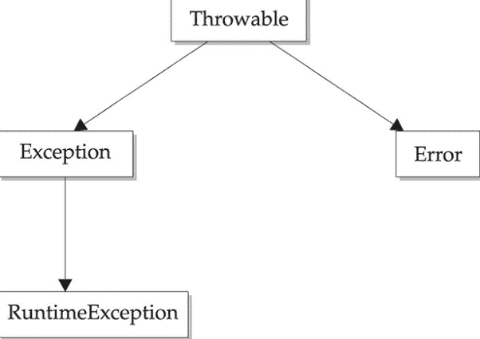

## 未捕获的异常

在学习如何在程序中处理异常之前，观察在不处理异常时会发生什么是有用的。这个小程序包含一个故意导致除以零错误的表达式：

```java
class Exc0 {

    public static void main(String args[]) {

        int d = 0;

        int a = 42 / d;

    }

}
```

当Java运行时系统检测到除以零的操作时，它会构建一个新的异常对象并抛出该异常。这会导致`Exc0`的执行停止，因为一旦抛出异常，它就必须被异常处理器捕获并立即处理。在这个示例中，我们没有提供任何自己的异常处理器，因此异常由Java运行时系统提供的默认处理器捕获。任何未被你的程序捕获的异常最终将由默认处理器处理。默认处理器会显示描述异常的字符串，打印从异常发生点开始的栈跟踪，并终止程序。

这里是执行此示例时生成的异常：

```
java.lang.ArithmeticException: / by zero
at Exc0.main(Exc0.java:4)
```

注意看类名`Exc0`；方法名`main`；文件名`Exc0.java`以及行号`4`都包含在简单的堆栈跟踪中。同样请注意，抛出的异常类型是名为`ArithmeticException`的`Exception`，它更具体地描述了发生了什么类型的错误。正如本章稍后讨论的样，Java提供了内置的异常类型，以匹配可以生成的各种运行时错误。

堆栈跟踪将始终显示导致错误的方法调用序列。例如，这里是前一个程序的另一个版本，它引入了相同的错误，但是在一个与`main()`独立的方法引入的：

```java
class Excl {

    static void subroutine() {

        int d = 0;

        int a = 10 / d;

    }

    public static void main(String args[]) {

        Excl.subroutine();

    }

}
```

默认异常处理器生成的堆栈跟踪显示了整个调用栈是如何展示的：

```
java.lang.ArithmeticException: / by zero
at Excl.subroutine(Excl.java:4)
at Excl.main(Excl.java:7)
```

如你所示，栈的底部是`main`的第7行，这是对`subroutine()`的调用，它导致了第4行的异常。调用栈对于调试非常有用，因为它精确地指出了导致错误的精确步骤序列。

## 使用try和catch

虽然Java运行时系统提供的默认异常处理器对调试很有用，但你通常想自己处理异常。这样做有两个好处：首先，它允许你修复错误；其次，它防止程序自动终止。如果你的程序每发生错误就停止运行并打印堆栈跟踪，大多数用户会感到困惑（至少这么说是没错）！幸运的是，防止这种情况非常容易。

为了防止并处理运行时错误，只需将你想监控的代码封装在`try`块中。在紧跟`try`块之后，包含一个`catch`子句，指定你想要监控的异常类型。为了说明这可以多么容易完成，以下程序包含一个`try`块和一个`catch`子句，用于处理由除以零错误生成的`ArithmeticException`：

```java
class Exc2 {

    public static void main(String args[]) {

        int d, a;

        try { // 监控一段代码

            d = 0;

            a = 42 / d;

            System.out.println("This will not be printed.");

        } catch (ArithmeticException e) { // 捕获除以零

            System.out.println("Division by zero.");

        }

        System.out.println("After catch statement.");

    }

}
```

此程序产生以下输出：

```
Division by zero.
After catch statement.
```

注意`try`块内部的`println()`调用离开了`try`块进入`catch`块。当抛异常时，程序控制从`try`块转移到`catch`块。但不同的是，`catch`不是被“调用”的，所以执行是从`catch`“返回”到`try`块的。因此，“This will not be printed.”这一行没有显示。一旦`catch`语句执行完毕，程序控制将继续执行`try / catch`机制之后的下一行。

`try`及其`catch`语句形成一个单元。`catch`子句的作用范围限于紧接其`try`语句指定的语句。`catch`语句不能捕获由另一个`try`语句抛出的异常（嵌套`try`语句除外，稍后描述）。受`try`的语句必须用大括号括（即它们必须在块内）。你不能在单个语句上使用`try`。

大多数构造良好的`catch`子句的目标应该是解决异常情况并继续运行，仿佛错误从未发生过。例如，在循环的下一次迭代中获得了两个。

```java
// 处理异常

import java.util.Random;

class HandleError {

    public static void main(String args[]) {

        int a, b, c;

        Random r = new Random();

        for(int i=0; i<3; i++) {

            try {

                b = r.nextInt();

                c = 12345 / b;

            } catch (ArithmeticException e) {

                System.out.println("Division by zero.");

                a = 0; // 设置 a 为零并继续

            }

            System.out.println("a: " + a);

        }

    }

}
```

## 显示异常描述

`Throwable`重写了`toString()`方法，以便返回一个包含异常信息的字符串。你可以通过将异常作为参数传递给`println()`来显示此描述。例如，前一个程序中的`catch`块可以重写为：

```java
catch (ArithmeticException e) {

    System.out.println("Exception: " + e);

    a = 0; // 设置 a 为零并继续

}
```

当此版本替换到程序中并运行时，它会显示以下消息：

```
Exception: java.lang.ArithmeticException: / by zero
```

虽然在当前情况下它没有特别价值，但在其他情况下——特别是当你正在尝试异常或进行调试时——显示异常描述是非常有用的。

## 多个catch子句

在某些情况下，单段代码可能会抛出多个异常。为了处理这种类型，你可以指定两个或多个`catch`子句，每个捕获不同类型的异常。当抛出异常时，按顺序检查每个`catch`语句，并执行匹配异常的第一个。一旦某个`catch`语句执行，其他的将被跳过，执行将在`try/catch`块之后继续。以下示例捕获了两种异常类型：

```java
// 多个 catch 语句

class MultipleCatches {

    public static void main(String args[]) {

        try {

            int a = args.length;

            System.out.println("a = " + a);

            int b = 42 / a;

            int c[] = { 1 };

            c[42] = 99;

        } catch (ArithmeticException e) {

            System.out.println("Divide by 0: " + e);

        } catch (ArrayIndexOutOfBoundsException e) {

            System.out.println("Array index out: " + e);

        }

        System.out.println("After try/catch blocks.");

    }

}
```

以下是两种运行方式生成的输出：

```
C:\>java MultipleCatches

a = 0

Divide by 0: java.lang.ArithmeticException / by zero

After try/catch blocks.
```

```
C:\>java MultipleCatches TestArg

a = 1

Array index oob: java.lang.ArrayIndexOutOfBoundsException:42

After try/catch blocks.
```

当使用多个`catch`语句时，必须记住异常子类必须在其任何父类之前。这是因为使用某个类的`catch`语句会捕获该类型以及其任何子类的异常。因此，如果子类排在父类之后，则它永远无法被触及。此外，在Java中，不可达的代码是一个错误。例如，考虑以下程序：

```
/* 此程序包含一个错误

在一系列 catch 语句中，

子类必须在其父类之前。如果不是，

将创建不可达的代码并导致

编译错误。

*/

class SuperSubCatch {

    public static void main(String[] args) {

    try {

        int a = 0;

        int b = 42 / a;

    } catch (Exception e) {

        System.out.println("Generic Exception catch.");

    }

    /* 这个 catch 永远不会被执行，因为

    ArithmeticException 是 Exception 的子类。 */

    catch(ArithmeticException e) { // 错误 - 不可用

        System.out.println("This is never reached.");

    }

}

}
```

如果你尝试编译此程序，将收到一条错误消息，说明第二个`catch`语句是不可用的，因为异常已经被捕获。由于`ArithmeticException`是`Exception`的子类，第一个`catch`语句将处理所有基于`Exception`的错误，包括`ArithmeticException`。这意味着第二个`catch`语句将永远不会执行。要解决这个问题，请交换`catch`语句的顺序。

## 嵌套try语句

`try`语句可以嵌套。也就是说，一个`try`语句可以位于另一个`try`块内部。每当进入一个`try`语句时，该异常的上下文就会推入栈中。如果内部`try`语句没有针对特定异常的`catch`处理器，栈将展开，并检查下一个`try`语句的`catch`处理器是否匹配。这将一直持续，直到其中一个`catch`语句成功，或者直到所有的嵌套`try`语句都完毕。如果没有匹配的`catch`语句，Java运行时系统将处理该异常。这里是一个使用嵌套`try`语句的示例：

```
// 嵌套 try 语句的示例。

class NestTry {

    public static void main(String args[]) {

    try {

        int a = args.length;

        /* 如果没有命令行参数，

           以下语句将生成

           除以零异常。 */

        int b = 42 / a;

        System.out.println("a = " + a);

        try { // 嵌套 try 块

            /* 如果使用了一个命令行参数，

               那么以下代码将生成

               除以零异常。 */

            if(a==1) a = a/(a-a); // 除以零

            /* 如果使用了两个命令行参数，

               则生成一个越界异常。 */

            if(a==2) {

                int c[] = { 1 };

                c[42] = 99; // 生成一个越界异常

            }

        } catch (ArrayIndexOutOfBoundsException e) {

            System.out.println("Array index out-of-bounds: " + e);

        }

    } catch (ArithmeticException e) {

        System.out.println("Divide by 0: " + e);

    }

    }

}
```

你可以看到，这个程序将一个块在另一个块内部。程序的运行方式如下：当你不带命令行参数运行程序时，外部`try`块会生成一个除以零异常。使用一个命令行参数运行程序会在嵌套的`try`块生成除以零异常。由于内部块没有捕获此异常，它被传递给外部`try`块，并在那里被处理。如果你使用两个命令行参数运行程序，内部`try`块会生成数组越界异常。以下是说明每种情况的示例运行：

```
C:\>java NestTry

Divide by 0: java.lang.ArithmeticException: / by zero

C:\>java NestTry One

a = 1

Divide by 0: java.lang.ArithmeticException: / by zero

C:\>java NestTry One Two

a = 2

Array index out-of-bounds:

java.lang.ArrayIndexOutOfBoundsException: 70
```

当涉及方法调用时，`try`语句的嵌套可能会以不那么明显的方式发生。例如，你可以将方法调用封装在`try`块中。在该方法内部有另一个`try`语句。在这种情况下，方法内部的`try`语句仍然嵌套在调用该方法的外部`try`块内部。这里是重写后的之前的程序，将嵌套的`try`块移动到了方法`nesttry()`内部：

```
/* try 语句可以通过调用方法

进行隐式嵌套。 */

class MethNestTry {

    static void nesttry(int a) {

        try { // 嵌套 try 块

            /* 如果使用了一个命令行参数，

               那么以下代码将生成

               除以零异常。 */

            if(a==1) a = a/(a-a);

            /* 如果使用了两个命令行参数，

               则生成一个越界异常。 */

            if(a==2) {

                int c[] = { 1 };

                c[42] = 99; // 生成一个越界异常

            }

        } catch (ArrayIndexOutOfBoundsException e) {

            System.out.println("Array index out-of-bounds: " + e);

        } catch (ArithmeticException e) {

            System.out.println("Divide by 0: " + e);

        }

    }

    public static void main(String args[]) {

        try {

            int a = args.length;

            /* 如果没有命令行参数，

               以下语句将生成

               除以零异常。 */

            int b = 42 / a;

            System.out.println("a = " + a);

            nesttry(a);

        } catch (ArithmeticException e) {

            System.out.println("Divide by 0: " + e);

        }

    }

}
```

到目前为止，你只捕获了由运行时抛出的异常。然而，你的程序可以使用`throw`语句显式地抛出异常。`throw`的通用形式是：

```
throw ThrowableInstance;
```

这里，`ThrowableInstance`必须是`Throwable`或其子类的对象。基本类型（如`int`或`char`）以及非`Throwable`类（如`String`和`Object`）不能作为异常。

这是一个创建并抛出异常的示例程序。处理器捕获异常并重新抛给外部处理器。

```
// 演示 throw

class ThrowDemo {

    static void demoproc() {

        try {

            throw new NullPointerException("demo");

        } catch (NullPointerException e) {

            System.out.println("Caught inside demoproc.");

            throw e; // 重新抛异常

        }

    }

    public static void main(String args[]) {

        try {

            demoproc();

        } catch (NullPointerException e) {

            System.out.println("Recaught: " + e);

        }

    }

}
```

这个程序有两个机会处理同一个错误。首先，`main()`设置异常上下文并调用`demoproc()`。`demoproc()`方法设置另一个异常处理上下文并立即抛出一个`NullPointerException`实例，该异常在下一行被捕获。然后异常被重新抛出。以下是产生的输出：

```
Caught inside demoproc.

Recaught: java.lang.NullPointerException: demo
```

该程序还说明了如何创建Java的标准异常对象。请注意这一行：

```
throw new NullPointerException("demo");
```

在这里，使用`new`来构造`NullPointerException`的实例。Java的许多内置运行时异常至少有两个构造函数：一个无参数，和一个带字符串参数的。当使用第二种形式时，参数指定了一个描述异常的字符串。当该对象作为`print()`或`println()`的参数时，该字符串会被显示。也可以通过调用`getMessage()`获取，该方法由`Throwable`定义。

如果一个方法可能会产生它未处理的异常，则它必须指定此行为，以便该方法的调用者能够针对该异常进行防护。你通过在方法的声明中包含一个`throws`子句来实现这一点。`throws`子句列出了方法可能抛出的异常类型。对于所有异常，除了`Error`或`RuntimeException`类型或其子类的异常外，这种指定都是必须的。方法必须抛出的所有异常都必须在`throws`子句中声明。如果没有，将导致编译错误。

以下是包含`throws`子句的方法声明通用形式：

```java
type method-name(parameter-list) throws exception-list
{
    // 方法体
}
```

在这里，`exception-list`是方法可以抛出的异常的逗号分隔的列表。

下面是一个错误的程序示例，它试图抛出一个它没有捕获的异常。由于该程序没有指定`throws`子句来声明这一事实，程序将无法编译。

```
// 此程序包含错误且将无法编译。

class ThrowsDemo {

    static void throwOne() {

        System.out.println("Inside throwOne.");

        throw new IllegalAccessException("demo");

    }

    public static void main(String args[]) {

        throwOne();

    }

}
```

要使此示例能够编译，你需要进行两个更改。首先，你需要声明`throwOne()`抛出了`IllegalAccessException`。其次，`main()`必须定义一个捕获该异常的`try / catch`语句。

修正后的示例如下：

```java
// 现在是。

class ThrowsDemo {

    static void throwOne() throws IllegalAccessException {

        System.out.println("Inside throwOne.");

        throw new IllegalAccessException("demo");

    }

    public static void main(String[] args) {

        try {

            throwOne();

        } catch (IllegalAccessException e) {

            System.out.println("Caught " + e);

        }

    }

}
```

以下是运行此程序生成的输出：

```
inside throwOne
caught java.lang.IllegalAccessException: demo
```

## finally

当异常被抛出时，方法的执行会采取一条相当突然的非线性的路径，这允许正常流通过方法。取决于方法的编码方式，异常甚至可能导致方法提前返回。这在某些方法中可能会是一个问题。例如，如果一个方法打开了一个文件并在退出时关闭它，那么你就不希望关闭文件的代码被异常处理机制跳过。`finally`关键字是为了解决这种意外情况设计的。

`finally`创建了一个代码块，该块会在`try/catch`块完成以及`try/catch`块之后的代码执行完毕后执行。无论是否抛出异常，`finally`块都会执行。如果抛出了异常，即使没有`catch`语句匹配该异常，`finally`块也会执行。每当方法准备好从`try/catch`块内部（通过未捕获的异常或显式返回语句）返回给调用者时，`finally`子句也会在方法返回之前执行。这对于关闭文件句柄和释放在方法开始时可能分配的任何其他资源（其意图是在返回前销毁这些资源）非常有用。`finally`子句是可选的。但是，每个`try`语句至少需要一个`catch`或`finally`子句。

这里是一个示例程序，展示了以各种方式退出的三个方法，没有一个是不执行它们的`finally`子句的：

```java
// Demo finally。

class FinallyDemo {

    // 将异常抛出方法。

    static void procA() {

        try {

            System.out.println("inside procA");

            throw new RuntimeException("demo");

        } finally {

            System.out.println("procA's finally");

        }

    }

    // 从 try 块内部返回。

    static void procB() {

        try {

            System.out.println("inside procB");

            return;

        } finally {

            System.out.println("procB's finally");

        }

    }

    // 正常执行 try 块。

    static void procC() {

        try {

            System.out.println("inside procC");

        } finally {

            System.out.println("procC's finally");

        }

    }

    public static void main(String args[]) {

        try {

            procA();

        } catch (Exception e) {

            System.out.println("Exception caught");

        }

        procB();

        procC();

    }

}
```

在这个示例中，`procA()`通过抛出异常提前跳出了`try`块。`finally`子句在退出时执行。`procB()`的`try`语句通过返回语句退出。`finally`子句在`procB()`返回之前执行。在`procC()`中，`try`语句正常执行，没有错误。然而，`finally`块仍然被执行。

记住，如果`finally`块与`try`关联，则`finally`块将在前一个程序结束时被执行。

以下是运行前一个程序生成的输出：

```
inside procA

procA's finally

Exception caught

inside procB

procB's finally

inside procC

procC's finally
```

## Java的内置异常

在标准包`java.lang`中，Java定义了若干异常。

## 方法

## 描述

| 方法 | 描述 |
| --- | --- |
| `final void addSuppressed(Throwable exc)` | 将`exc`添加到与调用异常关联的抑制异常列表中。主要供try-with-resources语句使用。 |
| `Throwable fillInStackTrace()` | 返回一个包含完整堆栈轨迹的`Throwable`对象。该对象可以被重新抛出。 |
| `Throwable getCause()` | 返回当前异常的异常。如果没有底层异常，则返回`null`。 |
| `String getLocalizedMessage()` | 返回异常的本地化描述。 |
| `String getMessage()` | 返回异常的描述。 |
| `StackTraceElement[] getStackTrace()` | 返回一个包含堆栈轨迹的数组，元素以`StackTraceElement`数组的形式逐个包含。堆栈顶端的方法是抛出异常之前调用的最后一个方法。该方法位于数组的第一个元素中。`StackTraceElement`允许程序访问跟踪轨迹中每个元素的信息，例如其方法名。 |
| `final Throwable[] getSuppressed()` | 获取与调用异常关联的抑制异常，并返回包含这些抑制异常的数组。抑制异常主要由try-with-resources语句生成。 |
| `Throwable initCause(Throwable causeExc)` | 将`causeExc`与调用异常关联，作为调用异常的原因。返回对该异常的引用。 |
| `void printStackTrace()` | 显示堆栈轨迹。 |
| `void printStackTrace(PrintStream stream)` | 将堆栈轨迹发送到指定的流。 |
| `void printStackTrace(PrintWriter stream)` | 将堆栈轨迹发送到指定的流。 |
| `void setStackTrace(StackTraceElement elements[])` | 将堆栈轨迹设置为传入`elements`中的元素。此方法用于特殊特化应用程序，不用于普通用途。 |
| `String toString()` | 返回一个包含异常描述的`String`对象。当输出`Throwable`对象时，`println()`会调用此方法。 |

表10-3 由`Throwable`定义的方法

`Exception`定义了四个公共构造函数。其中两个支持链式异常，将在下一节中描述。另外两个显示在此处：

```
Exception( )
Exception(String msg)
```

第一种形式创建一个没有描述的异常。第二种形式允许你指定异常的描述。

尽管在创建异常时指定描述通常是有用的，但有时重写`toString()`可能会更好。原因如下：`Throwable`定义（并由`Exception`继承）的`toString()`版本首先显示异常名称，后跟冒号，然后是你的描述。通过重写`toString()`，你可以防止异常名称和冒号的显示。这使得在某些情况下输出更加整洁。

下面的示例声明了`Exception`的新子类，然后使用该子类在方法中指示错误条件。它重写了`toString()`方法，允许显示精心定制的异常描述。

```
// 此程序创建了一个自定义异常类型。

class MyException extends Exception {

    private int detail;

    MyException(int a) {

        detail = a;

    }

    public String toString() {

        return "MyException[" + detail + "]";

    }

}

class ExceptionDemo {

    static void compute(int a) throws MyException {

        System.out.println("Called compute " + a + ")");

        if (a > 10) {

            throw new MyException(a);

        }

        System.out.println("Normal exit");

    }

    public static void main(String args[]) {

        try {

            compute(1);

            compute(20);

        } catch (MyException e) {

            System.out.println("Caught " + e);

        }

    }

}
```

此示例定义了一个名为`MyException`的`Exception`子类。该子类非常简单：它包含一个构造函数和一个重写的`toString()`方法，用于显示异常的值。`ExceptionDemo`类定义了名为`compute()`的方法，该方法抛出一个`MyException`对象。当`compute()`的整数参数大于10时，就会抛出异常。`main()`方法为`MyException`设置了异常处理器，并调用`compute()`传入一个合法值（小于10）和一个非法值，以展示代码的两种执行路径。其结果如下：

```
Called compute(1)

Normal exit

Called compute(20)

Caught MyException[20]
```

## 链式异常

从JDK 1.4开始，异常子系统中引入了一项功能：链式异常。链式异常功能允许你将另一个异常与异常关联。这第二个异常描述了第一个异常的原因。例如，想象在一个方法中，由于尝试除以零而抛出了`ArithmeticException`。然而，问题的实际原因是一个I/O错误，这导致除数设置不当。虽然该方法必须抛出`ArithmeticException`（因为这是实际发生的错误），但你可能也想让调用代码知道底层原因是I/O错误。链式异常允许你处理这种情况，以及异常层级中任何其他情况。

为了允许链式异常，`Throwable`添加了两个构造函数和两个方法。构造函数显示在此：

- `Throwable(Throwable causeExc)`
- `Throwable(String msg, Throwable causeExc)`

在第一种形式中，`causeExc`是导致当前异常的异常。也就是说，`causeExc`是异常发生的底层原因。第二种形式允许你在指定原因异常的同时指定一个描述。这两个构造函数也被添加到`Error`、`Exception`和`RuntimeException`类中。

`Throwable`支持的链式异常方法是`getCause()`和`initCause()`。这些方法在表10-3中显示，为了讨论起见在此重复出现：

- `Throwable getCause()`
- `Throwable initCause(Throwable causeExc)`

`getCause()`方法返回当前异常的异常。如果没有底层异常，则返回`null`。`initCause()`方法将`causeExc`与调用异常关联，并返回该异常的引用。因此，你可以在异常创建后将其原因与其关联。然而，异常只能设置一次。因此，每个异常对象只能调用`initCause()`一次。此外，如果原因异常是通过构造函数设置的，那么你就不再使用`initCause()`设置它了。通常，`initCause()`用于不支持那两个额外构造函数的旧版异常类设置原因。

下面的示例说明了处理链式异常的机制：

```
// 演示异常链式。

class ChainExcDemo {

    static void demoproc() {

        // 创建一个异常

        NullPointerException e =

        new NullPointerException("top layer");

        // 添加一个原因

        e.initCause(new ArithmeticException("cause"));

        throw e;

    }

    public static void main(String args[]) {

        try {

            demoproc();

        } catch (NullPointerException e) {

            // 显示顶层异常

            System.out.println("Caught: " + e);

            // 显示原因异常

            System.out.println("Original cause: " + e.getCause());

        }

    }

}
```

程序的输出显示在此：

```
Caught: java.lang.NullPointerException: top layer
Original cause: java.lang.ArithmeticException: cause
```

在此示例中，顶层异常是`NullPointerException`。当异常从`demoproc()`抛出时，它被`main()`捕获。在那里显示了顶层异常，随后通过调用`getCause()`显示底层异常。

异常链可以持续到所需的深度。因此，异常本身也可以拥有原因。请注意，过长的异常链可能表明设计不当。

链式异常并不是每个程序都需要的。但在了解底层原因有用的情况下，它们提供了一种优雅的解决方案。

### 三个额外的异常特性

从JDK 7开始，三个有趣且实用的特性已成为异常系统的一部分。第一个是在资源（如文件）不再需要时自动释放资源。它是基于`try`语句的扩展形式，称为try-with-resources，并在第13章介绍文件时进行了描述。第二个特性称为multi-catch，第三个有时被称为final rethrow或more precise rethrow。这里描述了后两个特性。

多捕获特性允许用同一个`catch`子句捕获两个或多个异常。两个或多个异常处理器即使响应不同的异常但使用相同的代码序列并不罕见。你不需要逐个捕获每种异常类型，可以使用单个`catch`子句来处理所有异常，而避免代码重复。

要使用多捕获，请用OR运算符分隔`catch`子句中的每个异常类型。每个多捕获参数隐式地为`final`。（如果需要，你可以显式地指定`final`，但并非必须。）由于每个多捕获参数隐式地为`final`，因此它不能被赋予新值。

这里是一个使用多捕获特性同时捕获`ArithmeticException`和`ArrayIndexOutOfBoundsException`的`catch`语句：

```java
catch(ArithmeticException | ArrayIndexOutOfBoundsException e) {
```

下面的程序展示了多捕获特性的用法：

```java
// Demo多捕获特性。

class MultiCatch {

    public static void main(String args[]) {

        int a=10, b=0;

        int vals[] = { 1, 2, 3 };

        try {

            int result = a / b; // 生成 ArithmeticException

            vals[10] = 19; // 生成 ArrayOutOfBoundsException

        // 此 catch 子句捕获了这两种异常。

        } catch (ArithmeticException | ArrayIndexOutOfBoundsException e) {

            System.out.println("Exception caught: " + e);

        }

        System.out.println("After multi-catch.");

    }

}
```

当尝试除以零时，程序将生成一个`ArithmeticException`。如果你注释掉除法行并移除该行的注释，则会生成`ArrayIndexOutOfBoundsException`。这两个异常都被这同一个`catch`语句捕获。

更精确的重抛将可以重抛的异常类型限制为仅由相关的`try`块抛出的受检异常，且这些异常未被之前的`catch`子句处理，并且是参数的子类或超类。虽然这种能力可能并不常用，但它现在已经可以使用。要使更精确的重抛生效，`catch`参数必须是`final`的（这意味着它在`catch`块内部不能被赋予新值），或者被显式声明为`final`。

## 使用异常

异常处理为控制具有许多动态运行时特性的复杂程序提供了一种强大的机制。将`try`、`throw`和`catch`视为处理程序逻辑中错误和异常边界条件的方法是非常重要的。与其他使用错误代码来指示失败的语言不同，Java使用异常。因此，当一个方法可能会失败时，请让它抛出一个异常。这是处理失败模式的一种更整洁的方式。

最后一点：Java的异常处理语句应该被视为非局部分支的通用机制。如果你这样做，它只会混乱你的代码并使其难以维护。

## 章节

# 11 多线程编程

Java为多线程编程提供了内置支持。多线程程序包含两个或多个可以并发运行的部分。此类程序的每个部分被称为线程，每个线程都定义了一条独立的执行路径。因此，多线程是多任务处理的一种特殊形式。

你几乎熟悉多任务处理，因为几乎所有的现代操作系统都支持它。然而，有两种不同的多任务处理类型：基于进程的和基于线程的。理解基于进程的多任务处理（这是更熟悉的形式）之间的区别是非常重要的。进程本质上是一个正在执行的程序。因此，基于进程的多任务处理是允许你的计算机并发运行两个或多个程序的特性。例如，基于进程的多任务处理允许你在使用文本编辑器或访问网站的同时运行Java编译器。在基于进程的多任务处理中，程序是调度程序可以分派的最小代码单元。

在基于线程的多任务环境中，线程是可分派代码的最小单元。这意味着一个程序可以同时执行两个或多个任务。例如，文本编辑器可以在打印的同时格式化文本，只要这两个动作是由两个单独线程执行的。因此，基于进程的多任务处理处理“大局”，而基于线程的多任务处理处理细节。

多线程比多进程并发所需的开销更小。进程是重量级任务，需要它们自己的地址空间。进程间通信是昂贵且有限的。从一个进程切换到另一个进程也是昂贵的。相反，线程要轻量得多。它们共享相同的地址空间并共享同一个重量级进程。线程间通信是廉价的，从一个线程切换到下一个线程的成本较低。虽然Java程序使用了基于进程的多任务环境，但基于进程的多任务处理不受Java的直接控制。然而，多线程并发是可以控制的。

多线程允许你编写高效的程序，最大限度地利用系统的可用处理能力。多线程实现此的一种重要方式是将空闲时间减少到最低。这对于Java运行的交互式环境特别重要，因为空闲时间很常见。例如，网络上的数据传输速度远于计算机的处理速度。即使是文件系统资源的读写速度也比CPU慢。在单线程环境中，你的程序必须等待这些任务完成。多线程有助于你减少这种空闲时间，在等待时运行另一个线程。

# Java线程模型

Java运行时系统许多方面依赖线程，所有的类库都是为多线程设计的。事实上，Java使用线程使整个环境成为异步。这有助于减少由于效率低下导致的CPU周期浪费。

多线程环境的价值最好通过与其对立面进行对比来理解。单线程系统使用称为带轮询事件循环的方法。在这种模型中，单线程控制在无限循环中运行，轮询单个事件队列以决定下一步做什么。一旦这种轮询机制返回了（例如）某个网络文件已就绪可以读取的信号，事件循环会将控制分发给相应的事件处理器。在句处理器返回之前，程序不会发生任何其他事情。这可能导致某个部分主导系统并阻止任何其他事件被处理。

重要的是，理解Java的多线程特性在两种类型的系统中均有效。在单核系统中，并发执行的线程共享CPU，每个线程获得一段CPU时间片。因此，在单核系统中，两个或多个线程实际上并不会同时运行，而是利用了空闲的CPU时间。然而，在多核系统中，两个或多个线程实际上可以同时执行。在许多情况下，这可以进一步提高程序效率并加快某些操作的速度。

注意：除了本章描述的多线程特性外，你可能还会探索Fork/Join框架。它提供了一种创建多线程应用程序的强大手段，可以自动扩展以充分利用多核环境。Fork/Join框架是Java支持并行编程的一部分，并行编程是用于优化某些类型算法以使其在具有多个CPU的系统中并行执行的技术常用名称。有关Fork/Join框架和其他并发工具的讨论，请参阅第28章。这里描述了Java传统的多线程能力。

线程存在多种状态。以下是通用的描述。线程可以处于运行状态。线程一旦获得CPU时间，就可以处于就绪运行状态。运行中的线程可以被挂起，暂时停止其活动。挂起的线程随后可以恢复，允许它从停止的地方继续。线程在等待资源时会处于阻塞状态。在任何时刻，线程都可以被终止，这将立即停止其执行。一旦终止，线程将无法恢复。

## 线程优先级

Java为每个线程分配一个优先级，该优先级决定了相对于其他线程的处理方式。线程优先级是整数，指定一个线程相对于另一个线程的相对优先级。作为一个绝对值，优先级是没有意义的；如果某个线程是唯一的运行线程，那么高优先级线程运行速度并不比低优先级线程快。相反，线程的优先级用于决定何时从一个线程切换到下一个线程。这被称为上下文切换。决定何时发生上下文切换的规则非常简单：

- 线程可以自愿放弃控制权。这在显式让出（yield）、睡眠（sleep）或阻塞时发生。在这种情况下，将检查所有其他线程，并将CPU分给就绪的高优先级线程。
- 线程可能会被高优先级线程抢占。在这种情况下，不让出处理器的低优先级线程无论正在做什么，都只是会被高优先级线程直接抢占。从根本上，只要有高优先级线程想要运行，它就会运行。这被称为抢占式多任务处理。

在两个具有相同优先级的线程竞争CPU周期的情况下，情况会变得有点复杂。对于某些操作系统，等优先级的线程会自动以轮询方式进行时间片切分。对于其他类型的操作系统，等优先级的线程必须自愿向同级线程让出控制权。如果它们不这样做，其他线程将不会运行。

> 注意：操作系统切换等优先级线程上下文的方式差异可能会导致移植性问题。

## 同步

由于多线程为你的程序引入了异步行为，因此在需要时必须有一种方法来强制执行同步。例如，如果你想让两个线程通信并共享一个复杂的数据结构（如链表），你需要某种方法确保它们之间不会发生冲突。也就是说，你必须防止一个线程在另一个线程读取数据时写入数据。为了这一目的，Java对古老的进程间同步模型实现了一种优雅的变体：监视器（monitor）。监视器是由C.A.R. Hoare首先定义的控制机制。你可以将监视器想象成只能容纳一个线程的小盒子。所有线程必须等待该线程退出监视器。这样，监视器就可以保护共享资源不被多个一个线程同时操作。

在Java中，没有名为“Monitor”的类；相反，每个对象都有自己的隐式监视器，当调用对象的某个同步方法时，监视器会自动进入。一旦线程进入同步方法，任何其他线程都无法调用同一对象上的任何同步方法。这使你能够编写非常清晰且简洁的多线程代码，因为同步支持已内置在语言中。

## 消息

在将程序分成不同的线程之后，你需要定义它们之间如何通信。当使用其他某些语言进行编程时，你必须依赖操作系统在线程之间建立通信。这无疑增加了开销。相比之下，Java提供了一种整洁、低成本的方法让两个或多个线程通过调用所有对象都具有的定义方法进行通信。Java的消息系统允许线程进入对象的同步方法，然后等待某些其他线程显式通知它退出。

## Thread类和Runnable接口

Java的多线程系统构建在`Thread`类、其方法及其伴侣接口`Runnable`之上。`Thread`封装了一个执行线程。由于你无法直接引用运行中线程的虚幻状态，你将处理它的代理，即产生它的`Thread`实例。要创建一个新线程，程序将扩展`Thread`类或实现`Runnable`接口。

`Thread`类定义了几个帮助管理线程的方法。这里展示了本章使用的几个：

| 方法 | 含义 |
| --- | --- |
| `getName` | 获取线程名称。 |
| `getPriority` | 获取线程的优先级。 |
| `isAlive` | 确定线程是否仍在运行。 |
| `join` | 等待线程终止。 |
| `run` | 线程的入口。 |
| `sleep` | 挂起线程一段时间。 |
| `start` | 通过调用方法启动线程。 |

因此，书中的所有示例都使用了单线程执行。本章剩余部分将解释如何使用`Thread`和`Runnable`创建和管理线程，从所有Java程序拥有的线程开始：主线程。

## 主线程

当Java程序启动时，一个线程会立即开始。这通常被称为程序的主线程，因为它是程序启动时执行的线程。主线程很重要有两个原因：

- 它是产生“子”线程的线程。
- 通常，它必须是最后一个执行的线程，因为它执行各种关闭操作。

虽然主线程是在程序启动时自动创建的，但可以通过`Thread`对象对其控制。为了实现这一点，你必须通过调用`currentThread()`方法获取引用，该方法是`Thread`的公共静态成员。其通用形式如下：

```
static Thread currentThread()
```

该方法返回调用它的所在线程的引用。一旦你获得了主线程的引用，就可以像控制任何其他线程一样控制它。让我们查看以下示例：

```java
// 控制主线程。

class CurrentThreadDemo {

    public static void main(String args[]) {

        Thread t = currentThread();

        System.out.println("当前线程: " + t);

        // 修改线程的名称

        t.setName("My Thread");

        System.out.println("更改名称后: " + t);

        try {

            for(int n = 5; n > 0; n--) {

                System.out.println(n);

                Thread.sleep(1000);

            }

        } catch (InterruptedException e) {

            System.out.println("主线程被中断");

        }

    }

}
```

在此程序中，封装在该循环周围的块。`Thread`类中的`sleep()`方法可能会抛出`InterruptedException`。如果其他线程想要中断正在睡眠的线程，就会发生这种情况。此示例仅在被中断时打印一条消息。在实际程序中，你需要以不同的方式处理这种情况。以下是该程序生成的输出：

```
Current thread: Thread[main,5,main]

After name change: Thread[My Thread,5,main]

5

4

3

2

1
```

注意当`t`作为`println()`的参数时产生的输出。它按顺序显示：线程名称、优先级以及线程组的名称。默认情况下，主线程名称为`main`。它的优先级是5（这是默认值），`main`也是该线程所属组的名称。线程组是一个控制线程集合整体状态的数据结构。在更改线程名称后，再次输出了`t`。随着时间的推移，会显示线程的新名称。

让我们仔细观察程序中使用的`Thread`类定义的方法。`sleep()`方法会导致调用它的线程暂停执行指定的毫秒数。其通用形式如下：

```
static void sleep(long milliseconds) throws InterruptedException
```

要暂停的毫秒数以毫秒为单位。此方法可能会抛出`InterruptedException`。

`sleep()`方法有第二种形式（如下），允许你以毫秒和纳秒来指定周期：

```
static void sleep(long milliseconds, int nanoseconds) throws InterruptedException
```

这种第二形式仅适用于允许纳秒级极短计时周期的环境。

如前一个程序所示，你可以使用`setName()`设置线程名称。你可以通过调用`getName()`获取线程名称（但注意，程序中没有显示这一点）。这些方法是`Thread`类的成员，声明方式如下：

```
final void setName(String threadName)
final String getName()
```

在这里，`threadName`指定线程的名称。

## 创建线程

在最通用的意义上，你通过实例化`Thread`类型的对象来创建线程。Java定义了两种实现目标的方法：

- 你可以实现`Runnable`接口。
- 你可以扩展`Thread`类本身。

接下来两个部分将分别查看每种方法。

## 实现Runnable

创建线程简单的方法是创建一个实现`Runnable`接口的类。`Runnable`抽象了一个可执行代码单元。你可以在任何实现`Runnable`的对象上构建线程。要实现`Runnable`，类只需要实现一个名为`run()`的方法，其声明方式如下：

```
public void run()
```

在`run()`内部，你将定义构成新线程的代码。重要的是，`run()`可以调用其他方法、使用其他类并声明变量。唯一的区别是`run()`为你程序中的另一个并发执行线程建立了执行入口点。该线程会在`run()`返回时结束。

在你创建了实现`Runnable`的类后，你将在该类内部实例化`Thread`类型的对象。`Thread`定义了几个构造函数。我们在这里展示的其中一个是：

```
Thread(Runnable threadOb, String threadName)
```

在这个构造函数中，`threadOb`是实现`Runnable`接口的类实例。这定义了线程执行的起始位置。新线程的名称由`threadName`指定。

在新线程创建后，在调用其在`Thread`内部定义的`start()`方法之前，它不会开始运行。本质上，`start()`发起了对`run()`的调用。`start()`方法如下：

```
void start()
```

这是一个创建一个新线程并启动其运行的示例：

```java
// 创建第二个线程。

class NewThread implements Runnable {

    Thread t;

    NewThread() {

        // 创建一个新的第二个线程

        t = new Thread(this, "Demo Thread");

        System.out.println("Child thread: " + t);

    }

    // 这是第二个线程的入口点。

    public void run() {

        try {

            for (int i = 5; i > 0; i--) {

                System.out.println("Child Thread: " + i);

                Thread.sleep(500);

            }

        } catch (InterruptedException e) {

            System.out.println("Child interrupted.");

        }

        System.out.println("Exiting child thread.");

    }

}

class ThreadDemo {
    public static void main(String args[]) {
        NewThread nt = new NewThread(); // 创建一个新线程

        nt.t.start(); // 启动线程

        try {
            for (int i = 5; i > 0; i--) {
                System.out.println("Main Thread: " + i);
                Thread.sleep(1000);
            }
        } catch (InterruptedException e) {
            System.out.println("Main thread interrupted.");
        }
        System.out.println("Main thread exiting.");
    }
}
```

在`NewThread()`的构造函数内部，通过以下语句创建了一个新的`Thread`对象：

```
t = new Thread(this, "Demo Thread");
```

将此作为第一个参数表示你想让新线程调用此对象的`run()`方法。在`main()`内部，调用了`start()`，它启动了从`run()`开始的执行线程。该程序产生的输出可能随特定执行而异。

```
Child thread: Thread [Demo Thread,5,main]

Main Thread: 5

Child Thread: 4

Main Thread: 4

Child Thread: 3

Main Thread: 3

Child Thread: 2

Main Thread: 2

Child Thread: 1

Exiting child thread.

Main thread exiting.
```

如前所述，在多线程程序中，主线程最后结束通常是有用的。前面的程序确保了主线程最后结束，因为主线程每次迭代之间睡眠1000毫秒，而子线程只睡眠500毫秒。很快你将看到等待线程结束更好的方法。

## 扩展Thread

创建线程的第二方法是创建一个扩展`Thread`的类，然后实例化该类。扩展类必须重写`run()`方法，这是新线程的入口点。与之前一样，调用`start()`开始新线程的执行。

注意`NewThread`内部对`super()`的调用。这调用了`Thread`构造函数的以下形式：

```java
public Thread(String threadName)
```

在这里，`threadName`指定了线程的名称。

## 选择方法

此时，你可能在好奇为什么Java有两种创建子线程的方法，以及哪种方法更好。这些问题的答案取决于同一个关键点。`Thread`类定义了几个可以被派生类重写的方法。在这些方法中，只有`run()`必须被重写。这与实现`Runnable`时要求的方法是相同的。许多Java程序员认为，只有当类被进行某种程度的增强或适配时，才应该扩展类。因此，如果你不需要重写`Thread`的其他任何方法，最好的可能只是简单的实现`Runnable`。此外，通过实现`Runnable`，你的线程类不需要继承`Thread`，从而可以自由地继承另一个类。最终，使用哪种方法取决于你。然而，在本章的剩余部分中，我们将通过使用实现`Runnable`的类来创建线程。

## 创建多个线程

到目前为止，你只使用了两个线程：主线程和一个子线程。然而，你的程序可以根据需要产生尽可能多的线程。例如，以下程序创建了三个子线程：

```java
// 创建多个线程
class NewThread implements Runnable {
    String name; // 线程名称
    Thread t;

    NewThread(String threadname) {
        name = threadname;
        t = new Thread(this, name);
        System.out.println("New thread: " + t);
    }

    // 这是线程的入口点。
    public void run() {
        try {
            for (int i = 5; i > 0; i--) {
                System.out.println(name + ": " + i);
                Thread.sleep(1000);
            }
        } catch (InterruptedException e) {
            System.out.println(name + " Interrupted");
        }
        System.out.println(name + " exiting.");
    }
}

class MultiThreadDemo {
    public static void main(String args[]) {
        NewThread nt1 = new NewThread("One");
        NewThread nt2 = new NewThread("Two");
        NewThread nt3 = new NewThread("Three");

        // 启动线程
        nt1.t.start();
        nt2.t.start();
        nt3.t.start();

        try {
            // 等待其他线程结束
            Thread.sleep(10000);
        } catch (InterruptedException e) {
            System.out.println("Main thread Interrupted");
        }

        System.out.println("Main thread exiting.");
    }
}
```

该程序的示例输出显示在此。（你的输出可能会根据特定的执行环境而异。）

```
New thread: Thread [One, 5,main]
New thread: Thread [Two, 5,main]
New thread: Thread [Three, 5,main]
One: 5
Two: 5
Three: 5
One: 4
Two: 4
Three: 4
One: 3
Two: 3
Three: 3
One: 2
Two: 2
Three: 2
One: 1
Two: 1
Three: 1
One exiting.
Two exiting.
Three exiting.
Main thread exiting.
```

如你所见，一旦启动，三个子线程将共享CPU。注意`main()`中对`sleep(10000)`的调用。这导致主线程睡眠十秒，并确保它最后结束。

## 使用isAlive()和join()

如前面提到的，你通常希望主线程最后结束。在前面的示例中，这是通过在`main()`中调用`sleep()`实现的，设置足够长的延迟以确保所有子线程在主线程结束之前终止。然而，这并不是一个满意的解决方案，而且它引出了更大的问题：线程如何知道另一个线程何时结束的？`Thread`提供了一种可以回答这个问题的方法。

有两种方法可以判断线程是否已完成。首先，你可以在线程上调用`isAlive()`。该方法由`Thread`定义，其通用形式如下：

```java
final boolean isAlive()
```

如果调用该方法的线程仍在运行，则`isAlive()`方法返回`true`。否则返回`false`。

虽然`isAlive()`有时很有用，但你更常用的用于等待线程完成的方法是`join()`，如下：

```java
final void join() throws InterruptedException
```

该方法会一直等待调用它的线程终止。它的名字源于一个概念：调用线程一直等待直到指定的线程加入它。`join()`的其他形式允许你指定等待指定线程终止的最长时间。

这里是前一个示例的改进版本，它使用`join()`来确保主线程是最后一个停止。它还演示了`isAlive()`方法。

```java
// 使用 join() 等待线程完成
class NewThread implements Runnable {
    String name; // 线程名称
    Thread t;

    NewThread(String threadname) {
        name = threadname;
        t = new Thread(this, name);
        System.out.println("New thread: " + t);
    }

    // 这是线程的入口点。
    public void run() {
        try {
            for (int i = 5; i > 0; i--) {
                System.out.println(name + ": " + i);
                Thread.sleep(1000);
            }
        } catch (InterruptedException e) {
            System.out.println(name + " Interrupted");
        }
        System.out.println(name + " exiting.");
    }
}

class DemoJoin {
    public static void main(String args[]) {
        NewThread nt1 = new NewThread("One");
        NewThread nt2 = new NewThread("Two");
        NewThread nt3 = new NewThread("Three");

        // 启动线程
        nt1.t.start();
        nt2.t.start();
        nt3.t.start();

        System.out.println("Thread One is alive: " + nt1.t.isAlive());
        System.out.println("Thread Two is alive: " + nt2.t.isAlive());
        System.out.println("Thread Three is alive: " + nt3.t.isAlive());

        // 等待线程结束
        try {
            System.out.println("Waiting for threads to finish.");
            nt1.t.join();
            nt2.t.join();
            nt3.t.join();
        } catch (InterruptedException e) {
            System.out.println("Main thread Interrupted");
        }

        System.out.println("Thread One is alive: " + nt1.t.isAlive());
        System.out.println("Thread Two is alive: " + nt2.t.isAlive());
        System.out.println("Thread Three is alive: " + nt3.t.isAlive());

        System.out.println("Main thread exiting.");
    }
}
```

该程序的示例输出显示在此。（你的输出可能会根据特定的执行环境而异。）

```
New thread: Thread [One, 5,main]
New thread: Thread [Two, 5,main]
New thread: Thread [Three, 5,main]
Thread One is alive: true
Thread Two is alive: true
Thread Three is alive: true
Waiting for threads to finish.
One: 5
Two: 5
Three: 5
One: 4
Two: 4
Three: 4
One: 3
Two: 3
Three: 3
One: 2
Two: 2
Three: 2
One: 1
Two: 1
Three: 1
One exiting.
Two exiting.
Three exiting.
Thread One is alive: false
Thread Two is alive: false
Thread Three is alive: false
Main thread exiting.
```

如你所见，在调用`join()`之后，线程被确认为不再存活。

## 同步

当两个或多个线程需要访问共享资源时，它们需要某种方式确保资源在同一时间只被一个线程使用。实现这一点的过程称为同步。正如你将看到的，Java为同步提供了独特的、语言级别的支持。

同步的关键是监视器（monitor）的概念。监视器被用作互斥锁。在给定时刻，只有一个线程可以拥有监视器。当一个线程获取锁时，可以说它进入了监视器。所有其他尝试进入被锁监视器的线程都将挂起，直到第一个线程退出监视器。这些其他线程被称为等待监视器。拥有监视器的线程如果需要，可以重新进入同一个监视器。

你可以通过两种方式之一同步你的代码。这两种方法都涉及`synchronized`关键字的使用，我们在这里对它们进行分析。

## 使用同步方法

在Java中，同步是非常简单的，因为所有对象都有一个与其关联的隐式监视器。要进入对象的监视器，只需调用用`synchronized`关键字修饰的方法。当一个线程在同步方法内部时，所有尝试在同一实例上调用它（或任何其他同步方法）的其他线程都将等待。要退出监视器并放弃对对象的控制权，监视器的所有者只需返回给下一个等待的线程。

为了理解同步的必要性，让我们从一个没有使用（但本应该使用）的简单示例开始。以下程序有三个简单的类。第一个类`Callme`有一个名为`call()`的单方法。`call()`方法接收一个名为`msg`的字符串参数。该方法尝试在方括号内打印`msg`字符串。值得注意的是，在调用`call()`之后，它打印了左括号和`msg`字符串，然后调用了`Thread.sleep(1000)`，这会让当前线程暂停一秒。

下一个类`Caller`的构造函数接收一个`Callme`类实例的引用和一个`String`，它们分别存储在`target`和`msg`中。构造函数还创建了一个新线程，该线程将调用该对象的`run()`方法。`Caller`的`run()`方法调用`target`实例`Callme`上的`call()`方法，并传入`msg`字符串。最后，`Synch`类通过创建一个`Callme`实例和三个`Caller`实例来启动，每个实例都带有一个唯一的消息字符串。同一个`Callme`实例被传递给每个`Caller`。

```java
// 此程序没有经过同步。
class Callme {
    void call(String msg) {
        System.out.print("[" + msg);
        try {
            Thread.sleep(1000);
        } catch (InterruptedException e) {
            System.out.println("Interrupted");
        }
        System.out.println("]");
    }
}

class Caller implements Runnable {
    String msg;
    Callme target;
    Thread t;

    public Caller(Callme targ, String s) {
        target = targ;
        msg = s;
        t = new Thread(this);
    }

    public void run() {
        target.call(msg);
    }
}

class Synch {
    public static void main(String args[]) {
        Callme target = new Callme();
        Caller ob1 = new Caller(target, "Hello");
        Caller ob2 = new Caller(target, "Synchronized");
        Caller ob3 = new Caller(target, "World");

        // 启动线程
        ob1.t.start();
        ob2.t.start();
        ob3.t.start();

        // 等待线程结束
        try {
            ob1.t.join();
            ob2.t.join();
            ob3.t.join();
        } catch (InterruptedException e) {
            System.out.println("Interrupted");
        }
    }
}
```

这是该程序的输出：

```
Hello[Synchronized][World]
```

如你所示，通过调用`sleep()`，`call()`方法允许执行切换到另一个线程。这导致三个消息字符串的输出混合。在这个程序中，没有任何机制阻止这三个线程在同一时间对同一个对象调用同一个方法。这被称为竞态条件（race condition），因为三个线程正在竞争完成该方法。这个示例使用了`sleep()`来使效果可重复且显而易见。在大多数情况下，竞态条件更加微妙且难以预测，因为你无法确定上下文切换何时发生。这可能导致程序运行一次正常，下一次却异常。

要修复前面的程序，你必须对`call()`的访问进行序列化。也就是说，你必须限制同一时间只有一个线程访问。为了做到，你只需要在`call()`的定义之前加上`synchronized`关键字，如下：

```java
class Callme {
    synchronized void call(String msg) {
    ...
```

这防止了其他线程在另一个线程使用它时进入`call()`。

在`call()`添加了`synchronized`后，程序的输出如下：

```
[Hello]
[Synchronized]
[World]
```

每当你有一个方法（或一组方法）在多线程情况下操作对象的内部状态时，你都应该使用`synchronized`关键字来保护实例状态免受竞态条件的影响。请记住，一旦线程进入了实例上的任何同步方法，其他线程就无法进入该实例上的任何其他同步方法。然而，该实例上的非同步方法将继续可以被调用。

## synchronized语句

虽然在你创建的类中创建同步方法是实现同步的一种简单且有效的方法，但它在所有情况下都不起作用。为了理解为什么，请考虑以下情况。假设你想在多线程情况下同步对对象的访问，但你无法修改该类的源代码，因为它是程序的一部分。在这种情况下，监视器被用作锁。当一个线程进入同步块时，它获取了锁。所有其他尝试进入该同步块的线程都将挂起，直到第一个线程退出同步块。锁在线程退出同步块时释放。

你可能会问，如何同步对方法的访问。通用的解决方案是在你自己的代码中使用同步语句：

```java
// 此程序使用了同步块。
class Callme {
  void call(String msg) {
    System.out.print("[" + msg);
    try {
      Thread.sleep(1000);
    } catch (InterruptedException e) {
      System.out.println("Interrupted");
    }
    System.out.println("]");
  }
}

class Caller implements Runnable {
  String msg;
  Callme target;
  Thread t;

  public Caller(Callme targ, String s) {
    target = targ;
    msg = s;
    t = new Thread(this);
  }

  public void run() {
    synchronized (target) {
      target.call(msg);
    }
  }
}

class Synch {
  public static void main(String args[]) {
    Callme target = new Callme();
    Caller ob1 = new Caller(target, "Hello");
    Caller ob2 = new Caller(target, "Synchronized");
    Caller ob3 = new Caller(target, "World");

    // 启动线程
    ob1.t.start();
    ob2.t.start();
    ob3.t.start();

    // 等待线程结束
    try {
      ob1.t.join();
      ob2.t.join();
      ob3.t.join();
    } catch (InterruptedException e) {
      System.out.println("Interrupted");
    }
  }
}
```

这是该程序的输出：

```
[Hello]
[Synchronized]
[World]
```

通过在`run()`方法中使用同步语句，我们确保了同一时间只有一个线程可以执行`call()`方法。这防止了消息混合。现在的输出是正确的，因为每个线程都在等待前一个线程完成。

## 线程间通信

之前的示例无条件地阻塞了其他线程对某些方法的异步访问。这种对Java对象隐式监视器的使用是强大的，但你可以通过进程通信实现更微妙的控制。正如你将看到的，这在Java中特别是如此。

正如之前讨论的，多线程通过将你的任务分为离散的逻辑单元来取代事件循环编程。线程还提供了次要优势：它们消除了轮询。轮询通常通过一个用于重复检查某些条件的循环来实现的。一旦条件为真，就会采取相应的行动。这浪费了CPU时间。例如，考虑经典的队列问题，其中一个线程产生数据，另一个线程消费数据。为了让问题更有趣，假设生产者必须等待消费者完成后才能获取数据。在轮询系统中，消费者在等待生产者产生数据时会浪费大量的CPU周期。一旦生产者完成，它将开始轮询，再次浪费更多CPU周期来等待消费者完成，以此类推。显然，这种情况是不理想的。

为了避免轮询，Java通过`wait()`、`notify()`和`notifyAll()`方法包含了一种优雅的进程通信机制。这些方法在`Object`类中实现为`final`方法，因此所有类都拥有这些方法。所有三个方法只能在同步上下文中调用。虽然从计算机科学的角度来看这些概念很进阶，但使用这些方法的规则实际上非常简单：

- `wait()`通知调用线程释放监视器并进入睡眠，直到其他线程进入同一个监视器并调用`notify()`或`notifyAll()`。
- `notify()`唤醒在同一对象上调用了`wait()`的线程。
- `notifyAll()`唤醒在同一对象上调用了`wait()`的线程。其中一个线程将获得访问权限。

这些方法在`Object`中声明，如下所示：

```
final void wait() throws InterruptedException
final void notify()
final void notifyAll()
```

还存在`wait()`的其他形式，允许你指定等待的时间段。

在通过说明线程间通信的示例之前，需要说明一个重要点。尽管`wait()`通常会等待到调用`notify()`或`notifyAll()`，但在极少数情况下，等待的线程可能会被“虚假唤醒”（spurious wakeup）唤醒。在这种情况下，等待线程在没有调用`notify()`或`notifyAll()`的情况下就恢复了执行。（本质上，线程在没有明显原因的情况下恢复了。）由于这种微小的可能性，Oracle建议`wait()`的调用应该放在循环中，并在循环中检查线程等待的条件。下面的示例展示了这种技术。

让我们来看使用`wait()`和`notify()`的示例。首先，考虑以下示例程序，它错误地实现了一个简单的生产者/消费者问题。它由四个类组成：`Q`，你尝试同步的队列；`Producer`，产生队列条目的线程对象；`Consumer`，消耗队列条目的线程对象；以及`PC`，创建单个`Q`、`Producer`和`Consumer`的微类。

```
// 一个错误的生产者消费者实现。
class Q {
    int n;

    synchronized int get() {
        System.out.println("Got: " + n);
        return n;
    }

    synchronized void put(int n) {
        this.n = n;
        System.out.println("Put: " + n);
    }
}

class Producer implements Runnable {
    Q q;
    Thread t;

    Producer(Q q) {
        this.q = q;
        t = new Thread(this, "Producer");
    }

    public void run() {
        int i = 0;

        while(true) {
            q.put(i++);
        }
    }
}

class Consumer implements Runnable {
    Q q;
    Thread t;

    Consumer(Q q) {
        this.q = q;
        t = new Thread(this, "Consumer");
    }

    public void run() {
        while(true) {
            q.get();
        }
    }
}

class PC {
    public static void main(String args[]) {
        Q q = new Q();
        Producer p = new Producer(q);
        Consumer c = new Consumer(q);

        // 启动线程.
        p.t.start();
        c.t.start();

        System.out.println("Press Control-C to stop.");
    }
}
```

尽管`Q`上的`put()`和`get()`方法是同步的，但没有什么能阻止生产者超过消费者，也没有东西能阻止消费者两次消耗同一个队列值。因此，你会得到这里所示的错误输出（具体输出将随处理器速度和任务负载而异）：

```
Put: 1
Got: 1
Got: 1
Got: 1
Got: 1
Put: 2
Put: 3
Put: 4
Put: 5
Put: 6
Put: 7
Got: 7
```

可以看出，在生产者放入1后，消费者开始并连续获取了5次相同的值。然后，生产者恢复生产2到7，而没有给消费者获取的机会。

在Java中编写此程序的正确方法是使用`wait()`和`notify()`进行双向信号，如下所示：

```
// 正确的生产者消费者实现。
class Q {
    int n;
    boolean valueSet = false;

    synchronized int get() {
        while(!valueSet) {
            try {
                wait();
            } catch (InterruptedException e) {
                System.out.println("InterruptedException caught");
            }
        }

        System.out.println("Got: " + n);
        valueSet = false;
        notify();
        return n;
    }

    synchronized void put(int n) {
        while (valueSet) {
            try {
                wait();
            } catch (InterruptedException e) {
                System.out.println("InterruptedException caught");
            }
        }
        this.n = n;
        valueSet = true;
        System.out.println("Put: " + n);
        notify();
    }
}

class Producer implements Runnable {
    Q q;
    Thread t;

    Producer(Q q) {
        this.q = q;
        t = new Thread(this, "Producer");
    }

    public void run() {
        int i = 0;
        while(true) {
            q.put(i++);
        }
    }
}

class Consumer implements Runnable {
    Q q;
    Thread t;

    Consumer(Q q) {
        this.q = q;
        t = new Thread(this, "Consumer");
    }

    public void run() {
        while(true) {
            q.get();
        }
    }
}

class PC {
    public static void main(String args[]) {
        Q q = new Q();
        Producer p = new Producer(q);
        Consumer c = new Consumer(q);

        // 启动线程.
        p.t.start();
        c.t.start();

        System.out.println("Press Control-C to stop.");
    }
}
```

## 死锁

你需要避免的一种与多任务特别相关的特殊错误是死锁，它发生在两个线程对一对同步对象存在循环依赖时。例如，假设一个线程进入了X的监视器，另一个进入了Y的监视器。如果X中的线程尝试调用Y的任何同步方法，它将被阻塞。然而，如果Y中的线程转向调用X的任何同步方法，它将永远等待，因为访问X需要它释放对Y的锁以便第一个线程能够完成。死锁是一种很难调试的错误，原因有两个：

- 通常它很少发生，只有当两个线程的时间片恰好合适。
- 它可能涉及两个以上线程和同步对象（也就是说，死锁可以通过比描述更复杂的序列发生）。

为了完全理解死锁，看到它的运行是有用的。下一个示例创建了类`A`和`B`，分别具有`foo()`和`bar()`方法，它们在调用另一个类的方法之前会暂停。主类`Deadlock`创建了`A`和`B`的实例，然后调用`deadlockStart()`来启动第二个设置死锁条件的线程。`foo()`和`bar()`方法使用`sleep()`来强制死锁条件的发生。

```
// 死锁示例。
class A {
  synchronized void foo(B b) {
    String name = Thread.currentThread().getName();
    System.out.println(name + " entered A.foo");

    try {
      Thread.sleep(1000);
    } catch (Exception e) {
      System.out.println("A Interrupted");
    }

    System.out.println(name + " trying to call B.last()");
    b.last();
  }

  synchronized void last() {
    System.out.println("Inside A.last");
  }
}

class B {
  synchronized void bar(A a) {
    String name = Thread.currentThread().getName();
    System.out.println(name + " entered B.bar");

    try {
      Thread.sleep(1000);
    } catch (Exception e) {
      System.out.println("B Interrupted");
    }

    System.out.println(name + " trying to call A.last()");
    a.last();
  }

  synchronized void last() {
    System.out.println("Inside B.last");
  }
}

class Deadlock implements Runnable {
    A a = new A();
    B b = new B();
    Thread t;

    Deadlock() {
        Thread.currentThread().setName("MainThread");
        t = new Thread(this, "RacingThread");
    }

    void deadlockStart() {
        t.start();
        a.foo(b); // get lock on a in this thread
        System.out.println("Back in main thread");
    }

    public void run() {
        b.bar(a); // get lock on b in other thread
        System.out.println("Back in other thread");
    }

    public static void main(String[] args) {
        Deadlock dl = new Deadlock();
        dl.deadlockStart();
    }
}
```

当你运行这个程序时，你将看到如下输出：

```
MainThread entered A.foo
RacingThread entered B.bar
MainThread trying to call B.last()
RacingThread trying to call A.last()
```

由于程序已经发生死锁，你需要按下CTRL-C来结束程序。在PC上，可以通过按下CTRL-BREAK查看完整的线程和监视器缓存转储。你会发现`RacingThread`拥有`b`的监视器锁，而它正在等待`a`的监视器。同时，`MainThread`拥有`a`正在等待获取`b`。这个程序将永远不会完成。如此示例所示，如果你的多线程程序偶尔锁死，死锁是你应该优先检查的条件之一。

# 挂起、恢复和停止线程

有时，挂起线程的执行是有用的。例如，可以使用单独的线程来显示当前时间。如果用户不需要时钟，就可以挂起它的线程。无论何种情况，挂起线程都是一件简单的事。一旦挂起，重启线程也是一件简单的事。

Java早期版本（如Java 1.0）与从Java 2开始的现代版本之间，停止、暂停和恢复线程的机制有所不同。在Java 2之前，程序使用`Thread`类定义的`suspend()`、`resume()`和`stop()`方法来暂停、重启和停止线程的执行。尽管这些方法看起来是管理线程执行的一种非常合理且方便的方法，但在新的Java程序中不能使用它们。原因如下：`Thread`类的`suspend()`方法在几年前就被Java 2废弃了。这是因为`suspend()`可能会导致严重的系统故障。假设一个线程获取了关键数据结构的锁。如果该线程没有释放，其他可能等待这些资源的线程可能会发生死锁。

`resume()`方法也被废弃了。它本身不会引起问题，但在没有`suspend()`方法作为对应方法的情况下，它是无法使用的。

`Thread`类的`stop()`方法同样被Java 2废弃了。这样做是因为该方法可能会导致严重的系统故障。假设一个线程正在向一个至关重要的数据结构写入数据，并且完成了部分更改。如果该线程在该一点被停止，该数据结构可能会处于损坏状态。问题在于，`stop()`会导致调用线程持有的任何锁被释放。因此，损坏的数据可能会被等待同一锁的另一个线程使用。

由于你现在无法使用`suspend()`、`resume()`或`stop()`方法来控制线程，你可能会认为没有方法可以暂停、重启或终止线程。但幸运的是，事实并非如此。相反，必须设计线程，使其`run()`方法能够定期检查，以确定该线程是否应该挂起、恢复或停止其执行。通常，这是通过建立一个指示线程执行状态的标志变量来实现的。只要该标志被设置为“运行”，`run()`方法就必须继续让线程执行。如果该变量被设置为“挂起”，线程必须暂停。如果它被设置为“停止”，线程必须终止。当然，编写此类代码有多种方法，但对于所有程序来说，核心主题将是相同的。

接下来的示例说明了从`Object`继承的`wait()`和`notify()`方法如何控制线程的执行。`NewThread`类包含一个名为`suspendFlag`的布尔实例变量，用于控制线程的执行。它由构造函数初始化为`false`。`run()`方法包含一个检查`suspendFlag`的同步语句块。如果该变量为`true`，则调用`wait()`方法来挂起线程的执行。`mysuspend()`方法将`suspendFlag`设置为`true`。`myresume()`方法将`suspendFlag`设置为`false`并调用`notify()`来唤醒线程。最后，`main()`方法被修改为调用`mysuspend()`和`myresume()`方法。

```java
// 使用现代方式挂起和恢复线程。
class NewThread implements Runnable {
    String name; // name of thread
    Thread t;
    boolean suspendFlag;

    NewThread(String threadname) {
        name = threadname;
        t = new Thread(this, name);
        System.out.println("New thread: " + t);
        suspendFlag = false;
    }

    // 这是线程的入口点。
    public void run() {
        try {
            for (int i = 15; i > 0; i--) {
                System.out.println(name + ": " + i);
                synchronized (this) {
                    while (suspendFlag) {
                        wait();
                    }
                }
            }
        } catch (InterruptedException e) {
            System.out.println(name + " interrupted.");
        }
        System.out.println(name + " exiting.");
    }

    synchronized void mysuspend() {
        suspendFlag = true;
    }

    synchronized void myresume() {
        suspendFlag = false;
        notify();
    }
}

class SuspendResume {
    public static void main(String args[]) {
        NewThread obj1 = new NewThread("One");
        NewThread obj2 = new NewThread("Two");

        obj1.t.start(); // Start the thread
        obj2.t.start(); // Start the thread

        try {
            Thread.sleep(1000);
            obj1.mysuspend();
            System.out.println("Suspending One");
            Thread.sleep(1000);
            obj1.myresume();
            System.out.println("Resuming One");
            obj2.mysuspend();
            System.out.println("Suspending Two");
            Thread.sleep(1000);
            obj2.myresume();
            System.out.println("Resuming Two");
        } catch (InterruptedException e) {
            System.out.println("Main thread interrupted");
        }
    }
}
```

当你运行该程序时，你将看到线程挂起和恢复。在本书的后面，你将看到更多使用这种现代机制的示例。尽管这种机制没有旧方法那样“整洁”，但它是确保不发生运行时错误的方法。这是所有新代码必须使用的方法。

# 获取线程状态

在本章前面提到，线程可以处于不同的状态。你可以通过调用`Thread`定义的`getState()`方法获取线程的当前状态。如下所示：

```
Thread.State getState()
```

它返回一个`Thread.State`类型的值，表示调用时的线程状态。`State`是`Thread`定义的一个枚举。（枚举是命名常量的列表。将在第12章详细讨论。）以下是`getState()`可能返回的值：

| 值 | 状态 |
| --- | --- |
| `BLOCKED` | 等待获取锁而暂停执行的线程。 |
| `NEW` | 未开始执行的线程。 |
| `RUNNABLE` | 正在执行或获得CPU后执行的线程。 |
| `TERMINATED` | 已完成执行的线程。 |
| `TIMED_WAITING` | 按指定时间暂停执行的线程，例如调用了`sleep()`的线程。调用超时版本的`wait()`或`join()`时也会进入此状态。 |
| `WAITING` | 等待某些操作发生而暂停执行的线程。例如，由于调用了非超时版本的`wait()`或`join()`而在等待。 |

图11-1展示了各种线程状态之间的关系。

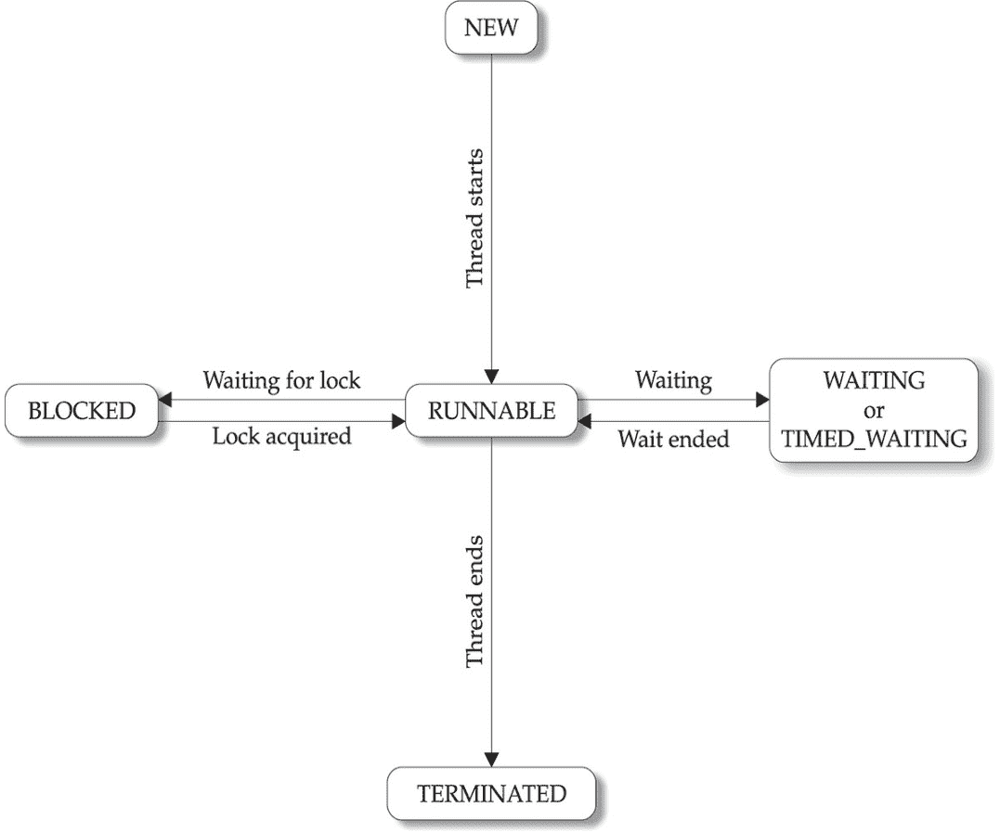

图11-1 线程状态

给定一个`Thread`实例，你可以使用`getState()`获取线程的状态。例如，以下序列确定了在调用`getState()`时，名为`thrd`的线程是否处于`RUNNABLE`状态：

```
Thread.State ts = thrd.getState();
if(ts == Thread.State.RUNNABLE) // ...
```

重要的一点是，线程的状态在调用`getState()`后可能会改变。因此，根据情况，调用`getState()`获取的状态可能无法反映片刻后线程的实际状态。出于（以及其他）原因，`getState()`并不是为了提供同步线程的方法。它主要用于调试或分析线程的运行时特征。

## 使用工厂方法创建并启动线程

在某些情况下，没有必要将线程的创建与其执行的启动分开。换句话说，有时同时创建并启动线程是方便的。实现这一点的办法是使用静态工厂方法。工厂方法是返回某个类对象的方法。通常，工厂方法是类的静态方法。它们被用于各种原因，例如在使用之前将对象设置为某些初始状态、配置特定类型的对象，或者在某些情况下允许对象被重用。在涉及创建和启动线程时，工厂方法会创建线程、在线程上调用`start()`，然后返回该线程的引用。通过这种方法，你可以通过简单的方法调用来创建并启动线程，从而简化你的代码。

例如，假设本章开头所示的`ThreadDemo`程序，使用以下工厂方法`createAndStart()`可以允许你一步完成线程的创建和启动：

```
// 一个创建并启动线程的工厂方法。
public static NewThread createAndStart() {
    NewThread myThread = new NewThread();
    myThread.t.start();
    return myThread;
}
```

使用`createAndStart()`，你现在可以替换以下序列：

```
NewThread nt = new NewThread(); // 创建新线程
nt.t.start(); // 启动线程
```

替换为：

```
NewThread nt = NewThread.createAndStart();
```

现在线程在一步之内被创建并启动了。

在不需要保留执行线程引用的情况下，你有时可以使用一行代码创建并启动线程，而无需使用工厂方法。例如，同样假设`ThreadDemo`程序，以下代码会创建并启动一个`NewThread`线程：

```
new NewThread().t.start();
```

然而，在现实应用中，你通常需要保留线程的引用，因此工厂方法通常是一个很好的选择。

## 使用多线程

有效利用Java多线程特征的关键是进行并发思考而不是串行思考。例如，当程序中有两个可以并发执行的子系统时，让它们成为独立的线程。通过仔细使用多线程，你可以创建非常高效的程序。然而，需要提醒的是：如果你创建了太多线程，实际上可能会降低程序的性能而不是增强它。记住，上下文切换带有某些开销。如果你创建了太多线程，花费在切换上下文上的时间将多于执行程序的时间！最后一点：为了创建能够自动扩展以利用多核心系统中可用处理器的计算密集型应用程序，请考虑使用第28节描述的Fork/Join Framework。

## 章节

# 枚举、自动装箱和注解

本章研究了三个最初不是Java的特性，但随着时间的推移，每一个都已成为Java编程中不可或缺的方面：枚举、自动装箱和注解。这些特性由JDK 5添加，每一个都是Java程序员信赖的特性，因为它们都为处理常见的编程任务提供了简化的方法。本章还讨论了Java的类型包装类并引入了反射。

## 枚举

在最简单的形式中，枚举（enumeration）是一组命名常量的列表，定义了一个新的数据类型及其合法值。因此，枚举对象只能持有列表中声明的值。不允许其他值。换句话说，枚举为你提供了一种方法，可以显式地指定数据类型合法拥有的唯一值。枚举通常用于定义一组值，代表某些操作可能产生的错误代码（例如成功、失败或挂起），或者设备可能处于的状态列表（例如运行、停止或暂停）。在Java的早期版本中，这些值是使用`final`变量定义的，但枚举提供了一种优得多的方法。

尽管Java枚举乍一看可能与其它语言中的枚举相似，但这种相似性可能仅于表面，因为在Java中，枚举定义了一个类类型。通过将枚举变为类，枚举的能力得到了极大扩展。例如，在Java中，枚举可以有构造函数、方法和实例变量。由于其强大和灵活性，枚举在整个Java API库中被广泛使用。

## 枚举基础

使用`enum`关键字创建枚举。例如，这里有一个列出各种品种简单枚举：

```
// 苹果品种的枚举。
enum Apple {
    Jonathan, GoldenDel, RedDel, Winesap, Cortland
}
```

一旦你定义了枚举，就可以创建该类型的一个变量。然而，尽管枚举定义了一个类，但你并不使用`new`来实例化枚举。相反，你声明和使用枚举变量的方式与使用基本类型非常相似。例如，这声明`ap`为一个枚举类型的变量：

```
Apple ap;
```

由于`ap`是枚举类型，它可以分配（或可以包含）的唯一值由枚举定义。例如，这为`ap`赋值了值`RedDel`：

```
ap = Apple.RedDel;
```

注意符号`RedDel`前面带有`Apple`。两个枚举常量可以使用`==`运算符比较相等性。例如，这比较了`ap`中的值与`GoldenDel`：

```
if(ap == Apple.GoldenDel) // ...
```

枚举值也可以用于控制`switch`语句。当然，所有的`case`语句必须使用与`switch`表达式使用的相同枚举的常量。例如，这个`switch`是完全有效的：

```
// 使用枚举来控制 switch 语句。
switch(ap) {
    case Jonathan:
        // ...
    case Winesap:
        // ...
}
```

注意在`case`语句中，枚举常量的名称没有通过其枚举类型进行限定。也就是说，使用的是`Winesap`而不是`Apple.Winesap`。这是因为`switch`表达式中的枚举类型已经隐式地指定了`case`常量的枚举类型。不需要在使用枚举类型来限定`case`语句中的常量。事实上，尝试这样做会导致编译错误。

当显示枚举常量时（例如在`println()`语句中），会输出它的名称。例如，给定此语句：

```
System.out.println(Apple.Winesap);
```

输出名称`Winesap`。

以下程序将所有部分结合在一起，并演示了`Apple`枚举：

```java
// 苹果品种的枚举。
enum Apple {
    Jonathan, GoldenDel, RedDel, Winesap, Cortland
}

class EnumDemo {
    public static void main(String args[]) {
        Apple ap;

        ap = Apple.RedDel;

        // 输出一个枚举值。
        System.out.println("Value of ap: " + ap);
        System.out.println();

        ap = Apple.GoldenDel;

        // 比较两个枚举值。
        if(ap == Apple.GoldenDel)
            System.out.println("ap contains GoldenDel.\n");

        // 使用枚举来控制 switch 语句。
        switch(ap) {
            case Jonathan:
                System.out.println("Jonathan is red.");
                break;
            case GoldenDel:
                System.out.println("Golden Delicious is yellow.");
                break;
            case RedDel:
                System.out.println("Red Delicious is red.");
                break;
            case Winesap:
                System.out.println("Winesap is red.");
                break;
            case Cortland:
                System.out.println("Cortland is red.");
                break;
        }
    }
}
```

程序的输出如下：

```
Value of ap: RedDel

ap contains GoldenDel.

Golden Delicious is yellow.
```

## values()和valueOf()方法

所有的枚举都自动包含两个定义的方法：`values()`和`valueOf()`。它们的通用形式如下：

```java
public static enum-type[] values()
public static enum-type valueOf(String str)
```

`values()`方法返回一个包含枚举常量列表的数组。`valueOf()`方法返回与传入`str`的字符串值对应的枚举常量。在这两种情况下，`enum-type`是枚举的类型。例如，在之前所示的`Apple`枚举中，`Apple.valueOf("Winesap")`的返回类型是`Winesap`。

以下程序演示了`values()`和`valueOf()`方法：

```java
// 使用内置枚举方法。

// 苹果品种的枚举。
enum Apple {
    Jonathan, GoldenDel, RedDel, Winesap, Cortland
}

class EnumDemo2 {
    public static void main(String args[]) {
        Apple ap;

        System.out.println("Here are all Apple constants:");

        // 使用 values()
        Apple[] allapples = Apple.values();
        for (Apple a : allapples) {
            System.out.println(a);
        }
        System.out.println();

        // 使用 valueOf()
        ap = Apple.valueOf("Winesap");
        System.out.println("ap contains " + ap);
    }
}
```

程序的输出如下：

```
Here are all Apple constants:
Jonathan
GoldenDel
RedDel
Winesap
Cortland

ap contains Winesap
```

注意，此程序使用for-each风格的循环来遍历通过`values()`获取的常量数组。为了说明，创建了变量`allapples`并分配了枚举数组的引用。此步骤并不是必要的，因为`for`循环可以像这样写，从而消除对`allapples`变量的需求：

```java
for(Apple a : Apple.values())
    System.out.println(a);
```

现在，注意通过调用`valueOf()`获取与名称`Winesap`对应的值。

```java
ap = Apple.valueOf("Winesap");
```

正如所解释，`valueOf()`返回与字符串表示常量名称相关的枚举值。

# Java枚举是类类型

如所述，Java枚举是一种类类型。虽然你不能使用`new`来实例化枚举，否则它具有与其他类相同的能力。

`enum`定义类这一事实赋予了Java枚举强大的功能。例如，你可以为它们提供构造函数、添加实例变量和方法，甚至实现接口。

重要的是，每个枚举常量都是其枚举类型的对象。因此，当你为枚举定义构造函数时，在每个枚举常量创建时都会调用该构造函数。此外，每个枚举常量都拥有枚举定义的任何实例变量的独立副本。例如，考虑以下版本的`Apple`：

```java
// enum 构造函数、实例变量和方法。
enum Apple {
    Jonathan(10), GoldenDel(9), RedDel(12), Winesap(15), Cortland(8);

    private int price; // 每只苹果的价格

    // 构造函数
    Apple(int p) { price = p; }

    int getPrice() { return price; }
}

class EnumDemo3 {
    public static void main(String args[]) {
        Apple ap;

        // 显示 Winesap 的价格。
        System.out.println("Winesap costs " +
            Apple.Winesap.getPrice() +
            " cents.\n");

        // 显示所有苹果及其价格。
        System.out.println("All apple prices:");
        for (Apple a : Apple.values()) {
            System.out.println(a + " costs " + a.getPrice() +
                " cents.");
        }
    }
}
```

输出如下：

```
Winesap costs 15 cents.

All apple prices:
Jonathan costs 10 cents.
GoldenDel costs 9 cents.
RedDel costs 12 cents.
Winesap costs 15 cents.
Cortland costs 8 cents.
```

这个版本的`Apple`增加了三个内容。第一个是实例变量`price`，用于存储每种品种苹果的价格。第二个是`Apple`构造函数，它接收苹果的价格。第三个是`getPrice()`方法，它返回`price`的值。

当在`main()`中声明变量`ap`时，对于每个指定的常量都会调用一次`Apple`的构造函数。注意构造函数的参数是如何指定的，通过将它们放在每个常量后的括号内，如下所示：

```
Jonathan(10), GoldenDel(9), RedDel(12), Winesap(15), Cortland(8);
```

# 枚举继承Enum

如所述，在声明枚举时不能继承父类，但所有的枚举都自动继承一个：`java.lang.Enum`。该类定义了所有枚举可用的几个方法。其中三个方法值得讨论：

你可以获取一个表示枚举常量在常量列表中位置的值。这被称为序数（ordinal value），通过调用`ordinal()`方法来获取，如下：

```java
final int ordinal()
```

它返回调用常量的序数。序数从零开始。因此，在`Apple`枚举中，`Jonathan`的序数为0，`GoldenDel`的序数为1，`RedDel`的序数为2，以此类推。

你可以使用`compareTo()`方法比较同一个枚举中两个常量的序数。它的通用形式如下：

```java
final int compareTo(enum-type e)
```

在这里，`enum-type`是枚举的类型，`e`是与调用常量比较的常量。记住，调用常量和`e`必须是同一种枚举。如果调用常量的序数小于`e`，则`compareTo()`返回负值。如果两个序数相同，则返回零值。如果调用常量的序数大于`e`，则返回正值。

你可以使用`equals()`方法比较枚举常量与其他任何对象的相等性，该方法重写了`Object`的`equals()`方法。虽然`equals()`可以比较枚举常量与其他任何对象，但只有当它们都引用同一个枚举中的同一个常量时，这些对象才会相等。仅仅具有共同的序数并不会导致常量来自不同枚举时`equals()`返回`true`。

记住，你可以使用`==`比较两个枚举引用的相等性。

以下程序演示了`ordinal()`、`compareTo()`和`equals()`方法：

```java
// Demonstrate ordinal(), compareTo(), and equals().

// 苹果品种的枚举。
enum Apple {
    Jonathan, GoldenDel, RedDel, Winesap, Cortland
}

class EnumDemo4 {
    public static void main(String args[]) {
        Apple ap, ap2, ap3;

        // 使用 ordinal() 获取所有的序数。
        System.out.println("Here are all apple constants and their ordinal values: ");
        for (Apple a : Apple.values()) {
            System.out.println(a + " " + a.ordinal());
        }

        ap = Apple.RedDel;
        ap2 = Apple.GoldenDel;
        ap3 = Apple.RedDel;

        System.out.println();
        // 演示 compareTo() 和 equals()
        if(ap.compareTo(ap2) < 0) {
            System.out.println(ap + " comes before " + ap2);
        }

        if(ap.compareTo(ap2) > 0) {
            System.out.println(ap2 + " comes before " + ap);
        }

        if(ap.compareTo(ap3) == 0) {
            System.out.println(ap + " equals " + ap3);
        }

        System.out.println();

        if(ap.equals(ap2)) {
            System.out.println("Error!");
        }

        if(ap.equals(ap3)) {
            System.out.println(ap + " equals " + ap3);
        }

        if(ap == ap3)
            System.out.println(ap + " == " + ap3);

    }
}
```

程序的输出如下：

```
Here are all apple constants and their ordinal values:
Jonathan 0
GoldenDel 1
RedDel 2
Winesap 3
Cortland 4

GoldenDel comes before RedDel
RedDel equals RedDel

RedDel equals RedDel
RedDel == RedDel
```

# 另一个枚举示例

在继续之前，我们将看另一个使用枚举的示例。在第9章中，我们创建了一个自动化的“决策者”程序。在那个版本中，`NO`、`YES`、`MAYBE`、`LATER`、`SOON`和`NEVER`是在一个接口内部声明的并用于表示可能的答案。虽然这种方法在技术上没有错误，但枚举是更好的选择。这里是该程序的改进版本，它使用一个`Answers`枚举来定义答案。你应该将此版本与第9章中的原始版本进行比较。

```java
// 第 9 章“决策者”程序的
// 改进版本。此版本使用
// 枚举（而不是接口变量）
// 来表示答案。

import java.util.Random;

// 可能答案的枚举。
enum Answers {
    NO, YES, MAYBE, LATER, SOON, NEVER
}

class RandomQuestion {
    Random rand = new Random();
    Answers ask() {
        int prob = (int) (100 * rand.nextDouble());

        if (prob < 15) 
            return Answers.MAYBE; // 15%
        else if (prob < 30) 
            return Answers.NO; // 15%
        else if (prob < 60) 
            return Answers.YES; // 30%
        else if (prob < 75)
            return Answers.LATER; // 15%
        else if (prob < 98)
            return Answers.SOON; // 13%
        else
            return Answers.NEVER; // 2%
    }
}

class AskMe {
    static void answer(Answers result) {
        switch (result) {
            case NO:
                System.out.println("No");
                break;
            case YES:
                System.out.println("Yes");
                break;
            case MAYBE:
                System.out.println("Maybe");
                break;
            case LATER:
                System.out.println("Later");
                break;
            case SOON:
                System.out.println("Soon");
                break;
            case NEVER:
                System.out.println("Never");
                break;
        }
    }

    public static void main(String args[]) {
        RandomQuestion q = new RandomQuestion();
        answer(q.ask());
        answer(q.ask());
        answer(q.ask());
        answer(q.ask());
    }
}
```

## 类型包装器

如你所知，Java使用基本数据类型（也称为简单类型），如`int`或`double`来存储语言支持的基本数据类型。出于性能考虑，这些数量使用了基本类型而不是对象。对于这些值使用对象会给即使是最简单的计算也增加不可接受的开销。因此，基本类型不是对象层次结构的一部分，并且它们不继承`Object`。

```java
// Demonstrate a type wrapper.
class Wrap {
    public static void main(String args[]) {

        Integer iOb = Integer.valueOf(100);

        int i = iOb.intValue();

        System.out.println(i + " " + iOb); // displays 100 100
    }
}
```

该程序将整数值100封装在一个名为`iOb`的`Integer`对象中。随后，程序通过调用`intValue()`获取该值并将结果存储在`i`中。将值封装在对象内部的过程被称为装箱（boxing）。因此，对于该程序来说，这一行代码将值100装箱为`Integer`：

```java
Integer iOb = Integer.valueOf(100);
```

从类型包装类中提取值的过程被称为拆箱（unboxing）。例如，程序通过以下语句对`iOb`中的值进行拆箱：

```java
int i = iOb.intValue();
```

上述程序用于对值装箱和拆箱的相同通用步骤自Java原始版本以来一直存在。然而，从JDK 5开始，Java通过引入下文描述的自动装箱（autoboxing）对其进行了根本性的改进。

## 自动装箱

从JDK 5开始，Java包含了两个重要的特性：自动装箱和自动拆箱。自动装箱是指当需要某个类型的对象时，将原始类型自动封装（装箱）为其类型包装类的过程。不需要显式构造对象。自动拆箱是指当需要装箱对象的值时，自动从中提取（拆箱）的过程。不需要调用如`intValue()`或`doubleValue()`等方法。

自动装箱和拆箱极大地简化了多个算法的编码，消除了手动装箱和拆箱值的繁琐。它们还能防止错误。此外，它们对于仅操作对象的泛型（generics）非常重要。最后，自动装箱使得与集合框架（Collections Framework，在第二部分描述）的操作变得简单得多。

有了自动装箱，无需手动构造对象来封装原始类型。你只需要将该值赋值给类型包装类引用即可。Java会自动为你构造对象。例如，这里是构造值为100的`Integer`对象的现代方法：

```java
Integer iOb = 100; // autobox an int
```

注意，该对象并没有被显式装箱。Java会自动为你处理好这一切。

要拆箱一个对象，只需将对象引用赋值给原始类型变量。例如，要拆箱`iOb`，你可以使用这一行：

```java
int i = iOb; // auto-unbox
```

Java会为你处理细节。

以下是使用自动装箱/拆箱重写的上述程序：

```java
// autoboxing/unboxing
class AutoBox {
    public static void main(String args[]) {

        Integer iOb = 100; // autobox an int

        int i = iOb; // auto-unbox

        System.out.println(i + " " + iOb); // displays 100 100
    }
}
```

## 自动装箱与方法

除了简单的赋值情况外，每当原始类型必须转换为对象时，就会发生自动装箱；每当对象必须转换为原始类型时，就会发生自动拆箱。因此，自动装箱/拆箱可能会发生在向方法传递参数或方法返回值时。例如，考虑以下情况：

```java
// Autoboxing/unboxing takes place with
// method parameters and return values

class AutoBox2 {
    // Take an Integer parameter and return
    // an int value;
    static int m(Integer v) {
        return v; // auto-unbox to int
    }

    public static void main(String args[]) {
        // 将一个 int 传递给 m() 并将返回值赋值
        // 给 Integer。在这里，参数 100 被自动装箱
        // 为 Integer。返回值也被自动装箱
        // 为 Integer。
        Integer iOb = m(100);

        System.out.println(iOb);
    }
}
```

该程序将显示以下结果：

```
100
```

在程序中，注意`m()`指定了一个`Integer`参数并返回一个`int`结果。在`main()`中，向`m()`传递了值100。因为`m()`期望一个`Integer`，所以该值被自动装箱。然后，`m()`返回了其参数的等效`int`值。这导致`v`被自动拆箱。接下来，这个`int`值被赋值给`main()`中的`iOb`，从而导致`int`返回值被自动装箱。

## 自动装箱/拆箱发生在表达式中

通常情况下，每当需要转换为对象或从对象转换时，就会发生自动装箱和拆箱。这适用于表达式，其中数值对象会被自动拆箱。如果有必要，表达式的结果会被重新装箱。例如，考虑以下程序：

```java
// Autoboxing/unboxing occurs inside expressions.

class AutoBox3 {
    public static void main(String args[]) {
        Integer iOb, iOb2;
        int i;

        iOb = 100;
        System.out.println("Original value of iOb: " + iOb);

        // 以下代码会自动拆箱 iOb，
        // 执行自增操作，然后将结果
        // 重新装箱回 iOb。
        ++iOb;
        System.out.println("After ++iOb: " + iOb);

        // 以下代码会自动拆箱 iOb，
        // 执行加法操作，然后将结果
        // 重新装箱回 iOb。
        iOb2 = iOb + (iOb / 3);
        System.out.println("iOb2 after expression: " + iOb2);

        // 以下代码会自动拆箱 iOb，
        // 执行赋值操作，然后将结果
        // 重新装箱回 iOb。
        i = iOb + (iOb / 3);
        System.out.println("i after expression: " + i);
    }
}
```

输出如下：

```
Original value of iOb: 100
After ++iOb: 101
iOb2 after expression: 134
i after expression: 134
```

## 布尔和字符值的自动装箱/拆箱

如前所述，Java还提供了`boolean`和`char`的包装类。这些是`Boolean`和`Character`。自动装箱/拆箱也适用于这些类。例如，考虑以下程序：

```java
// Autoboxing/unboxing Boolean and Character
class AutoBox5 {
    public static void main(String args[]) {
        // 自动装箱/拆箱布尔值。
        Boolean b = true;

        // 在下方，b 在用于条件表达式（如 if）
        // 时被自动拆箱。
        if(b) System.out.println("b is true");

        // 自动装箱/拆箱字符。
        Character ch = 'x'; // box a char
        char ch2 = ch; // unbox a char

        System.out.println("ch2 is " + ch2);
    }
}
```

除了自动装箱/拆箱（autoboxing/unboxing）提供的便利之外，它还可以帮助防止错误。例如，考虑以下程序：

```java
// 手动拆箱导致的错误
class UnboxingError {
    public static void main(String args[]) {
        Integer iOb = 1000; // 装箱值 1000
        int i = iOb.byteValue(); // 手动拆箱为 byte !!!
        System.out.println(i); // 没有显示 1000 !
    }
}
```

该程序显示的不是预期的值1000，而是-24！原因是`iOb`内部的值是通过调用`byteValue()`手动拆箱的，这导致了`iOb`中存储的值（1,000）被截断。结果导致垃圾值-24被赋值给`i`。自动拆箱防止了此类错误，因为`iOb`中的值始终会自动拆箱为与`int`兼容的值。

通常情况下，由于自动装箱总是创建正确的对象，而拆箱总是产生正确的类型或值，该过程没有可能产生错误的对象类型或值。在极少数你想要与自动化过程产生的类型不同的情况下，你仍然可以手动对值进行装箱和拆箱。当然，自动装箱/拆箱的优势就消失了。通常，新代码应该采用自动装箱/拆箱。这是现代Java代码的编写方式。

## 警告

由于自动装箱和自动拆箱，某些人可能会仅使用`Integer`或`Double`等对象，而完全放弃基本数据类型。例如，通过自动装箱/拆箱可以写出这样的代码：

```java
// 自动装箱/拆箱的错误用法！
Double a, b, c;

a = 10.0;
b = 4.0;

c = Math.sqrt(a*a + b*b);

System.out.println("Hypotenuse is " + c);
```

在这个示例中，`Double`类型的对象持有用于计算直角三角形斜边的值。虽然这在技术上是正确的而且确实正常工作，但这是自动装箱/拆箱的一种非常糟糕的用法。它比使用基本类型`double`编写的等效代码效率低得多。原因是每个自动装箱和自动拆箱都会增加开销，而使用基本类型时则没有这些开销。

通常，你应该限制对类型包装类的使用，仅在需要基本数据类型的对象表示的情况下。自动装箱/拆箱并不是作为消除基本数据类型的“后门”被添加到Java中的。

## 注解

Java提供了一种允许你在源文件中嵌入补充信息的功能。这种信息被称为注解（annotation），它不会改变程序的行为。因此，注解保持程序的语义不变。然而，这些信息可以在开发和部署期间被各种工具使用。例如，注解可能会被源代码生成器处理。元数据（metadata）一词也用于描述这种功能，但“注解”是最具描述性且常用的术语。

## 注解基础

注解是通过基于接口的机制创建的。让我们从一个示例开始。这是名为`MyAnno`的注解的声明：

```java
// 一个简单的注解类型
@interface MyAnno {
    String str();
    int val();
}
```

首先，注意位于`interface`关键字之前的`@`。它告诉编译器正在声明一个注解类型。接下来，注意两个成员`str()`和`val()`。所有的注解完全由方法声明组成。然而，你不需要为这些方法提供方法体。相反，Java会实现这些方法。此外，正如你将看到的，这些方法的作用就像字段一样。

注解不能包含`extends`子句。然而，所有的注解类型自动扩展`Annotation`接口。因此，`Annotation`是所有注解的父接口。它声明在`java.lang.annotation`包中。它重写了由`Object`定义的`hashCode()`、`equals()`和`toString()`。它还指定了`annotationType()`，该方法返回一个表示调用注解的`Class`对象。

一旦你声明了注解，就可以使用它来注解方法。在JDK 8之前，注解只能用在声明上，我们将从那里开始。（JDK 8增加了对类型使用进行注解的能力，这将在本章的稍后部分进行描述。然而，相同的技巧适用于这两种注解。）任何类型的声明都可以与它关联一个注解。例如，类、方法、字段、参数和枚举常量都可以被注解。甚至一个注解也可以被注解。在所有情况下，注解都位于声明的其余部分之前。

当你应用一个注解时，你会为它的成员赋值。例如，这里有一个`MyAnno`应用于方法声明的示例：

```java
// 注解一个方法
@MyAnno(str = "Annotation Example", val = 100)
public static void myMethod() { // ...
```

此注解与方法`myMethod()`关联。仔细观察注解语法。注解的名字以`@`开头，后面跟着一个圆括号内的成员初始化列表。要给成员赋值，会给该成员名分配一个值。因此，在示例中，字符串`"Annotation Example"`被赋值给`MyAnno`的`str`成员。注意在这次赋值中`str`后面没有跟括号。当给注解赋值时，只使用它的名称。因此，在这种语法中，注解成员看起来就像字段一样。

## 指定保留策略

在探索注解之前，有必要讨论注解的保留策略（retention policies）。保留策略决定了注解在何时一点被丢弃。Java定义了三种策略，封装在`java.lang.annotation.RetentionPolicy`中：

- `SOURCE`：注解保留在源文件中并被编译器丢弃。
- `CLASS`：注解保留在类文件中，但不加载到JVM中。
- `RUNTIME`：注解保留在运行时并可以被JVM查询。

## 获取注解

虽然注解主要设计用于工具使用，但它们可以在运行时查询。反射（Reflection）是允许获取类信息的功能。反射API包含在`java.lang.reflect`包中。有多种使用反射的方法，我们将通过示例。使用反射的第一步是获取表示该类的`Class`对象。`Class`是定义在`java.lang`中的内置类之一，在第二部分有详细介绍。有多种获取`Class`对象的方法。最简单的方法调用`getClass()`，它是`Object`定义的方法。其通用形式如下：

```java
final Class<?> getClass()
```

它返回表示调用对象的`Class`对象。注意`Class`声明后面的`<?>`。这与Java的泛型功能有关。`getClass()`以及本章讨论的其他几个反射方法在第14章中有描述。然而，理解反射的基本原理不需要泛型。

一旦获取了`Class`对象，就可以使用它的方法获取有关项目的信息。如果你想获取特定项目的注解，必须先获取表示该项目的对象。`Class`提供了（其他方法等）`getMethod()`、`getField()`和`getConstructor()`方法。为了理解这个过程，让我们通过一个获取方法关联注解的示例。这样做，首先获取一个表示该类的`Class`对象，然后在该`Class`对象上调用`getMethod()`，指定方法名称。

如果方法有参数，必须通过`paramTypes`指定表示这些类型的`Class`。注意`paramTypes`是一个变长参数（varargs）。这意味着根据需要指定任意数量的类型，包括零。`getMethod()`返回一个表示方法的`Method`对象。如果找不到方法，将抛出`NoSuchMethodException`。

从`Class`、`Method`、`Field`或`Constructor`对象，可以通过调用`getAnnotation()`获取与该对象相关的特定注解。其通用形式如下：

```java
<A extends Annotation> A getAnnotation(Class<A> annoType)
```

在这里，`annoType`是表示你感兴趣的注解的`Class`对象。该方法返回注解的引用。使用该引用，你可以获取与注解成员相关的值。如果未找到注解，该方法将返回`null`，当注解没有`RUNTIME`留存策略时就会发生这种情况。

下面的程序组装了之前显示的所有部分，并使用反射来显示与方法相关的注解：

```java
import java.lang.annotation.*;
import java.lang.reflect.*;

// 注解类型声明。
@Retention(RetentionPolicy.RUNTIME)
@interface MyAnno {
    String str();
    int val();
}

class Meta {

    // 在方法上添加注解。
    @MyAnno(str = "Annotation Example", val = 100)
    public static void myMeth() {
        Meta ob = new Meta();

        // 获取此方法的注解
        // 并显示成员的值。

        try {
            // 首先，获取一个表示
            // 此类的 Class 对象。
            Class<?> c = ob.getClass();

            // 现在，获取一个表示
            // 此方法的 Method 对象。
            Method m = c.getMethod("myMeth");

            // 接下来，获取此类的注解。
            MyAnno anno = m.getAnnotation(MyAnno.class);

            // 最后，显示值。
            System.out.println(anno.str() + " " + anno.val());
        } catch (NoSuchMethodException exc) {
            System.out.println("Method Not Found.");
        }
    }

    public static void main(String args[]) {
        myMeth();
    }
}
```

程序的输出显示在此：

```
Annotation Example 100
```

该程序使用了上述反射机制来获取并显示`Meta`类中与`myMeth()`相关的`MyAnno`注解中`str`和`val`的值。有两个地方需要特别注意。首先，在这一行：

```java
MyAnno anno = m.getAnnotation(MyAnno.class);
```

注意表达式`MyAnno.class`。该表达式求值为类型为`MyAnno`注解的`Class`对象。这种结构被称为类字面量。当你需要已知类的`Class`对象时，可以使用这种类型的表达式。例如，可以使用此语句来获取`Meta`的`Class`对象：

```java
Class<?> c = Meta.class;
```

当然，这种方法只在你预先知道对象的类名时才有效，而这并不总是如此。通常情况下，你可以获取类、接口、基本类型和数组的类字面量。（记住，`<?>`语法与Java的泛型功能有关。它在第14章中描述。）

另一个感兴趣的点是当通过以下行输出时，与`str`和`val`相关的值是如何获取的：

```java
System.out.println(anno.str() + " " + anno.val());
```

注意它们是使用方法调用语法被调用的。每当需要注解的值时，都会使用相同的方法。

# 第二个反射示例

在上一个示例中，`myMeth()`没有参数。因此，当调用`getMethod()`时，只传递了名称`myMeth`。然而，要获取带有参数的方法，你必须指定表示参数类型的`Class`对象作为参数传递给`getMethod()`。例如，这里是上述程序的略有不同的版本：

```java
import java.lang.annotation.*;
import java.lang.reflect.*;

@Retention(RetentionPolicy.RUNTIME)
@interface MyAnno {
    String str();
    int val();
}

class Meta2 {

    // 在方法上添加注解。
    @MyAnno(str = "Two Parameters", val = 19)
    public static void myMeth(String str, int i) {
        Meta2 ob = new Meta2();

        try {
            Class<?> c = ob.getClass();

            // 在这里，指定参数类型。
            Method m = c.getMethod("myMeth", String.class, int.class);

            MyAnno anno = m.getAnnotation(MyAnno.class);

            System.out.println(anno.str() + " " + anno.val());
        } catch (NoSuchMethodException exc) {
            System.out.println("Method Not Found.");
        }
    }

    public static void main(String args[]) {
        myMeth("test", 10);
    }
}
```

程序的输出显示在此：

```
Two Parameters 19
```


# 获取所有注解

你可以通过调用该项的`getAnnotations()`来获取与该项相关的具有`RUNTIME`留存策略的所有注解。它具有以下通用形式：

```
Annotation[] getAnnotations()
```

它返回注解数组。`getAnnotations()`可以在`Class`、`Method`、`Constructor`和`Field`等类型的对象上调用。

这是另一个反射示例，显示了如何获取与类和方法相关的所有注解。它声明了两个注解，然后使用这些注解对类和方法进行注解。

```java
// 显示类和方法的所有注解。
import java.lang.reflect.*;

@Retention(RetentionPolicy.RUNTIME)
@interface MyAnno {
  String str();
  int val();
}

@Retention(RetentionPolicy.RUNTIME)
@interface What {
  String description();
}

@What(description="An annotation class")
@MyAnno(str="Meta2", val=99)
class Meta2 {

    @What(description="An annotation method")
    @MyAnno(str="Testing", val=100)
    public static void myMeth() {
        Meta2 ob = new Meta2();
        try {
            Annotation[] ann = ob.getClass().getAnnotations();

            // 显示 Meta2 的注解。
            System.out.println("All annotations for Meta2:");
            for (Annotation a : ann) {
                System.out.println(a);
            }

            // 显示 myMeth 的注解。
            Method m = ob.getClass().getMethod("myMeth");
            Annotation[] annos = m.getAnnotations();
            System.out.println("All annotations for myMeth:");
            for (Annotation a : annos) {
                System.out.println(a);
            }
        } catch (NoSuchMethodException exc) {
            System.out.println("Method Not Found.");
        }
    }

    public static void main(String[] args[]) {
        myMeth();
    }
}
```

输出如下：

```
All annotations for Meta2:

@What(description=An annotation class)

@MyAnno(str=Meta2, val=99)

All annotations for myMeth:

@What(description=An annotation method)

@MyAnno(str=Testing, val=100)
```

该程序使用`getAnnotations()`获取与`Meta2`类和`myMeth()`方法相关的注解数组。如前所述，`getAnnotations()`返回注解数组。记住`Annotation`是所有注解接口的父接口，并且重写了`Object`中的`toString()`。因此，当输出注解的引用时，会调用它的`toString()`方法生成描述该注解的字符串，如所示。

# AnnotatedElement 接口

上述示例使用的`getAnnotation()`和`getAnnotations()`定义在`java.lang.reflect`的`AnnotatedElement`接口中。该接口支持注解反射，并由`Method`、`Field`、`Constructor`、`Class`和`Package`等类实现。

除了`getAnnotation()`和`getAnnotations()`，`AnnotatedElement`还定义了其他方法。两个方法自JDK 5起可用。第一个是`getDeclaredAnnotations()`，它具有以下形式：

```
Annotation[] getDeclaredAnnotations()
```

它返回非继承注解。第二个是`isAnnotationPresent()`，它具有以下形式：

```
default boolean isAnnotationPresent(Class<? extends Annotation> annoType)
```

如果调用对象与`annoType`指定注解关联，则返回`true`。否则返回`false`。此外，JDK 8增加了`getDeclaredAnnotation()`、`getAnnotationsByType()`和`getDeclaredAnnotationsByType()`。其中最后两个可以自动处理重复注解。（重复注解在本章末尾讨论。）

## 使用默认值

你可以为注解成员提供默认值，当在应用注解时未指定值，将使用这些默认值。通过在成员声明中添加`default`子句来指定默认值。它具有以下形式：

```
type member() default value;
```

在这里，`value`必须与`type`类型兼容。

以下是包含默认值的`@MyAnno`：

```java
// 一个包含默认值的注解类型声明。
@Retention(RetentionPolicy.RUNTIME)
@interface MyAnno {
    String str() default "Testing";
    int val() default 9000;
}
```

此声明为`str`赋予了默认值`"Testing"`，为`val`赋予了默认值`9000`。这意味着在使用`@MyAnno`时，不需要指定这两个值。然而，如果需要，可以为其中一个或两者指定值。因此，以下是`@MyAnno`的四种用法：

```java
@MyAnno() // str 和 val 都使用默认值
@MyAnno(str = "some string") // val 使用默认值
@MyAnno(val = 100) // str 使用默认值
@MyAnno(str = "Testing", val = 100) // 无默认值
```

以下程序演示了注解中默认值的用法。

```java
import java.lang.annotation.*;
import java.lang.reflect.*;

// 一个包含默认值的注解类型声明。
@Retention(RetentionPolicy.RUNTIME)
@interface MyAnno {
    String str() default "Testing";
    int val() default 9000;
}

class Meta3 {

    // 使用默认值注解一个方法。
    @MyAnno()
    public static void myMeth() {
        Meta3 ob = new Meta3();

        // 获取此方法的注解
        // 并显示成员变量的值。
        try {
            Class<?> c = ob.getClass();

            Method m = c.getMethod("myMeth");

            MyAnno anno = m.getAnnotation(MyAnno.class);

            System.out.println(anno.str() + " " + anno.val());
        } catch (NoSuchMethodException exc) {
            System.out.println("Method Not Found.");
        }
    }

    public static void main(String args[]) {
        myMeth();
    }
}
```

输出结果所示：

```
Testing 9000
```

## 标记注解 (Marker Annotations)

标记注解是一种特殊的注解，它不包含任何成员。它的唯一目的是标记某个项目。因此，只要其作为注解存在就足够了。判断标记注解是否存在的最佳方法是使用`isAnnotationPresent()`方法，该方法由`AnnotatedElement`接口定义。

这是一个使用标记注解的示例。由于标记接口不包含任何成员，只需判断其存在与否就足够了。

```java
import java.lang.annotation.*;
import java.lang.reflect.*;

// 一个标记注解。
@Retention(RetentionPolicy.RUNTIME)
@interface MyMarker { }

class Marker {

    // 使用标记注解注解方法。
    // 注意不需要括号 ( )。
    @MyMarker
    public static void myMeth() {
        Marker ob = new Marker();

        try {
            Method m = ob.getClass().getMethod("myMeth");

            // 判断注解是否存在。
            if (m.isAnnotationPresent(MyMarker.class)) {
                System.out.println("MyMarker is present.");
            }
        } catch (NoSuchMethodException exc) {
            System.out.println("Method Not Found.");
        }
    }

    public static void main(String args[]) {
        myMeth();
    }
}
```

输出结果所示，证实了`@MyMarker`存在：

```
MyMarker is present.
```

在程序中，注意在应用`@MyMarker`时不需要在其后紧跟括号。因此，只需使用其名称即可应用`@MyMarker`，如下：

```
@MyMarker
```

提供一对空括号并不是错误的，但它们不是必须。

## 单成员注解 (Single-Member Annotations)

单成员注解只包含一个成员。它的工作方式与普通注解类似，不同之处在于允许使用简写形式指定成员的值。当只存在一个成员时，在应用注解时只需指定该成员的值——你不需要指定成员名称。然而，为了使用这种简写，成员的名称必须为`value`。

这是一个创建并使用单成员注解的示例：

```java
import java.lang.annotation.*;
import java.lang.reflect.*;

// 一个单成员注解。
@Retention(RetentionPolicy.RUNTIME)
@interface MySingle {
    int value(); // 这个变量名必须是 value
}

class Single {
    // 使用单成员注解注解一个方法。
    @MySingle(100)
    public static void myMeth() {
        Single ob = new Single();

        try {
            Method m = ob.getClass().getMethod("myMeth");
            MySingle anno = m.getAnnotation(MySingle.class);
            System.out.println(anno.value()); // 显示 100
        } catch (NoSuchMethodException exc) {
            System.out.println("Method Not Found.");
        }
    }

    public static void main(String[] args) {
        myMeth();
    }
}
```

如预期，此程序显示了值`100`。在程序中，`@MySingle`被用于注解`myMeth()`，如下所示：

```
@MySingle(100)
```

注意不需要指定`value =`。

在应用具有其他成员的注解时，可以使用单值语法，但那些其他成员都必须具有默认值。

## 内置注解 (Built-In Annotations)

Java定义了许多注解。大多数是专门的，但有四个是通用的。这些注解从`java.lang.annotation`导入：

- `@Retention`
- `@Documented`
- `@Target`
- `@Inherited`
- `@Override`
- `@FunctionalInterface`
- `@Deprecated`
- `@SafeVarargs`
- `@SuppressWarnings`

以下表显示了`@Target`的目标：

| Target 常量 | 注解可以应用于 |
| :--- | :--- |
| `ANNOTATION_TYPE` | 注解 |
| `CONSTRUCTOR` | 构造器 |
| `FIELD` | 字段 |
| `LOCAL_VARIABLE` | 局部变量 |
| `METHOD` | 方法（JDK 9 增加） |
| `PACKAGE` | 包 |
| `PARAMETER` | 参数 |
| `TYPE` | 类、接口或枚举 |
| `TYPE_PARAMETER` | 类型参数 |
| `TYPE_USE` | 类型使用 |

在应用`@Target`注解时，可以使用这些值中的一个。要指定多个值，必须使用大括号分隔的列表。例如，要指定注解仅适用于字段和局部变量，你可以使用：

```java
@Target({ElementType.FIELD, ElementType.LOCAL_VARIABLE})
```

如果你不使用`@Target`，除了类型参数外，注解可以应用于任何地方。因此，为了明确注解的意图，通常显式指定。

## 保留 (Retention)

`@Retention`设计用于另一个注解。它指定了本章前面提到的保留策略。

## 文档 (Documented)

`@Documented`注解是一个标记，告诉工具该注解是被记录的。它设计用于另一个注解。

## 目标 (Target)

`@Target`注解指定了注解可以应用于类型。它设计用于另一个注解。

## 继承 (Inherited)

`@Inherited`是一个标记注解，只能用于另一个注解声明。此外，它仅影响用于类声明的注解。此外，`@Inherited`会导致父类的注解被子类继承。因此，当对子类请求特定注解时，如果子类中不存在该注解，则会检查父类。如果父类中存在该注解，且它被标记为`@Inherited`，那么该注解将被返回。

## 重写 (Override)

`@Override`是一个标记注解，只能用于方法。标记了`@Override`的方法必须重写父类方法。否则，会导致编译错误。它用于确保实际上是重写而不是简单的重载。

## 弃用 (Deprecated)

`@Deprecated`表示声明已过时且不建议使用。从JDK 9开始，`@Deprecated`还允许指定该弃用元素的Java版本以及该元素是否计划移除。

## 函数式接口 (FunctionalInterface)

`@FunctionalInterface`是一个设计用于接口的标记注解。它指示被注解的接口是函数式接口。函数式接口是一个包含且只有一个抽象方法的接口。函数式接口供Lambda表达式使用（详情见第15章）。如果被注解的接口不是函数式接口，将报告编译错误。重要的是，创建函数式接口不需要`@FunctionalInterface`。

`@SafeVarargs`是一个可以应用于方法和构造函数的标记注解。它表示发生了与变长参数（varargs）参数相关的不安全操作。它被用于抑制原本安全代码上的未检查警告，因为这些代码涉及非可重（non-reifiable）变长参数类型和泛型数组实例化。（非可重类型本质上是泛型类型。泛型请见第14章）。它必须仅应用于变长方法或构造函数。这些方法必须是静态的（`static`）、最终的（`final`）或私有的（`private`）。

## @SuppressWarnings

`@SuppressWarnings`指定了抑制编译器可能发布的一个或多个警告。要抑制的警告以字符串形式指定。

## 类型注解 (Type Annotations)

从JDK 8开始，注解最初仅允许在声明中使用。然而，现在在大多数使用类型的地方也可以指定注解。这种注解的扩展方面被称为“类型注解”。例如，你可以注解方法的返回类型、方法内部`this`的类型、强制转换、数组层级、继承类以及`throws`子句。你还可以注解泛型类型，包括泛型参数边界和泛型参数。（有关泛型的讨论请参见第14章）。

类型注解非常重要，因为它们允许工具对代码执行额外的检查以防止错误。请理解，作为一般规则，`javac`本身不会执行这些检查。此目的可以使用单独的工具，尽管该工具可能以插件的形式运行。

类型注解必须包含`ElementType.TYPE_USE`作为目标。（回想，有效的注解目标是使用之前描述的`@Target`注解指定的。）类型注解应用于其前的类型。例如，假设有一个类型注解`@TypeAnno`，以下内容是合法的：

```java
void myMeth() throws @TypeAnno NullPointerException { // ...
```

在这里，`@TypeAnno`注释了`throws`子句中的`NullPointerException`。你可以注解`this`（称为接收者）的类型。如你所知，这是所有实例方法的隐式参数，指向调用者对象。要注解它的类型需要使用另一个JDK 8特性。从JDK 8开始，你可以显式地将其声明为方法的第一个参数。在此声明中，`this`的类型必须是其类的类型；例如：

```java
class SomeClass {
  int myMeth(SomeClass this, int i, int j) { // ... }
}
```

在这里，因为`myMeth()`是由`SomeClass`定义的方法，`this`的类型是`SomeClass`。使用此声明，你现在可以注解`this`的类型。例如，再次假设`@TypeAnno`是一个类型注解，以下内容是合法的：

```java
int myMeth(@TypeAnno SomeClass this, int i, int j) { // ... }
```

重要的一点是，除非你要对它进行注解，否则没有必要声明它。（如果没有声明，它将是隐式传递的，正如一贯以来如此。）此外，显式声明`this`不会改变方法签名的任何方面，因为这默认情况下是隐式声明的。再次，只有当你想要对其应用类型注解时，才会声明它。如果你声明了它，它必须是第一个参数。

以下程序展示了类型注解可以使用的多处地方。它定义了几个注解，其中几个用于类型注解。这里显示了注解的名称和目标：

| 注解 | 目标 |
|---|---|
| `@Anno` | `ElementType.TYPE_USE` |
| `@MaxLen` | `ElementType.TYPE_USE` |
| `@NotZeroLen` | `ElementType.TYPE_USE` |
| `@Unique` | `ElementType.TYPE_USE` |
| `@What` | `ElementType.TYPE_PARAMETER` |
| `@EmptyOK` | `ElementType.FIELD` |
| `@Recommended` | `ElementType.METHOD` |

注意`@EmptyOK`、`@Recommended`和`@What`不是类型注解。包含它们是为了比较之目的。特别值得关注的是`@What`，它用于注解泛型类型参数声明。程序中的注释描述了每种用法。

```java
// 展示几种类型注解。
import java.lang.annotation.*;
import java.lang.reflect.*;

// 一个可以应用于类型的标记注解。
@Target(ElementType.TYPE_USE)
@interface TypeAnno { }

// 另一个可以应用于类型的标记注解。
@Target(ElementType.TYPE_USE)
@interface NotZeroLen {
}

// 另外一个可以应用于类型的标记注解。
@Target(ElementType.TYPE_USE)
@interface Unique { }

// 一个可以应用于类型参数的参数化注解。
@Target(ElementType.TYPE_USE)
@interface MaxLen {
    int value();
}

// 一个可以应用于类型参数的注解。
@Target(ElementType.TYPE_PARAMETER)
@interface What {
    String description();
}

// 一个可以应用于字段声明的注解。
@Target(ElementType.FIELD)
@interface EmptyOK { }

// 一个可以应用于方法声明的注解。
@Target(ElementType.METHOD)
@interface Recommended { }

// 使用注解在类型参数上的注解。
class TypeAnnoDemo<@What(description = "Generic data type") T> {

  // 在构造函数上使用类型注解。
  public @Unique TypeAnnoDemo() {}

  // 注解类型（在这种情况下是 String），而不是字段。
  @TypeAnno String str;

  // 这注解了字段 test。
  @EmptyOK String test;
}
```

# 重复注解

从JDK 8开始，注解可以在同一个元素上重复。这被称为重复注解。要使一个注解是可重复的，它必须使用定义在`java.lang.annotation`中的`@Repeatable`注解进行标记。它的`value`字段指定了重复注解的容器类型。容器被指定为一个注解，其`value`字段是可重复注解类型的数组。因此，要创建一个可重复的注解，你必须创建一个容器注解，然后将注解类型作为`@Repeatable`注解的参数。

使用`getAnnotation()`等方法访问可重复注解时，你将使用容器注解而不是可重复注解。下面的程序展示了这种方法。它将之前显示的`MyAnno`版本转换为可重复注解并演示了它的用法。

```java
// Demo重复注解。
import java.lang.annotation.*;
import java.lang.reflect.*;

// 使 MyAnno 变为可重复。
@Retention(RetentionPolicy.RUNTIME)
@Repeatable(MyRepeatedAnnos.class)
@interface MyAnno {
    String str() default "Testing";
    int val() default 9000;
}

// 这是容器注解。
@Retention(RetentionPolicy.RUNTIME)
@interface MyRepeatedAnnos {
    MyAnno[] value();
}

class RepeatAnno {
    // 在 myMeth() 上重复 MyAnno。
    @MyAnno(str = "First annotation", val = -1)
    @MyAnno(str = "Second annotation", val = 100)
    public static void myMeth(String str, int i) {
        RepeatAnno ob = new RepeatAnno();
        try {
            Class<?> c = ob.getClass();

            // 获取 myMeth 的注解
            Method m = c.getMethod("myMeth", String.class, int.class);

            // 显示重复的 MyAnno 注解。
            Annotation annotation = m.getAnnotation(MyRepeatedAnnos.class);
            System.out.println(annotation);
        } catch (NoSuchMethodException exc) {
            System.out.println("Method Not Found.");
        }
    }

    public static void main(String args[]) {
        myMeth("test", 10);
    }
}
```

输出结果如下：

```
@MyRepeatedAnnos(value={@MyAnno(val=-1, str="First annotation"), @MyAnno(val=100, str="Second annotation")})
```

正如所解释，为了使`MyAnno`可重复，它必须被标记为`@Repeatable`注解，该注解指定了它的容器注解。通过调用`getAnnotation()`并传递容器注解的类而不是可重复注解本身，被称为`RepeatedAnnotations`。如输出所示，重复的注解用逗号分隔。它们不是被单独返回的。

获取重复注解的另一种方法是使用`AnnotatedElement`中可以操作`getAnnotationsByType()`和`getDeclaredAnnotationsByType()`的方法之一。这里我们将使用前者。如下所示：

```java
default <T extends Annotation> T[] getAnnotationsByType(Class<T> annoType)
```

它返回一个与调用对象相关的`annoType`注解数组。如果没有注解，该数组长度将为0。这里有一个示例。假设前面的程序存在，以下序列使用`getAnnotationsByType()`获取重复的`MyAnno`注解：

```java
Annotation[] annos = m.getAnnotationsByType(MyAnno.class);
for(Annotation a : annos) {
    System.out.println(a);
}
```

在这里，重复的注解类型`MyAnno`被传递给`getAnnotationsByType()`。返回的数组包含与`myMeth()`关联的所有`MyAnno`实例，在本例中为两个。可以通过数组中的索引访问每个重复的注解。在这种情况下，每个`MyAnno`注解都通过`for-each`循环进行显示。

## 某些限制

注解声明存在若干限制条件。首先，没有注解可以继承另一个注解。其次，在注解中声明的所有方法都不能有参数。此外，它们必须返回以下类型之一：

- 原始类型，如`int`或`double`
- `String`或`Class`类型的对象
- 枚举（`enum`）类型的对象
- 另一个注解类型的对象
- 合法类型的数组

注解不能是泛型的。换句话说，它们不能带有类型参数。（泛型在第14章中描述。）最后，注解方法不能指定`throws`子句。

# 13 I/O、Try-with-Resources 以及其他主题

本章介绍了Java最重要的包之一`java.io`，它支持Java的基本I/O（输入/输出）系统，包括文件I/O。I/O的支持来自Java的核心API库，而不是语言关键字。因此，关于此主题的深入讨论可以在本书的第二部分找到，该部分检查了Java的几个API包。在这里介绍了这个重要子系统的基础，以便看到它是如何融入Java编程和执行环境的整体背景的。本章还检查了`try-with-resources`语句以及几个Java关键字：`transient`、`volatile`、`instanceof`、`native`、`strictfp`和`assert`。最后通过讨论静态导入并描述该关键字的另一种用途作为结束。

## I/O 基础

在阅读前面的12章时你可能注意到，示例程序中并没有怎么使用I/O。事实上，除了前面的程序外，以下序列使用`getAnnotationsByType()`获取重复的`MyAnno`注解。

处理各种设备（如磁盘文件、网络连接，甚至是内存缓冲区）之间差异的具体子类。`java.io`中的字节流类如表13-1所示。其中一些类将在本节稍后进行讨论。另一些将在本书的第二部分进行描述。记住，要使用这些流类，必须导入`java.io`。

| 流类 | 含义 |
|---|---|
| `BufferedInputStream` | 缓冲输入流 |
| `BufferedOutputStream` | 缓冲输出流 |
| `ByteArrayInputStream` | 从字节数组中读取的输入流 |
| `ByteArrayOutputStream` | 写入字节数组的输出流 |
| `DataInputStream` | 一个包含读取Java标准数据类型方法的输入流 |
| `DataOutputStream` | 一个包含写入Java标准数据类型方法的输出流 |
| `FileInputStream` | 从文件读取的输入流 |
| `FileOutputStream` | 写入文件的输出流 |
| `FilterInputStream` | 实现`InputStream` |
| `FilterOutputStream` | 实现`OutputStream` |
| `InputStream` | 描述流输入的抽象类 |
| `ObjectInputStream` | 用于对象的输入流 |
| `ObjectOutputStream` | 用于对象的输出流 |
| `OutputStream` | 描述流输出的抽象类 |
| `PipedInputStream` | 输入管道 |
| `PipedOutputStream` | 输出管道 |
| `PrintStream` | 包含`print()`和`println()`的输出流 |
| `PushbackInputStream` | 允许将字节返回到输入流的输入流 |
| `SequenceInputStream` | 两个或多个输入流组合的输入流，将按顺序一个一个读取 |

表13-1 `java.io`中的字节流类

抽象类`InputStream`和`OutputStream`定义了其他流类必须实现的几个关键方法。其中最重要的两个是`read()`和`write()`，分别用于读取和写入数据字节。每个方法都有一个抽象的形式，必须由派生流类重写。

## 字符流类

字符流通过使用两个类层次结构来定义。顶端是两个抽象类：`Reader`和`Writer`。这些抽象类处理Unicode字符流。Java为这些每个类提供了几个具体的子类。`java.io`中的字符流类如表13-2所示。

| 流类 | 含义 |
| --- | --- |
| `BufferedReader` | 缓冲输入字符流 |
| `BufferedWriter` | 缓冲输出字符流 |
| `CharArrayReader` | 从字符数组中读取的输入流 |
| `CharArrayWriter` | 写入字符数组的输出流 |
| `FileReader` | 从文件读取的输入流 |
| `FileWriter` | 写入文件的输出流 |
| `FilterReader` | 过滤读取器 |
| `FilterWriter` | 过滤写入器 |
| `InputStreamReader` | 将字节转换为字符的输入流 |
| `LineNumberReader` | 统计行的输入流 |
| `OutputStreamWriter` | 将字符转换为字节的输出流 |
| `PipedReader` | 输入管道 |
| `PipedWriter` | 输出管道 |
| `PrintWriter` | 包含`print()`和`println()`的输出流 |
| `PushbackReader` | 允许将字符返回到输入流的输入流 |
| `Reader` | 描述字符流输入的抽象类 |
| `StringReader` | 从字符串读取的输入流 |
| `StringWriter` | 写入字符串的输出流 |
| `Writer` | 描述字符流输出的抽象类 |

表13-2 `java.io`中的字符流I/O类

抽象类`Reader`和`Writer`定义了其他流类必须实现的几个关键方法。两个最重要的方法是`read()`和`write()`，它们分别用于读取和写入数据字符。每个方法都有一个抽象的形式，必须由派生流类重写。

## 预定义流

如所知，所有Java程序都会自动导入`java.lang`包。该包定义了一个名为`System`的类，它封装了运行时环境的几个方面。例如，通过使用它的某些方法，你可以获取当前时间以及与系统相关的各种属性设置。`System`还包含三个预定义的流变量：`in`、`out`和`err`。这些字段被声明为`public`、`static`和`final`。这意味着它们可以被程序的任何其他部分使用，而无需引用特定的`System`对象。

`System.out`指向标准输出流。默认情况下，这是控制台。`System.in`指向标准输入，默认是键盘。`System.err`指向标准错误流，同样也是控制台。然而，这些流可以被重定向到任何I/O设备。

`System.in`是`InputStream`类型的对象。`System.out`和`System.err`是`PrintStream`类型的对象。它们是字节流，尽管它们通常用于从控制台读取和向控制台写入字符。正如你将看到的，如果需要，你可以将它们封装在基于字符的流中。

前面的章节在示例中一直在使用`System.out`。你可以以相同的方式使用`System.err`。正如下一节解释的，`System.in`的使用稍微复杂。

## 读取控制台输入

在Java早期，执行控制台输入的唯一方法是使用字节流。今天，使用字节流读取控制台输入仍然是可以的。然而，对于商业应用程序，读取控制台输入的首选方法是使用面向字符的流。这使得你的程序更容易国际化和维护。

在Java中，控制台输入通过读取`System.in`实现。要获取连接到控制台的基于字符的流，可以将`System.in`封装在`BufferedReader`对象中。`BufferedReader`支持缓冲输入流。这里显示了一个常用的构造函数：

```
BufferedReader(Reader inputReader)
```

在这里，`inputReader`是与创建的`BufferedReader`实例链接的流。`Reader`是一个抽象类。它的一个子类是`InputStreamReader`，它能将字节转换为字符。要获取一个链接到`System.in`的`InputStreamReader`，使用以下构造函数：

```
InputStreamReader(InputStream inputStream)
```

因为`System.in`是`InputStream`类型的对象，它可以用于`inputStream`。将所有内容结合起来，下一行代码创建了一个连接到控制台的`BufferedReader`：

```
BufferedReader br = new BufferedReader(new InputStreamReader(System.in));
```

在该语句执行后，`br`是一个链接到控制台的基于字符的流。

## 读取字符

要从`BufferedReader`读取字符，使用`read()`。我们将使用的`read()`版本是：

```
int read() throws IOException
```

每次调用`read()`，它都会从输入流读取一个字符并作为整数值返回。当尝试读取流末尾时，它返回`-1`。正如你所见，它可以抛出`IOException`。

下面的程序通过从控制台读取字符来演示`read()`，直到用户输入`"q"`。注意，任何可能生成的I/O异常都直接抛给了`main()`。这种方法在读取书中所示的简单示例程序时很常见，但在复杂的应用程序中，你可以显式地处理异常。

```java
// 使用 BufferedReader 从控制台读取字符。
import java.io.*;

class BRReader {
    public static void main(String args[]) throws IOException {
        char c;
        BufferedReader br = new BufferedReader(new InputStreamReader(System.in));
        System.out.println("Enter characters, 'q' to quit.");
        // 读取字符
        do {
            c = (char) br.read();
            System.out.println(c);
        } while (c != 'q');
    }
}
```

这是一个示例运行：

```
Enter characters, 'q' to quit.
123abcq
1
2
3
a
b
c
q
```

这个输出可能与你预期的略有不同，因为`System.in`默认是行缓冲的。这意味着在按下回车键之前，没有任何输入会被传递给程序。正如你所猜到的，这使得`read()`对于交互式控制台输入没有太大价值。

## 读取字符串

要从键盘读取字符串，使用`BufferedReader`类成员的`readLine()`方法。其通用形式如下所示：

```
String readLine() throws IOException
```

正如你所见，它返回一个`String`对象。

下面的程序演示了`BufferedReader`和`readLine()`方法；该程序读取并显示文本行，直到你输入单词`"stop"`：

```java
// Read a string from console using a BufferedReader
import java.io.*;
class BRReadLines {
    public static void main(String args[]) throws IOException {
        // create a BufferedReader using System.in
        BufferedReader br = new BufferedReader(new InputStreamReader(System.in));
        String str;
        System.out.println("Enter lines of text.");
        do {
            str = br.readLine();
            System.out.println(str);
        } while (!str.equals("stop"));
    }
}
```

下一个示例创建了一个小型文本编辑器。它创建了一个`String`对象数组，然后读取文本行，并将每行存储在数组中。它将最多读取100行，或者直到你输入`"stop"`。它使用`BufferedReader`从控制台读取。

```java
// A tiny editor.
import java.io.*;

class TinyEdit {
    public static void main(String args[]) throws IOException {
        // create a BufferedReader using System.in
        BufferedReader br = new BufferedReader(new InputStreamReader(System.in));
        String[] str = new String[100];
        System.out.println("Enter lines of text.");
        System.out.println("Enter 'stop' to quit.");
        for(int i=0; i<100; i++) {
            str[i] = br.readLine();
            if(str[i].equals("stop")) break;
        }
        System.out.println("\nHere is your file:");
        // display the lines
        for (int i=0; i<100; i++) {
            if(str[i].equals("stop")) break;
            System.out.println(str[i]);
        }
    }
}
```

这里是一个运行示例：

```
Enter lines of text.
Enter 'stop' to quit.
This is line one.
This is line two.
Java makes working with strings easy.
Just create String objects.
stop
Here is your file:
This is line one.
This is line two.
Java makes working with strings easy.
Just create String objects.
```

# 输出控制台输出

控制台输出最简单的方法是使用前面过的`print()`和`println()`，这些方法用于本书中的大多数示例中。这些方法由`PrintStream`类定义（`System.out`引用的对象类型）。尽管`System.out`是一个字节流，但将它用于简单的程序输出仍然是可以的。然而，下一节将描述一种基于字符的替代方案。

由于`PrintStream`是派生自`OutputStream`的输出流，它还实现了低级方法`write()`。这个`write()`可以用来写入控制台。`PrintStream`定义的最简单的`write()`形式在此所示：

```java
void write(int byteval)
```

此方法写入由`byteval`指定的字节。尽管`byteval`被声明为整数，但只写入低位字节。这里有一个短示例，使用`write()`向屏幕输出字符`"A"`然后跟一个换行符：

```java
// Demonstrate System.out.write()
class WriteDemo {
    public static void main(String[] args) {
        int b;

        b = 'A';
        System.out.write(b);
        System.out.write('\n');
    }
}
```

你不会经常使用`write()`执行控制台输出（尽管在某些情况下可能有用），因为`print()`和`println()`用起来要简单得多。

## PrintWriter 类

虽然使用`System.out`写入控制台是可以接受的，但它的用法可能最适合调试或示例程序（如本书中所示）。对于真实世界的程序，使用Java向控制台写入内容的推荐方法是通过`PrintWriter`流。`PrintWriter`是基于字符的类之一。使用基于字符的类进行控制台输出可以让你的程序国际化变得更容易。

`PrintWriter`定义了几个构造函数。我们在这里使用的是：

```
PrintWriter(OutputStream outputStream, boolean flushingOn)
```

在这里，`outputStream`是`OutputStream`类型的对象，`flushingOn`控制Java是否在每次调用`println()`方法（以及其他方法）时刷新输出流。如果`flushingOn`为`true`，则会自动刷新。如果为`false`，则刷新不是自动的。

`PrintWriter`支持`print()`和`println()`方法。然后，你可以像在`System.out`中那样使用这些方法。如果参数不是简单类型，`PrintWriter`方法将调用对象的`toString()`方法然后显示结果。

要使用`PrintWriter`写入控制台，请指定`System.out`为输出流并设置自动刷新。例如，这行代码创建了一个连接到控制台输出的`PrintWriter`：

```java
PrintWriter pw = new PrintWriter(System.out, true);
```

接下来的应用程序演示了如何使用`PrintWriter`处理控制台输出：

```java
// PrintWriter
import java.io.*;

public class PrintWriterDemo {
    public static void main(String args[]) {
        PrintWriter pw = new PrintWriter(System.out, true);

        pw.println("This is a string");
        int i = -7;
        pw.println(i);
        double d = 4.5e-7;
        pw.println(d);
    }
}
```

该程序的输出如下所示：

```
This is a string
-7
4.5E-7
```

记住，使用`System.out`写入控制台没有问题，它的用法可能最适合调试或示例程序（如本书中所示）。对于真实世界的程序，使用Java向控制台写入内容的推荐方法是通过`PrintWriter`流。`PrintWriter`是基于字符的类之一。使用基于字符的类进行控制台输出可以让你的程序国际化变得更容易。

## 读写文件

Java提供了许多用于读写的类。在我们开始之前，重要的是，有两种基本方法可以在完成文件操作后关闭文件。第一种是传统方法，在不再需要文件时显式调用`close()`。这是JDK 7之前所有Java版本使用的方法，因此出现在所有JDK 7之前的遗留代码中。第二种是使用JDK 7添加的`try-with-resources`语句，它在不再需要时会自动关闭文件。在这种方法中，没有显式的`close()`调用。由于你可能会遇到仍在使用和维护的遗留代码，因此了解并理解传统方法很重要。因此，我们从这里开始。下一节将描述自动方法。

关闭文件释放分配给文件的系统资源，允许其他文件使用。未关闭文件会导致资源残留而产生“内存泄漏”。

> 注意：从JDK 7开始，`close()`方法由`java.lang`中的`AutoCloseable`接口指定。`AutoCloseable`继承自`java.io`中的`Closeable`接口。这两个接口都由流类实现，包括`FileInputStream`和`FileOutputStream`。

当你完成文件操作时，必须关闭它。这是通过调用`close()`方法实现的，该方法由两个接口实现：

```java
void close() throws IOException
```

要从文件中读取，你可以使用`FileInputStream`中定义的`read()`版本。我们将使用的在此所示：

```java
int read() throws IOException
```

每次调用它时，它都会从文件中读取单个字节并作为整数值返回。当尝试在流末尾进行读取时，`read()`返回`-1`。它可能会抛出`IOException`。

下面的程序使用`read()`输入并显示包含ASCII文本的文件内容。文件名作为命令行参数指定。

```java
/* Display a text file.
To use this program, specify the name
of the file that you want to see.
For example, to see a file called TEST.TXT,
use the following command line.

java ShowFile TEST.TXT
*/

import java.io.*;

class ShowFile {
    public static void main(String args[]) {
        int i;
        FileInputStream fin;

        // First, confirm that a filename has been specified.
        if(args.length != 1) {
            System.out.println("Usage: ShowFile filename");
            return;
        }

        // Attempt to open the file.
        try {
            fin = new FileInputStream(args[0]);
        } catch (FileNotFoundException e) {
            System.out.println("Cannot Open File");
            return;
        }

        // At this point, the file is open and can be read.
        // The following reads characters until EOF is encountered
        try {
            do {
                i = fin.read();
                if (i != -1) System.out.print((char) i);
            } while (i != -1);
        } catch (IOException e) {
            System.out.println("Error Reading File");
        }

        // Close the file.
        try {
            fin.close();
        } catch (IOException e) {
            System.out.println("Error Closing File");
        }
    }
}
```

在程序中，注意这些`try/catch`块处理了可能发生的I/O错误。每个I/O操作都受到异常的监控，如果发生异常，就会对其进行处理。请注意，在简单的程序或示例代码中，常见直接将I/O异常抛出`main()`，就像在之前的控制台I/O示例所示的那样。此外，在某些真实世界的代码中，让异常传播给调用者以知道I/O操作失败可能是有帮助的。然而，为了说明起见，书中的大多数文件I/O示例都显式地处理了所有I/O异常，如所示。

尽管前面的示例在读取完文件后关闭了文件流，但还有一种变体可以在`finally`块中调用`close()`。在这种方法中，所有访问文件的方法都包含在一个`try`块中，并使用`finally`块来关闭文件。这样，无论`try`块如何终止，文件都会被关闭。假设前面的示例，这里是读取文件的`try`块的重写方式：

```java
try {
  do {
    i = fin.read();
    if(i != -1) System.out.print((char) i);
  } while (i != -1);
} catch (IOException e) {
  System.out.println("Error Reading File");
} finally {
  // 在离开 try 块时关闭文件。
  try {
    fin.close();
  } catch (IOException e) {
    System.out.println("Error Closing File");
  }
}
```

虽然在这种情况下不是问题，但这种方法通常的一个优势是，如果访问文件的代码因为某些I/O相关的异常而终止，文件仍然会被`finally`块关闭。

有时，将打开文件和访问文件的程序部分封装在单个`try`块中（而不是分开这两个部分），然后使用`finally`块关闭文件会更简单。例如，这里是另一种编写`ShowFile`程序的方式：

```java
/* Display a text file.
To use this program, specify the name
of the file that you want to see.
For example, to see a file called TEST.TXT,
using the following command line.

java ShowFile TEST.TXT

这种变体将打开和访问文件的代码封装在单个 try 块中。
文件由 finally 块关闭。
*/

import java.io.*;

class ShowFile {
    public static void main(String args[]) {
        int i;
        FileInputStream fin = null;

        // 首先，确认已指定了文件名
        if (args.length != 1) {
            System.out.println("Usage: ShowFile filename");
            return;
        }

        // 后续代码打开文件，读取字符直到遇到 EOF
        // 然后通过 finally 块关闭文件。
        try {
            fin = new FileInputStream(args[0]);

            do {
                i = fin.read();
                if (i != -1) System.out.print((char) i);
            } while (i != -1);
        } catch (FileNotFoundException e) {
            System.out.println("File Not Found.");
        } catch (IOException e) {
            System.out.println("An I/O Error Occurred");
        } finally {
            // 在所有情况下关闭文件
            try {
                if (fin != null) fin.close();
            } catch (IOException e) {
                System.out.println("Error Closing File");
            }
        }
    }
}
```

在这种方法中，注意`fin`被初始化为`null`。然后，在`finally`块中，只有当`fin`不为`null`时才会关闭文件。这种方法之所以有效，是因为只有在文件成功打开时，`fin`才会非`null`。因此，如果在打开文件时发生异常，则不会调用`close()`。

可以让前面示例中的`try/catch`序列变得更健壮。因为`FileNotFoundException`是`IOException`的子类，它不需要单独捕获。例如，这里是处理`FileNotFoundException`的序列：

```java
try {
  do {
    i = fin.read();
    if(i != -1) System.out.print((char) i);
  } while (i != -1);
} catch (FileNotFoundException e) {
  System.out.println("File Not Found.");
} catch (IOException e) {
  System.out.println("Error Reading File");
} finally {
  // 在离开 try 块时关闭文件。
  try {
    fin.close();
  } catch (IOException e) {
    System.out.println("Error Closing File");
  }
}
```

在这种情况下，描述错误的异常消息将被显示。要写入文件，下一个示例使用`write()`复制文件：

```java
/* Copy a file.
To use this program, specify the name
of the source file and the destination file.
For example, to copy a file called FIRST.TXT
to a file called SECOND.TXT, use the following
command line.

java CopyFile FIRST.TXT SECOND.TXT
 */

import java.io.*;

class CopyFile {
    public static void main(String[] args) throws IOException {
        int i;
        FileInputStream fin = null;
        FileOutputStream fout = null;

        // 首先，确认两个文件都已指定。
        if(args.length != 2) {
            System.out.println("Usage: CopyFile from to");
            return;
        }

        // 复制文件。
        try {
          // 尝试打开文件。
          fin = new FileInputStream(args[0]);
          fout = new FileOutputStream(args[1]);

          do {
            i = fin.read();
            if (i != -1) fout.write(i);
          } while (i != -1);
        } catch (IOException e) {
          System.out.println("I/O Error: " + e);
        } finally {
          try {
            if (fin != null) fin.close();
          } catch (IOException e2) {
            System.out.println("Error Closing Input File");
          }
          try {
            if (fout != null) fout.close();
          } catch (IOException e2) {
            System.out.println("Error Closing Output File");
          }
        }
    }
}
```

在程序中，注意关闭文件时使用了两个独立的`try`块。这确保了即使对`fin.close()`的调用抛出了异常，两个文件都会被关闭。

通常，注意前面两个程序中所有的潜在I/O错误都通过使用异常来处理。这与某些使用错误代码来报告文件错误的计算机语言不同。异常不仅使文件处理更加简洁，还能让Java在执行输入时能够轻松区分文件结束（EOF）条件和文件错误。

# 自动关闭文件

在前面的节中，示例程序已经显式调用了`close()`来在文件不再需要时将其关闭。如前所述，这是在JDK 7之前的Java版本中关闭文件的方法。尽管这种方法仍然有效且有用，但JDK 7增加了一个功能，提供了管理资源（如文件流）的另一种方法，实现了关闭过程的自动化。这一功能有时被称为自动资源管理（automatic resource management，简称ARM），它是基于`try`语句的扩展版本。自动资源管理的主要优势是，它可以防止文件（或其他资源）在不再需要后被无意未释放的情况。正如所解释的，忘记关闭文件会导致内存泄漏，并可能导致其他问题。

自动资源管理基于`try`语句的扩展形式。其通用形式如下：

```
try (resource-specification) {
// 使用该资源
}
```

`resource-specification`是一个声明并初始化资源（如文件流）的语句。它由一个变量声明组成，该变量被初始化为受管理对象的引用。当`try`块结束时，资源会被自动释放。对于文件来说，这意味着文件会自动关闭（因此，不需要显式地调用`close()`）。当然，这种形式的`try`也可以包含`catch`和`finally`子句。这种形式的`try`称为`try-with-resources`（带资源的try）语句。

> 注意：从JDK 9开始，`try`的资源规格也可以由在程序较早之前声明并初始化的变量组成。然而，该变量必须是有效最终的（effectively final），这意味着它在给定初始值后没有被赋予过新值。

`try-with-resources`语句只能用于实现了`java.lang`中定义的`AutoCloseable`接口的资源。该接口定义了`close()`方法。`AutoCloseable`被`java.io`中的`Closeable`接口继承。这两个接口都由流类实现；在处理流（包括文件流）时，可以使用`try-with-resources`。

作为自动关闭文件的第一个示例，这里是使用了该功能的`ShowFile`程序的重构版本：

```java
/* 此版本的 ShowFile 程序使用 try-with-resources
语句在文件不再需要后自动关闭文件。
*/

import java.io.*;

class ShowFile {
    public static void main(String[] args) {
        int i;

        // 首先，确认已指定了文件名。
        if(args.length != 1) {
            System.out.println("Usage: ShowFile filename");
            return;
        }

        // 以下代码使用 try-with-resources 语句打开文件
        // 并离开 try 块时自动关闭它。
        try (FileInputStream fin = new FileInputStream(args[0])) {
            do {
                i = fin.read();
                if (i != -1) System.out.print((char) i);
            } while (i != -1);
        } catch (FileNotFoundException e) {
            System.out.println("File Not Found.");
        } catch (IOException e) {
            System.out.println("An I/O Error Occurred");
        }
    }
}
```

在程序中，特别注意文件在`try`语句内打开的方式：

```
try (FileInputStream fin = new FileInputStream(args[0]))
```

注意`try`的资源规格部分声明了一个名为`fin`的`FileInputStream`，它被分配了其构造函数打开的文件的引用。因此，在程序的这个版本中，变量`fin`是`try`块的局部变量，在进入`try`时创建。与`fin`关联的流通过隐式调用`close()`自动关闭。你不需要显式调用`close()`，这意味着你不会忘记关闭文件。这是使用`try-with-resources`的关键优势。

重要的是理解在`try`语句中声明的资源是隐式最终的（implicitly final）。这意味着你不能在资源创建后对其进行赋值。此外，资源的作用范围局限于`try-with-resources`语句。

你可以在单个`try`语句中管理多个资源。要做到这一点，只需用分号隔开每个资源规格即可。下面的程序展示了一个示例。它重构了之前显示的`CopyFile`程序，使其使用单个`try-with-resources`语句同时管理`fin`和`fout`。

```java
/* 使用 try-with-resources 的 CopyFile 版本。
 它演示了由单个 try 语句管理的两个资源（在此例中文件）。*/

import java.io.*;

class CopyFile {
    public static void main(String args[]) throws IOException {
        int i;

        // 首先，确认两个文件都已指定。
        if(args.length != 2) {
            System.out.println("Usage: CopyFile from to");
            return;
        }

        // 通过 try 语句打开并管理两个文件。
        try (FileInputStream fin = new FileInputStream(args[0]);
             FileOutputStream fout = new FileOutputStream(args[1])) {

            do {
                i = fin.read();
                if (i != -1) fout.write(i);
            } while (i != -1);

        } catch (IOException e) {
          System.out.println("I/O Error: " + e);
        }
    }
}
```

在这个程序中，注意输入和输出文件在`try`块内打开的方式：

```java
try (FileInputStream fin = new FileInputStream(args[0]);
     FileOutputStream fout = new FileOutputStream(args[1])) {
```

在该块结束后，`fin`和`fout`都将被自动关闭。还有另一个关于`try-with-resources`的方面需要提到。在“正常”`try`语句的情况下，异常可能会丢失。相反，当使用`try-with-resources`时，它被添加到由`Throwable`定义的`getSuppressed()`方法获取的列表中。

由于`try-with-resources`提供的优势，某些示例将继续使用传统方法。原因有：首先，你可能会遇到依赖传统方法的旧代码；其次，某些程序员可能会继续在JDK 7环境中工作；最后，在某些情况下显式关闭资源更为合适。由于这些原因，本书中的某些示例将继续使用传统方法。

记住，书中示例使用传统方法关闭文件是为了说明这种技术。然而，对于新代码，你通常会希望使用描述的自动化方法。

# transient 和 volatile 修饰符

Java定义了两个类型修饰符：`transient`和`volatile`。这些修饰符用于处理特殊情况。当实例变量被声明为`transient`时，其值在存储对象时不需要持久。例如：

```java
class T {
  transient int a; // 不持久
  int b; // 持久
}
```

在这里，如果`T`的对象被写入持久存储区域，`a`的内容将不会保存，但`b`的内容将保存。

`volatile`修饰符告诉编译器，被`volatile`修改的变量可以被程序的其他部分更改。在多线程程序中，有时两个或多个线程共享同一个变量。出于效率考虑，每个线程可以保留共享变量的私有副本。变量的实际（或主）副本会在各种时候更新，例如进入同步方法时。虽然这种方法可行，但在某些时候可能是无效的。某些情况下，重要的是`volatile`的主副本始终反映其当前状态。为了确保这一点，只需将变量声明为`volatile`，这告诉编译器必须始终使用主副本（或至少保持任何私有副本与主副本同步，反之亦然）。此外，对共享变量的访问必须按照程序指示的顺序执行。

# 使用 instanceof

有时，在运行时知道对象的类型是有用的。例如，你可能有一个生成各种类型对象的线程，以及另一个处理这些对象的线程。在这种情况下，对于处理线程在接收每个对象时需要知道该对象的类型。另一种在运行时了解对象类型的重要情况涉及强制类型转换。在Java中，无效的转换会导致运行时错误。许多无效的转换可以在编译时被捕获。然而，涉及类层次结构的情况可能会产生只有在运行时才能检测到的无效转换。例如，超类`A`可以产生两个子类，分别称为`B`和`C`。将`B`对象转换为`A`类型或将`C`对象转换为`A`类型是合法的，但反之则不然。因为类型`A`的对象可以引用`B`或`C`的任一对象，那么在尝试转换为类型`C`之前，你如何能在运行时知道实际上引用的是哪种类型的对象呢？如果它是一个类型`A`、`B`或`C`的对象，则会抛出运行时异常。Java提供了运行时运算符`instanceof`来回答这个问题。

`instanceof`运算符具有如下通用形式：

```
objref instanceof type
```

在这里，`objref`是指向类实例的引用，而`type`是类类型。如果`objref`是指定的类型或可以转换为指定的类型，则`instanceof`运算符的结果为`true`。否则，其结果为`false`。因此，`instanceof`是你的程序获取关于对象的运行时类型信息的手段。

以下程序演示了`instanceof`：

```java
// Demonstrate instanceof operator.
class A {
    int i, j;
}
class B {
    int i, j;
}
class C extends A {
    int k;
}
class D extends A {
    int k;
}
class InstanceOf {
    public static void main(String args[]) {
        A a = new A();
        B b = new B();
        C c = new C();
        D d = new D();
        if(a instanceof A) {
            System.out.println("a is instance of A");
        }
        if(b instanceof B) {
            System.out.println("b is instance of B");
        }
        if(c instanceof C) {
            System.out.println("c is instance of C");
        }
        if(c instanceof A) {
            System.out.println("c can be cast to A");
        }

        if(a instanceof C)
            System.out.println("a can be cast to C");

        System.out.println();

        // compare types of derived types
        A ob;

        ob = d; // A reference to d
        System.out.println("ob now refers to d");
        if (ob instanceof D)
            System.out.println("ob is instance of D");

        System.out.println();

        ob = c; // A reference to c
        System.out.println("ob now refers to c");

        if (ob instanceof D)
            System.out.println("ob can be cast to D");
        else
            System.out.println("ob cannot be cast to D");

        if (ob instanceof A)
            System.out.println("ob can be cast to A");

        System.out.println();

        // all objects can be cast to Object
        if(a instanceof Object)
            System.out.println("a may be cast to Object");
        if (b instanceof Object)
            System.out.println("b may be cast to Object");
        if (c instanceof Object)
            System.out.println("c may be cast to Object");
        if (d instanceof Object)
            System.out.println("d may be cast to Object");
    }
}
```

该程序的输出如下所示：

```
a is instance of A
b is instance of B
c is instance of C
c can be cast to A
ob now refers to d
ob is instance of D
ob now refers to c
ob cannot be cast to D
ob can be cast to A
a may be cast to Object
b may be cast to Object
c may be cast to Object
d may be cast to Object
```

大多数程序不需要`instanceof`运算符，通常你知道自己正在操作的对象类型。然而，当你编写操作在复杂类层次结构对象上的泛化程序时，它可以变得非常有用。

## strictfp

随着Java 2的创建，浮点计算模型被稍微放宽了。具体来说，新模型不再要求对计算过程中发生的某些中间值进行截断。这防止了某些情况下的溢出或下溢。通过使用`strictfp`修饰类、方法或接口，你可以确保浮点计算（以及截断）执行得与早期Java版本完全一致。当类被`strictfp`修饰时，该类中的所有方法也会自动被`strictfp`修饰。

例如，以下片段告诉Java在`MyClass`中定义的所有方法中使用原始的浮点模型进行计算：

```java
strictfp class MyClass { //...
```

坦率地说，大多数程序员永远不需要使用`strictfp`，因为它只影响一小类问题。

## 原生方法 (Native Methods)

虽然罕见，但你可能偶尔调用用Java以外的其他原生语言编写的子程序。通常，这种子程序作为你工作的CPU和环境的可执行代码存在——即原生代码。例如，你可能想要调用一个原生方法。要声明原生方法，需要在方法前加上`native`修饰符。这被称为Java Native Interface (JNI)。例如：

```java
public native int meth();
```

## 使用 assert (Using assert)

另一个关键字是`assert`。它在程序开发期间用于验证某些预期条件是否满足。它们通常不用于发布的代码。`assert`关键字有两种形式。第一种形式如下所示：

```
assert condition;
```

在这里，`condition`是必须产生布尔结果的表达式。如果结果为真，则不采取操作。如果条件为假，则会抛出`AssertionError`。第二种形式如下所示：

```
assert condition: expr;
```

在这个版本中，`expr`是传递给`AssertionError`构造函数的值。如果断言失败，该值将被转换为字符串格式并显示。通常，你会为`expr`指定一个字符串，但只要它定义了合理的转换，任何非空表达式都是允许的。

这是一个使用`assert`的示例。它验证`getnum()`的返回值为正。

```java
// Demonstrate assert.
class AssertDemo {
    static int val = 3;

    // 返回一个整数。
    static int getnum() {
        return val--;
    }

    public static void main(String args[]) {
        int n;

        for(int i=0; i < 10; i++) {
            n = getnum();
        }

        assert n > 0; // 当 n 为 0 时失败

        System.out.println("n is " + n);
    }
}
```

要在运行时启用断言检查，必须指定`-ea`选项。例如，要为`AssertDemo`启用断言，请使用此行执行：

```
java -ea AssertDemo
```

在编译并如上述描述运行后，程序产生如下输出：

```
n is 3
n is 2
n is 1
Exception in thread "main" java.lang.AssertionError
    at AssertDemo.main(AssertDemo.java:17)
```

在`main()`方法中，反复调用了`getnum()`方法，该方法返回一个整数值。`getnum()`的返回值赋值给`n`，然后测试了此断言语句：

```
assert n > 0; // 当 n 为 0 时将失败
```

当`n`等于0时，该语句将失败，而它会在第四次调用后失败。当这种情况发生时，程序会抛出一个异常。

如前所述，你可以指定当断言失败时显示的消息。例如，如果你将前一个程序中的断言替换为：

```
assert n > 0 : "n is not positive!";
```

替换前述程序中的断言，那么将生成以下输出：

```
n is 3
n is 2
n is 1
Exception in thread "main" java.lang.AssertionError: n is not positive!
at AssertDemo.main(AssertDemo.java:17)
```

关于断言需要理解的一个重要点是，你不能依赖它们来执行程序实际所需的任何操作。这是因为通常情况下，发布的代码会在禁用断言的情况下运行。例如，考虑前一个程序的变体：

```java
// 使用 assert 的糟糕方式！！！
class AssertDemo {
    // 获取一个随机数生成器
    static int val = 3;

    // 返回一个整数
    static int getnum() {
        return val--;
    }

    public static void main(String args[]) {
        int n = 0;

        for(int i=0; i < 10; i++) {
            assert(n = getnum()) > 0; // 这不是好主意！
            System.out.println("n is " + n);
        }
    }
}
```

在这个版本的程序中，对`getnum()`的调用移动到了断言语句内部。虽然这在启用断言时运行正常，但在禁用断言时将导致功能故障，因为对`getnum()`的调用将永远不会执行！事实上，现在必须对`n`进行初始化，因为编译器会识别出断言语句可能没有给它赋值。

断言可以非常有用，因为它们简化了开发过程中常见的错误检查类型。例如，在引入`assert`之前，如果你想在前一个程序中验证`n`是否为正，你必须使用类似下面的代码序列：

```java
if(n < 0) {
    System.out.println("n is negative!");
    return; // 或抛出异常
}
```

使用`assert`，你只需要一行代码。此外，你不需要从发布的代码中移除断言语句。

## 断言的启用与禁用选项

在执行代码时，你可以使用`-da`选项禁用断言。你可以通过在`-ea`或`-da`选项后指定包名并跟三个点，来启用或禁用特定的包（及其所有子包）。例如，要启用名为`MyPack`的包中的断言，请使用：

```
-ea:MyPack...
```

要禁用`MyPack`中的断言，请使用：

```
-da:MyPack...
```

你还可以使用`-ea`或`-da`选项指定一个类。例如，这会单独启用`AssertDemo`：

```
-ea:AssertDemo
```

## 静态导入

Java包含一种名为“静态导入”（static import）的功能，它扩展了`import`关键字的功能。通过在`import`后面跟上`static`关键字，可以使用导入语句来导入类或接口的静态成员。使用静态导入时，可以直接通过名称引用静态成员，而无需使用类名对它们进行限定。这简化并缩短了使用静态成员所需的语法。

为了理解静态导入的用处，让我们从一个不使用它的示例开始。接下来的程序计算了一个直角三角形的斜边。它使用了Java内置数学类`Math`中的两个静态方法，`Math`是`java.lang`的一部分。第一个是`Math.pow()`，它返回一个指定幂的值。第二个是`Math.sqrt()`，它返回其参数的平方根。

```java
// 计算直角三角形的斜边。
class Hypot {
    public static void main(String args[]) {
        double side1, side2;
        double hypot;
        side1 = 3.0;
        side2 = 4.0;

        // 注意 sqrt() 和 pow() 必须通过它们的
        // 类名 Math 进行限定符调用。
        hypot = Math.sqrt(Math.pow(side1, 2) +
            Math.pow(side2, 2));

        System.out.println("给定边长为 " +
            side1 + " 和 " + side2 + 
             的斜边是 " +
            hypot);
    }
}
```

因为`pow()`和`sqrt()`是静态方法，它们必须通过使用类名`Math`来调用。这导致斜边计算显得有些笨拙：

```java
hypot = Math.sqrt(Math.pow(side1, 2) +
    Math.pow(side2, 2));
```

正如这个简单的示例所示，每当使用`pow()`或`sqrt()`（或Java其他任何数学方法，如`sin()`、`cos()`和`tan()`）时都必须指定类名，可能会变得繁琐。

你可以通过使用静态导入来消除指定类名的繁琐，如下面前一个程序的版本所示：

```java
// 使用静态导入将 sqrt() 和 pow() 引入视图。
import static java.lang.Math.sqrt;
import static java.lang.Math.pow;

// 计算直角三角形的斜边。
class Hypot {
    public static void main(String args[]) {
        double side1, side2;
        double hypot;
        side1 = 3.0;
        side2 = 4.0;

        // 注意 sqrt() 和 pow() 必须通过它们的
        // 类名 Math 进行限定符调用。
        hypot = sqrt(pow(side1, 2) +
            pow(side2, 2));

        System.out.println("给定边长为 " +
            side1 + " 和 " + side2 + 
             的斜边是 " +
            hypot);
    }
}
```

## 通过 this() 调用重载构造函数

在处理重载构造函数时，有时一个构造函数调用另一个构造函数是有用的。在Java中，这是通过使用`this`关键字的另一种形式来实现的。通用形式如下所示：

```
this(arg-list)
```

当执行`this()`时，与`arg-list`指定的参数列表匹配的重载构造函数将首先执行。然后，如果原始构造函数内部有任何语句，这些语句将被执行。对`this()`的调用必须是构造函数中的第一条语句。

为了理解如何使用`this()`，让我们来看一个简短的示例。首先，考虑以下没有使用`this()`的类：

```java
class MyClass {
  int a;
  int b;
  // 分别初始化 a 和 b
  MyClass(int i, int j) {
    a = i;
    b = j;
  }
  // 将 a 和 b 初始化为相同的值
  MyClass(int i) {
    a = i;
    b = i;
  }
  // 给 a 和 b 默认值 0
  MyClass() {
    a = 0;
    b = 0;
  }
}
```

该类包含三个构造函数，每个构造函数都初始化`a`和`b`的值。第一个接收的是`a`和`b`的独立值。第二个只接收一个值，并将其赋值给`a`和`b`。第三个给`a`和`b`赋零的默认值。

通过使用`this()`，可以将`MyClass`重写为如下所示：

```java
class MyClass {
    int a;
    int b;

    // 分别初始化 a 和 b
    MyClass(int i, int j) {
        a = i;
        b = j;
    }

    // 将 a 和 b 初始化为相同的值
    MyClass(int i) {
        this(i, i); // 调用 MyClass(i, i)
    }

    // 给 a 和 b 默认值 0
    MyClass() {
        this(0); // 调用 MyClass(0)
    }
}
```

在`MyClass`的这个版本中，唯一为`a`和`b`字段赋值的构造函数是`MyClass(int, int)`。另外两个构造函数仅通过`this()`（直接或间接地）调用其他构造函数。例如，考虑执行此语句时会发生什么：

```java
MyClass mc = new MyClass(8);
```

对`MyClass(8)`的调用会导致执行`this(8, 8)`，这被转换为对`MyClass(8, 8)`的调用，因为这个版本的`MyClass`构造函数的参数列表与通过`this()`传递的参数匹配。现在，考虑下面这个使用默认构造函数的语句：

```java
MyClass mc2 = new MyClass();
```

在这种情况下，调用了`this(0)`。这导致调用了`MyClass(0)`，因为它是具有匹配参数列表的构造函数。当然，`MyClass(0)`随后会如描述所示调用`MyClass(0,0)`。

通过`this()`调用重载构造函数有用的原因之一是，它可以防止不必要的代码重复。在许多情况下，减少重复代码会缩短加载类的时间，因为对象代码通常更小。这对于通过Internet交付的程序特别重要，因为加载时间是一个问题。当构造函数包含大量重复代码时，使用`this()`还可以帮助组织你的代码。

然而，你需要小心。调用`this()`的构造函数执行速度比那些内联调用初始化代码的构造函数慢一点。这是因为在调用第二个构造函数时使用的调用和返回机制增加了开销。如果你的类将仅用于创建少数对象，或者类中调用`this()`的构造函数很少被调用，那么这种运行时性能的下降可能是忽略不计的。但是，如果你的类在程序执行期间将创建大量对象（数千个），那么开销增加带来的负面影响可能是显著的。因为对象的创建影响到该类的所有用户，在某些情况下，你必须仔细权衡更快的加载速度与创建对象所需时间增加之间的平衡。

另一个考虑因素：对于像`MyClass`那样非常短的构造函数，无论是否使用`this()`，其对象代码的大小通常没有区别。（实际上，在某些情况下并没有实现对象代码大小的减小。）这是因为字节码设置并返回对`this()`的调用会向对象文件添加指令。在这种情况下，尽管消除了代码，但使用`this()`也无法获得加载时间的显著节省。然而，每个对象构造中增加的开销成本仍然会产生。因此，`this()`最适用于包含大量初始化代码的构造函数，而不是那些仅仅为少数字段赋值的构造函数。

在使用`this()`时，有两个需要记住的限制。首先，你不能在调用`this()`时使用构造函数类的任何实例变量。其次，你不能在同一个构造函数同时使用`super()`和`this()`，因为它们都必须是构造函数中的第一条语句。

## 关于紧凑 API 配置（Compact API Profiles）

JDK 8增加了一个功能，将API库的子集组织成所谓的“紧凑配置”（compact profiles）。这些被称为compact1、compact2和compact3。每个配置都包含库的一个子集。此外，compact2包含了compact1的所有内容，compact3包含了compact2的所有内容。因此，每个配置都基于前一个构建。紧凑配置的优势是允许不需要完整API的应用程序。JDK文档指示了属于哪个配置。需要强调的是，JDK 9引入的模块功能取代了紧凑配置。

# 泛型（Generics）

自1995年发布1.0版本以来，Java增加了许多新功能。其中具有深远影响的是泛型。泛型由JDK 5引入，两个方面改变了Java。首先，它为语言添加了新的语法元素。其次，它改变了API中的许多类和方法。今天，泛型是Java编程不可或缺的一部分，必须对其有良好的理解。本文将进行详细介绍。

通过使用泛型，可以创建以类型安全方式处理各种数据的类、接口和方法。许多算法无论应用于什么类型的数据，其逻辑都是相同的。例如，栈无论存储`Integer`、`String`、`Object`还是`Thread`，其机制都是相同的。通过泛型，你可以独立于特定数据类型定义算法，无需额外努力将其应用于各种数据。

泛型影响最大的Java特性可能是集合框架（Collections Framework）。集合框架是Java API的一部分，将在第19章中详细描述，但现在简单提一下是有用的。集合是一组对象。集合框架定义了多个管理集合的类，如列表和映射。集合类一直都能处理任何类型的对象。泛型为集合类带来的收益是，这些类现在可以实现完全的类型安全。因此，泛型在作为强大的语言元素之外，还极大地改进了现有功能。

### 什么是泛型？

从核心上来说，泛型（generics）这一术语意味着参数化类型。参数化类型很重要，因为它们允许你创建类、接口和方法，并在这些结构中操作的数据类型被指定为一个参数。使用泛型，可以创建一个单一类（例如），它可以自动处理不同类型的数据。在参数化类型上操作类、接口或方法被称为泛型，例如泛型类或泛型方法。

重要的是，要理解Java一直通过操作`Object`类型的引用来赋予你创建通用类、接口和方法的能力。因为`Object`是所有其他类的子类，所以`Object`引用可以指向任何对象。因此，在泛型出现之前，通用的类、接口和方法使用`Object`引用来操作各种类型的对象。问题在于，它们无法在类型安全的情况下这样做。

泛型增加了这种缺失的类型安全。它们还简化了过程，因为不再需要显式地强制转换类型以便在`Object`和实际操作的数据类型之间进行转换。有了泛型，所有的强制转换都是自动且隐式的。因此，泛型扩展了你重用代码的能力，让你能够轻松且安全地实现这一点。

> CAUTION 给C++程序员的警告：虽然泛型与C++中的模板（templates）相似，但它们并不是同一个。这两种处理泛型类型的方法存在一些根本区别。如果你有C++背景，对于不要对Java中泛型的工作原理直接下结论。

# 一个简单的泛型示例

让我们从一个简单的泛型类示例开始。以下程序定义两个类。第一个是泛型类`Gen`，第二个是使用`Gen`的`GenDemo`。

```java
// 一个简单的泛型类。
// 这里，T 是类型参数，
// 在创建 Gen 类型的对象时
// 将被实际类型替换。
class Gen<T> {
    T ob; // 声明一个 T 类型的对象

    // 向构造函数传递一个
    // T 类型对象的引用。
    Gen(T o) {
        ob = o;
    }

    // 返回 ob。
    T getob() {
        return ob;
    }

    // 显示 T 的类型。
    void showType() {
        System.out.println("Type of T is " + 
        ob.getClass().getName());
    }
}

// 泛型类。
class GenDemo {
    public static void main(String args[]) {
        // 为 Integer 创建一个 Gen 引用。
        Gen<Integer> iOb;

        // 创建一个 Gen<Integer> 对象并将其引用
        // 赋值给 iOb。注意使用自动装箱
        // 将值 88 封装在 Integer 对象中。
        iOb = new Gen<Integer>(88);

        // 显示 iOb 使用的数据类型。
        iOb.showType();

        // 获取 iOb 中的值。注意
        // 不需要任何强制转换。
        int v = iOb.getob();
        System.out.println("value: " + v);

        System.out.println();

        // 为 String 创建一个 Gen 对象。
        Gen<String> strOb = new Gen<String>("Generics Test");

        // 显示 strOb 使用的数据类型。
        strOb.showType();

        // 获取 strOb 的值。再次注意
        // 不需要任何强制转换。
        String str = strOb.getob();
        System.out.println("value: " + str);
    }
}
```

程序产生的输出如下所示：

```
Type of T is java.lang.Integer
value: 88
Type of T is java.lang.String
value: Generics Test
```

让我们仔细检查这个程序。

首先，注意`Gen`是如何通过以下行声明的：

```java
class Gen<T> {
```

在这里，`T`是类型参数的名字。这个名称被用作创建对象时传递给`Gen`的实际类型的占位符。因此，当需要类型参数时，`Gen`内部使用了`T`。注意`T`包含在`< >`之中。这种语法可以通用。每当声明类型参数时，它都在角括号内指定。因为`Gen`使用了类型参数，所以`Gen`是泛型类，也被称为参数化类型。

接下来，`T`用于声明对象`ob`，如下所示：

```java
T ob; // 声明一个 T 类型的对象
```

正如所解释的，`T`是创建`Gen`对象时指定的实际类型的占位符。因此，`ob`将是传递给`T`的类型的对象。例如，如果传递`String`类型给`T`，那么在该实例中，`ob`将是`String`类型。

现在考虑`Gen`的构造函数：

```java
Gen(T o) {
  ob = o;
}
```

注意它的参数`o`是`T`类型。这意味着`o`的实际类型取决于创建`Gen`对象时传递给`T`的类型。此外，由于参数`o`和成员变量`ob`都是`T`类型，当创建`Gen`对象时，它们都将是相同的类型。

参数`T`也可以用于指定方法的返回类型，例如所示的`getob()`方法：

```java
T getob() {
  return ob;
}
```

因为`ob`也是`T`类型，它的类型与`getob()`指定的返回类型兼容。

`showType()`方法通过调用`ob`的`getClass()`返回的`Class`对象的`getName()`来显示`T`的类型。`getClass()`方法由`Object`定义，因此是所有类类型的成员。它返回一个与调用它的对象类型相对应的`Class`对象。`Class`定义了`getName()`方法，返回类的字符串表示。

`GenDemo`类演示了泛型`Gen`类。它首先为整数创建了一个`Gen`，如下所示：

```java
Gen<Integer> iOb;
```

仔细观察这个声明。首先，注意类型`Integer`指定在`Gen`之后的角括号内。在这种情况下，`Integer`是传递给`Gen`类型参数的类型参数。这实际上创建了一个`Gen`版本，其中对`T`的引用被转换为`Integer`。对于此声明，`ob`是`Integer`类型，`getob()`的返回类型也是`Integer`类型。

在继续之前，有必要说明Java编译器实际上并没有创建`Gen`或任何其他泛型类的不同版本。虽然用这些术语思考很有帮助，但事实并非如此。相反，编译器会移除必要的情况以使你的代码兼容。这个过程被称为类型擦除（type erasure），我们稍后会回到这里。

# 泛型仅适用于引用类型

在声明泛型实例时，传递给参数的类型参数必须是引用类型。你不能使用原始类型，例如`int`或`double`。例如，使用`Gen`时，可以将任何类类型传递给`T`，但你不能将基本类型传递给类型参数。因此，以下声明是非法的：

```java
Gen<int> intOb = new Gen<int>(53); // Error，不能使用基本类型
```

当然，不能指定基本类型并不是一个严格的限制，因为你可以使用包装类（如前一个示例所示）来封装基本类型。此外，Java的自动装箱和自动拆箱机制使得类型包装类的使用变得透明。

## 泛型类型根据其类型参数而不同

理解泛型类型的一个关键点是：泛型类型的某个特定版本的引用与该泛型类型的另一个版本是不兼容的。例如，假设如上述程序所示，下面行代码是错误的且无法编译：

```java
iOb = strOb; // 错误！
```

即使`iOb`和`strOb`的类型都是`Gen<T>`，它们也都是指向不同类型的引用，因为它们的类型参数不同。这是泛型增加类型安全并防止错误的方式之一。

## 泛型如何提高类型安全性

到这里，你可能会问自己以下问题：既然泛型`Gen`中发现的相同功能可以通过不使用泛型、只需指定`Object`作为数据类型并采用适当的强制类型转换来实现，那么将`Gen`变为泛型的好处是什么？答案是，泛型自动确保所有涉及`Gen`的操作的类型安全。在此过程中，它们消除了你输入强制转换和手动检查代码的需求。

要理解泛型的优势，首先考虑以下创建`Gen`的非泛型等价物的程序：

```java
// NonGen 在功能上与 Gen 等效
// 但没有使用泛型。
class NonGen {
  Object ob; // ob 现在是 Object 类型

  // 向构造函数传递一个指向
  // Object 类型对象的引用
  NonGen(Object o) {
    ob = o;
  }

  // 返回类型 Object。
  Object getob() {
    return ob;
  }

  // 显示 ob 的类型。
  void showType() {
    System.out.println("Type of ob is " + 
      ob.getClass().getName());
  }
}

// 非泛型类。
class NonGenDemo {
  public static void main(String args[]) {
    NonGen iOb;

    // 创建 NonGen 对象并在其中
    // 存储一个 Integer。自动装箱仍然发生
    iOb = new NonGen(88);

    // 显示 iOb 使用的数据类型
    iOb.showType();

    // 获取 iOb 的值。
    // 这一次，需要进行强制类型转换。
    int v = (Integer) iOb.getob();
    System.out.println("value: " + v);

    System.out.println();

    // 创建另一个 NonGen 对象
    // 在其中存储一个 String。
    NonGen strOb = new NonGen("Non-Generics Test");

    // 显示 strOb 使用的数据类型。
    strOb.showType();

    // 获取 strOb 的值。
    // 再次注意，需要强制类型转换。
    String str = (String) strOb.getob();
    System.out.println("value: " + str);

    // 这段可以编译，但在概念上是错误的！
    iOb = strOb;
    v = (Integer) iOb.getob(); // 运行时错误！
  }
}
```

这个版本中有几处值得注意的地方。首先，注意`NonGen`用`Object`替换了所有对`T`的使用。这使得`NonGen`能够存储任何类型的对象，就像泛型版本一样。然而，它也阻止了Java编译器对`NonGen`中实际存储的数据类型拥有任何真实的认知，这有两个坏处。第一，必须使用显式强制转换来检索存储的数据。第二，许多类型的类型不匹配错误在运行之前无法发现。让我们仔细观察每个问题。

注意这一行：

```java
int v = (Integer) iOb.getob();
```

由于`getob()`的返回类型是`Object`，因此需要转换为`Integer`以便自动拆箱并存储在`v`中。如果你移除强制转换，程序将无法编译。在泛型版本中，这种转换是隐式的。在非泛型版本中，强制转换必须是显式的。这不仅是一种不便，而且潜在的错误源。

现在，考虑程序末尾的以下序列：

```java
// 这段可以编译，但在概念上是错误的！
iOb = strOb;
v = (Integer) iOb.getob(); // 运行时错误！
```

在这里，`strOb`被赋值给`iOb`。然而，`strOb`指向一个包含字符串而不是整数的对象。这种赋值在语法上是有效的，因为任何`NonGen`引用都是相同的，并且任何`NonGen`引用都可以指向任何其他`NonGen`对象。正如接下来的行所示，该语句在语义上是错误的。在这里，`getob()`的返回类型转换为`Integer`，然后尝试将此值赋值给`v`。事实是`iOb`现在指向一个存储`String`而不是`Integer`的对象。不幸的是，如果不使用泛型，Java编译器无法知道这一点。相反，当尝试转换为`Integer`时，会发生运行时异常。如你所知，在代码中发生运行时异常是非常糟糕的！

使用泛型时，就不会发生上述序列。如果在程序的泛型版本中尝试此序列，编译器将会捕获它。

# 使用边界类型

```java
// Stats 尝试（未成功）
// 创建一个泛型类，可以计算
// 任意给定类型的数字数组的
// 平均值。
//
// 该类包含一个错误
class Stats<T> {
    T[] nums; // nums 是类型 T 的数组

    // 向构造函数传递一个
    // 类型 T 数组的引用。
    Stats(T[] o) {
        nums = o;
    }

    // 在所有情况下返回 double 类型。
    double average() {
        double sum = 0;
        for(int i=0; i < nums.length; i++)
            sum += nums[i].doubleValue(); // 错误！！！
        return sum / nums.length;
    }
}
```

`Stats`的`average()`方法尝试通过调用`doubleValue()`获取`nums`数组中每个数字的`double`版本。由于所有数值类（如`Integer`和`Double`）都是`Number`的子类，且`Number`定义了`doubleValue()`方法，因此该方法对所有数值包装类都可用。

问题在于，编译器无法得知你正打算仅使用数值类型来编译`Stats`对象。因此当你尝试编译`Stats`时，会报告一个错误，指示`doubleValue()`方法未知。要解决这个问题，你需要某种方法告诉编译器你意图将数值类型传递给`T`。此外，你需要某种方法来确保实际传递的是数值类型。

为了处理此类情况，Java提供了边界类型（bounded types）。在指定类型参数时，你可以创建一个上界，声明所有类型参数必须派自的超类。这是通过在指定类型参数时使用`extends`子句实现的，如下：

```java
<T extends superclass>
```

这指定了`T`只能被超类或该超类的子类替换。因此，超类定义了一个包含性的上界。

你可以通过指定`Number`为上界来使用之前所示的`Stats`类，如下：

```java
// 在这个版本的 Stats 中，T 的类型参数
// 必须是 Number，或者派生自
// Number 的类。
class Stats<T extends Number> {
    T[] nums; // Number 或其子类的数组

    // 向构造函数传递一个
    // Number 或其子类数组的引用。
    Stats(T[] o) {
        nums = o;
    }

    // 在所有情况下返回 double 类型。
    double average() {
        double sum = 0.0;
        for(int i=0; i < nums.length; i++)
            sum += nums[i].doubleValue();
        return sum / nums.length;
    }
}

// 演示 Stats。
class BoundsDemo {
    public static void main(String args[]) {
        Integer inums[] = { 1, 2, 3, 4, 5 };
        Stats<Integer> iob = new Stats<Integer>(inums);
        double v = iob.average();
        System.out.println("iob average is " + v);

        Double dnums[] = { 1.1, 2.2, 3.3, 4.4, 5.5 };
        Stats<Double> dob = new Stats<Double>(dnums);
        double w = dob.average();
        System.out.println("dob average is " + w);

        // 这不会编译，因为 String 不是 Number
        // 的子类。
        // String strs[] = { "1", "2", "3", "4", "5" };
        // Stats<String> strob = new Stats<String>(strs);
        // double x = strob.average();
    }
}
```

输出如下所示：

```
iob average is 3.0
dob average is 3.3
```

注意`Stats`是如何通过这一行声明的：

```java
class Stats<T extends Number> {
```

由于`T`被`Number`限制，Java编译器知道所有类型为`T`的对象都可以调用`doubleValue()`，因为它是由`Number`定义的方法。然而，作为一个额外的好处，`T`的边界限制其本身也证明了一个巨大的优势。例如，如果你移除程序末尾几行的注释并重新编译，你将收到一个编译时错误，因为`String`不是`Number`的子类。

除了使用类类型作为边界外，你还可以使用接口类型。事实上，你可以指定多个接口作为边界。此外，边界可以同时包含一个类类型和一个或多个接口。在这种情况下，类类型必须在第一位。当边界包含一个接口时，只有实现了该接口的参数才是合法的。在指定具有类和接口或多个接口的边界时，使用`&`运算符来连接它们。例如：

```java
class Gen<T extends MyClass & MyInterface> { // ... }
```

这里，`T`被一个名为`MyClass`的类和一个名为`MyInterface`的接口限制。因此，传递给`T`的任何类型参数必须是`MyClass`的子类并实现`MyInterface`。

## 使用通配符参数

类型安全虽然有用，但有时它会阻碍完全接受的结构。例如，假设你想为上一节所示的`Stats`类添加一个名为`sameAvg()`的方法，用于判断两个`Stats`对象是否包含相同平均值的数组，无论类型如何。

为了实现这一点，Java提供了通配符符号`?`。通配符代表一种未知类型。以下是你可能使用它的方式：

```java
class Stats<T extends Number> {
    T[] nums;

    Stats(T[] o) {
        nums = o;
    }

    double average() {
        double sum = 0.0;
        for(int i=0; i < nums.length; i++)
            sum += nums[i].doubleValue();
        return sum / nums.length;
    }

    // 使用通配符与任何 Stats 类型比较
    boolean sameAvg(Stats<?> other) {
        return this.average() == other.average();
    }
}
```

通过使用`?`，`sameAvg()`方法可以接受`Stats<Integer>`、`Stats<Double>`或任何其他子类型，使代码更加灵活。

```java
Float fnums[] = { 1.0F, 2.0F, 3.0F, 4.0F, 5.0F };
Stats<Float> fob = new Stats<Float>(fnums);
double x = fob.average();
System.out.println("fob average is " + x);

// See which arrays have same average.
System.out.print("Averages of iob and dob ");
if (iob.sameAvg(dob)) {
    System.out.println("are the same.");
} else {
    System.out.println("differ.");
}

System.out.print("Averages of iob and fob ");
if (iob.sameAvg(fob)) {
    System.out.println("are the same.");
} else {
    System.out.println("differ.");
}
```

输出结果如下：

```
iob average is 3.0
dob average is 3.3
fob average is 3.0
Averages of iob and dob differ.
Averages of iob and fob are the same.
```

最后一点：需要理解的是通配符并不影响可以创建的`Stats`对象的类型。这由类声明中的`extends`子句决定。通配符仅匹配任何有效的`Stats`对象。

# 边界通配符

通配符参数可以像类型参数相同的方式设置边界。当你创建一个在类层次结构上操作的泛型类型时，边界通配符尤为重要。为了理解为什么，让我们来看一个例子。考虑以下封装坐标的类层次结构：

```java
// 二维坐标。
class TwoD {
    int x, y;
    TwoD(int a, int b) {
        x = a;
        y = b;
    }
}

// 三维坐标。
class ThreeD extends TwoD {
    int z;
    ThreeD(int a, int b, int c) {
        super(a, b);
        z = c;
    }
}

// 四维坐标。
class FourD extends ThreeD {
    int t;
    FourD(int a, int b, int c, int d) {
        super(a, b, c);
        t = d;
    }
}
```

层次结构的顶端是`TwoD`，它封装了一个二维XY坐标。`TwoD`被`ThreeD`继承，后者增加了第三个维度，创建了XYZ坐标。`ThreeD`被`FourD`继承，后者增加了第四个维度（时间），产生了一个四维坐标。

接下来显示一个名为`Coords`的泛型类，它存储了一个坐标数组：

```java
// 此类持有一个坐标对象的数组。
class Coords<T extends TwoD> {
    T[] coords;
    Coords(T[] o) { coords = o; }
}
```

注意，`Coords`指定了一个由`TwoD`限制的类型参数。这意味着存储在`Coords`对象中的任何数组都将包含`TwoD`类型或其任一子类的对象。

现在，假设你想编写一个方法，显示`Coords`对象中`coords`数组的每个元素的X和Y坐标。由于所有类型的`Coords`对象都至少有两个坐标（X和Y），因此使用通配符非常简单，如下所示：

```java
static void showXY(Coords<?> c) {
    System.out.println("X Y Coordinates:");
    for (int i=0; i < c.coords.length; i++) {
        System.out.println(c.coords[i].x + " " + c.coords[i].y);
    }
    System.out.println();
}
```

由于`Coords`是一个指定`TwoD`为上界的边界泛型，所有可用于创建`Coords`对象的类型都将`TwoD`的数组或派生自`TwoD`的类。因此，`showXY()`可以显示任何`Coords`对象的内容。

然而，如果你想创建一个方法来显示`ThreeD`或`FourD`对象的X、Y和Z坐标呢？问题在于，并不是所有的`Coords`对象都有三个坐标，因为`Coords<TwoD>`对象只有X和Y。因此，如何编写一个方法来显示`Coords<ThreeD>`和`Coords<FourD>`对象的X、Y和Z坐标，同时防止该方法使用`Coords<TwoD>`对象呢？答案就是边界通配符参数。

边界通配符为类型参数指定了上界或下界。这允许你限制方法所操作的对象类型。最常见的边界通配符是上界，它使用`extends`子句创建，方式与创建边界类型的方式相同。

使用边界通配符，可以很容易创建一个方法来显示`Coords`对象的X、Y和Z坐标（前提是该对象确实有三个坐标）。例如，下面的`showXYZ()`方法显示了`Coords`对象中存储的元素的X、Y和Z坐标，如果这些元素确实是`ThreeD`类型（或派自`ThreeD`）：

```java
static void showXYZ(Coords<? extends ThreeD> c) {
    System.out.println("X Y Z Coordinates:");
    for (int i=0; i < c.coords.length; i++) {
        System.out.println(c.coords[i].x + " " + c.coords[i].y + " " + c.coords[i].z);
    }
    System.out.println();
}
```

注意，`extends`子句被添加到了通配符声明中。这说明`?`可以匹配任何`ThreeD`类型或派生自`ThreeD`的类。由于这种边界，`showXYZ()`可以显示任何`Coords`对象的内容，只要其类型是`ThreeD`或派生自`ThreeD`的类。但它不能用于`Coords<TwoD>`对象，因为`Coords<TwoD>`只有X和Y。

下界通配符使用`super`子句创建，如下所示：

```
<? super subclass>
```

在这种情况下，只有作为`subclass`父类的类才可以作为参数。这是一个包含性子句。

## 创建泛型方法

如前面的示例所示，泛型类内部的方法可以使用该类的类型参数，因此相对于该类型参数自动是泛型的。然而，可以声明一个使用一或多个自身类型参数的泛型方法。此外，可以在非泛型类内部创建一个泛型方法。

让我们从一个示例开始。以下程序声明了一个名为`GenMethDemo`的非泛型类，在该类中声明了一个名为`isIn()`的静态泛型方法。`isIn()`方法判断一个对象是否是数组的成员。只要数组包含与所求对象类型兼容的对象，就可以与任何类型的对象和数组配合。

```java
// Demo一个简单的泛型方法。
class GenMethDemo {

    // 判断一个对象是否在数组中。
    static <T extends Comparable<T>, V extends T> boolean isIn(T x, V[] y) {
        for (int i=0; i < y.length; i++) {
            if(x.equals(y[i])) return true;
        }
        return false;
    }

    public static void main(String args[]) {
        // 在 Integer 上使用 isIn()。
        Integer nums[] = { 1, 2, 3, 4, 5 };

        if(isIn(2, nums)) {
            System.out.println("2 is in nums");
        }

        if(!isIn(7, nums)) {
            System.out.println("7 is not in nums");
        }

        System.out.println();

        // 在 String 上使用 isIn()。
        String strs[] = { "one", "two", "three", "four", "five" };

        if(isIn("two", strs)) {
            System.out.println("two is in strs");
        }

        if(!isIn("seven", strs)) {
            System.out.println("seven is not in strs");
        }

        // 哎！无法编译！类型必须兼容。
        // if(isIn("two", nums)) {
        //     System.out.println("two is in strs");
        // }
    }
}
```

程序的输出如下所示：

```
2 is in nums
7 is not in nums
two is in strs
seven is not in strs
```

让我们仔细检查`isIn()`。首先，注意它是如何通过这一行声明的：

```java
static <T extends Comparable<T>, V extends T> boolean isIn(T x, V[] y) {
```

类型参数声明在方法的返回类型之前。注意`T extends Comparable<T>`。`Comparable`是在`java.lang`中声明的接口。实现`Comparable`的类定义了可以排序的对象。因此，要求`Comparable`作为上界确保了`isIn()`只能与能够比较的对象一起使用。`Comparable`是泛型的，它的类型参数指定了它所比较的对象类型。（很快，你将看到如何创建一个泛型接口。）接下来，注意`V`的上界是`T`。因此，`V`必须与`T`相同，要么是`T`的子类。这种关系强制了调用`isIn()`时使用的参数必须相互兼容。同时注意`isIn()`是静态的，使其能够独立于任何对象被调用。理解一下，泛型方法可以是静态的，也可以是非静态的。这方面没有限制。

现在，注意在`main()`中如何使用普通的调用语法调用`isIn()`而不需要指定类型参数。这是因为参数的类型会被自动识别，`T`和`V`的类型会相应调整。例如，在第一次调用中：

```java
if (isIn(2, nums))
```

第一个参数的类型是`Integer`（由于自动装箱），这导致`Integer`被替换为`T`。第二个参数的基础类型也是`Integer`，这使得`Integer`替换了`V`。在第二次调用中，使用了`String`类型，`T`和`V`的类型被替换为`String`。

虽然类型推断对于大多数泛型方法调用已经足够，但如果需要，你可以明确指定类型参数。例如，这里是指定类型参数时第一次调用`isIn()`的样子：

```java
GenMethDemo.<Integer, Integer>isIn(2, nums)
```

当然，在这种情况下指定类型参数并没有收益。此外，JDK 8改进了与方法相关的类型推断。因此，需要显式类型参数的情况少了。

现在，注意这里被注释的代码：

```java
// if(isIn("two", nums))
//     System.out.println("two is in strs");
```

如果你删除注释并尝试编译程序，将收到一个错误。原因是类型参数`V`在声明的`extends`子句中被`T`限制。这意味着`V`必须是类型`T`，要么是`T`的子类。在这种情况下，第一个参数是`String`类型，导致`T`变为`String`，但第二个参数是`Integer`类型，它不是`String`的子类。这导致了编译时类型匹配错误。这种强制类型安全的能力是泛型方法最重要的优势之一。

创建`isIn()`使用的语法可以泛化。泛型方法的语法如下：

```java
<type-param-list> ret-type meth-name(param-list)
```

在所有情况下，`type-param-list`都位于返回类型之前。

## 泛型构造函数

构造函数可以是泛型的，即使类不是。例如，考虑以下内容：

```java
// 使用泛型构造函数。
class GenCons {
    private Number val;

    public <T extends Number> GenCons(T arg) {
        val = arg;
    }

    void showval() {
        System.out.println("val: " + val);
    }

    public static void main(String args[]) {
        GenCons test = new GenCons(100);
        test.showval();

        GenCons test2 = new GenCons(23.5);
        test2.showval();
    }
}
```

输出如下所示：

```
val: 100
val: 23.5
```

## 泛型接口

除了泛型类和泛型方法，你还可以拥有泛型接口。这里有一个示例：

```java
// 泛型接口示例。
interface MinMax<T extends Comparable<T>> {
    T min();
    T max();
}
```

现在，用`MyClass`实现`MinMax`。注意这里`MyClass`的声明：

```java
// 一个 MinMax 接口。
class MyClass<T extends Comparable<T>> implements MinMax<T> {
    private T[] vals;

    MyClass(T[] o) {
        vals = o;
    }

    // 返回 vals 中的最小值。
    public T min() {
        T v = vals[0];
        for(int i=1; i < vals.length; i++) {
            if(vals[i].compareTo(v) < 0) v = vals[i];
        }
        return v;
    }

    // 返回 vals 中的最大值。
    public T max() {
        T v = vals[0];
        for(int i=1; i < vals.length; i++) {
            if(vals[i].compareTo(v) > 0) v = vals[i];
        }
        return v;
    }
}

class GenIFDemo {
    public static void main(String args[]) {
        Integer inums[] = {3, 6, 2, 8, 6};
        Character chs[] = {'b', 'r', 'p', 'w'};

        MyClass<Integer> iob = new MyClass<Integer>(inums);
        MyClass<Character> cob = new MyClass<Character>(chs);

        System.out.println("Max value in inums: " + iob.max());
        System.out.println("Min value in inums: " + iob.min());

        System.out.println("Max value in chs: " + cob.max());
        System.out.println("Min value in chs: " + cob.min());
    }
}
```

输出是：

```
Max value in inums: 8
Min value in inums: 2
Max value in chs: w
Min value in chs: b
```

特别注意`MyClass`声明类型参数`T`并将其传递给`MinMax`的方式。由于`MinMax`要求一个实现`Comparable`的类型，实现类`MyClass`（在此例）必须指定相同的边界（bound）。此外，一旦确定了该边界，就不需要在使用`implements`子句中再次指定它。事实上，这样做是错误的。例如，这一行代码是错误的且无法编译：

```java
// 这是错误的！
class MyClass<T extends Comparable<T>>
    implements MinMax<T> {
```

一旦确定了类型参数，它就会简单地传递给接口，而不进行进一步修改。

通常情况下，如果一个类实现了泛型接口，那么该类也必须是泛型的，至少在它接收传递给接口的类型参数的范围内是如此。例如，以下声明`MyClass`的尝试是错误的：

```java
class MyClass implements MinMax<T> { // 错误！
```

由于`MyClass`没有声明类型参数，因此没有办法将其传递给`MinMax`。在这种情况下，标识符`T`直接是未知的，编译器会报告错误。当然，如果一个类实现了特定类型的泛型接口，如下所示：

```java
class MyClass implements MinMax<Integer> { // OK
```

那么实现类就不需要是泛型的。

泛型接口有两个优势。首先，它可以为不同类型的数据实现。其次，它允许你对可以实现该接口的数据类型设置约束（即边界）。在`MinMax`示例中，只有实现了`Comparable`接口的类型才能传递给`T`。这里是泛型接口的通用语法：

```java
interface interface-name<type-param-list> { // ...
```

这里，`type-param-list`是由逗号分隔的类型参数列表。实现泛型接口时，你必须指定类型参数，如下：

```java
class class-name<type-param-list>
    implements interface-name<type-arg-list> {
```

# 原始类型与遗留代码

由于JDK 5之前不存在泛型支持，因此需要为旧的、非泛型代码提供一些过渡路径。此外，这条过渡路径必须使非泛型代码在保持功能的同时，与泛型兼容。换句话说，非泛型代码能够与泛型工作，而泛型代码也能够与非泛型代码工作。

为了处理向泛型的过渡，Java允许在不带任何类型参数的情况下使用泛型类。这为类创建了“原始类型”（raw type）。这种原始类型与不知道泛型的遗留代码兼容。使用原始类型的主要缺点是丢失了泛型的类型安全。

这里有一个展示原始类型应用的示例：

```java
// 展示原始类型。
class Gen<T> {
  T ob; // 声明一个类型为 T 对象

  // 向构造函数传递一个
  // 类型为 T 的引用。
  Gen(T o) {
    ob = o;
  }

  // 返回 ob。
  T getob() {
    return ob;
  }
}

// 展示原始类型。
class RawDemo {
  public static void main(String args[]) {
    // 为 Integer 创建一个 Gen 对象。
    Gen<Integer> iOb = new Gen<Integer>(88);

    // 为 String 创建一个 Gen 对象。
    Gen<String> strOb = new Gen<String>("Generics Test");

    // 创建一个原始类型的 Gen 对象并给它
    // 一个 Double 类型的值。
    Gen raw = new Gen(Double.valueOf(98.6));

    // 这里需要强制转换，因为类型是未知的。
    Double d = (Double) raw.getob();
    System.out.println("value: " + d);

    // 使用原始类型可能会导致运行时
    // 异常。这里是一些例子。
    // 下面的强制转换会导致运行时错误！
    // int i = (Integer) raw.getob(); // 运行时错误

    // 这种赋值覆盖了类型安全。
    strOb = raw; // OK，但可能是错误的
    // String str = strOb.getob(); // 运行时错误

    // 这种赋值也覆盖了类型安全。
    raw = iOb; // OK，但可能是错误的
    // d = (Double) raw.getob(); // 运行时错误
  }
}
```

这个程序包含了几个有趣的地方。首先，通过以下声明创建了泛型`Gen`类的原始类型：

```java
Gen raw = new Gen(Double.valueOf(98.6));
```

注意，没有指定类型参数。本质上，这创建了一个类型`T`被`Object`替换的`Gen`对象。

原始类型不是类型安全的。因此，原始类型可以赋予任何类型`Gen`引用。反之也是允许的；特定`Gen`类型的变量可以赋予`Gen`对象引用。然而，两种操作都可能是不安全的，因为泛型的类型检查机制被绕过了。

类型安全的缺失通过程序末尾注释掉的行说明。让我们检查每种情况。首先，考虑以下情况：

```java
// int i = (Integer) raw.getob(); // 运行时错误
```

# 泛型类层次结构

泛型类可以是类层次结构的一部分，就像非泛型类一样。因此，泛型类可以作为父类或子类。泛型和非泛型类之间的关键区别在于，在泛型类层次结构中，泛型父类所需的任何类型参数都必须由所有子类向上传递。这类似于构造函数参数必须沿着层次结构向上传递的方式。

## 使用泛型父类

这是一个使用泛型父类的类层次结构的简单示例：

```java
// 一个简单的泛型类层次结构。
class Gen<T> {
    T ob;

    Gen(T o) {
        ob = o;
    }

    // 返回 ob。
    T getob() {
        return ob;
    }
}

// Gen 的子类。
class Gen2<T> extends Gen<T> {
    Gen2(T o) {
        super(o);
    }
}
```

类型参数`T`由`Gen2`指定，并被传递给`extends`子句中的`Gen`。这意味着传递给`Gen2`的任何类型也会传递给`Gen`。例如，这个声明：

```java
Gen2<Integer> num = new Gen2<Integer>(100);
```

将`Integer`作为类型参数传递给`Gen`。因此，`Gen2`中`Gen`部分的`ob`类型是`Integer`。

注意，`Gen2`除了支持父类`Gen`之外没有使用类型参数`T`。因此，即使泛型父类的子类原本不需要泛型，它也必须指定其泛型父类所需的类型参数。

当然，如果需要，子类可以添加自己的类型参数。例如，这里是上述层次结构的变体，其中`Gen2`添加了自己的类型参数：

```java
// 子类可以添加自己的类型参数。
class Gen<T> {
    T ob; // 声明一个类型为 T 的对象

    // 将一个类型为 T 的对象的引用传递给构造函数。
    Gen(T o) {
        ob = o;
    }

    // 返回 ob。
    T getob() {
        return ob;
    }
}

// Gen 的子类，定义了第二个
// 类型参数，称为 V。
class Gen2<T, V> extends Gen<T> {
    V ob2;

    Gen2(T o, V o2) {
        super(o);
        ob2 = o2;
    }

    V getob2() {
        return ob2;
    }
}

// 创建一个类型为 Gen2 的对象。
class HierDemo {
    public static void main(String args[]) {
        // 为 String 和 Integer 创建一个 Gen2 对象。
        Gen2<String, Integer> x =
            new Gen2<String, Integer>("Value is: ", 99);

        System.out.print(x.getob());
        System.out.println(x.getob2());
    }
}
```

注意这个版本的`Gen2`的声明，如下所示：

```java
class Gen2<T, V> extends Gen<T> {
```

这里，`T`是传递给`Gen`的类型，而`V`是`Gen2`特有的类型。`V`用于声明名为`ob2`的对象，并作为方法`getob2()`的返回类型。在`main()`中，创建了一个`Gen2`对象，其中类型参数`T`是`String`，类型参数`V`是`Integer`。程序显示了以下预期的结果：

```
Value is: 99
```

## 泛型子类

非泛型类作为泛型子类的父类是完全可以的。例如，考虑这个程序：

```java
// 非泛型类可以作为泛型子类的
// 父类。

// 非泛型类。
class NonGen {
    int num;

    NonGen(int i) {
        num = i;
    }

    int getnum() {
        return num;
    }
}

// 泛型子类。
class Gen<T> extends NonGen {
    T ob; // 声明一个类型为 T 的对象

    // 将一个类型为 T 的对象的引用传递给构造函数。
    Gen(T o, int i) {
        super(i);
        ob = o;
    }

    // 返回 ob。
    T getob() {
        return ob;
    }
}

// 创建一个 Gen 对象。
class HierDemo2 {
    public static void main(String args[]) {
        // 为 String 创建一个 Gen 对象。
        Gen<String> w = new Gen<String>("Hello", 47);

        System.out.print(w.getob() + " ");
        System.out.println(w.getnum());
    }
}
```

程序的输出如下所示：

```
Hello 47
```

在程序中，注意在下面的声明中`Gen`是如何继承`NonGen`的：

```java
class Gen<T> extends NonGen {
```

由于`NonGen`不是泛型的，因此没有指定类型参数。因此，尽管`Gen`声明了参数`T`，但`NonGen`不需要它（`NonGen`也无法使用）。因此，`Gen`以普通方式继承了`NonGen`。没有特殊的条件适用。

## 泛型层次结构中的运行时类型比较

回想第13章描述的运行时类型信息运算符`instanceof`。正如所解释的，`instanceof`判断一个对象是否是某个类的实例。如果对象是指定的类型或可以强制转换为指定的类型，则返回`true`。`instanceof`运算符可以应用于泛型类的对象。以下类演示了泛型层次结构在某些类型兼容性方面的影响：

```java
// 在泛型类层次结构中使用 instanceof 运算符。
class Gen<T> {
    T ob;

    Gen(T o) {
        ob = o;
    }

    // 返回 ob。
    T getob() {
        return ob;
    }
}

// Gen 的子类。
class Gen2<T> extends Gen<T> {
    Gen2(T o) {
        super(o);
    }
}

// 泛型层次结构的运行时类型 ID 影响。
class HierDemo3 {
    public static void main(String args[]) {
        // 为 Integer 创建一个 Gen 对象。
        Gen<Integer> iOb = new Gen<Integer>(88);

        // 为 Integer 创建一个 Gen2 对象。
        Gen2<Integer> iOb2 = new Gen2<Integer>(99);

        // 为 String 创建一个 Gen2 对象。
        Gen2<String> strOb2 = new Gen2<String>("Generics Test");

        if (iOb2 instanceof Gen2<?>) {
            System.out.println("iOb2 is instance of Gen2");
        }

        if (iOb2 instanceof Gen<?>) {
            System.out.println("iOb2 is instance of Gen");
        }

        System.out.println();

        if (strOb2 instanceof Gen2<?>) {
            System.out.println("strOb2 is instance of Gen2");
        }

        if (strOb2 instanceof Gen<?>) {
            System.out.println("strOb2 is instance of Gen");
        }

        System.out.println();

        if (iOb instanceof Gen2<?>) {
            System.out.println("iOb is instance of Gen2");
        }

        if (iOb instanceof Gen<?>) {
            System.out.println("iOb is instance of Gen");
        }
    }
}
```

该程序的输出如下所示：

```
iOb2 is instance of Gen2
iOb2 is instance of Gen
strOb2 is instance of Gen2
strOb2 is instance of Gen
iOb is instance of Gen
```

# 泛型方法的重写

泛型方法可以被重写，就像任何其他方法一样。例如，考虑以下程序，其中重写了`getob()`方法：

```java
// 在泛型类中重写泛型方法。
class Gen<T> {
    T ob; // 声明一个类型为 T 的对象

    // 向构造函数传递类型为 T 的对象的引用。
    Gen(T o) {
        ob = o;
    }

    // 返回 ob。
    T getob() {
        System.out.print("Gen's getob(): ");
        return ob;
    }
}

// Gen 的子类，重写了 getob()。
class Gen2<T> extends Gen<T> {
    Gen2(T o) {
        super(o);
    }

    // 重写 getob()。
    T getob() {
        System.out.print("Gen2's getob(): ");
        return ob;
    }
}

// 演示泛型方法重写。
class OverrideDemo {
    public static void main(String args[]) {
        // 创建 Integer 的 Gen 对象
        Gen<Integer> iOb = new Gen<Integer>(88);

        // 创建 Integer 的 Gen2 对象
        Gen2<Integer> iOb2 = new Gen2<Integer>(99);

        // 创建 String 的 Gen2 对象。
        Gen2<String> strOb2 = new Gen2<String>("Generics Test");

        System.out.println(iOb.getob());
        System.out.println(iOb2.getob());
        System.out.println(strOb2.getob());
    }
}
```

输出结果如下：

```
Gen's getob(): 88
Gen2's getob(): 99
Gen2's getob(): Generics Test
```

如输出所示，对于`Gen2`类型的对象，调用了重写后的`getob()`版本，而对于`Gen`类型的对象，调用的是父类版本。

# 泛型的类型推断

从JDK 7开始，可以缩短创建泛型类型实例的语法。首先，考虑以下泛型类：

```java
class MyClass<T, V> {
  T ob1;
  V ob2;

  MyClass(T o1, V o2) {
    ob1 = o1;
    ob2 = o2;
  }

  // ...
}
```

在JDK 7之前，要创建`MyClass`的实例，你需要使用类似下面的语句：

```java
MyClass<Integer, String> mcOb =
    new MyClass<Integer, String>(98, "A String");
```

在这里，类型参数（`Integer`和`String`）指定了两次：第一次是在声明`mcOb`时，第二次是在通过`new`创建`MyClass`实例时。由于泛型是从JDK 5引入的，这是JDK 7之前所有Java版本都要求的格式。虽然这种写法没有问题，但它比需要的要冗长。在`new`子句中，参数的类型可以从`mcOb`的类型轻松推断出来；因此，真的没有必要再次指定它们。为了解决这种情况，JDK 7添加了一种语法元素，让你避免第二次指定。

上述声明可以重写为如下所示：

```java
MyClass<Integer, String> mcOb = new MyClass<>(98, "A String");
```

注意，实例创建部分使用了`<>`，这是一个空参数列表。这被称为菱形操作符（diamond operator）。它告诉编译器推断`new`表达式中构造函数所需的类型参数。这种类型推断语法的主要优势是它缩短了有时非常长的声明语句。

上述内容可以泛化。当使用类型推断时，泛型引用和实例创建的声明语法具有以下通用形式：

```java
class-name<type-arg-list> var-name = new class-name<>(cons-arg-list);
```

在这里，`new`子句中构造函数的类型参数列表是空的。

类型推断也可以应用于参数传递。例如，如果向`MyClass`添加了以下方法：

```java
boolean isSame(MyClass<T, V> o) {
  if (ob1 == o.ob1 && ob2 == o.ob2) return true;
  else return false;
}
```

那么以下调用是合法的：

```java
if(mcOb.isSame(new MyClass<>(1, "test"))) System.out.println("Same");
```

在这种情况下，传递给`isSame()`的参数的类型参数可以从参数的类型推断出来。

书中大部分示例在声明泛型类时将继续使用完整语法。这样，这些示例可以在任何支持泛型的Java编译器上运行。使用全长度语法还能清晰精确地说明创建了什么，这对于书中的示例代码很重要。然而，在你的代码中，使用类型推断语法将简化你的声明。

## 擦除 (Erasure)

不需要了解Java编译器如何将你的源代码转换为目标代码的细节。然而，在泛型的情况下，对该过程有一定的通理解是有重要的，因为解释了为什么泛型功能会像现在这样工作——以及为什么它们的行为有时会令人惊讶。因此，有必要简要讨论泛型在Java中是如何实现的。

规定泛型添加到Java中的方式的一个重要限制是需要与之前的非泛型代码保持兼容性。因此，Java通过擦除（erasure）来实现泛型。通常情况下，当Java代码被编译时，所有的泛型类型信息都会被移除。这意味着类型参数被它们的边界类型替换，如果没有指定边界，则被`Object`替换。然后，根据需要应用适当的强制转换，以保持与类型参数指定的类型的兼容性。这种强制转换也由编译器强制执行。通过这种方式，泛型在运行时不会产生任何新的东西。它们只是在编译时提供类型安全。

# 桥接方法 (Bridge Methods)

有时，编译器需要添加桥接方法以保持兼容性。虽然桥接方法不是你通常关注的内容，但观察它们发生的情况仍然是有益的。考虑以下程序：

```java
// 由重载方法的擦除引起的
// 模糊。
class MyGenClass<T, V> {
    T ob1;
    V ob2;

    // ...

    // 这两个重载方法存在歧义，
    // 无法编译。
    void set(T o) {
        ob1 = o;
    }

    void set(V o) {
        ob2 = o;
    }
}
```

`MyGenClass`声明了两个泛型类型：`T`和`V`。在`MyGenClass`中，尝试根据类型`T`和`V`的参数来重载`set()`。这看起来是合理的，因为`T`和`V`似乎是不同的类型。然而，这里有两个歧义问题。

首先，按照`MyGenClass`的写法，并没有要求`T`和`V`必须是不同的类型。例如，在原则上，像这里这样构造`MyGenClass`对象是完全正确的：

```java
MyGenClass<String, String> obj = new MyGenClass<String, String>();
```

在这种情况下，`T`和`V`都被替换为`String`。这使得`set()`的两个版本变得完全相同，而这显然是一个错误。

第二个也是更根本的问题是，`set()`的类型擦除将两个版本都简化为了如下形式：

```java
void set(Object o) { // ...
```

因此，在`MyGenClass`中尝试对`set()`进行重载本质上是存在歧义的。

歧义错误很难修复。例如，如果你知道`V`始终是某种`Number`类型，你可能尝试通过重写声明来修复`MyGenClass`，如下所示：

```java
class MyGenClass<T, V extends Number> { // 几乎可以！
```

这一更改使得`MyGenClass`能够编译，你甚至可以实例化像这里这样的对象：

```java
MyGenClass<String, Number> x = new MyGenClass<String, Number>();
```

这之所以行得通，是因为Java可以准确地确定要调用哪个方法。然而，当你尝试以下操作时，歧义又返回了：

```java
MyGenClass<Number, Number> x = new MyGenClass<Number, Number>();
```

在这种情况下，`T`和`V`都是`Number`，应该调用哪个版本的`set()`呢？对`set()`的调用现在是歧义的。

坦率地说，在前面的示例中，使用两个独立的方法名称要比尝试重载`set()`好得多。通常，解决方案涉及代码的重构，因为歧义通常意味着你的设计中存在概念上的逻辑错误。

# 某些泛型限制

在使用泛型时，你需要记住几项限制。这些限制涉及创建类型参数的实例、静态成员、异常和数组。这里将对每一项进行检查。

## 类型参数无法被实例化

无法创建类型参数的实例。例如，考虑这个类：

```java
// 无法创建 T 的实例。
class Gen<T> {
  T ob;

  Gen() {
    ob = new T(); // 非法！！！
  }
}
```

在这里，尝试创建`T`的实例是非法的。原因很容易理解：编译器不知道要创建什么类型的对象。`T`仅仅是一个占位符。

## 静态成员的限制

任何静态成员都不能使用内部类声明的类型参数。例如，该类的两个静态成员都是非法的：

```java
class Wrong<T> {
  // 错误，没有类型 T 的静态变量。
  static T ob;

  // 错误，没有静态方法可以使用 T。
  static T getob() {
    return ob;
  }
}
```

虽然你不能声明使用内部类声明的类型参数的静态成员，但你可以声明静态泛型方法，它们定义自己的类型参数，正如在本章早期所做的那样。

## 泛型数组限制

数组有两项重要的泛型限制。首先，你不能实例化元素类型为类型参数的数组。其次，你不能创建类型特定泛型引用的数组。以下短程序展示了这两种情况：

```java
// 泛型与数组。
class Gen<T extends Number> {
  T ob;
  T vals[]; // OK

  Gen(T o, T[] nums) {
    ob = o;

    // 这条语句是非法的
    // vals = new T[10]; // 无法创建 T 类型的数组

    // 但，这条语句是 OK 的
    vals = nums; // 将引用赋值给现有数组是 OK 的
  }
}

class GenArrays {
  public static void main(String args[]) {
    Integer n[] = { 1, 2, 3, 4, 5 };

    Gen<Integer> iOb = new Gen<Integer>(50, n);

    // 无法创建类型特定泛型引用的数组
    // Gen<Integer> gens[] = new Gen<Integer>[10]; // Error！

    // 这是 OK 的。
    Gen<?> gens[] = new Gen<?>[10]; // OK
  }
}
```

程序显示，声明类型`T`的数组引用是有效的，正如这一行所示：

```java
T vals[]; // OK
```

但你不能实例化`T`类型的数组，正如注释掉的这一行尝试的那样：

```java
// vals = new T[10]; // 无法创建 T 类型的数组
```

# Lambda 表达式

函数接口（functional interface）是一个包含且仅包含一个抽象方法的接口。通常，该方法指定了接口的意图。因此，函数接口通常表示一个单一的操作。例如，`Runnable`接口就是一个函数接口，因为它只定义了一个方法：`run()`。`run()`定义了`Runnable`的行为。此外，函数接口定义了lambda表达式的目标类型。这里有一个关键点：lambda表达式只能在指定了目标类型的上下文中使用。另外一点：函数接口有时被称为SAM类型，其中SAM代表单抽象方法（Single Abstract Method）。

函数接口可以指定由`Object`定义的任何公共方法（例如`equals()`），而不会影响其“函数接口”状态。公共方法被视为函数接口的隐式成员，因为它们是由函数接口的实例自动实现的。

让我们更仔细地观察lambda表达式和函数接口。

# Lambda 表达式基础

Lambda表达式在Java语言中引入了新的语法元素和运算符。新运算符有时被称为lambda运算符或箭头运算符，即`->`。它将lambda表达式分为两部分。左侧指定lambda表达式所需的任何参数（如果不需要参数，则使用空参数列表）。右侧是lambda体，它指定了lambda表达式的操作。`->`可以口语化为“变为”或“进入”。

Java定义了两种类型的lambda体。一种由单一表达式组成，另一种类型由代码块组成。我们将从定义单一表达式的lambda开始。带有块体的lambda将在本章稍后讨论。

在此处，在继续之前，查看几个lambda表达式示例将很有帮助。让我们从你可能编写的最简单的lambda表达式类型开始。它求出一个常量值，显示如下：

```java
() -> 123.45
```

此lambda表达式不接受任何参数，因此参数列表为空。它返回常量值`123.45`。因此，它类似于下面的方法：

```java
double myMeth() { return 123.45; }
```

当然，由lambda表达式定义的方法没有名称。这里显示了一个稍微有趣一点的lambda表达式：

```java
() -> Math.random() * 100
```

此lambda表达式从`Math.random()`获取一个伪随机值，将其乘以100并返回结果。它同样不需要参数。

当lambda表达式需要参数时，它在左侧的参数列表中指定。这里有一个简单的示例：

```java
(n) -> (n % 2)==0
```

如果参数`n`的值为偶数，该lambda表达式返回`true`。虽然可以显式指定参数的类型（例如本例中的`n`），但在许多情况下通常不需要这样做，因为它的类型可以被推断。对于命名方法，lambda表达式可以指定任意数量的参数。

# 函数接口

如所述，函数接口是仅指定一个抽象方法的接口。如果你已经用Java编程了一段时间，起初你可能会认为所有接口方法都是隐式抽象的。这在JDK 8之前确实如此，但情况发生了变化。正如第9章所示，从JDK 8开始，可以为接口中声明的方法指定默认实现。私有静态方法也提供了实现。因此，今天，如果接口方法没有指定实现，它就是抽象的。由于非默认、静态、非私有的接口方法是隐式抽象的，因此没有需要使用`abstract`修饰符（尽管如果你喜欢，也可以指定它）。

这里是一个函数接口的示例：

```java
interface MyNumber {
  double getValue();
}
```

在这种情况下，`getValue()`是隐式抽象的，它是`MyNumber`定义的唯一方法。因此，`MyNumber`是一个函数接口，它的功能由`getValue()`定义。

如前所述，lambda表达式并不是在其对象上执行的。相反，它形成了指定其目标类型的函数接口所定义的抽象方法的实现。因此，lambda表达式只能在定义了目标类型的环境中指定。这些上下文之一是在当lambda表达式赋值给函数接口引用时创建的。其他目标类型上下文还包括变量初始化、返回语句和方法参数等。

让我们通过一个示例来展示如何在赋值上下文中使用lambda表达式。首先，声明一个指向函数接口`MyNumber`的引用：

```java
// 创建一个指向 MyNumber 实例的引用。
MyNumber myNum;
```

接下来，将lambda表达式赋值给该接口引用：

```java
// 在赋值上下文中使用 lambda。
myNum = () -> 123.45;
```

当lambda表达式出现在目标类型上下文中时，会自动创建一个实现该函数接口的类实例，并由lambda表达式定义函数接口中声明的抽象方法的行为。当通过目标调用该方法时，就会执行lambda表达式。因此，lambda表达式为我们提供了一种将代码段转换为对象的方法。在前面的示例中，lambda表达式变成了`getValue()`方法的实现。因此，它显示了值`123.45`：

```java
// 调用 getValue()，它由之前赋值的 lambda 表达式实现。
System.out.println(myNum.getValue());
```

由于赋值给`myNum`的lambda表达式返回值`123.45`，这就是调用`getValue()`时获得的值。

为了让lambda表达式用于目标类型上下文，抽象方法的类型与lambda表达式的类型必须兼容。例如，如果抽象方法指定了参数，则lambda必须指定类型为`int`或隐式推断为`int`的参数。通常，lambda表达式的参数类型和数量必须与方法兼容；返回类型必须兼容；lambda表达式抛出的任何异常都是可以接受的。

## Lambda 表达式示例

考虑到前面的讨论，让我们看看一些说明lambda概念的简单示例。第一个示例整合了前面的部分内容。

```java
// 演示 lambda 表达式。
// 函数接口。
interface MyNumber {
    double getValue();
}

class LambdaDemo {
    public static void main(String args[]) {
        MyNumber myNum; // 声明接口引用

        // 这里 lambda 表达式是一个简单的常量表达式。
        // 当它赋值给 myNum 时，会构造一个类实例，
        // lambda 表达式实现了 MyNumber 中的 getValue() 方法。
        myNum = () -> 123.45;

        // 调用 getValue()，它由之前赋值的 lambda 表达式提供。
        System.out.println("A fixed value: " + myNum.getValue());

        // 这里使用了更复杂的表达式。
        myNum = () -> Math.random() * 100;

        // 这些调用上一行的 lambda 表达式。
        System.out.println("A random value: " + myNum.getValue());
        System.out.println("Another random value: " + myNum.getValue());

        // lambda 表达式必须与函数接口定义的方法兼容。
        // 因此，这样做不起：
        // myNum = () -> "123.03"; // 错误！
    }
}
```

程序的示例输出如下：

```
A fixed value: 123.45
A random value: 88.90663650412304
Another random value: 53.00582701784129
```

如前所述，lambda表达式必须与它旨在实现的抽象方法兼容。因此，上一个程序末尾注释掉的那行代码是非法的，因为`String`类型的值与`double`不兼容，而`double`是`getValue()`要求的返回类型。

下一个示例展示了在lambda表达式中使用参数：

```java
// 展示一个接受参数的 lambda 表达式。
// 另一个函数接口。
interface NumericTest {
    boolean test(int n);
}

class LambdaDemo2 {
    public static void main(String args[]) {
        // 测试数字是否为偶数的 lambda 表达式。
        NumericTest isEven = (n) -> (n % 2) == 0;

        if (isEven.test(10)) System.out.println("10 is even");
        if (!isEven.test(9)) System.out.println("9 is not even");

        // 现在，使用一个测试数字是否
        // 非负数的 lambda 表达式。
        NumericTest isNonNeg = (n) -> n >= 0;

        if (isNonNeg.test(1)) System.out.println("1 is non-negative");
        if (!isNonNeg.test(-1)) System.out.println("-1 is negative");
    }
}
```

该程序的输出如下所示：

```
10 is even
9 is not even
1 is non-negative
-1 is negative
```

这个程序展示了关于lambda表达式的一个值得仔细检查的关键事实。注意执行偶数测试的lambda表达式。它在这里再次显示：

```java
(n) -> (n % 2) == 0
```

注意`n`的类型没有指定。它的类型是从上下文中推断出来的。在这种情况下，它的类型是从`NumericTest`接口定义的`test()`参数类型推断出来的，即`int`。在lambda表达式中显式指定参数的类型也是可能的。例如，这也是编写上述内容的有效方式：

```java
(int n) -> (n % 2) == 0
```

在这里，`n`被显式指定为`int`。通常没有必要指定类型，但在需要它的情况下你可以指定。

该程序展示了关于lambda表达式的另一个重要点：函数接口引用可以用于执行任何与其兼容的lambda表达式。注意，程序定义了两个与函数接口`NumericTest`的`test()`方法兼容的lambda表达式。第一个名为`isEven`，确定值是否为偶数。第二个名为`isNonNeg`，检查值是否为非负。在每个情况下，参数`n`的值都经过测试。由于每个lambda表达式都与`test()`兼容，因此每个都可以通过`NumericTest`引用执行。

在继续之前还有一点。当lambda表达式只有一个参数时，没有必要用括号括起来参数名，只要它位于lambda运算符的左侧即可。例如，这也是编写程序中所用lambda表达式有效方式：

```java
n -> (n % 2) == 0
```

为了一致起见，本书将为所有lambda表达式参数列表加上括号，即使是只包含一个参数。当然，你可以自由采用不同的风格。

下一个程序展示了一个接受两个参数的lambda表达式。在这种情况下，lambda表达式测试一个数字是否是另一个数字的因子。

```java
// 展示一个接受两个参数的 lambda 表达式。
interface NumericTest2 {
    boolean test(int n, int d);
}

class LambdaDemo3 {
    public static void main(String args[]) {
        // 这个 lambda 表达式确定一个数字是否
        // 是另一个的因子。
        NumericTest2 isFactor = (n, d) -> (n % d) == 0;

        if(isFactor.test(10, 2)) {
            System.out.println("2 is a factor of 10");
        }

        if(!isFactor.test(10, 3)) {
            System.out.println("3 is not a factor of 10");
        }
    }
}
```

输出如下所示：

```
2 is a factor of 10
3 is not a factor of 10
```

在程序中，函数接口`NumericTest2`定义了`test()`方法：

```java
boolean test(int n, int d);
```

在此版本中，`test()`指定了两个参数。因此，为了使lambda表达式与`test()`兼容，该lambda表达式也必须指定两个参数。注意它们是如何指定的：

```java
(n, d) -> (n % d) == 0
```

两个参数`n`和`d`在参数列表中指定，用逗号分隔。这个示例可以泛化。每当需要多个参数时，参数就会在lambda运算符左侧的括号列表中用逗号分隔指定。

这里关于lambda表达式中多个参数的一个重要点：如果你需要显式声明参数的类型，那么所有参数都必须声明类型。例如，这是合法的：

```java
(int n, int d) -> (n % d) == 0
```

但这是不行的：

```java
(int n, d) -> (n % d) == 0
```

# 块 lambda 表达式

之前示例所示lambda的体由单个表达式组成。这些类型的lambda体被称为表达式体（expression bodies），具有表达式体的lambda有时被称为表达式lambda（expression lambdas）。在表达式体中，lambda运算符右侧的代码必须由单个表达式组成。虽然表达式lambda很有用，但有时的情况需要比单个表达式更多的内容。为了处理此类情况，Java支持包含多个语句的lambda表达式。这种lambda体被称为块体。具有块体的lambda有时被称为块lambda（block lambdas）。块lambda允许lambda表达式包含多个语句。例如，在块lambda中你可以声明变量、使用循环、指定`if`和`switch`语句、创建块等。块lambda的创建非常简单。只需像处理其他语句一样将体括在大括号内。除了允许多个语句外，块lambda的用法与之前的lambda类似。一个关键区别是你必须显式使用`return`语句来返回值。这是因为块体不表示单个表达式。

这里有一个使用块lambda计算并返回`int`值的示例：

```java
// 计算 int 值的块 lambda。
interface NumericFunc {
    int func(int n);
}

class BlockLambda {
    public static void main(String args[]) {
        // 这个块 lambda 计算 int 值的阶乘。
        NumericFunc factorial = (n) -> {
            int result = 1;

            for (int i=1; i <= n; i++) {
                result = i * result;
            }

            return result;
        };

        System.out.println("The factorial of 3 is " + factorial.func(3));
        System.out.println("The factorial of 5 is " + factorial.func(5));
    }
}
```

输出如下所示：

```
The factorial of 3 is 6
The factorial of 5 is 120
```

在程序中，注意块lambda声明了一个变量`result`，使用了`for`循环并有一个`return`语句。这些在块体内是合法的。从本质上说，lambda的块与方法体相似。还有一点。当lambda表达式内部发生`return`语句时，它会导致lambda返回，而不是导致包含它的方法返回。

另一个块lambda的示例如下程序所示。它反转字符串中的字符。

```java
// 反转字符串字符的块 lambda。
interface StringFunc {
    String func(String n);
}

class BlockLambdaDemo2 {
    public static void main(String args[]) {
        // 这个块 lambda 反转字符串中的字符。
        StringFunc reverse = (str) -> {
            String result = "";
            int i;

            for (i = str.length()-1; i >= 0; i--) {
                result += str.charAt(i);
            }

            return result;
        };

        System.out.println("Lambda reversed is " + reverse.func("Lambda"));
        System.out.println("Expression reversed is " + reverse.func("Expression"));
    }
}
```

输出如下所示：

```
Lambda reversed is adbmaL
Expression reversed is noisserpxE
```

# 通用函数接口

lambda表达式本身不能指定类型参数。因此，lambda表达式不能是泛型的。（当然，由于类型推断，所有lambda表达式表现出某些“类泛型”的特性。）然而，与lambda表达式关联的函数接口可以是泛型的。在这种情况下，lambda表达式的目标类型部分取决于声明函数接口引用时指定的类型参数或一个（或多个）参数。

为了理解泛型函数接口的价值，请考虑这一点。上一节中的两个示例使用了两个不同的函数接口，一个称为`NumericFunc`，另一个称为`StringFunc`。然而，它们都定义了一个名为`func()`的方法，接受一个参数并返回结果。在第一种情况下，参数类型和返回类型是`int`。在第二种情况下，参数和返回类型是`String`。因此，这两个方法唯一区别在于所需的数据类型。与其拥有两个方法仅在数据类型不同的函数接口，不如声明一个泛型接口，它可以处理这两种情况。以下程序展示了这种方法：

```java
// Use a generic functional interface with lambda expressions.
// 一个泛型函数接口。
interface SomeFunc<T> {
    T func(T t);
}

class GenericFunctionalInterfaceDemo {
    public static void main(String args[]) {
        // 使用基于 String 的 SomeFunc 版本。
        SomeFunc<String> reverse = (str) -> {
            String result = "";
            int i;

            for(i = str.length()-1; i >= 0; i--) {
                result += str.charAt(i);
            }

            return result;
        };

        System.out.println("Lambda reversed is " + reverse.func("Lambda"));
        System.out.println("Expression reversed is " + reverse.func("Expression"));

        // 现在，使用基于 Integer 的 SomeFunc 版本。
        SomeFunc<Integer> factorial = (n) -> {
            int result = 1;

            for (int i=1; i <= n; i++) {
                result = i * result;
            }

            return result;
        };

        System.out.println("The factorial of 3 is " + factorial.func(3));
        System.out.println("The factorial of 5 is " + factorial.func(5));
    }
}
```

输出结果如下：

```
Lambda reversed is adbmaL
Expression reversed is noisserpxE
The factorial of 3 is 6
The factorial of 5 is 120
```

在程序中，泛型函数接口`SomeFunc`声明如下：

```java
interface SomeFunc<T> {
  T func(T t);
}
```

在这里，`T`指定了`func()`的返回类型和参数类型。这意味着它可以与任何接受一个参数并返回相同类型值的lambda表达式兼容。

`SomeFunc`接口用于提供两种不同类型lambda的引用。第一种类型使用`String`。第二种类型使用`Integer`。因此，同一个函数接口可以用于引用反转lambda和阶乘lambda。只有传递给`SomeFunc`的类型参数不同。

# 将 Lambda 表达式作为参数传递

如前所述，lambda表达式可以用在任何提供目标类型的上下文中。其中之一就是将lambda表达式作为参数传递。事实上，将lambda表达式作为参数是lambda的常用用法。此外，这是一个非常强大的用法，因为它提供了一种将可执行代码作为参数传递给方法的方法。这大大增强了Java的表达能力。

将lambda表达式作为参数传递，接收lambda表达式的参数类型必须是与该lambda兼容的函数接口类型。虽然将lambda表达式作为参数很直观，但看到它的实际运行仍然很有帮助。以下程序演示了这一过程：

```java
// Use lambda expressions as an argument to a method.
interface StringFunc {
    String func(String n);
}

class LambdasAsArgumentsDemo {
    // 此方法的第一个参数类型是函数接口。
    // 因此，它可以传递该接口任何实例的引用，
    // 包括由 lambda 表达式创建的实例。
    // 第二个参数指定要操作的字符串。
    static String stringOp(StringFunc sf, String s) {
        return sf.func(s);
    }

    public static void main(String args[]) {
        String inStr = "Lambdas add power to Java";
        String outStr;

        System.out.println("Here is input string: " + inStr);

        // 这里将一个字符串转换为大写的简单表达式 lambda
        // 传递给 stringOp()。
        outStr = stringOp((str) -> str.toUpperCase(), inStr);
        System.out.println("The string in uppercase: " + outStr);

        // 这传递了一个移除空格的块 lambda。
        outStr = stringOp((str) -> {
            String result = "";
            int i;

            for (i = 0; i < str.length(); i++)
                if(str.charAt(i) != ' ')
                    result += str.charAt(i);

            return result;
        }, inStr);

        System.out.println("The string with spaces removed: " + outStr);

        // 当然，也可以传递由早期的 lambda 表达式
        // 创建的 StringFunc 实例。例如，
        // 在此声明执行后，reverse 指向
        // StringFunc 的实例。
        StringFunc reverse = (str) -> {
            String result = "";
            int i;

            for (i = str.length()-1; i >= 0; i--)
                result += str.charAt(i);

            return result;
        };

        System.out.println("The string reversed: " + stringOp(reverse, inStr));
    }
}
```

输出如下所示：

```
Here is input string: Lambdas add power to Java
The string in uppercase: LAMBDAS ADD POWER TO JAVA
The string with spaces removed: LambdasaddpowertoJava
The string reversed: avaJ ot rewop dda sadbmaL
```

# Lambda 表达式与异常

lambda表达式可以抛出异常。但是，如果它抛出受检异常，则该异常必须与函数接口抽象方法的`throws`子句中列出的异常兼容。例如，以下程序中的lambda表达式可以抛出`EmptyArrayException`：

```java
// 从 lambda 表达式抛出异常。
interface DoubleNumericArrayFunc {
    double func(double[] n) throws EmptyArrayException;
}

class EmptyArrayException extends Exception {
    EmptyArrayException() {
        super("Array Empty");
    }
}

class LambdaExceptionDemo {
    public static void main(String args[]) throws EmptyArrayException {
        double[] values = { 1.0, 2.0, 3.0, 4.0 };

        // 此块 lambda 计算 double 类型数组的平均值。
        DoubleNumericArrayFunc average = (n) -> {
            double sum = 0;

            if (n.length == 0) {
                throw new EmptyArrayException();
            }

            for (int i=0; i < n.length; i++) {
                sum += n[i];
            }

            return sum / n.length;
        };

        System.out.println("The average is " + average.func(values));

        // 这会导致抛出一个异常。
        System.out.println("The average is " + average.func(new double[0]));
    }
}
```

第一次调用`average.func()`返回值`2.5`。第二次调用传递了一个零长度数组会导致抛出`EmptyArrayException`。

记住，在`func()`中包含`throws`子句是必要的。如果没有它，程序将无法编译，因为lambda表达式不再与`func()`兼容。

此示例演示了lambda表达式的另一个重要点。注意函数接口`DoubleNumericArrayFunc`中由`func()`指定参数是一个数组。然而，lambda表达式的参数仅仅是`n`，而不是`n[]`。记住，lambda表达式参数的类型将从目标上下文推断。在这种情况下，目标上下文是`double[]`，因此`n`的类型将是`double[]`。没有必要（也不合法的）将其指定为`n[]`。显式将其声明为`double[] n`是合法的，但在这种情况下并无收益。

## Lambda 表达式与变量捕获

由lambda表达式闭包范围定义的变量在lambda表达式内部是可以访问的。例如，lambda表达式可以使用其闭包类定义的实例变量或静态变量。lambda表达式还可以访问`this`（显式或隐式地），这指向lambda表达式闭包类的调用实例。因此，lambda表达式可以获取或设置实例变量或静态变量的值，并调用其闭包类定义的方法。

然而，当lambda表达式使用其闭包范围内的局部变量时，会创建一个被称为“变量捕获”的特殊情况。在这种情况下，lambda表达式只能使用“有效最终”（effectively final）的局部变量。有效最终变量是指在首次赋值后值不再改变的变量。没有必要显式将此类变量声明为`final`，尽管这样做不会报错。（闭包范围的参数自动是有效最终的，且lambda表达式没有它们自己的`this`。）

理解这一点至关重要：闭包范围的局部变量不能被lambda表达式修改。这样做将移除其有效最终的状态，从而导致其无法被捕获。

以下程序说明了有效最终变量与可变局部变量之间的区别：

```java
// 捕获闭包范围内局部变量的示例
interface MyFunc {
  int func(int n);
}

class VarCapture {
  public static void main(String args[]) {
    // 一个可以被捕获的局部变量。
    int num = 10;

    MyFunc myLambda = (n) -> {
      // 对 num 的这种使用是允许的。它没有修改 num。
      int v = num + n;

      // 然而，以下是非法的，因为它尝试
      // 修改 num 的值。
      // num++;

      return v;
    };

    // 下面行也会导致错误，因为
    // 它会移除 num 的有效最终状态。
    // num = 9;
  }
}
```

如注释所示，`num`是有效最终的，因此可以在`myLambda`中使用。然而，如果`num`被修改（无论是在lambda内部还是外部），`num`都将失去其有效最终状态。这将导致错误，程序无法编译。需要强调的是，lambda表达式可以使用并修改其调用类的实例变量。它只是不能使用闭包范围的局部变量，除非该变量是有效最终的。

## 方法引用

有一个与lambda表达式相关的重要特性，称为“方法引用”。方法引用提供了一种在不执行方法的情况下引用方法的方法。它与lambda表达式相关，因为它同样需要一个由兼容的函数接口组成的目标类型上下文。在求值时，方法引用也会创建函数接口的实例。

方法引用有不同的类型。我们将从静态方法的引用开始。

### 静态方法的方法引用

要创建静态方法引用，使用以下通用语法：

```
ClassName::methodName
```

注意类名与方法名之间通过双冒号隔开。`::`是Java在JDK 8中专门为此目的而添加的分隔符。方法引用可以使用于任何与其目标类型兼容的地方。

以下程序演示了静态方法引用：

```java
// 演示静态方法的方法引用。
// 用于字符串操作的函数接口。
interface StringFunc {
    String func(String n);
}

// 此类定义了一个静态方法。
class MyStringOps {
    // 反转字符串的静态方法。
    static String strReverse(String str) {
        String result = "";
        int i;

        for(i = str.length()-1; i >= 0; i--)
            result += str.charAt(i);

        return result;
    }
}

class MethodRefDemo {
    // 此方法将函数接口作为参数类型。
    // 因此，它可以接收任何函数接口，包括方法引用。
    static String stringOp(StringFunc sf, String s) {
        return sf.func(s);
    }

    public static void main(String args[]) {
        String inStr = "Lambdas add power to Java";
        String outStr;

        // 此处将静态方法方法引用传递给 stringOp()。
        outStr = stringOp(MyStringOps::strReverse, inStr);

        System.out.println("Original string: " + inStr);
        System.out.println("String reversed: " + outStr);
    }
}
```

输出如下所示：

```
Original string: Lambdas add power to Java
String reversed: avaJ ot rewop dda sadbmaL
```

特别注意程序中的此行：

```java
outStr = stringOp(MyStringOps::strReverse, inStr);
```

在这里，在`MyStringOps`中定义的静态方法`strReverse()`作为第一个参数传递给`stringOp()`。这之所以行得通是因为`strReverse`与`StringFunc`接口兼容。

### 实例方法的方法引用

要传递特定对象的实例方法引用，使用以下基础语法：

```
objRef::methodName
```

如你所见，该语法与静态方法类似，只不过使用的是对象引用而不是类名。这里是使用实例方法引用重写的之前的程序：

```java
// 演示实例方法的方法引用
// 用于字符串操作的函数接口。
interface StringFunc {
    String func(String n);
}

// 现在，此类定义了一个名为 strReverse() 的实例方法。
class MyStringOps {
    // 反转字符串的实例方法。
    String strReverse(String str) {
        String result = "";
        int i;

        for(i = str.length()-1; i >= 0; i--)
            result += str.charAt(i);

        return result;
    }
}

class MethodRefDemo2 {
    // 此方法具有函数接口作为参数类型。
    // 因此，它可以接收该接口的任何实例，包括方法引用。
    static String stringOp(StringFunc sf, String s) {
        return sf.func(s);
    }

    public static void main(String args[]) {
        String inStr = "Lambdas add power to Java";
        String outStr;

        // 创建一个 MyStringOps 对象。
        MyStringOps strOps = new MyStringOps();

        // 现在，将实例方法 strReverse 的引用传递给 stringOp()。
        outStr = stringOp(strOps::strReverse, inStr);

        System.out.println("Original string: " + inStr);
        System.out.println("String reversed: " + outStr);
    }
}
```

此程序的输出与之前的版本相同。

在程序中，注意`strReverse()`现在是`MyStringOps`的实例方法。在`main()`中，创建了一个名为`strOps`的`MyStringOps`实例。该实例被用于在调用`stringOp()`时创建`strReverse`的方法引用，再次如下所示：

```java
outStr = stringOp(strOps::strReverse, inStr);
```

在这个示例中，`strReverse()`是在`strOps`对象上被调用的。

也可以处理这种情况：即你想指定一个可以用于给定类的任何对象的实例方法，而不仅仅是某个特定对象。在这种情况下，你将如下所示创建一个方法引用：

```
ClassName::instanceMethodName
```

在这里，使用的是类名而不是特定对象，尽管指定的是实例方法。在这种形式下，函数式接口的第一个参数匹配调用对象，第二个参数匹配方法指定的参数。这里是一个示例。它定义了一个名为`counter()`的方法，计算数组中满足`MyFunc`函数式接口的`func()`方法定义的条件。在这种情况下，它统计`HighTemp`类的实例数量。

```java
// 使用不同对象的实例方法引用。
// 一个接收两个引用参数并返回布尔结果的函数式接口。
interface MyFunc<T> {
    boolean func(T v1, T v2);
}

// 一个存储某一天最高温度的类。
class HighTemp {
    private int hTemp;

    HighTemp(int ht) { hTemp = ht; }

    // 如果调用的 HighTemp 对象与 ht2 相同的
    // 温度，则返回 true
    boolean sameTemp(HighTemp ht2) {
        return hTemp == ht2.hTemp;
    }

    // 如果调用的 HighTemp 对象温度小于
    // ht2，则返回 true
    boolean lessThan(HighTemp ht2) {
        return hTemp < ht2.hTemp;
    }
}

class InstanceMethWithObjectRefDemo {
    // 一个返回符合某些标准的
    // 对象出现次数的方法
    static <T> int counter(T[] vals, MyFunc<T> f, T v) {
        int count = 0;

        for (int i = 0; i < vals.length; i++) {
            if (f.func(vals[i], v)) count++;
        }

        return count;
    }

    public static void main(String args[]) {
        int count;

        // 创建一个 HighTemp 对象数组。
        HighTemp[] weekDayHighs = { new HighTemp(89), new HighTemp(82),
                                    new HighTemp(90), new HighTemp(89),
                                    new HighTemp(89), new HighTemp(91),
                                    new HighTemp(84), new HighTemp(83) };

        // 对 HighTemp 类的数组使用 counter。
        // 注意实例方法的引用
        // 作为第二个参数传递的。
        count = counter(weekDayHighs, HighTemp::sameTemp, new HighTemp(89));
        System.out.println(count + " days had a high of 89");

        // 现在，创建并使用另一个 HighTemp 对象数组。
        HighTemp[] weekDayHighs2 = { new HighTemp(32), new HighTemp(12),
                                     new HighTemp(24), new HighTemp(19),
                                     new HighTemp(18), new HighTemp(12),
                                     new HighTemp(-1), new HighTemp(13) };

        count = counter(weekDayHighs2, HighTemp::sameTemp, new HighTemp(12));
        System.out.println(count + " days had a high of 12");

        // 现在，使用 lessThan 寻找温度小于
        // 指定值的天数。
        count = counter(weekDayHighs, HighTemp::lessThan, new HighTemp(89));
        System.out.println(count + " days had a high less than 89");

        count = counter(weekDayHighs2, HighTemp::lessThan, new HighTemp(19));
        System.out.println(count + " days had a high of less than 19");
    }
}
```

输出如下所示：

```
3 days had a high of 89
2 days had a high of 12
3 days had a high less than 89
5 days had a high of less than 19
```

在程序中，注意`HighTemp`有两个实例方法：`sameTemp()`和`lessThan()`。第一个如果两个`HighTemp`对象包含相同的温度，则返回`true`。第二个如果调用的对象的温度小于传递对象的温度，则返回`true`。每个方法都有一个`HighTemp`类型的参数，并且每个方法返回一个布尔结果。因此，每个方法都与`MyFunc`函数式接口兼容，因为调用对象的类型可以映射到`func()`的第一个参数，而参数可以映射到`func()`的第二个参数。因此，当表达式：

```java
HighTemp::sameTemp
```

传递给`counter()`方法时，会创建一个`MyFunc`函数式接口的实例，其中第一个参数的类型是调用对象的类型，即`HighTemp`，因为那是`sameTemp()`参数的类型。`lessThan()`方法也是如此。

另一点：你可以通过使用`super`来引用方法的父类版本，如下所示：

```
super::name
```

方法名通过名称指定。另一种形式是：

```
typeName.super::name
```

## 带有泛型的方法引用

你可以对泛型类和泛型方法使用方法引用。例如，考虑以下内容：

```java
// 演示对泛型类的方法引用。
// 一个接收两个引用参数并返回布尔结果的函数式接口。
interface MyFunc<T> {
    boolean func(T v1, T v2);
}

// 一个存储某一天最高温度的类。
class HighTemp {
    private int hTemp;

    HighTemp(int ht) { hTemp = ht; }

    // 如果调用的 HighTemp 对象与 ht2 相同的
    // 温度，则返回 true
    boolean sameTemp(HighTemp ht2) {
        return hTemp == ht2.hTemp;
    }

    // 如果调用的 HighTemp 对象温度小于
    // ht2，则返回 true
    boolean lessThan(HighTemp ht2) {
        return hTemp < ht2.hTemp;
    }
}

class GenericMethodRefDemo {
    // 一个返回符合某些标准的
    // 对象出现次数的方法
    static <T> int counter(T[] vals, MyFunc<T> f, T v) {
        int count = 0;

        for (int i = 0; i < vals.length; i++) {
            if (f.func(vals[i], v)) count++;
        }

        return count;
    }

    public static void main(String args[]) {
        int count;

        // 创建一个 HighTemp 对象数组。
        HighTemp[] weekDayHighs = { new HighTemp(89), new HighTemp(82),
                                    new HighTemp(90), new HighTemp(89),
                                    new HighTemp(89), new HighTemp(91),
                                    new HighTemp(84), new HighTemp(83) };

        // 对 HighTemp 类的数组使用 counter。
        // 注意实例方法的引用
        // 作为第二个参数传递的。
        count = counter(weekDayHighs, HighTemp::sameTemp, new HighTemp(89));
        System.out.println(count + " days had a high of 89");

        // 现在，创建并使用另一个 HighTemp 对象数组。
        HighTemp[] weekDayHighs2 = { new HighTemp(32), new HighTemp(12),
                                     new HighTemp(24), new HighTemp(19),
                                     new HighTemp(18), new HighTemp(12),
                                     new HighTemp(-1), new HighTemp(13) };

        count = counter(weekDayHighs2, HighTemp::sameTemp, new HighTemp(12));
        System.out.println(count + " days had a high of 12");

        // 现在，使用 lessThan 寻找温度小于
        // 指定值的天数。
        count = counter(weekDayHighs, HighTemp::lessThan, new HighTemp(89));
        System.out.println(count + " days had a high less than 89");

        count = counter(weekDayHighs2, HighTemp::lessThan, new HighTemp(19));
        System.out.println(count + " days had a high of less than 19");
    }
}
```

输出如下所示：

```
3 days had a high of 89
2 days had a high of 12
3 days had a high less than 89
5 days had a high of less than 19
```

# 使用集合框架

创建一个`MyClass`对象的`ArrayList`，然后找到列表中值最大的项（由比较方法定义）。

```java
// 使用方法引用来帮助找到集合中的最大值。
import java.util.*;

class MyClass {
    private int val;

    MyClass(int v) { val = v; }

    int getVal() { return val; }
}
```


# 使用 `compareMC()` 方法找到最大值

```java
class UseMethodRef {
    // 与 Comparator<T> 定义的方法兼容的 compare() 方法。
    static int compareMC(MyClass a, MyClass b) {
        return a.getVal() - b.getVal();
    }

    public static void main(String[] args) {
        ArrayList<MyClass> al = new ArrayList<MyClass>();
        al.add(new MyClass(1));
        al.add(new MyClass(4));
        al.add(new MyClass(2));
        al.add(new MyClass(9));
        al.add(new MyClass(3));
        al.add(new MyClass(7));
        // 使用 compareMC() 方法找到 al 中的最大值。
        MyClass maxValObj = Collections.max(al, UseMethodRef::compareMC);
        System.out.println("Maximum value is: " + maxValObj.getVal());
    }
}
```

输出结果所示：

```
Maximum value is: 9
```

在程序中，注意`MyClass`既没有定义任何自己的比较方法，也没有实现`Comparator`。然而，通过调用`max()`仍然可以获取`MyClass`项列表的最大值，因为`UseMethodRef`定义了静态方法`compareMC()`，它与`Comparator`定义的`compare()`方法兼容。因此，没有必要显式实现并创建`Comparator`实例。

## 构造方法引用

类似于创建方法引用的方式，你也可以创建构造函数的引用。你将使用的通用语法形式为：`classname::new`

此引用可以赋值给任何定义了与构造函数兼容方法的函数式接口引用。这是一个简单的示例：

```java
// 构造方法引用。
// MyFunc 是一个函数式接口，其方法返回
// 一个 MyClass 引用。
interface MyFunc {
    MyClass func(int n);
}

class MyClass {
    private int val;
    // 这个构造函数接收一个参数。
    MyClass(int v) { val = v; }
    // 这是默认构造函数。
    MyClass() { val = 0; }
    // ...
    int getVal() { return val; }
}

class ConstructorRefDemo {
    public static void main(String args[]) {
        // 创建对 MyClass 构造函数的引用。
        // 因为 MyFunc 中的 func() 接收一个参数，new
        // 指向 MyClass 中的参数化构造函数
        // 而不是默认构造函数。
        MyFunc myClassCons = MyClass::new;
        // 通过该构造方法引用创建 MyClass 实例。
        MyClass mc = myClassCons.func(100);
        // 使用刚刚创建的 MyClass 实例。
        System.out.println("val in mc is " + mc.getVal());
    }
}
```

输出结果所示：

```
val in mc is 100
```

在程序中，注意`MyFunc`的`func()`方法返回`MyClass`类型的引用并有一个`int`参数。接下来，注意`MyClass`定义了两个构造函数。第一个指定了一个类型为`int`的参数。第二个是默认的无参数构造函数。现在，检查下一行：

```java
MyFunc myClassCons = MyClass::new;
```

在这里，表达式`MyClass::new`创建了一个指向`MyClass`构造函数的构造方法引用。在这种情况下，由于`MyFunc`的`func()`方法接收一个`int`参数，所引用的构造函数是`MyClass(int v)`，因为它是匹配的那个。还注意对该构造函数的引用被赋值给名为`myClassCons`的`MyFunc`引用。在该语句执行后，可以使用`myClassCons`来创建`MyClass`实例，如该行所示：

```java
MyClass mc = myClassCons.func(100);
```

本质上，`myClassCons`变成了另一种调用`MyClass(int v)`的方式。

泛型类的构造方法引用是以相同方式创建的。唯一的区别是可以指定类型参数。这与使用泛型类创建方法引用的原理相同：只需在类名后指定类型参数即可。以下通过修改之前的示例，使`MyFunc`和`MyClass`泛型化来说明这一点。

```java
// 演示泛型类的构造方法引用。
// 现在 MyFunc 是一个泛型函数式接口。
interface MyFunc<T> {
    MyClass<T> func(T n);
}

class MyClass<T> {
    private T val;
    // 接收一个参数的构造函数。
    MyClass(T v) { val = v; }
    // 这是默认构造函数。
    MyClass( ) { val = null; }
    // ...
    T getVal() { return val; }
}

class ConstructorRefDemo2 {
    public static void main(String[] args) {
        // 创建对 MyClass<T> 构造函数的引用。
        MyFunc<Integer> myClassCons = MyClass<Integer>::new;
        // 通过该构造方法引用创建 MyClass 实例。
        MyClass<Integer> mc = myClassCons.func(100);
        // 使用刚刚创建的 MyClass 实例。
        System.out.println("val in mc is " + mc.getVal());
    }
}
```

输出所示：

```
val in mc is 100.1
str in mc2 is Lambda
```

如你所见，`getClassFactory()`用于创建`MyClass<Double>`和`MyClass2`类型的对象。尽管这两个类有所不同（例如`MyClass`是泛型的，而`MyClass2`不是），但它们都可以通过`getClassFactory()`创建，因为它们都拥有与`MyFunc`中`func()`方法兼容的构造函数。这种方法之所以有效，是因为`getClassFactory()`接收了用于构建对象的构造器引用。你可能想对这个程序做一些实验，尝试你创建的不同类。还要尝试创建不同类型的`MyClass`对象的实例。在使用时，`getClassFactory()`可以创建任何类型的对象，只要该对象的类具有与`MyFunc`中`func()`方法兼容的构造函数。尽管这个例子非常简单，但它暗示了构造器引用为Java带来的强大功能。

在继续之前，重要的是提到构造器引用语法的另一种形式，它是用于数组的。要为数组创建构造器引用，请使用以下结构：

```
type[]::new
```

在这里，`type`指定要创建的对象类型。例如，假设`MyClass`的形式如第一个构造器引用示例（`ConstructorRefDemo`）所示，并给定此处所示的`MyArrayCreator`接口：

```java
interface MyArrayCreator<T> {
    T func(int n);
}
```

以下代码创建一个包含两个`MyClass`对象的数组，并为每个元素赋予一个初始值：

```java
MyArrayCreator<MyClass[]> mcArrayCons = MyClass[]::new;
MyClass[] a = mcArrayCons.func(2);
a[0] = new MyClass(1);
a[1] = new MyClass(2);
```

在这里，对`func(2)`的调用导致了一个两个元素的数组。通常情况下，如果一个函数接口要用于引用数组构造器，它必须包含一个接受单个`int`参数的方法。

## 预定义函数接口

到目前，本章的示例都定义了自己的函数接口，以便清晰地说明lambda表达式背后的基本概念。然而在许多情况下，你不需要定义自己的函数接口，因为名为`java.util.function`的包提供了几个预定义的。虽然我们将在第二部分更深入地查看它们，但这里有一些采样：

| 接口 | 用途 |
| --- | --- |
| `UnaryOperator<T>` | 对类型为T的对象应用一元操作并返回结果，结果类型也是T。其方法名为`apply()`。 |
| `BinaryOperator<T>` | 对类型为T的对象应用操作并返回结果，结果类型也是T。其方法名为`apply()`。 |
| `Consumer<T>` | 对类型为T的对象应用操作。其方法名为`accept()`。 |
| `Supplier<T>` | 返回一个类型为T的对象。其方法名为`get()`。 |
| `Function<T, R>` | 对类型为T的对象应用操作并将结果作为对象R返回。其方法名为`apply()`。 |
| `Predicate<T>` | 判断类型为T的对象是否满足某些约束。返回一个指示结果的布尔值。其方法名为`test()`。 |

以下程序通过使用`Function`接口重构之前的示例`BlockLambdaDemo`展示了其用法，该示例通过实现阶乘示例演示了块lambda（block lambdas）。该示例创建了自己名为`NumericFunc`的函数接口，但其实可以使用内置的`Function`接口，正如这个版本的程序所示：

```java
// 使用 Function 内置函数接口。
// 导入 Function 接口。
import java.util.function.Function;

class UseFunctionInterfaceDemo {
    public static void main(String[] args) {
        // 此块 lambda 计算 int 值的阶乘。
        // 这一次，Function 是函数接口。
        Function<Integer, Integer> factorial = (n) -> {
            int result = 1;
            for(int i=1; i <= n; i++) {
                result = i * result;
            }
            return result;
        };
        System.out.println("The factorial of 3 is " + factorial.apply(3));
        System.out.println("The factorial of 5 is " + factorial.apply(5));
    }
}
```

它产生的输出与程序的之前的版本相同。

# 16 章 模块 (Modules)

随着JDK 9的发布，Java增加了一项名为“模块”（modules）的新型且重要的特性。模块为你提供了一种描述组成应用程序的代码之间的关系和依赖关系。模块还允许你控制模块的哪些部分对其他模块可见，哪些部分不可见。通过使用模块，你可以创建更可靠、可扩展的程序。

作为一个通用规则，模块对大型应用程序最有帮助，因为有助于减少与大型软件系统相关的管理复杂度。小型程序也从模块中受益，因为Java API库现在已组织成模块。因此，现在可以指定程序需要API的哪些部分，哪些不需要。这使得部署运行时占用更小的程序成为可能，这在为小型设备（例如旨在用于物联网 (IoT)）创建代码时尤为重要。

对模块的支持既通过语言元素（包括新关键字），也通过`javac`、`java`和其他JDK工具的增强。此外，还引入了新的工具和文件格式。

## 模块基础

在最基础的意义上，模块是包和资源的组合，可以通过模块名称统称为。模块声明指定了模块名称并定义了它与其他模块的关系。模块定义在一个名为`module-info.java`的Java源文件中。该文件由`javac`编译为类文件，被称为模块描述符。`module-info.java`文件必须仅包含模块声明。

模块声明以`module`关键字开始。其通用形式如下：

```
module moduleName {
    // 模块定义
}
```

模块名称由`moduleName`指定，它必须是有效的标识符或由点分隔的标识符序列。模块定义在大括号内。虽然模块定义可以是空的（产生一个命名模块的声明），但它通常指定一个或多个子句来定义模块的特性。它们如下：

| `exports` | `module` | `open` | `opens` | `provides` | `requires` | `to` | `transitive` | `uses` | `with` |

重要的是，这些关键字仅在模块声明的上下文中识别为关键字。在其他情况下，它们被解释为标识符。因此，关键字`module`也可以作为参数名使用，尽管这种用法显然不被推荐。然而，使模块相关的关键字具有上下文相关性可以避免与可能将它们用作标识符的现有代码冲突。由于它们具有上下文相关性，模块相关的关键字正式被称为限制关键字（restricted keywords）。

请按照你计算机上的示例，仔细遵循每一个步骤。

注意：本章展示了如何使用命令行工具创建、编译和运行基于模块的代码。这种方法有两个优势。首先，对于所有Java程序员来说，因为它不需要IDE。其次，它非常直观地展示了模块系统的原理，包括它是如何利用目录的。为了跟上进度，你需要手动创建许多目录并确保每个文件都放置在正确的目录中。正如你预期的那样，在创建真实的基于模块的应用程序时，你可能会发现支持模块的IDE更容易使用；通常，它们会自动处理大部分过程。然而，使用命令行工具学习模块的基础知识可以确保你对该主题有深入的理解。

应用程序定义了两个模块。第一个模块名为`appstart`。它包含一个名为`appstart`的包。`MyModAppDemo`在`MyModAppDemo`类中定义了应用程序的入口。因此，`MyModAppDemo`包含了应用程序的`main()`方法。第二个模块名为`appfuncs`。它包含一个包（例如`appfuncs.simplefuncs`），该包包含了`SimpleMathFunc`类。该类定义了三个实现某些简单数学函数的静态方法。整个应用程序将包含在一个从`mymodapp`开始的目录树中。

在继续之前，关于模块名称有几句话是必要的。首先，在接下来的示例中，模块名称（如`appfuncs`）是它所包含的包名称（如`appfuncs.simplefuncs`）的前缀。这不是强制要求的，但在这里用作一种明确指示包属于哪个模块的方法。通常情况下，在学习和实验模块时，短而简单的名称（如本章使用的名称）是有帮助的，你可以使用任何你喜欢的方便的名称。然而，在创建适用于分发的模块时，你必须对选择的名称非常小心，因为你希望这些名称是唯一的。在编写本文时，建议的实现方法是使用反向域名法。在这种方法中，使用“拥有”该项目的反向域名作为模块的前缀。例如，与`herbschilddt`关联的项目将使用`com.herbschilddt`作为模块前缀。（包名也是如此。）由于模块是Java新增加的特性，命名规范可能会随着时间的推移而演变。你可能需要检查Java文档以获取当前必要的源码建议。

现在让我们开始吧。首先按照以下步骤创建必要的代码目录：

1. 创建一个名为`mymodapp`的目录。这是整个应用程序的顶层目录。
2. 在`mymodapp`下，创建一个名为`appsrc`的子目录。这是应用程序源代码的顶层目录。
3. 在`appsrc`下，创建一个名为`appstart`的子目录。在该目录下，再次创建一个名为`appstart`的子目录。在该子目录下，创建一个名为`mymodappdemo`的目录。因此，从`appsrc`开始，你已经创建了这棵树：

```
appsrc\appstart\appstart\mymodappdemo
```

4. 同样在`appsrc`下，创建一个名为`appfuncs`的子目录。在该目录下，创建一个名为`appfuncs`的子目录。在该子目录下，创建一个名为`simplefuncs`的目录。因此，从`appsrc`开始，你已经创建了这棵树：

```
appsrc\appfuncs\appfuncs\simplefuncs
```

你的目录树应该看起来如下所示。

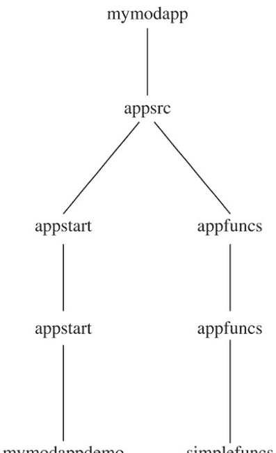

设置好这些目录后，你可以创建应用程序的源文件。此示例将使用四个源文件。其中两个是定义应用程序的源文件。第一个是这里显示的`SimpleMathFuncs.java`。注意`SimpleMathFuncs`被封装在`appfuncs.simplefuncs`中。

```java
// 一些简单的数学函数。
package appfuncs.simplefuncs;

public class SimpleMathFuncs {
    // 确定 a 是否 b 的因子。
    public static boolean isFactor(int a, int b) {
        if ((b%a) == 0) return true;
        return false;
    }

    // 返回 a 和 b 共有的最小正因子。
    public static int lcf(int a, int b) {
        // 使用正值进行因子分解。
        a = Math.abs(a);
        b = Math.abs(b);
        int min = a < b ? a : b;
        for(int i = 2; i <= min/2; i++) {
            if(isFactor(i, a) && isFactor(i, b)) {
                return i;
            }
        }
        return 1;
    }

    // 返回 a 和 b 共有的最大正因子。
    public static int gcf(int a, int b) {
        // 使用正值进行因子分解。
        a = Math.abs(a);
        b = Math.abs(b);
        int min = a < b ? a : b;
        for(int i = min/2; i >= 2; i--) {
            if(isFactor(i, a) && isFactor(i, b)) {
                return i;
            }
        }
        return 1;
    }
}
```

`SimpleMathFuncs`定义了三个简单的静态数学函数。第一个`isFactor()`在`a`是`b`的因子时返回`true`。`lcf()`返回`a`和`b`的最小公因子。`gcf()`返回`a`和`b`的最大公因子。

第二个源文件是接下来的所示`MyModAppDemo.java`。注意`MyModAppDemo`被封装在`appstart.mymoddemo`中。它使用了`SimpleMathFuncs`。

```java
// 模块化应用程序。
package appstart.mymoddemo;

import appfuncs.simplefuncs.SimpleMathFuncs;

public class MyModAppDemo {
    public static void main(String[] args) {
        if (SimpleMathFuncs.isFactor(2, 10)) {
            System.out.println("2 是 10 的因子");
        }
        System.out.println("35 和 105 的最小公因子是 " + 
            SimpleMathFuncs.lcf(35, 105));
        System.out.println("35 和 105 的最大公因子是 " + 
            SimpleMathFuncs.gcf(35, 105));
    }
}
```

接下来，你需要为每个模块添加`module-info.java`文件。这些文件包含模块定义。首先添加这个，它定义`appfuncs`模块：

```java
// 函数模块的定义。
module appfuncs {
    // 导出包 appfuncs.simplefuncs
    exports appfuncs.simplefuncs;
}
```

注意`appfuncs`导出了包`appfuncs.simplefuncs`，这使得其他模块可以访问。

最后，`appstart`模块的`module-info.java`文件如下所示。

```java
// 主应用程序模块的定义。
module appstart {
    // 需要模块 appfuncs。
    requires appfuncs;
}
```

在仔细检查`requires`、`exports`和`module`语句之前，让我们先编译并运行这个示例。确保你已经按照解释正确创建了目录并将每个文件放入正确的目录。

# 编译并运行第一个模块示例

从JDK 9开始，`javac`已更新以支持模块。因此，与其他所有Java程序一样，基于模块的程序也使用`javac`进行编译。过程非常简单，主要的区别是你通常会显式指定一个模块路径。模块路径告诉编译器编译后的文件将位于何处。在本示例时，确保你在`mymodapp`目录下执行`javac`命令，以保持路径正确。

首先，使用此命令编译`SimpleMathFuncs.java`：

```
javac -d modules\appfuncs
appsrc\appfuncs\appfuncs\SimpleMathFuncs.java
```

记住，此命令必须在`mymodapp`目录下执行。注意使用`-d`选项，它告诉`javac`将输出的`.class`文件放在哪里。对于本章中的示例，编译代码的目录树顶端是`appmodules`。此命令将根据需要在`appmodules\appfuncs`下创建`appfuncs.simplefuncs`输出包目录。

接下来，是编译`appfuncs`模块的`module-info.java`文件的`javac`命令：

```
javac -d appmodules\appfuncs appsrc\appfuncs\module-info.java
```

这会将`module-info.class`文件放入`appmodules\appfuncs`目录。虽然之前的两个步骤流程可行，但展示它们主要是为了讨论。通常情况下，在一行命令中编译模块的`module-info.java`文件及其源文件更为简单。在这里，将之前的两个`javac`命令合并为了一个：

```
javac -d appmodules\appfuncs appsrc\appfuncs\module-info.java appsrc\appfuncs\appfuncs\simplefuncs\SimpleMathFuncs.java
```

在这种情况下，每个编译后的文件都被放入其相应的模块或包目录。现在，使用此命令为`appstart`模块编译`module-info.java`和`MyModAppDemo.java`：

```
javac --module-path appmodules -d appmodules\appstart appsrc\appstart\module-info.java appsrc\appstart\appstart\mymodappdemo\MyModAppDemo.java
```

注意`--module-path`选项。它指定了模块路径，编译器将在该路径查找`module-info.java`文件所需的用户定义模块。在这种情况下，它将查找`appfuncs`模块，因为`appstart`模块需要它。此外，注意它指定了输出目录为`appmodules\appstart`模块目录，且`MyModAppDemo.class`将位于`appmodules\appstart\appstart\mymodappdemo`包目录下。

一旦完成编译，可以使用此命令运行应用程序：

```
java --module-path appmodules -m appstart/appstart.mymodappdemo.MyModAppDemo
```

在这里，`--module-path`选项指定了应用程序模块的路径。如前所述，`appmodules`是编译模块树顶部的目录。`-m`选项指定了包含应用程序入口点的类，在这种情况下，即包含`main()`方法的类名。当你运行程序时，将看到以下输出：

```
2 is a factor of 10
Smallest factor common to both 35 and 105 is 5
Largest factor common to both 35 and 105 is 7
```

# 深入理解 requires 和 exports

上述基于模块的示例依赖于模块系统的两个基础特性：指定依赖的能力以及满足该依赖的能力。这些能力通过在模块声明中使用`requires`和`exports`语句来指定。每项都值得现在进行仔细检查。

以下是示例中使用的`requires`语句的格式：

```
requires moduleName;
```

在这里，`moduleName`指定了`requires`语句所在模块的所需的模块名称。这意味着为了让当前模块能够编译，所需的模块必须存在。在模块的语言中，当前模块被称为“读取”（read）了`requires`语句中指定的模块。当需要多个模块时，必须在各自的`requires`语句中指定。因此，一个模块声明可以包含多个不同的`requires`语句。总的来说，`requires`语句提供了一种确保你的程序能够访问所需模块的方法。

以下是示例中使用的`exports`语句的通用格式：

```
exports packageName;
```

在这里，`packageName`指定了该语句所在模块所导出的包名称。一个模块可以根据需要导出多个包，每个包都在单独的`exports`语句中指定。因此，一个模块可能有多个`exports`语句。

当一个模块导出一个包时，它使得该包中所有的公共（public）和受保护（protected）类型对其他模块均可见。此外，这些类型的公共和受保护成员也是可访问的。然而，如果模块内的某个包没有导出，那么它对于该模块是私有的，包括其所有的公共类型。例如，尽管一个类在包内被声明为`public`，但如果该包没有通过`exports`语句显式导出，那么该类对其他模块是不可见的。重要的一点是，包的公共和受保护类型无论是否导出，在包所属的模块内部总是可见的。`exports`语句仅仅让它们对外部模块可见。因此，任何未导出的包仅供其模块内部使用。

理解`requires`和`exports`的关键在于它们是协同工作的。如果一个模块依赖另一个模块，那么它必须通过`requires`指定这种依赖关系。被依赖的模块必须显式地导出（即变为可访问）依赖模块所需的包。如果这种依赖关系的任何一方缺失，依赖模块将无法编译。这涉及到前述示例：`MyModAppDemo`使用了`SimpleMathFuncs`中的函数。结果是`appstart`模块声明包含一个命名`appfuncs`模块的`requires`语句。`appfuncs`模块声明导出`appfuncs.simplefuncs`包，使得`SimpleMathFuncs`类中的公共类型可用。由于依赖关系的双方都已满足，应用程序就可以编译并运行。如果缺少其中任何一个，编译将失败。

必须强调的是，`requires`和`exports`语句必须位于模块语句（module statement）内部。此外，模块语句必须单独存在于名为`module-info.java`的文件中。

## java.base 和平台模块

正如开头提到的，从JDK 9开始，API包现在位于模块中。由于其重要性，`java.base`对所有模块自动可见。这是因为`java.base`包含了`java.lang`，而`java.lang`包含了`System`类，示例中的`MyModAppDemo`可以在不需要显式`requires`语句的情况下自动使用`System.out.println()`。同样适用于`SimpleMathFuncs`中对`Math`类的使用，因为`Math`类也在`java.lang`中。当你开始创建自己的基于模块的应用程序时，你会发现你经常需要的许多API类都在`java.base`中。因此，`java.base`的自动包含简化了基于模块的代码创建。最后一点：从JDK 9开始，Java API文档现在会告知某个包所属的模块。如果是`java.base`，则你可以直接使用该包的内容。

## 遗留代码与未命名模块

在处理第一个模块示例程序时，你可能会另一个问题。由于JDK 9现在支持模块，且API包也包含在模块中，为什么章节中的所有程序在不使用模块的情况下也能无错编译和运行？更广泛地说，现在存在超过20年的Java代码，且（在本文编写）绝大部分代码都没有使用模块，如何使用JDK 9或更高版本编译、运行和维护这些遗留代码？考虑到Java最初的“一次编写，到处运行”哲学，这是一个非常重要的问题，因为必须维护兼容性。正如你所看到的，Java提供了一种优雅且近透明的方法来确保与现有代码的兼容。

遗留代码的支持由两个关键特性提供。第一个是未命名模块（unnamed module）。当你使用不属于命名模块的代码时，它会自动成为未命名模块的一部分。未命名模块有两个重要的属性：首先，未命名模块中的所有包都会自动导出。其次，未命名模块可以访问任何及所有模块。

支持旧代码的第二个关键特性是自动使用类路径（class path），而不是模块路径（module path）。当你编译一个未使用模块的程序时，将采用类路径机制，这自Java原始发布以来一直都是如此。因此，程序的编译和运行方式与JDK 9之前相同。

由于未命名模块（unnamed module）和对类路径的自动使用，在书中其他处展示的示例程序不需要声明任何模块。无论你使用JDK 9编译器还是早版本的编译器（如JDK 8）来编译它们，它们都能正常运行。因此，尽管模块是对Java产生重大影响的新功能，但仍然保持了与旧代码的兼容性。这种方法还为模块提供了一条平滑、非侵入性且非破坏性的路径。因此，它允许你按照自己的节奏将旧应用程序迁移到模块。此外，它还允许你在不需要模块时避免使用模块。

在继续之前，需要说明一个重要点。对于书中其他地方使用的示例类型，以及一般的示例程序而言，使用模块并没有益处。将它们模块化只会增加冗余，并无缘无故地使其变得复杂。此外，对于许多简单程序，没有必要将它们包含在模块中。由于在本章开头提到的原因，模块在创建商业程序时通常受益。因此，本章之外的示例将不会使用模块。这使得示例可以在预JDK 9环境中进行编译和运行，这对于使用旧版本Java的读者非常重要。因此，除了本章中的示例外，书中的示例都适用于模块化前和模块化的JDK。

## 导出到特定模块 (Exporting to a Specific Module)

`exports`语句的基本形式允许一个包被任何及所有其他模块访问。这通常正是你想要的。然而，在某些特定的开发情况下，让包仅供一组特定的模块访问，而不是所有其他模块，可能是理想的。例如，库开发者可能希望将一个包导出到库内的某些模块，但不将其供通用使用。在`exports`语句中添加`to`子句提供了实现这一目标的方法。

在`exports`语句中，`to`子句指定了一个或多个模块列表，这些模块可以访问导出的包。此外，只有在`to`子句中命名的模块才能访问。在模块语言中，`to`子句创建了所谓的限定导出（qualified export）。

包含`to`的`exports`形式所示：

```
exports packageName to moduleNames;
```

在这里，`moduleNames`是导出模块授予访问权限的模块逗号分隔列表。

你可以通过更改`appfuncs`模块的`module-info.java`文件来尝试`to`子句，如下：

```java
// 使用 to 子句的模块定义。
module appfuncs {
    // 将包 appfuncs.simplefuncs 导出到 appstart
    exports appfuncs.simplefuncs to appstart;
}
```

现在，`simplefuncs`仅导出给`appstart`而不给任何其他模块。进行此更改后，你可以使用此`javac`命令重新编译应用程序：

```bash
javac -d appmodules --module-source-path appsrc
appsrc\appstart\appstart\mymodappdemo\MyModAppDemo.java
```

编译完成后，你可以像之前一样运行应用程序。

此示例使用了JDK 9提供的另一个模块相关功能。仔细观察之前的`javac`命令。首先，注意它指定了`--module-source-path`选项。模块源路径指定了模块源树的顶端。`--module-source-path`选项会自动编译指定目录下的树文件，在本例中是`appsrc`。`--module-source-path`选项必须与`-d`选项一起使用，以确保编译后的模块存储在`appmodules`下的相应目录下。这种形式的`javac`被称为多模块模式（multi-module mode），因为它允许同时编译多个模块。多模块编译在这里特别有用，因为`to`指向一个特定的模块，而要求的模块具有访问导出的包的权限。因此，在此过程中，`appstart`和`appfuncs`都是需要的，以避免编译期间出现警告和或错误。多模块模式避免了这个问题，因为两个模块是同时被编译的。

`javac`的多模块模式有一个优势。它会自动找到并编译应用程序的所有源文件，创建必要的输出目录。由于多模块编译模式提供的优势，它将在随后的示例中使用。

注意：作为一条一般规则，限定导出是一种特殊情况下的功能。大多数情况下，模块要么提供包的非限定导出，要么完全不导出该包以保持其不可访问。因此，此处讨论限定导出主要是为了完备性。此外，限定导出本身并不能防止导出的包被伪装成目标模块的恶意代码滥用。防止这种情况发生所需的安全技术超出了本书的范围。请咨询Oracle文档了解有关这方面的安全详情，以及一般的Java安全详情。

## 使用 requires transitive (Using requires transitive)

考虑一种存在三个模块A、B和C，它们具有以下依赖关系：

- A需要B。
- B需要C。

给定这种情况，显然由于A依赖于B且B依赖于C，A对C有间接依赖。只要A不直接使用C的任何内容，你只需要在它的`module-info`文件中写上`requires B`，并让B在它的`module-info`文件中导出A所需的包，如下所示：

```java
// A 的 module-info 文件：
module A {
    requires B;
}
```

```java
// B 的 module-info 文件。
module B {
    exports somepack;
    requires C;
}
```

在这里，`somepack`是B导出并在A中使用的包占位符。虽然在A不需要C中的任何内容时这种方法是可行的，但如果A需要访问C中的类型，就会出现问题。在这种情况下，有两种解决方案。

第一个解决方案是简单在A的文件中添加`requires C`语句，如下：

```java
// 更新后需要 C 的 A module-info 文件：
module A {
    requires B;
    requires C; // 也需要 C
}
```

这种解决方案确实有效，但如果B被许多模块使用，你必须在所有需要B的模块中添加`requires C`。这不仅麻烦，而且容易出错。幸运的是，有一个更好的解决方案。你可以为C创建间接依赖。间接依赖也被称为隐式读取性（implied readability）。

要创建间接依赖，在需要隐式读取性的模块子句中，添加`transitive`关键字。在本例中，你将如下所示更改B的`module-info`文件：

```java
// B 的 module-info 文件。
module B {
    exports somepack;
    requires transitive C;
}
```

在这里，C现在被传递地需要。进行此更改后，任何依赖于B的模块也将自动依赖C。因此，A将自动访问C。

你可以通过重构之前的模块化应用程序示例来实验`requires transitive`，将`isFactor()`方法从`appfuncs.simplefuncs`包中的`SimpleMathFuncs`类中移除，并放入一个新的类、模块和包中。新类将命名为`SupportFuncs`，模块命名为`appsupport`，包命名为`appsupport.supportfuncs`。`appfuncs`模块将添加对`appsupport`模块的依赖，这将使`appfuncs`和`appstart`模块都能访问它，而无需`appstart`通过`appfuncs requires transitive`语句提供自己的需要访问。以下详细描述了该过程。

首先，创建支持新模块的源目录。首先，在`appsrc`目录下创建`appsupport`。这是支持函数的模块目录。在`appsupport`下，通过添加`appsupport`子目录以及`supportfuncs`子目录来创建包目录。因此，`appsupport`的目录树现在应该像：

```
appsrc\appsupport\appsupport\supportfuncs
```

一旦目录建立，请创建`SupportFuncs`类。注意`SupportFuncs`是`appsupport.supportfuncs`包的一个类。因此，你必须将其放在`appsupport.supportfuncs`包目录下。

```java
// Support functions.
package appsupport.supportfuncs;

public class SupportFuncs {
    // Determine if a is a factor of b.
    public static boolean isFactor(int a, int b) {
        if((b%a) == 0) return true;
        return false;
    }
}
```

注意`isFactor()`现在是`SupportFuncs`的一部分，而不是`SimpleMathFuncs`。

接下来，为`appsupport`模块创建`module-info.java`文件并将其放在`appsrc\appsupport`目录下。

```java
// Module definition for appsupport.
module appsupport {
    exports appsupport.supportfuncs;
}
```

可见，它导出了`appsupport.supportfuncs`包。因为`isFactor()`现在是`SupportFuncs`的一部分，请将其从`SimpleMathFuncs`中移除。因此，`SimpleMathFuncs.java`现在看起来像这样：

```java
// Some simple math functions, with isFactor() removed.
package appfuncs.simplefuncs;

import appsupport.supportfuncs.SupportFuncs;

public class SimpleMathFuncs {
    // Return the smallest positive factor that a and b have in common.
    public static int lcf(int a, int b) {
        // Factor using positive values.
        a = Math.abs(a);
        b = Math.abs(b);
        int min = a < b ? a : b;
        for (int i = 2; i <= min/2; i++) {
            if (SupportFuncs.isFactor(i, a) && SupportFuncs.isFactor(i, b))
                return i;
        }
        return 1;
    }

    // Return the largest positive factor that a and b have in common.
    public static int gcf(int a, int b) {
        // Factor using positive values.
        a = Math.abs(a);
        b = Math.abs(b);
        int min = a < b ? a : b;
        for (int i = min/2; i >= 2; i--) {
            if (SupportFuncs.isFactor(i, a) && SupportFuncs.isFactor(i, b))
                return i;
        }
        return 1;
    }
}
```

注意，现在导入了`SupportFuncs`类，对`isFactor()`的调用是通过类名`SupportFuncs`引用的。

接下来，修改`appfuncs`的`module-info.java`文件，使其在`requires`语句中将`appsupport`指定为传递的（transitive），所示：

```java
// Module definition for appfuncs.
module appfuncs {
    // Exports the package appfuncs.simplefuncs.
    exports appfuncs.simplefuncs;
    // Requires appsupport and makes it transitive.
    requires transitive appsupport;
}
```

由于`appfuncs`以传递的方式需要`appsupport`，因此`appstart`的`module-info.java`文件不需要需要它。它对`appsupport`的依赖是隐含的。不需要对`appstart`的`module-info.java`文件进行更改。

最后，更新`MyModAppDemo.java`以反映这些更改。具体来说，它现在必须导入`SupportFuncs`类并在调用`isFactor()`时指定它，如下所示：

```java
// Updated to use SupportFuncs.
package appstart.mymodappdemo;

import appfuncs.simplefuncs.SimpleMathFuncs;
import appsupport.supportfuncs.SupportFuncs;

public class MyModAppDemo {
    public static void main(String[] args) {
        // Now, isFactor() is referred to via SupportFuncs,
        // not SimpleMathFuncs.
        if(SupportFuncs.isFactor(2, 10)) {
            System.out.println("2 is a factor of 10");
        }
        System.out.println("Smallest factor common to both 35 and 105 is " +
            SimpleMathFuncs.lcf(35, 105));
        System.out.println("Largest factor common to both 35 and 105 is " +
            SimpleMathFuncs.gcf(35, 105));
    }
}
```

一旦完成上述所有步骤，你可以使用此多模块编译命令重新编译整个程序：

```
javac -d appmodules --module-source-path appsrc
appsrc\appstart\appstart\mymodappdemo\MyModAppDemo.java
```

如前所述，多模块编译将自动在`appmodules`目录下创建并行的模块子目录。

你可以使用此命令运行程序：

```
java --module-path appmodules -m appstart/appstart.mymodappdemo.MyModAppDemo
```

它将产生与之前版本相同的输出。然而，这次需要三个不同的模块。

为了证明传递修饰符（transitive modifier）是应用程序所需的，请从`appfuncs`的`module-info.java`文件中移除它。然后尝试编译程序。如你将看到的，会导致错误，因为`appsupport`不再可被`appstart`访问。

这是另一个实验。在`appsupport`的模块文件中，尝试使用限定导出（qualified export）仅向`appfuncs`导出`appsupport.supportfuncs`包。然后，尝试编译程序。如你将看到的，会导致错误，因为`appsupport`不再可被`appstart`访问。

本质上，模块通过一个`provides`语句指明它提供了某项服务。模块通过一个`uses`语句指示它需要某项服务。服务提供者的特定类型由`with`声明。当它们结合使用时，它们允许你指定一个提供服务的模块、一个需要服务的模块以及该服务的特定实现。此外，模块系统确保了服务及其提供者是可用的，并且会被找到。

以下是`provides`的通用形式：

```
provides serviceType with implementationTypes;
```

在这里，`serviceType`指明了服务的类型，它通常是一个接口，尽管也会使用抽象类。`implementationTypes`是一个用逗号分隔的实现类型列表。因此，为了提供服务，模块必须同时指明服务的名称及其具体的实现类。

以下是`uses`语句的通用形式：

```
uses serviceType;
```

在这里，`serviceType`指明了所需的服务类型。

# 基于模块的服务的示例

为了演示服务的使用，我们将为一直在演化的模块化应用程序示例添加一个服务。为了简单起见，我们将从本章开始的应用程序的第一版本开始。向它添加两个新模块。第一个被称为`userfuncs`。它将定义接口以支持执行二进制操作的，其中每个参数都是`int`，且结果也是`int`。第二个模块被称为`userfuncsimp`，它包含了接口的具体实现。

首先创建必要的源码目录。

- 在`appsrc`目录下添加目录`userfuncs`和`userfuncsimp`。
- 在`userfuncs`下，添加一个也名为`userfuncs`的子目录。在该目录下，添加名为`binaryfuncs`的子目录。因此，从`appsrc`开始，你创建了如下树结构：

```
appsrc\userfuncs\userfuncs\binaryfuncs
```

- 在`userfuncsimp`下，添加一个也名为`userfuncsimp`的子目录。在该目录下，添加名为`binaryfuncsimp`的子目录。因此，从`appsrc`开始，你创建了如下树结构：

```
appsrc\userfuncsimp\userfuncsimp\binaryfuncsimp
```

此示例通过提供应用程序内置函数之外的支持，扩展了应用程序的原始版本。回想`SimpleMathFuncs`类提供了三个内置函数：`isFactor()`、`lcf()`和`gcf()`。虽然可以向该类添加更多函数，但这样做需要修改并重新编译应用程序。通过实现服务，可以在运行时不修改应用程序的情况下“插入”新函数，这正是本示例将要做的。在这种情况下，服务提供了接收两个`int`并返回一个`int`结果的函数。当然，如果提供了额外的接口，也可以支持其他类型的函数，但对于我们的目的，支持二进制整数函数已经足够了，且示例的源代码大小保持在可控范围内。

# 服务接口

需要两个与服务相关的接口。一个指定操作的形式，另一个指定该操作提供者的形式。它们都位于`userfuncs.binaryfuncs`包（位于`userfuncs`包下）。第一个名为`BinaryFunc`，声明了二进制函数的格式。示例如下：

```java
// 此接口定义了一个接收两个 int
// 参数并返回 int 结果的函数。因此，它可以
// 描述任何对两个 int 之间返回
// int 的二进制运算。
package userfuncs.binaryfuncs;

public interface BinaryFunc {
    // 获取函数的名称。
    public String getName();
    // 这是要执行的函数。它将由
    // 具体实现提供。
    public int func(int a, int b);
}
```

`BinaryFunc`声明了可以实现二进制整数函数的对象的格式。这通过`func()`方法指定。函数名称可以通过`getName()`获取。该名称将用于确定实现的是什么类型的函数。此接口由提供二进制函数的类实现。

第二个接口声明了服务提供者的格式。它被称为`BinFuncProvider`，示例如下：

```java
// 此接口定义了服务提供者的格式，
// 获取 BinaryFunc 实例。
package userfuncs.binaryfuncs;

import userfuncs.binaryfuncs.BinaryFunc;

public interface BinFuncProvider {
    // 获取一个 BinaryFunc。
    public BinaryFunc get();
}
```

`BinFuncProvider`只声明了一个方法`get()`，用于获取`BinaryFunc`实例。此接口必须由想要提供`BinaryFunc`实例的类实现。

# 实现类

在本示例中，支持`BinaryFunc`的两个具体实现。第一个是`AbsPlus`，它返回参数绝对值的和。第二个是`AbsMinus`，它返回从第一个参数的绝对值减去第二个参数绝对值的结果。这些由`AbsPlusProvider`和`AbsMinusProvider`类提供。这些类的源代码必须存储在`binaryfuncsimp`目录中，并且它们都是`userfuncsimp.binaryfuncsimp`包的一部分。

`AbsPlus`的代码如下：

```java
// AbsPlus 提供了 BinaryFunc 的具体实现
// 它返回 abs(a) + abs(b) 的结果。
package userfuncsimp.binaryfuncsimp;

import userfuncs.binaryfuncs.BinaryFunc;

public class AbsPlus implements BinaryFunc {
    // 返回此函数的名称。
    public String getName() {
        return "absPlus";
    }
    // 实现 AbsPlus 函数。
    public int func(int a, int b) { return Math.abs(a) + Math.abs(b); }
}
```

`AbsPlus`实现了`func()`，使其返回两个参数绝对值的和。注意，`getName()`返回`"absPlus"`字符串。

`AbsMinus`类，示例如下：

```java
// AbsMinus 提供了 BinaryFunc 的具体实现
// 它返回 abs(a) - abs(b) 的结果。
package userfuncsimp.binaryfuncsimp;

import userfuncs.binaryfuncs.BinaryFunc;

public class AbsMinus implements BinaryFunc {
    // 返回此函数的名称。
    public String getName() {
        return "absMinus";
    }
    // 实现 AbsMinus 函数。
    public int func(int a, int b) { return Math.abs(a) - Math.abs(b); }
}
```

`AbsMinus`实现了`func()`，使其返回两个参数绝对值的差。为了获取`AbsPlus`的实例，使用了`AbsPlusProvider`。示例如：

```java
// 这是 AbsPlus 函数的提供者。
package userfuncsimp.binaryfuncsimp;

import userfuncs.binaryfuncs.*;

public class AbsPlusProvider implements BinFuncProvider {
    // 获取一个 BinaryFunc。
    public BinaryFunc get() { return new AbsPlus(); }
}
```

`get()`方法简单的返回一个新的`AbsPlus`对象。尽管这个提供者非常简单，但重要的是，某些服务提供者将要复杂得多。`AbsMinus`的提供者被称为`AbsMinusProvider`，示例如下：

```java
// 这是 AbsMinus 函数的提供者。
package userfuncsimp.binaryfuncsimp;

import userfuncs.binaryfuncs.*;

public class AbsMinusProvider implements BinFuncProvider {
    // 获取一个 BinaryFunc。
    public BinaryFunc get() { return new AbsMinus(); }
}
```

它的`get()`返回一个`AbsMinus`对象。现在我们来看模块定义文件。

# 模块定义文件

接下来，需要两个模块定义文件。第一个是`userfuncs`模块的。示例如：

```java
module userfuncs {
    exports userfuncs.binaryfuncs;
}
```

此代码必须包含在`userfuncs`目录下的`module-info.java`文件中。注意它导出了`userfuncs.binaryfuncs`包。这是定义`BinaryFunc`和`BinFuncProvider`接口的包。

第二个`module-info.java`文件示例如。它定义了包含实现的模块。它位于`userfuncsimp`目录。

```java
module userfuncsimp {
    requires userfuncs;
    provides userfuncs.binaryfuncs.BinFuncProvider with
        userfuncsimp.binaryfuncsimp.AbsPlusProvider,
        userfuncsimp.binaryfuncsimp.AbsMinusProvider;
}
```

此模块需要`userfuncs`，因为`BinaryFunc`和`BinFuncProvider`都在那里，且实现需要这些接口。该模块提供了通过`AbsPlusProvider`和`AbsMinusProvider`类所需的`BinFuncProvider`实现。

## 在 MyModAppDemo 中演示服务提供者

为了演示服务的用法，`MyModAppDemo`的`main()`方法被扩展，以使用`AbsPlus`和`AbsMinus`。这是通过使用`ServiceLoader.load()`在运行时加载它们来实现。以下是更新后的代码：

```java
// 一个基于模块的应用程序，演示了服务
// 和服务提供者。
package appstart.mymodappdemo;

import java.util.ServiceLoader;
import appfuncs.simplefuncs.SimpleMathFuncs;
import userfuncs.binaryfuncs.*;

public class MyModAppDemo {
    public static void main(String[] args) {
        // 首先，像以前一样使用内置函数 isFactor。
        if(SimpleMathFuncs.isFactor(2, 10)) {
            System.out.println("2 is a factor of 10");
            System.out.println("35 和 105 的最小公约数是 " + 
                SimpleMathFuncs.lcf(35, 105));
            System.out.println("35 和 105 的最大公约数是 " + 
                SimpleMathFuncs.gcf(35, 105));
        }

        // 现在，使用基于服务的、用户定义的操作。
        // 获取二元函数的服务加载器。
        ServiceLoader<BinFuncProvider> ldr = 
            ServiceLoader.load(BinFuncProvider.class);
        BinaryFunc binop = null;

        // 寻找 absPlus 的提供者并获取函数。
        for(BinFuncProvider bfp : ldr) {
            if (bfp.get().getName().equals("absPlus")) {
                binop = bfp.get();
                break;
            }
        }

        if (binop != null) {
            System.out.println("absPlus 函数的结果: " + 
                binop.func(12, -4));
        } else {
            System.out.println("未找到 absPlus 函数");
        }

        binop = null;

        // 现在，寻找 absMinus 的提供者并获取函数。
        for(BinFuncProvider bfp : ldr) {
            if (bfp.get().getName().equals("absMinus")) {
                binop = bfp.get();
                break;
            }
        }

        if (binop != null) {
            System.out.println("absMinus 函数的结果: " + 
                binop.func(12, -4));
        } else {
            System.out.println("未找到 absMinus 函数");
        }
    }
}
```

让我们仔细观察上述代码如何加载和执行服务。首先，通过此语句创建一个类型为`BinFuncProvider`服务的服务加载器：

```java
ServiceLoader<BinFuncProvider> ldr =
    ServiceLoader.load(BinFuncProvider.class);
```

注意`ServiceLoader`的类型参数是`BinFuncProvider`。这也是调用`load()`时使用的类型。这意味着将找到实现该接口的提供者。因此，在该语句执行后，模块中的`BinFuncProvider`类将通过`ldr`可用。在这种情况下，`AbsPlusProvider`和`AbsMinusProvider`将可用。

接下来，声明一个类型为`BinaryFunc`的引用`binop`并初始化为`null`。它将用于引用一个提供特定类型二元函数的实现。接着，以下循环在`ldr`中搜索名称为`"absPlus"`的提供者。

```java
// 寻找 absPlus 的提供者并获取函数。
for(BinFuncProvider bfp : ldr) {
    if(bfp.get().getName().equals("absPlus")) {
        binop = bfp.get();
        break;
    }
}
```

在这里，`for-each`循环遍历提供者提供的函数名称。如果它匹配`"absPlus"`，则通过调用提供者的`get()`方法将该函数赋值给`binop`。

最后，如果找到了函数（在本例中确实），将通过此语句执行它：

```java
if(binop != null)
    System.out.println("absPlus 函数的结果: " +
        binop.func(12, -4));
```

在这种情况下，由于`binop`指向`AbsPlus`的实例，对`func()`的调用执行了绝对值加。类似的序列被用于查找和执行`AbsMinus`。

由于`MyModAppDemo`使用了`BinFuncProvider`，它的模块定义文件必须包含一个`uses`语句来指定这一事实。记得`MyModAppDemo`在`appstart`模块中。因此，你必须所示修改`appstart`的`module-info.java`文件：

```java
// 主应用程序模块的模块定义。
// 现在使用 BinFuncProvider。
module appstart {
    // 需要 appfuncs 和 userfuncs 模块。
    requires appfuncs;
    requires userfuncs;
    // appstart 现在使用 BinFuncProvider。
    uses userfuncs.binaryfuncs.BinFuncProvider;
}
```

## 编译并运行基于模块的服务示例

一旦完成了所有上述步骤，你可以执行以下命令来编译并运行示例：

```bash
javac -d appmodules --module-source-path appsrc
appsrc\userfuncsimp\module-info.java
appsrc\appstart\appstart\mymodappdemo\MyModAppDemo.java

java --module-path appmodules -m appstart/appstart.mymodappdemo.MyModAppDemo
```

```
requires static mymod;
```

在这种情况下，添加`static`使得`mymod`在运行时是可选的。这对于程序在存在某功能时可以使用它，但并不要求它的情况很有帮助。

## 引入 jlink 和模块 JAR 文件

正如前面的讨论所示，模块代表了Java语言的重要增强。模块系统还支持运行时增强。其中最重要的之一是创建一个专门为你的应用程序定制的运行时映像（run-image）。为了实现这一点，JDK 9添加了一个名为`jlink`的新工具。它将一组模块组合成优化的运行时映像。你可以使用`jlink`来链接模块化JAR文件、新的JMOD文件，甚至以未解压缩的“展开目录”形式链接模块。

## 链接展开目录中的文件

让我们先看看如何使用`jlink`从未更改的模块创建运行时映像。也就是说，文件以原始形式包含在一个完全展开（即展开）的目录中。假设是Windows环境，以下命令链接了本章第一个示例中的模块。它必须在`mymodapp`直接上方的目录中执行。

```
jlink --launcher MyModApp=appstart/appstart.mymodappdemo.MyModAppDemo
  --module-path "%JAVA_HOME%\jmods;mymodapp\appmodules"
  --add-modules appstart --output linkedmymod
```

让我们仔细观察这个命令。第一个`--launcher`告诉`jlink`创建一个启动应用程序并指定主类路径的命令。在这种情况下，主类是`MyModAppDemo`。`--module-path`选项指定所需的模块路径。第一个是平台模块的路径；第二个是应用程序模块的路径。注意环境变量`JAVA_HOME`的使用。它代表标准JDK目录的路径。例如，在标准的Windows安装中，路径通常类似于`"C:\program files\java\jdk-9\jmods"`；使用`JAVA_HOME`更短，并且无论JDK安装在哪个目录中都能工作。`--add-modules`选项指定要添加的模块或多个模块。注意只指定了`appstart`。这是因为`jlink`会自动解析所有依赖并包含所有需要的模块。最后，`--output`指定输出目录。

在你运行上述命令后，将创建一个名为`linkedmymod`的目录，其中包含运行时映像。在它的`bin`目录中，你会找到名为`MyModApp`的启动文件，你可以用它来运行应用程序。例如，在Windows中，这是一个执行程序的批文件。

## 链接模块化 JAR 文件

虽然从展开目录链接模块很方便，但在处理真实世界的代码时，你通常会使用JAR文件。（回想JAR代表Java ARchive。它是一种通常用于应用程序部署的文件格式。）在模块化代码的情况下，你将使用模块化JAR文件。模块化JAR文件是包含`module-info.class`文件的文件。从JDK 9开始，`jar`具有创建模块化JAR文件的能力。例如，它现在可以识别模块路径。然后使用`jlink`将它们链接成运行时映像。为了理解这个过程，让我们来看一个示例。假设本章的第一个示例，以下是为`MyModAppDemo`程序创建模块化JAR文件的`jar`命令。每个命令必须在`mymodapp`直接上方的目录中执行。此外，你需要在`mymodapp`之前创建一个名为`applib`的目录。

```
jar --create --file=mymodapp\applib\appfuncs.jar
  -C mymodapp\appmodules\appfuncs .
```

```
jar --create --file=mymodapp\applib\appstart.jar
  --main-class=appstart.mymodappdemo.MyModAppDemo
  -C mymodapp\appmodules\appstart .
```

这里，`--create`告诉创建一个新的JAR文件。`--file`选项指定JAR文件。要包含的文件由`-C`选项指定。包含`main()`的类由`--main-class`选项指定。运行这些命令后，应用程序的JAR文件将位于`mymodapp`中的`applib`目录。

根据刚刚创建的模块化JAR文件，这里是链接它们的命令：

```
jlink --launcher MyModApp=appstart
  --module-path "%JAVA_HOME%\jmods;mymodapp\applib"
  --add-modules appstart --output linkedmymod
```

在这里，指定的是JAR文件的路径，而不是展开目录的路径。否则，`jlink`命令与之前相同。作为一个感兴趣的点，你可以使用以下命令直接从JAR文件运行应用程序。它必须在`mymodapp`直接上方的目录中执行。

```
java -p mymodapp\applib -m appstart
```

在这里，`-p`指定模块路径，`-m`指定包含程序入口点的模块。

## JMOD 文件

`jlink`工具还可以链接使用JDK 9定义的新类型JMOD格式的文件。JMOD文件可以包含JAR文件不适用的内容。它们由新的`jmod`工具创建。虽然大多数应用程序仍使用模块化JAR文件，但JMOD文件在特殊情况下具有价值。作为一个感兴趣的点，从JDK 9开始，平台模块包含在JMOD文件中。

## 层和自动模块的简要说明

在学习模块时，你可能会遇到两个额外的模块相关特性。这些是层（layers）和自动模块（automatic modules）。它们都是为特殊情况设计的。

## 关于模块的最后思考

前面的讨论介绍了模块的核心元素。总之，模块在Java中扮演着重要角色。虽然并非强制使用，但提供了巨大的收益。

# II Java 类库

| 章节 | 标题 |
| :--- | :--- |
| 17 | String Handling |
| 18 | Exploring java.lang |
| 19 | The Collections Framework |
| 20 | More Utility Classes |
| 21 | java.io |
| 22 | NIO |
| 23 | Networking |
| 24 | Event Handling |
| 25 | Introducing AWT: Working with Windows, Graphics, and Text |
| 26 | Using AWT Controls, Layout Managers, and Menus |
| 27 | Images |
| 28 | The Concurrency Utilities |
| 29 | The Stream API |
| 30 | Regular Expressions and Other Packages |

## String 构造函数

`String`类支持多个构造函数。要创建一个空的`String`，调用默认构造函数。例如，

```java
String s = new String();
```

将创建一个不含字符的`String`实例。`String`类提供了多种构造函数来处理这种情况。要创建一个由字符数组初始化的`String`，请使用此处所示的构造函数：

```
String(char chars[])
```

这是一个示例：

```java
char chars[] = { 'a', 'b', 'c' };
String s = new String(chars);
```

此构造函数将`s`初始化为字符串`"abc"`。

你可以使用以下构造函数指定字符数组的子范围作为初始化器：

```
String(char chars[], int startIndex, int numChars)
```

在这里，`startIndex`指定子范围开始的索引，而`numChars`指定要使用的字符数量。这是一个示例：

```java
char chars[] = { 'a', 'b', 'c', 'd', 'e', 'f' };
String s = new String(chars, 2, 3);
```

这使用字符`cde`来初始化`s`。

你可以使用此构造函数构造出一个与另一个`String`对象包含相同字符序列的`String`对象：

```
String(String strObj)
```

在这里，`strObj`是一个`String`对象。考虑这个示例：

```java
// 从另一个字符串构造一个 String。
class MakeString {
    public static void main(String args[]) {
        char c[] = {'J', 'a', 'v', 'a'};
        String s1 = new String(c);
        String s2 = new String(s1);
        System.out.println(s1);
        System.out.println(s2);
    }
}
```

该程序的输出如下：

```
Java
Java
```

如你所示，`s1`和`s2`包含相同的字符串。

尽管Java的`char`类型使用16位来表示基本的Unicode字符集，但互联网上字符串的典型格式使用由ASCII字符集构建的8位字节数组。由于8位ASCII字符串很常见，因此`String`类提供了在给定字节数组时初始化字符串的构造函数。此处显示了两种形式：

```
String(byte chrs[])
String(byte chrs[], int startIndex, int numChars)
```

在这里，`chrs`指定了字节到字符串的构造函数。第二种形式允许你指定一个子范围。在这些构造函数中，字节到字符的转换都是使用平台的默认字符编码完成的。以下程序说明了这些构造函数：

```java
// 从字符数组子集构造字符串。
class SubStringCons {
    public static void main(String args[]) {
        byte ascii[] = {65, 66, 67, 68, 69, 70 };
        String s1 = new String(ascii);
        System.out.println(s1);
        String s2 = new String(ascii, 2, 3);
        System.out.println(s2);
    }
}
```

此程序生成以下输出：

```
ABCDEF
CDE
```

数组还定义了扩展版本，在这些版本中你可以指定字节如何转换为字符的字符编码。然而，你通常希望使用平台提供的默认编码。

注意：每当你从数组创建`String`对象时，数组的内容都会被复制。如果你在创建字符串后修改了数组的内容，`String`将保持不变。

你可以使用此处所示的构造函数从`StringBuilder`构造`String`：

```
String(StringBuilder strBufObj)
```

你可以使用此构造函数从`StringBuilder`构造`String`：

```
String(StringBuilder strBuildObj)
```

以下构造函数支持扩展的Unicode字符集：

```
String(int codePoints[], int startIndex, int numChars)
```

在这里，`codePoints`是一个包含Unicode代码点的数组。生成的字符串由从`startIndex`开始并持续`numChars`个字符的范围构造。

还有允许你指定`Charset`（字符集）的构造函数。

> 注意：关于Unicode代码点以及Java如何处理它们的讨论见第18章。

## String 长度

字符串的长度是它包含的字符数量。要获取该值，调用此处所示的`length()`方法：

```
int length()
```

以下片段打印`"3"`，因为字符串`s`中有三个字符：

```java
char chars[] = { 'a', 'b', 'c' };
String s = new String(chars);
System.out.println(s.length());
```

## 特殊字符串操作

由于字符串是编程中常见且重要的部分，Java在语言语法中为几种字符串操作添加了特殊支持。这些操作包括从字符串字面量自动创建新的`String`实例、使用`+`运算符连接多个`String`对象，以及将其他数据类型转换为字符串表示。虽然有显式方法可以执行所有这些功能，但Java为了方便程序员并增加清晰，会自动完成这些操作。

## 字符串字面量

早期的示例展示了如何使用`new`运算符从字符数组显式地创建`String`实例。然而，使用字符串字面量有此更简单的方法。对于程序中的每个字符串字面量，Java都会自动构造一个`String`对象。因此，你可以使用字符串字面量来初始化`String`对象。例如，以下代码片段创建了两个字符串：

```java
char chars[] = { 'a', 'b', 'c' };
String s1 = new String(chars);
```

```java
String s2 = "abc"; // 使用字符串字面量
```

由于每个字符串都会创建一个`String`对象，你可以直接在字符串上调用方法，就像它是一个对象引用一样。例如，下面的语句所示。正如预期的那样，它打印了`"3"`。

```java
System.out.println("abc".length());
```

## 字符串拼接

通常，Java不允许运算符应用于`String`对象。该规则的例外是`+`运算符，它连接两个字符串并产生一个`String`对象。这允许你链式执行`+`操作。例如，以下片段拼接了三个字符串：

```java
String age = "9";
String s = "He is " + age + " years old.";
System.out.println(s);
```

这显示字符串`"He is 9 years old."`

字符串拼接的一个实际用途是在创建长字符串时。与其让长字符串在源代码中换行，你可以使用`+`将它们拆分成碎片并拼接。这是一个示例：

```java
// 使用拼接防止长行。
class ConCat {
    public static void main(String args[]) {
        String longStr = "This could have been " +
                         "a very long line that would have " +
                         "wrapped around. But string concatenation " +
                         "prevents this string.";
        System.out.println(longStr);
    }
}
```

# 与其他类型的拼接

你可以将字符串与其他类型的数据拼接。例如，考虑早期示例的稍不同版本：

```java
int age = 9;
String s = "He is " + age + " years old.";
System.out.println(s);
```

在这种情况下，`age`是一个`int`而不是`String`，但产生的输出与之前相同。这是因为`age`中的`int`值在`String`对象内部被自动转换为其字符串表示。然后该字符串会像之前一样被拼接。当`+`的另一个操作数是`String`实例时，编译器会将操作数转换为字符串等价值。

然而，当你将其他类型的操作与字符串拼接表达式混合时要小心。你可能会得到意外的结果。考虑以下：

```java
String s = "four: " + 2 + 2;
System.out.println(s);
```

此片段显示

```
four: 22
```

而不是你可能预期的

```
four: 4
```

这是由于原因。运算符优先级导致`"four"`与`2`的字符串等价值的拼接先发生。此结果随后与`2`的字符串等价值进行第二次拼接。要先完成整数加法，你必须使用括号，如下：

```java
String s = "four: " + (2 + 2);
```

现在`s`包含字符串`"four: 4"`。

## 字符串转换与 toString()

当Java通过拼接将数据转换为其字符串表示时，它通过调用`String`类定义的重载版本字符串转换方法`valueOf()`来完成。`valueOf()`针对所有原始类型和`Object`类型都进行了重载。对于原始类型，`valueOf()`返回一个包含其被调用值的人类可读等价值的字符串。对于对象，`valueOf()`会调用该对象的`toString()`方法。我们将在本章的晚些部分详细查看`valueOf()`。在这里，让我们检查`toString()`方法，因为它是你确定你所创建的类对象的字符串表示的手段。

每个类都实现了`toString()`，因为它是由`Object`类定义的。然而，`toString()`的默认实现通常是不够的。对于你创建的大多数重要类，你可能希望重写`toString()`并提供自己的字符串表示。幸运的是，这很容易做到。`toString()`方法具有如下通用形式：

```java
String toString()
```

要实现`toString()`，只需返回一个`String`对象，该对象包含适当描述你的类对象的人类可读字符串。

通过对你创建的类重写`toString()`，你允许它们完全集成到Java的编程环境中。例如，它们可以被用于`print()`和`println()`语句以及拼接表达式中。下面的程序通过为`Box`类重写`toString()`演示了这一点：

```java
// 为 Box 类重写 toString()。
class Box {
    double width;
    double height;
    double depth;

    Box(double w, double h, double d) {
        width = w;
        height = h;
        depth = d;
    }

    public String toString() {
        return "Dimensions are " + width + " by " + 
               depth + " by " + height + ".";
    }
}
```

```java
class toStringDemo {
    public static void main(String args[]) {
        Box b = new Box(10, 12, 14);
        String s = "Box b: " + b; // 拼接 Box 对象
        System.out.println(b); // 将 Box 转换为字符串
        System.out.println(s);
    }
}
```

该程序的输出所示：

```
Dimensions are 10.0 by 14.0 by 12.0
Box b: Dimensions are 10.0 by 14.0 by 12.0
```

如你所见，当`Box`对象被用于拼接表达式或调用`println()`时，`Box`的`toString()`方法会被自动调用。

## 字符提取

`String`类提供了多种从`String`对象中提取字符的方法。这里检查了其中几种。虽然`String`对象内部字符串的字符不能像字符数组那样进行索引，但许多`String`方法使用字符串的索引（或偏移量）来执行操作。与数组一样，字符串索引从0开始。

## charAt()

要从字符串中提取单个字符，你可以通过`charAt()`方法直接引用单个字符。它具有如下通用形式：

```java
char charAt(int where)
```

在这里，`where`是你想获取的字符的索引。`where`的值必须是非负的，并指定字符串内的某个位置。`charAt()`返回指定位置的字符。例如：

```java
char ch;
ch = "abc".charAt(1);
```

将值`b`赋值给`ch`。

## getChars()

如果你需要一次提取多个字符，可以使用`getChars()`方法。它具有如下通用形式：

```java
void getChars(int sourceStart, int sourceEnd, char target[], int targetStart)
```

在这里，`sourceStart`指定子字符串起始的索引，`sourceEnd`指定一个在所需子字符串结束之后的索引。因此，子字符串包含从`sourceStart`到`sourceEnd-1`的字符。接收字符的数组由`target`指定。子字符串将复制到`target`内的索引通过`targetStart`传入。必须确保`target`数组足够大以容纳指定子字符串中的字符数量。

下面的程序演示了`getChars()`：

```java
class getCharsDemo {
    public static void main(String args[]) {
        String s = "This is a demo of the getChars method.";
        int start = 10;
        int end = 14;
        char buf[] = new char[end - start];
        s.getChars(start, end, buf, 0);
        System.out.println(buf);
    }
}
```

这是该程序的输出：

```
demo
```

## getBytes()

`getChars()`有一种替代方案，可以将字符存储在字节数组中。该方法称为`getBytes()`，它使用平台提供的默认字符到字节的转换。这是它最简单的形式：

```java
byte[] getBytes()
```

`getBytes()`的其他形式也可用。当我们把一个`String`值导出到不支持16位Unicode字符的环境时，`getBytes()`最有用。例如，大多数Internet协议和文本文件格式都使用8位ASCII进行所有文本交换。

## toCharArray()

如果你想将`String`对象中的所有字符转换为字符数组，最简单的方法是调用`toCharArray()`。它返回一个字符数组。它具有如下通用形式：

```java
char[] toCharArray()
```

## 字符串比较

`String`类包含了比较字符串的方法。这里检查了其中几种。

### equals() 和 equalsIgnoreCase()

要比较两个字符串的相等性，使用`equals()`。它具有如下通用形式：

```java
boolean equals(String str)
```

在这里，`str`是要比较的字符串。要执行忽略大小写的比较，调用`equalsIgnoreCase()`。它具有如下通用形式：

```java
boolean equalsIgnoreCase(String str)
```

在这里，`str`是要比较的字符串。这里有一个演示`equals()`和`equalsIgnoreCase()`的示例：

```java
class equalsDemo {
    public static void main(String args[]) {
        String s1 = "Hello";
        String s2 = "hello";
        String s3 = "Good-bye";
        String s4 = "HELLO";
        System.out.println(s1.equals(s2));
        System.out.println(s1.equals(s3));
        System.out.println(s1.equalsIgnoreCase(s2));
        System.out.println(s1.equalsIgnoreCase(s4));
    }
}
```

该程序的输出所示：

```
false
false
true
true
```

## regionMatches()

`regionMatches()`方法比较字符串内部特定区域与另一个字符串中的区域。有一个允许忽略大小写的重载形式。这里是这两种方法的通用形式：

```java
boolean regionMatches(int startIndex, String str2, int str2StartIndex, int numChars)
boolean regionMatches(boolean ignoreCase, int startIndex, String str2, int str2StartIndex, int numChars)
```

对于这两个版本，`startIndex`指定区域在调用字符串对象中的起始索引。要比较的字符串由`str2`指定。在`str2`内开始比较的索引为`str2StartIndex`。要比较的子字符串长度通过`numChars`传入。在第二个版本中，如果`ignoreCase`为`true`，则忽略字符的大小写。

### startsWith() 和 endsWith()

`String`定义了两个基本上是`regionMatches()`的特殊形式。`startsWith()`方法确定给定字符串是否以指定的字符串开头。相反，`endsWith()`确定字符串是否以指定的字符串结束。它们具有以下通用形式：

- `boolean startsWith(String str)`
- `boolean endsWith(String str)`

在这里，`str`是要测试的字符串。如果字符串匹配，则返回`true`。否则，返回`false`。例如，

```java
"Foobar".endsWith("bar")
```

和

```java
"Foobar".startsWith("Foo")
```

均为`true`。

`startsWith()`的另一种形式（所示）允许你指定一个起始点：

- `boolean startsWith(String str, int startIndex)`

`startIndex`指定从字符串中哪个索引处开始搜索。例如，

```java
"Foobar".startsWith("bar", 3)
```

返回`true`。

## equals() 与 ==

理解`equals()`方法和`==`运算符执行的是不同的操作是非常重要的。正如解释，`equals()`方法比较`String`对象内部的字符。`==`运算符比较两个对象引用以查看它们是否引用同一个实例。下面的程序展示了两个不同的`String`对象可能包含相同的字符，但对这些对象的引用不会被视为相等的：

```java
// equals() vs ==
class EqualsNotEqualTo {
    public static void main(String args[]) {
        String s1 = "Hello";
        String s2 = new String(s1);
        System.out.println(s1 + " equals " + s2 + " -> " +
            s1.equals(s2));
        System.out.println(s1 + " == " + s2 + " -> " + (s1 == s2));
    }
}
```

变量`s1`指向由`"Hello"`创建的`String`实例。`s2`指向的对象是用`s1`作为初始化器创建的。因此，这两个`String`对象的内容相同，但它们是不同的对象。这意味着`s1`和`s2`指向不是同一个对象，因此它们不相等，如前面示例的输出所示：

```
Hello equals Hello -> true
Hello == Hello -> false
```

## compareTo()

通常，仅仅知道两个字符串是否相同是不够的。对于排序应用，你需要知道哪个小于、等于或大于下一个字符串。如果一个字符串在字典顺序上位于另一个字符串之后，则它小于另一个字符串。如果一个字符串在字典顺序上位于另一个字符串之前，则它大于另一个字符串。`compareTo()`方法用于此目的。它由`Comparable<T>`接口指定，`String`实现该接口。它具有以下通用形式：

```java
int compareTo(String str)
```

在这里，`str`是与调用它的`String`进行比较的`String`。比较的结果被返回，并解释如下：

| Value | 含义 |
| --- | --- |
| 小于零 | 调用字符串小于`str`。 |
| 大于零 | 调用字符串大于`str`。 |
| 零 | 两个字符串相等。 |

下面是一个对字符串数组排序的示例程序。该程序使用`compareTo()`来确定冒泡排序的顺序：

```java
// A bubble sort for Strings.
class SortString {
    static String arr[] = {
        "Now", "is", "the", "time", "for", "all", "good", "men",
        "to", "come", "to", "the", "aid", "of", "their", "country"
    };

    public static void main(String args[]) {
        for (int j = 0; j < arr.length; j++) {
            for (int i = j + 1; i < arr.length; i++) {
                if (arr[i].compareTo(arr[j]) < 0) {
                    String t = arr[j];
                    arr[j] = arr[i];
                    arr[i] = t;
                }
            }
            System.out.println(arr[j]);
        }
    }
}
```

该程序的输出是单词列表：

```
Now
aid
all
come
country
for
good
is
men
of
the
the
their
time
to
to
```

正如你从该示例的输出所示，`compareTo()`考虑了大写和小写字母。单词`"Now"`出现在所有其他单词之前，是因为它以大写字母开头，这意味着它在ASCII字符集中值较小。

如果你想在比较两个字符串时忽略大小写，请使用`compareToIgnoreCase()`，如下所示：

```java
int compareToIgnoreCase(String str)
```

此方法返回与`compareTo()`相同的结果，但忽略了大小写差异。你可能想将其替换到之前的程序中。这样做之后`"Now"`将不再是第一个了。

## 搜索字符串

`String`类提供了两个方法，允许你可以在字符串中搜索指定的字符或子字符串：

- `indexOf()`搜索字符或子字符串第一次出现的位置。
- `lastIndexOf()`搜索字符或子字符串最后一次出现的位置。

这两个方法以多种不同的方式进行了重载。在所有情况下，方法都会返回找到字符或子字符串的索引，如果失败则返回-1。

要搜索字符的第一次出现，使用：

```java
int indexOf(int ch)
```

要搜索字符的最后一次出现，使用：

```java
int lastIndexOf(int ch)
```

在这里，`ch`是要查找的字符。

要搜索子字符串的第一次或最后一次出现，使用：

```java
int indexOf(String str)
int lastIndexOf(String str)
```

在这里，`str`指定子字符串。

你可以使用这些形式指定搜索的起点：

```java
int indexOf(int ch, int startIndex)
int lastIndexOf(int ch, int startIndex)
int indexOf(String str, int startIndex)
int lastIndexOf(String str, int startIndex)
```

在这里，`startIndex`指定搜索开始的索引。对于`indexOf()`，搜索从`startIndex`运行到字符串末尾。对于`lastIndexOf()`，搜索从`startIndex`运行到0。

以下示例展示了如何使用各种索引方法在`String`中进行搜索：

```java
// Demonstrate indexOf() and lastIndexOf().
class indexOfDemo {
    public static void main(String args[]) {
        String s = "Now is the time for all good men " + 
                   "to come to the aid of their country.";

        System.out.println("indexOf ");
        System.out.println(s.indexOf("the"));
        System.out.println("lastIndexOf ");
        System.out.println(s.lastIndexOf("the"));
        System.out.println("indexOf ");
        System.out.println(s.indexOf("the", 5));
        System.out.println("lastIndexOf ");
        System.out.println(s.lastIndexOf("the", 5));
        System.out.println("indexOf ");
        System.out.println(s.indexOf("the", 10));
        System.out.println("lastIndexOf ");
        System.out.println(s.lastIndexOf("the", 10));
        System.out.println("indexOf ");
        System.out.println(s.indexOf("the", 15));
        System.out.println("lastIndexOf ");
        System.out.println(s.lastIndexOf("the", 15));
        System.out.println("indexOf ");
        System.out.println(s.indexOf("the", 20));
        System.out.println("lastIndexOf ");
        System.out.println(s.lastIndexOf("the", 20));
        System.out.println("indexOf ");
        System.out.println(s.indexOf("the", 25));
        System.out.println("lastIndexOf ");
        System.out.println(s.lastIndexOf("the", 25));
        System.out.println("indexOf ");
        System.out.println(s.indexOf("the", 30));
        System.out.println("lastIndexOf ");
        System.out.println(s.lastIndexOf("the", 30));
    }
}
```

末尾空格已被移除。它的通用形式如下：

```java
String trim()
```

这里是一个示例：

```java
String s = " Hello World ".trim();
```

这会将字符串`"Hello World"`放入`s`中。

在处理用户命令时，`trim()`方法非常有用。例如，以下程序会提示用户输入州名，然后显示该州的首府。它使用`trim()`来移除用户可能无意输入的任何前导或后缀空格。

```java
// 使用 trim() 处理命令。
import java.io.*;

class UseTrim {
    public static void main(String args[])
        throws IOException
    {
        // 使用 System.in 创建一个 BufferedReader
        BufferedReader br = new
            BufferedReader(new InputStreamReader(System.in));
        String str;

        System.out.println("Enter 'stop' to quit.");
        System.out.println("Enter State: ");
        do {
            str = br.readLine();
            str = str.trim(); // 移除空格

            if(str.equals("Illinois"))
                System.out.println("Capital is Springfield.");
            else if(str.equals("Missouri"))
                System.out.println("Capital is Jefferson City.");
            else if(str.equals("California"))
                System.out.println("Capital is Sacramento.");
            else if(str.equals("Washington"))
                System.out.println("Capital is Olympia.");
            // ...
        } while (!str.equals("stop"));
    }
}
```

## 使用 valueOf() 进行数据转换

`valueOf()`方法将数据从其内部格式转换为人类可读的形式。它是一个静态方法，在`String`类中进行了重载，适用于所有Java内置类型，每种类型都能正确地转换为字符串。`valueOf()`也对`Object`进行了重载，你创建的任何类的对象都可以作为参数。（回想`Object`是所有类的超类。）以下是它的几种形式：

- `static String valueOf(double num)`
- `static String valueOf(long num)`
- `static String valueOf(Object obj)`
- `static String valueOf(char chars[])`

如前所述，当需要某些其他类型数据的字符串表示形式时会调用`valueOf()`——例如，在连接操作期间。你可以直接用任何数据类型调用此方法并获得一个合理的表示。所有简单类型都会转换为它们的通用`String`表示形式。你传递给`valueOf()`的任何对象都将返回调用对象的`toString()`方法的结果。事实上，你可以直接调用`toString()`并获得相同结果。

对于数组，`valueOf()`返回一个相当晦涩的字符串，指示它是某种类型的数组。然而，对于`char`数组，会创建一个包含`char`数组中字符的`String`。`valueOf()`有一个特殊版本，允许你选择`char`数组的子集。它的通用形式如下：

- `static String valueOf(char chars[], int startIndex, int numChars)`

在这里，`chars`是持有字符的数组，`startIndex`是字符数组中所需子字符串开始位置的索引，而`numChars`指定了子字符串的长度。

## 修改字符串中字符的大小写

`toLowerCase()`方法将字符串中的所有字符从大写转换为小写。`toUpperCase()`方法将字符串中的所有字符从小写转换为大写。非字母字符（如数字）不受影响。以下是这些方法最简单的形式：

- `String toLowerCase()`
- `String toUpperCase()`

这两个方法都返回一个`String`对象，包含调用`String`的大写或小写对应。在两种情况下，默认本地区域（locale）都会控制转换。

这里是一个使用`toLowerCase()`和`toUpperCase()`的示例：

```java
// toUpperCase() 和 toLowerCase()
class ChangeCase {
    public static void main(String args[]) {
        String s = "This is a test.";
        System.out.println("Original: " + s);
        String upper = s.toUpperCase();
        String lower = s.toLowerCase();
        System.out.println("Uppercase: " + upper);
        System.out.println("Lowercase: " + lower);
    }
}
```

程序产生的输出所示：

```
Original: This is a test.
Uppercase: THIS IS A TEST.
Lowercase: this is a test.
```

此外还提供了`toLowerCase()`和`toUpperCase()`的重载版本，你可以指定一个`Locale`对象来控制转换。在某些情况下，指定本地区域非常重要，并帮助你的应用程序国际化。

## JDK 8 添加的 Strings

JDK 8为`String`添加了一个新方法`join()`。它用于连接两个或多个字符串，用分隔符（如空格或逗号）分隔每个字符串。它有两种形式。第一种在此所示：

```java
static String join(CharSequence delim, CharSequence ... strs)
```

在这里，`delim`指定了用于分隔`strs`中指定的字符序列的分隔符。由于`String`实现了`CharSequence`接口，`strs`可以是一个字符串列表。（有关`CharSequence`的信息请参见第18章）。以下程序演示了`join()`的这个版本：

```java
// Demo String 定义的 join() 方法
class StringJoinDemo {
    public static void main(String args[]) {
        String result = String.join(" ", "Alpha", "Beta", "Gamma");
        System.out.println(result);
        result = String.join(", ", "John", "ID#: 569", "E-mail: John@childt.com");
        System.out.println(result);
    }
}
```

输出如下：

```
Alpha Beta Gamma
John, ID#: 569, E-mail: John@childt.com
```

在第一次调用`join()`时，在字符串之间插入了空格。在第二次调用时，分隔符是逗号。这说明了分隔符不必只是单个字符。`join()`的另一种形式允许你连接实现`Iterable`接口的列表。`Iterable`由集合框架类实现。

| 方法 | 说明 |
| :--- | :--- |
| `int codePointAt(int i)` | 返回指定位置的Unicode代码点。 |
| `int codePointBefore(int i)` | 返回`i`之前位置的Unicode代码点。 |
| `int codePointCount(int start, int end)` | 返回调用字符串中`start`到`end`之间的代码点数量。 |
| `boolean contains(CharSequence str)` | 如果调用对象包含指定的字符串`str`，则返回`true`；否则返回`false`。 |
| `boolean contentEquals(CharSequence str)` | 如果调用字符串与`str`内容相同，则返回`true`；否则返回`false`。 |
| `boolean contentEquals(StringBuffer str)` | 如果调用字符串与`str`内容相同，则返回`true`；否则返回`false`。 |
| `static String format(String fmtstr, Object ... args)` | 返回一个格式化为`fmtstr`的字符串。（格式化详情请参见第19章。） |
| `static String format(Locale loc, String fmtstr, Object ... args)` | 返回一个格式化为`fmtstr`的字符串。格式化由指定的`loc`控制。（格式化详情请参见第19章。） |
| `boolean isEmpty()` | 如果调用字符串不包含字符且长度为0，则返回`true`。 |
| `boolean matches(String regex)` | 如果调用字符串匹配正则表达式`regex`，则返回`true`；否则返回`false`。 |
| `int offsetByCodePoints(int start, int num)` | 返回调用字符串中从起始索引`start`之后`num`个代码点的索引。 |
| `String replaceFirst(String regex, String newStr)` | 返回一个字符串，其中第一个匹配正则表达式`regex`的子字符串被替换为`newStr`。 |
| `String replaceAll(String regex, String newStr)` | 返回一个字符串，其中所有匹配正则表达式`regex`的子字符串都被替换为`newStr`。 |
| `String[] split(String regex)` | 将调用字符串分解为部分并返回一个包含结果的数组。每个部分由`regex`中使用的正则表达式进行分隔。 |
| `String[] split(String regex, int max)` | 将调用字符串分解为多个部分，并返回一个包含结果的数组。每个部分都由传入`regex`的正则表达式分隔。切分出的片段数量由`max`指定。如果`max`为负数，则对调用字符串进行完全分解。否则，如果`max`包含非零值，则返回数组中的最后一个元素将包含调用字符串的剩余部分。如果`max`为零，则调用字符串被完全分解，但不会包含末尾字符串。 |
| `CharSequence subSequence(int startIndex, int stopIndex)` | 返回调用字符串的子字符串，从`startIndex`开始并在`stopIndex`处停止。该方法是`CharSequence`接口所必需的，而`String`类实现了该接口。 |

请注意，这些方法中有几个可以使用正则表达式。正则表达式在第30章中进行了描述。

## StringBuffer

`StringBuffer`支持可修改的字符串。如你所知，`String`代表固定长度、不可变的字符序列。相比之下，`StringBuffer`代表可增长和可写的字符序列。`StringBuffer`可以在中间插入字符和子字符串，也可以在末尾进行填充。`StringBuffer`会自动增长以为这些添加留出空间，并且预分配的字符比实际需要的更多，以便于增长。

## StringBuffer 构造函数

`StringBuffer`定义了以下四个构造函数：

- `StringBuffer()`
- `StringBuffer(int size)`
- `StringBuffer(String str)`
- `StringBuffer(CharSequence chars)`

默认构造函数（无参数的构造函数）预留了16个字符的空间而无需重新分配。第二个版本接受一个整数参数，显式设置缓冲区的大小。第三个版本接受一个`String`参数，设置`StringBuffer`对象的初始内容，并预留额外16个字符的空间而无需重新分配。当未请求缓冲区长度时，`StringBuffer`会为额外的16个字符分配空间，因为重新分配在时间上是一个昂贵的过程。此外，频繁的重新分配会导致内存碎片。通过为几个额外字符留出空间，`StringBuffer`减少了重新分配的次数。第四个构造函数创建一个包含`chars`中字符序列的对象，并预留额外16个字符的空间。

## length() 和 capacity()

可以通过`length()`方法找到`StringBuffer`的当前长度，而可以通过`capacity()`方法找到总的分配容量。它们具有以下形式：

```java
int length()
int capacity()
```

这里是一个示例：

```java
// StringBuffer length vs. capacity.
class StringBufferDemo {
    public static void main(String args[]) {
        StringBuffer sb = new StringBuffer("Hello");
        System.out.println("buffer = " + sb);
        System.out.println("length = " + sb.length());
        System.out.println("capacity = " + sb.capacity());
    }
}
```

这是该程序的输出，显示了`StringBuffer`如何为额外的操作预留额外空间：

```
buffer = Hello
length = 5
capacity = 21
```

由于`sb`在创建时用字符串`"Hello"`初始化，因此它的长度为5。它的容量为21，是因为自动添加了额外16个字符的空间。

## ensureCapacity()

如果你想在构建`StringBuffer`之后预先为特定数量的字符留出空间，可以使用`ensureCapacity()`设置缓冲区的大小。如果你预先知道将向`StringBuffer`中追加大量的小字符串，这就会很有用。`ensureCapacity()`具有以下通用形式：

```java
void ensureCapacity(int minCapacity)
```

在这里，`minCapacity`指定了缓冲区的最小大小。（出于效率考虑，可能会分配比`minCapacity`更大的缓冲区。）

## setLength()

要设置`StringBuffer`对象中字符串的长度，使用`setLength()`。其通用形式所示：

```java
void setLength(int len)
```

在这里，`len`指定字符串的长度。该值必须是非负的。当你增加字符串大小时，会在末尾添加空字符。如果你调用`setLength()`的值小于`length()`返回的值，那么存储在新长度之外的字符将丢失。下一节中的`setCharAtDemo`示例程序使用`setLength()`来缩短`StringBuffer`。

## charAt() 和 setCharAt()

可以通过`charAt()`方法从`StringBuffer`中获取单个字符的值。你可以使用`setCharAt()`设置`StringBuffer`中某个字符的值。它们的通用形式所示：

- `char charAt(int where)`
- `void setCharAt(int where, char ch)`

对于`charAt()`，`where`指定要获取的字符的索引。对于`setCharAt()`，`where`指定要设置的字符的索引，`ch`指定该字符的新值。对于这两种方法，`where`必须是非负的，且必须指定字符串末尾之内的位置。

下面的示例演示了`charAt()`和`setCharAt()`：

```java
// Demonstrate charAt() and setCharAt().
class setCharAtDemo {
    public static void main(String args[]) {
        StringBuffer sb = new StringBuffer("Hello");
        System.out.println("buffer before = " + sb);
        System.out.println("charAt(1) before = " + sb.charAt(1));
        sb.setCharAt(1, 'i');
        sb.setLength(2);
        System.out.println("buffer after = " + sb);
        System.out.println("charAt(1) after = " + sb.charAt(1));
    }
}
```

这是该程序生成的输出：

```
buffer before = Hello
charAt(1) before = e
buffer after = Hi
charAt(1) after = i
```

## getChars()

要将`StringBuffer`的子字符串拷贝到数组，使用`getChars()`方法。它具有以下通用形式：

```java
void getChars(int sourceStart, int sourceEnd, char[] target, int targetStart)
```

在这里，`sourceStart`指定子字符串的起始索引，`sourceEnd`指定子字符串结束后的索引。这意味着子字符串包含从`sourceStart`到`sourceEnd-1`的字符。接收这些字符的数组由`target`指定。在`target`中拷贝子字符串的索引通过`targetStart`传入。必须确保`target`数组足够容纳子字符串中的字符。

## append()

`append()`方法将任何其他类型数据的字符串表示连接到调用对象的末尾。它有多个重载版本。以下是它的几种形式：

- `StringBuffer append(String str)`
- `StringBuffer append(int num)`
- `StringBuffer append(Object obj)`

每个追加参数的字符串表示通常通过调用`String.valueOf()`获取。结果追加到当前`StringBuffer`对象中。每个`append`版本都返回缓冲区本身。这允许对调用进行链式处理，如下例所示：

```java
// Demonstrate append().
class appendDemo {
    public static void main(String args[]) {
        String s;
        int a = 42;
        StringBuffer sb = new StringBuffer(40);
        s = sb.append("a = ").append(a).append("!").toString();
        System.out.println(s);
    }
}
```

此示例的输出所示：

```
a = 42!
```

## insert()

`insert()`方法将一个字符串插入另一个字符串。它被重载以接受所有基本类型的值，以及`String`、`Object`和`CharSequence`。与`append()`类似，它获取被调用的值的字符串表示。然后该字符串插入到调用`StringBuffer`对象中。这些是它的几种形式：

```java
StringBuffer insert(int index, String str)
StringBuffer insert(int index, char ch)
StringBuffer insert(int index, Object obj)
```

在这里，`index`指定了字符串插入调用`StringBuffer`对象中的位置。

下面的示例程序在`"I"`和`"Java"`之间插入了`"like"`：

```java
// 演示 insert().
class insertDemo {
    public static void main(String args[]) {
        StringBuffer sb = new StringBuffer("I Java!");
        sb.insert(2, "like ");
        System.out.println(sb);
    }
}
```

此示例的输出如下：

```
I like Java!
```

## reverse()

你可以使用`reverse()`方法反转`StringBuffer`对象中的字符，例如所示：

- `StringBuffer reverse()`

该方法返回调用它的对象的反转字符串。以下程序演示了`reverse()`：

```java
// 使用 reverse() 反转一个 StringBuffer。
class ReverseDemo {
    public static void main(String args[]) {
        StringBuffer s = new StringBuffer("abcdef");
        System.out.println(s);
        s.reverse();
        System.out.println(s);
    }
}
```

该程序产生的输出是：

```
abcdef
fedcba
```

## delete() 和 deleteCharAt()

你可以使用`delete()`和`deleteCharAt()`方法删除`StringBuffer`中的字符。这些方法如下所示：

- `StringBuffer delete(int startIndex, int endIndex)`
- `StringBuffer deleteCharAt(int loc)`

`delete()`方法从调用的对象中删除字符序列。在这里，`startIndex`指定要删除的第一个字符的索引，`endIndex`指定要删除的最后一个字符的索引。因此，被删除的子串从`startIndex`到`endIndex-1`。返回生成的`StringBuffer`对象。

`deleteCharAt()`方法删除`loc`指定索引处的字符。

以下是一个演示`delete()`和`deleteCharAt()`方法的程序：

```java
// 演示 delete() 和 deleteCharAt()
class deleteDemo {
    public static void main(String args[]) {
        StringBuffer sb = new StringBuffer("This is a test.");
        sb.delete(4, 7);
        System.out.println("After delete: " + sb);
        sb.deleteCharAt(0);
        System.out.println("After deleteCharAt: " + sb);
    }
}
```

产生如下输出：

```
After delete: This a test.
After deleteCharAt: his a test.
```

## replace()

你可以通过调用`replace()`方法替换`StringBuffer`中的一组字符。其签名如下所示：

```java
StringBuffer replace(int startIndex, int endIndex, String str)
```

被替换的子串由索引`startIndex`和`endIndex`指定。因此，从`startIndex`到`endIndex-1`的子串将被替换。替换字符串通过`str`传入。返回生成的`StringBuffer`对象。

以下程序演示了`replace()`：

```java
// 演示 replace()
class replaceDemo {
    public static void main(String args[]) {
        StringBuffer sb = new StringBuffer("This is a test.");
        sb.replace(5, 7, "was");
        System.out.println("After replace: " + sb);
    }
}
```

输出为：

```
After replace: This was a test.
```

## substring()

你可以通过调用`substring()`获取`StringBuffer`的部分内容。它有两种表现形式：

- `String substring(int startIndex)`
- `String substring(int startIndex, int endIndex)`

第一种形式返回从`startIndex`开始到调用的`StringBuffer`对象末尾的子串。第二种形式返回从`startIndex`开始到`endIndex-1`的子串。这些方法的工作原理与之前描述的`String`方法完全相同。

## 额外的 StringBuffer 方法

除了上述描述的方法外，`StringBuffer`还提供了其他方法。其中几个方法总结在下表中：

| 方法 | 描述 |
| :--- | :--- |
| `StringBuffer appendCodePoint(int cp)` | 在调用的对象末尾追加一个Unicode代码点。返回该对象的引用。 |
| `int codePointAt(int i)` | 返回`i`指定位置的Unicode代码点。 |
| `int codePointBefore(int i)` | 返回`i`指定位置之前的Unicode代码点。 |
| `int codePointCount(int start, int end)` | 返回调用的字符串中`start`到`end-1`之间代码点的数量。 |
| `int indexOf(String str)` | 在调用的`StringBuffer`中搜索`str`的第一次出现位置。返回匹配的索引，如果未找到则返回-1。 |
| `int indexOf(String str, int startIndex)` | 从`startIndex`开始在调用的`StringBuffer`中搜索`str`的第一次出现位置。返回匹配的索引，如果未找到则返回-1。 |
| `int lastIndexOf(String str)` | 在调用的`StringBuffer`中搜索`str`的最后一次出现位置。返回匹配的索引，如果未找到则返回-1。 |
| `int lastIndexOf(String str, int startIndex)` | 从`startIndex`开始在调用的`StringBuffer`中搜索`str`的最后一次出现位置。返回匹配的索引，如果未找到则返回-1。 |
| `int offsetByCodePoints(int start, int num)` | 返回调用的字符串中在`start`指定起始索引之后`num`个代码点的索引。 |
| `CharSequence subSequence(int startIndex, int stopIndex)` | 返回调用的字符串的从`startIndex`开始到`stopIndex`的子串。该方法是`CharSequence`接口要求的，`StringBuffer`实现了该接口。 |
| `void trimToSize()` | 请求缩小调用对象的字符缓冲区大小，以便适应当前内容。 |

以下程序演示了`indexOf()`和`lastIndexOf()`：

```java
class IndexOfDemo {
    public static void main(String args[]) {
        StringBuffer sb = new StringBuffer("one two one");
        int i;

        System.out.println(sb.indexOf("one"));
        System.out.println(sb.lastIndexOf("one"));
        System.out.println(sb.indexOf("one", 2));
        System.out.println(sb.lastIndexOf("one", 2));
    }
}
```

输出为：

```
0
8
2
2
```

`Double`和`Float`分别是类型`double`和`float`的浮点值的包装类。`Float`的构造函数所示：

```java
Float(double num)
Float(float num)
Float(String str) throws NumberFormatException
```

如你所见，`Float`对象可以使用`float`或`double`类型的值来构造。它们也可以从浮点数的字符串表示进行构造。从JDK 9开始，这些构造函数已被弃用。`valueOf()`方法是推荐的替代方案。

`Double`的构造函数所示：

```java
Double(double num)
Double(String str) throws NumberFormatException
```

`Double`对象可以使用`double`值或包含浮点值的字符串来构造。从JDK 9开始，这些构造函数已被弃用。`valueOf()`方法是推荐的替代方案。

`Float`定义的方法如表18-1所示。`Double`定义的方法如表18-2所示。`Float`和`Double`都定义了以下常量：

| Method | Description |
| --- | --- |
| `byte byteValue()` | 将调用对象的值作为`byte`返回。 |
| `static int compare(float num1, float num2)` | 比较`num1`和`num2`的值。如果值相等，则返回0。如果`num1`小于`num2`，则返回负值。如果`num1`大于`num2`，则返回正值。 |
| `int compareTo(Float f)` | 比较调用对象的数值与`f`的数值。如果值相等，则返回0。如果调用对象的值较小，则返回负值。如果调用对象的值较大，则返回正值。 |
| `double doubleValue()` | 将调用对象的值作为`double`返回。 |
| `boolean equals(Object FloatObj)` | 如果调用的`Float`等于`FloatObj`，则返回`true`。否则，返回`false`。 |
| `static int floatToIntBits(float num)` | 返回与`num`对应的IEEE兼容单精度位模式。 |
| `static int floatToRawIntBits(float num)` | 返回与`num`对应的IEEE兼容单精度位模式。保留了NaN值。 |
| `float floatValue()` | 将调用对象的值作为`float`返回。 |
| `int hashCode()` | 返回调用对象的哈希码。 |
| `static int hashCode(float num)` | 返回`num`的哈希码。 |
| `static float intBitsToFloat(int num)` | 返回由`num`指定的IEEE兼容单精度位模式的`float`等效值。 |
| `int intValue()` | 将调用对象的值作为`int`返回。 |
| `static boolean isFinite(float num)` | 如果`num`不是NaN也不是无限，则返回`true`。 |
| `boolean isInfinite()` | 如果调用对象包含无限值，则返回`true`。否则，返回`false`。 |
| `static boolean isInfinite(float num)` | 如果`num`指定一个无限值，则返回`true`。否则，返回`false`。 |
| `boolean isNaN()` | 如果调用对象包含一个不是数字的值，则返回`true`。否则，返回`false`。 |
| `static boolean isNaN(float num)` | 如果`num`指定一个不是数字的值，则返回`true`。否则返回`false`。 |
| `long longValue()` | 将调用对象的值作为`long`返回。 |
| `static float max(float val1, float val2)` | 返回`val1`和`val2`的最大值。 |
| `static float min(float val1, float val2)` | 返回`val1`和`val2`的最小值。 |
| `static float parseFloat(String str)` | 返回由`str`指定且基数为10的字符串所包含数字的`float`等效值。 |
| `short shortValue()` | 将调用对象的值作为`short`返回。 |
| `static float sum(float val1, float val2)` | 返回`val1 + val2`的结果。 |
| `static String toHexString(float num)` | 返回一个包含`num`的十六进制格式表示值的字符串。 |
| `String toString()` | 返回调用对象的字符串等效值。 |
| `static String toString(float num)` | 返回`num`指定的值的字符串等效值。 |
| `static Float valueOf(float num)` | 返回一个包含传入`num`的值的`Float`对象。 |
| `static Float valueOf(String str) throws NumberFormatException` | 返回包含字符串`str`中指定值的`Float`对象。 |

表18-1 `Float`定义的方法

| Method | Description |
| --- | --- |
| `byte byteValue()` | 将调用对象的值作为`byte`返回。 |
| `static int compare(double num1, double num2)` | 比较`num1`和`num2`的值。如果值相等，则返回0。如果`num1`小于`num2`，则返回负值。如果`num1`大于`num2`，则返回正值。 |
| `int compareTo(Double d)` | 比较调用对象的数值与`d`的数值。如果值相等，则返回0。如果调用对象的值较小，则返回负值。如果调用对象的值较大，则返回正值。 |
| `static long doubleToLongBits(double num)` | 返回与`num`对应的IEEE兼容双精度位模式。 |
| `static long doubleToRawLongBits(double num)` | 返回与`num`对应的IEEE兼容双精度位模式。保留了NaN值。 |
| `double doubleValue()` | 将调用对象的值作为`double`返回。 |
| `boolean equals(Object DoubleObj)` | 如果调用的`Double`等于`DoubleObj`，则返回`true`。否则，返回`false`。 |
| `float floatValue()` | 将调用对象的值作为`float`返回。 |
| `int hashCode()` | 返回调用对象的哈希码。 |
| `static int hashCode(double num)` | 返回`num`的哈希码。 |
| `int intValue()` | 将调用对象的值作为`int`返回。 |
| `static boolean isFinite(double num)` | 如果`num`不是NaN也不是无限，则返回`true`。 |
| `boolean isInfinite()` | 如果调用对象包含无限值，则返回`true`。否则，返回`false`。 |
| `static boolean isInfinite(double num)` | 如果`num`指定一个无限值，则返回`true`。否则，返回`false`。 |
| `boolean isNaN()` | 如果调用对象包含一个不是数字的值，则返回`true`。否则，返回`false`。 |
| `static boolean isNaN(double num)` | 如果`num`指定一个不是数字的值，则返回`true`。否则，返回`false`。 |
| `long longValue()` | 将调用对象的值作为`long`返回。 |
| `static double max(double val1, double val2)` | 返回`val1`和`val2`的最大值。 |
| `static double min(double val1, double val2)` | 返回`val1`和`val2`的最小值。 |
| `static double parseDouble(String str)` | 返回由`str`指定且基数为10的字符串所包含数字的`double`等效值。 |
| `short shortValue()` | 将调用对象的值作为`short`返回。 |
| `static double sum(double val1, double val2)` | 返回`val1 + val2`的结果。 |
| `static String toHexString(double num)` | 返回一个包含`num`的十六进制格式表示值的字符串。 |
| `String toString()` | 返回调用对象的字符串等效值。 |
| `static String toString(double num)` | 返回`num`指定的值的字符串等效值。 |
| `static Double valueOf(double num)` | 返回一个包含传入`num`的值的`Double`对象。 |
| `static Double valueOf(String str) throws NumberFormatException` | 返回包含字符串`str`中指定值的`Double`对象。 |

表18-2 `Double`定义的方法

| Method | Description |
| --- | --- |
| `BYTES` | `float`或`double`的字节宽度 |
| `MAX_EXPONENT` | 最大指数 |
| `MAX_VALUE` | 最大正值 |
| `MIN_EXPONENT` | 最小指数 |
| `MIN_NORMAL` | 最小正规值 |
| `MIN_VALUE` | 最小正值 |
| `NaN` | 不是数字 |
| `POSITIVE_INFINITY` | 正无穷大 |
| `NEGATIVE_INFINITY` | 负无穷大 |
| `SIZE` | 包装值的位宽 |
| `TYPE` | `float`或`double`的`Class`对象 |

不是一个数字：

```java
// Demonstrate isInfinite() and isNaN()
class InfNaN {
    public static void main(String args[]) {
        Double d1 = Double.valueOf(1.0/0.0);
        Double d2 = Double.valueOf(0.0/0.0);
        System.out.println(d1 + " : " + d1.isInfinite() + ", " + d1.isNaN());
        System.out.println(d2 + " : " + d2.isInfinite() + ", " + d2.isNaN());
    }
}
```

此程序产生以下输出：

```
Infinity: true, false
NaN: false, true
```

## Byte, Short, Integer, and Long

`Byte`、`Short`、`Integer`和`Long`类分别是`byte`、`short`、`int`和`long`整数类型的包装类。它们的构造函数所示：

- `Byte(byte num)`
- `Byte(String str) throws NumberFormatException`
- `Short(short num)`
- `Short(String str) throws NumberFormatException`
- `Integer(int num)`
- `Integer(String str) throws NumberFormatException`
- `Long(long num)`
- `Long(String str) throws NumberFormatException`

如你所见，这些对象可以从数值或包含整数数值的字符串构造出来。从JDK 9开始，这些构造函数已被弃用。`valueOf()`方法是推荐的替代方案。

这些类定义的方法在表18-3到18-6中所示。如你所见，它们定义了从字符串解析整数以及将字符串转换回整数的方法。这些方法的变体允许你指定转换时的基数（或数值进制）。常见的基数包括2（二进制）、8（八进制）、10（十进制）和16（十六进制）。

| 方法 | 描述 |
| :--- | :--- |
| `byte byteValue()` | 返回调用对象的值作为`byte`。 |
| `static int compare(byte num1, byte num2)` | 比较`num1`和`num2`的值。如果值相等，返回0。如果`num1`小于`num2`，则返回负值。如果`num1`大于`num2`，则返回正值。 |
| `int compareTo(Byte b)` | 将调用对象的数值与`b`的数值进行比较。如果值相等，返回0。如果调用对象的值较小，则返回负值。如果调用对象的值较大，则返回正值。 |
| `static int compareUnsigned(byte num1, byte num2)` | 对`num1`和`num2`执行无符号比较。如果值相等，返回0。如果`num1`小于`num2`，则返回负值。如果`num1`大于`num2`，则返回正值。（JDK 9引入） |
| `static Byte decode(String str) throws NumberFormatException` | 返回包含字符串`str`所指定值的`Byte`对象。 |
| `double doubleValue()` | 返回调用对象的值作为`double`。 |
| `boolean equals(Object ByteObj)` | 如果`Byte`等于`ByteObj`，则返回`true`。否则，返回`false`。 |
| `float floatValue()` | 返回调用对象的值作为`float`。 |
| `int hashCode()` | 返回调用对象的哈希值。 |
| `static int hashCode(byte num)` | 返回`num`的哈希值。 |
| `int intValue()` | 返回调用对象的值作为`int`。 |
| `long longValue()` | 返回调用对象的值作为`long`。 |
| `static byte parseByte(String str) throws NumberFormatException` | 使用基数10返回字符串`str`中包含的数字的等效`byte`。 |
| `static byte parseByte(String str, int radix) throws NumberFormatException` | 使用指定的基数返回字符串`str`中包含的数字的等效`byte`。 |
| `short shortValue()` | 返回调用对象的值作为`short`。 |
| `String toString()` | 返回一个包含调用对象十进制等效值的字符串。 |
| `static String toString(byte num)` | 返回一个包含`num`十进制等效值的字符串。 |
| `static int toUnsignedInt(byte val)` | 将`val`作为无符号整数返回。 |
| `static long toUnsignedLong(byte val)` | 将`val`作为无符号`long`返回。 |
| `static Byte valueOf(byte num)` | 返回包含传入`num`值的`Byte`对象。 |
| `static Byte valueOf(String str) throws NumberFormatException` | 返回包含字符串`str`所指定值的`Byte`对象。 |
| `static Byte valueOf(String str, int radix) throws NumberFormatException` | 使用指定的基数返回包含字符串`str`所指定值的`Byte`对象。 |

表18-3 `Byte`定义的方法

| 方法 | 描述 |
| :--- | --- |
| `byte byteValue()` | 返回调用对象的值作为`byte`。 |
| `static int compare(short num1, short num2)` | 比较`num1`和`num2`的值。如果值相等，返回0。如果`num1`小于`num2`，则返回负值。如果`num1`大于`num2`，则返回正值。 |
| `int compareTo(Short s)` | 将调用对象的数值与`s`的数值进行比较。如果值相等，返回0。如果调用对象的值较小，则返回负值。如果调用对象的值较大，则返回正值。 |
| `static int compareUnsigned(short num1, short num2)` | 对`num1`和`num2`执行无符号比较。如果值相等，返回0。如果`num1`小于`num2`，则返回负值。如果`num1`大于`num2`，则返回正值。（JDK 9引入） |
| `static Short decode(String str) throws NumberFormatException` | 返回包含字符串`str`所指定值的`Short`对象。 |
| `double doubleValue()` | 返回调用对象的值作为`double`。 |
| `boolean equals(Object ShortObj)` | 如果`Short`等于`ShortObj`，则返回`true`。否则，返回`false`。 |
| `float floatValue()` | 返回调用对象的值作为`float`。 |
| `int hashCode()` | 返回调用对象的哈希值。 |
| `static int hashCode(short num)` | 返回`num`的哈希值。 |
| `int intValue()` | 返回调用对象的值作为`int`。 |
| `long longValue()` | 返回调用对象的值作为`long`。 |
| `static short parseShort(String str) throws NumberFormatException` | 使用基数10返回字符串`str`中包含的数字的等效`short`。 |
| `static short parseShort(String str, int radix) throws NumberFormatException` | 使用指定的基数返回字符串`str`中包含的数字的等效`short`。 |
| `short shortValue()` | 返回调用对象的值作为`short`。 |
| `String toString()` | 返回一个包含调用对象十进制等效值的字符串。 |
| `static String toString(short num)` | 返回一个包含`num`十进制等效值的字符串。 |
| `static int toUnsignedInt(short val)` | 将`val`作为无符号整数返回。 |
| `static long toUnsignedLong(short val)` | 将`val`作为无符号`long`返回。 |
| `static Short valueOf(short num)` | 返回包含传入`num`值的`Short`对象。 |
| `static Short valueOf(String str) throws NumberFormatException` | 返回包含字符串`str`所指定值的`Short`对象。 |
| `static Short valueOf(String str, int radix) throws NumberFormatException` | 使用指定的基数返回包含字符串`str`所指定值的`Short`对象。 |

表18-4 `Short`定义的方法

| 方法 | 描述 |
| :--- | --- |
| `static int bitCount(int num)` | 返回`num`中1的个数。 |
| `byte byteValue()` | 返回调用对象的值作为`byte`。 |
| `static int compare(int num1, int num2)` | 比较`num1`和`num2`的值。如果值相等，返回0。如果`num1`小于`num2`，则返回负值。如果`num1`大于`num2`，则返回正值。 |
| `int compareTo(Integer i)` | 将调用对象的数值与`i`的数值进行比较。如果值相等，返回0。如果调用对象的值较小，则返回负值。如果调用对象的值较大，则返回正值。 |
| `static int compareUnsigned(int num1, int num2)` | 对`num1`和`num2`执行无符号比较。如果值相等，返回0。如果`num1`小于`num2`，则返回负值。如果`num1`大于`num2`，则返回正值。 |
| `static Integer decode(String str) throws NumberFormatException` | 返回包含字符串`str`所指定值的`Integer`对象。 |
| `static long divideUnsigned(int dividend, int divisor)` | 返回`dividend`除以`divisor`的无符号结果，结果类型为`long`。 |
| `double doubleValue()` | 返回调用对象的值作为`double`。 |
| `boolean equals(Object IntegerObj)` | 如果`Integer`等于`IntegerObj`，则返回`true`。否则，返回`false`。 |
| `float floatValue()` | 返回调用对象的值作为`float`。 |
| `int hashCode()` | 返回调用对象的哈希值。 |
| `static int hashCode(int num)` | 返回`num`的哈希值。 |
| `int intValue()` | 返回调用对象的值作为`int`。 |
| `long longValue()` | 返回调用对象的值作为`long`。 |
| `static int parseInt(String str) throws NumberFormatException` | 使用基数10返回字符串`str`中包含的数字的等效`int`。 |
| `static int parseInt(String str, int radix) throws NumberFormatException` | 使用指定的基数返回字符串`str`中包含的数字的等效`int`。 |
| `short shortValue()` | 返回调用对象的值作为`short`。 |
| `String toString()` | 返回一个包含调用对象十进制等效值的字符串。 |
| `static String toString(int num)` | 返回一个包含`num`十进制等效值的字符串。 |
| `static int toUnsignedInt(int val)` | 将`val`作为无符号整数返回。 |
| `static long toUnsignedLong(int val)` | 将`val`作为无符号`long`返回。 |
| `static Integer valueOf(int num)` | 返回包含传入`num`值的`Integer`对象。 |
| `static Integer valueOf(String str) throws NumberFormatException` | 返回包含字符串`str`所指定值的`Integer`对象。 |
| `static Integer valueOf(String str, int radix) throws NumberFormatException` | 使用指定的基数返回包含字符串`str`所指定值的`Integer`对象。 |

表18-5 `Integer`定义的方法

| 方法 | 描述 |
| :--- | --- |
| `static int bitCount(long num)` | 返回`num`中1的个数。 |
| `byte byteValue()` | 返回调用对象的值作为`byte`。 |
| `static int compare(long num1, long num2)` | 比较`num1`和`num2`的值。如果值相等，返回0。如果`num1`小于`num2`，则返回负值。如果`num1`大于`num2`，则返回正值。 |
| `int compareTo(Long l)` | 将调用对象的数值与`l`的数值进行比较。如果值相等，返回0。如果调用对象的值较小，则返回负值。如果调用对象的值较大，则返回正值。 |
| `static int compareUnsigned(long num1, long num2)` | 对`num1`和`num2`执行无符号比较。如果值相等，返回0。如果`num1`小于`num2`，则返回负值。如果`num1`大于`num2`，则返回正值。 |
| `static Long decode(String str) throws NumberFormatException` | 返回包含字符串`str`所指定值的`Long`对象。 |
| `static long divideUnsigned(long dividend, long divisor)` | 返回`dividend`除以`divisor`的无符号结果，结果类型为`long`。 |
| `double doubleValue()` | 返回调用对象的值作为`double`。 |
| `boolean equals(Object LongObj)` | 如果`Long`等于`LongObj`，则返回`true`。否则，返回`false`。 |
| `float floatValue()` | 返回调用对象的值作为`float`。 |
| `static Long getLong(String propertyName)` | 返回与由`propertyName`指定的环境属性相关的值。失败时返回`null`。 |
| `static Long getLong(String propertyName, long default)` | 返回与由`propertyName`指定的环境属性相关的值。失败时返回`default`的值。 |
| `int hashCode()` | 返回调用对象的哈希值。 |
| `static int hashCode(long num)` | 返回`num`的哈希值。 |
| `int intValue()` | 返回调用对象的值作为`int`。 |
| `long longValue()` | 返回调用对象的值作为`long`。 |
| `static long parseLong(String str) throws NumberFormatException` | 使用基数10返回字符串`str`中包含的数字的等效`long`。 |
| `static long parseLong(String str, int radix) throws NumberFormatException` | 使用指定的基数返回字符串`str`中包含的数字的等效`long`。 |
| `short shortValue()` | 返回调用对象的值作为`short`。 |
| `String toString()` | 返回一个包含调用对象十进制等效值的字符串。 |
| `static String toString(long num)` | 返回一个包含`num`十进制等效值的字符串。 |
| `static String toString(long num, int radix)` | 返回一个使用指定进制的`num`十进制等效值字符串。 |
| `static long toUnsignedLong(long val)` | 将`val`作为无符号`long`返回。 |
| `static String toUnsignedString(long val)` | 返回一个包含`val`的无符号整数值的字符串。 |
| `static String toUnsignedString(long val, int radix)` | 返回一个包含以`radix`指定进制的无符号整数表示`val`值的字符串。 |
| `static Long valueOf(long num)` | 返回包含传入`num`值的`Long`对象。 |
| `static Long valueOf(String str) throws NumberFormatException` | 返回包含字符串`str`所指定值的`Long`对象。 |
| `static Long valueOf(String str, int radix) throws NumberFormatException` | 使用指定的基数返回包含字符串`str`所指定值的`Long`对象。 |

表18-6 `Long`定义的方法

定义了以下常量：

| 常量 | 描述 |
| :--- | :--- |
| `BYTES` | 整数类型在字节中的宽度 |
| `MIN_VALUE` | 最小值 |
| `MAX_VALUE` | 最大值 |
| `SIZE` | 包装值的位宽 |
| `TYPE` | 用于`byte`、`short`、`int`或`long`的`Class`对象 |

## 数字与字符串之间的相互转换

编程中常见的任务之一是将数字的字符串表示转换为其内部的二进制格式。幸运的是，Java提供了一种简单的方法来完成此操作。`Byte`、`Short`、`Integer`和`Long`类分别提供了`parseByte()`、`parseShort()`、`parseInt()`和`parseLong()`方法。这些方法返回与调用它们时的数字字符串对应的`byte`、`short`、`int`或`long`等值。（对于`Float`和`Double`类也存在类似的方法。）

以下程序演示了`parseInt()`的用法。它对用户输入的整数列表求和。它使用`readLine()`读取整数，并使用`parseInt()`将这些字符串转换为对应的`int`等值。

```java
/* 此程序求和了用户输入的
   数字列表。它使用 parseInt() 将
   每个数字的字符串表示
   转换为 int。
*/
import java.io.*;

class ParseDemo {
    public static void main(String[] args)
        throws IOException
    {
        // 使用 System.in 创建一个 BufferedReader
        BufferedReader br = new
            BufferedReader(new InputStreamReader(System.in));
        String str;
        int i;
        int sum=0;

        System.out.println("输入数字，输入 0 退出。");
        do {
            str = br.readLine();
            try {
                i = Integer.parseInt(str);
            } catch (NumberFormatException e) {
                System.out.println("格式无效");
                i = 0;
            }
            sum += i;
            System.out.println("当前总和为: " + sum);
        } while (i != 0);
    }
}
```

要将整数转换为十进制字符串，请使用`Byte`、`Short`、`Integer`和`Long`类定义的`toString()`版本。`Integer`和`Long`类还提供了`toBinaryString()`、`toHexString()`和`toOctalString()`方法，它们分别将值转换为二进制、十六进制或八进制字符串。

以下程序演示了二进制、十六进制和八进制的转换。

```java
/* 将整数转换为二进制、十六进制、
   和八进制。
*/
class StringConversions {
    public static void main(String args[]) {
        int num = 19648;
        System.out.println(num + " in binary: " + 
            Integer.toBinaryString(num));

        System.out.println(num + " in octal: " + 
            Integer.toOctalString(num));

        System.out.println(num + " in hexadecimal: " + 
            Integer.toHexString(num));
    }
}
```

该程序的输出所示：

```
19648 in binary: 100110011000000
19648 in octal: 46300
19648 in hexadecimal: 4cc0
```

## 字符 (Character)

`Character`是对`char`的简单包装类。`Character`的构造函数是：

```java
Character(char ch)
```

`ch`指定要被创建的`Character`对象包装的字符。从JDK 9开始，此构造函数已弃用。`valueOf()`方法是推荐的替代方案。

要获取`Character`对象中包含的`char`值，调用这里的`charValue()`：

```java
char charValue()
```

它返回该字符。

`Character`类定义了几个常量，包括以下：

| 常量 | 描述 |
| :--- | :--- |
| `BYTES` | `char`在字节中的宽度 |
| `MAX_RADIX` | 最大进制 |
| `MIN_RADIX` | 最小进制 |
| `MAX_VALUE` | 最大字符值 |
| `MIN_VALUE` | 最小字符值 |
| `TYPE` | 用于`char`的`Class`对象 |

`Character`包含了静态方法，用于对字符分类并改变其大小写。表18-7显示了示例。以下示例演示了这些方法中的几个：

```java
// 演示几个 Is... 方法
class IsDemo {
    public static void main(String args[]) {
        char a[] = {'a', 'b', '5', 'A', ' '};

        for(int i=0; i<a.length; i++) {
            if (Character.isDigit(a[i]))
                System.out.println(a[i] + " is digit");
            if (Character.isLetter(a[i]))
                System.out.println(a[i] + " is letter");
            if (Character.isWhitespace(a[i]))
                System.out.println(a[i] + " is whitespace");
            if (Character.isUpperCase(a[i]))
                System.out.println(a[i] + " is uppercase");
            if (Character.isLowerCase(a[i]))
                System.out.println(a[i] + " is lowercase");
        }
    }
}
```

| 方法 | 描述 |
| :--- | :--- |
| `static boolean isDefined(char ch)` | `ch`是否由Unicode定义。否则返回`false`。 |
| `static boolean isDigit(char ch)` | `ch`是否为数字。否则返回`false`。 |
| `static boolean isIgnorable(char ch)` | `ch`是否在标识符中应被忽略。否则返回`false`。 |
| `static boolean isControl(char ch)` | `ch`是否为控制字符。否则返回`false`。 |
| `static boolean isJavaIdentifierPart(char ch)` | `ch`是否允许作为Java标识符的一部分（开头之外）。否则返回`false`。 |
| `static boolean isJavaIdentifierStart(char ch)` | `ch`是否允许作为Java标识符的开头。否则返回`false`。 |
| `static boolean isLetter(char ch)` | `ch`是否为字母。否则返回`false`。 |
| `static boolean isLetterOrDigit(char ch)` | `ch`是否为字母或数字。否则返回`false`。 |
| `static boolean isLowerCase(char ch)` | `ch`是否为小写字母。否则返回`false`。 |
| `static boolean isMirrored(char ch)` | `ch`是否为镜像Unicode字符。镜像字符是从右到左显示的文本中反转的。 |
| `static boolean isSpaceChar(char ch)` | `ch`是否为Unicode空格字符。否则返回`false`。 |
| `static boolean isTitleCase(char ch)` | `ch`是否为Unicode首写字符。否则返回`false`。 |
| `static boolean isUnicodeIdentifierPart(char ch)` | `ch`是否允许作为Unicode标识符的一部分（开头之外）。否则返回`false`。 |
| `static boolean isUnicodeIdentifierStart(char ch)` | `ch`是否允许作为Unicode标识符的开头。否则返回`false`。 |
| `static boolean isUpperCase(char ch)` | `ch`是否为大写字母。否则返回`false`。 |
| `static boolean isWhitespace(char ch)` | `ch`是否为空格。否则返回`false`。 |
| `char toLowerCase(char ch)` | 返回`ch`的小写等值。 |
| `char toTitleCase(char ch)` | 返回`ch`的首写等值。 |
| `char toUpperCase(char ch)` | 返回`ch`的大写等值。 |

表18-7 各种字符方法

此程序的输出所示：

```
a is a letter.
a is lowercase.
b is a letter.
b is lowercase.
5 is a digit.
A is a letter.
A is uppercase.
  is whitespace.
```

`Character`定义了两个方法：`forDigit()`和`digit()`，它们允许你在整数值和它们所表示的数字之间转换。它们显示在这里：

```java
static char forDigit(int num, int radix)
static int digit(char digit, int radix)
```

`forDigit()`返回与`num`的值相关的数字字符。转换的进制由`radix`指定。`digit()`根据指定的基数返回与指定字符（假设是一个数字）相关的整数值。（`digit()`还有第二种形式，可以接收一个代码点。关于代码点的讨论，请参阅后续章节。）

另一个由`Character`定义的方法是`compareTo()`，其形式如下：

```java
int compareTo(Character c)
```

如果调用对象和`c`具有相同的值，则返回零。

`Character`包含一个`getDirectionality()`方法，可以用于确定字符的方向。它定义了几个描述方向的常量。大多数程序将不需要使用字符方向。

`Character`还重写了`equals()`和`hashCode()`方法。

另外两个与字符相关的类是`Character.Subset`（用于描述Unicode的子集）和`Character.UnicodeBlock`（包含Unicode字符块）。

# 为了支持 Unicode 代码点对 Character 进行的扩展

最近，`Character`经过了重大的扩展。从JDK 5开始，`Character`类已包含对32位Unicode字符的支持。在过去，所有的Unicode字符都可以用16位表示（这是`char`的大小，也是封装在`Character`内部的值的大小），因为那些值的范围是从0到FFFF。然而，Unicode字符已经扩展，需要超过16位空间。现在字符的范围可以从0到10FFFF。

这里有两个重要的术语。代码点（code point）是0到10FFFF范围内的一个字符。值大于FFFF的字符称为补充字符（supplemental characters）。基本多语言平面（BMP）是指0到FFFF之间的字符。

Unicode字符的扩展为Java带来了一个根本问题。因为补充字符的值大于`char`能容纳的值，所以需要某些处理补充字符的方法。Java通过两种方式解决了这个问题。首先，Java使用两个`char`来表示一个补充字符。第一个`char`称为高代理（high surrogate），第二个`char`称为低代理（low surrogate）。提供了一些新方法，如`codePointAt()`，用于翻译代码点和补充字符。

其次，Java对`Character`类中现有的方法进行了重载。重载后的形式使用`int`而不是`char`数据。由于`int`足够大，可以将任何字符作为单个值存储，因此它可以用于存储任何字符。例如，表18-7中的所有方法都有对`int`操作的重载形式。以下是示例：

```java
static boolean isDigit(int cp)
static boolean isLetter(int cp)
static int toLowerCase(int cp)
```

除了重载以接收代码点的方法外，`Character`还添加了为代码点提供额外支持的方法。表18-8显示了部分示例。

| 方法 | 描述 |
| --- | --- |
| `static int charCount(int cp)` | 如果`cp`可以由单个`char`表示，则返回1。如果需要两个`char`，则返回2。 |
| `static int codePointAt(CharSequence chars, int loc)` | 返回`loc`指定位置的代码点。 |
| `static int codePointAt(char chars[], int loc)` | 返回`loc`指定位置的代码点。 |
| `static int codePointBefore(CharSequence chars, int loc)` | 返回`loc`之前的代码点。 |
| `static int codePointBefore(char chars[], int loc)` | 返回`loc`之前的代码点。 |
| `static boolean isBmpCodePoint(int cp)` | 如果`cp`是基本多语言平面的一部分，则返回`true`，否则返回`false`。 |
| `static boolean isHighSurrogate(char ch)` | 如果`ch`包含有效的高代理字符，则返回`true`。 |
| `static boolean isLowSurrogate(char ch)` | 如果`ch`包含有效的低代理字符，则返回`true`。 |
| `static boolean isSupplementaryCodePoint(int cp)` | 如果`cp`包含补充字符，则返回`true`。 |
| `static boolean isSurrogatePair(char highCh, char lowCh)` | 如果`highCh`和`lowCh`组成有效的代理对，则返回`true`。 |
| `static boolean isValidCodePoint(int cp)` | 如果`cp`包含有效的代码点，则返回`true`。 |
| `static char[] toChars(int cp)` | 将`cp`中的代码点转换为其`char`等效值，这可能需要两个`char`。返回一个持有结果的数组。 |
| `static int toChars(int cp, char target[], int loc)` | 将`cp`中的代码点转换为其`char`等效值，并将结果存储在`target`的`loc`开始。如果`cp`可以由单个`char`表示，则返回1。否则返回2。 |
| `static int toCodePoint(char highCh, char lowCh)` | 将`highCh`和`lowCh`转换为等效的代码点。 |

表18-8 支持32位Unicode代码点的方法示例

## Boolean

`Boolean`是对`boolean`值的非常薄的封装，主要在你想要通过引用传递布尔变量时非常有用。它包含常量`TRUE`和`FALSE`，定义了`true`和`false`对象。`Boolean`还定义了`TYPE`字段，它是`boolean`的类对象。`Boolean`定义了这些构造函数：

- `Boolean(boolean booleanValue)`
- `Boolean(String booleanString)`

在第一个版本中，`booleanValue`必须是`true`或`false`。在第二个版本中，如果`booleanString`包含字符串`"true"`（不区分大小写），则新的`Boolean`为`true`。否则返回`false`。从JDK 9开始，这些构造函数已被弃用。

`Boolean`定义了表18-9中的方法。

| 方法 | 描述 |
| --- | --- |
| `boolean booleanValue()` | 返回`boolean`等效值。 |
| `static int compare(boolean b1, boolean b2)` | 如果`b1`和`b2`值相同，返回零。如果`b1`为`true`且`b2`为`false`，返回正值。否则返回负值。 |
| `int compareTo(Boolean b)` | 如果调用对象和`b`值相同，返回零。如果调用对象为`true`且`b`为`false`，返回正值。否则返回负值。 |
| `boolean equals(Object booleanObj)` | 如果调用对象等于`booleanObj`，则返回`true`。否则返回`false`。 |
| `static Boolean getBoolean(String propertyName)` | 如果由`propertyName`指定的属性为`true`，则返回`true`。否则返回`false`。 |
| `int hashCode()` | 返回调用对象的哈希码。 |
| `static int hashCode(boolean booleanVal)` | 返回`booleanVal`的哈希码。 |
| `static boolean logicalAnd(boolean op1, boolean op2)` | 执行`op1`和`op2`的逻辑与运算并返回结果。 |
| `static boolean logicalOr(boolean op1, boolean op2)` | 执行`op1`和`op2`的逻辑或运算并返回结果。 |
| `static boolean logicalXor(boolean op1, boolean op2)` | 执行`op1`和`op2`的逻辑异或运算并返回结果。 |
| `static boolean parseBoolean(String str)` | 如果`str`包含字符串`"true"`，则返回`true`。忽略大小写。否则返回`false`。 |
| `String toString()` | 返回调用对象的字符串等效值。 |
| `static String toString(boolean booleanVal)` | 返回`booleanVal`的字符串等效值。 |
| `static Boolean valueOf(boolean booleanVal)` | 返回`booleanVal`的`Boolean`等效值。 |
| `static Boolean valueOf(String booleanString)` | 如果`booleanString`包含字符串`"true"`（不区分大小写），则返回`true`。否则返回`false`。 |

表18-9 `Boolean`定义的方法

## Void

`Void`类有一个字段`TYPE`，它持有指向`void`类型的类对象的引用。你无法创建此类的实例。

## Process

抽象类`Process`封装了一个进程——即一个正在执行的程序。它主要用作`Runtime`类中`exec()`方法或`ProcessBuilder`类中`start()`方法创建的对象类型的父类。`Process`包含了表18-10所示的方法。请注意，从JDK 9开始，你可以以`ProcessHandle`实例的形式获取进程的句柄，并可以通过`ProcessHandle.Info`实例获取封装在其中的进程信息。这些提供了关于进程的额外控制和信息。一个特别有趣的信息是进程接收到的CPU时间。这是通过调用`ProcessHandle.Info`定义的`totalCpuDuration()`获取的。另一个特别有用的信息是通过调用`ProcessHandle`的`isAlive()`获取的。如果进程仍在执行，它将返回`true`。

| 方法 | 说明 |
| --- | --- |
| `Stream<ProcessHandle> children()` | 返回一个包含`ProcessHandle`对象的流，这些对象表示调用进程的直接子进程。（JDK 9添加。） |
| `Stream<ProcessHandle> descendants()` | 返回一个包含`ProcessHandle`对象的流，这些对象表示调用进程的直接子进程以及它们所有的后代。（JDK 9添加。） |
| `void destroy()` | 终止进程。 |
| `Process destroyForcibly()` | 强制终止调用进程。返回该进程的引用。 |
| `int exitValue()` | 返回从子进程获取的退出码。 |
| `InputStream getErrorStream()` | 返回一个输入流，从进程的错误输出流读取输入。 |
| `InputStream getInputStream()` | 返回一个输入流，从进程的输出流读取输入。 |
| `OutputStream getOutputStream()` | 返回一个输出流，向进程的输入流写入输出。 |
| `ProcessHandle.Info info()` | 以`ProcessHandle.Info`对象的形式返回有关进程的信息。（JDK 9添加。） |
| `boolean isAlive()` | 如果调用进程仍然活跃，则返回`true`。否则返回`false`。 |
| `CompletableFuture<Process> onExit()` | 返回一个调用进程的`CompletableFuture`，可用于在终止时执行任务。（JDK 9添加。） |
| `long pid()` | 返回与调用进程关联的进程ID。（JDK 9添加。） |
| `boolean supportsNormalTermination()` | 确定`destroy()`会导致正常终止还是强制终止。如果是正常终止，则返回`true`，否则返回`false`。（JDK 9添加。） |
| `ProcessHandle toHandle()` | 以`ProcessHandle`对象的形式返回调用进程的句柄。（JDK 9添加。） |
| `int waitFor() throws InterruptedException` | 返回进程返回的退出码。在被调用的进程终止之前，该方法将不会返回。 |
| `boolean waitFor(long waitTime, TimeUnit timeUnit) throws InterruptedException` | 等待调用进程结束。等待的时间由`waitTime`以`timeUnit`指定的单位指定。如果进程已结束则返回`true`，如果等待超时则返回`false`。 |

表18-10 由`Process`定义的方法

## Runtime

`Runtime`类封装了运行时环境。你无法实例化`Runtime`对象。但是，你可以通过调用静态方法`Runtime.getRuntime()`获取当前`Runtime`对象的引用。一旦你获取了当前`Runtime`对象的引用，就可以调用多个方法来控制Java虚拟机的状态和行为。不可信的代码无法在不抛出`SecurityException`的情况下调用任何`Runtime`方法。表18-11显示了由`Runtime`定义的一些方法。

| 方法 | 说明 |
| --- | --- |
| `void addShutdownHook(Thread thrd)` | 将`thrd`注册为虚拟机终止时运行的线程。 |
| `Process exec(String progName) throws IOException` | 将`progName`指定程序作为独立进程执行。返回一个描述新进程的`Process`类型对象。 |
| `Process exec(String progName, String environment[]) throws IOException` | 使用`environment`指定的环境将`progName`指定程序作为独立进程执行。返回一个描述新进程的`Process`类型对象。 |
| `Process exec(String commandLine[]) throws IOException` | 将`commandLine`字符串中指定的命令行作为独立进程执行。返回一个描述新进程的`Process`类型对象。 |
| `Process exec(String commandLine[], String environment[]) throws IOException` | 使用`environment`环境将`commandLine`字符串中指定的命令行作为独立进程执行。返回一个描述新进程的`Process`类型对象。 |
| `void exit(int exitCode)` | 停止执行并将`exitCode`的值返回给父进程。按照惯例，0表示正常终止。所有其他值均表示某种形式的错误。 |
| `long freeMemory()` | 返回Java运行时系统可用的空内存近似字节数。 |
| `void gc()` | 启动垃圾回收。 |
| `static Runtime getRuntime()` | 返回当前的`Runtime`对象。 |
| `void halt(int code)` | 立即终止Java虚拟机。不运行终止线程或终结器。`code`的值返回给调用进程。 |
| `void load(String fileName)` | 加载由`fileName`指定的动态库文件，必须指定完整路径。 |
| `void loadLibrary(String libraryName)` | 加载与`libraryName`关联的动态库。 |
| `boolean removeShutdownHook(Thread thrd)` | 从Java终止时运行的线程列表中移除`thrd`。如果成功（即线程被移除）则返回`true`。 |
| `void runFinalization()` | 启动对`finalize()`方法的调用。 |
| `long totalMemory()` | 返回程序可用的总字节数。 |
| `static Runtime.Version version()` | 返回正在使用的Java版本。详情见`Runtime.Version`类。（JDK 9添加。） |

表18-11 `Runtime`定义的方法采样

## 内存管理

让我们看看`Runtime`类的两个有趣的用法：内存管理和执行进程。

尽管Java提供了自动垃圾回收，但有时你想要知道对象堆有多大以及剩余多少。获取这些值请使用`totalMemory()`和`freeMemory()`方法。你可以使用这些信息，例如检查代码的效率，或者估计可以实例化某种对象的数量。

正如第一部分提到的，Java的垃圾回收器定期运行以回收未使用的对象。但是，有时你希望通过调用`gc()`方法提前收集丢弃的对象。一个好的尝试是调用`gc()`然后调用`freeMemory()`以获取基准。接下来，执行你的代码并再次调用`freeMemory()`以查看分配了多少内存。下面的程序说明了这个观点：

```java
// 演示 totalMemory(), freeMemory() 和 gc().
class MemoryDemo {
    public static void main(String args[]) {
        Runtime r = Runtime.getRuntime();
        long mem1, mem2;
        Integer someints[] = new Integer[1000];

        System.out.println("Total memory is: " + r.totalMemory());
        mem1 = r.freeMemory();
        System.out.println("Initial free memory: " + mem1);
        r.gc();
        mem1 = r.freeMemory();
        System.out.println("Free memory after garbage collection: " + mem1);

        for(int i=0; i<1000; i++)
            someints[i] = Integer.valueOf(i); // 分配整数

        mem2 = r.freeMemory();
        System.out.println("Free memory after allocation: " + mem2);
        System.out.println("Memory used by allocation: " + (mem1-mem2));

        // 丢弃 Integers
        for(int i=0; i<1000; i++) someints[i] = null;

        r.gc(); // 请求垃圾回收

        mem2 = r.freeMemory();
        System.out.println("Free memory after collecting: " + 
            " discarded Integers: " + mem2);
    }
}
```

此程序的示例输出在此（当然，你的实际结果会有不同）：

```
Total memory is: 1048568
Initial free memory: 751392
Free memory after garbage collection: 841424
Free memory after allocation: 824000
Memory used by allocation: 17424
Free memory after collecting discarded Integers: 842640
```

## 执行其他程序

在环境中，你可以使用Java在你的多任务操作系统上执行其他重量级进程（即程序）。`exec()`方法有几种形式，允许你将想要运行的程序名称作为其输入参数传递。`exec()`方法返回一个`Process`对象，该对象随后可以被用于控制你的Java程序与此正在运行的进程之间的交互。由于Java可以运行在各种平台和各种操作系统上，因此`exec()`本质上是依赖环境的。

下面的示例使用`exec()`启动了记事本（Windows的简单文本编辑器）。显然，此示例必须在Windows操作系统下运行。

```java
// Demonstrate exec()
class ExecDemo {
    public static void main(String args[]) {
        Runtime r = Runtime.getRuntime();
        Process p = null;

        try {
            p = r.exec("notepad");
        } catch (Exception e) {
            System.out.println("Error executing notepad.");
        }
    }
}
```

`exec()`还有其他替代形式，但示例中展示的形式通常足够了。由`exec()`返回的`Process`对象可以在进程开始运行后通过`Process`方法进行操作。你可以使用`destroy()`方法杀死子进程。`waitFor()`方法让你的程序等待，直到子进程完成。`exitValue()`方法返回子进程结束时返回的值。如果没有发生任何问题，该值通常为0。这里是修改后的`exec()`示例，用于等待运行中的进程退出：

```java
// Wait until notepad is terminated.
class ExecDemoFini {
    public static void main(String args[]) {
        Runtime r = Runtime.getRuntime();
        Process p = null;

        try {
            p = r.exec("notepad");
            p.waitFor();
        } catch (Exception e) {
            System.out.println("Error executing notepad.");
        }
        System.out.println("Notepad returned " + p.exitValue());
    }
}
```

当子进程运行时，你可以向它的标准输入和输出进行读写。`getOutputStream()`和`getInputStream()`方法返回指向子进程标准输入和输出的句柄。（I/O在第21章中详细介绍。）

## Runtime.Version

`Runtime.Version`由JDK 9添加，封装了与Java环境相关的版本信息。你可以通过调用`Runtime.version()`获取当前平台的`Runtime.Version`实例。版本信息中包含三个关键项（用整数表示），按顺序为：主版本号、次版本号和安全版本号。（安全版本号表示当前的安全更新）。除了这三个元素外，可能还有其他可选信息。

你可以使用`Runtime.Version`定义的各种方法获取版本信息。例如，你可以分别调用`major()`、`minor()`和`security()`来获取主版本、次版本和安全值。每个方法所示如下：

```java
int major()
int minor()
int security()
```

每个方法返回一个表示指示值的`int`值。下面的程序演示了它们的用法：

```java
// Demonstrate Runtime.Version.
class VerDemo {
    public static void main(String args[]) {
        Runtime.Version ver = Runtime.version();

        // Display individual version numbers.
        System.out.println("Major version: " + ver.major());
        System.out.println("Minor version: " + ver.minor());
        System.out.println("Security version: " + ver.security());
    }
}
```

除了刚刚显示的方法，`Runtime.Version`还有获取各种可选数据的方法。例如，你可以通过调用`build()`获取构建号（如果存在）。如果存在预发布信息，将由`pre()`返回。可能还存在其他可选信息，通过调用`optional()`获取。你可以使用`compareTo()`或`compareToIgnoreCase()`比较版本。你可以使用`equals()`和`equalsIgnoreCase()`来判断版本是否相等。`version()`方法返回版本号列表。你可以通过调用`parse()`将有效的版本字符串转换为`Runtime.Version`对象。

## ProcessBuilder

`ProcessBuilder`提供了另一种启动和管理进程（即程序）的方式。如前所述，所有进程都由`Process`类表示，并且可以通过`Runtime.exec()`启动进程。`ProcessBuilder`对进程提供了更强的控制。例如，你可以设置当前工作目录。`ProcessBuilder`定义了这些构造函数：

- `ProcessBuilder(List<String> args)`
- `ProcessBuilder(String ... args)`

在这里，`args`是一个参数列表，指定要执行的程序名称以及任何所需的命令行参数。在第一个构造函数中，参数通过`List`传递。在第二个构造函数中，它们通过变长参数（varargs）指定。表18-12描述了`ProcessBuilder`定义的方法。

| Method | Description |
| --- | --- |
| `List<String> command()` | 返回包含程序名称及其参数的`List`。对此列表的更改会影响调用对象。 |
| `ProcessBuilder command(List<String> args)` | 将程序名称及其参数设置为`args`指定。对此列表的更改会影响调用对象。返回调用对象的引用。 |
| `ProcessBuilder command(String ... args)` | 将程序名称及其参数设置为`args`指定。返回调用对象的引用。 |
| `File directory()` | 返回调用对象的当前工作目录。如果目录与启动进程的Java程序相同，则返回`null`。 |
| `ProcessBuilder directory(File dir)` | 设置调用对象的当前工作目录。返回调用对象的引用。 |
| `Map<String, String> environment()` | 返回调用对象相关的环境变量键值对。 |
| `ProcessBuilder inheritIO()` | 使被调用进程使用与调用进程相同的标准输入和输出流。 |
| `ProcessBuilder.Redirect redirectError()` | 返回标准错误的`ProcessBuilder.Redirect`对象。 |
| `ProcessBuilder redirectError(File f)` | 将标准错误设置为指定的文件。返回调用对象的引用。 |
| `ProcessBuilder redirectError(ProcessBuilder.Redirect target)` | 将标准错误设置为`target`指定。返回调用对象的引用。 |
| `boolean redirectErrorStream()` | 如果错误流已重定向到标准输出，返回`true`。如果流是分开的，则返回`false`。 |
| `ProcessBuilder redirectErrorStream(boolean merge)` | 如果`merge`为`true`，则错误流重定向到标准输出。如果`merge`为`false`，则流是分开的。返回调用对象的引用。 |
| `ProcessBuilder.Redirect redirectInput()` | 返回标准输入的`ProcessBuilder.Redirect`对象。 |
| `ProcessBuilder redirectInput(File f)` | 将标准输入设置为指定的文件。返回调用对象的引用。 |
| `ProcessBuilder redirectInput(ProcessBuilder.Redirect source)` | 将标准输入设置为`source`指定。返回调用对象的引用。 |
| `ProcessBuilder.Redirect redirectOutput()` | 返回标准输出的`ProcessBuilder.Redirect`对象。 |
| `ProcessBuilder redirectOutput(File f)` | 将标准输出设置为指定的文件。返回调用对象的引用。 |
| `ProcessBuilder redirectOutput(ProcessBuilder.Redirect target)` | 将标准输出设置为`target`指定。返回调用对象的引用。 |
| `Process start() throws IOException` | 启动调用对象指定的进程。换句话说它运行了指定的程序。 |
| `static List<Process> startPipeline(List<ProcessBuilder> pbList) throws IOException` | 对`pbList`中的进程进行管道处理。（添加到JDK 9。） |

表18-12 `ProcessBuilder`定义的方法

使用`ProcessBuilder`创建进程，只需创建一个`ProcessBuilder`实例，并指定程序名称和任何所需的参数。要开始执行程序，请在该实例上调用`start()`。以下是一个执行Windows文本编辑器记事本的示例。请注意，该示例将要编辑的文件名作为参数指定。

```java
class PBDemo {
    public static void main(String args[]) {
        try {
            ProcessBuilder proc = 
                new ProcessBuilder("notepad.exe", "testfile");
            proc.start();
        } catch (Exception e) {
            System.out.println("Error executing notepad.");
        }
    }
}
```

## System

`System`类包含一组静态方法和变量。Java运行时的标准输入、输出和错误输出存储在`in`、`out`和`err`变量中。`System`定义的方法如表18-13所示。如果操作未被安全管理器允许，许多方法将抛出`SecurityException`。

| 方法 | 描述 |
| --- | --- |
| `static void arraycopy(Object source, int sourceStart, Object target, int targetStart, int size)` | 复制数组。被复制的数组通过`source`传入，`source`中开始复制的索引通过`sourceStart`传入。接收复制的数组通过`target`传入，`target`中开始复制的索引通过`targetStart`传入。`size`是被复制的元素个数。 |
| `static String clearProperty(String which)` | 删除由`which`指定的环境变量。返回与`which`关联的原值。 |
| `static Console console()` | 返回与JVM关联的控制台。如果JVM当前没有控制台则返回`null`。 |
| `static long currentTimeMillis()` | 返回自1970年1月1日午夜以来的当前时间（毫秒级）。 |
| `static void exit(int exitCode)` | 停止执行并将`exitCode`的值返回父进程（通常是操作系统）。按照约定，0表示正常终止。所有其他值均表示某种形式的错误。 |
| `static void gc()` | 启动垃圾回收。 |
| `static Map<String, String> getenv()` | 返回一个包含当前环境变量及其值的`Map`。 |
| `static String getenv(String which)` | 返回与传入的`which`环境变量关联的值。 |
| `static System.Logger getLogger(String logName)` | 返回一个可用于程序日志的对象的引用。日志器的名称通过`logName`传入。（JDK 9增） |
| `static System.Logger getLogger(String logName, ResourceBundle rb)` | 返回一个可用于程序日志的对象的引用。日志器的名称通过`logName`传入。通过`rb`中的资源包支持本地化。（JDK 9增） |
| `static Properties getProperties()` | 返回与Java运行时系统关联的属性。（`Properties`类在第19章中进行了描述。） |
| `static String getProperty(String which)` | 返回与`which`关联的属性。如果未找到指定的属性，则返回`null`对象。 |
| `static String getProperty(String which, String default)` | 返回与`which`关联的属性。如果未找到指定的属性，则返回`default`。 |
| `static SecurityManager getSecurityManager()` | 返回当前的安全管理器，如果未安装安全管理器则返回`null`对象。 |
| `static int identityHashCode(Object obj)` | 返回`obj`的标识性哈希码。 |
| `static Channel inheritedChannel() throws IOException` | 返回Java虚拟机继承的通道。如果没有继承通道，则返回`null`。 |
| `static String lineSeparator()` | 返回一个包含换行符的字符串。 |
| `static void load(String fileName)` | 加载由`fileName`指定文件的动态库，该文件必须指定完整路径。 |
| `static void loadLibrary(String libraryName)` | 加载与`libraryName`关联名称的动态库。 |
| `static String mapLibraryName(String libName)` | 返回库`libName`的平台特定名称。 |
| `static long nanoTime()` | 获取系统中最精确的计时器，并返回自某个任意起始点以来的纳秒级值。计时器的准确性是不可知的。 |
| `static void runFinalization()` | 启动未使用但尚未回收的对象的`finalize()`方法。 |
| `static void setErr(PrintStream eStream)` | 将标准错误流设置为`eStream`。 |
| `static void setIn(InputStream inStream)` | 将标准输入流设置为`inStream`。 |
| `static void setOut(PrintStream outStream)` | 将标准输出流设置为`outStream`。 |
| `static void setProperties(Properties sysProperties)` | 按照`sysProperties`的指定设置当前系统属性。 |
| `static String setProperty(String which, String v)` | 将值`v`赋值给名为`which`的属性。 |
| `static void setSecurityManager(SecurityManager secMan)` | 将安全管理器设置为由`secMan`指定的那个。 |

表18-13 `System`定义的方法

让我们来看看`System`的一些常见用法。

# 使用 currentTimeMillis() 对程序执行进行计时

`System`类的一个你可能觉得特别有意思的用途，是使用`currentTimeMillis()`方法来测量程序中各个部分执行所需的时间。`currentTimeMillis()`方法返回自1970年1月1日午夜以来的当前时间（毫秒级）。要对程序的某个部分进行计时，在开始该部分之前存储此值。完成后再次调用`currentTimeMillis()`。运行时间将是结束时间减去开始时间。以下程序演示了这一点：

```java
class Elapsed {
    public static void main(String args[]) {
        long start, end;

        start = System.currentTimeMillis(); // 获取开始时间
        for (long i=0; i < 1000000L; i++)
            ;
        end = System.currentTimeMillis(); // 获取结束时间

        System.out.println("Elapsed time: " + (end-start));
    }
}
```

如果你的系统提供纳秒级计时，你可以重写前面的程序使用`nanoTime()`代替`currentTimeMillis()`。例如，这里是使用`nanoTime()`重写的代码部分：

```java
start = System.nanoTime(); // 获取开始时间
for(long i=0; i < 1000000000L; i++)
    ;
end = System.nanoTime(); // 获取结束时间
```

## 使用 arraycopy()

可以使用`arraycopy()`方法快速将任意类型的数组复制到另一个地方。这比在Java中手动编写的循环要快得多。以下是用`arraycopy()`方法复制两个数组的示例。首先将`a`复制到`b`。接下来将`a`的所有元素向下移动一位。然后将`b`向上移动一位。

```java
// 使用 arraycopy
class ACDemo {
    static byte[] a = { 65, 66, 67, 68, 69, 70, 71, 72, 73, 74 };
    static byte[] b = { 77, 77, 77, 77, 77, 77, 77, 77, 77, 77 };

    public static void main(String args[]) {
        System.out.println("a = " + new String(a));
        System.out.println("b = " + new String(b));
        System.arraycopy(a, 0, b, 0, a.length);
        System.out.println("a = " + new String(a));
        System.out.println("b = " + new String(b));
        System.arraycopy(a, 0, a, 1, a.length - 1);
        System.arraycopy(b, 1, b, 0, b.length - 1);
        System.out.println("a = " + new String(a));
        System.out.println("b = " + new String(b));
    }
}
```

从如下输出所示，你可以双向使用相同的源和目的地进行复制：

```
a = ABCDEFGHIJ
b = MMMMMMMMMM
a = ABCDEFGHIJ
b = ABCDEFGHIJ
a = AABCDEFGHI
b = BCDEFGHIJJ
```

## 环境属性

以下属性在所有情况下都可用：


# 系统属性

| 属性 | 属性 | 属性 |
| --- | --- | --- |
| `file.separator` | `java.specification.version` | `java.vm.version` |
| `java.class.path` | `java.vendor` | `line.separator` |
| `java.class.version` | `java.vendor.url` | `os.arch` |
| `java.compiler` | `java.version` | `os.name` |
| `java.home` | `java.vm.name` | `os.version` |
| `java.io.tmpdir` | `java.vm.specification.name` | `path.separator` |
| `java.library.path` | `java.vm.specification.vendor` | `user.dir` |
| `java.specification.name` | `java.vm.specification.version` | `user.home` |
| `java.specification.vendor` | `java.vm.vendor` | `user.name` |

你可以通过调用`System.getProperty()`方法来获取各种环境变量的值。例如，以下程序显示了当前用户目录的路径：

```java
class ShowUserDir {
    public static void main(String args[]) {
        System.out.println(System.getProperty("user.dir"));
    }
}
```

## System.Logger 和 System.LoggerFinder

`System.Logger`接口和`System.LoggerFinder`类由 JDK 9 添加，支持程序日志记录。可以通过`System.getLogger()`找到日志器。`System.Logger`提供了日志器的接口。

## Object

如第一部分所述，`Object`是所有其他类的超类。`Object`定义了表 18-14 所示的方法，这些方法对每个对象都可用。

| 方法 | 描述 |
| --- | --- |
| `Object clone() throws CloneNotSupportedException` | 创建一个与调用对象相同的新对象。 |
| `boolean equals(Object object)` | 如果调用对象与`object`等效，则返回`true`。 |
| `void finalize() throws Throwable` | 默认`finalize()`方法。它在未使用对象被回收之前被调用。（JDK 9 已弃用。） |
| `final Class<?> getClass()` | 获取一个描述调用对象的`Class`对象。 |
| `int hashCode()` | 返回与调用对象相关的哈希码。 |
| `final void notify()` | 通知等待调用对象的线程。 |
| `final void notifyAll()` | 通知所有等待调用对象的线程。 |
| `String toString()` | 返回一个描述该对象的字符串。 |
| `final void wait() throws InterruptedException` | 在另一个执行线程上等待。 |
| `final void wait(long milliseconds) throws InterruptedException` | 在另一个执行线程上等待指定的毫秒数。 |
| `final void wait(long milliseconds, int nanoseconds) throws InterruptedException` | 在另一个执行线程上等待指定的毫秒数加上纳秒数。 |

**表 18-14** `Object`定义的方法

## 使用 clone() 和 Cloneable 接口

`Object`定义的大多数方法在本书的其他地方都有过讨论。然而，有一个方法值得特别关注：`clone()`。`clone()`方法会在其调用的对象上生成该对象的副本。只有实现了`Cloneable`接口的类才能被克隆。

`Cloneable`接口没有定义任何方法。它用于指示一个类允许创建对象的精确副本（即克隆体）。如果你对一个没有实现`Cloneable`的类调用`clone()`，则会抛出`CloneNotSupportedException`。在创建克隆时，被克隆对象的构造函数不会被调用。按照`Object`的实现，克隆仅仅是原始对象的精确副本。

克隆是一个潜在的危险的操作，因为它可能会导致意想不到的副作用。例如，如果被克隆的对象包含一个名为`obRef`的引用变量，那么在创建克隆时，克隆中的`obRef`将与原始对象中的`obRef`指向同一个对象。如果克隆更改了`obRef`所指向对象的内容，那么原始对象的内容也会发生改变。这里是另一个例子：如果一个对象打开了 I/O 流并被克隆，两个对象会关闭该流，而另一个对象可能仍在尝试向其写入，导致错误。在某些情况下，你可能需要覆盖`Object`定义的`clone()`方法来处理此类问题。

由于克隆可能会引起问题，`clone()`在`Object`内部被声明为`protected`。这意味着它要么必须在实现`Cloneable`的类所定义的方法内部调用，要么必须由该类显式地重写为`public`。让我们看看每种方法的示例。

以下程序实现了`Cloneable`并定义了方法`cloneTest()`，该方法调用了`Object`中的`clone()`：

```java
// 演示 clone() 方法
class TestClone implements Cloneable {
    int a;
    double b;

    // 此方法调用 Object 的 clone().
    TestClone cloneTest() {
        try {
            // 调用 Object 中的 clone。
            return (TestClone) super.clone();
        } catch (CloneNotSupportedException e) {
            System.out.println("Cloning not allowed.");
            return this;
        }
    }
}
```

```java
class CloneDemo {
    public static void main(String args[]) {
        TestClone x1 = new TestClone();
        TestClone x2;

        x1.a = 10;
        x1.b = 20.98;

        x2 = x1.cloneTest(); // 克隆 x1

        System.out.println("x1: " + x1.a + " " + x1.b);
        System.out.println("x2: " + x2.a + " " + x2.b);
    }
}
```

在这里，`cloneTest()`方法调用了`Object`中的`clone()`并返回结果。注意，`clone()`返回的对象必须转换为相应的类型（`TestClone`）。

下面的示例重写了`clone()`，以便可以在类外部代码中调用。这样做，它的访问修饰符必须是`public`，如下所示：

```java
// 重写 clone() 方法。
class TestClone implements Cloneable {
    int a;
    double b;

    // clone() 现在被重写且是公有的。
    public Object clone() {
        try {
            // 调用 super.clone();
            return super.clone();
        } catch (CloneNotSupportedException e) {
            System.out.println("Cloning not allowed.");
            return this;
        }
    }
}

class CloneDemo2 {
    public static void main(String args[]) {
        TestClone x1 = new TestClone();
        TestClone x2;

        x1.a = 10;
        x1.b = 20.98;

        x2 = (TestClone) x1.clone(); // 克隆 x1
    }
}
```

## Class 类

`Constructor<?>[] getDeclaredConstructors() throws SecurityException` 获取调用对象代表的类中声明的每个构造方法的`Constructor`对象，并将它们存储在数组中。返回该数组的引用。（忽略了父类的构造方法。）

`Field[] getDeclaredFields() throws SecurityException` 获取调用对象代表的每个字段或接口的`Field`对象，并将它们存储在数组中。返回该数组的引用。（忽略了继承的字段。）

`Method[] getDeclaredMethods() throws SecurityException` 获取调用对象代表的类或接口中声明的每个方法的`Method`对象，并将它们存储在数组中。返回该数组的引用。（忽略了继承的方法。）

`Field getField(String fieldName) throws NoSuchMethodException, SecurityException` 返回一个`Field`，该字段表示调用对象代表的类或接口中由`fieldName`指定的公共字段。

`Field[] getFields() throws SecurityException` 获取调用对象所代表的类或接口中每个公共字段的`Field`，并将它们存储在数组中。返回该数组的引用。

`Class<?>[] getInterfaces()` 当在表示类的对象上调用时，该方法返回该类所实现的接口数组。当在表示接口的对象上调用时，该方法返回该接口所扩展的接口数组。

`Method getMethod(String methodName, Class... paramTypes) throws NoSuchMethodException, SecurityException` 返回一个`Method`，该方法表示调用对象代表的类或接口中由`methodName`指定且具有`paramTypes`指定参数类型的公共方法。

`Method[] getMethods() throws SecurityException` 获取调用对象代表的类或接口中每个公共方法的`Method`，并将它们存储在数组中。返回该数组的引用。

`Module getModule()` 返回一个`Module`对象，该对象表示类类型所在的模块。（JDK 9 添加。）

`String getName()` 返回调用对象代表的类型的类或接口的完整名称。

`String getPackageName()` 返回调用对象的类类型所属的包名。（JDK 9 添加。）

**表 18-15** `Class`定义的方法采样

`Class`类定义的方法在需要对象的运行时类型信息的情况下通常非常有用。如表 18-15 所示，提供的方法允许你确定有关特定类的额外信息，例如它的公共构造方法、字段和方法。除其他外，这对于书中稍后将讨论的 Java Beans 功能非常重要。

以下程序演示了`getClass()`（继承自`Object`）和`getSuperclass()`（来自`Class`）：

```java
// 演示运行时类型信息
class X {
  int a;
  float b;
}

class Y extends X {
  double c;
}

class RTTI {
  public static void main(String args[]) {
    X x = new X();
    Y y = new Y();
    Class<?> cObj;

    cObj = x.getClass(); // 获取 Class 引用
    System.out.println("x is object of type: " + cObj.getName());

    cObj = y.getClass(); // 获取 Class 引用
    System.out.println("y is object of type: " + cObj.getName());

    cObj = cObj.getSuperclass();
    System.out.println("y's superclass is " + cObj.getName());
  }
}
```

该程序的输出所示：

```text
x is object of type: X
y is object of type: Y
y's superclass is X
```

## ClassLoader

抽象类`ClassLoader`定义了类的加载方式。你的应用程序可以创建子类来扩展`ClassLoader`并实现其方法。这样做允许你以不同于 Java 运行时系统正常加载的方式加载类。然而，这通常是你不需要做的。

## Math

`Math`类包含了所有用于几何和三角函数的浮点数函数，以及若干通用方法。`Math`定义了两个`double`常量：`E`（约 2.72）和`PI`（约 3.14）。

### 三角函数

以下方法接受一个以弧度为角的`double`参数，并返回其相应三角函数的结果：

| 方法 | 描述 |
| --- | --- |
| `static double sin(double arg)` | 返回以`arg`为弧度的角的正弦。 |
| `static double cos(double arg)` | 返回以`arg`为弧度的角的余弦。 |
| `static double tan(double arg)` | 返回以`arg`为弧度的角的正切。 |

后续方法将三角函数的结果作为参数，并以弧度返回产生该结果的角度。它们是对应的非反三角函数的反函数。

| 方法 | 描述 |
| --- | --- |
| `static double asin(double arg)` | 返回正弦为`arg`指定的角度。 |
| `static double acos(double arg)` | 返回余弦为`arg`指定的角度。 |
| `static double atan(double arg)` | 返回正切为`arg`指定的角度。 |
| `static double atan2(double x, double y)` | 返回正切为`x/y`的角度。 |

后续方法计算角度的双曲正弦、余弦和正切：

| 方法 | 描述 |
| --- | --- |
| `static double sinh(double arg)` | 返回以`arg`为弧角的双曲正弦。 |
| `static double cosh(double arg)` | 返回以`arg`为弧角的双曲余弦。 |
| `static double tanh(double arg)` | 返回角度的双曲正切。 |

### 指数函数

`Math`定义了以下指数：

| 方法 | 描述 |
| --- | --- |
| `static double exp(double arg)` | 返回 e 的`arg`次幂。 |
| `static double log(double arg)` | 返回自然对数。 |
| `static double log10(double arg)` | 返回以 10 为底的对数。 |
| `static double pow(double a, double b)` | 返回 a 的 b 次幂。 |
| `static double sqrt(double arg)` | 返回平方根。 |

### 比较方法

`Math`定义了以下比较：

| 方法 | 描述 |
| --- | --- |
| `static double max(double a, double b)` | 返回两个参数中较大的。 |
| `static double min(double a, double b)` | 返回两个参数中较小的。 |
| `static int compare(double a, double b)` | 如果 a < b 返回负整数，如果 a = b 返回零，如果 a > b 返回正整数。 |

### 随机方法

`Math`定义了以下随机：

| 方法 | 描述 |
| --- | --- |
| `static double random()` | 返回一个 0.0（包含）到 1.0（不包含）之间的均匀分布`double`值。 |

### 四舍五入函数

`Math`定义了多种类型的四舍五入方法。所示：

| 方法 | 描述 |
| --- | --- |
| `static double ceil(double arg)` | 返回大于等于`arg`的最小整数。 |
| `static double floor(double arg)` | 返回小于等于`arg`的最大整数。 |
| `static double rint(double arg)` | 返回数值上接近`arg`的整数。 |
| `static int round(float arg)` | 返回四舍五入到最近的`int`。 |
| `static long round(double arg)` | 返回四舍五入到最近的`long`。 |

除了刚刚显示的方法，`Math`还定义了其他几种方法，如表 18-17 所示。请注意，几个方法使用了后缀`Exact`。如果发生溢出，它们将抛出`ArithmeticException`。因此，这些方法为您提供了一种简单的方法来监控各种操作的溢出。

| 方法 | 描述 |
| --- | --- |
| `static int addExact(int arg1, int arg2)` | 返回`arg1 + arg2`。如果发生溢出，抛出`ArithmeticException`。 |
| `static long addExact(long arg1, long arg2)` | 返回`arg1 + arg2`。如果发生溢出，抛出`ArithmeticException`。 |
| `static double copySign(double arg, double signarg)` | 返回符号与`signarg`相同的`arg`。 |
| `static float copySign(float arg, float signarg)` | 返回符号与`signarg`相同的`arg`。 |
| `static int decrementExact(int arg)` | 返回`arg - 1`。如果发生溢出，抛出`ArithmeticException`。 |
| `static long decrementExact(long arg)` | 返回`arg - 1`。如果发生溢出，抛出`ArithmeticException`。 |
| `static double fma(double arg1, double arg2, double arg3)` | 将`arg3`加到`arg1`和`arg2`的乘积并返回结果。该名称是 fused multiply add（融合乘加）的缩写。（JDK 9 中引入） |
| `static float fma(float arg1, float arg2, float arg3)` | 将`arg3`加到`arg1`和`arg2`的乘积并返回结果。该名称是 fused multiply add（融合乘加）的缩写。（JDK 9 中引入） |
| `static int getExponent(double arg)` | 返回`arg`的二进制表示使用的底 2 指数。 |
| `static int getExponent(float arg)` | 返回`arg`的二进制表示使用的底 2 指数。 |
| `static double hypot(double side1, double side2)` | 在给定两条直角边长度的情况下，返回直角三角形斜边的长度。 |
| `static float hypot(float side1, float side2)` | 在给定两条直角边长度的情况下，返回直角三角形斜边的长度。 |
| `static double remainder(double dividend, double divisor)` | 返回`dividend / divisor`的余数。 |
| `static int incrementExact(int arg)` | 返回`arg + 1`。如果发生溢出，抛出`ArithmeticException`。 |
| `static long incrementExact(long arg)` | 返回`arg + 1`。如果发生溢出，抛出`ArithmeticException`。 |
| `static int multiplyExact(int arg1, int arg2)` | 返回`arg1 * arg2`。如果发生溢出，抛出`ArithmeticException`。 |
| `static long multiplyExact(long arg1, long arg2)` | 返回`arg1 * arg2`。如果发生溢出，抛出`ArithmeticException`。（JDK 9 中引入） |
| `static long multiplyFull(long arg1, int arg2)` | 以`long`类型返回`arg1 * arg2`。（JDK 9 中引入） |
| `static long multiplyHigh(long arg1, long arg2)` | 返回包含`arg1 * arg2`最高位的值。（JDK 9 中引入） |
| `static int negateExact(int arg)` | 返回`-arg`。如果发生溢出，抛出`ArithmeticException`。 |
| `static long negateExact(long arg)` | 返回`-arg`。如果发生溢出，抛出`ArithmeticException`。 |
| `static float signum(double arg)` | 确定`arg`的符号。如果`arg`为 0 则返回 0，如果`arg`大于 0 则返回 1，如果`arg`小于 0 则返回 -1。 |
| `static float signum(float arg)` | 确定`arg`的符号。如果`arg`为 0 则返回 0，如果`arg`大于 0 则返回 1，如果`arg`小于 0 则返回 -1。 |
| `static int subtractExact(int arg1, int arg2)` | 返回`arg1 - arg2`。如果发生溢出，抛出`ArithmeticException`。 |
| `static long subtractExact(long arg1, long arg2)` | 返回`arg1 - arg2`。如果发生溢出，抛出`ArithmeticException`。 |
| `static double toDegrees(double angle)` | 将弧度转换为角度。传递的角度必须以弧度为单位。结果为角度。 |
| `static int toIntExact(long arg)` | 将`arg`返回为`int`。如果发生溢出，抛出`ArithmeticException`。 |
| `static double toRadians(double angle)` | 将角度转换为弧度。传递的角度必须以角度为单位。结果为弧度。 |

**表 18-17** `Math`定义的其他方法

以下程序演示了`toRadians()`和`toDegrees()`：

```java
// Demonstrate toDegrees() and toRadians()
class Angles {
    public static void main(String args[]) {
        double theta = 120.0;

        System.out.println(theta + " degrees is " +
            Math.toRadians(theta) + " radians.");

        theta = 1.312;
        System.out.println(theta + " radians is " +
            Math.toDegrees(theta) + " degrees.");
    }
}
```

输出显示在此：

```text
120.0 degrees is 2.0943951023931953 radians.
1.312 radians is 75.17603675555183 degrees.
```

## StrictMath

`StrictMath`类定义了一套与`Math`平行的方法。区别在于`StrictMath`保证在所有实现中生成相同的结果，而`Math`的方法提供了性能提升。

## Compiler

`Compiler`类支持将字节码编译为可执行代码而不是解释。

## Thread, ThreadGroup 和 Runnable

`Runnable`接口和`ThreadGroup`类支持多线程程序。每个如下。

### Runnable 接口

`Runnable`接口由任何启动线程的类实现。`Runnable`定义了一个抽象方法`run()`，它是线程的入口。定义如下：

```java
void run()
```

### Thread

`Thread`创建新线程。它定义了若干构造函数，如下：

```java
Thread()
Thread(Runnable threadOb)
Thread(Runnable threadOb, String threadName)
Thread(String threadName)
Thread(ThreadGroup groupOb, Runnable threadOb)
Thread(ThreadGroup groupOb, Runnable threadOb, String threadName)
Thread(ThreadGroup groupOb, String threadName)
```

`threadOb`是定义执行的类实例。`threadName`指定线程名称。如果没有，由虚拟机创建一个。`groupOb`指定新线程所属的线程组。如果没有指定线程组，默认新线程属于父线程。

`Thread`定义了以下常量：

```java
MAX_PRIORITY
MIN_PRIORITY
NORM_PRIORITY
```

正如预期，这些常量指定了最大、最小和默认线程优先级。

`Thread`定义的方法如表 18-18 所示。在 Java 早期版本中，`Thread`还包含了`stop()`、`suspend()`和`resume()`。然而，正如第 11 章所述，由于它们是不稳定的，这些方法已被废弃。废弃的还有`countFrames()`因为它调用了`suspend()`以及`destroy()`因为它可能导致死锁。

| 方法 | 描述 |
| --- | --- |
| `static int activeCount()` | 返回所属组中活动线程的近似数量。 |
| `final void checkAccess()` | 导致安全管理器验证当前线程可以访问或更改调用`checkAccess()`的线程。 |
| `static Thread currentThread()` | 返回封装调用此方法的`Thread`对象。 |
| `static void dumpStack()` | 显示线程的调用栈。 |
| `static int enumerate(Thread threads[])` | 将当前组中所有`Thread`对象放入`threads`数组中。返回线程数量。 |
| `static Map<Thread, StackTraceElement[]> getAllStackTraces()` | 返回一个包含所有活动线程堆栈的`Map`。在 map 中，每个条目由一个键`Thread`对象和其值`StackTraceElement`数组组成。 |
| `ClassLoader getContextClassLoader()` | 返回用于加载此线程的类和资源的上下文类加载器。 |
| `static Thread.UncaughtExceptionHandler getDefaultUncaughtExceptionHandler()` | 返回默认的未捕获异常处理器。 |
| `long getId()` | 返回调用线程的 ID。 |
| `final String getName()` | 返回线程的名字。 |
| `final int getPriority()` | 返回线程的优先级设置。 |
| `StackTraceElement[] getStackTrace()` | 返回一个包含调用线程堆栈轨迹的数组。 |
| `Thread.State getState()` | 返回调用线程的状态。 |
| `final ThreadGroup getThreadGroup()` | 返回调用线程所属的`ThreadGroup`对象。 |
| `Thread.UncaughtExceptionHandler getUncaughtExceptionHandler()` | 返回调用线程的未捕获异常处理器。 |
| `static boolean holdsLock(Object obj)` | 如果调用线程拥有该对象的锁，则返回`true`；否则返回`false`。 |
| `void interrupt()` | 中断线程。 |
| `static boolean interrupted()` | 如果当前执行的线程被中断，则返回`true`；否则返回`false`。 |
| `final boolean isAlive()` | 如果线程仍处于活跃状态，则返回`true`；否则返回`false`。 |
| `final boolean isDaemon()` | 如果线程是守护线程，则返回`true`；否则返回`false`。 |
| `boolean isInterrupted()` | 如果调用线程已被中断，则返回`true`；否则返回`false`。 |
| `final void join()` | 等待直到线程终止。 |
| `void join(long milliseconds)` | 等待被调用的线程终止，最多等待指定的毫秒数。 |
| `void join(long milliseconds, int nanoseconds)` | 等待被调用的线程终止，最多等待指定的毫秒数加纳秒。 |
| `static void onSpinWait()` | 被调用以表示执行正处于等待循环内部，可能启用运行时优化。（JDK 9 引入）。 |
| `void run()` | 开始执行一个线程。 |
| `void setContextClassLoader(ClassLoader cl)` | 将调用线程将使用的上下文类加载器设置为`cl`。 |
| `final void setDaemon(boolean state)` | 将该线程标记为守护线程。 |
| `static void setDefaultUncaughtExceptionHandler(Thread.UncaughtExceptionHandler e)` | 将默认的未捕获异常处理器设置为`e`。 |
| `final void setName(String threadName)` | 将线程的名字设置为`threadName`指定的名字。 |
| `final void setPriority(int priority)` | 将线程的优先级设置为`priority`指定的值。 |
| `void setUncaughtExceptionHandler(Thread.UncaughtExceptionHandler e)` | 将调用线程的默认未捕获异常处理器设置为`e`。 |
| `static void sleep(long milliseconds) throws InterruptedException` | 挂起线程执行指定的毫秒数。 |
| `static void sleep(long milliseconds, int nanoseconds) throws InterruptedException` | 挂起线程执行指定的毫秒数加纳秒。 |
| `void start()` | 开始执行该线程。 |
| `String toString()` | 返回线程的字符串表示。 |
| `static void yield()` | 调用线程提议让出 CPU 给另一个线程。 |

**表 18-18** `Thread`定义的方法

### ThreadGroup

`ThreadGroup`创建线程组。它定义了以下两个构造函数：

```java
ThreadGroup(String groupName)
ThreadGroup(ThreadGroup parentOb, String groupName)
```

在这些形式中，`groupName`指定线程组的名字。第一个版本创建一个以当前线程为父线程的新组。在第二种形式中，通过`parentOb`指定父线程。`ThreadGroup`定义的非弃用方法如表 18-19 所示。

`ThreadGroup`提供了一种方便的方法，将线程组作为一个单元进行管理。在需要挂起和恢复若干相关线程的情况下，它特别有价值。例如，想象一个程序，其中一组线程用于打印文档，另一组线程用于在屏幕上显示文档，另一组线程将文档保存到磁盘文件。如果打印被中止，你将希望有一种简单的方法停止所有与打印相关的线程。线程组提供了这种便利。下面的程序创建了两个各两个线程的线程组，说明了这种用法：

| 方法 | 描述 |
| --- | --- |
| `int activeCount()` | 返回调用组中活跃线程的近似数量（包括子组）。 |
| `int activeGroupCount()` | 返回调用线程作为父线程的活跃组（包括子组）的近似数量。 |
| `final void checkAccess()` | 导致安全管理器验证调用线程是否可以访问和/或更改调用`checkAccess()`的组。 |
| `final void destroy()` | 销毁调用的线程组（以及任何子组）。 |
| `int enumerate(Thread group[])` | 将组成调用线程组的线程（包括子组中的线程）放入`group`数组中。 |
| `int enumerate(Thread group[], boolean all)` | 将组成调用线程组的线程放入`group`数组中。如果`all`为`true`，则该线程的所有子组也放入`group`。 |
| `int enumerate(ThreadGroup group[])` | 将调用线程组的活跃子组（包括子组的子组等）放入`group`数组中。 |
| `int enumerate(ThreadGroup group[], boolean all)` | 将调用线程组的活跃子组放入`group`数组中。如果`all`为`true`，则子组的所有活跃子组（以此类推）也放入`group`。 |
| `int getMaxPriority()` | 返回该组的最大优先级设置。 |
| `final String getName()` | 返回组的名字。 |
| `final ThreadGroup getParent()` | 如果`ThreadGroup`对象没有父组，则返回`null`；否则返回调用对象的父组。 |
| `final void interrupt()` | 调用组及任何子组中所有线程的`interrupt`方法。 |
| `final boolean isDaemon()` | 如果组是守护组，则返回`true`；否则返回`false`。 |
| `boolean isDestroyed()` | 如果组已被销毁，则返回`true`；否则返回`false`。 |
| `void list()` | 显示组的信息。 |
| `final boolean parentOf(ThreadGroup group)` | 如果调用线程是该组的父组（或组本身），则返回`true`；否则返回`false`。 |
| `final void setDaemon(boolean daemon)` | 如果`daemon`为`true`，则将调用组标记为守护组。 |
| `final void setMaxPriority(int priority)` | 将调用组的最大优先级设置为`priority`。 |
| `String toString()` | 返回组的字符串表示。 |
| `void uncaughtException(Thread thread, Throwable e)` | 当异常未被捕获时，会调用此方法。 |

**表 18-19** `ThreadGroup`定义的方法

```java
class ThreadGroupDemo {
    public static void main(String args[]) {
        ThreadGroup groupA = new ThreadGroup("Group A");
        ThreadGroup groupB = new ThreadGroup("Group B");

        Thread ob1 = new Thread(groupA, "One");
        Thread ob2 = new Thread(groupA, "Two");
        Thread ob3 = new Thread(groupB, "Three");
        Thread ob4 = new Thread(groupB, "Four");

        ob1.start();
        ob2.start();
        ob3.start();
        ob4.start();

        System.out.println("\nHere is output from list():");
        groupA.list();
        groupB.list();
        System.out.println();

        System.out.println("Suspending Group A");
        Thread tga[] = new Thread[groupA.activeCount()];
        groupA.enumerate(tga); // get threads in group
        for (int i = 0; i < tga.length; i++) {
            tga[i].suspend(); // suspend each thread
        }

        try {
            Thread.sleep(4000);
        } catch (InterruptedException e) {
            System.out.println("Main thread interrupted.");
        }

        System.out.println("Resuming Group A");
        for (int i = 0; i < tga.length; i++) {
            tga[i].resume(); // resume threads in group
        }

        // wait for threads to finish
        try {
            System.out.println("Waiting for threads to finish.");
            ob1.join();
            ob2.join();
            ob3.join();
            ob4.join();
        } catch (Exception e) {
            System.out.println("Exception in Main thread");
        }

        System.out.println("Main thread exiting.");
    }
}
```

此程序的示例输出在此处（你看到的精确输出可能有所不同）：

```text
New thread: Thread[One,5,Group A]
New thread: Thread[Two,5,Group A]
New thread: Thread[Three,5,Group B]
New thread: Thread[Four,5,Group B]
Here is output from list():
java.lang.ThreadGroup[name=Group A,maxpri=10]
    Thread[One,5,Group A]
    Thread[Two,5,Group A]
java.lang.ThreadGroup[name=Group B,maxpri=10]
    Thread[Three,5,Group B]
    Thread[Four,5,Group B]
Suspending Group A
Resuming Group A
Waiting for threads to finish.
One: 5
Two: 5
Three: 5
Four: 5
One: 4
Two: 4
Three: 4
Four: 4
One: 3
Two: 3
Three: 3
Four: 3
One: 2
Two: 2
Three: 2
Four: 2
One: 1
Two: 1
Three: 1
Four: 1
One exiting.
Two exiting.
Three exiting.
Four exiting.
Main thread exiting.
```

在程序内部，注意线程组 A 被挂起了四秒钟。如输出确认，这导致线程 One 和 Two 暂停，但线程 Three 和 Four 继续运行。四秒钟后，线程 One 和 Two 被恢复。注意线程组 A 是如何挂起和恢复的。首先，通过对`groupA`运行`enumerate()`获取组中的线程。然后，通过遍历结果数组挂起每个线程。要恢复 A 组中的线程，再次遍历列表并恢复每个线程。

## ThreadLocal 和 InheritableThreadLocal

Java 在`java.lang`中定义了另外两个与线程相关的类：

- `ThreadLocal`：用于创建线程本地变量。每个线程都将拥有其自己的线程变量副本。
- `InheritableThreadLocal`：创建可以被继承的线程本地变量。

## Package

`Package`类封装了关于包的信息。`Package`定义的方法如表 18-20 所示。以下程序演示了`Package`，显示了程序当前感知的包：

| 方法 | 说明 |
| --- | --- |
| `<A extends Annotation> A getAnnotation(Class<A> annoType)` | 返回一个包含与调用对象的`annoType`相关的注解的`Annotation`对象。 |
| `Annotation[] getAnnotations()` | 返回一个包含所有与调用对象相关的注解的`Annotation`对象数组。返回此数组的引用。 |
| `<A extends Annotation> A[] getAnnotationsByType(Class<A> annoType)` | 返回一个包含所有与调用对象相关的`annoType`的注解数组（包括重复注解）。 |
| `<A extends Annotation> A getDeclaredAnnotation(Class<A> annoType)` | 返回一个包含与调用对象相关的`annoType`的非继承注解的`Annotation`对象。 |
| `Annotation[] getDeclaredAnnotations()` | 返回一个包含调用对象声明的所有注解的`Annotation`对象数组（忽略已继承的注解）。 |
| `<A extends Annotation> A[] getDeclaredAnnotationsByType(Class<A> annoType)` | 返回一个包含所有与调用对象相关的`annoType`的非继承注解的数组（包括重复注解）。 |
| `String getImplementationTitle()` | 返回调用包的标题。 |
| `String getImplementationVendor()` | 返回调用包的供应商。 |
| `String getImplementationVersion()` | 返回调用包的版本。 |
| `String getName()` | 返回调用包的名称。 |
| `static Package[] getPackages()` | 返回程序当前感知的所有包。 |
| `String getSpecificationTitle()` | 返回调用包的标题。 |
| `String getSpecificationVendor()` | 返回调用包的供应商。 |
| `String getSpecificationVersion()` | 返回调用包的版本。 |
| `int hashCode()` | 返回调用包的哈希值。 |
| `boolean isAnnotationPresent(Class<? extends Annotation> anno)` | 如果调用对象包含`anno`描述的注解，则返回`true`；否则返回`false`。 |
| `boolean isCompatibleWith(String verNum)` | 如果`verNum`小于调用包，则返回`true`。 |
| `boolean isSealed()` | 如果包是密封的，则返回`true`；否则返回`false`。 |
| `boolean isSealed(URL url)` | 如果相对于`url`包是密封的，则返回`true`；否则返回`false`。 |
| `String toString()` | 返回调用包的字符串表示。 |

**表 18-20** `Package`定义的方法

```java
// Demonstrate Package
class PkgTest {
    public static void main(String args[]) {
        Package pkgs[];

        pkgs = Package.getPackages();

        for(int i=0; i < pkgs.length; i++) {
            System.out.println(pkgs[i].getName() + " " +
                pkgs[i].getImplementationTitle() + " " +
                pkgs[i].getImplementationVendor() + " " +
                pkgs[i].getImplementationVersion());
        }
    }
}
```

## Module

JDK 9 引入的`Module`类封装了一个模块。使用`Module`实例可以访问模块的各种权限、确定访问权限或获取模块信息。例如，要将包导出到指定模块，调用`addExports()`；要将包开放到指定模块，调用`addOpens()`；读取另一个模块，调用`addReads()`；以及添加服务需求，调用`addUses()`。你可以通过调用`canRead()`判断一个模块是否可以访问另一个。要判断一个模块是否使用了某个服务，调用`canUse()`。虽然这些方法在特殊情况下最有用，但`Module`还定义了其他更具通用性的方法。

假设使用了第 16 章示例中定义的模块，你可以轻松地尝试`Module`类。例如，在`MyModAppDemo`类中添加以下行：

```java
Module myMod = MyModAppData.class.getModule();
System.out.println("Module is " + myMod.getName());

System.out.print("Packages: ");
for(String pkg : myMod.getPackages()) System.out.println(pkg + " ");
```

在这里使用了`getName()`和`getPackages()`。注意，通过调用`MyModAppData`类实例上的`getModule()`方法获取了一个`Module`实例。运行时，这些行代码会产生以下输出：

```text
Module is appstart
Packages: appstart.mymodappdemo
```

## ModuleLayer

`ModuleLayer`由 JDK 9 引入，它封装了一个模块层。嵌套类`ModuleLayer.Controller`同样由 JDK 9 引入，它是模块层的控制器。通常情况下，这些类用于专门的应用程序。

## RuntimePermission

`RuntimePermission`与 Java 的安全机制有关。

## Throwable

`Throwable`类支持 Java 的异常处理系统，它是所有异常类派生的基类。它将在第 10 章中进行讨论。

## SecurityManager

`SecurityManager`支持 Java 的安全系统。可以通过调用`System`类定义的`getSecurityManager()`获取当前安全管理器的引用。

## StackTraceElement

`StackTraceElement`类描述单个堆栈帧，它是异常发生时堆栈轨迹中的单个元素。每个堆栈帧代表一个执行点，包括类名、方法名、文件名和源代码行号等信息。从 JDK 9 开始，还包含了模块信息。`StackTraceElement`定义了两个构造函数，但通常你并不需要使用它们，因为各种方法会返回一个`StackTraceElement`数组，例如`Throwable`和`Thread`类的`getStackTrace()`方法。

`StackTraceElement`支持的方法如表 18-21 所示。这些方法允许你通过程序方式访问堆栈轨迹。

| 方法 | 描述 |
| --- | --- |
| `boolean equals(Object ob)` | 如果调用的`StackTraceElement`与传入的`ob`相同，则返回`true`。否则返回`false`。 |
| `String getClassLoaderName()` | 返回用于加载该类的类加载器名称，该类是调用的`StackTraceElement`描述的执行点所发生的类。如果对象不包含类加载器信息，则返回`null`。（由 JDK 9 引入） |
| `String getClassName()` | 返回调用的`StackTraceElement`描述的执行点所处类的名。 |
| `String getFileName()` | 返回调用的`StackTraceElement`描述的源执行点所存储的文件名。 |
| `int getLineNumber()` | 返回调用的`StackTraceElement`描述的执行点所处的源代码行号。在某些情况下，无法获取行号，此时返回一个负值。 |
| `String getMethodName()` | 返回调用的`StackTraceElement`描述的执行点所处的方法名。 |
| `String getModuleName()` | 返回调用的`StackTraceElement`描述的执行点所处模块的名称。如果对象不包含模块信息，则返回`null`。（由 JDK 9 引入） |
| `String getModuleVersion()` | 返回调用的`StackTraceElement`描述的执行点所处模块的版本号。如果对象不包含模块信息，则返回`null`。（由 JDK 9 引入） |
| `int hashCode()` | 返回调用的`StackTraceElement`的哈希值。 |
| `boolean isNativeMethod()` | 如果调用的`StackTraceElement`描述的执行点发生在原生方法中，则返回`true`。否则返回`false`。 |
| `String toString()` | 返回调用序列的`String`等效表示。 |

**表 18-21** 由`StackTraceElement`定义的方法

## StackWalker 和 StackWalker.StackFrame

`StackWalker`类和`StackWalker.StackFrame`接口由 JDK 9 引入，支持堆栈遍历操作。通过使用`StackWalker`定义静态方法`getInstance()`获取`StackWalker`实例。通过调用`StackWalker`的`walk()`方法启动堆栈遍历。每个堆栈帧都被封装为一个`StackFrame`对象。

## Enum

如第 12 章所述，枚举（enumeration）是命名常量的列表。（回想枚举是通过使用`enum`关键字创建的。）所有枚举都自动继承`Enum`。`Enum`是一个泛型类，声明为`Enum<E>`并如所示扩展：`class Enum<E> extends Enum<E>`

在这里，`E`代表枚举类型。`Enum`没有公共构造函数。

`Enum`定义了几个可供所有枚举使用的方法，如表 18-22 所示。

| 方法 | 描述 |
| --- | --- |
| `protected final Object clone() throws CloneNotSupportedException` | 调用此方法会导致抛出`CloneNotSupportedException`。这防止了枚举被克隆。 |
| `final int compareTo(E e)` | 比较同一个枚举中两个常量的序值。如果调用的常量的序值小于`e`，则返回负值；如果两个序值相同，则返回零；如果调用的常量的序值大于`e`，则返回正值。 |
| `final boolean equals(Object obj)` | 如果`obj`和调用的对象引用同一个常量，则返回`true`。 |
| `final Class<E> getDeclaringClass()` | 返回调用的常量所所属的枚举类型。 |
| `final int hashCode()` | 返回调用的对象的哈希值。 |
| `final String name()` | 返回常量的未修改的名称。 |
| `final int ordinal()` | 返回一个指示枚举常量位置的值。 |
| `final String toString()` | 返回常量的名称。该名称可能与声明中的名称不同。 |
| `static <T extends Enum<T>> T valueOf(Class<T> e-type, String name)` | 根据指定的枚举类型返回对应的常量。 |

**表 18-22** 由`Enum`定义的方法

## ClassValue

`ClassValue`可用于与类型关联一个值。它是一个泛型类型：`class ClassValue<T>`。它是为高度专门用途设计的，而不是普通编程。

## CharSequence 接口

`CharSequence`接口定义了对字符序列只读访问的方法。这些方法如表 18-23 所示。该接口由`String`、`StringBuffer`和`StringBuilder`等类实现。

| 方法 | 描述 |
| --- | --- |
| `char charAt(int idx)` | 返回指定`idx`处的字符。 |
| `default IntStream chars()` | 返回调用对象字符的流（`IntStream`形式）。 |
| `default IntStream codePoints()` | 返回调用对象代码点的流（`IntStream`形式）。 |
| `int length()` | 返回调用序列的字符数量。 |
| `CharSequence subSequence(int startIdx, int stopIdx)` | 返回从`startIdx`开始到`stopIdx-1`结束的调用序列的子序列。 |
| `String toString()` | 返回调用序列的`String`等效表示。 |

**表 18-23** 由`CharSequence`定义的方法

## Comparable 接口

实现`Comparable`的对象可以被排序。换句话说，实现`Comparable`的类包含可以以某种有意义的方式进行比较的对象。`Comparable`是泛型的，声明如下：`interface Comparable<T>`

## Appendable 接口

实现了`Appendable`接口的类可以向其追加字符或字符序列。`Appendable`定义了这三个方法：

```java
Appendable append(char ch) throws IOException
Appendable append(CharSequence chars) throws IOException
Appendable append(CharSequence chars, int begin, int end) throws IOException
```

在第一种形式中，字符`ch`被追加到调用对象。在第二种形式中，字符序列`chars`被追加到调用对象。第三种形式允许你指定`chars`所指定序列的一部分（从`begin`到`end–1`的字符）。在所有情况下，都会返回调用对象的引用。

## Iterable 接口

任何其对象将被 for-each 版本的`for`循环使用的类必须实现`Iterable`。换句话说，为了让一个对象用于 for-each 风格的`for`循环，它的类必须实现`Iterable`。`Iterable`是一个泛型接口，声明如下：

```java
interface Iterable<T>
```

这里，`T`是被迭代对象的类型。它定义了一个抽象方法`iterator()`，所示：

```java
Iterator<T> iterator()
```

它返回一个指向调用对象中包含元素的迭代器。

从 JDK 8 开始，`Iterable`还定义了两个默认方法。第一个称为`forEach()`：

```java
default void forEach(Consumer<? super T> action)
```

对于每个迭代的元素，`forEach(action)`会执行由`action`指定的代码。（`Consumer`是 JDK 8 添加的函数式接口，定义在`java.util.function`中。见第 20 章。）

第二个默认方法是`spliterator()`，如下所示：

```java
default Spliterator<T> spliterator()
```

它返回一个指向正在迭代序列的`Spliterator`。（有关拆分器的详情请参见第 19 章和第 29 章。）

注意：迭代器在第 19 章中进行了详细描述。

## Readable 接口

`Readable`接口表示该对象可以作为字符源。它定义了一个名为`read()`的方法，所示：

```java
int read(CharBuffer buf) throws IOException
```

该方法将字符读入`buf`中。它返回读取的字符数，如果遇到文件结束符（EOF）则返回 -1。

## AutoCloseable 接口

`AutoCloseable`为`try-with-resources`语句提供了支持，该语句实现了所谓的自动资源管理（ARM）。`try-with-resources`语句自动完成在资源（如流）不再需要时释放资源的过程。（详情见第 13 章。）只有实现了`AutoCloseable`的类对象才能用于`try-with-resources`。`AutoCloseable`接口定义了`close()`方法，所示：

```java
void close() throws Exception
```

该方法关闭调用对象，释放其可能有的任何资源。它会在`try-with-resources`语句结束时自动被调用，无需显式调用`close()`。`AutoCloseable`由多个类实现，包括所有可以关闭流的 I/O 类。

## Thread.UncaughtExceptionHandler 接口

静态的`Thread.UncaughtExceptionHandler`接口由想要处理未捕获异常的类实现。它由`ThreadGroup`实现。它声明了一个方法，所示：

```java
void uncaughtException(Thread thread, Throwable exc)
```

在这里，`thread`是产生异常的线程的引用，`exc`是异常的引用。

## java.lang 子包

Java 定义了`java.lang`的几个子包。除另有说明外，这些包都在`java.base`模块中。

- `java.lang.annotation`
- `java.lang.instrument`
- `java.lang.invoke`
- `java.lang.module`
- `java.lang.management`
- `java.lang.ref`
- `java.lang.reflect`

对每个包都进行了简要描述。

### java.lang.annotation

Java 的注解功能由`java.lang.annotation`支持。它定义了`Annotation`接口、`ElementType`和`RetentionPolicy`枚举，以及几个预定义的注解。注解在第 12 章中描述。

### java.lang.instrument

`java.lang.instrument`定义了用于向程序执行各个方面添加插桩的功能。它定义了`Instrumentation`和`ClassFileTransformer`接口以及`ClassDefinition`类。从 JDK 9 开始，该包位于`java.instrument`模块中。

### java.lang.invoke

`java.lang.invoke`支持动态语言特征。它包含了诸如`CallSite`、`MethodHandle`和`MethodType`等类。

### java.lang.module

JDK 9 添加的`java.lang.module`包支持新的模块功能。它包含了诸如`ModuleDescriptor`和`ModuleReference`等类，以及`ModuleFinder`和`ModuleReader`接口。

### java.lang.management

`java.lang.management`包为 JVM 和执行环境提供管理支持。使用`java.lang.management`中的特征，你可以观察并管理程序执行的各个方面。从 JDK 9 开始，该包位于`java.management`模块中。

### java.lang.ref

你之前已经了解到 Java 的垃圾回收机制会自动判断何时不再存在某个对象的引用。此时，该对象被假定不再需要，其内存会被收回。`java.lang.ref`包中的类对垃圾回收过程提供了更细粒度的控制。

### java.lang.reflect

反射是程序在运行时分析代码的能力。`java.lang.reflect`包提供了获取类的字段、构造函数、方法和修饰符信息的能力。出于其他原因，你需要这些信息来构建能够让你处理 Java Beans 的软件工具。这些工具使用反射来确定类的特征。`java.lang.reflect`定义了几个类，包括`Method`、`Field`和`Constructor`。它还定义了几个接口：`AnnotatedElement`、`Type`。此外，它在第 12 章引入并在第 30 章进行了讨论。

# 第 19 章 第一部分：集合框架

本章开始检查`java.util`。这个重要的包包含了大量的类和接口，用于生成伪随机数、管理日期时间、观察事件、操作位集、标记字符串以及处理格式化数据。它值得所有程序员的关注。从 JDK 9 开始，`java.util`是`java.base`模块的一部分。由于`java.util`包含了大量功能，它非常大。以下是它的顶层类列表：

| AbstractCollection | Formattable | Properties |
| --- | --- | --- |
| AbstractList | Formatter | PropertyPermission |
| AbstractMap | GregorianCalendar | PropertyResourceBundle |
| AbstractQueue | HashMap | Random |
| AbstractSequentialList | HashSet | ResourceBundle |
| AbstractSet | Hashtable | Scanner |
| ArrayDeque | IdentityHashMap | ServiceLoader |
| ArrayList | IntSummaryStatistics | SimpleTimeZone |
| Arrays | LinkedHashMap | Spliterators |
| Base64 | LinkedHashSet | SplittableRandom |
| BitSet | LinkedList | Stack |
| Calendar | ListResourceBundle | StringJoiner |
| Collections | Locale | StringTokenizer |
| Currency | LongSummaryStatistics | Timer |
| Date | Objects | TimerTask |
| Dictionary | Observable (Deprecated by JDK 9) | TimeZone |
| DoubleSummaryStatistics | Optional | TreeMap |
| EnumMap | OptionalDouble | TreeSet |
| EnumSet | OptionalInt | UUID |
| EventListenerProxy | OptionalLong | Vector |
| EventObject | PriorityQueue | WeakHashMap |

`java.util`定义的接口如下所示：

| Collection | Map.Entry | ServiceLoader.Provider (Added by JDK 9.) |
| --- | --- | --- |
| Comparator | NavigableMap | Set |
| Deque | NavigableSet | SortedMap |
| Enumeration | Observer (Deprecated by JDK 9.) | SortedSet |
| EventListener | PrimitiveIterator | Spliterator |
| Formattable | PrimitiveIterator.OfDouble | Spliterator.OfDouble |
| Iterator | PrimitiveIterator.OfInt | Spliterator.OfInt |
| List | PrimitiveIterator.OfLong | Spliterator.OfLong |
| ListIterator | Queue | Spliterator.OfPrimitive |
| Map | RandomAccess | |

由于规模庞大，`java.util`的描述被分为两个章节。本章检查`java.util`中某些属于集合框架的成员。第 20 章将讨论它的其他类和接口。

Java 集合框架规范了程序处理对象组的方式。集合（Collections）并不是原始 Java 版本的一部分，而是在 J2SE 1.2 中引入的。在集合框架出现之前，Java 提供了如`Dictionary`、`Vector`、`Stack`和`Properties`等临时类来操作对象组。尽管这些类非常有用，但它们缺乏一个中央化的、统一的主题。例如，你使用`Vector`的方式与使用`Properties`的方式不同。这种早期的临时方法设计并非易于扩展或适应。集合正是这些（以及其他）问题的答案。

集合框架的设计是为了实现几个目标。首先，框架必须是高性能的。基础集合（动态数组、链表、树和哈希表）的实现是非常高效的。你很少、甚至不需要手动编写这些“数据引擎”之一。其次，框架必须允许不同类型的集合以类似的方式工作，并具有高度的互操作性。第三，扩展和/或适应集合应该是容易的。为了这一目标，整个集合框架构建在一组标准接口之上。框架提供了这些接口的若干标准实现（如`LinkedList`、`HashSet`和`TreeSet`），你可以直接使用它们。如果你愿意，也可以实现自己的。为了方便起见，还创建了许多特殊用途实现，并提供了一些部分实现，使得创建自己的集合类变得更容易。最后，还添加了允许将标准数组集成到集合框架中的机制。

算法是集合机制的另一个重要部分。算法作用于集合，并被定义为`Collections`类中的静态方法。因此，它们对所有集合都可用。每个集合类不需要实现自己的版本。算法提供了操作集合的标准手段。

另一个与集合框架紧密相关的项是`Iterator`接口。迭代器提供了一种通用的、标准化的方式来访问集合中的元素，一次一个。因此，迭代器提供了一种枚举集合内容的方法。由于每个集合都提供一个迭代器，因此任何集合类的元素都可以通过`Iterator`定义的方法进行访问。因此，只需较小的更改，循环集合（set）的代码就可以用于循环列表（list）。

JDK 8 增加了另一种类型的迭代器，称为拆分器（spliterator）。简而言之，拆分器提供了并行迭代的支持。支持拆分器的接口是`Spliterator`以及若干支持原始类型的嵌套接口。JDK 8 还增加了专为用于原始类型设计的迭代器接口，例如：`PrimitiveIterator`和`PrimitiveIterator.OfDouble`。

除了集合之外，框架还定义了几个 map 接口和类。Map 存储键/值对。尽管 map 是集合框架的一部分，但从术语严格来说，它们并不是“集合”。然而，你可以获取 map 的集合视图（collection-view）。这种视图包含从 map 存储在集合中的元素。因此，如果你愿意，可以将 map 的内容作为集合进行处理。

集合机制被重构到`java.util`定义的原始类之一，以便它们能集成到新系统中。需要理解的是，尽管集合的添加改变了许多原始工具类的架构，但它并没有导致任何类的废弃。集合仅仅提供了一种更好的处理问题的方法。

> 注意：如果你熟悉 C++，那么你会发现知道 Java 集合技术在精神上类似于 C++ 定义的标准模板库（STL）是有帮助的。C++ 称为 container（容器），而 Java 称之为 collection（集合）。然而，集合框架与 STL 之间存在显著差异。不要过早下结论。

## 集合接口

集合框架定义了几个核心接口。本节提供了每个接口的概述。从集合接口开始是必要的，因为它们决定了集合类的基本性质。换句话说，具体类仅提供了标准接口的不同实现。支撑集合的接口总结在下表中：

| 接口 | 描述 |
| --- | --- |
| `Collection` | 允许你处理对象组；它位于集合层次结构的顶端。 |
| `Deque` | 扩展`Queue`以处理双端队列。 |
| `List` | 扩展`Collection`以处理序列（对象列表）。 |
| `NavigableSet` | 扩展`SortedSet`以处理基于最接近匹配搜索的元素检索。 |
| `Queue` | 扩展`Collection`以处理特殊类型的列表，其列表中元素仅从头部移除。 |
| `Set` | 扩展`Collection`以处理集合，集合必须包含唯一元素。 |
| `SortedSet` | 扩展`Set`以处理排序集合。 |

除了集合接口之外，集合还使用`Comparator`、`RandomAccess`、`Iterator`、`ListIterator`和`Spliterator`接口，这些将在本章的稍后部分详细介绍。简而言之，`Comparator`定义了如何比较两个对象；`Iterator`、`ListIterator`和`Spliterator`枚举集合中的对象。通过实现`RandomAccess`，列表表示它支持对其元素进行高效的随机访问。

为了在使用时提供最大的灵活性，集合接口允许某些方法是可选的。可选方法允许你修改集合的内容。支持这些方法的集合被称为**可修改的（modifiable）**。不允许更改内容的集合被称为**不可修改的（unmodifiable）**。如果尝试在不可修改的集合上使用这些方法之一，将抛出`UnsupportedOperationException`。所有内置集合都是可修改的。

后续章节将检查集合接口。

### Collection 接口

`Collection`接口是集合框架构建的基础，因为任何定义集合的类都必须实现它。`Collection`是一个泛型接口，其声明如下：

```java
interface Collection<E>
```

在这里，`E`指定了集合将持有的对象类型。`Collection`扩展了`Iterable`接口。这意味着所有集合都可以通过 for-each 风格的`for`循环进行遍历。

`Collection`声明了所有集合将拥有的核心方法。这些方法总结在表 19-1 中。由于所有集合实现了`Collection`，因此为了清晰理解框架，熟悉它的方法是必要的。这些方法中的几个可能会抛出`UnsupportedOperationException`。如解释所示，这发生在集合无法被修改时。当一个对象与另一个对象不兼容时，会生成`ClassCastException`，例如尝试向集合添加不兼容的对象时。如果尝试存储`null`对象且集合中不允许`null`元素，则会抛出`NullPointerException`。如果使用了无效参数，将抛出`IllegalArgumentException`。如果尝试向一个已满的固定长度集合添加元素，则会抛出`IllegalStateException`。

| 方法 | 描述 |
| --- | --- |
| `boolean add(E obj)` | 将`obj`添加到调用者的集合中。如果`obj`被添加到集合的成员中且集合不允许重复项，则返回`true`。 |
| `boolean addAll(Collection<? extends E> c)` | 将`c`的所有元素添加到调用者的集合中。如果集合发生了变化（即添加了元素），则返回`true`。否则返回`false`。 |
| `void clear()` | 从调用集合中移除所有元素。 |
| `boolean contains(Object obj)` | 如果`obj`是调用集合的一个元素，则返回`true`。否则返回`false`。 |
| `boolean containsAll(Collection<?> c)` | 如果调用集合包含`c`的所有元素，则返回`true`。否则返回`false`。 |
| `boolean equals(Object obj)` | 如果调用集合和`obj`相等，则返回`true`。否则返回`false`。 |
| `int hashCode()` | 返回调用集合的哈希码。 |
| `boolean isEmpty()` | 如果调用集合为空，则返回`true`。否则返回`false`。 |
| `Iterator<E> iterator()` | 返回调用集合的迭代器。 |
| `default Stream<E> parallelStream()` | 返回一个使用调用集合作为元素源的流。如果可能，该流支持并行操作。 |
| `boolean remove(Object obj)` | 从调用者集合中移除`obj`实例。如果元素被移除，则返回`true`。否则，返回`false`。 |
| `boolean removeAll(Collection<?> c)` | 从调用者集合中移除`c`的所有元素。如果集合发生了变化（即删除了元素），则返回`true`。否则，返回`false`。 |
| `default boolean removeIf(Predicate<? super E> predicate)` | 从调用者集合中移除所有满足`predicate`指定条件的元素。 |
| `boolean retainAll(Collection<?> c)` | 保留调用者集合中存在于`c`之外的元素。如果集合发生了变化（即删除了元素），则返回`true`。否则，返回`false`。 |
| `int size()` | 返回调用者集合中的元素数量。 |
| `default Spliterator<E> spliterator()` | 返回一个指向调用者集合的拆分器。 |
| `default Stream<E> stream()` | 返回一个以调用者集合作为元素源的流。流是顺序的。 |
| `Object[] toArray()` | 返回一个包含调用者集合中存储的所有元素的数组。数组元素是集合元素的拷贝。 |
| `<T> T[] toArray(T[] array)` | 返回一个包含调用者集合元素的数组。数组元素是集合元素的拷贝。如果数组的大小等于元素数量，则这些元素以数组的形式返回。如果数组的大小小于元素数量，则将分配并返回所需大小的新数组。如果数组的大小大于元素数量，则最后一个集合元素之后的数组元素被设置为`null`。如果任何集合的类型不是数组的子类类型，则抛出`ArrayStoreException`。 |

**表 19-1** `Collection`声明的方法

通过调用`add()`将对象添加到集合中。请注意，`add()`接收一个类型为`E`的参数，这意味着添加到集合中的对象必须与集合预期的数据类型兼容。你可以通过调用`addAll()`将一个集合的所有内容添加到另一个集合中。

你可以使用`remove()`移除一个对象。要移除一组对象，调用`removeAll()`。你可以通过`retainAll()`移除除指定组以外的元素。要仅在元素满足某些条件时将其移除，你可以使用`removeIf()`。要清空集合，调用`clear()`。

你可以通过调用`contains()`判断集合是否包含特定对象。要判断集合是否包含另一个集合的所有成员，调用`containsAll()`。你可以通过调用`isEmpty()`判断集合是否为空。通过调用`size()`可以确定集合中当前持有的元素数量。

`toArray()`返回一个包含存储在集合中的元素的数组。第一个返回`Object`数组。第二个返回一个与参数指定的数组类型相同的元素数组。通常，第二种形式更方便，因为它返回了所需的数组类型。这些方法比初看起来更重要。通常，使用类数组语法处理集合的内容是有益的。通过提供集合和数组之间的桥梁，你可以兼得两者。

可以通过调用`equals()`比较两个集合的相等性。“相等”的精确含义可能因集合而异。例如，你可以实现`equals()`以比较集合中存储的元素的值。或者，`equals()`比较这些元素的引用。

另一个方法是`iterator()`，它返回一个指向集合的迭代器。在处理集合时经常使用`spliterator()`迭代器。最后，`stream()`和`parallelStream()`方法返回一个使用集合作为元素源的`Stream`。（有关新`Stream`接口的详细讨论，请参见第 29 章。）

### List 接口

`List`扩展了`Collection`，并声明了存储元素序列的集合的行为。元素可以通过它们在列表中的位置、使用从零开始的索引进行插入或访问。列表可以包含重复元素。`List`是一个泛型接口，声明如下：

```java
public interface List<E> extends Collection<E>
```

在这里，`E`指定了列表将持有的对象类型。

除了`Collection`定义的方法外，`List`还定义了一些它自己的方法，总结在表 19-2 中。请注意，如果列表无法修改，其中几个方法将抛出`UnsupportedOperationException`；当一个对象与另一个对象不兼容时（例如尝试向列表添加不兼容的对象），会产生`ClassCastException`。此外，如果使用了无效索引，几个方法将抛出`IndexOutOfBoundsException`。如果尝试存储`null`对象且列表中不允许`null`元素，将抛出`NullPointerException`。如果使用了无效参数，将抛出`IllegalArgumentException`。

| 方法 | 描述 |
| --- | --- |
| `void add(int index, E obj)` | 在指定的`index`处将`obj`插入调用者列表。插入点处或之后的任何现有元素都会向后移动。因此，没有元素被覆盖。 |
| `boolean addAll(int index, Collection<? extends E> c)` | 在指定的`index`处将`c`的所有元素插入调用者列表。插入点处或之后的任何元素都会向后移动。因此，没有元素被覆盖。如果调用者列表发生了变化则返回`true`，否则返回`false`。 |
| `E get(int index)` | 返回调用者集合中指定`index`处存储的对象。 |
| `int indexOf(Object obj)` | 返回`obj`在调用者列表中第一个实例的索引。如果`obj`不是列表的元素，则返回 -1。 |
| `int lastIndexOf(Object obj)` | 返回`obj`在调用者列表中最后一次实例的索引。如果`obj`不是列表的元素，则返回 -1。 |
| `ListIterator<E> listIterator()` | 返回一个指向调用者列表开头的迭代器。 |
| `ListIterator<E> listIterator(int index)` | 返回一个指向指定`index`的迭代器。 |
| `E remove(int index)` | 从调用者列表移除指定`index`处的元素。 |
| `boolean remove(Object obj)` | 如果存在，则移除指定的元素。 |
| `E set(int index, E obj)` | 替换指定`index`处的元素，并返回旧元素。 |
| `void sort(Comparator<? super E> c)` | 使用比较器排序列表。 |
| `List<E> subList(int start, int end)` | 返回列表从`start`到`end`的子列表。 |

**表 19-2** `List`声明的方法

对于`Collection`定义的`add()`和`addAll()`版本，`List`增加了`add(int, E)`和`addAll(int, Collection)`。这些方法在指定的索引处插入元素。此外，`Collection`定义的`add(E)`和`addAll(Collection)`的语义被`List`修改为将元素添加到列表末尾。你可以使用`replaceAll()`修改集合中的每个元素。

获取存储在特定位置的对象，使用带索引的`get()`。给列表中的元素赋值，使用带索引的`set()`。查找对象的索引，使用`indexOf()`。

你可以通过调用`subList()`指定起始和结束索引来获取列表的子列表。正如想象的，`subList()`使处理非常方便。排序列表的方法是使用`List`定义的`sort()`方法。

从 JDK 9 开始，`List`包含了`of()`工厂方法，它有多个重载。每个版本都返回一个由传递的参数组成的不可变、基于值的集合。`of()`的主要目的是为创建小型`List`集合提供一种方便高效的方法。`of()`有 12 个重载。一个不接受参数并创建一个空列表。它显示如下：

```java
static <E> List<E> of()
```

十个重载接收 1 到 10 个参数，并创建一个包含指定元素的列表。它们显示如下：

```java
static <E> List<E> of(E obj1)
static <E> List<E> of(E obj1, E obj2)
static <E> List<E> of(E obj1, E obj2, E obj3)
...
static <E> List<E> of(E obj1, E obj2, E obj3, E obj4, E obj5,
                      E obj6, E obj7, E obj8, E obj9, E obj10)
```

最后的`of()`重载指定了一个变长参数，可以接受任意数量的元素或元素数组。它显示如下：

```java
static <E> List<E> of(E ... objs)
```

对于所有版本，都不允许`null`元素。在所有情况下，`List`的实现都是未指定的。

### Set 接口

`Set`接口定义了一个集合。它扩展了`Collection`并规定了不允许包含重复元素的集合的行为。因此，如果尝试向集合中添加重复元素，`add()`方法将返回`false`。除一个例外外，它没有定义任何额外的方法。`Set`是一个泛型接口，其声明如下：

```java
interface Set<E>
```

在这里，`E`指定了集合将包含的对象的类型。

从 JDK 9 开始，`Set`包含了`of()`工厂方法，它具有多个重载版本。每个版本返回一个不可修改的、基于值的集合，该集合由传入的参数组成。`of()`的主要目的是提供一种方便、高效的方法来创建一个小型`Set`集合。`of()`有 12 种重载。其中一个不接受任何参数并创建一个空集合。显示如下：

```java
static <E> Set<E> of()
```

十个重载接受 1 到 10 个参数，并创建一个包含指定元素的列表。它们显示在这里：

```java
static <E> Set<E> of(E obj1)
static <E> Set<E> of(E obj1, E obj2)
static <E> Set<E> of(E obj1, E obj2, E obj3)
...
static <E> Set<E> of(E obj1, E obj2, E obj3, E obj4, E obj5,
                     E obj6, E obj7, E obj8, E obj9, E obj10)
```

最后一个`of()`重载指定了一个变长参数，接受任意数量的元素或元素数组。它显示在这里：

```java
static <E> Set<E> of(E ... objs)
```

对于所有版本，都不允许`null`元素。在所有情况下，`Set`的实现是不指定的。

### SortedSet 接口

`SortedSet`接口扩展了`Set`并声明了按升序排序的集合的行为。`SortedSet`是一个泛型接口，其声明如下：

```java
interface SortedSet<E>
```

在这里，`E`指定了集合将包含的对象的类型。

除了`Set`提供的方法外，`SortedSet`接口还声明了表 19-3 汇总的方法。某些方法在调用的集合不包含任何项时会抛出`NoSuchElementException`。当对象与集合中的元素不兼容时，会抛出`ClassCastException`。如果尝试使用`null`对象且集合中不允许`null`，则会抛出`NullPointerException`。如果使用了无效参数，则抛出`IllegalArgumentException`。

| 方法 | 描述 |
| --- | --- |
| `Comparator<? super E> comparator()` | 返回调用的排序集合的比较器。如果该集合使用自然排序，则返回`null`。 |
| `E first()` | 返回调用的排序集合中的第一个元素。 |
| `SortedSet<E> headSet(E end)` | 返回一个`SortedSet`，其中包含调用的排序集合中小于`end`的元素。返回的排序集合中的元素也会被调用的集合引用。 |
| `E last()` | 返回调用的排序集合中的最后一个元素。 |
| `SortedSet<E> subSet(E start, E end)` | 返回一个包含`start`到`end-1`之间元素的`SortedSet`。返回集合中的元素也会被调用的对象引用。 |
| `SortedSet<E> tailSet(E start)` | 返回一个包含集合中大于或等于`start`的元素的`SortedSet`。返回集合中的元素也会被调用的对象引用。 |

**表 19-3** `SortedSet`定义的方法

`SortedSet`定义了若干方法，使得集合处理变得更加方便。要获取集合中的第一个对象，调用`first()`。要获取最后一个元素，调用`last()`。你可以通过调用`subSet()`并指定集合中的第一个和最后一个对象来获取排序集合的子集。如果你需要从集合中第一个元素开始的子集，请使用`headSet()`。如果你想要集合结尾的子集，请使用`tailSet()`。

### NavigableSet 接口

`NavigableSet`接口扩展了`SortedSet`并声明了支持根据与给定值或多个值的最匹配项检索元素的集合行为。`NavigableSet`是一个泛型接口，其声明如下：

```java
interface NavigableSet<E>
```

在这里，`E`指定了集合将包含的对象的类型。除了从`SortedSet`继承的方法外，`NavigableSet`还增加了表 19-4 汇总的方法。当对象与集合中的元素不兼容时，会抛出`ClassCastException`。如果尝试使用`null`对象且集合中不允许`null`，则抛出`NullPointerException`。如果使用了无效参数，则抛出`IllegalArgumentException`。

| 方法 | 描述 |
| --- | --- |
| `E ceiling(E obj)` | 在集合中搜索最小的`e >= obj`。如果找到了这样的元素，则返回它。否则返回`null`。 |
| `Iterator<E> descendingIterator()` | 返回一个对该集合的降序迭代器。 |
| `NavigableSet<E> descendingSet()` | 返回集合的降序视图。 |
| `E floor(E obj)` | 在集合中搜索最大的`e <= obj`。如果找到了这样的元素，则返回它。否则返回`null`。 |
| `E higher(E obj)` | 在集合中搜索最小的`e > obj`。如果找到了这样的元素，则返回它。否则返回`null`。 |
| `E lower(E obj)` | 在集合中搜索最大的`e < obj`。如果找到了这样的元素，则返回它。否则返回`null`。 |
| `E pollFirst()` | 获取并移除集合的第一个元素，如果集合为空则返回`null`。 |
| `E pollLast()` | 获取并移除集合的最后一个元素，如果集合为空则返回`null`。 |
| `NavigableSet<E> headSet(E end, boolean inclusive)` | 返回包含调用集合中小于`end`（如果`inclusive`为`true`则包含`end`）的元素的`NavigableSet`。 |
| `NavigableSet<E> subSet(E start, boolean startInclusive, E end, boolean endInclusive)` | 返回包含`start`到`end`之间元素的`NavigableSet`。 |
| `NavigableSet<E> tailSet(E start, boolean inclusive)` | 返回包含集合中大于`start`（如果`inclusive`为`true`则包含`start`）的元素的`NavigableSet`。 |

**表 19-4** `NavigableSet`定义的方法

### Queue 接口

`Queue`接口扩展了`Collection`并声明了队列的行为，通常是先进先出。然而，某些类型的队列排序基于其他标准。`Queue`是一个泛型接口，其声明如下：

```java
interface Queue<E>
```

| 方法 | 描述 |
| --- | --- |
| `E element()` | 返回队列的头部，元素不被移除。如果队列为空，则抛出`NoSuchElementException`。 |
| `boolean offer(E obj)` | 尝试将`obj`添加到队列中。如果添加成功则返回`true`，否则返回`false`。 |
| `E peek()` | 返回队列的头部，如果队列为空，则返回`null`。元素不被移除。 |
| `E poll()` | 获取并移除队列的头部，如果队列为空，则返回`null`。 |
| `E remove()` | 移除并返回队列的头部。如果队列为空，则抛出`NoSuchElementException`。 |

**表 19-5** `Queue`定义的方法

若干方法在对象与队列元素不兼容时会抛出`ClassCastException`。如果尝试存储`null`对象且队列不允许`null`元素，则抛出`NullPointerException`。如果使用了无效参数，则抛出`IllegalArgumentException`。如果尝试向已满的固定长度队列添加元素，则抛出`IllegalStateException`。如果尝试从空队列移除元素，则抛出`NoSuchElementException`。

### Deque 接口

`Deque`接口扩展了`Queue`并声明了双端队列的行为。双端队列可以作为标准的先进先出（FIFO）队列，也可以作为后进先出（LIFO）栈。`Deque`是一个泛型接口，声明如下：

```java
interface Deque<E>
```

在这里，`E`指定了双端队列持有的对象类型。除了继承自`Queue`的方法外，`Deque`还增加了表 19-6 总结的方法。当对象与队列中的元素类型不兼容时，某些方法会抛出`ClassCastException`。如果尝试存储`null`对象且队列中不允许包含`null`元素，则会抛出`NullPointerException`。如果使用了无效参数，则会抛出`IllegalArgumentException`。如果尝试向已满的固定长度队列中添加元素，则会抛出`IllegalStateException`。如果尝试从空队列中移除元素，则会抛出`NoSuchElementException`。

| 方法 | 描述 |
| --- | --- |
| `void addFirst(E obj)` | 将`obj`添加到队列的头部。如果受容量限制的队列无空间，则抛出`IllegalStateException`。 |
| `void addLast(E obj)` | 将`obj`添加到队列的尾部。如果受容量限制的队列无空间，则抛出`IllegalStateException`。 |
| `Iterator<E> descendingIterator()` | 返回一个从队列尾部向头部移动的迭代器。换句话说，它返回一个反向迭代器。 |
| `E getFirst()` | 返回队列第一个元素。该对象不会从队列中移除。如果队列为空，则抛出`NoSuchElementException`。 |
| `E getLast()` | 返回队列最后一个元素。该对象不会从队列中移除。如果队列为空，则抛出`NoSuchElementException`。 |
| `boolean offerFirst(E obj)` | 尝试将`obj`添加到队列的头部。如果添加成功则返回`true`，否则返回`false`。因此，当向已满的受容量限制队列添加`obj`时，此方法返回`false`。 |
| `boolean offerLast(E obj)` | 尝试将`obj`添加到队列的尾部。如果添加成功则返回`true`，否则返回`false`。 |
| `E peekFirst()` | 返回队列头部的元素。如果队列为空则返回`null`。该对象不会被移除。 |
| `E peekLast()` | 返回队列尾部的元素。如果队列为空则返回`null`。该对象不会被移除。 |
| `E pollFirst()` | 返回队列头部的元素，并移除该元素。如果队列为空则返回`null`。 |
| `E pollLast()` | 返回队列尾部的元素，并移除该元素。如果队列为空则返回`null`。 |
| `E pop()` | 返回队列头部的元素，并移除该元素。如果队列为空，则抛出`NoSuchElementException`。 |
| `void push(E obj)` | 将`obj`添加到队列的头部。如果受容量限制的队列无空间，则抛出`IllegalStateException`。 |
| `E removeFirst()` | 返回队列头部的元素，并移除该元素。如果队列为空，则抛出`NoSuchElementException`。 |
| `boolean removeFirstOccurrence(Object obj)` | 从队列中移除第一次出现的`obj`。如果成功则返回`true`，如果队列不包含`obj`则返回`false`。 |
| `E removeLast()` | 返回队列尾部的元素，并移除该元素。如果队列为空，则抛出`NoSuchElementException`。 |
| `boolean removeLastOccurrence(Object obj)` | 从队列中移除最后一次出现的`obj`。如果成功则返回`true`，如果队列不包含`obj`则返回`false`。 |

**表 19-6** `Deque`声明的方法

注意`Deque`包含了`push()`和`pop()`方法。这些方法使得`Deque`可以像栈一样工作。此外，注意`descendingIterator()`方法。它返回一个按反序返回元素的迭代器。换句话说，它返回一个从集合末尾向开始移动的迭代器。`Deque`的实现可以是受容量限制的，这意味着向其中只能添加有限数量的元素。在这种情况下，尝试向队列添加元素可能会失败。`Deque`允许你通过两种方式处理此类失败：首先，如`addFirst()`和`addLast()`等方法在受容量限制的队列已满时会抛出`IllegalStateException`；其次，如`offerFirst()`和`offerLast()`等方法在无法添加元素时会返回`false`。

## Collection 类

现在你已经熟悉了集合接口，可以检查实现这些接口的标准类了。某些类提供了可以直接使用的完整实现。另一些类是抽象的骨架实现，用作创建具体集合的起点。通常情况下，这些集合类不是同步的，但正如你在本章后面的部分将看到的，可以获得它们的同步版本。

核心集合类总结如下表：

| 类 | 描述 |
| --- | --- |
| `AbstractCollection` | 实现了`Collection`接口的大部分。 |
| `AbstractList` | 扩展`AbstractCollection`并实现了`List`接口的大部分。 |
| `AbstractQueue` | 扩展`AbstractCollection`并实现了`Queue`接口的部分。 |
| `AbstractSequentialList` | 扩展`AbstractList`，供使用顺序访问而非随机访问元素的集合使用。 |
| `LinkedList` | 通过扩展`AbstractSequentialList`实现链表。 |
| `ArrayList` | 通过扩展`AbstractList`实现动态数组。 |
| `ArrayDeque` | 通过扩展`AbstractCollection`并实现`Deque`接口实现双端队列。 |
| `AbstractSet` | 扩展`AbstractCollection`并实现了`Set`接口的大部分。 |
| `EnumSet` | 用于枚举元素的`AbstractSet`扩展。 |
| `HashSet` | 用于哈希表的`AbstractSet`扩展。 |
| `LinkedHashSet` | 扩展`HashSet`，允许按插入顺序迭代。 |
| `PriorityQueue` | 扩展`AbstractQueue`以支持优先级队列。 |
| `TreeSet` | 扩展`AbstractSet`；实现存储在树中的集合。 |

### ArrayList 类

`ArrayList`类扩展了`AbstractList`并实现了`List`接口。`ArrayList`是一个泛型类，声明如下：

```java
class ArrayList<E>
```

在这里，`E`指定了列表持有的对象类型。

`ArrayList`支持按需增长的动态数组。在 Java 中，数组是固定长度的。数组创建后不能增长或缩小，这意味着你必须预先知道数组将持有多少元素。但有时，你可能直到运行时才能确切知道需要多大的数组。为了处理这种情况，集合框架定义了`ArrayList`。本质上，`ArrayList`是一个变长的对象数组。也就是说，`ArrayList`的大小可以动态调整。数组创建时有一个初始大小。当超过此大小时，集合会自动扩大。当移除对象时，数组可以缩小。

> 注意：遗留类`Vector`也支持动态数组，它将在本章后面描述。

`ArrayList`具有以下构造函数：

```java
ArrayList()
ArrayList(Collection<? extends E> c)
ArrayList(int capacity)
```

第一个构造函数构建一个空的`ArrayList`。第二个构造函数使用集合`c`初始化`ArrayList`。第三个构造函数构建一个具有指定初始容量的`ArrayList`。容量是用于存储元素的底层数组的大小。当向`ArrayList`添加元素时，容量会自动增长。

以下程序展示了`ArrayList`的简单用法。创建一个用于`String`对象的`ArrayList`，然后向其添加了几个字符串。（记住引号字符串会被翻译成`String`对象）。然后显示列表。移除一些元素并再次显示列表。

```java
// Demonstrate ArrayList.
import java.util.*;

class ArrayListDemo {
    public static void main(String[] args) {
        // Create an array list.
        ArrayList<String> al = new ArrayList<String>();

        System.out.println("Initial size of al: " + al.size());

        // Add elements to the array list.
        al.add("C");
        al.add("A");
        al.add("E");
        al.add("B");
        al.add("D");
        al.add("F");
        al.add(1, "A2");

        System.out.println("Size of al after additions: " + al.size());

        // Display the array list.
        System.out.println("Contents of al: " + al);

        // Remove elements from the array list.
        al.remove("F");
        al.remove(2);

        System.out.println("Size of al after deletions: " + al.size());

        System.out.println("Contents of al: " + al);
    }
}
```

此程序的输出结果所示：

```text
Initial size of al: 0
Size of al after additions: 7
Contents of al: [C, A2, A, E, B, D, F]
Size of al after deletions: 5
Contents of al: [C, A2, E, B, D]
```

注意，`ArrayList`初始时是空的，并随着元素的添加而增长。当元素被移除时，它的大小会减小。

在前面的示例中，集合的内容是使用`toString()`提供的默认转换显示的，该方法继承自`AbstractCollection`。虽然这对于简短的示例程序已经足够，但你很少使用此方法来显示真实世界中集合的内容。通常，你会提供自己的输出例程。但对于接下来的几个示例，`toString()`创建的默认输出就足够了。

尽管`ArrayList`对象的容量会随着存储对象的增加而自动增加，但你可以通过调用`ensureCapacity()`手动增加`ArrayList`对象的容量。如果你预先知道将在集合中存储比它当前能容纳更多的项目，你可能想要这样做。在开始时一次增加其容量，可以防止后续发生多次重新分配。因为重新分配在时间上是昂贵的，防止不必要的重新分配可以提高性能。`ensureCapacity()`的签名所示：

```java
void ensureCapacity(int cap)
```

在这里，`cap`指定了集合的最小容量。

相反，如果你想减少`ArrayList`对象底层数组的大小，使其恰好等于它当前持有的项目数量，请调用此处的`trimToSize()`：

```java
void trimToSize()
```

#### 从 ArrayList 获取数组

在与`ArrayList`工作时，你有时可能想要获取一个包含列表内容的实际数组。你可以通过调用`toArray()`来实现，该方法由`Collection`定义。有几个原因解释了为什么你可能想要将集合转换为数组，如下：

- 为某些操作获取更快的处理时间
- 将数组传递给一个没有重载以接受集合的方法
- 将基于集合的代码与不接受集合的遗留代码集成

无论原因是什么，将`ArrayList`转换为数组都是轻而易举的事。

如前所述，`toArray()`有两个版本，为了方便起见，在此所示：

```java
Object[] toArray()
<T> T[] toArray(T array[])
```

第一个返回一个`Object`数组。第二个返回一个与`T`类型相同的元素数组。通常，第二种形式更方便，因为它返回了正确的数组类型。以下程序演示了它的用法：

```java
// 将 ArrayList 转换为数组。
import java.util.*;

class ArrayListToArray {
    public static void main(String[] args) {
        // 创建一个数组列表。
        ArrayList<Integer> al = new ArrayList<Integer>();

        // 将元素添加到数组列表。
        al.add(1);
        al.add(2);
        al.add(3);
        al.add(4);

        System.out.println("Contents of al: " + al);

        // 获取数组。
        Integer[] ia = new Integer[al.size()];
        ia = al.toArray(ia);

        int sum = 0;

        // 对数组求和。
        for(int i : ia) sum += i;

        System.out.println("Sum is: " + sum);
    }
}
```

程序的输出结果所示：

```text
Contents of al: [1, 2, 3, 4]
Sum is: 10
```

程序首先创建一个整数集合。接下来，调用`toArray()`并获取一个`Integer`数组。然后，使用 for-each 风格的循环对该数组的内容求和。

程序中还有其他值得关注的地方。如你所知，集合只存储引用，而不是原始类型的值。然而，自动装箱（autoboxing）使得可以将`int`类型的值传递给`add()`而无需手动将它们封装在`Integer`中，正如程序所示。自动装箱导致它们被自动封装。通过这种方式，自动装箱极大地提高了使用集合存储原始值的便利性。

### LinkedList 类

`LinkedList`类继承自`AbstractSequentialList`并实现了`List`、`Deque`和`Queue`接口。它提供了`List`接口的双端链表实现。它允许在两端进行快速插入和删除。

`LinkedList`类有如下声明：

```java
class LinkedList<E>
```

在这里，`E`指定了列表将持有的元素类型。`LinkedList`实现`Deque`接口提供了对列表两端的访问。

以下程序演示了它的用法：

```java
// Demonstrate LinkedList.
import java.util.*;

class LinkedListDemo {
    public static void main(String[] args) {
        // 创建一个链列表。
        LinkedList<String> ll = new LinkedList<String>();

        // 将元素添加到链列表。
        ll.add("C");
        ll.add("A");
        ll.add("E");
        ll.add("B");
        ll.add("D");
        ll.add("F");
        ll.add(1, "A2");

        System.out.println("Initial size of ll: " + ll.size());

        // 从链列表中移除元素。
        ll.remove("F");
        ll.remove(2);

        System.out.println("Size of ll after deletions: " + ll.size());

        System.out.println("Contents of ll: " + ll);
    }
}
```

此程序的输出所示：

```text
Initial size of ll: 0
Size of ll after additions: 7
Contents of ll: [C, A2, A, E, B, D, F]
Size of ll after deletions: 5
Contents of ll: [C, A2, E, B, D]
```

### HashSet 类

`HashSet`类继承自`AbstractSet`并实现了`Set`接口。它创建一个使用哈希表存储的集合。`HashSet`是一个泛型类，具有如下声明：

```java
class HashSet<E>
```

在这里，`E`指定了集合将持有的对象类型。正如大多数读者可能知道的，哈希表通过使用哈希机制存储信息。在哈希中，键的内容被用于确定一个唯一的值，称为其哈希值。哈希值然后被用作与键关联的数据索引。键到哈希值的转换是自动执行的——你永远看不到哈希值。此外，你无法直接索引哈希表。哈希的优势是允许`add()`、`contains()`、`remove()`和`size()`的执行时间即使对于大型集合也能保持不变。

定义了以下构造函数：

```java
HashSet()
HashSet(Collection<? extends E> c)
HashSet(int capacity)
HashSet(int capacity, float fillRatio)
```

第一形式构造一个默认哈希集合。第二形式使用`c`的元素初始化哈希集合。第三形式将哈希集合的容量初始化为`capacity`。（默认容量为 16。）第四种形式根据参数初始化哈希集合的容量和填充率（也称为负载因子）。填充率必须在 0.0 到 1.0 之间，它决定了哈希集合在向上调整大小之前可以有多满。具体而言，当元素数量大于哈希集合的容量与其填充率的乘积时，哈希集合就会扩展。对于不接受填充率的构造函数，使用 0.75。

`HashSet`除了其父类和接口提供的方法外，没有定义任何额外的方法。

需要注意的是，`HashSet`并不保证其元素的顺序，因为哈希过程通常不会导致其创建出排序的集合。如果你需要排序的存储，另一个集合（如`TreeSet`）是更好的选择。

这里有一个演示`HashSet`的示例：

```java
// Demonstrate HashSet.
import java.util.*;

class HashSetDemo {
    public static void main(String args[]) {
        // 创建一个哈希集合。
        HashSet<String> hs = new HashSet<String>();

        // 向哈希集合中添加元素。
        hs.add("Beta");
        hs.add("Alpha");
        hs.add("Eta");
        hs.add("Gamma");
        hs.add("Epsilon");
        hs.add("Omega");

        System.out.println(hs);
    }
}
```

以下是该程序的输出：

```text
[Gamma, Eta, Alpha, Epsilon, Omega, Beta]
```

正如所解释的，元素并不是按顺序存储的，且具体的输出会有所不同。

### LinkedHashSet 类

`LinkedHashSet`类继承自`HashSet`并没有添加任何自己的成员。它是一个泛型类，声明如下：

```java
class LinkedHashSet<E>
```

这里，`E`指定了集合将持有的对象类型。它的构造函数与`HashSet`中的并行。

`LinkedHashSet`维护一个集合中条目的链表，按照它们插入的顺序排列。这允许对集合进行插入顺序的迭代。也就是说，当使用迭代器遍历`LinkedHashSet`时，元素将按照它们插入的顺序返回。这也是在`LinkedHashSet`对象上调用`toString()`时返回的字符串中所包含的顺序。要查看`LinkedHashSet`的效果，请尝试将前面的程序中的`HashSet`替换为`LinkedHashSet`。输出将是：

```text
[Beta, Alpha, Eta, Gamma, Epsilon, Omega]
```

这是元素插入的顺序。

### TreeSet 类

`TreeSet`继承自`AbstractSet`并实现了`NavigableSet`接口。它创建了一个使用树进行存储的集合。对象按升序排序存储。访问和检索速度非常快，这使得`TreeSet`在存储必须快速找到的大量排序信息时成为一个极佳的选择。`TreeSet`是一个泛型类，声明如下：

```java
class TreeSet<E>
```

这里，`E`指定了集合将持有的对象类型。

`TreeSet`具有以下构造函数：

```java
TreeSet()
TreeSet(Collection<? extends E> c)
TreeSet(Comparator<? super E> comp)
TreeSet(SortedSet<E> ss)
```

第一种形式构建了一个空的树集，该树集将根据元素的自然顺序按升序排序。第二种形式构建了一个包含`c`中元素的树集。第三种形式构建了一个空的树集，该树集将根据`comp`指定的比较器进行排序（比较器在本章的稍后部分进行了描述）。第四种形式构建了一个包含`ss`中元素的树集。

这里有一个演示`TreeSet`的示例：

```java
// Demonstrate TreeSet.
import java.util.*;

class TreeSetDemo {
    public static void main(String args[]) {
        // 创建一个树集。
        TreeSet<String> ts = new TreeSet<String>();

        // 向树集中添加元素。
        ts.add("C");
        ts.add("A");
        ts.add("B");
        ts.add("E");
        ts.add("F");
        ts.add("D");

        System.out.println(ts);
    }
}
```

该程序的输出显示在此：

```text
[A, B, C, D, E, F]
```

正如所解释的，因为`TreeSet`在树中存储元素，所以它们会自动按排序顺序排列，输出也证实了这一点。

由于`TreeSet`实现了`NavigableSet`接口，你可以使用`NavigableSet`定义的方法来检索`TreeSet`的元素。例如，假设前面的程序如下，以下语句使用`subSet()`获取`ts`的子集，该子集包含 C（包含）和 F（不包含）之间的元素。然后它显示结果集。

```java
System.out.println(ts.subSet("C", "F"));
```

该语句的输出显示在此：

```text
[C, D, E]
```

你可能想尝试由`NavigableSet`定义的其他方法。

### PriorityQueue 类

`PriorityQueue`继承自`AbstractQueue`并实现了`Queue`接口。它创建了一个根据队列比较器进行优先级排序的队列。`PriorityQueue`是一个泛型类，声明如下：

```java
class PriorityQueue<E>
```

这里，`E`指定了存储在队列中的对象类型。`PriorityQueue`是动态的，根据需要增长。

`PriorityQueue`定义了以下构造函数：

```java
PriorityQueue()
PriorityQueue(int capacity)
PriorityQueue(Comparator<? super E> comp)
PriorityQueue(int capacity, Comparator<? super E> comp)
PriorityQueue(Collection<? extends E> c)
PriorityQueue(PriorityQueue<? extends E> pq)
PriorityQueue(SortedSet<? extends E> ss)
```

第一种形式构建了一个空队列。其初始容量为 11。第二种形式根据指定的容量构建。第三种形式使用自定义比较器构建。第四种形式根据指定的容量和自定义比较器构建。第五种形式根据传入的集合元素构建。第六种形式根据另一个`PriorityQueue`的元素构建。第七种形式根据`SortedSet`的元素构建。在所有情况下，容量都会根据需要增长。

### ArrayDeque 类

`ArrayDeque`继承自`AbstractCollection`并实现了`Deque`接口。它没有添加自己的方法。`ArrayDeque`创建了一个动态数组且没有容量限制（`Deque`接口支持实现）。`ArrayDeque`是一个泛型类，声明如下：

```java
class ArrayDeque<E>
```

这里，`E`指定了存储在集合中的对象类型。`ArrayDeque`定义了以下构造函数：

```java
ArrayDeque()
ArrayDeque(int size)
ArrayDeque(Collection<? extends E> c)
```

第一个构造函数构建了一个空队列。其初始容量为 16。第二个构造函数根据指定的容量构建。第三个构造函数根据传入的集合初始化队列。在所有情况下，容量都会为了处理添加的元素而增长。

以下程序通过像栈一样使用来演示`ArrayDeque`：

```java
// Demonstrate ArrayDeque.
import java.util.*;

class ArrayDequeDemo {
    public static void main(String args[]) {
        // 创建一个数组队列。
        ArrayDeque<String> adq = new ArrayDeque<String>();

        // 像栈一样使用 ArrayDeque。
        adq.push("A");
        adq.push("B");
        adq.push("D");
        adq.push("E");
        adq.push("F");

        System.out.print("Popping the stack: ");

        while (adq.peek() != null) {
            System.out.print(adq.pop() + " ");
        }
        System.out.println();
    }
}
```

输出如下：

```text
Popping the stack: F E D B A
```

### EnumSet 类

`EnumSet`扩展了`AbstractSet`并实现了`Set`。它专门用于枚举类型的元素。它是一个泛型类，声明如下：

```java
class EnumSet<E extends Enum<E>>
```

这里，`E`指定了元素。注意`E`必须继承`Enum<E>`，这强制要求元素必须是指定的枚举类型。`EnumSet`没有定义构造函数。相反，它使用表 19-7 所示的工厂方法创建对象。所有方法都可能抛出`NullPointerException`。`copyOf()`和`range()`方法还可能抛出`IllegalArgumentException`。注意`of()`方法重载了多次。这是为了效率考虑的。当参数数量较小时，传递已知数量的参数可能比使用变长参数更快。

| 方法 | 描述 |
| --- | --- |
| `static <E extends Enum<E>> EnumSet<E> allOf(Class<E> t)` | 创建一个包含`t`所指定的枚举中所有元素的`EnumSet`。 |
| `static <E extends Enum<E>> EnumSet<E> complementOf(EnumSet<E> e)` | 创建一个包含`e`中未存储元素的`EnumSet`。 |
| `static <E extends Enum<E>> EnumSet<E> copyOf(Collection<E> c)` | 从`c`中存储的元素创建一个`EnumSet`。 |
| `static <E extends Enum<E>> EnumSet<E> noneOf(Class<E> t)` | 创建一个包含`t`所指定的枚举中不存在的元素的`EnumSet`，根据定义，这是一个空集。 |
| `static <E extends Enum<E>> EnumSet<E> of(E v, E... varargs)` | 创建一个包含`v`和零或多个额外枚举值的`EnumSet`。 |
| `static <E extends Enum<E>> EnumSet<E> of(E v1, E v2)` | 创建一个包含`v1`和`v2`的`EnumSet`。 |
| `static <E extends Enum<E>> EnumSet<E> of(E v1, E v2, E v3)` | 创建一个包含`v1`到`v3`的`EnumSet`。 |
| `static <E extends Enum<E>> EnumSet<E> of(E v1, E v2, E v3, E v4)` | 创建一个包含`v1`到`v4`的`EnumSet`。 |
| `static <E extends Enum<E>> EnumSet<E> of(E v1, E v2, E v3, E v4, E v5)` | 创建一个包含`v1`到`v5`的`EnumSet`。 |
| `static <E extends Enum<E>> EnumSet<E> range(E start, E end)` | 创建一个包含`start`到`end`范围内所有元素的`EnumSet`。 |

**表 19-7** `EnumSet`声明的方法

## 通过迭代器访问集合

通常，你可能想要遍历集合中的元素。例如，你可能想显示每个元素。实现此目的的方法之一是使用迭代器（iterator），它是一个实现了`Iterator`或`ListIterator`接口的对象。

`Iterator`允许你遍历集合，获取或移除元素。`ListIterator`扩展了`Iterator`，允许对列表进行双向遍历并修改元素。`Iterator`和`ListIterator`是泛型接口，声明如下：

```java
interface Iterator<E>
interface ListIterator<E>
```

这里，`E`指定了被迭代对象的类型。`Iterator`接口声明了表 19-8 所示的方法。`ListIterator`声明的方法（以及从`Iterator`继承的方法）如表 19-9 所示。在这两种情况下，修改底层集合的操作都是可选的。例如，当与只读集合配合使用时，`remove()`将抛出`UnsupportedOperationException`。可能会发生其他异常。

| 方法 | 描述 |
| --- | --- |
| `default void forEachRemaining(Consumer<? super E> action)` | 将`action`指定的操作执行在集合中每个未处理的元素上。 |
| `boolean hasNext()` | 如果有更多元素，则返回`true`；否则返回`false`。 |
| `E next()` | 返回下一个元素。如果没有下一个元素，则抛出`NoSuchElementException`。 |
| `default void remove()` | 移除当前元素。如果在调用`next()`之前尝试调用`remove()`，则抛出`IllegalStateException`。默认版本抛出`UnsupportedOperationException`。 |

**表 19-8** `Iterator`声明的方法

| 方法 | 描述 |
| --- | --- |
| `void add(E obj)` | 将`obj`插入到列表中，该元素将在下一次调用`next()`时返回。 |
| `default void forEachRemaining(Consumer<? super E> action)` | 将`action`指定的操作执行在集合中每个未处理的元素上。 |
| `boolean hasNext()` | 如果有下一个元素，则返回`true`；否则返回`false`。 |
| `boolean hasPrevious()` | 如果有上一个元素，则返回`true`；否则返回`false`。 |
| `E next()` | 返回下一个元素。如果没有下一个元素，则抛出`NoSuchElementException`。 |
| `int nextIndex()` | 返回下一个元素的索引。如果没有下一个元素，则返回列表的大小。 |
| `E previous()` | 返回上一个元素。如果没有上一个元素，则抛出`NoSuchElementException`。 |
| `int previousIndex()` | 返回上一个元素的索引。如果没有上一个元素，则返回 -1。 |
| `void remove()` | 从列表中移除当前元素。如果在调用`next()`或`previous()`之前调用`remove()`，则抛出`IllegalStateException`。 |
| `void set(E obj)` | 将`obj`赋值给当前元素。该元素是上一次调用`next()`或`previous()`返回的元素。 |

**表 19-9** `ListIterator`提供的方法

> 注意：从 JDK 8 开始，你还可以使用`Spliterator`来遍历集合。`Spliterator`的工作方式与`Iterator`不同，将在本章后面的部分进行描述。

### 使用迭代器

在通过迭代器访问集合之前，你必须先获取一个。每个集合类都提供一个`iterator()`方法，返回一个指向集合起始部分的迭代器。通过使用此迭代器对象，你可以一次访问集合中的每个元素。通常，使用迭代器遍历集合内容时遵循以下步骤：

1. 通过调用集合的`iterator()`方法获取一个指向集合起始位置的迭代器。
2. 设置一个调用`hasNext()`的循环。只要`hasNext()`返回`true`，循环就继续迭代。
3. 在循环内部，通过`next()`获取元素。

对于实现`List`的集合，你还可以通过调用`listIterator()`获取迭代器。如所述，列表迭代器允许你正向或反向访问集合，并让你修改元素。

以下示例实现了`Iterator`和`ListIterator`接口。它使用了`ArrayList`，但这些原理适用于任何类型的集合。

```java
// 演示迭代器
import java.util.*;

class IteratorDemo {
    public static void main(String[] args) {
        // 创建一个 ArrayList
        ArrayList<String> al = new ArrayList<String>();

        // 向列表添加元素
        al.add("C");
        al.add("A");
        al.add("E");
        al.add("B");
        al.add("D");
        al.add("F");

        // 使用迭代器显示 al 的内容。
        System.out.print("Original contents of al: ");
        Iterator<String> itr = al.iterator();
        while (itr.hasNext()) {
            String element = itr.next();
            System.out.print(element + " ");
        }
        System.out.println();

        // 修改正在迭代的对象。
        ListIterator<String> ltr = al.listIterator();
        while (ltr.hasNext()) {
            String element = ltr.next();
            ltr.set(element + "+");
        }

        System.out.print("Modified contents of al: ");
        itr = al.iterator();
        while (itr.hasNext()) {
            String element = itr.next();
            System.out.print(element + " ");
        }
        System.out.println();

        // 现在，反向显示列表。
        System.out.print("Modified list backwards: ");
        while (ltr.hasPrevious()) {
            String element = ltr.previous();
            System.out.print(element + " ");
        }
        System.out.println();
    }
}
```

输出如下：

```text
Original contents of al: C A E B D F
Modified contents of al: C+ A+ E+ B+ D+ F+
Modified list backwards: F+ D+ B+ E+ A+ C+
```

### 迭代器的 for-each 替代方案

如果你不需要修改集合的内容或反向获取元素，那么 for 循环的 for-each 版本通常比迭代器更方便的替代方案。记得，for 循环可以遍历任何实现了`Iterable`接口的元素集合。因为所有集合类都实现了此接口，因此它们都可以被 for 循环操作。

以下示例使用 for 循环来求集合内容的和：

```java
// 使用 for-each 循环遍历集合。
import java.util.*;

class ForEachDemo {
    public static void main(String args[]) {
        // 创建一个用于整数的数组列表（ArrayList）。
        ArrayList<Integer> vals = new ArrayList<Integer>();

        // 将值添加到数组列表中。
        vals.add(1);
        vals.add(2);
        vals.add(3);
        vals.add(4);
        vals.add(5);

        // 使用 for 循环显示这些值。
        System.out.print("Contents of vals: ");
        for (int v : vals) {
            System.out.print(v + " ");
        }
        System.out.println();

        // 现在，使用 for 循环对值求和。
        int sum = 0;
        for (int v : vals) {
            sum += v;
        }
        System.out.println("Sum of values: " + sum);
    }
}
```

程序的输出所示：

```text
Contents of vals: 1 2 3 4 5
Sum of values: 15
```

如你所见，for 循环明显比基于迭代器的方法要短得多且更易使用。然而，它只能用于正向遍历集合，而且你无法修改集合的内容。

### Spliterator（拆分器）

JDK 8 添加了一种名为拆分器（spliterator）的新类型迭代器，它由`Spliterator`接口定义。`Spliterator`遍历一个元素序列，在这方面，它与上述的迭代器相似。然而，使用它所需的技巧不同。此外，它提供的功能比`Iterator`或`ListIterator`都要多得多。`Spliterator`最重要的方面也许是它能够提供对序列部分进行并行迭代的支持。因此，`Spliterator`支持并行编程。（有关并发和并行编程的信息，请参阅第 28 章）。不过，如果你不使用并行执行，也可以使用`Spliterator`。你可能这样做的原因是因为它提供了一种精简的方法，将`hasNext`和`next`操作合并到一个方法中。

`Spliterator`是一个泛型接口，声明如下：

```java
interface Spliterator<T>
```

这里，`T`是被迭代元素的类型。`Spliterator`声明了表 19-10 所示的方法。

| 方法 | 描述 |
| --- | --- |
| `int characteristics()` | 返回调用者的 spliterator 的特征，并编码为整数。 |
| `long estimateSize()` | 估计剩余迭代的元素数量并返回结果。如果由于某种原因无法获取计数，则返回`Long.MAX_VALUE`。 |
| `default void forEachRemaining(Consumer<? super T> action)` | 对数据源中的每个未处理的元素应用操作。 |
| `default Comparator<? super T> getComparator()` | 返回调用者的 spliterator 使用的比较器，如果使用自然排序则返回`null`。如果序列是无序的，则抛出`IllegalStateException`。 |
| `default long getExactSizeIfKnown()` | 如果调用者的 spliterator 有大小，则返回剩余迭代的元素数量。否则返回 -1。 |
| `default boolean hasCharacteristics(int val)` | 如果调用者的 spliterator 具有传入`val`的特征，则返回`true`。否则返回`false`。 |
| `boolean tryAdvance(Consumer<? super T> action)` | 在迭代的下一个元素上执行操作。如果存在下一个元素，则返回`true`。如果没有元素则返回`false`。 |
| `Spliterator<T> trySplit()` | 如果可能，则拆分调用者的 spliterator，返回指向拆分部分新 spliterator 的引用。否则，返回`null`。如果成功，则原始 spliterator 遍历序列的一个部分，返回的 spliterator 遍历序列的其他部分。 |

**表 19-10** `Spliterator`声明的方法

使用`Spliterator`执行基本的迭代任务非常简单：只需调用`tryAdvance()`直到它返回`false`即可。如果你对序列中的每个元素应用相同的操作，`forEachRemaining()`提供了一个精简的替代方案。在这两种情况下，每次迭代时发生的操作都由`Consumer`对象对每个元素的操作定义。`Consumer`是一个对对象应用操作的函数接口。它是在`java.util.function`中声明的泛型函数接口。（有关`java.util.function`的信息，请参阅第 20 章。）`Consumer`只指定了一个抽象方法`accept()`，在此所示：

```java
void accept(T objRef)
```

在`tryAdvance()`的情况下，每次迭代将序列中的下一个元素传递给`objRef`。通常，实现`Consumer`最简单的方法是使用 lambda 表达式。

以下程序提供了`Spliterator`的简单示例。注意，该程序同时演示了`tryAdvance()`和`forEachRemaining()`。还要注意这些方法如何将`Iterator`的`next()`和`hasNext()`操作合并为单个调用。

```java
// 一个简单的 Spliterator 演示。
import java.util.*;

class SpliteratorDemo {
    public static void main(String args[]) {
        // 创建一个用于 double 的数组列表。
        ArrayList<Double> vals = new ArrayList<>();

        // 将值添加到数组列表中。
        vals.add(1.0);
        vals.add(2.0);
        vals.add(3.0);
        vals.add(4.0);
        vals.add(5.0);

        // 使用 tryAdvance() 显示 vals 的内容。
        System.out.print("Contents of vals:\n");
        Spliterator<Double> splittr = vals.spliterator();
        while (splittr.tryAdvance((n) -> System.out.println(n)));
        System.out.println();

        // 创建一个包含新值的新列表。
        splittr = vals.spliterator();
        ArrayList<Double> sqrs = new ArrayList<>();
        while (splittr.tryAdvance((n) -> sqrs.add(Math.sqrt(n))));

        // 使用 forEachRemaining() 显示 sqrs 的内容。
        System.out.print("Contents of sqrs:\n");
        splittr = sqrs.spliterator();
        splittr.forEachRemaining((n) -> System.out.println(n));
    }
}
```

程序的输出所示：

```text
Contents of vals:
1.0
2.0
3.0
4.0
5.0

Contents of sqrs:
1.0
1.4142135623730951
1.7320508075688772
2.0
2.23606797749979
```

除了在集合中存储用户定义的类之外，上述程序另一个值得注意的重要点是它非常短。当你考虑到它仅用大约 50 行代码就建立了一个可以存储、检索和处理邮件地址的链表时，集合框架（Collections Framework）的力量就开始显现出来。正如读者所知，如果所有这些功能都必须手动编码，程序长度将增加好几倍。集合为各种编程问题提供了现成的解决方案。在任何情况下，你都应该使用它们。

## RandomAccess 接口

`RandomAccess`接口不包含任何成员。然而，通过实现此接口，集合可以表示它支持对其元素进行高效的随机访问。虽然一个集合可能支持随机访问，但效率可能并不高。通过检查`RandomAccess`接口，客户端代码可以在运行时确定集合是否适用于某些类型的随机访问操作——特别是当适用于大型集合时。（你可以使用`instanceof`来确定一个类是否实现了它。）`RandomAccess`由`ArrayList`和旧的`Vector`类等实现。

## 配合 Map

Map 是一个存储键和值（或键/值对）之间关联的对象。给定一个键，你可以找到它的值。键和值都是对象。键必须是唯一的，值可以重复。某些 map 可以接受`null`键和`null`值，而另一些不能。

关于 map 有一个关键点需要在开头提到：它们没有实现`Iterable`接口。这意味着你不能使用 for-each 风格的循环来遍历 map。此外，你无法获取 map 的迭代器。然而，正如你将看到的，你可以获取 map 的集合视图（collection-view），这允许你使用`for`循环或迭代器。

### Map 接口

由于 map 接口定义了 map 的特征和本质，对 map 的讨论从它们开始。以下接口支持 map：

| 接口 | 描述 |
| --- | --- |
| `Map` | 将唯一的键映射到值。 |
| `Map.Entry` | 描述 map 中的一个元素（键/值对）。这是`Map`的一个内部接口。 |
| `NavigableMap` | 扩展`SortedMap`以处理基于最接近匹配搜索的条目检索。 |
| `SortedMap` | 扩展`Map`以使键按升序排列维护。 |

接下来将逐一检查每个接口。

`Map`接口将唯一的键映射到值。键是你用于在稍后日期检索某个值的对象。给定一个键和一个值，你可以将该值存储在`Map`对象中。存储值后，你可以通过其键来检索它。`Map`是泛型的，声明如下所示：

```java
interface Map<K, V>
```

在这里，`K`指定键的类型，`V`指定值的类型。

`Map`的方法总结在表 19-11 中。当对象与 map 中的元素不兼容时，几个方法会抛出`ClassCastException`。如果尝试使用`null`对象且不允许`null`，则会抛出`NullPointerException`。当尝试更改不可修改的 map 时，会抛出`UnsupportedOperationException`。如果使用了无效参数，会抛出`IllegalArgumentException`。

| 方法 | 描述 |
| --- | --- |
| `void clear()` | 从调用的 map 中移除所有键/值对。 |
| `default V compute(K k, BiFunction<? super K, ? super V, ? extends V> func)` | 调用`func`来构造一个新值。如果`func`返回非`null`，则将新的键/值对添加到 map 中，移除任何预先存在的映射，并返回新值。如果`func`返回`null`，则移除预先存在的映射并返回`null`。 |
| `default V computeIfAbsent(K k, Function<? super K, ? extends V> func)` | 返回与键`k`关联的值。否则，通过调用`func`构造该值并将配对存入 map 中，然后返回构造的值。如果无法构造值，则返回`null`。 |
| `default V computeIfPresent(K k, BiFunction<? super K, ? super V, ? extends V> func)` | 如果`k`在 map 中，则通过调用`func`构造一个新值并用新值替换 map 中的旧值。在这种情况下，返回新值。如果`func`返回的值为`null`，则从 map 中移除现有的键和值，并返回`null`。 |
| `boolean containsKey(Object k)` | 如果调用的 map 包含`k`作为键，则返回`true`。否则返回`false`。 |
| `boolean containsValue(Object v)` | 如果 map 包含`v`作为值，则返回`true`。否则返回`false`。 |
| `static <K, V> Map.Entry<K, V> entry(K k, V v)` | 返回一个指定键和值的不可修改 map 条目。不允许`null`键或值。（JDK 9 添加） |
| `Set<Map.Entry<K, V>> entrySet()` | 返回一个包含 map 中所有条目的`Set`。该集合包含类型为`Map.Entry`的对象。因此，此方法提供了调用者 map 的集合视图。 |
| `boolean equals(Object obj)` | 如果`obj`相同，则返回`true`。 |
| `default void forEach(BiConsumer<? super K, ? super V> action)` | 在调用的 map 的每个元素上执行`action`。 |
| `V get(Object k)` | 返回与键关联的值。否则返回`null`。 |
| `default V getOrDefault(Object k, V defVal)` | 如果`k`在 map 中，则返回与之关联的值。否则返回`defVal`。 |
| `int hashCode()` | 返回调用者 map 的哈希码。 |
| `boolean isEmpty()` | 如果调用者 map 为空，则返回`true`。否则返回`false`。 |
| `Set<K> keySet()` | 返回包含调用者 map 中键的`Set`。 |
| `V merge(K k, V v, BiFunction<? super V, ? super V, ? extends V> remapping)` | 如果`k`不在 map 中，将配对添加到 map。在这种情况下，返回`v`。否则，`func`根据旧值返回一个新值，更新使用此值，`merge`返回此值。 |
| `static <K, V> Map<K, V> of()` | 创建一个空的不可修改 map。不允许`null`键或值。（JDK 9 添加） |
| `static <K, V> Map<K, V> of(K k1, V v1)` | 创建一个包含指定条目的不可修改 map。不允许`null`键或值。（JDK 9 添加） |
| `static <K, V> Map<K, V> of(K k1, V v1, K k2, V v2)` | 创建一个包含指定条目的不可修改 map。不允许`null`键或值。（JDK 9 添加） |
| `static <K, V> Map<K, V> of(K k1, V v1, K k2, V v2, K k3, V v3)` | 创建一个包含指定条目的不可修改 map。不允许`null`键或值。（JDK 9 添加） |
| `static <K, V> Map<K, V> ofEntries(Map.Entry<? extends K, ? extends V>... entries)` | 返回由`entries`描述的键值映射的不可修改 map。不允许`null`键或值。（JDK 9 添加） |
| `V put(K k, V v)` | 在调用的 map 中放入条目，覆盖与键关联的先前的值。返回键和值`k`和`v`。如果键不存在，则返回`null`。否则返回先前的值。 |
| `void putAll(Map<? extends K, ? extends V> m)` | 将`m`中的所有条目放入 map。 |
| `V remove(Object k)` | 移除键等于`k`的条目。 |
| `boolean remove(Object k, Object v)` | 如果调用的 map 中包含`k`和`v`的键值对，则将其移除并返回`true`。否则返回`false`。 |
| `boolean replace(K k, V oldV, V newV)` | 如果调用的 map 中包含`k`和`oldV`的键值对，则将值替换为`newV`并返回`true`。否则返回`false`。 |
| `V replace(K k, V v)` | 如果 map 中包含`k`指定的键，则将其值设置为`v`并返回先前的值。否则，返回`null`。 |
| `void replaceAll(BiFunction<? super K, ? super V, ? extends V> func)` | 在调用的 map 的每个元素上执行`func`，用`func`返回的结果替换元素。如果在过程中删除了元素，则会抛出`ConcurrentModificationException`。 |
| `int size()` | 返回 map 中键/值对的数量。 |
| `Collection<V> values()` | 返回一个包含 map 中所有值的集合。此方法提供了 map 中值的集合视图。 |

**表 19-11** `Map`声明的方法

Map 的实现围绕两个基本操作展开：`get()`和`put()`。要将值放入 map 中，请使用`put()`并指定键和值。要获取值，调用`get()`并将键作为参数传入。方法将返回该值。

正如前面提到的，尽管 map 属于 Collections 框架的一部分，但它们本身并不是集合，也没有实现`Collection`接口。然而，你可以获取 map 的集合视图。要实现这一点，你可以使用`entrySet()`方法。它返回一个包含 map 中所有元素的集合（`Set`）。要获取键的集合视图，使用`keySet()`。要获取值的集合视图，使用`values()`。改变其中一个会影响另一个。集合视图是 map 集成到更大的 Collections 框架中的手段。

从 JDK 9 开始，`Map`包含了`of()`工厂方法，该方法有多个重载版本。每个版本都返回一个不可修改的、基于值的`Map`，该`Map`是由传入的参数组成的。`of()`的主要目的是提供一种方便、高效的方法来创建一个小型`Map`。`of()`有 11 种重载。其中一个不接受任何参数并创建一个空 map。显示如下：

```java
static <K, V> Map<K, V> of()
```

十个重载接受 1 到 10 个键值对，并创建一个包含指定条目的 map。它们显示如下：

```java
static <K, V> Map<K, V> of(K k1, V v1)
static <K, V> Map<K, V> of(K k1, V v1, K k2, V v2)
static <K, V> Map<K, V> of(K k1, V v1, K k2, V v2, K k3, V v3)
...
static <K, V> Map<K, V> of(K k1, V v1, K k2, V v2, K k3, V v3, K k4, V v4,
                           K k5, V v5, K k6, V v6, K k7, V v7, K k8, V v8,
                           K k9, V v9, K k10, V v10)
```

对于所有版本，都不允许`null`键和/或值。在所有情况下，`Map`的实现是不指定的。

### SortedMap 接口

`SortedMap`接口扩展了`Map`。它确保条目根据键按升序排列。`SortedMap`是泛型的，声明如下：

```java
interface SortedMap<K, V>
```

在这里，`K`指定键的类型，`V`指定值的类型。`SortedMap`声明的方法总结在表 19-12 中。当项不在调用的 map 中时，某些方法会抛出`NoSuchElementException`。当对象与 map 中的元素不兼容时，会抛出`ClassCastException`。如果在 map 不允许`null`的情况下尝试使用`null`对象，则会抛出`NullPointerException`。如果使用了无效参数，会抛出`IllegalArgumentException`。

| 方法 | 描述 |
| --- | --- |
| `Comparator<? super K> comparator()` | 返回调用的排序 map 的比较器。如果调用的 map 使用了自然排序，则返回`null`。 |
| `K firstKey()` | 返回调用的 map 中的第一个键。 |
| `SortedMap<K, V> headMap(K end)` | 返回一个包含键小于`end`的 map 条目的排序 map。 |
| `K lastKey()` | 返回调用的 map 中的最后一个键。 |
| `SortedMap<K, V> subMap(K start, K end)` | 返回一个包含键大于等于`start`且小于`end`的条目的 map。 |
| `SortedMap<K, V> tailMap(K start)` | 返回一个包含键大于等于`start`的条目的 map。 |

**表 19-12** `SortedMap`声明的方法

排序 map 允许对**子 map**（换句话说，map 的子集）进行非常高效的操作。要获取子 map，使用`headMap()`、`tailMap()`或`subMap()`。这些方法返回的子 map 由调用的 map 支持。改变其中一个会改变另一个。要获取集合中的第一个键，调用`firstKey()`。要获取最后一个键，使用`lastKey()`。

### NavigableMap 接口

`NavigableMap`接口扩展了`SortedMap`，并声明了支持根据给定键或键的最接近匹配项检索条目的 map 行为。`NavigableMap`是一个泛型接口，声明如下：

```java
interface NavigableMap<K,V>
```

在这里，`K`指定键的类型，`V`指定与键关联的值的类型。除了从`SortedMap`继承的方法外，`NavigableMap`还增加了总结在表 19-13 中的方法。当对象与 map 中的键不兼容时，某些方法会抛出`ClassCastException`。如果在 map 不允许`null`的情况下尝试使用`null`对象，则会抛出`NullPointerException`。如果使用了无效参数，会抛出`IllegalArgumentException`。

| 方法 | 描述 |
| --- | --- |
| `Map.Entry<K,V> ceilingEntry(K obj)` | 搜索 map 中键最小的`k >= obj`。如果找到了这样的键，则返回其条目。否则返回`null`。 |
| `K ceilingKey(K obj)` | 搜索 map 中键最小的`k >= obj`。如果找到了这样的键，则返回该键。否则返回`null`。 |
| `NavigableSet<K> descendingKeySet()` | 返回一个包含调用 map 中键的逆序`NavigableSet`。 |
| `NavigableMap<K,V> descendingMap()` | 返回调用 map 的逆序视图。 |
| `Map.Entry<K,V> firstEntry()` | 返回 map 中具有最小键的条目。如果 map 为空，则返回`null`。 |
| `Map.Entry<K,V> floorEntry(K obj)` | 搜索 map 中键最大的`k <= obj`。如果找到了这样的键，则返回其条目。否则返回`null`。 |
| `K floorKey(K obj)` | 搜索 map 中键最大的`k <= obj`。如果找到了这样的键，则返回该键。否则返回`null`。 |
| `Map.Entry<K,V> higherEntry(K obj)` | 搜索 map 中键最小的`k > obj`。如果找到了这样的键，则返回其条目。否则返回`null`。 |
| `K higherKey(K obj)` | 搜索 map 中键最小的`k > obj`。如果找到了这样的键，则返回该键。否则返回`null`。 |
| `Map.Entry<K,V> lastEntry()` | 返回 map 中具有最大键的条目。如果 map 为空，则返回`null`。 |
| `Map.Entry<K,V> lowerEntry(K obj)` | 搜索 map 中键最大的`k < obj`。如果找到了这样的键，则返回其条目。否则返回`null`。 |
| `K lowerKey(K obj)` | 搜索 map 中键最大的`k < obj`。如果找到了这样的键，则返回该键。否则返回`null`。 |
| `NavigableSet<K> navigableKeySet()` | 返回一个包含调用 map 中键的`NavigableSet`。 |
| `Map.Entry<K,V> pollFirstEntry()` | 获取并移除 map 中具有最小键的条目。如果 map 为空，则返回`null`。 |
| `Map.Entry<K,V> pollLastEntry()` | 获取并移除 map 中具有最大键的条目。如果 map 为空，则返回`null`。 |
| `NavigableMap<K,V> headMap(K end, boolean inclusive)` | 返回一个包含键小于`end`（如果`inclusive`为`true`则包含`end`）的条目的`NavigableMap`。 |
| `NavigableMap<K,V> subMap(K start, boolean startInclusive, K end, boolean endInclusive)` | 返回一个包含键在`start`到`end`范围内的条目的`NavigableMap`。 |
| `NavigableMap<K,V> tailMap(K start, boolean inclusive)` | 返回一个包含键大于`start`（如果`inclusive`为`true`则包含`start`）的条目的`NavigableMap`。 |

**表 19-13** `NavigableMap`声明的方法

### Map.Entry 接口

`Map.Entry`接口提供了操作 map 条目的能力。回想一下，`entrySet()`方法返回一个包含 map 条目的`Set`。该集合中的每个元素都是一个`Map.Entry`对象。`Map.Entry`是泛型的，声明如下：

```java
interface Map.Entry<K, V>
```

在这里，`K`指定键的类型，`V`指定值的类型。`Map.Entry`声明的方法总结在表 19-14 中。

| 方法 | 描述 |
| --- | --- |
| `boolean equals(Object obj)` | 如果`obj`是一个`Map.Entry`且其键和值与调用对象相同，则返回`true`。 |
| `K getKey()` | 返回此条目的键。 |
| `V getValue()` | 返回此条目的值。 |
| `int hashCode()` | 返回此条目的哈希码。 |
| `V setValue(V v)` | 将此条目的值设置为`v`。如果 map 不可修改，则抛出`UnsupportedOperationException`。如果`v`不是条目值的正确类型，则抛出`ClassCastException`。如果`v`为`null`且 map 不允许`null`值，则抛出`NullPointerException`。如果`v`无效，则抛出`IllegalArgumentException`。返回先前的值。 |

**表 19-14** `Map.Entry`声明的方法


`Map.Entry`接口允许你处理 map 条目。例如，记得`Map`接口声明的`entry()`方法返回一个包含 map 条目的集合。这些元素中的每一个都是一个`Map.Entry`对象。`Map.Entry`是泛型的，声明如下：

```
interface Map.Entry<K, V>
```

在这里，`K`指定键的类型，`V`指定值的类型。表 19-14 总结了`Map.Entry`声明的非静态方法。它还有两个静态方法。第一个是`comparingByKey()`，它返回一个按键比较条目的比较器。第二个是`comparingByValue()`，它返回一个按值比较条目的比较器。

| 方法 | 说明 |
| --- | --- |
| `boolean equals(Object obj)` | 如果`obj`是一个`Map.Entry`且其键和值与调用对象的键值相等，则返回`true`。 |
| `K getKey()` | 返回此 map 条目的键。 |
| `V getValue()` | 返回此 map 条目的值。 |
| `int hashCode()` | 返回此 map 条目的哈希值。 |
| `V setValue(V v)` | 将此 map 条目的值设置为`v`。如果`v`不是 map 的正确类型，则抛出`ClassCastException`。如果`v`有问题，则抛出`IllegalArgumentException`。如果`v`为`null`且 map 不允许空键，则抛出`NullPointerException`。如果 map 无法更改，则抛出`UnsupportedOperationException`。 |

表 19-14 `Map.Entry`声明的非静态方法

## Map 类

有几个类提供了 map 接口的实现。这里总结了可以用于 map 的类：

| 类 | 说明 |
| --- | --- |
| `AbstractMap` | 实现了`Map`接口的大部分内容。 |
| `EnumMap` | 扩展`AbstractMap`，用于枚举键。 |
| `HashMap` | 扩展`AbstractMap`，使用哈希表。 |
| `TreeMap` | 扩展`AbstractMap`，使用树。 |
| `WeakHashMap` | 扩展`AbstractMap`，使用带有弱引用键的哈希表。 |
| `LinkedHashMap` | 扩展`HashMap`，允许按照插入顺序迭代。 |
| `IdentityHashMap` | 扩展`AbstractMap`并在比较文档时使用引用相等性。 |

注意，`AbstractMap`是所有完整 map 实现的父类。`WeakHashMap`实现了一个使用“弱引用键”的 map，这允许 map 中的元素在其键在其他地方未被使用时被垃圾收集。此处不再进一步讨论该类。接下来将描述其他 map 类。

## HashMap 类

`HashMap`类扩展了`AbstractMap`并实现了`Map`接口。它使用哈希表来存储 map。这使得即使对于大型集合，`get()`和`put()`的执行时间也能保持常数。`HashMap`是一个泛型类，其声明如下：

```
class HashMap<K, V>
```

在这里，`K`指定了键的类型，`V`指定了值的类型。

定义了以下构造函数：

- `HashMap()`

- `HashMap(Map<? extends K, ? extends V>)`

- `HashMap(int capacity)`

- `HashMap(int capacity, float fillRatio)`

第一种形式构造默认的哈希 map。第二种形式通过`m`的元素初始化哈希 map。第三种形式通过其参数初始化哈希 map 的容量。使用参数定义的哈希 map 容量和填充率的含义与之前描述的`HashSet`相同。默认容量为 16。默认填充率为 0.75。

> `HashMap`实现了`Map`并扩展了`AbstractMap`。它没有添加任何自己的方法。

你应该注意，哈希 map 不保证元素的顺序。因此，元素添加到哈希 map 中的顺序并不一定是迭代器读取它们的顺序。

以下程序说明了`HashMap`。它将名称映射到账户余额。注意如何获取和使用集合视图。

```java
import java.util.*;

class HashMapDemo {
    public static void main(String[] args[]) {

        // 创建一个哈希 map。
        HashMap<String, Double> hm = new HashMap<String, Double>();

        // 将元素放入 map
        hm.put("John Doe", 3434.34);
        hm.put("Tom Smith", 123.22);
        hm.put("Jane Baker", 1378.00);
        hm.put("Tod Hall", 99.22);
        hm.put("Ralph Smith", -19.08);

        // 获取一个条目集合。
        Set<Map.Entry<String, Double>> set = hm.entrySet();

        // 显示集合。
        for (Map.Entry<String, Double> me : set) {
            System.out.print(me.getKey() + " : ");
            System.out.println(me.getValue());
        }

        System.out.println();

        // 向 John Doe 的账户存入 1000。
        double balance = hm.get("John Doe");
        hm.put("John Doe", balance + 1000);

        System.out.println("John Doe's new balance: " + 
            hm.get("John Doe"));
    }
}
```

此程序的输出所示（精确顺序可能会不同）：

```
Ralph Smith: -19.08
Tom Smith: 123.22
John Doe: 3434.34
Tod Hall: 99.22
Jane Baker: 1378.0
John Doe's new balance: 4434.34
```

程序通过创建一个哈希 map 开始，然后添加名称到余额的映射。接下来，通过调用`entrySet()`获取的集合视图显示 map 的内容。通过调用`Map.Entry`定义的`getKey()`和`getValue()`方法显示键和值。特别注意如何向 John Doe 的账户进行存款。`put()`方法会自动用新值替换与指定键关联的任何现有值。因此，在更新 John Doe 的账户后，哈希 map 仍然包含 "John Doe" 账户。

## TreeMap 类

`TreeMap`类扩展了`AbstractMap`并实现了`Map`接口。它使用树来存储 map。这使得即使对于大型集合，`get()`和`put()`的执行时间也能保持常数。

## IdentityHashMap 类

`IdentityHashMap`继承了`AbstractMap`并实现了`Map`接口。它与`HashMap`类似，区别在于比较元素时使用的是引用相等性（reference equality）。

`IdentityHashMap`是一个泛型类，声明如下：

```
class IdentityHashMap<K, V>
```

在这里，`K`指定键的类型，`V`指定值的类型。API 文档明确指出，`IdentityHashMap`不用于通用场景。

## EnumMap 类

`EnumMap`继承了`AbstractMap`并实现了`Map`。它专门用于枚举（`enum`）类型的键。它是一个泛型类，声明如下：

```
class EnumMap<K extends Enum<K>, V>
```

在这里，`K`指定键的类型，`V`指定值的类型。请注意，`K`必须扩展`Enum<K>`，这强制了键必须是枚举类型的要求。

`EnumMap`定义了以下构造函数：

- `EnumMap(Class<K> kType)`

- `EnumMap(Map<K, ? extends V> m)`

- `EnumMap(EnumMap<K, ? extends V> em)`

第一个构造函数创建一个类型为`kType`的空`EnumMap`。第二个构造函数创建一个包含与`m`相同的条目的`EnumMap`。第三个构造函数创建一个用`em`中的值初始化的`EnumMap`。

`EnumMap`没有定义任何自己的方法。

## 比较器 (Comparators)

`TreeSet`和`TreeMap`都以排序顺序存储元素。然而，正是比较器（comparator）精确地定义了“排序顺序”的含义。默认情况下，这些类使用 Java 所说的“自然排序”（natural ordering）来存储元素，这通常是你预想的顺序（A 在 B 之前，1 在 2 之前等）。如果你想以不同的方式对元素排序，可以在构建集合或映射时指定一个`Comparator`。这样做可以让你能够精确控制元素在排序集合和映射中的存储方式。

`Comparator`是一个泛型接口，声明如下：

```
interface Comparator<T>
```

在这里，`T`指定了被比较对象的类型。

在 JDK 8 之前，`Comparator`接口仅定义了两个方法：`compare()`和`equals()`。这里显示的`compare()`方法用于比较两个元素的顺序：

```
int compare(T obj1, T obj2);
```

`obj1`和`obj2`是要比较的对象。通常，如果对象相等，该方法返回零。如果`obj1`大于`obj2`，则返回正值。否则，返回负值。如果对象的类型不兼容用于比较，该方法可能会抛出`ClassCastException`。通过实现`compare()`，你可以更改对象的排序方式。例如，要按反序排序，你可以创建一个反转比较结果的比较器。

这里显示的`equals()`方法测试对象是否等于调用的比较器：

```
boolean equals(Object obj);
```

在这里，`obj`是要测试相等性的对象。如果`obj`和调用对象都是`Comparator`对象且使用相同的排序，则方法返回`true`。否则，返回`false`。没有必要重写`equals()`，大多数简单的比较器不需要。

多年来，上述两个方法是`Comparator`定义的唯一方法。随着 JDK 8 的发布，情况发生了巨大变化。JDK 8 通过使用默认和静态接口方法为`Comparator`增加了重大的新功能。每个方法描述如下。

你可以使用`reversed()`获取一个反转调用比较器顺序的比较器，如下：

```
default Comparator<T> reversed();
```

它返回一个反向比较器。例如，假设有一个对 A 到 Z 字符使用自然排序的比较器，那么反向比较器会将 B 放在 A 之前，C 放在 B 之前等。

与`reversed()`相关的方法是`reverseOrder()`，如下：

```
static <T extends Comparable<? super T>> Comparator<T> reverseOrder()
```

它返回一个反转元素自然顺序的比较器。相反，你可以通过静态方法`naturalOrder()`获取一个使用自然排序的比较器：

```
static <T extends Comparable<? super T>> Comparator<T> naturalOrder()
```

如果你想要一个可以处理`null`值的比较器，可以使用这里的`nullsFirst()`或`nullsLast()`：

```
static <T> Comparator<T> nullsFirst(Comparator<? super T> comp)
static <T> Comparator<T> nullsLast(Comparator<? super T> comp)
```

`nullsFirst()`方法返回一个将`null`值小于其他值的比较器。`nullsLast()`方法返回一个将`null`值大于其他值的比较器。在这两种情况下，如果比较的两个值非空，则由`comp`执行比较。如果向`comp`传递`null`，则所有非空值被视为相等。

另一个默认方法是`thenComparing()`。它返回一个在第一次比较的结果指示被比较对象相等时执行第二次比较的比较器。因此，它可以用于创建“先按 X 比较，再按 Y 比较”的序列。例如，在比较城市时，第一次比较可能是比较名称，第二次比较比较州。（因此，假设按照正常的字母顺序，伊利诺伊州的斯普林菲尔德将位于密苏里州的斯普林菲尔德之前。）`thenComparing()`方法有三种形式。第一个显示的让你通过传递以下内容的实例来选择第二个比较器：

```
Comparator<T> thenComparing(Comparator<? super T> thenByComp)
```

在这里，`thenByComp`指定了当第一次比较返回相等时被调用的比较器。

`thenComparing()`的后续版本允许你选择标准函数接口`Function`：

```
default Comparator<T> thenComparing(Function<? super T, ? extends U> keyExtractor)
```

在这里，`keyExtractor`指定了用于后续比较的键提取器。

`thenComparing()`的后续版本允许你选择标准函数接口：

```
default Comparator<T> thenComparing(Function<? super T, ? extends U> keyExtractor, Comparator<? super U> thenComparator)
```

在这里，`keyExtractor`指定了用于后续比较的键提取器，`thenComparator`指定了当第一次比较返回相等时被调用的比较器。

反转比较。

虽然前面的程序实现反序比较器的方法已经完全足够，但还有另一种解决思路。现在，你可以简单地在自然顺序比较器上调用`reversed()`。它将返回一个等价的比较器，只是它的运行方向是反的。例如，假设前面的程序，你可以将`MyComp`重写为一个自然顺序比较器，如下所示：

```java
class MyComp implements Comparator<String> {
    public int compare(String aStr, String bStr) {
        return aStr.compareTo(bStr);
    }
}
```

接下来，你可以按照以下序列创建一个以反序排列其字符串元素的`TreeSet`：

```java
MyComp mc = new MyComp(); // 创建一个比较器

// 将 MyComp 的反序版本传递给 TreeSet。
TreeSet<String> ts = new TreeSet<String>(mc.reversed());
```

如果你将这段新代码插入前面的程序中，它将产生与之前相同的结果。在这种情况下，使用`reversed()`并没有获得任何优势。然而，当你需要同时创建一个自然顺序比较器和一个反序比较器时，使用`reversed()`可以让你轻松获得反序比较器，而无需显式地编写代码。

在前面的示例中没有必要创建`MyComp`类，因为可以很容易使用 lambda 表达式。例如，你可以完全移除`MyComp`并使用此语句创建字符串比较器：

```java
// 使用 lambda 表达式实现 Comparator<String>
Comparator<String> mc = (aStr, bStr) -> aStr.compareTo(bStr);
```

另一点：在这个简单的示例中，也可以直接在调用`TreeSet()`构造函数时通过 lambda 表达式指定反序比较器，如下所示：

```java
// 通过 lambda 表达式向 TreeSet() 传递反序比较器。
TreeSet<String> ts = new TreeSet<String>(
    (aStr, bStr) -> bStr.compareTo(aStr)
);
```

通过这些更改，程序被大幅缩短，正如此处所示的最终版本：

```java
// 使用 lambda 表达式创建一个反序比较器。
import java.util.*;

class CompDemo2 {
    public static void main(String[] args) {
        // 通过 lambda 表达式向 TreeSet 传递反序比较器。
        TreeSet<String> ts = new TreeSet<String>(
            (aStr, bstr) -> bstr.compareTo(aStr));

        // 向树集合添加元素。
        ts.add("C");
        ts.add("A");
        ts.add("B");
        ts.add("E");
        ts.add("F");
        ts.add("D");

        // 显示元素。
        for (String element : ts) {
            System.out.println(element + " ");
        }

        System.out.println();
    }
}
```

对于一个使用自定义比较器的更实用的示例，以下程序是之前显示的存储账户余额的`TreeMap`程序的更新版本。在之前的版本中，账户按名称排序，但排序是从名字开始的。下面的程序按姓对账户进行排序。为此，它使用了一个比较每个账户姓氏的比较器。这使得映射按姓排序。

```java
// 使用比较器按姓对账户排序。
import java.util.*;

// 比较两个字符串中的最后一个单词。
class TComp implements Comparator<String> {
    public int compare(String astr, String bstr) {
        int i, j, k;

        // 找到姓的起始索引。
        i = astr.lastIndexOf(' ');
        j = bstr.lastIndexOf(' ');

        k = astr.substring(i).compareToIgnoreCase(bstr.substring(j));
        if (k==0) // 姓相同，检查整个名字
            return astr.compareToIgnoreCase(bstr);
        else
            return k;
    }
    // 不需要重写 equals。
}

class TreeMap2 {
    public static void main(String args[]) {
        // 创建一个树映射。
        TreeMap<String, Double> tm = new TreeMap<String, Double>(new TComp());

        // 将元素放入映射中。
        tm.put("John Doe", 3434.34);
        tm.put("Tom Smith", 123.22);
        tm.put("Jane Baker", 1378.00);
        tm.put("Tod Hall", 99.22);
        tm.put("Ralph Smith", -19.08);

        // 获取条目集。
        Set<Map.Entry<String, Double>> set = tm.entrySet();

        // 显示元素。
        for (Map.Entry<String, Double> me : set) {
            System.out.print(me.getKey() + " : ");
            System.out.println(me.getValue());
        }
        System.out.println();

        // 向 John Doe 的账户存入 1000。
        double balance = tm.get("John Doe");
        tm.put("John Doe", balance + 1000);

        System.out.println("John Doe's new balance: " + 
            tm.get("John Doe"));
    }
}
```

这是输出结果；注意账户现在按姓排序了：

```
Jane Baker: 1378.0
John Doe: 3434.34
John Doe's new balance: 4434.34
Ralph Smith: -19.08
Tom Smith: 123.22
Tod Hall: 99.22
```

## 方法

| 方法 | 说明 |
| --- | --- |
| `static <T> boolean addAll(Collection<? super T> c, T... elements)` | 将`elements`中指定的元素插入到集合`c`中。如果元素已添加则返回`true`，否则返回`false`。 |
| `static <T> Queue<T> asLifoQueue(Deque<T> c)` | 返回`c`的一个后进先出的视图。 |
| `static <T> int binarySearch(List<? extends T> list, T value, Comparator<? super T> c)` | 在根据`c`排序的`list`中搜索`value`。返回`value`在列表中的位置，如果未找到则返回负值。 |
| `static <T> int binarySearch(List<? extends T> list, T value)` | 在列表中搜索`value`。该列表必须是已排序的。返回`value`在列表中的位置，如果未找到则返回负值。 |
| `static <E> Collection<E> checkedCollection(Collection<E> c, Class<E> t)` | 返回集合的运行时类型安全的视图。尝试插入不兼容的元素会导致`ClassCastException`。 |
| `static <E> List<E> checkedList(List<E> c, Class<E> t)` | 返回`List`的运行时类型安全的视图。尝试插入不兼容的元素会导致`ClassCastException`。 |
| `static <K, V> Map<K, V> checkedMap(Map<K, V> c, Class<K> keyT, Class<V> valueT)` | 返回`Map`的运行时类型安全的视图。尝试插入不兼容的元素会导致`ClassCastException`。 |
| `static <K, V> NavigableMap<K, V> checkedNavigableMap(NavigableMap<K, V> nm, Class<K> keyT, Class<V> valueT)` | 返回`NavigableMap`的运行时类型安全的视图。尝试插入不兼容的元素会导致`ClassCastException`。 |
| `static <E> NavigableSet<E> checkedNavigableSet(NavigableSet<E> ns, Class<E> t)` | 返回`NavigableSet`的运行时类型安全的视图。尝试插入不兼容的元素会导致`ClassCastException`。 |
| `static <E> Queue<E> checkedQueue(Queue<E> q, Class<E> t)` | 返回`Queue`的运行时类型安全的视图。尝试插入不兼容的元素会导致`ClassCastException`。 |
| `static <E> Set<E> checkedSet(Set<E> c, Class<E> t)` | 返回`Set`的运行时类型安全的视图。尝试插入不兼容的元素会导致`ClassCastException`。 |
| `static <K, V> SortedMap<K, V> checkedSortedMap(SortedMap<K, V> c, Class<K> keyT, Class<V> valueT)` | 返回`SortedMap`的运行时类型安全的视图。尝试插入不兼容的元素会导致`ClassCastException`。 |
| `static <E> SortedSet<E> checkedSortedSet(SortedSet<E> c, Class<E> t)` | 返回`SortedSet`的运行时类型安全的视图。尝试插入不兼容的元素会导致`ClassCastException`。 |
| `static <T> void copy(List<? super T> list1, List<? extends T> list2)` | 将`list2`的元素复制到`list1`。 |
| `static boolean disjoint(Collection<?> a, Collection<?> b)` | 比较`a`和`b`中的元素。如果两个集合不包含公共元素（即元素的不交集），则返回`true`。否则返回`false`。 |
| `static <T> Enumeration<T> emptyEnumeration()` | 返回一个空的枚举器，其中没有元素。 |
| `static <T> Iterator<T> emptyIterator()` | 返回一个空的迭代器，一个没有元素的迭代器。 |
| `static <T> List<T> emptyList()` | 返回一个推断类型的不可变的空`List`对象。 |
| `static <T> ListIterator<T> emptyListIterator()` | 返回一个空的列表迭代器，一个没有元素的列表迭代器。 |
| `static <K, V> Map<K, V> emptyMap()` | 返回一个推断类型的不可变的`Map`对象。 |
| `static <E> NavigableSet<E> emptyNavigableSet()` | 返回一个推断类型的不可变的`NavigableSet`对象。 |
| `static <T> Set<T> emptySet()` | 返回一个推断类型的不可变的`Set`对象。 |
| `static <K, V> SortedMap<K, V> emptySortedMap()` | 返回一个推断类型的不可变的`SortedMap`对象。 |
| `static <E> SortedSet<E> emptySortedSet()` | 返回一个推断类型的不可变的`SortedSet`对象。 |
| `static <T> Enumeration<T> enumeration(Collection<T> c)` | 返回关于`c`的枚举器。 |
| `static <T> void fill(List<? super T> list, T obj)` | 将`obj`赋值给`list`的每个元素。 |
| `static int frequency(Collection<?> c, Object obj)` | 统计`obj`在`c`中出现的次数并返回结果。 |
| `static int indexOfSubList(List<?> list, List<?> subList)` | 搜索`subList`首次出现的位置。返回第一个匹配的索引，如果未找到则返回 -1。 |
| `static int lastIndexOfSubList(List<?> list, List<?> subList)` | 在列表中搜索`subList`的最后一次出现。返回最后一次匹配的索引，如果未找到则返回 -1。 |
| `static <T> List<T> list(Enumeration<T> enum)` | 返回包含`enum`元素的列表。 |
| `static <T> T max(Collection<? extends T> c, Comparator<? super T> comp)` | 根据`comp`返回`c`中的最大元素。 |
| `static <T> T min(Collection<? extends T> c, Comparator<? super T> comp)` | 根据`comp`返回`c`中的最小元素。 |
| `static <T> List<T> nCopies(int n, Object obj)` | 返回`n`个`obj`元素的列表。 |
| `static <E> Set<E> newSetFromMap(Map<E, E> m)` | 根据 map`m`创建集合。 |
| `static <T> boolean replaceAll(List<T> list, T old, T new)` | 替换列表中所有旧的`old`。如果至少替换了一个，则返回`true`；否则返回`false`。 |
| `static void reverse(List<?> list)` | 反转列表的顺序。 |
| `static Comparator<T> reverseOrder(Comparator<? super T> comp)` | 返回一个由`comp`指定反向排序的比较器。 |
| `static void rotate(List<?> list, int n)` | 向右旋转列表`n`位。向左旋转请使用负值`n`。 |
| `static void shuffle(List<?> list, Random r)` | 使用`r`作为随机源打乱（即随机化）列表中的元素。 |
| `static void swap(List<?> list, int idx1, int idx2)` | 交换列表中索引`idx1`和`idx2`处的元素。 |
| `static <T> Collection<T> synchronizedCollection(Collection<T> c)` | 返回由`c`封装的同步集合。 |
| `static <T> List<T> synchronizedList(List<T> list)` | 返回由`list`封装的同步列表。 |
| `static <K, V> Map<K, V> synchronizedMap(Map<K, V> m)` | 返回由`m`封装的同步 map。 |
| `static <K, V> NavigableMap<K, V> synchronizedNavigableMap(NavigableMap<K, V> nm)` | 返回由`nm`封装的同步导航 map。 |
| `static <T> NavigableSet<T> synchronizedNavigableSet(NavigableSet<T> ns)` | 返回由`ns`封装的同步导航 set。 |
| `static <T> Set<T> synchronizedSet(Set<T> s)` | 返回由`s`封装的同步集合。 |
| `static <K, V> SortedMap<K, V> synchronizedSortedMap(SortedMap<K, V> m)` | 返回由`m`封装的同步排序 map。 |
| `static <T> SortedSet<T> synchronizedSortedSet(SortedSet<T> ss)` | 返回由`ss`封装的同步排序集合。 |

```
static <K, V> NavigableMap<K, V> unmodifiableNavigableMap(NavigableMap<K, ? extends V> nm)
```

返回一个由`nm`提供的不可修改导航映射。

```
static <T> NavigableSet<T> unmodifiableNavigableSet(NavigableSet<T> ns)
```

返回一个由`ns`提供的不可修改导航集合。

```
static <T> Set<T> unmodifiableSet(Set<? extends T> s)
```

返回一个由`s`提供的不可修改集合。

```
static <K, V> SortedMap<K, V> unmodifiableSortedMap(SortedMap<K, ? extends V> sm)
```

返回一个由`sm`提供的不可修改排序映射。

```
static <T> SortedSet<T> unmodifiableSortedSet(SortedSet<T> ss)
```

返回一个由`ss`提供的不可修改排序集合。

## 表 19-15 由 Collections 定义的算法

其中几个方法可能会抛出`ClassCastException`（发生在尝试转换不兼容类型时）或`UnsupportedOperationException`（发生在尝试修改不可修改集合时）。根据方法的不同，还可能出现其他异常。

需要注意的是一组受检查的方法，例如`checkedCollection()`，它返回 API 文档中所称的集合的“动态类型视图”（dynamically typesafe view）。该视图是原集合的引用，用于在运行时监控插入集合的操作以检查类型兼容性。尝试插入不兼容的元素将导致`ClassCastException`。在调试期间使用此类视图特别有用，因为它确保了集合始终包含有效元素。相关方法包括`checkedSet()`、`checkedList()`、`checkedMap()`等。它们为指定的集合获取一个类型安全的视图。

注意，几个方法（如`synchronizedList()`和`synchronizedSet()`）用于获取各种集合的同步（线程安全）副本。作为一般规则，标准集合的实现不是同步的。你必须使用同步算法来提供同步功能。另一点是：用于同步集合的迭代器必须在同步块内使用。

以`unmodifiable`开头的一组方法返回不可修改的各种集合视图。当你想要对某些进程授予只读而非写的集合权限时，这些方法将非常有用。

`Collections`定义了三个静态变量：`EMPTY_SET`、`EMPTY_LIST`和`EMPTY_MAP`。它们都是不可变的。

下面的程序演示了部分算法。它创建并初始化了一个链表。`reverseOrder()`方法返回一个反转`Integer`对象比较结果的`Comparator`（比较器）。列表元素根据此比较器进行排序，然后显示。接下来通过调用`shuffle()`使列表随机化，然后显示其最小值和最大值。

```java
// Demo各种算法。
import java.util.*;

class AlgorithmsDemo {
    public static void main(String args[]) {

        // 创建并初始化链表。
        LinkedList<Integer> l1 = new LinkedList<Integer>();
        l1.add(-8);
        l1.add(20);
        l1.add(-20);
        l1.add(8);

        // 创建一个反向排序比较器。
        Comparator<Integer> r = Collections.reverseOrder();

        // 使用比较器排序列表。
        Collections.sort(l1, r);

        System.out.print("List sorted in reverse: ");
        for (int i : l1) {
            System.out.print(i + " ");
        }
        System.out.println();

        // 打乱列表。
        Collections.shuffle(l1);

        // 显示随机化后的列表。
        System.out.print("List shuffled: ");
        for (int i : l1) {
            System.out.print(i + " ");
        }
        System.out.println();

        System.out.println("Minimum: " + Collections.min(l1));
        System.out.println("Maximum: " + Collections.max(l1));
    }
}
```

该程序的输出所示：

```
List sorted in reverse: 20 8 -8 -20
List shuffled: 20 -20 8 -8
Minimum: -20
Maximum: 20
```

注意`min()`和`max()`在列表打乱后进行操作。它们的操作都不需要排序列表。

## Arrays

`Arrays`类提供了许多处理数组时非常有用的各种方法。这些方法有助于弥补集合与数组之间的差距。本节将检查`Arrays`定义的每个方法。

`asList()`返回一个由指定数组支持的`List`。换句话说，列表和数组指向同一个位置。它具有以下签名：

```java
static <T> List asList(T... array)
```

在这里，`array`是包含数据的数组。

`binarySearch()`方法使用二分查找来查找指定的值。此方法必须应用于已排序的数组。以下是它的某些形式（其他形式还允许你搜索子范围）：

```java
static int binarySearch(byte array[ ], byte value)
static int binarySearch(char array[ ], char value)
static int binarySearch(double array[ ], double value)
static int binarySearch(float array[ ], float value)
static int binarySearch(int array[ ], int value)
static int binarySearch(long array[ ], long value)
static int binarySearch(short array[ ], short value)
static int binarySearch(Object array[ ], Object value)
static <T> int binarySearch(T[] array, T value, Comparator<? super T> c)
```

在这里，`array`是要搜索的数组，`value`是要查找的值。在一种形式中，`c`用于确定`array`中的顺序。否则，返回一个负值。

`copyOf()`方法返回数组的副本，具有以下形式：

```java
static boolean[] copyOf(boolean[] source, int len)
static byte[] copyOf(byte[] source, int len)
static char[] copyOf(char[] source, int len)
static double[] copyOf(double[] source, int len)
static float[] copyOf(float[] source, int len)
static int[] copyOf(int[] source, int len)
static long[] copyOf(long[] source, int len)
static short[] copyOf(short[] source, int len)
static <T> T[] copyOf(T[] source, int len)
static <T,U> T[] copyOf(U[] source, int len, Class<? extends T> resultT)
```

原始数组由`source`指定，副本的长度由`len`指定。如果副本比`source`长，则用 0（数值数组）、`null`（对象数组）或`false`（布尔数组）填充。如果副本比`source`短，则会被截断。在最后一种形式中，`resultT`的类型成为返回数组的类型。如果`len`为负数，则抛出`NegativeArraySizeException`。如果`source`为`null`，则抛出`NullPointerException`。如果`resultT`与`source`的类型不兼容，则抛出`ArrayStoreException`。

`copyOfRange()`方法返回数组内范围的副本，具有以下形式：

```java
static boolean[] copyOfRange(boolean[] source, int start, int end)
static byte[] copyOfRange(byte[] source, int start, int end)
static char[] copyOfRange(char[] source, int start, int end)
static double[] copyOfRange(double[] source, int start, int end)
static float[] copyOfRange(float[] source, int start, int end)
static int[] copyOfRange(int[] source, int start, int end)
static long[] copyOfRange(long[] source, int start, int end)
static short[] copyOfRange(short[] source, int start, int end)
static <T> T[] copyOfRange(T[] source, int start, int end)
static <T,U> T[] copyOfRange(U[] source, int start, int end, Class<? extends T> resultT)
```

原始数组由`source`指定。要复制的范围通过`start`和`end`指定。范围从`start`到`end - 1`。如果范围比`source`长，则副本用 0（数值数组）、`null`（对象数组）或`false`（布尔数组）填充。在最后一种形式中，`resultT`的类型成为返回数组的类型。如果`start`为负数或大于`source`的长度，则抛出`ArrayIndexOutOfBoundsException`。如果`start`大于`end`，则抛出`IllegalArgumentException`。如果`source`为`null`，则抛出`NullPointerException`。如果`resultT`与`source`的类型不兼容，则抛出`ArrayStoreException`。

`equals()`方法在两个数组相等时返回`true`。否则，返回`false`。以下是该方法的所有形式。JDK 9 额外添加了几个版本，允许你指定范围和/或一个比较器。

```java
static boolean equals(boolean array1[], boolean array2 [])
static boolean equals(byte array1 [], byte array2 [])
static boolean equals(char array1 [], char array2 [])
static boolean equals(double array1 [], double array2 [])
static boolean equals(float array1 [], float array2 [])
static boolean equals(int array1 [], int array2 [])
static boolean equals(long array1 [], long array2 [])
static boolean equals(short array1 [], short array2 [])
static boolean equals(Object array1 [], Object array2 [])
```

在这里，`array1`和`array2`是用于比较相等性的两个数组。

`deepEquals()`方法可以判断两个包含嵌套数组的数组是否相等。它的声明如下：

```java
static boolean deepEquals(Object[ ] a, Object[ ] b)
```

如果传递的数组`a`和`b`包含相同的元素，则返回`true`。如果`a`和`b`包含嵌套数组，也会检查这些嵌套数组的内容。如果数组或任何嵌套数组不同，则返回`false`。

`fill()`方法为数组中的所有元素分配一个值。换句话说，它用指定的值填充数组。`fill()`方法有两个版本。第一个版本用于填充整个数组：

```java
static void fill(boolean array[], boolean value)
static void fill(byte array[ ], byte value)
static void fill(char array[ ], char value)
static void fill(double array[ ], double value)
static void fill(float array[ ], float value)
static void fill(int array[ ], int value)
static void fill(long array[ ], long value)
static void fill(short array[ ], short value)
static void fill(Object array[ ], Object value)
```

在这里，`value`被赋值给`array`中的所有元素。`fill()`方法的第二个版本为数组的子集分配一个值。

`sort()`方法对数组进行排序，使其按升序排列。`sort()`方法有两个版本。此处所示的第一版本对整个数组进行排序：

```java
static void sort(byte array[ ])
static void sort(char array[ ])
static void sort(double array[ ])
static void sort(float array[ ])
static void sort(int array[ ])
static void sort(long array[ ])
static void sort(short array[ ])
static void sort(Object array[ ])
static <T> void sort(T array[ ], Comparator<? super T> c)
```

在这里，`array`是要排序的数组。在最后的形式中，`c`是用于对`array`元素进行排序的`Comparator`。如果排序的数组元素不可比较，最后两种形式可能会抛出`ClassCastException`。`sort()`的第二个版本允许你指定数组中你想要排序的范围。

`Arrays`中一个非常强大的方法是`parallelSort()`，因为它并行地对数组的部分进行升序排序，然后合并结果。这种方法可以极大地加快排序速度。与`sort()`类似，`parallelSort()`有两种基本类型，每种类型都有多个重载。第一种类型对整个数组进行排序，所示：

```java
static void parallelSort(byte array[ ])
static void parallelSort(char array[ ])
static void parallelSort(double array[ ])
static void parallelSort(float array[ ])
static void parallelSort(int array[ ])
static void parallelSort(long array[ ])
static void parallelSort(short array[ ])
static <T extends Comparable<? super T>> void parallelSort(T array[ ])
static <T> void parallelSort(T array[ ], Comparator<? super T> c)
```

在这里，`array`是要排序的数组。在最后的形式中，`c`是用于对`array`元素进行排序的比较器。如果排序的数组元素不可比较，最后两种形式可能会抛出`ClassCastException`。`parallelSort()`的第二个版本允许你指定数组中你想要排序的范围。

`Arrays`通过包含`spliterator()`方法支持拆分器（spliterators）。它有两种基本形式。第一种类型返回整个数组的拆分器，所示：

```java
static Spliterator.OfDouble spliterator(double array[])
static Spliterator.OfInt spliterator(int array[])
static Spliterator.OfLong spliterator(long array[])
static <T> Spliterator spliterator(T array[])
```

在这里，`array`是拆分器将遍历的数组。`spliterator()`的第二个版本允许你指定数组内迭代的范围。

`Arrays`通过包含`stream()`方法支持`Stream`接口。它有两种形式。第一种所示：

```java
static DoubleStream stream(double array[])
static IntStream stream(int array[])
static LongStream stream(long array[])
static <T> Stream stream(T array[])
```

在这里，`array`是 stream 将引用的数组。`stream()`的第二个版本允许你指定数组内的范围。

另外两个相关方法是`setAll()`和`parallelSetAll()`。两者都为所有元素分配值，`parallelSetAll()`以并行工作。`Arrays`定义的最引人注目的方法之一是`parallelPrefix()`，它修改数组使每个元素包含对之前元素应用操作的累计结果。例如，如果操作是乘法，那么返回时，数组元素将包含值的运行积。它有多个重载：

```java
static void parallelPrefix(double array[], DoubleUnaryOperator func)
```

在这里，`array`是被操作的数组，`func`指定了操作。`parallelSetAll()`有多个重载：

```java
static void setAll(double array[], DoubleUnaryOperator func)
```

`Arrays`还为各种类型的数组提供了`toString()`和`hashCode()`。此外还提供了`deepToString()`和`deepHashCode()`，它们有效地处理包含嵌套数组的数组。

以下程序演示了如何使用`Arrays`类的一些方法：

```java
// 演示 Arrays
import java.util.*;

class ArraysDemo {
    public static void main(String args[]) {

        // 分配并初始化数组。
        int array[] = new int[10];
        for(int i = 0; i < 10; i++)
            array[i] = -3 * i;

        // 显示、排序并显示数组。
        System.out.print("Original contents: ");
        display(array);
        Arrays.sort(array);
        System.out.print("Sorted: ");
        display(array);

        // 填充并显示数组。
        Arrays.fill(array, 2, 6, -1);
        System.out.print("After fill(): ");
        display(array);

        // 排序并显示数组。
        Arrays.sort(array);
        System.out.print("After sorting again: ");
        display(array);

        // 二分搜索 -9 的值。
        System.out.print("The value -9 is at location ");
        int index =
            Arrays.binarySearch(array, -9);
        System.out.println(index);
    }

    static void display(int array[]) {
        for(int i: array)
            System.out.print(i + " ");
        System.out.println();
    }
}
```

以下是该程序的输出：

```
Original contents: 0 -3 -6 -9 -12 -15 -18 -21 -24 -27
Sorted: -27 -24 -21 -18 -15 -12 -9 -6 -3 0
After fill(): -27 -24 -1 -1 -1 -9 -6 -3 0
After sorting again: -27 -24 -9 -6 -3 -1 -1 -1 -1 0
The value -9 is at location 2
```

## 遗留类和接口

正如在本章开头解释的那样，早版本的`java.util`并不包含集合框架（Collections Framework）。相反，它定义了几个类和一个接口，提供了一种存储对象的即时方法。当集合被添加时（通过 J2SE 1.2），原始类中的几个类经过了重新设计，以支持集合接口。然而，当现代集合的功能与遗留类的功能重复时，你通常会希望使用较新的集合。

另一点：本章描述的所有现代集合类都是不同步的，但所有的遗留类都是同步的。这种区别在某些情况下可能非常重要。当然，你可以使用`Collections`提供的算法之一轻松地同步集合。

`java.util`定义的遗留类所示：

| Dictionary | Properties | Stack | Vector |
| :--- | :--- | :--- | :--- |

有一个名为`Enumeration`的遗留接口。接下来的章节将逐一检查`Enumeration`和每个遗留类。

## Enumeration 接口

`Enumeration`接口定义了通过这些方法，你可以对对象集合中的元素进行枚举（一次获取一个）的方法。这个遗留接口已被`Iterator`取代。虽然`Enumeration`没有被弃用，但对于新代码来说，它被认为是过时的。然而，它仍被遗留类（如`Vector`和`Properties`）定义的多个方法使用，也被许多其他 API 类使用。由于它仍在使用，因此在 JDK 5 中对其进行了泛型改造。它有如下声明：

```
interface Enumeration<E>
```

其中`E`指定了被枚举的元素类型。

`Enumeration`指定了以下两个抽象方法：

```
boolean hasMoreElements()
E nextElement()
```

在实现时，当还有更多元素待提取时，`hasMoreElements()`必须返回`true`，当所有元素都枚举完毕时，返回`false`。`nextElement()`返回枚举中的下一个对象。也就是说，每次调用`nextElement()`获取枚举中的下一个对象。当枚举完成时，它会抛出`NoSuchElementException`。

JDK 9 为`Enumeration`添加了一个名为`asIterator()`的默认方法。所示：

```
default Iterator<E> asIterator()
```

它返回一个指向枚举中元素的迭代器。因此，它提供了一种将旧样式转换为现代`Iterator`的简单方法。此外，如果在调用`asIterator()`之前已经读取了枚举中的部分元素，返回的迭代器将只访问剩余元素。

## Vector

`Vector`实现了一个动态数组。它与`ArrayList`类似，但有两个不同：`Vector`是同步的，并且它包含了许多遗留方法，这些方法与集合框架定义的方法的功能重复。随着集合的出现，`Vector`被重新设计以扩展`AbstractList`并实现`List`接口。随着 JDK 5 的发布，它被进行了泛型改造并重新设计以实现`Iterable`。这意味着`Vector`与集合完全兼容，并且`Vector`的内容可以通过增强`for`循环进行迭代。

`Vector`的声明如下：

```
class Vector<E>
```

在这里，`E`指定了将存储的元素类型。

以下是`Vector`的构造函数：

- `Vector()`

- `Vector(int size)`

- `Vector(int size, int incr)`

- `Vector(Collection<? extends E> c)`

第一种形式创建一个默认 vector，其初始大小为 10。第二种形式创建一个初始容量由`size`指定的 vector。第三种形式创建一个初始容量由`size`指定且增量由`incr`指定的 vector。增量指定了每次 vector 向上调整大小时要分配的元素数量。第四种形式创建一个包含集合`c`中元素的 vector。

所有向量都从初始容量开始。在达到此初始容量后，当你下次尝试向 vector 中存储对象时，vector 会自动为该对象分配空间，并为额外的对象留出额外空间。通过分配比需要更多的内存，vector 减少了在向量增长时必须进行的分配次数。这种减少是非常重要的，因为从时间角度来看，分配是昂贵的。

每次重新分配期间分配的额外空间是由你在创建 vector 时指定的增量决定的。如果你没有指定增量，vector 的大小会在每个分配周期中翻倍。

`Vector`定义了这些保护数据成员：

```
int capacityIncrement;
int elementCount;
Object[ ] elementData;
```

增量值存储在`capacityIncrement`中。vector 中当前的元素数量存储在`elementCount`中。持有 vector 的数组存储在`elementData`中。

除了`List`指定的集合方法外，`Vector`还定义了几个遗留方法，这些方法总结在表 19-16 中。

| 方法 | 描述 |
| :--- | :--- |
| `void addElement(E element)` | 由`element`指定的对象被添加到 vector 中。 |
| `int capacity()` | 返回 vector 的容量。 |
| `Object clone()` | 返回调用 vector 的副本。 |
| `boolean contains(Object element)` | 如果包含`element`，则返回`true`。 |
| `void copyInto(Object array[])` | vector 中的元素复制到`array`中。 |
| `E elementAt(int index)` | 返回指定索引处的元素。 |
| `Enumeration<E> elements()` | 返回 vector 中元素的枚举。 |
| `void ensureCapacity(int size)` | 将 vector 的最小容量设置为`size`。 |
| `E firstElement()` | 返回 vector 中的第一个元素。 |
| `int indexOf(Object element)` | 返回`element`的索引。如果不在 vector 中，则返回 -1。 |
| `int indexOf(Object element, int start)` | 返回`start`之后第一个`element`的索引。如果不在该部分中，则返回 -1。 |
| `E lastElement()` | 返回 vector 中的最后一个元素。 |
| `int lastIndexOf(Object element)` | 返回`element`的最后一个索引。如果不在 vector 中，则返回 -1。 |
| `int lastIndexOf(Object element, int start)` | 返回`start`之前最后一个`element`的索引。如果不在该部分中，则返回 -1。 |
| `void removeAllElements()` | 清空 vector。执行此方法后，vector 的大小为零。 |
| `boolean removeElement(Object element)` | 从 vector 中移除`element`。如果 vector 中存在多个指定对象的实例，则移除第一个。如果成功返回`true`，未找到对象则返回`false`。 |
| `void removeElementAt(int index)` | 移除指定索引处的元素。 |
| `void setElementAt(E element, int index)` | 为指定索引处赋值`element`。 |
| `void setSize(int size)` | 将 vector 中的元素数量设置为`size`。如果新大小小于旧大小，元素将丢失。如果新大小大于旧大小，将添加`null`元素。 |
| `int size()` | 返回 vector 中元素的数量。 |
| `String toString()` | 返回 vector 的字符串表示。 |
| `void trimToSize()` | 将 vector 的容量设置为当前持有元素的数量。 |

表 19-16 `Vector`定义的遗留方法

因为`Vector`实现`List`，你可以像使用`ArrayList`一样使用 vector。你也可以使用它的遗留方法进行操作。例如，在实例化`Vector`后，你可以通过调用`addElement()`向其添加元素。调用`elementAt()`获取位置处的元素。调用`firstElement()`获取 vector 中的第一个元素。调用`lastElement()`获取最后一个元素。你可以通过`indexOf()`和`lastIndexOf()`获取元素的索引。要移除元素，请调用`removeElement()`或`removeElementAt()`。

以下程序使用 vector 来存储各种类型的数值对象。它演示了`Vector`定义的遗留方法，同时也演示了`Enumeration`接口。

```java
// Demonstrate various Vector operations.
import java.util.*;

class VectorDemo {
    public static void main(String[] args[]) {
        //初始大小为 3，增量为 2
        Vector<Integer> v = new Vector<Integer>(3, 2);

        System.out.println("Initial size: " + v.size());
        System.out.println("Initial capacity: " + v.capacity());

        v.addElement(1);
        v.addElement(2);
        v.addElement(3);
        v.addElement(4);

        System.out.println("Capacity after four additions: " + v.capacity());

        v.addElement(5);
        System.out.println("Current capacity: " + v.capacity());

        v.addElement(6);
        v.addElement(7);

        System.out.println("Current capacity: " + v.capacity());

        v.addElement(9);
        v.addElement(10);

        System.out.println("Current capacity: " + v.capacity());

        v.addElement(11);
        v.addElement(12);

        System.out.println("First element: " + v.firstElement());
        System.out.println("Last element: " + v.lastElement());

        if (v.contains(3)) {
            System.out.println("Vector contains 3.");
        }

        // 遍历 vector 中的元素。
        Enumeration<Integer> vEnum = v.elements();
        System.out.println("\nElements in vector: ");
        while (vEnum.hasMoreElements()) {
            System.out.print(vEnum.nextElement() + " ");
        }
        System.out.println();
    }
}
```

该程序的输出如下：

```
Initial size: 0
Initial capacity: 3
Capacity after four additions: 5
Current capacity: 5
Current capacity: 7
Current capacity: 9
First element: 1
Last element: 12
Vector contains 3.

Elements in vector:
1 2 3 4 5 6 7 9 10 11 12
```

与其依赖枚举来循环对象（如前一个程序所示），你也可以使用迭代器。例如，可以将以下基于迭代器的代码替换到程序：

```java
// Use an iterator to display contents.
Iterator<Integer> vIter = v.iterator();

System.out.println("\nElements in vector:");
while (vIter.hasNext()) {
    System.out.print(vIter.next() + " ");
}
System.out.println();
```

你可以使用`for-each`循环来遍历`Vector`，如下所示代码的后续版本：

```java
// Use an enhanced for loop to display contents
System.out.println("\nElements in vector:");
for (int i : v) {
    System.out.print(i + " ");
}
System.out.println();
```

由于不建议在新的代码中使用`Enumeration`接口，你通常会使用迭代器或`for-each`循环来遍历 vector 的内容。当然，遗留代码会使用`Enumeration`。幸运的是，枚举和迭代器的工作方式几乎相同。

## Stack

`Stack`是`Vector`的子类，实现了标准的后进先出栈结构。`Stack`只定义了默认构造函数，用于创建一个空栈。随着 JDK 5 的发布，`Stack`进行了泛型改造，声明如下：

```
class Stack<E>
```

在这里，`E`指定存储在栈中的元素类型。

`Stack`包含了`Vector`定义的所有方法，并添加了自身的几个方法，如表 19-17 所示。

| 方法 | 说明 |
| --- | --- |
| `boolean empty()` | 如果栈为空则返回`true`，如果栈包含元素则返回`false`。 |
| `E peek()` | 返回栈顶的元素，但不移除它。 |
| `E pop()` | 返回栈顶的元素，在此将其移除。 |
| `E push(E element)` | 将元素推入栈中。同时也返回该元素。 |
| `int search(Object element)` | 在栈中搜索元素。如果找到，返回它相对于栈顶的偏移量。否则返回 -1。 |

表 19-17 `Stack`定义的方法

要将对象放在栈顶，请调用`push()`。要移除并返回顶元素，请调用`pop()`。你可以使用`peek()`返回但不移除栈顶对象。如果在调用栈为空时调用`pop()`或`peek()`，将抛出`EmptyStackException`。如果栈上不存在任何内容，`empty()`方法返回`true`；`search()`方法确定栈上是否存在某个对象，并返回将该对象移到栈顶所需的`pop`方法次数。以下是一个示例，创建一个栈，向其推入几个`Integer`对象，然后再次将它们弹出：

```java
// Demonstrate the Stack class.
import java.util.*;

class StackDemo {
    public static void main(String[] args[]) {
        Stack<Integer> s = new Stack<>();
        s.push(10);
        s.push(20);
        s.push(30);

        System.out.println("Top element: " + s.peek());
        System.out.println("Popped element: " + s.pop());
        System.out.println("Stack empty: " + s.isEmpty());
        System.out.println("Search for 20: " + s.search(20));
    }
}
```

该程序的输出为：

```
Top element: 30
Popped element: 30
Stack empty: false
Search for 20: 2
```

## Hashtable

`Hashtable`是`Dictionary`的一个具体实现，它存储键/值对。`Hashtable`是同步的。`Hashtable`是一个泛型类，声明如下：

```java
class Hashtable<K, V>
```

在这里，`K`指定键的类型，`V`指定值的类型。

`Hashtable`只能存储重写了`Object`定义的`hashCode()`和`equals()`方法的键。`hashCode()`方法必须计算并返回对象的哈希码。当然，`equals()`方法会比较两个对象。幸运的是，Java 的许多内置类已经实现了`hashCode()`方法。例如，最常见的`Hashtable`类型使用`String`对象作为键。`String`实现了`hashCode()`和`equals()`。

这里了`Hashtable`的构造函数：

- `Hashtable()`

- `Hashtable(int size)`

- `Hashtable(int size, float fillRatio)`

- `Hashtable(Map<? extends K, ? extends V> m)`

第一个版本是默认构造函数。第二个版本创建一个初始大小由`size`指定的哈希表（默认大小为 11）。第三个版本创建一个初始大小由`size`指定且填充比例由`fillRatio`指定的哈希表。该比例（也称为负载因子）必须在 0.0 到 1.0 之间，它决定了哈希表在向上调整大小之前可以有多满。具体来说，当元素数量大于哈希表的容量乘以其填充比例时，哈希表将进行扩展。如果不指定填充比例，则使用 0.75。最后，第四个版本创建一个在`m`中初始化的哈希表，使用默认负载因子 0.75。

除了`Map`接口定义的方法外，`Hashtable`现在实现的`Hashtable`定义了表 19-19 列出的遗留方法。如果尝试使用`null`键或值，某些方法会抛出`NullPointerException`。

| 方法 | 说明 |
| --- | --- |
| `void clear()` | 重置并清空哈希表。 |
| `Object clone()` | 返回调用对象的副本。 |
| `boolean contains(Object value)` | 如果哈希表中存在某个与`value`相等的值，则返回`true`。如果未找到该值，则返回`false`。 |
| `boolean containsKey(Object key)` | 如果哈希表中存在与`key`相等的键，则返回`true`。如果未找到该键，则返回`false`。 |
| `boolean containsValue(Object value)` | 如果哈希表中存在某个与`value`相等的值，则返回`true`。如果未找到该值，则返回`false`。 |
| `Enumeration<V> elements()` | 返回哈希表中包含的值的枚举器。 |
| `V get(Object key)` | 返回与键关联的值的对象。如果键不在哈希表中，则返回`null`对象。 |
| `boolean isEmpty()` | 如果哈希表为空，则返回`true`；如果包含至少一个键，则返回`false`。 |
| `Enumeration<K> keys()` | 返回哈希表中包含的键的枚举器。 |
| `V put(K key, V value)` | 向哈希表中插入一个键和一个值。如果键已不在哈希表中，则返回`null`；如果键已在哈希表中，则返回与该键关联的旧值。 |
| `void rehash()` | 增加哈希表的大小并对所有键进行重新哈希处理。 |
| `V remove(Object key)` | 移除键及其对应的值。如果键不在哈希表中，则返回`null`对象。 |
| `int size()` | 返回哈希表中的条目数。 |
| `String toString()` | 返回哈希表的字符串表示。 |

表 19-19 `Hashtable`定义的遗留方法

以下示例重构了之前显示的银行账户程序，使其使用`Hashtable`来存储银行存款人的姓名及其当前余额：

```java
// 演示 Hashtable 的用法。
import java.util.*;

class HTDemo {
    public static void main(String args[]) {
        Hashtable<String, Double> balance =
            new Hashtable<String, Double>();

        Enumeration<String> names;
        String str;
        double bal;

        balance.put("John Doe", 3434.34);
        balance.put("Tom Smith", 123.22);
        balance.put("Jane Baker", 1378.00);
        balance.put("Tod Hall", 99.22);
        balance.put("Ralph Smith", -19.08);

        // 显示哈希表中的所有余额。
        names = balance.keys();
        while (names.hasMoreElements()) {
            str = names.nextElement();
            System.out.println(str + ": " + balance.get(str));
        }

        System.out.println();

        // 向 John Doe 的账户存入 1,000。
        bal = balance.get("John Doe");
        balance.put("John Doe", bal+1000);
        System.out.println("John Doe's new balance: " + 
            balance.get("John Doe"));
    }
}
```

该程序的输出所示：

```
Tod Hall: 99.22
Ralph Smith: -19.08
John Doe: 3434.34
Jane Baker: 1378.0
Tom Smith: 123.22
John Doe's new balance: 4434.34
```

一个重要的点：像 map 类一样，`Hashtable`不直接支持迭代器。但是，你可以使用`keySet()`获取键。以下是使用该技术的重构版本：

```java
// 使用迭代器的 Hashtable。
import java.util.*;

class HTDemo2 {
    public static void main(String args[]) {
        Hashtable<String, Double> balance =
            new Hashtable<String, Double>();

        balance.put("John Doe", 3434.34);
        balance.put("Tom Smith", 123.22);
        balance.put("Jane Baker", 1378.00);
        balance.put("Tod Hall", 99.22);
        balance.put("Ralph Smith", -19.08);

        // 显示哈希表中的所有余额。
        Iterator<String> it = balance.keySet().iterator();
        while (it.hasNext()) {
            String str = it.next();
            System.out.println(str + ": " + balance.get(str));
        }

        System.out.println();

        // 向 John Doe 的账户存入 1,000。
        double bal = balance.get("John Doe");
        balance.put("John Doe", bal+1000);
        System.out.println("John Doe's new balance: " + 
            balance.get("John Doe"));
    }
}
```

## Properties

`Properties`是`Hashtable`的子类。它用于维护作为字符串的环境设置。第一个版本创建一个没有默认值的`Properties`对象。第二个版本创建一个使用`defaults`默认值的对象。在这两种情况下，属性列表都是空的。例如：

```java
Properties prop = new Properties();
prop.setProperty("user", "admin");
prop.setProperty("port", "8080");
```

除了继承自`Hashtable`的方法外，`Properties`定义了表 19-20 列出的方法。`Properties`还包含一个过时方法：`save()`，它被`store()`取代，因为`save()`没有正确处理错误。

| 方法 | 说明 |
| --- | --- |
| `String getProperty(String key)` | 返回与键关联的值。如果键不在列表或默认列表中，则返回`null`。 |
| `String getProperty(String key, String defaultProperty)` | 返回与键关联的值。如果键不在列表或默认列表中，则返回`defaultProperty`。 |
| `void list(OutputStream streamOut)` | 将属性列表发送到输出流`streamOut`。 |
| `void list(PrintWriter streamOut)` | 将属性列表发送到输出流`streamOut`。 |
| `void load(InputStream inputStream) throws IOException` | 从到`inputStream`的输入流加载属性列表。 |
| `void load(Reader reader) throws IOException` | 从到`reader`的读取器加载属性列表。 |
| `void loadFromXML(InputStream inputStream) throws IOException, InvalidPropertiesFormatException` | 从 XML 文档加载属性列表。 |
| `Enumeration<?> propertyNames()` | 返回键的枚举器。这也包括默认属性列表中的键。 |
| `Object setProperty(String key, String value)` | 将值与键关联。返回与键关联的旧值，如果不存在此类关联则返回`null`。 |
| `void store(OutputStream streamOut, String description) throws IOException` | 在写入描述指定的字符串后，将属性列表写入输出流`streamOut`。 |
| `void store(Writer streamOut, String description) throws IOException` | 在写入描述指定的字符串后，将属性列表写入输出流`streamOut`。 |
| `void storeToXML(OutputStream streamOut, String description) throws IOException` | 在写入描述指定的字符串后，将属性列表作为 XML 文档写入`streamOut`。 |
| `void storeToXML(OutputStream streamOut, String description, String enc)` | 在写入描述指定的字符串后，使用指定的字符编码将属性列表作为 XML 文档写入`streamOut`。 |
| `Set<String> stringPropertyNames()` | 返回键的集合。 |

表 19-20 由`Properties`定义的方法

`Properties`类的一个有用功能是，你可以指定一个默认属性，当某个键没有关联任何值时，将返回该默认属性。例如，在`getProperty()`方法中可以与键一起指定一个默认值——如`getProperty("name", "default value")`。如果未找到 "name" 值，则返回 "default value"。当你构造一个`Properties`对象时，可以传递另一个`Properties`实例作为新实例的默认属性。在这种情况下，如果你对给定的`Properties`对象调用`getProperty("foo")`且 "foo" 不存在，Java 将在默认`Properties`对象中查找 "foo"。这允许对默认属性层级进行任意嵌套。

下面的示例演示了`Properties`的用法。它创建了一个属性列表，其中键是州的名称，值是它们首府的名称。注意，查找佛罗里达州（Florida）首府的尝试包含了一个默认值。

```java
// Demonstrate a Property list.
import java.util.*;

class PropDemo {
    public static void main(String[] args) {
        Properties capitals = new Properties();

        capitals.put("Illinois", "Springfield");
        capitals.put("Missouri", "Jefferson City");
        capitals.put("Washington", "Olympia");
        capitals.put("California", "Sacramento");
        capitals.put("Indiana", "Indianapolis");

        // Get a set-view of the keys.
        Set<?> states = capitals.keySet();

        // Show all of the states and capitals.
        for (Object name : states) {
            System.out.println("The capital of " + 
                name + " is " + 
                capitals.getProperty((String)name) + ".");
        }

        System.out.println();

        // Look for state not in list -- specify default.
        String str = capitals.getProperty("Florida", "Not Found");
        System.out.println("The capital of Florida is " + str + ".");
    }
}
```

该程序的输出显示在此：

```
The capital of Missouri is Jefferson City.
The capital of Illinois is Springfield.
The capital of Indiana is Indianapolis.
The capital of California is Sacramento.
The capital of Washington is Olympia.
The capital of Florida is Not Found.
```

由于佛罗里达州不在列表中，使用了我们的默认值。

正如前面的示例所示，在调用`getProperty()`时使用默认值是完全有效的，但对于属性列表的大多数应用，处理默认值有更好的方法。为了获得更大的灵活性，在构造`Properties`对象时指定一个默认属性列表。如果从主列表中未找到所需的键，则将搜索默认列表。例如，以下是前一个程序的稍作修改版本，指定了一个默认州列表。现在，当查找佛罗里达州时，它将在默认列表中找到：

```java
// Use a default property list.
import java.util.*;

class PropDemoDef {
    public static void main(String args[]) {
        Properties deflist = new Properties();
        deflist.put("Florida", "Tallahassee");
        deflist.put("Wisconsin", "Madison");

        Properties capitals = new Properties(deflist);

        capitals.put("Illinois", "Springfield");
        capitals.put("Missouri", "Jefferson City");
        capitals.put("Washington", "Olympia");
        capitals.put("California", "Sacramento");
        capitals.put("Indiana", "Indianapolis");

        // Get a set-view of the keys.
        Set<?> states = capitals.keySet();

        // Show all of the states and capitals.
        for(Object name : states) {
            System.out.println("The capital of " + 
                name + " is " + 
                capitals.getProperty((String)name) + ".");
        }

        System.out.println();

        // Florida will now be found in the default list.
        String str = capitals.getProperty("Florida");
        System.out.println("The capital of Florida is " + str + ".");
    }
}
```

## 使用 store() 和 load()

`Properties`最实用的方面之一是`Properties`对象中包含的信息可以通过`store()`和`load()`方法轻松从磁盘存储或加载。在任何时候，你都可以将`Properties`对象写入流或将其读回。这使得属性列表在实现简单数据库时变得非常方便。例如，下面的程序使用属性列表创建一个简单的计算机化电话簿，存储姓名和电话号码。要查找某人的号码，输入其姓名。程序使用`store()`和`load()`方法来存储和检索列表。当程序执行时，它首先尝试从`phonebook.dat`文件加载列表。如果该文件存在，则加载列表。你可以向列表添加内容。当终止程序时，新列表将被保存。注意实现一个小型但功能完备的计算机电话簿需要很少代码。

```java
/* 一个使用属性列表的简单电话号码数据库。 */
import java.io.*;
import java.util.*;

class PhoneBook {
    public static void main(String args[])
    throws IOException
    {
        Properties ht = new Properties();
        BufferedReader br =
            new BufferedReader(new InputStreamReader(System.in));
        String name, number;
        FileInputStream fin = null;
        boolean changed = false;

        // Try to open phonebook.dat file.
        try {
            fin = new FileInputStream("phonebook.dat");
        } catch (FileNotFoundException e) {
            // ignore missing file
        }

        // 如果文件存在，列表被加载。
        try {
            if (fin != null) {
                ht.load(fin);
                fin.close();
            }
        } catch (IOException e) {
            System.out.println("Error reading file.");
        }

        // 让用户输入姓名。
        do {
            System.out.println("Enter name to find ('quit' to stop): ");
            name = br.readLine();
            if (name.equals("quit")) continue;

            number = (String) ht.get(name);
            System.out.println(number);
        } while (!name.equals("quit"));

        // 如果电话簿数据已更改，保存它。
        if (changed) {
            FileOutputStream fout = new FileOutputStream("phonebook.dat");

            ht.store(fout, "Telephone Book");
            fout.close();
        }
    }
}
```

## 关于集合的总结

集合框架为你，即程序员，为许多常见任务提供了良好的解决方案。记住，集合不只适用于大型任务，例如企业数据库、邮件列表或库存系统。它们在较小任务中同样有效。例如，`TreeMap`可能是存储文件结构的极佳选择。`TreeSet`对于存储项目管理信息非常有用。下一次考虑使用集合。坦率地说，从集合中获益的问题类型仅限于你的想象力。最后一点：在第 29 章中将讨论新的流 API。由于流与集合集成，考虑操作集合。

# 第 20 章 java.util 第 2 部分：更多工具类

本章继续对`java.util`进行讨论，检查不属于集合框架的类和接口。这些包括分词字符串、处理日期、计算随机数以及封装资源的类。涵盖了`Formatter`和`Scanner`类，它们可以方便地读取格式化数据，以及`Optional`类，它简化了处理可能缺失的情况。`java.util`的子包在本章末尾进行了总结。特别关注的是`java.util.function`，它定义了一些标准函数式接口。最后一点：`java.util`中的`Observer`接口和`Observable`类已被 JDK 9 弃用，因此不再讨论。

## StringTokenizer

文本处理通常涉及解析格式化的输入字符串。解析是将文本划分为离散的部分（或标记），这些部分在特定顺序上可以传达语义。`StringTokenizer`类提供了解析过程的第一步，通常称为词法分析器或扫描器。`StringTokenizer`实现了`Enumeration`接口。因此，给定一个输入字符串，你可以枚举其中的单个标记。使用`StringTokenizer`时，你需要指定输入字符串和一个包含分隔符的字符串。分隔符字符串中的每个字符都被视为有效的分隔符——例如，`",;:"`将分隔符设置为逗号、分号和冒号。默认分隔符集由空白字符组成：空格、制表符、分页符、换行和回车。在开始之前，重要的是说明`StringTokenizer`主要是为了那些遗留代码的程序员。对于新代码，第 30 章讨论的正则表达式提供了更现代的替代方案。

`StringTokenizer`构造函数所示：

```java
StringTokenizer(String str)
StringTokenizer(String str, String delimiters)
StringTokenizer(String str, String delimiters, boolean delimAsToken)
```

在所有版本中，`str`是将被分词的字符串。在第一个版本中，使用了默认分隔符。在第二个和第三个版本中，`delimiters`是指定分隔符的字符串。在第三个版本中，如果`delimAsToken`为`true`，则在解析字符串时，分隔符也会作为标记返回。否则，分隔符不会被返回。前两种形式不会将分隔符作为标记返回。

一旦你创建了`StringTokenizer`对象，就可以使用`nextToken()`方法提取连续的标记。`hasMoreTokens()`方法在仍有更多待提取的标记时返回`true`。由于`StringTokenizer`实现了`Enumeration`，因此也实现了`hasMoreElements()`和`nextElement()`方法，它们的作用分别等于`hasMoreTokens()`和`nextToken()`。`StringTokenizer`的方法见表 20-1。

| 方法 | 描述 |
| :--- | :--- |
| `int countTokens()` | 使用当前的分隔符集，该方法确定待解析的标记数量并返回结果。 |
| `boolean hasMoreElements()` | 如果字符串中仍剩余一个或多个标记则返回`true`，如果没有则返回`false`。 |
| `boolean hasMoreTokens()` | 如果字符串中仍剩余一个或多个标记则返回`true`，如果没有则返回`false`。 |
| `Object nextElement()` | 将下一个标记作为`Object`返回。 |
| `String nextToken()` | 将下一个标记作为`String`返回。 |
| `String nextToken(String delimiters)` | 将下一个标记作为`String`返回，并将分隔符字符串设置为由`delimiters`指定的值。 |

表 20-1 `StringTokenizer`定义的方法

这是一个创建`StringTokenizer`来解析 "key=value" 键值对的示例。连续的 "key=value" 键对用分号分隔。

```java
// Demonstrate StringTokenizer.
import java.util.StringTokenizer;

class STDemo {
  static String in = "title=Java: The Complete Reference; " +
  "author=Schildt; " +
  "publisher=Oracle Press; " +
  "copyright=2018";

  public static void main(String[] args[]) {
    StringTokenizer st = new StringTokenizer(in, "=;");
    while (st.hasMoreTokens()) {
      String key = st.nextToken();
      String val = st.nextToken();
      System.out.println(key + "\t" + val);
    }
  }
}
```

该程序的输出显示在此：

```
title	Java: The Complete Reference
author	Schildt
publisher	Oracle Press
copyright	2018
```

## BitSet

`BitSet`类创建了一种特殊的数组类型，以布尔值的形式存储位值。该数组可以根据需要增大大小。这使其类似于位向量（vector of bits）。`BitSet`的构造函数所示：

```java
BitSet()
BitSet(int size)
```

第一个版本创建一个默认对象。第二个版本允许你指定其初始大小（即它能容纳的位数）。所有位都初始化为`false`。

`BitSet`定义了表 20-2 中列出的方法。

| 方法 | 描述 |
| :--- | :--- |
| `void and(BitSet bitSet)` | 将调用者的`BitSet`对象的内容与`bitSet`指定的内容进行逻辑与（AND）运算。结果存放在调用者对象中。 |
| `void andNot(BitSet bitSet)` | 对于`bitSet`中的每个置位，清除调用者`BitSet`中对应的位。 |
| `int cardinality()` | 返回调用者对象中置位的数量。 |
| `void clear()` | 将所有位置零。 |
| `void clear(int index)` | 将指定索引的位置零。 |
| `void clear(int startIndex, int endIndex)` | 将从`startIndex`到`endIndex–1`的位置零。 |
| `Object clone()` | 复制调用者的`BitSet`对象。 |
| `boolean equals(Object bitSet)` | 如果调用者的位集与传入的`bitSet`等效，则返回`true`。否则，方法返回`false`。 |
| `void flip(int index)` | 反转指定索引的位。 |
| `void flip(int startIndex, int endIndex)` | 反转从`startIndex`到`endIndex–1`的位。 |
| `boolean get(int index)` | 返回指定索引位的当前状态。 |
| `BitSet get(int startIndex, int endIndex)` | 返回一个由`startIndex`到`endIndex–1`的位组成的`BitSet`。调用者对象不会改变。 |
| `int hashCode()` | 返回调用者对象的哈希码。 |
| `boolean intersects(BitSet bitSet)` | 如果调用者对象和`bitSet`之间有一对对应位被置位，则返回`true`。 |
| `boolean isEmpty()` | 如果调用者对象中的所有位都已清除，则返回`true`。 |
| `int length()` | 返回存储调用者`BitSet`内容所需的位数。该值由最后一位的位置决定。 |
| `int nextClearBit(int startIndex)` | 从`startIndex`指定的索引开始，返回下一个清除位（即下一个`false`位）的索引。 |
| `int nextSetBit(int startIndex)` | 从`startIndex`指定的索引开始，返回下一个置位（即`true`位）的索引。如果没有置位，则返回 -1。 |
| `void or(BitSet bitSet)` | 将调用者的`BitSet`对象的内容与`bitSet`指定的内容进行逻辑或（OR）运算。结果存放在调用者对象中。 |
| `void set(int index)` | 将指定索引的位置位。 |
| `void set(int index, boolean v)` | 将指定索引的位设置为`v`中传递的值。 |
| `void set(int startIndex, int endIndex)` | 将从`startIndex`到`endIndex–1`的位置位。 |
| `void set(int startIndex, int endIndex, boolean v)` | 将从`startIndex`到`endIndex–1`的位设置为`v`中传递的值。 |
| `int size()` | 返回调用者`BitSet`对象中的位数。 |
| `IntStream stream()` | 返回包含调用者`BitSet`中置位索引的`IntStream`。 |
| `byte[] toByteArray()` | 返回包含调用者`BitSet`对象的字节数组。 |
| `long[] toLongArray()` | 返回包含调用者`BitSet`对象的 long 数组。 |
| `String toString()` | 返回调用者`BitSet`对象的字符串等价物。 |
| `void xor(BitSet bitSet)` | 将调用者的`BitSet`对象的内容与`bitSet`指定的内容进行逻辑异或（XOR）运算。结果存放在调用者对象中。 |

表 20-2 `BitSet`定义的方法

这里是一个演示`BitSet`的示例：

```java
// BitSet Demonstration.
import java.util.BitSet;

class BitSetDemo {
    public static void main(String args[]) {
        BitSet bits1 = new BitSet(16);
        BitSet bits2 = new BitSet(16);

        // 设置一些位
        for(int i=0; i<16; i++) {
            if ((i%2) == 0) bits1.set(i);
            if ((i%5) != 0) bits2.set(i);
        }

        System.out.println("Initial pattern in bits1: ");
        System.out.println(bits1);
        System.out.println("\nInitial pattern in bits2: ");
        System.out.println(bits2);

        // 与运算
        bits2.and(bits1);
        System.out.println("\nbits2 AND bits1: ");
        System.out.println(bits2);

        // 或运算
        bits2.or(bits1);
        System.out.println("\nbits2 OR bits1: ");
        System.out.println(bits2);

        // 异或运算
        bits2.xor(bits1);
        System.out.println("\nbits2 XOR bits1: ");
        System.out.println(bits2);
    }
}
```

该程序的输出如下：

```
Initial pattern in bits1:
{0, 2, 4, 6, 8, 10, 12, 14}

Initial pattern in bits2:
{1, 2, 3, 4, 6, 7, 8, 9, 11, 12, 13, 14}

bits2 AND bits1:
{2, 4, 6, 8, 12, 14}

bits2 OR bits1:
{0, 2, 4, 6, 8, 10, 12, 14}

bits2 XOR bits1:
{}
```

## Optional, OptionalDouble, OptionalInt, and OptionalLong

从 JDK 8 开始，名为`Optional`、`OptionalDouble`、`OptionalInt`和`OptionalLong`的类提供了一种处理值可能存在也可能不存在的情况的方法。在过去，你通常会使用`null`来表示没有值。然而，如果尝试对`null`引用进行解引用，会导致空指针异常。因此，为了避免产生异常，必须频繁对空值进行检查。这些类提供了处理此类情况的更好方法。有一点：这些类是基于值的；因此，它们是不可变的，并适用各种限制，例如不使用实例进行同步，并避免任何引用相等性比较。关于基于值的类的最新细节，请参阅 Oracle 文档。

这些类中第一个且最通用的是`Optional`。由于这个原因，它是本文讨论的重点。它的定义如下：

```
class Optional<T>
```

在这里，`T`指定了存储的值的类型。理解的是，`Optional`既可以包含类型为`T`的值，也可以为空。换句话说，一个`Optional`对象并不一定包含一个值。`Optional`没有定义任何构造函数，但它定义了允许你操作`Optional`对象的方法。例如，你可以判断一个值是否存在、在值存在时获取该值、在没有值时获取一个默认值，以及构造一个`Optional`值。`Optional`方法如表 20-3 所示。

| 方法 | 说明 |
| --- | --- |
| `static <T> Optional<T> empty()` | 返回一个使`isPresent()`返回`false`的对象。 |
| `boolean equals(Object optional)` | 如果调用对象等于`optional`，则返回`true`。否则返回`false`。 |
| `Optional<T> filter(Predicate<? super T> condition)` | 如果该值满足条件，则返回一个包含调用对象相同值的`Optional`实例。否则返回一个空对象。 |
| `<U> Optional<U> flatMap(Function<? super T, Optional<U>> mapFunc)` | 如果该对象包含一个值，则将`mapFunc`指定的映射函数应用于调用对象并返回结果。否则返回一个空对象。 |
| `T get()` | 返回调用对象中的值。然而，如果没有值，则会抛出`NoSuchElementException`。 |
| `int hashCode()` | 为调用对象中的值返回一个`hashCode`。如果没有值，则返回 0。 |
| `void ifPresent(Consumer<? super T> func)` | 如果调用对象中存在值，则调用`func`并将对象传递给`func`。如果没有值，则不执行任何操作。 |
| `void ifPresentOrElse(Consumer<? super T> func, Runnable isEmpty)` | 如果调用对象中存在值，则调用`func`并将对象传递给`func`。如果没有值，将执行`isEmpty`。（JDK 9 添加。） |
| `boolean isPresent()` | 如果调用对象包含值，则返回`true`。如果没有值，则返回`false`。 |
| `<U> Optional<U> map(Function<? super T, ? extends U> mapFunc)` | 如果该对象包含一个值，则将`mapFunc`指定的映射函数应用于调用对象并返回结果。否则返回一个空对象。 |
| `static <T> Optional<T> of(T val)` | 创建一个包含`val`的`Optional`实例并返回结果。值`val`不能为`null`。 |
| `static <T> Optional<T> ofNullable(T val)` | 创建一个包含`val`的`Optional`实例并返回结果。然而，如果`val`为`null`，则返回一个空的`Optional`。 |
| `Optional<T> or(Supplier<? extends Optional<? extends T>> getFunc)` | 如果调用对象没有值，调用`getFunc`来构造一个包含值的`Optional`实例。否则，返回一个包含对象值的`Optional`实例。（JDK 9 添加） |
| `T orElse(T defval)` | 如果调用对象包含值，则返回该值。否则，返回`defval`指定的值。 |
| `T orElseGet(Supplier<? extends T> getFunc)` | 如果调用对象包含值，则返回该值。否则，返回从`getFunc`获取的值。 |
| `T orElseThrow()` | 如果调用对象包含值，则返回该值。否则，抛出`NoSuchElementException`。（JDK 10 添加） |
| `<X extends Throwable> T orElseThrow(Supplier<? extends X> excFunc) throws X` | 如果调用对象包含值，则返回该值。否则，抛出由`excFunc`生成的异常。 |
| `Stream<T> stream()` | 如果调用对象包含值，则返回包含该值的`Stream`。否则，返回空`Stream`。（JDK 9 添加。） |
| `String toString()` | 返回一个包含调用对象值的字符串。如果不存在值，它将不包含任何值。 |

表 20-3 `Optional`定义的方法

理解`Optional`的最佳方法是运行一个使用其核心方法的示例。`Optional`的基础是`isPresent()`和`get()`。你可以通过调用`isPresent()`来判断值是否存在。如果值可用，它将返回`true`；否则，返回`false`。如果`Optional`实例中存在值，你可以通过调用`get()`获取它。然而，如果你对一个不包含值的对象调用`get()`，则会抛出`NoSuchElementException`。由于这个原因，在对`Optional`对象上调用`get()`之前，你应该先确认值是否存在。

当然，通过调用两个方法来获取值会增加开销。幸运的是，`Optional`定义了将值的检查与获取结合的方法。其中一种方法是`orElse()`。如果调用对象包含值，则返回该值；否则，返回默认值。

`Optional`没有定义任何构造函数。相反，你将使用它的方法来创建实例。例如，你可以通过`of()`创建一个包含指定值的`Optional`实例。你可以通过`empty()`创建一个不包含值的`Optional`实例。

以下程序演示了这些方法：

```java
// Optional<T> 方法
import java.util.*;

class OptionalDemo {
    public static void main(String[] args) {
        Optional<String> noVal = Optional.empty();

        Optional<String> hasVal = Optional.of("ABCDEFG");

        if (noVal.isPresent()) System.out.println("This won't be displayed");
        else System.out.println("noVal has no value");

        if (hasVal.isPresent()) System.out.println("The string in hasVal is: " + hasVal.get());

        String defStr = noVal.orElse("Default String");
        System.out.println(defStr);
    }
}
```

输出如下：

```
noVal has no value
The string in hasVal is: ABCDEFG
Default String
```

如所示，只有当`Optional`对象包含值时才能从中获取值。这种基本机制能够防止空指针异常。

## Date

`Date`类封装了当前的日期和时间。在检查`Date`之前，重要的一点是它与 Java 1.0 定义的版本发生了巨大变化。当 Java 1.1 发布时，许多原始`Date`类的功能被移动到了`Calendar`和`DateFormat`类中，结果导致许多原始的 1.0 `Date`方法被废弃。由于废弃的方法不应在新代码中使用，因此我们在这里不对它们进行描述。

`Date`支持以下未废弃的构造函数：

```java
Date()
Date(long millisec)
```

第一个构造函数用当前日期和时间初始化对象。第二个构造函数接受一个参数，该参数等于自 1970 年 1 月 1 日午夜以来经过的毫秒数。`Date`定义的未废弃方法如表 20-4 所示。`Date`还实现了`Comparable`接口。

| 方法 | 描述 |
| --- | --- |
| `boolean after(Date date)` | 如果调用的`Date`对象包含的日期晚于`date`指定的日期，则返回`true`。否则，返回`false`。 |
| `boolean before(Date date)` | 如果调用的`Date`对象包含的日期早于`date`指定的日期，则返回`true`。否则，返回`false`。 |
| `Object clone()` | 复制调用的`Date`对象。 |
| `int compareTo(Date date)` | 比较调用的对象与`date`对象的值。如果值相等，则返回 0。如果调用的对象早于`date`，则返回负值。如果调用的对象晚于`date`，则返回正值。 |
| `boolean equals(Object date)` | 如果调用的`Date`对象包含与`date`指定的相同的日期和时间，则返回`true`。否则，返回`false`。 |
| `static Date from(Instant t)` | 返回与传入的`Instant`对象`t`对应的`Date`对象。 |
| `long getTime()` | 返回自 1970 年 1 月 1 日以来经过的毫秒数。 |
| `int hashCode()` | 返回调用的对象的哈希码。 |
| `void setTime(long time)` | 设置`time`指定的时间和日期，该时间表示自 1970 年 1 月 1 日午夜以来的毫秒数。 |
| `Instant toInstant()` | 返回与调用的`Date`对应的`Instant`对象。 |
| `String toString()` | 将调用的`Date`对象转换为字符串并返回结果。 |

表 20-4 `Date`定义的未废弃方法

通过检查表 20-4 可以看到，未废弃的`Date`特性并不允许你获取日期或时间的各个组成部分。如下面的程序所示，你只能以毫秒的形式、通过`toString()`返回的默认字符串表示、或者作为`Instant`对象来获取日期和时间。要获取有关日期和时间的更详细信息，你将使用`Calendar`类。

```java
// 仅使用 Date 方法显示日期时间。
import java.util.Date;

class DateDemo {
    public static void main(String args[]) {
        // 实例化 Date 对象
        Date date = new Date();

        // 使用 toString() 显示时间和日期
        System.out.println(date);

        // 显示自 1 月 1 日午夜以来的毫秒数
        long msec = date.getTime();
        System.out.println("Milliseconds since Jan. 1, 1970 GMT = " + msec);
    }
}
```

示例输出所示：

```
Sun Jan 01 11:11:44 CST 2017
Milliseconds since Jan. 1, 1970 GMT = 1483302221758
```

## Calendar

抽象类`Calendar`提供了一系列方法，允许你将毫秒时间转换为若干有用的组成部分。可以提供的信息类型示例包括年、月、日、时、分和秒。`Calendar`的子类旨在提供根据其自身规则解释时间信息的特定功能。这是 Java 类库的一个方面，它允许你编写能够在国际环境中运行的程序。此类子类的示例是`GregorianCalendar`。

注意：JDK 8 在`java.time`中定义了新的日期和时间 API，新应用程序可能想要使用它。请参见第 30 章。

`Calendar`不提供公共构造函数。`Calendar`定义了几个保护实例变量。`fields`是一个持有时间组件的`int`数组。`isSet`是一个布尔数组，指示特定的时间组件是否已设置。`time`是一个`long`类型，持有该对象的当前时间。`isTimeSet`是一个布尔值，指示当前时间是否已设置。

`Calendar`定义的方法采样见表 20-5。

| 方法 | 描述 |
| --- | --- |
| `abstract void add(int which, int val)` | 为由`which`指定的时间或日期组件加上`val`。若要减去，请加上负值。`which`必须是`Calendar`定义的字段之一，例如`Calendar.HOUR`。 |
| `boolean after(Object calendarObj)` | 如果调用的`Calendar`对象包含的日期晚于`calendarObj`指定的日期，则返回`true`。否则，返回`false`。 |
| `boolean before(Object calendarObj)` | 如果调用的`Calendar`对象包含的日期早于`calendarObj`指定的日期，则返回`true`。否则，返回`false`。 |
| `final void clear()` | 将调用对象中的所有时间组件置零。 |
| `final void clear(int which)` | 将调用对象中由`which`指定的时间组件置零。 |
| `Object clone()` | 返回调用对象的副本。 |
| `boolean equals(Object calendarObj)` | 如果调用的`Calendar`对象包含的日期与`calendarObj`指定的日期相等，则返回`true`。否则，返回`false`。 |
| `int get(int calendarField)` | 返回调用对象的其中一个组件的值。该组件由`calendarField`指明。 |
| `static Locale[] getAvailableLocales()` | 返回可用区域的数组。 |
| `static Calendar getInstance()` | 返回一个`Calendar`实例。 |
| `static Calendar getInstance(TimeZone tz)` | 返回一个指定时区的`Calendar`实例。 |
| `static Calendar getInstance(Locale locale)` | 返回一个指定区域的`Calendar`实例。 |
| `static Calendar getInstance(TimeZone tz, Locale locale)` | 返回一个指定时区和区域的`Calendar`实例。 |
| `final Date getTime()` | 返回作为`Date`对象的时间。 |
| `TimeZone getTimeZone()` | 返回日历的时区。 |
| `final boolean isSet(int which)` | 如果指定的时间组件已设置，则返回`true`。 |
| `void set(int which, int val)` | 设置由`which`指定的日期或时间组件。 |
| `final void set(int year, int month, int dayOfMonth)` | 设置年、月和日。 |
| `final void set(int year, int month, int dayOfMonth, int hours, int minutes)` | 设置年、月、日、小时和分钟。 |
| `final void set(int year, int month, int dayOfMonth, int hours, int minutes, int seconds)` | 设置年、月、日、小时、分钟和秒。 |
| `final void setTime(Date d)` | 设置调用对象的时间。`d`指定日期和时间。 |
| `void setTimeZone(TimeZone tz)` | 将调用对象的时区设置为`tz`。 |

表 20-5 `Calendar`定义的方法采样

| 常量 | 样式 |
| --- | --- |
| `AM` | `SHORT` |
| `PM` | `SHORT` |
| `JANUARY` | `LONG` |
| `FEBRUARY` | `LONG` |
| `MARCH` | `LONG` |
| `APRIL` | `LONG` |
| `MAY` | `LONG` |
| `JUNE` | `LONG` |
| `JULY` | `LONG` |
| `AUGUST` | `LONG` |
| `SEPTEMBER` | `LONG` |
| `OCTOBER` | `LONG` |
| `NOVEMBER` | `LONG` |
| `DECEMBER` | `LONG` |
| `SUNDAY` | `LONG` |
| `MONDAY` | `LONG` |
| `TUESDAY` | `LONG` |
| `WEDNESDAY` | `LONG` |
| `THURSDAY` | `LONG` |
| `FRIDAY` | `LONG` |
| `SATURDAY` | `LONG` |
| `ERA` | `LONG` |
| `YEAR` | `LONG` |
| `MONTH` | `LONG` |
| `DAY_OF_MONTH` | `LONG` |
| `HOUR` | `LONG` |
| `MINUTE` | `LONG` |
| `SECOND` | `LONG` |
| `DATE` | `SHORT` |
| `TIME` | `SHORT` |
| `MILLISECOND` | `LONG` |
| `DAY_OF_WEEK` | `LONG` |
| `DAY_OF_YEAR` | `LONG` |
| `WEEK_OF_MONTH` | `LONG` |
| `FIELD_COUNT` | `LONG` |
| `ZONE_OFFSET` | `LONG` |

```java
// 演示 Calendar
import java.util.Calendar;

class CalendarDemo {
    public static void main(String args[]) {
        String months[] = {
            "Jan", "Feb", "Mar", "Apr",
            "May", "Jun", "Jul", "Aug",
            "Sep", "Oct", "Nov", "Dec"
        };

        // 创建一个使用默认区域和时区初始化的
        // 当前时间的日历。
        Calendar calendar = Calendar.getInstance();

        // 显示当前的时间日期信息。
        System.out.print("Date: ");
        System.out.print(months[calendar.get(Calendar.MONTH)]);
        System.out.print(" " + calendar.get(Calendar.DATE) + " ");
        System.out.println(calendar.get(Calendar.YEAR));

        System.out.print("Time: ");
        System.out.print(calendar.get(Calendar.HOUR) + ":");
        System.out.print(calendar.get(Calendar.MINUTE) + ":");
        System.out.println(calendar.get(Calendar.SECOND));

        // 设置时间和日期信息并显示它。
        calendar.set(Calendar.HOUR, 10);
        calendar.set(Calendar.MINUTE, 29);
        calendar.set(Calendar.SECOND, 22);
        System.out.print("Updated time: ");
        System.out.print(calendar.get(Calendar.HOUR) + ":");
        System.out.print(calendar.get(Calendar.MINUTE) + ":");
        System.out.println(calendar.get(Calendar.SECOND));
    }
}
```

`GregorianCalendar`是`Calendar`的具体实现，它实现了你所熟悉的普通格列高利日历。`Calendar`的`getInstance()`方法通常返回一个用默认语言区域和时区的当前日期和时间初始化的`GregorianCalendar`对象。

`GregorianCalendar`定义了两个字段：`AD`和`BC`。它们代表格列高利日历定义的两个时代。

`GregorianCalendar`对象有几个构造函数。默认构造函数`GregorianCalendar()`使用默认语言区域和时区的当前日期和时间初始化对象。另外三个构造函数提供了不同程度的特定性：

```java
GregorianCalendar(int year, int month, int dayOfMonth)
GregorianCalendar(int year, int month, int dayOfMonth, int hours,
    int minutes)
GregorianCalendar(int year, int month, int dayOfMonth, int hours,
    int minutes, int seconds)
```

这三个版本都设置了日期、月份和年份。在这里，`year`指定年份。月份由`month`指定，0 表示 1 月。每月几号由`dayOfMonth`指定。第一个版本将时间设置为午夜。第二个版本还设置了小时和分钟。第三个版本增加了秒。

你也可以通过指定语言区域和/或时区来构造`GregorianCalendar`对象。以下构造函数使用指定的时区和/或语言区域使用当前日期和时间创建对象：

```java
GregorianCalendar(Locale locale)
GregorianCalendar(TimeZone timeZone)
GregorianCalendar(TimeZone timeZone, Locale locale)
```

`GregorianCalendar`提供了`Calendar`中所有抽象方法的实现。它还提供了一些额外方法。也许最有趣的是`isLeapYear()`，它用于测试该年份是否为闰年。其形式为：

```java
boolean isLeapYear(int year)
```

如果该年份是闰年，该方法返回`true`，否则返回`false`。另外两个值得关注的方法是`from()`和`toZonedDateTime()`，它们支持 JDK 8 添加的日期和时间 API。

以下程序演示了`GregorianCalendar`：

```java
// Demonstrate GregorianCalendar
import java.util.*;

class GregorianCalendarDemo {
    public static void main(String args[]) {
        String[] months = {
            "Jan", "Feb", "Mar", "Apr",
            "May", "Jun", "Jul", "Aug",
            "Sep", "Oct", "Nov", "Dec"
        };
        int year;

        // Create a Gregorian calendar initialized
        // with the current date and time in the
        // default locale and timezone.
        GregorianCalendar gcalendar = new GregorianCalendar();

        // Display current time and date information.
        System.out.print("Date: ");
        System.out.print(months[gcalendar.get(Calendar.MONTH)] + " ");
        System.out.print(" " + gcalendar.get(Calendar.DATE) + " ");
        System.out.println(" year = " + gcalendar.get(Calendar.YEAR));

        System.out.print("Time: ");
        System.out.print(gcalendar.get(Calendar.HOUR) + ":");
        System.out.print(gcalendar.get(Calendar.MINUTE) + ":");
        System.out.println(gcalendar.get(Calendar.SECOND));

        // Test if the current year is a leap year
        year = gcalendar.get(Calendar.YEAR);
        if (gcalendar.isLeapYear(year)) {
            System.out.println("The current year is a leap year");
        }
        else {
            System.out.println("The current year is not a leap year");
        }
    }
}
```

示例输出所示：

```
Date: Jan 1 2017
Time: 1:45:5
The current year is not a leap year
```

## TimeZone

另一个与时间相关的类是`TimeZone`。抽象类`TimeZone`允许你处理相对于格林尼治时间（GMT）的时间偏移，也称为协调世界时（UTC）。它还计算夏令时。`TimeZone`只提供默认构造函数。

表 20-6 给出了`TimeZone`定义的部分方法。

| 方法 | 描述 |
| --- | --- |
| `Object clone()` | 返回`TimeZone`特有版本的`clone()`。 |
| `static String[] getAvailableIDs()` | 返回一个表示所有时区名称的`String`对象数组。 |
| `static String getID()` | 返回调用`TimeZone`对象的名称。 |
| `static TimeZone getDefault()` | 返回一个代表主机计算机使用的默认时区的`TimeZone`对象。 |
| `abstract int getOffset(int era, int year, int month, int dayOfMonth, int dayOfWeek, int millis)` | 返回为了计算本地时间应加到 GMT 的偏移量。该值已根据夏令时进行了调整。方法的参数代表日期和时间组件。 |
| `abstract int getRawOffset()` | 返回为了计算本地时间应加到 GMT 的原始偏移量（毫秒）。该值未根据夏令时调整。 |
| `static TimeZone getTimeZone(String tzName)` | 返回名为`tzName`的时区的`TimeZone`对象。 |
| `abstract boolean inDaylightTime(Date d)` | 如果由`d`代表的日期在调用对象中处于夏令时，则返回`true`。否则返回`false`。 |
| `void setDefault(TimeZone tz)` | 设置在此主机上使用的默认时区。`tz`是要使用的`TimeZone`对象的引用。 |
| `void setID(String tzName)` | 设置时区的名称（即由`tzName`指定）。 |
| `abstract void setRawOffset(int millis)` | 设置毫秒级的原始偏移。 |
| `ZoneId toZoneId()` | 将调用对象转换为`ZoneId`。 |
| `abstract boolean useDaylightTime()` | 如果调用对象使用夏令时，则返回`true`。否则返回`false`。 |

表 20-6 `TimeZone`定义的方法

## SimpleTimeZone

`SimpleTimeZone`类是`TimeZone`的一个方便子类。它实现了`TimeZone`的抽象方法，并允许你处理格列高利日历的时区。它还计算夏令时。`SimpleTimeZone`定义了四个构造函数。其中一个是：

```java
SimpleTimeZone(int timeDelta, String tzName)
```

此构造函数创建一个`SimpleTimeZone`对象，`timeDelta`是相对于格林尼治时间（GMT）的偏移。时区名为`tzName`。第二个`SimpleTimeZone`构造函数是：

```java
SimpleTimeZone(int timeDelta, String tzId, int dstMonth0,
    int dstDayInMonth0, int dstDay0, int time0,
    int dstMonth1, int dstDayInMonth1, int dstDay1, int time1)
```

相对于 GMT 的偏移由`timeDelta`指定。时区通过`tzId`指定。夏令时的开始由参数`dstMonth0`、`dstDayInMonth0`、`dstDay0`和`time0`指定。夏令时的结束由参数`dstMonth1`、`dstDayInMonth1`、`dstDay1`和`time1`指定。第三个`SimpleTimeZone`构造函数是：

```java
SimpleTimeZone(int timeDelta, String tzId, int dstMonth0,
    int dstDayInMonth0, int dstDay0, int time0,
    int dstMonth1, int dstDayInMonth1, int dstDay1, int time1,
    int dstDelta)
```

在这里，`dstDelta`是夏令期间节省的毫秒数。

## Locale

`Locale`类通过实例化产生描述地理文化区域的对象。它是提供几个类之一，让你能够编写能够在不同国际环境中执行的程序。例如，显示日期、时间和数字的格式在不同地区不同。

国际化是一个大课题，超出了本书的范围。然而，许多程序只需要处理其基础知识，包括设置当前的语言区域。

`Locale`类定义了以下常量，对于处理非常常见的语言区域很有用：

| CANADA | GERMAN | KOREAN |
| CANADA_FRENCH | GERMANY | PRC |
| CHINA | ITALIAN | SIMPLIFIED_CHINESE |
| CHINESE | ITALY | TAIWAN |
| ENGLISH | JAPAN | TRADITIONAL_CHINESE |
| FRANCE | JAPANESE | UK |
| FRENCH | KOREA | US |

例如，表达式`Locale.CANADA`代表加拿大语言区域的`Locale`对象。

`Locale`的构造函数为：

```java
Locale(String language)
Locale(String language, String country)
Locale(String language, String country, String variant)
```

这些构造函数构建一个`Locale`对象来表示特定的语言，在后两种情况下，还表示`country`。这些值必须包含标准的语言和国家代码。辅助变体信息可以在`variant`中提供。

`Locale`定义了几个方法。其中最重要的是`setDefault()`，所示如下：

```java
static void setDefault(Locale localeObj)
```

这会将 JVM 使用的默认区域设置为由`localeObj`指定的值。另一些有趣的方法如下：

```java
final String getDisplayCountry()
final String getDisplayLanguage()
final String getDisplayName()
```

这些方法返回可读的字符串，用于显示国家名称和区域的完整描述。可以使用`getDefault()`获取默认区域，所示如下：

```java
static Locale getDefault()
```

JDK 7 对`Locale`类进行了升级，支持互联网工程任务组 (IETF) BCP 47（该标准定义了用于识别语言的标签）以及 Unicode 技术标准 (UTS) 35（该标准定义了区域数据标记语言 LDML）。对 BCP 47 和 UTS 35 的支持为`Locale`增加了许多功能，包括几个新方法和`Locale.Builder`。其中，新方法包括获取区域脚本的`getScript()`以及获取包含区域标签字符串的`toLanguageTag()`。`Locale.Builder`类用于构建`Locale`实例。它确保区域规范符合 BCP 47 格式。（`Locale`构造函数未提供此类检查。）JDK 8 进一步为`Locale`添加了几个新方法，这些方法是支持过滤、扩展和查找的。JDK 9 增加了一个名为`getISOCountries()`的方法，它返回一个给定`Locale.IsoCountryCode`枚举值的国家代码集合。

`Calendar`和`GregorianCalendar`是以区域敏感方式运行的类示例。`DateFormat`和`SimpleDateFormat`也依赖于区域。

## Random

`Random`类是伪随机数生成器。这些之所以被称为伪随机数，是因为它们仅仅是均匀分布的序列。`Random`定义了以下构造函数：

```java
Random()
Random(long seed)
```

第一个版本创建一个使用相当唯一种子的数字生成器。第二种形式允许你手动指定种子值。

如果你用种子初始化`Random`对象，你就定义了随机序列的起点。如果你使用相同的种子初始化另一个`Random`对象，将提取出相同的随机序列。如果你想生成不同的序列，请指定不同的种子值。实现这一点的一种方法是使用当前时间为`Random`对象设置种子。这种方法减少了获得重复序列的可能性。

`Random`定义的核心公共方法如表 20-7 所示。这些方法在`Random`中已可用多年（许多自 Java 1.0 起），并被广泛使用。

| 方法 | 描述 |
| --- | --- |
| `boolean nextBoolean()` | 返回下一个布尔随机数。 |
| `void nextBytes(byte vals[])` | 用随机生成的值填充`vals`。 |
| `double nextDouble()` | 返回下一个`double`随机数。 |
| `float nextFloat()` | 返回下一个`float`随机数。 |
| `double nextGaussian()` | 返回下一个高斯随机数。 |
| `int nextInt()` | 返回下一个`int`随机数。 |
| `int nextInt(int n)` | 返回 0 到`n`范围内的下一个`int`随机数。 |
| `long nextLong()` | 返回下一个`long`随机数。 |
| `void setSeed(long newSeed)` | 将种子值（即随机生成器的起点）设置为由`newSeed`指定。 |

表 20-7 由`Random`定义的核心方法

如你所见，你可以从`Random`对象中提取出七种类型的随机数。随机布尔值可以通过`nextBoolean()`获取。随机字节可以通过调用`nextBytes()`获得。整数可以通过`nextInt()`方法提取。长型整数可以通过`nextLong()`获取。`nextFloat()`和`nextDouble()`方法分别返回 0.0 到 1.0 之间的`float`和`double`值。最后，`nextGaussian()`返回一个以 0.0 为中心、1.0 为标准差的`double`值。这就是所谓的钟形曲线（正态分布）。

以下是一个演示由`nextGaussian()`产生序列的示例：

```java
import java.util.Random;

class RandDemo {
    public static void main(String args[]) {
        Random r = new Random();
        double sum = 0;

        for (int i = 0; i < 10; i++) {
            double val = r.nextGaussian();
            System.out.println("Gaussian: " + val);
            sum += val;
        }
        System.out.println("Average: " + (sum / 10));
    }
}
```

## Timer 和 TimerTask

`Timer`和`TimerTask`是`java.util`中提供的一个有趣且有用的特性。它们允许你调度任务以供将来执行。任务由`TimerTask`的实例定义。`TimerTask`实现了`Runnable`接口，因此可以被用于创建执行线程。`TimerTask`是一个抽象类，其声明如下：

```java
abstract class TimerTask implements Runnable
```

你可以通过扩展`TimerTask`并重写其`run()`方法来定义要执行的任务。

`Timer`用于调度任务的执行。`Timer`的构造函数如下：

```java
Timer()
Timer(boolean daemonThread)
Timer(String name)
Timer(String name, boolean daemonThread)
```

第一个版本创建一个作为非守护线程运行的`Timer`。第二个版本创建一个作为守护线程运行的`Timer`。第三个和第四个版本允许你为`Timer`线程指定名称。

`Timer`定义了表 20-9 所示的方法。

| 方法 | 描述 |
| --- | --- |
| `void cancel()` | 取消定时器线程。 |
| `void purge()` | 从定时器的队列中删除已取消的任务。 |
| `void schedule(TimerTask task, long wait)` | `task`在`wait`指定的时间结束后调度执行。`wait`参数以毫秒为单位。 |
| `void schedule(TimerTask task, long wait, long repeat)` | `task`在`wait`指定的时间结束后调度执行。然后该任务将按照`repeat`指定间隔重复执行。`wait`和`repeat`均以毫秒为单位。 |
| `void schedule(TimerTask task, Date targetTime)` | `task`在`targetTime`指定的时间调度执行。 |
| `void schedule(TimerTask task, Date targetTime, long repeat)` | `task`在`targetTime`指定的时间调度执行。然后该任务将按照`repeat`指定间隔重复执行。`repeat`参数以毫秒为单位。 |
| `void scheduleAtFixedRate(TimerTask task, long wait, long repeat)` | `task`在`wait`指定的时间结束后调度执行。然后该任务将按照`repeat`指定间隔重复执行。`wait`和`repeat`均以毫秒为单位。每次重复的时间相对于第一次执行，而不是上一次执行。因此，执行的整体速率是固定的。 |
| `void scheduleAtFixedRate(TimerTask task, Date targetTime, long repeat)` | `task`在`targetTime`指定的时间调度执行。然后该任务将按照`repeat`指定间隔重复执行。`repeat`参数以毫秒为单位。每次重复的时间相对于第一次执行，而不是上一次执行。因此，执行的整体速率是固定的。 |

表 20-9 `Timer`定义的方法

一旦创建了`Timer`，你就可以通过调用创建的`Timer`上的`schedule()`方法来调度任务。如表 20-9 所示，有多种形式的`schedule()`方法，允许你以各种方式调度任务。

如果你创建了一个非守护任务，那么你可能需要在程序结束时调用`cancel()`来结束任务。如果不这样做，你的程序可能会“挂起”一段时间。

下面的程序演示了`Timer`和`TimerTask`。它定义了一个定时器，其`run()`方法显示消息“Timer task executed.”。该任务被调度为在1秒的初始延迟后，每半秒运行一次。

```java
// 演示 Timer 和 TimerTask。
import java.util.*;

class MyTimerTask extends TimerTask {
    public void run() {
        System.out.println("Timer task executed.");
    }
}

class TTest {
    public static void main(String args[]) {
        MyTimerTask myTask = new MyTimerTask();
        Timer myTimer = new Timer();

        /* 设置 1 秒的初始延迟，
           每半秒重复一次。
        */
        myTimer.schedule(myTask, 1000, 500);

        try {
            Thread.sleep(5000);
        } catch (InterruptedException exc) {
        }

        myTimer.cancel();
    }
}
```

## 货币 (Currency)

`Currency`类封装了关于货币的信息。它没有定义构造函数。`Currency`支持的方法如表 20-10 所示。下面的程序演示了`Currency`：

| 方法 | 描述 |
| --- | --- |
| `static Set<Currency> getAvailableCurrencies()` | 返回支持的货币集合。 |
| `String getCurrencyCode()` | 返回（根据 ISO 4217 定义）描述调用货币的代码。 |
| `int getDefaultFractionDigits()` | 返回调用货币通常使用的小数点后位数。例如，美元通常使用两位小数。 |
| `String getDisplayName()` | 返回默认语言区域下调用货币的名称。 |
| `String getDisplayName(Locale loc)` | 返回指定语言区域下调用货币的名称。 |
| `static Currency getInstance(Locale localeObj)` | 返回一个与`localeObj`所指定的语言区域对应的`Currency`对象。 |
| `static Currency getInstance(String code)` | 返回一个与传入`code`的货币代码相关的`Currency`对象。 |
| `int getNumericCode()` | 返回调用货币的数字代码（根据 ISO 4217 定义）。 |
| `String getNumericCodeAsString()` | 返回调用货币的数字代码（根据 ISO 4217 定义）。（JDK 9 添加。） |
| `String getSymbol()` | 返回调用对象的货币符号（如 $）。 |
| `String getSymbol(Locale localeObj)` | 返回传入`localeObj`所指定语言区域的货币符号（如 $）。 |
| `String toString()` | 返回调用货币的货币代码。 |

表 20-10 `Currency`定义的方法

```java
// 演示 Currency。
import java.util.*;

class CurDemo {
    public static void main(String args[]) {
        Currency c;

        c = Currency.getInstance(Locale.US);

        System.out.println("Symbol: " + c.getSymbol());
        System.out.println("Default fractional digits: " + 
            c.getDefaultFractionDigits());
    }
}
```

输出所示：

```
Symbol: $
Default fractional digits: 2
```

## 格式化器 (Formatter)

Java 支持创建格式化输出的核心是`Formatter`类。它提供了格式转换，允许你以几乎任何格式显示数字、字符串以及时间和日期。

`Formatter`构造函数如下：

```java
Formatter()
Formatter(Appendable buf)
Formatter(Appendable buf, Locale loc)
Formatter(String filename) throws FileNotFoundException
Formatter(String filename, String charset) throws FileNotFoundException
Formatter(File outF) throws FileNotFoundException
Formatter(File outF, String charset) throws FileNotFoundException
Formatter(OutputStream outStrm)
Formatter(OutputStream outStrm, String charset)
Formatter(PrintStream ps)
```

`Formatter`定义了表 20-11 所示的方法。

| 方法 | 描述 |
| --- | --- |
| `void close()` | 关闭调用的`Formatter`。这会导致释放对象使用的任何资源。`Formatter`关闭后将无法重用。尝试使用已关闭的`Formatter`将导致`FormatterClosedException`。 |
| `void flush()` | 刷新格式缓冲区。这会将缓冲区中当前的任何输出写入目标。这主要适用于绑定到文件的`Formatter`。 |
| `Formatter format(String fmtString, Object ...args)` | 根据`fmtString`中的格式说明符格式化通过`args`传递的参数。返回调用对象。 |
| `Formatter format(Locale loc, String fmtString, Object ...args)` | 根据`fmtString`中的格式说明符格式化通过`args`传递的参数。使用`loc`指定语言区域进行此格式化。返回调用对象。 |
| `IOException ioException()` | 如果输出目标的底层对象抛出`IOException`，则返回此异常。否则，返回`null`。 |
| `Locale locale()` | 返回调用对象的语言区域。 |
| `Appendable out()` | 返回输出目标的底层对象的引用。 |
| `String toString()` | 返回包含格式化输出的字符串。 |

表 20-11 `Formatter`定义的方法

## 格式化基础

在创建了`Formatter`后，你可以使用它来创建一个格式化字符串。为此，请使用`format()`方法。我们使用的版本所示：

```java
Formatter format(String fmtString, Object ... args)
```

`fmtString`包含两类项。第一类由直接复制到输出缓冲区的字符组成。第二类包含定义后续参数显示方式的格式说明符。

在最简单的情况下，格式说明符以百分比符号开头，后紧跟格式转换符。所有的格式转换符都由单个字符组成。例如，浮点数据的格式说明符是`%f`。通常情况下，参数的数量必须与格式说明符相同，且格式说明符与参数从左到右进行匹配。

例如，考虑这段代码：

```java
Formatter fmt = new Formatter();
fmt.format("Formatting %s is easy %d %f", "with Java", 10, 98.6);
```

该序列创建了一个包含以下字符串的`Formatter`：

```
Formatting with Java is easy 10 98.600000
```

在这个示例中，格式说明符`%s`、`%d`和`%f`被格式字符串后面的参数所替换。因此，`%s`被“with Java”替换，`%d`被 10 替换，而`%f`被 98.6 替换。所有其他字符仅作为原样使用。正如你可能猜到的，格式说明符`%s`指定一个字符串，而`%d`指定一个整数值。如前所述，`%f`指定一个浮点值。

`format()`方法接受多种格式说明符，如表 20-12 所示。注意，许多说明符同时具有大写和小写两种形式。当使用大写说明符时，字母将以大写形式显示。否则，大写和小写说明符执行相同的转换。重要的是，Java 类型会根据对应的参数对每个格式说明符进行类型检查。如果参数不匹配，则抛出`IllegalFormatException`。

| 格式说明符 | 应用的转换 |
|---|---|
| `%a` | 浮点数十六进制 |
| `%A` | 浮点数十六进制（大写） |
| `%b` | 布尔值 |
| `%B` | 布尔值（大写） |
| `%c` | 字符 |
| `%C` | 字符（大写） |
| `%d` | 十进制整数 |
| `%h` | 参数的哈希码 |
| `%H` | 参数的哈希码（大写） |
| `%e` | 科学计数法 |
| `%E` | 科学计数法（大写） |
| `%f` | 十进制浮点数 |
| `%g` | 根据格式化的值和精度（默认为 6）使用`%e`或`%f` |
| `%G` | 根据格式化的值和精度（默认为 6）使用`%E`或`%f` |
| `%o` | 八进制整数 |
| `%n` | 插入换行符 |
| `%s` | 字符串 |
| `%S` | 字符串（大写） |
| `%t` | 时间和日期 |
| `%T` | 时间和日期（大写） |
| `%x` | 整数十六进制 |
| `%X` | 整数十六进制（大写） |
| `%%` | 插入 % 号 |

表 20-12 格式说明符

一旦你格式化了一个字符串，就可以通过调用`toString()`来获取它。例如，继续前面的示例，以下语句获取了`fmt`中的格式化字符串：

```java
String str = fmt.toString();
```

当然，如果你只是想显示格式化字符串，没有必要先将其赋值给`String`对象。例如，当将`Formatter`对象传递给`println()`时，会自动调用其`toString()`方法。

这里有一个整合了所有部分的短程序，展示了如何创建和显示格式化字符串：

```java
// 一个使用 Formatter 的非常简单的示例。
import java.util.*;

class FormatDemo {
    public static void main(String args[]) {
        Formatter fmt = new Formatter();

        fmt.format("Formatting %s is easy %d %f", "with Java", 10, 98.6);

        System.out.println(fmt);

        fmt.close();
    }
}
```

另一点：你可以通过调用`out()`获取底层输出缓冲区引用。它返回一个`Appendable`对象的引用。

现在你已经知道了用于创建格式化字符串的通用机制，本节的剩余部分将详细讨论每种转换。它还描述了各种选项，如对齐、最小字段宽度和精度。

## 格式化字符串和字符

要格式化单个字符，使用`%c`。这会导致匹配的字符参数被输出。要格式化字符串，使用`%s`。

## 格式化数字

要格式化十进制的整数，使用`%d`。要格式化十进制的浮点值，使用`%f`。要格式化科学计数法的浮点值，使用`%e`。以科学计数法表示的数字采用以下通用形式：

```
x.ddddde+/-yy
```

`%g`格式说明符导致`Formatter`根据格式化的值和精度（默认是 6）使用`%f`或`%e`。以下程序演示了`%f`和`%e`格式说明符的效果：

```java
//  %f 和 %e 格式说明符。
import java.util.*;

class FormatDemo2 {
    public static void main(String args[]) {
        Formatter fmt = new Formatter();

        for (double i=1.23; i < 1.0e+6; i *= 100) {
            fmt.format("%f %e", i, i);
            System.out.println(fmt);
        }

        fmt.close();
    }
}
```

它产生了以下输出：

```
1.230000 1.230000e+00
1.230000 1.230000e+00 123.000000 1.230000e+02
1.230000 1.230000e+00 123.000000 1.230000e+02 12300.000000 1.230000e+04
```

你可以分别使用`%o`和`%x`以八进制或十六进制格式显示整数。

`%a`产生的格式使用类似于科学计数法的表示法，由尾数和 2 的幂组成。这里是通用格式：

```
0x1.sigpexp
```

你可以使用`%a`以十六进制格式显示浮点值。`%a`产生的格式看起来有点奇怪，因为它包含了尾数的十六进制部分和指数。例如，此调用：

```java
fmt.format("%a", 12.0);
```

产生此输出：

```
0x1.8p3
```

## 格式化时间和日期

强大的说明符之一是`%t`。它允许你格式化时间和日期信息。`%t`说明符与其他不同，因为它需要使用后缀来描述所需的时间或日期。后缀见表 20-13。例如，要显示分钟，应使用`%tM`。`%t`说明符对应的参数必须是`Calendar`、`Date`或`TemporalAccessor`。

| 后缀 | 替换为 |
|---|---|
| `a` | 缩写的星期名 |
| `A` | 完整的星期名 |
| `b` | 缩写的月份名 |
| `B` | 完整的月份名 |
| `c` | 标准日期时间字符串 |
| `C` | 年的前两位数字 |
| `d` | 十进制表示的月份中的日 (01–31) |
| `D` | 月/日/年 |
| `e` | 十进制表示的月份中的日 (1–31) |
| `F` | 年-月-日 |
| `h` | 缩写的月份名 |
| `H` | 小时 (00 to 23) |
| `I` | 小时 (01 to 12) |
| `j` | 十进制表示的年中的日 (001–366) |
| `k` | 小时 (0 to 23) |
| `l` | 小时 (1 to 12) |
| `L` | 毫秒 (000 to 999) |
| `m` | 十进制表示的月份 (01 to 12) |
| `M` | 十进制表示的分钟 (00 to 59) |
| `N` | 纳秒 (000000000 to 999999999) |
| `p` | 对应的 AM 或 PM |
| `Q` | 自1970年来的毫秒 |
| `r` | hh:mm:ss (12小时格式) |
| `R` | hh:mm (24小时格式) |
| `S` | 秒 (00 to 60) |
| `s` | 自1970年来的秒 |
| `T` | hh:mm:ss (24小时格式) |
| `y` | 不带世纪的十进制年份 (00 to 99) |
| `Y` | 包含世纪的十进制年份 (0001 to 9999) |
| `z` | UTC偏移量 |
| `Z` | 时区名 |

表 20-13 时间和日期后缀

以下程序演示了多种格式：

```java
// 格式化时间和日期。
import java.util.*;

class TimeDateFormat {
    public static void main(String args[]) {
        Formatter fmt = new Formatter();
        Calendar cal = Calendar.getInstance();

        // 显示标准的12小时时间格式。
        fmt.format("%tr", cal);
        System.out.println(fmt);
        fmt.close();

        // 显示完整的时日期信息。
        fmt = new Formatter();
        fmt.format("%tc", cal);
        System.out.println(fmt);
        fmt.close();

        // 只显示小时和分钟。
        fmt = new Formatter();
        fmt.format("%tl:%tM", cal, cal);
        System.out.println(fmt);
        fmt.close();

        // 按名称和数字显示月份。
        fmt = new Formatter();
        fmt.format("%tB %tb %tm", cal, cal, cal);
        System.out.println(fmt);
        fmt.close();
    }
}
```

此处显示的示例输出：

```
03:15:34 PM
Sun Jan 01 15:15:34 CST 2017
3:15
January Jan 01
```

## %n 和 %% 说明符

`%n`和`%%`格式说明符与其他不同之处在于它们不匹配参数。相反，它们仅仅是向输出序列插入字符的转义序列。`%n`插入换行符。`%%`插入百分号。这两个字符都不能直接输入格式字符串。当然，你也可以使用转义序列`\n`来嵌入换行符。

这里是一个演示`%n`和`%%`格式说明符的示例：

```java
// 演示 %n 和 %% 说明符。
import java.util.*;

class FormatDemo3 {
    public static void main(String[] args) {
        Formatter fmt = new Formatter();

        fmt.format("Copying file%nTransfer is %d%% complete", 88);

        System.out.println(fmt);

        fmt.close();
    }
}
```

它显示以下输出：

```
Copying file
Transfer is 88% complete
```

## 指定最小字段宽度

放置在`%`符号和格式转换代码之间的整数充当最小字段宽度说明符。它通过空格填充输出，确保其达到特定的长度。如果字符串或数字大于该最小值，则将完整打印。默认填充使用空格。如果你想用 0 填充，请在字段宽度说明符之前放置一个 0。例如，`%05d`将少于五位的数字用 0 填充，使其总长度为五位。字段宽度说明符可以用于除`%n`以外的所有格式说明符。

以下程序通过将其应用于`%f`转换中，演示了最小字段宽度指定符：

```java
// 演示字段宽度指定符。
import java.util.*;

class FormatDemo4 {
    public static void main(String[] args) {
        Formatter fmt = new Formatter();

        fmt.format("|%f|%n|%12f|%n|%012f|",
                10.12345, 10.12345, 10.12345);

        System.out.println(fmt);

        fmt.close();
    }
}
```

该程序产生以下输出：

```
|10.123450|
|   10.123450|
|00010.123450|
```

第一行以默认宽度显示数字 10.12345。第二行在 12 字符的字段中显示该值。第三行在 12 字符的字段中显示该值，并用前导零填充。

最小字段宽度修饰符通常用于生成列对齐的表格。例如，接下来的程序生成 1 到 10 之间数字的平方和立方的表格：

```java
// 创建平方和立方的表格。
import java.util.*;

class FieldWidthDemo {
    public static void main(String args[]) {
        Formatter fmt;

        for(int i=1; i <= 10; i++) {
            fmt = new Formatter();

            fmt.format("%4d %4d %4d", i, i*i, i*i*i);
            System.out.println(fmt);
            fmt.close();
        }
    }
}
```

其输出显示在此：

```
   1    1    1
   2    4    8
   3    9   27
   4   16   64
   5   25  125
   6   36  216
   7   49  343
   8   64  512
   9   81  729
  10  100 1000
```

## 指定精度

精度指定符可以应用于`%f`、`%e`、`%g`和`%s`等格式指定符。它紧随最小字段宽度指定符（如果有）之后，由一个小数点加一个整数组成。其确切含义取决于所应用的数据类型。

当使用`%f`或`%e`指定符对浮点数据应用精度指定符时，它决定了显示的小数点位数。例如，`%10.4f`显示一个宽度至少为十个字符且带有四位小数的数字。当使用`%g`时，精度决定有效数字位数。默认精度为 6。

应用于字符串时，精度指定符指定最大字段长度。例如，`%5.7s`显示一个长度至少为五个字符且不超过七个字符的字符串。如果字符串超过最大字段宽度，末尾字符将被截断。

以下程序说明了精度指定符：

```java
// 演示精度修饰符。
import java.util.*;

class PrecisionDemo {
    public static void main(String args[]) {
        Formatter fmt = new Formatter();

        // 格式化 4 位小数。
        fmt.format("%.4f", 123.1234567);
        System.out.println(fmt);
        fmt.close();

        // 在 16 字符字段中格式化为 2 位小数。
        fmt = new Formatter();
        fmt.format("%16.2e", 123.1234567);
        System.out.println(fmt);
        fmt.close();

        // 字符串最多显示 15 个字符。
        fmt = new Formatter();
        fmt.format("%.15s", "Formatting with Java is now easy.");
        System.out.println(fmt);
        fmt.close();
    }
}
```

它产生以下输出：

```
123.1235
       1.23e+02
Formatting with
```

## 使用格式标志

`Formatter`识别一组格式标志，允许您控制转换的各个方面。所有格式标志都是单字符，格式标志跟在格式规范中的`%`之后。标志所示：

| 标志 | 效果 |
| --- | --- |
| `-` | 左对齐 |
| `#` | 备用转换格式 |
| `0` | 输出用零填充而非空格 |
| `space` | 正数数值输出前带有一个空格 |
| `+` | 正数数值输出前带有一个 + 号 |
| `,` | 数值包含分组分隔符 |
| `(` | 负数数值包含在括号内 |

并不是所有的标志都适用于所有的格式指定符。后续章节将详细解释每种标志。

## 输出的对齐

默认情况下，所有输出都是右对齐的。也就是说，如果字段宽度大于打印的数据，数据将放置在字段的右边缘。您可以通过在`%`之后直接放置一个减号来强制输出左对齐。例如，`%-10.2f`在 10 字符的字段中对一个带有两位小数的浮点数进行左对齐。例如，考虑此程序：

```java
// 演示左对齐。
import java.util.*;

class LeftJustify {
    public static void main(String args[]) {
        Formatter fmt = new Formatter();

        // 默认右对齐
        fmt.format("|%10.2f|", 123.45);
        System.out.println(fmt);
        fmt.close();

        // 现在左对齐
        fmt = new Formatter();
        fmt.format("|%-10.2f|", 123.45);
        System.out.println(fmt);
        fmt.close();
    }
}
```

它产生输出：

```
|    123.45|
|123.45    |
```

## Space、+ 和 ( 标志

在创建列时，有时需要让正数前面有一个空格，以便对齐。为了这一点，请添加 space 标志。例如：

```java
// 演示 space 标志。
import java.util.*;

class SpaceDemo {
    public static void main(String args[]) {
        Formatter fmt = new Formatter();

        // 在正数前显示空格
        fmt.format("% d", 100);
        System.out.println(fmt);
        fmt.close();

        // 在正数前显示 + 号
        fmt = new Formatter();
        fmt.format("%+d", 100);
        System.out.println(fmt);
        fmt.close();

        // 在负数周围显示括号
        fmt = new Formatter();
        fmt.format("%(d", -100);
        System.out.println(fmt);
        fmt.close();
    }
}
```

输出所示：

```
 100
+100
(100)
```

## 0 标志

0 标志导致输出用零填充而非空格。

```java
// 演示 0 标志。
import java.util.*;

class ZeroDemo {
    public static void main(String args[]) {
        Formatter fmt = new Formatter();

        // 使用零填充
        fmt.format("%05d", 100);
        System.out.println(fmt);
        fmt.close();
    }
}
```

输出所示：

```
00100
```

## 逗号 标志

在显示大数字时，有时需要添加分组分隔符，因为在英语中，1234567 格式化为 1,234,567 更容易读。要添加分组分隔符，请使用逗号 (`,`) 标志。例如：

```java
// 演示逗号 标志。
import java.util.*;

class CommaDemo {
    public static void main(String args[]) {
        Formatter fmt = new Formatter();

        // 使用逗号分隔
        fmt.format("%,d", 1234567);
        System.out.println(fmt);
        fmt.close();
    }
}
```

输出所示：

```
1,234,567
```

## # 标志

`#`可以应用于`%o`、`%x`、`%e`和`%f`。对于`%e`和`%f`，`#`确保即使没有小数位也会有一个小数点。对于`%x`，`#`添加`0x`前缀。对于`%o`，`#`添加`0`前缀。

```java
// 演示 # 标志。
import java.util.*;

class HashDemo {
    public static void main(String args[]) {
        System.out.printf("%x%n", 255);
        System.out.printf("%#x%n", 255);
        System.out.printf("%#f%n", 123.45);
    }
}
```

输出所示：

```
ff
0xff
123.450000
```

## 大写选项

正如前面提到的，几个格式指定符具有大写版本，导致转换在适当的情况下使用大写。以下表描述了效果。

| 指定符 | 效果 |
| --- | --- |
| `%A` | 将十六进制数字 a 到 f 显示为大写的 A 到 F。此外，前缀`0x`显示为`0X`，且`p`将显示为`P`。 |
| `%B` | 将`true`和`false`转换为大写。 |
| `%E` | 将指示指数的符号显示为大写。 |
| `%G` | 将指示指数的符号显示为大写。 |
| `%H` | 将十六进制数字 a 到 f 显示为大写的 A 到 F。 |
| `%S` | 将相应的字符串转换为大写。 |
| `%X` | 将十六进制数字 a 到 f 显示为大写的 A 到 F。此外，如果存在可选前缀`0x`，则显示为`0X`。 |

例如，此调用：

```java
fmt.format("%X", 250);
```

创建此字符串：

```
FA
```

此调用：

```java
fmt.format("%E", 123.1234);
```

创建此字符串：

```
1.231234E+02
```

## 使用参数索引

`Formatter`包含一个非常有用的功能，允许你指定格式说明符所应用的参数。通常情况下，格式说明符和参数按照从左到右的顺序进行匹配。也就是说，第一个格式说明符匹配第一个参数，第二个格式说明符匹配第二个参数，以此类推。然而，通过使用参数索引（argument index），你可以显式地控制格式说明符匹配哪个参数。

参数索引紧跟在格式说明符的`%`符号之后。它的格式如下：

```
n$
```

其中`n`是所需参数的索引，从 1 开始。例如，考虑这个示例：

```java
fmt.format("%3$d %1$d %2$d", 10, 20, 30);
```

它产生此字符串：

```
30 10 20
```

在这个示例中，第一个格式说明符匹配 30，第二个匹配 10，第三个匹配 20。因此，参数使用的顺序并不是严格从左到右的。

参数索引的一个优势是，它们允许你重用一个参数而无需对其指定两次。例如，考虑这一行：

```java
fmt.format("%d in hex is %1$x", 255);
```

它产生以下字符串：

```
255 in hex is ff
```

如你所见，参数 255 被两个格式说明符使用。

有一个称为相对索引（relative index）的方便简写，它允许你重用与前一个格式说明符匹配的参数。只需在索引处指定`<`即可。例如，对`format()`的调用产生与上例相同的结果：

```java
fmt.format("%d in hex is %<x", 255);
```

相对索引在创建自定义的时间和日期格式时特别有用。考虑以下示例：

```java
// 使用相对索引来简化
// 自定义时间和日期格式的创建。
import java.util.*;

class FormatDemo6 {
    public static void main(String args[]) {
        Formatter fmt = new Formatter();
        Calendar cal = Calendar.getInstance();

        fmt.format("Today is day %te of %tB, %tY", cal);

        System.out.println(fmt);
        fmt.close();
    }
}
```

这里是示例输出：

```
Today is day 1 of January, 2017
```

由于使用了相对索引，参数`cal`只需要传递一次，而不是三次。

## 关闭 Formatter

通常情况下，在你完成`Formatter`操作后应该关闭它。这样做可以释放任何正在使用的资源。在格式化到文件时尤为重要，但在其他情况下同样重要。如前面的示例所示，关闭`Formatter`的一种方法是显式调用`close()`。然而，`Formatter`还实现了`AutoCloseable`接口。这意味着它支持`try-with-resources`语句。使用这种方法，`Formatter`在不再需要时会自动关闭。

`try-with-resources`语句在第 13 章结合文件进行了描述，因为文件是必须关闭的最常用资源之一。然而，相同的基本技术适用于这里。例如，这里是重写为使用自动资源管理的第一个`Formatter`示例：

```java
// 使用自动资源管理配合 Formatter。
import java.util.*;

class FormatDemo7 {
    public static void main(String[] args) {
        try (Formatter fmt = new Formatter()) {
            fmt.format("Formatting %s is easy %d %f", "with Java", 10, 98.6);
            System.out.println(fmt);
        }
    }
}
```

输出与之前相同。

## Java printf() 的关联

尽管在创建将显示在控制台的输出时，直接使用`Formatter`（如前面的示例所示）在技术上没有错误，但存在一个更方便的替代方案：`printf()`方法。`printf()`方法自动使用`Formatter`创建一个格式化字符串。它将该字符串显示在`System.out`上（默认是控制台）。`printf()`方法由`PrintStream`和`PrintWriter`共同定义。`printf()`方法在第 21 章中描述。

## Scanner

`Scanner`是`Formatter`的互补。它读取格式化输入并将其转换为二进制形式。`Scanner`可用于从控制台、文件、字符串或任何实现`Readable`接口或`ReadableByteChannel`的源读取输入。例如，你可以使用`Scanner`从键盘读取数字并将其赋值给变量。正如你将看到的，鉴于它的强大功能，`Scanner`的用法异常地简单。

## Scanner 构造函数

`Scanner`定义了表 20-14 所示的构造函数。通常，可以为`String`、`InputStream`、`File`或任何实现`Readable`和`ReadableByteChannel`接口的对象创建`Scanner`。以下是一些。

| 方法 | 描述 |
| --- | --- |
| `Scanner(File from) throws FileNotFoundException` | 创建一个使用`from`指定的文件作为输入源的`Scanner`。 |
| `Scanner(File from, String charset) throws FileNotFoundException` | 创建一个使用`from`指定的文件和`charset`指定编码作为输入源的`Scanner`。 |
| `Scanner(InputStream from)` | 创建一个使用`from`指定的流的`Scanner`。 |
| `Scanner(InputStream from, String charset)` | 创建一个使用`from`指定的流和`charset`指定编码作为输入源的`Scanner`。 |
| `Scanner(Path from) throws IOException` | 创建一个使用`from`指定的路径作为输入源的`Scanner`。 |
| `Scanner(Path from, String charset) throws IOException` | 创建一个使用`from`指定的路径和`charset`指定编码作为输入源的`Scanner`。 |
| `Scanner(Readable from)` | 创建一个使用`from`指定的`Readable`源的`Scanner`。 |
| `Scanner(Readable from, String charset)` | 创建一个使用`from`指定的`Readable`源和`charset`指定编码作为输入源的`Scanner`。 |
| `Scanner(ReadableByteChannel from)` | 创建一个使用`from`指定的`ReadableByteChannel`作为输入源的`Scanner`。 |
| `Scanner(ReadableByteChannel from, String charset)` | 创建一个使用`from`指定的`ReadableByteChannel`和`charset`指定编码作为输入源的`Scanner`。 |
| `Scanner(String from)` | 创建一个使用`from`指定的字符串作为输入源的`Scanner`。 |

表 20-14 `Scanner`构造函数

以下序列创建一个读取`Test.txt`的`Scanner`：

```java
FileReader fin = new FileReader("Test.txt");
Scanner src = new Scanner(fin);
```

这是因为`FileReader`实现了`Readable`接口。因此，构造函数的调用解析为`Scanner(Readable)`。

下一行创建一个从标准输入（默认是键盘）读取的`Scanner`：

```java
Scanner conin = new Scanner(System.in);
```

这是因为`System.in`是`InputStream`对象。因此，构造函数的调用映射到`Scanner(InputStream)`。

以下序列创建一个从字符串读取的`Scanner`：

```java
String instr = "10 99.88 scanning is easy.";
Scanner conin = new Scanner(instr);
```

## 扫描基础

一旦创建了`Scanner`，使用它来读取格式化输入就是简单的事。通常，`Scanner`从创建时指定的底层源读取标记。

`Scanner`定义了两个方法集允许你读取输入。第一组是`hasNext`方法，如表 20-15 所示。这些方法确定是否有特定类型的输入可用。例如，只有当下一个读取的标记是整数时，`hasNextInt()`才会返回`true`。如果数据可用，就可以通过调用`Scanner`的`next`方法来读取它。

表 20-15 `Scanner` `hasNext`方法

| 方法 | 描述 |
| --- | --- |
| `boolean hasNext()` | 如果有任何类型的下一个标记可读，则返回`true`。否则返回`false`。 |
| `boolean hasNext(Pattern pattern)` | 如果有匹配传入`pattern`模式的标记可读，则返回`true`。否则返回`false`。 |
| `boolean hasNext(String pattern)` | 如果有匹配传入`pattern`模式的标记可读，则返回`true`。否则返回`false`。 |
| `boolean hasNextBigDecimal()` | 如果有可以存储在`BigDecimal`对象中的值可读，则返回`true`。否则返回`false`。 |
| `boolean hasNextBigInteger()` | 如果有可以存储在`BigInteger`对象中的值可读，则返回`true`。使用默认进制。（默认进制为 10。） |
| `boolean hasNextBigInteger(int radix)` | 如果有指定进制下可以存储在`BigInteger`对象中的值可读，则返回`true`。否则返回`false`。 |
| `boolean hasNextBoolean()` | 如果有布尔值可读，则返回`true`。否则返回`false`。 |
| `boolean hasNextByte()` | 如果有字节值可读，则返回`true`。否则返回`false`。使用默认进制。（默认进制为 10。） |
| `boolean hasNextByte(int radix)` | 如果有指定进制下的字节值可读，则返回`true`。否则返回`false`。 |
| `boolean hasNextDouble()` | 如果有`double`类型值可读，则返回`true`。否则返回`false`。 |
| `boolean hasNextFloat()` | 如果有`float`类型值可读，则返回`true`。否则返回`false`。 |
| `boolean hasNextInt()` | 如果有`int`值可读，则返回`true`。否则返回`false`。使用默认进制。（默认进制为 10。） |
| `boolean hasNextInt(int radix)` | 如果有指定进制下的`int`值可读，则返回`true`。否则返回`false`。 |
| `boolean hasNextLine()` | 如果有一行输入，则返回`true`。 |
| `boolean hasNextLong()` | 如果有`long`值可读，则返回`true`。否则返回`false`。使用默认进制。（默认进制为 10。） |
| `boolean hasNextLong(int radix)` | 如果有指定进制下的`long`值可读，则返回`true`。否则返回`false`。 |
| `boolean hasNextShort()` | 如果有`short`值可读，则返回`true`。否则返回`false`。使用默认进制。（默认进制为 10。） |
| `boolean hasNextShort(int radix)` | 如果有指定进制下的`short`值可读，则返回`true`。否则返回`false`。 |

表 20-16 `Scanner` `next`方法

| 方法 | 描述 |
| --- | --- |
| `String next()` | 从输入源返回任何类型的下一个标记。 |
| `String next(Pattern pattern)` | 从输入源返回匹配传入`pattern`模式的下一个标记。 |
| `String next(String pattern)` | 从输入源返回匹配传入`pattern`模式的下一个标记。 |
| `BigDecimal nextBigDecimal()` | 将下一个标记作为`BigDecimal`对象返回。 |
| `BigInteger nextBigInteger()` | 将下一个标记作为`BigInteger`对象返回。使用默认进制。（默认进制为 10。） |
| `BigInteger nextBigInteger(int radix)` | 将下一个标记（使用指定进制）作为`BigInteger`对象返回。 |
| `boolean nextBoolean()` | 将下一个标记作为布尔值返回。 |
| `byte nextByte()` | 将下一个标记作为字节值返回。使用默认进制。（默认进制为 10。） |
| `byte nextByte(int radix)` | 将下一个标记（使用指定进制）作为字节值返回。 |
| `double nextDouble()` | 将下一个标记作为`double`值返回。 |
| `float nextFloat()` | 将下一个标记作为`float`值返回。 |
| `int nextInt()` | 将下一个标记作为`int`值返回。使用默认进制。（默认进制为 10。） |
| `int nextInt(int radix)` | 将下一个标记（使用指定进制）作为`int`值返回。 |
| `String nextLine()` | 将下一行输入作为字符串返回。 |
| `long nextLong()` | 将下一个标记作为`long`值返回。使用默认进制。（默认进制为 10。） |
| `long nextLong(int radix)` | 将下一个标记（使用指定进制）作为`long`值返回。 |
| `short nextShort()` | 将下一个标记作为`short`值返回。使用默认进制。（默认进制为 10。） |
| `short nextShort(int radix)` | 将下一个标记（使用指定进制）作为`short`值返回。 |

```java
Scanner conin = new Scanner(System.in);
int i;

// 读取一个整数列表。
while (conin.hasNextInt()) {
  i = conin.nextInt();
  // ...
}
```

一旦下一个标记不是整数，`while`循环就会停止。

## 一些 Scanner 示例

```java
// 使用 Scanner 计算值的平均值。
import java.util.*;

class AvgNums {
    public static void main(String args[]) {
        Scanner conin = new Scanner(System.in);

        int count = 0;
        double sum = 0.0;

        System.out.println("输入用于平均的数字。");

        // 读取并累加数字。
        while (conin.hasNext()) {
            if (conin.hasNextDouble()) {
                sum += conin.nextDouble();
                count++;
            } else {
                String str = conin.next();
                if (str.equals("done")) break;
                else {
                    System.out.println("数据格式错误。");
                    return;
                }
            }
        }

        conin.close();
        System.out.println("平均值为 " + sum / count);
    }
}
```

以下是示例运行：

```
输入用于平均的数字。
1.2
3.4
4
done
平均值为 2.65
```

前面的程序说明了`Scanner`的另一个重要特性。注意，`fin`所指向的文件读取器并没有被直接关闭。相反，它在调用`src.close()`时自动关闭。当你调用一个`Scanner`时，与其关联的`Readable`也会被关闭（如果该`Readable`实现了`Closeable`接口）。因此，在这种情况下，当`src`关闭时，`fin`所指向的文件也会自动关闭。

`Scanner`还实现了`AutoCloseable`接口。这意味着它可以由`try-with-resources`块管理。正如第 13 章解释，当使用`try-with-resources`时，scanner 在块结束时会自动关闭。例如，上程序中的`src`可以这样管理：

```java
try (Scanner src = new Scanner(fin)) {
    // 读取并求数字之和。
    while (src.hasNext()) {
        if (src.hasNextDouble()) {
            sum += src.nextDouble();
            count++;
        } else {
            String str = src.next();
            if (str.equals("done")) break;
            System.out.println("File format error.");
            return;
        }
    }
}
```

为了清楚地演示`Scanner`的关闭，以下示例将显式地调用`close()`，但在你自己的代码中，应根据情况随时使用`try-with-resources`。

另一点：为了保持本节及其他示例的简洁，I/O 异常直接从`main()`抛出。然而，你的实际代码通常会自己处理 I/O 异常。

你可以使用`Scanner`读取包含多种类型数据的输入——即使数据的顺序预先未知。你只需要在读取之前检查可用的是什么类型的数据即可。例如，考虑这个程序：

```java
// 使用 Scanner 从文件中读取各种类型的数据。
import java.util.*;
import java.io.*;

class ScanMixed {
    public static void main(String[] args) 
    throws IOException {

        int i;
        double d;
        boolean b;
        String str;

        // 将输出写入文件。
        FileWriter fout = new FileWriter("test.txt");
        fout.write("Testing Scanner 10 12.2 one true two false");
        fout.close();

        FileReader fin = new FileReader("test.txt");
        Scanner src = new Scanner(fin);

        // 读取到末尾。
        while (src.hasNext()) {
            if (src.hasNextInt()) {
                i = src.nextInt();
                System.out.println("int: " + i);
            } else if (src.hasNextDouble()) {
                d = src.nextDouble();
                System.out.println("double: " + d);
            } else if (src.hasNextBoolean()) {
                b = src.nextBoolean();
                System.out.println("boolean: " + b);
            } else {
                str = src.next();
                System.out.println("String: " + str);
            }
        }

        src.close();
    }
}
```

输出如下：

```
String: Testing
String: Scanner
int: 10
double: 12.2
String: one
boolean: true
String: two
boolean: false
```

在读取混合数据类型时（如前面的程序所做），你需要对调用`next`方法的顺序格外小心。例如，如果循环反转了`nextInt()`和`nextDouble()`的调用顺序，那么两个数值都将被作为`double`类型读取，因为`nextDouble()`会匹配任何可以表示为`double`的数字字符串。

## 设置分隔符

`Scanner`根据一组分隔符来定义标记（token）的开始和结束位置。默认分隔符是空白字符，这也是前面示例所使用的分隔符集。然而，可以通过调用`useDelimiter()`方法来更改分隔符，如下文所示：

```java
Scanner useDelimiter(String pattern)
Scanner useDelimiter(Pattern pattern)
```

这里，`pattern`是一个指定分隔符集的正则表达式。

以下程序重构了之前显示的平均值程序，使其能够读取一个由逗号和任意数量空格分隔的数字列表：

```java
// 使用 Scanner 计算逗号分隔的
// 数值列表的平均值。
import java.util.*;
import java.io.*;

class SetDelimiters {
    public static void main(String args[])
        throws IOException {

    int count = 0;
    double sum = 0.0;

    // 将输出写入文件。
    FileWriter fout = new FileWriter("test.txt");

    // 现在，将值存储在逗号分隔的列表中。
    fout.write("2, 3.4, 5,6, 7.4, 9.1, 10.5, done");
    fout.close();

    FileReader fin = new FileReader("test.txt");

    Scanner src = new Scanner(fin);

    // 设置分隔符为空格和逗号。
    src.useDelimiter(", *");

    // 读取并求数字之和。
    while (src.hasNext()) {
        if (src.hasNextDouble()) {
            sum += src.nextDouble();
            count++;
        } else {
            String str = src.next();
            if (str.equals("done")) break;
            else {
                System.out.println("File format error.");
                return;
            }
        }
    }

    src.close();
    System.out.println("Average is " + sum / count);
    }
}
```

## 其他 Scanner 特性

除了讨论的方法外，`Scanner`还定义了几个方法。在某些情况下特别有用的是`findInLine()`。它的通用形式所示：

```java
String findInLine(Pattern pattern)
String findInLine(String pattern)
```

该方法在下一行文本中搜索指定的模式。如果找到，则消耗并返回匹配的标记。否则，返回`null`。它独立于任何分隔符集。例如，下面的程序定位输入中的 Age 字段：

```java
// 演示 findInLine().
import java.util.*;

class FindInLineDemo {
    public static void main(String args[]) {
        String instr = "Name: Tom Age: 28 ID: 77";

        Scanner conin = new Scanner(instr);

        // 查找并显示年龄
        conin.findInLine("Age:");

        if (conin.hasNext()) {
            System.out.println(conin.next());
        } else {
            System.out.println("Error!");
        }

        conin.close();
    }
}
```

输出为`28`。在程序中，`findInLine()`用于查找模式 "Age"。与`findInLine()`相关的是`findWithinHorizon()`。如下所示：

```java
String findWithinHorizon(Pattern pattern, int count)
String findWithinHorizon(String pattern, int count)
```

该方法尝试在指定的字符数内查找指定的模式。如果成功，则返回匹配的模式。否则，返回`null`。如果`count`为 0，则搜索所有输入直到找到匹配或遇到输入结束。

你可以使用`skip()`跳过模式，如下：

```java
Scanner skip(Pattern pattern)
Scanner skip(String pattern)
```

如果匹配了模式，`skip()`直接跳过它并返回调用对象的引用。如果没有找到模式，`skip()`将抛出`NoSuchElementException`。

其他方法包括`radix()`，返回`Scanner`的默认基数；`useRadix()`，设置基数；`reset()`；`close()`，关闭扫描器。JDK 9 增加了`tokens()`（以`Stream<String>`形式返回所有标记）和`findAll()`（以`Stream<MatchResult>`形式返回匹配模式的标记）。

## ResourceBundle、ListResourceBundle 和 PropertyResourceBundle 类

`java.util`包包含了程序国际化的类。第一个是抽象类`ResourceBundle`。它定义了方法，允许你管理语言敏感资源的集合，例如用于标记程序用户界面元素的字符串。你可以定义两个或多个翻译字符串集以支持各种语言（如英语、德语或中文），每种翻译都位于自己的包中。然后你可以加载适用于当前区域的包，并使用这些字符串构建程序的用户界面。

资源 bundle 通过其家族名称（也称为基名称）来识别。在族名后可以添加一个两个字符的小写语言代码以指定语言。在这种情况下，如果请求的区域设置（locale）与语言代码匹配，则使用该版本的资源包。例如，一个族名为`SampleRB`的资源包可以有一个名为`SampleRB_de`的德语版本和一个名为`SampleRB_ru`的俄语版本。（注意：下划线将族名与语言代码连接起来）。因此，如果 locale 为`Locale.GERMAN`，则将使用`SampleRB_de`。

还可以通过在语言代码后指定国家代码，来指示与特定国家相关的特定语言变体。国家代码是一个两个字符的大写标识符，例如代表澳大利亚的 AU 或代表印度的 IN。当国家代码与资源包名称连接时，其前面也带有一个下划线。系统还支持其他变体。仅包含族名的资源包是默认包。当没有适用于特定语言的资源包时，将使用该默认包。

注意：语言代码由 ISO 639 标准定义，国家代码由 ISO 3166 标准定义。

`ResourceBundle`定义的方法总结在表 20-17 中。一个重要点是：不允许使用`null`键，且如果将`null`作为键传递，其中几个方法将抛出`NullPointerException`。注意嵌套类`ResourceBundle.Control`。它用于控制资源包的加载过程。

| 方法 | 描述 |
| :--- | :--- |
| `static final void clearCache()` | 删除缓存中由默认类加载器加载的所有资源包。从 JDK 9 开始，此方法会删除缓存中由调用此方法的模块加载的所有资源包。 |
| `static final void clearCache(ClassLoader ldr)` | 删除缓存中由`ldr`加载的所有资源包。 |
| `boolean containsKey(String k)` | 如果`k`是调用资源包（或其父包）中的一个键，则返回`true`。 |
| `String getBaseBundleName()` | 如果可用，则返回资源包的基名。否则返回`null`。 |
| `static final ResourceBundle getBundle(String familyName)` | 使用默认区域设置和默认类加载器加载族名为`familyName`的资源包。如果没有可用匹配名称的资源包，则抛出`MissingResourceException`。 |
| `static final ResourceBundle getBundle(String familyName, Module mod)` | 为`mod`指定的模块加载族名为`familyName`的资源包。使用默认区域设置。如果没有可用匹配名称的资源包，则抛出`MissingResourceException`。（JDK 9 添加）。 |
| `static final ResourceBundle getBundle(String familyName, Locale loc)` | 使用指定的区域设置和默认类加载器加载族名为`familyName`的资源包。如果没有可用匹配名称的资源包，则抛出`MissingResourceException`。 |
| `static ResourceBundle getBundle(String familyName, Locale loc, Module mod)` | 使用通过`loc`传递的区域设置为`mod`指定的模块加载族名为`familyName`的资源包。如果没有可用匹配名称的资源包，则抛出`MissingResourceException`。（JDK 9 可用） |
| `static ResourceBundle getBundle(String familyName, Locale loc, ClassLoader ldr)` | 使用指定的区域设置和指定的类加载器加载族名为`familyName`的资源包。如果没有可用匹配名称的资源包，则抛出`MissingResourceException`。 |
| `static final ResourceBundle getBundle(String familyName, ResourceBundle.Control cntl)` | 使用默认区域设置和默认类加载器加载族名为`familyName`的资源包。加载过程由`cntl`控制。如果没有可用匹配名称的资源包，则抛出`MissingResourceException`。 |
| `static final ResourceBundle getBundle(String familyName, Locale loc, ResourceBundle.Control cntl)` | 使用指定的区域设置和默认类加载器加载族名为`familyName`的资源包。加载过程由`cntl`控制。如果没有可用匹配名称的资源包，则抛出`MissingResourceException`。 |
| `static ResourceBundle getBundle(String familyName, Locale loc, ClassLoader ldr, ResourceBundle.Control cntl)` | 使用指定的区域设置和指定的类加载器加载族名为`familyName`的资源包。加载过程由`cntl`控制。如果没有可用匹配名称的资源包，则抛出`MissingResourceException`。 |
| `abstract Enumeration<String> getKeys()` | 以字符串枚举的形式返回资源包的键。也会获取父包的键。 |
| `Locale getLocale()` | 返回资源包支持的区域设置。 |
| `final Object getObject(String k)` | 返回与通过`k`传递的键关联的对象。如果它不在资源包中，则抛出`MissingResourceException`。 |
| `final String getString(String k)` | 返回与通过`k`传递的键关联的字符串。如果`k`不在资源包中，则抛出`MissingResourceException`。如果`k`的对象不是字符串，则抛出`ClassCastException`。 |
| `final String[] getStringArray(String k)` | 返回与通过`k`传递的键关联的数组。如果`k`不在资源包中，则抛出`MissingResourceException`。如果对象`k`不是字符串数组，则抛出`ClassCastException`。 |
| `protected abstract Object handleGetObject(String k)` | 返回与通过`k`传递的键关联的对象。如果`k`不在资源包中，则返回`null`。 |
| `Set<String> keySet()` | 以字符串集合的形式返回资源包的键。 |
| `void setParent(ResourceBundle parent)` | 设置资源包的父包。如果`parent`为`null`，则使用默认包。 |

表 20-17 `ResourceBundle`定义的方法

此外，模块的引入对资源包的使用带来了一些问题。请参考 API 文档有关模块如何影响`ResourceBundle`。

`ResourceBundle`有两个子类。第一个是`PropertyResourceBundle`，它使用属性文件管理资源。第二个是抽象类`ListResourceBundle`，它使用键值对数组管理资源。

这是一个演示如何在未命名模块中使用资源包的示例。该资源包族名为`SampleRB`。通过扩展`ListResourceBundle`创建了两个族的资源包类。第一个名为`SampleRB`，它是默认包（使用英语）。显示如下：

```java
import java.util.*;

public class SampleRB extends ListResourceBundle {
    protected Object[][] getContents() {
        Object[][] resources = new Object[3][2];

        resources[0][0] = "title";
        resources[0][1] = "My Program";

        resources[1][0] = "StopText";
        resources[1][1] = "Stop";

        resources[2][0] = "StartText";
        resources[2][1] = "Start";

        return resources;
    }
}
```

下一个显示的资源包名为`SampleRB_de`。它包含了德语翻译。

```java
import java.util.*;

// 德语版本。
public class SampleRB_de extends ListResourceBundle {
    protected Object[][] getContents() {
        Object[][] resources = new Object[3][2];

        resources[0][0] = "title";
        resources[0][1] = "Mein Programm";

        resources[1][0] = "StopText";
        resources[1][1] = "Anschlag";

        resources[2][0] = "StartText";
        resources[2][1] = "Anfang";

        return resources;
    }
}
```

```java
// Demonstrate a resource bundle.
import java.util.*;

class LRBDemo {
    public static void main(String args[]) {
        // 加载默认 bundle.
        ResourceBundle rd = ResourceBundle.getBundle("SampleRB");

        System.out.println("English version: ");
        System.out.println("String for Title key: " + 
            rd.getString("title"));

        System.out.println("String for StopText key: " + 
            rd.getString("StopText"));

        System.out.println("String for StartText key: " + 
            rd.getString("StartText"));

        // 加载德语 bundle.
        rd = ResourceBundle.getBundle("SampleRB", Locale.GERMAN);

        System.out.println("German version: ");
        System.out.println("String for Title key: " + 
            rd.getString("title"));

        System.out.println("String for StopText key: " + 
            rd.getString("StopText"));

        System.out.println("String for StartText key: " + 
            rd.getString("StartText"));
    }
}
```

程序的输出如下：

```
English version:
String for Title key : My Program
String for StopText key: Stop
String for StartText key: Start
German version:
String for Title key : Mein Programm
String for StopText key: Anschlag
String for StartText key: Anfang
```

## 杂类类和接口

除了讨论过的类之外，`java.util`还包含以下类：

| 类 | 描述 |
| :--- | :--- |
| `Base64` | 支持 Base64 编码。还定义了嵌套类`Encoder`和`Decoder`。 |
| `DoubleSummaryStatistics` | 支持`double`值的汇总。提供以下统计信息：平均值、最小值、最大值、计数和和。 |
| `EventListenerProxy` | 扩展`EventListener`类以允许额外的参数。有关事件监听器的讨论见第 24 章。 |
| `EventObject` | 所有事件类的超类。事件在第 24 章中讨论。 |
| `FormattableFlags` | 定义了与`Formattable`接口使用的格式标记。 |
| `IntSummaryStatistics` | 支持`int`值的汇总。提供以下统计信息：平均值、最小值、最大值、计数和和。 |
| `Objects` | 各种操作对象的各种方法。 |
| `PropertyPermission` | 管理属性权限。 |
| `ServiceLoader` | 提供了一种查找服务提供者的方法。 |
| `StringJoiner` | 支持`CharSequence`的拼接，可以包含分隔符、前缀和后缀。 |
| `UUID` | 封装并管理通用唯一标识符 (UUID)。 |

`java.util`中还封装了以下接口：

| 接口 | 描述 |
| :--- | :--- |
| `EventListener` | 表示一个类是事件监听器。事件在第 24 章中讨论。 |
| `Formattable` | 允许类提供自定义的格式化。 |

## java.util 子包

Java 定义了`java.util`的以下子包：

- `java.util.concurrent`

- `java.util.concurrent.atomic`

- `java.util.concurrent.locks`

- `java.util.function`

- `java.util.jar`

- `java.util.logging`

- `java.util.prefs`

- `java.util.regex`

- `java.util.spi`

- `java.util.stream`

- `java.util.zip`


- `java.util.concurrent.locks`
- `java.util.function`
- `java.util.jar`
- `java.util.logging`
- `java.util.prefs`
- `java.util.spi`
- `java.util.stream`
- `java.util.zip`

除非另有说明，所有包都是`java.base`模块的一部分。这里将简要检查每个包。

## `java.util.concurrent`、`java.util.concurrent.atomic`和`java.util.concurrent.locks`

`java.util.concurrent`包及其两个子包`java.util.concurrent.atomic`和`java.util.concurrent.locks`支持并发编程。当需要线程安全操作时，这些包为使用 Java 内置的同步功能提供了高性能的替代方案。从 JDK 7 开始，`java.util.concurrent`还提供了 Fork/Join 框架。这些包在第 28 章中进行了详细检查。

## `java.util.function`

`java.util.function`包定义了几个预定义的函数式接口，在创建 lambda 表达式或方法引用时可以使用它们。它们在整个 Java API 中也被广泛使用。`java.util.function`定义的函数式接口见表 20-18，并附有其抽象方法的摘要。请注意，这些接口中的某些还定义了提供额外功能的默认或静态方法。你可能希望自己充分探索它们。（有关函数式接口使用的讨论，请参见第 15 章。）

## 接口抽象方法

| 接口 | 方法 | 描述 |
| :--- | :--- | :--- |
| `BiConsumer<T, U>` | `void accept(T tVal, U uVal)` | 作用于`tVal`和`uVal`。 |
| `BiFunction<T, U, R>` | `R apply(T tVal, U uVal)` | 作用于`tVal`和`uVal`并返回结果。 |
| `BinaryOperator<T>` | `T apply(T t1, T t2)` | 作用于两个相同类型的对象并返回结果，结果也是相同类型。 |
| `BiPredicate<T, U>` | `boolean test(T tVal, U uVal)` | 如果`tVal`和`uVal`满足`test()`定义的条件则返回`true`，否则返回`false`。 |
| `BooleanSupplier` | `boolean getAsBoolean()` | 返回一个布尔值。 |
| `Consumer<T>` | `void accept(T val)` | 作用于`val`。 |
| `DoubleBinaryOperator` | `double applyAsDouble(double val1, double val2)` | 作用于两个`double`值并返回结果。 |
| `DoubleConsumer` | `void accept(double val)` | 作用于`val`。 |
| `DoubleFunction<R>` | `R apply(double val)` | 作用于一个`double`值并返回结果。 |
| `DoublePredicate` | `boolean test(double val)` | 如果`val`满足`test()`定义的条件则返回`true`，否则返回`false`。 |
| `DoubleSupplier` | `double getAsDouble()` | 返回一个`double`结果。 |
| `DoubleToIntFunction` | `int applyAsInt(double val)` | 作用于一个`double`值并将结果作为`int`返回。 |
| `DoubleToLongFunction` | `long applyAsLong(double val)` | 作用于一个`double`值并将结果作为`long`返回。 |
| `DoubleUnaryOperator` | `double applyAsDouble(double val)` | 作用于一个`double`并返回`double`结果。 |
| `Function<T, R>` | `R apply(T val)` | 作用于`val`并返回结果。 |
| `IntBinaryOperator` | `int applyAsInt(int val1, int val2)` | 作用于两个`int`值并返回结果。 |
| `IntConsumer` | `void accept(int val)` | 作用于`val`。 |
| `IntSupplier` | `int getAsInt()` | 返回一个`int`结果。 |
| `IntPredicate` | `boolean test(int val)` | 如果`val`满足`test()`定义的条件则返回`true`，否则返回`false`。 |
| `IntUnaryOperator` | `int applyAsInt(int val)` | 作用于一个`int`并返回`int`结果。 |
| `IntToLongFunction` | `long applyAsLong(int val)` | 作用于一个`int`值并将结果作为`long`返回。 |
| `IntToDoubleFunction` | `double applyAsDouble(int val)` | 作用于一个`int`值并将结果作为`double`返回。 |
| `LongBinaryOperator` | `long applyAsLong(long val1, long val2)` | 作用于两个`long`值并返回结果。 |
| `LongConsumer` | `void accept(long val)` | 作用于`val`。 |
| `LongSupplier` | `long getAsLong()` | 返回一个`long`结果。 |
| `LongPredicate` | `boolean test(long val)` | 如果`val`满足`test()`定义的条件则返回`true`，否则返回`false`。 |
| `LongUnaryOperator` | `long applyAsLong(long val)` | 作用于一个`long`并返回`long`结果。 |
| `LongToIntFunction` | `int applyAsInt(long val)` | 作用于一个`long`值并将结果作为`int`返回。 |
| `LongToDoubleFunction` | `double applyAsDouble(long val)` | 作用于一个`long`值并将结果作为`double`返回。 |

## `java.util.logging`

`java.util.logging`包提供了程序活动日志的支持，可用于记录程序操作，并帮助查找和调试问题。从 JDK 9 开始，该包位于`java.logging`模块中。

## `java.util.prefs`

`java.util.prefs`包提供了对用户偏好的支持。它通常用于支持程序配置。从 JDK 9 开始，该包位于`java.prefs`模块中。

## `java.util.regex`

`java.util.regex`包提供了对正则表达式处理的支持。在第 30 章中会有详细描述。

## `java.util.spi`

`java.util.spi`包提供了对服务提供（service providers）的支持。

## `java.util.stream`

`java.util.stream`包包含了 Java 的流 API。关于流 API 的讨论请见第 29 章。

## `java.util.zip`

`java.util.zip`包提供了读写流行的 ZIP 和 GZIP 格式文件的能力。ZIP 和 GZIP 的输入流和输出流均可用。

## 输入/输出：探索`java.io`

本章探索了`java.io`，它为 I/O 操作提供了支持。第 13 章介绍了 Java I/O 系统的概述，包括读写文件的基本技术、处理 I/O 异常以及关闭文件的方法。在这里，我们将更详细地检查 Java I/O 系统。

正如程序员在早期学到的那样，如果没有访问外部数据，大多数程序无法实现其目标。数据从输入源检索。程序的结果发送到输出目的地。在 Java 中，这些源或目的地的定义非常广泛。例如，网络连接、内存缓冲区或磁盘文件都可以通过 Java I/O 类进行操作。尽管这些设备在物理上不同，但它们都由同一个抽象进行处理：流（stream）。如第 13 章解释的那样，I/O 流是一个产生或消耗信息的逻辑实体。I/O 流通过 Java I/O 系统链接到物理设备。所有的 I/O 流行为都相同，即使它们链接的实际物理设备不同。

> 封装在`java.io`中并在本章描述的基于流 I/O 系统自最初发布以来就是 Java 的一部分并被广泛使用。然而，从 1.4 版本开始，Java 增加了第二个 I/O 系统。它被称为 NIO（最初是 New I/O 的缩写）。NIO 封装在`java.nio`及其子包中。NIO 系统在第 22 章中描述。

> 注意不要将这里讨论的 I/O 系统使用的 I/O 流与 JDK 8 添加的流 API 混淆。尽管它们在概念上相关，但它们是两个不同的东西。因此，当本章中使用“stream”一词时，指的是 I/O 流。

## I/O 类和接口

`java.io`定义的 I/O 类列举如下：

| `BufferedInputStream` | `FileWriter` | `PipedInputStream` |
| :--- | :--- | :--- |
| `BufferedOutputStream` | `FilterInputStream` | `PipedOutputStream` |
| `BufferedReader` | `FilterOutputStream` | `PipedReader` |
| `BufferedWriter` | `FilterReader` | `PipedWriter` |
| `ByteArrayInputStream` | `InputStream` | `PrintStream` |
| `ByteArrayOutputStream` | `InputStreamReader` | `PrintWriter` |
| `CharArrayReader` | `LineNumberReader` | `PushbackInputStream` |
| `CharArrayWriter` | `ObjectInputStream` | `PushbackReader` |
| `Console` | `ObjectOutputStream` | `RandomAccessFile` |
| `DataInputStream` | `OutputStream` | `Reader` |
| `DataOutputStream` | `OutputStreamWriter` | `SequenceInputStream` |
| `File` | `ObjectStreamClass` | `SerializablePermission` |
| `FileDescriptor` | `ObjectStreamField` | `StreamTokenizer` |
| `FileInputStream` | `ObjectInputStream.GetField` | `StringReader` |
| `FileOutputStream` | `ObjectOutputStream.PutField` | `StringWriter` |
| `FilePermission` | `FilterOutputStream` | `Writer` |
| `FileReader` | `FilterInputStream` | |

`java.io`包还包含两个未在上述表中显示的已弃类：`LineNumberInputStream`和`StringBufferInputStream`。这些类不应在新代码中使用。

以下由`java.io`定义的接口：

| `Closeable` | `FilenameFilter` | `ObjectInputValidation` |
| :--- | :--- | :--- |
| `DataInput` | `Flushable` | `ObjectOutput` |
| `DataOutput` | `ObjectInput` | `ObjectStreamConstants` |
| `Externalizable` | `ObjectInputFilter` | `Serializable` |
| `FileFilter` | `ObjectInputFilter.FilterInfo` | |

如你所见，`java.io`包中有许多类和接口。这些包括字节流、字符流以及对象序列化（对象的存储和检索）。本章详细检查了几个常用的 I/O 组件。我们从一个最有特色的 I/O 类开始讨论：`File`。

## `File`

虽然`java.io`定义的大多数类都在流上操作，但`File`类并非如此。它直接处理文件和文件系统。这意味着`File`类没有指定信息如何在文件中检索或存储；它描述的是文件本身的属性。`File`对象用于获取或操作与磁盘文件相关的信息，例如权限、时间、日期和目录路径，以便导航子目录层次结构。

> 注意：作为 NIO 系统一部分的`Path`接口和`Files`类在许多情况下提供了`File`的强大替代方案。详情请见第 22 章。

文件是许多程序内部数据的主要源和目的地。尽管出于安全考虑，在不可信代码中使用文件受到严格限制，但文件仍然是存储持久化和共享信息的核心资源。Java 中的目录被简单地处理为一个`File`，多了一个额外的属性——一个可以通过`list()`方法检查的文件列表。

可以使用以下构造函数来创建`File`对象：

```java
File(String directoryPath)
File(String directoryPath, String filename)
File(File dirObj, String filename)
File(URI uriObj)
```

在这里，`directoryPath`是目录名；`filename`是文件名；`dirObj`是一个`File`对象；`uriObj`是一个`URI`。以下示例创建了三个文件：`f1`、`f2`和`f3`。

```java
File f1 = new File("/");
File f2 = new File("", "autoexec.bat");
File f3 = new File(f1, "autoexec.bat");
```

> 注意：Java 处理不同系统之间的路径分隔符。如果在 Windows 版本上使用正斜杠（`/`），路径将正确解析。记住，如果你使用 Windows 习惯的反斜杠字符（`\`），需要在字符串中使用其转义序列。

`File`定义了许多获取`File`对象标准属性的方法。例如`getName()`返回文件名；`getParent()`返回父目录；`exists()`在文件存在时返回`true`，不存在时返回`false`。以下示例演示了几个`File`方法。它假设根目录下存在一个`java`目录，其中包含名为`COPYRIGHT`的文件。

```java
// Demonstrate File.
import java.io.File;
class FileDemo {
    static void p(String s) {
        System.out.println(s);
    }

    public static void main(String[] args) {
        File f1 = new File("/java/COPYRIGHT");

        p("File Name: " + f1.getName());
        p("Path: " + f1.getPath());
        p("Abs Path: " + f1.getAbsolutePath());
        p("Parent: " + f1.getParent());
        p(f1.exists() ? "exists" : "does not exist");
        p(f1.canWrite() ? "is writeable" : "is not writable");
        p(f1.canRead() ? "is readable" : "is not readable");
        p("is " + (f1.isDirectory() ? "" : "not") + " a directory");
        p(f1.isFile() ? "is normal file" : "might be a named pipe");
        p(f1.isAbsolute() ? "is absolute" : "is not absolute");
        p("File last modified: " + f1.lastModified());
        p("File size: " + f1.length() + " Bytes");
    }
}
```

该程序将产生类似下面的输出：

```
File Name: COPYRIGHT
Path: \java\COPYRIGHT
Abs Path: C:\java\COPYRIGHT
Parent: \java
exists
is writeable
is readable
is not a directory
is normal file
is not absolute
File last modified: 1288232030047
File size: 695 Bytes
```

大多数`File`方法都是自而易懂的。`isFile()`和`isAbsolute()`则不然。如果在文件上调用`isFile()`，它返回`true`；如果在目录上调用，则返回`false`。此外，`isFile()`对某些特殊文件（如设备驱动程序和命名管道）返回`false`，因此可以使用此方法来确保文件的行为像一个文件。如果文件具有绝对路径，`isAbsolute()`返回`true`；如果其路径是相对路径，则返回`false`。

两个特别关注的实用工具方法。第一个是`renameTo()`，所示：

```java
boolean renameTo(File newName)
```

在这里，`newName`指定的文件名将成为调用者`File`对象的新名称。成功时将返回`true`，如果无法重命名文件则返回`false`（例如，当你尝试重命名文件以使用已存在的文件）。

第二个工具方法是`delete()`，它删除由调用者`File`对象路径表示的磁盘文件。所示：

```java
boolean delete()
```

你也可以使用`delete()`删除一个空目录。如果删除了文件，`delete()`返回`true`；如果无法删除文件，则返回`false`。

这里是一些你会发现非常有用的其他`File`方法：

| 方法 | 说明 |
| --- | --- |
| `void deleteOnExit()` | 当 Java 虚拟机终止时删除调用对象关联的文件。 |
| `long getFreeSpace()` | 返回调用对象关联的分区上可用的存储字节数。 |
| `long getTotalSpace()` | 返回调用对象关联的分区的存储容量。 |
| `long getUsableSpace()` | 返回调用对象关联的分区上可用的存储字节数。 |
| `boolean isHidden()` | 如果文件是隐藏的，返回`true`。否则返回`false`。 |
| `boolean setLastModified(long millisecond)` | 将调用文件的时间戳设置为`millisecond`指定的时间，该时间是自 1970 年 1 月 1 日协调世界时 (UTC) 起的毫秒数。 |
| `boolean setReadOnly()` | 将调用文件设置为只读。 |

还存在方法可以将文件标记为可读、可写和可执行。由于`File`实现了`Comparable`接口，因此支持`compareTo()`方法。JDK 7 为`File`添加了一个名为`toPath()`的方法，所示：

```java
Path toPath()
```

`toPath()`返回一个`Path`对象，表示由调用者`File`对象封装的文件。（换句话说，`toPath()`将`File`转换为`Path`。）`Path`封装在`java.nio.file`中，是 NIO 的一部分。因此，`toPath()`在旧的`File`类和较新的`Path`接口之间架起了桥梁。（有关`Path`的讨论请参见第 22 章。）

## 目录

目录是一个包含其他文件和目录列表的`File`。当你创建一个目录的`File`对象时，`isDirectory()`方法将返回`true`。在这种情况下，你可以对该对象调用`list()`来提取内部的其他文件和目录列表。它有两种形式。第一种所示：

```java
String[] list()
```

文件列表以`String`对象数组的形式返回。

这里的程序说明了如何使用`list()`检查目录的内容：

```java
// 使用目录。
import java.io.File;

class DirList {
    public static void main(String args[]) {
        String dirname = "/java";
        File f1 = new File(dirname);

        if (f1.isDirectory()) {
            System.out.println("Directory of " + dirname);
            String[] s = f1.list();

            for (int i=0; i < s.length; i++) {
                File f = new File(dirname + "/" + s[i]);
                if (f.isDirectory()) {
                    System.out.println(s[i] + " is a directory");
                } else {
                    System.out.println(s[i] + " is a file");
                }
            }
        } else {
            System.out.println(dirname + " is not a directory");
        }
    }
}
```

这里是程序的示例输出。（当然，你看到的输出将根据目录中的内容而不同。）

```
Directory of /java
bin is a directory
lib is a directory
demo is a directory
COPYRIGHT is a file
README is a file
index.html is a file
include is a directory
src.zip is a file
src is a directory
```

## 使用`FilenameFilter`

你通常希望限制`list()`方法返回的文件数量，只包含匹配某些文件名模式或过滤的文件。要实现这一点，你必须使用`list()`的第二形式，所示：

```java
String[] list(FilenameFilter FFObj)
```

在此形式下，`FFObj`是一个`FilenameFilter`对象。`FilenameFilter`接口定义了一个方法，所示：

```java
boolean accept(File dir, String name)
```

如果文件应该被包含，`accept()`方法返回`true`；如果应该被排除，则返回`false`。`FilenameFilter`接口用于过滤列表。程序所示：

```java
import java.io.File;
import java.io.FilenameFilter;

class OnlyExt implements FilenameFilter {
    String ext;

    public OnlyExt(String ext) {
        this.ext = ext;
    }

    public boolean accept(File dir, String name) {
        return name.endsWith(ext);
    }

    public static void main(String args[]) {
        String dirname = "/java";
        File f = new File(dirname);

        if (f.isDirectory()) {
            System.out.println("Directory of " + dirname);
            String[] s = f.list(new OnlyExt(".java"));
            if (s != null) {
                for (String name : s) {
                    System.out.println(name);
                }
            }
        } else {
            System.out.println(dirname + " is not a directory");
        }
    }
}
```

## `AutoCloseable`、`Closeable`和`Flushable`接口

三个接口对流类非常重要。两个是`Closeable`和`Flushable`。它们定义在`java.io`中。第三个`AutoCloseable`封装在`java.lang`中。

`Closeable`为`try-with-resources`语句提供了支持，该语句管理资源的关闭。（参见第 13 章。）只有实现`AutoCloseable`的对象才能被`try-with-resources`管理。`AutoCloseable`在第 17 章有讨论，但这里为了方便进行了回顾。`AutoCloseable`接口定义了`close()`方法：

```java
void close() throws Exception
```

此方法关闭调用对象，释放它可能持有的任何资源。它在`try-with-resources`语句结束时自动调用，消除了显式调用`close()`的需要。由于此接口由所有打开流的 I/O 类实现，所有此类流都可以通过`try-with-resources`语句自动关闭。自动关闭流确保在不再需要时正确关闭，防止内存泄漏和其他问题。

`Closeable`接口也定义了`close()`方法。实现`Closeable`的类可以被关闭。`Closeable`继承自`AutoCloseable`。

实现`Flushable`的类可以强制缓冲区输出写入其所属的流。它定义了`flush()`方法，所示：

```java
void flush() throws IOException
```

刷新流通常会导致缓冲区输出物理地写入底层设备。所有写入流的 I/O 类都实现了此接口。

## I/O 异常

两个异常在 I/O 处理中起着重要作用。第一个是`IOException`。对于本章描述的大多数 I/O 类，如果发生 I/O 错误，将抛出`IOException`。在许多情况下，如果无法打开文件，将抛出`FileNotFoundException`。`FileNotFoundException`是`IOException`的子类，因此两者可以使用一个捕获`IOException`的`catch`块捕获。为了简单起见，本章中大多数示例代码使用的这种方法。然而，在你的应用程序中，可能会发现单独捕获每个异常很有用。

在执行 I/O 时，有时重要的另一个异常类是`SecurityException`。正如第 13 章所解释的，在存在安全管理器（security manager）的情况下，当尝试打开文件时发生安全违规，几个文件类将抛出`SecurityException`。默认情况下，运行在 Java 中的应用程序不使用安全管理器。在本书的这些示例中，你不需要担心可能出现的`SecurityException`。然而，其他应用程序可能会产生`SecurityException`。在这种情况下，你需要处理此异常。

## 关闭流的两种方式

通常情况下，流在不再需要时必须关闭。未这样做会导致内存泄漏和资源饥饿。关闭流的技巧在第 13 章中描述过，但由于其重要性，在检查流类之前，有必要对它们进行简要回顾。

从 JDK 7 开始，关闭流有两种基本方法。第一种是在流上显式地调用`close()`。这是自 Java 原始发布以来一直使用的传统方法。通过这种方法，`close()`通常在`finally`块中调用。因此，这里显示了传统方法的简化骨架：

```java
try {
  // 打开并访问文件
} catch(IOException e) {
  // ...
} finally {
  // 关闭文件
}
```

这种技术（或其变体）在 JDK 7 之前的代码中很常见。

关闭流的第二方法是通过使用 JDK 7 添加的`try-with-resources`语句将该过程自动化。`try-with-resources`语句是`try`的增强形式，其如下：

```java
try (resource-specification) {
    // 使用资源
}
```

通常，`resource-specification`（资源规范）是一个声明并初始化资源（如文件或其他流相关资源）的语句。它由一个变量声明组成，该变量被初始化为指向所管理对象的引用。当`try`块结束时，资源会自动释放。对于文件来说，这意味着文件会被自动关闭。因此，不需要显式地调用`close()`。从 JDK 9 开始，`try`的资源规范也可以由在程序较早之前已声明并初始化的变量组成。然而，变量必须是有效最终的（effectively final），这意味着它在给定初始值后没有被赋予新值。

以下是关于`try-with-resources`语句的三个关键点：

- 由`try-with-resources`管理的资源必须是实现了`AutoCloseable`接口类的对象。
- 在`try`中声明的资源是隐式的最终（final）。在`try`之外声明的资源必须是有效最终的。
- 你可以通过用分号分隔每个声明来管理多个资源。

此外，请记住，在`try`内部声明的资源范围限于`try-with-resources`语句。

`try-with-resources`的主要优势是，当`try`块结束时，资源（在本例中为流）会自动关闭。因此，例如不会忘记关闭流。`try-with-resources`方法还能产生更短、更清晰、更易维护的源代码。

由于其优势，预计`try-with-resources`将在新代码中被广泛使用。因此，本章（以及本书）中的大部分代码将使用它。然而，由于大量旧代码仍然存在，对于所有程序员来说，熟悉关闭流的传统方法是非常重要的。例如，你很可能需要处理使用传统方法的遗留代码，或者在某些旧版本 Java 的环境中工作。有时可能因为你代码的其他方面，导致自动化方法并不适用。出于这个原因，这里展示了传统方法，以便你看到它的运行情况。

最后一点：使用`try-with-resources`的示例必须由现代版本的 Java 编译。它们在旧版本的编译器上将无法工作。使用传统方法的示例可以使用旧版本的 Java 编译。

> **记住**，由于`try-with-resources`简化了释放资源的过程并消除了意外忘记释放资源的可能性，因此在用法适用的情况下，它是新代码中推荐的方法。

## 流类

Java 的 I/O 是基于类的构建的。`InputStream`、`OutputStream`、`Reader`和`Writer`这几个类在第 13 章中简要介绍过。`try-with-resources`语句可以用于这些类。这些流类大多数是抽象的。在本章的剩余部分，将对字节流和字符流进行检查。

## 字节流

字节流类提供了处理字节数据的丰富环境。这些类可以用于任何类型的数据。这种通用性使得字节流对许多程序都很重要。我们将从它们开始。

## `InputStream`

`InputStream`是一个定义了 Java 流输入模型的抽象类。它实现了`AutoCloseable`和`Closeable`接口。该类中的大多数方法都会抛出`IOException`。（表 21-1 显示了方法。）

| 方法 | 描述 |
| --- | --- |
| `int available()` | 返回当前可用的字节数。 |
| `void close()` | 关闭输入源。后续的读取将产生`IOException`。 |
| `void mark(int numBytes)` | 在输入流中放置标记，该标记在读取`numBytes`字节之前有效。 |
| `boolean markSupported()` | 如果流支持`mark()`/`reset()`，则返回`true`。 |
| `int read()` | 返回下一个可用字节的整数表示。在尝试读取末尾时返回 -1。 |
| `int read(byte buffer[])` | 尝试将最多`buffer.length`个字节读入缓冲区，并返回实际读取的字节数。在尝试读取末尾时返回 -1。 |
| `int read(byte buffer[], int offset, int numBytes)` | 尝试从`buffer[offset]`开始将最多`numBytes`个字节读入缓冲区，并返回读取的字节数。在尝试读取末尾时返回 -1。 |
| `byte[] readAllBytes()` | 从当前位置到流末尾，返回一个包含输入内容的字节数组。（JDK 9 添加。） |
| `int readNBytes(byte buffer[], int offset, int numBytes)` | 尝试从`buffer[offset]`开始读入最多`numBytes`个字节，返回读取的字节数。（JDK 9 添加） |
| `void reset()` | 将输入指针重置为之前设置的标记。 |
| `long skip(long numBytes)` | 忽略（即跳过）`numBytes`个输入，返回实际忽略的字节数。 |
| `long transferTo(OutputStream strm)` | 将调用流中的字节复制到`strm`中，返回复制的字节数。（JDK 9 添加） |

**表 21-1** `InputStream`定义的方法

## `OutputStream`

`OutputStream`是一个抽象类，定义了流式字节输出。它实现了`AutoCloseable`、`Closeable`和`Flushable`接口。该类定义的大多数方法返回`void`，并在发生 I/O 错误时抛出`IOException`。表 21-2 显示了`OutputStream`中的方法。

| 方法 | 说明 |
|---|---|
| `void close()` | 关闭输出流。后续的写入尝试将产生`IOException`。 |
| `void flush()` | 确定输出状态，以便清空所有缓冲区。也就是说，它冲刷输出缓冲区。 |
| `void write(int b)` | 向输出流写入单个字节。注意参数是`int`类型，这允许你直接对表达式调用`write()`，而无需将其强制转换回`byte`。 |
| `void write(byte buffer[])` | 向输出流写入完整的字节数组。 |
| `void write(byte buffer[], int offset, int numBytes)` | 数组中从`buffer[offset]`开始的长度为`numBytes`的字节子范围写入。 |

**表 21-2** `OutputStream`定义的方法

## `FileInputStream`

`FileInputStream`创建一个`InputStream`，你可以用它从文件中读取字节。这里显示了两个常用的构造函数：

```java
FileInputStream(String filePath)
FileInputStream(File fileObj)
```

任一方法都可能抛出`FileNotFoundException`。在这里，`filePath`是文件的完整路径名，`fileObj`是一个描述文件的`File`对象。

以下示例创建了两个`FileInputStream`，它们使用同一个磁盘文件，并分别使用了两个构造函数：

```java
FileInputStream f0 = new FileInputStream("/autoexec.bat");
File f = new File("/autoexec.bat");
FileInputStream f1 = new FileInputStream(f);
```

虽然第一个构造函数可能更常用，但第二个允许你在将文件附加到输入流之前，使用`File`方法对文件进行仔细检查。当创建`FileInputStream`时，该文件也会被打开用于读取。`FileInputStream`重写了抽象类`InputStream`中的若干几个方法。`mark()`和`reset()`方法没有被重写，在`FileInputStream`上尝试使用`reset()`将产生`IOException`。

下一个示例展示了如何读取单个字节、字节数组以及字节数组的子范围。它还说明了如何使用`available()`来确定剩余字节数，以及如何使用`skip()`方法跳过不需要的字节。该程序读取自身的源文件，该文件必须位于当前目录。注意，它使用了`try-with-resources`语句在文件不再需要时自动关闭文件。

```java
// 演示 FileInputStream.

import java.io.*;

class FileInputStreamDemo {
    public static void main(String[] args) {
        int size;

        // 使用 try-with-resources 关闭流。
        try ( FileInputStream f = 
            new FileInputStream("FileInputStreamDemo.java")) {

            System.out.println("Total Available Bytes: " + 
                (size = f.available()));

            int n = size/40;
            System.out.println("First " + n + 
                " bytes of the file one read() at a time");
            for (int i=0; i < n; i++) {
                System.out.print((char) f.read());
            }
            System.out.println("\nStill Available: " + f.available());

            System.out.println("Reading the next " + n + 
                " with one read(b[])");
            byte b[] = new byte[n];
            if (f.read(b) != n) {
                System.err.println("couldn't read " + n + " bytes.");
            }

            System.out.println(new String(b, 0, n));
            System.out.println("\nStill Available: " + (size = f.available()));
            System.out.println("Skipping half of remaining bytes with skip()");

            f.skip(size/2);
            System.out.println("Still Available: " + f.available());

            System.out.println("Reading " + n/2 + " into the end of array");
            if (f.read(b, n, n/2) != n/2) {
              System.err.println("couldn't read " + n/2 + " bytes.");
            }

            System.out.println(new String(b, 0, b.length));
            System.out.println("\nStill Available: " + f.available());
        } catch (IOException e) {
          System.out.println("I/O Error: " + e);
        }
    }
}
```

以下是该程序产生的输出：

```
Total Available Bytes: 1714
First 42 bytes of the file one read() at a time
// Demonstrate FileInputStream
import
Still Available: 1672
Reading the next 42 with one read(b[])
t java.io.*;
class FileInputStreamD
Still Available: 1630
Skipping half of remaining bytes with skip()
Still Available: 815
Reading 21 into the end of array
t java.io.*;
c n) {
  Syst
Still Available: 794
```

这个稍为刻意的示例演示了如何以三种方式读取、跳过输入以及检查流上的可用数据量。

> 注意：前述示例以及本章中的其他示例处理了第 13 章描述的可能发生的任何 I/O 异常。详情和替代方案请参见第 13 章。

## `FileOutputStream`

`FileOutputStream`创建一个`OutputStream`，你可以用它向文件写入字节。它实现了`AutoCloseable`、`Closeable`和`Flushable`接口。这里显示了四个构造函数：

```java
FileOutputStream(String filePath)
FileOutputStream(File fileObj)
FileOutputStream(String filePath, boolean append)
FileOutputStream(File fileObj, boolean append)
```

它们任一都可能抛出`FileNotFoundException`。在这里，`filePath`是文件的完整路径名，`fileObj`是一个描述文件的`File`对象。如果`append`为`true`，则数据将写入文件末尾；如果为`false`，则文件将被重写。

下面的示例演示了如何使用`FileOutputStream`向文件写入字节：

```java
// 演示 FileOutputStream.
import java.io.*;

class FileOutputStreamDemo {
    public static void main(String[] args) {
        String source = "Now is the time for all good men\n"
            + "come to the aid of their country\n"
            + "and pay their taxes.";
        byte[] buf = source.getBytes();
        FileOutputStream f0 = null;
        FileOutputStream f1 = null;
        FileOutputStream f2 = null;

        try {
            f0 = new FileOutputStream("file1.txt");
            // 写入字节
            for (int i=0; i < buf.length; i += 2) {
                f0.write(buf[i]);
            }

            f1 = new FileOutputStream("file2.txt");
            // 写入字节
            f1.write(buf);

            f2 = new FileOutputStream("file3.txt");
            // 写入字节
            f2.write(buf, buf.length-buf.length/4, buf.length/4);
        } catch (IOException e) {
            System.out.println("An I/O Error Occurred");
        } finally {
            try {
                if (f0 != null) f0.close();
            } catch (IOException e) {
                System.out.println("Error Closing file1.txt");
            }
            try {
                if (f1 != null) f1.close();
            } catch (IOException e) {
                System.out.println("Error Closing file2.txt");
            }
            try {
                if (f2 != null) f2.close();
            } catch (IOException e) {
                System.out.println("Error Closing file3.txt");
            }
        }
    }
}
```

运行此程序后，每个文件的内容如下。首先是`file1.txt`：

```
Nwi h iefralgo
t oet h icutcery n a ae.
```

接下来是`file2.txt`：

```
Now is the time for all good men
come to the aid of their country
and pay their taxes.
```

最后是`file3.txt`：

```
nd pay their taxes.
```

正如程序顶部注释所示，前面的程序展示了一个使用传统方法在文件不再需要时关闭文件的示例。这种方法在 JDK 7 之前的所有 Java 版本都是要求的，并广泛应用于遗留代码中。如你所见，由于每次调用都可能产生`IOException`，因此需要一些笨拙的代码来显式调用`close()`。通过使用`try-with-resources`语句，该程序可以大幅改进。作为对比，这里是修改后的版本。注意它更短且更精简：

```java
// Demo FileOutputStream。
// 此版本使用了 try-with-resources。

import java.io.*;

class FileOutputStreamDemo {
    public static void main(String[] args) {
        String source = "Now is the time for all good men\n"
            + " to come to the aid of their country\n"
            + " and pay their due taxes.";
        byte[] buf = source.getBytes();

        // 使用 try-with-resources 来关闭文件。
        try (FileOutputStream f0 = new FileOutputStream("file1.txt"),
             FileOutputStream f1 = new FileOutputStream("file2.txt"),
             FileOutputStream f2 = new FileOutputStream("file3.txt")) {
            // 写入第一个文件
            for (int i=0; i < buf.length; i += 2) f0.write(buf[i]);

            // 写入第二个文件
            f1.write(buf);

            // 写入第三个文件
            f2.write(buf, buf.length-buf.length/4, buf.length/4);
        } catch (IOException e) {
            System.out.println("An I/O Error Occurred");
        }
    }
}
```

## `ByteArrayInputStream`

`ByteArrayInputStream`是输入流的一种实现，它使用字节数组作为源。该类有两个构造函数，每个构造函数都需要一个字节数组来提供数据源：

```java
ByteArrayInputStream(byte array[])
ByteArrayInputStream(byte array[], int start, int numBytes)
```

在这里，`array`是输入源。第二个构造函数从字节数组的子集创建一个`InputStream`，该子集从`start`指定索引的字符开始，长度为`numBytes`。

`close()`方法对`ByteArrayInputStream`没有影响。因此，没有必要在`ByteArrayInputStream`上调用`close()`，但这样做也不会出错。

以下示例创建了两个`ByteArrayInputStream`对象，并用字母表的字节表示对其进行初始化：

```java
// Demo ByteArrayInputStream。
import java.io.*;

class ByteArrayInputStreamDemo {
    public static void main(String args[]) {
        String tmp = "abcdefghijklmnopqrstuvwxyz";
        byte b[] = tmp.getBytes();

        ByteArrayInputStream input1 = new ByteArrayInputStream(b);
        ByteArrayInputStream input2 = new ByteArrayInputStream(b, 0, 3);
    }
}
```

`input1`对象包含整个小写字母表，而`input2`仅包含前三个字母。`ByteArrayInputStream`同时也实现了`mark()`和`reset()`。然而，如果没有调用`mark()`，`reset()`将将流指针重置为流的开头——在这种情况下，它是传递给构造函数的字节数组的开头。下一个示例显示了如何使用`reset()`方法读取两次相同的输入。在这种情况下，程序先以小写读取并打印字母"abc"，然后再次以大写形式打印。

```java
import java.io.*;

class ByteArrayInputStreamReset {
    public static void main(String args[]) {
        String tmp = "abc";
        byte b[] = tmp.getBytes();
        ByteArrayInputStream in = new ByteArrayInputStream(b);

        for (int i=0; i<2; i++) {
            int c;
            while ((c = in.read()) != -1) {
                if (i == 0) {
                    System.out.print((char) c);
                } else {
                    System.out.print(Character.toUpperCase((char) c));
                }
            }
            System.out.println();
            in.reset();
        }
    }
}
```

此示例首先从流中读取每个字符并按原样以小写打印。然后它重置流并开始重新读取，这次在打印之前将每个字符转换为大写。以下是输出：

```
abc
ABC
```

## `ByteArrayOutputStream`

`ByteArrayOutputStream`是输出流的一种实现，它使用字节数组作为目标。`ByteArrayOutputStream`有两个构造函数，所示：

```java
ByteArrayOutputStream()
ByteArrayOutputStream(int numBytes)
```

在第一种形式中，创建一个 32 字节的缓冲区。在第二种形式中，创建一个大小与`numBytes`指定值相等的缓冲区。缓冲区保存在`ByteArrayOutputStream`受保护的`buf`字段中。如果需要，缓冲区的大小将自动增加。缓冲区持有的字节数包含在`ByteArrayOutputStream`受保护的`count`字段中。

`close()`方法对`ByteArrayOutputStream`没有影响。因此，没有必要在`ByteArrayOutputStream`上调用`close()`，但这样做也不会出错。

以下示例演示了`ByteArrayOutputStream`：

```java
// Demo ByteArrayOutputStream。
import java.io.*;

class ByteArrayOutputStreamDemo {
    public static void main(String args[]) {
        ByteArrayOutputStream f = new ByteArrayOutputStream();
        String s = "This should end up in the array";
        byte buf[] = s.getBytes();

        try {
            f.write(buf);
        } catch (IOException e) {
            System.out.println("Error Writing to Buffer");
            return;
        }

        System.out.println("Buffer as a string");
        System.out.println(f.toString());
        System.out.println("Into array");
        byte b[] = f.toByteArray();
        for (int i=0; i<b.length; i++) System.out.print((char) b[i]);

        System.out.println("\nTo an OutputStream()");

        // 使用 try-with-resources 来管理文件流。
        try ( FileOutputStream f2 = new FileOutputStream("test.txt")) {
            f.writeTo(f2);
        } catch (IOException e) {
            System.out.println("I/O Error: " + e);
        }

        System.out.println("Doing a reset");
        f.reset();
        for (int i=0; i<3; i++) f.write('X');
        System.out.println(f.toString());
    }
}
```

当您运行程序时，将创建如下输出。注意调用`reset()`之后，缓冲区位于开头。

```
Buffer as a string
This should end up in the array
Into array
This should end up in the array
To an OutputStream()
Doing a reset
XXX
```

此示例使用`writeTo()`方便方法将内容写入`test.txt`。检查创建的`test.txt`文件显示了我们预期的结果：

```
This should end up in the array
```

## 过滤字节流

过滤流仅仅是对输入或输出流的包装器，透明地提供某些扩展功能。这些流通常由期望通用流的方法访问。典型的扩展是缓冲、字符转换和原始数据转换。过滤字节流是`FilterInputStream`和`FilterOutputStream`。它们的构造函数所示：

```java
FilterOutputStream(OutputStream os)
FilterInputStream(InputStream is)
```

这些类提供的方法与`InputStream`和`OutputStream`相同。

## 缓冲字节流

对于字节流，缓冲区流通过附加内存缓冲区来扩展过滤类。缓冲区允许 Java 逐字节执行 I/O 操作，从而提高性能。由于缓冲区可用，跳过、标记和重置流变得可能。缓冲区类是`BufferedInputStream`和`BufferedOutputStream`。`PushbackInputStream`也实现了缓冲区。

## `BufferedInputStream`

缓冲 I/O 是一种常见的性能优化。Java 的`BufferedInputStream`允许您将任何`InputStream`封装成缓冲区流以提高性能。

`BufferedInputStream`有两个构造函数：

```java
BufferedInputStream(InputStream inputStream)
BufferedInputStream(InputStream inputStream, int bufSize)
```

第一个使用默认缓冲区大小创建一个缓冲区流。在第二个中，缓冲区的大小通过`bufSize`传递。使用内存页、磁盘块等的倍数的大小对性能产生重大的积极影响。然而，这取决于具体实现。最佳缓冲区大小通常取决于主机操作系统、可用内存以及机器的配置。要有效利用缓冲并不一定需要这种复杂性。一个良好的估计值是 8192 字节左右，而且即使为 I/O 流附加一个更小的缓冲区也总是个好主意。这样，底层系统就可以从磁盘或网络读取数据块并将结果存储在您的缓冲区中。因此，即使您使用`InputStream`逐字节读取数据，大多数时间您也是在快速操作。

缓冲输入流还为支持在可用缓冲区中向后移动提供了基础。除了`read()`和`skip()`等任何`InputStream`中实现的方法，`BufferedInputStream`也支持`mark()`和`reset()`方法。这种支持通过`BufferedInputStream.markSupported()`返回`true`来体现。

下面的示例构造了一个场景，我们可以使用`mark()`来记住我们在输入流中的位置，稍后使用`reset()`返回该位置。此示例解析流中用于版权符号的 HTML 实体引用。这种引用以和符号（`&`）开头，并以分号（`;`）结尾，中间没有任何空白符。示例输入有两个`&`，用来展示`reset()`发生和不发生的情况。

```java
// 使用缓冲输入。

import java.io.*;

class BufferedInputStreamDemo {

    public static void main(String[] args) {

        String s = "This is a &copy; copyright symbol " + 
                   "but this is &copy not.\n";

        byte[] buf = s.getBytes();

        ByteArrayInputStream in = new ByteArrayInputStream(buf);

        int c;

        boolean marked = false;

        // 使用 try-with-resources 管理文件。

        try (BufferedInputStream f = new BufferedInputStream(in)) {

            while ((c = f.read()) != -1) {

                switch(c) {

                    case '&':

                        if (!marked) {

                            f.mark(32);

                            marked = true;

                        } else {

                            marked = false;

                        }

                        break;

                    case ';':

                        if (marked) {

                            marked = false;

                            System.out.print("(c)");

                        } else {

                            System.out.print((char) c);

                        }

                        break;

                    case ' ':

                        if (marked) {

                            marked = false;

                            f.reset();

                            System.out.print("&");

                        } else {

                            System.out.print((char) c);

                        }

                        break;

                    default:

                        if (!marked) {

                            System.out.print((char) c);

                        }

                        break;

                }

            }

        } catch (IOException e) {

            System.out.println("I/O Error: " + e);

        }

    }

}
```

注意，此示例使用了`mark(32)`，它保留了后续 32 个字节的标记（这足够包含所有的实体引用）。以下是该程序产生的输出：

```
This is a (c) copyright symbol but this is &copy not.
```

## `BufferedOutputStream`

`BufferedOutputStream`与任何`OutputStream`类似，不同之处`flush()`方法用于确保将缓冲区写入到被缓冲的流中。由于`BufferedOutputStream`的目的是通过减少系统写入数据的次数来提高性能，因此你可能需要调用`flush()`来使缓冲区中的任何数据被立即写入。

与缓冲输入不同，输出缓冲并不提供额外的功能。Java 中的输出缓冲区是为了提高性能。这里有两个可用的构造函数：

```java
BufferedOutputStream(OutputStream outputStream)
BufferedOutputStream(OutputStream outputStream, int bufSize)
```

第一种形式使用默认缓冲区大小创建缓冲流。在第二种形式中，缓冲区的大小通过`bufSize`传入。

## `PushbackInputStream`

缓冲的一个新颖用途是支持回推（pushback）的实现。`Pushback`用于输入流，允许读取一个字节并将其返回（即“推回”）到流中。`PushbackInputStream`类实现了这一想法。它提供了一种机制，可以“查看”从输入流传来的内容而不破坏它。

`PushbackInputStream`具有以下构造函数：

```java
PushbackInputStream(InputStream inputStream)
PushbackInputStream(InputStream inputStream, int numBytes)
```

第一种形式创建一个允许返回一个字节的流对象。第二种形式创建一个具有回推缓冲区的流，该缓冲区的长度为`numBytes`长。这允许将多个字节返回到输入流。

除了`InputStream`熟悉的方法外，`PushbackInputStream`还提供了`unread()`，显示如下：

```java
void unread(int b)
void unread(byte buffer[])
void unread(byte buffer[], int offset, int numBytes)
```

第一种形式推回`b`的低位字节。这将是后续调用`read()`返回的下一个字节。第二种形式推回`buffer`中的字节。第三种形式推回从`buffer`中`offset`开始的`numBytes`个字节。如果尝试在回推缓冲区满时推回一个字节，则会抛出`IOException`。

下面的示例展示了编程语言解析器可能如何使用`PushbackInputStream`和`unread()`来处理用于比较的`==`运算符与用于赋值的`=`运算符之间的区别：

```java
// Demonstrate unread().

import java.io.*;

class PushbackInputStreamDemo {

    public static void main(String[] args) {

        String s = "if (a == 4) a = 0;\n";

        byte[] buf = s.getBytes();

        ByteArrayInputStream in = new ByteArrayInputStream(buf);

        int c;

        try (PushbackInputStream f = new PushbackInputStream(in)) {

            while ((c = f.read()) != -1) {

                switch (c) {

                    case '=':

                        if ((c = f.read()) == '=') {

                            System.out.print("==");

                        } else {

                            f.unread(c);

                            System.out.print("=");

                        }

                        break;

                    default:

                        System.out.print((char) c);

                        break;

                }

            }

        } catch (IOException e) {

            System.out.println("I/O Error: " + e);

        }

    }

}
```

## `SequenceInputStream`

`SequenceInputStream`类允许你连接多个`InputStream`。`SequenceInputStream`的构造函数与其他`InputStream`不同。在操作上，它从第一个`InputStream`读取直到耗尽，然后切换到第二个。当到达文件的末尾时，关联流会被关闭。这里有一个简单的示例使用`SequenceInputStream`输出两个文件的内容。

```java
// 示例输入。

import java.io.*;

import java.util.*;

class InputStreamEnumerator implements Enumeration<FileInputStream> {
    private Enumeration<String> files;

    public InputStreamEnumerator(Vector<String> files) {
        this.files = files.elements();
    }

    public boolean hasMoreElements() {
        return files.hasMoreElements();
    }

    public FileInputStream nextElement() {
        try {
            return new FileInputStream(files.nextElement().toString());
        } catch (IOException e) {
            return null;
        }
    }
}

class SequenceInputStreamDemo {
    public static void main(String args[]) {
        int c;
        Vector<String> files = new Vector<String>();

        files.addElement("file1.txt");
        files.addElement("file2.txt");
        files.addElement("file3.txt");
        InputStreamEnumerator ise = new InputStreamEnumerator(files);
        InputStream input = new SequenceInputStream(ise);

        try {
            while ((c = input.read()) != -1) {
                System.out.print((char) c);
            }
        } catch (NullPointerException e) {
            System.out.println("Error Opening File.");
        } catch (IOException e) {
            System.out.println("I/O Error: " + e);
        } finally {
            try {
                input.close();
            } catch (IOException e) {
                System.out.println("Error Closing SequenceInputStream");
            }
        }
    }
}
```

此示例创建了一个`Vector`并向其添加三个文件名。它将文件名向量传递给`InputStreamEnumerator`类，该类旨在为`Vector`提供一个包装，返回的元素不是文件名，而是这些名称对应的`FileInputStream`。`SequenceInputStream`逐个打开文件，此示例打印文件的内容。

注意在`nextElement()`中，如果无法打开文件，则返回`null`。这会导致`NullPointerException`，该异常会在`main()`中被捕获。

## `PrintStream`

`PrintStream`类提供了自本书开头以来我们一直在从系统文件句柄`System.out`使用的所有输出功能。这使得`PrintStream`成为 Java 中最常用的类之一。它实现了`Appendable`、`AutoCloseable`、`Closeable`和`Flushable`接口。

`PrintStream`定义了几个构造函数。这里显示的这些从一开始就已经指定：

```java
PrintStream(OutputStream outputStream)
PrintStream(OutputStream outputStream, boolean autoFlushingOn)
PrintStream(OutputStream outputStream, boolean autoFlushingOn, String charset) throws UnsupportedEncodingException
```

在这里，`outputStream`指定了一个接收输出的打开`OutputStream`。`autoFlushingOn`参数控制每次写入换行符（`\n`）字符、字节数组或调用`println()`时是否输出进行缓冲刷新。如果`autoFlushingOn`为`true`，则会自动刷新。如果为`false`，则不自动刷新。第一个构造函数不会自动刷新。你可以通过在`charset`中传递其名称来指定字符编码。

下一组构造函数提供了一种简单的方法，用于构建一个将输出写入文件的`PrintStream`：

```java
PrintStream(File outputFile) throws FileNotFoundException
PrintStream(File outputFile, String charset) throws FileNotFoundException, UnsupportedEncodingException
PrintStream(String outputFileName) throws FileNotFoundException
PrintStream(String outputFileName, String charset) throws FileNotFoundException, UnsupportedEncodingException
```

这些允许从`File`对象或通过指定文件名来创建。在哪种情况下，文件都会自动创建。同名的预存文件将被删除。一旦创建，`PrintStream`对象会将所有输出重定向到指定的文件。你可以通过在`charset`中传递其名称来指定字符编码。

> 注意：如果存在安全管理器（security manager），当发生安全违规时，某些`PrintStream`构造函数将抛出`SecurityException`。

`PrintStream`支持所有类型（包括`Object`）的`print()`和`println()`方法。如果参数不是基本类型，`PrintStream`方法将调用对象的`toString()`方法然后显示结果。

当 JDK 5 发布时，`PrintStream`增加了`printf()`方法。它允许你指定要写入的数据的精确格式。`printf()`方法的格式化方式与第 20 章中讨论的`Formatter`类相同。它将这些数据写入调用的流。虽然可以通过直接使用`Formatter`手动格式化，但`printf()`简化了这个过程。它也类似于 C/C++ 的`printf()`函数，便于将现有的 C/C++ 代码转换为 Java。坦率地说，`printf()`是 Java API 中非常受欢迎的补充，因为它极大简化了向控制台输出格式化数据。

`printf()`方法具有以下通用形式：

```java
PrintStream printf(String fmtString, Object ... args)
PrintStream printf(Locale loc, String fmtString, Object ... args)
```

第一个版本使用默认区域按`fmtString`指定的格式将`args`写入标准输出。第二个版本允许你指定区域（locale）。两者都返回调用的`PrintStream`。

通常，`printf()`的工作方式与`Formatter`类指定的`format()`方法类似。`fmtString`由两种类型的项目组成。第一类由直接复制到输出缓冲区的字符组成。第二类类型包含格式说明符（format specifiers），定义了由`args`指定的后续参数的显示方式。关于格式输出的完整信息（包括格式说明符的描述），请参见第 20 章中的`Formatter`类。

因为`System.out`是一个`PrintStream`，所以你可以在`System.out`上调用`printf()`。因此，在需要格式化输出写入控制台时，可以使用`printf()`代替`println()`。例如，以下程序使用`printf()`以各种格式输出数值。在过去，这种格式化需要一些工作。随着`printf()`的加入，这现在是一项简单的任务。

```java
// Demonstrate printf().

class PrintfDemo {
    public static void main(String args[]) {
        System.out.println("Here are some numeric values " +
        "in different formats.\n");

        System.out.printf("Various integer formats: %d %(d %+d %05d\n", 3, -3, 3, 3);
        System.out.printf("Default floating-point format: %f\n", 1234567.123);
        System.out.printf("Floating-point with commas: %,f\n", 1234567.123);
        System.out.printf("Negative floating-point default: %,f\n", -1234567.123);
        System.out.printf("Negative floating-point option: %,(f\n", -1234567.123);
        System.out.println();
        System.out.printf("Line up positive and negative values:\n");
        System.out.printf("% ,.2f\n% ,.2f\n", 1234567.12, -1234567.12);
    }
}
```

输出显示在此：

```
Here are some numeric values in different formats.

Various integer formats: 3 (3) +3 00003
Default floating-point format: 1234567.123000
Floating-point with commas: 1,234,567.123000
Negative floating-point default: -1,234,567.123000
Negative floating-point option: (1,234,567.123000)

Line up positive and negative values:
 1,234,567.12
-1,234,567.12
```

`PrintStream`也定义了`format()`方法。它具有这些通用形式：

```java
PrintStream format(String fmtString, Object ... args)
PrintStream format(Locale loc, String fmtString, Object ... args)
```

它的工作方式与`printf()`完全相同。

## `DataOutputStream`和`DataInputStream`

`DataOutputStream`和`DataInputStream`允许你向流写入或从流读取基本类型数据。它们分别实现了`DataOutput`和`DataInput`接口。这些接口定义了将基本值转换或从字节序列转换的方法。这些流使得在文件中存储二进制数据（例如整数或浮点值）变得简单。这里将检查每一个。

`DataOutputStream`继承自`FilterOutputStream`，而`FilterOutputStream`继承自`OutputStream`。除了实现`DataOutput`之外，`DataOutputStream`还实现了`AutoCloseable`、`Closeable`和`Flushable`。`DataOutputStream`定义了以下构造函数：

```java
DataOutputStream(OutputStream outputStream)
```

`DataOutputStream`指定了写入数据的输出流。当`DataOutputStream`关闭（通过调用`close()`）时，指定的`outputStream`也会关闭。

`DataOutputStream`支持其父类定义的所有方法。然而，它实现的`DataOutput`接口所定义的方法才更有意思。`DataOutput`定义了将基本类型转换为字节序列并写入底层流的方法。以下是这些方法：

```java
final void writeDouble(double value) throws IOException
final void writeBoolean(boolean value) throws IOException
final void writeInt(int value) throws IOException
```

在这里，`value`是写入流的值。

`DataInputStream`是`DataOutputStream`的互补。它继承自`FilterInputStream`，而`FilterInputStream`继承自`InputStream`。除了实现`DataInput`接口之外，`DataInputStream`还实现了`Closeable`和`AutoCloseable`。以下是它唯一的构造函数：

```java
DataInputStream(InputStream inputStream)
```

在这里，`inputStream`指定了读取数据的输入流。当`DataInputStream`关闭（通过调用`close()`）时，指定的`inputStream`也会关闭。

与`DataOutputStream`类似，`DataInputStream`支持其父类定义的所有方法，但`DataInput`接口定义的方法使其具有独特性。这些方法读取字节序列并将其转换为基本类型的值。以下是这些方法：

```java
final double readDouble() throws IOException
final boolean readBoolean() throws IOException
final int readInt() throws IOException
```

以下程序演示了`DataOutputStream`和`DataInputStream`的用法：

```java
// Demonstrate DataOutputStream and DataInputStream.

import java.io.*;

class DataIODemo {
    public static void main(String args[]) {
        // 首先，将数据写入文件。
        try ( DataOutputStream dout =
                new DataOutputStream(new FileOutputStream("Test.dat")) ) {
            dout.writeDouble(98.6);
            dout.writeInt(1000);
            dout.writeBoolean(true);
        } catch (FileNotFoundException e) {
            System.out.println("Cannot Open Output File");
            return;
        } catch (IOException e) {
            System.out.println("I/O Error: " + e);
        }

        // 现在，读取数据。
        try ( DataInputStream din =
                new DataInputStream(new FileInputStream("Test.dat")) ) {
            double d = din.readDouble();
            int i = din.readInt();
            boolean b = din.readBoolean();
            System.out.println("Here are the values: " + 
                d + " " + i + " " + b);
        } catch (FileNotFoundException e) {
            System.out.println("Cannot Open Input File");
            return;
        } catch (IOException e) {
            System.out.println("I/O Error: " + e);
        }
    }
}
```

输出所示：

```
Here are the values: 98.6 1000 true
```

## `RandomAccessFile`

`RandomAccessFile`封装了一个随机访问文件。它没有继承自`InputStream`或`OutputStream`。相反，它实现了`DataInput`和`DataOutput`，这两个接口定义了基本的 I/O 方法。它还实现了`AutoCloseable`和`Closeable`接口。`RandomAccessFile`的特殊之处在于支持定位——也就是说你可以在文件内定位文件指针。它有这两个构造函数：

```java
RandomAccessFile(File fileObj, String access)
throws FileNotFoundException

RandomAccessFile(String filename, String access)
throws FileNotFoundException
```

在第一形式中，`fileObj`以`File`对象指定要打开的文件。在第二种形式中，文件的名称作为`filename`传递。在两种情况下，`access`都决定了允许的访问类型。如果是`"r"`，则可以读取文件但不能写入。如果是`"rw"`，则以读写模式打开文件。如果是`"rws"`，则以读写操作模式打开文件，并且对文件数据或元数据的每次更改都会立即写入物理设备。如果是`"rwd"`，则以读写操作模式打开文件，并且对文件数据的每次更改都会立即写入物理设备。

此处显示的`seek()`方法用于设置文件指针在文件中的当前位置：

```java
void seek(long newPos) throws IOException
```

在这里，`newPos`指定了文件指针从文件开始的新位置（以字节为单位）。调用`seek()`后，下一次读取或写入操作将在新的文件位置发生。

`RandomAccessFile`实现了标准的输入方法，你可以使用这些方法来读写随机访问文件。它还包含了一些额外的方法。其中之一是`setLength()`。它的签名如下：

```java
void setLength(long len) throws IOException
```

此方法将调用者的文件长度设置为`len`指定的值。此方法可以扩展或缩短文件。如果文件被扩展，则新增的部分未定义。

## 字符流

虽然字节流类提供了足够的功能处理任何类型的 I/O 操作，但它们无法直接处理 Unicode 字符。由于 Java 的主要目的之一是支持“一次编写，到处运行”的哲学，因此有必要包含字符直接 I/O 支持。在本节中，将讨论字符 I/O 类。正如前面提到的，字符流类的顶部是`Reader`和`Writer`抽象类。我们将从它们开始。

## `Reader`

`Reader`是一个定义 Java 流式输入的抽象类。它实现了`AutoCloseable`、`Closeable`和`Readable`接口。该类中的所有方法（`markSupported()`除外）在错误情况下都会抛出`IOException`。表 21-3 提供了`Reader`方法的摘要。

| 方法 | 描述 |
| --- | --- |
| `abstract void close()` | 关闭输入源。后续尝试将产生`IOException`。 |
| `void mark(int numChars)` | 在输入流的当前放置一个标记，直到读取了`numChars`个字符。 |
| `boolean markSupported()` | 如果此流支持`mark()`/`reset()`则返回`true`。 |
| `int read()` | 返回输入流中下一个可用字符的整数表示。在尝试读取末尾时返回 -1。 |
| `int read(char buffer[])` | 尝试将`buffer.length`个字符读取到`buffer`并返回成功读取的字符数。在尝试读取末尾时返回 -1。 |
| `int read(CharBuffer buffer)` | 尝试将字符读取到`buffer`并返回成功读取的字符数。在尝试读取末尾时返回 -1。 |
| `abstract int read(char buffer[], int offset, int numChars)` | 尝试从`offset`开始读取`numChars`个字符到`buffer`，返回成功读取的字符数。在尝试读取末尾时返回 -1。 |
| `boolean ready()` | 如果下一次输入请求将等待则返回`true`。否则返回`false`。 |
| `void reset()` | 将输入指针重置为之前设置的标记。 |
| `long skip(long numChars)` | 跳过`numChars`个输入字符，返回实际跳过的字符数。 |

**表 21-3** `Reader`定义的方法

## `Writer`

`Writer`是一个定义流式输出的抽象类。它实现了`AutoCloseable`、`Closeable`、`Flushable`和`Appendable`接口。该类中的所有方法在错误情况下抛出`IOException`。表 21-4 显示了`Writer`方法的摘要。

| 方法 | 描述 |
| --- | --- |
| `Writer append(char ch)` | 向输出流追加一个字符。 |
| `Writer append(CharSequence chars)` | 向输出流追加字符序列。 |
| `Writer append(CharSequence chars, int begin, int end)` | 将`begin`和`end`指定字符范围追加到输出流。 |
| `abstract void close()` | 关闭输出流。后续尝试将产生`IOException`。 |
| `abstract void flush()` | 完成输出流以清除所有缓冲区。 |
| `void write(int ch)` | 向输出流写入单个字符。 |
| `void write(char buffer[])` | 向输出流写入完整的字符数组。 |
| `abstract void write(char buffer[], int offset, int numChars)` | 从`offset`开始将数组中的`numChars`个字符范围写入输出流。 |
| `void write(String str)` | 向输出流写入`str`。 |
| `void write(String str, int offset, int numChars)` | 从`offset`开始将字符串中的`numChars`个字符范围写入输出流。 |

**表 21-4** `Writer`定义的方法

## `FileReader`

`FileReader`类创建一个`Reader`，你可以用它读取文件内容。这里显示了两个常用的构造函数：

```java
FileReader(String filePath)
FileReader(File fileObj)
```

两者都可能抛出`FileNotFoundException`。在这里，`filePath`是文件的完整路径，`fileObj`是描述文件的`File`对象。

下面的示例显示了如何从文件中读取行并将其显示在标准输出上。它读取自己的源文件，该文件必须在当前目录中。

```java
// Demonstrate FileReader

import java.io.*;

class FileReaderDemo {

    public static void main(String args[]) {

        try ( FileReader fr = new FileReader("FileReaderDemo.java") ) {

            int c;

            // Read and display the file.

            while ((c = fr.read()) != -1) System.out.print((char) c);

        } catch (IOException e) {

            System.out.println("I/O Error: " + e);

        }

    }

}
```

## `FileWriter`

`FileWriter`创建一个`Writer`，你可以用它写入文件。这里显示了四个常用的构造函数：

```java
FileWriter(String filePath)
FileWriter(String filePath, boolean append)
FileWriter(File fileObj)
FileWriter(File fileObj, boolean append)
```

它们都可能抛出`IOException`。在这里，`filePath`是文件的完整路径，`fileObj`是描述文件的`File`。如果`append`为`true`，则输出被追加到文件的末尾。

`FileWriter`的创建不依赖于文件是否已存在。当你创建对象时，`FileWriter`会在以输出打开之前创建文件。在尝试打开只读文件的情况下，将抛出`IOException`。

下面的示例是早期讨论`FileOutputStream`时一个示例的字符流版本。该版本通过先创建一个`String`然后使用`getChars()`方法提取字符来创建一个示例字符缓冲区，它是字符数组的等效物。它会创建三个文件。第一个文件`file1.txt`将包含示例中每隔一个的字符。第二个文件`file2.txt`将包含整个字符集。最后，第三个文件`file3.txt`将包含最后四分之一。

```java
// 展示 FileWriter

import java.io.*;

class FileWriterDemo {

    public static void main(String args[]) throws IOException {

        String source = "Now is the time for all good men\n"

            + " to come to the aid of their country\n"

            + " and pay their taxes.";

        char buffer[] = new char[source.length()];

        source.getChars(0, source.length(), buffer, 0);

        try (FileWriter f0 = new FileWriter("file1.txt");
             FileWriter f1 = new FileWriter("file2.txt");
             FileWriter f2 = new FileWriter("file3.txt")) {

            // 写入第一个文件

            for (int i=0; i < buffer.length; i += 2) {

                f0.write(buffer[i]);

            }

            // 写入第二个文件

            f1.write(buffer);

            // 写入第三个文件

            f2.write(buffer, buffer.length-buffer.length/4, buffer.length/4);

        } catch (IOException e) {

            System.out.println("发生 I/O 错误");

        }

    }

}
```

## `CharArrayReader`

`CharArrayReader`是输入流的一种实现，它使用字符数组作为数据源。该类有两个构造函数，每个构造函数都需要一个字符数组来提供数据源：

```java
CharArrayReader(char array[])
CharArrayReader(char array[], int start, int numChars)
```

在这里，`array`是输入源。第二个构造函数从你的字符数组子集中创建一个`Reader`，该子集从索引`start`指定的字符开始，长度为`numChars`。

`CharArrayReader`实现的`close()`方法不会抛出任何异常。这是因为它不会失败。

以下示例使用了一对`CharArrayReader`：

```java
// 展示 CharArrayReader.

import java.io.*;

public class CharArrayReaderDemo {

    public static void main(String args[]) {

        String tmp = "abcdefghijklmnopqrstuvwxyz";

        int length = tmp.length();

        char c[] = new char[length];

        tmp.getChars(0, length, c, 0);

        int i;

        try (CharArrayReader input1 = new CharArrayReader(c)) {

            System.out.println("input1 is:");

            while((i = input1.read()) != -1) {

                System.out.print((char)i);

            }

            System.out.println();

        } catch (IOException e) {

            System.out.println("I/O 错误: " + e);

        }

        try (CharArrayReader input2 = new CharArrayReader(c, 0, 5)) {

            System.out.println("input2 is:");

            while((i = input2.read()) != -1) {

                System.out.print((char)i);

            }

            System.out.println();

        } catch (IOException e) {

            System.out.println("I/O 错误: " + e);

        }

    }

}
```

`input1`对象使用整个小写字母表构建，而`input2`仅包含前五个字母。以下是输出：

```
input1 is:
abcdefghijklmnopqrstuvwxyz
input2 is:
abcde
```

## `CharArrayWriter`

`CharArrayWriter`是输出流的一种实现，它使用数组作为目的地。`CharArrayWriter`有两个构造函数，所示：

```java
CharArrayWriter()
CharArrayWriter(int numChars)
```

在第一种形式中，会创建一个默认大小的缓冲区。在第二种形式中，创建一个与`numChars`指定相同的缓冲区。缓冲区存储在`CharArrayWriter`的`buf`字段中。如果需要，缓冲区的大小会自动增加。缓冲区持有的字符数包含在`CharArrayWriter`的`count`字段中。`buf`和`count`都是保护字段。

`close()`方法对`CharArrayWriter`没有影响。

以下示例通过重构之前为`ByteArrayOutputStream`显示的示例程序来演示`CharArrayWriter`。它产生的输出与之前的版本相同。

```java
// 展示 CharArrayWriter.

import java.io.*;

class CharArrayWriterDemo {

    public static void main(String args[]) throws IOException {

        CharArrayWriter f = new CharArrayWriter();

        String s = "This should end up in the array";

        char buf[] = new char[s.length()];

        s.getChars(0, s.length(), buf, 0);

        try {

            f.write(buf);

        } catch (IOException e) {

            System.out.println("写入缓冲区错误");

            return;

        }

        System.out.println("作为字符串的缓冲区");

        System.out.println(f.toString());

        System.out.println("写入数组");

        char c[] = f.toCharArray();

        for (int i=0; i<c.length; i++) {

            System.out.print(c[i]);

        }

        System.out.println("\n写入到 FileWriter()");

        // 使用 try-with-resources 管理文件流

        try ( FileWriter f2 = new FileWriter("test.txt") ) {

            f.writeTo(f2);

        } catch (IOException e) {

            System.out.println("I/O 错误: " + e);

        }

        System.out.println("正在重置");

        f.reset();

        for (int i=0; i<3; i++) f.write('X');

        System.out.println(f.toString());

    }

}
```

## `BufferedReader`

`BufferedReader`通过缓冲输入来提高性能。它有两个构造函数：

```java
BufferedReader(Reader inputStream)
BufferedReader(Reader inputStream, int bufSize)
```

第一种形式使用默认大小创建缓冲字符流。在第二种形式中，缓冲区的大小通过`bufSize`传入。

关闭`BufferedReader`会导致由`inputStream`指定的流被关闭。

与字节流一样，缓冲输入字符流也提供了在可用缓冲区内向后移动的基础。为了支持这一点，`BufferedReader`实现了`mark()`和`reset()`方法，且`markSupported()`返回`true`。JDK 8 为`BufferedReader`增加了一个名为`lines()`的新方法。它返回一个`Stream`，该流从读取器读取行。

以下示例重构了之前的`BufferedInputStream`，使其使用`BufferedReader`而不是字节流。示例输入包含两个与符号，以显示`reset()`发生和不发生的情况。输出与之前所示相同。

```java
// 使用缓冲输入。

import java.io.*;

class BufferedReaderDemo {

    public static void main(String[] args) throws IOException {

        String s = "This is a &copy; copyright symbol but this is &copy not.\n";

        char buf[] = new char[s.length()];

        s.getChars(0, s.length(), buf, 0);

        CharArrayReader in = new CharArrayReader(buf);

        int c;

        boolean marked = false;

        try ( BufferedReader f = new BufferedReader(in) ) {

            while ((c = f.read()) != -1) {

                switch(c) {

                    case '&':

                        if (!marked) {

                            f.mark(32);

                            marked = true;

                        } else {

                            marked = false;

                        }

                        break;

                    case ';':

                        if (marked) {

                            marked = false;

                            System.out.print("(c)");

                        } else {

                            System.out.print((char) c);

                        }

                        break;

                    case ' ':

                        if (marked) {

                            marked = false;

                            f.reset();

                            System.out.print("&");

                        } else {

                            System.out.print((char) c);

                        }

                        break;

                    default:

                        if (!marked) {

                            System.out.print((char) c);

                        }

                        break;

                }

            }

        } catch (IOException e) {

            System.out.println("I/O 错误: " + e);

        }

    }

}
```

## `PushbackReader`

`PushbackReader`允许一个或多个字符被返回到输入流。这使你可以查看输入流。以下是它的两个构造函数：

```java
PushbackReader(Reader inputStream)
PushbackReader(Reader inputStream, int bufSize)
```

第一种形式创建一个允许推回一个字符的缓冲流。在第二个构造函数中，推回缓冲区的大小通过`bufSize`传入。

关闭`PushbackReader`也会关闭由`inputStream`指定的底层流。

`PushbackReader`提供了`unread()`方法，它可以向调用的输入流返回一个或多个字符。它具有此处所示的三种形式：

```java
void unread(int ch) throws IOException
void unread(char buffer[]) throws IOException
void unread(char buffer[], int offset, int numChars) throws IOException
```

第一种形式将传入的字符`ch`推回。该字符将是后续调用`read()`时返回的下一个字符。第二种形式将`buffer`中的字符推回。第三种形式将从`buffer`的`offset`开始的`numChars`个字符推回。如果在推回缓冲区已满时尝试返回字符，将抛出`IOException`。

以下程序通过将`PushbackInputStream`替换为`PushbackReader`重构了之前的`PushbackInputStream`示例。与之前一样，它展示了编程语言解析器如何使用推回流来处理用于比较的`==`运算符与赋值的`=`运算符之间的区别。

```java
// Demonstrate unread().

import java.io.*;

class PushbackReaderDemo {

    public static void main(String args[]) {

        String s = "if (a == 4) a = 0;\n";

        char buf[] = new char[s.length()];

        s.getChars(0, s.length(), buf, 0);

        CharArrayReader in = new CharArrayReader(buf);

        int c;

        try (PushbackReader f = new PushbackReader(in)) {

            while ((c = f.read()) != -1) {

                switch (c) {

                    case '=':

                        if ((c = f.read()) == '=')

                            System.out.print(".eq.");

                        else {

                            System.out.print("<-");

                            f.unread(c);

                        }

                        break;

                    default:

                        System.out.print((char) c);

                        break;

                }

            }

        } catch (IOException e) {

            System.out.println("I/O Error: " + e);

        }

    }

}
```

## `PrintWriter`

`PrintWriter`本质上是`PrintStream`的字符面向版本。它实现了`Appendable`、`AutoCloseable`、`Closeable`和`Flushable`接口。`PrintWriter`有几个构造函数。以下是`PrintWriter`从一开始就提供的：

```java
PrintWriter(OutputStream outputStream)
PrintWriter(OutputStream outputStream, boolean autoFlushingOn)
PrintWriter(Writer out)
```

此处，`outputStream`指定了一个用于接收输出的打开`OutputStream`。`autoFlushingOn`参数控制在每次调用`println()`、`printf()`或`format()`时是否自动刷新缓冲区。如果`autoFlushingOn`为`true`，则会自动进行刷新。如果为`false`，则不自动刷新。未指定`autoFlushingOn`参数的构造函数不会自动刷新。

下一组构造函数提供了一种简单的方法，用于创建一个将输出写入到文件的`PrintWriter`。

```java
PrintWriter(File outputFile) throws FileNotFoundException
PrintWriter(File outputFile, String charset) throws FileNotFoundException, UnsupportedEncodingException
PrintWriter(String outputFileName) throws FileNotFoundException
PrintWriter(String outputFileName, String charset) throws FileNotFoundException, UnsupportedEncodingException
```

这些方法允许通过`File`对象或通过指定文件名来创建`PrintWriter`。在任何情况下，文件都会被创建。同名的预存文件将被删除。一旦创建，`PrintWriter`对象将引导所有输出到指定的文件。你可以通过在`charset`中传递其名称来指定字符编码。

`PrintWriter`支持所有类型（包括`Object`）的`print()`和`println()`方法。如果参数不是基本类型，`PrintWriter`方法将调用对象的`toString()`方法并输出结果。

`PrintWriter`还支持`printf()`方法。它的工作方式与之前描述的`PrintStream`类中相同：它允许你指定数据的精确格式。以下是`printf()`在`PrintWriter`中的声明方式：

```java
PrintWriter printf(String fmtString, Object ... args)
PrintWriter printf(Locale loc, String fmtString, Object ... args)
```

第一个版本使用默认语言环境，按照`fmtString`指定的格式将`args`写入标准输出。第二个版本允许你指定语言环境。两者都返回调用的`PrintWriter`实例。

还支持`format()`方法。它具有以下通用形式：

```java
PrintWriter format(String fmtString, Object ... args)
PrintWriter format(Locale loc, String fmtString, Object ... args)
```

它的工作原理与`printf()`完全相同。

## `Console`类

`Console`类用于从控制台读取和写入控制台（如果存在的话）。它实现了`Flushable`接口。`Console`主要是一个便利类，因为它的功能可以通过`System.in`和`System.out`实现。然而，它的使用可以简化某些类型的控制台交互，特别是从控制台读取字符串时。

`Console`不提供构造函数。相反，通过调用`System.console()`获取`Console`对象，如下所示：

```java
static Console console()
```

如果控制台可用，则返回它的引用；否则，返回`null`。控制台并非所有情况下都是可用的。因此，如果返回`null`，则无法进行控制台 I/O。

`Console`定义了表 21-5 所示的方法。注意输入方法（如`readLine()`）在发生输入错误时抛出`IOException`。`IOException`是`Error`的子类。它表示程序无法控制的 I/O 失败。因此，你通常不会捕获`IOException`。坦率地说如果在访问控制台时抛出`IOException`，通常意味着发生了灾难性的系统故障。

| 方法 | 描述 |
| --- | --- |
| `void flush()` | 导致缓冲区输出物理写入控制台。 |
| `Console format(String fmtString, Object ...args)` | 使用`fmtString`指定的格式将`args`写入控制台。 |
| `Console printf(String fmtString, Object ...args)` | 使用`fmtString`指定的格式将`args`写入控制台。 |
| `Reader reader()` | 返回连接到控制台的`Reader`。 |
| `String readLine()` | 读取并返回键盘输入的字符串。按下回车键时停止。如果控制台输入流结束，则返回`null`。失败时抛出`IOException`。 |
| `String readLine(String fmtString, Object...args)` | 显示由`fmtString`和`args`指定格式的提示字符串，然后返回键盘输入的字符串。按下回车键时停止。如果控制台输入流结束，则返回`null`。失败时抛出`IOException`。 |
| `char[] readPassword()` | 读取键盘输入的字符串。按下回车键时停止。不显示字符串。如果控制台输入流结束，则返回`null`。失败时抛出`IOException`。 |
| `char[] readPassword(String fmtString, Object...args)` | 显示由`fmtString`和`args`指定格式的提示字符串，然后返回键盘输入的字符串。按下回车键时停止。不显示字符串。如果控制台输入流结束，则返回`null`。失败时抛出`IOException`。 |
| `PrintWriter writer()` | 返回连接到控制台的`Writer`。 |

**表 21-5** `Console`定义的方法

还要注意`readPassword()`方法。这些方法允许你的应用程序在不回显输入内容的情况下读取密码。在读取密码后，你应该“清零”存储用户输入字符串的数组以及用于测试该字符串的密码的数组。这减少了恶意程序通过扫描内存获取密码的机会。

这是一个演示`Console`类的示例：

```java
// Demonstrate Console.

import java.io.*;

class ConsoleDemo {

    public static void main(String args[]) {

        String str;

        Console con;

        // 获取控制台的引用。

        con = System.console();

        // 如果没有可用控制台，则退出。

        if(con == null) return;

        // 读取一个字符串并显示出来。

        str = con.readLine("Enter a string: ");

        con.printf("Here is your string: %s\n", str);

    }
}
```

以下是示例输出：

```
Enter a string: This is a test.
Here is your string: This is a test.
```

## 序列化

序列化是将对象的状态写入字节流的过程。当你想要将程序的状态保存到持久化存储区域（如文件）时，这种方法非常有用。在以后某个时候，你可以通过反序列化过程来恢复这些对象。

实现远程方法调用（RMI）也需要序列化。RMI 允许一台机器上的 Java 对象调用另一台机器上的 Java 对象的方法。一个对象可以作为该方法的参数传递。发送端机器将对象序列化并传输。接收端机器将其反序列化。（有关 RMI 的更多信息请见第 30 章）。

假设一个待序列化的对象引用其他对象，而这些对象又引用了更多对象。这组对象以及它们之间的关系形成了一个有向图。对象图中可能存在循环引用，即对象 X 可能包含指向对象 Y 的引用，而对象 Y 又包含指向对象 X 的引用。对象也可以包含自身的引用。

对象序列化和反序列化机制的设计能够在这些情况下正确工作。如果你尝试序列化对象图顶部的对象，所有其他引用的对象都会被递归定位并序列化。同样，在反序列化过程中，所有这些对象及其引用都会被正确恢复。

接下来是支持序列化的接口和类的概述。

## `Serializable`

只有实现了`Serializable`接口的对象才能被序列化机制保存和恢复。`Serializable`接口没有定义成员。它仅用于指示一个类可以被序列化。如果一个类是可序列化的，那么它所有的子类也是可序列化的。

声明为`transient`的变量不会被序列化机制保存。同样，静态变量也不会被保存。

## `Externalizable`

Java 的序列化和反序列化设施设计使得保存和恢复对象的大部分工作自动完成。然而在某些情况下，程序员可能需要对这些过程进行控制。例如，使用压缩或加密技术可能是必要的。`Externalizable`接口正是为这种情况设计的。

`Externalizable`接口定义了这两个方法：

```java
void readExternal(ObjectInput inStream) throws IOException, ClassNotFoundException
void writeExternal(ObjectOutput outStream) throws IOException
```

在这些方法中，`inStream`是读取对象的字节流，而`outStream`是写入对象的字节流。

## `ObjectOutput`

`ObjectOutput`接口扩展了`DataOutput`和`AutoCloseable`接口并支持对象序列化。它定义了表 21-6 所示的方法。特别注意`writeObject()`方法，它被用于序列化对象。所有这些方法在错误发生时都会抛出`IOException`。

| 方法 | 说明 |
| --- | --- |
| `void close()` | 关闭调用的流。后续的写入尝试将产生`IOException`。 |
| `void flush()` | 确定输出状态以清空任何缓冲区。也就是说，它刷新了输出缓冲区。 |
| `void write(byte buffer[])` | 将字节数组写入调用的流。 |
| `void write(byte buffer[], int offset, int numBytes)` | 从数组中从`buffer[offset]`开始写入`numBytes`个字节的子范围。 |
| `void write(int b)` | 向调用的流写入一个字节。写入的字节是`b`的低位字节。 |
| `void writeObject(Object obj)` | 将对象`obj`写入调用的流。 |

**表 21-6** `ObjectOutput`定义的方法

## `ObjectOutputStream`

`ObjectOutputStream`类扩展了`OutputStream`类并实现了`ObjectOutput`接口。它负责将对象写入流中。这里显示了该类的一个构造函数：

```java
ObjectOutputStream(OutputStream outStream) throws IOException
```

参数`outStream`是写入序列化对象的输出流。关闭`ObjectOutputStream`会自动关闭由`outStream`指定的底层流。

该类中几个常用的方法如表 21-7 所示。它们在错误发生时会抛出`IOException`。`ObjectOutputStream`还有一个名为`PutField`的内部类。它有助于持久化字段的写入，但其用法超出了本书的范围。

| 方法 | 说明 |
| --- | --- |
| `void close()` | 关闭调用的流。后续的写入尝试将产生`IOException`。底层流也会被关闭。 |
| `void flush()` | 确定输出状态以清空任何缓冲区。也就是说，它刷新了输出缓冲区。 |
| `void write(byte buffer[])` | 将字节数组写入调用的流。 |
| `void write(byte buffer[], int offset, int numBytes)` | 从数组缓冲区从`buffer[offset]`开始写入`numBytes`个字节。 |
| `void write(int b)` | 向调用的流写入一个字节。写入的字节是`b`的低位字节。 |
| `void writeObject(Object obj)` | 将对象`obj`写入调用的流。 |

**表 21-7** `ObjectOutputStream`定义的方法

## `ObjectInput`

`ObjectInput`接口扩展了`DataInput`和`AutoCloseable`接口并支持对象序列化。它定义了表 21-8 所示的方法。特别注意`readObject()`方法，它被用于反序列化对象。所有这些方法在错误发生时都会抛出`IOException`。

| 方法 | 说明 |
| --- | --- |
| `int available()` | 返回缓冲区当前可用的字节数。 |
| `void close()` | 关闭调用的流。后续的读取尝试将产生`IOException`。 |
| `int read()` | 返回可用字节的整数表示。在流末尾尝试读取时返回 -1。 |
| `int read(byte buffer[])` | 尝试读取最多`buffer.length`个字节到缓冲区，返回读取的字节数。在流末尾尝试读取时返回 -1。 |
| `int read(byte buffer[], int offset, int numBytes)` | 尝试从`offset`开始读取最多`numBytes`个字节到缓冲区，返回读取的字节数。在流末尾尝试读取时返回 -1。 |
| `Object readObject()` | 从调用的流中读取对象。 |
| `long skip(long numBytes)` | 忽略（即跳过）调用流中的`numBytes`个字节，返回实际忽略的字节数。 |

**表 21-8** `ObjectInput`定义的方法

## `ObjectInputStream`

`ObjectInputStream`类扩展了`InputStream`类并实现了`ObjectInput`接口。它负责从流中读取对象。这里显示了该类的一个构造函数：

```java
ObjectInputStream(InputStream in) throws IOException
```

参数`in`是读取序列化对象的流。关闭`ObjectInputStream`会自动关闭由`in`指定的底层流。

该类中几个常用的方法如表 21-9 所示。它们在错误发生时会抛出`IOException`。`ObjectInputStream`还有一个名为`GetField`的内部类。它有助于持久化字段的读取，但其用法超出了本书的范围。

| 方法 | 说明 |
| --- | --- |
| `int available()` | 返回输入缓冲区中当前可用的字节数。 |
| `void close()` | 关闭调用者流。后续的尝试将产生`IOException`。底层流也会被关闭。 |
| `int read()` | 返回下一个可用输入字节的整数表示。当尝试在流的末尾读取时，返回 -1。 |
| `int read(byte buffer[], int offset, int numBytes)` | 尝试从`buffer[offset]`开始向`buffer`读取`numBytes`个字节，并返回成功读取的字节数。当尝试在流的末尾读取时，返回 -1。 |
| `boolean readBoolean()` | 从调用者流中读取并返回布尔值。 |
| `byte readByte()` | 从调用者流中读取并返回一个字节。 |
| `char readChar()` | 从调用者流中读取并返回一个字符。 |
| `double readDouble()` | 从调用者流中读取并返回一个双精度浮点数。 |
| `float readFloat()` | 从调用者流中读取并返回一个单精度浮点数。 |
| `void readFully(byte buffer[])` | 读取`buffer.length`个字节到缓冲区。只有在读取所有字节后才返回。 |
| `void readFully(byte buffer[], int offset, int numBytes)` | 从`buffer[offset]`开始向`buffer`读取`numBytes`个字节。只有在读取`numBytes`个字节后才返回。 |
| `int readInt()` | 从调用者流中读取并返回一个整数。 |
| `long readLong()` | 从调用者流中读取并返回一个长整数。 |
| `final Object readObject()` | 从调用者流中读取并返回一个对象。 |
| `short readShort()` | 从调用者流中读取并返回一个短整数。 |
| `int readUnsignedByte()` | 从调用者流中读取并返回一个无符号字节。 |
| `int readUnsignedShort()` | 从调用者流中读取并返回一个无符号短整数。 |

**表 21-9** 由`ObjectInputStream`定义的常用方法

从 JDK 9 开始，`ObjectInputStream`包含了`getObjectInputFilter()`和`setObjectInputFilter()`方法。这些方法通过`ObjectInputFilter`、`ObjectInputFilter.FilterInfo`、`ObjectInputFilter.Config`和`ObjectInputFilter.Status`对对象输入流进行过滤，这些类都是 JDK 9 添加的。过滤让你对反序列化拥有控制。

## 序列化示例

以下程序演示了如何使用对象序列化和反序列化。程序首先实例化`MyClass`类的对象。该对象拥有类型为`String`、`int`和`double`的实例变量。这些是我们想要保存和恢复的信息。

- 创建一个指向名为"serial"文件的`FileOutputStream`，并为该文件流创建一个`ObjectOutputStream`。然后使用`ObjectOutputStream`的`writeObject()`方法对我们的对象进行序列化。刷新并关闭对象输出流。
- 接着创建一个指向名为"serial"文件的`FileInputStream`，并为该文件流创建一个`ObjectInputStream`。然后使用`ObjectInputStream`的`readObject()`方法对我们的对象进行反序列化。随后关闭对象输入流。

注意，`MyClass`被定义为实现`Serializable`接口。如果没有这样做，将抛出`NotSerializableException`。尝试通过将某些`MyClass`实例变量声明为`transient`来实验该程序。这些数据在序列化期间将不会被保存。

```java
// 一个序列化演示。

import java.io.*;

public class SerializationDemo {

    public static void main(String args[]) {

        // 对象序列化

        try ( ObjectOutputStream objOutputStream = 
            new ObjectOutputStream(new FileOutputStream("serial")) ) 
        {
            MyClass object1 = new MyClass("Hello", -7, 2.7e10);
            System.out.println("object1: " + object1);
            objOutputStream.writeObject(object1);
        } catch (IOException e) {
            System.out.println("序列化期间异常: " + e);
        }

        // 对象反序列化

        try ( ObjectInputStream objInputStream = 
            new ObjectInputStream(new FileInputStream("serial")) ) 
        {
            MyClass object2 = (MyClass)objInputStream.readObject();
            System.out.println("object2: " + object2);
        } catch (Exception e) {
            System.out.println("反序列化期间异常: " + e);
        }

    }
}

class MyClass implements Serializable {
    String s;
    int i;
    double d;

    public MyClass(String s, int i, double d) {
        this.s = s;
        this.i = i;
        this.d = d;
    }

    public String toString() {
        return "s=" + s + ", i=" + i + ", d=" + d;
    }
}
```

该程序证明了`object1`和`object2`的实例变量是完全相同的。输出所示：

```
object1: s=Hello, i=-7, d=2.7E10
object2: s=Hello, i=-7, d=2.7E10
```

最后一点：对于你打算序列化的类，你通常希望它们将`static final long`类型的常量`serialVersionUID`定义为私有成员。虽然 Java 会自动定义此值（如前面示例中的`MyClass`），但对于实际应用，显式地定义此值更好。

## 流的优势

Java 的 I/O 流式接口为复杂的 I/O 操作提供了一个统一的抽象。通过流，你可以使用相同的 API 处理不同类型的 I/O 源和目的地，从而简化了代码的编写和维护。

## NIO

从 JDK 7 开始，NIO 系统得到了实质性的扩展和增强。除了支持`try-with-resources`语句（提供自动的资源管理）外，改进还包括三个新包（`java.nio.file`、`java.nio.file.attribute`和`java.nio.file.spi`）；几个新类、接口和方法；以及对基于流的 I/O 的直接支持。这些新增内容极大扩展了 NIO 的用法，特别是在处理文件时。接下来的章节将描述其中几个关键新增。

## `Path`接口

可能 NIO 系统最重要的添加是`Path`接口，因为它封装了通向文件的路径。正如你所看到的，`Path`是将许多 NIO.2 基于文件的特性结合在一起的胶水。它描述了文件在目录结构中的位置。`Path`封装在`java.nio.file`中，并继承了以下接口：`Watchable`、`Iterable<Path>`和`Comparable<Path>`。`Watchable`描述一个可以监控其变化的对象。`Iterable`和`Comparable`接口在本书的早期部分已经描述过。

`Path`声明了许多在路径上操作的方法。表 22-3 显示了一个示例。请特别注意`getName()`方法。它用于获取路径中的元素。它通过索引工作。索引零处是路径中靠近根目录的部分，即路径中最左侧的元素。随后的索引指定根右侧的元素。可以通过调用`getNameCount()`获取路径中的元素数量。如果你想获取整个路径的字符串表示，只需调用`toString()`。请注意，你可以使用`resolve()`方法将相对路径解析为绝对路径。

| 方法 | 描述 |
| --- | --- |
| `default boolean endsWith(String path)` | 如果调用的`Path`以`path`指定的路径结尾，则返回`true`。否则返回`false`。 |
| `boolean endsWith(Path path)` | 如果调用的`Path`以`path`指定的路径结尾，则返回`true`。否则返回`false`。 |
| `Path getFileName()` | 返回与调用的`Path`关联的文件名。 |
| `Path getName(int idx)` | 返回一个`Path`对象，包含调用对象中由`idx`指定的路径元素的名称。最左侧的元素位于索引 0。这是距离根目录最近的元素。最右侧的元素位于`getNameCount() - 1`。 |
| `int getNameCount()` | 返回调用的`Path`中根目录之外的元素数量。 |
| `Path getParent()` | 返回一个`Path`，包含除调用的`Path`指定的文件名以外的整个路径。 |
| `Path getRoot()` | 返回调用的`Path`的根目录。 |
| `boolean isAbsolute()` | 如果调用的`Path`是绝对路径，则返回`true`。否则返回`false`。 |
| `Path resolve(Path path)` | 如果`path`是绝对路径，则返回`path`。否则，如果`path`不包含根目录，则在`path`前加上调用的`Path`指定的根并返回结果。如果`path`为空，则返回调用的`Path`。否则，行为未定义。 |
| `default boolean startsWith(String path)` | 如果调用的`Path`以`path`指定的路径开头，则返回`true`。否则返回`false`。 |
| `boolean startsWith(Path path)` | 如果调用的`Path`以`path`指定的路径开头，则返回`true`。否则返回`false`。 |
| `Path toAbsolutePath()` | 将调用的`Path`作为绝对路径返回。 |
| `String toString()` | 返回调用的`Path`的字符串表示。 |

**表 22-3** `Path`指定的方法示例

对于使用`java.io`定义的`File`类的旧代码，还有一点：在更新到`Path`对象时，可以通过在`File`对象上调用`toPath()`将`File`实例转换为`Path`实例。此外，可以通过调用`Path`定义的`toFile()`方法获取`File`实例。

## `Files`类

对文件执行的许多操作都是由`Files`类中的静态方法提供的。要操作的文件由其`Path`指定。因此，`Files`方法使用`Path`来指定正在操作的文件。`Files`包含了大量功能。例如，它拥有方法可以让你打开或创建一个具有指定路径的文件。你可以获取有关`Path`的信息，例如它是否可执行、是否隐藏或只读。`Files`还提供了允许你复制或移动文件的方法。表 22-4 显示了一个示例。除了`IOException`，还可能发生几种其他异常。JDK 8 为`Files`添加了这四个方法：`list()`、`walk()`、`lines()`和`find()`。它们都返回一个`Stream`对象。这些方法有助于将 NIO 与 JDK 8 定义并在第 29 章描述的流 API 集成。

| 方法 | 描述 |
| --- | --- |
| `static Path copy(Path src, Path dest, CopyOption ... how) throws IOException` | 将`src`指定的文件复制到`dest`指定的位置。`how`参数指定了复制的进行方式。 |
| `static Path createDirectory(Path path, FileAttribute<?> ... attrs) throws IOException` | 创建由`path`指定的目录。目录属性由`attrs`指定。 |
| `static Path createFile(Path path, FileAttribute<?> ... attrs) throws IOException` | 创建由`path`指定的文件。文件属性由`attrs`指定。 |
| `static void delete(Path path) throws IOException` | 删除由`path`指定的文件。 |
| `static boolean exists(Path path, LinkOption ... opts)` | 如果文件路径存在，则返回`true`，否则返回`false`。 |
| `static boolean isDirectory(Path path, LinkOption ... opts)` | 如果`path`指定的是目录，则返回`true`，否则返回`false`。 |
| `static boolean isExecutable(Path path)` | 如果`path`指定的文件可执行，则返回`true`，否则返回`false`。 |
| `static boolean isHidden(Path path) throws IOException` | 如果`path`指定的文件是隐藏的，则返回`true`，否则返回`false`。 |
| `static boolean isReadable(Path path)` | 如果`path`指定的文件可以读取，则返回`true`，否则返回`false`。 |
| `static boolean isRegularFile(Path path, LinkOption ... opts)` | 如果`path`指定的是文件，则返回`true`，否则返回`false`。 |
| `static boolean isWritable(Path path)` | 如果`path`指定的文件可以写入，则返回`true`，否则返回`false`。 |
| `static Path move(Path src, Path dest, CopyOption ... how) throws IOException` | 将`src`指定的文件移动到`dest`指定的位置。`how`参数指定了移动的进行方式。 |
| `static SeekableByteChannel newByteChannel(Path path, OpenOption ... how) throws IOException` | 按指定打开`path`指定的文件。返回一个指向该文件的`SeekableByteChannel`。 |
| `static DirectoryStream<Path> newDirectoryStream(Path path) throws IOException` | 打开`path`指定的目录。返回一个与目录关联的`DirectoryStream`。 |
| `static InputStream newInputStream(Path path, OpenOption ... how) throws IOException` | 按指定打开`path`指定的文件。返回一个与文件关联的`InputStream`。 |
| `static OutputStream newOutputStream(Path path, OpenOption ... how) throws IOException` | 按指定打开`path`指定的文件。返回一个与文件关联的`OutputStream`。 |
| `static boolean notExists(Path path, LinkOption ... opts)` | 如果`path`指定的文件不存在，则返回`true`，否则返回`false`。 |
| `static <A extends BasicFileAttributes> A readAttributes(Path path, Class<A> attribType, LinkOption ... opts) throws IOException` | 返回与`path`指定的文件关联的属性。 |
| `static long size(Path path) throws IOException` | 返回`path`指定的文件的大小。 |

**表 22-4** `Files`定义的方法示例

| 值 | 含义 |
| --- | --- |
| `APPEND` | 将输出写入文件的末尾。 |
| `CREATE` | 如果文件不存在，则创建该文件。 |
| `CREATE_NEW` | 仅在文件不存在时创建该文件。 |
| `DELETE_ON_CLOSE` | 关闭文件时删除该文件。 |
| `DSYNC` | 强制将文件的更改立即写入物理文件。通常情况下，为了提高效率，文件系统会对文件的更改进行缓冲，仅在需要时写入文件。 |
| `READ` | 打开文件进行输入操作。 |
| `SPARSE` | 通知文件系统该文件是稀疏文件，意味着它可能没有被数据完全填充。如果文件系统不支持稀疏文件，则忽略此选项。 |
| `SYNC` | 强制将文件或元数据的更改立即写入物理文件。通常情况下，为了提高效率，文件系统会对文件的更改进行缓冲，仅在需要时写入文件。 |
| `TRUNCATE_EXISTING` | 将已打开且用于输出的现有文件长度截减为零。 |
| `WRITE` | 打开文件进行输出操作。 |

**表 22-5** 标准打开选项

## `Paths`类

由于`Path`是一个接口而不是类，因此你无法通过构造函数直接创建`Path`实例。相反，你通过调用返回`Path`实例的方法来获取`Path`。通常，你可以通过使用`Paths`类定义的`get()`方法来实现。`get()`有两种形式。本章使用的形式如下：

```java
static Path get(String pathname, String ... parts)
```

它返回一个封装了指定路径的`Path`。路径可以通过两种方式指定：第一，如果没有使用`parts`，则必须通过`pathname`完整指定路径。或者，你可以分段传递路径，第一部分通过`pathname`传递，后续元素通过`parts`可变参数指定。无论哪种，如果指定的路径在语法上无效，`get()`将抛出`InvalidPathException`。

`get()`的第二形式从 URI 创建`Path`。所示如下：

```java
static Path get(URI uri)
```

返回对应`uri`的`Path`。

需要注意的是，创建一个指向文件的`Path`并不会打开或创建文件。它仅仅是创建一个封装了文件目录路径的对象。

## 文件属性接口

与文件关联的是一组属性。这些属性包括文件的创建时间、最后修改时间、文件是否为目录以及其大小。NIO 将文件属性组织成几个不同的接口。属性由`java.nio.file.attribute`中定义的层次结构接口表示。顶层是`BasicFileAttributes`。它封装了在各种文件系统中常见的属性集。`BasicFileAttributes`定义的方法如表 22-6 所示。

| 方法 | 说明 |
| --- | --- |
| `FileTime creationTime()` | 返回创建文件的时间。如果文件系统未提供创建时间，则返回实现的值。 |
| `Object fileKey()` | 返回文件密钥。如果不支持，则返回`null`。 |
| `boolean isDirectory()` | 如果文件代表目录，则返回`true`。 |
| `boolean isOther()` | 如果文件不是文件、符号链接或目录，则返回`true`。 |
| `boolean isRegularFile()` | 如果文件是普通文件（而非目录或符号链接），则返回`true`。 |
| `boolean isSymbolicLink()` | 如果文件是符号链接，则返回`true`。 |
| `FileTime lastAccessTime()` | 返回最后访问文件的时间。如果文件系统未提供访问时间，则返回实现的值。 |
| `FileTime lastModifiedTime()` | 返回最后修改文件的时间。如果文件系统未提供修改时间，则返回实现的值。 |
| `long size()` | 返回文件的大小。 |

**表 22-6** `BasicFileAttributes`定义的方法

从`BasicFileAttributes`派生出两个接口：`DosFileAttributes`和`PosixFileAttributes`。

### `DosFileAttributes`

`DosFileAttributes`描述了最初由 DOS 定义与 FAT 系统相关的属性。它定义了如下所示的方法：

```java
boolean isArchive()
boolean isHidden()
boolean isReadOnly()
boolean isSystem()
```

### `PosixFileAttributes`

`PosixFileAttributes`封装了由 POSIX 标准定义的属性（POSIX 代表可移植操作系统接口）。它定义了如下所示的方法：

| 方法 | 说明 |
|---|---|
| `GroupPrincipal group()` | 返回文件的组所有者。 |
| `UserPrincipal owner()` | 返回文件的所有者。 |
| `Set<PosixFilePermission> permissions()` | 返回文件的权限。 |

访问文件属性有多种方法。首先，你可以通过调用`Files`类定义的静态方法`readAttributes()`来获取封装了文件属性的对象。其形式之一所示：

```java
static <A extends BasicFileAttributes> A readAttributes(Path path, Class<A> attrType, LinkOption... opts) throws IOException
```

该方法返回属性的引用。在某些情况下，你需要直接使用属性，因为`Files`类提供了如`isHidden()`和`isWritable()`等静态方法。

需要注意的是，并非所有文件系统都支持所有属性。例如，DOS 属性最初由 DOS 定义。适用于各种文件系统的属性由`BasicFileAttributes`定义。

## `FileSystem`、`FileSystems`和`FileStore`类

你可以通过`java.nio.file`中的`FileSystem`和`FileSystems`轻松访问文件系统。事实上，通过使用`FileSystems`的`newFileSystem()`方法甚至可以获取文件系统。`FileStore`封装了存储。虽然本章没有直接使用这些类，但在某些情况下你会发现它们有用。

## 使用 NIO 系统

本节演示了如何将 NIO 系统应用于各种任务。在开始之前，需要强调的是，随着 JDK 7 的发布，NIO 子系统得到了极大的扩展。结果其用途也大大增加。如前所述，增强版本有时被称为 NIO.2。由于 NIO.2 增加的功能如此强大，它们改变了许多 NIO 代码的编写方式，并增加了 NIO 应用的任务类型。

> **记住**：本章的示例需要 JDK 7 或更高版本。

过去，NIO 的主要目的是基于通道的 I/O，这仍然是一个非常重要的用途。然而，你现在可以使用 NIO 进行流式 I/O 以及执行文件系统操作。因此，使用 NIO 的讨论分为三个部分：

- 使用基于通道的 I/O
- 使用基于流的 I/O
- 使用路径和文件系统操作

由于最常见的 I/O 设备是磁盘文件，本章剩余的示例都使用磁盘文件。所有的文件通道操作都是基于字节的。在通过 NIO 系统访问文件之前，你必须获取一个描述文件的`Path`。实现此点的一种方法是调用之前描述过的`Paths.get()`工厂方法。

```java
static Path get(String pathname, String ... parts)
```

记住，路径可以通过两种方式指定。它可以分段传递，第一部分通过`pathname`传递，后续元素通过`parts`变长参数指定。或者，整个路径都可以在`pathname`中指定，且不使用`parts`。这是示例中所使用的方法。

## 使用 NIO 基于通道的 I/O

NIO 的一个重要用途是通过通道和缓冲区访问文件。接下来的章节将演示一些使用通道读取和写入文件的各种技术。

## 通过通道读取文件

使用通道从文件中读取数据有多种方法。也许最常见的方法是手动分配一个缓冲区，然后执行一个显式的读取操作，将文件中的数据加载到缓冲区中。我们从这种方法开始。

在从文件中读取之前，你必须先打开它。要做到这一点，首先创建一个描述该文件的`Path`。然后使用该`Path`打开文件。根据使用方式，有多种打开文件的方法。在本示例中，文件将通过显式输入操作为了基于字节的输入打开。因此，此示例将通过调用`Files.newByteChannel()`打开文件并为其建立通道。我们将使用的`newByteChannel()`版本具有以下通用形式：

```java
SeekableByteChannel newByteChannel(Path path, OpenOption ... how) throws IOException
```

它返回一个`SeekableByteChannel`对象，该对象封装了用于文件操作的通道。描述文件的`Path`通过`path`传入。`how`参数指定了文件的打开方式。由于它是一个变长参数，你可以指定零或多个用逗号分隔的参数（有效值已在前面和表 22-5 中讨论过）。如果没有指定任何参数，则文件将以输入操作模式打开。`SeekableByteChannel`是一个描述可用于文件操作的通道的接口。它由`FileChannel`实现。当使用默认文件系统时，返回的对象可以强制转换为`FileChannel`。在完成操作后，你必须关闭通道。由于所有通道（包括`FileChannel`）都实现了`AutoCloseable`，你可以使用`try-with-resources`语句来自动关闭文件，而不是显式调用`close()`。这种方法已在示例中使用。

接下来，你必须获取一个供通道使用的缓冲区，可以通过包装现有的数组或动态分配缓冲区来实现。示例使用了分配方式，但选择权在于你。由于文件通道在字节缓冲区上操作，我们将使用由`ByteBuffer`定义的`allocate()`方法来获取缓冲区。它具有以下通用形式：

```java
static ByteBuffer allocate(int cap)
```

在这里，`cap`指定了缓冲区的容量。返回该缓冲区的引用。

创建缓冲区后，在通道上调用`read()`并传入缓冲区的引用。你使用的`read()`版本如下所示：

```java
int read(ByteBuffer buf) throws IOException
```

每次调用时，`read()`都会用文件中的数据填充`buf`指定缓冲区。读取是顺序的，这意味着每次调用`read()`都会从文件中读取下一个缓冲区大小的字节。`read()`方法返回实际读取的字节数。当尝试在文件末尾读取时，它会返回 -1。

下面的程序在讨论之前，通过通道使用显式输入操作读取了`test.txt`文件：

```java
// 使用通道读取文件。

import java.io.*;
import java.nio.*;
import java.nio.channels.*;
import java.nio.file.*;

public class ExplicitChannelRead {
    public static void main(String[] args) {
        int count;

        // 接下来，在 try-with-resources 块内获取一个指向该文件的通道。
        try ( SeekableByteChannel fChan = Files.newByteChannel(Paths.get("test.txt")) ) {
            // 分配一个缓冲区。
            ByteBuffer mBuf = ByteBuffer.allocate(128);

            do {
                // 读取一个缓冲区。
                count = fChan.read(mBuf);

                // 到达文件末尾时停止。
                if(count != -1) {
                    // 回滚缓冲区以便进行读取。
                    mBuf.rewind();

                    // 从缓冲区读取字节并将它们
                    // 作为字符显示在屏幕上。
                    for(int i=0; i < count; i++) {
                        System.out.print((char)mBuf.get());
                    }
                }
            } while (count != -1);

            System.out.println();
        } catch (InvalidPathException e) {
            System.out.println("Path Error " + e);
        } catch (IOException e) {
            System.out.println("I/O Error " + e);
        }
    }
}
```

这里是该程序的工作原理。首先，获取一个包含指向`test.txt`文件相对路径的`Path`对象。将该对象的引用赋值给`filepath`。接下来，通过调用`newByteChannel()`并传入`filepath`获取连接到文件的通道。由于没有指定选项，文件将以读取模式打开。注意，该通道由`try-with-resources`语句管理。因此，通道在块结束时会自动关闭。程序调用`ByteBuffer`的`allocate()`方法来分配一个在读取时将持有文件内容的缓冲区。该缓冲区的引用存储在`mBuf`中。然后通过调用`read()`一个缓冲区一个缓冲区将文件内容读取到`mBuf`。读取的字节数存储在`count`中。接下来，通过调用`rewind()`回滚缓冲区。这是必要的，因为在调用`read()`之后，当前位置位于缓冲区的末尾。必须将其重置为缓冲区开头，以便通过调用`get()`读取`mBuf`中的字节。（记住`get()`是由`ByteBuffer`定义的。）由于`mBuf`是字节缓冲区，`get()`返回的值是字节。它们被强制转换为`char`，以便以文本形式显示文件。（或者，也可以创建一个将字节编码为字符的缓冲区，然后读取该缓冲区。）当到达文件末尾时，返回的值为 -1。

## 通过内存映射文件读取

另一种通过通道读取文件的方法是使用内存映射文件。`FileChannel`定义的`map()`方法可以将文件映射到缓冲区。其通用形式如下：

```java
MappedByteBuffer map(FileChannel.MapMode how, long pos, long size) throws IOException
```

`map()`方法将文件中的数据映射到内存中的缓冲区中。`how`参数的值决定了允许哪些类型的操作。它必须是以下值之一：

| `MapMode.READ_ONLY` | `MapMode.READ_WRITE` | `MapMode.PRIVATE` |
| :--- | :--- | :--- |

读取文件时，使用`MapMode.READ_ONLY`。读写文件时，使用`MapMode.READ_WRITE`。`MapMode.PRIVATE`会创建一个文件的私有副本，对缓冲区的更改不会影响底层文件。文件中用于映射的起始位置由`pos`指定，要映射的字节数由`size`指定。返回的是该缓冲区的引用，类型为`MappedByteBuffer`，它是`ByteBuffer`的子类。一旦文件被映射到缓冲区，你就可以从该缓冲区读取文件。以下是一个说明这种方法的示例：

```java
// 使用内存映射文件来读取文件。

import java.io.*;
import java.nio.*;
import java.nio.channels.*;
import java.nio.file.*;

public class MappedChannelRead {
    public static void main(String[] args) {
        // 在 try-with-resources 块中获取指向文件的通道。
        try (FileChannel fChan = (FileChannel) Files.newByteChannel(Paths.get("test.txt"))) {
            // 获取文件大小。
            long fSize = fChan.size();

            // 现在，将文件映射到缓冲区。
            MappedByteBuffer mBuf = fChan.map(FileChannel.MapMode.READ_ONLY, 0, fSize);

            // 从缓冲区读取并显示字节。
            for (int i=0; i < fSize; i++) {
                System.out.print((char)mBuf.get());
            }

            System.out.println();
        } catch (InvalidPathException e) {
            System.out.println("Path Error " + e);
        } catch (IOException e) {
            System.out.println("I/O Error " + e);
        }
    }
}
```

在程序中，通过`newByteChannel()`创建并打开了文件的`Path`。该通道被转换为`FileChannel`并存储在`fChan`中。接下来，通过在通道上调用`size()`获取文件大小。然后，通过在`fChan`上调用`map()`将整个文件映射到内存中，并将缓冲区的引用存储在`mBuf`中。注意，`mBuf`被声明为`MappedByteBuffer`的引用。通过调用`get()`读取`mBuf`中的字节。

## 通过通道写入文件

与从文件中读取的情况类似，使用通道向文件写入数据也有几种方法。我们将从最常用的方法之一开始介绍。在这种方法中，你手动分配一个缓冲区，将数据写入该缓冲区，然后执行显式的写操作将数据写入文件。

在写入文件之前，你必须先打开它。要实现这一点，首先获取一个描述该文件的`Path`，然后使用该`Path`打开文件。在这个示例中，文件将通过显式输出操作以基于字节的输出方式打开。因此，示例将通过调用`newByteChannel()`打开文件并建立相应的通道。如前节所示，我们将使用的`newByteChannel()`方法签名如下：

```java
SeekableByteChannel newByteChannel(Path path, OpenOption ... how) throws IOException
```

它返回一个`SeekableByteChannel`对象，该对象封装了用于文件操作的通道。要打开文件，`how`参数必须指定`StandardOpenOption.WRITE`。如果你想在文件不存在时创建它，则必须指定`StandardOpenOption.CREATE`。（其他选项见表 22-5，也可用。）如前节解释过的，`SeekableByteChannel`是一个描述可用于文件操作的通道的接口。它由`FileChannel`类实现。当使用默认文件系统时，返回的对象可以转换为`FileChannel`。在使用完成后，你必须关闭通道。

以下是通过显式调用`write()`通过通道向文件写入的一种方法。首先，获取文件的`Path`，然后调用`newByteChannel()`打开它，并将结果转换为`FileChannel`。接下来，分配一个字节缓冲区并将数据写入该缓冲区。在将数据写入文件之前，在缓冲区上调用`rewind()`将其当前位置设置为零。（缓冲区上的每次输出操作都会增加当前位置。因此，在写入文件之前必须对其进行重置。）然后，在通道上调用`write()`并传入缓冲区。以下程序演示了这一过程。它将字母表写入一个名为`test.txt`的文件。

```java
// 使用 NIO 写入文件。

import java.io.*;
import java.nio.*;
import java.nio.channels.*;
import java.nio.file.*;

public class ExplicitChannelWrite {
    public static void main(String[] args) {
        // 在 try-with-resources 块中获取指向文件的通道。
        try (FileChannel fChan = (FileChannel) Files.newByteChannel(Paths.get("test.txt"),
                StandardOpenOption.WRITE,
                StandardOpenOption.CREATE)) {
            // 创建一个缓冲区。
            ByteBuffer mBuf = ByteBuffer.allocate(26);

            // 向缓冲区写入一些字节。
            for(int i=0; i<26; i++)
                mBuf.put((byte)('A' + i));

            // 重置缓冲区以便可以写入。
            mBuf.rewind();

            // 将缓冲区写入文件。
            fChan.write(mBuf);
        } catch (InvalidPathException e) {
            System.out.println("Path Error " + e);
        } catch (IOException e) {
            System.out.println("I/O Error " + e);
        }
    }
}
```

在程序中，通过`newByteChannel()`创建并打开了文件的`Path`。该通道被转换为`FileChannel`并存储在`fChan`中。接下来，分配一个字节缓冲区并将数据写入该缓冲区。在将数据写入文件之前，在缓冲区上调用`rewind()`将其当前位置设置为零。然后，在通道上调用`write()`并传入缓冲区。

## 通过内存映射文件写入

另一种通过通道写入文件的方法是使用内存映射文件。`FileChannel`定义的`map()`方法可以将文件映射到缓冲区。其通用形式如下：

```java
MappedByteBuffer map(FileChannel.MapMode how, long pos, long size) throws IOException
```

`map()`方法将文件中的数据映射到内存中的缓冲区。`how`的值决定了允许哪些类型的操作。若要写入文件，`how`必须是`MapMode.READ_WRITE`。文件内开始映射的位置由`pos`指定，要映射的字节数由`size`指定。一旦文件被映射到缓冲区，你就可以向该缓冲区写入数据，数据将自动写入文件。因此，不需要对通道（channel）进行显式的写操作。

以下是重构后的之前的程序，使用了内存映射文件。注意在调用`newByteChannel()`时，添加了打开选项`StandardOpenOption.READ`。这是因为映射缓冲区可以是只读的，也可以是读/写的。因此，若要向映射缓冲区写入数据，必须以读/写模式打开通道。

```java
// 写入映射文件。

import java.io.*;
import java.nio.*;
import java.nio.channels.*;
import java.nio.file.*;

public class MappedChannelWrite {
    public static void main(String[] args) {
        // 在 try-with-resources 块中获取文件的通道。
        try (FileChannel fChan = (FileChannel)
                Files.newByteChannel(Paths.get("test.txt"),
                StandardOpenOption.WRITE,
                StandardOpenOption.READ,
                StandardOpenOption.CREATE) ) {
            // 然后，将文件映射到缓冲区。
            MappedByteBuffer mBuf = fChan.map(FileChannel.MapMode.READ_WRITE, 0, 26);

            // 向缓冲区写入一些字节。
            for (int i=0; i<26; i++) {
                mBuf.put((byte) ('A' + i));
            }
        } catch (InvalidPathException e) {
            System.out.println("Path Error " + e);
        } catch (IOException e) {
            System.out.println("I/O Error " + e);
        }
    }
}
```

如你所见，对通道本身没有显式的写操作。因为`mBuf`被映射到了文件，对`mBuf`的更改会自动反映在底层文件中。

## 使用 NIO 复制文件

NIO 简化了多种类型的文件操作。尽管我们无法检查所有的操作，但通过示例可以让你了解可用功能。接下来的程序通过调用单一 NIO 方法`copy()`来复制文件。`copy()`是`Files`定义的一个静态方法。它有多种形式。这里是我们将使用的那种形式：

```java
static Path copy(Path src, Path dest, CopyOption ... how) throws IOException
```

由`src`指定的文件被复制到`dest`指定的文件。如何执行复制由`how`指定。因为它是一个变长参数（varargs），所以它可以缺失的。如果指定了，它可以是以下值中的一个或多个，这些值对所有文件系统都是有效的：

| 值 | 描述 |
| :--- | :--- |
| `StandardCopyOption.COPY_ATTRIBUTES` | 请求复制文件的属性 |
| `StandardLinkOption.NOFOLLOW_LINKS` | 不跟随符号链接。 |
| `StandardCopyOption.REPLACE_EXISTING` | 覆盖已存在的文件。 |

取决于实现，可能支持其他选项。

接下来的程序演示了`copy()`。源文件和目标文件首先在命令行中指定。注意该程序的写法。你可能想将此版本的文件复制程序与第 13 章中的程序进行比较。你会发现，在这里所示的 NIO 版本中，实际复制文件的程序部分要短得多。

```java
// 使用 NIO 复制文件

import java.io.*;
import java.nio.*;
import java.nio.channels.*;
import java.nio.file.*;

public class NIOCopy {
    public static void main(String args[]) {
        if(args.length != 2) {
            System.out.println("Usage: Copy from to");
            return;
        }

        try {
            Path source = Paths.get(args[0]);
            Path target = Paths.get(args[1]);

            // 复制文件。
            Files.copy(source, target, StandardCopyOption.REPLACE_EXISTING);
        } catch (InvalidPathException e) {
            System.out.println("Path Error " + e);
        } catch (IOException e) {
            System.out.println("I/O Error " + e);
        }
    }
}
```

## 使用 NIO 进行基于流的 I/O

从 NIO.2 开始，你可以使用 NIO 打开 I/O 流。一旦你获得了一个`Path`，就可以调用`newInputStream()`或`newOutputStream()`来打开它，这些是`Files`定义的静态方法。这些方法返回一个连接到指定文件的流。在任何情况下，都可以按照第 20 章中描述的方式操作流，相同的技巧也适用。使用`Path`打开文件的优点是，NIO 定义的所有功能都可以供你使用。

要打开文件进行基于流的输入，请使用`Files.newInputStream()`。此处所示：

```java
static InputStream newInputStream(Path path, OpenOption ... how) throws IOException
```

在这里，`path`指定要打开的文件，`how`指定文件的打开方式。它必须是前面描述的`StandardOpenOption`定义的值中的一个或多个。（当然，只有那些与输入流相关的选项才有效。）如果没有指定选项，文件将以`StandardOpenOption.READ`模式打开。

`newInputStream()`返回的流是一个普通流，可以像其他流一样使用。例如，你可以将其封装在`BufferedInputStream`中以提供缓冲，如下所示：

```java
// 显示流输入

import java.io.*;
import java.nio.file.*;

class ShowFile {
    public static void main(String args[]) {
        // 首先，确认文件名已指定。
        if(args.length != 1) {
            System.out.println("Usage: ShowFile filename");
            return;
        }

        // 打开文件并获取流
        try (InputStream fin = Files.newInputStream(Paths.get(args[0]))) {
            int i;
            do {
                i = fin.read();
                if (i != -1) System.out.print((char) i);
            } while (i != -1);
        } catch (InvalidPathException e) {
            System.out.println("Path Error " + e);
        } catch (IOException e) {
            System.out.println("I/O Error " + e);
        }
    }
}
```

要打开文件进行输出，请使用`Files.newOutputStream()`。此处所示：

```java
static OutputStream newOutputStream(Path path, OpenOption ... how) throws IOException
```

在这里，`path`指定要打开的文件，`how`指定文件的打开方式。它必须是前面描述的`StandardOpenOption`定义的值中的一个或多个。（当然，只有那些与输出流相关的选项才有效。）如果没有指定选项，文件将以`StandardOpenOption.WRITE`模式打开。

`newOutputStream()`返回的流是一个普通流，可以像其他流一样使用。例如，你可以将其封装在`BufferedOutputStream`中以提供缓冲。接下来的程序演示了`newOutputStream()`的实际用法。它将字母表写入名为`test.txt`的文件。注意缓冲 I/O 的使用。

```java
// 演示基于流的输出。

import java.io.*;
import java.nio.file.*;

class NIOStreamWrite {
    public static void main(String[] args) {
        // 打开文件并获取与之链接的流。
        try (OutputStream fout = new BufferedOutputStream(Files.newOutputStream(Paths.get("test.txt")))) {
            // 向流写入一些字节。
            for (int i = 0; i < 26; i++) {
                fout.write((byte) ('A' + i));
            }
        } catch (InvalidPathException e) {
            System.out.println("Path Error " + e);
        } catch (IOException e) {
            System.out.println("I/O Error: " + e);
        }
    }
}
```

## 使用 NIO 进行路径和文件系统操作

在第 21 章开头，我们检查了`java.io`包中的`File`类。正如那里所解释的那样，`File`类处理文件系统以及与文件相关的各种属性，例如是否只读、是否隐藏等。它还被用于获取文件路径的信息。虽然`File`类仍然完全可用，但 NIO.2 定义的接口和类提供了执行这些功能的更好方法。其优点包括对符号链接的支持、对目录树遍历的更好支持以及元数据的处理等。接下来的章节展示了常用文件系统操作的示例：获取有关路径的信息和获取目录的内容。

> **记住**，如果你想将使用`java.io.File`的旧代码更新为新的`Path`接口，可以使用`toPath()`方法从`File`实例获取`Path`实例。

## 获取路径和文件的信息

可以通过使用`Path`定义的方法获取路径信息。与`Path`所描述的文件相关的某些属性（例如文件是否隐藏）是通过使用`Files`定义的方法获取的。这里使用的`Path`方法是`getName()`、`getParent()`和`toAbsolutePath()`。`Files`提供的方法是`isExecutable()`、`isHidden()`、`isReadable()`、`isWritable()`和`exists()`。这些总结在前面所示表 22-3 和表 22-4 中。

> **注意**：使用`isExecutable()`、`isReadable()`、`isWritable()`和`exists()`等方法必须谨慎使用，因为文件系统的状态在调用后可能会发生变化，在这种情况下可能会发生程序故障。这种情况可能会产生安全影响。

其他文件属性通过调用`Files.readAttributes()`请求属性列表来获取。在此程序中，该方法用于获取与文件相关的`BasicFileAttributes`，但通用方法适用于其他类型的属性。

下面的程序演示了几个`Path`和`Files`方法，以及`BasicFileAttributes`提供的几个方法。该程序假设名为`examples`的目录存在一个名为`test.txt`的文件，该目录必须是当前目录的子目录。

```java
// 获取路径和文件的信息。

import java.io.*;
import java.nio.file.*;
import java.nio.file.attribute.*;

class PathDemo {
    public static void main(String args[]) {
        Path filepath = Paths.get("examples\\test.txt");

        System.out.println("File Name: " + filepath.getFileName());
        System.out.println("Path: " + filepath);
        System.out.println("Absolute Path: " + filepath.toAbsolutePath());
        System.out.println("Parent: " + filepath.getParent());

        if (Files.exists(filepath)) {
            System.out.println("File exists");
        } else {
            System.out.println("File does not exist");
        }

        try {
            if (Files.isHidden(filepath)) {
                System.out.println("File is hidden");
            } else {
                System.out.println("File is not hidden");
            }
        } catch (IOException e) {
            System.out.println("I/O Error: " + e);
        }

        if (Files.isWritable(filepath)) {
            System.out.println("File is writable");
        }

        if (Files.isReadable(filepath)) {
            System.out.println("File is readable");
        }

        try {
            BasicFileAttributes attrs = Files.readAttributes(filepath, BasicFileAttributes.class);
            if (attrs.isDirectory()) {
                System.out.println("The file is a directory");
            } else {
                System.out.println("The file is not a directory");
            }
            if (attrs.isRegularFile()) {
                System.out.println("The file is a normal file");
            } else {
                System.out.println("The file is not a normal file");
            }
            if (attrs.isSymbolicLink()) {
                System.out.println("The file is a symbolic link");
            } else {
                System.out.println("The file is not a symbolic link");
            }

            System.out.println("File last modified: " + attrs.lastModifiedTime());
            System.out.println("File size: " + attrs.size() + " Bytes");
        } catch (IOException e) {
            System.out.println("Error reading attributes: " + e);
        }
    }
}
```

如果你从名为`MyDir`的目录执行此程序，该目录包含一个名为`examples`的子目录，且`examples`目录包含`test.txt`文件，那么你将看到此处类似的输出。（当然，你看到的信息会有所不同。）

```
File Name: test.txt
Path: examples\test.txt
Absolute Path: C:\MyDir\examples\test.txt
Parent: examples
File exists
File is not hidden
File is writable
File is readable
The file is not a directory
The file is a normal file
The file is not a symbolic link
File last modified: 2017-01-01T18:20:46.380445
File size: 18 Bytes
```

如果你使用的是支持 FAT 文件系统（即 DOS 文件系统）的计算机，你可能想使用由`DosFileAttributes`定义的方法。如果你使用的是兼容 POSIX 的系统，你可以尝试使用`PosixFileAttributes`。

## 列出目录的内容

如果路径描述一个目录，你可以使用`DirectoryStream`来获取内容。最简单的是使用此版本的`newDirectoryStream()`：

```java
static DirectoryStream<Path> newDirectoryStream(Path dir) throws IOException
```

在这个版本中，目录中的所有条目都会被获取。以下程序演示了这一过程：

```java
// 显示目录。
import java.io.*;
import java.nio.file.*;
import java.nio.file.attribute.*;

class DirList {
    public static void main(String args[]) {
        String dirname = "MyDir";

        try (DirectoryStream<Path> dirstrm = Files.newDirectoryStream(Paths.get(dirname))) {
            System.out.println("Directory of " + dirname);
            for (Path entry : dirstrm) {
                BasicFileAttributes attrs = Files.readAttributes(entry, BasicFileAttributes.class);

                if (attrs.isDirectory()) {
                    System.out.print("<DIR> ");
                } else {
                    System.out.print(" ");
                }
                System.out.println(entry.getFileName());
            }
        } catch (InvalidPathException e) {
            System.out.println("Path Error " + e);
        } catch (NotDirectoryException e) {
            System.out.println(dirname + " is not a directory.");
        } catch (IOException e) {
            System.out.println("I/O Error: " + e);
        }
    }
}
```

这是该程序的示例输出：

```
Directory of MyDir
DirList.class
DirList.java
<DIR> examples
Test.txt
```

你有两种方法可以过滤目录内容。简单的是使用此版本的`newDirectoryStream()`：

```java
static DirectoryStream<Path> newDirectoryStream(Path dirPath, String wildcard) throws IOException
```

在这个版本中，只有匹配通配符的文件会被获取。对于通配符，你可以指定完整文件名或通配模式。通配模式是定义匹配一个或多个文件的字符串，使用熟悉的`*`和`?`。它们分别匹配零或多个字符。以下是通配模式识别的：

| 模式 | 描述 |
|---|---|
| `*` | 匹配零或多个字符，不跨目录。 |
| `**` | 跨目录匹配零或多个字符。 |
| `?` | 匹配一个字符。 |
| `[chars]` | 匹配`chars`中的任意一个字符。`*`或`?`字符将被视为普通字符，而不是通配符。范围可以使用连字符指定，例如`[x-z]`。 |
| `{globlist}` | 匹配逗号列表中的任意模式。 |

你可以使用`\*`和`\?`来指定`*`或`?`字符。要指定`\`，请使用`\\`。你可以通过替换之前的调用来实验通配模式：

```java
Files.newDirectoryStream(Paths.get(dirname), "{Path,Dir}*.{java,class}")
```

这获取了一个包含所有名称以"Path"或"Dir"开头并使用"java"或"class"扩展的文件。因此，它可以匹配像`DirList.java`和`PathDemo.java`这样的名称，但例如`MyPathDemo.java`。

另一种过滤目录的方法是使用此版本的`newDirectoryStream()`：

```java
static DirectoryStream<Path> newDirectoryStream(Path dirPath, DirectoryStream.Filter<? super Path> filefilter) throws IOException
```

在这里，`DirectoryStream.Filter`是一个定义了以下方法的接口：

```java
boolean accept(T entry) throws IOException
```

在这种情况下，`T`将是`Path`。如果你想包含该项，请返回`true`。否则，返回`false`。这种形式的`newDirectoryStream()`的优势是可以根据文件名以外的其他条件对目录进行过滤。例如，你可以根据大小、创建日期、修改日期或属性进行过滤，等等。

以下程序演示了这一过程。它将仅列出可写的文件。

```java
// 显示仅包含可写文件的目录。

import java.io.*;
import java.nio.file.*;
import java.nio.file.attribute.*;

class DirList {
    public static void main(String args[]) {
        String dirname = "\\MyDir";

        // 创建一个仅对可写文件返回 true 的过滤器。
        DirectoryStream.Filter<Path> how = new DirectoryStream.Filter<Path>() {
            public boolean accept(Path filename) throws IOException {
                if (Files.isWritable(filename)) return true;
                return false;
            }
        };

        // 获取并管理可写文件的目录流。
        try (DirectoryStream<Path> dirstrm =
            Files.newDirectoryStream(Paths.get(dirname), how)
        ) {
            System.out.println("Directory of " + dirname);
            for(Path entry : dirstrm) {
                BasicFileAttributes attribs =
                Files.readAttributes(entry, BasicFileAttributes.class);

                if (attribs.isDirectory()) {
                    System.out.print("<DIR> ");
                } else {
                    System.out.print(" ");
                }

                System.out.println(entry.getFileName());
            }
        } catch (InvalidPathException e) {
            System.out.println("Path Error " + e);
        } catch (NotDirectoryException e) {
            System.out.println(dirname + " is not a directory.");
        } catch (IOException e) {
            System.out.println("I/O Error: " + e);
        }
    }
}
```

## 使用`walkFileTree()`列出目录树

之前的示例包含单个目录的内容。然而，有时你可能想要获取目录树中的文件列表。在过去，这是一项相当繁琐的任务，但现在 NIO.2 使其变得简单，因为你可以使用由`Files`定义的`walkFileTree()`方法来处理目录树。它有两种形式。我们在本章中使用的形式所示如下：

```java
static Path walkFileTree(Path root, FileVisitor<? super Path> fv) throws IOException
```

目录遍历起始点的路径通过`root`传入。`FileVisitor`实例通过`fv`传入。`FileVisitor`的实现决定了如何遍历目录树，并让你访问目录信息。如果发生 I/O 错误，将抛出`IOException`。也可能发生`SecurityException`。

`FileVisitor`是一个接口，定义了在遍历目录树时访问文件的方式。它是一个泛型如下：

```java
interface FileVisitor<T>
```

在使用`walkFileTree()`时，`T`将是`Path`（或任何派生自`Path`的类型）。`FileVisitor`定义了以下方法：

| 方法 | 说明 |
| :--- | :--- |
| `FileVisitResult preVisitDirectory(T dir, BasicFileAttributes attribs) throws IOException` | 在访问目录之前调用。目录通过`dir`传入，与目录相关的属性通过`attribs`传入。返回结果。 |
| `FileVisitResult postVisitDirectory(T dir, IOException exc) throws IOException` | 在访问目录之后调用。目录通过`dir`传入，任何`IOException`都通过`exc`传入。如果`exc`为`null`，则表示没有发生异常。返回结果。 |
| `FileVisitResult visitFile(T file, BasicFileAttributes attribs) throws IOException` | 在访问文件时调用。文件通过`file`传入，与文件相关的属性通过`attribs`传入。返回结果。 |
| `FileVisitResult visitFileFailed(T file, IOException exc) throws IOException` | 当尝试访问文件失败时调用。失败的文件通过`file`传入，`IOException`通过`exc`传入。返回结果。 |

注意每个方法都返回一个`FileVisitResult`。该枚举定义了以下值：

```
CONTINUE, SKIP_SIBLINGS, SKIP_SUBTREE, TERMINATE
```

通常情况下，为了继续遍历目录及其子目录，方法应该返回`CONTINUE`。对于`preVisitDirectory()`，返回`SKIP_SIBLINGS`可以跳过该目录及其同级目录，并防止`postVisitDirectory()`被调用。若只想跳过当前目录和子目录，返回`SKIP_SUBTREE`。要停止目录遍历，返回`TERMINATE`。

虽然完全可以创建一个实现这些`FileVisitor`定义方法的自定义访问器类，但你通常不会那样做，因为`SimpleFileVisitor`提供了一个简单的实现。你只需要重写感兴趣的默认实现即可。这里有一个简短的示例演示了这一过程。它显示了以`\MyDir`为根目录的目录树中的所有文件。注意这个程序非常简短。

```java
// 使用 walkFileTree( ) 显示目录树的简单示例。
import java.io.*;
import java.nio.file.*;
import java.nio.file.attribute.*;

// 创建 SimpleFileVisitor 的自定义版本，重写了
// visitFile() 方法。
class MyFileVisitor extends SimpleFileVisitor<Path> {
    public FileVisitResult visitFile(Path path, BasicFileAttributes attribs)
    throws IOException {
        System.out.println(path);
        return FileVisitResult.CONTINUE;
    }
}

class DirTree {
    public static void main(String args[]) {
        String dirname = "\\MyDir";
        System.out.println("Directory tree of " + dirname + ":");
        try {
            Files.walkFileTree(Paths.get(dirname), new MyFileVisitor());
        } catch (IOException e) {
            System.out.println("I/O Error: " + e);
        }
    }
}
```

## 网络类与接口

一旦建立连接，高层协议将确保连接性，这取决于你使用的具体协议。TCP/IP 为特定协议预留了低位的 1,024 个端口。如果你曾上过网，这些端口中的许多对你来说都很熟悉。端口号 21 用于 FTP；23 用于 Telnet；25 用于电子邮件；80 用于 HTTP；119 用于网络新闻（netnews）——列表远比这些要多。由每个协议自己来决定客户端应该如何与端口进行交互。

例如，HTTP 是 Web 浏览器和服务器用于传输超文本页面和图像的协议。对于基础的页面浏览 Web 服务器来说，这是一个非常简单的协议。它的工作原理如下：当客户端从 HTTP 服务器请求文件时（这种动作被称为 *hit*，即击中），它只是简单地以特殊格式将文件名发送到预定义的端口，并读回文件内容。服务器返回一个状态码，告诉客户端请求是否已完成以及原因何。

互联网的关键组件是*地址*。互联网上的每台计算机都有一个地址。最初，所有的互联网地址都是 32 位的值，被组织成四个 8 位的值，称为字节（octets）。这种地址类型由 IPv4（互联网协议第4版）指定。然而，一种名为 IPv6（互联网协议第6版）的新地址方案已经投入使用。IPv6 使用 128 位的值来表示地址，并组织成 16 位的块。虽然 IPv6 的优势有很多，但最主要的一点是它支持比 IPv4 大得多的地址空间。幸运的是，在使用 Java 时，你通常不需要担心使用的是 IPv4 还是 IPv6 地址，因为 Java 会替你处理这些细节。

正如 IP 地址的数字描述了网络层级结构，互联网地址的名称（称为其*域名*）描述了机器在名称空间中的位置。例如，`www.HerbSchildt.com`是 COM 顶级域（用于美国商业网站）；它被称为 HerbSchildt，而`www`标识用于 Web 请求的服务器。互联网名称通过*域名系统服务 (DNS)* 映射到 IP 地址。这使得用户能够通过域名工作，但互联网是基于 IP 地址运行的。


# Java 网络编程

Java 通过扩展第 21 节中引入的已建立的流 I/O 接口，并添加构建跨网络 I/O 对象所需的特性来支持 TCP/IP。Java 同时支持 TCP 和 UDP 协议族。TCP 用于跨网络可靠的基于流的 I/O。UDP 支持一种更简单、因此更快的点对点数据报面向模型。`java.net` 包中包含的类如下：

| Authenticator | InetAddress | SocketAddress |
|---|---|---|
| CacheRequest | InetSocketAddress | SocketImpl |
| CacheResponse | InterfaceAddress | SocketPermission |
| ContentHandler | JarURLConnection | StandardSocketOption |
| CookieHandler | MulticastSocket | URI |
| CookieManager | NetPermission | URL |
| DatagramPacket | NetworkInterface | URLClassLoader |
| DatagramSocket | PasswordAuthentication | URLConnection |
| DatagramSocketImpl | Proxy | URLDecoder |
| HttpCookie | ProxySelector | URLEncoder |
| HttpURLConnection | ResponseCache | URLPermission |
| IDN | SecureCacheResponse | URLStreamHandler |
| Inet4Address | ServerSocket | |
| Inet6Address | Socket | |

`java.net` 包的接口列在此：

| ContentHandlerFactory | FileNameMap | SocketOptions |
|---|---|---|
| CookiePolicy | ProtocolFamily | URLStreamHandlerFactory |
| CookieStore | SocketImplFactory | |
| DatagramSocketImplFactory | SocketOption | |

从 JDK 9 开始，`java.net` 是 `java.base` 模块的一部分。在接下来的章节中，我们将检查主要的网络类，并展示几个适用于它们的示例。一旦你理解了这些核心网络类，你就可以轻松地探索其他类了。

## InetAddress

`InetAddress` 类用于封装数值型 IP 地址以及该地址的域名。你通过使用 IP 主机的名称与此类进行交互，这比使用其 IP 地址更方便且易于理解。`InetAddress` 类隐藏了内部的数字。`InetAddress` 可以处理 IPv4 和 IPv6 地址。

### 工厂方法

`InetAddress` 类没有可见的构造函数。要创建一个 `InetAddress` 对象，你必须使用可用的工厂方法之一。正如本书前面部分解释的那样，工厂方法仅仅是一种约定，即类中的静态方法返回该类的实例。这样做是为了在方法名可以使结果清晰得多的情况下，避免使用各种参数列表来重载构造函数。这里展示了三个常用的 `InetAddress` 工厂方法：

```
static InetAddress getLocalHost()
throws UnknownHostException
```

```
static InetAddress getByName(String name)
throws UnknownHostException
```

```
static InetAddress[] getAllByName(String hostname)
throws UnknownHostException
```

`getLocalHost()` 方法简单地返回代表本地主机的 `InetAddress` 对象。`getByName()` 方法返回一个传递给它的主名的 `InetAddress`。如果这些方法无法解析主机名，它们将抛出 `UnknownHostException`。

在互联网上，用一个名称表示几台机器是常见现象。在 Web 服务器的世界，这很常见。`getAllByName()` 方法返回一个表示该名称的 `InetAddress` 数组。下面的示例打印了这些地址：

```java
// Demonstrate InetAddress
import java.net.*;

class InetAddressTest {
    public static void main(String args[]) throws UnknownHostException {
        InetAddress Address = InetAddress.getLocalHost();
        System.out.println(Address);

        Address = InetAddress.getByName("www.childt.com");
        System.out.println(Address);

        InetAddress SW[] = InetAddress.getAllByName("www.ba.com");
        for (int i=0; i<SW.length; i++) {
            System.out.println(SW[i]);
        }
    }
}
```

这是上述代码产生的输出。（当然，输出可能会有所不同。）

### 实例方法

`InetAddress` 类还有其他方法，可以用于上述讨论的对象。这里是一些常用的：

| boolean equals(Object other) | 如果此对象具有相同的互联网地址，则返回 true。 |
| byte[] getAddress() | 返回表示对象的字节数组。 |
| String getHostAddress() | 返回与 InetAddress 关联的地址字符串。 |
| String getHostName() | 返回与 InetAddress 关联的主机名。 |
| boolean isMulticastAddress() | 如果此地址是组播地址，则返回 true。否则返回 false。 |
| String toString() | 返回列出主机名和 IP 地址的字符串。 |

互联网地址在分级缓存服务器中查找。这意味着你的本地计算机可能自动知道特定的名称到 IP 地址的映射，例如对于自身和附近的服务器。对于其他名称，它可能会向本地 DNS 服务器请求 IP 信息。如果该服务器没有特定的地址，它可以去远程站点询问。这可以一直持续到根服务器。这个过程可能需要很长时间，因此明智的做法是组织代码，在本地缓存 IP 地址，而不是反复查找。

## Inet4Address 和 Inet6Address

Java 包含了对 IPv4 和 IPv6 地址的支持。因此，创建了 `InetAddress` 的两个子类：`Inet4Address` 和 `Inet6Address`。`Inet4Address` 表示传统的 IPv4 地址。`Inet6Address` 封装了新的 IPv6 地址。因为它们是 `InetAddress` 的子类，所以 `InetAddress` 引用可以指向两者。这是 Java 在不破坏现有代码或增加更多类的情况下添加 IPv6 功能的一种方式。

## TCP/IP 客户端 Socket

TCP/IP Socket 用于在互联网上的主机之间实现可靠的、双向、持久、点对点的基于流的连接。Socket 可以 Java 的 I/O 系统连接到可能驻留在本地或其他处的程序。

机器或 Internet 上的任何其他机器，受安全限制。

Java 中有两种 TCP 套接字（socket）。一种用于服务器，另一种用于客户端。`ServerSocket` 类被设计为一个“监听器”，它在执行任何操作之前等待客户端连接。`ServerSocket` 用于服务器。`Socket` 类用于客户端。它设计用于连接到服务器套接字并启动协议交换。由于客户端套接字是 Java 程序中最常用的，因此在这里对其进行分析。

`Socket` 对象的创建隐式地建立了客户端和服务器之间的连接。没有方法或构造函数显式地暴露建立该连接的细节。以下是用于创建客户端套接字的两个构造函数：

| Socket(String hostName, int port) throws UnknownHostException, IOException | 连接到指定的主机和端口的 socket。 |
| Socket(InetAddress ipAddress, int port) throws IOException | 使用预定义的 InetAddress 对象和端口创建 socket。 |

`Socket` 定义了几个实例方法。例如，可以通过以下方法随时检查 Socket 关联的地址和端口信息：

| InetAddress getInetAddress() | 返回与 Socket 对象关联的 InetAddress。如果 socket 未连接，则返回 null。 |
| int getPort() | 返回调用 Socket 对象所连接的远程端口。如果 socket 未连接，则返回 0。 |
| int getLocalPort() | 返回调用 Socket 对象所绑定的本地端口。如果 socket 未绑定，则返回 -1。 |

你可以通过 `getInputStream()` 和 `getOutputStream()` 方法访问与 Socket 关联的输入和输出流，如下。如果 socket 因为连接丢失而失效，每个方法都可能抛出 `IOException`。这些流的使用方式与第 21 章描述的 I/O 流完全相同，用于发送和接收数据。

| InputStream getInputStream() throws IOException | 返回与调用 socket 关联的 InputStream。 |
| OutputStream getOutputStream() throws IOException | 返回与调用 socket 关联的 OutputStream。 |

其他可用方法还包括 `connect()`（允许你指定新连接）、`isConnected()`（如果 socket 已绑定到地址则返回 true）以及 `isClosed()`（如果 socket 已关闭则返回 true）。要关闭 socket，调用 `close()`。关闭 socket 也会关闭与 socket 关联的 I/O 流。从 JDK 7 开始，`Socket` 还实现了 `AutoCloseable` 接口，这意味着你可以使用 `try-with-resources` 块来管理 socket。

下面的程序提供了一个简单的 Socket 示例。它在 InterNIC 服务器的 "whois" 端口（43端口）上打开连接，通过套接字发送命令行参数，然后打印返回的数据。InterNIC 会尝试将该参数视为注册的 Internet 域名进行查找，然后返回该站点的 IP 地址和联系信息。

```java
// 演示 Sockets。
import java.net.*;
import java.io.*;

class Whois {
    public static void main(String[] args) throws Exception {
        int c;

        // 创建连接到 internic.net，端口 43 的 socket。
        Socket s = new Socket("whois.internic.net", 43);

        // 获取输入和输出流。
        InputStream in = s.getInputStream();
        OutputStream out = s.getOutputStream();

        // 构建请求字符串。
        String str = (args.length == 0 ? "OraclePressBooks.com" : args[0]) + "\n";
        // 转换为字节数组。
        byte buf[] = str.getBytes();

        // 发送请求。
        out.write(buf);

        // 读取并显示响应。
        while ((c = in.read()) != -1) {
            System.out.print((char) c);
        }
        s.close();
    }
}
```

例如，如果你获取了关于 OraclePressBooks.com 的信息，你会得到类似下面的内容：

```
Whois Server Version 2.0

.com 和 .net 域域名现在可以在许多不同的竞争性注册处注册。请访问 http://www.internic.net 获取详细信息。

Domain Name: ORACLEPRESSBOOKS.COM
Registrar: CSC CORPORATE DOMAINS, INC.
Sponsoring Registrar IANA ID: 299
Whois Server: whois.corporateddomains.com
Referral URL: http://www.cscglobal.com/global/web/csc/digital-brand-services.html
Name Server: PDNS85, ULTRADNS.BIZ
Name Server: PDNS85, ULTRADNS.BIZ
```

以下是程序的运行原理。首先，构造了一个指定了主机名 "whois.internic.net" 和端口号 43 的 socket。Internic.net 是处理 whois 请求的 InterNIC 网站。43 端口是 whois 端口。接下来，在 socket 上同时打开了输入和输出流。然后，构造了一个包含你想获取信息的网站名称的字符串。在这种情况下，如果命令行上没有指定网站，则使用 "OraclePressBooks.com"。该字符串转换为字节数组，然后通过套接字发送。通过从套接字输入读取响应，并显示结果。最后，关闭 socket，这也会关闭 I/O 流。

在上一个示例中，通过调用 `close()` 手动关闭了 socket。从 JDK 7 开始，你可以使用 `try-with-resources` 块来管理 socket。这里是另一个示例：

```java
// 使用 try-with-resources 管理 socket。
public static void main(String args[]) throws Exception {
    int c;

    // 使用 try-with-resources 管理 socket。
    try (Socket s = new Socket("whois.internic.net", 43)) {
        // 获取输入和输出流。
        InputStream in = s.getInputStream();
        OutputStream out = s.getOutputStream();

        // 构建请求字符串。
        String str = (args.length == 0 ? "OraclePressBooks.com" : args[0]) + "\n";
        // 转换为字节数组。
        byte buf[] = str.getBytes();

        // 发送请求。
        out.write(buf);

        // 读取并显示响应。
        while ((c = in.read()) != -1) {
            System.out.print((char) c);
        }
    }
}
```

## URL

统一资源定位符（URL）是 Internet 上命名资源的标准方式。Tim Berners-Lee 为 Web 设计了 URL。URL 无处不在；浏览器都使用它们来识别信息。在 Java 的网络库中，`URL` 类提供了简单简洁的 API 来访问信息。所有的 URL 都共享相同的格式，尽管允许某些变化。以下是两个示例：`http://www.OraclePressBooks.com/` 和 `http://www.OraclePressBooks.com:80/index.html`。

URL 规范基于四个部分。第一部分是协议，通过冒号(`:`) 与其余部分分离。常见的协议有 HTTP、FTP、gopher 和 file，尽管现在几乎所有操作都是通过 HTTP 完成的。第二部分是要使用的主机名或 IP 地址；它由左双斜杠(`//`) 限定，右侧由斜杠(`/`) 或可选的冒号(`:`) 限定。第三部分是端口号，这是一个可选参数，左侧通过冒号(`:`) 与主机名分离，右侧由斜杠(`/`) 限定。（默认端口为80，“80”是多余的）。第四部分是文件路径。

Java 的 `URL` 有多个构造函数；每个都可能抛出 `MalformedURLException`。一种常用的形式是通过与浏览器中看到的相同的字符串指定 URL：

```
URL(String urlSpecifier) throws MalformedURLException
```

接下来两个构造函数允许你将 URL 分解为各个部分：

```
URL(String protocolName, String hostName, int port, String path)
throws MalformedURLException
```

```
URL(String protocolName, String hostName, String path)
throws MalformedURLException
```

另一个常用的构造函数允许你使用现有的 URL 作为引用上下文，然后根据上下文创建一个新的 URL。虽然这听起来有点绕，但实际上非常简单且实用。

```
URL(URL urlObj, String urlSpecifier) throws MalformedURLException
```

下面的示例创建了指向 HerbSchildt.com 上页面的 URL，并检查了它的属性：

```java
// Demonstrate URL.
import java.net.*;
class URLDemo {
    public static void main(String args[]) throws MalformedURLException {
        URL hp = new URL("http://www.HerbSchildt.com/WhatsNew");

        System.out.println("Protocol: " + hp.getProtocol());
        System.out.println("Port: " + hp.getPort());

        System.out.println("Host: " + hp.getHost());
        System.out.println("File: " + hp.getFile());
        System.out.println("Ext: " + hp.getExternalForm());
    }
}
```

当你运行此程序时，你将得到以下输出：

```
Protocol: http
Port: -1
Host: www.HerbSchildt.com
File: /WhatsNew
Ext: http://www.HerbSchildt.com/WhatsNew
```

注意端口为 -1；这意味着没有显式设置端口。给定一个 URL 对象，你可以获取与它关联的数据。要访问 URL 的实际字节或内容信息，可以使用它的 `openConnection()` 方法从它创建一个 `URLConnection` 对象，如下：

```
urlc = url.openConnection()
```

`openConnection()` 具有以下通用形式：

```
URLConnection openConnection() throws IOException
```

它返回一个与调用的 URL 对象关联的 `URLConnection` 对象。注意它可能会抛出 `IOException`。

## URLConnection

`URLConnection` 是一个用于访问远程资源属性的通用类。一旦你与远程服务器建立连接，就可以使用 `URLConnection` 在将其传输到本地之前检查远程对象的属性。这些属性由 HTTP 协议规范公开，因此它们仅对使用 HTTP 协议的 `URL` 对象有意义。

`URLConnection` 定义了几个方法。以下是示例：

| int getContentLength() | 返回与资源关联内容的字节大小。如果无法获取长度，则返回 -1。 |
| long getContentLengthLong() | 返回与资源关联内容的字节大小。如果无法获取长度，则返回 -1。 |
| String getContentType() | 返回资源中找到的内容类型。这是 content-type 头部字段的值。如果内容类型不可用，则返回 null。 |
| long getDate() | 返回自 1970 年 1 月 1 日 GMT 以来以毫秒表示的时间和响应。 |
| long getExpiration() | 返回自 1970 年 1 月 1 日 GMT 以来以毫秒表示的资源过期时间和日期。如果过期日期不可用，则返回 0。 |
| String getHeaderField(int idx) | 返回索引 idx 处的头部字段值。（头部字段从 0 开始）。如果 idx 的值超过字段数量，则返回 null。 |
| String getHeaderField(String fieldName) | 返回由 fieldName 指定的头部字段的值。如果未找到该名称，则返回 null。 |
| String getHeaderFieldKey(int idx) | 返回索引 idx 处的头部键名。（头部索引从 0 开始）。如果 idx 的值超过字段数量，则返回 null。 |
| Map<String, List<String>> getHeaderFields() | 返回一个包含所有头部字段和值的 map。 |
| long getLastModified() | 返回自 1970 年 1 月 1 日 GMT 以来以毫秒表示的资源的时间日期。如果最后修改日期不可用，则返回 0。 |
| InputStream getInputStream() throws IOException | 返回一个与资源关联的 InputStream。该流可以用于获取资源的内容。 |

注意 `URLConnection` 定义了几个处理头部信息的方法。头部由表示为字符串的键值对组成。通过使用 `getHeaderField()`，你可以获取与头部关联的值。通过调用 `getHeaderFields()`，你可以获取一个包含所有头部的 map。标准头部字段可以通过 `getDate()` 和 `getContentType()` 等方法直接可用。

下面的示例使用 URL 对象的 `openConnection()` 方法创建了一个 `URLConnection`，并使用它来检查文档的属性和内容：

```java
// Demonstrate URLConnection.
import java.net.*;
import java.io.*;
import java.util.Date;

class UCDemo
{
    public static void main(String args[]) throws Exception {
        int c;
        URL hp = new URL("http://www.internic.net");
        URLConnection hpCon = hp.openConnection();

        // get date
        long d = hpCon.getDate();
        if (d==0)
            System.out.println("No date information.");
        else
            System.out.println("Date: " + new Date(d));

        // get content type
        System.out.println("Content-Type: " + hpCon.getContentType());

        // get expiration date
        d = hpCon.getExpiration();
        if (d==0)
            System.out.println("No expiration information.");
        else
            System.out.println("Expires: " + new Date(d));

        // get last-modified date
        d = hpCon.getLastModified();
        if(d==0) {
            System.out.println("No last-modified information.");
        } else {
            System.out.println("Last-Modified: " + new Date(d));
        }

        // get content length
        long len = hpCon.getContentLengthLong();
        if(len == -1) {
            System.out.println("Content length unavailable.");
        } else {
            System.out.println("Content-Length: " + len);
        }

        if(len != 0) {
            System.out.println("==== Content ====");
            InputStream input = hpCon.getInputStream();
            while ((c = input.read()) != -1) {
                System.out.print((char) c);
            }
            input.close();
        } else {
            System.out.println("No content available.");
        }
    }
}
```

该程序通过 80 端口与 internic.net 建立 HTTP 连接。然后显示多个头部值并获取内容。

## HttpURLConnection

Java 提供 `URLConnection` 的子类来支持 HTTP 连接。该类被称为 `HttpURLConnection`。获取方式与之前所示，通过调用 URL 对象的 `openConnection()`，但你必须将结果转换为 `HttpURLConnection`。（当然，你必须确保打开的是 HTTP 连接。）一旦获得了 `HttpURLConnection` 对象的引用，你可以使用继承自 `URLConnection` 的任何方法。你还可以使用 `HttpURLConnection` 定义的几个方法。以下是示例：

| static boolean getFollowRedirects() | 如果自动重定向则返回 true，否则返回 false。此功能默认开启。 |
| String getRequestMethod() | 返回表示 URL 请求方式的字符串。默认是 GET。其他选项如 POST 是可用的。 |
| int getResponseCode() throws IOException | 返回 HTTP 响应码。如果无法获取响应码，则返回 -1。如果连接失败，则抛出 `IOException`。 |
| String getResponseMessage() throws IOException | 返回与响应码关联的响应消息。如果没有消息，则返回 null。如果连接失败，则抛出 `IOException`。 |
| static void setFollowRedirects(boolean how) | 如果 how 为 true，则自动重定向；如果为 false，则不自动重定向。默认自动重定向。 |
| void setRequestMethod(String how) throws ProtocolException | 将 HTTP 请求方法设置为 how 指定的方法。默认方法是 GET，但其他选项如 POST 是可用的。如果 how 无效，则抛出 `ProtocolException`。 |

下面的程序演示了 `HttpURLConnection`。它首先与 www.google.com 建立连接。然后显示请求方法、响应码和响应消息。最后显示响应头部中的键和值。

```java
// Demonstrate HttpURLConnection.
import java.net.*;
import java.io.*;
import java.util.*;

class HttpURLDemo
{
    public static void main(String args[]) throws Exception {
        URL hp = new URL("http://www.google.com");

        HttpURLConnection hpCon = (HttpURLConnection) hp.openConnection();

        // Display request method.
        System.out.println("Request method is " + hpCon.getRequestMethod());

        // Display response code.
        System.out.println("Response code is " + hpCon.getResponseCode());

        // Display response message.
        System.out.println("Response Message is " + hpCon.getResponseMessage());

        // Get a list of the header fields and a set
        // of the header keys.
        Map<String, List<String>> hdrMap = hpCon.getHeaderFields();
        Set<String> hdrField = hdrMap.keySet();

        System.out.println("\nHere is the header:");

        // Display all header keys and values.
        for (String k : hdrField) {
            System.out.println("Key: " + k + " Value: " + hdrMap.get(k));
        }
    }
}
```

程序产生的输出在此所示。（当然，www.google.com 返回的具体响应会随时间而变化。）

```
Request method is GET
Response code is 200
Response Message is OK

Here is the header:
Key: Transfer-Encoding Value: [chunked]
Key: null Value: [HTTP/1.1 200 OK]
Key: Server Value: [gws]
Key: P3P Value: [="This is not a P3 policy! See https://www.google.com/support/accounts/answer/151657?hl=en for more info."]
Key: Date Value: [Sat, 20 Aug 2016 15:27:15 GMT]
Key: Accept-Ranges Value: [none]
Key: X-Frame-Options Value: [SAMEORIGIN]
Key: Cache-Control Value: [private, max-age=0]
Key: Vary Value: [Accept-Encoding]
Key: Set-Cookie Value: [ID=84+RBHuD5gm-YvsBBRKRsha4H7rMpIqyXPBMGYHE5azZ1YAIkuhi3ltrd3mqrdEkte4DXyIhbgrSpnJkn2k7uvat6puRBBbJlglp1DvsRBmTHP9ecjm9kQQtIZ3ns1EokBwidly6ri0ko;expires=Sun, 19-Feb-2017 15:27:15 GMT;path=/; domain=.google.com; HttpOnly]
Key: Expires Value: [-1]
Key: XSS-Protection Value: [1; mode=block]
Key: Content-Type Value: [text/html;charset=ISO-8859-1]
```

注意头部键和值是如何被显示的。首先，通过调用 `getHeaderFields()`（继承自 `URLConnection`）获取头部键和值的 map。接下来，通过在 map 上调用 `keySet()` 获取头部键的集合。然后，使用 for-each 样式的循环遍历该键集。通过在 map 上调用 `get()` 获取与每个键相关的值。

## URI 类

`URI` 类封装了统一资源标识符（URI）。URI 与 URL 相似。事实上，URL 是 URI 的子集。URI 代表了标识资源的标准方式。URI 同时也描述了如何访问该资源。

## Cookies

`java.net` 包包含了帮助管理 cookie 的类和接口，并用于创建有状态的（相对于无状态的）HTTP 会话。类有 `CookieHandler`、`CookieManager` 和 `HttpCookie`。接口有 `CookiePolicy` 和 `CookieStore`。创建有状态的 HTTP 会话超出了本书的范围。

注意：关于在 servlet 中使用 cookie 的信息，请参阅第 38 章。

## TCP/IP Server Sockets

如前所述，Java 有一个不同的 socket 类必须用于创建服务器应用程序。`ServerSocket` 类用于创建服务器，监听本地或远程客户端程序连接到它们在发布端口上。服务器与普通的 Socket 有很大不同。当你创建一个 `ServerSocket` 时，它会将自己注册为对客户端连接感兴趣。`ServerSocket` 的构造函数反映了你想要接受连接的端口号，以及可选的、你希望该端口的队列有多长。队列长度告诉系统在简单拒绝连接之前可以留存多少客户端连接。默认值为 50。构造函数在不利条件下可能会抛出 `IOException`。以下是它的三个构造函数：

| Constructor | Description |
|---|---|
| ServerSocket(int port) throws IOException | 在指定端口上创建一个队列长度为 50 的服务器 socket。 |
| ServerSocket(int port, int maxQueue) throws IOException | 在指定端口上创建一个最大队列长度为 maxQueue 的服务器 socket。 |
| ServerSocket(int port, int maxQueue, InetAddress localAddress) throws IOException | 在指定端口上创建一个最大队列长度为 maxQueue 的服务器 socket。在多网卡主机上，localAddress 指定了此 socket 绑定的 IP 地址。 |

`ServerSocket` 有一个名为 `accept()` 的方法，这是一个阻塞调用，将等待客户端发起通信，然后返回一个普通的 Socket。

## Datagrams

TCP/IP 风格的网络不适合某些情况。例如，当你只需要快速传输数据包且不关心可靠性时，TCP 的连接开销可能过大。此外，某些类型的通信（如网络时间服务或网络游戏）需要快速、尽力而为的数据传输，而不需要可靠的流。Java 通过数据报（datagrams）支持 UDP 协议。

数据报是通过 `DatagramPacket` 和 `DatagramSocket` 类实现的。`DatagramPacket` 封装了数据报本身，而 `DatagramSocket` 是发送和接收数据报的机制。

`DatagramPacket` 定义了几个构造函数。这里展示了两个：

```
DatagramPacket(byte data[], int size)
DatagramPacket(byte data[], int size, InetAddress ipAddress, int port)
```

第一种形式指定了一个接收数据报的缓冲区。第二种形式指定了目标地址和端口，用于发送数据报。

`DatagramPacket` 定义的方法如下：

| InetAddress getAddress() | 返回源地址（对于接收到的数据报文）或目的地址（对于发送的数据报文）。 |
| byte[] getData() | 返回数据报文中包含的数据字节数组。主要用于在接收数据报文后从中检索数据。 |
| int getLength() | 返回从 `getData()` 方法返回的字节数组中有效数据的长度。这可能等于整个字节数组的长度。 |
| int getOffset() | 返回数据的起始索引。 |
| int getPort() | 返回端口号。 |
| void setAddress(InetAddress ipAddress) | 设置数据包发送到的地址。地址由 `ipAddress` 指定。 |
| void setData(byte[] data) | 将数据设置为 `data`，将偏移量设置为零，长度设置为 `data` 中的字节数。 |
| void setData(byte[] data, int idx, int size) | 将数据设置为 `data`，将偏移量设置为 `idx`，长度设置为 `size`。 |
| void setLength(int size) | 设置数据包长度为 `size`。 |
| void setPort(int port) | 将端口设置为 `port`。 |

### 数据报示例

以下示例实现了一个非常简单的网络通信客户端和服务器。消息在服务器窗口中输入，并通过网络写入到客户端侧，并在那里显示。

```java
// Demonstrate datagrams.
import java.net.*;

class WriteServer {
    public static int serverPort = 998;
    public static int clientPort = 999;
    public static int buffer_size = 1024;
    public static DatagramSocket ds;
    public static byte buffer[] = new byte[buffer_size];

    public static void TheServer() throws Exception {
        int pos=0;
        while (true) {
            int c = System.in.read();
            switch (c) {
                case -1:
                    System.out.println("Server Quits.");
                    ds.close();
                    return;
                case '\r':
                    break;
                case '\n':
                    ds.send(new DatagramPacket(buffer,pos,
                        InetAddress.getLocalHost(),clientPort));
                    pos=0;
                    break;
                default:
                    buffer[pos++] = (byte) c;
            }
        }
    }

    public static void TheClient() throws Exception {
        while(true) {
            DatagramPacket p = new DatagramPacket(buffer, buffer.length);
            ds.receive(p);
            System.out.println(new String(p.getData(), 0, p.getLength()));
        }
    }

    public static void main(String args[]) throws Exception {
        if (args.length == 1) {
            ds = new DatagramSocket(serverPort);
            TheServer();
        } else {
            ds = new DatagramSocket(clientPort);
            TheClient();
        }
    }
}
```

此示例程序受 `DatagramSocket` 构造函数的限制，只能在本地机的两个端口之间运行。要使用该程序，请在一个窗口中运行：

```
java WriteServer
```

这将是客户端。然后运行：

```
java WriteServer 1
```

这将是服务器。在服务器窗口中输入的任何内容在接收到换行符后将发送到客户端窗口。

**注意** 您的计算机可能不允许使用数据报。（例如，防火墙可能会阻止其使用）。如果是这样，则无法使用前面的示例。此外，程序中使用的端口号在作者的系统中有效，但可能需要根据您的环境进行调整。

# 事件处理

本章探讨了 Java 的一个重要方面：事件。事件处理是 Java 编程的基础，因为它是创建许多应用程序不可或缺的一部分。例如，任何使用图形用户界面的程序（如 Windows 版 Java 应用程序）都是事件驱动的。因此，如果你不精通事件处理，就无法编写这些类型的程序。许多包都支持事件，包括 `java.util`、`java.awt` 和 `java.awt.event`。从 JDK 9 开始，`java.awt` 和 `java.awt.event` 是 `java.desktop` 模块的一部分，而 `java.util` 是 `java.base` 模块的一部分。

您的程序响应的大多数事件是在用户与基于 GUI 的程序交互时产生的。这些是本章研究的事件类型。它们以多种方式传递给您的程序，具体方法取决于实际事件。事件有多种类型，包括由鼠标、键盘以及各种 GUI 控件（如按钮、滚动条或复选框）产生的事件。

本章从 Java 事件处理机制的概述开始。它研究了抽象窗口工具包（AWT）使用的若干事件类和接口。AWT 是 Java 的第一个 GUI 框架，它提供了一种展示事件处理基础的简单方法。接下来，本章开发了几个演示事件处理基础的示例。本章还介绍了与 GUI 编程相关的关键概念，并解释了如何使用适配器类（adapter classes）、内部类和匿名内部类来简化事件处理代码。本书其余部分提供的示例频繁使用了这些技术。

注意：本章重点关注与 GUI 程序相关的事件。然而，事件偶尔也用于与 GUI 无关的目的。在所有情况下，相同的事件处理技术都适用。

## 两种事件处理机制

在讨论事件处理之前，必须说明重要一点：事件处理的方式在 Java 的原始版本（1.0）与之后的所有版本（从 1.1 开始）之间发生了变化。虽然仍然支持 1.0 的处理方法，但不建议在新程序中使用。现代方法是处理事件的方式。

## 委托事件模型

处理事件的现代方法基于委托事件模型，该模型定义了生成和处理事件的标准且一致的机制。其概念非常简单：源产生事件并将其发送到一个或多个监听器。在这种方案中，监听器只需等待接收事件。一旦接收到事件，就会进行处理并返回。这种设计的优点是处理事件的应用逻辑与产生这些事件的用户界面逻辑的分离。用户界面元素可以将事件的处理“委托”给单独的代码。

在委托模型中，监听器必须向源注册才能接收事件通知。这提供了一个重要的优势：通知只发送给想要接收它的监听器。这比原始 1.0 方法使用的设计要高效得多。以前，事件通过包含层次传播直到由组件处理。这导致组件接收它们不需要的事件，并浪费了宝贵的时间。委托事件模型消除了开销。

后续章节定义了事件并描述了源和监听器的角色。

## 事件

在委托模型中，事件是描述源状态变化的对象。除了其他原因外，事件可能是由于人与图形用户界面元素交互而产生的。

## 事件源

源（Source）是一个生成事件的对象。当该对象的内部状态发生某种方式的变化时，就会产生事件。源可能会生成多种类型的事件。

源可以注册监听器，以便监听器接收有关特定类型事件的通知。每种类型的事件都有其自己的注册方法。其通用形式如下：

```
public void addTypeListener(TypeListener el)
```

在这里，Type 是事件的名称，el 是事件监听器的引用。例如，注册键盘事件监听器的方法被称为 `addKeyListener()`。注册鼠标监听器的方法被称为 `addMouseListener()`。当事件发生时，所有已注册的监听器都会收到通知，并接收事件对象的副本。这被称为多播（multicasting）。在所有情况下，通知只发送给那些接收这些通知的监听器。

某些源可能只允许注册一个监听器。此类方法的通用形式为：

```
public void addTypeListener(TypeListener el) throws java.util.TooManyListenersException
```

在这里，Type 是事件的名称，el 是事件监听器的引用。当事件发生时，已注册的监听器会收到通知。这被称为单播（unicasting）。

源还可以提供一种方法，允许监听器对特定类型的事件取消感兴趣。此类方法的通用形式为：

```
public void removeTypeListener(TypeListener el)
```

在这里，Type 是事件的名称，el 是事件监听器的引用。例如，要移除键盘监听器，你需要调用 `removeKeyListener()`。

添加或移除监听器的方法由生成事件的源提供。例如，`Component` 是 AWT 定义的一个顶层类，它提供了添加和移除键盘鼠标监听器的方法。

## 事件监听器

监听器（Listener）是在事件发生时收到通知的对象。它有两个主要要求。首先，它必须已在一个或多个源中注册，以便接收有关特定类型事件的通知。其次，它必须实现方法来接收并处理这些通知。换句话说，监听器必须提供事件处理器。

接收和处理事件的方法定义在一组接口中，例如 `java.awt.event` 中的接口。例如，`MouseListener` 接口定义了五个方法，用于在鼠标被点击、进入、退出、按下或释放时接收通知。如果某个类提供了此接口的实现，则它可以处理其中一个或多个事件。其他的监听器接口将在本文和其他章节中后续讨论。

这里关于事件的另一个关键点：事件处理器必须快速返回。在大多数情况下，GUI 程序不应进入一种长时间保持控制的运行“模式”。相反，它必须响应事件执行特定操作，并将控制权还给运行时系统。未能这样做会导致你的程序看起来运行缓慢，甚至没有响应。如果你的程序需要执行重复性任务（例如滚动横幅），它必须通过启动单独线程来完成。简而言之，当你的程序接收到事件时，必须立即处理它并返回。

## 事件类

表示事件的类是 Java 事件处理机制的核心。因此，对事件处理的讨论必须从事件类开始。理解 Java 如何定义多种类型的事件，以及并不是所有的事件类都能在本章中讨论，是非常重要的。可以认为，在本文写作期间最广泛使用的事件是由 AWT 定义的以及 Swing 定义的。本章侧重于 AWT 事件。（这些事件的大部分也适用于 Swing。）几个特定的 Swing 事件将在第 31 节中描述，该节将介绍 Swing。

在事件类层次结构的根部是 `EventObject`，它位于 `java.util` 中。它是所有事件的父类。这里显示了一个构造函数：

```
EventObject(Object src)
```

在这里，src 是定义此事件的对象。

`EventObject` 定义了两个方法：`getSource()` 和 `toString()`。`getSource()` 方法返回事件的源。其通用形式如下：

```
Object getSource()
```

正如预期的，`toString()` 返回事件的字符串等效值。

定义在 `java.awt` 包中的 `AWTEvent` 类是 `EventObject` 的子类。它是由委托事件模型所使用的所有基于 AWT 的事件的父类（直接或间接）。它的 `getID()` 方法可以用于确定事件的类型。该方法的签名如下：

```
int getID()
```

关于 `AWTEvent` 的更多细节将在第 26 节末尾提供。此时，重要的是知道，在本节中讨论的所有其他类都是 `AWTEvent` 的子类。

总结一下：

- `EventObject` 是所有事件的父类。
- `AWTEvent` 是所有由委托事件模型处理的 AWT 事件的父类。

`java.awt.event` 包定义了由各种用户界面元素生成的多种类型的事件。表 24-1 显示了若干常用的事件类，并对它们生成的时机提供了简要描述。每个类中常用的构造函数和方法将在后续章节中描述。

| 事件类 | 描述 |
| --- | --- |
| ActionEvent | 当按钮按下、列表项被双击或菜单项被选中时生成。 |
| AdjustmentEvent | 当滚动条被操作时生成。 |
| ComponentEvent | 当组件被隐藏、移动、调整大小或变为可见时生成。 |
| ContainerEvent | 当组件被添加或移除时生成。 |
| FocusEvent | 当组件获得或失去焦点时生成。 |
| InputEvent | 输入的抽象父类。 |
| ItemEvent | 当选择被做出时生成。 |
| KeyEvent | 当接收输入时生成。 |
| MouseEvent | 当鼠标进入、退出、点击、按下或释放时生成。 |
| MouseWheelEvent | 当滚轮移动时生成。 |
| TextEvent | 当文本区域改变时生成。 |
| WindowEvent | 当窗口激活、取消激活、打开或关闭时生成。 |

## ActionEvent 类

`ActionEvent` 在按钮按下、列表项双击或菜单项选中时生成。`ActionEvent` 定义了用于识别修饰符的整数常量：`ALT_MASK`、`CTRL_MASK`、`META_MASK` 和 `SHIFT_MASK`。此外，还有一个整数常量 `ACTION_PERFORMED`，用于识别任何操作。

`ActionEvent` 有三个构造函数：

```
ActionEvent(Object src, int type, String cmd)
ActionEvent(Object src, int type, String cmd, int modifiers)
ActionEvent(Object src, int type, String cmd, long when, int modifiers)
```

在这里，src 是生成此对象的引用。事件类型由 type 指定，其命令字符串为 cmd。参数 modifiers 表示在事件发生时按下了哪些修饰键（alt, ctrl, meta 或 shift）。when 指定事件发生的时间。

你可以使用 `getActionCommand()` 方法获取 `ActionEvent` 的命令名称：

```
String getActionCommand()
```

例如，当按下按钮时，会生成一个命令名称等于该按钮标签的事件。

`getModifiers()` 返回一个值，指示事件发生时按下了哪些修饰键（ALT、CTRL、META 或 SHIFT）。其格式如下：

```
int getModifiers()
```

`getWhen()` 返回事件发生的时间。这是事件的时间戳。`getWhen()` 方法如下：

```
long getWhen()
```

## AdjustmentEvent 类

`AdjustmentEvent` 由滚动条生成。共有五种调整事件。`AdjustmentEvent` 类定义了用于识别它们的整数常量。这些常量及其含义如下：

- `BLOCK_DECREMENT`: 用户点击滚动条内部以减小其值。
- `BLOCK_INCREMENT`: 用户点击滚动条内部以增加其值。
- `TRACK`: 滑块被拖动。
- `UNIT_DECREMENT`: 滚动条末端的按钮被点击以减小其值。
- `UNIT_INCREMENT`: 滚动条末端的按钮被点击以增加其值。

此外，还有一个整数常量 `ADJUSTMENT_VALUE_CHANGED`，用于指示发生了变化。这里有一个 `AdjustmentEvent` 构造函数：

```
AdjustmentEvent(Adjustable src, int id, int type, int val)
```

在这里，src 是生成此事件对象的引用。id 指定了事件。调整的类型由 type 指定，其关联值为 val。

`getAdjustable()` 方法返回生成此事件的对象。其形式如下：

```
Adjustable getAdjustable()
```

可以通过 `getAdjustmentType()` 方法获取调整事件的类型。它返回一个由 `AdjustmentEvent` 定义的常量之一。通用形式如下：

```
int getAdjustmentType()
```

调整的幅度可以通过 `getValue()` 方法获取，形式如下：

```
int getValue()
```

例如，当操作滚动条时，此方法返回该变化所代表的值。

## ComponentEvent 类

当组件的大小、位置或可见性发生变化时，会生成 `ComponentEvent`。共有四种类型的组件事件。`ComponentEvent` 类定义了用于识别这些事件的整数常量。这些常量及其含义如下：

| COMPONENT_HIDDEN | 组件被隐藏了。 |
| COMPONENT_MOVED | 组件被移动了。 |
| COMPONENT_RESIZED | 组件被调整了大小。 |
| COMPONENT_SHOWN | 组件变得可见。 |

`ComponentEvent` 有此构造函数：

```
ComponentEvent(Component src, int type)
```

在这里，src 是生成此事件对象的引用。事件的类型由 type 指定。

`ComponentEvent` 是 `ContainerEvent`、`FocusEvent`、`KeyEvent`、`MouseEvent` 和 `WindowEvent` 等类的直接或间接父类。

`getComponent()` 方法返回生成事件的组件。如下：

```
Component getComponent()
```

## ContainerEvent 类

当组件被添加到或从容器中移除时，会生成 `ContainerEvent`。共有两种类型的容器事件。`ContainerEvent` 类定义了可以识别的 int 常量：`COMPONENT_ADDED` 和 `COMPONENT_REMOVED`。它们表示组件已添加到容器或从容器中移除。

`ContainerEvent` 是 `ComponentEvent` 的子类，并有此构造函数：

```
ContainerEvent(Component src, int type, Component comp)
```

在这里，src 是生成此事件的容器引用。事件的类型由 type 指定，被添加到或从容器移除的组件是 comp。

你可以通过 `getContainer()` 方法获取生成此事件的容器引用，如下：

```
Container getContainer()
```

`getChild()` 方法返回被添加到或从容器移除的组件引用。其通用形式如下：

```
Component getChild()
```

## FocusEvent 类

当组件获得或失去输入焦点时，会生成 `FocusEvent`。这些事件通过整数常量 `FOCUS_GAINED` 和 `FOCUS_LOST` 来识别。

`FocusEvent` 是 `ComponentEvent` 的子类，并有这些构造函数：

```
FocusEvent(Component src, int type)
FocusEvent(Component src, int type, boolean temporaryFlag)
FocusEvent(Component src, int type, boolean temporaryFlag, Component other)
FocusEvent(Component src, int type, boolean temporaryFlag, Component other, FocusEvent.Cause what)
```

在这里，src 是生成此事件的组件引用。事件的类型由 type 指定。如果焦点事件是临时的，则参数 `temporaryFlag` 设置为 true；否则，设置为 false。（临时焦点事件是由于另一个用户界面操作而产生的。例如，假设焦点在文本字段中。如果用户移动鼠标调整滚动条，焦点会暂时丢失。）

参与焦点变化的另一个组件称为相反组件，通过 `other` 传入。因此，如果发生了 `FOCUS_GAINED` 事件，`other` 将指向失去焦点的组件。相反，如果发生了 `FOCUS_LOST` 事件，`other` 将指向获得焦点的组件。

第四个构造函数是由 JDK 9 添加的。其参数 `what` 指定了生成事件的原因。它被指定为 `FocusEvent.Cause` 枚举值，用于识别焦点事件的原因。`FocusEvent.Cause` 枚举也是 JDK 9 添加的。

你可以通过调用 `getOppositeComponent()` 获取另一个组件，如下：

```
Component getOppositeComponent()
```

返回相反组件。

`isTemporary()` 方法指示此焦点变化是否为临时。其形式如下：

```
boolean isTemporary()
```

如果变化是临时的，该方法返回 true；否则返回 false。

从 JDK 9 开始，你可以通过调用 `getCause()` 获取事件原因，如下：

```
final FocusEvent.Cause getCause()
```

以 `FocusEvent.Cause` 枚举值的形式返回。

## InputEvent 类

抽象类 `InputEvent` 是 `ComponentEvent` 的子类，是组件输入事件的父类。它的子类是 `KeyEvent` 和 `MouseEvent`。

`InputEvent` 定义了几个整数常量，代表可能与事件相关的任何修饰符（例如按下控制键）。`InputEvent` 类最初定义了以下八个值表示修饰符，这些修饰符在旧的遗留代码中仍然可见：

| ALT_MASK | BUTTON2_MASK | META_MASK |
| ALT_GRAPH_MASK | BUTTON3_MASK | SHIFT_MASK |
| BUTTON1_MASK | CTRL_MASK | |

由于键盘事件和鼠标事件使用的修饰符之间可能冲突以及其他问题，添加了以下扩展修饰符：

| ALT_DOWN_MASK | BUTTON2_DOWN_MASK | META_DOWN_MASK |
| ALT_GRAPH_DOWN_MASK | BUTTON3_DOWN_MASK | SHIFT_DOWN_MASK |
| BUTTON1_DOWN_MASK | CTRL_DOWN_MASK | |

编写新代码时，你应该使用扩展修饰符而不是原始修饰符。要测试事件发生时是否按了修饰符，请使用 `isAltDown()`、`isAltGraphDown()`、`isControlDown()`、`isMetaDown()` 和 `isShiftDown()` 方法。这些方法的形式如下：

```
boolean isAltDown()
boolean isAltGraphDown()
boolean isControlDown()
boolean isMetaDown()
boolean isShiftDown()
```

可以通过调用 `getModifiers()` 方法获取包含原始修饰符标志的值。如下：

```
int getModifiers()
```

虽然你可能在遗留代码中遇到 `getModifiers()`，但重要的是该方法已被 JDK 9 弃用。改为调用 `getModifiersEx()` 获取扩展修饰符，如下：

```
int getModifiersEx()
```

## ItemEvent 类

当点击复选框或列表项，或者菜单项被选中或取消选中时，会生成 `ItemEvent`。（复选框和列表将在本文后面介绍。）有两种类型的项目事件，通过以下整数常量识别：

| DESELECTED | 用户取消了项目的选择。 |
| SELECTED | 用户选择了项目。 |

此外，`ItemEvent` 定义了整数常量 `ITEM_STATE_CHANGED` 表示状态变化。

`ItemEvent` 有此构造函数：

```
ItemEvent(ItemSelectable src, int type, Object entry, int state)
```

在这里，src 是生成此事件的组件引用。例如，这可能是列表或选择元素。事件的类型由 type 指定。生成事件的具体项目通过 `entry` 传入。该项目的当前状态为 `state`。

可以使用 `getItem()` 方法获取已更改项目的引用。如下：

```
Object getItem()
```

可以使用 `getItemSelectable()` 方法获取生成事件的 `ItemSelectable` 对象的引用。其通用形式如下：

```
ItemSelectable getItemSelectable()
```

列表和选择是 `ItemSelectable` 接口的用户界面元素示例。

`getStateChange()` 方法返回事件的状态变化（即 `SELECTED` 或 `DESELECTED`）。如下：

```
int getStateChange()
```

## KeyEvent 类

当发生键盘输入时，会生成一个 `KeyEvent`。共有三种类型的事件，通过这些整数常量进行标识：`KEY_PRESSED`（键按下）、`KEY_RELEASED`（键释放）和 `KEY_TYPED`（键输入）。前两个事件在任何按键被按下或释放时生成。最后一种事件仅在生成字符时发生。请记住，并不是所有的按键都会产生字符。例如，按下 shift 键不会产生字符。

`KeyEvent` 还定义了许多整数常量。例如，`VK_0` 到 `VK_9` 以及 `VK_A` 到 `VK_Z` 定义了数字和字母的 ASCII 等效值。

| VK_ALT | VK_DOWN | VK_LEFT | VK_RIGHT |
| --- | --- | --- | --- |
| VK_CANCEL | VK_ENTER | VK_PAGE_DOWN | VK_SHIFT |
| VK_CONTROL | VK_ESCAPE | VK_PAGE_UP | VK_UP |

VK 常数是虚拟键码，独立于任何修饰符（如 control、shift 或 alt）。

`KeyEvent` 是 `InputEvent` 的子类。这里是它的构造函数之一：

```
KeyEvent(Component src, int type, int when, int modifiers, int code, char ch)
```

这里，src 是生成事件的组件的引用。事件类型由 type 指定。按键按下时的系统时间通过 when 传递。modifiers 参数表示在发生此按键事件时按了哪些修饰符。虚拟键码（如 `VK_UP`、`VK_A` 等）通过 code 传递。字符等效值 ch（如果存在）通过 ch 传递。如果不存在有效的字符，则 ch 包含 `CHAR_UNDEFINED`。对于 `KEY_TYPED` 事件，code 将包含 `VK_UNDEFINED`。

`KeyEvent` 类定义了几个方法，但最常用的可能是 `getKeyChar()`（它返回输入的字符）和 `getKeyCode()`（它返回键码）。它们的通用形式如下：

```
char getKeyChar()
int getKeyCode()
```

如果没有有效的可用字符，则 `getKeyChar()` 返回 `CHAR_UNDEFINED`。当发生 `KEY_TYPED` 事件时，`getKeyCode()` 返回 `VK_UNDEFINED`。

## MouseEvent 类

共有八种类型的鼠标事件。`MouseEvent` 类定义了以下整数常量，用于识别这些事件：

| MOUSE_CLICKED | 用户点击了鼠标。 |
| MOUSE_DRAGGED | 用户拖动鼠标。 |
| MOUSE_ENTERED | 鼠标进入了一个组件。 |
| MOUSE_EXITED | 鼠标离开了组件。 |
| MOUSE_MOVED | 鼠标移动了。 |
| MOUSE_PRESSED | 鼠标被按下。 |
| MOUSE_RELEASED | 鼠标被释放。 |
| MOUSE_WHEEL | 鼠标轮移动了。 |

`MouseEvent` 是 `InputEvent` 的子类。这里是它的构造函数之一：

```
MouseEvent(Component src, int type, long when, int modifiers, int x, int y, int clicks, boolean triggersPopup)
```

这里，src 是生成事件的组件的引用。事件类型由 type 指定。鼠标事件发生时的系统时间通过 when 传递。modifiers 参数表示在发生鼠标事件时传递了哪些修饰符。鼠标的坐标通过 x 和 y 传递。点击次数通过 clicks 传递。triggersPopup 标志表示此事件是否会在此平台上导致弹出菜单。

该类中两个常用的方法是 `getX()` 和 `getY()`。它们返回事件发生时鼠标在组件内的 X 和 Y 坐标。它们的形式如下：

```
int getX()
int getY()
```

或者，你可以使用 `getPoint()` 方法来获取鼠标坐标。其形式如下：

```
Point getPoint()
```

它返回一个 `Point` 对象，其整数成员中包含 X、Y 坐标。

`translatePoint()` 方法更改事件的位置。它的形式如下：

```
void translatePoint(int x, int y)
```

这里，参数 x 和 y 被加到事件的坐标上。

`getClickCount()` 方法获取此事件的鼠标点击次数。其签名如下：

```
int getClickCount()
```

`isPopupTrigger()` 方法测试此事件是否会在此平台上导致弹出菜单出现。它的形式如下：

```
boolean isPopupTrigger()
```

此外可用的还有 `getButton()` 方法，如下：

```
int getButton()
```

它返回一个表示导致事件的按钮的值。在大多数情况下，返回值将是 `MouseEvent` 定义的常量之一：

| NOBUTTON | BUTTON1 | BUTTON2 | BUTTON3 |

`NOBUTTON` 值表示没有按钮被按下或释放。

同样可用的还有三个获取鼠标相对于屏幕而非组件的坐标的方法。它们如下：

```
Point getLocationOnScreen()
int getXOnScreen()
int getYOnScreen()
```

`getLocationOnScreen()` 方法返回一个包含 X 和 Y 坐标的 `Point` 对象。另外两个方法返回指定的坐标。

## MouseWheelEvent 类

`MouseWheelEvent` 类封装了一个鼠标滚轮事件。它是 `MouseEvent` 的子类。并不是所有的鼠标都有滚轮。如果鼠标有滚轮，它通常位于左键和右键之间。`MouseWheelEvent` 类提供了对滚动信息的访问。

`MouseWheelEvent` 定义了这些常量：

| WHEEL_BLOCK_SCROLL | 块滚动。 |
| WHEEL_UNIT_SCROLL | 行滚动。 |

这里是构造函数之一：

```
MouseWheelEvent(Component src, int type, long when, int modifiers, int x, int y, int clicks, boolean triggersPopup, int scrollHow, int amount)
```

这里，src 是生成事件的组件的引用。事件类型由 type 指定。鼠标事件发生时的系统时间通过 when 传递。modifiers 参数表示在发生鼠标事件时传递了哪些修饰符。鼠标的坐标通过 x 和 y 传递。点击次数通过 clicks 传递。triggersPopup 标志表示此事件是否会在此平台上导致弹出菜单。scrollHow 参数为 `WHEEL_BLOCK_SCROLL` 或 `WHEEL_UNIT_SCROLL`。amount 是滚动量。

`MouseWheelEvent` 类提供了访问滚动信息的方法。获取滚动量，调用 `getScrollAmount()`：

```
int getScrollAmount()
```

获取滚动类型，调用 `getScrollType()`：

```
int getScrollType()
```

对于高精度滚轮，调用 `getPreciseWheelRotation()`：

```
double getPreciseWheelRotation()
```

## TextEvent 类

该类的实例描述文本事件。这些事件是由文本字段和文本区域在用户或程序输入字符时生成的。`TextEvent` 定义了整数常量 `TEXT_VALUE_CHANGED`。

该类的构造函数如下：

```
TextEvent(Object src, int type)
```

这里，src 是生成事件对象的引用。事件类型由 type 指定。

`TextEvent` 对象不包含生成文本组件的当前字符。相反，你的程序必须使用文本组件的其他方法来检索信息。此操作与本节讨论的其他事件对象不同。将文本事件通知视为信号，通知监听器从文本组件检索信息。

## WindowEvent 类

共有十种类型的窗口事件。`WindowEvent` 类定义了整数常量，用于识别这些事件。常量及其含义如下：

| WINDOW_ACTIVATED | 窗口被激活。 |
| WINDOW_CLOSED | 窗口已关闭。 |
| WINDOW_CLOSING | 用户请求关闭窗口。 |
| WINDOW_DEACTIVATED | 窗口被去激活。 |
| WINDOW_DEICONIFIED | 窗口取消最小化。 |
| WINDOW_GAINED_FOCUS | 窗口获得了输入焦点。 |
| WINDOW_ICONIFIED | 窗口被最小化。 |
| WINDOW_LOST_FOCUS | 窗口失去了输入焦点。 |
| WINDOW_OPENED | 窗口已打开。 |
| WINDOW_STATE_CHANGED | 窗口状态发生了变化。 |

`WindowEvent` 是 `ComponentEvent` 的子类。它定义了几个构造函数。第一个是：

```
WindowEvent(Window src, int type)
```

在这里，src 是产生此事件对象的引用。事件的类型为 type。

接下来三个构造函数提供了更详细的控制：

```
WindowEvent(Window src, int type, Window other)
WindowEvent(Window src, int type, int fromState, int toState)
WindowEvent(Window src, int type, Window other, int fromState, int toState)
```

在这里，other 指定焦点或激活事件发生时的相反窗口。fromState 指定窗口之前的状态，而 toState 指定发生状态改变时窗口将具有的新状态。

该类中一个常用的方法是 `getWindow()`。它返回产生事件的 `Window` 对象。其通用形式如下：

```
Window getWindow()
```

`WindowEvent` 还定义了返回相反窗口（焦点或激活事件发生时）、之前的窗口状态以及当前窗口状态的方法。这些方法如下：

```
Window getOppositeWindow()
int getOldState()
int getNewState()
```

## 事件来源

表 24-2 列出了可以生成上一节所描述事件的一些用户界面组件。除了这些图形用户界面元素外，任何派自 `Component` 的类（如 `Frame`）都可以生成事件。例如，你可以从 `Frame` 实例接收按键和鼠标事件。在本章中，我们将处理鼠标和键盘事件，但后续章节将处理来自各种来源的事件。

| 事件来源 | 描述 |
| :--- |--- |
| Button (按钮) | 当按钮按下时生成动作事件。 |
| Check box (复选框) | 当选中或取消选中复选框时生成项事件。 |
| Choice (选择) | 当更改选择时生成项事件。 |
| List (列表) | 双击项目时生成动作事件；选中或取消选中项目时生成项事件。 |
| Menu item (菜单项) | 选中菜单项时生成动作事件；选中或取消选中可选择的项时生成项事件。 |
| Scroll bar (滚动条) | 操作滚动条时生成调整事件。 |
| Text components (文本组件) | 用户输入字符时生成文本事件。 |
| Window (窗口) | 当窗口激活、关闭、取消激活、取消最小化、最小化、打开或退出时生成窗口事件。 |

## 监听器接口

如前所述，委托事件模型包含两个部分：事件源（sources）和监听器（listeners）。与本章相关的，监听器是通过实现 `java.awt.event` 包定义的一个或多个接口创建的。当事件发生时，事件源会调用监听器定义的相应方法，并提供一个事件对象作为其参数。表 24-3 列出了几个常用的监听器接口，并对它们定义的方法进行了简要描述。接下来的章节将检查每个接口中包含的具体方法。

| 接口 | 描述 |
| --- | --- |
| ActionListener | 定义了一个方法来接收动作事件。 |
| AdjustmentListener | 定义了一个方法来接收调整事件。 |
| ComponentListener | 定义了四个方法识别组件何时隐藏、移动、调整大小或显示。 |
| ContainerListener | 定义了两个方法识别组件何时从容器添加或移除。 |
| FocusListener | 定义了两个方法识别组件何时获得或失去键盘焦点。 |
| ItemListener | 定义了一个方法来识别项状态的变化。 |
| KeyListener | 定义了三个方法识别按键何时按下、释放或输入。 |
| MouseListener | 定义了五个方法识别鼠标何时点击、进入组件、退出组件、按下或释放。 |
| MouseMotionListener | 定义了两个方法识别鼠标何时被拖动或移动。 |
| MouseWheelListener | 定义了一个方法识别鼠标轮何时移动。 |
| TextListener | 定义了一个方法识别文本值的变化。 |
| WindowFocusListener | 定义了两个方法识别窗口何时获得或失去输入焦点。 |
| WindowListener | 定义了七个方法识别窗口何时激活、关闭、取消激活、取消最小化、最小化、打开或退出。 |

### ActionListener 接口

该接口定义了 `actionPerformed()` 方法，当动作事件发生时会被调用。其通用形式如下：

```
void actionPerformed(ActionEvent ae)
```

### AdjustmentListener 接口

该接口定义了 `adjustmentValueChanged()` 方法，当调整事件发生时会被调用。其通用形式如下：

```
void adjustmentValueChanged(AdjustmentEvent ae)
```

### ComponentListener 接口

该接口定义了四个方法，当组件被调整大小、移动、显示或隐藏时被调用。它们的通用形式如下：

```
void componentResized(ComponentEvent ce)
void componentMoved(ComponentEvent ce)
void componentShown(ComponentEvent ce)
void componentHidden(ComponentEvent ce)
```

### ContainerListener 接口

该接口包含两个方法。当组件被添加到容器时，`componentAdded()` 被调用。当组件从容器中移除时，`componentRemoved()` 被调用。它们的通用形式如下：

```
void componentAdded(ContainerEvent ce)
void componentRemoved(ContainerEvent ce)
```

### FocusListener 接口

该接口定义了两个方法。当组件获得键盘焦点时，`focusGained()` 被调用。当组件失去键盘焦点时，`focusLost()` 被调用。它们的通用形式如下：

```
void focusGained(FocusEvent fe)
void focusLost(FocusEvent fe)
```

### ItemListener 接口

该接口定义了 `itemStateChanged()` 方法，当项的状态改变时会被调用。其通用形式如下：

```
void itemStateChanged(ItemEvent ie)
```

### KeyListener 接口

该接口定义了三个方法，当按键按下、释放或输入时，`keyPressed()`、`keyReleased()` 和 `keyTyped()` 被调用。它们的通用形式如下：

```
void keyPressed(KeyEvent ke)
void keyReleased(KeyEvent ke)
void keyTyped(KeyEvent ke)
```

### MouseListener 接口

该接口定义了五个方法。当鼠标点击、进入组件、退出组件、按下或释放时，`mouseClicked()`、`mouseEntered()`、`mouseExited()`、`mousePressed()` 和 `mouseReleased()` 被调用。它们的通用形式如下：

```
void mouseClicked(MouseEvent e)
void mouseEntered(MouseEvent e)
void mouseExited(MouseEvent e)
void mousePressed(MouseEvent e)
void mouseReleased(MouseEvent e)
```

### MouseMotionListener 接口

该接口定义了两个方法。当鼠标被拖动或移动时，`mouseDragged()` 和 `mouseMoved()` 被调用。它们的通用形式如下：

```
void mouseDragged(MouseEvent e)
void mouseMoved(MouseEvent e)
```

### MouseWheelListener 接口

该接口定义了 `mouseWheelMoved()` 方法，当鼠标轮移动时会被调用。其通用形式如下：

```
void mouseWheelMoved(MouseWheelEvent e)
```

### TextListener 接口

该接口定义了 `textValueChanged()` 方法，当文本值改变时会被调用。其通用形式如下：

```
void textValueChanged(TextEvent e)
```

### WindowFocusListener 接口

该接口定义了两个方法。当窗口获得或失去输入焦点时，`windowGainedFocus()` 和 `windowLostFocus()` 被调用。它们的通用形式如下：

```
void windowGainedFocus(WindowEvent e)
void windowLostFocus(WindowEvent e)
```

### WindowListener 接口

该接口定义了七个方法。当窗口激活、关闭、取消激活、取消最小化、最小化、打开或退出时，`windowActivated()`、`windowClosed()`、`windowDeactivated()`、`windowDeiconified()`、`windowIconified()`、`windowOpened()` 和 `windowClosing()` 被调用。它们的通用形式如下：

```
void windowActivated(WindowEvent e)
void windowClosed(WindowEvent e)
void windowClosing(WindowEvent e)
void windowDeactivated(WindowEvent e)
void windowDeiconified(WindowEvent e)
void windowIconified(WindowEvent e)
void windowOpened(WindowEvent e)
```

## 使用委托事件模型

现在你已经学习了委托事件背后的原理，并对各个组件有了概述，是时候在实践中看到它了。使用委托事件模型实际上非常简单。只需遵循这两个步骤：

1. 在监听器中实现相应的接口，以便其接收所需的事件类型。
2. 实现代码以注册/注销（如有必要）监听器作为事件通知的接收者。

请记住，一个源可能会产生多种类型的事件。每个事件都必须单独注册。此外，一个对象可以注册接收多种类型的事件，但它必须实现接收这些事件所需的所有接口。在任何情况下，事件处理器必须快速返回。如之前解释过的，事件处理器不能长时间保留控制权。

为了查看委托模型在实践中如何工作，我们将查看处理两种常见生成器的示例：鼠标和键盘。

## 一些关键的 AWT GUI 概念

为了演示事件处理的基础知识，我们将使用几个简单的基于 GUI 的程序。如前所述，你的程序将响应的大多数事件是由用户与 GUI 程序的交互产生的。尽管本章所示的程序非常简单，但仍然有必要解释几个关键概念，因为基于 GUI 的程序与书中其他许多部分的控制台程序不同。

在开始之前，重要的一点是，Java 支持三个 GUI 框架：AWT、Swing 和 JavaFX。AWT 是 Java 的第一个 GUI 框架，对于功能非常有限的 GUI 程序，它是最容易使用的。Swing 构建在 AWT 基础之上，是 Java 的第二个 GUI 框架，并且仍然是最受欢迎和应用广泛的。JavaFX 是最新的 GUI 框架，包含了许多 GUI 设计的进步。这三个框架将在本书后面的部分进行讨论。基于 AWT 的 GUI 程序是一个合适的选择，并在这里使用。

以下程序使用了四种 AWT 特性。首先，它们都通过扩展 `Frame` 类创建一个顶级窗口。`Frame` 定义了人们认为的“普通”窗口。它具有最小化、最大化关闭框。它可以被调整大小、覆盖和重绘。其次，它们都重写了 `paint()` 方法以便在窗口中显示输出。该方法由运行时系统调用以便在窗口中显示输出。例如，在窗口首次显示以及窗口隐藏后重新显示时被调用。第三，当程序需要显示输出时，并不直接调用 `paint()`，而是调用 `repaint()`。本质上，`repaint()` 告诉 AWT 调用 `paint()`。你将在后续示例中看到该过程是如何工作的。最后，当应用程序的顶级 `Frame` 窗口关闭时，程序必须通过调用 `System.exit()` 明确退出。点击关闭框本身不会导致程序终止。因此，基于 AWT 的 GUI 程序必须处理窗口关闭事件。

## 处理鼠标事件

要处理鼠标事件，你必须实现 `MouseListener` 和 `MouseMotionListener` 接口。（你可能也想实现 `MouseWheelListener`，但我们在这里不会这样做。）下面的程序演示这一过程。它在程序的窗口中显示鼠标的当前坐标。每当按下按钮，鼠标指针位置就会显示 "Button Down"。每当释放按钮，就会显示 "Button Released"。如果点击了按钮，说明这一事实的消息将显示在当前鼠标位置。

当鼠标进入或离开窗口时，会显示一条指示发生了什么的消息。拖动鼠标时，会显示一个 `*`，它会随着鼠标指针移动。注意两个变量 `mouseX` 和 `mouseY`，它们存储了鼠标按下、释放或拖拽事件发生时的位置。这些坐标随后被 `paint()` 用于在发生点显示输出。

```java
// Demonstrate several mouse event handlers.
import java.awt.*;
import java.awt.event.*;

public class MouseEventsDemo extends Frame
    implements MouseListener, MouseMotionListener {

    String msg = "";
    int mouseX = 0, mouseY = 0; // coordinates of mouse

    public MouseEventsDemo() {
        addMouseListener(this);
        addMouseMotionListener(this);
        addWindowListener(new MyWindowAdapter());
    }

    // Handle mouse clicked.
    public void mouseClicked(MouseEvent me) {
        msg = msg + " -- click received";
        repaint();
    }

    // Handle mouse entered.
    public void mouseEntered(MouseEvent me) {
        mouseX = 100;
        mouseY = 100;
        msg = "Mouse entered.";
        repaint();
    }

    // Handle mouse exited.
    public void mouseExited(MouseEvent me) {
        mouseX = 100;
        mouseY = 100;
        msg = "Mouse exited.";
        repaint();
    }

    // Handle button pressed.
    public void mousePressed(MouseEvent me) {
        // save coordinates
        mouseX = me.getX();
        mouseY = me.getY();
        msg = "Button down";
        repaint();
    }

    // Handle button released.
    public void mouseReleased(MouseEvent me) {
        // save coordinates
        mouseX = me.getX();
        mouseY = me.getY();
        msg = "Button Released";
        repaint();
    }

    // Handle mouse dragged.
    public void mouseDragged(MouseEvent me) {
        // save coordinates
        mouseX = me.getX();
        mouseY = me.getY();
        msg = "*" + " mouse at " + mouseX + ", " + mouseY;
        repaint();
    }

    // Handle mouse moved.
    public void mouseMoved(MouseEvent me) {
        msg = "Moving mouse at " + me.getX() + ", " + me.getY();
        repaint();
    }

    // Display the output.
    public void paint(Graphics g) {
        g.drawString(msg, mouseX, mouseY);
    }

    public static void main(String[] args) {
        MouseEventsDemo appwin = new MouseEventsDemo();
        appwin.setSize(300, 300);
        appwin.setTitle("MouseEventsDemo");
        appwin.setVisible(true);
    }
}

class MyWindowAdapter extends WindowAdapter {
    public void windowClosing(WindowEvent we) {
        System.exit(0);
    }
}
```

最后，通过创建一个 `MouseEventsDemo` 实例，然后设置窗口的大小、标题并使窗口可见来启动程序。这些特性在第 25 章中会有更详细的描述。

## 处理键盘事件

要处理键盘事件，你使用的与上一节中鼠标事件示例相同的通用架构。当然，区别在于你将实现 `KeyListener` 接口。

在查看示例之前，回顾一下按键事件是如何生成的很有帮助。当按键被按下时，会产生一个 `KEY_PRESSED` 事件。这将调用 `keyPressed()` 处理程序。当按键释放时，会产生一个 `KEY_RELEASED` 事件并执行 `keyReleased()` 处理程序。如果按键产生了一个字符，则会发送 `KEY_TYPED` 事件并调用 `keyTyped()` 处理程序。因此，用户每按下一次键，至少会产生两个、通常是三个事件。如果你只关心实际字符，那么你可以忽略按键按下和释放事件传递的信息。然而，如果你的程序需要处理特殊键（例如方向键或功能键），则必须通过 `keyPressed()` 处理程序监听它们。

下面的程序演示了键盘输入。它将按键回显在窗口中，并显示每个键的按下/释放状态。

```java
// Demonstrate the key event handlers.
import java.awt.*;
import java.awt.event.*;

public class SimpleKey extends Frame
    implements KeyListener {

    String msg = "";
    String keyState = "";

    public SimpleKey() {
        addKeyListener(this);
        addWindowListener(new MyWindowAdapter());
    }

    // Handle a key press.
    public void keyPressed(KeyEvent ke) {
        keyState = "Key Down";
        repaint();
    }

    // Handle a key release.
    public void keyReleased(KeyEvent ke) {
        keyState = "Key Up";
        repaint();
    }

    // Handle key typed.
    public void keyTyped(KeyEvent ke) {
        msg += ke.getKeyChar();
        repaint();
    }

    // Display keystrokes.
    public void paint(Graphics g) {
        g.drawString(msg, 20, 100);
        g.drawString(keyState, 20, 50);
    }

    public static void main(String[] args) {
        SimpleKey appwin = new SimpleKey();

        appwin.setSize(new Dimension(200, 150));
        appwin.setTitle("SimpleKey");
        appwin.setVisible(true);
    }
}

// When the close box in the frame is clicked,
// close the window and exit the program.
class MyWindowAdapter extends WindowAdapter {
    public void windowClosing(WindowEvent we) {
        System.exit(0);
    }
}
```

如果你想处理特殊键（例如方向键或功能键），你需要在 `keyPressed()` 处理程序中对它们进行响应。无法通过 `keyTyped()` 获取。要识别这些键，你使用它们的虚拟键码。例如，下一个程序输出了几个特殊键的名称：

```java
// Demonstrate some virtual key codes.
import java.awt.*;
import java.awt.event.*;

public class KeyEventsDemo extends Frame
    implements KeyListener {

    String msg = "";
    String keyState = "";

    public KeyEventsDemo() {
        addKeyListener(this);
        addWindowListener(new MyWindowAdapter());
    }

    // Handle a key press.
    public void keyPressed(KeyEvent ke) {
        keyState = "Key Down";
        int key = ke.getKeyCode();
        switch (key) {
            case KeyEvent.VK_F1:
                msg += "<F1>";
                break;
            case KeyEvent.VK_F2:
                msg += "<F2>";
                break;
            case KeyEvent.VK_F3:
                msg += "<F3>";
                break;
            case KeyEvent.VK_PAGE_DOWN:
                msg += "<PgDn>";
                break;
            case KeyEvent.VK_PAGE_UP:
                msg += "<PgUp>";
                break;
            case KeyEvent.VK_LEFT:
                msg += "<Left Arrow>";
                break;
            case KeyEvent.VK_RIGHT:
                msg += "<Right Arrow>";
                break;
        }
        repaint();
    }

    // Handle a key release.
    public void keyReleased(KeyEvent ke) {
        keyState = "Key Up";
        repaint();
    }

    // Handle key typed.
    public void keyTyped(KeyEvent ke) {
        msg += ke.getKeyChar();
        repaint();
    }

    // Display keystrokes.
    public void paint(Graphics g) {
        g.drawString(msg, 20, 100);
        g.drawString(keyState, 20, 50);
    }

    public static void main(String[] args) {
        KeyEventsDemo appwin = new KeyEventsDemo();

        appwin.setSize(new Dimension(200, 150));
        appwin.setTitle("KeyEventsDemo");
        appwin.setVisible(true);
    }
}
```

## 适配器类

Java 提供了一种名为适配器类（adapter class）的特殊功能，在某些情况下可以简化事件处理程序的创建。当你只想实现接口的某些方法时，适配器类就非常有用。你已经在下面的示例中看到了一个适配器类的实际应用：`WindowAdapter`。回想一下 `WindowListener` 接口定义了七个方法，但程序只需要其中一个即 `windowClosing()`。

```java
public MyMouseAdapter(AdapterDemo adapterDemo) {
    this.adapterDemo = adapterDemo;
}

// Handle mouse clicked.
public void mouseClicked(MouseEvent me) {
    adapterDemo.msg = "Mouse clicked";
    adapterDemo.repaint();
}

// Handle mouse dragged.
public void mouseDragged(MouseEvent me) {
    adapterDemo.msg = "Mouse dragged";
    adapterDemo.repaint();
}

// When the close box in the frame is clicked,
// close the window and exit the program.
class MyWindowAdapter extends WindowAdapter {
    public void windowClosing(WindowEvent we) {
        System.exit(0);
    }
}
```

正如通过程序看到的，不需要实现由 `MouseListener`、`MouseMotionListener` 和 `MouseWheelListener` 定义的所有方法，可以节省你大量的精力，并防止你的代码被大量的空方法所污染。作为一个练习，你可能想尝试重写之前显示的某个键盘输入示例，使其使用 `KeyAdapter`。

## 内部类

在第 7 章中，解释了内部类的基础。在这里，你将看到它们为什么如此重要。回想一下，内部类是定义在另一个类中的类，甚至是通过表达式定义的类。本节阐述了在使用适配器类时，如何使用内部类来简化代码。

为了理解内部类带来的好处，请考虑下方列表中的程序。它没有使用内部类。它的目标是在按下鼠标时显示字符串 "Mouse Pressed"。与前一个示例中使用的方法类似，一个指向 `MousePressedDemo` 实例的引用被传递给 `MyMouseAdapter()` 构造函数并被保存。该引用被用于在接收事件的对象上分配字符串 `msg` 并调用 `repaint()`。

```java
// 此程序没有使用内部类。
import java.awt.*;
import java.awt.event.*;

public class MousePressedDemo extends Frame {
    String msg = "";

    public MousePressedDemo() {
        addMouseListener(new MyMouseAdapter(this));
        addWindowListener(new MyWindowAdapter());
    }

    public void paint(Graphics g) {
        g.drawString(msg, 20, 100);
    }

    public static void main(String[] args) {
        MousePressedDemo appwin = new MousePressedDemo();

        appwin.setSize(new Dimension(200, 150));
        appwin.setTitle("MousePressedDemo");
        appwin.setVisible(true);
    }
}

class MyMouseAdapter extends MouseAdapter {
    MousePressedDemo mousePressedDemo;

    public MyMouseAdapter(MousePressedDemo mousePressedDemo) {
        this.mousePressedDemo = mousePressedDemo;
    }

    // Handle a mouse pressed.
    public void mousePressed(MouseEvent e) {
        mousePressedDemo.msg = "Mouse Pressed.";
        mousePressedDemo.repaint();
    }
}

// 当帧框中的关闭框被点击时，
// 关闭窗口并退出程序。
class MyWindowAdapter extends WindowAdapter {
    public void windowClosing(WindowEvent e) {
        System.exit(0);
    }
}
```

下面的列表显示了如何使用内部类改进之前的程序。在这里，`InnerClassDemo` 是顶级类，而 `MyMouseAdapter` 是一个内部类。由于 `MyMouseAdapter` 定义在 `InnerClassDemo` 的作用范围之内，因此它可以访问该类作用范围内的所有变量和方法。因此，`mousePressed()` 方法可以直接调用 `repaint()` 方法。它不再需要通过存储的引用来执行此操作。给 `msg` 赋值也是如此。因此，没有必要向 `MyMouseAdapter()` 传递指向调用对象的引用。另请注意，`MyWindowAdapter` 也已变成了内部类。

```java
// 内部类示例。
import java.awt.*;
import java.awt.event.*;

public class InnerClassDemo extends Frame {
    String msg = "";

    public InnerClassDemo() {
        addMouseListener(new MyMouseAdapter());
        addWindowListener(new MyWindowAdapter());
    }

    // 处理鼠标按下事件的内部类。
    class MyMouseAdapter extends MouseAdapter {
        public void mousePressed(MouseEvent me) {
            msg = "Mouse Pressed.";
            repaint();
        }
    }

    // 处理窗口关闭事件的内部类。
    class MyWindowAdapter extends WindowAdapter {
        public void windowClosing(WindowEvent we) {
            System.exit(0);
        }
    }

    public void paint(Graphics g) {
        g.drawString(msg, 20, 80);
    }

    public static void main(String[] args) {
        InnerClassDemo appwin = new InnerClassDemo();

        appwin.setSize(new Dimension(200, 150));
        appwin.setTitle("InnerClassDemo");
        appwin.setVisible(true);
    }
}
```

## 匿名内部类

匿名内部类是指没有赋予名称的类。本节阐述了匿名内部类如何方便事件处理程序的编写。请考虑下方列表中的程序。与之前一样，它的目标是在按下鼠标时显示字符串 "Mouse Pressed"。

```java
// 匿名内部类示例。
import java.awt.*;
import java.awt.event.*;

public class AnonymousInnerClassDemo extends Frame {
    String msg = "";

    public AnonymousInnerClassDemo() {
        // 处理按下事件的匿名内部类。
        addMouseListener(new MouseAdapter() {
            public void mousePressed(MouseEvent e) {
                msg = "Mouse Pressed.";
                repaint();
            }
        });

        // 处理关闭事件的匿名内部类。
        addWindowListener(new WindowAdapter() {
            public void windowClosing(WindowEvent we) {
                System.exit(0);
            }
        });
    }

    public void paint(Graphics g) {
        g.drawString(msg, 20, 80);
    }

    public static void main(String[] args) {
        AnonymousInnerClassDemo appwin = new AnonymousInnerClassDemo();

        appwin.setSize(new Dimension(200, 150));
        appwin.setTitle("AnonymousInnerClassDemo");
        appwin.setVisible(true);
    }
}
```

# 介绍 AWT：处理窗口、图形和文本

抽象窗口工具包（AWT）是 Java 的第一个 GUI 框架，从 1.0 版本开始它就是 Java 的一部分。它包含了许多类和方法，允许你创建窗口和简单的控件。AWT 在第 24 章中介绍，并在几个示例中使用过。本章开始更详细的检查。在这里，你将学习如何管理窗口、处理字体并输出文本。第 26 章描述了各种控件、布局管理器和菜单。它还解释了 Java 事件处理的更多方面。第 27 章引入了 AWT 的成像系统。

在开始之前重要说明的是，你很少仅基于 AWT 创建 GUI，因为已经开发了更强大的 GUI 框架（Swing 和 JavaFX）。尽管如此，AWT 仍然是 Java 的重要部分。为了理解这一点，请考虑：目前最常用的框架是 Swing。因为 Swing 提供了比 AWT 更丰富、更灵活的 GUI 框架，人们很容易得出 AWT 不再重要的结论。这种假设是错误的。理解 AWT 仍然很重要，因为 Swing 直接或间接地支撑了许多 AWT 类。因此，使用 Swing 仍然需要对 AWT 有深入知识。

Java 最新的 GUI 框架是 JavaFX。预计在未来的某个时刻，JavaFX 将取代 Swing 成为 Java 最流行的 GUI。然而，当这种情况发生时，许多 Swing（以及 AWT）的遗留代码还需要维护一段时间。最后，对于某些对 GUI 使用极少的小程序，使用 AWT 可能仍然合适。因此，尽管 AWT 成了 Java 最古老的框架，但其基础的操作知识在今天仍然非常重要。

在开始之前的最后一点：AWT 非常庞大，完整的描述将足以填满一整本书。因此，不可能描述每一个 AWT 类、方法或实例变量。然而，本章及后续章节解释了使用 AWT 所需的基本技术。从那里开始，你将能够独立探索 AWT 的其他部分。你也将已经准备好转向 Swing 了。

**注意** 如果你还没有阅读第 24 章，请立即阅读。该章节提供了事件处理的概述，本章中的许多示例都使用了该技术。

## AWT 类

AWT 类包含在 `java.awt` 包中。它是 Java 最大的包之一。幸运的是，因为它在逻辑上按自上而下的层次结构组织，它比你最初认为的要容易理解和使用。从 JDK 9 开始，`java.awt` 是 `java.desktop` 模块的一部分。表 25-1 列出了许多 AWT 类中的一些。

| 类 | 描述 |
| --- | --- |
| AWTEvent | 封装 AWT 事件。 |
| AWTMulticaster | 将事件分发给多个监听器。 |
| BorderLayout | 边界布局管理器。边界布局使用五个组件：北、南、东、西和中心。 |
| Button | 创建推按钮控件。 |
| Canvas | 空的、无语义的窗口。 |
| CardLayout | 卡片布局管理器。卡片布局模拟索引卡。只有最顶部的显示。 |
| Checkbox | 创建复选框控件。 |
| CheckboxGroup | 创建一组复选框控件。 |
| CheckboxMenuItem | 创建一个开启/关闭菜单项。 |
| Choice | 创建弹出列表。 |
| Color | 以可移植、与平台无关的方式管理颜色。 |
| Component | 各种 AWT 组件的抽象父类。 |
| Container | Component 的子类，可以包含其他组件。 |
| Cursor | 封装位图光标。 |
| Dialog | 创建对话窗口。 |
| Dimension | 指定对象的尺寸。宽度存储在 width 中，高度存储在 height 中。 |
| EventQueue | 队列事件。 |
| FileDialog | 创建一个从其中可以选择文件的窗口。 |
| FlowLayout | 流式布局管理器。流式布局按照左到右、从上到下的顺序排列组件。 |
| Font | 封装字体。 |
| FontMetrics | 封装与字体相关的各种信息。这些信息帮助你在窗口中显示文本。 |
| Frame | 创建一个标准窗口，具有标题栏、可缩放角和菜单栏。 |
| Graphics | 封装图形上下文。各种输出方法使用它在窗口中显示输出。 |
| GraphicsDevice | 描述图形设备，如屏幕或打印机。 |
| GraphicsEnvironment | 描述可用 Font 和 GraphicsDevice 对象集合。 |
| GridBagConstraints | 定义与 GridBagLayout 类相关的各种约束。 |
| GridBagLayout | 网格布局管理器。网格布局根据 GridBagConstraints 指定的约束显示组件。 |
| GridLayout | 网格布局管理器。网格布局在二维网格中显示组件。 |
| Image | 封装图形图像。 |
| Insets | 封装容器的内边距。 |
| Label | 创建一个显示字符串的标签。 |
| List | 创建一个用户可以从中选择的列表。类似于标准的 Windows 列表框。 |
| MediaTracker | 管理媒体对象。 |
| Menu | 创建下拉菜单。 |
| MenuBar | 创建菜单栏。 |
| MenuComponent | 一个由各种菜单类实现的抽象类。 |
| MenuItem | 创建菜单项。 |
| MenuShortcut | 封装菜单项的键盘快捷键。 |
| Panel | Container 最简单的子类。 |
| Point | 封装笛卡尔坐标对，存储在 x 和 y 中。 |
| Polygon | 封装多边形。 |
| PopupMenu | 封装弹出菜单。 |
| PrintJob | 表示打印作业的抽象类。 |
| Rectangle | 封装矩形。 |
| Robot | 支持基于 AWT 的应用程序的自动化测试。 |
| Scrollbar | 创建滚动条控件。 |
| ScrollPane | 为另一个组件提供水平和/或垂直滚动条的容器。 |
| SystemColor | 包含 GUI 控件的颜色，如窗口、滚动条、文本等。 |
| TextArea | 创建多行编辑控件。 |
| TextComponent | TextArea 和 TextField 的父类。 |
| TextField | 创建单行编辑控件。 |
| Toolkit | AWT 实现的抽象类。 |
| Window | 创建一个没有框架、没有菜单栏且没有标题的窗口。 |

尽管 AWT 的基本结构自 Java 1.0 以来一直保持不变，但某些原始方法已被弃用并被新方法取代。为了向后兼容，Java 仍然支持所有原始的 1.0 方法。然而，由于这些方法不再用于新代码，本书将不再描述它们。

## 窗口基础

AWT 根据类层次结构定义窗口，该层次结构每一层都增加了功能和特殊性。可以说，最重要的两个窗口相关类是 `Frame` 和 `Panel`。`Frame` 封装了一个顶层窗口，它通常用于创建被认为是标准应用程序的窗口。`Panel` 提供了一个可以添加其他组件的容器。`Panel` 也是 `Applet` 的父类（从 JDK 9 起已弃用）。

### Component

AWT 层次结构的顶端是 `Component` 类。`Component` 是封装视觉所有属性的抽象类。除了菜单，所有显示在屏幕上的用户界面元素都是 `Component` 的子类。它定义了一百多个公共方法来管理事件，例如鼠标和键盘输入、定位和尺寸调整以及重绘。

### Container

`Container` 类是 `Component` 的子类。它具有额外的方法允许其他 `Component` 对象嵌套在其中。这使得容器负责布局其包含的任何组件。

### Panel

`Panel` 类是 `Container` 的具体子类。`Panel` 可以被认为是一个可以递归嵌套的具体组件。可以通过其 `add()` 方法（继承自 `Container`）将其他组件添加到 `Panel` 中。一旦添加了这些组件，你就可以使用 `Component` 定义的 `setLocation()`、`setSize()`、`setPreferredSize()` 或 `setBounds()` 方法手动为它们定位。

### Window

`Window` 类创建一个没有框架、菜单栏和标题的窗口。顶层窗口不包含在任何对象中；它直接位于桌面上。通常，你不会直接创建 `Window` 对象。相反，你会使用一个名为 `Frame` 的 `Window` 子类。

### Frame

`Frame` 封装了人们认为的“窗口”。它是 `Window` 的子类，具有标题栏、菜单栏、边界和可缩放角。`Frame` 的精确外观在不同环境中会有所不同。

### Canvas

尽管它不是 `Panel` 或 `Frame` 层次结构的一部分，但还有一个你会发现非常有用的类：`Canvas`。`Canvas` 源自 `Component`，封装了一个可以在上面绘图的空白窗口。

## 使用 Frame 窗口

通常，你经常创建的 AWT 应用程序窗口派自 `Frame`。如所述，它创建一个标准的顶层窗口，具有所有与应用程序窗口关联的功能，如关闭框和标题。

以下是 `Frame` 的两个构造函数：

```
Frame() throws HeadlessException
Frame(String title) throws HeadlessException
```

第一种形式创建一个没有标题的标准窗口。第二种形式创建一个由 title 指定标题的窗口。注意，你无法指定窗口的尺寸。相反，你必须在创建窗口后设置大小。如果在不支持用户交互的环境尝试创建 `Frame` 实例，将抛出 `HeadlessException`。

在处理 `Frame` 窗口时，你将使用一些关键方法。在这里对这些方法进行介绍。

### 设置窗口尺寸

`setSize()` 方法用于设置窗口的尺寸。其形式如下：

```
void setSize(int newWidth, int newHeight)
void setSize(Dimension newSize)
```

窗口的新尺寸由 `newWidth` 和 `newHeight` 指定，也可以通过传递给 `newSize` 的 `Dimension` 对象的 `width` 和 `height` 字段指定。尺寸以像素为单位。

`getSize()` 方法用于获取窗口的当前尺寸。其形式之一如下：

```
Dimension getSize()
```

此方法返回窗口的当前尺寸，包含在 `Dimension` 对象的 `width` 和 `height` 字段中。

### 隐藏和显示窗口

在创建帧窗口后，在调用 `setVisible()` 之前，窗口是不可见的。其签名如下：

```
void setVisible(boolean visibleFlag)
```

如果此方法的参数为 `true`，则组件可见。否则，它会被隐藏。

### 设置窗口标题

你可以使用 `setTitle()` 更改帧窗口的标题，其通用形式如下：

```
void setTitle(String newTitle)
```

在这里，`newTitle` 是窗口的新标题。

### 关闭帧窗口

在使用帧窗口时，你的程序必须在窗口关闭时从屏幕上移除窗口。如果它不是应用程序的顶层窗口，则通过调用 `setVisible(false)` 完成。对于主应用程序，像第 24 节示例中那样调用 `System.exit()`。要拦截窗口关闭事件，你必须实现 `WindowListener` 接口的 `windowClosing()` 方法。（`WindowListener` 接口的详情见第 24 节。）

### paint() 方法

正如你在第 24 节看到的，向窗口输出通常发生在运行时系统调用 `paint()` 方法时。该方法由 `Component` 定义并由 `Container` 和 `Window` 重写。因此，`Frame` 的实例可以使用它。

每当基于 AWT 的应用程序需要重绘输出时，就会调用 `paint()` 方法。这种情况可能由于几个原因。例如程序的窗口被另一个窗口覆盖并恢复。窗口可能被最小化并恢复。当窗口首次显示时也会调用 `paint()`。无论何种情况，窗口都必须重绘其输出；即调用 `paint()`。这意味着你的程序必须有某种方式保留其输出，以便在每次执行 `paint()` 时都能重新显示。

`paint()` 方法如下：

```
void paint(Graphics context)
```

`paint()` 方法有一个类型为 `Graphics` 的参数。该参数将包含图形上下文（graphics context），它描述了程序运行的图形环境。当需要向窗口输出内容时，就会使用此上下文。

### 显示字符串

要向 Frame 输出字符串，请使用 `drawString()`，它是 `Graphics` 类的一个成员方法。它在第 24 节中引入，我们将在下一节中在此处大量使用它。我们使用的形式如下：

```
void drawString(String message, int x, int y)
```

在这里，`message` 是从 x,y 开始输出的字符串。在 Java 窗口中，左上角位于 0,0。`drawString()` 方法不会识别换行符。如果你想在另一行开始一行文本，你必须手动操作，指定你希望该行开始的精确 X,Y 位置。（正如你将在下一节中看到的，有一些技术可以让这个过程变得简单。）

### 设置前景和背景颜色

你可以同时设置 Frame 使用的前景和背景颜色。要设置背景颜色，使用 `setBackground()`。要设置前景颜色（例如文本显示的颜色），使用 `setForeground()`。这些方法由 `Component` 定义，它们具有以下通用形式：

```
void setBackground(Color newColor)
void setForeground(Color newColor)
```

在这里，`newColor` 指定了新颜色。`Color` 类定义了此处所示的常量，可用于指定颜色。（还提供了这些常量的大写版本。）

| Color.black | Color.magenta |
| Color.blue | Color.orange |
| Color.cyan | Color.pink |
| Color.darkGray | Color.red |
| Color.gray | Color.white |
| Color.green | Color.yellow |
| Color.lightGray | |

例如，以下代码将背景色设置为绿色，前景色设置为红色：

```
setBackground(Color.green);
setForeground(Color.red);
```

你可以创建自定义颜色。初始设置前景和背景颜色的良好位置是在帧的构造函数中。当然，你可以在程序执行期间根据需要随时更改这些颜色。

你可以通过分别调用 `getBackground()` 和 `getForeground()` 获取背景和前景颜色的当前设置。它们也由 `Component` 定义并如下：

```
Color getBackground()
Color getForeground()
```

### 请求重绘

作为一般规则，应用程序只有在 AWT 调用其 `paint()` 方法时才会向窗口写入内容。这引发了一个有趣的问题：程序本身如何导致窗口更新以显示新输出？例如，如果一个程序显示一个移动的横幅，它使用什么机制在每次横幅滚动时更新窗口？记住，基础架构限制之一是，你不应该直接调用 `paint()`。相反，你应该请求窗口重绘。这是通过调用 `repaint()` 实现的。

`repaint()` 方法调度了一个向 AWT 重绘窗口的请求。然后 AWT 将会在方便时调用 `paint()` 方法。这确保了即使连续发出多次请求，窗口也只重绘一次。

`repaint()` 方法有几种形式：

```
void repaint()
void repaint(int x, int y)
void repaint(int x, int y, int width, int height)
```

第一种形式请求重绘整个窗口。其他形式请求重绘特定区域。当只有窗口的一小部分发生变化时，这非常有用。

## 使用 Graphics

`Graphics` 类封装了图形上下文。图形上下文是相对于窗口的。这可以是应用程序的主窗口，也可以是子窗口。（这些方法也支持基于 Swing 的窗口。）每个窗口的原点是左上角，坐标为 0,0。坐标以像素为单位。所有到窗口的输出都通过图形上下文进行。

图形上下文由 `Graphics` 类封装。以下是获取图形上下文的两种方式：

- 它作为参数传递给方法，例如 `paint()` 或 `update()`。
- 通过 `Component` 的 `getGraphics()` 方法返回。

此外，`Graphics` 类定义了许多方法，用于绘制各种类型的对象，如线、矩形和圆弧。在某些情况下，对象可以只绘制边框或填充。对象使用当前选定的颜色进行绘制和填充，默认颜色为黑色。如果绘制的图形超过了窗口尺寸，输出将被自动裁剪。这里展示了 `Graphics` 支持的一些绘图方法。

注意：随着 1.2 版本的发布，Java 的图形能力通过引入几个新类得到了扩展。其中之一是 `Graphics2D`，它继承了 `Graphics`。`Graphics2D` 对 `Graphics` 基本功能提供了若干增强。要访问这些扩展功能，你必须将从 `paint()` 等方法获取的图形强制转换为 `Graphics2D`。虽然 `Graphics` 支持的基础图形函数对于本书的目的来说已经足够了，但 `Graphics2D` 是一个你可能想要充分探索的类。

### 绘制线条

通过 `drawLine()` 方法绘制线条，如下：

```
void drawLine(int startX, int startY, int endX, int endY)
```

`drawLine()` 使用当前绘图颜色显示一条从 `startX, startY` 开始并到 `endX, endY` 结束的线。

### 绘制矩形

`drawRect()` 和 `fillRect()` 方法分别显示轮廓线和填充的矩形。它们如下：

```
void drawRect(int left, int top, int width, int height)
void fillRect(int left, int top, int width, int height)
```

矩形的左上角位于 `left, top`。矩形的尺寸由 `width` 和 `height` 指定。

要绘制圆角矩形，请使用 `drawRoundRect()` 或 `fillRoundRect()`，两者如下：

```
void drawRoundRect(int left, int top, int width, int height, int xDiam, int yDiam)
void fillRoundRect(int left, int top, int width, int height, int xDiam, int yDiam)
```

圆角矩形具有圆角。矩形的左上角位于 `left, top`。矩形的尺寸由 `width` 和 `height` 指定。沿 X 轴的圆角直径由 `xDiam` 指定。沿 Y 轴的圆角直径由 `yDiam` 指定。

### 绘制椭圆和圆

要绘制椭圆，使用 `drawOval()`。填充椭圆，使用 `fillOval()`。这些方法如下：

```
void drawOval(int left, int top, int width, int height)
void fillOval(int left, int top, int width, int height)
```

椭圆绘制在一个边界矩形内，该边界矩形的左上角由 `left, top` 指定，宽度和高度由 `width` 和 `height` 指定。要绘制圆，请指定一个正方形作为边界矩形。

### 绘制圆弧

可以使用 `drawArc()` 和 `fillArc()` 绘制圆弧，如下：

```
void drawArc(int left, int top, int width, int height, int startAngle, int sweepAngle)
void fillArc(int left, int top, int width, int height, int startAngle, int sweepAngle)
```

圆弧由矩形限制，该矩形的左上角由 `left, top` 指定，宽度和高度由 `width` 和 `height` 指定。圆弧从 `startAngle` 开始通过 `sweepAngle` 指定的角度距离绘制。角度以度为单位。0度位于水平方向的三点位置。如果 `sweepAngle` 为正数，则逆时针绘制弧；如果 `sweepAngle` 为负数，则顺时针绘制。因此，要绘制从十二点钟到六点钟的弧，起始角应为 90，扫描角为 180。

### 绘制多边形

可以使用 `drawPolygon()` 和 `fillPolygon()` 绘制任意形状的图形，如下：

```
void drawPolygon(int x[], int y[], int numPoints)
void fillPolygon(int x[], int y[], int numPoints)
```

多边形的端点由 `x` 和 `y` 数组包含的坐标对指定。这些数组定义的点数由 `numPoints` 指定。这些方法还有另一种形式，通过一个 `Polygon` 对象来指定多边形。

### 演示绘图方法

以下程序演示了上述绘图方法。

```java
// 绘制图形元素。
import java.awt.event.*;
import java.awt.*;

public class GraphicsDemo extends Frame {
    public GraphicsDemo() {
        // 匿名内部类用于处理窗口关闭事件。
        addWindowListener(new WindowAdapter() {
            public void windowClosing(WindowEvent we) {
                System.exit(0);
            }
        });
    }

    public void paint(Graphics g) {
        // 绘制线条。
        g.drawLine(20, 40, 100, 90);
        g.drawLine(20, 90, 100, 40);

        // 绘制矩形。
        g.drawRect(20, 150, 60, 50);
        g.fillRect(110, 150, 60, 50);
        g.drawRoundRect(200, 150, 60, 50, 15, 15);
        g.fillRoundRect(290, 150, 60, 50, 30, 40);

        // 绘制椭圆和圆。
        g.drawOval(20, 250, 50, 50);
        g.fillOval(100, 250, 75, 50);
        g.drawOval(200, 260, 100, 40);

        // 绘制圆弧。
        g.drawArc(20, 350, 70, 70, 0, 180);
        g.fillArc(70, 350, 70, 70, 0, 75);

        // 绘制多边形。
        int xpoints[] = {20, 200, 220, 80, 40};
        int ypoints[] = {450, 450, 520, 500, 520};
        g.drawPolygon(xpoints, ypoints, xpoints.length);
    }

    public static void main(String[] args) {
        GraphicsDemo appwin = new GraphicsDemo();

        appwin.setSize(new Dimension(370, 700));
        appwin.setTitle("GraphicsDemo");
        appwin.setVisible(true);
    }
}
```

## 使用 Color

Java 以一种与设备无关的方式支持颜色。AWT 颜色系统允许你指定任何颜色。因此，你的代码不需要考虑各种硬件设备的限制。`Color` 类封装了这些功能。

### 颜色操作方法

正如你之前看到的，`Color` 类定义了几个常量（例如 `Color.black`）。你也可以使用构造函数来创建自己的颜色。三种常用的形式如下：

```
Color(int red, int green, int blue)
Color(int rgbValue)
Color(float red, float green, float blue)
```

第一个构造函数接收三个整数，指定红、绿、蓝的混合。这些值必须在 0 到 255 之间，例如：

```
new Color(255, 100, 100); // 浅红色
```

第二个构造函数接收一个整数，其中包含了红、绿、蓝的混合。该整数的组织方式为红色位于 16 到 23 位，绿色位于 8 到 15 位，蓝色位于 0 到 7 位。这是该构造函数的示例：

```
int newRed = (0xff0000 | (0xc0 << 16) | (0x00 << 8) | 0x00);
Color darkRed = new Color(newRed);
```

第三个构造函数 `Color(float, float, float)` 接收三个 float 值（0.0 到 1.0），指定红、绿、蓝的相对混合。一旦你创建了颜色，就可以使用提到的 `setForeground()` 和 `setBackground()` 方法将其设置为前景颜色或背景颜色。你也可以将其作为当前绘制颜色。

### 颜色方法

`Color` 类定义了几个处理颜色的方法。这里检查了一些：

### 使用色相、饱和度和亮度

色相-饱和度-亮度（HSB）颜色模型是红-绿-蓝（RGB）模型的替代。形象地说，色相是一个色轮。色相可以用 0.0 到 1.0 之间的数字指定（主要颜色是红色、橙色、黄色、绿色、蓝色、靛蓝和紫色）。饱和度从 0.0 到 1.0，代表从淡色到深色。亮度值范围从 0.0 到 1.0，其中 1 是白色，0 是黑色。`Color` 提供了两个在 RGB 和 HSB 之间转换的方法。这些如下：

```
static int HSBtoRGB(float hue, float saturation, float brightness)
static float[] RGBtoHSB(int red, int green, int blue, float values[])
```

`HSBtoRGB()` 返回与 RGB 整数兼容的 RGB 值。如果 `values` 不为 `null`，则返回 HSB 值；否则，会创建一个新数组并在其中返回 HSB 值。在任何情况下，数组的索引 0 都是色相，索引 1 是饱和度，索引 2 是亮度。

### getRed(), getGreen(), getBlue()

你可以使用 `getRed()`、`getGreen()` 和 `getBlue()` 独立地获取颜色的红、绿、蓝组件，如下：

```
int getRed()
int getGreen()
int getBlue()
```

这些方法中的每一个都返回调用 `Color` 对象中的 RGB 颜色组件，位于整数的低 8 位。

### getRGB()

要获取颜色的封装 RGB 表示，请使用 `getRGB()`，如下：

```
int getRGB()
```

返回值的组织方式如前所述。

### 设置当前图形颜色

默认情况下，图形对象以当前前景颜色绘制。你可以通过调用 `Graphics` 方法 `setColor()` 来更改此颜色：

```
void setColor(Color newColor)
```

在这里，`newColor` 指定新的绘制颜色。你可以通过调用 `getColor()` 获取当前颜色，如下：

```
Color getColor()
```

### 颜色演示程序

以下程序构建了几种颜色并使用这些颜色绘制各种对象：

```java
// 演示颜色
import java.awt.*;
import java.awt.event.*;

public class ColorDemo extends Frame {

    public ColorDemo() {
        addWindowListener(new WindowAdapter() {
            public void windowClosing(WindowEvent we) {
                System.exit(0);
            }
        });
    }

    // 以不同的颜色绘制
    public void paint(Graphics g) {
        Color c1 = new Color(255, 100, 100);
        Color c2 = new Color(100, 255, 100);
        Color c3 = new Color(100, 100, 255);

        g.setColor(c1);
        g.drawLine(20, 40, 100, 100);
        g.drawLine(20, 100, 100, 200);

        g.setColor(c2);
        g.drawLine(40, 45, 250, 180);
        g.drawLine(75, 90, 400, 400);

        g.setColor(c3);
        g.drawLine(20, 150, 400, 40);
        g.drawLine(25, 290, 80, 190);

        g.setColor(Color.red);
        g.drawOval(20, 40, 50, 50);
        g.fillOval(70, 90, 140, 100);

        g.setColor(Color.blue);
        g.drawOval(190, 40, 90, 60);
        g.drawRect(40, 40, 55, 50);

        g.setColor(Color.cyan);
        g.fillRect(100, 40, 60, 70);
        g.drawRoundRect(190, 40, 60, 60, 15, 15);
    }

    public static void main(String[] args) {
        ColorDemo appwin = new ColorDemo();
        appwin.setSize(new Dimension(340, 260));
        appwin.setTitle("ColorDemo");
        appwin.setVisible(true);
    }
}
```

### 设置绘制模式

绘制模式决定了对象如何在窗口中绘制。默认情况下，输出到窗口会覆盖任何现有内容。但是可以使用 `setXORMode()` 将新对象异或到窗口，如下：

```
void setXORMode(Color xorColor)
```

在这里，`xorColor` 指定了绘制对象时与窗口异或的颜色。XOR 模式的优点是无论背景是什么颜色，新对象都是可见的。

要返回覆盖模式，调用 `setPaintMode()`：

```
void setPaintMode()
```

通常，你会希望对普通输出使用覆盖模式，对特殊目的使用 XOR 模式。例如，以下程序显示用于跟踪鼠标指针的准星。准星异或到窗口上，无论底层颜色是什么都是可见的。

```java
// 演示 XOR 模式
import java.awt.*;
import java.awt.event.*;

public class XOR extends Frame {
    int chsX=100, chsY=100;

    public XOR() {
        addMouseMotionListener(new MouseMotionAdapter() {
            public void mouseMoved(MouseEvent e) {
                int x = e.getX();
                int y = e.getY();
                chsX = x-10;
                chsY = y-10;
                repaint();
            }
        });

        addWindowListener(new WindowAdapter() {
            public void windowClosing(WindowEvent we) {
                System.exit(0);
            }
        });
    }

    // 演示 XOR 模式
    public void paint(Graphics g) {
        g.setColor(Color.green);
        g.fillRect(20, 40, 60, 70);

        g.setColor(Color.blue);
        g.fillRect(110, 40, 60, 70);

        // XOR 准星
        g.setXORMode(Color.black);
        g.drawLine(chsX-10, chsY, chsX+10, chsY);
        g.drawLine(chsX, chsY-10, chsX, chsY+10);
        g.setPaintMode();

        g.setColor(Color.black);
        g.fillRect(200, 40, 60, 70);

        g.setColor(Color.red);
        g.fillRect(60, 120, 160, 110);
    }

    public static void main(String[] args) {
        XOR appwin = new XOR();
        appwin.setSize(new Dimension(300, 260));
        appwin.setTitle("XOR Demo");
        appwin.setVisible(true);
    }
}
```

## 使用字体

AWT 支持多种字体。多年前，字体从传统排版领域出现，成为计算机生成文档和显示的重要部分。AWT 通过抽象字体操作并允许动态选择字体，提供了灵活性。字体族名称（family name）是字体的通用名称，例如 `Courier`。逻辑名称（logical name）指定一个名称，例如 `Monospaced`，它在运行时链接到实际字体。脸名称（face name）指定特定的字体，例如 `Courier Italic`。

字体由 `Font` 类封装。`Font` 类定义的几个方法列表 25-2 所示。

| 方法 | 描述 |
| --- | --- |
| static Font decode(String str) | 根据名称返回字体。 |
| boolean equals(Object FontObj) | 如果调用对象包含与 FontObj 指定的相同的字体，则返回 true。否则，返回 false。 |
| String getFamily() | 返回调用字体所属的族名称。 |
| static Font getFont(String property) | 返回与由 property 指定的系统属性相关的字体。如果属性不存在，则返回 null。 |
| static Font getFont(String property, Font defaultFont) | 返回与由 property 指定的系统属性相关的字体。如果属性不存在，则返回由 defaultFont 指定的字体。 |
| String getFontName() | 返回调用字体的脸名称。 |
| String getName() | 返回调用字体的逻辑名称。 |
| int getSize() | 返回调用字体的尺寸（磅）。 |
| int getStyle() | 返回调用字体的样式值。 |
| int hashCode() | 返回与调用对象相关的哈希值。 |
| boolean isBold() | 如果字体包含 BOLD 样式值，则返回 true。否则，返回 false。 |
| boolean isItalic() | 如果字体包含 ITALIC 样式值，则返回 true。否则，返回 false。 |
| boolean isPlain() | 如果字体包含 PLAIN 样式值，则返回 true。否则，返回 false。 |
| String toString() | 返回调用字体的字符串等价表示。 |

`Font` 类定义了这些受保护变量：

| 变量 | 含义 |
|---|---|
| String name | 字体名称 |
| float pointSize | 以磅为单位的字号大小 |
| int size | 以磅为单位的字号大小 |
| int style | 字体样式 |

还定义了几个静态字段。

### 确定可用字体

在处理字体时，你通常需要知道机器上哪些字体可用。为了获取这些信息，你可以使用 `GraphicsEnvironment` 类定义的方法。如下：

```
String[] getAvailableFontFamilyNames()
```

该方法返回一个字符串数组，其中包含可用字体族的名称。

此外，`GraphicsEnvironment` 类还定义了 `getAllFonts()` 方法。如下：

```
Font[] getAllFonts()
```

该方法返回一个包含所有可用字体 `Font` 对象的数组。由于这些方法是 `GraphicsEnvironment` 的成员，你需要一个 `GraphicsEnvironment` 引用来调用它们。你可以使用 `GraphicsEnvironment` 定义的静态方法 `getLocalGraphicsEnvironment()` 获取该引用。如下：

```
static GraphicsEnvironment getLocalGraphicsEnvironment()
```

这是一个展示如何获取可用字体族名称的程序：

```java
// 显示字体。
import java.awt.event.*;
import java.awt.*;

public class ShowFonts extends Frame {
    String msg = "前五种字体: ";
    GraphicsEnvironment ge;

    public ShowFonts() {
        addWindowListener(new WindowAdapter() {
            public void windowClosing(WindowEvent we) {
                System.exit(0);
            }
        });

        // 获取图形环境。
        ge = GraphicsEnvironment.getLocalGraphicsEnvironment();

        // 获取字体族列表。
        String[] fontList = ge.getAvailableFontFamilyNames();

        // 创建前 5 个字体的字符串。
        for (int i=0; (i < 5) && (i < fontList.length); i++)
            msg += fontList[i] + " ";
    }

    // 显示字体。
    public void paint(Graphics g) {
        g.drawString(msg, 10, 60);
    }

    public static void main(String[] args) {
        ShowFonts appwin = new ShowFonts();
        appwin.setSize(new Dimension(500, 100));
        appwin.setTitle("ShowFonts");
        appwin.setVisible(true);
    }
}
```

### 创建和选择字体

要创建一个新字体，需要构造一个描述该字体的 `Font` 对象。一个 `Font` 构造函数具有以下通用形式：

```
Font(String fontName, int fontStyle, int pointSize)
```

在这里，`fontName` 指定所需字体的名称。可以使用族名（family name）或脸名（face name）指定名称。所有的 Java 环境都支持以下字体：Dialog、DialogInput、SansSerif、Serif 和 Monospaced。`Dialog` 是你的系统对话框使用的字体。如果你没有显式设置字体，`Dialog` 就是默认字体。你也可以使用特定环境支持的任何其他字体，但要小心——这些字体可能并非在所有环境下可用。

字体的样式由 `fontStyle` 指定。它由以下三个常量中的一个或多个组成：`Font.PLAIN`、`Font.BOLD` 和 `Font.ITALIC`。要组合样式，请使用按位或（OR）将它们结合。例如，`Font.BOLD | Font.ITALIC` 指定粗体斜体样式。

字体的尺寸（以磅为单位）由 `pointSize` 指定。

要使用你创建的字体，必须使用 `setFont()` 进行选择，该方法由 `Component` 定义。它具有以下通用形式：

```
void setFont(Font fontObj)
```

在这里，`fontObj` 是包含所需字体的对象。

以下程序输出每种标准字体的示例。每当在窗口内点击鼠标时，就会选择一种新字体并显示其名称。

```java
// 显示字体。
import java.awt.*;
import java.awt.event.*;

public class SampleFonts extends Frame {
    int next = 0;
    Font f;
    String msg;

    public SampleFonts() {
        f = new Font("Dialog", Font.PLAIN, 12);
        msg = "Dialog";
        setFont(f);

        addMouseListener(new MyMouseAdapter(this));

        addWindowListener(new WindowAdapter() {
            public void windowClosing(WindowEvent we) {
                System.exit(0);
            }
        });
    }

    public void paint(Graphics g) {
        g.drawString(msg, 10, 60);
    }

    public static void main(String[] args) {
        SampleFonts appwin = new SampleFonts();

        appwin.setSize(new Dimension(200, 100));
        appwin.setTitle("SampleFonts");
        appwin.setVisible(true);
    }
}

class MyMouseAdapter extends MouseAdapter {
    SampleFonts sampleFonts;

    public MyMouseAdapter(SampleFonts sampleFonts) {
        this.sampleFonts = sampleFonts;
    }

    public void mousePressed(MouseEvent me) {
        // 每次点击切换字体。
        sampleFonts.next++;

        switch (sampleFonts.next) {
            case 0:
                sampleFonts.f = new Font("Dialog", Font.PLAIN, 12);
                sampleFonts.msg = "Dialog";
                break;
            case 1:
                sampleFonts.f = new Font("DialogInput", Font.PLAIN, 12);
                sampleFonts.msg = "DialogInput";
                break;
            case 2:
                sampleFonts.f = new Font("SansSerif", Font.PLAIN, 12);
                sampleFonts.msg = "SansSerif";
                break;
            case 3:
                sampleFonts.f = new Font("Serif", Font.PLAIN, 12);
                sampleFonts.msg = "Serif";
                break;
            case 4:
                sampleFonts.f = new Font("Monospaced", Font.PLAIN, 12);
                sampleFonts.msg = "Monospaced";
                break;
        }

        if (sampleFonts.next == 4) sampleFonts.next = -1;
        sampleFonts.setFont(sampleFonts.f);
        sampleFonts.repaint();
    }
}
```

### 获取字体信息

假设你想获取当前选择字体的信息。要这样做，你必须通过调用 `getFont()` 获取字体。该方法由 `Graphics` 定义，如下：

```
Font getFont()
```

一旦获取了当前选择的字体，就可以使用 `Font` 的各种方法获取信息。例如，此程序显示了名称、族、大小和样式：

```java
// 显示字体信息。
import java.awt.event.*;
import java.awt.*;

public class FontInfo extends Frame {
    public FontInfo() {
        addWindowListener(new WindowAdapter() {
            public void windowClosing(WindowEvent we) {
                System.exit(0);
            }
        });
    }

    public void paint(Graphics g) {
        Font f = g.getFont();
        String fontName = f.getName();
        String fontFamily = f.getFamily();
        int fontSize = f.getSize();
        int fontStyle = f.getStyle();

        String msg = "字体: " + fontName;
        msg += ", 族: " + fontFamily;
        msg += ", 大小: " + fontSize + ", 样式: ";
        if((fontStyle & Font.BOLD) == Font.BOLD)
            msg += " 粗体 ";
        if((fontStyle & Font.ITALIC) == Font.ITALIC)
            msg += " 斜体 ";
        if((fontStyle & Font.PLAIN) == Font.PLAIN)
            msg += " 常规 ";

        g.drawString(msg, 10, 60);
    }

    public static void main(String[] args) {
        FontInfo appwin = new FontInfo();

        appwin.setSize(new Dimension(300, 100));
        appwin.setTitle("FontInfo");
        appwin.setVisible(true);
    }
}
```

## 使用 FontMetrics 管理文本输出

正如刚才解释过的，Java 支持多种字体。对于大多数字体，字符并不是完全相同的——大多数字体是比例字体。此外，每个字符的高度、降部（字母的悬挂部分，如 y）的长度以及行间距随字体而异。此外，字体的点大小是可以更改的。这些（以及其他）属性是变化的。这并不严重，只是 Java 要求你作为程序员手动管理几乎所有的文本输出。让我们从描述字体的常用术语开始：

| 术语 | 描述 |
| :--- | :--- |
| 高度 (Height) | 一行文本从顶部到底部的尺寸 |
| 基线 (Baseline) | 字符底部对齐的线（不包括下伸部） |
| 上升部 (Ascent) | 从基线到字符顶部的距离 |
| 下降部 (Descent) | 从基线到字符底部的距离 |
| 行间距 (Leading) | 一行文本底部与下一行文本顶部之间的距离 |

如你所知，我们在之前的许多示例中都使用了 `drawString()` 方法。它在当前字体和颜色下绘制一个字符串，并从指定位置开始。然而，该位置位于字符基线的左边缘，而不是像其他绘图方法那样位于左上角。在与绘制矩形相同的坐标处绘制字符串是一个常见的错误。例如，如果你在顶部左侧位置绘制一个矩形，你将看到一个完整的矩形。如果你在该位置绘制字符串 "Typesetting"，你将只会看到 y、p 和 g 的尾部（或下伸部）。正如你将看到的，通过使用字体度量（font metrics），你可以确定所显示的每个字符串的正确位置。

`FontMetrics`（字体度量类）定义了几个帮助你管理文本输出的方法。常用的方法列在表 25-3 中。

| 方法 | 描述 |
| :--- | :--- |
| int bytesWidth(byte b[], int start, int numBytes) | 返回数组 `b` 中从 `start` 开始的 `numBytes` 个字符的宽度。 |
| int charsWidth(char c[], int start, int numChars) | 返回数组 `c` 中从 `start` 开始的 `numChars` 个字符的宽度。 |
| int charWidth(char c) | 返回 `c` 的宽度。 |
| int charWidth(int c) | 返回 `c` 的宽度。 |
| int getAscent() | 返回字体的上升部。 |
| int getDescent() | 返回字体的下降部。 |
| Font getFont() | 返回字体。 |
| int getHeight() | 返回一行文本的高度。此值可用于在窗口中输出多行文本。 |
| int getLeading() | 返回行之间的间距。 |
| int getMaxAdvance() | 返回最宽字符的宽度。如果此值不可用则返回 -1。 |
| int getMaxAscent() | 返回最大的上升部。 |
| int getMaxDescent() | 返回最大的下降部。 |
| int[] getWidths() | 返回前 256 个字符的宽度。 |
| int stringWidth(String str) | 返回由 `str` 指定字符串的宽度。 |
| String toString() | 返回调用对象的字符串等价表示。 |

可能 `FontMetrics` 最常见的用途是确定文本行之间的间距。第二常见的用途是确定正在显示的字符串的长度。在这里，你将看到如何完成这些任务。

通常情况下，为了显示多行文本，你的程序必须手动跟踪当前的输出位置。每当需要换行时，Y 坐标都必须移动到下一行的开头。每当显示一个字符串时，X 坐标必须设置到字符串结束的点。这允许下一个字符串写入时，使其从上一个字符串的结束开始。

要确定行之间的间距，你可以使用 `getLeading()` 返回的值。要确定字体的总高度，将 `getAscent()` 返回的值与 `getDescent()` 返回的值相加。然后你可以使用这些值来为你输出的每行文本定位。然而，在许多情况下，你不需要使用这些单独的值。通常，你只需要知道一行文本的总高度，它是行间距加上字体上升部和下降值之和。获取此值最简单的方法是调用 `getHeight()`。在许多情况下，输出文本时，每当想要移动到下一行，只需将 Y 坐标增加此值即可。

要在同一行的上一个输出末尾开始输出，你必须知道你显示的每个字符串以像素为单位的长度。要获得此值，请调用 `stringWidth()`。你可以每次显示一行时使用该值来移动 X 坐标。

以下程序显示了如何在窗口中输出多行文本。它还在同一行中显示多个句子。注意变量 `curX` 和 `curY`，它们跟踪当前的文本输出位置。

```java
// 演示多行输出
import java.awt.event.*;
import java.awt.*;

public class MultiLine extends Frame {
    int curX=20, curY=40; // 当前位置

    public MultiLine() {
        Font f = new Font("SansSerif", Font.PLAIN, 12);
        setFont(f);

        addWindowListener(new WindowAdapter() {
            public void windowClosing(WindowEvent we) {
                System.exit(0);
            }
        });
    }

    public void paint(Graphics g) {
        FontMetrics fm = g.getFontMetrics();

        nextLine("This is on line one.", g);
        nextLine("This is on line two.", g);
        sameLine(" This is on same line.", g);
        sameLine(" This, too.", g);
        nextLine("This is on line three.", g);
    }

    void nextLine(String s, Graphics g) {
        FontMetrics fm = g.getFontMetrics();
        g.drawString(s, curX, curY);
        curY += fm.getHeight();
    }

    void sameLine(String s, Graphics g) {
        FontMetrics fm = g.getFontMetrics();
        g.drawString(s, curX, curY);
        curX += fm.stringWidth(s);
    }

    public static void main(String[] args) {
        MultiLine appwin = new MultiLine();

        appwin.setSize(new Dimension(300, 120));
        appwin.setTitle("MultiLine");
        appwin.setVisible(true);
    }
}
```

# AWT 控件基础

AWT 支持以下类型的控件：

- 标签 (Labels)
- 按钮 (Push buttons)
- 复选框 (Check boxes)
- 下拉列表 (Choice lists)
- 列表 (Lists)
- 滚动条 (Scroll bars)
- 文本编辑 (Text Editing)

所有 AWT 控件都是 `Component` 的子类。虽然 AWT 提供的控件集并不丰富，但对于简单的应用程序（例如供自己使用的短实用程序）来说已经足够。对于介绍与控件事件处理的基本概念和技术也非常有用。但需要指出的是，Swing 和 JavaFX 提供了一套更大、更复杂的控件集，在创建商业应用程序时，你通常会使用这些框架之一。

## 添加和移除控件

要在窗口中包含一个控件，你必须将其添加到窗口。要做到这一点，你必须首先创建目标控件的实例，然后通过调用 `add()` 方法将其添加到窗口，`add()` 方法由 `Container` 定义。`add()` 方法有多种形式。以下这种形式是用于本章第一部分的：

```
Component add(Component compRef)
```

在这里，`compRef` 是你想要添加的控件实例的引用。将返回该对象的引用。一旦控件被添加，当其父窗口显示时，它将自动可见。

有时当控件不再需要时，你想将其从窗口中移除。要做到这一点，调用 `remove()`。该方法也由 `Container` 定义。这里是它的形式之一：

```
void remove(Component compRef)
```

在这里，`compRef` 是你想要移除的控件的引用。你可以通过 `removeAll()` 移除所有控件。

## 响应控件

除了被动的标签之外，例如，当用户点击按钮时，一个事件会被发送给监听器。监听器会识别该按钮。通常情况下，你的程序只需实现相应的接口，并为每个需要监控的控件注册事件监听器。正如第 24 节所示，一旦安装了监听器，事件就会自动发送给它。在接下来的章节中，将指定每个控件相应的接口。

## HeadlessException

本章中大多数 AWT 控件的构造函数在尝试在非交互式环境（例如没有显示器、鼠标或键盘的环境）中实例化 GUI 组件时，可能会抛出 `HeadlessException`。你可以使用此异常编写能够适应非交互式环境的代码。（当然，这并不总是如此）。本章中的程序没有处理此异常，因为演示 AWT 控件需要交互式环境。

## 标签

最易使用的控件是标签。标签是 `Label` 类型的对象，它包含一个要显示的字符串。标签是被动控件，不支持与用户进行任何交互。`Label` 定义了以下构造函数：

```
Label() throws HeadlessException
Label(String str) throws HeadlessException
Label(String str, int how) throws HeadlessException
```

第一个版本创建一个空白标签。第二个版本创建一个包含由 `str` 指定字符串的标签。该字符串左对齐。第三个版本使用通过 `how` 指定的对齐方式创建一个包含 `str` 指定字符串的标签。`how` 的值必须是这三个常量之一：`Label.LEFT`、`Label.RIGHT` 或 `Label.CENTER`。

你可以使用 `setText()` 方法设置或更改标签中的文本。可以通过调用 `getText()` 获取当前标签。这些方法在此如下：

```
void setText(String str)
String getText()
```

对于 `setText()`，`str` 指定新标签。对于 `getText()`，返回当前标签。

你可以通过 `setAlignment()` 设置标签内字符串的对齐方式。获取当前对齐方式请调用 `getAlignment()`。方法如下：

```
void setAlignment(int how)
int getAlignment()
```

在这里，`how` 必须是之前所示对齐常量之一。

下面的示例创建了三个标签并将它们添加到 Frame 中。

```java
// 演示标签。
import java.awt.*;
import java.awt.event.*;

public class LabelDemo extends Frame {
    public LabelDemo() {

        // 使用流式布局。
        setLayout(new FlowLayout());

        Label one = new Label("One");
        Label two = new Label("Two");
        Label three = new Label("Three");

        // 将标签添加到框架。
        add(one);
        add(two);
        add(three);

        addWindowListener(new WindowAdapter() {
            public void windowClosing(WindowEvent we) {
                System.exit(0);
            }
        });
    }

    public static void main(String[] args) {
        LabelDemo appwin = new LabelDemo();

        appwin.setSize(new Dimension(300, 100));
        appwin.setTitle("LabelDemo");
        appwin.setVisible(true);
    }
}
```

注意标签在窗口中从左到右排列。这是由 `FlowLayout` 布局管理器自动处理的，它是 AWT 提供的布局管理器之一。在这里它以默认配置使用，该配置按行、从左到右、从上到下并居中布局组件。正如你在本章稍后部分看到的，它支持多个选项，但目前它的默认行为就足够了。注意 `FlowLayout` 是通过 `setLayout()` 选择的布局管理器，在这种情况下它是外层框架。在本章稍后，当详细检查布局管理器主题时，将讨论对组件的布局。

## 使用按钮

也许最常用的控件是按钮。按钮是一个组件，当它被按下时会产生事件并发送给监听器。监听器会识别该按钮。通常情况下，你的程序只需实现相应的接口，并为每个需要监控的控件注册事件监听器。正如第 24 节所示，一旦安装了监听器，事件就会自动发送给它。

### 处理按钮

按钮包含一个标签，当它被按下时会产生一个事件。按钮是 `Button` 类型的对象。`Button` 定义了这两个构造函数：

```
Button() throws HeadlessException
Button(String str) throws HeadlessException
```

第一个版本创建一个空按钮。第二个版本创建一个包含 `str` 指定字符串的按钮。按钮被创建后，你可以通过 `setLabel()` 设置其标签。可以通过 `getLabel()` 获取其标签。这些方法如下：

```
void setLabel(String str)
String getLabel()
```

在这里，`str` 成为按钮的标签。每当按钮被按下时，都会产生一个事件。它会被发送给之前注册感兴趣的监听器。监听器实现了 `ActionListener` 接口。该接口定义了 `actionPerformed()` 方法，在事件发生时被调用。`ActionEvent` 对象作为参数传递给该方法。它包含了产生事件的按钮的引用以及与按钮关联的命令字符串。默认情况下，命令字符串是按钮的标签。按钮引用或命令字符串都可用于确定是哪个按钮被按下。（你将看到每种方法的示例。）下面的示例创建了标记为 "Yes"、"No" 和 "Undecided" 的按钮。每当其中一个被按下时，都会显示一条报告哪个按钮被按下的消息。在这个版本中，按钮的命令字符串（默认是其标签）被用于确定哪个按钮被按下。标签通过对传递给 `actionPerformed()` 的 `ActionEvent` 对象调用 `getActionCommand()` 获取。

```java
// 演示按钮。
import java.awt.*;
import java.awt.event.*;

public class ButtonDemo extends Frame implements ActionListener {
    String msg = "";
    Button yes, no, maybe;

    public ButtonDemo() {
        // 使用流式布局。
        setLayout(new FlowLayout());

        // 创建一些按钮。
        yes = new Button("Yes");
        no = new Button("No");
        maybe = new Button("Undecided");

        // 将它们添加到框架。
        add(yes);
        add(no);
        add(maybe);

        // 为按钮添加动作监听器。
        yes.addActionListener(this);
        no.addActionListener(this);
        maybe.addActionListener(this);

        addWindowListener(new WindowAdapter() {
            public void windowClosing(WindowEvent we) {
                System.exit(0);
            }
        });
    }

    // 处理按钮动作事件。
    public void actionPerformed(ActionEvent ae) {
        String str = ae.getActionCommand();
        if (str.equals("Yes")) {
            msg = "You pressed Yes.";
        }
        else if (str.equals("No")) {
            msg = "You pressed No.";
        }
        else {
            msg = "You pressed Undecided.";
        }
        repaint();
    }

    public void paint(Graphics g) {
        g.drawString(msg, 20, 100);
    }

    public static void main(String[] args) {
        ButtonDemo appwin = new ButtonDemo();

        appwin.setSize(new Dimension(250, 150));
        appwin.setTitle("ButtonDemo");
        appwin.setVisible(true);
    }
}
```

如所述，除了比较按钮动作命令字符串外，你还可以通过将从 `getSource()` 获取的对象与添加到窗口的按钮对象进行比较，来确定哪个按钮被按下。要做到这一点，你必须在添加对象时保留一个对象列表。以下程序展示了这种方法：

```java
// 识别按钮对象。
import java.awt.*;
import java.awt.event.*;

public class ButtonList extends Frame implements ActionListener {
    String msg = "";
    Button bList[] = new Button[3];

    public ButtonList() {

        // 使用流式布局。
        setLayout(new FlowLayout());

        // 创建一些按钮。
        Button yes = new Button("Yes");
        Button no = new Button("No");
        Button maybe = new Button("Undecided");

        // 存储添加的按钮引用。
        bList[0] = (Button) add(yes);
        bList[1] = (Button) add(no);
        bList[2] = (Button) add(maybe);

        // 注册接收动作事件。
        for(int i = 0; i < 3; i++) {
            bList[i].addActionListener(this);
        }

        addWindowListener(new WindowAdapter() {
            public void windowClosing(WindowEvent we) {
                System.exit(0);
            }
        });
    }

    // 处理按钮动作事件。
    public void actionPerformed(ActionEvent ae) {
        for(int i = 0; i < 3; i++) {
            if(ae.getSource() == bList[i]) {
                msg = "You pressed " + bList[i].getLabel();
            }
        }
        repaint();
    }

    public void paint(Graphics g) {
        g.drawString(msg, 20, 100);
    }

    public static void main(String[] args) {
        ButtonList appwin = new ButtonList();

        appwin.setSize(new Dimension(250, 150));
        appwin.setTitle("ButtonList");
        appwin.setVisible(true);
    }
}
```

在这个版本中，程序在按钮添加到框架时，将每个按钮引用存储在数组中。（记住，`add()` 方法在添加按钮时会返回该按钮的引用。）在 `actionPerformed()` 内部，随后使用该数组来确定哪个按钮被按下。

对于简单的程序，通过标签识别按钮通常更容易。然而，在程序执行期间你需要更改按钮内部的标签，或者使用具有相同标签按钮的情况下，使用其对象引用来确定哪个按钮被按下可能更容易。通过调用 `setActionCommand()` 可以将与按钮关联的命令字符串设置为标签以外的其他内容。此方法更改动作命令字符串，但不会影响用于标记按钮的字符串。因此，设置动作命令可以使按钮的动作命令和标签保持不同。

在某些情况下，你可以使用匿名内部类（如第 24 章所描述）或 lambda 表达式（在第 15 章中讨论）来处理由按钮（或其他类型的控件）生成的动作事件。例如，假设前面的程序，这是一组使用 lambda 表达式的动作事件处理器：

```java
// 使用 lambda 表达式处理动作事件
yes.addActionListener((ae) -> {
    msg = "You pressed " + ae.getActionCommand();
    repaint();
});

no.addActionListener((ae) -> {
    msg = "You pressed " + ae.getActionCommand();
    repaint();
});

maybe.addActionListener((ae) -> {
    msg = "You pressed " + ae.getActionCommand();
    repaint();
});
```

这段代码之所以有效，是因为 `ActionListener` 定义了一个函数式接口，该接口恰好有一个抽象方法。因此，它可以被 lambda 表达式使用。通常情况下，当监听器定义了一个函数式接口时，你可以使用 lambda 表达式来处理 AWT 事件。例如，`ItemListener` 也是一个函数式接口。当然，使用传统方法还是 lambda 表达式取决于你应用程序的精确性质。

## 应用复选框

复选框是一种可以切换开启或关闭的控件。它由一个标签和一个小框组成。复选框的状态可以是选中的或未选中的。点击它来切换复选框的状态。复选框支持以下构造函数：

```
Checkbox() throws HeadlessException
Checkbox(String str) throws HeadlessException
Checkbox(String str, boolean on) throws HeadlessException
Checkbox(String str, CheckboxGroup group) throws HeadlessException
Checkbox(String str, boolean on, CheckboxGroup group) throws HeadlessException
```

获取复选框当前状态调用 `getState()`。设置其状态调用 `setState(boolean state)`。通过调用 `getLabel()` 获取与复选框关联的标签。设置标签调用 `setLabel(String str)`。

### 处理复选框

每当复选框被选中或取消选择时，就会生成一个项目事件。该事件会被发送给之前注册感兴趣的组件监听器。每个监听器实现 `ItemListener` 接口。该接口定义了 `itemStateChanged()` 方法。`ItemEvent` 对象作为参数传递此方法。它包含了事件的信息（例如，是选择还是取消选择）。

以下程序创建了四个复选框。第一个框是选中的。显示每个复选框的状态。每当你更改复选框的状态，状态显示就会更新。

```java
// 复选框。
import java.awt.*;
import java.awt.event.*;

public class CheckboxDemo extends Frame implements ItemListener {
    String msg = "";
    Checkbox windows, android, solaris, mac;

    public CheckboxDemo() {

        // 使用流式布局。
        setLayout(new FlowLayout());

        // 创建复选框。
        windows = new Checkbox("Windows", true);
        android = new Checkbox("Android");
        solaris = new Checkbox("Solaris");
        mac = new Checkbox("Mac OS");

        // 将复选框添加到框架。
        add(windows);
        add(android);
        add(solaris);
        add(mac);

        // 添加项目监听器。
        windows.addItemListener(this);
        android.addItemListener(this);
        solaris.addItemListener(this);
        mac.addItemListener(this);

        addWindowListener(new WindowAdapter() {
            public void windowClosing(WindowEvent we) {
                System.exit(0);
            }
        });
    }

    public void itemStateChanged(ItemEvent ie) {
        repaint();
    }

    // 显示复选框当前的状态。
    public void paint(Graphics g) {
        msg = "Current state: ";
        g.drawString(msg, 20, 120);
        msg = " Windows: " + windows.getState();
        g.drawString(msg, 20, 140);
        msg = " Android: " + android.getState();
        g.drawString(msg, 20, 160);
        msg = " Solaris: " + solaris.getState();
        g.drawString(msg, 20, 180);
        msg = " Mac OS: " + mac.getState();
        g.drawString(msg, 20, 200);
    }

    public static void main(String[] args) {
        CheckboxDemo appwin = new CheckboxDemo();

        appwin.setSize(new Dimension(240, 220));
        appwin.setTitle("CheckboxDemo");
        appwin.setVisible(true);
    }
}
```

## CheckboxGroup

可以创建一组互斥的复选框，其中组内在任何时候只有一个复选框可以被选中。这些复选框通常被称为单选按钮（radio buttons），因为它们就像汽车收音机的电台选择器——任何时候只能选择一个电台。要创建一个互斥的复选框组，必须首先定义它们将所属的组，并在构造复选框时指定该组。复选框组是 `CheckboxGroup` 类型的对象。它只定义了默认构造函数，用于创建一个空组。

你可以通过调用 `getSelectedCheckbox()` 来确定当前选择了哪个复选框。你可以通过 `setSelectedCheckbox()` 设置一个复选框。这些方法如下：

```
Checkbox getSelectedCheckbox()
void setSelectedCheckbox(Checkbox which)
```

这里，`which` 是你想选中的复选框。之前选中的复选框将被取消。

下面是一个使用了组内复选框的程序：

```java
// 复选框组。
import java.awt.*;
import java.awt.event.*;

public class CBGroup extends Frame implements ItemListener {
    String msg = "";
    Checkbox windows, android, solaris, mac;
    CheckboxGroup cbg;

    public CBGroup() {
        // 使用流式布局。
        setLayout(new FlowLayout());

        // 创建一个复选框组。
        cbg = new CheckboxGroup();

        // 创建复选框并将它们包含在组中。
        windows = new Checkbox("Windows", cbg, true);
        android = new Checkbox("Android", cbg, false);
        solaris = new Checkbox("Solaris", cbg, false);
        mac = new Checkbox("Mac OS", cbg, false);

        // 将复选框添加到框架中。
        add(windows);
        add(android);
        add(solaris);
        add(mac);

        // 添加项目监听器。
        windows.addItemListener(this);
        android.addItemListener(this);
        solaris.addItemListener(this);
        mac.addItemListener(this);

        addWindowListener(new WindowAdapter() {
            public void windowClosing(WindowEvent we) {
                System.exit(0);
            }
        });
    }

    public void itemStateChanged(ItemEvent ie) {
        repaint();
    }

    // 显示复选框当前的状态。
    public void paint(Graphics g) {
        msg = "Current selection: ";
        msg += cbg.getSelectedCheckbox().getLabel();
        g.drawString(msg, 20, 120);
    }

    public static void main(String[] args) {
        CBGroup appwin = new CBGroup();

        appwin.setSize(new Dimension(240, 180));
        appwin.setTitle("CBGroup");
        appwin.setVisible(true);
    }
}
```

## Choice 控件

`Choice` 类用于从非激活状态创建一个弹出式的项目列表，用户可以从中进行选择。因此，`Choice` 控件是菜单的一种形式。在非激活状态下，`Choice` 组件仅占用显示当前所选项目的空间。当用户点击它时，整个选择列表会弹出，并且可以进行新的选择。列表中的每个项目都是一个字符串，按照它们被添加到 `Choice` 对象的顺序以左对齐标签的形式出现。`Choice` 只定义了默认构造函数，该函数创建一个空列表。

要向列表添加选择项，请调用 `add()`。其通用形式如下：

```
void add(String name)
```

这里，`name` 是被添加项目的名称。项目按照调用 `add()` 的发生顺序添加到列表中。要确定当前选了哪个项目，可以调用 `getSelectedItem()` 或 `getSelectedIndex()`。这些方法如下：

```
String getSelectedItem()
int getSelectedIndex()
```

`getSelectedItem()` 方法返回包含项目名称的字符串。`getSelectedIndex()` 方法返回项目的索引。第一个项目的索引为 0。默认情况下，列表中的第一个项目是被选中的。要获取列表中的项目数量，调用 `getItemCount()`。你可以使用 `select()` 方法配合从零开始的整数索引或与列表中名称匹配的字符串来设置当前项目。这些方法如下：

```
int getItemCount()
void select(int index)
void select(String name)
```

给定一个索引，你可以通过 `getItem()` 获取与索引相关的名称，其形式为：

```
String getItem(int index)
```

这里，`index` 指定所需的项目。

### 处理 Choice 列表

每当选择选择时，就会生成一个项目事件。该事件发送给任何注册了接收该组件事件的监听器。实现 `ItemListener` 接口的类定义了 `itemStateChanged()` 方法。`ItemEvent` 对象作为该方法的参数。这里有一个创建 Choice 菜单的示例。一个选择操作系统，另一个选择浏览器。

```java
// Choice 列表。
import java.awt.*;
import java.awt.event.*;

public class ChoiceDemo extends Frame implements ItemListener {
    Choice os, browser;
    String msg = "";

    public ChoiceDemo() {
        // 使用流式布局。
        setLayout(new FlowLayout());

        // 创建 choice。
        os = new Choice();
        browser = new Choice();

        // 向 os 列表添加项目。
        os.add("Windows");
        os.add("Android");
        os.add("Solaris");
        os.add("Mac OS");

        // 向 browser 列表添加项目。
        browser.add("Internet Explorer");
        browser.add("Firefox");
        browser.add("Chrome");

        // 将 choice 添加到窗口。
        add(os);
        add(browser);

        // 添加项目监听器。
        os.addItemListener(this);
        browser.addItemListener(this);

        addWindowListener(new WindowAdapter() {
            public void windowClosing(WindowEvent we) {
                System.exit(0);
            }
        });
    }

    public void itemStateChanged(ItemEvent ie) {
        repaint();
    }

    // 显示当前选择。
    public void paint(Graphics g) {
        msg = "Current OS: ";
        msg += os.getSelectedItem();
        g.drawString(msg, 20, 120);
        msg = "Current Browser: ";
        msg += browser.getSelectedItem();
        g.drawString(msg, 20, 140);
    }

    public static void main(String[] args) {
        ChoiceDemo appwin = new ChoiceDemo();

        appwin.setSize(new Dimension(240, 180));
        appwin.setTitle("ChoiceDemo");
        appwin.setVisible(true);
    }
}
```

## 使用列表

`List` 类提供了一个紧凑的、多选的滚动选择列表。与只在菜单中显示项目的 `Choice` 对象不同，`List` 对象可以构造为在窗口中显示任意数量的选择。它还可以被创建以允许多选。`List` 这些构造函数：

```
List() throws HeadlessException
List(int numRows) throws HeadlessException
List(int numRows, boolean multipleSelect) throws HeadlessException
```

第一个版本创建一个允许每次只选择一个项目的 `List` 控件。在第二形式中，`numRows` 的值指定列表中始终可见的条目数（其他根据需要滚动）。在第三种形式中，如果 `multipleSelect` 为 `true`，用户可以同时选择两个或多个项目。如果为 `false`，则只能选择一个项目。

要向列表添加选择项，调用 `add()`。它有两种形式：

```
void add(String name)
void add(String name, int index)
```

这里，`name` 是添加到列表的项目名称。第一形式将项目添加到列表末尾。第二形式将项目添加到由 `index` 指定的位置。索引从零开始。你可以指定 `-1` 将项目添加到列表末尾。

对于允许选择的列表，你可以通过调用 `getSelectedItem()` 或 `getSelectedIndex()` 来确定当前选了哪个项目。这些方法如下：

```
String getSelectedItem()
int getSelectedIndex()
```

`getSelectedItem()` 方法返回一个包含项目名称的字符串。如果选择了多个项目，或者没有进行任何选择，则返回 `null`。`getSelectedIndex()` 返回项目的索引。第一个项目的索引为0。如果选择了多个项目，或者没有进行任何选择，则返回 `-1`。

对于允许多选的列表，你必须使用这里的 `getSelectedItems()` 或 `getSelectedIndices()` 来确定当前选择：

```
String[] getSelectedItems()
int[] getSelectedIndices()
```

要获取列表中的项目数量，调用 `getItemCount()`。你可以使用 `select()` 方法配合从零开始的整数索引或与列表中名称匹配的字符串来设置当前选择的项目。这里展示了这些方法：

```
int getItemCount()
void select(int index)
void select(String name)
```

给定一个索引，你可以通过调用 `getItem()` 获取与该索引关联的项目名称，其通用形式如下：

```
String getItem(int index)
```

在这里，`index` 指定了所需项目的索引。

### 处理列表

要处理列表事件，你需要实现 `ActionListener` 接口。每当双击列表项时，都会生成一个 `ActionEvent` 对象。可以使用它的 `getActionCommand()` 方法来检索新选定项目的名称。此外，每当通过单点击选择或取消选择某个项时，都会生成一个 `ItemEvent` 对象。可以使用它的 `getStateChange()` 方法来判断是选择还是取消选择触发了此事件。`getItemSelectable()` 返回触发此事件的对象引用。

这是一个示例，它将前节中的 `Choice` 控件转换为 `List` 组件，其中一个是多选，另一个是单选：

```java
// Demonstrate Lists.
import java.awt.*;
import java.awt.event.*;

public class ListDemo extends Frame implements ActionListener {
    List os, browser;
    String msg = "";

    public ListDemo() {
        // 使用流式布局。
        setLayout(new FlowLayout());

        // 创建一个多选列表。
        os = new List(4, true);

        // 创建一个单选列表。
        browser = new List(4);

        // 将项目添加到 os 列表。
        os.add("Windows");
        os.add("Android");
        os.add("Solaris");
        os.add("Mac OS");

        // 将项目添加到 browser 列表。
        browser.add("Internet Explorer");
        browser.add("Firefox");
        browser.add("Chrome");

        // 设置初始选择。
        browser.select(1);
        os.select(0);

        // 将列表添加到框架中。
        add(os);
        add(browser);

        // 添加动作监听器。
        os.addActionListener(this);
        browser.addActionListener(this);

        addWindowListener(new WindowAdapter() {
            public void windowClosing(WindowEvent we) {
                System.exit(0);
            }
        });
    }

    public void actionPerformed(ActionEvent ae) {
        repaint();
    }

    // 显示当前选择。
    public void paint(Graphics g) {
        int idx[];

        msg = "Current OS: ";
        idx = os.getSelectedIndexes();
        for (int i = 0; i<idx.length; i++) {
            msg += os.getItem(idx[i]) + " ";
        }
        g.drawString(msg, 6, 120);
        msg = "Current Browser: ";
        msg += browser.getSelectedItem();
        g.drawString(msg, 6, 140);
    }

    public static void main(String[] args) {
        ListDemo appwin = new ListDemo();

        appwin.setSize(new Dimension(300, 180));
        appwin.setTitle("ListDemo");
        appwin.setVisible(true);
    }
}
```

## 管理滚动条

滚动条用于在指定的最小值和最大值之间选择连续值。滚动条可以是水平的或垂直的。滚动条实际上是多个单独部分的组合体。每个末端都有一个箭头，你可以点击它可以使滚动条的当前值沿箭头方向移动一个单位。滚动条当前值相对于其最小值和最大值由滚动条的滑块（或滑块框）表示。用户可以把滑块拖动到新位置。滚动条将反映此值。在滑块两侧的背景空间中，你可以点击以使用滑块按大于 1 的某些增量跳跃到该方向。通常，此操作会转换为某种形式的向上翻页和向下翻页。滚动条由 `Scrollbar` 类封装。

`Scrollbar` 定义了以下构造函数：

```
Scrollbar() throws HeadlessException
Scrollbar(int style) throws HeadlessException
Scrollbar(int style, int initialValue, int thumbSize, int min, int max) throws HeadlessException
```

第一种形式创建一个垂直条。第二种和第三种形式允许你指定滚动条的方向。如果 `style` 是 `Scrollbar.VERTICAL`，则创建一个垂直滚动条。如果 `style` 是 `Scrollbar.HORIZONTAL`，则滚动条是水平的。在构造函数的第三种形式中，滚动条的初始值通过 `initialValue` 传入。滑块高度代表的单位数通过 `thumbSize` 传入。滚动条的最小值和最大值由 `min` 和 `max` 指定。

如果你使用前两个构造函数之一构造滚动条，那么你需要在使用此处所示的 `setValues()` 设置其参数后才能使用它：

```
void setValues(int initialValue, int thumbSize, int min, int max)
```

这些参数的含义与上述第三种构造函数中的相同。

要获取滚动条的当前值，调用 `getValue()`。它返回当前的设置值。要设置当前值，调用 `setValue()`。这些方法如下：

```
int getValue()
void setValue(int newValue)
```

在这里，`newValue` 指定滚动条的新值。当你设置一个值时，滚动条内部的滑块将定位以反映该值。你可以通过 `getMinimum()` 和 `getMaximum()` 获取滚动条的最小值和最大值：

```
int getMinimum()
int getMaximum()
```

### 处理滚动条

要处理滚动条事件，你需要实现 `AdjustmentListener` 接口。每当用户与滚动条交互时，都会生成一个 `AdjustmentEvent` 对象。可以使用它的 `getAdjustmentType()` 方法来确定调整的类型。调整类型如下：

| BLOCK_DECREMENT | 向下翻页事件已生成。 |
| BLOCK_INCREMENT | 向上翻页事件已生成。 |
| TRACK | 绝对跟踪事件已生成。 |
| UNIT_DECREMENT | 滚动条向下的按钮被点击。 |
| UNIT_INCREMENT | 滚动条向上的按钮被点击。 |

下面的示例创建垂直和一个水平滚动条。显示滚动条的当前设置。如果你在窗口内拖动鼠标，每次拖动事件的坐标将用于更新滚动条。在拖动位置显示一个星号。注意使用 `setPreferredSize()` 设置滚动条的大小。

```java
// Demonstrate scroll bars.
import java.awt.*;
import java.awt.event.*;

public class SBDemo extends Frame implements AdjustmentListener {
    String msg = "";
    Scrollbar vertSB, horzSB;

    public SBDemo() {
        // 使用流式布局。
        setLayout(new FlowLayout());

        // 创建滚动条并设置首选大小。
        vertSB = new Scrollbar(Scrollbar.VERTICAL,
                0, 1, 0, 200);
        vertSB.setPreferredSize(new Dimension(20, 100));

        horzSB = new Scrollbar(Scrollbar.HORIZONTAL,
                0, 1, 0, 100);
        horzSB.setPreferredSize(new Dimension(100, 20));

        // 将滚动条添加到框架中。
        add(vertSB);
        add(horzSB);

        // 为滚动条添加调整监听器。
        vertSB.addAdjustmentListener(this);
        horzSB.addAdjustmentListener(this);

        // 添加鼠标移动监听器。
        addMouseMotionListener(new MouseAdapter() {
            // 更新滚动条以反映鼠标拖动。
            public void mouseDragged(MouseEvent me) {
                int x = me.getX();
                int y = me.getY();
                vertSB.setValue(y);
                horzSB.setValue(x);
                repaint();
            }
        });

        addWindowListener(new WindowAdapter() {
            public void windowClosing(WindowEvent we) {
                System.exit(0);
            }
        });
    }

    public void adjustmentValueChanged(AdjustmentEvent ae) {
        repaint();
    }

    // 显示滚动条的当前值。
    public void paint(Graphics g) {
        String msg = "Vertical: " + vertSB.getValue();
        msg += ", Horizontal: " + horzSB.getValue();
        g.drawString(msg, 20, 160);

        // 显示当前鼠标拖动位置
        g.drawString("*", horzSB.getValue(),
            vertSB.getValue());
    }

    public static void main(String[] args) {
        SBDemo appwin = new SBDemo();

        appwin.setSize(new Dimension(300, 180));
        appwin.setTitle("SBDemo");
        appwin.setVisible(true);
    }
}
```

## 使用 TextField

`TextField` 类实现了一个单行文本输入区域，通常称为编辑控件。文本字段允许用户输入字符，并使用箭头键、剪切和粘贴以及鼠标选择来编辑文本。`TextField` 是 `TextComponent` 的子类。`TextField` 定义了以下构造函数：

```
TextField() throws HeadlessException
TextField(int numChars) throws HeadlessException
TextField(String str) throws HeadlessException
TextField(String str, int numChars) throws HeadlessException
```

第一个版本创建一个默认文本字段。第二种形式创建一个宽度为 `numChars` 个字符的文本字段。第三种形式用 `str` 中包含的字符串初始化文本字段。第四种形式初始化文本字段并设置其宽度。

`TextField`（及其父类 `TextComponent`）提供了几个允许你使用文本字段的方法。要获取文本字段中当前包含的字符串，调用 `getText()`。要设置文本，调用 `setText()`。这些方法如下：

```
String getText()
void setText(String str)
```

这里，`str` 是新字符串。

用户可以选择文本字段中的一部分文本。此外，你可以通过使用 `select()` 在程序控制下选择一部分文本。你的程序可以通过调用 `getSelectedText()` 获取当前选中的文本。这些方法如下：

```
String getSelectedText()
void select(int startIndex, int endIndex)
```

`getSelectedText()` 返回选中的文本。`select()` 方法选择从 `startIndex` 开始到 `endIndex-1` 结束的字符。

你可以通过调用 `setEditable()` 控制文本字段的内容是否可以被用户修改。你可以通过调用 `isEditable()` 确定可编辑性。这些方法如下：

```
boolean isEditable()
void setEditable(boolean canEdit)
```

`isEditable()` 如果文本可以被更改则返回 true，否则返回 false。在 `setEditable()` 中，如果 `canEdit` 为 true，则文本可以被更改。如果为 false，则文本不能被更改。

有时你可能希望用户输入不显示的文本，例如密码。你可以通过调用 `setEchoChar()` 禁用字符输入时的回显。此方法指定一个单个字符，当输入字符时 `TextField` 将显示该字符（然后，实际输入的字符将不会显示）。你可以通过 `echoCharIsSet()` 方法检查文本字段是否处于此模式。你可以通过调用 `getEchoChar()` 方法获取回显字符。这些方法如下：

```
void setEchoChar(char ch)
boolean echoCharIsSet()
char getEchoChar()
```

这里，`ch` 指定要回显的字符。如果 `ch` 为零，则恢复正常回显。

### 处理 TextField

由于文本字段执行自己的编辑功能，你的程序通常不会响应文本字段内发生的单个按键事件。然而，你可能希望在用户按下回车键时做出响应。当发生这种情况时，会生成一个动作事件。

这里有一个创建用户名和密码屏幕的示例：

```java
// Demonstrate text field.
import java.awt.*;
import java.awt.event.*;

public class TextFieldDemo extends Frame
    implements ActionListener {

    TextField name, pass;

    public TextFieldDemo() {
        // 使用流式布局。
        setLayout(new FlowLayout());

        // 创建控件。
        Label namep = new Label("Name: ", Label.RIGHT);
        Label passp = new Label("Password: ", Label.RIGHT);
        name = new TextField(12);
        pass = new TextField(8);
        pass.setEchoChar('?');

        // 将控件添加到框架。
        add(namep);
        add(name);
        add(passp);
        add(pass);

        // 添加动作事件处理器。
        name.addActionListener(this);
        pass.addActionListener(this);

        addWindowListener(new WindowAdapter() {
            public void windowClosing(WindowEvent we) {
                System.exit(0);
            }
        });
    }

    // 用户按下回车键。
    public void actionPerformed(ActionEvent ae) {
        repaint();
    }

    public void paint(Graphics g) {
        g.drawString("Name: " + name.getText(), 20, 100);
        g.drawString("Selected text in name: "
            + name.getSelectedText(), 20, 120);
        g.drawString("Password: " + pass.getText(), 20, 140);
    }

    public static void main(String[] args) {
        TextFieldDemo appwin = new TextFieldDemo();

        appwin.setSize(new Dimension(380, 180));
        appwin.setTitle("TextFieldDemo");
        appwin.setVisible(true);
    }
}
```


# 使用 TextArea

有时单行文本输入不足以完成给定任务。为了处理这些情况，AWT 包含了一个多行编辑器，称为 `TextArea`。以下是 `TextArea` 的构造函数：

- `TextArea() throws HeadlessException`
- `TextArea(int numChars) throws HeadlessException`
- `TextArea(String str) throws HeadlessException`
- `TextArea(String str, int numChars) throws HeadlessException`
- `TextArea(String str, int numLines, int numChars, int sBars) throws HeadlessException`

`TextArea` 是 `Component` 的子类。因此，它支持前面章节中描述的 `getText()`、`setText()`、`getSelectedText()`、`isEditable()` 和 `setEditable()` 方法。在这里，`numLines` 指定了高度（以行为单位），`numChars` 指定了宽度。在第五种形式中，你可以指定希望控件具有的滚动条。`sBars` 必须是以下值之一：

| SCROLLBARS_BOTH | SCROLLBARS_NONE |
| --- | --- |
| SCROLLBARS_HORIZONTAL_ONLY | SCROLLBARS_VERTICAL_ONLY |

```java
void append(String str)
void insert(String str, int index)
void replaceRange(String str, int startIndex, int endIndex)
```

`append()` 方法将 `str` 指定的字符串追加到当前文本的末尾。`insert()` 在指定索引处插入传入的字符串。要替换文本，调用 `replaceRange()`。它将从 `startIndex` 到 `endIndex-1` 的字符替换为 `str` 中传入的替换文本。

文本区域几乎是自包含的。你的程序不会产生管理开销。通常，你的程序只需在需要时获取当前文本。但是，如果你愿意，也可以监听 `TextEvent`。

以下程序创建了一个 `TextArea`：

```java
// Demonstrate TextArea.
import java.awt.*;
import java.awt.event.*;

public class TextAreaDemo extends Frame {

    TextArea text;

    public TextAreaDemo() {
        // Use a flow layout.
        setLayout(new FlowLayout());

        String val =
        "Java 9 is the latest version of the most\n" +
        "widely-used language for Internet programming.\n" +
        "Building on a rich heritage, Java has advanced both\n" +
        "the art and science of computer language design.\n\n" +
        "One of the reasons for Java's ongoing success is its\n" +
        "constant, steady rate of evolution. Java has never stood\n" +
        "still. Instead, Java has consistently adapted to the\n" +
        "rapidly changing landscape of the networked world.\n" +
        "Moreover, Java has often led the way, charting the\n" +
        "course for others to follow.";

        TextArea text = new TextArea(val, 10, 30);

        add(text);

        addWindowListener(new WindowAdapter() {
            public void windowClosing(WindowEvent we) {
                System.exit(0);
            }
        });
    }

    public static void main(String[] args) {
        TextAreaDemo appwin = new TextAreaDemo();

        appwin.setSize(new Dimension(300, 220));
        appwin.setTitle("TextAreaDemo");
        appwin.setVisible(true);
    }
}
```

以下是 `TextAreaDemo` 程序的示例输出：

# 理解布局管理器 (Layout Managers)

到目前为止展示的所有组件都是通过 `FlowLayout` 布局管理器进行定位的。正如在本章开头提到的，布局管理器会使用某些算法自动在窗口内安排你的控件。虽然手动布局 Java 控件是可能的，但通常你不想这样做，主要原因有两个：首先，手动布局大量组件非常繁琐。其次，在你需要安排某些控件时，宽度和高度信息尚不可用，因为原生工具包组件尚未实现。这是一个“先有鸡还是先有蛋”的问题；要确定何时可以使用给定组件的大小来相对于另一个组件进行定位，这非常令人困惑。

每个 `Container` 对象都关联着一个布局管理器。布局管理器是任何实现 `LayoutManager` 接口的类的实例。布局管理器通过 `setLayout()` 方法设置。如果没有调用 `setLayout()`，则将使用默认布局管理器。每当容器大小发生变化（或第一次运行时）时，都会使用布局管理器对其内部的每个组件进行定位。

`setLayout()` 方法具有以下通用形式：

```java
void setLayout(LayoutManager layoutObj);
```

在这里，`layoutObj` 是指向所需布局管理器的引用。如果你想禁用布局管理器并手动定位组件，请为 `layoutObj` 传递 `null`。如果你这样做，将需要使用 `Component` 定义的 `setBounds()` 方法手动确定每个组件的形状和位置。通常，你会使用布局管理器。

每个布局管理器都维护一个按名称存储的组件列表。每当你向容器添加组件时，布局管理器都会收到通知。每当容器需要调整大小时，都会通过其 `minimumSize()` 和 `preferredSize()` 方法咨询布局管理器。每个由布局管理器管理的组件都包含 `getPreferredSize()` 和 `getMinimumSize()` 方法。这些方法返回显示每个组件所需的首选尺寸和最小尺寸。如果可能，布局管理器将遵循这些请求，同时保持布局策略的完整性。你可以在你子类化的控件上重写这些方法。否则，将提供默认值。

Java 有几个预定义的 `LayoutManager` 类，其中几个将在后面描述。你可以使用最适合你应用程序的布局管理器。

# FlowLayout

你已经见过 `FlowLayout` 的实际运行了。它是前面的示例中所使用的布局管理器。`FlowLayout` 实现了一种简单的布局样式，类似于文本编辑器中文字的流向方式。布局的方向由容器的组件操作属性决定，该属性默认是从左到右、从上到下。因此，默认情况下，组件从左上角逐行布局。在所有情况下，当一行填满时，布局将移动到下一行。在每个组件之间（上下以及左右）都会留出微小的空间。以下是 `FlowLayout` 的构造函数：

```java
FlowLayout()
FlowLayout(int how)
FlowLayout(int how, int horz, int vert)
```

第一种形式创建默认布局，它将组件居中并在每个组件之间留出像素空间。第二种形式允许你指定每行的对齐方式。`how` 的有效值如下：

- `FlowLayout.LEFT`
- `FlowLayout.CENTER`
- `FlowLayout.RIGHT`
- `FlowLayout.LEADING`
- `FlowLayout.TRAILING`

这些值分别指定左、居中、右、起始边缘和结束边缘对齐。第三个构造函数允许你分别在 `horz` 和 `vert` 中指定组件之间留出的水平和垂直空间。

你可以通过在之前显示的 `CheckboxDemo` 中替换此内容来查看使用 `FlowLayout` 指定对齐方式的效果：

```java
setLayout(new FlowLayout(FlowLayout.LEFT));
```

进行此更改后，输出将像此处所示。将其与图 26-2 显示的原始输出进行比较。

# BorderLayout

`BorderLayout` 类实现了一种布局样式，在边缘有四个窄的固定宽度组件，在中心有一个大区域。这四边分别被称为北（north）、南（south）、东（east）和西（west）。中间区域被称为中心（center）。

`BorderLayout` 是 `Frame` 的默认布局管理器。以下是 `BorderLayout` 定义的构造函数：

```java
BorderLayout()
BorderLayout(int horz, int vert)
```

第一种形式创建默认边界布局。第二种形式允许你分别在 `horz` 和 `vert` 中指定组件之间留出的水平和垂直空间。

`BorderLayout` 定义了以下常用的常量来指定区域：

| BorderLayout.CENTER | BorderLayout.SOUTH |
| :--- | :--- |
| BorderLayout.EAST | BorderLayout.WEST |
| BorderLayout.NORTH | |

在添加组件时，你将使用这些常量配合 `Container` 定义的以下形式的 `add()` 方法：

```java
void add(Component compRef, Object region)
```

在这里，`compRef` 是要添加组件的引用，`region` 指定了组件添加的位置。

这里是一个在每个布局区域都有组件的 `BorderLayout` 示例：

```java
// 演示 BorderLayout。
import java.awt.*;
import java.awt.event.*;

public class BorderLayoutDemo extends Frame {

    public BorderLayoutDemo() {
        // 这里，默认使用 BorderLayout。
        add(new Button("This is across the top."),
            BorderLayout.NORTH);
        add(new Label("The footer message might go here."),
            BorderLayout.SOUTH);
        add(new Button("Right"), BorderLayout.EAST);
        add(new Button("Left"), BorderLayout.WEST);

        String msg = "The reasonable man adapts " +
                     "himself to the world;\n" +
                     "the unreasonable persists in " +
                     "trying to adapt the world to himself.";

        add(new TextArea(msg), BorderLayout.CENTER);

        addWindowListener(new WindowAdapter() {
            public void windowClosing(WindowEvent event) {
                System.exit(0);
            }
        });
    }

    public static void main(String[] args) {
        BorderLayoutDemo appwin = new BorderLayoutDemo();

        appwin.setSize(new Dimension(300, 220));
        appwin.setTitle("BorderLayoutDemo");
        appwin.setVisible(true);
    }
}
```

`BorderLayoutDemo` 的示例输出所示：

# 使用 Insets

有时你想在容器与其组件之间留出空间。为了实现这一点，请重写 `Container` 定义的 `Insets()` 方法。该方法返回一个 `Insets` 对象，包含容器布局窗口时使用的顶、底、左、右边界。`Insets` 的构造函数如下所示：

```java
Insets(int top, int left, int bottom, int right)
```

传入的 `top`、`left`、`bottom` 和 `right` 值指定了容器与其周围窗口之间的空间。

`Insets()` 方法具有以下通用形式：

```java
Insets getInsets() {
```

在重写此方法时，你必须返回一个包含你期望的间距设置的新 `Insets` 对象。

这里是之前的 `BorderLayout` 示例的修改，使其对其组件设置间距。背景颜色设置为青色以便使间距可见。

```java
// 演示带有间距的 BorderLayout。
import java.awt.*;
import java.awt.event.*;

public class InsetsDemo extends Frame {

    public InsetsDemo() {
        // 这里，默认使用 BorderLayout。
        // 设置背景颜色以便于看到间距
        setBackground(Color.cyan);
        setLayout(new BorderLayout());
    }

    @Override
    public Insets getInsets() {
        return new Insets(10, 10, 10, 10);
    }

    // 后面（注：此处代码示例不完整，实际应包含完整的 InsetsDemo 类结构）
    add(new Button("Top"), BorderLayout.NORTH);
    add(new Button("Bottom"), BorderLayout.SOUTH);
    add(new Button("Left"), BorderLayout.WEST);
    add(new Button("Right"), BorderLayout.EAST);
    add(new Button("Center"), BorderLayout.CENTER);

    addWindowListener(new WindowAdapter() {
        public void windowClosing(WindowEvent event) {
            System.exit(0);
        }
    });

    public static void main(String[] args) {
        InsetsDemo appwin = new InsetsDemo();

        appwin.setSize(new Dimension(300, 220));
        appwin.setTitle("InsetsDemo");
        appwin.setVisible(true);
    }
}
```

```java
add(new Button("This is across the top."),
BorderLayout.NORTH);
add(new Label("The footer message might go here."),
BorderLayout.SOUTH);
add(new Button("Right"), BorderLayout.EAST);
add(new Button("Left"), BorderLayout.WEST);
```

```java
String msg = "The reasonable man adapts " +
"himself to the world:\n" +
"the unreasonable one persists in " +
"trying to adapt the world to himself.\n" +
"Therefore all progress depends " +
"on the unreasonable man.\n\n" +
"- George Bernard Shaw\n\n";
```

```java
add(new TextArea(msg), BorderLayout.CENTER);
addWindowListener(new WindowAdapter() {
  public void windowClosing(WindowEvent event) {
    System.exit(0);
  }
});
```

```java
// Override getInsets to add inset values.
public Insets getInsets() {
  return new Insets(40, 20, 10, 20);
}
```

```java
public static void main(String[] args) {
  appwin = new InsetsDemo();
  appwin.setSize(new Dimension(300, 220));
  appwin.setTitle("InsetsDemo");
  appwin.setVisible(true);
}
```

`InsetsDemo` 程序的示例输出所示：

# GridLayout

`GridLayout` 将组件布局在二维网格中。当你实例化 `GridLayout` 时，你定义了行数和列数。`GridLayout` 支持的构造函数如下所示：

```java
GridLayout()
GridLayout(int numRows, int numColumns)
GridLayout(int numRows, int numColumns, int horz, int vert)
```

第一种形式创建一个单列网格布局。第二种形式创建一个具有指定行数和列数的网格布局。第三种形式允许你分别通过 `horz` 和 `vert` 指定组件之间的水平和垂直留间距。`numRows` 或 `numColumns` 均可以为零。将 `numRows` 设置为零允许具有无限长度的列；将 `numColumns` 设置为零允许具有无限长度的行。

以下是一个创建一个 4×4 网格并用 15 个按钮填充的示例程序，每个按钮都以其索引作为标签：

```java
// Demonstrate GridLayout
import java.awt.*;
import java.awt.event.*;

public class GridLayoutDemo extends Frame {
    static final int n = 4;

    public GridLayoutDemo() {
        // Use GridLayout.
        setLayout(new GridLayout(n, n));

        setFont(new Font("SansSerif", Font.BOLD, 24));

        for(int i = 0; i < n; i++) {
            for (int j = 0; j < n; j++) {
                int k = i * n + j;
                if (k > 0) {
                    add(new Button("" + k + ""));
                }
            }
        }

        addWindowListener(new WindowAdapter() {
            public void windowClosing(WindowEvent we) {
                System.exit(0);
            }
        });
    }

    public static void main(String[] args) {
        GridLayoutDemo appwin = new GridLayoutDemo();

        appwin.setSize(new Dimension(300, 220));
        appwin.setTitle("GridLayoutDemo");
        appwin.setVisible(true);
    }
}
```

以下是 `GridLayoutDemo` 程序生成的示例输出：

提示：你可以尝试将此示例作为 15 格数字游戏的起点。

# CardLayout

`CardLayout` 类在其他布局管理器中是独一无二的，因为它存储了多个不同的布局。每个布局都可以被看作是牌中某张独立的索引卡，牌组可以被洗牌，使得任何卡在任何时候都可以处于顶部。这对于具有可选组件的用户界面非常有用，这些组件可以根据用户输入动态启用或禁用。你可以准备好其他布局并让它们保持隐藏，在需要时激活。

`CardLayout` 提供了这两个构造函数：

```java
CardLayout()
CardLayout(int hor, int vert)
```

第一种形式创建一个默认的卡布局。第二种形式允许你分别通过 `hor` 和 `vert` 指定组件之间的水平和垂直留间距。

使用卡布局比其他布局需要更多的工作。卡通常存储在类型为 `Panel` 的对象中。该面板必须选择 `CardLayout` 作为其布局管理器。构成牌组的卡通常也是 `Panel` 类型的对象。因此，你必须创建一个包含牌组的面板，并为牌组中的每张卡创建一个面板。接下来，你将相应的面板添加到形成每个卡的组件中。然后，将这些面板添加到 `CardLayout` 作为布局管理器的面板中。最后，将此面板添加到窗口。一旦完成这些步骤，你必须为用户提供一种在卡之间进行选择的方法。常见的方法是为牌组中的每张卡包含一个按钮。

当卡面板添加到面板时，通常会给它们命名。这样做的一种方法是在向面板添加卡时，使用 `add()` 的这种形式：

```java
void add(Component panelRef, String name)
```

在这里，`name` 是指定卡的字符串。在你创建 `CardLayout` 后，你的程序会显示该卡。接下来的示例创建一个牌组，允许用户选择操作系统。Windows、Android 和 Mac OS 显示在牌组中。调用 `first()` 会显示第一张卡。调用 `next()` 和 `last()` 分别自动循环牌组。

在某些情况下，你需要对组件的布局进行更多的控制。实现这一点的的一种良好方法是使用网格布局，它由 `GridBagLayout` 类指定。grid bag 的之处在于，你可以通过指定组件在网格单元格内的位置来指定它们的相对位置。grid bag 的关键在于，每个组件可以是不同的大小，并且网格中的每行可以有不同数量的列。这就是为什么布局被称为网格袋（grid bag）。它是许多小网格连接而成的集合。

每个组件在 grid bag 中的位置由与其关联的一组约束决定。这些约束包含在 `GridBagConstraints` 类型的对象中。约束包括单元格的高度和宽度、组件的位置、对齐方式以及在单元格内的锚点。

使用 grid bag 的通用步骤是：创建一个新的 `GridBagLayout` 对象并将其设置为当前布局管理器。然后，为将要添加到 grid bag 的每个组件设置约束。最后，将组件添加到布局管理器。虽然 `GridBagLayout` 比其他布局管理器复杂一点，但一旦你理解了它的工作原理，它仍然非常易用。

## GridBagLayout 只定义了一个构造函数，如下所示：

```java
GridBagLayout()
```

`GridBagLayout` 定义了几个方法，其中许多是受保护的，不供普通使用。然而，有一个方法是你必须使用的：`setConstraints()`。如下所示：

```java
void setConstraints(Component comp, GridBagConstraints cons)
```

在这里，`comp` 是应用 `cons` 所指定约束的组件。该方法设置适用于 grid bag 中每个组件的约束。

成功使用 `GridBagLayout` 的关键在于正确设置约束，约束存储在 `GridBagConstraints` 对象中。`GridBagConstraints` 定义了几个字段，你可以设置这些字段来控制组件的大小、位置和间距。这些在表 26-1 中所示。接下来的讨论将详细描述其中几个。

| 字段 | 用途 |
| --- | --- |
| `int anchor` | 指定组件在单元格内的位置。默认是 `GridBagConstraints.CENTER`。 |
| `int fill` | 如果组件小于其单元格，指定如何调整组件的大小。有效值为 `GridBagConstraints.NONE`（默认值）、`GridBagConstraints.HORIZONTAL`、`GridBagConstraints.VERTICAL`、`GridBagConstraints.BOTH`。 |
| `int gridheight` | 以单元格数指定组件的高度。默认值为 1。 |
| `int gridwidth` | 以单元格数指定组件的宽度。默认值为 1。 |
| `int gridx` | 指定组件将所在的单元格的 X 坐标。默认值为 `GridBagConstraints.RELATIVE`。 |
| `int gridy` | 指定组件将所在的单元格的 Y 坐标。默认值为 `GridBagConstraints.RELATIVE`。 |
| `Insets` | 指定内边距全为零。 |
| `int ipadx` | 指定单元格内组件周围的额外水平空间。默认值为 0。 |
| `int ipady` | 指定单元格内组件周围的额外垂直空间。默认值为 0。 |
| `double weightx` | 指定一个权重值，用于确定单元格与持有它们的容器边缘之间的水平间距。默认值为 0.0。权重越大，分配的空间就越多。如果所有值均为 0.0，则额外空间将均匀分布在窗口边缘之间。 |
| `double weighty` | 指定一个权重值，用于确定单元格与持有它们的容器边缘之间的垂直间距。默认值为 0.0。权重越大，分配的空间就越多。如果所有值均为 0.0，则额外空间将均匀分布在窗口边缘之间。 |

表 26-1 由 `GridBagConstraints` 定义的约束字段

`GridBagConstraints` 还定义了几个静态字段，包含约束值，例如 `GridBagConstraints.CENTER` 和 `GridBagConstraints.VERTICAL`。

当组件小于其单元格时，你可以使用 `anchor` 字段指定组件的左上角位于单元格内的哪个位置。你可以给 `anchor` 提供三种类型的值。第一种是绝对的：

| GridBagConstraints.CENTER | GridBagConstraints.SOUTH |
| --- | --- |
| GridBagConstraints.EAST | GridBagConstraints.SOUTHEAST |
| GridBagConstraints.NORTH | GridBagConstraints.SOUTHWEST |
| GridBagConstraints.NORTHEAST | GridBagConstraints.WEST |
| GridBagConstraints.NORTHWEST | |

正如它们的名称所示的，这些值会导致组件被放置在特定位置。

可以给 `anchor` 的第二类值是相对的，这意味着这些值相对于容器的方向，而对于非西方语言，这种方向可能有所不同。相对值如下所示：

| GridBagConstraints.FIRST_LINE_END | GridBagConstraints.LINE_END |
| --- | --- |
| GridBagConstraints.FIRST_LINE_START | GridBagConstraints.LINE_START |
| GridBagConstraints.LAST_LINE_END | GridBagConstraints.PAGE_END |
| GridBagConstraints.LAST_LINE_START | GridBagConstraints.PAGE_START |

它们的名称描述了放置位置。

可以给 `anchor` 的第三类值允许你相对于行的基线对组件进行定位。这些值如下所示：

| GridBagConstraints.BASELINE | GridBagConstraints.BASELINE_LEADING |
| --- | --- |
| GridBagConstraints.BASELINE_TRAILING | GridBagConstraints.ABOVE_BASELINE |
| GridBagConstraints.ABOVE_BASELINE_LEADING | GridBagConstraints.ABOVE_BASELINE_TRAILING |
| GridBagConstraints.BELOW_BASELINE | GridBagConstraints.BELOW_BASELINE_LEADING |

`weightx` 和 `weighty` 字段非常重要，乍看之下很困惑。`gridwidth` 变量允许行或列填充。`gridheight` 字段的工作方式相同，但在垂直方向上。要水平填充，为 `ipadx` 分配值。要垂直填充，为 `ipady` 分配值。

```java
addListener(new WindowAdapter() {
    public void windowClosing(WindowEvent we) {
        System.exit(0);
    }
});
```

```java
// 当复选框状态改变时重绘。
public void itemStateChanged(ItemEvent ie) {
    repaint();
}
```

```java
// 显示复选框当前的状态。
public void paint(Graphics g) {
    msg = "Current state: ";
    g.drawString(msg, 20, 100);
    msg = " Windows: " + windows.getState();
    g.drawString(msg, 30, 120);
    msg = " Android: " + android.getState();
    g.drawString(msg, 30, 140);
    msg = " Solaris: " + solaris.getState();
    g.drawString(msg, 30, 160);
    msg = " Mac: " + mac.getState();
    g.drawString(msg, 30, 180);
}
```

```java
public static void main(String[] args) {
    GridBagDemo appwin = new GridBagDemo();
```

```java
appwin.setSize(new Dimension(250, 200));
    appwin.setTitle("GridBagDemo");
    appwin.setVisible(true);
}
```

程序产生的示例输出所示。

# 菜单栏和菜单

在此布局中，操作系统的复选框被放置在 2×2 的网格中。每个单元格具有 200 像素的水平内边。每个组件从左侧稍微缩进（6 个单位）。列权重（column weight）设置为 1，这使得任何额外的水平空间均匀地分布在各列之间。第一行使用默认权重 0；第二行的权重为 1。这意味着任何额外的垂直空间都会被增加到第二行。

`GridBagLayout` 是一个强大的布局管理器。值得花时间进行实验和探索。一旦你理解了各种设置的含义，就可以使用 `GridBagLayout` 以高精度的组件进行布局。

一个顶层窗口可以关联一个菜单栏。菜单栏显示一系列顶级菜单选项列表。每个选项都与一个下拉菜单关联。这一概念在 AWT 中通过以下类实现：`Menu`、`MenuBar` 和 `MenuItem`。通常情况下，一个菜单栏包含一个或多个 `Menu` 对象。每个 `Menu` 对象包含一个 `MenuItem` 对象列表。每个 `MenuItem` 代表用户可以选择的内容。由于 `Menu` 是 `MenuItem` 的子类，因此可以创建嵌套子菜单的层级结构。还可以包含复选框菜单项。这些是 `CheckboxMenuItem` 类型的菜单选项，当它们被选中时，旁边会有一个勾选标记。

要创建一个菜单栏，首先创建一个 `Menu` 实例。该类仅定义了默认构造函数。接下来，创建 `Menu` 实例来定义显示在菜单栏上的选择项。以下是 `Menu` 的构造函数：

```java
Menu() throws HeadlessException
Menu(String optionName) throws HeadlessException
Menu(String optionName, boolean removable) throws HeadlessException
```

在这里，`optionName` 指定菜单选项的名称。如果 `removable` 为 `true`，则菜单可以被移除并允许自由浮动。否则，它将保持附加在菜单栏上。（可移除的菜单取决于实现。）第一种形式创建一个空菜单。

单独的菜单项是 `MenuItem` 类型。它定义了这些构造函数：

```java
MenuItem() throws HeadlessException
MenuItem(String itemName) throws HeadlessException
MenuItem(String itemName, MenuShortcut keyAccel) throws HeadlessException
```

在这里，`itemName` 是在菜单中显示的名称，`keyAccel` 是该项的快捷键。

你可以使用 `setEnabled()` 方法来启用或禁用菜单项。其形式如下所示：

```java
void setEnabled(boolean enabledFlag)
```

如果参数 `enabledFlag` 为 `true`，则菜单项被启用。如果为 `false`，则菜单项被禁用。

可以通过调用 `isEnabled()` 来确定项的状态。该方法如下所示：

```java
boolean isEnabled()
```

`isEnabled()` 返回被调用的菜单项是否已启用。否则返回 `false`。

你可以通过调用 `setLabel()` 来更改菜单项的名称。通过 `getLabel()` 获取当前名称。这些方法如下：

```java
void setLabel(String newName)
String getLabel()
```

在这里，`newName` 成为调用菜单项的新名称。`getLabel()` 返回当前名称。

你可以使用 `MenuItem` 的子类 `CheckboxMenuItem` 创建复选框菜单项。

```java
CheckboxMenuItem() throws HeadlessException
CheckboxMenuItem(String itemName) throws HeadlessException
CheckboxMenuItem(String itemName, boolean on) throws HeadlessException
```

在这里，`itemName` 是在菜单中显示的名称。可检查项作为切换器工作。每次被选中时，其状态就会发生变化。在前两种形式中，复选框项是未选中的。在第三种形式中，如果 `on` 为 `true`，则复选框初始为选中状态。否则，它会被清除。

你可以通过调用 `getState()` 获取复选框的状态。通过使用 `setState()` 将设置为已知状态。这些方法如下所示：

```java
boolean getState()
void setState(boolean checked)
```

```java
item4.addActionListener(handler);
item6.addActionListener(handler);
item7.addActionListener(handler);
item8.addActionListener(handler);
item9.addActionListener(handler);
item10.addActionListener(handler);
item11.addActionListener(handler);
item12.addActionListener(handler);
debug.addItemListener(handler);
test.addItemListener(handler);
```

```java
// 使用 lambda 表达式来处理退出选择
item5.addActionListener((ae) -> System.exit(0));
```

```java
addWindowListener(new WindowAdapter() {
    public void windowClosing(WindowEvent we) {
        System.exit(0);
    }
});
```

```java
public void paint(Graphics g) {
    g.drawString(msg, 10, 220);
    if (debug.getState()) {
        g.drawString("Debug is on.", 10, 240);
    } else {
        g.drawString("Debug is off.", 10, 240);
    }
    if (test.getState()) {
        g.drawString("Testing is on.", 10, 260);
    } else {
        g.drawString("Testing is off.", 10, 260);
    }
}

public static void main(String[] args) {
    MenuDemo appwin = new MenuDemo();

    appwin.setSize(new Dimension(250, 300));
    appwin.setTitle("MenuDemo");
    appwin.setVisible(true);
}
```

```java
// 用于处理菜单动作事件和项事件的内部类
class MyMenuHandler implements ActionListener, ItemListener {

    // 处理动作事件。
    public void actionPerformed(ActionEvent ae) {
        String msg = "You selected ";
        String arg = ae.getActionCommand();

        if (arg.equals("New..."))
            msg += "New";
        else if (arg.equals("Open..."))
            msg += "Open.";
        else if (arg.equals("Close"))
            msg += "Close.";
        else if (arg.equals("Edit"))
            msg += "Edit.";
        else if (arg.equals("Cut"))
            msg += "Cut.";
        else if (arg.equals("Copy"))
            msg += "Copy.";
        else if (arg.equals("Paste"))
            msg += "Paste.";
        else if (arg.equals("First"))
            msg += "First.";
        else if (arg.equals("Second"))
            msg += "Second.";
        else if (arg.equals("Third"))
            msg += "Third.";
        else if (arg.equals("Debug"))
            msg += "Debug.";
        else if (arg.equals("Testing"))
            msg += "Testing.";

        repaint();
    }

    // 处理项事件。
    public void itemStateChanged(ItemEvent ie) {
        repaint();
    }
}
```

`MenuDemo` 程序的示例输出如图 26-8 所示。

还有一个你可能感兴趣的菜单相关类：`PopupMenu` 的工作方式与 `Menu` 相同，但它产生一个可以在特定位置显示的菜单。`PopupMenu` 为某些类型的菜单场景提供了灵活且实用的替代方案。

# 对话框 (Dialog Boxes)

通常，你可能希望使用对话框来包含一组相关的控件。对话框主要用于获取用户输入，并且通常是顶层窗口的子窗口。对话框没有菜单栏，但在其他情况下，它们的功能类似于框架窗口（你可以向它们添加控件，例如，与向框架窗口添加控件的方法相同）。对话框可以是模态的（modal）或非模态的（modeless）。简单来说，当模态对话框激活时，在关闭该对话框之前，你无法访问程序中的其他窗口（对话框的子窗口除外）。当非模态对话框激活时，可以将焦点定向到程序中的另一个窗口。因此，程序的其他部分仍然保持激活状态并可访问。从 JDK 6 开始，可以使用由 `Dialog.ModalityType` 枚举指定的三个不同类型的模态创建模态对话框。默认值是 `APPLICATION_MODAL`，它会阻止使用应用程序中的其他顶层窗口。这是传统的模态类型。其他类型是 `DOCUMENT_MODAL` 和 `TOOLKIT_MODAL`。还包含了 `MODELLESS` 类型。

在 AWT 中，对话框是 `Dialog` 类型。这里显示了两个常用的构造函数：

```java
Dialog(Frame parentWindow, boolean mode)
Dialog(Frame parentWindow, String title, boolean mode)
```

在这里，`parentWindow` 是对话框的所有者。如果 `mode` 为 `true`，则对话框使用默认模态性。否则，它是非模态的。对话框的标题可以通过 `title` 传入。通常，你会对 `Dialog` 进行子类化，添加应用程序所需的功能。

以下是前一个菜单程序的修改版本，它在选择 New 选项时会显示一个非模态对话框。注意当对话框关闭时，会调用 `dispose()` 方法。该方法由 `Window` 定义，用于释放与对话框窗口相关的所有系统资源。

```java
// 演示对话框。
import java.awt.*;
import java.awt.event.*;

class DialogDemo extends Frame {
    String msg = "";
    Checkbox debug, test;
    Dialog myDialog;

    public DialogDemo() {
        // 创建对话框。
        myDialog = new Dialog(this, "New Box");

        // 创建菜单栏并将其添加到框架。
        MenuBar mbar = new MenuBar();
        setMenuBar(mbar);

        // 创建菜单项。
        Menu file = new Menu("File");
        MenuItem item1, item2, item3, item4, item5;
        file.add(new MenuItem("New..."));
        file.add(new MenuItem("Open..."));
        file.add(new MenuItem("Close"));
        file.add(new MenuItem("Edit"));
        file.add(new MenuItem("Quit..."));
        mbar.add(file);

        Menu edit = new Menu("Edit");
        MenuItem item6, item7, item8, item9;
        edit.add(new MenuItem("Cut"));
        edit.add(new MenuItem("Copy"));
        edit.add(new MenuItem("Paste"));
        edit.add(new MenuItem("Special"));
        mbar.add(edit);

        Menu sub = new Menu("Special");
        MenuItem item10, item11, item12;
        sub.add(new MenuItem("First"));
        sub.add(new MenuItem("Second"));
        sub.add(new MenuItem("Third"));
        mbar.add(sub);

        // 这些是可选项。
        debug = new Checkbox("Debug");
        edit.add(debug);

        test = new Checkbox("Testing");
        edit.add(test);
    }
}
```

在结束对 AWT 控件的检查之前，有必要简要介绍重写 `paint()` 方法。虽然这与书中所示的简单 AWT 示例无关，但在重写 `paint()` 时，有时需要调用父类的 `paint()` 实现。因此，对于某些程序，你将需要这个 `paint()` 骨架。

```java
public void paint(Graphics g) {
  // 重绘此窗口的代码

  // 调用父类的 paint()
  super.paint(g);
}
```

在 Java 中，组件有两种通用类型：重量级和轻量级。重量级组件拥有它自己的原生窗口，这称为它的对等体（peer）。轻量级组件完全用 Java 代码实现，并使用祖先组件提供的窗口。本章描述和使用的 AWT 控件都是重量级的。然而，如果一个容器包含任何轻量级组件（即轻量级子组件），你对该容器重写的 `paint()` 必须调用 `super.paint()`。通过调用 `super.paint()`，你可以确保任何轻量级子组件（如轻量级控件）得到正确的绘制。如果你不确定子组件的类型，可以调用 `Component` 定义的 `isLightweight()` 来查找。如果组件是轻量级的，则返回 `true`，否则返回 `false`。

# 第 27 章

本章将检查 `Image` 类和 `java.awt.image` 包。它们共同提供了图像处理（图形图像的显示和操作）的支持。图像简单就是一个矩形图形对象。图像是 Web 设计的关键组件。在 NCSA（国家超级计算机应用中心）的 Mosaic 浏览器中，引入 `` 标签是帮助 Web 在 1993 年爆炸式增长的催化剂。该标签用于将图像内联在超文本流中。Java 扩展了这一基本概念，允许在程序控制下管理图像。由于其重要性，Java 为图像处理提供了广泛的支持。

图像由 `Image` 类支持，它是 `java.awt` 包的一部分。图像使用 `java.awt.image` 包中的类进行操作。`java.awt.image` 定义了大量的图像类和接口，无法一一检查。相反，我们将关注那些构成图像处理基础的类。以下是本章讨论的 `java.awt.image` 类：

| CropImageFilter | MemoryImageSource |
| --- | --- |
| FilteredImageSource | PixelGrabber |
| ImageFilter | RGBImageFilter |

我们将用到的接口是 `ImageConsumer` 和 `ImageProducer`。

## 文件格式

最初，Web 图像只能是 GIF 格式。GIF 图像格式由 CompuServe 在 1987 年创建，为了能够在线查看图像，因此非常适合互联网。每个 GIF 图像最多只能有 256 种颜色。这种局限性导致主要浏览器供应商在 1995 年增加了对 JPEG 图像的支持。JPEG 格式由一组摄影专家创建，用于存储全色域、连续调的图像。这些图像在创建得当时，其保真度比相同源图像的 GIF 编码高得多，压缩率更高。另一种格式是 PNG。它也是 GIF 的替代方案。在几乎所有情况下，你永远不会关心或注意到程序中使用的是哪种格式。Java 图像类通过整洁的接口抽象了背后的差异。

## 图像基础：创建、加载和显示

在处理图像时，会有三种常见操作：创建图像、加载图像和显示图像。在 Java 中，使用 `Image` 类引用内存中的图像以及必须从外部源加载的图像。因此，Java 提供了创建新图像对象的方法和加载图像的方法。它还提供显示图像的方法。让我们来看每一个。

## 创建图像对象

你可能认为可以使用类似下面的代码创建一个内存图像：

```java
Image test = new Image(200, 100); // 错误 -- 无法工作
```

并非如此。因为图像最终必须绘制在窗口上才能看到，`Image` 类没有足够的信息来为屏幕创建正确的数据格式。因此，`java.awt` 中的 `Component` 类有一个名为 `createImage()` 的工厂方法，用于创建 `Image` 对象。（记住，所有 AWT 组件都是 `Component` 的子类，因此它们都支持此方法。）

`createImage()` 方法有以下两种形式：

```java
Image createImage(ImageProducer imgProd)
Image createImage(int width, int height)
```

第一种形式返回由 `imgProd` 生成的图像，它是实现 `ImageProducer` 接口类的对象。（我们稍后看图像生产者。）第二种形式返回一个具有指定宽度和高度的空白（即空）图像。这是一个示例：

```java
Canvas c = new Canvas();
Image test = c.createImage(200, 100);
```

这创建了一个 `Canvas` 实例，然后调用 `createImage()` 方法实际创建一个 `Image` 对象。此时，图像是空白的。稍后你将看到如何向其写入数据。

## 加载图像

获取图像的另一种方法是从本地文件系统的文件或 URL 加载。这里我们将使用本地文件系统。加载图像简单的方法是使用 `ImageIO` 类定义的静态方法之一。`ImageIO` 为读写图像提供了广泛的支持。它被封装在 `javax.imageio` 中，从 JDK 9 开始，`javax.imageio` 是 `java.desktop` 模块的一部分。加载图像的方法称为 `read()`。

```java
static BufferedImage read(File imageFile) throws IOException
```

在这里，`imageFile` 指定包含图像的文件。它返回 `BufferedImage` 形式的图像引用，它是 `Image` 的子类，包含一个缓冲区。如果文件不包含有效图像，则返回 `null`。

## 显示图像

一旦你有了图像，就可以使用 `drawImage()` 来显示它，它是 `Graphics` 类的一个成员。它有多种形式。我们在这里使用的是：

```java
boolean drawImage(Image imgObj, int left, int top, ImageObserver imgOb)
```

这显示传入的 `imgObj`，并通过 `left` 和 `top` 指定其左上角。`imgOb` 是实现 `ImageObserver` 接口的引用。所有 AWT（以及 Swing）组件都实现了该接口。图像观察是在加载期间监控图像的对象。不需要图像时，`imgOb` 可以为 `null`。

使用 `read()` 和 `drawImage()`，加载和显示图像实际上非常简单。这是一个加载并显示单个图像的程序。加载的是 `Lilies.jpg`，但你可以替换任何喜欢的图像（只需确保它位于程序相同的目录下）。示例输出如图 27-1 所示。

```java
// 加载并显示图像。
import java.awt.*;
import java.awt.event.*;
import javax.imageio.*;
import java.io.*;

public class SimpleImageLoad extends Frame {
    Image img;

    public SimpleImageLoad() {

        try {
            File imageFile = new File("Lilies.jpg");

            // 加载图像。
            img = ImageIO.read(imageFile);
        } catch (IOException exc) {
            System.out.println("无法加载图像文件.");
            System.exit(0);
        }

        addWindowListener(new WindowAdapter() {
            public void windowClosing(WindowEvent we) {
                System.exit(0);
            }
        });
    }

    public void paint(Graphics g) {
        g.drawImage(img, getInsets().left, getInsets().top, null);
    }

    public static void main(String[] args) {
        SimpleImageLoad appwin = new SimpleImageLoad();

        appwin.setSize(new Dimension(400, 365));
        appwin.setTitle("SimpleImageLoad");
        appwin.setVisible(true);
    }
}
```

图 27-1 `SimpleImageLoad` 的示例输出

## 双缓冲

正如我们刚刚展示的，图像不仅可以存储图片，还可以用作离屏绘图表面。这允许你将任何图像（包括文本和图形）渲染到离屏缓冲区中，并在稍后显示。这样做的好处是，图像只有在完成后才会被看到。绘制一张复杂的图像可能需要几毫秒或更长时间，这在用户看来会是闪烁。这种闪烁会分散注意力，并导致用户认为你的渲染速度比实际要慢。使用离屏图像来减少闪烁被称为双缓冲（double buffering），因为屏幕被视为像素的缓冲区，而离屏图像是第二个缓冲区，你可以在其中准备好显示的像素。

在本章的前面部分，你已经学习了如何创建一个空白的 `Image` 对象。现在，你将看到如何在图像上而不是在屏幕上绘制。正如你从前面的章节记忆的那样，为了使用 Java 的任何渲染方法，你需要一个 `Graphics` 对象。方便的是，用于在 `Image` 上绘制的 `Graphics` 对象可以通过 `getGraphics()` 方法获取。以下是一个代码片段，它创建了一个新图像，获取其图形上下文，并用红色像素填充整个图像：

```java
Canvas c = new Canvas();
Image test = c.createImage(200, 100);
Graphics gc = test.getGraphics();
gc.setColor(Color.red);
gc.fillRect(0, 0, 200, 100);
```

一旦你构建并填充了离屏图像，它仍然是不可见的。要实际显示图像，请调用 `drawImage()`。这里有一个示例，它绘制了一个耗时的图像，用以展示双缓冲在感知绘制时间上可能产生的差异：

```java
// 展示离屏缓冲区的使用。
import java.awt.*;
import java.awt.event.*;

public class DoubleBuffer extends Frame {
    int gap = 3;
    int mx, my;
    boolean flicker = true;
    Image buffer = null;
    int w = 400, h = 400;

    public DoubleBuffer() {
        addMouseMotionListener(new MouseMotionAdapter() {
            public void mouseDragged(MouseEvent me) {
                mx = me.getX();
                my = me.getY();
                flicker = false;
                repaint();
            }
            public void mouseMoved(MouseEvent me) {
                mx = me.getX();
                my = me.getY();
                flicker = true;
                repaint();
            }
        });
        addWindowListener(new WindowAdapter() {
            public void windowClosing(WindowEvent we) {
                System.exit(0);
            }
        });
    }

    public void paint(Graphics g) {
        Graphics screengc = null;

        if (!flicker) {
            screengc = g;
            g = buffer.getGraphics();
        }

        g.setColor(Color.blue);
        g.fillRect(0, 0, w, h);
        g.setColor(Color.red);
        for (int i=0; i<w; i+=gap)
            g.drawLine(i, 0, w-i, h);
        for (int i=0; i<h; i+=gap)
            g.drawLine(0, i, w, h-i);

        g.setColor(Color.black);
        g.drawString("Press mouse button to toggle double buffer", 10, h/2);

        g.setColor(Color.yellow);
        g.fillOval(mx - gap, my - gap, gap*2+1, gap*2+1);

        if (!flicker) {
            screengc.drawImage(buffer, 0, 0, null);
        }
    }

    public void update(Graphics g) {
        paint(g);
    }

    public static void main(String[] args) {
        DoubleBuffer appwin = new DoubleBuffer();

        appwin.setSize(new Dimension(400, 400));
        appwin.setTitle("DoubleBuffer");
        appwin.setVisible(true);

        // 创建一个离屏缓冲区。
        appwin.buffer = appwin.createImage(appwin.w, appwin.h);
    }
}
```

这个简单的程序有一个复杂的 `paint()` 方法。它用蓝色填充背景，并在上方绘制一个红色的莫尔纹图案。它在上方绘制一些黑色文本，然后以坐标 `mx`、`my` 为中心绘制一个黄色圆形。重写了 `mouseMoved()` 和 `mouseDragged()` 方法来跟踪鼠标位置。这两个方法是相同的，区别在于对 `flicker` 布尔变量的设置。`mouseMoved()` 将 `flicker` 设置为 `true`，而 `mouseDragged()` 将其设置为 `false`。这产生的效果是：当移动鼠标（但未按下按钮）时，调用 `flicker` 设置为 `true` 的 `repaint()`；当按下任何按钮并拖动鼠标时，则将其设置为 `false`。

当 `paint()` 在 `flicker` 设置为 `true` 的情况下被调用时，我们看到每一条绘制操作在屏幕上执行的过程。在按下鼠标按钮且 `flicker` 设置为 `false` 并调用 `paint()` 的情况下，我们看到的是完全不同的画面。`paint()` 方法将 `Graphics` 引用 `g` 交换为指向离屏画布、缓冲区（我们在 `main()` 中创建的）的图形上下文。然后所有的绘制操作都是不可见的。在 `paint()` 结束时，我们只需调用 `drawImage()` 来一次性显示这些绘制方法的结果。输出见图 27-2。左侧快照是未按下鼠标时的屏幕样子，你可以看到图像在重绘时的状态；右侧快照是按下鼠标时的状态，由于双缓冲，图像始终是完整且干净的。

图 27-2 无双缓冲（左）与带双缓冲（右）的输出

# MemoryImageSource

`MemoryImageSource` 是一个类，它通过指定的像素整数数组在默认颜色模型（Alpha、红、绿、蓝）中创建一个新的 `Image`。`MemoryImageSource` 构造函数：

```java
MemoryImageSource(int width, int height, int pixel[], int offset, int scanLineWidth)
```

新的 `MemoryImageSource` 的数据在构造函数中创建。创建了一个整数数组来存储像素值；数据在嵌套的 `for` 循环中生成，其中 r、g、b 值被移位到 `pixels` 数组中的一个像素中。最后，调用 `createImage()`，并将从原始像素数据创建的 `MemoryImageSource` 新实例作为参数传递。图 27-3 显示了图像。

图 27-3 `MemoryImageGenerator` 的示例输出

# ImageConsumer

`ImageConsumer` 是一个接口，用于想要从图像获取像素数据并将其提供另一种类型数据的对象。显然，它是之前描述的 `ImageProducer` 相反。实现 `ImageConsumer` 接口的对象将创建 `int` 或 `byte` 数组，用于表示来自 `Image` 对象的像素。我们将检查 `PixelGrabber` 类，它是 `ImageConsumer` 接口的一个简单实现。

# PixelGrabber

`PixelGrabber` 类定义在 `java.awt.image` 中。它是 `MemoryImageSource` 类的反类。它不是从像素值数组构造图像，而是获取一个现有的图像并从中提取像素数组。要使用 `PixelGrabber`，你首先创建一个足够大的 `int` 数组来存放像素数据，然后通过传递你想要提取的矩形来创建一个 `PixelGrabber` 实例。最后，你可以在该实例上调用 `grabPixels()`。

本章使用的 `PixelGrabber` 构造函数如下所示：

```java
PixelGrabber(Image imgObj, int left, int top, int width, int height, int pixel[], int offset, int scanLineWidth)
```

在这里，`imgObj` 是正在被抓取像素的图像。`left` 和 `top` 的值指定矩形的左上角，`width` 和 `height` 指定从中获取像素的矩形尺寸。像素将存储在从 `offset` 开始的 `pixel` 数组中。扫描线的宽度（通常与图像宽度相同）通过 `scanLineWidth` 传入。

`grabPixels()` 的定义如下：

```java
boolean grabPixels()
    throws InterruptedException
boolean grabPixels(long milliseconds)
    throws InterruptedException
```

这两个方法在成功时返回 `true`，否则返回 `false`。在第二种形式中，`milliseconds` 指定了方法等待像素的时间。如果执行被另一个线程中断，两者都会抛出 `InterruptedException`。

这是一个示例，它从图像中抓取像素并创建一个像素亮度的直方图。直方图仅仅是对于 0 到 255 的所有亮度设置之间，具有特定亮度的像素计数。在程序绘制图像后，它会在上方绘制该直方图。

```java
// 演示 PixelGrabber.
import java.awt.*;
import java.awt.event.*;
import java.awt.image.*;
import javax.imageio.*;
import java.io.*;

public class HistoGrab extends Frame {
    Dimension d;
    Image img;
    int iw, ih;
    int pixels[];
    int hist[] = new int[256];
    int maxhist = 0;

    public HistoGrab() {
        try {
            File inputFile = new File("Lilies.jpg");
            // 加载图像。
            img = ImageIO.read(inputFile);

            iw = img.getWidth(null);
            ih = img.getHeight(null);
            pixels = new int[iw * ih];
            PixelGrabber pg = new PixelGrabber(img, 0, 0, iw, ih,
                                                pixels, 0, iw);

            pg.grabPixels();
        } catch (InterruptedException e) {
            System.out.println("Interrupted");
            return;
        } catch (IOException exc) {
            System.out.println("Cannot load image file.");
            System.exit(0);
        }

        for (int i=0; i<iw*ih; i++) {
            int p = pixels[i];
            int r = 0xff & (p >> 16);
            int g = 0xff & (p >> 8);
            int b = 0xff & (p);
            int y = (int) (.33 * r + .56 * g + .11 * b);
            hist[y]++;
        }
        for (int i=0; i<256; i++) {
            if (hist[i] > maxhist)
                maxhist = hist[i];
        }

        addWindowListener(new WindowAdapter() {
            public void windowClosing(WindowEvent we) {
                System.exit(0);
            }
        });
    }

    public void paint(Graphics g) {
        // 获取边框/标题内边距。
        Insets ins = getInsets();

        g.drawImage(img, ins.left, ins.top, null);
        int x = (iw - 256) / 2;
        int lasty = ih - hist[0] / maxhist;
        for (int i=0; i<256; i++) {
            int y = ih - hist[i] / maxhist;
            g.setColor(new Color(i, i, i));
            g.fillRect(x+ins.left, y+ins.top, 1, ih-y);
            g.setColor(Color.red);
            g.drawLine(x+ins.left, lasty+ins.top, x+ins.left, y);
        }
    }

    public static void main(String[] args) {
        HistoGrab appwin = new HistoGrab();
        appwin.setSize(new Dimension(400, 365));
        appwin.setTitle("HistoGrab");
        appwin.setVisible(true);
    }
}
```

图 27-5 `TileImage` 的示例输出

## RGBImageFilter

`RGBImageFilter` 用于逐像素地将一张图像转换为另一幅图像，在此过程中转换颜色。此过滤器可用于增强亮度、增加其对比度，甚至将其转换为灰度模式。

为了演示 `RGBImageFilter`，我们开发了一个相当复杂的示例，该示例采用了动态插槽策略来处理图像处理。我们创建了一个通用的图像过滤接口，这样程序就可以简单地在运行时加载这些过滤器，而不需要预先所有的 `ImageFilters`。这个示例由主类 `ImageFilterDemo` 和一个名为 `LoadedImage` 的工具类组成。还包含了三个过滤器——`Grayscale`（灰度）、`Invert`（反转）和 `Contrast`（对比度），它们简单地使用 `RGBImageFilter` 操控源图像的颜色；另外两个类——`Blur`（模糊）和 `Sharpen`（锐化），它们执行了更复杂的“卷积”过滤，根据源数据中每个像素周围的像素来改变像素数据。`Blur` 和 `Sharpen` 是一个名为 `Convolver` 的抽象辅助类的子类。让我们来看示例的每个部分。

### ImageFilterDemo.java

`ImageFilterDemo` 类是示例图像过滤器的主类。它采用了默认的 `BorderLayout`，在南部（South）位置有一个 `Panel`，用于放置代表每个过滤器的按钮。一个 `Label` 对象占据北部（North）位置，用于显示关于过滤器进度的信息消息。中心（Center）是放置图像（图像封装在后文描述的 `LoadedImage` 的 `Canvas` 子类中）的地方。

`actionPerformed()` 方法很有趣，因为它使用按钮的标签作为要加载的过滤器类的名称。该方法是健壮的，如果按钮没有对应实现 `PlugInFilter` 的正确类，它会采取相应的操作。

```java
// Demonstrate image filters.
import java.awt.*;
import java.awt.event.*;
import javax.imageio.*;
import java.io.*;
import java.lang.reflect.*;

public class ImageFilterDemo extends Frame implements ActionListener {
    Image img;
    PlugInFilter pif;
    Image fimg;
    Image curImg;
    LoadedImage lim;
    Label lab;
    Button reset;

    // Names of the filters.
    String[] filters = { "Grayscale", "Invert", "Contrast", "Blur", "Sharpen" };

    public ImageFilterDemo() {
        Panel p = new Panel();
        add(p, BorderLayout.SOUTH);

        // Create Reset button.
        reset = new Button("Reset");
        reset.addActionListener(this);
        p.add(reset);

        // Add the filter buttons.
        for (String fstr: filters) {
            Button b = new Button(fstr);
            b.addActionListener(this);
            p.add(b);
        }

        // Create the top label.
        lab = new Label("");
        add(lab, BorderLayout.NORTH);

        // Load the image.
        try {
            File imageFile = new File("Lilies.jpg");
            // Load the image.
            img = ImageIO.read(imageFile);
        } catch (IOException exc) {
            System.out.println("Cannot load image file.");
            System.exit(0);
        }

        // Get a LoadedImage and add it to the center.
        lim = new LoadedImage(img);
        add(lim, BorderLayout.CENTER);

        addWindowListener(new WindowAdapter() {
            public void windowClosing(WindowEvent we) {
                System.exit(0);
            }
        });
    }

    public void actionPerformed(ActionEvent ae) {
        String a = "";

        try {
            a = ae.getActionCommand();
            if (a.equals("Reset")) {
                lim.set(img);
                lab.setText("Normal");
            } else {
                // Get the selected filter.
                pif = (PlugInFilter)(Class.forName(a)).getConstructor().newInstance();
                fimg = pif.filter(this, img);
                lim.set(fimg);
                lab.setText("Filtered: " + a);
            }
            repaint();
        } catch (ClassNotFoundException e) {
            lab.setText(a + " not found");
            lim.set(img);
            repaint();
        } catch (InstantiationException e) {
            lab.setText("couldn't new " + a);
        } catch (IllegalAccessException e) {
            lab.setText("no access: " + a);
        } catch (NoSuchMethodException | InvocationTargetException e) {
            lab.setText("Filter creation error: " + e);
        }
    }

    public static void main(String[] args) {
        ImageFilterDemo appwin = new ImageFilterDemo();

        appwin.setSize(new Dimension(420, 420));
        appwin.setTitle("ImageFilterDemo");
        appwin.setVisible(true);
    }
}
```

图 27-6 显示了程序首次加载时的样子。

图 27-6 `ImageFilterDemo` 的示例输出

### PlugInFilter.java

`PlugInFilter` 是一个用于过滤的简单接口。

```java
interface PlugInFilter {
    Image filter(Frame f, Image in);
}
```

### LoadedImage.java

`LoadedImage` 是 `Canvas` 的子类。它处理图像显示并提供 setter 方法。

```java
import java.awt.*;

public class LoadedImage extends Canvas {
    Image img;

    public LoadedImage(Image img) {
        this.img = img;
    }

    public void set(Image img) {
        this.img = img;
    }

    public void paint(Graphics g) {
        if (img != null) {
            g.drawImage(img, 0, 0, null);
        }
    }
}
```

### Grayscale.java

`Grayscale` 过滤器是 `RGBImageFilter` 的子类，计算像素的亮度。它使用了 NTSC（电视标准委员会）色彩到亮度的系数。

```java
// Grayscale filter.
import java.awt.*;
import java.awt.image.*;

class Grayscale extends RGBImageFilter implements PlugInFilter {
    @Override
    public int filterRGB(int x, int y, int rgb) {
        int r = (rgb >> 16) & 0xff;
        int g = (rgb >> 8) & 0xff;
        int b = rgb & 0xff;
        int k = (int) (0.56 * g + 0.33 * r + 0.11 * b);
        return 0xff000000 | k << 16 | k << 8 | k;
    }
}
```

### Invert.java

`Invert` 过滤器非常简单。它获取红色、绿色和蓝色值，然后从 255 中减去它们来实现反转。这些反转后的值重新封装成像素值并返回。

```java
// Invert filter.
import java.awt.*;
import java.awt.image.*;

class Invert extends RGBImageFilter implements PlugInFilter {
    @Override
    public int filterRGB(int x, int y, int rgb) {
        int r = 0xff - (rgb >> 16) & 0xff;
        int g = 0xff - (rgb >> 8) & 0xff;
        int b = 0xff - rgb & 0xff;
        return 0xff000000 | r << 16 | g << 8 | b;
    }
}
```

### Contrast.java

`Contrast` 过滤器与 `Grayscale` 非常相似，但它对 `filterRGB()` 的覆盖稍微复杂一些。用于对比增强的算法分别获取红色、绿色和蓝色值，如果它们已经大于 128，则将其增强 1.2 倍。如果它们小于 128，则将其除以 1.2。增强后的值通过 `multclamp()` 方法被正确限制在 255。

图 27-7 显示了图像在通过 `Invert` 过滤器后的样子。

图 27-7 在 `ImageFilterDemo` 中使用 `Invert` 过滤器

```java
public class Contrast extends RGBImageFilter implements PlugInFilter {

    public Image filter(Frame f, Image in) {
        return f.createImage(new FilteredImageSource(in.getSource(), this));
    }

    private int multclamp(int in, double factor) {
        in = (int) (in * factor);
        return in > 255 ? 255 : in;
    }

    double gain = 1.2;
    private int cont(int in) {
        return (in < 128) ? (int)(in/gain) : multclamp(in, gain);
    }

    public int filterRGB(int x, int y, int rgb) {
        int r = cont((rgb >> 16) & 0xff);
        int g = cont((rgb >> 8) & 0xff);
        int b = cont(rgb & 0xff);
        return (0xff000000 | r << 16 | g << 8 | b);
    }
}
```

图 27-8 显示按下 Contrast（对比度）后的图像。

图 27-8 在 `ImageFilterDemo` 中使用 `Contrast` 过滤器

# Convolver.java

抽象类 `Convolver` 通过实现 `ImageConsumer` 接口来处理卷积滤波的基础工作，将源像素移动到名为 `imgpixels` 的数组中。它还创建了第二个名为 `newimgpixels` 的数组用于存储过滤后的数据。卷积滤波器对图像中每个像素周围的小矩形像素区域进行采样，这被称为*卷积核*（convolution kernel）。该区域在演示中为 3×3 像素，用于决定如何改变区域内的中心像素。

> 注意：过滤器无法直接修改 `imgpixels` 数组的原因是，因为扫描线上的下一个像素将尝试使用上一个像素的原始值，而该值刚刚被过滤掉了。

下一节展示的两个具体子类简单地实现了 `convolve()` 方法，使用 `imgpixels` 作为源数据，并使用 `newimgpixels` 存储结果。

```java
// 卷积滤波器。
import java.awt.*;
import java.awt.image.*;

abstract class Convolver implements ImageConsumer, PlugInFilter {
    int width, height;
    int imgpixels[], newimgpixels[];
    boolean imageReady = false;

    abstract void convolve(); // 过滤器在这里...

    public Image filter(Frame f, Image in) {
        imageReady = false;
        in.getSource().startProduction(this);
        waitForImage();
        newimgpixels = new int[width*height];

        try {
            convolve();
        } catch (Exception e) {
            System.out.println("Convolver failed: " + e);
            e.printStackTrace();
        }

        return f.createImage(
            new MemoryImageSource(width, height, newimgpixels, 0, width));
    }

    synchronized void waitForImage() {
        try {
            while (!imageReady)
                wait();
        } catch (Exception e) {
            System.out.println("Interrupted");
        }
    }

    public void setProperties(java.util.Hashtable<?,?> dummy) { }
    public void setColorModel(ColorModel dummy) { }
    public void setHints(int dummy) { }

    public synchronized void imageComplete(int dummy) {
        imageReady = true;
        notifyAll();
    }

    public void setDimensions(int x, int y) {
        width = x;
        height = y;
        imgpixels = new int[x*y];
    }

    public void setPixels(int x1, int y1, int w, int h,
        ColorModel model, byte pixels[], int off, int scansize) {
        int pix, x, y, x2, y2, sx, sy;
        x2 = x1+w;
        y2 = y1+h;
        sy = off;
        for (y=y1; y<y2; y++) {
            sx = sy;
            for (x=x1; x<x2; x++) {
                pix = model.getRGB(pixels[sx++]);
                if ((pix & 0xff000000) == 0)
                    pix = 0x00ffffff;
                imgpixels[y*width+x] = pix;
            }
            sy += scansize;
        }
    }

    public void setPixels(int x1, int y1, int w, int h,
        ColorModel model, int pixels[], int off, int scansize) {
        int pix, x, y, x2, y2, sx, sy;

        x2 = x1+w;
        y2 = y1+h;
        sy = off;
        for (y=y1; y<y2; y++) {
            sx = sy;
            for (x=x1; x<x2; x++) {
                pix = model.getRGB(pixels[sx++]);
                if ((pix & 0xff000000) == 0) {
                    pix = 0x00ffffff;
                }
                imgpixels[y*width+x] = pix;
            }
            sy += scansize;
        }
    }
}
```

注意：`java.awt.image` 提供了一个名为 `ConvolveOp` 的内置卷积滤波器。你可能想要探索它的功能。

# Blur.java

`Blur`（模糊）过滤器是 `Convolver` 的子类，它简单地遍历源图像 `imgpixels` 中的每一个像素，并计算其周围 3×3 框区域的平均值。`newimgpixels` 中对应的输出像素就是该值。

```java
public class Blur extends Convolver {
    public void convolve() {
        for(int y=1; y<height-1; y++) {
            for(int x=1; x<width-1; x++) {
                int rs = 0;
                int gs = 0;
                int bs = 0;

                for(int k=-1; k<=1; k++) {
                    for(int j=-1; j<=1; j++) {
                        int rgb = imgpixels[(y+k)*width+(x+j)];
                        int r = (rgb >> 16) & 0xff;
                        int g = (rgb >> 8) & 0xff;
                        int b = rgb & 0xff;
                        rs += r;
                        gs += g;
                        bs += b;
                    }
                }

                rs /= 9;
                gs /= 9;
                bs /= 9;

                newimgpixels[y*width+x] = (0xff000000 |
                    rs << 16 | gs << 8 | bs);
            }
        }
    }
}
```

图 27-9 显示 Blur 后的图像。

图 27-9 在 `ImageFilterDemo` 中使用 `Blur` 过滤器

# Sharpen.java

`Sharpen`（锐化）过滤器也是 `Convolver` 的子类，它与 `Blur` 相反。它遍历图像数组 `imgpixels` 中的每一个像素，并计算其周围 3×3 框的平均值。`newimgpixels` 中对应的输出加上中心像素与周围平均值的差值。这基本上是说如果一个像素比周围亮，就让它更亮；反之则让它更暗。这会增强边缘，而保持平滑区域不变。

```java
public class Sharpen extends Convolver {
    private int clamp(int c) {
        return (c > 255 ? 255 : (c < 0 ? 0 : c));
    }
    public void convolve() {
        int r0=0, g0=0, b0=0;

        for(int y=1; y<height-1; y++) {
            for(int x=1; x<width-1; x++) {
                int rs = 0;
                int gs = 0;
                int bs = 0;

                for(int k=-1; k<=1; k++) {
                    for(int j=-1; j<=1; j++) {
                        int rgb = imgpixels[(y+k)*width+(x+j)];
                        int r = (rgb >> 16) & 0xff;
                        int g = (rgb >> 8) & 0xff;
                        int b = rgb & 0xff;
                        if (j == 0 && k == 0) {
                            r0 = r;
                            g0 = g;
                            b0 = b;
                        } else {
                            rs += r;
                            gs += g;
                            bs += b;
                        }
                    }
                }
                rs >>= 3;
                gs >>= 3;
                bs >>= 3;
                newimgpixels[y*width+x] = (0xff000000 |
                    clamp(r0+r0-rs) << 16 |
                    clamp(g0+g0-gs) << 8 |
                    clamp(b0+b0-bs));
            }
        }
    }
}
```

图 27-10 显示 Sharpen 后的图像。

图 27-10 在 `ImageFilterDemo` 中使用 `Sharpen` 过滤器

# 其他成像类

除了本章描述的成像类外，`java.awt.image` 还提供了其他若干类，可以对处理过程提供更强的控制并实现高级成像技术。此外还有成像包 `javax.imageio`。它支持读取和写入图像，并拥有处理各种图像格式的插件。

真正的同步性（即真正的并行执行），而不仅仅是时间分片。你可以很容易地想象，并行执行可以极大地提高某些操作的速度。由于多核系统现在已成为常态，Fork/Join 框架的引入既及时又强大。随着 JDK 8 的发布，Fork/Join 框架得到了进一步增强。

此外，JDK 8 和 JDK 9 都增加了与并发 API 其他部分相关的特性。因此，并发 API 持续演进和扩展，以满足现代计算环境的需求。

原始 API 相当庞大，多年来的新增显著增加了其规模。正如你所预期的那样，围绕并发工具的许多问题都非常复杂。讨论它的所有方面超出了本书的范围。尽管如此，对于所有程序员来说，对并发 API 的关键方面有一个通用的认知是非常重要的。即使在不是密集并行的程序中，同步器（synchronizers）、`Callable` 线程和执行器（executors）等功能也适用于各种情况。最重要的是，由于多核计算机的兴起，涉及 Fork/Join 框架的解决方案变得越来越常见。出于这些原因，本章介绍了并发工具定义的几个核心功能的概述，并展示了许多演示用途的示例。最后介绍了 Fork/Join 框架。

## 并发 API 包

并发工具包含在 `java.util.concurrent` 包及其两个子包中：`java.util.concurrent.atomic` 和 `java.util.concurrent.locks`。从 JDK 9 开始，所有这些类都在 `java.base` 模块中。这里对它们的内容进行了简要概述。

## java.util.concurrent

`java.util.concurrent` 定义了支持内置同步和线程间通信替代方案的核心特性。这些特性包括：

- 同步器 (Synchronizers)
- 执行器 (Executors)
- 并发集合 (Concurrent collections)
- Fork/Join 框架

同步器提供了同步多个线程之间交互的高级方法。`java.util.concurrent` 定义的同步器类有：

| 类 | 描述 |
| :--- | :--- |
| `Semaphore` | 实现经典的信号量。 |
| `CountDownLatch` | 等待，直到指定数量的事件发生。 |
| `CyclicBarrier` | 允许一组线程在预定义的执行点处等待。 |
| `Exchanger` | 在两个线程之间交换数据。 |
| `Phaser` | 同步通过操作的多个阶段的线程。 |

注意，每个同步器都为特定类型的同步问题提供了解决方案。这使得每个同步器都能根据其预定用途进行优化。在过去，这些类型的同步对象必须手工制作。并发 API 将它们标准化，并让所有 Java 程序员可以使用。

**Executors 管理线程执行。** 在执行器层级结构的顶端是 `Executor` 接口，它用于启动线程。`ExecutorService` 扩展了 `Executor` 并提供了管理执行的方法。`ThreadPoolExecutor`、`ScheduledThreadPoolExecutor`、`ForkJoinPool`。`java.util.concurrent` 还定义了 `Executors` 工具类，它包含许多静态方法以简化执行器的创建。

与执行器相关的是 `Future` 和 `Callable` 接口。一个 `Future` 包含线程在执行后返回的值。它的值在“未来”（当线程终止时）会变为确定的。`Callable` 定义了一个可以返回值的线程。

`java.util.concurrent` 定义了几个并发集合类，包括 `ConcurrentHashMap`、`ConcurrentLinkedQueue` 和 `CopyOnWriteArrayList`。这些类为 Collections Framework 定义的类提供了并发替代方案。

**Fork/Join 框架** 支持并行编程。它的主要类是 `ForkJoinTask`、`ForkJoinPool`、`RecursiveTask` 和 `RecursiveAction`。

为了更好地处理线程，`java.util.concurrent` 定义了 `TimeUnit` 枚举。

从 JDK 9 开始，`java.util.concurrent` 还包含一个提供控制数据流方法的子系统。它基于 `Flow` 类以及这些嵌套接口：`Flow.Subscriber`、`Flow.Publisher`、`Flow.Processor` 和 `Flow.Subscription`。虽然 `Flow` 子系统的详细描述不是本章的重点，但这里有一个简要描述。`Flow` 及其嵌套接口支持响应式流规范（reactive streams specification）。该规范定义了一种方法，使数据消费者能够防止生产者超过消费者处理数据的能力。在这种方法中，数据由发布者产生并由订阅者消费。通过某种形式的反压（back pressure）来实现控制。

## java.util.concurrent.atomic

`java.util.concurrent.atomic` 方便在并发环境中使用变量。它提供了一种不使用锁的情况下高效更新变量值的方法。这是通过使用 `AtomicInteger` 和 `AtomicLong` 等类，以及 `compareAndSet()`、`decrementAndGet()` 和 `getAndSet()` 等方法实现的。这些方法作为单个、不可中断的操作执行。

## java.util.concurrent.locks

`java.util.concurrent.locks` 提供了使用 `synchronized` 方法的替代方案。这种替代方案的核心是 `Lock` 接口，它定义了获取和释放对象访问权限的基本机制。关键方法是 `lock()`、`tryLock()` 和 `unlock()`。使用这些方法的优势是对同步具有更强的控制。

本章的其余部分将仔细查看并发 API 的组成部分。

## 使用同步对象

同步对象由 `Semaphore`、`CountDownLatch`、`CyclicBarrier`、`Exchanger` 和 `Phaser` 类支持。它们共同使你能够轻松处理许多以前困难的同步情况。它们也适用于各种程序——即使是那些包含有限并发的程序。由于同步对象对几乎所有的 Java 程序都感兴趣，因此这里对每个对象都进行了详细检查。

### Semaphore

许多读者会立即识别出同步对象 `Semaphore`，它实现了一个经典的信号量。信号量通过计数器控制对共享资源的访问。如果计数大于零，则允许访问。如果为零，则拒绝访问。计数器计算允许访问共享资源的许可。通常，使用信号量时，想要访问资源的线程尝试获取许可。如果信号量的计数大于零，则线程获取许可，导致计数器减小。否则，线程将阻塞直到许可可用。当线程不再需要访问资源时，它释放许可，导致计数器增加。如果有其他线程等待许可，该线程将在此时获取许可。Java 的 `Semaphore` 有此处所示的构造函数：

- `Semaphore(int num)`
- `Semaphore(int num, boolean fair)`

这里，`num` 指定初始许可数。因此，`num` 指定了任何时刻访问资源的线程数。如果 `num` 为一，则任何时刻只有一个线程可以访问资源。默认情况下，等待线程获得许可的顺序是不定的。通过设置 `fair` 为 `true`，可以确保按照请求的顺序授予许可。

要获取许可，调用 `acquire()` 方法，它有两个形式：

```java
void acquire() throws InterruptedException
void acquire(int num) throws InterruptedException
```

第一形式获取一个许可。第二形式获取 `num` 个许可。通常使用第一形式。如果在调用时无法授予许可，调用线程将挂起直到许可可用。

要释放许可，调用 `release()` 方法，它有两个形式：

```java
void release()
void release(int num)
```

第一形式释放一个许可。第二形式释放 `num` 指定的许可。

要使用信号量控制对资源的访问，每个想要使用该资源的线程在访问资源之前必须先调用 `acquire()`。当线程完成资源使用后，必须调用 `release()`。这里有一个说明信号量用法的示例：

```java
// A simple semaphore example.
import java.util.concurrent.*;
class SemDemo {
    public static void main(String args[]) {
        Semaphore sem = new Semaphore(1);

        new Thread(new IncThread(sem, "A")).start();
        new Thread(new DecThread(sem, "B")).start();
    }
}

// A shared resource
class Shared {
    static int count = 0;
}

// A thread of execution that increments count.
class IncThread implements Runnable {
    String name;
    Semaphore sem;

    IncThread(Semaphore s, String n) {
        sem = s;
        name = n;
    }

    public void run() {
        System.out.println("Starting " + name);
        try {
            // First, get a permit.
            System.out.println(name + " is waiting for a permit.");
            sem.acquire();
            System.out.println(name + " gets a permit.");

            // Now, access shared resource.
            for(int i=0; i<5; i++) {
                Shared.count++;
            }
            System.out.println(name + " : " + Shared.count);

            // Now, allow a context switch -- if possible.
            Thread.sleep(10);
        } catch (InterruptedException exc) {
            System.out.println(exc);
        }

        // Release the permit.
        System.out.println(name + " releases the permit.");
        sem.release();
    }
}

// A thread of execution that decrements count.
class DecThread implements Runnable {
    String name;
    Semaphore sem;

    DecThread(Semaphore s, String n) {
        sem = s;
        name = n;
    }

    public void run() {
        System.out.println("Starting " + name);
        try {
            // First, get a permit.
            System.out.println(name + " is waiting for a permit.");
            sem.acquire();
            System.out.println(name + " gets a permit.");

            // Now, access shared resource.
            for(int i=0; i < 5; i++) {
                Shared.count--;
                System.out.println(name + ": " + Shared.count);
            }

            // Now, allow a context switch -- if possible.
            Thread.sleep(10);
        } catch (InterruptedException exc) {
            System.out.println(exc);
        }

        // Release the permit.
        System.out.println(name + " releases the permit.");
        sem.release();
    }
}
```

程序的输出在此所示。（线程执行的精确顺序可能会不同。）

```
Starting A
A is waiting for a permit.
A gets a permit.
A: 1
Starting B
B is waiting for a permit.
A: 2
A: 3
A: 4
A: 5
A releases the permit.
B gets a permit.
B: 4
B: 3
B: 2
B: 1
B: 0
B releases the permit.
```

该程序使用信号量来控制对 `count` 变量的访问，`count` 是 `Shared` 类中的一个静态变量。`Shared.count` 被 `IncThread` 的 `run()` 方法增加了 5 次，被 `DecThread` 减少了 5 次。为了防止这两个线程同时访问 `Shared.count`，只有在从控制信号量获取许可后才允许访问。访问完成后，将释放许可。正如输出所示，这样一来，一次只有一个线程会访问 `Shared.count`。

在 `IncThread` 和 `DecThread` 中，注意 `run()` 方法内部对 `sleep()` 的调用。它被用来“证明”对 `Shared.count` 的访问是通过信号量进行同步的。在 `run()` 中，`sleep()` 的调用会导致调用者在每次访问 `Shared.count` 之间暂停。这通常会允许第二个线程运行。然而，由于信号量的存在，第二个线程必须等待第一个线程释放许可，而许可只有在第一个线程完成所有访问后才会释放。因此，`Shared.count` 被 `IncThread` 增加了 5 次，并被 `DecThread` 减少了 5 次。加法和减法不是交织在一起的。

如果不使用信号量，两个线程对 `Shared.count` 的访问将同时发生，加法和减法将会交织在一起。为了确认这一点，请尝试注释掉 `acquire()` 和 `release()` 的调用。当你运行程序时，你会发现对 `Shared.count` 的访问不再是同步的，每个线程一旦获得时间片就会访问它。

尽管信号量的许多用法像前一个程序所示那样简单，但也存在更有趣的用法。这里有一个示例。以下程序重构了第 11 节所示的生产者/消费者程序，使其使用两个信号量来调节生产者和消费者线程，确保每次调用 `put()` 之后都有一个相应的 `get()` 调用：

```java
// 一个生产者和消费者的实现，
// 使用信号量来控制同步。

import java.util.concurrent.Semaphore;

class Q {
    int n;
    // 初始消费者信号量不可用。
    static Semaphore semCon = new Semaphore(0);
    static Semaphore semProd = new Semaphore(1);

    void get() {
        try {
            semCon.acquire();
            System.out.println("Consumed: " + n);
            semProd.release();
        } catch (InterruptedException exc) {
            System.out.println(exc);
        }
    }

    void put(int value) {
        try {
            semProd.acquire();
            n = value;
            System.out.println("Produced: " + n);
            semCon.release();
        } catch (InterruptedException exc) {
            System.out.println(exc);
        }
    }
}
```

# CountDownLatch

有时你希望一个线程等待直到一个或多个事件发生。针对这种情况，并发 API 提供了 `CountDownLatch`。`CountDownLatch` 在初始化时设置一个打开锁所需的事件计数。每当发生一个事件，计数就会减 1。当计数变为零时，锁就会打开。

`CountDownLatch` 有以下构造函数：

```java
CountDownLatch(int num)
```

在这里，`num` 指定了打开所需的事件数量。要等待该锁，线程调用 `await()`，它具有如下形式：

```java
void await() throws InterruptedException
boolean await(long wait, TimeUnit tu) throws InterruptedException
```

第一种形式等待直到关联的计数器归零。第二种形式仅等待 `wait` 指定的时间。`wait` 的单位由 `tu` 指定，它是 `TimeUnit` 枚举的一个对象。（`TimeUnit` 在本章稍后部分进行描述。）如果达到时间限制，则返回 `false`；如果计数归零，则返回 `true`。

要信号事件，调用 `countDown()` 方法，如下所示：

```java
void countDown()
```

```java
// An example of CountDownLatch.
import java.util.concurrent.CountDownLatch;
class CDLDemo {
    public static void main(String[] args) {
        CountDownLatch cdl = new CountDownLatch(5);

        System.out.println("Starting");

        new Thread(new MyThread(cdl)).start();

        try {
            cdl.await();
        } catch (InterruptedException exc) {
            System.out.println(exc);
        }

        System.out.println("Done");
    }
}
class MyThread implements Runnable {
    CountDownLatch latch;

    MyThread(CountDownLatch c) {
        latch = c;
    }

    public void run() {
        for (int i = 0; i<5; i++) {
            System.out.println(i);
            latch.countDown(); // decrement count
        }
    }
}
```

程序产生的输出在此所示：

```
Starting
0
1
2
3
4
Done
```

在 `main()` 方法内部，创建了一个初始计数为五的 `CountDownLatch`。接下来，创建了一个 `MyThread` 实例并开始执行一个新线程。注意 `cdl` 被作为参数传递给 `MyThread` 的构造函数并存储在 `latch` 变量中。然后，主线程对 `cdl` 调用 `await()`，这导致主线程执行暂停，直到 `cdl` 的计数减少五次。

在 `MyThread` 的 `run()` 方法内部，创建了一个循环五次的循环。在每次迭代中，都会对 `latch` 调用 `countDown()` 方法，它引用 `main()` 中的 `cdl`。在第五次迭代之后，latch 被打开，允许主线程恢复执行。

`CountDownLatch` 是一个强大且易用的同步对象，适用于线程必须等待一个或多个事件发生的情况。

# CyclicBarrier

在并发编程中经常会出现一种情况：一组线程（两个或更多）必须在预定的执行点等待，直到该组中的所有线程都到达该点。为了处理这种情况，并发 API 提供了 `CyclicBarrier` 类。它允许你定义一个同步对象，该对象会挂起直到指定数量的线程到达屏障点。

`CyclicBarrier` 具有以下构造函数：

```java
CyclicBarrier(int numThreads)
CyclicBarrier(int numThreads, Runnable action)
```

在这里，`numThreads` 指定了到达屏障以继续执行所需的线程数。在第二种形式中，`action` 指定了一个在到达屏障时执行的线程。

这里是使用 `CyclicBarrier` 时遵循的通用步骤。首先，创建一个 `CyclicBarrier` 对象，指定你将等待的线程数量。接下来，当每个线程到达屏障时，让它调用该对象的 `await()` 方法。这将暂停线程的执行，直到所有其他线程也调用了 `await()`。一旦指定数量的线程到达屏障，`await()` 将返回，执行将恢复。此外，如果你指定了 `action`，则会执行该线程。

`await()` 方法有以下两种形式：

```java
int await() throws InterruptedException, BrokenBarrierException
int await(long wait, TimeUnit tu)
throws InterruptedException, BrokenBarrierException, TimeoutException
```

第一种形式等待所有线程都到达屏障点。第二种形式仅等待 `wait` 指定的时间段。`wait` 代表的单位由 `tu` 指定。两种形式都返回一个值，指示线程到达屏障点的顺序。第一个线程返回的值等于等待的线程数减一。最后一个线程返回零。

这里是一个说明 `CyclicBarrier` 的示例。它等待直到一组三个线程到达屏障。当这种情况发生时，由 `BarAction` 指定的线程执行。

```java
// An example of CyclicBarrier.
import java.util.concurrent.*;

class BarDemo {
    public static void main(String args[]) {
        CyclicBarrier cb = new CyclicBarrier(3, new BarAction());

        System.out.println("Starting");

        new Thread(new MyThread(cb, "A")).start();
        new Thread(new MyThread(cb, "B")).start();
        new Thread(new MyThread(cb, "C")).start();
    }
}
```

```java
// 一个使用 CyclicBarrier 的执行线程。
class MyThread implements Runnable {
    CyclicBarrier cbar;
    String name;

    MyThread(CyclicBarrier c, String n) {
        cbar = c;
        name = n;
    }

    public void run() {
        System.out.println(name);
        try {
            cbar.await();
        } catch (BrokenBarrierException exc) {
            System.out.println(exc);
        } catch (InterruptedException exc) {
            System.out.println(exc);
        }
    }
}
```

```java
// 当 CyclicBarrier 结束时，会调用此类的该实例对象。
class BarAction implements Runnable {
    public void run() {
        System.out.println("Barrier Reached!");
    }
}
```

输出在此所示。（线程执行的精确顺序可能会不同。）

```
Starting
A
B
C
Barrier Reached!
```

`CyclicBarrier` 可以被重用，因为每当指定数量的线程调用 `await()` 时，它都会释放等待的线程。

# Exchanger

`Exchanger` 是一个同步对象，它允许两个线程在它们都到达执行中的同一点时交换数据。`Exchanger` 对于在两个线程之间传递数据非常有用。它有以下构造函数：

```java
Exchanger()
```

要交换数据，调用 `exchange()` 方法，如下所示：

```java
V exchange(V obj) throws InterruptedException
V exchange(V obj, long wait, TimeUnit tu)
throws InterruptedException, TimeoutException
```

在这里，`obj` 是要交换的数据。第一种形式在另一个线程调用 `exchange()` 之前会一直等待。第二种形式仅等待 `wait` 指定的时间段。`wait` 的单位由 `tu` 指定。如果达到时间限制，则抛出 `TimeoutException`。

以下是一个使用 `Exchanger` 的示例：

```java
// An example of Exchanger.
import java.util.concurrent.Exchanger;

class ExgrDemo {
    public static void main(String args[]) {
        Exchanger<String> ex = new Exchanger<String>();

        new Thread(new MakeString(ex)).start();
        new Thread(new UseString(ex)).start();
    }
}

// 一个构建字符串的线程。
class MakeString implements Runnable {
    Exchanger<String> ex;
    String str;

    MakeString(Exchanger<String> c) {
        ex = c;
        str = new String();
    }

    public void run() {
        char ch = 'A';

        for(int i = 0; i < 3; i++) {
            // Fill Buffer
            for(int j = 0; j < 5; j++) {
                str += ch++;
            }
            try {
                // Exchange a full buffer for an empty one.
                str = ex.exchange(str);
            } catch (InterruptedException exc) {
                System.out.println(exc);
            }
        }
    }
}

// 一个使用字符串的线程。
class UseString implements Runnable {
    Exchanger<String> ex;
    String str;
    UseString(Exchanger<String> c) {
        ex = c;
    }

    public void run() {
        for(int i=0; i < 3; i++) {
            try {
                // Exchange an empty buffer for a full one.
                str = ex.exchange(new String());
                System.out.println("Got: " + str);
            } catch (InterruptedException exc) {
                System.out.println(exc);
            }
        }
    }
}
```

以下是程序产生的输出：

```
Got: ABCDE
Got: FGHIJ
Got: KLMNO
```

在程序中，`main()` 方法创建了一个字符串的 `Exchanger`。该对象用于同步 `MakeString` 和 `UseString` 类之间字符串的交换。`MakeString` 类填充字符串数据。`UseString` 用空字符串交换满字符串。它显示了新构建字符串的内容。空缓冲区和满缓冲区的交换通过 `exchange()` 方法同步，该方法被两个类的 `run()` 方法调用。

# Phaser

另一个同步类被称为 `Phaser`。它的主要目的是允许对代表一个或多个活动阶段的线程进行同步。例如，你可能有一组线程来实现订单处理应用程序的三个阶段。在第一阶段，使用不同的线程来验证客户信息、检查库存并确认价格。当该阶段完成后，第二阶段将有两个线程来计算运费和所有适用税费。在过去，要同步组成这种场景的多个线程需要你自己做一些工作。随着 `Phaser` 的引入，现在这个过程变得简单得多。

首先，了解 `Phaser` 的工作原理很有帮助，它有点像之前描述的 `CyclicBarrier`，不同之处在于它支持多个阶段。因此，`Phaser` 允许你定义一个同步对象，等待直到特定阶段完成。然后它进入下一个阶段，再次等待直到该阶段结束。重要的是，`Phaser` 也可以用于仅同步单个阶段。在这个阶段中，它的作用非常像 `CyclicBarrier`。然而，它的主要用途是同步多个阶段。

`Phaser` 定义了两个构造函数。这里是本节中使用的两个：

```java
Phaser()
Phaser(int numParties)
```

第一个创建一个注册数为零的 `phaser`。第二个将注册数设置为 `numParties`。`party`（参与者）一术语应用于向 `phaser` 注册的对象。虽然注册者数量与被同步的线程数量之间通常有一一对应的关系，但并不是强制要求的。在两种情况下，当前阶段都是零，即当 `Phaser` 被创建时，它初始处于零阶段。

通常，使用 `Phaser` 的方法如下：首先，创建一个 `Phaser` 的新实例。接下来，通过调用 `register()` 或在构造函数中指定参与者数量向 `phaser` 注册一个或多个参与者。对于每个注册参与者，让 `phaser` 等待直到所有注册参与者完成一个阶段。参与者通过调用 `Phaser` 提供的多种方法（如 `arrive()` 或 `arriveAndAwaitAdvance()`）来发出信号。在所有参与者到达后，阶段完成，`phaser` 就可以移动到下一个阶段（如果有的话），或终止。接下来的章节将详细解释这一过程。

要在构造 `Phaser` 之后注册参与者，调用 `register()`。示例如下：

```java
int register()
```

它返回它所注册的阶段的阶段号。

要信号某个参与者已完成一个阶段，它必须调用 `arrive()` 或 `arrive()` 的变体。当到达的数量等于注册的参与者数量时，阶段完成，`Phaser` 移动到下一个阶段（如果有的话）。`arrive()` 方法具有此通用形式：

```java
int arrive()
```

该方法信号一个参与者（通常是执行线程）完成了某些任务（或任务的一部分）。它返回当前阶段号。如果 `Phaser` 已终止，它返回一个负值。`arrive()` 方法不会挂起调用线程的执行。这意味着它不会等待阶段完成。此方法应仅由注册的参与者调用。

如果你想指示阶段的完成并等待直到所有注册者也完成了该阶段，请使用 `arriveAndAwaitAdvance()`。示例如下：

```java
int arriveAndAwaitAdvance()
```

它等待直到所有参与者到达。它返回下一个阶段号，或者如果 `phaser` 已终止则返回一个负值。此方法应仅由注册的参与者调用。

线程可以到达并通过调用 `arriveAndDeregister()` 注销自己。示例如下：

```java
int arriveAndDeregister()
```

它返回当前阶段号，或者如果 `phaser` 已终止则返回一个负值。它不会等待阶段完成。此方法应仅由注册的参与者调用。

要获取阶段号，调用 `getPhase()`，示例如下：

```java
int getPhase()
```

第一阶段将是 0，第二阶段为 1，第三阶段为 2，依此类推。如果 `Phaser` 已终止，则返回一个负值。这里是 `Phaser` 的运行示例。

```java
import java.util.concurrent.*;

class PhaserDemo {
    public static void main(String args[]) {
        Phaser phsr = new Phaser(1);

        System.out.println("Starting");

        new Thread(new MyThread(phsr, "A")).start();
        new Thread(new MyThread(phsr, "B")).start();
        new Thread(new MyThread(phsr, "C")).start();

        // 等待所有线程完成第一阶段。
        phsr.arriveAndAwaitAdvance();
        // 等待所有线程完成第二阶段。
        phsr.arriveAndAwaitAdvance();

        // 注销主线程。
        phsr.arriveAndDeregister();

        if(phsr.isTerminated()) {
            System.out.println("The Phaser is terminated");
        }
    }
}

// 使用 Phaser 的线程。
class MyThread implements Runnable {
    Phaser phsr;
    String name;

    MyThread(Phaser p, String n) {
        phsr = p;
        name = n;
        phsr.register();
    }

    public void run() {
        System.out.println("Thread " + name + " Beginning Phase One");
        phsr.arriveAndAwaitAdvance();
        System.out.println("Thread " + name + " Beginning Phase Two");
        phsr.arriveAndAwaitAdvance();
        System.out.println("Thread " + name + " Beginning Phase Three");
        phsr.arriveAndDeregister();
    }
}
```

让我们仔细观察程序的关键部分。首先，在 `main()` 中，创建了一个初始参与人数为 1 的 `phaser`（对应于主线程）。然后，通过创建三个 `Thread` 对象启动了三个线程。注意 `MyThread` 被传递了 `phaser` 的引用。`MyThread` 对象使用这个 `phaser` 来同步它们的活动。接下来，`main()` 调用 `arriveAndAwaitAdvance()` 挂起直到阶段 0 完成。在 `MyThread` 也调用 `arriveAndAwaitAdvance()` 之前不会发生。当这种情况发生时，`main()` 将恢复执行，此时它显示阶段 0 完成，并移动到下一个阶段。这个过程重复，直到所有三个阶段都结束。然后，`main()` 调用 `arriveAndDeregister()`。此时，所有三个线程都已注销。由于在 `phaser` 进到下一个阶段时结果没有已注册的参与者，`phaser` 将终止。

现在来看 `MyThread`。首先，注意构造函数传递了它将要使用的 `phaser` 引用，然后作为新线程在该 `phaser` 上注册为一个参与者，每个新的 `MyThread` 变成一个在传入的 `phaser` 中注册的参与者。还要注意每个都有三个阶段。在这个示例中，每个阶段包含一个占位符，简单地显示线程名称和它正在执行。显然，在现实世界中，线程将执行更有意义的动作。在前两个阶段之间，线程调用 `arriveAndAwaitAdvance()`。因此，每个线程都会等待所有线程都完成该阶段（并且主线程已就绪）。在所有线程到达（包括主线程）后，`phaser` 移动到下一个阶段。第三个阶段之后，每个线程通过调用 `arriveAndDeregister()` 自身注销。

可以精确控制在阶段进阶时发生什么。要做到这一点，你必须重写 `onAdvance()` 方法。该方法由运行时当 `Phaser` 从一个阶段进到下一个阶段时调用。如下所示：

```java
protected boolean onAdvance(int phase, int numParties)
```

在这里，`phase` 将包含增加之前的当前阶段数，`numParties` 将包含已注册参与者的数量。要终止 `phaser`，`onAdvance()` 必须返回 `true`。要保持 `phaser` 存活，`onAdvance()` 必须返回 `false`。`onAdvance()` 的默认版本在没有注册参与者时返回 `true`（从而终止 `phaser`）。作为一个一般原则，你的重写也应该遵循这一做法。

重写 `onAdvance()` 的原因之一是允许 `phaser` 执行特定数量的阶段然后停止。下面的示例让你了解这种用法。它创建了一个名为 `MyPhaser` 的类，它继承自 `Phaser`，以便能够运行指定数量的阶段。它是通过重写 `onAdvance()` 方法实现的。`MyPhaser` 构造函数接受一个参数，指定要执行的阶段数。注意 `MyPhaser` 自动注册了一个参与者。这种行为在示例中很有用，但你自己的应用程序需求可能不同。

```java
// 扩展 Phaser 并重写 onAdvance() 以便执行特定
// 数量的阶段。

import java.util.concurrent.*;

// 扩展 MyPhaser 以允许执行特定数量的阶段
// 执行。
class MyPhaser extends Phaser {
    int numPhases;

    MyPhaser(int parties, int phaseCount) {
        super(parties);
        numPhases = phaseCount - 1;
    }

    // 重写 onAdvance() 以执行指定的
    // 数量的阶段。
    protected boolean onAdvance(int p, int regParties) {
        // 这个 println() 语句仅用于说明。
        // 通常情况下，onAdvance() 不显示输出。
        System.out.println("Phase " + p + " completed.\n");

        // 如果所有阶段已完成，返回 true
        if (p == numPhases || regParties == 0) return true;

        // 否则，返回 false。
        return false;
    }
}

class PhaserDemo2 {
    public static void main(String args[]) {
        MyPhaser phaser = new MyPhaser(1, 4);

        System.out.println("Starting\n");

        new Thread(new MyThread(phaser, "A")).start();
        new Thread(new MyThread(phaser, "B")).start();
        new Thread(new MyThread(phaser, "C")).start();

        // 等待指定数量的阶段完成。
        while(!phaser.isTerminated()) {
            phaser.arriveAndAwaitAdvance();
        }

        System.out.println("The Phaser is terminated");
    }
}
```

```java
// 使用 Phaser 的执行线程。
class MyThread implements Runnable {
    Phaser phaser;
    String name;

    MyThread(Phaser p, String n) {
        phaser = p;
        name = n;
        phaser.register();
    }

    public void run() {
        // 等待指定数量的阶段完成。
        while(!phaser.isTerminated()) {
            phaser.arriveAndAwaitAdvance();
            try {
                // 暂停一下以防止输出错乱。
                Thread.sleep(100);
            } catch (InterruptedException e) {
                System.out.println(e);
            }
            System.out.println("Thread " + name + " completed phase " + phaser.getPhase());
        }
        phaser.arriveAndDeregister();
    }
}
```

程序的输出为：

```
Starting

Thread A completed phase 0
Thread B completed phase 0
Thread C completed phase 0

Thread A completed phase 1
Thread B completed phase 1
Thread C completed phase 1

Thread A completed phase 2
Thread B completed phase 2
Thread C completed phase 2

The Phaser is terminated
```

# 使用执行器

执行器（Executors）提供了一种管理和控制线程执行的方法。`Executor` 接口定义了一个方法 `execute()`，如下所示：

```java
void execute(Runnable thread)
```

由 `thread` 指定的线程将被执行。因此，`execute()` 启动了指定的线程。

`ExecutorService` 接口通过添加有助于管理和控制线程执行的方法，扩展了 `Executor`。例如，`ExecutorService` 定义了 `shutdown()` 方法（如下所示），它会停止调用的 `ExecutorService`。

```java
void shutdown()
```

`ExecutorService` 还定义了用于执行（可返回结果的）线程、执行一组线程以及确定关闭状态的方法。我们稍后会查看其中几个方法。

同样定义的还有 `ScheduledExecutorService` 接口，它扩展了 `ExecutorService` 以支持线程的调度。

并发 API 定义了三个预定义的执行器类：`ThreadPoolExecutor`、`ScheduledThreadPoolExecutor` 和 `ForkJoinPool`。`ThreadPoolExecutor` 实现了 `Executor` 和 `ExecutorService` 接口，并为托管线程池提供支持。

`ScheduledThreadPoolExecutor` 也实现了 `ScheduledExecutorService` 接口，允许对线程池进行调度。`ForkJoinPool` 实现了 `Executor` 和 `ExecutorService` 接口，并供 Fork/Join 框架使用。它在本章中描述。

线程池提供了一组用于执行各种任务的线程。而不是每个任务都使用自己的线程，而是使用池中的线程。这减少了创建许多独立线程的开销。虽然你可以直接使用 `ThreadPoolExecutor` 和 `ScheduledThreadPoolExecutor`，但通常你可能希望通过调用 `Executors` 工具类定义的以下静态工厂方法之一来获取执行器。这里是一些示例：

```java
static ExecutorService newCachedThreadPool()
static ExecutorService newFixedThreadPool(int numThreads)
static ScheduledExecutorService newScheduledThreadPool(int numThreads)
```

`newCachedThreadPool()` 创建一个根据需要创建线程并在可能重用线程的线程池。`newFixedThreadPool()` 创建一个包含指定数量线程的线程池。`newScheduledThreadPool()` 创建一个支持线程调度的线程池。每个方法都返回 `ExecutorService` 的引用，用于管理该线程池。

## 简单的执行器示例

在继续之前，一个使用执行器的简单示例将非常有价值。

以下程序创建了一个包含两个线程的固定线程池。然后它使用该池执行四个任务。因此，四个任务共享池中的两个线程。在任务完成后，线程池被关闭，程序随之结束。

```java
// 一个使用 Executor 的简单示例。
import java.util.concurrent.*;

class SimpExec {
    public static void main(String[] args) {
        CountDownLatch cdl = new CountDownLatch(5);
        CountDownLatch cdl2 = new CountDownLatch(5);
        CountDownLatch cdl3 = new CountDownLatch(5);
        CountDownLatch cdl4 = new CountDownLatch(5);
        ExecutorService es = Executors.newFixedThreadPool(2);

        System.out.println("Starting");

        // 线程。
        es.execute(new MyThread(cdl, "A"));
        es.execute(new MyThread(cdl2, "B"));
        es.execute(new MyThread(cdl3, "C"));
        es.execute(new MyThread(cdl4, "D"));

        try {
            cdl.await();
            cdl2.await();
            cdl3.await();
            cdl4.await();
        } catch (InterruptedException exc) {
            System.out.println(exc);
        }

        es.shutdown();
        System.out.println("Done");
    }
}

class MyThread implements Runnable {
    String name;
    CountDownLatch latch;

    MyThread(CountDownLatch c, String n) {
        latch = c;
        name = n;
    }

    public void run() {
        for(int i = 0; i < 5; i++) {
            System.out.println(name + ": " + i);
            latch.countDown();
        }
    }
}
```

程序的输出所示。（线程执行的精确顺序可能有所不同。）

```
Starting
A: 0
A: 1
A: 2
A: 3
A: 4
C: 0
C: 1
C: 2
C: 3
C: 4
D: 0
D: 1
D: 2
D: 3
D: 4
B: 0
B: 1
B: 2
B: 3
B: 4
Done
```

如输出所示，尽管线程池只包含两个线程，所有四个任务仍然执行了。然而，只有两个可以同时运行。其他的必须等待，直到池中的某个线程变得可用。

调用 `shutdown()` 是至关重要的。如果程序中没有该调用，程序将不会终止，因为执行器将保持活动状态。如果你想亲自尝试，只需注释掉对 `shutdown()` 的调用并观察结果。

## 使用 Callable 和 Future

并发 API 最有趣的特性之一是 `Callable` 接口。该接口表示一个返回值的线程。应用程序可以使用 `Callable` 对象来计算结果，然后将结果返回给调用线程。这是一个强大的机制，因为它有助于许多类型数值计算的编码，在这些计算中，部分结果是同时计算的。它还可以用于运行一个返回成功完成状态码的线程。要获取返回值，你将调用 `Future` 的 `get()` 方法，它有两种形式：

```java
V get()
throws InterruptedException, ExecutionException
V get(long wait, TimeUnit tu)
throws InterruptedException, ExecutionException, TimeoutException
```

第一种形式无限期等待结果。第二种形式允许指定等待时间。等待单位是 `TimeUnit` 枚举，在本章稍后描述。

以下程序通过创建执行不同计算的任务来演示 `Callable` 和 `Future`。第一个任务计算某个值的和，第二个任务计算给定直边的直角三角形的斜边，第三个任务计算值的阶乘。所有三个计算同时发生。

```java
// 一个使用 Callable 的示例。

import java.util.concurrent.*;
class CallableDemo {
    public static void main(String[] args) {
        ExecutorService es = Executors.newFixedThreadPool(3);
        Future<Integer> f1;
        Future<Double> f2;
        Future<Integer> f3;

        System.out.println("Starting");

        f1 = es.submit(new Sum(10));
        f2 = es.submit(new Hypot(3, 4));
        f3 = es.submit(new Factorial(5));

        try {
            System.out.println(f1.get());
            System.out.println(f2.get());
            System.out.println(f3.get());
        } catch (InterruptedException exc) {
            System.out.println(exc);
        } catch (ExecutionException exc) {
            System.out.println(exc);
        }

        es.shutdown();
        System.out.println("Done");
    }
}

// 以下是三个计算线程。

class Sum implements Callable<Integer> {
    int stop;
    Sum(int v) { stop = v; }
    public Integer call() {
        int sum = 0;
        for (int i = 1; i <= stop; i++) {
            sum += i;
        }
        return sum;
    }
}

class Hypot implements Callable<Double> {
    double side1, side2;

    Hypot(double s1, double s2) {
        side1 = s1;
        side2 = s2;
    }

    public Double call() {
        return Math.sqrt((side1*side1) + (side2*side2));
    }
}

class Factorial implements Callable<Integer> {
    int stop;

    Factorial(int v) { stop = v; }

    public Integer call() {
        int fact = 1;
        for(int i = 2; i <= stop; i++) {
            fact *= i;
        }
        return fact;
    }
}
```

输出所示：

```
Starting
55
5.0
120
Done
```

# TimeUnit 枚举类

并发 API 定义了多个接受 `TimeUnit` 类型参数的方法，该参数表示超时时间。`TimeUnit` 是一个用于指定计时粒度（或分辨率）的枚举。`TimeUnit` 定义在 `java.util.concurrent` 中。它可以是以下值之一：

- `DAYS`
- `HOURS`
- `MINUTES`
- `SECONDS`
- `MICROSECONDS`
- `MILLISECONDS`
- `NANOSECONDS`

尽管 `TimeUnit` 允许你在接受计时参数的方法调用中指定这些值任何一个，但不能保证系统能够达到指定的精度。

这里是一个使用 `TimeUnit` 的示例。上一节中显示的 `CallableDemo` 类已修改如下，以使用接受 `TimeUnit` 参数的第二种形式 `get()`。

```java
try {
  System.out.println(f1.get(10, TimeUnit.MILLISECONDS));
  System.out.println(f2.get(10, TimeUnit.MILLISECONDS));
  System.out.println(f3.get(10, TimeUnit.MILLISECONDS));
} catch (InterruptedException exc) {
  System.out.println(exc);
} catch (TimeoutException exc) {
  System.out.println(exc);
}
```

在这个版本中，任何对 `get()` 的调用等待时间都不会超过 10 毫秒。

`TimeUnit` 枚举定义了多种单位之间转换的方法。它们列在这里：

- `convert(long tval, TimeUnit tu)`
- `toMicros(long tval)`
- `toMillis(long tval)`
- `toNanos(long tval)`
- `toSeconds(long tval)`
- `toDays(long tval)`
- `toHours(long tval)`
- `toMinutes(long tval)`

`convert()` 方法将 `tval` 转换为指定的单位并返回结果。

这些方法执行指示的转换并返回结果。JDK 9 增加了 `toChronoUnit()` 和 `of()` 方法，它们在 `java.time.temporal.ChronoUnit` 和 `TimeUnit` 之间进行转换。

`TimeUnit` 定义了以下计时方法：

```java
void sleep(long delay) throws InterruptedException
void timedJoin(Thread thread, long delay) throws InterruptedException
void timedWait(Object obj, long delay) throws InterruptedException
```

在这里，`sleep()` 根据指定的延迟期暂停执行，该延迟期是通过调用的枚举常量指定的。它被翻译为对 `Thread.sleep()` 的调用。`timedJoin()` 方法是 `Thread.join()` 的特殊版本，其中线程根据 `delay` 指定的时间段暂停，该时间是用调用的时间单位描述的。`timedWait()` 方法是 `Object.wait()` 的特殊版本，其中对 `obj` 的等待时间是由 `delay` 指定的，该时间是用调用的时间单位描述的。

# 并发集合

如所解释的，并发 API 定义了几个为并发操作工程设计的集合类。它们包括：

- `ArrayBlockingQueue`
- `ConcurrentHashMap`
- `ConcurrentLinkedDeque`
- `ConcurrentLinkedQueue`
- `ConcurrentSkipListMap`
- `ConcurrentSkipListSet`
- `CopyOnWriteArrayList`
- `CopyOnWriteArraySet`
- `DelayQueue`
- `LinkedBlockingDeque`
- `LinkedBlockingQueue`
- `LinkedTransferQueue`
- `PriorityBlockingQueue`
- `SynchronousQueue`

这些类为集合框架中定义的相关类提供了并发替代方案。这些集合的工作方式与其他集合非常相似，区别在于它们提供了并发支持。熟悉集合框架的程序员在使用这些并发集合时不会遇到困难。

# Locks (锁)

`java.util.concurrent.locks` 包提供了对锁的支持，锁是提供使用 `synchronized` 控制访问共享资源的替代方案的对象。通常情况下，锁的工作原理如下：在访问共享资源之前，将获取保护该资源的锁。当资源访问完成后，释放锁。如果第二个线程在锁被另一个线程使用时尝试获取锁，则第二个线程将挂起直到锁被释放。通过这种方式，防止了对共享资源的冲突访问。

当多个线程需要共享数据的值时，锁特别有用。例如，一个库存应用程序可能有一个线程，它首先确认项目是否有货，然后在每次发生销售时减少库存数量。如果这些线程中的两个或多个正在运行，那么在没有某种形式同步的情况下，可能导致一个线程在执行事务中间时，第二个线程开始了它的事务。结果可能是两个线程都假设有足够的库存，即使手头库存仅够满足一次销售。在这种情况下，锁提供了一种处理所需同步的方便方法。

`Lock` 接口定义了一个锁。由 `Lock` 定义的方法如表 28-1 所示。通常，要获取锁，调用 `lock()`。如果锁不可用，它将等待。要释放锁，调用 `unlock()`。要检查锁是否可用，如果可用则获取它，调用 `tryLock()`。

# 表 28-1 Lock 方法

| 方法 | 描述 |
| :--- | :--- |
| `void lock()` | 直到可以获取锁为止。 |
| `void lockInterruptibly()` | 直到可以获取锁为止，除非被中断。 |
| `Condition newCondition()` | 返回一个与调用的锁相关的 `Condition` 对象。 |
| `boolean tryLock()` | 尝试获取锁。如果锁被另一个线程使用，此方法不会等待。 |
| `boolean tryLock(long wait, TimeUnit tu) throws InterruptedException` | 尝试获取锁。如果锁不可用，将在 `tu` 指定的时间内等待。如果获取了锁则返回 `true`，如果在规定时间内未获取则返回 `false`。 |
| `void unlock()` | 释放锁。 |

`java.util.concurrent.locks` 提供了一个名为 `ReentrantLock` 的锁实现。`ReentrantLock` 实现了一个重入锁，允许持有锁的线程重复进入。当然，在线程重入锁的情况下，所有对 `lock()` 的调用必须通过相等次数的 `unlock()` 来抵消。否则，寻求锁的线程将挂起直到锁不再被使用。

```java
try {
  // First, lock count.
  System.out.println(name + " is waiting to lock count.");
  lock.lock();
  System.out.println(name + " is locking count.");

  Shared.count++;
  System.out.println(name + " : " + Shared.count);

  // Now, allow a context switch -- if possible.
  System.out.println(name + " is sleeping.");
  Thread.sleep(1000);
} catch (InterruptedException exc) {
  System.out.println(exc);
} finally {
  // Unlock
  System.out.println(name + " is unlocking count.");
  lock.unlock();
}
```

输出结果所示。（线程执行的精确顺序会有不同。）

```
Starting A
A is waiting to lock count.
A is locking count.
A: 1
A is sleeping.
Starting B
B is waiting to lock count.
A is unlocking count.
B is locking count.
B: 2
B is sleeping.
B is unlocking count.
```

`java.util.concurrent.locks` 还定义了 `ReadWriteLock` 接口。该接口指定了一种为读访问和写访问维护独立锁的锁。这使得只要资源没有被写入，就可以为资源的读取者授予多个锁。`ReentrantReadWriteLock` 提供了 `ReadWriteLock` 的实现。

注意：有一种名为 `StampedLock` 的特殊锁。它没有实现 `Lock` 或 `ReadWriteLock` 接口。但是，它提供了一种机制，使其某些可以像 `Lock` 或 `ReadWriteLock` 一样使用。

# 原子操作 (Atomic Operations)

`java.util.concurrent.atomic` 在读取或写入某些类型变量的值时，提供了其他同步功能的替代方案。该包提供了方法，可以在一个不可中断的机制（即原子操作）中获取、设置或比较变量的值。这意味着不需要任何锁或其他同步机制。

原子操作通过使用类（如 `AtomicInteger` 和 `AtomicLong`）以及方法（如 `get()`、`set()`、`compareAndSet()`、`decrementAndGet()` 和 `getAndSet()`）来实现，这些方法执行了与其名称对应的操作。

下面的示例演示了如何使用 `AtomicInteger` 对共享整数的访问进行同步：

```java
// A simple example of Atomic.
import java.util.concurrent.atomic.*;
class AtomicDemo {
    public static void main(String[] args) {
        new Thread(new AtomThread("A")).start();
        new Thread(new AtomThread("B")).start();
        new Thread(new AtomThread("C")).start();
    }
}
```

```java
class Shared {
    static AtomicInteger ai = new AtomicInteger(0);
}
```

```java
// A thread of execution that increments count.
class AtomThread implements Runnable {
    String name;

    AtomThread(String n) {
        name = n;
    }

    public void run() {
        System.out.println("Starting " + name);
        for (int i=1; i <= 3; i++) {
            System.out.println(name + " got: " + Shared.ai.getAndSet(i));
        }
    }
}
```

在程序中，`Shared` 类创建了一个名为 `ai` 的 `AtomicInteger`。然后，创建了三个类型为 `AtomThread` 的线程。在 `run()` 方法内部，通过调用 `getAndSet()` 修改了 `Shared.ai`。该方法返回旧值，并将值设置为传入的参数的值。使用 `AtomicInteger` 防止了两个线程同时写入 `ai`。

通常情况下，当只涉及单个变量时，原子操作为其他同步机制提供了一种方便（可能更高效）的替代方案。除了其他特性外，`java.util.concurrent.atomic` 还提供了四个支持无锁累加操作的类。这些是 `DoubleAccumulator`、`DoubleAdder`、`LongAccumulator` 和 `LongAdder`。累加器类支持一系列用户指定的操作。累加类则维护一个累加和。

# 通过 Fork/Join 框架进行并行编程 (Parallel Programming via the Fork/Join Framework)

近年来，软件开发中出现了一项重要趋势：并行编程。并行编程是利用包含两个或多个处理器（多核）的计算机技术的常用名称。正如大多数读者所知，多核计算机已变得普通。多处理器环境提供的优势是能够显著提高程序性能。因此，越来越需要一种机制，让 Java 程序员能够以一种整洁、可扩展的方式简单地利用多个处理器。为了解决这个问题，JDK 7 添加了几个支持并行编程的新类和新接口。它们通常被称为 Fork/Join 框架。Fork/Join 框架定义在 `java.util.concurrent` 包中。

Fork/Join 框架通过两个重要方面增强了多线程编程。第一，它简化了多个线程的创建和使用。其次，它自动利用多个处理器。换句话说，通过使用 Fork/Join 框架，你可以让应用程序能够自动扩展到可用处理器的数量。这两个特性使得 Fork/Join 框架成为在需要并行编程时多线程的推荐方法。

在继续之前，指出传统多线程和并行编程之间的区别是重要的。在过去，大多数计算机都有单个 CPU，多线程主要是为了利用程序等待用户输入的空闲时间。使用这种方法，当一个线程在等待时，另一个线程可以执行。换句话说，在单 CPU 系统上，多线程用于允许两个线程共享 CPU。当存在多个 CPU 时，需要第二种支持真实执行的多线程能力。有了两个或多个 CPU，可以同时执行程序的各个部分，每个部分都在自己的 CPU 上运行。这可以显著加快操作速度，例如对大型数组进行排序、转换或搜索。许多这类操作可以拆分成更小的部分（每个处理一部分），每个部分可以在自己的 CPU 上运行。正如你想象的，效率的提升是巨大的。简单来说：并行编程将成为每个程序员的未来，因为它提供了一种极大提高性能的方法。

# Fork/Join 主要类 (Main Fork/Join Classes)

Fork/Join 框架封装在 `java.util.concurrent` 中。Fork/Join 框架的核心是以下类：

| `ForkJoinTask<V>` | 定义任务的抽象类 |
| --- | --- |
| `ForkJoinPool` | 管理 `ForkJoinTask` 的执行 |
| `RecursiveAction` | 不返回值的 `ForkJoinTask<V>` 子类 |
| `RecursiveTask<V>` | 返回值的 `ForkJoinTask<V>` 子类 |

以下是它们的关系。`ForkJoinPool` 管理 `ForkJoinTask` 的执行。`ForkJoinTask` 是扩展 `RecursiveAction` 和 `RecursiveTask` 的抽象类。通常，你的代码会扩展这些类来创建任务。在详细查看过程之前，概述每个类的关键方面将会有帮助。

> `CountedCompleter` 类也扩展了 `ForkJoinTask`。然而，对 `CountedCompleter` 的讨论超出本书的范围。

# ForkJoinTask<V>

`ForkJoinTask<V>` 是定义可由 `ForkJoinPool` 管理的任务的抽象类。`ForkJoinTask` 与 `Thread` 的区别在于 `ForkJoinTask` 代表任务的轻量级抽象，而不是执行线程。`ForkJoinTask` 由类型为 `ForkJoinPool` 的线程池管理的线程执行。这种机制允许用少量的实际线程管理大量的任务。因此，与线程相比，`ForkJoinTask` 的效率要高得多。

`ForkJoinTask` 定义了许多方法。核心是 `fork()` 和 `join()`，如下：

```java
final ForkJoinTask<V> fork()
final V join()
```

`fork()` 方法提交调用者的任务进行异步执行。这意味着调用 `fork()` 的线程将继续运行。在任务被调度执行后，`fork()` 方法将返回结果。在 JDK 8 之前，`fork()` 只能在运行于 `ForkJoinPool` 内的另一个 `ForkJoinTask` 的计算部分内部执行。（稍后你将看到如何创建任务的计算部分）。然而，随着 JDK 8 的出现，如果在 `ForkJoinPool` 内执行时没有调用 `fork()`，则将自动使用公共池（common pool）。`join()` 方法会等待直到其调用的任务返回。因此，通过使用 `fork()` 和 `join()`，你可以启动一个或多个任务并等待它们完成。

另一个重要的 `ForkJoinTask` 方法是 `invoke()`。它将 fork 和 join 操作合并为单一调用，因为它启动一个任务并等待其结束。此处显示如下：

```java
final V invoke()
```

返回调用者任务的结果。

你可以通过 `invokeAll()` 一时调用多个任务。这里展示了两种形式：

```java
static void invokeAll(ForkJoinTask<?> taskA, ForkJoinTask<?> taskB)
static void invokeAll(ForkJoinTask<?> ... tasks)
```

在第一种情况下，执行 `taskA` 和 `taskB`。在第二种情况下，执行所有指定的任务。在这两种情况下，调用线程都会等待直到所有指定的任务都终止。在 JDK 8 之前，`invokeAll()` 方法只能在运行于 `ForkJoinPool` 内的另一个 `ForkJoinTask` 的计算部分内部执行。JDK 8 引入公共池缓解了这一限制。

## RecursiveAction

`ForkJoinTask` 的子类是 `RecursiveAction`。它封装了一个不返回结果的任务。通常，你会扩展 `RecursiveAction` 来创建一个返回类型为 `void` 的任务。`RecursiveAction` 指定了四个方法，但通常只有一个方法是有用的：抽象方法 `compute()`。当你扩展 `RecursiveAction` 创建一个具体类时，你将定义任务的代码放在 `compute()` 内部。`compute()` 方法代表任务的计算部分。

`compute()` 方法由 `RecursiveAction` 定义如下：

```java
protected abstract void compute()
```

注意，`compute()` 是 `protected`（保护的）且 `abstract`（抽象的）。这意味着它必须由子类实现（除非子类也是抽象类）。

通常，`RecursiveAction` 用于为不返回结果的任务实现递归的分治策略。（参见本任务后文的“分治策略”）。

## RecursiveTask<V>

`ForkJoinTask` 的另一个子类是 `RecursiveTask<V>`。该结果类型由 `V` 指定。通常，你的代码会扩展 `RecursiveTask<V>` 来创建一个返回值的任务。与 `RecursiveAction` 类似，它也指定了四个方法，但通常只使用抽象的 `compute()` 方法，该方法代表任务的计算部分。当你扩展 `RecursiveTask<V>` 创建一个具体类时，将代表任务的代码放在 `compute()` 内部。此代码必须返回任务的结果。

`compute()` 方法由 `RecursiveTask<V>` 定义如下：

```java
protected abstract V compute()
```

注意，`compute()` 是 `protected`（保护的）且 `abstract`（抽象的）。这意味着它必须由子类实现。实现时，它必须返回任务的结果。

通常，`RecursiveTask` 用于为返回结果的任务实现递归的分治策略。（参见本章后文的“分治策略”）。

## ForkJoinPool

`ForkJoinTask` 的执行发生在 `ForkJoinPool` 内部，该池同时也管理任务的执行。因此，为了执行 `ForkJoinTask`，你必须首先拥有 `ForkJoinPool`。从 JDK 8 开始，有两种方法通过 `ForkJoinPool` 构造函数来使用它。其次，你可以使用所谓的*公共池*（common pool）。公共池（添加到 JDK 8 中）是一个静态的 `ForkJoinPool`，自动供你使用。这里将介绍每个方法，从手动构建池开始。

`ForkJoinPool` 定义了几个构造函数。以下是两个常用的：

```java
ForkJoinPool()
ForkJoinPool(int pLevel)
```

第一个创建一个默认池，其并行度等于系统中可用的处理器的数量。第二个允许你指定并行度。其值必须大于 0 且不超过实现的限制。并行度决定了可以并发执行的线程数。因此，并行度实际上决定了可以同时执行的任务数量。（当然，同时执行的任务数量不能超过处理器的数量）。重要的一点是，理解并行度*并不会*限制池可以管理的任务数量。一个 `ForkJoinPool` 管理的任务数量可以比其并行度多得多。它只是一个目标，而不是保证。

在你创建了 `ForkJoinPool` 实例后，你可以以许多不同的方式启动任务。第一个启动的任务通常被认为是主任务。通常，主任务会启动同样由池管理的子任务。以下是形式之一：

```java
<T> T invoke(ForkJoinTask<T> task)
void execute(ForkJoinTask<?> task)
static ForkJoinPool commonPool()
```

分治策略的优势在于处理可以并行执行。因此，与其使用单个线程遍历整个数组，不如同时处理数组的片段。当然，分治法在许多没有出现数组（或集合）的情况下也同样适用，但最常见的用例是涉及某种类型的数组、集合或数据分组。

为了使用分治策略的关键之一是正确选择使用顺序处理（而不是进一步划分）的阈值。通常情况下，最优阈值是通过对执行特征进行性能剖析分析获得的。然而，即使使用非最优的阈值，仍然会产生显著的速度提升。尽管如此，最好避免过大或过小的阈值。在编写本文时，Java 的 `ForkJoinTask` API 文档指出，根据经验，任务执行的操作应该在 100 到 10,000 个计算步骤之间。

同样重要的是，理解最优阈值也会受计算耗时长短的影响。如果每个计算步骤都相当长，较小的阈值可能更好。反之，如果任何计算步骤非常短，较大的阈值可能会产生更好的结果。对于运行在已知系统（具有已知数量）上的应用程序，你可以根据处理器数量对阈值做出明智的决策。然而，对于运行在多种且预先未知能力的系统上的应用程序，你无法对执行环境做出任何假设。

另一点：虽然系统上可能可用多个处理器，但其他任务（以及操作系统本身）将与你的应用程序竞争 CPU 时间。因此，不要假设你的程序将无限制地访问所有 CPU。此外，由于任务负载的变化，同一程序的多次运行可能会显示出不同的运行时间特征。

## 一个简单的第一个 Fork/Join 示例

此时，一个演示 Fork/Join 框架和分治策略的简单示例将非常有帮助。以下是一个将 `double` 数组中的元素转换为平方根的程序。它是通过 `RecursiveAction` 的子类实现的。注意，它创建了自身的 `ForkJoinPool`。

```java
// 一个基础分治策略的简单示例。
// 在这种情况下使用了 RecursiveAction。
import java.util.concurrent.*;
import java.util.*;

// 一个 ForkJoinTask (通过 RecursiveAction)，它将
// double 数组中的元素转换为平方根。
class SqrtTransform extends RecursiveAction {
    // 在此示例中，阈值值被任意设置为 1,000。
    // 在实际代码中，其最优值可以通过
    // 剖析和实验来确定。
    final int seqThreshold = 1000;

    // 要访问的数组。
    double[] data;

    // 确定处理数据的哪部分。
    int start, end;

    SqrtTransform(double[] vals, int s, int e) {
        data = vals;
        start = s;
        end = e;
    }

    // 这是并行计算发生的方法。
    protected void compute() {
        // 如果元素数量低于顺序阈值，
        // 则按顺序处理。
        if((end - start) < seqThreshold) {
            // 将每个元素转换为其平方根。
            for(int i = start; i < end; i++) {
                data[i] = Math.sqrt(data[i]);
            }
        } else {
            // 否则，继续将数据拆分为更小的片段。
            // 找到中间点。
            int middle = (start + end) / 2;

            // 使用划分后的数据调用新任务。
            invokeAll(new SqrtTransform(data, start, middle),
                new SqrtTransform(data, middle, end));
        }
    }
}

// 展示并行执行。
class ForkJoinDemo {
    public static void main(String args[]) {
        // 创建一个任务池。
        ForkJoinPool fjp = new ForkJoinPool();

        double[] nums = new double[100000];

        // 给一些值。
        for(int i = 0; i < nums.length; i++)
            nums[i] = (double) i;

        System.out.println("原始序列的一部分：");

        for(int i=0; i < 10; i++)
            System.out.print(nums[i] + " ");
        System.out.println("\n");

        SqrtTransform task = new SqrtTransform(nums, 0, nums.length);

        // 主 ForkJoinTask。
        fjp.invoke(task);

        System.out.println("转换后序列的一部分：" +
            "(保留四位小数):");

        for(int i=0; i < 10; i++)
            System.out.format("%.4f ", nums[i]);
        System.out.println();
    }
}
```

程序的输出所示：

```
原始序列的一部分：
0.0 1.0 2.0 3.0 4.0 5.0 6.0 7.0 8.0 9.0

转换后序列的一部分 (保留四位小数):
0.0000 1.0000 1.4142 1.7321 2.0000 2.2361 2.4495 2.6458 2.8284 3.0000
```

## 理解并行性的影响

在继续之前，理解并行性对 fork/join 任务性能的影响以及并行性与阈值是如何相互作用的是重要的。本节中的程序让你对不同的并行程度和阈值进行实验。假设你正在使用多核计算机，你可以交互地观察这些值的影响。

在之前的示例中，使用了默认的并行性。然而，你可以指定你想要的并行性。一种方法是在创建 `ForkJoinPool` 时使用此构造函数指定：

```java
ForkJoinPool(int pLevel)
```

在这里，`pLevel` 指定并行性，它必须大于0且小于实现定义的限制。

以下程序创建一个转换 `double` 数组的 fork/join 任务。转换是任意的，但它设计用于消耗几个 CPU 周期。这样做是为了确保更改阈值或并行性的效果能够更清晰地显示。要使用该程序，请在命令行指定阈值和并行性。程序随后运行任务。它还会显示任务运行所需的时间。为了这一点，它使用了 `System.nanoTime()`，该方法返回 JVM 高精度计时器的值。

```java
// 一个简单的程序，允许你实验更改 ForkJoinTask
// 阈值和并行度带来的效果。
import java.util.concurrent.*;

// 一个 ForkJoinTask（通过 RecursiveAction 实现），它对
// double 型数组的元素执行转换。
class Transform extends RecursiveAction {

    // 顺序执行阈值，由构造函数设置。
    int seqThreshold;

    // 要访问的数组。
    double[] data;

    // 确定处理数据的哪部分。
    int start, end;

    Transform(double[] vals, int s, int e, int t) {
        data = vals;
        start = s;
        end = e;
        seqThreshold = t;
    }

    // 这是发生并行计算的方法。
    protected void compute() {

        // 如果元素数量少于顺序执行阈值，
        // 则按顺序处理。
        if ((end - start) < seqThreshold) {
            // 以下代码将偶数索引处的元素赋值
            // 其原始值的平方根。奇数索引的元素
            // 被赋值为其立方根。这段代码的设计
            // 仅是为了消耗 CPU 时间，以便让并发执行
            // 的效果更容易被观察。
            for (int i = start; i < end; i++) {
                if ((data[i] % 2 == 0)) {
                    data[i] = Math.sqrt(data[i]);
                } else {
                    data[i] = Math.cbrt(data[i]);
                }
            }
        } else {
            // 否则，继续将数据拆分为更小的部分。
            // 找到中点。
            int middle = (start + end) / 2;

            // 使用拆分后的数据调用新任务。
            invokeAll(new Transform(data, start, middle, seqThreshold),
                      new Transform(data, middle, end, seqThreshold));
        }
    }
}

// 演示并行执行。
class FJXExperiment {
    public static void main(String args[]) {
        int pLevel;
        int threshold;

        if (args.length != 2) {
            System.out.println("Usage: FJXExperiment parallelism threshold ");
            return;
        }

        pLevel = Integer.parseInt(args[0]);
        threshold = Integer.parseInt(args[1]);

        // 这些变量用于给任务计时。
        long beginT, endT;

        // 创建任务池。注意并行度已被设置。
        ForkJoinPool fjp = new ForkJoinPool(pLevel);

        double[] nums = new double[1000000];

        for (int i = 0; i < nums.length; i++)
            nums[i] = (double) i;

        Transform task = new Transform(nums, 0, nums.length, threshold);

        // 开始计时。
        beginT = System.nanoTime();

        // 启动主 ForkJoinTask。
        fjp.invoke(task);

        // 结束计时。
        endT = System.nanoTime();

        System.out.println("Level of parallelism: " + pLevel);
        System.out.println("Sequential threshold: " + threshold);
        System.out.println("Elapsed time: " + (endT - beginT) + " ns");
        System.out.println();
    }
}
```

要使用该程序，请指定并行度，后跟阈值限制。你应该尝试为每个参数设置不同的值，并观察结果。记住，为了使其有效，你必须在至少具有两个处理器的计算机上运行代码。此外，请理解两次不同的运行（几乎肯定）会产生不同的结果，因为系统中其他进程消耗 CPU 时间产生的影响。

为了让你直观感受到并行带来的差异，请尝试这个实验。首先，如下所示运行程序：

```bash
java FJXExperiment 1 1000
```

这请求 1 级并行度（本质上是顺序执行），且阈值为 1,000。以下在双核计算机上产生的示例运行：

```
Level of parallelism: 1
Sequential threshold: 1000
Elapsed time: 259677487 ns
```

现在，像这样指定 2 级并行度：

```bash
java FJXExperiment 2 1000
```

这是由同一台双核计算机产生的该运行的示例输出：

```
Level of parallelism: 2
Sequential threshold: 1000
Elapsed time: 169254472 ns
```

显而易见，增加并行度显著缩短了执行时间，从而提高了程序的速度。你应该在自己的计算机上尝试改变阈值和并行度。结果可能会让你大吃一惊。

在实验 fork/join 程序的执行特性时，还有两种你可能觉得有用的方法。首先，你可以通过调用 `ForkJoinPool` 定义的 `getParallelism()` 获取并行度。此处所示：

```java
int getParallelism()
```

它返回当前生效的并行度。记住，对于你创建的池，默认此值将等于可用处理器的数量。（要获取公共池的并行度，你也可以使用 `getCommonPoolParallelism()`）。其次，你可以获取可用的处理器数量：

```java
int getAvailableProcessors()
```

## 一个返回值的 Fork/Join 示例

以下程序使用 `RecursiveTask` 来计算 `double` 数组中元素的总和。它演示了如何使用 `fork()` 和 `join()` 来启动子任务并等待它们完成。

```java
// 一个返回 Double 的 RecursiveTask。
import java.util.concurrent.*;

// 顺序执行阈值。
final int seqThreshold = 500;

// 要访问的数组。
double[] data;

// 确定处理数据的哪部分。
int start, end;

// 一个返回 Double 的 Sum。
class Sum extends RecursiveTask<Double> {

    Sum(double[] vals, int s, int e) {
        data = vals;
        start = s;
        end = e;
    }

    // compute 方法。
    protected Double compute() {
        double sum = 0;

        // 如果元素数量少于顺序执行阈值，
        // 则按顺序处理。
        if ((end - start) < seqThreshold) {
            // 累加元素。
            for (int i = start; i < end; i++) sum += data[i];
        } else {
            // 否则，继续将数据拆分为更小的部分。
            // 找到中点。
            int middle = (start + end) / 2;

            // 使用拆分后的数据调用新任务。
            Sum subTaskA = new Sum(data, start, middle);
            Sum subTaskB = new Sum(data, middle, end);

            // 通过 fork 启动子任务。
            subTaskA.fork();
            subTaskB.fork();

            // 等待子任务返回，并聚合结果。
            sum = subTaskA.join() + subTaskB.join();
        }

        // 返回最终总和。
        return sum;
    }
}

// 演示并行执行。
class RecurTaskDemo {
    public static void main(String args[]) {
        // 创建任务池。
        ForkJoinPool fjp = new ForkJoinPool();

        double[] nums = new double[5000];

        // 初始化 nums，值在正负之间交替。
        for(int i=0; i < nums.length; i++)
            nums[i] = (double) (((i%2) == 0) ? i : -i);

        Sum task = new Sum(nums, 0, nums.length);

        // 启动 ForkJoinTasks。注意，在这种情况下，
        // invoke() 返回一个结果。
        double summation = fjp.invoke(task);

        System.out.println("Summation " + summation);
    }
}
```

在这种情况下，使用 `fork()` 是因为它启动了一个任务但没有等待它完成。（因此，它是异步运行该任务的。）每个任务的结果通过调用 `join()` 获取，如下所示：

```java
sum = subTaskA.join() + subTaskB.join();
```

该语句会一直等待直到每个任务结束。它累加每个任务的结果并将总和赋值给 `sum`。每个子任务之和被加到运行中的总和中。最后，`compute()` 通过返回 `sum` 结束，当第一次调用返回时，`sum` 将是最终总和。

处理子任务异步执行还有其他方法。例如，以下序列使用 `fork()` 启动 `subTaskA`，并使用 `invoke()` 启动并等待 `subTaskB`：

```java
subTaskA.fork();
sum = subTaskB.invoke() + subTaskA.join();
```

另一种方案是让 `subTaskB` 直接调用 `compute()`，如下所示：

```java
subTaskA.fork();
sum = subTaskB.compute() + subTaskA.join();
```

## 异步执行任务

之前的程序在 `ForkJoinPool` 上调用了 `invoke()` 来启动任务。这种方法通常用于调用线程必须等待直到任务完成的情况（这通常是事实所在），因为 `invoke()` 在任务终止之前不会返回。然而，你可以异步启动任务。在这种方法中，调用线程将继续执行。因此，调用线程和任务将同时执行。要异步启动任务，请使用 `execute()`，它也由 `ForkJoinPool` 定义。它有如下所示两种形式：

```java
void execute(ForkJoinTask<?> task)
void execute(Runnable task)
```

在这两种形式中，`task` 都指定了要运行的任务。注意，第二种形式允许你指定 `Runnable` 而不是 `ForkJoinTask` 任务。因此，它在 Java 传统的多线程方法与新的 Fork/Join 框架之间建立了一个桥梁。需要记住，`ForkJoinPool` 使用的线程是守护线程（daemon）。因此，它们会在主线程结束时结束。结果，你可能需要保持主线程存活，直到任务完成。

## 取消任务

可以通过调用 `cancel()` 来取消任务，该方法由 `ForkJoinTask` 定义。它具有以下通用形式：

```java
boolean cancel(boolean interruptOK)
```

如果调用它的任务被取消，则它返回 `true`。如果任务已结束或无法取消，则返回 `false`。此时，默认实现没有使用 `interruptOK` 参数。通常情况下，`cancel()` 旨在从任务外部的代码中调用，因为任务可以通过返回结果来轻松地取消自己。

你可以通过调用 `isCancelled()` 来确定任务是否已取消，如下：

```java
final boolean isCancelled()
```

如果调用的任务在完成之前被取消，则返回 `true`，否则返回 `false`。

## 确定任务完成状态

除了刚才描述的 `isCancelled()`，`ForkJoinTask` 还包含另外两个你可以用于确定任务完成状态的方法。第一个是 `isCompletedNormally()`，如下：

```java
final boolean isCompletedNormally()
```

如果调用的任务正常完成，则返回 `true`，即它没有抛出异常且没有被调用 `cancel()` 取消。否则返回 `false`。第二个是 `isCompletedAbnormally()`，如下：

```java
final boolean isCompletedAbnormally()
```

如果调用的任务是因为被取消或因为抛出异常而完成，则返回 `true`。否则返回 `false`。

## 重启任务

通常，你无法重新运行任务。换句话说，一旦任务完成，就无法重启。然而，你可以重新初始化任务的状态（在其完成后），以便再次运行。这是通过调用 `reinitialize()` 实现的，如下：

```java
void reinitialize()
```

该方法重置调用任务的状态。然而，对任务操作的任何持久数据的修改都不会被撤销。例如，如果任务修改了数组，那么这些修改不会因为调用 `reinitialize()` 而撤销。

## 探索

之前的讨论介绍了 Fork/Join 框架的基础和几种常用方法。然而，Fork/Join 是一个丰富的框架，包含了扩展并发控制的其他功能。虽然检查有关并行编程和 Fork/Join 框架的所有问题和细微差别已超出此本书的范围，但这里提到了其他功能的采样。

## 其他 ForkJoinTask 特性的采样

在某些情况下，你希望确保 `invoke()` 和 `fork()` 等方法仅从 `ForkJoinTask` 内部被调用。这通常是一个简单的问题，但有时你可能会有既可以在任务内部执行也可以在任务外部执行的代码。你可以通过调用 `inForkJoinPool()` 来确定你的代码是否在任务内部执行。

你可以使用 `ForkJoinTask` 定义的 `adapt()` 方法将 `Runnable` 或 `Callable` 对象转换为 `ForkJoinTask`。它有三种形式：一个用于转换 `Callable`，一个用于不返回结果的 `Runnable`，还有一个用于返回结果的 `Runnable`。在 `Callable` 的情况下，使用 `call()` 方法。在 `Runnable` 的情况下，使用 `run()` 方法。

可以通过调用 `getQueuedTaskCount()` 获取调用线程队列中任务数的近似值。可以通过调用 `getSurplusQueuedTaskCount()` 获取调用线程中超过池中其他可能“窃取”这些任务的线程的任务近似数。请记住，在 Fork/Join 框架中，工作窃取（work-stealing）是获得高效率的一种方式。尽管该过程是自动的，但这些信息对于优化吞吐量可能很有帮助。

`ForkJoinTask` 定义了以下带有 quiet 前缀的 `join()` 和 `invoke()` 变体。如下：

| 方法 | 描述 |
| :--- | :--- |
| `final void quietJoin()` | 连接任务但不返回结果或抛出异常 |
| `final void quietInvoke()` | 调用任务但不返回结果或抛出异常 |

本质上，这些方法与非静对应方法相似，只是它们不返回值或异常。

你可以通过调用 `tryUnfork()` 尝试“取消调用”（换句话说，取消调度）任务。

若干方法如 `getForkJoinTag()` 和 `setForkJoinTag()` 支持标签。标签是与任务关联的短整数值。它们可特殊应用程序。

`ForkJoinTask` 实现 `Serializable`。因此，它可以被序列化。然而，这里未使用序列化。

## 其他 ForkJoinPool 特性的采样

在调优 fork/join 应用时，非常有用的方法是 `ForkJoinPool` 的 `toString()`。它显示了池状态的友好摘要。要查看其效果，请使用之前任务实验程序 `FJXExperiment` 类中的以下序列。

```java
// 调用主 ForkJoinTask 异步启动。
fjp.execute(task);

// 在等待时显示池的状态。
while(!task.isDone()) {
    System.out.println(fjp);
}
```

当你运行程序时，会在屏幕上看到一系列描述池状态的消息。这里是一个示例。当然，你的输出会根据处理器数量、阈值、任务负载等发生变化。

```
java.util.concurrent.ForkJoinPool@141d683[Running, parallelism = 2, size = 2, active = 0, running = 2, steals = 0, submissions = 1]
```


你可以调用`isQuiet()`来确定池是否空闲。如果池没有活动线程，则返回`true`，否则返回`false`。

可以通过调用`getPoolSize()`获取池中工作线程的数量。可以通过调用`getActiveThreadCount()`获取池中活动线程的近似数量。

要关闭线程池，请调用`shutdown()`。当前活跃的任务将继续执行，但不能启动新任务。若要立即停止线程池，请调用`shutdownNow()`。在这种情况下，将尝试取消当前活跃的任务。（不过，需要指出的是，这两个方法都不会影响公共线程池。）你可以通过调用`isShutdown()`来确定线程池是否已关闭。如果线程池已关闭，则返回`true`，否则返回`false`。要确定线程池已关闭且所有任务已完成，请调用`isTerminated()`。

## 一些 Fork/Join 技巧

这里有一些技巧可以帮助你避免在使用 Fork/Join 框架时的一些棘手陷阱。首先，避免使用过低的顺序阈值（sequential threshold）。通常情况下，宁可取高也不要取低。如果阈值太低，在生成和切换任务上消耗的时间可能会比处理任务本身消耗的时间更多。其次，通常使用默认的并行级别是最好的。如果你指定一个较小的数字，可能会显著减少使用 Fork/Join 框架带来的收益。

通常情况下，`ForkJoinTask`不应该使用同步（synchronized）方法或同步代码块。此外，你通常不会让`compute()`方法使用其他类型的同步机制，例如信号量（semaphore）。（然而，在适当可以使用`Phaser`，因为它与 fork/join 机制兼容。）记住，`ForkJoinTask`背后的核心思想是分治策略。这种方法本身并不依赖于需要外部同步的情况。此外，避免通过 I/O 发生大量阻塞的情况。因此，通常`ForkJoinTask`不会执行 I/O 操作。简单来说，为了利用 Fork/Join 框架，任务应该执行可以不阻塞运行的计算。

最后一点：除非出现特殊情况，否则不要对代码运行的执行环境做假设。这意味着你不应该假设会有特定数量的处理器可用，也不应该假设你程序的执行特性不会受到同时运行的其他进程的影响。

## 并发工具类与 Java 的传统方法

## 章节

## 29 Stream API

在 Java 最近添加的许多新功能中，最重要的两个是 Lambda 表达式和 Stream API。Lambda 表达式在第 15 章中描述过。Stream API 在此处进行描述。正如你所看到的，Stream API 的设计是考虑了 Lambda 表达式的。此外，Stream API 为 Lambda 给 Java 带来的强大性提供了一些重要的演示。

尽管它与 Lambda 表达式的设计兼容性令人印象深刻，但 Stream API 的关键方面在于它能够执行非常复杂的操作，如搜索、过滤、映射或其他处理——例如，通过使用 Stream API，你可以构建出一系列动作，这些动作在概念上操作着你可能使用 SQL 的类型数据库查询。此外，在许多情况下，这些操作可以并行执行，提供高度的效率，特别是当涉及大型数据集时。简单来说，Stream API 提供了一种高效且易于使用的方法来处理数据。

在继续之前，需要说明一个重要点：Stream API 使用了一些 Java 最先进的特性。要充分理解并利用它，需要对泛型（generics）和 Lambda 表达式有深入的理解。还需要对并行执行的基本概念和集合框架（Collections Framework）有实际知识。（参见第 14、15、19 和 28 章。）

## Stream 基础

让我们从 Stream API 的定义来定义“流（stream）”这一术语开始：流是数据的传输通道。因此，流代表了对象的序列。流在数据源（如数组或集合）上操作。流本身永远不会为数据提供存储。它只是在移动数据，并在过程中可能对这些数据进行过滤、排序或其他操作。作为一条通用规则，流本身不会修改数据源。例如，对流进行排序不会改变源的顺序。相反，对流进行排序会导致创建一个产生排序结果的新流。

注意：有必要说明，这里使用的“流（stream）”术语与本书较早之前描述 I/O 类时使用的“流”有所不同。虽然 I/O 流在概念上可以非常像`java.util.stream`中定义的流之一，但它们不是同一种。因此，在本章中，当使用“流”这一术语时，指的是基于此处描述的流类型之一的对象。

## Stream 接口

Stream API 定义了几个流接口，它们封装在`java.util.stream`中并包含在`java.base`模块中。基础是`BaseStream`，它定义了所有流提供的基本功能。`BaseStream`是一个如下定义的泛型接口：

```java
interface BaseStream<T, S extends BaseStream<T, S>>
```

在这里，`T`指定流中元素的类型，`S`指定扩展`BaseStream`的流类型。`BaseStream`实现了`AutoCloseable`；因此，可以在`try-with-resources`语句中管理流。通常，只有那些数据源需要关闭（如连接到文件的）才需要关闭。在大多数情况下，例如数据源是集合时，不需要关闭。由`BaseStream`定义的方法见表 29-1。

表 29-1 BaseStream 定义的方法

| 方法 | 描述 |
| --- | --- |
| `void close()` | 关闭流并调用所有注册的处理器。（如文中提到的，少数流需要关闭。） |
| `boolean isParallel()` | 如果调用流是并行的，则返回`true`。如果是顺序的，则返回`false`。 |
| `Iterator<T> iterator()` | 获取流的迭代器并返回其引用。（终端操作。） |
| `S onClose(Runnable handler)` | 返回一个带有`handler`指定关闭处理器的流。该处理器会在流关闭时调用。（中间操作。） |
| `S parallel()` | 根据调用流返回一个并行流。如果调用流已经是并行的，则返回该流。（中间操作。） |
| `S sequential()` | 根据调用流返回一个顺序流。如果调用流已经是顺序的，则返回该流。（中间操作。） |
| `Spliterator<T> spliterator()` | 获取流的分段迭代器并返回其引用。（终端操作。） |
| `S unordered()` | 根据调用流返回一个无序流。如果调用流已经是无序的，则返回该流。（中间操作。） |

从`BaseStream`派生了若干类型的流接口。其中最通用的是`Stream`。它的声明如下：

```java
interface Stream<T>
```

在这里，`T`指定流中元素的类型。因为它是泛型的，`Stream`适用于所有引用类型。除了从`BaseStream`继承的方法外，`Stream`接口还增加了一些自己的方法，其中的示例见表 29-2。

| 方法 | 说明 |
| --- | --- |
| `<R, A> R collect(Collector<? super T, A, R> collectorFunc)` | 将元素收集到一个容器中，该容器是可变的并返回该容器。这被称为可变归约操作。在这里，`R`指定了结果容器的类型，`T`指定了调用流的元素类型。`collectorFunc`规定了收集过程如何工作。（终端操作。） |
| `long count()` | 统计流中元素的数量并返回结果。（终端操作。） |
| `Stream<T> filter(Predicate<? super T> pred)` | 产生一个包含调用流中满足由`pred`指定的谓词的元素的流。（中间操作。） |
| `void forEach(Consumer<? super T> action)` | 对于调用流中的每个元素，执行由`action`指定的代码。（终端操作。） |
| `<R> Stream<R> map(Function<? super T, ? extends R> mapFunc)` | 将`mapFunc`应用于调用流中的元素，产生一个包含这些元素的新流。（中间操作。） |
| `DoubleStream mapToDouble(Function<? super T> mapFunc)` | 将`mapFunc`应用于调用流中的元素，产生一个包含这些元素的`DoubleStream`。（中间操作。） |
| `IntStream mapToInt(Function<? super T> mapFunc)` | 将`mapFunc`应用于调用流中的元素，产生一个包含这些元素的`IntStream`。（中间操作。） |
| `LongStream mapToLong(Function<? super T> mapFunc)` | 将`mapFunc`应用于调用流中的元素，产生一个包含这些元素的`LongStream`。（中间操作。） |
| `Optional<T> max(Comparator<? super T> comp)` | 使用`comp`指定排序，查找并返回调用流中的最大元素。（终端操作。） |
| `Optional<T> min(Comparator<? super T> comp)` | 使用`comp`指定排序，查找并返回调用流中的最小元素。（终端操作。） |
| `T reduce(T identityVal, BinaryOperator<T> accumulator)` | 根据调用流中的元素返回结果。这被称为归约操作。（终端操作。） |
| `Stream<T> sorted()` | 产生一个新的流，其中包含按自然顺序排序的调用流中的元素。（中间操作。） |
| `Object[] toArray()` | 从调用流中的元素创建一个数组。（终端操作。） |

## 表 29-2 Stream 声明的方法节选

在两个表中，请注意许多方法既不是终端操作也不是中间操作。这两者之间的区别非常重要。终端操作会消耗流。它被用于产生结果，例如找到流中的最小值，或者执行某些操作，如`forEach`方法所示。一旦流被消耗，它就无法被重用。中间操作产生另一个流。因此，中间操作可以用于创建一个执行系列操作的流水线。另有一点是：中间操作不会立即发生。相反，只有在对中间操作创建的新流上执行终端操作时，指定的动作才会被执行。这种机制被称为惰性行为（lazy behavior），而中间操作被称为惰性的。这种惰性行为使得流 API 能够更高效地执行。

流的另一个关键方面是某些中间操作是无状态的（stateless），而另一些是有状态的（stateful）。在无状态操作中，每个元素的处理都是独立于其他元素的。在有状态操作中，对某个元素的处理可能取决于其他元素的特征。例如，排序是有状态的，因为元素的顺序取决于其他元素的值。因此，`sorted()`方法是有状态的。而在无状态谓词上过滤元素是无状态的，因为每个元素都是单独处理的。因此，`filter()`可以是（也应该是）无状态的。在需要对流进行并行处理时，无状态和有状态操作的区别尤为重要，因为有状态操作可能需要多次遍历才能完成。

由于`Stream`在对象引用上进行操作，它无法直接操作原始类型。为了处理原始类型流，流 API 定义了以下接口：

- `DoubleStream`
- `IntStream`
- `LongStream`

这些流都扩展了`BaseStream`，并具有与`Stream`类似的能力，区别在于它们操作的是原始类型而不是引用类型。它们还提供了便利方法，例如`boxed()`，方便了它们的使用。由于对象流是最常见的，`Stream`是本章的重点，但原始类型流也可以以相同的方式使用。

## 如何获取 Stream

你可以通过多种方式获取流。最常见的是为集合获取流。从 JDK 8 开始，`Collection`接口被扩展，包含了两个从集合获取流的方法。第一个是`stream()`，如下所示：

```java
default Stream<E> stream()
```

它的默认实现返回一个顺序流。第二个方法是`parallelStream()`，如下所示：

```java
default Stream<E> parallelStream()
```

它的默认实现在可能的情况下返回一个并行流。（如果无法获取并行流，则可能返回顺序流。）并行流支持流操作的并行执行。因为每个集合都实现了`Collection`，这些方法可以用于从任何集合类（如`ArrayList`或`HashSet`）获取流。

还可以通过添加到`Arrays`类中的`stream()`方法从数组获取流。其一种形式如下文所示：

```java
static <T> Stream<T> stream(T[] array)
```

该方法返回一个指向数组中元素的顺序流。例如，有一个类型为`Address`的数组`addresses`，以下代码获取了指向它的流：

```java
Stream<Address> addrStream = Arrays.stream(addresses);
```

`stream()`方法还有几个重载，例如处理原始类型的重载。它们返回`IntStream`、`DoubleStream`或`LongStream`类型。

流可以通过多种其他方式获取。例如，许多流操作返回一个新的流，而通过调用`BufferedReader`的`lines()`可以获取 I/O 源。一旦获取流，就可以像使用其他流一样使用它。

## 简单的 Stream 示例

在继续之前，让我们来看一个使用流的示例。以下程序创建了一个名为`myList`的`ArrayList`，包含一组整数（装箱为`Integer`类型）。接下来，它获取了一个以`myList`为源的流。然后演示了各种流操作。

```java
// 展示几种流操作

import java.util.*;
import java.util.stream.*;

class StreamDemo {
    public static void main(String[] args) {
        // 创建整数列表
        ArrayList<Integer> myList = new ArrayList<>();
        myList.add(7);
        myList.add(18);
        myList.add(10);
        myList.add(24);
        myList.add(17);
        myList.add(5);
        System.out.println("Original list: " + myList);

        // 获取列表的 Stream
        Stream<Integer> myStream = myList.stream();

        // 使用 min(), max(), isPresent() 和 get() 获取最小值和最大值
        Optional<Integer> minVal = myStream.min(Integer::compare);
        if (minVal.isPresent()) System.out.println("Minimum value: " + minVal.get());

        // 必须获取新流，因为之前的 min() 调用是消耗了流的终端操作
        myStream = myList.stream();
        Optional<Integer> maxVal = myStream.max(Integer::compare);
        if (maxVal.isPresent()) System.out.println("Maximum value: " + maxVal.get());
    }
}
```

```java
// 使用 sorted() 对流进行排序。
Stream<Integer> sortedStream = myList.stream().sorted();

// 使用 forEach() 显示排序后的流。
System.out.print("Sorted stream: ");
sortedStream.forEach((n) -> System.out.print(n + " "));
System.out.println();

// 使用 filter() 只显示奇数。
Stream<Integer> oddVals = myList.stream().sorted().filter((n) -> (n % 2) == 1);
System.out.print("Odd values: ");
oddVals.forEach((n) -> System.out.print(n + " "));
System.out.println();

// 只显示大于 5 的奇数。注意
// 我们的两个 filter 操作是流水化的。
oddVals = myList.stream().filter((n) -> (n % 2) == 1)
  .filter((n) -> n > 5);
System.out.print("Odd values greater than 5: ");
oddVals.forEach((n) -> System.out.print(n + " "));
System.out.println();
```

输出所示：

```
原始列表: [7, 18, 10, 24, 17, 5]
最小值: 5
最大值: 24
排序后的流: 5 7 10 17 18 24
奇数: 5 7 17
大于 5 的奇数: 7 17
```

让我们仔细观察每个流操作。在创建一个`ArrayList`后，程序通过调用`stream()`获取列表的流，如下：

```java
Stream<Integer> myStream = myList.stream();
```

如所解释，`Collection`接口定义了`stream()`方法，该方法从调用的集合获取流。由于每个集合类都实现了`Collection`，因此可以使用`stream()`来获取任何类型集合的流，包括这里使用的`ArrayList`。在这种情况下，流的引用被赋值给`myStream`。

接下来，程序获取流中的最小值（当然，这也是数据源中的最小值）并将其显示，如下：

```java
Optional<Integer> minVal = myStream.min(Integer::compare);
if (minVal.isPresent()) System.out.println("Minimum value: " + minVal.get());
```

回想表 29-2，`min()`的声明如下：

```java
Optional<T> min(Comparator<? super T> comp)
```

首先，注意`min()`参数的类型是`Comparator`。此比较器用于比较流中的两个元素。在示例中，`min()`传递了`Integer`的`compare()`方法的方法引用，它用于实现一个能够比较两个`Integer`的`Comparator`。接下来，注意`min()`的返回值是`Optional`。`Optional`类在第 20 章中描述，但简而言之，它的工作原理如下。`Optional`是声明在`java.util`中的泛型类，声明如下：

```java
Optional<T>
```

在这里，`T`指定了元素类型。一个`Optional`实例可以包含类型为`T`的值，可以是空的。你可以使用`isPresent()`判断值是否存在。假设值可用，可以通过调用`get()`获取。在示例中，返回的对象将把流的最小值作为`Integer`对象持有。

关于前述一行的另一点是：`min()`是一个消耗流的终端操作。因此，在执行`min()`之后，无法再使用`myStream`。接下来几行获取并显示流中的最大值：

```java
myStream = myList.stream();
Optional<Integer> maxVal = myStream.max(Integer::compare);
if (maxVal.isPresent()) System.out.println("Maximum value: " + maxVal.get());
```

首先，`myStream`被赋值为`myList.stream()`返回的流。正如刚才解释的，这是必要的，因为之前的`min()`调用消耗了之前的流。因此，需要一个新的。接下来，调用`max()`方法获取最大值。与`min()`类似，`max()`返回一个`Optional`对象。通过调用`get()`获取其值。

程序随后通过此行获取一个排序后的流：

```java
Stream<Integer> sortedStream = myList.stream().sorted();
```

在这里，在`myList.stream()`返回的流上调用了`sorted()`方法。由于`sorted()`是中间操作，结果是一个新流，这就是赋值给`sortedStream`的流。排序后的流的内容通过`forEach()`显示：

```java
sortedStream.forEach((n) -> System.out.print(n + " "));
```

在这里，`forEach()`方法对流中的每个元素执行操作。在这种情况下，它只是简单地为`sortedStream`中的每个元素调用了`System.out.print()`。这是通过 lambda 表达式实现的。`forEach()`方法具有如下格式：

```java
void forEach(Consumer<? super T> action)
```

`Consumer`是声明在`java.util.function`中的泛型函数接口。它的抽象方法是`accept(T objRef)`，如下所示：

```java
void accept(T objRef)
```

调用`forEach()`的 lambda 表达式提供了`accept()`的实现。`forEach()`方法是一个终端操作。因此，在它完成后，流已被消耗。

接下来，对排序后的流进行`filter()`过滤，使其只包含奇数：

```java
Stream<Integer> oddVals = myList.stream().sorted().filter((n) -> (n % 2) == 1);
```

```java
// Demonstrate the reduce() method.

import java.util.*;
import java.util.stream.*;

class StreamDemo {
    public static void main(String[] args) {
        // Create a list of Integer values.
        ArrayList<Integer> myList = new ArrayList<>();
        myList.add(7);
        myList.add(18);
        myList.add(10);
        myList.add(24);
        myList.add(17);
        myList.add(5);

        // Two ways to obtain the integer product of the elements
        // in myList by use of reduce().
        Optional<Integer> productObj = myList.stream().reduce((a,b) -> a*b);
        if (productObj.isPresent()) {
            System.out.println("Product as Optional: " + productObj.get());
        }

        int product = myList.stream().reduce(1, (a,b) -> a*b);
        System.out.println("Product as int: " + product);
    }
}
```

如输出所示，两种`reduce()`的用法产生相同的结果：

```
Product as Optional: 2570400
Product as int: 2570400
```

在程序中，第一个版本的`reduce()`使用 lambda 表达式产生两个值的乘积。在这种情况下，流包含`Integer`值，`Integer`对象在进行乘法时会自动拆箱并重新装箱以返回结果。这两个值代表了运行结果的当前值以及流中的下一个元素。最终结果以`Optional`类型的对象返回。通过对返回的对象调用`get()`获取该值。

在第二个版本中，显式指定了恒等值（identity value），对于乘法来说该值为 1。注意，结果是以元素类型的对象返回的，在这种情况下是`Integer`。

虽然像乘法这样简单的归约操作对于示例很有用，但归约并不局限于此。例如，假设前面的程序，以下代码仅获取偶数值的乘积：

```java
int evenProduct = myList.stream().reduce(1, (a,b) -> {
    if(b%2 == 0) return a*b; else return a;
});
```

请特别注意 lambda 表达式。如果`b`是偶数，则返回`a * b`。否则，返回`a`。这之所以有效，是因为如前所述，`a`持有当前结果，而`b`是下一个元素。

# 使用并行流 (Parallel Streams)

在探索更多流 API 之前，讨论流的并行执行将很有帮助。正如本书之前提到的，通过多核处理器并行执行代码可以显著提高性能。正因如此，并行编程已成为现代程序员工作的重要部分。然而，并行编程可能是复杂且容易出错的。流库提供的优势之一是能够轻松——可靠地并行处理包含内容的操作。

请求对流进行并行处理非常简单：只需使用并行流即可。如前所述，获取并行流的一种方法是使用由`Collection`定义的`parallelStream()`方法。另一种获取并行流的方法是在顺序流上调用`parallel()`方法。`parallel()`方法由`BaseStream`定义，如下：

```java
Stream parallel()
```

它返回一个基于调用它的顺序流的并行流。（如果它在一个已经是并行的流上被调用，则返回调用者流。）当然，需要理解的是，即使使用并行流，只有在环境支持的情况下才能实现并行化。

一旦获取了并行流，假设环境支持并行性，对流进行操作就可以并行发生。例如，前面程序中的第一个`reduce()`操作可以通过将`parallelStream()`替换为`stream()`调用来实现并行：

```java
Optional<Integer> productObj = myList.parallelStream().reduce((a,b) -> a*b);
```

结果将是相同的，乘法可以在不同的线程中进行。

作为一个通用规则，应用于并行流的任何操作必须是无状态的（stateless）。它还应该是非干扰的（non-interfering）且满足结合律（associative）。这确保了在并行流上执行操作获得的结果与在顺序流上执行操作获得的结果相同。

使用并行流时，你可能会发现以下版本的`reduce()`特别有用：

```java
<U> U reduce(U identityVal, BiFunction<U, ? super T, U> accumulator, BinaryOperator<U> combiner)
```

在这个版本中，`combiner`定义了合并由`accumulator`函数产生的两个值的函数。假设前面的程序，以下语句代码使用并行流计算`myList`中元素的乘积：

```java
int parallelProduct = myList.parallelStream().reduce(1, (a, b) -> a*b, (a,b) -> a*b);
```

如你所见，在这个示例中，`accumulator`和`combiner`执行了相同的函数。但在某些情况下，`accumulator`的动作必须与`combiner`不同。例如，考虑以下程序。在这里，`myList`包含一个`double`值列表。它随后使用`reduce()`的`combiner`版本来计算列表中每个元素平方根的乘积。

```java
// Demonstrate the use of a combiner with reduce()

import java.util.*;
import java.util.stream.*;

class StreamDemo {
    public static void main(String[] args) {
        // 现在是一个 double 值的列表。
        ArrayList<Double> myList = new ArrayList<>();
        myList.add(7.0);
        myList.add(18.0);
        myList.add(10.0);
        myList.add(24.0);
        myList.add(17.0);
        myList.add(5.0);

        double productOfSqrRoots = myList.parallelStream().reduce(
            1.0,
            (a, b) -> a * Math.sqrt(b),
            (a,b) -> a * b
        );

        System.out.println("Product of square roots: " + productOfSqrRoots);
    }
}
```

在这个版本的`reduce()`中，`accumulator`和`combiner`函数是不同的。

值得注意的是，如果之前`reduce()`的调用改为顺序流，那么操作将产生正确答案，因为不需要合并部分结果。

你可以通过调用由`BaseStream`指定的`sequential()`方法将并行流切换为顺序流。如下所示：

```java
Stream sequential()
```

通常情况下，可以根据需要在并行和顺序之间切换流。

在使用并行执行时，还需要考虑流的另一个方面：元素的顺序。流是有序的，也可以是无序的。通常情况下，如果数据源是有序的，那么流也是有序的。然而，在使用并行流时，通过允许流无序可以获得性能提升。当并行流是无序时，流的每个分区都可以独立进行操作，而无需与其他部分协调。在操作顺序不重要的情况下，可以通过调用`unordered()`方法指定无序行为：

```java
Stream unordered()
```

一点：`forEach()`方法可能不会保留并行流的顺序。如果你想在并行流中对每个元素执行操作的同时保留顺序，请考虑使用`forEachOrdered()`。

# 映射 (Mapping)

将流的元素映射到另一个流通常很有用。例如，包含姓名、电话和电子邮件地址信息的流可能只将姓名和电子邮件部分映射到另一个流。另一个例子是，你可能对流中的元素应用某些转换。要这样做，你可以将转换后的元素映射到一个新流。因为映射操作非常常见，API 为它们提供了内置支持。最通用的映射方法是`map()`。如下：

```java
<R> Stream<R> map(Function<? super T, ? extends R> mapFunc)
```

在这里，`R`指定了新流的元素类型；`T`是调用流的元素类型；`mapFunc`是`Function`的一个实例，用于执行映射。`map`函数必须是无状态且非干扰的。由于它返回一个新的流，因此`map()`是一个中间方法。

`Function`是在`java.util.function`中声明的一个函数式接口。它的声明如下：

```java
Function<T, R>
```

对于`map()`而言，`T`是元素类型，`R`是映射的结果。`Function`具有如下所示的抽象方法：

```java
R apply(T val)
```

在这里，`val`是指向被映射对象的引用。返回映射后的结果。以下是`map()`的一个简单示例。它提供了前一个示例程序的变体。与之前一样，程序计算`ArrayList`中数值平方根的乘积。但在这一版本中，首先将元素的平方根映射到一个新流。然后，使用`reduce()`计算乘积。

```java
// 将一个流映射到另一个流。

import java.util.*;
import java.util.stream.*;

class StreamDemo4 {
    public static void main(String[] args) {
        // 一个 double 类型值的列表。
        ArrayList<Double> myList = new ArrayList<>();
        myList.add(7.0);
        myList.add(18.0);
        myList.add(10.0);
        myList.add(24.0);
        myList.add(17.0);
        myList.add(5.0);

        // 将 myList 中元素的平方根映射到新流。
        Stream<Double> sqrtRootStrm = myList.stream().map((a) -> Math.sqrt(a));

        // 找到平方根的乘积。
        double productOfSqrRoots = sqrtRootStrm.reduce(1.0, (a,b) -> a*b);

        System.out.println("Product of square roots is " + productOfSqrRoots);
    }
}
```

输出结果与之前相同。此版本与之前的区别在于，转换（即平方根的计算）是在映射过程中发生的，而不是在规约（reduction）过程中。正因如此，可以使用`reduce()`的双参数形式来计算乘积，因为不再需要提供单独的合并函数（combiner function）。

这是一个使用`map()`创建仅包含原始流中选定字段的新流的示例。在这种情况下，原始流包含`NamePhoneEmail`类型的对象，该对象包含姓名、电话号码和电子邮件地址。程序仅将姓名和电话号码映射到`NamePhone`对象的新流中。电子邮件被丢弃了。

```java
// 使用 map() 创建一个新的流，其中只包含
// 原始流的选定部分。

import java.util.*;
import java.util.stream.*;

class NameEmail {
    String name;
    String phonenum;
    String email;

    NameEmail(String n, String p, String e) {
        name = n;
        phonenum = p;
        email = e;
    }
}

class NamePhone {
    String name;
    String phonenum;

    NamePhone(String n, String p) {
        name = n;
        phonenum = p;
    }
}

class StreamDemo5 {
    public static void main(String[] args) {
        // 一个包含姓名、电话号码和电子邮件的列表。
        ArrayList<NameEmail> myList = new ArrayList<>();
        myList.add(new NameEmail("Larry", "555-5555", "Larry@Herbschildt.com"));
        myList.add(new NameEmail("James", "555-4444", "James@Herbschildt.com"));
        myList.add(new NameEmail("Mary", "555-3333", "Mary@Herbschildt.com"));

        System.out.println("Original values in myList: ");
        myList.stream().forEach((a) -> {
            System.out.println(a.name + " " + a.phonenum + " " + a.email);
        });
        System.out.println();

        // 将姓名和电话号码映射到新流。
        Stream<NamePhone> nameAndPhone = myList.stream().map(
            (a) -> new NamePhone(a.name, a.phonenum)
        );

        System.out.println("List of names and phone numbers: ");
        nameAndPhone.forEach((a) -> {
            System.out.println(a.name + " " + a.phonenum);
        });
    }
}
```

如下所示的输出结果验证了映射操作：

```
Original values in myList:
Larry 555-5555 Larry@Herbschildt.com
James 555-4444 James@Herbschildt.com
Mary 555-3333 Mary@Herbschildt.com

List of names and phone numbers:
Larry 555-5555
James 555-4444
Mary 555-3333
```

由于你可以流水化多个中间操作，因此可以轻松地创建强大的查询。例如，以下语句使用`filter()`和`map()`生成一个仅包含带有“James”元素的流：

```java
Stream<NamePhone> nameAndPhone = myList.stream()
    .filter((a) -> a.phonenum.equals("James"))
    .map((a) -> new NamePhone(a.name, a.phonenum));
```

一个`List`和一个`Set`。

```java
// 使用 collect() 从流中创建一个 List 和 Set。

import java.util.*;
import java.util.stream.*;

class PhoneEmail {
    String name;
    String phonenum;
    String email;

    PhoneEmail(String n, String p, String e) {
        name = n;
        phonenum = p;
        email = e;
    }
}

class Phone {
    String name;
    String phonenum;

    Phone(String n, String p) {
        name = n;
        phonenum = p;
    }
}

class StreamDemo {
    public static void main(String[] args) {
        // 包含名称、电话号码和电子邮件地址的列表。
        ArrayList<PhoneEmail> myList = new ArrayList<>();
        myList.add(new PhoneEmail("Larry", "555-5555", "Larry@Herbschildt.com"));
        myList.add(new PhoneEmail("James", "555-4444", "James@Herbschildt.com"));
        myList.add(new PhoneEmail("Mary", "555-3333", "Mary@Herbschildt.com"));

        // 将名称和电话号码映射到一个新的流。
        Stream<Phone> nameAndPhone = myList.stream().map(
            (a) -> new Phone(a.name, a.phonenum)
        );

        // 使用 collect 创建包含名称和电话号码的列表。
        List<Phone> npList = nameAndPhone.collect(Collectors.toList());

        System.out.println("List 中的名称和电话号码:");
        for (Phone e : npList)
            System.out.println(e.name + " : " + e.phonenum);

        // 获取名称和电话号码的另一种映射。
        nameAndPhone = myList.stream().map(
            (a) -> new Phone(a.name, a.phonenum)
        );

        // 现在，使用 collect() 创建一个 Set。
        Set<Phone> npSet = nameAndPhone.collect(Collectors.toSet());

        System.out.println("Set 中的名称和电话号码:");
        for (Phone e : npSet)
            System.out.println(e.name + " : " + e.phonenum);
    }
}
```

输出结果所示：

```
List 中的名称和电话号码:
Larry: 555-5555
James: 555-4444
Mary: 555-3333

Set 中的名称和电话号码:
James: 555-4444
Larry: 555-5555
Mary: 555-3333
```

在程序中，以下行使用`toList()`将名称和电话号码收集到`List`中：

```java
List<Phone> npList = nameAndPhone.collect(Collectors.toList());
```

在该行代码执行后，`npList`所引用的集合可以像任何其他集合一样使用。例如，可以使用 for-each 循环进行遍历，如下一行所示：

```java
for (Phone e : npList)
    System.out.println(e.name + " : " + e.phonenum);
```

使用`collect(Collectors.toSet())`创建`Set`的工作原理相同。将数据从集合移动到流再移动回集合的能力是流 API 的一个非常强大的特性。它让你能够通过流对集合进行操作，然后将其重新封装为集合。此外，如果合适，流操作可以并行进行。

上一个示例使用的`collect()`版本非常方便，通常也是你需要的版本，但还有第二个版本，可以让你对收集过程有更多的控制。示例如下：

```java
<R> R collect(Supplier<R> target, BiConsumer<R, ? super T> accumulator, BiConsumer<R, R> combiner)
```

在这里，`target`指定了创建结果所需的对象。例如，使用`LinkedList`作为结果集合，你需要指定它的构造函数。`accumulator`（累加器）向结果添加元素，而`combiner`（合并器）合并两个部分结果。这些函数的工作方式与`reduce()`类似。对于两者，它们都必须是无状态且不干扰的。它们还必须满足结合律。

注意，`target`参数的类型是`Supplier`。它是声明在`java.util.function`中的一个函数式接口。它指定了`get()`方法，该方法没有参数，在这种情况下返回一个类型为`R`的对象。因此，在涉及`collect()`时，`get()`返回一个作为集合的可变存储对象的引用。

同样注意，`accumulator`和`combiner`的类型是`BiConsumer`。这是定义在`java.util.function`中的一个函数式接口。它指定了此处所示的抽象方法`accept()`：

```java
void accept(T obj, U obj2)
```

该方法对`obj`和`obj2`执行某种操作。在涉及`accumulator`时，`obj`指定目标集合，`obj2`指定要添加到该集合的元素。在涉及`combiner`时，`obj`和`obj2`指定将合并的两个集合。

使用你描述的`collect()`版本，你可以在收集过程中使用`LinkedList`作为目标，如下：

```java
LinkedList<Phone> npList = nameAndPhone.collect(
    LinkedList::new,
    (list, element) -> list.add(element),
    (list1, list2) -> { list1.addAll(list2); return list1; }
);
```

# 迭代器与流

尽管流不是存储对象，但你仍然可以使用迭代器遍历其元素，方式与遍历集合相同。流 API 支持两种类型的迭代器。一种是传统的`Iterator`。另一种是 JDK 8 添加的`Spliterator`。在与并行流一起使用时，它提供了显著优势。

# 在流中使用迭代器

正如刚才提到的，你可以像在集合中一样在流中使用迭代器。迭代器在第 19 章中进行了讨论，但这里进行简单的回顾将很有用。迭代器是实现了`java.util`中声明的`Iterator`接口的对象。它的两个关键方法是`hasNext()`和`next()`。如果还有元素可以迭代，`hasNext()`返回`true`，否则返回`false`。`next()`方法返回迭代的下一个元素。

注意：还有额外的迭代器类型处理原始类型流：`PrimitiveIterator`、`PrimitiveIterator.OfDouble`、`PrimitiveIterator.OfLong`、`PrimitiveIterator.OfInt`。这些迭代器都扩展了`Iterator`接口，其工作方式与直接基于`Iterator`的迭代器相似。

```java
// Obtain an iterator to the stream.
Iterator<String> itr = myStream.iterator();

// Iterate the elements in the stream.
while(itr.hasNext()) {
    System.out.println(itr.next());
}
```

输出结果如下：

```
Alpha
Beta
Gamma
Delta
Phi
Omega
```

# 使用 Spliterator

`Spliterator`提供了`Iterator`的替代方案，特别是在涉及并行处理时。通常情况下，`Spliterator`比`Iterator`更复杂，关于`Spliterator`的讨论可以在第 19 章找到。然而，回顾它的关键特征是有用的。`Spliterator`定义了几个方法，但我们只需要使用其中三个。第一个是`tryAdvance()`。它对下一个元素执行某个操作并移动迭代器。示例如下：

```java
boolean tryAdvance(Consumer<? super T> action)
```

在这里，`action`指定了在迭代过程的下一个元素上执行的操作。如果存在下一个元素，`tryAdvance()`返回`true`。如果没有剩余元素，则返回`false`。正如在本节早些讨论的，`Consumer`声明了一个名为`accept()`的方法，它接收一个类型为`T`的元素作为参数并返回`void`。因为`tryAdvance()`在没有更多元素需要处理时返回`false`，因此它可以构建迭代循环结构，例如：

```java
while(splitItr.tryAdvance( // 在此处执行操作 ));
```

只要`tryAdvance()`返回`true`，操作就会应用于下一个元素。当`tryAdvance()`返回`false`时，迭代完成。请注意`tryAdvance()`如何将`Iterator`提供的`hasNext()`和`next()`功能合并为一个方法。这提高了迭代过程的效率。

以下是上述程序的版本，用`Spliterator`替换了`Iterator`：

```java
// Use a Spliterator.

import java.util.*;
import java.util.stream.*;

class StreamDemo9 {
    public static void main(String[] args) {
        // 创建一个 String 列表。
        ArrayList<String> myList = new ArrayList<>();
        myList.add("Alpha");
        myList.add("Beta");
        myList.add("Gamma");
        myList.add("Delta");
        myList.add("Phi");
        myList.add("Omega");

        // 获取数组列表的 Stream。
        Stream<String> myStream = myList.stream();

        // 获取一个 Spliterator。
        Spliterator<String> splitItr = myStream.spliterator();

        // 遍历流的元素。
        while (splitItr.tryAdvance((n) -> System.out.println(n)));
    }
}
```

输出与之前相同。

在某些情况下，你可能希望对每个元素共同执行某些操作，而不是逐个执行。为了处理这种情况，`Spliterator`提供了`forEachRemaining()`方法，示例如下：

```java
default void forEachRemaining(Consumer<? super T> action)
```

该方法将`action`应用于每个未处理的元素然后返回。例如，假设前面的程序，以下显示了流中剩余的字符串：

```java
splitItr.forEachRemaining((n) -> System.out.println(n));
```

注意此方法如何消除了提供循环逐个遍历元素的需求。这是`Spliterator`的另一个优势。

另一个特别感兴趣的`Spliterator`方法是`trySplit()`。它将正在迭代的元素分为两部分，并返回其中一个部分的新`Spliterator`。另一个部分仍然可以通过原始`Spliterator`访问。示例如下：

```java
Spliterator<T> trySplit()
```

如果无法拆分调用的`Spliterator`，则返回`null`。否则，返回该部分的引用。例如，这里是上述程序的另一个版本，演示了`trySplit()`：

```java
// Demonstrate trySplit().

import java.util.*;
import java.util.stream.*;

class StreamDemo10 {
    public static void main(String[] args) {
        // 创建一个 String 列表。
        ArrayList<String> myList = new ArrayList<>();
        myList.add("Alpha");
        myList.add("Beta");
        myList.add("Gamma");
        myList.add("Delta");
        myList.add("Phi");
        myList.add("Omega");

        // 获取数组列表的 Stream。
        Stream<String> myStream = myList.stream();

        // 获取一个 Spliterator。
        Spliterator<String> splitItr = myStream.spliterator();

        // 现在，拆分第一个迭代器。
        Spliterator<String> splitItr2 = splitItr.trySplit();

        // 如果 splitItr2 可以被拆分，则先使用 splitItr2。
        if (splitItr2 != null) {
            System.out.println("Output from splitItr2: ");
            splitItr2.forEachRemaining((n) -> System.out.println(n));
        }

        // 现在，使用 splitItr。
        System.out.println("\nOutput from splitItr: ");
        splitItr.forEachRemaining((n) -> System.out.println(n));
    }
}
```

输出结果如下：

```
Output from splitItr2:
Alpha
Beta
Gamma

Output from splitItr:
Delta
Phi
Omega
```

虽然在这个简单的插图中拆分`Spliterator`没有实际价值，但在涉及并行处理时，拆分可能具有巨大的价值。

# 探索 Stream API 的更多内容

本章讨论了流 API 的几个方面，你将希望探索流 API 提供的所有功能。首先，这里是`Stream`提供的几个对你非常有帮助的方法：

- 要判断流中的一个或多个元素是否满足谓词，使用`allMatch()`、`anyMatch()`或`noneMatch()`。
- 获取流中的元素数量，调用`count()`。
- 获取一个仅包含唯一元素的流，使用`distinct()`。
- 创建一个包含指定元素的流，使用`of()`。

# Pattern

`Pattern`类没有构造函数。相反，通过调用`compile()`工厂方法来创建模式。这里展示了其中一种形式：

```java
static Pattern compile(String pattern)
```

在这里，`pattern`是你想要使用的正则表达式。`compile()`方法将`pattern`中的字符串转换为一个可以被`Matcher`类用于模式匹配的模式。它返回一个包含该模式的`Pattern`对象。

一旦你创建了`Pattern`对象，就可以使用它来创建一个`Matcher`。这是通过调用`Pattern`定义的`matcher()`方法实现的。如下所示：

```java
Matcher matcher(CharSequence str)
```

在这里，`str`是与模式进行匹配的字符序列。这被称为输入序列。`CharSequence`是一个定义了只读字符集的接口。它由`String`类等实现。因此，你可以向`matcher()`传递一个字符串。

# Matcher

`Matcher`类没有构造函数。相反，正如前面说明的，你通过调用`Pattern`定义的`matcher()`工厂方法来创建`Matcher`。一旦创建了`Matcher`，就可以使用它的方法来执行各种模式匹配操作。这里描述了其中几种。

最简单的模式匹配方法是`matches()`，它确定字符序列是否匹配该模式。如下所示：

```java
boolean matches()
```

如果序列和模式匹配，则返回`true`，否则返回`false`。请注意，整个序列必须匹配模式，而不仅仅是它的子序列。

要确定输入序列的子序列是否匹配模式，请使用`find()`。这里展示了一个版本：

```java
boolean find()
```

如果存在匹配的子序列则返回`true`，否则返回`false`。该方法可以重复调用，允许它找到所有匹配的子序列。每次调用`find()`都从上次停止的地方开始。

可以通过调用`group()`获取包含最后一个匹配序列的字符串。这里展示了其中一种形式：

```java
String group()
```

返回匹配的字符串。如果不存在匹配，则抛出`IllegalStateException`。

你可以通过调用`start()`获取当前匹配在输入序列中的索引。通过调用`end()`获取当前匹配结束处后一个的索引。本章使用的形式如下所示：

```java
int start()
int end()
```

如果不存在匹配，两者都会抛出`IllegalStateException`。

你可以通过`replaceAll()`将匹配序列的所有出现处替换为另一个序列。这里展示了一个版本：

```java
String replaceAll(String newStr)
```

在这里，`newStr`指定了替换匹配模式项的新序列。更新后的输入序列将作为字符串返回。

# Regular Expression Syntax

在演示`Pattern`和`Matcher`之前，有必要解释如何构建正则表达式。虽然没有任何规则本身是复杂的，但规则非常多，完整的讨论超出了本章的范围。然而，这里描述了几个最常用的结构。

通常情况下，正则表达式由普通字符、字符集（字符集合）、通配符字符和量词组成。普通字符按原样匹配。如果一个模式匹配 "xy"，那么唯一匹配的输入序列将是 "xy"。此类字符使用标准的转义序列指定，转义序列以`\`开头。例如，换行符由`\n`指定。在正则表达式的语言中，普通字符也称为字面量（literal）。

字符类是一组字符。通过将类中的字符放在括号之间来指定字符类。例如，类`[wxyz]`匹配 w、x、y 或 z。要指定反集，在字符前加上`^`。例如，`[^wxyz]`匹配除 w、x、y 或 z 之外的字符。你可以使用连字符指定字符范围。例如，要指定匹配 1 到 9 数字的字符类，使用`[1-9]`。

通配符字符是`.`（点），它匹配任何字符。因此，由`.`组成的模式将匹配这些（以及其他）输入序列："A"、"a"、"x" 等。

量词决定表达式匹配次数。这里展示了基础量词：

| 符号 | 说明 |
|---|---|
| `+` | 匹配一个或多个。 |
| `*` | 匹配零个或多个。 |
| `?` | 匹配零个或一个。 |

例如，模式 "x+" 将匹配 "x"、"xx" 和 "xxx" 等。正如你看到的，支持影响匹配执行方式的变体。

另一点：通常，如果你指定了一个无效表达式，将抛出`PatternSyntaxException`。

# Demonstrating Pattern Matching

理解正则表达式模式匹配如何运行的最佳方法是处理一些示例。第一个所示，是寻找字面量模式的匹配：

```java
// 一个简单的模式匹配演示。

import java.util.regex.*;

class RegExpr {
    public static void main(String[] args) {
        Pattern pat;
        Matcher mat;
        boolean found;

        pat = Pattern.compile("Java");
        mat = pat.matcher("Java");
        found = mat.matches(); // 检查匹配

        System.out.println("Testing Java against Java.");
        if(found) System.out.println("Matches");
        else System.out.println("No Match");

        System.out.println();

        System.out.println("Testing Java against Java 9.");
        mat = pat.matcher("Java 9"); // 创建一个新的 matcher
        found = mat.matches(); // 检查匹配

        if(found) System.out.println("Matches");
        else System.out.println("No Match");
    }
}
```

输出如下所示：

```
Testing Java against Java.
Matches

Testing Java against Java 9.
No Match
```

程序的输出如下所示：

```
Match: W
Match: WW
Match: WWW
```

如输出所示，正则表达式 "W+" 匹配任何任意长度的 W 序列。

下一个程序使用通配符来创建一个模式，匹配任何以 e 开头并以 d 结尾的序列。为了做到这一点，它使用了通配符字符结合`+`量词。

```java
// 使用通配符和量词。

import java.util.regex.*;

class RegExpr5 {
    public static void main(String[] args) {
        Pattern pat = Pattern.compile("e.+d");
        Matcher mat = pat.matcher("extend cup end table");

        while (mat.find()) {
            System.out.println("Match: " + mat.group());
        }
    }
}
```

你可能会对程序产生的输出感到惊讶，输出如下：

```
Match: extend cup end
```

只找到了一个匹配项，它是以 e 开头并以 d 结尾的最长序列。你可能期望有两个匹配项："extend" 和 "end"。之所以找到更长的序列，是因为模式 "e.+d" 匹配了符合该模式的最长序列。这被称为贪婪行为。你可以通过在模式中添加`?`来指定懒惰行为，如此版本的程序所示。它会导致获取最短的匹配模式。

```java
// 使用懒惰量词。

import java.util.regex.*;

class RegExpr6 {
    public static void main(String[] args) {
        // 使用懒惰匹配行为。
        Pattern pat = Pattern.compile("e.+?d");
        Matcher mat = pat.matcher("extend cup end table");

        while (mat.find()) {
            System.out.println("Match: " + mat.group());
        }
    }
}
```

程序的输出如下所示：

```
Match: extend
Match: end
```

如输出所示，"e.+?d" 将匹配以 e 开头和 d 结尾的最短序列，共找到了两个匹配项。

通常情况下，通过附加`?`可以将贪婪量词转换为懒惰行为。例如，你可能想尝试模式 "e.+?d" 并观察结果。你还可以使用`{min, limit}`来指定匹配次数，它会匹配`min`次，最多匹配`limit`次。此外支持`{min}`和`{min,}`，它们分别匹配`min`次和`min`次及可能更多。

## 处理字符类

有时，你想要匹配包含一个或多个字符的序列，这些字符属于某个字符集，且顺序任意。例如，为了匹配整个单词，你想匹配字母表中字母的任意序列。实现此的最简单方法之一是使用字符类，它定义了一个字符集。记住，字符类是通过将要匹配的字符放在括号之间创建的。例如，要匹配从小写 a 到 z 的字符，使用`[a-z]`。下面的程序演示了这种技术：

```java
// 使用字符类。

import java.util.regex.*;

class RegExpr7 {
    public static void main(String[] args) {
        // 匹配小写单词。
        Pattern pat = Pattern.compile("[a-z]+");
        Matcher mat = pat.matcher("this is a test.");

        while (mat.find()) {
            System.out.println("Match: " + mat.group());
        }
    }
}
```

输出如下所示：

```
Match: this
Match: is
Match: a
Match: test
```

## 使用 replaceAll()

`Matcher`提供的`replaceAll()`方法允许你执行使用正则表达式的强大搜索和替换操作。例如，以下程序将所有以 "Jon" 开头的序列替换为 "Eric"：

```java
// 使用 replaceAll()。

import java.util.regex.*;

class RegExpr8 {
    public static void main(String[] args) {
        String str = "Jon Jonathan Frank Ken Todd ?";

        Pattern pat = Pattern.compile("Jon.*? ");
        Matcher mat = pat.matcher(str);

        System.out.println("Original sequence: " + str);

        str = mat.replaceAll("Eric");

        System.out.println("Modified sequence: " + str);
    }
}
```

输出如下所示：

```
Original sequence: Jon Jonathan Frank Ken Todd
Modified sequence: Eric Eric Frank Ken Todd
```

因为正则表达式 "Jon.*? " 匹配任何以 Jon 开头后跟零个或多个字符并以空格结尾的字符串，因此它可以用于匹配并将 Jon 和 Jonathan 都替换为名字 Eric。如果没有模式匹配能力，很难完成这种替换。

## 使用 split()

你可以使用`Pattern`定义的`split()`方法将输入序列还原为各个单独标记。`split()`方法的一种形式如下所示：

```java
String[] split(CharSequence str)
```

它处理传递给`str`的输入序列，根据模式指定的分隔符将其还原为标记。

例如，下面的程序寻找由空格、逗号、句号和叹号分隔的标记：

```java
// 使用 split()。

import java.util.regex.*;

class RegExpr9 {
    public static void main(String[] args) {
        // 匹配小写单词。
        Pattern pat = Pattern.compile("[, .!]");

        String[] strs = pat.split("one two,alpha9 12!done.");

        for (int i=0; i < strs.length; i++) {
            System.out.println("Next token: " + strs[i]);
        }
    }
}
```

输出如下所示：

```
Next token: one
Next token: two
Next token: alpha9
Next token: 12
Next token: done
```

如输出所示，输入序列被还原为各个单独的标记。

## 模式匹配选项

`Pattern`类定义了几个可以修改模式匹配方式的选项。例如，可以通过使用`CASE_INSENSITIVE`选项来执行不区分大小写的匹配。可以通过使用`MULTILINE`选项来更改多行匹配的行为。这些选项（以及其他选项）在`Pattern`类中定义为`static final`常量。当你将选项传递给`compile()`方法时，可以指定一个或多个选项。例如：

```java
Pattern pat = Pattern.compile("java", Pattern.CASE_INSENSITIVE);
```

这将创建一个不区分大小写的模式，它将匹配 "Java"、"JAVA" 等。

```java
for(int i = 0; i < constructors.length; i++) {
    System.out.println(" " + constructors[i]);
}

System.out.println("Fields:");
Field[] fields = c.getFields();
for(int i = 0; i < fields.length; i++) {
    System.out.println(" " + fields[i]);
}

System.out.println("Methods:");
Method[] methods = c.getMethods();
for(int i = 0; i < methods.length; i++) {
    System.out.println(" " + methods[i]);
}
```

这是该程序的输出结果。（当你运行程序时看到的输出可能与所示略有不同。）

```
public java.awt.Dimension(int, int)
public java.awt.Dimension()
public java.awt.Dimension(java.awt.Dimension)

Fields:
public int java.awt.Dimension.width
public int java.awt.Dimension.height

Methods:
public int java.awt.Dimension.hashCode()
public boolean java.awt.Dimension.equals(java.lang.Object)
public java.lang.String java.awt.Dimension.toString()
public java.awt.Dimension getSize()
public void java.awt.Dimension.setSize(double, double)
public void java.awt.Dimension.setSize(java.awt.Dimension)
public void java.awt.Dimension.setSize(int, int)
public double java.awt.Dimension.getHeight()
public double java.awt.Dimension.getWidth()
public java.lang.Object java.awt.geom.Dimension2D.clone()
public void java.awt.geom.Dimension2D.setSize(java.awt.geom.Dimension2D)
public final native java.lang.Class java.lang.Object.getClass()
public final native void java.lang.Object.wait(long) throws java.lang.InterruptedException
public final void java.lang.Object.wait() throws java.lang.InterruptedException
public final void java.lang.Object.wait(long, int) throws java.lang.InterruptedException
public final native void java.lang.Object.notify()
public final native void java.lang.Object.notifyAll()
```

下一个示例使用了 Java 的反射能力来获取类的公共方法。程序首先实例化类`A`。`getClass()`方法返回类`A`的`Class`对象。`getDeclaredMethods()`方法返回一个`Method`对象数组，该数组仅描述由该类声明的方法。不包括从如`Object`等父类继承的方法。

随后会处理`methods`数组的每个元素。`getModifiers()`返回一个包含标志的整数，这些标志描述了适用于该元素的修饰符。`Modifier`类提供了一组`isX`方法（如表 30-2 所示），用于检查此值。例如，静态方法`isPublic()`如果其参数包含公共修饰符，则返回`true`；否则返回`false`。在以下程序中，如果方法支持公共访问，则通过`getName()`方法获取其名称并打印。

```java
// Show public methods.

import java.lang.reflect.*;

public class ReflectionDemo2 {
    public static void main(String[] args) {
        try {
            A a = new A();
            Class<?> c = a.getClass();
            System.out.println("Public Methods:");
            Method[] methods = c.getDeclaredMethods();
            for (int i = 0; i < methods.length; i++) {
                int modifiers = methods[i].getModifiers();
                if (Modifier.isPublic(modifiers)) {
                    System.out.println(" " + methods[i].getName());
                }
            }
        } catch(Exception e) {
            System.out.println("Exception: " + e);
        }
    }
}

class A {
    public void a1() {
    }

    public void a2() {
    }

    protected void a3() {
    }

    private void a4() {
    }
}
```

| 方法 | 描述 |
| --- | --- |
| `static boolean isAbstract(int val)` | 如果`val`设置了抽象标志，则返回`true`，否则返回`false`。 |
| `static boolean isFinal(int val)` | 如果`val`设置了最终标志，则返回`true`，否则返回`false`。 |
| `static boolean isInterface(int val)` | 如果`val`设置了接口标志，则返回`true`，否则返回`false`。 |
| `static boolean isNative(int val)` | 如果`val`设置了本地标志，则返回`true`，否则返回`false`。 |
| `static boolean isPrivate(int val)` | 如果`val`设置了私有标志，则返回`true`，否则返回`false`。 |
| `static boolean isProtected(int val)` | 如果`val`设置了保护标志，则返回`true`，否则返回`false`。 |
| `static boolean isPublic(int val)` | 如果`val`设置了公共标志，则返回`true`，否则返回`false`。 |
| `static boolean isStatic(int val)` | 如果`val`设置了静态标志，则返回`true`，否则返回`false`。 |
| `static boolean isStrict(int val)` | 如果`val`设置了严格标志，则返回`true`，否则返回`false`。 |
| `static boolean isSynchronized(int val)` | 如果`val`设置了同步标志，则返回`true`，否则返回`false`。 |
| `static boolean isTransient(int val)` | 如果`val`设置了瞬态标志，则返回`true`，否则返回`false`。 |
| `static boolean isVolatile(int val)` | 如果`val`设置了`volatile`标志，则返回`true`，否则返回`false`。 |

```java
import java.rmi.*;

public class AddClient {
    public static void main(String[] args) {
        try {
            String addServerURL = "rmi://" + args[0] + "/AddServer";
            AddServerIntf addServerIntf = (AddServerIntf) Naming.lookup(addServerURL);
            System.out.println("The first number is: " + args[1]);
            double d1 = Double.valueOf(args[1]).doubleValue();
            System.out.println("The second number is: " + args[2]);
            double d2 = Double.valueOf(args[2]).doubleValue();
            System.out.println("The sum is: " + addServerIntf.add(d1, d2));
        } catch (Exception e) {
            System.out.println("Exception: " + e);
        }
    }
}
```

在输入所有代码后，使用`javac`编译你创建的四个源文件。

# 第二步：根据需要，手动生成 Stub（存根）

在 RMI 的上下文中，stub 是一个留在客户端机器上的 Java 对象。它的功能是与远程服务器提供相同的接口。客户端发起的远程方法调用实际上是给了 stub。stub 与 RMI 系统的其他部分协作，形成一个发送到远程机器的请求。

远程方法可以接受简单类型或对象作为参数。对于后者，对象可能包含对其他对象的引用。所有信息都必须发送到远程机器。也就是说，作为远程方法参数传递的对象必须被序列化并发送到远程机器。回想第 21 章，序列化机制还会递归处理所有引用的对象。

如果必须向客户端返回响应，则过程将反过来。请注意，如果对象返回给客户端，也会使用序列化和反序列化机制。

在 Java 5 之前，需要使用`rmic`手动构建 stub。现代版本的 Java 不需要这一步。但是，如果你在旧版环境中工作，可以使用此处所示的`rmic`编译器来构建 stub：

```bash
rmic AddServerImpl
```

此命令生成文件`AddServerImpl_Stub.class`。使用`rmic`时，请确保`CLASSPATH`已包含当前目录。

# 第三步：在客户端和服务器机器上安装文件

将`AddClient.class`、`AddServerImpl_Stub.class`（如果需要）和`AddServerIntf.class`复制到客户端机器上的目录。将`AddServerIntf.class`、`AddServerImpl.class`、`AddServerImpl_Stub.class`（如果需要）和`AddServer.class`复制到服务器机器上的目录。

注意：RMI 有动态类加载技术，但本示例未使用它们。相反，客户端和服务器应用程序使用的所有文件必须手动安装在这些机器上。

# 第四步：在服务器机器上启动 RMI Registry

JDK 提供了一个名为`rmiregistry`的程序，它在服务器机器上执行。它将名称映射到对象引用。首先，检查环境变量`CLASSPATH`是否包含你文件所在的目录。然后，从命令行启动 RMI Registry，如下所示：

```bash
rmiregistry
```

当此命令返回时，你应该会看到一个新窗口。在完成 RMI 示例实验之前，你需要保持此窗口打开。

# 第五步：启动服务器

从命令行启动服务器代码，如下所示：

```bash
java AddServer
```

回想`AddServer`代码实例化了`AddServerImpl`并以名称 "AddServer" 注册该对象。

# 第六步：启动客户端

`AddClient`软件需要三个参数：服务器机器的名称或 IP 地址以及要相加的数字。你可以使用此处所示的两种格式之一从命令行调用它：

```bash
java AddClient server 8 9
java AddClient 11.12.13.14 8 9
```

在第一行中提供了服务器名称。第二行使用其 IP 地址（11.12.13.14）。

你可以在没有实际远程服务器的情况下尝试此示例。只需在同一台机器上安装所有程序，启动`rmiregistry`，启动`AddServer`，然后使用命令行执行`AddClient`：

```bash
java AddClient 127.0.0.1 8 9
```

在这里，地址 127.0.0.1 是本地机器的“回环”地址。使用此地址允许你练习整个 RMI 机制，而无需实际上在远程计算机上安装服务器。（如果你正在使用防火墙，此方法可能不起作用。）

在这种情况下，该程序的示例输出如下所示：

```
The first number is: 8
The second number is: 9
The sum is: 17.0
```

> 注意：在真实世界中处理 RMI 时，服务器可能需要安装安全管理器。

# 使用 java.text 格式化日期和时间

`java.text`包允许你对文本进行格式化、解析、搜索和操作。从 JDK 9 开始，`java.text`是`java.base`模块的一部分。本节将检查`java.text`中两个最常用的类：那些用于格式化日期和时间的类。然而，在开头说明的是，本章后面描述的新日期时间 API 提供了处理日期和时间的现代方法，同时也支持格式化。

# DateFormat 类

`DateFormat`是一个抽象类，提供了格式化和解析日期与时间的能力。`getDateInstance()`方法返回一个可以格式化日期信息的`DateFormat`实例。可用形式如下：

```java
static final DateFormat getDateInstance()
static final DateFormat getDateInstance(int style)
static final DateFormat getDateInstance(int style, Locale locale)
```

在这里，`style`是以下值之一：`DEFAULT`、`SHORT`、`MEDIUM`、`LONG`或`FULL`。这些是由`DateFormat`定义的常量。它们会导致呈现不同的日期详细信息。参数`locale`指定区域（详情见第 20 章）。如果未指定样式或区域，将使用默认值。

该类中最常用的方法之一是`format()`。它有多个重载形式，如下所示：

```java
final String format(Date d)
```

参数是要显示的`Date`对象。该方法返回包含格式化信息的字符串。

示例说明了如何格式化日期。从创建一个`Date`对象开始。这捕捉了当前的日期和时间信息。然后使用不同的样式和区域输出日期信息。

```java
// 演示日期格式。

import java.text.*;
import java.util.*;

public class DateFormatDemo {
    public static void main(String[] args) {
        Date date = new Date();
        DateFormat df;

        df = DateFormat.getDateInstance(DateFormat.SHORT, Locale.JAPAN);
        System.out.println("Japan: " + df.format(date));

        df = DateFormat.getDateInstance(DateFormat.MEDIUM, Locale.KOREA);
        System.out.println("Korea: " + df.format(date));

        df = DateFormat.getDateInstance(DateFormat.LONG, Locale.UK);
        System.out.println("United Kingdom: " + df.format(date));

        df = DateFormat.getDateInstance(DateFormat.FULL, Locale.US);
        System.out.println("United States: " + df.format(date));
    }
}
```

该程序的示例输出如下所示：

```
Japan: 14/01/01
Korea: 2017. 1. 1
United Kingdom: 1 January 2014
United States: Sunday, January 1, 2014
```

`getTimeInstance()`返回一个可以格式化时间信息的`DateFormat`实例。可用版本如下：

```java
static final DateFormat getTimeInstance()
static final DateFormat getTimeInstance(int style)
static final DateFormat getTimeInstance(int style, Locale locale)
```

创建一个`Date`对象。这捕获了当前的日期时间信息。然后它使用不同的样式和本地区域输出时间信息。

```java
// Demonstrate time formats.

import java.text.*;
import java.util.*;

public class TimeFormatDemo {
    public static void main(String[] args) {
        Date date = new Date();
        DateFormat df;

        df = DateFormat.getTimeInstance(DateFormat.SHORT, Locale.JAPAN);
        System.out.println("Japan: " + df.format(date));

        df = DateFormat.getTimeInstance(DateFormat.LONG, Locale.UK);
        System.out.println("United Kingdom: " + df.format(date));

        df = DateFormat.getTimeInstance(DateFormat.FULL, Locale.CANADA);
        System.out.println("Canada: " + df.format(date));
    }
}
```

该程序的示例输出如下：

```
Japan: 13:03
United Kingdom: 13:03:31 GMT-06:00
Canada: 1:03:31 PM Central Standard Time
```

`DateFormat`类还有一个`getDateTimeInstance()`方法，可以格式化日期和时间信息。你可能希望亲自对其进行实验。

## SimpleDateFormat 类

`SimpleDateFormat`是`DateFormat`的一个具体子类。它允许你定义自己的格式化模式，用于显示日期和时间信息。

这里显示了它的构造函数之一：

```java
SimpleDateFormat(String formatString)
```

参数`formatString`描述了日期时间的显示方式。

其用法示例如下所示：

```java
SimpleDateFormat sdf = new SimpleDateFormat("dd MMM yyyy hh:mm:ss zzz");
```

格式化字符串中使用的符号决定了显示的信息。表 30-3 列出了这些符号并对每个符号进行了描述。

| 符号 | 说明 |
| --- | --- |
| `a` | AM 或 PM |
| `d` | 日期 (1–31) |
| `h` | AM/PM 小时 (1–12) |
| `k` | 天的小时 (1–24) |
| `m` | 小时内的分钟 (0–59) |
| `s` | 分钟内的秒 (0–59) |
| `u` | 星期，周一为 1 |
| `w` | 一年中的周 (1–52) |
| `y` | 年份 |
| `z` | 时区 |
| `D` | 年中的天 (1–366) |
| `E` | 星期（例如，星期四） |
| `F` | 月中的星期 |
| `G` | 纪元（例如，AD 或 BC） |
| `H` | 天的小时 (0–23) |
| `K` | AM/PM 小时 (0–11) |
| `L` | 月份 |
| `M` | 月份 |
| `S` | 秒中的毫秒 |
| `W` | 月中的周 (1–5) |
| `X` | ISO 8601 格式的时区 |
| `Y` | 跨年 |
| `Z` | RFC 822 格式的时区 |

## 表 30-3 SimpleDateFormat 格式化字符串符号

在大多数情况下，符号重复的次数决定了数据的呈现方式。如果模式字母重复次数少于四次，文本信息将以缩写形式显示。否则，使用非缩写形式。例如，`zzzz`模式可以显示太平洋夏令时间，而`zzz`模式可以显示 PDT。

对于数字，模式字母重复的次数决定了呈现多少位数。例如，`hh:mm:ss`可以呈现 01:51:15，但`h:m:s`显示的相同值为 1:51:15。

最后，`M`或`MM`会导致月份以一位或两位数字显示。然而，`M`重复三次或更多次将导致月份以字符串形式显示。

以下程序展示了该类的使用方法：

```java
// Demonstrate SimpleDateFormat.

import java.text.*;
import java.util.*;

public class SimpleDateFormatDemo {
    public static void main(String[] args) {
        Date date = new Date();
        SimpleDateFormat sdf;

        sdf = new SimpleDateFormat("hh:mm:ss");
        System.out.println(sdf.format(date));

        sdf = new SimpleDateFormat("dd MMM yyyy hh:mm:ss zzz");
        System.out.println(sdf.format(date));

        sdf = new SimpleDateFormat("E MMM dd yyyy");
        System.out.println(sdf.format(date));
    }
}
```

该程序的示例输出如下：

```
01:30:51
01 Jan 2017 01:30:51 CST
Sun Jan 01 2017
```

## java.time 时间和日期 API

在第 20 章中，讨论了 Java 通过`Calendar`和`GregorianCalendar`等类处理日期和时间的长期方法。预计这种传统方法在未来一段时间内仍将被广泛使用，因此，它是所有 Java 程序员都需要熟悉的。然而，从 JDK 8 开始，Java 引入了另一种处理时间和日期的方法。这种新方法定义在以下包中：

| 包 | 说明 |
| --- | --- |
| `java.time` | 提供支持时间和日期的顶级类。 |
| `java.time.chrono` | 支持替代的非格里高利历法。 |
| `java.time.format` | 支持日期和时间的格式化。 |
| `java.time.temporal` | 支持扩展的日期和时间功能。 |
| `java.time.zone` | 支持时区。 |

```java
LocalDateTime curDateTime = LocalDateTime.now();
System.out.println(curDateTime);
```

使用这种方法，默认输出同时包含日期和时间。以下是一个示例：

```
2017-01-01T14:04:56.799
```

另一点：从`LocalDateTime`实例，可以使用`toLocalDate()`和`toLocalTime()`方法获取日期或时间组件的引用，如下所示：

```java
LocalDate toLocalDate()
LocalTime toLocalTime()
```

每个方法都返回指向指定元素的引用。

## 格式化日期和时间

虽然前面示例中显示的默认格式对于某些情况可能足够了，但你可能想要指定一种不同的格式。幸运的是，这很容易实现，因为`LocalDate`、`LocalTime`和`LocalDateTime`都提供了`format()`方法，如下所示：

```java
String format(DateTimeFormatter fmtr)
```

在这里，`fmtr`指定提供格式化的`DateTimeFormatter`实例。

`DateTimeFormatter`封装在`java.time.format`包中。要获取`DateTimeFormatter`实例，你通常会使用它的工厂方法之一。这里显示了三个：

```java
static DateTimeFormatter ofLocalizedDate(FormatStyle fmtDate)
static DateTimeFormatter ofLocalizedTime(FormatStyle fmtTime)
static DateTimeFormatter ofLocalizedDateTime(FormatStyle fmtDate, FormatStyle fmtTime)
```

当然，你创建的`DateTimeFormatter`类型将基于它将要操作的对象类型。例如，如果你想格式化`LocalDate`实例中的日期，请使用`ofLocalizedDate()`。具体的格式由`FormatStyle`参数指定。

`FormatStyle`是封装在`java.time.format`中的一个枚举类型。它定义了以下常量：

- `FULL`
- `LONG`
- `MEDIUM`
- `SHORT`

这些常量指定了将显示的详细程度。（因此，这种形式的`DateTimeFormatter`的工作方式与本章之前描述的`java.text.DateFormat`类似。）

这里是一个使用`DateTimeFormatter`显示当前日期和时间的示例：

```java
// Demonstrate DateTimeFormatter.

import java.time.*;
import java.time.format.*;

class DateTimeDemo2 {
    public static void main(String[] args) {
        LocalDate curDate = LocalDate.now();
        System.out.println(curDate.format(
            DateTimeFormatter.ofLocalizedDate(FormatStyle.FULL)));

        LocalTime curTime = LocalTime.now();
        System.out.println(curTime.format(
            DateTimeFormatter.ofLocalizedTime(FormatStyle.SHORT)));
    }
}
```

示例输出如下所示：

```
Sunday, January 1, 2017
2:16 PM
```

在某些情况下，你可能想要一种与通过`FormatStyle`可以指定的格式不同的格式。实现这一点的方法是使用预定义的格式化器，例如`DateTimeFormatter`提供的`ISO_DATE`或`ISO_TIME`。另一种方法是通过指定模式来创建自定义格式。要做到这一点，你使用`DateTimeFormatter`的`ofPattern()`工厂方法。这里显示了一个版本：

```java
static DateTimeFormatter ofPattern(String fmtPattern)
```

在这里，`fmtPattern`指定一个包含你所需的日期时间模式的字符串。它返回一个按照该模式进行格式化的`DateTimeFormatter`。使用默认本地区域（locale）。

通常，一个模式由格式占位符（称为模式字母）组成。模式将被它所指定的日期或时间组件替换。模式字母的完整列表在`ofPattern()`的 API 文档中。这里是一个示例。注意，模式字母是区分大小写的。

| 符号 | 说明 |
| :--- | :--- |
| `a` | AM/PM 指示器 |
| `d` | 月中的天 |
| `E` | 周中的天 |
| `h` | 小时，12 小时制 |
| `H` | 小时，24 小时制 |
| `M` | 月份 |
| `m` | 分钟 |
| `s` | 秒 |
| `y` | 年份 |

通常，你看到的精确输出取决于模式字母重复的次数。（因此，`DateTimeFormatter`的工作与本章之前描述的`java.text.SimpleDateFormat`类似。）例如，假设月份是四月，模式：

```
M MM MMM MMMM
```

会产生以下格式化输出：

```
4 04 Apr April
```

坦率地说，实验是理解每个模式字母的作用以及各种重复如何影响输出的最佳方法。

当你想要将模式字母作为文本输出时，将文本括在单引号之间。通常情况下，将所有非模式字符括在单引号内是一个好主意，以防止在 Java 后续版本中模式字母集发生变化时出现问题。

以下程序演示了日期和时间模式的使用：

```java
// Create a custom date and time format.

import java.time.*;
import java.time.format.*;

class DateTimeDemo3 {
    public static void main(String[] args) {
        LocalDateTime curDateTime = LocalDateTime.now();
        System.out.println(curDateTime.format(
            DateTimeFormatter.ofPattern("MMMM d',' yyyy h':'mm a")));
    }
}
```

示例输出如下所示：

```
January 1, 2017 2:22 PM
```

关于创建日期时间输出的另一点：`LocalDate`、`LocalTime`和`LocalDateTime`定义了允许你获取各种日期和时间组件的方法。例如，`getHour()`返回`int`类型的小时；`getMonth()`以`Month`枚举值的形式返回月份；`getYear()`返回`int`类型的年份。使用这些以及其他方法，你可以手动构建输出。

## 解析日期时间字符串

`LocalDate`、`LocalTime`和`LocalDateTime`提供了解析日期时间字符串的能力。要执行此操作，在这些类之一上调用`parse()`。第一个使用默认格式化器，例如时间的`03:31`或日期的`2020-08-02`。`LocalDateTime`的版本如下所示：

```java
static LocalDateTime parse(CharSequence dateTimeStr)
```

在这里，`dateTimeStr`是包含正确格式的字符串。如果格式无效，将抛出异常。

如果你想解析非 ISO 格式的日期/时间字符串，可以使用另一个允许指定格式化器的`parse()`方法。接下来显示`LocalDateTime`。（其他类提供类似的形式，返回类型除外。）

```java
static LocalDateTime parse(CharSequence dateTimeStr, DateTimeFormatter fmtr)
```

在这里，`fmtr`指定你所需的格式化器。这里是一个使用自定义格式化器解析日期时间的简单示例：

```java
// Parse a date and time.

import java.time.*;
import java.time.format.*;

class DateTimeDemo4 {
    public static void main(String[] args) {
        // 通过解析日期字符串获取 LocalDateTime 对象。
        LocalDateTime dateTime =
            LocalDateTime.parse("June 21, 2017 12:01 AM",
                DateTimeFormatter.ofPattern("MMMM d',' yyyy hh':'mm a"));

        // 现在，显示解析后的日期时间。
        System.out.println(dateTime.format(
            DateTimeFormatter.ofPattern("MMMM d',' yyyy h':'mm a")));
    }
}
```

示例输出如下所示：

```
June 21, 2017 12:01 AM
```

## java.time 中的其他探索内容

虽然你可能会探索所有的日期和时间包，但一个很好的起点是`java.time`。它包含了许多你可能会发现非常有用的功能。通过`LocalDate`、`LocalTime`和`LocalDateTime`定义的方法，每个类都拥有允许加减日期或时间、根据给定组件调整日期或时间、比较日期或时间、基于日期或时间组件创建实例等方法。`java.time`中你可能特别感兴趣的其他类还包括`Instant`、`Duration`和`Period`。

# 目录

# 第三部分 使用 Swing 进行 GUI 编程

- 第 31 章 介绍 Swing
- 第 32 章 探索 Swing
- 第 33 章 介绍 Swing 菜单

## 章节

# 介绍 Swing

在第二部分中，你学习了如何使用 AWT 类构建非常简单的用户界面。尽管 AWT 仍然是 Java 的关键部分，但它的组件集已不再被广泛用于创建图形用户界面。今天，大多数程序员使用 Swing 或 JavaFX 来实现这一目的。JavaFX 将在第四部分中讨论。在这里，Swing 被介绍为一个提供比 AWT 更强大、更灵活的 GUI 组件的框架。因此，它是多年来 Java 程序员广泛使用的 GUI。

Swing 的内容分为三个章节。本章介绍了 Swing。它首先从描述 Swing 的核心概念开始。通过一个简单的示例，展示了 Swing 程序的一般形式。接着是一个使用事件处理的示例。章节最后解释了在 Swing 中是如何实现绘制的。下一章介绍了几个常用的 Swing 组件。第三章介绍了基于 Swing 的菜单。由于 Swing 包非常庞大，书中无法涵盖所有内容。（事实上，全面涵盖 Swing 需要专门的一整本书。）然而，这三章将让你对这个重要主题有一个基本的了解。

注意：如需 Swing 的全面介绍，请参阅由 McGraw-Hill Professional 出版的书籍《Swing: A Beginner's Guide》(2007)。

## Swing 的起源

Swing 在 Java 早期并不存在。相反，它是对 Java 原始 GUI 子系统——抽象窗口工具包（AWT）中缺陷的响应。AWT 定义了一组基本的控件、窗口和对话框，支持一种可用但有限的图形界面。AWT 具有局限性的原因之一是它将其视觉组件转换为相应的、特定平台的等价物，或称为“代理”（peers）。这意味着组件的外观和感受是由平台定义的，而不是由 Java。由于 AWT 组件使用原生代码资源，它们被称为“重量级”（heavyweight）。

使用原生代理导致了几个问题。首先，由于不同操作系统之间的差异，组件在不同平台上的外观甚至行为可能不同。这种潜在的变异性威胁了 Java 的核心哲学：编写一次，到处运行。其次，每个组件的外观和感受是固定的（由平台定义），并且无法（轻易）更改。第三，使用重量级组件导致了一些令人沮丧的限制。例如，重量级组件始终是不透明的。

在 Java 原始发布后不久，人们明显发现这些局限性和限制使得需要一种更好的方法。解决方案就是 Swing。Swing 于 1997 年引入，作为 Java 基础类（JFC）的一部分包含。Swing 最初作为一个独立的库供 Java 1.1 使用。然而，从 Java 1.2 开始，Swing（以及 JFC 的其余部分）完全集成到了 Java 中。

# Swing 构建在 AWT 之上

在继续之前，有必要说明一点：尽管 Swing 消除了 AWT 的许多局限性，但 Swing 并没有取代它。相反，Swing 是建立在 AWT 基础上的。这就是为什么 AWT 仍然是 Java 的关键部分。Swing 与 AWT 使用相同的事件处理机制。因此，使用 Swing 需要对 AWT 和事件处理有基本的了解。（AWT 在第 25 和 26 章中介绍。事件处理在第 24 章中描述。）

# Swing 的两个关键特性

正如刚才解释的，Swing 的创建是为了解决 AWT 中的局限性。它通过两个关键特性实现了这一点：轻量级组件和可插拔的外观感受（pluggable look and feel）。它们共同为 AWT 的问题提供了一个优雅、易于使用的解决方案。比其他任何事物，这两个特性定义了 Swing 的本质。这里将检查每一个。

# Swing 组件是轻量级的

除极少数例外外，Swing 组件都是轻量级的。这意味着它们完全用 Java 编写，并不映射到特定平台的代理。因此，轻量级组件更高效、更灵活。此外，因为轻量级组件不会转换为原生代理，每个组件的外观和感受是由 Swing 决定的，而不是底层操作系统。结果是每个组件将在所有平台上以一致的方式运行。

# Swing 支持可插拔的外观感受

Swing 支持可插拔外观感受（PLAF）。由于每个 Swing 组件都是由 Java 代码而不是原生代理渲染的，组件的外观和感受在 Swing 的控制之下。这意味着可以将组件的外观感受与组件的逻辑分离，这正是 Swing 所做的。分离外观感受提供了一个巨大的优势：可以在不影响组件的情况下更改其外观方式，并且可以为任何给定的组件“插上”新的外观感受，而不会在使用该组件的代码中产生任何副作用。此外，定义代表不同 GUI 风格的整套外观感受也是可能的。要使用特定风格，只需将其外观感受“插上”即可。一旦完成，组件将自动使用该风格渲染。

可插拔的外观感受提供了几个重要优势。可以定义一种跨所有平台一致的外观感受。相反，也可以创建一个像特定平台一样的外观感受。例如，如果你知道应用程序将仅运行在 Windows 环境中，可以指定 Windows 外观感受。

## MVC 连接

通常，一个视觉组件是由三部分组合而成的：

- 组件在屏幕上的外观
- 组件对用户的响应方式
- 与组件关联的状态

无论什么架构，它都隐含包含这三个部分。多年来，有一种架构被证明是有效的：模型-视图-控制器，简称 MVC。

在 MVC 术语中，模型对应于与组件关联的状态。例如，在复选框的情况下，模型包含一个指示框是否被选中的字段。视图决定组件在屏幕上的显示方式。控制器决定组件如何响应用户。例如，当用户点击复选框时，控制器通过更改模型来反映用户的选择（已选中或未勾选）。

尽管该架构及其背后的原理在概念上是合理的，但视图和控制器之间高层次分离对于 Swing 组件并不是有益的。相反，Swing 使用了 MVC 的修改版本，将视图和控制器合并为一个逻辑实体，称为 UI 代理（delegate）。

为了支持模型-代理架构，大多数 Swing 组件包含两个对象。第一个表示模型。第二个表示 UI 代理。模型由接口定义。例如，按钮的模型由`ButtonModel`接口定义。UI 代理继承`ComponentUI`。例如，按钮的 UI 代理是`ButtonUI`。通常，你的程序不会直接与 UI 代理交互。

要使组件显示出来，它必须被包含在一个容器中。因此，所有的 Swing GUI 都至少有一个容器。由于容器本身也是组件，所以容器也可以包含其他容器。这使得 Swing 能够定义所谓的“包含层次结构”，其顶端必须是一个顶层容器。

让我们更详细地查看组件和容器。

## Components

通常情况下，Swing 组件继承自`JComponent`类。（唯一的例外是下一节中描述的四个顶层容器）。`JComponent`提供了所有组件共有的功能。例如，`JComponent`支持可插拔的外观（pluggable look and feel）。`JComponent`继承了 AWT 的`Container`和`Component`类。因此，Swing 组件构建在 AWT 组件之上，并与之兼容。

Swing 的所有组件都由定义在`javax.swing`包中的类表示。下表列出了 Swing 组件的类名（包括作为容器使用的类）。

| `JApplet`（已废弃） | `JButton` | `JCheckBox` | `JCheckBoxMenuItem` |
| :--- | :--- | :--- | :--- |
| `JColorChooser` | `JComboBox` | `JComponent` | `JDesktopPane` |
| `JDialog` | `JEditorPane` | `JFileChooser` | `JFormattedTextField` |
| `JFrame` | `JInternalFrame` | `JLabel` | `JLayeredPane` |
| `JList` | `JMenu` | `JMenuBar` | `JMenuItem` |
| `JOptionPane` | `JPanel` | `JPasswordField` | `JPopupMenu` |
| `JProgressBar` | `JRadioButton` | `JRadioButtonMenuItem` | `JRootPane` |
| `JScrollBar` | `JScrollPane` | `JSeparator` | `JSlider` |
| `JSpinner` | `JSplitPane` | `JTabbedPane` | `JTable` |
| `JTextArea` | `JTextField` | `JTextPane` | `JToggleButton` |
| `JToolBar` | `JToolTip` | `JTree` | `JViewport` |
| `JWindow` | | | |

注意，所有组件类都以字母 J 开头。例如，标签的类是`JLabel`；推按钮的类是`JButton`；滚动条的类是`JScrollBar`。

## Containers

Swing 定义了两种类型的容器。第一种是顶层容器：`JFrame`、`JApplet`、`JWindow`和`JDialog`。这些容器没有继承`JComponent`。然而，它们继承了 AWT 的`Component`和`Container`类。与 Swing 其他轻量级组件不同，顶层容器是重量级的（heavyweight）。这使得顶层容器成为 Swing 容器库中的一个特例。

顾名思义，顶层容器必须位于包含层次结构的顶端。顶层容器不包含在任何容器内部。此外，每个容器层次结构必须从顶层容器开始。应用程序中最常用的是`JFrame`。`JApplet`正如第 1 节所述，从 JDK 9 开始合并的 applet 已废弃，不建议在新代码中使用。

Swing 支持的第二类容器是轻量级容器。轻量级容器是`JPanel`，它是一个通用容器。轻量级容器通常用于组织和管理一组相关组件，因为轻量级容器可以包含在另一个容器中。因此，你可以使用如`JPanel`等轻量级容器来创建包含在外部容器中的相关控件子组。

## The Top-Level Container Panes

每个顶层容器都定义了一组面板（panes）。层次结构的顶端是`JRootPane`实例。`JRootPane`是一个轻量级容器，其目的是管理其他面板。它还帮助管理可选的菜单栏。构成根面板的面板包括：玻璃面板（glass pane）、内容面板（content pane）和分层面板（layered pane）。

玻璃面板是顶层面板。它位于所有其他面板之上并完全覆盖它们。默认情况下，它是`JPanel`的一个透明实例。玻璃面板允许你管理影响整个容器（而不是单个控件）的鼠标事件，或者在任何其他组件上进行绘图，例如。在大多数情况下，你不需要直接使用玻璃面板，但如果需要的话，它就在那里。

分层面板是`JLayeredPane`的实例。分层面板允许为组件赋予一个深度值。该值决定了哪个组件堆叠在其他组件之上。（因此，分层面板允许你为组件指定 Z 序（Z-order），尽管这通常是你不需要做的。）分层面板持有内容面板和（可选的）菜单栏。

虽然玻璃面板和分层面板对于顶层容器的运行至关重要且具有重要用途，但它们提供的许多功能是在后台运行的。你的应用程序交互最频繁的面板是内容面板，因为这是你将添加视觉组件的面板。换句话说，当你将一个组件（如按钮）添加到顶层容器时，默认情况下，内容面板是`JPanel`的不透明实例。

## The Swing Packages

Swing 是一个非常庞大的子系统，使用了许多包。在编写本文时，这些是 Swing 定义的包。

| `javax.swing` | `javax.swing.plaf.basic` | `javax.swing.text` |
| :--- | :--- | :--- |
| `javax.swing.border` | `javax.swing.plaf.metal` | `javax.swing.text.html` |
| `javax.swing.colorchooser` | `javax.swing.plaf.multi` | `javax.swing.text.html.parser` |
| `javax.swing.event` | `javax.swing.plaf.nimbus` | `javax.swing.text.rtf` |
| `javax.swing.filechooser` | `javax.swing.plaf.synth` | `javax.swing.tree` |
| `javax.swing.plaf` | `javax.swing.table` | `javax.swing.undo` |

从 JDK 9 开始，Swing 包是`java.desktop`模块的一部分。

主包是`javax.swing`。任何使用 Swing 的程序都必须导入此包。它包含了实现基本 Swing 组件的类，如推按钮、标签。

## A Simple Swing Application

Swing 程序与之前所示的控制台程序和 AWT 程序不同。理解 Swing 结构的最佳方法是通过一个示例。在开始之前，有必要指出 Swing 通常用于两类 Java 程序。第一种是桌面应用程序，这就是本文描述的类型。第二种是 applet。由于 applet 已废弃且不建议在新代码中使用，我们没有在本章中讨论它们。相反，出于处理旧代码的程序员的考虑，applet 的简要概述位于附录 D 中。

虽然很短，下面的程序展示了编写 Swing 应用的方法。在此过程中，它演示了 Swing 的一些关键特性。它使用了两个 Swing 组件：`JFrame`和`JLabel`。`JFrame`是常用的顶层容器。`JLabel`是创建标签的 Swing 组件，标签是最简单的组件，因为它是被动的。也就是说，标签不响应用户输入，它只显示输出。程序使用`JFrame`容器来持有`JLabel`的实例。标签显示了一条简短的文本消息。

```java
// 一个简单的 Swing 应用。

import javax.swing.*;

class SwingDemo {
    SwingDemo() {
        // 创建一个新的 JFrame 容器。
        JFrame jfrm = new JFrame("A Simple Swing Application");

        // 给帧设置初始大小。
        jfrm.setSize(275, 100);

        // 当用户关闭应用程序时终止程序。
        jfrm.setDefaultCloseOperation(JFrame.EXIT_ON_CLOSE);

        // 创建一个基于文本的标签。
        JLabel jlab = new JLabel(" Swing means powerful GUIs.");

        // 将标签添加到内容面板。
        jfrm.add(jlab);

        // 显示帧。
        jfrm.setVisible(true);
    }

    public static void main(String[] args) {
        // 在事件分发线程上创建帧。
        SwingUtilities.invokeLater(new Runnable() {
            public void run() {
                new SwingDemo();
            }
        });
    }
}
```

Swing 程序的编译和运行方式与其他 Java 应用程序相同。因此，编译此程序时，你可以使用以下命令行：

```bash
javac SwingDemo.java
```

运行程序时，使用以下命令行：

```bash
java SwingDemo
```

当程序运行时，它将产生一个类似于图 31-1 所示的窗口。

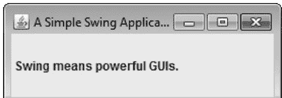

图 31-1 SwingDemo 程序产生的窗口

由于 SwingDemo 程序演示了几个核心 Swing 概念，我们将逐行对其进行仔细检查。程序从导入`javax.swing`开始。如前所述，该包包含了 Swing 定义的组件和模型。例如，`javax.swing`定义了实现标签、按钮、文本控件和菜单的类。它将被包含在所有使用 Swing 的程序中。

接下来，程序声明了`SwingDemo`类以及该类的构造函数。构造函数是程序大部分发生的地方。它首先通过使用这行代码创建一个`JFrame`：

```java
JFrame jfrm = new JFrame("A Simple Swing Application");
```

这创建了一个名为`jfrm`的容器，它定义了一个带有标题栏、最小化、最大化和还原按钮以及系统菜单的矩形窗口。因此，它创建了一个标准的顶层窗口。窗口的标题被传递给构造函数。

接下来，使用该语句设置窗口大小：

```java
jfrm.setSize(275, 100);
```

`setSize()`方法（`JFrame`继承自 AWT 的`Component`类）设置窗口的尺寸，以像素为单位。此处展示的通用形式如下：

```java
void setSize(int width, int height)
```

在本示例中，窗口的宽度设置为 275，高度设置为 100。默认情况下，当顶层窗口关闭时（例如当用户点击关闭框时），窗口将从屏幕上移除，但应用程序不会终止。虽然这种默认行为在某些情况下有用，但它并不是大多数应用程序所需的。相反，你通常希望在顶层窗口关闭时终止整个应用程序。有几种方法可以实现这一点。简单的方法是调用`setDefaultCloseOperation()`，正如程序中所做的那样：

```java
jfrm.setDefaultCloseOperation(JFrame.EXIT_ON_CLOSE);
```

执行此调用后，关闭窗口会导致整个应用程序终止。`setDefaultCloseOperation()`的通用形式如下所示：

```java
void setDefaultCloseOperation(int what)
```

传递给`what`的值决定了窗口关闭时发生什么。除了`JFrame.EXIT_ON_CLOSE`之外，还有其他选项。如下所示：

- `DISPOSE_ON_CLOSE`
- `HIDE_ON_CLOSE`
- `DO_NOTHING_ON_CLOSE`

它们的名称反映了相应的动作。这些常量声明在`WindowConstants`中，它是`javax.swing`中声明的一个接口，并由`JFrame`实现。

下一行代码创建了一个 Swing `JLabel`组件：

```java
JLabel jlab = new JLabel(" Swing means powerful GUIs.");
```

`JLabel`是最简单且最易用的组件，因为它不接受用户输入。它只是显示信息，这些信息可以是文本、图标或两者的结合。程序创建的标签仅包含文本，并被传递给它的构造函数。

下一行代码将其添加到该框架的内容面板（content pane）中：

```java
jfrm.add(jlab);
```

如之前解释过的，所有顶层容器都有一个存储组件的面板。因此，要向框架中添加组件，你必须将其添加到框架的内容面板中。这是通过在`JFrame`引用（在本例中为`jfrm`）上调用`add()`完成的。`add()`的通用形式如下所示：

```java
Component add(Component comp)
```

`add()`方法由`JFrame`继承自 AWT 的`Container`类。默认情况下，与`JFrame`关联的内容面板使用边界布局（border layout）。

恰恰展示的`add()`版本将标签添加到中心位置。其他版本的`add()`允许你指定边界区域中的一个。当组件被添加到中心时，其大小会自动调整以适应中心区域的大小。

在继续之前，需要说明一个重要的历史点。在 JDK 5 之前，在向内容面板添加组件时，你不能直接在`JFrame`实例上调用`add()`。相反，你需要在`JFrame`对象的内容面板上调用`add()`。可以通过在`JFrame`实例上调用`getContentPane()`来获取内容面板。`getContentPane()`方法如下所示：

```java
Container getContentPane()
```

它返回一个指向内容面板的`Container`。然后在该引用上调用`add()`方法将组件添加到内容面板中。因此，在过去，你必须使用以下语句将`jlab`添加到`jfrm`：

```java
jfrm.getContentPane().add(jlab); // old-style
```

在这里，`getContentPane()`首先获取内容面板的引用，`add()`将组件添加到与此链接的容器中。同样的步骤也用于调用`remove()`来移除组件，以及调用`setLayout()`为内容面板设置布局管理器。这就是为什么在 5.0 之前的遗留代码中你将显式调用`getContentPane()`。今天，使用`getContentPane()`不再是必要的。你可以直接在`JFrame`上调用`add()`、`remove()`和`setLayout()`，因为这些方法已经过更改，以便它们自动对内容面板进行操作。

`SwingDemo`构造函数的最后一条语句导致窗口变为可见：

```java
jfrm.setVisible(true);
```

`setVisible()`方法继承自 AWT `Component`类。如果其参数为`true`，窗口将显示。否则，它将被隐藏。默认情况下，`JFrame`是不可见的，因此必须调用`setVisible(true)`来显示它。

在`SwingDemo`构造函数内部，使用以下代码创建并显示窗口：

```java
SwingUtilities.invokeLater(new Runnable() {
    public void run() {
        new SwingDemo();
    }
});
```

# 事件处理

之前的示例展示了 Swing 程序的标准形式，但遗漏了一个重要的部分：事件处理。由于`JLabel`不接收用户输入，它不产生事件，因此不需要事件处理。然而，其他 Swing 组件确实会对用户输入做出响应，这些交互产生的事件需要被处理。例如，当用户按下按钮时会产生事件。无论如何，事件处理都是任何基于 Swing 的应用程序的一部分。

Swing 使用的事件处理机制与 AWT 相同。这种方法被称为委托事件模型，在第 24 章中有描述。在许多情况下，Swing 与 AWT 使用相同的事件，这些事件被封装在`java.awt.event`中。Swing 特有的事件存储在`javax.swing.event`中。

尽管在 Swing 中处理事件的方式与 AWT 相同，但通过简单的示例仍然是有用的。以下程序处理了由 Swing 按钮生成的事件。示例输出见图 31-2。

```java
// 在 Swing 程序中处理事件。

import java.awt.*;
import java.awt.event.*;
import javax.swing.*;

class EventDemo {
    JLabel jlab;

    EventDemo() {
        // 创建一个新的 JFrame 容器。
        JFrame jfrm = new JFrame("An Event Example");

        // 为布局管理器指定 FlowLayout。
        jfrm.setLayout(new FlowLayout());

        // 给帧设置一个初始大小。
        jfrm.setSize(220, 90);

        // 当用户关闭应用程序时终止程序。
        jfrm.setDefaultCloseOperation(JFrame.EXIT_ON_CLOSE);

        // 创建两个按钮。
        JButton jbtnAlpha = new JButton("Alpha");
        JButton jbtnBeta = new JButton("Beta");

        // 为 Alpha 添加动作监听器。
        jbtnAlpha.addActionListener(new ActionListener() {
            public void actionPerformed(ActionEvent ae) {
                jlab.setText("Alpha was pressed.");
            }
        });

        // 为 Beta 添加动作监听器。
        jbtnBeta.addActionListener(new ActionListener() {
            public void actionPerformed(ActionEvent ae) {
                jlab.setText("Beta was pressed.");
            }
        });

        // 将按钮添加到内容面板。
        jfrm.add(jbtnAlpha);
        jfrm.add(jbtnBeta);

        // 创建一个文本标签。
        jlab = new JLabel("Press a button.");

        // 将标签添加到内容面板。
        jfrm.add(jlab);

        // 显示帧。
        jfrm.setVisible(true);
    }

    public static void main(String[] args) {
        // 在事件分发线程上创建帧。
        SwingUtilities.invokeLater(new Runnable() {
            public void run() {
                new EventDemo();
            }
        });
    }
}
```

首先，请注意该程序现在同时导入了`java.awt`和`java.awt.event`包。需要`java.awt`包是因为它包含了`FlowLayout`类，该类支持标准的流式布局管理器，用于在帧中布局组件。（有关布局管理器的内容请参阅第 26 章。）需要`java.awt.event`包是因为它定义了`ActionListener`接口和`ActionEvent`类。

`EventDemo`构造函数从开始创建一个`JFrame`实例。它将`jfrm`内容面板的布局管理器设置为`FlowLayout`。默认情况下，内容面板使用`BorderLayout`作为其布局管理器。但对于这个示例，`FlowLayout`更加方便。

在设置了大小和默认关闭操作后，`EventDemo()`创建了两个按钮，如下所示：

```java
JButton jbtnAlpha = new JButton("Alpha");
JButton jbtnBeta = new JButton("Beta");
```

第一个按钮将包含文本 "Alpha"，第二个按钮将包含文本 "Beta"。Swing 推按钮是`JButton`的实例。`JButton`提供了几个构造函数。这里使用的是：

```java
JButton(String msg)
```

当推按钮被按下时，它会生成一个`ActionEvent`。因此，`JButton`提供了`addActionListener()`方法，用于添加动作监听器。（`JButton`还提供了`removeActionListener()`来移除监听器，但程序并没有使用该方法。）正如第 24 章所解释的，`ActionListener`接口只定义了一个方法：`actionPerformed()`。为了方便起见，这里再次显示：

```java
void actionPerformed(ActionEvent ae)
```

该方法在按钮被按下时被调用。换句话说，它是当按钮按下事件发生时被调用的事件处理程序。

接下来，通过此处所示的代码为按钮的动作事件添加事件监听器：

```java
// 为 Alpha 添加动作监听器。
jbtnAlpha.addActionListener(new ActionListener() {
    public void actionPerformed(ActionEvent ae) {
        jlab.setText("Alpha was pressed.");
    }
});

// 为 Beta 添加动作监听器。
jbtnBeta.addActionListener(new ActionListener() {
    public void actionPerformed(ActionEvent ae) {
        jlab.setText("Beta was pressed.");
    }
});
```

在这里，使用了匿名内部类来为两个按钮提供事件处理程序。每当按钮被按下时，`jlab`中显示的字符串就会改变，以反映是哪个按钮被按下了。

从 JDK 8 开始，也可以使用 lambda 表达式来实现各种类型的事件处理程序。例如，Alpha 按钮的事件处理程序可以这样写：

```java
jbtnAlpha.addActionListener( (ae) -> jlab.setText("Alpha was pressed."));
```

你可以看到，这更短。当然，你选择的方法将取决于情况以及你个人的偏好。

接下来，将按钮添加到`jfrm`的内容面板：

```java
jfrm.add(jbtnAlpha);
jfrm.add(jbtnBeta);
```

最后，将`jlab`添加到内容面板并使窗口可见。当你运行程序时，每当你按下按钮，标签中都会显示一条消息，指示哪个按钮被按下了。

最后一点：记住，所有事件处理程序（例如`actionPerformed()`）都是在事件分发线程上调用的。因此，事件处理程序必须快速返回，以避免减慢运行速度。如果你的应用程序需要执行耗时操作，请考虑使用其他线程。

## 在 Swing 中绘图

尽管 Swing 组件非常强大，但它的用法是有限的。Swing 的许多（可能是大部分）用途将涉及直接在组件表面上进行绘图，例如`JPanel`。你可以使用 Swing 的方法，例如 AWT 定义的`drawLine()`或`drawRect()`。第 25 章描述的技术也适用于 Swing。

## 绘图基础

在检查 Swing 的具体细节之前，回顾其底层的 AWT 机制是有用的。AWT 类`Component`定义了一个名为`paint()`的方法，用于直接在组件表面上绘图。大多数时候，`paint()`并不是由程序调用的。相反，每当组件需要渲染时会被调用。这种情况可能由于多种原因发生。例如，显示组件的窗口被另一个窗口覆盖然后重新显示。或者窗口被最小化后恢复。当程序开始运行时也会调用`paint()`方法。当编写基于 AWT 的代码时，应用程序需要在需要组件表面时重写`paint()`。

由于 Swing 继承自`Component`，所有的组件都继承了`paint()`方法。然而，你不会直接重写它。原因是 Swing 使用了更复杂的绘图方法，涉及到三个不同的方法：`paintComponent()`、`paintBorder()`和`paintChildren()`。这些方法绘制组件的部分并将绘图过程分为三个逻辑动作。在轻量级组件中，原始的 AWT `paint()`方法只是按顺序执行这些方法。

要在 Swing 组件的表面上绘图，你需要创建组件的子类并重写其`paintComponent()`方法。这是绘制组件内部的方法。你通常不会重写其他绘图方法。在重写`paintComponent()`时，必须的第一步是调用`super.paintComponent()`，以便执行父类的绘图过程。（只有在你完全控制组件的显示方式时，才需要这样做。）之后，编写你想显示的输出。`paintComponent()`方法如下所示：

```java
protected void paintComponent(Graphics g)
```

参数`g`是写入输出的图形上下文。

要在程序控制下绘制组件，请调用`repaint()`。它在 Swing 中的工作方式与 AWT 一致。`repaint()`方法由`Component`定义。调用它会导致系统尽快执行`paint()`。由于绘图是一项耗时的操作，这种机制允许运行时暂时推迟绘图，直到某些优先级更高的任务完成（例如）。当然，在 Swing 中，调用`paint()`会导致对`paintComponent()`的调用。因此，要在你的组件表面上输出，你的程序将存储输出，直到`paintComponent()`被调用。在重写的`paintComponent()`内部，将绘制存储的输出。

在组件表面进行绘图时，你必须小心将输出限制在边框内部的区域。虽然 Swing 会自动裁剪任何超出组件边界的输出，但仍然可能绘制到边框内，而这部分内容在绘制边框时会被覆盖。为了避免这种情况，你必须计算组件的可绘图区域。该区域由组件的当前尺寸减去边框占据的空间。因此，在向组件绘图之前，你必须获取边框的宽度，然后相应地调整你的绘图。

要获取边框宽度，调用`getInsets()`，如下所示：

```java
Insets getInsets()
```

该方法由`Container`定义并由`JComponent`重写。它返回一个包含边框尺寸的`Insets`对象。可以通过这些字段获取内边值：

- `int top;`
- `int bottom;`
- `int left;`
- `int right;`

这些值随后用于根据组件的宽度和高度计算绘制区域。你可以通过在组件上调用`getWidth()`和`getHeight()`获取组件的宽度和高度。如下所示：

```java
int getWidth()
int getHeight()
```

通过减去内边值，你可以计算出组件的可用宽度和高度。

## 绘图示例

这是一个实现上述讨论的程序。它创建了一个扩展自`JPanel`的类`PaintPanel`。程序随后使用该类的对象来显示端点随机生成的线条。示例输出见图 31-3。

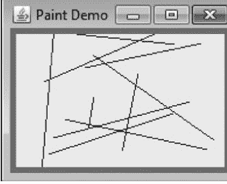

图 31-3 PaintPanel 程序的示例输出

```java
// 在面板上绘制线条。

import java.awt.*;
import javax.swing.*;
import java.util.*;

// 此类扩展了 JPanel。它重写了
// paintComponent() 方法，以便在面板中
// 绘制线条。
class PaintPanel extends JPanel {
    Insets insets; // 保存面板的内边距
    Random rand; // 用于生成随机数

    // 构造面板。
    PaintPanel() {
        // 在面板周围设置边框。
        setBorder(
            BorderFactory.createLineBorder(Color.RED, 5));

        rand = new Random();
    }

    // 重写 paintComponent() 方法。
    protected void paintComponent(Graphics g) {
        // 始终先调用父类方法。
        super.paintComponent(g);

        int x, y, x2, y2;

        // 获取组件的高度和宽度。
        int height = getHeight();
        int width = getWidth();

        // 获取内边距。
        insets = getInsets();

        // 绘制十条端点随机生成的线条。
        for (int i=0; i < 10; i++) {
            // 获取定义每条线条
            // 端点的坐标。
            x = rand.nextInt(width-insets.left);
            y = rand.nextInt(height-insets.bottom);
            x2 = rand.nextInt(width-insets.right);
            y2 = rand.nextInt(height-insets.bottom);

            // 绘制线条。
            g.drawLine(x, y, x2, y2);
        }
    }
}

// 演示直接在面板上绘图。
class PaintDemo {
    PaintPanel pp;

    PaintDemo() {
        // 创建一个新的 JFrame 容器。
        JFrame jfrm = new JFrame("Paint Demo");

        // 给帧设置一个初始尺寸。
        jfrm.setSize(200, 150);

        // 当用户关闭应用程序时终止程序。
        jfrm.setDefaultCloseOperation(JFrame.EXIT_ON_CLOSE);

        // 创建要绘图的面板。
        pp = new PaintPanel();

        // 将面板添加到内容面板。由于使用了默认
        // 边框布局，面板将自动调整尺寸
        // 以适应中心区域。
        jfrm.add(pp);

        // 显示帧。
        jfrm.setVisible(true);
    }

    public static void main(String[] args) {
        // 在事件分发线程上创建帧。
        SwingUtilities.invokeLater(new Runnable() {
            public void run() {
                new PaintDemo();
            }
        });
    }
}
```

让我们仔细检查这个程序。`PaintPanel`类扩展了`JPanel`。`JPanel`是 Swing 的轻量级容器之一，这意味着它是一个可以添加到`JFrame`内容面板的组件。为了处理绘图，`PaintPanel`重写了`paintComponent()`方法。这使得`PaintPanel`在绘图发生时能够直接写入组件的表面。程序没有指定面板的尺寸，因为程序使用了默认的边框布局，且面板被添加到中心。这导致面板被调整大小以填充中心。如果你更改了窗口的大小，面板的大小将随之调整。

注意，构造函数还指定了一个 5 像素宽的红色边框。这是通过使用`setBorder()`方法设置边框实现的，如下所示：

```java
void setBorder(Border border)
```

`Border`是封装边框的接口。可以通过调用`BorderFactory`定义的工厂方法来获取边框。程序中使用的是`createLineBorder()`，它创建一个简单的边框。如下所示：

```java
static Border createLineBorder(Color clr, int width)
```

在这里，`clr`指定颜色，`width`指定宽度（像素）。

在`paintComponent()`的重写方法内部，注意它调用了`super.paintComponent()`。接下来，获取面板的高度、宽度以及内边距。这些值用于确保组件被正确绘制。如上一章所述，`PaintDemo`类创建了`PaintPanel`并将其添加到内容面板。当应用程序首次显示时，会调用`paintComponent()`方法，每次调整窗口大小时，都会绘制一组线条。在所有情况下，线条都在绘制区域内。

# 章节：探索 Swing

上一章描述了与 Swing 相关的核心概念，并展示了 Swing 应用的基本形式。本章通过介绍一些 Swing 组件（如复选框、树和表格）继续对 Swing 的讨论。Swing 组件提供了丰富的功能并允许高度定制。由于空间限制，无法描述它们所有的功能和属性。相反，此概述的目的是让你对组件集的能力有个概念。

| `JButton` | `JCheckBox` | `JComboBox` | `JLabel` |
| --- | --- | --- | --- |
| `JList` | `JRadioButton` | `JScrollPane` | `JTabbedPane` |
| `JTable` | `JTextField` | `JToggleButton` | `JTree` |

这些组件都是轻量级的，这意味着它们都派生自`JComponent`。

还讨论了封装了一组互斥 Swing 按钮的`ButtonGroup`，以及封装图形图像的`ImageIcon`。两者都由 Swing 定义并封装在`javax.swing`中。

## JLabel 和 ImageIcon

`JLabel`是 Swing 最容易使用的组件。它创建一个标签并在上一章中介绍过。在这里，我们将仔细观察`JLabel`。`JLabel`可用于显示文本和/或图标。它是一个被动组件，因为它不响应用户输入。`JLabel`定义了多个构造函数。这里是其中三个：

- `JLabel(Icon icon)`
- `JLabel(String str)`
- `JLabel(String str, Icon icon, int align)`

在这里，`str`和`icon`是用于标签的文本和图标。`align`参数指定文本和/或图标在标签尺寸内的水平对齐方式。它必须是以下值之一：`LEFT`、`RIGHT`、`CENTER`、`LEADING`或`TRAILING`。这些常量定义在`SwingConstants`接口中，以及其他几个被 Swing 类使用的常量。

请注意，图标是由类型为`Icon`的对象指定的，`Icon`是由 Swing 定义的接口。获取图标最简单的方法是使用`ImageIcon`类。`ImageIcon`实现了`Icon`并封装了图像。因此，类型为`ImageIcon`的对象可以作为参数传递给`JLabel`构造函数的`Icon`参数。提供图像有多种方法，包括从文件读取或从 URL 下载。以下是本节示例使用的`ImageIcon`构造函数：

```java
ImageIcon(String filename)
```

它获取名为`filename`的文件图像。

可以通过以下方法获取与标签相关的图标和文本：

```java
Icon getIcon()
String getText()
```

可以通过这些方法设置与标签相关的图标和文本：

```java
void setIcon(Icon icon)
void setText(String str)
```

这里`icon`和`str`分别是图标和文本。因此，使用`setText()`可以在程序执行期间更改标签内的文本。

以下程序说明了如何创建并显示包含图标和字符串的标签。它首先为文件`hourglass.png`创建一个`ImageIcon`对象，该文件描绘了一个沙漏。它被用作`JLabel`构造函数的第二个参数。`JLabel`构造函数的第一个和最后一个参数是标签文本和对齐方式。最后，将标签添加到内容面板（content pane）。

```java
import java.awt.*;
import javax.swing.*;

public class JLabelDemo {
    public JLabelDemo() {
        // 设置 JFrame
        JFrame jfrm = new JFrame("JLabelDemo");
        jfrm.setLayout(new FlowLayout());
        jfrm.setDefaultCloseOperation(JFrame.EXIT_ON_CLOSE);
        jfrm.setSize(260, 210);

        // 创建一个图标。
        ImageIcon ii = new ImageIcon("hourglass.png");

        // 创建一个标签。
        JLabel jl = new JLabel("Hourglass", ii, JLabel.CENTER);

        // 将标签添加到内容面板。
        jfrm.add(jl);

        // 显示框架。
        jfrm.setVisible(true);
    }

    public static void main(String[] args) {
        // 在事件分发线程上创建框架
        SwingUtilities.invokeLater(new Runnable() {
            public void run() {
                new JLabelDemo();
            }
        });
    }
}
```

标签示例的输出如下所示：

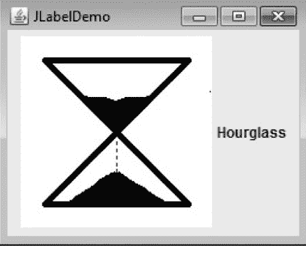

## JTextField

`JTextField`是最简单的 Swing 文本组件。它可能也是使用最广泛的文本组件。`JTextField`允许你编辑一行文本。它继承自`JComponent`，该类提供了 Swing 文本组件共同的基础功能。`JTextField`使用`Document`接口作为模型。`JTextField`的三个构造函数是：

- `JTextField(int cols)`
- `JTextField(String str, int cols)`
- `JTextField(String str)`

在这里，`str`是初始呈现的字符串，`cols`是文本字段的列数。如果没有指定字符串，则文本字段初始为空。如果未指定列数，则文本字段的大小将适应指定的字符串。

`JTextField`响应用户交互生成事件。例如，当用户按下回车键时，会触发一个`ActionEvent`。每当光标（即插入符）位置改变时，就会触发一个`CaretEvent`。`CaretEvent`封装在`javax.swing.event`中。也可能发生其他事件。在许多情况下，你的程序不需要处理这些事件。相反，你只需要在需要时调用`getText()`获取文本字段中当前的字符串即可。

以下示例说明了`JTextField`。它创建了一个`JTextField`并将其添加到内容面板。当用户按下回车键时，会生成一个动作事件。这通过在标签中显示文本来处理。

```java
// 展示 JTextField.

import java.awt.*;
import java.awt.event.*;
import javax.swing.*;

public class JTextFieldDemo {
    public JTextFieldDemo() {
        // 设置 JFrame。
        JFrame jfrm = new JFrame("JTextFieldDemo");
        jfrm.setLayout(new FlowLayout());
        jfrm.setDefaultCloseOperation(JFrame.EXIT_ON_CLOSE);
        jfrm.setSize(260, 120);

        // 将文本字段添加到内容面板。
        JTextField jtf = new JTextField(15);
        jfrm.add(jtf);

        // 添加一个标签。
        JLabel jlab = new JLabel();
        jfrm.add(jlab);

        // 处理动作事件。
        jtf.addActionListener(new ActionListener() {
            public void actionPerformed(ActionEvent ae) {
                // 当用户按下 ENTER 时，显示文本。
                jlab.setText(jtf.getText());
            }
        });

        // 显示框架。
        jfrm.setVisible(true);
    }

    public static void main(String[] args) {
        // 在事件分发线程上创建框架。
        SwingUtilities.invokeLater(new Runnable() {
            public void run() {
                new JTextFieldDemo();
            }
        });
    }
}
```

文本字段示例的输出如下所示：

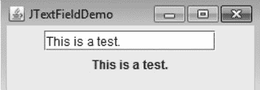

## 按钮 (The Buttons)

Swing 定义了四种类型的按钮：`JButton`、`JToggleButton`、`JCheckBox`和`JRadioButton`。它们都是`AbstractButton`的子类，而`AbstractButton`继承自`JComponent`。`AbstractButton`提供了按钮的功能。例如，`AbstractButton`允许你控制按钮在被禁用、按下或选中时的行为。`AbstractButton`包含方法：

```java
void setDisabledIcon(Icon icon)
void setPressedIcon(Icon icon)
void setSelectedIcon(Icon icon)
void setRolloverIcon(Icon icon)
```

接下来将检查`JButton`类。`JButton`允许图标、字符串或两者。它的三个构造函数是：

- `JButton(Icon icon)`
- `JButton(String str)`
- `JButton(String str, Icon icon)`

在前一个章节中，你看到了一个基于文本的按钮示例。以下演示了一个基于图标的按钮。它显示了一个代表计时器的图标。当按钮被按下时，该计时器的名称将显示在标签中。

```java
// Demonstrate an icon-based JButton.

import java.awt.*;
import java.awt.event.*;
import javax.swing.*;

public class JButtonDemo implements ActionListener {
    JLabel jlab;

    public JButtonDemo() {
        // Set up the JFrame.
        JFrame jfrm = new JFrame("JButtonDemo");
        jfrm.setLayout(new FlowLayout());
        jfrm.setDefaultCloseOperation(JFrame.EXIT_ON_CLOSE);
        jfrm.setSize(250, 450);

        // Add buttons to content pane.
        ImageIcon hourglass = new ImageIcon("hourglass.png");
        JButton jb = new JButton(hourglass);
        jb.setActionCommand("Hourglass");
        jb.addActionListener(this);
        jfrm.add(jb);

        ImageIcon analog = new ImageIcon("analog.png");
        jb = new JButton(analog);
        jb.setActionCommand("Analog Clock");
        jb.addActionListener(this);
        jfrm.add(jb);

        ImageIcon digital = new ImageIcon("digital.png");
        jb = new JButton(digital);
        jb.setActionCommand("Digital Clock");
        jb.addActionListener(this);
        jfrm.add(jb);

        ImageIcon stopwatch = new ImageIcon("stopwatch.png");
        jb = new JButton(stopwatch);
        jb.setActionCommand("Stopwatch");
        jb.addActionListener(this);
        jfrm.add(jb);

        // Create and add the label to content pane.
        jlab = new JLabel("Choose a Timepiece");
        jfrm.add(jlab);

        // Display the frame.
        jfrm.setVisible(true);
    }

    // Handle button events.
    public void actionPerformed(ActionEvent ae) {
        jlab.setText("You selected " + ae.getActionCommand());
    }

    public static void main(String[] args) {
        // Create the frame on the event dispatching thread.
        SwingUtilities.invokeLater(
            new Runnable() {
                public void run() {
                    new JButtonDemo();
                }
            });
    }
}
```

按钮示例的输出在此处显示：

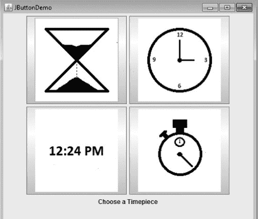

# JToggleButton

推按钮的一种很有用变体称为切换按钮（toggle button）。切换按钮看起来和推按钮完全一样，但它的行为不同，因为它有两个状态：按下和释放。也就是说，当你按下一个切换按钮时，它会保持按下状态，而不是像普通推按钮那样弹回。当你第二次按下切换按钮时，它会释放（弹起）。因此，切换按钮每被按下一次，它就会在它的状态之间切换。

切换按钮是`JToggleButton`类的对象。`JToggleButton`实现`AbstractButton`。除了创建标准的切换按钮外，`JToggleButton`还是两个双状态控件的父类。它们是`JCheckBox`和`JRadioButton`，将在本章后面介绍。因此，`JToggleButton`定义了所有双状态组件的基本功能。

`JToggleButton`定义了几个构造函数。本节示例使用的是：

```java
JToggleButton(String str)
```

这创建了一个包含传入的文本`str`的切换按钮。默认情况下，按钮处于关闭位置。其他构造函数允许你创建包含图像或包含图像和文本的切换按钮。

`JToggleButton`使用由嵌套类`JToggleButton.ToggleButtonModel`定义的模型。通常情况下，你使用标准切换按钮不需要直接与模型交互。

与`JButton`类似，`JToggleButton`在每次被按下时都会产生动作事件（action event）。但与`JButton`不同的是，`JToggleButton`还会产生项目事件（item event）。该事件由支持选择概念的组件使用。当`JToggleButton`被按下时，它被选中；当它弹出时，它被取消选中。

要处理项目事件，你必须实现`ItemListener`接口。回想第 24 章，每当产生项目事件时，它都会被传递给`ItemListener`定义的`itemStateChanged()`方法。在`itemStateChanged()`内部，可以调用`ItemEvent`对象的`getItem()`方法以获取生成事件的`JToggleButton`实例的引用。如下所示：

```java
Object getItem()
```

返回按钮的引用。你需要将此引用强制转换为`JToggleButton`。

确定切换按钮状态最简单的方法是调用生成事件的按钮上的`isSelected()`方法（继承自`AbstractButton`）。如下所示：

```java
boolean isSelected()
```

如果按钮被选中，则返回`true`，否则返回`false`。

这是一个使用切换按钮的示例。注意项目监听器的工作原理。它简单地调用`isSelected()`来确定按钮的状态。

```java
// Demonstrate JToggleButton.

import java.awt.*;
import java.awt.event.*;
import javax.swing.*;

public class JToggleButtonDemo {
    public JToggleButtonDemo() {
        // Set up the JFrame.
        JFrame jfrm = new JFrame("JToggleButtonDemo");
        jfrm.setLayout(new FlowLayout());
        jfrm.setDefaultCloseOperation(JFrame.EXIT_ON_CLOSE);
        jfrm.setSize(200, 100);

        // Create a label.
        JLabel jlab = new JLabel("Button is off.");

        // Make a toggle button.
        JToggleButton jtbn = new JToggleButton("On/Off");

        // Add an item listener for the toggle button.
        jtbn.addItemListener(new ItemListener() {
            public void itemStateChanged(ItemEvent ie) {
                if(jtbn.isSelected())
                    jlab.setText("Button is on.");
                else
                    jlab.setText("Button is off.");
            }
        });

        // Add the toggle button and label to the content pane.
        jfrm.add(jtbn);
        jfrm.add(jlab);

        // Display the frame.
        jfrm.setVisible(true);
    }

    public static void main(String[] args) {
        // Create the frame on the event dispatching thread.
        SwingUtilities.invokeLater(
            new Runnable() {
                public void run() {
                    new JToggleButtonDemo();
                }
            });
    }
}
```

切换按钮示例的输出在此处显示：

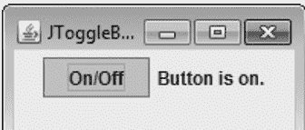

# Check Boxes

`JCheckBox`类提供了复选框的功能。它的直接父类是`JToggleButton`，如所述，它提供了对双状态按钮的支持。`JCheckBox`定义了几个构造函数。这里使用的是：

```java
JCheckBox(String str)
```

它创建了一个以`str`指定文本作为标签的复选框。其他构造函数允许你指定复选框的初始状态并指定图标。当用户选中或取消选中复选框时，会产生`ItemEvent`。在`itemStateChanged()`内部，调用`getItem()`以获取生成事件的`JCheckBox`实例引用。

```java
// Demonstrate JCheckBox.

import java.awt.*;
import java.awt.event.*;
import javax.swing.*;

public class JCheckBoxDemo implements ItemListener {
    JLabel jlab;

    public JCheckBoxDemo() {
        // Set up the JFrame.
        JFrame jfrm = new JFrame("JCheckBoxDemo");
        jfrm.setLayout(new FlowLayout());
        jfrm.setDefaultCloseOperation(JFrame.EXIT_ON_CLOSE);
        jfrm.setSize(250, 100);

        // Add check boxes to the content pane.
        JCheckBox cb1 = new JCheckBox("C");
        cb1.addItemListener(this);
        jfrm.add(cb1);

        JCheckBox cb2 = new JCheckBox("C++");
        cb2.addItemListener(this);
        jfrm.add(cb2);

        JCheckBox cb3 = new JCheckBox("Java");
        cb3.addItemListener(this);
        jfrm.add(cb3);

        JCheckBox cb4 = new JCheckBox("Perl");
        cb4.addItemListener(this);
        jfrm.add(cb4);

        // Create a label and add it to the content pane.
        jlab = new JLabel("Select languages");
        jfrm.add(jlab);

        // Display the frame.
        jfrm.setVisible(true);
    }

    public void itemStateChanged(ItemEvent ie) {
        JCheckBox cb = (JCheckBox) ie.getItem();
        if(cb.isSelected())
            jlab.setText(cb.getText() + " was just selected.");
        else
            jlab.setText(cb.getText() + " was just cleared.");
    }

    public static void main(String[] args) {
        // Create the frame on the event dispatching thread.
        SwingUtilities.invokeLater(
            new Runnable() {
                public void run() {
                    new JCheckBoxDemo();
                }
            });
    }
}
```

# Radio Buttons

`JRadioButton`类提供了单选按钮的功能。它的直接父类是`JToggleButton`，如所述，它提供了对双状态按钮的支持。`JRadioButton`定义了几个构造函数。这里使用的是：

```java
JRadioButton(String str)
```

它创建了一个以`str`指定文本作为标签的单选按钮。其他构造函数允许你指定单选按钮的初始状态并指定图标。

单选按钮必须被配置到一个组中。每次只能选择组中的一个按钮。例如，如果用户按下组中的一个单选按钮，之前选中的任何按钮都会自动取消选中。`ButtonGroup`类用于创建按钮组。它的默认构造函数为此目的而定义。通过调用以下方法将元素添加到按钮组：

```java
void add(AbstractButton ab)
```

在这里，`ab`是要添加到组中的按钮的引用。

当用户选中或取消选中单选按钮时，会产生`ItemEvent`。在`itemStateChanged()`内部，调用`getItem()`以获取生成事件的`JRadioButton`实例引用。或者，你可以处理动作事件。在下面的示例中，使用了动作事件处理程序。`getActionCommand()`方法获取与单选按钮关联的文本，并使用它设置标签内的文本。

```java
// Demonstrate JRadioButton

import java.awt.*;
import java.awt.event.*;
import javax.swing.*;

public class JRadioButtonDemo implements ActionListener {
    JLabel jlab;

    public JRadioButtonDemo() {
        // Set up the JFrame.
        JFrame jfrm = new JFrame("JRadioButtonDemo");
        jfrm.setLayout(new FlowLayout());
        jfrm.setDefaultCloseOperation(JFrame.EXIT_ON_CLOSE);
        jfrm.setSize(250, 100);

        // Create radio buttons and add them to content pane.
        JRadioButton b1 = new JRadioButton("A");
        b1.addActionListener(this);
        jfrm.add(b1);

        JRadioButton b2 = new JRadioButton("B");
        b2.addActionListener(this);
        jfrm.add(b2);

        JRadioButton b3 = new JRadioButton("C");
        b3.addActionListener(this);
        jfrm.add(b3);

        // Define a button group.
        ButtonGroup bg = new ButtonGroup();
        bg.add(b1);
        bg.add(b2);
        bg.add(b3);

        // Create a label and add it to the content pane.
        jlab = new JLabel("Select One");
        jfrm.add(jlab);

        // Display the frame.
        jfrm.setVisible(true);
    }

    // Handle button selection.
    public void actionPerformed(ActionEvent ae) {
        jlab.setText("You selected " + ae.getActionCommand());
    }

    public static void main(String[] args) {
        // Create the frame on the event dispatching thread.
        SwingUtilities.invokeLater(
            new Runnable() {
                public void run() {
                    new JRadioButtonDemo();
                }
            });
    }
}
```

单选按钮示例的输出在此所示：

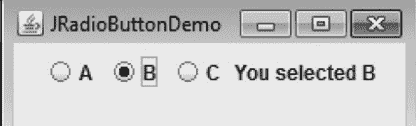

## JTabbedPane

`JTabbedPane`封装了一个标签页面板。它通过将组件与标签链接起来来管理一组组件。选择某个标签会使与该标签关联的组件显示在最前面。标签面板在现代 GUI 中非常常见，你肯定使用过很多次。鉴于标签面板的复杂性，创建和使用它们却出奇地简单。

`JTabbedPane`定义了三个构造函数。我们将使用它的默认构造函数，它会创建一个空控件，并将标签对齐在面板的顶部。另外两个构造函数允许你指定标签的位置，它可以位于四边的任何一侧。`JTabbedPane`使用`SingleSelectionModel`模型。通过调用`addTab()`添加标签。以下是它的形式之一：

```java
void addTab(String name, Component comp)
```

在这里，`name`是标签的名字，而`comp`是应该添加到标签中的组件。通常，添加到标签的组件是一个包含一组相关组件的`JPanel`。这种技术允许标签持有一组组件。使用标签面板的通用步骤概述如下：

1. 创建`JTabbedPane`的实例。
2. 通过调用`addTab()`添加每个标签。
3. 将标签面板添加到内容面板。

接下来的示例展示了一个标签面板。第一个标签的标题为“Cities”（城市），包含两个按钮。每个按钮显示一个城市的名称。第二个标签的标题为“Colors”（颜色），包含三个复选框。每个复选框显示一种颜色的名称。第三个标签的标题为“Flavors”（口味），包含一个组合框。这允许用户选择三种口味中的一种。

```java
// Demonstrate JTabbedPane.

import javax.swing.*;
import java.awt.*;

public class JTabbedPaneDemo {
    public JTabbedPaneDemo() {
        // Set up the JFrame.
        JFrame jfrm = new JFrame("JTabbedPaneDemo");
        jfrm.setLayout(new FlowLayout());
        jfrm.setDefaultCloseOperation(JFrame.EXIT_ON_CLOSE);
        jfrm.setSize(400, 200);

        // Create the tabbed pane.
        JTabbedPane jtp = new JTabbedPane();
        jtp.addTab("Cities", new CitiesPanel());
        jtp.addTab("Colors", new ColorsPanel());
        jtp.addTab("Flavors", new FlavorsPanel());
        jfrm.add(jtp);

        // Display the frame.
        jfrm.setVisible(true);
    }

    public static void main(String[] args) {
        // Create the frame on the event dispatching thread.
        SwingUtilities.invokeLater(
            new Runnable() {
                public void run() {
                    new JTabbedPaneDemo();
                }
            }
        );
    }
}

// Make the panels that will be added to the tabbed pane.
class CitiesPanel extends JPanel {
    public CitiesPanel() {
        JButton b1 = new JButton("New York");
        add(b1);
        JButton b2 = new JButton("London");
        add(b2);
        JButton b3 = new JButton("Hong Kong");
        add(b3);
    }
}

class ColorsPanel extends JPanel {
    public ColorsPanel() {
        JCheckBox cb1 = new JCheckBox("Red");
        add(cb1);
        JCheckBox cb2 = new JCheckBox("Green");
        add(cb2);
        JCheckBox cb3 = new JCheckBox("Blue");
        add(cb3);
    }
}

class FlavorsPanel extends JPanel {
    public FlavorsPanel() {
        JComboBox<String> jcb = new JComboBox<>();
        jcb.addItem("Vanilla");
        jcb.addItem("Chocolate");
        jcb.addItem("Strawberry");
        add(jcb);
    }
}
```

## JScrollPane

`JScrollPane`是处理组件滚动的轻量容器。滚动面板的可视区域被称为 viewport。在默认行为下，`JScrollPane`会需要动态添加或删除滚动条。例如，如果组件更高，则会添加垂直滚动条。`JScrollPane`定义了多个构造函数。本章使用的是：

```java
JScrollPane(Component comp)
```

要滚动的组件由`comp`指定。使用滚动面板需要遵循以下步骤：

1. 创建要滚动的组件。
2. 创建`JScrollPane`实例，并将对象传递给它。
3. 将滚动面板添加到内容面板。

下面的示例展示了一个滚动面板。首先，创建一个`JPanel`对象，并向其添加 400 个按钮，排列为 20 列。然后将此面板添加到滚动面板，再将滚动面板添加到内容面板。由于面板大于可视口，垂直和水平滚动条会自动出现。你可以使用滚动条将按钮滚动到视图。

```java
// Demonstrate JScrollPane.

import java.awt.*;
import javax.swing.*;

public class JScrollPaneDemo {
    public JScrollPaneDemo() {
        // Set up the JFrame. 使用默认的 BorderLayout.
        JFrame jfrm = new JFrame("JScrollPaneDemo");
        jfrm.setDefaultCloseOperation(JFrame.EXIT_ON_CLOSE);
        jfrm.setSize(400, 400);

        // 创建一个面板并添加 400 个按钮。
        JPanel jp = new JPanel();
        jp.setLayout(new GridLayout(20, 20));

        int b = 0;
        for (int i = 0; i < 20; i++) {
            for (int j = 0; j < 20; j++) {
                jp.add(new JButton("Button " + b));
                ++b;
            }
        }

        // 创建滚动面板。
        JScrollPane jsp = new JScrollPane(jp);

        // 将滚动面板添加到内容面板。
        // 因为使用了默认的边界布局，
        // 滚动面板将添加到居中位置。
        jfrm.add(jsp, BorderLayout.CENTER);

        // 显示框架。
        jfrm.setVisible(true);
    }

    public static void main(String[] args) {
        // 在事件分发线程上创建框架
        SwingUtilities.invokeLater(
            new Runnable() {
                public void run() {
                    new JScrollPaneDemo();
                }
            }
        );
    }
}
```

滚动面板示例的输出如下：

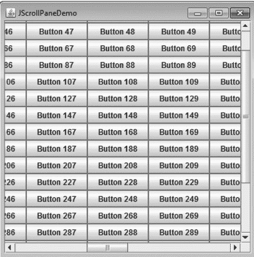

## JList

在 Swing 中，基本列表类被称为`JList`。它支持从列表中选择一个或多个项目。虽然列表通常由字符串组成，但也可以创建一个包含几乎任何可以显示的对象的列表。`JList`在 Java 中的应用非常广泛，你不太可能在此之前没见过它。

在过去，`JList`中的项是以`Object`引用的形式表示的。然而，从 JDK 7 开始，`JList`变为了泛型，现在的声明方式如下：

```java
JList<E>
```

在这里，`E`代表列表中项的类型。

`JList`提供了几个构造函数。这里使用的是：

```java
JList(E[] items)
```

这创建了一个包含`items`指定数组中项的`JList`。`JList`基于两个模型。第一个是`ListModel`。该接口定义了如何访问列表数据。第二个模型是`ListSelectionModel`接口，它定义了确定选择了哪个列表项（或哪些项）的方法。虽然`JList`本身可以正常工作，但在大多数情况下，你会将`JList`封装在`JScrollPane`中。这样，长列表将是可以滚动的，从而简化了 GUI 设计。它还允许更改列表中的条目数量，而无需更改`JList`组件的大小。

当用户进行或更改选择时，`JList`会生成一个`ListSelectionEvent`。当用户取消选择某个项时，也会生成该事件。它通过实现`ListSelectionListener`来处理。该监听器只指定了一个方法，称为`valueChanged()`，如此处所示：

```java
void valueChanged(ListSelectionEvent le)
```

在这里，`le`是事件的引用。虽然`ListSelectionEvent`自身也提供一些方法，但通常你会通过查询`JList`本身来确定发生了什么。`ListSelectionEvent`和`ListSelectionListener`都封装在`javax.swing.event`包中。

默认情况下，`JList`允许用户选择列表中的多个范围的项，但你可以通过调用`JList`定义的`setSelectionMode()`来更改此行为。如下所示：

```java
void setSelectionMode(int mode)
```

在这里，`mode`指定了选择模式。它必须是`ListSelectionModel`定义的这些值之一：

- `SINGLE_SELECTION`
- `SINGLE_INTERVAL_SELECTION`
- `MULTIPLE_INTERVAL_SELECTION`

默认的多间距选择允许用户选择列表中的多个范围的项。使用单间距选择时，用户可以选择一个范围的项。使用单次选择时，用户只能选择单个项。当然，在其他模式下也可以选择单个项，只是这些模式也允许选择一个范围。

你可以通过调用`getSelectedIndex()`获取第一个被选中项的索引（在使用单次选择模式时，它也将是唯一被选中项的索引），如下所示：

```java
int getSelectedIndex()
```

索引从零开始。因此，如果选择了第一个项，该方法将返回 0。如果没有选中任何项，则返回 -1。

与其获取选择的索引，不如通过调用`getSelectedValue()`获取与选择关联的值：

```java
E getSelectedValue()
```

它返回指向第一个被选中值的引用。如果没有选中任何值，则返回`null`。

以下程序演示了一个简单的`JList`，它包含一个城市列表。每当列表中选择一个城市时，就会生成一个`ListSelectionEvent`，该事件由`ListSelectionListener`定义的`valueChanged()`方法处理。它的响应是获取被选中项的索引，并在标签中显示所选城市的名字。

```java
// Demonstrate JList.

import javax.swing.*;
import javax.swing.event.*;
import java.awt.*;
import java.awt.event.*;

public class JListDemo {
    // 创建一个城市数组。
    String[] Cities = { "New York", "Chicago", "Houston",
        "Denver", "Los Angeles", "Seattle",
        "London", "Paris", "New Delhi",
        "Hong Kong", "Tokyo", "Sydney" };

    public JListDemo() {
        // 设置 JFrame。
        JFrame jfrm = new JFrame("JListDemo");
        jfrm.setLayout(new FlowLayout());
        jfrm.setDefaultCloseOperation(JFrame.EXIT_ON_CLOSE);
        jfrm.setSize(200, 200);

        // 创建一个 JList。
        JList<String> jlst = new JList<String>(Cities);

        // 设置选择模式为单次选择。
        jlst.setSelectionMode(ListSelectionModel.SINGLE_SELECTION);

        // 将列表添加到滚动面板。
        JScrollPane jscrlp = new JScrollPane(jlst);
        jscrlp.setPreferredSize(new Dimension(120, 90));

        // 创建一个显示选择的标签。
        JLabel jlab = new JLabel("Choose a City");

        // 为列表添加选择监听器。
        jlst.addListSelectionListener(new ListSelectionListener() {
            public void valueChanged(ListSelectionEvent le) {
                // 获取选中项的索引。
                int idx = jlst.getSelectedIndex();

                // 如果选中了项，显示。
                if (idx != -1)
                    jlab.setText("Current selection: " + Cities[idx]);
                // 否则提示。
                else
                    jlab.setText("Choose a City");
            }
        });

        // 将列表和标签添加到框架。
        jfrm.add(jscrlp);
        jfrm.add(jlab);

        // 显示框架。
        jfrm.setVisible(true);
    }

    public static void main(String[] args) {
        // 在事件分发线程上创建框架。
        SwingUtilities.invokeLater(
            new Runnable() {
                public void run() {
                    new JListDemo();
                }
            }
        );
    }
}
```

## JComboBox

Swing 通过`JComboBox`类提供了组合框（文本字段和下拉列表的结合）。组合框通常显示一个条目，但它也会显示允许用户选择不同条目的下拉列表。你还可以创建一个允许用户向文本字段输入选择的组合框。

在过去，`JComboBox`中的项是以`Object`引用的形式表示的。然而，从 JDK 7 开始，`JComboBox`变为了泛型，现在的声明方式如下：

```java
JComboBox<E>
```

在这里，`E`代表列表中项的类型。

示例使用的`JComboBox`构造函数如下：

```java
JComboBox(E[] items)
```

在这里，`items`是初始化组合框的数组。还有其他构造函数可用。

`JComboBox`使用`ComboBoxModel`。可变组合框（其条目可以更改）使用`MutableComboBoxModel`。

除了传递要显示在下拉列表中的数组外，还可以通过`addItem()`方法动态将项添加到列表中，如下所示：

```java
void addItem(E obj)
```

在这里，`obj`是要添加到组合框的对象。此方法必须用于可变组合框。

当用户从列表中选择一个项时，`JComboBox`生成一个动作事件。`JComboBox`在选择状态更改时也会生成一个项目事件，这在项被选中或取消选择时发生。因此，更改选择意味着发生两个项目事件：一个针对取消选择的项，另一个针对选中的项。通常，监听动作事件就足够了，但两种事件都可以供你使用。

获取列表中选中项的一种方法是在组合框上调用`getSelectedItem()`。如下所示：

```java
Object getSelectedItem()
```

你将需要把返回的值强制转换为列表中存储的对象的类型。

以下示例演示了组合框包含“沙漏”、“模拟”、“数字”和“秒表”的条目。当一个计时器被选中时，一个基于图标的标签将更新以显示它。你可以看到使用这个强大的组件需要很少的代码。

```java
// Demonstrate JComboBox.

import java.awt.*;
import java.awt.event.*;
import javax.swing.*;

public class JComboBoxDemo {
    String[] timepieces = { "Hourglass", "Analog", "Digital", "Stopwatch" };

    public JComboBoxDemo() {
        // Set up the JFrame.
        JFrame jfrm = new JFrame("JComboBoxDemo");
        jfrm.setLayout(new FlowLayout());
        jfrm.setDefaultCloseOperation(JFrame.EXIT_ON_CLOSE);
        jfrm.setSize(400, 250);

        // Instantiate a combo box and add it to the content pane.
        JComboBox<String> jcb = new JComboBox<String>(timepieces);
        jfrm.add(jcb);

        // Create a label and add it to the content pane.
        JLabel jlab = new JLabel(new ImageIcon("hourglass.png"));
        jfrm.add(jlab);

        // Handle selections.
        jcb.addActionListener(new ActionListener() {
            public void actionPerformed(ActionEvent ae) {
                String s = (String) jcb.getSelectedItem();
                jlab.setIcon(new ImageIcon(s + ".png"));
            }
        });

        // Display the frame.
        jfrm.setVisible(true);
    }

    public static void main(String[] args) {
        // Create the frame on the event dispatching thread.
        SwingUtilities.invokeLater(
            new Runnable() {
                public void run() {
                    new JComboBoxDemo();
                }
            }
        );
    }
}
```

组合框示例的输出如下所示：

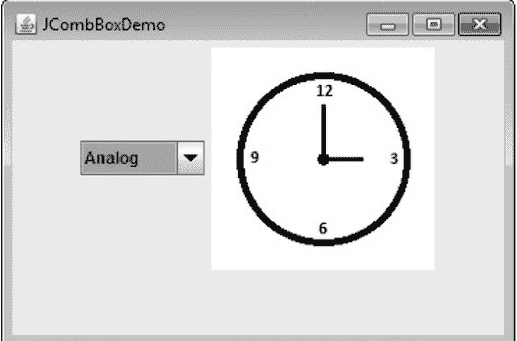

# 树 (Trees)

树是一种展示数据分级视图的组件。用户可以在显示中展开或折叠单个子树。树在 Swing 中通过`JTree`类实现。这里展示了其构造函数的一个示例：

```java
JTree(Object[] obj)
JTree(Vector<?> v)
JTree(TreeNode tn)
```

在第一种形式中，树由数组`obj`中的元素构建。第二种形式从向量`v`的元素构建树。在第三种形式中，通过`tn`指定树根节点。

尽管`JTree`封装在`javax.swing`中，但它的支持类和接口封装在`javax.swing.tree`中。`JTree`非常大。`JTree`依赖两个模型：`TreeModel`和`TreeSelectionModel`。`JTree`生成各种事件，但有三个专门针对：`TreeExpansionEvent`、`TreeSelectionEvent`和`TreeModelEvent`。

当节点被展开或折叠时，会发生`TreeExpansionEvent`。当用户在树中选择或取消选择节点时，会生成`TreeSelectionEvent`。当树的数据或结构发生变化时，触发`TreeModelEvent`。这些事件的监听器分别是`TreeExpansionListener`、`TreeSelectionListener`和`TreeModelListener`。树事件和监听器接口封装在`javax.swing.event`中。

本节示例程序处理的事件是`TreeSelectionEvent`。要监听此事件，实现`TreeSelectionListener`。它仅定义了一个方法，称为`valueChanged()`，接收一个`TreeSelectionEvent`对象。你可以通过调用事件对象上的`getPath()`（如下所示）来获取所选对象的路径：

```java
TreePath getPath()
```

它返回一个描述到更改节点路径的`TreePath`对象。`TreePath`类封装了关于树中特定节点路径的信息。它提供了几个构造函数和方法。在本书中，只使用了`toString()`方法。它返回一个描述路径的字符串。

`TreeNode`接口声明了获取树节点信息的方法。例如，可以获取父节点的引用或子节点的枚举。`MutableTreeNode`接口继承了`TreeNode`。它声明了可以插入和删除子节点或更改父节点的方法。

`DefaultMutableTreeNode`类实现了`MutableTreeNode`接口。它代表树中的一个节点。这里展示了它的其中一个构造函数：

```java
DefaultMutableTreeNode(Object obj)
```

在这里，`obj`是要封装在此树节点中的对象。新的树节点没有父节点或子节点。

要创建树节点的层次结构，可以使用`DefaultMutableTreeNode`的`add()`方法。其签名如下所示：

```java
void add(MutableTreeNode child)
```

在这里，`child`是要作为子节点添加到当前节点的可变树节点。

`JTree`本身不提供滚动功能。相反，`JTree`通常被放置在`JScrollPane`中。这样，大型树可以在较小的视口中进行滚动。

以下是使用树需要遵循的步骤：

1. 创建`JTree`实例。
2. 创建一个`JScrollPane`并指定树为要滚动的对象。
3. 将树添加到滚动面板中。
4. 将滚动面板添加到内容面板中。

接下来的示例说明了如何创建树并处理选择。程序创建了一个标签为 "Options" 的`DefaultMutableTreeNode`实例。这是树层次结构的顶层节点。然后创建了额外的树节点，并调用了`add()`方法。

```java
// Demonstrate JTree.

import java.awt.*;
import javax.swing.event.*;
import javax.swing.*;
import javax.swing.tree.*;

public class JTreeDemo {
    JLabel jlab;

    public JTreeDemo() {
        // Set up the JFrame.
        JFrame jfrm = new JFrame("JTreeDemo");
        jfrm.setDefaultCloseOperation(JFrame.EXIT_ON_CLOSE);
        jfrm.setSize(200, 200);

        // Create top node of tree.
        DefaultMutableTreeNode top = new DefaultMutableTreeNode("Options");

        // Create subtree of "A".
        DefaultMutableTreeNode a = new DefaultMutableTreeNode("A");
        top.add(a);
        DefaultMutableTreeNode a1 = new DefaultMutableTreeNode("A1");
        a.add(a1);
        DefaultMutableTreeNode a2 = new DefaultMutableTreeNode("A2");
        a.add(a2);

        // Create subtree of "B".
        DefaultMutableTreeNode b = new DefaultMutableTreeNode("B");
        top.add(b);
        DefaultMutableTreeNode b1 = new DefaultMutableTreeNode("B1");
        b.add(b1);
        DefaultMutableTreeNode b2 = new DefaultMutableTreeNode("B2");
        b.add(b2);
        DefaultMutableTreeNode b3 = new DefaultMutableTreeNode("B3");
        b.add(b3);

        // Create tree.
        JTree tree = new JTree(top);

        // Add the tree to a scroll pane.
        JScrollPane jsp = new JScrollPane(tree);

        // Add the scroll pane to the content pane.
        jfrm.add(jsp);

        // Add a label to the content pane.
        jlab = new JLabel();
        jfrm.add(jlab, BorderLayout.SOUTH);

        // Handle tree selection events.
        tree.addTreeSelectionListener(new TreeSelectionListener() {
            public void valueChanged(TreeSelectionEvent tse) {
                jlab.setText("Selection is " + tse.getPath());
            }
        });

        // Display the frame.
        jfrm.setVisible(true);
    }

    public static void main(String[] args) {
        // Create the frame on the event dispatching thread.
        SwingUtilities.invokeLater(
            new Runnable() {
                public void run() {
                    new JTreeDemo();
                }
            }
        );
    }
}
```

## JTable

`JTable`是一个以表格形式显示数据的组件。你可以在行和列的网格中显示数据，并根据需要编辑单元格。`JTable`是 Swing 最复杂的组件之一。然而，你只需要使用它的默认功能就可以轻松地显示简单的表格。`JTable`的构造函数如下所示：

```java
JTable(Object[][] data, Object[] colHeads)
```

在这里，`data`是待显示信息的二维数组，而`colHeads`是一个包含列标题的一维数组。

`JTable`依赖于三个模型。第一个是表格模型（table model），由`TableModel`接口定义。该模型定义了与以二维格式显示数据相关的内容。第二个是列模型（column model），由`TableColumnModel`表示。`JTable`是按列定义的，而`TableColumnModel`指定了列的特征。这两个模型被封装在`javax.swing.table`中。第三个模型决定哪些项被选中，它由`ListSelectionModel`规范，这在讨论`JList`时已经描述过。

`JTable`可以产生多种不同的事件。对于表格操作最基础的两个是`ListSelectionEvent`和`TableModelEvent`。当用户选择一个或多个完整行时，会生成`ListSelectionEvent`，但你可以更改此行为以允许选择一个或多个列，或一个或多个单个单元格。当表格数据发生某种变化时，会触发`TableModelEvent`。处理这些事件比处理之前描述组件生成的事件需要更多一些工作，并且超出了本书的范围。然而，如果你只是想使用`JTable`显示数据（如下例所示），你就不需要处理任何事件。

以下是设置一个可以显示数据的简单`JTable`的步骤：

1. 创建`JTable`实例。
2. 创建一个`JScrollPane`对象，并将表格指定为要滚动的对象。
3. 将表格添加到滚动面板中。
4. 将滚动面板添加到内容面板（content pane）中。

下面的示例说明了如何创建和使用简单的表格。创建了一个名为`colHeads`的字符串一维数组作为列标题。创建了一个名为`data`的字符串二维数组作为单元格。你可以看到数组中的每个元素都是包含三个字符串的数组。这些数组被传递给`JTable`构造函数。将表格添加到滚动面板中，然后将滚动面板添加到内容面板。表格显示`data`数组中的数据。默认的表格配置还允许编辑单元格的内容。更改会影响底层数组（在本例中为`data`）。

```java
// Demonstrate JTable.

import java.awt.*;
import javax.swing.*;

public class JTableDemo {
    // Initialize column headings.
    String[] colHeads = {"Name", "Extension", "ID#"};

    // Initialize data.
    Object[][] data = {
        {"Gail", "4567", "865"},
        {"Ken", "7566", "555"},
        {"Vivianne", "5634", "587"},
        {"Melanie", "7345", "922"},
        {"Anne", "1237", "333"},
        {"John", "5656", "314"},
        {"Matt", "5672", "217"},
        {"Claire", "6741", "444"},
        {"Erwin", "9023", "519"},
        {"Ellen", "1134", "532"},
        {"Jennifer", "5689", "112"},
        {"Ed", "9030", "133"},
        {"Helen", "6751", "145"}
    };

    public JTableDemo() {
        // Set up the JFrame. Use default BorderLayout.
        JFrame jfrm = new JFrame("JTableDemo");
        jfrm.setDefaultCloseOperation(JFrame.EXIT_ON_CLOSE);
        jfrm.setSize(300, 300);

        // Create the table.
        JTable table = new JTable(data, colHeads);

        // Add the table to a scroll pane.
        JScrollPane jsp = new JScrollPane(table);

        // Add the scroll pane to the content pane.
        jfrm.add(jsp);

        // Display the frame.
        jfrm.setVisible(true);
    }

    public static void main(String[] args) {
        // Create the frame on the event dispatching thread.
        SwingUtilities.invokeLater(
            new Runnable() {
                public void run() {
                    new JTableDemo();
                }
            }
        );
    }
}
```

该示例的输出在此：

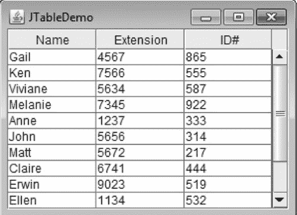

## 章节

# 33 介绍 Swing 菜单

本章介绍 Swing GUI 环境的另一个基本方面：菜单。菜单是许多应用程序不可或缺的一部分，因为它们向用户展示了程序的功能。由于其重要性，Swing 为菜单提供了广泛的支持。这是 Swing 力量显而易见的领域之一。

Swing 菜单系统支持关键元素，包括：

- 菜单栏（menu bar），应用程序的主菜单。
- 标准菜单（standard menu），可以包含可选择的项或其他菜单（子菜单）。
- 弹出菜单（popup menu），通常通过右键点击鼠标激活。
- 工具栏（toolbar），提供对程序功能的快速访问，通常与菜单项并行。
- 动作（action），允许由单个对象管理两个或多个不同的组件。

## 菜单基础

Swing 菜单系统由几个类支持。核心是`JMenuBar`、`JMenu`和`JMenuItem`。它们一起工作来定义应用程序的主菜单。`JMenuBar`是菜单的容器。它定义了菜单栏。`JMenu`封装了一个菜单，该菜单由`JMenuItem`填充。`JMenuItem`封装了菜单中的一个元素。因此，`JMenuItem`可以是一个链接到某些程序操作（如“保存”或“关闭”）的选项，也可以是导致显示子菜单的选项。

在这里，`menu`是一个添加到菜单栏的`JMenu`实例。方法将返回该菜单的引用。菜单从左到右按照添加顺序排列在菜单栏中。如果你想在特定位置添加菜单，请使用继承自`Container`的此`add()`版本：

```java
Component add(Component menu, int idx)
```

在这里，`menu`被添加到由`idx`指定的索引处。索引从 0 开始，0 是最左侧的菜单。

在某些情况下，你可能想要移除一个不再需要的菜单。你可以通过调用继承自`Container`的`remove()`来实现。它有两种表现形式：

```java
void remove(Component menu)
void remove(int idx)
```

在这里，`menu`是要移除的菜单的引用，`idx`是要移除菜单的索引。索引从零开始。

另一个有时很有用的方法是`getMenuCount()`，如下所示：

```java
int getMenuCount()
```

它返回菜单栏中包含的元素数量。

`JMenuBar`定义了其他可能在特殊应用程序中对你有帮助的方法。例如，通过调用`getSubElements()`，你可以获取一个指向栏中菜单的引用数组。你可以通过调用`isSelected()`来判断菜单是否被选中。

一旦创建并填充了菜单，可以通过调用`JFrame`实例上的`setJMenuBar()`将其添加到`JFrame`中。菜单栏不会被添加到内容面板中。`setJMenuBar()`方法如下所示：

```java
void setJMenuBar(JMenuBar mb)
```

在这里，`mb`是菜单栏的引用。菜单栏将显示在由外观（look and feel）决定的位置。通常，它位于窗口的顶部。

## JMenu

`JMenu`封装了一个菜单，该菜单由`JMenuItem`填充。如所述，它继承自`JMenuItem`。这意味着一个`JMenu`可以是另一个`JMenu`中的一个选项。这使得一个菜单成为另一个菜单的子菜单。`JMenu`定义了许多构造函数。例如，这里在本章示例中使用的那个：

```java
JMenu(String name)
```

此构造函数创建一个具有由`name`指定标题的菜单。当然，你并不非得给菜单命名。要创建一个无命名的菜单，可以使用默认构造函数：

```java
JMenu()
```

还支持其他构造函数。在每种情况下，在向其添加菜单项之前，菜单都是空的。

`JMenu`定义了许多方法。这里是对一些常用方法的简要描述。要向菜单添加项，使用`add()`方法，它有多种形式，包括此处所示两种：

```java
JMenuItem add(JMenuItem item)
Component add(Component item, int idx)
```

在这里，`item`是要添加的菜单项。第一种形式将项添加到菜单末尾。第二种形式将项添加到由`idx`指定的索引处。如所预期，索引从零开始。两种形式都返回所添加项的引用。一点在于，你还可以使用`insert()`向菜单中添加菜单项。

你可以通过调用此处所示的`addSeparator()`向菜单添加分隔符（`JSeparator`类型的对象）：

```java
void addSeparator()
```

分隔符被添加到菜单末尾。你可以通过调用如下所示的`insertSeparator()`在菜单中插入分隔符：

```java
void insertSeparator(int idx)
```

在这里，`idx`指定了添加分隔符的零基索引。

你可以通过调用`remove()`从菜单移除项。这里显示了它的两种形式：

```java
void remove(JMenuItem menu)
void remove(int idx)
```

在这种情况下，`menu`是要移除项的引用，`idx`是要移除项的索引。

你可以通过调用此处所示的`getMenuComponentCount()`获取菜单中项的数量：

```java
int getMenuComponentCount()
```

你可以通过调用如下所示的`getMenuComponents()`获取菜单中项的数组：

```java
Component[] getMenuComponents()
```

返回一个包含这些组件的数组。

## JMenuItem

`JMenuItem`封装了菜单中的一个元素。该元素可以是一个链接到某些程序操作（如“保存”或“关闭”）的选项，也可以是导致显示子菜单。如前所述，`JMenuItem`继承自`AbstractButton`，菜单中的每一项都可以被看作一种按钮。当菜单项被选中时，会产生一个动作事件。（这类似于`JButton`在被按下时触发事件的方式。）`JMenuItem`定义了许多构造函数。在本章中使用的此处所示：

- `JMenuItem(String name)`
- `JMenuItem(Icon image)`
- `JMenuItem(String name, Icon image)`
- `JMenuItem(String name, int mnem)`
- `JMenuItem(Action action)`

第一个构造函数创建一个具有由`name`指定名称的菜单项。第二个构造函数创建一个具有由`image`指定图像的菜单项。第三个创建一个由`name`指定名称和由`image`指定图像的菜单项。第四个构造函数创建一个具有由`name`指定名称并使用由`mnem`指定的键盘快捷键的菜单项。该快捷键允许你通过按下指定的按键从菜单中选择某项。最后一个构造函数使用`action`中指定的信息创建一个菜单项。也支持默认构造函数。

由于菜单项继承自`AbstractButton`，你可以访问`AbstractButton`提供的功能。其中一个在菜单中通常很有用的方法是`setEnabled()`，你可以用它来启用或禁用菜单项。它如下所示：

```java
void setEnabled(boolean enable)
```

## 创建主菜单

传统上，最常用的菜单是主菜单。坦率地说，Swing 让创建和管理主菜单变得简单。后续章节将向你展示如何向其添加选项。首先，创建持有菜单的`JMenuBar`对象。接下来，通过调用`setJMenuBar()`将其安装到框架中。在创建菜单后，将它们添加到菜单栏中。最后，对于每个菜单项，你必须添加一个监听器来处理菜单项被选中时触发的事件。


```java
// Finally, add the entire options menu to
// the menu bar
jmb.add(jmOptions);

// Create the Help menu.
JMenu jHelp = new JMenu("Help");
JMenuItem jmiAbout = new JMenuItem("About");
jmiHelp.add(jmiAbout);
jmb.add(jmHelp);

// Add action listeners for the menu items.
jmiOpen.addActionListener(this);
jmiClose.addActionListener(this);
jmiSave.addActionListener(this);
jmiExit.addActionListener(this);
jmiRed.addActionListener(this);
jmiGreen.addActionListener(this);
jmiBlue.addActionListener(this);
jmiHigh.addActionListener(this);
jmiLow.addActionListener(this);
jmiReset.addActionListener(this);
jmiAbout.addActionListener(this);

// Add the label to the content pane.
jfrm.add(jlab);

// Add the menu bar to the frame.
jfrm.setJMenuBar(jmb);

// Display the frame.
jfrm.setVisible(true);
}
```

```java
// Handle menu item action events.
public void actionPerformed(ActionEvent ae) {
    // Get the action command from the menu selection.
    String comStr = ae.getActionCommand();

    // If user chooses Exit, then exit the program
    if(comStr.equals("Exit")) System.exit(0);

    // Otherwise, display the selection.
    jlab.setText(comStr + " Selected");
}

public static void main(String[] args) {
    // Create the frame on the event dispatching thread.
    SwingUtilities.invokeLater(new Runnable() {
        public void run() {
            new MenuDemo();
        }
    });
}
```

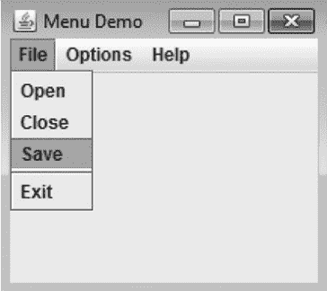

**图 33-1** MenuDemo 程序的示例输出

让我们详细检查此程序中的菜单是如何创建的，从 MenuDemo 构造函数开始。它开始创建一个 `JFrame` 并设置了其布局管理器、大小和默认关闭操作。（这些操作在第 31 章中描述过。）接着构造了一个 `JLabel`。它将用于显示菜单选择。菜单栏被构造出来，并通过该语句将其引用赋值给 `jmb`：

```java
// Create the menu bar.
MenuBar jmb = new JMenuBar();
```

然后，通过以下序列创建 File 菜单 `jFile` 及其菜单项：

```java
// Create the File menu.
JMenuItem jFile = new JMenu("File");
JMenuItem jmiOpen = new JMenuItem("Open");
JMenuItem jmiClose = new JMenuItem("Close");
JMenuItem jmiSave = new JMenuItem("Save");
JMenuItem jmiExit = new JMenuItem("Exit");
```

Options Open、Close、Save 和 Exit 将作为菜单中的选项显示。

接下来，通过以下序列将菜单项添加到文件菜单：

```java
jFile.add(jmiOpen);
jFile.add(jmiClose);
jFile.add(jmiSave);
jFile.addSeparator();
jFile.add(jmiExit);
```

最后，通过这一行代码将 File 菜单添加到菜单栏：

`jmb.add(jFile);`

一旦前面的代码序列完成，菜单栏将包含一个项目：File。File 菜单将按此顺序包含四个选择：Open、Close、Save 和 Exit。然而，注意在 Exit 之前添加了一个分隔符。这在视觉上将 Exit 与之前的三个选择隔离开。

Options 菜单是使用 File 菜单相同的基本过程构造的。

然而，Options 菜单包含两个子菜单（Colors 和 Priority）以及一个 Reset 项。首先单独构造子菜单，然后将它们添加到 Options 菜单中。最后添加 Reset 项。然后，将 Options 菜单添加到菜单栏。Help 菜单也使用相同的过程构造。

注意，`MenuDemo` 实现了 `ActionListener` 接口，并处理由 `MenuDemo` 定义的 `actionPerformed()` 方法生成的动作事件。因此，程序将此作为菜单项的动作监听器。注意，没有为 Colors 或 Priority 项添加任何监听器，因为它们实际上并不是选择项，它们仅仅是激活子菜单。

最后，通过以下行代码将菜单栏添加到框架中：

`jfrm.setJMenuBar(jmb);`

如所述，菜单栏没有被添加到内容面板。它们被直接添加到 `JFrame` 中。

`actionPerformed()` 方法处理由菜单生成的动作事件。它通过调用事件上的 `getCommand()` 获取与选择相关的动作命令字符串。它将此字符串的引用存储在 `comStr` 中。然后，所示对动作命令与 "Exit" 进行测试：

```java
if(comStr.equals("Exit")) System.exit(0);
```

如果动作命令是 "Exit"，程序将通过调用 `System.exit()` 终止。该方法会导致程序立即终止，并将参数作为状态码传递给调用系统。按照惯例，状态码零表示正常终止。任何其他值都表示程序异常终止。对于所有其他菜单选择，都会显示该选择。

在此时，你可能想对 `MenuDemo` 程序进行一些实验。添加另一个菜单或向现有菜单中添加更多项目。理解基本原理是很重要的。

## 为菜单项添加助记符（Mnemonics）和加速器（Accelerators）

在上一个示例中创建的菜单是功能性的，但可以变得更好。快捷键有两种形式：助记符（mnemonics）和加速器（accelerators）。对于菜单，助记符定义了一个允许选择项目的按键；而加速器是允许选择项目的按键。

助记符可以为 `JMenu` 和 `JMenuItem` 指定。为 `MenuItem` 有两种设置助记符的方法。首先，在使用此构造函数时指定：

```java
JMenuItem(String name, int mnem)
```

在这种情况下，名称传入 `name`，助记符传入 `mnem`。其次，可以通过调用 `setMnemonic()` 设置助记符。为 `JMenu` 指定助记符，必须调用 `setMnemonic()`。该方法从 `AbstractButton` 继承，如下：

```java
void setMnemonic(int mnem)
```

在这里，`mnem` 指定助记符。它应该是 `KeyEvent` 中常量之一。（另一个接受 `char` 参数的 `setMnemonic()` 版本已被认为过时。）助记符不区分大小写，所以在 `VK_A` 的情况下，输入 a 或 A 都会。

默认情况下，菜单项中的第一个匹配字母将带有下划线。在你想突出第一个匹配之外的字母的情况下，将字母索引作为参数传递给 `setMnemonicIndex()`，该方法从 `AbstractButton` 继承自 `JMenu` 和 `JMenuItem`：

```java
void setMnemonicIndex(int idx)
```

`idx` 指定指定的字母索引。

加速器可以与 `JMenuItem` 对象关联。它通过调用 `setAccelerator()` 指定，如下：

```java
void setAccelerator(KeyEvent ks)
```

在这里，`ks` 是用于选择菜单项目的按键组合。`KeyStroke` 是一个包含多个方法以构造各种类型按键加速器的类。以下是三个示例：

- `static KeyStroke getKeyStroke(char ch)`

- `static KeyStroke getKeyStroke(Character ch, int modifier)`

- `static KeyStroke getKeyStroke(int ch, int modifier)`

在这里，`ch` 指定加速字符。在第一个版本中，字符以 `char` 值指定。在第二个版本中，它作为 `Character` 类型的对象指定。`modifier` 的值必须是 `java.awt.KeyEvent` 类中定义的以下常量之一或多个：

| `InputEvent.ALT_DOWN_MASK` | `InputEvent.GRAPH_DOWN_MASK` |
| `InputEvent.CTRL_DOWN_MASK` | `InputEvent.META_DOWN_MASK` |
| `InputEvent.SHIFT_DOWN_MASK` | |

因此，如果你将 `VK_A` 传递给按键字符并将 `InputEvent.CTRL_DOWN_MASK` 传递给修饰符，则加速键组合 ctrl-a 为文件（File）菜单同时添加了记忆键和加速键。

以下序列添加了上一节中的 `MenuDemo` 程序。在进行此更改后，你可以通过输入 alt-f 来选择“文件”菜单。然后，你可以使用记忆键 o、c、s 或 e 来选择选项。或者，你也可以通过按下 ctrl-o、ctrl-c、ctrl-s 或 ctrl-e 直接选择“文件”菜单。图 33-2 显示了该菜单在激活时的外观。

```java
// 创建带有记忆键和加速键的菜单
JMenuItem jmiFile = new JMenuItem("File")
jmiFile.setMnemonic(KeyEvent.VK_F);
```

```java
JMenuItem jmiOpen = new JMenuItem("Open")
jmiOpen.setAccelerator(
KeyStroke.getKeyStroke(KeyEvent.VK_O,
InputEvent.CTRL_DOWN_MASK));
```

```java
JMenuItem jmiClose = new JMenuItem("Close")
jmiClose.setAccelerator(
KeyStroke.getKeyStroke(KeyEvent.VK_C,
InputEvent.CTRL_DOWN_MASK));
```

```java
JMenuItem jmiSave = new JMenuItem("Save")
jmiSave.setAccelerator(
KeyStroke.getKeyStroke(KeyEvent.VK_S,
InputEvent.CTRL_DOWN_MASK));
```

```java
JMenuItem jmiExit = new JMenuItem("Exit")
jmiExit.setAccelerator(
KeyStroke.getKeyStroke(KeyEvent.VK_E,
InputEvent.CTRL_DOWN_MASK));
```

**图 33-2** 添加记忆键和加速键后的“文件”菜单

## 为菜单项添加图像和工具提示

你可以向菜单项添加图像，或者使用图像代替文本。添加图像最简单的方法是在使用以下构造函数之一构建菜单项时指定它：

- `JMenuItem(Icon image)`

- `JMenuItem(String name, Icon image)`

第一个创建一个通过图像 `image` 显示图像的菜单项。第二个创建一个具有由 `name` 指定名称和由 `image` 指定图像的菜单项。例如，此处的菜单项在创建时与图像相关联：

```java
ImageIcon icon = new ImageIcon("AboutIcon.gif");
JMenuItem jmiAbout = new JMenuItem("About", icon);
```

此后，由 `icon` 指定的图像将显示在文本“About”旁边。如图 33-3 所示。你也可以通过调用继承自 `AbstractButton` 的 `setIcon()` 在菜单项创建后向其添加图标。你可以通过调用 `setHorizontalText()` 指定图像相对于文本的水平对齐方式。

**图 33-3** 添加了图标的“关于”项目

你可以通过调用 `isDisabledIcon()` 指定一个禁用的图标，该图标会在菜单项被禁用时显示。通常情况下，当菜单项被禁用时，默认图标以灰色显示。如果指定了禁用的图标，则显示该图标。

工具提示是描述项目的小型消息。如果鼠标悬停在项目上有一会儿，它会自动显示。你可以通过在项目上调用 `setToolTipText()` 为菜单项添加工具提示，并指定你想显示的文本。示例如所示：

```java
setToolTipText(String msg)
```

在这种情况下，`msg` 是工具提示激活时将显示的字符串。例如，这为“关于”项目创建了一个工具提示：

```java
jmiAbout.setToolTipText("Info about the MenuDemo program.");
```

有趣的是，`menuItem` 从 `JButton` 继承了 `setToolTipText()`。这意味着你可以为其他类型的组件（如推送按钮）添加工具提示。你可能想自己尝试一下。

## 使用 JRadioButtonMenuItem 和 JCheckBoxMenuItem

虽然前面的示例中使用的菜单项类型最常用，但 Swing 定义了另外两种类型：复选框和单选按钮。这些项目允许菜单提供原本需要额外独立组件才能的功能，从而简化了 GUI。此外，有时在菜单中包含复选框或单选按钮是某特定功能集的最自然的地方。无论原因如何，Swing 都让在菜单中使用复选框和单选按钮变得简单，我们将检查这两种类型。

要向菜单添加复选框，请创建一个 `JCheckBoxMenuItem`。它定义了几个构造函数。本章中使用的是这：

```java
JCheckBoxMenuItem(String name)
```

在这里，`name` 指定项目的名称。复选框的初始状态为未勾选。如果你想指定初始状态，可以使用此构造函数：

```java
JCheckBoxMenuItem(String name, boolean state)
```

在这种情况下，如果 `state` 为 `true`，则框初始为勾选。否则，`JCheckBoxMenuItem` 还提供了允许你指定图标的构造函数。这里有一个示例：

```java
JCheckBoxMenuItem(String name, Icon icon)
```

在这种情况下，`name` 指定项目的名称，与项目关联的图像通过 `icon` 传入。支持其他构造函数。

菜单中的复选框像独立的复选框一样。例如，它们在状态发生变化时会产生动作事件和项目事件。当你有可以选择的选项并且需要显示它们的选中/未选中状态时，复选框在菜单中特别有用。

**图 33–4** 复选框 (a) 和单选按钮 (b) 菜单项的效果

可以通过创建 `JRadioButtonMenuItem` 类型的对象向菜单中添加单选按钮。`JRadioButtonMenuItem` 继承自 `JMenuItem`。它提供了丰富的构造函数集合。本章使用的显示在此：

```java
JMenuItem(String name)
JMenuItem(String name, boolean state)
```

第一个构造函数创建一个与 `name` 中的名称关联的单选菜单项。第二个允许你指定按钮的初始状态。如果 `state` 为 `true`，则按钮初始为选中。否则，则为未选中。其他构造函数允许你指定图标。这里有一个示例：

```java
JMenuItem(String name, Icon icon)
```

这创建了一个与传入的 `name` 名称和传入的 `icon` 关联的单选菜单项。如果 `state` 为 `true`，则按钮初始为选中。否则，则为未选中。支持几种其他构造函数。

`JRadioButton` 像独立的单选按钮一样工作，产生项目事件。与独立的单选按钮一样，菜单中的单选按钮必须成一组才能表现出互斥选择行为。由于 `JCheckBoxMenuItem` 和 `menuItem` 继承自 `JMenuItem`，每个都具有 `JMenuItem` 提供的所有功能。除了具有复选框和单选按钮的额外能力外，它们的行为与其他菜单项一样。

弹出菜单是菜单栏的一种流行替代方案或补充。通常，通过在鼠标悬停在组件上时点击右键来激活弹出菜单。Swing 通过 `PopupMenu` 类支持弹出菜单。`PopupMenu` 有两个构造函数。在本章中，仅使用默认构造函数：

## `JPopupMenu()`

它创建一个默认的弹出菜单。另一个构造函数允许你为菜单指定标题。该标题是否显示取决于外观和感觉（look and feel）。

通常，弹出菜单的构建方式与普通菜单类似。首先，创建一个 `JPopupMenu` 对象并向其添加菜单项。项的选择也以相同的方式处理：即处理动作事件。弹出菜单与普通菜单的主要区别在于激活过程。

激活弹出菜单需要三个步骤：

1. 你必须为鼠标事件注册一个监听器。

2. 在鼠标事件处理器内部，你必须监控弹出触发器。

3. 当接收到弹出触发时，你必须通过调用 `show()` 来显示弹出菜单。

让我们仔细检查每一个步骤。

弹出菜单通常在鼠标指针悬停在定义了弹出菜单的组件上并点击鼠标右键时激活。因此，`popup trigger`（弹出触发）通常是由在启弹出菜单的组件上点击右键引起的。要监听弹出触发，请实现 `MouseListener` 接口，然后使用 `addMouseListener()` 方法注册监听器。如第 24 节所述，`MouseClicked` 定义了此处显示的方法：

```
void mouseClicked(MouseEvent event)
void mouseExited(MouseEvent event)
void mousePressed(MouseEvent event)
void mouseReleased(MouseEvent event)
```

其中，有两个方法相对于弹出菜单非常重要：`mousePressed()` 和 `mouseReleased()`。根据所安装的外观和感觉，这两个事件中的任何一个都可以触发弹出菜单。因此，使用 `MouseAdapter` 来实现 `MouseListener` 接口并简单地重写 `mousePressed()` 和 `mouseReleased()` 往往更方便。

`MouseEvent` 类定义了几个方法，但在激活弹出菜单时通常只需要四个。显示如下：

```
int getX()
int getY()
boolean isPopupTrigger()
Component getComponent()
```

通过调用 `getX()` 和 `getY()` 可以找到鼠标相对于事件源的当前 X、Y 位置。这些被用于指定显示弹出菜单的左上角位置。如果鼠标事件代表弹出触发，则 `isPopupTrigger()` 方法返回 `true`，否则返回 `false`。你将使用此方法来决定何时弹出菜单。通过 `getComponent()` 获取生成鼠标事件的组件引用。

要实际显示弹出菜单，请调用 `JPopupMenu` 定义的 `show()` 方法，如下所示：

```
void show(Component invoker, int upperX, int upperY)
```

在这里，`invoker` 是菜单将相对于其显示的组件。`upperX` 和 `upperY` 的值定义了菜单相对于 `invoker` 的左上角的 X、Y 位置。获取 `invoker` 的常用方法是对传递给鼠标处理器的事件对象调用 `getComponent()`。

上述理论可以通过在本章开始所示的 `MenuDemo` 程序中添加一个弹出的 Edit（编辑）菜单来实现。该菜单将包含三个名为 Cut（剪切）、Copy（复制）和 Paste（粘贴）的项。首先添加以下实例变量 `MenuDemo`：

```
JPopupMenu jpu;
```

变量 `jpu` 变量将持有弹出菜单的引用。

接下来，在 `MenuDemo` 构造函数中添加以下代码序列：

```
// 创建一个编辑弹出菜单。
jpu = new JPopupMenu();

// 创建弹出菜单项。
JMenuItem jmiCut = new JMenuItem("Cut");
JMenuItem jmiCopy = new JMenuItem("Copy");
JMenuItem jmiPaste = new JMenuItem("Paste");

// 将菜单项添加到弹出菜单。
jpu.add(jmiCut);
jpu.add(jmiCopy);
jpu.add(jmiPaste);

// 为弹出触发添加监听器。
jfrm.addMouseListener(new MouseAdapter() {
    public void mousePressed(MouseEvent me) {
        if (me.isPopupTrigger()) {
            jpu.show(me.getComponent(), me.getX(), me.getY());
        }
    }
    public void mouseReleased(MouseEvent me) {
        if (me.isPopupTrigger()) {
            jpu.show(me.getComponent(), me.getX(), me.getY());
        }
    }
});
```

该序列开始于构建 `JPopupMenu` 实例并将其存储在 `jpu` 中。然后，它以通常方式创建三个菜单项 Cut、Copy 和 Paste，并将它们添加到 `jpu`。这完成了弹出 Edit 菜单的构建。弹出菜单没有被添加到菜单栏或任何其他对象。接下来，通过创建一个匿名内部类添加了一个 `MouseListener`。该类基于 `MouseAdapter` 类，这意味着监听器只需要重写与弹出菜单相关的方法：`mousePressed()` 和 `mouseReleased()`。适配器提供了 `MouseListener` 方法的默认实现。注意鼠标监听器被添加到了 `jfrm` 中。在内容面板的任何部分内点击右键都会触发弹出菜单。

`mousePressed()` 和 `mouseReleased()` 方法调用 `isPopupTrigger()` 来判断鼠标事件是否为弹出触发。如果是，通过调用 `show()` 显示弹出菜单。通过对鼠标事件调用 `getComponent()` 获取 `invoker`。在这种情况下，`invoker` 将是内容面板。通过调用 `getX()` 和 `getY()` 获取左上角的 X、Y 坐标。这使得菜单在其左上角直接位于鼠标指针下方时弹出。

最后，你还需要将这些动作监听器添加到程序中。它们处理用户从弹出菜单中选择某项时触发的动作事件。

```
jmiCut.addActionListener(this);
jmiCopy.addActionListener(this);
jmiPaste.addActionListener(this);
```

在完成这些添加后，通过点击应用程序内容面板内的任何位置鼠标右键即可激活弹出菜单。图 33-5 显示了结果。

关于上述示例的另一点。因为弹出菜单的 `invoker` 始终是 `jfrm`，在这种情况下，你可以显式地传递它而不是调用 `getComponent()`。要这样做，你必须将 `jfrm` 传递给 `MenuDemo` 类的实例变量（而不是局部变量），以便内部类访问。你可以使用它 `show(jfrm)` 来显示弹出菜单：

```
jpu.show(jfrm, me.getX(), me.getY());
```

虽然这在示例中有效，但使用 `getComponent()` 的优势是弹出菜单将相对于组件自动弹出。

为了说明工具栏，我们将在 `MenuDemo` 程序中添加一个工具栏。该工具栏将提供三个调试选项：设置断点、清除断点和恢复程序执行。添加工具栏需要三个步骤。

首先，从程序中删除此行：

```
jfrm.setLayout(new FlowLayout());
```

通过删除此行，`JFrame` 将自动使用边框布局（border layout）。

其次，由于使用了边框布局，请按如下所示更改将 `jlab` 添加到框架中的代码行：

```
jfrm.add(jlab, BorderLayout.CENTER);
```

此行代码将 `jlab` 显式地添加到边框布局的中心。（从技术上讲，显式指定中心位置并不是必要的，因为默认情况下，使用边框布局时组件会被添加到中心。但是，显式指定中心可以让任何阅读代码的人清楚看出正在使用边框布局，并且 `jlab` 位于中心。）

接下来，添加以下代码，它将创建调试工具栏：

```
// 创建一个 Debug 工具栏。
JToolBar jtb = new JToolBar("Debug");

// 加载图像。
ImageIcon set = new ImageIcon("setBP.gif");
ImageIcon clear = new ImageIcon("clearBP.gif");
ImageIcon resume = new ImageIcon("resume.gif");

// 创建工具栏按钮。
JButton jbtnSet = new JButton(set);
jbtnSet.setActionCommand("Set Breakpoint");
jbtnSet.setToolTip("Set Breakpoint");

JButton jbtnClear = new JButton(clear);
jbtnClear.setActionCommand("Clear Breakpoint");
jbtnClear.setToolTip("Clear Breakpoint");

JButton jbtnResume = new JButton(resume);
jbtnResume.setActionCommand("Resume");
jbtnResume.setToolTip("Resume");

// 将按钮添加到工具栏。
jtb.add(jbtnSet);
jtb.add(jbtnClear);
jtb.add(jbtnResume);

// 将工具栏添加到内容面板的
// 北部位置。
jfrm.add(jtb, BorderLayout.NORTH);
```

让我们仔细观察这段代码。首先，创建了一个 `JToolbar` 并设置标题为 "Debug"。然后，创建了一组 `ImageIcon` 对象，用于存放工具栏按钮的图像。接下来创建了三个按钮。注意每个按钮都有图像，但没有文字。此外，每个按钮都显式地赋予了动作命令（action command）和提示工具（tooltip）。设置动作命令是因为按钮在构造时没有赋予名称。当提示工具应用于基于图标的组件时会特别有用，因为有时设计出对所有用户都直观的图像是非常困难的。然后将按钮添加到工具栏，并将工具栏添加到框架边框布局的北侧。

最后，为工具栏添加动作监听器，如下所示：

```
// 添加工具栏动作监听器。
jbtnSet.addActionListener(this);
jbtnClear.addActionListener(this);
jbtnResume.addActionListener(this);
```

用户每按下一次工具栏按钮，就会触发一个动作事件（action event），其处理方式与其他菜单相关的事件相同。图 33-6 显示了工具栏的运行情况。

# 使用动作 (Actions)

通常，工具栏和菜单项包含共同的项目。例如，前一个示例中调试工具栏提供的相同功能可能也可以通过菜单选择提供。在这种情况下，选择一个选项（如设置断点）会导致相同的动作发生，无论使用的是菜单还是工具栏。此外，工具栏和菜单项（最可能）会使用相同的图标。此外，当工具栏按钮被禁用时，相应的菜单项也需要被禁用。这种情况通常会导致大量重复且相互依赖的代码，这并不是最优的。幸运的是，Swing 为动作提供了支持。

动作（Action）是 `Action` 接口的实例。`Action` 扩展了 `ActionListener` 接口，并提供了一种状态信息与 `actionPerformed()` 事件处理器相结合的方法。这种组合允许一个动作管理两个或多个组件。例如，一个动作可以让你集中对工具栏按钮和菜单项的控制与处理。你不需要重复代码，程序只需要创建一个能够自动处理这两个组件的动作即可。

由于 `Action` 扩展了 `ActionListener`，动作必须提供 `actionPerformed()` 方法的实现。该处理器将处理由动作生成的动作事件。

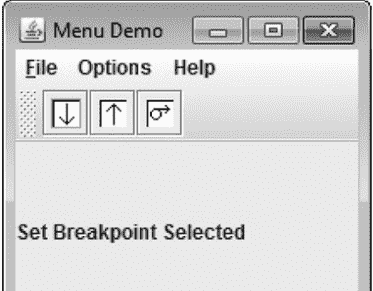

# 图 33-6 运行中的调试工具栏

除了继承的 `actionPerformed()` 方法外，`Action` 还定义了几个自己的方法。其中特别感兴趣的是 `putValue()`。它设置与动作相关的各种属性的值，如下所示：

```
void putValue(String key, Object val)
```

它将 `val` 分配给由 `key` 指定的代表所需属性的属性。虽然示例没有使用它，但值得注意的是 `Action` 还提供了 `getValue()` 方法来获取指定的属性。如下所示：

```
Object getValue(String key)
```

它返回由 `key` 指定的属性的引用。

`putValue()` 和 `getValue()` 使用的键值包括此处所示：

| 键值 (Key Value) | 说明 |
| --- | --- |
| `static final String ACCELERATOR_KEY` | 代表加速器属性。加速器指定为 `KeyStroke` 对象。 |
| `static final String ACTION_COMMAND_KEY` | 代表动作命令属性。动作命令以字符串指定。 |
| `static final String DISPLAYED_MNEMONIC_INDEX_KEY` | 代表显示的字符的索引。这是一个 `Integer` 值。 |
| `static final String LARGE_ICON_KEY` | 代表大图标。 |
| `static final String LONG_DESCRIPTION` | 代表动作的长描述。 |
| `static final String MNEMONIC_KEY` | 代表助记键。 |
| `static final String NAME` | 代表动作的名称。 |
| `static final String SELECTED_KEY` | 代表选中状态。 |
| `static final String SHORT_DESCRIPTION` | 代表快捷描述文本。 |
| `static final String SMALL_ICON` | 代表小图标。 |

例如，要将助记键设置为 X，请调用 `putValue()`：

`actionOb.setValue(MNEMONIC_KEY, VK_X);`

一个无法通过 `putValue()` 和 `getValue()` 访问的属性是禁用状态。对于这一点，你使用 `setEnabled()` 和 `isEnabled()` 方法。如下：

```
void setEnabled(boolean enabled)
boolean isEnabled()
```

对于 `setEnabled()`，如果 `enabled` 为 `true`，则动作启用；否则被禁用。如果动作是启用的，`isEnabled()` 返回 `true`；否则返回 `false`。虽然你可以自己实现所有的 `Action` 接口，但通常没有必要这样做。相反，Swing 提供了一个名为 `AbstractAction` 的部分实现供你扩展。通过扩展 `AbstractAction`，你只需要实现 `actionPerformed()` 方法。其他的 `Action` 方法由框架提供。`AbstractAction` 提供了三个构造函数。本章中使用的是如下：

```
AbstractAction(String name, Object image)
```

它构造了一个由 `name` 指定名称并由 `image` 指定图标的 `AbstractAction`。一旦创建了动作，就可以将其添加到 `JToolBar` 中并用于构造 `JMenuItem`。要将动作添加到 `JToolBar`，请使用此版本的 `add()`：

```
JButton(Action actObj)
```

此处，`actObj` 是要添加到工具栏的动作。由 `actObj` 定义的属性用于创建工具栏按钮。要从动作创建菜单项，使用 `JMenuItem` 构造函数：

```
JMenuItem(Action actObj)
```

此处，`actObj` 是根据其属性构造菜单项的动作。

注意：除了 `JToolBar` 和 `JMenuItem` 外，动作还受到其他 Swing 组件的支持，例如 `JPopupMenu`、`JButton`、`RadioButton` 和 `JCheckBox`。`JRadioButtonMenuItem` 和 `JCheckBoxMenuItem` 也支持动作。为了说明动作的好处，我们将使用它们来管理上一节创建的调试工具栏。我们还会在 Options 主菜单下添加一个子菜单。Debug 子菜单将包含与调试工具栏相同的选择：设置断点、清除断点和恢复。支持工具栏中这些项目的相同动作也将支持菜单中的这些项目。因此，你不需要创建重复的代码来处理工具栏和菜单，它们都由动作来处理。

首先创建一个扩展 `AbstractAction` 的内部类 `DebugAction`，如下：

```java
// A class to create an action for the Debug menu
// and toolbar.
class DebugAction extends AbstractAction {
    public DebugAction(String name, Icon image, int mnem,
        int accel, String tTip) {
        super(name, image);
        putValue(ACCELERATOR_KEY,
            KeyStroke.getKeyStroke(accel, InputEvent.CTRL_DOWN_MASK));
        putValue(MONEMONIC_KEY, mnem);
        putValue(SHORT_DESCRIPTION, tTip);
    }

    // Handle events for both the toolbar and the
    // Debug menu.
    public void actionPerformed(ActionEvent ae) {
        String comStr = ae.getActionCommand();

        jlab.setText(comStr + " Selected");

        // Toggle the enabled status of the
        // Set and Clear Breakpoint options.
        if(comStr.equals("Set Breakpoint")) {
            clearAct.setEnabled(true);
            setAct.setEnabled(false);
        } else if(comStr.equals("Clear Breakpoint")) {
            clearAct.setEnabled(false);
            setAct.setEnabled(true);
        }
    }
}
```

`DebugAction` 继承自 `AbstractAction`。它创建一个动作类，用于定义与 Debug 菜单和工具栏相关的属性。它的构造函数有五个参数，允许你指定以下项：

- 名称 (Name)

- 图标 (Icon)

- 记忆键 (Mnemonic)

- 加速键 (Accelerator)

- 工具提示 (Tooltip)

前两个通过 `super` 传递给 `AbstractAction` 的构造函数。另外三个属性通过调用 `putValue()` 设置。

`DebugAction` 的 `actionPerformed()` 方法处理该动作的事件。这意味着当使用 `DebugAction` 实例来创建工具栏按钮和菜单项时，由任一组件生成的事件都由 `DebugAction` 中的 `actionPerformed()` 方法处理。请注意，该处理器在 `xlab` 中显示选择内容。此外，如果选择了“设置断点”（Set Breakpoint）选项，则“清除断点”（Clear Breakpoint）选项被启用而“设置断点”选项被禁用。如果选择了“清除断点”选项，则“设置断点”选项被启用而“清除断点”选项被禁用。这说明了如何使用动作来启用或禁用组件。当动作被禁用时，该动作的所有使用处都会被禁用。在这种情况下，如果“设置断点”被禁用，那么它在工具栏和菜单中都被禁用。接下来，将这些 `DebugAction` 实例变量添加到 `MenuDemo` 中：

```java
DebugAction setAct;
DebugAction clearAct;
DebugAction resumeAct;
```

接下来，创建三个代表 Debug 选项的 `ImageIcons`，所示：

```java
// 加载动作的图像。
ImageIcon setIcon = new ImageIcon("setBP.gif");
ImageIcon clearIcon = new ImageIcon("clearBP.gif");
ImageIcon resumeIcon = new ImageIcon("resume.gif");
```

现在，创建管理 Debug 选项的动作，所示：

```java
// 创建动作。
setAct =
    new DebugAction("Set Breakpoint",
                  setIcon,
                  KeyEvent.VK_S,
                  KeyEvent.VK_B,
                  "Set a breakpoint.");

clearAct =
    new DebugAction("Clear Breakpoint",
                  clearIcon,
                  KeyEvent.VK_C,
                  KeyEvent.VK_L,
                  "Clear a breakpoint.");

resumeAct =
    new DebugAction("Resume",
                  resumeIcon,
                  KeyEvent.VK_R,
                  KeyEvent.VK_R,
                  "Resume after breakpoint.");

// 初始禁用断点选项。
clearAct.setEnabled(false);
```

注意，“设置断点”的加速键是 B，“清除断点”的加速键是 L。使用这些键而不是 S 和 C 的原因是这些键已由 File 菜单分配给“保存”（Save）和“关闭”（Close）。然而，它们仍然可以作为记忆键使用，因为每个记忆键都本地化到自己的菜单中。还要注意，代表断点的动作初始是禁用的。只有在设置断点后，它才会被启用。接下来，使用这些动作为工具栏创建按钮，然后将这些添加到工具栏中，所示：

```java
// 使用动作创建工具栏按钮。
JButton jbtnSet = new JButton(setAct);
JButton jbtnClear = new JButton(clearAct);
JButton jbtnResume = new JButton(resumeAct);
```

```java
// 创建 Debug 工具栏。
JToolBar jtb = new JToolBar("Breakpoints");
```

```java
// 将按钮添加到工具栏。
jtb.add(jbtnSet);
jtb.add(btnClear);
jtb.add(jbtnResume);
```

```java
// 将工具栏添加到内容面板的
// 北部。
jfrm.add(jtb, BorderLayout.NORTH);
```

最后，创建 Debug 菜单，所示：

```java
// 现在，创建一个位于 Options 菜单项下的 Debug 菜单。
// 使用动作创建菜单项。
JMenu jDebug = new JMenu("Debug");
JMenuItem jmiSetBP = new JMenuItem(setAct);
JMenuItem jmiClearBP = new JMenuItem(clearAct);
JMenuItem jmiResume = new JMenuItem(resumeAct);
jDebug.add(jmiSetBP);
jDebug.add(jmiClearBP);
jDebug.add(jmiResume);
jOptions.add(jDebug);
```

完成这些更改和添加后，你创建的动作将管理 Debug 菜单和工具栏。因此，更改动作中的属性（如禁用它）将影响该动作的所有使用处。程序现在看起来如图 33-7 所示。


```java
// 用于 Debug 菜单和
// 工具栏的动作类
class DebugAction extends AbstractAction {
    public DebugAction(String name, Icon image, int mnem,
        int accel, String tTip) {
        super(name, image);
        putValue(ACCELERATOR_KEY,
            KeyStroke.getKeyStroke(accel,
                Input.CTRL_DOWN_MASK));

        putValue(MNEMONIC_KEY, mnem);
        putValue(SHORT_DESCRIPTION, tTip);
    }

    // 处理工具栏和
    // Debug菜单的事件。
    public void actionPerformed(ActionEvent ae) {
        String comStr = ae.getActionCommand();

        jlab.setText(comStr + " Selected");

        // 切换设置断点和清除断点的
        // 启用状态。
        if(comStr.equals("Set Breakpoint")) {
            clearAct.setEnabled(true);
            setAct.setEnabled(false);
        } else if (comStr.equals("Clear Breakpoint")) {
            clearAct.setEnabled(false);
            setAct.setEnabled(true);
        }
    }
}
```

```java
// 创建带有记忆键和加速键的文件菜单。
void makeFileMenu() {

    JMenu jFile = new JMenu("File");
    jFile.setMnemonic(KeyEvent.VK_F);

    JMenuItem jmiOpen = new JMenuItem("Open", KeyEvent.VK_O);
    jmiOpen.setAccelerator(
        KeyStroke.getKeyStroke(KeyEvent.VK_O, KeyEvent.CTRL_DOWN_MASK));

    JMenuItem jmiClose = new JMenuItem("Close", KeyEvent.VK_C);
    jmiClose.setAccelerator(
        KeyStroke.getKeyStroke(KeyEvent.VK_C, Input.CTRL_DOWN_MASK));

    JMenuItem jmiSave = new JMenuItem("Save", KeyEvent.VK_S);
    jmiSave.setAccelerator(
        KeyStroke.getKeyStroke(KeyEvent.VK_S, KeyEvent.CTRL_DOWN_MASK));

    JMenuItem jmiExit = new JMenuItem("Exit");
    jmiExit.setAccelerator(
        KeyStroke.getKeyStroke(KeyEvent.VK_E, InputEvent.CTRL_DOWN_MASK));

    jmiFile.add(jmiOpen);
    jmiFile.add(jmiClose);
    jmiFile.add(jmiSave);
    jmiFile.addSeparator();
    jmiFile.add(jmiExit);
    jmb.add(jmiFile);

    // 为文件菜单添加动作监听器。
    jmiOpen.addActionListener(this);
    jmiClose.addActionListener(this);
    jmiSave.addActionListener(this);
    jmiExit.addActionListener(this);
}

// 创建选项菜单。
void makeOptionsMenu() {

    JMenu jOptions = new JMenu("Options");

    // 创建颜色子菜单。
    JMenu jColors = new JMenu("Colors");

    // 使用复选框选择颜色。这允许
    // 用户选择多于一种颜色。
    JCheckBox jmiRed = new JCheckBoxMenuItem("Red");
    JCheckBox jmiGreen = new JCheckBoxMenuItem("Green");
    JCheckBox jmiBlue = new JCheckBoxMenuItem("Blue");

    // 将项目添加到颜色菜单。
    jmiColors.add(jmiRed);
    jmiColors.add(jmiGreen);
    jmiColors.add(jmiBlue);
    jmiOptions.add(jmiColors);

    // 创建优先级子菜单。
    JMenu jmiPriority = new JMenu("Priority");

    // 使用单选按钮进行优先级设置。
    // 这让菜单显示使用了哪个优先级，
    // 但同时也确保任何时候只能选择且仅选择一个优先级。
    // 注意高单选按钮最初是被选中的。
    JRadioButtonMenuItem jmiHigh = new JRadioButtonMenuItem("High", true);
    JRadioButtonMenuItem jmiLow = new JRadioButtonMenuItem("Low");

    // 将项目添加到优先级菜单。
    jmiPriority.add(jmiHigh);
    jmPriority.add(jmiLow);
    jOptions.add(jPriority);

    // 为单选按钮菜单项
    // 创建一个按钮组。
    ButtonGroup bg = new ButtonGroup();
    bg.add(jmiHigh);
    bg.add(jmiLow);

    // 创建位于选项菜单栏项
    // 下方的 Debug 子菜单。使用动作
    // 创建项目。
    JMenu jDebug = new JMenu("Debug");
    JMenuItem jmiSetBP = new JMenuItem(setAct);
    JMenuItem jmiClearBP = new JMenuItem(clearAct);
    JMenuItem jmiResume = new JMenuItem(resumeAct);

    // 将项目添加到 Debug 菜单。
    jDebug.add(jmiSetBP);
    jDebug.add(jmiClearBP);
    jDebug.add(jmiResume);
    jOptions.add(jDebug);

    // 创建重置菜单项。
    JMenuItem jmiReset = new JMenuItem("Reset");
    jOptions.addSeparator();
    jOptions.add(jmiReset);

    // 最后，将整个选项菜单添加到
    // 菜单栏
    jmb.add(jOptions);

    // 为选项菜单添加动作监听器，
    // Debug 菜单支持的例外。
    jmiRed.addActionListener(this);
    jmiGreen.addActionListener(this);
    jmiBlue.addActionListener(this);
    jmiHigh.addActionListener(this);
    jmiLow.addActionListener(this);
    jmiReset.addActionListener(this);
}

// 创建帮助菜单。
void makeHelpMenu() {

    JMenu jmiHelp = new JMenu("Help");

    // 为关于菜单项添加图标。
    ImageIcon icon = new ImageIcon("About.gif");
    JMenuItem jmiAbout = new JMenuItem("About", icon);
    jmiAbout.setToolTip("Info about MenuDemo.");
    jmiHelp.add(jmiAbout);
    jmb.add(jmiHelp);

    // 为关于添加动作监听器。
    jmiAbout.addActionListener(this);
}

// 构建 Debug 菜单和
// 工具栏所需的动作。
void makeActions() {

    // 加载动作所需的图像。
    ImageIcon icon = new ImageIcon("setBP.gif");
    ImageIcon clearIcon = new ImageIcon("clearBP.gif");
    ImageIcon resumeIcon = new ImageIcon("resume.gif");

    // 创建动作。
    setAct = new DebugAction("Set Breakpoint", icon,
        KeyEvent.VK_S, KeyEvent.VK_B,
        "Set a breakpoint.");

    clearAct = new DebugAction("Clear Breakpoint", clearIcon,
        KeyEvent.VK_C, KeyEvent.VK_L,
        "Clear a breakpoint.");

    resumeAct = new DebugAction("Resume", resumeIcon,
        KeyEvent.VK_R, KeyEvent.VK_R,
        "Resume after breakpoint.");

    // 初始禁用断点选项。
    clearAct.setEnabled(false);
}

// 创建 Debug 工具栏
void makeToolbar() {

    // 使用动作创建工具栏。
    JButton jbtnSet = new JButton(setAct);
    JButton jbtnClear = new JButton(clearAct);
    JButton jbtnResume = new JButton(resumeAct);

    // 创建断点工具栏。
    jtb = new JToolbar("Breakpoints");

    // 将按钮添加到工具栏。
    jtb.add(jbtnSet);
    jtb.add(jbtnClear);
    jtb.add(jbtnResume);
}

// 创建编辑弹出菜单。
void makeEditPopupMenu() {

    jpu = new JPopupMenu();

    // 创建弹出菜单项
    JMenuItem jmiCut = new JMenuItem("Cut");
    JMenuItem jmiCopy = new JMenuItem("Copy");
    JMenuItem jmiPaste = new JMenuItem("Paste");

    // 将菜单项添加到弹出菜单。
    jpu.add(jmiCut);
    jpu.add(jmiCopy);
    jpu.add(jmiPaste);

    // 为编辑弹出菜单添加动作监听器。
    jmiCut.addActionListener(this);
    jmiCopy.addActionListener(this);
    jmiPaste.addActionListener(this);
}

public static void main(String[] args[]) {

    // 在事件分发线程上创建框架。
    SwingUtilities.invokeLater(new Runnable() {

        public void run() {

            new MenuDemo();

        }

    });

}

# 继续探索 Swing

Swing 定义了一个庞大的 GUI 工具包。它有许多你想要探索的特性。例如，它提供了对话框类，如 `JOptionPane` 和 `JDialog`，你可以用它们简化对话窗口的构建。它还提供了第 31 章之外的额外控件。你想要探索的两个 `JSpinner`（创建旋转控件）和 `JFormattedTextField`（支持格式化文本）。你还将想要尝试为各种组件定义自己的模型。坦率地说，熟悉 Swing 能力的最好方法就是尝试它。

## 部分

# IV 使用 JavaFX 进行 GUI 编程

# 第 34 章 介绍 JavaFX GUI 编程

# 第 35 章 探索 JavaFX 控件

# 第 36 章 介绍 JavaFX 菜单

# 章

# #34 介绍 JavaFX GUI 编程

像所有成功的语言一样，Java 继续不断进化和改进。这同样适用于它的库。这种演变过程最重要的例子之一可以在其 GUI 框架中找到。正如书中前面解释的，原始的 GUI 框架是 AWT。由于其局限性，很快被 Swing 取代，它提供了创建 GUI 的优优方法。Swing 是如此成功，以至于在近二十年里一直是主要的 Java GUI 框架。然而，Swing 设计于企业应用主导软件开发的时代。今天，消费者应用尤其是移动应用日益重要，此类应用程序需要具有“视觉光彩”的 GUI。此外，无论什么类型的应用程序，趋势都是更加有趣的视觉效果。为了更好地处理这类 GUI，需要一种新方法，这导致了 JavaFX 的诞生。JavaFX 是 Java 的下一代客户端平台和 GUI 框架。

JavaFX 提供了一个强大、高效且灵活的框架，简化了现代、视觉有趣的 GUI 的创建。因此，它是一个巨大的系统，正如第三部分讨论的 Swing 一样，书中无法完全描述它。相反，本章及后续章节的目的是介绍它的几个关键特性和技术。一旦你理解了基础，就会发现可以轻松地自己探索 JavaFX 的其他方面。

关于 JavaFX 自然会产生的一个问题是：JavaFX 被设计为 Swing 的替代品吗？答案是肯条件的“是”。然而，考虑到大量的 Swing 遗留代码以及大量知道为 Swing 编程的程序员，Swing 将被使用很久。这对于企业级应用尤为如此。尽管如此，JavaFX 已经明确地定位为未来的平台。预计在未来几年内，JavaFX 将在新的项目中取代 Swing。JavaFX 是任何程序员都无法忽视的。

提供了一个全面的 API。JavaFX 还支持 FXML，可以使用它（但并非强制）来指定用户界面。自 JDK 7 update 4 以来，JavaFX 一直包含在 Java 中。在本文写作时，JavaFX 的最新版本是 JavaFX 9，它包含在 JDK 9 中。因此，本文描述的 JavaFX 版本即为此版本。

注意：本章及后续两个章节假设你已经对第 24 节介绍的事件处理有基础了解，并熟悉前三个章节描述的 Swing 基础知识。

## JavaFX 基础概念

通常情况下，JavaFX 框架具备了 Swing 的所有优秀特性。例如，JavaFX 是轻量级的。它还支持 MVC 架构。你已经熟悉的关于使用 Swing 创建 GUI 的大部分知识在概念上都适用于 JavaFX。尽管如此，两者之间存在显著差异。

从程序员的角度来看，你会在 JavaFX 和 Swing 之间注意到的第一个差异是框架的方向以及主组件之间的关系。简单来说，JavaFX 提供了一种更精简、更易用且更新的方法。JavaFX 还极大地简化了对象的渲染，因为它会自动处理重绘。你的程序不再需要手动处理这项任务。上述内容并非暗示 Swing 的设计糟糕，它并非如此。这只是编程的艺术和科学已经进步，而 JavaFX 享有了这种演变的益处。简单来说，JavaFX 促进了更具视觉动态的 GUI 实现方式。

## JavaFX 包

JavaFX 元素包含在以 `javafx` 为前头的包中。在本文写作时，其 API 库中有 30 多个 JavaFX 包。以下是四个示例：`javafx.application`、`javafx.stage`、`javafx.scene` 和 `javafx.scene.layout`。虽然我们在本章中只会使用其中的几个包，但你可能想花些时间浏览它们的功能。JavaFX 提供了广泛的功能。从 JDK 9 开始，JavaFX 包被组织成模块，例如 `javafx.base`、`javafx.graphics` 和 `javafx.controls`。

## Stage（舞台）和 Scene（场景）类

JavaFX 实现的中心比喻是“舞台”（stage）。正如真实的舞台剧一样，一个舞台包含一个“场景”（scene）。因此，通俗地说，一个舞台定义了空间，一个场景定义了空间里的内容。或者换句话说，舞台是场景的容器，而场景是组成场景的项的容器。因此，JavaFX 应用程序至少有一个舞台和一个场景。这些元素在 JavaFX API 中通过 `Stage` 类和 `Scene` 类进行封装。要创建一个 JavaFX 应用程序，你至少需要向 `Stage` 添加至少一个 `Scene` 对象。让我们更仔细地观察这两个类。

`Stage` 是顶层容器。所有的 JavaFX 应用程序都可以访问一个 `Stage`，称为主舞台（primary stage）。主舞台在 JavaFX 启动时由运行时系统提供。虽然你可以创建其他阶段，但对于许多应用程序，主舞台是唯一需要的。

如前，`Scene` 是组成场景的项的容器。这些项由控件（如推送按钮和复选框）和图形组成。要创建一个场景，你将向 `Scene` 实例中添加元素。

## Nodes（节点）和场景图

场景中的单个元素被称为节点（nodes）。例如，一个推送按钮控件就是一个节点。然而，节点也可以由一组节点组成。此外，节点可以有一个子节点。在这种情况下，具有节点的节点被称为父节点（parent node）或分支节点（branch node）。没有节点的节点是终端节点（terminal nodes），也是叶子节点（leaves）。场景中所有节点的集合创建了所谓的场景图（scene graph），它包含一棵树。

场景图中有一个特殊类型的节点，称为根节点（root node）。它是顶层节点，也是场景图中唯一没有父节点的节点。因此，除根节点外，所有其他节点都有父节点，且所有节点直接或间接地源于根节点。

所有节点的基类是 `Node`。还有其他类直接或间接地是 `Node` 的子类，包括 `Parent`、`Group`、`Region` 和 `Control` 等。

## Layouts（布局）

JavaFX 提供了几种布局来管理在场景中放置元素的过程。例如，`FlowPane` 类提供了流式布局，`GridPane` 类支持基于行/列的网格布局。还有其他布局，例如 `BorderPane`（类似于 AWT 的 `BorderLayout`）。这些布局面板封装在 `javafx.scene.layout` 中。

## Application 类和生命周期方法

JavaFX 应用程序必须是 `Application` 类的子类，它封装在 `javafx.application` 中。因此，你的应用程序类将扩展 `Application`。`Application` 类定义了应用程序可以重写的三个生命周期方法。这些被称为 `init()`、`start()` 和 `stop()`，并按调用顺序在此处显示：

```
void init()
abstract void start(Stage primaryStage)
void stop()
```

`init()` 方法在应用程序开始执行时被调用。它用于执行各种初始化。然而，正如将解释的，它不能用于创建舞台或构建场景。如果不需要初始化，则不需要重写此方法，因为提供了一个空的默认版本。

`start()` 方法在 `init()` 之后被调用。这是你的应用程序开始的地方，可以使用它构建并显示场景。注意，它传递了一个 `Stage` 对象的引用。该舞台由运行时系统提供，是主舞台。

当你的应用程序终止时，会调用 `stop()` 方法。在这里你可以处理任何清理或关闭操作。如果不需要此类操作，则提供了一个空的默认版本。注意此方法是抽象的，必须由你的应用程序重写。

```java
// Override the init() method.
public void init() {
    System.out.println("Inside the init() method.");
}

// Override the start() method.
public void start(Stage myStage) {

    System.out.println("Inside the start() method.");

    // Give the stage title.
    myStage.setTitle("JavaFX Skeleton.");

    // Create a root node. In this case, a flow layout pane
    // is used, but several alternatives exist.
    FlowPane rootNode = new FlowPane();

    // Create a scene.
    Scene myScene = new Scene(rootNode, 300, 200);

    // Set the scene on the stage.
    myStage.setScene(myScene);

    // Show the stage and its scene.
    myStage.show();
}

// Override the stop() method.
public void stop() {
    System.out.println("Inside the stop() method.");
}
```

尽管这个骨架代码非常短，但它是可以编译并运行的。它会生成此处所示的空窗口。（框架的精确外观可能会根据你的执行环境略有不同）。

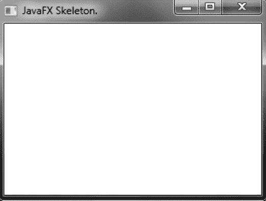

它还在控制台上输出以下内容：

```
Launching JavaFX application.
Inside the init() method.
Inside the start() method.
```

当你关闭窗口时，控制台上会显示这条消息：

```
Inside the stop() method.
```

当然，在实际程序中，生命周期方法通常不会向 `System.out` 输出任何内容。这样做仅仅是为了说明每个方法何时被调用。此外，如之前解释过的，只有当你的应用程序必须执行启动或关闭操作时，才需要重写 `init()` 和 `stop()` 方法。否则，你可以使用 `Application` 类提供的这些方法的默认实现。

让我们详细检查这个程序。它从导入包开始。第一个 `javafx.application` 包含了 `Application` 类。`Scene` 类封装在 `javafx.scene` 中，`Stage` 封装在 `javafx.stage` 中。`javafx.layout` 包提供了几种布局面板。你的程序中使用的是 `FlowPane`。

接下来，创建了应用程序类 `JavaFSkel`。注意它继承了 `Application`。正如所解释的，`Application` 是所有 JavaFX 应用程序的基类。`JavaFSkel` 两个方法：第一个是 `main()`。它通过调用 `launch()` 来启动应用程序。注意 `main()` 的 `args` 被传递给 `launch()` 方法。虽然这是常用方法，但你可以向 `launch()` 传递一组不同的参数，或者完全不传递。另一点：如之前解释的，独立运行的应用需要 `launch()`，但在其他情况下不需要。当不需要时，`main()` 和 `launch()` 会包含在本书书的 JavaFX 程序中。

当应用程序启动时，`init()` 方法首先由 JavaFX 运行时系统调用。为了便于说明，它只是简单地在 `System.out` 上显示一条消息，正常情况下它将用于初始化应用程序的某些方面。当然，如果不需要初始化，则没有必要重写 `init()`，因为提供了一个空的默认实现。需要强调的是，`init()` 不能用于创建 GUI 的阶段或场景部分。相反，这些项目应该由 `start()` 方法构造并显示。

在 `init()` 完成后，执行 `start()` 方法。在这里创建了初始场景并将其设置为主阶段（primary stage）。让我们逐行查看此方法。首先，注意 `start()` 有一个参数类型 `Stage`。当调用 `start()` 时，该参数将接收应用程序主阶段的引用。你将为应用程序的该阶段设置场景。

在在控制台上显示 `start()` 已开始执行的消息后，它通过此调用 `setTitle()` 来设置阶段的标题：

```java
myStage.setTitle("JavaFX Skeleton.");
```

虽然这一步不是必须的，但对于独立应用程序来说是惯例。此标题将成为主应用程序窗口的名称。

接下来，为场景创建一个根节点。根节点是场景图中唯一没有父节点的节点。在这种情况下，使用 `FlowPane` 作为根节点，但还有其他几个类可以用于根节点。

```java
FlowPane rootNode = new FlowPane();
```

正如前面提到的，`FlowPane` 使用流式布局。在这种布局中，元素按行对齐，并根据需要换行。（因此，它的工作方式类似于 AWT 和 Swing 使用的 `FlowLayout`）。在这种情况下，使用了水平流布局，但也可以指定垂直流布局。虽然这个骨架应用程序不需要，但也可以指定其他布局属性，例如元素之间的垂直和水平间隙以及对齐方式。你将在本章稍后的部分看到此示例。

下一行使用根节点构造了一个 `Scene`：

```java
Scene myScene = new Scene(rootNode, 300, 200);
```

`Scene` 提供了多个版本的构造函数。这里使用的该版本创建一个具有指定根节点、指定宽度和高度的场景。显示如下：

```java
Scene(Parent rootnode, double width, double height)
```

注意 `rootnode` 的类型是 `Parent`。它是 `Node` 的子类，封装了可以有子节点的节点。注意宽度和高度是 `double` 值。这允许你在需要时传递分数值。

```java
myStage.setScene(myScene);
```

```java
myStage.show();
```

在这里，`str` 是要显示的字符串。

一旦你创建了标签（或任何其他控件），就必须将其添加到场景的内容中，这意味着将其添加到场景图中。要做到这一点，你首先将会在场景图的根节点上调用 `getChildren()`。它返回一个以 `ObservableList<Node>` 形式呈现的子节点列表。`ObservableList` 封装在 `javafx.collections` 中，并继承自 `java.util.List`，这意味着它支持 Collections 框架中定义列表的所有可用功能。使用返回的子节点列表，你可以通过调用 `add()` 并传入标签的引用来将标签添加到列表中。

以下程序通过创建一个显示标签的简单 JavaFX 应用将前面的讨论付诸实践：

```java
// Demonstrate a JavaFX label.

import javafx.application.*;
import javafx.scene.*;
import javafx.scene.stage.*;
import javafx.scene.layout.*;
import javafx.scene.control.*;

public class JavaFXLabelDemo extends Application {

    public static void main(String[] args) {

        // Start the JavaFX application by calling launch().
        launch(args);
    }

    // Override the start() method.
    public void start(Stage myStage) {

        // Give the stage a title.
        myStage.setTitle("Demonstrate a JavaFX label.");

        // Use a FlowPane for the root node.
        FlowPane rootNode = new FlowPane();

        // Create a scene.
        Scene myScene = new Scene(rootNode, 300, 200);

        // Set the scene on the stage.
        myStage.setScene(myScene);

        // Create a label.
        Label myList = new Label("This is a JavaFX label");

        // Add the label to the scene graph.
        rootNode.getChildren().add(myLabel);

        // Show the stage and its scene.
        myStage.show();
    }
}
```

该程序产生了以下窗口：

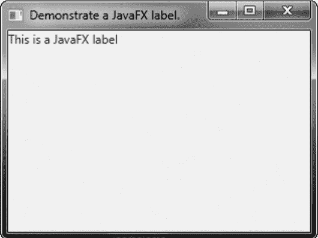

在程序中，请特别注意这一行：

`rootNode.getChildren().add(myLabel);`

它将标签添加到 `rootNode` 为父节点的子节点列表中。虽然在必要时可以将此行拆分为各个部分，但你通常会看到像这里所示的写法。

在继续之前，有用的是指出 `ObservableList` 提供了一个名为 `addAll()` 的方法，单次调用即可将两个或多个子节点添加到场景图中。（稍后你会看到一个示例）。要从场景图中移除控件，请在 `ObservableList` 上调用 `remove()`。例如，

`rootNode.getChildren().remove(myLabel);`

会将 `myLabel` 从场景中移除。

## 使用按钮和事件

虽然上一节节中的程序展示了一个使用 JavaFX 控件和构建场景图的简单示例，但它并没有显示如何处理事件。如你所知，大多数 GUI 控件都会产生由你的程序处理的事件。例如，按钮、复选框和列表在使用时会产生所有事件。在许多方面，JavaFX 中的事件处理与 Swing 或 AWT 中的事件处理相似，但它更加精简。因此，如果你已经精通处理这两个 GUI 的事件，那么使用 JavaFX 提供的事件处理系统将没有任何困难。

一种常用的控件是按钮。这使得按钮事件成为最常处理的事件之一。因此，按钮是演示 JavaFX 事件处理基础的好方法。出于这个原因，我们将事件处理的基础和按钮一起介绍。

## 事件基础

JavaFX 事件的基类是 `Event` 类，它封装在 `javafx.event` 中。它继承自 `java.util.Event`，这意味着 JavaFX 事件与其他 Java 事件共享相同的基本功能。定义了几个 `Event` 的子类。我们在这里使用的是 `ActionEvent`。它处理由按钮生成的动作事件。

通常情况下，JavaFX 使用本质上是委托事件模型的方法来处理事件。要处理一个事件，你必须先注册作为该事件监听器的处理程序。当事件发生时，监听器会被调用。它必须对事件做出响应并返回。在这方面，JavaFX 事件的管理方式非常类似于 Swing 事件，例如。

事件通过实现 `EventHandler` 接口来处理，该接口同样位于 `javafx.event`。这是一个泛型接口，格式如下：

```java
interface EventHandler<T extends Event>
```

在这里，`T` 指定了处理程序将处理的事件类型。它定义了一个方法，称为 `handle()`，该方法接收事件对象作为参数。所示如下：

```java
void handle(T eventObj)
```

在这里，`eventObj` 是生成的事件。通常，事件处理程序通过匿名内部类或 Lambda 表达式实现，但如果对你的应用程序更合适，你也可以独立类（例如，如果一个事件处理程序需要处理来自多个源的事件）。

虽然本章的示例没有要求，但有时知道事件的来源是有用的。特别是当你使用一个处理程序处理来自不同源的事件时。你可以通过调用 `getSource()` 获取事件的源，该方法继承自 `java.util.EventObject`。所示如下：

```java
Object getSource()
```

`Event` 中的其他方法允许你获取类型、确定事件是否已被消费、触发事件以及获取目标。

```java
// 使用 FlowPane 作为根节点。在此例中，
// 垂直和水平间距均为 10。
FlowPane rootNode = new FlowPane(10, 10);

// 将控件在场景中居中。
rootNode.setAlignment(Pos.CENTER);

// 创建一个场景。
Scene myScene = new Scene(rootNode, 300, 100);

// 将场景设置舞台。
myStage.setScene(myScene);

// 创建一个标签。
response = new Label("Push a Button");

// 创建两个按钮。
Button btnAlpha = new Button("Alpha");
Button btnBeta = new Button("Beta");

// 处理 Alpha 按钮的动作事件。
btnAlpha.setOnAction(new EventHandler<ActionEvent>() {
    public void handle(ActionEvent ae) {
        response.setText("Alpha was pressed.");
    }
});

// 处理 Beta 按钮的动作事件。
btnBeta.setOnAction(new EventHandler<ActionEvent>() {
    public void handle(ActionEvent ae) {
        response.setText("Beta was pressed.");
    }
});

// 将标签和按钮添加到场景图中。
rootNode.getChildren().addAll(btnAlpha, btnBeta, response);

// 显示舞台及其场景。
myStage.show();
```

此程序的示例输出在此处：

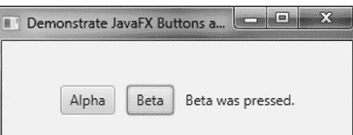

让我们检查此程序的几个关键部分。首先，注意按钮是如何通过这两行代码创建的：

```java
Button btnAlpha = new Button("Alpha");
btnBeta = new Button("Beta");
```

这创建了两个基于文本的按钮。第一个显示字符串 Alpha；第二个显示 Beta。

接下来，为每个按钮设置了动作事件处理程序。Alpha 按钮的序列显示在这里：

```java
// 处理 Alpha 按钮的动作事件。
btnAlpha.setOnAction(new EventHandler<ActionEvent>() {
    public void handle(ActionEvent ae) {
        response.setText("Alpha was pressed.");
    }
});
```

正如所解释的，按钮被设置为 `ActionEvent` 类型。要为这些事件注册处理程序，需要在按钮上调用 `setOnAction()` 方法。它使用匿名内部类来实现 `EventHandler` 接口。（记住 `EventHandler` 只定义了 `handle()` 方法。）在 `handle()` 内部，响应的文本被设置，以反映 Alpha 按钮被按下。注意，这是通过调用标签上的 `setText()` 方法完成的。Beta 按钮也以相同的方式处理事件。

在设置处理程序后，通过调用 `addAll()` 方法将响应标签以及按钮 `btnAlpha` 和 `btnBeta` 添加到场景图中：

`rootNode.getChildren().addAll(btnAlpha, btnBeta, response);`

`addAll()` 方法将节点列表添加到调用它的父节点中。当然，这些节点也可以通过三次独立的 `add()` 调用添加，但在这种情况下，使用 `addAll()` 方法更方便。

该程序中还有两个值得关注的点，与控件在窗口中的显示方式有关。首先，当创建根节点时，使用了语句：

```java
FlowPane rootNode = new FlowPane(10, 10);
```

在这里，向 `FlowPane` 构造函数传递了两个值。这些值指定了场景中元素周围留出的水平和垂直间距。如果没有指定间距，两个元素（例如两个按钮）的定位将使得它们之间没有空间。因此，控件将挤在一起，创建一个非常不可看的人机界面。指定间距可以防止这种情况。

第二个感兴趣的点是下面这一行，它设置了 `FlowPane` 中元素的对齐方式：

```java
rootNode.setAlignment(Pos.CENTER);
```

在这里，元素的对齐方式为居中。这是通过在 `FlowPane` 上调用 `setAlignment()` 实现的。`Pos.CENTER` 值指定同时使用垂直和水平中心。其他对齐也是可能的。`Pos` 是一个指定对齐常量的枚举。它被封装在 `javafx.geometry` 中。

在继续之前，还需要说明一点。之前的程序使用匿名内部类来处理按钮事件。`EventHandler` 接口只定义了一个抽象方法 `handle()`，相反可以使用 lambda 表达式来设置 `setOnAction()`。在这种情况下，`setOnAction()` 的类型将为 lambda 表达式提供目标上下文。例如，这里是使用 lambda 重写的 Alpha 按钮处理程序：

```java
btnAlpha.setOnAction( (ae) -> response.setText("Alpha was pressed."));
```

注意，lambda 表达式比匿名内部类更紧凑。由于 lambda 表达式是一个相对较新的特性，而匿名内部类是一种广泛使用的结构，几乎所有 Java 程序员都能理解，因此后续示例中的事件处理程序将使用匿名内部类。这使得允许使用 JDK 7（不支持 lambda）的读者编译这些示例。然而，在你自己的时候，你可能想尝试将它们转换为 lambda 表达式。这是获得在代码中使用 lambdas 经验的良好方法。

# 在 Canvas 上直接绘图

正如早期提到的，JavaFX 会自动为你处理渲染任务，而不是手动处理。这是 JavaFX 改进 Swing 的重要方式之一。正如你可能知道的，在 Swing 或 AWT 中，你必须调用 `repaint()` 方法来导致窗口重绘。此外，你的应用程序需要存储窗口内容，并在请求绘制时重新绘制它们。FX 消除了这种繁琐的机制，因为它跟踪你在场景中显示的内容并在需要时进行重放。这被称为保留模式（retained mode）。通过这种方法，不需要调用像 `repaint()` 这样的方法。渲染是自动的。

在显示线、圆圆和矩形等对象时，JavaFX 的渲染方法特别有用。JavaFX 的图形方法位于 `GraphicsContext` 类中，它是 `javafx.scene.canvas` 的一部分。这些方法可以直接绘制在画布表面上，画布由 `javafx.scene.canvas` 中的 `Canvas` 类封装。当你在画布上绘制内容（例如线）时，JavaFX 会在每次需要重放时自动渲染它。

在画布上绘制之前，你必须执行两个步骤。首先，你必须创建一个 `Canvas` 实例。其次，你必须获取引用画布的 `GraphicsContext` 对象。然后你可以使用 `GraphicsContext` 在画布上绘制输出。

`Canvas` 类派生自 `Node`；因此它可以作为场景图中的节点。`Canvas` 定义了两个构造函数。一个是默认构造函数，另一个是这里所示：

```java
Canvas(double width, double height)
```

在这里，`width` 和 `height` 指定了画布的尺寸。要获取引用画布的 `GraphicsContext`，调用 `getGraphicsContext2D()`。这是它的通用形式：

```java
GraphicsContext getGraphicsContext2D()
```

返回画布的图形。`GraphicsContext` 定义了大量绘制形状、文本和图像的方法，并支持效果和变换。如果你的未来涉及复杂的图形编程，你将想要研究它的功能。对于我们的目的，我们将只使用它的几个方法，但它们将让你对它的力量有一个感知。它们在这里描述。你可以使用 `strokeLine()` 绘制线，所示：

```java
void strokeLine(double startX, double startY, double endX, double endY)
```

它从 `startX,startY` 绘制到 `endX,endY`，使用当前的描触，描触可以是纯颜色。要绘制矩形，使用 `strokeRect()` 或 `fillRect()`，所示：

```java
void strokeRect(double topX, double topY, double width, double height)
void fillRect(double topX, double topY, double width, double height)
```

矩形的左上角位于 `topX,topY`。`width` 和 `height` 参数指定了宽度和高度。`strokeRect()` 方法使用当前描触绘制矩形轮廓，`fillRect()` 使用当前填充填充矩形。当前的填充可以是简单的纯色，也可以复杂的。要绘制椭圆，使用 `strokeOval()` 或 `fillOval()`，所示：

```java
void strokeOval(double topX, double topY, double width, double height)
void fillOval(double topX, double topY, double width, double height)
```

边界椭圆的矩形左上角位于 `topX,topY`。`width` 和 `height` 参数指定了宽度和高度。`strokeOval()` 方法使用当前描触绘制椭圆轮廓，`fillOval()` 使用当前填充填充椭圆。要绘制圆，请为宽度和高度传递相同的值。

你可以使用 `strokeText()` 和 `fillText()` 方法在画布上绘制文本。我们将使用这里这个版本的 `fillText()`：

```java
void fillText(String str, double topX, double topY)
```

它在 `topX,topY` 指定的位置显示 `str`，用当前填充填充文本。你可以通过 `setFont()` 设置显示的文本字体和大小。你可以通过调用 `getFont()` 获取使用的字体。默认情况下，使用系统字体。你可以通过构造 `Font` 对象创建新字体。`Font` 被封装在 `javafx.scene.text` 中。例如，你可以通过此构造函数创建一个指定大小的默认字体：

```java
Font(double fontSize)
```

在这里，`fontSize` 指定了字体的大小。你可以使用 `GraphicsContext` 定义的另外两个方法指定填充和描触：

```java
void setFill(Paint newFill)
void setStroke(Paint newStroke)
```

注意这两个方法的参数类型都是 `Paint`。这是一个封装在 `javafx.scene.paint` 包中的抽象类。它的子类定义了填充（fills）和描边（strokes）。我们将使用的是 `Color`，它简单描述一种纯色。`Color` 定义了几个静态字段，指定了多种颜色，例如 `Color.BLUE`、`Color.RED`、`Color.GREEN` 等。

下面的程序使用上述方法演示在画布上绘图。它首先在画布上显示几个图形对象。然后，每当点击“更改颜色”（Change Color）按钮时，三个对象的颜色就会发生变化。如果你运行该程序，你会发现颜色没有改变的形状不受其他对象变化的影响。此外，如果你尝试覆盖然后取消覆盖窗口，你会发现画布会自动重绘，而你的程序无需进行任何其他操作。示例输出所示：

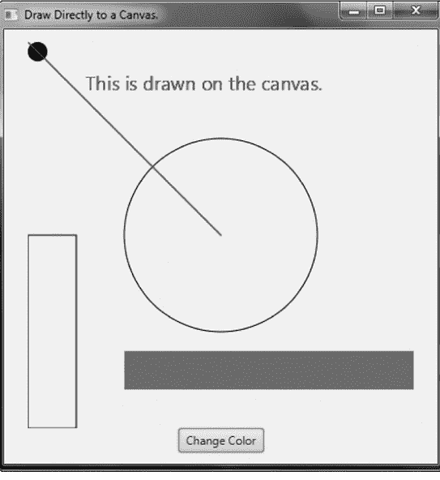

```java
// Demonstrate drawing.

import javafx.application.*;
import javafx.scene.*;
import javafx.stage.*;
import javafx.scene.layout.*;
import javafx.scene.control.*;
import javafx.event.*;
import javafx.geometry.*;
import javafx.scene.shape.*;
import javafx.scene.canvas.*;
import javafx.scene.paint.*;
import javafx.scene.text.*;

public class DirectDrawDemo extends Application {

    Graphics gc;

    Color[] colors = { Color.RED, Color.BLUE, Color.GREEN, Color.BLACK };
    int colorIdx = 0;

    public static void main(String[] args) {

        // 通过调用 launch() 启动 JavaFX 。
        launch(args);
    }

    // 重写 start (Stage) 方法。
    public void start(Stage myStage) {

        // 给阶段设置标题。
        myStage.setTitle("Draw Directly to a Canvas.");

        // 使用 FlowPane 作为根节点。
        FlowPane rootNode = new FlowPane();

        // 将节点在场景中居中。
        rootNode.setAlignment(Pos.CENTER);

        // 创建场景。
        Scene myScene = new Scene(rootNode, 450, 450);

        // 将场景设置到阶段。
        myStage.setScene(myScene);

        // 创建一个画布。
        Canvas myCanvas = new Canvas(400, 400);

        // 获取画布的图形上下文。
        gc = myCanvas.getContext2D();

        // 创建一个按钮。
        Button btnOnChange = new Button("Change Color");

        // 处理“更改颜色”按钮的动作事件。
        btnOnChange.setOnAction(new EventHandler<ActionEvent>() {
            public void handle(ActionEvent ae) {

                // 设置描边和填充颜色。
                gc.setStroke(colors[colorIdx]);
                gc.setFillColor(colors[colorIdx]);

                // 用新颜色重绘线条、文本和填充的矩形。
                // 这使得其他节点的颜色保持不变。
                gc.strokeLine(0, 0, 200, 200);
                gc.fillText("This is drawn on the canvas.", 60, 50);
                gc.fillRect(100, 320, 300, 40);

                // 更改颜色。
                colorIdx++;
                if (colorIdx == colors.length) colorIdx = 0;
            }
        });

        // 在画布上绘制初始输出。
        gc.strokeLine(0, 0, 200, 200);
        gc.strokeOval(100, 100, 200, 200);
        gc.strokeRect(0, 200, 50, 200);
        gc.fillOval(0, 0, 20, 20);
        gc.fillRect(0, 120, 300, 40);

        // 将字体大小设为 20 并绘制文本。
        gc.setFont(new Font(20));
        gc.fillText("This is drawn on the canvas.", 60, 50);

        // 将画布和按钮添加到场景。
        rootNode.getChildren().addAll(myCanvas, btnOnChange);

        // 显示阶段。
        myStage.show();
    }
}
```

```java
// 在舞台上设置场景。
myStage.setScene(myScene);
```

```java
// 创建一个图像。
Image hourglass = new Image("hourglass.png");
```

```java
// 创建一个使用该图像的图像视图。
ImageView hourglassIV = new ImageView(hourglass);
```

```java
// 将图像添加到场景图中。
rootNode.getChildren().add(hourglassIV);
```

```java
// 显示舞台及其场景。
myStage.show();
```

程序的输出示例在此处处：

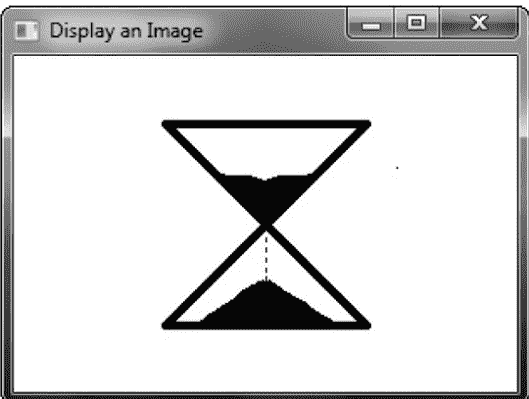

在程序中，请密切关注以下序列，它加载了图像然后创建一个使用该图像的 `ImageView`：

```java
// 创建一个图像。
Image hourglass = new Image("HourGlass.png");
```

```java
// 创建一个使用该图像的图像视图。
ImageView hourglassIV = new ImageView(hourglass);
```

正如所解释的，图像本身不能被添加到场景图中。它必须首先嵌入到 `ImageView` 中。

在你不打算进一步使用该图像的情况下，可以在创建 `ImageView` 时指定 URL 或文件名。在这种情况下，不需要显式地创建 `Image`。相反，系统会自动构造一个包含指定图像的 `Image` 实例并嵌入 `ImageView` 中。这里是执行此操作的 `ImageView` 构造函数：

```java
ImageView(String url)
```

此处，`url` 指定了包含图像的 URL 或文件路径。

# 为 Label 添加图像

正如在前一章中解释的，`Label` 类封装了一个标签（Label）。它可以显示文本消息、图形或两者兼有。到目前为止，我们只用它来显示文本，但添加图像非常简单。要做到这一点，请使用 `Label` 构造函数的这种形式：

```java
Label(String str, Node image)
```

在此，`str` 指定文本消息，`image` 指定图像。注意，图像的类型是 `Node`。这允许添加到标签中的图像类型具有很高的灵活性，但对我们的目的而言，图像类型将是 `ImageView`。

这里是一个演示包含图形的标签的程序。它创建了一个显示字符串 "Hourglass" 的标签，并显示了从 `hourglass.png` 文件加载的沙漏图像。

```java
// 在 label中演示图像。

import javafx.application.*;
import javafx.scene.*;
import javafx.stage.*;
import javafx.scene.layout.*;
import javafx.scene.control.*;
import javafx.geometry.*;
import javafx.scene.image.*;

public class LabelImageDemo extends Application {

    public static void main(String[] args) {

        // 通过 launch() 启动 JavaFX 。
        launch(args);
    }

    // 重写 start() 方法。
    public void start(Stage myStage) {

        // 给舞台设置一个标题。
        myStage.setTitle("Use an Image in a Label");

        // 使用 FlowPane 作为根节点。
        FlowPane rootNode = new FlowPane();

        // 使用居中对齐。
        rootNode.setAlignment(Pos.CENTER);

        // 创建一个场景。
        Scene myScene = new Scene(rootNode, 300, 200);

        // 在舞台上设置场景。
        myStage.setScene(myScene);

        // 创建一个包含指定图像的 ImageView。
        ImageView hourglassIV = new ImageView("hourglass.png");

        // 创建一个包含图像和文本的标签。
        Label hourglassLabel = new Label("Hourglass", hourglassIV);

        // 将标签添加到场景图中。
        rootNode.getChildren().add(hourglassLabel);

        // 显示舞台及其场景。
        myStage.show();
    }
}
```

这里是程序产生的窗口：

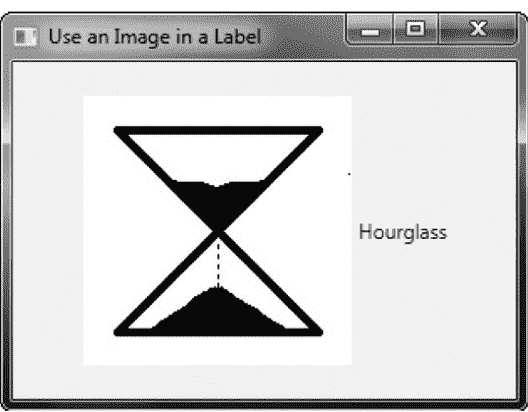

如你所示，图像和文本都显示了。注意文本在图像的右侧。这是默认设置。你可以通过调用 label 上的 `setContentDisplay()` 来更改图像和文本的相对位置。显示在此处：

```java
final void setContentDisplay(ContentDisplay position)
```

传递给 `position` 的值决定了文本和图像的显示方式。它必须是这些值之一，这些值由 `ContentDisplay` 枚举定义：

| BOTTOM | RIGHT |
| :--- | :--- |
| CENTER | TEXT_ONLY |
| GRAPHIC_ONLY | TOP |
| LEFT | |

除了 `TEXT_ONLY` 和 `GRAPHIC_ONLY` 之外，这些值指定了图像的位置。例如，如果你在前面的程序中添加此行：

`hourglassLabel.setContent(ContentDisplay.TOP);`

沙漏的图像将位于文本上方，如下所示：

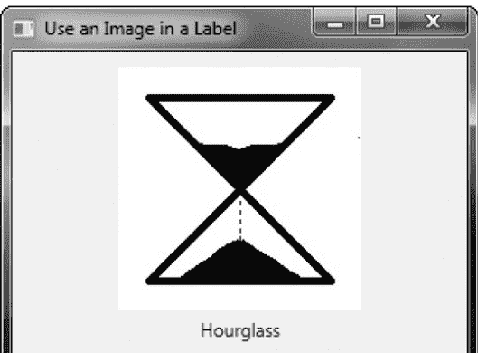

另外两个值允许你显示文本或仅显示图像。如果你的应用程序想要某些时候使用图像，而在某些时候不使用，这可能很有用。例如。（如果你只需要图像，你可以简单）

# 在按钮中使用图像

`Button` 是 JavaFX 用于按钮的类。前面的章节引入了 `Button` 类。在那里你看到了包含文本的按钮示例。你也可以使用 `setGraphic()` 方法为按钮添加图像。显示在此处：

```java
final void setGraphic(Node)
```

此处，`image` 指定要添加的图像。你可以像对 `Label` 一样使用 `setContentDisplay()` 来指定图像相对于文本的位置。这是一个显示图像的示例：

```java
// 使用图像的按钮。

import javafx.application.*;
import javafx.scene.*;
import javafx.stage.*;
import javafx.scene.layout.*;
import javafx.scene.control.*;
import javafx.geometry.*;
import javafx.scene.image.*;
import javafx.event.*;

public class ButtonImageDemo extends Application {

    Label response;

    public static void main(String[] args) {

        // 通过 launch() 启动 JavaFX 。
        launch(args);
    }

    // 重写 start() 方法。
    public void start(Stage myStage) {

        // 给舞台设置一个标题。
        myStage.setTitle("Use Images with Buttons");

        // 使用 FlowPane 作为根节点。在这种情况下，
        // 垂直和水平间隙为 10。
        FlowPane rootNode = new FlowPane(10, 10);

        // 在场景中居中控件。
        rootNode.setAlignment(Pos.CENTER);

        // 创建一个场景。
        Scene myScene = new Scene(rootNode, 250, 450);

        // 在舞台上设置场景。
        myStage.setScene(myScene);

        // 创建一个标签。
        response = new Label("Push a Button");

        // 创建两个基于图像的按钮。
        Button btnHourglass = new Button("Hourglass",
            new ImageView("hourglass.png"));
        Button btnAnalogClock = new Button(new ImageView("analog.png"));

        // 将文本放在图像下方。
        btnHourglass.setContentDisplay(ContentDisplay.TOP);
        btnAnalogClock.setContentDisplay(ContentDisplay.TOP);

        // 处理沙漏按钮的动作事件。
        btnHourglass.setOnAction(new EventHandler<ActionEvent>() {
            public void handle(ActionEvent ae) {
                response.setText("Hourglass Pressed");
            }
        });

        // 处理模拟时按钮的动作事件。
        btnAnalogClock.setOnAction(new EventHandler<ActionEvent>() {
            public void handle(ActionEvent ae) {
                response.setText("Analog Clock Pressed");
            }
        });

        // 将标签和按钮添加到场景图中。
        rootNode.getChildren().addAll(btnHourglass, btnAnalogClock, response);

        // 显示舞台及其场景。
        myStage.show();
    }
}
```

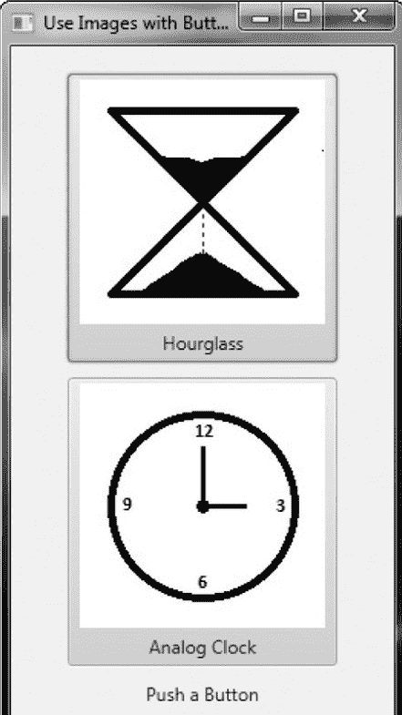

如果你想要一个只包含图片的按钮，在构造按钮时为文本传递一个空字符串，然后调用 `setContentDisplay()` 并传入参数 `ContentDisplay.GRAPHIC_ONLY`。例如，如果你对之前的程序进行这些修改，输出将如下所示：

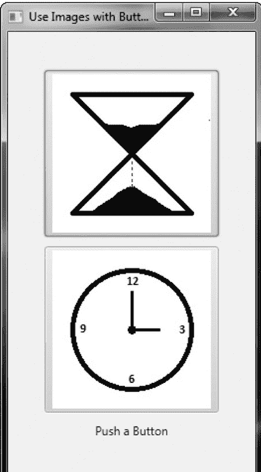

## ToggleButton

推按钮（push button）的一种有用变体是切换按钮（toggle button）。切换按钮看起来和推按钮完全一样，但它的行为不同，因为它有两个状态：按下（pushed）和释放（released）。也就是说，当你按下切换按钮时，它会保持被按下状态，而不是像普通推按钮那样弹回。当你再次按下切换按钮时，它会释放（弹起）。因此，每次按下切换按钮时，它都会在这两个状态之间切换。在 JavaFX 中，切换按钮封装在 `ToggleButton` 类中。像 `Button` 一样，`ToggleButton` 也派自 `ButtonBase`。它实现了 `Toggle` 接口，该接口定义了所有双状态按钮的共同功能。

`ToggleButton` 定义了三个构造函数。我们将使用这一个：

```java
ToggleButton(String str)
```

在这里，`str` 是在按钮上显示的文本。另一个构造函数允许你包含一张图片。和其他按钮一样，`ToggleButton` 在被按下时会产生动作事件（action event）。

由于 `ToggleButton` 定义了一个双状态控件，它通常用于让用户选择一个选项。当按钮被按下时，选项被选中；当按钮被释放时，选项被取消。由于这个原因，程序通常需要确定切换按钮的状态。要这样做，请使用这里的 `isSelected()` 方法：

```java
final boolean isSelected()
```

如果按钮被按下则返回 `true`，否则返回 `false`。

这里有一个演示 `ToggleButton` 的短程序：

```java
// Demonstrate a toggle button.

import javafx.application.*;
import javafx.scene.*;
import javafx.scene.stage.*;
import javafx.scene.layout.*;
import javafx.scene.control.*;
import javafx.event.*;
import javafx.geometry.*;

public class ToggleButtonDemo extends Application {

    ToggleButton tbOnOff;
    Label response;

    public static void main(String[] args) {

        // Start the JavaFX application by calling launch().
        launch(args);
    }

    // Override the start() method.
    public void start(Stage myStage) {

        // Give the stage a title.
        myStage.setTitle("Demonstrate a Toggle Button");

        // Use a FlowPane for the root node. In this case,
        // vertical and horizontal gaps of 10.
        FlowPane rootNode = new FlowPane(10, 10);

        // Center the controls in the scene.
        rootNode.setAlignment(Pos.CENTER);

        // Create a scene.
        Scene myScene = new Scene(rootNode, 220, 120);

        // Set the scene on the stage.
        myStage.setScene(myScene);

        // Create a label.
        response = new Label("Push the Button.");

        // Create the toggle button.
        tbOnOff = new ToggleButton("On/Off");

        // Handle action events for the toggle button.
        tbOnOff.setOnAction(new EventHandler<ActionEvent>() {
            public void handle(ActionEvent ae) {
                if (tbOnOff.isSelected()) response.setText("Button is on.");
                else response.setText("Button is off.");
            }
        });

        // Add the label and buttons to the scene graph.
        rootNode.getChildren().addAll(tbOnOff, response);

        // Show the stage and its scene.
        myStage.show();
    }
}
```

程序产生的示例输出在此处显示，按钮已被按下。

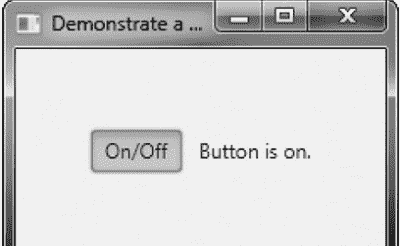

在程序中，请注意切换按钮的按下/释放状态是通过按钮动作处理器内部的以下几行代码决定的：

```java
if (tbOnOff.isSelected()) response.setText("Button is on.");
else response.setText("Button is off.");
```

当按钮被按下时，`isSelected()` 返回 `true`。当按钮被释放时，`isSelected()` 返回 `false`。

另一点：可以在一组中使用两个或多个切换按钮。在这种情况下，任何时刻只能有一个按钮处于按下状态。创建和使用一组切换按钮的过程与使用单选按钮（radio buttons）的要求相似。将在下一节中描述。

## RadioButton

JavaFX 提供的另一种按钮是单选按钮（radio button）。单选按钮是一组互斥按钮，任何时刻只有一个按钮被选中。它们由 `RadioButton` 类和 `ToggleButton` 支持。它也实现了 `Toggle` 接口。因此，单选按钮是切换按钮的一种特殊形式。你几乎肯定见过单选按钮的运行，因为当用户必须选择一个选项时，它是首选控件。

```java
// 将每个按钮添加到切换组中。
rbTrain.setToggleGroup(tg);
rbCar.setToggleGroup(tg);
rbPlane.setToggleGroup(tg);

// 处理单选按钮的动作事件。
rbTrain.setOnAction(new EventHandler<ActionEvent>() {
    public void handle(ActionEvent ae) {
        response.setText("Transport selected is train.");
    }
});

rbCar.setOnAction(new EventHandler<ActionEvent>() {
    public void handle(ActionEvent ae) {
        response.setText("Transport selected is car.");
    }
});

rbPlane.setOnAction(new EventHandler<ActionEvent>() {
    public void handle(ActionEvent ae) {
        response.setText("Transport selected is airplane.");
    }
});

// 为第一个选择触发事件。这会导致
// 该单选按钮被选中，并触发该
// 按钮的动作事件。
rbTrain.fire();

// 将标签和按钮添加到场景图中。
rootNode.getChildren().addAll(rbTrain, rbCar, rbPlane, response);

// 显示阶段及其场景。
myStage.show();
```

示例输出在此处：

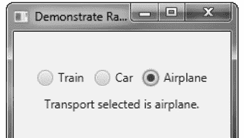

在程序中，请特别注意单选按钮和切换组（toggle group）是如何创建的。首先，使用以下序列创建按钮：

```java
RadioButton rbTrain = new RadioButton("Train");
RadioButton rbCar = new RadioButton("Car");
RadioButton rbPlane = new RadioButton("Airplane");
```

接下来，构造一个 `ToggleGroup`：

```java
ToggleGroup tg = new ToggleGroup();
```

最后，将每个单选按钮添加到切换组中：

```java
rbTrain.setToggleGroup(tg);
rbCar.setToggleGroup(tg);
rbPlane.setToggleGroup(tg);
```

正如所解释的那样，单选按钮必须是切换组的一部分，才能激活它们的互斥行为。

在定义了每个单选按钮的事件处理器后，通过对 `rbTrain` 按钮调用 `fire()` 来选中它。这会导致该按钮被选中并为它生成一个动作事件。这使得按钮以默认选择进行初始化。

# 在切换组中处理更改事件

虽然从本质上说通过动作事件管理单选按钮没有问题，但有时监听整个切换组的变化更为合适（也更简单）。当发生变化时，事件处理器可以轻松地确定出是哪一个单选按钮被选中了，并采取相应的操作。要使用这种方法，你必须为切换组注册一个 `ChangeListener`。当发生更改事件时，你就可以确定选中了哪个按钮。要尝试这种方法，请从前面的程序中移除事件处理器和 `fire()` 调用，并替换为以下内容：

```java
// 使用更改监听器来响应单选按钮组
// 内部选择的变化。
tg.selectedProperty().addListener(new ChangeNotifier<Toggle>() {
    public void changed(ObservableValue<? extends Toggle> changed,
        Toggle oldVal, Toggle newVal) {

        // 转换为新的 RadioButton。
        RadioButton rb = (RadioButton) newVal;

        // 显示选择结果。
        response.setText("Transport selected is " + rb.getText());
    }
});

// 选中第一个按钮。这将导致
// 切换组产生更改事件。
rBTrain.setSelected(true);
```

你还需要添加此导入语句：

`import javafx.beans.value.*;`

它支持 `ChangeNotifier` 接口。

此程序的输出与之前相同；每次做出选择时，响应标签都会更新。然而，在这种情况下，整个条目组只需要一个事件处理器，而不是三个（每个按钮一个）。让我们更仔细地观察这段代码。

首先，为切换组注册了一个事件监听器。要监听更改事件，你必须实现 `ChangeChangeListener` 接口。这是通过在 `selectedToggleProperty()` 返回的对象上调用 `addChangeListener()` 完成的。`ChangeListener` 接口只定义了一个方法，称为 `changed(T)`。它显示在这里：

```java
void changed(ObservableValue<T> oldVal, T newVal)
```

在这种情况下，`changed` 是 `ObservableValue<T>` 的实例，它封装了一个可以被监听变化的对象。`oldVal` 和 `newVal` 参数分别传递旧值和新值。因此，在这种情况下，`newVal` 包含了刚被选中的单选按钮的引用。

在这个示例中，调用的是 `setSelected()` 方法而不是 `fire()` 来设置初始选择。因为设置初始选择会导致切换组发生变化，因此当程序启动时会生成一个更改事件。

你也可以使用 `fire()`，但使用 `setSelected()` 是为了演示对切换组的任何更改都会生成更改事件。

# 处理单选按钮另一种方法

虽然处理单选按钮生成的事件通常很有用，但有时忽略这些事件并在需要信息时直接获取当前选中的按钮更为合适。接下来的程序演示了这种方法。它添加了一个名为“确认交通选择”的按钮。当按下此按钮时，将获取当前选中的单选按钮，然后将选中的交通工具显示在标签中。当你尝试运行程序时，注意到在按下“确认交通选择”按钮之前，更改选中的单选按钮不会导致确认的交通工具发生变化。

```java
// 这个单选按钮示例演示了如何
// 获取组内当前选中的按钮，
// 而不是通过响应动作或
// 事件来处理。

import javafx.application.*;
import javafx.scene.*;
import javafx.scene.layout.*;
import javafx.event.*;
import javafx.geometry.*;
import javafx.scene.control.*;

public class RadioButton2 extends Application {

    Label response;
    ToggleGroup tg;

    public static void main(String[] args) {

        // 调用 launch 启动 JavaFX 。
        launch(args);
    }

    // 重写 start 方法。
    public void start(Stage myStage) {

        // 给阶段设置标题。
        myStage.setTitle("Demonstrate Buttons");

        // 使用 FlowPane 作为根节点。在这种情况下，
        // 垂直和水平间隙为 10。
        FlowPane rootNode = new FlowPane(10, 10);

        // 在场景中居中控件。
        rootNode.setAlignment(Pos.CENTER);

        // 创建场景。
        Scene myScene = new Scene(rootNode, 200, 140);

        // 将场景设置阶段。
        myStage.setScene(myScene);

        // 创建两个标签。
        Label choose = new Label(" Select a Transport Type ");
        response = new Label("No transport confirmed");

        // 创建用于确认选择的按钮。
        Button btnConfirm = new Button("Confirm Transport Selection");

        // 创建单选按钮。
        RadioButton rbTrain = new Button("Train");
        RadioButton rbCar = new Button("Car");
        RadioButton rbPlane = new Button("Airplane");

        // 创建切换组。
        tg = new ToggleGroup();

        // 将每个按钮添加到切换组中。
        rbTrain.setToggleGroup(tg);
        rbCar.setToggleGroup(tg);
        rbPlane.setToggleGroup(tg);

        // 初始选中一个单选按钮。
        rbTrain.setSelected(true);

        // 处理确认按钮的动作事件。
        btnConfirm.setOnAction(new EventHandler<ActionEvent>() {
            public void handle(ActionEvent ae) {
                // 获取当前选中的单选按钮。
                RadioButton rb = (RadioButton) tg.getSelectedToggle();

                // 显示选择结果。
                response.setText(rb.getText() + " is confirmed.");
            }
        });

        // 使用分隔器更好地组织布局。
        Separator separator = new Separator();
        separator.setPrefWidth(180);

        // 将标签和按钮添加到场景图中。
        rootNode.getChildren().addAll(choose, rbTrain, rbCar, rbPlane,
            separator, btnConfirm, response);

        // 显示阶段及其场景。
        myStage.show();
    }
}
```

程序的输出显示此处：

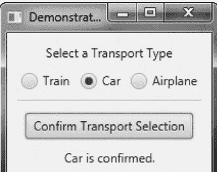

程序的大部分很容易理解，但有两个关键点特别值得关注。首先，在 `btnConfirm` 按钮的事件处理器内部，注意通过以下方式获取选中的单选按钮：

```java
RadioButton rb = (RadioButton) tg.getSelectedToggle();
```

在这里，`getSelectedToggle()` 方法（由 `ToggleGroup` 定义）获取切换组的当前选择项（在这种情况下，这是一个单选按钮组）。它的定义如下：

```java
final Toggle getSelectedToggle()
```

它返回一个对被选中的 `Toggle` 的引用。在这种情况下，返回值被强制转换为 `RadioButton`，因为这是该组中按钮的类型。

第二个需要注意的是使用了视觉分隔符，它是通过以下序列创建的：

```java
Separator separator = new Separator();
separator.setPrefWidth(180);
```

`Separator` 类创建一条线，可以是垂直的也可以是水平的。默认情况下，它创建一条水平线。（第二个构造函数允许你选择垂直分隔符。）`Separator` 在视觉上组织控件的布局。它被封装在 `javafx.scene.control` 包中。接下来，通过调用 `setPrefWidth()` 并传入宽度来设置分隔符线的宽度。

## CheckBox

`CheckBox` 类封装了复选框的功能。它的直接父类是 `ButtonBase`。虽然你对复选框非常熟悉，因为它们是广泛使用的控件，但 JavaFX 复选框比你最初想的要复杂一些。这是因为 `CheckBox` 支持三种状态。前两种如你所预期的勾选（checked）或未勾选（unchecked），这是默认行为。第三种状态是不确定（indeterminate，也称为未定义）。它通常用于表示复选框的状态未设置，或者它与特定情况无关。如果你需要不确定状态，将显式启用它。

`CheckBox` 定义了两个构造函数。第一个是默认构造函数。第二个允许你指定一个标识该框的字符串。它的定义如下：

```java
CheckBox(String str)
```

它创建了一个带有 `str` 指定文本作为标签的复选框。与其他按钮一样，`CheckBox` 在被选中时会产生动作事件。

这是一个演示复选框的程序。它显示了允许用户选择各种部署选项的复选框，即 Web、Desktop 和 Mobile。每复选框状态改变时，就会生成一个动作事件，并通过显示新状态（选中或清除）以及显示所有选中框的列表来处理该事件。

```java
// Demo复选框。

import javafx.application.*;
import javafx.scene.*;
import javafx.stage.*;
import javafx.scene.layout.*;
import javafx.scene.control.*;
import javafx.event.*;
import javafx.geometry.*;

public class CheckboxDemo extends Application {

    CheckBox cbWeb;
    CheckBox cbDesktop;
    CheckBox cbMobile;

    Label response;
    Label allTargets;

    String targets = "";

    public static void main(String[] args) {

        // 通过 launch() 启动 JavaFX 。
        launch(args);
    }

    // 重写 start() 方法。
    public void start(Stage myStage) {

        // 给阶段设置标题。
        myStage.setTitle("Demonstrate Checkboxes");

        // 使用 FlowPane 作为根节点。在这种情况下，
        // 垂直间距为 10。
        FlowPane rootNode = new FlowPane(10, 10);

        // 将控件在场景中居中。
        rootNode.setAlignment(Pos.CENTER);

        // 创建场景。
        Scene myScene = new Scene(rootNode, 230, 140);

        // 在阶段上设置场景。
        myStage.setScene(myScene);

        Label heading = new Label("Select Deployment Options");

        // 创建一个标签，用于报告被选
        // 复选框的状态。
        response = new Label("No Deployment Selected");

        // 创建一个标签，用于报告所有选中的目标。
        allTargets = new Label("Target List: <none>");

        // 创建复选框。
        cbWeb = new CheckBox("Web");
        cbDesktop = new CheckBox("Desktop");
        cbMobile = new CheckBox("Mobile");

        // 处理复选框的动作事件。
        cbWeb.setOnAction(new EventHandler<ActionEvent>() {
            public void handle(ActionEvent ae) {
                if (cbWeb.isSelected())
                    response.setText("Web deployment selected.");
                else
                    response.setText("Web deployment cleared.");

                showAll();
            }
        });

        cbDesktop.setOnAction(new EventHandler<ActionEvent>() {
            public void handle(ActionEvent ae) {
                if (cbDesktop.isSelected())
                    response.setText("Desktop deployment selected.");
                else
                    response.setText("Desktop deployment cleared.");

                showAll();
            }
        });

        cbMobile.setOnAction(new EventHandler<ActionEvent>() {
            public void handle(ActionEvent ae) {
                if (cbMobile.isSelected())
                    response.setText("Mobile deployment selected.");
                else
                    response.setText("Mobile deployment cleared.");

                showAll();
            }
        });

        // 使用分隔符更好地组织布局。
        Separator separator = new Separator();
        separator.setPrefWidth(200);

        // 将控件添加到场景图中。
        rootNode.getChildren().addAll(heading, separator, cbWeb,
            cbDesktop, cbMobile, allTargets, response);

        // 显示阶段和场景。
        myStage.show();
    }

    // 更新目标列表。
    void showAll() {
        targets = "";
        if (cbWeb.isSelected()) targets += "Web ";
        if (cbDesktop.isSelected()) targets += "Desktop ";
        if (cbMobile.isSelected()) targets += "Mobile ";

        if (targets.equals("")) targets = "<none>";

        allTargets.setText("Target List: " + targets);
    }
}
```

示例输出如下：

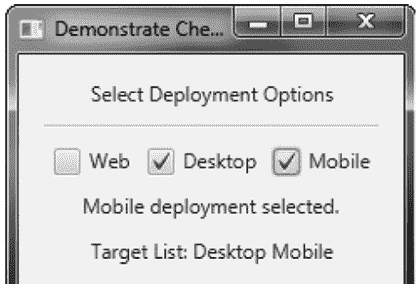

此程序的操作是直观的。每当复选框改变时，就会产生一个动作事件。要确定框是否勾选或未勾选，可以调用 `isSelected` 方法。

如前所述，默认情况下 `CheckBox` 实现两种状态：勾选和未勾选。如果你想添加不确定状态，必须显式启用。为此，调用 `setIndeterminate()`，其定义如下：

```java
final void setIndeterminate(boolean enable)
```

在这种情况下，如果 `enable` 为 `true`，则启用不确定状态。否则，它被禁用。你可以通过调用 `isIndeterminate()` 来判断复选框是否处于不确定状态，其定义如下：

```java
final boolean isIndeterminate()
```

如果复选框状态是不确定的，它返回 `true`，否则返回 `false`。你可以通过修改前面的程序查看三状态复选框的效果。首先，通过对每个复选框调用 `setIndeterminate()` 来启用不确定状态，如下：

```java
cbWeb.setIndeterminate(true);
cbDesktop.setIndeterminate(true);
cbMobile.setIndeterminate(true);
```

接下来，在动作处理器内部处理不确定状态。例如，这里是 `cbWeb` 的修改处理器：

```java
cbWeb.setOnAction(new EventHandler<ActionEvent>() {
    public void handle(ActionEvent ae) {
        if (cbWeb.isIndeterminate()) {
            response.setText("Web deployment indeterminate.");
        } else if (cbWeb.isSelected()) {
            response.setText("Web deployment selected.");
        } else
            response.setText("Web deployment cleared.");

        showAll();
    }
});
```

现在，以相同的方法更新另外两个处理器。进行这些更改后，可以选择不确定状态，如此示例输出所示：

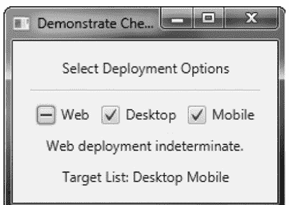

在这里，Web 复选框是不确定的。

## ListView

另一个常用的控件是列表视图，它在 JavaFX 中由 `ListView` 封装。列表视图是显示项目列表的控件，你可以从中选择一个或多个。由于能够有效地利用有限的屏幕空间，列表视图是其他类型控件流行的替代方案。`ListView` 是一个泛类，声明如下：

```java
class ListView<T>
```

在这里，`T` 指定存储在列表视图中的项类型。通常这些项是 `String` 类型，但也允许其他类型。`ListView` 定义了两个构造函数。第一个是默认构造函数，它创建一个空的 `ListView`。第二个参数允许指定列表中的条目列表。如下：

```java
ListView<ObservableList<T>> list
```

在这里，`list` 指定了将显示的项列表。它是一个 `ObservableList` 类型的对象，定义了一个可观察对象的列表。它继承自 `java.util.List`。因此，它支持标准的集合方法。`ObservableList` 封装在 `javafx.collections` 中。

为在 `ListView` 中使用创建一个 `ObservableList`，可能最简单的方法是使用工厂方法 `observableArrayList()`，它是 `FXCollections` 类定义的一个静态方法（该类也封装在 `javafx.collections` 中）。我们将使用的版本如下所示：

```java
static <E> ObservableList<E> observableArrayList( ... elements)
```

在这种情况下，`E` 指定了元素的类型，这些类型通过 `elements` 传递。

默认情况下，`ListView` 在任何一个时刻只允许列表中的一个项目被选中。目前，我们将使用默认的单选型模型。

虽然 `ListView` 提供了默认大小，但有时你可能需要设置首选高度和/或宽度以匹配你的需求。实现此目的的方法之一是调用此处所示的 `setPrefHeight()` 和 `setPrefWidth` 方法：

```java
final void setPrefHeight(double height)
final void setPrefWidth(double width)
```

或者，你可以使用 `setPrefSize()` 单次调用来同时设置两个维度，如下：

```java
void setPrefSize(double width, double height)
```

使用 `ListView` 有两种基本方式。首先，你可以忽略列表生成的事件，仅在程序需要时直接获取列表中的选择项。其次，你可以通过注册一个更改监听器（change listener）来监控列表的变化。这让你在用户每次更改列表中的选择时都能做出响应。这里使用的就是这种方法。

要监听更改事件，你必须首先获取 `ListView` 使用的选择模型。这是通过在列表上调用 `getSelection()` 完成的。如下所示：

```java
final MultipleSelectionModel<T> getSelectionModel()
```

它返回该模型的引用。`MultipleSelectionModel` 是一个定义用于多选的模型的类，并继承自 `SelectionModel`。然而，只有在开启了多选模式时，`ListView` 才允许多选。

使用由 `getSelectionModel()` 返回的模型，你将获得选中项属性的引用，该属性定义了当列表中的元素被选中时发生什么。这是通过调用 `selectedItemProperty()` 完成的，如下所示：

```java
final ReadOnlyObjectProperty<T> selectedItemProperty()
```

你将向此属性添加更改监听器。

接下来的示例将前面的讨论付诸实践。它创建一个显示各种类型交通工具的列表视图，允许用户选择一个。当选中其中一个时，将显示该选择项。

```java
// 一个列表视图。

import javafx.application.*;
import javafx.scene.*;
import javafx.stage.*;
import javafx.scene.layout.*;
import javafx.scene.control.*;
import javafx.geometry.*;
import javafx.beans.value.*;
import javafx.collections.*;

public class ListViewDemo extends Application {

    Label response;

    public static void main(String[] args) {

        // 通过 launch() 启动 JavaFX 应用程序。
        launch(args);
    }

    // 重写 start() 方法。
    public void start(Stage myStage) {

        // 给阶段设置标题。
        myStage.setTitle("ListView Demo");

        // 使用 FlowPane 作为根节点。在这种情况下，
        // 垂直和水平间隙为 10。
        FlowPane rootNode = new FlowPane(10, 10);

        // 控件在场景中居中。
        rootNode.setAlignment(Pos.CENTER);

        // 创建场景。
        Scene myScene = new Scene(rootNode, 200, 120);

        // 在阶段上设置场景。
        myStage.setScene(myScene);

        // 创建一个标签。
        response = new Label("Select Transport Type");

        // 为列表视图创建一个条目目的 ObservableList。
        ObservableList<String> transportTypes =
            FXCollections.observableArray("Train", "Car", "Airplane");

        // 创建列表视图。
        ListView<String> lvTransport = new ListView<String>(transportTypes);

        // 设置首选的高度和宽度。
        lvTransport.setPrefSize(80, 80);

        // 获取列表选择模型。
        MultipleSelectionModel<String> lvSelModel =
            lvTransport.getSelectionModel();

        // 使用更改监听器来响应列表视图
        // 选择的变化。
        lvSelModel.selectedItemProperty().addListener(
            new ChangeNotifier<String>() {
                public void changed(ObservableValue<? extends String> changed,
                    String oldVal, String newVal) {

                    // 显示选择项。
                    response.setText("Transport selected is " + newVal);
                }
            });

        // 将标签和列表视图添加到场景图中。
        rootNode.getChildren().addAll(lvTransport, response);

        // 显示阶段和其场景。
        myStage.show();
    }
}
```

示例输出如下：

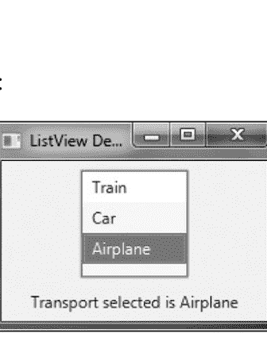

在程序中，特别注意 `ListView` 是如何构建的。首先，通过这一行创建了一个 `ObservableList`：

```java
ObservableList<String> transportTypes =
    FXCollections.observableArrayList( "Train", "Car", "Airplane" );
```

它使用 `observableArrayList()` 方法创建一个字符串列表。然后，使用 `ObservableList` 初始化 `ListView`，如下所示：

```java
ListView<String> lvTransport = new ListView<String>(transportTypes);
```

程序随后设置了控件的首选宽度和高度。现在，注意如何为 `lvTransport` 获取选择模型：

```java
MultipleSelectionModel<String> lvSelectionModel =
    lvTransport.getSelectionModel();
```

正如所解释的，即使只允许单选，`ListView` 也使用 `MultipleSelectionModel`。然后在模型上调用了 `selectedItemProperty()` 方法，并在返回的项上注册了一个更改监听器。

# ListView 滚动条

`ListView` 的一个非常有用的功能是，当列表中的项目数量超过在其尺寸内可以显示的数量时，会自动添加滚动条。例如，如果你更改 `transportTypes` 的声明，使其包含“Bicycle”和“Walking”，如下所示：

```java
ObservableList<String> transportTypes =
    FXCollections.observableArrayList( "Train", "Car", "Airplane", "Bicycle", "Walking" );
```

那么 `lvTransport` 控件现在看起来像：

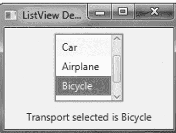

# 启用选择

如果你想允许多个项目被选中，必须显式请求。为了这样做，你必须通过在 `ListView` 上调用 `setSelectionMode()` 将选择模式设置为 `MULTIPLE`。如下：

```java
void setSelectionMode(SelectionMode mode)
```

在这种情况下，模式必须是 `MULTIPLE` 或 `SINGLE`。

当启用多选模式时，你有两种方式获取选择：索引列表或项列表。我们将使用项列表，但使用索引列表的方法类似。（注意，`ListView` 中的索引从零开始。）

要获取项列表，在模型上调用 `getSelectedItems()`。如下所示。

为了实验多选，你可以按照所示修改前面的程序。首先，添加此行：

```java
lvTransport.getSelectionModel().setSelectionMode(SelectionMode.MULTIPLE);
```

它开启了 `lvTransport` 的多选模式。接下来，将更改事件处理器替换为如下：

```java
lvModel.selectedItemProperty().addListener(new ChangeNotifier<String>() {
    public void changed(ObservableValue<? extends String> observable,
        String oldVal, String newVal) {

        String selItems = "";
        ObservableList<String> selected =
            lvTransport.getSelectionModel().getSelectedItems();
        // 显示选择项。
        for(int i=0; i < selected.size(); i++)
            selItems += "\n" + selected.get(i);

        response.setText("All transports selected: " + selItems);
    }
});
```

进行这些更改后，程序将显示所有选中的交通工具，如下所示所示：


# ComboBox

与列表视图相关的控件是组合框（ComboBox），它显示一个选择，但也会显示一个下拉列表允许用户选择不同的项。你还可以允许用户编辑选择。`ComboBox` 继承自 `ComboBoxBase`，该类提供了大部分功能。与允许多选的 `ListView` 不同，`ComboBox` 设计用于单选。

`ComboBox` 是一个泛型类，声明如下：

```java
class ComboBox<T>
```

这里，`T` 指定了条目的类型。通常，这些条目是 `String` 类型的，但也允许其他类型。

`ComboBox` 定义了两个构造函数。第一个是默认构造函数，创建一个空的 `ComboBox`。第二个允许你指定条目列表。如下所示：

```java
ComboBox(ObservableList<T> list)
```

在这种情况下，`list` 指定了将要显示的项列表。它是一个 `ObservableList` 类型的对象，定义了一个可观察对象的列表。正如上一节所述，`ObservableList` 继承自 `java.util.List`。正如之前解释的，创建 `ObservableList` 的简单方法是使用工厂方法 `observableArrayList()`，它是由 `FXCollections` 类定义的一个静态方法。

当 `ComboBox` 的选择发生时，它会产生动作事件（action event）。它还会产生一个更改事件（change event）。或者，也可以忽略事件，并在需要时直接获取当前选择。

你可以通过调用 `getValue()` 获取当前选择，如下所示：

```java
final T getValue()
```

如果组合框的值尚未设置（通过用户或在程序控制下），则 `getValue()` 将返回 `null`。要通过程序控制设置 `ComboBox` 的值，请调用 `setValue()`：

```java
final void setValue(T newVal)
```

在这里，`newVal` 成为新值。

下面的程序通过重构之前的列表视图示例演示了组合框。它处理由组合框产生的动作事件。

```java
// Demonstrate a combo box.

import javafx.application.*;
import javafx.scene.*;
import javafx.stage.Stage.*;
import javafx.scene.layout.*;
import javafx.scene.control.*;
import javafx.geometry.*;
import javafx.collections.*;
import javafx.event.*;

public class ComboBoxDemo extends Application {

    ComboBox<String> cbTransport;
    Label response;

    public static void main(String[] args) {

        // 通过调用 launch() 启动 JavaFX 。
        launch(args);
    }

    // 重写 start() 方法。
    public void start(Stage myStage) {

        // 给场景设置标题。
        myStage.setTitle("ComboBox Demo");

        // 使用 FlowPane 作为根节点。在这种情况下，
        // 垂直和水平间隙为 10。
        FlowPane rootNode = new FlowPane(10, 10);

        // 将场景中的控件居中。
        rootNode.setAlignment(Pos.CENTER);

        // 创建一个场景。
        Scene myScene = new Scene(rootNode, 280, 120);

        // 将场景设置在舞台上。
        myStage.setScene(myScene);

        // 创建一个标签。
        response = new Label();

        // 为组合框创建一个条目的 ObservableList 。
        ObservableList<String> transportTypes =
            FXCollections.observableArrayList( "Train", "Car", "Airplane" );

        // 创建一个组合框。
        cbTransport = new ComboBox<String>(transportTypes);

        // 设置默认值。
        cbTransport.setValue("Train");

        // 设置响应标签以指示默认选择。
        response.setText("Selected Transport is " + cbTransport.getValue());

        // 监听组合框上的动作事件。
        cbTransport.setOnAction(new EventHandler<ActionEvent>() {
            public void handle(ActionEvent ae) {
                response.setText("Selected Transport is " + cbTransport.getValue());
            }
        });

        // 将标签和组合框添加到场景图中。
        rootNode.getChildren().addAll(cbTransport, response);

        // 显示舞台及其场景。
        myStage.show();
    }
}
```

示例输出在此所示：

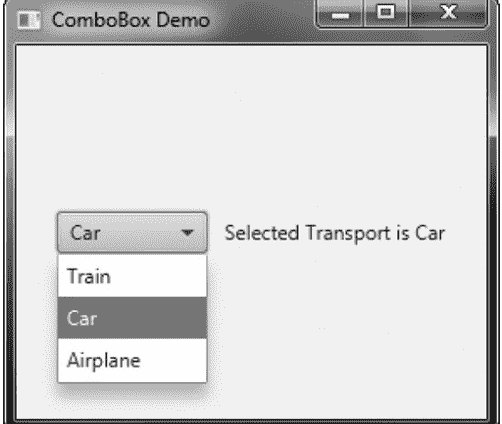

正如提到的，`ComboBox` 可以配置为允许用户编辑选择。假设它只包含 `String` 类型的条目，启用编辑功能非常简单。只需调用 `setEditable()` 即可，如下所示：

```java
final void setEditable(boolean enable)
```

如果 `enable` 为 `true`，则启用编辑。否则，将禁用。要看到编辑的效果，请在前面的程序中添加此行：

```java
cbTransport.setEditable(true);
```

在添加此内容后，你将能够编辑选择的内容。

`ComboBox` 除了这里提到的之外，还支持许多额外的特性和功能。你可能会发现进一步探索很有趣。此外，在某些情况下，组合框的替代方案是 `Choice` 控件。你会发现它很容易使用，因为它与 `ListView` 和 `ComboBox` 都有相似之处。

## TextField

虽然前面讨论的控件非常有用且在用户界面中经常出现，但它们都实现了一种选择预定义选项或动作的方法。然而，有时你可能希望用户输入由他们选择的字符串。为了适应这种输入类型，JavaFX 包含了几个基于文本的控件。因此，我们查看的 `TextField` 允许输入一行文本。它对于获取名称、ID 地址等非常有用。和所有文本控件一样，`TextField` 继承自 `TextInputControl`，后者定义了它的大部分功能。

```java
// Set the prompt.
tf.setPromptText("Enter Search String");

// Set preferred column count.
tf.setPrefColumnCount(15);

// 处理文本框的动作事件。当文本框具有输入焦点
// 并按下 ENTER 键时，会生成动作事件。在这种情况下，
// 将获取并显示文本框中的内容。
tf.setOnAction(new EventHandler<ActionEvent>() {
    public void handle(ActionEvent ae) {
        response.setText("Search String: " + tf.getText());
    }
});

// 在点击按钮时从文本框中获取文本
// 并将其显示。
btnGetText.setOnAction(new EventHandler<ActionEvent>() {
    public void handle(ActionEvent ae) {
        response.setText("Search String: " + tf.getText());
    }
});

// 使用分隔符来更好地组织布局。
Separator separator = new Separator();
separator.setPrefWidth(180);

// 将控件添加到场景图中。
rootNode.getChildren().addAll(tf, btnGetText, separator, response);

// 显示阶段及其场景。
myStage.show();
```

示例输出所示：


你可能想要检查的其他文本控件还包括支持多行文本的 `TextArea` 以及用于输入密码的 `PasswordField`。你还可能发现 `TextInputDialog` 和 `HTMLEditor` 很有帮助。

## ScrollPane

有时，控件的内容将超过你想要给它的屏幕空间。这里有两个例子：大图像可能无法适应在合理的范围内，或者你可能想要显示比小窗口容量更长的文本。无论原因如何，JavaFX 都能轻松为场景图中的任何节点提供滚动功能。这是通过将节点封装在 `ScrollPane` 中来实现的。当使用 `ScrollPane` 时，会自动实现滚动条，用于滚动被封装节点的内容。你不需要进行任何进一步的操作。由于 `ScrollPane` 的多功能性，你很少会单独使用滚动条控件。

`ScrollPane` 定义了两个构造函数。第一个是默认构造函数。第二个允许你指定一个想要滚动的节点。如下所示：

```java
ScrollPane(Node content)
```

在这种情况下，`content` 指定了要滚动的信息。使用默认构造函数时，你通过调用 `setContent()` 来添加要滚动的节点。如下所示：

```java
final void setContent(Node content)
```

设置内容后，将滚动面板添加到场景图中。显示时，该内容是可以滚动的。

**注意** 你也可以使用 `setContent()` 来更改滚动面板正在滚动的内容。因此，可以在程序执行期间更改正在正在滚动的内容。

虽然提供了默认大小，但作为一个一般原则，你可能希望设置视口（viewport）的尺寸。视口是滚动面板的可视区域。它是正在滚动的内容显示所在的区域。换句话说，视口显示内容的可见部分。滚动条通过视口滚动内容。因此，通过移动滚动条，你改变了内容中可见的部分。

你可以使用以下两个方法来设置视口尺寸：

```java
final void setPrefViewportHeight(double height)
final void setPrefViewportWidth(double width)
```

在默认行为下，`ScrollPane` 会根据需要动态添加或移除滚动条。例如，如果组件比视口高，则会添加垂直滚动条。如果组件完全位于视口内，则会移除滚动条。

`ScrollPane` 的一个很棒的功能是可以通过拖动鼠标平移动内容。默认情况下，此功能是关闭的。要启用它，使用 `setPannable()`，如下所示：

```java
final void setPannable(boolean enable)
```

如果 `enable` 为 `true`，则允许移动。否则将其禁用。

你可以通过程序控制 `setHValue()` 和 `setValue()` 来设置滚动条的位置，如下所示：

```java
final void setHValue(double newHVal)
final void setValue(double newHVal)
```

新的水平位置由 `newHVal` 指定，新的垂直位置由 `newVal` 指定。默认情况下，滚动条从零开始。

`ScrollPane` 支持其他选项。例如，可以设置滚动条的最小和最大位置。

`TreeView` 定义了两个构造函数。我们将使用的是这一个：

```java
TreeView(TreeItem<T> rootNode)
```

在这里，`rootNode` 指定了树的根节点。因为所有节点都派自根节点，它是唯一需要传递给 `TreeView` 的节点。

构成树的项目是 `TreeItem` 类型的对象。首先需要说明的是，`TreeItem` 没有继承自 `Node`。`TreeItems` 不是通用对象。它们可以用于 `TreeView`，但不能作为独立的控件。`TreeItem` 是一个泛型类，如下：

```java
class TreeItem<T>
```

在这里，`T` 指定了 `TreeItem` 持有的值类型。

在使用 `TreeView` 之前，你必须构建好它将显示的树。要做到这一点，你必须首先创建根节点。接下来，向根节点添加其他节点。你可以通过对 `getChildren()` 返回的列表调用 `add()` 或 `addAll()` 来实现。这些其他节点可以是叶节点或子树。树构建完成后，通过将根节点传递给其构造函数来创建 `TreeView`。

你可以以类似于 `ListView` 的方式在 `TreeView` 中处理选择事件，通过使用更改监听器来实现。要这样做，首先通过 `getSelectionModel()` 获取选择模型。然后，调用 `selectedItemProperty()` 获取选中项的属性。根据返回值，调用 `addActionListener()` 添加更改监听器。每当进行选择时，新选择的引用将作为新值传递给 `changed()` 处理程序。（有关处理更改事件的更多信息请参见 `ListView`）。

你可以通过调用 `getValue()` 获取 `TreeItem` 的值。你也可以按照正向或反向跟随某个项目的树路径。要获取父节点，调用 `getParent()`。要获取子节点，调用 `getChild()`。

示例展示了如何构建和使用 `TreeView`。这棵树展示了食物的层级结构。树中存储的项目类型是字符串。根节点标记为 Food（食物）。其下方有三个后代节点：Fruit（水果）、Vegetables（蔬菜）和 Nuts（坚果）。Fruit 下方有三个子节点：Apples（苹果）、Pears（梨）和 Oranges（橘子）。Apples 下方有三个叶节点：Fuji（富士苹果）、Winesap（红粉苹果）和 Jonathan（乔纳苹果）。每当进行选择时，都会显示项目的名称。此外，还会显示从根节点到项目的路径。这是通过重复使用 `getParent()` 实现的。

```java
// 展示一个 TreeView

import javafx.application.*;
import javafx.scene.*;
import javafx.stage.*;
import javafx.scene.layout.*;
import javafx.scene.control.*;
import javafx.event.*;
import javafx.beans.value.*;
import javafx.geometry.*;

public class TreeViewDemo extends Application {

    Label response;

    public static void main(String[] args) {

        // 通过 launch() 启动 JavaFX 。
        launch(args);
    }

    // 覆盖 start() 方法。
    public void start(Stage myStage) {

        // 给阶段设置一个标题。
        myStage.setTitle("Demonstrate a TreeView");

        // 使用 FlowPane 作为根节点。在这种情况下，
        // 垂直和水平间距均为 10。
        FlowPane rootNode = new FlowPane(10, 10);

        // 将控件在场景中居中。
        rootNode.setAlignment(Pos.CENTER);

        // 创建场景。
        Scene myScene = new Scene(rootNode, 310, 460);

        // 将场景设置到阶段上。
        myStage.setScene(myScene);

        // 创建一个标签来报告选中的
        // 树项的状态。
        response = new Label("No Selection");

        // 创建树项，从根节点开始。
        TreeItem<String> tiRoot = new TreeItem<String>("Food");

        // 现在添加子树，从水果开始。
        TreeItem<String> tiFruit = new TreeItem<String>("Fruit");

        // 构建苹果子树。
        TreeItem<String> tiApples = new TreeItem<String>("Apples");

        // 向苹果节点添加子节点。
        tiApples.getChildren().add(new TreeItem<String>("Fuji"));
        tiApples.getChildren().add(new TreeItem<String>("Winesap"));
        tiApples.getChildren().add(new TreeItem<String>("Jonathan"));

        // 向水果节点添加品种。
        tiFruit.getChildren().add(tiApples);
        tiFruit.getChildren().add(new TreeItem<String>("Pears"));
        tiFruit.getChildren().add(new TreeItem<String>("Oranges"));

        // 最后，将水果节点添加到根节点。
        tiRoot.getChildren().add(tiFruit);

        // 现在，使用相同的过程添加蔬菜子树。
        TreeItem<String> tiVegetables = new TreeItem<String>("Vegetables");
        tiVegetables.getChildren().add(new TreeItem<String>("Corn"));
        tiVegetables.getChildren().add(new TreeItem<String>("Peas"));
        tiVegetables.getChildren().add(new TreeItem<String>("Broccoli"));
        tiVegetables.getChildren().add(new TreeItem<String>("Beans"));
        tiRoot.getChildren().add(tiVegetables);

        // 同样，添加坚果子树。
        TreeItem<String> tiNuts = new TreeItem<String>("Nuts");
        tiNuts.getChildren().add(new TreeItem<String>("Walnuts"));
        tiNuts.getChildren().add(new TreeItem<String>("Pistachios"));
        tiNuts.getChildren().add(new TreeItem<String>("Cashews"));
        tiRoot.getChildren().add(tiNuts);

        // 创建树视图。
        TreeView<String> tvFood = new TreeView<String>(tiRoot);

        // 获取树选择模型。
        MultipleSelectionModel<TreeItem<String>> tvSelModel =
            tvFood.getSelectionModel();

        // 使用更改监听器来响应选择的变化。
        tvSelModel.selectedItemProperty().addListener(
            new ChangeListener<TreeItem<String>>() {
                public void changed(
                    ObservableValue<? extends TreeItem<String>> changed,
                    TreeItem<String> oldVal, TreeItem<String> newVal) {

                    // 显示选择项及其路径。
                    if (newVal != null) {
                        String path = newVal.getValue();
                        TreeItem<String> tmp = newVal.getParent();
                        while (tmp != null) {
                            path = tmp.getValue() + " -> " + path;
                            tmp = tmp.getParent();
                        }
                        response.setText("Selected: " + path);
                    }
                }
            });

        // 将标签和树视图添加到场景图中。
        rootNode.getChildren().addAll(tvFood, response);

        // 显示阶段及其场景。
        myStage.show();
    }
}
```

| 效果名称 | 描述 |
| :--- | :--- |
| Bloom | 增加节点中较亮部分的亮度。 |
| BoxBlur | 模糊节点。 |
| DropShadow | 显示出现在节点背后的阴影。 |
| Glow | 产生发光效果。 |
| InnerShadow | 在节点内部显示阴影。 |
| Lighting | 创建光源的阴影效果。 |
| Reflection | 显示反射。 |

这些以及其他效果都易于使用，并且可以在任何节点（包括控件）上使用。当然，取决于控件的类型，某些效果会比其他效果更合适。

若要在节点上设置效果，请调用 `setEffect()`，该方法由 `Node` 定义。示例如下：

```java
final void setEffect(Effect effect)
```

在这里，`effect` 是将应用的效果。若要指定无效果，请传递 `null`。因此，要向节点添加效果，首先创建该效果的实例并将其传递给 `setEffect()`。一旦完成此操作，在节点渲染时将使用该效果（只要环境支持该效果）。为了演示效果的功能，我们将使用其中两个：`Glow` 和 `InnerShadow`。然而，无论你选择哪种效果，添加效果的过程本质上是相同的。

`Glow` 产生一种让节点具有发光外观的效果。发光量由你控制。要使用发光效果，你必须先创建一个 `Glow` 实例。我们将使用的构造函数是：

```java
Glow(double glowLevel)
```

在这里，`glowLevel` 指定发光强度，它必须是 0.0 到 1.0 之间的一个值。

在创建 `Glow` 后，可以使用 `setLevel()` 更改发光强度，示例如下：

```java
final void setLevel(double glowLevel)
```

与之前，`glowLevel` 指定发光强度，必须在 0.0 到 1.0 之间。

`InnerShadow` 产生一种模拟节点内部阴影的效果。它支持多种构造函数。我们将使用的是这一个：

```java
InnerShadow(double radius, Color shadowColor)
```

在这里，`radius` 指定节点内部阴影的半径。本质上，半径描述了阴影的大小。阴影的颜色由 `shadowColor` 指定。在这里，`Color` 类型是 `javafx.scene.paint.Color`。它定义了大量常量，例如 `Color.GREEN`、`Color.RED` 和 `Color.BLUE`，这使得使用非常方便。

## 变换 (Transforms)

抽象类 `Transform` 支持变换，它封装在 `javafx.scene.transform` 中。它的四个子类是 `Rotate`、`Scale`、`Shear` 和 `Translate`。每个类的作用与其名称一致。（另一个子类是 `Affine`，但通常你会使用上述一个或多个变换类。）可以对节点执行多个一个变换。例如，你可以对它进行旋转和缩放。正如后文所述，`Node` 类也支持变换。

向节点添加变换的一种方法是将其添加到节点维护的变换列表中。该列表通过调用 `Node` 定义的 `getTransforms()` 获取。

```java
final ObservableList<Transform> getTransforms()
```

它返回变换列表的引用。要添加变换，只需通过调用 `add()` 将其添加到列表中。你可以通过调用 `clear()` 清空列表。可以使用 `remove()` 移除特定元素。

在某些情况下，你可以通过设置 `Node` 的属性之一来直接指定变换。例如，可以通过调用 `setRotation()` 并传入所需的角度来设置节点的旋转角度，旋转中心位于节点中心。你可以通过添加 `setScaleX()` 和 `setScaleY()` 设置缩放，并可以使用 `setTranslateX()` 和 `setTranslateY()` 移动节点。（平台可能也支持 Z 轴变换。）然而，变换列表提供了最大的灵活性，这也是此处演示的方法。

注意：直接在节点上指定的任何变换将在 `transforms` 列表中所有变换之后应用。

为了演示变换的使用，我们将使用 `Rotate` 和 `Scale` 类。其他变换的使用方式也类似。`Rotate` 绕指定的点旋转节点。它定义了几个构造函数。这里是其中一个：

```java
Rotate(double x, double y)
```

在这里，`x` 和 `y` 指定旋转中心点。另一个构造函数是：

```java
Rotate(double angle)
```

`angle` 指定旋转角度。

```java
Scale(double x, double y)
```

在这里，`x` 和 `y` 指定缩放比例。

```java
Scale(double s)
```

`s` 指定缩放比例。

```java
Translate(double x, double y)
```

在这里，`x` 和 `y` 指定平移量。

```java
public void handle(ActionEvent ae) {

    // 每当点击按钮时，它都会绕其中心旋转 30 度。
    angle += 30.0;
    rotate.setAngle(angle);
    rotate.setPivotX(btnRotate.getWidth()/2);
    rotate.setPivotY(btnRotate.getHeight()/2);
});

// 处理 Scale（缩放）按钮的动作事件。
btnScale.setOnAction(new EventHandler<ActionEvent>() {
    public void handle(ActionEvent ae) {

        // 每当点击按钮时，按钮的缩放比例发生变化。
        scaleFactor += 0.1;
        if(scaleFactor > 1.0) scaleFactor = 0.4;

        scale.setX(scaleFactor);
        scale.setY(scaleFactor);
    }
});

// 处理 Glow（发光）按钮的动作事件。
btnGlow.setEventHandler(new EventHandler<ActionEvent>() {
    public void handle(ActionEvent ae) {

        // 每当点击按钮时，它的发光值发生变化。
        glowVal += 0.1;
        if (glowVal > 1.0) glowVal = 0.0;

        // 设置新的发光值。
        glow.setLevel(glowVal);
    }
});

// 处理 Shadow（阴影）按钮的动作事件。
btnShadow.setEventHandler(new EventHandler<ActionEvent>() {
    public void handle(ActionEvent ae) {

        // 每当点击按钮时，它的阴影状态发生变化。
        shadow = !shadow;
        if (shadow) {
            btnShadow.setVisibility(innerShadow);
            btnShadow.setText("Shadow on");
        } else {
            btnShadow.set(null);
            btnShadow.setText("Shadow off");
        }
    }
});

// 将标签和按钮添加到场景图中。
rootNode.getChildren().add(btnRotate, btnScale, btnGlow, btnShadow);

// 显示阶段（stage）及其场景（scene）。
myStage.show();
```

在离开效果和变换主题之前，很有必要提到几种效果在用在 `Text`（文本）节点上时特别美观。`Text` 是封装在 `javafx.scene.text` 中的一个类。它创建了一个由文本组成的节点。因为它是一个节点，所以文本可以被作为一个单元进行操作，并可以应用各种效果和变换。

# 添加工具提示 (Tooltips)

现代 GUI 中一个非常流行的元素是工具提示（Tooltip）。工具提示是当鼠标悬停在控件上时显示的简短消息。在 JavaFX 中，可以轻松地向任何控件添加工具提示。坦率地说，考虑到工具提示提供的益处以及将其整合到你的 GUI 中的简单易用性，在合适的地方几乎没有理由不使用它们。

要添加工具提示，你调用由 `Control` 类定义的 `setTooltip()` 方法。（`Control` 是所有控件的基类。）这里展示了 `setTooltip()` 方法：

```java
final void setTooltip(Tooltip tooltip)
```

在这种情况下，`tip` 是 `Tooltip` 的实例，它用于指定工具提示的内容。一旦设置了工具提示，当鼠标悬停在控件上时，它会自动显示。你不需要进行任何其他操作。

`Tooltip` 类封装了一个工具提示。这是我们将要使用的构造函数：

```java
Tooltip(String str)
```

在这里，`str` 指定了工具提示将要的消息。

要查看工具提示的实际效果，请尝试在 `CheckboxDemo` 程序的早期添加以下语句。

```java
cbWeb.setTooltip(new Tooltip("Deploy to Web"))
cbDesktop.setTooltip(new Tooltip("Deploy to Desktop"))
cbMobile.setTooltip(new Tooltip("Deploy to Mobile"))
```

添加这些内容后，每个复选框都会显示工具提示。

# 禁用控件 (Disabling a Control)

在离开控件主题之前，很有必要提到几种效果在用在 `Text` 节点上时特别美观。`Text` 是封装在 `javafx.scene.text` 中的一个类。它创建了一个由文本组成的节点。因为它是一个节点，所以文本可以被作为一个单元进行操作，并可以应用各种效果和变换。

如果 `disable` 为 `true`，控件将被禁用；否则，它将启用。

```java
final void disable(boolean disable)
```

# 菜单 (Menus)

菜单是 GUI 的一个重要部分，它们提供了强大的功能。JavaFX 菜单支持以下内容：

- 菜单项（MenuItem）允许快捷键
- 菜单（Menu）可以包含

| 类 | 描述 |
|---|
| 菜单栏（MenuBar） | 应用程序的顶部菜单。 |
| 菜单（Menu） | 一个包含多个菜单项的对象。 |
| 菜单项（MenuItem） | 一个可以选择的项目。 |
| 选框菜单项（CheckMenuItem） | 一个可以切换状态的菜单项。 |
| 单选框菜单项（RadioMenuItem） | 用于一组单选的菜单项。 |
| 分隔符（SeparatorMenuItem） | 菜单之间的视觉分割线。 |

**表 36-1 JavaFX 核心类**

以下是这些类如何工作的简要概述。要创建应用程序的主菜单，你首先需要一个 `MenuBar` 实例。这个类泛泛地说，是菜单的容器。通过 `Menu` 你添加 `Menu` 实例。每个 `Menu` 对象定义了一个菜单。也就是说，每个 `Menu` 对象包含一个多个可选择项。由 `Menu` 显示的是 `MenuItem` 对象。因此，`MenuItem` 定义了一个可以的选择。

使用匿名内部类或 lambda 表达式来处理每个菜单项的动作事件。在这种情况下，菜单选择是已知的，不需要检查名称来确定选择了哪一个项。

作为从菜单栏展开的菜单的替代方案或补充，你还可以创建一个独立的上下文菜单，它在被激活时弹出。要创建一个上下文菜单，首先创建一个 `ContextMenu` 类型的对象。然后，向其添加 `MenuItems`。当鼠标悬停在定义了上下文菜单的控件上时，点击鼠标右键即可触发上下文菜单。需要指出，`ContextMenu` 并不继承自 `MenuItem`，而是继承自 `PopupControl`。

与菜单相关的另一个功能是工具栏。在 JavaFX 中，工具栏由 `Toolbar` 类支持。它创建一个独立的组件，通常用于快速访问应用程序菜单中包含的功能。例如，工具栏可以提供对文字处理器支持的格式命令的快速访问。

## MenuBar、Menu 和 MenuItem 概述

在创建菜单之前，你需要了解关于 `MenuBar`、`Menu` 和 `MenuItem` 的一些细节。这些类构成了构建应用程序主菜单所需的最小类集合。`MenuItem` 也用于上下文（即弹出式）菜单。因此，这些类构成了菜单系统的基础。

### MenuBar

`MenuBar` 本质上是菜单的容器。它是提供应用程序主菜单的控件。像 JavaFX 控件一样，它继承自 `Node`。因此，它可以被场景图中。`MenuBar` 有两个构造函数。第一个是默认构造函数。使用此构造函数，菜单栏最初为空，你需要在在使用之前向它填充菜单。第二个构造函数允许你指定初始菜单列表。根据一般规则，一个应用程序有且菜单栏。

`MenuBar` 定义了几个方法，但你通常会使用其中一个：`getMenus()`。它返回一个由菜单栏管理的菜单列表。你将把创建的菜单添加到此列表中。`getMenus()` 方法显示如下：

```java
final ObservableList<Menu> getMenus()
```

通过调用 `add()` 将 `Menu` 实例添加到此菜单列表中。你也可以使用 `addAll()` 在单次调用中添加两个或多个 `Menu` 实例。添加的菜单按照它们被添加的顺序从左到右在栏中定位。如果你想在特定位置添加菜单，请使用此版本的 `add()`：

```java
void add(int idx, E menu)
```

在这里，`menu` 被添加到由 `idx` 指定的索引处。索引从 0 开始，0 是最左侧菜单。

在某些情况下，你可能想要移除一个不再需要的菜单。你可以通过对 `getMenus()` 返回的 `ObservableList` 调用 `remove()` 来实现。以下是它的两种形式：

```java
boolean remove(Object menu)
remove(int idx)
```

在这里，`menu` 是要移除菜单的引用，`idx` 是要移除菜单的索引。索引从 0 开始。第一种形式在找到并删除了该项时返回 `true`。第二种形式返回被删除删除元素的引用。

有时获取菜单栏中项的数量是很有用的。要做到这一点，对 `getMenus()` 返回的列表调用 `size()`。

> 注意：请记住 `ObservableList` 实现了 `List` 集合接口，这让你能够访问 `List` 定义的所有方法。

一旦创建并填充了菜单栏，就会按正常方式添加到场景图中。

### Menu

`Menu` 封装了一个菜单，其中填充了 `MenuItems`。如所述，`Menu` 继承自 `MenuItem`。这意味着一个 `Menu` 可以是另一个 `Menu` 中的一个选择项。这使得一个菜单可以是另一个菜单的子菜单。`Menu` 定义了构造函数。可能最常用显示在这里：

```java
Menu(String name)
```

它创建了一个由 `name` 指定名的菜单。你可以使用此构造函数指定文本的同时指定图像：

```java
Menu(String name, Node image)
```

在这里，`image` 指定了要显示的图像。在这两种情况下，在向其添加菜单项之前菜单都是空的。第三种构造函数允许你指定一组初始菜单项。它显示在这里：

```java
Menu(String name, Node image, MenuItem ... menuItems)
```

最后，在构造菜单时不需要给菜单命名。要创建一个未命名的菜单，可以使用默认构造函数：

```java
Menu()
```

在这种情况下，你可以通过调用 `setText()` 或 `setGraphic()` 事后添加名称和/或图像。

每个菜单维护一个它包含的菜单项列表。要向菜单添加项，向此列表添加项。你可以通过在 `Menu` 构造函数中指定它们，或将它们添加到列表中来实现。在 `Menu` 构建后添加项，请先调用 `getItems()`，显示如下：

```java
final ObservableList<MenuItem> getItems()
```

它返回当前与菜单关联的项列表。通过调用 `add()` 或 `addAll()` 向此列表添加菜单项。除了其他操作外，你可以通过调用 `remove()` 移除项，并通过调用 `size()` 获取列表的大小。

一点：你可以向菜单项列表添加一个菜单分隔符，它是一个 `SeparatorMenuItem` 类型的对象。分隔符有助于组织长菜单，允许你将相关项分组。分隔符还可以帮助区分重要项，例如菜单中的退出（Exit）选择。

### MenuItem

`MenuItem` 封装了菜单中的一个元素。该元素可以是链接到某些程序动作（如保存 Save 或关闭 Close）的选择项，也可以导致子菜单的显示。`MenuItem` 定义了以下三个构造函数：

```java
MenuItem()
MenuItem(String name)
MenuItem(String name, Node image)
```

第一个创建一个空菜单项。第二个允许你指定项的名称，第三个允许你包含一个图像。

`MenuItem` 在被选中时会产生一个动作事件。你可以通过调用 `setOnChange()` 为此类事件注册动作事件处理器，就像你处理按钮事件时一样。为了方便起见，再次显示如下：

```java
final void setOnChange(EventHandler<ActionEvent> handler)
```

在这里，`handler` 指定了事件处理器。你可以通过调用 `fire()` 在菜单项上触发动作事件。

`MenuItem` 定义了几个方法。其中一个经常很有用的是 `setDisable()`，你可以用它启用或禁用菜单项。显示在这里：

```java
final void setDisable(boolean disable)
```

如果 `disable` 为 `true`，则菜单项被禁用且无法选择。如果 `disable` 为 `false`，则项被启用。使用 `setDisable()`，你可以根据程序条件开启或关闭菜单项。

## 创建主菜单

通常情况下，最常用的菜单是主菜单。这是由菜单栏定义的菜单，它定义了应用程序的所有（或大部分）功能。正如你看到的，JavaFX 简化了创建和管理菜单的过程。在这里，你将看到如何构建简单的主菜单。后续章节将显示各种选项。

> 注意：为了清晰说明 Swing 和 JavaFX 系统之间的相似性和区别，本章的示例回顾了第 33 章中的菜单示例。如果你已经熟悉 Swing，对比这两种不同的方法可能会帮助。

构建主菜单需要几个步骤。这里是方法方法。首先，创建将持有菜单的 `MenuBar` 实例。接下来，构建位于菜单中的每个菜单。通常，菜单的构建是通过首先创建一个 `Menu` 对象并向其添加 `MenuItem` 实现的。在菜单之后，将它们添加到菜单栏。然后，菜单栏本身必须添加到场景图中。最后，对于每个菜单项，你必须添加一个动作事件处理器，以响应菜单项被选中时触发的动作事件。

被称为颜色和优先级（Colors and Priority）。第三个菜单称为帮助（Help），它包含一个项目：关于（About）。当一个菜单项目被选中时，选中的名称将显示在标签中。

```java
// Demonstrate Menus

import javafx.application.*;
import javafx.scene.*;
import javafx.stage.*;
import javafx.scene.layout.*;
import javafx.scene.control.*;
import javafx.event.*;
import javafx.geometry.*;

public class MenuDemo extends Application {

    Label response;

    public static void main(String[] args) {

        // 调用 launch() 启动 JavaFX 。
        launch(args);
    }

    // 重写 start() 方法。
    public void start(Stage myStage) {

        // 给舞台设置标题。
        myStage.setTitle("Demonstrate Menus");

        // 使用 BorderPane 作为根节点。
        BorderPane rootNode = new BorderPane();

        // 创建一个场景。
        Scene myScene = new Scene(rootNode, 300, 300);

        // 将场景设置到舞台上。
        myStage.setScene(myScene);

        // 创建一个报告选择结果标签。
        response = new Label("Menu Demo");

        // 创建菜单栏。
        MenuBar mb = new MenuBar();

        // 创建文件菜单。
        Menu fileMenu = new Menu("File");
        MenuItem open = new MenuItem("Open");
        MenuItem close = new MenuItem("Close");
        MenuItem save = new MenuItem("Save");
        MenuItem exit = new MenuItem("Exit");
        fileMenu.getItems().addAll(open, close, save,
            new SeparatorMenuItem(), exit);

        // 将文件菜单添加到菜单栏。
        mb.getMenus().add(fileMenu);

        // 创建选项菜单。
        Menu optionsMenu = new Menu("Options");

        // 创建颜色子菜单。
        Menu colorsMenu = new Menu("Colors");
        MenuItem red = new MenuItem("Red");
        MenuItem green = new MenuItem("Green");
        MenuItem blue = new MenuItem("Blue");
        colorsMenu.getItems().addAll(red, green, blue);
        optionsMenu.getItems().add(colorsMenu);

        // 创建优先级子菜单。
        Menu priorityMenu = new Menu("Priority");
        MenuItem high = new MenuItem("High");
        MenuItem low = new MenuItem("Low");
        priorityMenu.getItems().addAll(high, low);
        optionsMenu.getItems().add(priorityMenu);

        // 添加一个分隔符。
        optionsMenu.getItems().add(new SeparatorMenuItem());

        // 创建重置菜单项。
        MenuItem reset = new MenuItem("Reset");
        optionsMenu.getItems().add(reset);

        // 将选项菜单添加到菜单栏。
        mb.getMenus().add(optionsMenu);

        // 创建帮助菜单。
        Menu helpMenu = new Menu("Help");
        MenuItem about = new MenuItem("About");
        helpMenu.getItems().add(about);

        // 将帮助菜单添加到菜单栏。
        mb.getMenus().add(helpMenu);

        // 创建一个处理菜单动作事件的事件处理器。
        EventHandler<ActionEvent> MEHandler =
            new EventHandler<ActionEvent>() {
                public void handle(ActionEvent ae) {
                    String name = ((MenuItem)ae.getTarget()).getText();

                    // 如果选择了退出，程序终止。
                    if (name.equals("Exit")) Platform.exit();

                    response.setText(name + " selected");
                }
            };

        // 为菜单项设置动作事件处理器。
        open.setOnAction(MEHandler);
        close.setOnAction(MEHandler);
        save.setOnAction(MEHandler);
        exit.setOnAction(MEHandler);
        red.setOnAction(MEHandler);
        green.setOnAction(MEHandler);
        blue.setOnAction(MEHandler);
        high.setOnAction(MEHandler);
        low.setOnAction(MEHandler);
        reset.setOnAction(MEHandler);
        about.setOnAction(MEHandler);

        // 将菜单栏添加到边框布局面板的顶部
        // 将响应标签置于中心位置。
        rootNode.setTop(mb);
        rootNode.setCenter(response);

        // 显示舞台及其场景。
        myStage.show();
    }
}
```

示例输出在此处：

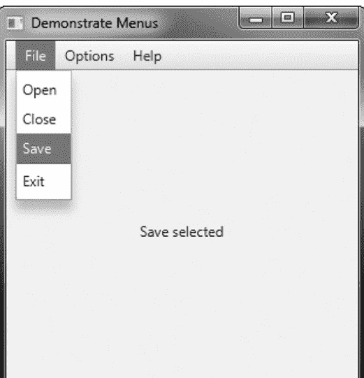

让我们详细检查此程序中的菜单是如何创建的。首先，注意 `MenuDemo` 使用了 `BorderPane` 实例作为根节点。`BorderPane` 与第 26 章中讨论的 AWT 的 `BorderLayout` 类似。它定义了五个区域：顶部、底部、左侧、右侧和中心。以下方法设置了分配给这些区域的节点：

- `final void setTop(Node node)`
- `final void setBottom(Node node)`
- `final void setLeft(Node node)`
- `final void setRight(Node node)`
- `final void setCenter(Node node)`

在这里，`node` 指定了作为控件显示在每个位置的元素。在程序的后续部分，菜单栏被放置在顶部，显示菜单选择的标签被放置在中心位置。将菜单栏设置为顶部可确保它显示在应用程序的顶部，并自动调整大小以适应窗口的水平宽度。这就是为什么在菜单示例中使用 `BorderPane`。当然，其他方法（如使用 `VBox`）也是有效的。

最后，通过以下代码将菜单栏添加到根节点：

```java
rootNode.setTop(mb);
```

这会导致菜单栏放置在窗口顶部。此时，你可能想对 `MenuDemo` 程序进行一些实验。尝试添加另一个菜单，或向现有菜单中添加更多项目。在继续之前，理解基础的菜单概念至关重要，因为这个程序在本章的剩余部分中将不断演变。

## 在菜单项中添加助记符和加速键

在前一个示例中创建的菜单是完备的，但可以使其变得更好。在实际应用程序中，菜单通常包含对快捷键的支持。这些快捷键有两种形式：加速键（accelerators）和助记符（mnemonics）。加速键是一种组合键，允许你无需先激活菜单即可选择菜单项。对于菜单而言，助记符定义了一个键，允许你通过输入该键来从激活的菜单中选择项目。因此，助记符允许你使用键盘从已显示的菜单中选择项目。

加速键可以与 `Menu` 或 `MenuItem` 关联。它通过调用 `setAccelerator()` 来指定，如下：

```java
void setAccelerator(KeyCombination comb)
```

这里，`keyComb` 是选择菜单项时按下的组合键。`KeyCombination` 是 `javafx.scene.input`，它封装了一个组合键，例如 CTRL-S。

`KeyCombination` 定义了两个受保护的构造函数，但你通常会使用此处显示的 `keyCombination()` 工方法：

```java
static KeyCombination keyCombination(String keys)
```

在这种情况下，`keys` 是指定组合键的字符串。它通常由一个修饰符（如 CTRL、ALT、SHIFT 或 META）和一个字母（如 s）组成。有一个特殊值称为 `shortcut`，可用于指定 Windows 系统中的键以及 Mac 上的 META 键。（它也映射到其他类型系统上常用的快捷键）。因此，如果你想将 CTRL-S 指定为保存（Save）的组合键，请使用字符串 "shortcut+S"。这样，它在 Windows、Mac 以及其他地方都能正常工作。

以下序列为上一节中 `MenuDemo` 程序创建的 File（文件）菜单添加加速键。进行此更改后，你可以通过按下相应的键直接选择 File 菜单选项。

```java
// 为 File 菜单添加键盘加速键。
open.setAccelerator(KeyCombination.keyCombination("shortcut+O"));
close.setAccelerator(KeyCombination.keyCombination("shortcut+C"));
save.setAccelerator(KeyCombination.keyCombination("shortcut+S"));
exit.setAccelerator(KeyCombination.keyCombination("shortcut+E"));
```

`MenuItem` 和 `Menu` 对象都可以指定助记符，而且非常简单。只需在菜单或菜单项名称的字母前加上下划线即可。例如，在前一个示例中，为了给 File 菜单添加助记符 F，如下所示声明 `fileMenu`：

```java
Menu fileMenu = new Menu("_File"); // 现在定义了一个助记符
```

进行此更改后，你可以通过 ALT 然后 F 来选择 File 菜单。然而，助记符助在在解析开启时才有效（默认开启）。可以使用 `setMnemonicParsing()` 开启或关闭助记符解析：

```java
final void setMnemonicParsing(boolean enable)
```

在这种情况下，如果 `enable` 为 `true`，则开启助记符解析；否则，将其关闭。

在进行这些更改后，File 菜单现在看起来像这样：

## 在菜单项中添加图像

你可以向菜单项添加图像，或使用图像代替文本。添加图像最简单的方法是在构造菜单项时使用此构造函数指定它：

```java
MenuItem(String name, Node image)
```

它会创建一个具有由 `name` 指定的名称和由 `image` 指定图像的菜单项。例如，这里 About（关于）菜单项在创建时与一个图像相关联：

```java
ImageView aboutIV = new ImageView("aboutIcon.gif");
MenuItem about = new MenuItem("About", aboutIV);
```

添加此项后，当显示 Help（帮助）菜单时，`aboutIV` 指定的图像将显示在文本“About”旁边，如下所示：

最后一点：你还可以在菜单项创建后通过调用 `setGraphic()` 向其添加图像。这让你你可以在程序执行期间更改图像。

## 使用 RadioMenuItem 和 CheckMenuItem

尽管前几个示例中使用的菜单项类型从一般规则来说是最常见的，但 JavaFX 还定义了另外两种类型：复选菜单项（check menu items）和单选菜单项（radio menu items）。这些元素通过允许菜单提供本需要额外独立组件才能的功能，简化了 GUI。此外，有时包含复选或单选菜单项对于一组特定的功能来说似乎是最自然的。无论出于什么原因，在菜单中使用复选和单选菜单项都是很容易的，这里将对两者都进行检查。

要在菜单中添加复选项，使用 `CheckMenuItem`。它定义了三个构造函数，与 `MenuItem` 定义的构造函数并行。本章使用的如下所示：

```java
CheckMenuItem(String name)
```

这里，`name` 指定项的名称。项目的初始状态为未勾选（unchecked）。如果你想在程序运行时勾选复选菜单项，请调用 `setSelected()`，如下所示：

```java
final void setSelected(boolean selected)
```

如果 `selected` 为 `true`，则该项被选中；否则，则未被选中。

与独立的复选框一样，复选菜单项在状态改变时会生成动作事件（action events）。复选菜单项特别适用于菜单中。

`RadioMenuItem` 定义了多个构造函数。本章使用的如下所示：

```java
RadioMenuItem(String name)
```

这里，`name` 指定项的名称。项目的初始状态为未选中。如果你想在程序运行时选中单选菜单项，请调用 `setSelected()`，如下所示：

```java
final void setSelected(boolean selected)
```

如果 `selected` 为 `true`，则该项被选中；否则，则未被选中。

与独立的复选框一样，复选菜单项在状态改变时会生成动作事件。复选菜单项特别适用于菜单中。

单选菜单项必须放入一个切换组（toggle group）中才能表现出互斥行为。`CheckMenuItem` 和 `RadioMenuItem` 均继承自 `MenuItem`，每个都拥有 `MenuItem` 的所有功能。除了具有复选框和单选按钮的额外能力外，它们与其他菜单项一样。

要检查复选和单选菜单项，首先移除 `MenuDemo` 程序中创建 Options（选项）菜单的代码。然后替换为代码序列：

```java
// 创建 Options 菜单。
Menu optionsMenu = new Menu("Options");

// 创建 Colors（颜色）子菜单。
Menu colorsMenu = new Menu("Colors");

// 使用复选菜单项处理颜色。这允许
// 用户选择多个颜色。
CheckMenuItem red = new CheckMenuItem("Red");
CheckMenuItem green = new CheckMenuItem("Green");
CheckMenuItem blue = new CheckMenuItem("Blue");
colorsMenu.getItems().addAll(red, green, blue);
optionsMenu.getItems().add(colorsMenu);

// 选择绿色作为默认颜色。
green.setSelected(true);

// 创建 Priority（优先级）子菜单。
Menu priorityMenu = new Menu("Priority");

// 使用单选菜单项设置优先级。
// 这让菜单显示使用的优先级，
// 并确保任何时候只能选择一个优先级。
RadioMenuItem high = new RadioMenuItem("High");
RadioMenuItem low = new RadioMenuItem("Low");

// 创建一个切换组并用于单选菜单项。
ToggleGroup tg = new ToggleGroup();
high.setToggleGroup(tg);
low.setToggleGroup(tg);

// 选择高优先级作为默认选择。
high.setSelected(true);

// 将单选菜单添加到 Priority 菜单
// 将 Priority 菜单添加到 Options 菜单。
priorityMenu.getItems().addAll(high, low);
optionsMenu.getItems().add(priorityMenu);

// 添加一个分隔符。
optionsMenu.getItems().add(new SeparatorMenuItem());

// 创建 Reset 菜单项。
MenuItem reset = new MenuItem("Reset");
optionsMenu.getItems().add(reset);

// 将 Options 菜单添加到菜单栏。
mb.getMenus().add(optionsMenu);
```

以下是优先级（Priority）子菜单中单选菜单现在的样式：

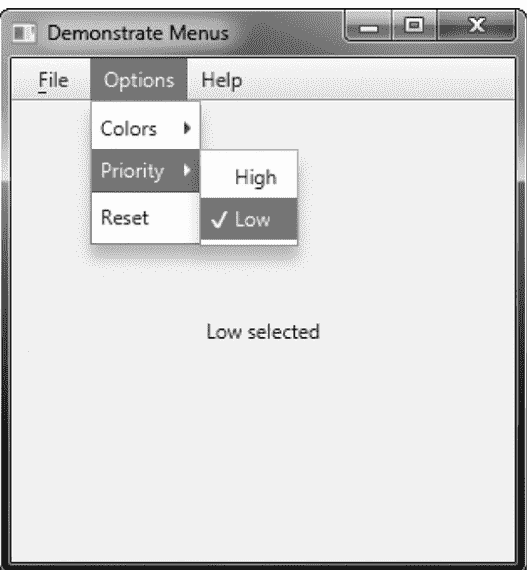

# 创建上下文菜单

菜单栏的一种流行替代方案或补充是弹出菜单，在 JavaFX 中被称为上下文菜单（context menu）。通常，通过在控件上时点击鼠标右键来激活上下文菜单。JavaFX 通过 `ContextMenu` 类支持弹出菜单。`ContextMenu` 的直接父类是 `PopupControl`。其间接父类是 `javafx.stage.PopupWindow`，它提供了大部分基本功能。

```java
ContextMenu(MenuItem ... menuitems)
```

本章中使用的方法所示：

在这里，`menuitems` 指定了将组成上下文菜单的菜单项。第二个 `ContextMenu` 构造函数创建一个空菜单，必须向其中添加项。

通常情况下，上下文菜单的构建方式与普通菜单相似。创建菜单项并将其添加到菜单中。菜单项的选择也以此方式处理：通过处理动作事件（action events）。上下文菜单与普通菜单的主要区别在于激活过程。

将上下文菜单与控件关联起来异常简单。只需在控件上调用 `setContextMenu()`，并传递你想要弹出的菜单的引用。当你在该控件上右击右键时，关联的上下文菜单就会显示。`setContextMenu()` 方法所示：

```java
final void setContextMenu(ContextMenu menu)
```

在这种情况下，`menu` 指定了与调用控件关联的上下文菜单。

为了演示上下文菜单，我们将在 `MenuDemo` 程序中添加一个。该上下文菜单将呈现一个标准的“编辑”菜单，包含剪切、复制和粘贴项。它将设置在一个文本字段控件上。当鼠标在文本字段内右击右键时，上下文菜单将弹出。首先，如所示创建上下文菜单：

```java
// 创建上下文菜单项
MenuItem cut = new MenuItem("Cut");
MenuItem copy = new MenuItem("Copy");
MenuItem paste = new MenuItem("Paste");

// 创建上下文菜单。
ContextMenu editMenu = new ContextMenu(cut, copy, paste);
```

然后，将上下文菜单添加到文本字段：

```java
TextField tf = new TextField();
tf.setContextMenu(editMenu);
```

当用户在文本字段上右击时，上下文菜单将弹出。


`MenuItem paste = new MenuItem("Paste");`

```
// 创建一个显示编辑选项的上下文（即弹出）菜单。
final ContextMenu editMenu = new ContextMenu(cut, copy, paste);
```

这一序列从构建将形成菜单的`MenuItems`开始。然后创建一个名为`editMenu`的`ContextMenu`实例，其中包含这些项。接下来，为这些菜单项添加动作处理器，如所示：

```
cut.setOnAction(MEHandler);
copy.setOnAction(MEHandler);
paste.setOnAction(MEHandler);
```

这完成了上下文菜单的构建，但菜单尚未与任何控件关联。现在，添加以下创建文本字段的序列代码：

```
// 创建一个文本字段并将其列宽设置为 20。
TextField tf = new TextField();
tf.setPrefColumnCount(20);
```

现在，在文本字段上设置上下文菜单：

```
// 将上下文菜单添加到文本字段中
tf.setContextMenu(editMenu);
```

现在，当鼠标在文本字段上右击右键时，上下文菜单将弹出。

要将文本字段添加到程序中，你必须创建一个流布局面板，用来同时持有文本字段和响应标签（response label）。然后，该窗格被添加到`BorderPane`的中心。这一步是必要的，因为`BorderPane`内部的任何单个位置只能添加一个节点。首先，删除这行代码：

```
rootNode.setCenter(response);
```

用以下代码替换它：

```
// 创建一个流布局面板，同时持有响应
// 标签和文本字段。
FlowPane fpRoot = new FlowPane(10, 10);
// 将场景中的控件居中对。
fpRoot.setAlignment(Pos.CENTER);
```

```
// 将标签和文本字段都添加到流布局面板。
fpRoot.getChildren().addAll(response, tf);
```

```
// 将流布局面板添加到边界布局的中心。
rootNode.setCenter(fpRoot);
```

当然，菜单栏仍然被添加到边界面板的顶部。

在做出这些更改后，当你在文本字段上右击右键时，上下文菜单将弹出，如所示：

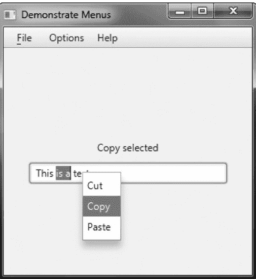

将上下文菜单与场景（scene）关联也是可能的。实现此点的方法是在场景的根节点上调用`setContextMenuRequested()`。该方法由`Node`定义并所示：

```
final void setContextMenuRequested(
    EventHandler<? super ContextMenu> eventHandler)
```

在这里，`EventHandler`指定了接收到上下文菜单弹出请求时将链接的处理器。在这种情况下，处理器必须调用`ContextMenu`定义的`show()`方法来使上下文菜单显示。这是我们用使用的版本：

```
final void show(Node node, double upperX, double upperY)
```

在这里，`node`是关联上下文菜单的元素。`upperX`和`upperY`的值定义了菜单左上角相对于屏幕的 X、Y 位置。通常，你将传递右击发生的屏幕坐标。为了做到这一点，你将调用`ContextEvent`定义的`getScreenX()`和`getScreenY()`方法。它们所示：

```
final double getScreenX()
final double getScreenY()
```

因此，你通常会将这些方法的结果传递给`show()`。前面的理论可以通过将上下文菜单添加到场景图的根节点来实现实践。这样做之后，在场景中的任何位置右击右键都会导致菜单弹出。要实现这一点，向`MenuDemo`程序中添加以下序列：

```
// 将上下文菜单添加到整个场景图。
rootNode.setContextMenuRequested(
    new EventHandler<MouseEvent>()() {
        public void handle(MouseEvent ae) {
            // 在右击的位置显示弹出菜单。
            editMenu.show(rootNode, ae.getScreenX(), ae.getScreenY());
        }
    });
```

在你完成此添加后，可以通过在应用程序场景内的任何地方点击鼠标右键来激活上下文菜单。例如，这里是在窗口左上部分右击右键后显示的菜单：

# 创建工具栏

工具栏（toolbar）是一种可以作为菜单栏辅助工具的组件。通常，工具栏包含用于执行加粗、斜体或下划线的按钮。在 JavaFX 中，工具栏是`ToolBar`类的实例。它定义了两个构造函数，所示：

- `Toolbar()`
- `Toolbar(Node nodes)`

第一个构造函数创建一个空的工具栏。如果你想创建一个垂直工具栏，可以在工具栏上调用`setOrientation()`。所示：

```
final void setOrientation(Orientation how)
```

`how`的值必须是`Orientation.VERTICAL`或`Orientation.HORIZONTAL`。将按钮（或其他控件）添加到工具栏的方法与添加到菜单栏的方法类似：调用`getItems()`方法返回的引用的`add()`。然而，通常在`Toolbar`构造函数中指定项更为简单，这就是这里采用的方法。一旦你创建了工具栏，将其添加到场景图中。例如，使用边界布局时，它可以添加到底部。为了演示工具栏，我们将其添加到`MenuDemo`程序中。该工具栏将呈现三个调试选项。首先，以下代码：

```
// 定义工具栏。首先创建工具栏项。
btnSet = new Button("Set Breakpoint",
    new ImageView("setBP.gif"));
btnClear = new Button("Clear Breakpoint",
    new ImageView("clearBP.gif"));
btnResume = new Button("Resume Execution",
    new ImageView("resume.gif"));
```

```
// 现在，关闭按钮中的文本。
btnSet.setContent(ContentDisplay.GRAPHIC_ONLY);
btnClear.setContent(ContentDisplay.GRAPHIC_ONLY);
btnResume.setContent(ContentDisplay.GRAPHIC_ONLY);
```

```
// 设置工具提示。
btnSet.setTooltip(new Tooltip("Set a breakpoint."));
btnClear.setTooltip(new Tooltip("Clear a breakpoint."));
btnResume.setTooltip(new Tooltip("Resume execution."));
```

```
// 创建工具栏。
tbDebug = new Toolbar(btnSet, btnClear, btnResume);
```

让我们仔细观察一下。首先，创建了三个对应调试操作的按钮。注意每个按钮都关联了一个图像。接下来，这通过调用`setDisplayStyle()`禁用了文本显示。有趣的是，本可以保持文本显示，但工具栏的外观会显得有些不标准。（然而，每个按钮的文本仍然是需要的，因为它们将通过按钮的事件处理器来获取。）然后为每个按钮设置工具提示（Tooltips）。最后，创建工具栏，并将指定的按钮作为内容。

接下来，添加以下序列，它为工具栏按钮定义了一个事件处理器：

```
// 为工具栏按钮创建一个处理器。
EventHandler<ActionEvent> btnHandler = new EventHandler<ActionEvent>()
public void handle(ActionEvent ae) {
    response.setText(((Button)ae.getTarget()).getText());
}
// 设置工具栏按钮的操作事件处理器。
btnSet.setAction(btnHandler);
btnClear.setAction(btnHandler);
btnResume.setAction(btnHandler);
```

最后，使用此此语句将工具栏添加到边框布局的底部：
`rootNode.setBottom(tbDebug);`

完成这些添加后，用户每当按下工具栏按钮，就会触发一个操作事件，并通过在响应标签中显示按钮文本来处理该事件。以下输出显示了运行中的工具栏：

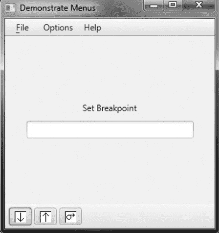

## 整合整个 MenuDemo 程序

在讨论过程中，对章节开头所示的`MenuDemo`程序进行了许多更改和添加。在结束之前，将所有部分组合在一起将非常有帮助。这样做不仅消除了关于各个部分组合方式的任何歧义，还为你提供了一个可以进行实验的完整菜单演示程序。

以下版本的`MenuDemo`包含了本章描述的所有添加和增强。为了清晰起见，对程序进行了重新组织，使用单独的方法来构建各种菜单和工具栏。注意，几个与菜单相关的变量（如`mb`和`tbDebug`）已变为了实例变量，以便类的任何部分直接访问它们。

```java
// 演示菜单 -- 最终版本
import javafx.application.*;
import javafx.scene.*;
import javafx.stage.*;
import javafx.scene.layout.*;
import javafx.scene.control.*;
import javafx.event.*;
import javafx.geometry.*;
import javafx.scene.input.*;
import javafx.scene.image.*;
import javafx.beans.value.*;

public class MenuDemoFinal extends Application {
    MenuBar mb;
    EventHandler<ActionEvent> MEHandler;
    ContextMenu editMenu;
    Toolbar tbDebug;
    Label response;

    public static void main(String[] args) {
        // 调用 launch() 启动 JavaFX 。
        launch(args);
    }

    // 重写 start() 方法。
    public void start(Stage myStage) {
        // 给舞台设置一个标题。
        myStage.setTitle("Demonstrate Menus -- Final Version");
        // 使用 BorderPane 作为根节点。
        BorderPane rootNode = new BorderPane();
        // 创建场景。
        Scene myScene = new Scene(rootNode, 300, 300);
        // 将场景设置到舞台上。
        myStage.setScene(myScene);
        // 创建一个报告选择结果标签。
        response = new Label();
        // 为所有菜单操作事件创建一个事件处理器。
        MEHandler = new EventHandler<ActionEvent>() {
            public void handle(ActionEvent ae) {
                String name = ((MenuItem)ae.getTarget()).getText();
                if (name.equals("Exit")) Platform.exit();
                response.setText( name + " 已选择");
            }
        };
        // 创建菜单栏。
        mb = new MenuBar();
        // 创建文件菜单。
        makeFileMenu();
        // 创建选项菜单。
        makeOptionsMenu();
        // 创建帮助菜单。
        makeHelpMenu();
        // 创建右键菜单。
        makeContextMenu();
        // 创建一个文本字段并设置其列宽为 20。
        TextField tf = new TextField();
        tf.setPrefColumnCount(20);
        // 将右键菜单添加到文本字段。
        tf.setContextMenu(editMenu);
        // 创建工具栏。
        makeToolbar();
        // 将右键菜单添加到整个场景图上。
        rootNode.setOnContextMenuRequested(
            new EventHandler<ContextChangeEvent>() {
                public void handle(ContextChangeEvent ae) {
                    // 在右键点击的位置显示弹出菜单。
                    editMenu.show(rootNode, ae.getScreenX(), ae.getScreenY());
                }
            });
        // 将菜单栏添加到边框布局的顶部。
        rootNode.setTop(mb);
        // 创建一个同时持有响应
        // 标签和文本字段的流面板。
        FlowPane fpRoot = new FlowPane(10, 10);
        // 在场景中居对齐控件。
        fpRoot.setAlignment(Pos.CENTER);
        // 使用分隔符来更好地组织布局。
        Separator separator = new Separator();
        separator.setPref(260);
        // 将标签、分隔符和文本字段添加到流面板。
        fpRoot.getChildren().addAll(response, separator, tf);
        // 将工具栏添加到边框布局的底部。
        rootNode.setBottom(tbDebug);
        // 将流面板添加到边框布局的中心。
        rootNode.setCenter(fpRoot);
        // 显示舞台及其场景。
        myStage.show();
    }

    // 创建文件菜单。
    void makeFileMenu() {
        Menu fileMenu = new Menu("_File");
        // ... 此处省略实现细节，逻辑与上文一致
    }

    // ... 其他方法实现
}
```

```java
high.setOnClickListener(MEHandler);
low.setOnClickListener(MEHandler);
reset.setOnClickListener(MEHandler);
// 使用监听器来响应单选按钮菜单项
// 设置的更改。
t.selectedToggleProperty().addListener(new ChangeListener<Toggle>() {
    public void changed(ObservableValue<? extends Toggle> changed,
        Toggle oldVal, Toggle newVal) {
        if(newVal==oldVal) return;
        // 将 newVal 转换为 RadioButton。
        RadioMenuItem rmi = (RadioMenuItem) newVal;
        // 显示选择结果。
        response.setText("选中的优先级是 " + rmi.getText());
    }
});
// 将选项菜单添加到菜单栏。
mb.getMenus().add(optionsMenu);
// 创建帮助菜单。
void makeHelpMenu() {
    // 为图像创建一个 ImageView。
    ImageView aboutIV = new ImageView("aboutIcon.gif");
}
```

```java
// 创建帮助菜单。
Menu helpMenu = new Menu("Help");
// 创建“关于”菜单项并将其添加到帮助菜单中。
MenuItem about = new MenuItem("About", aboutIV);
helpMenu.getItems().add(about);
// 设置操作事件处理程序。
about.setsetAction(MEHandler);
// 将帮助菜单添加到菜单栏。
mb.getMenus().add(helpMenu);
}

// 创建上下文菜单项。
void makeContextMenu() {
    // 创建编辑上下文菜单项。
    MenuItem cut = new MenuItem("Cut");
    MenuItem copy = new MenuItem("Copy");
    MenuItem paste = new MenuItem("Paste");
    // 创建一个显示编辑选项的上下文（即弹出）菜单。
    editMenu = new ContextMenu(cut, copy, paste);
}
```

```java
// 设置操作事件处理程序。
cut.setOnAction(MeHandler);
copy.setOnAction(MeHandler);
paste.setOnAction(MeHandler);
}

// 创建工具栏。
void makeToolbar() {
  // 创建项。
  btnSet = new Button("Set Breakpoint",
    new ImageView("setBP.gif"));
  btnClear = new Button("Clear Breakpoint",
    new ImageView("clearBP.gif"));
  btnResume = new Button("Resume Execution",
    new ImageView("resume.gif"));
  // 关闭按钮上的文本。
  btnSet.setContentDisplay(ContentDisplay.GRAPHIC_ONLY);
  btnClear.setContentDisplay(ContentDisplay.GRAPHIC_ONLY);
  btnResume.setContentDisplay(ContentDisplay.GRAPHIC_ONLY);
  // 设置工具提示。
  btnSet.setToolTip(new Tooltip("Set a breakpoint."));
  btnClear.setToolTip(new Tooltip("Clear a breakpoint."));
  btnResume.setToolTip(new Tooltip("Resume execution."));
  // 创建工具栏。
  tbDebug = new Toolbar(btnSet, btnClear, btnResume);
  // 为工具栏按钮创建处理程序。
  EventHandler<ActionEvent> btnHandler = new EventHandler<ActionEvent>() {
    public void handle(ActionEvent ae) {
      response.setText(((Button)ae.getTarget()).getText());
    }
  };
  // 设置工具栏的操作事件处理程序。
  btnSet.setOnAction(btnHandler);
  btnClear.setOnAction(btnHandler);
  btnResume.setOnAction(btnHandler);
}
}
```

# 持续探索 JavaFX

JavaFX 代表了 Java GUI 框架的一大进展。它还重新定义了 Java 平台的某些方面。前面的三个章节已经介绍了它的几个核心功能，但仍有许多内容等待探索。例如，JavaFX 提供了许多更多控件，如滑块、独立滚动条和表格。你可能想要尝试它的布局，例如`VBox`和`HBox`。你还可能想要详细探索`javafx.scene.effect`中的各种效果以及`javafx.scene.transform`中的各种变换。另一个令人兴奋的类是`WebView`，它为你提供了一种将 Web 内容集成到场景图（scene graph）中的简单方法。坦地说，整个 JavaFX 都值得进行深入研究。在许多方面，它正规划着 Java 的未来路线。

## 部分

# V 应用 Java

第 37 章 Java Beans

第 38 章 介绍 Servlets

## 章节

# 第 37 章 Java Beans

本章提供了 Java Beans 的概述。Beans 非常重要，因为它们允许你从软件组件构建复杂的系统。这些组件可能由你提供，也由一个或多个不同的供应商提供。Java Beans 定义了一种架构，规定了这些构建块如何运行。

为了更好地理解 Beans 的价值，请考虑以下内容。硬件设计人员拥有各种组件，可以集成在一起以构建一个系统。电阻、电容和电感器是简单构建块的示例。所有这些不同的部分都可以重用。在每次需要新系统时，重新构建这些功能是没有必要的，也是可能的。此外，相同的部件可以用于不同类型的电路。这是可能的，因为这些组件的行为是经过理解并记录的。

软件行业也寻求组件化方法的重用性和互操作性优势。为了实现这些益处，需要一种组件架构，允许程序从软件构建块组装，这些构建块可能由不同的供应商提供。设计人员还必须能够选择一个组件，理解其功能并将其整合到应用程序中。当组件的新版本可用时，应该能够轻松地将此功能整合到现有代码中。

# 什么是 Bean？

Java Bean 是一种软件组件，旨在设计为在各种环境中具有重用性。Bean 的能力没有限制。它可以执行一个简单的函数（例如获取一个值），也可以一个复杂的函数（例如预测股票性能）。Bean 可能是对用户可见的。一个例子是图形界面上的按钮。Bean 也可以是对用户不可见的。实时解码多媒体信息流的软件就是这种构建块的示例。最后，Bean 可以设计为在工作站上独立运行，或与一组组件协作。从数据点生成饼图的软件是这种本地执行的 Bean 的示例。

然而，一个提供股票或交易所实时价格信息的 Bean 需要与其他软件协作以获取其数据。

# Java Beans 的优势

以下列表列出了 Bean 技术为组件开发者提供的优势：

- Bean 获得了 Java “编写一次，随处运行”范式的所有优势。
- 暴露给另一个程序的 Bean 的属性、事件和方法是可以控制的。
- 可以辅助软件来配置 Bean。这种软件只需要在设置组件的设计参数时需要。运行时不需要。
- Bean 的状态可以保存到持久化存储中并在以后恢复。
- Bean 可以注册接收其他对象的事件，并产生不是其他对象的事件。

# 内省

Java Beans 的核心是内省。分析 Bean 以确定其能力的过程。这是 Java Beans API 的一项基本功能，因为它允许另一个应用程序（如设计工具）获取组件的信息。如果没有内省，Java Beans 技术将无法运行。

Bean 开发者可以通过两种方式指示哪些属性、事件和方法应该被暴露。第一方法使用简单的命名规范。这些规范允许内省机制推断出关于 Bean 的信息。第二种方法是提供一个扩展`BeanInfo`接口的额外类，显式地提供这些信息。这里将检查两种方法。

# 属性的设计模式

属性是 Bean 状态的一个子集。分配属性的值决定了其行为和外观。属性通过 setter 方法设置。属性通过 getter 方法获取。有两种类

# 简单属性

简单属性具有单个值。可以通过以下设计模式来识别，其中 N 是属性的名称，T 是其类型：

```
public T getN()
public void setN(T arg)
```

读/写属性同时包含这两个方法来访问其值。只读属性只有一个 get 方法。只写属性只有一个 set 方法。

以下是三个读/写简单属性以及它们的 getter 和 setter 方法：

```java
private double depth, height, width;
```

```java
public double getDepth() {
    return depth;
}
public void setDepth(double d) {
    depth = d;
}
```

```java
public double getHeight() {
    return height;
}
public void setHeight(double h) {
    height = h;
}
```

```java
public double getWidth() {
    return width;
}
public void setWidth(double w) {
    width = w;
}
```

注意 对于布尔属性，也可以使用如`isPropertyName()`形式的方法作为访问器。

# 索引属性

索引属性包含多个值。可以通过以下设计模式来识别，其中 N 是属性的名称，T 是其类型：

```
public T getN(int index);
public void setN(int index, T value);
public T[] getN();
public void setN(T values[]);
```

以下是一个名为 data 的索引属性以及它的 getter 和 setter 方法：

```java
private double data[];
public double getData(int index) {
    return data[index];
}
public void setData(int index, double value) {
    data[index] = value;
}
public double[] getData() {
    return data;
}
public void setData(double[] values) {
    data = new double[values.length];
    System.arraycopy(values, 0, data, 0, values.length);
}
```

# 事件的设计模式

Beans 使用本书前面讨论过的委托委托模型。Beans 可以生成事件并将其发送给其他对象。这些可以通过以下设计模式来识别，其中 T 是事件的类型：

```
public void addEventListener(TListener eventListener);
public void addEventListener(TListener eventListener) throws java.util.TooManyListenersException
public void removeEventListener(TListener eventListener);
```

这些方法用于为指定事件添加或移除监听器。不抛出异常的`EventListener()`版本可用于多广播事件，这意味着多个监听器可以注册该事件通知。抛出`TooManyListenersException`的版本则用于单播事件，这意味着监听器的数量可以被限制为一个。在任何一种情况下，`removeEventListener()`都用于移除监听器。例如，假设有一个名为`TemperatureListener`的事件接口，Bean 可能会提供以下方法：

```java
public void addTemperatureListener(TemperatureListener tl) {
}
public void removeTemperatureListener(TemperatureListener tl) {
}
```

# 方法与设计模式

设计模式不用于命名非属性方法。内省机制会找到 Bean 的所有公共方法。受保护和私有的方法不会显示。

# 使用 BeanInfo 接口

如前面的讨论所示，设计模式隐式地决定了 Bean 用户可以使用哪些信息。`BeanInfo`接口允许你显式地控制可用信息。`BeanInfo`接口定义了几个方法，包括：

- `PropertyDescriptor[] getPropertyDescriptors()`
- `EventSetDescriptor[] getEventSetDescriptors()`
- `MethodDescriptor[] getDescriptors()`

它们返回对象数组，提供有关 Bean 的属性、事件和方法的信息。`PropertyDescriptor`、`EventSetDescriptor`和`MethodDescriptor`类定义在`java.beans`包中，它们描述了指定的元素。通过实现这些方法，开发者可以精确指定呈现给用户的内容，跳过基于模式的内省。

在创建实现`BeanInfo`的类时，必须将该类命名为`bnameBeanInfo`，其中`bname`是 Bean 的名称。例如，如果 Bean 是`MyBean`，那么类必须名为`MyBeanBeanInfo`。

为了简化`BeanInfo`的使用，JavaBeans 提供了`SimpleBeanInfo`类。它提供了`BeanInfo`接口的默认实现，包括上面三个方法。你可以扩展此类并重写一个或多个方法，以显式控制 Bean 的哪些方面。如果不重写方法，将使用设计模式内省。例如，如果你不重写`getPropertyDescriptors()`，则使用设计模式来描述 Bean 的属性。你将在本章后续部分中使用`SimpleBeanInfo`。

# 绑定属性与约束属性

具有绑定属性（bound property）的 Bean 在属性更改时会生成事件。该事件类型为`PropertyChangeEvent`，并发送给之前注册过接收此类通知的对象。处理此事件的类必须实现`PropertyChangeListener`接口。

具有约束属性（constrained property）的 Bean 在尝试更改其值时会生成事件。它对之前注册过接收此类通知感兴趣的对象非常敏感。然而，其他对象有能力通过抛出`PropertyVetoException`来否决提议的更改。这种能力允许 Bean 根据其运行时以不同的运行。处理此事件的类必须实现`VetoableChangeListener`接口。

# 持久化

持久化是将 Bean 的当前状态（包括其属性和实例变量的值）保存到存储器并在以后检索它们的能力。Java 类库提供的序列化能力用于为 Bean 提供持久化。

最容易序列化的 Bean 是实现`Serializable`接口，它是一个标记接口。实现`Serializable`会使序列化自动化。你的 Bean 不需要其他操作。

在使用自动序列化时，可以通过`transient`关键字选择性地防止字段被保存。因此，标记为`transient`的 Bean 成员不会被保存。

如果 Bean 没有实现`Externalizable`，则必须自行提供序列化，例如实现`Externalizable`。否则，容器无法保存你组件的配置。

# 自定义器

Bean 开发者可以提供自定义器来帮助其他开发者配置 Bean。自定义器可以为在特定上下文中使用组件时必须遵循的过程提供逐步指南。还可以提供在线文档。Bean 开发者具有很大的灵活性来开发能够在市场上区分其产品的自定义器。

| 接口 | 描述 |
| :--- | :--- |
| `AppletInitializer` | 此接口的方法用于初始化作为 applet 的 Bean。（已在 JDK 9 中弃用。） |
| `BeanInfo` | 此接口允许设计师指定有关 Bean 的属性、事件和方法的信息。 |
| `Customizer` | 此接口允许设计师提供一个可以通过其配置 Bean 的图形用户界面。 |
| `DesignMode` | 此接口的方法确定 Bean 是否在设计模式下执行。 |
| `ExceptionListener` | 当发生异常时会调用此接口的方法。 |
| `PropertyChangeListener` | 当绑定属性更改时会调用此接口的方法。 |
| `PropertyEditor` | 实现此接口的对象允许设计师更改和显示属性值。 |
| `VetoableChangeListener` | 当约束属性更改时会调用此接口的方法。 |
| `Visibility` | 此接口的方法允许 Bean 在没有图形用户界面的中执行。 |

**表 37-1** `java.beans`中的接口

| 类 | 描述 |
| --- | --- |
| `BeanDescriptor` | 此类提供有关 Bean 的信息。它还允许你与 Bean 关联一个自定义器（customizer）。 |
| `Beans` | 此类用于获取有关 Bean 信息。 |
| `DefaultPersistenceDelegate` | `PersistenceDelegate`的具体子类。 |
| `Encoder` | 编码一组 Beans 的状态。可以将这些信息写入流中。 |
| `EventHandler` | 支持动态事件监听器的创建。 |
| `EventSetDescriptor` | 此类的实例描述了 Bean 可能生成的事件。 |
| `Expression` | 封装了返回结果的方法调用。 |
| `FeatureDescriptor` | 它是`PropertyDescriptor`、`EventSetDescriptor`和`MethodDescriptor`等类的父类。 |
| `IndexedPropertyEvent` | `PropertyChangeEvent`的子类，表示索引属性的更改。 |
| `IndexedPropertyDescriptor` | 此类的实例描述了 Bean 的索引属性。 |
| `IntrospectionException` | 如果在分析 Bean 时发生问题，则会生成此类型的异常。 |
| `Introspector` | 此类分析并构建一个描述该组件的`BeanInfo`对象。 |
| `MethodDescriptor` | 此类的实例描述了 Bean 的方法。 |
| `ParameterDescriptor` | 处理方法的状态信息。 |
| `PersistenceDelegate` | 当绑定（bound）或约束（constrained）属性发生更改时，会生成此事件。 |
| `PropertyChangeEventProxy` | 继承`ListenerProxy`并实现`PropertyChangeListener`。 |
| `PropertyChangesSupport` | 支持属性的 Beans 可以此类来通知对象。 |
| `PropertyDescriptor` | 此类的实例描述了 Bean 的属性。 |
| `PropertyEditorManager` | 此类为给定类型查找`PropertyEditor`对象。 |
| `PropertyEditorSupport` | 此类提供了用于编写编辑器的功能。 |
| `VetoException` | 如果约束属性的更改被否决（vetoed），则会生成此类型的异常。 |
| `SimpleBeanInfo` | 此类提供了在 Bean 类中可以使用的功能。 |
| `Statement` | 封装了方法调用。 |
| `VetoChangeListenerProxy` | 继承`ListenerProxy`并实现`VetoChangeListener`。 |
| `VetoChangeListenerSupport` | 支持约束属性的 Beans 可以此类来通知对象。 |
| `XMLDecoder` | 用于从 XML 文档读取 Bean。 |
| `XMLEncoder` | 用于将 Bean 写入 XML 文档。 |

## `java.beans`中的类

虽然讨论所有类超出了本章的范围，但有四个类特别受关注：内省（Introspection）、`PropertyDescriptor`、`EventSetDescriptor`和`MethodDescriptor`。这里将将对每个类进行简要检查。

### 内省 (Introspection)
`Introspection`类提供了支持内省的静态方法。最感兴趣的是`getBeanInfo()`。此方法返回一个`BeanInfo`对象，可以使用它获取有关 Bean 的信息。`getBeanInfo`有多种形式，包括此处所示的形式：

```
static BeanInfo getBeanInfo(Class<?> bean) throws IntrospectionException
```

### PropertyDescriptor
`PropertyDescriptor`类描述一个属性。例如，你可以通过调用`isBound()`判断属性是否是绑定的。你可以调用`getName()`获取属性的名称。

### EventSetDescriptor
`EventSetDescriptor`类表示一组事件。它支持多种方法来添加或删除监听器，以及其他管理管理。例如，要获取用于添加监听器的方法，调用`addEventListenerMethod()`。要获取用于删除监听器的方法，调用`removeEventListenerMethod()`。要获取监听器的类型，调用`getEventType()`。你可以调用`getName()`获取事件的名称。

### MethodDescriptor
`MethodDescriptor`类表示一个 Bean 方法。要获取方法名称，调用`getName()`。你可以调用`getMethod()`获取有关方法的信息，如下：

```
Method getMethod()
```

返回一个类型为`Method`的对象。

## Bean 示例

本章以一个示例结束，该示例说明了 Bean 编程的各个方面，包括内省和使用`BeanInfo`类。它还使用了`Introspector`、`PropertyDescriptor`和`EventSetDescriptor`类。该示例使用了三个类。第一个是名为`Colors`的 Bean，所示：

```java
// 一个简单的 Bean.
import java.awt.*;
import java.awt.event.*;
import java.io.Serializable;

public class Colors extends Canvas implements Serializable {
    transient Color color; // 不持久化
    private boolean rectangular; // 持久化

    public Colors() {
        addMouseListener(new MouseAdapter() {
            public void mousePressed(MouseEvent me) {
                change();
            }
        });
        rectangular = false;
        setSize(200, 100);
    }

    public boolean getRectangular() {
        return rectangular;
    }

    public void setRectangular(boolean flag) {
        this.rectangular = flag;
        repaint();
    }

    public void change() {
        color = randomColor();
        repaint();
    }

    private Color randomColor() {
        int r = (int)(255*Math.random());
        int g = (int)(255*Math.random());
        int b = (int)(255*Math.random());
        return new Color(r, g, b);
    }

    public void paint(Graphics g) {
        Dimension d = getSize();
        int h = d.height;
        int w = d.width;
        g.setColor(color);
        if(rectangular) {
            g.fillRect(0, 0, w-1, h-1);
        } else {
            g.fillOval(0, 0, w-1, h-1);
        }
    }
}
```

`Colors` Bean 在框架内显示一个彩色对象。组件的颜色由私有变量`color`决定，形状由私有布尔变量`rectangular`决定。构造函数定义了一个继承`MouseAdapter`的匿名内部类并重写了`mousePressed`方法。在按下鼠标时调用`change()`。它选择一个随机颜色并重绘。`getRectangular()`和`setRectangular()`方法提供了对该属性的访问。

下一个类是`ColorsBeanInfo`。它是`SimpleBeanInfo`的子类，提供了关于`Colors`的显式信息。它重写了`getPropertyDescriptors()`以指定呈现哪些属性。在这种情况下，唯一的属性是`rectangular`。该方法创建并返回一个用于`rectangular`属性的`PropertyDescriptor`对象。此处`PropertyDescriptor`构造函数是：

```java
// Bean 信息类.
import java.beans.*;

public class ColorsBeanInfo extends SimpleBeanInfo {
    public PropertyDescriptor[] getPropertyDescriptors() {
        try {
            PropertyDescriptor rectangular = new
                PropertyDescriptor("rectangular", Colors.class);
            PropertyDescriptor pd[] = {rectangular};
            return pd;
        } catch (Exception e) {
            System.out.println("Exception caught. " + e);
        }
        return null;
    }
}
```

最后一个类叫做`IntrospectorDemo`。它使用内省来显示`Colors` Bean 中可用属性和事件。

```java
// 显示属性和事件.
import java.awt.*;
import java.beans.*;

public class IntrospectorDemo {
    public static void main(String[] args[]) {
        try {
            Class<?> c = Class.forName("Colors");
            BeanInfo beanInfo = Introspector.getBeanInfo(c);

            System.out.println("Properties:");
            PropertyDescriptor[] propertyDescriptor[] = 
                beanInfo.getPropertyDescriptors();
            for (int i = 0; i < propertyDescriptor.length; i++) {
                System.out.println("\t" + propertyDescriptor[i].getName());
            }
        } catch (Exception e) {
            e.printStackTrace();
        }
    }
}
```

```java
System.out.println("Events:");
EventSetDescriptor eventDescriptor[] = 
beanInfo.getSetDescriptors();
for (int i = 0; i < eventDescriptor.length; i++) {
    System.out.println("\t" + eventDescriptor[i].getName());
}
catch (Exception e) {
    System.out.println("Exception caught. " + e);
}
```

该程序的输出如下：

- 属性:
- rectangular
Events:
- mouseWheel
- mouse
- mouseMotion
- component
- hierarchyBounds
- focus
- hierarchy
- propertyChange
- inputMethod
- key

注意输出中的两点。首先，由于`ColorsBean`重写了`getDescriptors()`方法，使得返回的属性只有`rectangular`，因此只显示了`rectangular`属性。然而，由于`BeansInfo`没有重写`getSetDescriptors()`，因此使用了设计模式内省，找到了所有的事件，包括`Colors`超类`Canvas`中的事件。请记住，如果你没有重写`SimpleBeanInfo`定义的任何“get”方法，则将使用默认的设计模式内省。为了观察`BeansInfo`带来的差异，请删除其类文件并再次运行`IntrospectorDemo`。这次它将报告更多属性。

# 章节目录

# Servlet 简介

本章将介绍 Servlet 的基础知识。Servlet 是运行在 Web 连接服务器端的小型程序。Servlet 的主题非常庞大，涵盖所有内容超出了本章的范围。相反，我们将关注核心概念、接口、类，并开发几个示例。

# 背景

为了理解 Servlet 的优势，你必须对 Web 浏览器和服务器如何协作为用户提供内容有基本的了解。考虑一个静态 Web 页面的请求。用户在浏览器中输入统一资源定位符（URL）。浏览器向适当的 Web 服务器生成 HTTP 请求。Web 服务器将此请求映射到特定文件。该文件通过 HTTP 响应返回给浏览器。HTTP 头部指示了内容的类型。多媒体互联网邮件扩展（MIME）被用于此目的。例如，普通 ASCII 文本的 MIME 类型为`text/plain`。网页的超文本标记语言（HTML）源代码的 MIME 类型为`text/html`。

现在考虑一下动态内容。假设一家在线商店使用数据库来存储其业务信息。这包括销售商品、价格、可用性、订单等。它希望通过 Web 页面让客户能够访问这些信息。这些网页的内容必须是动态生成的，以反映数据库中的最新信息。

在 Web 早期，服务器可以通过为每个客户端请求创建一个独立的进程来动态构建页面。该进程将打开到一个或多个数据库的连接，以获取所需的信息。它通过一种称为通用网关接口（CGI）的接口与 Web 服务器进行通信。CGI 允许独立进程从 HTTP 请求中读取数据并向 HTTP 响应写入数据。构建 CGI 程序使用了多种不同的语言，包括 C、C++ 和 Perl。

然而，CGI 遭遇了严重的性能问题。为每个客户端请求创建一个独立的进程在处理器和内存资源方面是非常昂贵的。为每个客户端请求打开和关闭数据库连接也是昂贵的。此外，CGI 程序不具备平台无关性。因此，引入了其他技术。其中就 Servlet。

与 CGI 相比， Servlet 具有若干优势。首先，性能显著提高。Servlet 运行在 Web 服务器的地址空间内。不需要为处理每个客户端请求创建一个独立的进程。其次，Servlet 是用 Java 编写的，因此它们是平台无关的。第三，服务器上的安全管理器执行了一系列限制，以保护服务器机器上的资源。最后，Servlet 可以使用 Java 类库的全功能。它可以通过你已经看到的 sockets 和 RMI 机制与其他软件进行通信。

# Servlet 的生命周期

三个方法对于 Servlet 的生命周期至关重要。这些是`init()`、`service()`和`destroy()`。它们由每个 Servlet 实现，并在特定时间由服务器调用。让我们考虑一个典型的用户场景来理解这些方法何时被调用。

首先，假设用户在浏览器中输入统一资源定位符（URL）。浏览器随后为该 URL 生成 HTTP 请求。该请求随后发送到适当的 Servlet。

其次，Web 服务器接收到此 HTTP 请求。服务器将此请求映射到特定的 Servlet。Servlet 被动态检索并加载到服务器的地址空间中。

第三，服务器调用 Servlet 的`init()`方法。该方法仅在 Servlet 首次加载到内存时被调用。可以向 Servlet 传递初始化参数，以便其进行自配置。

第四，服务器调用 Servlet 的`service()`方法。你会发现 Servlet 可以读取 HTTP 请求中提供的数据。它还可能为客户端制定 HTTP 响应。

Servlet 保持在服务器的地址空间中，并可以处理从客户端收到的任何其他 HTTP 请求。每个 HTTP 请求都会调用`service()`方法。

最后，服务器可能决定从内存中卸载 Servlet。做出此判断的算法特定于每个服务器。服务器调用`destroy()`方法以释放为 Servlet 分配的任何资源（如文件句柄）。为 Servlet 及其对象分配的内存可以被垃圾回收。

# Servlet 开发选项

为了实验 Servlet，你需要访问 Servlet 容器。两个流行的容器是 Glassfish 和 Apache Tomcat。Glassfish 是由 Oracle 赞助的开源项目，受 NetBeans 支持。Apache Tomcat 是由 Apache 软件基金维护的开源项目。Tomcat 和 Glassfish 也可以配合其他 IDE 使用。

如果将 64 位的 Tomcat 8.5.5 直接解压到根目录，默认位置为：

```
C:\apache-tomcat-8.5.5-windows-x64\apache-tomcat-8.5.5\
```

这是本书中示例（假设的路径。如果你在不同的位置加载 Tomcat（或使用不同版本的 Tomcat），你将需要对示例进行相应的更改。你将将环境变量`JAVA_HOME`设置为安装 Java 开发工具包（JDK）的顶层目录。

**注意** 本节显示的所有目录均假设为 8.5.5。如果你安装了不同版本的 Tomcat，则需要调整目录和路径，以与你安装的版本相匹配。

安装完成后，从`apache-tomcat-8.5.5`目录中选择`startup.bat`启动 Tomcat。要停止 Tomcat，请执行`bin`目录下的`shutdown.bat`。

构建 servlet 需要的类和接口包含`servlet-api.jar`中，它位于以下目录：

```
C:\apache-tomcat-8.5.5-windows-x64\apache-tomcat-8.5.5\lib
```

为了使`servlet-api.jar`可用，请更新你的`CLASSPATH`环境变量，使其包含：

```
C:\apache-tomcat-8.5.5-windows-x64\apache-tomcat-8.5.5\lib\servlet-api.jar
```

或者，你也可以在编译 servlet 时指定它。例如，以下命令编译了第一个 servlet：

```
javac HelloServlet.java -classpath "C:\apache-tomcat-8.5.5-windows-x64\apache-tomcat-8.5.5\servlet-api.jar"
```

一旦编译了 servlet，你将需要 Tomcat 来找到它。对于你的需求来说，这意味着将其放入 Tomcat 的`websapps`目录下的子目录，并在`web.xml`文件中输入它的名称。为了简单起见，本章中的示例使用了 Tomcat 为其示例 servlet 提供的目录和`web.xml`文件。这样，你就不需要为了示例 servlet 而创建任何文件或目录。以下是你将遵循的步骤：

首先，将 servlet 的类文件复制到以下目录：

```
C:\apache-tomcat-8.5.5-windows-x64\apache-tomcat-8.5.5\webapps\examples\WEB-INF\classes
```

接下来，将 servlet 的名称和映射添加到以下目录下的`web.xml`文件中：

```
C:\apache-tomcat-8.5.5-windows-x64\apache-tomcat-8.5.5\webapps\examples\WEB-INF
```

例如，假设是第一个名为`HelloServlet`的示例，你将在定义 servlet 的部分添加以下几行：

```xml
<servlet>
  <servlet-name>HelloServlet</servlet-name>
  <servlet-class>HelloServlet</servlet-class>
</servlet>
```

接下来，你把以下几行添加到定义 servlet 映射的部分：

```xml
<servlet-mapping>
  <servlet-name>HelloServlet</servlet-name>
  <url-pattern>/servlets/servlet/HelloServlet</url-pattern>
</servlet-mapping>
```

对所有示例都遵循这一通用的步骤。

# 一个简单的 Servlet

为了熟悉关键 servlet 概念，我们将从构建和测试简单的 servlet 开始。基本步骤如下：

- 1. 创建并编译 servlet 源代码。然后，将 servlet 的类文件复制到正确的目录，并将 servlet 的名称和映射添加到`web.xml`文件中。
- 2. 启动 Tomcat。
- 3. 启动浏览器并请求该 servlet。

让我们详细检查这些每一个步骤。

# 创建并编译 Servlet 源代码

首先，创建一个名为`HelloServlet.java`的文件，包含以下程序：

```java
import java.io.*;
import javax.servlet.*;

public class HelloServlet extends GenericServlet {
    public void service(ServletRequest request, HttpServletResponse response)
    throws ServletException, IOException {
        response.setContentType("text/html");
        PrintWriter pw = response.getWriter();
        pw.println("<B>Hello!</B>");
        pw.close();
    }
}
```

让我们仔细观察这个程序。首先，注意它导入了`javax.servlet`包。该包包含了构建 servlet 所的类和接口。你将在本章后面的部分学习更多相关内容。接下来，程序将`HelloServlet`定义为`GenericServlet`的子类。`GenericServlet`类提供了简化 servlet 创建的功能。例如，它提供了`init()`和`destroy()`的版本，可以直接使用。你只需要提供`service()`方法即可。

`HelloServlet`重写了`service()`方法（继承自`GenericServlet`）。该方法处理来自客户端的请求。注意，第一个参数是一个`ServletRequest`对象。这使得 servlet 能够读取通过客户端请求提供的数据。第二个参数允许 servlet 为客户端制定响应。

对`setContentType()`的调用确立了 HTTP 响应的 MIME 类型。在程序程序中，MIME 类型为`text/html`。这表示浏览器应该将内容解释为 HTML 源代码。

接下来，`getWriter()`方法获取一个`PrintWriter`。在程序中，MIME 类型为`text/html`。这表示浏览器应该将内容解释为 HTML 源代码。

# Servlet API

Servlet API 一直处于开发和增强过程中。Tomcat 8.5.5 支持的 Servlet 规范是 3.1。（后续版本的 Tomcat 预计支持 4。）

# `javax.servlet`包

`javax.servlet`包包含了许多建立 servlet 运行框架的接口和类。下表总结了该包提供的几个接口。其中最重要的`Servlet`。所有的 servlet 都必须实现此接口或扩展实现它的类。`ServletRequest`和`ServletResponse`接口也非常重要。

| 接口 | 描述 |
| --- | --- |
| `Servlet` | 定义 servlet 的生命周期方法。 |
| `ServletConfig` | 允许 servlet 获取初始化参数。 |
| `ServletContext` | 使 servlet 记录事件并访问其环境信息。 |
| `ServletRequest` | 用于从客户端请求读取数据。 |
| `ServletResponse` | 用于向客户端响应写入数据。 |

下表总结了`.servlet`包提供的核心类：

| 类 | 描述 |
| --- | --- |
| `GenericServlet` | 实现`Servlet`和`ServletConfig`接口。 |
| `ServletInputStream` | 封装用于从客户端读取请求的输入流。 |
| `ServletOutputStream` | 封装用于向客户端写入响应的输出流。 |
| `ServletException` | 表示 servlet 错误。 |
| `UnavailableException` | 表示 servlet 不用。 |

我们将详细检查这些接口和类。

# Servlet 接口

所有的 servlet 都必须实现`Servlet`接口。它声明了服务器在 servlet 生命周期期间调用的`init()`、`service()`和`destroy()`方法。还提供了一个方法允许 servlet 获取任何初始化参数。`Servlet`定义的方法所示表 38-1。

`init()`、`service()`和`destroy()`是 servlet 的生命周期方法。这些方法由服务器调用。`getServletConfig()`方法由 servlet 调用以获取初始化参数。servlet 开发者重写`getServletInfo()`方法以提供一个带有有用信息的字符串（例如，版本号）。该方法也由服务器调用。

| 方法 | 说明 |
| --- | --- |
| `void destroy()` | 在 servlet 卸载时调用。 |
| `ServletConfig getServletContext()` | 返回一个包含任何初始化参数的`ServletConfig`对象。 |
| `String getServletInfo()` | 返回描述 servlet 的字符串。 |
| `void init(ServletConfig sc) throws ServletException` | 在 servlet 初始化时调用。可以从`sc`获取 servlet 的初始化参数。如果 servlet 无法初始化，则抛出`ServletException`。 |
| `void service(ServletRequest req, ServletResponse res) throws ServletException, IOException` | 调用以处理来自客户端的请求。可以从`req`读取客户端的请求。对客户端的响应可以写入`res`。如果发生 servlet 或 IO 问题，将产生异常。 |

表 38-1 `Servlet`定义的方法

## ServletConfig 接口

`ServletConfig`接口允许 servlet 在加载时获取配置数据。此接口声明的方法总结在此处：

| 方法 | 说明 |
| --- | --- |
| `ServletContext getServletContext()` | 返回此 servlet 的上下文。 |
| `String getInitParameter(String param)` | 返回名为`param`的初始化参数的值。 |
| `Enumeration<String> getInitParameterNames()` | 返回所有初始化参数名的枚举。 |
| `String getServletName()` | 返回调用 servlet 的名称。 |

## ServletContext 接口

`ServletContext`接口使 servlet 能够获取其环境的信息。其方法中的若干个总结在表 38-2 中。

| 方法 | 说明 |
| --- | --- |
| `Object getAttribute(String attr)` | 返回名为`attr`的服务器属性的值。 |
| `String getMimeType(String file)` | 返回文件的 MIME 类型。 |
| `String getRealPath(String vpath)` | 返回对应于相对路径`vpath`的真实（即绝对）路径。 |
| `String getServer()` | 返回服务器的信息。 |
| `void log(String s)` | 将`s`写入 servlet 日志。 |
| `void log(String s, Throwable e)` | 将`s`和`e`的堆栈跟踪写入 servlet 日志。 |
| `void setAttribute(String attr, Object val)` | 将由`attr`指定的属性设置为传入的值`val`。 |

**表 38-2** `ServletContext`定义的各种方法

## ServletRequest 接口

`ServletRequest`接口允许 servlet 获取有关客户端请求的信息。其方法中的若干个总结在表 38-3 中。

| 方法 | 说明 |
| --- | --- |
| `Object getAttribute(String attr)` | 返回名为`attr`的属性的值。 |
| `String getCharacterEncoding()` | 返回请求的字符编码。 |
| `int getContentLength()` | 返回请求的大小。如果大小不可用则返回 -1。 |
| `String getContentType()` | 返回请求的类型。如果无法确定类型，则返回 null 值。 |
| `ServletInputStream getInputStream() throws IOException` | 返回一个可以用于从请求中读取二进制数据的`ServletInputStream`。如果在此对象上之前已调用过`getReader()`，则抛出`IllegalStateException`。 |
| `String getParameter(String pname)` | 返回参数`pname`的值。 |
| `Enumeration<String> getParameterNames()` | 返回此请求的参数名的枚举。 |
| `String[] getParameterValues(String pname)` | 返回一个包含与参数名称关联值的数组。 |
| `String getProtocol()` | 返回协议的描述。 |
| `BufferedReader getReader() throws IOException` | 返回一个可以用于从请求中读取文本的缓冲读取。如果在此对象上之前已调用过`getInputStream()`，则抛出`IllegalStateException`。 |
| `String getRemoteAddr()` | 返回客户端 IP 地址的字符串等值。 |
| `String getRemoteHost()` | 返回客户端主机名的等值。 |
| `String getScheme()` | 返回用于请求的 URL 的传输方案（例如 "http", "ftp"）。 |
| `String getServer()` | 返回服务器的名称。 |
| `int getServerPort()` | 返回端口号。 |

表 38-3 `HttpServletRequest`定义的各种方法

## ServletResponse 接口

`ServletResponse`接口允许 servlet 为客户端制定响应。其方法中的若干个总结在表 38-4 中。

| 方法 | 说明 |
| --- | --- |
| `String getCharacterEncoding()` | 返回响应的字符编码。 |
| `ServletOutputStream getOutputStream() throws IOException` | 返回一个可以用于向响应写入二进制数据的`ServletOutputStream`。如果在此对象上之前已调用过`getWriter()`，则抛出`IllegalStateException`。 |
| `PrintWriter getWriter() throws IOException` | 返回一个可以用于向响应写入字符数据的`PrintWriter`。如果在此对象上之前已调用过`getOutputStream()`，则抛出`IllegalStateException`。 |
| `void setContentLength(int size)` | 将响应的内容长度设置为`size`。 |
| `void setContentType(String type)` | 将响应的内容类型设置为`type`。 |

**表 38-4** `ServletResponse`定义的各种方法

## GenericServlet 类

`GenericServlet`类提供了 servlet 基本生命周期方法的实现。`GenericServlet`实现了`Servlet`和`ServletConfig`接口。此外，还提供了一个将字符串追加到服务器日志文件的方法。该方法的签名所示如下：

```
void log(String s)
void log(String s, Throwable e)
```

在这里，`s`是要追加到日志的字符串，`e`是异常。

## ServletInputStream 类

`InputStream`类继承`InputStream`。它由 servlet 容器实现，提供了一个可以用于从请求中读取二进制数据的输入流。除了输入方法外，还提供了一个读取字节的方法：

```
int read(byte[] buffer, int offset, int size)
```

在这里，`buffer`是从`offset`开始的数组。如果遇到流结束，则返回实际读取的字节数。

## ServletOutputStream 类

`ServletOutputStream`类继承自`OutputStream`。它由 servlet 容器实现，提供了一个可以用于向客户端写入数据的输出流。除了`OutputStream`提供的输出方法外，它还定义了`print()`和`println()`方法。

## 异常类

`javax.servlet`定义了两个异常。第一个是`ServletException`，表示发生了 servlet 问题。第二个是`UnavailableException`，它继承自`ServletException`。

## 读取 Servlet 参数

`ServletRequest`接口包含了允许你读取请求中的参数名称和值的方法。我们将开发一个 servlet 来演示它们的用法。示例包含两个文件：一个网页定义在`PostParameters.html`中，一个 servlet 定义在`PostParametersServlet.java`中。

`PostParameters.html`的源码所示。它定义了一个包含两个标签和文本字段的表格。一个标签是 Employee，另一个是 Phone。还有一个提交按钮。注意表单的`action`参数指定了一个 URL。该 URL 标识了处理 HTTP POST 请求的 servlet。

```html
<html>
<body>
<center>
<form name="Form1"
method="post"
action="http://localhost:8080/examples/servlets/
servlet/PostParametersServlet">
<table>
<tr>
<td><B>Employee</B></td>
<td><input type=textbox name="e" size="25" value=""></td>
</tr>
<tr>
<td><B>Phone</B></td>
<td><input type=textbox name="p" size="25" value=""></td>
</tr>
</table>
<input type=submit value="Submit">
</center>
</body>
</html>
```

`PostParametersServlet.java`的源码所示所示。`service()`方法被重写以处理客户端请求。`getParameterNames()`方法返回参数名的枚举。这些参数在循环中被处理。你可以看到参数名称和值被输出到客户端。参数值通过`getParameter()`方法获取。

```java
import java.io.*;
import java.util.*;
import javax.servlet.*;

public class PostParametersServlet
extends GenericServlet {
    public void service(ServletRequest request,
        ServletResponse response)
        throws ServletException, IOException {
    // Get print writer.
    PrintWriter pw = response.getWriter();

    // Get enumeration of parameter names.
    Enumeration<String> e = request.getParameterNames();

    // Display parameter names and values.
    while (e.hasMoreElements()) {
        String pname = e.nextElement();
        pw.print(pname + " = ");
        String pvalue = request.getParameter(pname);
        pw.println(pvalue);
    }
    pw.close();
  }
}
```

编译该 servlet。接下来，将将其复制到相应的目录，并按照之前的描述更新`web.xml`文件。然后执行以下步骤测试此示例。

- 1. 启动 Tomcat（如果它尚未运行）。
- 2. 在浏览器中显示网页。
- 3. 在文本字段中输入员工姓名和电话号码。
- 4. 提交网页。

遵循这些步骤后，浏览器将显示由 servlet 动态生成的响应。

## `javax.servlet.http`包

之前的示例已经使用了`javax.servlet`中定义的类和接口（如`ServletRequest`、`ServletResponse`和`GenericServlet`）来说明 servlet 的基本功能。然而，在处理 HTTP 时，你通常会使用`java.servlet.http`中的接口和类。正如你所看到的，它的功能使得构建与 HTTP 请求和响应交互的 servlet 变得简单。

下表总结了本章使用的接口：

| 接口 | 描述 |
| --- | --- |
| `HttpServletRequest` | 允许 servlet 从 HTTP 请求读取数据。 |
| `HttpServletResponse` | 允许 servlet 从 HTTP 响应写入数据。 |
| `HttpServletSession` | 允许读取和写入话数据。 |

下表总结了本章使用的类。最重要的是`HttpServlet`。Servlet 开发者通常会扩展此类来处理 HTTP 请求。

| 类 | 描述 |
| --- | --- |
| `Cookie` | 允许在客户端机器上存储状态信息。 |
| `HttpServlet` | 提供处理 HTTP 请求和响应的方法。 |

## HttpServletRequest 接口

`HttpServletRequest`接口允许 servlet 获取有关客户端请求的信息。表 38-5 显示了它的几个方法。

## HttpServletResponse 接口

`HttpServletResponse`接口允许 servlet 为客户端制定 HTTP 响应。其中定义了一些常量。这些常量对应于分配给 HTTP 响应的不同状态码。例如，`SC_OK`表示 HTTP 请求成功，而`SC_NOT_FOUND`表示请求的不可。表 38-6 总结了该接口的几个方法。

| 方法 | 描述 |
| --- | --- |
| `String getAuthType()` | 返回认证方案。 |
| `Cookie[] getCookies()` | 返回请求中的 cookie 数组。 |
| `long getDateHeader(String field)` | 返回名为`field`的日期头部字段的值。 |
| `String getHeader(String field)` | 返回名为`field`的头部字段的值。 |
| `Enumeration<String> getHeaderNames()` | 返回头部名称的枚举。 |
| `int getIntHeader(String field)` | 返回名为`field`的头部字段的 int 等效值。 |
| `String getMethod()` | 返回此请求的 HTTP 方法。 |
| `String getPathInfo()` | 返回 URL 中 servlet 路径之后、查询字符串之前的任何路径信息。 |
| `String getPathTranslated()` | 返回 URL 中 servlet 路径之后、查询字符串之前的任何路径信息，并将其转换为真实路径。 |
| `String getQueryString()` | 返回 URL 中的任何查询字符串。 |
| `String getRemoteUser()` | 返回发布此请求的用户名。 |
| `String getRequestedSessionId()` | 返回会话 ID。 |
| `String getRequestURI()` | 返回 URL。 |
| `StringBuffer getRequestURL()` | 返回 URL。 |
| `String getServletPath()` | 返回 URL 中标识 servlet 的部分。 |
| `HttpSession getSession()` | 返回此请求的会话。如果会话不存在，则创建一个并返回。 |

**表 38-5** 由`HttpServletRequest`定义的各种方法

## HttpSession 接口

`HttpSession`接口允许 servlet 读取和写入与 HTTP 会话关联的状态信息。表 38-7 总结了它的几个方法。如果会话已经失效，所有这些方法都会抛出`IllegalStateException`。

| 方法 | 描述 |
|--- | --- |
| `void addCookie(Cookie cookie)` | 向 HTTP 响应中添加 cookie。 |
| `boolean containsHeader(String field)` | 如果 HTTP 响应头部包含名为`field`的字段则返回 true。 |
| `String encodeURL(String url)` | 确定标识为`url`的 URL 中是否必须编码会话 ID。如果是，返回`url`的修改版本。否则，返回全部。由 servlet 生成的所有 URL 都应该通过此方法处理。 |
| `String encodeRedirect(String url)` | 确定标识为`url`的 URL 中是否必须编码会话 ID。如果是，返回`url`的修改版本。否则，返回全部。所有传递给`sendRedirect()`的 URL 都应该通过此方法处理。 |
| `void sendError(int c) throws IOException` | 向客户端发送错误码`c`。 |
| `void sendError(int c, String s) throws IOException` | 向客户端发送错误码`c`和消息`s`。 |
| `void sendRedirect(String url) throws IOException` | 将客户端重定向到`url`。 |
| `void setHeader(String field, long msec)` | 向头部添加日期等于`msec`（自 GMT 1970 年 1 月 1 日以来的毫秒）的字段。 |
| `void setHeader(String field, String value)` | 向头部添加值等于`value`的字段。 |
| `void setHeader(String field, int value)` | 向头部添加值等于`value`的字段。 |
| `void setStatus(int code)` | 设置此响应的状态码为`code`。 |

**表 38-6** 由`HttpServletResponse`定义的各种方法

## Cookie 类

`Cookie`类封装了一个 cookie。cookie 存储在客户端上，并包含状态信息。cookie 对于跟踪用户活动非常有价值。例如，假设一个用户访问了在线商店。cookie 可以保存用户的姓名、地址和其他信息。用户在访问商店时不需要输入这些数据。

servlet 可以通过`HttpServletResponse`接口的`addCookie()`方法为用户的机器创建一个 cookie。cookie 的数据随后包含在发送到浏览器的 HTTP 响应头部中。

cookie 的名称和值存储在用户的机器上。每个 cookie 可以保存的某些信息包括：

- cookie 的名称
- cookie 的值
- cookie 的过期日期
- cookie 的域和路径

| 方法 | 描述 |
|---|---|
| `Object getAttribute(String attr)` | 返回与名称`attr`关联的值。如果未找到`attr`则返回 null。 |
| `Enumeration<String> getAttributeNames()` | 返回与会话关联的属性名称枚举。 |
| `long getCreationTime()` | 返回会话的时间（自 GMT 1970 年 1 月 1 日以来的毫秒）。 |
| `String getId()` | 返回会话 ID。 |
| `long getLastAccessedTime()` | 客户端上次对会话发出请求的时间（自 GMT 1970 年 1 月 1 日以来的毫秒）。 |
| `void invalidate()` | 使会话失效并从上下文中移除。 |
| `boolean isNew()` | 如果会话是新建且尚未被客户端访问，则返回 true。 |
| `void removeAttribute(String attr)` | 从会话中删除由`attr`指定的属性。 |
| `void setAttribute(String attr, Object val)` | 将的值`val`与属性名称`attr`关联。 |

**表 38-7** 由`HttpSession`定义的各种方法

过期日期决定了此 cookie 何时从用户的机器上删除。如果没有为 cookie 显式分配过期日期，它将在当前浏览器会话结束时删除。

cookie 的域（domain）和路径（path）决定了它何时被包含在 HTTP 请求标头中。如果用户输入的 URL 的域和路径与这些值匹配，则会将 cookie 提供给 Web 服务器。否则不提供。

`Cookie`有一个构造函数。其签名所示：

```
Cookie(String name, String value)
```

在这里，cookie 的名称和值作为参数传递给构造函数。`Cookie`类的方法总结在表 38-8。

## HttpServlet 类

`HttpServlet`类继承自`GenericServlet`。它通常用于开发接收和处理 HTTP 请求的 servlet。`HttpServlet`类定义的方法总结在表 38-9。

| 方法 | 描述 |
| --- | --- |
| `Object clone()` | 返回此对象的副本。 |
| `String getComment()` | 返回注释。 |
| `String getDomain()` | 返回域。 |
| `int getMaxAge()` | 返回最大年龄（秒）。 |
| `String getName()` | 返回名称。 |
| `String getPath()` | 返回路径。 |
| `boolean getSecure()` | 如果 cookie 是安全的，则返回 true。否则返回 false。 |
| `String getValue()` | 返回值。 |
| `int getVersion()` | 返回版本。 |
| `boolean isHttpOnly()` | 如果 cookie 具有 HttpOnly 属性，则返回 true。 |
| `void setComment(String c)` | 将注释设置为`c`。 |
| `void setDomain(String d)` | 将域设置为`d`。 |
| `void setHttpOnly(boolean httpOnly)` | 如果`httpOnly`为 true，则向 cookie 中添加 HttpOnly 属性。如果`httpOnly`为 false，则移除 HttpOnly 属性。 |
| `void setMaxAge(int secs)` | 将 cookie 的最大年龄设置为`secs`。这是 cookie 在此数后被删除的秒数。 |
| `void setPath(String p)` | 将路径设置为`p`。 |
| `void setSecure(boolean secure)` | 将安全标志设置为`secure`。 |
| `void setValue(String v)` | 将值设置为`v`。 |
| `void setVersion(int v)` | 将版本设置为`v`。 |

表 38-8 `Cookie`定义的方法

| 方法 | 描述 |
| --- | --- |
| `void doDelete(HttpServletRequest, HttpServletResponse res) throws IOException, ServletException` | 处理 HTTP DELETE 请求。 |
| `void doGet(HttpServletRequest, HttpServletResponse res) throws IOException, ServletException` | 处理 HTTP GET 请求。 |
| `void doHead(HttpServletRequest, HttpServletResponse res) throws IOException, ServletException` | 处理 HTTP HEAD 请求。 |
| `void doOptions(HttpServletRequest, HttpServletResponse res) throws IOException, ServletException` | 处理 HTTP OPTIONS 请求。 |
| `void doPost(HttpServletRequest, HttpServletResponse res) throws IOException, ServletException` | 处理 HTTP POST 请求。 |
| `void doPut(HttpServletRequest, HttpServletResponse res) throws IOException, ServletException` | 处理 HTTP PUT 请求。 |
| `void doTrace(HttpServletRequest, HttpServletResponse res) throws IOException, ServletException` | 处理 HTTP TRACE 请求。 |
| `long getLastModified(HttpServletRequest request)` | 返回请求资源修改的时间（自 GMT 1970 年 1 月 1 日午夜以来的毫秒数）。 |
| `void service(HttpServletRequest, HttpServletResponse res) throws IOException, ServletException` | 当 HTTP 请求到达此 servlet 时，由服务器调用。参数分别提供了对 HTTP 请求和响应的访问。 |

表 38-9 `HttpServlet`定义的方法

## 处理 HTTP 请求和响应

`HttpServlet`类提供了处理各种类型 HTTP 请求的专用方法。Servlet 开发者通常会重写这些方法之一。这些方法是`doDelete()`、`doGet()`、`doHead()`、`doOptions()`、`doPost()`、`doPut()`和`doTrace()`。关于不同类型 HTTP 请求的完整描述超出了本书的范围。然而，在处理表单输入时通常使用 GET 和 POST 请求。因此，本节介绍了这些情况的示例。

## 处理 HTTP GET 请求

在这里我们将开发一个处理 HTTP GET 请求的 servlet。当网页上的表单提交时，会调用该 servlet。示例包含两个文件。在`ColorGet.html`中定义了一个网页，在`ColorGetServlet.java`中定义了一个 servlet。`ColorGet.html`的 HTML 源代码在如下列表所示。注意表单标签的`action`参数指定了一个选择元素和一个提交按钮。URL 标识了用于处理 HTTP GET 请求的 servlet。

```html
<html>
<body>
<center>
<form name="Form1"
action="http://localhost:8080/examples/servlets/servlet/ColorGetServlet">
<B>Color:</B>
<select name="color" size="1">
<option value="Red">Red</option>
<option value="Green">Green</option>
<option value="Blue">Blue</option>
</select>
<br><br>
<input type="submit" value="Submit">
</form>
</center>
</body>
</html>
```

`ColorGetServlet.java`的源代码在如下列表所示。重写了`doGet()`方法以处理发送到此 servlet 的任何 HTTP GET 请求。它使用`HttpServletRequest`的`getParameter()`方法来获取用户所选。

```java
import java.io.*;
import javax.servlet.*;
import javax.servlet.http.*;

public class ColorGetServlet extends HttpServlet {
    public void doGet(HttpServletRequest request, HttpServletResponse response)
            throws IOException, ServletException {
        String color = request.getParameter("color");
        response.setContentType("text/html");
        PrintWriter pw = response.getWriter();
        pw.println("<B>The selected color is: </B>");
        pw.println(color);
        pw.close();
    }
}
```

## 处理 POST 请求

在这里我们开发一个处理 HTTP POST 请求的 servlet。当网页上的表单提交时，会调用该 servlet。示例包含两个文件。在`ColorPost.html`中定义了一个网页，在`ColorPostServlet.java`中定义了一个 servlet。`ColorPost.html`的 HTML 源代码在如下列表所示。它与`ColorGet.html`相同，但表单标签的`method`参数指定使用 post。

```html
<html>
<body>
<center>
<form name="Form1"
method="post"
action="http://localhost:8080/examples/servlets/servlet/ColorPostServlet">
<B>Color:</B>
<select name="color" size="1">
<option value="Red">Red</option>
<option value="Green">Green</option>
<option value="Blue">Blue</option>
</select>
<br><br>
<input type="submit" value="Submit">
</form>
</center>
</body>
</html>
```

`ColorPostServlet.java`的源代码在如下列表所示。重写了`doPost()`方法以处理发送到此 servlet 的任何 HTTP POST 请求。它使用`HttpServletRequest`的`getParameter()`方法来获取用户所选。

```java
import java.io.*;
import javax.servlet.*;
import javax.servlet.http.*;

public class ColorPostServlet extends HttpServlet {
    public void doPost(HttpServletRequest request, HttpServletResponse response)
            throws IOException, ServletException {
        String color = request.getParameter("color");
        response.setContentType("text/html");
        PrintWriter pw = response.getWriter();
        pw.println("<B>The selected color is: </B>");
        pw.println(color);
        pw.close();
    }
}
```

## 使用 Cookie

现在，让我们开发一个演示如何使用 cookie 的 servlet。当网页上的表单提交时，会调用该 servlet。示例包含三个文件，总结如下：

| 文件 | 描述 |
|---|---|
| `AddCookie.html` | 允许用户为名为`MyCookie`的 cookie 指定值。 |
| `AddCookieServlet.java` | 处理`AddCookie.html`的提交。 |
| `GetCookiesServlet.java` | 显示 cookie 值。 |

`AddCookie.html`的 HTML 源代码在如下列表所示。该页面包含一个可以在其中输入值的文本字段。还有一个提交页面上的按钮。当按下此按钮时，文本字段中的值将通过 HTTP POST 请求发送到`AddCookieServlet`。

```html
<html>
<body>
<center>
<form name="Form1"
method="post"
action="http://localhost:8080/examples/servlets/servlet/AddCookie">
<B>Enter a value for MyCookie:</B>
<input type=textbox name="data" size=25 value="">
<input type=submit value="Submit">
</form>
</center>
</body>
</html>
```

`AddCookieServlet.java`的源代码如如下列表所示。它获取名为 "data" 的参数值。它创建了一个名为 "MyCookie" 的`Cookie`对象，并包含 "data" 参数的值。通过`addCookie()`方法将该`Cookie`添加到 HTTP 响应标头中。随后，向浏览器写入一条反馈消息。

```java
import java.io.*;
import javax.servlet.*;
import javax.servlet.http.*;

public class AddCookiesServlet extends HttpServlet {
    public void doPost(HttpServletRequest request, 
        HttpServletResponse response)
        throws ServletException, IOException {
        // 从 HTTP 请求获取参数。
        String data = request.getParameter("data");
        // 创建 cookie。
        Cookie cookie = new Cookie("MyCookie", data);
        // 将 cookie 添加到 HTTP 响应。
        response.addCookie(cookie);
        // 将输出写入浏览器。
        response.setContentType("text/html");
        PrintWriter pw = response.getWriter();
        pw.println("<B>MyCookie has been set to</B>");
        pw.println(data);
        pw.close();
    }
}
```

`GetCookiesServlet.java`的源代码如下列表所示。它调用`getCookies()`方法读取 HTTP GET 请求中包含的任何`Cookie`。这些`Cookie`的名称和值会被写入 HTTP 响应中。注意调用了`getName()`和`getValue()`方法来获取这些信息。

```java
import java.io.*;
import javax.servlet.*;
import javax.servlet.http.HttpServlet;

public class GetCookiesServlet extends HttpServlet {
    public void doGet(HttpServletRequest request,
        HttpServletResponse response)
        throws ServletException, IOException) {
        // 从 HTTP 标头获取 cookies。
        Cookie[] cookies = request.getCookies();
        // 显示这些 cookies。
        response.setContentType("text/html");
        PrintWriter pw = response.getWriter();
        pw.println("<B>");
        for (int i = 0; i < cookies.length; i++) {
            String name = cookies[i].getName();
            String value = cookies[i].getValue();
            pw.println("name = " + name + " - value = " + value);
        }
        pw.close();
    }
}
```

编译 servlet。接下来，将它们复制到相应的目录，并如之前描述更新`web.xml`文件。然后执行以下步骤测试此示例：

- 1. 启动 Tomcat（如果尚未运行）。
- 2. 在浏览器中显示`AddCookie.html`。
- 3. 为`MyCookie`输入一个值。
- 4. 提交网页。

完成这些步骤后，你将看到浏览器显示了一条反馈消息。接下来，通过浏览器请求以下 URL：

```
http://localhost:8080/examples/servlets/servlet/GetCookiesServlet
```

观察浏览器中显示的 cookie 名称和值。在此示例中，没有通过`Cookie`的`setMaxAge()`方法显式为 cookie 指定过期日期。因此，cookie 在浏览器会话结束时过期。你可以尝试使用`setMaxAge()`进行实验，并观察 cookie 是否保存在客户端机器上。

# 会话跟踪 (Session Tracking)

HTTP 是一个无状态协议。每个请求都与上一个请求相互独立。但在某些应用程序中，需要保存状态信息以便从浏览器与服务器之间的多次交互中收集信息。会话（Sessions）提供了这种机制。

可以通过`HttpServlet`的`getSession()`方法创建会话。它会返回一个`HttpSession`对象。该对象可以存储一组将名称与对象关联的绑定。`setAttribute()`、`getAttribute()`、`getAttributeNames()`和`removeAttribute()`方法管理这些绑定。会话状态由与客户端关联的所有 servlet共享。

以下 servlet 演示了如何使用会话状态。`getSession()`方法获取当前会话。如果不存在会话，则创建一个新会话。调用`getAttribute()`方法获取绑定到名称 "date" 的对象。该对象是一个`Date`对象，封装了此页面最后访问的日期时间。（当然，当第一次访问页面时还没有这种绑定。）随后创建一个封装当前日期和时间的`Date`对象。调用`setAttribute()`方法将名称 "date" 绑定到该对象。

```java
import java.io.*;
import java.util.*;
import javax.servlet.*;
import javax.servlet.http.*;

public class DateServlet extends HttpServlet {
    public void doGet(HttpServletRequest request,
        HttpServletResponse response)
    throws ServletException, IOException {
        // 获取 HttpSession 对象。
        HttpSession hs = request.getSession(true);
        // 获取写入器。
        response.setContentType("text/html");
        PrintWriter pw = response.getWriter();
        pw.println("<B>");
        Date date = (Date)hs.getAttribute("date");
        if (date == null) {
            date = new Date();
            hs.setAttribute("date", date);
        }
        pw.println("Last access: " + date);
        pw.println("<br>");
        pw.close();
    }
}
```

在这里，description 通常是作者的名称。在执行 javadoc 时，你需要指定`-author`选项，以便将`@author`字段包含在 HTML 文档中。

## {@code}

`{@code}`标签允许你将文本（如代码段）嵌入到注释中。该文本将以代码字体的形式原样显示，而不经过任何进一步的处理（例如 HTML 渲染）。它的语法如下：

```
{@code code-snippet}
```

## {@deprecated}

`{@deprecated}`标签指定某个程序元素已弃用。建议包含`@see`或`{@link}`标签，以告知程序员可用的替代方案。其语法如下：

```
{@deprecated description}
```

在这里，`description`是描述弃用信息的消息。`{@deprecated}`标签可以用于字段、方法、构造函数、类和接口的文档。

## {@docRoot}

`{@docRoot}`指定当前文档根目录的路径。

## {@exception}

`{@exception}`标签描述方法的异常。它的语法如下：

```
{@exception exception-name explanation}
```

在这里，`exception-name`指定异常的全限定名称，`explanation`是一个描述异常如何发生的字符串。`{@exception}`标签只能用于方法或构造函数的文档。

## {@hidden}

`{@hidden}`标签防止元素出现在文档中。该标签是 JDK 9 添加的。

## {@index}

`{@index}`标签指定一个将被索引的项，因此在使用 JDK 9 添加的搜索功能时可以找到它。它的语法如下：

```
{@index term-str usage-str}
```

在这里，`term`是要索引的项（可以是带引号的字符串）。`usage-str`是可选的。因此，在下面的`{@exception}`标签中，`{@index}`会导致术语“error”被索引中：

```java
@exception IOException On input {@index error}.
```

请注意，“error”一词仍然作为描述的一部分显示。只是现在它也被索引了。如果你包含了可选的`usage-str`，那么该描述将显示在索引和搜索框中，以指示该术语的用法。例如，`{@index error Serious execution failure}`将在索引和搜索框的“error”项下显示“Serious execution failure”。该标签是 JDK 9 添加的。

## {@inheritDoc}

此标签继承自直接父类的注释。

## {@link}

`{@link}`标签提供指向额外信息的内联链接。它的语法如下：

```
{@link pkg.class#member text}
```

在这里，`pkg.class#member`指定要添加链接的类或方法的名称，`text`是要显示的字符串。

## {@linkplain}

插入指向另一个主题的内联链接。链接以纯文本字体显示。其他情况下，它与`{@link}`类似。

## {@literal}

`{@literal}`标签允许你将文本嵌入到注释中。该文本将原样显示，而不经过任何进一步的处理（例如 HTML 渲染）。它的语法如下：

```
{@literal description}
```

在这里，`description`是嵌入的文本。

## @param

`@param`标签记录一个参数。它的语法如下：

```
@param parameter-name explanation
```

在这里，`parameter-name`指定参数的名称。该参数的含义由`explanation`描述。`@param`标签只能用于方法、构造函数，或泛型类或接口的文档。

## @provides

`@provides`标签记录模块提供的服务。它的语法如下：

```
@provides type explanation
```

在这里，`type`指定提供者类型，`explanation`描述提供者。该标签是 JDK 9 添加的。

## @return

`@return`标签描述方法的返回值。它的语法如下：

```
@return explanation
```

在这里，`explanation`描述方法返回值的类型和含义。`@return`标签只能用于方法的文档。

## @see

`@see`标签提供指向额外信息的引用。这里显示两种常用的形式：

```
@see anchor
```

```
@see pkg.class#member
```

在第一种形式中，`anchor`是指向绝对或相对 URL 的链接。在第二种形式中，`pkg.class#member`指定项的名称，`text`是该项显示的文本。`text`参数是可选的，如果不使用，则显示由`pkg.class#member`指定的项。成员名称也是可选的。因此，除了指定对特定方法或字段的引用，你还可以指定对包、类或接口的引用。名称可以是全限定的，也可以是部分限定的。然而，成员名称之前的点（如果存在）必须替换为井字符`#`。

## @serial

`@serial`标签定义默认序列化字段的注释。它的语法如下：

```
@serial description
```

在这里，`description`是该字段的注释。

## @serialData

`@serialData`标签记录由`writeObject()`和`writeExternal()`方法写入的数据。它的语法如下：

```
@serialData description
```

在这里，`description`是该数据的注释。

## @serialField

对于实现`Serializable`的类，`@serialField`标签为字段提供注释。它的语法如下：

```
@serialField name type description
```

在这里，`name`是字段名称，`type`是类型，`description`是该字段的注释。

## @since

`@since`标签说明元素是在哪个版本引入的。它的语法如下：

```
@since release
```

在这里，`release`是指定发布版本的字符串。

## @throws

`@throws`标签与`@exception`标签含义相同。

## @uses

`@uses`标签记录模块所需的的服务。它的语法如下：

```
@uses type explanation
```

在这里，`type`指定提供者，`explanation`描述服务。该标签是 JDK 9 添加的。

## {@value}

`@value`有两种形式。第一种显示其先前的常量，该常量必须是静态字段。它的形式为：

```
{@value}
```

第二形式显示指定的静态字段。它的形式为：

```
{@value pkg.class#field}
```

在这里，`pkg.class#field`指定字段。

## @version

`@version`标签指定程序元素的版本。它的语法如下：

```
@version info
```

在这里，`info`是包含版本信息的字符串，例如 2.2。在执行 javadoc 时，你需要指定`-version`选项，以便将`@version`字段包含在 HTML 文档中。

## 文档注释的通用格式

在`/**`之后，第一行或几行成为你的类、接口、字段、方法或模块的主描述。之后，你可以包含多个不同的`@`标签。每个`@tag`必须位于新行的开头，或者位于行开头的多个星号（`*`）之后。相同类型的标签应该聚集在一起。内联标签（以括号开头的）可以在任何描述中使用。

这里有一个类的文档注释示例：

```java
/**
 * 此类用于绘制条形图。
 * @author Herbert Schildt
 * @version 3.2
 */
```

# javadoc 的输出

`javadoc`程序以 Java 程序的源代码作为输入，并输出多个包含程序文档的 HTML 文件。每个类的信息将位于自己的 HTML 文件中。`javadoc`还会输出一个索引和一个层次结构树。还可以生成其他的 HTML 文件。从 JDK 9 开始，还包含了一个搜索框功能。

# 使用文档注释的示例

下面是一个使用文档注释的示例程序。注意每个注释都紧接在其描述的项之前。在经过`javadoc`处理后，关于`SquareNum`类的文档可以在`SquareNum.html`中找到。

```java
import java.io.*;

/**
 * 此类演示了文档注释。
 * @author Herbert Schildt
 * @version 1.2
 */
public class SquareNum {
  /**
   * 此方法返回 num 的平方。
   * 这是一个多行描述。你可以使用
   * 任意数量的行。
   * @param num 要平方的值。
   * @return num 的平方。
   */
  public double square(double num) {
    return num * num;
  }

  /**
   * 此方法从用户处输入一个数字。
   * @return 输入的 double 类型值。
   * @exception IOException 输入错误时。
   * @see IOException
   */
  public double getNumber() throws IOException {
    // 使用 System.in 创建一个 BufferedReader
    InputStreamReader isr = new InputStreamReader(System.in);
    BufferedReader br = new BufferedReader(isr);
    String str;
    str = br.readLine();
    return (new Double(str)).doubleValue();
  }

  /**
   * 此方法演示了 square()。
   * @param args 未使用。
   * @exception IOException 输入错误时。
   * @see IOException
   */
  public static void main(String args[])
    throws IOException
  {
    SquareNum ob = new SquareNum();
    double val;
    System.out.println("Enter value to be squared: ");
    val = ob.getNumber();
    val = ob.square(val);
    System.out.println("Squared value is " + val);
  }
}
```

# 附录

## Java Web Start 概述

如第 1 章所述，随着 JDK 9 的发布，applet（小程序）已不再推荐用于开发基于 Web 的应用程序。虽然 applets 在多年来都很好地服务了 Java，但它们依赖于浏览器插件，而对 Java 浏览器插件的支持正在削减。由于这些其他原因，现在建议使用 Java Web Start 来部署基于 Web 的程序。因此，Java Web Start 的优势是不需要浏览器插件。因此，通过 Java Web Start 部署的应用程序可以独立于浏览器运行。

在开始时说明的是，Java Web Start 以及通用的部署策略的主题非常大。此外，Java Web Start 依赖于许多其他部署相关的特性，例如 JAR 文件、清单文件（manifest files）、应用程序签名和 JNLP 文件。此外，还有关于商业应用程序部署的几个其他考虑因素。通常情况下，对部署的讨论在本书的范围之外。然而，由于 Java Web Start 的重要性增加，这里包含了一个简短的讨论，介绍了它的几个关键要素。其目标是让你对 Java Web Start 的工作原理有一个通用的感受。随着你 Java 编程职业的进步，你将希望详细学习 Java Web Start。

注意：由于 Java 程序的部署可能会根据安全问题发生变化和/或增强，强烈建议你咨询 Oracle 有关部署的文档以获取最新信息。此外，以下讨论假设了一个支持现代版本 Java 的环境。

## 什么是 Java Web Start？

Java Web Start 的核心是一种支持基于 Web 部署 Java 应用程序的机制。与 Java applet 不同（applet 必须继承`Applet`或`JApp`类，并通过提供`init()`、`start()`、`stop()`和`destroy()`方法来支持通用 applet 架构），Java Web Start 应用程序是“正常的”、基于客户端的程序，就像书中 Swing 和 JavaFX 章节中所示的那样。换句话说，Java Web Start 应用程序本质上是从 Web 上下载并执行的富客户端应用程序。例如，Swing 章节中的`JListDemo`等程序可以在不进行任何更改的情况下作为 Java Web Start 应用程序运行。

由于 Java Web Start 不使用浏览器插件，Java Web Start 应用程序仅要求宿主机计算机上安装 JRE。这消除了插件缺失、禁用或过时的问题。由于 Java Web Start 应用程序运行在桌面上（而不是浏览器内部），你的程序在宿主机上看起来和感觉都像一个“正常”的应用程序。此外，一旦下载了 Java Web Start 应用程序，就可以离线执行它。坦率地说，Java Web Start 为开发者提供了创建应用程序的能力，其功能超过了通常 applet 认为合适或可行的功能。

默认情况下，Java Web Start 应用程序运行与未签名 applet 使用相同的安全“沙箱”中，因此具有相同的限制。默认情况下，Java Web Start 应用程序提供与未签名 applet 类似的安全保护。然而，如果需要，可以赋予 Java Web Start 应用程序额外的安全权限。

## 四个 Java Web Start 关键要素

尽管使用 Java Web Start 部署应用程序涉及许多特性、技术和细微差别，但有四个基本元素。首先，Java Web Start 应用程序必须封装在 JAR 文件中。其次，JAR 文件应该经过签名。第三，必须创建一个 JNLP 文件，用于指定应用程序的启动信息。最后，通常你会创建一个指向 JNLP 文件的链接来启动该应用程序。这里简要描述了每一项。

## Java Web Start 需要 JAR 文件

所有 Java Web Start 应用程序都必须封装在 JAR 文件中。正如本书早期解释的那样，JAR 代表 Java Archive（Java 存档）。JAR 文件是通过`jar`命令行工具创建的。在为 Java Web Start 创建 JAR 文件时，你将指定所有文件，例如类和资源，包括指定清单中的信息。该工具支持许多选项，但对于简单的应用程序，你只需要使用三个。它们是`c`、`f`和`m`。`c`选项告诉`jar`创建存档，`f`指定存档名称，`m`告诉`jar`指定清单中的信息。例如，以下命令创建一个包含`MyClass.class`的`MyJar.jar`文件：

`jar cfm MyJar.jar MyClass.class`

## Java Web Start 应用程序需要签名

通常情况下，Java Web Start 应用程序必须使用有效证书进行签名。正如前面所述，这是通过对应用程序 JAR 文件进行签名来实现的。简单来说，签名标识了应用程序的所有者。它有助于确保关联文件的完整性，签名 JAR 文件如果发生更改将无效。证书必须从第三方证书机构获取。通常，此类证书不是免费的。

在继续之前，重要的是提到一种被称为“自签名”（self-signed）的特殊类型证书。自签名证书只是你自己创建的证书，而不是从证书机构获取的。在本文编写时，可以使用自签名证书为 Java Web Start 应用程序签名。重要的是，对于现代版本的 Java，除非在 Java 控制面板的“例外站点列表”中显式指定，否则自签名应用程序将被阻止执行。即使如此，当你尝试运行应用程序时，仍然会看到安全提示。因此，自签名应用程序不应用于部署。这对于商业应用程序尤其如此。记住，所有商业 Java Web Start 应用程序都必须使用有效的认可证书进行签名。

要签名 JAR 文件，你将使用`jarsigner`命令行工具。在使用`jarsigner`之前，你需要一个证书。正如刚才解释的，对于通用部署，特别是商业代码，必须使用来自第三方证书机构的证书。然而，在学习或实验时，可以通过`keytool`命令行工具获取自签名证书。在 Java 中，数字签名基于公/私钥安全机制。`keytool`与存储密钥和管理证书的密钥库文件配合。附录稍后的示例演示了如何使用`jarsigner`和`keytool`对示例应用程序进行自签名。

Java 控制面板的一部分。当然，用最严厉的话说来说，不建议部署未签名的应用程序。

# Java Web Start 依赖于 JNLP

Java Web Start 应用程序通过 JNLP 文件启动。JNLP 代表 Java 网络启动协议（Java Network Launch Protocol）。JNLP 文件是一个使用`jnlp`元素并具有`jnlp`扩展名的 XML 文件。在`jnlp`元素内部，描述了 Java Web Start 应用程序的部署需求。虽然`jnlp`元素支持许多选项（options），但对于简单的应用程序，你只需要使用其中几个。例如，你通常需要指定应用程序的描述、它所使用的资源以及有关应用程序的信息。例如，有一个简单的 JNLP 文件，它可以启动第 32 章中的 Swing `JListDemo`程序。

```xml
<?xml version="1.0" encoding="UTF-8"?>
<jnlp href="JListDemo.jnlp" spec="6.0">
<!-- 这描述了程序。 -->
<application-desc main-class="JListDemo">
</application-desc>
<!-- 应用程序所需的资源。 -->
<resources>
  <!-- 这指定了 JListDemo 的 jar 文件。 -->
  <jar href="JListDemo.jar" main="true"/>
  <!-- 指定 Java 的最低版本 -->
  <java version="1.8"/>
</resources>
<!-- 与应用程序相关的信息。 -->
<information>
  <!-- 此信息显示在 Java 控制面板的缓存列表中。 -->
  <title>JListDemo Application</title>
  <vendor>Self</vendor>
</information>
<!-- 以下内容允许离线执行 -->
<offline-allowed/>
</jnlp>
```

让我们仔细查看此文件的内容。文件开头指定了最小的 XML 版本和 UTF 编码。虽然不是强制要求的，但这是推荐的做法。这里显示的值是示例，但你可以根据特定应用程序的需求调整它们。在`jnlp`元素内部，`href`属性指定了此 JNLP 文件的文件名。最低 JNLP 版本号由`spec`属性指定。在示例中，指示为 6.0 或更高版本。版本可以根据你的需求进行更改。

应用程序由`application-desc`描述。注意，它通过`main-class`属性标识了应用程序的主类。应用程序的资源由`resources`指定。在示例中，应用程序的 JAR 文件通过`jar`元素指定。执行应用程序所需的最低 Java 版本由`java`元素指定。（在 6 之前的之前的 JNLP 版本中，此元素被称为`j2se`，且该名称仍然被允许。）这里指定 Java 8 为最低版本，但可以将其更改为最符合你应用程序要求的版本。通常情况下，你应该使用与你的应用程序兼容的最新版本号。

有关应用程序的信息包含在`information`元素中。在这里指定了应用程序的名称和供应商。还要注意，由于包含了`offline-allowed`元素，应用程序可以离线运行。离线执行对于不需要 Internet 访问即可运行的独立程序特别有用。

需要说明点是，`jnlp`元素支持比这里显示的更多的选项和属性。你可能希望对它们进行详细解释。为你的应用程序精细定制 JNLP 文件可以产生最佳的用户体验。

最后一点：虽然使用 JNLP 文件从浏览器内部启动应用程序，但应用程序是在浏览器之外运行的。因此，使用 JNLP 启动应用程序消除了对 Java 浏览器插件的依赖。这是 Java Web Start 的主要优势之一。

# 链接到 Java Web Start JNLP 文件

通常情况下，你会在网页中提供一个启动应用程序的链接。这里有一个非常简单的示例：

```html
<body>
<a href="jnlp-path">启动应用</a>
</body>
</html>
```

在这里，`jnlp-path`指定了你想要启动的应用程序的 JNLP 文件的路径。将`jnlp-path`替换为你的 JNLP 文件的实际路径。当点击此链接时，浏览器将重定向到指定的 JNLP 文件，并使用 Java Web Start 启动程序。正如前面解释，程序将在桌面上运行。因此，你可以留在页面，程序会在你关闭它之前一直保持活动状态。

# 使用本地文件系统尝试 Java Web Start

在本节中，我们将开发一个你可以尝试的简单 Java Web Start 示例。如前所述，Java Web Start 应用程序通常从网络下载。然而，假设你的浏览器允许打开文件，你可以通过从本地文件系统运行应用程序来实验 Java Web Start。这样做可以让你以简单的方式查看 Java Web Start 如何工作，而无需使用 Web 服务器。它还可以让你以程序用户几乎相同的方式运行应用程序，即通过点击网页上的链接。

正如前面提到的，由 Java Web Start 部署的应用程序本质上是普通的 Java 应用程序。Swing 和 Java 程序都可以用于 Java Web Start。在本示例中，我们将使用第 35 章中所示`JavaToggleButtonDemo`程序。虽然过程涉及几个步骤，但一旦你完成了整个流程，你将对 Java Web Start 的工作原理有更好的理解。

以下是你从机器上的文件创建并部署`ToggleToggleButtonDemo`将遵循的步骤：

1. 为`ToggleToggleButtonDemo`创建一个 JAR 文件：`ToggleToggleButtonDemo.jar`。
2. 创建一个包含自签名证书的密钥库（keystore），并对`ToggleToggleButtonDemo`进行签名。
3. 创建一个名为`ToggleToggleButtonDemo.jnlp`的 JNLP 文件，描述并启动`ToggleToggleButtonDemo`。
4. 创建一个名为`StartTBD.html`的短 HTML 文件，其中包含一个指向`ToggleToggleButtonDemo.jnlp`的链接。
5. 将`ToggleToggleButtonDemo.jnlp`添加到 Java 控制面板的异常列表（Exception List）中。
6. 在浏览器中打开`StartTBD.html`并点击它。经过安全检查后，`ToggleButtonDemo`将将在桌面上执行（而不是在浏览器中）。

接下来的章节将详细介绍这些步骤。

在我们开始之前，重要的是指出，运行来自本地文件的 Java Start 应用程序并非所有这些步骤都是必须的。例如，在本文编写时，对应用程序进行自签名并没有好处。在这里包含自签名仅仅是为了演示如何对 JAR 文件进行签名。此外，可能不需要 HTML 文件，因为可能可以直接执行 JNLP 文件。然而，所有步骤都是必要的，因为它们提供了对该过程的洞察。此外，未来可能需要额外的步骤或修改后的流程。

# 为 ToggleToggleButtonDemo 创建 JAR 文件

首先，如果你还没有这样做，请使用第 35 章所示的代码编译`ToggleButtonDemo.java`。这将创建两个类文件：`ToggleButtonDemo.class`和`ToggleButtonDemo$1.class`。第一个包含应用程序的主类。第二个包含用于处理器的匿名内部类。这两个类都是应用程序所需的。因此，它们都需要包含在应用程序的 JAR 文件中。

为应用程序创建 JAR 文件，你将使用`jar`命令。这里是用于`ToggleDemo`程序的格式：

```
jar cfm ToggleButtonDemo.jar MyMan.txt ToggleButtonDemo.class
ToggleButtonDemo$1.class
```

在这里，选项`c`告诉`jar`创建 JAR 文件。`f`选项指定文件名，在本例中为`ToggleButtonDemo.jar`。`m`选项导致`MyMan.txt`中的信息包含在与 JAR 文件关联的清单中。

JAR 清单包含与其相关的信息。所有 JAR 文件都有清单，`m`选项将指定文本文件的信息添加到其中。对于`ToggleButtonDemo`，创建一个名为`MyMan.txt`的文件：

```
Main-Class: ToggleButtonDemo
Permissions: sandbox
```

这指定程序的主类为`ToggleButtonDemo`，并将程序执行限制在沙箱中，这是 Java 最严格的设置。此设置必须与应用程序 JNLP 文件指定的设置匹配（默认认为 sandbox）。

# 创建密钥库并签名 ToggleToggleButtonDemo.jar

对于所有现代版本的 Java，Java Web Start 必须使用有效的安全证书进行签名。证书用于标识应用程序的所有者，而签名有助于确保 JAR 文件的完整性。在 Java 中，证书基于公钥/私钥安全机制。这些密钥存储在一个名为密钥库（keystore）的特殊文件中。在签名应用程序之前，你需要创建一个包含证书的密钥库。密钥库和证书使用`keytool`进行管理，该工具由 JDK 提供的。

如前文所述，对于常规部署，你将需要从合法的第三方证书颁发机构获取证书。然而，你可以通过自签名证书来了解签名过程。请记住，自签名应用程序不分发，因为它会触发安全提示，从而阻止用户使用你的应用程序。它还可能被完全标记为危险。

尽管，使用自签名证书可以为你提供一种简单、免费的方法来演示 JAR 签名的操作。

正如你预期的，`keytool`支持许多选项，但本示例只需要其中几个。以下是你可以使用的一种方法：

```
keytool -genkeypair -alias devName -keystore devKeys
```

在这里，`genkeypair`告诉`keytool`生成一个新的密钥对并使用该密钥对创建一个自签名证书。你在`alias`选项下指定的名称（在本例中为`devName`）标识密钥库中的条目。密钥库的名称由`keystore`指定，在本例中为`devKeys`。

输入此命令后，系统将提示你输入以下信息：密码、你的组织单元名称、组织名称、城市、州和国家代码（美国为 US）。该命令随后将使用你指定的信息创建一个自签名证书。请务必记住密码，因为下一步将需要用到它。

注意：Java 6 之前的`keytool`版本需要使用`-selfcert`选项来生成自签名证书。

现在你已经有了证书，可以使用`jarsigner`对`ToggleButtonDemo.jar`进行签名。该工具也支持许多选项，但本示例只需要一个。

```
jarsigner -keystore devKeys ToggleButtonDemo.jar devName
```

在这里，`-keystore`选项指定密钥库文件，在本例中为`devKeys`。随后是需要签名的 JAR 文件名，即`ToggleButtonDemo.jar`。最后指定证书别名。当你执行此命令时，系统将提示你输入上一步指定的密码。请理解，任何当你更改`ToggleButtonDemo.jar`文件时，必须重新签名。

记住：虽然自签名在演示 JAR 签名过程时很有帮助，但实际部署应用程序时不能使用自签名证书。必须从有效的证书颁发机构获取证书。此外，你并非创建的自签名应用程序构成了安全风险。因此，作为一条一般规则，在尝试运行你并非创建的自签名应用程序之前，你应该极加小心。

## 为 ToggleButtonDemo 创建 JNLP 文件

下一步是创建一个将启动`ToggleButtonDemo`的 JNLP 文件。这里是之前显示的那。虽然它非常简单，但对于本示例已经足够。将此文件命名为`ToggleButtonDemo.jnlp`。

```xml
<?xml version="1.0" encoding="UTF-8"?>
<jnlp href="ToggleButtonDemo.jnlp" spec="6.0+">
<!-- 这描述应用程序。 -->
<application-desc main-class="ToggleButtonDemo">
</application-desc>
<!-- 应用程序所需的资源。 -->
<resources>
  <!-- 这指定 ToggleButtonDemo 的 jar 文件。 -->
  <jar href="ToggleButtonDemo.jar" main="true"/>
  <!-- 指定 Java 的最低版本 -->
  <java version="1.8.0101" />
</resources>
<!-- 与应用程序相关的信息。 -->
<information>
  <!-- 此信息将显示在 Java 控制面板的缓存列表中。 -->
  <title>ToggleButtonDemo Application</title>
  <vendor>Self</vendor>
  <!-- 以下内容允许离线执行 -->
  <offline-allowed/>
</information>
</jnlp>
```

## 创建名为 StartTBD.html 的短 HTML 文件

虽然通常可以直接从 Web 使用 JNLP 文件，但通常会提供一个链接来启动应用程序。这里有一个为`ToggleButtonDemo`提供的非常简单的示例：

```html
<body>
<a href="ToggleButtonDemo.jnlp">Launch ToggleButtonDemo App</a>
</body>
```

将此文件命名为`StartTBD.html`。当你点击该链接时，浏览器将重定向到`ToggleButtonDemo.jnlp`并使用 Java Web 启动程序。正如前文所述，它将在桌面上运行。因此，你可以离开该页面，程序将保持激活状态，直到你关闭它。

## 将 ToggleButtonDemo.jnlp 添加到 Java 控制面板中的异常站点列表

由于`ToggleButtonDemo.jar`是自签名的，而且它将从本地文件系统执行，你需要将`ToggleButtonDemo.jnlp`的 URL 添加到 Java 控制面板维护的异常站点列表中。（异常站点列表是在 Java 7 更新 .51 中添加的。）假设`ToggleButtonDemo.jnlp`包含在`C:\Java\MyDevFiles`目录下，你会将以下内容添加到异常站点列表：

```
FILE:/C:\Java\MyDevFiles\ToggleButtonDemo.jnlp
```

尽管自签名在演示 JAR 签名过程时很有帮助，但实际部署应用程序时不能使用自签名证书。必须从有效的证书颁发机构获取证书。此外，你并非创建的自签名应用程序构成了安全风险。因此，作为一条一般规则，在尝试运行你并非创建的自签名应用程序之前，你应该极加小心。

## 附录

### C 引入 JShell

从 JDK 9 开始，Java 包含名为 JShell 的工具，提供了一个交互式环境，让你快速测试 Java 代码。JShell 实现了所谓的读取-评估-打印循环（REPL）执行。使用这种机制，系统提示你输入一段代码。这段代码随后会被读取和评估。接下来，JShell 显示与代码相关的输出，例如语句的输出、表达式的结果或变量的当前值。随后 JShell 提示下一段代码，循环继续。在 JShell 的语言中，你输入的每个代码序列被称为片段（snippet）。

理解 JShell 的一个关键点是，使用它不需要输入完整的 Java 程序。你输入的每个片段都会被评估。这是因为 JShell 自动为你处理了许多与 Java 程序相关的细节。它让你能够专注于特定功能，而无需编写完整的程序，这对于初学 Java 特别有用。

正如你预期的，由于 JShell 会存储状态信息，你可以在 JShell 中输入并运行多行代码序列。这使得 JShell 在你需要原型设计时非常有用。

### JShell 基础

JShell 是一个命令行工具。因此，它在命令行窗口中运行。要启动 JShell 会话，请从命令行执行`jshell`。执行后，你将看到 JShell 提示符：

```
jshell>
```

当显示此提示符时，你可以输入代码片段或 JShell 命令。

在最简单的形式下，JShell 让你输入单个语句并立即看到结果。为了开始，请回想书中第一个 Java 程序示例。它是再次在此显示：

```
class Example {
    // Your program begins with a call to main().
    public static void main(String[] args[]) {
        System.out.println("This is a simple Java program.");
    }
}
```

程序中，只有`println()`语句实际上执行了操作，即在屏幕上显示其消息。代码的其他部分仅提供了所需的类和方法声明。在 JShell 中，为了执行`println()`语句，不需要显式指定类或方法。JShell 可以直接执行它。要查看如何操作，在 JShell 提示符处输入以下行：

```
System.out.println("This is a simple Java program.");
```

然后，按回车键。显示如下输出：

```
This is a simple Java program.
jshell>
```

如你所示，`println()`的调用被求值，其字符串参数输出。然后，重新显示提示符。

在继续之前，有必要解释为什么 Java 编译器`javac`要求一个完整的程序，而 JShell 可以执行单个语句（例如`println()`的调用）。JShell 能够评估单个语句，是因为 JShell 在后台自动为你提供了所需的程序框架。因此，在这种情况下，`println()`语句被嵌入在一个合成方法中，该方法是合成类的一部分。结果，尽管你没有看到所有的细节，之前的代码仍然是有效 Java 程序的一部分。这种方法为实验 Java 代码提供了一种非常快速且方便的方法。

接下来，让我们看看是如何支持变量的。在 JShell 中，你可以声明一个变量，为变量赋值，并并在任何有效表达式中使用它。例如，在提示符处输入以下行：

```
int count;
```

执行操作后，你将看到以下响应：

```
count == 0
```

这表示`count`已添加到合成类中并初始化为零。此外，它作为合成类的静态变量被添加了。

接下来，通过输入以下语句给`count`赋值 10：

```
count = 10;
```

你将看到此响应：

```
count == 10
```

如你所示，`count`的值现在是 10。因为`count`是静态的，因此可以在不引用对象的情况下使用。

既然`count`已经声明，它就可以在表达式中使用。例如，输入此`println`语句：

```
System.out.println("Reciprocal of count: " + 1.0 / count);
```

JShell 响应：

```
Reciprocal of count: 0.1
```

在这里，表达式`1.0 / count`的结果是 0.1，是因为`count`之前被赋值为 10。

除了演示变量的使用外，前面的示例还说明了 JShell 的另一个重要方面：在这种情况下，`count`在一个语句中被赋值为 10，然后该值在第二个语句作为`println()`的调用中使用表达式`1.0 / count`。在这两个语句之间，JShell 存储了`count`的值。通常情况下，JShell 会维护你输入的代码片段的状态和效果。这允许你实验跨越多行的代码代码。

在继续之前，让我们再尝试一个示例。这次，我们将创建一个使用`count`变量的`for`循环。首先在提示符处输入此行：

```
for(count = 0; count < 5; count++)
```

此时，JShell 给出以下提示符：

```
>
```

这表示需要额外的代码来完成该语句。在这种情况下，必须提供`for`循环的目标。输入以下内容：

```
System.out.println(count);
```

输入此行后，`for`语句完成，两行代码都已执行。你将看到以下输出：

```
0
1
2
3
4
```

除了语句和变量声明，JShell 还允许你声明类和方法，并使用`import`语句。示例将在接下来的章节显示。另一点：任何对于 JShell 有效的代码在假设提供了创建完整程序的框架的情况下，对于`javac`编译也是有效的。因此，如果一个代码片段可以被 JShell 执行，那么该片段就代表有效的 Java 代码。换句话说，JShell 代码*就是* Java 代码。

# 列出、编辑和重新运行代码

JShell 支持大量的命令，让你控制 Shell 的操作。此时，有三个命令特别值得关注，因为它们可以让你列出已输入的代码、编辑一行代码以及重新运行代码片段。随着随后的示例变长，你会发现这些命令非常有帮助。

在 JShell 中，所有命令都以`/`开头，后面跟着一个命令。可能最常用的命令是`/list`，它列出你输入的代码。假设你已经跟了上一节所示的示例，现在可以通过输入`/list`来列出你的代码。你的 JShell 会话将以输入代码片段的编号列表作为响应。特别注意显示`for`循环的条目。尽管它由两行组成，但它构成了一个语句。因此，只使用了一个片段编号。

你可以使用`/edit`命令编辑片段。该命令会打开一个编辑窗口，你可以在其中修改你的代码。`/edit`命令有形式。首先，如果你单独指定`/edit`，编辑窗口包含你拥的所有行。其次，如果你指定`/edit`后跟一个数字，编辑窗口包含该片段。最后，如果你指定`/edit`后跟一个负数，编辑窗口包含该片段及其之前的所有片段。

你可以使用`/run`命令重新运行代码片段。该命令通过其数字执行片段。例如，要重新运行片段 1，输入`/run 1`。你还可以通过数字之间的连字符重新运行范围内的片段。例如，重新运行片段 2 到 4，输入`/run 2-4`。

使用`/clear`命令清除片段。该命令从 JShell 会话中移除片段。例如，要清除片段 2，输入`/clear 2`。要清除所有片段，输入`/clear all`。

使用`/exit`命令退出 JShell。这终止了 JShell 会话。

# 添加方法

JShell 自动提供封装代码片段，允许你在 JShell 中创建你自己的类。此外，你可以实例化对象。这允许你在 JShell 的交互环境中进行实验。下面的示例说明了该过程。

启动一个新的 JShell 会话并逐行输入：

```java
class MyClass {
    double v;

    MyClass(double d) { v = d; }

    // 返回 v 的倒数。
    double reciprocal() { return 1.0 / v; }
}
```

当你完成代码输入后，JShell 将响应：

```
| created class MyClass |
```

现在你已经添加了`MyClass`，可以使用它了。例如，你可以通过以下行创建一个`MyClass`对象：

```
MyClass ob = new MyClass(10.0);
```

JShell 将响应并 true你它已添加了类型为`MyClass`的变量`ob`。接下来，尝试以下行：

```java
System.out.println(ob.reciprocal());
```

JShell 的响应是显示了值 0.1。

有趣的一点是，当你向 JShell 添加一个类时，它会变成一个合成类的静态嵌套成员。

# 使用接口

JShell 支持接口的方式与支持类相同。因此，你可以在 JShell 中声明一个接口并通过一个类来实现它。让我们来看一个简单的示例。在开始之前，启动一个新的 JShell 会话。

我们将声明的接口包含一个名为`isLegalVal()`的方法，用于判断一个值对于某些用途是否有效。如果该值合法则返回`true`，否则返回 falsefalse。当然，什么构成合法值将由实现接口的每个类决定。通过开始向 JShell 输入以下接口：

```java
interface MyIF {
    boolean isLegalVal(double v);
}
```

JShell 响应：

```
| created interface MyIF |
```

接下来，输入以下实现`MyIF`的类：

```java
class MyClass implements MyIF {
    double start;
    double end;

    MyClass(double a, double b) { start = a; end = b; }

    // 判断 v 是否在 start 到 end 的范围内（包含边界）
    public boolean isLegalVal(double v) {
        if((v >= start) && (v <= end)) return true;
        return false;
    }
}
```

JShell 响应：

```
| created class MyClass |
```

注意，`MyClass`通过判断值`v`是否在`MyClass`实例变量`start`和`end`的取值范围（包含边界）内来实现`isLegalVal()`。

现在`MyIF`和`MyClass`都已添加，你可以创建一个`MyClass`对象并并在其上调用`isLegalVal()`，如下所示：

```java
MyClass ob = new MyClass(0.0, 10.0);
System.out.println(ob.isLegalVal(5.0));
```

在这种情况下，显示了值`true`，因为 5 处于 0 到 10 的范围内。`MyIF`已经被添加到 JShell 中，你也可以创建一个类型为`MyIF`的对象的引用。例如，以下代码是有效的：

```java
MyIF ob2 = new MyClass(1.0, 3.0);
boolean result = ob2.isLegalVal(1.1);
```

在这种情况下，`result`的值将为`true`，并且 JShell 会报告该结果。另一点：JShell 对枚举（enumerations）和注解（annotations）的支持与类和接口相同。

# 计算表达式和内置变量

JShell 包含了直接求值表达式的能力，无需它是完整 Java 语句的一部分。当你正在测试代码且不需要在较大的上下文中执行表达式时，这特别有用。这里是一个简单的示例。使用新的 JShell 会话，在提示符处输入：

```
3.0 / 16.0
```

JShell 响应：

```
$ ==> 0.18775
```

如你所见，表达式的结果被计算并显示出来。然而，请注意，此值也被赋值了一个名为`$1`的临时变量。通常情况下，每当直接评估表达式时，其结果都会存储在适当类型的临时变量中。临时变量名都以`$`开头，后跟数字，每当需要新的临时变量时，数字就会增加。你可以像使用其他变量一样使用这些临时变量。例如，以下代码显示`$1`的值，在这种情况下它是 0.1875。

```java
System.out.println($1);
```

这是另一个示例：

```java
double v = $1 * 2;
```

在这里，`$1`乘以 2 被赋值给`v`。因此，`v`将包含 0.35。你可以更改临时变量的值。例如，这反转了`$1`的符号：

```bash
$1 = -$1
```

JShell 响应：

```
$ ==> -0.1875
```

表达式不仅限于数值值。例如，这里将字符串与`Math.abs($1)`返回的值进行拼接：

```java
"The absolute value of $1 is " + Math.abs($1)
```

这产生了一个包含字符串的临时变量。`$1`的值是 0.1875。

# 导入包（注：原文此处有大量重复，对应为 "Importing Packages"）

如第 9 节所述，`import`语句用于将包的成员引入视图。此外，当你使用`java.lang`以外的包时，必须导入它。JShell 的情况非常相似，只是默认情况下，JShell 会提供常用的包。这些包包括`java.io`和`java.util`等。由于这些包已经被导入，使用它们时不需要显式的`import`语句。例如，因为`java.io`是自动导入的，以下代码是有效的：

```java
import java.io.*;
```

# 附录

## D Applet 基础

如本书前面介绍的那样，JDK 9 弃用了 applet API。因此，不建议在新代码中使用 applet，而 Java Web Start 提供了一个极佳的替代方案。然而，你可能会遇到需要维护或需要转换为应用程序的旧版 applet。因此，为了那些处理旧版 applet 的读者，本附录提供了基础知识的简要介绍。

Applet 基于`Applet`类。`Applet`类包含在`java.applet`包中。从 JDK 9 开始，该包属于`java.desktop`模块。`Applet`包含了几个方法，让你详细控制 applet 的执行。`java.applet`定义了三个接口：`AppletContext`、`AudioClip`和`AppletStub`，它们经常被 applet 使用。

记住：Applet API 已被 JDK 9 弃用，不建议在新代码中使用 applet。

## 两种类型的 Applet

开头说明的是，基于`Applet`的 applet 有两种。第一类是直接扩展`Applet`类的。这些 applet 使用抽象窗口工具包（AWT）来提供图形用户界面（或完全没有 GUI）。这种风格的 applet 自 Java 诞生以来一直存在。

第二类 applet 是扩展 Swing 类`JApp`的，而`JApp`又扩展了`Applet`。Swing 程序使用 Swing 类来提供 GUI。相比 AWT，Swing 提供了更丰富、更易用的用户界面。因此，基于 Swing 的 applet 非常常见。

本附录从基于 AWT 的 applet 开始。然而，由于`JApp`继承了`Applet`，`Applet`的所有功能在`JApp`中也可用，大部分信息适用于两种类型。因此，即使你只对 Swing 感兴趣，关于基于 AWT 的 applet 信息仍然相关且必要。但请理解，创建基于 Swing 的 applet 时存在一些额外的限制，这些将在本附录后后部分描述。

## Applet 基础

基于 AWT 的 applet 是`Applet`的直接子类。applet 并不是独立程序。它们运行在网页浏览器或 applet 查看器中。本附录所示插图是用 JDK 提供的标准 applet 查看器（称为`appletviewer`）创建的。但请注意，从 JDK 9 开始，`appletviewer`是一个被弃用的工具。

与 Java 控制台程序不同，applet 的执行并不是从`main()`开始的。实际上，很少 applet 拥有`main()`方法。相反，applet 的执行是由完全不同的机制启动并控制的，稍后将解释。applet 窗口的输出不是通过`System.out.println()`实现。相反，在基于 AWT 的 applet 中，输出是通过各种 AWT 方法处理的，例如`drawString()`，它将字符串输出到指定的 X、Y 位置。输入处理也与控制台程序不同，通常通过基于 AWT 的控件（如推送按钮或编辑框）进行。

applet 有两种方式包含在网页中。第一种方法是通过 Java 网络启动协议（JNLP）。这种方法提供了最大的灵活性，因为它涉及网络应用程序。因此，JNLP 通常是真实对象的选择（关于 JNLP 的详细讨论超出了本书的范围，但在附录 C 中可以找到 JNLP 的简要介绍）。另一种部署 applet 的方法是在 HTML 文件中直接指定 applet，而不使用 JNLP。最初这是通过首次创建的`APPLET`标签实现的。当 HTML 文件中遇到`APPLET`标签时，支持 Java 的网络浏览器将执行指定的 applet。虽然`APPLET`标签是传统的，但`OBJECT`标签提供了一个标准的替代方案，你可能会遇到它，特别是在较新的 HTML 文件中。

在开发 applet 时，可以使用`APPLET`或`OBJECT`标签来方便地查看和测试 applet。要这样做，只需在你的 Java 源代码文件头部包含一个带有`APPLET`或`OBJECT`标签的注释即可。这样，你的代码就记录了 applet 所需的必要 HTML 语句，你可以通过指定源文件为目标启动`appletviewer`来测试编译后的 applet。以下是一个使用`APPLET`标签的此类注释示例：

```java
/* <applet code="MyApplet" width=200 height=60>
</applet>
*/
```

此注释包含一个`APPLET`标签，将在一个宽 200 像素、高 60 像素的窗口中运行一个名为`MyApplet`的 applet。由于包含此类标签使测试 applet 变得更容易，这里展示的 applet 将包含嵌入在注释中的适当传统`APPLET`标签。如果你愿意，可以替换为`OBJECT`。

注意：对于现代版本的 Java（例如从 Java 7 发布开始），Java applet 必须经过签名，以防止在浏览器中运行时出现安全警告。咨询 Oracle 文档以获取最新的 applet 安全信息。幸运的是，如果你想尝试本附录所示的示例，可以使用`appletviewer`。

## Applet 类

`Applet`类封装了 applet。它定义了许多方法。最基本的是控制 applet 执行的方法，例如启动和停止。这些是生命周期方法：`init()`、`start()`、`stop()`和`destroy()`。其他方法包括加载图像、访问参数等。记住，整个 applet API 在 JDK 9 中已被弃用。

`Applet`扩展了 AWT 类。相应的，`Panel`扩展了`Component`。这些类提供了窗口活动的支持。Applet 提供了图形界面的支持。（后将介绍 AWT。）

## Applet 体系

通常，applet 是一个 GUI 程序。因此，它的架构与控制台程序不同。首先，applet 是事件驱动的。其其工作原理如下：applet 等待事件发生。运行时系统通过调用 applet 提供的事件处理器来通知 applet 事件。一旦这种情况发生，applet 必须采取行动并返回。这是一个关键点。在大多数情况下，applet 不应进入一种长时间保持控制的“模式”。相反，它必须响应事件执行特定操作并将控制权还给运行时。

其次，是由用户发起与 applet 的交互——而不是相反。如你所知，在控制台程序中，程序需要输入时提示用户并调用某些输入方法，如`readline()`。这不是 applet 的工作方式。相反，用户随心所欲、随时进行交互。这些交互以事件的形式发送给 applet，applet 必须做出响应。例如，当用户在 applet 窗口内部点击鼠标时，会产生点击事件。如果用户在 applet 窗口拥有焦点时按下键，会产生按键事件。applet 可以包含各种控件，如推送按钮和复选框。当用户与这些控件之一交互时，会产生事件。对于基于 AWT 的 applet，使用基础 AWT GUI。对于 Swing applet，使用 Swing GUI。

## Applet 骨架

除了极简单的 applet 外，所有的 applet 都会重写一组提供了浏览器或 applet 查看器与 applet 接口并控制其执行的基本机制的方法。这四个方法`init()`、`start()`、`stop()`和`destroy()`适用于所有 applet。这些是 applet 的生命周期方法，由`Applet`定义。提供了方法的默认实现。applet 不需要重写它们未使用的方法。然而，只有非常简单的 applet 才不需要定义所有方法。基于 AWT 的 applet 通常会重写`paint()`方法，该方法由 AWT `Component`类定义。当 applet 窗口中显示的输出需要重新显示时，就会调用此方法。（后文解释，Swing applet 通常不会重写`paint()`。）

这四个生命周期方法加上`paint()`可以组合成所示的骨架：

```java
// An AWT-based Applet skeleton.
import java.awt.*;
import java.awt.applet.*;
/*
<applet code="AppletSkel" width=300 height=100>
</applet>
*/
public class AppletSkel extends Applet {
    // Called first.
    public void init() {
        // initialization
    }
    /* Called second, after init (). Also called whenever
       the applet is restarted. */
    public void start() {
        // start or resume execution
    }
    // Called when the applet is stopped.
    public void stop() {
        // suspends execution
    }
    /* Called when applet is terminated. This is the last
       method executed. */
    public void destroy() {
        // perform shutdown activities
    }
    // Called when an applet's window must be restored.
    public void paint(Graphics g) {
        // redisplay contents of window
        g.drawString("An AWT-based Applet Skeleton.", 20, 20);
    }
}
```

尽管这个骨架非常短，但它是可以编译并运行的。运行时，当使用`appletviewer`查看时，会生成以下窗口。当然，在本例及随后的示例中，`appletviewer`框架的精确外观可能会根据你的执行环境而不同。

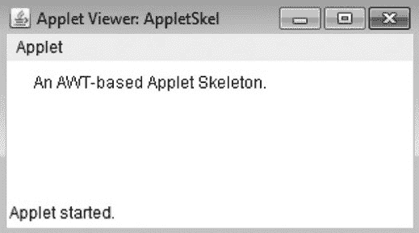

## Applet 的初始化与终止

理解上述骨架中显示的各种方法的调用顺序是非常关重要的。当 applet 开始时，会按照以下顺序调用这些方法：

1. `init()`
2. `start()`
3. `paint()`

当 applet 终止时，会发生以下方法调用序列：

1. `stop()`
2. `destroy()`

让我们更仔细地观察这些方法。

### init()

`init()`方法是第一个被调用的方法。这是执行 applet 初始化的地方。在 applet 的执行期间，该方法只被调用一次。

### start()

`start()`方法在`init()`之后被调用。它在 applet 停止后也会被调用以重启 applet。`init()`在 applet 首次加载时被调用一次，而`start()`在每次 applet 的 HTML 文档显示时都会被调用。因此，如果用户离开网页并返回，applet 将在`start()`处恢复执行。

### paint()

每当基于 AWT 的 applet 的输出需要重绘时，`paint()`方法就会被调用。如所述，`paint()`并不是由`Applet`指定，而是继承自`Component`。它在基于 AWT 的 applet 中的工作方式与第 25 节描述的基于 AWT 的 GUI 应用程序相同。此外，请求重绘请调用`repaint()`，正如第 25 节所述。记住，`paint()`方法仅在向窗口绘制的基于 AWT 的 applet 中需要的。在前面的示例中，`paint()`用于在 applet 窗口中显示字符串。如果 applet 仅使用控件，例如则不需要`paint()`。

### stop()

当浏览器离开包含 applet 的 HTML 文档时（例如进入另一个页面），会调用`stop()`方法。当调用`stop()`时，applet 可能正在运行。使用`stop()`的作用是挂起在 applet 不可见时不运行的线程。如果用户返回页面，可以在调用`start()`时重启这些线程。

### destroy()

当环境确定 applet 需要完全从内存中移除时，会调用`destroy()`方法。此时，applet 使用的任何资源应该被释放。`stop()`方法在`destroy()`之前总是会被调用。

## Swing Applet

你可能考虑的第二类基于 AWT 的 applet 是基于 Swing 的。基于 Swing 的 applet 与基于 AWT 的 applet 类似，但有一个重要的区别：Swing applet 继承自`JPanel`而不是`Applet`。由于`JPanel`派自`Applet`，它包含了`Applet`提供的所有功能，并增加了对 Swing 的支持。`JFrame`是一个顶层 Swing 容器，这意味着它不是派自`Component`。`JFrame`是一个顶层容器，包含了第 31 节描述的各种窗格。这意味着所有组件都添加到`JFrame`的内容面板中。

Swing applet 使用上述相同的四个生命周期方法：`init()`、`start()`、`stop()`和`destroy()`。当然，你只需要覆盖你的 applet 所需的方法。Swing 中的绘制方式与 AWT 不同，Swing applet 通常不会覆盖`paint()`方法。如果你需要直接在 applet 窗口上绘制，通常你将如第 31 节所述，覆盖它的`paintComponent()`方法。

另一点：Swing applet 中与组件的所有交互必须在事件分发线程（event-dispatching thread）上进行，这所有的 Swing 都是如此。

这是一个 Swing applet 的示例。它使用了两个按钮和一个文本字段。每当按下按钮，操作就会显示在文本字段中。注意只覆盖了`init()`。没有需要覆盖其他生命周期方法，因为它们的默认版本已经足够。

```java
// A simple Swing-based applet
import javax.swing.*;
import java.awt.*;
import java.awt.event.*;
/*
<applet code="MyApplet" width=220 height=90>
</applet>
*/
public class MyApplet extends Applet {
    JButton btnAlpha;
    JButton btnBeta;
    JLabel label;

    // Initialize the applet.
    public void init() {
        // Set the applet to flow layout.
        setLayout(new FlowLayout());
        // Make two buttons.
        btnAlpha = new JButton("Alpha");
        btnBeta = new JButton("Beta");
        // Create a text-based label.
        label = new JLabel("Press a button.");
        // Add action listener for Alpha.
        btnAlpha.addActionListener(new ActionListener() {
            public void actionPerformed(ActionEvent e) {
                label.setText("Alpha was pressed.");
            }
        });
        // Add action listener for Beta.
        btnBeta.addActionListener(new ActionListener() {
            public void actionPerformed(ActionEvent e) {
                label.setText("Beta was pressed.");
            }
        });
        // Add the buttons to the content pane.
        add(btnAlpha);
        add(btnBeta);
        // Add the label to the content pane.
        add(label);
    }
}
```


这里是 `MyApplet` 由 appletviewer 显示的内容：

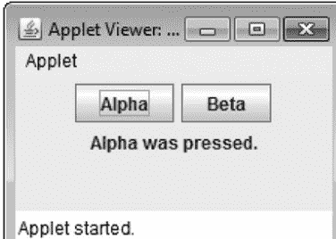

关于这个 applet 有两个重要的点。首先，`MyApplet` 继承自 `JApplet`。正如所述，所有基于 Swing 的 applet 都继承自 `JApplet` 而不是 `Applet`。其次，`init()` 方法通过设置对 `makeGUI()` 的调用在事件分发线程上初始化 Swing 组件。注意这是通过使用 `invokeAndWait()` 而不是 `invokeLater()` 实现的。Applet 必须使用 `invokeAndWait()`，因为 `init()` 方法在初始化过程完成之前不能返回。本质上，在初始化之前，`start()` 方法无法被调用，这意味着 GUI 必须完全构建。

## 索引

### 符号

- 布尔逻辑异或 (XOR), 77, 78
- 字符类规范, 983
- `:` (与标签一起使用), 106
- `::`
  - 构造函数引用, 35, 402, 406
  - 方法引用, 35, 394, 400
- `,` (逗号), 35, 97, 385
  - 格式标志符, 642, 644
- `{ }`, 26, 28, 32, 35, 47, 48, 55, 58, 83, 91, 95, 221, 296, 386, 410
  - 与 javadoc 标签使用, 1228
- `{...}` 匿名类语法, 799
- `$` 用于临时变量名, 1252
- `=` 29, 46, 77, 79–80
- `==` (布尔逻辑运算符), 77
- `=` (关系运算符), 30, 76, 77, 268, 274
  - 与 `equals()`, 444–449
- `!`, 77, 78
- `!=`, 76, 77
- `/`, 63, 64
- `/* */`, 26
- `/** */`, 35, 1227
- `//` 27
- `<` 30, 67
  - 参数索引语法, 645–646
- `<>`
  - 菱形运算符 (类型推断), 370–371
  - 以及泛型类型参数, 338
- `<?>`, 286, 288, 348
- `<<`, 68, 71–73
- `<=`, 76
- `-`, 63, 64
  - 格式标志符, 642
- `->` lambda 表达式箭头运算符, 17, 63, 81, 380
- `–=`, 32, 63, 66–67
- `%`
  - 用于格式转换语法, 633
  - 取模运算符, 63, 65
- `(` 格式标志符, 642, 644
- `()`, 27, 35, 82, 115, 125
  - 用于 lambda 表达式, 380, 384, 385
  - 用于提高操作优先级, 35, 43, 81, 444
- `.` (句号)
  - 以及调用静态接口方法, 213
  - 点运算符, 81, 113, 119, 148, 172, 196, 213
  - 在 `import` 语句中, 196
  - 在多级包语句中, 190, 196
  - 以及嵌套接口, 203
  - 正则表达式通配符字符, 983, 986
  - 分隔符, 35
- `...`
  - 以及启用/禁用断言语法, 328–329
  - 变长参数语法, 35, 158, 161
- `+` 加法运算符, 63, 64
  - 连接运算符, 29, 15–155, 443–444
  - 格式标志符, 642, 643
  - 正则表达式量词, 983, 985–987
  - 一元加号, 63, 64
- `++`, 32, 63, 66–68
- `#` 格式标志符, 642, 644
- `?`
  - 正则表达式量词, 983, 986–987
  - 通配符参数说明符, 348, 351, 354, 368, 377, 381
- `?:` (三元 if-then-else 运算符), 78, 80
- `>`, 30, 76
- `>>`, 68, 73–74
- `>>>` 76
- `>=`, 76
- `;` (分号), 28, 35, 92, 199
  - 在 try-resources 语句中使用, 321, 678
- `~` (位取反运算符), 68, 69, 70–71
- `_` (下划线), 34, 44, 45
  - 以及助记符规范, 1171
- `0` (零)格式标志符, 642, 644

### A

- `abs()`, 133–134, 506
- 抽象方法(s), 183–186
  - 以及 lambda 表达式, 380, 381, 382, 383
- 抽象类型修饰符, 184, 187, 202, 381
- Abstract Window Toolkit. 见 AWT (Abstract Window Toolkit)
- `AbstractAction` 接口, 1081, 1082
- `AbstractButton` 类, 1033, 1060, 1063, 1068, 1071
- `AbstractCollection` 类, 541, 543, 550
- `AbstractList` 类, 541, 593
- `AbstractMap` 类, 568, 570, 572
- `AbstractQueue` 类, 541, 549
- `AbstractSequentialList` 类, 541, 545
- `AbstractSet` 类, 541, 546, 548, 551
- `accept()`, 556, 664, 665, 667, 676, 744, 764, 962, 975, 977
- 访问控制, 143–146
  - 以及默认访问, 193, 199
  - 示例程序, 193–196
  - 以及继承, 144, 146, 165–166
  - 以及模块, 144
  - 以及包, 144, 189, 192–193
- 访问修饰符, 27, 144, 192–193
- `acquire()`, 908–911
- Action (Swing), 1059, 1079–1084
- `Action` 接口, 1079, 1080, 1081
- `ActionEvent` 类, 772–773, 833, 857, 870, 1022, 1023, 1031, 1040
  - JavaFX, 1105, 1106, 1108, 1169
- `EventListener` 接口, 783, 833, 837, 845, 870, 1022, 1023, 1040, 1067, 1079
- `actionPerformed()`, 783, 833, 836, 1023, 1024, 1030, 1047, 1068, 1079, 1081, 1082–1083
- `adapt()`, 952
- 适配器类, 790, 794–796
- `add()`, 531, 532, 533, 534, 546, 553, 618, 805, 830, 836, 841, 844, 857, 861, 870, 975, 994, 995, 1019–1020, 1040, 1052, 1053, 1061, 1062, 1077, 1081, 1103, 1108, 1150, 1154, 1156, 1163, 1164, 1179
- `addElement()`, 594
- `addEventListener()`, 1105
- `addExports()`, 518
- `addFirst()`, 539, 540, 545, 578, 1050
- `addKeyListener()`, 771
- `addLast()`, 539, 540, 545, 546
- `addActionListener()`, 1129, 1150
- `addMouseListener()`, 789, 790, 799, 1074
- `addMotionListener()`, 771, 789, 790
- `addOpens()`, 518
- `addReads()`, 518
- Address, Internet, 750, 751–753, 757
- `addSeparator()`, 1062
- `addTab()`, 1042
- `addTLListener()`, 1192
- `addTypeListener()`, 770, 771
- `addU()`, 518
- `AdjustmentEvent` 类, 773, 774, 848
- `AdjustmentListener` 接口, 783, 784, 848
- `adjustmentValueChanged()`, 783
- `Affine` 类, 1156
- Algorithms, collection, 529, 581–586, 592
- `allMatch()`, 980
- `allocate()`, 720, 729, 731
- anchor constraint, 865–886
- AND 运算符
  - bitwise (`&`), 68, 69, 70–71
  - Boolean logical (`&`), 77, 78, 79
  - and bounded declarations (`&`), 347
  - short-circuit (`&&`), 77, 79
- `AnnotatedElement` 接口, 291, 293, 303, 526
- `Annotation` 接口, 285, 291, 525
- Annotation member, 285
  - assigning a value to an, 285, 294, 295
  - default values for an, 292–293
  - obtaining the value of an, 287, 288
- Annotation(s), 15, 284–304, 525
  - built-in, 295–297
  - container, 302, 303
  - declaration, 285
  - and JShell, 1251
  - marker, 293–294
  - member. 见 Annotation member
  - obtaining all, 290–291
  - reflection to obtain, using, 286–291
  - repeated, 291, 302–304
  - restrictions on, 304
  - retention policies, 285–286
  - single-member, 294–295
  - type, 297–302
- `annotationType()`, 285
- `anyMatch()`, 980
- Apache Software Foundation, 1202
- Apache Tomcat, 1202. 见 Apache library, compact profiles of, 334
- `APPEND`, 494
- `append()`, 461, 523, 700, 853
- `Appendable` interface, 523, 635, 700, 707
- `appendTo()`, 494
- Applet, 8–9
  - deprecated, 11, 18, 1235, 1255
  - Java Web Start with an, using, 1243
  - unsigned, 1236
  - versus Java Web Start, 1235–1260
- Applet, AWT-based, 1255–1260
  - architecture, 1257
  - event-driven nature of the, 1257
  - and the Internet, 8–9
  - and `main()`, 1256
  - and security, 1256
  - signed, 1256
  - skeleton, 1257–1260
  - as source and listener for events, 1257
- `Applet` class, 804, 1235, 1255, 1257, 1260, 1262
- Applet, Swing, 1015, 1016, 1021, 1255, 1260–1262
- `APPLET` tag, HTML, 1256
- `AppletContext` 接口, 1255
- `AppletStub` 接口, 1255
- appletviewer, 1256, 1258–1259
- `Application` 类, 1097–1098, 1100
- Application launcher (Java). 见 Java (Java application launcher)
- `apply()`, 407, 664, 665, 666, 963–964, 968
- `applyAsDouble()`, 664, 665, 666, 971
- `AreaAverageScaleFilter` 类实例变量, 890
- `areFieldsSet` Calendar 类实例变量, 618
- Argument(s), 118, 122
  - command-line, 27, 156–157
  - index, 645–646
  - lambda expressions, 380, 384, 385
  - passing, as, 380, 384, 385
  - to raise the precedence of operations, 35, 43, 81, 444

### B

- 方法，表, 956
- BASIC, 4
- 基本多语言平面 (BMP), 484
- `BasicFileAttributes` 类, 726, 727, 728, 741
  - 方法，表, 727
- `BasicFileAttributeView` 接口, 728
- BCP 47, 626
- BCPL, 4
- `BeanInfo` 接口, 1190, 1192–1193, 1194, 1196
  - 实现该接口的类命名规范, 1192
- Beans, Java。参见 Java Beans
- 贝塞尔曲线, 626
- 贝尔实验室, 6
- Berkeley UNIX, Tim, 749
- Berners-Lee, Tim, 757
- 《超越摄影：数字暗室》(Holzmann), 888
- `BiConsumer` 函数式接口, 664, 975
- `BiFunction` 函数式接口, 664, 963
- 二进制
  - 指数, 45
  - 字面量, 44
  - 数字与整数, 68–69
- `BinaryOperator<T>` 定义的函数式接口, 407, 664, 735
  - Collections 定义的 `binarySearch()` 算法, 581
  - Arrays 方法, 587
- `BitSet` 类, 611–612
  - 方法，表, 68–76
- 位运算符, 380, 385–387. 另见 Lambda 表达式
- `BLOCKED`, 264
- 代码块。参见代码块 (Code Blocks)
- Boolean, 37
  - 表达式, 30, 31
  - 字面量, 45
  - 逻辑运算符, 77–79
- `Boolean` 类, 277, 485
  - 以及自动装箱/拆箱, 282–283
  - 方法，表, 487
- `boolean` 数据类型, 37, 42–43, 45, 50
  - 以及关系运算符, 42, 43, 76–77
- `booleanValue()`, 277, 487
- `Border` 接口, 1028
- `BorderFactory` 类, 1028
- `BorderLayout` 类, 802, 856–858, 1023, 1078
  - 带内边距 (insets) 的示例, 858–859
- `BorderPane` 类, 1097, 1168, 1177
  - 在其内部定位节点的方法, 1168
- `boxed()`, 958
- 装箱 (Boxing), 279
- `break` 语句, 86, 87–88, 104–108
  - 以及 for-each 循环, 100–101
  - 作为 goto 的形式, 106–151
- `Buffer` 类, 718–720
  - 方法，表, 718–720
- Buffer, NIO, 881
- `BufferedImage` 类, 881
- `BufferedInputStream` 类, 307, 688–690, 739
- `BufferedOutputStream` 类, 307, 688, 690, 739
- `BufferedReader` 类, 308, 309, 310–312, 704–706, 939
- `BufferedWriter` 类, 308, 706
- 双精度构建 (Building, double), 882–885
- `build()`, 492
- `bulkRegister()`, 927
- `Button` 按钮类
  - AWT, 802, 833
  - JavaFX, 1105–1106, 1120, 1123
- 按钮 (Button)
  - 作为事件源, 773, 782, 833, 1104, 1123, 1126
  - 组, 1040, 1072, 1125–1126
  - 推射。参见 AWT 推射按钮；JavaFX 推射按钮；Swing 推射按钮
  - 单选。参见 单选按钮 (Radio buttons)
  - Swing, 1033–1041
  - 作为 Swing 菜单项, 1060
  - 切换。参见 JavaFX 切换按钮；Swing 切换按钮
- `ButtonBase` 类, 1105, 1123, 1125, 1132
- `ButtonGroup` 类, 1029, 1040
- `ButtonModel` 接口, 1014, 1033
- `ButtonUI`, 1014
- `Byte` 类, 277, 278, 467, 473, 480, 481
  - 由其定义的方法表, 474
- `byte` 数据类型, 37, 38–39, 43
  - 以及自动类型转换, 50
  - 以及自动类型提升, 52, 71–72, 74–75
- `ByteArrayInputStream` 类, 307, 685–686
- `ByteArrayOutputStream` 类, 307, 686–688
- `ByteBuffer` 类, 719, 728, 729, 733
  - `get()` 和 `put()` 方法，表, 720
- 字节码, 10–11, 13–14, 18, 26, 326, 333, 509, 469, 480, 482
- `byteValue()`, 278, 468, 470, 471, 474, 475

### C

- C, 6, 8
  - 历史, 4–5
  - 以及 Java, 3, 5, 7, 12
- C 语言 (Kernighan and Ritchie)
  - 历史, 5–6
  - 以及 Java, 3, 7–8, 12
- C# 和 Java, 2
- `Calendar` 类, 616, 617, 618–621, 622, 626, 1001
  - 常量, 620
  - 由其定义的方法，表
  - 采样, 618–620
- 按引用调用, 138, 139–140
- 按值调用, 138–139, 140
- `call()`, 930, 952
- `Callable` 接口, 907, 929–932, 952
- `CallSite` 类, 525
- `cancel()`, 629, 630, 951, 952
- `canRead()`, 518
- `canUse()`, 518
- `Canvas` 类
  - AWT, 802, 805, 880
  - FX, 1109–1113
- `capacity()`, 459, 594, 718
- `capacity` 成员, 594
- Card 布局, 861–864
- `CardLayout` 类, 802, 861–864
- `Caret` 类, 1031–1032
- 大小敏感性与 Java, 25, 27, 34, 190
- `case` 语句, 86–91
- 类型转换, 50–52, 336, 339, 340, 342
  - 将一个泛型类实例转换为另一个类, 368
  - 以及擦除, 339, 371
  - 使用 `instanceof`, 323–325
- `catch`(s), 217, 218, 220–224, 226, 227–228, 236
  - 在内部显示异常, 222
  - 以及更精确的 (final) 抛出功能, 235, 236
  - 多 catch 功能, 235–236
  - 使用多个, 222–223
  - 以及嵌套 try, 221, 224
- CGI (通用网关接口), 11, 1201–1202
- `changed()`, 1129, 1151
- `ChangeListener` 接口, 1128–1129
- `Channel` 接口, 720
- Channel(s), NIO, 718, 720–721. 另见 NIO 和基于通道的 I/O
- `char` 数据, 37, 41–42, 44, 68, 441
  - 以及算术运算符, 63
  - 以及自动类型转换, 50
  - 以及自动类型提升, 52
- `Character` 类, 277, 467, 482–485
  - 以及自动装箱/拆箱, 282–283
  - 各种方法表, 483, 486
  - 支持 32 位 Unicode, 484–485
- Character(s), 37, 41–42
  - 基本多语言平面 (BMP), 484
  - 更改大小写, 455–456, 482, 483
  - 类 (正则表达式), 983, 987
  - 代码点, 484
  - 转义序列, 45, 46
  - 从 String 对象中提取, 445–446
  - 格式化单个, 635
  - 字面量, 45
  - 补充, 484
- `Character.Subset` 类, 484
- `Character.UnicodeBlock` 类, 484
- `characteristics()`, 557, 558
- `CharArrayReader` 类, 308, 702–703
- `CharArrayWriter` 类, 308, 703–704
- `charAt()`, 155, 445, 460, 522
- `CharSequence` 接口, 439, 456, 461, 522, 982
  - 由其定义的方法表, 522
- Charsets, 442, 722
- `charValue()`, 277, 482
- 复选框 (Check boxes)
  - AWT, 830, 837–839
  - 作为事件源, 773, 777, 782, 838, 1104, 1132, 1135
  - 启用不确定状态, 1132, 1135
  - JavaFX, 1132–1136
  - Swing, 1038–1039
  - 以及 Swing 菜单, 1071, 1072
- `Checkbox` 类
  - AWT, 802, 837–839
  - JavaFX, 1132, 1135
- `CheckboxGroup` 类, 802, 839–841
- `CheckboxMenuItem` 类, 802, 869, 870
- `checked` 方法, 581–582
- `checkedCollection()`, 581, 585
- `checkedList()`, 581, 585
- `checkedMap()`, 581, 585
- `checkedSet()`, 582, 585
- `CheckMenuItem` 类, 1162, 1173
- `Choice` 类, 802, 841–844
  - 控制, 782, 830, 841
  - 作为事件源, 773, 777, 782
- Box 控制, 1144
- `Class` 类, 286–287, 288–290, 291, 338, 424–425, 501–504, 727, 990
  - 方法，表, 502–503
- `.class` 文件, 114, 190, 191
- `.class` 扩展, 26
- `class` 关键字, 26, 111
- `CLASS` 保留策略, 285–286
- Class(s), 26–27, 111–130
  - 抽象, 183–186, 187, 202
  - 访问级别, 192–193
  - 适配器, 790, 794–796
  - 字符，正则表达式, 983, 987
  - 代码, 25, 111, 192
  - 在集合中存储用户定义的, 558–560
  - 构造函数。参见 访问控制
  - 控制到，作为数据类型, 111, 113, 115, 116, 128
  - 定义, 21
  - 通过封装实现, 21, 128
  - final, 187
  - 通用形式，参见 泛型类
  - 层次结构, 22, 173–176, 198
  - 内部。参见 内部类
  - 实例, 21, 111, 113, 116
  - 以及接口, 189, 198, 200–203, 359
  - 使用 JShell 实验, 1250
  - 库, 25, 36
  - 字面量, 288, 425
  - 成员。参见 类
  - 名称和源文件, 25, 26
  - 嵌套, 151–153
  - 作为包的容器, 189, 192, 196
  - 路径, 418
  - public, 193
  - 由 a 定义范围, 48
  - 以及状态信息, 210, 213
  - 合成, 1246, 1248, 1249, 1250
  - 用于边界类型，使用 a, 345–347
  - 基于值的, 614
- `ClassCastException`, 230, 532, 533, 536, 538, 540, 561, 564, 565, 573, 585, 587, 589, 590
- `ClassDefinition` 接口, 525
- `ClassFile` 转换器, 525
- `ClassLoader` 类, 505
- `classModifiers()`, 993
- `ClassNotFoundException`, 231, 713
- `CLASSPATH`, 190, 191, 996
- `classpath` 选项, 191
- `ClassValue` 类, 522
- `clear()`, 531, 532, 562, 601, 611, 619, 718, 1156
- Client/服务器模型, 8–11, 749
  - 以及套接字, 753–756
- `clone()`, 187, 499–501, 521, 594, 601, 611, 617, 619, 623, 126
- `Cloneable` 接口, 499–501
- `CloneNotSupportedException`, 231, 499, 521
- Cloning
  - 以及枚举, 521
  - 潜在危险, 500, 501
- `close()`, 314, 316–318, 319, 320, 321, 322, 524
- `Closeable` 接口, 314, 320, 653, 676, 677, 682, 693, 694, 696, 697, 698, 699, 700, 707, 711, 712, 713, 714, 715, 716, 717, 718, 719, 720, 721, 722, 723, 724, 725, 726, 727, 728, 729, 730, 731, 732, 733, 734, 735, 736, 737, 738, 739, 740, 741, 742, 743, 744, 745, 746, 747, 748, 749, 750, 751, 752, 753, 754, 755, 756, 757, 758, 759, 760, 761, 762, 763, 764, 765, 766, 767, 768, 769, 770, 771, 772, 773, 774, 775, 776, 777, 778, 779, 780, 781, 782, 783, 784, 785, 786, 787, 788, 789, 790, 791, 792, 793, 794, 795, 796, 797, 798, 799, 800, 801, 802, 803, 804, 805, 806, 807, 808, 809, 810, 811, 812, 813, 814, 815, 816, 817, 818, 819, 820, 821, 822, 823, 824, 825, 826, 827, 828, 829, 830, 831, 832, 833, 834, 835, 836, 837, 838, 839, 840, 841, 842, 843, 844, 845, 846, 847, 848, 849, 850, 851, 852, 853, 854, 855, 856, 857, 858, 859, 860, 861, 862, 863, 864, 865, 866, 867, 868, 869, 870, 871, 872, 873, 874, 875, 876, 877, 878, 879, 880, 881, 882, 883, 884, 885, 886, 887, 888, 889, 890, 891, 892, 893, 894, 895, 896, 897, 898, 899, 900, 901, 902, 903, 904, 905, 906, 907, 908, 909, 910, 911, 912, 913, 914, 915, 916, 917, 918, 919, 920, 921, 922, 923, 924, 925, 926, 927, 928, 929, 930, 931, 932, 933, 934, 935, 936, 937, 938, 939, 940, 941, 942, 943, 944, 945, 946, 947, 948, 949, 950, 951, 952, 953, 954, 955, 956, 957, 958, 959, 960, 961, 962, 963, 964, 965, 966, 967, 968, 969, 970, 971, 972, 973, 974, 975, 976, 977, 978, 979, 980, 981, 982, 983, 984, 985, 986, 987, 988, 989, 990, 991, 992, 993, 994, 995, 996, 997, 998, 999, 1000, 1001, 1002, 1003, 1004, 1005, 1006, 1007, 1008, 1009, 1010, 1011, 1012, 1013, 1014, 1015, 1016, 1017, 1018, 1019, 1020, 1021, 1022, 1023, 1024, 1025, 1026, 1027, 1028, 1029, 1030, 1031, 1032, 1033, 1034, 1035, 1036, 1037, 1038, 1039, 1040, 1041, 1042, 1043, 1044, 1045, 1046, 1047, 1048, 1049, 1050, 1051, 1052, 1053, 1054, 1055, 1056, 1057, 1058, 1059, 1060, 1061, 1062, 1063, 1064, 1065, 1066, 1067, 1068, 1069, 1070, 1071, 1072, 1073, 1074, 1075, 1076, 1077, 1078, 1079, 1080, 1081, 1082, 1083, 1084, 1085, 1086, 1087, 1088, 1089, 1090, 1091, 1092, 1093, 1094, 1095, 1096, 1097, 1098, 1099, 1100, 1101, 1102, 1103, 1104, 1105, 1106, 1107, 1108, 1109, 1110, 1111, 1112, 1113, 1114, 1115, 1116, 1117, 1118, 1119, 1120, 1121, 1122, 1123, 1124, 1125, 1126, 1127, 1128, 1129, 1130, 1131, 1132, 1133, 1134, 1135, 1136, 1137, 1138, 1139, 1140, 1141, 1142, 1143, 1144, 1145, 1146, 1147, 1148, 1149, 1150, 1151, 1152, 1153, 1154, 1155, 1156, 1157, 1158, 1159, 1160, 1161, 1162, 1163, 1164, 1165, 1166, 1167, 1168, 1169, 1170, 1171, 1172, 1173, 1174, 1175, 1176, 1177, 1178, 1179, 1180, 1181, 1182, 1183, 1184, 1185, 1186, 1187, 1188, 1189, 1190, 1191, 1192, 1193, 1194, 1195, 1196, 1197, 1198, 1199, 1200, 1201, 1202, 1203, 1204, 1205, 1206, 1207, 1208, 1209, 1210, 1211, 1212, 1213, 1214, 1215, 1216, 1217, 1218, 1219, 1220, 1221, 1222, 1223, 1224, 1225, 1226, 1227, 1228, 1229, 1230, 1231, 1232, 1233, 1234, 1235, 1236, 1237, 1238, 1239, 1240, 1241, 1242, 1243, 1244, 1245, 1246, 1247, 1248, 1249, 1250

### D

- 泛型在以下方面的优势：335, 遗留类和接口, 592–608, 以及方法引用, 400–402
- 概述, 528–529
- `Collector` 接口, 972
- `Collectors` 类, 972
- `Color` 类, AWT, 802, 807–808, 815–817
  - 指定颜色的常量列表, 808
  - 操作颜色的方法, 815–816
- `Color` 类, JavaFX, 1111, 1156
- Color, 使用方法, 815–817
- Combo box (组合框), JavaFX, 1141–1144
  - 允许用户编辑, 1141, 1143–1144
- Combo boxes (组合框), Swing, 1049–1051
- `ComboBox` 类, 1141
- `ComboBoxBase` 类, 1141
- `ComboBoxModel` 接口, 1050
- Comment (注释), 26, 27
  - 文档, 34–35, 1227–1234
- Common Gateway interface (CGI), 11, 12, 1201–1202
- `commonPool()`, 941, 945
- Compact profiles (紧凑配置), 334
- `Comparable` 接口, 356, 359, 449, 522–523, 617, 673
- `Comparable<Path>` 接口, 722
- `Comparator` 接口, 401, 402, 530, 565, 570, 573, 961
- `comparator()`, 536, 550, 565
- Comparators (比较器), 548, 549, 550, 570, 571, 572–580
  - 使用 lambda 表达式使用, 576–577, 560
- `compare()`, 401–402, 470, 471, 474, 475, 478, 487, 573, 575–576, 591, 961
- `compareAndSet()`, 907, 937
- `compareTo()`, 273–275, 449–450, 470, 471, 475, 474, 476, 478, 484, 487, 521, 922, 576, 617, 633
- `compareToIgnoreCase()`, 450
- `compareToOptional()`, 492
- `compareUnsigned()`, 591
- `comparing()`, 574–575
- `comparingByKey()`, 565
- `comparingByValue()`, 565
- `comparingDouble()`, 575
- `comparingInt()`, 575
- `comparingLong()`, 575
- Compilation unit (编译单元), 275
- `compile()`, 982
- 编译器
  - ahead-of-time (提前编译), 11
  - Just-in-Time (JIT), 10, 14
- `Compiler` 类, 509
- Java 编译器, 25–26
  - 和 `main()`, 27
- `Component` 类, 771, 782, 802, 804–805, 807, 808, 809, 810, 822, 830, 855, 878, 880, 1014, 1015, 1018, 1020, 1024, 1025, 1061, 1257, 1258, 1259
- `ComponentAdapter` 类, 795
- `componentAdded()`, 784
- `ComponentEvent` 类, 773, 774–775, 776, 782
- `componentHidden()`, 784
- `ComponentListener` 接口, 783, 784, 795
- `componentMoved()`, 784
- `componentRemoved()`, 784
- `componentResized()`, 784
- Components (组件), AWT, 1011–1012, 1014
  - 轻量级与重量级对比, 878
  - 以及重写 `paint()`, 878
- 组件与 JavaBeans 软件, 1189
- Components (组件), Swing, 1014–1015, 1029–1057
  - 架构, 1013–1014
  - 类的名, 1014–1015
  - 以及 Swing 事件分发线程, 1020
  - 重量级, 1015
  - 轻量级, 1012, 1029
  - 绘制, 1024–1028
  - 以及可插拔外观 (pluggable look and feel), 1012–1013, 1014
  - 以及标签页 (tabbed panes), 1042–1044
- `componentShown()`, 784
- `ComponentUI`, 1014
- `compute()`, 940, 945, 949, 954
- `concat()`, 453
- Concurrency utilities (并发工具类), 15, 905–954
  - 与传统多线程和同步对比, 905, 954
- Concurrent API, 905–906
  - 包, 906–907
- Concurrent collections (并发集合类), 906, 933–934
  - 列表, 933
- 并发程序的定义, 905
- `ConcurrentHashMap` 类, 907, 933
- `ConcurrentLinkedDeque`, 933
- `ConcurrentLinkedQueue` 类, 907, 933
- `ConcurrentSkipListSet`, 933
- `Condition` 类, 935
- `connect()`, 754
- `Console` 类, 708–710
  - 方法列表, 709
- Console I/O (控制台输入输出), 28, 95, 305, 309–313, 708–716
- `console()`, 495, 709
- `const` 关键字, 36
- Constants (常量), 34
  - 使用接口定义, 206–208
- 构造函数, 287, 290, 291, 526, 990
- 构造函数引用, 402–406
  - 数组, 403–406
  - 泛型类, 115, 123–126
- 构造函数, 类层级中的执行顺序, 176–177
  - 默认, 115, 125
  - 枚举, 271–273
  - 与工厂方法的重载, 751
  - 泛型, 357
  - 对象的参数, 137–138
  - 重载, 134–136
  - 参数化的, 125–126
  - 引用. 参见构造函数引用
  - 以及 `super()`, 169–172, 176, 333
  - `this()` 重载, 331–333
- `constructorModifiers()`, 993
- `Consumer<T>` 接口, 407, 523, 556, 664, 962, 977
- `Container` 类, 802, 805, 807, 830, 855, 857, 1014, 1015, 1019, 1025, 1061, 1257
  - JavaFX, 1096–1097
- Containers (容器), Swing, 1014, 1015
  - 轻量级与重量级对比, 1015
  - Pane (窗格), 1015–1016. 参见 pane
- `ContainerAdapter` 类, 795
- `ContainerEvent` 类, 773, 775
- `ContainerListener` 接口, 783, 784, 795
  - 层级, 1014, 1015
- `contains()`, 457, 531, 532, 546, 594, 601
- `containsAll()`, 531, 532
- Content pane (内容面板), 1015, 1016–1020, 1028, 1042, 1045, 1053, 1056, 1067
  - 添加组件, 1019–1020
  - JFrame 的默认布局管理器, 1019–1023
- `ContentDisplay` 枚举, 1119–1122, 1123
- Context 切换, 237, 253, 266
  - 规则, 239
- `ContextMenu` 类, 1162–1163, 1175–1176, 1178
- `ContextMouseEvent` 类, 378
- `CONTINUE`, 746
- `continue` 语句, 108–109
- `Control` 类, 1097, 1102, 1105, 1162
- Controls (控件), AWT, 829, 830–854
  - 事件, 使用内部类处理, 836–837
  - 添加, 830
  - 一个, 829
  - 移除, 830
  - 响应, 830–831
- Controls (控件), JavaFX, 1097, 1102, 1104, 1115–1160, 1186
  - 添加图片, 1115, 1118–1123
  - 添加提示框, 1160
  - 禁用, 1160
  - 以及效果和变换, 1154–1160. 参见 Transforms 和事件处理
  - 文本, 1144–1146
- `convert()`, 933
- `Convolve` 内置过滤器, 901
- Convolution filters (卷积过滤器), 893, 899, 901
- `Cookie` 类, 1212, 1214, 1215, 1220, 1222
  - 方法列表, 1216
- `CookieHandler` 类, 763
- `CookieManager` 类, 763
- `CookiePolicy` 接口, 763, 1214, 1215, 1222
- Cookies (Cookie), 763, 1214–1215
  - 使用示例, 1220–1222
- `CookieStore` 接口, 763
- `copy()`, 724, 737
- `copyOf()`, 551, 552, 587–588
- `copyRange()`, 588
- `CopyOnWriteArrayList` 类, 907, 933
- `CopyOnWriteArraySet` 类, 933
- `cos()`, 40, 505
- `count()`, 957, 963, 980
- `countDown()`, 914–915
- `CountDownLatch` 类, 906, 908, 913
- `Counted` 类, 939
- `countFrames()`, 512
- `createImage()`, 880, 885, 886, 890
- `createLineBorder()`, 1028
- `CropImageFilter` 类, 890–892
- `Currency` 类, 631–632
  - 方法列表, 631
- `currentThread()`, 241, 510
- `currentTimeMillis()`, 495, 997
- `CustomMenuItem` 类, 1162
- `CyclicBarrier`, 906, 908, 913

### E

- `Datagram` 类, 704, 715
  - 方法列表, 709
- `DatagramPacket` 类, 704, 715
  - 方法列表, 709
- `do-while` 循环, 92–95
- 文档接口, 1031
- `@Documented` 内置注解, 295, 296
- `doDelete()`, 1216, 1217
- `doGet()`, 1216, 1217, 1218
- `doHead()`, 1216, 1217
- 域名, 750, 751
- 域名命名服务 (DNS), 750
- `doOptions()`, 1216, 1217
- `doPost()`, 1217, 1219
- `doPut()`, 1217
- `DosFileAttributes` 类, 726, 727, 742
- `DosFileAttributeView` 接口, 728
- 点运算符 (`.`), 81, 113, 119, 148, 172, 196, 213
- `dotTo()`, 1217
- 双缓冲, 882–885
- `Double` 类, 277, 278, 468–473, 480
  - 方法，表格, 471–472
- `double` 数据类型, 37, 40–41, 44
  - 与自动类型转换, 50
  - 与自动类型提升, 52–53
- `DoubleAccumulator` 类, 937
- `DoubleAdder` 类, 937
- `DoubleBinaryOperator` 函数式接口, 590
- `DoubleBuffer` 类, 719
- `doubleOf()`, 628
- `DoubleStream` 接口, 958, 959
- `DoubleSummaryStatistics` 类, 662
- `doubleValue()`, 278, 345, 468, 470, 471, 474, 475, 476
- `drawArc()`, 811
- `drawImage()`, 881, 883, 884
- `drawLine()`, 810, 1024
- `drawOval()`, 811
- `drawPolygon()`, 811–812
- `drawRect()`, 810–811, 1024
- `drawRound()`, 811
- `drawString()`, 790, 807, 808, 825, 826, 1256
- `Duration` 类, 1007
- 动态方法
  - 分发, 180–183
  - 查找, 201
  - 解析, 198, 201, 202, 206

### F

- `E` (Math 常数), 505
- 早期绑定, 186
- `echoCharIsSet()`, 851
- Eclipse IDE, 1202, 1203
- 编辑控件, 850
- `Effect` 类, 1155
- Effects, 1155–1156
  - 某些内置的列表, 1155
  - 演示程序, 1157–1160
- `element()`, 538
- `elementAt()`, 594
- `element` Vector 数据成员, 594
- `elementData` 数据成员, 594
- `elements()`, 594, 599, 600, 601
- `ElementType` 枚举, 296, 525
  - `ElementType.FIELD`, 301
  - `ElementType.METHOD`, 301
  - `ElementType.TYPE_USE`, 298, 301
- `else`, 83–86
- `empty()`, 597, 598, 614, 616
- `EMPTY_LIST` 静态变量, 585
- `EMPTY_MAP` 静态变量, 585
- `EMPTY_SET` 静态变量, 585
- `EmptyStackException`, 597, 599
- 封装, 5, 20–21, 22, 24–25, 128, 169
  - 与访问控制, 143
  - 与作用规则, 48
- `Encoder` 类, 662
- `end()`, 982–983
- `endsWith()`, 448, 723
- `ensureCapacity()`, 459, 543, 594
- `entrySet()`, 561, 562, 565, 569, 602
- `enum`, 268, 521, 551, 572
- `Enum` 类, 273, 521
  - 方法，表格, 521
- `enumerate()`, 510, 513, 516
- `Enumeration` 接口, 592–593, 595–597, 600, 609, 610, 692
- 枚举 (Enumeration), 15, 267–276, 521
  - 与 `==` 关系运算符, 268, 244
  - 作为 Java 中的类类型, 267, 271–273
  - 常量, 267, 268, 269, 270, 271, 272
  - 构造函数, 271–273
  - 与 JShell, 1251
  - 限制, 273
  - switch 语句中的值, 268–270
  - 变量声明, 268
- `EnumMap` 类, 568, 571
- `EnumSet` 类, 541, 551
  - 工厂方法，表格, 552
- 属性，列表, 498
- `equals()`, 155, 187, 188, 274–275, 285, 447, 469, 470, 471, 474, 475, 476, 478, 484, 499, 520, 521, 533, 536, 567, 573, 576, 588, 600, 611, 614, 719, 752, 820
  - 与 `==`, 448–449
- `equalsIgnoreCase()`, 447
- `equalsOptional()`, 492
- 擦除, 339, 371–374
  - 歧义, 373–374
  - 桥接方法, 372–373
- `err`, 308, 495
- `Error` 类, 218, 219, 227, 234, 708
- Errors 歧义, 373–374
  - 用于言, 326–328
  - 自动装箱/拆箱防止, 283–284
  - 自动类型提升, 52
  - 编译时与运行时, 342
  - 泛型及其防止, 340–342
  - 原始类型与运行时, 362
  - 运行时, 13, 217, 323

### G

- Event
  - 冒泡, 1105
  - 改变, 1128–1129, 1137, 1141, 1154
  - 定义, 770
  - Java Bean 设计模式, 1192
  - 分发链, 1105
  - 分发线程与 Swing, 1020, 1024
  - 驱动程序, 769, 1020
  - 过滤器, 1105
  - 监听器, 770–771, 783–786
  - 轮询, 238, 255
  - 模型, 委托. 参见事件模型
  - 多路广播与单路广播, 771, 1192
  - 源, 770–771, 782–783
  - 时间戳, 773
- `Event` 类, 1105
- 事件处理, 769–799
  - 适配器类, 794–796
  - 事件类, 771–782
  - 立即和快速事件处理, 771, 786, 808, 1024, 1106
  - 内部类, 153, 796–799, 836, 837
  - JavaFX, 1102, 1104–1109
  - 键盘, 790–794
  - lambda 表达式, 836–837, 1023–1024
  - 鼠标, 785, 787–790
  - Swing, 772, 1012, 1021–1024
  - 另见 委托事件模型
- 事件监听器接口, 783–786
  - 适配器类, 794–796
  - 常用方法表格, 783
- `EventHandler` 接口, 1105, 1108, 1109
- `EventListener` 接口, 662
- `EventListenerProxy` 类, 662
- `EventObject` 类, 662, 772, 1105
- `EventSetDescriptor` 类, 1192, 1194, 1196
- `Exception` 类, 218, 219, 231, 233, 234
- 异常类
  - 与泛型, 377
  - 内置的层次结构, 218–219
- 异常处理, 13, 95, 104, 217–236, 316, 317–339
  - 块, 普通形式, 218
  - 与链式异常, 15, 234
  - 创建自定义异常, 231–233
  - 与默认异常处理器, 219–220, 226
  - 与 lambdas, 392–393
- 表达式, 385. 参见 Lambda
  - 与自动装箱/拆箱, 281–282
  - 编译时的自动类型提升, 52–53
  - 使用, 1251–1252
  - 正则表达式, 163, 165, 208, 345, 363
  - 边界通配符参数, 351, 354
- `Externalizable` 接口, 711, 1193
- `false`, 36, 42, 43, 45, 77, 78, 79, 125
- `FALSE`, 485
- FAT 系统, 726, 728, 742
- `Field` 类, 287, 290, 291, 526, 990
- Field, final, 148–149
- `fieldModifiers()`, 993
- `fields` 数组 (Calendar 类), 618
- 文件属性
  - 使用访问, 671–676, 740
  - 接口, 726–728
  - 使用 NIO 访问, 727–728, 740–742
  - 视图接口, 728
- `File` 类, 647, 671–676, 679, 683, 694, 698, 700, 708, 740
  - 转换为 Path 实例, 673, 722, 740
  - 方法, 671–676, 680
- 文件系统目录和包, 190
- `file()`, 494
- 将文件映射到缓冲区, 721, 732–733, 736–737
- 使用 `close()` 关闭文件, 314, 316–318, 319, 322, 684
- 文件 I/O, 313–322, 671–676. 参见 NIO; NIO 和基于通道的 I/O
- 获取文件路径, 722, 725–726, 729
- 指针, 698
- 源, 25–26, 284
- 访问系统, 728
- 使用 try-with-resources 自动关闭文件, 314, 319–322, 784
- `FileChannel` 类, 721, 729, 732, 733, 734, 736
- `FileDialog` 类, 802
- `FileFilter` 接口, 676
- `FileInputStream` 类, 307, 313–314, 679–682, 721
- `FilenameFilter` 接口, 674–675, 676
- `FileNotFoundException`, 314, 317, 779, 683, 70
- `FileOutputStream` 类, 307, 313–314, 679–682, 721
- `FileReader` 类, 307, 313–314, 679–682, 721
- `Files` 类, 307, 313–314, 679–682, 721
- `FileWriter` 类, 307, 313–314, 679–682, 721
- `Flushable` 接口, 676, 679, 682, 693, 700, 707, 708
- `FocusAdapter` 类, 795
- `FocusEvent.Cause` 枚举, 773, 775–776
- `focusGained()`, 784
- `FocusListener` 接口, 783, 784, 795
- `focusLost()`, 784
- `Font` 类, AWT, 803, 820, 821, 822, 824
  - 方法, 部分方法表, 820
- `Font` 类, JavaFX, 1110
- Font(s), 819–825
  - 创建和选择, 822–824
  - 确定可用性, 821–822
  - 获取信息, 824–825
  - 用于管理文本输出的指标, 825–828
  - 用于描述的术语, 825
- `FontMetrics` 类, 803, 825–828
  - 方法, 部分方法表, 826
- `for` 循环, 31–32, 42, 95–104
  - 增强型。参见 For-each 版本的循环
  - 变体, 98–99
- For-each 版本的循环, 15, 95, 99–103
  - 以及数组, 99–103
  - 以及 `break` 语句, 100–101
  - 以及集合, 99, 103, 530, 555–558
  - 通用形式, 99
  - 以及 `Iterable` 接口, 523, 530, 555
- `forceTermination()`, 927
- `forDigit()`, 484
- `forEach()`, 523, 553, 957, 958, 962, 967
- `forEachOrdered()`, 967
- `forEachRemaining()`, 552, 553, 556–558, 978
- Fork/Join 框架, 16–17, 239, 266, 663, 905–906, 907, 927, 938–954
  - 使用框架的优势, 938, 954
  - 主类, 938–942
  - 使用该框架的技巧, 954
- Fork/Join 框架分治策略, 940, 942–945, 954
  - 以及顺序行处理阈值与并行程度的交互, 945–948
- Fork/Join 框架任务, 939
  - 的异步执行, 951
  - 取消, 951
  - 完成状态, 952
  - 以及并行级别, 941, 954
  - 重启, 952
  - 启动, 941, 951
  - 以及子任务, 941, 942
  - 标签, 953
  - 不返回结果, 940, 944, 948
- `fork()`, 939, 941, 945, 949, 950, 952
- `ForkJoinPool` 类, 907, 927, 938, 939, 940, 943, 944, 945, 948, 951, 953–984
  - 公共池, 940, 941, 945, 948, 954
  - 以及工作窃取, 941, 953
- `ForkJoinTask` 类, 907, 938, 940, 941, 944, 945, 951, 952–953, 954
- `ForkJoinTask<T>` 类, 942
- 格式标志符, 642–646
- 格式说明符 (转换), 632, 633–646
  - 带有参数索引的, 使用, 645–646
  - 以及格式标志符, 642–644
  - 以及指定最小字段宽度, 639–640
  - 以及指定精度, 641
  - 适用于日期和时间, 637–638
  - 表, 634
  - 大写版本, 644–645
- `format()`, 457, 633–635, 645, 695, 696, 708, 709, 998, 1003
- `Format` 枚举, 1004
- `Format` 接口, 662
- `FormatFlags` 类, 662
- 格式化输入, 使用 Scanner 读取, 647–657
- `Formatter` 类, 632–647, 694, 695
  - 类的实例化, 646–647
  - 构造函数, 632–633
  - 方法表, 633
  - 参见 格式说明符
- `forName()`, 502, 990
- FORTRAN, 4
- 前向引用, 1249
- `Frame` 类, 782, 783, 789, 803, 804, 805, 856
- `Frame()`, 805–810
  - 以及基于 Frame 的应用程序, 809–810
  - 默认管理器, 856
  - 与 Frame 工作, 806–808
  - 重绘, 808–809
- Frank, 6
- `free()`, 488, 489, 490
- `from()`, 494, 617, 622
- FTP (文件传输协议), 750, 757
- `Function<T>` 接口, 407, 574, 644, 968
- Functional 接口, 17, 297, 379, 380, 381–382, 837
  - 它们的抽象方法, 664–666
  - 泛型的, 387–389
  - 以及 lambda 表达式参数, 389–391
  - 预定义的, 406–407
  - 以及公共方法, 380
- `@FunctionalInterface` 注解, 295, 597
- `Future` 接口, 907, 930–932
- `FXCollections`, 1136, 1141
- FXML, 1096

### H

- 垃圾收集, 13, 127, 141, 487–488, 525, 1202
- `gc()`, 488, 489, 490
- 泛型类, 336
  - 类型转换, 368
  - 该术语定义, 336
  - 带有一个类型的示例, 336–340
  - 带有两个参数的示例, 343–344
  - 通用形式, 344
  - 层级结构, 362–370
  - 实例, 366–368
  - 重写方法, 369–370
  - 原始类型, 360–362
  - 类型推断, 370–371
- 泛型构造函数, 357
- 泛型接口, 336, 358–360
- 泛型类, 359
- Generics, 15, 279, 335–377
  - 以及注解, 304
  - 以及歧义错误, 373–374
  - 以及数组, 375–377
  - 以及强制转换, 336, 339, 340
  - 以及集合框架, 335
  - 与泛型的兼容性, 375–377
  - 检查与安全性, 339, 340, 361, 377
- `GenericServlet` 类, 1205, 1207, 1210
- `get()`, 533, 534, 546, 561, 562, 568, 599, 600, 601, 614, 615, 666, 725–726, 729, 731, 763, 930, 932–933, 937, 961, 975
  - 以及缓冲区, 719, 720, 731
- `getActionCommand()`, 773, 833, 845, 1034, 1040, 1068
- `getActiveThreadCount()`, 953
- `getActionListenerMethod()`, 1196
- `getAddress()`, 752, 766
- `getAdjustable()`, 774
- `getAdjustmentType()`, 774, 848
- `getAlignment()`, 831
- `getAllByName()`, 751, 752
- `getAllFonts()`, 821
- `getAndSet()`, 907, 937
- `getAnnotation()`, 287, 291, 302–303, 502, 517, 519
- `getAnnotations()`, 290–291, 502, 517
- `getAnnotationsByType()`, 291, 303, 502, 517
- `getArrivedParties()`, 927
- `getAsDouble()`, 616
- `getAscent()`, 826, 827
- `getAsInt()`, 616
- `getAsLong()`, 616
- `getAttribute()`, 1208, 1209, 1215, 1222
- `getAttributeNames()`, 1215, 1222
- `getAvailableFamilyNames()`, 821
- `getBackground()`, 808
- `getBeanInfo()`, 1196
- `getBlue()`, 816
- `getButton()`, 780
- `getByAddress()`, 752
- `getByName()`, 751, 752
- `getBytes()`, 446, 683
- `getCause()`, 232, 234–235, 776
- `getChannel()`, 721
- `getChars()`, 445, 460, 701
- `getChild()`, 775
- `getChildren()`, 1102–1103, 1150, 1151
- `getClass()`, 187, 188, 286–287, 338, 499, 501, 514
- `getClickCount()`, 779
- `getColor()`, 816
- `getContent()`, 758
- `getContentPane()`, 1019
- `getContents()`, 1210
- `getDate()`, 1216, 1222
- `getDateInstance()`, 998–999
- `getDefault()`, 624, 625
- `getDescent()`, 826, 827
- `getErrorStream()`, 492
- `getEventType()`, 1105
- `getExportedPackages()`, 519
- `getField()`, 990
- `getFile()`, 758
- `getFirst()`, 539, 540, 545
- `getFont()`, 822
- `getFontList()`, 821
- `getFontMetrics()`, 825
- `getGraphics()`, 807
- `getGreen()`, 816
- `getHeaderField()`, 760
- `getHeaderFields()`, 760
- `getHeight()`, 813, 1026
- `getHost()`, 758
- `getIcon()`, 1030
- `getID()`, 773
- `getImage()`, 880, 881
- `getInputStream()`, 492, 754, 758
- `getInsets()`, 814, 858
- `getItem()`, 777, 778, 842, 845, 870
- `getItemSelectable()`, 778
- `getKeyChar()`, 776
- `getKeyCode()`, 776
- `getLast()`, 539, 540, 545
- `getLastModified()`, 673
- `getLeading()`, 826, 827
- `getLength()`, 673
- `getLocalHost()`, 751, 752
- `getLocalPort()`, 754
- `getLocation()`, 805
- `getMaximum()`, 847
- `getMessage()`, 232, 519
- `getMethod()`, 990
- `getMinimum()`, 847
- `getModifiers()`, 776, 992
- `getModifiersEx()`, 776
- `getName()`, 241, 242, 512, 673, 723, 751, 752, 990
- `getNewValue()`, 774
- `getOldValue()`, 774
- `getOutputStream()`, 492, 754, 758
- `getParameter()`, 1208, 1210, 1211
- `getParameterNames()`, 1210
- `getParent()`, 672, 723, 724
- `getPath()`, 758
- `getPoint()`, 779
- `getPort()`, 758
- `getPriority()`, 250–251, 512
- `getProperties()`, 496
- `getProperty()`, 496, 603
- `getProtocol()`, 758
- `getQueueLength()`, 953
- `getRed()`, 816
- `getRGB()`, 816
- `getRoot()`, 723
- `getRuntime()`, 488, 489
- `getSelectedCheckbox()`, 840
- `getSelectedIndex()`, 842, 844, 1047
- `getSelectedIndexes()`, 845
- `getSelectedItem()`, 842, 844, 1050
- `getSelectedItems()`, 845, 1140
- `getSelectedText()`, 850–851, 853
- `getSelectedToggle()`, 1132
- `getSelectedValue()`, 1047
- `getSelectionModel()`, 1137, 1150
- `getServletConfig()`, 1207
- `getServletContext()`, 1208
- `getServletInfo()`, 1207
- `getServletName()`, 1208
- `getSession()`, 1213, 1222
- `getSize()`, 806, 813, 820
- `getSource()`, 772, 835, 1040, 1105
- `getStackTrace()`, 232, 511, 520
- `getState()`, 264–265, 511, 837, 870
- `getStateChange()`, 778, 845
- `getSubElements()`, 1062
- `getSuperclass()`, 503, 504
- `getSuppressed()`, 232, 342
- `getSurplusQueuedTaskCount()`, 952–953
- `getTarget()`, 1170
- `getText()`, 831, 850, 853, 1030, 1032, 1033, 1144, 1170
- `getTimeInstance()`, 998–999
- `getTransforms()`, 1156
- `getUnarrivedParties()`, 927
- `getTotalSpace()`, 673
- `getUsableSpace()`, 673
- `getValue()`, 567, 569, 774, 847, 1080–1081, 1141–1142, 1151, 1216, 1221
- `getValueAt()`, 1148
- `getWheelRotation()`, 780–781
- `getWhen()`, 773
- `getWidth()`, 1026
- `getWindow()`, 782
- `getWriter()`, 1205, 1209
- `getX()`, 779, 1074, 1076
- `getXOnScreen()`, 780, 1074, 1076
- `getY()`, 779
- `getYear()`, 1006
- `getYOnScreen()`, 780
- GIF image format, 879–880
- Glass pane, 1015, 1016
- Glassfish, 1202
- Glob, 744
- `Glow` class, 1155
  - program demonstrating, 1157–1160
- Gosling, James, 6
- `goto` keyword, 35
- Goto statement, using labeled break as form, 106–108
- `grabPixels()`, 887, 888
- Graphical User Interface. See GUI (Graphical User Interface)
- Graphics
  - and JavaFX retained mode, 1109
  - context, 790, 807, 809, 810
  - sizing, 813–815
- `Graphics` class, 790, 803, 807, 816, 824, 881, 882
  - drawing methods, 810–813
- `Graphics2D` class, 810
- `GraphicsContext` class, 1109–1113
- `GraphicsEnvironment` class, 803, 821
- Greedy behavior (regular expression pattern matching), 986, 987
- `GregorianCalendar` class, 618, 621–623, 626, 1001
- Grid bag layouts, 864–869
- `GridBagConstraints` class, 803, 864–866
  - constraint fields, table of, 865
- `GridBagLayout` class, 803, 866, 869
- `gridheight` constraint field, 865, 866
- `GridLayout` class, 803, 860–861
- `GridPane` class, 1097
- `gridwidth` constraint field, 865, 866
- `Group` class, 1097
- `group()` Matcher class method, 982
- GUI (Graphical User Interface), 305, 801, 829
  - approaches to the, 1095
  - effects and transforms to customize the look of a JavaFX, using, 1154–1160
  - frameworks, Java's three, 786–787
  - programs, handling events generated by, 769–799, 808
- GZIP file format, 667

### I

- `handle()`, 1105, 1108, 1170
- `hasCharacteristics()`, 557, 558
- hash code, 546, 600
- hash table, 546, 600
- `hashCode()`, 187, 285, 470, 471, 474, 475, 476, 484, 518, 520, 531, 562, 567, 591, 600, 611, 614, 820
- Hashing, 546, 547
- `HashMap` class, 568–570, 571, 572, 600
- `HashSet` class, 541, 546–547, 568, 959
  - from a stream, obtaining a, 775
- `Hashtable` class, 541, 591, 600–603
  - iterators, 602–603
  - legacy methods, table of, 601
- `hasMoreElements()`, 593, 610
- `hasMoreTokens()`, 610
- `hasNext()`, 552, 553, 556, 976, 977
- `hasNext()` Scanner methods, 648, 651
  - table of, 649
- HBox layout, 1186
- Headers, 759
- `HeadlessException`, 806, 831
- `headMap()`, 564, 565, 566
- `headSet()`, 536, 537
- Hexadecimals, 43, 45
  - as character values, 45
  - string literals, 46
- Hierarchical abstraction and classification, 520
- inheritance, 21, 163
- High surrogate, 485
- Histogram, 888–889
- Hoare, C.R., 240
- Holzmann, Gerard J., 886
- HotSpot technology, 10
- HSB (hue-saturation-brightness) color model, 815
- `HSBtoRGB()`, 816
- HTML (Hypertext Markup Language), 1201, 1205
  - file for an applet, 1256
  - file for JavaFX Application, 1101, 1102
  - and javadoc, 1227, 1228, 1233
- `HTMLEditor`, 1146
- HTTP, 750, 757
  - GET requests, handling, 1217–1218
  - and `HttpURLConnection` class, 761
  - port, 750
  - POST requests, handling, 1217, 1219–1220
  - requests, 1201, 1202, 1212–1213, 1217
  - response, 1201, 1202, 1205, 1212–1213, 1214
  - and `URLConnection` class, 759
- HTTP session, 763
  - tracking, 1222–1223
- `HttpCookie` class, 763
- `HttpServlet` class, 1112, 1215, 1217
  - methods, table of, 1216–1217
- `HttpServletRequest` interface, 1212, 1218, 1219, 1222
  - methods, table of several, 1213
- `HttpServletResponse` interface, 1212–1213, 1214
  - methods, table of, 1214
- `HttpSession` interface, 1212, 1213, 1222
  - methods, table of several, 1215
- `HttpURLConnection` class, 761–763
  - methods, sampling of, 761

### J

- `Icon` interface, 1030
- Icons
  - Swing button, 1033, 1077
  - Swing label, 1030
- Identifiers, 26, 34, 36, 46, 47
- `IdentityHashMap` class, 568, 572
- `if` statement, 30–31, 32, 42, 43, 83–86
  - Boolean object used to control, the 283
  - boolean variable used to control, the 84, 283
  - nested, and recursive methods, 142
  - switch statement versus, 90–91
- if-else-if ladder, 85–86
- `IllegalAccessException`, 227, 231
- `IllegalArgumentException`, 230, 532, 533, 536, 540, 551, 561, 564, 565, 588
- `IllegalFormatException`, 635
- `IllegalStateException`, 230, 532, 538, 540, 982, 983, 1213
- `Image` class
  - AWT, 803, 779, 880, 881, 882
  - JavaFX, 1115–1117
- `ImageConsumer`, 887–889, 890
- `ImageFilter`, 890
- `ImageIcon` class, 1029, 1030, 1078
- `ImageIO` class, 880
- Image observer, 881
- `ImageObserver` interface, 881
- `ImageProducer` interface, 880, 885, 890
- Images (AWT), 779–904
  - creating, loading, 880–882
  - double buffering, 882–885
  - file for web, 779–880
  - filters for, 890–904
  - stream model for, 890
- `ImageView` class, 1115–1117, 1118, 1220
- `implements` clause, 200
  - and generic interfaces, 359, 360
- `import` statement, 196–197, 1253
  - and static import, 329–331
- `in`, 308, 492, 495, 647, 708
- Increment operator (`++`), 32, 63, 68
- `indexOf()`, 450–452, 464–465, 533, 534, 594
- `IndexOutOfBoundsException`, 230, 533
- `InetAddress` class, 751–753, 764
- `InetSocketAddress` class, 765
- infinity (IEEE floating-point), 462
- `inFork()`, 952
- `INHERIT`, 494
- `InheritableThreadLocal` class, 517
- Inheritance, 5, 20, 21–22, 24–25, 144, 187
  - and annotations, 304
  - and enumerations, 273
  - final and, 186–187
  - and interfaces, 188, 198, 208–209, 212–213, 592
  - multilevel, 173–176
  - and superclasses, 165, 189
- `@Inherited` built-in annotation, 295, 296
- `init()`
  - and applets, 1235, 1257, 1259, 1260, 1262
  - and JavaFX, 1097, 1098, 1100, 1102
  - and servlets, 1202, 1205, 1207
- `initCause()`, 232, 234
- Inline method calls, 186
- Inner classes, 151–153, 796–799
  - anonymous, 153, 798–799, 836, 837, 926, 1040, 1061, 1075–1076, 1105, 1109, 1162, 1169
- `InnerShadow` class, 1155–1156
  - program demonstrating, 1157–1160
- `InputEvent` class, 773, 776–777, 778, 779, 1069
- `InputMismatchException`, 651
- `InputStream` class, 306, 307, 309, 647, 678, 680, 685, 688, 689, 691, 692, 696, 713, 716, 738, 1210
  - methods, table of, 680
  - objects, concatenating, 692
- `InputStreamReader` class, 308, 309
- `insert()`, 461–462, 853, 1062
- `insertSeparator()`, 1062
- Insets definition of the term, 813–814
  - example program, 858–859
- `Insets` class, 803, 814, 858–859, 1025
- Instance of a class, 21, 211, 113, 116. 参见 对象(s)变量
  - accessing, 113, 118, 119, 122
  - default values of, 125
  - definition of the term, 21, 112
  - hiding, 127
  - and interfaces, 210
  - static, 147–148
  - transient, 223
  - as unique to their object, 113, 114–115
- `instanceof` operator, 32, 63, 68
- `Instant` class, 617, 1007
- `Instrumentation` interface, 525
- `int`, 29, 37, 39
  - and type conversion, 50
  - and type promotion, 52–53, 71–72, 74–75
- integer literals, 43
- `interface` keyword, 189, 198
- `Integer` class, 277, 278, 279, 282, 467, 473, 480, 481
  - constructors, 278
  - methods, table of, 476–478
- Integer(s), 37, 38, 40
  - literals, 43, 44
- `IntSummaryStatistics` class, 662
- `intValue()`, 278, 279, 468, 470, 471, 474, 475, 476
- `InvalidPathException`, 725
- `invoke()`, 939, 941, 945, 951, 953
- `invokeAll()`, 939, 945, 949, 952
- `invokeAndWait()`, 1020, 1021, 1226
- `invokeLater()`, 1020, 1226
- I/O, 28, 305–322, 669–716
  - 基于通道的，15, 306, 717。另见 NIO；NIO 和基于通道的 I/O 类，列表，670
  - 控制台，28, 95, 305, 309–313, 708–710
  - 错误处理，316–319
  - 异常，677
  - 文件，313–322, 671–676
  - 格式化的。另见 I/O, 格式化
  - 接口，列表，670
  - 以及 Java 的 GUI 框架，305
  - 新。另见 NIO
  - 流。另见 Streams, I/O
- I/O, 格式化，15
  - 格式占位符。另见 Format specifiers
  - 使用 Formatter，632–647。另见 Formatter 类
  - 使用 `printf()`, 157, 694–696
  - 使用 Scanner，647–657。另见 Scanner 类
- `io` 包
- `IOError`, 709
- `IOException`, 95, 309, 314, 317, 318, 677, 679, 680, 684, 691, 700, 701, 707, 712, 713, 723, 742, 746, 754, 758, 764
- `ipadx` 约束字段，865, 866
- `ipady` 约束字段，865, 866
- IPv4（互联网协议，版本 4），750, 751, 752, 753
- IPv6（互联网协议，版本 6），750, 751, 752, 753
- `isAbsolute()`, 672, 723
- `isAlive()`, 240, 248–250, 486, 488, 511
- `isAltDown()`, 777
- `isAltGraphDown()`, 777
- `isAnnotationPresent()`, 291, 293, 518
- `isBound()`, 754, 765, 1196
- `isCancelled()`, 951, 952
- `isClosed()`, 754
- `isCompletedAbnormally()`, 952
- `isCompletedNormally()`, 952
- `isConnected()`, 754, 765
- `isConstrained()`, 1196
- `isControlDown()`, 777
- `isDigit()`, 482, 483, 485
- `isDirectory()`, 673–674, 724, 727
- `isEditable()`, 851, 853
- `isEmpty()`, 457, 531, 532, 562, 595, 599, 600, 601, 612
- `isEnabled()`, 869, 1081
- `isExecutable()`, 724, 740
- `isExported()`, 519
- `isFile()`, 672
- `isHidden()`, 673, 724, 726, 728, 740
- `isIndeterminate()`, 1135
- `isInfinite()`, 470, 472–473
- `isLeapYear()`, 622
- `isLetter()`, 482, 483, 485
- `isLightweight()`, 878
- `isLowerCase()`, 482, 483
- `isMetaDown()`, 777
- `isMulticastAddress()`, 753
- `isNamed()`, 519
- `isNaN()`, 470, 472–473
- ISO-Latin-1 集，41, 45
- `isOpen()`, 519
- `isPopupTrigger()`, 779, 1074, 1076
- `isPresent()`, 615, 961
- `isPropertyName()`, 1191
- `isPublic()`, 992
- `isQuiescent()`, 953
- `isReadable()`, 724, 740
- `isSelected()`, 1036, 1038, 1040, 1062, 1124, 1125, 1135
- `isSet` (Calendar 类), 618
- `isShiftDown()`, 777
- `isShutdown()`, 954
- `isTemporary()`, 776
- `isTerminated()`, 954
- `isTime` (Calendar 类实例), 618
- `isUpperCase()`, 482, 483
- `isWhitespace()`, 482, 483
- `isWritable()`, 724, 728, 740
- `ItemEvent` 类，773, 777–778, 838, 842, 845, 870, 1036, 1038
- `ItemListener`，783, 784, 837, 838, 842, 870, 1036, 1038
- `ItemSelectable`，778
- `itemStateChanged()`, 784, 838, 842, 1036, 1038
- `Iterable` 接口，457, 523, 530, 555, 560, 593
- `Iterable<Path>` 接口，722, 743
- Iteration 语句，83, 91–102
- `Iterator` 接口，529, 530, 551, 553–555, 556, 592, 593, 976, 977
  - 方法，列表，552
- `iterator()`, 523, 531, 553, 743, 956, 972
- Iterator(s), 529, 533, 551–555, 556–558, 560
  - maps，an，553
  - 基本类型，529
  - PriorityQueue，550
  - stream API，976–979
  - 同步集合，585

### J

- J2SE 5，新功能，15
- `JApplet` 类，1015, 1235, 1255, 1260, 1262
- JAR 文件。另见 Java Archive (JAR) 文件
- `jar` 工具，435, 1236, 1240
- `jarsigner` 命令行工具，1237, 1241
- 应用程序和 Java Web Start，基于 Web，1235
- 与 C，3, 5, 7, 12
- 与 C++，3, 7–8, 12
- 与 C#，8
- 设计特性（术语），12–14
- 历史，3, 6–8, 14–18
- 与互联网，3, 6–7–10, 14, 18, 749
- 作为解释型语言，10, 13
- 关键字。另见 Keywords
- 外观和感觉，1013
- 作为强类型语言，13, 37, 43
- 版本，14–18
- 与万维网，7, 12
- Java Archive (JAR) 文件，436, 663, 1098, 1102
  - 与 Java Web Start，1235, 1236–1237, 1238, 1239, 1240
  - 清单文件，1240
  - 模块化，435
  - 签名，1236–1237, 1240–1241, 1242, 1243
- JavaBeans，504, 526, 981, 1189–1199
  - 优势，1190
  - API，1194–1196
  - 自定义器，1193
  - 术语定义，1189
  - 演示程序，1196–1199
  - 事件设计模式，1192
  - 内省，1190–1193, 1196, 1198–1199
  - 持久化，1193
  - 属性。另见 Property, Java Bean
  - 序列化，1193
- `.java` 文件扩展名，25
- Java 社区进程 (JCP)，18
- Java 控制面板，1237, 1239, 1242
- Java EE SDK，1202, 1206
- Java 基础类 (JFC)，1012
- Java（应用程序启动器），26, 27, 191, 314, 436, 1102
  - 与 `main()`, 27
  - 与模块，409, 415, 436
- Java 原生接口 (JNI)，326
- Java 网络启动协议 (JNLP)。另见 JNLP (Java Network Launch Protocol) 文件
- `java` 包，191, 197
- Java 运行时环境 (JRE)，417
- Java SE 7，16–17
- Java SE 8，17
- Java SE 9，17–18
- Java 虚拟机 (JVM)，10, 11, 13, 14, 18, 27, 487, 510, 525
- Java Web Start，11, 18, 1235–1243, 1255
  - 签名，1235, 1236–1237, 1240–1241, 1242, 1243
  - 使用本地系统，1235, 1236–1237, 1238, 1239, 1240
  - 与 JAR 文件，1101, 1235, 1239
  - 与 Swing，1235–1236
  - 与 applet 使用，1243
- `java.applet` 包，1255
- `java.awt` 包，769, 772, 802, 880, 1022
  - 类，列表，802–804
- `java.awt.Dimension` 类，使用，990
- `java.awt.event` 包，769, 771, 772, 794, 1021, 1022
  - 适配器类，常用，795
  - 事件类，常用，773
  - 接口，常用，783
- `java.awt.event.InputEvent` 类。另见 InputEvent
- `java.awt.event.KeyEvent` 类。另见 KeyEvent
- `java.awt.image` 包，417, 467, 524, 527, 663, 717, 751, 769, 802, 906, 956, 981, 990, 997, 1002
- `java.beans` 包，1192, 1194–1196
  - 类，of，1194–1195
  - 接口，列表，1194
- `java.desktop` 模块，417, 769, 880, 1016, 1194, 1255
- `java.instrument` 模块，525
- `java.io` 包，305, 306–308, 314, 320, 669–670, 676, 717, 740
  - 由 JShell 自动导入，1252–1253
  - 类，列表，670。另见 Streams; 字节
  - 字符接口，列表，670
- `java.io.Externalizable` 接口，711, 1193
- `java.io.IOException`。另见 IOException
- `java.io.Serializable` 接口，1193。另见 Serializable interface
- `java.lang` 包，197, 230, 286, 295, 308, 314, 320, 356, 359, 417, 439, 467–526, 676
  - 类和接口，列表，467
  - 隐式导入，197, 467
  - 子包，524–526
- `java.lang.annotation` 包，285, 295, 302, 524, 525
- `java.lang.annotation.RetentionPolicy` 枚举，285, 525
- `java.lang.image` 包，887
- `java.lang.instrument` 包，524, 525
- `java.lang.invoke` 包，524, 525
- `java.lang.management` 包，524, 525
- `java.lang.module` 包，519, 524, 525
- `java.lang.ref` 包，525
- `java.lang.reflect` 包，286, 291, 525–526, 981, 990
  - 类，列表，990
- `java.management` 模块，525
- `java.net` 包，749, 763
  - 类和接口，列表，750–751
- `java.nio` 包，306, 669, 717, 718
- `java.nio.channels` 包，717, 720, 722
- `java.nio.channels.spi` 包，717
- `java.nio.charset.spi` 包，717
- `java.nio.file` 包，673, 717, 722
- `java.nio.file.attribute` 包，717, 722
- `java.nio.spi` 包，717
- `java.prefs` 模块，666
- `java.rmi` 模块，994
- `java.text` 包，981
- `java.time` 包，618, 981, 1001, 1002
- `java.time.format` 包，1001, 1003, 1004
- `java.util` 包，724, 772, 802, 880, 1022
  - 类，of，802–804
- `javafx.application` 包，1096, 1097, 1100
- `javafx.base` 模块，1096
- `javafx.beans.value` 包，1129
- `javafx.collections` 包，1103, 1136
- `javafx.controls` 模块，1096
- `javafx.event` 包，1105, 1106
- `javafx.geometry` 包，1009
- `javafx.graphics` 模块，1096, 1098
- `javafx.scene` 包，1096, 1100
- `javafx.scene.canvas` 包，1109
- `javafx.scene.control` 包，1102, 1105, 1115, 1126, 1132, 1161
- `javafx.scene.effect` 包，1155, 1186
- `javafx.scene.image` 包，1115
- `javafx.scene.input` 包，1171
- `javafx.scene.layout` 包，1096, 1097, 1100
- `javafx.scene.paint` 包，1111
- `javafx.scene.paint.Color` 类，1111, 1156
- `javafx.scene.shape` 包，1113
- `javafx.scene.text` 包，1110, 1160
- `javafx.scene.transform` 包，1156, 1186
- `javafx.stage` 包，1096, 1100
- `javafx.stage.PopupWindow`, 1175
- `javafxpackager` 工具，1098, 1102
- `javap`, 373
- `javaws` 工具，1243
- `javax.imageio` 包，880, 904
- `javax.servlet` 包，1205, 1206–1210, 1212
  - 接口和类，核心列表，1206–1207
- `javax.servlet.http` 包，1206, 1212–1217
  - 接口和类，部分列表，1212
- `javax.swing` 包，1014, 1016, 1018, 1019, 1029, 1052
  - 类，列表，1014–1015
- `javax.swing.event` 包，1021, 1032, 1047, 1052
- `javax.swing.table` 包，1055
- `javax.swing.tree` 包，1052
- `JButton` 类，1015, 1023, 1029, 1060, 1063, 1081
- `JCheckBox` 类，1029, 1033, 1036, 1038–1039, 1081
- `JCheckBoxMenuItem` 类，1060, 1071, 1072–1073, 1081
- `JComboBox` 类，1029, 1049–1051
- `JComponent` 类，1014, 1015, 1024, 1025, 1029, 1033, 1061, 1071, 1260
- `JDialog` 类，1015, 1091
- `JFormattedTextField` 类，1091
- `JFrame` 类，1015, 1016–1017, 1018, 1019–1020, 1028, 1260
  - 向其添加菜单，1062, 1064, 1067
  - 内容面板管理器，1019, 1022–1023
- JIT (即时)编译器，10, 14
- `JLabel` 类，1015, 1016, 1017, 1029, 1024, 1029–1031, 1065
- `JLayeredPane` 类，1015
- `jlink` 工具，18, 434–435
- `JList` 类，1029, 1046–1049
- `JMenu` 类，1060, 1061, 1062–1063, 1064
  - 快速记忆键 (mnemonic)
- `JMenuBar` 类，1060, 1061, 1062, 1063, 1064
- `JMenuItem` 类，1060, 1061, 1062, 1063, 1064, 1071, 1072
  - 加速键 (accelerator key), 1069, 1070
  - 创建动作，使用, 1081
  - 动作事件, 1063, 1064, 1067
  - 快速记忆键 (mnemonic), 1068, 1069–1070
- JMOD 文件，18, 434, 435
- JNLP (Java 网络启动) 文件
  - 应用, 1243, 1256
  - Java Web Start, 1235, 1236, 1237–1239, 1240, 1241–1242, 1243
  - JavaFX
- `jnlp` 元素, 1237, 1238
- `join()`, 240, 248–250, 456–457, 511, 933, 940, 953
- `JOptionPane` 类, 1091
- Joy, Bill, 6
- `JPanel` 类, 1015, 1016, 1026, 1028, 1044
- JPEG 格式, 879
- `JPopupMenu`, 1060, 1073–1076, 1081
  - 鼠标事件, 1074, 1075–1076
- `JRadioButton` 类, 1029, 1033, 1036, 1038–1039, 1081
- `JRadioButtonMenuItem` 类, 1060, 1072–1073, 1081
- `JRootPane` 类, 1015
- `JScrollPane` 类, 1015
- `JSeparator` 类, 1060, 1062
- `JScrollPane` 类, 1029, 1044–1046, 1047, 1052, 1053, 1055
- `jshell`, 1245
- JShell, 18, 1245–1254
  - 命令, 1248, 1253–1254
  - 状态信息, 1245, 1247
- `JSpinner` 类, 1091
- `JTabbedPane` 类, 1029, 1042–1044
- `JTable` 类, 1029, 1055–1057
- `JTextComponent` 类, 1031
- `JTextField` 类, 1029, 1031–1033
- `JToggleButton` 类, 1029, 1033, 1035–1037, 1039
- `JToggleButton.Model` 类, 1036
- `JToolBar` 类, 1060, 1077–1079
  - 向其添加动作, 1081
- `JTree` 类, 1029, 1051–1054
- Jump 语句, 83, 102–110
- 即时 (JIT) 编译器, 10, 44
- JVM (Java虚拟机), 11, 13, 14, 18, 26, 27, 487, 510, 525
- `JWindow` 类, 1015

### K

- Kernighan, Brian, 4
- 键码, 虚拟, 778, 792
- `KeyAdapter` 类, 795, 796
- 键盘事件, 处理, 790–794
- `KeyCombination` 类, 1171
- `KeyCombination.Modifier`, 1171
- `KeyEvent` 类, 773, 775, 776, 1068, 1069
- `KeyListener` 接口, 783, 784–785, 790–794
- `keyPressed()`, 784–785, 790, 792
- `keyReleased()`, 784–785, 790
- `keys()`, 599, 600, 601
- `keySet()`, 561, 563, 602, 660, 763
- keystore, 1237, 1240, 1241
- `KeyStroke` 类, 1069
- `keytool` 命令行工具, 1237, 1240, 1241
- `keyTyped()`, 784–785, 790, 792
- 关键字上下文敏感性, 36, 410
  - 限制, 410
  - Java, 35

### L

- Label AWT 标准, 830, 831–832
- Label Swing, 1017, 1019, 1029–1031
- `Label` AWT, 803, 831
- `Label` JavaFX, 1102, 1118
- `Label` JavaFX, 1102–1104
  - 向其添加图像, 1118–1120
- `Labeled` 类, 1102, 1105
- Lambda 表达式, 17, 379–396, 406–407, 556
  - 作为参数，传递, 389–391
  - 块, 380, 385–387
  - 句体, 380, 385–387
  - 与比较器, 576–577, 580
  - 定义, 379
  - 与异常, 382, 392–393
  - 与泛型, 387
  - 处理动作事件, 836–837, 1023–1024, 1040
  - 参数, 380, 381, 387, 389, 391
  - 目标类型
  - 与流式 API
  - 变量捕获, 393, 394
- Lambda 箭头 (`->`), 17, 63, 81
- `last()`, 536, 862
- `lastElement()`, 594, 595
- `lastIndexOf()`, 450, 451–452, 464–465, 533, 534, 594, 595
- `lastKey()`, 565
- 晚绑定，启动(), 1098, 1100
- 层级面板, 1015–1016
- 布局管理器, AWT, 805, 829, 832, 854–869
  - 默认, 855
- 布局面板, JavaFX, 1097, 1100, 1101, 1108–1109, 1168, 1177, 1186
- `LayoutManager` 接口, (流式 API), 855
- 懒加载 (流式 API), 958
- 数组长度实例变量, 149–151
- `length()`, 155, 442, 459, 522, 612
- 词法器（词法分析器）, 609
- 库，类, 25, 36
- 库 API 紧凑型配置, 334
- Lindholm, Tim, 6
- `LineNumberInputStream` 弃用类, 670
- `LineNumberReader` 类, 705, 725, 959
- `LinkedBlockingDeque` 类, 933
- `LinkedBlockingQueue` 类, 933
- `LinkedHashMap` 类, 568, 571–572
- `LinkedHashSet` 类, 541, 547–548
- `LinkedList` 类, 541, 545–546
  - 使用该类的示例程序, 559–560
  - 从流式 API 服务器获取一个, 975
- `LinkedTransferQueue`, 933
- 列表, 533–535
  - 并发, 933
  - 从流式 API 获取一个, 972–974
- `List` 接口, 530, 533–535, 545, 560, 593
  - 方法，表, 534
- `ListIterator` 接口, 530, 553, 555–556
  - 方法，表, 555
- `ListResourceBundle` 类, 660
- `ListView` 类, 1136–1141
  - 方法，表, 1137
- 字面量, 43–46
  - 类, 288, 425
  - 以及下划线, 44
- `Locale` 类, 626, 631, 657, 658, 659, 660, 661, 662, 663, 664, 665, 666, 667, 668, 669, 670, 671, 672, 673, 674, 675, 676, 677, 678, 679, 680, 681, 682, 683, 684, 685, 686, 687, 688, 689, 690, 691, 692, 693, 694, 695, 696, 697, 698, 699, 700, 701, 702, 703, 704, 705, 706, 707, 708, 709, 710, 711, 712, 713, 714, 715, 716, 717, 718, 719, 720, 721, 722, 723, 724, 725, 726, 727, 728, 729, 730, 731, 732, 733, 734, 735, 736, 737, 738, 739, 740, 741, 742, 743, 744, 745, 746, 747, 748, 749, 750, 751, 752, 753, 754, 755, 756, 757, 758, 759, 760, 761, 762, 763, 764, 765, 766, 767, 768, 769, 770, 771, 772, 773, 774, 775, 776, 777, 778, 779, 780, 781, 782, 783, 784, 785, 786, 787, 788, 789, 790, 791, 792, 793, 794, 795, 796, 797, 798, 799, 800, 801, 802, 803, 804, 805, 806, 807, 808, 809, 810, 811, 812, 813, 814, 815, 816, 817, 818, 819, 820, 821, 822, 823, 824, 825, 826, 827, 828, 829, 830, 831, 832, 833, 834, 835, 836, 837, 838, 839, 840, 841, 842, 843, 844, 845, 846, 847, 848, 849, 850, 851, 852, 853, 854, 855, 856, 857, 858, 859, 860, 861, 862, 863, 864, 865, 866, 867, 868, 869, 870, 871, 872, 873, 874, 875, 876, 877, 878, 879, 880, 881, 882, 883, 884, 885, 886, 887, 888, 889, 890, 891, 892, 893, 894, 895, 896, 897, 898, 899, 900, 901, 902, 903, 904, 905, 906, 907, 908, 909, 910, 911, 912, 913, 914, 915, 916, 917, 918, 919, 920, 921, 922, 923, 924, 925, 926, 927, 928, 929, 930, 931, 932, 933, 934, 935, 936, 937, 938, 939, 940, 941, 942, 943, 944, 945, 946, 947, 948, 949, 950, 951, 952, 953, 954, 955, 956, 957, 958, 959, 960, 961, 962, 963, 964, 965, 966, 967, 968, 969, 970, 971, 972, 973, 974, 975, 976, 977, 978, 979, 980, 981, 982, 983, 984, 985, 986, 987, 988, 989, 990, 991, 992, 993, 994, 995, 996, 997, 998, 999, 1000, 1001, 1002, 1003, 1004, 1005, 1006, 1007, 1008, 1009, 1010, 1011, 1012, 1013, 1014, 1015, 1016, 1017, 1018, 1019, 1020, 1021, 1022, 1023, 1024, 1025, 1026, 1027, 1028, 1029, 1030, 1031, 1032, 1033, 1034, 1035, 1036, 1037, 1038, 1039, 1040, 1041, 1042, 1043, 1044, 1045, 1046, 1047, 1048, 1049, 1050, 1051, 1052, 1053, 1054, 1055, 1056, 1057, 1058, 1059, 1060, 1061, 1062, 1063, 1064, 1065, 1066, 1067, 1068, 1069, 1070, 1071, 1072, 1073, 1074, 1075, 1076, 1077, 1078, 1079, 1080, 1081, 1082, 1083, 1084, 1085, 1086, 1087, 1088, 1089, 1090, 1091, 1092, 1093, 1094, 1095, 1096, 1097, 1098, 1099, 1100, 1101, 1102, 1103, 1104, 1105, 1106, 1107, 1108, 1109, 1110, 1111, 1112, 1113, 1114, 1115, 1116, 1117, 1118, 1119, 1120, 1121, 1122, 1123, 1124, 1125, 1126, 1127, 1128, 1129, 1130, 1131, 1132, 1133, 1134, 1135, 1136, 1137, 1138, 1139, 1140, 1141, 1142, 1143, 1144, 1145, 1146, 1147, 1148, 1149, 1150, 1151, 1152, 1153, 1154, 1155, 1156, 1157, 1158, 1159, 1160, 1161, 1162, 1163, 1164, 1165, 1166, 1167, 1168, 1169, 1170, 1171, 1172, 1173, 1174, 1175, 1176, 1177, 1178, 1179, 1180, 1181, 1182, 1183, 1184, 1185, 1186, 1187, 1188, 1189, 1190, 1191, 1192, 1193, 1194, 1195, 1196, 1197, 1198, 1199, 1200, 1201, 1202, 1203, 1204, 1205, 1206, 1207, 1208, 1209, 1210, 1211, 1212, 1213, 1214, 1215, 1216, 1217, 1218, 1219, 1220, 1221, 1222, 1223, 1224, 1225, 1226, 1227, 1228, 1229, 1230, 1231, 1232, 1233, 1234, 1235, 1236, 1237, 1238, 1239, 1240, 1241, 1242, 1243, 1244, 1245, 1246, 1247, 1248, 1249, 1250

### M

- `main` (主线程的默认名称), 242
- `main()`, 27–28, 111, 112, 114, 144, 147
  - and applets, 1256
  - and the java application launcher, 27
  - and a JavaFX application, 1100
  - and command-line arguments, 27, 156–157
  - and Swing programs, 1020
- `major()`, 492
- `makeGUI()`, 1262
- `MalformedURLException`, 757
- `Map` interface, 561–564, 565, 568, 572, 599, 600, 602
  - methods, table of, 562–564
- `map()`, 615, 616, 721, 732, 733, 736
  - and stream API streams, 957, 968–972
- Map(s), 529, 560–572
  - classes, 568–573
  - collection-view of a, obtaining a 529, 560, 561
  - flat, 972
  - interfaces, 561–567
  - and stream API streams, 968–973
  - submaps of, 564–565
- `Map.Entry` interface, 561, 565, 569
  - methods, table of non-static, 567
- `MapMode.PRIVATE`, 732, 733
- `MapMode.READ_ONLY`, 732, 733
- `MapMode.READ_WRITE`, 732, 733, 736
- `MappedByteBuffer` class, 719, 733
- `mapDouble()`, 957, 971
- `mapToInt()`, 957, 971–982
- `mapToLong()`, 957, 971
- `mark()`, 679, 680, 685, 689, 692, 699, 705, 719
- `markSupported()`, 679, 680, 689, 692, 699, 705
- `Matcher` class, 981–983, 984, 985, 988, 989
- `matcher()`, 982
- `matches()`, 457, 982, 986, 987
- `Math` class, 47, 133, 505–509
  - exponential functions, methods for, 506
  - miscellaneous methods, table of, 508
  - rounding methods, table of, 506–507
  - and static import example, 329–331
  - trigonometric functions, methods for, 505
- `max()`, 400–402, 470, 472, 476, 479, 507, 957, 962, 963
  - algorithm defined by Collections, 583, 586
- `MAX_EXPONENT`, 469
- `MAX_PRIORITY`, 250–251, 510
- `MAX_RADIX`, 482
- `MAX_VALUE`, 469, 480, 482
- `MediaTracker` class, 803
- Member, class, 21, 112
  - access and inheritance, 165–166
  - access, table of, 193
  - controlling access to a, 143–146, 192
  - static, 147–148
- `Member` interface, 526, 990
- Memory
  - allocation using new, 54, 55, 115–116
  - deallocation, 127
  - leaks, 314, 319, 677
  - management, in Java, 13, 127
  - and the Runtime class, 487–488, 490
- `MemoryImageSource` class, 885–887, 890
- Menu bars and AWT methods, 829, 869–874
  - action command string of, 870
  - and events, 870
- Menu, Choice control as a form, 841
- `Menu` class
  - AWT, 803, 869, 870, 874
  - JavaFX, 1164, 1163, 1164, 1165, 1169, 1171
- Menu item as an source, AWT, 773, 777, 880
- Menu(s), JavaFX, 1161–1186
  - accelerator keys, 1161, 1170
  - check menu items, 1162, 1173–1175
  - classes, table of core, 1162
  - context, 1161, 1162–1178
  - demonstration program, 1181–1186
  - events, handling, 1162, 1165, 1169–1170
  - images, 1164, 1172–1173
  - items, 1161, 1162, 1164
  - main, creating a, 1162, 1163, 1165–1170
  - menu bar, 1161, 1163–1164, 1165, 1168
  - mnemonics, 1161, 1162, 1163, 1175
  - popup, radio items, 1162, 1173–1175
  - and separators, 1162, 1164
  - standard, 1161
  - and submenus, 1161, 1162, 1164, 1169
  - and toolbars, 1161, 1163, 1179–1180
  - and tooltips, 1179
- Menu(s), Swing, 1059–1091
  - accelerator keys, 1059, 1068, 1069–1070, 1083
  - action command string, 1060–1061, 1068
  - action to manage multiple components of a, using, 1059, 1079–1084
  - and check boxes, 1071, 1072–1073
  - classes, interaction of core, 1060–1061
  - demonstration program, 1085–1091
  - events, 1060–1061, 1063, 1064, 1067–1068, 1071, 1072, 1074, 1075–1076
  - and images, 1070–1071
  - item as an event source, 772, 777, 782
  - main, creating a, 1064–1068
  - menu bar, 1059, 1061–1062, 1064, 1067, 1075, 1077
  - mnemonics, 1059, 1063, 1068, 1069–1070, 1083
  - popup, 1059, 1060, 1073–1076
  - and radio buttons, 1071, 1072–1073
  - and submenus, 1060, 1062, 1063, 1064
  - and toolbars, 1059, 1060, 1077–1079
  - and tooltips, 1071, 1077, 1078, 1079
- `MenuBar` class
  - AWT, 803, 869, 870
  - JavaFX, 1162, 1163–1164, 1165
- `MenuDragMouseEvent`, 1061
- `MenuEvent`, 1061
- `MenuItem` class
  - AWT, 803, 869–870
  - JavaFX, 1162, 1163, 1164–1165, 1169, 1170, 1171, 1173, 1176
- `MenuKeyEvent`, 1061
- `MenuPath`, 1061
- Metadata, 279, 284. 另见 注解
- Metal look and feel, 1013
- `Method` class, 287, 290, 291, 526, 990, 1196
- Method reference(s), 379, 394–402
  - and the Collections Framework, 400–402
  - and generics, 399–402
  - to instance methods, 395–399
  - to static methods, 394–395
  - to a superclass version of a method, 399
- Method(s), 21, 112, 117–123
  - abstract. 参见 Abstract method(s)
  - and annotations, 285, 304
  - and autoboxing/unboxing, 280–281
  - bridge, 372–373
  - calling, 119, 120
  - default interface, 17, 18, 199, 209–213, 379
  - dispatch, dynamic, 180–183
  - and the dot operator, 113
  - factory, 265, 266
  - final, 149
  - general form, 117–318
  - generic, 336, 348, 354–357, 375
  - getter, 1190–1191
  - hidden, using super to access, 172–173
  - inlining, 186
  - interface. 参见 Interface
  - and Java Bean, 1192
  - and JShell, 1248–1249
  - lookup, dynamic, 201
  - native, 326
  - overloading, 131–136, 160–162, 179, 374
  - overriding, 参见 Overriding method
  - and parameters, 118, 121–123
  - passing an object to, 139–140
  - recursive, 141–143
  - reference. 参见 Method reference(s)
  - resolution, 198, 201, 202
  - returning an object from, 140–141
  - returning a value from, 118, 120–121
  - scope defined by, 48–50
  - setter, 147–148, 213–214, 329–331, 394–395
  - synchronized, 240, 251–253, 907, 954
  - synthetic, 1246
  - type inference and, 356, 370–371
  - varargs. 参见 Varargs
  - variable-arity, 157
- `MethodDescriptor` class, 1192, 1195
- `MethodHandle` class, 525
- `methodModifiers()`, 993
- `MethodType` class, 525
- Microsoft, 8
- MIME (The Multipurpose Mail Extensions) type, 1201, 1205
- `min()`, 470, 472, 476, 479, 507, 958, 961, 962, 963
  - algorithm defined by Collections, 583, 586
- `minimumLayoutSize()`, 855
- `minor()`, 492
- `MIN_EXPONENT`, 469
- `MIN_NORMAL`, 469
- `MIN_PRIORITY`, 250–251, 510
- `MIN_RADIX`, 482
- `MIN_VALUE`, 469, 480, 482
- `mismatch()`, 591
- `mkdir()`, 676
- Model-Delegate component architecture, 1014
- Model-View-Controller (MVC) component architecture, 1013–1014, 1096
- `Modifier` class, 990, 992, 993
  - "is" methods, table of, 992
- `Module` class, 518–519
- `module` keyword, 35, 410
- `module` statement, 410, 416, 433
- Module(s), 18, 409–436
  - and access, 144, 409, 410, 416, 418–419, 433
  - automatic, 436
  - and compact profiles, 334
  - compiling and running code based, 414–415
  - creating code based on, 410–414
  - declaration, 409–410
  - definition of the term, 409
  - description, 410
  - graph, 432–433
  - Java API library packages and, 18, 409, 417
  - layers, 436
  - and legacy code, 417–358
  - and multi-module compilation mode, 419, 423
  - naming conventions, 411
  - open, 433
  - and packages, 191
  - path, 191, 414, 415, 418, 434
  - platform, 417, 435
  - and services and service providers, example application demonstrating, 425–432
  - unnamed, 417
- `module-info.java` file, 410, 414, 415, 416
  - and javadoc, 1228
- `ModuleDescriptor` class, 519, 525
- `ModuleFinder` interface, 525
- `ModuleLayer` class, 519
- `ModuleLayer.Controller` class, 519
- `ModuleReader` interface, 525
- `ModuleReference` class, 525
- Modulus operator (`%`), 63
- Monitor, 240, 251, 254
- Mouse events, 787–790
- `MouseAdapter` class, 794, 795
- `MouseEvent` class, 773, 780–781
- `MouseListener` interface, 773, 785
- `MouseWheelListener` interface, 773, 785
- `mouseMoved()`, 785, 994
- `mousePressed()`, 785, 997
- `mouseReleased()`, 785, 994
- `mouseDragged()`, 785, 994
- `mouseWheelMoved()`, 785, 994
- Multicore systems, 16–17
- Multitasking, 239
  - preemptive, thread-based, 237
- Multithreaded programming, 8, 13, 237, 509
  - effectively using, 266
  - multicore versus single-core systems, 238
  - and StringBuilder, 465
  - and synchronization. See Synchronization
  - and threads. See Thread(s)
  - versus the concurrency utilities, traditional, 905, 954
  - versus single-threaded system, 238
- `MutableComboBoxModel` interface, 1050
- `MutableTreeNode` interface, 1052
- MVC (Model-View-Controller) component architecture, 1013–1014, 1096

### N

- Namespace collisions
  - between instance variables and local variables, 127
  - packages and, 189, 197, 331
  - and static import, 331
- `Naming` class, 994, 995
- `NaN`, 469, 472
- `nanoTime()`, 496, 497, 956
- `@Native` built-in annotation, 295
- `native` modifier, 326
- Natural ordering, 522, 572
- `naturalOrder()`, 573
- `NavigableMap` interface, 561, 565, 570
  - methods, table of, 566–567
- `NavigableSet` interface, 530, 537–538, 548, 549
  - methods, table of, 537
- Negative numbers in Java, representation of, 68–69
- `NEGATIVE_INFINITY`, 469
- `NegativeArraySizeException`, 230, 588
- .NET Framework, 27
- NetBeans, 1102, 1202, 1203
- Networking, 749–767
  - basics, 749–750
  - classes and interfaces, list of, 750–751
- `new`, 54, 55, 115–116, 123, 125, 127, 141, 184, 226, 227
  - constructor reference and, 402, 406
  - and enumerations, 268, 271
  - 以及类型推断, 370–371
- 新 I/O。参见 NIO
- `newByteChannel()`, 721, 724, 729, 732, 733, 734, 736
- `newCachedThreadPool()`, 927
- `newCondition()`, 934, 935
- `newDirectoryStream()`, 724, 742, 744–745
- `newFileSystem()`, 728
- `newFixedThreadPool()`, 927–928
- `newInputStream()`, 725, 738–739
- 换行符，插入，639
- `newOutputStream()`, 725, 738, 739–748
- `newScheduledThreadPool()`, 927, 928
- `next()`, 552, 553, 556, 650, 862, 976, 977
- `nextBoolean()`, 626, 627, 650
- `nextBytes()`, 626, 627
- `nextDouble()`, 208, 626, 627, 650, 652, 655
- `nextElement()`, 593, 610, 693
- `nextFloat()`, 626, 627, 650
- `nextGaussian()`, 626–628
- `nextInt()`, 626, 627, 650, 655
- `nextLong()`, 626, 627, 650
- `nextToken()`, 610
- `next()` 搜索方法，648, 650–651, 652, 655
  - 表格，650
- NIO, 669, 717–748
  - 缓冲区 (buffers), 718–720
  - 通道 (channels), 718, 720–721
  - 字符集 (charsets), 722
  - 以及目录，742–748
  - 包，列表，717
  - 用于路径和文件系统操作的，使用，740–748
  - 选择器 (selectors), 722
  - 以及流式 API，725
  - 用于基于流的 I/O，使用，728, 738–740
- NIO 和基于通道的 I/O
  - 使用拷贝文件，737–738
  - 读取文件使用，729–733
  - 写入文件，733–740
- NIO2, 16, 717, 728, 740
- `Node` class, 1097, 1101, 1105, 1109, 1116, 1118, 1150, 1155, 1156, 1160, 1162, 1163, 1177
- Node(s), 1097, 1100, 1101, 1103, 1108, 1109, 1113
  - 禁用，1160
  - 用于更改外观的效果和变换，使用，1154–1160。参见效应 (Effects)；变换 (Transforms)
  - 层级结构，1097
  - 根 (root), 1097, 1101, 1103, 1105, 1108, 1177, 1178
  - 滚动能力，添加，1147–1149
  - 文本，1160
  - 树，1150–1151, 1154
- `noneMatch()`, 980
- `NORM_PRIORITY`, 251, 510
- `NoSuchElementException`, 536, 538, 540, 564, 593, 615, 651, 653
- `NoSuchMethodException`, 231, 287
- NOT 运算符
  - 位按一元运算符 (`~`), 68, 69, 70–71
  - 布尔逻辑一元运算符 (`!`), 77, 78
- `NotDirectoryException`, 742
- notepad (笔记本), 491, 494, 495
- `notify()`, 187, 188, 255–256, 258–259, 262–264, 499, 905, 935, 954
- `notifyAll()`, 187, 188, 255–256, 499
- `NotSerializableException`, 715
- `now()`, 1002–1003
- `null`, 36, 125
  - 使用的替代方案，614
- Null 语句，92
- `NullPointerException`, 227, 230, 532, 533, 536, 540, 551, 561, 564, 588, 600, 658, 693
  - 使用 Optional 来防止，614
- `nullFirst()`, 573–574
- `nullLast()`, 573–574
- `Number` class, 278, 345, 467, 468
- `NumberFormatException`, 230, 278
- Numbers
  - 格式化，635–336, 639–645
  - 随机，626
- `Object` class, 187–188, 255, 336, 338, 371, 499–501
  - 作为数据类型，使用，340–342
  - 以及函数式接口，380
  - 表格，187, 499
- Object 引用
  - 抽象类，184–185, 186
  - 参数传递，138, 139–146
  - 赋值，116–117
  - 以及克隆，500
  - 动态派发，180–183
  - 子类赋值，168, 172, 180
- `OBJECT` 标签
  - HTML, 1256
- 面向对象编程 (OOP), 5, 6, 19–25, 111
  - Java 中的模型，12
- Object(s), 21, 111, 116
  - 创建，113, 115–116
  - 使用构造函数初始化，123–126
  - 向方法传递，139–140
  - 同步器 (monitor)，隐含，240, 254
  - 返回，140–141
  - 序列化。参见 Serialization
  - 运行时确定类型，323–325
- `Object.notify()`。参见 `notify()`
- `Object.wait()`。参见 `wait()`
- `ObjectInput` 接口, 713
  - 方法表格，713
- `ObjectInputFilter`, 714
- `ObjectInputFilter.Config`, 714
- `ObjectInputFilter.FilterInfo`, 714
- `ObjectInputFilter.Status`, 714
- `ObjectInputStream`, 307, 713–714
  - 方法表格，714
- `ObjectOutput` 接口, 711–712
  - 方法表格，711
- `ObjectOutputStream`, 307, 712–713
  - 方法表格，712
- `Objects` class, 662
- `Observable` class, 609
- `observableArrayList()`, 1136, 1139, 1141
- `ObservableList`, 1103, 1104, 1136, 1139, 1140, 1141, 1146
- `ObservableValue`, 1129
- `Observer` interface, 609
- 八进制数 (Octals), 43
  - 作为字符值，45
  - 以及字符串字面量，46
- `of()`, 533, 534, 535–536, 551, 552, 561, 563, 564, 615, 616, 933, 980
- `offer()`, 538, 550
- `offerFirst()`, 539, 540, 545
- `offerLast()`, 539, 540, 545
- `offsetByCodePoints()`, 457, 464
- `ofLocalizedDate()`, 1003, 1004
- `ofLocalizedDateTime()`, 1003
- `ofLocalizedTime()`, 1003
- `ofNullable()`, 615, 616
- `ofPattern()`, 1004–1006
  - 模式字母，1005
- `onAdvance()`, 923–924, 926
- `open`
  - 关键字，35, 410
  - modifier, 433
- `open()`, 721
- `openConnection()`, 758, 760–761
- `OpenOption` interface, 725
- `opens`
  - 关键字，35, 410
  - 语句，433
- 运算符
  - 算术，63–68
  - 赋值。参见赋值运算符
  - 位运算，68–76
  - 布尔逻辑，77–79
  - 条件与，79
  - 条件或，79
  - 菱形操作 (`<>`), 370–371
  - 括号以及，43, 81
  - 优先级表格，81
  - 关系型运算符，30, 42, 43, 76–77
  - 三元 if-then-else (`?:`), 78, 80
- `Optional` class, 614–616, 961, 962, 963
  - 方法表格，614–615
- `optional()`, 492
- `OptionalDouble` class, 614, 616
- `OptionalInt` class, 614, 616
- `OptionalLong` class, 714, 616
- OR 运算符
  - 位运算，68, 69, 70–71
  - 位异或 (`^`), 68, 69, 70–71
  - 布尔逻辑 (`|`), 77, 78
  - 布尔逻辑 (`^`), 77, 78
  - 短路 (`||`), 77, 79
- `or()`, 615, 616
- Oracle, 16, 1002
- 序数值 (Ordinal value), 273, 274
- `ordinal()`, 273, 274, 521
- `orElse()`, 615
- Orientation, 179
- 输出流，28, 36, 308, 309, 312, 492, 495
- `out()`, 633, 635
- `OutputStream` class, 306, 307, 312, 678, 679, 682, 688, 690, 694, 696, 708, 712, 716, 739, 1210
  - 方法，681
- `OutputStreamWriter` class, 308
- 重载方法，131–136, 160–162, 179, 373–374
- `@Override` 注解，295, 297
- 重写方法，177–183
  - 以及抽象类，183–186
  - 以及桥接方法，372–373
  - 以及动态派发，180–183
  - final 来防止，186
  - 在泛型类中，369–370
  - 以及运行时多态，180, 181, 183

### P

- 包 (Packages), 144, 189–198, 215
  - 包含在其中的类访问，192–196, 197
  - 内置 Java 类，196, 197
  - 默认的，190, 196
  - 定义，190
  - 查找，190–191
  - 导入，196–298
  - JShell，1252–1253
  - 以及模块，191
  - Swing，1016
- `Package` class, 291, 517–518
  - 方法表格，517–518
- `package` 语句，190, 196
- `Paint` class, 1111
- 设置 Paint 模式，818–819
- `paint()`, 787, 790, 807, 808, 810, 884, 1024–1025, 1198, 1258, 1259, 1260
  - 轻量级 AWT 组件及重写，878
  - 计算可绘制区域，1025–1026
- `paintBorder()`, 1024–1025
- `paintChildren()`, 1024–1025
- `paintComponent()`, 1024–1025, 1028, 1260
  - Swing 中的绘制，1024–1028
- `Panel` class, 803, 804, 805, 861, 1257
- 面 (Panes), Swing 容器，1015–1016。参见内容面板 (Content pane)
- 并行处理, 17, 379, 556, 558
  - stream API 流的，955, 958, 959, 965–967, 974, 977, 979
- 并行编程。参见 Programming, parallel
- `parallel()`, 956, 965–966
- `parallelPrefix()`, 590
- `parallelSetAll()`, 590
- `parallelSort()`, 589–590
- `parallelStream()`, 531, 533, 959, 965, 966
- 参数 (Parameters), 27, 118, 121–123
  - 以及构造函数，125–126
  - final，149
  - 以及 lambda 表达式，380–381, 382, 383–385, 933
  - 名字和实例变量名，127
  - 对象的作为，136–138
  - 以及重载构造函数，134–135
  - 以及重载方法，179–183
  - 方法范围，48
  - 在 servlet 中，1210
  - 类型。参见参数类型
  - 可变参数 (varargs)，159, 335
- 参数化类型，336
- 父类, 1097, 1101, 1105
- `parse()`, 492
- `parseByte()`, 474
- `parseDouble()`, 472
- `parseFloat()`, 470
- `parseInt()`, 477, 481
- `parseLong()`, 479, 480
- `parseShort()`, 475, 480
- 解析，定义的，609
- Pascal，4
- `PasswordField` class, 1146
- 密码，读取，710
- `Path` interface, 671, 722–723, 729, 740, 741, 742–746
  - 将 File 对象转换为 Path 实例，673, 722, 740
- `Paths` class, 725–726, 729, 731, 732, 733, 734
- `Pattern` class, 981, 982, 985, 988, 989
- 模式匹配，正则表达式，983–989
- `PatternSyntaxException`
- Payne, Jonathan
- `peek()`, 538, 597, 598
- `peekFirst()`, 539, 545
- `peekLast()`, 539, 545
- 对等 (Peers), 原生，878, 1011–1012
- `Period` class, 1007
- `Phaser` class, 906, 908, 920–927
  - 与 fork/join 的兼容性，954
- `PI` (Math 常数), 505
- `PIPE`, 494
- 用于 stream API 流的流水线，17, 379, 958, 970–731
- `PipedInputStream` class, 307
- `PipedOutputStream` class, 307
- `PipedReader` class, 308
- `PipedWriter` class, 308
- `PixelGrabber` class, 887–890
- `Platform` class, 1170
- `Platform.exit()`, 1170
- 可插件式外观和感觉 (PLAF), 1012–1013, 1014
- 和接口, 198, 201, 206
  - 以及重载方法, 131, 133, 134
- `pop()`, 539, 540, 597, 598
- Popup trigger, 1074, 1076
- `PopupControl` class, 1163, 1175
- `PopupMenu` class, 803, 874
- `PopupMenuEvent`, 1061
- Port, 749, 750, 757
- 可移植操作系统接口 (POSIX), 727
- 概率问题, 6-7, 8–10, 11, 12, 13, 18
  - 以及数据类型, 38
  - 以及线程上下文切换, 239
- `Pos` 枚举, 1109
- `POSITIVE_INFINITY`, 469
- `PosixFileAttributes` class, 726, 727, 742
- `PosixFileAttributeView`, 728
- 所有格行为 (正则表达式模式匹配), 987
- `postVisitDirectory()`, 746
- `pow()`, 329–331, 506
- `pre()`, 492
- `Predicate<T>` 定义函数接口, 407, 666, 662
- `preferredLayoutSize()`, 855
- `previous()`, 553, 862
- `preVisitDirectory()`, 746
- `PrimitiveIterator`, 529, 976
- `PrimitiveIterator.OfDouble` interface, 529, 976
- `PrimitiveIterator.OfInt` interface, 976
- `PrimitiveIterator.OfLong` interface, 976
- `print()`, 29, 36, 312, 313, 444, 694, 708, 1210
- `printf()`
  - function, C++, 632, 694
  - method, Java, 157, 647, 694–696, 708, 709
- `println()`, 28, 29, 36, 188, 313, 444–445, 635, 694, 708, 1210
  - 以及 Boolean 输出, 43
  - 以及 String 对象, 61
- `PrintStream` class, 307, 309, 312, 647, 693–696
- `PrintWriter` class, 308, 312–313, 647, 707–708, 1205
- `PriorityBlockingQueue` class, 933
- `PriorityQueue` class, 541, 549–550
- `private` 访问修饰符, 27, 144–146, 192–193
  - 以及继承, 165–166
- `Process` class, 485–486, 491, 492
  - methods, 表, 488
- Process, 定义, 237, 485
  - 基于进程的基于线程的多任务, 237
- `ProcessBuilder` class, 485, 492–495
  - methods, 表, 493–494
- `ProcessBuilder.Redirect` class, 494
- `ProcessBuilder.Redirect.Type` 枚举, 494
- `ProcessHandle` class, 485–486
- `ProcessHandle.Info`, 489
- 程序日志, 499
- 编程
  - 多线程的. 参见 Multithreaded programming
  - 面向对象的. 参见 Object-oriented programming
  - 面向过程的, 19, 20, 24
  - 结构化的, 4, 5
- 编程, 并行, 16–17, 239, 556, 906, 907, 938, 671
  - 以及并行度, 941
  - 以及指定并行度, 941, 945–948, 954
- Project Coin, 16
- `Properties` class, 528, 592, 603–608
  - methods, 表, 604
- Properties, 环境, 498
- Property, Java Bean, 1190, 1198
  - boolean, 1191
  - 绑定和约束, 1193, 1196
  - 相关的设计模式, 1190–1191, 1193
- `PropertyChangeEvent`, 1193
- `PropertyChangeListener` interface, 1193, 1194
- `PropertyDescriptor` class, 1192, 1195, 1196, 1198
- `PropertyPermission` class, 662
- `PropertyResourceBundle` class, 660
- `PropertyVetoException`, 1193
- `protected` 访问修饰符, 144, 192–193
- 协议, 网络概述, 749–750
- `provides`
  - keyword, 35, 410
  - statement, 425, 532
- 伪随机数, 27, 144–146, 192–193
- `public` 访问修饰符, 626
- Push buttons, AWT, 830, 833–837
  - action command string, 833, 835, 1033–1044
- Push buttons, JavaFX, 1105–1109
  - 添加图像, 1120–1123
- Push buttons, Swing, 1021–1024, 1033–1034
  - action command string, 1033–1034
- `push()`, 540, 597, 598
- Pushback, 690–692
- `PushbackInputStream`, 307, 688, 690–692
- `PushbackReader` class, 308, 706–707
- `put()`, 561, 563, 568, 570, 599, 600, 601
  - 以及缓冲区, 719, 720, 735
- `putAll()`, 563, 572
- `PutField` class, 712–713
- `putValue()`, 1080–1081, 1082

### Q

- Query string, 1218
- Queue, 双端队列, 539–540
- `Queue` interface, 530, 538, 539, 545, 549
  - methods, 表, 538
- `quietlyInvoke()`, 953
- `quietlyJoin()`, 953

### R

- Race condition, 253
- Radio buttons, 839
  - JavaFX, 1125–1128, 1129–1132
  - Swing, 1039–1041
  - 以及 Swing menus, 1072–1073
- `RadioButton` class, 1125, 1126, 1132
- `RadioMenuItem` class, 1162, 1173
- Radix, 473
- `radix()`, 657
- `Random` class, 208, 626–628
  - methods, 核心, 627
- `RandomAccess` interface, 530, 560
- `RandomAccessFile` class, 698, 721
- `range()`, 551, 552
- Raw types, 360–362
- `READ`, 494
- `read()`, 95, 307, 308, 309–310, 314–315, 524, 680, 689, 691, 699, 707, 714, 721, 730, 731, 738, 880–881
- `Readable` interface, 524, 647, 653, 699
- `ReadableByteChannel` interface, 447
- `readAttributes()`, 725, 727, 741–742
- `readBoolean()`, 697, 714
- `readDouble()`, 697, 714
- `Reader` class, 307–308, 309, 678, 699, 700, 711
  - 定义的方法, 699
- `readExternal()`, 711
- `readInt()`, 697, 714
- `readLine()`, 301–312, 480, 709, 1210, 1257
- `readObject()`, 713, 714, 715
- `readPassword()`, 709, 710
- `ReadWriteLock` interface, 936
- 实数, 40
- `rebind()`, 994–995
- `receive()`, 765
- 递归, 141–143
  - 以及 Fork/Join 框架分治策略, 942
- `RecursiveAction` class, 907, 938, 940, 942, 943, 944, 948
- `RecursiveTask` class, 907, 938, 940, 942
  - 使用的示例程序, 948–951
- `Redirect` class, 494
- `reduce()`, 958, 963–965, 966–967, 968–969
- 还原操作, 963–965
  - 可变的, 975
- `ReentrantLock`, 935
- `ReentrantReadWriteLock`, 936
- 反射, 286, 433, 525–526, 981, 990–993
  - 以及注解, 286–291
- `Region` class, 1097, 1105
- `regionMatches()`, 447–448
- `register()`, 920
- 正则表达式, 458, 609, 647, 655, 667, 981–989
  - 术语定义, 981
  - 语法, 983
  - 通配符和量词, 981, 983, 985–987
- 关系运算符, 30, 42, 76–77
- 相对索引, 645–646
- `release()`, 908–911
- 迟钝行为 (正则表达式匹配), 986–987
- `Remote` interface, 994
- 远程方法调用 (RMI), 14, 710, 981, 994–997
- `RemoteException`, 994
- `remove()`, 531, 532, 534, 538, 546, 551, 552, 563, 599, 600, 601, 830, 1020, 1061, 1063, 1104, 1156
- `removeActionListener()`, 1023
- `removeAll()`, 531, 532, 830
- `removeAttribute()`, 1215, 1222
- `removeEldestEntry()`, 572
- `removeElement()`, 594, 595
- `removeElementAt()`, 594, 595
- `removeFirst()`, 540, 545
- `removeIf()`, 531, 532
- `removeKeyListener()`, 771
- `removeLast()`, 540, 545
- `removeListener()`, 771
- `renameTo()`, 672
- `repaint()`, 787, 790, 795, 808–809, 1025, 1109, 1198, 1259
- `@Repeatable` 注解, 295, 302, 303
- REPL (读取-评估-打印) 执行, 1245
- `replace()`, 435, 463, 563
- `replaceAll()`, 457, 533, 534, 563, 983, 988
- `replaceRange()`, 853
- `ReplicateScaleFilter` class, 890
- `requires` 关键字, 35, 410
- `requires` 语句, 410, 433, 417
  - using static a, 433, 434
  - using transitive with, 420–424
- `reset()`, 657, 679, 680, 685, 687, 689–692, 692, 699, 705, 719
- `resolve()`, 722, 723
- Resource bundles, 657–662
- `ResourceBundle` class, 657–660
  - methods, 表, 658–660
  - 以及模块, 660
- `ResourceBundle.Control` class, 658
- `resume()`, 14, 262, 510, 512
- `retainAll()`, 531, 532
- `@Retention` 内置注解, 286, 295
- `RetentionPolicy` 枚举, 109–110, 118
- `return` 语句, 在 lambda 表达式中, 386
- `reverse()` 算法由 Collections 定义, 583
- `reversed()`, 573, 576
- `reverseOrder()` 集合算法, 583, 585–586
  - Comparator 方法, 573
- `rewind()`, 719, 731, 734, 735
- RGB (红-绿-蓝) 颜色模型, 815
  - default, 885
- `RGBImageFilter` class, 890, 892–893
  - 示例程序, 893–904
- `RGBtoHSB()`, 816
- Richards, Martin, 4
- Ritchie, Dennis, 4, 5
- `rmi` 协议, 995
- RMI (远程方法调用), 14, 710, 981, 994–997, 1202
- `rmic` 编译器, 996
- registry (RMI registry), 996, 997
- `Rotate` class, 1156–1157
  - 程序演示, 1157–1160
- 运行时系统, Java, 10. 参见 Java 虚拟机 (JVM)
- 运行时类型信息, 14, 323, 366–368, 504
- `run()`, 240, 243, 244, 380, 511, 629, 952, 1020
  - 重写, 245, 246
  - 使用标志位变量使用, 262–264
- `RUNNABLE`, 264
- `Runnable` interface, 240, 382, 380, 509, 628, 629, 905, 951, 952, 1020
  - 实现, 243, 244, 246
- `Runtime` class, 485, 486–492, 948
  - 执行其他程序和, 491–492
  - 内存管理以及, 487–488, 490
  - methods, 部分表, 489
- `RUNTIME` 保留策略, 285–286, 287, 290
- `Runtime.exec()`, 489, 491–492
- `Runtime.Version` class, 492
- `Runtime.version()`, 489, 492
- `RuntimeException` class, 218, 219, 227, 230, 234
- `RuntimePermission` class, 519

### S

- `Scanner` class, 647–657
  - 关闭实例，653
  - 构造函数，647, 648
  - 分隔符，647, 655–656
  - 演示程序，651–655
  - `hasNext()` 方法，表，649
  - 如何使用，647–648, 650–651
  - 方法，杂记，656–657
  - `nextX()` 方法，表，650
- `Scene` class, 1096, 1097, 1100, 1101
- `schedule()`, 629, 630
- `ScheduledExecutorService`, 927
- `ScheduledThreadPoolExecutor` class, 907, 927
- 科学计数法，44, 635–636
- Java 中的作用域，47–50
  - 嵌套，48–49, 152
- 滚动条，830, 847–850, 1044, 1045, 1139–1140, 1147–1149, 1150
  - 作为事件源，774, 782, 848
- 滚动面板，1044–1046, 1147–1149
- `Scrollbar` class, 803, 847
- `ScrollPane` class, 803, 1147–1149
- `search()`, 597, 598
- 安全管理器，314, 495, 519, 677, 694, 997, 1202
- 安全问题，8, 9, 10, 12, 18
  - 以及 servlets，1202
- `security()`, 492
- `SecurityException`，230, 314, 487, 495, 677, 694, 742, 746
- `SecurityManager` class, 519
- `seek()`, 698
- `SeekableByteChannel` interface, 721, 729, 732, 734
- `select()`, 842, 845, 850–851, 853
- `selectedItemProperty()`, 1137, 1139, 1150
- `selectedToggleProperty()`, 1129
- 选择语句，83–91
- `SelectionMode`，1140
- `SelectionModel` class, 1137
- Selectors，722
- `Semaphore`，905, 906, 908–913, 954
  - 以及设置初始同步状态，913
- `Semaphore` class, 906, 908
- `send()`, 765
- 可分离模型架构，1014
- `Separator` class, 1132
- `SeparatorMenuItem` class, 1162, 1164
- 分隔符，35
- `SequenceInputStream` class, 307, 692–693
- `sequential()`, 956, 967
- `Serializable` interface, 711, 715, 953, 1193
- 序列化，710–716
  - 示例程序，715–716
  - 以及 Java Beans，1193
  - 以及静态变量，711
  - 以及 transient 变量，711, 715
- `serialVersionUID` 常量，749, 763
- 服务器进程，721, 753, 763–764
- `ServerSocket` class, 753, 763–764
- `service()`, 1202, 1205, 1207, 1211, 1217
- `ServiceLoader` class, 424, 622
- 服务和服务提供者，424–432
  - 术语定义，424
  - 基于模块的示例应用程序演示，425–432
  - 以及模块，425
- `Servlet` interface, 1206, 1207, 1210
  - 方法，表，1207
- Servlet(s)，11, 1201–1223
  - 优势，1202
  - API，1206
  - 开发选项，1202–1204
  - 简单示例程序，1204–1206
  - 生命周期，1202
  - 参数，读取，1210–1212
  - 以及可移植性，11
  - 以及安全性，1202
  - 以及会话跟踪，1222–1223
  - 使用 Tomcat 开发，1202, 1203–1206
- `ServletConfig` interface, 1206, 1208, 1210
- `ServletContext` interface, 1206, 1208
  - 各种方法，1208
- `ServletException` class, 1207, 1210
- `ServletInputStream` 流类，1207, 1210
- `ServletOutputStream` class, 1207, 1210
- `ServletRequest` interface, 1205, 1206, 1210
  - 各种方法，1209
- `ServletResponse` interface, 1205, 1206, 1208
  - 各种方法，1209
- 会话跟踪，HTTP，1222, 1223
- `Set` interface, 530, 535, 546, 551, 561, 565
  - 来自 stream API，获取实例的，972–974
- Set-视图，获取，569, 602
- `set()`, 533, 534, 546, 553, 612, 619, 937
- `setAccelerator()`, 1069, 1171
- `setActionCommand()`, 836, 870, 1033–1034, 1040
- `setAlignment()`, 831, 1108–1109
- `setAll()`, 590
- `setAllowIndeterminate()`, 1135
- `setAngle()`, 1156–1157
- `setAttribute()`, 1208, 1215, 1222
- `setBackground()`, 807, 815
- `setBlockIncrement()`, 848
- `setBorder()`, 1028
- `setBounds()`, 805, 855
- `setCharAt()`, 460
- `setColor()`, 816
- `setConstraints()`, 864
- `setContent()`, 1147
- `setContentDisplay()`, 1119–1120, 1122–1123, 1180
- `setContentType()`, 1205, 1209
- `setContextMenu()`, 1176
- `setDefault()`, 624, 625
- `setDefaultCloseOperation()`, 1018–1019
- `setDisable()`, 1160, 1165
- `setDisabledIcon()`, 1033, 1077
- `setDisplayedMnemonicIndex()`, 1068
- `setEchoChar()`, 851
- `setEditable()`, 851, 853, 1144
- `setEffect()`, 1155
- `setEnabled()`, 869, 1063, 1081
- `setFill()`, 1110–1111
- `setFont()`, 822, 1110
- `setForeground()`, 807, 855
- `setForkJoinTaskTag()`, 953
- `setGraphic()`, 1120, 1164, 1173
- `setHorizontalTextPosition()`, 1071
- `setHgap()`, 1147–1148
- `setIcon()`, 1030, 1070–1071
- `setMenuBar()`, 1062, 1164
- `setLabel()`, 833, 837, 869–870
- `setLastModified()`, 673
- `setLayout()`, 832, 855, 1020
- `setLength()`, 459–460
- `setLevel()`, 698, 1155
- `setLocation()`, 805
- `setMaxAge()`, 1216, 1222
- `setMnemonic()`, 1068
- `setMnemonicParsing()`, 1171
- `setName()` 方法设计，1190
- `setName()`, 241, 242, 512
- `setObjectInputFilter()`, 714
- `setOnAction()`, 1106, 1108, 1109, 1165
- `setOnContextMenuRequested()`, 1177–1178
- `setOrientation()`, 1179
- `setPaintMode()`, 818
- `setPannable()`, 1147
- `setPivotX()`, 1156–1157
- `setPivotY()`, 1156–1157
- `setPrefColumnCount()`, 1144
- `setPreferredSize()`, 805, 848
- `setPrefHeight()`, 1137
- `setPrefSize()`, 1137
- `setPrefWidth()`, 1137, 1147
- `setPressedIcon()`, 1033
- `setPriority()`, 250–251, 352
- `setPromptText()`, 1144
- `setReadOnly()`, 673
- `setRolloverIcon()`, 1033
- `setRotate()`, 1156
- `setScaleX()`, 1156
- `setScaleY()`, 1156
- `setScene()`, 1101
- `setSelected()`, 1126, 1129, 1173
- `setSelectedCheckbox()`, 840
- `setSelectedIcon()`, 1033
- `setSelectionMode()`, 1047, 1140
- `setSize()`, 595, 805, 806, 810, 1018
- `setState()`, 837, 870
- `setStroke()`, 1110–1111
- `setText()`, 831, 850, 1030, 1033
- `setTitle()`, 806
- `setToggleGroup()`, 1126
- `setTooltip()`, 1160, 1179
- `setTooltipText()`, 1071
- `setTranslateX()`, 1156
- `setTranslateY()`, 1156
- `setUnitIncrement()`, 848
- `setValue()`, 567, 847–848
- `setValues()`, 1142
- `setVisible()`, 1147–1148, 806, 809, 810, 1020
- `setX()`, 1157
- `setXORMode()`, 818–819
- `setY()`, 1157
- `Shear` class, 1156
- Sheridan, Mike
- Shift 运算符，位运算，68, 71–75
- `Short` class, 277, 278, 467, 473, 480, 481
  - 方法定义，表，475
- `short` 类型，37, 38
  - 以及自动转换，50
  - 以及自动提升，52
- `shortValue()`, 278, 468, 470, 472, 474, 479
- `show()`, 862, 1074, 1075, 1076, 1101
- `shuffle()` 方法定义，Collections，583, 584, 586
- `shutdown()`, 927, 929, 942, 953–954
- `shutdownNow()`, 953–954
- 扩展，`signal()`, 935
- `SimpleBeanInfo` class, 1193, 1198
- `SimpleDateFormat` class, 626, 999–1001
  - 格式字符串，表，1000
- `SimpleFileVisitor` class, 747, 748
- `SimpleTimeZone` class, 624–625
- `sin()`, 40, 505
- `SingleSelectionModel`，1042
- `SIZE`，469, 480
- `size()`, 531, 532, 546, 564, 595, 599, 600, 601, 612, 725, 727, 733, 1163, 1164
- `skip()`, 657, 680–682, 689, 699, 733
- `SKIP_SIBLINGS`，746
- `SKIP_SUBTREE`，746
- `sleep()`, 240, 241–242, 247, 512, 933
- `slice()`, 720
- box，847
- Snippet，代码，1245, 1248, 1250
- `Socket` class, 721, 753–756, 763, 764
- Socket(s)
  - datagram，764–765, 767
  - 概览，749–750
  - 以及 servlets，1202
  - TCP/IP 客户端，753–756
  - TCP/IP 服务器，753, 763–764
- `SocketAddress` class, 765
- `SocketChannel` class, 721
- `SocketException`，765
- `sort()`, 533, 534, 589
  - 算法定义，Collections，584
- `sorted()`, 958, 962
- `SortedMap` interface, 561, 564–565
  - 方法，表，565
- `SortedSet` interface, 530, 536, 537
  - 方法，表，536
- 源代码文件，命名，25
- `SOURCE` 保留策略，285–286
- `split()`, 457, 458, 988–999
- `Spliterator`，523, 529, 533, 556–558
  - 以及数组，590
  - 特性，558
- `Spliterator` interface, 523, 529, 551, 556–558
  - 方法声明，表，557
  - 以及 stream API 流，976, 977–979
- `spliterator()`, 523, 531, 533, 590, 955
- `Spliterator.OfDouble`，558
- `Spliterator.OfInt`，558
- `Spliterator.OfLong`，558
- `Spliterator.OfPrimitive`，558
- `sqrt()`, 40, 47, 329–331
- Stack 定义，23
  - 帧，128
  - 遍历，219, 220
- `Stack` class, 328, 541, 592
  - 方法，表，592
- `StackFrame`，203
- `StackWalker`，328, 541, 592
  - 方法，表，592
- `StampedLock`，936
- Stream，stream API 的中间操作, 958
  - 创建动作流水线, 958, 970–971
  - 其惰性行为, 958
  - 无状态与有状态, 958
- Stream，stream API
  - 及其累加器操作, 963, 964, 966–967, 975
  - 从一个收集，获取一个, 972–975
  - 和合并器操作, 966–967, 969, 975
  - 该术语定义, 955–956
  - 迭代器和它, 976–982
  - 映射一个, 968–972
  - 获取一个, 959
  - 对一个进行操作，终端操作与中间操作, 958
  - 有序与无序, 967
  - 对一个进行并行处理, 955, 958, 959, 965–967, 974, 977, 979
  - 并行，使用一个, 965–967, 979
  - 归约操作, 963–965
- `stream()`, 532, 533, 590, 612, 615, 959, 966, 971
- Stream(s), 字节, 306–307, 309, 313, 679–698
  - 缓冲的, 688–692
  - java.io 中的类，列表, 307
  - 过滤的, 688
- Stream(s), 字符, 306–307, 309, 313, 679, 699
  - java.io 中的类，列表, 308
- Stream(s), I/O
  - 优势, 716
  - 缓冲的, 688–692, 704–708
  - 类，顶层, 678–679
  - 关闭, 677–678
  - 将输入连接到它, 692–693
  - 该术语定义, 306, 699
  - 过滤的, 688, 716
  - 刷新, 676
  - 和 NIO, 728, 738–740
  - 预定义的, 308–309
  - 响应式的, 907
  - 变量，预定义的, 308–309
  - 与 stream API 流相比, 956
- `strictfp`, 325
- `StrictMath` class, 509
- `String` class, 27, 60–61, 154–156, 439, 458, 522, 647, 982
  - 构造函数, 440–442
  - 方法，部分方法列表, 457–458
- String(s)
  - 数组, 61, 156
  - 更改其中字符的大小写, 455–456, 482–484
  - 比较, 155, 446–450
  - 拼接, 29, 154–155, 443–444, 453, 456–457, 461
  - 常量, 61, 154
  - 将数据转换为, 444–445, 454–455
  - 创建, 154, 440–442
  - 从中提取字符, 445–446
  - 格式化，创建一个格式化的字符串, 635, 641
  - 不可变性, 154, 439, 452, 458
  - 拼接, 456–457
  - 一个的长度，获取其长度, 155, 442
  - 字面量, 46, 442
  - 可修改的，日期与处理, 458–465
  - 修改, 452–454
  - 数字与字符串之间的转换, 480–482
  - 作为对象, 46, 61, 154, 439
  - 解析格式化输入, 609–611
  - 读取, 310–312
  - 搜索, 450–452
- `StringBuffer`, 154, 439, 441, 452, 458–465, 522
  - 方法，部分方法列表, 464
- `StringBufferInputStream` 已用类, 670
- `StringBuilder` class, 154, 439, 441, 452, 465, 522, 632, 633
  - 及同步, 465
- `StringJoiner` class, 662
- `StringReader` class, 308
- `StringTokenizer` class, 609–611
  - 方法，列表, 610
- `stringWidth()`, 826, 827
- `StringWriter` class, 308
- `strokeLine()`, 1110
- `strokeOval()`, 1110
- `strokeRect()`, 1110
- `strokeText()`, 1110
- Stroustrup, Bjarne, 6
- Stubs (RMI), 996
- Subclass, 22, 163–166, 181
  - 泛型的, 362–366
- `subList()`, 533, 534
- `subMap()`, 564, 565, 567
- `submit()`, 930
- `subSequence()`, 458, 464, 522
- `subSet()`, 536, 537, 549
- `substring()`, 452–453, 463
- Sun Microsystems, 6, 14, 15, 16
- `super`, 147, 169
  - 及通配符参数, 354
  - 及默认方法, 213
  - 方法引用, 399
  - 实例变量, 172–173, 178
- `super()`, 333
  - 及父类构造函数, 169–172, 176
- Superclass, 22, 163–166, 181, 189
  - 抽象的, 183–186
  - 泛型的, 362–366
- 补充字符, 484
- `Supplier<T>`, 407, 666, 975
- `@SuppressWarnings` 注解, 295, 297
- `suspend()`, 14, 262, 305, 510, 512
- Swing, 14, 17, 305, 786–787, 829, 1011–1057, 1095
  - applet, 1016
  - 示例, 1016–1021
  - 与 AWT, 801, 829, 1011–1012
  - 组件类，列表, 1014–1015
  - 容器。见 Container(s), Swing
  - 事件处理, 1020–1024
  - 历史, 1011–1012
  - 与 Web Start, 1235–1236, 1039
  - 与 JavaFX, 1095, 1096, 1109
  - 菜单。见 Menu(s), Swing
  - MVC 架构，列表, 1013–1014
  - 包，以及绘图, 1024–1028
  - 线程问题, 1020, 1024
- Swing: 入门指南（学生）, 1011
- `SwingConstants` interface, 1030
- `switch` 语句, 86–91, 106
  - 及自动拆箱, 282
  - 嵌套的, 90
  - 使用枚举常量控制一个, 87, 268–275
  - 使用 String 控制语句, 90–91
- Synchronization, 13, 239–240, 251–255
  - 及原子操作, 936–937
  - 及集合, 540, 585, 592
  - 及死锁, 260–261
  - 及进程间通信, 255–260
  - 使用对象, 908–927
  - 竞态条件, 253
  - 及 StringBuilder 类, 465–585
  - 通过同步块, 253–255, 585
  - 通过同步方法, 240, 251–552
  - 与传统的并发工具相比, 905, 954
- `synchronized` 修饰符, 251, 905, 934, 954
  - 使用方法, 251–253
  - 使用对象, 253–255
- `synchronizedList()`, 584, 585
- `synchronizedSet()`, 584, 585
- Synchronizers, 905, 906–305
- `SynchronousQueue` class, 933
- `System` class, 28, 36, 308, 495–498
  - 方法，列表, 495–496
- `System.console()`, 495, 709
- `System.err` 标准错误流, 308, 309, 495
- `System.exit()`, 495, 787, 790, 807, 809, 1068, 1170
- `System.getProperties()`, 496, 603
- `System.getProperty()`, 496, 398
- `System.in` 标准输入流, 308, 309, 492, 495, 647, 708
- `System.in.read()`, 95
- `System.Logger` interface, 499
- `System.LoggerFinder` class, 499
- `System.nanoTime()`, 496, 497, 942
- `System.out` 标准输出流, 28, 36, 308, 309, 312, 313, 492, 495, 647, 693, 708
  - 及静态导入, 331

### T

- Tabbed panes, 1042–1044
- Table, Swing, 1055–1057
- `TableColumnModel`, 1055
- `TableModelEvent` class, 1055
- `tailMap()`, 564, 565, 567
- `tailSet()`, 536, 537
- `@Target` 注解, 295, 296, 298
- TCP/IP, 14, 750
  - 客户端套接字, 753–756
  - 缺点, 764
  - 服务端套接字, 753–764
  - 见 Transmission Control Protocol (TCP)
- `TemporalAccessor`, 637
- `TERMINATE`, 746, 747
- `TERMINATED`, 264
- 三元 if-then-else 运算符 (`?:`), 78, 80
- `test()`, 407, 664, 665, 962–963
- Text 区域, 781, 785, 854
  - 作为事件源, 781, 782
  - 编辑, 830, 854
  - 格式化 java.text 类, 981, 997–1002
  - 使用字体度量, 825–828
- `Text` class, 1160
- 字段, 781
  - AWT, 850–852
  - JavaFX, 1144–1146, 1176
- `TextComponent` class, 804, 850, 853
- `TextEvent` class, 773, 781, 853
- `TextField` class
  - AWT, 804, 850–851
  - JavaFX, 1144–1146
- `TextInputDialog`, 1146
- `TextListener` interface, 783, 785
- `textValueChanged()`, 785
- `thenComparing()`, 574, 579–580
- `thenComparingDouble()`, 574
- `thenComparingInt()`, 574
- `thenComparingLong()`, 574
- `this`, 126–127, 147
  - 及 lambda 表达式, 393
  - 及类型注解, 297, 298, 301
- `this()`, 331–333
- `Thread` class, 14, 240, 241, 246, 262, 264, 509, 510–512, 628, 905, 938
  - 构造函数, 243, 246, 250, 510
  - 结束, 245–256
  - 方法，列表, 510–512
- Thread 池, 905, 927–239, 939, 940–942, 945, 948, 953–954
  - 常见的, 939, 940, 941, 942, 945, 948, 954
- Thread(s)
  - 之间的通信, 255–260
  - 创建, 242–247
  - 创建并启动一个, 265–266
  - 守护, 629, 942, 951
  - 及死锁, 260–261, 512, 1020
  - 该术语定义, 237
  - 使用执行器管理, 907, 927–929
  - 组, 242, 512–516
  - JavaFX, 1102
  - 局部变量, 517
  - main, 240–242, 244, 246, 247, 248, 1020
  - 消息, 240
  - 优先级, 239, 250–251, 510
  - 竞态条件, 253
  - 恢复, 262–264, 512, 514–516
  - 返回一个值，该, 929–932
  - 及虚假唤醒, 256
  - 可能的状态, 239, 264–265
  - 停止, 262
  - 挂起, 240, 242, 262–264, 512, 514–516
  - 与 Swing, 事件分发, 1020, 1024, 1260
  - 同步, Swing
- `Thread.UncaughtExceptionHandler` interface, 524
- `ThreadGroup` class, 509, 512–516
  - 方法，列表, 513–514
- `ThreadLocal` class, 517
- `ThreadPoolExecutor` class, 907, 927
- `throw`, 217, 226, 236
- `Throwable` class, 218, 219, 222, 226, 230, 312, 377, 519, 520
  - 方法，部分方法列表, 623–624
  - 获取一个对象, 226–247
- `throws`, 217, 226, 236
- Thumb, 847
- 时间实例, 618
- 时间和日期
  - 格式化, 637, 638, 981, 997, 1001
  - java.util 中处理类的, 616–626
  - 字符串，解析, 1006–1007
- Time and Date API, 618, 981, 997, 1001–1007
- `toHexString()`, 471, 472, 477, 480, 481–482
- `toHours()`, 933
- Tokens, 609, 647, 655
- `tokens()`, 657
- `toLanguageTag()`, 626
- `toList()`, 972, 974
- `toLocalDate()`, 1003
- `toLocalTime()`, 1003
- `toLowerCase()`, 455–456, 483, 485
- Tomcat, 1202, 1203–1206
- `toMicros()`, 933
- `toMillis()`, 933
- `toMinutes()`, 933
- `toNanos()`, 933
- `toOctalString()`, 477, 480, 481–482
- `ToolBar` class, 1163, 1179
- Toolbars 工具栏, 1059, 1060, 1077–1099, 1161, 1163, 1179–1180
  - undocked 浮动的, 1077
- `Tooltip` class, 1115, 1160
- Tooltips 提示, 1071, 1077, 1078, 1079, 1115, 1160, 1179–1180
- `TooManyListenersException`, 1192
- `toPath()`, 673, 722, 740
- `toRadians()`, 508, 509
- `toSeconds()`, 933
- `toSet()`, 972, 974
- `toString()`, 187, 188, 222, 231, 232, 278, 285, 291, 313, 444, 455, 471, 472, 474, 475, 477, 480, 481, 499, 503, 512, 514, 518, 519, 520, 521, 522, 543, 590, 595, 601, 612, 613, 617, 631, 633, 635, 694, 708, 722, 723, 753, 772, 820, 826, 953, 990, 1052
  - 重写的优势, 188, 444–445
- `totalCPUDuration()`, 485
- `totalMemory()`, 488, 489, 490
- `toUpperCase()`, 455–456, 483
- `toZonedDateTime()`, 622
- `Transform` class, 1156
- Transforms, 1156–1157
  - 演示程序, 1157–1160
- `transient` 修饰符, 322–323, 1193
- `transitive` 关键字, 35, 410, 420–444
- `Translate` class, 1156
- `translatePoint()`, 779
- 传输控制协议 (TCP)
  - 定义, 0, 749
  - 以及基于流的 I/O, 750
  - 另见 TCP/IP
- `TreeExpansionEvent` class, 1052
- `TreeExpansionListener` interface, 1052
- `TreeItem` class, 1150, 1151, 1154
- `TreeMap` class, 568, 570–571, 572, 608
  - 使用比较器的示例, 577–580
- `TreeModel`, 1052
- `TreeModelEvent` class, 1052
- `TreeModelListener` interface, 1052
- `TreeNode` interface, 1052
- `TreePath` class, 1052
- Trees 树
  - JavaFX, 1150–1154
  - Swing, 1051–1054
- `TreeSelectionEvent` class, 1052
- `TreeSelectionListener` interface, 1052, 1053
- `TreeSelectionModel`, 1052
- `TreeSet` class, 541, 547, 548–549, 572, 608
  - 使用比较器排序该实例的示例, 575–577
- `TreeView` class, 1150–1154
- `trim()`, 454
- `trimToSize()`, 464, 543, 595
- `true`, 36, 42, 43, 45, 77, 78, 79
- `TRUE`, 485
- Java 中的 true 和 false, 45, 77
- 截断, 51–52
- `try` 块(s), 217, 218, 220–226, 227–229, 236
  - 嵌套的, 224–226
- try-with-resources 语句, 16, 218, 235, 314, 319–322, 524, 646, 653, 677–684, 722, 729, 743, 754, 956
  - 使用的优势, 319, 321, 678
- `tryAdvance()`, 556–558, 977
- `tryLock()`, 907, 934–935
- `trySplit()`, 978–979
- `tryUnfork()`, 953
- 补码, 68–69
- `TYPE`, 469, 480, 482, 485
- Type(s), 338, 340, 344
  - 以及边界类型, 345–347
  - 以及泛型层次, 362
  - 以及泛型实现, 360
  - 以及推断, 356–370, 371
- Type 转换
  - 自动, 37, 50, 132–133
  - 窄化, 50
  - 宽化, 50
- `Type` 枚举, 494
- `Type` interface, 526
- 类型参数
  - 以及边界类型, 344–347, 359–360
  - 无法创建实例, 375
  - 以及泛型层次, 363–366
  - 以及擦除, 339, 371
  - 以及原始类型, 340
  - 以及静态成员, 375
  - 以及类型安全, 340
  - 用于类, 338, 343–347
  - 用于方法, 338, 354–357
  - 通配符参数, 347–356
- 类型安全
  - 以及集合, 585
  - 以及泛型方法, 357
  - 以及泛型, 335, 336, 339, 340–342
  - 以及原始类型, 360–362
  - 通配符参数, 347–350, 351
- `type()`, 494
- Type(s), 29
  - 注解, 17, 297–302
  - 边界, 345–347
  - 转换, 50–52
  - 检查, 13, 16, 37, 339, 340, 361, 117, 128
  - 作为数据的类, 111, 113, 115, 116
  - 推断, 356–370, 381, 384, 387, 393
  - 不可靠的, 297
  - 参数化的, 336, 338
  - 提升, 39, 52–53, 71–73
  - 原始, 360–362
  - SAM (简单抽象方法), 380
  - 简单的, 37
- Types (简单), 37–38, 116, 138, 276, 340, 468
  - 自动装箱/拆箱, 279–282, 284, 544
  - 以及集合, 544
  - 迭代器, 529
  - 转换为字符串表示, 443, 444, 454–455
  - 从或到字节序列转换, 696–698
  - 包装器, 276–279, 284, 340, 468–485
- 类型安全的视图, 动态获取, 585

### U

- UDP 协议, 750, 764
- UI 代理, 1014
- `ulp()`, 506, 507
- `UnaryOperator<T>` 函数式接口, 407, 666
- `UnavailableException`, 1207, 1210
- 拆箱, 279
- 未捕获异常处理器, 524
- `uncaughtException()` 方法, 524
- 未检查警告和原始类型, 362
- `UnicastRemoteObject`, 994
- Unicode, 41, 42, 45, 30, 307, 441, 442, 446, 484, 699
  - 代码点, 提供支持的某些 Character 方法表, 486
  - 32位支持, 484–485
- Unicode 技术标准 (UTS), 35, 626
- 统一资源标识符 (URI), 763
- 统一资源定位符 (URL). 另见 URL (统一资源定位符)
- UNIX, 5, 749
- `UnknownHostException`, 752
- `unlock()`, 907, 934–935
- 不可修改集合方法, 584–585
- `unordered()`, 956, 967
- 不可达代码, 110, 223
- `unread()`, 691, 706–707
- `UnsupportedOperationException`, 212, 230, 530, 532, 551, 585, 727
- `update()`, 808, 809
- URI (统一资源标识符), 763
- `URI` class, 763
- URL (统一资源定位符), 757, 763, 1201, 1202
  - 查询字符串, 1218
  - 规范, 757–758, 760, 761
- `URL` class, 757–758, 761
- `URLConnection` class, 758–761, 339
  - 方法, 某些, 759
- `useDelimiter()`, 655–656
- 用户数据报协议 (UDP), 750, 764
- `useRadix()`, 657
- `uses` 关键字, 35, 410
  - 语句, 425, 431, 432
- UTS 35, 626
- `UUID` class, 622

### V

- `value()`, 285
- `value` (注解名), 294, 295
- `valueChanged()`, 1047, 1048, 1053
- `valueOf()`, 270–271, 277, 444, 454–455, 469, 471, 472, 473, 474, 478, 480, 482, 521, 612
- `values()`, 270–271, 561, 564
- van Hoff, Arthur, 6
- Varargs, 15, 157–162
  - 歧义, 161–162
  - 方法, 重载, 160–161
  - Java 的 `printf()`, 157
  - 参数, 159, 535
- 变量(s), 46–50
  - 捕获, 393–394
  - 声明, 29, 31, 46–47, 48–534
  - 该术语定义, 28, 46
  - 动态初始化, 47
  - 有效 final, 393–394
  - 枚举, 268
  - final, 149, 267
  - 实例. 另见 Interface 变量, 199, 206–208
  - 接口引用, 200–202, 206
  - JShell, 1246–1247
  - 循环控制, 95, 96, 97, 98, 99
  - 成员, 21
  - 对象引用. 范围和寿命, 47–50
  - 临时, 1252
- `volatile` 修饰符, 323
- VBox 布局, 1168, 1186
- `Vector` class, 528, 541, 560, 592, 593–597
  - 旧留方法, 某些, 594–595
- 版本信息, 获取, 492
- `version()`, 489, 492
- `VetoableChangeListener` interface, 1193, 1194
- Viewport 滚动面板, 1044, 1045, 1147
- `visitFile()`, 746, 117
- `void`, 27, 117
- `Void` class, 485
- `volatile` 修饰符, 322, 323

### W

- `wait()`, 187, 188, 255–256, 258–259, 262–264, 499, 905, 933, 935, 954
- `waitFor()`, 448, 492
- `WAITING`, 264
- `WALL_TIME`, 625
- `walk()`, 725
- `walkFileTree()`, 746–748
- Warth, Chris, 6
- `Watchable` interface, 722
- `WeakHashMap` class, 568
- Web. 另见 World Wide Web
- Web 浏览器, 757, 1201, 1202, 1205, 1206
  - 在中执行 applet, 8, 11
- Web 服务器和 servlet, 1202
- Web Start. 另见 Java Web Start
- `WebView` class, 1186
- `weightx` 约束字段, 865, 866
- `weighty` 约束字段, 865, 866
- `while` 循环, 91–92
  - 以及 break, 105
- 空白, 34, 84
  - 字符, 609
  - 从字符串, 454
- `with` 关键字, 35, 410, 325
- `whois`, 750, 754–756, 757
- 通配符参数, 347–354, 368
  - 有界, 347–354, 368
  - 原始, 360–362
  - 以及通配符参数, 347–350, 351
- `type()`, 494
- Type(s), 29
  - 注解, 17, 297–302
  - 边界, 345–347
  - 转换, 50–52
  - 检查, 13, 16, 37, 339, 340, 361, 117, 128
  - 作为数据的类, 111, 113, 115, 116
  - 推断, 356–370, 381, 384, 387, 393
  - 不可靠的, 297
  - 参数化的, 336, 338
  - 提升, 39, 52–53, 71–73
  - 原始, 360–362
  - SAM (简单抽象方法), 380
  - 简单的, 37
- Types (简单), 37–38, 116, 138, 276, 340, 468
  - 自动装箱/拆箱, 279–282, 284, 544
  - 以及集合, 544
  - 迭代器, 529
  - 转换为字符串表示, 443, 444, 454–455
  - 从或到字节序列转换, 696–698
  - 包装器, 276–279, 284, 340, 468–485
- 类型安全的视图, 动态获取, 585

### Y

- Yellin, Frank, 6

### Z

- 零交叉 (Zero crossing), 69
- ZIP 文件格式, 667

## Beta 测试

Oracle 软件

抢先预览我们的最新产品——帮助我们完善它们。您必须满足以下标准：

- Oracle 授权客户或 Oracle 合作伙伴网络（Oracle PartnerNetwork）成员
- Oracle 软件专家
- Oracle 产品的早期采用者

请在此处申请：pdpm.oracle.com/BPO/userprofile


如果您的兴趣与即将开展的匹配，我们将与您联系。档案将保留 12 个月。

Copyright © 2014, Oracle 和/或其关联公司。保留所有权利。Oracle 和 Java 是 Oracle 和/或其关联公司的注册商标。

## 加入全球最大的技术社区

- 下载最新的软件、工具和开发者模板
- 获取实操培训和工作研讨会的专属权限
- 通过 Oracle ACE 计划扩展您的专业人网络
- 发布您的技术文章——并通过分享您的专业知识获取报酬

加入 Oracle 技术网络会员是免费的。访问 community.oracle.com
@OracleOTN facebook.com/OracleTechnologyNetwork


## 提升您的专业形象

### Oracle 认证的价值

使用 Oracle 认证数字徽章自信地展示您全球认可的技能。您的数字徽章可以添加到所有的在线个人资料中，并立即显示和验证。


### 通过 Oracle 认证促进职业发展

### 三位 Oracle 认证人士讲述他们的故事

- 对专业形象有正面影响 60%
  Saint-Paul，软件架构师兼开发者，Oracle 认证 Associate Java SE 8 程序员
  “通过获得认证，我学习了新的 API，这帮助我更新了程序的不同部分并提升了我们某些软件的性能。它也为我的知识增加了信誉度。”

- 转入 IT 职业 26%
  Adriena，数据管理员，Oracle Database 12c 认证 SQL Associate
  “认证是我保持对产品广度和深度最新了解的一种方式。”

- 获得薪资增长 20%
  Giovanni，Oracle 开发者，Oracle 认证 PL/SQL Associate
  “但认证带给我更多信心，以及简历的加分项，从而使我能够增加收入。”

- 找到工作 19%
  更多故事请访问：
  http://www.oracle.com/certstory

- 获得晋升 14%

88% 的 IT 专业人士表示，在讨论 IT 职业或晋升时，会向同事推荐认证

### 获取 Oracle 认证

http://education.oracle.com/certification/

## 集成云应用与平台服务

Copyright 2017, Oracle 和/或其关联公司。保留所有权利。Oracle 和 Java 是 Oracle 和/或其关联公司的注册商标。其他名称可能是其各自所有者的商标。

## 一键迁移

将您的 Java 应用迁移到 Oracle 云

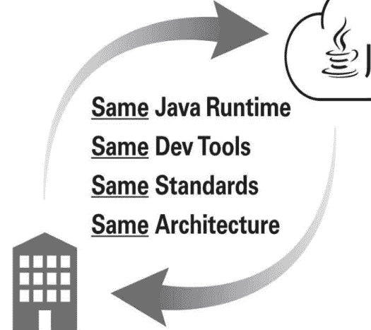

... 或返回您的数据中心

ORACLE
cloud.oracle.com/java

## Oracle 学习库

由 Oracle 专家创建
Oracle 用户**免费**使用

- 丰富的学习辅助
- 直观且强大的搜索
- 分享内容、活动和保存的搜索
- 个性化您的学习仪表板
- 查找并注册培训活动


oracle.com/oll


## Oracle 出版集团服务超过 640,000 名 Oracle 客户

与对您的业务最重要的受众建立联系

### ORACLE 杂志

全球最大的 IT 出版物
发行量：225,000
受众：IT 经理、DBA、程序员和开发者

### PROFIT 杂志

面向企业级业务领袖的商业洞察，帮助他们利用 Oracle 技术构建更好的业务
发行量：90,000
受众：高管和业务线经理

### Java 杂志

关于 Java 技术、Java 编程语言和基于 Java 应用的核心来源
发行量：225,000 且持续稳定增长
受众：企业级和独立 Java 开发者、程序员和架构师

获取更多信息或注册**免费**订阅：扫描二维码访问 Oracle 在线出版。


Copyright © 2016, Oracle 和/或其关联公司。保留所有权利。Oracle 和 Java 是 Oracle 和/或其关联公司的注册商标。其他名称可能是其所有者的商标。


