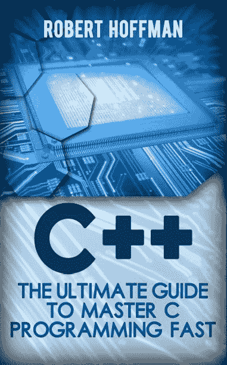
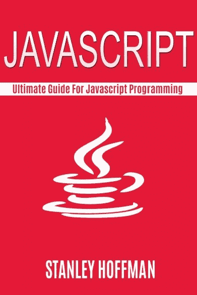
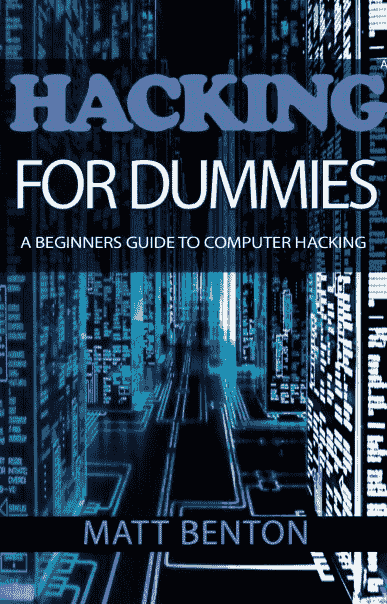
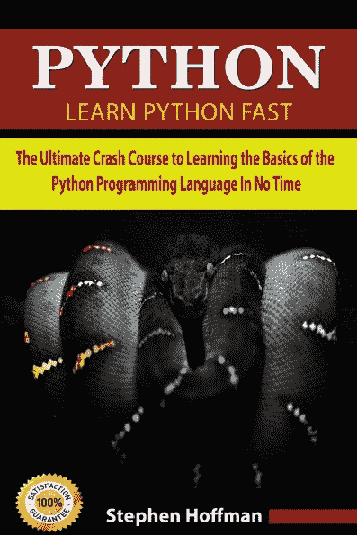
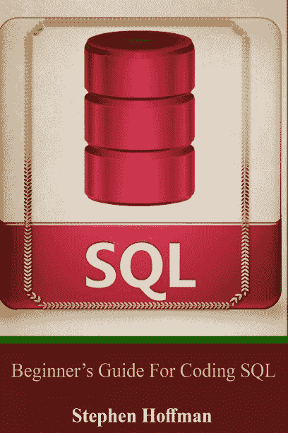

# Java：快速学习 Java 编程入门指南（编程、数据库、Java 学者指南、编程书籍、Java 编程）（HTML、Javascript、编程、开发者、编码、CSS、PHP 书籍 2）



认为你可能对以下书籍感兴趣：

- [C++](https://www.amazon.com/Ultimate-Programming-beginners-database-computer-ebook/dp/B01DED6QNO?ie=UTF8&keywords=C%2B%2B%20robert%20hoffman&qid=1463743006&ref_=sr_1_1&s=digital-text&sr=1-1)


- [Javascript](http://www.amazon.com/Javascript-javascript-programming-development-Developers-ebook/dp/B017YZ6CYG/ref=sr_1_7?s=digital-text&ie=UTF8&qid=1447666305&sr=1-7&keywords=javascript)



- [计算机黑客](http://www.amazon.com/Computer-Hacking-Essential-Beginners-internet-ebook/dp/B010965F36/ref=sr_1_fkmr1_3?s=digital-text&ie=UTF8&qid=1444557942&sr=1-3-fkmr1&keywords=Computer+Hacking%3A+The+Essential+Hacking+Guide+for+Beginners+%28+Hacking%2C+How+to+Hack%2C)


- [小白黑客教程](http://www.amazon.com/Computer-Hacking-beginners-computer-security-ebook/dp/B015T8FZYI/ref=sr_1_1?s=digital-text&ie=UTF8&qid=1446193044&sr=1-1&keywords=hacking+for+dummies+matt+benton)



- [Python](http://www.amazon.com/Python-Ultimate-Learning-Programming-Hands--ebook/dp/B014MV238Y/ref=sr_1_1?s=digital-text&ie=UTF8&qid=1442836729&sr=1-1&keywords=Python%3A+Learn+Python+FAST+-+The+Ultimate+Crash+Course+to+Learning+the+Basics+of+the+Python+Programming+)



- [SQL](http://www.amazon.com/SQL-Beginners-database-programming-Programming-ebook/dp/B019A7VQD8/ref=sr_1_25?ie=UTF8&qid=1451913155&sr=8-25&keywords=sql)



# 介绍

最重要的是，运用常识。当找不到规则或指南时。当规则明显不适用时。当其他所有方法都失败时：请利用常识，检查 Java 和编码的基本原理。这条规则优于所有其他规则。常识是一项要求。

1. 为人编写程序，而不是为机器。使用命名规范。为你的代码编写注释。分段。如果没人能看懂，那么它就没用。

2. 先设计，后编码。在开始编写代码之前，花时间考虑代码将如何编写，你绝对会花费更少编写时间。通过先考虑未来的变化，你可以减少这些变化对代码的影响。

3. 小步子开发。测试和修复 10 行代码比 1000 行要容易且快速得多；人们可以在一半的时间内，以每次 10 行的增量，编写、测试并修复 100 行代码，而直接写一个执行相同工作的 100 行代码块要花费更多时间。

4. 保持代码简单。以后需要重写的代码是不值得自豪的，所以遵循 KISS 原则：保持简单，愚蠢（Keep It Simple, Stupid）。

5. 学习常见的模式、反模式和惯用法。有大量的分析可以指导你提高开发生产力、设计和流程模式与反模式，以及编程惯用法。

# 第 1 章 – 通用编程指南

我们将从本教程开始，讨论良好编程风格的通用原则，以及定义 Java 健壮设计的原则。这些原则中的大部分在《Java 编程入门》中已经过，但本章将引入许多新建议，以提高你作为 Java 开发者的技能。

## 变量作用域

在 Java 语言中，每个局部变量一旦声明，就有一个确定的作用域。该变量从声明处到它当前所在的方法或块的结束都是可见的。因此，只需要遵循一条规则：尽可能靠近使用局部变量的地方声明它。以下是一些示例：

```java
for (String locale : locales()) {
    // 使用实现
}

try (InputStream in = new FileInputStream("file.txt")) {
    // 使用实现
}
```

## 类成员字段与局部变量

Java 中的每个方法都属于某个类（在某些情况下是接口，如 Java 8 中声明为默认的方法）。局部变量与类成员之间存在命名冲突的概率，Java 编译器会选择作用域内的正确变量，但可能不是开发者想要使用的那个。许多 Java IDE 在此类冲突发生时会进行大量工作（红色高亮和警告），然而，在开发过程中主动处理更好。以下是一个示例：

```java
public class LocalVariableAndClassMember {
    private long value;

    public long calculateValue(final long initial) {
        long value = initial;

        value *= 10;
        value += value;

        return value;
    }
}
```

这个示例看起来非常简单，但有一个陷阱：`calculateValue` 方法引入了一个名为 `value` 的局部变量，并隐藏了同名的类成员。第 8 行代码应该是类成员加上局部变量，但在应用中执行的是不同的操作。修正后的版本应该是这样的（使用 `this` 关键字）：

```java
public class LocalVariableAndClassMember {
    private long value;

    public long calculateValue(final long initial) {
        long value = initial;

        value *= 10;
        value += this.value;

        return value;
    }
}
```

这种简单的实现凸显了一个重要问题，在某些情况下，需要花费几个小时来排故障和调试。

## 方法参数与局部变量

许多初学者经常陷入的另一种场景是将方法参数作为局部变量。Java 允许对非 `final` 方法参数重新赋值替代值（但对原始值没有影响）。例如：

```java
public String sanitize(String str) {
    if(!str.isEmpty()) {
        str = str.trim();
    }

    str = str.toLowerCase();
    return str;
}
```

使用 Lambda 表达式对上述 `forEach` 循环重写：

```java
Arrays.stream(locales()).forEach(locale -> {
    // 实现
});
```

注意，局部变量变成了 `forEach` 的参数。

这段代码并不是最整洁的，但它突出了问题：方法参数 `str` 被重新赋值了一个不同的值（并被用作局部变量）。在这些情况下（无例外地），应该避免这种编码模式，可以通过将方法参数声明为 `final` 来避免。

以下是此点的示例：

```java
public String sanitize(final String str) {
    String sanitized = str;
    if(!str.isEmpty()) {
        sanitized = str.trim();
    }
    sanitized = sanitized.toLowerCase();
    return sanitized;
}
```

遵循这一简单规则的代码通常更容易理解和推理。即使以引入局部变量为代价，这种做法也是值得的。

### 装箱与拆箱（Boxing and unboxing）

装箱和拆箱是 Java 技术，允许在原始类型（`int`、`long`、`double`）与相应的原始类型包装类（`Integer`、`Long`、`Double`）之间进行转换。

尽管 Java 编译器试图通过执行自动装箱（autoboxing）来隐藏这些转换，但这可能会让情况变得糟糕，有时会导致产生随机的结果。

以下是一个示例：

```java
public static void calculate(final long value) {
    // Some implementation here
}
final Long value = null;
calculate(value);
```

这段代码段可以正常编译，但在执行 `Long` 到 `long` 的转换时会在第 02 行抛出 `NullPointerException`。这里的最佳建议是使用原始类型（但我们所知，在某些情况下是不可能的）。

### 接口（Interfaces）

在可能的情况下，接口优于具体类。这些真实的示例应该能让你至少先考虑使用接口。

接口仅与默认方法绑定，而不与任何特定的实现绑定。它们仅仅作为合同，在履行合同的方式上提供了许多自由和灵活性。如果实现涉及外部服务或系统，这种灵活性会变得更加重要。

以下是一个简单接口及其可能的实现的示例：

```java
public interface TimezoneService {
    TimeZone getTimeZone(final double lat, final double lon) throws IOException;
}

public class TimezoneServiceImpl implements TimezoneService {
    @Override
    public TimeZone getTimeZone(final double lat, final double lon) throws IOException {
        final URL url = new URL(String.format(
            "http://api.geonames.org/timezone?lat=%.2f&lng=%.2f&username=demo",
            lat, lon
        ));
        final HttpURLConnection connection = (HttpURLConnection)url.openConnection();

        connection.setRequestMethod("GET");
        connection.setConnectTimeout(1000);
        connection.setReadTimeout(1000);
        connection.connect();

        int status = connection.getResponseCode();
        if (status == 200) {
            // Do something here
        }

        return TimeZone.getDefault();
    }
}
```

上述代码展示了一种常见的接口/实现模式。该实现专门使用一个外部 HTTP（注意：不是 https，后者是安全的服务器）服务（`http://api.geonames.org/`）来获取查询位置的时区。但是由于接触是由接口驱动的，引入另一个使用扁平文件或数据库的实现并不困难。这样，接口极大地帮助设计了可测试的代码。在每次测试运行期间调用外部服务可能并不切实际，因此提供这种备选的虚拟实现（也称为 stub 或 mock）作为替代方案是有意义的：

```java
public class TimezoneServiceTestImpl implements TimezoneService {
    @Override
    public TimeZone getTimeZone(final double lat, final double lon) throws IOException {
        return TimeZone.getDefault();
    }
}
```

上述实现可以用在任何需要 `TimezoneService` 接口的地方，这使得测试场景与其对外部组件的依赖隔离开。

Java 标准集合库内部包含了适当使用接口示例。`Collection`、`List`、`Set`，所有这些接口都有多个实现支持，当首选使用接口时，这些实现可以互换且无缝地替换。

以下是此点的示例：

```java
public static <T> void print(final Collection<T> collection) {
    for(final T element: collection) {
        System.out.println(element);
    }
}
print(new HashSet<Object>(/* ... */));
print(new ArrayList<Integer>(/* ... */));
print(new TreeSet<String>(/* ... */));
```

`String` 在 Java 中是不可变的。每次执行任何操作时，都会创建一个新实例。标准库提供了两个非常有帮助的类来方便字符串操作：`StringBuilder` 和 `StringBuffer`（主要区别在于 `StringBuffer` 是线程安全的，而 `StringBuilder` 不是）。

```java
final StringBuilder sb = new StringBuilder();
for(int i = 1; i <= 10; ++i) {
    sb.append(" ");
    sb.append(i);
}
sb.delete(0, 1);
sb.insert(0, "[");
sb.replace(sb.length() - 3, sb.length(), "]");
```

建议使用 `StringBuilder`/`StringBuffer` 来操作字符串，但在连接两个或三个字符串时可能看起来过头了；在这种情况下，可以使用普通的 `+` 运算符。

以下是一个示例：

```java
String userId = "user:" + new Random().nextInt(100);
```

使用字符串格式化是直接拼接的替代方案，Java 标准库提供了静态辅助方法 `String.format`。它还支持完整的格式化符集，包括日期/时间、字符等（参见完整的[官方文档](https://docs.oracle.com/javase/7/docs/api/java/util/Formatter.html#syntax)）。

通过示例探索格式化的威力：

```java
String.format("%04d", 1); // 0001
String.format("%.2f", 15.643624); // 15.64
String.format("%tR", new Date()); // 14:07
String.format("%tF", new Date()); // 2016-20-04
String.format("%d%%", 22); // 22%
```

`String.format` 方法是一种构建来自不同数据类型的字符串的简单且整洁的方法。某些现代 Java IDE 可以分析格式规范与传递给 `String.format` 方法的参数，并在检测到任何不匹配时警告开发者。

在 Java 中没有理由严格遵守任何特定的命名规范，但有一套易于遵循的规则，使得 Java 代码在标准库或任何其他外部 Java 项目中看起来风格统一。

- 局部变量和方法参数名使用驼峰命名法（camel case）：`str`、`newLength`、`minimumCapacity`

- `static final` 字段或枚举常量使用大写，并用下划线 `_` 分隔：`LOG`、`MIN_RADIX`、`INSTANCE`

- 类、`enum`、`interface` 或注解名称使用首字母大写：`StringBuilder`、`Runnable`、`@Override`

- 泛型类型参数名通常表示为大写的字母：`T`、`U`、`E`

- 方法或字段名（`static final` 除外）使用驼峰命名法：`isEmpty`、`format`、`addAll`

- 包名为小写：`org.junit`、`com.fasterxml.jackson`、`javax.json`

通过这些简单的约定，代码看起来非常简洁，且与其他库或框架无异。

### 标准库

Java 标准库存在一些粗糙的边缘和奇怪的设计决策，但 99% 是由编码专家编写的高质量代码。熟悉这些资源是非常值得的。

每个新的 Java 版本都包含现有库的许多新功能（并可能弃用旧版本）以及新库的添加。Java 5 引入了一个新的并发库，位于 `java.util.concurrent` 包中。Java 6 发布了脚本支持 `javax.script` 包和 Java 编译器 API `javax.tools` 包。Java 7 包含了对 `java.util.concurrent` 的改进，引入了 `java.nio.file` 包下的新 I/O 库，以及通过 `java.lang.invoke` 包对动态语言的支持。目前，Java 8 提供了期待已久的日期时间 API，托管在 `java.time` 包中。

Java 平台正在增长和演进；保持这种演变的认知极其重要。每当项目中引入第三方库或框架时，请确保所需的功能在 Java 标准库中尚未提供。

### 不变性

请认真对待不可变性。如果设计的类或实现的方法可以提供不可变性保证，那么它几乎可以在任何地方使用，而无需担心并发修改。这将改善开发者和团队成员的生活。

### 测试

测试驱动开发（TDD）实践在 Java 社区被广泛采用，不断提高代码质量标准。TDD 带来了许多好处，但 Java 标准库目前不包含任何测试框架或脚手架。

测试仍然是现代 Java 开发不可或缺的一部分。在这里我们将使用编写良好的 `JUnit` 框架涵盖一些基础知识。使用 `JUnit`，每个测试都是关于预期对象状态或行为的断言集合。

优秀的测试是短小且简单的，一次测试一点。让我们通过编写一组测试来验证 Strings 章节中的 `String.format` 函数返回预期的结果：

```java
package com.javacodegeeks.advanced.generic;

import static org.junit.Assert.assertThat;
import static org.hamcrest.CoreMatchers.equalTo;

import org.junit.Test;

public class StringFormatTestCase {
    @Test
    public void testNumberFormattingWithLeadingZeros() {
        final String formatted = String.format("%04d", 1);
        assertThat(formatted, equalTo("0001"));
    }

    @Test
    public void testDoubleFormattingWithTwoDecimalPoints() {
        final String formatted = String.format("%.2f", 12.324234d);
        assertThat(formatted, equalTo("12.32"));
    }
}
```

这些测试具有可读性且执行速度快。一个 Java 项目包含数百个测试用例，以便对回归或开发中的功能提供快速反馈。

# 第 2 章 - 何时以及如何使用异常

## 引言

Java 中的异常表示程序流中的异常或特殊情况，这些情况可能会阻止程序继续运行。这些异常情况可能是致命的；程序无法继续运行并应该终止；或者这些情况是可以恢复的；程序继续运行但某些功能可能会丢失。

在这里我们将遍历使用 Java 异常的典型场景，解释检查异常（checked exceptions）和未检查异常（unchecked exceptions），并涉及一些边界情况和实用的用法。

## 异常：何时使用

简单来说，异常是程序执行期间发生并中断正常执行流的事件或信号。异常是早期使用的错误代码和状态技术的替代方案。现在，异常已被接受为包括 Java 在内的多种语言的标准。

异常处理只有一个重要的规则：不要忽略它们。每个异常都应该被记录但绝不能被忽略。在极少数情况下，由于对异常做不了什么，异常可以被忽略。

Java 中的异常管理是独特的。异常分为两个不同的类：检查异常和未检查异常。

未检查异常表示与程序逻辑和假设相关的错误状况。未检查异常将是 `RuntimeException` 的子类，Java 编译器通过这种方式识别特定的异常所属。

```java
public class NullPointerException extends RuntimeException {
    public NullPointerException() {
        super();
    }

    public NullPointerException(String s) {
        super(s);
    }
}
```

检查异常显示程序直接控制范围之外无效状况（如内存、网络、文件系统）。与未检查异常不同，检查异常必须由调用者捕获，或者作为方法签名的一部分列出。`IOException` 是检查异常中最著名的：

```java
public class IOException extends Exception {
    public IOException() {
        super();
    }

    public IOException(String message) {
        super(message);
    }

    public IOException(String message, Throwable cause) {
        super(message, cause);
    }

    public IOException(Throwable cause) {
        super(cause);
    }
}
```

检查异常和未检查异常引入的样板代码和丑陋的代码模式比解决实际问题的更多。在 Java 生态系统中出现的典型模式是，将检查异常隐藏或包装在未检查异常中。

下面是一个示例：

```java
try {
    // 一些 I/O 操作
}
```

精心设计的异常层级结构可以减少所需的样板代码。

Java 中继承自 `Error` 类的其他异常类包括 `OutOfMemoryError` 或 `StackOverflowError`。这些异常表示致命的执行失败，会导致程序立即终止且无法恢复。

## 使用 try-with-resources

栈回溯（Stack unwinding）通常是由抛出异常引起的。程序执行流的变化通常也以这种方式发生。例如，直接与未关闭的本地资源、网络套接字和文件句柄相关的资源泄漏，就是这些抛出异常的结果。

在 Java（版本 7 之前）中，一个良好的典型 I/O 操作使用强制的 `finally` 块来执行清理工作：

```java
public void readFile( final File file ) {
    InputStream in = null;
    try {
        in = new FileInputStream( file );
        // Some implementation here
    } catch( IOException ex ) {
        // Some implementation here
    } finally {
        if( in != null ) {
            try {
                in.close();
            } catch( final IOException ex ) {
                /* do nothing */
            }
        }
    }
}
```

`finally` 块的代码编写并不完美（但调用输入流的 `close` 方法也可能导致 `IOException` 异常），关闭输入流（并释放其背后的操作系统资源）的操作将被执行。异常永远不被忽略，但 `close` 方法抛出的异常是这一规则的唯一例外。

Java 7 在语言中引入了一种名为 `try-with-resources` 的新结构，使得整体资源管理变得更加简单。以下是使用 `try-with-resources` 重写的上述代码段：

```java
public void readFile( final File file ) {
    try( InputStream in = new FileInputStream( file ) ) {
        // Some implementation here
    } catch( final IOException ex ) {
        // Some implementation here
    }
}
```

资源需要实现 `AutoCloseable` 接口才能在 `try-with-resources` 块中使用。Java 编译器会在后台将此结构扩展为更复杂的代码，而开发者的代码看起来非常易读且简洁。在适当的情况下，这是一种非常方便的技术。

## 异常与 lambda

未检查的异常（Unchecked exceptions）将按预期工作，但 Java Lambda 函数的语法不允许指定受检查异常（Checked exceptions）；除非这些异常是由 `@FunctionalInterface` 本身定义的且该异常可能被抛出。

下面的代码段将无法通过编译，会产生编译错误“Unhandled exception type IOException”（该异常可能在第 03 行抛出）：

```java
public void readFile() {
    run( () -> {
        Files.readAllBytes( new File( "some.txt" ).toPath() );
    } );
}

public void run( final Runnable runnable ) {
    runnable.run();
}
```

解决方案是在 Lambda 体内部捕获 `IOException` 异常并重新抛出正确的 `RuntimeException`（将原始异常作为原因传递）。以下是一个示例：

```java
public void readFile() {
    run( () -> {
        try {
            Files.readAllBytes( new File( "some.txt" ).toPath() );
        } catch( IOException ex ) {
            throw new RuntimeException( "Error reading file", ex );
        }
    } );
}
```

许多函数式接口已经声明，并能够从其实现中抛出任何 `Exception`，但如果不能（如 `Runnable`），则包装或在未检查异常内部捕获受检查异常是正确的做法。

## 标准异常

Java 标准库提供了大量关于异常类的信息。这些类被专门设计用于涵盖过程执行过程中可能发生的大多数通用错误。下表显示了经常使用的异常类，在定义自己的异常之前，请务必考虑这些。

| 异常 | 用途 |
| :--- | :--- |
| `NullPointerException` | 在需要对象的地方尝试使用 `null`。 |
| `IllegalArgumentException` | 为方法传递了非法或不适当的参数。 |
| `IllegalStateException` | 在非法或不适当的时间调用了方法。 |
| `IndexOutOfBoundsException` | 索引（针对向量、字符串或数组）超出范围。 |
| `UnsupportedOperationException` | 请求的操作不支持。 |
| `ArrayIndexOutOfBoundsException` | 使用非法索引访问了数组。 |
| `ClassCastException` | 代码尝试将对象转换为其不是其实例的子类。 |
| `EnumConstantNotPresentException` | 尝试通过名称访问枚举常量，但该类型不包含指定名称的常量。 |
| `FormatException` | 尝试将字符串转换为数值类型之一，但字符串没有适当的格式。 |
| `StringIndexOutOfBoundsException` | 索引为负或大于字符串的大小。 |
| `IOException` | 发生了某种 I/O 异常。该类是失败或中断的 I/O 操作产生的异常的通用类。 |

## 定义你自己的异常

在 Java 语言中定义异常类非常容易。为了详细的错误条件管理和报告，精心设计的异常层级允许进行详细的实现。实现正确的平衡至关重要；特别是当异常类过多时，可能会使开发复杂化，并增加捕获异常或将其向下层传递的代码量。

所有用户定义的异常必须继承自 `RuntimeException` 类，并属于未检查异常类，但该规则总有一些例外。以下是用于处理身份验证的定义的异常：

```java
public class NotAuthenticatedException extends RuntimeException {
    private static final long serialVersionUID = 2079235381336055509L;

    public NotAuthenticatedException() {
        super();
    }

    public NotAuthenticatedException( final String message ) {
        super( message );
    }

    public NotAuthenticatedException( final String message, final Throwable cause ) {
        super( message, cause );
    }
}
```

该异常的目的是在登录过程中对不存在或无效的用户凭据发出信号，例如：

```java
public void signin( final String username, final String password ) {
    if( !exists( username, password ) ) {
        throw new NotAuthenticatedException( "用户名 / 密码组合不被识别" );
    }
}
```

随异常传递信息性消息有助于排查生产系统的故障。如果异常是由于另一种异常情况而重新抛出的，则必须使用原因构造函数参数保留初始异常。这将有助于追踪问题来源。

## 文档异常

下一个主题将讨论如何让异常也成为文档的一部分。

作为实现的一部分，可能会抛出检查异常（checked exception）的方法应当作为方法签名的一部分。这是通过 `throws` 声明来实现的。`@throws` 标签用于在 Java 文档工具中描述这些异常。

以下是一个示例：

```java
/**
 * 从文件系统读取文件。
 * @throws IOException 如果发生 I/O 错误。
 */
public void readFile() throws IOException {
    // Some implementation here
}
```

未检查异常（unchecked exceptions）不声明为方法签名的一部分。但请对它们进行记录，以便方法的调用者能够意识到可能抛出的异常（使用相同的 `@throws` 标签）。

以下是一个示例：

```java
/**
 * 解析某些概念的字符串表示。
 * @param str 要解析的字符串
 * @throws IllegalArgumentException 如果指定的字符串无法正确解析
 * @throws NullPointerException 如果指定的字符串为 null
 */
public void parse(final String str) {
    // Some implementation here
}
```

务必对方法可能抛出的异常进行记录。这有助于从编码开始就实现适当的异常处理和恢复（回退）逻辑，确保它们免受生产系统中故障排除问题的干扰。

## 异常与日志

日志（[`en.wikipedia.org/wiki/Logfile`](http://en.wikipedia.org/wiki/Logfile)）是任何复杂的 Java 应用、库或框架必不可少的一部分。它是应用程序事件的日志，而异常是流程中的关键部分。必须正确记录异常并在稍后进行分析，以便发现应用程序中的问题并进行故障排除。

## 结论

异常是 Java 语言的一个重要特性。异常是 Java 错误管理的基础。异常使处理和信号错误状态变得简单；与错误码、标志和状态相反，异常一旦发生就无法被忽略。

这些建议将帮助你更有效地理解书中描述的 Java 编码标准和指南。在使用大多数语言进行编码或编程时也可以使用这些工具。Python、C++、CSS 和 JavaScript 等语言都使用通用格式、规则、异常和标准来确保信息易于理解、编辑和添加，从而开发程序和应用程序的改进和新版本。

1. **理解标准。** 花时间理解每种标准和指南如何提高生产力。不要仅仅因为被告知就将每个局部变量单独写一行。这样做是因为你理解到这可以提高对代码的理解。

2. **相信它们。** 遵循标准应该是始终如一做的事，因为它是最好的编码方式。

3. **在编码时遵循它们，而不是事后补救。** 整洁的代码更容易，无论是在开发还是维护期间都是如此。遵循标准将提高开发时的生产力，并使代码更易维护。如果从一开始就产生整洁的代码，你就能在创建过程中从中受益。

4. **将它们成为你质量保证流程的一部分。** 确保源代码遵循工作对象所采纳的标准。标准应作为培训和指导开发人员变得更高效的基础。

Java 是一门动态且实用的编码语言，希望这本书能帮助你更深入地理解 Java 编码的某些高级方面。

感谢阅读。希望你喜欢。请留下你诚恳的反馈。
