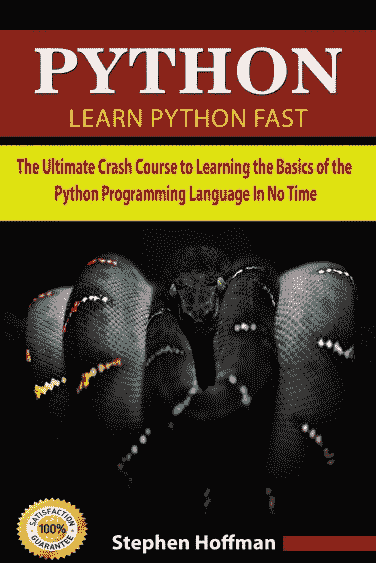
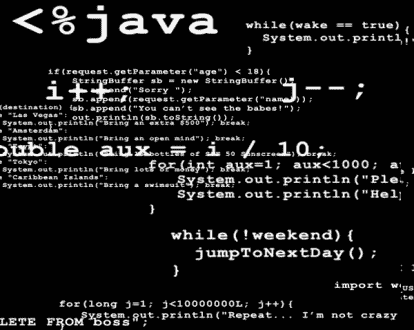
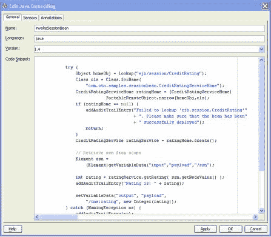
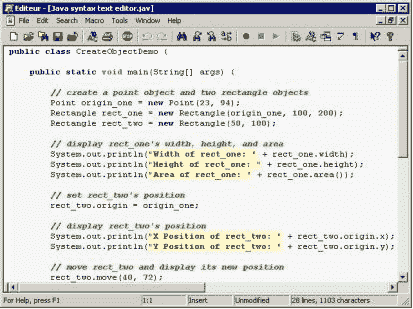
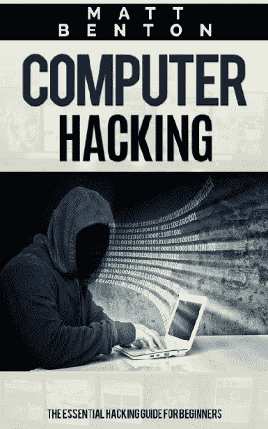
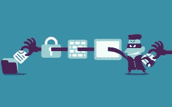
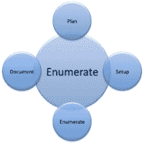
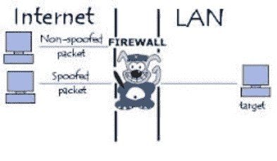
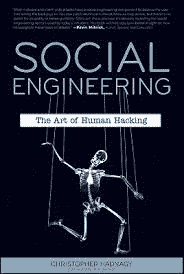

# Java：学习 Java 编程与计算机黑客技术的终极指南（Java 初学者、Java 教程、Java 应用、黑客技术）（HTML, Javascript, 编程、开发者、编码、CSS, PHP 书籍 2）


认为这些书对你也会感兴趣：

- [C++](http://www.amazon.com/Beginners-Simple-programming-coding-Developers-ebook/dp/B014MT5ME8/ref=sr_1_fkmr0_1?s=digital-text&ie=UTF8&qid=1442833820&sr=1-1-fkmr0&keywords=C%2B%2B%3A+C%2B%2B+for+Beginners%2C+C%2B%2B+in+24+Hours%2C+Learn+C%2B%2B+fast%21+A+smart+w)


- [Python](http://www.amazon.com/Python-Ultimate-Learning-Programming-Hands--ebook/dp/B014MV238Y/ref=sr_1_1?s=digital-text&ie=UTF8&qid=1442836729&sr=1-1&keywords=Python%3A+Learn+Python+FAST+-+The+Ultimate+Crash+Course+to+Learning+the+Basics+of+the+Python+Programming+)



Javascript

- [傻瓜黑客](http://www.amazon.com/Computer-Hacking-beginners-computer-security-ebook/dp/B015T8FZYI/ref=sr_1_1?s=digital-text&ie=UTF8&qid=1446193044&sr=1-1&keywords=hacking+for+dummies+matt+benton)


- [SQL](http://www.amazon.com/SQL-Beginners-database-programming-Programming-ebook/dp/B019A7VQD8/ref=sr_1_25?ie=UTF8&qid=1451913155&sr=8-25&keywords=sql)


## 引言

Java 语言最初是由 Sun Microsystems 的一个由 James Gosling, Sheridan, Patrick Naughton 和 Chris 组成的团队引入的。它是一种面向对象的语言。

## Java 平台

- Java 标准版 (SE)
- Java 企业版 (EE)
- Java 微版 (ME)
- JavaFX

## 入门工具

为了学习 Java，你需要选择一个 IDE。IDE，即集成开发环境，是用于编写代码的工作空间。以下是 IDE：

- BlueJ：这是一个面向初者的 IDE。它最初是为学者设计的。
- DrJava：这是一个轻量级 IDE。类似于 BlueJ，它也是为学者设计的。
- Eclipse：如今流行的 IDE 之一，是一个开源平台。
- NetBeans：另一个流行的 IDE，因其用户界面被推荐给学者。

除了 Java IDE 之外，你需要的另一个工具是 JDK。JDK，全称为 Java 开发工具包，是你计算机的解释器和编译器。没有它，你的计算机将无法将 Java 代码转换为机器语言。所有版本的 JDK 都可以从官网下载。

# 第 1 章 – 编写 Java 程序

一旦你选择了心仪的 IDE 并下载了最新版本的 JDK，你现在拥有了使用 Java 语言编程的工具。然而，拥有工具并不意味着你已经准备好编写你的第一个 Java 应用程序。

理解 Java 程序的结构——其主要组件及其在应用程序中的组成也是重要的。

## 软件类型

你可以使用 Java 语言创建两种软件——Applet 和应用程序。

Applet 是设计在浏览器中运行的较小代码。我们可以将 Applet 视为更小、更量级的应用程序。它们主要用于提供导航增强或额外的交互。与独立的 Java 应用程序相比，Applet 不需要解释器即可执行。

通过 Java 开发的另一种类型的软件是控制台应用程序。控制台应用程序是在控制台环境中运行的独立程序。所有的 IDE 都拥有一个集成的控制台环境，以便你测试此类程序。作为一个初学者，学习控制台操作对于你良好掌握 Java 语言的基础至关重要。



## 类、实例与对象

类、实例和对象是使用如 Java 等面向对象的语言创建程序时的三个核心元素。为了理解这三者，你首先需要查看它们之间的关系。

类（Classes）是最高层，它们涵盖了 Java 编程语言中的一切。类中的特定元素被称为 `Objects`（对象）。一旦你为 `Object` 添加额外的规格，它就变成了一个 `Instance`（实例）。

比方来说，假设这里的类是 `animal`（动物）。在 `animal` 类下，我们有不同种类的动物如 `dogs`（狗）、`cats`（猫）、`birds`（鸟）等。这些都是 `animal` 类下的 `objects`。在 `dogs` 类别下，我们有不同的品种，如 `poodles`（贵宾犬）、`golden retrievers`（金毛犬）、`Labradors`（拉布拉犬）等。这些就是对象 `dogs` 的 `instances`。

## 创建项目

编写 Java 程序的第一步是在所选的 IDE 中启动一个新的空项目。你可以通过如下导航最顶部的工具栏来实现：

`File -> New Project`

选择 `New Project` 后，会弹出一个新窗口，你可以在其中类别列表中进行选择。在 `Categories` 列表中，选择 `Java`，然后在相邻的窗口面板中选择 `Java Application`。之后，点击 `Next` 按钮，系统会要求输入项目名称以及你想保存项目的位置。

始终记住项目名称，因为在过程中会被要求返回同一个项目。

## 创建主类

在创建新项目后，IDE 会自动创建包（package）和主类（main class）。包也被称为源包（source packages），作为文件夹使用，你可以在其中高效地组织 Java 项目的所有资产，如类和实例。但请注意，包仅仅是资产组织的标识符。将它们想象成计算机中的文件夹，你据此组织文件。

在包下应该有一个主类。如果 IDE 没有自动创建主类，你可以通过如下导航主菜单来创建：

`File -> New File -> Java Class`

主类在 Java 程序中起着至关重要的作用。`main` 方法是打开 Java 程序时最初执行的内容，它包含在主类中。在其他编程语言中，`main` 方法被称为入口点。

### 编写包语句

现在我们已经在 Java 项目中有了主类，现在准备好编写我们的第一行 Java 编程语言代码——包语句（package statement）。该语句是程序的可选部分，仅为了学习目的才向你介绍它。它使用以下语法编写：

`package [package name];`

如果没有写这一行，IDE 将自动查找默认包。换句话说，如果你在一个包含多个包的 Java 项目中工作，包语句可能会派用场。请记住，包名必须与类所属的包名匹配。例如，假设你的包名是 `javatestproject`。在你的 IDE 中，语法应该是这样的：

```java
package javatestproject;
```

### 编写类声明

紧随包语句之后的是类声明（class declaration）。我们需要遵循的语法如下：

`[access modifier] class [class name]`

你可以使用两种访问修饰符：`public`（公共）和 `private`（私有）。`private` 修饰符防止其他类访问声明的类，而 `public` 修饰符则允许其他类访问声明的类。目前，让我们专注于并将 `public` 作为我们第一个 Java 程序的访问修饰符。

类名（Class name）如其名，是你指定为主类的名称。请注意，Java 编程语言对大小写敏感，因此请确保你的主类名使用正确的大小写字母。假设我们的主类名为 `JavaTestProject`，那么我们现在应该拥有：

```java
package javatestproject;
public class JavaTestProject {
}
```

左括号（`{`）和右括号（`}`）指的是 Java 代码块的开始和结束。这有助于程序确定特定代码块从哪里开始何时结束。

### 编写 main 方法

现在类声明完成后，是时候为我们的第一个程序声明 main 方法了。在 main 方法中，我们将使用两个关键字：`void` 和 `static`。

`void` 关键字向 Java 虚拟机（也称为 `JVM`）信号程序已成功运行并结束。`static` 关键字向程序信号该字段指的是类，而不是类中的对象或实例。换句话说，程序可以在不创建该类实例的情况下自由地访问该类。由于 main 方法作为程序入口点的性质，将其声明为 `static` 是至关重要的。因此，我们 main 方法声明的语法应该遵循此格式：

`[access modifier] static void`

然而，这还不是 main 方法完整的声明。我们应该添加参数 `main(String[] args)` 以允许程序执行命令行参数。因此，我们 main 方法的最终代码应该是：

```java
public static void main(String[] args)
```

如果添加到上面的代码中，我们的 IDE 应该是：

```java
package javatestproject;
public class JavaTestProject {
    public static void main(String[] args) {
    }
}
```

## 编写程序输出

现在我们已经涵盖了 Java 程序的基础部分。遗憾的是，我们还没有告诉程序具体要做什么。我们想要程序执行的是传递消息。我们称程序输出（Program Output）或输出流（Output Stream）。为了让程序传递消息，我们应该使用以下语法：

`System.out.print("[message]")`

不用 `print` 参数，你可以将其替换为 `println`。这在执行后会将输出打印到新行。因此，另一种格式应该是：

`System.out.println("[message]")`

让我们现在使用上面的命令行让程序打印“Java is Awesome!”语句。我们的语法应该是：

`System.out.print("Java is Awesome!");`

当我们插入输出代码后，我们的 IDE 应该是：

```java
package javatestproject;

public class JavaTestProject {

    public static void main(String[] args) {

        System.out.print("Java is Awesome!");

    }

}
```

## 允许用户输入

Java 编程语言允许你通过发送输入让用户与程序通信。我们可以通过使用内置类 `Scanner` 来。

`Scanner` 类收集来自计算机键盘的用户输入。它将收集到的数据存储在变量中，这些变量可以在程序的输出流中执行。为了这一点，我们需要在包语句添加以下行：

`import java.util.Scanner;`

这是一个导入语句（import statement）的示例，它信号程序从名为 `java.util` 的内置 Java 包中导入 `Scanner` 类。这就是我们在 IDE 中添加它们的位置：

```java
package javatestproject;
import java.util.Scanner;
```

然而，这还没有产生任何作用。我们首先需要为 `Scanner` 类分配一个变量名，以便将扫描器收集的数据调用到我们的输出流中。我们可以通过使用以下语句为 `Scanner` 类分配一个变量名：

```
Scanner [variable name] = new Scanner(System.in);
```

你可以为变量分配任何名称。通常的做法是以大写字母开头，后面跟上小写字母。使用大写字母来分隔单词也是一种良好的习惯。假设我们想把扫描变量命名为“userinput”。与其将整个变量名都写成小写，不如将“user”和“input”这两个单词的首字母替换为大写。因此，该语句看起来像这样：

```
Scanner UserInput = new Scanner(System.in);
```

我们应该将该语句插入到 `main` 方法声明的代码块中。因此，我们的 IDE 如下：

```java
package javatestproject;
import java.util.Scanner;
class JavaTestProject {
    public static void main(String[] args) {
        Scanner UserInput = new Scanner(System.in);
    }
}
```

通过这组 Java 代码，我们正在命令程序将用户输入赋值给名为“UserInput”的变量。现在让我们告诉程序调用输入。例如，让我们尝试通过程序询问用户的名称，并让程序本身通过交付另一个输出来返回名称。我们的程序应该遵循以下方案：

第一次输出 -> 输入 -> 第二次输出

为了创建第一个输出，我们将使用从编写输出中学到的知识。在扫描器分配变量名的语句上方，通过断言以下语句询问询问名称：

```
System.out.print(“What should we call you?”);
```

接下来，让我们通过将收集的数据调用到第二次输出来返回用户的答案。我们可以通过在扫描器变量名语句下方编写第二个输出来实现。我们的第二个输出应该是：

```
System.out.println(“Hello “+UserInput.nextLine());
```

这样，我们就可以写出如下的最终 Java 程序：

```java
package javatestproject;
import java.util.Scanner;
class JavaTestProject {
    public static void main(String[] args) {
        System.out.print(“What should we call you?”);
        Scanner UserInput = new Scanner(System.in);
        System.out.println(“Hello “+UserInput.nextLine());
    }
}
```

# 第 2 章 – 变量

由于上面对 `Scanner` 类的介绍，我们现在对变量已经熟悉了。然而，变量的完全潜力仍然不为人知。

变量是数据的容器。它们允许我们以更方便的方式调用特定数据。我们还可以通过变量使用不一致的值创建一组新数据。大多数编程语言都使用变量，开发者能够通过它们解决算术和逻辑操作。

为了利用变量，我们需要首先声明它，并在声明时分配一个数据类型。通过这样做，程序将能够识别变量内部存储的是什么类型的值。



## 数据类型概述

有不同的数据类型，我们可以在各种操作和函数中使用每类型。在学习如何为变量分配数据类型之前，首先熟悉数据类型是非常重要的。以下是 Java 编程语言中可以用于变量的数据类型及其简要描述：

| 数据类型 | 说明 |
| :--- | :--- |
| `Boolean` | 此数据类型只有两个可能的值：`true` 或 `false`。 |
| `Byte` | 与所有数值数据类型相比，此数据类型的范围最小。它的默认值为 `0`，它可以存储一个 8 位的补码整数。 |
| `Character` | 此数据类型仅存储单个字符。默认情况下，值将始终是一个空格。 |
| `Double` | 此数据类型可以存储 64 位 IEEE 754 的数值值，默认值为 `0.0d`。这些是带有小数点的数值值。 |
| `Float` | 此数据类型存储 32 位 IEEE 754，比 `Double` 数据类型不具体。默认情况下，数据被设置为 `0.0f`。 |
| `Integer` | 此数据类型是处理数值的最简单方法。在未指定时，它会自动将值转换为 `0`。它不支持小数点，这使得它对于精确值来说效率很低。 |
| `Long` | 此数据类型允许你存储 -9,223,372,036,854,775,808 到 9,223,372,036,854,775,807 之间的数值值。它的默认值为 `0`。 |
| `Short` | 此数据类型允许你存储 -32,768 到 32,767 之间的数值值。默认情况下，它被设置为 `0`。 |
| `String` | 此类型存储字母数字值。空字符串变量默认将给出 `null` 值。 |

## 变量的创建

我们需要写一个声明语句来为特定数据类型创建变量。任何名称都可以分配给变量，我们将在后的代码块中调用存储的数据时也使用该名称。

让我们使用整数数据类型创建一个变量，并将其命名为“MyAge”。我们的语法看起来应该是：

```
int MyAge;
```

默认情况下，程序为 `MyAge` 变量分配零。我们将使用赋值运算符 `=`。对于其他数据类型也是如此。以下是我们在 IDE 中声明它们时的数据类型列表（变量名为“TestVar”）：

| 语法公式 | 示例 |
| :--- | :--- |
| `Boolean [variable name] = [true or false];` | `Boolean TestVar = true;` |
| `byte [variable name] = [numerical value];` | `byte TestVar = 0;` |
| `char [variable name] = [single character];` | `char TestVar = L;` |
| `double [variable name] = [numerical value]d;` | `double TestVar = 31.13d;` |
| `float [variable name] = [numerical value]f;` | `float TestVar = 1.3f;` |
| `int [variable name] = [numerical value];` | `int TestVar = 5;` |
| `long [variable name] = [numerical value];` | `long TestVar = 0L;` |
| `short [variable name] = [numerical value];` | `short TestVar = 32000;` |
| `String [variable name] = [alphanumeric value];` | `String TestVar = null;` |

## 数据类型与用户输入



我们已经知道可以使用 `Scanner` 收集。现在我们将使用 `Scanner` 类收集其他数据类型。在示例中，我们将向用户索要数值，然后让程序将该值保存为整数值。

我们的第一步是告诉 `Scanner` 类它需要存储的是整数数据类型的值。我们可以通过将输出中的 `nextLine()` 参数更改为 `nextInt()` 参数来实现。

让我们创建一个询问用户出生年份的程序。之后，我们将该值作为整数数据类型返回给用户。我们的 IDE 应该是这样的：

当调用 `Scanner` 类从用户输入中收集数据时，我们也会创建一个变量。例如，在我们关于出生年份的 Java 程序中，我们创建了一个名为 `BirthYear` 的新变量，并将收集的数据存储其中。这里的问题是，当我们在程序输出中执行 `Scanner` 类数据时，在变量名后面直接写了参数。当你需要在多个语句中调用收集的数据时，这非常繁琐。因此，我们可以将整个语法存储到另一个变量中以简化代码。通过在声明变量的同时将 `Scanner` 语法赋值为变量的值来实现这一点。

让我们创建另一个程序，计算用户五年后的年龄。这次，我们将把 `Scanner` 调用语句存储到另一个变量中。它应该是这样的：

```java
package javatestproject;
import java.util.Scanner;
class JavaTestProject {
    public static void main(String[] args) {
        System.out.print("How old are you?”);
        Scanner UserAge = new Scanner(System.in);
        Age = UserAge.nextInt();
        System.out.println(“You will be “+(Age+5)+” five years from now”);
    }
}
```

从我们的示例程序中，我们将 `Scanner` 调用语句存储在名为 `Age` 的新变量中。在下一行，我们调用了用户收集的整数，并写了一个简单的算术操作，以提供用户五年后的年龄。注意，数学表达式被包含在括号中。如果没有括号，程序将把 `Age` 变量中存储的值与数值 `5` 拼接，而不是将这两个值相加。

除了整数外，你还可以使用以下参数通过 `Scanner` 类调用语句查找其他类型的数据：

- `nextByte()` 用于 `Byte` 类型数据值
- `nextShort()` 用于 `Short` 类型数据值
- `nextLong()` 用于 `Long` 类型数据值
- `nextFloat()` 用于 `Float` 类型数据值
- `nextDouble()` 用于 `Double` 类型数据值

# 第 3 章 – 运算符

从第一章以来，我们一直在使用不同的运算符，我们使用过的常用的运算符是赋值运算符。它由等号（`=`）定义，指示程序为变量指定一个特定的值。

除了赋值运算符外，还有五种运算符用于在 Java 编程语言中处理数据。它们如下以及作为数学运算符的角色：

- 加法运算符，用加号（`+`）表示。它命令程序给出多个值之和。
- 减法运算符，用减号（`-`）表示。它命令程序给出多个值之差。
- 乘法运算符，用星号（`*`）表示。它命令程序给出多个值之积。
- 除法运算符，用斜号（`/`）表示。它命令程序给出多个值之商。
- 取余数运算符，用百分号（`%`）表示。它命令程序除法两个数值，并给出这两个数值的余数。

## 单个程序中的总结

熟悉运算符最好的方法是创建一个 Java 程序，在其中我们可以使用至少一个数学运算符。我们还将整合目前为止学到的内容。换句话说，我们还将使用 `Scanner` 类从用户那里收集数据，然后执行算术表达式向用户提供高效的输出。

在这个程序中，我们将要求用户输入两个数值，并让程序提供这两个数值之和。让我们开始编写 Java 程序：

```java
package javatestproject;
import java.util.Scanner;
class JavaTestProject {
    public static void main(String[] args) {
        int Value1, Value2, Total;
        System.out.print(“Please enter the first value”);
        Scanner FirstValue = new Scanner(System.in);
        Value1 = FirstValue.nextInt();
        System.out.println(“Please enter the second value”);
        Scanner SecondValue = new Scanner(System.in);
        Value2 = SecondValue.nextInt();
        Total = Value1 + Value2;
        System.out.println(“The total of the two values is “+Total);
    }
}
```

在这个程序中，你会注意到我们为输出声明了这些变量：`int Value1, Value2, Total;`。

## 结论

Java 编程语言为你提供了无限的工具来实现不同的操作。然而，了解你所选择的 IDE 是极其重要的。初学者应该找到一个他们觉得工作起来舒服的 IDE。虽然所有的 IDE 都使用同一种编程语言，但每个 IDE 都有其独特的界面，可能会改变你的编程节奏。

不要忘记，你仅仅对 Java 语言的能力浅尝一角。本书还有后续章节，你将在那里学习更高级的技术，例如流程控制、对访问修饰符更深入的理解、对象和类的观察、构造函数、序列化以及继承。

将此本书视为你进入 Java 编程语言世界的大跨越。永远记住，这种编程语言学习起来很有趣，但也充满了重挑战。尽管如此，掌握这门语言将为你开启新的机会，例如能够开发自己的移动应用程序。你甚至可能开发出一个像《我的世界》一样经得起考验的新独立游戏。



# 计算机黑客：初学者必备的黑客指南

MATT BENTON

## 目录

- 引言 – 什么是黑客？
- 第一章 – 黑客行为与赛博朋克的影响
- 第二章 – 不同类型的黑客
- 第三章 – 计算机安全
- 第四章 – 黑客技术
- 结

## 引言 – 什么是黑客？

黑客行为是指未经授权访问计算机系统的行为，可能包括查看或复制数据，甚至创建新数据。黑客行为通常被理解为恶意破坏计算机系统、复制信息或留下破坏数据的病毒的方法。

黑客行为的发生有许多不同原因，这些原因涵盖了由于意识形态而想要破坏系统（因此将黑客作为抗议的手段）、为了获取利益（例如为了信用卡欺诈），或仅仅是为了兴趣和娱乐而进行黑客。

关于“黑客”（hacker）一词的定义存在一些争议，因为那些试图防止此类安全漏洞发生或寻求恢复丢失文件的人也被称为黑客。因此，一些人认为，对于恶意系统安全漏洞的正确术语实际上是“破解”（cracking），而“黑客行为”（hacking）才是用于那些对抗这种恶意利用计算机漏洞行为的人的正确词汇。

然而，在人们的想象和日常对话中，“黑客”一词主要被理解为突破计算机安全的“坏”方法。这两个过程共享许多共同技能，因为无论动机如何（是为了偷取还是保护、闯入还是拯救计算机数据），都需要对计算机有相同的理解。

对于对技术感兴趣的人来说，黑客行为不仅仅是一种消遣，也不仅仅是出于个人利益和恶意意图的非法活动，尽管这两种动机确实构成了大部分黑客活动。事实上，黑客是一自己的亚文化，社区成员对他们在计算机地下世界的意识形态、技术和社交关系感到非常强烈。

有许多黑客小组和会议，例如 SummerCon、DEF CON、HoHoCon、ShmooCon、BlackHat、Chaos Communication 和 Hacker Halted，当地的黑客社区对参加黑客竞赛非常认真。难怪这里还有许多致力于黑客主题的在线小组和论坛，那些具有相似黑客意识形态的人确实感受到强烈的社区精神。

此外，黑客们通常对黑客社区的文学描写充满热情，并热衷地阅读虚构的赛博朋克小说和真实的黑客杂志。

本书将作为黑客世界的介绍，并对黑客行为的一些关键影响、意识形态、群体、概念和技术提供见解。

第一章将考虑黑客行为的起源以及文学流赛博朋克的影响。第二章将介绍不同类型的黑客，并区分伦理黑客和不伦理黑客。第三章将探讨计算机安全问题，这对于理解黑客行为至关重要。

最后一章将概述各种不同的黑客技术，包括自动化和手动方法，以及被称为“社会工程学”的网络信任骗术的重要性。

## 第一章 – 黑客行为与赛博朋克的影响

美国科幻作家迈克尔·布鲁斯·斯特林（Michael Bruce Sterling）帮助创立了赛博朋克这一流行流派。赛博朋克是科幻小说的一个分支，专注于技术在未来设定中的作用。在这种文学和电影流派中，描绘了底层阶级，他们接触并对先进技术有深入理解。

赛博朋克经常探索技术在社会秩序崩溃期间的作用，其中一个压迫性的政府限制并损害了普通民众的生活。此外，人智能（如机器人或智能计算机）在赛博朋克故事中也扮演着重要角色，地球在近未来被描述为一个后工业反乌托邦（乌托邦的反面，因此是一个以压迫和经常的社会动荡为特征的黑暗世界）。


赛博朋克对现代黑客行为理解的影响是巨大的。当我们能在虚构表现中识别出自己的世界时，科幻小说尤为有效，而在赛博朋克中，我们可以识别出当代技术时代的许多担忧。劳伦斯·人物（科幻杂志 Nova Express 的编辑）描述了赛博朋克的典型角色：

“经典的赛博朋克角色是边缘化的、疏远的孤独者，他们生活在通常是反乌托邦的未来边缘，日常生活受到快速技术变化、无处不在的计算机信息数据球以及对人体侵入式修改的影响。”

对于现代读者来说，这种对赛博朋克角色的描述让人想起人们在流行想象、书籍和电影中所绘的黑客形象。因此，赛博朋克角色与我们看待现实黑客的方式之间的互动是巨大的：在许多方面，我们对黑客形象的理解是基于小说中赛博朋克角色的描绘。一个例子是赛博朋克中的角色通常生活在肮脏的环境中，晚上工作白天睡觉，除了聊天室之外没有任何社交生活。

在现代想象中，当我们想起黑客时，通常会认为一个坐在电脑屏幕后的孤独男孩。事实上，作为第一批处理赛博朋克的科幻作家之一，迈克尔·布鲁斯·斯特林对黑客行为的发展表现出了最大的兴趣。


斯特林将黑客行为以及相关的地下计算机网络的出现追溯到 20 世纪 60 年代活跃的反文化团体嬉皮（Yippies），他们出版了《技术援助计划》，这是一份向读者教授非法访问电话的技术，即“电话黑客”（phreaking）。

许多参与电话黑客社区的人也是地下黑客社区的活跃部分，这表明了两者之间的关系。

## 第二章 – 不同类型的黑客

计算机黑客地下包含各种不同的黑客子类。这主要是由于意识形态的冲突，某些小组用特定的名称称呼自己，或用特定的名称称他人，以强调他们不同意他人的意识形态。


因此，“黑客”（hacker）这个通用词虽然指的是那些拥有技术知识并能够未经授权访问计算机系统的人，但这个词相当模糊，无法区分那些使用不同方法或持有不同观点的人。

相反，已经出现了一些独立的名称来区分不同的群体，并表明并非所有黑客都遵循相同的规则或意识形态。正如之前讨论过的，这一点的一种体现就是埃里克·S·雷蒙德（Eric S. Raymond）在《新黑客词典》中所提倡的黑客与破解者（crackers）之间的区别。

在部书中，雷蒙德编写了一份黑客计算机编程术语表，但黑客社区的人认为，这本书由于雷蒙德将黑客视为恶意行为的个人观点而过于偏见。

普通黑客社区并不遵循雷蒙德所建议的黑客/破解者二元对法，而是认为这种划分过于简化，转而主张使用更广泛的名称列表来反映大型黑客社区中信仰和实践的光谱。

### 白帽黑客

黑客的一个子类被称为“白帽黑客”，他们在没有恶意动机的情况下突破计算机安全防护。这样做的例子包括为了测试自己的安全有效性，或者在开发计算机安全软件工作时。

这些安全漏洞行为可能发生在作为合同协议的一部分对计算机软件进行漏洞评估期间，因此是合法的。通过这种方式，“白帽”这一俚语指的是为了积极原因而采取行动的道德黑客，目的是保护而非破坏。一些公认的组织，例如`电子电子商务顾问国际委员会`（The International Council of Electronic Commerce Consultants），为这一道德黑客领域提供培训和认证。


另一方面，还有“黑帽黑客”，他们突破计算机安全系统仅仅是为了恶意或盈利。这些黑客有时也被称为破解者（crackers）。这个子类形成了电影和电视中经常描绘的刻板黑客形象，代表了公众恐惧的、难以捉摸且难以理解的计算机罪犯。

这类黑客违反计算机安全是为了破坏、更改或盗取信息，或者防止授权用户访问系统。通过这种方式，他们可以造成混乱、浪费时间并引起困扰，但也可以盗取大量资金或访问机密信息。

通常，黑帽黑客会花时间寻找并发现程序中的错误或计算机系统的漏洞，但他们并不是向公众警告这些问题，而是为了个人利益或纯粹为了趣味而利用它们。一旦他们访问了计算机系统，就可以进行调整，防止具有授权权限的人使用系统，从而让黑帽黑客保留控制权。

### 灰帽黑客

处于两者之间，既不是完全的白帽黑客也不是黑帽黑客的是灰帽黑客。这种人在没有被要求的情况下在网上寻找具有弱点或安全漏洞的系统，然后通知管理员并提议付费修复问题。

通过这种方式，他们不如白帽黑客好（因为他们收取费用，而且他们的服务从未被请求过），但他们也没有黑帽黑客坏，因为他们不会利用这些弱点来造成破坏或盗取数据。灰帽黑客应对发现的安全漏洞的另一种方式是在网上发布他们的发现，以便普通公众可以获取这些信息。

通过这种方式，他们本身并没有进行恶意黑客攻击，但他们发布了信息，这导致目标面临安全泄露的风险。这种类型的黑客行为是非法的，也被认为是不符合道德的，无论灰帽黑客是否为了个人利益而破解了安全，因为他们未经授权访问了数据，并使系统容易受到恶意黑帽黑客集团的攻击。

### 黑客社会阶层

除了这三种根据动机和对发现的信息采取的措施来区分黑客的主要分类外，还有许多其他特定的黑客类型。黑客之间存在一种社会阶层，他们根据自己的技能获得认可。


这些身份中最高的是精英黑客，他们有时会组成精英小组，例如“欺骗大师”（Masters of Deception）。在天平的另一端是“脚本小子”（script kiddie），他们仍在学习阶段，尚未开发出突破安全系统的技能。脚本小子使用他人编写的自动化工具，因此只是在遵循由技术水平更高的黑帽黑客提供的代码，而不需要自己研究。通常，脚本小子并不真正对复杂的底层技术概念有任何知识或理解，只是简单地遵循经验更丰富的黑客提供的计划。

比脚本小子经验更少的是“新手”（neophyte），他们是完全全新的黑客，对计算机技术或黑客背后的逻辑和概念了解极少。“蓝帽”（blue hat）指的是被计算机安全咨询公司使用但并非公司组成员；蓝帽用于在系统发布前对其进行测试，以确定其具有足够的安全性或是否容易受到攻击。

黑客行动主义（hacktivist，“黑客”和“活动家”词的结合）是指利用其技术知识和黑客技巧来传播政治、社会或宗教信息的黑客。黑客行动主义本身有两个子类：网络恐怖主义（网站损坏或服务无法访问）和信息自由（向公众提供此前未披露或以加密格式存储的信息）。

集体工作的黑客团体可能包括有组织的犯罪团伙和国家之间的网络战争。黑客的不同子类反映了黑客社区中存在的各种意识形态、动机和技术。

## 第 3 章 计算机安全

在开始探索黑客的关键概念和技术之前，首先了解计算机安全的基础是有帮助的。由于黑客是突破计算机系统安全措施的行为，因此对于任何希望渗透系统的黑客来说，理解这些系统都是至关重要的。计算机安全应用于计算机、智能手机、计算机网络（公共和私有）以及整个互联网，以保护设备、数据和服务。


数字设备受到计算机安全的保护以防止未经访问，确保数据不被盗取、更改或删除，并保持系统的正常运行。在数字文化不断发展的现代社会中，保护这些系统极其重要，因此计算机安全领域也在不断增长和发展。

然而，这两个领域有时会发生重叠，因为如果物理安全发生破口（例如，笔记本电脑被盗），那么个人想要成功破解信息安全就会变得容易得多，因为他们拥有了设备，访问数据也比远程访问容易得多。



网络安全涵盖了为保护计算机数据采取的所有安全措施，包括意识培训、渗透测试以及使用密码确认授权等程序，以确保数据在传输过程中或仅进行存储时都能得到保护。成为计算机安全漏洞事件的受者的财务成本是巨大的，因此，防病毒软件和计算机安全保护领域出现了一个利润丰厚的市场。

由于我们现在对技术的依赖，计算机安全是一个巨大的领域。几乎每个行业都在或或多程度上使用计算机，因此计算机安全措施的范围和多样性非常广泛。然而，在某些领域，计算机安全尤为重要，因为这些领域特别容易受到漏洞的影响。

### 金融系统

其中之一就是金融系统领域，因为黑客可以通过窃取数据并访问资金来获利。任何要求用户输入信用卡号的网站通常都是目标，因为黑客可以立即将钱转入他们自己的账户，或者在网上花费受害者的钱。

即使黑客本人没有直接使用该人的银行详情，他们也可能非法出售这些信息，以便与犯罪撇清关系并试图避免被捕。个人数据的窃取不仅限于在线环境；店内的刷卡机和自动取款机也可能被改装以收集个人信息，从而获得资金访问权限。人们在在线购物或输入卡片详情时，正越来越多地意识到这种风险，因此已经采取了各种措施，包括使用密码和回答安全问题。航空业是另一个计算机安全至关重要的领域，因为安全漏洞的后果可能从机密信息的发布到昂贵设备和人类生命的损失不等。


航空业可能受到计算机安全攻击的原因有多种，这取决于犯罪的动机。这些动机包括军事航空业中的破坏活动和间谍活动，以及商业航空业中的工业竞争和恐怖主义。空中交通控制是航空业最脆弱的系统之一，因为任何攻击都难以追踪，而且相对简单，因为它只需要在无线电中发送伪造信息。

### 黑客攻击 vs 安全防御

有人寻求利用计算机漏洞（由于出于寻求刺激、为了政治/社会表态或为了财务利益），而当然，另一边是那些致力于维护计算机安全以抵御此类威胁的人。因此，拥有技术知识并能够黑入计算机系统的人可以参与非法且不符合伦理的黑客行为（通常被称为破解/cracking），也可以通过识别威胁、改进安全措施以及提醒公司系统中的漏洞来为另一方提供服务。

对于那些目标是保护计算机安全的人来说，有各种防御措施来防止破坏性的黑客攻击，由此可以将遭受计算机安全漏洞的风险降至最低或消除。这些预防措施的成本和复杂性各异，但包括：入侵检测系统（用于检测威胁并在事件发生后分析攻击）、账户控制的使用（密码和数据加密）以及安装防火墙（提供对某些形式攻击的硬件或软件包过滤）。

防止计算机系统受攻击而破解的预防措施包括采取步骤防止攻击、确保任何潜在攻击都被检测，以及响应攻击以防止进一步损害的能力。

### 调查面临的挑战

然而，尽管有许多可用的防御措施，计算机系统仍然容易受到攻击，计算机安全被破坏的情况也非罕见。尝试违反安全之所以仍然发生的首要原因是，警察通常不熟悉计算机技术，因此既没有技能也没有动力解决案件并捕获负责的罪犯。


此外，对此类问题的任何调查都需要搜查令，以便官员检查整个网络，这使得程序变得极其耗时。确保计算机安全的另一个困难在于，在全球化时代，信息可以通过互联网在全球范围内共享，技术可以非常容易地传播，识别并逮捕责任人特别困难。

这种困难的原因是，黑客可能在一个司法辖区工作，而他们正在黑入的系统在另一个司法辖区。此外，黑客可以使用各种技术（如临时拨号上网）来确保他们的匿名性。第三个问题是由于攻击发生频繁。

组织可能会面临许多攻击，因此无法追踪每一个安全威胁。计算机用户从采取预防措施以确保其计算机安全中获益，因为一旦发生安全漏洞，就没多少做什么可以补救了。

# 第 4 章 – 黑客技术

黑客可以使用各种技术获取计算机系统的未经授权访问，以制造破坏、盗取金钱或数据，或防止系统按预期运行。攻击连接到互联网的系统的三个主要方法是：网络枚举、漏洞分析和利用。



网络枚举器是一种用于从网络连接的计算机中发现用户名和其他信息的程序。该程序发现计算机网络安全中的任何弱点，并将结果报告给黑客，黑客随后可以使用这些信息访问网络并造成损害（通过通过窃取数据或损坏网络）。

另一方面，伦理黑客可以使用相同的过程，仅仅是为了发现其系统中的任何弱点，以加固安全。使用的另一种方法是漏洞分析，它识别系统中的任何漏洞点；这些信息随后可以被用于攻击系统或消除漏洞。漏洞分析随后可能导致利用，即黑客利用漏洞信息破解计算机或系统的安全性。

有许多特定的技术可以使用，但它们都采用了上述的主要概念和方法。黑客技术的第一个更具体的例子是漏洞扫描器，它是一种用于检查网络易受攻击程度的程序。端口扫描器也可以使用，它可以识别访问计算机的途径并确定如何绕过防火墙。

除了这些机械设备外，黑客还可以自己发现这些漏洞，这可以通过手动搜索计算机代码并测试其是否正确来实现。暴力破解是黑客获取计算机网络未经授权访问的另一种方法，例如涉及猜测密码。密码破解是另一种利用密码的黑客技术，但黑客并不是猜测密码，而是恢复存储在计算机中或传输的密码信息。



欺骗攻击（也称为网络钓鱼）是一种伪装成受信任对象的恶意程序、系统或网站。通过伪造数据，黑客能够伪装成受信任的系统，从而欺骗程序或用户泄露密码或银行详情等机密信息。另一种常用的黑客技术是根基包（root kit），它是一种通过采用难以检测的方法来接管操作系统控制权的程序。

特洛伊马是另一种技术，它是一种能够欺骗系统和用户的程序；其工作方式是表面上执行一种操作，实际上却是。通过这种方法，黑客能够获得对系统的未经授权访问，并创建一个访问点，以便他们以后可以通过已建立的路由重新进入。计算机病毒是最广为人知的黑客形式，因为它是大多数人意识到的计算机威胁。

病毒通过自我复制并植入文档和代码中来工作；虽然某些计算机病毒是恶意的，但有些仅仅是烦人的或无害的。计算机虫与病毒相似之处在于它可以自我复制，但它能够在用户无意允许的情况下进入计算机程序，且不需要插入到现有的程序中。

最后，键盘记录器是一种记录给定机器上每次击键的工具，黑客随后可以访问并查看。这通常是为了让黑客能够获取受害者输入的机密信息。事实上，这种技术也有合法的用途，例如某些公司使用键盘记录器来检测员工的任何不实或欺诈行为。


## 社会工程

计算机黑客的一个很大领域涉及社会工程，为了绕过信息安全，人会被操纵泄露机密信息或授予对安全网络的访问权限。这种技术（包括网络钓鱼）通常只是范围欺诈计划中复杂流程的一部分，但它也是危险的一步，因为人类更容易被有说服力的骗子说服，而机器不会。

社会工程依赖于决策层面的心理行为，可以被认为是计算机安全系统中最重大的漏洞之一。社会工程有许多不同的应用方式来获取对计算机系统的未经授权访问，这包括犯罪分子伪装成 IT 技术人员，假装正在修理公司的电脑，实际上在偷取数据。

另一个例子是骗子告诉公司 IT 帮助台的号码已经更改，这样当员工拨打该号码时，他们会乐意透露自己的账户详情，认为他们正在与可以信任信息的人交谈。这类场景属于“托辞叙说”（pretexting）类别，因为虚构一个可信的场景让犯罪分子能够获取所需的信息，从而导致受害者泄露信息。



参与社会工程的黑客还可能伪装的其他专业人员包括警察或银行经理，因为我们认为这些人有权被授予他们所请求的任何信息。诱饵（Baiting）是社会工程的一个子类，因为它依赖人类心理学来运作。诱饵是指当使用受感染的磁盘、设备或 USB 闪存时受害者计算机的安全受到损害。

诱饵的一个例子是犯罪分子通过某人的门投递一个带有诱人标签的 USB 盘，只需等待好奇的受害者将其插入笔记本电脑，此时恶意软件会自动安装并感染他们的计算机。这种技术充分利用了人类好奇和贪婪的倾向，因为如果标签承诺有色情图片、金钱或八卦，受害者可能难以抵抗查看。

凯文·米特尼克（Kevin Mitnick）曾是一个计算机罪犯，后来成为安全顾问，他指出，骗人泄露机密信息比利用运气、暴力破解或技术知识破解系统要容易和快捷得多。克里斯托斐·哈德纳吉（Christopher Hadnagy）写了一本名为《社会工程：人类黑客艺术》的书，强调人类是任何计算机系统中最脆弱的部分。

## 结论

这本书提供了有关黑客的一些关键概念的概述。我们考虑了黑客的起源以及它如何受到赛博朋克文学传统的影响。有趣的是，曾经在科小说中被描绘为反托邦社会中想象的活动已变成现实，并对计算机安全构成了重大威胁，成为信息技术专家关注的核心问题。

在这里我们可以看到黑客的真正起源，以及曾经的虚构理论概念如何变成现实并对数字文化产生重大影响。接下来我们查看了不同类型的黑客，并注意到合法且为了提高计算机安全而进行黑客行为的道德黑客（也称为白帽黑客）与非法使用技能制造破坏、中断服务以及窃取信息和数据的不道德黑客（也称为黑帽黑客）之间的区别。

在此，有趣的是，技术技能可以根据动机有不同的使用方式，而且黑客社区并没有被一个清晰一致的意识形态所团结。随后，我们查看了计算机安全，以便更好地理解黑客发生的条件。

黑客行为并不总是非法的。本书还探讨了市场日益增长的需求，即计算机专家需要成为伦理黑客，以进一步促进和保护计算机安全。对黑客世界的这一介绍揭示了，黑客行为并非一项简单的活动，而是一系列涉及广泛技术和动机的巨大行为图谱。

此外，黑客行为被证明是一项具有强烈崇拜认同感的活动，这意味着黑客们会强烈地感觉到自己是黑客社区的一部分。随着数字文化的不断增长，伦理和不伦理的黑客行为似乎将变得越来越精通，其影响也将愈发重大。

感谢阅读。希望你喜欢。请留下你诚恳的反馈。
