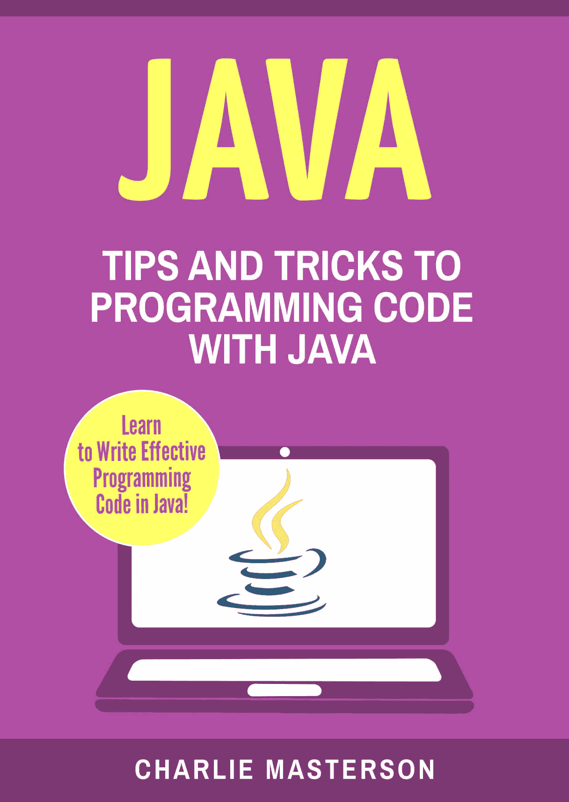

# Java 编程技巧与窍门





## 引言
恭喜你下载《Java：使用 Java 编程的技巧与策略》，感谢你的支持。

接下来的章节将讨论你如何使用 Java，以及你能够使用哪些技巧和策略来进一步丰富你对 Java 的认知。

本书旨在帮助你超越最基础的知识，找到更简单的方法来使用 Java，使其为你带来收益。

市场上有很多关于这个主题的书，再次感谢你选择这一本！我们已尽最大努力确保它包含尽可能有用的信息，因此请尽享！

## 第 1 章：独立实现中的 Hibernate（休眠）
在开始开发项目之前，你需要的某种能够与你输入程序中的数据良好配合的策略。

无论你正在从事什么项目，这都是必须发生的，以便让你知道该去何处，而不是尝试随心所欲并可能搞乱你正尝试做的事情。不仅如此，你将能够使用一个可靠的框架，并在使用的过程中不断改进你的项目。

然而，如果你使用一个没有结构化且无法控制的框架，你将不得不不断修复你的项目，并花费资金尝试妥善维护，以防它更改你的代码并搞乱你的整个项目。

基本上，确保你决定使用的框架能够确保你的项目受到保护，并拥有调试项目所需的适当工具。

`hibernate-validator` 是一个开源项目，在演示关键功能或编写有效规则方面将大有帮助。

### Hibernate Validator
`hibernate` 的验证器将是一个坚实构建的基础，但它允许你为 `Java EE` 和 `SE` 编写灵活且轻量级的代码。验证器可以帮助处理在使用 `Java` 时使用的不同框架，你也可以使用独立运行的框架。

`Java SE` 独立程序将成为服务器端更复杂异构应用的非常重要的部分。

为了能够使用验证器构建一个独立的组件，你希望确保电脑上安装了六或更高版本的 `JDK`。

拥有此版本将使能够通过下载五版本的 `hibernate` 二进制分发包来使用 `5.0.3` 版本的验证器。你的目录将包含所有所需的二进制文件，以确保你能够构建独立的实现。

第一个示例将向你展示 `ant` 构建的脚本如何在 manifest（清单）部分包含独立实现所需的依赖。该部分将用于你所编写的代码之外的元数据。由于使用了 `ant` 构建，你将通过 manifest 文件的头部 `class-path` 获取所有依赖于 `validator` 的 JAR 包。

#### 示例：带有 ant 构建的 manifest 章节
```xml
<manifest>
<Attribute name="Manifest-Version" value="I made this"/>
<Attribute name="Main-Class" value="com.utility"/>
<Attribute name="Class-Path" value="hibernate-validator-5.0.3.jar;jakarta.validation-api.1.0.jar;javax.validation-api.2.0.jar;glass.expression-3.0.Final.jar;jboss-logging-3.3.Final.jar;hibernate-core-5.2.Final.jar;hibernate-commons-5.2.Final.jar;hibernate-entity-5.2.Final.jar;hibernate-jdbc-5.2.Final.jar;hibernate-validator-5.2.Final.jar;hibernate-metadata-5.2.Final.jar;hibernate-query-5.2.Final.jar;hibernate-core-5.2.Final.jar;hibernate-integration-5.2.Final.jar;hibernate-jpa-5.2.Final.jar;hibernate-tools-5.2.Final.jar;hibernate-validator-5.2.Final.jar;hibernate-bytecode-5.2.Final.jar;hibernate-common-5.2.Final.jar;hibernate-entity-5.2.Final.jar;hibernate-metadata-5.2.Final.jar;hibernate-query-5.2.Final.jar;hibernate-tools-5.2.Final.jar;hibernate-validator-5.2.Final.jar;hibernate-xml-5.2.Final.jar;hibernate-jpamodel-5.2.Final.jar;hibernate-collection-5.2.Final.jar;hibernate-common-5.2.Final.jar;hibernate-core-5.2.Final.jar;hibernate-tools-5.2.Final.jar;hibernate-validator-5.2.Final.jar"/>
</manifest>
```
```xml
<metadata-directory>
-INF/persistence.xml
com/example/
</metadata-directory>
```

#### 约束的声明式注解
使用五版本的 `hibernate validator`，你将获得一个针对 `JSR` 验证 `1.1` 的实现。声明式注解和约束的定义将为更新后的 验证框架提供两个亮点。

当你查看通过声明式语法创建的验证规则时，将提高你代码的可读性。

#### 示例：声明式注解
```java
Open class place {
    @NotNull
    String nameofwhiveshere;

    @Pattern(regexp = "^[0-9]{5} [A-Za-z ]+ [0-9]{5}(?:-[0-9]{4})?$", message = "this is not the correct address for this person.")
    String codeforcity;

    @Pattern(regexp = "^(FH|ME|EL|EJ|AL|EE|ME|DI|AO|EM |NE|OI|LA)$", message = "this is not the correct city for this zip code")
    String zipcode;
}
```
验证方法将根据之前定义的条件具有相应的条件。声明式样式将消除在分析不同状态转换的条件时，对执行模型的必要需求。

约束将适用于位于 `@valid` 注解下的对象。


# 互联网上使用 Java 客户端 SharePoint 服务

在本章中，你将学习如何使用 Java 客户端对 SharePoint 文档进行 CRUD（增删改查）操作。重点将是你可以与 Microsoft 配合使用的复制和列表服务中的相关 Web 服务。

CRUD 服务也可以用于 `CAML`，它全称为“协作应用程序标记语言”（Collaborative Application Markup Language）。它基于 XML，将利用与复制和列表时使用的不同方法。

此外，你将能够构建一个 `CAML` 结构，该结构能够传递为代码中对象分配属性设置的各种条件。

## 背景

当你处理可能以不同形式存在的大量数据，你可以在复合文件中查看这些数据，以便做出任何所需的决策。在此类环境中，会发生不同种类的监控。

审计（Audit）将确保你正在处理的数据处于持续状态，然后可以将这些报告发送给需要它们的人员，以便将其保存到 SharePoint 中。

但是，你将使用的引擎需要一个输出写入器概念，以帮助设置在 SharePoint 中的写入。这有助于数据库和 `SMTP` 服务器中发生的写入操作，从而避免需要手动完成所有工作。

## 与 SharePoint 通信

当你使用 SharePoint 时，你将为你需要达到的解决方案编写自己的代码。这些代码将保存到 Microsoft SharePoint 网站上，这些代码也是生成的。

由于你有两个服务与 Microsoft 配合使用，因此你将访问通过 SharePoint 提供的不同服务。它们将通过两个不同的位置进行通信。

位置一为：`https://server/site/_vti_bin/Lists.asmx`

第二个位置：`https://server/site/_vti_bin/Copy.asmx`

## 生成 Web 服务包

为了生成你将使用的 Web 服务包，你将使用 `wsimport` 函数，你可以在查看 Java 安装路径时在 `bin` 目录下找到它。这是基于你安装了 Java 1.6 版本的假设。

SharePoint 将在 `HTTPS` 上运行，由于你使用的两个不同的 URL，当你查看正在使用的服务器时，可能会导致 `wsimport` 遇到一些问题。

在这种情况下，你将得到一个类似下面的错误。

```
[ERROR] bright. Protected.validator.validatorException: XPIK follow building untrue. Bright.procted.offered.certified.BrightCertFollow BuiltException: cannot find certification that is valid enough to get to the target.
```

此错误发生是因为你使用的文件没有站点运行所需的适当证书。解决此问题的方法是本地下载 `WSDL` 文件。

### 示例：复制服务代码

```
C : \ parma > "% JAVA_NATIONAL% \ nib \ swimport “ -e . -a come.microsoft. schemas. Sharpoint. Clean – hold -addmore -Anothing Copy. Swld
```

解析 `DLSW`

```
[ALERT] CLEAN opening “copyclean91” : please us a different holding than this Section 34 of file : / C: / parma/ Copy/ swdl
```

代码正在创建

### 示例二：列表服务代码

```
C : \ parma > "% JAVA_NATIONAL% \ nib \ swimport “ -e . -a come.microsoft. schemas. Sharpoint. Clean – hold -addmore -Anothing list. Swld
```

解析 `DLSW`

```
[ALERT] CLEAN opening “listclean91” : please us a different holding than this Section 34 of file : / C: / parma/ list/ swdl
```

代码正在创建

代码创建后，可以将其添加到你制作的解决方案中并使用。编译选项可以更改为不同的命令。然而，这样做将在你的源码内部以不同的方式创建类文件，同时允许 `Eclipse` 在我们已经编写出源码的情况下对其进行编译。

## 安全

为了让 SharePoint 按照你的要求运行，你需要更改你的流程以引入 `Axis2`。`Axis2` 会产生一些问题，但你可以通过结合 `JCIFS` 和 `Axis2` 来克服这些。不过，你可能认为这有些过度了，但它会在实现你目标的同时，让完成你想要的操作变得更容易。

如果你使用的网站拥有 `cacerts` 文件并已更新到其所在位置，只要站点的证书也是最新的，你就可以使用它。

```
ajave.web.lss.trustbought – 你将使用此更新你正在使用的文件。
```

# 第 3 章：使用 Apache Camel 进行 SOA 集成

`Apache Camel` 是一种面向你运行的程序架构的集成服务。`Camel` 允许你配置集成，使其适用于 Web 服务，例如消息转换、路由和异常处理，而无需使用过多的 `Java` 代码。

`Java` 中的集成主要用于能够快速连接端点并确保高效且易于维护的项目。

当你查看端点的开发时，集成将是你必须面对的挑战。然而，通过使用 `Apache Camel` 框架可以使其变得更容易。

`API` 和 `Camel` 的不同组件在企业集成模式（简称 `EIPs`）方面会被广泛认可。`EIPs` 让处理 Web 服务集成所需的任务变得简单。

## 企业级集成示例

想象为一家努力让客户更方便订座的大航空公司工作。现在实现此点的最简单的方法是在线。在创建服务时，它将比较多家航空公司及其价格，以便客户在想要旅行时获得最佳价格。

将包含多个 Web 服务在其中，因为你所工作的航空公司必须从竞争对手的网站获取价格，以便提供给客户。

你将根据客户正在寻找的航空体验制作报价列表。客户使用的门户将是他们量身定制的，并提供从目的地到最佳票价的一切所需。


Apache Camel 将生成基于 Java 的 DSL 代码，以便它能够按照预期的方式对集成层进行路由和配置。

继续使用我们的航空公司示例，你将通过门户看到你的客户将发送一个请求，请求中包含起始位置和他们偏好使用的航空公司。从那里开始，你在网站上编写的代码将返回他们正在寻找的航空公司和目的地信息，以便他们可以比较价格和航空公司。

如果他们已经决定了想使用哪家航空公司，他们将使用预订服务来接受根据他们输入的偏好所发送给他们的报价。

需要为这些处理器（processors）编写 Java 代码，以确保客户所经过的路由不会受到网站的干扰。

#### 术语

Apache Camel 中的 `route`（路由）将是一系列处理器链，消息在两个点之间通过该链发送。首选的 `route` 将运行于 `endpoints`（端点）之间。消息将保存在在一个称为 `exchange`（交换）的组件中。

Camel 将消息从点 A 移动到点 B 所需的环境是 `Camel Context`（Camel 上下文）。

### Camel SOA 组件

- **CXF 端点**：`Apache CXF` 将用于 Web 服务及其实现。在配置正在使用的 Web 服务时将使用 `CXF` 组件，并帮助确定它们将采取哪条 `route`。
- **Camel Bean**：使用 `JavaBeans` 的组件。在设置需要遵循某些步骤的自定义进程时，将使用 `bean`。
- **Camel Direct**：两条路由将通过同步调用连接起来。
- **Camel XSLT**：`XSLT` 表将通过 Spring 资源加载技术加载。该组件将用于处理来自 Web 服务器的请求和响应转换。
- **Camel Multicast EIP**：该 `EIP` 模式将消息发送到需要处理的不同位置。从这里你可以使用多播（multicast）来发送请求。
- **Camel Aggregator EIP**：该模式将具有相似消息的不同结果合并为一条消息并发送给用户。`aggregator`（聚合器）将合并响应，以至于客户端不会信息过载。
- **Camel WireTap EIP**：通过 `wiretap`（跳线），你可以在消息通过系统到达用户时对其进行检查。`EIP` 将在合适的点记录消息。

# Web 接口

在查看源代码时，`WSDL` 文件将与 Web 服务接口中的 `XML` 架构绑定。

你将使用八个步骤来实现 SOA 层级。

### 第一步：为 WSDL 生成 Java 类型

你将使用与 `Maven` 配合工作的 `cxf codegen plugin` 以及 `wsdl2java`，这将辅助生成你在源代码中发现的不同类型 `WSDL` 所需的 Java 代码。

为了执行此代码，你将使用命令：`mvn generate sources code`。

从这里开始 `CSF` 将生成所需的代码，并将构件（artifact）放置在它所属的正确目录。从那里，可以使用 `Maven` 构建你将使用的构件。

#### 示例

```xml
<plugin>
    <id for group>gor. Camel.Cxf</id for group>
    <id for the object>cxf codegen plugin</id>
    <version>2.8.0</version>
    <carry out the code>
        <number>create source</number>
        <series>create source</series>
        <configure>
            <origin>${bottomry}/cor/ primary / java</origin>
            <Wsdlchange>
                // reservation made by user
                <wsdl>${bottomry}/cor/primary/resource/wsdl/reservation</wsdl>
            </Wsdlchange>
            <wsdlchange>
                //reservation made on airline D
                <wsdl>${bottomry}/cor/primary/resource/wsdl/reservation on airline d.wsdl</wsdl>
            </wsdlchange>
            <wsdlchange>
                // reservation by airline F
                <wsdl>${bottomry}/cor/primary/resources/wsdl/reservation on airline f wsdl</wsdl>
            </wsdlchange>
        </configure>
        <achieve>
            <achieve wsdl2java</achieve>
        </achieve>
    </carry out the code>
</plugin>
```

### 第二步：配置 Camel CXF 端点

在这里，你需要为你的代码定义 `endpoints`。这些 `endpoints` 将用于你用于 `Camel` 的 `routes` 中。

但请记住，你正在使用的接口将由你已经部署的 `endpoint` 生成。

`Camel cxf end point` 将是你代码中的默认 `endpoint`，以便你可以获取原始形式的 `XML`。你需要启用验证，以便验证通过 `WSDL` 中的 `XSD` 进的请求，从而减少需要投入到验证中的时间。

#### 示例

```xml
// end point for the reservation made on airline D
<cxf: endpoint number=endpointairlineD
    URL="http:// nationalhost: 9898/ reservation made" 
    servicegenre="mor. Small. Rira. Recall. airline.
"
    Wchangechange/reservation on. d">
    <cxf: ability>
        <enter key="informationinput" number="pay"/>
    </cxf: ability>
</cxf:end>

// end point for the reservation made on airline F
<cxf: endpoint number=endpointairlineF
    URL="http:// nationalhost: 9898/ reservation made" 
    servicegenre="mor. Small. Rira. Recall. airlineF="
    reservation f. f">
    <cxf: ability>
        <enter key="informationinput" number="pay"/>
    </cxf: ability>
</cxf:end>
```


Appender（日志输出器）具有级别，你将在程序的独立维度上看到它的三个方面：

- Level（级别）：程序所记录的事件。
- Appender（日志输出器）：被显示或存储的数据。
- Layout（布局）：数据向用户呈现的方式。

你必须整体考虑这些方面，而不是单独看，而且它们必须存在于一个三维空间中。每个方面的点都将成为该空间的一部分，按照预期的方式配置系统。

#### 示例：

```java
// logging started!

Logging logger = logging . the logging aspect (“No”) ;

Appender appended = old the appender for the system() ;

Layout display = old gor camel log4j CTCTdisplay()

Appender.Howdisplayed (displayed) ;

Logger. Showappender (appender) ;

Logger. Howhigh (information on how high it is) ;

// logging started!

Logger. Alert (“ You shall not pass!”) ;
```

示例中的代码是正交代码（orthogonal code），它允许你在不导致代码崩溃的情况下更改切面的布局、Appender 和级别，因此代码能够保持功能性。

正交代码的设计会在脚本上留出足够的空间使其有效，从而允许你配置系统。

正交性是一个强大的概念，它能建立一个简单易懂的心模型，即使你将其用于更复杂的应用程序。

如果你想找一个使用正交性的非常有用的用例，那么你可以在测试代码的功能和级别时使用它，以便修复那些无法与 Appender 或布局正常工作的代码。

正交性的使用可以确保你的代码不会出现意外情况，并且它们在每个级别上的工作方式都相同。当你使用 `log4j` 以及其他第三方设计的工具和实用程序时，这一点是成立的。

得益于正交性的复杂性，程序的软件在某种程度上就像你在处理几何问题时使用的维度一样。

## 代码及其面向正交性的设计

现在你已经知道什么是正交性了，你需要知道如何设计和编写它，以便在编程中使用它。其核心点在于你需要使用抽象概念。

你在正交系统中看到的每个维度对于每个程序都有一个切面。某些维度具有类型，这些类型是使用抽象类型最常见的解决方案之一。每个类型都将有一个维度，代表在该维度内部提供的点。抽象类型不会直接绑定到实例化或具体的类上。

有些类是你不需要使用的。例如，当你使用的类型仅仅是一个标记（markup）而没有显示任何封装行为时，你不需要使用具体类。

然而，你只需要查看类型判断它是否代表维度本身，以及它是否为一组固定的实例预定义。它甚至对于静态变量也有效。

处理正交性时，需要记住的一个通用规则是：尽量避免引用具体类型，因为这些类型代表了你所用程序的不同切面。遵循这一规则将允许你编写更通用的代码，这些代码可以在你放入任何实例中运行。只要属性是定义维度时使用的接口的一部分，代码就可以引用这些属性。

例如，如果你查看 `layout` 的切面类型，它定义了一个不同的方法，那么该方法将给你一个 `Boolean` 值，指示该布局是否有能力带堆栈跟踪（stack traces）渲染。

在 Appender 使用布局时，对你正在使用的方法编写条件代码是可以的。这样，文件的 Appender 就可以打印使用通常无法处理异常的布局的堆栈跟踪异常。

布局的实现将涉及到你在记录事件时所使用的特定级别。例如，如果你想在使用 `HTML` 的布局中记录 `error` 级别，你可以将日志消息封装在标签中。但是，错误将通过代表维度来定义你正在工作的级别。

仍然可以根据你与其他维度配合使用的实现类来避免引用。因此，如果你使用 `layout`，就不需要知道你正在使用的是哪种布局。

## 违反正交性

`Log4j` 是正交性的极佳示例之一。但 `log4j` 的某些部分会违背正交性规则。有一个 Appender 会记录关系型数据库。由于数据库存在规模和流行度问题，这使得通过 `SQL` 搜索日志变得更容易。有一个 Appender 是为了解决记录关系型数据库时会遇到的问题，通过将记录的事件转换为 `SQL` 的 `insert` 语句。因此，`pattern layout`（模式布局）的问题得到了解决。

`patternlayout` 将具有一个模板，为用户提供灵活性来配置每次记录事件时创建的字符串。模板将定义字符串以及其中包含的所有变量。

#### 示例：

```text
Pattern for the string =
“%d [ @ %a  {ss:mm:HH yyy} MM dd} no %l]%j”
```

```java
Layout display =
Old gor. Log4j layout for the pattern (pattern) ;

Appender. Layout setup (display) ;
```

Appender 将使用模式的布局。

#### 示例：

```java
National untrue holdSql (string d) {
Statement for sql = d ;
if (display() == false) {
This display (old layout for the pattern (d)) ;
}
else {
(( layout for the pattern) pattern()) (d) ;
}
```

示例代码中构建了一个隐含假设，定义了 Appender。在观察正交代码时，这指向了三维立方体的许多不同方面，显示了在有效系统配置中的 `patternlayout`。任何对 `SQL` 的尝试都必须使用不同的布局，以便产生不同的类类型转换异常。如果这还不能说服你，另一个原因是 Appender 的设计非常值得商榷。当你使用模式布局时，模板将通过跳过。但这并不总是好事，因为 `JDBC` 将编译所有之前准备的语句，这最终会导致难以修复的性能问题。然而，恰当的方法是通过重写来控制你的布局的行为。

#### 示例：

```java
National open display set (layout display) {
if ( display instanceof layout pattern) {
Superb layout setup (display) ;
}
else {
Set a new argument that is not valid (“ layout is not going to work”) ;
}
}
```

遗憾的是，你也会在这个示例中发现问题。存在一个运行时异常会导致使用该方法的应用程序准备准备捕获错误。本质上，你将使用布局方法，但它没有提供与之匹配的运行时异常，保证性被削弱了。


如果你查看已设置的先决条件，那么布局（layout）需要更强的先决条件，以便方法可以覆盖它。如果你不这样做，你将违反本为该原则设计的面向对象核心。

## 变通

由于修复 `appender` 并没有真正简单的解决方案，你最终会发现自己必须处理更深层次的问题。正如此，当你为核心设计抽象类型时，你将使用某种程度的抽象级别，而这些类型最终需要进行微调。

核心方法由-layout 及其格式定义。该方法最终将向你返回一个字符串，该字符串将包含基于元组（tuples）而不是字符串的数据库。

你可以使用的解决方案是基于一种更复杂的返回格式的数据结构。在任何希望返回字符串的情况下，你都需要考虑开销。此外，在处理用于日志框架的垃圾回收性能之前，将使用在创建的中间对象。

当你有多个复杂的返回类型时，也会让 `log4j` 变得更难以理解。最终目标是让一切尽可能易懂。

另一种解决方案是使用分层抽象，并涉及使用两个最终扩展 `appender` 的抽象类型。你应该使用的唯一 `appender` 是 `JDBC appender`，因为大多数其他 appenders 都有必须实现的实现，以便以它们所需的方式工作。

你通过这种方法看到的最大缺点是复杂性将再次增加。不仅如此，-appender 的开发者需要确保在为他们将使用的抽象级别做出所需的决策之前，他们已经拥有了所有信息。

# 第 5 章：可以在多个环境中使用的 JavaFX 应用程序

当你配合 `SDK` 使用 `JavaFX` 版本 `2.0.2` 时，你被允许在多个环境中部署应用程序，还可以通过 `Java web start` 或嵌入的网页运行独立应用程序。

### 准备 JPadFX 部署

你将需要使用 `JPadFX` 应用程序的一些源文件。

在将所有文件都放入你正在使用的目录之后，你就可以执行放入应用程序中的命令了。

示例：

```
Javae – pc “C: \ project source \ oracle \ javafx 2.0 DKS\ tr\ library\ trxfj. Glass” ; . -q in jpadfx. Java
```

请注意，只有当你的计算机上安装了 `2.0.2` 版本时，此方法才能生效。

### 将 JPadFx 部署为独立应用程序

使用你下载到计算机上的版本，你将有一个用于插入命令的工具，以便几乎自动地部署应用程序。当你查看时，会使用一个完全不同的目录用于此版本的程序。

在源文件编译后，你可以使用 `javafxpackager` 将类文件与启动器一起处理到一个新文件中。

示例：

```
javafxpackager makeglass applicationtype jpadfx directory crs in directory outside in inside file jpadfx. Glass. D
```

#### 术语

- `makeglass`：将告诉程序在该目录中创建一个新文件。
- `Applicationtype`：主类将与启动器一起标识。
- `Dircrs`：将识别目录。
- `In directory`：将识别文件名。
- `-d`：将告诉你输出是什么，以及错误信息将显示在哪里。

如果命令执行成功，你将引入一个新的函数。处理此问题最简单的方法是使用 `jar` 工具。但，只有当当前目录具有适当工具以及与之绑定的子目录时，命令才能执行并存储在目录中。

示例：

```
Glass fu
In \ jpadfx. Glass icon.png
```

在此时，将运行 `Jpadfx` 独立程序，以便你可以测试文件的真实性。但你需要切换目录，进入一个具有需要执行的正确命令的新目录。

示例：

```
Java -pc “C: \ project source\ oracle\ javafx 2.0 DKS\ tr \ library \ jfxrt. Glass” ; . -glass jpadfx.glass
```

此命令将把类路径添加到正确的文件中，以便正确加载运行时环境。

### 在网页中部署 JPadFX

可以使用 `javafxpackager` 创建 HTML 页面并配合正确的文件对其进行部署，以便在将应用程序嵌入网页中或使用 `Java web start` 运行时能够处理各种场景。

示例：

```
javafxpackager -execute -in directory in -in file jpadfx -how wide 500 -how tall 500 – directory crs in crs source jpadfx.glass -class of application jpadfx -title “jpad fx” -name “jpadfx is equal to jpad” -manager “Timothy Mason” – d
```

#### 术语解释：

- `Execute`：打包器将带有 HTML 和 JNLP 文件执行。
- `Directory in`：标识文件存储在哪个目录。
- `Infile`：将识别文件名。
- `How wide`：页面的宽度。
- `How tall`：页面的高度。
- `Directory crs`：文件来源。
- `Crs source`：标识该文件。

# 第 6 章：控制 Java 的流

你在此之前所做的任何编程将被被称为顺序编程，基本上意味着代码是从上到下读取的，每一行都按照其编写的方式被读取。然而，并非所有程序都是这样工作的。某些代码必须在满足特定条件下才运行。对于代码，你可能希望客户达到某个年龄。这将是你通过条件逻辑控制程序运行流的地方。条件语句大多使用 `if` 单词，但也可以使用其他单词来创建条件语句。

### If 语句

每当某些情况发生时，代码就会执行，而不是等待某些情况，这在编程中非常常见，因此创建了 if 语句。if 语句看起来如下：

```
if ( statement ) {
}
```

`if` 单词将在你的条件放在一组括号之前（小写）。大括号将用于划分代码块。只有在满足条件时，此代码才会执行。

示例：

```
if( client < 18) {
}
```

此条件表示如果客户小于 `18`。与其全部写出来，将使用简写，以便代码块更短且更易读。

示例：

```
if( client < 18) {
// 显示消息
}
```

因此，如果客户大于 `18`，两组大括号中的代码将被跳过，而 Java 将按照其预期的方式进行。在大括号中间的任何内容只有在满足条件时才会执行。

另一种简写概念是让三角形右右，这意味着大于。

示例：

```
if( client > 18) {
// 显示消息
}
```

### If … else

与其使用 if 语句，可以使用 if then 语句。

```
if( condition_to_test) {
}
else {
}
```


第一行仍将以 `if` 开头，随后紧跟条件。大括号将划分代码的不同部分。

第二种选择将位于 `else` 之后，并带有它自己的大括号。

你只有两种选择，要么你的客户小于 18 岁，要么大于 18 岁。你的代码必须匹配你希望发生的结果。

### If … else if

可以同时测试两个以上的条件。如果你想测试某个年龄范围，你将使用 `if else if` 语句。

语法如下：

```
If(condition_one) {

}

Else if ( condition_two ) {

}

Else {

}
```

代码中最新的部分是 `else if ( condition_two) { }`。

当 `if` 语句被发送时，紧接着将是圆括号。第二个条件位于两个新括号之间，但它不会被第一个条件捕获。

每一个 `if else if` 语句仍然会用大括号隔离开，且每个语句都有它自己的大括号。如果你漏掉其中一个，你将收到错误消息。

你需要使用的条件运算符有：

- 大于 (`>`)
- 小于 (`<`)
- 大于或等于 (`>=`)
- 小于或等于 (`<=`)
- 与 (`&&`)
- 或 (`||`)
- 等于 (`==`)
- 非 (`!`)

两个和符号符号（&）用于同时测试多个条件。

#### 示例：

```
else if ( client > 18 && client < 40)
```

通过这段代码，你需要具备了解客户年龄的知识，并查看他们是否大于 18 岁但小于 40 岁。

你只是在尝试查看客户输入的变量 `client` 中的内容。客户必须大于 18 岁但小于 40 岁。由于使用了 `AND` 运算符，你的客户必须同时满足这两个条件。

### 嵌套 if

`if` 语句可以像 `if else` 和 `if else if` 语句一样嵌套。嵌套的 `if` 语句是将一个 `if` 语句放在另一个 `if` 语句之中。

#### 示例：

```
if( client < 19) {
  system.out.println ( “ 18 or younger”) ;
}
```

为了检查你的客户是否超过十六岁，必须在你已经创建的 `if` 语句内部放置另一个 `if` 语句。

第一个 `if` 语句将捕获 `client` 小于 19 岁的情况，第二个语句将缩小范围，使他们大于 16 岁。当你想要打印不同的消息时，可以使用 `if else` 语句。

#### 示例：

```
if( client < 20) {
  if( client > 20 && client < 23 ) {
    System.out.println( “You are 21 or 22”) ;
  }
  else {
    System.out.println (“ 22 or younger”) ;
  }
}
```

代码中的大括号必须精确，否则程序将无法运行。嵌套 `if` 语句学习起来比较复杂，但可以逐步掌握。

### 布尔值

布尔值只有真（true）或假（false）、1 或 0，甚至是是或否。Java 有一个专门用于布尔值的变量：

```
Boolean client = true ;
```

你不需要输入 `int`、`string` 或 `double`，你需要使用小写的 `b` 来输入 `Boolean`。变量名将在赋值为 `true` 或 `false` 值之后出现。

赋值使用一个等号。然而，如果你要评估变量 `client` 且它有一个值，你就需要使用两个等号。

#### 示例：

```
Boolean client = true;
if ( client == true) {
  System.out.println (“it’s true”) ;
}
else {
  System.out.println(“it’s false”) ;
}
```

`if` 语句将检查客户输入的变量是否为 `true`。`else` 将检查它是否为 `false`。

当某结果不是真时，你不需要说 `else if ( client == false)`，因为它显然是假的。

由于布尔值只有两种选择，所以你会使用 `else`。

另一个用于条件的运算符是 `NOT` 运算符，它用于布尔值。

#### 示例：

```
Boolean client = true;
if( !client) {
  System.out.println (“it’s false”) ;
}
else {
  System.out.println (“it’s true”) ;
}
```

这与任何用于布尔值的其他代码相同，除了 `if ( !client) {` 语句外。

`NOT` 运算符位于 `client` 变量之前。该运算符使用单个感叹号，但它位于待测试变量之前。

代码将进行取反测试，这意味着它不是它实际所是的。

由于客户变量 `client` 已设置为 `true`，`!client` 最终将测试假值。

如果条件被设置为 `false`，那么 `NOT` 运算符将测试真值。

### 结论

再次感谢下载这本书！

我希望这本书能够帮助你获得更多 Java 编程语言的知识，并将其应用于你的编程需求中。

下一步是继续编程，随着你学习更多 Java 编程技能的主题不断进步。

最后，如果这本书带给你价值并在任何方面帮助了你，我想请你帮个忙，如果你愿意在 Amazon 上为这本书留个评价？我将不胜感激！

### 关于作者

Charlie Masterson 是一位计算机程序员和讲师，曾开发过多个应用程序和计算机程序。

作为计算机科学专业的学生，他很早就对编程感兴趣，但在学习极其复杂的主题时感到非常沮丧。

Charlie 想要一种让他轻松学习并开发编程技能的教学方法。他很快发现了一套让他学得更快更好的教学系列。

通过同样的方法，Charlie 成功学习了不同的编程语言，现在正通过写作来教授这些主题。
