# JavaScript 基础

## 前言

什么让我资格写一本关于 JavaScript 的书？

我是一个在行业工作多年的全栈 Web 开发者。“全栈”这个词简单意味着我具有将产品从概念带到完成的经验。我曾担任过独立承包商，也一路进入了企业世界。

作为一名 Web 开发者，我接触过前端和后端语言。JavaScript 作为一种前端脚本语言，已成为我最强大的武器之一。

我对 JavaScript 的经验以及对它在 Web 开发大局中地位的理解，使我具备编写这本书的独特资格。

谁应该读这本书？

这本书适用于那些对 HTML 有基础了解，但对 JavaScript 一无所知的人。本书将重点关注 JavaScript 的基础知识。对于想要学习 JavaScript 的人来说，这是一门完全独立的课程。

为什么要读这本书，而不是市面上无数的 JavaScript 书籍？

这门基础课程去掉了许多往往分散初学者学习 JavaScript 注意力的额外内容。如果你想要一门专注于消除那些更适合高级课程的复杂概念的课程，那么这本书正适合你。在本门课程结束时，你将能够编写 JavaScript 代码，但更重要的是，你将理解 JavaScript 的底层基础。最终，理解 JavaScript 基础知识将让你成为一名更好的程序员，并为你在职场开启更多机会。

## 第 1 章：JavaScript 简介

什么是 JavaScript？JavaScript 是一种可以用于制作网页交互的脚本语言。JavaScript 不是一种编程语言。编程语言是从高层人类可读语言编译成机器码的。相反，JavaScript 是由网页浏览器（如 Google Chrome、Firefox、Safari 和 Internet Explorer）解释的。因此，JavaScript 不是直接编译成计算机可以理解的代码，而是被解释的。这意味着不同的浏览器对脚本的解释方式可能与他人不同。这是 Web 开发者在尝试创建跨浏览器解决方案时面临的一个常见障碍。

JavaScript 不是浏览器解释的唯一内容。事实上，HTML 和 CSS 也会被浏览器解释。这 3 种语言被称为客户端语言。这是因为这些语言是在客户端机器上解释的，而不是在 Web 服务器上。其他语言由 Web 服务器处理；这些被称为“服务端”语言。事实上，服务端语言在服务器向浏览器“提供”网页之前就已经被处理了，而客户端脚本在浏览器接收到所提供的网页之后才开始被处理。这意味着服务器不会因为执行 JavaScript 命令而变慢。JavaScript 是为网站添加逻辑的极佳方法，且不会占用服务器资源。

JavaScript 使用的语法与你听过的其他语言相似，如 C#、C++ 和 Java。尽管语法相似，但我想指出 JavaScript 与那些其他语言完全不同。虽然这更多是一个高级概念，但 JavaScript 被称为原型语言。对于这门基础课程来说，知道它是独特性就足够了。最终，指令以过程化形式（按顺序、一步步就进）、函数形式（在函数内部封装可重用的代码段）或两者的混合形式编写。我们将在稍后的基础知识部分中详细讨论这一点。

## JavaScript 代码编辑器

你不需要特殊的软件来处理 JavaScript。事实上，你可以在任何标准的记事本或文字处理软件中编写 JavaScript，其中许多软件已预装在你的电脑上。虽然这些程序对于编写 JavaScript 足够了，但也有更健壮的 Web 开发软件可以更好地用于编写 JavaScript 代码。其中许多是完全免费提供的。其中之一是 Notepad++，它是一个免费的 Web 开发程序，提供了诸如语法高亮、允许你录制动作并在按键时重放动作的宏，甚至还有用于增加可扩展性的第三方插件。

Notepad++ 是我在获取代码示例截图时选择使用的程序。这并不意味着它是可用最好的 Web 开发软件。我选择它是因为它是免费的、非常简单且学习曲线低、因为没有冗余的胡哨功能而运行速度快、并且可以通过插件和广泛的偏好进行自定义。我选择该软件的另一个非常重要的原因是它是开源的，这意味着它有一个开发者社区不断致力于改进它。我个人从哲学立场上更倾向于使用开源软件。尽管如此，Notepad++ 的 UI 设计并不尽完美，看起来非常像是 20 年前构建的。许多优秀的开发者选择使用不同的软件，仅仅是因为 Notepad++ 看起来太丑了。没有人希望自己落后于时代。

Notepad++ 仅适用于 Windows 操作系统，这意味着 Web 开发社区的大一部分将无法使用该软件。由于这个原因，我想提到行业内常用的其他 Web 开发程序。Atom 是另一个具有现代 UI 的免费开源代码编辑器。它支持所有主要的操作系统。Atom 是一个非常棒的代码编辑器。你可能会问我为什么不使用 Atom 而用 Notepad++。主要原因是这门基础课程，专注于教授 JavaScript 基础，而不会让我的读者被大量的额外功能所困扰。这意味着我认为 Atom 中预加载的所有酷炫的现代功能在这门基础课程期间都是一种干扰。

另外一种在行业内通用的非常常见的软件是 Adobe Dreamweaver。这既不是一个免费程序，也不是开源的。它确实提供了许多工具来辅助 Web 开发，其中包含一个更视觉化的编码环境，具有拖放功能。虽然我理解为什么许多人倾向于使用该软件，但我发现这个程序运行非常慢且很臃肿。Dreamweaver 生成的代码往往也很臃肿，而且代码格式并不总是符合行业标准。我不推荐 Dreamweaver。

重要的是，整合了更健壮的团队开发方法（如敏捷开发）的企业级组织会使用高级开发软件。在这种情况下，最常用的软件是 Visual Studio，它既不是免费的也不是开源的。在行业常用的所有付费编码环境中，它是最强大的。

无论你使用哪种代码编辑器，JavaScript 都是一样的。我鼓励你研究为你提供的许多选择，并选择最符合你开发者需求的代码编辑器。没有正确或错误之分。JavaScript 可以在这些编辑器中编写。一旦你做出了决定，你就需要下载并安装你的编辑器。

## 客户端 Web 开发工作流

现在你已经有了代码编辑器，我想讨论一下在学习书中示例时你将经历的基础工作流。JavaScript 可以直接从你的本地机器运行。嗯，我的意思是，大多数 JavaScript 可以在本地运行。你可能会问自己，我说“从本地机器运行”是什么意思？你要知道，Web 开发要求你最终将代码部署到 Web 服务器上。这个“服务器”是一台供互联网上的其他计算机访问的计算机。Web 服务器接收来自外部计算机的请求。然后，服务器通过提供这些网页来响应这些请求。这就是为什么它们被称为服务器。

你可以把它们想象成餐厅里的服务员。客人坐下，看菜单。当他们准备好时，他们会从菜单上点某些东西。服务员接收请求，然后去厨房收集客人请求的物品。一旦服务员收集了所有请求的项目，他们就会将其提供给客人。同样，Web 服务器接收来自客人的请求，然后收集请求的项目并提供给客人。这是对 Web 用户如何请求网页以及 Web 服务器如何通过提供请求页面做出响应的简化解释。

正如我之前提到的，JavaScript 可以在本地运行。这意味着你不需要将代码放在 Web 服务器上就能看到它。虽然你可以在本地查看它，但互联网上的其他人都看不到它。出于这个原因，在本地工作是复习的最佳方式之一，因为它让你在代码部署到 Web 服务器之前有机会检查你的代码。

最终，为了让其他人享受你出色的 JavaScript，你的代码需要部署到 Web 服务器上。然而，在不涉及如何将代码部署到 Web 服务器的细节的情况下，就可以说明 JavaScript 的基本概念。由于 Web 部署是一个更高级的话题，它超出了本基础课程的范围。为了本基础课程的目的，本课程中的示例已经优化为可以在本地运行。

书中的 JavaScript 代码是内联编写的，也就是说，它们与 HTML 标记在同一个文件中。这绝对不是最佳实践，但它是说明 JavaScript 基础最简单的方法。我不建议内联编码。一旦你掌握了 JavaScript 的基本概念，我建议你研究 JavaScript 的最佳实践。这包括将你的 JavaScript 代码写在外部的 `.js` 文件。这允许你保持静态 HTML 标记不受动态代码的干扰。将它们分离是非常有利的。虽然事实如此，但它只是可能让刚刚开始 JavaScript 旅程的人分心的另一件事。出于这个原因，我决定违背传统和常识，以便更好地教授 JavaScript 基础。

## 你的第一个 JavaScript 网页

现在你已经对 JavaScript 是什么有了非常基本的了解，让我们制作我们的第一个网页。从创建一个空白文本文件开始，使用 `.html` 扩展而不是 `.txt` 扩展。在 html 页面中输入以下内容。


这是基本的 HTML 5 结构。接下来，在页面第 7 行的 body 部分添加一个 script 标签。这将是我们编写 JavaScript 的容器。


在第 7 行的起始和结束 script 标签之间，我们将开始编写脚本。按照传统，初学者被指示编写的第一个程序是 hello world 程序（你好世界）。这个程序简单地在屏幕上打印“Hello World”短语。在 JavaScript 中，可以通过多种方式实现，但简单的方法是使用 JavaScript 中一个名为 `alert` 的内置函数。该函数有 1 个参数，它会创建一个弹出警告窗口并在弹窗中显示传递参数的内容。让我们来看 hello world 脚本（图 3）。


编写你的第一个 JavaScript 网页只需要这些。如果你用 html 扩展名保存此文件并在浏览器中运行它，你会注意到弹出一个写有“Hello World”的窗口（图 4）。要运行它，你可以双击 html 文件，或者将此文件拖放到已打开的网页浏览器中。


## 语法

如果你在谷歌上搜索“syntax”（语法）一词，你会得到以下快速定义。


最终，语法描述了计算机如何形成一个指令。让我们看看第 8 行 script 标签之间的。


### 良好的语句

如果我们把分号的位置移动到函数名和参数列表之间，你认为会发生什么？这是一个很好的尝试。


如果你创建了上面的网页并在浏览器中打开它，你的浏览器将像之前那样创建弹出警告。这是因为语句不良好，因为分号位于错误的位置。如果你随机移动这个句子中的词汇，这个句子将不再具有相同的含义。事实上，这个句子可能是乱码，而且完全没有意义。一个需要记住的重要事实是，计算机并不擅长处理乱码。当人类阅读无意义的句子时，例如下面这个，他们可以跳过去：

> 乱码非常擅长不计算机的。

然而，当计算机读取乱码时，它们无法跳过这些无意义的指令。发生这种情况时，程序通常会发生错误，导致它完全停止。我们将在本课程的以后部分调试 JavaScript，但现在请尝试理解指令构建的顺序（语法）至关重要。

### 空格

JavaScript 忽略语句部分之间的空白空间。空白由空格、制表符和换行字符组成。然而，请注意引号内的空白（也称为字符串字面量）是不被忽略的。为了说明 JavaScript 如何忽略空白，让我们比较一些 JavaScript 语句。


注意第 1 行，我们有一个 hello world 脚本。我将这一行复制了 2 次并添加了一些空格。在第 2 行中，`alert` 单词与括号包裹的字符串字面量之间有空格和制表符，还有分号。在第 3 行和第 4 行，`alert` 单词与语句的其余部分之间了回车。这三个语句在 JavaScript 中是完全相同的。

## 大写敏感

JavaScript 是一种大小写敏感的语言。这意味着 JavaScript 会检测语句某部分的字母是大写还是小写。小写字母不等于大写字母，通过简单改变字母的大小写，你最终是在告诉 JavaScript 执行一个完全不同的指令。这主要影响你在 JavaScript 中命名事物的方式，也是许多程序员的噩梦。很多时候代码中的 bug 仅仅是字母的大小写错误，而且很难检测，因为我们的大脑倾向于忽略字母的大小写。

## 代码块

有时候语句需要组合在一起，例如在函数中或处理条件时。当将语句组合在一起时，它们被包裹在花括号 `{` 和 `}` 中。

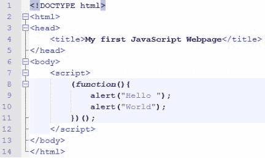

如果我们看第 8 到 11 行，可以看到我们的第一个自定义函数，它包含 2 条语句。我们还没有准备好学习函数，但注意第 9 行和第 10 行是被花括号包裹的（第 8 行结束和第 11 行开始）。这意味着语句被组合在一起。每当调用此函数时，它都会按顺序执行组中的所有语句。代码块本质上如其名，即组合在一起的代码块。

通常情况下，修复错误是程序员的生活。就像任何工艺一样，你对工具越了解，使用它们时表现就越好。这 4 个 JavaScript 语法概念对于编写无错误的代码非常有用。

## 第 3 章：语句的组成部分

JavaScript 语句有 5 个组成部分：值 (Values)、表达式 (Expressions)、运算符 (Operators)、关键字 (Keywords) 和注释 (Comments)。

### 值

JavaScript 中有两种类型的值。我们在上一节中提到了字符串字面量。字符串字面量是字面表示的字符串的值。同样，字面量值是特定数据类型的字面表示的值。所有值类型都可以用字面形式表示。值也可以存储在计算机内存中，称为变量的占位符。

在大多数编程语言（包括 JavaScript）中，你必须通过将数据与标识符关联来声明你在内存中存储数据的意图。这被称为声明变量，最终允许计算机留出预留空间作为数据的存储容器。现在需要指出的是，值在内存中以不同的数据类型表示。数据类型主要定义了一个值占用多少内存。我们稍后会详细介绍。

字面量值不能改变。数字 `7` 是一个字面数字值。它将始终是数值 `7`。它永远不会等于 `8`，也不会等于字符串值 `"seven"`。字面量通常用于设置变量的初始值，这种做法被称为初始化变量。

与字面量值不同，变量可以改变。如果我声明一个名为 `myVariable` 的变量并初始化为 `7`，我之后可以给该变量分配不同的值。让我们看看 JavaScript 中的字面量和变量看起来什么样。

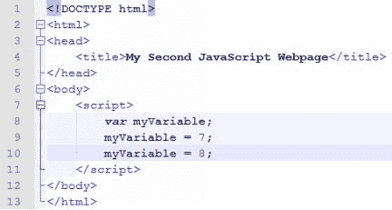

注意第 9 行，我们将 `myVariable` 的值设置为数值 `7`。紧随之后，在第 10 行中，我们将 `myVariable` 设置为 `8`。内存中存储的值初始为 `7`，但在脚本执行时将变为 `8`。

### 表达式

表达式是语句的一部分，返回一个值或评估为一个值。语句可以包含 1 个或多个表达式。表达式包含操作数和运算符。表达式是一个对操作数执行操作的简写函数。该简写包含一个左操作数、一个运算符和一个右操作数。在表达式 `A + B` 中：`A` 是左操作数，`B` 是右操作数，而 `+` 是运算符。

以下是表达式示例：

- `1 + 1` 是一个返回数值 `2` 的表达式。
- `1 > 2` 是一个评估为布尔值 `false` 的表达式。
- `"Hello " + "World"` 是一个返回字符串值 `"Hello World"` 的表达式。

### 运算符

运算符用于指示在表达式中应该执行什么操作。另一个决定执行何种操作的因素是操作数的数据类型。如果 `A` 和 `B` 都是数值，那么 `+` 运算符将表示加法操作。如果操作数 `A` 或 `B` 任意一个是字符串类型，则表示拼接操作（将多个字符串组合在一起）。关于运算符的完整列表，我建议参考 [w3schools.com](http://www.w3schools.com/js/js_operators.asp)。

### 关键字

关键字是 JavaScript 语言中具有特定含义的保留字。关键字不能用作标识符，因为它们与语言的核心元素相关。在我们之前的示例（图 1）中，我们已经使用关键字来声明在内存中存储值的意图。注意第 8 行的关键字 `var`，它是 variable 的缩写。我们使用 `var` 在 JavaScript 中声明变量。稍后我们将介绍特定的关键字，因为它们在基础阶段很有用。

### 注释

注释是 JavaScript 中不被计算机执行的文本。它们用于解释复杂的代码。在 JavaScript 中插入注释有两种方法。注释开头的双斜杠 `//` 将同一行之后的所有文本变为注释。你也可以使用 `/*` 和 `*/` 字符包裹文本，将它们之间的所有文本标记为注释。这种注释方法与第一种不同，它可以跨越行。

## 整合一切

你可能在问自己为什么要在内存中存储值。让我们来看一个更实用的脚本来说明变量的用处（图 2）


在上面的脚本中，我们声明了一个名为 `myName` 的变量。接下来我们调用函数 `prompt()`。`prompt()` 是一个内置 JavaScript 函数，会显示一个带有文本框和向用户提问弹出窗口。一旦用户在文本框中输入响应并点击“确定”按钮，用户输入的值就会返回。然后我们将变量 `myName` 分配为 `prompt()` 函数返回的值。脚本继续执行下一个语句，调用 `alert()` 函数。我们熟悉 `alert()` 函数的作用，但注意我是如何将这两个字符串值拼接（组合）在一起的。你认为 alert 框中会出现什么？

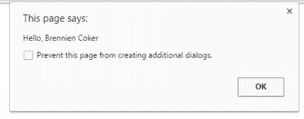

当我打开此页面并在 prompt 中填写我的名字时，它记住了输入的内容。随后，它在随后的指令中使用该值，在弹出窗口中显示欢迎消息 `"Hello, Brennien Coker"`。

我已经向你介绍了语句的所有组件。虽然这节课比之前的几节要长一点，但我相信你的大脑并没有熔化。你可以随意穿上彰显你编程实力的 T 恤。

## 第 4 章：计算机内存

在上一节课中，我们说值以不同的数据类型存储在内存中，而这决定了执行这些操作所需的内存量。让我们花点时间理解计算机如何在内存中存储值。

### 十进制

在现代，我们使用十进制来表示数值。这些数字是你日常生活中常用的数字，数字字符为：`0`、`1`、`2`、`3`、`4`、`5`、`6`、`7`、`8` 和 `9`。十进制使用的基 `10`，这意味着单个数字可以表示 10 个不同的值。

为了表示比第 10 个字符（即数字 `9`）更大的值，你需要使用 2 位数字。例如 `9 + 1 = 10`。注意数字 `10` 是由 2 个数字表示的。现在我们通常不这样看待数字。我们大多数人已经学得非常好了，以至于完全是自动的，但让我们看看十进制是如何表示这些值的。

每个数字的值是通过一个基础公式计算的，然后最后将这些值相加。首先，我们将每个数字看作是一个从右向左书写的列表。我们需要的是该数字在列表中的位置。要计算数字的位置，我们从最右边的数字开始数到该数字，然后减去 `1`。我们这样做是因为我们被教从数字 `1` 开始计数，但第一个数字字符实际上是 `0`。这给了我们数字的实际位置。然后我们将基数（即 `10`）升到数字位置的幂。这得到了数字的基数。接下来，我们将数字基数乘以数字的值。这得到了该特定数字表示的值。我们对所有数字执行此操作，并将它们的值相加。

以十进制值 `10` 为例，最左边的数字是列表中的第 2 位。`2` 减去 `1` 得到数字的实际位置，即 `1`。十进制基 `10` 的 `1` 次方等于 `10`。`10` 乘以 `1` 等于 `10`。列表中的下一个数字在第 1 位。数字的实际位置是 `0`。基 `10` 的 `0` 次方等于 `1`。`1` 乘以 `0` 等于 `0`。最后，我们将所有数字的值相加。`10` 加上 `0` 等于 `10`。让我们写出来，以便更容易观察。

```
10 = 1 * (10¹) + 0 * (10⁰) 简化为 10 + 0 = 10
```

### 二进制

计算机以类似的系统表示值，但有一个主要区别。它不是使用基 `10`，而是使用基 `2`。这个系统被称为二进制系统，它的数字字符是 `0` 和 `1`。二进制中的单个字符被称为“位”（bit）。为了表示值 `10`，你需要 4 个位。

```
10 = 1 * (2³) + 0 * (2²) + 1 * (2¹) + 0 * (2⁰) 简化为 8 + 0 + 2 + 0 = 10
```

这告诉我们 `10` 在二进制系统中表示为 `1010`。计算机将 8 位组合在一起，就像我们把字母组合成单词一样。8 位的组被称为“字节”（byte），它是计算机内存中下一个标准计量单位。

通过单个字节，你可以表示 256 个唯一的值。你认为我们如何表示大于 256 的值？当然，我们是将字节组合在一起。数据类型是字节的标准化分组，可用于存储各种值。在讨论不同的数据类型之前，数据类型还有一个关键特征需要理解，那就是非数值值。

### 非数值值

非数值值使用二进制系统存储在内存中。然而，非数值值从数值值转换为另一种类型的值。例如，文本值或枚举值。在翻译过程中，计算机使用预定义的键来确定数值应该由什么来表示。该键将特定的数值与特定的非数值相关联。这在非数值值 `char`（字符的缩写）中最为常见。`char` 值存储单个文本字母。大多数编程语言使用 `char` 值并使用 `ASCII` 键对其进行翻译。[ASCII 键](http://www.ascii-code.com/) 是一种标准键，它将常见的文本字符与数值相关联。例如，`ASCII` 键将十进制值 `65` 与符号 `"A"` 相关联，将十进制值 `97` 与符号 `"a"` 相关联。

## 第 5 章：数据类型

JavaScript 有 6 种数据类型：`Boolean`、`Number`、`String`、`Null`、`Undefined` 和 `Object`。前 5 个被称为原始类型，最后一个是复合类型。在今天的课程中我们将涵盖前三种类型，让我们快速回顾一下我们知道的内容。

非数值值使用二进制系统存储在内存中。然而，非数值值从数值值转换为另一种类型的值。例如，文本值或枚举值。在翻译过程中，计算机使用预定义的键来确定数值应该由什么来表示。该键将特定的数值与特定的非数值相关联。这在非数值值 `char`（字符的缩写）中最为常见。`char` 值存储单个文本字母。大多数编程语言使用 `char` 值并使用 `ASCII` 键对其进行翻译。[ASCII 键](http://www.ascii-code.com/) 是一种标准键，它将常见的文本字符与数值相关联。例如，`ASCII` 键将十进制值 `65` 与符号 `"A"` 相关联，将十进制值 `97` 与符号 `"a"` 相关联。

### Boolean

JavaScript `Boolean` 数据类型是一种非数值值，它将单个位 `1` 或 `0` 分别转换为 `true` 或 `false`。

### Number

JavaScript `Number` 数据类型是使用 64 位存储的数值值。注意 JavaScript 数字是双精度符号浮点。这意味着并不是所有 64 个二进制字符都严格用于表示值。事实上，第 0 到 51 位描述多达 17 位数字的值。第 52 到 62 位用于表示十进制值的幂。第 63 位用于描述值的符号，也就是说，即该值是正的还是负的。根据这些信息，我们被告知 JavaScript 的 `Number` 数据类型可以存储高达 `9,007,199,254,740,992` 或低至 `-9,007,199,254,740,992` 的值。它还可以处理精确到 17 位小数的小数，例如 `0.00000000000000001` 是 JavaScript 数字数据类型可以表示的最精确数值值。如果你尝试分配一个比 JavaScript `Number` 数据类型可以表示的更大或更精确的值，网页浏览器可能会抛出错误。

### String

JavaScript `String` 数据类型是一个字符列表。如果你还记得我们在上一节课中讨论过的内容，我们讨论了字符。字符是非数值值，使用 ASCII 键值将数值值转换为文本字符。一个字符是 8 位（1 字节）的内存，可以表示 256 个唯一值。字符串就是这些字符的列表。我们将在稍后的基础课程中讨论列表和数组，但目前你需要记住的是，从理论上讲，列表中包含的字符数量没有限制。它可以是一个只包含 1 个字符的列表，也可以是一个包含数百个字符的列表。

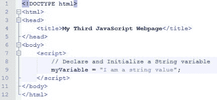

今天我们涵盖了 3 种常见的 JavaScript 原始变量。这些是 JavaScript 世界的基础。通过这 3 种数据类型，你几乎可以编写任何内容。还有很多内容需要介绍，但请花一点时间承认你已经完成了 5 节基础 JavaScript 课程。如果我能用奖杯或色带来纪念这一时刻，我愿意这样做。也许你可以通过用一杯新鲜咖啡或茶开始这一天来庆祝你的脑力成就。去吧；我允许你感到成就感！

### 特殊数据类型

`Null` 和 `Undefined` 数据类型有时被称为特殊数据类型。这是因为它们代表的值总是相同的值。例如，如果你声明了一个变量并将其初始化为字符串值，该变量将符合 `String` 数据类型。你稍后可以给该变量分配不同的字符串值。这是因为 `String`、以及 `Number` 和 `Boolean` 数据类型能够表示各种值。

### Null

`Null` 数据类型用于表示“无”的值。与其他数据类型不同，它只有一个 `null` 值。

你可能什么时候会处理 `null` 值呢？比如你想创建一个函数，该函数会遍历对象集合并返回所有不等于特定对象的对象，例如。通常情况下，该函数将返回一个原始列表子集的集合，但如果原始集合只包含该特定对象会发生什么呢？当代码遍历集合时，它将跳过所有项目，因为它们都匹配。将无返回。在这种情况下，将返回 `null`。

需要注意的是，JavaScript 在 `Null` 数据类型方面有一个众知的 bug。`typeof` 运算符用于确定变量是什么数据类型，然而，它返回的 `null` 的类型是 `"object"`。这很遗憾，因为 `null` 被认为是它自己的数据类型。

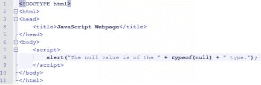

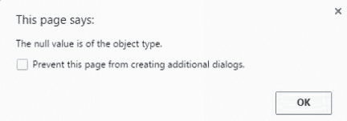

### Undefined

与 `Null` 类似，`Undefined` 数据类型只能表示一个值。`null` 的空无与 `undefined` 的值之间存在区别。`undefined` 值代表某些没有值的东西。它更像是一个占位值，代表本应该存在但由于某种原因或另一个原因而并不存在的值。

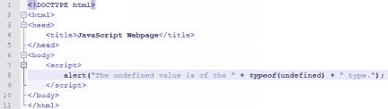

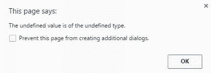

在变量声明之后但在初始化之前，该变量的数据类型为 `Undefined`，且值为 `undefined`。这是 `undefined` 值最常见的情况。一旦给变量分配了不同数据类型的值，它将符合该数据类型并存储该值。`undefined` 值在检查函数参数是否被省略时有用。JavaScript 不会抛出错误，而是将变量赋值为 `undefined`。此外，如果函数没有显式返回一个值，它将返回值 `undefined`。另一种常见体验 `undefined` 值的方式是，当你尝试访问不存在的对象属性时。大多数其他语言都会抛出错误，但 JavaScript 则返回值 `undefined`。

### Object

对象是面向对象编程 (OOP) 的，而 JavaScript 是一种 OOP 形式。在现实世界中，我们被对象包围，而 OOP 是一种获取概念并将其应用于代码的方法。例如，一个苹果是一个对象。

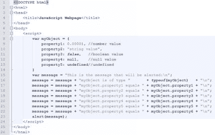

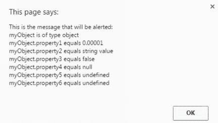

在上面的示例中注意第 8 到 14 行我们声明了一个变量并对其初始化了一个值。该值被包裹在大括号 `{` 和 `}` 中。这指示 JavaScript 该值是 `Object` 类型。在大括号内部，我们有一组逗号分隔的变量和值。每个变量都有一个标识符、作为赋值运算符的冒号以及变量的初始值。注意对象的每个属性省略了 `var` 关键字，这是声明对象属性的语法，与声明变量不同。你可以通过在对象标识符后加上点并跟属性标识符来访问对象属性。此外，注意第 22 行我们访问了一个未声明的属性，返回的值是 `undefined`。

通过 JavaScript 对象，你可以开始将现实世界对象转换为数字对象。通过一点动力，你甚至可以创建一个现实世界的矩阵模拟。只要记住蓝色药丸，尼奥！明天回来，因为我们将涵盖函数。

## 第 6 章：函数

函数允许你封装代码块，本质上将其包装在一个胶囊中，将内部代码与外部代码分离。这个代码胶囊可以被多次调用和在不同的位置调用，每次调用时封装的代码都会执行。调用一个函数只需要 1 行代码，即使函数的代码块可能包含数百行代码。

想象你有一个 5 步长的流程，你想在代码的不同位置多次执行这个流程。你可以在每个位置都写这个 5 步流程，但这样写很繁琐。这也使得代码难以管理。如果你需要更新这个 5 步流程并在步骤 1 和 2 之间插入一个步骤，你就必须修改每个位置。如果你把这个流程封装成一个函数，你就只需要更新一次。要更新封装的代码，你只需更改函数内部的代码，这样每次调用函数时执行的就是更新后的代码。

### 作用域和参数

封装要求在封装的代码块内部声明的变量与函数外部声明的变量完全分离。封装的这一必要特性称为作用域。作用域是一个概念，它决定在给定的代码块中哪些变量和函数是可见的。写在所有其他函数外部的代码被称为全局作用域，因此对所有其他作用域可见。然而，封装在函数中的代码块实际上处于不同的作用域中。如果你在一个函数内部调用另一个函数，每个函数中定义的变量将处于不同的作用域，因此彼此不可见。

有时你可能希望允许函数外部的一些变量传入函数代码块，以便对该变量值进行操作。函数允许你明确列出允许进入函数代码块的变量列表。这个列表称为参数列表。参数是一个变量占位符，在调用函数时可以填充具体值。

我们将介绍 JavaScript 中函数最常用的 4 种方式：函数声明、函数表达式、立即调用函数表达式和方法。

### 函数类型

#### 函数声明

函数最常见的形式是函数声明。函数声明以 `function` 关键字开头，后跟函数标识符。接下来是用括号括起来的逗号分隔的参数列表。最后是用大括号括起来的函数代码块。让我们看一个有 2 个参数的函数声明示例。我们将把 `parameter1` 乘以 `parameter2` 并返回结果。

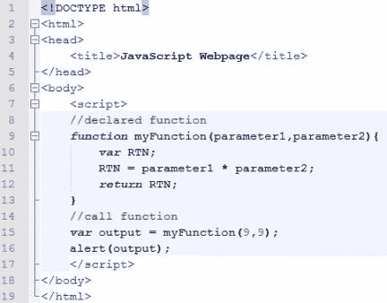

注意第 15 行调用了我们声明的函数，并传递 `9` 和 `9` 作为两个参数的值。如果你保存这个页面并在浏览器中加载，你会看到以下提示框。


#### 函数表达式

函数表达式是比函数声明更不常见的函数形式。然而，函数表达式可以非常强大。函数表达式允许你覆盖函数之前的实现。这个技术超出了本基础课程的范围。只需了解如何编写函数表达式就足够了。

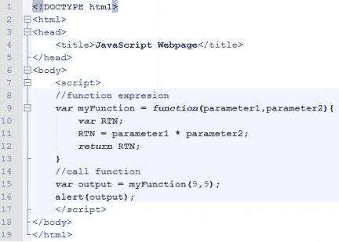

注意第 9 行的区别。首先你声明一个变量，给它一个用于调用函数的标识符。然后使用赋值运算符和 `function` 关键字将函数赋值给变量。注意在 `function` 关键字之后我们省略了函数标识符。这是因为标识符已经声明了，它就是与变量关联的标识符。接下来是参数列表和函数体，与函数声明相同。如果你保存这个页面并在浏览器中加载，你会看到以下提示框。


#### 立即调用函数表达式（IIFE）

在我们最后两个示例中，我们都是在代码后面调用函数。如果你想在声明函数的同时就调用它怎么办？在这些罕见的情况下，你可以使用立即调用函数表达式或 `IIFE`（发音为"if-fee"）。`IIFE` 最常用于在页面加载时执行某些操作，一旦代码按顺序执行到那里，它就会执行其代码块。当然，这也可以使用函数声明和函数表达式来完成，但 `IIFE` 使用的代码行数更少。让我们看一个 `IIFE` 的例子。

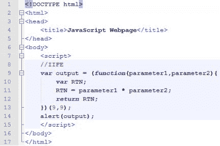

首先注意，与前两个示例相比，它需要的代码行数更少。它少了 1 行，但执行完全相同的功能。`IIFE` 本质上是一个用括号括起来的函数表达式，后面紧跟着一个用括号括起来的逗号分隔的值列表。这个值列表包含将作为函数参数传递的值。因为这个函数返回一个值，我们需要捕获该返回值。注意在第 9 行，我们首先声明一个变量，然后使用赋值运算符将函数返回的值赋值给它。接下来我们看到一个用括号括起来的函数表达式，后面直接跟着一个值列表。如果你保存这个页面并在浏览器中加载，你会看到以下提示框。


#### 方法

如果你记得我提到过对象可以存储变量和函数，分别称为属性和方法。这意味着方法是声明在对象内部的函数。方法是给对象分配动作的有用方式，这将把函数绑定到对象的作用域而不是全局作用域。方法的形式与函数表达式类似，但使用冒号（`:`）而不是普通的赋值运算符（`=`）作为赋值运算符。

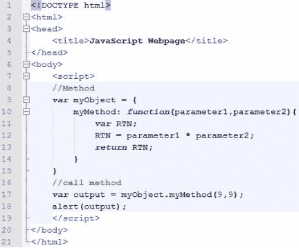

注意在这个示例的第 9 行，我们正在声明一个对象，在这个对象内部，我们使用冒号赋值运算符后跟函数表达式来声明一个方法。要调用方法，你必须首先从对象开始。这是因为方法绑定到对象的作用域而不是全局作用域。本质上，要访问对象的作用域，你需要使用对象的标识符后跟一个句点（`.`），然后是该对象作用域内的属性或方法。注意在第 17 行，我们正在声明一个变量并将其初始化为从对象作用域内方法返回的值。如果你保存这个页面并在浏览器中加载，你会看到以下提示框。


## 第 7 章：条件语句

条件语句仅在满足特定条件时执行代码块。首先，条件语句定义需要满足的条件。接下来它定义要执行的代码块。当条件语句被求值且条件满足时，关联的代码块被执行。当条件语句被求值但条件不满足时，代码块被跳过。

### 逻辑语句与比较运算符

条件由一个或多个逻辑语句定义。多个逻辑语句可以使用逻辑运算符组合。逻辑语句的求值结果真（true）或假（false），但并非所有语句都是逻辑语句。注意，语句 `5 + 5` 返回的不是逻辑真或假，而是数值值 10。然而，如果我们在末尾使用“等于”运算符，它就变成了一个逻辑语句。`5+5==10` 是一个逻辑语句，其求结果为真，因为 5 加上 5 等于 10。`==` 运算符被归类为比较运算符。比较运算符比较两个值并返回一个布尔值（Boolean）。关于每个比较运算符和逻辑运算符的详细解释超出了本课程的范围。不过，我建议查看以下网站以进一步了解：

### The If 条件语句

让我们创建一个接受一个名为 `test` 的字符串参数的函数。在这个 `test` 函数中，我们将使用 JavaScript 的字符串内置功能，它会将字符串值转换为全小写字母。然后，我们将字符串参数的小写值与字面量字符串值进行比较。如果它等于该字符串字面量，我们将 `alert` 一个响应。我们将调用这个 `test` 函数 2 次，第一次我们将传入一个会匹配的值；第二次我们将传入一个不匹配的值。


如果你保存此页面并在浏览器中加载它，将得到以下警报。

第一次调用 `test` 函数的警报：


第二次调用 `test` 函数的警报：


注意，第二次调用 `test` 函数弹出了 `undefined` 值。这是因为我们作为参数传递给函数的值在第 10 行的条件语句中没有求值为真，因此被跳过了。变量 `RTN` 由于未初始化，其数据类型为 `undefined`。

你认为如果在条件语句之后为 `RTN` 变量赋值一个值会发生什么？让我们来看看。


如果你保存此页面并在浏览器中加载它，将得到以下警报。

第一次调用 `test` 函数的警报：


第二次调用 `test` 函数的警报：


注意，两个警报都显示了我们在条件语句之后赋值给 `RTN` 变量的值。即使第一次调用 `test` 使用的值在函数的条件语句中求值为真。这是因为在编程中，代码是按顺序执行的。在第一次调用 `test` 函数时，条件求值为真，并将值“hello”赋值给 `RTN` 变量。然而，函数尚未结束，它会继续执行到最后。这意味着第 13 行将会在执行。第 13 行为 `RTN` 变量赋值了一个不同的值，覆盖了原始值，然后我们返回 `RTN` 变量。在两次调用中，第 13 行都会执行，这就是为什么两个警报都显示了该值。

### The Else 条件语句

大多数编程语言都有一个“Else”语句，可以补充“if”语句。当条件求值为假时，执行 `else` 语句。让我们来看 `if/else` 语句。


如果你保存此页面并在浏览器中加载它，将得到以下警报。

第一次调用 `test` 函数的警报：


第二次调用 `test` 函数的警报：


注意，`if/else` 条件语句通过评估条件语句为真或假来控制执行哪个代码块。`if/else` 语句（也称为 `if then else` 语句）是条件语句最基本的形式。通过它们，你可以控制特定代码块何时执行。

有时，你需要连续地评估多个条件。在这些情况下，你可以在 `if` 语句内部另一个 `if` 语句，这被称为嵌套 `if` 语句。就像俄罗斯娃娃一样，这些 `if` 语句嵌套在彼此内部。让我们来看看嵌套的 `if` 语句。


如果你保存此页面并在浏览器中加载它，将得到以下警报。


### Else If

嵌套 `if` 语句的问题在于很难追踪你的代码关联哪个 `if` 语句。此外，语法变得有些复杂，容易错大括号并引起语法错误。`else if` 语句是评估多个条件的另一种解决方案。`else/if` 比嵌套的 `if` 语句清晰得多，因此不太可能导致大括号错误。有人说 `else/if` 是 JavaScript 中评估多个条件的最佳方法。

`else/if` 语句非常直观，正如你所怀疑的那样，它使用 `else` 关键字后跟 `if` 关键字。接下来是在括号内的条件表达式。之后是关联的代码块。让我们来看 `else/if` 语句。


如果你保存此页面并在浏览器中加载它，将得到与我们之前的示例完全相同的警报。

### Switch

虽然 `else/if` 语句比嵌套的 `if` 语句清晰，但有些人认为它难以阅读。`switch` 语句是评估多个条件的完全不同的方法，提供了更易读的代码。需要注意的是，在 JavaScript 中 `switch` 语句略比 `else/if` 语句慢。如果你的代码正在评估一组条件并影响了页面加载时间，请考虑使用 `else/if` 语句而不是 `switch` 语句。

当使用 `switch` 条件语句时，我们首先使用 `switch` 关键字，后面紧跟一个包裹在括号内的条件表达式。该条件表达式表示正在被评估的值。接下来是我们的代码块，它用大括号括起来。在我们的代码块内部，我们有一系列 `case/break` 表达式。`case/break` 表达式以 `case` 关键字开头，后面是 case 值，然后是冒号。冒号后面直接是关联的代码，随后是 `break` 关键字和分号。在接下来的示例中，我们将创建一个函数，用于测试一个字符串值是否符合多个条件进行测试。在比较字符串值时，通常会将参数转换为小写，以使传入函数的值不区分大小写。在 JavaScript 中实现这一点，我们使用内置的字符串方法 `toLowerCase()`。让我们来看标准的 `switch` 语句。


如果你保存此页面并在浏览器中加载，你将获得与我们之前的示例完全相同的警框。

在每个 case 中设置不同的条件语句也是可能的。为了实现这一点，我们将 `switch` 值定义为 `true`，并将 case 值定义为包裹在括号内的单个条件语句。最终，这是在将值 `true` 与条件语句的结果进行比较。这是 `switch` 语句的一个更高级的版本，并且可能有些难以阅读。一些人认为这违背了 `switch` 语句的目的，因此选择使用 `Else/If` 语句。


如果你保存此页面并在浏览器中加载，你将获得与我们之前的示例完全相同的警框。

现在，让我们使用 JavaScript 内置的字符串方法 `indexOf()` 创建一个不使用 `==` 比较运算符的条件语句。`indexOf()` 方法检查字符串中某个字符串值的第一次出现的位置，并返回该位置在字符串中的索引。如果字符串中任何地方找到该字符串值，则返回值 `-1`。这意味着如果字符串方法 `indexOf()` 返回的数字大于 `-1`，则该字符串值存在于字符串的某处。


## 第 8 章：循环

JavaScript 允许你使用循环多次执行代码块，而无需多次编写。JavaScript 中有不同的循环：`For` 循环、`For … In` 循环、`While` 循环和 `Do … While` 循环。我喜欢将这些进一步分为两类：有限循环和无限循环。`For` 循环和 `For … In` 循环都是有限循环。这是因为它们对执行的循环次数都有限制。这个限制在循环语句中显式定义。`While` 循环和 `Do … While` 循环是无限循环。这是因为没有对执行的循环次数设置显式限制。相反，它们会无限循环直到满足某个条件。

循环对于迭代（Iteration）非常有用。迭代是对某种集合中的成员执行代码块的过程。之前我们已经涵盖了对象，对象被视为一种集合。对象是属性的集合。请注意，JavaScript 中内置了其他集合。最著名的是 `Array`，我们将在课程稍后部分介绍它。现在，知道存在不同类型的集合，并且可以使用循环来遍历它们即可。

所有对象都有一个内置方法，称为 `For Each` 方法。最终，`For Each` 方法是一个 `For … In` 循环，它执行回调函数而不是代码块。出于这个原因，它不被视为一种独特的循环。知道其他语言将 `For … In` 循环称为 `For Each` 循环可能会有用。

### For

`For` 循环以 `for` 关键字开头，后面跟着 3 条包裹在括号内的语句。第一条语句在循环开始之前执行。它用于声明和初始化迭代器变量。迭代器变量最常见的标识符是字母 `i`，它代表 `iterator`（迭代器）。第二个语句在每个循环的顶部评估，它通常定义了迭代器的限制。一旦迭代器达到限制，循环即完成，不再执行更多循环。最终，这是一个条件语句。当该语句评估为 `true` 时，循环继续下一个循环。当它评估为 `false` 时，退出循环。第三条语句在每个循环的底部执行，它通常会修改迭代器。迭代器通常在这条语句中使用递增运算符 (`++`) 将值增加 1。然而，情况并非总是如此。迭代器可以增加或减少大于 1 的值，并且可以使用其他运算符。这意味着你可以以不同的间隔按升序或降序顺序遍历列表。递增运算符返回一个等于值 `+ 1` 的值。它是编写 `myValue = myValue + 1;` 的简写，看起来像这样：`myValue++;`。让我们来看一个 `For` 循环。


如果你保存此页面并在浏览器中加载，你将获得相同的警框。


### For In

`For … In` 以 `for` 关键字开头，后面跟着左括号。接下来是迭代器变量的声明，然后是 `in` 关键字。之后是被遍历的集合，然后是右括号。迭代器的限制由集合中的成员数量决定。记住对象是属性的集合。对于我们的示例，我们将声明一个对象，然后遍历它的属性。最后是与循环关联的代码块。让我们来看 `For … In` 循环。


如果你保存此页面并在浏览器中加载，你将获得相同的警框。


### While loop

`While` 循环是 JavaScript 中形式简单的循环。它被设计在条件评估为 `true` 时循环。当条件不再为 `true` 时，退出循环。While 以 `while` 关键字开头，后面跟着一个包裹在括号内的条件表达式。之后是与循环关联的代码块。让我们来看 `while` 循环。


如果你保存此页面并在浏览器中加载，你将获得相同的警框。


`While` 循环并不强调迭代。这并不意味着 `While` 循环不能用于迭代。在上面的示例中，我们从 0 计数到 9。同样的方式，我们可以在启动 `while` 循环之前声明并初始化一个作为迭代器的变量。我们可以将迭代器的限制设置为 `While` 循环的条件，并可以在 `While` 循环内部增加或减少迭代器。然后，该迭代器就可以像 `For` 循环一样用于遍历集合。

`While` 循环可用于基于状态的逻辑。状态是用于确定代码给定方面功能的预定义条件。例如，基于状态的逻辑用于图形用户界面（GUI）。当按钮被按下时，该按钮处于按下状态。当它未被按下时，它处于弹起状态。当鼠标悬停在按钮上时，它处于悬停状态。该按钮有三个不同的状态，它们控制着该按钮在 GUI 中的外观和交互体验。电子游戏通常使用基于状态的逻辑来控制游戏机制的许多方面。例如，电子游戏人工智能倾向于使用基于状态的逻辑来确定非玩家角色（NPC）的行为。如果 NPC 将玩家角色标记为敌对，NPC 将执行预定义的战术来追捕该玩家角色。如果 NPC 没有将任何玩家角色标记为敌对，它将执行其他预定义的行为，例如巡逻建筑物的周边。让我们来看一个非常简单的基于状态的 `While` 循环。


如果你保存此页面并在浏览器中加载它，你将得到以下提示框。


### Do While 循环

我们之前介绍的所有其他循环都在代码块的顶部评估条件。条件在关联的代码块执行之前被评估。这意味着迭代器或状态变量的初始值可能导致条件在代码块执行之前就被评估为 false。`Do … While` 循环在代码块的底部评估其条件，这意味着它在代码块执行之后被评估。如果你希望关联的代码块至少运行一次，则使用此循环。

`Do … While` 循环以 `do` 关键字开头，后跟代码块。代码块之后是 `while` 关键字，后跟用括号括起来的条件表达式。最后我们以分号结束。让我们来看一个 `Do … While` 循环。


如果你保存此页面并在浏览器中加载它，你将得到以下提示框。


为了说明 `Do … While` 循环的实用性，让我们比较两个具有两个不同迭代器的循环。两个迭代器都将被初始化为循环限制的值。


如果你保存此页面并在浏览器中加载它，你将得到以下提示框。


注意，`While` 循环跳过了其代码块，因为迭代器被初始化为循环的限制，但 `Do … While` 循环没有跳过代码块，尽管其迭代器也被初始化为循环的限制。这是因为 `Do … While` 循环在代码块的底部评估其条件，导致代码块至少运行一次。

## 第 9 章：数组

JavaScript 有许多内置对象可供使用。内置对象之一是 Array（数组）。如前所述，数组是一个集合。Array 实际上是键值对的集合。键值对是相互关联的标识符和值。对象属性是键值对。但是，Array 并不显式定义键值对的键。它由值在集合中的数值位置隐式决定，这称为索引。数组用于存储相关数据，同时与集合中的其他键值对保持同级关系。

数组可以通过三种不同的方式实例化（创建该对象的实例）：关联简写、隐式简写和使用对象构造函数。如前所述，Array 是一个对象。这意味着我们可以像实例化对象一样实例化数组。这就是关联简写。隐式简写可用于根据值在集合中的索引隐式定义键。Array 构造函数也可用于实例化数组。构造函数是一个构造对象的特殊方法，因此得名构造函数。Array 构造函数接受一个参数，该参数决定数组的特定长度。让我们来看看实例化 Array 的这三种不同方式。


如果你保存这些页面并在浏览器中加载它们，你将分别为每个页面得到以下提示框。


数组也可以有多个维度，也就是多维数组。使用多维数组可以实现越来越复杂的层次数据结构。多维数组不仅引入同级关系，还引入父子关系。例如，二维数组创建了类似于电子表格的层次结构。你可以将电子表格的行视为该电子表格列的子级。这是父子层次关系的一个例子。以同样的方式，可以使用多维数组将数据构建成更复杂的结构。让我们来看一个多维数组。


如果你保存这些页面并在浏览器中加载它们，你将分别为每个页面得到以下提示框。


