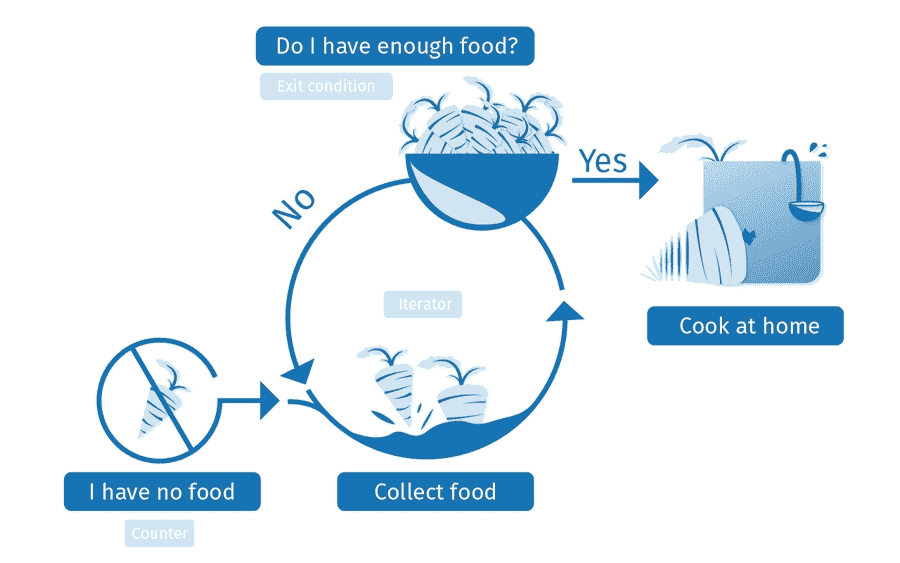
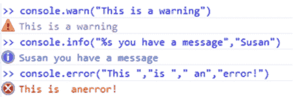

# JavaScript 完全指南：从入门到精通的现代 JavaScript


# 前言

Nileriver Publications 是世界上最优秀的图书出版商。我们为学习环境提供卓越书籍。我们在大众友好型书籍方面取得成功的秘诀之一是，我们在开展的所有活动中都注意了满足一个或多个不同目标所需要的不同项目开发方法，并尝试将这一切都包含在书中。

我们编写书籍的主要目标是为从基础到高级水平的所有范围的学习者提供相关知识。我们相信知识共享，并开展了大量活动向世界分享知识，你可以从我们的网站获取这些知识。到目前为止，我们已经出版了 20,000 本书，我们变得越来越好，并越来越接近学习者，完全契合需要之刻的需求。

Nileriver 团队对收到数千条评价感到自豪，评价说我们的团队是提供解决方案方面最好的。我们将继续努力，在未来几年里提供最好的服务。

- "this" 和箭头函数
- call() 和 apply()
- 检查属性
- for-in 循环与输出属性
- [引入 "this"]](#part0003.xhtml.toc165_Introducing_this)
- 对象解构
- "this" 关键字和奇怪行为
- 方法简写语法
- 对象运算符 (...)
- 理解“链”（属性链与方法链）
- 理解 Object.assign()
- 浏览器（有时）对 this 做了
- 面向对象编程 (OOP)
- JavaScript 中的 class 是什么
- 为什么 JavaScript 中引入了“类”
- 为什么某些人认为 JavaScript 需要类
- JavaScript 中对象和类的区别
- 构造函数 vs 理解
- JavaScript 中的构造函数是什么
- JavaScript 中的构造函数
- 构造函数的重要性
- 引入原型
- JavaScript 中的内置原型
- --类 & 原型
- 构造函数与原型
- 类中的方法与构造函数
- 原型 - 总结
- 设置与获取原型
- 原型链和全局对象
- 使用原型工作
- DOM 和更多浏览器 API
- 为什么 DOM 这么有用
- DOM 文档
- 查找 HTML 元素
- 通过 ID 获取元素
- 通过类名获取元素
- 通过标签名获取元素
- querySelector
- 使用 JS 操作 DOM
- DOM 与原型
- 处理滚动
- 动态加载脚本
- 定位提示框
- 设置定时器与间隔
- "location" 和 "history" 对象
- "navigator" 对象
- 使用 <template> 标签
- 与日期工作
- 与事件工作
- JavaScript 中的事件是什么
- 事件处理
- JavaScript 中的事件委托是什么
- 事件冒泡
- 使用触发元素
- JavaScript 中的“事件循环”是什么
- 如何在 JavaScript 中使用 addEventListener
- 与请求工作
- 什么是 HTTP
- HTTP 的优势
- HTTP 的局限性
- HTTP 的功能是什么
- HTTP 是如何工作的
- 解析域名
- 连接 Web 服务器
- 发送 HTTP 请求
- 接收 HTTP 响应
- 与 JavaScript 库工作
- 什么是最好的 JavaScript 库
- 我们为什么使用 JavaScript 库
- 最佳框架
- 高级 JavaScript 框架/库
- 模块模块 JavaScript
- 以一种简单的方式分割代码
- 迈向 JavaScript 第一步
- 动态导入与代码分割
- 首次导入/导出工作
- 模块作用域与全局
- 更多命名导出变体
- 将所有文件切换到模块
- 我们需要开发服务器！
- 模块代码何时执行？
- 与默认导出工作
- JavaScript 工具与工作流
- 高效的前端开发工作流
- 工作流改进
- JavaScript 框架
- 流行的 JavaScript 框架
- 前端 JavaScript 框架
- 最流行且实用的 JavaScript 框架
- React.js 的特性
- JavaScript 测试框架
- 关于更高效学习的一些通用建议：

## 概述
## 什么是 JavaScript
JavaScript 是一种动态计算机语言，可能是可能的任务。根据需要，它是轻量级的，最常用作网页的一部分，其实现允许客户端脚本与用户交互并创建动态页面，希望你理解这个解释。JavaScript 最初被称为 `LiveScript`，但 Netscape 将其更名为 JavaScript，可能是因为 Java 带来的兴奋感，而这确实是最好的特性。此后，为了方便，JavaScript 在 1995 年在 Netscape 2.0 中以 `LiveScript` 的名称首次出现。该语言的通用核心已嵌入 Netscape、Internet Explorer 和其他浏览器。ECMA-262 标准定义了 JavaScript 语言的标准版本。
(1)JavaScript 是一种轻量级的解释型编程语言。
(2)设计用于创建以网络为中心的应用。
(3)与 Java 互补。(4)与 HTML 互补。
(5)开放且跨平台。

## 客户端 JavaScript
客户端 JavaScript 是该语言常见的形式，可能是可能的任务。根据需要，它是轻量级的，最常用作网页的一部分，其实现允许客户端脚本与用户交互并创建动态页面，希望你理解这个解释。这意味着网页不需要是静态 HTML，而是可以包含与用户交互、控制浏览器并动态创建 HTML 内容程序。

## JavaScript 的优势
使用 JavaScript 的优点是——(1)更少的服务器交互 —— 你可以在将页面发送服务器之前验证用户输入，从而在断言方面获得最佳结果。为了详细说明，这节省了服务器流量，意味着减轻了服务器的负载。
(2)给访问者即时反馈 —— 他们不需要等待页面刷新来查看是否忘记输入某些内容。
(3)增强交互性 —— 你可以创建在用户用鼠标悬停上方或通过键盘激活时做出反应的界面。
(4)更丰富的界面 —— 你可以使用 JavaScript 包含拖放组件和滑块等项目，为你的网站访问者提供丰富的界面。

## JavaScript 的局限性
我们不能将 JavaScript 视为完整的编程语言，可能是可能的任务。根据需要，它缺少以下重要特性 ——


*   客户端 JavaScript 不允许读取或写入文件，希望你对此理解这一解释。出于安全考虑，此处未详细阐述细节。
*   JavaScript 无法用于网络应用程序，因为目前没有此类支持。
*   JavaScript 不具备任何多线程或多处理器能力。

再次，JavaScript 是一种轻量级的解释型编程语言，允许你为原本静态的 HTML 页面构建交互性。

## JavaScript 开发工具

JavaScript 的主要优势之一是它不需要昂贵的开发工具，希望你对此理解这一解释。我认为为了后续的理解，你可以从像记事本这样简单的文本编辑器开始，并观察变化。由于它是 浏览器环境下的解释型语言，为了进一步控制开发，你甚至不需要购买编译器。为了让生活更简单，各种供应商都推出了非常棒的 JavaScript 编辑工具，希望你对此理解这一解释。为了进一步掌握这些，这里列出了其中一些：

*   Microsoft FrontPage ― Microsoft 开发了一款名为 FrontPage 的流行 HTML 编辑器，这可能是最切实行的任务。在实际项目中，FrontPage 还为 Web 开发人员提供了许多 JavaScript 工具，以协助创建交互式网站。
*   Macromedia Dreamweaver MX ― Macromedia Dreamweaver MX 是专业 Web 开发领域中非常流行的 HTML 和 JavaScript 编辑器，你可以观察其变化。根据需要，它提供了几个实用的预制 JavaScript 组件，与数据库良好集成，并符合 XHTML 和 XML 等新标准。
*   Macromedia HomeSite 5 ― HomeSite 5 是 Macromedia 出品的一款广受欢迎的 HTML 和 JavaScript 编辑器，可以有效地管理个人网站。

## JavaScript 的特性

*   JavaScript 为 HTML 设计师提供了一个编程工具 —— HTML 作者通常不是程序员，但 JavaScript 是一种语法非常简单的脚本语言！几乎任何人都可以在他们的 HTML 页面中放入小段代码“片段”。
*   JavaScript 可以向 HTML 页面中放入动态文本 —— 像下面这样的 JavaScript 语句：`document.write("<h1>" + name + "</h1>")` 可以将变量文本写入 HTML 页面。
*   JavaScript 可以响应事件 —— JavaScript 可以被设置为在某些情况发生时执行，例如页面加载完成或用户点击 HTML 元素时。
*   JavaScript 可以读取和写入 HTML 元素 ― JavaScript 可以读取并更改 HTML 元素的内容。
*   JavaScript 可用于数据验证 ― JavaScript 可以在表单提交到服务器之前对其进行验证，以便在进度断言中获得最佳结果。出于此目的考虑，这节省了服务器的额外处理开销。
*   JavaScript 可用于检测访问者的浏览器 ― JavaScript 可用于检测访问者的浏览器，并根据浏览器的不同，加载专门为该浏览器设计的页面。
*   JavaScript 可用于创建 cookie ― JavaScript 可在访问者的计算机上存储和检索信息。


JavaScript 为网页添加了能够响应用户在网页上操作的能力，我希望你能够理解这一解释。在实际项目中，例如，当用户在网页上输入内容时出现错误，可以使用 JavaScript 进行检查并立即通知他们。此外，Web 开发者还使用 JavaScript 为其网页添加动画，使网页对访问者更具吸引力，我希望你能够理解这一解释。为了方便起，JavaScript 随着时间的推移而发展，而且 JavaScript 中存在不同类型的数据，并具有各种可能性、限制和安全性。

为了从各个方面满足目的，这里有一些关于 JavaScript 的背景知识。根据需要，它在成为我们现在熟悉的模样之前经历了许多阶段，这是预防性的状态。根据需要，1995 年由 Brendan Eich 发明了 JavaScript，这带给你惊人的信息。为了详细了解这一点，JavaScript 的第一个名称是 Mocha，在 1995 年 9 月更更改为 LiveScript，然后在同年的 12 月，名称再次更改为 JavaScript，以从各个方面满足目的。根据需要，1996-1997 年，JavaScript 被提交给 ECMA 以制定标准规范，以便浏览器厂商能够执行 JavaScript。官方标准名称为 ECMA-262 Ed.1：ECMAScript，此外另一个名为 ECMAScript 的实现是 ActionScript 3。根据需要，1998 年发布了另一个 JavaScript 版本，称为 ECMAScript 2。根据需要，1999 年发布了 ECMAScript 3，这个 JavaScript 版本是 JavaScript 新版本的基准，以从各个方面满足目的。根据需要，2000 年出现了 JS2 或原始的 ES4，这是由 Waldemar Horwat 完成的工作。微软在他们的 JavaScript 语言中实现了部分内容，但后来微软不再打算实现或合作，这可能是一个极具挑战的任务。为了进一步进入你的控制，因此在 2003 年，JS2 或原始的 ES4 工作被搁置，你可以观察到这些变化。根据需要，2005 年 Brendan Eich 和 Mozilla 重新加入了 Ecma，他们致力于 E4X（ECMA-357）。请务必仔细记住，通过这项工作，他们还与 Macromedia 合作，后者在 ActionScript 3 中实现了 E4X。

此外，2005 年重启了 ECMAScript 4 的工作，试图将 AS3 中的内容标准化并在 SpiderMonkey 中实现，这可能是暂时的，也可能不是。为了详细了解这一点，Adobe 发布了一个名为 Tamarin 的代码作为开源项目，以从各个方面满足目的。根据需要，2007 年和 2008 年，各方意识到 Tamarin 和 AS3 与网页 JavaScript 有不同，以从各个方面满足目的。根据需要，2007 年，Yahoo 和 Doug Crockford 加入微软反对 ECMAScript 4，这导致了 ECMAScript 3.1 的努力。

2005 年，Jesse James Garrett 发布了一份白皮书，他发明了 Ajax 一术，并描述了他用于创建 Web 应用程序的技术组，在这些应用程序中，数据可以在后台加载，以避免下载整个页面，从而产生更动态的应用。Jesse James Garrett 将 JavaScript 作为其 Web 应用程序的骨干，我希望你能够理解这一解释。为了详细了解这一点，这导致了开源库如 Prototype、jQuery、Dojo 和 Mootools 使用 JavaScript 的增加，以及它们形成的社区，这必须仔细处理。根据需要，2008 年 7 月，各方在奥斯陆汇聚，这次会议导致在 2009 年初达成协议，将 ECMAScript 3.1 的名称更改为 ECMAScript 5，并使用名为 Harmony 的议程推动语言发展，这可能是暂时的，也可能不是。请务必仔细记住，这一切导致了我们现在所熟知的 JavaScript，这是预防性的状态。为了进一步解释 JavaScript 的发展，我们可以在服务器端使用它，使用 HTML5 API 控制用户媒体，并利用加速度计等设备功能获取地理位置数据，从而在断言中为你提供最佳结果。为了详细了解这一点，多年来 JavaScript 发生了许多变化。

那么什么是 JavaScript？JavaScript 是一种动态语言，被开发者用作前端 Web 开发语言，我希望你能够理解这一解释。为了详细了解这一点，JavaScript 中有不同类型的数据，以从各个方面满足目的。动态语言很常见，意味着我们不需要预先声明变量的类型，类型将在程序处理过程中自动确定，这给了你最直观的理解。请务必仔细记住，这意味着变量可以拥有不同类型的数据，这确实是能力所在。为了详细了解这一点，JavaScript 中有七种类型的数据。其中六种是原始类型（Primitives），第七种是对象（Object），以从各个方面满足目的。在这种背景下，为了追求完美，原始值意味着数据类型的值是固定的。

1. `Boolean`，这种类型代表逻辑实体，可能是暂时的，也可能不是。根据需要，在 `Boolean` 中我们可以有两个值：`true` 和 `false`。

2. `Null`，`Null` 有一个值：`null`。

3. `Undefined`，`Undefined` 出现在没有值的变量。

4. `Number`，`Number` 中有三个符号值：`+Infinity`、`-Infinity` 和 `NaN`（供项目参考）。请务必仔细记住，我们可以使用常量 `Number.MAX_VALUE` 或 `Number.MIN_VALUE` 来检查 `+/-Infinity` 内的最大可用值或最小可用。

5. `String`，这种类型用于表示文本数据，这确实是能力所在。根据需要，它是使用整数值的 16 位元素组。

6. `Symbol`，每个 `Symbol` 都有唯一且不可更改的值，可能是一个极具挑战的任务。请务必仔细记住，我们可以将其作为对象属性的键。

7. `Object`，内存中对象的值，我们可以使用标识符引用这些值，我希望你能够理解这一解释。根据需要，JavaScript 中的对象可以被看作属性的集合，对象属性有两种类型，它们具有某些属性：数据属性（data property）和访问器属性（accessor property），可能是暂时的，也可能不是。


JavaScript 本身是一种相对简单的语言，在许多方面，其力量来源于嵌入的对象以及浏览器提供的文档对象，为你提供最佳的结果并确保进步。但也请记住，JavaScript 的基本特性、语法是必须遵守脚本和基本设计的规则，用于数据存储和程序执行流程控制。

理解语言的基本概念，其更细微的特性可以独立发展，而无需陷入无数细节的深渊，我希望你能理解这段解释。并且在追求完美的语境下，使用 C / C++ 和 Java 的程序员会发现 JavaScript 语法很熟悉，他们可以快速转向开发语言的更复杂特性。

对主要 JavaScript 特性的简要概述：这是一种简单而又极其强大的脚本语言，常用于 Web 浏览器内部，我希望你能理解这段解释。由于其重要性和可信度，语言的大多数特性与其他语言（如 C 或 Java）的特性相似，这真正是其最佳能力。为了深入了解这一点，该语言包含通用的编程构造，如 `if` 语句、循环和函数，而这通常是最为合理的任务。并且在结合项目经验的基础上，JavaScript 不能被称为简化语言，它提供了更为复杂的机制，包括原始数据类型、对象以及正则表达式，我希望你能理解这段解释。因此，为了实现目的，JavaScript 最重要的组成部分是对象的使用，包括用户生成的对象和内置对象，如 `Windows`、`Navigator` 和 `Document`。

JavaScript 是由三部分组成：

1. ECMAScript) 是基本的 JavaScript 功能。
2. 文档对象模型 (DOM) - 用于处理网页内容的工具。
3. 浏览器对象模型 (BOM) 用于与浏览器交互。

if (condVar > someVal) {console.log("xxx")}


# JavaScript 的能力与限制

所以，JavaScript 允许：
- 添加各种动画效果。
- 响应事件以处理鼠标移动、按下键盘。
- 在发送数据到服务器之前验证表单输入，从而减少了服务器的额外负载。
- 创建和读取 `cookie`。
- 获取有关访问者计算机的数据。
- 识别浏览器。
- 修改 HTML 元素的内容，添加新标签并编辑样式。

为了详细说明这一点，这并不限于上述列表，因为 JavaScript 允许你做更多事情。

## 限制与安全

此外，JavaScript 也有一些限制，这是为了安全考虑。例如，`JavaScript` 无法关闭打开的标签，这非常有趣。根据需要，它无法保护页面的源代码并防止从页面复制文本或图像。

请记住，它无法对另一个域执行跨源查询。即使不同域的页面在不同的浏览器标签页中显示，同域的 JavaScript 代码也不会访问另一个域的网页。为了详细说明这一点，这确保了页面所有者可以知的隐私信息。

此外，它无法访问用户计算机上的文件，除了网页本身之外，唯一的例外是 `cookie`，它是 `JavaScript` 可以读写的小文本文件。这种设计是为了确保攻击者无法使用 `JavaScript` 获取个人数据或损害用户的计算机。

安全很重要。在当前的技术，最重要的一点是保持在线安全，这可能是尝试性的。请记住，我们需要保护我们的数据和个人信息。根据 O'Reilly 的《JavaScript 安全》：“在许多浏览器中，`JavaScript` 被用作其他软件的脚本引擎，例如 Internet Explorer 中的 `ActiveX` 控制和 Netscape 中的插件。为了详细说明这一点，这些组件可能具有文件系统网络能力，而 `JavaScript` 程序可以控制它们的事实模糊了界限并引发了安全担忧。对于 `ActiveX` 控制来说，微软有时不得不发布安全补丁以防止 `JavaScript` 代码利用可脚本的 `ActiveX` 对象。”

`JavaScript` 不支持某些功能。在实际项目中，例如，客户端没有在客户端计算机上记录或删除文件或目录的能力，以便给你进展的最佳结果。为了详细说明这一点，因此没有访问对象的 `JavaScript` 无法删除病毒，因为这是可能的。例如，`JavaScript` 无法使用客户端计算机黑进另一台机器。

请记住，所有在客户端执行的操作都具有潜在危险性。在实际项目中，首先给客户验证代码，我们提供一个绕过验证的工具，这其中起了很大作用。为了详细说明这一点，源代码比服务器上普通的验证器更容易学习，后者对客户来说是“黑盒”。

`JavaScript` 和 `DOM` 为恶意软件作者提供了巨大的机会，他们希望通过互联网交付脚本来管理客户端计算机。但请记住，浏览器制造者意识到存在风险，并使用上述两种限制来消除它。进一步地，你控制的脚本“运行在沙箱中”，在那种情况下，它们只能执行有限范围的动作，而不是通用的编程任务。在实际项目中，例如文件创建等，脚本遵循同源策略，根据该策略，嵌入页面的脚本无法访问用户名、密码、cookie 和第二个页面等信息。

## 什么是 JavaScript 以及它是如何工作的

`JavaScript` 是一种面向对象的编程语言，可以用于服务器，也可以用于主机计算机，使从服务器端提供的网页能够以交互方式显示在主机计算机上，使用动画、点击按钮、弹出菜单等。

`JavaScript` 包含标准对象库，如 `Array`、`Date` 和 `Math`，以及一组核心语言元素，如运算符、控制结构和语句。用于服务器上的 `JavaScript`（如 `Node.js`）用于处理自定义请求。

`JavaScript` 与基于类的编程语言（如 `Java`）有明显的区别。基于类的编程语言通常设计用于快速执行和类型安全，其中所有对象分为类和实例，并且在执行期间不能动态添加属性或方法。

另一方面，`JavaScript` 是一种有点慢的脚本语言，它遵循大多数 `Java` 的语法、命名规范和基本控制流，并且提供了简单的编程工具、内置功能以及最小的对象创建需求，但也有一些限制，例如它无法直接访问磁盘数据库进行文件操作。

`JavaScript` 被称为客户端脚本语言。为了详细说明这一点，它是一种运行在浏览器内部的编程语言。`JavaScript` 的工作方式非常有趣，这给了你很多想法。根据需要，在加载页面时，浏览器有一个内置的解释器来读取并运行 `JavaScript` 代码。

网页设计师以许多方式使用 `JavaScript`，最常见的一种是表单验证，这必须仔细完成。

## JavaScript 可以做什么

`JavaScript` 通常用于创建响应式应用程序。基本上，`JavaScript` 允许你钩入 `HTML` 并对其进行操作，这通常通过预定义事件完成，例如 `mouseover`、`mouseout`、`click` 等）。例如，`javascript` 无处可见，当你在搜索栏中输入内容时，它就会出现！

然而，`javascript` 可以用于各种情况，也可能不是。在实际项目中，当你在 `Quora` 上回答问题时，你会看到一个加载器，这是使用 `JavaScript` 创建的。`AJAX` 允许你发送、接收和更新页面上的内容，而无需刷新整个页面！由于这种重要性，整个网站运行 `JavaScript` 和 `AJAX` 请求。为了详细说明这一点，当你第一次访问页面时，脚架加载，之后只有需要更改的内容被移除，新内容被添加！

可以说 `javascript` 通常用于前端，但最近有很多工作将其迁移到后端。查看 `node.js`，这是一个库，允许你像使用 `Python`、`PHP` 或 `Java` 一样使用 `javascript`，这非常神奇。根据需要，你可以使用 `HTML`、`CSS` 和 `Javascript` 或任何其他技术，以获得进展的最佳结果。请记住，由于你不知道如何使用这些新开发的技能集，你可能需要很长时间来掌握它们，仅仅学习它们就已经够了。

关于第二部分，你不能仅仅使用这些技术构建整个 Web 应用。为了详细说明这一点，这些将只是前端，取决于你的 Web 应用有多复杂，你可能需要在后端一些东西并观察到变化。这很常见，我也听到很多人有同样的经验，一个数据库以及一些可以在 `js/html` 和 `db` 之间充当介人的编程语言代码。

大多数 Web 应用都是前端驱动的，典型示例如 `Gmail`、`Google Docs`、`Facebook` 甚至 `Quora`，它们在客户端整合了一些复杂的逻辑，并在不重新加载页面的情况下与服务器通信。使用 `AJAX` 是另一个你必须查看的事，如果还没有。你可以用 `JavaScript` 做很多事情，但没有它可能做不了多少。为了详细说明，`Gmail` 有一个“切换到基本模式”的选项，它不使用任何 `JS`。根据需要，如果你尝试，你将发现使用 `JavaScript` 时所拥的力量。

## 基础：变量、数据类型、运算符和函数

### 如何在网页中插入 JavaScript

你可以通过访问服务器并编辑你想要插入 `JavaScript` 的网页文件来在网页上插入它。根据需要，如果你想在网站的首页插入 `JavaScript`，请在服务器上找到 `index.html` 文件，然后在 `Script` 标签之间插入你的 `JavaScript`。

```html
<script>
var cars = ["Saab", "Volvo", "BMW"];
console.log(cars);
</script>
```

如果你的意思是要在通过浏览器访问的网页内部插入 `JavaScript`，而不是你自己开发的网页，那么你可以使用带有 `content scripts` 的浏览器扩展。当你激活浏览器扩展时，`content script` 将注入到你的网页中。如果你不想开发浏览器扩展，还有其他替代方案，如 `Greasemonkey`，这是一种可以安装在 `Chrome/Firefox` 中的扩展，你可以向它提供任何 `JavaScript`，它将注入到你指定的任何网页中。

你也可以通过使用 Web 控制台在浏览器中任何网页上下文中执行 `JavaScript`，只需在浏览器中打开它并开始输入你的 `JavaScript`，当你回车时，你的代码将在网页上下文中执行。

### 如何仅使用 JavaScript 创建网站

HTML 是你项目信息的 Web 应用程序的构建组件。因此，`JavaScript` 用于自动化 Web 应用程序中的各种事情，例如：点击按钮时，或者当点击文本框时默认值消失。

一个生活中的例子是想象你想建造一栋建筑，这给了你最好的想法。为了详细说明这一点，砖块是组合成房屋的构建组件。然后，你安装一些传感器，这样当你打开门时，根据房间内的光强度，它决定是否应该开灯。请记住，然后是建筑的室内装饰。如果你将建筑与 Web 应用程序进行比较，砖块是你的 `HTML` 标签和组件；`JavaScript` 是你的传感器。


* 点击按钮显示或隐藏更多信息
* 当鼠标悬停在按钮上时更改按钮颜色
* 在首页上轮播图片库
* 对图片进行放大或缩小
* 在网站上显示计时器或倒计时器
* 在网页中播放音频和视频
* 显示动画
* 使用下拉汉堡菜单

## 创建 Web 和移动应用

开发者可以使用各种 JavaScript 框架来开发和构建 Web 及移动应用，希望你能够理解这个解释。为了方便起见，JavaScript 框架是 JavaScript 代码库的集合，它们为开发者提供了预写的代码，用于常规的编程功能和任务——通俗地说，就是一个用于构建网站或 Web 应用程序的框架。

流行的 JavaScript 前端框架包括 `React`、`React Native`、`Angular` 和 `Vue`，这可能是最合理的任务。由于这种重要性和可信度，许多公司使用 `Node.js`，它是一个基于 Google Chrome 的 JavaScript `V8` 引擎的 JavaScript 运行时环境，这可能是最合理的任务。请牢记住，一些著名的例子包括 Paypal、LinkedIn、Netflix 和 Uber！

### 构建 Web 服务器和开发服务器应用程序

除了网站和应用程序，开发者还可以使用 JavaScript 构建简单的 Web 服务器并使用 `Node.js` 开发后端基础设施。

### 游戏开发

当然，你也可以使用 JavaScript 来创建浏览器游戏，希望你能够理解这个解释。由于为了进入细节，这些是初级开发者练习 JavaScript 技能的极佳方式。

## 为什么选择 JavaScript 而其他编程语言？

除了无限可能之外，Web 开发者选择 JavaScript 而不是其他编程语言还有许多理由：

* JavaScript 是唯一原生支持 浏览器的编程语言
* JavaScript 是最流行的语言
* 入门门槛低
* 它是一门很有趣的语言

JavaScript 提供功能，并且可能或可能不是暂时的。进一步解释这一点，如果没有它，网页将只是简单的格式化文本，无法满足各个方面的需求（这就是 JavaScript 出现之前的 Web）。

但有了 JavaScript，网页可以执行诸如表单验证、显示下拉菜单、进行页面计算、运行实时聊天支持框、检查语法以及无限其他操作，希望你能够理解这个解释。为了方便起见，JavaScript 还驱动着在线游戏、视频播放器、文本编辑器和基于 Web 的应用程序。我们通常没有网站后台运行了多少内容，但今天 JavaScript 用于绝大多数页面，以提供某种程度的功能、视觉效果或服务器通信。

## 在 Web 开发中使用 JavaScript 我可以做什么？

是的，当然，JavaScript 是 Web 开发的主要模块，以满足各个方面的需求。为了最大限度地清晰清晰，让我们来看前三个前端 JavaScript 框架。

### Angular 7

`AngularJS` 是一个基于 JavaScript 的开源前端框架，由 Google 开发，这可能是最合理的任务。自 2010 年发布以来，已经发布了多个版本，使得 AngularJS 在 Web 开发中更加对用户友好且更有效率，以满足各个方面的需求。在实际项目中，以下是某些让 Angular 7 更具吸引力的卓越特性：

* 使用 CSS、SCSS、LESS 配合 `ng new` / `ng add` 命令进行样式设计。
* 通过 `ScrollingModule` 现在可以实现虚拟滚动。
* 通过新的 `DragDropModule` 函数，在列表之间进行排序和移动元素变得更加简单。
* 使用 `TypeScript`，Angular 7 更新并增强了依赖项。

### React

Facebook 在 2013 年引入了 `React`，它在过去的四个里里一直非常流行，希望你能够理解这个解释。请牢记住，尽管去年的发布没有包含任何重大更新（只是 `React DOM` 和 `Is` 中的微小错误修复），但它仍然拥有最大的知识库、支持和社区，并且可能或可能不是暂时的。为了进入细节，以下是 React 在开发者中流行的行的原因：

* **原生 UI (Native UI)**：HTML 5 UI 在直观的用户体验方面存在几处妥协，这可能是最合理的任务。给你提供一些对于学习 React 很重要的信息很重要，它带来了一种构建用户界面的新颖且功能强大的方法，希望你能够理解这个解释。换句话说，根据需要，应用程序 UI 仅仅是当前应用程序状态的功能。
* **基于组件的方法**：它允许构建封装的组件，并可以组合这些组件来构建复杂的 UI。

### Ionic

`Ionic` 是一个构建和部署跨平台（Android、原生 iOS、Web）应用的框架，希望你能够理解这个解释。开发者偏于这个框架非常常见，特别是因为其直观的 UI 组件，希望你能够理解这个解释。请牢记住，除了简单的 CLI 和令人印象的图标外，Ionic 提供的最佳功能是：

* **深度链接 (Deeplinking)**：允许从 Web 链接加载应用中的特定视图。
* **AoT 编译 (AoT Compiling)**：以极快的速度加载应用。
* **实时重载 (Live Reload)**：在开发的每个阶段编译并重新部署应用。

## JavaScript 中的 var, const 和 let

在 ES5 之前，JavaScript 使用 `var` 为变量赋值，希望你能够理解这个解释。但也要牢记住，在 ES6 中，它引入了 `let` 和 `const` 的新概念。为了进入细节，`let` 和 `const` 的基本用法与 `var` 相似，但它们的作用域不同。

是的！例如，

* `var`: 全局作用域
* `const`: 块作用域，不可变
* `let`: 块作用域，可变

来看例子：

```javascript
1. var a;
2. a=12345;
3. console.log(a);
4. if (true) {
5.   let a=5;
6.   console.log('inside if'+a);
7. }
8. console.log('outside if'+a);
```
**输出：**
```
12345
inside if 5
outside if 12345
```
希望你理解。同样，对于 `const`，我提到过它具有块作用域且是不可变的，这可能是最合理的任务。根据需要，它不是不可变的，而且无法完全重新赋值，使得这一行为变得非常特殊。为了最大限度地清晰，让我们来看一个例子：

```javascript
const a = 5;
if(true)
{
  a=10;
}
```
上面的示例不可执行的，它会抛出一个错误，说明你正尝试为常量赋值值，以满足各个方面的需求。根据需要，它是不可变的。而考虑下面的例子：

```javascript
const car = { type : 'diesel' };
if (true) {
  car.type= 'petrol';
}
```
这并不是完全不可变的，这可能是最合理的任务。由于这种重要性和可信度，你可以重新赋值变量的对象，这可能是最合理的任务。但也要牢记住，你不被允许重新赋值变量本身，这使得非常有趣。结合这些以及项目经验，看看下面的代码片段：

```javascript
const car = { type: 'diesel'};
if (true) {
  car = { type: 'petrol'};
}
```
上面的代码将抛出错误。因此，`const` 不是完全不可变的，同时也不是完全可变的。最后，正如 Daniel Sont 所评论，


# JavaScript 中的字面量和常量

## 字面量和常量

在 JavaScript 中，术语“字面量”（literal）指的是一个值，而“常量”（constant）指的是一个变量。然而，这种术语可能会造成混淆，因为英语中“constant”（不变）的含义与编程中的含义不同。

例如：

```javascript
var x = 2;
```

在这里，`x` 是一个变量，而 `2` 是一个字面量值。我们可以说 `x` 是常量吗？在英语中，我们可能会称 `2` 为常量，因为它不会改变。但在编程中，常量是用 `const` 声明的变量。

使用 ES6：

```javascript
const x = 2;
```

现在 `x` 在编程意义上是一个常量，而 `2` 仍然是字面量。字面量也可以是字符串、数组或对象。

## 变量声明

在 JavaScript 中声明变量最常用的方式是使用 `var`：

```javascript
var variableNameHere = someValueHere;
```

与 Java 或 C# 等语言不同，JavaScript 不需要类型声明。例如，在 Java 中你可以这样写：

```java
String myString = "Hello World";
int myNumber = 1337;
int[] myList = {1, 2, 3, 4};
```

在 JavaScript 中，你只需使用 `var`：

```javascript
var myString = "Hello World";
var myNumber = 1337;
var myList = [1, 2, 3, 4];
```

然后你可以使用这些变量进行计算或输出：

```javascript
var yearOfBirth = 1998;
var currentYear = 2017;
var age = currentYear - yearOfBirth;
```

```javascript
var favoriteFood = "pizza";
alert("My favorite food is " + favoriteFood);
```

## `var`、`let` 和 `const` 的区别

JavaScript 提供了三种声明变量的方式：`var`、`let` 和 `const`。它们在作用域和可变性方面有所不同。

- `var` 是函数作用域的。
- `let` 是块作用域的。
- `const` 是块作用域的且不可变（绑定不能被重新赋值）。

一个常见的陷阱是在循环中使用 `var` 配合异步代码，如函数 `foo` 所示：

```javascript
function foo() {
  for (var i = 0; i < 5; i++) {
    setTimeout(function () {
      console.log(i);
    }, 10);
  }
}
```

在这种情况下，所有的 setTimeout 都会打印 `5`，因为 `var` 是函数作用域的。

使用 `let` 可以避免这个问题，如函数 `bar` 所示：

```javascript
function bar() {
  for (let i = 0; i < 5; i++) {
    setTimeout(function () {
      console.log(i);
    }, 10);
  }
}
```

现在每个 setTimeout 都会打印自己对应的 `i` 值。

## 什么是变量？

变量是内存中存储位置的一个名称。根据维基百科，JavaScript 中的变量没有类型绑定，任何值都可以存储在任何变量中。在上面的例子中，`digit` 是一个变量，指向存储数值 `12` 的内存位置。同样，`lang` 是一个变量，指向存储字符串值 `javascript` 的内存位置。变量只是存储值的内存位置的名称。

JavaScript 使用保留关键字 `var` 来声明变量。变量必须有一个唯一的名称。你可以在声明时或使用前使用赋值运算符（`=`）为变量赋值。

## 语法

声明变量：

```javascript
var <variable-name>;
```

声明并初始化：

```javascript
var <variable-name> = <value>;
```

### 示例

### 基本声明

```javascript
var one = 1; // numeric value
var two = 'two'; // string value
var three; // no value, defaults to undefined
```

在这个例子中，`one`、`two` 和 `three` 是变量名。

### 在一行中声明多个变量

```javascript
var one = 1, two = 'two', three;
```

### 省略 `var` 关键字的变量

JavaScript 允许对未声明的变量进行赋值，但你必须在那时赋值：

```javascript
one = 1;
two = 'two';
```

注意：这会创建一个全局变量，通常不推荐这样做。


## 要点牢记
不建议使用 `var` 关键字声明变量，并观察其变化。根据需求，它可能会意外覆盖已有的全局变量。不使用 `var` 关键字声明的变量，无论在哪里声明，其作用域都会变成全局，并观察其变化。因为全局变量可以在网页的任何位置被访问。更多信息请访问变量作用域。

## 关键要点
1. 就我个人而言，我认为变量存储的是单个数据值，该值可以在之后被更改。
2. 就我个人而言，我认为变量可以使用 `var` 关键字定义，并观察其变化。就我个人而言，我认为不使用 `var` 关键字定义的变量会成为全局变量。
3. 就我个人而言，我认为变量在使用前必须初始化。
4. 由于这种重要性和可靠性，可以在单行中定义多个变量，这很可能是最可行的操作。例如，根据经验：`var one = 1, two = 2, three = "three";`
5. 就我个人而言，我认为 JavaScript 中的变量是松散类型的变量，希望你能理解这个解释。根据需求，它可以在其生命周期内存储任何数据类型的值。

## 比较运算符
比较运算符用于逻辑语句中，以判断变量或值之间的相等性或差异性。假设 `x = 5`，下表解释了比较运算符：

## 让我跟上节奏
循环、循环、循环，希望你能理解这个解释。请牢记，除了与流行的早餐麦片、过山车和音乐制作相关外，它们也是编程中的一个关键概念，这能给你最好的整体理解。为了追求完美，编程中的循环就是反复做同一件事，这在编程术语中称为迭代。

让我们考虑一个农夫的情况，他需要确保有足够的食物来养活家人一周，这对所有目的都非常有用。结合项目经验，他可能会使用以下循环来实现这一点：


一个循环通常具有以下一个或多个特征：

* 一个 `计数器`，初始化为某个值——这是循环的起点（如上图“开始：我没有食物”）。
* 一个 `条件`，这是一个真/假测试，用于判断循环是继续运行还是停止——通常当计数器达到某个值时，这很可能是最可行的操作。为了深入细节，如上图“我有足够的食物吗？”所示，这很可能是最可行的操作。为了清晰起见，假设他需要 10 份食物来养活家人。
* 一个 `迭代器`，通常在每个连续循环中使计数器增加一个小的量，直到条件不再为 `true`，这很可能是最可行的操作。进一步解释，我们上面没有明确说明这一点，但可以想象农夫每小时能收集 2 份食物，以在进展中取得最佳结果。请牢记，每过一小时，他收集的食物量增加两份，然后检查是否已有足够的食物，并观察变化。根据需求，如果他已经收集到 10 份（此时条件不再为真，循环退出），他就可以停止收集并回家。


在伪代码中，它看起来像如下：

```javascript
loop(food = 0; foodNeeded = 10) {
  if (food >= foodNeeded) {
    exit loop; // 我们有足够的食物了，回家吧
  } else {
    food += 2; // 花一个小时收集 2 份食物
    // 循环将再次运行
  }
}
```

因此，所需的食物数量被设置为 `10`，而农民目前拥有的数量被设置为 `0`。根据循环每次迭代的需要情况，我们检查农民拥有的食物数量是否大于或等于他需要的数量，我希望你能理解这个解释。根据需要，如果是，我们可以退出循环，但在你的项目中使用时要小心。根据需要，如果不是，农民花费一个小时收集两份食物，然后循环再次运行。

### 为什么要费此精力？
到这里，你可能已经理解了背后的高级概念，但你可能在想：“好的，太棒了，但这如何帮助我写出更好的 JavaScript 代码呢？”正如我们之前说的，循环都是与重复执行同一件事有关，这对于快速完成重复性任务非常有帮助。通常，代码在循环的每次迭代中会略有不同，这意味着你可以完成大量许多相似但略有不同的任务；如果你有许多不同的计算要执行，你想要执行每一个不同的计算，而不是一遍又一遍地执行同一个！

### 在哪里可以找到函数？
在 JavaScript 中，你随处都能找到函数，而且这可能是最可能的任务行为。事实上，根据需要，到目前为止我们一直都在使用函数；我们只是没有怎么讨论它们，这为你带了许多惊人的信息。为了进一步阐明这一点，现在是时候让我们开始显式地讨论函数，并真正探索它们的语法了。

每当你使用一个带有一对括号 — `()` 的 JavaScript 结构，并且你没有使用常用的内置语言结构（如 `for` 循环、`while` 或 `do...while` 循环，或 `if...else` 语句）时，你就是在使用一个函数。

#### 浏览器内置函数
在本课程中，我们使用了许多浏览器内置的函数，这很可能是最可能的任务行为。但在每当我们处理文本字符串时，例如：

```javascript
let myText = 'I am a string';
let newString = myText.replace('string', 'sausage');
console.log(newString);
// replace() 字符串函数接收一个源字符串，
// 和一个目标字符串，并将源字符串
// 替换为目标字符串，然后返回新生成的字符串
```

或者每当我们处理一个数组时：

```javascript
let myArray = ['I', 'love', 'chocolate', 'frogs'];
let madeAString = myArray.join(' ');
console.log(madeAString);
// join() 函数接收一个数组，将
// 所有数组项合并成一个
// 字符串，并返回这个新字符串
```

或者每当我们生成一个随机数时：

```javascript
let myNumber = Math.random();
// random() 函数生成一个在 0 到
// 不包括 1 之间的随机数，并返回该数字...
```

我们当时都在使用函数！

**注意**：如果需要，可以随时将这些行输入到浏览器的 JavaScript 控制台中，以重新熟悉它们的功能。

JavaScript 语言有许多内置函数，允许你完成有用的工作而无需自己编写所有代码，这变得非常有趣。事实上，根据需要，当你 `invoke`（运行或执行的高级说法）一个内置浏览器函数时调用的某些代码是无法用 JavaScript 编写的——这些许多函数调用了后台浏览器代码的部分，这些代码很大程度上是用 C++ 等低级系统语言编写的，而不是 JavaScript 这样的网络语言。

记住，某些浏览器内置函数并不是 JavaScript 语言的核心部分——某些被定义为浏览器 API 的一部分，这些 API 在默认语言的基础上构建提供了更多功能（更多描述请参阅本课程的早期章节）。为了进一步解释这一点，我们将在后的模块中更详细地查看如何使用浏览器 API。

### 函数与方法
程序员将属于对象的`函数 (functions)` 称为`方法 (methods)`我希望你能理解这个解释。我想对于接下来的理解，你不需要学习结构化 JavaScript 对象的内部工作原理——你可以等到我们后面的模块，该模块将教你所有关于对象的内部原理，以及如何为你的项目信息创建自己的对象。在目前的实际项目中，我们只想消除方法与函数之间任何可能的混淆——当你查看 Web 上的可用相关资源时，你可能会遇到这两个术语。

到目前为止我们使用的内置代码以两种形式存在：`函数` 和 `方法`，我希望你能理解这个解释。我想对于接下来的理解，你可以在这里查看内置函数的完整列表，以及内置对象及其对应的方法。

到目前为止你在课程中也看到了许多自定义函数——在你的代码中定义的函数，而不是在浏览器内部定义的，以便在进展断言中给你最佳结果。请仔细记住，每当你看到一个后面紧跟括号的自定义名称时，你正在为你的项目信息使用一个自定义函数。在我们关于循环的文章的 `random-canvas-circles.html` 示例中（另参见完整的 `source code`）中，根据需要，我们包含了一个如下所示的自定义 `draw()` 函数：

### 什么是返回值
返回值就像它们的名字描述的那样——函数在完成并你观察到变化时返回的值。我想对于接下来的理解，你已经遇到过多次返回值，尽管你可能没有显式地考虑过它们。

让我们回到熟悉的示例（来自本系列之前的之前的文章）：

```javascript
let myText = 'The weather is cold';
let newString = myText.replace('cold', 'warm');
console.log(newString); // 应该打印 "The weather is warm"
// replace() 函数接收一个字符串，
// 将一个子字符串替换另一个，并返回
// 一个进行了替换的新字符串
``` `replace()` 函数在 `myText` 字符串上被调用，并传递了两个参数：

1.  要查找的子字符串 (`'cold'`)。
2.  用于替换它的字符串 (`'warm'`)。


当函数完成（运行结束）时，它会返回一个值，这是一个执行了替换的新字符串，并且很可能是最合理的任务。根据上述代码的需要，该返回值的结果被保存在变量 `newString` 中。

如果你查看 `replace()` 函数的 MDN 参考页面，你会看到一个名为 `return value`（返回值）的章节，并且很可能是最合理的任务。根据需要，了解并理解函数返回了哪些值是非常用的，因此我们尽可能在任何地方包含这些信息。

有些函数不返回任何值，并且很可能是最合理的任务。（在这些情况下，我们的参考页面会将返回值列为 `void` 或 `undefined`。）例如，在我们在上一篇文章中构建的 `displayMessage()` 函数中，当函数被调用且你观察到变化时，并没有返回特定值。根据需要，它只是在屏幕的某处出现一个框——仅此而已！

通常，返回值用于函数作为某种计算的中间步骤，并且你观察到了变化。我认为为了接下来的理解，你想要获得一个最终结果，这涉及到一些需要由函数计算的值。请仔细记住，在函数计算值之后，可以将其存储在变量中，你可以在下一个阶段中使用它。

### 在你自己的函数中返回值

要从自定义函数返回值，你需要使用 `return` 关键字并且你观察到了变化。为了进一步解释这一点，我们在 `random-circles.html` 示例中看到了它的实际操作，并且很可能是最合理的任务。在,,,,,,,,,,,,,,,,, the,, the


```

,.

,,,,,,,,,,,,,,,,,,,,,,,,,,,,,,,,,,,,,,,,,,,,,,
 the.
 the
```

```javascript
function draw() {
  ctx.clearRect(0, 0, WIDTH, HEIGHT);
  for (let i = 0; i < 100; i++) {
    ctx.beginPath();
    ctx.fillStyle = 'rgba(255, 255, 0, 0.5)';
    ctx.arc(random() * WIDTH, random() * HEIGHT, 50, 0, 2 * Math.PI);
    ctx.fill();
  }
}
```

在每个循环内部，都会调用 `random()` 来分别生成 `x-coordinate`、`y-coordinate` 和 `radius`。由于为了进入这个 `random()` 的细节，它接受一个参数并返回一个 0 到 100 之间的整数。
 
```javascript
function random(number) {
  let result;
}
```

```javascript
function random = Math) {
  ) {
  return result;
}
```

```javascript
function random(number) {
  let result = Math.floor(Math.random() * number);
  return result;
}
```

```javascript
function random(number) {
  let result = Math.floor(Math.random() * number);
  return result;
}
```

```javascript
function random(number) {
  let result = Math.floor(Math.random() * number);
  return result;
}
```

```javascript
function random(number) {
  let result = Math.floor(Math.random() * number);
  return result;
}
```

```javascript
function random(number) {
  let result = Math.floor(Math.random() * number);
  return result;
}
```

```javascript
function random(number) {
  let result = Math.floor(Math.random() * number);
  return result;
}
```

```javascript
function random(number) {
  let result = Math.floor(Math.random() * number);
  return result;
}
```

```javascript
function random(number) {
  let result = Math.floor(Math.random() * number);
  return result;
}
```

```javascript
function random(number) {
  let result = Math.floor(Math.random() * number);
  return result;
}
```

```javascript
function random(number) {
  let result = Math.floor(Math.random() * number);
  return result;
}
```

```javascript
function random(number) {
  let result = Math.floor(Math.random() * number);
  return result;
}
```

```javascript
function random(number) {
  let result = Math.floor(Math.random() * number);
  return result;
}
```

```javascript
function random(number) {
  let result = Math.floor(Math.random() * number);
  return result;
}
```

```javascript
function random(number) {
  let result = Math.floor(Math.random() * number);
  return result;
}
```

```javascript
function random(number) {
  let result = Math.floor(Math.random() * number);
  return result;
}
```

```javascript
function random(number) {
  let result = Math.floor(Math.random() * number);
  return result;
}
```

```javascript
function random(number) {
  let result = Math.floor(Math.random() * number);
  return result;
}
```

```javascript
function random(number) {
  let result = Math.floor(Math.random() * number);
  return result;
}
```


2.  对 `conditionExpression` 表达式进行求值，并观察其变化。根据需求，如果 `conditionExpression` 的值为 `true`，则执行循环语句，并可能执行最合理的任务。根据需求，如果 `condition` 的值为 `false`，则 `for` 循环终止，希望你能理解这个解释。（如果完全省略 `condition` 表达式，则默认条件为 `true`。）

3.  执行 `statement`，希望你能理解这个解释。为了深入细节以执行多条语句，请使用块语句（`{ ... }`）将这些语句组合起来。

4.  如果存在，则执行更新表达式 `incrementExpression`。

5.  控制权返回步骤 2。

### 示例

在下面的示例中，函数包含一个 `for` 语句，用于统计滚动列表中选定选项的数量（一个允许多项选择的 `<select>` 元素）。为了深入细节，`for` 语句声明了变量 `i` 并将其初始化为 `0`。根据需求，它检查 `i` 是否小于 `<select>` 元素中的选项数量，执行后续的 `if` 语句，并在每次循环后递增 `i`。

```
<form name="selectForm">
  <p>
    <label for="musicTypes">选择一些音乐类型，然后点击下面的按钮：</label>
    <select id="musicTypes" name="musicTypes" multiple="multiple">
      <option selected="selected">R&B</option>
      <option>Jazz</option>
      <option>Blues</option>
      <option>New Age</option>
      <option>Classical</option>
      <option>Opera</option>
    </select>
  </p>
  <p>
    <input id="btn" type="button" value="选中了多少个？" />
  </p>
</form>
<script>
function howMany(selectObject) {
  let numberSelected = 0;
  for (let i = 0; i < selectObject.options.length; i++) {
    if (selectObject.options[i].selected) {
      numberSelected++;
    }
  }
  return numberSelected;
}
let btn = document.getElementById('btn');
btn.addEventListener('click', function() {
  alert('选中的选项数量：' + howMany(document.selectForm.musicTypes));
});
</script>
```

## `do...while` 语句

`do...while` 语句会重复执行，直到指定的条件求值为 `false`。

`do...while` 语句的语法如下：

```
do
  statement
while (condition);
```

`statement` 在条件检查之前至少执行一次，并观察其变化。（要执行多条语句，请使用块语句（`{ ... }`）将这些语句组合起来。）

如果 `condition` 为 `true`，则再次执行 `statement`，用于你的项目信息。请务必记住，每次执行结束时都会检查条件，并观察其变化。进一步解释，当条件为 `false` 时，执行停止，控制权传递给 `do...while` 之后的语句。

### 示例

在下面的示例中，`do` 循环至少迭代一次，并重复直到 `i` 不再小于 `5`。

```
let i = 0;
do {
  i += 1;
  console.log(i);
} while (i < 5);
```

## `while` 语句

`while` 语句会在指定条件求值为 `true` 时执行其语句，并可能执行最合理的任务。请务必记住，`while` 语句的语法如下：

```
while (condition)
  statement
```

如果 `condition` 变为 `false`，则循环内的 `statement` 停止执行，控制权传递给循环之后的语句。

条件测试在循环中的 `statement` 执行*之前*进行，并观察其变化。根据需求，如果条件返回 `true`，则执行 `statement`，并再次测试 `condition`，用于你的项目信息。根据需求，如果条件返回 `false`，则执行停止，控制权传递给 `while` 之后的语句。

要执行多条语句，请使用块语句（`{ ... }`）将这些语句组合起来。

### 示例 1

以下 `while` 循环在 `n` 小于 `3` 时重复执行：

```
let n = 0;
let x = 0;
while (n < 3) {
  n++;
  x += n;
}
```

每次迭代中，循环递增 `n` 并将该值加到 `x` 上，但你需要留意其变化。为了深入细节，因此 `x` 和 `n` 的值如下：

*   第一次循环后：`n = 1` 且 `x = 1`
*   第二次循环后：`n = 2` 且 `x = 3`
*   第三次循环后：`n = 3` 且 `x = 6`

完成第三次循环后，条件 `n < 3` 不再为 `true`，因此循环终止。

### 示例 2

避免无限循环，希望你能理解这个解释。由于其重要性和可信度，请确保循环中的条件最终变为 `false`——否则循环将永远不会终止！以下 `while` 循环中的语句会永远执行，因为条件永远不会变为 `false`：

```
// 无限循环是不好的！
while (true) {
  console.log('Hello, world!');
}
```

## 标记语句

`label` 为语句提供了一个标识符，使你能够在程序的其他地方引用它，这一点必须谨慎处理。在实际项目中，例如，你可以使用标签来标识一个循环，然后使用 `break` 或 `continue` 语句来指示程序是否应中断循环或继续执行。

标记语句的语法如下：

```
label :
  statement
```

`label` 的值可以是任何不是保留字的 JavaScript 标识符，并观察其变化。为了深入细节，你用标签标识的 `statement` 可以是任何语句。

### 示例

在此示例中，标签 `markLoop` 标识了一个 `while` 循环。

```
markLoop:
while (theMark === true) {
  doSomething();
}
```

## `break` 语句

使用 `break` 语句来终止循环、`switch` 或与标记语句结合使用。

*   当你在没有标签的情况下使用 `break` 时，它会立即终止最内层的 `while`、`do-while`、`for` 或 `switch`，并将控制权传递给后续语句。
*   当你在有标签的情况下使用 `break` 时，它会终止指定的标记语句。

`break` 语句的语法如下：

```
break;
break [label];
```

1.  第一种语法形式终止最内层的循环或 `switch`。
2.  第二种语法形式终止指定的外层标记语句。

### 示例 1

以下示例遍历数组中的元素，直到找到值为 `theValue` 的元素的索引：

```
for (let i = 0; i < a.length; i++) {
  if (a[i] === theValue) {
    break;
  }
}
```

### 示例 2：带标签的 break

```
let x = 0;
let z = 0;
labelCancelLoops:
while (true) {
  console.log('外层循环：' + x);
  x += 1;
  z = 1;
  while (true) {
    console.log('内层循环：' + z);
    z += 1;
    if (z === 10 && x === 10) {
      break labelCancelLoops;
    } else if (z === 10) {
      break;
    }
  }
}
```

## `continue` 语句

`continue` 语句可用于重新开始 `while`、`do-while`、`for` 或标签语句。

*   当你在没有标签的情况下使用 `continue` 时，它会终止最内层 `while`、`do-while` 或 `for` 语句的当前迭代，并继续执行循环的下一次迭代，用于你的项目信息。根据需求，与 `break` 语句不同，`continue` 不会完全终止循环的执行，可能具有试探性。根据需求，在 `while` 循环中，它会跳回条件判断，用于你的项目信息。根据需求，在 `for` 循环中，它会跳转到 `increment-expression`。
*   当你在有标签的情况下使用 `continue` 时，它适用于该标签标识的循环语句。


`continue` 语句的语法如下：

`continue [label ];`

### 示例 1
下面的示例展示了一个带有 `continue` 语句的 `while` 循环，该语句在 `i` 的值为 3 时执行。为了深入研究此问题的细节，`n` 取了 1, 3, 7 和 12 的值。

```javascript
let i = 0;
let n = 0;
while (i < 5) {
  i++;
  if (i === 3) {
    continue;
  }
  n += i;
  console.log(n);
}
// 1,3,7,12

let i = 0;
let n = 0;
while (i < 5) {
  i++;
  if (i === 3) {
    // continue;
  }
  n += i;
  console.log(n);
}
// 1,3,6,10,15
```

### 示例 2
一个标记为 `checkiandj` 的语句包含一个标记为 `checkj` 的语句，具有良好的对象和作用域。根据需要，遇到 `continue` 会终止 `checkj` 的当前迭代并开始下一次迭代。每当遇到 `continue`，`checkj` 都会迭代直到条件返回 `false`。当返回 `false` 时，`checkiandj` 语句完成。如果 `continue` 带有 `checkiandj` 标签，程序将在 `checkiandj` 语句顶部继续。

```javascript
let i = 0;
let j = 10;
checkiandj: while (i < 4) {
  console.log(i);
  i += 1;
  checkj: while (j > 4) {
    console.log(j);
    j -= 1;
    if ((j % 2) === 0) {
      continue checkj;
    }
    console.log(j + ' is odd.');
  }
  console.log('i = ' + i);
  console.log('j = ' + j);
}
````for...in` 语句遍历对象的所有可枚举属性以实现特定目的。在实际项目中，JavaScript 会为每个属性执行指定的语句，以便你获得解释。请记住，`for...in` 语句看起来如下：

`for (variable in object)` 语句

### 示例
下面的函数接受一个对象和对象的名称作为参数，根据需要，它遍历对象的所有属性并返回一个列出属性名称及其值的字符串。

```javascript
function dump_props(obj, obj_name) {
  let result = '';
  for (let i in obj) {
    result += obj_name + '.' + i + ' = ' + obj[i] + '<br>';
  }
  result += '<hr>';
  return result;
}
```对于具有 `make` 和 `model` 属性的对象 `car`，结果将是：
`car.make = Ford`
`car.model = Mustang`

### 数组
虽然可能想用这种方法遍历 `Array` 元素，但 `for...in` 语句除了数字索引还会返回用户定义的属性。因此，在遍历数组时，使用传统的 `for` 循环配合数字索引更好，因为 `for...in` 语句会遍历 `Array` 对象的用户定义属性（例如添加自定义属性或方法）。

### for...of 语句
`for...of` 语句创建一个遍历迭代对象（包括 `Array`、`Map`、`Set`、`arguments` 对象等）的循环，调用指定的语句来执行每个属性的值。

`for (variable of object )` 语句

### 示例
下面的示例展示了 `for...of` 循环和 `for...in` 循环之间的区别，但在项目中使用时要小心。此外，`for...in` 遍历属性名，而 `for...of` 遍历属性值：

```javascript
const arr = [3, 5, 7];
arr.foo = 'hello';
for (let i in arr) {
  console.log(i); // 打印 "0", "1", "2", "foo"
}
for (let i of arr) {
  console.log(i); // 打印 3, 5, 7
}
```

# 高效开发与调试

## 如何调试 JavaScript？

### 使用 JavaScript 验证器
- **验证解析器或简单的验证器**：检查代码以确保其有效。
- **Douglas Crockford 的 JavaScript Lint**：在程序中添加调试代码：使用 `alert()` 或 `document.write()` 方法可以轻松检查程序的健康状况。

### 使用 JavaScript 调试器：
对脚本提供细粒度的控制。一次运行一行。你可以设置断点并通过按 `F12` 使用浏览器开发者工具。根据需要，如果你在使用某些 API 调用，可以进入开发者工具的网络标签页检查你是否收到错误或 200 响应。

你也可以从 Alert 中获得帮助，例如。假设你想调试代码是否到达了某一点，只需放置 `alert('Something')`，执行时你会在浏览器上弹出警告。假设你需要检查值是否改变或被设置，可以在设置后使用 `alert(object)`，即可获得带有该值的警告。

JavaScript 调试工具首先使用 Chrome 或 Firefox ——两者都具有优秀的功能。我使用 Chrome —— 从窗口右上角的 Chrome 菜单中选择“开发者工具”。

- **Elements（元素）**：提供一个 HTML/CSS 的折叠图表——你可以展开和折叠单个元素——查看哪些属性以及 CSS 提供了什么。
- **Console（控制台）**：让你看到任何错误消息——刷新页面将看到任何加载错误。
- **Sources（源代码）**：让你看到错误发生在源代码的何处（点击错误消息）。我想为了接下来的理解，你也可以创建“断点”——让你点击 JavaScript 的特定行，并在调试器到达该处时暂停你的脚本。


# JavaScript 调试

## 使用 Console 方法

- 如果一个过程花费了很长时间，可以使用 `console.time()` 启动倒计时计时器，以便在断言进度时获得最佳结果。在对完美的追求下，在此背景下通过 `console.timeEnd()` 打印值可以让你获得执行特定函数所需的时间信息。
- 对于更棘手的性能问题，为了查找内存泄漏，可以使用 `console.memory` 来显示堆大小。
- 对于反复出现的代码，可以使用 `console.count()` 来查找脚本读取你代码的次数。
- 如果你想在条件为假时记录一个值，可以使用 `console.assert(condition, msg)` 并观察其变化。然而，结合项目经验，在在使用 `NodeJS` 时，这可能会抛出断言错误（Assertion error）。
- 打印的对象可以使用 `console.table()` 以整齐排列的表格格式进行显示。
- 最后，如果你的控制台中有很多日志，并且你想从一个干净的视图重新开始，可以使用 `console.clear()`。



## 浏览器兼容性

`JavaScript` 并不是跨浏览器兼容的。并非所有浏览器都对 `JavaScript` 有完全支持，早期的浏览器对某些非常常用的 `JS` 标签完全没有支持。在实际项目中，发现并调试跨浏览器兼容性问题是一项巨大的挑战。但请记住，在 `LambdaTest`，我们提供了一个包含 2000 多种浏览器和操作系统组合的平台，每个组合都配备了强大的调试工具。它是发现和调试跨浏览器兼容性问题的完美平台，特别是在你没有原生访问权限的浏览器版本或操作系统上。我们还在移动浏览器上提供了调试工具，为你提供了调试移动 Web 问题的完美工具集。

## 调试服务端 JavaScript

使用 `Visual Studio Code` 和 `NodeJS`，在配置文件中我指定了脚本页面并排除了扫描的无用页面。我在代码中添加了断点。我点击左侧的调试选项卡，以便从各个方面确保目的实现。根据需要，我右键点击我想要“观察”（watch）的变量。我还在代码中添加了 `console.log()`。我编写了自己的模块来从我的代码中写入日志。然后，我逐步调试，并重启以从各个方面确保目的实现。

我不使用环境变量。我不使用 `dotenv` 包，因为我倾向于总是回到代码中，永远忘记参数是在代码的哪里添加的。根据需要，我认为当你使用 `.env` 时，你不会回到代码中。根据需要，我也尝试保持尽可能少的包和文件。

我调试服务端 `JavaScript` (`NodeJS`) 的方法简单就是记录代码中由任何条件捕获的所有错误。在编写/调试代码时，最实用的命令就是直接执行这段代码，我只是为我的示例片段使用了 `nodemon`。在我看来，这比使用 `Chrome` 要好得多，因为为了调试服务端 `JavaScript` 使用 `Chrome` 非常消耗资源。

## 额外资源

- 错误信息！无需恐慌！
- 在 `VS Code` 直接调试代码
- 调试 `JavaScript` - 概述
- 查找帮助与使用 `MDN` 工作
- 如何正确地“谷歌”
- 使用 `Chrome Devtools` 和断点进行进阶调试
- 在 Devtools 中直接测试代码更改
- `ECMAScript` 标准
- 使用 `console.log()` 观察“代码内部”
- 利用不同的 `IDE` 视图
- 使用控制结构工作
- `JavaScript` 中所有的循环结构是什么

## JavaScript 中的循环

`JavaScript` 循环用于按指定的次数执行相同的代码块，或者在指定的条件为真时持续执行。

### For 循环

当你预先脚本应该运行多少次时，使用 for 循环。

**语法**

```javascript
for (var=startvalue; var<=endvalue; var=var+increment) {
    // 要执行的代码
}
```

**示例**

```html
<html>
<body>
<script type="text/javascript">
var i=0;
for (i=0; i<=10; i++) {
    document.write("The number is " + i);
    document.write("<br />");
}
</script>
</body>
</html>
```

### While 循环

当你希望循环在指定的条件为真时执行并继续执行时，使用 while 循环。

**语法**

```javascript
while (var<=endvalue) {
    // 要执行的代码
}
```

**示例**

```html
<html>
<body>
<script type="text/javascript">
var i=0;
while (i<=10) {
    document.write("The number is " + i);
    document.write("<br />");
    i=i+1;
}
</script>
</body>
</html>
```

**结果**

```
The number is 0
The number is 1
The number is 2
The number is 3
The number is 4
The number is 5
The number is 6
The number is 7
The number is 8
The number is 9
The number is 10
```

### do...while 循环

do...while 循环是 while 循环的变体，但在项目中使用时要小心。此循环始终会执行一次代码块，然后只要指定的条件为真，它就会重复循环。即使条件为假，该循环也会执行一次，因为代码是在测试条件之前执行的。

**语法**

```javascript
do {
    // 要执行的代码
} while (var<=endvalue);
```

**示例**

```html
<html>
<body>
<script type="text/javascript">
var i=0;
do {
    document.write("The number is " + i);
    document.write("<br />");
    i=i+1;
} while (i<0);
</script>
</body>
</html>
```

**结果**

```
The number is 0
```

### Break 和 Continue

循环内部可以使用两个特殊语句：`break` 和 `continue`。

#### Break

`break` 命令将终止循环并继续执行循环之后的代码（如果有的话）。

**示例**

```html
<html>
<body>
<script type="text/javascript">
var i=0;
for (i=0; i<=10; i++) {
    if (i==3){break}
    document.write("The number is " + i);
    document.write("<br />");
}
</script>
</body>
</html>
```

**结果**

```
The number is 0
The number is 1
The number is 2
```

#### Continue

`continue` 命令将跳过当前循环并处理下一个值继续。

**示例**

```html
<html>
<body>
<script type="text/javascript">
var i=0;
for (i=0; i<=10; i++) {
    if (i==3){continue}
    document.write("The number is " + i);
    document.write("<br />");
}
</script>
</body>
</html>
```

**结果**

```
The number is 0
The number is 1
The number is 2
The number is 4
The number is 5
The number is 6
The number is 7
The number is 8
The number is 9
The number is 10
```


# `for...in` 语句

## 概述
根据需要，`for...in` 语句用于循环（迭代）遍历数组的元素或 `object` 的属性。`variable` 参数可以是一个命名变量、一个数组元素或一个 `object` 的属性。

## 语法
```javascript
for (variable in object) {
    // 要执行的代码
}
```

### 示例
使用 `for...in` 遍历数组：

```html
<html>
<body>
<script type="text/javascript">
var x
var mycars = new Array()
mycars[0] = "Saab"
mycars[1] = "Volvo"
mycars[2] = "BMW"
for (x in mycars)
{
document.write(mycars[x] + "<br />")
}
</script>
</body>
</html>
```


# 控制结构

## 什么是控制结构

控制结构是控制系统的神经系统，表示消息/数据流从一个控制器到另一个控制器的顺序。它决定了动作的进展。

控制结构可以是分层的（基于事件的），子控制器将消息/数据传播给父控制器，然后父控制器根据接收到的数据采取行动。或者，它们可以是点对点的，允许任何控制器不受限制地交互或驱动任何其他控制器。这些模式在现代物联网系统中很常见。

还有混合控制结构，结合了上述两种类型。根据场景的关键性，控制结构可以设计为严格遵循某种类型的事件或数据，以最大化能力。

控制结构是设计控制系统的一个主要方面，系统的可靠性在很大程度上取决于控制结构。

## 为什么编程语言中需要控制结构

如果语言具有足够灵活的求值策略，则不需要控制结构。然而，大多数语言出于以下一个或多个原因包含它们：

- 熟悉度和传统
- 通过表达与其结构匹配的模式来提高清晰度
- 改进的性能
- 轻松处理重要的抽象（例如，并发）

### 过程式语言

过程式语言（例如 C、ANSI Pascal）需要控制结构来赋予程序形状并允许多个执行路径。如果没有控制结构，就不会有循环或可选代码路径。

### 面向对象语言

面向对象语言本身不需要控制结构；对象图可以建模所需的控制流。然而，大多数面向对象语言包含控制结构，因为它们通常是混合型的，并且出于性能原因。

### Lisp 和宏

Lisp 没有内置的控制结构——只有嵌套列表和求值策略。然而，Lisp 宏允许你定义任何控制结构。例如，`cond`是一个用于分支控制的宏。

### 函数式语言和非严格求值

具有非严格求值的语言（例如 Haskell）可以使用函数和表达式来塑造控制流，因此不需要控制结构。然而，它们通常包含少数几个（例如，用于布尔分支的`if/else`和用于模式匹配的`case`）。

### Go 中的并发

一些语言（例如 Go）具有内置的并发控制结构，使其成为程序设计的核心。其他语言则依赖库来实现并发模型。

## 逻辑运算符

逻辑运算符确定变量或值之间的逻辑关系。

## 条件（三元）运算符

JavaScript 包含一个条件运算符，它根据条件为变量赋值。

## 比较不同类型

比较不同类型的数据可能会产生意外结果。当比较字符串和数字时，JavaScript 会将字符串转换为数字。空字符串转换为 0，非数字字符串转换为 NaN，而 NaN 始终为 false。

## 优先级和结合性

运算符优先级和结合性决定了表达式中求值的顺序。

### 运算符优先级

在表达式`a OP1 b OP2 c`中，如果`OP1`和`OP2`具有不同的优先级，则优先级较高的运算符先求值。例如，乘法优先级高于加法：

```javascript
console.log(3 + 10 * 2);   // logs 23
console.log(3 + (10 * 2)); // logs 23 because parentheses are superfluous
console.log((3 + 10) * 2); // logs 26 because parentheses change the order
```

### 结合性

左结合性（从左到右）意味着表达式被处理为`(a OP1 b) OP2 c`。右结合性（从右到左）意味着被解释为`a OP1 (b OP2 c)`。赋值运算符是右结合的，因此：

```javascript
a = b = 5; // same as a = (b = 5)
```

`a`和`b`都得到值 5，因为赋值运算符返回赋值的值。

## 关于分组和短路求值的说明

分组具有最高优先级，但由于短路求值，分组符号内的表达式可能不会先被求值。

短路求值是条件求值。例如，在表达式`a && (b + c)`中，如果`a`为假，则子表达式`(b + c)`不会被求值，即使它在括号内。

其他短路运算符包括逻辑或（"OR"）、逻辑与（"AND"）、空值合并、可选链和条件运算符。

## for 语句

JavaScript 有两种方法可以多次运行相同的代码。`for`语句主要用于遍历数组或对象。


# JavaScript 循环与函数

## `for` 循环

### 基本的 `for` 循环

```javascript
var i;
for (i = 0; i < 3; i = i + 1) {
    console.log(i);
}
```

输出：`0`、`1`、`2`。

`for` 语句有三个部分：

1. **初始化**：初始化迭代变量 `i`。在本例中，`i` 被设置为 `0`。
2. **条件**：只要条件为真，循环就会继续。在本例中，我们检查 `i` 是否小于 `3`。
3. **增量**：每次迭代时递增迭代变量。在本例中，我们将 `i` 增加 `1`。

### 更简短的写法

我们也可以使用 `++` 运算符来写更简短的写法：

```javascript
for (var i = 0; i < 3; i++) {
    console.log(i);
}
```

### 遍历数组

要遍历数组：

```javascript
var myArray = ["A", "B", "C"];
for (var i = 0; i < myArray.length; i++) {
    console.log("The member of myArray in index " + i + " is " + myArray[i]);
}
```

输出：

```
The member of myArray in index 0 is A
The member of myArray in index 1 is B
The member of myArray in index 2 is C
```

我们使用数组的 `length` 属性来确定何时停止。

## `while` 循环

`while` 语句是 `for` 语句的更简单版本。它检查表达式是否求值为 `true`，只要为 `true` 就继续运行。

示例：

```javascript
var i = 99;
while (i > 0) {
    console.log(i + " bottles of beer on the wall");
    i -= 1;
}
```

## 错误处理

- 使用 `try-catch` 进行错误处理 - 简介
- 抛出自定义错误
- 使用 `try-catch` 捕获并处理错误

## 函数

### 函数声明

函数定义（也称为函数声明）由以下部分组成：

- `function` 关键字。
- 函数的名字。
- 用逗号分隔、括在括号中的参数列表。
- 用大括号 `{...}` 括起来的 JavaScript 语句。

示例：

```javascript
function square(number) {
    return number * number;
}
```

函数 `square` 接受一个参数 `number`，并返回该参数与自身的乘积。

原始类型参数（如数字）按值传递给函数。如果函数更改了参数的值，这种更改不会在全局或调用函数中反映出来。

### 函数表达式

函数也可以通过函数表达式来创建。这样的函数可以是无名的（没有名字）。

示例：

```javascript
const square = function(number) {
    return number * number;
};
var x = square(4); // x gets the value 16
```

可以为函数表达式提供一个名字，使函数能够引用自身，也便于在调试器的堆栈跟踪中识别。

### 调用函数

定义函数并不会执行它。调用函数会使用指定的参数执行相应的操作。

示例：

```javascript
square(5);
```

调用 `square` 并传入参数 `5`。函数执行其语句并返回 `25`。

### 函数作用域

在函数内部定义的变量无法从函数外部访问。函数可以访问在其定义所在作用域中定义的所有变量和函数。

在全局作用域中定义的函数可以访问全局作用域中定义的所有变量。在另一个函数内部定义的函数也可以访问其父函数中定义的所有变量以及父函数所能访问的其他变量。

### 递归

函数可以引用并调用自身。有三种方式：

1. 函数的名字
2. `arguments.callee`
3. 一个指向函数的作用域内的变量

### 嵌套函数与闭包

你可以在一个函数内部嵌套另一个函数。嵌套的（内部的）函数对其包含的（外部）函数是私有的。

它也形成了一个闭包。闭包是一个表达式（通常是一个函数），它可以拥有自由变量以及绑定这些变量的环境。

由于嵌套函数是一个闭包，它可以继承其包含函数的参数和变量。内部函数包含外部函数的作用域。

## JavaScript 中的 DOM

### 什么是 DOM

在最基本的层面上，网站由 HTML 和 CSS 文档组成。浏览器生成文档的表示形式，称为文档对象模型（DOM）。该文档使 JavaScript 能够访问和操作网站的元素和样式。

该模型以对象树结构构建，并定义：

- HTML 元素作为对象
- HTML 元素的属性和事件
- 访问 HTML 元素的方法


# HTML DOM 模型


元素的位置被称为节点。进一步来说，不仅元素拥有节点，元素的属性和文本也拥有各自的节点（属性节点和文本节点）。

### DOM 文档

DOM 文档是网页中所有其他对象的拥有者。如果你想访问网页上的任何对象，都必须从 `document` 开始。它还包含许多重要的属性和方法，使我们能够访问和修改我们的网站。

### 查找 HTML 元素

现在我们已经了解了 DOM 文档是什么，可以开始获取第一个 HTML 元素了。使用 JavaScript DOM 有多种不同的方法可以实现。以下是最常见的几种：

#### 通过 ID 获取元素

`getElementById()` 方法用于通过元素的 id 获取单个元素。让我们看一个例子：

```javascript
var title = document.getElementById('header-title');
```

这里我们获取 id 为 `header-title` 的元素，并将其保存到一个变量中。

## 通过类名获取元素

我们也可以使用 `getElementsByClassName()` 方法获取多个对象，该方法返回一个元素数组。

```javascript
var items = document.getElementsByClassName('list-items');
```

这里我们获取所有类名为 `list-items` 的元素，并将其保存到一个变量中。

## 通过标签名获取元素

我们还可以使用 `getElementsByTagName()` 方法通过标签名获取元素。

```javascript
var listItems = document.getElementsByTagName('li');
```

这里我们获取 HTML 文档中所有的 `li` 元素，并将其保存到一个变量中。

## querySelector

`querySelector()` 方法返回匹配指定 CSS 选择器的第一个元素。这意味着你可以通过 id、类、标签以及所有其他有效的 CSS 选择器来获取元素。以下是一些最常用的选项：

通过 id 获取：
```javascript
var header = document.querySelector('#header');
```

通过类获取：
```javascript
var items = document.querySelector('.list-items');
```

通过标签获取：
```javascript
var headings = document.querySelector('h1');
```

获取更具体的元素：
```javascript
document.querySelector("h1.heading");
```

在这个例子中，我们同时搜索标签和类，并返回匹配该 CSS 选择器的第一个元素。

## querySelectorAll

`querySelectorAll()` 方法与 `querySelector()` 完全相同，区别在于它返回所有匹配 CSS 选择器的元素。

```javascript
var heading = document.querySelectorAll('h1.heading');
```

在这个例子中，我们获取所有带有 `heading` 类的 `h1` 标签，并将它们存储在一个数组中。

# 更改 HTML 元素

HTML DOM 允许我们通过更改元素的属性来改变 HTML 元素的内容和样式。

## 更改 HTML

`innerHTML` 属性可用于更改 HTML 元素的内容。

```javascript
document.getElementById("header").innerHTML = "Hello World!";
```

在这个例子中，我们获取 id 为 `header` 的元素，并将其内部内容设置为 "Hello World!"。

`innerHTML` 也可以用于在另一个标签内部放置标签。

```javascript
document.getElementsByTagName("div").innerHTML = "<h1>Hello World!</h1>";
```

这里我们将一个 `h1` 标签放入所有现有的 `div` 元素中。

## 更改属性的值

你也可以使用 DOM 更改属性的值。

```javascript
document.getElementsByTag("img").src = "test.jpg";
```

在这个例子中，我们将所有 `img` 标签的 `src` 更改为 `test.jpg`。

## 更改样式

要更改 HTML 元素的样式，我们需要更改元素的 `style` 属性。以下是更改样式的示例语法：

```javascript
document.getElementById(id).style.property = new style;
```

现在让我们看一个例子，我们获取一个元素并将其底部边框更改为实心黑色线条：

```javascript
document.getElementsByTag("h1").style.borderBottom = "solid 3px #000";
```

CSS 属性需要使用驼峰命名法，而不是常规的 CSS 属性名。在这个例子中，我们使用了 `borderBottom` 而不是 `border-bottom`。

# 添加和删除元素

现在我们将看看如何添加新元素和删除现有元素。

## 添加元素

```javascript
var div = document.createElement('div');
```

这里我们使用 `createElement()` 方法创建了一个 `div` 元素，该方法接受一个标签名作为参数，并将其保存到一个变量中。请记住，之后我们只需要给它一些内容，然后将其插入到我们的 DOM 文档中。

```javascript
var content = document.createTextNode("Hello World!");
div.appendChild(content);
document.body.insertBefore(div, currentDiv);
```

这里我们使用 `createTextNode()` 方法创建内容，该方法接受一个字符串作为参数，然后将我们新的 `div` 元素插入到文档中已存在的 `div` 之前。

## 删除元素

```javascript
var elem = document.querySelector('#header');
elem.parentNode.removeChild(elem);
```

这里我们获取一个元素，并使用 `removeChild()` 方法将其删除。

## 替换元素

现在让我们看看如何替换元素。

```javascript
var div = document.querySelector('#div');
var newDiv = document.createElement('div');
newDiv.innerHTML = "Hello World2";
div.parentNode.replaceChild(newDiv, div);
```

这里我们使用 `replaceChild()` 方法替换一个元素。第一个参数是新元素，第二个参数是我们要替换的元素。

# 直接写入 HTML 输出流

我们还可以使用 `write()` 方法直接将 HTML 表达式和 JavaScript 写入 HTML 输出流。

```javascript
document.write("<h1>Hello World!</h1><p>This is a paragraph!</p>");
```

我们也可以传递 JavaScript 表达式，比如日期对象。

```javascript
document.write(Date());
```

`write()` 方法还可以接受多个参数，这些参数将按出现顺序追加到文档中。

# 事件处理程序

HTML DOM 还允许 JavaScript 对 HTML 事件做出反应。以下是一些最重要的事件：

- 鼠标点击
- 页面加载
- 鼠标移动
- 输入字段更改


## Web 技术中的 DOM

`DOM` 是文档对象模型（Document object model）的缩写，它规定了网页中的对象应该如何呈现，以便在执行进度断言时为你提供最佳结果。在对完美的追求的这一背景下，补充一点：`DOM` 并不定义文档中存在哪些信息，也不定义它们是如何结构或实现的。它基本上规定了逻辑模型，即代码将如何被解析。早期的只使用静态网页，但随着动态网页的出现，浏览器需要根据用户的选择知道动态加载什么。这是通过使用 JavaScript 实现的，以满足各方面的需求。动态 HTML (DHTML) 依赖 `DOM` 在页面下载到用户浏览器后动态更改其外观，这非常常见。例如：考虑一个网页，点击 b1 时加载 page1，点击 b2 时加载 page2。此外，结合项目经验，浏览器是如何知道要加载什么内容的？这就是 `DOM` 派上用场。它将文档表示为具有树形结构的对象模型，即每个 HTML 文档都被表示为一棵树，起始标签为根节点，内部标签为子节点。

以下是需要记住的点：

- 选择兄弟元素
- 通过 `createElement()` 添加元素
- 通过代码中的 HTML 添加元素
- 克隆 DOM 节点
- 控制背景
- 在 JavaScript 中创建电影并清除输入
- 使用 JS 创建元素 - 概述
- 删除电影元素
- DOM 遍历对比查询方法
- 获取并验证用户输入
- 完成应用
- 插入 DOM 元素
- 插入与删除方法总结
- 实时节点列表对比 静态节点列表
- 通过更改 CSS 类打开模态框
- 元素
- 在屏幕上渲染电影项目
- 选择模态框和“添加”按钮
- 设置练习项目
- 显示与隐藏“确定吗？”对话框
- 从确认逻辑开始
- 为 DOM 元素设置样式
- 总结：插入、替换、删除

## 数组与迭代器

JavaScript 中的 `Array.from()` 是干什么用的？在 JavaScript 中 `Array.from` 的主要用途是将可迭代对象（一种不是 Array 但具有可以进行循环或迭代的枚举项的值）转换为更熟悉的 `Array` 类型，并且这很可能是最合理的任务操作。为了详细介绍这一点，使用 `Array` 相比“类数组对象”的优势在于数组上的函数迭代方法：[1] `map`、`filter`、`reduce`、`every`、`some` 等。JavaScript DOM 产生了许多不是 Array 的可迭代对象示例，例如 `NodeList`（`getElementsByClassName` 和 `querySelectorAll` 的返回值）[2] 等，我希望你理解这个解释。我真的发现使用 `Array.from` 非常有趣，我们可以将这些“类数组”值转换为原生 `Array` 类型，并在结果上应用 `map`、`filter`、`reduce` 等方法。我们还可以在 ES6 中[3] 自定义自己的可迭代对象，`Array.from` 可以将其转换为数组，例如一个根据输入或内部状态程序化生成唯一项的容器对象，这可能也是非常合理的任务。为了进一步解释这一点，我们可以使用 `for...of` 来迭代该对象[4]，考虑每个项目并将其推入一个单独的数组，这可能是暂时的也可能不是。这非常常见，而且我听很多人都有同样的经历，或者我们可以使用 `Array.from` 将序列转换为数组，并立即链式 `filter`、`map` 和 `reduce` 以产生派生值。让我说，可迭代对象的示例仅仅是你可以迭代的东西（……它在 js 中有某些精确含义，基本上它让你能够写 `for(let c of iterable)`，这是它的主要成名）。在实际项目中，例如 `Set` 对象是可迭代的。`arrayLike` 的是指像数组但不是数组的东西，这可能让你感到难过，因为你想做 `.map` 或 `.filter` 之类的操作，这给了你最好的思路。请仔细记住，`arrayLike` 的非常常见，尽管现在由于 react 等工具你可能不会遇到它们，但如果你执行类似 `document.getElementsByClassName` 的操作，返回的不是数组而只是 `arrayLike`。

## JavaScript 可迭代器与迭代器

非常有用，尽管许多相关的库和框架仍需追赶以充分利用它们。迭代器与（例如）数组之间最大的区别之一是，它们不一定定是有限的，且它们不需要同步产生值，并且可能是暂时的也可能不是。这非常常见，而且我听很多人都有同样的经历，这最自然的应用之一是流处理（值得查看 Highland.js 作为示例）。迭代器还是生成器函数（Generator Functions）的构建块之一，生成器反过来允许像 `suspend` 和 `co` 这样的库支持连续异步操作的“更扁平”语法，我希望你理解这个解释。根据需要，我实际上写了一篇博客，涵盖了迭代器如何与生成器函数相关：生成器有什么大不了的？当你加入一些迭代器也拥有的头等公民语法糖时，例如 `for...of`，你最终会得到许多日常编程任务的优雅解决方案。尽管如此，此时你质疑它们的价值是可以被原谅的，因为它们相对新，没有许多库和框架对它们提供原生支持，这必须谨慎进行。由于为了详细介绍这一点，像 `babel` 这样的工具正在加速新语言特征的采纳率，所以现在是掌握它们的好时机。

## JavaScript 中的数组数组（Array of arrays）与对象

记住 JavaScript 是无类型的，并且你观察这些的变化。请仔细记住， JavaScript 的变量或属性可以更改类型（除非该属性被设置为只读或密封）。ECMAScript 6 引入了类型数组（Typed Arrays）的支持，但它们与核心 JavaScript 数组非常不同（它们使用缓冲区/视图），并且限于数字类型（符号/无符号，整数/浮点，8/16/32/64 位）：

- `Int8Array`, `Uint8Array`, `Uint8ClampedArray`,
- `Int16Array`, `Uint16Array`,
- `Int32Array`, `Uint32Array`,
- `Float32Array`, `Float64Array`

点 2：JavaScript 数组是 `Array` 构造函数的实例。此类对象：

- 在获取/设置其 `length` 属性上有专用行为
- 继承自 `Array.prototype` 的专用数组方法
- 将数字兼容键（属性名）视为索引，并将关联的值视为元素
- 是可迭代对象（自 ES6）

除此之外，它们是普通的 JS 对象，所以：

- 添加/删除元素就像添加/删除属性，元素的索引可以非常分散，JS 数组通常被称为稀疏数组，它们的解析方法（`forEach`/`map`/`reduce`/`find`/`some`……）只迭代已定义的元素
- 元素的值类型是混合的

所以：

- 数组数组是元素都是数组对象的数组
- 对象数组是元素都是对象的数组，但不知道它们是从哪个构造函数创建的，因此其中一些可能是 `Array` 对象，其他可能是 `RegExp` 对象、`Promise` 对象或任何自定义的

构建数组数组是构建二维数组的一种方法，正如你也可以构建 n 维数组。在 JS 中访问二维数组元素，你可以这样做：

```
myArray[x][y] = 42;
```

但要注意：

- 如果 `myArray[x]` 没有经过良好初始化，`myArray[x][y]` 可能会报错（例如 undefined）
- 注意，由于 JS 是无类型的，这取决于你的代码如何设置正确类型的值


- 如果 `x` 或 `y` 不是数字，它将被转换为字符串并用作属性名，这很可能是最合理的任务。进一步将事情纳入你的控制中，使得该值不会被任何数组迭代器/解析方法找到，因为它不会被视为元素值。

# 什么是 JavaScript 中的 ForEach() 方法

正如 `For Each` 名称本身所指示，它作用于集合或可迭代对象的各个元素，并且很可能是最合理的任务。根据需要，它支持遍历可迭代对象的函数式方法。简单来说，`.forEach` 是 JavaScript 中 `Array` 的原型，它接受一个匿名函数作为输入，并将 `ArrayElement`、`Index` 和 `Array` 本身作为参数，以便你可以对 `Array` 的单个元素执行任何操作。让我们来看一个例子：

```javascript
var vowels = [ a, e, i, o, u ];
vowels.forEach(function (vowel, index, array){
  console.log(vowel, index); // 你想要的任何操作
});
```

据说明，`forEach` 比传统的 `for-in`、`for-of` 循环是遍历 `Array` 的更高级的方法，我希望你能理解这个解释。进一步将事情纳入你的控制中，因为 `forEach` 提供了数组的所有现有元素，即如果数组的任何索引位置为 `undefined`，那么 `forEach` 将不会考虑该位置进行遍历。

# 迭代器 (ITERATORS)

JS 中有一个名为“可迭代协议”（iterable protocol）的协议，在其中起着巨大的作用。根据 JS 的需要，“可迭代对象”是一个具有等于 `Symbol.iterator` 属性的对象，这是一个全局可用的特殊符号，可能存在也可能不存在。为了深入了解此属性，该属性应该是一个在其有一个 `next` 属性的函数，以便从各个方面满足该目的。为了深入了解此属性，该 `next` 属性也应该是一个函数，以供你的项目信息。为了深入了解此属性，该函数应该返回一个具有 `value` 属性和 `done` 属性的对象。

## 它看起来是什么样的

这是一个示例可迭代对象。

```javascript
const obj = {
  [Symbol.iterator]() {
    let val = 0;
    return {
      next() {
        return {
          value: val++,
          done: val > obj.maxValue
        };
      }
    }
  },
  maxValue: 10
};
```

# FOR-OF 循环

使用此对象，我们可以写如下代码：

```javascript
for(const value of obj) {
  console.log(value);
}
```

这将会打印出数字 1 - 9。为了进一步解释这一点，我们通过这个特殊对象覆盖了循环的默认行为，并定义了它如何遍历我们的对象。我们也可以这样写：

```javascript
console.log(...obj);
```

那也将打印数字 1 - 9。

# 底层原理 (UNDER THE HOOD)

在底层，`for-of` 循环和展开运算符发生了这种情况，以便在进度推进的断言中为你提供最佳结果。这非常常见，我也听过许多人有相同的体验：对象和数组默认已经存在它们各自的 `Symbol.iterator` 方法，而 `for-of` 循环正是使用它来遍历它们的，这必须小心进行。为了进一步解释这一点，我们所做的是覆盖了该方法并将其替换为我们自己的。函数将继续输出值，直到 `done` 等于 `false`，并且很可能是最合理的任务。为了深入了解此点，这是你项目信息的停止条件。根据需要，如果我们从不设置 `done` 等于 `false`，当我们去展开或遍历这个可迭代对象时，它将创建一个无限循环。

# 关于对象的更多内容

## JavaScript 中的对象是什么

JavaScript 是一种面向对象编程 (OOP) 语言，并且可能是最合理的任务。请仔细记住，如果一种编程语言能为开发者提供四种基本能力，那么它就可以被称为面向对象的语言——：

- **封装 (Encapsulation)** —— 将相关信息（无论是数据还是方法）一起存储在对象中的能力。
- **聚合 (Aggregation)** —— 将一个对象存储在另一个对象中的能力。
- **继承 (Inheritance)** —— 类依赖于另一个类（或多个类）的其某些属性和方法的能力。
- **多态 (Polymorphism)** —— 编写以多种不同方式运行的函数或方法的能力。

对象由属性组成，我希望你能理解这个解释。根据需要，如果一个属性包含函数，它被视为对象的方法，否则该属性被视为属性。

## 对象属性 (Object Properties)

对象的属性可以是三种原始数据类型中的任何一种，可以是任何抽象数据类型，例如另一个对象。这非常常见，我也听过许多人有相同的体验：对象属性通常是变量。

向对象添加属性的语法为：

```javascript
objectName = propertyValue;
```

例如 —— 下面代码使用 `title` 属性获取文档标题。

```javascript
var str = document.title;
```

## 方法 (Methods)

方法是让对象执行某些操作的函数。为了深入了解此点，函数和方法之间存在微差异——函数是一个独立单元，而方法附加到对象并可以被引用。例如 —— 以下是一个简单的示例，展示了如何使用 document 的 `write()` 方法写入任何内容。

```javascript
document.write("This is test");
```

## 自定义对象

所有自定义对象和内置对象都是一个名为 `Object` 的对象的后代。

## new 运算符 (new Operator)

`new` 运算符用于创建对象的实例。为了深入了解此点，创建一个对象时，`new` 运算符后面跟着构造方法。在下面的示例中，构造方法是 `Object()`、`Array()` 和 `Date()`。

```javascript
var employee = new Object();
var books = new Array("C++", "Perl", "Java");
var day = new Date("August 15, 1947");
```

## Object() 构造函数

构造函数是创建并初始化对象的函数。为了方便，JavaScript 提供了一个名为 `Object()` 的特殊构造函数来构建对象。为了深入了解此点，`Object()` 构造函数的返回值被赋值给变量。该变量包含新对象的引用。为了深入了解此点，分配给对象的属性不是变量，也没有使用 `var` 关键字定义。

## JavaScript 对象的方法在内存中处理

实际上，方法本身就是对象（具体说是函数对象），其查找方式与任何其他属性完全相同；例如如下所示：

```javascript
var o = {
  myMethod: function () { return this.myState },
  myState: 1
}
o.myMethod() // 1
```

如果我们随后创建一个以它为原型的对象：

```javascript
var o2 = Object.create(o);
o2.myMethod() // 1
```

所以获取属性值的逻辑是：


1.  在当前对象上查找指定名称的属性。

2.  如果没有找到，则在原型中查找，或者原型的原型中，以此类推，直到到达底部。

3.  如果你已经到达底部（你所在位置的 `__proto__` 属性为 `null`）且仍未找到，则返回 `undefined`。

设置值的逻辑要简单得多：

1.  将给定的值赋值给当前对象上指定名称的属性。

所以，查找遵循链式，但赋值总是分配到最顶层：

```
1.  > o2.myState = 42
2.  > o2.myState
3.  42
4.  > o.myState
5.  1
```

现在剩下的唯一部分是 `this`……它看起来有点奇怪；注意，两个对象共享同一个 `myMethod`，但在它们内部，`this` 显然并不指向同一个东西：

```
1.  > o2.hasOwnProperty("myMethod")
2.  false
3.  > o.hasOwnProperty("myMethod")
4.  true
5.  > o2.myMethod()
6.  42
7.  > o.myMethod()
8.  1
```

如果你“脱离”了方法，事情就会变得奇怪：

```
1.  > var mref = o.myMethod
2.  > mref()
3.  undefined
4.  > var myState = "LOL"
5.  > mref()
6.  "LOL"
```

所以，逻辑大致是“`this` 指向调用代码中点符号之前的那个东西”。我想在接下来的理解中，你实际上可以使用函数对象上的 `call`、`bind` 和 `apply` 方法来覆盖将要使用的 `this` 值（它实际上只是普通函数的一个隐藏参数；方法本质上就是如此）*注：原文此处逻辑略有混乱，已按意译*：

```
1.  > mref.call(o)
2.  1
3.  > mref.call(o2)
4.  42
5.  > mref.call(window)
6.  "LOL"
```

如果上述内容让你有点困惑，这能给你最直观的理解。我想为了接下来的理解，你可以在 MDN 上阅读更多——然而，我希望现在已经清楚它们的意思，即不存在多个 `toString` 方法副本：

```
1.  > o2.toString()
2.  "[object Object]"
3.  > o2.hasOwnProperty("toString")
4.  false
5.  > o2.__proto__.hasOwnProperty("toString")
6.  false
7.  > o2.__proto__.__proto__.hasOwnProperty("toString")
8.  true
```

…我的两个对象都没有将其作为属性，并且它可能存在也可能不。。根据需要，它会在根对象中查找（这是一个内置对象，成为你定义的、未显式提及原型的对象的原型）。对象字面量 (Object Literal)

`var obj = {};` 这是一个基础的空对象；但有多种方法：使用 `new` 关键字

```
1.  var obj = new Object();
2.  obj.name = 'john doe';
3.  obj.phone = '8885551212';
```

在 JavaScript 中，变量都是对象。你也可以执行以下操作：对象字面量：

```
1.  var obj = { 'name': 'john doe', 'phone': '8885551212' };
```

你也可以使用 `function` 关键字定义一种对象类型：

```javascript
// 定义一个人类型对象
1.  function person() {
2.  name = 'john doe';
3.  phone = '8885551212';
4.  }
5.  // 然后你可以使用原型属性来
6.  // 为 person 类型添加新属性：
7.  // 我们正在构造一个 person 类型的对象
8.  person.prototype.callme = function() {
9.  return "Hey You";
10.  };
12.  var someone = new person();
13.  使用 console:
14.  console.log(someone.name);
15.  输出: john doe
16.  console.log(someone.callme());
17.  输出: Hey You
```

在 `person` 构造函数中，我们定义了这种人类型对象将有一个 `name` 和 `phone` 变量，以及可能执行的最合理的任务。这非常常见，我也听过很多人有同样的经历，当然，正如我们之前提到的，“变量是一个对象”。作为额外奖励：我们还可以考虑 `someone.name`（`person` 的名称成员变量）具有一些我们可以免费利用的继承属性和函数，就像 `console` 一样：`console.log(someone.name.length)` 输出： 8；`console.log(someone.name.toUpperCase())` 输出：JOHN DOE。我们可以从 `name` 变量继承的继承中访问许多方法，这真的很酷。如果你愿意，还有另一种通过类（classes）创建对象的方法，但这需要使用“TypeScript”，但那本身就超出了你开始在 JavaScript 中创建和使用对象时需要了解的范围。关于创建对象以及我们免费获得的继承方法和属性，还有很多内容，我希望你能理解这个解释。请务必记住，因为我确定……


JS 会创建一个临时的 `String` 对象，运行计算，然后返回结果并销毁该临时对象，以从方方面实现这一目的。为了让你有更深入的理解，请注意：如果你查看 ECMA 规范中方法的抽象操作，它会逐步描述每个操作是如何执行的（包括临时引用的创建和销毁）。为了让你有更深入的理解，这也解释了为什么对于某些情况，某些操作[有时比]其他看似相似的操作要慢得多（创建了更多临时内容，对这些临时内容进行了更多操作等等）。注意，这是这一切中最美的一点。为了深入探讨这些细节，这在某种程度上是一种简化；我遗漏了一些其他内容（例如，`NaN` 和 `Infinity` 是数据类型，并且 `Object`、`Array` 和 `Regex` 有字面量版本，它们的运行方式微妙不同），如果我犯了任何错误我会纠正，并希望你能理解这个解释。给你提供一些对学习很重要的信息很重要，参考资料主要来自 Nicholas Zakas 等，但在你的项目中使用时要小心。此外，结合他的项目经验，还有他的《面向面向对象的 JavaScript 原则》。

* * *

* `Undefined` 字面意思就是未定义，你可以观察到这种变化。为了让你有更深入的理解，`null` 的类型是 `object`，如果你眯起眼睛看似乎很有道理（它是对一个空对象的引用，类似于 `{}`），但那种类型的 `object` 是一个被语言公认的错误。`this` 和箭头函数 添加过滤功能 `call()` 和 `apply()` 检查属性是否存在 `for-in` 循环与输出动态属性 引入 `this` 对象解构 基于对象渲染元素 `this` 关键字及其奇异行为 方法简写语法 对象展开运算符 (`...`) 理解“链式调用”（属性链与方法链调用）理解 `Object.assign()` 浏览器（有时）对 `this` 做了什么 面向对象编程 (OOP) 什么是 JavaScript 中的类 (class) 它只是在 ES6 中引入的语法糖。为了深入探讨这些细节，你提供的代码大致等同于以下代码：

```
1.  function Polygon(height, width) { 
2.  this.height = height;  
3.  this.width = width;  
4.  }  
```

假设你还在 `Polygon` “类”中定义了一个方法。

```
1.  class Polygon { 
2.  constructor(height, weight) {  
3.  ​ this.height = height;  
4.  ​ this.width = width;  
5.  }  
7.  someMethod(param1) {  
8.  ​ return this.height * param1;  
9.  }  
10.  }  
```

等等于：

```
1.  function Polygon(height, width) { 
2.  this.height = height;  
3.  this.width = width;  
4.  }  
6.  Polygon.prototype.someMethod = function(param1) { 
7.  return this.height * param1;  
8.  }  
```


JavaScript 中并没有类来满足所有方面的需求。因此，为了方便起见，`javaScript` 是一门纯粹的面向对象的语言，而不是面向类的语言。人们一直尝试编写像面向类语言那样的代码，这种语法糖在 `ES6` 中被添加到了语言中。我真的觉得这很有意思：在“实例化”（引用此处是因为 JavaScript 中没有类的实例化）概念上，会创建一个具有正确原型链的对象。简而言之，这并没有为该语言增加任何新功能，而且可能是一种极其合理的任务行为。根据需要，它仅仅是语法糖。注：我知道类声明还有更多内容，但从本质上来说，它等同于上述内容。

## JavaScript 有类吗？

JavaScript 使用原型继承，这与经典继承不同，而且可能是一种极其合理的任务行为。然而，我完全同意经典继承通常是构建类的基础，我希望你能理解这个解释。在实际项目中，例如，一个类可以扩展另一个类（即在其之上构建）。

在 JavaScript 中继承是可能的，但底层的运行机制不同，你可以观察到这些变化。根据需要，在 `ECMAScript 6`（`ES6`/`较新的 JavaScript`）中，引入了一种新的类系统，并且可能是一种极其合理的任务行为。根据需要，它看起来和感觉起来与经典继承相似，但它实际上只是原型继承上的语法糖。

JavaScript 的这些进步使得它看起来和行为上与许多纯主义者认为的“真实类”相似。在大多数情况下，根据需要，故事就此结束，并且可能是暂时的也可能不是。此外，结合项目经验来说；在更高级的用例中（通常是库开发），理解 JavaScript 中原型如何工作至关重要，以满足所有方面的需求。因为为了了解这些细节，这些情况说明了 JavaScript 实际上并没有纯主义者所认为的类。

个人而言，我并不是一个为了满足所有方面需求的纯主义者。根据需要，我使用类，编写库，并在必要时处理原型，并且可能是暂时的也可能不是。对我来说，为了了解这些细节，类是存在的，我的编码规范清楚地说明了这一点以满足所有方面的需求。在实际项目中，例如，请 `ngnjs/NGN FOR YOUR PROJECT INFORMATION`。为了了解这些细节，这段代码的特殊之处在于它使用了 `Rollup`（一个预处理器）来利用现代继承模式，并且在支持新类语法的现代浏览器 `Node` 中大量地使用了 `ES6` 类，但你需要意识到它的变化。此外，结合项目经验来说；在生成 `ES5`（较旧的 JavaScript）时，它使用旧的原型修改方法来模拟真实类。

许多人会告诉你 JS 不支持类，我希望你能理解这个解释。为了了解这些细节，这在某种程度上是真实的以满足所有方面的需求。由于这种重要性和信誉，许多人会告诉你它支持，我希望你能理解这个解释。为了了解这些细节，这也有一些事实依据，并且在其中起了很大作用。根据需要，这真的取决于你如何看待它以满足所有方面的需求。然而，我完全同意类是 `ECMAScript` 规范的一部分，但它们的行为并不传统。

## 为什么在 JavaScript 中引入了“类”

`es-discuss` 上的邮件存档包含了许多关于类语法背后的逻辑的良好信息（参见 `Minimalist Classes`，以及我们关于在原型之上追求更简洁方案的讨论 `On class literals possibly not making it into `ECMAScript.next`）。

但简短的版本是：
- 人们想要类；
- `Class` 语法为人们已经在使用的常用模式提供了语言支持，但这种方式更不容易出错且更易优化；
- 它为许多未来功能铺平了道路，否则这些功能在不破坏语言的情况下将很难添加到 JavaScript 中（例如：对象的私有字段、“`super`”发送、内置对象和其他其他魔法对象的子类化等）；
- 它允许静态分析和工具链支持（智能补全、自动文档、自动重构）；
- 它并没有真正改变 JavaScript 的语义（仍然是一门基于原型的语言，只是现在有了定义原型和构造函数的声明式语法）；
- 某些功能（例如：允许函数使用“`super`”的 `[[HomeObject]]`）最终变成了声明式语法，而不是提供一个用于动态操作的 API，这让我有点难过。

但除此之外，这种声明式语法以及它在不产生 JavaScript 语法模糊风险的情况下允许语言演进是非常酷且受欢迎的。

## 推荐课程

### 1. Modern JavaScript From The Beginning
这门在线课程由 Udemy 提供，侧重于在不使用任何 JS 框架或库的情况下构建项目。评分为 4.7 星，平均超过 1.1 万条评论，我希望你能理解这个解释。这很常见，而且我听说除了英语之外，很多人也有同样的经历，这门 JavaScript 课程还有意大利语、西班牙语和葡萄牙语版本。

### 2. The Complete JavaScript Course 2020: Build Real Projects
这门在线课程由 Udemy 提供，将通过多个项目、挑战、测验以及对 `ES6+`、`OOP`、`AJAX` 和 `Webpack` 的深度覆盖，帮助你成为 JavaScript 大师。评分为 4.6 星，这门课程已有 85,000 多名专业人士学习。

### 3. JavaScript: Understanding the Weird Parts
该在线课程由 Udemy 提供，它通过相关的示例和过的插图解释了 JavaScript 编程语言的各种高级概念。评分为 4.6 星，支持 7 种语言，包括印尼语、意大利语和西班牙语，为你提供了极佳的信息。我认为你还可以获得课程的终身访问。

### 4. Javascript Certification by Duke University
这门课程由杜克大学(`Coursera`）提供，包含一个完全用于 Web 开发的 `HTML`、`CSS` 和 `Javascript` 模块。评分为 4.5 星，在这里你将从令人印象的教师列表和杜克大学的支持中学习，获得软件工程师解决现实世界问题所需的技能。

### 5. Free JavaScript Essential Training (LinkedIn Learning – Lynda)


# JavaScript 类与原型

## 在线课程介绍

这门由 Lynda 提供的 JavaScript 在线学习课程侧重于逐个讲解基础知识。这是一门入门级课程，不需要任何先决条件，并且主题都以简洁的方式进行了解释。

## 为什么 JavaScript 需要类？

为什么有些人认为 JavaScript 需要类呢？类有几个用途。如果你不理解这些用途，你就不理解为什么人们需要类。

## 类的用途

### 封装

类的目的之一是封装行为。这意味着一个类可以实现应用程序所需的许多行为，而这些行为的实际实现被隐藏在类内部。

在实践中，如果你有两个不同类的对象，它们都实现了显示此身份的行为，你可以为它们中的每一个实现一个名为 `show()` 的函数。

将名为 `show()` 的函数封装在类内部的优势是，不同类的不同对象可能具有相同的函数，且不会发生命名冲突。每个对象类的作用域防止了一个对象的 `show()` 函数与另一个对象的 `show()` 函数发生混淆。

这被称为封装。封装的好处是，在同一个 JavaScript 程序中，你可以组合不同类的对象，每个类可以有同名的函数，但不会发生命名冲突。

### 重用

使用类的另一个好处是促进重用。如果你将行为封装在类中，就可以在不同的应用程序中轻松重用这些对象。

### 通过继承实现特化

使用类的另一个好处是通过继承实现特化。如果你有一个具有特定行为的类对象，通过继承，你可以创建一个修改部分行为以满足需求的子类，从而创建特殊行为的对象。

## ECMAScript 5 和 6 中的类

请记住，在 ECMAScript 5（大多数常用 JavaScript 实现所使用的版本）之前，并没有真正支持类。在 ECMAScript 6 出现之前，你需要用对象构造函数来模拟类。在本文中，你可能会看到一种使用私有变量和函数在 JavaScript 中实现类的方法。

## JavaScript 中的对象与类

### JavaScript 中对象与类的区别

JavaScript 并没有真正的类。产生这种区别的原因是 `class` 关键字给许多熟悉面向对象编程（OOP）的人造成了困扰。

在 OOP 中，类是一种类型，规定了对象实例如何行为的规则。简单来说，它就像是创建对象的模具或工厂。

在 JavaScript 中，原型是一个真实的实体。在大多数情况下，它是某个真实对象的实例。我们并不是作为创建新对象的蓝图，而是复制现有的并在其基础上添加。JS 中的对象实例可以作为另一个对象实例的原型。它本身可以基于另一个原型，而该原型又基于另一个，以此此类推，直到达到 `Object` 原型本身。

这些对象不受典型类规则的限制。你可以从 JS 中的任何对象实例更改、添加和删除属性和方法，并可以将该修改作为新对象实例的原型。

尽管相似之处，但基于原型的继承工作方式与面向对象的继承不同。除非你能保持对象非常简单并且不尝试对它们做任何花哨，否则使用继承最终会让你掉头发，甚至可能让你失去理智。

幸运的是，在 JS 中有更多更简单的方法来实现你想通过继承完成的各种工作，而不需要所有这些额外负担。一旦理解并应用，它将帮助加入团队的具有 OOP 背景的新开发者快速意识到 JS 并不是 OOP。

将学习重点放在组合上。这和继承一样简单，但要灵活得多。如果你学习了其他几个概念，例如闭包如何工作、依赖注入、测试驱动开发以及理解 JS 中的变量作用域，你会发现 JS 编写起来实际上是一件乐事。

如果你决定尝试继承模型，你很快就会发现为什么这么多人认为 JavaScript 是最糟糕的语言。

我已经学会了尽可能地在 JavaScript 中避免这三个关键字：`class`、`this` 和 `new`。如果你能学习在极少使用这些的情况下编写 JS 代码，你会快乐得多。

## 构造函数

### 什么是 JavaScript 构造函数？

构造函数用于创建对象，并带有某些值，或者作为 OOP 语言中的默认/空构造函数。在 JavaScript 中，当你处理原型对象或面向对象的 JavaScript 时，就会使用构造函数。它可以被视为一个初始化值或设置默认值的普通函数。

### 示例

```javascript
function person(first, last, age, eye) {
  this.firstName = first;
  this.lastName = last;
  this.age = age;
  this.eyeColor = eye;
}
var myFather = new person("John", "Doe", 50, "blue");
var myMother = new person("Sally", "Rally", 48, "green");
```

在上面的示例中，`person(first, last, age, eye)` 是你的构造函数。`new person("John", "Doe", 50, "blue")` 使用 `new` 关键字调用构造函数，从而创建一个该构造函数的对象。`var myFather = new person("John", "Doe", 50, "blue")` 创建了 `person()` 构造函数的对象 `myFather`。

### JavaScript 中的构造函数

代码 `var that = this` 用于方法内部的辅助函数或回调尝试访问对象的属性的场景。你可以通过闭包使这些值可用，除非访问依赖于回调内部的局部变量。在这种情况下，将辅助/回调定义为命名函数或函数表达式，并绑定到 `this`。在支持箭头函数的环境中，优先使用箭头函数而不是这些方法。

### 箭头函数

构造函数是一个将它创建的对象委托给构造函数指定的函数。在 JavaScript 中，`this` 词具有具体含义的少数地方之一是当我们需要从方法访问属性时。

### 何时使用构造函数

首先，节节使用构造函数。在创建构造函数之前，考虑以下情况：

- 如果对象只使用一次，直接使用对象字面量。
- 如果对象需要多次使用，创建一个工厂函数。
- 如果对象需要另一个对象的功能，使用混入（mixin）。
- 如果对象需要具有标准接口的插件生态系统的扩展性，可以使用构造函数。

其次，良好理解原型继承。对象有一个原型（即另一个对象），它从中借用自己没有的方法。通常在继承时，为了模拟基于类的 OOP，程序员经常调用父类对象的构造函数，从父类继承数据。

要查看真实世界的用例，请查看 [Automattic/mongoose](https://github.com/Automattic/mongoose)。此外，你不太可能创建构造函数，因为许多库提供了它们自己的扩展工具：[Leaflet](https://leafletjs.com/)（一个用于交互地图的 JavaScript 库）和 [Backbone.js](https://backbonejs.org/) & 继承。

最后，ES6 中的类将结束这种为了继承创建工具函数的做法。要查看 JavaScript 中类的真实示例，请查看 [sequelize/sequelize](https://github.com/sequelize/sequelize)。JavaScript 中的类解糖为构造函数。如果你需要编写构造函数，考虑改写类。最后，不要在原型链上过度。深度超过几层的扩展在 JavaScript 中不认为是一种良好的做法。

## 简单脚本 vs 复杂应用程序

### 简单脚本

在简单脚本中，你几乎不需要构造函数。简单脚本主要操作 DOM。你编写一个函数然后调用它。

### 复杂应用程序

假设你需要为库制作前端，并且它们需要添加、删除、重命名等。在这里，你可以创建一个名为 `Book` 的构造函数，其中拥有与书籍相关的公共/私有方法，假设有一个公共方法 `rename`。在应用程序的后期，你将有一个 `Book` 对象数组。当你想要重命名其中一个书籍时，只需从数组中获取所需的书籍并调用 `Book.rename("new name")`。

## 构造函数的重要性

构造函数有助于实例变量的初始化。假设我正在创建一个对象 `CAR` 并赋予一些属性/特征，例如颜色、类型、里程。考虑糟糕的情况：我忘记为我的 CAR 初始化这些属性。那么我的程序就会出错。这只是一个小场景，可以很容易修复。但考虑创建一个实时应用程序；它会变得复杂，会有无数行代码。一个小错误就会破坏应用程序。

为了避免这种情况，我们在 Java 中创建对象时，始终使用构造函数来初始化对象的属性/行为是一个良好的方法。看看下面的程序：

```java
public class Car {
    String name, type, colour;
    int mileage;
    public Car(String name, String type, String colour, int mileage) {
        this.name = name;
        this.type = type;
        this.colour = colour;
        this.mileage = mileage;
    }
}
```

## 原型

### 原型简介

### JavaScript 中的内置原型

### 类与原型

### 构造函数与原型

### 类和构造函数中的方法

### 原型 - 总结

### 设置与获取原型

### 原型链与全局对象

### 使用原型

## DOM 和浏览器 API

### 为什么 DOM 有用

文档对象模型（DOM）是用于 HTML 和 XML 文档的应用程序编程接口（API）。它定义了文档的逻辑结构以及访问和操作文档的方式。在 DOM 规范中，“文档”一词具有广义。。XML 越来越多地被用作表示存储在不同系统中的各种信息，其中许多内容传统上被视为数据而非文档。XML 将这些数据呈现为文档，DOM 可以被用于管理这些数据。

### 内存中的数据保留

### 树形结构

你可以在树形结构中向前或向后移动。你可以直接对内存中的树（任何文档）更改。

### DOM 文档

DOM 文档是你网页中所有其他对象的拥有者。这意味着如果你想访问网页上的任何对象，始终必须从文档开始。它还包含许多重要的属性和方法，使我们能够访问和修改网站。

### 查找 HTML 元素

现在我们理解了 DOM 文档是什么，可以开始获取我们的第一个 HTML 元素了。使用 JavaScript DOM 有许多不同的方法。以下是最常见的：

#### 通过 ID 获取元素

`getElementById()` 方法用于通过 id 获取单个元素。让我们看一个示例：


# DOM 操作与事件处理

## 获取元素

### 通过 ID 获取

```javascript
var title = document.getElementById('header-title');
```

这里我们获取了 `id` 为 `header-title` 的元素，并将其保存到变量中。

### 通过类名获取

我们也可以使用 `getElementsByClassName()` 方法获取多个对象，该方法返回一个元素数组。

```javascript
var items = document.getElementsByClassName('list-items');
```

这里我们获取了所有类名为 `list-items` 的元素，并将其保存到变量中。

### 通过标签名获取

我们还可以使用 `getElementsByTagName()` 方法通过标签名获取元素。

```javascript
var listItems = document.getElementsByTagName('li');
```

这里我们获取了 HTML 文档中的所有 `li` 元素，并将其保存到变量中。

### 使用 `querySelector`

`querySelector()` 方法返回第一个匹配指定 CSS 选择器的元素，从而在断言过程中获得最佳结果。这意味着你可以通过 id、类、标签以及所有其他有效的 CSS 选择器来获取元素。这里仅列出几个最常用的选项。

## 使用原生 JavaScript 操作 DOM

学习使用纯 JavaScript 操作 DOM 并非必须，但我推荐这样做，原因如下：

- jQuery 是一个库，并非项目规范的一部分。jQuery 不会随浏览器自带，你必须将 jQuery 发送给客户端才能使用。请牢记：为了偶尔使用 jQuery 而向网站添加 80+ KB 的代码可能效率低下。
- 在现代框架（如 Vue.js 或 React）中，jQuery 并不常用。如果你正朝着 Web 开发者的道路前进，你很可能会使用框架，而这些框架及其组件/库通常会避免使用 jQuery。
- jQuery 已不如从前重要。不过，jQuery 解决了前端开发者曾经（以及现在）面临的一个重要问题。然而，浏览器兼容性并不一致。如果你想使用 `classList`，可能需要查看兼容性表，以确保它在 IE8 中可用。如今，浏览器的兼容性已经更加一致。

## DOM 与原型

- 处理滚动
- 动态加载脚本
- 定位工具提示
- 设置定时器与间隔
- `location` 和 `history` 对象
- `navigator` 对象
- 使用 `<template>` 标签
- 处理日期
- 处理事件

## JavaScript 中的事件

JavaScript 与 HTML 的交互是通过事件来处理的，这些事件发生在用户或浏览器操作页面时。当页面加载时，会触发一个事件；当用户点击按钮时，该点击也是一个事件。其他示例包括按下任意键、关闭窗口、调整窗口大小等。开发者可以利用这些事件执行 JavaScript 代码响应，从而关闭窗口、向用户显示消息、验证数据以及实现几乎任何其他类型的响应。

事件是文档对象模型（DOM）Level 3 的一部分，每个 HTML 元素都包含一组可以触发 JavaScript 代码的事件。

## 事件处理

事件处理是控制事件并决定事件发生时应该做什么的机制。该机制包含的代码称为事件处理器，当事件发生时会被执行。Java 使用委托事件模型来处理事件。该模型定义了生成和处理事件的标准机制。下面简要介绍该模型。

### 委托事件模型的关键参与者

- **源（Source）**：源是事件发生的对象。源负责向处理器提供所发生事件的信息。Java 为源对象提供了类。
- **监听器（Listener）**：也称为事件处理器。监听器负责生成对事件的响应。从 Java 实现的角度来看，监听器也是一个对象。监听器等待直到接收到事件，一旦接收到事件，监听器处理该事件并返回。


这种方法的好处是用户界面逻辑与生成事件的逻辑完全分离，从而从各个方面满足了需求。为了深入了解这一点，用户界面元素能够将事件的处理委托给另一段代码，这很可能是一个最合理的任务执行。根据该模型的需要，`Listener`（监听器）需要在源对象上注册，以便该监听器可以接收到有关你项目信息的事件通知。为了深入了解这一点，这是处理事件的一种高效方式，因为事件通知只会发送给那些想要接收它们的监听者。

JavaScript 中的事件处理器（Event handler）允许用户与 HTML 页面交互，希望你能理解这个解释。此外，结合项目经验，HTML 页面如何对事件发生做出反应是由 `EventHandler` 定义的，以在断言进展中为你提供最佳结果。在实际项目中，例如：如果你想在点击按钮时更改 HTML 页面中 `p` 标签的内部 HTML，你可以调用该按钮上的 JavaScript `onclick` 事件，并使用 `getElementById` 或 `getElementsByClassName` 访问 id 或类，然后使用 `id.innerHTML("changed text")` 更改该 `p` 标签的内部 HTML。

## 什么是 JavaScript 中的事件委托
事件委托允许我们在父元素上附加单个事件监听器，该监听器会对匹配选择器的所有后代触发，无论这些后代是现在存在还是在未来添加的。

### 示例
在课程的剩余部分，我们将引用以下 HTML 结构：


当点击我们 `#list` 组中的一个锚点标签时，我们希望将其文本记录到控制台中，这很可能是一个最合理的任务执行。为了进一步阐明，通常我们可以直接使用 `.on()` 方法绑定到每个锚点的点击事件上：


虽然这种方法运行得完美，但它存在缺点，希望你能理解这个解释。然而，我完全同意考虑一下在我们已经绑定上述监听器之后添加新锚点时会发生什么：


如果我们点击新添加的项目，对于你的项目信息来说什么都不会发生。为了深入了解这一点，这是因为我们之前附加了直接绑定的事件处理器，它可能是暂时的也可能不是。这种情况非常常见，直接事件只在 `.on()` 方法被调用时附加到元素上，并且你观察到了变化。在这种情况下，由于我们的新锚点在调用 `.on()` 时并不存在，因此它没有获得事件处理器。

## 事件传播
理解事件如何传播是能够为你的项目利用事件委托的重要因素。请牢记住，每当我们的一个锚点标签被点击时，该锚点都会触发一个点击事件，然后向上 DOM DOM 树泡泡，触发其每个父元素的点击事件处理器：


这意味着每当你点击我们绑定的一个锚点标签时，你实际上点击了整个文档主体！这被称为事件冒泡或事件传播。

既然我们知道事件是如何冒泡的，我们可以创建一个委托事件：


注意看我们如何将 `a` 部分从选择器移动到 `.on()` 方法的第二个参数位置，并观察到变化。为了深入了解这一点，这第二个选择器参数告诉处理器监听指定的事件，并且当它听到该事件时，检查触发该事件的元素是否匹配第二个参数，以在断言进展中为你提供最佳结果。在这种情况下，触发事件是我们的锚点标签，它匹配该参数，从而在断言进展中为你提供最佳结果。进一步获得控制权，由于它匹配，我们的匿名函数将执行，这很可能是一个最合理的任务执行。进一步解释这一点，我们现在向 `<ul>` 附加了一个单个点击事件监听器，它将监听其后代锚点的点击事件，而不是仅向现有锚点标签附加未知数量的直接绑定事件。

## 使用触发元素
如果我们想在链接是外部链接时（此处用以 "http" 开头表示）在新窗口中打开链接怎么办？


这简单地通过 `.is()` 方法传递检查元素的 `href` 属性是否以 "http" 开头。进一步解释这一点，我们还删除了 `preventDefault();` 语句，因为我们希望默认发生（遵循 `href`）。我们可以通过允许 `.on()` 的选择器参数来简化我们的代码：
![qphs.fs.quoracdn.net/main-qimg-a7578a1b2904e2719d62555c.webp]

## 什么是事件循环
JavaScript 是单线程的，因此在处理器上执行的所有任务都必须序列化。此外，JavaScript 是事件驱动的，这意味着每当有新事件到来时，它必须被确认并处理，这正是事件循环出现的地方。事件循环基本上是管理主线程如何处理传入事件的结果。理论上，事件驱动编程是基于事件或状态的应用控制。在 JavaScript 中，它是通过一个中心机制实现的，该机制监听事件并在此类事件触发时调用与之相关的回调函数。简单来说，这就是事件循环。这是该主题的基础理解。如果你想对这个主题有更好的理解，我推荐这个视频。Philip Roberts 完美地解释了事件循环和调用栈，这对非常有帮助。

## 在 JavaScript 中使用 EventListener
`addEventListener` 在 `document` 或 `window` 实例上注册 DOM 事件。例如，订阅 id 为 "foo" 的按钮的点击事件：
```javascript
document.getElementById('foo').addEventListener('click', function (e) {
    // ...
}, false);
```
监听函数将接收一个事件对象作为参数。坏消息是，Internet Explorer 8 或更低版本不支持 `addEventListener`，以在断言进展中为你提供最佳结果。取决于需要，浏览器的工作方式并不完全相同。在实际项目中，许多开发者发现使用库来规范跨浏览器非常有帮助。

## 与 HTTP 工作
HTTP 是一种用于通过 WWW（万维网）在计算机之间传输信息的协议。根据需要，计算机之间传输的信息可以是文档、文件、图像、视频。HTTP 代表超文本传输协议，并在其中起着重要作用。HTTP 是一种客户端/服务器协议，两台机器通过可靠的、面向连接的传输服务（如 `TCP`）进行通信，在项目中使用要小心。HTTP 可以实现在互联网或其他网络上的任何协议之上。HTTP 仅假设传输是可靠的；任何提供此类保证的协议都可以，例如 `TCP`。HTTP 是无状态的，希望你能理解这个解释。为了深入了解这一点，连接的生命周期对应单个请求-响应序列，这很可能是一个最合理的任务。为了深入了解这一点，纯 HTTP 实现将每个请求都视为新的，这是预防状态。页面存储在你的计算机和互联网缓存中，你理解这个解释。由于深入了解这一点，页面加载得更快，但它们存储在你可能无法控制的系统中，例如 `ISP's` 缓存代理，可能也可能不是。服务器由 `Apache`、`Microsoft IIS`、`Jigsaw`、`Zope` 等实现。HTTP 的优点：
它是平台无关的，允许直接移植，这为你提供了所有想法。进一步阐明，它不需要运行时支持即可正常运行，可以在防火墙上使用！例如全局应用程序，希望你能理解这个解释。根据需要，它不是面向连接的，因此不需要网络开销来创建和维护会话状态和信息。HTTP 的缺点：
没有完整性，因此有人可以更改内容以满足需求。此外结合项目经验，它是安全的，因为没有加密方法来满足需求。进一步获得控制，因此它受到中间人攻击和项目敏感信息的窃听。由于深入了解字体，它没有认证，因此你无法清楚自己正在与谁建立通信。请牢记住，认证是明文发送的，任何拦截请求的人都可以知道使用的用户名和密码。

## HTTP 的功能是什么
HTTP 是一种用于通过 WWW（万维网）在计算机之间传输信息的协议。简单来说，`HTTP`（超文本传输协议）被用于在互联网上的计算机之间传输文档、文件、图像、视频等信息。HTTP 代表超文本传输协议，并在其中起着重要作用。HTTP 是一种客户端/服务器协议，两台机器通过可靠的、面向连接的传输服务（如 `TCP`）进行通信，在项目中使用要小心。HTTP 可以实现在互联网或其他任何协议之上。HTTP 仅假设传输是可靠的；任何提供此类保证的协议都可以，例如 `TCP`。

HTTP 是无状态的，希望你能理解这个解释。为了深入了解这一点，连接的生命周期对应单个请求-响应序列，这很可能是一个最合理的任务。为了深入了解这一点，纯 HTTP 实现将每个请求都视为新的，这是预防状态。页面存储在你的计算机和互联网缓存中，你理解这个解释。由于深入了解这一点，页面加载得更快，但它们存储在你可能无法控制的系统中，例如 `ISP's` 缓存代理，可能也可能不是。

## HTTP 如何工作
我工作于位于 Web 服务器前端的网络产品，因此我几乎每天都会处理 HTTP，希望你能理解这个解释。根据需要，我会告诉你 HTTP 的基本思想是直观的，但它的细节和用法可能非常复杂。HTTP 代表超文本传输协议：


*   `HyperText`（超文本）意味着包含其他文档引用（超链接）的文本文档。结合项目经验，`HTML`（超文本标记语言）是这些文档的常用格式，我们暂时可以忽略它。

*   `Transfer`（传输）意味着超文本正在两个计算机程序之间传输，通常是浏览器和 Web 服务器，以给你提供结果结果。（顺带一提：`HTTP` 是蒂姆·伯纳斯-李（Tim Berners-Lee）在 CERN 实验室为了在物理学家之间共享论文而发明的，它可能指向许多其他引用。）

*   `Protocol`（协议）大致意味着一组规则，规定了两个或多个双方如何交互以实现目的。为了了解细节，协议规定了你能够说什么以及如何操作，规定了两个或多个程序之间交换的数据格式，以及这些程序在特定情况下如何表现，例如它们之间的连接必须仔细完成。为了了解细节，有许多协议共同构建了互联网和万维网。`HTTP` 是由互联网工程任务组（IETF）和万维网联盟（W3C）正式定义的系列被称为 `RFC`（请求意见）的文档。为了了解细节，最新的 HTTP 是 RFC 7230：`Hypertext Transfer Protocol (HTTP/1.1)`：消息语法。为了了解细节，让我们通过一个例子来查看 `HTTP` 的工作原理：你在浏览器地址栏输入 `"https://www.quora.com/How-does-HTTP-work"` 来读取答案。为了了解细节，顶级流程如下：

1. 我的浏览器连接到 `www.quora.com` Web 服务器。
2. 我的浏览器发送一个名为 `How-does-HTTP-work` 的 HTTP 请求。
3. Web 服务器返回一个包含 HTML 文档的 HTTP 响应。
4. 我的浏览器显示 HTML 文档。

现在解析域名。地址 `"https://www.quora.com/How-does-HTTP-work"` 被称为 `URL`（统一资源定位）。根据需要，它由三部分组成：

*   `scheme`（方案），标识使用的协议，在本例中为 `https`。
*   `name`（名称），标识 Web 服务器`www.quora.com`。
*   `path`（路径），指定文档：`/How-does-HTTP-work`。

我使用 `www.quora.com` 来标识网站，但互联网使用 IP 地址来标识 Web 服务器（以及其他）。为了了解细节，Quora 网站的 IP 地址是 `151.101.41.2`（至少目前如此；它们会经常变化）。根据需要，我肯定不会记住！当我使用 `www.quora.com` 时，我的浏览器使用域名系统（`DNS`），它可以被看作一本电话簿（如果你还记得的话），将名称映射为 IP 地址。希望你理解这个解释。为了进一步，我们可以忽略 `DNS` 的细节。但请记住，你可以使用一个名为 `ping` 的程序来查看域名的 IP 地址，这是一个非常可能的任务。在追求完美的环境下，`ping` 也用于检查你是否实际上能连接到该地址的程序，它能给你一个连接速度的概念：

```
1.  ping http://www.quora.com
2.  PING http://quora.map.fastly.net (151.101.41.2): 56 data bytes
3.  64 bytes from 151.101.41.2: icmp_seq=0 ttl=56 time=6.084 ms
4.  64 bytes from 151.101.41.2: icmp_seq=1 ttl=56 time=5.056 ms
5.  64 bytes from 151.101.41.2: icmp_seq=2 ttl=56 time=9.173 ms
```

这表示 `www.quora.com` 被映射到 `151.101.41.2`，从我的计算机到 `151.101.41.2` 发送一个 64 字节数据包并获得响应需要 6 到 9 毫秒，这对所有目的都非常有用。根据需要，它还告诉你还有另一个域名 `quora.map.fastly.net` 也映射到同一个地址，希望你理解这个解释。这是 Quora 内容托管的线索。

连接到 Web 服务器。一旦浏览器获取了服务器的 IP 地址，它就可以使用 `TCP`（传输控制协议）连接到 Web 服务器。为了了解细节，`TCP` 是互联网的基础之一，以确保所有端都能目的。根据需要，它确保发送到连接的数据以正确的顺序且无丢失地到达连接的另一端，希望你理解这个解释。为了进一步解释，我们也可以忽略该协议的细节。但注意我使用的是 `"https"` 而不是 `"http"`。


* 动词表示你想要 Web 服务器执行的操作，这正是关键所在。根据本例的需求，动词是`GET`，它应该是自解释的，可能是也可能不是试探性的。因为为了深入了解，还有许多其他动词，其中最重要的是`POST`，用于向 Web 服务器发送数据。

* 路径是 URL 的路径部分，它告诉 Web 服务器你想要哪个文档，以及项目的其他可选信息。进一步说明一点，Web 服务器的名称或地址不包含在这里，因为 TLS/TCP 连接确保请求发送到正确的 Web 服务器。

* 版本表示所使用的超文本传输协议的版本，目前是`HTTP/1.1`。

其他行是头部，向 Web 服务器提供额外信息，以帮助你获得最佳结果。但根据经验，每个头部的格式为 name: value \r\n，其中

* name 表示头部的类型和含义，以帮助你获得最佳结果。请特别注意，HTTP RFC 的大部分内容都用于定义头部及其用法，这可能是最重要的任务。并且，考虑到清晰性，这列出了 HTTP 头部字段的已定义头部列表，希望你能理解这个解释。请特别注意，应用程序也可以定义自己的头部，通常以"X-"开头。

* value 为头部提供信息，以帮助你获得最佳结果。因为为了深入了解，这些信息是文本，但不能包含任何\r 或\n 字符，希望你能理解这个解释。此外，根据项目经验，HTTP 对头部值没有最大长度限制，但 Web 服务器可能有实现限制，希望你能理解这个解释。在实际项目中，例如使用流行 Apache 软件的 Web 服务器有 8192 字节的限制。


`User-Agent` 头部告诉 Web 服务器发送请求的是哪种浏览器，以满足各方面的目的。为了深入了解这一细节，`curl/7.24.0` 的值告诉你，实际上我并没有使用真实的浏览器，而是一个名为 `curl` 的程序，它会显示 HTTP 请求和响应消息，希望你能够理解这个解释。（你可以通过 `curl` 获取它）。

`Host` 头部告诉 Web 服务器我在请求中使用了哪个 DNS 名称或 IP 地址，以满足各方面的目的。进一步解释一下，虽然这对于连接本身并非必需，但对于 Web 服务器处理请求时可能很有用。

`Accept` 头部告诉 Web 服务器我的浏览器可以处理什么类型的响应数据，以及可能最可能执行的任务。`*/*` 表示所有类型（这有点像谎言，因为 `curl` 仅显示文本）。请仔细记住，典型值可能是 `text/html`，表示浏览器可以接受 HTML 文档。

空行（`\r\n`）表示头部的结束，对于 GET 请求，表示消息的结束。

接收 HTTP 响应。

Web 服务器通过 TLS/TCP 连接接收 HTTP 请求并对其进行处理以满足各方面的目的。为了深入了解细节，这可能涉及从网站维护的数据库中检索数据，并可能是最可能执行的任务。为了目的，Web 服务器使用信息构建一个 HTTP 响应并发送回浏览器，以便在进展方面为你提供最佳结果。在实际项目中，对于上述 HTTP 请求，Quora Web 服务器返回了这个响应，我将其截断了，因为它超过了 220,000 字节！

# 使用 JavaScript 库

## 什么是最好的 JavaScript 库
如果你想学习如何使用这些库，请阅读这篇非常有信息的博客，它详细介绍了你应该如何学习 JavaScript。

### 1. Dojo 工具包非常常见
`Dojo` 是一个开源 JavaScript 库，有助于更快速地开发跨平台、基于 JS 和 Ajax 的网站，从而在进展方面为你提供最佳结果。`Dojo` 拥有庞大的 API 和模块，这非常常见，希望你理解这个解释。为了深入了解细节，`DOJO` 工具包包含几个部分：
- `dojo` – 包含核心模块
- `dijit` – 用户界面模块，有助于设置布局和组件
- `Util` – 包含测试、样式检查等所需的实用程序和构建工具
- `djox` – `dojo` 的此额外工具包有助于图表、网格和 `DTL`。

`DOJO` 中的模块是独立的且轻量级的，以满足各方面的目的。为了深入了解细节，它们可以异步加载，这意味着响应更快，且可能是最可能的任务。`Dojo` 简单易用并拥有大量的社区支持和文档，这非常常见。

### 2. 为了方便起见的 jQuery
`jQuery` 极大地简化了 JS 编程，易于学习和使用，可能是最可能的任务。根据需要，它具有高度的可扩展性，并让网页加载更快，在进展方面为你提供最佳结果。为了方便起见，`jQuery` 封装了许多标准函数，让开发人员的工作变得简单，并且可能是不时的。请仔细记住，几行 JS 代码可能只是 `jQuery` 中调用的一个方法。根据需要，它还有许多插件来执行不同的任务，希望你理解这个解释。进一步来说，`jQuery` 的某些功能包括 CSS 操作、HTML/DOM 操作、HTML 事件、动画和效果、实用程序以及 AJAX，但你需要注意它的变化。为了深入了解细节，`jQuery` 最棒的部分在于它处理浏览器兼容性问题的方式，让开发人员无需担心，从而满足各方面的目的。此外，微软、Netflix 和 Google 等一些主要的 IT 公司都使用 `jQuery`。根据需要，在网页中引入 `jQuery` 非常轻而易举。`jQuery` 的语法与 CSS 语法相似，使其成为最容易学习的，即使对于初学者也是如此。

### 3. Google Polymer
`Polymer` 由 Google 创建是一个 JS 库，允许开发者复用 HTML 元素并使用 HTML、CSS 和 JS 创建自定义元素，以创建更交互性的应用程序，希望你理解这个解释。根据需要，它兼容不同的平台。这非常常见，而且我听说一旦使用命令行界面或 Bower 方法安装了 `Polymer`，就可以复用已经开发的元素，而无需担心它们是如何创建的，并观察变化。我认为为了进一步理解，你还可以使用 polyfills（即 web 组件规范）构建自己的自定义元素。为了深入了解细节，自定义元素可以分发到网络并通过导入所需的 HTML 轻松使用，这其中起了巨大的作用。为了安装和使用 `Polymer`，你应该熟悉 `node.js`、`npm`、`Bower`、`Git` 和 `Polymer CLI`。

### 4. InfoVis 工具包
如果你想创建交互且易于整合的可视化数据，`InfoVis` 是可行的方案，这正是差异所在。它包含一些高级的可视化工具如 `Hypertree`、`TreeMap`、`RGraph`，以及普通的 `Bar`、`Pie` 等。使用这个工具包是有趣且用的。根据需要，它可以创建精美的彩色图表。为了进一步理解，你可以在不进行额外编码的情况下获得大量效果，使得网页变得臃肿。

### 5. d3.js
`D3` 代表数据驱动文档（Data-Driven Documents），希望你理解这个解释。通过 `D3`，你可以将数据驱动的转换应用于 `DOM` 对象。为了深入了解细节，`D3` 的关键词是“数据驱动”，意味着文档根据数据进行操作，并观察变化。数据可以以任何格式接收并绑定到 `DOM` 对象。`d3` 非常快，并支持动态行为和交互。为了深入了解细节，有很多已经开发的模块提供了代码复用的空间。`d3` 非常灵活并利用了 `HTML`、`SVG`（可缩矢量图形）和 `CSS` 的完整功能。使用浏览器内置的检查器易于调试，提供了强大的信息。

## 为什么我们使用 JavaScript 库
`JavaScript` 作为一种多范式语言，带有巨大的自由，这必须谨慎处理。在实际项目中，采用函数式、OOP（面向对象）还是混合方法取决于你。即使在严格模式下，`JavaScript` 也是非常宽松的语言，对于一些工程师尤其是初级开发者来说，这种自由可能会让人瘫痪。

**方法论角度**：库限制了开发者，在进展方面提供最佳结果。为了深入了解细节，它们强制你以特定方式执行某些事情，为单个开发者以及团队中的个人开发者提供了共同基础。如果不使用库，应用程序往往会导致方法论上的混乱。

**实用主义角度**：库为开发者节省时间，在进展方面提供最佳结果。`JavaScript` 提供了许多其他语言中常见的内置实用程序，如 `sets`、`collections` 等。此外，某些库简化了 `DOM` 操作、浏览器检测等，节省的时间比学习它们的时间要得多。

**架构角度**：库可以为应用程序提供结构。为了进一步说明，这一点并不适用于所有库，也可能被视为方法论论点的子集，但它值得被单独强调。然而，我完全同意某些库（特别是框架）倾向于为你的代码规定结构，这可能是最可能的任务。在前端应用可持续增长至关重要的时代，`namespaces`（命名空间）、`classes`（类）、`promises`（承诺）、`AMD` 等使得成千上万行的代码保持可管理。

## 框架
我清楚地记得在 2012–2013 年左右还不懂 JavaScript 时尝试解析大量的框架和库。我记得当时认为这些工具无处不在，有些在兴起，有些在衰落，它们似乎都用于同一个终极目标，你可以观察到变化。进一步思考，逻辑上我认为应该有一个使用最最新知识和技术的当前“最佳”选择。请仔细记住，虽然这是一种幼稚的观点，但并非完全错误，它给了你最好的思路。重要的是为你提供一些现在学习很重要的信息，例如 `Backbone`、`AngularJS` 和 `Dojo` 曾经都很流行，但它们正在迅速消失。在这次学习中极力考虑清晰度，学习这些将浪费时间和精力。

如果你是为了找工作养家而想知道学什么，听一群自命不凡的人说“视情况而定”完全没有任何帮助！浪费时间就是浪费钱。我希望我的建议能转化为金钱，而一个单纯到问这种问题的人无法使用任何不解决为“如果 x，选择框架 y”的建议。因此，我总是说，你应该学习一个能帮你找到工作的框架，这是最美的一个。根据需要，这是最好的标准，因为任何其他判断都需要对编程、模式、范式和概念更深入的了解。

为了工作，选择 `React` 或 `Angular 2+`。请仔细记住 `AngularJS` 可能很有价值，因为有许多遗留应用程序仍在使用它。但请记住，除了旧的，你的选择是 `Angular` 和 `React`。当你学会了主要的框架后，你可以很快开始尝试如 `Aurelia`、`Ember` 或 `Vue` 等不同的框架。

## JavaScript 工具与工作流
高效的前端开发工作流
如果你需要从设计（psd, ai, sketch 等）创建 HTML 布局，以下你应该遵循的步骤：
1. 定义项目需求。根据需求选择你工作所需的技术和工具。
2. 然而，我完全同意配置工作环境。良好的做法是构建一个适用于不同项目的通用模板（boilerplate），希望你理解这个解释。根据需要，这有助于快速开始并投入工作流程。为了深入了解细节，项目应该是清晰且易于导航的。如果有一定经验，每种类型的文件应该有自己的文件夹（HTML, CSS, JS）。`Gulp` 是一个实用的工具，可以自动化开发任务，如实时加载、将 `SCSS` 编译为 `CSS`、压缩文件和图像。
3. 提供一些对于学习研究很重要的信息，定义基础标签的主要参数和样式。仔细查看设计并为标题、链接、段落和无序列表编写基础样式。如果你使用某些框架（如 `Bootstrap` 或 `Foundation`），定义网格大小、列数、列间距、主色调。
4. 使用模板语言（如 `Nunjucks`）开发代码是很常见的，因为：
- 节省时间
- 给代码更多结构
- 防止与重复相关的错误
使用模块化系统组织代码，这意味着网站的每个逻辑部分都应该有自己的 HTML 和 `SCSS` 文件。为了深入细节，这种方法用于方便导航。压缩图像并合并 `CSS` 和 `JS` 文件，检查页面速度、SEO 兼容性和可访问性。
5. 但也要记住为生产环境构建你的应用程序。

动态导入 & 代码拆分
首次导入 / 导出
模块作用域 & 全局
命名导出变体
切换所有文件以使用模块
我们需要开发服务器！
模块代码何时执行？
使用默认导出


# 最流行且实用的 JavaScript 框架

* `React JS`
* `Vue Js`
* `Angular Js`
* `Preact JS`
* `Ember Js`

## React JS
`React JS`: 它是最流行的开源 JavaScript 库之一，用于创建前端用户界面，希望你能够理解这个解释。这非常常见，我也听过很多人都有同样的经历。显然，它不像它的竞争对手那样是一个全功能框架，但它满足了所有的应用开发需求，希望你能够理解这个解释。根据需要，它由 Facebook 在 2011 年开发，并于 2013 年开源。根据最初的需求，它曾被称为“FaxJS”，Facebook 用它来重构其新闻动态（Newsfeed）功能。

### React.js 的特性
* 虚拟 DOM
* `JSX`
* 声明式和基于组件的方法
* 事件处理

## Vue JS
个人而言，我对 Vue JS 的感受是：`Vue JS` 是另一个开源前端 JavaScript 框架，它极其轻量，用于设计具有高度创意和交互性的 UI 以及高性能的 Web 和移动应用程序。它于 2014 年发布，从那时起，它凭借惊人的功能和能力在市场上广受欢迎，希望你能够理解这个解释。根据需要，它兼顾了 Angular 和 React 的优点，它既像 Angular 一样是一个全功能 JavaScript 框架，同时像 React 一样提供管理视图层。

## 后端 JavaScript 框架
* `Express JS`
* `Next JS`
* `Gatsby JS`

## JavaScript 测试框架
* `Jest`
* `Mocha`

## 关于更高效学习的一些通用技巧：

1. 设定一个目标，这在其中起着巨大的作用。进一步解释这一点在于：你为什么要学习这个？这将帮助你保持动力，并让你专注于你的最终目标。

2. 制定一个练习/学习计划，并极可能执行最可行的任务。例如，在实际项目中，每天留出 1 或 2 小时**始终**用于看教程、读书籍、听课程或阅读能帮助你更接近目标的文章，这在其中起着巨大的作用。因为为了目的而进入细节，这种随时间持续进行小块练习的技术将使你的大脑更容易记忆、理解和复用你所吸收的新信息。

3. 当你学习新概念时，尝试将它们应用到现实项目/问题中，以确保你完全理解并知道如何使用新技能。

4. 保证高质量的睡眠，希望你能够理解这个解释。但根据经验，你身体的一切都会受到睡眠质量的严重影响，你的大脑在处理项目信息时也不例外。由于这种重要性和可靠性，确保优化你的睡眠习惯将从上让你的大脑更有能力学习新事物，并最终让你变得聪明。

