# JavaScript Web开发实战指南

## 前言

JavaScript是一种客户端脚本语言，允许网页作者开发交互式网页和网站。虽然JavaScript被视为一种编程语言，但它也是网页设计和创作的关键部分。这是因为JavaScript语言使Web开发人员能够直接为网页元素添加功能。该语言相对容易学习，使非程序员能够快速将JavaScript功能整合到网页中。事实上，由于它被广泛用于万维网上无数的网页中，JavaScript可以说是世界上使用最广泛的编程语言。

*JavaScript，第六版*面向编程经验较少的学生，教授使用JavaScript进行网页开发。虽然本书从网页开发组件的概述开始，但使用本书的学生应具备网页创建的基本知识，包括熟悉常用的HTML元素和CSS属性。本书涵盖了ECMAScript第3版的基础知识（与旧版本的Internet Explorer兼容），以及ECMAScript 5.1的一些特性（所有现代浏览器均支持）。本书还涵盖了高级主题，包括面向对象编程、文档对象模型（DOM）、触摸和移动接口以及Ajax。本书中的HTML文档按照HTML5标准编写，部分使用了XHTML兼容的元素语法。完成本课程后，你将能够使用JavaScript构建专业级的Web应用程序。

## 教学方法

本书介绍了多种技术，重点放在编写JavaScript程序所需的知识上。在每一章中，你都可以执行任务，让你使用特定的技术来构建JavaScript程序。分步任务是引导式活动，旨在巩固你在本章中学到的技能，并通过提供在新情境中应用知识的额外方式来拓展你的学习经验。除了分步任务外，每章还包括学习目标、短测验、总结、带定义的关键术语、复习题和强化练习，以突出主要概念并让你练习所学的技术。

## 本书概览

本书中的示例和练习将帮助你实现以下目标：

- 将JavaScript与HTML元素结合使用
- 使用JavaScript变量和数据类型，并学习如何对它们执行操作
- 在JavaScript程序中添加函数和控制流
- 追踪并解决JavaScript程序中的错误
- 编写通过浏览器对象模型控制Web浏览器的JavaScript代码
- 使用JavaScript确保数据正确输入到表单字段中，并在表单数据发送到服务器之前执行其他类型的预处理
- 使用面向对象编程技术创建JavaScript应用程序
- 操作字符串和数组中的数据
- 使用隐藏表单字段、查询字符串、Cookie和Web Storage保存状态信息
- 在Web应用程序中整合触摸屏支持和移动功能
- 使用Ajax动态更新Web应用程序
- 使用jQuery库构建Web应用程序

*JavaScript，第六版*共十二章，涵盖JavaScript编程的各个方面。**第1章**讨论万维网的基本概念，回顾HTML文档，并介绍如何将JavaScript添加到网页的基础知识。第1章还讨论了如何编写基本的JavaScript代码，包括如何使用变量、数据类型、表达式、运算符和事件。这种对JavaScript关键概念的早期介绍为你提供了一个框架，有助于你在本书后续内容中更好地理解更高级的概念和技术，并让你从一开始就参与更全面的项目。**第2章**涵盖函数、数据类型以及如何构建表达式。**第3章**解释如何在数组中存储数据，以及如何在控制结构和语句中使用结构化逻辑。**第4章**全面讨论了调试技术，包括如何使用所有现代浏览器中集成的浏览器控制台。**第5章**教你如何使用JavaScript通过`Window`、`History`、`Location`、`Navigator`和`Screen`对象来操作Web浏览器。**第6章**解释如何使用JavaScript确保数据正确输入到表单字段中，以及如何在表单数据发送到服务器之前执行其他类型的预处理。**第7章**介绍面向对象编程概念，包括如何使用JavaScript的内置`Date`、`Number`和`Math`类。**第8章**涵盖操作字符串、数组和JSON中数据的高级技术。**第9章**解释如何使用隐藏表单字段、查询字符串、Cookie和Web Storage保存状态信息，并简要讨论JavaScript安全问题。**第10章**涵盖在Web应用程序中支持触摸和指针事件，以及使用移动设备硬件提供的数据和为移动用户优化Web应用程序。**第11章**介绍如何使用Ajax以服务器端数据动态更新网页的基础知识。**第12章**介绍使用jQuery库简化JavaScript中常见的编程任务。**附录A**提供了在本地计算机上安装XAMPP Web服务器的详细说明。**附录B**简要回顾了HTML、XHTML和CSS的基础知识。**附录C**作为本书涵盖的JavaScript语法和用法的一站式参考。**附录D**（在线提供）列出了所有短测验的答案。

## 本版新增内容

第六版包含以下重要新特性：

- 全新的、专业设计的章节项目，大多数章节包含移动布局。
- 所有章节全新的动手实践项目，以及新的个人和小组案例项目。
- 每章新增方框元素："最佳实践"方框突出显示当前主题在实际应用中的指导准则；"编程概念"方框解释章节主题的基本原理；"工作技能"方框提供职业导航指导。
- 每章使用多色代码示例，直观标识语言组件，较长的代码块带有编号行。
- 全彩图表展示每次修改后项目的状态。
- 非移动项目针对IE8兼容性进行编码。
- 调试内容移至第4章，在你学习完入门章节之前提供查找和纠正应用中错误的技能。
- 更新了当前行业最佳实践的涵盖内容，包括创建数组和对象、编写相等运算符以及监听事件。
- `document.write()`、`window.alert()`和类似方法仅在最早的章节中使用，在本书其余部分替换为现代技术。
- 新增第10章，介绍为触摸屏和移动设备进行开发。
- 新增第12章，介绍使用jQuery进行编程入门。
- 附录A关于安装Web服务器的内容进行了简化，使用免费的开源XAMPP图形界面安装程序而非命令行。
- 附录B关于HTML和CSS的部分已更新，涵盖HTML5而非XHTML，并扩展了关于CSS选择器的内容。
- 全新的精简布局，使信息查找更加便捷。

## 功能特性

*《JavaScript（第六版）》*的每一章都包含以下功能：

- **章节目标：** 每章开头都列出了本章介绍的重要概念。该列表为您提供了章节内容的快速参考，也是有用的学习辅助工具。
- **图表和表格：** 大量的彩色截图让您可以在每次更改后检查您的屏幕。表格汇总了重要材料，便于参考。
- **代码示例：** 每章都包含大量代码示例，采用易于阅读的字体，关键字以彩色显示。较长的代码块包含行号，便于参考。
- **新术语：** 新术语以粗体印刷，以引起您对新材料的注意。
- **注意** | *这些元素提供了关于特定技术和概念的额外有用信息。*
- **警告** | *这些警告性说明提示您需要小心执行的步骤，以避免潜在的陷阱。*
- **职场技能：** 这些说明为在职场中导航提供指导。
- **最佳实践：** 这些说明突出了各种主题在现实世界实现中的指导原则。
- **编程概念：** 这些说明解释了每章或每节主题背后的基本原理。
- **小测验：** 每章都包含几个简短的测验。这些测验由两到五个问题组成，帮助确保您理解本章介绍的主要内容。
- **总结：** 这些简短的概述回顾了每章涵盖的内容，为您提供了有用的学习指南。
- **关键术语：** 这些列表汇编了本章介绍的所有新术语及其定义，创建了一个涵盖章节重要概念的便捷参考。
- **复习题：** 每章末尾都有一组二十道复习题，强化本章介绍的主要思想。这些问题帮助您确定是否已掌握本章介绍的概念。
- **动手项目：** 尽管理解每项技术背后的概念很重要，但再多的理论也无法取代现实世界的经验。为此，每章都包含详细的动手项目，为您提供在现实环境中实践技术技能的机会。
- **案例项目：** 这些章末项目旨在帮助您将所学知识应用于开放式情境，无论是个人还是团队成员。它们使您有机会独立综合和评估信息，审视潜在解决方案，并决定解决问题的最佳方式。

## 讲师资源

当本书用于课堂环境时，以下补充材料可供使用。本书提供的所有讲师资源均可在讲师配套网站 *sso.cengage.com* 上获取。需要讲师帐户。

**讲师手册。** 与本教材配套的讲师手册包括额外的教学材料，以协助备课，内容包括教学大纲样本、章节大纲、技术说明、讲义、快速测验、教学提示、讨论主题以及额外的案例项目。

**Cengage Learning由Cognero提供支持的测试系统**是一个灵活的在线系统，允许您：

- 从多个Cengage Learning解决方案中创作、编辑和管理试题库内容。
- 即时创建多个试卷版本。
- 从您的LMS、教室或任何您想要的地方进行测试。

**PowerPoint®演示文稿。** 本书附带了每章的Microsoft PowerPoint幻灯片。这些幻灯片作为课堂教学的辅助工具，可在网络上提供给学生用于章节复习，或打印分发给课堂。讲师可以添加自己的幻灯片，用于介绍他们向班级引入的额外主题。

**数据文件。** 包含动手项目和案例项目所需所有必要数据的文件也已在 *CengageBrain.com* 上提供给学生。

**解答文件。** 提供了本书章节末尾问题和项目的解答。

## 开始前请阅读

以下信息将帮助您准备使用本教材。

**数据文件**

要完成本书中的步骤、练习和项目，您需要专为本书创建的数据文件。数据文件可在 *CengageBrain.com* 上获取。

请注意，您可以使用学校实验室的计算机或自己的计算机来完成本书中的步骤、练习和项目。

**使用您自己的计算机**

您可以使用学校实验室的计算机或自己的计算机来完成各章节。要使用自己的计算机，您需要以下内容：

- **现代网络浏览器**，例如Chrome、Internet Explorer、Firefox或Safari的当前版本。如果可能，您应该可以使用所有最流行的现代浏览器（Chrome、Internet Explorer和Firefox），以及Internet Explorer 8以测试向后兼容的代码。
- **基于代码的HTML编辑器**，例如Aptana Studio 3、Komodo Edit、Notepad++、TextWrangler、Adobe Dreamweaver或Sublime Text。
- **Web服务器**（用于第11章），例如Apache HTTP Server或Microsoft Internet Information Services以及PHP。附录A包含有关如何安装Web服务器和PHP的详细说明。

## 致讲师

要完成本书中的所有练习和章节，您的学生必须使用一组称为数据文件的用户文件。数据文件可在讲师配套网站和 *CengageBrain.com* 上获取。

**Cengage Learning数据文件许可**

特此授予您一项许可，允许您将数据文件复制到已购买本书的个人使用的任何计算机或计算机网络。

## 反馈与问题

我们欢迎讲师和学生对本书的反馈和问题。您可以通过Twitter *@sashavodnik* 联系作者Sasha Vodnik。

## 致谢

创作《JavaScript》第六版确实是一项团队工作。感谢许多帮助塑造和加强我所写内容的人。Ann Shaffer提出了同样多的好建议和好问题，并在关注细节的同时帮助我把握大局。Alyssa Pratt让我们专注于将此内容交付出版，同时为我们提供了支持和资源，使一切都能达到一流水平。Jim Gish将我与此项目以及一群出色的、帮助实现这一切的人联系起来。Cengage的Cathie DiMassa，以及Ramanan Sundararajan和Integra团队，通过引人入胜的视觉布局增强了页面上的简单文字，并对最微小的细节精益求精。Danielle Shaw和Serge Palladino阅读了所有文本，测试了所有步骤，并提供了宝贵的反馈。Kenji Oshima将章节项目中虚构企业和机构的列表，为每一个都创建了独特、专业的标志。

非常非常感谢审阅者们，他们为这些章节的早期草案提供了反馈，他们的建议使内容更加清晰，使示例更加相关，并帮助我为讲师创建了更好的教学工具，为学生创建了更好的学习材料：Jason Fleetwood-Boldt；Mark Murtha，Metropolitan Community College；Nicky Newell，Northeast Mississippi Community College；以及Kevin Parker，Idaho State University。

最后，感谢我的丈夫Jason Bucy，感谢他的爱与支持。

# 第一章 JavaScript简介

当你完成本章学习时，你将能够：

- 解释万维网的历史
- 描述客户端脚本与服务器端脚本的区别
- 理解JavaScript语句的组成部分
- 在网页中添加基本的JavaScript代码
- 构建你的JavaScript程序

万维网最初的目的是定位和显示信息。然而，当网络超越了小型学术和科学社区后，人们开始认识到，更强的交互性将使网络变得更加有用。随着网络商业应用的发展，对更具交互性和视觉吸引力的网站的需求也随之增长。

为了响应对更强交互性的需求，一种全新的网络编程语言成为必需。Netscape公司在1990年代中期通过开发JavaScript编程语言填补了这一空白。JavaScript最初是为Navigator网络浏览器设计的，现在已得到所有最流行的网络浏览器的支持，包括Internet Explorer、Firefox、Chrome、Safari和Opera。

虽然JavaScript被认为是一种编程语言，但它也是网页设计和创作的关键组成部分。这是因为JavaScript语言使网络开发者能够直接为网页元素添加功能。JavaScript可以将静态文档转化为游戏或计算器等应用程序。JavaScript代码可以在浏览器渲染网页后改变其内容。它还可以创建动画等视觉效果，并能控制网络浏览器窗口本身。在JavaScript诞生之前，这一切都是不可能的。

在本章中，你将学习创建基本JavaScript程序所需的技能。为了在JavaScript学习中取得成功，你应已掌握制作网页的技术知识。本章的第一部分将快速回顾万维网的历史以及创建网页的基础知识。即使你对HTML非常熟悉，你可能也不熟悉网页创作中使用的正式术语。因此，请务必通读这些部分，以确保你理解本书中使用的术语。

## 万维网简介

互联网是一个连接世界各地计算机的庞大网络。互联网的最初规划源于麻省理工学院的J. C. R. Licklider在1962年8月撰写的一系列备忘录，其中讨论了他对"银河网络"的构想。Licklider设想了一个全球计算机网络，用户可以通过该网络访问网络中任何站点的数据和程序。互联网实际上是在1960年代由美国国防部高级研究计划局开发的，该机构后来更名为国防高级研究计划局。早期互联网的目标是连接由该机构资助的各种大学和研究机构的主要计算机系统。这一互联网的最初实现被称为ARPANET。在1960年代最初发展后的几年里，更多的计算机连接到了ARPANET，尽管访问ARPANET仍主要限于学术研究人员、科学家和军队。

1980年代见证了局域网和个人电脑的广泛发展。尽管计算机和网络曾一度仅限于学术界和军队，但它们很快在商业和日常生活中普及。到1980年代末，企业和个人计算机用户开始认识到互联网的全球通信能力和潜力，并说服美国政府允许商业访问互联网。

1990年和1991年，Tim Berners-Lee在日内瓦的欧洲粒子物理实验室创建了后来成为**万维网**的系统，作为一种轻松访问存储在CERN计算机网络上的交叉引用文档的方式。当其他学者和科学家看到Berners-Lee系统的实用性时，我们今天所知的网络便诞生了。事实上，这种访问交叉引用文档的方法，即**超文本链接**，在早期是网络最重要的方面之一，因为它允许用户快速打开其他网页。**超文本链接**，或称**超链接**或**链接**，包含对特定网页的引用，你可以点击它来打开该网页。

一个常见的误解是"网络"和"互联网"是同义词。网络只是互联网的一个*部分*，是在互联网上进行通信的一种方式。互联网还由其他通信元素组成，例如发送和接收消息的电子邮件系统。然而，由于其对计算、通信和经济的巨大影响，万维网可以说是当今互联网最重要的部分，也是本书的主要关注点。

网络上的文档称为**网页**，并由称为**统一资源定位符**的唯一地址标识。URL也通常被称为**网络地址**。URL是一种**统一资源标识符**，这是万维网上许多类型名称和地址的通用术语。术语**网站**指的是属于公司、组织或个人的一组网页和相关文件在互联网上的位置。你可以通过名为**网络浏览器**的程序在电脑、平板电脑或手机的屏幕上显示网页。一个人可以在网络浏览器中检索和打开网页，方法是在网络浏览器的地址栏中输入URL，或者点击链接。无论使用哪种方法，用户的网络浏览器都会向网络服务器请求该网页，这被称为**请求**。**网络服务器**是提供网页的计算机。网络服务器返回给用户的内容称为**响应**。

> **注意**

许多安装在智能手机和平板电脑上的应用程序实际上是访问网络服务器的网络文档。它们通常使用安装设备上的默认网络浏览器来连接其服务器，而无需用户输入URL。

## 了解网络浏览器

NCSA Mosaic于1993年在伊利诺伊大学创建，是第一个允许用户通过图形用户界面浏览网络的程序。1994年，Netscape发布了Navigator，该浏览器很快占据了75%的市场份额。Netscape一直保持着对浏览器市场的控制，直到1996年微软发布Internet Explorer进入市场，所谓的浏览器战争开始了，微软和Netscape为争夺浏览器市场的控制权而战。

浏览器战争始于动态HTML，这是一种组合了各种技术（包括HTML和JavaScript）的技术，允许网页在浏览器加载后进行更改。DHTML的示例包括重新定位文本和元素、更改文档背景颜色以及创建动画等效果。早期版本的Internet Explorer和Navigator以彼此专有的方式支持DHTML元素，这意味着Internet Explorer的DHTML代码与Navigator不兼容，反之亦然。此外，微软和Netscape都希望其版本的DHTML成为行业标准。

为了解决争论，万维网联盟着手创建一个与平台无关且与浏览器无关的DHTML版本。**万维网联盟**于1994年在麻省理工学院成立，以监督网络技术标准的开发。在W3C起草DHTML的建议时，Internet Explorer 4和Navigator 4各自添加了许多专有的DHTML元素，这些元素与另一个浏览器完全不兼容。因此，当使用动画等高级DHTML技术时，程序员必须为每种浏览器编写不同的HTML代码。对Netscape不幸的是，W3C将Internet Explorer 4中的DHTML版本作为正式标准采纳，这促使许多忠实的Netscape用户转向微软。

> **注意**

*W3C实际上并不发布特定技术的版本。相反，它发布技术的正式建议，这本质上意味着该技术是（或将成为）公认的行业标准。*

浏览器战争的一个好处是，它们迫使网络行业快速开发和采纳先进的网络页面标准（包括JavaScript、CSS和DHTML），这些标准在浏览器之间保持一致。2004年，Internet Explorer似乎已经基本赢得了浏览器战争，因为它控制了95%的浏览器市场。然而，微软在后续版本的Internet Explorer中并未完全支持网络标准，这为更符合当前标准的浏览器提供了机会。在过去的十年中，Internet Explorer在台式机上失去了相当大的市场份额，输给了Mozilla Firefox和Google Chrome。其他浏览器——包括Apple Safari和Opera——也占据了台式机浏览器市场的一席之地。

> **注意**

*一些公司收集并发布网络浏览器使用统计数据。每家公司使用稍有不同的方法，导致得出不同的结论。你可以通过搜索引擎搜索网络浏览器使用统计数据来查看每家公司的发现。*

近年来，各大科技公司开始在移动设备的浏览器市场份额上展开新一轮竞争。苹果的Safari浏览器作为iPhone和iPad的默认浏览器，在该市场占据了主导地位。谷歌的Chrome浏览器是近期安卓手机的默认浏览器，也拥有显著的市场份额，Opera的移动版本同样如此。与20世纪90年代的桌面浏览器战争不同，截至本文撰写时，微软尚未在移动市场建立起显著的份额。

## 创建网页

最初，人们仅使用超文本标记语言来创建网页。超文本标记语言，即HTML，是一种用于创建万维网上网页的标记语言。网页也通常被称为HTML页面或文档。标记语言是一组定义文档逻辑结构的字符或符号——即，它指明文档中每个项目的含义或功能。HTML基于一种更早的语言，称为标准通用标记语言，即SGML，其范围比HTML更广，可以在许多不同的上下文中定义文档的结构。

标记语言的设计旨在将文档中的数据与该数据的格式化方式分离。HTML文档中的每个元素都根据其类型进行标记，例如段落或标题。在万维网发展的早期短暂时期，HTML标准也包含了定义元素在网页浏览器中应如何显示的规范——例如，`<b>`元素用于将文本格式化为粗体，`<i>`元素用于将文本格式化为斜体。然而，负责网络发展的个人和组织认识到了保持文档外观独立于其结构的重要性，并恢复了HTML元素仅用于标识结构的原始目的。因此，开发了一种单独的互补语言，称为层叠样式表，即CSS，用于指定网页元素的外观。

> 注意：本教科书将网页和HTML文档这两个术语互换使用。

## 基本HTML语法

HTML文档是一种包含代码（称为标签）的文本文件，这些标签指定了网页浏览器如何处理文档中的数据。HTML标签可以表示广泛的元素，从不同类型的文本内容（如标题和段落）到允许用户输入的控件（如单选按钮和复选框）。其他HTML标签允许你在文档中显示图形图像和其他对象。标签包含在尖括号（`< >`）中，大多数标签由一个起始标签和一个结束标签组成，它们包围着它们格式化或控制的文本或其他项目。结束标签必须在起始尖括号后立即包含一个斜杠（`/`），以将其定义为结束标签。例如，要将一行文本标记为段落，你可以使用起始标签`<p>`和结束标签`</p>`。当你在网页浏览器中打开HTML文档时，浏览器会将包含在这些标签中的文本识别为段落。

一个标签对及其包含的所有数据被称为一个**元素**。元素起始标签和结束标签之间包含的信息被称为其**内容**。有些元素不需要结束标签。不需要结束标签的元素称为**空元素**，因为它们不允许你使用标签对来包围文本或其他元素。例如，`<br>`元素用于在网页上插入换行符，它不包含结束标签。你只需将`<br />`标签放置在HTML文档中需要换行符出现的任何位置即可。

> **注意** | *HTML文件的扩展名必须为.htm或.html。*

HTML元素实际上有数百种。表1-1列出了一些常用的元素。

| HTML元素名称 | 描述 |
|---|---|
| `article` | 标记网络文档的主要内容 |
| `body` | 标记HTML文档的主体 |
| `div` | 标记网页主体的一个通用区域 |
| `head` | 标记页面头部，并包含有关整个页面的信息 |
| `hn` | 标记标题级别元素，其中*n*代表1到6的数字 |
| `html` | 标记HTML文档的内容 |
| `img` | 插入图像文件 |
| `nav` | 标记导航选项，例如页面顶部、底部或侧边的导航栏 |
| `p` | 将标记的文本识别为段落 |

表1-1：常用HTML元素

所有HTML文档必须使用`html`元素作为根元素。根元素包含文档中的所有其他元素。此元素告诉网页浏览器将标签之间的所有指令组装成一个网络文档。必须使用起始`<html>`和结束`</html>`标签，并且它们包含构成HTML文档的所有文本和其他元素。

另外两个重要的HTML元素是`head`元素和`body`元素。`head`元素包含网页浏览器使用的信息，你将其放置在HTML文档的开头，在起始`<html>`标签之后。你将几个元素放置在`head`元素内以帮助管理文档的内容，包括`title`元素，它包含出现在浏览器标签页或标题栏中的文本。`head`元素必须包含一个`title`元素。除了`title`元素之外，`head`元素中包含的元素在浏览器中显示的HTML文档中不可见。`head`元素及其包含的元素被称为文档头部。

文档头部之后是`body`元素。`body`元素及其包含的文本和元素被称为文档主体。

HTML不区分大小写，因此你可以使用`<P>`代替`<p>`。然而，HTML的一个分支——一种称为XHTML的语言——是区分大小写的，并且要求标签使用小写字母。因为编写能同时在HTML和XHTML文档中工作的代码可能很有用，所以本书对所有标签都使用小写字母。（你将很快了解更多关于XHTML的信息。）

你使用各种参数（称为属性）来提供许多HTML元素的附加信息。你将属性放在起始标签的结束尖括号之前，并用空格将其与标签名称或其他属性分隔开。你使用语法`attribute="value"`为属性赋值。例如，要向HTML文档添加图像，你需要使用带有多个属性的`img`元素。其中一个属性`src`指定了图像文件的文件名。要将文件logo.jpg添加到网络文档中，你需要在`img`元素内使用`src`属性，如下所示：

```

```

当你在网页浏览器中打开HTML文档时，文档会根据其元素中包含的指令进行组装和格式化。网页浏览器组装和格式化HTML文档的过程称为解析或渲染。最终出现在网页浏览器中的文档仅包含已识别的HTML元素和文本。当网页浏览器渲染HTML文档时，它会忽略制表符和换行符等不可打印字符。虽然你可以使用键盘上的Enter或Return键在HTML文档的主体中添加换行符以使代码更易于阅读，但浏览器在解析文档时会忽略这些换行符。此外，大多数网页浏览器会忽略网络文档中多个连续的空格，并用单个空格替换它们。以下代码显示了图1-1所示网页的文档头部和文档主体的一部分。

```
<!DOCTYPE html>
<html>
    <head>
        <meta charset="utf-8" />
        <title>Hotel Natoma - Reservations</title>
        <link type="text/css" rel="stylesheet" media="screen"
            href="natoma.css" />
        <link type="text/css" rel="stylesheet" media="screen"
            href="hnform.css" />
        <link rel="shortcut icon" href="favicon.ico" />
    </head>
    <body>
        <div id="box">
            <h1>
                
            </h1>
            <nav>
                <ul id="mainnav">
                    <li><a href="index.html">Home</a></li>
                    <li><a href="nearby.html">
                        What&#39;s Nearby</a></li>
                    <li><a href="http://bit.ly/bb3Sic"
                        target="_blank">Location</a></li>
                    <li><a href="museums.html">SF Museums</a></li>
                    <li><a href="greensf.html">Green SF</a></li>
                    <li><a href="reserve.html">Reservations</a></li>
                </ul>
            </nav>
            <article>
                <h2 id="main">Reservations</h2>
            ...
```

## 创建HTML文档

因为HTML文档是文本文件，所以你可以在任何文本编辑器（如记事本或TextEdit）或任何能够创建简单文本文件的文字处理应用程序中创建它们。如果你使用文本编辑器创建HTML文档，只有在网页浏览器中打开文档后才能查看最终结果。你也可以不用文本编辑器或文字处理器，而是使用网页开发工具——这是一种专门为创建网页文档而设计的应用程序。一些流行的网页开发工具，如Adobe Dreamweaver和Microsoft Visual Studio，拥有图形用户界面，允许你创建网页并立即查看结果，类似于文字处理程序中的WYSIWYG（所见即所得）界面。与文本编辑器类似，网页开发工具也创建简单的文本文件，但它们能自动化应用元素的过程。

图形化网页开发工具可以大大简化创建网页的任务。然而，这些图形化工具会自动在文档中添加许多你可能不熟悉、会混淆并分散学习过程注意力的元素和属性。此外，要提升你的HTML和CSS技巧并学习JavaScript，没有比亲手输入代码更好的方法了。因此，在本书中，你将使用非图形化的文本编辑器来创建网页。

代码编辑器的选择取决于你，Windows（记事本）和OS X（TextEdit）自带的基本编辑器已经足够。然而，你可能会发现下载并安装一个专门为编码设计的编辑器很有用。尽管它们不包含图形界面，但这些编辑器包含许多其他使编码更容易的功能，例如为文档中的代码行编号，以及根据文本的含义对其进行颜色编码——例如，给元素内容一种颜色，HTML标签名另一种颜色，HTML属性名第三种颜色。网上有许多优秀的代码编辑器可以免费下载，包括以下几种：

- [Aptana Studio 3](http://www.aptana.com/products/studio3/) (Windows和Mac)
- [Komodo Edit](http://www.activestate.com/komodo-edit) (Windows和Mac)
- [Notepad++](http://notepad-plus-plus.org) (Windows)
- [TextWrangler](http://www.barebones.com/products/textwrangler) (Mac)

本书中显示的HTML和JavaScript代码包含颜色，以区分代码的不同部分，就像你在代码编辑器中看到的一样。尽管有许多不同的配色方案可用，但本书对HTML代码使用以下颜色：

- 黑色：HTML语法字符（`<`、`>`、`=`）、DOCTYPE值、字面文本
- 蓝色：元素名称、属性名称、字符实体引用
- 绿色：属性值
- 灰色：HTML注释

在本书后面，你还将了解用于JavaScript代码的颜色。

> **注意**

在整本书中，每处包含四行或更多行的HTML、CSS或JavaScript代码时，左侧都会包含行号，以使代码更易于阅读和讨论。这些行号不是代码的一部分，因此在将代码输入文本编辑器时，请注意不要输入行号。

> **注意**

本书中显示的网页屏幕截图是在Windows 8操作系统上运行的Internet Explorer、Firefox和Chrome的当前版本中获取的。所有主要浏览器的当前版本在Windows、Mac和Linux平台上渲染文档时应几乎没有任何差异。然而，在旧版浏览器版本（尤其是Internet Explorer 8及更早版本）中，文档可能看起来明显不同。虽然旧浏览器在测试过程中可以发挥重要作用，但你应该使用主要浏览器的当前版本（或较新版本），以确保你的屏幕与本书中的图形匹配。

## 使用HTML5

HTML于1993年随1.0版本的发布首次成为互联网标准。该标准已经过多次修订，在撰写本文时，HTML5是最新的版本。HTML5与之前的HTML版本相比包含一些重大变化，包括简化了一些编码实践，并添加了对一些语义元素（如`header`和`article`）的支持，这些元素使开发人员能够指示页面上特定内容的作用。

在开发HTML5之前，一个被称为**可扩展超文本标记语言**或**XHTML**的不同规范被视为未来网络开发的语言。XHTML修改了HTML以符合**可扩展标记语言**或**XML**（一种用于在许多不同应用程序中格式化数据的语言）的规则。尽管由于其能够将网页文档与其他系统集成的能力而最初被视为很有前景，但XHTML的几个方面（包括其不灵活的语法）使其未能被开发人员广泛接受。HTML5已取代XHTML成为未来大多数网页的标准。本书中的网页示例和练习均使用HTML5编写。

尽管你需要对HTML有扎实的理解才能成功使用本书，但你不一定需要成为HTML5的专家。因为HTML5与早期版本的HTML以及XHTML非常相似，你可以轻松地将现有的任何HTML或XHTML技能应用到HTML5。如果你不熟悉HTML，请在继续本章之前复习题为"使用HTML和CSS"的附录。确保你理解什么是语义元素以及它们是如何工作的。此外，你应该彻底理解如何使用CSS。

在本章中，你将为Tinley Xeriscapes（一家专门从事需要最少浇水的植物的园林设计公司）的网页添加JavaScript代码。一位设计师为该公司的网站创建了新的布局，他们希望你加入JavaScript来增强网站其中一个页面的功能。你的第1章文件夹包含了本项目所需的文件。图1-2和图1-3显示了完成后的网页的桌面和移动预览，其中包含了你将在本章创建的功能。

> **注意**：本书中的许多项目和示例都使用了专业设计的网站，因为在现实情况下，JavaScript程序员经常被要求向现有网站添加代码。但是，请不要担心理解你在本书中看到的设计元素。相反，只需专注于JavaScript如何与你处理的网页进行交互即可。

### 为Tinley Xeriscapes创建植物列表页面：

1. 启动你的文本编辑器，然后打开第1章文件夹中的**plants.htm**文件。

> **注意**

有些Web服务器无法正确解释HTML文件名中的空格。例如，由于Mortgage和Brokers之间的空格，某些Web服务器可能无法正确解释文件名Mortgage Brokers.html，导致某些用户无法在浏览器中打开此文件。因此，本书中的文件名不包含空格。

2. 在编辑器中查看文件内容。该文件以HTML5 DOCTYPE开头。head部分（用开始`<head>`和结束`</head>`标记指定）指定了字符编码，为较小的屏幕设置了视口大小，指定了页面标题，链接到两个基于屏幕宽度的备用样式表，并链接到一个网络托管的字体。body部分（用开始`<body>`和结束`</body>`标记指定）包括用于页面标题的`header`元素、用于网站导航的`nav`元素、用于侧边栏内容的`aside`元素、用于主要页面内容的`article`元素以及用于页面页脚的`footer`元素。

3. 在文本编辑器中打开**tinley.css**文件，然后查看其内容。样式表首先包含一系列规则，用于标准化不同浏览器中元素的呈现。这些规则之后是网页各个部分的样式。

4. 打开浏览器，按**Ctrl + O**（Windows）或**Command + O**（Mac），导航至第1章的**Chapter**文件夹，然后双击**plants.htm**在浏览器中打开它。

> 你也可以通过打开Windows资源管理器（Windows 7）、文件资源管理器（Windows 8）或Finder（Mac），导航到文件所在位置，然后双击文件名，在系统的默认浏览器中打开本地文档。如果你安装了多个浏览器，并且想选择用哪个浏览器打开文件，请右键单击（Windows）或Control + 单击（Mac）文件名（而不是双击），指向"打开方式"，然后在打开的列表中点击要用来打开文件的浏览器名称。

图1-4展示了plants.html文档在Firefox中的显示效果。

> 最新版本的Internet Explorer对本地文档和从互联网打开的文档处理方式不同。要使两者在Internet Explorer中看起来相同，请按Alt键（如需要使菜单栏可见），点击菜单栏上的"工具"，点击"兼容性视图设置"，取消勾选"在兼容性视图中显示Intranet站点"，关闭"兼容性视图设置"窗口，然后重新加载文档。

5. 将鼠标指针移到页面左侧的植物名称**Blanket Flower**、**Hedge Rose**和**Little Bluestem**上方。请注意，当鼠标指针悬停在某个植物名称上时，该名称的文本和背景颜色会发生变化，当指针移开时又恢复原状。这种效果是通过CSS `:hover`伪类实现的。

6. 点击文本**Blanket Flower**，点击**Hedge Rose**，然后点击**Little Bluestem**。请注意，点击植物名称时没有任何反应。根据设计者对这个页面的规划，点击植物名称应该触发浏览器在名称列表右侧显示所选植物的大图。虽然可以通过创建同一页面的多个版本并将植物名称标记为链接来实现这一点，但JavaScript提供了一种对用户来说更快、对开发者来说需要管理的代码更少的方法来实现相同的效果。在本章剩余部分，你将使用基本的JavaScript代码为网页添加这一功能。

## 简短测验1

1. 蒂姆·伯纳斯-李创建的文档访问方法是什么？他的系统有什么值得注意的特点？
2. W3C代表什么？该组织做什么？
3. HTML文档中的代码叫什么？它们起什么作用？

## Web开发简介

**网页设计**，或称**Web设计**，是指万维网上出现的文档的视觉设计和创建。如今大多数企业——无论是大型还是小型——都有自己的网站。高质量的网页设计在吸引首次访问者和回访者方面起着重要作用。然而，网站的视觉方面只是其中的一部分。同样重要的是网站的内容以及这些内容的组织方式。

网页设计是一个极其重要的话题。然而，本书并不专门讨论网页设计，尽管你在接下来的章节中肯定会学到许多网页设计的概念和技术。相反，本书涉及网页创作和Web开发两个方面。**网页创作**（或称**Web创作**）是指创建和组合构成网页的标签、属性和数据。网页设计与网页创作之间存在微妙但重要的区别：网页设计指的是创建网页时的视觉和图形设计方面，而网页创作指的是组装网页标签和属性的实际工作。**Web开发**，或称**Web编程**，是指为网站设计软件应用程序。通常，Web开发者在幕后工作，开发访问数据库和文件系统、与其他应用程序通信以及执行其他高级任务的软件应用程序。Web开发者创建的程序访客不一定能看到，但访客肯定会使用Web开发者的程序，特别是当网站向数据库读写数据时。虽然JavaScript更多地属于网页创作的范畴，但网页创作和Web开发之间确实存在一些重叠，尤其是在与Web服务器收发数据时。

有数百种HTML元素，可以通过无数种方式组合来创建有趣的网页。业内专业的网页作者用来提高HTML技能的一种技术是查看他们欣赏的网页的底层HTML元素。所有浏览器都包含允许你查看浏览器中显示的网页的底层HTML代码的命令。使用任何主流浏览器，你都可以右键单击（Windows）或Control+单击（Mac）网页的任何部分，然后在打开上下文菜单时点击"检查元素"来查看该元素的代码。

> 许多JavaScript程序员会免费向其他开发者提供他们的代码以供重用，有时只要求在重用代码时给予署名。但是，请记住，培养自己的JavaScript编程技能需要自己思考并解决编程任务。依赖借来的代码可能会阻碍你学习和理解如何编程。此外，雇用程序员的公司在面试中通常会重点评估候选人完成特定编程任务的能力，并希望查看申请人现有的原创代码作品集。现在自己编写代码将为最终凭借JavaScript技能找到工作提供关键优势。

## 理解客户端/服务器架构

要在Web开发中取得成功，你需要了解客户端/服务器架构的基本知识。"客户端"和"服务器"这两个术语有许多定义。在传统的客户端/服务器架构中，**服务器**通常是某种数据库，客户端从中请求信息。服务器通过管理请求或将请求的信息提供给客户端来回应信息请求——因此称为"客户端/服务器"。由客户端和服务器组成的系统称为**双层系统**。

在双层系统中，**客户端**或**前端**的主要作用之一是向用户展示界面。用户界面从用户那里收集信息，将其提交给服务器或**后端**，然后接收、格式化和展示从服务器返回的结果。服务器的主要职责通常是数据存储、管理和与外部服务通信。在客户端/服务器系统中，繁重的处理（如计算）通常在服务器上进行。然而，随着用于访问网页的设备——如计算机、平板电脑和手机——变得越来越强大，许多客户端/服务器系统已经将越来越多的处理职责放在了客户端上。在典型的客户端/服务器系统中，客户端计算机可能包含一个用于向服务器上的数据库请求信息的前端。服务器找到满足客户端请求的记录，执行某种处理（如对数据进行计算），然后将信息返回给客户端。客户端计算机也可以执行一些处理，如构建发送到服务器的查询，或格式化和展示返回的数据。图1-5展示了双层客户端/服务器系统的设计。

Web建立在双层客户端/服务器系统之上，其中Web浏览器（客户端）向Web服务器请求文档。Web浏览器是客户端用户界面。你可以将Web服务器视为网页的存储库。Web服务器返回请求文档后，Web浏览器（作为客户端用户界面）负责向用户格式化和展示文档。Web浏览器和Web服务器之间的请求和响应通过超文本传输协议（HTTP）进行，这是Web上用于数据交换的主要系统。例如，如果Web浏览器请求URL http://www.cengage.com，该请求使用HTTP发出，因为URL指定了HTTP协议。然后Web服务器向Web浏览器返回包含响应头和Cengage Learning主页HTML的HTTP响应。

在向Web服务器添加数据库和其他类型的应用程序后，客户端/服务器系统演变为所谓的三层客户端架构。**三层客户端/服务器系统**——也称为**多层客户端/服务器系统**或**n层客户端/服务器系统**——由三个不同的部分组成：客户端层、处理层和数据存储层。

## JavaScript与客户端脚本

如前所述，HTML最初并不是为了控制网页在浏览器中的外观而设计的。在HTML刚问世时，网页都是**静态的**——也就是说，它们在浏览器渲染之后无法改变。然而，当网络的发展超出小型的学术和科学社区之后，人们开始认识到，更强的交互性和更好的视觉设计会让网络变得更加实用。随着网络商业应用的增长，人们对更具交互性和视觉吸引力的网站的需求也日益增长。

HTML只能用于生成静态文档。你可以把用HTML编写的静态网页大致理解为印刷书籍；你可以阅读或在其中跳转，但内容是固定的。为了应对网页中更强交互性的需求，一种全新的网络编程语言变得必不可少。Netscape通过开发JavaScript填补了这一需求。

**JavaScript**是一种客户端脚本语言，它允许网页开发者创建交互式网页和网站。**客户端脚本**指的是在本地浏览器（客户端层）上运行的脚本语言编程，而不是在网络服务器（处理层）上运行。JavaScript最初是为Navigator网页浏览器设计的，现在也被所有主流网页浏览器使用，包括Internet Explorer、Firefox、Chrome、Safari和Opera。

> **注意** 在网页开发中使用*HTML*、*CSS*和*JavaScript*时，每种语言都扮演着独特的角色。你使用HTML来标明网页内容各部分的角色和意义。你使用CSS来描述每个网页元素在浏览器或其他用户代理中应该如何呈现。你使用JavaScript来为网页添加功能。当试图增强网页时，你首先应该确定自己试图完成的是这三项主要任务中的哪一项。这个问题的答案将明确告诉你应该使用哪种语言。

**脚本语言**这个术语是一个通用术语，最初指的是相对简单的编程语言，不具备Java或C++等语言的高级编程功能。说到网页开发，脚本语言这个术语指的是能够以编程方式控制网页或向网页浏览器返回某种响应的任何类型的语言。需要注意的是，尽管"脚本语言"这个术语最初指的是简单的编程语言，但如今的基于网络的脚本语言绝非简单。浏览器中执行脚本语言代码的部分被称为浏览器的**脚本引擎**。脚本引擎只是解释器的一种，而**解释器**这个术语泛指任何执行脚本语言代码的程序。当脚本引擎加载网页时，它会解释用脚本语言（如JavaScript）编写的任何程序。包含脚本引擎的网页浏览器被称为**脚本宿主**。Firefox和Internet Explorer就是能够运行JavaScript程序的脚本宿主的例子。

> 许多人认为JavaScript是Java编程语言的简化版本，或者以某种其他方式与Java相关。然而，这两种语言完全不同。Java是由Sun Microsystems创建的高级编程语言，比JavaScript难掌握得多。虽然Java可以用于创建能够从网页运行的程序，但Java程序通常是独立于浏览器运行的外部程序。相比之下，JavaScript程序总是在网页内运行并控制浏览器。

JavaScript最初在Navigator中推出，当时被称为LiveScript。随着Navigator 2.0的发布，名称被改为JavaScript 1.0。随后，微软在Internet Explorer 4.0中发布了自己的JavaScript版本，并将其命名为JScript。

当微软发布JScript时，出现了几个重大问题。首先，Netscape和微软的JavaScript语言版本差异如此之大，以至于程序员需要为Navigator和Internet Explorer编写几乎完全不同的JavaScript程序。为了避免将来出现类似问题，一种名为**ECMAScript**的国际标准化JavaScript版本被创建出来。在本书中，你将学习使用ECMAScript第5.1版创建JavaScript程序，该版本受到所有当前网页浏览器的支持，包括Internet Explorer 9及更高版本、Firefox 4及更高版本、Chrome 7及更高版本，以及Safari 5.1及更高版本。你还将了解先前版本ECMAScript 3的某些方面，这些方面对于创建与Internet Explorer 8等旧版浏览器兼容的代码是必需的。

尽管JavaScript被视为一种编程语言，但它也是网页创作的关键组成部分。这是因为JavaScript程序与网页的元素集成在一起。JavaScript赋予开发者以下能力：

- 将静态网页转变为游戏或计算器等应用程序。
- 在浏览器渲染网页后更改网页内容。
- 创建动画等视觉效果。
- 控制网页浏览器窗口本身。
- 处理网络连接设备报告的信息，如设备方向、速度和地理位置。

> **注意**

传统上，脚本引擎的有限性能限制了JavaScript在给定网页上执行的编程量，以免对用户体验产生负面影响。然而，2008年谷歌发布了开源V8 JavaScript引擎，这在性能和效率方面代表了重大进步，为网页和应用程序无缝整合更多脚本功能打开了大门。

出于安全考虑，JavaScript编程语言不能在特定环境之外使用。JavaScript运行最常见的情况是网页浏览器。例如，为了防止恶意脚本窃取信息（如你的电子邮件地址或用于在线交易的信用卡信息），或者通过更改或删除文件造成损害，JavaScript只允许对与浏览器相关的选定文件进行操作，并且有严格的限制。另一个有益的限制是，JavaScript无法在客户端运行系统命令或执行程序。读写cookie和少数其他类型的浏览器存储是JavaScript对客户端唯一的访问类型。然而，网页浏览器严格管理其存储，不允许从创建存储的域之外访问存储的信息。这种安全性也意味着你不能使用JavaScript直接与在处理层运行的网络服务器交互。尽管程序员可以采用一些技巧（如表单和查询字符串）来允许JavaScript与网络服务器间接交互，但如果你想要真正控制服务器上发生的事情，就需要使用服务器端脚本语言。

## 了解服务器端脚本

**服务器端脚本**指的是使用从网络服务器执行的脚本语言进行编程。一些更流行的服务器端脚本语言包括PHP、ASP.NET、Python和Ruby。使用服务器端脚本语言的主要原因之一是开发能够与数据库通信的交互式网站。

服务器端脚本语言在处理层工作，能够处理客户端层与数据存储层之间的通信。在处理层，服务器端脚本语言通常会在将数据提交到数据存储层之前以某种方式准备和处理数据。你可能已经在网络上见过服务器端脚本语言的一些更常见的用途，包括：

- 购物车
- 搜索引擎
- 讨论和评论系统

## 应该使用客户端脚本还是服务器端脚本？

在设计任何客户端/服务器系统时，一个重要的问题是决定将多少处理放在客户端，多少放在服务器端。在网站开发的背景下，你必须决定是使用客户端JavaScript还是服务器端脚本。这是一个重要的考虑因素，因为你的选择会极大地影响程序的性能。在某些情况下，决定很简单。例如，如果你想控制Web浏览器，必须使用JavaScript。如果你想访问Web服务器上的数据库，必须使用服务器端脚本。然而，有些任务两种语言都能完成，比如验证表单和操作Cookie。此外，两种语言都能执行相同类型的计算和数据处理。

没有JavaScript，服务器端脚本语言无法访问或操作Web浏览器。事实上，服务器端脚本语言根本不能在客户端层运行。相反，服务器端脚本语言仅存在于Web服务器上并在其上执行，在那里它执行各种类型的处理或访问数据库。当客户端请求服务器端脚本时，该脚本由Web服务器软件内的脚本引擎解释和执行。脚本执行完毕后，Web服务器软件将脚本的执行结果（如计算结果或从数据库返回的记录）转换为HTML，然后返回给客户端。换句话说，客户端永远不会看到服务器端脚本，只能看到Web服务器软件从脚本返回的HTML。图1-7说明了Web服务器如何处理服务器端脚本。

一条通用的经验法则是让客户端处理用户界面处理和轻量级处理，如数据验证，而由Web服务器执行密集型计算和数据存储。这种分工在处理Web上的客户端和服务器时尤为重要。与私有网络上的客户端不同，无法提前了解Web上每个客户端的计算能力。你不能假设访问你的客户端/服务器应用程序（网站）的每个客户端（浏览器）都具备执行应用程序所需处理所必需的能力。因此，密集型处理应该在服务器上执行。

因为服务器通常比客户端计算机强大得多，你的第一反应可能是让服务器处理所有处理，只使用客户端来显示用户界面。虽然你不想让客户端承担它们无法处理的处理任务而使其不堪重负，但尽可能在客户端执行尽可能多的处理是很重要的，原因如下：

- 在多个客户端之间分配处理可以创建更强大的应用程序，因为处理能力不受限于单台计算机的能力。客户端设备——包括计算机、平板电脑和智能手机——每天都在变得更强大。因此，使用Web应用程序来利用其中一部分能力和性能是合理的。**Web应用程序**是在服务器上执行但通过加载在客户端浏览器中的网页访问的程序。
- 在客户端计算机上进行本地处理可以最大限度地减少通过互联网传输的时间，并创建更快的应用程序。如果客户端必须等待所有处理都在服务器上执行，那么在低带宽互联网连接上，Web应用程序可能会慢得令人痛苦。
- 在客户端计算机上执行处理可以减少应用程序提供商所需的服务器资源，从而降低基础设施和电力使用的成本。

## 简短测验2

1. 在客户端/服务器架构中，什么是客户端？什么是服务器？
2. 在三层架构中，中间层做什么？
3. 什么是ECMAScript？为什么创建它？

## 将JavaScript添加到你的网页

以下部分介绍将JavaScript添加到网页的基本步骤。

## 使用script元素

JavaScript程序在网页（HTML文档）内部运行。也就是说，你直接将代码作为单独的部分输入到网页代码中。包含在网页中的JavaScript程序通常被称为**脚本**。当Web浏览器遇到如下所示的**script元素**时，它会在其脚本引擎中解释该元素包含的语句。

```
<script>
  statements
</script>
```

> `script`元素的`type`属性告诉浏览器正在使用哪种脚本语言。然而，在HTML5中，默认假定值为`text/javascript`。这意味着你可以为你创建的任何JavaScript代码省略`type`属性。

你将通过在article部分嵌套一个`script`元素来开始你在Tinley Xeriscapes Plants页面上的工作。

### 为Tinley Xeriscapes的Plants页面添加脚本部分：

1. 在你的文本编辑器中返回到**plants.htm**文档。

2. 向下滚动到`article`元素，然后在`figcaption`元素内，输入`<script>`，添加一个空行，然后输入`</script>`。你更新后的`article`元素应与以下内容匹配：

```
<article>
  <figure>
    <figcaption>
      <script>
      
      </script>
    </figcaption>
  </figure>
</article>
```

> 在本书中，高亮显示用于吸引你注意你应该输入或编辑的代码。在前面的示例中，第4行和第6行的高亮显示用于吸引你注意你在步骤2中应该输入的代码。

3. 保存**plants.htm**文档。

构成文档中JavaScript程序的单独代码行或**语句**包含在`script`元素内。以下脚本包含一条单独的语句，使用`Document`对象的`write()`方法将文本"Plant choices"写入Web浏览器窗口，你将在稍后学习`Document`对象：

```
document.write("<p>Plant choices</p>");
```

注意前面的语句以分号结尾。许多编程语言，包括C++和Java，要求你以分号结束所有语句。JavaScript语句不要求以分号结尾。分号仅在当你想分隔放在同一行上的语句时才严格必要。例如，以下脚本在同一行上包含两条语句，每条语句以分号结尾：

```
<script>
  document.write("<p>Plant ");document.write("choices</p>");
</script>
```

只要你将每条语句放在自己的行上，用换行符与其他行分隔，你就不需要用分号结束语句。以下代码显示了前面脚本的另一个示例，但这次每条语句都放在自己的行上，没有结尾的分号。

```
<script>
  document.write("<p>Plant ")
  document.write("choices</p>")
</script>
```

即使语句没有以分号结尾，前面的脚本也是合法的。然而，故事并没有就此结束。程序员通常在其代码中采用约定，使代码对自己或其他程序员在文本编辑器中更容易阅读。就分号而言，以分号结束每条语句被认为是良好的JavaScript编程实践。分号用于标识每条语句的结尾，使程序员更容易阅读自己的代码（也让其他程序员以后更容易阅读代码）。此外，JavaScript解析器必须对没有分号的脚本执行工作以确定每条语句的结束位置，这可能会减慢网页速度并影响用户体验。由于这些原因，你应该确保以分号结束所有JavaScript语句。

## 理解JavaScript对象

在你使用`script`元素创建JavaScript程序之前，你需要学习一些基本术语，这些术语在JavaScript编程中经常使用，在其他编程语言中也普遍存在。除了是一种解释型脚本语言外，JavaScript还被认为是一种基于对象的编程语言。**对象**（object）是编程代码和数据，可以被当作一个独立的单元或组件。例如，你可以创建一个`carLoan`对象来计算还清汽车贷款所需的付款次数。`carLoan`对象还可以存储信息，如贷款本金和利率。计算机程序中使用的单个语句通常被分组为称为**过程**（procedure）的逻辑单元，用于执行特定任务。例如，一个过程可能包含一组根据销售总额计算销售税的语句。与对象相关联的过程称为**方法**（method）。**属性**（property）是一段数据，如颜色或名称，与对象相关联。在`carLoan`对象的例子中，计算还清贷款所需付款次数的编程代码是一个方法。贷款本金和利率是`carLoan`对象的属性。

要在JavaScript代码中纳入一个对象及其相关方法，你需要输入对象名称，后跟一个句点，再跟方法名称。例如，以下代码引用了`carLoan`对象，后跟一个句点，再跟一个名为`calcPayments()`的方法，该方法计算还清贷款所需的付款次数：

```
carLoan.calcPayments();
```

对于许多方法，你还需要在括号之间提供一些更具体的信息，称为**参数**（argument）。有些方法需要多个参数，而有些则不需要。为一个方法提供一个或多个参数称为**传递参数**（passing arguments）。例如，`calcPayments()`方法可能需要一个参数来指定贷款还清所需的月数。在这种情况下，JavaScript语句将如下所示：

```
carLoan.calcPayments(60);
```

你使用对象属性的方式与使用方法大致相同，都是通过句点将属性名称附加到对象上。但是，属性名称后面不跟括号。方法与属性之间最大的区别之一是，属性实际上并不执行任何操作；你只使用属性来存储数据。使用等号为属性赋值，如下例所示：

```
carLoan.interest = .0349;
```

## 编程概念：对象、属性和方法

对象是JavaScript以及许多其他编程语言的基本构建块之一。你可以将对象视为任何你想在程序中处理的东西。有些对象，如Document对象，根据定义是文档的一部分。你还可以创建其他程序所需的其他对象。每个对象都可以有方法，即可以在其上执行的操作。每个对象也都有属性；每个属性是关于该对象的不同信息。理解对象、属性和方法之间的关系是打好JavaScript基础的重要部分。

本章的下一部分重点介绍`write()`方法，以帮助你理解如何使用JavaScript进行编程。

## 使用write()方法

JavaScript将许多东西都视为对象。JavaScript编程中最常用的对象之一是Document对象。Document对象表示浏览器窗口的内容。网页中显示的任何文本、图形或其他信息都是Document对象的一部分。Document对象最常见的用途之一是向网页添加新文本。你可以使用Document对象的`write()`方法在网页上创建新文本。例如，你可以使用`write()`方法来渲染包含自定义信息（如用户名或计算结果）的网页。

你应该明白，使用`write()`方法的唯一原因是在网页被渲染时向其添加新文本。例如，如果你的网页包含来自服务器的不断变化的数据（如股票报价），你可能会使用`write()`方法在网页加载时将股票数据添加到网页的HTML内容中。如果你只是想在文档首次渲染时在网页浏览器中显示文本，则无需使用除标准HTML元素以外的任何内容。动态收集信息的程序对于本章入门内容来说有点过于复杂。然而，在本章中，你将使用`write()`方法在文档首次渲染时在网页浏览器中显示文本，以便学习创建JavaScript程序的基础知识。

不同的方法需要不同类型的参数。例如，Document对象的`write()`方法需要一个文本字符串作为参数。文本字符串或字面字符串是包含在双引号或单引号中的文本。`write()`方法的文本字符串参数指定Document对象用于在网页上创建新文本的文本。例如，`document.write("Plant choices");`会在网页浏览器窗口中显示文本"Plant choices"（不带引号）。请注意，你必须将字面字符串放在单行上。如果你在字面字符串中包含换行符，将会收到错误消息。

> **注意** | 按照惯例，在书写语言时，内置对象名称的首字母大写，但在实际的JavaScript代码中全部小写。因此，我们谈论`Document`对象，但在JavaScript代码中将方法指定为`document.write()`和`document.writeln()`。请确保在程序中以全部小写输入对象名称。

`write()`方法执行的功能本质上与你手动向标准网页文档主体添加文本时相同。无论你是使用标准元素（如`p`元素）还是使用`write()`方法向文档添加文本，文本都是按照语句在文档中出现的顺序添加的。

> **说明** | 程序员经常谈论"写入"或"打印到"网页浏览器窗口代码。例如，你可能会说某段代码将一个文本字符串写入网页浏览器窗口。这只是说该代码在网页浏览器窗口中显示文本字符串的另一种方式。

以下代码包含一个脚本，该脚本使用`Document`对象的`write()`方法在网页浏览器中打印一些文本。

```
1 <script>
2   document.write("<p>Plant choices<br />");
3   document.write("for <a href="
4     'http://planthardiness.ars.usda.gov'>"
5     hardiness zones</a> 5a-6b</p>");
6 </script>
```

注意每条语句末尾分号的使用。请记住，以分号结束每条语句被认为是良好的JavaScript编程实践。

本书中的代码使用以下颜色方案来表示JavaScript代码中每个字符或字符串的角色：

- black：JavaScript语法字符（`.`和`;`）、方法名称
- blue：对象名称、数值
- orange：运算符、关键字
- gray：JavaScript注释
- green：字面字符串

> **注意** 代码行末尾的箭头符号（↵）表示由于本书空间限制，代码在此处断开。当你从本书的代码示例中在编辑器中输入代码时，不应在以↵结束的行末尾按Enter或Return键。你必须在同一行上继续输入后面的代码。

图1-8显示了输出结果。

接下来，你将使用`Document`对象的`write()`方法向plants.htm文件添加文本和元素。

**使用`Document`对象的`write()`方法向plants.htm文件添加文本和元素：**

1. 在文本编辑器中返回**plants.htm**文档。

2. 在开头和结尾的`<script>`标签之间，添加以下`document.write()`语句，该语句打印显示植物信息的文本和元素：

```
document.write("<p>Plant choices for <a href=
    'http://planthardiness.ars.usda.gov'>
        hardiness zones</a> 5a-6b</p>");
```

> **注意** | 因为此代码中每行都以&lt;Enter symbol&gt;结尾，所以你不应该按Enter键，而应该将上述所有代码输入在一行中。

> **注意** | 请记住，当你首次渲染网页时使用`write()`语句来添加文本的唯一原因是学习JavaScript的基础知识。

3. 保存**plants.htm**文档，然后在你的网页浏览器中刷新或重新加载它。你的浏览器应显示得类似于图1-9。

## JavaScript中的大小写敏感性

JavaScript是一种大小写敏感的语言，这意味着它会将大小写的差异解释为含义上的不同。在JavaScript代码中，对象名称必须始终全部小写。这可能会引起一些困惑，因为在关于JavaScript的书面解释中，对象名称通常以首字母大写的形式引用。例如，在本书中，`Document`对象是以大写*D*来引用的。然而，在脚本中引用`Document`对象时，你必须使用小写*d*，如代码`document.write("Plant choices");`。使用大写*D*，如语句`Document.write("Plant choices");`，会导致错误消息，因为JavaScript解释器无法识别名为`Document`（首字母大写*D*）的对象。

同样，以下语句也会导致错误：

```
DOCUMENT.write("Plant choices");
Document.Write("Plant choices");
document.WRITE("Plant choices");
```

> **注意** 尽管HTML5从技术上讲不是一种大小写敏感的语言，但将所有HTML5代码都用小写字母编写被认为是良好的编码实践。

## 为JavaScript程序添加注释

就像在HTML文档中一样，为你编写的任何JavaScript代码添加注释被认为是一种良好的编程实践。**注释**是不被浏览器处理的代码行，你用它们来为你的代码添加说明。注释通常用于指定程序名称、你的姓名和创建程序的日期、给自己的笔记，或给将来可能需要修改你工作的程序员的说明。当你处理长脚本时，注释使解码程序结构变得更容易。

JavaScript支持两种注释：单行注释和块注释。**单行注释**仅占据单行或一行的一部分。要创建单行注释，你在要用作注释的文本前添加两个斜杠（`//`）。`//`字符指示JavaScript解释器忽略同一行中斜杠后的所有文本。你可以将单行注释放在代码行的末尾，也可以单独放在一行上。**块注释**隐藏多行代码。你通过在要包含在块中的第一行前添加`/*`来创建块注释，并通过在块的最后一个字符后键入`*/`来关闭注释块。JavaScript解释器会忽略开头`/*`字符和结尾`*/`字符之间的任何文本或行。

> **注意** JavaScript块注释使用与CSS中注释相同的语法，也适用于其他编程语言，包括C++和Java。

以下代码显示了一个包含单行注释和块注释（以灰色格式显示）的`script`元素。如果你在网页浏览器中打开包含以下脚本的文档，浏览器不会渲染标记为注释的文本。

```
<script>
/*
    Information on available plants
    including link to USDA website
*/
document.write("<p>Plant choices for <a href=
'http://planthardiness.ars.usda.gov'>hardiness
zones</a> 5a-6b</p>"); // hardiness zones for Chicago
and surrounding area
</script>
```

接下来，你将向plants.htm文档添加注释。

### 向plants.htm文档添加注释：

1. 在你的文本编辑器中返回**plants.htm**文档。

2. 在开头`<script>`标签后立即添加以下块注释：

```
/*
    Information on available plants
    including link to USDA website
*/
```

3. 将插入点放在包含`document.write()`指令的行末尾的`;`之后，键入一个空格，然后键入以下单行注释：

```
// hardiness zones for Chicago and surrounding area
```

4. 保存**plants.htm**文档，在网页浏览器中打开它，然后确认注释未被显示。

你的`script`元素的代码应与这些步骤之前显示的代码示例匹配。

### 技巧应用 | 在团队项目中使用注释

JavaScript程序员通常与其他程序员组成团队工作，尤其是在较大的项目中。这意味着作为程序员，你将经常阅读和修改其他程序员编写的代码；此外，其他团队成员也将修改和扩展你创建的代码。当作为程序员团队的一部分工作时，使用注释来记录你编写的代码非常重要。在每部分代码前包含一个注释来解释其目的，可以帮助其他团队成员理解你代码的结构。此外，包含注释使团队中的每个人都更容易发现和修复错误，因为他们可以将注释中发现的关于某部分应该做什么的解释与随后的代码进行比较。

## 简短测验3

1. HTML文档中的JavaScript代码应放置在哪个HTML元素内？
2. 为什么你应该在每条JavaScript语句后加上分号？
3. 如何在JavaScript中创建单行注释？如何在JavaScript中创建多行注释？

## 编写基本JavaScript代码

到目前为止，你已经创建了一个基本的JavaScript程序，该程序存储注释并将文本写入网页。通过将一些额外的JavaScript概念融入你的程序，你可以使其足够灵活以适用于不同情况，并响应用户交互。

### 使用变量

程序存储在计算机内存中的值通常称为**变量**。然而，从技术上讲，变量实际上是计算机内存中的一个特定位置。存储在特定变量中的数据经常会变化。你可以将变量想象成一个存储柜——程序可以将任何值放入其中，然后稍后检索该值用于计算。要在程序中使用变量，你首先必须编写一条语句来创建变量并为其分配一个名称。例如，你可能有一个程序，它创建一个名为`curTime`的变量，然后将当前时间存储在该变量中。每次程序运行时，当前时间都不同，因此值会变化。

程序员经常谈论"给变量赋值"，这等同于将值存储在变量中。例如，一个购物车程序可能包含存储客户名称和购买总额的变量。每个变量在不同时间将包含不同的值，具体取决于客户的姓名和该客户购买的物品。

### 分配变量名

你分配给变量的名称称为**标识符**。在JavaScript中命名变量时，你必须遵守以下规则和约定：

- 标识符必须以大写或小写ASCII字母、美元符号（`$`）或下划线（`_`）开头。
- 你可以在标识符中使用数字，但不能作为第一个字符。
- 你不能在标识符中包含空格。
- 你不能使用保留字作为标识符。

**保留字**（也称为**关键字**）是JavaScript语言语法的一部分的特殊单词。如前所述，保留字不能用作标识符。图1-10列出了JavaScript保留字。

| abstract | do | if | private | true |
| boolean | double | implements | protected | try |
| break | else | import | public | typeof |
| byte | enum | in | return | var |
| case | export | instanceof | short | void |
| catch | extends | int | static | volatile |
| char | false | interface | super | while |
| class | final | let | switch | with |
| const | finally | long | synchronized | yield |
| continue | float | native | this | |
| debugger | for | new | throw | |
| default | function | null | throws | |
| delete | goto | package | transient | |

图1-10：JavaScript保留字

变量名与其他JavaScript代码一样，是大小写敏感的。因此，变量名`curTime`与`curtime`、`CurTime`或`CURTIME`是完全不同的变量名。如果脚本没有按预期运行，请确保你在代码中引用任何变量时使用了正确的大小写。

> **注意** 使用下划线（`_`）字符来分隔变量名中的单个单词是常见做法，如`my_variable_name`。另一个选择是使用**驼峰命名法**，这是一种大小写方法，它对变量名中的第一个单词使用小写字母，后续单词以首字母大写开头，如`myVariableName`。

### 声明和初始化变量

在代码中使用变量之前，你必须创建它。在JavaScript中，你通常使用保留关键字`var`来创建变量。例如，要创建一个名为`curTime`的变量，你使用以下语句：

```
var curTime;
```

使用`var`关键字创建变量称为**声明**变量。当声明变量时，还可以通过在变量名后添加等号（`=`），后跟要赋给变量的值，来为变量赋一个特定的值，或**初始化**变量，如下所示：

```
var variable_name = value;
```

上述语句中的等号称为**赋值运算符**，因为它将表达式右侧的值赋给表达式左侧的变量。赋给变量的值可以是字面字符串或数值。例如，以下语句将字面字符串*World News*赋给变量`currentSection`：

```
var currentSection = "World News";
```

> ### 最佳实践 | 使用var关键字声明变量

虽然不强制要求使用`var`关键字来声明变量，但省略`var`关键字会影响变量在脚本中的使用范围。此外，不使用`var`关键字声明变量，会使得后续在程序中查找变量首次声明的位置变得更加困难。因此，在JavaScript中声明变量时始终使用`var`关键字是一个良好的编程实践。

当将字面字符串值赋给变量时，必须将文本用引号括起来，这与使用字面字符串和`document.write()`方法时的做法相同。但是，当将数值赋给变量时，不要用引号将值括起来，否则JavaScript会将该值视为字符串而非数字。以下语句将数值.05赋给`salesTax`变量：

```
var salesTax = .05;
```

你可以在一条语句中使用单个`var`关键字后跟一系列由逗号分隔的变量名和赋值来声明多个变量。例如，以下语句使用单个`var`关键字创建了多个变量：

```
var orderNumber = "R0218", salesTotal = 47.58, salesTax = .05;
```

注意前面的示例中每个变量都被赋了值。虽然可以在声明变量时赋值，但并非必须这样做。你的脚本可以在后续赋值，也可以使用变量来存储用户输入。但是，如果脚本尝试使用未初始化的变量，则无法正确运行。因此，始终在声明变量时初始化它们是一个良好的编程实践。

除了将字面字符串和数值赋给变量外，还可以将一个变量的值赋给另一个变量。例如，在以下代码中，第一条语句创建了一个名为`salesTotal`的变量但未赋初始值。第二条语句创建了另一个名为`curOrder`的变量，并为其赋值47.58。第三条语句将`curOrder`变量的值赋给`salesTotal`变量。

```
var salesTotal;
var curOrder = 47.58;
salesTotal = curOrder;
```

## 显示变量

要打印变量（即在屏幕上显示其值），可以将变量名传递给`document.write()`方法，但不要用引号括起来。例如，要在文档中显示`salesTotal`变量的值，可以使用以下代码：

```
document.write(salesTotal);
```

这段代码将在浏览器窗口中显示`salesTotal`变量的值47.58。因为在此行代码中`salesTotal`文本没有用引号括起来，JavaScript解析器会将其视为代码中的对象名称，而不是字面文本。

在网页文档中，通常需要将字面文本与变量值组合在一起。你可以使用加号（`+`）配合`document.write()`方法，将字面字符串与包含数值的变量组合在一起。在本章后续内容中，你将学到更多关于执行类似操作的知识。但目前你需要理解的是，使用加号将字面字符串与包含数值的变量组合在一起，并不像算术运算那样将它们相加。而是将这些值组合在一起创建一个新字符串，然后将其打印到屏幕上。例如，为了给`salesTotal`值添加一些说明，你可以修改`document.write()`语句，添加标识该值的文本，如下所示：

```
document.write("<p>Your sales total is $" + salesTotal +
    ".</p>");
```

这段代码在浏览器中将产生以下结果：

> Your sales total is $47.58.

除了使用加号将字面字符串与变量的数值组合之外，还可以使用加号对包含数值的变量执行算术运算。例如，以下代码声明了两个变量并为它们赋了数值。第三条语句声明了另一个变量，并将其赋为其他变量中存储的值之和。

```
1   var salesTotal = 47.58;
2   var shipping = 10;
3   var grandTotal = salesTotal + shipping;
4   document.write("<p>Your sales total plus shipping is $" +
5       grandTotal + ".</p>");
```

这段代码在浏览器中将产生以下结果：

Your sales total plus shipping is $57.58.

## 修改变量

无论在声明变量时是否赋值，都可以在脚本的任何时候通过使用包含变量名、后跟等号、再后跟要赋给变量的值的语句来更改变量的值。以下代码声明了一个名为salesTotal的变量，为其赋初始值47.58，并使用`document.write()`方法打印它。第5行的语句通过将salesTotal变量的值与另一个名为shipping的变量的值相加来更改salesTotal变量的值。最后一条语句打印salesTotal变量的新值。注意，只需使用`var`关键字声明salesTotal变量一次即可。

```
1   var salesTotal = 47.58;
2   document.write("<p>Your sales total is $" +
3       salesTotal + ".</p>");
4   var shipping = 10;
5   salesTotal = salesTotal + shipping;
6   document.write("<p>Your sales total plus shipping is $" +
7       salesTotal + ".</p>");
```

这段代码在浏览器中将产生以下结果：

Your sales total is $47.58.

Your sales total plus shipping is $57.58.

根据Tinley Xeriscapes Plants页面的设计，主区域应显示一个图片，该图片会根据用户在左侧列表中点击的植物名称而变化。要开始创建此效果，首先需要在`article`元素中添加一个`img`元素。然后创建一个`script`部分，包含表示三张图片各自路径和文件名的变量。

## 在plants.htm中添加`img`元素和变量：

1. 在文本编辑器中返回**plants.htm**文件。

2. 在`article`元素内，在开头的`<figure>`标签下方插入一个新行，然后输入以下代码：

```

```

这段代码创建了一个新的`img`元素，指定了`width`和`height`值，但将`src`属性设置为`#`，这会引用当前页面。稍后，你将编写JavaScript，在用户点击某个植物名称时用相应的文件名替换`src`属性的值。

3. 在现有的script部分中，添加以下注释和变量：

```
//define variables containing img src values
var blanket = "images/blanket.jpg";
var bluestem = "images/bluestem.jpg";
var rugosa = "images/rugosa.jpg";
```

你的`figure`元素的代码应与以下内容匹配：

```
<figure>
    
    <figcaption>
        <script>
            /*
                Information on available plants
                including link to USDA website
            */
            document.write("<p>Plant choices for <a href=
                'http://planthardiness.ars.usda.gov'>hardiness
                zones</a> 5a-6b</p>");
                //hardiness zones for Chicago and surrounding area

            //define variables containing img src values
            var blanket = "images/blanket.jpg";
            var bluestem = "images/bluestem.jpg";
            var rugosa = "images/rugosa.jpg";
        </script>
    </figcaption>
</figure>
```

4. 保存**plants.htm**文档。在本节稍后部分，你将添加代码，根据上一步中添加的变量来更改``属性的值。

## 构建表达式

你可以使用表达式来转换变量和数据。一个**表达式**是一个字面值或变量，或者是字面值、变量、运算符和其他表达式的组合，它可以被JavaScript解释器求值以产生结果。你使用操作数和运算符在JavaScript中创建表达式。

**操作数**是表达式中包含的变量和字面量。一个**字面量**是一个值，例如字符串字面量或数字。**运算符**，如加法运算符（`+`）和乘法运算符（`*`），是在表达式中用于操作操作数的符号。你已经处理过几个结合了运算符和操作数的简单表达式。考虑以下语句：

```
votingAge = 18;
```

这个语句是一个表达式，它导致值18被赋给变量`votingAge`。表达式中的操作数是变量名`votingAge`和整数值18。运算符是等号（`=`）。等号运算符是一种特殊的运算符，称为赋值运算符，因为它将表达式右侧的值18赋给表达式左侧的变量`votingAge`。

> **注意** 要将值*赋给*变量，该值必须位于赋值运算符的右侧，而变量位于左侧，如表达式`firstName = "Graham"`所示。颠倒顺序可能会导致错误，如代码`"Graham" = firstName`，或者可能产生意外的结果。

## 理解事件

JavaScript在网页上执行的主要方式之一是通过事件。一个**事件**是由JavaScript监控的特定情况（例如用户执行的操作或浏览器执行的操作），你的脚本可以以某种方式对此做出响应。你可以使用JavaScript事件让用户与你的网页进行交互。最常见的事件是用户执行的操作。例如，当用户点击表单按钮时，会生成一个`click`事件。你可以将事件视为一个触发器，它可以根据给定情况触发特定的JavaScript代码。然而，用户生成的事件并不是JavaScript监控的唯一类型的事件。那些不是用户操作直接结果的事件，例如`load`事件，也会被监控。`load`事件由Web浏览器自动触发，发生在文档在Web浏览器中完成加载时。表1-2列出了一些JavaScript事件并解释了它们的触发方式。

| 事件 | 键盘触发 | 鼠标触发 | 触摸屏触发 |
|---|---|---|---|
| blur | 元素（如单选按钮）变为不活动状态 | | |
| change | 元素（如文本框）的值发生变化 | | |
| click | 用户在元素被选中时按下一个键 | 用户单击一次元素 | 用户触摸一个元素然后停止触摸 |
| error | 加载文档或图像时发生错误 | | |
| focus | 元素（如命令按钮）变为活动状态 | | |
| keydown | 用户按下一个键 | | |
| keyup | 用户释放一个键 | | |
| load | 文档或图像加载完成 | | |
| mouseout | | 用户将鼠标指针移出元素 | 用户停止触摸一个元素 |
| mouseover | | 用户将鼠标指针移到元素上方 | 用户触摸一个元素 |
| reset | 表单字段重置为其默认值 | | |
| select | 用户选择文本 | | |
| submit | 用户提交表单 | | |
| touchend | | | 用户将手指或手写笔从屏幕上移开 |
| touchmove | | | 已经触摸屏幕的手指或手写笔在屏幕上移动 |
| touchstart | | | 用户将手指或手写笔触摸屏幕 |
| unload | 文档卸载 | | |

表1-2：JavaScript事件

请注意，并非所有事件都发生在所有设备上。例如，`keydown`和`keyup`仅由键盘触发，而`touchend`、`touchmove`和`touchstart`仅在触摸屏设备上发生。因此，选择触发事件以使你的脚本对所有设备上的用户可用非常重要。随着你JavaScript技能的提升，你将探索实现这一目标的不同方法。

## 使用元素和事件

事件与HTML元素相关联。一个元素可用的事件各不相同。例如，`click`事件可用于许多元素，包括`a`元素和使用`input`元素创建的表单控件。相比之下，`body`元素没有`click`事件，但它有一个`load`事件，发生在网页完成加载时，以及一个`unload`事件，发生在用户转到不同网页时。

当事件发生时，你的脚本会执行任何响应于该特定元素上该特定事件的代码。此代码称为**事件处理程序**。有几种不同的方式可以为特定事件指定事件处理程序。一种方法是将事件处理程序代码作为发起事件的元素的属性包含在内。例如，你可以向导航栏中的一个`li`元素添加一个监听点击的属性，并指定JavaScript代码作为属性值，例如更改相关子菜单的`display`属性使其可见的代码。开始标签内事件处理程序的语法如下：

```
<element onevent="JavaScript code">
```

你用于指定事件处理程序的属性名称将前缀`on`与事件本身的名称组合在一起。例如，`click`事件的属性名称是`onclick`，而`load`事件的属性名称是`onload`。表1-3列出了各种HTML元素及其一些与事件相关的属性。

属性中事件处理程序的JavaScript代码包含在属性名称后的引号内。以下代码使用`input`元素创建一个提交按钮。

```
<input type="submit" onclick="window.alert('Thanks for your order! We appreciate your business.')" />
```

这个`input`元素包含一个`onclick`属性，该属性使用JavaScript的`window.alert()`方法执行一个事件处理程序，以响应`click`事件（当鼠标按钮被点击或用户触摸触摸屏时发生）。**window.alert()方法**显示一个带有"确定"按钮的对话框。你向`window.alert()`方法传递一个包含你要显示的文本的字面字符串。`alert()`方法的语法是`window.alert(message);`。字面字符串或变量的值将显示在警告对话框中，如图1-11所示。

| 元素 | 与事件相关的属性 |
|---|---|
| a | onfocus, onblur, onclick, ondblclick, onmousedown, onmouseup, onmouseover, onmousemove, onmouseout, onkeypress, onkeydown, onkeyup, ontouchstart, ontouchend |
| img | onclick, ondblclick, onmousedown, onmouseup, onmouseover, onmousemove, onmouseout, onkeypress, onkeydown, onkeyup, ontouchstart, ontouchmove, ontouchend |
| body | onload, onunload, onclick, ondblclick, onmousedown, onmouseup, onmouseover, onmousemove, onmouseout, onkeypress, onkeydown, onkeyup |
| form | onsubmit, onreset, onclick, ondblclick, onmousedown, onmouseup, onmouseover, onmousemove, onmouseout, onkeypress, onkeydown, onkeyup |
| input | tabindex, accesskey, onfocus, onblur, onselect, onchange, onclick, ondblclick, onmousedown, onmouseup, onmouseover, onmousemove, onmouseout, onkeypress, onkeydown, onkeyup, ontouchstart, ontouchmove, ontouchend |
| textarea | onfocus, onblur, onselect, onchange, onclick, ondblclick, onmousedown, onmouseup, onmouseover, onmousemove, onmouseout, onkeypress, onkeydown, onkeyup, ontouchstart, ontouchmove, ontouchend |
| select | onfocus, onblur, onchange, ontouchstart, ontouchend |

表1-3：HTML元素及其一些关联事件

在前面的这段事件处理代码中，`window.alert()`方法是唯一被执行的语句。不过，你可以在事件处理代码中包含多条JavaScript语句，只要用分号将各条语句分隔开即可。例如，要在事件处理示例中包含两条语句——一条创建变量的语句，另一条使用`window.alert()`方法显示该变量的语句——你需要输入如下代码：

```html
<input type="submit"
    onclick="var message='Thanks for your order! We appreciate your business.';
             window.alert(message)" />
```

## 引用网页元素

你可以使用元素的`id`值在脚本中引用网页上的任何元素。`id`值通过元素的HTML `id`属性来指定。例如，下面的HTML代码创建了一个`id`值为`firstName`的`input`元素：

```html
<input type="text" id="firstName" />
```

要在JavaScript代码中通过`id`值查找元素，你需要使用`Document`对象的**getElementById()方法**。例如，要创建一个名为`fname`的变量，使其引用`id`值为`firstName`的元素，你可以使用如下代码：

```javascript
var fname = document.getElementById("firstName");
```

然后可以将元素的特定属性追加到元素引用之后。这样你就可以获取元素的信息，或者更改其属性的值。例如，假设你的网页中包含一个`id`值为`firstName`的`input`元素。你可以使用如下语句来更改该`input`元素的值：

```javascript
document.getElementById("firstName").value = value;
```

或者，使用上面创建的`fname`变量来引用`id`值为`firstName`的元素，你可以使用如下代码：

```javascript
fname.value = value;
```

接下来，你将为`plants.htm`文件中`aside`元素内包含植物名称的三个`li`元素添加事件处理程序。当用户的鼠标指针移到这些`li`元素之一上时，`id`值为`plantImg`的`img`元素的`src`值将会改变，以显示该植物的图像。

### 为`plants.htm`文件添加事件处理程序：

1. 在文本编辑器中返回`plants.htm`文件。

2. 在`aside`元素中，为第一个`li`元素的开始标签添加如下事件处理程序：

    `onclick="document.getElementById('plantImg').src = blanket"`

3. 为第二个`li`元素的开始标签添加如下事件处理程序：

    `onclick="document.getElementById('plantImg').src = rugosa"`

4. 为第三个`li`元素的开始标签添加如下事件处理程序：

    `onclick="document.getElementById('plantImg').src = bluestem"`

你的`aside`元素的代码应该与以下内容一致：

```html
<aside>
    <ul>
        <li onclick="document.getElementById('plantImg').src =
            blanket">Blanket Flower</li>
        <li onclick="document.getElementById('plantImg').src =
            rugosa">Hedge Rose</li>
        <li onclick="document.getElementById('plantImg').src =
            bluestem">Little Bluestem</li>
    </ul>
</aside>
```

5. 保存`plants.htm`文档，在网页浏览器中刷新或重新加载它，然后点击页面左侧的每个植物名称。当你点击某个植物名称时，该花卉的图片应该显示在网页的主区域中。如果页面没有加载，或者你收到错误消息，请确保你以正确的大小写输入了所有JavaScript代码。（请记住，JavaScript是区分大小写的。）图1-12显示了点击Hedge Rose后的网页。

## 简短测验4

1. 什么是标识符？JavaScript对标识符有哪些限制？
2. 声明变量和初始化变量有什么区别？
3. 如何更改变量的值？
4. 事件处理程序的作用是什么？

## 结构化JavaScript代码

你可以将JavaScript代码添加到文档的几乎任何位置。然而，在决定特定代码的最佳位置时，需要考虑许多因素。此外，关于代码的组织，还需要记住一些规则。

### 为每个代码段包含一个script元素

你可以在文档中包含任意数量的脚本段。但是，当你在文档中包含多个脚本段时，必须为每个脚本段包含一个script元素。下面的文档片段包含两个独立的脚本段。这些脚本段创建了显示在h2标题元素下方的信息。图1-13显示了输出结果。

```html
<h2>Sales Total</h2>
<script>
    var salesTotal = 47.58;
    document.write("<p>Your sales total is $" + salesTotal + "</p>");
</script>
<h2>Sales Total with Shipping</h2>
<script>
    var shipping = 10;
    salesTotal = salesTotal + shipping;
    document.write("<p>Your sales total plus shipping is $" +
        salesTotal + ".</p>");
</script>
```

### 将JavaScript放在文档头部或文档主体中

你可以将`script`元素放在文档头部或文档主体中，或者两者都放。然而，一般来说，script元素通常放在主体部分的末尾，即紧接在闭合的`</body>`标签之前。HTML文档中的元素按照它们在文档中出现的顺序进行渲染，并且当浏览器解析包含脚本的HTML元素时，就会处理每个脚本。当处理位于头部区域或HTML内容中间的脚本时，大多数浏览器会继续渲染网页，直到脚本加载并执行完毕。如果脚本非常大或非常复杂，这可能导致页面只显示部分内容和格式，直到脚本加载完成。如果你将`script`元素放在主体部分的末尾之前，你就可以让浏览器先在用户屏幕上立即渲染所有简单的HTML内容，然后加载并处理任何与该内容相关的JavaScript。这确保用户能够尽快看到并与整个网页进行交互。

> **注意**
>
> 在本章中处理的小型脚本中，你可能不会注意到脚本位置的影响。然而，随着你逐步处理更大、更复杂的脚本，正确的放置位置会对网页的可用性产生显著影响。

你将把Tinley Xeriscapes页面中的变量声明移动到文档主体末尾的脚本段中。

**将变量声明移动到文档主体末尾的脚本段中：**

1. 在文本编辑器中返回**plants.htm**文档。
2. 在闭合的`</body>`标签正上方创建一个新的脚本段，输入以下标签：

    `<script>`
    `</script>`
3. 将`article`元素中脚本段里的变量声明语句以及它们前面的注释剪切到剪贴板，然后粘贴到文档主体末尾的脚本段中。文档主体部分的末尾应该如下所示：

    ```html
    <script>
        //define variables containing img src values
        var blanket = "images/blanket.jpg";
        var bluestem = "images/bluestem.jpg";
        var rugosa = "images/rugosa.jpg";
    </script>
    </body>
    ```

    `article`元素中的脚本段应该只包含`document.write`命令。

4. 保存**plants.htm**文档，在网页浏览器中重新加载或刷新它，并测试功能。该脚本的功能应该与添加新脚本段之前相同。

### 创建JavaScript源文件

JavaScript通常直接嵌入到网页中。然而，你也可以将JavaScript代码保存在称为**JavaScript源文件**的外部文件中。然后你可以在HTML文档中编写一条语句，引用保存在源文件中的代码。当浏览器遇到对JavaScript源文件的引用时，它会加载该JavaScript源文件并执行其中包含的代码。

JavaScript源文件通常以文件扩展名.js来标识，尽管从技术上讲它可以使用你喜欢的任何扩展名。该文件只包含JavaScript语句，不包含`script`元素。相反，`script`元素位于调用该源文件的文档中。要访问保存在外部文件中的JavaScript代码，你通过`script`元素的`src`属性来使用外部JavaScript文件。你需要将JavaScript源文件的URL赋值给`src`属性。例如，要引用一个名为*scripts.js*的JavaScript源文件，你需要在文档中包含以下代码：

```
<script src="scripts.js"></script>
```

JavaScript源文件不能包含HTML元素。如果你在JavaScript源文件中包含HTML元素，这些元素将被忽略或生成错误消息，具体取决于你使用的Web浏览器。此外，当你在文档中使用`src`属性指定源文件时，浏览器会忽略`script`元素内的任何其他JavaScript代码。例如，在下面的代码中，`script`元素的`src`属性指定的JavaScript源文件会被正确执行，但`script`元素内的`var`和`write()`语句会被忽略。

```
1  <script src="scripts.js">
2     var salesTotal = 47.58;
3     document.write("<p>Your sales total is $" + salesTotal +
4        ".</p>");
5  </script>
```

如果你打算在文档中使用的JavaScript代码相当简短，那么通常更简单的方法是在文档本身的`script`元素中直接包含JavaScript代码。然而，对于较长的JavaScript代码，将其放入`.js`源文件中会更容易。你可能希望使用`.js`源文件而不是直接将代码添加到文档中，原因有几个。

- 你的文档会更整洁。文档中冗长的JavaScript代码可能会让人困惑。你可能无法一眼看出HTML代码在哪里结束，JavaScript代码在哪里开始。
- JavaScript代码可以在多个网页之间共享。例如，你的网站可能包含多个允许用户订购商品的页面。每个网页可能显示不同的商品，但可以使用相同的JavaScript代码来收集订单信息。网页可以共享一个中央JavaScript源文件，而不是在每个文档中重新创建JavaScript订单信息代码。在多个文档之间共享单个源文件可以减少下载任何后续使用相同脚本的页面所需的带宽量，这在较慢的连接（如移动设备）上尤其关键。此外，当你在多个文档之间共享源文件时，你只需在一个地方对代码进行添加或更改，但这些更改会立即对所有使用该脚本的文档可用。

你可以在文档中结合使用嵌入式JavaScript代码和JavaScript源文件。如果你有多个网页，在单个网页中结合嵌入式JavaScript代码和JavaScript源文件的能力是有优势的。每个页面可以包含特定于该页面的代码，而所有页面可以共享一个包含它们都使用代码的JavaScript源文件。

假设你有一个包含多个网页的网站。每个页面显示你公司销售的一种产品。你可能有一个收集订单信息（如人的姓名和地址）的JavaScript源文件，该文件被每个产品网页共享。每个单独的产品页面可能还需要其他类型的订单信息，你需要使用JavaScript代码来收集。例如，你的一个产品可能是衬衫，你需要收集尺码和颜色信息。在另一个网页上，你可能销售果冻豆，你需要收集数量和口味信息。这些产品中的每一个都可以共享一个中央JavaScript源文件来收集标准信息，但每个产品也可以包含嵌入式JavaScript代码来收集特定于产品的信息。

接下来，你将把变量声明语句从`plants.htm`文件文档主体末尾的脚本部分移动到JavaScript源文件中。

## 将变量声明语句从`plants.htm`文件文档主体末尾的脚本部分移动到JavaScript源文件中：

1. 在你的编辑器中，创建一个新文档，然后输入以下多行注释，在指示处替换你的姓名和今天的日期：

```
/* JavaScript 6th Edition
    Chapter 1
    Chapter case
    Tinley Xeriscapes
    Author: Your Name
    Date: Today's Date
    Filename: plants.js
*/
```

> 如果你使用的文本编辑器会用颜色格式化代码，请使用编辑器的高级选项指定你要创建一个JavaScript文档。这将确保代码会根据JavaScript语言进行适当的着色。如果你不确定如何指定文档的语言，请查阅编辑器的文档。

2. 切换到编辑器中的**plants.htm**文件，然后在文档主体末尾的脚本部分，选择变量声明语句及其前面的注释。

> **注意** | *不要选择开头的`<script>`标签或结尾的`</script>`标签。*

3. 按**Ctrl + X**（Windows）或**command + X**（Mac）将注释和语句剪切到剪贴板。

4. 切换回你在编辑器中创建的新文件，单击你创建的注释部分下方的空白行，然后按**Ctrl + V**（Windows）或**command + V**（Mac）将变量声明语句粘贴到文件中。

5. 将文档保存为**plants.js**，放在第1章的章节文件夹中，然后关闭文件。

6. 切换回编辑器中的**plants.htm**文件，删除开头和结尾`<script>`标签之间的空格和换行符，然后在文档主体末尾的开头`<script>`标签中，添加属性**src="plants.js"**，如下所示：
`<script src="plants.js"></script>`

7. 保存**plants.htm**文档，在Web浏览器中刷新或重新加载它，并测试功能。脚本的功能应该与你创建JavaScript源文件之前相同。

## 使用库

除了在同一网站的多个页面中存储脚本外，有时JavaScript源文件会存储特别有用的通用脚本，这些脚本被许多不同的网站使用。这些文件被称为**库**，通常由单个程序员或程序员团队开发并在线分发。许多库是为了解决一个网站上的问题而开发的，结果也对其他网站有用。程序员经常免费提供库供重复使用。

下载了包含你想在网页上使用的库的`.js`文件后，你将其合并到HTML代码中，就像处理任何其他JavaScript源文件一样：在head部分创建一个`script`元素，并使用`src`属性指定库的文件名。

少数几个库通常用于在大型、复杂的网站上执行各种功能。例如，Node.js和Backbone.js包含用于创建和管理大型Web应用程序的工具。另一个库Modernizr被广泛使用，使Web作者能够在不同的浏览器、浏览器版本和平台上提供一致的设计和功能。

> 库可能包含大量代码。因为每一行额外的代码都会增加网页下载所需的时间，Web开发者通常会创建他们所使用库的自定义版本，因此为站点下载的库文件只包含该站点实际使用的库的部分内容。

Modernizr包含JavaScript代码，使旧版本的Internet Explorer能够与HTML5语义元素（如`nav`和`aside`）一起工作。为确保`plants.htm`网页在尽可能多的浏览器上正确渲染，你将添加对包含Modernizr库相关部分的文件的引用。

### 添加对包含Modernizr库部分的JavaScript源文件的引用：

1. 使用Internet Explorer 8（或更早版本的Internet Explorer）打开**plants.htm**。如图1-14所示，几个元素的显示方式与现代浏览器不同。这是因为Internet Explorer 8及更早版本不识别HTML5语义元素。

> 如果你无法使用Internet Explorer 8，请仔细研究图1-14，然后完成剩余的步骤。

2. 在文本编辑器中返回**plants.htm**文件。

3. 在闭合的`</head>`标签正上方，添加以下新的脚本部分：

```
<script src="modernizr.custom.05819.js"></script>
```

modernizr.custom.05819.js文件仅包含plants.htm网页所需的Modernizr库部分。请注意，与大多数脚本部分不同，你在head部分引用此文件。为了让Modernizr在旧版浏览器中使语义元素可用，它必须在浏览器解析页面内容之前执行。

4. 保存**plants.htm**文件，然后在Internet Explorer 8中刷新或重新加载网页。内容现在将显示为前面图1-12所示。

5. 关闭Internet Explorer 8。

## 验证网页

当你使用Web浏览器打开不符合语言规则和要求的HTML文档时，浏览器会简单地忽略错误，并尽其所能渲染网页。符合这些规则的文档被称为**格式良好的**（well formed）。Web浏览器无法判断HTML文档是否格式良好；相反，要确保网页格式良好且其元素有效，你需要使用验证解析器。**验证解析器**（validating parser）是一种检查网页是否格式良好以及文档是否符合称为DTD的特定语言定义的程序。**验证**（validation）一词指的是验证文档格式良好，并根据特定DTD中的元素定义检查文档中的元素是否书写正确的过程。如果你不验证文档且它包含错误，大多数Web浏览器可能会忽略错误并仍然渲染页面。然而，验证可以帮助你发现代码中的错误。即使是最有经验的网页作者也经常在文档中引入拼写错误或其他类型的错误，导致文档无法格式良好。

各种Web开发工具（包括Dreamweaver）提供验证功能。此外，还可以在网上找到几个验证服务。其中最好的一个可用的是W3C标记验证服务，这是一个免费服务，可验证HTML以及其他标记语言。W3C标记验证服务位于*http://validator.w3.org/*。该服务允许你通过输入URL、从计算机上传文档或复制粘贴代码来验证网页。

## 使用JavaScript编写有效的XHTML代码

如果你使用的是XHTML而不是HTML，JavaScript可能会给创建有效文档带来挑战。这是因为某些JavaScript语句包含小于号（`<`）、大于号（`>`）和与号（`&`）等符号。这对HTML文档来说不是问题，因为script元素中的语句被解释为字符数据而不是标记。文档中不被解释为标记的部分称为**字符数据**（character data），或**CDATA**。如果你要验证包含脚本部分的HTML文档，文档将成功验证，因为验证器会忽略脚本部分，不会尝试将JavaScript语句中的文本和符号解释为HTML元素或属性。相比之下，在XHTML文档中，script元素中的语句被视为**解析字符数据**（parsed character data），或**PCDATA**，它标识文档中被解释为标记的部分。由于XHTML文档中的JavaScript代码被视为PCDATA，如果你尝试验证包含脚本部分的XHTML文档，验证将失败。为避免此问题，你可以执行以下两项操作之一。一种选择是将代码移动到源文件中，这可以防止验证器尝试解析JavaScript语句。或者，如果你希望将JavaScript代码保留在文档中，可以将代码包含在script元素内的CDATA部分中，这将文档的某些部分标记为CDATA。在网页上包含CDATA部分的语法如下：

```
<![CDATA[
    statements to mark as CDATA
]]>
```

例如，以下代码片段显示了包含封闭在CDATA部分内的JavaScript代码的网页文档的body部分。

```
1  <body>
2    <script type="text/javascript">
3    <![CDATA[
4      document.write("<h1>Order Confirmation</h1>");
5      document.write("<p>Your order has been received.</p>");
6      document.write("<p>Thank you for your business!</p>");
7    ]]>
8    </script>
9  </body>
```

## 验证HTML代码

每当你完成修改HTML文档时，都应该验证它。验证可确保你的代码符合Web标准，并且可以帮助你消除编码错误，或**bug**，这些错误可能不明显，但在某些时候可能会影响文档的功能或外观。

在将修改后的plants.htm文档返回给Tinley Xeriscapes员工之前，你将使用W3C标记验证服务对其进行验证。

**验证HTML文档：**

1. 在Web浏览器中，打开W3C标记验证服务页面，网址为**http://validator.w3.org/**。该服务提供三种指定要验证代码的方法。

2. 单击**Validate by File Upload**（通过文件上传验证）选项卡。图1-15显示了此选项卡上的选项。

3. 单击**Browse**（浏览）或**Choose File**（选择文件）按钮，导航到第1章的**Chapter**文件夹，然后双击**plants.htm**。文件名显示在文件文本框中。

4. 单击**Check**（检查）按钮。W3C标记验证服务将验证文档。图1-16显示了有效文档的结果。请注意，结果包含一条警告。这是W3C提醒用户其HTML5工具仍被视为进行中的工作的方法。只要结果页面指示你的文档被发现有效，你就已完成验证过程。

> 注意：如果你的文档未被发现有效，请查看错误列表，返回编辑器中的文档，修复一个错误，保存更改，然后重新验证文档。继续此过程，直到文档通过验证。

5. 关闭Web浏览器窗口，然后在文本编辑器中关闭plants.htm文档。

## 简短测验5

1. 为什么应该将脚本放在HTML文档body部分的末尾？
2. 如何将JavaScript源文件的内容合并到HTML文档中？

## 摘要

> 1990年和1991年，Tim Berners-Lee在瑞士日内瓦的欧洲粒子物理实验室（CERN）创建了后来成为万维网（或Web）的系统，作为轻松访问CERN计算机网络上存在的交叉引用文档的一种方式。这种访问交叉引用文档的方法称为超文本链接，它可能是Web最重要的方面，因为它允许你快速打开其他网页。

> Web上的文档称为网页，由称为统一资源定位符（URL）的唯一地址标识。URL是一种统一资源标识符（URI），这是万维网上许多类型名称和地址的通用术语。

> 万维网联盟（W3C）于1994年在麻省理工学院成立，负责监督Web技术标准的开发。

> 超文本标记语言（HTML）是一种用于创建出现在万维网上的网页的标记语言。HTML文档是包含格式化指令（称为标签）的文本文档，这些指令决定数据在网页上的显示方式。标签对及其包含的任何数据称为元素。

> Web浏览器组装和格式化HTML文档的过程称为解析或渲染。

> 网页创作（或Web创作）是指创建和组装构成网页的标签、属性和数据。Web开发或Web编程是指为网站设计软件应用程序。

> 在传统的客户端/服务器架构中，服务器通常是某种数据库，客户端从中请求信息。由客户端和服务器组成的系统称为两层系统。Web建立在两层客户端/服务器系统之上，其中Web浏览器（客户端）从Web服务器请求文档。三层或多层客户端/服务器系统由三个不同的部分组成：客户端层、处理层和数据存储层。

> JavaScript是一种客户端脚本语言，允许网页作者开发交互式网页和站点。客户端脚本是指在本地浏览器（在客户端层）上运行而不是在Web服务器（在处理层）上运行的脚本语言。

> 服务器端脚本是指从Web服务器执行的脚本语言。

- 一个通用的经验法则是让客户端处理用户界面和轻量级处理（如数据验证），而让网络服务器执行密集计算和数据存储。
- `script`元素告诉网页浏览器，其脚本引擎必须解释其中包含的命令。构成文档中JavaScript程序的各个代码行或语句，都包含在`script`元素中。
- 对象是可以被视为独立单元或组件的编程代码和数据。与对象关联的过程称为方法。属性是与对象关联的数据片段，例如颜色或名称。
- 你使用`Document`对象的`write()`方法在网页上创建新文本。
- JavaScript是一种区分大小写的语言，这意味着它将大小写差异解释为含义上的差异。
- 注释是放在代码中的非打印行，用于包含各种类型的备注，包括程序名称、你的姓名、创建程序的日期、给自己的笔记，或给将来可能需要修改你工作的程序员的说明。
- 程序存储在计算机内存中的值通常被称为变量。
- 保留字（也称为关键字）是JavaScript语言语法的一部分的特殊词语。
- 表达式是一个字面值或变量，或者是字面值、变量、运算符和其他表达式的组合，可以被JavaScript解释器求值以产生结果。
- 事件是JavaScript监视的特定情况（例如用户执行的操作或浏览器执行的操作），你的脚本可以以某种方式对此做出响应。为响应特定事件而执行的代码称为事件处理程序。
- 你可以将`script`元素放置在文档头部或文档主体中，或两者中都有。但是，通常脚本元素放置在主体部分的末尾，就在闭合的`</body>`标签之前。
- 你可以将JavaScript代码保存在称为JavaScript源文件的外部文件中。

## 关键术语

**参数**—使用方法时在括号之间提供的具体信息。

**赋值运算符**—用于将表达式右侧的值赋给表达式左侧变量的运算符（`=`）。

**属性**—在HTML中，用于提供元素附加信息的参数。

**后端**—*参见*服务器。

**块注释**—包含多行代码的注释；通过在要包含在块中的第一行开头添加`/*`并在块的最后一个字符后添加`*/`来创建。

**错误**—编码错误。

**驼峰命名法**—一种大写方法，变量名中第一个单词的首字母使用小写字母，后续单词以首字母大写开头。

**层叠样式表（CSS）**—HTML的辅助语言，用于指定网页元素的外观。

**CDATA**—*参见*字符数据。

**字符数据**—HTML文档中不被解释为标记的部分。

**客户端**—在两层系统中，向用户呈现接口的那一层。

**客户端脚本**—使用脚本语言编写的程序，在本地浏览器（客户端层）上运行，而不是在Web服务器（处理层）上运行。

**注释**—浏览器不处理的代码行，作为其余代码的说明。

**内容**—在HTML中，位于元素开始和结束标签之间的信息。

**CSS**—*参见*层叠样式表（CSS）。

**声明**—使用`var`关键字创建变量。

**文档主体**—在HTML中，`body`元素及其包含的文本和元素。

**文档头部**—在HTML中，`head`元素及其包含的元素。

**元素**—在HTML中，一个标签对（或单个标签）及其包含的任何数据。

**空元素**—在HTML中，不需要结束标签的元素，因此不能使用标签对来包含文本或其他元素。

**ECMAScript**—JavaScript的国际标准化版本。

**事件**—JavaScript监视的特定情况，你的脚本可以以某种方式对此做出响应。

**事件处理程序**—告诉浏览器在特定元素上响应特定事件时该做什么的代码。

**表达式**—一个字面值或变量，或者是字面值、变量、运算符和其他表达式的组合，可以被JavaScript解释器求值以产生结果。

**可扩展超文本标记语言（XHTML）**—HTML的修改版本，符合XML规则。

**可扩展标记语言（XML）**—用于在许多不同应用中格式化数据的标记语言。

**前端**—*参见*客户端。

**getElementById()方法**—`Document`对象的一个方法，你在JavaScript代码中使用它通过`id`值查找元素。

**HTML**—*参见*超文本标记语言（HTML）。

**HTML文档**—*参见*网页。

**HTML页面**—*参见*网页。

**HTTP**—*参见*超文本传输协议（HTTP）。

**超链接**—*参见*超文本链接。

**超文本链接**—包含特定网页引用的网页元素，你可以点击打开该页面。

**超文本链接**—通过标记一个引用来访问相关文档所需的信息，从而在Web上访问交叉引用文档的方法。

**超文本标记语言（HTML）**—用于创建出现在Web上的网页的标记语言。

**超文本传输协议（HTTP）**—Web上用于交换数据的主要系统。

**标识符**—分配给变量的名称。

**初始化**—在声明变量时通过在变量名后添加等号，后跟要分配给变量的值来为其分配特定值。

**解释器**—执行脚本语言代码的任何程序。

**JavaScript**—一种客户端脚本语言，允许网页作者开发交互式网页和网站。

**JavaScript源文件**—包含JavaScript代码的外部文件，可以在Web文档中引用。

**关键字**—*参见*保留字。

**库**—包含特别有用的通用脚本的JavaScript源文件，可用于许多不同的网站。

**行注释**—仅占一行或一行一部分的注释；通过在注释文本前添加两个斜杠（`//`）来创建。

**链接**—*参见*超文本链接。

**字面值**—如字面字符串或数字的值。

**字面字符串**—*参见*文本字符串。

**标记语言**—定义文档逻辑结构的一组字符或符号，指示文档中每个项目的含义或功能。

**方法**—与对象关联的过程。

**中间层**—*参见*处理层。

**多层客户端/服务器系统**—*参见*三层客户端/服务器系统。

***n*层客户端/服务器系统**—*参见*三层客户端/服务器系统。

**对象**—可以被视为独立单元或组件的编程代码和数据。

**操作数**—表达式中包含的变量或字面值。

**运算符**—表达式中用于操作操作数的符号，如`+`或`*`。

**已解析字符数据**—HTML文档中被解释为标记的部分。

**解析**—Web浏览器组装和格式化HTML文档的过程。

**传递参数**—为方法提供一个或多个参数。

**PCDATA**—*参见*已解析字符数据。

**过程**—在计算机程序中，由单个语句组成的逻辑单元，用于执行特定任务。

**处理层**—三层客户端/服务器系统中处理Web浏览器客户端和数据存储层之间交互的部分。

**属性**—与对象关联的数据片段，例如颜色或名称。

**呈现**—*参见*解析。

**请求**—用户的Web浏览器向Web服务器请求网页的过程。

**保留字**—JavaScript语言语法的一部分的特殊词语。

**响应**—Web服务器为响应请求而返回给用户的内容。

**根元素**—HTML文档中包含文档中所有其他元素的元素。

**脚本**—包含在网页中的JavaScript程序。

**脚本元素**—放置用脚本语言编写的语句的HTML元素。

**脚本引擎**—浏览器中执行脚本语言代码的部分。

**脚本宿主**—包含脚本引擎的Web浏览器。

**脚本语言**—任何类型的语言，包括JavaScript，能够以编程方式控制网页或向Web浏览器返回某种响应。

**服务器**—在传统的客户端/服务器架构中，客户端从中请求信息的数据库；服务器通过管理请求或向客户端提供所请求的信息来满足信息请求。

**服务器端脚本**—使用脚本语言编写的程序，从Web服务器执行。

**SGML**—*参见*标准通用标记语言（SGML）。

**标准通用标记语言（SGML）**—一种较旧的标记语言，HTML基于此，其范围比HTML更广泛，可以在许多不同上下文中定义文档的结构。

**语句（statement）**—JavaScript程序中的一行独立代码。

**静态（static）**—指网页在浏览器渲染后无法更改的状态。

**标签（tags）**—HTML文档中的代码，用于指定网页浏览器如何处理文档中的数据。

**文本字符串（text string）**—作为参数传递的文本，包含在双引号或单引号内。

**三层客户端/服务器系统（three-tier client/server system）**—由三个独立部分组成的系统：客户端层、处理层和数据存储层。

**两层系统（two-tier system）**—由客户端和服务器组成的系统。

**统一资源标识符（Uniform Resource Identifier, URI）**—网络上许多类型名称和地址的通用术语，包括URL。

**统一资源定位符（Uniform Resource Locator, URL）**—网页上文档的唯一地址。

**URL**—参见统一资源定位符（URL）。

**验证解析器（validating parser）**—一种检查网页格式是否良好以及文档是否符合特定DTD的程序。

**验证（validation）**—验证文档格式是否良好，并检查文档中的元素是否根据特定DTD中的元素定义正确编写的过程。

**变量（variables）**—程序存储在计算机内存中的值。

**W3C**—参见万维网联盟（World Wide Web Consortium, W3C）。

**web**—参见万维网（World Wide Web）。

**web地址**—参见统一资源定位符（URL）。

**web应用程序（web application）**—在服务器上执行，但客户端通过浏览器加载的网页访问的程序。

**web编写**—参见网页编写。

**web浏览器（web browser）**—用于在计算机、平板电脑或手机屏幕上显示网页的程序。

**web设计**—参见网页设计。

**web开发（web development）**—为网站设计软件应用程序。

**网页（web page）**—网络上的一个文档。

**网页编写（web page authoring）**—创建和组合构成网页的标签、属性和数据。

**网页设计（web page design）**—对出现在网络上的文档进行视觉设计和创建。

**web编程**—参见web开发。

**web服务器（web server）**—提供网页的计算机。

**网站（website）**—属于公司、组织或个人的网页及相关文件（如图形和视频文件）在互联网上的位置。

**格式良好（well formed）**—用于描述符合HTML或XHTML等标记语言规则和要求的文档的术语。

**window.alert()方法**—显示一个带有"确定"按钮的弹出对话框的方法；你需要将一个包含要显示文本的字面字符串传递给`window.alert()`方法。

**万维网（World Wide Web）**—一个使用互联网轻松访问交叉引用文档的系统。

**万维网联盟（World Wide Web Consortium, W3C）**—一个为监督网络技术标准发展而成立的组织。

**write()方法**—`Document`对象的一个方法，用于在网页上创建新文本，且末尾不带换行符。

**XHTML**—参见可扩展超文本标记语言（XHTML）。

**XML**—参见可扩展标记语言（XML）。

## 复习题

1. URL是一种______。
   a. 网页
   b. URI
   c. 链接
   d. 网络

2. 哪个组织监督网络技术标准的发展？
   a. 美国国防部
   b. 万维网联盟
   c. 斯坦福大学
   d. 联合国

3. 最初为创建网页而开发且至今仍在使用的标记语言称为______。
   a. HTML
   b. SGML
   c. XML
   d. CSS

4. ______是一种独立的、与HTML互补的语言，专为指定网页元素的外观而开发。
   a. XHTML
   b. SGML
   c. XML
   d. CSS

5. 不需要结束标签的元素称为________元素。
    a. 独立
    b. 空
    c. 永久
    d. 常量

6. HTML文档的根元素是什么？
    a. `head`
    b. `body`
    c. `html`
    d. `script`

7. 由客户端和服务器组成的系统称为________。
    a. 大型机拓扑
    b. 双系统架构
    c. 两层系统
    d. 广域网

8. 客户端通常的主要角色是什么？
    a. 定位符合请求的记录
    b. 重型处理，如计算
    c. 数据存储
    d. 向用户呈现界面

9. 在三层客户端/服务器系统中，处理层*不*处理以下哪项功能？
    a. 处理和计算
    b. 从数据存储层读写信息
    c. 将任何信息返回给客户端层
    d. 数据存储

10. 以下哪项使用了正确的大小写？
    a. `Document.write()`
    b. `document.write()`
    c. `document.Write()`
    d. `Document.Write()`

11. 以下哪项*不是*有效的标识符？
    a. $InterestRate
    b. 2QInterest Rate
    c. interestRate
    d. _interestRate

12. 当你为变量赋值并创建时，你就是在________它。
    a. 声明
    b. 调用
    c. 赋值
    d. 初始化

13. 告诉浏览器如何响应特定元素上的特定事件的代码称为________。
    a. 方法
    b. 事件处理程序
    c. 响应
    d. 过程

14. 哪种方法显示一个带有"确定"按钮的对话框？
    a. `document.write()`
    b. `document.writeln()`
    c. `window.alert()`
    d. `window.popup()`

15. 文档中不被解释为标记的部分称为________。
    a. PDATA
    b. CDATA
    c. PCDATA
    d. CPDATA

16. 网页设计、网页编写和web开发之间有什么区别？

17. 字符数据和解析字符数据有什么区别？这与JavaScript有什么关系？

18. 编写JavaScript以将文本"Copyright 2017"作为行注释添加。编写JavaScript以将相同文本作为块注释添加。

19. 编写一条语句，创建一个标识符为`title`、值为"Dr."的变量。

20. 什么是库？

## 动手实践项目

在开始动手实践项目之前，请务必提取本书的数据文件，您可以从Cengage的网站*http://www.cengage.com*下载，具体说明见本书前言。

## 动手实践项目1-1

在此练习中，您将在脚本部分使用`document.write()`语句向网页添加财务规划提示。

1. 在您的文本编辑器中，打开Chapter01文件夹中HandsOnProject1-1文件夹中的**index.htm**。在文档头部的注释部分输入您的姓名和今天的日期。

2. 在结束的`</head>`标签正上方，添加以下元素以链接包含Modernizr库的文件：

```
<script src="modernizr.custom.05819.js"></script>
```

3. 在article元素内，h2元素下方，输入`<script>`，插入一个空行，然后输入`</script>`以创建一个新的脚本部分。

4. 在上一步创建的脚本部分内，输入以下**注释和`document.write()`语句**。这些语句创建一个包含财务规划提示的有序列表元素。

```
// create ordered list
document.write("<ol>");
document.write("<li>Reduce spending on non-
necessities.</li>");
document.write("<li>Use extra money to pay off debt, starting
with highest-interest credit card.</li>");
document.write("<li>Continue paying off debts until you are
debt free.</li>");
document.write("<li>Put a fixed percent of your pay aside in
savings every payday.</li>");
document.write("</ol>");
```

5. 保存您的工作，然后在网页浏览器中打开**index.htm**。在标题"Financial Planning Tips"下方应显示一个包含四个项目的编号列表，如图1-17所示。

6. 使用W3C标记验证服务验证**index.htm**文档，然后（如有必要）修复文档中包含的任何错误。

7. 关闭您的网页浏览器窗口。

## 动手实践项目1-2

在此练习中，您将创建一个使用变量来显示互联网服务提供商提供的高速互联网计划信息的网页。

1. 在您的文本编辑器中，打开Chapter01文件夹中HandsOnProject1-2文件夹中的**index.htm**。在文档头部的注释部分输入您的姓名和今天的日期。

2. 在结束的`</head>`标签正上方，添加以下元素以链接包含Modernizr库的文件：

```
<script src="modernizr.custom.05819.js"></script>
```

3. 在`article`元素内，`h2`元素下方，输入`<script>`，插入一个空行，然后输入`</script>`以创建一个新的脚本部分。

4. 在上一步创建的脚本部分内，输入以下注释和`var`语句。这些语句声明了包含高速互联网计划名称和速度的变量。

```
//initialize variables for service names and speeds
var service1Name = "Basic";
var service2Name = "Express";
var service3Name = "Extreme";
var service4Name = "Ultimate";
var service1Speed = 5;
var service2Speed = 25;
var service3Speed = 50;
var service4Speed = 150;
```

5. 在`table`元素内的`thead`部分，定位第一行。在第一个`td`元素内，输入以下代码来创建一个包含`document.write()`语句的`script`元素，以写入第一种服务的名称：

```
<script>
    document.write(service1Name);
</script>
```

6. 对每个剩余的表格单元格重复步骤5，使用以下内容：

```
<script>
    document.write(service1Speed);
</script>
<script>
    document.write(service2Name);
</script>
<script>
    document.write(service2Speed);
</script>
<script>
    document.write(service3Name);
</script>
<script>
    document.write(service3Speed);
</script>
<script>
    document.write(service4Name);
</script>
<script>
    document.write(service4Speed);
</script>
```

7. 保存你的工作，然后在Web浏览器中打开**index.htm**。一个包含两列五行的表格应显示在"高速互联网套餐"（High-Speed Internet Plans）这个h2标题下方，如图1-18所示。

8. 使用W3C标记验证服务来验证**index.htm**文档，然后根据需要修复文档中包含的任何错误。

9. 关闭你的Web浏览器窗口。

## 动手实践项目1-3

在本练习中，你将增强一个表单，使其在用户点击提交按钮时显示一个警告框。

1. 在你的文本编辑器中，打开Chapter01文件夹中HandsOnProject1-3文件夹里的**index.htm**。在文档头部的注释部分，输入你的名字和今天的日期。

2. 在结束的`</head>`标签正上方，添加以下元素以链接包含Modernizr库的文件：

```
<script src="modernizr.custom.05819.js"></script>
```

3. 定位最后一个`fieldset`元素，其`id`为submitbutton，位于结束的`</form>`标签之前。在创建提交按钮的`input`元素内，添加以下事件处理程序：

```
onclick="alert('Thanks for your order!');"
```

4. 保存你的工作，在Web浏览器中打开**index.htm**，然后点击**Submit button**。如图1-19所示，应会打开一个警告框，显示文本"Thanks for your order!"。点击**OK**按钮关闭警告框。

5. 使用W3C标记验证服务来验证**index.htm**文档，并修复文档中包含的任何错误。

6. 关闭你的Web浏览器窗口。

## 动手实践项目1-4

在本章中，你学习了如何使用`getElementById()`方法动态更改图像，以设置`img`元素的`src`属性值。你可以将此过程应用于许多其他网页元素。在本项目中，你将使用事件处理程序，根据用户点击的选项按钮，自动将预先分配的值填充到表单的文本框中。

1. 在你的文本编辑器中，打开Chapter01文件夹中HandsOnProject1-4文件夹里的**index.htm**。在文档头部的注释部分，输入你的名字和今天的日期。

2. 在结束的`</head>`标签正上方，添加以下元素以链接包含Modernizr库的文件：

```
<script src="modernizr.custom.05819.js"></script>
```

3. 在浏览器中打开**index.htm**，熟悉表单的布局。

4. 返回你的文本编辑器，定位第一个`fieldset`元素，其id为`addroptions`，然后找到第一个`input`元素，其id为`homeoption`。在创建第一个选项按钮的`input`元素内，添加以下事件处理程序：

```
onclick="document.getElementById('streetinput').value =
            '1 Main St.';
        document.getElementById('cityinput').value =
            'Sicilia';
        document.getElementById('stateinput').value = 'MA';
        document.getElementById('zipinput').value = '02103';"
```

5. 在同一个`fieldset`元素内，定位第二个`input`元素，其id为`workoption`。在创建第二个选项按钮的`input`元素内，添加以下事件处理程序：

```
onclick="document.getElementById('streetinput').value = '15
            Columbine Ln.';
        document.getElementById('cityinput').value = 'Crab
            City';
        document.getElementById('stateinput').value = 'MA';
        document.getElementById('zipinput').value = '02104';"
```

6. 保存你的工作，在Web浏览器中打开**index.htm**，然后点击**Home**选项按钮。街道地址、城市、州和邮政编码字段应填充为"Home"下方所示的信息，如图1-20所示。

7. 点击**Work**选项按钮。街道地址、城市、州和邮政编码字段的内容应替换为"Work"下方所示的信息，如图1-21所示。

8. 使用W3C标记验证服务来验证**index.htm**文档，并修复文档中包含的任何错误。

9. 关闭你的Web浏览器窗口。

## 动手实践项目1-5

在本项目中，你将修复JavaScript代码中的错误，使一个损坏的程序能够运行。

1. 在你的文本编辑器中，打开Chapter01文件夹中HandsOnProject1-5文件夹里的**index.htm**。在文档头部的注释部分，输入你的名字和今天的日期。

2. 在结束的`</head>`标签正上方，添加以下代码以链接包含Modernizr库的文件：

```
<script src="modernizr.custom.65897.js"></script>
```

3. 在`article`元素中，检查`script`元素的内容，其中包含几个错误。

4. 从脚本部分的第三行删除字符`*/`，然后在第一行末尾的文本"Add content to web page"之后，键入字符`*/`。现在只有脚本部分的第一行是注释。

5. 在脚本部分的第二行，将单词`Document`全部改为小写。

6. 在左括号之后，将撇号字符（`'`）替换为双引号（`"`），以匹配行尾的结束字符。

7. 在右括号之后，添加一个分号（`;`）。你修正后的脚本部分应与以下内容匹配：

```
<script>
    /* Add content to web page */
    document.write("<p>We are closed for the holiday and will\n	auto
        reopen at midnight tonight.</p>");
</script>
```

8. 保存你的工作，然后在浏览器中打开**index.htm**。`p`元素显示在网页上，如图1-22所示。

9. 使用W3C标记验证服务来验证**index.htm**文档，并修复文档中包含的任何错误。

10. 关闭你的Web浏览器窗口。

## 案例项目

在开始处理案例项目之前，请务必提取本书的数据文件，你可以从Cengage的网站*http://www.cengage.com*下载，如本书前言所述。将你为案例项目创建的任何文件保存在数据文件的正确文件夹中。

### 个人案例项目

本书每章的个人案例项目都将基于一个你创建的、关于自选主题的网站。首先，为你的网站选择一个主题。这可以是与你专业相关的主题，也可以是个人兴趣或活动。规划一个至少包含四页、具有统一布局和导航系统的网站。请注意，你将在后续章节中向网站添加页面，因此请确保你的导航系统能够支持额外的内容。在网站的每个HTML文档中，添加一个链接到modernizr.custom.05819.js文件的`script`元素。确保你所有的网页都通过验证。

### 团队案例项目

在本书的整个团队案例项目中，你将继续处理一个关于团队选定主题的网站。在一个4-8人的团队中工作，讨论并确定你网站的主题。这可以是与你专业相关的主题、另一个学习领域、你的学院或大学，或一个共同的兴趣。一起规划一个至少包含页数等于团队成员数量的网站，并创建一个统一的布局和导航系统。请注意，你将在后续章节中向网站添加页面，因此请确保你的导航系统能够支持额外的内容。作为一个团队决定谁将创建哪个页面，并单独创建页面。在你创建的每个HTML文档中，添加一个链接到modernizr.custom.05819.js文件的`script`元素。完成单个页面的创建后，确保它们通过验证，然后一起组装生成的网站，共同识别并修复任何问题。

# 第二章 使用函数、数据类型和运算符

完成本章后，你将能够：

- 使用函数来组织你的JavaScript代码
- 使用表达式和运算符
- 识别表达式中运算符的优先级顺序

到目前为止，你所编写的代码都是由放置在script区域中的简单语句组成。然而，与大多数编程语言一样，JavaScript允许你将编程语句组合成逻辑单元。在JavaScript中，可以作为单个单元执行的一组语句称为**函数**。你将在本章学习如何创建函数，并练习使用它们来组织你的代码。

除了函数之外，编程最重要的一个方面是能够将值存储在计算机内存中并操作这些值。在上一章中，你学习了如何使用变量将值存储在计算机内存中。变量中包含的值或数据被分类为称为数据类型的类别。在本章中，你将学习JavaScript数据类型以及可以对每种类型执行的运算。你还将探索JavaScript处理器执行不同运算的顺序，以及如何改变这一顺序。

## 使用函数

在第一章中，你了解到与对象相关联的过程称为方法。在JavaScript编程中，你可以编写自己的过程，称为函数。函数是一组相关的JavaScript语句，作为单个单元执行。与所有JavaScript代码一样，函数必须包含在`script`元素内。在下面的部分中，你将了解更多关于在脚本中整合函数的知识。

## 定义函数

JavaScript支持两种不同的函数：命名函数和匿名函数。**命名函数**是一组被赋予名称的相关语句。你可以使用这个名称在代码的其他部分引用或**调用**这组语句。**匿名函数**则是一组没有被赋予名称的相关语句。匿名函数中的语句只在单一上下文中有效——即它们在代码中所处的位置。你无法在代码的其他任何地方引用匿名函数。

通常，当你希望能够在代码中重复使用函数语句时，你会使用命名函数；而当你只需要运行一次的语句时，你会使用匿名函数。

在JavaScript程序中使用函数之前，你必须首先创建或定义它。构成函数的行称为**函数定义**。

定义命名函数的语法是：

```
function name_of_function(parameters) {
    statements;
}
```

定义匿名函数的语法与命名函数相同，只是不指定名称：

```
function (parameters) {
    statements;
}
```

参数放置在函数名后面的括号内。**参数**是在函数中使用的变量。在函数定义的括号中放置参数名称相当于声明一个新变量。但是，你不需要包含`var`关键字。例如，假设你想编写一个名为`calculateSquareRoot()`的函数，用于计算名为`number`的参数中包含的数的平方根。那么函数声明的开头将写成：

```
calculateSquareRoot(number)
```

在这种情况下，函数声明正在声明一个名为`number`的新参数（即变量）。函数可以包含多个用逗号分隔的参数。如果你想创建一个计算盒子体积的函数，该函数需要盒子的长度、宽度和高度值。你可以将函数声明的开头写成：

```
calculateVolume(length, width, height)
```

请注意，参数（如`length`、`width`和`height`）在你从程序中其他位置调用函数时接收它们的值。（你将在下一节中学习如何调用函数。）

> **注意** 函数不一定需要包含参数。许多函数只执行一项任务，不需要外部数据。例如，你可以创建一个每次用户访问你的网站时显示相同消息的函数；这种类型的函数只需要被执行，不需要任何其他信息。

在包含函数参数的括号之后，是一组花括号（称为**函数花括号**），其中包含函数语句。**函数语句**是执行函数实际工作的语句，例如计算参数的平方根，或在屏幕上显示消息。函数语句必须包含在函数花括号内。以下是一个包含函数语句的`calculateVolume()`函数示例：

```
1 function calculateVolume(length, width, height) {
2    var volume = length * width * height;
3    document.write(volume);
4 }
```

请注意前面函数的结构。左花括号与函数名在同一行，右花括号在函数语句之后的单独一行。花括号之间的每条语句都缩进了。这种结构是许多JavaScript程序员首选的格式。然而，对于简单的函数，有时候将函数名、花括号和语句放在同一行会更容易。（Recall that JavaScript ignores line breaks, spaces, and tabs outside of string literals.）JavaScript中空格的唯一语法要求是，同一行上的语句必须用分号分隔。

> **注意** 本书中的代码使用三个空格字符进行缩进。用于缩进的空格数并不重要，只要你始终使用相同的数量即可。一些程序员更喜欢使用制表符字符而不是空格进行缩进；这种选择也只是个人偏好问题，对代码质量没有影响。

将函数放在外部.js文件中，并在HTML文档的body区域底部包含引用该文件的script区域，这是一种常见的做法。

在本章中，你将向一个名为Fan Trick Fine Art Photography的摄影业务网页添加JavaScript代码，该业务销售摄影印刷品并提供特殊活动摄影服务。所有者希望扩展他们的网站，提供有关数字摄影的信息，并为潜在客户提供其服务的费率估算器。你的第二章文件夹中包含项目所需的文件。图2-1显示了桌面浏览器中完成的网页表单的预览，图2-2显示了移动浏览器中的预览。

## 开始处理估算页面：

1. 在文本编辑器中，打开位于第二章文件夹中的**estimate.htm**文件。
2. 在文档顶部注释区域中，在指定位置输入你的姓名和今天的日期，然后保存你的工作。
3. 滚动浏览文档以熟悉其内容。它包含一个表单以及一个包含文本"Total Estimate:"的`aside`元素。在本章后面，你将编写计算表单中所选选项的费用并将其显示在`aside`元素中的代码。
4. 在浏览器中打开**estimate.htm**，点击**# of photographers**文本框，将值更改为2，然后点击**Memory book**复选框以插入勾选标记。当你进行选择时，页面没有任何变化，因为没有与表单字段关联的JavaScript代码。你将在本章后面添加代码。
5. 点击浏览器的**Refresh**或**Reload**按钮。根据你使用的浏览器，表单可能仍会显示你做出的一些更改。
6. 按住**Shift**键，然后点击浏览器的**刷新**或**重新加载**按钮。表单将恢复为默认选项。由于你的客户不希望在表单上包含重置按钮，用户可以使用Shift + 刷新或Shift + 重新加载来清除表单。然而，许多用户并不知道这个快捷方式。为了使表单尽可能用户友好，你的客户更希望用户能够通过简单地重新加载页面来清除表单。你将创建一个函数来实现此功能。
7. 在你的文本编辑器中，打开位于你第2章文件夹中的**ft.js**文件，在注释部分输入你的姓名和今天的日期，然后保存你的工作。你将在这个外部文件中创建应用程序的代码，然后使用一个`script`元素在HTML文档中引用它。
8. 在ft.js文件中输入以下代码：

```
1 // 将所有表单字段值设置为默认值
2 function resetForm() {
3    document.getElementById("photognum").value = 1;
4    document.getElementById("photoghrs").value = 2;
5    document.getElementById("membook").checked = false;
6    document.getElementById("reprodrigts").checked = false;
7    document.getElementById("distance").value = 0;
8 }
```

此代码创建了一个名为`resetForm()`的函数。回顾一下，Document对象的`getElementById()`方法通过其HTML `id`属性值来查找元素。`resetForm()`函数中的每一行都引用表单中的一个`input`元素，并将其设置为其默认值。你使用`value`属性来设置文本`input`元素的值，并使用`checked`属性来指定复选框`input`元素是否应被选中（`true`）或未选中（`false`）。

9. 保存你的工作，在文本编辑器中返回到**estimate.htm**文件，然后在文档底部附近，就在结束`</body>`标签之前，输入以下`script`元素：

```
<script src="ft.js"></script>
```

此元素从ft.js文件加载代码。

> **注意** 浏览器按照HTML文档中出现的顺序加载和呈现HTML元素。在主体部分末尾引用脚本可确保浏览器延迟加载.js文件，直到网页内容加载完毕。这是一个值得养成的好习惯，因为它确保页面内容能够尽快显示，在大型网站上提供更好的用户体验。

10. 保存你的工作，在浏览器中刷新或重新加载**estimate.htm**，点击**摄影师数量**文本框，将值更改为**2**，点击**纪念册**复选框以选中它，然后点击浏览器的**刷新**或**重新加载**按钮。除非你之前的浏览器在点击刷新或重新加载时清除了输入，否则请注意什么都不会发生。这是因为浏览器在触发之前不会执行函数。

## 调用函数

命名函数定义不会自动执行。创建命名函数定义只是命名了该函数、指定了其参数并组织了它将执行的语句。要执行命名函数，你必须从程序中的其他地方调用它。调用命名函数的代码称为**函数调用**，由函数名后跟括号组成，括号内包含要分配给函数参数的任何变量或值。

## 向函数传递参数

你放在函数调用语句括号中的变量或值称为**参数**或**实参**。将参数发送给被调用函数的参数称为**传递参数**。当你向函数传递参数时，每个参数的值随后被分配给函数定义中相应参数的值。（再次记住，参数只是在函数定义内声明的变量。）

例如，以下代码包含三个函数。`calculateSum()`和`calculateVolume()`函数在调用时对传递给它们的值执行不同的数学操作。然而，每个函数的最后一行是相同的，将计算结果和对元素的引用作为参数传递给第三个函数`updateResult()`。基于传递给它的值，`updateResult()`函数更新文档中的结果值。

```
1   function calculateSum(value1, value2, value3) {
2       var sum = value1 + value2 + value3;
3       var location = document.getElementById("sum");
4       updateResult(sum, location);
5   }
6   function calculateVolume(length, width, height) {
7       var volume = length * width * height;
8       var location = document.getElementById("volume");
9       updateResult(volume, location);
10  }
11  function updateResult(result, element) {
12      element.innerHTML = result;
13  }
```

> **注意** 在本章后面，你将学习`+`和`*`运算符的工作原理以及`innerHTML`属性的作用。目前，只需注意你可以在调用函数时向其传递参数。

## 使用函数处理事件

你还可以根据浏览器事件调用函数。浏览器支持三种不同的方法来实现这一点：HTML属性、对象属性和事件监听器。

指定函数作为事件处理程序最简单的方法是将该函数指定为相关HTML属性的值。你在第1章中看到了如何使用事件属性来运行语句。例如，以下代码在用户点击其所在的`input`元素时显示一个包含消息的警报框：

```
<input type="submit" onclick="window.alert('Thanks for your order! We appreciate your business.')" />
```

你不必将JavaScript语句指定为`onclick`属性的值，而是可以指定一个函数名。然后，当事件触发时，该函数将被执行。例如，如果你有一个名为`showMessage()`的命名函数，你希望将其指定为`input`元素上点击事件的事件处理程序，你可以将前面的代码替换为以下内容：

```
<input type="submit" onclick="showMessage()" />
```

每当用户点击此`input`元素时，浏览器就会运行`showMessage()`函数。

使用HTML属性指定事件处理程序的一个缺点是它们要求开发人员将JavaScript代码放在HTML代码中。就像开发人员通常避免使用内联CSS样式以保持HTML和CSS代码分离一样，大多数开发人员更喜欢不要将HTML和JavaScript代码混合在同一个文件中。相反，他们维护单独的HTML和JavaScript文件。幸运的是，还有另外两种方法可以将函数指定为事件处理程序。

一种替代方法是将该函数指定为表示HTML元素的对象的一个属性值。每个元素都有一个用于其支持的每个事件的`onevent`属性。例如，提交按钮（一个`type`值为`submit`的`input`元素）支持`click`事件，因此你可以为其`onclick`属性指定一个值。在一个.js文件中，你可以如下所示将`showMessage()`函数指定为提交按钮的事件处理程序：

```
document.getElementById("submitButton").onclick = showMessage;
```

此代码使用其HTML `id`属性的值来引用提交按钮。请注意，函数名后面没有括号。

尽管此选项使你能够分离HTML和JavaScript代码，但它有一个主要缺点：每个事件只能分配一个事件处理程序。在更复杂的代码中，你可能希望指定多个事件处理程序来响应给定的事件。要为单个事件分配多个事件处理程序，你需要使用第三种也是最后一种技术，即`addEventListener()`方法。每个网页元素都有一个`addEventListener()`方法，它使用以下语法：

```
element.addEventListener("event", function, false);
```

其中`element`是对元素的引用，`event`命名要处理的事件，`function`命名将处理该事件的函数。第三个参数`false`通常包含在内是为了与某些旧浏览器兼容。指定事件处理程序就是添加事件监听器。以下语句将`showMessage()`函数指定为id为`submitButton`的元素上`click`事件的事件处理程序：

```
var submit = document.getElementById("submitButton");
submit.addEventListener("click", showMessage, false);
```

请注意，与上面的对象属性一样，在事件监听器中，函数名后面没有括号。还要注意，事件仅通过事件名称指定（`"click"`），而不是通过在事件名称前加上`on`（`"onclick"`）来指定。

> `addEventListener()`方法受到所有现代浏览器的支持，但不受Internet Explorer 8或更早版本的支持。这些旧版浏览器支持一种不同的方法`attachEvent()`，其功能相同。在第3章中，你将学习使用条件语句编写代码，以检测和使用适合当前浏览器的方法。不过，本章中的其余代码在IE8中将无法工作。

你也可以使用`addEventListener()`方法指定一个匿名函数作为事件处理程序。为此，你只需将整个函数定义替换到语句中的函数名位置。例如，以下语句用匿名函数替换了前一个示例中的`showMessage`函数引用：

```
1 var el = document.getElementById("submitButton");
2 el.addEventListener("click", function() {
3     window.alert("Thanks for your order! We appreciate your business.");
4 }, false);
```

上面代码中的高亮部分代表匿名函数。请注意，它位于事件名称之后，后面跟着单词`false`、一个右括号和一个分号，与之前使用函数名的语句一样。

接下来，你将添加代码，通过使用`addEventListener()`方法将`resetForm()`函数指定为`Window`对象的`onload`事件处理程序，从而调用该函数。

## 将`resetForm()`函数指定为事件处理程序：

1. 返回文本编辑器中的`ft.js`文件。

2. 在你添加的函数下方的新行中，键入以下注释和语句：

```
// resets form when page is reloaded
document.addEventListener("load", resetForm, false);
```

此语句将你刚创建的`resetForm()`函数指定为`Window`对象的`load`事件的事件处理程序。由于此语句不是函数的一部分，浏览器解析时会立即执行。这确保了每当用户重新加载或刷新页面时，你的`resetForm()`函数会将所有表单值恢复为默认值。

3. 保存你的工作，在浏览器中刷新或重新加载**estimate.htm**，将**摄影师数量**文本框中的值更改为2，点击**纪念册**复选框，然后点击浏览器的**刷新**或**重新加载**按钮。重新加载页面应该会触发你创建的函数，表单值应恢复为默认值。

> **注意**
>
> *如果表单值没有按预期重置，请对照前一组步骤中的步骤8检查你的函数内容，对照步骤9检查你的`script`元素，对照上面的步骤2检查你的函数调用，进行任何必要的更改，然后重复步骤3。如果表单值仍未重置，请继续下一节，你将使用浏览器控制台来识别代码中的错误。*

## 使用浏览器控制台定位错误

即使是最谨慎的开发人员也会不时地在代码中引入无意的错误。即使是小错误，例如错误的大写、遗漏了引号、括号或大括号，也可能导致浏览器无法处理你的代码，并导致文档无法按预期工作。

当浏览器遇到无法理解代码的错误时，会生成一条错误消息。但是，此消息显示在一个名为**浏览器控制台**或简称**控制台**的窗格中，该窗格默认是隐藏的，以避免惊吓用户。然而，作为开发人员，显示浏览器控制台窗格以查看代码可能产生的任何错误会很有用。

接下来，你将在代码中引入一个有意的错误，然后打开浏览器控制台查看该错误生成的错误消息。然后你将修复该错误，并验证错误消息是否不再在控制台中出现。

**在代码中引入有意的错误并在浏览器控制台中查看错误消息：**

1. 返回文本编辑器中的**ft.js**。

2. 在`resetForm()`函数的末尾，删除结束的`}`。函数语句必须始终用大括号括起来，因此移除此大括号会导致浏览器在处理函数时出错。

3. 将更改保存到**ft.js**，返回浏览器中的**estimate.htm**文档，然后点击**重新加载**或**刷新**按钮。

4. 点击**纪念册**复选框以选中它，点击**复制权**框以选中它，然后点击浏览器的**重新加载**或**刷新**按钮。根据你使用的浏览器，复选框可能保持选中状态，表明你的`resetForm()`函数未按预期执行。接下来，你将打开浏览器控制台查看任何错误消息。表2-1列出了在现代主要浏览器中打开控制台的键盘快捷键和菜单命令。

| 浏览器 | 键盘快捷键 | 菜单步骤 |
| :--- | :--- | :--- |
| Internet Explorer | **F12**，然后**Ctrl + 2** | 点击**工具**按钮，在菜单上点击**F12开发人员工具**，然后在打开的窗口中，点击**控制台**按钮。 |
| Firefox | **Ctrl + Shift + K** (Win) **option + command + K** (Mac) | 点击**Firefox**按钮 (Win) 或**工具** (Mac或Win)，指向**Web开发人员**，然后点击**Web控制台**。 |
| Chrome | **Ctrl + Shift + J** (Win) **option + command + J** (Mac) | 点击**自定义并控制Google Chrome**按钮，指向**工具**，然后点击**JavaScript控制台**。 |

*表2-1：在主要浏览器中打开浏览器控制台的步骤*

5. 使用表2-1中的适当命令打开浏览器中的控制台，然后刷新或重新加载**estimate.htm**。

> **注意** | *如果你的浏览器未列出，或者列出的某个方法不起作用，请查看浏览器的文档以获取正确的步骤，或尝试不同的浏览器。请记住，不同的浏览器可能对JavaScript控制台使用不同的术语，包括"web console"或"error console"。*

控制台指示由于函数后缺少`}`而导致语法错误。图2-3显示了Internet Explorer中的浏览器控制台，图2-4显示了Chrome中的控制台，图2-5显示了Firefox控制台。

请注意，每个控制台都指出了它识别到错误的行号。IE和Firefox都指示第23行（函数后的下一条语句的开始）为遇到错误的地方（你的行号可能因代码中空行的数量而异）。Chrome识别第1行，在这种情况下没有太大帮助。IE和Firefox还识别出问题是由于缺少大括号，而Chrome仅显示"意外的输入结束"。

> **注意**
> 因为不同的浏览器报告错误的方式不同，有时在多个浏览器中检查控制台可能有助于识别难以发现的错误。

6. 返回文本编辑器中的`ft.js`，然后在`resetForm()`函数的末尾，在语句`document.getElementById("distance").value = 0;`下方，添加一个`}`字符。这使你的函数恢复到之前的状态。你的`resetForm()`函数应与前一组步骤中显示的函数匹配。

7. 将更改保存到`ft.js`，然后在浏览器中重新加载或刷新`estimate.htm`文档。浏览器控制台不再显示错误消息。

> **注意** | *如果控制台显示其他信息性消息，请不要担心。但是，如果它显示其他错误消息，请检查你的代码以查找其他错误，并修复它们，直到控制台不再显示进一步的错误。*

## 使用return语句

在许多情况下，你可能希望你的代码接收被调用函数的结果，然后在其他代码中使用这些结果。例如，考虑一个计算作为参数传递给它的数字序列平均值的函数。如果代码无法在其他地方打印或使用该结果，这样的函数将是无用的。再举一个例子，假设你创建了一个简单打印学生姓名的函数。现在假设你想更改代码，以便在代码的另一个部分中使用该学生姓名。你可以通过将调用语句赋值给一个变量，从函数返回一个值到调用语句。以下语句调用一个名为`averageNumbers()`的函数，并将返回值赋给一个名为`returnValue`的变量。该语句还向函数传递三个字面值。

`var returnValue = averageNumbers(1, 2, 3);`

要实际将一个值返回给`returnValue`变量，代码必须在`averageNumbers()`函数中包含一个return语句。**return语句**是返回值给调用该函数的语句的语句。要使用return语句，你可以使用`return`关键字以及你想要发送给调用语句的变量或值。以下脚本包含`averageNumbers()`函数，该函数计算三个数字的平均值。该脚本还包含一个return语句，该语句将值（包含在`result`变量中）返回给调用语句：

```
1    function averageNumbers(a, b, c) {
2        var sum_of_numbers = a + b + c;
3        var result = sum_of_numbers / 3;
4        return result;
5    }
```

> **注意** 一个函数并不一定需要返回值。例如，本章前面你创建的`resetForm()`函数的唯一目的就是修改表单的值，因此它不需要返回任何值。

## 理解变量作用域

当你在JavaScript程序中，尤其是复杂的JavaScript程序中使用变量时，你需要了解**变量作用域**——也就是说，你需要考虑在代码的哪个位置可以使用一个已声明的变量。变量的作用域可以是全局的，也可以是局部的。**全局变量**是在函数外部声明的，你的代码的所有部分都可以访问它。**局部变量**是在函数内部声明的，只能在声明它的函数内部使用。当函数结束时，局部变量就不存在了。如果你尝试在声明它的函数之外使用一个局部变量，浏览器会在控制台记录一条错误信息。

> **注意** 函数声明中圆括号内的参数，其行为类似于局部变量。

你必须使用`var`关键字来声明局部变量。然而，声明全局变量时，`var`关键字是可选的。例如，你可以写语句

```
var myVariable = "This is a variable.";
```

或者

```
myVariable = "This is a variable.";
```

如果你在一个函数内声明一个变量而没有包含`var`关键字，在大多数情况下，该变量会自动成为全局变量。然而，始终在声明变量时使用`var`被认为是一种良好的编程技巧，因为它指明了你打算在代码中从何处开始使用每个变量。此外，在函数内部不使用`var`关键字来声明全局变量被认为是一种糟糕的编程技巧，因为它使你在脚本中更难识别全局变量。使用`var`关键字会强制你在任何函数外部显式地声明全局变量，并在函数内部声明局部变量。

下面的代码包含两个全局变量`salesPrice`和`shippingPrice`的声明，它们定义在函数外部。它还包含第三个变量`totalPrice`的声明，该变量使用`var`语句在函数内部声明；这使它成为一个局部变量。当函数被调用时，全局变量和局部变量都能成功地从函数内部打印出来。在函数调用之后，全局变量再次成功地从各自的语句中打印出来。然而，尝试打印总价的语句会产生一条错误信息，因为当函数结束时，局部变量就不存在了。

```
var salesPrice = 100.00;
var shippingPrice = 8.95;
function applyShipping() {
    var totalPrice = salesPrice + shippingPrice;
    document.write(salesPrice); // prints successfully
    document.write(shippingPrice); // prints successfully
    document.write(totalPrice); // prints successfully
}
applyShipping();
document.write(salesPrice); // prints successfully
document.write(shippingPrice); // prints successfully
document.write(totalPrice); // error message
```

要修正这段代码，你可以简单地在函数外部声明`totalPrice`变量而不给它赋值，使其成为全局变量，然后在函数内部更改它的值，如下所示：

```
var salesPrice = 100.00;
var shippingPrice = 8.95;
var totalPrice;
function applyShipping() {
    totalPrice = salesPrice + shippingPrice;
    . . .
```

> 注意：代码片段前后的省略号（...）表示该代码是来自更大文档的代码片段。

如果代码中包含一个全局变量和一个同名的局部变量，那么在其函数被调用时，局部变量将优先。但是，在函数内部赋给局部变量的值不会赋给同名的全局变量。例如，下面的代码包含一个名为`color`的全局变量和一个名为`color`的局部变量。

全局变量`color`被赋值为"green"。接下来，调用包含局部变量`color`的函数。该函数随后将局部`color`变量赋值为"purple"。然而，这对全局变量`color`的值没有影响。函数结束后，全局`color`变量的值仍然是"green"。

```
var color = "green";
function duplicateVariableNames() {
    var color = "purple";
    document.write(color);
    // value printed is purple
}
duplicateVariableNames();
document.write(color);
// value printed is green
```

图2-6显示了在网页浏览器中的输出。

请注意，尽管显示图2-6所示输出的代码在语法上是正确的，但为局部变量和全局变量使用相同的名称是一种糟糕的编程实践，因为它会使你的脚本变得混乱，并且很难跟踪代码当前使用的是哪个版本的变量。相反，你应该确保在相关的一组脚本中所有变量名都是唯一的。

接下来，你将向ft.js文件添加全局变量，以便与estimate.htm一起使用。estimate.htm页面上的表单字段允许用户选择特殊活动摄影的选项，你将创建的代码会根据用户输入来汇总这些成本。为了开始创建程序，你将创建全局变量来存储摄影师的总费用和总估算。你将在本章稍后完成estimate.htm页面。

**向ft.js文件添加全局变量：**

1. 返回到你的文本编辑器中的**ft.js**文件。
2. 在注释部分下方、`resetForm()`函数上方，输入以下语句来定义这两个全局变量：

```
// global variables
var photographerCost = 0;
var totalCost = 0;
```

3. 保存你的工作。

## 使用内置JavaScript函数

除了你自己创建的自定义函数外，JavaScript还允许你使用表2-2中列出的内置函数。

| 函数 | 描述 |
|----------|-------------|
| `decodeURI(string)` | 解码使用`encodeURI()`编码的文本字符串 |
| `decodeURIComponent(string)` | 解码使用`encodeURIComponent()`编码的文本字符串 |
| `encodeURI(string)` | 将文本字符串编码为有效的URI |
| `encodeURIComponent(string)` | 将文本字符串编码为有效的URI组件 |
| `eval(string)` | 计算字符串中包含的表达式 |
| `isFinite(number)` | 判断一个数字是否有限 |
| `isNaN(number)` | 判断一个值是否是特殊值`NaN`（非数字） |
| `parseFloat(string)` | 将字符串字面量转换为浮点数 |
| `parseInt(string)` | 将字符串字面量转换为整数 |

表2-2：内置JavaScript函数

在本书中，你将在需要时研究几个内置的JavaScript函数。现在，你只需要理解，你调用内置JavaScript函数的方式与调用自定义函数的方式相同。例如，下面的代码调用`isNaN()`函数来判断`socialSecurityNumber`变量是否*不*是一个数字。

```
var socialSecurityNumber = "123-45-6789";
var checkVar = isNaN(socialSecurityNumber);
document.write(checkVar);
```

因为赋给`socialSecurityNumber`变量的社会安全号码包含破折号，所以它不是一个真正的数字。因此，`isNaN()`函数向`checkVar`变量返回值`true`。

### 小测验1

1. 命名函数和匿名函数之间有什么区别？
2. 为什么命名函数不会自动执行？如何执行它？
3. 除了使用HTML属性指定事件处理器，还有哪些替代方法？
4. 如何查看浏览器在处理你的代码时可能生成的任何错误消息？
5. 为什么在函数内部不使用`var`关键字声明全局变量是一种糟糕的编程实践？

## 处理数据类型

变量可以包含许多不同类型的值——例如，一天中的时间、一个美元金额或一个人的姓名。**数据类型**是变量所包含的信息的具体类别。数据类型的概念对于初学编程的人来说通常很难掌握，因为在现实生活中你并不经常区分不同类型的信息。如果有人问你的名字、年龄或当前时间，你通常不会停下来思考你的名字是一个文本字符串，而你的年龄和当前时间是数字。然而，在编程中，变量的特定数据类型非常重要，因为数据类型有助于确定计算机为存储在变量中的数据分配多少内存。数据类型还决定了可以对变量执行的操作类型。

只能分配单个值的数据类型称为**原始类型**。JavaScript支持表2-3中描述的五种原始数据类型。

| 数据类型 | 描述 |
|-----------|-------------|
| number | 一个正数或负数，带或不带小数点，或使用科学计数法编写的数字 |
| Boolean | 逻辑值`true`或`false` |
| string | 文本，如"Hello World" |
| undefined | 未赋值、未声明或不存在的值 |
| null | 空值 |

表2-3：原始JavaScript数据类型

> JavaScript语言还支持一种更高级的数据类型——对象，它用于创建属性集合。你将在第7章学习对象类型。

Null既是一种数据类型，也是一个可以赋给变量的值。将值`null`赋给变量，表示该变量不包含可用的值。一个值为`null`的变量是有值的——`null`实际上就是"无值"的意思。当你想确保变量不包含任何数据时，就会将`null`值赋给它。相比之下，未定义的变量是指从未被赋值、未被声明或不存在的变量。

`undefined`值表示变量从未被赋予过任何值——甚至没有`null`值。未定义变量的一种用途是确定某个值是否被脚本的其他部分使用。下面是一个未定义变量的例子，代码声明了一个名为`stateTax`的变量，但未赋值。当第二条语句使用`document.write()`方法打印`stateTax`变量时，会打印出`undefined`，因为该变量尚未被赋值。随后，该变量被赋值为40，并打印到屏幕上，然后又被赋值为`null`，`null`也会被打印到屏幕上。

```
1  var stateTax;
2  document.write(stateTax);
3  stateTax = 40;
4  document.write(stateTax);
5  stateTax = null;
6  document.write(stateTax);
```

图2-7展示了在网页浏览器中的输出结果。

许多编程语言要求你声明变量包含的数据类型。要求声明变量数据类型的编程语言被称为**强类型**编程语言。强类型语言也称为**静态类型语言**，因为数据类型在声明后就不会改变。不要求声明变量数据类型的编程语言被称为**弱类型**或**鸭子类型**编程语言。弱类型语言也称为**动态类型语言**，因为数据类型在声明后可以改变。JavaScript就是一种弱类型编程语言。在JavaScript中，你不需要声明变量的数据类型，事实上也不允许这样做。相反，JavaScript解释器会自动确定变量中存储的数据类型，并相应地分配变量的数据类型。以下代码演示了每次为变量赋予新的字面值时，其数据类型如何自动更改：

```
1  diffTypes = "Hello World";  // 字符串
2  diffTypes = 8;             // 整数
3  diffTypes = 5.367;         // 浮点数
4  diffTypes = true;          // 布尔值
5  diffTypes = null;          // 空值
```

接下来的两节将重点介绍两种特别重要的数据类型：数字和布尔数据类型。

## 使用数字值

数字值是任何编程语言的重要组成部分，在算术计算中尤为有用。JavaScript中的数字数据类型支持两种数字值：整数和浮点数。**整数**是没有小数点的正数或负数。JavaScript中的整数值范围可以从-9007199254740990 (-2^53)到9007199254740990 (2^53)。数字-250、-13、0、2、6、10、100和10000是整数的例子。数字-6.16、-4.4、3.17、.52、10.5和2.7541不是整数；它们是浮点数，因为它们包含小数点。**浮点数**是包含小数点或以指数记数法表示的数字。

> ### 编程概念 *指数记数法*
>
> **指数记数法**，或**科学记数法**，是一种用于书写非常大的数字或具有许多小数位数字的简化格式。用指数记数法书写的数字由一个1到10之间的值乘以10的某次幂表示。10的值用大写*E*或小写*e*表示。例如，数字200,000,000,000可以用指数记数法写成2.0e11，意思是"2乘以10的11次方"。JavaScript中的浮点值范围大约从±1.7976931348623157 × 10^308到±5 × 10^-324。超过最大正值±1.7976931348623157 × 10^308的浮点值会产生一个特殊值`Infinity`。超过最小负值±5 × 10^-324的浮点值会产生`-Infinity`值。

Fan Trick Fine Art Photography的所有者想在他们的网站上增加一个页面，向潜在客户解释数字摄影的基础知识。除了关于数字摄影的基本信息外，他们还想包含一个表格，比较公制中使用的许多前缀，为"百万像素"这个术语提供背景。接下来，你将创建一个脚本，使用包含整数、浮点数和指数数字的变量来打印这些前缀。公制前缀或国际单位制前缀，是放置在公制测量单位前面的名称。例如，厘米的公制前缀是"厘"，表示1/100的值。换句话说，一厘米相当于一米的百分之一。同样，"兆"表示一百万，意味着一个百万像素大约由一百万个像素组成。

**创建一个打印公制前缀的脚本：**

1. 在文本编辑器中，打开第2章文件夹中的**digital.htm**文档。
2. 在注释部分指示的位置输入你的姓名和当天的日期，保存文件，然后在浏览器中打开**digital.htm**。页面显示说明文字，后面是一个列出前缀的表格。你将添加JavaScript语句来将值写入第二列。
3. 返回你的文本编辑器，然后在`<table>`开始标签上方输入以下`script`元素，其中包含20个公制前缀的变量声明：

```
1  <script>
2      var yotta = 1e24;
3      var zetta = 1e21;
4      var exa = 1e18;
5      var peta = 1e15;
6      var tera = 1e12;
7      var giga = 1e9;
8      var mega = 1e6;
9      var kilo = 1000;
10     var hecto = 100;
11     var deca = 10;
12     var deci = .1;
13     var centi = .01;
14     var milli = .001;
15     var micro = 1e-6;
16     var nano = 1e-9;
17     var pico = 1e-12;
18     var femto = 1e-15;
19     var atto = 1e-18;
20     var zepto = 1e-21;
21     var yocto = 1e-24;
22  </script>
```

4. 在`table`元素内，在第二行，空的`td`元素内，输入以下脚本部分以打印对应于该前缀的变量值：

```
<script>
    document.write(yotta);
</script>
```

5. 在第三行，空的`td`元素内，输入以下脚本部分：

```
<script>
    document.write(zetta);
</script>
```

6. 对表格剩余的18行重复步骤5，将`zetta`替换为每行相关的变量名。

> 注意：请记住，引用变量名时区分大小写，因此请确保以全小写形式输入变量名，以匹配你在步骤3中创建的变量定义。

7. 保存你的工作，然后在浏览器中刷新或重新加载**digital.htm**。图2-8展示了文档在网页浏览器中的样子。

请注意，浏览器会自动决定是使用指数记数法显示大数还是小数。还要注意，你从未需要指定你声明的变量包含数字值。相反，浏览器中的JavaScript处理器识别出它们包含数字值并相应地处理它们。这是JavaScript作为一种弱类型语言的好处之一。

8. 在浏览器中关闭digital.htm，然后在文本编辑器中关闭digital.htm。

## 最佳实践 | 使用整数计算，而非小数

JavaScript将所有数值视为二进制值，而非十进制数——也就是说，数字是使用二进制系统（而非十进制系统）进行计算的。虽然二进制系统可以准确表示任何具有十进制等价值的数字，但对于浮点数，在二进制表示上进行的计算结果可能与在十进制表示上进行的相同计算结果略有不同。由于用户在网页界面中输入的是十进制小数，而界面也向用户显示十进制结果，这种差异可能会导致问题，尤其是在计算精确的货币价值（如美元和美分）时。

然而，JavaScript程序员已经开发出了一种简单的解决方法：在程序中处理货币值时，首先将该值乘以100，以消除数字的小数部分。本质上，这意味着基于"分"为单位的值进行计算（例如，$10.51 * 100 = 1051¢）。由于二进制和十进制对整数值的计算结果是相同的，因此你执行的任何计算都是准确的。当计算完成后，只需将结果除以100，即可得到正确的、以美元和美分为单位的最终值。

## 处理布尔值

**布尔值**是`true`或`false`的逻辑值。你也可以将布尔值理解为"是"或"否"，或者"开"或"关"。布尔值最常用于决定执行哪段代码以及比较数据。在JavaScript编程中，你只能使用`true`和`false`这两个词来表示布尔值。在其他编程语言中，你可以使用整数值1和0来表示布尔值`true`和`false`——1表示`true`，0表示`false`。下面是一个简单的例子，展示了两个被赋予布尔值的变量，一个为`true`，另一个为`false`。

```
1  var newCustomer = true;
2  var contractorRates = false;
3  document.write("<p>New customer: " + newCustomer + "</p>");
4  document.write("<p>Contractor rates: " + contractorRates + 
5       "</p>");
```

图2-9显示了在网页浏览器中的输出。

接下来，你将为Fan Trick Fine Art Photography网站的ft.js文件添加布尔全局变量。这些变量将决定潜在客户是想要一本纪念册还是照片的复制权。

**在ft.js文件中添加两个布尔全局变量：**

1. 在你的文本编辑器中返回ft.js文件。

2. 在语句`var totalCost = 0;`下方，为纪念册和复制权选择添加以下全局变量：

```
var memoryBook = false;
var reproductionRights = false;
```

3. 在`resetForm()`函数内部，在设置`membook`和`reprorights`元素选中值的语句中，将`false`值更改为相应的变量值，如下所示：

```
document.getElementById("membook").checked = memoryBook;
document.getElementById("reprorights").checked = reproductionRights;
```

4. 保存ft.js文件。

## 处理字符串

正如你在第1章所学，文本字符串包含零个或多个字符，并由双引号或单引号包围。你可以在脚本中使用的字符串示例包括公司名称、用户名和注释。你可以将文本字符串用作字面值，或者将其赋值给一个变量。

一个字面字符串也可以被赋予一个称为"空字符串"的零长度字符串值。例如，下面的语句声明了一个名为`customerName`的变量，并将其赋值为空字符串：

```
var customerName = "";
```

这仅仅指定了该变量是一个没有内容的字符串变量。

当你想在由双引号包围的字面字符串中包含一个带引号的字符串时，你可以用单引号将该带引号的字符串包围起来。当你想在由单引号包围的字面字符串中包含一个带引号的字符串时，你可以用双引号将该带引号的字符串包围起来。无论你使用哪种方法，字符串都必须以相同类型的引号开头和结束。例如，你可以使用

```
document.write("Boston, MA is called 'Beantown.'")
```

或者

```
document.write('Boston, MA is called "Beantown."')
```

因此，语句

```
document.write("This is a text string.");
```

是有效的，因为它以双引号开头和结束，而语句

```
document.write("This is a text string.');
```

是无效的，因为它以双引号开头，却以单引号结束。在第二种情况下，你会收到错误消息，因为网页浏览器无法判断字面字符串从哪里开始到哪里结束。下面的代码展示了一个打印包含嵌套引号的字符串的脚本示例。

```
1  document.write("<h1>Speech at the Berlin Wall
2    (excerpt)</h1>");
3  document.write("<p>Two thousand years ago, the proudest boast
4    was 'civis Romanus sum.'<br />");
5  document.write('Today, in the world of freedom, the proudest
6    boast is "Ich bin ein Berliner."</p>');
7  var speaker = "<p>John F. Kennedy</br>";
8  var date = 'June 26, 1963</p>';
9  document.write(speaker);
10 document.write(date);
```

图2-10显示了输出结果。

> **注意** | 与其他编程语言不同，JavaScript不包含用于表示单个字符的特殊数据类型，例如C、C++和Java编程语言中的`char`数据类型。

## 字符串运算符

JavaScript有两个可以用于字符串的运算符：`+`和`+=`。当与字符串一起使用时，加号被称为连接运算符。连接运算符（`+`）用于组合两个字符串。你已经学习了如何使用连接运算符。例如，下面的代码组合了一个字符串变量和一个字面字符串，并将新值赋给另一个变量：

```
var destination = "Honolulu";
var location = "Hawaii";
destination = destination + " is in " + location;
```

赋值给`destination`变量的组合值是"Honolulu is in Hawaii"。

你也可以使用复合赋值运算符（`+=`）来组合两个字符串。你可以将`+=`理解为"将第一个操作数设置为其当前值加上第二个操作数"。下面的代码组合了这两个文本字符串，但没有使用`location`变量：

```
var destination = "Honolulu";
destination += " is in Hawaii";
```

此代码的第二行告诉JavaScript解释器将`destination`变量的当前值——"Honolulu"——与字符串"is in Hawaii"组合起来。结果与前面的代码相同。

请注意，同一个符号——加号——既作为连接运算符，也作为加法运算符。当用于数字或包含数字的变量时，使用连接运算符的表达式返回两个数字的和。正如你在本章前面所学，如果你将连接运算符与字符串值和数字值一起使用，字符串值和数字值将被组合成一个新的字符串值，如下例所示：

```
var textString = "The oldest person ever lived to ";
var oldestAge = 122;
newString = textString + oldestAge;
```

`newString`的值是"The oldest person ever lived to 122"。

请注意，`textString`变量的值在最后一个引号前包含一个空格。当值被连接时，第一个值的最后一个字符后面紧跟第二个值的第一个字符。如果`textString`值的末尾没有包含空格，则两个值之间将没有空格，导致`newString`的值为"The oldest person ever lived to122"。（注意"to"和"122"之间缺少空格。）

## 转义字符与转义序列

在字符串中使用撇号和缩略语时的单引号时需要格外小心，因为JavaScript解释器总是寻找第一个闭合的单引号或双引号来匹配开头的单引号或双引号。例如，考虑以下语句：

```
document.write('<p>My mom's favorite color is blue.</p>');
```

此语句会导致错误。JavaScript解释器假设字面字符串在"mom"后面的撇号处结束，并寻找紧随其后的`document.write()`语句的闭合括号。为了解决这个问题，你需要在"mom's"中的撇号前包含一个转义字符。**转义字符**告诉编译器和解释器，它后面的字符具有特殊用途。在JavaScript中，转义字符是反斜杠（`\`）。在撇号前放置一个反斜杠告诉JavaScript解释器将该撇号视为普通的键盘字符（如`a`、`b`、`1`或`2`），而不是作为包围文本字符串的单引号对的一部分。下面语句中的反斜杠告诉JavaScript解释器将"mom"后面的撇号作为撇号打印出来。

```
document.write('<p>My mom\'s favorite color is blue.</p>');
```

你也可以将转义字符与其他字符组合使用，以在字符串中插入特殊字符。当你将转义字符与特定的其他字符组合时，该组合被称为**转义序列**。反斜杠后跟撇号（`\'`）以及反斜杠后跟双引号（`\"`）都是转义序列的示例。大多数转义序列执行特殊功能。例如，转义序列`\t`在字符串中插入一个制表符。表2-4描述了可以在JavaScript中添加到字符串的转义序列。

| 转义序列 | 字符 |
| :--- | :--- |
| `\\` | 反斜杠 |
| `\b` | 退格符 |
| `\r` | 回车符 |
| `\"` | 双引号 |
| `\f` | 换页符 |
| `\t` | 水平制表符 |
| `\n` | 换行符 |
| `\0` | 空字符 |
| `\'` | 单引号（撇号） |
| `\v` | 垂直制表符 |
| `\xXX` | 由XX字符指定的Latin-1字符，其中XX代表两个十六进制数字 |
| `\uXXXX` | 由XXXX字符指定的Unicode字符，其中XXXX代表四个十六进制数字 |

表2-4：JavaScript转义序列

> **注意** 如果在表2-4所列字符之外的任何字符前放置反斜杠，则该反斜杠将被忽略。

请注意，由转义序列生成的字符之一是反斜杠。由于转义字符本身是反斜杠，因此必须使用转义序列`\\`才能在字符串中包含一个反斜杠字符。例如，要在字符串中包含路径`"C:\Users\me\Documents\Cengage\WebWarrior\JavaScript\"`，必须在字符串中每个希望出现的单个反斜杠前都写两个反斜杠，如以下语句所示：

```
document.write("<p>My JavaScript files are located in\n    C:\\Users\\me\\Documents\\Cengage\\WebWarrior\\\n    JavaScript\\</p>");
```

以下代码展示了一个包含多个转义序列字符串的脚本示例。

```
1   <script>
2   document.write("<p>My personal files are in↵
3       C:\\Users\\me\\Documents\\.</p>"); // Backslash
4   document.write(("<p>Written letters are sometimes called↵
5   \"snail mail.\"</p>")); // Double quotation mark
6   document.write('<p>India\'s capital is New Delhi.</p>');
7       // Single quotation mark
8   </script>
```

图2-11显示了输出结果。

## 短小测验2

1. 整数和浮点数有什么区别？
2. 布尔变量可能的值有哪些？
3. 什么是空字符串？
4. 为什么在使用连接运算符时，有时需要在字符串中插入额外的空格？

## 使用运算符构建表达式

在第1章中，你学习了如何使用基本运算符（如加法运算符（`+`）和乘法运算符（`*`））创建表达式的基础知识。在本节中，你将学习可以与JavaScript一起使用的其他类型的运算符。表2-5列出了可以与JavaScript一起使用的运算符类型。

| 运算符类型 | 运算符 | 描述 |
| :--- | :--- | :--- |
| 算术 | 加法（`+`）<br>减法（`-`）<br>乘法（`*`）<br>除法（`/`）<br>取模（`%`）<br>自增（`++`）<br>自减（`--`）<br>取反（`-`） | 执行数学计算 |
| 赋值 | 赋值（`=`）<br>复合加法赋值（`+=`）<br>复合减法赋值（`-=`）<br>复合乘法赋值（`*=`）<br>复合除法赋值（`/=`）<br>复合取模赋值（`%=`） | 为变量赋值 |
| 比较 | 相等（`==`）<br>严格相等（`===`）<br>不相等（`!=`）<br>严格不相等（`!==`）<br>大于（`>`）<br>小于（`<`）<br>大于或等于（`>=`）<br>小于或等于（`<=`） | 比较操作数并返回布尔值 |
| 逻辑 | 与（`&&`）<br>或（`||`）<br>非（`!`） | 对布尔操作数执行布尔运算 |
| 字符串 | 连接（`+`）<br>复合连接赋值（`+=`） | 对字符串执行操作 |
| 特殊 | 属性访问（`.`）<br>数组索引（`[]`）<br>函数调用（`()`）<br>逗号（`,`）<br>条件表达式（`?:`）<br>删除（`delete`）<br>属性存在（`in`）<br>对象类型（`instanceof`）<br>新建对象（`new`）<br>数据类型（`typeof`） | 各种用途；不归于其他运算符类别 |

表2-5：JavaScript运算符类型

JavaScript运算符是二元或一元的。**二元运算符**要求在运算符之前和之后各有一个操作数。语句`myNumber = 100;`中的等号就是二元运算符的一个例子。**一元运算符**只需要一个操作数，该操作数可以在运算符之前或之后。例如，自增运算符（`++`）是一种算术运算符，用于将操作数的值增加一。语句`myNumber++;`将`myNumber`变量的值更改为101。

在以下部分中，你将了解更多关于不同类型JavaScript运算符的信息。

> **注意** 另一种类型的JavaScript运算符是位运算符，它对整数值进行操作；这是一个相当复杂的主题。位运算符和其他复杂的运算符超出了本书的范围。

## 算术运算符

**算术运算符**在JavaScript中用于执行数学计算，例如加法、减法、乘法和除法。你还可以使用算术运算符返回计算的模（取余），即一个数除以另一个数后剩下的余数。

### 算术二元运算符

JavaScript二元算术运算符及其描述列在表2-6中。

| 名称 | 运算符 | 描述 |
| :--- | :--- | :--- |
| 加法 | `+` | 将两个操作数相加 |
| 减法 | `-` | 从一个操作数中减去另一个操作数 |
| 乘法 | `*` | 将一个操作数乘以另一个操作数 |
| 除法 | `/` | 将一个操作数除以另一个操作数 |
| 取模 | `%` | 将一个操作数除以另一个操作数并返回余数 |

表2-6：算术二元运算符

> 注意：运算符左边的操作数称为左操作数，运算符右边的操作数称为右操作数。

以下代码展示了包含算术二元运算符的表达式示例。

```
1	var x = 0, y = 0, arithmeticValue = 0;
2	// ADDITION
3	x = 400;
4	y = 600;
5	arithmeticValue = x + y; // arithmeticValue changes to 1000
6	document.write("<p>arithmeticValue after addition<-
7	expression: " + arithmeticValue + "</p>");
8	// SUBTRACTION
9	x = 14;
10	y = 6;
11	arithmeticValue = x - y; // arithmeticValue changes to 8
12	document.write("<p>arithmeticValue after subtraction<-
13	expression: " + arithmeticValue + "</p>");
14	// MULTIPLICATION
15	x = 20;
16	y = 4;
17	arithmeticValue = x * y; // arithmeticValue changes to 80
18	document.write("<p>arithmeticValue after multiplication
19	expression: " + arithmeticValue + "</p>");
20	// DIVISION
21	x = 99;
22	y = 3;
23	arithmeticValue = x / y; // arithmeticValue changes to 33
24	document.write("<p>arithmeticValue after division
25	expression: " + arithmeticValue + "</p>");
26	// MODULUS
27	x = 5;
28	y = 3;
29	arithmeticValue = x % y; // arithmeticValue changes to 2
30	document.write("<p>arithmeticValue after modulus
31	expression: " + arithmeticValue + "</p>");
```

图2-12显示了表达式在Web浏览器中的显示方式。

请注意前面的代码，当JavaScript执行算术计算时，它会执行赋值运算符右侧的操作，然后将值赋给赋值运算符左侧的变量。例如，在第5行的语句`arithmeticValue = x + y;`中，操作数`x`和`y`相加，然后结果被赋值给赋值运算符左侧的`arithmeticValue`变量。

你可能对除法（`/`）运算符和取模（`%`）运算符之间的区别感到困惑。除法运算符执行标准的数学除法操作。例如，15除以6的结果是2.5。相比之下，取模运算符返回两个整数相除后得到的余数。例如，以下代码使用除法和取模运算符返回15除以6的结果。15除以6的结果是2.5，因为6恰好能进入15中2.5次。但如果你允许仅适用于整数，6除以15只能整除2次，余数为3。因此15除以6的模数为3，因为3是除法运算后剩余的余数。

```
var divisionResult = 15 / 6;
var modulusResult = 15 % 6;
document.write("<p>15 divided by 6 is "
    + divisionResult + ".</p>"); // prints '2.5'
document.write("<p>The whole number 6 goes into 15 twice,
    with a remainder of "+ modulusResult + ".</p>");
    // prints '3'
```

图2-13显示了输出结果。

你可以在赋值语句的右侧使用变量和字面值的组合。例如，以下任意一个加法语句都是正确的：

```
arithmeticValue = 250 + y;
arithmeticValue = x + 425;
arithmeticValue = 250 + 425;
```

但是，你不能将字面值作为左操作数，因为JavaScript解释器必须有一个变量来接收返回的值。因此，语句`362 = x + y;`会导致错误。

在对字符串值执行算术运算时，JavaScript解释器会尝试将字符串值转换为数字。以下示例中的变量被赋值为字符串值而非数字，因为它们被包含在引号中。尽管如此，JavaScript解释器仍能正确执行乘法运算并返回值20。

```
x = "4";
y = "5";
arithmeticValue = x * y; // the value returned is 20
```

但是，当你使用加法运算符时，JavaScript解释器不会将字符串转换为数字。当你对字符串使用加法运算符时，字符串会被拼接而不是相加。在以下示例中，运算返回字符串值"54"，因为x和y变量包含的是字符串而不是数字：

```
x = "5";
y = "4";
arithmeticValue = x + y; // a string value of 54 is returned
```

## 算术一元运算符

算术运算也可以使用一元运算符对单个变量执行。表2-7列出了JavaScript中可用的算术一元运算符。

| 名称 | 运算符 | 描述 |
|------|--------|------|
| 自增 | `++` | 将操作数的值增加一 |
| 自减 | `--` | 将操作数的值减少一 |
| 取负 | `-` | 返回操作数的相反值（正或负） |

表2-7：算术一元运算符

自增（`++`）和自减（`--`）一元运算符可以用作前缀运算符或后缀运算符。**前缀运算符**放置在变量名之前。**后缀运算符**放置在变量名之后。操作数`++count`和`count++`都会将`count`变量的值增加一。但是，这两个语句返回的值不同。当你使用自增运算符作为前缀运算符时，操作数的值在增加一*之后*返回。当你使用自增运算符作为后缀运算符时，操作数的值在增加一*之前*返回。类似地，当你使用自减运算符作为前缀运算符时，操作数的值在减少一*之后*返回；当你使用自减运算符作为后缀运算符时，操作数的值在减少一*之前*返回。如果你打算将自增或自减后的值赋给另一个变量，那么使用前缀还是后缀运算符会有区别。

当你想使用更简洁的表达式将值增加或减少1时，可以在任何情况下使用算术一元运算符。例如，语句`count = count + 1;`与语句`++count;`是等价的。可以看到，如果你的目标仅仅是将变量增加1，那么使用一元自增运算符更为简便。

## 技术实践 | 让代码自我文档化

虽然在代码中添加注释可以使代码更便于你和其他程序员阅读和理解，但使用注释并不是文档化代码的唯一策略。另一种策略是让代码自我文档化，即代码尽可能编写得简洁直观，使其语句和结构一目了然。例如，使用描述性名称为变量命名是一个好主意，这样更容易记住每个变量中存储的值。与其将变量命名为`var1`、`var2`等，你可以使用`firstName`或`lastName`这样的名称。创建易于阅读的语句是自我文档化代码的另一个实例。例如，使用自增运算符（`++`）编写的代码比将变量赋值为自身加1的代码更简洁。然而，在这种缩写形式中，代码可能更难以快速阅读和理解。因此，一些开发者选择完全不使用`++`运算符，而是依靠`+`和`=`运算符使代码更便于自己和其他开发者阅读。随着编程技能的提升，你将学到多种方式来编写不同的任务，但最佳选择通常是能够使代码便于你和其他程序员阅读和理解的方案。这使得代码在你离职后更容易被其他开发者维护和修改。

请记住，使用前缀运算符时，操作数的值在增加或减少1*之后*返回。相比之下，使用后缀运算符时，操作数的值在增加或减少1*之前*返回。

关于何时使用前缀运算符或后缀运算符的示例，请考虑一个用于班级注册脚本中分配学号的整数变量`studentID`。创建新学号的一种方式是将最后分配的学号存储在`studentID`变量中。当需要分配新学号时，脚本可以检索`studentID`变量中存储的最后一个值，然后将其值增加1。换句话说，`studentID`变量中存储的最后一个值将是下一个用于学号的编号。在这种情况下，你需要使用后缀运算符在自增*之前*返回表达式的值，使用类似于`currentID = studentID++;`的语句。如果你将最后分配的学号存储在`studentID`变量中，你需要将值增加1并将结果用作下一个学号。在这种场景下，你需要使用前缀运算符，它在自增*之后*返回表达式的值，使用类似于`currentID = ++studentID;`的语句。

以下代码使用前缀自增运算符将三个学号分配给名为`curStudentID`的变量。初始学号存储在`studentID`变量中，并初始化为起始值100。

```
1 var studentID = 100;
2 var curStudentID;
3 curStudentID = ++studentID; // assigns '101'
4 document.write("<p>The first student ID is " +
5 curStudentID + "</p>");
6 curStudentID = ++studentID; // assigns '102'
7 document.write("<p>The second student ID is " +
8 curStudentID + "</p>");
9 curStudentID = ++studentID; // assigns '103'
10 document.write("<p>The third student ID is " +
11 curStudentID + "</p>");
```

图2-14显示了输出结果。

以下代码执行相同的任务，但使用后缀自增运算符。请注意，图2-15中的输出与图2-14中的输出不同。因为脚本的第一个示例使用前缀自增运算符，在将`studentID`变量赋值给`curStudentID`*之前*进行自增，所以脚本没有使用起始值100。而是先自增`studentID`变量，使用101作为第一个学号。相比之下，脚本的第二个示例确实使用了初始值100，因为后缀自增运算符在将`studentID`变量赋值给`curStudentID`变量*之后*才进行自增。

```
1 var studentID = 100;
2 var curStudentID;
3 curStudentID = studentID++; // assigns '100'
```

## 赋值运算符

你已经学习了赋值运算符（`=`）以及复合赋值运算符（`+=`、`-=`、`*=`、`/=`、`%=`）。以下代码展示了这些运算符的用法：

```
var x, y;
// 字符串值的 += 运算符
x = "Hello ";
x += "World"; // x 变为 "Hello World"
// 数值的 += 运算符
x = 100;
y = 200;
x += y; // x 变为 300
// -= 运算符
x = 10;
y = 7;
x -= y; // x 变为 3
// *= 运算符
x = 2;
y = 6;
x *= y; // x 变为 12
// /= 运算符
x = 24;
y = 3;
x /= y; // x 变为 8
// %= 运算符
x = 3;
y = 2;
x %= y; // x 变为 1
// 数字和可转换字符串的 *= 运算符
x = "100";
y = 5;
x *= y; // x 变为 500
// 数字和不可转换字符串的 *= 运算符
x = "one hundred";
y = 5;
x *= y; // x 变为 NaN
```

接下来，你将向`ft.js`文件添加函数，以计算雇佣活动摄影人员的费用。计算过程涉及将人员数量乘以每位摄影师每小时100美元的费率，再乘以总小时数。

**要修改ft.js文件以计算雇佣摄影人员的费用：**

1. 返回你的文本编辑器中的**ft.js**文件。
2. 在你之前创建的`resetForm()`函数上方，添加以下代码以定义`calcStaff()`函数：

```
// 根据员工计算所有费用并添加到总成本中
function calcStaff() {

}
```

3. 在`calcStaff()`函数的花括号内，输入以下语句：

```
var num = document.getElementById("photognum");
var hrs = document.getElementById("photoghrs");
```

每个语句都使用一个变量来存储对网页文档中元素的引用。使用这些变量将使你的计算代码更短，也更容易一目了然地理解。

4. 在函数内，刚刚输入的`var`语句下方，添加以下语句：

```
totalCost -= photographerCost;
```

此语句使用复合减法赋值运算符，从`totalCost`变量的值中减去`photographerCost`变量的当前值，然后将结果作为`totalCost`变量的新值赋值。这导致`totalCost`的值不包含任何`photographerCost`值。在接下来的步骤中，你将添加代码来计算新的`photographerCost`值，然后将其添加回`totalCost`值中。

5. 在函数内，刚刚输入的语句下方，添加以下语句：

```
photographerCost = num.value * 100 * hrs.value;
```

此语句使用你在步骤3中创建的变量，这些变量引用了id为`photognum`和`photoghrs`的`input`元素。它将输入的摄影师数量（`num.value`）乘以100（每位摄影师固定的小时费率），再乘以输入的摄影小时数（`hrs.value`），然后将结果赋给`photographerCost`变量。

6. 在函数内，刚刚输入的语句下方，添加以下语句：

```
totalCost += photographerCost;
```

此语句使用复合加法赋值运算符，将`photographerCost`变量的当前值加到`totalCost`变量的值上，然后将结果作为`totalCost`变量的新值赋值。这逆转了函数中第一个语句所做的操作，将`photographerCost`的值重新添加到`totalCost`的计算中。

7. 在函数内，刚刚输入的语句下方，添加以下语句：

```
document.getElementById("estimate").innerHTML = "$" +
    totalCost;
```

此语句使用`Document`对象的`getElementById()`方法来定位`id`值为`estimate`的元素，然后将一个值赋给该元素的`innerHTML`属性。元素的**innerHTML属性**的值是其开始标签和结束标签之间的内容。通过将一个新值赋给元素的`innerHTML`属性，你替换了任何现有内容。此语句赋的值是`$`字符后跟`totalCost`变量的值。你的`calcStaff()`函数应与以下内容匹配：

```
function calcStaff() {
    var num = document.getElementById("photognum");
    var hrs = document.getElementById("photoghrs");
    totalCost -= photographerCost;
    photographerCost = num.value * 100 * hrs.value;
    totalCost += photographerCost;
    document.getElementById("estimate").innerHTML = "$" +
        totalCost;
}
```


## 根据员工计算所有费用并添加到总成本中

```javascript
function calcStaff() {
    var num = document.getElementById("photognum");
    var hrs = document.getElementById("photoghrs");
    totalCost -= photographerCost;
    photographerCost = num.value * 100 * hrs.value;
    totalCost += photographerCost;
    document.getElementById("estimate").innerHTML = "$" +
        totalCost;
}
```

8. 向下滚动到你之前创建的`resetForm()`函数，然后在结束花括号（`}`）的正上方，添加以下语句：

```javascript
calcStaff();
```

此语句在`resetForm()`函数运行时调用`calcStaff()`函数。因为`resetForm()`在每次页面加载时都会被调用，添加这个语句将 estimate 元素的空值替换为根据默认表单值计算出的`totalCost`值。

9. 在`resetForm()`函数的闭合括号`}`下方，输入以下代码以创建`createEventListeners()`函数：

```javascript
// creates event listeners
function createEventListeners() {
}
```

要实现在`calcStaff()`函数中添加代码来创建事件监听器。

10. 在`createEventListeners()`函数的命令块内，输入以下两条语句，为`id`值为`photognum`和`photoghrs`的元素添加事件监听器：

```javascript
document.getElementById("photognum").
    addEventListener("change", calcStaff, false);
document.getElementById("photoghrs").
    addEventListener("change", calcStaff, false);
```

这两个事件监听器会在用户每次更改摄影师人数或摄影小时数的值时调用`calcStaff()`函数。

11. 向上滚动到`resetForm()`函数，然后在闭合括号`}`之前输入以下语句：

```javascript
createEventListeners();
```

这会在页面加载时调用`createEventListeners()`函数。更新后的`resetForm()`函数应如下所示：

```javascript
function resetForm() {
    document.getElementById("photognum").value = 1;
    document.getElementById("photoghrs").value = 2;
    document.getElementById("membook").checked = memoryBook;
    document.getElementById("reprodrigths").checked =
        reproductionRights;
    document.getElementById("distance").value = 0;
    calcStaff();
    createEventListeners();
}
```

12. 保存对`ft.js`的更改，然后在浏览器中刷新或重新加载`estimate.htm`。

13. 将"摄影师人数"框中的值更改为 2，按 **Tab**，将"摄影小时数"框中的值更改为 3，然后再次按 **Tab**。按 Tab 键会触发`input`元素的`change`事件。注意侧边栏中的"总估算值"会在页面加载时自动计算，并在每次按 Tab 键后发生变化——首先是 $400，然后是 $600。

> **注意**
> 所有现代浏览器都支持网页元素的`textContent`属性。该属性与`innerHTML`属性类似，但`textContent`值不包含任何 HTML 标记，而`innerHTML`则包含。使用`textContent`可以使 JavaScript 代码更安全。但是，Internet Explorer 8 仅支持`innerHTML`，不支持`textContent`。本书中的所有网站都设计为与 IE8 兼容，因此使用`innerHTML`。但是，任何不需要支持 IE8 的网站都应该使用`textContent`而不是`innerHTML`。

## 比较运算符和条件运算符

**比较运算符**（或称**关系运算符**）用于比较两个操作数，并确定一个值是否大于另一个值。比较两个操作数后，返回布尔值`true`或`false`。例如，语句`5 < 3`会返回布尔值`false`，因为 5 不小于 3。表 2-9 列出了 JavaScript 的比较运算符。

**表 2-9：比较运算符**

| 名称 | 运算符 | 描述 |
| :--- | :--- | :--- |
| 等于 | `==` | 如果操作数相等，返回 true |
| 严格等于 | `===` | 如果操作数相等且类型相同，返回 true |
| 不等于 | `!=` | 如果操作数不相等，返回 true |
| 严格不等于 | `!==` | 如果操作数不相等或类型不同，返回 true |
| 大于 | `>` | 如果左操作数大于右操作数，返回 true |
| 小于 | `<` | 如果左操作数小于右操作数，返回 true |
| 大于或等于 | `>=` | 如果左操作数大于或等于右操作数，返回 true |
| 小于或等于 | `<=` | 如果左操作数小于或等于右操作数，返回 true |

> **注意** | 比较运算符（`==`和`===`）分别由两个和三个等号组成，其功能与由单个等号（`=`）组成的赋值运算符不同。比较运算符用于比较值，而赋值运算符用于赋值。这两种运算符之间的混淆是 bug 的常见来源，如果代码需要比较值但未能返回预期结果，应检查是否存在此类问题。

比较运算符可以使用数字或字符串值作为操作数。当两个数值作为操作数时，JavaScript 解释器按数值进行比较。例如，语句`arithmeticValue = 5 > 4;`的结果为`true`，因为数字 5 在数值上大于数字 4。当两个非数值作为操作数时，JavaScript 解释器按字典顺序进行比较，即它们在字典中出现的顺序。语句`arithmeticValue = "b" > "a";`返回`true`，因为在字典中字母 *b* 排在字母 *a* 之后。当一个操作数是数字而另一个是字符串时，JavaScript 解释器会尝试将字符串值转换为数字。如果字符串值无法转换为数字，则返回`false`。例如，语句`arithmeticValue = 10 === "ten";`返回`false`，因为 JavaScript 解释器无法将字符串 "ten" 转换为数字。

> **注意** | 比较运算符`==`和`===`的功能基本相同。但是，由于超出本书范围的原因，使用`==`运算符偶尔会产生意外结果。`!=`和`!==`运算符也是如此。因此，除非另有说明，本书中的代码使用`===`和`!==`。

比较运算符通常与另一种运算符——条件运算符一起使用。**条件运算符**根据条件表达式的结果执行两个表达式之一。条件运算符的语法为：

`conditional expression ? expression1 : expression2;`

如果条件表达式评估为`true`，则执行 *expression1*。如果条件表达式评估为`false`，则执行 *expression2*。

以下代码展示了条件运算符的示例。

```javascript
var intVariable = 150;
var result;
intVariable > 100 ?
    result = "intVariable is greater than 100" :
    result = "intVariable is less than or equal to 100";
document.write(result);
```

在示例的第 3 行中，条件表达式检查`intVariable`变量是否大于 100。如果`intVariable`大于 100，则将文本 "intVariable is greater than 100" 赋值给`result`变量。如果`intVariable`不大于 100，则将文本 "intVariable is less than or equal to 100" 赋值给`result`变量。由于`intVariable`等于 150，条件语句返回`true`，第一个表达式执行，"intVariable is greater than 100" 被输出到屏幕。

当条件运算符中的某个项特别长或复杂时，可以为其添加括号。这可以直观地标明该项的起止位置，而不会改变其含义。

接下来，你将为估算表单创建函数，根据潜在客户是否需要纪念册和照片复制权来更改计算出的估算值。你将在函数中使用条件运算符来确定是添加还是减去每项的费用。

### 为估算表单创建添加纪念册和复制权费用的函数

1. 在文本编辑器中返回`ft.js`文件。
2. 在`calcStaff()`函数的闭合括号`}`下方，添加以下代码以创建新的`toggleMembook()`函数：

```javascript
// adds/subtracts cost of memory book from total cost
function toggleMembook() {
}
```

3. 在`toggleMembook()`函数的大括号内，输入以下语句：

```javascript
(document.getElementById("membook").checked == false) ?
    totalCost -= 250 : totalCost += 250;
```

该语句查找`id`为`membook`的元素的`checked`属性。对于`type`属性设置为`checkbox`或`radio`的`input`元素，`checked`属性在元素被选中时为`true`，在未被选中时为`false`。如果`checked`的值为`false`，则条件表达式会从`totalCost`值中减去纪念册的费用 $250。如果`checked`的值为`true`，则条件表达式会向`totalCost`值中添加 $250。

4. 在`toggleMembook()`函数内，于你刚才输入的语句下方，添加以下语句：

```javascript
document.getElementById("estimate").innerHTML = "$" + totalCost;
```

此语句将`id`为`estimate`的元素的`innerHTML`值更改为一个 $ 符号加上`totalCost`变量的当前值。

5. 在`toggleMembook()`函数下方，添加以下代码以创建新的`toggleRights()`函数：

```javascript
// adds/subtracts cost of reproduction rights from total cost
function toggleRights() {
}
```

6. 在`toggleRights()`函数的大括号内，输入以下语句：

```javascript
(document.getElementById("reprodrights").checked === false) ? totalCost -= 1250 : totalCost += 1250;
```

此语句与`toggleMembook()`函数的条件语句类似。如果`id`为`reprodrights`的输入元素未被选中，则从`totalCost`变量中减去 $1250；如果该元素被选中，则添加该金额。

7. 在`toggleRights()`函数内，于你刚才输入的语句下方，添加以下语句：

```javascript
document.getElementById("estimate").innerHTML = "$" + totalCost;
```

以下代码展示了完整的`toggleMembook()`和`toggleRights()`函数：

```javascript
// adds/subtracts cost of memory book from total cost
function toggleMembook() {
    (document.getElementById("membook").checked === false) ?
        totalCost -= 250 : totalCost += 250;
    document.getElementById("estimate").innerHTML =
       "$" + totalCost;
}

// adds/subtracts cost of reproduction rights from total cost
function toggleRights() {
    (document.getElementById("reprodrights").checked ===
       false) ? totalCost -= 1250 : totalCost += 1250;
    document.getElementById("estimate").innerHTML =
       "$" + totalCost;
}
```

8. 向下滚动到`createEventListeners()`函数，然后在闭合的`}`之前，输入以下两条语句，为`id`值为`membook`和`reprodrights`的元素创建事件监听器：

```javascript
document.getElementById("membook").
   addEventListener("change", toggleMembook, false);
document.getElementById("reprodrights").
   addEventListener("change", toggleRights, false);
```

9. 保存对`ft.js`文件的更改，然后在文本编辑器中切换到`estimate.htm`。
10. 保存你的工作，切换到浏览器，刷新或重新加载`estimate.htm`，点击 **Memory book** 复选框使其被选中，然后点击 **Reproduction rights** 复选框使其被选中。注意每次选中一个复选框时，侧边栏中的 Total Estimate 值都会发生变化，先变为 $450，然后变为 $1700。
11. 点击 **Memory book** 复选框取消选中，然后点击 **Reproduction rights** 复选框取消选中。每次取消选中一个复选框时，Total Estimate 值都会减少，先变为 $1450，然后变为 $200。

## 理解假值和真值

JavaScript 包含六个在比较运算中被视为布尔值`false`的值。这六个值被称为**假值（falsy values）**，分别是：

- `""`
- `-0`
- `0`
- `NaN`
- `null`
- `undefined`

除这六个假值之外的所有值都等同于布尔值`true`，被称为**真值（truthy values）**。

开发者通常利用假值和真值来使比较运算更加简洁。例如，假设你正在编写一个条件语句来检查表单中的一个文本字段是否包含值。你可以将条件语句的代码写为：

```javascript
(document.getElementById("fname").value !== "") ?
    // code to run if condition is true ;
    // code to run if condition is false;
```

然而，另一种方法是简单地检查文本字段的值是假值（空字符串）还是真值（其他任何值）。你可以通过省略比较运算符并简化代码来实现，如下所示：

```javascript
(document.getElementById("fname").value) ?
    // code to run if condition is true ;
    // code to run if condition is false ;
```

请注意，修改后的代码用对网页元素的引用替换了第一行中的比较。如果该元素为空，则其值为`""`（空字符串），这是一个假值，在这种情况下条件表达式的求值结果为`false`。然而，如果该元素不为空，则其值为真值，条件表达式的求值结果为`true`。

## 逻辑运算符

**逻辑运算符**用于修改布尔值或指定表达式中操作数之间的关系，该表达式的结果为布尔值。例如，汽车保险公司的脚本可能需要确定客户是否为男性*并且*年龄在 21 岁以下，以确定正确的保险报价。与比较运算符一样，在对两个操作数求值后会返回布尔值`true`或`false`。表 2-10 列出了 JavaScript 逻辑运算符。

或（`||`）和与（`&&`）运算符是二元运算符（需要两个操作数），而非（`!`）运算符是一元运算符（需要一个操作数）。逻辑运算符通常与比较运算符一起用于求值表达式，允许你将多个表达式的结果组合成单个语句。例如，与（`&&`）运算符用于确定两个操作数是否返回等效的值。

| 名称 | 运算符 | 描述 |
|------|----------|-------------|
| 与 | `&&` | 如果左操作数和右操作数都返回`true`值，则返回`true`；否则返回`false`值 |
| 或 | `\|\|` | 如果左操作数或右操作数中任一返回`true`值，则返回`true`；如果两个操作数都没有返回`true`值，则包含或`\|\|`运算符的表达式返回`false`值 |
| 非 | `!` | 如果表达式为 false，则返回`true`；如果表达式为 true，则返回`false` |

表 2-10：逻辑运算符

操作数本身通常是表达式。以下代码使用与（`&&`）运算符比较两个独立的表达式：

```javascript
var gender = "male";
var age = 17;
var riskFactor = gender === "male" && age <= 21;
// returns true
```

在前面的示例中，`gender`变量表达式的求值结果为`true`，因为它等于 "male"，而`age`变量表达式的求值结果为`true`，因为其值小于或等于 21。由于两个表达式都为`true`，`riskFactor`被赋值为`true`。包含与（`&&`）运算符的语句本质上是说，"如果变量`gender`等于 "male"*并且*变量`age`小于或等于 21，则将`true`值赋给`riskFactor`。否则，将`false`值赋给`riskFactor`。"

在以下代码中，`riskFactor`被赋值为`false`，因为`age`变量表达式的求值结果不为`true`：

```javascript
var gender = "male";
var age = 25;
var riskFactor = gender === "male" && age <= 21;
// returns false
```

逻辑或（`||`）运算符用于检查任一表达式的求值结果是否为`true`。例如，以下代码中的语句是说，"如果变量`speedingTicket`大于 0 *或者*变量`age`小于或等于 21，则将`true`值赋给`riskFactor`。否则，将`false`值赋给`riskFactor`。"

```javascript
var speedingTicket = 2;
var age = 25;
var riskFactor = speedingTicket > 0 || age <= 21;
// returns true
```

上述示例中的`riskFactor`变量被赋值为`true`，因为`speedingTicket`变量表达式的求值结果为`true`，即使`age`变量表达式的求值结果为`false`。之所以会出现此结果，是因为或（`||`）语句在左操作数*或*右操作数中任一求值结果为`true`时就返回`true`。

以下代码是非（`!`）运算符的示例，它在操作数的求值结果为`false`时返回`true`，在操作数的求值结果为`true`时返回`false`。请注意，由于非运算符是一元运算符，它只需要一个操作数。

```javascript
var trafficViolations = true;
var safeDriverDiscount = !trafficViolations;
// returns false
```

> 逻辑运算符通常用于条件和循环语句中，例如`if`、`for`和`while`语句。你将在第 3 章中了解条件和循环语句。

## 特殊运算符

JavaScript 还包括表 2-11 中列出的特殊运算符。这些运算符用于各种用途，不属于任何其他类别。

| 名称 | 运算符 | 描述 |
|------|----------|-------------|
| 属性访问 | `.` | 将对象、方法或属性附加到另一个对象 |
| 数组索引 | `[]` | 访问数组的元素 |
| 函数调用 | `()` | 调用函数或更改表达式中各个操作的求值顺序 |
| 逗号 | `,` | 允许你在同一语句中包含多个表达式 |
| 条件表达式 | `?:` | 根据条件表达式的结果执行两个表达式中的一个 |
| 删除 | `delete` | 删除数组元素、未使用`var`关键字创建的变量以及自定义对象的属性 |
| 属性存在 | `in` | 如果指定的属性包含在对象中，则返回`true`值 |

| 名称 | 运算符 | 描述 |
|------|----------|-------------|
| 对象类型 | `instanceof` | 如果对象是指定的对象类型则返回`true` |
| 新对象 | `new` | 创建用户定义的对象类型或预定义的 JavaScript 对象类型的新实例 |
| 数据类型 | `typeof` | 确定变量的数据类型 |
| Void | `void` | 计算表达式但不返回结果 |

表 2-11：特殊运算符

本书将在需要时介绍 JavaScript 的特殊运算符。本节将用到的一个特殊运算符是`typeof`运算符。这个运算符很有用，因为在代码执行过程中，变量的数据类型可能会发生变化。如果你尝试执行算术运算，而其中一个操作数是字符串或`null`值，这可能会导致问题。为了避免此类问题，你可以使用`typeof`运算符来确定变量的数据类型。`typeof`运算符的语法如下：

```javascript
typeof(variablename);
```

当你需要确保变量具有正确的数据类型时，就应该使用`typeof`运算符。`typeof`运算符可能返回的值列于表 2-12。

| 返回值 | 返回情况 |
|--------------|--------------|
| `number` | 整数和浮点数 |
| `string` | 文本字符串 |
| `boolean` | True 或 false |
| `object` | 对象、数组和 null 变量 |
| `function` | 函数 |
| `undefined` | 未定义的变量 |

表 2-12：`typeof`运算符返回的值

## 简短测验 3

1. 二元运算符和一元运算符有什么区别？
2. JavaScript 如何处理对字符串值执行算术运算的代码？
3. 什么是比较运算符？它返回哪种类型的值？
4. 什么是 falsy 值？JavaScript 中的六个 falsy 值是什么？

## 理解运算符优先级

在 JavaScript 中使用运算符创建表达式时，你需要了解运算符的优先级。**运算符优先级**是决定表达式中运算执行顺序的系统。表 2-13 显示了 JavaScript 运算符的优先级顺序。表 2-13 中同一分组内的运算符具有相同的优先级顺序。在执行同一优先级组中的运算符操作时，顺序由运算符的**结合性**决定——即相同优先级的运算符的执行顺序。结合性从左到右或从右到左计算，具体取决于所涉及的运算符，下文将进行解释。

| 运算符 | 描述 | 结合性 |
| --- | --- | --- |
| `.` | 对象—最高优先级 | 从左到右 |
| `[ ]` | 数组元素—最高优先级 | 从左到右 |
| `()` | 函数/求值—最高优先级 | 从左到右 |
| `new` | 新对象—最高优先级 | 从右到左 |
| `++` | 递增 | 从右到左 |
| `--` | 递减 | 从右到左 |
| `-` | 一元取反 | 从右到左 |
| `+` | 一元正号 | 从右到左 |
| `!` | 非 | 从右到左 |
| `typeof` | 数据类型 | 从右到左 |
| `void` | Void | 从右到左 |
| `delete` | 删除对象 | 从右到左 |
| `*` `/` `%` | 乘法/除法/取模 | 从左到右 |
| `+` `-` | 加法/连接和减法 | 从左到右 |
| `<` `<=` `>` `>=` | 比较 | 从左到右 |
| `instanceof` | 对象类型 | 从左到右 |
| `in` | 对象属性 | 从左到右 |
| `==` `!=` `===` `!==` | 相等性 | 从左到右 |
| `&&` | 逻辑与 | 从左到右 |
| `\|\|` | 逻辑或 | 从左到右 |
| `? :` | 条件 | 从右到左 |
| `=` | 赋值 | 从右到左 |
| `+=` `-=` `*=` `/=` `%=` | 复合赋值 | 从右到左 |
| `,` | 逗号—最低优先级 | 从左到右 |

表 2-13：运算符优先级

> **注意** 上述列表不包括位运算符。如前所述，位运算符超出了本书的范围。

在表 2-13 中，较高分组中的运算符优先于较低分组中的运算符。例如，乘法运算符（`*`）的优先级高于加法运算符（`+`）。因此，表达式`5 + 2 * 8`的计算过程如下：首先将数字 2 和 8 相乘得到 16，然后将数字 5 相加，结果为 21。如果加法运算符的优先级高于乘法运算符，那么该语句的结果将是 56，因为 5 将先与 2 相加得到 7，然后乘以 8。

以乘法和除法运算符为例说明结合性的计算方式。这些运算符具有从左到右的结合性。因此，表达式`30 / 5 * 2`的结果是 12。虽然乘法和除法运算符具有相同的优先级，但由于两者都具有从左到右的结合性，除法操作先执行。图 2-16 概念性地说明了`30 / 5 * 2`表达式的从左到右的结合性。

如果乘法运算符的优先级高于除法运算符，那么语句`30 / 5 * 2`的结果将是 3，因为乘法操作（`5 * 2`）会先执行。相比之下，赋值运算符和复合赋值运算符（例如复合乘法赋值运算符（`*=`））具有从右到左的结合性。因此，在以下代码中，赋值操作从右到左进行。

```javascript
var x = 3;
var y = 2;
x = y *= ++x;
```

变量`x`在使用复合乘法赋值运算符（`*=`）赋值给变量`y`*之前*增加了 1。然后，变量`y`的值被赋给变量`x`。分配给`x`和`y`变量的结果都是 8。图 2-17 概念性地说明了`x = y *= ++x`语句的从右到左的结合性。

如表 2-13 所示，括号具有最高优先级。括号与表达式一起使用，以改变表达式中各个操作的计算结合性。例如，表达式`5 + 2 * 8`的结果是 21，可以重写为`(5 + 2) * 8`，其结果为 56。括号告诉 JavaScript 解释器在乘以数字 8 之前先将数字 5 和 2 相加。使用括号强制语句的结果为 56 而不是 21。

为了完成 Fan Trick 估算表，你需要修改`calcStaff()`函数以计算里程费用。你将编辑计算`photographerCost`变量值的语句，添加摄影师数量框中输入的值与活动距离框中输入的值的乘积。（里程费用为每英里每位摄影师 1 美元，但你将在计算中省略这一点，因为乘以 1 不会改变结果。）

### 修改`calcStaff()`函数以包含里程费用

1. 返回文本编辑器中的`ft.js`文件。
2. 在`calcStaff()`函数中，在以`var hrs`开头的语句下方，插入以下语句：

```javascript
var distance = document.getElementById("distance");
```

类似于你之前为此函数创建的`var`语句，此语句将`id`值为`distance`的元素的引用赋给一个变量。

3. 找到语句`photographerCost = num.value * 100 * hrs.value;`，在末尾的`;`之前单击，输入一个**空格**，然后输入 **+ distance.value * num.value**

此代码将`id`值为`distance`的框中输入的值与`id`值为`photognum`的框中输入的值相乘，并将乘积添加到此语句中之前的计算中。由于乘法的优先级高于加法，因此代码会按照你期望的方式进行计算：首先将`num`和`hrs`值相乘以确定员工的小时费用，然后将`distance`和`num`值相乘以确定里程费用，最后将两个结果相加以确定员工的总费用。你完成的`calcStaff()`函数应与以下内容匹配：

```javascript
function calcStaff() {
    var num = document.getElementById("photognum");
    var hrs = document.getElementById("photoghrs");
    var distance = document.getElementById("distance");
    totalCost -= photographerCost;
    photographerCost = num.value * 100 * hrs.value
        + distance.value * num.value;
    totalCost += photographerCost;
    document.getElementById("estimate").innerHTML = "$" +
        totalCost;
}
```

4. 向下滚动到`createEventListeners()`函数，然后在末尾的`}`之前添加以下语句：

```javascript
document.getElementById("distance").
    addEventListener("change", calcStaff, false);
```

你完成的`createEventListeners()`函数应与以下代码一致：

```javascript
function createEventListeners() {
    document.getElementById("photognum").
        addEventListener("change", calcStaff, false);
    document.getElementById("photoghrs").
        addEventListener("change", calcStaff, false);
    document.getElementById("membook").
        addEventListener("change", toggleMembook, false);
    document.getElementById("reprodroits").
        addEventListener("change", toggleRights, false);
    document.getElementById("distance").
        addEventListener("change", calcStaff, false);
}
```

5. 保存`ft.js`文件，然后在浏览器中刷新或重新加载`estimate.htm`文件。
6. 将"小时数"的值改为 **2**，将"摄影师人数"的值改为 **3**，将"活动距离"的值改为 **50**，然后按下 **Tab** 键。注意，修改活动距离后，预估费用增加了 $100，即"小时数"的值（2）与"活动距离"的值（50）的乘积。

## 编程概念

### 创建可复用代码

在小型 JavaScript 程序中，你创建的每个函数通常都有特定的用途。然而，在为大型网站编写更复杂的代码时，你应该尽量构建可以应用于多种情况的函数。例如，你可以在函数中不指定具体的元素名称，而是使用一个变量，其值在程序的其他地方根据函数被调用时的上下文来指定。由于这类函数可以在网站的多种上下文中复用，因此它们让你能够用更少的代码完成与为每种具体情况创建函数相同的工作量。你将在本书后续章节中学习更多创建可复用代码的策略。

## 简短测验 4

1. 当对同一优先级组中的运算符执行操作时，优先级顺序是如何确定的？
2. 表达式`5 + 2 * 8`是如何求值的？请解释你的答案。

## 小结

- 函数是一组相关的 JavaScript 语句，作为一个整体执行。
- 要执行函数，你必须从程序的其他地方调用它。
- 变量的作用域决定了它在程序中可以使用的位置。变量的作用域可以是全局的（对于在函数外部声明的变量，它可供程序的所有部分使用）或局部的（对于在函数内部声明的变量，它仅可在声明它的函数内使用）。
- 数据类型（如数值型、布尔型或字符串型）是变量所包含信息的特定类别。
- JavaScript 是一种松散类型的编程语言，这意味着它不要求你声明变量的数据类型。
- JavaScript 中的数值数据类型支持整数（没有小数位的正数或负数）和浮点数（包含小数位或以指数表示法书写的数）。
- 布尔值是 true 或 false 的逻辑值。
- JavaScript 转义字符（`\`）告诉编译器和解释器它后面的字符具有特殊用途。
- 运算符是表达式中用于操作操作数的符号，如加法运算符（`+`）和乘法运算符（`*`）。
- 二元运算符（如`+`）在运算符前后都需要操作数，而一元运算符（如`++`）只需要在操作数前或后有一个操作数。
- 算术运算符（如`+`、`-`、`*`和`/`）在 JavaScript 中用于执行数学计算，如加法、减法、乘法和除法。
- 赋值运算符（如`=`或`+=`）用于给变量赋值。
- 比较运算符（如`===`或`>`）用于比较两个操作数，判断某个数值是否大于另一个。
- 条件运算符（`?:`）根据条件表达式的结果执行两个表达式中的一个。
- 逻辑运算符（`&&`、`||`和`!`）用于比较两个布尔操作数是否相等。
- 运算符优先级是表达式中运算的求值顺序。

## 关键术语

| 术语 | 定义 |
|------|-----------|
| actual parameters | *参见* arguments。 |
| adding an event listener | 使用`addEventListener()`方法指定事件处理程序。 |
| anonymous function | 一组没有名称的相关语句。 |
| arguments | 你在函数调用语句的括号中放置的变量或值。 |
| arithmetic operators | 用于执行数学计算的运算符，如加法、减法、乘法和除法。 |
| assignment operator | 用于给变量赋值的运算符。 |
| associativity | 具有相同优先级的运算符的执行顺序。 |
| binary operator | 在其前后都需要一个操作数的运算符。 |
| Boolean value | `true`或`false`的逻辑值。 |
| browser console | 显示错误消息的浏览器面板。 |
| call | 从代码的其他地方调用函数。 |
| comparison operator | 用于比较两个操作数并判断某个值是否大于另一个的运算符。 |
| compound assignment operators | 除等号之外的赋值运算符，对表达式中的变量和字面量值执行数学计算，然后将新值赋给左侧的操作数。 |
| concatenation operator | 与字符串一起使用时加号（`+`）；该运算符将字符串操作数组合或连接起来。 |
| conditional operator | `?:`运算符，根据条件表达式的结果执行两个表达式中的一个。 |
| console | *参见* browser console。 |
| data type | 变量所包含信息的特定类别，如数值型、布尔型或字符串型。 |
| duck typed | *参见* loosely typed。 |
| dynamically typed | *参见* loosely typed。 |
| empty string | 长度为零的字符串值。 |
| escape character | 反斜杠字符（`\`），它告诉 JavaScript 编译器和解释器其后面的字符具有特殊用途。 |
| escape sequence | 转义字符（`\`）与其他字符的组合，用于在字符串中插入特殊字符；例如，`\b`转义序列插入一个退格字符。 |
| exponential notation | 书写非常大或具有许多小数位的数的缩短格式，数字表示为 1 到 10 之间的值乘以 10 的某次幂。 |
| falsy values | 在比较操作中被当作布尔值 false 的六个值。 |
| floating-point number | 包含小数位或以指数表示法书写的数。 |
| function | 一组作为整体执行的相关 JavaScript 语句。 |
| function braces | 包含函数定义中函数语句的一组花括号。 |
| function call | 调用函数的代码，由函数名后跟括号组成，括号中包含要传给函数的任何参数。 |
| function definition | 构成函数的行。 |
| function statements | 实际执行函数工作的语句，如计算参数的平方根或在屏幕上显示消息，这些语句必须包含在函数花括号内。 |
| global variable | 在函数外部声明的变量，可供程序的所有部分使用，因为它具有全局作用域。 |
| innerHTML property | 网页对象的属性，其值是元素开始标签和结束标签之间的内容。 |
| integer | 没有小数位的正数或负数。 |
| local variable | 在函数内部声明的变量，仅可在声明它的函数内使用，因为它具有局部作用域。 |
| logical operators | Or（`\|\|`）、And（`&&`）和 Not（`!`）运算符，用于修改布尔值或指定表达式中操作数之间的关系，结果为布尔值。 |
| loosely typed | 一种编程语言的描述，它不要求你声明变量的数据类型。 |
| named function | 被赋予名称的一组相关语句。 |
| operator precedence | 确定表达式中运算求值顺序的系统。 |
| parameter | 在函数内部使用的变量。 |
| passing arguments | 将参数发送给被调用函数的参数。 |
| postfix operator | 放在变量名之后的运算符。 |
| prefix operator | 放在变量名之前的运算符。 |
| primitive types | 只能被赋予单个值的数据类型。 |
| relational operator | *参见* comparison operator。 |
| return statement | 函数中用于向调用该函数的语句返回值的语句。 |
| scientific notation | *参见* exponential notation。 |
| statically typed | *参见* strongly typed。 |

## 复习问题

1. 一个________允许你将一组相关的语句作为一个单元来执行。
   a. 变量
   b. 语句
   c. 事件
   d. 函数

2. 函数定义中的参数放置在________中。
   a. 花括号
   b. 圆括号
   c. 双引号
   d. 单引号

3. 在函数外部声明的变量称为________变量。
   a. 类
   b. 局部
   c. 全局
   d. 程序

4. 以下哪一项会创建一个局部变量？
   a. 在函数外部使用`var`关键字声明它
   b. 在函数外部不使用`var`关键字声明它
   c. 在函数内部使用`var`关键字声明它
   d. 在函数内部不使用`var`关键字声明它

5. 以下哪一项是 JavaScript 中的基本数据类型？
   a. 布尔值
   b. 整数
   c. 浮点数
   d. 逻辑值

6. 以下哪一项描述了 JavaScript？
   a. 强类型
   b. 静态类型
   c. 弱类型
   d. 无类型

7. 以下哪一项是整数？
   a. –2.5
   b. 6.02e23
   c. –11
   d. 0.03

8. 以下哪一项是布尔值？
   a. 3.04
   b. true
   c. "Greece"
   d. 6.02e23

9. 以下哪一项会创建一个空字符串？
   a. null
   b. undefined
   c. ""
   d. 0

10. 以下哪一项是有效的 JavaScript 语句？
    a. `document.write('Boston, MA is called 'Beantown.'')`
    b. `document.write("Boston, MA is called "Beantown."")`
    c. `document.write("Boston, MA is called 'Beantown.")`
    d. `document.write("Boston, MA is called 'Beantown.'")`

11. 以下哪一项是连接运算符？
    a. `>`
    b. `+`
    c. `||`
    d. `++`

12. 以下哪一项是 JavaScript 转义字符？
    a. `"`
    b. `'`
    c. `\`
    d. `/`

13. 以下哪一项是算术二元运算符？
    a. `+`
    b. `||`
    c. `=`
    d. `&&`

14. 以下哪一项是算术一元运算符？
    a. `++`
    b. `||`
    c. `=`
    d. `&&`

15. 语句`5 < 4`的结果是什么？
    a. 1
    b. yes
    c. true
    d. false

16. 编写一个简单的函数（或复制本章中的一个），包含以下部分，并标注各部分：
    - 函数名
    - 参数
    - 函数花括号
    - 函数语句

17. 解释前缀运算符和后缀运算符之间的区别，并各提供一个示例。

18. 以下表达式的结果是什么？
    `5 > 4 ? document.write("green") : document.write("blue");`
    说出运算符的名称，并解释你得出答案的步骤。

19. 表达式`5 % 4`的结果是什么？说出运算符的名称，并解释你得出答案的步骤。

20. 解释全局变量和局部变量之间的区别，并描述使用或不使用`var`关键字如何影响变量的作用域。

## 实践项目

### 实践项目 2-1

在本项目中，你将创建一个脚本，用于计算华氏温度对应的摄氏温度。请注意，你的结果应在所有现代浏览器上运行，但不能在 IE8 或更早版本的 IE 上运行。

1. 在文本编辑器中，打开 Chapter02 文件夹下 HandsOnProject2-1 文件夹中的`index.htm`。在文档头部的注释部分，按指示输入你的姓名和今天的日期。
2. 在文档底部，关闭`</body>`标签之前，输入`<script>`，插入一个空行，然后输入`</script>`以创建一个新的脚本部分。
3. 在你在上一步中创建的脚本部分内，输入以下函数。

```javascript
function convert() {
    var degF = document.getElementById("fValue").value;
    var degC = degF - 32 * 5 / 9;
    document.getElementById("cValue").innerHTML = degC;
}
```

这个名为`convert()`的函数首先查找用户输入的华氏值，并将其赋给一个名为`degF`的变量。然后，它对`degF`执行计算以得到对应的摄氏值，并将其赋给一个名为`degC`的变量。最后，它将`degC`的值赋给`id`值为`cValue`的元素的`innerHTML`值。

4. 在`convert()`函数的闭合`}`之后，但在闭合`</script>`标签之前，输入以下语句以添加事件监听器：

```javascript
document.getElementById("button").
    addEventListener("click", convert, false);
```

5. 保存你的工作，在浏览器中打开`index.htm`，在“Enter temp in ° F”框中输入 **–40**，然后点击“Convert to ° C”按钮。–40 华氏度实际上相当于 –40 摄氏度。然而，该公式错误地计算出 –40° F 相当于 –57.7° C。这是因为方程式中的计算必须按照与运算符优先级顺序不同的顺序进行。

6. 返回到文本编辑器中的`index.htm`文件，然后在`convert()`函数的第一条语句中添加两组括号，以修改计算执行的顺序，如下所示：

```javascript
var degC = (degF - 32) * (5 / 9);
```

7. 保存你的工作，在浏览器中刷新或重新加载`index.htm`，在“Enter temp in ° F”框中输入 **–40**，然后点击“Convert to ° C”按钮。如图 2-18 所示，温度现在被正确计算为 –40° C。

### 实践项目 2-2

在本项目中，你将创建一个脚本，使用逻辑运算符和条件运算符，根据表单字段是否填写完成向用户提供反馈。

1. 在文本编辑器中，打开 Chapter02 文件夹下 HandsOnProject2-2 文件夹中的`index.htm`。在文档头部的注释部分，按指示输入你的姓名和今天的日期。
2. 在文档底部，关闭`</body>`标签之前，输入`<script>`，插入一个空行，然后输入`</script>`以创建一个新的脚本部分。
3. 在你在上一步中创建的脚本部分内，输入以下函数：

```javascript
function submitInfo() {
    var name = document.getElementById("nameinput");
    var email = document.getElementById("emailinput");
    var phone = document.getElementById("phoneinput");
    (name.value && email.value && phone.value) ?
        alert("Thank you!") : alert("Please fill in all fields");
}
```

该函数首先声明了三个变量，它们指向网页中的三个元素。剩余的代码是一个单独的条件表达式。要测试其布尔值`true`或`false`的语句检查`id`值为`nameinput`的元素是否为真值（在此情况下，即不为空字符串），并且（`&&`）`id`为`emailinput`的元素是否为真值，以及`id`为`phoneinput`的元素是否为真值。如果所有这些条件都为真，那么整个语句的布尔值为`true`，并且显示一个提示框，其中显示文本"Thank you!"。如果其中任何一个语句为 false，则整个语句的布尔值为`false`，并且显示一个提示框，其中显示文本"Please fill in all fields"。

4. 在`submitInfo()`函数的结束`}`之后，但在结束的`</script>`标签之前，输入以下语句以添加事件监听器：

```javascript
document.getElementById("submit").addEventListener("click", submitInfo, false);
```

5. 保存你的工作，在浏览器中打开`index.htm`，然后点击 **Submit** 按钮。浏览器显示一个提示框，其中包含文本"Please fill in all fields"，因为点击按钮时所有字段都是空白的。点击提示框中的 **OK** 按钮，在 Name 框中输入文本，然后点击 **Submit**。浏览器再次显示一个提示框，其中包含文本"Please fill in all fields"，因为点击按钮时仍有两个字段是空白的。点击提示框中的 **OK** 按钮，在所有三个字段中输入文本，然后点击 **Submit**。如图 2-19 所示，浏览器现在显示一个提示框，其中包含文本"Thank you!"，因为点击按钮时没有一个框是空的。点击 **OK**。

### 实践项目 2-3

在本项目中，你将创建一个脚本，该脚本根据用户点击的元素显示一个包含自定义消息的提示框。请注意，你的结果应在所有现代浏览器中正常工作，但不支持 IE8 或更早版本的 IE。

1. 在文本编辑器中，打开 Chapter02 文件夹中 HandsOnProject2-3 文件夹中的`index.htm`。在文档头部的注释部分，按指示输入你的姓名和今天的日期。
2. 在浏览器中打开`index.htm`。网页显示三个形状：一个正方形、一个三角形和一个圆形。
3. 返回你的文本编辑器。在文档底部，结束的`</body>`标签之前，输入`<script>`，插入一个空行，然后输入`</script>`以创建一个新的脚本部分。
4. 在你在上一步中创建的脚本部分内，输入以下事件监听器：

```javascript
document.getElementById("square").
    addEventListener("click", function() {
        alert("You clicked the square");
    }, false);
```

此代码为`id`为`square`的元素添加了一个事件监听器。该代码使用匿名函数作为`addEventListener()`方法的第二个参数。当用户点击该元素时，匿名函数被执行，生成一个包含文本"You clicked the square"的提示框。

5. 在你在上一步中添加的事件监听器代码下方，但在结束的`</script>`标签之前，输入以下代码以为剩余两个形状元素添加事件监听器：

```javascript
document.getElementById("triangle").
    addEventListener("click", function() {
        alert("You clicked the triangle");
    }, false);
document.getElementById("circle").
    addEventListener("click", function() {
        alert("You clicked the circle");
    }, false);
```

6. 保存你的工作，在浏览器中刷新或重新加载`index.htm`，然后点击 **square**。如图 2-20 所示，浏览器打开一个提示框，显示文本"You clicked the square"。点击 **OK**，然后对三角形和圆形重复此操作。每个提示框应显示你点击的形状名称。

### 实践项目 2-4

在本项目中，你将创建一个脚本，用于计算购买总价并添加税费。请注意，你的结果应在所有现代浏览器中正常工作，但不支持 IE8 或更早版本的 IE。

1. 在文本编辑器中，打开 Chapter02 文件夹中 HandsOnProject2-4 文件夹中的`index.htm`。在文档头部的注释部分，按指示输入你的姓名和今天的日期。
2. 在浏览器中打开`index.htm`。网页显示一个包含五个复选框和一个 Submit 按钮的表单。每个复选框允许用户从午餐菜单中选择一个项目。你将创建一个脚本，用于计算用户选择的所有项目的价格总和、添加销售税，并在提示框中显示订单总额。
3. 返回你的文本编辑器。在文档底部，结束的`</body>`标签之前，输入`<script>`，插入一个空行，然后输入`</script>`以创建一个新的脚本部分。
4. 在你在上一步中创建的脚本部分内，输入以下函数。

```javascript
function calcTotal() {
    var itemTotal = 0;
    var item1 = document.getElementById("item1");
    var item2 = document.getElementById("item2");
    var item3 = document.getElementById("item3");
    var item4 = document.getElementById("item4");
    var item5 = document.getElementById("item5");
    (item1.checked) ? (itemTotal += 8) : (itemTotal += 0);
    (item2.checked) ? (itemTotal += 9) : (itemTotal += 0);
    (item3.checked) ? (itemTotal += 8) : (itemTotal += 0);
    (item4.checked) ? (itemTotal += 13) : (itemTotal += 0);
    (item5.checked) ? (itemTotal += 6) : (itemTotal += 0);
    var salesTaxRate = 0.07;
    var orderTotal = itemTotal + (itemTotal * salesTaxRate);
    alert("Your order total is $" + orderTotal);
}
```

`calcTotal()`函数首先创建六个局部变量——`itemTotal`以及一个存储每个复选框元素引用的变量。第 8–12 行中的每条语句都包含一个条件语句，用于判断页面上某个复选框是否被选中。如果是，则将该复选框对应的价格添加到`itemTotal`变量中；如果不是，则向`itemTotal`变量中添加 0。在检查完所有复选框的值后，该函数声明了两个额外的变量。`salesTaxRate`变量指定了购买价格中必须作为税费添加到总价的百分比。在第 14 行中，`orderTotal`变量的值通过首先将`itemTotal`和`salesTaxRate`相乘来计算销售税金额，然后将该金额加到`itemTotal`的值上。该函数最后生成一个提示框，其中包含文本"Your order total is $"，后跟`orderTotal`变量的值。

5. 在`calcTotal()`函数的结束`}`之后，但在结束的`</script>`标签之前，输入以下代码以添加事件监听器：

```javascript
document.getElementById("submit").addEventListener("click", calcTotal, false);
```

6. 保存你的工作，在浏览器中刷新或重新加载`index.htm`，点击 **Fried chicken** 复选框，然后点击 **Submit** 按钮。如图 2-21 所示，提示框显示总计 $8.56。点击 **OK**。
7. 选择其他项目或项目的组合，并验证报告的总额是否合理地表示所选项目总额加上 7% 的税费。

### 实践项目 2-5

在本项目中，你将增强在实践项目 2-4 中处理过的文档，以避免浮点数和整数计算之间的潜在差异。请注意，你的结果应在所有现代浏览器中正常工作，但不支持 IE8 或更早版本的 IE。

1. 在操作系统的文件管理器中，将 HandsOnProject2-4 文件夹的已完成内容复制到 HandsOnProject2-5 文件夹。
2. 在文本编辑器中，打开 HandsOnProject2-5 文件夹中的`index.htm`文件，将注释部分、`title`元素和`h1`元素中的"Hands-on Project 2-4"更改为 **Hands-On Project 2-5**，然后保存你的更改。
3. 在`calcTotal()`函数中，语句`var salesTaxRate = 0.07;`之后，添加以下语句：

```javascript
itemTotal *= 100;
```

这会将所选项目的总价乘以 100，并将结果赋值为`itemTotal`的新值。这会将项目总额从美元（例如 $7.99）转换为美分（例如 799¢），即整数，从而避免浮点数计算可能带来的问题。

4. 在下一个以`var orderTotal`开头的语句中，在`itemTotal`的第一次出现之前添加一个左括号，在末尾的`;`之前添加一个右括号，然后在`;`之前添加`/ 100`。更新后的语句应与以下内容一致：

```javascript
var orderTotal =
    (itemTotal + (itemTotal * salesTaxRate)) / 100;
```

右操作数的现有内容被括在括号中，整个计算值除以 100，将其从美分转换回美元。

5. 保存你的更改，在浏览器中打开`index.htm`，点击 **Fried chicken** 复选框，然后点击 **Submit** 按钮。验证警告框是否仍然显示总额为 $8.56。由于`orderTotal`的计算不会遇到任何浮点数问题，你不会看到基于你所做更改而产生的不同结果。但是，如果页面将来的需求发生变化，需要进行可能引入浮点问题的计算，你的更改将防止用户遇到任何问题。

## 案例项目

### 个人案例项目

规划并添加一个功能到你个人网站中的一个网页，该功能使用至少一个函数来基于用户输入执行数学计算。测试页面以确保其按计划工作。

### 团队案例项目

选择你团队网站中的一个网页进行增强，使用至少两个函数。函数的常见用途包括基于用户输入执行操作（验证、网页个性化）和执行计算。将你的团队分成若干小组，小组数量等于你页面将包含的函数数量。在每个小组创建完其函数后，作为完整团队重新集合，将函数整合到网页中。测试函数以验证页面按计划工作，作为完整团队进行任何故障排除并对函数进行任何编辑。

## 第三章：构建数组与控制流程

大多数编程语言要求一个数组中的所有元素必须是完全相同的数据类型。然而，在 JavaScript 中，赋值给数组元素的值可以是不同的数据类型。例如，下面的代码创建了一个数组，并在数组元素中存储了不同数据类型的值：

```javascript
var hotelReservation = [];
// guest name (string)
hotelReservation[0] = "Minh Vuong";
// # of nights (integer)
hotelReservation[1] = 5;
// price per night (floating point)
hotelReservation[2] = 74.99;
// non-smoking room (Boolean)
hotelReservation[3] = true;
```

> **注意**
> 有时会在变量名后加上`[]`来表示其值是一个数组。例如，在绘制编程任务示意图时，你可能会写 *contactInfo[]* 来指代一个数据类型为数组的 *contactInfo* 变量。但请注意，这种构造在实际的 JavaScript 代码中并不使用。

在本章中，你将处理一个网页，用于展示蒂普顿涡轮队（爱荷华州蒂普顿的一支棒球队）的比赛日程。该队希望能够发布每个月的日程表，而无需在每个表格单元格中手动输入信息。他们希望你首先为 2016 年 8 月创建日程表。你将从创建包含每个单元格所需不同信息的数组开始。在本章的后面，你将学习如何使用控制流语句将数组中的信息插入表格单元格。

图 3-5 展示了你将在本章创建的网页在桌面浏览器中的预览效果，图 3-6 展示了该页面在手持设备上的显示效果。

### 创建包含日程信息的数组

1. 在你的文本编辑器中，打开位于你第三章文件夹内的`calendar.htm`文件。
2. 在文档顶部的注释部分，按照指示输入你的姓名和今天的日期，然后保存你的工作。
3. 浏览文档以熟悉其内容。`article`元素包含一个由五行七列组成的表格。单元格中没有数据。31 个最终将包含日程信息的`td`元素中的每一个都有一个`id`值。在本章的后面，你将使用这些`id`值将每个数组元素放置在正确的单元格中。
4. 在浏览器中打开`calendar.htm`。如图 3-7 所示，表格显示为一个空网格。
5. 返回你的文本编辑器，打开一个新文档，然后输入以下注释，在指示处输入你的姓名和今天的日期：

```javascript
/*
   JavaScript 6th Edition
   Chapter 3
   Chapter case
   Tipton Turbines
   Variables and functions
   Author:
   Date:
   Filename: tt.js
*/
```

6. 在注释部分下方，输入以下代码来声明`daysOfWeek`变量，并使用数组字面量为其赋值：

```javascript
// global variables
var daysOfWeek = ["Sunday", "Monday", "Tuesday",
  "Wednesday", "Thursday", "Friday", "Saturday"];
```

此代码使用数组字面量声明了一个名为`daysOfWeek`的变量，其值是一个包含一周中每天名称的数组。

7. 在`daysOfWeek`变量声明下方，输入以下代码来声明`opponents`变量并为其赋值：

```javascript
var opponents =
    ["Lightning", "Combines", "Combines", "Combines",
     "Lightning", "Lightning", "Lightning", "Lightning",
     "Barn Raisers", "Barn Raisers", "Barn Raisers",
     "Sodbusters", "Sodbusters", "Sodbusters",
     "Sodbusters", "(off)", "River Riders",
     "River Riders", "River Riders", "Big Dippers",
     "Big Dippers", "Big Dippers", "(off)",
     "Sodbusters", "Sodbusters", "Sodbusters",
     "Combines", "Combines", "Combines", "(off)",
     "(off)"];
```

> **注意**
> 务必确保值列表以左方括号（`[`）开始，并以右方括号（`]`）结束。同时确保整个语句以分号（`;`）结尾。

此数组按顺序列出了涡轮队在 2016 年 8 月 31 天中每一天的对手。例如，本月第一天，8 月 1 日，球队对阵闪电队 (Lightning)；第二天对阵联合收割机队 (Combines)；而最后一天，8 月 31 日，没有安排比赛。

8. 在`opponents`变量声明下方，输入以下代码来声明`gameLocation`变量并为其赋值：

```javascript
var gameLocation =
    ["away", "away", "away", "away", "home", "home",
     "home", "home", "home", "home", "home", "home", "away",
     "away", "away", "away", "", "away", "away", "away",
     "away", "away", "away", "", "home", "home", "home",
     "home", "home", "home", "", ""];
```

此数组列出了球队在 2016 年 8 月的 31 天中每一天是客场作战还是主场作战。请注意，此数组将字符串 "away"（客场）和 "home"（主场）与空值（用`""`表示）组合在一起，空值表示没有安排比赛的日子。例如，本月前四天，8 月 1-4 日，比赛在客场进行；接下来的 7 天，8 月 5-11 日，比赛在主场进行；而最后一天，8 月 31 日，没有安排比赛。

9. 将文件保存为名为`tt.js`的文本文件到你的第三章文件夹中，返回你的文本编辑器中的`calendar.htm`，然后在文档底部、闭合的`</body>`标签之前添加以下代码行：

```html
<script src="tt.js"></script>
```

10. 保存对`calendar.htm`的更改，然后在你的浏览器中刷新或重新加载`calendar.htm`。虽然你已经声明了三个数组变量，但你还没有在任何 JavaScript 代码中引用它们的值，因此网页仍然与图 3-6 一致。你将在本章的后面创建函数，将数组值插入表格中。

## 访问元素信息

访问元素值的方式与访问任何其他变量的值相同，只是需要在方括号中包含元素索引。例如，以下代码将`newsSections`数组前三个元素中包含的值赋给三个网页元素的内容：

```javascript
var sec1Head = document.getElementById("section1");
var sec2Head = document.getElementById("section2");
var sec3Head = document.getElementById("section3");
sec1Head.innerHTML = newsSections[0]; // "world"
sec2Head.innerHTML = newsSections[1]; // "local"
sec3Head.innerHTML = newsSections[2]; // "opinion"
```

在第二章中，你使用浏览器控制台检查 JavaScript 代码生成的错误。当前版本的所有主流浏览器中包含的浏览器控制台还允许你输入 JavaScript 语句并查看显示的语句结果。特别是在输入像`opponents`和`gameLocation`变量这样的大数组后，使用控制台检查数组值可以帮助你验证是否准确声明了数组。你现在将使用浏览器的控制台来检查`tt.js`文件中的数组。

### 使用浏览器控制台检查数组值

1. 返回你的浏览器中的`calendar.htm`。表 3-1 列出了在主流浏览器中打开控制台的键盘快捷键和菜单命令。

| 浏览器 | 键盘快捷键 | 菜单步骤 |
| :--- | :--- | :--- |
| Internet Explorer 9+ | **F12**，然后 **Ctrl + 2** | 单击 **工具** 图标，单击菜单上的 **F12 开发人员工具**，然后在打开的窗口中单击 **控制台** 按钮 |
| Firefox | **Ctrl + Shift + K** (Win) **option + command + K** (Mac) | 单击 **打开菜单** 按钮，单击 **开发者**，然后单击 **Web 控制台** |
| Chrome | **Ctrl + Shift + J** (Win) **option + command + J** (Mac) | 单击 **自定义及控制 Google Chrome** 按钮，指向 **更多工具**，然后单击 **JavaScript 控制台** |

表 3-1：在主流浏览器中打开浏览器控制台的步骤

2. 使用表 3-1 中的相应命令在你的浏览器中打开控制台。

> **注意**
> 如果你的浏览器未列出，或者列出的某种方法不起作用，请查阅你的浏览器文档以获取正确步骤，或尝试使用不同的浏览器。请记住，不同的浏览器可能使用不同的术语来指代浏览器控制台，包括“JavaScript 控制台”、“Web 控制台”或“错误控制台”。

3. 点击控制台底部的命令行，输入`daysOfWeek[1]`，然后按 **Enter**。如图 3-9 所示，控制台会在单独一行显示你的输入，然后在下一行显示结果。在本例中，结果是 "Monday"。

注意，控制台为命令`daysOfWeek[1]`返回了值 "Monday"，该命令请求`daysOfWeek`数组中第 1 项的值。数组中的第一个值是 "Sunday"。但是，请记住数组元素从 0 开始编号，因此`daysOfWeek[1]`指的是`daysOfWeek`数组中的*第二个*项，即 "Monday"。

> 有些控制台会在你输入时尝试猜测你要输入的内容，并在命令行上显示它们的最佳猜测。你通常可以按 Tab 或 → 来接受预测的值。在输入数组名称时，你可能只需输入前几个字母，接受自动补全，然后输入方括号中的数字，从而节省时间。

4. 在命令行上，输入`daysOfWeek[0]`，然后按 **Enter**。控制台返回值 "Sunday"，这是数组中的第一个值（编号 0）。
5. 对表 3-2 第一列中的每个值重复步骤 4，然后验证控制台是否返回表中第二列所示的对应值。

| 命令行输入 | 预期返回值 |
| :--- | :--- |
| `daysOfWeek[6]` | "Saturday" |
| `daysOfWeek[7]` | Undefined |
| `opponents[0]` | "Lightning" |
| `opponents[30]` | " (off)" |
| `opponents[31]` | undefined |
| `gameLocation[0]` | "away" |
| `gameLocation[30]` | "" |
| `gameLocation[31]` | undefined |

表 3-2：用于验证数组内容的命令行输入

> 如果你的控制台对任何列出的输入返回的值与表 3-2 中显示的不同，请返回编辑器中的`tt.js`，对照前面的步骤检查相关数组的定义，修复任何错误，保存你的工作，然后在浏览器中刷新或重新加载`calendar.htm`，并重复命令行输入。

## 修改元素

修改现有数组元素中的值与修改标准变量中的值方式相同，只是你需要在方括号中包含元素索引。以下代码为`newsSections`数组中的第五个元素赋了一个新值：

```javascript
newsSections[4] = "living";
```

图 3-10 展示了执行上述语句后`newsSections`数组的更新内容。

## 确定数组中的元素数量

每个数组都有一个`length`属性，它返回数组中的元素数量。你可以使用语法`name.length;`将`length`属性附加到你要获取其长度的数组名称后面。

> **注意**
> 请记住，与方法名不同，属性名后面不跟括号。

虽然数组索引从 0 开始编号，但`length`属性从 1 开始计数。这意味着，例如，一个包含 10 个元素的数组的`length`属性返回值是 10，即使数组中的最后一个索引值是 9。

你将在浏览器的控制台中使用`length`属性来验证三个数组中每个数组的元素数量。

### 使用浏览器的控制台检查数组的长度

1. 在浏览器中返回`calendar.htm`。
2. 在控制台的命令行上，输入`daysOfWeek.length`，然后按 **Enter**。控制台返回 7，这是`daysOfWeek`数组中的元素数量。
3. 重复步骤 2 以检查`opponents.length`和`gameLocation.length`的值。控制台对两者都应返回 31。

> **注意**
> 如果你的控制台返回的任何值与步骤 2 和 3 中列出的值不同，请返回编辑器中的`tt.js`，对照前面的步骤检查相关数组的定义，修复任何错误，保存你的工作，然后在浏览器中刷新或重新加载`calendar.htm`，并重复命令行输入以验证你的工作。

## 使用 Array 对象

数组在 JavaScript 中由`Array`对象表示。`Array`对象包含一个名为`Array()`的特殊构造函数，它提供了另一种创建数组的方式。**构造函数**是一种特殊类型的函数，用作创建引用变量（即数据类型为引用数据类型的变量）的基础。你可以使用关键字`new`和`Array()`构造函数的名称，按照以下语法使用`Array()`构造函数创建新数组：

```javascript
var arrayName = new Array(number of elements);
```

在`Array()`构造函数的括号内，你包含一个整数，表示数组中要包含的元素数量。以下代码使用`Array()`构造函数创建了一个名为`newsSections`的数组，该数组有六个元素：

```javascript
var newsSections = new Array(6);
```

JavaScript 程序员通常使用字面量而不是构造函数来创建数组。许多程序员认为使用字面量比使用构造函数更容易，而且构造函数相比字面量没有提供任何特定的优势。在本书的剩余部分，你将使用字面量而不是`Array()`构造函数来创建数组。

## 引用元素的默认集合

你可以通过查找网页中某一类型的全部元素集合，然后引用该集合中的特定元素来引用网页元素。虽然该元素集合本身不是数组，但你可以使用类似于引用数组元素的语法，根据元素在 HTML 代码中出现的顺序使用索引号来引用集合中的特定项。例如，假设你正在处理一个包含以下基本 body 部分的网页：

```html
<h1>How to make salad</h1>
<ol>
    <li>Wash lettuce</li>
    <li>Rip into bite-sized pieces</li>
    <li>Add dressing</li>
</ol>
```

如果你想用 JavaScript 操作第三个`li`元素，你可以在其开始标签中添加一个`id`属性，然后使用`getElementById()`方法来访问它。但是，你也可以使用另一种 JavaScript 方法来访问该元素，而无需向 HTML 文档添加额外的代码。`getElementsByTagName()`方法返回对 HTML 文档中某个元素所有实例的引用集合。该方法使用以下语法：

```javascript
getElementsByTagName("element")
```

例如，以下代码返回对文档中所有`li`元素的引用集合：

```javascript
getElementsByTagName("li")
```

请注意，结果集合中的元素按照它们在 HTML 代码中出现的顺序排列。

> **注意** 与使用 "element" 单数形式的`getElementById()`不同，`getElementsByTagName()`中的 "elements" 末尾有一个 *s*。务必不要输入`getElementByTagName()`，这不是有效的方法名。

虽然返回的集合在技术上不是数组，但你用于访问其内容的语法与引用数组元素的语法相同——你只需使用方括号中的数字指定索引值。例如，要引用文档中的第三个`li`元素，你可以使用`getElementsByTagName()`方法访问文档中所有`li`元素的集合，然后在末尾添加`[2]`，表示你要访问文档中第三个`li`元素的实例，如下所示：

```javascript
document.getElementsByTagName("li")[2]
```

要访问该元素的内容，你可以添加`innerHTML`属性，如下所示：

```javascript
document.getElementsByTagName("li")[2].innerHTML
```

如果你在浏览器中加载包含上述元素的文档，然后在浏览器控制台中输入前面的代码，控制台将返回以下内容：

```javascript
"Add dressing"
```

你将使用`getElementsByTagName()`方法来查看 Tipton Turbines 日历页导航栏中`li`元素的值。

### 使用浏览器的控制台来检查导航栏中`li`元素的值

1. 在浏览器中返回到`calendar.htm`。
2. 在浏览器控制台的命令行中，输入`document.getElementsByTagName("li")[0].innerHTML`，然后按 **Enter** 键。浏览器控制台将返回`"<a href="#">Tickets</a>"`，这是导航栏中第一个项目的链接代码和文本。
3. 在浏览器控制台的命令行中，输入`document.getElementsByTagName("li")[1].innerHTML`，然后按 **Enter** 键。浏览器控制台将返回`"<a href="#">Calendar</a>"`，这是导航栏中第二个项目的链接代码和文本。
4. 重复步骤 3，检查第三个、第四个和第五个`li`元素。浏览器控制台应分别返回值`"<a href="#">Players</a>"`、`"<a href="#">News</a>"`和`"<a href="#">Community</a>"`。
5. 通过点击控制台的 **关闭按钮**，或者按与你打开它时相同的按键组合来关闭浏览器控制台。

## 编程概念

### 从 0 开始计数

编程语言通常从 0 开始对数组元素等项目进行计数，而不是从 1 开始，这是新程序员常见的困惑来源。虽然需要一些练习来适应，但从 0 开始计数而不是从 1 开始，可以使一些高级编码任务变得更容易。在编程中，经常需要遍历多组数据并比较或组合值。使用约定的编号起始标准使得在数学上更容易执行这些操作。

### 小测验 1

1. 数组与标准变量有何不同？
2. 如何创建一个新的空数组？
3. 如何访问数组中的单个元素？
4. 使用哪个属性来确定数组中的元素数量？
5. 如何使用浏览器检查特定数组元素的值？

## 重复代码

在编程中，你经常需要重复相同的语句、函数或代码段，可能是五次、10 次或 100 次。例如，你可能想执行相同的计算，直到找到一个特定的数字。在这种情况下，你需要使用循环语句，这是一种控制流语句，当特定条件的值为真时，或者直到特定条件的值变为真时，重复执行一条语句或一系列语句。在本章中，你将学习三种类型的循环语句：`while`语句、`do/while`语句和`for`语句。

## while 语句

最简单的循环语句类型之一是`while`语句，只要给定的条件表达式计算结果为真值，它就会重复一条或一系列语句。`while`语句的语法是：

```javascript
while (expression) {
    statements
}
```

`while`语句中的条件表达式包含在关键字`while`后的圆括号中。条件表达式通常包含一个变量，其值由`statements`代码中的一条或多条语句更改。每次语句执行完毕后，都会重新计算表达式。如果表达式计算结果为真值，则再次执行语句；如果表达式计算结果为假值，则`while`循环结束。循环语句的每次重复称为一次迭代。

为确保`while`语句在执行完所需任务后结束，你必须包含跟踪循环进度并更改条件表达式产生的值的代码。你可以使用计数器来跟踪`while`语句或任何其他循环的进度。计数器是一个变量，它在循环语句的每次迭代中递增（增加）或递减（减少）。

> **注意**：许多程序员经常将计数器变量命名为`count`、`counter`或类似名称。字母`i`、`j`、`k`、`l`、`x`、`y`和`z`也常用作计数器名称。使用诸如`count`、字母`i`（表示 increment）或更高的字母之类的名称，有助于你记住（并让其他程序员知道）该变量被用作计数器。

以下代码显示了一个包含`while`语句的简单脚本。该脚本声明一个名为`count`的变量，并为其分配初始值 1。然后`count`变量用于`while`语句条件表达式（`count <= 5`）。只要`count`变量小于或等于 5，`while`语句就会循环。在`while`语句的主体内，`document.write()`语句打印`count`变量的值，然后`count`变量递增 1。`while`语句循环，直到`count`变量递增到值 6。

```javascript
var count = 1;
while (count <= 5) {
    document.write(count + "<br />");
    count++;
}
document.write("<p>You have printed 5 numbers.</p>");
```

前面的代码打印数字 1 到 5，每个数字代表循环的一次迭代。当计数器达到 6 时，打印消息 "You have printed 5 numbers."，从而表明循环已结束。图 3-11 显示了这个简单脚本的输出。

你也可以通过递减（减小值）计数器变量来控制`while`循环中的重复次数。考虑以下脚本：

```javascript
var count = 10;
while (count > 0) {
    document.write(count + "<br />");
    count--;
}
document.write("<p>We have liftoff.</p>");
```

在此示例中，`count`变量的初始值为 10，并使用递减运算符（`--`）将计数减一。当`count`变量大于 0 时，`while`循环内的语句打印`count`变量的值。当`count`的值等于 0 时，`while`循环结束，紧随其后的语句被打印。图 3-12 显示了脚本输出。

有许多方法可以更改计数器变量的值，并使用计数器变量控制`while`循环的重复次数。以下示例使用`*=`赋值运算符将`count`变量的值乘以 2。当`count`变量达到值 128（大于 100）时，`while`语句结束，并且不会打印 128。

```javascript
var count = 1;
while (count <= 100) {
    document.write(count + "<br />");
    count *= 2;
}
```

图 3-13 显示了脚本输出。

为确保`while`语句最终结束，你必须在命令块中包含更改条件表达式所使用值的代码。如果不包含更改此值的代码，你的程序将陷入无限循环。在**无限循环**中，循环语句永远不会结束，因为其条件表达式永远不会为假。考虑以下`while`语句：

```javascript
var count = 1;
while (count <= 10) {
    window.alert("The number is " + count + ".");
}
```

尽管前面示例中的`while`语句包含一个检查`count`变量值的条件表达式，但命令块内没有更改`count`变量值的代码。在循环的每次迭代中，`count`变量将继续保持值为 1。这意味着无论用户点击多少次确定按钮，一个包含文本字符串 "The number is 1." 的警告对话框将一遍又一遍地出现。

> **注意** 在大多数情况下，要结束无限循环，你必须关闭浏览器选项卡或窗口。如果循环正在生成对话框，如前面的示例，你可能需要强制关闭浏览器。强制关闭应用程序的方法因操作系统而异。对于大多数版本的 Windows，请按 Ctrl + Alt + Delete，点击任务管理器，点击应用程序选项卡（仅限 Windows 7 及更早版本），右键单击浏览器名称，然后点击结束任务。在 Mac OS X 中，按 command + option + esc，然后在打开的窗口中，点击列表中的浏览器名称，然后点击强制退出。

接下来，你将创建一个函数，将包含星期几的字符串添加到 Tipton Turbines 日历表的列标题中。为此，你将使用`while`语句来递增一个计数器变量，你会使用这个计数器变量的值来确定要操作的字符串的数组索引，以及要放置该字符串的`th`元素的索引。

### 使用`while`语句创建函数，将一周中的日期放入表格中

1. 返回文本编辑器中的`tt.js`文档。
2. 在变量声明下方，输入以下代码以添加注释并创建名为`addColumnHeaders()`的函数结构：

```javascript
// function to place daysOfWeek values in header row cells
function addColumnHeaders() {
}
```

3. 在命令块中，输入以下语句：

```javascript
var i = 0;
```

该语句创建一个名为`i`的计数器变量，并将其值设置为 0。

4. 在变量声明下方，输入以下代码：

```javascript
while (i < 7) {
}
```

这段代码创建了一个`while`语句，设置条件为`i < 7`。这意味着每次循环重新开始且计数器变量的值小于 7 时，循环将进入下一次迭代。

5. 在`while`语句的命令块中，输入以下语句：

```javascript
document.getElementsByTagName("th")[i].innerHTML =
    daysOfWeek[i];
```

从末尾开始，该语句的后半部分`daysOfWeek[i]`从`daysOfWeek`数组中获取索引值等于计数器变量`i`的元素。语句的前半部分使用`getElementsByTagName()`方法识别索引值等于计数器变量`i`的`th`元素，并将其`innerHTML`属性的值设置为从`daysOfWeek`数组中获取的相应值。例如，在该循环的第一次迭代中，`i`的值将为 0。`getElementsByTagName()`方法将识别第一个`th`元素，代表第一列的列标题，并将其值设置为`daysOfWeek`数组的第一个值，即 "Sunday"（星期日）。

6. 在上一步创建的语句下方，输入以下语句：

```javascript
i++;
```

该语句递增计数器变量。以下是`addColumnHeaders()`函数的完整代码。

```javascript
// function to place daysOfWeek values in header row cells
function addColumnHeaders() {
    var i = 0;
    while (i < 7) {
        document.getElementsByTagName("th")[i].innerHTML
            = daysOfWeek[i];
        i++;
    }
}
```

7. 在你刚刚创建的函数下方，输入以下注释和语句：

```javascript
// runs addColumnHeaders() function when page loads
window.addEventListener("load", addColumnHeaders, false);
```

该语句在页面于浏览器中完成加载时调用`addColumnHeaders()`函数。

8. 保存对`tt.js`的更改，然后在浏览器中重新加载`calendar.htm`。如图 3-14 所示，表格标题行现在已填入一周中的日期，顺序与你在`daysOfWeek`数组中输入的顺序相同。

## do/while 语句

另一种与`while`语句类似的 JavaScript 循环语句是`do/while`语句。`do/while`语句将一条或多条语句执行一次，然后在给定条件表达式的求值为真值时重复执行。其语法如下：

```javascript
do {
    statements;
} while (expression);
```

如语法描述所示，语句在条件表达式被求值之前执行。与更简单的`while`语句不同，`do/while`语句中的语句至少执行一次，这是在条件表达式第一次被求值之前。

以下`do/while`语句在条件表达式对`count`变量求值之前执行一次。因此，会打印一行 "The count is equal to 2."。当条件表达式（`count < 2`）被求值时，`count`变量等于 2。这导致条件表达式返回`false`值，`do/while`语句结束。

```javascript
var count = 2;
do {
    document.write("<p>The count is equal to " + count +
        ".</p>");
    count++;
} while (count < 2);
```

注意，这个`do/while`示例包含在命令块内操作计数器变量的代码。与`while`语句一样，你需要包含改变计数器变量值的代码，以防止无限循环。

以下示例使用与上一个示例基本相同但使用`while`语句而非`do/while`语句。与上面在循环结束前执行一次代码块的`do/while`语句不同，下面`while`语句中的代码块永远不会执行，因为`count`变量不在条件表达式的范围内：

```javascript
var count = 2;
while (count < 2) {
    document.write("<p>The count is equal to " + count +
        ".</p>");
    count++;
}
```

在前面的一组步骤中，你使用`while`语句将`daysOfWeek`数组中的值添加到 Tipton Turbines 日历表格中。以下语句使用`do/while`语句执行相同的操作：

```javascript
var i = 0;
do {
    document.getElementsByTagName("th")[i].innerHTML = daysOfWeek[i];
    i++;
} while (i < 7);
```

注意，代码`while (i < 7)`从命令块之前移到了之后，而单词`do`取代了它的位置。除此之外，使用`do/while`的代码与之前仅使用`while`的代码相同。

接下来，你将向`tt.js`文档添加一个函数，该函数使用`do/while`语句将月份中的日期添加到日历表格中。

### 使用`do/while`语句将月份中的日期添加到日历中

1. 返回文本编辑器中的`tt.js`文档。
2. 在`addColumnHeaders()`函数下方，输入以下代码以添加注释并创建名为`addCalendarDates()`的新函数结构：

```javascript
// function to place day of month value in first p
// element within each table data cell that has an id
function addCalendarDates() {
}
```

3. 在命令块中，输入以下语句：

```javascript
var i = 1;
var paragraphs = "";
```

第一条语句创建名为`i`的计数器变量，并将其值设置为 1。第二条语句创建名为`paragraphs`的变量，并将其值设置为空字符串。

4. 在变量声明下方，输入以下代码：

```javascript
do {
}
```

这段代码使用`do`关键字开始一个`do/while`语句。

5. 在`do`语句的代码块中，输入以下语句：

```javascript
var tableCell = document.getElementById("08-" + i);
```

该语句创建名为`tableCell`的变量，并使用`getElementById()`方法将其值设置为`id`值以`08-`开头后跟`i`的值的元素。这意味着在循环的第一次迭代中，表格单元变量引用`id`为`08-1`的元素，即表格第二行中的第二个`td`元素。

6. 在上一步创建的语句下方，输入以下语句：

```javascript
paragraphs = tableCell.getElementsByTagName("p");
```

该语句使用`getElementsByTagName()`方法查找当前单元格（由`tableCell`变量指定）中的所有`p`元素，并将这些值作为数组存储在`paragraphs`变量中。

7. 在上一步创建的语句下方，输入以下语句：

```javascript
paragraphs[0].innerHTML = i;
```

该语句将计数器变量`i`的值作为当前单元格中第一个段落（编号为 0）的内容。第一次循环时，这将值 1 放入月份第一天的单元格中。

8. 在上一步创建的语句下方，输入以下语句：

```javascript
i++;
```

该语句递增计数器变量。

9. 在`do`命令块的闭合`}`之后，但在函数的闭合`}`之前，添加以下语句：

```javascript
while (i <= 31);
```

该条件语句确定是否对`do`命令块进行另一次迭代。由于八月有 31 天，该代码块应执行 31 次。在第 31 次之后，计数器变量将为 32，这不符合小于或等于 31，因此`do/while`语句将结束而不会再次迭代。以下展示了`addCalendarDates()`函数的完整代码。

```javascript
// function to place day of month value in first p
// element within each table data cell that has an id
function addCalendarDates() {
    var i = 1;
    var paragraphs = "";
    do {
        var tableCell = document.getElementById("08-" + i);
        paragraphs = tableCell.getElementsByTagName("p");
        paragraphs[0].innerHTML = i;
        i++;
    } while (i <= 31);
}
```

由于你现在有多个函数需要在页面加载时运行，你将创建一个主函数，在页面加载时调用。这个函数将依次调用每个需要在页面加载时运行的函数。

10. 在你刚创建的函数下方，输入以下注释和语句：

```javascript
// function to populate calendar
function setUpPage() {
    addColumnHeaders();
    addCalendarDates();
}
```

此代码创建了一个名为`setUpPage()`的新函数，它调用了`addColumnHeaders()`和`addCalendarDates()`函数。你需要更改事件监听器，以便在页面加载完成时调用此函数。

11. 在`tt.js`文件的最后两行中，将`addColumnHeaders`的两个出现都替换为`setUpPage`，使你的代码与以下内容匹配：

```javascript
// runs setUpPage() function when page loads
window.addEventListener("load", setUpPage, false);
```

12. 将更改保存到`tt.js`，然后在浏览器中重新加载`calendar.htm`。如图 3-15 所示，包含月份日期的表格单元格已填充了从 1 到 31 的连续数字。

## for 语句

到目前为止，你已经学习了如何使用`while`和`do/while`语句来重复或循环执行代码。你也可以使用`for`语句来循环执行代码。`for`语句用于只要给定的条件表达式求值为真值，就重复执行一个语句或一系列语句。`for`语句执行的功能与`while`语句基本相同：如果`for`语句中的条件表达式求值为真值，则执行`for`语句中的代码块，然后重新求值条件表达式。循环继续重复执行，直到条件表达式求值为假值。

`while`语句和`for`语句的一个主要区别是，除了条件表达式之外，`for`关键字后括号中的表达式还可以包含初始化计数器并在每次迭代中更改其值的代码。这很有用，因为它为你提供了一个特定的地方来声明和初始化计数器，并更新其值，这有助于防止无限循环。`for`语句的语法如下：

```javascript
for (counter declaration; condition; counter operation) {
    statements
}
```

当 JavaScript 解释器遇到`for`循环时，将发生以下步骤：

1. 声明并初始化计数器变量。例如，如果`for`循环中的初始化表达式是`var count = 1;`，则声明一个名为`count`的变量并赋初始值为 1。初始化表达式仅在首次遇到`for`循环时执行一次。
2. 对`for`循环条件进行求值。
3. 如果步骤 2 中的条件求值返回真值，则执行`for`循环语句，发生步骤 4，并且过程从步骤 2 重新开始。如果步骤 2 中的条件求值返回假值，则`for`语句结束。
4. 执行`for`语句中的更新语句。例如，`count`变量可能递增 1。

> **注意**
> 你可以省略`for`语句的三个部分中的任何一个，但你必须包含分隔各部分的分号。如果省略了某个部分，请确保在命令块中包含结束`for`语句的代码，否则你的程序可能会陷入无限循环。

以下脚本演示了一个打印数组内容的`for`语句：

```javascript
var brightestStars = 
    ["Sirius", "Canopus", "Arcturus", "Rigel", "Vega"];
for (var count = 0; count < brightestStars.length; 
    count++) {
    document.write(brightestStars[count] + "<br />");
}
```

如本例所示，计数器在括号内被初始化、求值和递增。你不需要在`for`语句之前包含`count`变量的声明，也不需要在`for`语句的命令块内递增`count`变量。图 3-16 显示了输出。

使用`for`语句比`while`语句更高效，因为你不需要那么多行代码。考虑以下`while`语句：

```javascript
var count = 1;
while (count < brightestStars.length) {
    document.write(count + "<br />");
    count++;
}
```

你可以通过使用如下的`for`语句更有效地实现相同的流程控制：

```javascript
for (var count = 1; count < brightestStars.length; 
    count++) {
        document.write(count + "<br />");
    }
```

以下代码显示了你在本章前面创建的`addColumnHeaders()`函数的修订版本。你最初使用`while`语句创建了此函数，但下面的重写版本使用`for`语句执行相同的操作。

```javascript
function addColumnHeaders() {
    for (var i = 0; i < 7; i++) {
        document.getElementsByTagName("th")[i].innerHTML 
            = daysOfWeek[i];
    }
}
```

请注意，`count`变量的声明、条件表达式以及递增`count`变量的语句现在都包含在`for`关键字后的括号中。使用`for`语句而不是`do/while`语句在一定程度上简化了脚本，因为你不需要那么多行代码。

接下来，你将另一个函数添加到`tt.js`文件。此函数将使用`for`语句将`opponents`数组中的对手团队名称添加到表示八月日期的每个表格单元格中的第二个段落。

### 使用`for`语句添加函数以用对手团队名称填充日历日期

1. 返回到文本编辑器中的`tt.js`文档。
2. 在`addCalendarDates()`函数下方，输入以下代码以添加注释并创建名为`addGameInfo()`的新函数的结构：

```javascript
// function to place opponents values in
// second p element within each table data cell that has an id
function addGameInfo() {
}
```

3. 在命令块内，输入以下代码：

```javascript
var paragraphs = "";
```

此代码创建一个名为`paragraphs`的变量，并将其值设置为空字符串。

4. 在变量声明下方，输入以下代码：

```javascript
for (var i = 0; i < 31; i++) {
}
```

此代码启动一个`for`语句。它创建一个名为`i`的计数器变量，并将其值设置为 0。它指定条件`i < 31`；只要满足此条件，`for`命令块就会重复。最后，代码`i++`在每次迭代中递增`i`计数器变量。

5. 在`for`语句的代码块内，输入以下语句：

```javascript
var date = i + 1;
```

此语句创建一个名为`date`的变量，并为其赋值，该值等于计数器变量`i`的值加 1。

6. 在你在上一步中创建的语句下方，输入以下语句：

```javascript
var tableCell = document.getElementById("08-" + date);
```

此语句创建一个名为`tableCell`的变量，并使用`getElementById()`方法将其值设置为`id`值以`08-`开头，后跟`i`的值的元素。

7. 在你在上一步中创建的语句下方，输入以下语句：

```javascript
paragraphs = tableCell.getElementsByTagName("p");
```

此语句使用`getElementsByTagName()`方法查找当前单元格（由`tableCell`变量指定）内的所有`p`元素，并将值作为数组存储在`paragraphs`变量中。

8. 在上一步创建的语句下方，输入以下语句：

```javascript
paragraphs[1].innerHTML = opponents[i];
```

该语句获取`opponents`数组中索引与计数器变量`i`的当前值匹配的元素，并将其值赋为当前单元格中第二段（编号为 1）的内容。以下显示了`addGameInfo()`函数的完整代码。

```javascript
// function to place opponents values in
// second p element within each table data cell that has an id
function addGameInfo() {
    var paragraphs = "";
    for (var i = 0; i < 31; i++) {
        var date = i + 1;
        var tableCell = document.getElementById("08-" +
            date);
        paragraphs = tableCell.getElementsByTagName("p");
        paragraphs[1].innerHTML += opponents[i];
    }
}
```

9. 在`setUpPage()`函数中，在结束的`}`之前，添加语句`addGameInfo();`，使你的`setUpPage()`函数与以下内容一致：

```javascript
function setUpPage() {
    addColumnHeaders();
    addCalendarDates();
    addGameInfo();
}
```

> **注意** 本书使用黄色高亮来引起对现有代码更改的注意。

在`setUpPage()`函数中调用你刚创建的`addGameInfo()`函数，可以确保页面加载时日历中填充对手信息。

10. 保存你对`tt.js`的更改，然后在浏览器中重新加载`calendar.htm`。如图 3-17 所示，包含当月日期的表格单元格现在还会显示每天对手的名称，或者如果没有安排对手则显示 "(off)"。

## 使用 continue 语句重新启动执行

在某些情况下，即使循环的条件评估为假值，你也希望继续执行循环。你可以使用`continue`语句来实现这一点，它会用新的迭代重新启动循环。例如，假设你有一个脚本，使用`for`语句遍历包含股票列表的数组元素。对于价值超过 10 美元的股票，脚本会在屏幕上打印购买价格和股票数量等信息。然而，对于价值低于 10 美元的股票，你使用`continue`语句跳过该股票并进入新的迭代。在这种情况下，`continue`语句允许你检查数组的所有内容，同时仅对满足条件的数组元素执行操作。

在以下代码中，当`count`变量等于 3 时，`continue`语句也会停止`for`循环的当前迭代，脚本跳过打印数字 3。但是，循环会继续迭代，直到条件表达式`count <= 5`为`false`。

```javascript
for (var count = 1; count <= 5; count++) {
    if (count === 3) {
        continue;
    }
    document.write("<p>" + count + "</p>");
}
```

图 3-18 显示了网页浏览器中的输出。

## 职场技能

### 用流程图传达程序结构

在设计涉及循环的程序时，尤其是一个大型复杂的程序，向可能与你一起创建该程序的其他团队成员解释程序的结构及其各部分之间的关系可能会很有挑战性。程序员通常会在开发之前和开发期间创建可视化表示来展示程序的各个部分及其组合方式。对于循环，这类图表通常采用流程图的形式，将程序组件显示为不同形状的方框，并用线条连接那些相互通信的组件。流程图通常包含箭头，以指示信息在组件之间流动的方向。虽然有一些软件可以用来创建专业外观的流程图，但大多数程序员会在白板上创建流程图。

## 简短测验 2

1. 计数器在重复语句中的作用是什么？
2. `while`和`do/while`语句有什么区别？
3. 哪种重复语句允许你在其语法中初始化计数器变量？
4. 即使条件评估为假值，如何强制循环开始新的迭代？

## 做出决策

当你编写计算机程序时，无论使用何种编程语言，通常需要根据某些预先确定的条件执行不同的语句集。例如，你可能创建一个程序，需要在早上执行一组代码，在晚上执行另一组代码。或者你可能创建一个程序，在较大的屏幕（如台式机或笔记本电脑）上运行时必须执行一组代码，而在较小的屏幕（如平板电脑或手机）上运行时执行另一组代码。此外，你可能创建一个依赖用户输入来确定运行什么代码的程序。例如，假设你创建了一个用户通过其下在线订单的网页。如果用户点击"添加到购物车"按钮，则必须执行构建要购买商品列表的一组语句。但是，如果用户点击"结账"按钮，则必须执行完全不同的另一组语句来完成交易。

在应用程序中的给定点选择执行哪些代码的过程称为**决策制定**。用于制定决策的特殊 JavaScript 语句类型称为**决策制定语句**、**决策制定结构**或**条件语句**。最常见的决策制定语句是`if`语句。

### if 语句

`if`语句用于在条件表达式的评估返回真值时执行特定的编程代码。

> **注意** | 回想一下，假值是在比较操作中被视为布尔值`false`的六个值之一，而真值是除了这六个假值之外的任何值。

简单`if`语句的语法如下：

```javascript
if (condition) {
    statements
}
```

术语 *condition*（条件）是一个条件表达式，*statements*（语句）代表一个或多个可执行语句。`if`语句总是以关键字`if`开头，条件表达式必须包含在括号内。虽然单个语句周围的大括号是可选的，但始终包含它们被认为是创建自说明代码的最佳实践，以及避免浏览器处理代码时出现意外结果。在 JavaScript 中，包含在一组大括号内的一组语句称为**命令块**。如果`if`语句评估的条件返回真值，则执行命令块内的语句。命令块执行后，程序继续执行命令块之后的任何代码。如果条件评估为假值，则跳过`if`语句的命令块，程序继续执行命令块之后的任何语句。

到目前为止，你已经创建了函数来向 Tipton Turbines 的日历页面添加列标题、日期和对手名称。要完成日历，你需要添加一条额外信息：每场比赛是主场还是客场。你已将这些信息存储在`gameLocation`数组中。你将在`addGameInfo()`函数中添加`if`语句，以根据比赛是主场还是客场，或者球队当天休息，在日历中插入适当的内容。如果球队在主场，你将插入 "vs" 后跟一个空格。如果球队在客场，你将插入 "@" 后跟一个空格。如果球队当天休息，则不会插入任何文本。

### 使用`if`语句添加主/客场信息到日历

1. 在文本编辑器中返回`tt.js`文档。
2. 在`addGameInfo()`函数中，在`for`循环的数据块内，在最终语句之前插入一行新行，输入代码`if (gameLocation[i] === "away") {`，按 **Enter** 两次，然后输入一个结束的`}`，如下所示：

```javascript
paragraphs = tableCell.getElementsByTagName("p");
if (gameLocation[i] === "away") {
}
```

此代码以`if`关键字开头创建`if`语句，后跟包含`if`条件的括号。该语句测试`gameLocation`数组中索引值等于计数器变量`i`的元素是否等于字符串 "away"。

> **注意**
> 一些开发者会在他们的结束大括号旁添加注释，以指示每个大括号结束的语句。例如，在步骤 2 的第一个结束大括号后，你可以添加注释`// end if`来指示该大括号结束了前面的`if`语句。特别是当你的代码包含嵌套多层深时，这样的注释可以使添加或删除嵌套级别变得更加容易。

3. 在`if`语句的命令块内，输入以下语句：

```javascript
paragraphs[1].innerHTML = "@ ";
```

该语句将当前单元格的第二个段落的内容设置为 "@" 后跟一个空格。

4. 保存对`tt.js`的更改，然后在浏览器中重新加载`calendar.htm`。如图 3-19 所示，"@" 后跟一个空格现在显示在某些表格单元格中的对手名称之前。这些日期对应于`gameLocation`数组中值为 "away" 的元素。

## if/else 语句

要在主场比赛的对手名称前添加文本 "vs" 和一个空格，你需要创建另一个`if`语句。

5. 在文本编辑器中返回`tt.js`，然后在你之前步骤中创建的`if`语句的闭合`}`之后立即输入以下代码，以创建第二个`if`语句：

```javascript
if (gameLocation[i] === "home") {
    paragraphs[1].innerHTML = "vs ";
}
```

这条语句创建了第二个`if`语句。它检查`gameLocation`数组中索引等于计数器变量的元素是否等于 "home"，如果是，则将当前单元格的第二个段落的内容设置为 "vs"。

6. 在`addGameInfo()`函数开始前的第一行注释中，在单词 "opponents" 之后插入**和 gameLocation 值**。以下代码展示了完整的`addGameInfo()`函数：

```javascript
// function to place opponents and gameLocation values in
// second p element within each table data cell that has an id
function addGameInfo() {
    var paragraphs = "";
    for (var i = 0; i < 31; i++) {
        var date = i + 1;
        var tableCell = document.getElementById("08-" + date);
        paragraphs = tableCell.getElementsByTagName("p");
        if (gameLocation[i] === "away") {
            paragraphs[1].innerHTML = "@ ";
        }
        if (gameLocation[i] === "home") {
            paragraphs[1].innerHTML = "vs ";
        }
        paragraphs[1].innerHTML += opponents[i];
    }
}
```

7. 保存对`tt.js`的更改，然后在浏览器中重新加载`calendar.htm`。如图 3-20 所示，"vs" 后跟一个空格现在显示在某些表格单元格中的对手名称之前。这些日期对应于`gameLocation`数组中值为 "home" 的元素。

> **注意**
> 你可以向`addGameInfo()`函数添加第三个`if`语句，以处理`gameLocation`数组的元素值为`""`的情况。然而，由于在这种情况下不需要插入任何文本，所以没有必要向函数中添加这个额外的代码。

## if/else 语句

到目前为止，你已经学会了如何使用`if`语句在条件求值为真值时执行一个或多个语句。然而，在某些情况下，你可能希望在条件求值为真值时执行一组语句，而在条件求值为假值时执行另一组语句。你可以通过向`if`语句添加`else`子句来实现这一点。例如，假设你创建了一个网页表单，要求用户通过点击选项按钮来表明他们是否投资股票市场。脚本中的`if`语句可能包含一个评估用户输入的条件表达式。如果条件求值为`true`（即用户点击了 "yes" 选项），那么`if`语句将显示一个关于推荐股票的网页。如果条件求值为`false`（即用户点击了 "no" 选项），那么`else`子句中的语句将显示一个关于其他类型投资机会的网页。

包含`else`子句的`if`语句称为`if/else`语句。你可以将`else`子句视为一个备用计划，在条件返回假值时实施。`if/else`语句的语法如下：

```javascript
if (expression) {
    statements
}
else {
    statements
}
```

> **注意** `if/else`语句等价于你在第 1 章中学过的条件运算符（`?:`）。虽然条件运算符更紧凑，但一眼就能看出`if/else`语句在做什么，这样更容易理解。

以下代码展示了`if/else`语句的一个示例：

```javascript
var today = "Tuesday"
if (today === "Monday") {
    document.write("<p>Today is Monday</p>");
}
else {
    document.write("<p>Today is not Monday</p>");
}
```

在前面的代码中，`today`变量被赋值为 "Tuesday"。如果条件`(today === "Monday")`求值为`false`，程序的控制权将传递给`else`子句，并执行语句`document.write("<p>Today is not Monday</p>")`，导致字符串 "Today is not Monday" 被打印出来。如果`today`变量被赋值为 "Monday"，条件`(today === "Monday")`将求值为`true`，并执行语句`document.write("<p>Today is Monday</p>")`。在`if/else`语句中，只有一组语句会被执行：要么执行`if`语句之后的语句，要么执行`else`子句之后的语句。

> **注意** | 在多个`if`语句可以执行与单个`if/else`语句相同操作的情况下，`if/else`结构更可取，因为它向任何阅读代码的人清楚地表明这些语句是相关联的。这是你在编程时可以做出的另一个选择，从而产生自文档化的代码。

你之前创建的`calendar.htm`文档的 JavaScript 代码使用多个`if`语句来评估`gameLocation`数组的内容，并决定向当前表格单元格插入什么值。虽然多个`if`语句可以正常工作，但它们可以合并为一个`if/else`语句。接下来，你将把`addGameInfo()`函数中的多个`if`语句替换为单个`if/else`语句。

### 向`addGameInfo()`函数添加`if/else`语句

1. 在文本编辑器中返回`tt.js`文档。
2. 在`addGameInfo()`函数中，在`for`循环的数据块内，在第一个`if`语句开始前插入`/*`，并在第二个`if`语句的闭合`}`之后添加`*/`，如下所示：

```javascript
for (var i = 0; i < 31; i++) {
    var date = i + 1;
    var tableCell = document.getElementById("08-" + date);
    paragraphs = tableCell.getElementsByTagName("p");
/*    if (gameLocation[i] === "away") {
        paragraphs[1].innerHTML = "@ ";
    }
    if (gameLocation[i] === "home") {
        paragraphs[1].innerHTML = "vs ";
    }*/
    paragraphs[1].innerHTML += opponents[i];
}
```

`if`语句现在被视为注释，JavaScript 解释器不会处理它们。这使你可以保留代码以供参考，而无需将其作为程序的一部分。

3. 在`for`语句的命令块中，在你上一步输入的闭合`*/`下方添加一个新行，然后输入以下代码：

```javascript
if (gameLocation[i] === "away") {
  paragraphs[1].innerHTML = "@ ";
}
```

这是你上一步骤中输入的同一个`if`语句。然而，这次它不是独立的，而是将作为`if/else`结构的开始。

4. 在你刚刚创建的命令块下方，输入以下代码：

```javascript
else {
  paragraphs[1].innerHTML = "vs ";
}
```

代替上一步骤中的`if`语句（它有自己的条件），这个`else`语句只是在原始条件求值为`false`时提供要执行的单行代码。`addGameInfo()`函数中修改后的`for`语句应与以下代码匹配：

```javascript
for (var i = 0; i < 31; i++) {
    var date = i + 1;
    var tableCell = document.getElementById("08-" + date);
    paragraphs = tableCell.getElementsByTagName("p");
/*   if (gameLocation[i] === "away") {
        paragraphs[1].innerHTML = "@ ";
      }
      if (gameLocation[i] === "home") {
        paragraphs[1].innerHTML = "vs ";
      } */
     if (gameLocation[i] === "away") {
        paragraphs[1].innerHTML = "@ ";
     }
     else {
        paragraphs[1].innerHTML = "vs ";
     }
     paragraphs[1].innerHTML += opponents[i];
}
```

5. 将更改保存到`tt.js`，然后在浏览器中重新加载`calendar.htm`。如图 3-21 所示，文本 "@" 和 "vs" 仍然被插入到包含八月日期的单元格中。然而，请注意，对于没有比赛进行的四个日期，文本 "vs" 也被插入到了文本 "(off)" 之前。这是因为你移除了第二个`if`语句指定的条件，并将其替换为当第一个条件不满足时所有情况下的默认值，因此文本 "vs" 不仅显示在`gameLocation`值为 "home" 的单元格中，也显示在值为`""`的单元格中。要解决此问题，你需要使用嵌套的`if`语句。

## 嵌套的 if 和 if/else 语句

如你所见，你可以使用决策语句（如`if`或`if/else`语句）让程序决定执行哪些语句。然而，在某些情况下，你可能希望由决策语句执行的语句做出其他决策。例如，你可能有一个程序使用`if`语句询问用户是否喜欢运动。如果用户回答是，你可能希望运行另一个`if`语句来询问用户是喜欢团体运动还是个人运动。你可以在`if`语句或`if/else`语句的代码块中包含任何你想要的代码，其中也包括其他`if`或`if/else`语句。

将一个决策语句嵌套在另一个决策语句内部，就创建了一个**嵌套决策结构**。包含在`if`语句或`if/else`语句中的`if`语句被称为嵌套`if`语句。类似地，包含在`if`或`if/else`语句中的`if/else`语句被称为嵌套`if/else`语句。你使用嵌套的`if`和`if/else`语句来执行必须在原始条件评估之后才能执行的条件评估。例如，以下代码在执行`write()`语句之前评估两个条件表达式：

```javascript
var salesTotal = 75;
if (salesTotal > 50) {
    if (salesTotal < 100) {
        document.write("<p>The sales total is between 50 and 100.</p>");
    }
}
```

上一个示例中的`document.write()`语句仅在两个`if`语句中的条件表达式都评估为`true`时才会执行。

你添加到`addGameInfo()`函数中的`if/else`语句不能正常工作，因为它无法区分`gameLocation`值为`"home"`和`""`的情况。为了恢复这种区分能力，你将把第二个子句变成一个嵌套的`if`语句来测试第二个条件。

### 在`addGameInfo()`函数中添加嵌套的`if`语句

1. 在文本编辑器中返回到`tt.js`文档。
2. 在`addGameInfo()`函数中，在代码`else {`下方添加新行，然后输入代码`if (gameLocation[i] === "home") {`。
3. 在语句`paragraphs[1].innerHTML = "vs ";`下方添加新行，然后输入一个闭合的`}`。你完成的包含嵌套`if`语句的`if/else`语句应与下面显示的代码匹配：

```javascript
if (gameLocation[i] === "away") {
    paragraphs[1].innerHTML = "@ ";
}
else {
    if (gameLocation[i] === "home") {
        paragraphs[1].innerHTML = "vs ";
    }
}
```

你刚刚创建的嵌套`if`语句指定了只有当`gameLocation`数组的当前元素值为 "home" 时，才应插入文本 "vs "。这意味着任何值为`""`的`gameLocation`元素将不满足该条件，文本 "vs " 将不会被添加到这些单元格中。

4. 将更改保存到`tt.js`，然后在浏览器中重新加载`calendar.htm`。如图 3-22 所示，文本 "vs" 仍然被插入到主场比赛的单元格中，但不再添加到包含文本 "(off)" 的单元格中。

## else if 语句

JavaScript 支持一种嵌套`if/else`语句的紧凑版本，称为`else if`结构。在`else if`结构中，你将一个`else`语句与其嵌套的`if`语句组合在一起。生成的语句所需的字符更少，并且更易于阅读。例如，你可以用以下`else if`语句替换上一步中的`else`语句及其嵌套的`if`语句：

```javascript
else if (gameLocation[i] === "home") {
    paragraphs[1].innerHTML = "vs ";
}
```

这三行代码替代了之前版本中的五行。此外，这些行仅由单个命令块组成，而不是一个嵌套在另一个内部。

`else if`结构通常用于增强事件监听器，使其能够向后兼容旧版浏览器。虽然现代浏览器都已标准化使用`addEventListener`方法来创建事件监听器，但 Internet Explorer 8 及更早版本使用的是`attachEvent`方法。你可以使用`else if`语句来创建代码，检查当前浏览器是否支持这两种方法，如果支持，则使用正确的语法添加事件监听器。例如，如果你的网页包含一个 ID 为`button`的提交按钮，并且你希望用一个名为`submitForm()`的函数提交其内容，你可以使用以下跨浏览器代码来创建事件监听器：

```javascript
// add backward compatible event listener to Submit button
var submitButton = document.getElementById("button");
if (submitButton.addEventListener) {
    submitButton.addEventListener("click", submitForm, false);
}
else if (submitButton.attachEvent) {
    submitButton.attachEvent("onclick", submitForm);
}
```

此代码首先检查按钮是否存在`addEventListener`方法。如果存在，则执行使用`addEventListener`方法的标准代码。如果不存在，程序会检查按钮是否存在`attachEvent`方法。如果存在，则使用较旧的、特定于 IE 的`attachEvent`语法来添加事件监听器。如果这两个条件都不成立（即都不为真值），则两个方法都不会执行。请注意，`attachEvent`方法总是在事件名称前包含 "on"——在此示例中是`onclick`而不是简单的`click`。

> **注意** | 就像在前面的步骤中一样，你也可以使用嵌套的`if`语句而不是`else if`语句来创建向后兼容的事件监听器。使用`else if`语句的优点是，它使你的代码更紧凑，同时不会使其更难理解。

你将增强`window`对象上`load`事件的事件监听器，加入一个`else if`结构以兼容 IE8。

### 向事件监听器添加`else if`结构

1. 如果你有 Internet Explorer 8，请在该浏览器中打开`calendar.htm`。日历单元格是空的，如图 3-7 所示。因为 IE8 不识别`addEventListener()`方法，所以浏览器在加载页面后不会运行页面设置函数。

   > **注意** | 即使你无法访问 Internet Explorer 8，你也应该完成剩余的步骤。

2. 返回到文本编辑器中的`tt.js`文档，然后滚动到文档末尾的事件监听器代码处。
3. 将现有的`addEventListener()`语句包裹在一个`if`语句中，如下所示：

```javascript
if (window.addEventListener) {
    window.addEventListener("load", setUpPage, false);
}
```

4. 在刚刚输入的闭合`}`之后，在同一行，输入一个空格，然后是`else if (window.attachEvent) {`。
5. 在`else if`语句下方，输入以下代码：

```javascript
window.attachEvent("onload", setUpPage);
}
```

你完成的`else if`结构应匹配以下内容：

```javascript
if (window.addEventListener) {
    window.addEventListener("load", setUpPage, false);
} else if (window.attachEvent) {
    window.attachEvent("onload", setUpPage);
}
```

6. 保存对`tt.js`的更改，然后，如果可用，在 Internet Explorer 8 中重新加载`calendar.htm`。现在所有日历内容都显示出来了，如图 3-22 所示。这是因为 IE8 为`else if`子句的`window.attachEvent`条件返回了一个真值，然后它执行`attachEvent()`方法来调用`setUpPage`（当文档加载完成时）。

## switch 语句

另一种用于控制流程的 JavaScript 语句是`switch`语句。`switch`语句根据表达式的值执行特定的一组语句。`switch`语句将表达式的值与一个称为`case`标签的特殊语句中包含的值进行比较。`switch`语句中的`case`标签代表一个特定的值。每个`case`标签后面都跟着一个或多个语句，如果`case`标签的值与`switch`语句表达式的值匹配，则这些语句将被执行。`switch`语句的语法如下：

```javascript
switch (expression) {
    case label:
        statements;
        break;
    case label:
        statements;
        break;
    default:
        statements;
        break;
}
```

一个`case`标签由关键字`case`开始，后跟一个字面值或变量名，再以一个冒号结束。JavaScript 会将`switch`语句表达式返回的值与`case`关键字后的字面值或变量名进行比较。如果找到匹配项，则执行该`case`标签后的语句。

例如，假设你正在为一个提供儿童游泳课程的社区泳池创建网页。你的脚本可能会将用户输入的儿童年龄存储在一个名为`swimmerAge`的变量中。然后，你可以使用`switch`语句来评估这个变量，并将其与`switch`结构内不同年龄的`case`标签进行比较。其中一个`case`标签可能是`6`，如果用户提供的年龄是 6，则会执行其后的语句。虽然你可以通过使用`if`或`if/else`语句来完成相同的任务，但`switch`语句使得组织可执行的不同代码分支变得更容易。

> **注意**
> 单条语句或多条语句可以跟在`case`标签之后。然而，与`if`语句不同，一个`case`标签的多条语句不需要用花括号括起来。

`switch`语句中使用的另一种类型的标签是`default`标签。**默认标签**后面跟着一些语句，当`switch`语句表达式返回的值与任何`case`标签都不匹配时，这些语句就会被执行。`default`标签由关键字`default`后跟一个冒号组成。

> **最佳实践** *用`break;`结束`case`语句*
> 当执行`switch`语句时，表达式返回的值会按照遇到的顺序与每个`case`标签进行比较。当找到匹配的标签时，其语句将被执行。然而，与`if/else`语句不同，`switch`语句的执行并不会在某个特定`case`标签的语句执行完后自动停止。相反，默认情况下，`switch`语句会继续评估列表中剩余的`case`标签，这个事件被称为**穿透（fallthrough）**。不过，通常一旦找到匹配的`case`标签，就没有必要再评估其他的`case`标签了。此外，多个`case`标签的语句都可能被执行的事实，是 JavaScript 中常见的错误来源。为了确保你的`switch`语句按预期执行并且不会发生穿透，每个`case`标签的最后一条语句都应该是`break;`。**break 语句**是一种特殊类型的语句，用于结束`switch`语句的执行。为了在`switch`语句完成所需任务后结束它，请在每个`case`标签相关语句的末尾包含一个`break`语句。`break`语句也可以用来提前结束循环语句。然而，通常可以通过更直接地改变循环条件本身来实现这一点，所以程序员一般避免在循环中使用`break`语句。

以下代码展示了一个包含在函数中的`switch`语句。当调用该函数时，会传递一个名为`americanCity`的参数。`switch`语句将`americanCity`参数的值与`case`标签进行比较。如果找到匹配项，则返回该城市所在的州，并用`break`语句结束`switch`语句。如果未找到匹配项，则从`default`标签返回值 "United States"。请记住，JavaScript 是区分大小写的语言，因此一个值必须与`case`标签使用完全相同的大小写才会被认为是匹配的。

```javascript
function city_location(americanCity) {
    switch (americanCity) {
        case "Boston":
            return "Massachusetts";
            break;
        case "Chicago":
            return "Illinois";
            break;
        case "Los Angeles":
            return "California";
            break;
        case "Miami":
            return "Florida";
            break;
        case "New York":
            return "New York";
            break;
        default:
            return "United States";
            break;
    }
}
document.write("<p>" + city_location("Boston") + "</p>");
```

请注意，`case`标签必须是离散的值，不能使用运算符。这意味着对于数值，你不能使用大于、小于或范围作为`case`标签——只能使用单个值。如果你需要代码基于比较运算符（例如`> 25`）来做决策，那么`if/else`和`else if`语句是更好的选择。

接下来，你将修改`addGameInfo()`函数程序，以使用`switch`语句代替`if/else if`语句。修改后的函数中的每个`case`语句将检查从`gameLocation`数组传递过来的值。`switch`语句比`if/else if`语句更具编程逻辑性，因为它消除了多次检查`gameLocation`值的需要。

### 向`addGameInfo()`函数添加`switch`语句

1. 在文本编辑器中返回`tt.js`文档。
2. 在`addGameInfo()`函数内，在`for`循环的数据块中，在`if/then`语句开始前插入`/*`，并在第二个`if/then`语句的结束`}`后添加`*/`，如下所示：

```javascript
for (var i = 0; i < 31; i++) {
    var date = i + 1;
    var tableCell = document.getElementById("08-" + date);
    paragraphs = tableCell.getElementsByTagName("p");
/*  if (gameLocation[i] === "away") {
        paragraphs[1].innerHTML = "@ ";
    }
    if (gameLocation[i] === "home") {
        paragraphs[1].innerHTML = "vs ";
    }*/
/*  if (gameLocation[i] === "away") {
        paragraphs[1].innerHTML = "@ ";
    }
    else {
        if (gameLocation[i] === "home") {
            paragraphs[1].innerHTML = "vs ";
        }
    } */
    paragraphs[1].innerHTML += opponents[i];
}
```

3. 在`for`语句的命令块中，在上一步输入的结束`*/`下方添加一个新行，然后输入以下代码：

```javascript
switch (gameLocation[i]) {
}
```

这段代码使用`switch`关键字创建一个`switch`语句，并在括号内指定要评估的表达式。在这段代码中，表达式是`gameLocation`数组中与计数器变量当前值对应的元素。

4. 在刚刚创建的命令块中，输入以下代码：

```javascript
case "away":
    paragraphs[1].innerHTML = "@ ";
    break;
```

这段代码使用`case`关键字创建一个`case`语句。`case`标签 "away" 指定了如果`switch`表达式——`gameLocation[i]`——的值等于 "away"，JavaScript 处理器应该执行后面的代码。第一条语句将 "@" 添加为当前单元格中第二个段落的内容，第二条语句`break;`指定了 JavaScript 处理器应该结束`switch`语句的执行。

5. 在上一步输入的代码最后一行下方，输入以下代码：

```javascript
case "home":
    paragraphs[1].innerHTML = "vs ";
    break;
```

这段代码创建了第二个`case`语句。`case`标签 "home" 指定了如果`switch`表达式的值等于 "home"，JavaScript 处理器应该执行后面的代码。第一条语句将 "vs " 添加为当前单元格中第二个段落的内容，第二条语句指定了 JavaScript 处理器应该结束`switch`语句的执行。

6. 保存对`tt.js`的更改，然后在浏览器中重新加载`calendar.htm`。日历内容仍然与前面图 3-21 中显示的内容匹配，这意味着`switch`语句完全复制了`if/else`和`if`语句创建的结果。

以下代码展示了`tt.js`文件的最终版本。

```javascript
// global variables
var daysOfWeek = ["Sunday", "Monday", "Tuesday", "Wednesday",
"Thursday", "Friday", "Saturday"];

var opponents = ["Lightning", "Combines", "Combines",
"Combines", "Lightning", "Lightning", "Lightning",
"Lightning", "Barn Raisers", "Barn Raisers",
"Barn Raisers", "Sodbusters", "Sodbusters", "Sodbusters",
"Sodbusters", "(off)", "River Riders", "River Riders",
"River Riders", "Big Dippers", "Big Dippers",
"Big Dippers", "(off)", "Sodbusters", "Sodbusters",
"Sodbusters", "Combines", "Combines", "Combines",
"(off)", "(off)"];

var gameLocation =
["away", "away", "away", "away", "home", "home", "home",
"home", "home", "home", "home", "away", "away", "away",
"away", "", "away", "away", "away", "away", "away",
"away", "", "home", "home", "home", "home", "home",
"home", "", ""];

// function to place daysOfWeek values in header row cells
function addColumnHeaders() {
    var i = 0;
    while (i < 7) {
        document.getElementsByTagName("th")[i].innerHTML =
            daysOfWeek[i];
        i++;
    }
}

// function to place day of month value in first p
// element within each table data cell that has an id
function addCalendarDates() {
    var i = 1;
    var paragraphs = "";
    do {
        var tableCell = document.getElementById("08-" + i);
        paragraphs = tableCell.getElementsByTagName("p");
        paragraphs[0].innerHTML = i;
        i++;
    } while (i <= 31);
}

// function to place opponents and gameLocation values in
// second p element within each table data cell that has an id
function addGameInfo() {
    var paragraphs = "";
    for (var i = 0; i < 31; i++) {
        var date = i + 1;
        var tableCell = document.getElementById("08-" + date);
        paragraphs = tableCell.getElementsByTagName("p");
/*
        if (gameLocation[i] === "away") {
            paragraphs[1].innerHTML = "@ ";
        }
        if (gameLocation[i] === "home") {
            paragraphs[1].innerHTML = "vs ";
        }*/
/*
        if (gameLocation[i] === "away") {
            paragraphs[1].innerHTML = "@ ";
        }
        else {
            if (gameLocation[i] === "home") {
                paragraphs[1].innerHTML = "vs ";
            }
        } */
        switch (gameLocation[i]) {
            case "away":
                paragraphs[1].innerHTML = "@ ";
                break;
            case "home":
                paragraphs[1].innerHTML = "vs ";
                break;
        }
        paragraphs[1].innerHTML += opponents[i];
    }
}

// function to populate calendar
function setUpPage() {
    addColumnHeaders();
    addCalendarDates();
    addGameInfo();
}

// runs setUpPage() function when page loads
if (window.addEventListener) {
    window.addEventListener("load", setUpPage, false);
} else if (window.attachEvent) {
    window.attachEvent("onload", setUpPage);
}
```

> **注意** 通常完成 JavaScript 代码编写后，你会删除与最终产品无关的任何注释。在实际的 JavaScript 项目中，你会删除被`switch`语句替代的`if`和`if/else`版本的代码。然而，在学习过程中，能够比较你创建的不同版本的代码是很有用的，所以你会将这些注释保留在文件中。

## 简短测验 3

1. 当`if`语句的条件计算为假值时，它会做什么？
2. 使用`if/else`语句可以做什么，而使用`if`语句做不到？
3. 为什么要嵌套决策语句？
4. 如何在`switch`语句中为表达式指定可能的值？
5. 在`switch`语句的每个`case`标签代码末尾应该包含什么语句？为什么包含这个语句很重要？

## 总结

- 数组包含一组由单个变量名表示的数据。你可以将数组视为包含在单个变量中的一组变量集合。数组中包含的每个数据称为**元素**。索引是数组中元素的数字位置。
- 循环语句是一种控制流程语句，当特定条件为真时或直到特定条件变为真时，重复执行一个语句或一系列语句。JavaScript 中的循环语句包括`while`、`do/while`和`for`语句。
- `while`语句用于在给定条件表达式计算为`true`时，重复执行一个语句或一系列语句。
- 循环语句的每次重复称为**迭代**。
- 无限循环是指循环语句永远不会结束，因为其条件表达式永远不会为假。
- `do/while`语句执行一次或多次语句，然后在给定条件表达式计算为`true`时重复执行。
- `for`语句用于在给定条件表达式计算为`true`时，重复执行一个语句或一系列语句。
- `continue`语句终止循环语句并用新的迭代重新启动循环。
- 选择在应用程序中给定点执行哪段代码的过程称为**决策制定**。在 JavaScript 中，你使用`if`、`if/else`、`else if`和`switch`语句来创建决策结构。
- `if`语句用于在条件表达式的计算返回值为`true`时执行特定的编程代码。
- 命令块是一组包含在一组花括号中的语句。
- 包含`else`从句的`if`语句称为`if/else`语句。
- 当一个决策语句包含在另一个决策语句中时，它们被称为**嵌套决策结构**。
- `switch`语句通过执行一组特定的语句来控制程序流程，具体取决于表达式的值。
- `break`语句用于退出控制语句，例如`switch`语句或`while`、`do/while`和`for`循环语句。

## 关键术语

| 术语 | 定义 |
|------|-----------|
| array | 由单个变量名表示的一组数据。 |
| array literal | 一个声明变量并将数组值指定为其内容的单一语句。 |
| break statement | 一种用于结束控制语句执行的特殊语句。 |
| case label | `switch`语句中表示特定可能表达式值的术语。 |
| command block | 一组包含在一组花括号中的语句。 |
| conditional statements | 参见 decision-making statement。 |
| constructor | 一种特殊类型的函数，用作创建引用变量的基础。 |
| continue statement | 一种即使条件计算为假值，也会用新的迭代重新启动循环的语句。 |
| controlling flow | 改变 JavaScript 代码的执行顺序。 |
| counter | 一种在循环语句的每次迭代中递增或递减的变量，用于跟踪循环的进度。 |
| decision making | 选择在应用程序中给定点执行哪段代码的过程。 |
| decision-making statement | 一种用于制定决策的特殊 JavaScript 语句。 |
| decision-making structure | 参见 decision-making statement。 |
| default label | `switch`语句中的一个`case`标签，包含当`switch`语句表达式返回的值与任何`case`标签都不匹配时要执行的语句。 |
| do/while statement | 一种循环语句，先执行一次或多次语句，然后在给定条件表达式计算为真值时重复执行。 |
| element | 数组中包含的单个值。 |
| else if construction | 嵌套`if/else`语句的紧凑版本，将`else`语句与其嵌套的`if`语句组合在一起。 |
| fallthrough | 执行`switch`语句时，特定`case`标签的语句执行后没有停止，而是继续评估列表中其余`case`标签的情况。 |
| for statement | 一种循环语句，在给定条件表达式计算为真值时，重复执行一个语句或一系列语句。 |
| getElementsByTagName() method | 一种返回 HTML 文档中特定元素所有实例的引用集合的方法。 |
| if statement | 一种条件语句，在条件表达式的计算返回真值时执行特定的编程代码。 |
| if/else statement | 包含`else`从句的`if`语句。 |
| index | 与数组中的元素相关联的数字，表示元素在数组中的位置。 |
| infinite loop | 一种永远不会结束的循环语句，因为其条件表达式永远不会为假值。 |
| iteration | 循环语句的每次重复。 |
| loop statement | 一种控制流程语句，当特定条件为真值时或直到特定条件变为真值时，重复执行一个语句或一系列语句。 |
| nested decision-making structure | 通过在一个决策语句中嵌套另一个决策语句而创建的结构类型。 |
| switch statement | 一种根据表达式的值执行一组特定语句的条件语句。 |
| while statement | 最简单的循环语句类型之一，在给定条件表达式计算为真值时，重复执行一个语句或一系列语句。 |

## 复习题

1. 创建名为`taxRules`的空数组的正确语法是什么？
   a. `var taxRules = {};`
   b. `var taxRules;`
   c. `var taxRules = [];`
   d. `var taxRules[5];`

2. 以下哪个语句将值 "oak" 添加为`trees`数组的第三个元素？
   a. `trees += "oak";`
   b. `trees += "","", "oak";`
   c. `trees[2] = "oak";`
   d. `trees[3] = "oak";`

3. 以下哪个属性返回数组中的元素数量？
   a. `length`
   b. `size`
   c. `elements`
   d. `indexes`

4. 用于创建命令块的是哪些字符？
   a. `( )`
   b. `[ ]`
   c. `{ }`
   d. `<>`

5. 你使用一个 __________ 来追踪循环的进度。
   a. 计数器
   b. 迭代
   c. 递增
   d. 递减

6. __________ 语句中的语句总是至少执行一次。
   a. `for`
   b. `do/while`
   c. `switch`
   d. `if`

7. 如果在循环语句中没有包含更改计数器值的代码，你的程序将陷入 __________。
   a. 迭代
   b. 条件
   c. 贯穿
   d. 无限循环

8. `for`语句的初始化表达式何时执行？
   a. 当`for`语句开始执行时
   b. 在`for`语句的每次重复时
   c. 当计数器变量递增时
   d. 当`for`语句结束时

9. __________ 语句开头的括号可以包含初始化计数器并在每次迭代中更改其值的代码。
   a. `while`
   b. `do`
   c. `do/while`
   d. `for`

10. __________ 语句会停止一个循环语句，并以新的迭代重新启动该循环。
    a. `restart`
    b. `continue`
    c. `break`
    d. `halt`

11. 一个`if`语句可以包含多个语句，前提是它们 __________。
    a. 在`if`语句的结束分号之后执行
    b. 不包含在命令块内
    c. 不包含其他`if`语句
    d. 包含在命令块内

12. 一个简单的`if/else`语句使你能够为 __________ 种替代方案指定代码。
    a. 2
    b. 3
    c. 4
    d. 无限

13. __________ 语句等同于条件运算符（`?:`）。
    a. `if`
    b. `if/else`
    c. 嵌套`if`
    d. `switch`

14. 一个`switch`语句将表达式的值与 __________ 中包含的值进行比较。
    a. `default`标签
    b. `case`标签
    c. `fallthrough`
    d. `break`语句

15. 当`switch`语句表达式返回的值与`case`标签不匹配时，然后 __________ 标签内的语句会执行。
    a. `error`
    b. `else`
    c. `exception`
    d. `default`

16. 数组和标准变量有什么区别？
17. 提供访问`projectTeam`数组中第四个元素值的代码，并解释你如何确定索引值。
18. 解释什么会导致无限循环，以及你可以做些什么来确保你的程序不包含无限循环。
19. `else if`语句替代了什么？使用`else if`语句有哪些优点？
20. 解释“fallthrough”的含义以及如何防止它。

## 动手实践项目

### 动手实践项目 3-1

在本练习中，你将使用`for`语句和`if`语句来计算订单表单上所选商品的价格总计。你还将为提交按钮添加一个事件监听器，该监听器既支持现代浏览器，也支持旧版本的 Internet Explorer。

1. 在你的文本编辑器中，打开 Chapter03 文件夹中 HandsOnProject3-1 文件夹里的`index.htm`。在文档头部的注释部分，按指示输入你的姓名和今天的日期。
2. 在文档底部，关闭`</body>`标签之前，输入`<script>`，插入一个空行，然后输入`</script>`以创建一个新的脚本部分。
3. 在你在上一步中创建的脚本部分内，输入以下函数：

```javascript
// function to add values of selected check boxes and
// display total
function calcTotal() {
}
```

4. 在函数大括号内，定义以下全局变量：

```javascript
var itemTotal = 0;
var items = document.getElementsByTagName("input");
```

5. 在全局变量下方，输入以下`for`语句：

```javascript
for (var i = 0; i < 5; i++) {
    if (items[i].checked) {
        itemTotal += (items[i].value * 1);
    }
}
```

> **注意** | `items[i].value`乘以 1 是为了确保它被视为数字而不是字符串。

6. 在`for`语句的关闭`}`下方，输入以下语句将结果写入网页文档：

```javascript
document.getElementById("total").innerHTML =
    "Your order total is $" + itemTotal + ".00";
```

7. 在函数的关闭`}`下方，输入以下代码以创建一个与旧版本 Internet Explorer 兼容的事件监听器：

```javascript
// add backward compatible event listener to Submit button
var submitButton = document.getElementById("sButton");
if (submitButton.addEventListener) {
    submitButton.addEventListener("click", calcTotal,
        false);
} else if (submitButton.attachEvent) {
    submitButton.attachEvent("onclick", calcTotal);
}
```

8. 保存你的工作，在浏览器中打开`index.htm`，勾选 **Fried chicken** 和 **Side salad** 复选框，然后点击 **Submit**。文本“Your order total is $14.00”应显示在页面的右侧，如图 3-23 所示。

### 动手实践项目 3-2

在本项目中，你将使用条件语句检查浏览器是否支持 HTML5 占位符特性，并在条件返回假值时执行代码以模拟此特性。

1. 在你的文本编辑器中，打开 Chapter03 文件夹中 HandsOnProject3-2 文件夹里的`index.htm`。在文档头部的注释部分，按指示输入你的姓名和今天的日期。
2. 在现代浏览器中打开`index.htm`。如图 3-24 所示，由`placeholder`属性创建的占位符文本显示在表单字段中。
3. 如果你可以访问 Internet Explorer 9 或更早版本，请使用它打开`index.htm`。占位符文本在旧版本的 Internet Explorer 中不显示，因为创建它们的属性`placeholder`不被这些浏览器识别。图 3-25 显示了 IE8 中的表单。
4. 在文档底部，关闭`</body>`标签之前，输入`<script>`，插入一个空行，然后输入`</script>`以创建一个新的脚本部分。
5. 在你在上一步中创建的脚本部分内，输入以下函数：

```javascript
function insertPlaceholders() {
    if (!Modernizr.input.placeholder) {
        document.getElementById("nameinput").value = "first and last name";
        document.getElementById("emailinput").value = "address@example.com";
        document.getElementById("phoneinput").value =
            "###-###-####";
    }
}
```

这段代码引用了`Modernizr`对象的`input`属性的`placeholder`属性。链接到此文档的 Modernizr 库在 Web 上常用于帮助开发人员在现代浏览器和旧版浏览器上创建相同或类似的体验。当使用 Modernizr 的网页在浏览器中打开时，该库会查询浏览器以确定它是否支持网站使用的特定功能。

6. 在函数代码下方，添加以下向后兼容的事件监听器，以便在窗口完成加载时调用该函数：

```javascript
if (window.addEventListener) {
    window.addEventListener("load", insertPlaceholders,
        false);
} else if (window.attachEvent) {
    window.attachEvent("onload", insertPlaceholders);
}
```

7. 保存你的工作，然后在 Internet Explorer 9 或更早版本中重新加载`index.htm`。占位符文本现在显示在每个文本框中，类似于图 3-24。

### 动手实践项目 3-3

在本练习中，你将创建并填充一个数组，然后创建一个函数，将该数组的值添加到网页上的列表中。

1. 在你的文本编辑器中，打开 Chapter03 文件夹中 HandsOnProject3-3 文件夹里的`index.htm`。在文档头部的注释部分，按指示输入你的姓名和今天的日期。
2. 在文档底部，关闭`</body>`标签之前，创建一个新的脚本部分。
3. 在脚本部分内，创建一个名为`places`的全局变量。`places`的值应该是一个数组，你应该用你选择的五个地点名称填充它。
4. 在你的数组定义下方，创建一个名为`processPlaces()`的函数。在该函数内，创建一个`for`语句。它应该创建一个名为`i`的计数器变量，初始值为 0。只要计数器变量小于 5，它就应该在每次迭代时递增 1。`for`语句的每次循环应执行以下操作：
   a. 将`listItem`变量的值设置为字符串“item”与`(i + 1)`的连接。
   b. 将`id`等于`listItem`变量值的元素内容，更改为`places`数组中索引等于`i`值的元素值。
5. 在`processPlaces()`函数的代码下方，添加以下语句，以便在窗口加载完成时运行该函数：

```javascript
if (window.addEventListener) {
    window.addEventListener("load", processPlaces, false);
} else if (window.attachEvent) {
    window.attachEvent("onload", processPlaces);
}
```

6. 添加注释以记录你的工作，然后保存你的作品。打开`index.htm`，并验证页面是否以项目符号列表的形式显示了你在数组中指定的五个地点，如图 3-26 所示。如果你的网页显示不符合预期，请检查你的 JavaScript 代码是否有错误。修复每个错误后，保存并重新加载你的页面。

### 实践项目 3-4

在本练习中，你将创建一个程序，将用户在文本框中输入的内容写入网页上的列表。你的程序还会在用户输入五个项目后，向页面写入一条感谢信息。最后，你还将为提交按钮创建一个向后兼容的事件监听器。

1. 在你的文本编辑器中，打开 Chapter03 文件夹中 HandsOnProject3-4 文件夹下的`index.htm`。在文档头部的注释部分，按照指示输入你的姓名和今天的日期。
2. 在文档底部，关闭`</body>`标签之前，创建一个新的脚本部分。
3. 在脚本部分内，创建两个全局变量：一个名为`i`，值为 1；另一个名为`listItem`，其值设置为空字符串。
4. 在变量下方，创建一个名为`processInput()`的函数。在该函数内部，创建一个`if`语句，当`i`的值小于或等于 5 时运行。该`if`语句应执行以下操作：
   a. 将`listItem`变量的值设置为字符串"item"与`i`的值连接而成的字符串。
   b. 将`id`等于`listItem`的元素内容设置为`id`为`toolbox`的元素的值。
   c. 将`id`为`toolbox`的元素的值设置为空字符串。
5. 在`if`语句的关闭`}`之前，创建一个嵌套的`if`语句。如果`i`的值等于 5，该语句应将`id`为`resultsExpl`的元素内容更改为字符串"Thanks for your suggestions."。
6. 在主`if`语句的关闭`}`之前，嵌套`if`语句之后，添加一条语句将`i`的值增加 1。
7. 为提交按钮（`id`为`button`）的`click`事件添加一个向后兼容的事件监听器。
8. 添加注释以记录你的工作，然后保存你的作品。在浏览器中打开`index.htm`，在文本框中输入一个工具的名称，然后点击`Submit`。你输入的工具名称将被添加到网页右侧的项目符号列表中。再输入另外四个工具的名称，每输入一个后点击`Submit`。输入第五个名称后，"Thanks for your suggestions."文本将显示在项目符号列表下方，如图 3-27 所示。
9. 修复代码中的任何错误，直到它按预期工作。

### 实践项目 3-5

在本练习中，你将重写在实践项目 3-4 中创建的代码，以使用`switch`语句。

1. 在你操作系统的文件管理器中，将 HandsOnProject3-4 文件夹的完整内容复制到 HandsOnProject3-5 文件夹。
2. 在你的文本编辑器中，打开 HandsOnProject3-5 文件夹中的`index.htm`文件，在注释部分、`title`元素和`h1`元素中，将"Hands-on Project 3-4"更改为 **Hands-on Project 3-5**，然后保存你的更改。
3. 将`if`语句转换为注释，然后输入使用`switch`语句执行相同任务的代码。`switch`语句应检查变量`i`的值，并包含两个`case`：一个用于值`5`，以及一个`default` `case`。务必包含防止穿透（fallthrough）的代码。根据需要编辑或添加注释以记录你的工作。
4. 保存你的作品，然后按照实践项目 3-4 的步骤 8 中描述的方式测试网页。根据需要调整你的代码，直到它像实践项目 3-4 步骤结束时那样正常工作。
5. 修复代码中的任何错误，直到它按预期工作。

## 案例项目

### 个人案例项目

为你个人网站中的一个网页规划并添加一项功能，该功能需包含由一系列`if`、`if/else`和/或`else if`语句，或由`switch`语句创建的内容或功能。如果你的页面需要事件监听器，请创建一个与旧版本 Internet Explorer 向后兼容的监听器。在适当的一个或多个浏览器中查看并测试你的页面，以确保它按预期工作。

### 团队案例项目

从你们团队的网站中选择一个网页进行增强，使用数组和循环的代码。数组通常用于存储一组相关数据，这些数据可以由开发者提供或由用户添加。循环通常与数组结合使用，以对数组中的每个元素执行常见的操作。作为团队规划代码的结构，然后分成两组。一组应创建数组的代码，另一组创建循环的代码。每组完成工作后，作为完整团队重新集合，并将代码整合到团队网页中。测试代码以验证页面是否按计划工作，进行任何故障排除，并作为整个团队对函数进行任何编辑。

## 第4章 调试与错误处理

学完本章后，你将能够：

- 识别错误类型
- 使用对话框和控制台跟踪错误
- 使用注释定位错误
- 使用调试工具跟踪错误
- 编写代码以响应异常和错误

你编写的 JavaScript 程序越多，就越可能写出产生错误消息的程序。有时，你的程序可能永远无法完全按照你期望的方式运行。无论经验、知识和能力如何，所有程序员都会在他们的程序中不时地引入错误。因此，所有程序员都必须将部分编程教育投入到掌握**调试**这门艺术中，即跟踪和解决程序中错误的过程。调试是任何程序员的一项必备技能，无论使用何种编程语言。

在本章中，你将学习可用于跟踪和解决 JavaScript 程序中错误的技术和工具。但是，你不会创建任何新程序。相反，你将学习如何使用 JavaScript 调试技术来定位现有程序中的错误。

## 调试简介

所有编程语言，包括 JavaScript，都有自己的**语法**或规则。要编写程序，你必须理解所使用编程语言的语法。你还必须理解计算机编程的逻辑。术语**逻辑**指的是程序的各个部分运行或执行的顺序。程序中的语句必须以正确的顺序执行才能产生预期的结果。在一个类似的情景中，尽管你可能很擅长开车，但如果不遵循正确的路线，你不太可能到达目的地。同样，你可能能够使用正确的语法编写语句，但无法构建一个逻辑上完整执行且按预期工作的程序。一个典型的逻辑错误可能是当你想除以两个值时却乘以它们。另一个可能是在获得适当输入之前就产生输出（例如，在要求用户输入必要的订单信息之前，将订单确认文本添加到文档中）。

程序中导致其运行不正确的任何错误，无论是由于语法不正确还是逻辑缺陷，都称为**bug**。术语“调试”指的是跟踪和解决程序中错误的行为。据说，对开发通用商业导向语言（COBOL）编程语言做出重要贡献的数学家格蕾丝·默里·霍珀首次创造了“调试”一词。根据 20 世纪 40 年代的故事，一只飞蛾导致霍珀正在使用的一台原始计算机短路。从计算机中移除这只飞蛾“调试”了系统并解决了问题。如今，术语“bug”指的是程序设计和操作中的任何问题。

> **注意**
> 不要将 bug 与计算机病毒或蠕虫混淆。bug 是由于语法错误、设计缺陷或运行时错误而发生的程序内部问题。病毒和蠕虫是旨在感染计算机系统并造成损害、危害安全和/或窃取信息的自包含程序。

程序中可能发生三种类型的错误：语法错误、运行时错误和逻辑错误。

### 识别语法错误

当解释器无法识别代码时，就会发生**语法错误**。在 JavaScript 中，未被浏览器脚本引擎识别的语句会产生语法错误。（回顾第 1 章，脚本引擎只是解释器的一种，术语“解释器”通常泛指任何执行脚本语言代码的程序。）语法错误可能由 JavaScript 代码的错误使用或对不存在的对象、方法或变量的引用引起。例如，如果程序员尝试使用一个不存在的方法或省略方法的闭合括号，脚本引擎会生成语法错误。许多语法错误都是由拼写错误或输入错误的单词引起的。例如，语句`document.writ("Hello World");`会导致语法错误，因为`write()`方法被错误地拼写为`writ()`。同样，语句`Document.write("Hello World");`也会导致语法错误，因为`Document`对象被错误地使用了大写 *D* 开头。（请记住，大多数 JavaScript 对象，如`Document`对象，在语句中使用时应全部为小写字母。）

> **注意**：编译型语言（如 C++）中的语法错误也被称为编译时错误，因为它们通常是在程序编译时被发现的。由于 JavaScript 是一种解释型语言，语法错误要到程序执行时才会被发现。

专为 JavaScript 编程设计的代码编辑器——如 Notepad++、Aptana Studio 或 KomodoEdit——可以在您输入时高亮显示语法错误，省去您日后查找和修复的麻烦。

### 识别运行时错误

第二种错误类型是**运行时错误**，当 JavaScript 解释器在执行程序时遇到问题时就会发生。运行时错误与语法错误不同，它们不一定代表 JavaScript 语言本身的错误。相反，运行时错误发生在解释器遇到无法执行的代码时。例如，考虑语句`createRecommendation();`，它调用一个自定义 JavaScript 函数。这个语句不会生成语法错误，因为创建并调用自定义函数在 JavaScript 程序中是合法的（而且通常是必要的）。然而，如果您的程序包含调用语句，但最初没有包含创建该函数的代码，您的程序就会生成运行时错误。当解释器尝试调用该函数却找不到它时，就会发生错误。

以下是另一个运行时错误的例子。在这个例子中，`write()`方法尝试打印名为`messageVar`的变量的内容。由于`messageVar`变量未声明（可以假设它在文档中其他位置的另一个脚本部分也没有被声明），因此发生运行时错误。

```javascript
document.write(messageVar);
```

另一点需要记住的是，运行时错误可能由语法错误引起，因为语法错误直到解释器尝试执行代码时才会发生。例如，您可能有一个包含语法错误的语句的函数。然而，语法错误要到函数在运行时执行时才会被捕获。当该函数实际执行时，由于函数内部的语法错误，它会生成运行时错误。

### 识别逻辑错误

第三种错误类型是**逻辑错误**，这是程序设计中的缺陷，会阻止程序按照您的预期运行。在此上下文中，术语"逻辑"指的是以正确的顺序执行程序语句和过程，以产生期望的结果。您已经习惯于按照某种逻辑来执行普通的非编程任务。例如，当您洗衣服时，通常是先分类，然后洗涤，接着烘干，最后叠好衣物。如果您决定先烘干、分类、叠好，然后再洗涤衣物，您最终会得到一堆湿衣服，而不是您想要的干净平整的衣物。在这种情况下，问题就是一种逻辑错误——您按错误的顺序执行了步骤。

计算机程序中逻辑错误的一个例子是，当您想除以两个值时却将它们相乘，如以下代码所示：

```javascript
var divisionResult = 10 * 2;
document.write("Ten divided by two is equal to " +
                divisionResult);
```

逻辑错误的另一个例子是创建无限循环，即循环语句永远不会结束，因为其条件表达式永远不会更新或永远不会为假。以下代码创建了一个`for`语句，导致无限循环的逻辑错误。无限循环的原因是`for`语句括号中的第三个参数永远不会改变`count`变量的值。

```javascript
for (var count = 10; count >= 0; count) {
    document.write("We have liftoff in " + count);
}
```

由于上述示例中的`count`变量从未更新，它在每次循环迭代中继续保持值为 10，导致反复显示包含文本"We have liftoff in 10."的警告对话框。要修正这个逻辑错误，您需要在`for`语句构造器的第三个参数中添加递减运算符，如下所示：

```javascript
for (var count = 10; count >= 0; count--) {
    document.write("We have liftoff in " + count);
}
```

> **注意**：在您学习本书的过程中，请记住调试并不是一门精确的科学。您编写的每个程序都不同，需要不同的调试方法。虽然有一些工具可帮助您调试 JavaScript 代码，但您自己的逻辑和分析能力才是您所拥有的最佳调试资源。

您已被位于北达科他州法戈的 Tuba Farm Equipment 公司聘用，以完成一个根据四项用户选择推荐拖拉机模型的 Web 应用程序。该 Web 应用程序已经编码完成，但未能按预期工作。您将使用调试技术来识别和修复程序中的错误，使其按设计运行。图 4-1 展示了完成后的表单的实际效果。

> **注意**：*拖拉机选择器应用程序没有针对小屏幕的单独布局。针对手持设备优化的完整功能版本基本上需要编写单独的应用程序，这超出了本章的范围。*

拖拉机选择器应用程序接受用户对四个问题的回答。每次用户输入字符或点击复选框时，程序会使用一系列决策语句来确定最适合用户回答的拖拉机模型，然后将该模型的名称和描述添加到页面的侧边栏。如果用户输入了不适当的数据（例如在需要数字的地方输入了文本），程序会显示如何纠正错误输入的说明。

然而，您将开始使用的应用程序版本并不能像上述描述那样工作。它包含几个阻止其按设计工作的错误。您将从打开和测试该应用程序开始。

### 打开和测试拖拉机选择器应用程序

1. 在您的文本编辑器中，打开位于第 4 章文件夹中的`tractor.htm`文件。
2. 在文档顶部的注释部分，在指定位置输入您的姓名和今天的日期，然后保存您的工作。
3. 滚动浏览文档以熟悉其内容。`article`元素包含表单，`aside`元素包含空的`h2`和`p`元素，程序在这些元素中写入警告或推荐。
4. 重复步骤 1 和 2 以打开`tuba.js`并保存个性化副本，然后滚动浏览文档以熟悉其内容。该文件包含 12 个全局变量的定义，后跟四个调用`createRecommendation()`函数的函数。尽管这四个函数目前都执行相同的任务，但程序设计包括向每个函数添加代码，以验证特定的`fieldset`元素是否完整。（您的工作将包括向其中两个函数添加此代码，其余部分将在项目的后期阶段完成。）该文件还包含以下内容：一个测试用户是否已完成表单所有部分的函数，一个生成推荐并将其写入`aside`元素的函数，以及一个为每个`fieldset`元素中的`input`元素创建事件监听器的函数。在文件底部，单个命令设置`createEventListeners()`函数在页面完成加载时运行。

   > **注意**：*`tuba.js`文件还包含几个代码错误，您将在本章中识别和修复这些错误。目前，如果您注意到代码中的错误，无需采取任何行动。*

5. 在浏览器中打开`tractor.htm`，然后在第一个文本框（标签为“acres”）中输入你的名字。由于该程序期望在此框中输入数字，你输入文本应会产生错误。然而，当你在框中输入文本时却没有任何反应。

   > **注意**
   > 拖拉机选择器应用使用`input`事件，在用户每次在输入框中输入或删除字符时执行一个函数。但是，IE8 不支持此事件，因此 IE8 用户必须在输入或删除字符后移动到另一个元素，函数才会被执行。

6. 删除你输入的文本，在两个输入框中各输入一个数字，至少点击一个复选框，然后点击一个选项按钮。如图 4-2 所示，即使你已完成表单，也没有显示任何推荐内容。

## 解读错误消息

定位 JavaScript 程序中的 bug，第一道防线是当 JavaScript 解释器遇到语法或运行时错误时，在浏览器控制台中显示的错误消息。控制台错误消息中显示的两个重要信息是：文档中发生错误的行号和错误描述。请注意，错误消息中的行号是从文档开头计算的，而不仅仅是从脚本部分的开头开始计算。此外，不同的浏览器可能会报告不同的错误消息行号。例如，在一个缺少右花括号的程序中，Firefox 报告的是该花括号应出现位置之前的最后一行的行号，而 Chrome 则假设该花括号位于新行上，并报告下一行的行号。浏览器生成的所有错误消息都是运行时错误。然而，请记住，运行时错误可能是由语法错误引起的。逻辑错误不会生成错误消息，因为它们不会阻止脚本运行（如语法错误那样）或无法正确执行（如运行时错误那样）。相反，它们会阻止程序按你预期的方式运行。计算机（目前）还没有聪明到能识别程序逻辑中的缺陷。例如，如果你用`for`语句创建了一个无限循环，解释器无法判断你是否真的想持续执行`for`语句的代码。在本章的后面，你将学习如何跟踪程序的执行流程以定位逻辑错误。

考虑以下函数，它会导致语法错误，因为它缺少右花括号（`}`）。

```javascript
function missingClosingBrace() {
    var message = "This function is missing a closing brace.";
    window.alert(message);
}
```

图 4-3 显示了在 Firefox 浏览器控制台中产生的错误消息。

> **注意** 本节中的所有控制台截图均显示 Firefox 控制台。尽管在主要浏览器中控制台的外观可能略有不同，但它们都以大致相同的布局显示相同的信息。

你只能依赖控制台中的错误消息来查找程序中错误的大致位置，而不能将其视为错误的精确指示。你不能总是假设错误消息指定的行就是程序中的实际问题。例如，考虑以下代码：

```javascript
function variableDeclarations() {
    var percentage = .25;
    var amount = 1600;
}

function calculatePercentage() {
    var result = amount * percentage;
    document.write("<p>Twenty-five percent of "
        + amount + " is ");
    document.write(result + "</p>");
}
```

第 6 行的`var result = amount * percentage;`语句会导致运行时错误，因为解释器无法定位该语句中包含的`amount`和`percentage`变量。`amount`和`percentage`变量在`variableDeclarations()`函数内（第 2 行和第 3 行）声明，使它们成为局部变量，仅在该函数内部可用。由于`amount`和`percentage`变量不是全局变量，它们对`calculatePercentage()`函数不可见，这导致了运行时错误。第 6 行的`var result = amount * percentage;`语句生成了运行时错误，因为它试图访问属于另一个函数的局部变量。然而，真正的问题在于`percentage`和`amount`变量没有在全局级别声明。

在调试 JavaScript 时，理解浏览器如何解释网页和 JavaScript 代码非常重要。专业程序员的一个常见抱怨是，网络浏览器没有严格执行 JavaScript 语法。例如，浏览器可以解释不以分号结尾的 JavaScript 语句。相比之下，在 C++ 和 Java 等高级语言中，你*必须*在语句末尾加上分号，否则会收到错误。

你可以将浏览器渲染 HTML 和解释 JavaScript 的方式，与人类理解语言的方式相比较。有人可能用你不熟悉的语法变体，或带有浓重的地域口音或外国口音对你说英语。然而，只要对方使用的是同一种基本语言，你通常能理解对方在说什么。同样的道理也适用于浏览器和 JavaScript：即使你编写了马虎的 JavaScript 代码，浏览器通常（但并非总是）也能弄清楚代码应该做什么。这意味着即使你的程序包含 bug，浏览器也能运行 JavaScript 代码并渲染 HTML。

这种对常见错误缺乏强制约束，使得编写和调试程序变得更加困难。

接下来，你将使用控制台消息来帮助定位拖拉机选择器应用程序中的 bug。

### 使用控制台消息帮助定位拖拉机选择器程序中的 bug

1. 在浏览器中返回`tractor.htm`，然后打开浏览器的控制台。图 4-4 显示了日志消息。

   > 你可能会在控制台中看到其他语句，包括有关 CSS 规则或每个文件（包括字体和 Modernizr 库）已加载的确认信息。你可能还会看到其他浏览器标签页中打开的其他页面的控制台消息。你可以忽略这些消息，只寻找行号前包含“tuba.js”的消息，如图所示。

   如果控制台在单独的窗口中打开，对于 Internet Explorer 请按 Ctrl + P，对于 Firefox 请点击左上角的“停靠到浏览器窗口底部”按钮，对于 Chrome 请点击左下角的“停靠到主窗口”按钮。

2. 让`tractor.htm`文档在浏览器中保持打开状态，然后在文本编辑器中返回`tuba.js`。浏览器控制台中的错误消息表明第 17 行有一个错误。该行的语句声明了`fuelComplete`变量；该语句在`var`关键字中缺少字母 v。
3. 在`tuba.js`文件中定义全局变量的部分，找到语句`ar fuelComplete = true;`，然后在行首插入一个 v，使语句如下所示：

```javascript
var fuelComplete = true;
```

4. 在文本编辑器中保存`tuba.js`文档，返回到浏览器，然后按住 **Shift** 键并点击 **刷新** 或 **重新加载** 按钮以重置表单并重新加载页面。控制台现在显示图 4-5 所示的错误消息。

   > 本书后续步骤将指导你在按住 Shift 键的同时点击刷新或重新加载按钮，简称为“Shift + 刷新或 Shift + 重新加载”。

   请注意，这是一个与你在图 4-4 中看到的不同的错误。通常，当浏览器遇到语法错误时，浏览器无法处理该错误之后的任何 JavaScript 代码。因为任何给定错误都有许多可能的原因和修复方法，处理器无法可靠地解析错误之后的代码。但是，因为你修复了第 17 行的错误，当你重新加载页面时，你的浏览器能够继续处理该行之后的代码。然而，这次它在第 26 行遇到了另一个语法错误，因此它报告了这个错误，然后再次停止处理`tuba.js`文件。

5. 在文本编辑器中返回`tuba.js`文档，定位第 26 行，该行包含语句`var monthsFieldset document.getElementsByTagName("fieldset")[2];`。按现在的写法，处理器看到`var`关键字后跟一个变量名，然后跟一段与已创建的变量没有指定关系的代码。在这种情况下，该行只是缺少一个运算符——一个赋值运算符（`=`），用于将语句的其余部分设置为`monthsFieldset`变量的值。
6. 在代码`var monthsFieldset`之后，插入一个空格和一个等号，使该行如下所示：

```javascript
var monthsFieldset = document.getElementsByTagName("fieldset")[2];
```

7. 在文本编辑器中保存`tuba.js`文档，返回到浏览器，然后刷新或重新加载网页。控制台现在显示图 4-6 所示的错误消息。
8. 在文本编辑器中返回`tuba.js`文档，定位第 27 行。Firefox 将此错误描述为“未终止的字符串字面量”，这是一个字符串周围缺少闭合引号。检查第 27 行，你可以看到该行以`("fieldset)[3];`结尾，在`fieldset`一词之后缺少闭合引号（`"`）。

## 使用基本调试技术

虽然错误和警告消息能帮你捕获基本的语法错误，但有些语法错误仍然难以精确定位。例如，如果你有一组深层嵌套的控制结构，而其中一个控制结构缺少闭合大括号，语法错误信息可能无法准确告诉你哪个控制结构格式有误。本节将介绍几种基本的 JavaScript 调试技术。

### 使用`window.alert()`方法跟踪错误

如果无法通过错误消息定位程序中的错误，或者你怀疑存在逻辑错误（逻辑错误不会生成错误消息），那么你就必须跟踪代码。**跟踪（Tracing）**是指检查正在执行的程序中的各个语句。`window.alert()`方法是跟踪 JavaScript 代码最有用的方式之一。你可以在程序的不同位置放置`window.alert()`方法，用它来显示变量、数组的内容或函数返回的值。通过这种方式，你可以在程序执行过程中监控值的变化。

例如，分析以下函数，该函数计算每周净工资，四舍五入到最接近的整数。程序在语法上是正确的，不会生成错误消息。然而，该函数的返回结果不正确——正确结果应为 485，但该函数返回的值为 5169107。

```javascript
function calculatePay() {
    var payRate = 15; numHours = 40;
    var grossPay = payRate * numHours;
    var federalTaxes = grossPay * .06794;
    var stateTaxes = grossPay * .0476;
    var socialSecurity = grossPay * .062;
    var medicare = grossPay * .0145;
    var netPay = grossPay - federalTaxes;
    netPay *= stateTaxes;
    netPay *= socialSecurity;
    netPay *= medicare;
    return netPay;
}
```

要跟踪问题，一种方法是在你认为可能存在错误的位置放置一个`window.alert()`方法。例如，在`calculatePay()`函数中，你可能首先想检查`grossPay`变量是否被正确计算。要检查程序是否正确计算了`grossPay`，你可以在函数中`grossPay`变量计算完成后放置一个`window.alert()`方法，如下所示：

```javascript
function calculatePay() {
    var payRate = 15; numHours = 40;
    var grossPay = payRate * numHours;
    window.alert(grossPay);
    var federalTaxes = grossPay * .06794;
    var stateTaxes = grossPay * .0476;
    var socialSecurity = grossPay * .062;
    var medicare = grossPay * .0145;
    var netPay = grossPay - federalTaxes;
    netPay *= stateTaxes;
    netPay *= socialSecurity;
    netPay *= medicare;
    return Math.round(netPay);
}
```

> **最佳实践** | 使用区分性缩进来标记调试代码
> 当你在代码中添加诸如`window.alert()`之类的语句来跟踪程序执行时，将它们放在不同级别的缩进中会很有帮助，这样可以清楚地将它们与实际程序代码区分开来。这使得在调试完成后更容易识别和删除所有此类语句。

由于`grossPay`变量包含正确的值（600），你接下来可能会移动`window.alert()`方法来检查`netPay`变量的值。然后你会继续使用这种方法，直到发现错误。在这种情况下，你会发现`calculatePay()`函数运行不正常，因为应该从`netPay`变量中减去`stateTaxes`、`socialSecurity`和`medicare`变量的那些行是错误的；它们使用了乘法赋值运算符（`*=`）而不是减法赋值运算符（`-=`）。

使用单个`window.alert()`方法的替代方案是在代码中放置多个`window.alert()`方法，在代码执行过程中检查值。例如，你可以通过使用多个`window.alert()`方法来跟踪`calculatePay()`函数，如下所示：

```javascript
function calculatePay() {
    var payRate = 15; numHours = 40;
    var grossPay = payRate * numHours;
    window.alert(grossPay);
    var federalTaxes = grossPay * .06794;
    var stateTaxes = grossPay * .0476;
    var socialSecurity = grossPay * .062;
    var medicare = grossPay * .0145;
    var netPay = grossPay - federalTaxes;
    window.alert(netPay);
    netPay *= stateTaxes;
    window.alert(netPay);
    netPay *= socialSecurity;
    window.alert(netPay);
    netPay *= medicare;
    window.alert(netPay);
    return Math.round(netPay);
}
```

使用多个`window.alert()`方法跟踪值时，你必须关闭每个对话框，代码才能继续执行。虽然如果你只是想查看值的话，这可能是一个缺点，但它有一个优势：每次显示警报框时，程序都会冻结在当前点，直到你点击"确定"才会继续。这可以让你仔细观察浏览器在每个时刻显示的内容。此外，使用多个`window.alert()`方法有时比移动单个`window.alert()`方法更高效。使用多个`window.alert()`方法跟踪程序值的关键在于，在程序中的关键位置有选择性地使用它们。例如，假设你正在调试一个包含多个函数的大型会计程序。你可以在程序中的关键位置放置`window.alert()`方法，例如在函数返回值或变量被赋新值的地方。这样，你就可以大致了解程序的哪个部分包含错误。一旦你发现了错误的大致位置——例如在某个特定函数中——你就可以将调试精力集中在该函数上。

Tuba 农场设备公司的联系人已经测试了更新版本的拖拉机选择器页面。他们很高兴语法错误已经消除，推荐结果也已经显示出来了，但他们检测到应用程序所做的推荐中存在一些逻辑错误。你将使用警报对话框来缩小第一个错误的位置并修复它。

### 使用警报对话框定位拖拉机选择器程序中的错误

1. 在你的 Web 浏览器中返回`tuba.js`文档。
2. 在英亩数输入框中输入 **5**，勾选 **Wheat** 复选框，在月数输入框中输入 **8**，然后点击 **E85** 选项按钮。如图 4-8 所示，应用程序推荐了 W1205E，该型号被描述为适用于大型农场的拖拉机。然而，5 英亩被认为是小型农场，因此应该推荐不同的型号。
3. 在文本编辑器中返回`tuba.js`文档，找到`createRecommendation()`函数。
4. 在函数中第二行（检查英亩数输入框中输入值的`if`语句）下方的新行中，输入以下语句：

```javascript
window.alert("After first if clause: " + acresBox.value);
```

5. 在函数的第 10 行下方另起一行，该行内容为`} else { // 5000英亩以上`，输入以下语句：

```javascript
window.alert("After second else clause: " + acresBox.value);
```

这个`if/else`语句用于区分种植小农场和大农场的人，其中任何小于或等于 5000 英亩的农场都被视为小农场。小农场的拖拉机位于`if/else`语句的第一部分，因此在输入小于或等于 5000 的值后应显示第一个对话框，而在输入超过 5000 的值后应显示第二个对话框。你的`createRecommendation()`函数的开头应与以下内容匹配：

```javascript
function createRecommendation() {
    if (acresBox.value >= 5000) { // 5000英亩或更少，
        无需作物测试
    window.alert("After first if clause: " + acresBox.value);
        if (monthsBox.value <= 10) { // 每年耕作
            10个月以上
            messageHeadElement.innerHTML = "E3250";
            messageElement.innerHTML = "小型
               农场或大后院的主力。一款中型至重型
               拖拉机，全年都能拖动你给它的任何东西。";
        } else { // 每年9个月或更少
            messageHeadElement.innerHTML = "E2600";
            messageElement.innerHTML = "非常适合小型
               农场，或者只是一个大后院。一款轻型至中型
               拖拉机，能轻松完成大部分
               任何杂务。";
        }
    } else { // 5000英亩以上
    window.alert("After second else clause: " + acresBox.value);
```

6. 保存你的工作，返回到你的浏览器，刷新或重新加载`tractor.htm`，点击 **acres** 框，然后输入 **5**。如图 4-9 所示，一个警告对话框出现，显示文本“After second else clause: 5”。这是你预期的值。然而，由于这是你在`else`子句中指定的消息，而不是在`if`子句中，它的出现表明对于低于 5000 的值，正在执行的是`else`子句而不是`if`子句，这与程序员的意图相反。

7. 点击 **确定** 按钮，返回到你的文本编辑器，然后检查第一个`window.alert()`语句上方的语句。注意，当`acresBox.value`大于或等于（`>=`）5000 时，`if`子句为真。因为你输入的数字 5 小于此值，该语句评估为`false`，函数继续到决定大型农场拖拉机的`else`语句。你在 Tuba Farm Equipment 的联系人指定，当英亩值小于或等于 5000 时，第一个`if`子句应为真，因此你需要将`>=`运算符改为`<=`。

8. 在第一个`window.alert()`语句上方的`if`语句中，将`>=`替换为`<=`，使该行如下所示：

```javascript
if (acresBox.value <= 5000) {
```

9. 从`createRecommendation()`函数中删除两个`window.alert()`语句。
10. 保存你的工作，返回到你的浏览器，刷新或重新加载`tractor.htm`，然后在英亩框中输入 **5**。如图 4-10 所示，应用程序现在为小型农场的拖拉机生成了推荐。

### 使用`console.log()`方法跟踪错误

在某些情况下，你可能希望通过分析值列表来跟踪程序中的错误，而不是试图逐个解释警告对话框中显示的值。你可以通过编写或**记录**值直接使用`console.log()`方法输出到控制台来创建这样的列表。此方法的语法是：

```javascript
console.log(value);
```

其中`value`可以是字符串字面量、变量的值，或者是两者的组合。例如，以下代码显示了一个`calculatePay()`函数记录值的示例。在整个函数中包含了多个将值记录到控制台的`console.log()`方法。

```javascript
function calculatePay() {
    var payRate = 15; numHours = 40;
    var grossPay = payRate * numHours;
    console.log("grossPay is " + grossPay);
    var federalTaxes = grossPay * .06794;
    var stateTaxes = grossPay * .0476;
    var socialSecurity = grossPay * .062;
    var medicare = grossPay * .0145;
    var netPay = grossPay - federalTaxes;
    console.log("grossPay minus federalTaxes is " + netPay);
    netPay *= stateTaxes;
    console.log("netPay minus stateTaxes is " + netPay);
    netPay *= socialSecurity;
    console.log("netPay minus socialSecurity is " + netPay);
    netPay *= medicare;
    console.log("netPay minus medicare is " + netPay);
    return netPay;
}
calculatePay();
```

图 4-11 显示了执行`calculatePay()`函数后的控制台。

使用图 4-11 中控制台日志的内容，你可以在整个函数执行过程中，随着值的更改来评估`calculatePay()`函数中的每个变量。在控制台中快速查看变量值列表是一种简单而有效的技术，可用于测试多种类型的代码。

> **注意**：使用`console.log()`方法跟踪错误时，使用**驱动程序**会很有帮助，驱动程序是一个简化的临时程序，用于测试函数和其他代码。驱动程序只是一个仅包含你正在测试的代码的 JavaScript 程序。驱动程序不必很复杂；它们可以像你正在测试的单个函数一样简单。这种技术允许你隔离并测试单个函数，而无需担心网页元素、事件处理程序、全局变量以及其他构成程序整体功能的代码。

在审查了你对拖拉机选择器应用程序的最新更改后，你在 Tuba Farm Equipment 的联系人报告了另一个逻辑错误。输入小于或等于 5000 英亩的面积值可以正确产生小型农场的推荐。然而，全季节拖拉机被推荐用于 10 个月或更少的使用时间，而部分年份的拖拉机被推荐用于 11 或 12 个月的使用。你将使用`console.log()`语句来帮助你验证程序是否从表单中获取了正确的值，并确定正在执行`if/else`语句的哪个分支。

### 使用`console.log()`语句帮助定位`createRecommendation()`函数中的错误

1. 返回到你的网络浏览器中的`tuba.js`文档。
2. 在英亩框中输入 **5**，选中 **Wheat** 复选框，在月份框中输入 **8**，然后点击 **E85** 选项按钮。如图 4-12 所示，应用程序推荐了 E3250E，它被描述为全季节拖拉机。然而，因为你输入的是 8 个月，应该推荐非全季节型号。
3. 返回到文本编辑器中的`tuba.js`文档，并定位`createRecommendation()`函数。
4. 在函数的第三行下方——即检查月份框中输入值的`if`语句——输入以下语句：

```javascript
console.log("After second if clause: " + monthsBox.value);
```

5. 在函数的第六行下方另起一行，该行内容为`} else { // 每年9个月或更少`，输入以下语句：

```javascript
console.log("After else clause: " + monthsBox.value);
```

这个`if/else`语句用于区分全年耕作的人和仅部分年份耕作的人，其中任何每年耕作 10 个月或更长时间的农场都被视为全年运营。小型农场的全季节拖拉机位于`if/else`语句的第一部分，因此在月份框中输入 10、11 或 12 的值后应记录第一条消息，而在输入 1-9 的值后应记录第二条消息。你的`createRecommendation()`函数的开头应与以下内容匹配：

```javascript
function createRecommendation() {
  if (acresBox.value <= 5000) { // 5000英亩或更少，
      无需作物测试
      if (monthsBox.value <= 10) { // 每年耕作
          10个月以上
  console.log("After second if clause: " + monthsBox.value);
          messageHeadElement.innerHTML = "E3250";
          messageElement.innerHTML = "小型
              农场或大后院的主力。一款中型至重型
              拖拉机，全年都能拖动你给它的任何东西。";
      } else { // 每年9个月或更少
  console.log("After else clause: " + monthsBox.value);
```

6. 保存你的工作，返回到你的浏览器，确保浏览器控制台已打开，刷新或重新加载`tractor.htm`，点击 **acres** 框，然后输入 **5**。一条消息被记录到控制台，显示一个`null`值，因为月份框仍为空。

   > **注意**
   > 如果你在未先打开控制台的情况下在 Internet Explorer 中打开或重新加载包含`console.log()`语句的文档，浏览器本身可能会崩溃。因此，在打开或重新加载使用`console.log()`的文档之前，请始终确保 IE 控制台已打开。此外，在发布应用程序之前，请务必从代码中删除所有`console.log()`语句，否则 IE 用户可能无法使用它。

7. 点击 **months** 框，然后输入 12。由于事件监听器在向框输入任何内容后都会触发，控制台会先记录一条值为 1 的消息，随后再记录一条值为 12 的消息，如图 4-13 所示。

   请注意，根据控制台中的日志消息，当值为 1 时，执行了`if`子句的内容，而当值为 12 时，执行了`else`子句的内容。这与 Tuba Farm Equipment 工作人员的期望正好相反。

8. 返回文本编辑器，检查第一个`console.log()`语句上方的语句。注意，当`monthsBox.value`小于或等于（`<=`）10 时，`if`子句为真。由于你最终输入的 12 大于此值，该语句求值为`false`，函数继续执行到`else`语句，该语句推荐适用于小型农场的全年使用拖拉机。Tuba Farm Equipment 的联系人指定，当月份值大于或等于 10 时，此`if`子句应为真，因此你需要将`<=`运算符更改为`>=`。

9. 在第一个`console.log()`语句正上方的`if`语句中，将`<=`替换为`>=`，使该行读取如下：

```javascript
if (monthsBox.value >= 10) { // 10+ months of farming per year
```

10. 从`createRecommendation()`函数中删除两个`console.log()`语句。
11. 保存你的工作，返回浏览器，然后刷新或重新加载`tractor.htm`。
12. 在英亩数框中输入 **5**，然后在月份框中输入 **8**。如图 4-14 所示，应用程序现在为 E2600D 生成了推荐，这是一款面向小型农场的拖拉机，并未被宣传为全年使用拖拉机。

### 使用注释定位缺陷

在 JavaScript 程序中定位缺陷的另一种方法是，识别出你认为可能导致问题的行，并将它们转换为注释。为此，你只需在单行的开头添加`//`，或在代码块的开头添加`/*`并在块末尾添加`*/`，就像创建任何其他注释一样。此过程称为**注释掉**代码。此技术可以帮助你隔离可能导致错误的特定语句。在某些情况下，你可能会选择注释掉可能出错的单个行，或者你可能会选择注释掉所有行，只保留你知道正常工作的行。当你第一次收到错误消息时，可以从仅注释掉错误消息中指定行号的语句开始。然后你可以保存文档，并在浏览器中重新打开它，以查看是否收到另一个错误。如果收到其他错误消息，你也注释掉这些语句。一旦消除了错误消息，你就可以检查被注释掉的语句以找出缺陷的原因。

> **注意**
> 特定语句中的错误通常是由其前一行代码中的错误引起的。

以下代码中的最后五条语句被注释掉，因为它们生成了指出`yearlyIntrest`未定义的错误消息。代码的问题在于`yearlyInterest`变量在多个语句中被错误拼写为`yearlyIntrest`。注释掉这些行可以隔离出问题语句。

```javascript
var amount = 100000;
var percentage = .08;
document.write("<p>The interest rate for a loan in the amount
    of " + amount + " is " + percentage + "<br />");
var yearlyInterest = amount * percentage;
// document.write("The amount of interest for one year is "
// + yearlyIntrest + "<br />");
// var monthlyInterest = yearlyIntrest / 12;
// document.write("The amount of interest for one month is "
// + monthlyInterest + "<br />");
// var dailyInterest = yearlyIntrest / 365;
// document.write("The amount of interest for one day is " +
// dailyInterest + "</p>");
```


尽管上述代码中的错误可能看起来有些简单，但它是你会遇到的典型错误类型。通常你会立刻看到错误，因此无需注释掉代码或使用任何其他跟踪技术。然而，当你长时间盯着同一段代码时，简单的拼写错误（如`yearlyIntrest`）并不总是容易发现。注释掉你知道有问题的行，是隔离和纠正即使是最简单类型缺陷的好技术。

## 结合调试技术

你可以结合使用调试技术来帮助你搜索错误。例如，以下代码使用注释结合警报对话框来跟踪`calculatePay()`函数中的错误。假设`var grossPay = payRate * numHours;`语句是该函数中最后一条正常运行的语句。因此，该语句之后的所有行都被注释掉。然后，你可以使用警报对话框或日志消息来检查每条语句的值，按顺序移除每条语句的注释，并在过程中检查和修正语法。

```
function calculatePay() {
    var payRate = 15;
    var numHours = 40;
    var grossPay = payRate * numHours;
    window.alert(grossPay);
//    var federalTaxes = grossPay * .06794;
//    var stateTaxes = grossPay * .0476;
//    var socialSecurity = grossPay * .062;
//    var medicare = grossPay * .0145;
//    var netPay = grossPay - federalTaxes;
//    netPay *= stateTaxes;
//    netPay *= socialSecurity;
//    netPay *= medicare;
//    return Math.round(netPay);
}
```

Tuba Farm Equipment的联系人报告了另一个缺陷，你接下来将着手追踪。当用户表明他们经营一个大型农场（> 5000英亩）且全年（>= 10个月）运营时，基于他们种植的作物，有两种可能的拖拉机推荐。如果用户表明他们种植小麦或玉米或大豆，程序应该推荐W2500。然而，程序目前只对小麦种植者推荐这款拖拉机。你将使用注释来识别导致此问题的代码行。

## 使用注释在`createRecommendation()`函数中定位缺陷

1. 返回浏览器中的**tractor.htm**文档，重新加载或刷新网页，在英亩数框中输入**10000**，在月份框中输入12，然后点击**Wheat**复选框将其选中。如图4-15所示，应用程序推荐了一款专为小麦、玉米和大豆种植者设计的拖拉机。

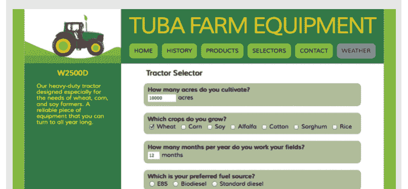

图4-15：为大型小麦、玉米和大豆农场显示的重型拖拉机推荐

2. 取消选中**Wheat**复选框，然后选中**Corn**复选框。注意，拖拉机推荐变为通用型拖拉机。

3. 选中**Wheat**复选框。注意，当选中Wheat复选框时，推荐恢复为专为小麦、玉米和大豆种植者设计的拖拉机。

4. 返回文本编辑器中的**tuba.js**文档，然后找到以下代码行，该行大致位于`createRecommendation()`函数的中部：

```
if (document.getElementById("wheat").checked ||
    document.getElementById("corn").checked &&
    document.getElementById("soy").checked) {
```

要调试这个条件语句，你将注释掉其三个部分中的两个，然后逐一添加回被注释的部分。

5. 点击第一个出现的`checked`单词之后，输入`/*`，然后在第三个出现的`checked`单词之后输入`*/`。这些插入操作注释掉了条件的第二和第三部分，同时保留了最后的`)`和开头的`{`

对于`if`语句的语法是必要的。更新后的代码应与以下内容匹配：

```
if (document.getElementById("wheat").checked /*||
  document.getElementById("corn").checked &&
  document.getElementById("soy").checked*/) {
```

6. 保存你对**tuba.js**的更改，在浏览器中重新加载或刷新**tractor.htm**，在英亩数框中输入**10000**，在月份框中输入**12**，然后点击**Wheat**复选框以选中它。推荐结果与图4-15所示的匹配，表明第一个条件编写正确。

7. 返回文本编辑器中的**tuba.js**文档，移除第一个`checked`单词后的`/*`字符，然后在第二个`checked`单词后插入`/*`。这些编辑使条件的第一部分和第二部分成为代码的一部分，包括它们之间的逻辑运算符。你的代码应与以下内容匹配：

```
if (document.getElementById("wheat").checked ||
  document.getElementById("corn").checked /*&&
  document.getElementById("soy").checked*/) {
```

8. 保存你对**tuba.js**的更改，在浏览器中重新加载或刷新**tractor.htm**，在英亩数框中输入**10000**，在月份框中输入**12**，然后点击**Corn**复选框以选中它。与你在初始测试中选中Corn时不同，这次推荐结果继续与图4-15所示的正确推荐匹配。这表明前两个条件以及连接它们的逻辑运算符编写正确，错误一定出现在仍被注释掉的条件或运算符中。

9. 返回文本编辑器中的**tuba.js**文档。请注意，虽然三个选项——小麦、玉米或大豆——中的任何一个都应该触发对专用拖拉机的推荐，但条件第二部分后的运算符是`&&`，意思是“与”。为了使程序按设计工作，两个逻辑运算符都必须是`||`（“或”）。这允许三个条件中的任何一个为`true`就能触发后面的代码块。

10. 在第二个`checked`单词后，删除`/*`，将`&&`替换为`||`，然后在行尾附近移除`*/`字符。你修改后的代码应与以下内容匹配：

```
if (document.getElementById("wheat").checked ||
  document.getElementById("corn").checked ||
  document.getElementById("soy").checked) {
```

11. 保存你对**tuba.js**的更改，在浏览器中重新加载或刷新**tractor.htm**，在英亩数框中输入**10000**，在月份框中输入**12**，然后点击**Soy**复选框以选中它。这次推荐结果与图4-15所示的正确推荐匹配。

12. 取消选中**Soy**框，然后选中**Corn**框。对玉米的推荐也是准确的。

13. 取消选中**Corn**框，然后选中**Wheat**框。对小麦的推荐也是准确的。

## 编程概念：依赖关系

任何超过几行的程序都包含依赖于其他语句或函数成功执行的语句。这些关系，称为依赖关系，可能会给调试增加额外的复杂性。例如，一个看似由某个函数中的代码引起的错误，实际上可能是程序另一部分中的错误造成的。此外，代码某一部分中的错误可能会阻止依赖代码执行，从而阻止你收到依赖代码的错误消息。在找到并修复错误后，测试在错误修复前正常工作的相关功能非常重要。在某些情况下，修复一个错误可能会暴露另一个错误，或者本身又会产生另一个问题，因此重要的是不要假设在修复错误之前正常工作的所有功能在修复后仍能继续正常工作。

### 小测验2

1. 你可以在代码中添加哪两种不同的语句，以便在调试时为你提供额外信息？

2. 你将使用哪条语句将文本`"itemTotal: "`加上`itemTotal`变量的值记录到控制台？

3. 在调试中，注释掉代码何时有用？

## 使用调试工具跟踪错误

许多高级编程语言，如Visual C++，在其开发环境中直接内置了调试功能。这些内置的调试功能提供了用于跟踪错误的复杂命令。虽然各种JavaScript编辑器包含不同的调试功能，但这些工具也作为当前版本的三大网络浏览器（Internet Explorer、Firefox和Chrome）的一部分广泛可用。

> **注意** 另一个流行的调试工具Firebug，可作为Firefox的免费扩展使用。术语“扩展”指的是可以添加到程序中的附加功能。

在所有主要浏览器中，调试工具可通过与你使用控制台时打开的相同面板访问。所有三个浏览器提供的工具都允许你调试HTML、CSS和网页脚本，它们还包括可用于衡量网站性能的工具。

到目前为止，你已经学习了如何解释错误消息并更正导致错误的语句。尽管很有帮助，但错误消息仅在解决语法和运行时错误时才有用。你还学习了一些帮助你定位逻辑错误的技术。手动检查代码通常是解决逻辑错误的第一步，或者你可以使用警告框或控制台日志消息来跟踪值。这些技术在较小的程序中效果很好。然而，当你创建一个包含许多行代码的大型程序时，逻辑错误可能非常难以发现。例如，你可能有多个执行计算并将结果传递给其他函数进行进一步处理的函数。尝试使用简单的工具（如警告框和日志消息）来跟踪此类程序的逻辑和流程可能很困难。浏览器调试器提供了几个工具，可以帮助你跟踪每一行代码，从而创建一种更有效的方法来发现和解决逻辑错误。

## 理解IE、Firefox和Chrome调试器窗口

要使用三大浏览器中的任何一个调试JavaScript，你需要在浏览器中打开要调试的文档，然后打开调试器。表4-1描述了如何在所有三大浏览器中访问调试工具。

| 浏览器 | 键盘快捷键 | 菜单步骤 |
|---|---|---|
| Internet Explorer 9+ | **F12**，然后**Ctrl + 3** | 单击**工具**图标，单击菜单上的**F12开发人员工具**，然后在打开的窗口中，单击**调试器**按钮 |
| Firefox | **Ctrl + Shift + S** (Win) 或**option + command + S** (Mac) | 单击**打开菜单**按钮，单击**开发者**，然后单击**调试器** |
| Chrome | **Ctrl + Shift + J** (Win) 或**option + command + J** (Mac)，然后在打开的窗口中，单击**Sources**按钮 | 单击**自定义及控制Google Chrome**按钮，单击**工具**，单击**JavaScript控制台**，然后在打开的窗口中，单击**Sources**按钮 |

表4-1：在IE、Firefox和Chrome中打开调试器的步骤

调试器窗口通常显示为附加到浏览器窗口底部的一个单独窗格，如图4-16所示。但是，你也可以将窗格分离到一个单独的窗口中。

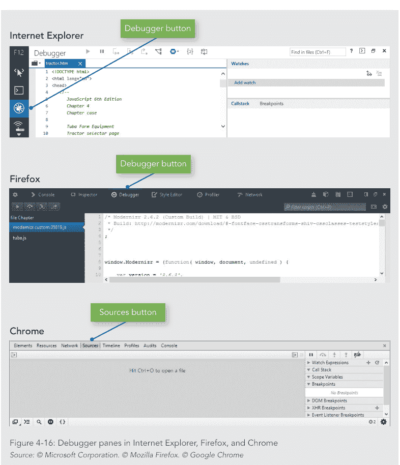

> **注意**
>
> 浏览器制造商不断调整其浏览器工具的功能和外观，因此本图及后续图中的选项可能与你的屏幕不完全匹配。如有必要，将鼠标指针悬停在调试器工具中的按钮上，以查看包含按钮名称的工具提示框。

不同的浏览器默认显示打开文件的不同视图。Internet Explorer显示HTML文档的代码；你可以单击“查看源文件”按钮，从属于当前文档的文件列表中选择要查看的不同文件。Firefox按字母顺序显示关联JavaScript文件的列表，并显示列表中第一个文件的内容；你可以单击列表中的任何文件名以查看其内容并进行操作。Chrome默认不显示任何文件；相反，在选中调试窗格时，你按`Ctrl + O` (Win) 或`command + O` (Mac) 以查看并从关联文件列表中进行选择。

接下来，你将在浏览器的调试器中打开拖拉机选择器程序。

## 在浏览器的调试器中打开拖拉机选择器程序

1. 返回浏览器中的**tractor.htm**文档。

2. 参考表4-1，然后使用你的浏览器的键盘快捷键或菜单步骤打开其调试工具。调试窗格应显示在浏览器窗口底部。

> **注意**
>
> 如果调试工具在单独的窗口中打开，对于Internet Explorer请按`Ctrl + P`，对于Firefox请单击左上角的“停靠到浏览器窗口底部”按钮，或者对于Chrome请单击左下角的“停靠到主窗口”按钮。

3. 使用你的浏览器的方法在调试工具中打开**tuba.js**文件：
   - **Internet Explorer:** 单击**打开文档**按钮，然后在列表中单击**tuba.js**。
   - **Firefox:** 在调试器窗格的左侧，单击**tuba.js**。
   - **Chrome:** 单击调试器窗格的空白区域，按**Ctrl + O** (Win) 或**command + O** (Mac)，然后在列表中单击**tuba.js**。

图4-17显示了tuba.js文件在每个浏览器的调试工具中打开的情况。

## 设置断点

所有三大浏览器的浏览器调试工具都包含一些命令，这些命令可用于在脚本进入中断模式后控制程序执行。术语**中断模式**是指程序执行的临时暂停，以便您可以监控值并跟踪程序执行。进入中断模式需要在代码中插入断点。**断点**是添加到程序中特定语句的一种标记，当程序执行到达该语句时会导致执行暂停。一旦程序在断点处暂停，您就可以使用每个窗口中的命令按钮来跟踪程序执行。当程序进入中断模式时，程序执行并未停止——只是被暂停了。

要设置断点，您需要点击程序执行应停止的行号。浏览器调试工具会在行号上或旁边用一个图标标记每个断点。

添加断点后，Firefox和Chrome会在该语句每次运行时自动在断点处停止程序。Internet Explorer则需要您先点击“开始调试”按钮，然后程序才会受到任何断点的约束。当程序进入中断模式时，程序执行并未停止——只是被暂停了。当程序在断点处暂停时，浏览器调试工具会显示有关程序当前状态的不同类型的信息。要在进入中断模式后恢复程序执行，您可以点击“继续”按钮（Firefox和Chrome）或“继续”按钮（Internet Explorer）。点击这些按钮将正常执行程序的其余部分，直到遇到另一个断点。多个断点提供了一种方便的方法，可以在代码中您认为可能存在错误的关键位置暂停程序执行。

> **注意**
> 在Internet Explorer中，您可以通过点击“停止调试”按钮结束调试会话而不执行程序的其余部分，或者在Chrome中通过点击“禁用断点”按钮，然后点击“恢复脚本执行”按钮来实现。在撰写本文时，Firefox调试工具不包含此选项。

接下来，您将在`createRecommendation()`函数中设置断点，并使用它们来跟踪在表单中输入不同值的结果。

## 在`createRecommendation()`函数中设置断点

1. 在浏览器中，在acres框中输入**100**，点击**Wheat**复选框以选中它，在months框中输入**12**，然后点击**E85**选项按钮以选择它。您的表单应与图4-18匹配。

图4-18：在拖拉机选择器表单中输入的信息

2. 在浏览器调试工具中，向下滚动到第63行，该行内容为`if (monthsBox.value >= 10) { // 每年10个月以上的耕作`，然后点击**63**（行号）以设置断点。

图4-19显示了所有三种浏览器调试工具中设置的断点。

图4-19：在浏览器调试工具中设置的第一个断点

3. 重复步骤2，在第64、67、71、72和75行设置其他断点。现在，您应该在浏览器调试工具中为tuba.js代码标记了六个断点。

4. 在拖拉机选择器表单中，点击acres框中值的末尾，然后输入`0`将值更改为1000。您的输入触发了一个事件监听器，该监听器执行`createRecommendation()`函数。焦点切换到调试工具，其中第63行被突出显示，如图4-20所示。突出显示表示程序已在此断点处停止。

图4-20：tuba.js在第63行断点处停止执行

执行在第63行（您创建的第一个断点）暂停，因为您在acres框中输入的值小于5000。

5. 点击**Continue**按钮 (IE)、**Click to resume**按钮 (Firefox) 或**Resume script execution**按钮 (Chrome)。

> **注意** 有关每个浏览器中相应按钮的位置，请参见图4-20。

现在第64行被突出显示，表示执行已在此断点处暂停，因为您在表单中输入的months值大于10，这意味着程序正在执行包含第64行的`if`子句。

6. 点击**Continue**按钮 (IE)、**Click to resume**按钮 (Firefox) 或**Resume script execution**按钮 (Chrome)。这些按钮不再被突出显示，没有断点代码具有特殊格式，这表明程序已执行完毕，没有遇到其他断点。您可以通过在表单中输入不同的信息来探索程序的不同执行路径。

7. 在拖拉机选择器表单中，点击acres框中值的末尾，然后输入**0**将值更改为10000。请注意，执行在您设置的第四个断点（第71行）处暂停，而不是在第一个断点（第63行）处。因为acres框中的更改值大于5000，所以包含第63、64和67行的`if`子句被跳过。只有当断点即将被执行时，执行才会在该断点处暂停。

8. 点击**Continue**按钮 (IE)、**Click to resume**按钮 (Firefox) 或**Resume script execution**按钮 (Chrome)。这一次，第72行的断点被跳过，调试工具在第75行暂停执行。这是因为第72行上方的`if`子句值为`false`，因此包含第72行的代码块未被执行。

9. 点击**Continue**按钮 (IE)、**Click to resume**按钮 (Firefox) 或**Resume script execution**按钮 (Chrome)。这些按钮不再被突出显示，没有断点代码具有特殊格式，这表明程序已执行完毕，没有遇到其他断点。

### 清除断点

要在任何浏览器的调试工具中清除单个断点，您只需点击行号。要清除文档中的所有断点，在断点列表中，右键单击任意断点，然后点击“移除所有断点”或“全部删除”。

您将从tuba.js文件中移除所有断点。

**从tuba.js文件中移除断点：**

1. 如果需要，滚动到第63行，然后点击**63**（行号）以移除断点。

2. 在断点列表中，右键单击任意断点的描述，然后点击**Remove all breakpoints** (Firefox和Chrome) 或**Delete all** (IE)。所有剩余的断点将被移除。

> **注意** 在Chrome中，断点列表可能不会立即可见。在调试工具窗格的右侧，在单步执行按钮下方的列表中，向下滚动到标题为“Breakpoints”的部分，然后完成步骤2。

## 逐步执行脚本

所有三种浏览器的调试工具都包含一组称为**单步执行选项**的替代选项，这些选项允许您在进入中断模式后继续程序执行。第一种称为**单步进入**，它执行一行代码，然后暂停，直到您指示调试器继续。此功能使您能够在代码执行时评估程序流程和结构。

当您使用“单步进入”按钮遍历代码时，调试器会在JavaScript程序中每个函数的每一行代码处停止。但是，当逐步执行程序以跟踪逻辑错误时，能够跳过您知道功能正常的函数会很方便。第二种选项称为**单步越过**，它允许您跳过函数调用。程序仍然会执行您单步越过的每个函数，但在每个调试器中看起来就像执行了一条语句。

最后一个选项是**单步跳出**，它执行当前函数中所有剩余的代码。如果当前函数是从另一个函数调用的，则当前函数中所有剩余的代码将被执行，调试器将停止在调用函数中的下一条语句。

接下来，您将使用单步执行选项来跟踪程序的执行。

**使用单步执行选项跟踪程序执行：**

1. 在浏览器的调试工具中，向上滚动到第50行，然后点击**50**（行号）设置断点。

2. 在拖拉机选择器表单上，点击**E85**选项按钮。由于这是一个已选中的选项按钮，点击它不会改变其值；但是，它会触发该按钮的事件监听器，该监听器执行与表单关联的函数。焦点切换到调试工具，调试工具显示程序在第50行暂停，该行调用了`testFormCompleteness()`函数。

3. 点击**Step into** (IE和Chrome) 或**Step In** (Firefox) 按钮，如图4-21所示。调试工具将高亮显示移动到第55行，这是`testFormCompleteness()`函数中的第一条语句。

4. 再次点击**Step into**或**Step In**按钮，移动到第56行的下一条语句`createRecommendation();`。你已经探索过`createRecommendation()`函数，因此你将跳过它。

5. 点击**Step over**按钮执行`createRecommendation()`函数。脚本执行要么停留在第56行，表示函数调用已被跳过；要么移动到第58行，即调用`createRecommendation()`函数的`testFormCompleteness()`函数的末尾。

6. 点击**Step into**或**Step In**按钮。脚本执行返回到第50行或51行，位于`verifyFuel()`函数内。

7. 点击**Step out**按钮完成调试和程序执行。

8. 在第50行，点击**50**（行号）以移除断点。

> **注意** 拖拉机选择器程序的结构最终支持验证以发现更多类型的错误，这将在第6章中学习。即使可以通过移除`verifyFuel()`等函数来简化程序，但这些函数包含在程序架构中以支持未来的功能。

## 追踪变量和表达式

在使用步进命令和断点追踪程序执行时，你可能还需要追踪变量和表达式在程序执行过程中的变化。例如，假设你有一条语句`resultNum = firstNum / secondNum`。如果尝试除以零，将返回`infinity`值。你知道这一行导致了除零错误，但不知道`secondNum`何时被更改为零值。要精确定位逻辑问题的原因，你需要一种方式来追踪程序执行并找到`secondNum`被更改为零值的准确位置。

所有浏览器中的调试工具都会显示当前执行函数内的局部变量列表，无论它们是否已初始化。**变量列表**帮助你查看当前执行函数中的不同值如何影响程序执行。此外，每个浏览器都允许你创建**监视列表**，这是一个表达式列表，其值会在程序执行过程中显示和更新。

在三个浏览器中，监视列表和变量列表都显示在调试工具窗格的右侧部分：

- **Internet Explorer**：监视列表默认显示在调试工具窗格的右侧。在断点模式下，局部变量和全局变量会自动显示在监视列表中。
- **Firefox**：点击展开窗格按钮以打开调试工具右侧的窗格；该窗格包含监视列表和变量列表。
- **Chrome**：监视表达式和作用域变量列表默认显示在调试工具窗格的右侧，位于步进按钮下方。

要在任何浏览器中将表达式添加到监视列表，首先需要找到程序中该表达式的一个实例，选择它并将其复制到剪贴板。接着点击**Click to add**（IE）或**Add watch expression**（Firefox或Chrome），从剪贴板粘贴表达式，然后按Enter。该表达式将与其当前值一起显示在列表中。

你在Tuba Farm Equipment的联系人已经测试了你对拖拉机选择器应用程序的最新更改，并发现了一个额外的bug。应在型号名称末尾添加一个字母来表示所选燃料源——*E*代表E85，*B*代表生物柴油，或*D*代表标准柴油。E85和标准柴油的字母已正确附加。但是，当用户选择生物柴油时，型号编号被更改为仅*B*。你将创建一个监视表达式来监视程序执行过程中型号名称的变化，以识别此bug的来源。

### 要将表达式添加到监视列表以监视型号名称的值

1. 向下滚动到第84行，然后点击**84**（行号）以添加断点。第84行是确定要附加到型号名称的字母的`if/else`语句的开始。

2. 在第85行，选择文本`messageHeadElement.innerHTML`，然后按**Ctrl + C**（Win）或**command + C**（Mac）将其复制到剪贴板。

3. 按照浏览器的说明将表达式添加到监视列表：
   - **Internet Explorer**：在调试工具窗格的右侧，点击**Add watch**，按**Ctrl + V**粘贴剪贴板内容，然后按**Enter**。
   - **Firefox**：在调试工具窗格的右侧，如有必要点击**Expand panes**按钮以显示监视列表和变量列表，点击**Add watch expression**，按**Ctrl + V**（Win）或**command + V**（Mac）粘贴剪贴板内容，然后按**Enter**。
   - **Chrome**：在调试工具窗格的右侧，如有必要向上滚动到Watch Expressions部分，点击**Add watch expression**按钮，按**Ctrl + V**（Win）或**command + V**（Mac）粘贴剪贴板内容，然后按**Enter**。

图4-22显示了在每个浏览器中将表达式添加到监视列表后的调试工具窗格。

图4-22：表达式已添加到监视列表

> **注意** 如果浏览器中的监视列表不如图4-22中显示的那么宽，将指针移到tuba.js代码和监视列表之间的边界上，直到指针变为双头箭头，然后向左点击并拖动，直到监视列表的宽度与图中的一致。

4. 在拖拉机选择器表单中，点击E85单选按钮。焦点切换到调试工具窗格，其中第84行（你添加的断点位置）被高亮显示。如图4-23所示，监视列表显示你正在监视的表达式值为W2500。这是由已经运行的`createRecommendation()`函数部分生成的型号名称。第84–90行负责识别正确的燃料后缀——*E*、*B*或*D*——并将其附加到现有型号名称的末尾。

图4-23：监视列表中的表达式值已更新

5. 点击**Step into**或**Step In**按钮。由于第84行的`if`子句求值为`true`，脚本执行移动到第85行。

> **注意** 如果点击Step into或Step In后第85行未被高亮显示，请再次点击Step into或Step In。

6. 再次点击**Step into**或**Step In**按钮。第85行的表达式被执行，监视列表中的表达式值正确更新为W2500E。

> **注意** 如果点击Step into或Step In后高亮未离开第85行，请再次点击Step into或Step In。

7. 点击**Resume**或**Continue**按钮。脚本执行完成，表达式值保持为W2500E。接下来你将观察点击Biodiesel单选按钮后表达式值的变化。

8. 点击**Biodiesel**单选按钮，点击**Step into**或**Step In**按钮，然后再次点击**Step into**或**Step In**按钮。表达式值从W2500开始复燃，就像你第一次点击E85时一样。这次程序执行移动到第86行，因为第一个`if`语句中的表达式求值为`false`，然后移动到第87行，因为第二个`if`语句中的表达式求值为`true`。

> **注意** 如果点击Step into或Step In两次后第87行未被高亮显示，请再点击Step into或Step In两次。

9. 再次点击**Step into**或**Step In**按钮。如图4-24所示，监视列表现在显示表达式值仅为*B*。这表明第87行的代码存在问题。

图4-24：监视列表中的表达式值再次更新

10. 点击**继续**（Resume）或**继续**（Continue）按钮，移除第84行的断点，然后在文本编辑器中返回**tuba.js**。

11. 在第87行，内容为`messageHeadElement.innerHTML = "B";`，将`=`改为`+=`，使你的代码与以下内容一致：

```
messageHeadElement.innerHTML += "B";
```

12. 保存对**tuba.js**的更改，在浏览器中刷新或重新加载**tractor.htm**，在英亩数输入框中输入**10000**，勾选**小麦**（Wheat）复选框，在月份输入框中输入**12**，然后点击**生物柴油**（Biodiesel）单选按钮。如图4-25所示，型号现在正确显示为W2500B，而不仅仅是*B*，这表明你已经修复了该bug。

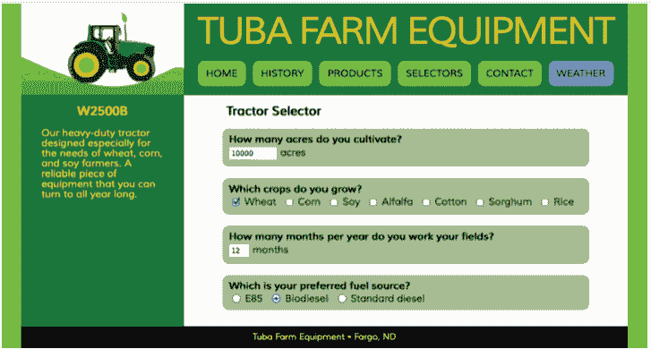

图4-25：显示正确型号名称的推荐结果

## 检查调用栈

当你处理包含多个函数的JavaScript程序时，处理器必须记住函数的执行顺序。例如，如果你有一个`accountsPayable()`函数调用了一个`accountsReceivable()`函数，计算机必须记住在`accountsReceivable()`函数执行完成后返回到`accountsPayable()`函数。同样，如果`accountsReceivable()`函数在被`accountsPayable()`函数调用后，又调用了一个`depositFunds()`函数，那么计算机必须记住在`depositFunds()`函数执行完成后返回到`accountsReceivable()`函数，然后在`accountsReceivable()`函数执行完成后返回到`accountsPayable()`函数。**调用栈**（call stack）是JavaScript处理器维护的一个有序列表，包含所有已被调用但尚未完成处理的程序，如函数、方法或事件处理程序。每次程序调用一个程序时，该程序被添加到调用栈的顶部，执行完成后则被移除。

例如，假设你正在处理一个包含`createWeatherReport()`函数的程序，该函数又包含对`getTemperature()`函数的调用。当`createWeatherReport()`函数被调用时，它被添加到调用栈中。当`createWeatherReport()`函数随后调用`getTemperature()`函数时，`getTemperature()`函数被添加到调用栈的顶部，表示它是当前正在执行的函数。然而，`createWeatherReport()`函数仍然保留在调用栈中，因为它尚未完成执行。`getTemperature()`函数又包含对`convertReadingToCelsius()`函数的调用；当程序执行到达该函数调用时，`convertReadingToCelsius()`函数移动到调用栈的顶部，`getTemperature()`函数在其下方，`createWeatherReport()`函数在最下方。通过这种方式，调用栈展示了导致当前执行函数的函数调用链，并列出了所有尚未完成执行的函数。

在追踪包含多个函数的大型程序中的逻辑错误时，能够查看显示调用栈内容的列表非常有用。例如，假设你有一个变量作为参数在多个函数之间传递。再假设该变量被赋予了错误的值。查看调用栈，同时使用追踪命令，可以更容易地定位导致问题的特定函数。所有主流浏览器的调试工具都包含在调试程序时查看调用栈内容的功能。现在你将使用此功能来观察拖拉机选择器应用程序中函数的执行顺序。

## 在拖拉机选择器应用程序执行时监控调用栈

1. 向上滚动到第50行，然后点击**50**（行号）以添加断点。

> **注意**
> 如果你使用的是Chrome，可能需要滚动到调试工具窗格右侧部分的顶部，以便看到“调用栈”（Call Stack）标题。在Internet Explorer中，可能需要向下滚动调试工具窗格的右侧部分。如果你使用的是Firefox，调用栈默认显示。

2. 在拖拉机选择器表单上，点击**E85**单选按钮以触发`verifyFuel()`函数的执行。焦点返回到调试工具，第50行被高亮显示。函数名`verifyFuel`被添加到调用栈中，如图4-26所示。

图4-26：调用栈中列出的`verifyFuel`函数

3. 点击**步入**（Step into）或**步入**（Step In）按钮。`testFormCompleteness`函数被添加到调用栈的顶部，同时`verifyFuel`也保留在调用栈中。这表明`testFormCompleteness`是当前正在执行的函数，当它执行完成后，程序流程将返回到`verifyFuel`函数。

4. 继续点击**步入**（Step into）或**步入**（Step In）按钮，直到执行推进到第62行，即`createRecommendation()`函数的开始。`createRecommendation`被添加到调用栈的顶部，位于`testFormCompleteness`和`verifyFuel`之上。

5. 继续点击**步入**（Step into）或**步入**（Step In）按钮，直到执行返回到第56行或第58行，即`testFormCompleteness()`函数的末尾。`createRecommendation()`函数完成，`createRecommendation`从调用栈列表中移除。

6. 继续点击**步入**（Step into）或**步入**（Step In）按钮，直到执行返回到第50行或第51行，即`verifyFuel()`函数的末尾。`testFormCompleteness()`函数完成，`testFormCompleteness`从调用栈列表中移除。

7. 继续点击**步入**（Step into）或**步入**（Step In）按钮，直到程序执行完成，`verifyFuel`从调用栈列表中移除，调用栈变为空。

8. 点击**50**（行号）以移除断点，然后关闭调试工具窗格。

## 职场技能：报告Bug

无论你是作为团队成员还是个人技术支持人员工作，你都需要能够清晰简洁地描述在应用程序中遇到的任何bug。遵循表4-2中的该做和不该做事项，以确保你生成的报告对负责追踪和解决问题的人员有用。

| 该做（DO） | 不该做（DON'T） |
|---|---|
| 详细描述重现错误所需的步骤、你预期这些步骤会产生的结果，以及你实际观察到的结果 | 急于下结论判断可能导致bug的原因，并报告这些猜测 |
| 提供任何错误消息的准确文本 | 仅总结错误消息的大意 |
| 让自己可以回答进一步的问题或进行演示 | 期望bug立即被修复 |

表4-2：报告Bug的该做和不该做事项

## 简短测验3

1. 什么是断点？如何设置断点？

2. 解释步入（或进入）、步过和步出之间的区别。

3. 什么是调用栈？如何在调试中使用它？

# 处理异常和错误

任何优秀的程序员都希望创建无bug的程序。然而，在实践中，即使是编写得最好、调试最彻底的代码，在发布给用户时也可能包含一些未检测到的bug。此外，需要用户输入的程序有时会在输入不符合提供给用户的指南时失败，例如用户在数字字段中输入单词。因此，优秀的程序员还应该努力编写能够预见任何可能发生的问题并包含优雅处理方法的代码。编写能够预见和处理潜在问题的代码通常称为**防弹编程**（bulletproofing）。一种常见的防弹编程技术是在提交表单数据时进行验证。例如，你可以在点击提交按钮时运行一个脚本，验证任何必填文本框的值是否不是空字符串。

> **注意** 你将在第6章学习额外的表单数据验证技术。

另一种防弹编程的方法是使用**异常处理**，它允许程序在程序执行过程中处理错误，或通常称为**异常**的情况。许多高级编程语言，包括ECMAScript Edition 5.1，都包含异常处理能力。你使用异常处理来测试任何类型的输入或程序外部的功能。对于大多数编程语言，异常处理在连接数据库或尝试访问其他类型的外部程序时最为有用。由于JavaScript目前不支持强大的数据库连接方法，使用异常处理的主要原因是评估用户输入。虽然从技术上讲，你可以对所有JavaScript程序使用异常处理，但你的代码应该经过充分测试，足以预见任何可能发生的问题。然而，有一个你无法控制的领域，那就是用户是否输入了正确类型的数据。

JavaScript包含四个专门用于异常处理的语句：`try`、`throw`、`catch`和`finally`。

## 使用`try`和`throw`语句

你将可能包含异常的代码放在**try语句**中。`try`语句的语法如下：

```
try {
    statements;
}
```

如果评估`statements`的结果是错误——例如，尝试将数字除以0的结果——那么就会触发错误，或**抛出**（thrown）错误。

或者，你可以在`try`语句中测试一个条件，然后添加一个`throw`语句，以便在结果为`false`时指定一个错误消息。

例如，如果你希望在用户提交表单时，将`id`值为`lName`的元素留空的情况下抛出一个错误，你可以使用以下结构：

```
try {
    var lastName = document.getElementById("lName").value;
    if (lastName === "") {
        throw "Please enter your last name.";
    }
}
```

仅创建一个`try`语句本身只会生成一个被识别为消息的文本字符串。要指定该消息的使用方式，你需要使用一个`catch`语句。

## 捕获异常

在你抛出一个错误之后，你需要使用一个`catch()`语句来处理或“捕获”该错误。`catch`语句的语法如下：

```
catch(error) {
    statements;
}
```

`catch`语句接受一个参数，该参数为由`try`语句抛出的异常指定的错误消息分配一个名称。你在创建`catch`语句时指定的任何参数名称，就是你将在`statements`内部用来引用抛出的异常文本的变量名。下面的`catch`语句演示了如何捕获评估`lName`字段值的`try`语句所抛出的异常。注意，`window.alert()`语句显示了作为其值传递的`lNameError`变量。`catch`语句还会向调用语句返回一个值`false`，这表示表单的`submit`事件监听器不应执行。

```
catch(lNameError) {
    window.alert(lNameError);
    return false;
}
```

与前面的`try`语句结合使用，如果用户尝试使用空白的`lName`字段提交表单，此代码将导致一个包含文本“Please enter your last name.”的警报对话框。

> 每当一个`try`语句抛出一个异常时，JavaScript解释器都会执行最近的`catch`语句。如果在抛出异常的结构中没有找到`catch`语句，JavaScript解释器会在上一级代码中查找`catch`语句。例如，如果一个`if`语句包含一个`throw`语句，但它不包含`catch`语句，JavaScript解释器会在包含该`if`语句的函数中查找。然后，如果该函数不包含`catch`语句，JavaScript解释器会在全局级别查找`catch`语句。如果一个结构包含`try`和`finally`语句，但没有`catch`语句，那么在JavaScript构造函数开始在更高一级查找`catch`语句之前，`finally`语句会先执行。

## 执行最终的异常处理任务

JavaScript的异常处理功能还包括一个**finally**语句，无论其关联的`try`块是否抛出异常，它都会执行。你通常使用`finally`语句在通过`try`语句评估代码后执行某种类型的清理或任何必要的任务。`finally`语句的语法如下：

```
finally {
    statements;
}
```

以下示例包含完整的`validateLName()`函数，其中包含用于评估名字值的`try`、`throw`、`catch`和`finally`语句：

```
function validateLName() {
    try {
        var lastName = document.getElementById("lName");
        if (lastName.value === "") {
            throw "Please enter your last name.";
        }
    }
    catch(lNameError) {
        window.alert(lNameError)
        return false;
    }
    finally {
        lNameValid = true;
    }
}
```

你在Tuba Farm Equipment的联系人对应用的现状很满意。他们现在希望你添加代码来处理用户在英亩或月份框中输入文本的情况，或者在英亩框中输入0，或在月份框中输入超出1-12范围的数字的情况。任何这些情况都会导致`createRecommendation()`函数无法按设计工作。你将添加异常处理程序来处理这些情况。

## 为拖拉机选择器应用添加异常处理

1. 返回你的文本编辑器中的**tuba.js**文档。

2. 找到`verifyAcres()`函数，然后删除其内容——语句`testFormCompleteness();`——使该函数为空。

3. 在`verifyAcres()`函数的代码块内，输入以下语句来创建变量：

```
var validity = true;
var messageText = "";
```

你将使用这些变量来跟踪用户的输入是否有效，以及要写入侧边栏的消息文本。

4. 在变量声明下方，输入以下`try`语句：

```
try {
    if (!(acresBox.value > 0)) {
        throw "Please enter a number of acres greater than 0.";
    }
}
```

此语句检查`acresBox`变量（它引用`id`值为`acres`的输入框）的值是否大于0。如果不是，它会抛出一个错误，消息为“Please enter a number of acres greater than 0.”

5. 在`try`语句下方，输入以下`catch`语句：

```
catch(message) {
    validity = false;
    messageText = message;
    acresBox.value = ""; // remove erroneous entry from input box
}
```

此语句将`validity`变量的值设置为`false`，将`messageText`变量的值设置为`try`语句抛出的错误消息的文本，然后将输入框的值设置为空字符串，从而删除错误的条目。

6. 在`catch`语句下方，输入以下`finally`语句：

```
finally {
    acresComplete = validity;
    messageElement.innerHTML = messageText;
    messageHeadElement.innerHTML = ""; // remove any former recommendation heading
    testFormCompleteness();
}
```

此语句将全局变量`acresComplete`的值设置为`validity`变量的值。这允许其他函数识别英亩框中的用户输入是否已准备好生成建议。接下来，显示任何错误消息的侧边栏元素（由变量`messageElement`引用）的文本内容被设置为`messageText`变量的值。如果抛出了错误，这会将错误文本放入侧边栏；否则，它会将侧边栏文本的值设置为空字符串。接下来，显示任何先前建议的型号名称的侧边栏元素的文本内容被设置为空字符串，以防错误消息替代了先前的建议。最后，调用`testFormCompleteness()`函数。

你的`verifyAcres()`函数应与以下内容匹配：

```
function verifyAcres() {
    var validity = true;
    var messageText = "";
    try {
        if (!(acresBox.value > 0)) {
            throw "Please enter a number of acres greater than 0.";
        }
    }
    catch(message) {
        validity = false;
        messageText = message;
        acresBox.value = ""; // remove erroneous entry from input box
    }
    finally {
        acresComplete = validity;
        messageElement.innerHTML = messageText;
        messageHeadElement.innerHTML = ""; // remove any former recommendation heading
        testFormCompleteness();
    }
}
```

7. 向下滚动到`verifyMonths()`函数，删除其内容，然后添加以下变量和错误处理语句，使你的`verifyMonths()`函数与以下内容匹配：

```
function verifyMonths() {
    var validity = true;
    var messageText = "";
    try {
        if (!(monthsBox.value >= 1 && monthsBox.value <= 12)) {
            throw "Please enter a number of months between 1 and 12.";
        }
    }
    catch(message) {
        validity = false;
        messageText = message;
        monthsBox.value = ""; // remove erroneous entry from input box
    }
    finally {
        monthsComplete = validity;
        messageElement.innerHTML = messageText;
        messageHeadElement.innerHTML = ""; // remove any former recommendation heading
        testFormCompleteness();
    }
}
```

此错误处理代码的结构与你在上文`verifyAcres()`函数中添加的代码相匹配。

8. 保存对**tuba.js**的更改，在浏览器中重新加载或刷新**tractor.htm**，然后在英亩数框中输入**0**。如图4-27所示，错误消息“Please enter a number of acres greater than 0.”显示在侧边栏中，并且无效输入已从英亩数框中移除。

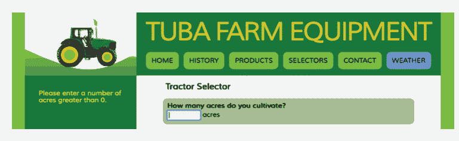

9. 在英亩数框中输入**10**。错误消息从侧边栏中移除。

10. 在月数框中输入**13**。如图4-28所示，错误消息“Please enter a number of months between 1 and 12.”显示在侧边栏中，并且无效输入已从月数框中移除。

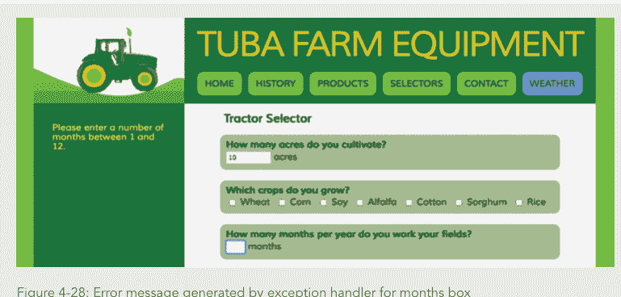

11. 在月数框中输入**8**。错误消息从侧边栏中移除。

## 实现自定义错误处理

异常处理的主要目的是提供一种优雅的方式来处理程序中可能发生的错误。正如你在本章前面所学到的，在JavaScript中使用异常处理的主要原因是评估用户输入。你不仅可以对特定类型的代码使用异常处理，还可以编写自己的自定义代码来处理网页上发生的任何类型的错误。无论使用何种编程语言，许多程序员通常更喜欢编写自己的错误处理代码。这不仅允许程序员编写用户友好的消息，还让他们对程序中发生的任何错误拥有更大的控制权。你可能还会发现自定义错误处理对于调试脚本很有用。本节解释如何向JavaScript程序添加自定义错误处理代码。

> **注意** 请注意，本节解释如何覆盖Web浏览器的默认错误处理功能。在大多数情况下，你应该彻底测试和调试你的脚本，然后让Web浏览器的默认错误处理功能处理你遗漏的任何错误。然而，在某些情况下，你可能会发现有必要编写自己的错误处理功能，特别是在需要用户输入的交互式网页中。

正如你在本章前面所看到的，现代浏览器通常将错误消息发送到控制台，开发者可以在那里查看它们，而用户不会被打扰。通过自定义错误处理，你可以创建自己的函数，在程序发生故障时添加额外说明或记录某些变量的值。这些信息可以帮助你更快地理解错误的性质、定位其来源并修复它。

## 使用`error`事件捕获错误

JavaScript包含一个`error`事件，每当网页上发生错误时就会执行。以下代码指定了一个名为`processErrors()`的函数来处理页面上发生的任何JavaScript错误。

```
if (window.addEventListener) {
    window.addEventListener("error", processErrors, false);
} else if (window.attachEvent) {
    window.attachEvent("onerror", processErrors);
}
```

为了防止Web浏览器执行其自身的错误处理功能，你需要从`error`事件函数返回一个`true`值，如下面的`processErrors()`函数示例所示：

```
function processErrors() {
    custom error handling code
    return true;
}
```

> **注意** 创建`error`事件函数并不能修复JavaScript程序中的错误；其唯一目的是给你一个用自定义代码处理它们的机会。

## 编写自定义错误处理函数

当通过将自定义错误处理函数赋值给`error`事件来指定它时，对于发生的任何JavaScript错误，JavaScript解释器会自动按以下顺序向该函数传递三个参数：错误消息、URL和行号。你可以通过向函数定义添加参数来在自定义错误处理函数中使用这些值。然后，你可以在函数中使用这些参数，将有关可能发生的任何JavaScript错误位置的信息发送到控制台。例如，以下代码显示了`processErrors()`函数的修改版本，其中包含被赋值为JavaScript解释器传递的三个参数的参数。

```
function processErrors(errMessage, errURL, errLineNum) {
    console.log("The file " + errURL
        + " generated the following error: "
        + errMessage + " on line " + errLineNum);
    return true;
}
if (window.addEventListener) {
    window.addEventListener("error", processErrors, false);
} else if (window.attachEvent) {
    window.attachEvent("onerror", processErrors);
}
```

如果你将前面的代码包含在你的网页中，消息将被写入控制台日志，记录页面包含的任何JavaScript错误。

## 简短测验4

1. 什么时候需要在代码中包含异常处理？举一个例子。

2. 在处理异常的代码中，你使用哪个语句来指定错误消息？

3. 在`catch()`语句中，你如何引用先前生成的错误消息？

## 其他调试技术

本章的其余部分讨论了在JavaScript程序中定位和纠正错误的其他方法和技术，包括检查HTML元素、分析逻辑、使用控制台命令行测试语句、使用`debugger`语句、以严格模式执行代码、代码检查以及重新加载网页。

## 检查HTML元素

有时，无论你搜索多久，都无法定位错误的根源。在这种情况下，缺陷可能根本不在于你的JavaScript代码，而在于你的HTML元素。如果你无法使用本章描述的任何方法定位错误，请逐行分析你的HTML代码，确保所有标签都有开始和结束括号。同时，确保所有必要的开始和结束标签（如`<script></script>`标签对）都已包含。

你也可以利用免费工具为你执行部分此类分析。其中一种方法是在专门用于Web开发的编辑器（如Notepad++、Aptana Studio或KomodoEdit）中编写代码。这些编辑器以及类似的工具会在你输入时自动高亮显示HTML、CSS和JavaScript代码中的语法错误。这意味着你无需仔细检查每一行代码，可以依靠编辑器在视觉上吸引你注意它识别出的任何错误——通常甚至在你测试代码之前。

另一个自动检查代码的工具是W3C标记验证服务（http://validator.w3.org），你在第1章中使用过它。许多验证错误也会导致浏览器问题，因此验证你的HTML并修复验证器识别出的任何问题可以帮助你消除HTML代码中的错误，同时帮助你确保你的HTML能够跨浏览器工作。

以下代码包含可能导致JavaScript问题的有缺陷的HTML元素。检查代码并寻找错误，这些错误可能很难发现。

```
<!DOCTYPE html>
<html lang="en">
<head>
  <title>Error Example</title>
  <meta charset="utf-8" />
  <script>
      document.write("<h2>Tractor Selector</h2>");
  </script>
</head>
<body>
  <h1>Tuba Farm Equipment</h1>
</body>
</html>
```

前面代码的问题在于开始的`<script>`元素缺少结束括号。没有结束括号，浏览器只会看到你想包含在文档头部部分的脚本部分。由于头部部分的内容不会被渲染，你永远不会收到错误消息，也不会看到`document.write()`方法的输出。在你的调试工作中，你可能会认为JavaScript代码运行不正常，而实际上它根本没有运行。值得一提的是，W3C标记验证服务本可以立即发现这个问题，因此请经常验证你的网页。

## 分析逻辑

有时，JavaScript代码中的错误源于使用跟踪技术难以发现的逻辑问题。当你怀疑代码包含逻辑错误时，必须逐个分析每个语句。例如，以下代码包含一个阻止其正常运行的逻辑缺陷：

```
var displayAlert = false;
var conditionTrue;
if (displayAlert === true)
    conditionTrue = "condition is true";
    window.alert(conditionTrue);
```

如果你执行前面的代码，你将始终看到警报对话框，尽管它不应该出现，因为`displayAlert`变量被设置为`false`。然而，如果你更仔细地检查`if`语句，你会看到`if`语句在声明`conditionTrue`变量后就结束了。变量声明后面的`window.alert()`方法不是`if`结构的一部分，因为`if`语句不包含一组花括号来包围当条件评估返回`true`时要执行的行。`window.alert()`方法还显示值`undefined`。这是因为`conditionTrue`变量在第二条语句中声明时未被赋值，并且因为将值赋给`conditionTrue`变量的语句在`if`语句的条件表达式计算结果为`false`时会被绕过。为了使代码正确执行，`if`语句必须包含如下所示的花括号：

```
var displayAlert = false;
var conditionTrue;
if (displayAlert === true) {
    conditionTrue = "condition is true";
    window.alert(conditionTrue);
}
```

以下`for`语句展示了另一个容易被忽略的逻辑错误示例：

```
var count = 0;
for (count = 1; count < 6; count++); {
    document.write(count + "<br />");
}
```

前面的代码应该将数字1到5打印到屏幕上。然而，行`for (var count = 1; count < 6; count++);`包含一个结尾分号，这标志着`for`循环的结束。循环执行五次，并将`count`的值更改为6，但除此之外什么也不做，因为在它的结尾分号之前没有语句。行`document.write(count + "<br />");`是一个单独的语句，只执行一次，将数字6打印到屏幕上。代码在语法上是正确的，但并未按您预期的方式运行。从这些例子中可以看出，很容易忽略代码中非常微小的逻辑错误。

## 使用控制台命令行测试语句

如果您发现代码中的错误是由单个语句引起的，您可以使用控制台命令行来测试该语句，而无需重新运行整个程序。您在第3章中看到，浏览器会评估您在浏览器工具命令行中输入的变量名并返回其值。您也可以在命令行输入一个语句，浏览器会对其进行评估和执行。例如，要显示计算结果，您可以在命令行输入`15000 * .08`。

只要您停留在同一页面且未刷新，浏览器就会存储您为变量名分配的任何值。这使您可以在命令行输入多个相互关联的语句。例如，要声明一个变量然后在计算中使用其值，您可以输入以下语句：

```
var price = 15000
price * .08
```

请注意，在命令行输入的语句末尾不需要包含分号。这是因为每个条目在默认情况下都被视为单行代码。

如果您正在尝试为数学表达式构建正确的语法，命令行尤其有用。以下代码计算100,000美元抵押贷款的应还总额。该计算添加了百分之八的利息和35美元的滞纳金。然而，由于优先级问题，该计算无法正确运行。

```
var mortgageBalance = 100000;
var interest = .08;
var lateFees = 35;
document.write(mortgageBalance + lateFees * 1 + interest);
```

虽然您可以直接在JavaScript程序中修改公式的结构，但您也可以使用命令行来测试计算。以下语句声明变量，然后在控制台中显示公式的结果。已将纠正优先级问题的括号添加到公式中。

```
var mortgageBalance = 100000
var interest = .08
var lateFees = 35
(mortgageBalance + lateFees) * (1 + interest)
```

图4-29显示了Chrome控制台中的结果。

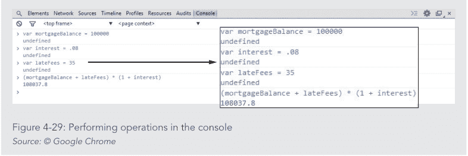

## 使用`debugger`语句

JavaScript包含一个语句`debugger`，在某些情况下可以使调试更容易。当您将`debugger`语句添加到代码中，然后在打开了调试工具的浏览器中运行它时，浏览器在到达`debugger`语句时会停止执行程序，并将焦点切换到调试工具。

`debugger`语句的作用类似于您JavaScript代码中的一部分断点。

## 使用严格模式

从5.1版本开始，ECMAScript包含一个新功能：能够请求处理器以严格模式处理代码。在**严格模式**下，某些功能从语言中移除，而其他功能则需要更严格的语法。例如，您可以使用或不使用`var`关键字创建变量，尽管出于多种原因，大多数开发人员建议始终使用此关键字。在严格模式下，不使用`var`关键字声明变量会触发异常。

虽然在严格模式下编码实际上可能会产生更多错误，但它可能是一个有用的调试工具。严格模式禁止的或要求以特定方式使用的许多特性，以其在使用非严格语法实现的代码中导致难以发现的错误而闻名。

要请求JavaScript处理器以严格模式解析您的代码，请将以下语句添加到您的代码中：

```
"use strict";
```

如果您将此语句添加到脚本部分的开头，那么该脚本部分中的所有代码都将以严格模式进行处理。如果您改为将此语句添加到函数的开头，那么只有该函数内的代码将以严格模式进行处理。

请注意，并非所有浏览器都支持严格模式；特别是，许多较旧的浏览器不支持它。但是，由于语句`"use strict"`是一个字符串而不是一组关键字，因此它在较旧的浏览器中不会生成异常。

出于调试目的，使用严格模式开发和测试所有代码可能很有用。这不仅有助于您注意到代码中可能导致问题的问题，还有助于您加强编码技术，以使用当前的最佳实践，而不是依赖于语言中某些部分——尽管这些部分在技术上仍然是规范的一部分，但通常不建议使用。

> **注意** 许多网络开发人员主张所有JavaScript编码都在严格模式下完成，以使代码尽可能无懈可击。从第5章开始，您在本书中使用和创建的所有代码都将使用严格模式。

## 代码检查

**代码检查**涉及将您的代码通过一个程序运行，该程序会标记一些可能影响代码质量的常见问题。许多编程语言都有这样的程序。用于JavaScript代码的最常用程序之一称为jslint。使用jslint检查您的代码可以捕获与在严格模式下执行代码时相同的许多错误。然而，虽然严格模式通过在浏览器控制台中生成错误消息来帮助您加强代码，但jslint会生成一个报告，为每个标记的问题识别代码中的行号。这使得使用jslint更容易找到和修复大多数错误。

使用jslint检查代码有两种主要方式。您可以访问jslint.com，将代码粘贴到界面中，然后进行检查并查看报告。但是，如果您定期编写JavaScript，这种方法很快就会变得耗时且不切实际。相反，您可以启用许多常见代码编辑器中内置的jslint功能，这些功能会在您输入时标记潜在问题。查看您编辑器的文档或在线支持，了解如何启用和配置jslint支持。

请注意，某些jslint建议存在争议。例如，默认情况下，jslint建议将所有变量声明分组到单个`var`语句中，而不是使用多个`var`语句。然而，许多JavaScript开发人员认为他们的代码在使用多个`var`语句时更健壮，因此没有实施这个jslint建议。Web界面和许多编辑器功能都允许您仅启用选定的jslint选项。如有疑问，请咨询您的讲师或在网上搜索其他程序员对特定问题的建议。

## 重新加载网页

当您编辑文档中的JavaScript代码时，通常只需保存文档并单击浏览器中的“重新加载”或“刷新”按钮即可测试您的更改。但是，重要的是要了解，对于复杂的脚本，即使您已经修复了代码，Web浏览器也无法总是完全清除其内存中旧错误的残留物。因此，有时需要在浏览器中关闭然后重新打开文档。您也可以通过按住Shift键并单击浏览器的“重新加载”或“刷新”按钮来强制重新加载网页。然而，有时即使重新打开文件也无法完全清除浏览器内存中的旧JavaScript代码。相反，您必须完全关闭浏览器窗口并启动新的会话。您可能还会发现有必要删除浏览器在计算机内存或硬盘驱动器上临时存储的经常访问的网页。

## 简短测验5

1. 专为Web开发设计的代码编辑器如何帮助您识别HTML中的错误？

2. 您会在命令行输入什么代码来声明一个名为`cost`、值为75的变量，然后将`cost`变量乘以1.2的结果记录到控制台？

3. 解释在严格模式下编码如何帮助您编写更好的代码。

## 总结

- 程序中可能出现三种类型的错误：语法错误、运行时错误和逻辑错误。当解释器无法识别代码时，会发生语法错误。当JavaScript解释器在程序执行过程中遇到问题时，会发生运行时错误。逻辑错误是程序设计中的缺陷，导致程序无法按预期运行。
- 定位JavaScript程序中的bug的第一道防线是JavaScript解释器遇到语法或运行时错误时显示的错误消息。
- 跟踪是对执行中的程序逐条语句进行检查的过程。你可以使用`window.alert()`和`console.log()`方法来跟踪JavaScript代码。
- 使用`console.log()`方法跟踪bug时，使用驱动程序会很有帮助，这是一种用于测试函数和其他代码的简化、临时程序。
- 定位JavaScript程序中bug的另一种方法是找出你认为可能有问题的代码行，并将它们转换为注释。
- 三大浏览器——Internet Explorer、Firefox和Chrome——的当前版本都包含内置的调试工具。
- “断点模式”一词指的是程序执行的临时暂停，以便你可以监视值并跟踪程序执行。
- 断点是代码中的一条语句，当程序执行到达该语句时，会进入断点模式。
- 浏览器调试工具中的单步进入（或进入）、单步跳过和单步退出选项允许你在进入断点模式后继续执行程序。
- 你可以在浏览器调试工具的监视列表中添加一个表达式，以便在单步执行程序时监视其值。
- “调用栈”一词指的是程序中过程（如函数、方法或事件处理程序）的执行顺序。
- 编写能够预见并处理潜在问题的代码通常被称为“防弹处理”。
- 异常处理允许程序在执行过程中处理错误。“异常”一词指的是程序中发生的某种类型的错误。
- 你在`try`语句中执行可能包含异常的代码。你使用`throw`语句来指示`try`块中发生了错误。程序抛出错误后，你可以使用`catch()`语句来处理或“捕获”该错误。与`try`语句一起包含的`finally`语句，无论其关联的`try`块是否抛出异常，都会执行。
- 你可以将自定义函数分配给JavaScript的`error`事件，以处理网页上发生的任何类型的错误。
- 定位和修正JavaScript程序中错误的其他方法和技术包括检查HTML元素、分析逻辑、使用控制台命令行测试语句、使用`debugger`语句、在严格模式下执行代码、代码检查和重新加载网页。

## 关键术语

**断点模式**——浏览器中程序执行的临时暂停，以便你可以监视值并跟踪程序执行。

**断点**——添加到程序中特定语句的标记，当程序执行到达该语句时，会暂停执行。

**bug**——程序中导致其运行不正确的任何错误，无论是由于语法不正确还是逻辑缺陷。

**防弹处理**——编写能够预见并处理潜在问题的代码。

**调用栈**——由JavaScript处理器维护的有序列表，包含所有已调用但尚未完成处理的过程，例如函数、方法或事件处理程序。

**`catch()`语句**——用于处理已抛出错误的语句。

**注释掉**——找出你认为可能有问题的代码行，并将它们转换为注释。

**调试**——跟踪和解决程序中错误或bug的行为。

**依赖关系**——当语句依赖于其他语句或函数成功执行时存在的关系。

**驱动程序**——用于测试函数和其他代码的简化、临时程序。

**异常**——在程序执行过程中发生的错误。

**异常处理**——一种防弹处理代码的方法，允许程序在执行过程中处理错误。

**`finally`语句**——异常处理代码中的最后一条语句，无论其关联的`try`块是否抛出异常，都会执行。

**代码检查**——通过一个程序运行你的代码，该程序会标记一些可能影响代码质量的常见问题。

**日志记录**——将值直接写入浏览器控制台。

**逻辑**——程序各个部分运行或执行的顺序。

**逻辑错误**——程序设计中的缺陷，导致程序无法按预期运行。

**运行时错误**——当JavaScript解释器在程序执行过程中遇到问题时发生的错误。

**单步进入**——执行单行代码然后暂停，直到你指示调试器继续的单步选项；也称为*进入*。

**进入**——参见*单步进入*。

**单步选项**——浏览器调试工具中的选项，允许你在进入断点模式后继续执行程序。

**单步退出**——执行当前函数中所有剩余代码的单步选项。

**单步跳过**——允许你跳过函数调用的单步选项；程序仍然执行你跳过的每个函数，但在调试器中看起来像执行了一条语句。

**严格模式**——一种JavaScript处理模式，其中从语言中移除了某些功能，其他功能需要更严格的语法。

**语法**——编程语言的规则。

**语法错误**——当解释器无法识别代码时发生的错误，例如浏览器脚本引擎无法识别的语句。

**throw**——触发错误。

**跟踪**——一种调试技术，涉及检查执行中的程序逐条语句。

**`try`语句**——用于包含可能包含异常的代码的语句。

**变量列表**——在浏览器调试工具中，当前执行函数内所有局部变量的列表，无论它们是否已初始化；每个变量的值在程序执行过程中显示并更新。

**监视列表**——在浏览器调试工具中，用户指定表达式的列表，其值在程序执行过程中显示并更新。

## 复习题

1. 当解释器无法识别代码时，会发生什么类型的错误？
   a. 调试
   b. 语法
   c. 运行时
   d. 逻辑

2. ____________错误是程序设计中的问题，导致程序无法按预期运行。
   a. 应用程序
   b. 语法
   c. 逻辑
   d. 运行时

3. 当JavaScript解释器在程序执行过程中遇到问题时，该问题被称为__________错误。
   a. 应用程序
   b. 语法
   c. 逻辑
   d. 运行时

4. 以下哪个语句会导致语法错误？
   a. `var firstName = "";`
   b. `document.write("Available points: " + availPoints);`
   c. `readyState = true;`
   d. `"use strict";`

5. 以下哪个语句将`selection`变量的值写入控制台？
   a. `console.log("selection");`
   b. `document.console("selection");`
   c. `console.alert(selection);`
   d. `console.log(selection);`

6. 以下哪个`for`语句在逻辑上是不正确的？
   a. `for (var count = 10; count <= 0; count++) { document.write(count); }`
   b. `for (var count = 0; count <= 10; count++) { document.write(count); }`
   c. `for (var count = 10; count >= 0; count--) { document.write(count); }`
   d. `for (var count = 5; count >= 0; count--) { document.write(count); }`

## 动手项目

### 动手项目4-1

在本项目中，你将继续使用本章的tuba.js和tractor.htm文件。你将为`verifyCrops()`函数添加错误处理，以便用户在取消所有作物复选框的勾选时收到错误消息。

1. 使用操作系统的文件管理器，从数据文件中的Chapter04/Chapter目录复制所有文件和子文件夹，并粘贴到Chapter04/HandsOnProject4-1文件夹中。确认你在Chapter04/Chapter目录中仍有副本。

2. 在文本编辑器中，打开Chapter04/HandsOnProject4-1文件夹中的**tuba.js**，然后在注释部分，将文本“Chapter case”替换为**Hands-on Project 4-1**。

3. 向下滚动到`verifyCrops()`函数，然后删除`testFormCompleteness();`这一行，使命令块为空。

4. 在`verifyCrops()`函数的命令块中输入以下`try`语句：

```
try {
    for (var i = 0; i < 7; i++) {
        if (cropsFieldset.getElementsByTagName("input")[i].
            checked) {
            cropscomplete = true;
            messageElement.innerHTML = ""; // clear previous
                message or recommendation
            testFormCompleteness();
            i = 8;
        }
    }
    if (i === 7) {
        throw "Please select at least one crop.";
    }
}
```

请注意，步骤4和5中显示的代码并非没有错误。你将在下一个项目中调试该代码。

5. 在`try`语句下方、但在`verifyCrops()`函数的闭合`}`之前，添加以下`catch()`语句：

```
catch(message) {
    cropsComplete = false;
    messageHeadElement.innerHTML = ""; // remove any former
        recommendation heading
    messageElement.innerHTML = message; // display error
        message
}
```

6. 滚动到文档顶部，然后将变量`acresComplete`、`cropsComplete`和`monthsComplete`的值改为`false`。注意，`fuelComplete`变量的值应保持为`true`。

7. 保存对**tuba.js**的更改，并在浏览器中打开**tractor.htm**，然后通过选择一些作物再取消所有选择来测试作物复选框。注意，当未勾选任何作物复选框时会显示错误消息，如图4-30所示，而当勾选任何作物复选框时消息会被移除。

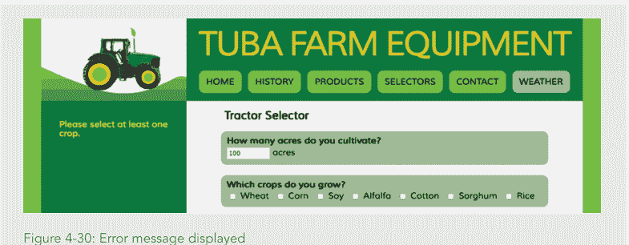

图4-30：显示的错误消息

8. 在浏览器中关闭**tractor.htm**文件。

### 动手项目4-2

在本项目中，你将继续使用动手项目4-1中的**tuba.js**和**tractor.htm**文件。你将调试`verifyCrops()`函数中的异常处理代码。

1. 使用操作系统的文件管理器，从数据文件中的Chapter04/HandsOnProject4-1目录复制所有文件和子文件夹，并粘贴到Chapter04/HandsOnProject4-2文件夹中。确认你在Chapter04/HandsOnProject4-1目录中仍有副本。

2. 在文本编辑器中，打开Chapter04/HandsOnProject4-2文件夹中的**tuba.js**，然后在注释部分，将文本“Hands-on Project 4-1”替换为**Hands-on Project 4-2**。

3. 在浏览器中打开**tractor.htm**文件。通过在四个部分中输入适当内容来测试整个表单。注意，无论你输入什么数据，都不会显示任何建议。这表明你在前一个项目中输入的代码存在错误。

4. 使用本章学到的技术来调试`verifyCrops()`函数。适用的技术可能包括在文本编辑器中查找突出显示的语法错误、设置断点、逐步执行程序以及注释掉代码。完成调试后，应根据用户在表单前三个部分的输入继续显示适当的错误消息。此外，当前三个部分包含适当的用户输入时，应在侧边栏中显示建议。

### 动手项目4-3

在本项目中，你将检查一个现有程序，并使用本章学到的技能对其进行调试，直至其按设计工作。当用户在输入框中输入字符串时，程序设计为将该字符串添加到数组中。当数组达到一定长度时，程序会在页面上以列表形式显示所有用户的条目。

1. 在文本编辑器中，打开Chapter04/HandsOnProject4-3文件夹中的**index.htm**文件。在head部分的指定位置输入你的姓名和今天的日期，然后保存更改。

2. 向下滚动并检查body部分底部script部分的代码。检查循环、控制结构和注释，直至理解程序的工作原理。

3. 在浏览器中打开**index.htm**。要测试程序，在输入框中输入一个地点名称，点击**Submit**，然后重复四次。输入框中的字符串应在每次提交后清除，并且五个字符串提交后应显示地点列表。这些现象没有发生的事实表明程序包含一个或多个错误。

4. 使用本章学到的技术来调试程序。适用的技术可能包括在文本编辑器中查找突出显示的语法错误、设置断点、逐步执行程序以及注释掉代码。完成调试后，每次点击Submit按钮时输入框中的用户条目应被清除。此外，提交五个字符串后，所有提交的字符串的完整列表应显示在页面上。

### 动手项目4-4

在本项目中，你将使用严格模式来加强项目4-3中使用的某个函数的代码。严格模式强制执行多项被视为良好编码实践的规则，但JavaScript默认并不强制执行。其中最基本的规则之一是所有变量必须使用`var`关键字声明。在严格模式下，不使用`var`关键字声明新变量会抛出错误。你在项目4-3中调试的文件中的`processInput()`函数包含多个未使用`var`关键字声明的变量。你将指定该函数在严格模式下执行，然后使用由此产生的错误来识别并添加缺失的关键字。

1. 使用操作系统的文件管理器，从数据文件中的Chapter04/HandsOnProject4-3目录复制所有文件和子文件夹，并粘贴到Chapter04/HandsOnProject4-4文件夹中。确认你在Chapter04/HandsOnProject4-3目录中仍有副本。

2. 在文本编辑器中，打开Chapter04/HandsOnProject4-4文件夹中的**index.htm**，然后在注释部分、`title`元素和`h1`元素中，将文本“Hands-on Project 4-3”替换为**Hands-on Project 4-4**。

3. 向下滚动到body部分底部的script部分。

4. 在`processInput()`函数代码块的顶部添加一个新行，然后添加一条语句，请求浏览器使用严格模式解释该函数。

5. 保存更改，在浏览器中打开**index.htm**，然后测试页面的操作。项目4-3结束时正常工作的功能不再工作。

6. 打开浏览器控制台，检查记录的所有错误消息。使用浏览器工具识别缺少`var`关键字的行，在文本编辑器中添加关键字，保存更改，然后重新测试页面。继续调试，直到页面恢复到项目4-3结束时的工作状态。

### 动手项目4-5

在本项目中，你将调试一个将英里距离转换为公里距离的程序。

1. 在文本编辑器中，打开Chapter04/HandsOnProject4-5文件夹中的**index.htm**文件。在head部分的指定位置输入你的姓名和今天的日期，然后保存更改。

2. 向下滚动，查看body部分底部script区域中的代码。仔细阅读程序和注释，直到理解程序的工作原理。

3. 在浏览器中打开**index.htm**。要测试程序，请在输入框中输入一个数字，然后点击**Convert to Km**。答案应显示在页面右侧“Distance in Km”标签下方的框中。如果没有显示结果，则说明程序中存在一个或多个错误。

4. 使用本章中学到的技巧来调试程序。调试完成后，你应该能够在Distance in Mi框中输入一个数字，点击Convert to Km按钮，并在Distance in Km框中看到结果。（提示：请记住，公里比英里短，因此以公里为单位的距离数值应大于相同距离的英里数值。要将英里转换为公里，你需要将英里数值乘以1.6。）

# 案例项目

**个人案例项目**

为你的个人网站上某个表单的代码添加异常处理。如果你的网站不包含表单，请先添加一个。你的代码应在适当的位置显示一个或多个相关的错误消息。完成代码编写后，请总结你在本项目中使用的本章调试方法，并描述你如何在代码中运用了每种方法。

**团队案例项目**

将团队分为两个小组，每个小组分配一个包含JavaScript代码的团队项目网站页面。每个小组在分配到的页面代码中引入至少三个错误。然后与另一个小组交换文档，作为团队调试对方提供的代码。调试过程中，记录你使用的调试方法，并注明每种方法是否有助于解决特定问题。当程序按预期运行后，创建一份报告。对每个错误，描述你的预期行为以及错误导致的异常行为，描述你使用的调试方法，并说明每种方法是否有效。同时，指出包含错误的代码行号，并在报告中展示修正前和修正后的代码。

## 使用文档对象模型（DOM）和DHTML

学完本章后，你将能够：

- 通过id、标签名、class、name或选择器访问元素
- 访问元素内容、CSS属性和属性
- 添加和移除文档节点
- 创建和关闭新的浏览器标签页和窗口
- 使用`setTimeout()`和`setInterval()`方法指定延迟或持续时间
- 使用`History`、`Location`、`Navigation`和`Screen`对象来操控浏览器窗口

JavaScript在网页上最强大的用途之一是根据外部事件（如点击或其他用户交互）修改页面内容。要实现这一点，需要一种方式来引用Web浏览器和当前文档的不同组件。JavaScript通过一种称为浏览器对象模型（BOM）的约定来定义浏览器的对象、属性、方法以及它们之间的关系。BOM的一部分——Document对象，代表浏览器中文档的内容。由于Document对象是动态网页中发生许多更改的地方，因此该对象拥有自己的对象模型，称为文档对象模型（DOM）。在本章中，你将探索BOM和DOM的结构，并学习如何引用浏览器和文档中对象的一些基本属性和方法，以增加应用的交互性。你将运用这些技能来构建一个照片画廊应用，该应用展示图片并允许用户浏览图片，以及查看每张图片的放大版本。图5-1展示了你将创建的照片画廊应用的预览，图5-2展示了画廊中一张放大图片的预览。

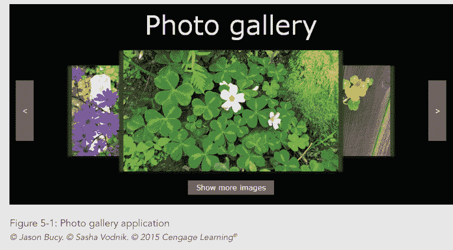


图5-2：放大图片视图

## 理解浏览器对象模型和文档对象模型

JavaScript将HTML文档的内容视为一组相互关联的组件，这些组件称为对象。JavaScript将网页上的每个元素都视为一个对象。此外，你可以在JavaScript应用本身中创建对象。例如，你创建的每个函数也是一个对象。

### 浏览器对象模型

浏览器对象模型（BOM）（或客户端对象模型）描述了Web浏览器中对象之间的关系，包括当前文档中的对象。该模型的存在很重要，因为正如你即将看到的，它使你能够准确地引用特定的浏览器对象，而不会产生歧义。

BOM中的对象按层次结构排列。如图5-3所示，Window对象位于顶层，其下是History、Location、Navigator、Screen和Document对象。虽然这是所有主流浏览器使用的模型，但请注意BOM并不是任何组织制定的标准。相反，它是所有浏览器制造商遵循的一个通用约定模型。

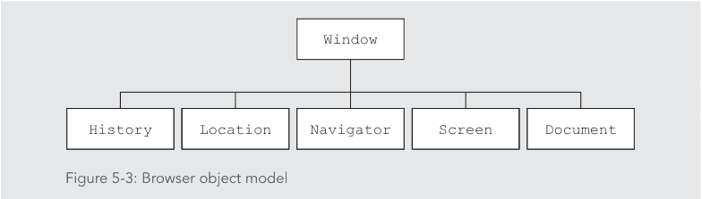

你无需在浏览器对象模型中显式创建任何对象；当Web浏览器打开网页时，它们会自动创建。浏览器对象模型中的顶层对象是`Window`对象，它代表一个浏览器窗口。Web浏览器会自动为你创建`Window`对象。`Window`对象被称为**全局对象**，因为浏览器对象模型中的所有其他对象都包含在它其中。例如，`Window`对象包含`Document`对象，就像浏览器窗口包含一个网页文档一样。你使用`Window`对象的方法和属性来控制浏览器窗口，同时使用`Document`对象的方法和属性来控制网页。

BOM中对象之间的关系通常用描述家庭成员的术语来描述。在图5-3中，`Window`对象是所有其他对象的父对象，例如`History`和`Location`。`History`与`Location`、`Navigator`、`Screen`和`Document`对象是同级对象，它们都是`Window`对象的子对象。

### 文档对象模型

`Document`对象是浏览器对象模型中最重要的对象，因为它代表在浏览器中显示的网页。你已经熟悉了`document.write()`方法。开头的`"document."`表明它是`Document`对象的一个方法。网页上的所有元素都包含在`Document`对象中，每个元素在JavaScript中都由其自身的对象表示。这意味着`Document`对象包含了你在网页上创建的所有元素。

在本书中，浏览器对象模型中的对象用首字母大写的方式引用（`Document`对象）。但是，当你在代码中使用对象名时，必须始终使用小写字母。例如，以下语句引用了`Document`对象：

```
document.write("Go Patriots!");
```

注意`document`中小写*d*的使用。

浏览器对象模型的`Document`对象分支由其自身的对象模型表示，称为**文档对象模型**，简称**DOM**。与BOM这种宽松的约定不同，DOM是万维网联盟（W3C）的正式规范，与HTML和CSS一样。

### DOM和DHTML

虽然Web起初只是一组静态文档，但如今大多数网页内容都是动态的——用户交互可以更改显示的内容，而无需加载新文档，还可以更改内容的呈现方式，如大小、排列和颜色。HTML和CSS与JavaScript的结合实现了现代网页的这种交互性，有时被称为**动态HTML（DHTML）**。

DOM使你能够编写JavaScript来更改网页文档的HTML和CSS。DOM是**应用程序编程接口（API）**的一个示例，API是规范不同软件组件如何相互交互的规范。通过为网页文档中的对象制定结构以及一套标准的属性和方法，DOM创建了使网页文档动态化的工具。这使你能够编写JavaScript应用，在符合DOM规范的浏览器中获得可预期的结果。

DOM代表在浏览器中显示的网页的HTML。网页上的每个元素在DOM中都由其自身的对象表示。每个元素都是一个对象，这使得JavaScript应用能够访问网页上的各个元素并单独修改它们，而无需从服务器重新加载页面。

### DOM树

与BOM一样，DOM中的对象也按层次结构表示，基于HTML文档中元素的嵌套关系。然而，虽然标准BOM中的所有对象在浏览器中始终存在，但任何给定网页的DOM层次结构——称为**DOM树**——取决于其内容。例如，图5-4展示了以下HTML文档的DOM树：

```
<html lang="en">
  <head>
    <meta charset="utf-8" />
    <title>Photo Gallery</title>
  </head>
  <body>
    <header>
      <h1>花园照片</h1>
    </header>
    <article>
      <figure>
        <figcaption>醉鱼草</figcaption>
        
      </figure>
    </article>
  </body>
</html>
```

在图5-4中，HTML元素按照它们在文档中的嵌套关系进行层级排列。例如，代码第11-14行中嵌套在`figure`元素内的`figcaption`和`img`元素，在DOM树中显示为`figure`元素的子节点。

请注意，除了对应HTML元素的对象外，DOM树还显示了包含文本内容的元素的文本，以及包含这些元素的属性。DOM树中的每一项称为一个**节点**。还存在其他类型的节点，但对应元素、属性和文本内容的节点是最常用的。

## DOM文档对象方法

DOM的`Document`对象包含多种用于动态生成网页和操作元素的方法。表5-1列出了W3C DOM规范中`Document`对象的一些最有用的方法。本章你将更深入了解其中几种方法的用法。

表5-1：HTML DOM `Document`对象方法

| 方法 | 描述 |
| :--- | :--- |
| `getElementById(ID)` | 返回`id`值为*ID*的元素 |
| `getElementsByClassName(class1 [class2 ...])` | 如果指定一个类名*class1*，则返回属于*class1*的元素集合；如果指定两个或多个以空格分隔的类名，则返回的集合由属于所有指定类名的元素组成 |
| `getElementsByName(name)` | 返回name值为*name*的元素集合 |
| `getElementsByTagName(tag)` | 返回标签（元素）名为*tag*的元素集合 |
| `querySelectorAll(selector)` | 返回与*selector*指定的CSS选择器匹配的元素集合 |
| `write(text)` | 将*text*写入文档 |

## DOM文档对象属性

DOM的`Document`对象具有多种用于操作网页对象的属性。表5-2列出了W3C DOM规范中`Document`对象的一些最重要属性。

表5-2：部分DOM `Document`对象属性

| 属性 | 描述 |
|----------|-------------|
| body | 文档的body元素 |
| cookie | 当前文档的cookie字符串，它包含由Web服务器存储在用户计算机文本文件中的关于用户的小段信息 |
| domain | 当前文档所在服务器的域名 |
| lastModified | 文档最后修改的日期 |
| location | 当前文档的位置，包括其URL |
| referrer | 提供链接到当前文档的文档的URL |
| title | 文档头部分中`title`元素指定的文档标题 |
| URL | 当前文档的URL |

## 简短测验1

1. 什么是`Window`对象？

2. 什么是DOM？

3. `Window`对象和`Document`对象有什么区别？两者之间是什么关系？

## 访问文档元素、内容、属性和特性

在前面的章节中，你已经学习了几种引用网页文档中元素的方法，包括`document.getElementById()`和`document.getElementsByTagName()`。这两种方法都是DOM中`Document`对象的方法。接下来，你将复习这两种方法，然后探索`Document`对象的其他一些有用方法，用于引用网页文档中的元素及其内容、CSS属性和特性。

## 通过`id`值访问元素

如果你需要直接访问具有特定`id`值的元素，没有比`getElementById()`方法更简单的了。回想一下，你在HTML中使用元素的`id`属性来设置`id`值。然后，你将带有引号的`id`值作为参数传递给`getElementById()`方法。例如，假设你的HTML文档包含以下元素：

```
<input type="number" id="zip" />
```

你可以在JavaScript代码中按如下方式引用此元素：

```
var zipField = document.getElementById("zip");
```

> **注意** 使用此方法时，务必使用大写形式“Id”而不是“ID”。输入为`getElementByID()`会返回错误。

接下来，你将使用`getElementById()`方法为照片画廊应用创建事件监听器。

**使用`getElementById()`方法为照片画廊应用添加事件监听器：**

1. 在你的文本编辑器中，打开Chapter05章文件夹中的**photos.htm**文件。

2. 在文档顶部的注释部分，在指示位置输入你的姓名和今天的日期，然后保存你的工作。

3. 滚动浏览文档以熟悉其内容。在header元素下方，`article`元素包含一个`div`元素、三个`figure`元素和另外两个`div`元素。前两个`div`元素将用作浏览画廊的向后和向前按钮，最后一个`div`元素将用作允许用户在同时查看三张和五张图片之间切换的按钮。每个`figure`元素包含一个`img`元素，它将显示五张图片中的一张。请注意，`img`元素没有指定`src`属性。你将使用JavaScript根据用户操作来指定`src`值。

4. 重复步骤1和2以打开**photos.js**，保存个性化副本，然后滚动浏览文档以熟悉其内容。该文件定义了一个`photoOrder`变量，你将用它来跟踪用户浏览画廊时的照片顺序。它还包含`rightArrow()`和`leftArrow()`函数，这些函数与`photoOrder`变量配合使用，将图像向左或向右移动。该文件包含一个空函数`zoomFig()`，你将在其中添加代码以更大尺寸查看图像。最后，它包含一个`setUpPage()`函数和一个事件监听器代码，用于在页面加载时运行`setUpPage()`函数。现有函数包含了对`populateFigures()`和`createEventListeners()`函数的引用，这两个函数将由你来创建。

5. 在浏览器中打开**photos.htm**。导航按钮已显示，但图像应出现的区域是空的。在你为`img`元素添加`src`值之前，不会显示任何图像，这将在本章稍后进行。

6. 返回到文本编辑器中的`photos.js`文件，然后在`leftArrow()`函数下方、`setUpPage()`函数之前，输入以下语句以创建`createEventListeners()`函数：

```
/* 为左箭头、右箭头和中心图形元素创建事件监听器 */
function createEventListeners() {
}
```

7. 在函数的代码块内，添加以下语句：

```
var leftarrow = document.getElementById("leftarrow");
```

此语句创建一个名为`leftarrow`的局部变量，然后使用`getElementById()`方法将变量值指定为具有`id`值`leftarrow`的文档元素。

8. 在变量声明下方和函数的代码块内，输入以下`if/else`语句以为左侧导航箭头创建事件监听器：

```
if (leftarrow.addEventListener) {
  leftarrow.addEventListener("click", leftArrow, false);
} else if (leftarrow.attachEvent)  {
  leftarrow.attachEvent("onclick", leftArrow);
}
```

9. 在步骤8的代码下方和函数的代码块内，输入以下代码以创建一个变量并为右侧导航箭头分配事件监听器：

```
var rightarrow = document.getElementById("rightarrow");
if (rightarrow.addEventListener) {
  rightarrow.addEventListener("click", rightArrow, false);
} else if (rightarrow.attachEvent)  {
  rightarrow.attachEvent("onclick", rightArrow);
}
```

你的`createEventListeners()`函数的代码应与以下内容匹配：

```
/* 为左箭头、右箭头和中心图形元素创建事件监听器 */
function createEventListeners() {
  var leftarrow = document.getElementById("leftarrow");
  if (leftarrow.addEventListener) {
    leftarrow.addEventListener("click", leftArrow, false);
  } else if (leftarrow.attachEvent) {
    leftarrow.attachEvent("onclick", leftArrow);
  }
  var rightarrow = document.getElementById("rightarrow");
  if (rightarrow.addEventListener) {
    rightarrow.addEventListener("click", rightArrow, false);
  } else if (rightarrow.attachEvent) {
    rightarrow.attachEvent("onclick", rightArrow);
  }
}
```

10. 保存你的工作。

## 通过标签名访问元素

你已经使用过的`Document`元素的另一个方法是`getElementsByTagName()`。你将这个方法的参数——一个元素的名称，也称为**标签名**——传递给它，该方法返回文档中所有该名称元素的集合。例如，以下语句返回文档中所有`p`元素的集合：

```
var docParagraphs = document.getElementsByTagName("p");
```

> **注意** 请确保不要在传递给`getElementsByTagName()`方法的参数中包含括号（例如`"<p>"`）。

该方法按照对象在文档中出现的顺序返回一个对象集合。根据浏览器的不同，这个集合可能是一个节点列表或一个HTML集合。**节点列表**仅仅是一个带索引的节点集合。类似地，**HTML集合**是一个带索引的HTML元素集合。这两种对象之间的技术差异并不重要。然而，它们有两个重要的共同特征。首先，它们不是真正的数组，这意味着这些对象不能使用数组属性和方法。但是，由于它们的组织结构与数组相似，你可以像引用数组内容一样引用它们的内容。这意味着你可以通过使用`getElementsByTagName()`返回的集合中的索引号来引用页面上的特定元素。例如，如果你想处理页面上的第二个`h1`元素，你可以使用以下代码：

```
var secondH1 = document.getElementsByTagName("h1")[1];
```

就像在数组中一样，索引号从0开始，因此要引用集合中的第二个元素，你需要使用索引号1，如上一条语句所示。

你希望你的照片库用户能够点击中心图像以查看其更大版本。要启用此功能，你将使用`getElementsByTagName()`方法为文档中的第三个`img`元素（索引值为2）添加一个事件监听器。

## 使用`getElementsByTagName()`方法添加事件监听器

1. 返回你的文本编辑器中的`photos.js`文件。

2. 在`createEventListeners()`函数的代码块内，在闭合的`}`之前，添加以下语句：

```
var mainFig = document.getElementsByTagName("img")[1];
```

此语句创建一个名为`mainFig`的局部变量，然后使用`getElementsByTagName()`方法将该变量的值指定为文档中的第二个`img`元素（索引值为1）。

3. 在变量声明下方，在函数的闭合`}`之前，输入以下`if/else`语句为中心图像创建事件监听器：

```
if (mainFig.addEventListener) {
  mainFig.addEventListener("click", zoomFig, false);
} else if (mainFig.attachEvent) {
  mainFig.attachEvent("onclick", zoomFig);
}
```

此代码在用户点击画廊中间图像时调用一个函数。你完成后的`createEventListeners()`函数应与以下内容匹配：

```
/* create event listeners for left arrow, right arrow, and
center figure element */
function createEventListeners() {
  var leftarrow = document.getElementById("leftarrow");
  if (leftarrow.addEventListener) {
    leftarrow.addEventListener("click", leftArrow, false);
  } else if (leftarrow.attachEvent) {
    leftarrow.attachEvent("onclick", leftArrow);
  }
  var rightarrow = document.getElementById("rightarrow");
  if (rightarrow.addEventListener) {
    rightarrow.addEventListener("click", rightArrow, false);
  } else if (rightarrow.attachEvent) {
    rightarrow.attachEvent("onclick", rightArrow);
  }
  var mainFig = document.getElementsByTagName("img")[1];
  if (mainFig.addEventListener) {
    mainFig.addEventListener("click", zoomFig, false);
  } else if (mainFig.attachEvent) {
    mainFig.attachEvent("onclick", zoomFig);
  }
}
```

4. 保存你的工作。

## 通过类名访问元素

另一个类似于前两者的方法是`getElementsByClassName()`方法。与`getElementById()`一样，`getElementsByClassName()`基于HTML属性（在这种情况下是`class`属性）的值来引用元素。与`getElementsByTagName()`类似，`getElementsByClassName()`返回一个节点列表或HTML集合，包含文档中所有具有该属性指定的类名（或类名们）的元素。例如，如果你想访问文档中所有`class`值为`side`的元素，你可以使用以下语句：

```
var sideElements = document.getElementsByClassName("side");
```

因为HTML `class`属性可以接受多个值，所以`getElementsByClassName()`方法接受多个参数。例如，以下代码返回文档中所有`class`值包含`side`和`green`的元素：

```
var sideGreenElements = document.
    getElementsByClassName("side green");
```

请注意，作为参数提供的所有类名都包含在一组引号中，类名之间用空格分隔。

所有现代浏览器都支持`getElementsByClassName()`方法，但IE8不支持。如果你的应用需要支持IE8用户，你应该改用其他方法来选择网页元素。

## 通过名称访问元素

第四种方法，`getElementsByName()`方法，返回一个节点列表或HTML集合，包含`name`属性与指定值匹配的元素。前面三种方法通常更有用。但是，`getElementsByName()`可以在你需要访问表单中一组选项按钮或复选框时，使你能够创建更简洁的代码。因为一组中的每个输入元素共享相同的`name`值，所以你可以使用`getElementsByName()`方法一次访问整个集合。例如，假设你的表单包含以下一组选项按钮：

```
<legend><span>Choose a color:</span></legend>
<input type="radio" name="color" id="redOption" value="red" />
<label for="redOption">Red</label>
<input type="radio" name="color" id="greenOption"
  value="green" />
<label for="greenOption">Green</label>
<input type="radio" name="color" id="blueOption"
  value="blue" />
<label for="blueOption">Blue</label>
```

你可以使用以下语句返回上述代码中所有三个`input`元素的集合：

```
var colorButtons = document.getElementsByName("color");
```

此方法在IE9及更早版本的Internet Explorer中返回的结果与网络标准不一致。因此，如果你使用此方法并且需要支持IE9或更早版本的Internet Explorer，你应该在这些浏览器上测试你的应用，以确保该方法按预期执行。

## 使用CSS选择器访问元素

前面的所有方法都让你可以基于其HTML标记的特定方面来引用元素。`Document`对象还包括两个方法，让你可以使用CSS语法来引用元素或元素集合。`querySelector()`方法返回与指定CSS选择器匹配的第一个元素。该方法使用以下语法：

```
querySelector("selector")
```

使用此方法时，`selector`可以是任何有效的CSS选择器。例如，假设你正在处理一个包含以下HTML结构的项目：

```
<header>
  <h1></h1>
</header>
```

你可以使用`querySelector()`方法来引用`img`元素，如下所示：

```
querySelector("header h1 img")
```

IE8仅支持使用`querySelector()`方法配合简单选择器，因此它无法识别如前面代码中所示的后代选择器。幸运的是，通常有多种方式编写CSS选择器来引用相同的元素，因此你可以将前面的选择器改写为与IE8兼容的形式，如下所示：

```
querySelector("img.logo")
```

除了`querySelector()`方法外，`Document`对象还包括`querySelectorAll()`方法，该方法返回匹配指定选择器的元素集合，而不仅仅是第一个元素。例如，假设你正在处理以下HTML代码：

```
<nav>
  <ul>
    <li>About Us</li>
    <li>Order</li>
    <li>Support</li>
  </ul>
</nav>
```

假设这是文档中唯一的`nav`元素，你可以使用以下代码返回三个`li`元素的集合：

```
querySelectorAll("nav ul li")
```

与`querySelector()`一样，IE8仅支持`querySelectorAll()`使用简单选择器。因此，要编写与IE8兼容的代码，你需要使用更简单的选择器。在这种情况下，编写IE8兼容的代码需要为你的HTML代码添加属性。例如，如果上面代码中所有`li`元素都具有属性`class="topNav"`，那么你可以在所有现代浏览器以及IE8中使用以下代码来选择这些`li`元素：

```
querySelectorAll("li.topNav")
```

## 访问元素的内容

一旦你创建了对文档元素的引用，DOM就提供了访问和修改其内容、属性和特性的工具。你已经使用过`innerHTML`属性来访问和更改元素的内容。DOM规范还包括另一个属性——`textContent`属性，你可以用它来访问和更改元素包含的纯文本。实际上，`innerHTML`和`textContent`之间的主要区别在于，`innerHTML`允许你同时访问和写入HTML标签及文本，而`textContent`会将HTML标签剥离掉。例如，假设你正在处理以下HTML代码：

```
<ul>
    <li class="topnav"><a href="aboutus.htm">About Us</a></li>
    <li class="topnav"><a href="order.htm">Order</a></li>
    <li class="topnav"><a href="support.htm">Support</a></li>
</ul>
```

你可以使用以下语句引用第一个`li`元素，然后访问该元素的`innerHTML`和`textContent`值：

```
var button1 = querySelectorAll("li.topNav")[0];
var allContent = button1.innerHTML;
    // <a href="aboutus.htm">About Us</a>
var justText = button1.textContent;
    // About Us
```

第2行的`innerHTML`语句返回的是第3行注释中所示的值，其中包含元素文本以及将其格式化为链接的`a`元素。相比之下，第4行的`textContent`语句返回的是第5行注释中所示的值，其中仅包含元素文本。

通常，出于安全原因，你应该尽可能使用`textContent`属性而不是`innerHTML`属性。这是因为使用`innerHTML`会使你在理论上容易受到代码注入攻击的威胁——攻击者可能将你代码中的`innerHTML`值替换为包含恶意JavaScript语句的HTML代码。然而，IE8不支持`textContent`属性，因此如果你的代码需要支持IE8，你必须继续使用`innerHTML`属性。由于本书中的所有代码都设计为与IE8兼容，因此本书使用`innerHTML`而不是`textContent`。

一些开发者通过使用`if/else`结构来检查浏览器是否支持`textContent`，从而在安全性和兼容性之间取得平衡，然后为兼容的浏览器提供使用`textContent`的语句，仅为不支持的浏览器提供`innerHTML`作为备选方案。然而，这种方法的缺点是增加了代码量和复杂性。

> **注意** 如果你需要在DOM树中现有元素内部添加一个元素，标准方法是直接创建并追加一个DOM节点，而不是使用元素的`innerHTML`属性来创建新的子元素。你将在本章后面学习如何操作节点。

## 访问元素的CSS属性

你也可以通过DOM访问和更改元素的CSS属性。为此，你需要使用点号表示法来引用元素的`style`属性，后跟CSS属性名称，如下所示：

```
element.style.property
```

其中`element`是文档元素的引用，`property`是CSS属性名称。例如，以下语句将`id`值为`logo`的元素的CSS `display`属性值更改为`none`：

```
document.getElementById("logo").style.display = "none";
```

当CSS属性名称包含连字符时，使用点号表示法引用时需要去掉连字符，并将连字符后的字母大写。例如，要在JavaScript中引用CSS属性`font-family`，你需要在代码中将其指定为`fontFamily`，如以下语句所示：

```
var font = document.getElementById("logo").style.fontFamily;
```

当你通过DOM引用指定CSS值时，它会作为内联样式添加到相关元素上。这意味着该设置通常比嵌入式或外部样式表中设置的样式具有更高的优先级。要移除先前通过DOM引用添加的样式，你只需将其值设置为空字符串即可，如以下语句所示：

```
document.getElementById("navbar").style.color = "";
```

将样式值设置为空字符串会移除内联样式，使元素的样式恢复为文档样式表中指定的设置。

## 访问元素属性

你还可以访问元素的属性，例如`a`元素的`href`属性，或`img`元素的`src`属性。为此，你可以使用点号语法，在元素引用后加上一个句点和属性名称。例如，要引用`id`值为`homeLink`的`a`元素，你可以使用以下`getElementById()`方法：

```
document.getElementById("homeLink")
```

要引用该元素的`href`属性，你需要在元素引用后添加`.href`，如下所示：

```
document.getElementById("homeLink").href
```

你可以使用此代码查找`href`属性的值，并将该值赋给一个变量，如下所示：

```
var homeURL = document.getElementById("homeLink").href;
```

你也可以使用属性引用来为属性赋新值，如下所示：

```
document.getElementById("homeLink").href = "http://w3.org";
```

此代码将该元素的`href`属性值更改为`"http://w3.org"`。在此脚本执行后，点击`homeLink`元素将打开`w3.org`网站。

你可以使用点号表示法来访问几乎所有现有元素属性的值。你也可以使用它来为给定元素的几乎所有有效属性赋值，即使原始HTML代码中并未包含该属性。

在访问或赋值属性值时，使用点号表示法的例外情况是`class`属性。由于许多编程语言将“class”一词视为保留字，因此DOM在处理HTML `class`属性时不识别它。相反，你需要使用`className`属性。如果一个元素只有一个`class`值，`className`属性将返回该`class`名称。如果元素有多个`class`值，`className`属性将返回一个由所有`class`值组成的字符串，值之间以空格分隔。

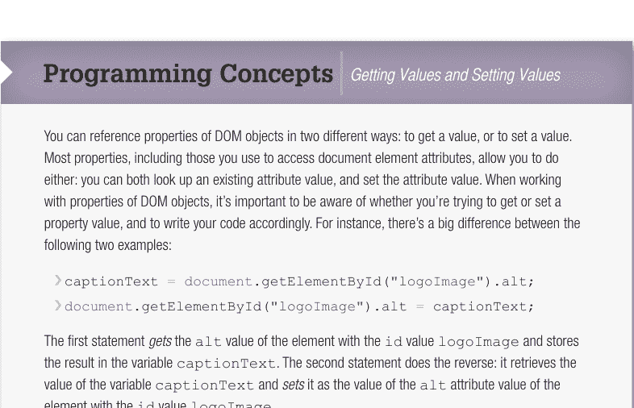

## 创建`populateFigures()`函数以更改`img`元素的`src`属性值

1. 在文本编辑器中返回**photos.js**文件。

2. 在全局变量声明下方，输入以下代码来声明`populateFigures()`函数：

```
/* 根据photoOrder数组中指定的顺序为img元素添加src值 */
function populateFigures() {
    var filename;
    var currentFig;
}
```

除了声明函数外，这段代码还在函数内部声明了两个局部变量以供使用。

3. 在函数代码块内、局部变量声明下方，输入以下`for`循环：

```
for (var i = 1; i < 4; i++) {
    filename = "images/IMG_0" + photoOrder[i] + "sm.jpg";
    currentFig = document.getElementsByTagName("img")[i - 1];
    currentFig.src = filename;
}
```

该循环运行三次，使用`photoOrder`数组中的对应值设置`filename`变量的值，然后查找与计数器变量值减一相对应的元素，接着将`filename`的值赋给`img`元素的`src`属性。

4. 保存您的工作，然后在浏览器中打开**photos.htm**。您的屏幕应与图5-1一致。

5. 单击屏幕右侧的>按钮。如图5-5所示，所有图片向左移动，穿过栅栏生长的花朵照片现在位于中心。

## 简短测验2

1. 您会使用什么语句来创建一个名为`logo`的变量，并将其值设置为对`id`值为`logoImage`的元素的引用？

2. 您会使用什么语句来创建一个名为`firstPriority`的变量，并将其值设置为对文档中第一个`li`元素的引用？

3. 您会使用什么语句来创建一个名为`language`的变量，并将其值设置为`html`元素的`lang`属性的值？

4. 您会使用什么语句来将`html`元素的`lang`属性的值更改为`language`变量的值？

## 添加和移除文档节点

您已经看到，可以通过更改元素的属性值来修改网页内容，而无需卸载页面。DOM还包含一些方法，让您可以创建全新的元素，并从DOM树中添加或移除元素。这些方法使您能够为应用程序添加额外的动态功能，而无需与服务器进行任何交互。

您的照片库应用程序计划中包括为用户提供在屏幕上添加两张额外图片的选项，以便用户可以(1)同时看到幻灯片中所有图片的部分内容，以及(2)使用按钮导航到他们想查看的任何图片。在本节中，您将学习用于创建新节点并将其添加到DOM树的DOM方法，以及从树中移除节点的方法。您将使用这些方法让用户能够在同时查看三张和五张图片预览之间切换。

## 创建节点

您可以使用Document对象的`createElement()`方法创建新的元素节点，其语法如下：

```
document.createElement("element")
```

术语`element`是HTML元素名称。例如，要创建一个新的`div`元素，您可以使用以下语句：

```
document.createElement("div");
```

要为照片库应用程序添加额外的预览图片，您需要创建新的`figure`元素和新的`img`元素。图5-6显示了您将在本节中对DOM树所做的更改。

请注意，为了简便起见，图5-6将元素节点与其属性节点合并在一起，而不是像图5-4那样将它们分开显示。

您将继续处理照片库项目，创建第一批`figure`和`img`元素，并使用本章前面学到的方法设置它们的属性和样式。

## 为第一张新预览图片创建`figure`和`img`节点

1. 在文本编辑器中返回**photos.js**文件，然后在`leftArrow()`函数下方，添加以下代码来创建`previewFive()`函数：

```
/* 切换到5张图片布局 */
function previewFive() {
}
```

2. 在`previewFive()`函数内，输入以下注释和语句：

```
// 为第五张图片创建figure和img元素
var lastFigure = document.createElement("figure");
```

该语句使用`createElement()`方法创建一个新的`figure`元素，并将其赋给变量名`lastFigure`。

3. 在上一步输入的语句下方、代码块内，输入以下语句：

```
lastFigure.id = "fig5";
lastFigure.style.zIndex = "5";
lastFigure.style.position = "absolute";
lastFigure.style.right = "45px";
lastFigure.style.top = "67px";
```

第一条语句使用存储在`lastFigure`变量中的元素的`id`属性，将元素的`id`属性值设置为`fig5`。其余语句使用元素的`style`属性为CSS样式属性设置值。请注意，第二条语句中的语句使用属性名`zIndex`，这是CSS属性名`z-index`去掉连字符并将连字符后的字母大写后的形式。在JavaScript中引用任何带连字符的CSS属性时，您必须遵循这种做法。

4. 在上一步输入的语句下方、代码块内，输入以下语句：

```
var lastImage = document.createElement("img");
lastImage.width = "240";
lastImage.height = "135";
```

第一条语句使用`createElement()`方法创建一个新的`img`元素，并将其赋给变量名`lastImage`。第二行和第三行为元素的`width`和`height`属性赋值。您的`previewFive()`函数应如下所示：

```
function previewFive() {
   // 为第五张图片创建figure和img元素
   var lastFigure = document.createElement("figure");
   lastFigure.id = "fig5";
   lastFigure.style.zIndex = "5";
   lastFigure.style.position = "absolute";
   lastFigure.style.right = "45px";
   lastFigure.style.top = "67px";
   var lastImage = document.createElement("img");
   lastImage.width = "240";
   lastImage.height = "135";
}
```

5. 向下滚动到`createEventListeners()`函数，然后在结束`}`之前，输入以下代码：

```
var showAllButton = document.querySelector("#fiveButton p");
if (showAllButton.addEventListener) {
   showAllButton.addEventListener("click", previewFive,
      false);
} else if (showAllButton.attachEvent) {
   showAllButton.attachEvent("onclick", previewFive);
}
```

这段代码添加了一个事件监听器，当用户单击**Show more images**按钮时调用`previewFive()`函数。

6. 保存您对**photos.js**的更改，返回浏览器，然后打开浏览器工具，使用适用于您浏览器的方法检查当前网页的DOM：
   - Internet Explorer DOM检查器：按**F12**，然后按**Ctrl + 1**。
   - Firefox检查器：按**Ctrl + Shift + C** (Windows) 或**command + option + C** (Mac)。
   - Chrome元素：按**Ctrl + Shift + I** (Windows) 或**command + option + I** (Mac)，然后单击**Elements**。

显示每个浏览器控制台的窗格还包含查看当前网页DOM树的选项。

7. 在浏览器中刷新或重新加载**photos.htm**，然后单击**Show more images**按钮。

8. 在控制台窗格中，单击每个元素显示的那个右向三角形（▶）以查看其子元素。请注意，您创建的新`figure`元素（`id`值为`fig5`）并没有出现在DOM树中的任何位置。

## 附加节点

使用`createElement()`方法创建的节点不会自动附加到DOM树或任何其他节点。相反，它独立于DOM树而存在。`Document`对象包含几种用于将节点附加到DOM树的方法。最基本的方法是`appendChild()`，其语法如下：

```
parentNode.appendChild(childNode)
```

使用此方法时，您需要指定要附加的节点（即子节点）以及要附加到的节点（即父节点）。例如，以下代码创建一个新的`li`元素，然后将其附加到`id`值为`navList`的元素：

```
var list = document.getElementById("navList");
var contact = document.createElement("li");
list.appendChild(contact);
```

第一条语句将`list`变量的值设置为`id`值为`navList`的元素。第二条语句创建一个新的`li`元素，并将其赋给变量名`contact`。最后一条语句将存储在`contact`变量中的新元素作为由`list`变量引用的`navList`元素的子元素附加进去。

在前面的步骤中，您创建了一个新的`img`元素并将其存储在变量名`lastImage`中。您还创建了一个新的`figure`元素，将其存储在变量名`lastFigure`中。接下来，您将使用`appendChild()`方法将`img`元素作为`figure`元素的子元素添加进去，以匹配照片库应用程序中现有的`figure`和`img`元素的嵌套结构。这样就创建了一个**文档片段**，即一组未属于任何文档的连接节点。然后，您将使用`appendChild()`方法将文档片段作为`article`元素的子元素添加到文档的DOM树中。图5-7说明了您将遵循的过程。

## 将`img`节点追加到`figure`节点，并将生成的文档片段添加到DOM树中

1. 在你的文本编辑器中，返回**photos.js**文件。

2. 在`previewFive()`函数中，于函数块顶部，添加以下语句：

```
var articleEl = document.getElementsByTagName("article")[0];
```

3. 在结尾的`}`之前，添加以下语句：

```
lastFigure.appendChild(lastImage);
```

此语句使用`appendChild()`方法将`lastImage`节点作为`lastFigure`节点的子节点添加，从而创建一个文档片段。

4. 在你上一步输入的语句下方，以及结尾的`}`之前，输入以下语句：

```
articleEl.appendChild(lastFigure);
```

此语句使用`appendChild()`方法将`lastFigure`文档片段附加到文档中的`article`元素（由`articleEl`变量引用）作为其子元素。

5. 保存你对**photos.js**的更改，返回浏览器，刷新或重新加载**photos.htm**，然后点击**Show more images**按钮。

6. 右键单击**right arrow**按钮，然后单击**Inspect element**，在当前页面的文档树中查看该右箭头按钮的`div`元素。你创建的`id`值为`fig5`的`figure`元素，是`id`值为`rightarrow`的`div`元素的同级元素。图5-8展示了Chrome中的文档树。

> **注意** 如果你在文档树中看不到`id`值为`fig5`的`figure`元素，可能是忘了点击**Show more images**按钮。点击**Show more images**按钮，然后检查文档树中`article`元素的子元素。

7. 如图5-8所示，单击`id`值为`rightarrow`的`figure`元素旁的**三角形**（▶），查看你添加的`figure`元素的子元素。如图5-9所示，你作为`figure`元素子节点添加的`img`元素会显示在文档层次结构中。

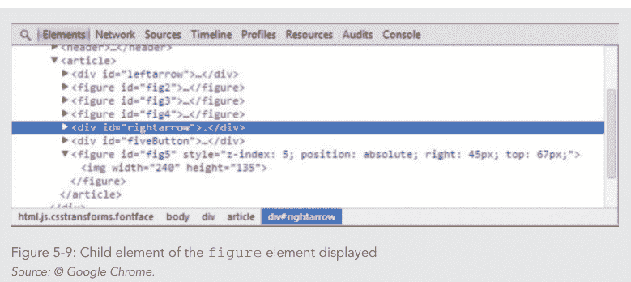

图5-9：显示`figure`元素的子元素

请注意，包含`figure`元素及其子`img`元素的文档片段，是`article`元素的最后一个子节点。使用`appendChild()`方法附加的节点总是作为父元素的最后一个子元素添加。

接下来，你需要创建用于显示画廊第一张图片的`figure`和`img`元素。与其从头开始创建和配置新元素，不如复制你已创建的文档片段。

## 克隆节点

有时你想创建一个与文档中现有节点相同或相似的新节点。与其重复创建和配置新节点所需的所有语句，不如使用`Document`对象的`cloneNode()`方法来复制现有节点。`cloneNode()`方法的语法如下：

```
existingNode.cloneNode(true | false)
```

在此方法中，`existingNode`是指向你要克隆的节点的引用。该方法接受一个布尔值作为参数，指示克隆的节点是否应包含现有节点的任何子节点（`true`），还是仅包含指定的父节点（`false`）。例如，以下代码创建了一个新的`li`元素并将其赋给`contact`变量，然后为该元素指定了一个名为`mainNav`的类名。最后一条语句克隆了`contact`节点，并将副本存储在`directions`变量中。

```
var contact = document.createElement("li");
contact.className = "mainNav";
var directions = contact.cloneNode(true);
```

图5-10说明了这个过程。存储在`directions`变量中的克隆节点包含了`class`值`mainNav`，因为`cloneNode()`方法克隆了所有子节点（基于`true`参数）。


对于照片画廊应用，你需要添加另一个嵌套在`figure`元素中的`img`元素来显示第一张图片。你不必创建、附加和配置两个新节点，而是使用`cloneNode()`方法克隆你在前面步骤中创建的节点。然后，你将添加语句，仅为新的`figure`和`img`元素更改不同的属性值和样式属性。

### 克隆`lastFigure`节点以创建`firstFigure`节点

1. 在你的文本编辑器中，返回**photos.js**文件。

2. 在`previewFive()`函数中，于最终的`}`之前，输入以下注释和语句：

```
//clone figure element for fifth image and edit to be first image
var firstFigure = lastFigure.cloneNode(true);
```

此语句使用`cloneNode()`方法复制`lastFigure`节点，并将结果赋给变量名`firstFigure`。由于`cloneNode()`方法包含了`true`参数，因此副本包含了`lastFigure`节点的子`img`节点。

3. 在你上一步添加的代码下方，以及最终的`}`之前，输入以下语句：

```
firstFigure.id = "fig1";
firstFigure.style.right = "";
firstFigure.style.left = "45px";
```

此代码将`firstFigure`节点的`id`值从从`lastFigure`节点克隆来的`fig5`更改为`fig1`。它还移除了克隆的`right`CSS样式值，并为`left`CSS样式指定了新值。

4. 在你上一步添加的代码下方，以及最终的`}`之前，输入以下语句：

```
articleEl.appendChild(firstFigure);
```

此语句使用`appendChild()`方法将`firstFigure`节点添加到文档树中。

5. 保存你对**photos.js**的更改，然后在浏览器中刷新或重新加载**photos.htm**。

6. 点击**Show more images**按钮，右键单击右箭头按钮，然后单击**Inspect element**。如图5-11所示，`id`值为`fig1`的`figure`元素现在是`article`元素的最后一个子节点，紧接在`id`值为`fig5`的`figure`元素之后。

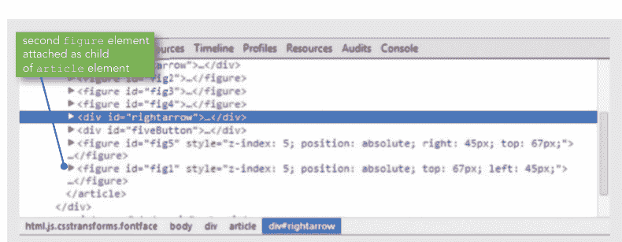

7. 单击`id`值为`fig5`的`figure`元素旁边的三角形（▶），以及`id`值为`fig1`的`figure`元素旁边的三角形，以查看你添加的`figure`元素的子元素。如图5-12所示，你克隆节点的子`img`元素作为克隆过程的一部分被复制了。

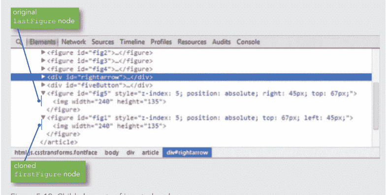

8. 返回编辑器中的**photos.js**，然后在`previewFive()`函数中，于结尾的`}`之前，输入以下代码：

```
// 为两个新的img元素添加适当的src值
document.getElementsByTagName("img")[3].src = "images/IMG_0"
   + photoOrder[4] + "sm.jpg";
document.getElementsByTagName("img")[4].src = "images/IMG_0"
   + photoOrder[0] + "sm.jpg";
```

这两条语句使用与`populateFigures()`函数中为其他`img`元素使用的相同方法，为两个新的`img`元素的`src`属性赋值。

9. 滚动到**photos.js**的顶部，然后在声明全局`photoOrder`变量的语句下方，添加以下语句：

```
var figureCount = 3;
```

10. 在`populateFigures()`函数中，于现有`for`语句之前，输入以下语句：

```
if (figureCount === 3) {
```

11. 在`for`循环之后，但在函数的结尾`}`之前，输入以下代码：

```
} else {
    for (var i = 0; i < 5; i++) {
        filename = "images/IMG_0" + photoOrder[i] + "sm.jpg";
        currentFig = document.getElementsByTagName("img")[i];
        currentFig.src = filename;
    }
}
```

这段代码确保当应用中显示五张图片时，每次用户点击箭头按钮，`populateFigures()`函数都会为画廊中的每个`img`元素分配一张图片。你修改后的`populateFigures()`函数应与以下内容匹配：

```
function populateFigures() {
    var filename;
    var currentFig;
    if (figureCount === 3) {
        for (var i = 1; i < 4; i++) {
            filename = "images/IMG_0" + photoOrder[i] + "sm.jpg";
            currentFig = document.
                getElementsByTagName("img")[i - 1];
            currentFig.src = filename;
        }
    } else {
        for (var i = 0; i < 5; i++) {
            filename = "images/IMG_0" + photoOrder[i] + "sm.jpg";
            currentFig = document.getElementsByTagName("img")[i];
            currentFig.src = filename;
        }
    }
}
```

12. 向下滚动到`previewFive()`函数，然后在结尾的`}`之前，输入以下语句：

```
figureCount = 5;
```

默认情况下，页面打开时`figureCount`变量设置为3。当用户切换到查看五张图片时，此语句将其更改为5，确保`populateFigures()`函数为每个`img`元素分配一张照片。

13. 保存你对**photos.js**的更改，在浏览器中刷新或重新加载**photos.htm**，然后点击**Show more images**按钮。两张额外的图片将显示出来，分别位于画廊的两端，如图5-13所示。

## 在文档树中的特定位置插入节点

`createElement()`方法创建一个未附加到DOM树的节点。创建新节点的最后一步是将它们添加到DOM树中的适当位置。你可以使用`appendChild()`方法将节点添加为你指定的父节点的子节点。然而，新的子节点总是附加在任何现有子节点之后。如果你需要在同一父元素的现有子节点之间的特定位置添加节点，则应使用`insertBefore()`方法，其语法如下：

```
parentNode.insertBefore(newChildNode, existingChildNode)
```

例如，假设你正在使用以下HTML代码：

```
<ul id="topnav">
    <li><a href="aboutus.htm">About Us</a></li>
    <li><a href="order.htm">Order</a></li>
    <li><a href="support.htm">Support</a></li>
</ul>
```

以下JavaScript语句创建一个新的`li`元素，然后将其附加为`ul`元素的子节点，放在现有HTML中第一个`li`元素之前：

```
var list = document.getElementById("topnav");
var directions = document.createElement("li");
directions.innerHTML = "Directions";
var aboutus = document.querySelectorAll("#topnav li")[0];
list.insertBefore(directions, aboutus);
```

第1行的语句创建变量`list`，其值指向`id`值为`topnav`的`ul`元素。第2行创建一个新的`li`元素并将其赋值给变量`directions`。第4行将`aboutus`变量赋值为`topnav`列表中现有的第一个`li`元素。第5行的`insertBefore()`方法指定`list`为父元素，`directions`为要添加的子元素，`aboutus`为`directions`要插入其前的现有子元素。图5-14说明了此示例中DOM树的变化。

由于照片画廊应用的现有代码使用`img`元素的顺序来确定每张图像的显示位置，你需要将`firstFigure`节点插入到文档中现有第一个`figure`元素之前。为了确保你对文档树的添加与用户屏幕上看到的内容相对应，你还将把`lastFigure`节点放在显示右箭头的按钮之前。接下来，你将使用`insertBefore()`方法将第一个和第五个图元素所需的节点添加到照片画廊应用的DOM树中的适当位置。

**要在DOM树中的适当位置插入`firstFigure`和`lastFigure`节点：**

1. 在文本编辑器中返回`photos.js`文件，然后在`previewFive()`函数中找到语句`articleEl.appendChild(lastFigure);`，并在行首插入`//`。

2. 在下一行，输入以下语句：

```
articleEl.insertBefore(lastFigure,
    document.getElementById("rightarrow"));
```

此语句使用`insertBefore()`方法将`lastFigure`节点添加为`articleEl`变量指定的元素的子节点，并放在`id`值为`rightarrow`的子节点之前。

3. 重复步骤1和2，注释掉语句`articleEl.appendChild(firstFigure);`并插入以下语句：

```
articleEl.insertBefore(firstFigure,
    document.getElementById("fig2"));
```

此语句将`firstFigure`节点插入到现有`id`值为`fig2`的元素之前。

4. 按如下所示编辑`previewFive()`函数最后两条语句中的索引号：

```
document.getElementsByTagName("img")[0].src = "images/IMG_0"
    + photoOrder[0] + "sm.jpg";
document.getElementsByTagName("img")[4].src = "images/IMG_0"
    + photoOrder[4] + "sm.jpg";
```

更新后的`previewFive()`函数的末尾应与以下内容匹配：

```
//    articleEl.appendChild(lastFigure);
    articleEl.insertBefore(lastFigure,
        document.getElementById("rightarrow"));
//clone figure element for fifth image and edit to be first
    image
    var firstFigure = lastFigure.cloneNode(true);
    firstFigure.id = "fig1";
    firstFigure.style.right = "";
    firstFigure.style.left = "45px";
// articleEl.appendChild(firstFigure);
    articleEl.insertBefore(firstFigure,
    document.getElementById("fig2"));
    figureCount = 5;
// add appropriate src values to two new img elements
    document.getElementsByTagName("img")[0].src =
    "images/IMG_0" + photoOrder[0] + "sm.jpg";
    document.getElementsByTagName("img")[4].src =
    "images/IMG_0" + photoOrder[4] + "sm.jpg";
}
```

5. 保存对**photos.js**的更改，在浏览器中刷新或重新加载**photos.htm**，点击**Show more images**按钮，然后点击**right arrow**按钮。现在，当你第一次点击右箭头按钮时，照片会前进。

6. 右键点击左侧的第一张图像，点击**Inspect Element**，然后在控制台窗格中检查文档树中`figure`元素的放置位置。如图5-15所示，`id`值为`fig1`的`figure`元素位于`id`值为`fig2`的`figure`元素之前，而`id`值为`fig5`的`figure`元素位于`id`值为`rightarrow`的`div`元素之前。

## 删除节点

除了创建和附加节点外，创建交互式应用还可能涉及从DOM树中删除节点。你可以使用`removeChild()`方法来实现，其语法如下：

```
parentNode.removeChild(childNode)
```

你可以将删除的节点赋值给变量，以便将来使用，如以下代码所示：

```
var list = document.getElementById("topnav");
var aboutus = document.querySelectorAll("#topnav li")[0];
var aboutNode = list.removeChild(aboutus);
```

此代码的最后一行使用`removeChild()`方法从`list`父节点中删除`aboutus`节点。该语句将删除的节点赋值给`aboutNode`变量。然后，你可以在代码的其他地方引用`aboutNode`变量来重新附加或克隆删除的节点。

> **注意** 如果删除节点时未将其赋值给变量，JavaScript处理器会在执行常规垃圾回收时从内存中删除该节点。如果使用变量存储了节点，之后想要从内存中删除该节点，可以将变量的值设置为`null`来实现。

你想让用户可以选择返回到照片画廊应用的原始布局，即删除第一个和第五个图像预览。接下来，你将添加代码以使用`removeChild()`方法实现这一目标。

**要使用`removeChild()`方法从画廊中删除第一张和最后一张图像：**

1. 在文本编辑器中返回**photos.js**文件，然后在`previewFive()`函数中，在闭合的`}`之前，添加以下代码：

```
//change button to hide extra images
var numberButton = document.querySelector("#fiveButton p");
numberButton.innerHTML = "Show fewer images";
if (numberButton.addEventListener) {
    numberButton.removeEventListener("click", previewFive,
        false);
    numberButton.addEventListener("click", previewThree,
        false);
} else if (numberButton.attachEvent) {
    numberButton.detachEvent("onclick", previewFive);
    numberButton.attachEvent("onclick", previewThree);
}
```

当五张图片显示在屏幕上后，此代码会将画廊底部按钮的文本更改为“显示更少的图片”。它还会移除当用户点击按钮时调用`previewFive()`函数的事件监听器，并将其替换为调用`previewThree()`函数的事件监听器，该函数将在后续步骤中创建。

2. 在`previewFive()`函数下方，添加以下代码以创建新的`previewThree()`函数并声明它将使用的变量：

```
/* switch to 3-image layout */
function previewThree() {
    var articleEl = document.getElementsByTagName("article")[0];
    var numberButton = document.querySelector("#fiveButton p");
}
```

3. 在结束的`}`之前，输入以下语句以移除第一个和第五个`figure`元素：

```
articleEl.removeChild(document.getElementById("fig1"));
articleEl.removeChild(document.getElementById("fig5"));
```

第一条语句使用`removeChild()`方法移除`id`值为`fig1`的元素，第二条语句使用`removeChild()`移除`id`值为`fig5`的元素。由于这两条语句都没有将结果赋值给变量，因此被移除的节点将被删除，不会保留在计算机内存中。

4. 在结束的`}`之前，输入以下语句以完成功能：

```
figureCount = 3;
numberButton.innerHTML = "Show more images";
if (numberButton.addEventListener) {
    numberButton.removeEventListener("click", previewThree,
        false);
    numberButton.addEventListener("click", previewFive, false);
} else if (numberButton.attachEvent) {
    numberButton.detachEvent("onclick", previewThree);
    numberButton.attachEvent("onclick", previewFive);
}
```

5. 将更改保存到**photos.js**，在浏览器中刷新或重新加载**photos.htm**，然后点击**显示更多图片**按钮。两张额外的图片被显示出来，按钮文本变为“显示更少的图片”。

6. 右键点击画廊中的第一张图片，点击**检查元素**，然后在文档树中验证所有五个`figure`元素是否按顺序显示。

7. 点击**显示更少的图片**按钮，然后检查文档树。如图5-16所示，第一个和第五个`figure`元素从文档树中被移除，按钮文本变回“显示更多图片”。

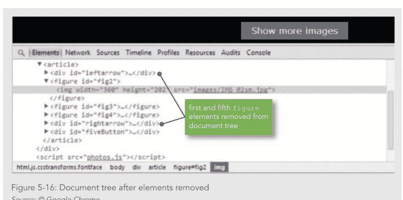

## 简短测验3

1. 哪条语句创建一个新的`footer`元素？

2. 列出两种可以用来向DOM文档树添加节点的方法，并解释它们之间的区别。

3. 以下两条语句的结果会有什么不同？

## 使用Window对象操控浏览器

`Window`对象包含多个属性，用于存储有关Web浏览器窗口或标签页的信息。例如，`name`属性包含当前窗口或标签页的名称。`Window`对象中还包含各种方法，允许你操控Web浏览器窗口或标签页本身。你已经使用过一些`Window`对象的方法，包括用于显示对话框的`window.alert()`方法。表5-3列出了一些常用的`Window`对象属性，表5-4列出了一些常用的`Window`对象方法。

| 属性 | 描述 |
|----------|-------------|
| closed | 布尔值，指示窗口或标签页是否已关闭 |
| document | 对`Document`对象的引用 |
| history | 对`History`对象的引用 |
| innerHeight | 显示内容的窗口区域的高度，包括滚动条（如果存在） |
| innerWidth | 显示内容的窗口区域的宽度，包括滚动条（如果存在） |
| location | 对`Location`对象的引用 |
| name | 窗口或标签页的名称 |
| navigator | 对`Navigator`对象的引用 |
| opener | 对打开当前窗口或标签页的窗口的引用 |
| outerHeight | 整个浏览器窗口的高度 |
| outerWidth | 整个浏览器窗口的宽度 |
| screen | 对`Screen`对象的引用 |
| self | 对`Window`对象的自我引用；与`window`属性相同 |
| status | 写入状态栏的临时文本 |
| window | 对`Window`对象的自我引用；与`self`属性相同 |

表5-3：Window对象属性

| 方法 | 描述 |
|--------|-------------|
| `alert()` | 显示带有确定按钮的简单消息对话框 |
| `blur()` | 从窗口或标签页移除焦点 |
| `clearInterval()` | 取消使用`setInterval()`设置的间隔 |
| `clearTimeout()` | 取消使用`setTimeout()`设置的超时 |
| `close()` | 关闭Web浏览器窗口或标签页 |
| `confirm()` | 显示带有确定和取消按钮的确认对话框 |
| `focus()` | 使`Window`对象成为活动窗口或标签页 |
| `moveBy()` | 将窗口相对于当前位置移动 |
| `moveTo()` | 将窗口移动到绝对位置 |
| `open()` | 打开新的Web浏览器窗口或标签页 |
| `print()` | 打印当前窗口或标签页中显示的文档 |
| `prompt()` | 显示提示用户输入信息的对话框 |
| `resizeBy()` | 按指定数量调整窗口大小 |
| `resizeTo()` | 将窗口调整为指定大小 |
| `scrollBy()` | 按指定数量滚动窗口或标签页 |
| `scrollTo()` | 将窗口或标签页滚动到指定位置 |
| `setInterval()` | 在指定毫秒数后重复执行函数 |
| `setTimeout()` | 在指定毫秒数后执行一次函数 |

表5-4：Window对象方法

引用`Window`对象的另一种方式是使用**self属性**，它指向当前的`Window`对象。使用`self`属性与使用`window`属性引用`Window`对象是完全一样的。例如，以下两行代码是等价的：

```
window.close();
self.close();
```

一些JavaScript程序员倾向于使用`window`属性，而另一些JavaScript程序员则倾向于使用`self`属性。这取决于你个人的选择。但是，在尝试解读其他程序员编写的JavaScript代码时，请注意这两个属性都指向当前的`Window`对象。

由于Web浏览器默认你引用的是全局对象，因此在使用`Window`对象的属性或方法时，通常不需要显式引用`Window`对象。例如，`alert()`方法是`Window`对象的一个方法。在本教材中，你一直使用的是完整的语法`window.alert(text);`，不过语法`alert(text);`（不带`Window`对象）同样可以正常工作。但是，在引用`Window`对象的属性或方法时，使用`window`或`self`引用是一种良好的实践，因为这样可以清楚地表明它们属于`Window`对象。如果不使用`window`或`self`引用，那么你或其他程序员可能会将`Window`对象的属性或方法与JavaScript变量或函数混淆。

## 打开和关闭窗口与标签页

大多数Web浏览器允许你打开新的Web浏览器窗口或标签页，而不仅仅是已有的窗口或标签页。你可能需要打开新的Web浏览器窗口或标签页，原因有多种。你可能希望在单独的窗口或标签页中打开新的网页，让用户可以在当前窗口或标签页中继续查看当前页面。或者，你可能希望使用额外的窗口或标签页来显示图片或订单表单等信息。

每当打开一个新的Web浏览器窗口或标签页时，都会创建一个新的Window对象来表示新的窗口或标签页。你可以打开任意数量的Web浏览器窗口或标签页（只要系统支持），每个窗口或标签页显示不同的网页。

> **注意** 默认情况下，当前版本的所有主流浏览器通常会打开新标签页，而不是新窗口。但是，每个标签页都被视为一个单独的Window对象，因为它包含一个单独的文档。因此，标签页具有表5-4和表5-5中列出的所有属性和方法。

你可以使用简单的HTML（无需任何JavaScript），通过`a`元素的`target`属性在新窗口或标签页中打开链接。例如，以下链接会在名为`wikiWindow`的新窗口或标签页中打开维基百科主页：

```
<a href="http://www.wikipedia.org/"
target="wikiWindow">Wikipedia home page</a>
```

每当用户点击上述链接时，浏览器首先检查是否存在名为`wikiWindow`的浏览器窗口或标签页。如果该窗口或标签页存在，则在其中打开链接。如果该窗口或标签页不存在，则创建一个名为`wikiWindow`的新窗口或标签页，并在其中打开链接。

## 打开窗口或标签页

在许多场景中，你可能想要打开一个窗口或标签页，但使用纯HTML方法并不合适。例如，你可能希望在用户点击`a`元素以外的其他元素时打开窗口或标签页。你还可能希望根据变量来命名新窗口或标签页，而不是将其硬编码到HTML中。对于这些情况，你可以改用JavaScript通过Window对象的`open()`方法来创建新的窗口或标签页。`open()`方法的语法如下：

```
window.open(url, name, options, replace);
```

表5-5描述了`window.open()`方法的参数。

| 参数 | 描述 |
| :--- | :--- |
| url | 表示要打开的网页地址或文件名 |
| name | 为新Window对象的`name`属性赋值 |
| options | 表示一个字符串，允许你自定义新Web浏览器窗口的外观 |
| replace | 布尔值，决定URL是否在Web浏览器的历史记录列表中创建新条目（`true`）还是替换现有条目（`false`）；如果未指定，默认值为`false` |

表5-5：Window对象的`open()`方法的参数

你可以包含`window.open()`方法的所有参数，也可以一个都不包含。例如，语句`window.open("http://www.wikipedia.org");`会在新的网页浏览器窗口或标签页中打开维基百科主页。如果省略了`url`参数，则会打开一个空白网页。例如，语句`window.open();`会打开一个空白的网页浏览器窗口或标签页。

> **注意** 如果你正在编写的代码需要用户点击链接或按钮，那么你可以使用事件监听器来调用`window.open()`方法，这样窗口或标签页就会成功打开。但是，如果你包含的JavaScript代码在用户没有请求的情况下打开了新窗口或标签页，那么所有主流浏览器当前版本内置的弹出窗口阻止程序将阻止窗口或标签页打开。浏览器内置的弹出窗口阻止功能会检查触发代码打开窗口的事件，只有当事件是点击、触摸或其他用户生成的事件时才会执行代码。

当你打开一个新的网页浏览器窗口或标签页时，你可以使用`window.open()`方法的`options`参数来自定义其外观。表5-6列出了你可以与`window.open()`方法一起使用的一些常见选项。

| 名称 | 描述 |
| :--- | :--- |
| `height` | 设置窗口的高度 |
| `left` | 设置窗口左边的水平坐标（以像素为单位） |
| `location` | 包含URL位置文本框 |
| `menubar` | 包含菜单栏 |
| `personalbar` | 包含书签栏（或其他用户可自定义的栏） |
| `resizable` | 确定新窗口是否可以调整大小 |
| `scrollbars` | 包含滚动条 |
| `status` | 包含状态栏 |
| `toolbar` | 包含标准工具栏 |
| `top` | 设置窗口顶部的垂直坐标（以像素为单位） |
| `width` | 设置窗口的宽度 |

表5-6：`Window`对象`open()`方法的常见选项

表5-6中列出的所有选项，除了`width`和`height`选项外，都使用“yes”或“no”的值设置，或者用1代表yes，0代表no。例如，要包含状态栏，选项字符串应为`"status=yes"`。你使用代表像素的整数来设置`width`和`height`选项。例如，要创建一个高200像素、宽300像素的新窗口，字符串应为`"height=200,width=300"`。当在选项字符串中包含多个项目时，必须用逗号分隔它们。如果省略`window.open()`方法的选项字符串，那么所有标准选项都会包含在新的网页浏览器窗口中。但是，如果包含了选项字符串，则必须包含你想要为新窗口创建的所有组件；也就是说，新窗口只包含你明确指定的组件。

> **注意** 在所有主流浏览器的当前版本中，指定`height`选项、`width`选项或两者通常会创建一个新的浏览器窗口，而不是新的标签页。

例如，假设你正在为一家销售打印机的公司开发一个网站。用户可以查看一个显示所有打印机图标和摘要信息的页面，并可以点击任何打印机以查看详细信息。要在新窗口中显示特定打印机的信息，你可能会使用以下代码：

```
window.open("htx23specs.htm","SpecsWindow","toolbar=no,menubar=no,location=no,scrollbars=no,resizable=no,width=380,height=405");
```

浏览器内置了许多安全功能，以确保用户在浏览时能控制自己的体验。这部分安全系统规定，浏览器窗口或标签页不能被任何其他窗口或标签页更改，除了创建它的那个窗口或标签页。出于超出本章范围的原因，为了能够对新窗口或标签页进行更改，你需要使用一个变量来创建它，如下所示代码：

```
var openWin = window.open("htx23specs.htm","SpecsWindow","toolbar=no,menubar=no,location=no,scrollbars=no,resizable=no,width=380,height=405");
```

这段代码声明了一个名为`openWin`的变量，并将其值赋为由指定的`window.open()`方法创建的窗口。这个窗口显示`htx23specs.htm`文档；名称为`SpecsWindow`；不显示工具栏、菜单栏、地址框或滚动条；不可调整大小；宽度为380px，高度为405px。

`window.open()`方法的`name`参数与分配给`target`属性的值基本相同，因为它指定了URL应该在哪个窗口中打开。如果`name`参数已被另一个窗口或标签页使用，那么JavaScript会将焦点转移到现有的窗口或标签页，而不是创建一个新窗口。

例如，上面的代码打开了htx23specs.htm网页并将其命名为`SpecsWindow`。如果当你从主网页中选择另一个菜单项时`SpecsWindow`窗口已经存在，那么`SpecsWindow`窗口将被重用；不会打开另一个窗口。这对于像显示打印机信息这样的网页尤其重要，该网页可能允许你查看显示的每台打印机的数十个不同网页。想象一下，如果应用程序持续为每个选定的打印机打开一个新窗口，用户的屏幕会变得多么拥挤。

> **实用技巧** 明智地使用新窗口

作为程序员，每当你的应用程序生成你认为用户应该注意的信息时，创建新窗口——无论是通过`alert()`等方法还是`window.open()`——都很有诱惑力。然而，在大多数情况下，创建新窗口会妨碍用户，因此你应该尽量减少使用这种技术。在两种一般情况下创建新窗口是合适的。首先，如果用户发起了一个可能产生重大影响的操作，使用像`alert()`这样的方法触发对话框可能是个好主意——例如，确认用户是否要删除由网络服务存储的、不可撤销的信息。另一种情况是当用户执行一个元操作——一个关于当前文档的操作——例如通过社交媒体链接到文档。在这种情况下，启动一个新窗口让用户完成并确认操作——比如添加文本为链接提供上下文，然后点击发布按钮——之后窗口关闭，用户返回到原始页面，这可能会很有帮助。

你的相册设计规定，当用户点击中央的照片时，它应该在一个单独的窗口中以全尺寸打开。你已经创建了一个事件监听器，当用户点击中央照片时触发`zoomFig()`函数。接下来，你将创建`zoomFig()`函数，该函数将包含`window.open()`方法以在单独的窗口中打开图像。

**创建`zoomFig()`函数：**

1. 在你的文本编辑器中，打开Chapter05章节文件夹中的**zoom.htm**文件。

2. 在文档顶部的注释部分，在指示处输入你的姓名和今天的日期，然后保存你的工作。

3. 滚动浏览文档以熟悉其内容。主体部分仅包含两个元素：`figure`和`footer`。`figure`元素包含一个单独的`img`元素。

4. 重复步骤1和2以打开`zoom.js`并保存个性化副本，然后滚动浏览文档以熟悉其内容。该文件包含全局变量声明和一个`pageSetup()`函数。

5. 返回到文本编辑器中的`photos.js`文档。

6. 在`zoomFig()`函数的函数块内，添加以下语句：

```
var zoomWindow = window.open("zoom.htm", "zoomwin", "width=960,height=600");
```

这条语句创建了一个名为`zoomWindow`的变量，并将`window.open()`方法创建的窗口赋值给它。这个显示`zoom.htm`文档内容的窗口名称为`zoomwin`，宽度为960px，高度为600px。将这个窗口赋值给一个变量将使你能够在应用程序的其他部分修改它。

7. 保存你的工作，在浏览器中刷新或重新加载`photos.htm`，然后点击页面中央的照片。如图5-17所示，一个更大尺寸的照片在一个单独的窗口中打开。

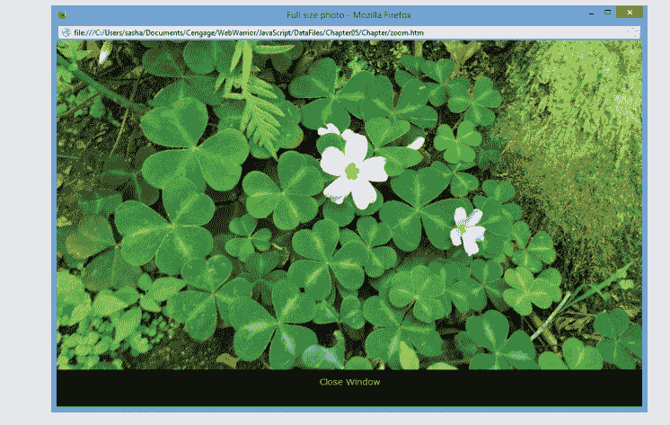

图5-17：使用`open()`方法打开的窗口

> **注意** 出于安全原因，某些浏览器不会显示由本地文件启动的文档中引用的文件。如果新窗口打开了但未显示图片，请使用不同的浏览器重复步骤8。请注意，此问题可能会影响您作为开发者在本地测试应用，但不会影响通过网络访问内容的最终用户。

8. 关闭显示照片较大版本的窗口。请注意，点击窗口底部的“关闭窗口”文本没有任何效果。您将在下一节中添加此功能。

`Window`对象的`name`属性只能与链接配合使用来指定目标窗口，而不能在JavaScript代码中使用。如果您想使用位于新窗口被*创建*的网页浏览器中的JavaScript代码来控制新窗口，则必须将使用`window.open()`方法创建的新`Window`对象赋值给一个变量。打开照片库幻灯片放映网页的语句将一个代表新浏览器窗口的对象赋值给名为`zoomWindow`的变量。您可以对代表`Window`对象的变量使用`Window`对象的任何属性和方法。

您的照片库等网页存在的一个问题是，响应用户点击链接而打开的窗口可能会被隐藏或“丢失”在用户屏幕上其他窗口的后面。例如，假设用户像您一样点击主图像，从而打开一个新窗口。如果用户随后在不关闭新窗口的情况下返回主页面，浏览幻灯片直到不同的照片位于中心，然后点击该图像，则新图像将在之前创建的名为`zoomwin`的同一窗口中打开。但是，如果该窗口隐藏在主浏览器窗口后面，用户会认为应用程序出了问题，因为点击图像不再产生明显的效果。用户可能会持续点击图像，认为点击没有任何响应，而实际上代码运行正常。问题可能是窗口已打开但不可见。要使窗口成为活动窗口，您可以使用`Window`对象的**`focus()`方法**。您将`focus()`方法附加到代表该窗口的变量上，而不是`window.open()`方法的`name`参数上。例如，要使外部照片库窗口成为活动窗口，请使用以下语句：

```
zoomWindow.focus();
```

此语句将`focus()`方法附加到代表窗口的变量名`zoomWindow`上。请注意，您不会使用第二个窗口的名称，如语句`zoomwin.focus()`，因为出于浏览器安全原因，JavaScript代码不能直接影响其他窗口。

接下来，您将在照片库应用程序中的`zoomFig()`函数中添加`focus()`方法。

**要在`zoomFig()`函数中添加`focus()`方法：**

1. 在文本编辑器中返回**photos.js**文档。

2. 在`zoomFig()`函数的结束大括号之前，添加以下语句：

```
zoomWindow.focus();
```

您完成的`zoomFig()`函数应与以下内容匹配：

```
/* open center figure in separate window */
function zoomFig() {
    var zoomWindow = window.open("zoom.htm", "zoomwin",
        "width=960,height=600");
    zoomWindow.focus();
}
```

3. 保存您的工作，在浏览器中刷新或重新加载**photos.htm**，然后点击页面**中心的照片**。照片的较大版本将在单独的窗口中打开。

4. 在不关闭新窗口的情况下，返回包含主照片库页面的窗口，点击**右箭头**，然后点击页面**中心的照片**。显示照片较大版本的窗口应变为活动窗口，并应显示您点击的图像的较大版本。

5. 关闭显示照片较大版本的窗口。

## 关闭窗口

`close()`方法用于关闭浏览器窗口，这是您在使用代表其他Window对象的变量时最可能用到的方法。要关闭由`zoomWindow`变量表示的浏览器窗口，请使用语句`zoomWindow.close();`。要关闭当前窗口，请使用语句`window.close()`或`self.close()`。

> **注意** 使用Window对象的`open()`和`close()`方法时，不必包含Window对象或self属性。但是，Document对象也包含名为`open()`和`close()`的方法，这些方法用于打开和关闭用于写入的网页。因此，通常将Window对象与`open()`和`close()`方法一起使用，以区分Window对象和Document对象。

接下来，您将创建一个函数和一个事件监听器，以便在用户点击“关闭窗口”文本时关闭`zoomwin`窗口。

**要创建使用`close()`方法关闭窗口的函数和事件监听器：**

1. 在文本编辑器中返回`zoom.js`文档。

2. 在`pageSetup()`函数下方，输入以下代码以声明`closeWin()`函数：

```
/* close window */
function closeWin() {
}
```

3. 在`closeWin()`函数的代码块内，输入以下语句：

```
window.close();
```

您完成的函数应与以下内容匹配：

```
/* close window */
function closeWin() {
    window.close();
}
```

4. 在`closeWin()`函数下方，添加以下`createEventListener()`函数：

```
/* create event listener for close button */
function createEventListener() {
    var closeWindowDiv =
        document.getElementsByTagName("p")[0];
    if (closeWindowDiv.addEventListener) {
        closeWindowDiv.addEventListener("click", closeWin,
            false);
    } else if (closeWindowDiv.attachEvent) {
        closeWindowDiv.attachEvent("onclick", closeWin);
    }
}
```

由于包含“关闭窗口”文本的`p`元素是文档中的第一个`p`元素，因此您使用`getElementsByTagName()`方法并传入索引0来引用它。

5. 向上滚动到`pageSetup()`函数，然后在结束大括号之前添加以下语句：

```
createEventListener();
```

您完成的`pageSetup()`函数应与以下内容匹配：

```
/* populate img element and create event listener */
function pageSetup() {
    document.getElementsByTagName("img")[0].src = figFilename;
// assign filename to img element
    createEventListener();
}
```

6. 保存您的工作，在浏览器中刷新或重新加载**photos.htm**，然后点击**中心图像**。图像的较大版本将显示在新窗口中，如图5-18所示。

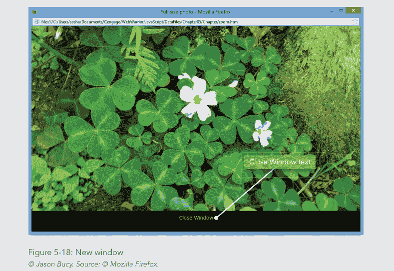

> **注意** 如果图像未在浏览器中显示，由于浏览器的安全策略，链接也不会正常工作。请使用不同的浏览器重复步骤7。同样，此问题可能会影响您作为开发者在本地测试应用，但不会影响通过网络访问内容的最终用户。

7. 在新窗口底部，点击**关闭窗口**。窗口关闭。

## 使用超时和时间间隔

在开发网页时，您可能需要某些JavaScript代码在没有用户干预的情况下重复执行。或者，您可能希望允许某种自动执行的重复任务。例如，您可能想创建一个幻灯片放映，其中显示的图像每隔几秒钟自动更改一次。

您可以使用Window对象的超时和时间间隔方法来创建自动执行的代码。`setTimeout()`方法在JavaScript中用于在经过特定时间后执行代码。使用`setTimeout()`方法执行的代码只执行一次。`setTimeout()`方法的语法是：

```
var variable = setTimeout("code", milliseconds);
```

此语句声明该变量将引用`setTimeout()`方法。`code`参数必须用双引号或单引号括起来，可以是单个JavaScript语句、一系列JavaScript语句或函数调用。浏览器在执行`setTimeout()`方法的`code`参数之前等待的时间以毫秒为单位。

> **注意** 毫秒是千分之一秒；一秒等于1,000毫秒。这意味着，例如5秒等于5,000毫秒。

`clearTimeout()`方法用于在`setTimeout()`方法的代码执行之前取消它。`clearTimeout()`方法接收一个参数，即代表`setTimeout()`方法调用的变量。代表`setTimeout()`方法调用的变量必须声明为全局变量。（回想一下，全局变量是在函数外部声明的变量，可在JavaScript应用的所有部分中使用。）

以下代码中的脚本部分包含一个`setTimeout()`方法和一个`clearTimeout()`方法调用。`setTimeout()`方法设置为在经过10,000毫秒（10秒）后执行。如果用户点击确定按钮，`buttonPressed()`函数将调用`clearTimeout()`方法。

```
var buttonNotPressed = setTimeout("window.alert('Your changes have been saved')", 10000);
function buttonPressed() {
  clearTimeout(buttonNotPressed);
  window.open(index.htm);
}
```

## 要使用`setInterval()`方法让照片库图片自动轮播

1. 返回文本编辑器中的**photos.js**文档。

2. 在文档顶部附近，注释部分下方，向全局变量区域添加以下语句：

```
var autoAdvance = setInterval(rightArrow, 5000);
```

3. 保存工作，在浏览器中刷新或重新加载**photos.htm**，然后等待5秒钟。所有图片应该向左移动，中间图片被替换为从栅栏中生长出来的花朵图片。图片应该继续每5秒更换一次。

## 要使用`clearInterval()`方法让用户取消照片库幻灯片播放

1. 返回文本编辑器中的**photos.js**文档。

2. 在`leftArrow()`函数内，在命令块中的其他语句之前，添加以下语句：

```
clearInterval(autoAdvance);
```

更新后的`leftArrow()`函数应该与以下内容一致：

```
function leftArrow() {
    clearInterval(autoAdvance);
    for (var i = 0; i < 5; i++) {
        if ((photoOrder[i] - 1) === 0) {
            photoOrder[i] = 5;
        } else {
            photoOrder[i] -= 1;
        }
        populateFigures();
    }
}
```

3. 保存工作，然后在浏览器中刷新或重新加载**photos.htm**。照片仍应每5秒切换一次。

4. 在窗口左侧，点击**左箭头**。幻灯片应该返回到显示上一张图片。此外，由于您在左箭头调用的函数中添加了`clearInterval()`方法，图片将不再每5秒自动更改。

您可以为右箭头添加相同的功能。然而，编写此功能更为复杂。由于`rightArrow()`函数被`setInterval()`方法使用，在此函数中添加`clearInterval()`方法将导致图片只更改一次后幻灯片播放就被停止。要启用右箭头停止动画的功能，您需要将`rightArrow()`函数的当前功能分离到一个单独的函数中，并创建一个新的`rightArrow()`函数，该函数清除间隔然后调用这个新函数。

5. 返回文本编辑器中的**photos.js**文档，然后在`rightArrow()`函数中，将函数名更改为**`rightAdvance()`**。更新后的函数应该与以下内容一致：

```
/* shift all images one figure to the left, and
   change values in photoOrder array to match */
function rightAdvance() {
    for (var i = 0; i < 5; i++) {
        if ((photoOrder[i] + 1) === 6) {
            photoOrder[i] = 1;
        } else {
            photoOrder[i] += 1;
        }
        populateFigures();
    }
}
```

6. 在`rightAdvance()`函数上方，添加以下新的`rightArrow()`函数：

```
/* stop automatic image switching and call rightAdvance()
function */
function rightArrow() {
    clearInterval(autoAdvance);
    rightAdvance();
}
```

此函数清除使用`autoAdvance`变量设置的间隔，然后调用`rightAdvance()`函数以按之前的方式移动图片。

7. 向上滚动到`autoAdvance`变量的声明处，然后在`setInterval()`方法中，将`rightArrow`替换为**`rightAdvance`**。修订后的变量声明应该与以下内容一致：

```
var autoAdvance = setInterval(rightAdvance, 5000);
```

8. 保存工作，然后在浏览器中刷新或重新加载**photos.htm**。照片仍应每5秒切换一次。

9. 在窗口右侧，点击**右箭头**。幻灯片应该显示下一张图片。此外，由于您在右箭头调用的函数中添加了`clearInterval()`方法，图片将不再每5秒自动更改。

## 简短测验4

1. 您使用什么语句来创建一个新的空白窗口？

2. 如果您的应用程序包含JavaScript代码，在没有用户请求的情况下打开新窗口或标签页，会发生什么？

3. 如果您希望能够从创建新窗口的窗口控制新窗口，在代码中需要采取什么额外步骤？

## 使用History、Location、Navigator和Screen对象

虽然`Document`对象可以说是`Window`对象最重要的子对象，但了解其他子对象的作用也很重要。在本节中，您将使用`History`、`Location`、`Navigator`和`Screen`对象。

## `History`对象

`History`对象维护一个内部列表（称为**历史列表**），记录当前Web浏览器会话期间打开的所有文档。每个Web浏览器窗口都包含其自己的内部`History`对象。您无法查看历史列表中包含的URL，但可以编写使用历史列表导航到Web浏览器会话期间已打开的网页的脚本。

`History`对象实际上不会显示历史列表中包含的URL。这一点很重要，因为Web浏览器中的个人用户信息，例如用户喜欢访问的网站类型，属于私人信息。阻止他人查看`History`列表中的URL是一项基本的安全功能，因为它保密的浏览历史不被泄露。

`History`对象包含三个方法，列于表5-7中。

| 方法 | 描述 |
| --- | --- |
| `back()` | 产生与点击浏览器“后退”按钮相同的结果 |
| `forward()` | 产生与点击浏览器“前进”按钮相同的结果 |
| `go()` | 打开历史列表中的特定文档 |

表5-7：`History`对象的方法

使用`History`对象的方法或属性时，必须包含对`History`对象本身的引用。例如，`back()`和`forward()`方法允许脚本在浏览器历史记录中向后或向前移动。要使用`back()`方法，您必须使用以下代码：`history.back()`。

`go()`方法用于导航到先前访问过的特定网页。`go()`方法的参数是一个整数，指示您要在历史列表中向前或向后导航多少页。例如，`history.go(-2);`打开历史列表中往回两页的网页；语句`history.go(3);`打开历史列表中往前三页的网页。语句`history.go(-1);`等同于使用`back()`方法，语句`history.go(1);`等同于使用`forward()`方法。

`History`对象包含一个单一属性，即`length`属性，它包含当前浏览器会话期间打开的特定文档数量。要使用`length`属性，您使用语法`history.length;`。`length`属性不包含文档本身的URL，只包含一个表示已打开文档数量的整数。以下代码使用`length`属性与`go()`方法返回到当前浏览器会话中打开的第一个文档：

```
history.go(-(history.length - 1));
```

### Location对象

当你希望允许用户从一个网页中打开另一个网页时，通常会使用`a`元素创建一个链接。你也可以使用JavaScript代码和`Location`对象来打开网页。`Location`对象允许你在JavaScript代码中切换到新网页。使用JavaScript代码切换网页的一个原因是，可以短暂地显示一条消息，让用户知道他们的操作（如提交请求或更改账户信息）已成功，然后自动将访问者重定向回他们发起请求之前正在查看的内容。`Location`对象包含多个属性和方法，用于处理当前在浏览器窗口中打开的文档的URL。当你使用`Location`对象的方法或属性时，必须包含对`Location`对象本身的引用。例如，要使用`href`属性，你必须写成`location.href = URL;`。表5-8列出了`Location`对象的属性，表5-9列出了`Location`对象的方法。

| 属性 | 描述 |
| :--- | :--- |
| hash | URL的锚点部分 |
| host | 网络主机的主机名和域名（或IP地址） |
| hostname | URL的主机名和端口部分的组合 |
| href | 完整的URL地址 |
| pathname | URL的路径 |
| port | URL的端口 |
| protocol | URL的协议 |
| search | URL的搜索或查询部分 |

表5-8：`Location`对象的属性

| 方法 | 描述 |
| :--- | :--- |
| assign() | 加载一个新的网页 |
| reload() | 使当前在浏览器中显示的页面重新打开 |
| replace() | 用一个不同的URL替换当前加载的URL |

表5-9：`Location`对象的方法

`Location`对象的属性允许你修改URL的各个部分。当你修改`Location`对象的任何属性时，都会生成一个新的URL，浏览器会自动尝试打开这个新的URL。通常，修改代表整个URL的`href`属性比修改URL的各个部分更容易。例如，以下语句打开Google主页：

```
location.href = "http://www.google.com";
```

`Location`对象的`assign()`方法执行与修改`href`属性相同的操作：加载一个新的网页。以下两条语句是等效的：

```
location.assign("http://www.google.com");
location.href = "http://www.google.com";
```

`Location`对象的`reload()`方法等同于点击浏览器的“重新加载”或“刷新”按钮。它使当前在浏览器中显示的页面重新打开。你可以使用不带任何参数的`reload()`方法，如`location.reload();`，也可以包含一个布尔参数`true`或`false`。包含参数`true`会强制当前网页从其所在的服务器重新加载，即使它没有被更改。例如，语句`location.reload(true);`会强制当前页面重新加载。如果你包含参数`false`，或者根本不包含任何参数，那么网页仅在其内容发生更改时才会重新加载。

`Location`对象的`replace()`方法用于用另一个URL替换当前加载的URL。此方法的工作方式与通过修改`href`属性加载新文档略有不同。`replace()`方法实际上是用一个文档覆盖另一个文档，并替换浏览器历史记录列表中的旧URL条目。相比之下，`href`属性会打开一个不同的文档并将其添加到历史记录列表中。

### Navigator对象

**Navigator对象**用于获取有关当前浏览器的信息。它的名字源自Netscape Navigator，但所有主流浏览器都支持它。一些浏览器支持`Navigator`对象独有的方法和属性，这些方法和属性不能在其他浏览器中使用。表5-10列出了所有主流浏览器当前版本都支持的`Navigator`对象的属性。

| 属性 | 描述 |
|------------|-------------|
| appName | 显示页面的Web浏览器名称 |
| appVersion | 显示页面的Web浏览器版本 |
| geolocation | 用于访问用户当前位置的API以及用户权限设置（拒绝或允许访问该信息） |
| onLine | 浏览器当前是否具有网络连接 |
| platform | 客户端计算机上使用的操作系统 |
| userAgent | 存储在HTTP user-agent请求头中的字符串，其中包含有关浏览器、平台名称和兼容性的信息 |

表5-10：Navigator对象的属性

例如，以下代码标记并记录`Navigator`对象的几个属性：

```
console.log("Web browser name: " + navigator.appName);
console.log("Web browser version: " + navigator.appVersion);
console.log("Operating platform: " + navigator.platform);
console.log("User agent: " + navigator.userAgent);
```

图5-19显示了这些命令在Firefox控制台中的结果。

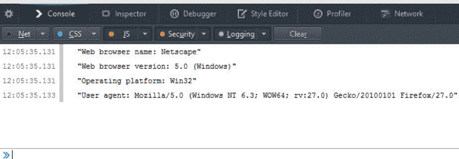

过去，`Navigator`对象通常用于确定正在运行的浏览器类型，以便为不同JavaScript实现执行正确的代码。如今，JavaScript实现在所有主流浏览器的当前版本中已经标准化，因此这种称为浏览器嗅探的技术很少使用。然而，浏览器嗅探仍有一个应用场景：一些浏览器自身的JavaScript实现存在错误，因此识别浏览器和版本以规避这些错误是有用的。但是，浏览器嗅探是一个挑战，很难获得关于用户正在使用哪种浏览器的确切信息。因此，许多开发者使用内置在Modernizr等库中的浏览器检测功能，而不是自己编写这个复杂的任务。

### Screen对象

计算机显示器可能因显示器类型和大小、安装的显卡类型以及用户选择的屏幕分辨率和颜色深度的不同而有很大差异。例如，一些笔记本电脑的屏幕较小且分辨率有限，而一些台式机系统可以配备具有非常高分辨率的大型显示器。如此广泛的显示设置范围，使得确定由JavaScript生成的窗口的大小和位置变得具有挑战性。**Screen对象**用于获取有关显示屏尺寸、分辨率和颜色深度的信息。表5-11列出了所有主流Web浏览器当前版本都支持的`Screen`对象的属性。

| 属性 | 描述 |
|------------|-------------|
| `availHeight` | 显示屏的高度，不包括操作系统功能（如Windows任务栏） |
| `availWidth` | 显示屏的宽度，不包括操作系统功能（如Windows任务栏） |
| `colorDepth` | 如果正在使用调色板，则返回显示屏的位深度；如果未使用调色板，则返回`pixelDepth`属性的值 |
| `height` | 显示屏的高度 |
| `pixelDepth` | 显示屏的颜色分辨率，以每像素位数为单位 |
| `width` | 显示屏的宽度 |

表5-11：`Screen`对象的属性

> **最佳实践** 在响应式设计中使用meta Viewport而非Screen属性

你可以使用`Screen`对象的属性来实现响应式设计原则，优化文档在不同屏幕尺寸下的外观。然而，对HTML `meta`元素的viewport属性的广泛支持，使其成为创建响应式设计更简单的选择，因此这不是`Screen`对象属性的常见用途。

## 修改幻灯片放映应用程序，使显示较大图像的窗口居中显示在用户屏幕上

Screen对象属性的常见用途之一是使用它将Web浏览器窗口居中显示在显示区域的中央。对于使用`window.open()`方法生成的窗口，可以通过为选项参数的left和top选项赋值来在窗口首次显示时将其居中。要水平居中窗口，请用屏幕宽度减去窗口宽度，将余数除以二，并将结果赋值给left选项。类似地，要垂直居中窗口，请用屏幕高度减去窗口高度，将余数除以二，并将结果赋值给top选项。以下代码演示了如何创建新窗口并将其居中显示在显示区域的中央：

```
var winWidth = 300;
var winHeight = 200;
var leftPosition = (screen.width - winWidth) / 2;
var topPosition = (screen.height - winHeight) / 2;
var optionString = "width=" + winWidth + ",height="
    + winHeight + ",left=" + leftPosition + ",top="
    + topPosition;
var openWin = window.open("", "CtrlWindow", optionString);
```

> **注意** 请记住，打开新窗口的语句必须从事件处理程序调用，否则Web浏览器的弹出窗口阻止程序将阻止窗口打开。

接下来，您将修改幻灯片放映应用程序，使新窗口打开时居中显示在用户屏幕上。

1. 在文本编辑器中返回到photo.js文档。

2. 在`zoomFig()`命令块中，在现有语句上方，输入以下代码：

```
var propertyWidth = 960;
var propertyHeight = 600;
var winLeft = ((screen.width - propertyWidth) / 2);
var winTop = ((screen.height - propertyHeight) / 2);
var winOptions = "width=960,height=600";
winOptions += ",left=" + winLeft;
winOptions += ",top=" + winTop;
```

`winLeft`变量的计算从现有浏览器窗口的宽度减去新浏览器窗口的宽度开始，再除以二。这确定了新窗口应从现有窗口左边缘偏移的量。`winTop`变量的计算与`winLeft`类似，但使用垂直属性而非水平属性。`winOptions`变量创建了一个用于`window.open()`方法的选项字符串，其中包含了计算出的值。

3. 在`zoomFig()`函数的下一行，即声明`zoomWindow`变量的位置，将参数`"width=960,height=600"`替换为`winOptions`。您修改后的`zoomFig()`函数应如下所示：

```
/* 在单独窗口中打开居中图像 */
function zoomFig() {
    var propertyWidth = 960;
    var propertyHeight = 600;
    var winLeft = ((screen.width - propertyWidth) / 2);
    var winTop = ((screen.height - propertyHeight) / 2);
    var winOptions = "width=960,height=600,";
    winOptions += ",left=" + winLeft;
    winOptions += ",top=" + winTop;
    var zoomWindow = window.open("zoom.htm", "zoomwin",
        winOptions);
    zoomWindow.focus();
}
```

4. 保存您的工作，在浏览器中刷新或重新加载`photos.htm`，然后点击**中央图像**。打开的新窗口应该居中显示在您的屏幕上。

## 简短测验5

1. 提供两个显示浏览器历史中上一页的语句。

2. `location.reload(true);`语句的效果是什么？

3. 使用`Screen`对象可以访问哪些类型的信息？

## 小结

- 浏览器对象模型（BOM）或客户端对象模型是一个对象层次结构，每个对象都提供了对Web浏览器窗口或Web页面不同方面的编程访问。
- 浏览器对象模型中的顶层对象是`Window`对象，它代表一个Web浏览器窗口。
- `Document`对象是浏览器对象模型中最重要的对象，因为它代表了浏览器中显示的Web页面。
- 文档对象模型（DOM）代表了窗口中显示的Web页面。
- 通过`Document`对象，您可以访问代表Web页面上元素的其他对象。
- `getElementById()`方法返回文档中具有匹配`id`属性的第一个元素。
- `getElementsByTagName()`方法返回与指定元素（标签）名称匹配的元素的数组。
- `getElementsByClassName()`方法返回具有与指定值匹配的`class`属性的元素的数组。
- `getElementsByName()`方法返回具有与指定值匹配的`name`属性的元素的数组。
- 每当打开新的Web浏览器窗口时，就会创建一个新的`Window`对象来代表新窗口。
- 打开新的Web浏览器窗口时，可以使用`window.open()`方法的options参数来自定义其外观。
- `Window`对象的`name`属性只能用于指定链接的目标窗口，不能在JavaScript代码中使用。
- 要控制在创建它的Web浏览器中通过JavaScript代码定位的新窗口，必须将使用`window.open()`方法创建的新`Window`对象赋值给一个变量。
- `setTimeout()`方法在JavaScript中用于在特定时间过去后执行代码，`clearTimeout()`方法用于在代码执行前取消`setTimeout()`方法。
- `setInterval()`方法在仅被调用一次后重复执行相同的代码，`clearInterval()`方法用于清除`setInterval()`方法调用。
- `History`对象维护当前Web浏览器会话期间打开的所有文档的内部列表。
- `Location`对象允许您从JavaScript代码中更改到新的Web页面。
- `Navigator`对象用于获取有关当前Web浏览器的信息。
- `Screen`对象用于获取有关显示屏幕尺寸、分辨率和色深的信息。

## 关键术语

**API**——参见应用程序编程接口。

**应用程序编程接口（API）**——一种规范，说明不同软件组件如何相互交互。

**浏览器对象模型（BOM）**——描述Web浏览器内对象之间关系的模型，包括当前文档内的对象。

**`clearInterval()`方法**——`Window`对象的方法，用于清除`setInterval()`方法调用。

**`clearTimeout()`方法**——`Window`对象的方法，用于在代码执行前取消`setTimeout()`方法。

**客户端对象模型**——参见浏览器对象模型。

**`close()`方法**——`Window`对象的方法，用于关闭Web浏览器窗口。

**DHTML**——参见动态HTML。

**文档片段**——一组不属于文档的连接节点。

**文档对象模型（DOM）**——代表浏览器对象模型中`Document`对象分支的对象模型。

**DOM**——参见文档对象模型。

**DOM树**——Web页面的DOM层次结构。

**动态HTML（DHTML）**——HTML和CSS与JavaScript的结合，使现代Web具有交互性。

**`focus()`方法**——`Window`对象的方法，用于使窗口成为活动窗口。

**`getElementsByName()`方法**——`Document`对象的方法，返回具有与指定值匹配的`name`属性的元素的集合。

**`getElementsByClassName()`方法**——`Document`对象的方法，返回具有与指定值匹配的`class`属性的元素的集合。

**全局对象**——`Window`对象的术语，基于浏览器对象模型中的所有其他对象都包含在其中的事实。

**历史列表**——`History`对象维护的当前Web浏览器会话期间打开的所有文档的内部列表。

**History对象**——`Window`对象的子对象，维护当前Web浏览器会话期间打开的所有文档的内部列表。

**HTML集合**——HTML元素的索引集合。

**Location对象**——`Window`对象的子对象，允许您从JavaScript代码中更改到新的Web页面。

**Navigator对象**——`Window`对象的子对象，用于获取有关当前浏览器的信息。

**节点**——DOM树中的每个项目。

**节点列表**——节点的索引集合。

**`open()`方法**——`Window`对象的方法，您可以使用JavaScript用它来创建新窗口或标签页。

**`querySelector()`方法**——`Document`对象的方法，返回与指定CSS选择器匹配的第一个元素。

**`querySelectorAll()`方法**——`Document`对象的方法，返回与指定CSS选择器匹配的元素的集合。

**Screen对象**——`Window`对象的子对象，用于获取有关显示屏幕尺寸、分辨率和色深的信息。

**self属性**——引用`Window`对象的另一种方式；使用`self`属性与使用`window`属性引用`Window`对象相同。

**`setInterval()`方法**——`Window`对象的方法，在仅被调用一次后重复执行相同的代码。

**`setTimeout()`方法**——`Window`对象的方法，用于在特定时间过去后执行一次代码。

**标签名称**——元素的名称。

**`textContent`属性**——Web页面元素的属性，用于访问和更改元素包含的文本；与`innerHTML`属性不同，`textContent`会去除任何HTML标签。

**Window对象**——浏览器对象模型中的顶层对象，代表一个Web浏览器窗口。

## 复习题

1. 以下哪个对象也被称为全局对象？
   a. 浏览器对象
   b. 屏幕对象
   c. 文档对象
   d. 窗口对象

2. 在浏览器对象模型中，`History`对象是`Location`对象的________对象。
   a. 父级
   b. 祖先级
   c. 兄弟级
   d. 子级

3. DOM树中的每个项目被称为________。
   a. 节点
   b. 文档
   c. 对象
   d. 元素

4. 以下哪项是访问`id`值为`headline`的元素的正确语法？
   a. `document.getElementsByID("headline")`
   b. `document.getElementById("headline")`
   c. `document.getElementByID("headline")`
   d. `document.getElementById(headline)`

5. 以下哪项是使用`getElementsByTagName()`方法返回文档中所有`p`元素的正确语法？
   a. `document.getElementsByTagName("<p>")`
   b. `document.getElementsByTagName("p")`
   c. `document.getElementsByTagName(<p>)`
   d. `document.getElementsByTagName() = "<p>"`

6. 以下哪项是访问文档中第三个`a`元素的`href`属性值的正确语法？
   a. `document.getElementsByTagName("a")[2].href`
   b. `document.getElementsByTagName("a")[3].href`
   c. `document.getElementById("a").href`
   d. `document.getElementsByTagName("href")[3]`

7. 一组连接在一起但不属于文档的节点被称为__________。
   a. 历史列表
   b. 节点列表
   c. HTML集合
   d. 文档片段

8. 哪个方法允许你在指定的兄弟节点位置插入一个节点？
   a. `createElement()`
   b. `appendChild()`
   c. `cloneNode()`
   d. `insertBefore()`

9. 如何提高使用`window.open()`方法创建的新窗口以新窗口而非新标签页形式打开的可能性？
   a. 指定`window=true`选项。
   b. 指定`height`和/或`width`值。
   c. 确保该方法由用户操作触发。
   d. 关闭用户浏览器中所有打开的标签页。

10. 如何控制使用JavaScript代码创建的新窗口？
    a. 无法使用JavaScript代码控制新窗口。
    b. 将使用`window.open()`方法创建的新Window对象赋值给一个变量。
    c. 使用`window.open()`方法的`name`参数。
    d. 使用`document.open()`方法的`name`参数。

11. 要使一个窗口成为活动窗口，你需要使用Window对象的__________方法。
    a. `focus()`
    b. `open()`
    c. `close()`
    d. `active()`

12. 你使用哪个方法在指定的时间间隔后只执行一次代码？
    a. `setTimeout()`
    b. `setInterval()`
    c. `clearTimeout()`
    d. `clearInterval()`

13. 你使用哪个方法以特定的时间间隔重复执行代码？
    a. `setTimeout()`
    b. `setInterval()`
    c. `clearTimeout()`
    d. `clearInterval()`

14. 哪个对象的属性描述了用户的浏览器？
    a. `History`
    b. `Location`
    c. `Navigator`
    d. `Screen`

15. 哪个对象允许你从JavaScript代码中更改为一个新的、未访问过的网页？
    a. `History`
    b. `Location`
    c. `Navigator`
    d. `Screen`

16. 列出组成浏览器对象模型的六个主要对象。使用父级、子级和兄弟级这些术语描述这些对象之间的关系。

17. 假设你正在处理一个包含一个`img`元素（其`id`值为`logoImage`）的文档。提供两种引用此元素的代码。

18. 编写代码，在一个新的浏览器窗口中显示一个名为modelHDescription.htm的文档，该窗口宽400像素，高300像素，然后将该窗口置于所有其他浏览器窗口的前面。

19. 解释`setTimeout()`和`setInterval()`方法之间的区别。提供一个你会使用每个方法的示例。

20. 解释如何在使用`window.open()`方法创建窗口时使其在屏幕上居中。

## 动手实践项目

**动手实践项目5-1**

在这个项目中，你将创建一个应用程序，将浏览器`Navigator`对象的信息打印到屏幕上。然后你将比较不同浏览器报告的信息。

1. 在你的文本编辑器中，打开Chapter05文件夹中HandsOnProject5-1文件夹的**index.htm**文件，在注释部分指示的位置添加你的姓名和今天的日期，然后保存文件。

2. 在`body`部分内，就在闭合的`</body>`标签之前，添加一个`script`元素，然后在`script`元素内添加以下语句：

```
"use strict";
document.getElementsByTagName("p")[0].innerHTML =
    "Web browser name: " + navigator.appName;
document.getElementsByTagName("p")[1].innerHTML =
    "Web browser version: " + navigator.appVersion;
document.getElementsByTagName("p")[2].innerHTML =
    "Operating platform: " + navigator.platform;
document.getElementsByTagName("p")[3].innerHTML =
    "User agent: " + navigator.userAgent;
```

3. 保存你的更改。

4. 在浏览器中打开`index.htm`，打印页面或将其另存为PDF，然后检查为每个属性显示的结果。图5-20显示了Firefox for Windows的示例输出。

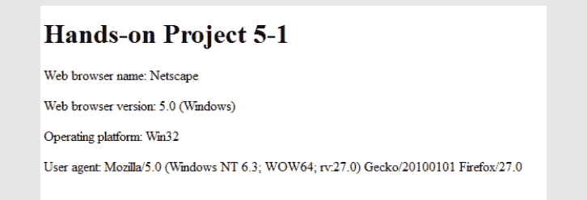

图5-20：Firefox中的`Navigator`对象属性

5. 如果可能，请在多个操作系统（Windows、OS X、Linux）上使用至少两个额外的浏览器重复步骤4。

6. 比较你测试的每个浏览器的结果，然后回答以下问题：
   a. 对于四个属性中的每一个，指定返回的信息是否似乎准确。
   b. 哪些属性在每个浏览器中始终不同？哪些属性（如果有的话）在每个浏览器中是相同的？
   c. 根据你的结果，解释你在使用`Navigator`对象的属性来判断应用程序在哪个浏览器中打开时遇到的任何挑战。同时解释哪些属性会提供有用的信息。

**动手实践项目5-2**

在这个项目中，你将创建一个函数，当用户单击按钮时打开一个确认窗口。你创建的窗口将居中显示在用户的屏幕上。

1. 在你的文本编辑器中，打开Chapter05文件夹中HandsOnProject5-2文件夹的**index.htm**文件，在注释部分指示的位置添加你的姓名和今天的日期，然后保存文件。

2. 在`body`部分内，就在闭合的`</body>`标签之前，添加一个`script`元素，然后在`script`元素内添加以下函数：

```
function processInput() {
    var propertyWidth = 300;
    var propertyHeight = 100;
    var winLeft = ((screen.width - propertyWidth) / 2);
    var winTop = ((screen.height - propertyHeight) / 2);
    var winOptions = "width=300,height=100";
    winOptions += ",left=" + winLeft;
    winOptions += ",top=" + winTop;
    window.open("confirm.htm", "confirm", winOptions);
}
```

3. 在你在步骤2中添加的函数下方，添加以下函数以创建事件监听器：

```
function createEventListener() {
    var submitButton = document.getElementById("submit");
    if (submitButton.addEventListener) {
        submitButton.addEventListener("click", processInput, false);
    } else if (submitButton.attachEvent) {
        submitButton.attachEvent("onclick", processInput);
    }
}
```

4. 在你在步骤3中创建的函数下方，添加以下代码，以便在页面加载完成时创建事件监听器：

```
if (window.addEventListener) {
    window.addEventListener("load", createEventListener, false);
} else if (window.attachEvent) {
    window.attachEvent("onload", createEventListener);
}
```


5. 保存你的工作，在浏览器中打开`index.htm`，然后单击**Submit**按钮。一个窗口打开，显示消息“Your address has been updated”，如图 5-21 所示。

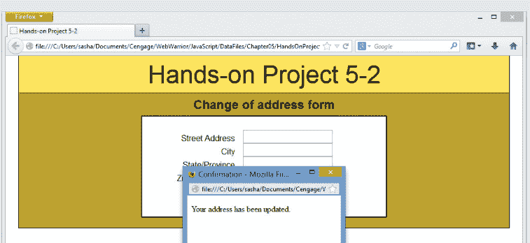

图 5-21：确认窗口

来源：© Mozilla Firefox。

6. 关闭包含消息的窗口。

## 动手实践项目 5-3

在这个项目中，你将增强你在动手实践项目 5-2 中所做的工作，设置确认窗口在打开后 5 秒关闭。

1. 在你的操作系统的文件管理器中，将 HandsOnProject5-2 文件夹的完成内容复制到 HandsOnProject5-3 文件夹。

2. 在你的文本编辑器中，打开 HandsOnProject5-3 文件夹中的`index.htm`文件，然后在注释部分、`title`元素和`h1`元素中，将 "Hands-on Project 5-2" 改为**Hands-on Project 5-3**。

3. 在`script`元素中，`processInput()`函数之前，输入以下语句：

```javascript
var confirmWindow;
```

4. 在`processInput()`函数中，删除最后一条语句行首的`var`关键字。

5. 在`processInput()`函数的闭花括号之前，添加以下语句：

```javascript
setTimeout("confirmWindow.close()", 5000);
```

`script`元素的开头应与以下内容一致：

```javascript
1 "use strict";
2 var confirmWindow;
3 function processInput() {
4     var propertyWidth = 300;
5     var propertyHeight = 100;
6     var winLeft = ((screen.width - propertyWidth) / 2);
7     var winTop = ((screen.height - propertyHeight) / 2);
8     var winOptions = "width=300,height=100";
9     winOptions += ",left=" + winLeft;
10     winOptions += ",top=" + winTop;
11     confirmWindow = window.open("confirm.htm", "confirm",
12         winOptions);
13     setTimeout("confirmWindow.close()", 5000);
14 }
```

6. 保存你的工作，在浏览器中打开`index.htm`，然后点击**Submit**按钮。5秒后，确认窗口应自动关闭。

## Hands-On Project 5-4

在本项目中，你将以另一种方式增强 Hands-On Project 5-2，用关闭按钮替换超时功能。

1. 在你操作系统的文件管理器中，将 HandsOnProject5-2 文件夹中的已完成内容复制到 HandsOnProject5-4 文件夹。

2. 在你的文本编辑器中，打开 HandsOnProject5-4 文件夹中的`confirm.htm`文件，将注释部分中的 "Hands-on Project 5-2" 改为**Hands-on Project 5-4**，然后在注释部分添加你的姓名和今天的日期。

3. 在现有的`p`元素下方，添加以下新的`p`元素：

```html
<p id="closeB">Close</p>
```

4. 在`</body>`结束标签的上方，创建一个`script`元素。

5. 在`script`元素中，输入以下函数：

```javascript
function closeWindow() {
  window.close();
}
```

6. 在`closeWindow()`函数下方，输入以下函数：

```javascript
1  // add event listener to Close button
2  function createEventListener() {
3     var closeButton = document.getElementById("closeB");
4     if (closeButton.addEventListener) {
5        closeButton.addEventListener("click", closeWindow,
6           false);
7     } else if (closeButton.attachEvent) {
8        closeButton.attachEvent("onclick", closeWindow);
9     }
10  }
```

7. 在`createEventListener()`函数下方，添加以下语句：

```javascript
if (window.addEventListener) {
  window.addEventListener("load", createEventListener, false);
} else if (window.attachEvent) {
  window.attachEvent("onload", createEventListener);
}
```

8. 保存你的工作，在浏览器中打开`index.htm`，然后点击**Submit**按钮。确认窗口将打开，如图 5-22 所示。

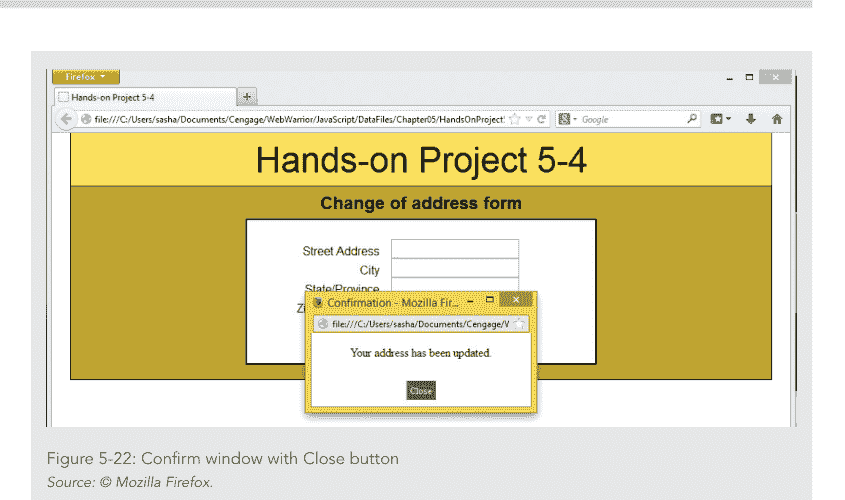

9. 点击**Close**按钮。确认窗口关闭。

## Hands-On Project 5-5

在本项目中，你将创建和引用文档元素，为包含美国《权利法案》的文档生成目录。

1. 在你的文本编辑器中，打开 Chapter05 文件夹中 HandsOnProject5-5 文件夹里的`index.htm`文件，在注释部分指示的位置添加你的姓名和今天的日期，然后保存文件。

2. 在 body 部分中，`</body>`结束标签之前，添加一个`script`元素。

3. 在`script`元素中，声明一个名为`list`的变量，它包含对文档中唯一`ul`元素的引用。同时声明名为`headingText`和`TOCEntry`的空变量。

4. 在变量声明下方，创建一个`for`语句，将计数器变量设置为 1，只要计数器变量的值小于或等于 10 就重复循环，并且每次循环将计数器变量递增 1。

5. 在`for`循环内，添加执行以下操作的语句：...)

| 事件 | 描述 |

|---|---|

| submit | 当表单的提交按钮被点击时触发 |

表 6-2：*form* 对象的事件

| 方法 | 描述 |

|---|---|

| `checkValidity()` | 启动基于浏览器的表单控件验证，如果所有控件都有效则返回 `true` |

| `submit()` | 在不使用提交按钮的情况下提交表单 |

表 6-3：*form* 对象的方法

用于在表单内收集数据的元素包括`input`、`select`、`option`、`textarea`和`button`。表 6-4、6-5 和 6-6 列出了大多数或所有这些元素共有的属性、方法和事件。请注意，与验证相关的属性、方法和事件不适用于**button**元素或类型为`button`的`input`元素。本章稍后，你将了解特定于元素的附加属性、方法和事件。

| 属性 | 描述 |

|---|---|

| `autofocus` | 如果设置了 HTML autofocus 属性，则返回值 `true`，表示当表单加载时元素应获得焦点 |

| `placeholder` | 返回 `placeholder` 属性的值，该属性包含当字段没有值时要显示的文本 |

| `required` | 如果设置了 HTML `required` 属性，则返回值 `true`，表示在表单可以提交之前，控件必须包含一个值 |

| `validationMessage` | 设置或返回在 `submit` 事件失败后（如果字段的 `validity` 值为 `false`）将显示给用户的消息文本 |

| `validity` | 如果控件值通过基于浏览器的验证规则，则返回值 `true` |

| `value` | 设置或返回控件的值 |

| `willValidate` | 如果为控件启用了约束验证，则返回值 `true` |

表 6-4：表单内元素的属性

| 方法 | 描述 |

| :--- | :--- |

| `checkValidity()` | 对表单元素运行约束验证；如果值有效则返回 `true`，如果值无效则返回 `false` |

| `setCustomValidity("message")` | 将字符串 `message` 设置为当发现控件值无效时要显示给用户的文本；传递非空字符串会将控件的有效性设置为 `false`，而传递空字符串作为参数则会将控件的有效性设置为 `true` |

表 6-5：表单内元素的方法

| 事件 | 触发时机 |

| :--- | :--- |

| `blur` | 焦点离开元素，意味着元素最初被选中或包含插入点，然后另一个元素被选中或包含插入点（通常是通过单击另一个元素或按 Tab 键移动到另一个元素） |

| `change` | 焦点离开元素，并且当前元素的值或选中状态已更改 |

| `focus` | 元素获得焦点，意味着元素被选中或插入点移动到当前元素中（通常是通过单击当前元素或按 Tab 键移动到当前元素） |

| `formchange` | 表单中的另一个控件触发了 `change` 事件 |

| `forminput` | 表单中的另一个控件触发了 `input` 事件 |

| `input` | 当前元素的值或选中状态发生变化 |

| `invalid` | 在约束验证期间发现控件的值无效 |

表 6-6：表单内元素的事件

## 引用表单和表单元素

虽然大多数开发者使用`getElementById()`和`getElementsByTagName()`等方法来访问和操作网页对象，但你应该知道还有另一种方式来处理`form`对象。默认情况下，浏览器会在 HTML 文档中创建几种类型的对象的集合，包括锚点、图像、链接和表单。本书使用代码

```javascript
document.getElementsByTagName("form")[0]
```

来引用文档中只包含一个表单的`form`对象。但是，你也可能遇到引用

```javascript
document.forms[0]
```

它引用浏览器创建的默认`form`对象数组中的第一个`form`对象。此外，`forms`数组包含一个表单元素内的对象数组，称为`elements`数组。你可以使用以下代码引用网页文档中第一个表单中的第三个对象

```javascript
document.forms[0].elements[2]
```

尤其是在较大的表单中，使用`elements`数组可能很繁琐。但是，在使用`forms`数组引用表单时，你可以改用元素的`name`值来引用表单中的任何元素。这意味着，要引用网页文档中第一个表单中名为`DeliveryZip`的元素，你可以使用语法

```javascript
document.forms[0].DeliveryZip
```

使用`getElementById()`等方法而不是`forms`数组来引用`form`对象的一个优点是，你不需要在用于引用`form`对象的语法和用于非`form`对象的语法之间来回切换。此外，当需要相同的代码能够同时引用`form`和非表单元素时，使用`Document`对象方法使你的代码更加灵活。最后，在 XHTML 的严格 DTD 中不允许使用`name`属性，因此如果你正在编写 JavaScript 以处理 XHTML 文档，则不能使用 forms 数组或其他浏览器数组。但是，你应该了解它的工作原理，以防在处理其他开发人员编写的代码时遇到它。

在本章中，你将处理一个名为 Snoot Flowers 的花卉商店（位于爱荷华州达文波特）的表单。该商店委托为其网站制作了一个订单表单，该表单已经完成。你的任务将是创建 JavaScript 代码来增强表单并在将表单数据提交到公司服务器上的后端软件之前验证用户输入。

你将通过打开订单表单页面并熟悉它来开始你的工作。

**打开并查看订单表单：**

1. 在你的文本编辑器中，打开第 6 章文件夹中的`snoot.htm`文件。

2. 在文档顶部的注释部分，在指示位置输入你的姓名和今天的日期，然后保存你的工作。

3. 滚动浏览文档以熟悉其内容。文章包含一个表单，该表单由六个字段集组成，这些字段集是使用 HTML `fieldset`元素创建的。

4. 在网页浏览器中打开`snoot.htm`。图 6-1 显示了文档的当前内容。

### 下订单

### 留言

- 祝贺！

- 生日快乐！

- 周年纪念快乐！

- 我爱你！

- 自定义留言

### 账单地址

| 名 | |

| 姓 | |

| 街道地址 | |

| 城市 | |

| 州 | AL v |

| 邮编 | |

| 电话 | |

### 送货地址

- [] 与账单地址相同

| 名 | |

| 姓 | |

| 街道地址 | |

| 城市 | |

| 州 | AL v |

| 邮编 | |

| 电话 | |

### 送货日期

| January v | 1 v | 2017 v |

### 支付方式

- ()- Visa

- ()- Master Card

- ()- Discover

- ()- American Express

| 卡号 | |

| 有效期 | 01 v | 2017 v |

| CVV | |

### 创建账户？

为了能够访问你的购买历史记录并更改你的订单，请输入用户名和密码以创建一个账户。

| 用户名 | |

| 密码 | |

| 密码（验证） | |

图 6-1：浏览器中的 snoot.htm © 2015 Cengage Learning®

## 368 第 6 章 增强和验证表单

### 小测验 1

1. 描述 JavaScript 在表单中的两个常见用途。

2. 说出使用`getElementById()`方法而不是通过指定表单中的索引号来识别`form`元素的两个优点。

## 提高表单可用性

JavaScript 程序在表单方面最重要的作用之一是验证用户输入。然而，在你实际编写代码来验证用户输入之前，你可以采取一些步骤来减少所需的验证量。

### 设计表单以收集更准确的内容

大多数表单验证涉及检查用户在`input`和`textarea`框中键入的数据以确保其准确性。例如，在图 6-2 中的表单中，你会希望确保用户在“卡类型”框中的输入是你公司接受的信用卡类型的名称或缩写。同样，你会希望检查“有效期”框中的输入是否指定了月份和年份。

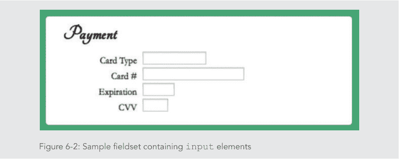

但是，“卡类型”和“有效期”字段所请求的信息仅限于一个小而离散的列表——例如，在“卡类型”字段的情况下，是几种信用卡的名称。要求用户键入此信息会使你的表单有可能出现拼写错误、使用你的后端系统无法识别的缩写，或者简单地输入超出可接受范围的数据（例如，月份为“65”，或卡类型为“Check”）。相反，你可以使用其他类型的表单字段向用户提供可接受的选择，并将他们的选项限制在这些选择范围内。表 6-7 列出了一些替代的表单元素以及它们最适合的信息类型。

| 名称 | 创建代码 | 用于显示 |

| --- | --- | --- |

| 单选按钮 | `<input type="radio" />` | 一次显示少量选项，用户可以从中选择一个 |

| 复选框 | `<input type="checkbox" />` | 一个或多个是/否选择 |

| 选择列表 | `<select>

    <option>value1</option>

    <option>value2</option>

    ...

</select>` | 一个截断的选项列表，当用户与其交互时完整显示 |

| 滑块 | `<input type="range" />` | 一个带有指示器的条形，用户可以拖动以增加或减少数值；与 `min` 和 `max` 属性一起使用，以指定范围的最小值和最大值（支持 IE10+ 和所有其他现代浏览器） |

| 数据列表 | `<input type="text" list="listname" />

<datalist id="listname">

    <option value="value1" />

    ...

</datalist>` | 一个文本框，在用户输入时从 `datalist` 元素中建议值，但允许用户输入列表中不存在的值 |

表 6-7：用于提供有限选择的部分表单元素

使用一组单选按钮和两个选择列表，可以改进图 6-2 中显示的 fieldset，以确保更准确的数据输入，如图 6-3 所示。

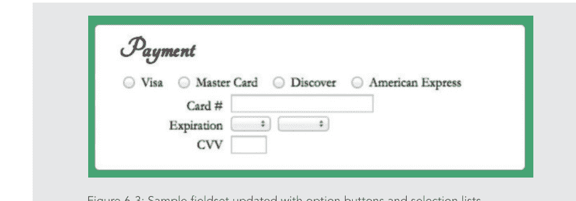

图 6-3 中的 fieldset 使用单选按钮显示信用卡选择，并提供选择列表供用户选择信用卡到期的月份和年份。尽管用户仍需输入卡号和 CVV 字段，但这种重新设计减少了用户所提供数据所需的验证工作量。

> 你可以通过指定与所收集数据相关的 *type* 值（如 *number* 或 *email*），以及指定 *maxlength* 和 *required* 属性来限制文本字段中的用户输入。你将在本章稍后部分学习如何基于这些 *input* 类型和属性验证数据。

## 对表单进行编程以提高内容准确性

除了为不同表单字段向用户提供有限的可能性集合外，你还可以创建 JavaScript 函数，降低用户填写表单时出现错误的概率。这类函数被称为**辅助函数**，它们本身不执行验证——即不检查用户内容是否有误。相反，这些函数从一开始就防止用户输入错误数据。辅助函数有多种类型；你实现哪些取决于表单的设计以及你试图收集的数据类型。

### 从选择列表中移除默认值

Snoot Flowers 订单表单的两个方面将受益于辅助函数。首先，表单包含多个选择列表。默认情况下，浏览器会选择每个列表中的第一项。然而，Snoot Flowers 希望确保用户为这些字段做出了深思熟虑的选择，而不是简单地忽略默认值并以该信息提交表单。例如，错误地以默认交货日期 2017 年 1 月 1 日提交表单可能会导致订单在错误的日期交付。

你可以使用 HTML 设置选择列表的默认值，但只能是菜单选项之一。然而，你可以使用 JavaScript 将`select`对象的`selectedIndex`属性设置为 -1，这对应于无选择。这确保了任何选择都是由用户做出的，而不是默认值。表 6-8 描述了这一点以及你可以用 JavaScript 操作的其他`select`元素属性。

提升表单可用性

371

| 属性 | 描述 |

| --- | --- |

| `length` | 返回嵌套在 select 元素内的 option 元素数量 |

| `multiple` | 设置或返回一个布尔值，确定是否可以在选择列表中选择多个选项 |

| `options` | 返回嵌套在 select 元素内的元素集合 |

| `selectedIndex` | 返回一个数字，表示选择列表中第一个被选中选项在 options 集合中的元素编号；如果未选择任何选项则返回 -1 |

| `size` | 设置或返回一次显示的选项数量 |

| `type` | 返回选择列表的类型，如果 select 元素不包含 multiple 属性则为 select-one，如果 select 元素包含 multiple 属性则为 select-multiple |

表 6-8：select 元素属性

你将开始创建一个函数，将表单 select 元素的`selectedIndex`属性设置为 -1。

> 注意
>
> 对于交货日期，另一种可用性方法可能是将默认日期更改为表单打开时的当前日期。你将在第 7 章学习如何使用 JavaScript 访问和使用当前日期。

**更改 select 元素的 selectedIndex 属性：**

1. 在文本编辑器中，创建一个新的 JavaScript 文档，然后输入以下注释部分，在指示的位置输入你的姓名和今天的日期：

```javascript
/*    JavaScript 6th Edition
 *
 *    Chapter case
 *
 *    Snoot Flowers
 *    Functions
 *    Author: your name
 *    Date:   today's date
 *
 *    Filename: snoot.js
 */
```

2. 将文档保存为 snoot.js。

3. 在注释部分下方，输入以下语句以告知处理器以严格模式解释文档注释：

```javascript
"use strict"; // interpret document contents in JavaScript strict mode
```

4. 在上一步输入的代码下方，输入以下代码以创建名为`removeSelectDefaults()`的函数：

```javascript
1 /* remove default values and formatting from state and delivery
2    date selection lists */
3  function removeSelectDefaults() {
4  }
```

5. 在上一步创建的函数的命令块内，输入以下语句来声明变量`emptyBoxes`：

```javascript
var emptyBoxes = document.getElementsByTagName("select");
```

此变量引用一个集合，其中包含文档中的所有`select`元素。

6. 在变量声明下方并在命令块内，输入以下代码以创建`for`循环：

```javascript
for (var i = 0; i < emptyBoxes.length; i++) {
}
```

此`for`循环在`i`的值小于`emptyBoxes`集合的长度时持续迭代，并且每次循环时递增`i`的值。你将使用此循环在每次循环时对位置`i`处的`select`元素执行命令。

7. 在`for`语句的命令块内，输入以下代码以设置`selectedIndex`值：

```javascript
emptyBoxes[i].selectedIndex = -1;
```

你的`removeSelectDefaults()`函数的代码应与以下一致：

```javascript
1 /* remove default values and formatting from state and delivery
2    date selection lists */
3  function removeSelectDefaults() {
4      var emptyBoxes = document.getElementsByTagName("select");
5      for (var i = 0; i < emptyBoxes.length; i++) {
6          emptyBoxes[i].selectedIndex = -1;
7      }
8  }
```

8. 在你刚创建的函数下方，输入以下注释和事件监听器代码，以在页面加载完成后调用该函数：

```javascript
1  /* run setup function when page finishes loading */
2  if (window.addEventListener) {
3      window.addEventListener("load", removeSelectDefaults, false);
4  } else if (window.attachEvent) {
5      window.attachEvent("onload", removeSelectDefaults);
6  }
```

9. 保存你的工作，返回文本编辑器中的 snoot.htm，然后在关闭的`</body>`标签之前，添加以下`script`元素以引用你刚创建的 snoot.js 文件：

```html
<script src="snoot.js"></script>
```

10. 保存对 snoot.htm 的更改，然后在浏览器中刷新或重新加载 snoot.htm。如图 6-4 所示，`select`元素现在不显示默认值。

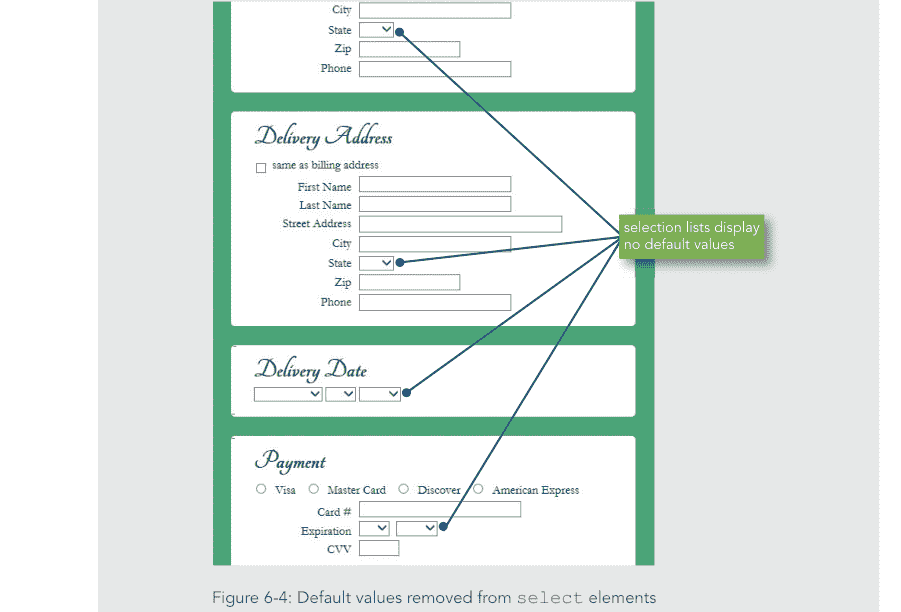

## 动态更新选择列表值

结合使用表 6-8 中的属性以及你在第 5 章学习的在节点树中创建和附加节点的方法，你可以在`select`元素中添加和删除`option`元素。除了使用`select`元素的属性外，你还可以查看和设置`option`元素的属性，这些属性在表 6-9 中描述。

| 属性 | 描述 |

|---|---|

| `defaultSelected` | 返回一个布尔值，确定代表当前选中项的 `option` 元素是否包含 `selected` 属性 |

| `index` | 返回一个数字，表示在 `options` 集合中的元素编号 |

| `label` | 设置或返回要在选择列表中为选项显示的替代文本 |

| `selected` | 设置或返回一个布尔值，确定选项是否被选中 |

| `text` | 设置或返回要在选择列表中为选项显示的文本 |

| `value` | 设置或返回分配给 `option` 元素的 `value` 属性的文本；该值将提交给服务器 |

*表 6-9：`option` 元素的属性*

在`select`元素中添加和删除选项的一个常见用途是根据用户在同一表单中做出的其他选择来更改列表中显示的选项。例如，Snoot Flowers 订单表单中"交货日期"fieldset 的三个选择列表包含月份、日期和年份的列表。然而，向用户显示的天数应取决于所选月份。例如，如果用户选择三月，日期的选择列表应显示数字 1–31。但如果用户选择四月，日期列表应仅显示 1–30。

要为 Snoot Flowers 订单表单添加此功能，你将首先创建三个节点。第一个节点将包含一个子节点，即值为 29 的`option`元素。第二个节点将包含两个子节点，即值为 29 和 30 的`option`元素。你将创建的最后一个节点将包含三个子节点，即值为 29、30 和 31 的`option`元素。有了这三个构建块，你将截断现有的选择列表（显示数字 1–31），使其仅包含值 1–28 的选项。然后，根据用户选择的月份，你将不对列表进行额外更改（对于非闰年的二月），或者添加你创建的三个节点之一，以将日期值增加到与所选月份对应的长度。此外，当二月是所选月份时，你的程序将检查所选年份是否为 2018 年（这是闰年）；如果是，你将把仅包含选项值 29 的节点添加到日期选择列表中。图 6-5 说明了你将要创建的代码。

**要编程实现天数列表根据所选月份和年份动态变化：**

1. 在你的浏览器中，向下滚动订单表单到“送达日期”字段，点击第一个选择列表的**箭头**，点击**四月**，点击第二个选择列表的**箭头**，然后如有必要，滚动到第二个选择列表的底部。尽管四月只有30天，但天数列表仍包含31作为选项。这使得用户可能选择一个无效的送达日期，即四月31日。

2. 返回文本编辑器中的`snoot.js`，然后在`"use strict";`语句下方，输入以下代码来创建三个全局变量：

```javascript
/* global variables */
var twentyNine = document.createDocumentFragment();
var thirty = document.createDocumentFragment();
var thirtyOne = document.createDocumentFragment();
```

你使用`createDocumentFragment()`方法来创建一个空的文档片段。因为你将使用一个函数在页面加载时填充这三个节点，另一个函数在每次月份或年份更改时将正确的节点附加到天数选择列表，所以这些节点必须由全局变量表示。

3. 在全局变量下方，输入以下函数来填充这三个节点：

```javascript
1  /* set up node building blocks for selection list of days */
2  function setupDays() {
3      var dates = document.getElementById("delivDy").
4          getElementsByTagName("option");
5      twentyNine.appendChild(dates[28].cloneNode(true));
6      // add 29th
7      thirty.appendChild(dates[28].cloneNode(true));
8      thirty.appendChild(dates[29].cloneNode(true));
9      // add 29th & 30th
10     thirtyOne.appendChild(dates[28].cloneNode(true));
11     thirtyOne.appendChild(dates[29].cloneNode(true));
12     thirtyOne.appendChild(dates[30].cloneNode(true));
13     // add 29th, 30th, & 31st
14 }
```

这段代码首先创建一个局部变量，其中包含对天数选择列表中所有选项元素的引用。然后，它将第29个选项元素（索引号为28）复制到 twentyNine 节点。其余代码将第29和第30个选项元素复制到 thirty 节点，将第29、30和31个选项元素复制到 thirtyOne 节点。这为天数选择列表内容所需的任何更改创建了构建块。

4. 在你刚创建的函数代码下方，但在`removeSelectDefaults()`函数之前，输入以下代码来创建`updateDays()`函数并声明其局部变量：

```javascript
1  function updateDays() {
2      var deliveryDay = document.getElementById("delivDy");
3      var dates = deliveryDay.getElementsByTagName("option");
4      var deliveryMonth = document.getElementById("delivMo");
5      var deliveryYear = document.getElementById("delivYr");
6      var selectedMonth = deliveryMonth.options
7          [deliveryMonth.selectedIndex].value;
8  }
```

5. 在局部变量代码下方，但在函数代码块内，输入以下`while`语句：

```javascript
while (dates[28]) {
    // remove child with index of 28 until this index is empty
    deliveryDay.removeChild(dates[28]);
}
```

这段代码移除索引为28的子元素，并重复此操作直到索引28处不存在子元素。这会产生从选择列表中移除第29、30和31日选项的效果。

6. 在`while`循环下方，但在函数代码块内，输入以下`if`语句：

```javascript
if (deliveryYear.selectedIndex === -1) {
    // if no year is selected, choose the default year so length of
    // Feb can be determined
    deliveryYear.selectedIndex = 0;
}
```

此语句检查年份选择列表的`selectedIndex`值。如果值为 -1，意味着没有选择任何值，则将该值更改为 0，即列表中的第一项。因为函数必须确定当前年份是否为闰年，所以必须在后续条件语句运行之前选择一个日期值。

7. 在上一步的`if`语句下方，输入以下`if`语句：

```javascript
if (selectedMonth === "2" &&
    deliveryYear.options[deliveryYear.selectedIndex].value ===
    "2018") {
    // if leap year, Feb has 29 days
    deliveryDay.appendChild(twentyNine.cloneNode(true));
}
```

此`if`语句在选中二月份且年份为2018年（闰年）时，将`twentyNine`节点添加到天数选择列表的末尾。

8. 在上一步的`if`语句末尾添加以下`else if`语句：

```javascript
1  else if (selectedMonth === "4" || selectedMonth === "6" ||
2      selectedMonth === "9" || selectedMonth === "11") {
3        // these months have 30 days
4        deliveryDay.appendChild(thirty.cloneNode(true));
5  }
```

此`if`语句检查选中的月份是否包含30天（四月、六月、九月或十一月），如果是，则将`thirty`节点添加到天数选择列表的末尾。

9. 在前面步骤的`if/else`语句末尾添加以下`else if`语句：

```javascript
1  else if (selectedMonth === "1" || selectedMonth === "3" ||
2      selectedMonth === "5" || selectedMonth === "7" ||
3      selectedMonth === "8" || selectedMonth === "10" ||
4      selectedMonth === "12") {
5        // these months have 31 days
6        deliveryDay.appendChild(thirtyOne.cloneNode(true));
7  }
```

此`if`语句检查选中的月份是否包含31天（一月、三月、五月、七月、八月、十月或十二月），如果是，则将`thirtyOne`节点添加到天数选择列表的末尾。

10. 在`snoot.js`底部，`window.addEventListener`语句之前，输入以下函数：

```javascript
1  /* create event listeners */
2  function createEventListeners() {
3      var deliveryMonth = document.getElementById("delivMo");
4      if (deliveryMonth.addEventListener) {
5          deliveryMonth.addEventListener("change", updateDays,
6              false);
7      } else if (deliveryMonth.attachEvent) {
8          deliveryMonth.attachEvent("onchange", updateDays);
9      }
10     var deliveryYear = document.getElementById("delivYr");
11     if (deliveryYear.addEventListener) {
12       deliveryYear.addEventListener("change", updateDays, false);
13     } else if (deliveryYear.attachEvent) {
14       deliveryYear.attachEvent("onchange", updateDays);
15     }
16  }
```

这段代码添加了两个事件监听器：第一个在月份选择列表中的值改变时调用`updateDays()`函数，第二个在年份选择列表中的值改变时调用相同的函数。这第二个事件监听器确保如果用户选择二月，然后将年份从闰年更改为平年，反之亦然，天数列表仍保持准确。

11. 在`createEventListeners()`函数下方，事件监听器代码之前，输入以下函数：

```javascript
1  /* run initial form configuration functions */
2  function setUpPage() {
3     removeSelectDefaults();
4     setupDays();
5     createEventListeners();
6  }
```

因为页面首次加载时必须运行多个函数，所以你将对它们的引用添加到`setUpPage()`函数中，然后在页面加载完成时调用该函数。

12. 将 snoot.js 底部的事件监听器代码更改为调用`setUpPage`：

```javascript
1  if (window.addEventListener) {
2     window.addEventListener("load", setUpPage, false);
3  } else if (window.attachEvent) {
4     window.attachEvent("onload", setUpPage);
5  }
```

13. 将你的更改保存到`snoot.js`，并在浏览器中刷新或重新加载`snoot.htm`。然后，在“送达日期”字段集中，点击第一个选择列表的**箭头**，点击**四月**，点击第二个选择列表的**箭头**，如有必要，滚动到列表底部。如图6-6所示，列表中的最后一个数字现在是30，这对于四月是合适的。

## 为旧版浏览器添加占位符文本

HTML 的最新版本中增加了一些功能，这些功能能以最少的开发工作量提升可用性。然而，旧版浏览器并不支持所有这些功能，因此部分增强特性仅适用于当前版本的主流浏览器用户。不过，你可以使用 JavaScript 在旧版浏览器中模拟这些功能的行为。表单创建中一个近期广受欢迎的特性是`input`和`textarea`元素的`placeholder`属性。你可以将一个单词或短语指定为`placeholder`属性的值；该单词或短语随后会显示在`input`或`textarea`框中，通常以灰色而非黑色字符呈现。例如，在图 6-1 的自定义消息框中，"Enter custom message here (max 250 characters)" 这段文本就是通过`placeholder`属性指定的。`placeholder`属性的值通常提供关于应在框中输入什么数据以及任何格式限制方面的指导。例如，在电话号码字段中，你可以添加占位符文本"###-###-####"来指示用户应包含区号，并在电话号码的各段之间使用连字符。当用户点击包含占位符文本的`input`或`textarea`元素并开始输入时，占位符文本会被移除，用户即可在框中进行输入。

你可以在旧版浏览器中通过将所需的占位符文本作为元素的默认值添加，并更改其颜色以区别于用户输入的数据（通常使用灰色字体颜色而非黑色）来重现此行为。然后，你可以创建一个事件监听器，当用户点击框中时触发该监听器，调用一个函数来移除默认值。

在 Snoot Flowers 订单表单中，Message 字段集内`textarea`元素中的占位符文本提供了关于用户输入内容性质和长度的重要指导。你将向程序中添加代码，以在旧版浏览器中模拟`placeholder`属性的行为。为此，你需要模拟三个在现代浏览器中自动执行的独立行为：

- 在页面加载完成时添加占位符文本。

- 当用户选择`textarea`字段时移除占位符文本。

- 当用户切换到另一个字段时，检查`textarea`字段的内容，如果该字段为空，则将占位符文本作为值重新添加回去。

你将首先创建一个函数，在旧版浏览器中添加占位符文本。订单表单页面已经包含了 Modernizr 库，用于在旧版浏览器中提供语义化 HTML 元素支持。你将检查`Modernizr.input.placeholder`的值，以查看打开页面的浏览器是否支持`placeholder`属性。如果是，则你的函数没有必要，不会执行任何操作。但如果该属性未被识别，你的函数会将`placeholder`属性的文本作为`textarea`控件的值添加。

### 在旧版浏览器中为自定义消息框添加占位符文本：

1. 如果你有 Internet Explorer 8 的访问权限，使用它打开`snoot.htm`。注意在 Custom message 复选框下方的`textarea`框中没有显示任何占位符文本。参见图 6-7。

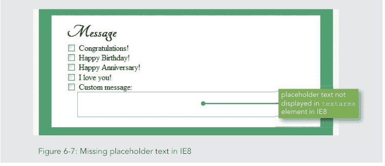

图 6-7：IE8 中缺失的占位符文本

2. 返回编辑器中的`snoot.js`文件，然后在`createEventListeners()`函数上方输入以下代码来创建`generatePlaceholder()`函数：

```javascript
function generatePlaceholder() {
    if (!Modernizr.input.placeholder) {
        var messageBox = document.getElementById("customText");
        messageBox.value = messageBox.placeholder;
        messageBox.style.color = "rgb(178,184,183)";
    }
}
```

该函数包含一个`if`语句。如果浏览器不支持`placeholder`属性，此`if`语句会将`placeholder`属性的值设置为`textarea`元素的值，然后将`textarea`元素的文本颜色更改为某种灰色。

3. 向下滚动到`setUpPage()`函数，然后按如下所示添加对`generatePlaceholder()`函数的调用：

```javascript
function setUpPage() {
    removeSelectDefaults();
    setupDays();
    createEventListeners();
    generatePlaceholder();
}
```

改善表单可用性

383

4. 将更改保存到`snoot.js`，然后在 Internet Explorer 8 中刷新`snoot.htm`。现在占位符文本已显示在 Custom message 复选框下方的`textarea`框中。参见图 6-8。

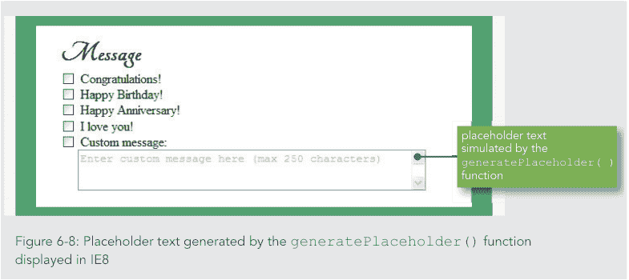

接下来，你将添加代码，以便在用户点击`textarea`框时清除其中的值。

### 添加代码以清除`textarea`框中的值：

1. 在 Internet Explorer 8 中，点击 Custom message 复选框下方的`textarea`框，然后输入 **Thanks a million**。与现代浏览器中替换占位符文本的行为不同，你输入的文本被添加到占位符文本中，形成了指令和自定义消息文本的混乱混合。参见图 6-9。

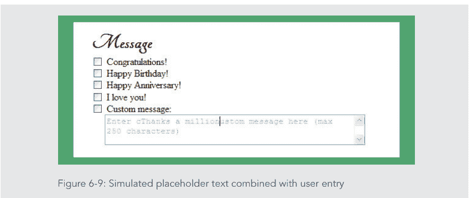

2. 返回编辑器中的`snoot.js`文件，然后在`generatePlaceholder()`函数上方输入以下代码来创建`zeroPlaceholder()`函数并声明一个变量：

```javascript
/* remove fallback placeholder text */
function zeroPlaceholder() {
    var messageBox = document.getElementById("customText");
}
```

3. 在变量声明下方，添加以下语句：

```javascript
messageBox.style.color = "black";
if (messageBox.value === messageBox.placeholder) {
    messageBox.value = "";
}
```

当调用此函数来移除占位符文本时，它首先将字体颜色恢复为黑色，为用户输入做准备。此外，如果控件的唯一内容是`placeholder`属性的值，则将内容重置为空字符串。此`if`语句确保：如果用户已在该控件中输入过文本，然后离开该控件，之后再次返回时，用户之前的输入不会在第二次点击控件时被删除。你完成的`zeroPlaceholder()`函数应如下所示：

```javascript
function zeroPlaceholder() {
    var messageBox = document.getElementById("customText");
    messageBox.style.color = "black";
    if (messageBox.value === messageBox.placeholder) {
        messageBox.value = "";
    }
}
```

4. 在你之前创建的`generatePlaceholder()`函数中，就在`if`语句的结束`}`之前，添加以下代码来创建一个事件监听器以调用`zeroPlaceholder()`函数：

```javascript
if (messageBox.addEventListener) {
    messageBox.addEventListener("focus", zeroPlaceholder, false);
} else if (messageBox.attachEvent) {
    messageBox.attachEvent("onfocus", zeroPlaceholder);
}
```

你更新后的`generatePlaceholder()`函数应如下所示：

```javascript
function generatePlaceholder() {
    if (!Modernizr.input.placeholder) {
        var messageBox = document.getElementById("customText");
        messageBox.value = messageBox.placeholder;
        messageBox.style.color = "rgb(178,184,183)";
        if (messageBox.addEventListener) {
            messageBox.addEventListener("focus", zeroPlaceholder,
                false);
        } else if (messageBox.attachEvent) {
            messageBox.attachEvent("onfocus", zeroPlaceholder);
        }
    }
}
```

5. 将更改保存到`snoot.js`，在 IE8 中刷新`snoot.htm`，点击`textarea`控件，然后输入 **Thanks a million**。当你点击`textarea`控件时，模拟的占位符文本被移除，你输入的文本成为框中唯一的文本。

为了完成旧版浏览器中占位符文本的模拟，你将添加代码，以便在用户离开`textarea`字段但未输入任何内容时恢复占位符文本。

### 在 textarea 留空离开时恢复占位符文本：

1. 在 Internet Explorer 8 中，刷新`snoot.htm`，然后点击`textarea`控件。占位符文本被移除。

2. 点击 **First Name** 框。注意`textarea`控件保持空白。这意味着那些点击了`textarea`但没有输入任何内容并决定稍后返回的用户将看不到占位符文本。你将创建一个函数，当用户在未输入内容的情况下将焦点从`textarea`控件移走时恢复占位符文本。

3. 返回编辑器中的`snoot.js`，然后在`generatePlaceholder()`函数上方输入以下代码来创建`checkPlaceholder()`函数并声明一个变量：

```javascript
/* restore placeholder text if box contains no user entry */
function checkPlaceholder() {
    var messageBox = document.getElementById("customText");
}
```

4. 在变量声明下方，添加以下`if`语句：

```javascript
if (messageBox.value === "") {
    messageBox.style.color = "rgb(178,184,183)";
    messageBox.value = messageBox.placeholder;
}
```

此`if`语句检查`textarea`的值是否为空字符串，如果是，则将文本颜色改回灰色，并将`placeholder`属性的值赋给该字段。你完成的`checkPlaceholder()`函数应与以下代码匹配：

```javascript
function checkPlaceholder() {
    var messageBox = document.getElementById("customText");
    if (messageBox.value === "") {
        messageBox.style.color = "rgb(178,184,183)";
        messageBox.value = messageBox.placeholder;
    }
}
```

5. 在你之前创建的`generatePlaceholder()`函数中，添加下面高亮显示的代码以创建一个事件监听器（或在旧版浏览器中附加事件）：

```javascript
function generatePlaceholder() {
    if (!Modernizr.input.placeholder) {
        var messageBox = document.getElementById("customText");
        messageBox.value = messageBox.placeholder;
        messageBox.style.color = "rgb(178,184,183)";
        if (messageBox.addEventListener) {
            messageBox.addEventListener("focus", zeroPlaceholder,
                false);
            messageBox.addEventListener("blur", checkPlaceholder,
                false);
        } else if (messageBox.attachEvent) {
            messageBox.attachEvent("onfocus", zeroPlaceholder);
            messageBox.attachEvent("onblur", checkPlaceholder);
        }
    }
}
```

6. 将你的更改保存到`snoot.js`，在 IE8 中刷新`snoot.htm`，点击`textarea`框，然后点击 **First Name** 字段。当你点击`textarea`框时，模拟的占位符文本会被移除，正如你之前所见。这一次，当你点击 First Name 字段而没有在`textarea`框中输入内容时，模拟的占位符文本会再次显示在`textarea`框中。

## 根据用户输入自动更新关联字段

订单表单包含一个“自定义消息”复选框，用户可以勾选此框以在订单中附带消息。此选项下方是一个`textarea`元素，用户可以在其中输入自定义消息的文本。然而，假设提交的表单中`textarea`字段包含文本，但“自定义消息”复选框未被勾选。根据处理表单数据的后端程序的不同，这种模糊性可能会导致订单出现问题，因为后端程序必须决定用户是否打算发送该消息。你可以通过添加一个函数来防止这种不匹配情况的发生，并减少用户完成表单所需的时间。该函数会检查用户在`textarea`字段中的输入，如果用户输入了自定义文本，则自动为其勾选“自定义消息”复选框。表 6-10 列出了与`textarea`元素相关的一些常用属性，表 6-11 描述了一种`textarea`方法。

| 属性 | 说明 |

| :--- | :--- |

| `placeholder` | `placeholder` 属性的值 |

| `defaultValue` | 页面加载时 `textarea` 元素中显示的默认值 |

*表 6-10：`textarea` 元素的属性*

| 方法 | 描述 |

| :--- | :--- |

| `select()` | 选择元素的内容 |

*表 6-11：`textarea` 元素的方法*

### 技能应用 | 解释用户意图

任何旨在提高表单易用性的程序，其逻辑都涉及解释用户的意图。例如，你编写的订单表单验证代码假设用户可能会忽略选择列表的默认值，并且任何默认值可能都无法反映用户的实际选择。同时，消息框的函数会假设用户打算使用他们输入到“自定义消息”`textarea`框中的任何文本，即使他们没有勾选关联的复选框。根据你正在创建的表单的重要性以及所有者希望传达的形象，你可能需要选择更严格或更宽松的解释方式。总的来说，表单收集精确数据的重要性越高，在验证时就越不应该假设用户的意图。例如，在收集机密医疗信息的表单中，你可能希望尽可能少地做假设。另一方面，对于收集关于活动的一般反馈的表单，更多地假设用户意图可能更安全。

### 创建在用户输入自定义消息后自动勾选“自定义消息”复选框的函数：

1. 返回到编辑器中的`snoot.js`文件，然后在`createEventListeners()`函数上方，输入以下代码以创建`autocheckCustom()`函数并声明一个局部变量：

```javascript
/* 如果用户在 customText 框中输入内容，则自动勾选“自定义消息”复选框 */
function autocheckCustom() {
    var messageBox = document.getElementById("customText");
}
```

2. 在变量声明下方，添加以下`if`语句：

```javascript
if (messageBox.value !== "" && messageBox.value !==
    messageBox.placeholder) {
    // 如果用户在 textarea 中输入了内容，则勾选“自定义消息”复选框
    document.getElementById("custom").checked = "checked";
}
```

此`if`语句检查`textarea`元素的值是否既不是空字符串，也不是`placeholder`属性的值。如果是这样，则为“自定义消息”复选框的`checked`属性设置为`checked`，从而在该复选框中添加一个勾选标记。你完成的`autocheckCustom()`函数应与以下代码匹配：

```javascript
function autocheckCustom() {
    var messageBox = document.getElementById("customText");
    if (messageBox.value !== "" && messageBox.value !==
        messageBox.placeholder) {
        // 如果用户在 textarea 中输入了内容，则勾选“自定义消息”复选框
        document.getElementById("custom").checked = "checked";
    }
}
```

3. 在`createEventListeners()`函数内部，添加以下代码以创建一个事件监听器，当用户离开`textarea`控件时调用`autoCheckCustom()`函数：

```javascript
var messageBox = document.getElementById("customText");
if (messageBox.addEventListener) {
    messageBox.addEventListener("blur", autocheckCustom, false);
} else if (messageBox.attachEvent) {
    messageBox.attachEvent("onblur", autocheckCustom);
}
```

4. 将你的更改保存到`snoot.js`，在浏览器中重新加载或刷新`snoot.htm`，点击`textarea`控件，输入 **Thanks a million**，然后点击 **First Name** 框。当你点击`textarea`控件外部时，“自定义消息”复选框会自动被勾选。

## 转移重复的字段值

JavaScript 常用于提高表单易用性的另一种方式是将输入在一个字段中的数据复制到用户指定应包含相同数据的另一个字段中。事实上，如果你曾在网上下过订单，你可能使用过这样的功能来表明货物应运送到你已提供的账单地址。此功能通常与一个标记为“送货地址与账单地址相同”或类似内容的复选框相关联。当用户勾选该框时，所有账单地址字段的内容都会被复制到对应的送货地址字段中。

如图 6-1 所示，Snoot Flowers 表单包含账单地址和送货地址的字段，并且已经包含了一个“与账单地址相同”的复选框。接下来，你将创建一个函数，将账单地址字段集中的每个字段的内容复制到送货地址字段集中的对应字段。你还将添加一个事件监听器，以便在用户勾选此复选框时调用此函数，并添加另一个事件监听器，以便在用户取消勾选时清除送货地址字段集中的值。

### 使用户能够将账单地址信息用于送货地址：

1. 返回到编辑器中的`snoot.js`文件，然后在`createEventListeners()`函数上方，输入以下代码以创建`copyBillingAddresses()`函数并声明局部变量：

```javascript
/* 将“账单地址”字段的值复制到“送货地址”字段 */
function copyBillingAddress() {
    var billingInputElements =
        document.querySelectorAll("#billingAddress input");
    var deliveryInputElements =
        document.querySelectorAll("#deliveryAddress input");
}
```

2. 在`var`语句之后，输入以下`if`语句：

```javascript
if (document.getElementById("sameAddr").checked) {
    for (var i = 0; i < billingInputElements.length; i++) {
        deliveryInputElements[i + 1].value =
            billingInputElements[i].value;
    }
    document.querySelector("#deliveryAddress select").value =
        document.querySelector("#billingAddress select").value;
}
```

如果“与账单地址相同”的文本框被勾选，则会运行此`if`语句。它首先循环遍历“账单地址”部分中的`input`元素，将每个元素的值分配给“送货地址”部分中的对应元素。请注意，对于“送货地址”元素使用了索引`i + 1`，因为该部分的第一个输入元素是“与账单地址相同”的复选框，它在“账单地址”部分中没有匹配的字段。在所有`input`值被复制后，最后一行代码将“账单地址”部分中唯一的`select`元素的值复制到“送货地址”部分中的对应元素。

3. 在上一步创建的`if`语句中添加以下`else`语句：

```javascript
1   else {
2       for (var i = 0; i < billingInputElements.length; i++) {
3           deliveryInputElements[i + 1].value = "";
4       }
5       document.querySelector("#deliveryAddress select").selectedIndex = -1;
7   }
```

当"与账单地址相同"复选框未被选中时，此`if`语句会运行。它首先遍历配送地址部分中的`input`元素，将每个元素的值设置为空字符串。最后，它将配送地址部分中唯一一个`select`元素的`selectedIndex`设置为 -1，表示未选择任何值。

4. 在`createEventListeners()`函数的命令块内，在结束的`}`之前，输入以下代码以创建`copyBillingAddress()`函数的事件监听器：

```javascript
1   var same = document.getElementById("sameAddr");
2   if (same.addEventListener) {
3       same.addEventListener("click", copyBillingAddress, false);
4   } else if (same.attachEvent)  {
5       same.attachEvent("onclick", copyBillingAddress);
6   }
```

5. 保存对`snoot.js`的更改，然后在浏览器中刷新或重新加载`snoot.htm`。

6. 在表单的账单地址部分，在每个字段中输入或选择内容（不必担心信息的准确性），然后在配送地址部分，点击**与账单地址相同**复选框以选中它。如图 6-10 所示，您在账单地址部分指定的值被复制到配送地址部分的相应控件中。

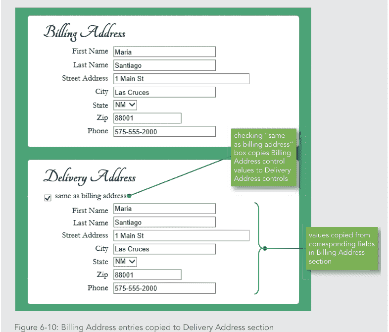

图 6-10：账单地址条目复制到配送地址部分

7. 再次点击**与账单地址相同**复选框以取消选中。配送地址部分控件中的值将被移除。

## 简短测验 2

1. 如果您设计一个表单，其中包含询问用户是否拥有自行车的问题，使用文本输入框还是复选框能获得更准确的输入？为什么？

2. 您使用什么属性来更改选择列表中的已选选项元素？使用什么值来指定未选择任何选项元素？

## 自定义基于浏览器的验证

几乎毫无例外，即使设计得最好的表单也需要验证。其中一个主要原因是大多数表单都包含文本框，而任何文本框都可能输入错误的数据。

从历史上看，为验证 Web 表单而编写的大量 JavaScript 代码执行了许多常见且重要的任务来验证文本字段，例如确保必填字段已完成或验证特定字段中的条目符合该字段的要求（例如是数字而非文本）。然而，近年来，HTML 和现代浏览器的增强功能使浏览器本身能够在没有任何额外 JavaScript 的情况下执行许多此类验证任务。这种类型的验证被称为**基于浏览器的验证**（**browser-based validation**）、**原生验证**（**native validation**）或 **HTML5 验证**。

### 指定基于浏览器的验证参数

要在表单中指定基于浏览器的验证参数，您可以使用表 6-12 中列出的属性。

| 属性 | 描述 | 用于 |

|-----------|-------------|----------|

| `formnovalidate` | 添加到提交按钮的 `<input>` 标签时，关闭表单的验证 | `type` 值为 `submit` 的 `input` 元素 |

| `max` | 指定控件的最大数值 | `type` 值为 `number` 的 `input` 元素 |

| `maxlength` | 指定控件的最大字符数 | `textarea` 元素，或显示为文本框的 `input` 元素 |

| `min` | 指定控件的最小数值 | `type` 值为 `number` 的 `input` 元素 |

| `novalidate` | 添加到 `<form>` 开始标签时，关闭表单的验证 | `form` 元素 |

| `pattern` | 指定控件值必须匹配的模式，以正则表达式表示 | `textarea` 元素，或显示为文本框的 `input` 元素 |

| `required` | 表示控件必须有值 | `input`、`select` 或 `textarea` 元素 |

| `step` | 指定数值必须遵循的增量 | `type` 值为 `number` 的 `input` 元素 |

*表 6-12：用于设置基于浏览器的验证参数的 HTML 属性*

额外的基于浏览器的验证与`input`元素的`type`属性的几个值相关联，这些值在表 6-13 中描述。例如，如果使用标签`<input type="number" />`创建字段，现代浏览器会自动拒绝非数字内容。

| 值 | 内容描述 | 示例内容 |

|---|---|---|

| color | # 后跟六位十六进制颜色值，所有字母均为小写 | #ffcc00 |

| date, datetime, week, month, time, datetime-local | 协调世界时 (UTC) 的相关组成部分，一种标准化的日期/时间格式 | 2019-10-14T12:00:00.001-04:00 |

| email | 电子邮件地址 | president@whitehouse.gov |

| number | 数值 | 73.54 |

*表 6-13：触发基于浏览器的验证的 type 属性值*

当您在表单的 HTML 代码中包含表 6-12 中的任何属性（`novalidate`或`formnovalidate`除外）或表 6-13 中的输入类型值时，现代浏览器会在表单的提交事件触发时自动执行验证——通常是用户点击表单的提交按钮时。

> **注意**
>
> HTML 还包括`tel`（电话号码）和`url`作为`input`类型属性的值。然而，浏览器不会对使用这些类型的元素强制执行任何内容有效性规则。

要了解基于浏览器的验证是如何工作的，您可以尝试提交缺少或无效数据的表单。

### 查看基于浏览器的验证如何处理订单表单中缺少或无效的数据：

1. 在编辑器中返回`snoot.htm`。

2. 在订单表单的代码中，检查`input`元素的`type`值。注意邮政编码、电话号码、信用卡号和 CVV 的`input`元素都使用`type`值为`number`。

3. 注意哪些`input`和`select`元素包含`required="required"`属性。表单中所有`input`和`select`元素都标记为必填，除了消息和创建账户？字段集 中的那些。

> **注意**
>
> 您可以在 HTML 中使用属性`required`将表单中的元素标记为必填，该属性不需要值。但是，为了使您的代码也符合有效的 XHTML，您可以将属性名称作为值添加，使用代码`required="required"`。

4. 在现代浏览器中打开`snoot.htm`，例如当前版本的 Internet Explorer、Firefox、Chrome 或 Safari。不填写任何表单字段，滚动到表单底部，然后点击**下订单**按钮。现代浏览器会滚动到第一个必填字段，添加红色背景或框阴影，并在控件旁边显示一个圆角矩形，称为**气泡**（**bubble**）。气泡包含描述高亮字段中发现的验证错误的文本以及修复说明。图 6-11 显示了本书撰写时当前版本的 Internet Explorer、Firefox 和 Chrome 中的气泡和错误格式。

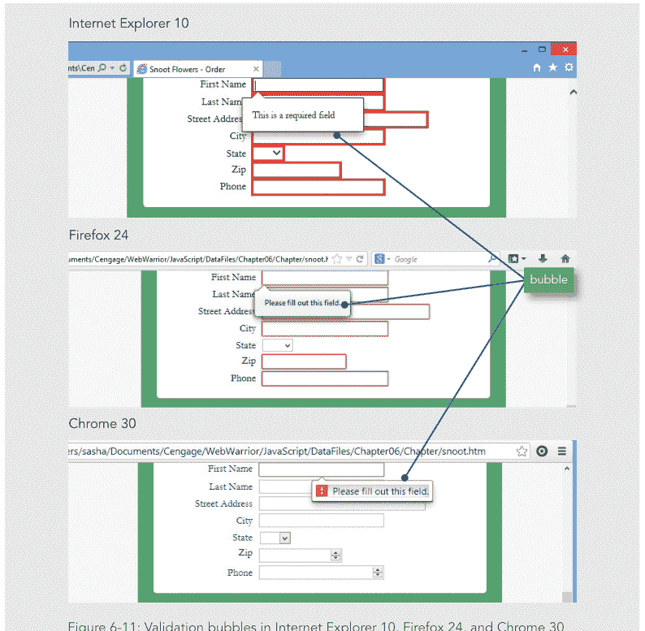

图 6-11：Internet Explorer 10、Firefox 24 和 Chrome 30 中的验证气泡

来源：© Microsoft Corporation. © Mozilla Firefox. © Google Chrome

5. 在高亮的名字字段中输入您的名字（或虚构的名字），然后按 **Enter**。高亮移动到姓氏字段，气泡显示相同的错误信息。

6. 继续完成表单字段，每完成一个后按 **Enter**，直到到达邮政编码字段。

7. 在邮政编码字段中，输入 **none**，然后按 **Enter**。输入第一个字符后可能会显示新的气泡文本，指示字段值必须是数字。

8. 在邮政编码字段中输入您的邮政编码（或虚构的），按 **Enter**，然后完成每个显示错误消息的剩余表单字段。在 CVV 框中输入数值并按 Enter 后，所有基于浏览器的验证要求都得到满足，表单被提交。图 6-12 显示了提交结果页面。

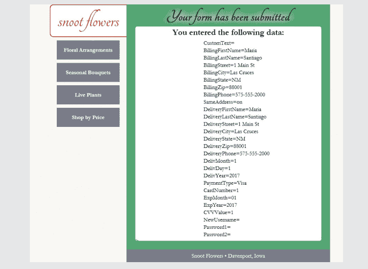

图 6-12：提交结果页面

© Jason Bucy

> **注意**
>
> 由于本书的重点是客户端 JavaScript，因此表单操作（action）值被设置为将数据提交到另一个名为`results.htm`的 HTML 文档，而不是提交到 Web 服务器。位于你第 6 章文件夹中的`results.htm`文档使用 JavaScript 代码来显示从表单提交的值。`results.htm`文档的唯一目的是显示那些本应提交到服务器的表单数据。一个完整的表单会与服务器上的程序集成，该程序将返回确认消息。

## 自定义基于浏览器的验证反馈

如你前面步骤所见，现代浏览器以类似的方式显示基于浏览器的验证反馈，尽管不同浏览器之间存在一些差异。通常，反馈是在表单触发`submit`事件后显示的。浏览器会高亮显示一个或多个包含无效数据的控件，并在第一个控件旁边显示一个气泡框，其中包含描述错误及如何修复错误的文本。每个浏览器都使用其自己的错误文本，这些文本是针对所发现错误类型的特定描述。

浏览器呈现基于浏览器的验证反馈的许多方面都可以通过约束验证 API 的属性和方法进行自定义。除了表 6-4 中描述的`validationMessage`和`willValidate`属性外，`validity`对象也是此 API 的一部分。`validity`对象包含多个属性；如果所有这些属性的值都为`false`，则`validity`对象的值为`true`。表 6-14 描述了`validity`的属性。

| 属性 | 如果满足以下条件则返回 *true* |

|---|---|

| `customError` | 已通过 `setCustomValidity()` 设置了自定义错误消息 |

| `patternMismatch` | 控件值与 `pattern` 属性的值不匹配 |

| `rangeOverflow` | 控件值大于 `max` 属性的值 |

| `rangeUnderflow` | 控件值小于 `min` 属性的值 |

| `stepMismatch` | 控件值不符合 `step` 属性的值 |

| `tooLong` | 控件值的长度大于 `maxlength` 属性的值 |

| `typeMismatch` | 控件值不符合 `type` 属性值的规则 |

| `valueMissing` | 控件值为空，但控件设置了 `required` 属性 |

| `valid` | 上述所有属性均不为 `true` |

表 6-14：`validity` 属性

请注意，为控件设置自定义错误消息会将其有效性更改为`false`。这意味着在使用自定义错误消息时，需要额外的代码来验证字段。

表 6-15 描述了约束验证 API 的方法。

| 方法 | 描述 |

|---|---|

| `checkValidity()` | 如果控件值有效，则对于该控件返回 `true` |

| `setCustomValidity()` | 设置自定义验证消息和规则 |

结合这些属性和方法，你可以使用 CSS 的`:invalid`和`:valid`伪类，根据表单元素的有效性状态来更改其属性。使用所有这些工具，你可以自定义基于浏览器的验证行为，使用户在所有现代浏览器中获得类似的反馈。

例如，以下 JavaScript 代码检查`fname`元素的`valueMissing`属性，如果其值为`true`，则将气泡文本设置为 "Please fill out this field"。这样，该气泡文本就会在所有现代浏览器中一致地显示。

```javascript
var fname = document.getElementById("firstName");
if (fname.valueMissing) {
    setCustomValidity("Please fill out this field.");
}
```

添加以下 CSS 后，只要字段的有效性状态为无效，其背景就会变为粉红色：

```css
#firstName:invalid {
    background: rgb(255,233,233);
}
```

图 6-13 显示了在表单提交时未为`firstName`字段提供值的情况下，此代码的结果。

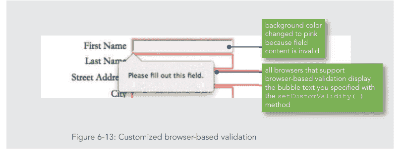

图 6-13：自定义的基于浏览器的验证

在撰写本书时，除了文本之外，气泡外观的任何方面都是不可自定义的，这意味着其颜色、形状和大小在不同浏览器中各不相同。如果在所有浏览器中创建统一外观是目标，你可以改用`preventDefault()`方法和`invalid`事件来阻止气泡在任何浏览器中显示。如果你选择这样做，你就需要自己编写显示用户反馈的机制。

还需注意，在撰写本书时，基于浏览器的验证缺少一些功能，它们的缺失使得在更复杂的情况下使用基于浏览器的验证更具挑战性。其中一个缺失的功能是无法为同一个字段同时设置多个验证消息。这意味着，如果一个字段有两个验证问题——例如，它必须是一个小于 100 的值（`max="100"`）并且是一个偶数（`step="2"`）——那么对于像 105 这样同时违反两条规则的输入，就不可能提供两个独立的自定义验证消息。

Snoot Flowers 很重要的一点是，他们的表单不仅在现代浏览器中表现相似，而且在不执行基于浏览器验证的 Internet Explorer 8 中也是如此。可以编写程序在旧版浏览器中执行验证，然后结合使用基于浏览器验证属性和执行相同任务的代码。这种方法对于较小的表单很有意义——例如，仅请求用户名和密码的表单。然而，对于像 Snoot Flowers 订单表单这样大的表单，简单地编写一组自定义验证函数并在所有浏览器（包括现代浏览器）上运行，可以节省编程时间并减少所需的验证代码量。

填写网络表单的人希望这个过程尽可能简单快捷。因此，用户交互的设计原则旨在最小化**摩擦**，这是一个衡量用户为实现目标（如下订单）所需坚持程度的宽松指标。通常，一个过程要求用户执行的步骤越多，它暴露给用户的摩擦就越大，用户完成该过程的可能性就越小。在最小化表单摩擦方面的一个重要实践是以不干扰手头任务的方式提供反馈。例如，如果你使用警报框在表单提交时显示错误消息，用户将不得不在更正表单之前单击确定，这将为用户的表单提交过程增加一个步骤——并增加交易的摩擦。提供准确完整的表单说明是减少摩擦的另一种方式；不完整的说明可能导致用户输入验证失败并需要重新输入。你还可以向表单中的元素添加`placeholder`和`autofocus`等属性来引导用户完成操作。

为编写适用于所有浏览器的自定义验证函数做准备，你将向`<form>`元素添加`novalidate`属性，以在现代浏览器中禁用基于浏览器的验证。

要为订单表单禁用基于浏览器的验证：

1. 在编辑器中返回`snoot.htm`。

2. 在开始的`<form>`标记内，添加属性`novalidate="novalidate"`。你开始的`<form>`标记应与以下代码匹配：

```html
<form action="results.htm" novalidate="novalidate">
```

3. 将更改保存到`snoot.htm`，返回浏览器，按住 **Shift** 键，然后单击 **刷新** 或 **重新加载** 按钮。在按住 Shift 键的同时刷新或重新加载会清除大多数浏览器中表单的先前条目，使所有字段为空白。

> 如果按住 Shift 键刷新或重新加载无法清除字段值，请关闭页面，然后重新打开它以显示空白表单。

4. 无需在任何字段中输入数据，滚动到表单底部，然后点击**Place Order**按钮。浏览器会跳过基于浏览器的验证，并将表单数据提交到结果页面。请注意，结果页面会列出每个字段名后跟一个等号，但没有值。

## Short Quiz 3

1. 列出两个用于指定基于浏览器的验证参数的属性，这些属性用于表单子元素，并描述每个属性的作用。

2. 列出`input`元素的`type`属性的一个值，该值会触发基于浏览器的验证，并描述浏览器会检查什么内容。

3. 什么是约束验证API？

4. 使用基于浏览器的验证的一个缺点是什么？

## 编程自定义验证

您要验证的表单的需求决定了您需要在自定义验证程序中纳入哪种逻辑。然而，有几种验证函数特别常见：

- 检查必填字段是否包含内容

- 检查依赖于其他控件值的值

- 检查一个或多个字段中的内容类型是否合适

Snoot Flowers 订单表单的设计方案设想使用红色背景和边框，以及在页面顶部和包含错误的每个fieldset内显示自定义错误消息，如图 6-14 所示。

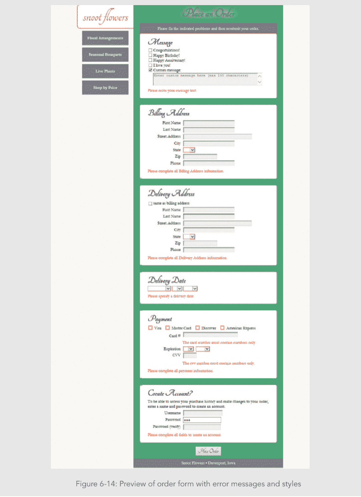

编程自定义验证

403

为了实现这一设计，您将创建使用上述所有三种逻辑的验证函数。由于您的验证计划需要多个函数，您将首先创建一个主验证函数，该函数将调用其他函数，然后在所有表单数据有效时提交表单。

> **Note** 即使您禁用了基于浏览器的验证，当前和较旧的浏览器都会强制执行`maxlength`属性，使用户基本上不可能在文本输入框或文本区域框中输入超过`maxlength`值允许的字符数。因此，通常在自定义验证函数中不必包含对用户输入字符数的测试。

## 验证提交的数据

在第 1 章和第 2 章中，您了解了可以在 JavaScript 中监听的许多事件。其中一个事件`submit`，可用于`form`元素。**submit 事件**在表单提交时触发，通常是在表单上选择提交按钮时触发。表单的数据通常在`submit`事件触发时进行验证，在数据发送到服务器之前。

您将从一个主函数调用所有自定义验证函数，该函数将确定表单是否通过验证——如果是，该函数将提交表单内容。在准备创建自定义验证函数之前，您现在将创建主验证函数。

### 创建主验证函数：

1. 在编辑器中返回`snoot.js`，然后在`createEventListeners()`函数内添加以下代码：

```javascript
var form = document.getElementsByTagName("form")[0];
if (form.addEventListener) {
    form.addEventListener("submit", validateForm, false);
} else if (form.attachEvent) {
    form.attachEvent("onsubmit", validateForm);
}
```

此代码为文档中第一个表单的`submit`事件创建了一个事件监听器——在本例中，这是文档中唯一的表单。此代码触发`validateForm()`函数，您将在后续步骤中创建该函数。

404 第 6 章 增强和验证表单

2. 在 snoot.js 文档顶部的全局变量部分，添加以下语句：

```javascript
var formValidity = true;
```

此代码声明了`formValidity`变量，您将使用它来跟踪表单是否有效，或者用户是否需要添加或修改条目。

3. 在`createEventListeners()`函数之前，添加以下代码以创建`validateForm()`函数：

```javascript
/* validate form */
function validateForm(evt) {
    if (evt.preventDefault) {
        evt.preventDefault(); // prevent form from submitting
    } else {
        evt.returnValue = false; // prevent form from submitting
            in IE8
    }
    formValidity = true; // reset value for revalidation
}
```

表单在调用时接收一个参数`evt`。此参数引用调用该函数的事件——即表单的`submit`事件。语句`evt.preventDefault()`禁用引用事件的默认行为。您在对象上使用`preventDefault()`方法来阻止通常与事件关联的操作。然而，`preventDefault()`方法在 Internet Explorer 8 中不受支持，因此您使用条件语句在不支持`preventDefault()`的浏览器中将事件的`returnValue`属性设置为`false`；将`returnValue`设置为`false`在旧浏览器中完成与`preventDefault()`在现代浏览器中相同的任务。

您通常会在`preventDefault()`方法之后跟随执行指定事件的另一个任务的代码。在本例中，`preventDefault()`方法阻止表单被提交。您将通过指定要运行的自定义验证函数来完成该函数，如果内容通过验证，您将手动调用`submit()`方法来提交表单。

4. 保存对`snoot.js`的更改，在浏览器中返回`snoot.htm`，刷新或重新加载页面，然后点击**Place Order**按钮。请注意，结果页面未显示。这是因为`preventDefault()`方法阻止了页面被提交。

5. 在编辑器中返回`snoot.js`，然后在`validateForm()`函数中，在`formValidity = true`语句之后，输入以下`if`/`then`语句：

```javascript
// replace with calls to validation functions
if (formValidity === true) {
    document.getElementById("errorText").innerHTML = "";
    document.getElementById("errorText").style.display = "none";
    document.getElementsByTagName("form")[0].submit();
} else {
    document.getElementById("errorText").innerHTML = "Please fix
        the indicated problems and then resubmit your order.";
    document.getElementById("errorText").style.display = "block";
    scroll(0,0);
}
```

在编写验证函数时，您将在`if`语句之前添加对每个函数的调用。任何发现无效内容的函数都会将全局`formValidity`变量的值更改为`false`，使`if`语句的执行取决于表单数据是否通过所有验证检查。语句`document.getElementsByTagName("form")[0].submit()`使用`submit()`方法在自定义验证函数发现数据有效时手动提交表单内容。如果有任何数据无效——即，如果`formValidity`变量被赋值为`false`——则运行`else`子句。前两个语句将`id`值为`errorText`的元素的显示设置为`block`，使其在页面上可见，并向用户添加适当的错误消息作为该元素的内容。此元素位于表单的顶部，通知用户表单条目需要修正后才能提交。第三个语句，`scroll(0,0)`，将浏览器移回页面顶部，以便用户可以看到`errorText`部分，然后从上到下检查表单中需要修复的问题。

6. 保存对`snoot.js`的更改，在浏览器中返回`snoot.htm`，刷新或重新加载页面，然后点击**Place Order**按钮。这次显示了 results.htm 页面。由于尚不存在可能将`formValidity`的值更改为`false`的验证函数，`if`语句执行了，表单由`submit()`方法手动提交。

7. 在编辑器中返回`snoot.js`，然后在`validateForm()`函数内，将`formValidity`的值更改为`false`，如下所示：

```javascript
function validateForm(evt) {
    if (evt.preventDefault) {
        evt.preventDefault(); // 防止表单提交
    } else {
        evt.returnValue = false; // 防止表单提交
            在IE8中
    }
    formValidity = false; // 重置值以便重新验证
}
```

8. 将你的更改保存到`snoot.js`，在浏览器中返回`snoot.htm`，刷新或重新加载页面，然后点击 **Place Order** 按钮。这次表单不会被提交，浏览器会滚动到页面顶部，并且`errorText`块会显示出来，如图 6-15 所示。

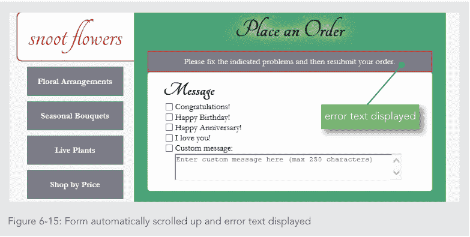

9. 在编辑器中返回`snoot.js`，然后在`validateForm()`函数内，将`formValidity`的值改回`true`，如下所示：

```javascript
1  function validateForm(evt) {
2      if (evt.preventDefault) {
3          evt.preventDefault(); // 防止表单提交
4      } else {
5          evt.returnValue = false; // 防止表单提交
6              在IE8中
7      }
8      formValidity = true; // 重置值以便重新验证
```

10. 将你的更改保存到`snoot.js`。

接下来，你将创建自定义验证函数来验证不同类型的内容并显示自定义错误消息。

## 使用自定义函数验证必填字段

创建一个函数来验证必填字段通常涉及检索必填字段的值，并检查其中任何一项的值是否为空字符串。这些函数具有以下一般形式：

```javascript
1	if (element.value === "") {
2		// 用于显示消息和突出显示错误的代码
3		formValidity = false;
4	}
```

对于所有自定义验证，使用你在第4章学到的`try/catch`结构来处理和显示错误消息会很有帮助。将上述代码与此结构结合，会得到以下一般形式：

```javascript
1	try {
2		if (element.value === "") {
3			throw "消息";
4		}
5	}
6	catch(message) {
7		// 用于显示消息和突出显示错误的代码
8		formValidity = false;
9	}
```

在订单表单中，设计要求如果任何一个字段包含错误，则在字段集中显示一个错误消息。

### 检查空的文本输入字段

你需要使用不同的属性来验证每种表单元素和`input`类型。对于文本框——包括任何使用`input`元素创建并显示允许字符输入的框的对象——你可以使用`value`属性来检查值。表 6-16 列出了`input`元素最常用的属性，表 6-17 列出了常用的`input`元素方法。

| 属性 | 描述 | 表单控件 |

| --- | --- | --- |

| `accept` | 设置或返回一个逗号分隔的MIME类型列表，这些类型可以被上传 | 文件框 |

| `alt` | 设置或返回图像的替代文本 | 图像提交按钮 |

| `autocomplete` | 设置或返回浏览器是否被允许根据用户存储的来自其他网站的数据自动填充控件值 | 文本框、密码框 |

| `checked` | 设置或返回复选框或单选按钮的选中状态 | 复选框、单选按钮 |

| `defaultChecked` | 确定在复选框组或单选按钮组中默认被选中的控件 | 复选框、单选按钮 |

| `defaultValue` | 设置或返回表单控件中出现的默认文本 | 文本框、密码框、文件框 |

| `files` | 用户选择的文件集合 | 文件框 |

| `list` | 可用于为控件提供选项或建议值的选项元素集合 | 文本框 |

| `max` | 设置或返回控件允许的最大值 | 文本框 |

| `maxLength` | 设置或返回可以输入到字段的最大字符数 | 文本框、密码框 |

| `min` | 设置或返回控件允许的最小值 | 文本框 |

| `multiple` | 设置或返回控件是否接受多个值 | 文本框、文件框 |

| `name` | 设置或返回分配给元素name属性的值 | 复选框、单选按钮、提交按钮、图像提交按钮、文本框、密码框、文件框、隐藏文本框 |

| `pattern` | 设置或返回描述有效控件值必须匹配的模式的正则表达式 | 文本框、密码框 |

| `placeholder` | 设置或返回在空控件中显示的文本，以提供用户指导 | 文本框、密码框 |

| 属性 | 描述 | 表单控件 |

|---|---|---|

| `size` | 设置或返回字段的宽度（以字符为单位） | 文本框、密码框 |

| `step` | 设置或返回允许值之间的增量 | 文本框 |

| `src` | 设置或返回图像的URL | 图像提交按钮 |

| `type` | 返回input元素的类型 | 复选框、单选按钮、提交按钮、图像提交按钮、文本框、密码框、文件框、隐藏文本框 |

表 6-16：常用的`input`元素属性及其关联的表单控件

| 方法 | 描述 | 表单控件 |

|---|---|---|

| `blur()` | 从表单控件移除焦点 | 复选框、单选按钮、提交按钮、文本框、文本区域、密码框、文件框 |

| `click()` | 激活表单控件的click事件 | 复选框、单选按钮、提交按钮 |

| `focus()` | 将焦点更改为表单控件 | 复选框、单选按钮、提交按钮、文本框、密码框、文件框 |

| `select()` | 选择表单控件中的文本 | 文本框、密码框、文件框 |

表 6-17：常用的`input`元素方法及其关联的表单控件

例如，要检查`id`值为`firstName`的`input`元素是否为空，你可以使用以下语句：

```javascript
if (document.getElementById("firstName").value === "") {
    // 如果字段为空则运行的代码
}
```

你可以使用循环语句来检查一组字段，并在其中任何一个为空时触发错误消息。接下来，你将创建一个自定义验证函数，该函数使用循环语句检查“账单地址”字段集中的每个`input`字段是否为空，如果为空，则更改该字段的背景颜色，并在字段集中显示错误消息。因为你的订单表单计划显示一个针对字段集中任何错误的单一消息，所以你将把突出显示每个错误的代码与显示消息的代码分开。

## 为账单地址字段集中的输入字段创建自定义验证函数：

1. 在编辑器中返回`snoot.js`，然后在`validateForm()`函数上方输入以下代码以创建`validateAddress()`函数并声明变量：

```javascript
1    /* 验证地址字段集 */
2    function validateAddress(fieldsetId) {
3        var inputElements = document.querySelectorAll("#" +
4            fieldsetId + " input");
5        var errorDiv = document.querySelectorAll("#" + fieldsetId +
6            " .errorMessage")[0];
7        var fieldsetValidity = true;
8        var elementCount = inputElements.length;
9        var currentElement;
10   }
```

该函数接受一个参数`fieldsetId`。因为你需要验证“账单地址”和“送货地址”部分中的相同字段，所以你可以使用相同的代码来验证这两个部分，只需在调用函数时指定要验证的字段集的`id`值。`fieldsetValidity`变量的初始值为`true`。因为最终函数将对每个地址部分运行多个测试，所以你将使用`fieldsetValidity`变量来跟踪该部分的任何部分是否无效。

2. 在变量声明之后，添加以下`try`语句：

```javascript
1        try {
2            for (var i = 0; i < elementCount; i++) {
3                // 验证字段集中的所有input元素
4                currentElement = inputElements[i];
5                if (currentElement.value === "") {
6                    currentElement.style.background =
7                        "rgb(255,233,233)";
8                    fieldsetValidity = false;
9                } else {
10                   currentElement.style.background = "white";
11               }
12           }
13           if (fieldsetValidity === false) {
14               // 根据当前字段集抛出适当的消息
15               if (fieldsetId === "billingAddress") {
16                   throw "请填写完整的账单地址信息。";
17               } else {
18                   throw "请填写完整的送货地址信息。";
19               }
20           } else {
21               errorDiv.style.display = "none";
22               errorDiv.innerHTML = "";
23           }
24       }
```

请注意，你可以简单地循环遍历此字段集中的所有字段，因为它们都是必填字段。对于只有部分字段必填的字段集，你可以在每次循环时扩展条件语句，以检查元素的`required`属性是否为`true`，并且只针对必填字段提示用户填写空白字段。

3. 在`try`语句之后，添加以下`catch`语句：

```javascript
catch(msg) {
    errorDiv.style.display = "block";
    errorDiv.innerHTML = msg;
    formValidity = false;
}
```

4. 在`validateForm()`函数中，将注释`// replace with calls to validation functions`替换为以下两条语句：

```javascript
function validateForm(evt) {
    if (evt.preventDefault) {
        evt.preventDefault(); // 阻止表单提交
    } else {
        evt.returnValue = false; // 阻止IE8中的表单提交
    }
    formValidity = true; // 为重新验证重置值
    validateAddress("billingAddress");
    validateAddress("deliveryAddress");
}
```

412  第6章 增强和验证表单

第一条语句调用函数时，将字符串 "billingAddress" 作为参数；第二条语句同样调用函数，参数为字符串 "deliveryAddress"。回顾一下，该函数将提供的参数值视为要验证的字段集的 *id* 值。因此，第一条语句调用函数来验证`billingAddress`字段集，第二条语句调用它来验证`deliveryAddress`字段集。

5. 将更改保存到`snoot.js`，在浏览器中刷新或重新加载`snoot.htm`，如有必要请清空表单，然后在不填写任何字段的情况下点击 **Place Order** 按钮。浏览器将滚动到文档顶部，并在页面顶部显示错误信息。

6. 向下滚动到账单地址和送货地址部分。文本输入框的背景变为粉色，每个字段集底部都显示自定义错误文本。图6-16显示了Firefox中的错误格式和消息。

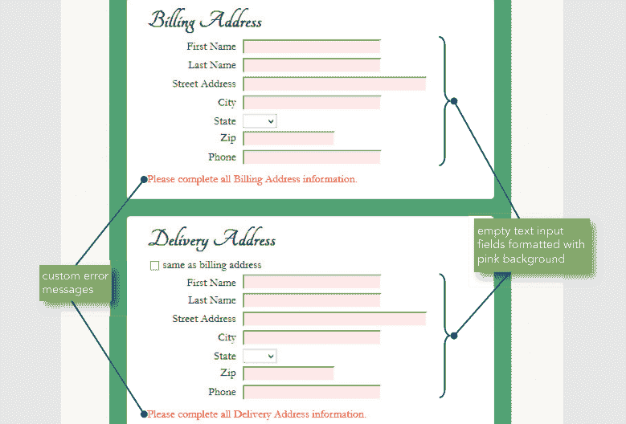

图6-16：空地址文本输入字段的验证结果

7. 在两个地址部分的所有文本输入框中输入虚构的值，然后点击 **Place Order** 按钮。所有验证检查都成功，结果显示页面被显示。

> 注意：即使你已经使用`novalidate`属性关闭了基于浏览器的验证，如果邮政编码和电话字段中的值不是数字，Chrome可能仍会拒绝提交表单。如有必要，请将这些值更改为数字，然后再次点击Place Order。

## 检查没有值的选项列表

你创建的用于验证地址字段集的函数几乎已经完成。然而，除了文本框之外，每个字段集还包含一个单独的选项列表——State字段。为了验证选项列表中是否做出了选择，你需要检查`selectedIndex`属性的值，而不是像处理文本`input`元素那样检查`value`属性。回顾本章前面的内容，`selectedIndex`属性代表`option`元素数组中所选项目的索引值。如果选项列表中没有选择任何选项，则`select`元素的`selectedIndex`属性等于 -1。检索此值是检查必填选项列表是否已完成的最简单方法。例如，要检查用户是否在`id`值为`state`的`select`元素中做出了选择，如果未选择则提醒用户，你可以使用以下语句：

```javascript
if (document.getElementById("state").selectedIndex === -1) {
    // 如果字段为空则运行的代码
}
```

为了完成你对地址字段集的验证函数，你将添加代码来检查State选项列表的值。由于背景颜色在浏览器中对`select`和`option`元素的应用不一致，你将改为给State选项列表添加红色边框，如果用户未做出选择，则会突出显示它。

要将State选项列表的验证添加到地址字段集的验证函数中：

1. 返回到编辑器中的`snoot.js`，然后在`validateAddress()`函数中，找到以`if (fieldsetValidity === false)`开头的`if`语句，该语句位于前面步骤代码中的第13行。

2. 在该`if`语句之前，插入以下代码：

```javascript
currentElement = document.querySelector("#" + fieldsetId + " select");
// 验证state选择元素
if (currentElement.selectedIndex === -1) {
    currentElement.style.border = "1px solid red";
    fieldsetValidity = false;
} else {
    currentElement.style.border = "";
}
```

414 第6章 增强和验证表单

3. 将更改保存到`snoot.js`，在浏览器中刷新或重新加载`snoot.htm`，如有必要请清空表单，然后在不填写任何字段信息的情况下点击 **Place Order** 按钮。文本输入框具有粉色背景，此外，State选项列表现在有了红色边框。图6-17显示了Firefox中的账单地址字段集。

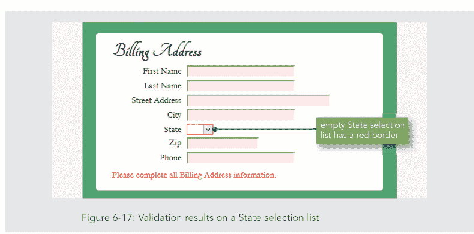

4. 在两个地址部分的所有文本输入框中输入虚构的值，从每个State选项列表中选择一个州，然后点击 **Place Order** 按钮。所有验证检查都成功，结果显示页面被显示。

接下来，你将创建一个函数来验证送货日期字段集中的必填字段。此字段集中的所有三个控件都是选项列表。你将使用循环来检查每个控件是否有值，并为任何为空的`select`元素添加红色边框，就像你之前为State选项列表所做的那样。

## 编程自定义验证

**要创建一个函数来验证送货日期字段集中的必填字段：**

1. 返回到编辑器中的`snoot.js`，然后在`validateForm()`函数上方，输入以下代码以创建`validateDeliveryDate()`函数并声明变量：

```javascript
/* 验证送货日期字段集 */
function validateDeliveryDate() {
    var selectElements = document.querySelectorAll(
       "#deliveryDate select");
    var errorDiv = document.querySelector(
       "#deliveryDate .errorMessage");
    var fieldsetValidity = true;
    var elementCount = selectElements.length;
    var currentElement;
}
```

2. 在变量声明之后，输入以下try语句：

```javascript
try {
   for (var i = 0; i < elementCount; i++) {
      currentElement = selectElements[i];
      if (currentElement.selectedIndex === -1) {
         currentElement.style.border = "1px solid red";
         fieldsetValidity = false;
      } else {
         currentElement.style.border = "";
      }
   }
   if (fieldsetValidity === false) {
      throw "请指定送货日期。";
   } else {
      errorDiv.style.display = "none";
      errorDiv.innerHTML = "";
   }
}
```

3. 在try语句之后，输入以下catch语句：

```javascript
catch(msg) {
    errorDiv.style.display = "block";
    errorDiv.innerHTML = msg;
    formValidity = false;
}
```

416    第6章 增强和验证表单

版权所有 2015 Cengage Learning。保留所有权利。未经明确许可，不得以任何形式或任何方式（电子、机械、影印、录制或其他）复制、扫描或分发本书的任何部分。由于电子权利，某些第三方内容可能从电子书和/或电子章节中被删除。经编辑审查，认为任何被删除的内容不会对整体学习体验产生重大影响。Cengage Learning 保留随时删除额外内容的权利，如果后续的版权限制要求这样做。

4. 在`validateForm()`函数中，在`if`语句之前，添加对`validateDeliveryDate()`函数的调用，如下所示：

```javascript
function validateForm(evt) {
    if (evt.preventDefault) {
        evt.preventDefault(); // prevent form from submitting
    } else {
        evt.returnValue = false; // prevent form from submitting in IE8
    }
    formValidity = true; // reset value for revalidation
    validateAddress("billingAddress");
    validateAddress("deliveryAddress");
    validateDeliveryDate();
}
```

5. 保存对`snoot.js`的更改，在浏览器中刷新或重新加载`snoot.htm`，清空表单，然后不在任何字段中输入任何数据，点击 **Place Order** 按钮。Delivery Date 部分中为空的选择列表会显示红色边框，错误文本显示在字段集底部。图 6-18 展示了 Firefox 中的验证结果。

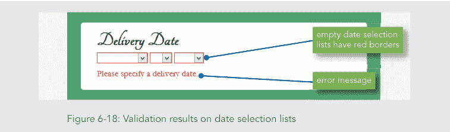

6. 在两个地址部分的所有文本输入字段中输入虚构值，从每个 State 选择列表中选择一个州，在 Delivery Date 部分选择月份、日期和年份，然后点击 **Place Order** 按钮。所有验证检查均成功，结果显示页面。

## 检查未选择的选项按钮组

接下来，你将创建一个函数来验证 Payment 字段集中的必填字段。除了文本框和选择列表外，Payment 字段集还包含一组选项按钮。

要检查选项按钮是否被选中，可以访问其`checked`属性的值。要检查一组选项按钮中是否都没有被选中，可以使用 And (&&) 运算符创建条件语句。例如，要检查名为`Color`的三个选项按钮是否都没有被选中，可以使用以下代码：

```javascript
var buttons = document.getElementsByName("Color");
if (!buttons[0].checked && !buttons[1].checked && !buttons[2].checked) {
    // code to run if no button is selected
}
```

此代码检查第一个按钮是否未被选中（使用`!`运算符），And (`&&`) 第二个按钮是否未被选中，以及第三个按钮是否未被选中。如果所有这些条件都为真，则`if`语句为真，意味着没有按钮被选中。你将使用类似的语句来验证订单表单用户是否在 Payment 字段集中选择了信用卡。

**创建 Payment 字段集的验证函数：**

1. 在编辑器中返回`snoot.js`，然后在`validateForm()`函数上方，输入以下代码以创建`validatePayment()`函数并声明变量：

```javascript
/* validate payment fieldset */
function validatePayment() {
    var errorDiv = document.querySelector(
        "#paymentInfo .errorMessage");
    var fieldsetValidity = true;
    var ccNumElement = document.getElementById("ccNum");
    var selectElements = document.querySelectorAll(
        "#paymentInfo select");
    var elementCount = selectElements.length;
    var cvvElement = document.getElementById("cvv");
    var cards = document.getElementsByName("PaymentType");
    var currentElement;
}
```

2. 在变量声明下方，添加以下`try`语句：

```javascript
try {
    if (!cards[0].checked && !cards[1].checked &&
        !cards[2].checked && !cards[3].checked) {
        // verify that a card is selected
        for (i = 0; i < 4; i++) {
            cards[i].style.outline = "1px solid red";
        }
        fieldsetValidity = false;
    } else {
        for (i = 0; i < 4; i++) {
            cards[i].style.outline = "";
        }
    }
}
```

此`try`语句检查所有选项按钮是否都未被选中，如果是，则为每个按钮添加红色边框并将`fieldsetValidity`设置为`false`。由于字段集还包含文本输入字段和选择列表，你将创建额外的代码来检查这些字段是否有空白。最后，你将检查`fieldsetValidity`变量的值以确定是否抛出错误。

3. 在`try`语句中，在你上一步输入的`if/else`语句下方，输入以下`if`语句以检查卡号字段的值：

```javascript
if (ccNumElement.value === "") {
    // verify that a card number has been entered
    ccNumElement.style.background = "rgb(255,233,233)";
    fieldsetValidity = false;
} else {
    ccNumElement.style.background = "white";
}
```

4. 在`try`语句中，在你上一步输入的`if/else`语句下方，输入以下`for`语句以检查月份和年份选择列表的值：

```javascript
for (var i = 0; i < elementCount; i++) {
    // verify that a month and year have been selected
    currentElement = selectElements[i];
    if (currentElement.selectedIndex === -1) {
        currentElement.style.border = "1px solid red";
        fieldsetValidity = false;
    } else {
        currentElement.style.border = "";
    }
}
```

5. 在`try`语句中，在你上一步输入的`for`语句下方，输入以下`if`语句以检查卡号字段的值：

```javascript
if (cvvElement.value === "") {
    // verify that a cvv value has been entered
    cvvElement.style.background = "rgb(255,233,233)";
    fieldsetValidity = false;
} else {
    cvvElement.style.background = "white";
}
```

6. 在`try`语句中，在你上一步输入的`if/else`语句下方，输入以下`if/else`语句以检查`fieldsetValidity`变量的值，并在必要时抛出异常：

```javascript
if (!fieldsetValidity) { // check if any field is blank
    throw "Please complete all payment information.";
} else {
    errorDiv.style.display = "none";
}
```

7. 在`try`语句下方，输入以下`catch`语句：

```javascript
catch(msg) {
    errorDiv.style.display = "block";
    errorDiv.innerHTML = msg;
    formValidity = false;
}
```

8. 在`validateForm()`函数中，在对`validateDeliveryDate()`函数的调用之后，添加对`validatePayment()`函数的调用，如下所示：

```javascript
function validateForm(evt) {
    if (evt.preventDefault) {
        evt.preventDefault(); // prevent form from submitting
    } else {
        evt.returnValue = false; // prevent form from submitting in IE8
    }
    formValidity = true; // reset value for revalidation
    validateAddress("billingAddress");
    validateAddress("deliveryAddress");
    validateDeliveryDate();
    validatePayment();
}
```

9. 保存对 snoot.js 的更改，在浏览器中刷新或重新加载 snoot.htm，清空表单，然后不在任何字段中输入任何数据，点击 **Place Order** 按钮。Payment 部分中为空的选项按钮组会显示红色边框，为空的文本输入框和选择列表的显示方式与之前的字段集相同，错误文本显示在字段集底部。图 6-19 展示了 Firefox 中的验证结果。

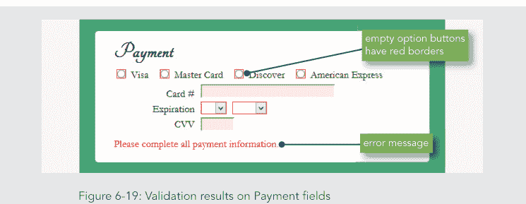

10. 使用虚构信息填写 Billing Address、Delivery Address、Delivery Date 和 Payment 部分的所有字段，然后点击 **Place Order** 按钮。所有验证检查均成功，结果显示页面。

## 使用自定义函数验证依赖字段

到目前为止，你创建的自定义函数遵循常见 Web 表单数据的一般模式。但是，在某些情况下，你需要创建函数来测试特定于你正在创建的表单的逻辑。例如，如果一组选项按钮提供了多个选项以及"其他"，后面跟着一个文本框，你可以添加验证逻辑来验证文本框是否包含输入，但仅在选中"其他"选项按钮时。你将为 Snoot Flowers 订单表单创建两个额外的函数，以执行特定于你正在收集的信息的验证。

## 基于复选框状态进行验证

在订单表单中，Message 字段集包含一组复选框，允许用户选择常见消息，例如"Happy Birthday!"。这些复选框都不是必需的。但是，如果最后一个复选框"Custom message"被选中，用户必须在字段集底部的`textarea`元素中输入自定义文本。订单不需要消息，因此如果用户提交表单时 Message 字段集中没有任何复选框被选中，表单仍然有效。但是，你需要创建一个函数来检查

已勾选自定义消息框，如果是，则验证用户是否在`textarea`控件中输入了自定义文本。要确定复选框是否被选中，需要使用与访问单选按钮状态时相同的`checked`属性。

> **注意** 在本章前面，您创建了一个函数，当用户在`textarea`框中输入自定义文本时，自动勾选“自定义消息”复选框。该函数在能够推断用户意图且已输入所有必需信息时，自动完成表单填写步骤——如果用户已输入自定义文本，您可以合理地假设他们也想勾选“自定义消息”复选框。现在，您即将创建一个用于相反情况的函数：`textarea`框为空，但“自定义消息”复选框已被勾选。在这种情况下，您没有提交表单所需的全部信息（表单中未包含自定义消息文本，尽管“自定义消息”复选框已被勾选），因此这是一个验证问题，而不是可用性问题。

**为“自定义消息”复选框及其依赖的`textarea`控件创建验证函数：**

1. 在编辑器中返回`snoot.js`，然后在`validateForm()`函数上方输入以下代码，创建`validateMessage()`函数并声明变量：

```javascript
/* validate message fieldset */
function validateMessage() {
    var errorDiv = document.querySelector("#message .errorMessage");
    var msgBox = document.getElementById("customText");
}
```

2. 在变量下方添加以下`try`语句：

```javascript
try {
    if ((document.getElementById("custom").checked && ((msgBox.value
        === "") || (msgBox.value === msgBox.placeholder)))) {
        // custom checked but message box empty
        throw "Please enter your message text.";
    } else {
        errorDiv.style.display = "none";
        msgBox.style.background = "white";
    }
}
```

3. 在`try`语句下方添加以下`catch`语句：

```javascript
catch (msg) {
    errorDiv.style.display = "block";
    errorDiv.innerHTML = msg;
    msgBox.style.background = "rgb(255,233,233)";
    formValidity = false;
}
```

4. 在`validateForm()`函数中，在调用`validatePayment()`函数之后添加对`validateMessage()`函数的调用，如下所示：

```javascript
function validateForm(evt) {
    if (evt.preventDefault) {
        evt.preventDefault(); // prevent form from submitting
    } else {
        evt.returnValue = false; // prevent form from submitting
        // in IE8
    }
    formValidity = true; // reset value for revalidation
    validateAddress("billingAddress");
    validateAddress("deliveryAddress");
    validateDeliveryDate();
    validatePayment();
    validateMessage();
}
```

5. 将更改保存到`snoot.js`，在浏览器中刷新或重新加载`snoot.htm`，然后清除表单。

6. 在“消息”字段集中，单击**自定义消息**复选框以勾选它，然后在任何其他字段中不输入任何数据的情况下，单击**下订单**按钮。文本区域显示为粉红色背景，错误文本显示在字段集底部。图6-20显示了Firefox中的验证结果。

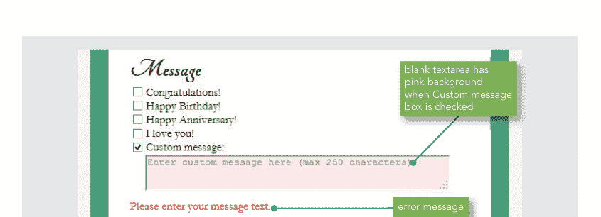

7. 在自定义消息文本区域中输入一个单词或短语，使用虚构信息填写“账单地址”、“配送地址”、“配送日期”和“付款”部分中的所有字段，然后单击**下订单**按钮。所有验证检查均成功，结果显示页面。

## 基于文本输入框内容的验证

订单表单中还有一个额外的字段集，其字段的有效值取决于其他字段：“创建账户”字段集。与许多在线零售商一样，Snoot Flowers不要求客户创建账户，因此“用户名”、“密码”和“密码（确认）”字段都可以留空。但是，如果用户在其中一个或多个字段中输入了数据，则需要进行两项检查：

1. 如果至少一个字段包含用户输入，则三个字段都必须填写。这意味着如果用户在一个字段中输入了内容，三个字段都变为必填。

2. “密码”和“密码（确认）”字段中的值必须匹配。由于密码输入对用户不可见——浏览器默认用圆点表示每个字符——要求用户输入两次密码有助于确保用户输入了预期的内容。

您将创建一个使用嵌套`if`语句的函数，以处理验证此字段集时的所有可能情况。根据两项有效性检查中的哪一项失败，代码将抛出两条可能的错误消息。图6-21显示了将在此函数中纳入的逻辑流程图。

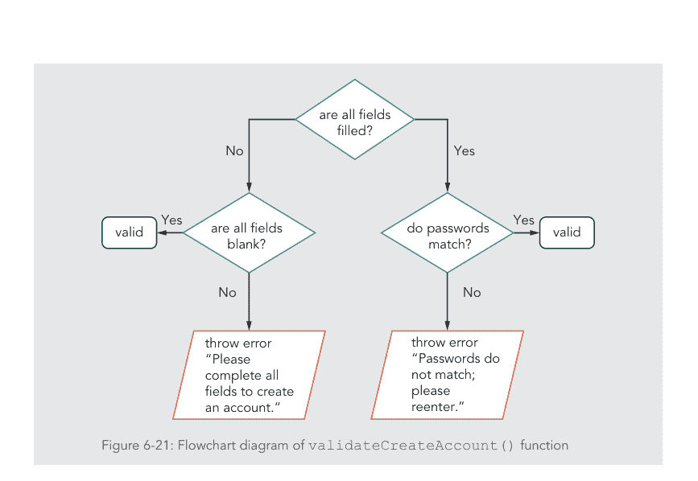

### 为“创建账户”字段集创建验证函数：

1. 在编辑器中返回`snoot.js`，然后在`validateForm()`函数上方输入以下代码，创建`validateCreateAccount()`函数并声明变量：

```javascript
/* validate create account fieldset */
function validateCreateAccount() {
    var errorDiv = document.querySelector(
        "#createAccount .errorMessage");
    var usernameElement = document.getElementById("username");
    var pass1Element = document.getElementById("pass1");
    var pass2Element = document.getElementById("pass2");
    var passwordMismatch = false;
    var invColor = "rgb(255,233,233)";
}
```

2. 在变量下方添加以下`try`语句：

```javascript
try {
    // reset styles to valid state
    usernameElement.style.background = "";
    pass1Element.style.background = "";
    pass2Element.style.background = "";
    errorDiv.style.display = "none";
    if ((usernameElement.value !== "" && pass1Element.value !== ""
       && pass2Element.value !== "")) {
       // all fields are filled
       if (pass1Element.value !== pass2Element.value) {
          // passwords don't match
          passwordMismatch = true;
          throw "Passwords entered do not match; please reenter.";
       }
    }
    if (!(usernameElement.value === "" && pass1Element.value === ""
       && pass2Element.value === "")) {
       // not all fields are blank
       throw "Please complete all fields to create an account.";
    }
}
```

3. 在`try`语句下方添加以下`catch`语句：

```javascript
catch(msg) {
    errorDiv.innerHTML = msg;
    errorDiv.style.display = "block";
    if (passwordMismatch) {
       usernameElement.style.background = "";
       pass1Element.style.background = invColor;
       pass2Element.style.background = invColor;
    } else {
       if (usernameElement.value === "") {
          usernameElement.style.background = invColor;
       }
       if (pass1Element.value === "") {
           pass1Element.style.background = invColor;
       }
       if (pass2Element.value === "") {
           pass2Element.style.background = invColor;
       }
    }
    formValidity = false;
}
```

4. 在`validateForm()`函数中，在调用`validateMessage()`函数之后添加对`validateCreateAccount()`函数的调用，如下所示：

```javascript
function validateForm(evt) {
    if (evt.preventDefault) {
        evt.preventDefault(); // prevent form from submitting
    } else {
        evt.returnValue = false; // prevent form from submitting
        // in IE8
    }
    formValidity = true; // reset value for revalidation
    validateAddress("billingAddress");
    validateAddress("deliveryAddress");
    validateDeliveryDate();
    validatePayment();
    validateMessage();
    validateCreateAccount();
}
```

5. 将更改保存到`snoot.js`，在浏览器中刷新或重新加载`snoot.htm`，然后清除表单。

6. 在“创建账户”字段集中，在**用户名**框中输入一个虚构名称，然后在任何其他字段中不输入任何数据的情况下，单击**下订单**按钮。

7. 向下滚动到“创建账户”部分。两个密码字段都显示为粉红色背景，相关错误文本显示在字段集底部。图6-22显示了Firefox中的验证结果。

8. 在 Password 字段中输入一个或多个字符，在 Password (verify) 字段中输入不同的字符，然后点击 **Place Order** 按钮。两个密码字段再次显示粉红色背景，并且字段集底部显示新的错误文本。图 6-23 显示了 Firefox 中的验证结果。

9. 在两个密码字段中输入相同的字符，使用虚构信息完成 Billing Address、Delivery Address、Delivery Date 和 Payment 部分中的所有字段，然后点击 **Place Order** 按钮。所有验证检查均成功，结果显示页面。

## 使用自定义函数验证内容类型

你需要为 Snoot Flowers 订单表单创建的最后一类验证函数是检查用户输入，以验证其是否符合每个字段的内容规则。你将在表单中的两个字段添加此类验证：卡号字段和 CVV 字段，这两个字段的值都必须是数字。

请注意，订单表单中还有许多其他字段值理想情况下应遵循更严格的规则。例如，要成为有效的美国邮政编码，值必须是五位数字（#####）或五位数字后跟一个连字符，然后再跟四位数字（#####-####）。对于此表单，你将把这种更复杂的验证留给处理表单提交数据的后端程序。在第 8 章中，你将学习如何指定和检查邮政编码、电话号码或电子邮件地址等字符模式。

对于任何需要数值的字段，你可以使用 JavaScript 内置的`isNaN()`函数来确定用户是否实际输入了数字。回顾第 2 章，`isNaN()`函数用于确定一个值是否为特殊值 NaN（非数字）。如果传递给`isNaN()`函数的值不是数字，则该函数返回`true`；如果传递的值是数字，则该函数返回`false`。以下函数展示了一条语句，该语句将 id 值为`subtotal`的文本框的值传递给`isNaN()`函数：

```javascript
isNaN(document.getElementById("subtotal").value)
```

你将使用`isNaN()`函数来检查卡号（Card #）和 CVV 字段的值是否为数字。

**验证卡号（Card #）和 CVV 数字字段：**

1. 返回编辑器中的 snoot.js，然后在`validateForm()`函数上方输入以下代码，以创建`validateNumbers()`函数并声明变量：

```javascript
/* validate number fields for older browsers */
function validateNumbers() {
   var ccNotNum;
   var cvvNotNum;
   var ccNumElement = document.getElementById("ccNum");
   var cvvElement = document.getElementById("cvv");
   var ccNumErrMsg = document.getElementById("ccNumErrorMessage");
   var cvvErrMsg = document.getElementById("cvvErrorMessage");
}
```

2. 在变量下方输入以下 try 语句：

```javascript
try {
    if (isNaN(ccNumElement.value) || ccNumElement.value === "") {
        ccNotNum = true;
    } else { // ccNum value is a number
        ccNumElement.style.background = "";
        ccNumErrMsg.style.display = "none";
    }
    if (isNaN(cvvElement.value) || cvvElement.value === "") {
        cvvNotNum = true;
    } else { // cvv value is a number
        cvvElement.style.background = "";
        cvvErrMsg.style.display = "none";
    }
    if (ccNotNum || cvvNotNum) {
        throw "must contain numbers only.";
    }
}
```

3. 在 try 语句下方输入以下 catch 语句：

```javascript
catch(msg) {
    if (ccNotNum) {
        ccNumElement.style.background = "rgb(255,233,233)";
        ccNumErrMsg.style.display = "block";
        ccNumErrMsg.innerHTML = "The card number " + msg;
    }
    if (cvvNotNum) {
        cvvElement.style.background = "rgb(255,233,233)";
        cvvErrMsg.style.display = "block";
        cvvErrMsg.innerHTML = "The cvv number " + msg;
    }
    formValidity = false;
}
```

4. 在`validateForm()`函数中，在调用`validateCreateAccount()`函数之后添加对`validateNumbers()`函数的调用，如下所示：

```javascript
function validateForm(evt) {
    if (evt.preventDefault) {
        evt.preventDefault(); // prevent form from submitting
    } else {
        evt.returnValue = false; // prevent form from submitting in IE8
    }
    formValidity = true; // reset value for revalidation
    validateAddress("billingAddress");
    validateAddress("deliveryAddress");
    validateDeliveryDate();
    validatePayment();
    validateMessage();
    validateCreateAccount();
    validateNumbers();
}
```

5. 保存对`snoot.js`的更改，在浏览器中刷新或重新加载`snoot.htm`，然后清空表单。

6. 在 Payment 字段集中，在 Card # 框中输入文本（非数字），在 CVV 框中输入文本（非数字），然后在不输入任何其他字段数据的情况下，点击 **Place Order** 按钮。

7. 向下滚动到 Payment 部分。请注意，某些浏览器会自动清除数字字段中的非数字输入。在其他浏览器中，Card # 和 CVV 字段都会显示粉红色背景，并且每个字段下方都会显示相关的错误文本。图 6-24 显示了 Firefox 中的验证结果。

8. 将 Card # 和 CVV 字段中的输入更改为数字，使用虚构信息完成 Billing Address、Delivery Address、Delivery Date 和 Payment 部分中的所有字段，然后点击 **Place Order** 按钮。所有验证检查均成功，结果显示页面。

## 简短测验 4

1. 提交表单时会触发哪个事件？

2. 你使用什么方法来禁用与事件关联的默认行为？

3. 你检查哪个属性来确定文本输入框是否包含用户输入？

4. 你使用哪个内置 JavaScript 函数来测试一个值是否为非数字？

## 小结

- 验证是检查用户提供的信息是否符合规则的过程，以确保其适当地回答表单的问题，并以站点后端程序可以处理的格式提供。

- 你可以创建 JavaScript 函数来降低用户完成表单时出错的可能性。此类函数本身不是验证，而是旨在首先防止用户输入错误数据。可以实现多种类型的辅助函数；具体实现哪些取决于表单的设计以及你尝试收集的数据类型。

- 你可以使用 JavaScript 将`select`元素的`selectedIndex`属性设置为 -1，这对应于无选择。这确保任何选择都是由用户做出的，而不是默认值。

- 你可以根据用户在同一个表单中做出的其他选择来添加或删除 select 元素中的选项。实现此目的的一种方法是创建包含一个或多个 option 元素的子节点，然后编写一个函数，该函数根据用户的选择添加适当的节点。

- 在较旧的浏览器中，你可以通过将所需的占位符文本作为元素的默认值并更改其颜色以区分用户输入的数据（通常使用灰色字体颜色而不是黑色）来复制现代浏览器中可用的`placeholder`属性的行为。然后你可以创建一个事件监听器，当用户点击框时触发，该监听器调用一个函数来移除默认值。

- 你可以使用脚本通过更改元素的`checked`属性的值来选中或取消选中复选框。

- HTML 和现代浏览器的最新增强功能允许浏览器本身执行许多常见的验证任务，而无需额外的 JavaScript。此类验证称为基于浏览器的验证或原生验证。

- 浏览器呈现基于浏览器的验证反馈的许多方面都可以通过约束验证 API 的属性和方法进行自定义。

- 你在对象上使用`preventDefault()`方法来阻止与事件正常关联的操作。通常你会在`preventDefault()`方法之后跟随为指定事件执行不同任务的代码。

- 创建用于验证必填文本输入字段的函数通常涉及检索必填字段的值，并检查其中是否有任何字段的值为空字符串。

- 若要验证必填选择列表，请检索`selectedIndex`值并检查其是否等于 -1。

- 若要检查单选按钮是否被选中，请访问其`checked`属性的值。若要检查一组单选按钮中是否有任何一个未被选中，可以使用 And（`&&`）运算符创建条件语句。

- 在某些情况下，你需要创建验证函数来测试特定于你正在创建的表单的逻辑。

## 关键术语

**`assistive functions`**（辅助函数）— JavaScript 函数，通过从一开始就防止用户输入错误数据，降低用户在填写表单时出错的可能性。

**`browser-based validation`**（基于浏览器的验证）— 由浏览器自身执行的验证任务，无需任何额外的 JavaScript，通过近期对 HTML 和现代浏览器的增强功能实现；也称为原生验证。

**`constraint validation API`**（约束验证 API）— 一组属性和方法，使开发人员能够自定义浏览器呈现基于浏览器的验证反馈的方式。

**`createDocumentFragment() method`**（createDocumentFragment() 方法）— `Document` 对象的方法，用于创建一个空的文档片段。

**`friction`**（摩擦）— 衡量网站用户完成目标（如提交订单）所需坚持程度的粗略指标。

**`HTML5 validation`**（HTML5 验证）— 参见基于浏览器的验证。

**`native validation`**（原生验证）— 参见基于浏览器的验证。

**`submit event`**（submit 事件）— 表单提交时触发的事件，通常是在表单上选择提交按钮时。

**`validation`**（验证）— 检查用户提供的信息是否符合规则，以确保其恰当地回答了表单的问题，并且以站点后端程序可以处理的格式提供。

## 复习题

1. 表示表单中每个控件的对象存储在 ________ 集合中。

   - a. `forms`

   - b. `controls`

   - c. `inputs`

   - d. `elements`

2. 以下哪个 input 元素的 type 值*不能*让你向用户提供有限的选择集合？

   - a. `radio`

   - b. `email`

   - c. `checkbox`

   - d. `range`

3. `select`对象的`selectedIndex`属性什么值对应于未选择任何选项？

   - a. `-1`

   - b. `0`

   - c. `1`

   - d. `false`

4. 要在旧版浏览器中模拟占位符文本的行为，你可以改为设置 ________ 属性的值。

   - a. `src`

   - b. `alt`

   - c. `title`

   - d. `value`

5. 当用户选择字段或将插入点移入字段时，你使用哪个事件来调用函数？

   - a. `blur`

   - b. `focus`

   - c. `input`

   - d. `forminput`

6. 当字段不再被选中，或用户将插入点移到其他字段时，你使用哪个事件来调用函数？

   - a. `blur`

   - b. `focus`

   - c. `click`

   - d. `forminput`

7. 以下哪个属性决定复选框或单选按钮是否被选中？

   - a. `checked`

   - b. `defaultChecked`

   - c. `selected`

   - d. `focus`

8. 将什么赋值给文本输入框的`value`属性以移除其内容？

   - a. `false`

   - b. `true`

   - c. `""`

   - d. `null`

9. 以下哪个属性在现代浏览器中触发基于浏览器的验证？

   - a. `max`

   - b. `title`

   - c. `alt`

   - d. `src`

10. 以下哪个输入`type`值在现代浏览器中触发基于浏览器的验证？

    - a. `password`

    - b. `text`

    - c. `radio`

    - d. `number`

11. 当用户将必填字段留空时，以下哪个属性的值为`true`？

    - a. `required`

    - b. `valueMissing`

    - c. `patternMismatch`

    - d. `typeMismatch`

12. 对于表单子元素，你会对哪个字段使用以下哪个属性，该字段在表单提交前必须具有值？

    - a. `novalidate`

    - b. `min`

    - c. `required`

    - d. `max`

13. 你使用什么方法来禁用事件的默认行为？

    - a. `preventDefault()`

    - b. `checkValidity()`

    - c. `select()`

    - d. `getElementById()`

14. 哪条语句将浏览器移动到页面顶部？

    - a. `scroll(top)`

    - b. `scroll(0,0)`

    - c. `move(top)`

    - d. `move(0,0)`

15. 对于任何需要数值的字段，你可以使用 JavaScript 内置的 ________ 函数来确定用户实际输入的是否为数字。

    - a. `value()`

    - b. `integer()`

    - c. `isNumber()`

    - d. `isNaN()`

16. 解释如何将一个字段的内容传输到另一个字段。

17. `novalidate`属性的用途是什么？

18. 解释约束验证 API 的`validity`对象如何用于检查表单数据的有效性。

19. 解释如何检查一组单选按钮中是否有任何按钮被选中。

20. 解释如何检查用户的输入是否为数字。

## 实践项目

### 实践项目 6-1

在本练习中，你将创建在所有浏览器中工作的表单验证函数。

1. 在文本编辑器中，打开 Chapter06 文件夹中 HandsOnProject6-1 文件夹的`index.htm`文件，在注释部分指示的位置添加你的姓名和今天的日期，然后保存文件。

2. 在编辑器中创建一个新文档，添加包含 **Hands-on Project 6-1** 文本、你的姓名和今天的日期的 JavaScript 注释，然后将文件保存到 HandsOnProject6-1 文件夹中，文件名为`script.js`。

3. 返回到浏览器中的`index.htm`文件，在 body 部分中，在结束的`</body>`标签之前，添加一个`script`元素，然后指定文件`script.js`作为源文件。

4. 在开始的`<form>`标签中，添加代码以禁用基于浏览器的验证，然后保存更改。

5. 在`script.js`文件中，添加指示处理器以严格模式解释内容的代码，然后创建一个名为`formValidity`的全局变量，并将其值设置为`true`。

6. 添加以下函数以验证必填表单元素：

```javascript
/* validate required fields */

function validateRequired() {

    var inputElements = document.querySelectorAll(

        "#contactinfo input");

    var errorDiv = document.getElementById("errorText");

    var elementCount = inputElements.length;

    var requiredValidity = true;

    var currentElement;

    try {

        for (var i = 0; i < elementCount; i++) {

            // validate all input elements in fieldset

            currentElement = inputElements[i];

            if (currentElement.value === "") {

                currentElement.style.background = "rgb(255,233,233)";

                requiredValidity = false;

            } else {

                currentElement.style.background = "white";

            }

        }

        if (requiredValidity === false) {

            throw "Please complete all fields.";

        }

        errorDiv.style.display = "none";

        errorDiv.innerHTML = "";

    }

    catch(msg) {

        errorDiv.style.display = "block";

        errorDiv.innerHTML = msg;

        formValidity = false;

    }

}
```

7. 添加以下函数以创建`submit`事件的监听器：

```javascript
/* create event listeners */
function createEventListeners() {
    var form = document.getElementsByTagName("form")[0];
    if (form.addEventListener) {
        form.addEventListener("submit", validateForm, false);
    } else if (form.attachEvent) {
        form.attachEvent("onsubmit", validateForm);
    }
}
```

8. 添加以下函数以在单击"提交"按钮时触发必填字段的验证：

```javascript
/* validate form */
function validateForm(evt) {
    if (evt.preventDefault) {
        evt.preventDefault(); // prevent form from submitting
    } else {
        evt.returnValue = false; // prevent form from submitting
            in IE8
    }
    formValidity = true; // reset value for revalidation
    validateRequired();
    if (formValidity === true) {
        document.getElementsByTagName("form")[0].submit();
    }
}
```

9. 添加以下代码以在页面加载完成时调用`createEventListeners()`函数：

```javascript
/* run setup functions when page finishes loading */
if (window.addEventListener) {
    window.addEventListener("load", createEventListeners, false);
} else if (window.attachEvent) {
    window.attachEvent("onload", createEventListeners);
}
```

10. 将你的更改保存到`script.js`，在浏览器中打开`index.htm`，然后测试无效和有效数据的各种组合，以确保你编写的脚本按预期运行。根据需要调试你的代码，直到它正确运行。

11. 返回你的编辑器中的`script.js`，然后添加以下函数来验证`number`类型的`input`元素：

```javascript
/* validate number fields for older browsers */
function validateNumbers() {
    var numberInputs = document.querySelectorAll(
      "#contactinfo input[type=number]");
    var elementCount = numberInputs.length;
    var numErrorDiv = document.getElementById("numErrorText");
    var numbersValidity = true;
    var currentElement;
    try {
        for (var i = 0; i < elementCount; i++) {
            // validate all input elements of type "number" in fieldset
            currentElement = numberInputs[i];
            if (isNaN(currentElement.value) || (currentElement.value
              === "")) {
                currentElement.style.background = "rgb(255,233,233)";
                numbersValidity = false;
            } else {
                currentElement.style.background = "white";
            }
        }
        if (numbersValidity === false) {
            throw "Zip and Social Security values must be numbers.";
        }
        numErrorDiv.style.display = "none";
        numErrorDiv.innerHTML = "";
    }
    catch(msg) {
        numErrorDiv.style.display = "block";
        numErrorDiv.innerHTML = msg;
        formValidity = false;
    }
}
```

12. 在`validateForm()`函数中，如下所示添加对`validateNumbers()`函数的调用：

```javascript
function validateForm(evt) {
  if (evt.preventDefault) {
    evt.preventDefault(); // prevent form from submitting
  } else {
    evt.returnValue = false; // prevent form from submitting in IE8
  }
  formValidity = true; // reset value for revalidation
  validateRequired();
  validateNumbers();
  if (formValidity === true) {
    document.getElementsByTagName("form")[0].submit();
  }
}
```

13. 将你的更改保存到`script.js`，在浏览器中打开`index.htm`，然后测试无效和有效数据的各种组合，包括数字字段中的非数字输入，以确保你编写的脚本按预期运行。根据需要调试你的代码，直到它正确运行。

## 动手实践项目 6-2

在本练习中，你将增强在动手实践项目 6-1 中处理的表单，以在 IE8 中模拟`placeholder`属性的行为。

1. 在你的操作系统的文件管理器中，将 HandsOnProject6-1 文件夹的完整内容复制到 HandsOnProject6-2 文件夹。

2. 在你的文本编辑器中，打开 HandsOnProject6-2 文件夹中的`index.htm`文件，在注释部分、`title`元素和`h1`元素中将 "Hands-on Project 6-1" 更改为**Hands-on Project 6-2**，然后保存你的更改。

3. 打开`script.js`，然后在注释部分将 "Hands-on Project 6-1" 更改为**Hands-on Project 6-2**。

4. 添加以下三个函数来复制现代浏览器中`placeholder`属性的行为：

```javascript
/* remove fallback placeholder text */
function zeroPlaceholder() {
    var addressBox = document.getElementById("addrinput");
    addressBox.style.color = "black";
    if (addressBox.value === addressBox.placeholder) {
        addressBox.value = "";
    }
}
/* restore placeholder text if box contains no user entry */
function checkPlaceholder() {
    var addressBox = document.getElementById("addrinput");
    if (addressBox.value === "") {
        addressBox.style.color = "rgb(178,184,183)";
        addressBox.value = addressBox.placeholder;
    }
}
/* add placeholder text for browsers that don't support placeholder attribute */
function generatePlaceholder() {
    if (!Modernizr.input.placeholder) {
        var addressBox = document.getElementById("addrinput");
        addressBox.value = addressBox.placeholder;
        addressBox.style.color = "rgb(178,184,183)";
        if (addressBox.addEventListener) {
            addressBox.addEventListener("focus", zeroPlaceholder, false);
            addressBox.addEventListener("blur", checkPlaceholder, false);
        } else if (addressBox.attachEvent) {
            addressBox.attachEvent("onfocus", zeroPlaceholder);
            addressBox.attachEvent("onblur", checkPlaceholder);
        }
    }
}
```

5. 创建以下函数来调用其他函数以设置页面：

```javascript
/* run initial form configuration functions */
function setUpPage() {
    createEventListeners();
    generatePlaceholder();
}
```

6. 将文件末尾的事件监听器代码更改为以下内容：

```javascript
if (window.addEventListener) {
    window.addEventListener("load", setUpPage, false);
} else if (window.attachEvent) {
    window.attachEvent("onload", setUpPage);
}
```

7. 将你的更改保存到`script.js`，在 IE8 中打开`index.htm`，并验证占位符文本是否显示。点击 Street Address 字段，验证占位符文本是否被移除。不在 Street Address 字段中输入任何内容，点击页面上的其他位置，验证占位符文本是否再次显示。点击 Street Address 字段，输入一个虚构的地址，验证文本是否以黑色而非灰色显示。根据需要调试你的代码，直到它正确运行。

## 动手实践项目 6-3

在本练习中，你将增强在动手实践项目 6-2 中处理的表单，以便在用户为社会保障号码的每个部分输入最大字符数后，自动将焦点移动到下一个框。

1. 在你的操作系统的文件管理器中，将 HandsOnProject6-2 文件夹的完整内容复制到 HandsOnProject6-3 文件夹。

2. 在你的文本编辑器中，打开 HandsOnProject6-3 文件夹中的`index.htm`文件，在注释部分、`title`元素和`h1`元素中将 "Hands-on Project 6-2" 更改为**Hands-on Project 6-3**，然后保存你的更改。

3. 打开`script.js`，然后在注释部分将 "Hands-on Project 6-2" 更改为**Hands-on Project 6-3**。

4. 添加以下函数，以在用户每次输入字符后检查焦点是否应移动到下一个 SSN 框：

```javascript
function advanceSsn() {
    var ssnFields = document.getElementsByClassName("ssn");
    var currentField = document.activeElement;
    if (currentField.value.length === currentField.maxLength) {
        if (currentField === ssnFields[0]) {
            ssnFields[1].focus();
        }
        if (currentField === ssnFields[1]) {
            ssnFields[2].focus();
        }
        if (currentField === ssnFields[2]) {
            document.getElementById("submitBtn").focus();
        }
    }
}
```

5. 在`createEventListeners()`函数中，添加以下代码：

```javascript
var ssnFields = document.getElementsByClassName("ssn");
for (var i = 0; i < ssnFields.length; i++) {
    if (ssnFields[i].addEventListener) {
        ssnFields[i].addEventListener("input", advanceSsn, false);
    } else if (ssnFields[i].attachEvent) {
        ssnFields[i].attachEvent("oninput", advanceSsn);
    }
}
```

6. 将你的更改保存到`script.js`，然后在浏览器中打开`index.htm`。点击第一个 **Social Security Number** 字段，输入四个字符，然后验证焦点是否自动移动到第二个社会保障号码字段。输入两个字符，然后验证焦点是否移动到第三个社会保障号码字段。输入四个字符，验证焦点是否移动到提交按钮。

## 动手实践项目 6-4

在本练习中，你将增强一个表单，以在 IE8 中模拟`placeholder`属性的行为，并移除`select`元素的默认选中项。

1. 在你的文本编辑器中，打开 Chapter06 文件夹下 HandsOnProject6-4 文件夹中的`index.htm`文件，在注释部分指定位置添加你的姓名和今天的日期，然后保存文件。

2. 在编辑器中创建一个新文档，添加包含文本 **Hands-on Project 6-4**、你的姓名和今天日期的 JavaScript 注释，然后将文件保存到 HandsOnProject6-4 文件夹，并命名为`script.js`。

3. 返回到浏览器中的`index.htm`文件，在`<body>`部分内、紧靠闭合标签`</body>`之前，添加一个`<script>`元素，然后将文件`script.js`指定为源文件。

4. 在`script.js`文件中，添加代码指示处理器以严格模式解释内容。

5. 添加以下函数以从`<select>`元素中移除默认选择：

```javascript
/* remove default value and formatting from selection list */
function removeSelectDefault() {
    var selectBox = document.getElementById("size");
    selectBox.selectedIndex = -1;
    selectBox.style.boxShadow = "none";
}
```

6. 添加以下函数以设置页面：

```javascript
/* run initial form configuration functions */
function setUpPage() {
    removeSelectDefault();
}
```

7. 添加以下代码，以便在页面加载完成时调用`setUpPage()`函数：

```javascript
/* run setup functions when page finishes loading */
if (window.addEventListener) {
    window.addEventListener("load", setUpPage, false);
} else if (window.attachEvent) {
    window.attachEvent("onload", setUpPage);
}
```

8. 将你的更改保存到`script.js`，在浏览器中打开`index.htm`，然后验证选择元素是否显示且没有默认值。如有必要，请调试你的代码直到函数按预期工作。

9. 返回到编辑器中的`script.js`，然后添加以下三个函数以在 IE8 中复制`placeholder`属性的行为：

```javascript
/* remove fallback placeholder text */
function zeroPlaceholder() {
    var instrBox = document.getElementById("instructions");
    instrBox.style.color = "black";
    if (instrBox.value === instrBox.placeholder) {
        instrBox.value = "";
    }
}
/* restore placeholder text if box contains no user entry */
function checkPlaceholder() {
    var instrBox = document.getElementById("instructions");
    if (instrBox.value === "") {
        instrBox.style.color = "rgb(178,184,183)";
        instrBox.value = instrBox.placeholder;
    }
}
/* add placeholder text for browsers that don't support
placeholder attribute */
function generatePlaceholder() {
    if (!Modernizr.input.placeholder) {
        var instrBox = document.getElementById("instructions");
        instrBox.value = instrBox.placeholder;
        instrBox.style.color = "rgb(178,184,183)";
        if (instrBox.addEventListener) {
            instrBox.addEventListener("focus", zeroPlaceholder, false);
            instrBox.addEventListener("blur", checkPlaceholder, false);
        } else if (instrBox.attachEvent) {
            instrBox.attachEvent("onfocus", zeroPlaceholder);
            instrBox.attachEvent("onblur", checkPlaceholder);
        }
    }
}
```

10. 在`setUpPage()`函数中，按如下方式添加对`generatePlaceholder()`函数的调用：

```javascript
function setUpPage() {
    removeSelectDefault();
    generatePlaceholder();
}
```

11. 将你的更改保存到`script.js`，在 IE8 中打开`index.htm`，然后验证占位符文本是否显示。在文本区域框内单击，并验证占位符文本是否被移除。不在文本区域框中输入内容，单击页面的其他位置，并验证占位符文本是否再次显示。在文本区域框中单击，输入一个单词，并验证文本是否以黑色而不是灰色显示。如有必要，请调试你的代码直到它正确运行。

## 实践项目 6-5

在本练习中，你将使用可在所有浏览器中工作的验证函数，对在实践项目 6-4 中使用过的表单进行增强。

1. 在你的操作系统的文件管理器中，将 HandsOnProject6-4 文件夹的完整内容复制到 HandsOnProject6-5 文件夹。

2. 在你的文本编辑器中，打开 HandsOnProject6-5 文件夹中的`index.htm`文件，将注释部分、`title`元素和`h1`元素中的 "Hands-on Project 6-4" 更改为**Hands-on Project 6-5**，然后保存你的更改。

3. 打开`script.js`，然后在注释部分，将 "Hands-on Project 6-4" 更改为**Hands-on Project 6-5**。

4. 在`index.htm`文件中，在开始的`<form>`标签中，添加代码以禁用基于浏览器的验证，然后保存你的更改。

5. 在`script.js`文件中，创建一个名为`formValidity`的全局变量，并将其值设置为 true。

6. 添加以下函数以验证必填字段：

```javascript
1   /* validate required fields */
2   function validateRequired() {
3       var inputElements = document.querySelectorAll("input[required]");
4       var errorDiv = document.getElementById("errorMessage");
5       var crustBoxes = document.getElementsByName("crust");
6       var fieldsetValidity = true;
7       var elementCount = inputElements.length;
8       var currentElement;
9       try {
10          for (var i = 0; i < elementCount; i++) {
11              // validate all required input elements in fieldset
12              currentElement = inputElements[i];
13              if (currentElement.value === "") {
14                  currentElement.style.background = "rgb(255,233,233)";
15                  fieldsetValidity = false;
16              } else {
17                  currentElement.style.background = "white";
18              }
19          }
20          currentElement = document.querySelectorAll("select")[0];
21          // validate state select element
22          if (currentElement.selectedIndex === -1) {
23              currentElement.style.border = "1px solid red";
24              fieldsetValidity = false;
25          } else {
26              currentElement.style.border = "";
27          }
28          if (!crustBoxes[0].checked && !crustBoxes[1].checked) {
29              // verify that a crust is selected
30              crustBoxes[0].style.outline = "1px solid red";
31              crustBoxes[1].style.outline = "1px solid red";
32              fieldsetValidity = false;
33          } else {
34              crustBoxes[0].style.outline = "";
35              crustBoxes[1].style.outline = "";
36          }
37          if (fieldsetValidity === false) {
38              throw "Please complete all required fields.";
39          } else {
40              errorDiv.style.display = "none";
41          }
42      }
43      catch(msg) {
44          errorDiv.style.display = "block";
45          errorDiv.innerHTML = msg;
46          formValidity = false;
47      }
48  }
```

7. 添加以下函数以运行表单验证：

```javascript
 1  /* validate form */
 2  function validateForm(evt) {
 3      if (evt.preventDefault) {
 4          evt.preventDefault(); // prevent form from submitting
 5      } else {
 6          evt.returnValue = false; // prevent form from submitting in IE8
 7      }
 8      formValidity = true; // reset value for revalidation
 9      validateRequired();
10      if (formValidity === true) {
11          document.getElementById("errorMessage").innerHTML = "";
12          document.getElementById("errorMessage").style.display = "none";
13          document.getElementsByTagName("form")[0].submit();
14      } else {
15          document.getElementById("errorMessage").innerHTML = "Please complete the highlighted fields.";
16          document.getElementById("errorMessage").style.display = "block";
17          scroll(0,0);
18      }
19  }
```

8. 添加以下函数以创建`submit`事件的事件监听器：

```javascript
/* create event listeners */
function createEventListeners() {
  var orderForm = document.getElementsByTagName("form")[0];
  if (orderForm.addEventListener) {
    orderForm.addEventListener("submit", validateForm, false);
  } else if (orderForm.attachEvent) {
    orderForm.attachEvent("onsubmit", validateForm);
  }
}
```

9. 在`setUpPage()`函数中，按如下方式添加对`createEventListeners()`函数的调用：

```javascript
/* run initial form configuration functions */
function setUpPage() {
  removeSelectDefault();
  createEventListeners();
  generatePlaceholder();
}
```

10. 将你的更改保存到`script.js`，在浏览器中打开`index.htm`，然后测试各种无效数据和有效数据的组合，以确保你编写的脚本按预期行为运行。根据需要调试你的代码，直到它正确运行。

## 案例项目

对于以下项目，请将你创建的文档保存在第 6 章的 Projects 文件夹中。务必使用 W3C 标记验证服务验证每个网页。

### 个人案例项目

为你个人网站上的一个表单添加验证代码。首先，确保你的表单至少使用了以下字段类型中的三种：复选框、文本框、单选按钮、选择列表和文本区域。然后，为你的表单编程验证，确保用户在所有字段中输入值或进行选择，并至少验证至少一个字段的至少另一个方面。当表单验证失败时，向用户提供适当的反馈。测试你完成的程序，直到所有验证在不同有效和错误数据组合下都能可靠地工作。

## 团队案例项目

为你们团队网站上的某个表单添加验证代码。首先，请确保你们的表单至少使用以下字段类型中的三种：复选框、文本框、单选按钮、选择列表和文本区域。接下来，作为团队，规划表单中每个字段的验证规则。你们的验证应要求每个字段都必须有值，并且至少对一个字段的至少另一个方面进行验证。将团队分为两组——一组编写代码以验证所有字段都有值，另一组编写代码以验证输入数据的另一个方面。每组的代码还应在遇到验证错误时向用户提供适当的反馈。两组完成后，作为团队将代码整合到文档中。共同制定策略，测试所有可能的验证场景。测试并调试代码，直到最终程序在不同有效和错误数据组合下，所有验证都能可靠工作。

## 第七章 使用面向对象的 JavaScript

完成本章后，你将能够：

- 解释与面向对象编程相关的基本概念

- 使用`Date`、`Number`和`Math`对象

- 定义自己的自定义 JavaScript 对象

在本章中，你将学习如何在 JavaScript 程序中使用面向对象编程技术。本质上，面向对象编程允许你使用和创建独立的代码和数据块，称为对象，这些对象可以在你的程序中被重用。在第 5 章学习浏览器对象（包括`Window`和`Document`对象）后，你已经对面向对象编程有了一些经验。然而，浏览器对象是网络浏览器本身的一部分。你将在本章学习的对象是 JavaScript 编程语言的一部分。此外，你将学习如何创建自己的自定义 JavaScript 对象。

## 面向对象编程简介

你迄今为止编写的 JavaScript 程序主要是针对特定情况定制的。也就是说，你的大多数变量、语句和函数都引用了特定于一个文档的元素和值。这种方法的问题在于它限制了代码的有用性。例如，你可能为一个在线零售商创建一个网页，使用 JavaScript 计算包含州销售税和运费的销售订单总额。然而，该零售商可能在不同的网页上销售不同类型的产品，一个网页卖书，另一个网页卖体育用品，等等。如果你想在多个网页上重用 JavaScript 销售总额代码，你就必须为每个网页重写所有语句。面向对象编程采用了一种不同的方法。它允许你重用代码，而无需为特定情况重写它。

**重用软件对象**

**面向对象编程 (OOP)** 指的是创建可重用的软件对象，这些对象可以轻松地纳入多个程序中。**对象**一词特指可以作为单个单元处理的程序代码和数据。对象也称为**组件**。**数据**一词指的是变量或其他类型存储结构中包含的信息。在第 1 章中，你了解到与对象关联的过程称为“方法”，而与对象关联的变量称为“属性”或“特征”。

对象可以从简单的控件（如按钮）到整个程序（如数据库应用程序）。事实上，有些程序完全由其他对象组成。你经常会遇到旨在执行特定任务的对象。例如，在一个零售销售程序中，你可以将所有计算销售总额的代码视为一个单一的对象。然后，你只需输入对象名称，就可以在同一程序中反复重用该对象。

> **注意** 流行的面向对象编程语言包括 C++、Java 和 Visual Basic。

使用面向对象语言，程序员可以自己创建对象，也可以使用其他程序员创建的对象。例如，如果你正在创建一个会计程序，你可能会使用一个名为`Payroll`的现有对象，该对象包含几个方法——一个用于计算应扣缴的联邦和州税金额，另一个用于计算应扣缴的 FICA 金额，等等。`Payroll`对象的属性可能包括员工的税收预扣津贴数量、联邦和州税百分率以及保险费成本。你不需要知道`Payroll`对象是如何创建的。你只需要知道如何从你的程序中访问`Payroll`对象的方法和属性。

从本质上讲，面向对象编程涉及创建可以单独使用或与其他组件组合使用的组件。OOP 与组合一个娱乐中心有一些相似之处，后者可能包含电视、DVD 或蓝光播放器、DVR 和流媒体设备（如 Roku 或 Apple TV）。许多公司制造可以连接到电视的设备——有许多不同品牌的 DVD 播放器、DVR 和流媒体设备。尽管不同的制造商生产这些硬件组件中的每一个，但如果它们设计为与电视一起工作，那么它们都共享共同的连接方式或相互连接。如今的大多数硬件组件都使用 HDMI 连接，这是一种用于连接音频和视频设备的标准接口。因此，你可以通过购买不同的组件，使用标准接口连接它们，然后将它们组合使用来创建一个娱乐中心。同样，你可以通过使用现有对象（或创建自己的对象）并将它们连接在一起来完成某个目标，从而创建一个程序。图 7-1 展示了到目前为止编写的独立程序与使用模块化对象编程之间的区别。

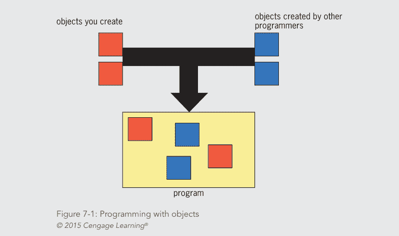

### 理解封装

对象是**封装**的，这意味着所有代码和所需数据都包含在对象本身内。在大多数情况下，一个封装好的对象由单个计算机文件组成，该文件包含所有代码和所需数据。封装将代码放入程序员喜欢称之为黑盒子的东西中；当对象被封装时，程序的其他部分无法读取或修改代码本身——所有内部工作都被隐藏了。封装对象中包含的代码（方法和语句）和数据（变量和常量）是通过接口访问的。**接口**一词指的是源程序与对象通信所需的编程元素。例如，访问`Payroll`对象可能需要的接口元素是一个名为`calcNetPay()`的方法（该方法计算员工的净工资），以及包含员工姓名和工资率的属性。

当你在程序中包含封装对象时，用户只能看到你允许他们看到的对象的方法和属性。本质上，**信息隐藏**原则指出，其他程序员不需要访问或了解的任何方法和属性都应该被隐藏。通过移除窥探黑盒子内部的能力，封装降低了代码的复杂性，使得使用该代码的程序员可以专注于将代码集成到他们的程序中。封装还可以防止其他程序员意外地将错误引入程序，甚至可能窃取代码并声称是他们自己的。

你可以将编程对象及其接口比作一个手持计算器。计算器代表一个对象，而你代表一个想要使用该对象的程序。你通过输入数字（对象所需的数据）然后按下计算键（代表对象的方法）与计算器对象建立接口。你不需要知道，也无法看到计算器对象的内部工作原理。作为程序员，你只关心对象的方法和属性。继续这个类比，你只关心你期望计算器对象返回的结果。图 7-2 展示了计算器接口的概念。

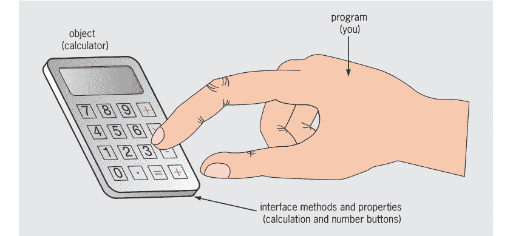

在 JavaScript 中，`Document`对象被封装起来，使其成为一个黑盒。你可以通过它的接口来访问`Document`对象，该接口由其属性和方法组成。例如，你可以在你的程序中使用`Document`对象的`getElementById()`方法。然而，这样做并不需要你自己处理构成`Document`对象本身的代码。图 7-3 说明了使用 JavaScript 和`Document`对象的黑盒概念。

另一个对象及其接口的例子是文字处理应用程序，如 Microsoft Word 或 Google Docs。每个应用程序本身都是由众多其他对象组成的对象。程序窗口（或用户界面）是一个对象。你在界面中看到的项目，如顶部的按钮，用于执行方法。例如，**粗体**按钮执行一个粗体方法。你的文档文本是你提供给程序的数据。这些应用程序中的每一个都是有用的工具，你可以不知道各种方法是如何工作的就能使用它们。你只需要知道每个方法是做什么的。要成功使用这些应用程序，你只需要提供数据（文本），并在必要时执行适当的方法（如粗体方法）。同样，当你在代码中使用对象时，你只需要提供必要的数据（如员工的毛薪）并执行适当的方法（如`calcNetPay()`方法）。

## 理解类

在面向对象编程中，构成对象的代码、方法、属性和其他信息被组织到**类**中。本质上，类是一个模板或蓝图，作为新对象的基础。当你在程序中使用对象时，实际上你是创建该对象类的一个**实例**。**实例**是从现有类创建的对象。当你从现有类创建对象时，称为**实例化**该对象。

> **注意** 传统面向对象编程中的类名通常以大写字母开头。JavaScript 中也遵循这一约定。

在本章后面，你将学习如何从内置的 JavaScript 类以及你自己编写的自定义类中创建或实例化对象。然而，作为一个概念性例子，考虑一个名为`BankAccount`的对象，它包含可用于记录与支票或储蓄账户相关交易的方法和属性。`BankAccount`对象是从`BankAccount`类创建的。要使用`BankAccount`类，你需要创建该类的一个实例。对象的特定实例**继承**自一个类的方法和属性——也就是说，它承袭了其所基于的类的特征。例如，`BankAccount`对象将继承`BankAccount`类的所有方法和属性。

再举一个例子，当你创建一个新的文字处理文档（一种对象类型）时，它通常继承其所基于模板的属性。该模板是一种类型的类。文档继承模板的特征，如字体大小、行间距和样板文本。同样，包含对象实例的程序继承该对象的功能。

由于浏览器对象模型中的对象实际上是 Web 浏览器的一部分，因此你不需要实例化它们就能在你的程序中使用它们。例如，你不需要在 JavaScript 程序中从`Document`类实例化一个`Document`对象，因为 Web 浏览器会自动为你实例化一个。然而，你确实需要从接下来要学习的某些内置 JavaScript 类中实例化一些对象。

## 使用内置 JavaScript 类

JavaScript 语言包含表 7-1 中列出的 13 个内置类。每个对象包含用于执行特定类型任务的各种方法和属性。

| CLASS | DESCRIPTION |

| --- | --- |

| `Arguments` | 检索和操作函数中的参数 |

| `Array` | 创建新的数组对象 |

| `Boolean` | 创建新的布尔对象 |

| `Date` | 检索和操作日期和时间 |

| `Error` | 返回运行时错误信息 |

| `Function` | 创建新的函数对象 |

| Global | 存储全局变量并包含各种内置 JavaScript 函数 |

| JSON | 操作以 JavaScript 对象表示法（JSON）格式化的对象；在 ECMAScript 5 及更高版本中可用 |

| Math | 包含用于执行数学计算的方法和属性 |

| Number | 包含用于操作数字的方法和属性 |

| Object | 代表所有内置 JavaScript 类的基类；包含多个内置 JavaScript 函数 |

| RegExp | 包含用于在文本字符串中查找和替换字符的方法和属性 |

| String | 包含用于操作文本字符串的方法和属性 |

表 7-1：内置 JavaScript 类

你将在本章中学习 Date、Number、Math 和 Object 类。你将在第 8 章中学习 Array、String、RegExp 和 JSON 类。

## 实例化对象

你可以直接在代码中使用一些内置的 JavaScript 对象，而其他对象则要求你先实例化一个新对象。Math 对象是你可以直接在程序中使用而无需实例化新对象的其中之一。以下示例展示了如何在语句中使用 Math 对象的 PI（π）属性和 pow() 方法：

```javascript
// calculate the area of a circle based on its radius
function calcCircleArea() {
    var r = document.getElementById("radius").value;
    var area = Math.PI * Math.pow(r, 2); // area is pi times
    radius squared
    return area;
}
```

与 Math 对象不同，其他对象要求你在使用它们之前先实例化一个新对象。有两种不同的方式来创建新对象——使用对象的构造函数或使用字面量。例如，如你在第 3 章中学到的，数组在 JavaScript 中由 Array 对象表示。以下语句展示了如何使用数组字面量来实例化一个名为 deptHeads 的空数组：

```javascript
var deptHeads = [];
```

同样，你可以使用对象字面量创建一个空的通用对象。以下代码使用对象字面量创建了一个名为`accountsPayable`的对象：

```javascript
var accountsPayable = {};
```

请注意，与使用方括号的数组字面量不同，对象字面量在其值周围使用大括号。

使用字面量实例化对象通常是程序员首选的方法，因为它比使用构造函数更容易。然而，有一个内置对象`Date`不支持字面量格式。因此，要创建`Date`对象，你必须使用`Date()`构造函数。例如，以下语句创建了一个`Date`对象：

```javascript
var today = new Date();
```

你可能想知道为什么前面的语句使用`var`关键字来实例化新对象。如你所知，`var`关键字用于声明变量。你用于实例化对象的名称实际上是一个变量，就像整数或字符串变量一样。事实上，程序员交替使用"变量"和"对象"这两个术语。区别在于，在这种情况下，变量所代表的数据恰好是一个对象，而不是数字或字符串。回想一下第 1 章，变量是程序存储在计算机内存中的值。还要记住，JavaScript 语言也支持引用数据类型，它们可以包含多个值或复杂类型的信息，与原始数据类型中存储的单个值相对。换句话说，就像你使用变量名来表示计算机内存中的原始数据类型（如整数）一样，你也使用变量名来表示对象。由于你在 JavaScript 程序中声明的对象实际上是某种类型的变量，因此你使用`var`关键字将它们标识为变量。

> 如果你使用过其他面向对象编程语言，那么你可能熟悉**垃圾回收**这个术语，它指的是清理或回收程序预留的内存。当你声明变量或实例化新对象时，实际上是在为变量或对象预留计算机内存。对于某些编程语言，你必须编写代码在使用完变量或对象后删除它们，以便释放内存供程序的其他部分或计算机上运行的其他程序使用。对于 JavaScript，你不需要担心回收为变量或对象预留的内存；JavaScript 知道你的程序何时不再需要某个变量或对象，并自动为你清理内存。

在本章中，你将运用面向对象编程，为“外层轨道”这家位于弗吉尼亚州弗吉尼亚海滩的太空旅游公司网站添加功能。该公司已创建了一个页面，让潜在客户可以输入一名或多名乘客的姓名、选择计划中的发射日期，并查看支付选项。你将添加一个使用`Date`对象以正确格式指定日期的日历部件，以及一个模拟倒计时时钟来显示所选航班剩余时间的倒计时部件。你还将使用`Math`和`Number`对象的方法来执行数学函数并控制结果的显示。最后，你将创建一个具有自身属性和方法的自定义对象，用于存储表单中输入的所有票务信息。图7-4展示了你将在桌面浏览器中创建的页面预览，图7-5展示了在手持设备上的效果。

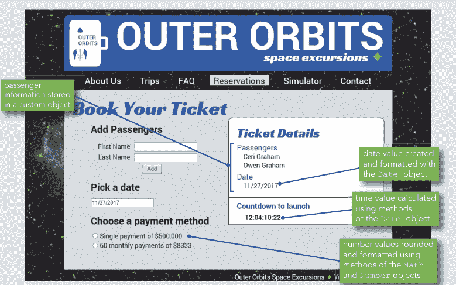

图7-4：桌面浏览器中的Outer Orbits预订页面预览

## OUTER ORBITS

太空之旅 ✦

- 关于我们

- 预订

- 旅行

- 模拟器

- 常见问题

- 联系我们

## 预订您的票

| 票务详情 | |

|---|---|

| 乘客 | Ceri Graham<br>Owen Graham |

| 日期 | 2017年11月27日 |

| 发射倒计时 | 1307:09:12:33 |

添加乘客

名 [______]

姓 [______]

(添加)

选择日期

[2017年11月27日]

选择支付方式

( ) 一次性支付500,000美元

( ) 分60期每月支付8,333美元

Outer Orbits太空之旅 ✦ 弗吉尼亚州弗吉尼亚海滩

图7-5：手持设备上的Outer Orbits预订页面预览

你将通过探索现有代码开始你的工作。

## 探索预订页面的代码：

1. 在你的文本编辑器中，打开`booktrip.htm`文件，该文件位于你的第7章文件夹中。

2. 在文档顶部的注释部分，在指示位置输入你的姓名和今天的日期，然后保存你的工作。

3. 滚动浏览文档以熟悉其内容。文章部分包含一个简短的表单，后面是一个包含标题行和六个额外空行的表格。

4. 在网页浏览器中打开`booktrip.htm`。图7-6展示了该文档的当前内容。

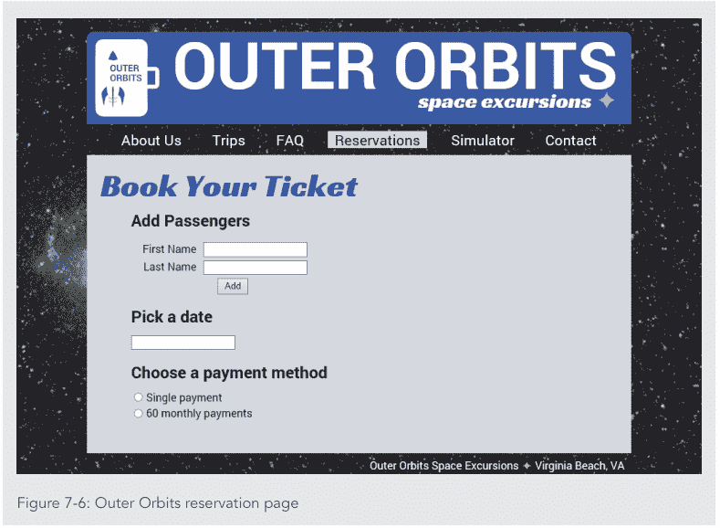

5. 返回到你的文本编辑器，创建一个新的JavaScript文档，然后输入以下注释部分，在指示位置输入你的姓名和今天的日期：

```javascript
1  /*    JavaScript 6th Edition
2  *    Chapter 7
3  *    Chapter case
  
4  *    Outer Orbits
5  *    Author:
6  *    Date:
  
7  *    Filename: orbits.js
8  */
```

6. 在注释部分下方，输入以下语句：

```javascript
"use strict"; // 以JavaScript严格模式解释内容
```

7. 将文档保存为`orbits.js`。

在下一节中，你将使用JavaScript的`Date`、`Number`和`Math`对象来增强预订表单。

### 短测验1

1. 什么是面向对象编程？什么是对象？

2. 至少列出两个JavaScript的内置类。

### 使用Date、Number和Math类

在本节中，你将学习如何使用三个最常用的JavaScript类：`Date`、`Number`和`Math`。首先，你将探索`Date`类。

**使用Date类处理日期和时间**

在JavaScript程序中处理日期的能力开启了众多可能性。例如，你可以在程序中使用日期来创建日历或计算完成某项任务需要多长时间。**Date类**包含用于操作日期和时间的方法和属性。它允许你在JavaScript程序中使用当前日期和时间（或特定的日期或时间元素，如当前月份）。你可以使用表7-2中列出的构造函数之一来创建一个`Date`对象。

| 构造函数 | 描述 |

| --- | --- |

| Date() | 创建一个包含设备提供的当前日期和时间的Date对象 |

| Date(milliseconds) | 创建一个基于自1970年1月1日午夜以来经过的毫秒数的Date对象 |

| Date(date_string) | 创建一个基于包含日期值的字符串的Date对象 |

| Date(year, month[, day, hours, minutes, seconds, milliseconds]) | 创建一个日期和时间根据传入参数设置的Date对象；年份和月份参数是必需的 |

表7-2：Date类构造函数

以下语句演示了如何创建一个包含运行程序的设备提供的当前日期和时间的Date对象：

```javascript
var today = new Date();
```

Date对象中的月份日期和年份使用与实际日期和年份匹配的数字存储。然而，星期几和月份在Date对象中使用从零开始的数字表示，类似于数组。数字0到6代表星期日到星期六，数字0到11代表一月到十二月。以下语句演示了如何使用Date构造函数指定一个特定日期。在此示例中，分配给`independenceDay`变量的日期是1776年7月4日。

```javascript
var independenceDay = new Date(1776, 6, 4);
```

创建新的Date对象后，你可以使用Date类的方法操作该变量中的日期和时间。请注意，Date对象中的日期和时间不会像时钟一样随时间更新。相反，Date对象包含的是JavaScript代码实例化对象那一刻的静态（不变）日期和时间。

表7-3列出了Date类的常用方法。请注意，Date类不包含任何属性。

| 方法 | 描述 |

| :--- | :--- |

| `getDate()` | 返回`Date`对象的日期（几号） |

| `getDay()` | 返回`Date`对象的星期几 |

| `getFullYear()` | 返回`Date`对象的四位数年份 |

| `getHours()` | 返回`Date`对象的小时 |

| `getMilliseconds()` | 返回`Date`对象的毫秒 |

| `getMinutes()` | 返回`Date`对象的分钟 |

| `getMonth()` | 返回`Date`对象的月份 |

| `getSeconds()` | 返回`Date`对象的秒数 |

| `getTime()` | 返回`Date`对象的时间（自1970年1月1日午夜以来的毫秒数） |

| `now()` | 返回当前时间，即自1970年1月1日午夜以来经过的毫秒数（仅限ECMAScript 5及更高版本） |

| `setDate(date)` | 设置`Date`对象的日期（1–31） |

| `setFullYear(year[, month, day])` | 设置`Date`对象的四位数年份；可选择设置月份和日期 |

| `setHours(hours[, minutes, seconds, milliseconds])` | 设置`Date`对象的小时（0–23）；可选择设置分钟（0–59）、秒（0–59）和毫秒（0–999） |

| `setMilliseconds(milliseconds)` | 设置`Date`对象的毫秒（0–999） |

| `setMinutes(minutes[, seconds, milliseconds])` | 设置`Date`对象的分钟（0–59）；可选择设置秒（0–59）和毫秒（0–999） |

| `setMonth(month[, date])` | 设置`Date`对象的月份（0–11）；可选择设置日期（1–31） |

| `setSeconds(seconds[, milliseconds])` | 设置`Date`对象的秒（0–59）；可选择设置毫秒（0–999） |

| `setTime()` | 设置时间，参数为自1970年1月1日午夜以来经过的毫秒数 |

| `toLocaleString()` | 将`Date`对象转换为字符串，设置为当前时区 |

| `toString()` | 将`Date`对象转换为字符串 |

| `valueOf()` | 将`Date`对象转换为毫秒格式 |

表7-3：`Date`类的常用方法

> **注意** | 你可以在附录中找到Date类方法的完整列表。

`Date`对象的每个部分，如日期、月份、年份等，都可以使用`Date`对象的方法进行检索和修改。例如，如果你使用语句`var curDate = new Date();`创建一个新的`Date`对象，你可以通过使用语句`curDate.getDate();`来检索`curDate`对象中存储的日期部分。

如果你想显示星期几和月份的完整文本（例如，“Wednesday”或“January”），那么你可以使用条件语句来检查`getDay()`或`getMonth()`方法返回的值。例如，以下代码使用`if`/`else`结构来存储`getDay()`方法返回的星期几的完整名称。

```javascript
1  var today = new Date();
2  var curDay = today.getDay();
3  var weekday;
4  if (curDay === 0) {
5      weekday = "星期日";
6  } else if (curDay === 1) {
7      weekday = "星期一";
8  } else if (curDay === 2) {
9      weekday = "星期二";
10 } else if (curDay === 3) {
11     weekday = "星期三";
12 } else if (curDay === 4) {
13     weekday = "星期四";
14 } else if (curDay === 5) {
15     weekday = "星期五";
16 } else if (curDay === 6) {
17     weekday = "星期六";
18 }
```

如果你需要返回星期几或月份的完整文本，你应该将星期几或月份分配给一个数组。然后，你可以将`getDay()`或`getMonth()`方法与数组名称结合使用，以返回完整的文本。

日期或月份。例如，以下代码包含一个名为`months`的数组，其中有 12 个元素，分别被赋值为一年中各个月份的完整名称：

```javascript
1	var today = new Date();
2	var months = ["January","February","March",
3	            	"April","May","June",
4	            	"July","August","September",
5	            	"October","November","December"];
6	var curMonth = months[today.getMonth()];
```

在上面的代码中，使用语句`var curMonth = months[today.getMonth();]`将月份的完整名称赋值给`curMonth`变量。数组元素的值是通过将`today`对象与`getMonth()`方法拼接后放在`months`数组名的方括号中来获取的。

接下来，你将开始为 Outer Orbits 预订页面添加功能。你将首先使用`Date`对象创建一个日历控件，即一个显示日历的程序，用户可以点击日历来选择日期。由于日期有许多有效的格式，日历控件使用户能够通过界面选择日期，然后将所选日期转换为通用格式，同时以用户易于识别的格式显示结果。

> **注意**
>
> HTML5 支持在`input`元素的`type`属性中使用`date`值。然而，在本书编写时，主流浏览器为该输入类型所显示的日期选择器存在重要差异。Outer Orbits 预订页面将使用`text`输入类型以及你将创建的日历控件，以确保用户在所有浏览器和设备上拥有一致的界面。

## 创建日历控件：

1. 在文本编辑器中返回`orbits.js`，然后在上一节输入的代码下方输入以下代码，声明一个全局变量来跟踪用户正在查看或已选择的日期：

```javascript
var dateObject = new Date();
```

2. 在全局变量定义下方，添加以下代码来声明`displayCalendar()`函数：

```javascript
function displayCalendar(whichMonth) {
}
```

使用 *Date*、*Number* 和 *Math* 类

3. 在`displayCalendar()`函数内部，添加以下变量声明：

```javascript
1 var date;
2 var dateToday = new Date();
3 var dayOfWeek;
4 var daysInMonth;
5 var dateCells;
6 var captionValue;
7 var month;
8 var year;
9 var monthArray = ["January","February","March","April","May",
10    "June","July","August","September","October","November",
11    "December"];
```

4. 在变量声明下方，向函数中添加以下`if/else`语句：

```javascript
1 if (whichMonth === -1) {
2    dateObject.setMonth(dateObject.getMonth() - 1);
3 } else if (whichMonth === 1) {
4    dateObject.setMonth(dateObject.getMonth() + 1);
5 }
```

此语句使用户能够使用日历控件中的按钮导航到上一个月或下一个月。

5. 在`if/else`语句下方，添加以下代码来设置变量值：

```javascript
1 month = dateObject.getMonth();
2 year = dateObject.getFullYear();
3 dateObject.setDate(1);
4 dayOfWeek = dateObject.getDay();
5 captionValue = monthArray[month] + " " + year;
6 document.querySelector("#cal table caption").innerHTML =
7    captionValue;
```

6. 在设置变量值的代码下方，添加以下`if/else`结构来确定所选月份的天数：

```javascript
1 if (month === 0 || month === 2 || month === 4 ||
2    month === 6 || month === 7 || month === 9 ||
3    month === 11) { // Jan, Mar, May, Jul, Aug, Oct, Dec
4    daysInMonth = 31;
5 } else if (month === 1) { // Feb
6    if (year % 4 === 0) { // leap year test
7        if (year % 100 === 0) {
8            // year ending in 00 not a leap year unless
9            // divisible by 400
10           if (year % 400 === 0) {
11               daysInMonth = 29;
12           } else {
13               daysInMonth = 28;
14           }
15       } else {
16           daysInMonth = 29;
17       }
18   } else {
19       daysInMonth = 28;
20   }
21 } else { // Apr, Jun, Sep, Nov
22   daysInMonth = 30;
23 }
```

第一个`if`语句和最后的`else`语句为每年天数相同的 11 个月设置了天数。如果所选月份是二月，则中间的`else if`部分用于判断当前年份是否为闰年，并针对以 00 结尾的年份纳入了两条特殊规则。

7. 在`if/else`部分下方，添加以下代码来清除现有的表格内容：

```javascript
dateCells = document.getElementsByTagName("td");
for (var i = 0; i < dateCells.length; i++) {
    // clear existing table dates
    dateCells[i].innerHTML = "";
    dateCells[i].className = "";
}
```

8. 在上一步的代码下方，添加以下代码将新的日期添加到相应的日历表格单元格中：

```javascript
1  for (var i = dayOfWeek; i < daysInMonth + dayOfWeek; i++) {
2      // add dates to days cells
3      dateCells[i].innerHTML = dateObject.getDate();
4      dateCells[i].className = "date";
5      if (dateToday < dateObject) {
6          dateCells[i].className = "futuredate";
7      }
8      date = dateObject.getDate() + 1;
9      dateObject.setDate(date);
10 }
```

9. 在上一步输入的代码之后，添加以下两条语句：

```javascript
1  dateObject.setMonth(dateObject.getMonth() - 1);
2  // reset month to month shown
3  document.getElementById("cal").style.display = "block";
4  // display calendar if it's not already visible
```

你的`displayCalendar()`函数应与以下内容一致：

```javascript
1   function displayCalendar(whichMonth) {
2       var date;
3       var dateToday = new Date();
4       var dayOfWeek;
5       var daysInMonth;
6       var dateCells;
7       var captionValue;
8       var month;
9       var year;
10      var monthArray = ["January","February",
11             "March","April","May","June","July","August",
12             "September","October","November","December"];
13      if (whichMonth === -1) {
14          dateObject.setMonth(dateObject.getMonth() - 1);
15      } else if (whichMonth === 1) {
16          dateObject.setMonth(dateObject.getMonth() + 1);
17      }
18      month = dateObject.getMonth();
19      year = dateObject.getFullYear();
20      dateObject.setDate(1);
21      dayOfWeek = dateObject.getDay();
22      captionValue = monthArray[month] + " " + year;
23      document.querySelector("#cal table caption").innerHTML =
24          captionValue;
25      if (month === 0 || month === 2 || month === 4 ||
26          month === 6 || month === 7 || month === 9 ||
27          month === 11) { // Jan, Mar, May, Jul, Aug, Oct, Dec
28          daysInMonth = 31;
29      } else if (month === 1) { // Feb
30          if (year % 4 === 0) { // leap year test
31              if (year % 100 === 0) {
32                  // year ending in 00 not a leap year unless
33                  // divisible by 400
34                  if (year % 400 === 0) {
35                      daysInMonth = 29;
36                  } else {
37                      daysInMonth = 28;
38                  }
39              } else {
40                  daysInMonth = 29;
41              }
42          } else {
43              daysInMonth = 28;
44          }
45      } else { // Apr, Jun, Sep, Nov
46          daysInMonth = 30;
47      }
48      dateCells = document.getElementsByTagName("td");
49      for (var i = 0; i < dateCells.length; i++) {
50         // clear existing table dates
51         dateCells[i].innerHTML = "";
52         dateCells[i].className = "";
53     }
54     for (var i = dayOfWeek; i < daysInMonth + dayOfWeek; i++) {
55         // add dates to days cells
56         dateCells[i].innerHTML = dateObject.getDate();
57         dateCells[i].className = "date";
58         if (dateToday < dateObject) {
59             dateCells[i].className = "futuredate";
60         }
61         date = dateObject.getDate() + 1;
62         dateObject.setDate(date);
63     }
64     dateObject.setMonth(dateObject.getMonth() - 1);
65     // reset month to month shown
66     document.getElementById("cal").style.display = "block";
67     // display calendar if it's not already visible
68 }
```

10. 在`displayCalendar()`函数下方，输入以下代码来声明`createEventListeners()`函数：

```javascript
function createEventListeners() {
}
```

11. 在`createEventListeners()`函数内部，添加以下代码：

```javascript
1   var dateField = document.getElementById("tripDate");
2     if (dateField.addEventListener) {
3         dateField.addEventListener("click", displayCalendar,
4             false);
5     } else if (dateField.attachEvent) {
6         dateField.attachEvent("onclick", displayCalendar);
7     }
```

**第 7 章 使用面向对象的 JavaScript**

版权所有 2015 Cengage Learning。保留所有权利。不得以任何方式进行复制、扫描或复制，全部或部分。由于电子权利，某些第三方内容可能在电子书和/或电子章节中被删除。编辑审查认为，任何被删除的内容不会对整体学习体验产生实质性影响。Cengage Learning 保留随时删除额外内容的权利，如果后续权利限制要求这样做。

## 技能实战——利用界面提示引导用户选择

当然，确保 JavaScript 程序的逻辑正常运行是至关重要的。但与此同时，你还需要确保用户能够直观地理解如何使用你的程序。巧妙地运用视觉格式化，可以极大地帮助用户了解如何与程序交互。例如，你之前创建的`displayCalendar()`函数中包含语句`dateCells[i].className = "futuredate";`，它利用 CSS 将有效的未来日期的外观从灰色变为白色。这一变化增加了一个视觉提示，帮助用户区分可选的有效未来日期和仅供参考显示的过去日期。因为点击过去的日期不会产生任何效果，所以这种外观上的差异巧妙地提醒用户过去日期和未来日期的区别。如果日历中所有日期的颜色都一样，用户在点击过去日期而没有反应时，可能会误以为程序出了问题。虽然要成为一名成功的 JavaScript 程序员并不需要成为设计专家，但关注其他网站和应用程序中界面的视觉效果，并从中汲取经验来优化自己的程序，是很有益的。

接下来，你将添加`selectDate()`函数，该函数会检查用户在日历上点击的日期，验证其是否在过去，然后将"选择日期"字段的值设置为所选日期。

### 添加`selectDate()`函数：

1. 在文本编辑器中返回`orbits.js`。

2. 在`createEventListeners()`函数上方，输入以下代码来声明`selectDate()`函数：

```javascript
function selectDate(event) {
    if (event === undefined) { // get caller element in IE8
        event = window.event;
    }
    var callerElement = event.target || event.srcElement;
}
```


该函数接受一个参数`event`，用于存储触发该函数的事件。在现代浏览器中，此参数让你能够识别调用该函数的元素，从而确定用户在日历部件中选择的日期。然而 IE8 并不支持此特性，因此该函数包含一个`if`语句，当`event`为`undefined`时，将`window.event`的值赋给`event`参数。函数随后创建`callerElement`变量，并将其赋值为`event`参数的`target`属性或`srcElement`属性。在大多数浏览器中，事件的`target`属性代表接收到该事件的元素——在本例中即被点击的表格单元格。IE8 则使用`srcElement`属性来实现相同的功能，因此你的代码会检查当前浏览器支持其中的哪一个。

- 3. 在`callerElement`声明下方，输入以下代码：

```javascript
if (callerElement.innerHTML === "") {
    // cell contains no date, so don't close the calendar
    document.getElementById("cal").style.display = "block";
    return false;
}
dateObject.setDate(callerElement.innerHTML);
```

此`if`语句检查用户点击的单元格是否为空。如果是，则日历保持显示，函数结束。在所有其他情况下，下一条语句将`dateObject`变量的日期部分设置为用户点击的单元格内容。

- 4. 在上一步的代码下方，向函数中添加以下语句：

```javascript
var fullDateToday = new Date();
var dateToday = Date.UTC(fullDateToday.getFullYear(),
    fullDateToday.getMonth(), fullDateToday.getDate());
var selectedDate = Date.UTC(dateObject.getFullYear(),
    dateObject.getMonth(), dateObject.getDate());
if (selectedDate <= dateToday) {
    document.getElementById("cal").style.display = "block";
    return false;
}
document.getElementById("tripDate").value =
    dateObject.toLocaleDateString();
```

这段代码创建了一个`fullDateToday`变量，其值为包含当前日期和时间的`Date`对象，然后创建了一个`dateToday`变量，其值设为`fullDateToday`变量的年、月、日。接着创建了一个`selectedDate`变量，设为用户所选日期的年、月、日。`if`语句检查所选日期是否早于今天——即是否在过去。如果是，则日历保持显示，函数结束，因为用户在进行预订时必须选择一个有效的未来日期。在所有其他情况下，"选择日期"文本框的值将被设置为`Date`对象中的日期，并使用`toLocaleDateString()`方法按照用户本地习惯格式化日期。你的`selectDate`函数应与以下代码一致：

```javascript
function selectDate(event) {
    if (event === undefined) { // get caller element in IE8
        event = window.event;
    }
    var callerElement = event.target || event.srcElement;
    if (callerElement.innerHTML === "") {
        // cell contains no date, so don't close the calendar
        document.getElementById("cal").style.display = "block";
        return false;
    }
    dateObject.setDate(callerElement.innerHTML);
    var fullDateToday = new Date();
    var dateToday = Date.UTC(fullDateToday.getFullYear(),
            fullDateToday.getMonth(), fullDateToday.getDate());
    var selectedDate = Date.UTC(dateObject.getFullYear(),
            dateObject.getMonth(), dateObject.getDate());
    if (selectedDate <= dateToday) {
        document.getElementById("cal").style.display = "block";
        return false;
    }
    document.getElementById("tripDate").value =
            dateObject.toLocaleDateString();
}
```

- 5. 向下滚动到`createEventListeners()`函数，在闭合的`}`之前添加以下代码：

```javascript
var dateCells = document.getElementsByTagName("td");
if (dateCells[0].addEventListener) {
    for (var i = 0; i < dateCells.length; i++) {
        dateCells[i].addEventListener("click", selectDate,
            false);
    }
} else if (dateCells[0].attachEvent) {
    for (var i = 0; i < dateCells.length; i++) {
        dateCells[i].attachEvent("onclick", selectDate);
    }
}
```

这段代码创建了一个变量，包含文档中所有`td`元素的引用，即所有的日历单元格。创建事件监听器或附加事件的代码随后遍历所有单元格，将`click`事件设置为触发你刚刚创建的`selectDate()`函数。

- 6. 将你的更改保存到 **orbits.js**，在浏览器中刷新或重新加载 **booktrip.htm**，点击 **Pick a date** 框，然后点击一个过去的日期。注意"选择日期"框中没有显示任何日期。

- 7. 点击一个未来的日期。如图 7-8 所示，所选日期的值显示在"选择日期"框中。

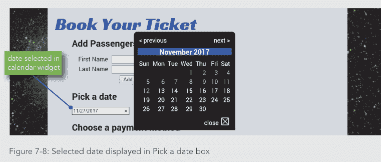

用户选择日期后，日历部件仍然保持可见，即使不再需要它。接下来，你将创建一个名为`hideCalendar()`的辅助函数，创建一个事件监听器以便在用户点击关闭按钮时运行该函数，并添加一条语句在用户点击日历部件中的日期后调用`hideCalendar()`函数。

### 创建`hideCalendar()`函数：

- 1. 在文本编辑器中返回 **orbits.js** 文档，然后在`createEventListeners()`函数上方添加以下代码：

```javascript
function hideCalendar() {
    document.getElementById("cal").style.display = "none";
}
```

此函数包含一条语句，用于将日历的`display`属性更改为`none`。

2. 在`selectDate()`函数内，就在闭合大括号`}`之前，添加以下语句：

```
hideCalendar();
```

此语句会在选择有效日期后关闭日历。

3. 向下滚动到`createEventListeners()`函数，然后在闭合大括号`}`之前，添加以下代码：

```
1 var closeButton = document.getElementById("close");
2 if (closeButton.addEventListener) {
3     closeButton.addEventListener("click", hideCalendar, false);
4 } else if (closeButton.attachEvent) {
5     closeButton.attachEvent("onclick", hideCalendar);
6 }
```

当用户点击日历上的关闭按钮时，此代码会调用`hideCalendar()`函数。

4. 将更改保存到 **orbits.js**，在浏览器中按住 Shift 键刷新或重新加载 **booktrip.htm** 以清除表单，点击 **Pick a date** 框，然后点击 **Close** 按钮。日历部件会关闭。

5. 点击 **Pick a date** 框，然后点击未来的一个日期。如图 7-9 所示，所选日期值会显示在 Pick a date 框中，并且部件会关闭。

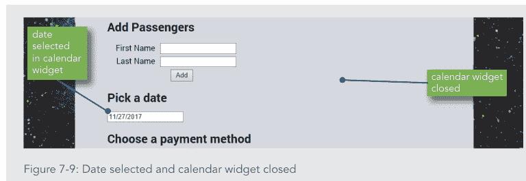

接下来，你将在代码中添加额外的辅助函数和事件监听器，以允许用户使用上一个和下一个按钮在不同月份之间导航。

## 添加用于在月份之间导航的辅助函数和事件监听器：

1. 返回你的文本编辑器中的 **orbits.js** 文档，然后在`createEventListeners()`函数上方添加以下代码：

```
function prevMo() {
    displayCalendar(-1);
}

function nextMo() {
    displayCalendar(1);
}
```

这些函数调用包含了传递给`displayCalendar()`函数的参数。值 -1 会触发函数中的代码显示上一个月，而值 1 则显示下一个月。

2. 向下滚动到`createEventListeners()`函数，然后在闭合大括号`}`之前，添加以下代码：

```
var prevLink = document.getElementById("prev");
var nextLink = document.getElementById("next");
if (prevLink.addEventListener) {
    prevLink.addEventListener("click", prevMo, false);
    nextLink.addEventListener("click", nextMo, false);
} else if (prevLink.attachEvent) {
    prevLink.attachEvent("onclick", prevMo);
    nextLink.attachEvent("onclick", nextMo);
}
```

当用户点击上一个按钮时，此代码会调用`prevMo()`函数；当用户点击下一个按钮时，会调用`nextMo()`函数。

3. 将更改保存到 **orbits.js**，在浏览器中按住 Shift 键刷新或重新加载 **booktrip.htm** 以清除表单，点击 **Pick a date** 框，然后点击 **previous** 按钮。日历部件会显示上一个月。

4. 点击 **next** 按钮，然后再次点击 **next** 按钮。日历部件会先显示当前月份，然后显示下一个月份。

## 使用`Number`类操作数字

**Number 类**包含用于操作数字的方法，以及包含表示 JavaScript 语言中一些数字限制的静态值的属性（例如 JavaScript 中可使用的最大正数）。与`Math`对象一样，你不需要创建`Number`对象就可以访问`Number`类的方法或属性。相反，你可以简单地将任何`Number`类方法或属性的名称附加到包含数值的现有变量名后面。

### 使用`Number`类方法

表 7-4 列出了`Number`类的方法。

| 方法 | 描述 |

| :--- | :--- |

| `toExponential(decimals)` | 使用 *decimals* 指定的小数位数，将数字转换为指数表示法的字符串 |

| `toFixed(decimals)` | 使用 *decimals* 指定的小数位数，将数字转换为字符串 |

| `toLocaleString()` | 将数字转换为使用本地数字格式化样式的字符串 |

| `toPrecision(decimals)` | 使用 *decimals* 指定的小数位数，将数字转换为字符串，可以是指数表示法或定点表示法 |

| `toString(base)` | 使用 *base* 指定的进制，将数字转换为字符串 |

| `valueOf()` | 返回`Number`对象的数值 |

表 7-4：Number 类方法

使用表 7-4 中列出的任何 "to" 方法的主要目的是将数字转换为具有特定小数位数的字符串值，以便显示给用户。如果你不需要向用户显示数字，则无需使用这些方法。最有用的`Number`类方法是`toFixed()`方法，你可以使用它来显示具有指定小数位数的数值。例如，你的程序中可能有一个表示美元价值的数字。然而，根据计算结果或用户输入的值，该数字可能包含超过货币值可接受的两位小数。以下代码展示了一个简单的例子，其中名为`salesTotal`的数字变量被赋值为 49.95。如果你对该变量应用 10% 的折扣，新数字等于 44.955。在显示该值之前，最后一条语句使用`toFixed()`方法将`salesTotal`变量的值转换为包含两位小数的字符串。

```
1  var salesTotal = 49.95;
2  var discount = salesTotal * 0.1;
3  salesTotal -= discount; // 新值为 44.955
4  document.getElementById("totalField").innerHTML = "$" + 
5  salesTotal.toFixed(2); // 显示 $44.96
```

另一个有用的`Number`类方法是`toLocaleString()`方法，你可以使用它将数字转换为使用本地数字格式化样式的字符串。例如，在美国数字格式化风格中，你用逗号分隔千位。以下语句演示了如何将数字 1210349 转换为字符串 $1,210,349：

```
1 var salesTotal = 1210349;
2 salesTotal = salesTotal.toLocaleString();
3 document.getElementById("totalField").innerHTML = "$" + 
4 salesTotal; // 显示 $1,210,349
```

> **注意** 现代浏览器对于使用`toLocaleString()`方法时放置数字分隔符的位置有不同的规则。在第 8 章，你将学习如何使用正则表达式来强制在不同浏览器间使用统一格式。

## 访问`Number`类属性

表 7-5 列出了`Number`类的属性。请注意，你几乎没有理由使用这些属性。然而，为了完整性，这里仍将它们列出。

| 属性 | 描述 |

| :--- | :--- |

| MAX_VALUE | JavaScript 中可使用的最大正数 |

| MIN_VALUE | JavaScript 中可使用的最小正数 |

| NaN | 值`NaN`，代表“非数字” |

| NEGATIVE_INFINITY | 负无穷大的值 |

| POSITIVE_INFINITY | 正无穷大的值 |

*表 7-5：Number 类属性*

> **注意** 就像 JavaScript 中类名首字母大写一样，另一个惯例是用全大写字母书写固定值或常量的名称。表 7-5 中全大写的四个属性代表常量。

Outer Orbits 预订页面为每个用户提供了选择：预付旅行费用，或者将价格分摊为 5 年内的每月付款。与其将这些值硬编码到页面中，你将把这些值作为变量来处理，使公司能够轻松地纳入未来的价格变动。你将使用`Number`对象的`toFixed()`和`toLocaleString()`方法来指定这些值应如何显示。

**要计算每月付款金额并格式化两个价格：**

1. 返回你的文本编辑器中的 **`orbits.js`** 文档，然后在`createEventListeners()`函数上方添加以下代码来声明`updateTotalCost()`函数：

```
function updateTotalCost() {

}
```

2. 在`updateTotalCost()`函数内部，添加以下代码：

```
var totalCost = 250000;
var monthlyCost = totalCost / 60;
var shortMonthlyCost = monthlyCost.toFixed(0);
```

此语句声明了三个变量：`totalCost`，它有一个固定值；`monthlyCost`，它是`totalCost`除以 60（付款计划的月数）；以及`shortMonthlyCost`，它使用`Number`对象的`toFixed()`方法来存储不带小数位的`monthlyCost`值。

3. 在变量声明下方，添加以下代码：

```
1   document.getElementById("singleLabel").innerHTML = 
2       "一次性支付 $" + totalCost.toLocaleString();
3   document.getElementById("multipleLabel").innerHTML = 
4       "分60期每月支付 $" + 
5           shortMonthlyCost.toLocaleString();
```

第一条语句更改第一个选项按钮的标签以包含`totalCost`值，使用`Number`对象的`toLocaleString()`方法根据用户的本地惯例显示该值。第二条语句对第二个选项按钮执行相同的操作，使用`shortMonthlyCost`值。

4. 在`selectDate()`函数内部，就在闭合大括号`}`之前，输入以下语句：

```
updateTotalCost();
```

当用户选择日期时，此语句会调用`updateTotalCost()`函数。

482 第 7 章 使用面向对象的 JavaScript

5.  保存对 **orbits.js** 的更改，在浏览器中按住 Shift 键并刷新（或强制重新加载）**booktrip.htm** 以清除表单，然后点击 **Pick a date** 框，并选择一个未来的日期。如图 7-10 所示，单选按钮的标签会更新以显示价格，价格根据本地数字格式惯例进行格式化，并且不包含小数点。该图展示了两个不同现代浏览器中的数字；请注意，其中一个浏览器在第一个值中使用了逗号分隔符（250,000），而第二个浏览器没有（250000）。此行为完全取决于浏览器。

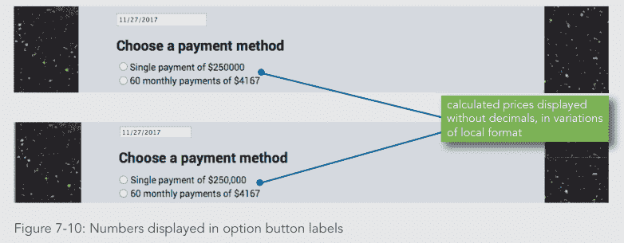

## 使用`Math`类执行数学函数

**Math 类**包含用于在程序中执行数学计算的方法和属性。

## 使用`Math`类方法

表 7-6 列出了`Math`类的方法。

| 方法 | 返回值 |

|--------|---------|

| `abs(x)` | *x* 的绝对值 |

| `acos(x)` | *x* 的反余弦值 |

| `asin(x)` | *x* 的反正弦值 |

| `atan(x)` | *x* 的反正切值 |

| `atan2(x, y)` | 点 *x*, *y* 与 x 轴之间的角度 |

| `ceil(x)` | 将 *x* 向上取整到下一个最高整数的值 |

| `cos(x)` | *x* 的余弦值 |

| `exp(x)` | *x* 的指数值 |

| `floor(x)` | 将 *x* 向下取整到下一个最低整数的值 |

| `log(x)` | *x* 的自然对数 |

| `max(x, y)` | *x* 和 *y* 中的较大值 |

| `min(x, y)` | *x* 和 *y* 中的较小值 |

| `pow(x, y)` | *x* 的 *y* 次幂的值 |

| `random()` | 一个随机数 |

| `round(x)` | 将 *x* 四舍五入到最接近的整数的值 |

| `sin(x)` | *x* 的正弦值 |

| `sqrt(x)` | *x* 的平方根 |

| `tan(x)` | *x* 的正切值 |

表 7-6：`Math`类方法

与`Array`、`Date`和`Number`类不同，`Math`类不包含构造函数。这意味着你不能使用如下语句实例化`Math`对象。

**无效代码：**

```
var mathCalc = new Math();
```

相反，你应该在代码中直接使用`Math`对象及其方法或属性之一。例如，`sqrt()`方法返回一个数字的平方根。以下代码使用`sqrt()`方法确定 144 的平方根：

```
var curNumber = 144;
var squareRoot = Math.sqrt(curNumber); // returns 12
```

### 访问`Math`类属性

表 7-7 列出了`Math`类的属性。

| 属性 | 描述 |

|----------|-------------|

| E | 欧拉常数 e，它是自然对数的底；该值约为 2.7182818284590452354 |

| LN10 | 10 的自然对数，约为 2.302585092994046 |

| LN2 | 2 的自然对数，约为 0.6931471805599453 |

| LOG10E | e 的以 10 为底的对数，约为 0.4342944819032518 |

| LOG2E | e 的以 2 为底的对数，约为 1.4426950408889634 |

| PI | 一个常量，表示圆的周长与其直径的比率，约为 3.1415926535897932 |

| SQRT1_2 | 1/2 的平方根，约为 0.7071067811865476 |

| SQRT2 | 2 的平方根，约为 1.4142135623730951 |

表 7-7：Math 类属性

作为如何使用 Math 对象属性的一个示例，以下代码展示了如何使用 PI 属性根据半径计算圆的面积。代码还使用了`pow()`方法来计算半径的平方，并使用`round()`方法将返回的值四舍五入到最接近的整数。

```
var radius = 25;
var area = Math.PI * Math.pow(radius, 2);
var roundedArea = Math.round(area); // returns 1963
```

Outer Orbits 预订页面的设计包括一个倒计时器，类似于传统上用于太空发射的倒计时器，它计算距离选定航班起飞还有多少天、小时、分钟和秒。你将把当前日期和时间分配给一个变量，把选定的发射日期和时间分配给另一个变量。然后，你将使用`Math.floor()`方法来确定这两个时间之间的整天数、小时数、分钟数和秒数。

### 计算距离发射还有多少天、小时、分钟和秒：

- 1. 返回到文本编辑器中的 orbits.js 文档，然后在`createEventListeners()`函数上方，添加以下代码以创建`updateCountdown()`函数并声明其变量：

```
function updateCountdown() {
    var dateToday = new Date();
    var dateFrom = Date.UTC(dateToday.getFullYear(),
        dateToday.getMonth(), dateToday.getDate(),
        dateToday.getHours(), dateToday.getMinutes(),
        dateToday.getSeconds());
    var dateTo = Date.UTC(dateObject.getFullYear(),
        dateObject.getMonth(), dateObject.getDate(),
        19, 0, 0); // all launches at 8:00pm UTC
}
```

第一条语句将`dateToday`的值设置为当前日期和时间。第二条语句创建一个名为`dateFrom`的变量，包含当前的年、月、日、时、分、秒。第三条语句创建一个名为`dateTo`的变量，其值包含用户选择的年、月、日，以及 19 时、0 分、0 秒，以反映所有发射都在 UTC 时间晚上 8:00 整进行。

- 2. 在`updateCountdown()`函数内部，添加以下代码：

```
// days
var daysUntil = Math.floor((dateTo - dateFrom) / 86400000);
document.getElementById("countdown").innerHTML = daysUntil;
```

`dateTo`和`dateFrom`的值都以毫秒为单位表示。第一条语句计算这两个时间值之间的毫秒差，然后除以 86400000（一天中的毫秒数）以计算两个日期之间的天数。该语句使用`Math.floor()`方法将该值转换为仅包含差值的整数部分。第二条语句将`daysUntil`的值放入页面上的倒计时元素中。

- 3. 在你在上一步输入的语句下方，添加以下代码：

```
// hours
var fractionalDay = (dateTo - dateFrom) % 86400000;
var hoursUntil = Math.floor(fractionalDay / 3600000);
if (hoursUntil < 10) {
    hoursUntil = "0" + hoursUntil;
}
document.getElementById("countdown").innerHTML +=
    ":" + hoursUntil;
```

`fractionalDay`变量使用取模 (%) 运算符来查找计算天数后的余数。为了计算`hoursUntil`变量，将`fractionalDay`变量除以 3600000（一小时中的微秒数），并且`Math.floor()`方法再次提供结果的整数部分。最后的`if`语句检查分钟数是否为个位数，如果是，则在数字开头附加一个 0；这是为了表示数字时钟上通常看到的格式。最后一条语句将`hoursUntil`的值附加到倒计时元素中现有的天数值后面，并在两者之间加上冒号。

- **4.** 在你在上一步输入的语句下方，添加以下代码：

```
// minutes
var fractionalHour = fractionalDay % 3600000;
var minutesUntil = Math.floor(fractionalHour / 60000);
if (minutesUntil < 10) {
    minutesUntil = "0" + minutesUntil;
}
document.getElementById("countdown").innerHTML +=
    ":" + minutesUntil;
// seconds
var fractionalMinute = fractionalHour % 60000;
var secondsUntil = Math.floor(fractionalMinute / 1000);
if (secondsUntil < 10) {
    secondsUntil = "0" + secondsUntil;
}
document.getElementById("countdown").innerHTML +=
    ":" + secondsUntil;
```

这段代码使用了与计算小时相同的语句组，除以 60000（一分钟中的微秒数）来计算剩余的分钟差，除以 1000（一秒钟中的微秒数）来计算剩余的秒数差。你的`updateCountdown()`函数应与以下内容一致：

```
function updateCountdown()  {
    var dateToday = new Date();
    var dateFrom = Date.UTC(dateToday.getFullYear(),
            dateToday.getMonth(), dateToday.getDate(),
            dateToday.getHours(), dateToday.getMinutes(),
            dateToday.getSeconds());
    var dateTo = Date.UTC(dateObject.getFullYear(),
            dateObject.getMonth(), dateObject.getDate(),
            19, 0, 0); // all launches at 8:00pm UTC
    // days
```

 ```
11 var daysUntil = Math.floor((dateTo - dateFrom) / 86400000);
12 document.getElementById("countdown").innerHTML = daysUntil;
13 // hours
14 var fractionalDay = (dateTo - dateFrom) % 86400000,
15 hoursUntil = Math.floor(fractionalDay / 3600000);
16 if (hoursUntil < 10) {
17 hoursUntil = "0" + hoursUntil;
18 }
19 document.getElementById("countdown").innerHTML +=
20 ":" + hoursUntil;
21 // minutes
22 var fractionalHour = fractionalDay % 3600000,
23 minutesUntil = Math.floor(fractionalHour / 60000);
24 if (minutesUntil < 10) {
25 minutesUntil = "0" + minutesUntil;
26 }
27 document.getElementById("countdown").innerHTML +=
28 ":" + minutesUntil;
29 // seconds
30 var fractionalMinute = fractionalHour % 60000,
31 secondsUntil = Math.floor(fractionalMinute / 1000);
32 if (secondsUntil < 10) {
33 secondsUntil = "0" + secondsUntil;
34 }
35 document.getElementById("countdown").innerHTML +=
36 ":" + secondsUntil;
37 }
```

5. 在文档顶部，全局变量部分，添加以下语句：

var countdown;

6. 在 selectDate() 函数中，紧接在结束大括号 `}` 之前，输入以下语句：

countdown = setInterval(updateCountdown, 1000);

document.getElementById("countdownSection").style.display =

"block";

488 第7章 使用面向对象的 JavaScript

第一条语句使用`Window`对象的`setInterval()`方法，在用户选择一个有效日期时调用`updateCountdown()`函数，并且每隔一秒（每1000毫秒）重复调用该函数。这模拟了数字计时器的行为。`setInterval()`方法被赋值为全局变量`countdown`的值，以便稍后取消。第二条语句使包含计数器的网页元素可见。

+   7. 在`updateCountdown()`函数中，紧接在`// days`注释之前，输入以下代码：

```
1  if ((dateTo - dateFrom) < 1000) { // time will be less than 0
2      when setInterval runs next
3      clearInterval(countdown);
4      document.getElementById("countdownSection").style.
5          display = "none";
6  }
```

这条`if`语句检查剩余时间在下次更新时是否会小于0。如果是，则使用`clearInterval()`方法清除由`countdown`变量引用的定时器。

+   8. 保存你对 **orbits.js** 的更改，在浏览器中 shift-刷新 或 shift-重新加载 **booktrip.htm** 以清除表单，点击 **Pick a date** 框，然后点击一个未来的日期。如图7-11所示，倒计时器显示在页面右侧，时间值每秒变化一次。

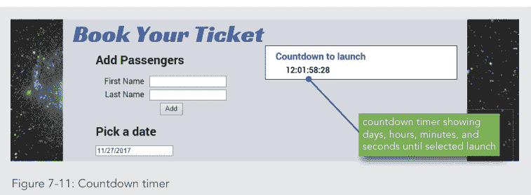

## 简短测验 2

-   1. 什么代码创建一个`dateToday`变量并将当前日期和时间赋值给它？

-   2. 你使用`Number`类的哪个方法将数字转换为使用本地数字格式化样式的字符串？

-   3. 对数值应用`Math`类的`floor()`方法的结果是什么？

## 定义自定义 JavaScript 对象

JavaScript 不是真正的面向对象编程语言。你可以将程序中的对象基于内置的 JavaScript 类，如`Array`和`Date`对象。然而，你无法在 JavaScript 中创建自己的类。因此，JavaScript 被认为是一种基于对象的编程语言，而不是面向对象的编程语言。

尽管如此，JavaScript 仍然允许你定义自己的自定义对象。与基于类的对象不同，JavaScript 中的自定义对象不是封装的，这意味着其他使用你自定义对象的程序员可以看到"黑盒"内部。即使自定义 JavaScript 对象无法被封装，你可能会发现它们很有用，特别是当你需要在脚本中多次复制相同功能时。例如，你可能有一个网站允许客户在线订购你销售的商品。对于每个订单，你可能想要创建一个新对象，使用属性来存储信息，如客户姓名、订单日期、付款方式、发货日期等。该对象还可能包含计算销售税和销售总额的方法。虽然你可以使用标准函数和变量来创建相同的功能，但将每个订单视为一个自包含的对象会使你作为程序员的工作稍微轻松一些。

### 声明基本自定义对象

虽然 JavaScript 不是真正的面向对象编程语言，但你可以使用`Object`对象创建基本对象和属性。你可以使用`Object()`构造函数声明自定义对象，如下所示：

```
var objectName = new Object();
```

然而，正如本章前面所述，使用对象字面量声明对象更容易。你可以通过将一对空大括号赋值给变量名来创建空对象，如下所示：

```
var objectName = {};
```

> **注意**

赋值语句中使用的符号决定了你创建的空对象的类型。将变量名赋值为空括号（ `[]` ）会创建一个空数组，而将变量名赋值为空大括号（ `{}` ）会创建一个空对象。

你可以使用点语法向对象添加属性，即指定对象名称，后跟一个点和属性名称，然后是等号和值。例如，你可以使用以下对象字面量创建一个名为`InventoryList`的空对象：

```
var InventoryList = {};
```

然后，你可以使用以下语句在`InventoryList`对象中创建一个`inventoryDate`属性并为其赋值：

```
InventoryList.inventoryDate = new Date(2017, 11, 31);
```

然而，使用字面量创建对象通常更受青睐的一个原因是，你可以在一个语句中使用字面量声明对象及其所有属性。要在对象字面量中声明属性，你在大括号内指定属性名称，后跟冒号及其值。多个属性-值对之间用逗号分隔。以下代码创建`InventoryList`对象并在一个语句中添加`inventoryDate`属性：

```
var InventoryList = {
    inventoryDate: new Date(2017, 11, 31)
};
```

请注意，即使这条语句占据多行，它仍然是一条语句，因此必须以分号结尾。另外请注意，最后一个属性名称——在这种情况下，也是唯一的属性名称——后面没有逗号，而且因为属性声明不是一条语句，所以它也不以分号结尾。

以下代码创建了一个名为`PerformanceTickets`的新对象，并为其分配了四个属性：`customerName`、`performanceName`、`ticketQuantity`和`performanceDate`。你可以像访问其他类型对象的属性一样访问每个属性所赋的值，如为 innerHTML 值赋值的语句所示。请注意，`performanceDate`属性被创建为一个`Date`对象，用于存储演出的日期和时间。图7-12显示了输出结果。

```
1   var PerformanceTickets = {
2       customerName: "Claudia Salomon",
3       performanceName: "Swan Lake",
4       ticketQuantity: 2,
5       performanceDate: new Date(2017, 6, 18, 20)
6   };
7   document.getElementById("custName").innerHTML = 
8       PerformanceTickets.customerName;
9   document.getElementById("showName").innerHTML = 
10      PerformanceTickets.performanceName;
11  document.getElementById("tixNum").innerHTML = 
12      PerformanceTickets.ticketQuantity;
13  document.getElementById("showDate").innerHTML = 
14      PerformanceTickets.performanceDate.toLocaleString();
```


你需要为 Outer Orbits 预订页面添加的最后一项功能是显示用户选择的摘要部分。这包括列出每位乘客的姓名、选择的出发日期和付款计划。你将创建一个名为`ticket`的对象，其中将包含所有这些信息作为一组属性。

### 创建包含乘客和发射数据的自定义 ticket 对象：

-   1. 返回文本编辑器中的`orbits.js`文档，然后在文档顶部添加以下全局变量声明：

```
1   var ticket = {
2       date: "",
3       fName: "",
```

var dateObject = new Date(),

    ticket = {

        date: "",

        passengers: {

            fName: "",

            lName: ""

        }

    };

这段代码创建了一个名为`ticket`的新变量。包裹变量值的花括号（{ }）表明它是一个对象。`ticket`对象定义包含三个属性：`date`、`fName`和`lName`。每个属性都被赋予一个空字符串（""）作为其值。

> **注意** 前两个属性值后面应该跟逗号，而不是分号。最后一个属性值后面不应该跟任何标点符号。对象值 *必须* 以一个闭合的 `}` 结尾，并且整个 `var` 语句必须以分号结尾。

**2.** 在`createEventListeners()`函数上方，添加以下代码以创建`registerName()`函数并声明变量：

```
function registerName() {
    var passengerList = document.getElementById("passengers");
    var passengerName = document.createElement("li");
}
```

`var`语句首先使用`passengerList`变量创建一个对`passengers`元素的引用，然后创建一个新的`li`元素作为一个未连接的文档节点，并将其赋值给`passengerName`。

**3.** 在上一步代码下方，向函数添加以下语句：

```
ticket.fName = document.getElementById("fname").value;
ticket.lName = document.getElementById("lname").value;
```

第一条语句将表单中`fname`字段的值赋给`ticket`对象的`fName`属性。第二条语句对表单中的`lname`字段和`ticket`对象的`lName`属性执行相同操作。

**4.** 在上一步代码下方，向函数添加以下语句：

```
// 将输入的姓名添加到票据部分的乘客列表
passengerName.innerHTML = ticket.fName + " " + ticket.lName;

passengerList.appendChild(passengerName);
```

第一条语句将`ticket`对象的`fName`和`lName`属性的值作为`passengerName`元素的内容，两个值之间用空格分隔。第二条语句将`passengerName`元素追加到`passengerList`元素中。

**5.** 在上一步代码下方，向函数添加以下语句：

```
// 清空表单中的名和姓
document.getElementById("fname").value = "";
document.getElementById("lname").value = "";
// 显示票据和乘客部分
document.getElementById("ticket").style.display = "block";
document.getElementById("passengersSection").style.display = 
    "block";
// 将焦点返回到“名”字段，以便于输入
// 另一个乘客的姓名
document.getElementById("fname").focus();
```

**6.** 在`createEventListeners()`函数中，在闭合的`}`之前，添加以下代码：

```
var nameButton = document.getElementById("addName");
if (nameButton.addEventListener) {
    nameButton.addEventListener("click", registerName, false);
} else if (nameButton.attachEvent) {
    nameButton.attachEvent("onclick", registerName);
}
```

此代码注册了一个事件监听器，以便在点击“添加”按钮时调用`registerName()`函数。

**7.** 在`selectDate()`函数中，在闭合的`}`之前，添加以下代码：

```
ticket.date = dateObject.toLocaleDateString();
document.getElementById("selectedDate").innerHTML = 
    ticket.date;
document.getElementById("dateSection").style.display = 
    "block";
```

第一条语句将`ticket`对象的`date`属性值设置为`dateObject`的日期值，并采用本地化格式。第二条语句然后将`ticket`对象的`date`属性值作为`selectedDate`元素的文本内容。第三条语句使`id`值为`dateSection`的元素在页面上可见。

**8.** 将您的更改保存到 **orbits.js**，在浏览器中通过 Shift 刷新或 Shift 重新加载 **booktrip.htm** 以清空表单，在“名”框中输入您的名字，在“姓”框中输入您的姓氏，点击 **添加** 按钮，点击 **选择日期** 框，然后选择一个日期。如图 7-13 所示，您的姓名和所选日期将显示在页面右侧的“票据详情”标题下方。

**9.** 打开您的浏览器控制台，并在必要时导航到命令行。

**10.** 输入 **ticket**，然后按 **Enter**。控制台返回“Object”（或“object object”），表示您输入的变量名的值是一个对象。

**11.** 如有必要，单击 **Object** 以查看对象的属性名称和值。图 7-14 显示了主要浏览器中的结果。

## 声明子对象

除了字符串或数值，对象属性还支持其他类型的值。属性的值可以是另一个对象，这被称为`子对象`。例如，以下代码创建了一个名为`order`的对象，其中包含一个名为`address`的子对象：

```
var order = {
    orderNumber: "F5987",
    address: {
        street: "1 Main St",
        city: "Farmington",
        state: "NY",
        zip: "14425"
    }
};
```

主对象`order`有两个属性：`orderNumber`和`address`。`address`属性本身就是一个子对象，它有自己的四个属性：`street`、`city`、`state`和`zip`。

接下来，您将编辑`ticket`对象的定义，以创建一个名为`passengers`的子对象，其中包含`fName`和`lName`属性。

## 创建 passengers 子对象：

**1.** 在文本编辑器中返回到`orbits.js`文档。

**2.** 在文档顶部的全局变量声明中，在`date`属性后添加新行，然后输入`passengers: {`。

**3.** 增加`fName`和`lName`属性定义的缩进级别。

**4.** 在`lName`属性后添加新行，然后输入`}`。您更新后的全局变量声明应如下所示：

**5.** 向下滚动到`registerName()`函数。在第一个注释下方的语句中，将`ticket.fName`更改为`ticket.passengers.fName`，然后在接下来的语句中，将`ticket.lName`更改为`ticket.passengers.lName`。

```
var dateObject = new Date(),
    ticket = {
        date: "",
        passengers: {
            fName: "",
            lName: ""
        }
    };
```

`ticket`对象现在有两个属性：`date`和`passengers`。`passengers`属性是`ticket`对象的一个子对象，而`passengers`属性本身又有两个属性：`fName`和`lName`。

**6.** 在第二个注释下方的语句中，将`ticket.fName`更改为 **ticket.passengers.fName**，然后将`ticket.lName`更改为 **ticket.passengers.lName**。您更新后的`registerName()`函数的开头应如下所示：

```
function registerName() {
    var passengerList = document.getElementById("passengers");
    var passengerName = document.createElement("li");
    // 将名和姓作为新属性添加到票对象
    ticket.passengers.fName =
        document.getElementById("fname").value;
    ticket.passengers.lName =
        document.getElementById("lname").value;
    // 将输入的姓名添加到票据部分的乘客列表
    passengerName.innerHTML = ticket.passengers.fName +
        " " + ticket.passengers.lName;
    passengerList.appendChild(passengerName);
```

**7.** 将您的更改保存到 **orbits.js**，在浏览器中通过 Shift 刷新或 Shift 重新加载 **booktrip.htm** 以清空表单，在“名”框中输入您的名字，在“姓”框中输入您的姓氏，点击 **添加** 按钮，点击 **选择日期** 框，然后选择一个日期。您的姓名和所选日期将再次显示在页面右侧的“票据详情”标题下方。

**8.** 在命令行中，输入 **ticket**，然后按 **Enter**。

**9.** 单击 **Object** 一词或单击“Object”旁边的 **三角形** 以查看对象属性，然后单击“passengers”旁边的 **三角形** 以查看子对象的属性。图 7-15 显示了主要浏览器中的结果。

Internet Explorer

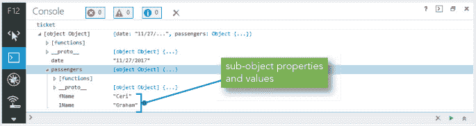

Firefox

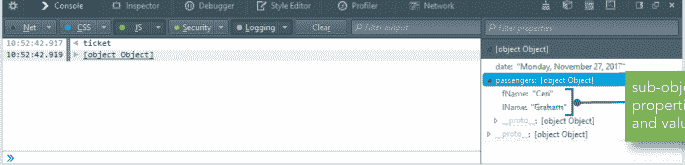

Chrome

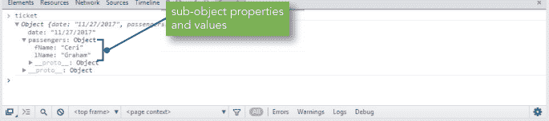

图 7-15：控制台中的子对象

来源：© Microsoft Corporation。© Mozilla Firefox。© Google Chrome。

## 为现有对象添加属性

虽然可以在对象定义中声明属性，但这并非必需。作为替代方案，你可以通过简单地声明其值来添加新属性。这类似于创建新变量的过程；然而，与变量声明不同，你不需要使用`var`或任何其他关键字来创建新的对象属性。

例如，要向`order`对象添加`shippingSpeed`属性，你可以使用以下语句：

```
order.shippingSpeed = "overnight";
```

你将从 orbits.js 文档中的`ticket`对象中移除`date`属性声明，然后验证该属性是否仍由现有代码创建。

自定义 JavaScript 对象的定义

## 要移除 date 属性声明：

1.  返回你的文本编辑器中的 **orbits.js** 文档。

2.  在文档顶部，`ticket`对象的全局变量声明内，删除以下行：

`date: "",`

你更新后的变量声明应与以下内容匹配：

```
1 var ticket = {
2       passengers: {
3            fName: "",
4            lName: ""
4       }
5    };
```

3.  向下滚动到`selectDate()`函数，并定位以下语句：

```
ticket.date = dateObject.toLocaleDateString();
```

尽管`ticket`对象声明不再声明`date`属性，但当`selectDate()`函数运行时，上述语句会将`date`属性添加到对象中。

4.  将你的更改保存到 **orbits.js**，在你的浏览器中对 **booktrip.htm** 进行 shift-refresh 或 shift-reload 以清除表单，在“名字”框中输入你的名字，在“姓氏”框中输入你的姓氏，点击 **Add** 按钮，点击 **Pick a date** 框，然后选择一个日期。你的名字和所选日期将再次显示在页面右侧的“票据详情”标题下。

5.  在命令行中，输入`ticket`，然后按 **Enter** 键。

6.  点击单词 **Object** 或点击单词“Object”旁边的三角形以查看对象属性，然后点击单词“passengers”旁边的三角形以查看子对象的属性。ticket 对象包含由`selectDate()`函数添加的`date`属性，对象属性仍然与前面图 7-15 中所示的匹配。

## 将对象属性引用为关联数组

在标准数组中，你可以通过其索引号引用任何值，索引号从第一个数组元素的 0 开始，每增加一个元素就递增 1。例如，对于数组

```
var stopLightColors = ["red","yellow","green"];
```

你可以使用代码

```
stopLightColors[1];
```

来引用第二个元素“yellow”。

JavaScript 允许你使用关联数组语法引用对象属性。关联数组是一种数组，其元素使用字母数字键而不是索引号来引用。对于对象，使用此语法时，属性名称代替了索引号。例如，如果你改为将交通灯颜色存储在一个对象中，它可能如下所示：

```
var stopLightColors = {
    stop: "red",
    caution: "yellow",
    go: "green"
};
```

你已经看到如何使用点语法通过属性名称引用对象属性值。你可以使用其属性名称引用`caution`属性的值，如下所示：

```
stopLightColors.caution
```

使用关联数组语法，你改为将属性名称放在方括号内并用引号括起来，如下所示：

```
stopLightColors["caution"]
```

点语法和关联数组语法都返回被引用属性的值。要简单地引用属性值，几乎总是使用点语法更容易。然而，当对象包含多个具有类似名称且也包含数字的属性时，关联数组语法可能非常强大。例如，一个包含客户订单中项目的对象可能结构如下：

```
var order = {
    item1: "KJ2435J",
    price1: 23.95,
    item2: "AW23454",
    price2: 44.99,
    item3: "2346J3B",
    price3: 9.95
};
```

在创建订单摘要时，你可以使用如下的`for`循环，而不是为每个属性值使用单独的语句：

```
for (var i = 1; i < 4; i++) {
    document.getElementById("itemList").innerHTML +=
        "<p class='item'>" + order["item" + i] + "</p>";
    document.getElementById("itemList").innerHTML +=
        "<p class='price'>" + order["price" + i] + "</p>";
}
```

关联数组语法还使你能够编写通用代码来添加包含数字的新对象属性。例如，如果拥有上述订单的客户决定向她的购物车添加额外的项目，你的代码可以使用以下代码轻松地使用附加属性扩展订单对象：

```
totalItems += 1; // 增加订单中的项目计数
currentItem = document.getElementById("itemName").innerHTML;
currentPrice = document.getElementById("itemPrice").innerHTML;
newItemPropertyName = "item" + totalItems; // "item4"
newPricePropertyName = "price" + totalItems; // "price4"
order.newItemPropertyName = currentItem;
// order.item4 = (名称)
order.newPricePropertyName = currentPrice;
// order.price4 = (价格)
```

因为客户可以订购的项目数量应该没有限制，此代码使你的对象能够扩展以包含客户想要购买的任意数量项目的详细信息。

Outer Orbits 希望用户能够将任意数量的人添加到单个票据中。为此，你将从`ticket`对象声明中移除`fName`和`lName`属性的声明，并添加代码，该代码使用关联数组语法，在每次用户向票据添加乘客时按需创建这些属性的带编号版本。

**要使用关联数组语法向`ticket`对象添加带编号的属性：**

1.  返回你的文本编辑器中的 **orbits.js** 文档。

2.  在文档顶部的全局变量声明中，移除`fName`和`lName`属性的声明。

3.  在`passengers`属性声明之前，添加一个值为 0 的`passengersOnTicket`属性声明，如下所示：

```
1  var dateObject = new Date();
2  var ticket = {
3      passengersOnTicket: 0,
4      passengers: {}
4  };
```

`ticket`对象现在只有两个声明的属性：`passengersOnTicket`（将用作计数器变量）和`passengers`（一个空的子对象）。

4.  向下滚动到`registerName()`函数，然后添加`newFnameProp`和`newLnameProp`变量的声明而不声明值，如下所示：

```
1  var passengerList = document.getElementById("passengers");
2  var passengerName = document.createElement("li");
3  var newFnameProp;
4  var newLnameProp;
```

5.  在最后一个`var`语句之后，添加以下三条语句：

```
ticket.passengersOnTicket += 1;
newFnameProp = "fname" + ticket.passengersOnTicket;
newLnameProp = "lname" + ticket.passengersOnTicket;
```

因为`registerName()`函数在每次用户添加乘客时运行，所以第一条语句将`passengersOnTicket`计数器属性递增 1。`newFnameProp`构造一个新属性的名称，该属性将存储新乘客的名字，将字符串“fname”与`passengersOnTicket`属性的当前值连接起来。对于第一个乘客，这将创建一个值为`fname1`的属性值。第三条语句对乘客的姓氏执行相同的操作，为第一个乘客创建一个值为`lname1`的属性值。

6.  在第一个注释之后的语句中，将`ticket.passengers.fName`更改为 **`ticket.passengers[newFnameProp]`**。在随后的语句中，将`ticket.passengers.lName`更改为 **`ticket.passengers[newLnameProp]`**，然后

在第二个注释之后的语句中，重复上述两处更改。你更新后的`registerName()`函数的开头应与以下内容一致：

```
function registerName() {
    var passengerList = document.getElementById("passengers");
    var passengerName = document.createElement("li");
    var newFnameProp;
    var newLnameProp;
    ticket.passengersOnTicket += 1;
    newFnameProp = "fname" + ticket.passengersOnTicket;
    newLnameProp = "lname" + ticket.passengersOnTicket;
    // add first+last names to ticket object as new properties
    ticket.passengers[newFnameProp] =
        document.getElementById("fname").value;
    ticket.passengers[newLnameProp] =
        document.getElementById("lname").value;
    // add entered name to passenger list in ticket section
    passengerName.innerHTML =
        ticket.passengers[newFnameProp] + " " +
        ticket.passengers[newLnameProp];
    passengerList.appendChild(passengerName);
```

- 7. 将更改保存到 **orbits.js**，在浏览器中按住 Shift 键刷新或按住 Shift 键重新加载 **booktrip.htm** 以清除表单，在名字输入框中输入你的名字，在姓氏输入框中输入你的姓氏，点击 **Add** 按钮，点击 **Pick a date** 输入框，然后选择一个日期。你的姓名和所选日期会再次显示在页面右侧的"Ticket Details"标题下方。

- 8. 在命令行中，输入`ticket`，然后按回车键。

- 9. 点击单词 **Object** 或点击"Object"旁边的**三角形**以查看对象属性，然后点击"passengers"旁边的**三角形**以查看子对象的属性。`passengers`子对象现在包含了由`selectDate()`函数添加的`fname1`和`lname1`属性。图 7-16 显示了 Internet Explorer 中的对象结构。

第 7 章 使用面向对象的 JavaScript

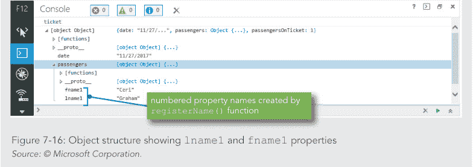

**10.** 在名字输入框中输入另一个名字，在姓氏输入框中输入另一个姓氏，然后点击 **Add** 按钮。第二个名字被添加到页面右侧第一个名字的下方。

**11.** 在命令行中，输入`ticket`，按 **Enter** 键，然后展开`ticket`对象和`passengers`子对象。如图 7-17 所示，`passengers`子对象现在包含了你添加的两个名字，分别存储在`fname1`、`fname2`、`lname1`和`lname2`属性中。


## 创建方法

除了属性之外，JavaScript 中的对象还可以拥有方法。自定义对象的方法就是在对象内部被赋予名称的一个函数。

向对象添加方法有两种方式：在对象中提供方法的代码，或者引用外部函数。

你可以使用匿名函数作为方法名的值。回想一下，匿名函数是在函数语句中没有声明名称的函数。通常，这意味着你无法在代码中匿名函数出现的位置以外的任何地方使用它。但是，通过将方法名赋给匿名函数，你就可以使用该方法名来调用该函数。例如，以下代码创建了一个带有名为`generateInvoice()`方法的`order`对象：

```
1  var order = {
2      items: {},
3      generateInvoice: function() {
4          // function statements
5      }
6  };
```

尽管`generateInvoice()`方法是使用匿名函数创建的，但你可以使用以下语句调用`generateInvoice()`方法：

`order.generateInvoice;`

声明方法的另一种方式是指定一个方法名，并使用现有函数的名称作为其值，如以下代码所示：

```
1  function processOrder() {
2      // function statements
3  }
4  var order = {
5      items: {},
6      generateInvoice: processOrder
7  };
```

代码首先定义了一个名为`processOrder`的函数。然后`order`的对象定义声明了一个名为`generateInvoice()`的方法，该方法以函数`processOrder`作为其值。注意，通过引用现有函数来声明方法的语法与声明属性的语法相同。JavaScript 处理器能够正确识别方法，因为它们的值是函数。

另外请注意，`processOrder()`函数的引用末尾没有使用括号。使用下面所示的代码来声明方法将是无效的，因为它包含了括号。

**无效代码：**

`generateInvoice: processOrder()`

506 第 7 章 使用面向对象的 JavaScript

因为`updateTotalCost()`函数操作的是`ticket`对象的`passengersOnTicket`属性，所以你将在`ticket`对象上添加一个引用`updateTotalCost()`函数的方法。然后你将更改函数调用以使用对象方法。

## 将`updateTotalCost()`函数添加为`ticket`对象的方法：

- 1. 返回文本编辑器中的 **orbits.js** 文档。

- 2. 在文档顶部的全局变量声明中，在声明`passengers`属性的行末尾添加一个**逗号**，然后在其下方添加代码`calcCost: updateTotalCost`，如下所示：

```
var dateObject = new Date();
var ticket = {
    passengersOnTicket: 0,
    passengers: {},
    calcCost: updateTotalCost
};
```

- 3. 向下滚动到`updateTotalCost()`函数，然后将`totalCost`变量的值更改为`this.passengersOnTicket * 250000`，如下所示：

```
function updateTotalCost() {
    var totalCost = this.passengersOnTicket * 250000;
    var monthlyCost = totalCost / 60;
    var shortMonthlyCost = monthlyCost.toFixed(0);
```

**this 关键字**引用的是调用该函数所在语句的函数的对象。因为你的代码将使用`ticket`对象的`calcCost()`方法来调用此函数，所以你更改的语句中的`this`关键字将指向`ticket`对象，使该值等同于`ticket.passengersOnTicket * 250000`。

- 4. 向上滚动到`registerName()`函数，然后在结束的`}`之前的新行上，输入语句 **`ticket.calcCost();`**。此语句调用`ticket`对象的`calcCost()`方法。

- 5. 向上滚动到`selectDate()`函数，然后在该函数的最后一行中，删除语句`updateTotalCost()`。你已经将每次向票据添加名字时更新费用的代码整合到了其中，因此在选择日期时不再需要调用该函数。

6. 将更改保存到 **orbits.js**，在浏览器中按住 Shift 键刷新或按住 Shift 键重新加载 **booktrip.htm** 以清除表单，在姓名输入框中输入你的名字和姓氏，然后点击 **Add**。"Choose a payment method"下方的标签会更新为一位乘客的费率。

7. 在姓名输入框中输入另一个名字和姓氏，然后点击 **Add**。如图 7-18 所示，"Choose a payment method"下方的标签再次更新，现在显示的是两位乘客的费率。


> ### 编程概念：使用 *this* 关键字

在程序中使用`this`关键字来计算总费用，相比直接引用对象名称并没有很大的优势。然而，它可以在包含多个对象的程序中发挥巨大作用。例如，如果 Outer Orbits 为预订页面添加了允许用户查看他们已购买的多张票据详情的功能，`this`关键字将使`updateTotalCost()`函数能够为调用它的任何对象计算正确的价格，而不是仅引用一个硬编码的单一对象。以下代码说明了这种场景，有两个名为`ticket1`和`ticket2`的对象，它们的`passengersOnTicket`值不同，并且都有一个调用...的`calcCost()`方法。

`updateTotalCost()`函数。底部的两条语句显示了调用每个对象的`calcCost()`方法的结果。

```
1  var ticket1 = {
2      passengersOnTicket: 1,
3      calcCost: updateTotalCost
4  };
5  var ticket2 = {
6      passengersOnTicket: 3,
7      calcCost: updateTotalCost
8  };
9  ticket1.calcCost(); // 250000
10  ticket2.calcCost(); // 750000
```

每个对象的方法会计算出不同的成本，即使它们都引用了相同的通用函数：`updateTotalCost()`。

## 枚举自定义对象属性

某些自定义对象可以包含数十个属性。例如，一个脚本可能会创建新的自定义对象属性，用于存储客户想要购买的每件商品的销售价格。假设你想对任何价格超过100美元的商品的单个销售价格打九折。由于无法预先确定客户会购买哪些商品，因此你无法知道为每个客户添加了哪些属性。要在自定义对象中的所有属性上执行相同的语句或命令块，可以使用 **for/in 语句**，这是一种类似于`for`语句的循环语句。`for/in`语句的语法如下：

```
for (variable in object) {
    statement(s);
}
```

`for/in`语句中的变量名包含单个对象属性。构造函数中的对象名称代表程序中已实例化的对象的名称。与其他循环语句不同，`for/in`语句不需要计数器或任何其他类型的代码来控制循环的运行方式。相反，`for/in`语句会自动将对象中的每个属性分配给变量名，对该属性执行必要的语句，然后移动到下一个属性并重新开始。`for/in`语句在到达对象中的最后一个属性后自动结束。

`for/in`语句的好处之一是它会枚举或为对象中的每个属性分配索引。这类似于数组中元素的索引方式。你可以使用枚举的对象属性来访问对象属性中包含的值。`for/in`语句的一个典型用法是验证对象中的属性。例如，以下代码检查是否有任何属性的值为空字符串，如果是，则调用`generateErrorMessage()`方法。`if`语句将`prop`变量作为`order`对象的索引：

```
1 var item = {
2     itemNumber: "KJ2435J",
3     itemPrice: 23.95,
4     itemInStock: true,
5     itemShipDate: new Date(2017, 6, 18),
6 };
7 for (prop in order) {
8     if (order[prop] === "") {
9         order.generateErrorMessage();
10    }
11 }
```

在前面的代码中，变量名`prop`保存了`order`对象中每个属性的名称。前面代码中的`for/in`语句的每次迭代都会检查一个属性的值。代码将`order`对象传递给`if`语句，同时传递括在括号中的`prop`变量（`order[prop]`）。

有时程序错误是由于使用了错误的对象属性或为对象属性分配了错误的值造成的。你可以将`for/in`循环与`console.log()`语句一起使用，以确定值是否被分配给了对象中的正确属性。当你拥有一个具有许多属性的对象，并且无法追踪错误值分配给属性的原因时，这种技术非常有用。

## 删除属性

你之前已经看到如何通过使用语句声明并赋值来向自定义对象添加属性，如下列语句所示：

```
ticket.date = dateObject.toLocaleDateString();
```

你同样可以使用语句来删除自定义对象的属性。为此，你可以使用`delete`运算符，语法为`delete object.property`。例如，以下语句删除了`order`对象的`itemInStock`属性：

```
delete order.itemInStock;
```

## 定义构造函数

定义自己的自定义对象的另一种方式是使用 **构造函数**，这是一种用作自定义对象基础的函数。（构造函数的另一个术语是 **对象定义**。）与传统的基于类的对象一样，JavaScript 对象继承了它们所基于的构造函数的所有变量和语句。任何 JavaScript 函数都可以作为构造函数。

## 最佳实践

### 决定是使用构造函数还是对象字面量

使用对象字面量创建对象与使用构造函数的主要区别在于，构造函数用作模板，使你能够使用构造函数中定义的相同属性和方法集创建任意数量的对象。

以下代码定义了一个名为`Order()`的函数，它有四个参数，可以作为构造函数：

```
function Order(number, order, payment, ship) {
    // statement(s);
}
```

然后，你使用`var`语句来实例化该函数的一个实例，就像使用内置 JavaScript 对象（如`Date`）的构造函数一样。例如，要创建一个名为`shoppingBasket`的`Order`对象实例，你可以使用以下语句：

```
var shoppingBasket = new Order();
```

如果你需要在程序中创建一个唯一的对象，对象字面量是最简单的解决方案。但是，如果你的程序需要多个具有相同属性和方法的对象实例，那么创建一个构造函数会更高效。

### 向构造函数添加属性

要向构造函数添加属性，你必须向函数体中添加一条语句，该语句使用`this`关键字，语法如下：`this.property_name = value;`。对于自定义 JavaScript 对象，`this`关键字指的是调用构造函数的对象。例如，以下构造函数包含四个属性：`customerNumber`、`orderDate`、`paymentMethod`和`shippingDate`。

```
function Order(number, order, payment, ship) {
    this.customerNumber = number;
    this.orderDate = order;
    this.paymentMethod = payment;
    this.shippingDate = ship;
}
```

前面构造函数中的语句使用`this`关键字将四个参数（`number`、`order`、`payment`和`ship`）的值分配给调用该函数的任何对象的`customerNumber`、`orderDate`、`paymentMethod`和`shippingDate`属性。

### 向构造函数添加方法

你可以通过引用其包含的任何对象属性（使用`this`引用）来创建一个将用作对象方法的函数。例如，以下代码定义了一个方法，用于打印`Order`构造函数的`customerNumber`、`orderDate`、`paymentMethod`和`shippingDate`属性：

```
function displayOrderInfo() {
    var summaryDiv = document.getElementById("summarySection");
    summaryDiv.innerHTML += ("<p>Customer: " + 
        this.customerNumber + "</p>");
    summaryDiv.innerHTML += ("<p>Order Date: " + 
        this.orderDate.toLocaleString()+ "</p>");
    summaryDiv.innerHTML += ("<p>Payment: " + 
        this.paymentMethod + "</p>");
    summaryDiv.innerHTML += ("<p>Ship Date: " + 
        this.shippingDate.toLocaleString() + "</p>");
}
```

创建方法后，必须将其添加到构造函数中，语法为`this.methodname = functionname;`。`this`引用后的`methodname`是在对象中分配给该函数的名称。请记住不要包含函数名后的括号，就像在 JavaScript 中调用函数时那样。语句`this.methodname = functionname();`是不正确的，因为它包含了括号。要将`displayOrderInfo()`函数作为名为`showOrder()`的方法添加到`Order`对象构造函数定义中，你需要在函数定义的大括号内包含语句`this.showOrder = displayOrderInfo;`。

以下代码展示了`Order()`构造函数、创建`showOrder()`方法的`displayOrderInfo()`函数，以及实例化一个`Order`对象并打印其属性值的语句。

```
1  function Order(number, order, payment, ship) {
2      this.customerNumber = number;
3      this.orderDate = order;
4      this.paymentMethod = payment;
5      this.shippingDate = ship;
6      this.showOrder = displayOrderInfo;
7  }
8  function displayOrderInfo() {
9      var summaryDiv = document.getElementById("summarySection");
10     summaryDiv.innerHTML += ("<p>Customer: " +
11         this.customerNumber + "</p>");
12     summaryDiv.innerHTML += ("<p>Order Date: " +
13         this.orderDate.toLocaleString()+ "</p>");
14     summaryDiv.innerHTML += ("<p>Payment: " +
15         this.paymentMethod + "</p>");
16     summaryDiv.innerHTML += ("<p>Ship Date: " +
17         this.shippingDate.toLocaleString() + "</p>");
18 }
19 var shoppingBasket = new Order("KJ2435J",
20     new Date(2017, 6, 17), "visa", new Date(2017, 6, 18));
21 shoppingBasket.showOrder();
```

# 使用 **prototype** 属性

如前所述，一个对象会继承其构造函数的属性和方法。当你基于`Order`构造函数实例化一个名为`shoppingBasket`的新对象时，这个新对象会包含`customerNumber`、`orderDate`、`paymentMethod`和`shippingDate`属性，以及`showOrder()`方法。在实例化一个新对象后，你可以使用点号语法为该对象分配额外的属性。下面的代码创建了一个基于`Order`构造函数的新对象，然后为该对象分配了一个名为`trackingNumber`的新属性。

```
var shoppingBasket = new Order("KJ2435J",
    new Date(2017, 6, 17), "visa", new Date(2017, 6, 18));
shoppingBasket.trackingNumber = "Z205684738929";
```

当你向一个由构造函数实例化的对象添加新属性时，这个新属性只对该特定对象可用；该属性对构造函数或其他由同一构造函数实例化的对象不可用。然而，如果你使用构造函数的`prototype`属性，你创建的任何新属性也将对构造函数及其任何实例化的对象可用。**prototype 属性**是一个内置属性，它指定了对象实例化的构造函数。以下代码使用`prototype`属性将`trackingNumber`属性添加到`Order`构造函数。通过使用`prototype`属性，你可以确保所有扩展`Order`构造函数的对象也能访问`trackingNumber`属性。

```
var shoppingBasket = new Order("KJ2435J",
    new Date(2017, 6, 17), "visa", new Date(2017, 6, 18));
shoppingBasket.prototype.trackingNumber = "Z205684738929";
```

对象定义可以使用`prototype`属性来扩展其他对象定义。也就是说，你可以基于一个现有对象创建一个新对象。新对象会继承原始对象的属性和方法。然后你可以向新对象添加额外的属性和方法，而这些属性和方法在现有对象中是不可用的。考虑一个名为`Event`的对象定义，它包含用于规划活动的通用属性和方法。你可能需要创建额外的对象定义来扩展`Event`，并包含特定于某些活动类型的属性和方法。要从一个对象定义（派生对象定义）扩展另一个对象定义（基础对象定义），你需要将`prototype`属性附加到派生对象定义，后跟`new`关键字和基础对象定义的名称，使用以下语法：

```
derived_object.prototype = new base_object();
```

以下代码展示了一个扩展了`Event`对象定义的`GraduationEvent`对象定义的示例。`Event`类定义包含一些通用属性——`eventLocation`、`eventDate`和`eventCost`——适用于所有类型的活动，以及一个计算活动成本的`calcEventCost()`方法。`GraduationEvent`类包含`guestOfHonor`和`schoolName`属性以及一个`showEventDetails()`方法。

```
function Event(location, date) {
    this.eventLocation = location;
    this.eventDate = date;
    this.eventCost = 0;
    this.calcEventCost = calcCost;
}
function calcCost(guests) {
    this.eventCost = guests * 25; // $25 per head
}
function GraduationEvent(graduate, school) {
    this.guestOfHonor = graduate;
    this.schoolName = school;
    this.showEventDetails = eventDetails;
}
function eventDetails() {
    var summaryDiv = document.getElementById("summarySection");
    summaryDiv.innerHTML += ("<p>Guest of honor: " +
        this.guestOfHonor + "</p>");
    summaryDiv.innerHTML += ("<p>School: " +
        this.schoolName + "</p>");
    summaryDiv.innerHTML += ("<p>Event date: " +
        this.eventDate + "</p>");
    summaryDiv.innerHTML += ("<p>Event location: " +
        this.eventLocation + "</p>");
    summaryDiv.innerHTML += ("<p>Event cost: $"+
        this.eventCost.toLocaleString() + "</p>");
}
GraduationEvent.prototype = new Event();
var wertherGraduation = new GraduationEvent("Jacob Werther",
    "UCSB");
wertherGraduation.eventLocation = "Santa Barbara, CA";
wertherGraduation.eventDate = "May 27, 2017";
wertherGraduation.calcEventCost(175);
wertherGraduation.showEventDetails();
```

> **注意**

>

> 一些面向对象编程语言允许多个对象继承。然而，JavaScript 只允许对象从单个对象定义继承。

### 小测验 3

1. 你会使用什么语句来使用对象字面量创建一个名为`manifest`的新空对象？

2. 你会使用什么语句来向 manifest 对象添加一个名为`itemNum`的属性，并为该属性分配一个数值 1501？

3. 你会使用什么单条语句来创建一个名为`manifest`的新空对象，其中包含一个名为`itemNum`且值为 1501 的属性？

## 总结

- 面向对象编程（或 OOP）这个术语指的是创建可重用的软件对象，这些对象可以轻松地集成到另一个程序中。

- 可重用的软件对象通常被称为组件。

- 在面向对象编程中，一个对象是编程代码和数据，可以被视为一个独立的单元或组件。数据是指包含在变量或其他类型存储结构中的信息。

- 对象是封装的，这意味着所有代码和所需数据都包含在对象本身中。

- 接口是指源程序与对象通信所需的编程元素。

- 信息隐藏原则指出，其他程序员不需要访问或了解的任何类成员都应被隐藏。

- 在面向对象编程中，构成对象的代码、方法、属性和其他信息是使用类来组织的。

- 实例是从现有类创建的对象。当你从现有类创建一个对象时，你是在实例化该对象。

- 对象继承或获取其基于的类的特征。

- `Date`类包含用于操作日期和时间的方法和属性。

- `Number`类包含用于操作数字的方法，以及包含表示 JavaScript 语言中某些数值限制的静态值的属性（例如 JavaScript 中可以使用的最大正数）。

- `Math`类包含用于在程序中执行数学计算的方法和属性。

- 你可以使用对象字面量轻松定义自定义对象。

- 你可以通过创建一个构造函数（也称为对象定义）来为自定义对象创建一个模板。

- 在函数中，`this`关键字指的是调用该函数的对象。

- `prototype`属性是一个内置属性，它指定了对象被扩展的构造函数。

## 关键术语

- **关联数组**—一种数组，其元素通过字母数字键而不是索引号来引用。

- **类**—一个模板或蓝图，作为新对象的基础。

- **组件**—参见对象。

- **构造函数**—用作自定义对象基础的函数。

- **数据**—包含在变量或其他类型存储结构中的信息。

- **Date 类**—内置的 JavaScript 类，包含用于操作日期和时间的方法和属性。

- **封装**—用于指对象代码和数据的自包含特性的术语；封装对象中的所有代码和所需数据都包含在对象本身中。

- **枚举**—分配索引；for/in 语句枚举对象中的每个属性。

- **for/in 语句**—一种类似于 for 语句的循环语句，用于循环遍历对象的属性。

- **垃圾回收**—清理或回收程序保留的内存。

- **信息隐藏**—一种原则，指出其他程序员不需要访问或了解的任何方法和属性都应被隐藏。

- **继承**—获取类的特征；一个对象被认为继承了其基于的类的属性和方法。

- **实例**—从现有类创建的对象。

- **实例化**—从现有类创建一个对象。

- **接口**—源程序与对象通信所需的编程元素。

- **Math 类**—内置的 JavaScript 类，包含用于执行数学计算的方法和属性。

- **Number 类**—内置的 JavaScript 类，包含用于操作数字的方法，以及包含表示 JavaScript 语言中某些数值限制的静态值的属性（例如 JavaScript 中可以使用的最大正数）。

- **对象**—可以被视为一个独立单元的编程代码和数据。

- **对象定义**—参见构造函数。

- **面向对象编程（OOP）**—一种编程实践，涉及创建可重用的软件对象，这些对象可以轻松地集成到多个程序中。

- **OOP**—参见面向对象编程。

- **prototype 属性**—一个内置属性，它指定了对象实例化的构造函数。

- **子对象**—其值本身是一个对象的属性值。

- **this 关键字**—引用调用包含此语句的函数的对象。

## 复习题

1.  在面向对象编程中，一个 **________** 是一个模板或蓝图，它作为新对象的基础。

    a. 实例

    b. 对象

    c. 方法

    d. 类

2.  在面向对象编程中，一个 **________** 是从现有模板创建的对象。

    a. 实例

    b. 属性

    c. 方法

    d. 类

3.  下列哪个`Date`类构造函数创建的`Date`对象包含来自本地计算机的当前日期和时间？

    a. `Date()`

    b. `Date(milliseconds)`

    c. `Date(date_string)`

    d. `Date(year, month[, date, hours, minutes, seconds, milliseconds])`

4.  日期值的以下哪个部分在`Date`对象中使用从零开始的数字表示进行存储，类似于数组？

    a. 月份中的第几天

    b. 月份

    c. 年份

    d. 上午/下午

5.  哪个`Number`方法将数字转换为使用指定小数位数的字符串？

    a. `toFixed()`

    b. `toLocaleString()`

    c. `toString()`

    d. `valueOf()`

6.  哪个`Number`方法将数字转换为使用本地数字格式化样式的字符串？

    a. `toFixed()`

    b. `toLocaleString()`

    c. `toString()`

    d. `valueOf()`

7.  使用`Number`类的任何“to”方法的**主要**原因是什么？

    a. 为了将数字转换为用于计算

    b. 为了格式化日期

    c. 为了执行计算

    d. 为了将要显示给用户的数字进行转换

8.  `Math`类的哪个方法将值舍入到下一个最小的整数？

    a. `floor()`

    b. `max()`

    c. `min()`

    d. `round()`

9.  将数字 39.75 四舍五入到最接近的整数的正确语法是什么？

    a. `new Math = round(39.75);`

    b. `var mathCalc = new Math(round(39.75));`

    c. `Math.round(39.75);`

    d. `round(39.75);`

10. 下列哪个语句创建了一个名为`registry`的空对象？

    a. `var registry;`

    b. `var registry = {};`

    c. `var registry = "";`

    d. `var registry = [];`

11. 下列哪个语句向名为`RealEstate`的对象添加了一个名为`squareFeet`的新属性？

    a. `var RealEstate.squareFeet;`

    b. `RealEstate.squareFeet = "";`

    c. `var squareFeed.RealEstate;`

    d. `squareFeet.RealEstate = "";`

12. 值本身是一个对象的属性被称为 **________**。

    a. 子属性

    b. 实例

    c. 构造函数

    d. 子对象

13. 给定对象定义

    ```javascript
    var members = {
        founder: "Luis"
    };
    ```

    哪个语句使用关联数组引用`founder`属性的值？

    a. `founder`

    b. `members.founder`

    c. `members["founder"]`

    d. `members[0]`

14. 哪个语句声明了一个名为`calcTotal`的方法，并将其值设置为现有的`calculateTotal()`函数？

    a. `calcTotal: calculateTotal`

    b. `calcTotal: calculateTotal()`

    c. `calcTotal: function(calculateTotal)`

    d. `calcTotal: function(calculateTotal())`

15. 指定对象扩展自哪个构造函数的内置属性称为 **________** 属性。

    a. 默认

    b. 起源

    c. 原型

    d. 源

16. 解释信息隐藏的原理。术语“黑盒”指的是什么？

17. 解释为什么程序员可以互换地使用“变量”和“对象”这两个术语。

18. 解释为什么 JavaScript 不是一种真正的面向对象编程语言。

19. 解释如何为自定义对象分配新属性。

20. 解释何时使用对象字面量，何时创建构造函数。

## 动手实践项目

### 动手实践项目 7-1

在这个项目中，你将创建一个应用程序，计算用户输入的任何数字的平方根。

1.  在你的文本编辑器中，打开 Chapter07 文件夹中 HandsOnProject7-1 文件夹中的 **index.htm** 文件，在注释部分的指定位置添加你的姓名和今天的日期，然后保存文件。

2.  在结束的`</body>`标签之前，添加一个`script`元素，包含以下全局变量声明：

    ```javascript
    var valueElement = document.getElementById("value");
    var resultElement = document.getElementById("sqRoot");
    ```

3.  在全局变量声明下方，添加以下函数来计算输入数字的平方根并将其转换为保留两位小数的字符串：

    ```javascript
    function convert() {
        var root = Math.sqrt(valueElement.value);
        resultElement.innerHTML = root.toFixed(2);
    }
    ```

4.  在`convert()`函数下方，添加以下函数来创建事件监听器：

    ```javascript
    // 添加事件监听器到计算平方根按钮并清除表单
    function createEventListener() {
        var submitButton = document.getElementById("convertButton");
        if (submitButton.addEventListener) {
            submitButton.addEventListener("click", convert, false);
        } else if (submitButton.attachEvent) {
            submitButton.attachEvent("onclick", convert);
        }
        document.getElementById('value').value = "";
        // 清除上次的起始值
        document.getElementById('sqRoot').innerHTML = "";
        // 清除之前的结果
    }
    ```

5.  在`createEventListener()`函数下方，添加以下语句：

    ```javascript
    if (window.addEventListener) {
        window.addEventListener("load", createEventListener, false);
    } else if (window.attachEvent) {
        window.attachEvent("onload", createEventListener);
    }
    ```

6.  将你的更改保存到 **index.htm**，在浏览器中打开 **index.htm**，在“输入数字”框中输入 **25**，然后单击 **计算平方根** 按钮。“平方根”框应显示值 5.00，如图 7-19 所示。

    

7.  根据需要调试你的代码，直到它正常运行。

### 动手实践项目 7-2

在这个项目中，你将创建一个应用程序，为用户输入的任何日期提供星期几。你还将探索现代浏览器中可用的不同日期选择界面。

1.  在你的文本编辑器中，打开 Chapter07 文件夹中 HandsOnProject7-2 文件夹中的 **index.htm** 文件，在注释部分的指定位置添加你的姓名和今天的日期，然后保存文件。

2.  在结束的`</body>`标签之前，添加一个`script`元素，包含以下全局变量声明：

    ```javascript
    var selection = document.getElementById("dateSelected");
    var result = document.getElementById("day");
    var allDaysOfWeek = ["Sunday", "Monday", "Tuesday",
        "Wednesday", "Thursday", "Friday", "Saturday"];
    var selectedDate;
    var dayOfWeekNumber;
    var dayOfWeekName;
    ```

3.  在全局变量声明下方，添加以下函数来确定并显示输入日期的星期几：

    ```javascript
    function lookUpDay() {
        selectedDate = new Date(selection.value);
        selectedDate.setUTCHours(12);
        dayOfWeekNumber = selectedDate.getUTCDay();
        dayOfWeekName = allDaysOfWeek[dayOfWeekNumber];
        result.innerHTML = dayOfWeekName;
    }
    ```

    第一条语句创建一个变量，其值是基于用户输入的`Date`对象。第二条语句查找新的`Date`对象在通用时间（UTC）下的星期几值（0-6）——这避免了根据用户相对于国际日期变更线的位置而使用错误日期的可能性。第三条语句使用前一条语句的星期值，从`allDaysOfWeek`数组中查找相应的星期名称。最后一条语句在页面上的“星期几”框中显示结果的星期名称。

4.  在`lookUpDay()`函数下方，添加以下函数来创建事件监听器：

    ```javascript
    // 添加事件监听器到查找星期几按钮并清除表单
    function createEventListener() {
        var submitButton = document.getElementById("determineDay");
        if (submitButton.addEventListener) {
            submitButton.addEventListener("click", lookUpDay, false);
        } else if (submitButton.attachEvent) {
            submitButton.attachEvent("onclick", lookUpDay);
        }
        document.getElementById("dateSelected").value = "";
        // 在重新加载时清除上次的起始值
        document.getElementById("day").innerHTML = "";
        // 在重新加载时清除之前的结果
    }
    ```

5.  在`createEventListener()`函数下方，添加以下语句：

    ```javascript
    if (window.addEventListener) {
        window.addEventListener("load", createEventListener, false);
    } else if (window.attachEvent) {
        window.attachEvent("onload", createEventListener);
    }
    ```

4	window.attachEvent("onload", createEventListener);

}

6. 将更改保存到**index.htm**，在浏览器中打开**index.htm**，然后点击**Select a date**框。注意浏览器是否显示日期选择器或占位文本来引导你的输入。

7. 输入**5/31/2017**，然后点击**Find day**按钮。星期几框应显示"Wednesday"，如图7-20所示。（*注意*：如果没有显示星期几或显示不正确，并且你所在的国家使用不同的标准日期格式，请使用你当地的日期格式重复此步骤。）


8. **强制刷新**页面，在Select a date框中以MM/DD/YYYY格式（或你在步骤7中使用的格式，如果不同）输入今天的日期，然后点击**Find a day**按钮。验证是否显示了正确的星期几。

9. 使用至少一个其他现代浏览器重复步骤7和8。

10. 根据需要调试你的代码，直到它正常运行为止。

## 动手项目 7-3

在本项目中，你将创建一个应用程序，用于计算所选项目的总费用、对所选项目征收5%的税款、计算总计，并将所有数字四舍五入到小数点后两位显示。

1. 在文本编辑器中，打开Chapter07文件夹中HandsOnProject7-3文件夹里的**index.htm**文件，在注释部分的指定位置添加你的姓名和今天的日期，然后保存文件。

2. 在结束的`</body>`标签之前，添加一个空的`script`元素。

3. 在`script`元素中，添加以下代码来声明`calcTotal()`函数及其变量：

```javascript
// function to add values of selected check boxes  
//      and display total
function calcTotal() {
   var itemTotal = 0;
   var tax = 0;
   var totalWithTax = 0;
   var items = document.getElementsByTagName("input");
   var cells = document.getElementsByTagName("td");
}
```

4. 在结束的`}`之前，输入以下`for`语句：

```javascript
for (var i = 0; i < 5; i++) {
   if (items[i].checked) {
       itemTotal += (items[i].value * 1);
   }
}
```

此语句遍历表单中的所有复选框。对于每个被选中的复选框，循环将其值加到`itemTotal`变量中。（注意：赋值语句将每个项目的值乘以1，以强制JavaScript将该值作为数字而非字符串处理。）

5. 在结束的`}`之前，输入以下语句：

```javascript
tax = itemTotal * 0.05;
totalWithTax = itemTotal + tax;
cells[1].innerHTML = (itemTotal / 100).toFixed(2);
cells[3].innerHTML = (tax / 100).toFixed(2);
cells[5].innerHTML = "$" + (totalWithTax / 100).toFixed(2);
```

第一条语句计算订单总金额的5%税款。第二条语句将税款加到项目总计中。由于每个复选框的值是以分而非美元表示的（为了避免二进制计算错误），其余语句将计算值除以100以转换为美元。第三条语句在页面上显示所选项目的总计，保留两位小数。第四条语句显示计算出的税款，保留两位小数。最后一条语句显示含税总计，保留两位小数。

6. 在`calcTotal()`函数下方，添加以下代码来创建事件监听器：

```javascript
// add event listener to Submit button
var submitButton = document.getElementById("sButton");
if (submitButton.addEventListener) {
    submitButton.addEventListener("click", calcTotal, false);
} else if (submitButton.attachEvent) {
    submitButton.attachEvent("onclick", calcTotal);
}
```

7. 将更改保存到**index.htm**，在浏览器中打开**index.htm**，勾选**Fried halibut**和**Side salad**复选框，点击**Calculate**，然后验证页面显示项目总计为15.98，税款为0.80，含税总计为$16.78，如图7-21所示。


图7-21：午餐价格计算应用

8. 使用其他项目组合重新测试页面，并验证显示的计算金额结果是否准确。

9. 根据需要调试你的代码，直到它正常运行为止。

## 动手项目 7-4

在本项目中，你将创建一个自定义对象，包含用户在披萨配送订单表单上输入的配送信息，然后在同一页的确认区域中显示该对象的属性值。

1. 在文本编辑器中，打开Chapter07文件夹中HandsOnProject7-4文件夹里的**index.htm**文件，在注释部分的指定位置添加你的姓名和今天的日期，然后保存文件。

2. 在编辑器中创建一个新文档，添加包含文本**Hands-on Project 7-4**、你的姓名和今天日期的JavaScript注释，然后将文件保存到HandsOnProject7-4文件夹中，命名为**script.js**。

3. 返回浏览器中的**index.htm**文件。在body部分中，就在结束的`</body>`标签之前，添加一个`script`元素，然后指定文件**script.js**作为源。

4. 在**script.js**文件中，添加指示处理器以严格模式解释内容的代码。声明两个全局变量：`delivInfo`，一个空对象；以及`delivSummary`，指向`id`值为`deliverTo`的元素。

5. 创建一个名为`processDeliveryInfo()`的函数。此函数将每个输入字段的值作为属性值添加到`delivInfo`对象中。声明一个名为`prop`的局部变量。添加语句，将`nameinput`字段的值存储在`delivInfo`对象的`name`属性中，将`addrinput`字段存储在`addr`属性中，将`cityinput`字段存储在`city`属性中，将`emailinput`字段存储在`email`属性中，将`phoneinput`字段存储在`phone`属性中。

6. 在`processDeliveryInfo()`函数中，添加一个使用条件（`prop in delivInfo`）的`for/in`语句。循环应包含以下语句：

`delivSummary.innerHTML += "<p>" + delivInfo[prop] + "</p>";`

此语句将当前属性的值添加到`deliverTo`元素的内容中。

7. 添加一个名为`previewOrder()`的函数，包含两条语句：对`processDeliveryInfo()`的函数调用，以及一条将`section`元素的`display`样式更改为`block`的语句。

8. 添加一个函数，为`id`值为`previewBtn`的元素创建事件监听器。`click`事件应调用`previewOrder()`函数。

9. 添加语句，在页面加载完成时运行创建事件监听器的函数。

10. 将更改保存到**script.js**，在浏览器中打开**index.htm**，在配送信息部分的所有框中输入虚构信息，然后点击**Preview Order**。你输入的信息摘要应显示在页面右侧，如图7-22所示。

528 第7章 使用面向对象的JavaScript

版权所有 2015 Cengage Learning。保留所有权利。未经许可，不得以任何形式或任何方式（全部或部分）进行复制、扫描或复制。由于电子权利，某些第三方内容可能从电子书和/或电子章节中被删除。编辑审查认为，任何被删除的内容不会对整体学习体验产生实质性影响。Cengage Learning保留随时删除其他内容的权利，如果后续权利限制要求这样做。

### 动手项目 7-4

### 披萨订单表单


*图7-22：披萨订单表单*

11. 根据需要调试你的代码，直到它正常运行为止。

### 动手项目 7-5

在本项目中，你将扩展在动手项目7-4中完成的工作，创建一个自定义对象，包含在披萨配送订单表单上输入的订单信息，然后在确认区域中显示这些对象属性值。

1. 在操作系统的文件管理器中，将HandsOnProject7-4文件夹的完成内容复制到HandsOnProject7-5文件夹。

2. 在文本编辑器中，打开HandsOnProject7-5文件夹中的**index.htm**文件，在注释部分、`title`元素和`h1`元素中将"Hands-on Project 7-4"更改为**Hands-on Project 7-5**，然后保存更改。

3. 打开**script.js**，然后在注释部分将"Hands-on Project 7-4"更改为**Hands-on Project 7-5**。

4. 在**script.js**文件中，声明两个额外的全局变量：`foodInfo`，一个空对象；以及`foodSummary`，指向`id`值为`order`的元素。

5. 创建一个名为`processFood()`的函数。在函数中，执行以下操作：

    - 声明五个局部变量：`prop`；`crustOpt`，引用名称为`crust`的元素；`toppings`，值为0；`toppingBoxes`，引用名称为`toppings`的元素；以及`instr`，引用`id`值为`instructions`的元素。

    - 添加一个`if/else`语句，检查`crustOpt`数组中的第一个元素是否被选中。如果是，则将`foodInfo`对象的`crust`属性赋值为`crustOpt`数组中第一个元素的值；否则，将`foodInfo`对象的`crust`属性赋值为`crustOpt`数组中第二个元素的值。

## 在字符串和数组中操作数据

完成本章后，你将能够：

-   使用`String`对象的属性和方法操作字符串

-   创建正则表达式并使用它们验证用户输入

-   使用`Array`对象的属性和方法操作数组

-   在字符串与数组之间、以及字符串与 JSON 之间进行转换

JavaScript 最常见的用途之一是处理用户提交的表单数据。由于表单数据以字符串形式提交，优秀的 JavaScript 程序员必须擅长处理字符串。另一项对 JavaScript 程序员至关重要的技能是操作数组的能力。在本书前面，你已经学习了处理字符串和数组的基本技能，包括创建它们以及访问和修改它们的值。在本章中，你将学习如何使用字符串和数组的高级技术，对字符串值和数组值执行更复杂的操作。你还将学习如何使用正则表达式，正则表达式用于根据指定规则匹配和操作字符串。最后，你将学习如何将字符串值转换为 JSON，JSON 是一种常用于传输对象内容的数据格式。

## 操作字符串

正如你在第 1 章中学到的，字符串是包含在双引号或单引号内的文本。你可以将文本字符串用作字面量值，或将其赋值给变量。例如，以下代码中的第一个语句将字面量文本字符串指定为元素内容，而第二个语句将文本字符串赋值给变量。

```
document.getElementById("mainHeading").innerHTML = "24-Hour Forecast";
var highSurfAdvisory = "Watch out for high waves and strong rip currents.";
```

无论你使用单引号还是双引号，字符串必须以相同类型的引号开始和结束。例如，语句

```
subhead.innerHTML = "including hourly temperatures";
```

是有效的，因为字符串以双引号开始和结束。同样，

```
subhead.innerHTML = 'including hourly temperatures';
```

是有效的，因为字符串以单引号开始和结束。相比之下，下面的代码是无效的，因为字符串以双引号开始，却以单引号结束。

**无效代码：**

```
subhead.innerHTML = "including hourly temperatures';
```

在这种情况下，你会收到错误消息，因为 JavaScript 解释器无法确定字面量字符串的开始和结束位置。

前面的示例演示了创建字符串的基础知识。你经常会发现有必要解析脚本中的文本字符串。当应用于文本字符串时，术语**解析**指的是从较大的字符串中提取字符或子字符串的行为。这与 Web 浏览器中发生的解析（渲染）本质上是相同的概念，浏览器在屏幕上显示网页之前，从网页中提取必要的格式信息。对于网页而言，文档本身就是一个大型文本字符串，需要从中提取格式和其他信息。然而，在编程层面工作时，解析通常指的是从字符串字面量和变量中提取信息。

要解析脚本中的文本字符串，你需要使用`String`类的方法和属性。JavaScript 中的所有字面量字符串和字符串变量都由 **String 类**表示，该类包含用于操作文本字符串的方法。

在本章中，你将为位于阿拉斯加金石镇的金石国家公园开发一个网站。该公园希望让网站用户能够创建个人资料，用于预订小屋或露营地点。要创建个人资料，用户需要提供一个符合一组规则的用户名和密码，以及一个电子邮件地址。此外，每位用户还可以选择将一个或多个小屋或露营区指定为收藏，这些收藏将与他们的个人资料相关联。图 8-1 展示了你在桌面浏览器中将为现有页面添加的功能预览，图 8-2 展示了该页面在手持设备上的显示效果。


图 8-2：手持浏览器中的金岩国家公园个人资料页面

个人资料页面的大部分代码已经创建完毕。你的任务是使用 String、Regex、Array 和 JSON 对象的属性和方法来检查和操作用户输入的值。你将从审查现有代码开始。

查看个人资料页面的现有代码：

- 1. 在文本编辑器中，打开位于第 8 章文件夹中的 **account.htm** 文档。

2. 在注释部分，按要求添加你的姓名和今天的日期，保存更改，然后滚动浏览文档并熟悉其内容。该文档包含一个供用户输入信息的表单，以及一个总结用户选择的`section`元素。

3. 在文本编辑器中打开 **goldrock.js** 文件。在注释部分，按要求添加你的姓名和今天的日期，保存更改，然后滚动浏览文件并熟悉其内容。该文件包含五个函数。你将完善`validateUsername()`、`validatePassword()`和`validateEmail()`函数以检查相关的用户输入。你还将完成`registerLodging()`函数，使其将选定复选框的值添加到数组中。`createEventListeners()`函数为所有其他函数创建事件监听器。

4. 在浏览器中打开 **account.htm**，用虚构信息填写文本字段，并至少勾选一项复选框。如图 8-1 所示，除密码外，你输入的所有信息都会显示在页面右侧的个人资料部分。注意，点击"创建账户"按钮没有任何效果；你将在本章稍后添加代码来处理表单数据。

> **注意**

> 如果"电子邮件地址"输入的不是有效的电子邮件地址格式，现代浏览器可能会添加格式提示该输入无效。你将在本章稍后增强此验证功能。

## 格式化字符串

本节介绍如何使用特殊字符，以及如何更改字符串的大小写。

## 使用特殊字符

在第 2 章中，你已经学习到当你想在字面字符串中包含基本类型的特殊字符（如引号）时，必须使用转义序列。

双引号的转义序列是 \"，单引号的转义序列是 \'。例如，在以下语句中

```
var mainHead = 'Today\'s Forecast';
```

分配给 mainHead 变量的文本字符串包含单引号的转义序列。该值在浏览器中将呈现为：

Today's Forecast

对于其他类型的特殊字符，你需要使用 Unicode，这是一套包含全球多种语言的标准化字符集。Unicode 字符集中的每个字符都由一个数字表示。例如，大写字母 *A*、*B* 和 *C* 的 Unicode 数字分别为 65、66 和 67。在大多数情况下，你可以在文本字符串中使用 HTML 数字字符引用或字符实体来表示 Unicode 字符。例如，版权符号（©）可以在 HTML 中用数字字符引用 &#169; 或字符实体 &copy; 表示。要在 JavaScript 中将文本 "© 2006-2017" 分配给名为`copyrightInfo`的变量，可以使用以下任一语句：

```
1 copyrightInfo = "<p>&#169; 2006-2017</p>";
2 // 数字字符引用
3 copyrightInfo = "<p>&copy; 2006-2027</p>";
4 // 字符实体
```

除了像上例那样在文本字符串中使用数字字符引用或字符实体之外，你还可以使用`fromCharCode()`方法，它根据作为参数传递的 Unicode 字符代码构建文本字符串。`fromCharCode()`方法被称为静态方法，因为它不作为脚本中任何字符串对象（可以是字面字符串或变量）的方法使用。相反，你必须使用以下语法，将`fromCharCode()`作为 String 类的方法来调用：

```
String.fromCharCode(char1, char2, ...)
```

以下代码使用`fromCharCode()`方法，用 Unicode 字符创建文本 "JavaScript"：

```
String.fromCharCode(74,97,118,97,83,99,114,105,112,116)
```

前面语句中的数字字符在 Web 浏览器中将呈现为 "JavaScript"。以下语句使用`fromCharCode()`方法创建字符串值 "© 2017"：

```
copyrightInfo = String.fromCharCode(169) + " 2017";
```

> 本书撰写时，Unicode 已包含超过 110,000 个字符的编码。可搜索的完整 Unicode 字符列表可在 http://www.unicode.org/charts/ 获取。

## 更改大小写

要更改字符串中字母的大小写，可以使用`String`类的`toLowerCase()`和`toUpperCase()`方法。**`toLowerCase()`方法**将文本字符串转换为小写，而 **`toUpperCase()`方法**将文本字符串转换为大写。你可以将任一方法附加到包含要更改大小写的文本的字符串或变量上。例如，以下代码使用`toUpperCase()`方法将`agency`变量（"noaa"）的内容以大写字母（"NOAA"）打印出来：

```
1   var agency = "noaa";
2   agencyName.innerHTML = agency.toUpperCase();
3   // 浏览器显示 "NOAA"
4   // 但 agency 的值仍然是 "no"
```

注意，前面语句中的`toUpperCase()`方法并不会将`agency`变量的内容转换为大写字母；它只是将文本以大写字母打印出来。如果你想将变量的内容更改为大写或小写字母，必须将`toLowerCase()`或`toUpperCase()`方法返回的值赋给该变量或另一个变量。以下语句演示了如何将`agency`变量的内容更改为大写字母：

```
1   var agency = "noaa";
2   agency = agency.toUpperCase();
3   // agency 的值为 "NOAA"
4   agencyName.innerHTML = agency;
5   // 浏览器显示 "NOAA"
```

虽然电子邮件地址不区分大小写，但它们通常全部使用小写字母书写。接下来，你将增强`validateEmail()`功能，使其将"电子邮件地址"字段中输入的值转换为小写字母。

## 添加将电子邮件地址转换为小写的代码：

- 1. 返回文本编辑器中的 **goldrock.js** 文档。

2. 向下滚动到`validateEmail()`函数，找到以下注释

   `// replace with code to convert email address to lowercase.`

3. 将该注释替换为以下语句：

```
emailInput.value = emailInput.value.toLowerCase();
```

该语句查找`emailInput`元素的值——电子邮件地址的输入元素——然后将其转换为小写，并将结果赋给同一字段作为其值。

- 4. 保存对 **goldrock.js** 的更改，在浏览器中 Shift+刷新或 Shift+重新加载 **account.htm**，点击**电子邮件地址**框，输入 **SSMITH22@CENGAGEBRAIN.COM**，然后按 **Tab** 键。如图 8-3 所示，电子邮件地址被转换为全部小写字母。

文本输入框（包括电子邮件地址框）的事件啸事件监听器监听`change`事件，该事件在焦点离开框且值已更改时触发。

## 统计字符串中的字符

你经常会发现有必要统计字符串中的字符和单词数量，特别是来自表单提交的字符串。例如，你可能需要统计密码中的字符数，以确保用户选择的密码达到最少字符数。或者，你可能有一个允许用户提交分类广告的网页，其广告字数不能超过最大限制。`String`类包含一个单独的属性，即 **length 属性**，它返回字符串中的字符数。要返回字符串中的总字符数，你需要将`String`类的`length`属性附加到包含文本的字面字符串、变量或对象上。例如，以下代码使用`length`属性统计名为`country`的变量中的字符数。

```
var country = "Kingdom of Morocco";
var stringLength = country.length;
// stringLength 的值为 18
```

> `length`属性将转义序列（如`\n`）计为单个字符。

创建个人资料时，用户名的长度必须至少为 4 个字符，密码的长度必须至少为 8 个字符。你将为`validateUsername()`和`validatePassword()`函数添加条件表达式，以检查"用户名"和"密码（确认）"字段中用户输入的长度，如果输入太短则显示错误消息。

## 添加条件语句以检查用户名和密码的最小长度：

- 1. 返回文本编辑器中的 **goldrock.js** 文档。

2. 在`validateUsername())`函数中，找到注释 `// replace with conditional expression`。

3. 将该注释替换为以下`if`语句：

```
if (unInput.value.length < 4) {
  throw "Username must be at least 4 characters long";
}
```

该语句检查`unInput`元素（用户名框）中值的`length`属性。如果长度小于 4——意味着用户输入了 1-3 个字符的用户名——`if`语句将抛出错误。

- 4. 在`validatePassword()`函数中，找到注释 `// replace with conditional expression`。

## 查找和提取字符与子字符串

在某些情况下，您需要从字符串中查找并提取字符和子字符串。例如，如果您的脚本接收到一个电子邮件地址，您可能需要提取该地址的名称部分或域名。要在 JavaScript 中搜索并提取字符和子字符串，您需要使用表 8-1 中列出的方法。

| 方法 | 描述 |

|---|---|

| `charAt(index)` | 返回文本字符串中指定位置的字符；如果指定位置大于字符串长度，则返回空字符串 |

| `charCodeAt(index)` | 返回文本字符串中指定位置的 Unicode 字符代码；如果指定位置大于字符串长度，则返回`NaN` |

| `indexOf(text[, index])` | 执行区分大小写的搜索，并返回 *text* 参数中第一个字符在字符串中的位置编号；如果包含 *index* 参数，则`indexOf()`方法从该位置开始在字符串中搜索；如果未找到字符或字符串，则返回 -1 |

| `lastIndexOf(text[, index])` | 执行区分大小写的搜索，并返回 *text* 参数中第一个字符最后一次出现在字符串中的位置编号；如果包含 *index* 参数，则`lastIndexOf()`方法从该位置开始在字符串中搜索；如果未找到字符或字符串，则返回 -1 |

| `match(pattern)` | 执行区分大小写的搜索，并返回一个包含与 *pattern* 参数匹配的结果的数组；如果未找到文本，则返回`null` |

| `search(pattern)` | 执行区分大小写的搜索，并返回 *pattern* 参数中第一个字符第一次出现在字符串中的位置编号；如果未找到字符或字符串，则返回 -1 |

| `slice(起始索引[, 结束索引])` | 从字符串中提取文本，从 *起始索引* 参数指定的位置编号开始，到 *结束索引* 参数指定的位置编号之前的字符结束；允许使用负数参数值 |

| `substring(起始索引[, 结束索引])` | 从字符串中提取文本，从 *起始索引* 参数指定的位置编号开始，到 *结束索引* 参数指定的位置编号之前的字符结束；不允许使用负数参数值 |

表 8-1：`String`类的搜索和提取方法

图 8-5 说明了其中一些方法。

字符串搜索方法有两种类型：返回文本字符串中数字位置的方法，以及返回字符或子字符串的方法。要使用返回文本字符串中数字位置的方法，重要的是要记住，文本字符串中字符的位置从 0 开始，就像索引数组元素一样。例如，**search() 方法** 返回作为参数传递的文本字符串中第一个字符第一次出现的位置。如果未找到搜索字符串，`search()`方法返回 -1。以下代码使用`search()`方法来确定`email`变量是否包含 @ 字符。@ 字符是字符串中的第 10 个字符；但是，由于文本字符串的位置从 0 开始，第二个语句赋值为 9。

```
var email = "president@whitehouse.gov";
var atPosition = email.search("@"); // returns 9
```

另一个例子，**indexOf() 方法** 返回一个字符串在另一个字符串中首次出现的位置。`search()`方法和`indexOf()`方法的主要区别在于，您可以向`indexOf()`方法传递第二个可选参数，该参数指定您希望开始搜索的字符串中的位置。如果未找到搜索字符串，`indexOf()`方法返回 -1。以下代码使用`indexOf()`方法来确定 email 变量是否包含 @ 字符。因为`indexOf()`方法包含了值 10 作为第二个可选参数，第二个语句赋值为 –1（表示未找到搜索字符串），因为该方法开始搜索的位置在 @ 字符位置之后。

```
var email = "president@whitehouse.gov";
var atIndex = email.indexOf("@", 10); // returns –1
```

要从字符串中提取字符，您可以使用 **substring()** 方法或 **slice() 方法**。在这两种情况下，您都需要将要提取的字符的起始索引和结束索引传递给方法。这两个方法都返回一个包含指定字符的子字符串，或者如果指定的起始索引不存在，则返回一个空字符串。例如，以下代码中的第二个语句使用`search()`方法来确定 email 变量中 @ 字符的位置。然后`substring()`方法使用起始索引位置 0（字符串中的第一个字符）和赋给 nameEnd 变量的值作为结束索引位置，返回电子邮件地址的名称部分（“president”）。

```
1  var email = "president@whitehouse.gov";
2  var nameEnd = email.search("@");
3  // nameEnd 的值为 9
4  var nameText = email.substring(0, nameEnd);
5  // nameText 的值为 "president"
```

要从字符串的中间或末尾提取字符，您需要确定字符串中您想要开始提取的字符的位置。一种方法是使用`search()`、`indexOf()`或`lastIndexOf()`方法。**lastIndexOf() 方法** 的工作方式与`indexOf()`方法相同，不同之处在于它返回一个字符串在另一个字符串中最后一次出现的位置，而不是第一次出现的位置。以下代码使用`lastIndexOf()`方法返回 email 变量中电子邮件地址内句点的位置。然后`substring()`方法使用从`lastIndexOf()`方法返回的索引，返回电子邮件地址的域名标识符（“gov”）。

```
1  var email = "president@whitehouse.gov";
2  var startDomainID = email.lastIndexOf(".");
3  // startDomainID 的值为 20
4  var domainID = email.substring(startDomainID + 1);
5  // domainID 的值为 "gov"
```

请注意，如果您使用`indexOf()`而不是`lastIndexOf()`，前面的示例将产生相同的结果，因为起始字符串只包含一个 . 字符。

版权所有 2015 Cengage Learning。保留所有权利。不得全部或部分复制、扫描或复制。由于电子权利，一些第三方内容可能会从电子书和/或电子章节中被屏蔽。编辑审查认为，任何被屏蔽的内容都不会对整体学习体验产生重大影响。Cengage Learning 保留随时移除额外内容的权利，如果后续权利限制要求这样做的话。

+   5. 将注释替换为以下`if`语句：

```
if (pw1Input.value.length < 8) {
    throw "Password must be at least 8 characters";
}
```

此语句检查`pw1Input`元素（第一个密码框）中值的`length`属性。如果长度小于 8——意味着用户输入了 1–7 个字符的密码——`if`语句将抛出错误。请注意，此代码仅检查两个密码框中的第一个。您将在本章后面添加代码，以确保两个密码框中的输入匹配。此功能将使检查两个密码框的长度变得不必要。

+   6. 将更改保存到 **goldrock.js**，在浏览器中对 **account.htm** 执行 Shift-refresh 或 Shift-reload，然后在 **Username** 框中单击。

+   7. 输入 **abc**，按 **Tab**；在 Password 框中输入 **abc**，按 **Tab**；在 Password (confirm) 框中输入 **abc**，然后按 **Tab**。如图 8-4 所示，会显示错误消息，表明有效的用户名必须至少 4 个字符，有效的密码必须至少 8 个字符。

图 8-4：用户名和密码过短的验证错误

+   8. 双击 **Username** 框，输入 **1234** 替换现有内容，按 **Tab**，输入 **12345678**，按 **Tab**，输入 **12345678**，然后按 **Tab**。错误消息和无效样式将被移除，因为您输入的用户名长度为 4 个字符，输入的密码长度为 8 个字符。

## 替换字符和子字符串

`slice()`和`substring()`方法的唯一区别在于，`slice()`方法允许为索引参数指定负值。如果为起始索引指定负值，`slice()`方法将从文本字符串的末尾开始计算；–1 表示字符串中的最后一个字符，–2 表示倒数第二个字符，依此类推。如果为结束索引指定负值，`slice()`方法提取的字符数量也从文本字符串的末尾开始计算。注意，`slice()`方法不会返回结束索引所代表的字符；它返回的是结束索引之前的那个字符。例如，以下语句以两种不同的方式使用`slice()`方法：

```
var email = "president@whitehouse.gov";
var nameText = email.slice(0,9);
// nameText 的值为 "president"
var domain = email.slice(-14,-4);
// domain 的值为 "whitehouse"
```

第一个`slice()`方法使用的起始索引为 0，它代表电子邮件文本字符串中的字母 *p*，结束索引为 9，它代表`@`符号。由于索引值为正数，它们是从文本字符串的开头开始计数的。相比之下，第二个`slice()`方法使用的起始索引为 –14，它代表字母 *w*，结束索引为 –4，它代表`.`字符。请记住，这两个位置都是从文本字符串的末尾开始计数的。

以下代码使用`slice()`方法返回`email`变量中电子邮件地址的域名标识符：

```
var email = "president@whitehouse.gov";
var domainID = email.slice(-3);
// domainID 的值为 "gov"
```

以下代码包含了`slice()`方法的另一个示例。在此版本中，代码使用`search()`和`lastIndexOf()`方法来返回电子邮件地址的域名。注意，第二条语句将`search()`方法返回的位置增加了 1。这样可以防止`@`字符被包含在`slice()`方法返回的子字符串中。

```
var email = "president@whitehouse.gov";
var domainBegin = email.search("@") + 1;
var domainEnd = email.lastIndexOf(".");
var domain = email.slice(domainBegin, domainEnd);
// domain 的值为 "whitehouse"
```

在本章稍后部分，你将学习如何使用正则表达式来验证字符串，包括电子邮件地址。目前，你将使用`search()`和`lastIndexOf()`方法简单地检查输入到表单中的电子邮件地址是否包含用于分隔名称和域名的 @ 符号，以及用于分隔域名和标识符的句点。

**使用`search()`和`lastIndexOf()`方法检查电子邮件地址是否包含 @ 符号和句点：**

1.  在文本编辑器中返回到 **goldrock.js**，然后在`validateEmail()`函数中找到注释 `// replace with conditional expression`。

2.  将该注释替换为以下代码：

```
if (emailInput.value.search("@") === -1 ||
    emailInput.value.lastIndexOf(".") === -1) {
    throw "Please provide a valid email address";
}
```

这段代码使用`search()`和`lastIndexOf()`方法来判断传递给它的字符串是否包含 @ 符号和句点。如果字符串缺少其中一个或两个字符，`if`语句将抛出错误。

3.  保存对 **goldrock.js** 的更改，然后在浏览器中 Shift-刷新或 Shift-重新加载 **account.htm**。

4.  单击 **Email Address** 框，输入 `ssmith22@cengagebrain`，然后按 **Tab**。如图 8-6 所示，该框将以红色高亮显示，并显示一条错误消息，指出你的输入不是有效的电子邮件地址。

图 8-6：为无效电子邮件地址显示的高亮和错误消息

5.  如有必要，单击 **Email Address** 框的末尾，使用右箭头键移动到你输入的文本末尾，键入 **.com**，然后按 **Tab**。Email Address 框现在包含一个完整的电子邮件地址，包括`@`符号和句点，高亮显示和错误消息将被移除。

## 替换字符和子字符串

除了查找和提取字符串中的字符外，你可能还需要替换它们。`String`类的`replace()`**方法** 创建一个将第一个匹配到的指定模式替换为`text`参数值的新字符串。`replace()`方法的语法为`string.replace(pattern, text)`。本质上，`replace()`方法将它在字符串中找到的第一个匹配模式替换为文本。

> **注意** | `replace()`方法区分大小写。

以下示例演示如何使用`replace()`方法将 email 变量中的 "president" 替换为 "vice.president"：

```
var email = "president@whitehouse.gov";
var newEmail = email.replace("president", "vice.president");
// newEmail 的值为 "vice.president@whitehouse.gov"
```

> **注意** | 当你将简单的文本字符串作为`replace()`方法的`pattern`参数传递时，只有第一个匹配的模式会被替换为指定的文本。要替换所有匹配的模式，必须使用正则表达式作为`pattern`参数，并设置`RegExp`对象的`global`属性的属性。正则表达式和`RegExp`对象将在本章稍后讨论。

## 合并字符和子字符串

到目前为止，你已经使用连接运算符（`+`）和复合赋值运算符（`+=`）来合并文本字符串。JavaScript `String`类还包含 **`concat()`方法**，它通过将传递为参数的字符串合并来创建新字符串。`concat()`方法的语法如下：

```
string.concat(value1, value2, ...)
```

注意，`concat()`方法不会改变原始字符串，而是返回一个新字符串。`value`参数按照它们传递给`concat()`方法的顺序追加到字符串。例如，以下语句演示如何使用`concat()`方法构建存储在新变量中的字符串。

```
var name = "Theodor Seuss Geisel";
var penName = "Dr. Seuss";
var bio = penName.concat(" was the pen name of ", name);
// bio 的值为
// "Dr. Seuss was the pen name of Theodor Seuss Geisel"
```

在大多数情况下，你不需要使用`concat()`方法。相反，通常使用连接运算符和复合赋值运算符来合并文本字符串会更容易。以下代码显示了与前一个示例相同的语句，但这次使用了连接运算符：

```
var nameconcatbio = "Theodor Seuss Geisel";
var penName = "Dr. Seuss";
var bio = penName + " was the pen name of " + name;
// bio 的值为
// "Dr. Seuss was the pen name of Theodor Seuss Geisel"
```

## 比较字符串

在第 2 章中，你学习了可用于 JavaScript 的各种运算符，包括比较运算符。虽然比较运算符最常用于数字，但它们也可以用于字符串。以下语句使用比较运算符（`===`）来比较包含文本字符串的两个变量：

```
var location1 = "Springfield, MO";
var location2 = "Springfield, MA";
var result;
if (location1 === location2) {
    result = true;
} else {
    result = false;
}
// result 变量的值为 false
```

格式化字符串

由于文本字符串不相同，`else`子句返回值`false`。你也可以使用比较运算符来确定一个字母在字母表中是否比另一个字母更高（即更早），如以下代码所示：

```
var firstLetter = "A";
var secondLetter = "B";
if (firstLetter < secondLetter) {
    var letterOrder = firstLetter + ", " + secondLetter;
} else {
    var letterOrder = secondLetter + ", " + firstLetter;
}
// letterOrder 的值为 "A, B"
```

在此代码中，执行的是`else`语句，因为字母 *B* 在字母表中比字母 *A* 更高。

比较运算符根据其 Unicode 位置比较单个字符。小写字母由值 97 (*a*) 到 122 (*z*) 表示。大写字母由值 65 (*A*) 到 90 (*Z*) 表示。由于小写字母的值高于大写字母，小写字母被评估为比大写字母"更大"。例如，大写字母 *A* 由 Unicode 值 65 表示，而小写字母 *a* 由 Unicode 值 97 表示。因此，语句

```
"a" > "A"
```

返回值`true`，因为大写字母 *A* 的 Unicode 值低于小写字母 *a*。

除了使用标准比较运算符外，`String`类还包括 **localeCompare() 方法**，它根据特定语言或国家的排序顺序来比较字符串。`localeCompare()`方法的语法为

```
sourceString.localeCompare(compareString)
```

如果`compareString`与`sourceString`等价，该方法返回 0；如果`compareString`在`sourceString`之前排序，该方法返回大于 0 的值，通常为 1；如果`compareString`在`sourceString`之后排序，该方法返回小于 0 的值，通常为 –1。例如，考虑以下`localeCompare()`方法：

```
var sourceString = "Don";
var compareString = "Dan";
var comparison = sourceString.localeCompare(compareString);
// 返回 1
```

## 使用正则表达式

字符串操作中较为复杂的方法之一是使用正则表达式，它是一种根据指定规则来匹配和操作字符串的模式。在 JavaScript 等脚本语言中，正则表达式最常用于验证提交的表单数据。例如，你可以使用正则表达式来确保用户在字段中输入的值符合特定格式，比如日期的 *mm/dd/yyyy* 格式，或电话号码的 (###) ###-#### 格式。大多数脚本语言都支持某种形式的正则表达式。

> ECMAScript 的正则表达式基于 Perl 编程语言中的正则表达式功能。

## 在 JavaScript 中定义正则表达式

JavaScript 中的正则表达式模式必须以正斜杠开头和结尾。例如，以下语句定义了一个用于判断文本字符串是否包含 "https" 的正则表达式模式，并将其赋给名为`urlProtocol`的变量：

```
var urlProtocol = /https/;
```

请注意，正则表达式模式没有使用引号括起来。

你可以将正则表达式与多个`String`类方法一起使用，包括`search()`和`replace()`方法。传递给这两个方法的值可以是文本字符串或正则表达式。例如，以下语句将`urlProtocol`正则表达式传递给`search()`方法，该方法随后在`url`变量包含的文本中搜索 "https"：

```
var urlProtocol = /https/;
var url = "http://www.cengagebrain.com";
var searchResult = url.search(urlProtocol); // 返回 -1
```

由于`url`变量包含的协议是 "http" 而非 "https"，`search()`方法返回值为 -1，表示未找到正则表达式模式。

除了将正则表达式赋给变量外，你还可以将模式直接传递给接受正则表达式的方法。以下示例演示了如何将`/https/`正则表达式直接传递给`search()`方法：

```
var url = "http://www.cengagebrain.com";
var searchResult = url.search(/https/); // 返回 -1
```

同样请注意，正则表达式没有使用引号括起来。

创建正则表达式的最后一种方法是使用`RegExp()`构造函数。`RegExp()`构造函数是 **RegExp 对象** 的一部分，该对象包含用于在 JavaScript 中处理正则表达式的方法和属性。要使用`RegExp()`构造函数创建正则表达式，请使用以下语法：

```
var regExpName = new RegExp("pattern"[, attributes]);
```

请注意，前面语法中的模式使用引号而非正斜杠包围。以下示例演示了如何使用`RegExp()`构造函数配合 "https" 模式：

```
var urlProtocol = new RegExp("https");
var url = "http://www.cengagebrain.com";
var searchResult = url.search(urlProtocol); // 返回 -1
```

这三种定义正则表达式的方式最终功能相同，因此使用哪一种并没有太大区别。由于传递给`RegExp()`构造函数的值是文本字符串，JavaScript 解释器必须将其转换为正则表达式后才能使用。这个额外的步骤可能使`RegExp()`构造函数比将正则表达式赋给变量或将其作为参数传递稍慢一些。因此，一些程序员更喜欢不使用`RegExp()`构造函数来定义正则表达式。

接下来，你将修改`validateEmail()`函数中的`search()`方法，使其使用正则表达式而非 "@" 文本字符串来搜索电子邮件地址中的 @ 符号。

> **注意** 你不能在`indexOf()`和`lastIndexOf()`方法中使用正则表达式。

**修改 search() 方法以使用正则表达式：**

- 1. 返回文本编辑器中的 **goldrock.js** 文档。

- 2. 在`validateEmail()`函数中的`try`语句内，找到你之前创建的`if`语句。

**554** 第 8 章 字符串和数组中的数据操作

由于 "Dan" 排序在 "Don" 之前，该方法返回值为 1。相比之下，以下语句交换 "Dan" 和 "Don" 参数，返回值为 -1：

```
var sourceString = "Dan";
var compareString = "Don";
var comparison = sourceString.localeCompare(compareString);
// 返回 -1
```

如果两个字符串值相等，`localeCompare()`方法返回值为 0，如下例所示：

```
var sourceString = "Don";
var compareString = "Don";
var comparison = sourceString.localeCompare(compareString);
// 返回 0
```

在现代浏览器中，`localeCompare()`方法可以对仅在大小写上有所不同的两个字符串进行区分大小写的比较。但是，旧版浏览器（如 IE8）不支持此语法，而且默认情况下，不同浏览器对于给定区域设置中大写字母和小写字母的排序方式可能不同。

要对两个字符串进行不区分大小写的比较，必须首先使用`toLowerCase()`或`toUpperCase()`方法将字符串转换为相同的大小写。以下代码中的`localeCompare()`语句返回值为 0，因为源字符串和比较字符串在执行比较之前都被转换为小写：

```
var sourceString = "Don";
var compareString = "don";
sourceString = sourceString.toLowerCase();
// sourceString 的值为 "don"
compareString = compareString.toLowerCase();
// compareString 的值为 "don"
var result = sourceString.localeCompare(compareString);
// 返回 0
```

接下来，你将在`validatePassword()`函数中添加代码，使用`localeCompare()`方法来验证密码和密码（确认）框中的用户输入是否相同。

使用`localeCompare()`方法验证密码输入是否匹配：

- 1. 返回文本编辑器中的 **goldrock.js**。

- 2. 在`validatePassword()`函数中的`try`语句内，在`if`语句末尾添加以下代码：

```
else if (pw1Input.value.localeCompare(pw2Input.value) !== 0) {
    throw "Passwords must match";
}
```

此代码使用`String`对象的`localeCompare()`方法比较`pw1Input`（密码框）和`pw2Input`（密码（确认）框）的值。结果为 0 表示两个值相同。如果此比较结果不为 0，`if`语句将抛出错误。你的`if`/`else`语句应如下所示：

```
if (pw1Input.value.length < 8) {
    throw "Password must be at least 8 characters";
} else if (pw1Input.value.localeCompare(pw2Input.value) !== 0) {
    throw "Passwords must match";
}
```

- 3. 保存对 **goldrock.js** 的更改，然后在浏览器中 Shift-刷新或 Shift-重新加载 **account.htm**。

- 4. 点击 **密码** 框，输入 **123456789**，按 **Tab**，输入 **12345678**，然后按 **Tab**。如图 8-7 所示，框体被高亮显示为红色，并显示错误消息，提示密码必须匹配。


图 8-7：密码不匹配时的验证样式和错误消息

- 5. 点击 **密码（确认）** 框末尾，输入 **9**，然后按 **Tab**。由于两个密码现在匹配，表单中的红色高亮和错误消息将被移除。

### 小测验 1

- 1. 哪个字符串属性返回字符串中的字符数？

- 2. 说明`substring()`和`slice()`方法的两个参数分别提供什么值。

- 3. 在表达式`var result = sourceString.localeCompare(compareString)`中，可能的返回值有哪些，各表示什么含义？

## 使用正则表达式方法

虽然你可以将正则表达式与多个 String 类方法一起使用，但 RegExp 对象本身也包含两个专门用于处理正则表达式的方法：`test()`和`exec()`。`exec()`方法较为复杂，因此本书只介绍`test()`方法。`test()`方法在字符串包含与正则表达式匹配的文本时返回`true`，否则返回`false`。`test()`方法的语法如下：

```
var pattern = test(string);
```

以下代码演示了如何使用`test()`方法来判断`url`变量是否包含文本 "cengagebrain"。

```
var urlDomain = /cengagebrain/;
var url = "http://www.cengagebrain.com";
var testResult = urlDomain.test(url); // true
```

由于该变量确实包含这段文本，`testResult`变量的值为`true`。

前面的示例仅仅演示了如何使用`test()`方法。事实上，在这些示例中使用正则表达式方法并无太大意义，因为你可以更轻松地使用`search()`方法或其他`String`类方法来判断两个字符串是否匹配。正则表达式的真正威力来自于你编写的模式，你将在下一节中了解更多相关内容。

## 编写正则表达式模式

使用正则表达式最困难的部分是编写用于匹配和操作字符串的模式和规则。作为一个常见但较为复杂的正则表达式示例，请看以下代码：

```
var emailPattern = /^[_a-zA-Z0-9\-]+(\.[_a-zA-Z0-9\-]+)*@[a-zA-Z0-9\-]+(\.[a-zA-Z0-9\-]+)*(\.[a-z]{2,6})$/;
var email = "president@whitehouse.gov";
var result;
if (emailPattern.test(email)) {
    result = true;
} else {
    result = false;
}
// value of result is true
```

> **注意** 你可以通过在网络上搜索"正则表达式库"来找到许多预编写的正则表达式。

前面的代码使用`test()`方法来判断`email`变量是否包含有效的电子邮件地址。如果`test()`方法返回`true`，则`if`语句返回`true`。可以看到，逻辑非常直接：如果电子邮件地址与正则表达式不匹配，则`else`语句返回`false`。代码的复杂部分在于第一条语句中定义的模式。

> **注意** 你将在本章后面学习上面展示的`emailPattern`正则表达式，以了解其组成部分及工作原理。

正则表达式模式由字面量字符和**元字符**组成，元字符是用于定义正则表达式中模式匹配规则的特殊字符。表 8-2 列出了可在 JavaScript 正则表达式中使用的元字符。

| 元字符 | 描述 |

| --- | --- |

| . | 匹配任意单个字符 |

| \ | 将下一个字符标识为字面量值 |

| ^ | 匹配字符串开头的字符 |

| $ | 匹配字符串末尾的字符 |

| ( ) | 指定模式匹配中必须包含的字符 |

| [ ] | 指定模式匹配中允许的备选字符 |

| [^] | 指定模式匹配中要排除的字符 |

| - | 标识可能要匹配的字符范围 |

| \| | 指定模式匹配中要包含的备选字符集 |

表 8-2：JavaScript 正则表达式元字符

### 匹配任意字符

你可以使用句点（.）来匹配模式中的任意单个字符。正则表达式模式中的句点实际上指定的是该位置必须包含一个值。例如，以下代码指定`zip`变量必须包含五个字符。

```
var zipPattern = /...../;
var zip = "015";
var testResult = zipPattern.test(zip); // false
```

由于该变量只包含三个字符，`test()`方法返回`false`。相比之下，以下`test()`方法返回`true`，因为`zip`变量包含五个字符：

```
var zipPattern = /...../;
var zip = "01562";
var testResult = zipPattern.test(zip); // true
```

由于句点仅指定模式中的指定位置必须包含一个字符，因此你也可以在模式中包含额外的字符。以下`test()`方法返回`true`，因为`zip`变量除了包含所需的五个字符外，还包含额外的 ZIP+4 字符：

```
var zipPattern = /...../;
var zip = "01562-2607";
var testResult = zipPattern.test(zip); // true
```

### 匹配字符串开头或末尾的字符

`^`元字符匹配字符串开头的字符，`$`元字符匹配字符串末尾的字符。匹配行首或行尾的模式称为**锚点**。要指定行首的锚点，模式必须以`^`元字符开头。以下示例中的模式匹配以 "http" 开头的字符串：

```
var urlProtocol = /^http/;
var url = "http://www.cengagebrain.com";
var testResult = urlProtocol.test(url); // true
```

由于`url`变量确实以 "http" 开头，`test()`方法返回`true`。

`^`元字符后面的所有字面量字符构成了锚点。这意味着以下示例返回`false`，因为`url`变量并不以 "https" 开头（只有 "http"，没有 s），而模式中的锚点要求匹配 "https"：

```
var urlProtocol = /^https/;
var url = "http://www.cengagebrain.com";
var testResult = urlProtocol.test(url); // false
```

要指定行尾的锚点，模式必须以`$`元字符结尾。以下代码指定一个在字符串末尾查找 "com" 的模式，然后用该模式检查一个 URL：

```
var urlIdentifier = /com$/;
var url = "http://www.cengagebrain.com";
var testResult = urlIdentifier.test(url); // true
```

前面的代码返回`true`，因为赋给`urlIdentifier`变量的 URL 以 "com" 结尾。以下代码使用了类似的模式，但检查的是字符串末尾的 "gov"：

```
var urlIdentifier = /gov$/;
var url = "http://www.cengagebrain.com";
var testResult = urlIdentifier.test(url); // false
```

前面的代码返回`false`，因为赋给`url`变量的 URL 并不以 "gov" 结尾。

### 匹配特殊字符

要在正则表达式中将任何元字符作为字面量值进行匹配，你必须在该字符前加上反斜杠。例如，句点（.）元字符匹配字符串中的任意单个字符。如果你想确保字符串包含的是实际的句点而不是任意字符，就需要用反斜杠对句点字符进行转义。在以下代码中，域名标识符——com——是通过逗号而非句点附加到域名上的。然而，正则表达式返回`true`，因为表达式中的句点未被转义。

**错误的正则表达式：**

```
var urlIdentifier = /.com$/;
var url = "http://www.cengagebrain,com";
var testResult = urlIdentifier.test(url); // true
```

要修正这个问题，你必须按如下方式对句点进行转义：

```
var urlIdentifier = /\..com$/;
var url = "http://www.cengagebrain,com";
var testResult = urlIdentifier.test(url); // false
```

接下来，你将修改`validateEmail()`函数中的条件表达式，使其使用`test()`方法来判断域名标识符是否通过句点附加到域名上。

**将`test()`方法添加到`validateEmail()`函数：**

1.  在文本编辑器中返回 **goldrock.js**。

2.  在`validateEmail()`函数的`try`语句中，将`if`语句的前两行（包含条件的行）注释掉。

3.  在被注释的行下方、`throw`语句之前，添加以下条件语句：

```
if (
    (/@/.test(emailInput.value) === false) || (
        (/\.\..$/.test(emailInput.value) === false) &&
        (/\.\.\..$/.test(emailInput.value) === false) &&
        (/\.\.\.\..$/.test(emailInput.value) === false) &&
        (/\.\.\.\.\..$/.test(emailInput.value) === false))
    )
) {
```

## 指定数量

用于指定匹配数量的元字符称为**量词**。表 8-3 列出了可用于 JavaScript 正则表达式的量词。

| 量词 | 说明 |

| :--- | :--- |

| `?` | 指定前面的字符是可选的 |

| `+` | 指定前面的字符必须匹配一次或多次 |

| `*` | 指定前面的字符可以匹配零次或多次 |

| `{n}` | 指定前面的字符恰好重复 *n* 次 |

| `{n,}` | 指定前面的字符至少重复 *n* 次 |

| `{n1, n2}` | 指定前面的字符至少重复 *n1* 次，但不超过 *n2* 次 |

表 8-3：JavaScript 正则表达式量词

问号量词指定模式中前面的字符是可选的。以下代码演示了如何使用问号量词来指定分配给`url`变量开头的协议可以是 http 或 https：

```javascript
var urlProtocol = /^https?/;
var url = "http://www.cengagebrain.com";
var testResult = urlProtocol.test(url); // true
```

加号量词（`+`）指定前面的字符必须匹配一次或多次，而星号量词（`*`）指定前面的字符可以匹配零次或多次。举个简单的例子，包含从一个页面传递到另一个页面的信息的 URL 使用`name=value`格式对该信息进行编码，其中`name`是属性名，`value`是其值。以下代码演示了如何确保包含应该遵循`name=value`格式的字符串的变量至少包含一个等号：

```javascript
var stringPattern = /=+/;
var queryString = "color=green";
var testResult = stringPattern.test(queryString); // true
```

当 URL 包含多个`name=value`对时，它们用和号（&）分隔。以下代码演示了如何检查`queryString`变量是否包含零个或多个和号：

```javascript
var stringPattern = /=+&*/;
var queryString = "color=green&size=12";
var testResult = stringPattern.test(queryString); // true
```

`{ }`量词允许你更精确地指定字符必须重复的次数。以下代码展示了一个简单的示例，说明如何使用`{ }`量词来确保邮政编码至少包含 5 个字符：

```javascript
var zipPattern = /.{5}/;
var zip = "01562";
var testResult = zipPattern.test(zip); // true
```

> **注意** 你可以使用字符类更高效地验证邮政编码，字符类将在本章稍后部分介绍。

接下来，你将使用带有量词的单个正则表达式来替换对电子邮件地址中域名标识符长度的测试。你还将替换使用 String 对象的 length 属性来验证用户名和密码长度的条件，改为使用带有量词的正则表达式。

**使用量词来指定域名标识符、用户名和密码的最小长度：**

1. 在文本编辑器中返回 **goldrock.js**。

2. 在`validateEmail()`函数的`try`语句中，注释掉`if`语句的前八行，即你在前一组步骤中输入的条件。

3. 在注释掉的行下方、`throw`语句之前，添加以下条件语句：

```javascript
if ((/@/.test(emailInput.value) === false) ||
    (/\..{2,6}$/.test(emailInput.value) === false)) {
```

第一个条件与前一组步骤中的第一个条件相同。第二个条件将域名标识符长度的测试合并为一条语句，该语句检查语句是否以句点（\.）后跟 2–6 个字符结尾。（尽管撰写本文时还没有使用 5 个字符的域名标识符，但对于本练习的验证目的而言，此测试已足够。）

你修订后的`validateEmail()`函数的开头应如下所示：

```javascript
1  function validateEmail() {
2      var emailInput = document.getElementById("emailbox");
3      var errorDiv = document.getElementById("emailError");
4      try {
5  //     if (emailInput.value.search(/@/) === -1 ||
6  //         emailInput.value.lastIndexOf(".") === -1) {
6  //     if (
7  //         (/@/.test(emailInput.value) === false) || (
8  //             (/\.\...$/.test(emailInput.value) === false) &&
9  //             (/\.\....$/.test(emailInput.value) === false) &&
10 //             (/\.\.....$/.test(emailInput.value) === false) &&
11 //             (/\.\......$/.test(emailInput.value) === false))
12 //     )
13 // ) {
14     if ((/@/.test(emailInput.value) === false) ||
15         (/\..{2,6}$/.test(emailInput.value) === false)) {
16         throw "Please provide a valid email address";
17     }
18 ...
```

4. 在`validateUsername()`函数的`try`语句中，注释掉`if`语句的第一行，该行包含条件。

5. 在注释掉的行下方、`throw`语句之前，添加以下条件语句：

```javascript
if (/.{4,}/.test(unInput.value) === false) {
```

此条件使用量词`{4,}`检查`unInput`值是否至少为 4 个字符长。请注意，此量词未指定上限。

你修订后的`validateUsername()`函数的开头应如下所示：

```javascript
1   function validateUsername() {
2       var unInput = document.getElementById("uname");
3       var errorDiv = document.getElementById("usernameError");
4       try {
5   //         if (unInput.value.length < 4) {
6           if (/.{4,}/.test(unInput.value) === false) {
7               throw "Username must be at least 4 characters long";
8           }
9   ...
```

564 第 8 章 操作字符串和数组中的数据

---

第一个条件使用`test()`方法检查`emailInput`元素的值是否包含 @ 符号。接下来的四行检查值是否以正确长度的域名标识符结尾。撰写本书时，正在使用的域名标识符包含 2、3、4 或 6 个字符。你修订后的`validateEmail()`函数的开头应如下所示：

```javascript
1    function validateEmail() {
2        var emailInput = document.getElementById("emailbox");
3        var errorDiv = document.getElementById("emailError");
4        try {
5  //       if (emailInput.value.search(/@/) === -1 ||
6  //           emailInput.value.lastIndexOf(".") === -1) {
7              if (
8                  (/@/.test(emailInput.value) === false) || (
9                  (/\...$/.test(emailInput.value) === false) &&
10                 (/\....$/.test(emailInput.value) === false) &&
11                 (/\......$/.test(emailInput.value) === false) &&
12                 (/\........$/.test(emailInput.value) === false)
13                 )
14               ) {
15                  throw "Please provide a valid email address";
16              }
17    ...
```

> 注意

嵌套的括号为了清晰起见进行了缩进，使用了与嵌套大括号时相同的结构。缩进不会改变它们的含义。

4. 将更改保存到 **goldrock.js**，然后在浏览器中 Shift-刷新或 Shift-重新加载 **account.htm**。

5. 单击**电子邮件地址**框，输入 **ssmith22@cengagebrain**，然后按 **Tab**。如图 8-8 所示，电子邮件地址框以红色高亮显示，并显示错误消息，指示输入的电子邮件地址无效。


图 8-8：电子邮件地址缺少域名标识符触发的错误消息

6. 单击**电子邮件地址框**的末尾。如有必要，使用箭头键将插入点移动到现有条目的末尾，输入 . 然后按 **Tab**。即使你向电子邮件地址添加了句点，这也能满足之前的验证检查，但高亮显示和错误消息仍然存在，因为地址仍然缺少其域名标识符的 2、3、4 或 6 个字符。

7. 单击**电子邮件地址框**的末尾。如有必要，使用箭头键将插入点移动到现有条目的末尾，输入 c，然后按 **Tab**。高亮显示和错误消息仍然存在，因为单字符域名标识符不符合你指定的标准。

8. 单击**电子邮件地址框**的末尾。如有必要，使用箭头键将插入点移动到现有条目的末尾，输入 co，然后按 **Tab**。高亮显示和错误消息被移除，因为双字符域名标识符满足电子邮件字段的标准。

 + 6. 在`validatePassword()`函数中，在`try`语句内，注释掉`if`语句的第一行，该行包含条件判断。

+ 7. 在被注释掉的行下方、第一个`throw`语句之前，添加以下条件语句：

```
if (/.{8,}/.test(pw1Input.value) === false) {
```

该条件使用量词`{8,}`检查`pw1Input`的值是否至少为 8 个字符长。请注意，此量词未指定上限。

修改后的`validatePassword()`函数开头应与以下代码一致：

```
 1  function validatePassword() {
 2     var pw1Input = document.getElementById("pw1");
 3     var pw2Input = document.getElementById("pw2");
 4     var errorDiv = document.getElementById("passwordError");
 5     try {
 6  //     if (pw1Input.value.length < 8) {
 7         if (/.{8,}/.test(pw1Input.value) === false) {
 8            throw "Password must be at least 8 characters";
 9         } else if (pw1Input.value.localeCompare(pw2Input.value)
10            !== 0) {
11            throw "Passwords must match";
12         }
13     ...
```

+ 8. 将对 **goldrock.js** 的修改保存，然后在浏览器中 Shift-刷新或 Shift-重新加载 **account.htm**。

+ 9. 单击 **用户名** 框，输入 **123**，按 **Tab**，在 **密码** 框中输入 **1234567**，按 **Tab**，在 **密码（确认）** 框中输入 **1234567**，按 **Tab**，然后在电子邮箱地址框中输入 **ssmith22@cengagebrain.c**。如图 8-9 所示，你输入的所有框都会以红色高亮显示，并显示错误信息，表明用户名和密码太短，且输入的电子邮箱地址无效。


**图 8-9：** 由不符合量词条件的值触发的错误信息

+ 10. 单击 **用户名** 框末尾，输入 **4**，单击 **密码** 框末尾，输入 **8**，单击 **密码（确认）** 框末尾，输入 **8**，单击 **电子邮箱地址** 框末尾，如有必要，使用方向键移动至现有输入的末尾，输入 **om**，然后按 **Tab**。高亮和错误信息将被移除，因为所有输入现在都满足使用你添加的正则表达式量词指定的长度要求。

## 指定子表达式

正如你之前所学，正则表达式模式可以包含字面量值；任何与正则表达式进行验证匹配的字符串必须包含模式中字面量值的精确匹配。你还可以使用括号元字符 ( ) 来指定模式中需要包含的字符。正则表达式中一组括号内的字符被称为 **子表达式** 或 **子模式**。子表达式允许你将一组字符的格式和数量作为整体来指定。

例如，美国电话号码有四个不同的部分，通常采用 1-###-###-#### 的形式。如果你要为美国电话号码创建正则表达式，可以先为第一部分创建子表达式——数字 1 后跟一个连字符：

```
/^(1-)/
```

你可以添加问号来表示某些有效电话号码可能不包含 1-：

```
/^(1-)?/
```

然后你可以为接下来的三位数字及其后的连字符添加子表达式。这是区号，也是可选的：

```
/^(1-)?(.{3}\-)?/
```

你再为下一组三个字符及其后的连字符添加子表达式，这是必填的：

```
/^(1-)?(.{3}\-)?(.{3}\-)/
```

最后你可以再用一个子表达式完成正则表达式，用于最后四个字符，这也是必填的：

```
/^(1-)?(.{3}\-)?(.{3}\-)(.{4})$/
```

> 注意，上述模式包含 ^ 和 $ 元字符，用于锚定模式的开头和结尾。这确保字符串与正则表达式中的模式完全匹配。

上述模式中的第一组和第二组包含 ? 量词。这允许字符串选择性地包含 1 和区号。如果字符串确实包含这些组，它们必须采用 1-nnn- 的精确格式（其中 nnn 代表区号），包括区号后的空格。类似地，电话号码本身必须包含两组，要求号码格式为 "555-1212"。由于 1 和区号是可选的，以下代码中的每个`test()`方法都返回 true：

```
1  var phonePattern = /^(1-)?(.{3}\-)?(.{3}\-)(.{4})$/;
2  var testResult = phonePattern.test("555-1234"); // true
3  testResult = phonePattern.test("707-555-1234"); // true
4  testResult = phonePattern.test("1-707-555-1234"); // true
```

## 定义字符类

你可以在正则表达式中使用字符类将多个字符视为单个项目。通过将组成字符类的字符括在方括号 [] 元字符内来创建字符类。字符类中包含的任何字符代表模式中允许匹配的备选字符。作为一个简单的字符类示例，考虑具有替代拼写的单词，如 "analyze"（美式）或 "analyse"（英式）。

以下代码使用字符类检查该单词的任一种拼写，通过指定 *s* 或 *z* 可以是字符串中的第六个字符：

```
var wordPattern = /anal[sz]e/;
var testResult = wordPattern.test("analyse"); // true
testResult = wordPattern.test("analyze"); // true
```

两条语句都返回`true`，因为字符类允许该单词的任一种拼法。

相比之下，以下测试返回`false`，因为 "analyce" 不是该单词的公认拼法：

```
testResult = wordPattern.test("analyce"); // false
```

你可以使用连字符元字符 (`-`) 在字符类中指定值的范围。可以包含字母或数字范围。所有小写字母指定为 "`[a-z]`"，所有大写字母指定为 "`[A-Z]`"。以下代码创建了一个仅匹配 *A*、*B*、*C*、*D* 或 *F* 的模式，然后将`letterGrade`变量的值与该模式进行测试。正则表达式中的字符类指定 *A–D* 或字符 *F* 作为变量中的有效值。

```
var gradeRange = /[A-DF]/;
var letterGrade = "B";
var testResult = gradeRange.test(letterGrade); // true
```

由于该变量被赋值为 *B*，`test()`方法返回`true`。

相比之下，以下`test()`方法返回`false`，因为 *E* 不是字符类中的有效值：

```
letterGrade = "E";
testResult = gradeRange.test(letterGrade); // false
```

要指定模式中要排除的可选字符，在字符类中字符前立即包含`^`元字符。以下代码指定了与前面示例相同的模式，但通过指定不可接受的字符而非可接受的字符：

```
1  var gradeRange = /[^EG-Z]/;
2  var letterGrade = "A";
3  var testResult = gradeRange.test(letterGrade); // true
4  letterGrade = "E";
5  testResult = gradeRange.test(letterGrade); // false
```

`gradeRange`模式将字母`E`和`G-Z`从可接受模式中排除。第一个`test()`方法返回`true`的值，因为字母`A`未被排除在模式匹配之外，而第二个`test()`方法返回`false`的值，因为字母`E`被排除在模式匹配之外。

以下语句演示了如何在模式匹配中包含或排除数字字符：

```
var testResult = /[0-9]/.test("5"); // true
testResult = /[^0-9]/.test("5"); // false
```

第一条语句返回`true`，因为它允许任何数字字符，而第二条语句返回`false`，因为它排除任何数字字符。

注意，你可以在字符类中组合范围，如以下语句所示：

```
var testResult = /[0-9a-zA-Z]/.test("7"); // true
testResult = /[^a-zA-Z]/.test("Q"); // false
```

第一条语句演示了如何包含所有字母数字字符，第二条演示了如何排除所有小写和大写字母。

以下语句演示了如何使用字符类为美国电话号码创建正则表达式模式：

```
1  var phonePattern = /^(1 )?(\([0-9]{3}\) )?([1-9]{3})
2               (\-[1-9]{4})$/;
3  var testResult = phonePattern.test("1 (707) 555-1234");
4      // value of testResult variable is true
```

作为一个更复杂的字符类示例，请检查以下电子邮箱验证正则表达式，你在本章前面已经看到过：

```
var emailPattern = /^[_a-zA-Z0-9\-]+(\.[_a-zA-Z0-9\-]+)*
              @[a-zA-Z0-9\-]+(\.[a-zA-Z0-9\-]+)*(\.[a-z]{2,6})$/;
```

此时，你应该能够识别正则表达式模式是如何构建的。

模式开头的锚点指定电子邮箱地址的第一部分必须包含一个或多个字符`A-Z`（大写或小写）、`0-9`、下划线 (`_`) 或连字符 (`-`)。模式的第二部分指定电子邮箱地址可以选择性地包含点分隔符，如 "vice.president"。模式还要求`@`字符。在字面量`@`字符之后，正则表达式使用与电子邮箱地址名称部分类似的模式来指定域名的必需结构。模式的最后一部分指定域标识符必须由至少两个、但不超过六个字母字符组成。

## **工作中的技能** *在正则表达式中平衡可读性与紧凑性*

使用子表达式和字符类可以创建强大且灵活的正则表达式。然而，考虑其中的权衡非常重要——尤其是复杂的正则表达式会降低其他程序员的可读性。在某些情况下，例如电话号码或电子邮件地址，单一的紧凑表达式已经标准化并被广泛使用。然而，特别是对于自定义正则表达式，停下来考虑对你的组织和/或开发团队来说，可读性和紧凑性哪个更重要，这一点至关重要。

在许多情况下，你可以将正则表达式拆分为更小的单元，并对每个单元单独进行测试。这样做还有一个额外的好处：它能让你识别被测试字符串的具体问题，而不是仅仅得知它不满足编码在单个复杂正则表达式中的所有要求。另一方面，将测试拆分为多条语句会导致更多的代码，用户下载这些代码可能需要更长时间，并可能对用户体验产生负面影响。因此，在为项目创建正则表达式时，了解紧凑代码和自描述代码哪个更优先非常重要。

JavaScript 正则表达式包含特殊的转义字符，你可以在字符类中使用它们来表示不同类型的数据。例如，`\w`表达式可以代替`0-9a-zA-Z`模式，允许字符类中的任何字母数字字符。表 8-4 列出了 JavaScript 字符类表达式。

| 表达式 | 描述 |

|------------|-------------|

| \w | 字母数字字符 |

| \W | 任何非字母数字字符 |

| \d | 数字字符 |

| \D | 非数字字符 |

| \s | 空白字符 |

| \S | 所有可打印字符 |

| \b | 退格字符 |

表 8-4 JavaScript 字符类表达式

> **注意** | *在使用转义字符创建字符类时，务必将字符类放在方括号中，就像处理任何其他字符类一样。*

以下语句演示了如何使用`\d`类表达式来检测数字字符：

```
var testResult = /[\d]/.test("5"); // true
testResult = /[\d]/.test("A"); // false
```

作为更复杂的示例，以下语句演示了使用类表达式编写电子邮件验证正则表达式的另一种方式：

```
var emailPattern = /^[_\w\-]+(\.[_\w\-]+)*@[\w\-]+
			(\.[\w\-]+)*(\.[\D]{2,6})$/;
```

接下来，你将使用字符类来检查账户表单中用户名、密码和电子邮件地址的内容。你将添加一条条件语句来验证用户名是否仅包含字母和数字。你将添加三条额外的语句来检查密码内容：一条用于验证密码是否至少包含一个字母，另一条用于验证密码是否至少包含一个数字，第三条用于检查密码是否包含以下四个符号之一：! @ # _。最后，你将添加一个标准的电子邮件地址正则表达式来验证"电子邮件地址"字段中的用户输入。

## **使用包含字符类的正则表达式来验证用户名、密码和电子邮件地址值：**

1. 在文本编辑器中返回 **goldrock.js**。

2. 在`validateUsername()`函数的`try`语句中，在现有`if`语句之后添加以下`else if`语句：

```
else if (/\W/.test(unInput.value) === true) {
    throw "Username must contain only letters and numbers";
}
```

你修改后的`if/else`语句应与以下内容匹配：

```
if (/.{4,}/.test(unInput.value) === false) {
    throw "Username must be at least 4 characters long";
} else if (/\W/.test(unInput.value) === true) {
    throw "Username must contain only letters and numbers";
}
```

3. 在`validatePassword()`函数的`try`语句中，在现有`if`/`else if`语句之后添加以下`else if`语句：

```
else if (/[a-zA-Z]/.test(pw1Input.value) === false) {
    throw "Password must contain at least one letter";
} else if (/\d/.test(pw1Input.value) === false) {
    throw "Password must contain at least one number";
} else if (/[!@#_]/.test(pw1Input.value) === false) {
    throw "Password must contain at least one of the following symbols: ! @ # _";
}
```

第一条语句检查密码是否至少包含一个大写或小写字母。第二条语句检查密码是否至少包含一个 0–9 的数字。第三条语句检查密码是否至少包含以下四个字符之一：! @ # _。你修改后的`if`/`else if`语句应与以下内容匹配：

```
if (/.{8,}/.test(pw1Input.value) === false) {
    throw "Password must be at least 8 characters";
} else if (pw1Input.value.localeCompare(pw2Input.value) !== 0) {
    throw "Passwords must match";
} else if (/[a-zA-Z]/.test(pw1Input.value) === false) {
    throw "Password must contain at least one letter";
} else if (/\d/.test(pw1Input.value) === false) {
    throw "Password must contain at least one number";
} else if (/[!@#_]/.test(pw1Input.value) === false) {
    throw "Password must contain at least one of the following symbols: ! @ # _";
}
```

4. 在`validateEmail()`函数中，在第二个`var`语句下方插入新行，然后添加以下变量定义：

```
var emailCheck = /^[_\w-]+(\.[_\w-]+)*@[\w-]+(\.[\w\-]+)*(\.[\D]{2,6})$/;
```

5. 在`try`语句中，注释掉`if`语句的前两行，即包含条件的部分。

6. 在被注释掉的行下方，但在第一个`throw`语句之前，添加以下条件语句：

```
if (emailCheck.test(emailInput.value) === false) {
```

此条件根据存储在`emailCheck`变量中的电子邮件正则表达式检查"电子邮件地址"字段的值。你修改后的`validateEmail()`函数开头应与以下内容匹配：

```
function validateEmail() {
    var emailInput = document.getElementById("emailbox");
    var errorDiv = document.getElementById("emailError");
    var emailCheck = /^[_\w\-]+(\.[_\w\-]+)*@[\w\-]+
(\.[\w\-]+)*(\.[\D]{2,6})$/;
    try {
//      if (emailInput.value.search(/@/) === -1 ||
//          emailInput.value.lastIndexOf(".") === -1) {
//      if (
//             (/@/.test(emailInput.value) === false) || (
//              (/\...$/.test(emailInput.value) === false) &&
//              (/\....$/.test(emailInput.value) === false) &&
//              (/\.....$/.test(emailInput.value) === false) &&
//              (/\......$/.test(emailInput.value) === false)
//            )
//          ) {
//      if ((/@/.test(emailInput.value) === false) ||
//          (/\..{2,6}$/.test(emailInput.value) === false)) {
        if (emailCheck.test(emailInput.value) === false) {
            throw "Please provide a valid email address";
        }
...
```

7. 将更改保存到 **goldrock.js**，然后在浏览器中按 **Shift** 并刷新或重新加载 **account.htm**。

8. 点击 **Username** 框，输入 `123!`，按 **Tab**，在 **Password** 框中输入 `aaaaaaa`（*a* 输入八次），按 **Tab**，在 **Password (confirm)** 框中输入 `aaaaaaa`，按 **Tab**，然后在 **Email Address** 框中输入 `ssmith22@cengagebrain`。如图 8-10 所示，你输入的所有框都以红色高亮显示，下方显示错误消息，表明用户名只能包含字母和数字、密码必须至少包含一个数字，以及输入的电子邮件地址无效。


图 8-10：因值不匹配字符类而触发的错误消息

9. 将 **Username** 框中的内容替换为 `ssmith22`，将 **Password** 和 **Password (confirm)** 框中的内容替换为 `aaaa1111`，点击 **Email Address** 框的末尾，如有必要，使用箭头键移动到现有内容的末尾，输入 `.com`，然后按 **Tab**。Username 和 Email Address 字段上的高亮和错误消息已被移除，因为用户名仅由字母和数字组成，电子邮件地址也是完整的。Password 和 Password (confirm) 框现在生成新的错误消息，因为它们不包含指定的符号之一。

10. 点击 **Password** 框中内容的末尾，输入 `!`，点击 **Password (confirm)** 框中内容的末尾，输入 `!`，然后按 **Tab**。高亮和错误消息已被移除，因为密码（`aaaa1111!`）现在包含字母、数字以及指定符号之一。

## 匹配多种模式选择

要允许字符串包含一组可选的子字符串，你需要在正则表达式模式中使用`|`元字符来分隔字符串。这本质上与在条件表达式中使用 Or 运算符（`||`）执行多个求值相同。例如，要允许字符串包含"red"或"green"，你需要包含模式`red|green`。

以下代码演示了如何检查字符串末尾的域名标识符是否包含所需的 ".com"、".org" 或 ".net" 值。

```
var domainPattern = /\.(com|org|net)$/;
var testResult = domainPattern.test("http://www.whitehouse.gov"); // false
testResult = domainPattern.test("http://www.cengagebrain.com"); // true
```

第一个`test()`方法返回值`false`，因为该 URL 包含 ".gov" 域名标识符，而第二个`test()`方法返回值`true`，因为域名包含有效的 ".com" 标识符值。

## 设置正则表达式属性

`RegExp`对象包含多个属性，可用于配置 JavaScript 执行正则表达式的方式。表 8-5 列出了`RegExp`对象的属性。请注意，其中多个属性可以通过标志（flag）来设置，标志代表可分配给属性的特定值。

| 属性 | 标志 | 描述 |

| :--- | :--- | :--- |

| global | g | 确定是否在字符串中搜索所有可能的匹配项 |

| ignoreCase | i | 确定执行正则表达式时是否忽略字母大小写 |

| lastIndex | | 存储上次匹配第一个字符的索引（无标志） |

| multiline | m | 确定是否跨越多行文本进行搜索 |

| source | | 包含正则表达式模式（无标志） |

表 8-5 `RegExp`对象的属性

`lastIndex`和`source`属性的值由 JavaScript 解释器自动设置，但你可以在脚本中设置`global`、`ignoreCase`和`multiline`属性的值。你有两种选项来设置这些属性的值。首先，你可以通过`RegExp()`构造函数创建正则表达式，将`true`或`false`赋值给属性。例如，以下代码中的第一条语句声明了一个名为`opecCountry`的`RegExp`对象，用于搜索模式 "saudi arabia"。第二条语句随后将`opecCountry`变量的`ignoreCase`属性赋值为`true`，以便在执行时忽略正则表达式的大小写。

```
var opecCountry = new RegExp("saudi arabia");
opecCountry.ignoreCase = true;
```

设置`global`、`ignoreCase`和`multiline`属性值的第二个选项是使用表 8-5 中列出的标志。你可以将这些标志作为文本字符串传递给`RegExp()`构造函数的第二个参数。例如，以下语句创建了一个忽略大小写的正则表达式：

```
var opecCountry = new RegExp("saudi arabia", "i");
```

设置`global`、`ignoreCase`和`multiline`属性值的第三个选项是在不使用`RegExp()`构造函数将正则表达式赋值给变量时，使用表 8-5 中列出的标志。要使用某个属性标志，你需要将其放置在正则表达式末尾的斜杠之后。例如，以下代码中的第一条语句声明了一个正则表达式，用于搜索模式 "saudi arabia"，并通过在末尾斜杠后附加`i`标志将`ignoreCase`属性设置为`true`：

```
var opecCountry = /saudi arabia/i;
var OPEC = "Algeria, Angola, Ecuador, Iran, Iraq, Kuwait, Libya, Nigeria, Qatar, Saudi Arabia, United Arab Emirates, Venezuela";
var testResult = opecCountry.test(OPEC); // true
```

上面第二条语句中的`test()`方法返回`true`，即使`OPEC`变量中 "Saudi Arabia" 的大小写与`opecCountry`正则表达式变量中 "saudi arabia" 的大小写不匹配。

回想一下，你可以将正则表达式与`String`类的多个方法一起使用，包括`search()`和`replace()`方法。默认情况下，`replace()`方法仅替换目标字符串中指定模式的第一次出现。要使用`replace()`方法替换指定模式的所有实例，你需要将`RegExp`对象的`global`属性设置为`true`，可以通过`RegExp()`构造函数或在赋值给变量的正则表达式模式中包含`g`标志来实现。以下示例演示了如何使用`g`标志将`infoString`变量中的所有冒号替换为等号：

```
var infoString = "color:green,size:12,shipping:ground";
infoString = infoString.replace(/:/g, "=");
// value of infoString is
// "color=green,size=12,shipping=ground"
```

## 最佳实践

### 将正则表达式与 HTML `input` 元素集成

除了在 JavaScript 中使用正则表达式外，你还可以直接将它们集成到 HTML 代码中。现代浏览器支持`input`元素的`pattern`属性，该属性以正则表达式作为其值。与其他仅在现代浏览器中可用的功能一样，你可以使用 Modernizr（*modernizr.com*）等库来测试打开你文档的浏览器是否支持`pattern`属性，然后在不支持该属性的浏览器中包含调用 JavaScript 验证函数的代码。

## 简短测验 2

- 1. 如何使用`RegExp`对象的`test()`方法来检查字符串是否符合正则表达式？

- 2. 什么是正则表达式中的锚点？哪两个字符用作锚点？

- 3. 什么字符包围子表达式？

- 4. 什么字符包围字符类？

## 操作数组

要在脚本中操作数组，你需要使用 **Array 类** 的方法和`length`属性。当你在程序中创建数组时，实际上是在实例化一个`Array`类的对象。表 8-6 列出了`Array`类的方法。

| 方法 | 描述 |

|--------|-------------|

| `array1.concat(array2[, array3, ...])` | 合并数组 |

| `pop()` | 从数组末尾移除最后一个元素 |

| `push(value1[, value2, ...])` | 在数组末尾添加一个或多个元素，其中`value1`、`value2`等是要添加的值 |

| `reverse()` | 反转数组中元素的顺序 |

| `shift()` | 移除并返回数组开头的第一个元素 |

| `slice(start, end)` | 将数组的一部分复制到另一个数组，其中`start`是开始提取元素的数组索引号，`end`是一个整数值，表示从数组中返回的元素数量 |

| `sort()` | 按字母顺序对数组进行排序 |

| `splice(start, elements_to_delete[, value1, value2, ...])` | 在数组中添加或移除元素，其中`start`表示应在数组中添加或移除元素的索引号；`elements_to_delete`是一个整数值，表示从`start`参数指示的元素开始，从数组中移除的元素数量；`value1`、`value2`等代表要添加的值 |

| `unshift(value1[, value2, ...])` | 在数组开头添加一个或多个元素，其中`value1`、`value2`等是要添加的值 |

表 8-6：`Array`类的方法

请注意，所有`Array`方法都使用点语法附加到要运行的数组名称上。例如，要对`list`数组使用`sort()`方法，你可以使用以下语句：

```
list.sort();
```

本节将讨论`Array`方法。

**查找和提取元素及值**

本节讨论在数组中查找和提取元素及值的方法。在数组中查找值的主要方法是使用循环语句遍历数组，直到找到特定值。例如，以下代码中的`for`语句遍历`hospitalDepts[]`数组，查看它是否包含"Neurology"。如果是，循环返回`true`。

```
var hospitalDepts = ["Anesthesia", "Molecular Biology", "Neurology", "Pediatrics"];
for (var i = 0; i < hospitalDepts.length; i++) {
    if (hospitalDepts[i] === "Neurology") {
        return true;
    }
}
```

要从数组中提取元素和值，可以使用`slice()`方法复制数组的一部分，并将其赋值给另一个数组。`slice()`方法的语法如下：

```
array_name.slice(start, end);
```

`array_name`参数表示要从中提取元素的数组名称。`start`参数表示开始提取元素的数组起始位置。`end`参数是一个整数值，表示从数组中返回的元素个数，从`start`参数指定的元素开始计数。

下面的示例演示了如何使用`slice()`方法返回`largestStates[]`数组中的前五个元素。这些元素被赋值给一个新数组`fiveLargestStates[]`。图 8-11 显示了输出结果。

```
1   var largestStates = ["Alaska", "Texas", "California",
2       "Montana", "New Mexico", "Arizona", "Nevada",
3       "Colorado", "Oregon", "Wyoming"];
4   var fiveLargestStates = largestStates.slice(0, 5);
5   for (var i = 0; i < fiveLargestStates.length; i++) {
6       var newItem = document.createElement("p");
7       newItem.innerHTML = fiveLargestStates[i];
8       document.body.appendChild(newItem);
9   }
```


图 8-11：使用`slice()`方法提取的州列表

## 操作元素

在脚本中使用数组时，无疑需要添加和删除元素。例如，假设你有一个购物车程序，使用数组来存储客户计划购买的产品名称。当客户选择更多要购买的产品，或者改变对某件商品的想法时，就需要操作产品数组中的元素。

### 在数组开头添加和删除元素

要在数组开头添加或删除元素，需要使用`shift()`和`unshift()`方法。`shift()`方法从数组开头移除并返回第一个元素，而`unshift()`方法则向数组开头添加一个或多个元素。你需要将`shift()`方法附加到要移除第一个元素的数组名称后面。将`unshift()`方法附加到数组名称后面，并向该方法传递一个逗号分隔的值列表，作为要添加的元素。例如，以下代码声明并初始化了一个包含五种颜色名称的数组，然后使用`shift()`和`unshift()`方法来改变数组内容：

```
1 var colors = ["mauve", "periwinkle", "silver", "cherry",
2           "lemon"];
3 colors.shift(); // colors 现在值
4 // ["periwinkle", "silver", "cherry", "lemon"]
5 colors.unshift("yellow-orange", "violet");
6 // colors 现在值 ["yellow-orange", "violet",
7 // "mauve", "periwinkle", "silver", "cherry", "lemon"]
```

`shift()`方法从数组顶部移除了第一种颜色 mauve，`unshift()`方法则向数组顶部添加了两种新颜色 yellow-orange 和 violet。

### 在数组末尾添加和删除元素

向数组末尾添加元素最简单的方法是使用数组的`length`属性来确定下一个可用索引。例如，以下代码的第一条语句创建了一个颜色名称数组。第二条语句则使用数组的`length`属性作为元素索引，将新值 "lemon" 作为第四个元素添加到数组中。

```
1 var colors = ["mauve", "periwinkle", "silver", "cherry"];
2 colors[colors.length] = "lemon";
3 // colors 现在值 ["mauve", "periwinkle", "silver",
4 // "cherry", "lemon"]
```

你还可以使用`pop()`和`push()`方法在数组末尾添加和删除元素。`pop()`方法从数组末尾移除最后一个元素，而`push()`方法则向数组末尾添加一个或多个元素。你需要将`pop()`方法附加到要移除最后一个元素的数组名称后面。将`push()`方法附加到数组名称后面，并向该方法传递一个逗号分隔的值列表，作为要添加的元素。在下面的示例中，`pop()`方法从数组末尾移除了最后一种颜色 "cherry"，`push()`方法则向数组末尾添加了另外两种颜色 "yellow-orange" 和 "violet"。

```
1	var colors = ["mauve", "periwinkle", "silver", "cherry"];
2	colors.pop();
3	// colors 现在值 ["mauve", "periwinkle", "silver"]
4	colors.push("yellow-orange", "violet");
5	// colors 现在值 ["mauve", "periwinkle", "silver",
6	// "yellow-orange", "violet"]
```

### 在数组内部添加和删除元素

到目前为止，你已经学会了如何在数组开头和末尾添加和删除元素。要在数组其他位置添加或删除元素，需要使用 **splice() 方法**。在添加或删除数组元素后，`splice()`方法还会重新编号数组中的索引。`splice()`方法的语法如下：

```
array.splice(start, elements_to_delete, value1, value2, ...);
```

*array* 参数表示要修改的数组名称。*start* 参数表示应该添加或删除元素的数组索引位置。*elements_to_delete* 参数是一个整数值，表示从数组中移除的元素个数，从 *start* 参数指定的元素开始计数。*value1, value2, ...* 参数表示要作为新元素添加到数组中的值。

要在数组内部添加一个元素，将 0 作为`splice()`方法的第二个参数。以下代码中的`splice()`方法在 "Neurology" 和 "Pediatrics" 元素之间添加了一个值为 "Ophthalmology" 的新元素，并重新编号了元素：

```
1	var hospitalDepts = ["Anesthesia", "Molecular Biology",
2		"Neurology", "Pediatrics"];
3	hospitalDepts.splice(3, 0, "Ophthalmology");
4	// 现在值 ["Anesthesia", "Molecular Biology",
5	// "Neurology", "Ophthalmology", "Pediatrics"]
```

要在数组内部添加多个元素，必须将它们作为额外值传递给`splice()`方法。下面的示例展示了如何在 "Neurology" 和 "Pediatrics" 元素之间添加两个新元素 "Ophthalmology" 和 "Otolaryngology"：

```
1 var hospitalDepts = ["Anesthesia", "Molecular Biology",
2   "Neurology", "Pediatrics"];
3 hospitalDepts.splice(3, 0, "Ophthalmology",
4   "Otolaryngology");
5 // 现在值 ["Anesthesia", "Molecular Biology",
6 // "Neurology", "Ophthalmology", "Otolaryngology",
7 // "Pediatrics"]
```

你也可以通过省略`splice()`方法的第三个参数来删除数组元素。使用`splice()`方法删除数组元素后，剩余的索引会被重新编号，这与添加新元素时相同。例如，要删除`hospitalDepts[]`数组中的第二个和第三个元素，可以使用以下语句：

```
1 var hospitalDepts = ["Anesthesia", "Molecular Biology",
2   "Neurology", "Pediatrics"];
3 hospitalDepts.splice(1, 2);
4 // 现在值 ["Anesthesia", "Pediatrics"]
```

> **注意** 如果不包含第二个参数（*elements_to_delete*），`splice()`方法将删除从第一个参数（*start*）到数组末尾的所有元素。

这条`splice()`语句从数组中移除了 "Molecular Biology" 和 "Neurology" 元素。

Golden Rocks State Park 账户页面的计划是将"首选住宿"部分中选择的每个项目的值添加到一个数组中，当用户完成表单时，该数组将连同其他用户信息一起提交。`goldrock.js`文档中包含`registerLodging()`函数，当关联的复选框被选中时，该函数会向页面上的个人资料部分添加一个值，当复选框取消选中时，则将其从列表中移除。你将向`registerLodging()`函数添加语句，以便同时向`lodging`数组添加值和从数组中移除值。

## 582 第 8 章 操作字符串和数组中的数据

# 使用 Array 类的方法向 lodging 数组添加和移除值：

1.  返回文本编辑器中的 **goldrock.js** 文件。

2.  向下滚动至`registerLodging()`函数，并检查它直至理解其工作方式。

3.  在第一个`if`语句中，找到注释 `// replace with statement to add checkbox value to lodging array`，删除该注释，然后在其位置输入以下两条语句：

```
// add checkbox value to lodging array
lodging.push(lodgingName);
```

变量`lodgingName`存储了调用该函数的复选框的值。`if`语句检查复选框是否被选中，如果选中，则你输入的第二条语句使用`Array`对象的`push()`方法将变量`lodgingName`的值添加到`lodging`数组的末尾。

4.  在函数接近末尾的第二个`if`语句中，找到注释 `// replace with statement to remove element at index i from array`。

5.  删除该注释，然后在其位置输入以下两条语句：

```
// remove element at index i from array
lodging.splice(i, 1);
```

此代码段在调用该函数的复选框被取消选中时执行。如果是这样，代码将使用`for`语句遍历 lodging 数组，直到找到其值等于`lodgingName`变量的元素。你输入的第二条语句随后使用`Array`对象的`splice()`方法在当前索引处删除`lodging`数组的一个元素。你修改后的`registerLodging()`函数应与以下内容匹配：

```
1  function registerLodging(event) {
2      if (event === undefined) { // get caller element in IE8
3          event = window.event;
4      }
5      var callerElement = event.target || event.srcElement;
6      var lodgingName = callerElement.value;
7      if (callerElement.checked) { // if box has just been checked
8          // add checkbox value to lodging array
9          lodging.push(lodgingName);
```

```
// add checkbox value to list in profile section
var newLodging = document.createElement("li");
newLodging.innerHTML = lodgingName;
document.getElementById("profileLodgings").appendChild(newLodging);
// make profile section and lodging section visible
document.getElementById("profile").style.display = "block";
document.getElementById("lodgingsSection").style.display = "block";
} else { // if box has just been unchecked
var listItems = document.querySelectorAll("#profileLodgings li");
for (var i = 0; i < listItems.length; i++) {
    if (listItems[i].innerHTML === lodgingName) {
        // remove element at index i from array
        lodging.splice(i, 1);
        // remove lodging from profile list
        listItems[i].parentNode.removeChild(listItems[i]);
        break;
    }
}
}
```


## 保存更改并刷新

6. 保存对`goldrock.js`的更改，然后在浏览器中按住 Shift 键刷新或重新加载`account.htm`。

7. 点击**Fire Cabins**、**Spruce Cabins**和**Talus Campground**的复选框。这三个选项显示在页面上的个人资料部分。

8. 打开浏览器控制台，输入`lodging`，按**Enter**键，如果需要，再次按**Enter**键，然后如果需要，点击文本**object Array**以查看数组内容。`lodging`数组的内容已显示。每个元素都是通过你输入的第一条语句使用`push()`方法添加的。图 8-12 显示了 Internet Explorer 中的控制台。

9. 点击**Spruce Cabins**复选框以取消选中。个人资料部分现在仅列出 Fire Cabins 和 Talus Campground，它们是剩余已选中复选框的值。

10. 在控制台中，输入`lodging`，按**Enter**键，如果需要，再次按**Enter**键，然后如果需要，点击新显示的文本**object Array**以查看数组内容。`lodging`数组的更新内容已显示。请注意，值 "Spruce Cabins" 已通过你输入的第二条语句使用`splice()`方法移除。图 8-13 显示了 Internet Explorer 中更新后的控制台。

## 数组排序与组合

在上一节中，你学习了处理数组中各个元素的技术。在本节中，你将学习处理整个数组的技术。更具体地说，本节讨论如何对数组进行排序和比较。首先，你将学习如何对数组进行排序。

### 数组排序

要按字母顺序对数组元素进行排序，你可以使用`sort()`方法。使用以下语法将`sort()`方法附加到要排序的数组名称后：

```
array_name.sort()
```

例如，以下代码展示了如何使用`sort()`方法对名为`scientificFishNames[]`的数组元素进行排序。请注意数组创建时指定值的顺序，以及执行`sort()`方法后的顺序。

```
var scientificFishNames = ["Quadratus taiwanae",
    "Macquaria australasica", "Jordania zonope",
    "Abudefduf sparoides", "Dactylopterus volitans",
    "Wattsia mossambica", "Bagrus urostigma"];
scientificFishNames.sort();
// scientificFishNames value now
// ["Abudefduf sparoides", "Bagrus urostigma",
// "Dactylopterus volitans", "Jordania zonope",
// "Macquaria australasica", "Quadratus taiwanae",
// "Wattsia mossambica"]
```

`reverse()`方法只是转置或反转数组中元素的顺序；它不执行反向排序（从 Z 到 A 而不是从 A 到 Z）。如果你想对数组执行反向排序，那么你首先需要执行`sort()`方法按字母顺序排序数组，然后调用`reverse()`方法转置数组元素。以下代码展示了在`scientificFishNames[]`数组上执行`reverse()`方法的结果：

```
scientificFishNames.reverse();
// scientificFishNames value now
// ["Wattsia mossambica", "Quadratus taiwanae",
// "Macquaria australasica", "Jordania zonope",
// "Dactylopterus volitans", "Bagrus urostigma",
// "Abudefduf sparoides"]
```

### 组合数组

如果你想组合数组，可以使用`concat()`方法。`concat()`方法的语法是

```
array1.concat(array2, array3, ...);
```

`array2`数组被附加到`array1`数组，`array3`数组被附加到`array2`数组，以此类推。例如，考虑以下代码，它声明并初始化了`Provinces[]`和`Territories[]`数组。`Territories[]`数组使用`concat()`方法附加到`Provinces[]`数组，然后结果被赋值给名为`Canada[]`的新数组。

```
var Provinces = ["Newfoundland and Labrador",
        "Prince Edward Island", "Nova Scotia",
        "New Brunswick", "Quebec", "Ontario",
        "Manitoba", "Saskatchewan", "Alberta",
        "British Columbia"];
var Territories = ["Nunavut", "Northwest Territories",
        "Yukon"];
var Canada = [];
Canada = Provinces.concat(Territories);
// value of Canada now ["Newfoundland and Labrador",
//  "Prince Edward Island", "Nova Scotia",
//  "New Brunswick", "Quebec", "Ontario",
//  "Manitoba", "Saskatchewan", "Alberta",
//  "British Columbia", "Nunavut",
//  "Northwest Territories", "Yukon"];
```

## 小测验 3

1. 当你使用`slice()`方法时，你会提供两个值作为参数。解释这两个值的含义。

2. `shift()`和`unshift()`方法有什么区别？

3. `pop()`和`push()`方法是如何工作的？

## 在数据类型之间转换

使用字符串和数组时的另一个常见任务是将它们转换为不同的数据类型。除了将字符串转换为数组以及将数组转换为字符串之外，能够使用标准格式将对象转换为字符串，以及能够将这些字符串转换回对象也很重要。在本节中，你将学习执行所有这些转换的方法。

### 在字符串和数组之间转换

根据字符串中存储的数据类型，有时你可能会发现将其转换为数组更容易操作数据。你可以使用`String`类的`split()`方法将字符串拆分为索引数组。`split()`方法使用以下语法：

```
array = string.split(separator[, limit]);
```

`separator`参数指定字符串将在哪些字符处被分割为数组元素，`limit`参数决定数组的最大长度。如果字符串不包含指定的分隔符，则整个字符串将被赋给数组的第一个元素。要将字符串中的单个字符分割为数组，请传递一个空字符串("")作为`separator`参数。

以下代码演示了如何将名为OPEC的变量转换为名为`opecArray`的数组。

```
var OPEC = "Algeria, Angola, Ecuador, Iran, Iraq, Kuwait,
     Libya, Nigeria, Qatar, Saudi Arabia,
     United Arab Emirates, Venezuela";
// OPEC的值是一个字符串
var opecArray = OPEC.split(", ");
// opecArray的值是以下数组：
// ["Algeria", "Angola", "Ecuador", "Iran", "Iraq",
// "Kuwait", "Libya", "Nigeria", "Qatar", "Saudi Arabia",
// "United Arab Emirates", "Venezuela"]
```

由于OPEC变量中的国家名称由逗号和空格分隔，因此这些字符被指定为`separator`参数。

与`split()`方法相反的是`Array`类的`join()`方法，它将数组元素组合成一个字符串，用逗号或指定字符分隔。`join()`方法的语法是

```
array.join(["separator"]);
```

`separator`参数指定在返回的字符串中分隔每个数组元素内容的字符。如果不包含`separator`参数，`join()`方法会自动用逗号分隔元素。要防止元素在新字符串中被任何字符分隔，请传递一个空字符串("")作为`separator`参数。以下代码演示了如何使用`join()`方法从包含OPEC国家名称的数组创建字符串。

```
var OPEC = ["Algeria", "Angola", "Ecuador", "Iran",
  "Iraq", "Kuwait", "Libya", "Nigeria", "Qatar",
  "Saudi Arabia", "United Arab Emirates", "Venezuela"];
// OPEC的值是一个数组
var opecString = OPEC.join();
// opecString的值是以下字符串：
  // "Algeria, Angola, Ecuador, Iran, Iraq, Kuwait, Libya,
  // Nigeria, Qatar, Saudi Arabia, United Arab Emirates,
  // Venezuela"
```

由于`join()`方法不包含`separator`参数，OPEC国家在新字符串值中自动用逗号分隔。

相比之下，以下代码为`separator`参数指定了";"：

```
var OPEC = ["Algeria", "Angola", "Ecuador", "Iran", 
    "Iraq", "Kuwait", "Libya", "Nigeria", "Qatar", 
    "Saudi Arabia", "United Arab Emirates", "Venezuela"];
// OPEC的值是一个数组
var opecString = OPEC.join(";");
// opecString的值是以下字符串：
// "Algeria;Angola;Ecuador;Iran;Iraq;Kuwait;Libya;
// Nigeria;Qatar;Saudi Arabia;United Arab Emirates;
// Venezuela"
```

由于前面代码中的`join()`方法包含`separator`参数";"，OPEC国家在新字符串值中用分号分隔。

除了`join()`方法外，您还可以使用`toString()`和`toLocaleString()`方法将数组转换为字符串。`toString()`方法自动用逗号分隔转换后的数组元素。`toLocaleString()`方法根据用户的语言或国家惯例格式化返回的字符串，并自动使用该区域设置的分隔符字符分隔每个转换后的数组元素。`toString()`方法的语法是

```
array.toString();
```

`toLocaleString()`方法的语法是

```
array.toLocaleString();
```

Golden Rocks国家公园需要将`lodging`数组的内容转换为字符串，以便提交给处理新账户的服务器程序。接下来，您将创建一个名为`convertToString()`的函数，并向其中添加将`lodging`数组的值转换为字符串的代码。

## 第8章 字符串和数组中的数据操作

要将`lodging`数组的值转换为字符串：

1. 在文本编辑器中返回`goldrock.js`。

2. 在`createEventListeners()`函数之前，插入以下代码以创建`convertToString()`函数：

```
// 将表单输入转换为字符串以提交
function convertToString() {
    // 将lodging数组转换为字符串
    arrayString = lodging.toString();
}
```

`arrayString`变量是在`goldrock.js`文件开头声明的全局变量。该函数使用`toString()`方法将`lodging`数组的内容转换为字符串，然后将此值赋给`arrayString`变量。

3. 向下滚动到`createEventListeners()`函数，然后在闭合的`}`之前输入以下代码，为刚创建的`convertToString()`函数创建事件监听器：

```
var button = document.getElementById("createBtn");
if (button.addEventListener) {
    button.addEventListener("click", convertToString, false);
} else if (button.attachEvent) {
    button.attachEvent("onclick", convertToString);
}
```

当Create Profile按钮上触发`click`事件时，此代码调用`convertToString()`函数。

4. 保存对`goldrock.js`的更改，然后在浏览器中Shift-刷新或Shift-重新加载`account.htm`。

5. 单击**Fire Cabins**、**Spruce Cabins**和**Talus Campground**的复选框，然后单击**Create Account**按钮。三个选项显示在页面的个人资料部分。

> **注意** 务必单击Create Account按钮以将数组内容转换为字符串。

6. 在浏览器控制台中，键入`lodging`，按**Enter**，如有必要，再次按**Enter**，然后如有必要，单击文本**object Array**以查看数组的内容。`lodging`数组的内容与之前在图8-12中显示的内容匹配。

7. 在控制台中，键入`arrayString`，然后按**Enter**。显示`arrayString`变量的值。该字符串由逗号连接的三个数组值组成。图8-14显示了Internet Explorer中的控制台输出。


图8-14：Internet Explorer控制台中`arrayString`变量的值

来源：© Microsoft Corporation

## 字符串与JSON之间的转换

除了字符串与数组之间的转换外，处理应用数据时的另一个常见任务是字符串与JSON之间的转换。JavaScript对象表示法(JSON)是一种数据格式，将JavaScript对象表示为字符串。JSON通常用于将数据从应用程序发送到服务器，或从服务器发送到应用程序。

> **编程概念** *信息交换*

网站通常需要将收集到的用户信息传递给其他系统，包括在Web服务器上运行的程序和其他组织运行的系统。由于存在如此多不同的系统和程序，开发人员创建了信息交换标准，以便一个程序发送的信息以另一个程序可以解释的格式进行格式化。当今互联网上的信息交换使用两种主要格式：XML和JSON。XML（可扩展标记语言）既强大又复杂。JSON的出现源于这样一种认识：对于许多涉及从Web文档和向Web文档进行信息交换的任务，XML的大部分复杂性并不需要，而JavaScript对象使用的结构已经支持了几乎所有最常用的功能。

ECMAScript 5是第一个包含`JSON`对象的规范版本。然而，浏览器在`JSON`对象成为规范的一部分之前就开始支持它，因此除了在现代浏览器中得到支持外，`JSON`对象还在Internet Explorer 8及更高版本中得到支持。

`JSON`对象有两个方法，如表8-7所述。`JSON`对象没有属性。

| 方法 | 描述 |
|---|---|
| `parse()` | 将字符串值转换为对象 |
| `stringify()` | 将对象转换为字符串值 |

*表8-7 `JSON`对象的方法*

### 将对象转换为字符串

要将JavaScript对象转换为JSON字符串，您可以使用`JSON`对象的`stringify()`方法。`stringify()`方法的语法是

```
string = JSON.stringify(value [, replacer [, space]]);
```

`string`值是包含JSON字符串的变量的名称。`value`参数表示要转换为字符串的JavaScript对象。您可以使用`replacer`参数指定影响转换过程的函数或要包含在字符串中的对象属性列表。如果使用`space`参数，您可以指定0到10之间的值，表示字符串中分隔值的空格数，或指定一个或多个字符作为分隔符。

例如，以下代码声明了一个包含用户信息的对象，然后将其转换为字符串：

```
var newUser = {
    fName: "Tony",
    lName: "Chu"
},
newUserString = JSON.stringify(newUser);
// value of newUserString is
// '{"fName":"Tony","lName":"Chu"}'
```

在`stringify()`方法生成的字符串中，每个属性名都用双引号括起来，每个字符串值都用双引号括起来，每个属性与其值之间用冒号连接，属性-值对之间用逗号分隔。此外，整个对象的属性和值集合都用花括号括起来。

如果要将每个属性-值对用分号和空格分隔，可以使用以下语句：

```
newUserString = JSON.stringify(newUser, "; ");
// value of newUserString is
// '{"fName":"Tony"; "lName":"Chu"}'
```

这个字符串与之前的相同，只是第一个属性-值对后面跟着分号和空格，而不是逗号。

## 将字符串转换为对象

`JSON`对象的`parse()`方法执行与`stringify()`方法相反的操作：它将JSON字符串转换为JavaScript对象。`parse()`方法的语法如下：

```
object = JSON.parse(string [, function]);
```

`object`值是包含JavaScript对象的变量名称。`string`参数表示要转换为对象的JSON字符串。你可以使用`function`参数来指定一个影响转换过程的函数。

例如，以下语句定义了一个JSON字符串：

```
var newUser = '{"fName":"Tony","lName":"Chu"}';
```

注意，这个值是一个字符串，因为它用引号括起来。如果没有引号，花括号会使它成为一个对象。该值用单引号括起来，以区别于包围属性名和值的双引号。

要将`newUser`字符串值转换为JavaScript对象，可以使用以下`parse()`语句：

```
var newUserObject = JSON.parse(newUser);
// value of newUserObject is
// {
//     fName: "Tony",
//     lName: "Chu"
// };
```

除了数组外，Golden Rocks国家公园还需要将`profile`对象的内容转换为JSON字符串，以便提交到服务器。接下来，你将向`convertToString()`函数添加一条语句，将`profile`对象的值转换为JSON字符串。

## 将`profile`对象的值转换为JSON字符串：

1. 在文本编辑器中返回`goldrock.js`。

2. 在`convertToString()`函数内，在结束`}`之前，插入以下语句：

```
// convert profile object to string
objectString = JSON.stringify(profile);
```

`profile`变量是在`goldrock.js`文件开头声明的全局变量。第二条语句使用`JSON`对象的`stringify()`方法将`profile`数组的内容转换为JSON字符串，然后将此值赋给`objectString`变量。

3. 保存对`goldrock.js`的更改，然后按Shift键并刷新或重新加载浏览器中的`account.htm`。

4. 在"创建账户"表单中输入以下数据：

用户名：**smith22**

密码：**kR@yF15h**

确认密码：**kR@yF15h**

电子邮件地址：**ssmith22@cengagebrain.com**

5. 点击**Create Account**按钮。

# 数据类型转换

595

> **注意** 务必点击Create Account按钮，以将对象内容转换为JSON字符串。

6. 在浏览器控制台中，输入`profile`，按**Enter**（如需要），再按一次**Enter**（如需要），然后如有必要，点击**Object**文本以查看对象的内容。`profile`对象的内容将显示出来。

7. 在控制台中，输入`objectString`，然后按**Enter**。`objectString`变量的值将显示出来。该字符串由三个对象属性及其值组成，属性与值之间用冒号分隔，属性-值对之间用逗号连接。图8-15显示了Internet Explorer中的控制台输出。


## 快速测验 4

1. 您使用哪种方法将字符串转换为数组？这是哪个对象的方法？

2. `String`对象的`toString()`和`toLocaleString()`方法之间有什么区别？

3. 什么是JSON？它用于什么？

## 小结

- 您可以使用`String`类的方法来解析和操作字符串。这些方法使您能够计算字符数、查找和提取字符及子字符串、替换字符及子字符串、组合字符及子字符串以及比较字符串。

- `String`类的`fromCharCode()`方法从作为参数传递的Unicode字符代码构造文本字符串。

- 要更改字符串中字母的大小写，可以使用`String`类的`toLowerCase()`和`toUpperCase()`方法。

- `String`类包含一个属性，即`length`属性，它返回字符串中的字符数。

- 有两种类型的字符串搜索方法：返回文本字符串中数字位置的方法和返回字符或子字符串的方法。

- `String`类的`replace()`方法创建一个新字符串，其中指定模式的所有实例都被替换为文本参数的值。

- JavaScript `String`类的`concat()`方法通过组合作为参数传递的字符串来创建新字符串。

- `String`类的`localeCompare()`方法根据特定语言或国家的排序顺序比较字符串。

- 正则表达式是根据指定规则用于匹配和操作字符串的模式。

- `RegExp`类使您能够使用指定的模式来比较和操作字符串。

- 正则表达式模式由字面字符和元字符组成，元字符是定义正则表达式中模式匹配规则的特殊字符。

- 匹配行首或行尾的模式称为锚点。

- 指定匹配数量的元字符称为量词。

- 正则表达式中括号内的字符称为子表达式或子模式。

- 在正则表达式中使用字符类将多个字符视为单个项目。

- 要允许字符串包含一组备选的子字符串，请在正则表达式模式中使用`|`元字符分隔字符串。

- `Array`类包含用于操作数组内容的方法。

- 要从数组中提取元素和值，可以使用`Array`类的`slice()`方法返回（复制）数组的一部分并将其赋值给另一个数组。

- 可以使用`Array`类的`shift()`和`unshift()`方法在数组开头添加或删除元素。

- 可以使用`Array`类的`pop()`和`push()`方法在数组末尾添加或删除元素。

- `Array`类的`splice()`方法在数组内部添加或删除元素。

- `Array`类的`sort()`方法按字母顺序对数组元素进行排序。

- `Array`类的`reverse()`方法转置或反转数组中元素的顺序。

- `Array`类的`concat()`方法组合数组。

- `String`和`Array`类包含用于在字符串值和数组值之间转换的方法。

- `String`类的`split()`方法将字符串拆分为索引数组。

- `Array`类的`join()`方法将数组元素组合成字符串，用逗号或指定字符分隔。

- `JSON`类包含用于在字符串值和对象值之间转换的方法。

- 要将JavaScript对象转换为JSON字符串，可以使用`JSON`对象的`stringify()`方法。

- `JSON`对象的`parse()`方法执行与`stringify()`方法相反的操作：它将JSON字符串转换为JavaScript对象。

## 关键术语

**anchor（锚点）**—匹配行首或行尾的正则表达式模式。

**Array class（Array类）**—JavaScript类，包含用于在脚本中操作数组的方法和一个属性。

**character class（字符类）**—正则表达式中在括号元字符内分组并被视为单个项目的字符；字符类中包含的任何字符代表模式匹配中允许的备选字符。

**`concat()` method（`concat()`方法）**—`String`类的方法，通过组合作为参数传递的字符串来创建新字符串。

# `fromCharCode()` 方法

`String`类的一个方法，通过作为参数传递的Unicode字符码来构造文本字符串。

# `indexOf()` 方法

`String`类的一个方法，返回一个字符串在另一个字符串中首次出现的位置。

# JavaScript对象表示法（JSON）

一种将JavaScript对象表示为字符串的数据格式。

# `join()` 方法

`Array`类的一个方法，将数组元素组合成一个字符串，各元素之间用逗号或指定字符分隔。

# `JSON`

参见JavaScript对象表示法。

# `lastIndexOf()` 方法

`String`类的一个方法，返回一个字符串在另一个字符串中最后一次出现的位置。

# `length` 属性

`String`类唯一的属性，返回字符串中的字符数量。

# `localeCompare()` 方法

`String`类的一个方法，根据特定语言或国家的排序规则来比较字符串。

### 元字符

在正则表达式中定义模式匹配规则的特殊字符。

# `parse()` 方法

`JSON`对象的一个方法，将JSON字符串转换为JavaScript对象。

# 解析

从较大的字符串中提取字符或子字符串的操作。

# `pop()` 方法

`Array`类的一个方法，从数组末尾移除最后一个元素。

# `push()` 方法

`Array`类的一个方法，向数组末尾添加一个或多个元素。

### 量词

指定匹配数量的元字符。

# 正则表达式

一种用于按照指定规则匹配和操作字符串的模式。

# `RegExp` 对象

一个JavaScript对象，包含用于处理正则表达式的方法和属性。

# `replace()` 方法

`String`类的一个方法，将第一个指定模式的匹配实例替换为作为参数提供的文本值，从而创建一个新字符串。

# `reverse()` 方法

`Array`类的一个方法，用于简单地转置或反转数组中元素的顺序。

# `search()` 方法

`String`类的一个方法，返回作为参数传递的字符串的第一个字符首次出现的位置。

# `shift()` 方法

`Array`类的一个方法，从数组开头移除并返回第一个元素。

---

- `slice()`方法（数组）— `Array`类的一个方法，用于复制数组的一部分并将其赋值给另一个数组。

- `slice()`方法（字符串）— `String`类的一个方法，用于从字符串中提取字符；`slice()`允许你将负索引值作为参数。

- `sort()`方法— `Array`类的一个方法，用于按字母顺序对数组元素进行排序。

- `splice()`方法— `Array`类的一个方法，用于在数组中的任意位置添加或移除元素，然后重新编排数组的索引。

- `split()`方法— `String`类的一个方法，用于将字符串分割成一个索引数组。

- `static`方法— 通过类名而非该类的对象名称来调用的方法。

- `String`类— 一个JavaScript类，表示所有字面量字符串和字符串变量，并包含用于操作文本字符串的方法。

- `stringify()`方法— `JSON`对象的一个方法，用于将JavaScript对象转换为JSON字符串。

- `子表达式`— 正则表达式中包含在一组圆括号内的字符，允许你将括号内的字符作为一组来指定格式和数量。

- `子模式`— *参见子表达式*。

- `substring()`方法— `String`类的一个方法，用于从字符串中提取字符；`substring()`不允许你将负索引值作为参数。

- `test()`方法— `RegExp`类的一个方法，如果字符串包含与正则表达式匹配的文本则返回`true`，否则返回`false`。

- `toLocaleString()`方法— `Array`类的一个方法，将数组元素组合成一个字符串，根据用户语言或国家的惯例格式化返回的字符串，并且还自动使用该区域的分隔符分隔每个转换后的数组元素。

- `toLowerCase()`方法— `String`类的一个方法，将文本字符串转换为小写。

- `toString()`方法— `Array`类的一个方法，将数组元素组合成一个字符串，各元素之间自动用逗号分隔。

- `toUpperCase()`方法— `String`类的一个方法，将文本字符串转换为大写。

- `Unicode`— 一个标准化的字符集，包含世界上多种语言的字符，每个字符对应一个编号。

- `unshift()`方法— `Array`类的一个方法，向数组开头添加一个或多个元素。

---

## 复习题

1. 从较大的文本字符串中提取字符或子字符串被称为 _________。

    a. 解析

    b. 编译

    c. 渲染

    d. 剥离

2. `String`类中返回字符串字符数量的属性是什么？

    a. `chars`

    b. `size`

    c. `width`

    d. `length`

3. JavaScript中的正则表达式模式必须以哪些字符开始和结束？

    a. `{ }`

    b. `/ /`

    c. `[ ]`

    d. `( )`

4. 以下哪个是`RegExp`类中用于处理正则表达式的方法？

    a. `search()`

    b. `subexpression()`

    c. `test()`

    d. `class()`

5. 正则表达式中哪个元字符表示任意单个字符？

    a. `$`

    b. `^`

    c. `\`

    d. `.`

6. 正则表达式中哪个元字符表示要排除的字符？

    a. `()`

    b. `[]`

    c. `[^]`

    d. `-`

7. 匹配行首或行尾的模式被称为 __________。

    a. 锚点

    b. 根

    c. 元字符

    d. 类

8. 要在正则表达式中将元字符匹配为字面值，你必须 __________。

    a. 将字符放在方括号中（`[ ]`）

    b. 将字符放在圆括号中（`( )`）

    c. 在字符前加上斜杠（`/`）

    d. 在字符前加上反斜杠（`\`）

9. 以下哪个表达式将返回`false`？

    a. `/^1./.test("1.10")`

    b. `/^1\./.test("1.10")`

    c. `/1.$/.test("1.10")`

    d. `/1\.$/.test("1.10")`

10. 以下哪个量词指定前面的字符至少重复2次？

    a. `{2}`

    b. `{2, }`

    c. `+`

    d. `?`

11. 以下哪个字符用于创建子表达式？

    a. `[ ]`

    b. `/ /`

    c. `( )`

    d. `{ }`

12. 以下哪个表达式表示数字字符？

    a. `\s`

    b. `\b`

    c. `\d`

    d. `\D`

13. `Array`类的哪个方法从数组末尾移除最后一个元素？

    a. `pop()`

    b. `push()`

    c. `shift()`

    d. `unshift()`

14. 以下语句会产生什么数组？

    ```
    [white, slice, blue].splice(1, 0, "gray");
    ```

    a. [gray, silver, blue]

    b. [white, gray, blue]

    c. [white, gray, silver, blue]

    d. [gray, white, silver, blue]

15. `JSON.parse()`方法将值转换为哪种数据类型？

    a. 对象

    b. 字符串

    c. 数组

    d. 数字

16. 运行以下语句后

    ```
    var media = "dvd", label = media.toUpperCase();
    ```

    `media`变量的值是什么？为什么？

17. `indexOf()`和`lastIndexOf()`方法有什么区别？

18. 解释为什么要为`slice()`方法指定负参数值。

19. 表达式 "a" < "A" 的计算结果是`true`还是`false`？为什么？

20. `Array`类的`shift()`和`unshift()`方法有什么区别？

## 动手实践项目

### 动手实践项目 8-1

在本项目中，你将增强一个表单，根据用户的名字和姓氏首字母创建一个账户ID值，然后将所有账户信息添加到一个数组中。

1. 在文本编辑器中，打开Chapter08文件夹中HandsOnProject8-1文件夹下的`index.htm`文件，在注释部分指定的位置添加你的姓名和今天的日期，然后保存文件。

2. 在结束`</body>`标签之前，添加以下`script`元素，保存更改，然后关闭`index.htm`：

    ```
    <script src="script.js"></script>
    ```

3. 在文本编辑器中创建一个新文件，创建一个包含文本**Hands-on Project 8-1**、你的姓名、今天的日期和文件名`script.js`的JavaScript注释部分，然后将文件保存为`script.js`到HandsOnProject8-1文件夹中。

## 动手实践项目 8-1


## 动手实践项目 8-2

在本项目中，你将修改在动手实践项目8-1中处理的文档，以便将输入存储在对象而非数组中。你还将把对象内容转换为JSON字符串。

1. 在你的操作系统文件管理器中，将HandsOnProject8-1文件夹的完整内容复制到HandsOnProject8-2文件夹。

2. 在你的文本编辑器中，打开HandsOnProject8-2文件夹中的`index.htm`文件，在注释部分、`title`元素和`h1`元素中，将"Hands-on Project 8-1"改为**Hands-on Project 8-2**，然后保存更改。

3. 打开`script.js`，然后在注释部分，将"Hands-on Project 8-1"改为**Hands-on Project 8-2**。

4. 在`script.js`文件中，注释掉全局变量`newAccountArray`，然后声明两个全局变量：`newAccountObject`，其值为空对象；以及`newAccountSubmission`，无初始值。

5. 在`createID()`函数的`if`语句中，就在`for`循环之前，注释掉重置`newAccountArray`变量值的语句，然后添加以下语句来重置`newAccountObject`变量的值：

```javascript
newAccountObject = {};
```

6. 在`for`循环内部，注释掉使用`Array`对象的`push()`方法的语句。在`for`循环内部，添加以下新语句，根据每个对象值的值来创建对象属性：

```javascript
newAccountObject[fields[i].name] = fields[i].value;
```

7. 在`createID()`函数下方，声明一个名为`createString()`的新函数。在`createString()`函数中添加以下语句：

```javascript
newAccountSubmission = JSON.stringify(newAccountObject);
```

8. 在`createEventListeners()`函数内部，就在闭合的`}`之前，添加以下代码，以便在单击表单按钮时调用`createString()`函数：

```javascript
var button = document.getElementById("submitBtn");
if (button.addEventListener) {
    button.addEventListener("click", createString, false);
} else if (button.attachEvent) {
    button.attachEvent("onclick", createString);
}
```

9. 保存对`script.js`的更改，然后在浏览器中打开`index.htm`。在表单中输入你的姓名和地址（或虚构的姓名和地址）。输入邮政编码值后，按**Tab**键。账户ID值将自动生成，与之前的情况一样。

10. 打开你的浏览器控制台，输入`newAccountObject`，按**Enter**，然后，如果需要，点击**object Object**以查看对象内容。对象属性包括所有表单字段及其值，包括账户ID。

11. 点击网页上的**创建账户**按钮。这将调用`createString()`函数，该函数从`newAccountObject`对象创建一个JSON字符串。

12. 在你的控制台中，输入`newAccountSubmission`，然后按**Enter**。如图8-17所示，`newAccountSubmission`的值是一个JSON字符串，包含所有`newAccountObject`属性及其值。


## 动手实践项目 8-3

当你使用信用卡进行在线购物时，许多网站要求你在输入卡号之前识别你正在使用的卡片类型（Visa、MasterCard等）。然而，每家卡公司的卡号遵循不同的规则，这些规则可以从卡号本身推断出来。在本项目中，你将使用正则表达式增强订单表单的一部分。在输入信用卡号后，你将使用一系列`if`/`else`语句来检查该号码是否与四家主要卡公司的正则表达式匹配，然后自动选择匹配的卡类型的单选按钮。

主要信用卡卡号必须符合以下格式：

- 美国运通卡——号码以34或37开头，由15位数字组成。

- 发现卡——号码以6011或65开头，由16位数字组成。

- 万事达卡——号码以51到55的数字开头，由16位数字组成。

- Visa卡——号码以4开头；新卡由16位数字组成，旧卡由13位数字组成。

> 注意：有关信用卡号码和正则表达式的更多信息，请访问 http://www.regular-expressions.info/creditcard.html。

1. 在你的文本编辑器中，打开Chapter08文件夹中HandsOnProject8-3文件夹的`index.htm`文件，在注释部分的指定位置添加你的姓名和今天的日期，然后保存文件。

2. 在闭合的`</body>`标签之前，添加以下`script`元素，保存更改，然后关闭`index.htm`：

```html
<script src="script.js"></script>
```

3. 在你的文本编辑器中创建一个新文件，创建一个包含以下文本的JavaScript注释部分：动手实践项目8-3、你的姓名、今天的日期和文件名`script.js`，然后将文件保存为`script.js`到HandsOnProject8-3文件夹。

4. 添加一条语句，指示处理器以严格模式解释文档内容。

5. 声明一个名为`selectCardType()`的新函数。声明表8-9中列出的局部变量，其值如下所示：

| 变量名 | 值 |
| :--- | :--- |
| `cardNumValue` | `document.getElementById("ccNum").value` |
| `visa` | `/^4[0-9]{12}(?:[0-9]{3})?$/` |
| `mc` | `/^5[1-5][0-9]{14}$/` |
| `discover` | `/^(?:6011|65)[0-9]{12}$/` |
| `amex` | `/^3[47][0-9]{13}$/` |

表8-9：变量名和值

在`selectCardType()`函数中，添加以下一系列`if`/`else`语句，以使用正则表达式测试用户输入的卡号，并检查匹配卡类型的选项按钮：

```javascript
if (visa.test(cardNumValue)) {
    document.getElementById("visa").checked = "checked";
} else if (mc.test(cardNumValue)) {
    document.getElementById("mc").checked = "checked";
} else if (discover.test(cardNumValue)) {
    document.getElementById("discover").checked = "checked";
} else if (amex.test(cardNumValue)) {
    document.getElementById("amex").checked = "checked";
}
```

在`selectCardType()`函数下方，添加以下代码以创建事件监听器：

```javascript
function createEventListeners() {
    var cardNum = document.getElementById("ccNum");
    if (cardNum.addEventListener) {
        cardNum.addEventListener("change", selectCardType, false);
    } else if (cardNum.attachEvent) {
        cardNum.attachEvent("onchange", selectCardType);
    }
}
if (window.addEventListener) {
    window.addEventListener("load", createEventListeners, false);
} else if (window.attachEvent) {
    window.attachEvent("onload", createEventListeners);
}
```

将更改保存到`script.js`，然后在浏览器中打开`index.htm`。

点击**Card #**框，输入`378282246310005`，然后按**Tab**键。如图8-18所示，American Express选项被选中，因为此卡号与美国运通卡的正则表达式匹配。

## 动手实践项目 8-3

支付信息

卡号 37828246310005

☐ Visa ☐ Master Card ☐ Discover ● American Express

图8-18：已正确识别卡号的完成表单

在文本编辑器中创建一个文档，然后重复步骤9以测试以下卡号，将每张卡号对应的信用卡类型记录在文档中。每张卡号应被识别为不同的卡类型。

- a. 4012888888881881

- b. 371449635398431

- c. 5105105105105100

- d. 6011000990139424

## 动手实践项目 8-4

在本项目中，你将为一个显示待办事项列表的网页添加功能。你将添加代码将每个项目的文本存储在数组中，以及创建包含数组项目的有序列表的代码。你还将为每个列表项的文本前添加一个"first"按钮，用户可以点击它将该列表项移动到列表顶部。

1. 在你的文本编辑器中，打开Chapter08文件夹中HandsOnProject8-4文件夹的`index.htm`文件，在注释部分指示的位置添加你的姓名和今天的日期，然后保存文件。

2. 在关闭`</body>`标签之前，添加以下`script`元素，保存更改，然后关闭`index.htm`：

```html
<script src="script.js"></script>
```

3. 在文本编辑器中创建一个新文件，创建一个包含文本**动手实践项目8-4**、你的姓名、今天的日期和文件名`script.js`的JavaScript注释部分，然后将文件保存为`script.js`到HandsOnProject8-4文件夹。

4. 添加一条指令，要求处理器以严格模式解释文档内容。同时声明一个名为`list`的全局变量，其值为空数组。

5. 声明一个名为`generateList()`的新函数，包含以下语句：

```javascript
var listItems = document.getElementsByTagName("li");
for (var i = listItems.length - 1; i >= 0; i--) {
    document.getElementsByTagName("ol")[0].removeChild(listItems[i]);
}
for (var i = 0; i < list.length; i++) {
    var newItem = "<span class='first'>first</span>" + list[i];
    var newListItem = document.createElement("li");
    newListItem.innerHTML = newItem;
    document.getElementsByTagName("ol")[0].appendChild(newListItem);
    var firstButtons = document.querySelectorAll(".first");
    var lastFirstButton = firstButtons[firstButtons.length - 1];
    if (lastFirstButton.addEventListener) {
        lastFirstButton.addEventListener("click", moveToTop, false);
    } else if (lastFirstButton.attachEvent) {
        lastFirstButton.attachEvent("onclick", moveToTop);
    }
}
```

此函数循环遍历HTML文档中现有的`li`元素并删除它们。然后它循环遍历`list`数组，对于每个数组元素，它创建一个新的`li`元素。然后它使用当前数组元素以及一个`span`元素生成该元素的内容以创建"first"按钮。最后，该函数为"first"按钮添加一个事件监听器，以调用`moveToTop()`函数，你将在后续步骤中创建该函数。

6. 在`generateList()`函数下方，声明一个名为`addItem()`的新函数，包含以下语句：

```javascript
var newItem = document.getElementById("newItem");
list.push(newItem.value);
newItem.focus();
newItem.value = "";
generateList();
```

此代码使用`push()`方法将文本框中的值添加到`list`数组的末尾。在将焦点返回到文本框并清除其值后，该函数调用`generateList()`函数。

7. 在`addItem()`函数下方，声明一个名为`moveToTop()`的新函数，它接受一个参数`evt`。将以下语句添加到函数中：

```javascript
if (evt === undefined) { // get caller element in IE8
    evt = window.event;
}
var callerElement = evt.target || evt.srcElement;
var listItems = document.getElementsByTagName("li");
var parentItem = callerElement.parentNode;
for (var i = 0; i < list.length; i++) {
    if (parentItem.innerHTML.search(list[i]) !== -1) {
        var itemToMove = list.splice(i, 1);
        list.unshift(itemToMove);
    }
}
generateList();
```

此代码创建变量来引用文档中`li`元素的集合以及调用该函数时被点击的"first"按钮的父`li`元素。然后它使用`for`循环和字符串`search()`方法将`list`数组中的每个值与父`li`元素的内容进行比较。当它在数组中识别出匹配的文本时，它使用`splice()`数组方法将该数组元素从数组中移除并赋值给一个变量。然后它使用数组`unshift()`方法将该变量值作为新元素添加到数组的开头。最后，它调用`generateList()`函数，根据数组的新顺序重新创建有序列表。

8. 在`moveToTop()`函数下方，添加以下代码以为按钮创建事件监听器：

```javascript
function createEventListener() {
    var addButton = document.getElementById("button");
    if (addButton.addEventListener) {
        addButton.addEventListener("click", addItem, false);
    } else if (addButton.attachEvent) {
        addButton.attachEvent("onclick", addItem);
    }
}
if (window.addEventListener) {
    window.addEventListener("load", createEventListener, false);
} else if (window.attachEvent) {
    window.attachEvent("onload", createEventListener);
}
```

9. 将更改保存到`script.js`，然后在浏览器中打开`index.htm`。点击文本框，输入**完成JavaScript项目**，点击**Add Item**，输入**做晚饭**，点击**Add Item**，输入**续签执照**，然后点击**Add Item**。你的列表现在应包含三个项目，每个项目都有自己的"first"按钮，如图8-19所示。

10. 点击项目3的**first按钮**。"Renew license"列表项移动到列表顶部，如图8-20所示。

## 动手实践项目 8-5

在本练习中，你将增强动手实践项目8-4，为每个项目添加一个"last"按钮。你将向代码添加一个函数，以便用户可以点击项目的"last"按钮将其移动到列表的末尾。

1. 在操作系统的文件管理器中，将HandsOnProject8-4文件夹的完成内容复制到HandsOnProject8-5文件夹。

2. 在文本编辑器中，打开HandsOnProject8-5文件夹中的`index.htm`文件，在注释部分、`title`元素和`h1`元素中将"动手实践项目8-4"改为**动手实践项目8-5**，然后保存更改。

3. 打开`script.js`，然后在注释部分，将"动手实践项目8-4"改为**动手实践项目8-5**。

4. 在`script.js`文件中，在`generateList()`函数内，在第二个`for`语句中，在`newItem`变量的声明中添加代码`"<span class='last'>last</span>" +`，如下所示：

```javascript
var newItem = "<span class='first'>first</span>" +
    "<span class='last'>last</span>" + list[i];
```

此代码在每个列表项前添加文本"last"，用作将列表项移动到列表末尾的按钮。

5. 在第一个`if`语句之前，添加`lastButtons`和`lastLastButton`变量的声明，如下所示：

```javascript
var firstButtons = document.querySelectorAll(".first");
var lastFirstButton = firstButtons[firstButtons.length - 1];
var lastButtons = document.querySelectorAll(".last");
var lastLastButton = lastButtons[lastButtons.length - 1];
```

6. 在`generateList()`函数中添加事件监听器的代码中，添加语句以向`lastLastButton`变量引用的元素添加事件监听器或附加事件，调用`moveToBottom()`函数，如下所示：

```javascript
if (lastFirstButton.addEventListener) {
    lastFirstButton.addEventListener("click", moveToTop, false);
    lastLastButton.addEventListener("click", moveToBottom, false);
} else if (lastFirstButton.attachEvent) {
    lastFirstButton.attachEvent("onclick", moveToTop);
    lastLastButton.attachEvent("onclick", moveToBottom);
}
```

7. 在`moveToTop()`函数下方，声明一个名为`moveToBottom()`的新函数。该函数应接受一个名为`evt`的参数。在函数中添加以下语句：

```
if (evt === undefined) { // get caller element in IE8
    evt = window.event;
}
var callerElement = evt.target || evt.srcElement;
var listItems = document.getElementsByTagName("li");
var parentItem = callerElement.parentNode;
for (var i = 0; i < list.length; i++) {
    if (parentItem.innerHTML.search(list[i]) !== -1) {
        var itemToMove = list.splice(i, 1);
        list.push(itemToMove);
    }
}
generateList();
```

该函数包含与`moveToTop()`函数相同的语句，但有一个例外：不是使用`unshift()`方法将选定项添加到数组开头，而是使用`push()`方法将其添加到数组末尾。

8. 保存对`script.js`的更改，然后在浏览器中打开`index.htm`。在文本框中单击，输入**Finish JavaScript projects**，单击**Add Item**，输入**Make dinner**，单击**Add Item**，输入**Renew license**，然后单击**Add Item**。你的列表现在应包含三个项目，每个项目都有自己的"first"和"last"按钮，如图8-21所示。


9. 单击项目1的**last button**。"Finish JavaScript projects"列表项移至列表底部，如图8-22所示。


# 案例项目

### 个人案例项目

增强你项目中的反馈表单，使用户能够从至少五个选项的列表中选择一个或多个选项。编写代码将用户选择添加到数组或对象中，并确保如果用户取消选择某个选项，则将其从数组或对象中移除。添加代码将数组或对象转换为字符串。

### 小组案例项目

让每位组员向小组展示他们为个人案例项目创建的增强功能，包括审查代码。从不同组员的实现中，确定在小组反馈表单上收集哪些信息最有用，以及将其存储在数组还是对象中。然后一起编写代码，将这些功能添加到小组网站中，确保代码在用户取消选择时从数组或对象中移除选项。添加代码将数组或对象转换为字符串。

**当你完成本章时，你将能够：**

- 使用查询字符串、隐藏表单字段和cookie保存状态信息

- 描述JavaScript安全问题并采用旨在解决这些问题的编码实践

Web最初并未设计为存储用户访问网站的信息。然而，存储用户信息的（包括偏好设置、密码和其他数据）如今在网络上很重要，因为它显著提高了网站的可用性。维护此类信息的三种最常见工具是查询字符串、隐藏表单字段和cookie，你将在本章学习这些内容。鉴于用户信息的敏感性，对本章描述的JavaScript安全问题有良好理解也是必不可少的。

> **注意** 要完成本章中的步骤，你应该能够访问本地Web服务器。有关安装说明，请参阅附录A。

## 理解状态信息

**超文本传输协议（HTTP）**是浏览器和服务器用于交换Web文档信息的一组规则。这些规则还确保Web浏览器正确处理和显示网页中包含的各种类型的信息。关于个人访问网站的信息称为**状态信息**。HTTP最初被设计为**无状态**的，这意味着Web浏览器不存储关于访问网站的持久数据。Web最初的无状态设计允许早期Web服务器快速处理网页请求，因为它们不需要记住不同客户端的独特需求。同样，Web浏览器也不需要知道任何特殊信息即可从服务器加载特定网页。尽管这种无状态设计是高效的，但也存在局限性；因为Web服务器无法记住单个用户信息，Web浏览器被迫将每次访问网页都视为一个全新的会话。无论浏览器是否刚刚在同一服务器上打开了不同的网页，都是如此。这种设计阻碍了交互性，并限制了网站可以提供的个性化程度。今天，维护状态信息有很多原因。除其他外，维护状态信息允许服务器：

- 根据用户偏好定制个性化网页。

- 在用户浏览多部分表单时临时存储信息。

- 提供存储所选商品直到结账的购物车。

在本章中，你将处理Eating Well in Season（EWS）的两部分订单表单，EWS是佛蒙特州格洛弗的一家农场，向客户配送当地农场的产品。EWS希望让新客户能够在线注册。然而，该公司担心在手持设备（如手机）上填写收集所有必要信息的网络表单会很困难。为解决这一顾虑，他们聘请设计师创建了一个分为两部分的表单：一份收集基本客户信息的文档，以及第二份允许用户指定其服务偏好的文档。EWS要求你编写JavaScript代码，以便所有表单信息能够一次性提交。图9-1和9-2显示了桌面浏览器中的第一个和第二个表单页面，图9-3和9-4显示了手持设备上的页面。


图9-1：桌面浏览器中的第一个表单页面

© 2015 Cengage Learning®


图9-2：桌面浏览器中的第二个表单页面


图9-3：手持设备上的第一个表单页面


图9-4：手持设备上的第二个表单页面

这些表单的设计使用户在两个表单上输入的数据可以同时提交到Web服务器。这很合理，因为两个表单搜查集的数据实际上是同一数据集的一部分；表单被分成两个网页只是为了让用户更容易输入必要信息。这些网页的问题是，如果用户从"Your info"页面移动到"Your preferences"页面，在"Your info"页面上输入的数据将会丢失。在本章中，你将学习如何使用查询字符串、隐藏表单字段和cookie使第一个网页输入的数据在第二个网页上可用。

## 使用查询字符串保存状态信息

保留用户访问网页后信息的一种方法是将查询字符串附加到URL末尾。查询字符串是附加到目标URL的一组名称-值对。它包含一条包含一条或多条信息的文本字符串。你可以使用查询字符串将信息（如搜索条件）从一个网页传递到另一个网页。

### 使用查询字符串传递数据

要使用查询字符串将数据从一个网页传递到另一个网页，你可以在URL后面立即添加问号（?），后跟要保留信息的查询字符串（以名称-值对形式）。通过这种方式，你将信息传递到另一个网页，类似于将参数传递给函数或方法。你可以使用与符号（&）分隔查询字符串中的各个名称-值对。例如，以下链接代码包含一个由单个名称-值对组成的查询字符串：

```
<a href="http://www.example.com/addItem.html?isbn=9780394800165&quantity=2">Order Book</a>
```

传递的查询字符串随后被分配给目标网页的`Location`对象的`search`属性。`Location`对象的`search`属性包含URL的查询或搜索参数。对于前面的示例，在`addItem.html`文档打开后，查询字符串`?isbn=9780394800165&quantity=2`可作为`Location`对象的`search`属性的值使用。

> **注意** `Location`对象的`search`属性的名称来源于许多互联网搜索引擎使用它包含的查询字符串来存储搜索条件这一事实。

你可以使用`String`类的方法将名称和值连接成查询字符串。例如，以下代码创建一个包含查询字符串的URL，其中包含`fname`、`lname`和`city`字段的值：

```
var savedData = "?fname=" +
    document.getElementById("fName").value;
savedData += "&lname=" +
    document.getElementById("lName").value;
savedData += "&city=" +
    document.getElementById("city").value;
location.href = "contact.html" + savedData;
```

此代码将文本`?fname=`添加到`fname`字段的值前面，将`&lname=`添加到`lname`字段的值前面，将`&city=`添加到`city`字段的值前面。最后一行将文档名`contact.html`添加到查询字符串的开头，并将结果赋值给`Location`对象的`href`属性，在将查询字符串数据传递到新页面的同时在浏览器中打开该页面。

表单的`submit`方法会自动根据其字段值创建查询字符串，并将其传递给`action`属性指定的位置。由于EWS网站第一个订单页面上的"下一步"按钮被配置为提交按钮，当用户点击"下一步"按钮时，表单将创建一个包含用户输入数据的查询字符串。你现在可以通过在`order.htm`页面中输入示例数据、点击"下一步"按钮，然后在浏览器地址栏中查看打开页面的查询字符串来进行测试。

**检查用户在第一个订单页面提交表单时生成的查询字符串：**

1. 如果你使用的是本地Web服务器，请将数据文件中的Chapter09文件夹复制到Web服务器的根文件夹。如果你按照附录A中的说明安装了XAMPP，则根文件夹为`C:/xampp/htdocs`（Windows）或`/Applications/XAMPP/xamppfiles/htdocs`（Mac）。

2. 在文本编辑器中，打开位于第9章文件夹中的`order.htm`、`order2.htm`和`results.htm`文档。

3. 在每个文件的注释部分中，在指定位置添加你的姓名和今天的日期，保存更改，然后浏览文档并熟悉其内容。`order.htm`和`order2.htm`文档包含用户可以输入信息的表单。你将使用`results.htm`文档通过显示从表单接收的数据来模拟将表单数据提交到服务器。

4. 在浏览器中打开`order.htm`，用虚构信息填写文本字段，然后点击**Next**按钮。第二个订单页面将打开，浏览器地址栏中显示的地址包含一个查询字符串，其中包含了前一个页面表单字段的名称和值。图9-5展示了在Firefox中的页面效果。


图9-5：合并到URL中的查询字符串

## 从查询字符串中解析数据

要让网页使用查询字符串中的信息，你的JavaScript程序必须首先解析该字符串，这需要组合使用`String`对象的多种方法和`length`属性。第一个解析任务是提取查询字符串中除开头问号以外的所有字符串内容。为此，你需要将`substring()`方法与`length`属性结合使用。正如你在第8章所学的，`substring()`方法接受两个参数：起始索引号和结束索引号。字符串中的第一个字符的索引号为0，类似于数组中的第一个元素。由于你想排除字符串的第一个字符（问号），其索引为0，因此你对`substring()`方法使用起始索引1。对于结束索引号，你使用`length`属性，它告诉`substring()`方法包含字符串的其余部分（即整个字符串的长度）。以下代码将`Location`对象的`search`属性赋值给名为`queryData`的变量，并使用`substring()`方法和`length`属性提取除开头问号以外的所有字符串内容：

```
// Assign the query string to the queryData variable
var queryData = location.search;
// Remove the opening question mark from the string
queryData = queryData.substring(1, queryData.length);
```

下一步是使用`split()`方法将`queryData`变量中的各个信息片段转换为数组元素。调用`split()`方法时，你需要传入字符串中分隔各信息片段的字符。在此例中，你将传入和号字符，因为它是查询字符串中分隔名称-值对的字符。以下代码将`queryData`变量中的信息转换为名为`queryArray[]`的数组：

```
// split queryData into an array
var queryArray = queryData.split("&");
```

接下来，你将创建一个函数来解析查询字符串并将结果存储到数组中。

## 创建函数以解析查询字符串并将结果存储到数组中：

1. 在文本编辑器中创建一个新的空白JavaScript文件，然后输入以下注释，在指定位置填入你的姓名和今天的日期：

```
/*   JavaScript 6th Edition
 *   Chapter 9
 *   Chapter case
 *   Eating Well in Season
 *   Author:
 *   Date:
 *   Filename: script2.js
 */
```

2. 添加一条语句指示处理器以严格模式解释文档内容，然后将文件保存为`script2.js`，放在第9章的文件夹中。如果你使用的是本地Web服务器，请确保将文件保存到服务器上文件所在的位置。

3. 声明一个全局变量`queryArray`，其值为空数组。

4. 声明一个名为`populateInfo()`的函数，包含以下语句：

```
if (location.search) {
    var queryData = location.search;
    queryData = queryData.substr(1, queryData.length);
    queryArray = queryData.split("&");
}
```

`if`语句检查`Location`对象的`search`属性是否有值；如果没有，说明页面没有需要解析的查询字符串。如果有值，`var`语句会创建`queryData`变量，用于存储`location.search`的值。下一条语句使用`String`类的`substring()`方法从`queryData`变量中复制除第一个字符（?）以外的所有内容，并将新值赋给`queryData`。最后一条语句使用`String`类的`split()`方法从`queryData`变量中提取每个名称-值对，并将其作为元素赋值给`queryArray`变量。

5. 在`populateInfo()`函数下方，添加以下代码以便在页面加载完成时运行该函数：

```
if (window.addEventListener) {
    window.addEventListener("load", populateInfo, false);
} else if (window.attachEvent) {
    window.attachEvent("onload", populateInfo);
}
```

你完成的代码应与以下内容一致：

```
"use strict";
var queryArray = [];
function populateInfo() {
    if (location.search) {
        var queryData = location.search;
        queryData = queryData.substring(1, queryData.length);
        queryArray = queryData.split("&");
    }
}
if (window.addEventListener) {
    window.addEventListener("load", populateInfo, false);
} else if (window.attachEvent) {
    window.attachEvent("onload", populateInfo);
}
```

6. 将更改保存到`script2.js`，然后在文本编辑器中返回`order2.htm`。

7. 在结束的`</body>`标签之前，添加一个`<script>`元素，指定`script2.js`作为源文件。

8. 将更改保存到`order2.htm`，在浏览器中重新加载`order.htm`，用虚构信息填写表单，然后点击**Next**按钮。与之前的步骤一样，第二个表单页面将显示在URL中带有查询字符串。

9. 打开浏览器控制台，输入`queryArray`，按**Enter**键，然后根据需要点击**object Array**以查看数组内容。如图9-6所示，查询字符串中的每个名称-值对都是数组中的一个元素。


通过将查询字符串内容存储在`queryArray`数组中，你现在可以在第二个表单页面中访问这些数据。然而，当用户在第二个表单页面输入数据并点击Order按钮时，只有第二个表单的字段值会被提交。为了在不引起用户困惑的情况下将第一个表单的值合并到第二个表单中，你可以使用隐藏表单字段。

## 使用隐藏表单字段保存状态信息

一种特殊类型的`input`元素称为**隐藏表单字段**，它不会被Web浏览器显示，因此允许开发人员对用户隐藏信息。隐藏表单字段临时存储需要与表单的其他内容一起发送到服务器、但用户不需要看到的数据。隐藏字段中存储的数据示例包括计算结果或Web服务器上的程序可能需要的其他类型的信息。你可以使用与用`input`元素创建其他字段相同的语法来创建隐藏表单字段：`<input type="hidden">`。

> 隐藏表单字段是通过类型为`hidden`的`input`元素创建的。这与使用CSS的`display`或`visibility`属性来隐藏网页元素是不同的。

第二个EWS订单页面上的表单包含与第一个页面字段相对应的隐藏表单字段。然而，这些字段为空，用户无法与之交互。接下来，你将增强`populateInfo()`函数，将`queryArray`中每个元素的值部分赋值给第二个表单中对应的隐藏字段。这样，当用户点击第二个表单上的"Order"按钮时，就能提交来自第一个和第二个表单页面的所有输入内容。图9-7展示了这一过程。


## 增强`populateInfo()`函数，将`queryArray`数组中的值赋给隐藏字段：

1. 在文本编辑器中，返回`order2.htm`并检查`article`元素中的`input`元素。如图9-8所示，前七个`input`元素的`type`值为`hidden`，表明它们是隐藏字段。每个字段的`name`和`id`值对应于`order.htm`页面上表单中的某个字段。


2. 在文本编辑器中返回`script2.js`，然后在`if`语句内的`var`语句下方，添加以下代码来声明`hiddenInputs`变量：

```
var hiddenInputs = document.querySelectorAll("input[type=hidden]");
```

该语句将所有隐藏字段的引用存储在`hiddenInputs`变量中。

3. 在`if`语句的闭合`)`之前，插入以下`for`语句：

```
for (var i = 0; i < queryArray.length; i++) {
    hiddenInputs[i].value = queryArray[i].
        substring(queryArray[i].lastIndexOf("=") + 1);
}
```

每次循环时，当前计数器值对应的`hiddenInputs[]`元素被赋值为对应`queryArray`元素的值。由于每个`queryArray`元素包含一个名称-值对（如`state=VT`），该语句使用`String`类的`substring()`方法提取从等号（=）之后的字符开始的元素内容。你更新后的`populateInfo()`函数应如下所示：

```
function populateInfo() {
    if (location.search) {
        var queryData = location.search;
        var hiddenInputs = document.querySelectorAll
            ("input[type=hidden]");
        queryData = queryData.substring(1, queryData.length);
        queryArray = queryData.split("&");
        for (var i = 0; i < queryArray.length; i++) {
            hiddenInputs[i].value = queryArray[i].
                substring(queryArray[i].lastIndexOf("=") + 1);
        }
    }
}
```

4. 将你的更改保存到`script2.js`，在浏览器中按住Shift键刷新（shift-refresh或shift-reload）`order.htm`，用虚构信息填写所有字段，然后点击**Next**按钮。`order2.htm`页面打开。尽管你的代码为隐藏字段添加了值，但页面没有变化，因为这些字段不会在浏览器窗口中显示。

5. 在浏览器的控制台中，输入`document.getElementById("name").value`，然后按**Enter**。如图9-9所示，你在上一页Name字段中输入的值会被显示出来，因为`populateInfo()`函数将其值复制到了当前页面的`name`字段中。


6. 重复步骤5，验证以下id的隐藏字段是否都包含与你在第一页输入的信息相对应的值：`email`、`phone`、`address`、`city`、`state`、`zip`。

由于`order2.htm`上的表单现在包含了来自`order.htm`页面的字段值，因此当提交表单时，应该包含两个表单中的所有条目。为了测试这一点，你将首先为`results.htm`页面创建一个函数，用于解析并显示查询字符串中所有的名称-值对。然后你将在两个表单中输入数据，并验证你输入的所有数据是否都显示在`results.htm`页面中。

## 创建函数以解析和显示`results.htm`页面上查询字符串中的数据：

1. 在文本编辑器中，创建一个新的空白JavaScript文件，然后输入以下注释，在指定位置填入你的姓名和今天的日期：

```
/*
 *   JavaScript 6th Edition
 *   Chapter 9
 *   Chapter case
 *   Eating Well in Season
 *   Author:
 *   Date:
 *   Filename: script3.js
 */
```

2. 添加一条语句，指示处理器以严格模式解释文档内容，然后将文件保存为`script3.js`，放在第9章的Chapter文件夹中。

3. 声明一个名为`parseData()`的函数，包含以下语句：

```
var formData = decodeURIComponent(location.search);
var formArray = [];
var list = document.querySelector("div.results ul");
formData = formData.substring(1, formData.length);
while (formData.indexOf("+") !== -1) {
    formData = formData.replace("+", " ");
}
formData = decodeURIComponent(formData);
formArray = formData.split("&");
for (var i = 0; i < formArray.length; i++) {
    var newItem = document.createElement("li");
    newItem.innerHTML = formArray[i];
    list.appendChild(newItem);
}
```

`var`语句首先将查询字符串中任何编码字符替换为其对应的字符，然后将值赋给`formData`变量。接着创建一个名为`formArray`的空数组，最后创建一个名为`list`的变量，用于存储`results`类中`div`内无序列表的引用。下一条语句去除查询字符串开头的?，并将新值赋给`formData`变量。`while`语句将`formData`变量值中每个出现的+替换为空格，从而将条目从机器可读的形式转换为更易读的形式。下一条语句将`formData`变量中剩余的编码字符转换为其对应的字符。随后的语句使用`String`类的`split()`方法在每个&处分割`formData`值，并将结果作为元素存储在`formArray`数组中。最后，在`for`循环的每次迭代中，创建一个新的`li`元素，将索引号对应于当前计数器值的数组元素赋值为`li`元素的`innerHTML`，然后将`li`元素添加为`list`变量引用的`ul`元素的子元素。

4. 在`parseData()`函数下方，添加以下代码，以便在页面加载完成后调用该函数：

```
if (window.addEventListener) {
    window.addEventListener("load", parseData, false);
} else if (window.attachEvent) {
    window.attachEvent("onload", parseData);
}
```

5. 将你的更改保存到`script3.js`。

6. 在文本编辑器中返回`results.htm`。在闭合`</body>`标签之前，添加一个`script`元素，将其`src`指定为`script3.js`，然后将你的更改保存到`results.htm`。

7. 在浏览器中，按住Shift键刷新`order.htm`，用虚构信息填写表单，点击**Next**按钮，用虚构信息填写`order2.htm`表单，然后点击**Sign Up**。如图9-10所示，`order2.htm`提交的查询字符串中包含的所有名称-值对都显示在`results.htm`页面中。请注意，结果中包含了你在第一个表单页面和第二个表单页面上输入的值。


### 小测验 1

1. 如何在代码中引用传递的查询字符串？

2. 查询字符串中的数据如何与URL分隔？查询字符串中各个名称-值对如何区分？

3. 隐藏表单字段与其他表单字段有何不同？

## 存储状态信息

查询字符串不会永久保留状态信息。查询字符串中包含的信息仅在当前网页会话期间可用。一旦读取查询字符串的网页关闭，查询字符串就会丢失。隐藏表单字段可以在网页之间保持状态信息，但一旦读取隐藏字段的网页关闭，它们所包含的数据也会丢失。你可以通过使用服务器端脚本语言提交表单数据来保存查询字符串或隐藏表单字段的内容，但这种方法需要一个独立的、基于服务器的应用程序。在本节中，你将学习两种在用户计算机上存储状态信息的不同方法。目前在网络上最广泛使用的方式是使用cookies，它是存储在用户计算机文本文件中的小段信息。正如你将在本章后面了解到的，一个更新的规范Web Storage制定了存储更多信息的标准。

与Cookies相比，Web Storage能存储更多信息，其语法和使用方法也更为直观。虽然Web Storage目前的支持范围尚未像Cookies那样广泛，但本章你将学习如何使用它。

## 使用Cookies存储状态信息

每当Web客户端向Web服务器发送请求时，客户端也会将已保存的对应网页的Cookies发送给服务器。服务器随后可利用这些Cookies为客户定制网页。或者，作为网页组成部分的脚本也可以访问Cookies中的信息，并在无需服务器参与的情况下定制页面。Cookies最常用于存储能帮助服务器识别你的信息。

> **注意**

Cookies以纯文本文件形式存储在用户计算机上。如果用户计算机感染了恶意软件，任何数据，包括Cookies的内容，都可能被窃取并被第三方用于欺诈。因此，你的程序绝不应将敏感信息（如密码或信用卡信息）放入Cookie中。所有现代浏览器都提供登录名和其他个人信息的安存储功能，用户可选择启用；请注意，这些信息并非存储在Cookies中，而是通过特定于浏览器的单独机制存储。有关在Cookies中存储敏感信息风险的更多信息，请使用搜索引擎搜索"在Cookies中存储密码"。

Cookies可以是临时性的或持久性的。**临时性Cookies**仅在当前浏览器会话期间有效。**持久性Cookies**则在当前浏览器会话结束后仍然有效，并存储在客户端计算机的文本文件中。

Cookie规范限制了特定页面或域名可存储的Cookies数量和大小。根据规范，每个独立的服务器或域名最多应在用户计算机上存储20个Cookies。此外，每个浏览器的Cookies总数不应超过300个，且单个Cookie的最大尺寸为4KB。现代浏览器不一定强制执行这些规则，因为客户端计算机的存储空间已不像Web早期那样成为问题。然而，某些浏览器仍可能强制执行这些规则，因此在创建Cookies时注意这些限制很重要。

## 创建和修改Cookies

你使用`Document`对象的`cookie`属性来创建名称-值对形式的Cookies，这与你使用查询字符串的名称-值对方式相同。`cookie`属性的语法如下：

```
document.cookie = name + "=" + value;
```

`cookie`属性包含一个必需的`name`属性和四个可选属性：`expires`、`path`、`domain`和`secure`。表9-1描述了这五个属性。

| 属性 | 描述 |
| :--- | :--- |
| `domain=domain` | 对于具有多个子域名的Web服务器，指定Cookie是否仅对创建它的子域名可用（默认值） |
| `expires=date` | Cookie从系统中删除的日期，其中`date`是UTC格式的日期；将`expires`设置为过去的日期会立即删除Cookie |
| `name=name` | Cookie的名称（必需） |
| `path=path` | Web服务器上的一个路径，文档必须位于此路径下才能访问该Cookie；默认情况下，同一目录中的所有网页都可访问该Cookie |
| `secure=boolean` | Cookie是否只能通过安全协议（如HTTPS）传输（`true`），或可以通过非安全协议传输（`false`，默认值） |

表9-1：Cookie属性

> **注意** 要修改现有的Cookie，你只需为`document.cookie`属性分配一个新的名称-值对。如果该名称-值对已存在，则会被覆盖。

## `name`属性

`cookie`属性唯一必需的参数是`name`属性，它指定Cookie的名称-值对。仅使用`name`属性创建的Cookies是临时性Cookies，因为它们仅在当前浏览器会话期间有效。以下代码创建了一个名称-值对为`username=mw101`的Cookie：

```
document.cookie = "username=mw101";
```

`Document`对象的`cookie`属性可能会让人困惑。对于其他JavaScript属性，为属性赋新值会替换旧值。相反，为`cookie`属性赋新值会向Cookie列表中添加另一个条目，而不是简单地替换上一个值。以下示例构建了一个Cookie列表：

```
document.cookie = "username=mw101";
document.cookie = "member=true";
document.cookie = "audio=false";
```

Web浏览器会自动用分号和空格分隔`cookie`属性中的每个名称-值对。因此，为上述Cookies分配的`cookie`属性值包含以下内容：

```
username=mw101; member=true; audio=false
```

默认情况下，Cookie本身不能包含分号或其他特殊字符，如逗号或空格。Cookies不能包含特殊字符，因为它们通过HTTP在Web浏览器和Web服务器之间传输，而HTTP不允许某些非字母数字字符以原始格式传输。然而，你可以使用**编码**在Cookies中使用特殊字符，这涉及将文本字符串中的每个特殊字符转换为其对应的十六进制ASCII值，并在前面加上百分号。例如，20是空格字符的十六进制ASCII等效值，25是百分号（%）的十六进制ASCII等效值。在URL编码格式中，每个空格字符由`%20`表示。编码后，字符串`fullname=Mitchell Ward`的内容将读作：

```
fullname=Mitchell%20Ward
```

JavaScript中内置的`encodeURIComponent()`函数用于编码URI的各个部分。更具体地说，`encodeURIComponent()`函数将URI中的每个特殊字符转换为其对应的十六进制ASCII值，并在前面加上百分号。`encodeURIComponent()`函数的语法是`encodeURIComponent(text)`。`encodeURIComponent()`函数不会编码标准字母数字字符（如*A*、*B*、*C*或1、2、3）或以下任何特殊字符：`- _ . ! ~ * ' ( )`。它也不会编码以下在URI中具有特殊含义的字符：`; / ? : @ & = + $ ,`。例如，`/`字符不会被编码，因为它用于指定文件系统上的路径。要使用通过`encodeURIComponent()`函数编码的Cookie或其他文本字符串，你必须先使用`decodeURIComponent()`函数对其进行解码。`decodeURIComponent()`函数的语法如下：

```
decodeURIComponent(text)
```

以下代码使用`encodeURIComponent()`函数编码多个Cookies，并将它们分配给`Document`对象的`cookie`属性：

```
var username = document.getElementById("username").value;
var member = document.getElementById("member").value;
var audio = document.getElementById("audio").value;
document.cookie = "username=" +
       encodeURIComponent(username);
document.cookie = "member=" +
   encodeURIComponent(member);
document.cookie = "audio=" +
   encodeURIComponent(audio);
```

> JavaScript还包括`encodeURI()`和`decodeURI()`函数，可用于编码和解码整个URI，保留冒号和斜杠字符作为字面量。请务必将这些函数与用于编码和解码URI参数（包括冒号和斜杠）的`encodeURIComponent()`和`decodeURIComponent()`函数区分开来。

如果你使用现代Web浏览器传输包含空格的URI，浏览器会在传输Cookie之前自动为你编码空格。然而，特殊字符（如百分号）不会被自动编码。这可能会导致与不识别某些特殊字符（除非它们被编码）的旧版浏览器和Web服务器出现问题。此外，旧版浏览器不会自动编码URI中的空格。因此，如果你预计脚本将在旧版Web浏览器中运行，应使用`encodeURIComponent()`和`decodeURIComponent()`函数手动编码和解码Cookies。

## 测试使用Cookies的应用程序

Cookies是HTTP规范的一部分，HTTP是从Web服务器请求文件所使用的协议。但是，当你在本地计算机上开发和测试Web文档时，浏览器在不使用HTTP的情况下直接访问本地文件系统来打开它们。你可以通过检查浏览器地址栏中的文件URL来验证这一点；对于未使用HTTP打开的本地文件，URL以`file:///`前缀开头。虽然某些浏览器支持在未通过HTTP请求的本地文件上设置Cookies，但某些浏览器则不支持。因此，在测试创建或修改本地文件Cookies的代码时，你可能会得到不一致的结果。

在编写和测试代码时，有几种方法可以解决此问题。首先，你可以研究哪些浏览器允许在本地文件上设置Cookies，并将测试重点放在这些浏览器上。在本书撰写时，只有Chrome拒绝为本地文件设置Cookies。但是，其他浏览器在某些实现的细节上不一致。尽管此方法可用于初步测试，但请注意，你无法使用此方法完成使用Cookies的应用程序的完整跨浏览器测试。

一个更可靠的选择是在本地计算机上运行Web服务器，并通过服务器而非直接访问本地文件系统来打开文件进行测试。当浏览器从服务器（即使是运行在本地机器上的服务器）打开文件时，它使用HTTP协议，因此就像处理任何其他服务器一样设置Cookies。某些代码编辑器内置用于此目的的测试服务器；一个免费选项是Aptana Studio 3，它同时支持Windows和Mac。另一个选择是在你的计算机上安装一个完整的Web服务器，或者启用可能包含在你的操作系统中的服务器。有关安装Web服务器的说明，请参见附录A，"安装和配置测试服务器。"

在完成本章的步骤时，你应该使用一个已确认允许你在本地文件上设置和修改Cookie的浏览器来测试你的工作，或者你应该使用HTTP协议从本地Web服务器打开文件。

接下来，你将向`script2.js`文件添加代码，以便在用户提交表单内容之前，页面会创建包含表单字段名称及其值的Cookie。

**增强`script2.js`文件以创建包含表单字段名称及其值的Cookie：**

1. 在你的文本编辑器中，返回到`script2.js`文件。

2. 在`populateInfo()`函数下方，声明一个名为`createCookies()`的新函数，包含以下代码：

```javascript
var formFields =
    document.querySelectorAll("input[type=hidden], input[type=radio], textarea");
for (var i = 0; i < formFields.length; i++) {
    var currentValue =
        decodeURIComponent(formFields[i].value);
    currentValue = currentValue.replace(/\+/g, " ");
    document.cookie = formFields[i].name + "=" + currentValue;
}
```

`formFields`变量存储对所有隐藏和单选`input`元素以及所有`textarea`元素的引用；这导致对表单中所有字段的引用，但不包括提交按钮。`for`语句遍历这些字段。对于每个字段，它会解码字段值中的任何编码字符，然后将每个加号符号替换为空格。最后，它创建一个由当前字段名称后跟等号和当前字段值组成的Cookie。

3. 在`createCookies()`函数下方，添加以下`handleSubmit()`函数：

```javascript
function handleSubmit(evt) {
    if (evt.preventDefault) {
        evt.preventDefault(); // prevent form from submitting
    } else {
        evt.returnValue = false; // prevent form from submitting in IE8
    }
    createCookies();
    document.getElementsByTagName("form")[0].submit();
}
```

你将创建一个事件处理程序，以便在表单提交时调用此函数。此函数会阻止表单立即提交，然后调用`createCookies()`函数根据已填写的表单创建Cookie，最后在表单上触发提交事件。

4. 在`handleSubmit()`函数下方，添加以下两个函数：

```javascript
function createEventListeners() {
    var form = document.getElementsByTagName("form")[0];
    if (form.addEventListener) {
        form.addEventListener("submit", handleSubmit, false);
    } else if (form.attachEvent) {
        form.attachEvent("onsubmit", handleSubmit);
    }
}
function setUpPage() {
    createEventListeners();
    populateInfo();
}
```

`createEventListeners()`函数为表单创建一个事件监听器，当表单上触发提交事件时，它会调用你在上一步中创建的`handleSubmit()`函数。`setUpPage()`函数调用`createEventListeners()`和`populateInfo()`函数；你将在下一步中编辑`window.onload`语句，以便在页面完成加载时调用此函数。

5. 修改文档底部的事件监听器代码，以调用`setUpPage()`函数，如下所示：

```javascript
if (window.addEventListener) {
    window.addEventListener("load", setUpPage, false);
} else if (window.attachEvent) {
    window.attachEvent("onload", setUpPage);
}
```

你完成的代码应与以下内容匹配：

```javascript
function createCookies() {
    var formFields =
        document.querySelectorAll("input[type=hidden], input[type=radio], textarea");
    for (var i = 0; i < formFields.length; i++) {
        var currentValue =
            decodeURIComponent(formFields[i].value);
        currentValue = currentValue.replace(/\+/g, " ");
        document.cookie = formFields[i].name + "=" + currentValue;
    }
}

function handleSubmit(evt) {
    if (evt.preventDefault) {
        evt.preventDefault(); // prevent form from submitting
    } else {
        evt.returnValue = false; // prevent form from submitting in IE8
    }
    createCookies();
    document.getElementsByTagName("form")[0].submit();
}

function createEventListeners() {
    var form = document.getElementsByTagName("form")[0];
    if (form.addEventListener) {
        form.addEventListener("submit", handleSubmit, false);
    } else if (form.attachEvent) {
        form.attachEvent("onsubmit", handleSubmit);
    }
}

function setUpPage() {
    createEventListeners();
    populateInfo();
}

if (window.addEventListener) {
    window.addEventListener("load", setUpPage, false);
} else if (window.attachEvent) {
    window.attachEvent("onload", setUpPage);
}
```

6. 将你的更改保存到`script2.js`。

> **注意**

从现在开始，你必须在支持在本地文件系统上设置Cookie的浏览器中打开文件进行测试，或者从本地Web服务器打开。否则，你的浏览器可能无法按预期设置或修改Cookie。

7. 在你的浏览器中，执行强制刷新（Shift+刷新或Shift+重新加载）`order.htm`，用虚构信息填写表单，点击**下一步**，用虚构信息填写第二个表单，然后点击**注册**。

8. 在你的浏览器的控制台中，输入`document.cookie`。如图9-11所示，`cookie`属性的值是一个单一字符串，每个名称-值对之间用分号和空格分隔，并且查询字符串中的每个参数和值都是`cookie`属性的一部分。


## 设置Cookie过期日期

为了使Cookie在当前浏览器会话结束后仍然保留，你必须使用`cookie`属性的`expires`属性。`cookie`属性的`expires`属性决定了Cookie在客户端系统上被删除之前可以保留多长时间。没有`expires`属性创建的Cookie仅在当前浏览器会话期间可用。将`expires`属性以及关联的名称-值对赋给`cookie`属性的语法是`expires=date`。名称-值对和`expires=date`对之间用分号分隔。`expires`属性的`date`部分必须是协调世界时（通常缩写为UTC）格式的文本字符串，格式如下：

```
Weekday Month DD HH:MM:SS Time_Zone YYYY
```

> **注意** 协调世界时也称为格林尼治标准时间（GMT）、祖鲁时间（Zulu time）和世界时间。

以下是协调世界时的一个示例：

```
Mon Mar 27 14:15:18 PST 2017
```

> **注意** 注意不要使用`encodeURIComponent()`方法对`expires`属性进行编码。JavaScript在URL编码格式下无法识别UTC日期。如果你对`expires`属性使用`encodeURIComponent()`方法，JavaScript将无法设置Cookie过期日期。

你可以手动输入UTC格式的字符串，也可以使用`Date`对象创建字符串，该对象会自动以UTC格式创建字符串。要将`Date`对象与`expires`属性一起使用，你需要通过组合`Date`对象的`set`和`get`方法来指定Cookie的有效期。以下语句声明一个名为`cookieDate`的`Date`对象，然后使用`setDate()`和`getDate()`方法更改新对象的日期部分。

```javascript
cookieDate.setDate(myDate.getDate() + 7);
```

在示例中，`setDate()`方法通过使用`getDate()`方法检索日期并加上7天来设置`cookieDate`的日期部分，从而增加一周。你可能会使用一个在一周（或更短时间）后过期的Cookie来存储需要有限时间维护的数据。例如，旅行社可能会在Cookie中存储数据，该Cookie临时保存一个在一周后过期的旅行预订。

创建`Date`对象并指定Cookie的过期日期后，你必须使用`toUTCString()`方法将`Date`对象转换为字符串，并格式化为协调世界时。以下代码创建一个新的Cookie并分配从现在起一年后的过期日期：

```javascript
var expiresDate = new Date();
var username = document.getElementById("username").value;
expiresDate.setFullYear(expiresDate.getFullYear() + 1);
document.cookie = "username=" +
    encodeURIComponent(username) + "; expires=" +
    expiresDate.toUTCString();
```

在将`expires`属性赋值给`cookie`属性之前，`Date`对象使用`toUTCString()`方法将日期转换为协调世界时字符串。

由于你未为设置的cookie指定`expires`参数，它们应在浏览器会话结束时过期。接下来，你将验证这一点，然后修改`createCookies()`函数使cookie持久化。

## 验证EWS Cookie是会话Cookie，然后将其转换为持久Cookie：

1. 在浏览器中，按住**Shift**键刷新或重新加载`order.htm`。
2. 在浏览器控制台中，输入`document.cookie`并按**Enter**。如果你自完成上一组步骤后未关闭浏览器，`results.htm`页面创建的会话Cookie仍然有效，控制台会显示cookie字符串。
3. 关闭浏览器，重新打开，然后再次打开`order.htm`。
4. 在浏览器控制台中，输入`document.cookie`并按**Enter**。如图9-12所示，cookie值是空字符串（""），因为你之前设置的cookie在关闭浏览器（结束浏览器会话）时已被删除。


> 如果你的浏览器在重新打开时自动恢复打开的标签页，则它认为重新打开浏览器是继续同一会话，会话Cookie将不会被删除。请查阅浏览器文档，关闭重启时自动恢复标签页的功能，然后重复步骤1–4。

5. 在文本编辑器中，返回`script2.js`，然后在`createCookies()`函数内，`var`语句下方，添加一条语句声明一个名为`expiresDate`的变量，其值为当前日期。

6. 在`for`语句之前，添加以下语句：

```
expiresDate.setDate(expiresDate.getDate() + 7);
```

此语句将`expiresDate`变量的值设置为未来一周。

7. 在`for`循环内的最后一条语句中，添加代码以指定过期日期，如下所示：

```
document.cookie = formFields[i].name + "=" + currentValue
    + "; expires=" + expiresDate.toUTCString();
```

此代码在正在设置的cookie中添加分号、空格和文本`expires=`，后跟存储在`expiresDate`变量中的日期（格式化为字符串）。你更新后的`createCookies()`函数应与以下内容匹配：

```
function createCookies() {
    var formFields =
        document.querySelectorAll("input[type=hidden],
        input[type=radio], textarea");
    var expiresDate = new Date();
    expiresDate.setDate(expiresDate.getDate() + 7);
    for (var i = 0; i < formFields.length; i++) {
        var currentValue =
            decodeURIComponent(formFields[i].value);
        currentValue = currentValue.replace(/\+/g, " ");
        document.cookie = formFields[i].name + "=" +
            currentValue + "; expires="
            expiresDate.toUTCString();
    }
}
```

8. 保存对`script2.js`的更改，在浏览器中按住**Shift**键刷新或重新加载`order.htm`，用虚构信息填写表单，单击**Next**，用虚构信息填写第二个表单，单击**Sign Up**，然后在浏览器控制台中，输入`document.cookie`并按**Enter**。显示的cookie字符串应包含与前面步骤中相同的键值对。

9. 关闭浏览器，重新打开，然后打开`order.htm`。

10. 在浏览器控制台中，输入`document.cookie`，然后按**Enter**。cookie字符串显示步骤8中显示的所有键值对，验证了cookie是持久的，关闭浏览器不会删除它们。

## 配置Cookie对服务器上其他网页的可用性

`path`属性决定了cookie对服务器上其他网页的可用性。`path`属性与关联的名称-值对一起赋值给`cookie`属性，语法为`path=path`。默认情况下，cookie对同一目录中的所有网页可用。但是，如果你指定了路径，那么cookie对指定路径中的所有网页以及指定路径的所有子目录中的所有网页都可用。例如，以下语句使名为`username`的cookie对位于`/advertising`目录或其任何子目录中的所有网页可用：

```
var username = document.getElementById("username").value;
document.cookie = "username=" +
    encodeURIComponent(username + "; path=/advertising");
```

要使cookie对服务器上的所有目录可用，你可以使用斜杠表示根目录，如以下示例所示：

```
document.cookie = "username=" +
    encodeURIComponent(username + "; path=/");
```

在开发创建cookie的JavaScript程序时，如果包含你网页的目录包含其他创建cookie的程序，你的程序可能无法正常运行。来自其他程序存储在同一目录中的cookie以及你在开发过程中创建的未使用的cookie可能导致你的JavaScript程序运行不稳定。因此，你应始终将创建cookie的JavaScript程序放在其自己的目录中，并使用`path`属性指定你的程序所需的任何子目录。

## 跨域共享Cookie

使用`path`属性允许跨服务器共享cookie。然而，一些网站非常大，使用多个服务器。`domain`属性用于在同一域中的多个服务器之间共享cookie。`domain`属性与关联的名称-值对一起赋值给`cookie`属性，语法为`domain=domain`。例如，如果Web服务器*advertising.example.com*需要与Web服务器*content.example.com*共享cookie，那么*advertising.example.com*设置的cookie的`domain`属性应设置为*.example.com*。这样，由*advertising.example.com*创建的cookie对*content.example.com*和*example.com*域中的所有其他服务器都可用。

以下代码展示了如何使*advertising.example.com*上的cookie对*example.com*域中的所有服务器可用：

```
var username = document.getElementById("username").value;
document.cookie = "username=" +
    encodeURIComponent(username) +
    "; domain=.example.com");
```

请注意，你不能在域之外共享cookie。这是同源策略的结果，你将在本章后面学习到。

## 保护Cookie传输

互联网连接在传输敏感信息时并不总是安全的。不法分子有可能在网上窃取个人信息，如信用卡号、密码、社会保障号和其他类型的私人信息。为了保护在互联网上传输的私有数据，Web服务器和浏览器可以加密数据并通过安全连接传输。实现加密的网站的URL通常以HTTPS协议而非HTTP开头。

> **编程概念** *加密*
> 用于加密网站上数据的主要协议是安全套接层，或**SSL**。SSL加密的使用在Web上很广泛。然而，SSL标准正在被传输层安全(TLS)取代，后者最终将取代SSL。SSL和TLS加密都可用于防止中间人攻击，在这种攻击中，双方之间交换的数据在传输过程中被读取并可能被更改。SSL和TLS加密客户端和服务器之间的数据，使得任何可能在传输过程中截获该数据的人都无法读取或更改它。

**安全属性**表明，只能通过HTTPS或其他安全协议在安全的Internet连接上传输Cookie。你可以使用语法`secure=value`将此属性以`true`或`false`的布尔值赋给`cookie`属性，并关联一个名称-值对。例如，要为某个Cookie激活`secure`属性，你可以使用类似于以下的语句：

```
var username = document.getElementById("username").value;
document.cookie = "username=" +
    encodeURIComponent(username + "; secure=true");
```

`secure`属性对于所有连接都使用HTTPS协议的网站最为有用。在本书撰写时，已有许多大型网站实施了此做法，但仍有大量Internet流量使用HTTP。

由于Cookie以未加密形式存储在用户的硬盘上，可能被恶意程序读取，因此绝不应将敏感信息存储在Cookie中。然而，为所有Cookie添加`secure`属性可以成为网站整体安全计划的一部分。

## 使用JavaScript读取Cookie

到目前为止，你已经存储了临时Cookie和持久Cookie。要使用你创建的Cookie，你需要检索存储的Cookie值——换句话说，你需要读取Cookie。特定网页的Cookie位于`Document`对象的`cookie`属性中。每个Cookie都是一个连续的字符串，在数据被使用前必须进行解析。解析Cookie是一个两步过程：

1. 使用`decodeURIComponent()`函数解码Cookie。
2. 使用`String`对象的方法提取各个名称-值对。

解析Cookie数据与解析查询字符串非常相似，只是字符串开头没有问号需要处理；此外，各个Cookie之间用分号和空格分隔，而不是用与号。为了让你了解从Cookie中提取数据所涉及的内容，以下代码创建了三个经过编码的Cookie，然后从`cookie`属性中读取并解码它们。接着使用`split()`方法将每个名称-值对复制到名为`cookieArray[]`的数组中。

```
document.cookie = "username=" +
    encodeURIComponent(username);
document.cookie = "member=" +
    encodeURIComponent(member);
document.cookie = "audio=" +
    encodeURIComponent(audio);
var cookieString = decodeURIComponent(document.cookie);
var cookieArray = cookieString.split("; ");
```

请注意，前面代码中的`split()`方法使用两个字符来分割Cookie：一个分号和一个空格。如果你在`split()`方法中不包含空格，那么新数组中每个名称-值对的名称部分前面就会多出一个空格。一旦你将Cookie分割成独立的数组元素，你仍然需要确定哪个Cookie持有你需要的值。下面的`for`循环遍历数组中的每个元素，使用`if`语句和几个字符串方法来检查每个名称-值对的名称部分是否等于"team"：

```
var currentUsername;
var unBox = document.getElementById("username");
for (var i = 0; i < 3; i++) {
    currentUsername = cookieArray[i];
    if
    (currentUsername.substring(0,currentUsername.indexOf("=")))
    === "username") {
        unBox.value =
            currentUsername.substring(currentUsername.
            indexOf("=") + 1,currentUsername.length);
        break;
    }
}
```

`if`语句中的条件表达式使用`substring()`方法，从名为`currentUsername`的变量中返回名称-值对的名称部分。`substring()`方法的第一个参数将子字符串的起点指定为第一个字符（0）。`substring()`方法的第二个参数是附加在`currentUsername`变量上的`indexOf()`方法，它返回等号的索引号。如果子字符串等于`username`，则使用`break`语句结束`for`循环，并将username Cookie的值复制为`unBox`元素的值。返回名称-值对值部分的语句也使用了`substring()`方法和`indexOf()`方法。然而，这一次第一个参数从等号索引号加一的位置开始子字符串，即等号之后的字符。`substring()`方法的第二个参数将子字符串的结束点指定为数据变量的长度。

> **注意** *使用字符串方法解析Cookie是从长Cookie字符串中提取单个信息块的唯一方法，因此理解它们的工作原理非常重要。如有必要，你应该复习如何使用JavaScript操作字符串，直到你牢固掌握相关的属性和方法。*

接下来，你将修改`script3.js`中的`parseData()`函数，使其读取存储的Cookie而不是查询字符串。该函数的代码与查询字符串版本几乎相同，只是Cookie字符串使用分号和空格而不是与号进行分割。

**修改`parseData()`函数以使其读取存储的Cookie而不是查询字符串：**

1. 在文本编辑器中，返回到`script3.js`文件。
2. 将现有的`parseData()`函数注释掉。
3. 添加以下新的`parseData()`函数：

```
function parseData() {
    var formData = document.cookie;
    var formArray = [];
    var list = document.querySelector("div.results ul");
    formData = formData.split("; ");
    for (var i = 0; i < formArray.length; i++) {
        var newItem = document.createElement("li");
        newItem.innerHTML = formArray[i];
        list.appendChild(newItem);
    }
}
```

这个新函数声明了与之前版本相同的变量，但将`document.cookie`的值赋给了`formData`变量。新函数排除了使用`substring()`方法的语句，因为Cookie字符串不包含需要移除的前导&符号。新函数还排除了替换和解码字符的语句，因为你在创建Cookie之前已经对Cookie数据执行了这些步骤。最后，`split()`方法在每个分号加空格出现的位置分割字符串内容，这是Cookie之间的分隔符。

4. 将你的更改保存到`script3.js`，在浏览器中shift-refresh或shift-reload`order.htm`，用虚构信息填写表单，点击**Next**，用虚构信息填写第二个表单，然后点击**Sign Up**。如图9-13所示，提交的内容显示在结果页面上，就像之前一样。然而，这次内容是基于Cookie而不是基于查询字符串。


图9-13：显示Cookie内容的结果页面

## 删除Cookie

当用户关闭浏览器标签页或窗口时，与该会话关联的所有临时Cookie都会被删除，而持久Cookie会保留在用户计算机上，直到过期。然而，在某些情况下，需要删除持久Cookie。你可以使用JavaScript在程序中删除持久Cookie。此外，作为开发者，有时你需要在自己的浏览器中手动删除测试程序时设置的Cookie。本节描述了如何使用JavaScript删除Cookie，以及如何从浏览器中手动删除它们。

### 使用JavaScript删除Cookie

你可以在代码中删除Cookie，尽管删除它们的方式并不直观。要删除Cookie，你必须将其过期日期设置为过去的某个日期。以下代码通过将`username`Cookie的`expires`属性设置为一周前来删除它：

```
var expiresDate = new Date();
var username = document.getElementById("username").value;
expiresDate.setDate(expiresDate.getDate() - 7);
document.cookie = "username=" + encodeURIComponent(username) + "; expires=" + expiresDate.toUTCString();
```

EWS员工不希望新订单提交时，之前订单的信息仍存储在cookie中。接下来，你将添加一个函数，在`order.htm`页面打开时删除所有cookie，以确保提交的任何信息都是由当前用户输入的。

## 在`order.htm`打开时创建删除cookie的函数：

1. 在文本编辑器中，创建一个新的空白JavaScript文件，然后输入以下注释，并在指定位置填入你的姓名和今天的日期：

```
/* JavaScript 6th Edition
 * Chapter 9
 * Chapter case
 * Eating Well in Season
 * Author:
 * Date:
 * Filename: script.js
 */
```

2. 添加一条语句，指示处理器以严格模式解释文档内容，然后将文件以`script.js`为名保存到第9章的Chapter文件夹中。

3. 声明一个名为`clearCookies()`的函数，包含以下语句：

```
var cookieString = document.cookie;
var cookieArray = cookieString.split("; ");
var expiresDate = new Date();
expiresDate.setDate(expiresDate.getDate() - 7);
for (var i = 0; i < cookieArray.length; i++) {
    document.cookie = cookieArray[i] + "; expires=" + expiresDate.toUTCString();
}
```

`var`语句创建了一个包含cookie字符串的变量、一个将每个cookie作为单独元素的数组，以及一个设置为当前日期的日期对象。下一条语句使用`setDate()`和`getDate()`方法将`expiresDate`变量的值设置为7天前。然后`for`语句重新创建数组中的每个cookie，追加一个使用`expiresDate`值的`expires`属性。这将每个cookie设置为过去的日期过期，意味着浏览器会立即删除该cookie。

4. 在`clearCookies()`函数下方，添加以下代码，在页面加载完成后调用该函数：

```
if (window.addEventListener) {
    window.addEventListener("load", clearCookies, false);
} else if (window.attachEvent) {
    window.attachEvent("onload", clearCookies);
}
```

5. 保存对`script.js`的更改，然后在文本编辑器中返回`order.htm`。

6. 在结束的`</body>`标签之前，添加一个指定`script.js`为源的`script`元素。

7. 保存对`order.htm`的更改，然后在浏览器中重新加载`order.htm`。

8. 在浏览器控制台中，输入`document.cookie`然后按**Enter**。如图9-14所示，`cookie`属性的值为空字符串，确认你创建的脚本在页面加载时删除了所有cookie。


图9-14：显示空cookie字符串的浏览器控制台
来源：© Mozilla Firefox

## 最佳实践：提供持久登录

要求用户登录服务器的网站和应用程序通常能够保持用户登录状态数周或数月，同时不会危及用户登录信息的安全。这类网站通常在登录表单中显示一个带有"记住我"或"保持登录状态"标签的复选框，使你在未来无需反复提供登录信息即可继续访问个性化内容。由于cookie以纯文本形式存储数据，恶意应用程序可以从用户的驱动器读取它们；因此，密码等敏感信息绝不应存储在cookie中。

在支持持久登录的系统中，当用户登录系统时，Web服务器向浏览器提供一串随机字符，称为token。该令牌存储在cookie中，Web服务器在用户下次请求访问时使用它来验证用户身份。由于令牌是随机字符串，恶意程序无法预测其值以从其他位置登录用户账户。Web服务器存储令牌值，并将其与用户名进行比较以验证用户身份。此时，服务器会生成一个新的令牌，存储在用户计算机的cookie中。

### 从浏览器删除Cookie

开发JavaScript程序时，你可能会意外创建但未删除程序不需要的持久cookie。未使用的持久cookie有时会干扰使用cookie的JavaScript程序的执行。因此，在开发使用cookie的JavaScript程序时，定期删除浏览器cookie是个好主意。表9-2介绍了在最新版本的Internet Explorer、Firefox和Chrome中删除cookie的方法。

> **注意** *表9-2介绍了如何从你自己的浏览器中删除cookie。在本章稍后部分，你将学习如何使用JavaScript删除程序在用户计算机上创建的cookie。*

| 浏览器 | 键盘快捷键 | 菜单步骤 |
| :--- | :--- | :--- |
| Internet Explorer 9+ | 按**Ctrl**+**Shift**+**Del**，然后在打开的窗口中，确保已勾选**Cookies and website data**复选框，再点击**Delete**。 | 点击**Tools**图标，如有必要在菜单中指向**Safety**，在子菜单中点击**Delete browsing history**，然后在打开的窗口中，确保已勾选**Cookies and website data**复选框，再点击**Delete**。 |
| Firefox | 按**Ctrl**+**Shift**+**Del**（Windows）或**command**+**shift**+**delete**（Mac），然后在打开的窗口中，在"Time range to clear"列表中选择所需的时间范围，如有必要点击Details箭头，确保已勾选**Cookies**复选框，再点击**Clear Now**（Windows）或**OK**（Mac）。 | 点击**Open menu**按钮，点击**History**，点击**Clear Recent History**，然后在打开的窗口中，在"Time range to clear"列表中选择所需的时间范围，如有必要点击Details箭头，确保已勾选**Cookies**复选框，再点击**Clear Now**（Windows）或**OK**（Mac）。 |
| Chrome | 按**Ctrl**+**H**（Windows）或**command**+**Y**（Mac），点击**Clear browsing data**，然后在打开的窗口中，在"Obliterate the following items from"列表中选择所需的时间范围，确保已勾选**Cookies and other site and plug-in data**复选框，再点击**Clear browsing data**。 | 点击**Customize and control Google Chrome**按钮，点击**History**，点击**Clear browsing data**，然后在打开的窗口中，在"Obliterate the following items from"列表中选择所需的时间范围，确保已勾选**Cookies and other site and plug-in data**复选框，再点击**Clear browsing data**。 |

表9-2：在IE、Firefox和Chrome中删除cookie的步骤

## 使用Web Storage API存储状态信息

如今cookie的许多常见用途在`cookie`对象的最初实现中从未被设想到。创建、读取和删除cookie需要复杂的代码，而且并不总是直观的。此外，所有cookie都会随着每个HTTP请求发送到服务器。近年来，一项努力正在进行中，以解决这些缺点并通过创建替代cookie的标准来为浏览器添加新功能。结果是W3C的一项草案规范，称为Web Storage。由于许多旧版本的浏览器不支持Web Storage，cookie仍然是存储关于用户与Web服务器交互的客户端信息的标准。但是，Web Storage提供了cookie不支持的其他功能，因此为特定浏览器用户创建Web应用程序的开发人员现在就可以利用这些功能。

Web Storage包含`Window`对象的两个不同属性：`localStorage`和`sessionStorage`。你使用`localStorage`属性进行存储，直到运行代码删除它，类似于持久cookie。另一方面，使用`sessionStorage`属性存储的数据会在用户关闭生成它的浏览器标签页或窗口时被清除，类似于临时Cookie。使用这两种属性存储的数据都放在一个`Storage`对象中，该对象类似于标准的JavaScript对象：它包含与值配对的命名属性。

使用Web Storage存储和读取数据比使用Cookie简单得多。例如，以下代码将用户在`id`值为`fname`的字段中输入的值存储起来，然后使用`localStorage`属性将其存储为名为`fName`的数据项：

```javascript
var firstName = document.getElementById("fname").value;
localStorage.fName = firstName;
```

Web Storage规范包含多种用于创建、读取和删除存储数据的方法。表9-3描述了其中几种方法。

**表9-3：Web Storage API的方法**

| 方法 | 描述 |
| :--- | :--- |
| `clear()` | 移除所有数据 |
| `getItem(name)` | 获取名为`name`的项的值 |
| `removeItem(name)` | 从存储中移除名为`name`的项 |
| `setItem(name, value)` | 存储一个名为`name`、值为`value`的项 |

要使用某个方法，你需要在其前面加上`localStorage`或`sessionStorage`属性。例如，你可以使用`localStorage`属性的`setItem()`方法，在一个语句中声明`fname`属性并设置其值，代码如下：

```javascript
localStorage.setItem(fname, firstName);
```

这个语句声明了一个名为`fname`的属性，并将其值设置为`firstName`变量的值。由于该语句以`localStorage`属性开头，因此数据在被删除之前一直有效。你可以使用`removeItem()`方法删除一个属性，如下所示：

```javascript
localStorage.removeItem(fname);
```

这个语句从存储中移除`fname`属性及其值。请注意，使用Web Storage删除数据的过程比使用Cookie简单得多，后者需要你指定一个过去的过期日期才能删除数据。

Web storage仅对创建它的域中的文档可用，类似于Cookie。

### 小测验 2

1. 两种主要的Cookie类型是什么？它们之间有什么区别？

2. 如何在代码中删除Cookie？

3. 使用Web Storage而非Cookie有哪些优势？为什么开发者可能选择继续使用Cookie？

# 理解安全问题

病毒、蠕虫、黑客数据窃取以及其他类型的安全威胁现在已成为基于Web的应用程序面临的现实。如果你在没有考虑安全问题的情况下将应用程序投入生产环境，那就是自找麻烦。为了防范安全违规，你需要同时考虑Web服务器安全问题和安全编码问题。Web服务器安全涉及防火墙等技术，防火墙结合软件和硬件来防止访问连接到互联网的专用网络。一项非常重要的技术是安全套接字层（SSL）协议，它通过加密数据并跨安全连接传输。这类安全技术在互联网领域运作良好。然而，JavaScript程序是在客户端计算机的Web浏览器中下载和执行的，并不受防火墙和SSL等安全技术的约束。

本节讨论与Web浏览器和JavaScript相关的安全问题。

> **注意** *尽管Web服务器安全问题至关重要，但它们在关于Apache、Nginx、Internet Information Services以及其他类型Web服务器的书籍中有恰当的介绍。在激活生产网站之前，请务必研究针对你的Web服务器和操作系统的安全问题。*

# 使用JavaScript进行安全编码

术语**安全编码**和**防御性编码**指的是以最大限度减少任何有意或无意安全问题的方式编写代码。安全编码已成为许多信息技术公司的主要目标，主要原因是修复商业软件中的安全缺陷成本极高。根据一项研究，修复已发布软件中的安全缺陷的成本是在开发阶段应用安全编码技术成本的100倍。美国国家标准与技术研究院估计，每年花费600亿美元用于识别和纠正软件错误。

基本上，除非有证明，否则所有代码都是不安全的。遗憾的是，没有编写安全代码的神奇公式，但你可以使用各种技术来最大限度地减少脚本中的安全威胁。保护JavaScript程序的第一道防线是验证所有用户输入。你在本书中已经学习了验证用户输入的各种技术，包括如何使用正则表达式验证数据以及如何使用异常来处理脚本中发生的错误。请务必在脚本中使用这些技术，尤其是在商业网站上运行的脚本。本节其余部分讨论与Web浏览器和JavaScript相关的安全问题。

# JavaScript安全关注点

Web最初被设计为只读的，也就是说其主要目的是查找和显示存在于Web其他区域的文档。随着JavaScript等编程语言的发展，网页现在除了静态内容外还可以包含程序。这种在网页内执行程序的能力引发了几个安全关注点。JavaScript程序员最关心的安全领域是：

1. 保护网页和JavaScript程序免受恶意篡改

2. 保护个人客户端信息的隐私

3. 保护客户端或网站的本地文件系统免遭窃取或篡改

网页上未安全编写的JavaScript代码容易受到**代码注入攻击**的侵害，即程序或用户输入改变网页功能的JavaScript代码。例如，恶意程序可以打开一个包含表单的网页，并在其中一个表单字段中输入旨在从服务器检索敏感信息的JavaScript代码。然后，该程序可以将此信息转发给所有者以外的某个人。

在提交前验证表单是防止注入攻击的重要组成部分。此外，**转义**表单字段值中可能成为恶意代码部分的字符也很重要，这涉及将字符转换为其字符代码等效项，就像你对Cookie数据进行URL编码时所做的那样。对于表单输入，转义通常由Web服务器在处理用户输入之前执行。

另一个安全关注点是Web浏览器窗口中个人客户端信息的隐私。你的联系信息和浏览历史记录是许多广告商希望访问的有价值信息，以便根据你的个人品味定制广告。如果没有安全限制，JavaScript程序可以读取你的Web浏览器中的这些信息。最重要的JavaScript安全特性之一是它*缺少*某些类型的功能。例如，许多编程语言包含使程序能够读取、写入和删除文件的对象和方法。为了防止恶意脚本通过更改或删除文件，JavaScript不允许进行任何文件操作，除了cookie、Web Storage以及少数其他新兴标准，而这些都是针对特定站点的。同样，JavaScript也不包含任何创建网络连接的机制。这一限制阻止了JavaScript程序渗透私有网络或内网，从而防止信息被窃取或破坏。另一个有用的限制是JavaScript无法在客户端运行系统命令或执行程序。读取和写入cookie是JavaScript对客户端唯一具有访问权限的类型。然而，Web浏览器对cookie进行严格管控，不允许来自创建cookie的域名之外的访问。

## 同源策略

另一项JavaScript安全功能限制了在一个窗口、标签页或框架中的JavaScript代码如何访问客户端计算机上另一个窗口、标签页或框架中的网页。根据**同源策略**，窗口、标签页和框架只有在共享相同的协议（如HTTP）并存在于同一Web服务器上时，才能查看和修改显示在其他窗口、标签页和框架中的文档的元素和属性。

> **注意** *在现代网页设计中，使用`iframe`元素创建的网页对象被称为框架。`iframe`元素使你能够在一个HTML文档中显示另一个HTML文档的内容。*

例如，来自以下两个域名的文档无法访问彼此的元素和属性，因为它们使用了不同的协议。

- `http://www.example.com`

- `https://www.example.com`

第一个域名的协议是HTTP，第二个域名的协议是HTTPS（表示与服务器的连接使用了SSL加密）。同源策略不仅适用于域名，还适用于文档所在的服务器。因此，来自以下两个域名的文档无法访问彼此的元素和属性，因为它们位于不同的服务器上，尽管它们都处于example.com的同一域名下：

- `http://marketing.example.com`

- `http://content.example.com`

同源策略阻止恶意脚本修改其他窗口和标签页的内容，并防止窃取私有浏览器信息以及显示在安全网页上的信息。同源策略有多重要？考虑`Document`对象的`src`属性，它决定了在窗口、标签页或框架中显示的URL。如果同源策略不存在，那么一个窗口、标签页或框架中的网页就可以更改显示在其他窗口、标签页或框架中的网页，插入广告或简单地重定向到新的URL。没有同源策略，私有网络和内网的安全也将受到威胁。考虑一个用户，他（她）在一个Web浏览器中打开了互联网上的一个页面，在另一个Web浏览器中打开了他（她）的私有网络或内网的一个安全页面。没有同源策略，互联网网页就可以访问私有网页上显示的信息。

同源策略还保护了你网页设计的完整性。例如，没有同源策略，一个窗口、标签页或框架中的页面就可以修改其他窗口、标签页和框架中的JavaScript对象的元素和属性以及HTML代码。

在某些情况下，你可能希望来自不同服务器上相关网站的两个文档能够访问彼此的元素和属性。考虑一种情况，*marketing.example.com*域名中的文档需要访问*content.example.com*域名中文档的内容，例如表单数据。为了允许同一域名中来自不同源的文档访问彼此的元素和属性，你可以使用`Document`对象的`domain`属性。`Document`对象的`domain`属性通过以下语句将文档的起源更改为其根域名：

```
document.domain = "domain"
```

在*marketing.example.com*和*content.example.com*的文档中都添加语句`document.domain = "example.com";`，可以允许这些文档访问彼此的元素和属性，即使它们位于不同的服务器上。

## 使用第三方脚本

尽管同源策略是Web浏览器安全的重要组成部分，但在某些情况下，你希望来自其他域的脚本，即**第三方脚本**，能够运行在你的网页上。例如，一些公司提供了小部件（widget），这是你可以添加到你的网页中但由提供商的Web服务器而非你自己的服务器运行的程序。另一种需要使用第三方脚本的常见情况是使用**内容分发网络（CDN）**，即维护优化了快速内容交付的Web服务器的公司。CDN通常被大型组织使用，一般会从它们自己的域名而非客户端的域名提供内容。

要在Web文档中启用第三方脚本，你只需包含一个带有指向第三方内容的`src`值的`script`元素。同源策略将脚本限制为由原始Web服务器的HTML文档引用的脚本；这使得网页可以使用第三方脚本。

> 职场技能 | 安全地使用Web

当你在家中、学校或工作场所访问Web时，你可以采取一些步骤来保护你的个人信息安全。首先，当你的浏览器询问你是否要保存登录信息时，或者你访问的网站提出下次记住你时，只有在你使用的计算机的用户是你信任的人（比如你、朋友或家人的计算机）时，你才应该同意。你不应该允许浏览器或网站保存你在使用公共或共享计算机时输入的任何信息，因为使用该计算机的其他任何人都可以访问这些信息。其次，当连接到公共无线网络时——比如在咖啡馆或学校——只有当你使用加密连接连接到服务器时（使用HTTPS协议），才应该传输敏感数据。例如，如果你在咖啡馆使用无线网络并想登录网站，请确保你的登录将使用HTTPS处理。采取这些步骤可以帮助确保你在使用Web时个人信息的安全。

# 简短测验 3

1. 什么是代码注入攻击？

2. 什么是同源策略？

3. 什么是第三方脚本？如何在Web文档中包含一个？

## 小结

- 你的程序可以通过查询字符串将信息从一个页面传递到另一个页面，以及将其存储在隐藏表单字段中，来临时保存信息。

- 你的程序可以通过创建cookie来长期存储信息，cookie是存储在用户计算机文本文件中的关于用户的小段信息。

- JavaScript包含了诸如同源策略之类的安全措施来防止一些安全问题。然而，编写代码时仍然需要注意安全性，以避免其他潜在问题，包括代码注入攻击。

## 关键术语

**CDN**——*参见*内容分发网络。

**代码注入攻击（code injection attack）**——一种安全威胁，程序或用户输入改变网页功能的JavaScript代码。

**内容分发网络（content delivery network，CDN）**——维护优化了快速内容交付的Web服务器的公司。

**cookie**——存储在用户计算机文本文件中的小段信息。

**`decodeURIComponent()`函数**——JavaScript中用于解码URI的各个部分的内置函数。

**防御性编码（defensive coding）**——*参见*安全编码。

**`domain`属性**——`cookie`属性的属性，指定cookie在同一域中的多个服务器之间可以共享的范围。

**`domain`属性**——`Document`对象的属性，用于将文档的起源更改为其根域名。

**`encodeURIComponent()`函数**——JavaScript中用于编码URI的各个部分的内置函数。

**编码（encoding）**——将文本字符串中的每个特殊字符转换为其对应的十六进制ASCII值（前面带有百分号）的过程。

**转义（escape）**——将字符转换为其字符代码等价物，类似于编码。

**`expires`属性**——`cookie`属性的属性，决定cookie在客户端系统上保留多长时间后被删除。

**隐藏表单字段（hidden form field）**——一种特殊的`input`元素，Web浏览器不显示它，因此允许开发者向用户隐藏信息。

**HTTP**——*参见*超文本传输协议（HTTP）。

**超文本传输协议（Hypertext Transfer Protocol，HTTP）**——浏览器和服务器交换Web文档信息所使用的一套规则。

**`localStorage`属性**——Web Storage属性，用于持续到运行代码删除它为止的存储，类似于持久性cookie。

**中间人攻击**——一种在两个实体之间交换数据时，数据在传输过程中被读取并可能被修改的攻击方式。

**`path`属性**——`cookie`属性的一个属性，用于决定一个cookie在服务器上的哪些网页中可用。

**持久性cookie**——那些在当前浏览器会话结束后仍然可用，并存储在客户端计算机文本文件中的cookie。

**查询字符串**——附加在目标URL上的一组名称-值对。

**同源策略**——一个JavaScript安全特性，它限制了一个窗口、标签页或框架中的JavaScript代码如何访问客户端计算机上另一个窗口、标签页或框架中的网页。

**`secure`属性**——`cookie`属性的一个属性，指示一个cookie是否只能通过HTTPS或其他安全协议在安全的互联网连接上传输。

**安全编码**——以最小化任何故意或无意安全问题的方式编写代码。

**安全套接层**——用于加密网站数据的主要协议。

**`sessionStorage`属性**——Web Storage属性，用于存储数据，当用户关闭生成该数据的浏览器标签页或窗口时，这些数据会被自动移除，类似于临时cookie。

**SSL**——参见安全套接层。

**状态信息**——关于对网站单独访问的信息。

**无状态**——描述一种不支持存储持久性数据的协议。

**临时cookie**——仅在当前浏览器会话期间可用的cookie。

**第三方脚本**——来自其他域的脚本。

**TLS**——参见传输层安全。

**令牌**——一串随机字符，用于在支持持久性登录的系统中验证用户身份。

**传输层安全**——计划最终取代SSL的加密标准。

**Web Storage**——一种较新的用于存储网络会话数据的规范，它设定了存储比cookie允许的更多信息的标准，并使用了比cookie更直观的语法和方法。

## 复习题

1. HTTP最初被设计为__________，这意味着网络浏览器不会存储关于网站访问的任何持久性数据。

    a. 隐蔽的

    b. 加密的

    c. 无状态的

    d. 有状态的

2. 在查询字符串中，哪个字符用于分隔各个名称-值对？

    a. `&`

    b. `$`

    c. `?`

    d. `%`

3. 要将名称和值连接成查询字符串，你可以使用__________类的方法。

    a. `Array`

    b. `String`

    c. `Number`

    d. `Date`

4. 表单的__________方法会自动根据其字段值创建查询字符串。

    a. `reset`

    b. `change`

    c. `click`

    d. `submit`

5. `input`元素的哪个`type`值会创建一个网络浏览器不显示的字段？

    a. `hidden`

    b. `invisible`

    c. `none`

    d. `text`

6. `cookie`属性的唯一必需属性是哪个？

    a. `path`

    b. `domain`

    c. `expires`

    d. `name`

7. 如果你使用__________，就可以在cookie中使用特殊字符。

    a. 安全编码

    b. 编码

    c. CDN

    d. `secure`属性

8. 创建cookie时若不包含_________属性，则该cookie仅在当前浏览器会话期间可用。

    a. `path`

    b. `domain`

    c. `expires`

    d. `name`

9. 在解析cookie的过程中，你会使用哪个函数？

    a. `encodeURI()`

    b. `decodeURI()`

    c. `encodeURIComponent()`

    d. `decodeURIComponent()`

10. 要在代码中删除cookie，你需要更改`cookie`的哪个属性值？

    a. `path`

    b. `domain`

    c. `expires`

    d. `name`

11. 在Web Storage API中，你会使用哪个属性来存储数据，使其一直保留到你运行代码来删除它为止，类似于持久性cookie？

    a. `localStorage`

    b. `sessionStorage`

    c. `persistentStorage`

    d. `webStorage`

12. 你会使用哪个方法从Web Storage中删除特定项目？

    a. `clear()`

    b. `getItem()`

    c. `removeItem()`

    d. `setItem()`

13. 保护你的JavaScript程序的第一道防线是_________。

    a. 要求每个用户登录

    b. 验证所有用户输入

    c. 编码所有数据

    d. 将访问限制在单个子域

14. 一种程序或用户输入JavaScript代码以更改网页功能的攻击被称为_________攻击。

    a. 代码注入

    b. 安全编码

    c. 跨站

    d. SSL

15. 对表单字段值中可能成为恶意代码一部分的字符进行________很重要，这涉及将字符转换为其对应的字符代码。

    a. 加密

    b. 解密

    c. 编码

    d. 转义

16. 为什么永远不应该将密码存储在cookie中？

17. 临时cookie和持久性cookie之间有什么区别？

18. 解释如何修改现有的cookie。

19. 描述使用Web Storage而非cookie的一个优点和一个缺点。

20. 解释什么是代码注入攻击，以及你可以采取的一个预防此类攻击的措施。

## 动手实践项目

### 动手实践项目 9-1

在本项目中，你将开始构建一个允许用户创建问候卡的网络应用程序。第一步，你将添加功能，允许用户在一个页面提交问候语文本，然后在另一个页面查看格式化为贺卡样式的文本。为实现此目标，你将创建代码来解析从第一个网页传递到第二个网页的查询字符串中变量的值。然后，你将添加代码在第二个网页中显示该值。

1. 在文本编辑器中，打开Chapter09文件夹中HandsOnProject9-1文件夹中的`index.htm`文件，在注释部分指定位置添加你的姓名和今天的日期，然后保存文件。

2. 在关闭的`</body>`标签之前，添加一个`script`元素，引用`script.js`作为源文件，保存更改，然后关闭`index.htm`。

3. 对文件`preview.htm`重复步骤1和2。

4. 在文本编辑器中创建一个新文件，创建一个JavaScript注释部分，包含文本**Hands-on Project 9-1**、你的姓名、今天的日期和文件名`script.js`，然后将文件保存为`script.js`到HandsOnProject9-1文件夹。

5. 添加一条语句，指示处理器以严格模式解释文档内容。

6. 声明一个名为`populateInfo()`的新函数。在函数内部，添加以下`if`语句：

```
if (location.search) {
    var greeting = location.search;
    greeting = greeting.replace("+", " ");
    greeting = greeting.substring(greeting.lastIndexOf("=")
      + 1);
    document.getElementById("greetingtext").innerHTML
      = decodeURIComponent(greeting);
}
```

7. 在`populateInfo()`函数下方，添加以下代码，以便在页面加载完成时运行该函数：

```
if (window.addEventListener) {
    window.addEventListener("load", populateInfo, false);
} else if (window.attachEvent) {
    window.attachEvent("onload", populateInfo);
}
```

8. 保存对`script.js`的更改，然后在浏览器中返回`index.htm`。

9. 在"Greeting Text"文本框中，输入**Happy Birthday!**，然后单击**Preview**按钮。将显示`preview.htm`页面，其中包含格式化为图9-15所示样式的"Happy Birthday!"文本。


### 动手实践项目 9-2

在需要登录的网站上，cookie的一个常见用途是保存用户的登录名。在本项目中，你将添加代码，以便在用户提交登录表单时自动创建包含用户登录名（但不包括密码）的cookie。你还将添加代码，以便如果cookie存在，则用cookie的值填充用户名字段。

请记住，为了保护用户的身份，永远不应将密码存储在cookie中。你将要处理的网页模拟了登录过程，而无需密码。在真实的网站上，输入的用户名和密码将被提交到网络服务器进行验证。

1. 在文本编辑器中，打开Chapter09文件夹中HandsOnProject9-2文件夹中的`index.htm`文件，在注释部分指定位置添加你的姓名和今天的日期，然后保存文件。

2. 在关闭的`</body>`标签之前，添加一个`script`元素，引用`script.js`作为源文件，保存更改，然后关闭`index.htm`。

3. 对`results.htm`重复步骤1。

4. 在文本编辑器中创建一个新文件，创建一个JavaScript注释部分，包含文本**Hands-on Project 9-2**、你的姓名、今天的日期和文件名`script.js`，然后将文件保存为`script.js`到HandsOnProject9-2文件夹。

5. 添加一条语句，指示处理器以严格模式解释文档内容。

6. 声明一个名为`processCookie()`的新函数，包含以下语句：

```
document.cookie = "username=" +
    document.getElementById("usernameinput").value;
```

7. 声明一个名为`populateInfo()`的新函数，包含以下`if`语句：

```
if (document.cookie) {
    var uname = document.cookie;
    uname = uname.substring(uname.lastIndexOf("=") + 1);
    document.getElementById("usernameinput").value = uname;
}
```

8. 声明一个名为`handleSubmit()`的新函数，接受单个参数`evt`，并包含以下语句：

```
if (evt.preventDefault) {
    evt.preventDefault();
} else {
    evt.returnValue = false;
}
processCookie();
document.getElementsByTagName("form")[0].submit();
```

9. 添加以下代码以创建事件监听器，并在页面加载完成时调用`populateInfo()`和`createEventListener()`函数：

```
function createEventListener() {
    var loginForm = document.getElementsByTagName("form")[0];
    if (loginForm.addEventListener) {
      loginForm.addEventListener("submit", handleSubmit, false);
    } else if (loginForm.attachEvent) {
      loginForm.attachEvent("onsubmit", handleSubmit);
    }
}
function setUpPage() {
    populateInfo();
    createEventListener();
}
if (window.addEventListener) {
    window.addEventListener("load", setUpPage, false);
} else if (window.attachEvent) {
    window.attachEvent("onload", setUpPage);
}
```

10. 保存对`script.js`的修改，然后在浏览器中打开`index.htm`。

11. 在**用户名**框中输入你的电子邮件地址，然后点击**登录**按钮。页面会显示`results.htm`，其中包含文本"登录成功"，因为该页面是在表单的`action`属性中指定的。

12. 在浏览器中返回`index.htm`，然后按Shift键并刷新或重新加载页面。即使你使用Shift键重新加载或刷新页面以清除表单，当页面加载完成后，你创建的代码会自动将用户名填入Username字段，该用户名存储在cookie中，如图9-16所示。


## 实践项目 9-3

在本项目中，你将改进在实践项目9-2中创建的登录脚本。你将添加代码以检查"记住我"复选框是否被选中，并且仅在复选框被选中时设置cookie。此外，你还需添加代码，以便在提交表单时如果"记住我"复选框未被选中，则删除所有现有的cookie。

1. 在操作系统的文件管理器中，将HandsOnProject9-2文件夹的已完成内容复制到HandsOnProject9-3文件夹。

2. 在文本编辑器中，打开HandsOnProject9-3文件夹中的`index.htm`文件，在注释部分、`title`元素和`h1`元素中将"Hands-on Project 9-2"改为**Hands-on Project 9-3**，然后保存修改。对`results.htm`执行相同操作。

3. 打开`script.js`，然后在注释部分将"Hands-on Project 9-2"改为**Hands-on Project 9-3**。

4. 在`script.js`文件中，找到`processCookie()`函数，将设置cookie的现有语句放入`if`子句中，使用以下条件：

```
document.getElementById("rememberinput").checked
```

5. 在`if`子句之后，添加一个包含以下语句的`else`子句：

```
var expiresDate = new Date();
expiresDate.setDate(expiresDate.getDate() - 7);
document.cookie = "username=null; expires=" + expiresDate.toUTCString();
```

你完成的`processCookie()`函数应与以下内容一致：

```
function processCookie() {
    if (document.getElementById("rememberinput").checked) {
        document.cookie = "username=" + document.getElementById("usernameinput").value;
    } else {
        var expiresDate = new Date();
        expiresDate.setDate(expiresDate.getDate() - 7);
        document.cookie = "username=null; expires=" + expiresDate.toUTCString();
    }
}
```

6. 保存对`script.js`的修改，然后在浏览器中打开`index.htm`。

7. 如有必要，在**用户名**框中输入你的电子邮件地址，点击**记住我**复选框将其选中，然后点击**登录**。页面会显示`results.htm`，其中包含文本"登录成功"。因为你选中了"记住我"复选框，浏览器还会存储一个包含你用户名的cookie。

8. 返回`index.htm`，然后按Shift键并刷新或重新加载页面。你创建的代码会自动将用户名填入Username字段，该用户名存储在cookie中。

9. 确保"记住我"复选框未被选中，点击**登录**打开`results.htm`页面，返回`index.htm`页面，然后按Shift键并刷新或重新加载页面。因为你上次提交表单时未选中"记住我"复选框，你创建的代码删除了cookie，Username字段为空，如图9-17所示。


## 实践项目 9-4

某些网站仅在一段时间内保存登录信息，并要求用户定期重新输入。在本项目中，你将修改在实践项目9-2和9-3中使用过的登录页面，创建一个在设定时间后过期的cookie。虽然实际网站通常会在数周后让此类cookie过期，但为了方便测试，你将创建一个在创建后2分钟过期的cookie。

1. 在操作系统的文件管理器中，将HandsOnProject9-3文件夹的已完成内容复制到HandsOnProject9-4文件夹。

2. 在文本编辑器中，打开HandsOnProject9-4文件夹中的`index.htm`文件，在注释部分、`title`元素和`h1`元素中将"Hands-on Project 9-3"改为**Hands-on Project 9-4**，然后保存修改。对`results.htm`执行相同操作。

3. 打开`script.js`，然后在注释部分将"Hands-on Project 9-3"改为**Hands-on Project 9-4**。

4. 在`script.js`文件中，找到`processCookie()`函数，将语句`var expiresDate = new Date();`从**else**子句移到**if**子句之前，使其成为函数的第一条语句。

5. 在**if**子句中，在现有语句之前添加以下代码行：

```
expiresDate.setMinutes(expiresDate.getMinutes() + 2);
```

6. 编辑**if**子句中的第二行代码，使其与以下内容一致：

```
document.cookie = "username="
+ document.getElementById("usernameinput").value
+ "; expires=" + expiresDate.toUTCString();
```

你完成的`processCookie()`函数应与以下内容一致：

```
function processCookie() {
    var expiresDate = new Date();
    if (document.getElementById("rememberinput").checked) {
        expiresDate.setMinutes(expiresDate.getMinutes() + 2);
        document.cookie = "username="
            + document.getElementById("usernameinput").value
            + "; expires=" + expiresDate.toUTCString();
    } else {
        expiresDate.setDate(expiresDate.getDate() - 7);
        document.cookie = "username=null; expires="
            + expiresDate.toUTCString();
    }
}
```

7. 保存对`script.js`的修改，然后在浏览器中打开`index.htm`。

8. 在用户名框中输入你的电子邮件地址，点击**记住我**复选框将其选中，然后点击**登录**按钮。页面会显示`results.htm`，以确认表单已提交。

9. 在浏览器中返回`index.htm`，然后按Shift键并刷新或重新加载页面。如果距离你提交页面不到2分钟，用户名框应该已经预先填入了你的电子邮件地址，该地址在上一步中被存储在cookie中。

10. 在浏览器控制台中，输入`document.cookie`然后按**Enter**。如图9-18所示，cookie包含你在步骤8中输入的电子邮件地址。


图9-18：控制台中显示的Cookie值

来源：© Microsoft Corporation

11. 等待2分钟，然后按Shift键并刷新或重新加载页面。用户名框保持为空，因为cookie已经过期。

12. 在浏览器控制台中，输入`document.cookie`然后按**Enter**。如图9-19所示，cookie是一个空字符串。


图9-19：控制台中显示的空cookie值

来源：© Microsoft Corporation

## 实践项目 9-5

在本项目中，你将继续使用在实践项目9-2到9-4中编写的登录页面。你将把之前为登录页面创建的cookie存储功能替换为使用Web Storage的`sessionStorage`属性的代码。请注意，本项目中的最终结果仅适用于支持Web Storage的浏览器，包括所有现代浏览器和IE8。如需查看此API的浏览器支持详细列表，请参阅*canius.com*并搜索"Web Storage"。

1. 在操作系统的文件管理器中，将HandsOnProject9-4文件夹的完成内容复制到HandsOnProject9-5文件夹。
2. 在文本编辑器中，打开HandsOnProject9-4文件夹中的`index.htm`文件，在注释部分、`title`元素和`h1`元素中将"Hands-on Project 9-4"改为**Hands-on Project 9-5**，然后保存更改。对`results.htm`重复此操作。
3. 打开`script.js`，然后在注释部分将"Hands-on Project 9-4"改为**Hands-on Project 9-5**。
4. 在`script.js`文件中，将`processCookie()`和`populateInfo()`函数注释掉。
5. 在被注释掉的函数下方，创建一个新的`processStorage()`函数。添加一个`if`语句，检查id值为`rememberinput`的元素是否被选中，如果是，则运行以下语句：

```
sessionStorage.username =
    document.getElementById("usernameinput").value;
```

此语句向`sessionStorage`属性添加一个名称-值对，将名称赋值为"username"，值为Username框中的内容。

6. 在`processStorage()`函数下方，添加一个新的`populateInfo()`函数。添加一个使用条件`sessionStorage.username`的`if`语句，并运行以下语句：

```
document.getElementById("usernameinput").value =
    sessionStorage.username;
```

此函数检查`sessionStorage`属性是否包含名为`username`的数据，如果是，则将该名称对应的值设为Username框的值。你的新函数应与以下代码一致：

```
function processStorage() {
    if (document.getElementById("rememberinput").checked) {
        sessionStorage.username =
            document.getElementById("usernameinput").value;
    }
}
function populateInfo() {
    if (sessionStorage.username) {
        document.getElementById("usernameinput").value =
           sessionStorage.username;
    }
}
```

7. 保存对`script.js`的更改，然后在浏览器中打开`index.htm`。
8. 在Username框中输入你的电子邮件地址，勾选**Remember me**复选框，然后点击**Login**按钮。将显示`results.htm`页面作为表单已提交的确认。
9. 在浏览器中返回`index.htm`，然后按住Shift键刷新或重新加载页面。Username框会预填充你的电子邮件地址，该地址在上一步中已添加到`sessionStorage`属性中。
10. 在浏览器控制台中，输入`sessionStorage`，按**Enter**键，然后如有必要点击**object Storage**。如图9-20所示，将显示存储内容，包括你的代码创建的名称-值对。


图9-20：存储在`sessionStorage`属性中的用户名和值

来源：© Microsoft Corporation

11. 关闭显示`index.htm`的标签页或浏览器窗口，在浏览器中重新打开`index.htm`，在控制台中输入`sessionStorage`，按**Enter**键，然后如有必要点击**object Storage**查看存储内容。Username框没有被预填充，并且如图9-21所示，`sessionStorage`属性为空。这是因为`sessionStorage`在浏览会话结束时（当浏览器标签页或窗口关闭时）会被删除。


图9-21：空的`sessionStorage`属性

来源：© Microsoft Corporation

# 案例项目

### 个人案例项目

增强你在本书前面章节中创建的个人网站，以防止安全问题。为此，请检查网站中的每个表单字段，并确定你可以合理添加的额外验证。特别要寻找可以使用正则表达式来限制允许字符的情况，以便排除用于创建JavaScript代码的字符。使用文字处理软件创建如表9-4所示的表格，其中包含一个示例。为网站中的每个表单字段添加一行。

| 文件名 | 字段标签 | 提交前执行的验证 | 留给Web服务器的验证 |
|----------|-------------|----------------------------------------|--------------------------------|
| `index.htm` | Zip | 仅限数字和连字符，不超过10位数字 | 验证Zip值是否与提供的State值相匹配 |

*表9-4：规划额外验证的表格*

当你检查完网站中的每个字段后，按照表格中描述的验证进行添加。测试每个字段，直到你对新的验证代码满意为止。

### 小组案例项目

每位小组成员向小组展示他们个人案例项目中的表格和网站。在展示网站时，征求其他小组成员关于可以添加到网站中的额外验证的反馈，并作为小组讨论所建议增强措施的优点和任何缺点。在所有小组成员都展示完他们的网站并收到反馈后，实施小组普遍认为对你的网站有益的建议。

## 第10章

## 触摸屏和移动设备编程

完成本章后，你将能够：

- 将鼠标、触摸和指针事件集成到Web应用中
- 获取并使用用户的地理位置信息
- 优化移动Web应用以适应移动用户常见的限制条件

开发一个可在不同设备上使用的网页，需要能够准确描述内容的HTML，以及能够适应不同屏幕尺寸和分辨率的CSS。此外，编写能够准确捕获用户操作的JavaScript也很重要，无论用户使用何种类型的设备访问你的网站。

虽然触摸屏设备通常支持基于鼠标的基本用户操作事件，但为触摸屏用户在Web应用中编程某些行为需要在代码中支持触摸专用事件。在本章中，你将了解一些最常支持的触摸事件，并将它们集成到Web应用中。你还将探索一些可以增强移动设备用户体验的HTML5 API，并将其中一个——地理位置API——集成到Web应用中。

## 使用触摸事件和指针事件

在没有鼠标的触摸屏设备上，当用户触摸屏幕时，大多数浏览器会触发`click`事件。因此，响应此基本用户操作的JavaScript代码在不同设备上都能可预测地工作。到目前为止，你在本书中使用的所有Web应用都包含了在桌面和移动浏览器上都能工作的事件。然而，其他基于鼠标的事件不能很好地转换到触摸屏设备上。

在本章中，你将为Oak Top House（俄亥俄州哥伦布市的一家活动场所）增强一个网站。Oak Top House提供日租或多日租赁服务，通常用于婚礼、毕业派对、十五岁成人礼和其他特殊活动。Oak Top House的所有者希望拥有一个Web应用，使用户能够了解设施信息、预订租赁并安排活动。作为第一步，他们希望该Web应用有两个部分：一个宴会厅的示意图，用户可以指定活动的家具布局；以及一个显示场所位置的地图。他们已经聘请了一名开发人员创建初始HTML和CSS，并希望你来编写应用程序。图10-1、10-2和10-3展示了你将为应用的两个部分添加的功能预览。

图10-3：显示场馆位置地图的"路线"选项卡
*来源：Google。*

你将通过检查现有代码来开始开发Oak Top House应用程序。

> 注意：为了控制本章的代码量，你创建的应用将不兼容IE8。

要检查Oak Top House Web应用的现有代码：

1. 在文本编辑器中，打开位于第10章文件夹中的`oaktop.htm`和`script.js`文档。
2. 在每个文档的注释部分，按照指示添加你的姓名和今天的日期，保存你的更改，然后滚动浏览文档并熟悉其内容。`oaktop.htm`文档包含两个`article`元素——一个用于房间布局，另一个用于前往场馆的路线。页面打开时，路线部分的CSS `display`属性设置为`none`，因此用户只能看到与设置部分相关的内容。`script.js`文件以`setUpPage()`函数开头，该函数在页面加载完成时创建事件监听器。它还包含`loadSetup()`和`loadDirections()`函数，用于在用户单击导航按钮时更改页面内容。最后，它添加了一个事件监听器，在页面加载完成时调用`setUpPage()`函数。
3. 保存你的更改，然后在手机或其他触屏设备上打开`oaktop.htm`。如图10-1所示，默认情况下，应用显示设置文章的内容。具体来说，它显示一个黑色矩形代表主房间，较小的棕色矩形代表舞台和四张桌子。
4. 在桌面浏览器中打开`oaktop.htm`。请注意，应用对桌面设备和手持设备使用相同的布局。
5. 单击舞台框，并将其向右拖动。请注意，该框不会移动。

## 使用鼠标事件创建拖放应用

你的首要任务是添加代码，允许用户拖动舞台框和桌子框以匹配期望的房间布局。你将从为桌面用户添加鼠标事件开始。

你在前几章中用于启用用户交互的几个事件都是鼠标事件，即基于鼠标或触控板操作的事件。表10-1回顾了最常用的鼠标事件。

| 事件 | 说明 |
| :--- | :--- |
| `mousedown` | 用户按下鼠标按钮 |
| `mouseup` | 用户释放鼠标按钮 |
| `click` | 用户单击元素；相当于`mousedown`后接`mouseup` |
| `mousemove` | 用户移动鼠标指针 |
| `mouseover` | 用户在元素内移动鼠标指针 |
| `mouseout` | 用户将鼠标指针移出元素 |

表10-1：鼠标事件

你的应用将允许用户在`mousedown`事件后拖动元素。`mousedown`事件将为当前元素添加一个事件监听器，调用一个函数，该函数将根据`mousemove`事件改变当前元素的位置。它还将为元素添加一个事件监听器，响应`mouseup`事件，移除`mousemove`和`mouseup`事件监听器。这确保了鼠标移动仅在用户按下鼠标按钮时影响鼠标指针指向的元素。

你将创建两个额外的函数来管理在屏幕上移动当前元素。`getCoords()`函数将检查`mousemove`事件的`clientX`和`clientY`属性，以确定移动开始时的坐标。然后`moveDrag()`函数将再次使用`getCoords()`函数检查鼠标指针的新位置。接下来，它将计算x和y坐标的变化，最后将元素的`left`和`top`属性更改为计算出的位置。图10-4展示了`evt.clientX`和`evt.clientY`坐标，以及计算出的`deltaX`和`deltaY`值。

图10-4：`getCoords()`函数获取和计算的值

接下来，你将通过添加鼠标事件的事件监听器来修改应用，使用户能够在桌面计算机上拖动图中的家具。

## 为Oak Top House Web应用添加鼠标事件：

1. 返回文本编辑器中的`script.js`，然后在`use strict`声明下方，添加以下注释和全局变量：

```javascript
// declare global variables for setup page
var zIndexCounter;
var pos = [];
var origin;
```

2. 在`setUpPage()`函数中，在结束的`}`之前，添加以下代码来设置`zIndexCounter`变量的值，并为每个家具对象添加事件监听器：

```javascript
var movableItems = document.querySelectorAll("#room div");
zIndexCounter = movableItems.length + 1;
for (var i = 0; i < movableItems.length; i++) {
    if (movableItems[i].addEventListener) {
        movableItems[i].addEventListener("mousedown", startDrag,
        false);
    } else if (movableItems[i].attachEvent) {
        movableItems[i].attachEvent("onmousedown", startDrag);
    }
}
```

此代码为每个家具对象添加了一个事件监听器，由`mousedown`事件触发。该监听器调用`startDrag()`函数，你将在下一步中创建该函数。

3. 在文件底部，添加以下代码来创建`startDrag()`函数：

```javascript
// add event listeners and move object
// when user starts dragging
function startDrag(evt) {
    // set z-index to move selected element on top of others
    this.style.zIndex = zIndexCounter;
    // increment z-index counter so next selected element is
    // on top of others
    zIndexCounter++;
    this.addEventListener("mousemove", moveDrag, false);
    this.addEventListener("mouseup", removeDragListener, false);
    pos = [this.offsetLeft, this.offsetTop];
    origin = getCoords(evt);
}
```

`z-index`属性设置重叠元素的显示堆叠顺序。在第4–8行中，该函数将当前元素的`z-index`属性设置为高于所有其他可拖动元素的值，确保它将显示在其他元素之上。然后代码递增`zIndexCounter`变量，以便下一个被拖动的项目（如果有）将显示在当前项目之上。第9行添加了一个事件监听器，在`mousemove`事件触发时调用`moveDrag()`函数，在`mouseup`事件触发时调用`removeDragListener()`函数。`moveDrag()`函数将在鼠标指针改变位置时重新定位元素，`removeDragListener()`函数将在用户释放鼠标按钮时结束拖动过程。第12行将当前对象的左边和顶边距包含元素相应边的距离放入`pos`变量中，第13行使用`getCoords()`函数获取鼠标单击的坐标并将其存储在`origin`变量中。

4. 在`startDrag()`函数下方，输入以下`moveDrag()`函数：

```javascript
// calculate new location of dragged object
function moveDrag(evt) {
    var currentPos = getCoords(evt);
    var deltaX = currentPos[0] - origin[0];
    var deltaY = currentPos[1] - origin[1];
    this.style.left = (pos[0] + deltaX) + "px";
    this.style.top = (pos[1] + deltaY) + "px";
}
```

第3行使用你接下来将创建的`getCoords()`函数获取当前鼠标坐标，并将其赋值给`currentPos`变量。第4行创建一个`deltaX`变量，计算`currentPos`和`origin`变量的x坐标之间的差值，第5行对y坐标执行相同的操作。第6行然后将`pos`数组的x值与`deltaX`变量相加，连接字符"px"，并将结果赋值为元素的`left`CSS属性的值。第7行对y值和`top`属性执行相同的操作。

5. 在`moveDrag()`函数下方，输入以下`getCoords()`函数：

```javascript
// identify location of object
function getCoords(evt) {
    var coords = [];
    coords[0] = evt.clientX;
    coords[1] = evt.clientY;
    return coords;
}
```

这个函数（已经在前面的两个函数中调用过）的作用是获取当前鼠标坐标，将其赋值给`coords[]`变量，然后返回该变量。

6. 在`getCoords()`函数下方，输入以下`removeDragListener()`函数：

```javascript
// remove mouse event listeners when dragging ends
function removeDragListener() {
    this.removeEventListener("mousemove", moveDrag, false);
    this.removeEventListener("mouseup", removeDragListener,
        false);
}
```

这个函数是在`startDrag()`函数中的事件监听器里，响应`mouseup`事件时被调用的。它会移除`mousemove`和`mouseup`事件的事件监听器，确保后续的鼠标移动不会更改当前元素的位置。

7. 保存对`script.js`的更改，在桌面浏览器中刷新或重新加载`oaktop.htm`，然后拖动舞台框。拖动时框会移动，松开鼠标按钮时停止移动。

8. 在移动浏览器中刷新或重新加载`oaktop.htm`，然后拖动舞台框。框不会移动。

## 在触屏设备上理解鼠标事件

在触屏设备上，某些网页元素会响应鼠标事件，而另一些则不会。用于创建Oak Top House应用中舞台和桌子框的`div`元素不被视为可点击元素，因此它在触屏设备上不会触发鼠标事件。然而，移动操作系统认为其他元素（如链接和表单元素）是可点击的。在这些元素上，移动浏览器会通过启动**触摸级联**（touch cascade）来响应触摸。在触摸级联中，浏览器会检查被触摸元素的多个事件的事件处理程序，包括一些鼠标事件。图10-5展示了触摸级联的顺序。

请注意，触摸级联从`touchstart`和`touchend`事件开始，接下来你将学习这两个事件。


家具对象在触屏设备上不会移动，因为它们不是可点击元素，因此移动浏览器不会为它们触发鼠标事件。要让代码也能在触屏设备上工作，你需要为触屏特定的事件添加事件监听器。

在触屏设备上渲染时，大多数元素不会响应鼠标特定的事件，例如`mousedown`、`mousemove`和`mouseup`。相反，触屏设备会为这些元素触发一组触屏特定的事件。Apple为iOS创建了一组称为**触摸事件**（touch events）的事件，它们已在Apple iOS和Google Android平台的原生浏览器中实现。更晚一些，Microsoft创建了另一套不同的规范，称为**指针事件**（pointer events），并在其Windows Phone平台和Windows操作系统（从Windows 8开始）的原生浏览器中实现。触摸事件和指针事件现在都由W3C维护。触摸事件和指针事件在触屏设备上处理事件的方式有所不同。

## 实现触摸事件

触摸事件，顾名思义，侧重于响应用户在触屏上的手指触摸。表10-2描述了触摸事件模型中的事件。

| 事件 | 描述 |
|---|---|
| `touchstart` | 用户将手指放在屏幕上 |
| `touchmove` | 用户在屏幕上移动手指 |
| `touchend` | 用户将手指从屏幕上移开 |
| `touchcancel` | 用户将手指移出浏览器窗口，或界面/应用取消了触摸 |

*表10-2：触摸事件*

`touchstart`事件大致类似于鼠标事件`mousedown`。同样，`touchmove`对应`mousemove`，而`touchend`的功能与`mouseup`类似。第四个事件`touchcancel`处理的是鼠标不会发生的情况：当触摸移出屏幕或对象的包含元素之外，或当操作系统或应用取消触摸时。

接下来，你将为Oak Top House设置应用的代码添加触摸事件。图10-6展示了现有的鼠标事件，以及将在触屏设备上扮演相应角色的触摸事件。


你可以通过在`setUpPage()`和`startDrag()`函数中添加触摸事件的事件监听器，将触摸事件集成到现有代码中。你会为每个`mousedown`事件监听器添加一个对应的`touchstart`事件监听器，同样也会为每个`mousemove`事件监听器添加一个`touchmove`事件监听器，以及为每个`mouseup`事件监听器添加一个`touchend`事件监听器。你还会创建一个`removeTouchListener()`函数，它与现有的`removeDragListener()`函数作用相同，但针对的是触摸事件而非鼠标事件。

要将触摸事件集成到设置应用中：

1. 在文本编辑器中返回到`script.js`，然后在`setUpPage()`函数的`for`循环中，添加以下代码中高亮显示的语句：

```
for (var i = 0; i < movableItems.length; i++) {
    if (movableItems[i].addEventListener) {
        movableItems[i].addEventListener("mousedown",
            startDrag, false);
        movableItems[i].addEventListener("touchstart",
            startDrag, false);
    } else if (movableItems[i].attachEvent) {
        movableItems[i].attachEvent("onmousedown", startDrag);
    }
}
```

这段代码原本会遍历`id`值为`room`的`div`内的所有`div`元素，并为每个元素添加`mousedown`事件的事件监听器。你输入的语句为`touchstart`事件复现了相同的行为，使用相同的函数`startDrag()`作为事件处理程序。请注意，在代码的`else if`部分没有附加触摸事件。这是因为`attachEvent()`方法仅在IE8中有效，而IE8只支持鼠标事件。

2. 向下滚动到`startDrag()`函数，然后在语句`zIndexCounter++`下方，输入以下语句：

```
if (evt.type !== "mousedown") {
    this.addEventListener("touchmove", moveDrag, false);
    this.addEventListener("touchend", removeTouchListener,
        false);
} else {
```

3. 在函数底部靠近末尾、设置`pos`变量值的语句之前，添加一个闭`}`来标记`else`语句的结束。你添加的语句创建了与`mousemove`和`mouseup`事件对应的事件监听器。`touchend`事件监听器调用`removeTouchListener()`作为其事件处理程序。你将在下一步创建这个函数。更新后的`startDrag()`函数代码应如下所示：

```
function startDrag(evt) {
    // set z-index to move selected element on top of others
    this.style.zIndex = zIndexCounter;
        // increment z-index counter so next selected element is
        // on top of others
        zIndexCounter++;
        if (evt.type !== "mousedown") {
            this.addEventListener("touchmove", moveDrag, false);
            this.addEventListener("touchend", removeTouchListener,
               false);
       } else {
           this.addEventListener("mousemove", moveDrag, false);
           this.addEventListener("mouseup", removeDragListener,
               false);
       }
       pos = [this.offsetLeft,this.offsetTop];
       origin = getCoords(evt);
   }
```

4. 向下滚动到`removeDragListener()`函数，然后在该函数下方添加以下`removeTouchListener()`函数：

```
// remove touch event listeners when dragging ends
function removeTouchListener() {
    this.removeEventListener("touchmove", moveDrag, false);
    this.removeEventListener("touchend", removeTouchListener,
        false);
}
```

这个函数为触摸事件执行的任务，与你在前面的步骤中创建的`removeDragListener()`函数为鼠标事件执行的任务相同。`removeTouchListener()`函数会移除当前元素的`touchmove`和`touchend`事件监听器。这确保了当用户停止触摸当前元素时，它不会对屏幕上其他位置的后续触摸作出响应。

5. 保存更改，在触屏设备上刷新或重新加载`oaktop.htm`，然后向上或向下拖动其中一个桌子框。框本身不会移动，而且根据设备的不同，整个页面可能会在屏幕上上下移动。

### 处理触摸坐标

除了已将触摸事件添加到现有代码之外，你还需要添加代码来处理鼠标事件和触摸事件之间的另一个差异。你创建的`getCoords()`函数引用了`evt.clientX`和`evt.clientY`——即触发事件的x和y坐标，例如`mousedown`。然而，触摸事件是为支持多点触控设备而构建的，这类设备允许在屏幕上同时进行多次触摸。因此，触摸事件并不直接包含`clientX`或`clientY`属性作为直接子项。相反，每个触摸事件都具有`touches`、`targetTouches`和`changedTouches`属性，每个属性都包含一个坐标数组。表10-3描述了每个数组包含的信息。

| 数组 | 内容 |
| :--- | :--- |
| `touches` | 当前屏幕上所有触摸的坐标 |
| `targetTouches` | 当前元素上所有触摸的坐标 |
| `changedTouches` | 事件中涉及的所有触摸的坐标 |

*表10-3：触摸事件的数组属性*

要确定移动元素的起始位置，你将使用`targetTouches`数组。Oak Top House设置应用程序界面只需要一个触摸（单指）即可移动家具，因此你只需引用`targetTouches`数组中的第一个项目——`targetTouches[0]`。这意味着你可以使用`evt.targetTouches[0].clientX`和`evt.targetTouches[0].clientY`来分别识别元素上初始触摸的起始x和y坐标。你将使用`if/else`语句将此项添加到`getCoords()`函数中，该语句检查当前事件是否存在`targetTouches`属性，以及`targetTouches`属性的`length`属性是否有值。如果这两个条件都为真，则`targetTouches`至少与一组坐标相关联，你的代码将使用它。否则，代码将使用与`mousedown`事件相关联的现有`clientX`和`clientY`事件。

**要将`targetTouches`坐标的支持添加到`getCoords()`函数：**

1. 在文本编辑器中返回`script.js`，然后找到`getCoords()`函数。
2. 在`coords`变量声明下方，输入以下代码：

```
if (evt.targetTouches && evt.targetTouches.length) {
    var thisTouch = evt.targetTouches[0];
    coords[0] = thisTouch.clientX;
    coords[1] = thisTouch.clientY;
} else {
```

`if`语句的条件检查`evt`参数是否具有`targetTouches`属性，以及该`targetTouches`属性是否具有`length`值。如果是，则执行此代码的第2–4行。第2行声明一个`thisTouch`变量，等于事件的`targetTouches`数组中的第一个元素。然后第3行和第4行向`coords`数组添加两个值，分别等于`thisTouch`的`clientX`和`clientY`属性的值。

3. 在函数末尾附近、`return coords`语句之前，添加一个闭合的`}`以结束`else`语句。你的`getCoords()`函数的更新代码应与以下内容匹配：

```
function getCoords(evt) {
    var coords = [];
    if (evt.targetTouches && evt.targetTouches.length) {
        var thisTouch = evt.targetTouches[0];
        coords[0] = thisTouch.clientX;
        coords[1] = thisTouch.clientY;
    } else {
        coords[0] = evt.clientX;
        coords[1] = evt.clientY;
    }
    return coords;
}
```

4. 保存你的更改，在触摸屏设备上刷新或重新加载`oaktop.htm`，然后向上或向下拖动其中一个桌子方框。这一次，方框会移动。然而，触摸体验仍然不如用鼠标拖动那么用户友好。在某些设备上，拖动桌子方框时还会拖动设备窗口内的页面，这使得难以预测手指移动会使方框移动多远。在其他设备上，每次拖动只会使方框移动一小段距离然后停止，无论你的手指移动到哪里。

## 区分应用程序与设备交互

除了你为触摸事件添加的处理程序外，你还需要添加额外的代码以确保触摸事件在目标元素上触发。这可能比较复杂，因为触摸屏设备将触摸事件用于多种用途，如图10-7所示。


当用户可以通过触摸与你的应用程序交互时，他们也使用触摸来执行浏览器和设备交互，称为**手势**，用于滚动页面和查看设备通知等活动。除了响应`touchmove`事件执行你的代码外，设备的操作系统还可能将`touchmove`事件解释为用户与界面交互以滚动页面，例如。你可以想象，用户会发现这种不可预测的结果令人沮丧。

为了确保操作系统界面不会响应用户与你的应用程序交互时生成的事件，你可以使用`preventDefault()`方法。通过在事件处理程序代码中添加`preventDefault()`方法，你可以防止特定元素上的触摸操作同时触发界面手势。你将把`preventDefault()`方法添加到`startDrag()`函数中，以确保当用户拖动舞台和桌子方框时，操作系统不会也尝试运行自己的代码来响应事件。

**要将`preventDefault()`方法添加到`startDrag()`函数：**

1. 在文本编辑器中返回`script.js`，然后找到`startDrag()`函数。
2. 在`if`语句的第一行下方，输入以下代码：

```
evt.preventDefault();
```

此语句阻止`evt`参数指定的事件继续触发。你的`startDrag()`函数的开头现在应与以下内容匹配：

```
function startDrag(evt) {
    // set z-index to move selected element on top of others
    this.style.zIndex = zIndexCounter;
    // increment z-index counter so next selected element is
    // on top of others
    zIndexCounter++;
    if (evt.type !== "mousedown") {
        evt.preventDefault();
        this.addEventListener("touchmove", moveDrag, false);
```

3. 保存你的更改，在触摸屏设备上刷新或重新加载`oaktop.htm`，然后向上或向下拖动其中一个桌子方框。在iOS和Android设备上，桌子方框现在都会随你的手指移动，而文档不会在浏览器窗口内移动。

4. 将一个手指放在一个桌子方框上，将另一个手指放在另一个桌子方框上，然后拖动两个手指。由于你编写的代码支持多点触控设备，两个元素会同时响应两个独立的触摸而移动。

5. 如果你可以访问Windows触摸屏设备，请使用它重复步骤3和4。根据你的设备不同，触摸可能对桌子元素没有影响。

你已经成功创建了一个既可以使用鼠标，也可以在运行iOS和Android的触摸屏设备上工作的应用程序。要使你的应用程序也能在Windows触摸屏设备上工作，你需要整合指针事件。

## 实现指针事件

随着触摸屏迁移到包括平板电脑和笔记本电脑在内的不同设备，创建响应触摸和鼠标事件的代码变得更加复杂。例如，考虑你本章到目前为止创建的代码。如果用户使用**触控笔**与你的应用程序交互，会发生什么？触控笔是一种看起来像铅笔的指向设备，可以在触摸屏上实现精确的触摸输入。同样，想象一下，如果用户在Google Chromebook或Microsoft Surface等设备上打开你的应用程序，这些设备既有触摸屏又有触控板。虽然你可以对这两种情况都使用鼠标和触摸事件的组合，但在某些情况下，你需要向应用程序添加额外的逻辑来判断用户的意图。

为了应对这个问题，微软创建了指针事件，这与到目前为止你使用的方法对用户输入采取不同的方法。指针事件旨在用每个事件处理来自鼠标、手指或触控笔的输入。表10-4描述了指针事件模型中的一些事件。

| 事件 | 手指/触控笔描述 | 鼠标描述 |
| :--- | :--- | :--- |
| `pointerdown` | 在元素上方发起触摸 | 指针在元素上方时按下鼠标按钮 |
| `pointerup` | 在元素上方结束触摸 | 指针在元素上方时释放鼠标按钮 |
| `pointercancel` | 活动触摸或点击被应用程序或界面取消 |  |
| `pointermove` | 活动触摸或活动鼠标指针移动 |  |
| `pointerover` | 活动触摸或点击移动到元素边界内 |  |
| `pointerout` | 活动触摸或活动鼠标指针离开元素边界 |  |
| `pointerenter` | 活动触摸或活动鼠标指针移动到元素或其子元素边界内 |  |
| `pointerleave` | 活动触摸或活动鼠标指针离开元素及其所有子元素的边界 |  |

表10-4：指针事件

> **注意**

Internet Explorer 10和Internet Explorer Mobile 10仅响应带有`ms`前缀的指针事件，例如`mspointerdown`。如果你的代码需要支持任一IE10浏览器，你应该将每个指针事件引用与匹配的`ms`前缀指针事件引用重复。

除了将多个输入设备的事件合并为单一事件集外，创建指针事件规范还为了纳入鼠标和触摸事件不支持的事件属性。指针事件可以响应用户施加在屏幕上的压力大小，或用户握持触控笔的角度。

如果所有设备都支持涵盖所有可能场景的指针事件规范，那么程序员就能够仅使用一组事件来编码应用程序，而不是为鼠标或触摸编写备选情况。然而，在本书撰写时，只有Internet Explorer Mobile和Internet Explorer 10及更高版本支持指针事件。这意味着你目前还无法仅使用指针事件来创建适用于大部分设备的代码。然而，由于某些版本的Internet Explorer不识别触摸事件，为了实现最大的兼容性，你应该在代码中将指针事件与鼠标事件和触摸事件结合使用。

指针事件包含与鼠标事件相同的`clientX`和`clientY`属性，因此你现有的处理屏幕坐标的代码与指针事件兼容。但是，在当前的指针事件实现中，阻止操作系统界面手势响应指针事件的方式与触摸事件不同。在Microsoft浏览器中，指针事件不使用`preventDefault()`方法，而是依赖一个CSS属性`msTouchAction`。要禁用界面手势，你需要将当前元素的`msTouchAction`值设置为`none`。

你将通过添加对指针事件的支持以及将当前元素的`msTouchAction`属性设置为`none`的代码，来完成Oak Top House Web应用的设置部分。

## 为应用添加指针事件支持：

1. 在文本编辑器中返回`script.js`，然后找到`setUpPage()`函数。
2. 在`for`语句下方，输入以下代码：

```
// disable IE10+ interface gestures
movableItems[i].style.msTouchAction = "none";
movableItems[i].style.touchAction = "none";
```

3. 在`for`循环内，就在`if else`语句之前，添加以下代码：

```
movableItems[i].addEventListener("mspointerdown", startDrag,
  false);
movableItems[i].addEventListener("pointerdown", startDrag,
  false);
```

回顾一下，Internet Explorer 10和Internet Explorer Mobile 10仅支持带`ms`前缀的指针事件。为了支持所有支持指针事件的Internet Explorer版本，你需要同时添加带前缀和不带前缀的事件名称。

4. 向下滚动到`startDrag()`函数，然后在`if`子句内，添加下面高亮显示的代码：

```
if (evt.type !== "mousedown") {
    evt.preventDefault();
    this.addEventListener("touchmove", moveDrag, false);
    this.addEventListener("mspointermove", moveDrag, false);
    this.addEventListener("pointermove", moveDrag, false);
    this.addEventListener("touchend", removeTouchListener,
        false);
    this.addEventListener("mspointerup", removeTouchListener,
        false);
    this.addEventListener("pointerup", removeTouchListener,
        false);
} else {
```

`mspointermove`和`pointermove`事件使用与现有`touchmove`事件相同的事件处理程序，而`mspointerup`和`pointerup`事件使用与现有`touchend`事件相同的事件处理程序。

5. 向下滚动到`removeTouchListener()`函数，然后添加下面高亮显示的语句：

```
function removeTouchListener() {
    this.removeEventListener("touchmove", moveDrag, false);
    this.removeEventListener("mspointermove", moveDrag,
        false);
    this.removeEventListener("pointermove", moveDrag, false);
    this.removeEventListener("touchend",
        removeTouchListener, false);
    this.removeEventListener("mspointerup",
        removeTouchListener, false);
    this.removeEventListener("pointerup",
        removeTouchListener, false);
}
```


**6.** 保存你的更改，然后如果你有一台装有 Internet Explorer 10 或更高版本，或 Internet Explorer Mobile 10 或更高版本的触摸屏设备，请打开 **oaktop.htm**，并拖动其中一个表格方框。拖动行为与在 iOS 和 Android 设备上的效果一致。

你已经完成了使 Oak Top House 应用"设置"选项卡中的方框在支持不同用户输入机制的各种设备上可拖动的代码。为了完成该应用，Oak Top House 的所有者希望你在用户单击"方向"选项卡时，显示从用户当前位置到 Oak Top House 的方向以及地图。要实现这一目标，你需要进一步了解移动设备的编程接口。

### 小测验 1

1. 什么是触摸事件级联？
2. 触摸事件和指针事件有什么区别？
3. 为什么触摸事件不支持 `clientX` 和 `clientY` 属性？它们使用什么来代替这些属性？

## 使用移动设备的编程接口

自从移动设备开始在访问网络的设备中占据相当大的比例以来，移动浏览器制造商不断创建新的 API，以允许 Web 应用开发者访问移动设备硬件提供的信息。回顾一下，API 代表"应用程序编程接口"，它是一种标准化某些软件如何与其他软件交互的规范。虽然原生应用——即你下载和安装的那种，带有显示在菜单或主屏幕上的图标——长期以来一直能够访问此硬件生成的数据，但移动浏览器直到最近才开始支持 Web 应用的访问。W3C 已接管了许多此类 API 的未来开发协调工作，浏览器制造商也在定期创建新的 API。表 10-5 列出了移动设备的一些硬件 API。以下各节将更详细地描述这些 API。

| API | 用途 |
| --- | --- |
| Geolocation | 提供用户的纬度和经度坐标（需要用户同意） |
| Battery Status | 报告设备电池的电量级别 |
| Device Orientation | 提供对设备方向和方向变化的访问 |
| WebRTC | 提供对设备摄像头、麦克风和/或屏幕的访问（所有项均需要用户同意） |

表 10-5：移动设备的部分硬件 API

## 使用地理定位 API

**地理定位 API** 提供对用户纬度和经度坐标的访问。你可以通过 `Navigator` 对象的 `geolocation` 属性来访问地理定位 API 的方法。表 10-6 描述了地理定位 API 的方法。

| 方法 | 描述 |
|---|---|
| `getCurrentPosition(success [, fail, options])` | 提供设备的当前位置，需经用户授权，其中 *success* 是请求成功时要运行的代码，*fail* 是请求失败时要运行的代码，*options* 代表一个或多个可选参数 |
| `watchPosition(success [, fail, options])` | 提供设备的当前位置，并持续监控位置，在位置发生变化时提供更新后的位置 |
| `clearWatch(number)` | 停止监控位置，其中 *number* 是原始 `watchPosition()` 语句返回的数字 |

*表 10-6：地理定位 API 的方法*

前两个方法的 *success* 和 *fail* 参数是可执行代码。包含或引用可执行代码的参数称为**回调函数**。

## 使用 `getCurrentPosition()` 方法

要单次请求用户的位置，你可以使用 `getCurrentPosition()` 方法。此方法最多接受三个参数。第一个是请求成功时要执行的代码。这是唯一必需的参数。`getCurrentPosition()` 方法会自动将一个包含设备位置信息的对象传递给第一个参数指定的函数。该对象包含一个属性 `coords`，其中包含表 10-7 中描述的子属性。

| 属性 | 描述 |
|---|---|
| `latitude` | 地理纬度，以度为单位 |
| `longitude` | 地理经度，以度为单位 |
| `altitude` | 海拔高度，以米为单位 |
| `accuracy` | 经纬度值的精度，以米为单位 |
| `altitudeAccuracy` | 海拔值的精度，以米为单位 |
| `heading` | 行进方向，以度为单位 |
| `speed` | 当前速度，以米每秒为单位 |

*表 10-7：地理定位请求成功时传递的属性*

处理成功地理定位请求的函数必须包含一个用于接收传递给它的对象的参数名。函数内的语句可以使用以下语法引用 `coords` 属性：

```
parameter.coords.property
```

例如，以下代码在地理定位调用成功时调用 `showLocation()` 函数。`showLocation()` 函数将包含位置信息的对象命名为 `position`。该函数包含引用嵌套属性的语句，例如 `position.coords.longitude`。

```
navigator.geolocation.getCurrentPosition(showLocation);

function showLocation(position) {
    console.log("Longitude: " + position.coords.longitude);
    console.log("Latitude: " + position.coords.latitude);
}
```

`getCurrentPosition()` 方法允许两个可选参数。处理成功请求的函数后面可以跟一个处理不成功请求的函数。此选项通常用于向用户显示消息，告知他们无法确定其位置信息。可选的第三个参数是一个包含地理定位请求可选属性的对象。表 10-8 描述了这些属性。

| 属性 | 说明 |
| --- | --- |
| `enableHighAccuracy` | 请求高精度结果（布尔值） |
| `timeout` | 取消请求前的最长等待时间，以毫秒为单位 |
| `maximumAge` | 要使用的缓存请求的最大年龄；如果设置为 0，则始终触发新请求，如果设置为 `infinity`，则始终使用任何现有的缓存数据 |

表 10-8：地理定位请求的可用属性

## 职场技能

### 让你的应用对用户透明

地理定位规范要求应用程序在获取地理定位数据之前获得用户的许可。规范的这一部分由浏览器实现，因此应用程序开发人员无需采取额外步骤来执行它。然而，它可作为**数据透明**的一个有用模型，即向用户明确说明您的应用程序希望从他们那里收集什么信息以及您打算如何使用这些信息的过程。您对数据请求和使用的透明度越高，您与应用程序用户建立的信任就越多。

您可以增强前面的示例，以包含处理失败请求的函数，并设置 10 秒超时，如下所示：

```
1  navigator.geolocation.getCurrentPosition(showLocation, fail, {timeout: 10000});
2
3  function showLocation(position) {
4      console.log("Longitude: " + position.coords.longitude);
5      console.log("Latitude: " + position.coords.latitude);
6  }
7
8  function fail() {
9      var content = document.getElementById("mainParagraph");
10     content.innerHTML = "<p>Geolocation information not available or not authorized.</p>";
11 }
```

此代码现在为 `getCurrentPosition()` 方法包含两个额外的参数。第二个参数是对 `fail()` 函数的调用，如果请求不成功，该函数会向文档添加一条消息。第三个参数是一个包含单个属性和值的 JavaScript 对象，指定该方法应仅等待 10,000 毫秒（10 秒）以获取浏览器的响应。

虽然此代码现在指定了地理定位请求不成功时的处理方式，但在不支持 `Navigator` 对象的 `geolocation` 属性的旧浏览器中，代码仍会生成错误。为了确保此错误得到妥善处理，你可以将对 `getCurrentPosition()` 方法的调用包装在 `if/else` 语句中，该语句检查 `navigator.geolocation` 属性是否存在，如果不存在，则调用 `fail()` 函数。

```
1  if (navigator.geolocation) {
2      navigator.geolocation.getCurrentPosition(createDirections, fail, {timeout: 10000});
3  } else {
4      fail();
5  }
```

Oak Top House 希望该应用能为用户提供查看显示 Oak Top House 位置地图的选项。你将为该功能开始工作，通过添加基本代码来查询用户的位置，并将纬度和经度结果记录到控制台中。

> Chrome 忽略来自存储在本地文件系统上的文档的地理定位请求。如果你能先将文件上传到 Web 服务器进行测试，则应仅使用 Chrome 测试以下步骤中的工作。否则，你应该使用 Firefox 或 Internet Explorer 进行测试。

## 向应用添加地理定位信息请求

1. 在文本编辑器中返回到 **script.js**，然后在 `loadDirections()` 函数下方，输入以下代码以创建 `geoTest()` 函数：

```
function geoTest() {
}
```

2. 在 `geoTest()` 函数内，输入以下 `if/else` 语句：

```
1  if (navigator.geolocation) {
2      navigator.geolocation.getCurrentPosition(createDirections,
3          fail, {timeout: 10000});
4  } else {
5      fail();
6  }
```

3. 在 `loadDirections()` 函数内，紧接在闭合 `}` 之前，添加以下语句以调用 `geoTest()` 函数：

```
geoTest();
```

4. 在 `geoTest()` 函数下方，添加以下两个函数：

```
1  function createDirections(position) {
2      console.log("Longitude: " + position.coords.longitude);
3      console.log("Latitude: " + position.coords.latitude);
4  }
5  function fail() {
6      console.log("Geolocation information not available or not
7          authorized.");
8  }
```

`createDirections()` 函数在地理定位请求成功时被调用。它将包含地理定位数据的对象命名为 `position`，然后将 `position.coords.longitude` 和 `position.coords.latitude` 的值写入控制台。`fail()` 函数在地理定位请求失败时被调用，并简单地将错误消息写入控制台。

5. 保存更改，在浏览器中刷新或重新加载 **oaktop.htm**，然后确保浏览器控制台已打开。

6. 单击 **Directions** 选项卡。作为对代码中地理定位请求的响应，浏览器会显示一个对话框，询问你是否允许向请求者提供你的地理定位信息。图 10-8 显示了 IE 中的对话框。


7. 单击**允许一次**、**共享位置**或类似按钮，授权浏览器与你的应用共享你的地理定位信息。片刻之后，你的纬度和经度值将记录到控制台，如图 10-9 所示。


> **注意** 如果你的浏览器没有询问你是否要共享位置信息，而是将失败消息记录到控制台，请使用表 10-9 中针对你的浏览器的步骤更改数据文件位置的已保存地理定位偏好，重新加载页面，然后重复步骤 5 和步骤 6。由于测试代码通常需要多次迭代地更改代码、保存代码并在浏览器中运行，开发人员在创建应用时有时需要多次清除已保存的地理定位偏好。

| 浏览器 | 步骤 |
|---|---|
| Internet Explorer | 单击**工具**按钮，单击**Internet 选项**，单击**隐私**选项卡，然后在位置部分单击**清除站点**，最后单击**确定** |
| Chrome | 在 Chrome 中打开页面的情况下，单击地址栏中 URL 左侧的**查看网站信息**按钮，然后在权限部分单击位置的列表框，单击**使用全局默认（询问）**，然后单击浏览器窗口中对话框外的区域 |
| Firefox | 在 Firefox 中打开页面的情况下，单击地址栏中 URL 左侧的图标，单击**更多信息**，单击**权限**，然后在访问你的位置部分勾选**使用默认**框，最后关闭对话框 |

表 10-9：清除已保存地理定位历史记录的步骤

你的应用现在已成功获取位置信息，并在用户拒绝应用请求时显示替代内容。但是，有时用户没有注意到或忽略了浏览器共享其位置信息的请求。在这种情况下，你的 `getCurrentPosition()` 方法既不会失败也不会成功，导致页面为空，如图 10-10 所示。

图 10-10：展示当前地理定位代码流程的流程图

你的代码目前在 `getCurrentPosition()` 方法中包含一个 10 秒（10,000 毫秒）的超时设置。然而，在大多数浏览器中，该超时仅在用户授权你的应用访问位置数据后才会生效。如果用户忽略或未注意到该请求，超时计时永远不会开始。此外，某些浏览器为用户提供了"暂不"（而非"从不"）的选择来回应权限请求，而这些浏览器将"暂不"视为与未响应请求相同。因此，你的代码必须包含一个额外的层级来处理这种情况。

处理用户未给出"是"或"否"回复的一种简单方法是使用 `Window` 对象的 `setTimeout()` 方法，在 `if/else` 语句之前立即启动一个倒计时。如果 `if/else` 语句在 `setTimeout()` 方法指定的时间内一直没有收到响应，超时将触发 `fail()` 函数。但如果 `if/else` 语句在超时结束前收到了响应，它将调用 `createDirections()` 函数，该函数会取消超时。图 10-11 展示了包含这一额外层级的修订流程图。


接下来，你将研究在浏览器中不响应位置请求时会发生什么，然后添加 `setTimeout()` 代码来处理这种情况。

**使用 `setTimeout()` 方法处理位置查询无响应的情况：**

1. 在浏览器中返回 **oaktop.htm**，然后按照表 10-9 中的说明清除数据文件的位置设置。

2. 刷新或重新加载 **oaktop.htm**，然后点击 **Directions**，但*不要*回应浏览器请求共享位置信息的提示。注意控制台保持空白，既没有显示坐标，也没有显示错误消息。

3. 点击请求你位置信息的对话框中的 **close** 按钮。在 Chrome 中，错误消息会显示在控制台中。然而，在 Firefox 和 Internet Explorer 中，控制台仍然保持空白。

4. 返回编辑器中的 **script.js**，滚动到文件顶部，然后在全局变量部分添加以下声明：

```
var waitForUser;
```

你将使用一个全局变量来创建一个可以取消的命名超时。

5. 滚动到 `geoTest()` 函数，然后在 `if` 语句之前添加以下语句：

```
waitForUser = setTimeout(fail, 10000);
```

该语句设置一个 10 秒（10000 毫秒）的超时，在倒计时结束时调用 `fail()` 函数。超时被赋值给 `waitForUser` 变量名。

6. 滚动到 `createDirections()` 函数，然后将以下语句添加为函数的第一行：

```
clearTimeout(waitForUser);
```

如果调用了 `createDirections()` 函数，该语句将结束 `waitForUser` 超时。你的 `geoTest()` 和 `createDirections()` 函数应与以下代码匹配：

```
 1  function geoTest() {
 2      waitForUser = setTimeout(fail, 10000);
 3      if (navigator.geolocation) {
 4          navigator.geolocation.getCurrentPosition(
 5              createDirections, fail, {timeout: 10000});
 6      } else {
 7          fail();
 8      }
 9  }
10  function createDirections(position) {
11      clearTimeout(waitForUser);
12      console.log("Longitude: " + position.coords.longitude);
13      console.log("Latitude: " + position.coords.latitude);
14  }
```

7. 在浏览器中刷新或重新加载 **oaktop.htm**，然后点击 **Directions**，但不要回应浏览器请求共享位置信息的提示。10 秒后，由于使用 `setTimeout()` 方法设置的超时到期，错误消息"Geolocation information not available or not authorized."会被记录到控制台中。

既然你的代码能够成功获取地理定位信息并处理其他可能的用户响应，你就可以利用从用户那里收到的任何信息来为应用添加功能。为此，你需要将这些信息与数据库和 JavaScript 功能整合，以识别地理坐标指定的位置并在地图上展示该位置。

一些公司维护着公开可访问的数据库，用于将地理坐标映射到地图以及确定各点之间的驾驶路线。除了提供你需要的大量信息外，这些公司还编写了使用这些信息所需的大部分代码。它们提供 API，使你能够用最少的 JavaScript 自定义和显示所需的信息。要完成 Oak Top House Web 应用的"路线"部分，你将使用 Google Maps API，它使你能够显示 Google 提供的地图和路线。

> **注意**
>
> 将 Google Maps 集成到应用中，低量使用是免费的。然而，如果 Google 每天从某个站点收到大量请求，该请求站点必须支付使用费。然后 Google 会提供一个 API 密钥，这是一串字符，你需要将其融入代码向 Google 发出的任何请求中，以验证你的使用已获得许可。由于你是在自己的计算机上使用该服务，而不是在拥有众多用户的网站上，因此你不需要获取 API 密钥。

## 使用 Google Maps API

Google Maps API 使你能够将 Google Maps 服务提供的内容添加到你自己的应用中。你可以使用 Google Maps API 来显示以用户当前位置或你指定的位置为中心的地图、显示两个位置之间路线的地图，或两个位置之间的文字路线指引。

> **注意**
>
> 本章介绍如何使用 Google Maps JavaScript API v3。由于代码引用了版本号，即使在 API 的新版本发布后，它仍然可以正常工作。

要了解 Google Maps API 的工作原理，你首先要在 Oak Top House 页面上添加一幅以用户当前位置为中心的地图。要创建地图，你需要使用 Google Maps API 中的两个构造函数——`Map()` 和 `LatLng()`。回顾一下，构造函数是创建对象新实例的函数。`Map()` 构造函数创建一个地图对象，使用以下语法：

```
var name = new google.maps.Map(element, options);
```

*name* 一词表示分配给 `Map()` 构造函数创建的对象的变量名。*element* 是对显示地图的网页元素的引用，*options* 是包含地图参数的 JavaScript 对象。API 支持许多属性，但只需要两个——*zoom* 和 `center`。*zoom* 属性是一个整数，指定缩放级别，其中 0 显示整个地球，数字越大显示的视图越详细。`center` 属性指定地图中心所在的纬度和经度。你使用 `LatLng()` 构造函数创建的对象来指定坐标，如下所示：

```
center: new google.maps.LatLng(latitude, longitude)
```

在此表达式中，*latitude* 和 *longitude* 分别表示纬度和经度坐标。

以下代码创建了一个以用户当前位置为中心、缩放级别为 11 的新地图：

```
1  var currPosLat = position.coords.latitude;
2  var currPosLng = position.coords.longitude;
3  var mapOptions = {
4      center: new google.maps.LatLng(currPosLat, currPosLng),
5      zoom: 11
6  };
7  var map = new google.maps.Map(document.getElementById("map"),
8      mapOptions);
```

第 1 行和第 2 行将用户的纬度和经度赋值给变量。第 3–6 行创建了一个名为 `mapOptions` 的对象，指定了地图所需的参数。第 4 行将地图中心设置为引用用户当前纬度和经度的 `LatLng` 对象，第 5 行将缩放级别设置为 11。第 7 行和第 8 行创建了一个赋值给变量名 `map` 的 `Map` 对象，显示在 *id* 值为 *map* 的元素中，并使用存储在 `mapOptions` 变量中的选项。

## 要使用 Google Maps API 显示以用户当前位置为中心的地图

1. 返回编辑器中的 **script.js**，然后在 `createDirections()` 函数中，注释掉两条 `console.log` 语句。

2. 在结束的 `}` 之前，输入以下语句：

```
var currPosLat = position.coords.latitude;
var currPosLng = position.coords.longitude;
var mapOptions = {
    center: new google.maps.LatLng(currPosLat, currPosLng),
    zoom: 12
};
var map = new google.maps.Map(document.getElementById("map"),
    mapOptions);
```

3. 向下滚动到 `fail()` 函数，注释掉 `console.log()` 语句，然后输入以下语句，以便在浏览器不提供位置信息时显示反馈：

```
document.getElementById("map").innerHTML =
    "Unable to access your current location.";
```

4. 保存对 **script.js** 的更改，然后在编辑器中切换到 **oaktop.htm**。

5. 在 `body` 部分的底部，就在引用 `script.js` 文件的现有 `script` 元素之前，添加以下 `script` 元素：

```
<script src="https://maps.googleapis.com/maps/api/js?v=3.exp
    &sensor=true"></script>
```

在使用 `Map()` 和 `LatLng()` 构造函数之前，你的应用必须使用此 `script` 元素中的 URL 加载 Google Maps JavaScript 库。URL 中的 `sensor` 参数让 Google 知道你的脚本通过 `geolocation` 对象使用定位硬件调用了 API。

6. 保存对 **oaktop.htm** 的更改，然后在浏览器中刷新或重新加载 **oaktop.htm**。

7. 点击 **Directions**，然后点击 **Allow once**、**Share Location** 或类似按钮，授权你的浏览器与应用共享你的位置信息。片刻之后，将显示一张地图，缩放级别为 11，并以你当前位置为中心，如图 10-12 所示。


*图 10-12：应用显示以当前位置为中心的 Google 地图*
*来源：Google。© Ian Burt*

除了根据用户位置创建地图外，你还可以创建一个以你指定的固定点为中心的地图。将物理地址转换为一对经纬度坐标的过程称为**地理编码**，有许多免费的网络服务可以让你对任何地址进行地理编码。一旦你获得了想要绘制地图的位置的纬度和经度，只需在创建指定地图 `center` 值的 `LatLng` 对象时使用这些值即可。

Oak Top House 的所有者希望看到一张以他们所在的俄亥俄州哥伦布市中心为中心的地图是什么样子。接下来，你将更改 `createDirections()` 函数，以指定代表哥伦布市中心某个位置的坐标。

## 要指定固定坐标作为地图中心

1. 返回编辑器中的 **script.js**。

2. 在 `createDirections()` 函数中，`mapOptions` 对象定义内，注释掉以 `center:` 开头的行。

3. 在你注释掉的行下方，添加以下代码，将 Oak Top House 的坐标指定为地图的中心点：

```
center: new google.maps.LatLng(39.96188, -82.99879),
```

你更新后的 `createDirections()` 函数应如下所示：

```
1   function createDirections(position) {
2       clearTimeout(waitForUser);
3   //    console.log("Longitude: " + position.coords.longitude);
4   //    console.log("Latitude: " + position.coords.latitude);
5       var currPosLat = position.coords.latitude;
6       var currPosLng = position.coords.longitude;
7       var mapOptions = {
8   //        center: new google.maps.LatLng(currPosLat,
9           currPosLng),
10          center: new google.maps.LatLng(39.96118, -82.99879),
11          zoom: 12
12      };
13      var map = new google.maps.Map(document.
14          getElementById("map"), mapOptions);
15  }
```

4. 保存对 **script.js** 的更改，在浏览器中刷新或重新加载 **oaktop.htm**，点击 **Directions**，然后根据需要点击 **Allow once**、**Share Location** 或类似按钮。如图 10-13 所示，页面现在显示一张以俄亥俄州哥伦布市中心为中心的地图，这是你输入的坐标所指定的位置。


*图 10-13：以俄亥俄州哥伦布市固定地址为中心的地图*
*来源：Google。© Ian Burt*

新的 API 正在不断发展，以利用移动设备不断演进的功能。以下几节将介绍一些使 Web 应用能够与移动设备中可用的硬件协同工作的 API。

## 使用电池状态 API

电池状态 API 向 `Navigator` 对象添加了一个 `battery` 属性，该属性提供了对与设备电池相关的属性和方法的访问。表 10-10 描述了 `battery` 的属性，表 10-11 描述了它的事件。

| 属性 | 描述 |
| :--- | :--- |
| `charging` | 布尔值，如果设备正在充电则值为 `true` |
| `chargingTime` | 电池充满所需的时间（以秒为单位） |
| `dischargingTime` | 因电池电量不足导致系统关闭前剩余的时间（以秒为单位） |
| `level` | 当前电量等级，范围从 0 到 1 |

**表 10-10：`battery` 对象的属性**

| 事件 | 描述 |
| :--- | :--- |
| `chargingchange` | `charging` 属性的值发生变化 |
| `chargingtimechange` | `chargingTime` 属性的值发生变化 |
| `dischargingtimechange` | `dischargingTime` 属性的值发生变化 |
| `levelchange` | `level` 属性的值发生变化 |

**表 10-11：`battery` 对象的事件**

电池状态 API 的属性和方法使得根据设备电池状态调整应用行为成为可能。例如，一个使用大量系统资源并因此消耗大量电池电量的应用，可能会包含代码，在设备的电池电量达到某个最小阈值（例如 10% 或 15%）时限制其活动。该 API 还可以在设备的电池电量达到临界低阈值时，自动将表单字段的值保存到 cookie 中，以避免用户丢失表单输入内容。

在撰写本书时，只有 Firefox 支持电池状态 API。

## 使用设备方向 API

[设备方向 API](https://developer.mozilla.org/en-US/docs/Web/API/Device_Orientation_Events) 提供对许多移动设备中用于检测位置和速度变化的专用硬件数据的访问。设备的陀螺仪检测其在空间中的方向，其加速度计检测速度的变化。设备方向 API 让你的应用可以通过 `deviceorientation` 和 `devicemotion` 事件对此硬件提供的数据变化做出反应。

`deviceorientation` 事件报告一组坐标，其属性名为 `alpha`、`beta` 和 `gamma`。每个属性对应三个维度之一，类似于几何中使用的 x、y 和 z 轴。通过数学方式比较方向的变化，你的代码可以响应用户操作，包括倾斜设备。例如，你可以使用 `deviceorientation` 事件创建一个模拟大理石在平板上滚动的游戏，用户前后左右倾斜设备，使大理石进入板中心的孔中而不从边缘掉落。基于设备方向的变化，你的应用将运行代码改变大理石的运动方向。

`devicemotion` 事件报告加速度和旋转的值。例如，你可以在提供方向指引的应用中使用此事件来确定用户是正在移动还是静止不动。

## 使用 WebRTC API

WebRTC API——网络实时通信的缩写——使应用能够从设备的摄像头和麦克风接收数据，以及实时发送和接收音频、视频和其他类型的数据。WebRTC API 结合了其他几个 API 的组件，以实现视频、音频和实时通信的通信方面。随着该 API 的发展，它最终应该能够仅使用 HTML 和 JavaScript 实现文本和视频聊天，而无需依赖原生应用或后端服务器。

## 简短测验 2

1. `geolocation` 属性的父对象是什么？
2. 为什么添加第二个超时来补充 `getCurrentPosition()` 方法中的超时是有用的？
3. 为什么你需要使用额外的 API，例如 Google Maps API，来显示基于地理位置信息的地图？

## 增强移动 Web 应用

在创建以移动用户为考虑的应用时，考虑手持设备的一些限制非常重要。在本节中，你将探索一些可以使你的应用为移动用户工作得更好、更可靠的开发实践。

## 测试工具

移动设备运行的浏览器与台式计算机不同。尽管 Chrome、Firefox、Safari 和 Internet Explorer 都为不同的移动操作系统提供了移动版本，但移动版本与桌面版本是不同的，并且可能具有不同的功能、限制甚至错误。基于所有这些原因，在你期望用户运行的移动平台上测试你的应用非常重要。

一个专业的 Web 开发部门或工作室通常维护着大量的移动设备，用于在各种操作系统和不同环境下测试移动应用屏幕尺寸和分辨率。然而，由于大多数开发者没有资源维护一系列移动设备，因此存在其他替代方案。许多在线服务可供开发者与众多移动设备的虚拟版本进行交互。你可以通过搜索"mobile device testing service"来找到其中一些服务。

此外，移动操作系统和浏览器的制造商都提供免费程序来模拟与其设备或软件的交互。表 10-12 列出了适用于 iOS、Android 和 Windows Phone 的此类软件。

| 公司 | 操作系统 | 模拟软件 |
|---|---|---|
| Apple | iOS | Xcode |
| Google | Android | Android SDK |
| Microsoft | Windows Phone | Windows Phone SDK |

表 10-12：用于模拟移动设备的软件

**最佳实践 | 选择用于测试的移动设备**

尽管在各种移动设备上进行详尽的测试通常只有大型组织才能实现，但小规模开发者仍在一些移动硬件上进行测试仍然很重要。仅依赖在桌面计算机上运行的工具从来都不是一个好主意。要决定哪些设备对测试很重要，请研究目标受众使用的操作系统和版本。虽然许多开发者主要在自己的智能手机上进行测试，但重要的是要认识到 Apple iOS 和 Google Android 都占据着移动设备使用量的重要份额。因此，你至少应该在一台运行这两个操作系统近期版本的设备上进行测试。作为学生或职业生涯早期的开发者，你可能会发现借用朋友的设备足以满足你的测试需求。

## 最小化下载大小

用户使用网页应用所需下载的数据量在移动设备上比在桌面计算机上更是一个问题，原因有二。首先，虽然移动设备可以通过家庭网络快速连接互联网，但许多移动用户在连接到其无线运营商的移动网络时访问网络（例如在美国的 AT&T 或 Verizon）。虽然移动速度在不断提高，但大多数仍然显著慢于最快的家庭宽带连接。因此，为了确保用户在其请求后能够尽快在移动网络上查看和使用你的网页应用，你的应用应要求用户下载尽可能少的数据。

限制移动用户必须下载的数据量很重要的另一个原因是，许多移动宽带套餐包含数据上限，限制用户每月可下载的数据量。许多用户购买每月套餐，为查看网页和检查电子邮件等活动提供固定的数据传输量，这些用户希望避免被运营商额外收费或因达到上限而被切断访问。你的应用可以通过仅下载当前任务所需的最低数据量来支持用户实现这一目标。

网页开发者想出了许多最小化下载大小的策略，包括响应式加载脚本和压缩文件。

### 响应式加载脚本

对于小型网页应用，通常将所有 JavaScript 代码包含在单个 `.js` 文件中，并在 `body` 部分底部引用该文件，在页面首次加载时下载。然而，随着你的网页应用变得更加复杂，它们会包含除非用户选择特定选项否则不需要的代码。在这种情况下，你可以通过将 JavaScript 代码拆分为多个文件，并在需要时下载每个文件来减少应用首次加载时需要下载的代码量。

在 Oak Top House 应用中，当页面首次加载时，只有与房间设置相关的代码是必需的。加载和显示地图的代码只有在用户点击 **Directions** 按钮时才需要。由于 `script.js` 仅包含几个与显示地图相关的函数，因此无需拆分该文件。然而，Google Maps API 文件目前在页面加载时自动下载，但除非用户点击 **Directions** 按钮，否则并不需要。你将更改代码，使此文件仅在需要时加载。图 10-14 说明了你将进行的更改。


图 10-14：为 oaktop.htm 实现响应式脚本加载

图 10-14 的左侧说明了网页应用初始视图当前如何加载。浏览器首先加载 oaktop.htm，然后是 Google Maps 库，接着是 `script.js` 文件。点击 **Directions** 按钮不会启动额外的下载，因为所有必要的代码已经下载完毕。图 10-14 的右侧说明了响应式脚本加载如何减少用户首次打开应用时加载的数据量。在这种情况下，页面首次加载时只加载 `script.js`，减少了最初需要下载的数据量，让用户能够更快地与应用交互。当用户点击 **Directions** 按钮时，应用将下载 Google Maps 库，其数据量仍少于左侧配置中加载应用初始页面时的数据量。

接下来，你将添加代码以仅在用户点击 **Directions** 按钮时加载 Google Maps 库。

**实现响应式脚本加载：**

1. 在编辑器中返回 **oaktop.htm**，向下滚动到文档底部，然后删除引用 URL *maps.googleapis.com* 的 `script` 元素。

> **注意** | 确保不要删除引用 `script.js` 的 `script` 元素。

2. 保存对 **oaktop.htm** 的更改，然后切换到编辑器中的 **script.js**。
3. 在 `loadDirections()` 函数中，注释掉 `geoTest();` 这一行。
4. 在闭合的 `}` 之前，添加以下 `if` 语句：

```javascript
// to minimize data use, download map only if needed and
// not already downloaded
if (typeof google !== 'object') {
    var script = document.createElement("script");
    script.src = "https://maps.googleapis.com/maps/api/js?" +
            "v=3.exp&sensor=true&callback=geoTest";
    document.body.appendChild(script);
}
```

第 3 行的条件使用 `typeof` 运算符检查 `google` 对象的数据类型。如果 Google Maps 库尚未加载，则数据类型为 `undefined`；否则，数据类型为 `object`。剩余的语句仅在数据类型不是 `object` 时执行——也就是说，如果库尚未加载。这避免了如果用户点击 **Directions**，然后点击 **Setup**，再第二次点击 **Directions** 时对库的不必要请求。代码的第 4-7 行创建一个新的 `script` 元素，将 Google Maps 库 URL 指定为 `src` 属性，并将新节点附加到文档主体。第 5-6 行中 `script` 元素的 `src` 值包含 `callback` 参数，指定 `geoTest()` 作为库加载后要调用的函数。

### 编程概念：异步回调

Google Maps 库 URL 中的 `callback` 参数是异步回调的一个示例。**同步回调**是立即执行的回调。相比之下，**异步回调**会等待其他事件发生后再运行。在此代码中，到 `geoTest()` 函数的异步回调直到库本身从指定 URL 加载完成后才执行。这确保了浏览器在执行引用 Google Maps API 对象的 `geoTest()` 代码之前加载这些对象。

更新后的 `loadDirections()` 函数应与以下内容匹配：

```javascript
function loadDirections() {
    document.querySelector("nav ul li:first-of-type").
        className = "";
    document.querySelector("nav ul li:last-of-type").
        className = "current";
    document.getElementById("setup").style.display = "none";
    document.getElementById("location").style.display =
        "block";
//    geoTest();
// to minimize data use, download map only if needed and
// not already downloaded
    if (typeof google !== 'object') {
        var script = document.createElement("script");
        script.src = "https://maps.googleapis.com/maps/api/js?" +
                "v=3.exp&sensor=true&callback=geoTest";
        document.body.appendChild(script);
    }
}
```

5. 保存对 **script.js** 的更改，然后在浏览器中刷新或重新加载 **oaktop.htm**。在较大的网页应用中，你可能会注意到页面加载得更快。然而，由于你的应用使用的代码量相对较少，差异是察觉不到的。

6. 点击 **Directions**，然后如果需要点击 **Allow once**、**Share Location** 或类似的按钮。地图会像之前一样加载。

### 压缩文件

在大型网页应用中，开发者需要移除每个不需要的字符以尽可能减少下载大小。一种常用的方法是**压缩**文件，即删除注释、缩进和换行符，并以其他方式调整代码以使其更小。

> **注意**
> 通过插入缩进和换行符来逆转压缩过程被称为美化。

只要你遵循编写 JavaScript 的规则和最佳实践，缩进和换行符只是为了让代码对你和其他开发者来说更易理解。

不过，JavaScript 处理器在解析代码时不会使用这些字符或注释。在准备发布应用时，许多开发者会压缩 JavaScript 代码，以尽可能减小文件大小。虽然在小型应用中节省的只是少量字符，但对于较大的网站，文件大小的缩减可能达到数百 KB。发布应用时，你会提供压缩版本的代码，但应该保留未压缩版本，以便在对应用进行任何更改或增强时使用，因为压缩版本几乎无法让人直接阅读和修改。

接下来，你将查看一个压缩后的文件，并使用在线压缩服务来压缩你的 `script.js` 文件。

## 压缩 `script.js` 文件

1. 在编辑器中，打开随数据文件提供的 Chapter10 文件夹中 Chapter 文件夹下的 **modernizr.custom.64298.js**。该文件包含 Oak Top 应用使用的 Modernizr 库代码，用于确保不同浏览器之间的功能兼容性。如图 10-15 所示，代码中所有的缩进和换行符都已被移除，但它确实包含一条注释。


2. 关闭 **modernizr.custom.64298.js**，返回编辑器中的 **script.js**，然后将其另存为 **script.min.js**，保存到同一目录中。在文件名中包含".min"是表示该文件包含压缩代码的常见方式。此外，由于压缩会移除注释，保留压缩文件的原始版本以供将来编辑非常重要。在压缩文件名中加入 `.min`，可以方便地保留文件的两个版本——一个压缩版，一个未压缩版——并通过文件名加以区分。

3. 选中文件中的所有内容，然后将其复制到剪贴板。

4. 在浏览器中，打开 **jscompress.com**。这是一个免费的在线 JavaScript 压缩工具。图 10-16 显示了该网页。


> **注意**
> 如果 jscompress.com 不可用，请在网上搜索"free online javascript minifier"以找到其他可用的压缩工具。

5. 点击 **Javascript Code Input** 框，粘贴剪贴板中的内容，然后点击 **COMPRESS JAVASCRIPT** 按钮。如图 10-17 所示，该工具会移除注释、缩进和换行符，并显示结果。

## 在线 JavaScript 压缩工具


图 10-17：压缩后的代码
来源：jscompress.com。

6. 选中 Compressed Javascript Output 框中的内容，将其复制到剪贴板，返回编辑器中的 **script.min.js**，删除文件中的现有内容，然后将从剪贴板粘贴压缩后的代码。

7. 将更改保存到 **script.min.js**，切换到编辑器中的 **oaktop.htm**，然后编辑 `body` 部分底部的 `script` 元素，使其引用压缩代码的文件名，如下所示：

```
<script src="script.min.js"></script>
```

8. 将更改保存到 **oaktop.htm**，在浏览器中刷新或重新加载 **oaktop.htm**，拖动其中一个家具方块，然后点击 **Directions**。尽管你的 JavaScript 代码现在已被压缩，但应用仍然像之前一样正常运行。

# 简短测验 3

1. 为什么在运行于台式计算机上的服务中测试移动 Web 应用很有用？
2. 为什么最小化移动 Web 应用的下载大小很重要？
3. 压缩文件意味着什么？

## 总结

- 触摸事件专注于响应用户在触摸屏上的手指触摸。
- 为了确保操作系统界面不会响应用户与应用交互时产生的事件，你需要使用 `preventDefault()` 方法。
- 指针事件与触摸事件不同；它们旨在通过每个事件处理来自鼠标、手指或触控笔的输入。
- Geolocation API 提供对用户经纬度坐标的访问。
- 有许多桌面工具可用于虚拟测试移动 Web 应用。
- 最小化移动 Web 应用的下载大小非常重要，这样可以减少较慢移动网络连接上的下载时间，同时尽可能少地消耗用户的数据流量。实现这一目标的两种技术是响应式加载脚本和压缩文件。

## 关键术语

**加速度计（accelerometer）**—移动设备中检测速度变化的硬件。
**API 密钥（API key）**—你将其集成到代码通过专有 API（如 Google Maps API）发出的任何请求中的一串字符，用于验证你的使用是否已获得授权。
**异步回调（asynchronous callback）**—在运行之前等待其他操作发生的回调。
**Battery Status API**—提供对与设备电池相关的属性和方法的访问的 API。
**回调（callback）**—包含或引用可执行代码的参数。
**数据透明度（data transparency）**—向用户明确说明你的应用想要从他们那里收集哪些信息以及你打算如何使用这些信息的过程。
**Device Orientation API**—提供对许多移动设备中用于检测位置和速度变化的专用硬件数据的访问的 API。
**地理编码（geocoding）**—将物理地址转换为一对经纬度坐标。
**Geolocation API**—提供对用户经纬度坐标访问的 API。
**手势（gesture）**—用于浏览器或设备活动（如滚动页面或查看设备通知）的触摸交互。
**陀螺仪（gyroscope）**—移动设备中检测其在空间中方向的硬件。
**鼠标事件（mouse events）**—基于鼠标或触摸板操作的事件。
**压缩（minifying）**—一种减小 JavaScript 文件大小的方法，通过移除注释、缩进和换行符，并以其他方式调整代码使其更小。
**多点触控（multitouch）**—一种允许在屏幕上同时进行多次触摸的触摸屏设备类型。
**指针事件（pointer events）**—一组旨在通过每个事件处理来自鼠标、手指或触控笔输入的事件。
**触控笔（stylus）**—一种外形像铅笔的指针设备，允许在触摸屏上进行精确输入。
**同步回调（synchronous callback）**—立即执行的回调。
**触摸级联（touch cascade）**—触摸屏设备上的浏览器通过检查多个事件（包括某些鼠标事件）的事件处理器来响应触摸的过程。
**触摸事件（touch events）**—一组用于响应触摸屏上手指触摸的事件。
**WebRTC API**—一种使应用能够从设备的摄像头和麦克风接收数据，以及实时发送和接收音频、视频和其他类型数据的 API。

## 复习题

1. 哪种类型的事件专注于响应触摸屏上的手指触摸？
    a. 鼠标事件
    b. 触摸事件
    c. 指针事件
    d. 拖拽事件

2. 哪种类型的事件旨在通过每个事件处理来自鼠标、手指或触控笔的输入？
    a. 鼠标事件
    b. 触摸事件
    c. 指针事件
    d. 拖拽事件

3. 移动设备使用触摸来执行浏览器和设备交互，称为 ____________，用于滚动页面等活动。
    a. 触摸（touches）
    b. 指针（points）
    c. 点击（clicks）
    d. 手势（gestures）

4. ____________ 设备允许在屏幕上同时进行多次触摸。
    a. 指针（Pointer）
    b. 台式机（Desktop）
    c. 触摸板（Touchpad）
    d. 多点触控（Multitouch）

5. 在触摸事件模型中，以下哪个是包含当前元素上所有触摸坐标的数组？
    a. `touches`
    b. `targetTouches`
    c. `changedTouches`
    d. `touchesXY`

6. 你可以通过 ______ 对象的 `geolocation` 属性访问 Geolocation API 的方法。
    a. `Window`
    b. `Screen`
    c. `Navigator`
    d. `Document`

7. `getCurrentPosition()` 方法的 `success` 和 `fail` 参数（即可执行代码）是 ______ 的示例。
    a. 回调（callbacks）
    b. 属性（properties）
    c. API 密钥（API keys）
    d. 压缩器（minifiers）

8. 你向 `getCurrentPosition()` 请求添加哪个选项属性来指定取消请求前的等待时间？
    a. `enableHighAccuracy`
    b. `timeout`
    c. `maximumAge`
    d. `coords`

9. 将物理地址转换为一对经纬度坐标的过程称为 ______。
    a. 压缩（minifying）
    b. 地理定位（geolocation）
    c. 回调（a callback）
    d. 地理编码（geocoding）

10. 如果在测试使用地理定位的应用时，浏览器没有询问你是否要共享位置信息，你可能需要 ______。
    a. 实现触摸事件
    b. 实现指针事件
    c. 清除已保存的地理定位偏好设置
    d. 压缩你的文件

**第 10 章** 触摸屏和移动设备编程

11. 哪个 API 提供与设备电池相关的属性和方法的访问？
    a. Geolocation API
    b. Battery Status API
    c. Device Orientation API
    d. WebRTC API

12. 哪个 API 提供来自设备陀螺仪和加速计的数据访问？
    a. Geolocation API
    b. Battery Status API
    c. Device Orientation API
    d. WebRTC API

13. 哪个 API 使应用程序能够接收来自设备摄像头和麦克风的数据，并实时发送和接收音频、视频及其他类型的数据？
    a. Geolocation API
    b. Battery Status API
    c. Device Orientation API
    d. WebRTC API

14. ________ 等待其他事件发生后再运行。
    a. minifier
    b. prettifier
    c. asynchronous callback
    d. synchronous callback

15. ________ 移除注释、缩进和换行符，并以其他方式调整代码以使其更小。
    a. Minifying files
    b. Responsively loading scripts
    c. Implementing the Geolocation API
    d. Implementing touch events

16. 什么是触摸级联？

17. 为什么使用 `Window` 对象的 `setTimeout()` 方法为 `getCurrentLocation()` 请求添加超时是有用的？

18. 解释 Geolocation API 和 Google Maps API 在应用程序中显示显示用户当前位置的地图时各自的作用。

19. 什么是陀螺仪？什么是加速计？解释来自这些设备的数据如何在网络应用中有用。

20. 解释如何响应式地加载脚本。

## 动手项目

## 动手项目 10-1

在此项目中，你将向一个拼图应用程序添加触摸事件支持，用户通过拖动图块来组成图片。

1. 在文本编辑器中，打开 Chapter10 文件夹中 HandsOnProject10-1 文件夹的 **script.js** 文件，在注释部分所示位置添加你的姓名和今天的日期，然后保存文件。

2. 在 `setUpPage()` 函数中，在设置 `mousedown` 事件监听器的语句下方，输入以下语句：

```
puzzlePieces[i].addEventListener("touchstart", startDrag, false);
```

3. 在 `startDrag()` 函数中，在 `event.preventDefault()` 语句之后，添加一个 `if` 语句，检查 `event.type` 是否不等于 `mousedown`，如果是，则执行以下两个语句：

```
this.addEventListener("touchmove", moveDrag, false);
this.addEventListener("touchend", removeTouchListener, false);
```

4. 在你上一步输入的代码下方，将创建 `mousemove` 和 `mouseup` 事件监听器的代码封装在 `else` 语句中。你的 `if/else` 语句应与以下内容一致：

```
1  if (event.type !== "mousedown") {
2      this.addEventListener("touchmove", moveDrag, false);
3      this.addEventListener("touchend", removeTouchListener,
4          false);
5  } else {
6      this.addEventListener("mousemove", moveDrag, false);
7      this.addEventListener("mouseup", removeDragListener,
8          false);
9  }
```

5. 在 `getCoords()` 函数中，在 `var coords = [];` 语句下方，添加一个 `if` 语句，检查 `event.targetTouches` 和 `event.targetTouches.length` 是否为真值，如果存在，则执行以下语句：

```
var thisTouch = event.targetTouches[0];
coords[0] = thisTouch.clientX;
coords[1] = thisTouch.clientY;
```

6. 在你上一步输入的代码下方，将实现 `coords[0]` 和 `coords[1]` 赋值的语句封装在 `else` 语句中。你的 `if/else` 语句应与以下内容一致：

```
1  if (event.targetTouches && event.targetTouches.length) {
2      var thisTouch = event.targetTouches[0];
3      coords[0] = thisTouch.clientX;
4      coords[1] = thisTouch.clientY;
5  } else {
6      coords[0] = event.clientX;
7      coords[1] = event.clientY;
8  }
```

7. 在 `removeDragListener()` 函数下方，添加以下 `removeTouchListener()` 函数：

```
1  // 拖动结束时移除触摸事件监听器
2  function removeTouchListener() {
3      this.removeEventListener("touchmove", moveDrag, false);
4      this.removeEventListener("touchend", removeTouchListener,
5          false);
6  }
```

8. 保存你对 **script.js** 的更改，在桌面浏览器中打开 **index.htm**，然后将底部的其中一个图块拖动到网格中，以验证鼠标事件仍然有效。图 10-18 显示了应用程序在桌面浏览器中的样子。


9. 在使用触摸事件的移动浏览器（如 Safari Mobile 或 Chrome Mobile）中打开 **index.htm**，然后将底部的其中一个图块拖动到网格中，以验证触摸事件现在可以正常工作。图 10-19 显示了应用程序在手持浏览器中的样子。请注意，如果你使用的是运行 Windows 8 的触摸设备，页面会在图块移动的同时滚动。如果你完成动手项目 10-2，你将增强该应用程序，使其在这些设备上更好地工作。


图 10-19：手持浏览器中的 index.htm
© Jason Bucy

## 动手项目 10-2

在此项目中，你将增强动手项目 10-2 中的应用程序，以支持指针事件。

1. 在操作系统的文件管理器中，将 HandsOnProject10-1 文件夹的已完成内容复制到 HandsOnProject10-2 文件夹。

2. 在文本编辑器中，打开 HandsOnProject10-2 文件夹的 **script.js** 文件，将注释部分的 "Hands-on Project 10-1" 更改为 **Hands-on Project 10-2**，然后保存你的更改。

3. 在 **script.js** 文件中，在 `setUpPage()` 函数内，在 `for` 语句中，在 `if` 语句之前，添加以下语句以禁用 IE 10 及更高版本的界面手势：

```
// disable IE10+ interface gestures
puzzlePieces[i].style.msTouchAction = "none";
puzzlePieces[i].style.touchAction = "none";
```

4. 在 `if` 语句内，在结束 `}` 之前，输入以下语句：

```
puzzlePieces[i].addEventListener("mspointerdown", startDrag,
    false);
puzzlePieces[i].addEventListener("pointerdown", startDrag,
    false);
```

5. 在 `startDrag()` 函数中，在设置 `touchmove` 事件监听器的语句下方，添加以下语句：

```
this.addEventListener("mspointermove", moveDrag, false);
this.addEventListener("pointermove", moveDrag, false);
```

6. 在 `startDrag()` 函数中，在设置 `touchend` 事件监听器的语句下方，添加以下语句：

```
this.addEventListener("mspointerup", removeTouchListener,
    false);
this.addEventListener("pointerup", removeTouchListener,
    false);
```

7. 在 `removeTouchListener()` 函数中，在移除 `touchmove` 事件监听器的语句下方，添加以下语句：

```
this.removeEventListener("mspointermove", moveDrag, false);
this.removeEventListener("pointermove", moveDrag, false);
```

8. 在 `removeTouchListener()` 函数中，在移除 `touchend` 事件监听器的语句下方，添加以下语句：

```
this.removeEventListener("mspointerup", removeTouchListener,
    false);
this.removeEventListener("pointerup", removeTouchListener,
    false);
```

9. 在使用指针事件的浏览器中打开 **index.htm**，例如触摸屏设备上的 Internet Explorer 10 或更高版本，然后将底部的其中一个图块拖动到网格中，以验证指针事件现在可以正常工作。

## 动手项目 10-3

在此项目中，你将向应用程序添加功能，以获取用户的当前位置并在地图上显示。

1. 在文本编辑器中，打开 HandsOnProject10-3 文件夹的 **index.htm** 文件，在注释部分所示位置添加你的姓名和今天的日期，然后保存文件。对 **script.js** 重复此操作。

2. 在 **script.js** 文件中，输入代码创建一个名为 `createMap()` 的函数。向函数声明添加一个名为 `position` 的参数。在函数内：

    a. 声明名为 `Lat` 和 `Lng` 的变量。

    b. 将 `Lat` 的值设置为 `position` 参数的 `coords` 属性的 `latitude` 值，并将 `Lng` 设置为相应的 `longitude` 值。

    c. 声明一个名为 `mapOptions` 的变量，并将其值设置为包含以下属性的对象：

```
center: new google.maps.LatLng(Lat, Lng),
zoom: 10
```

    d. 声明一个名为 `map` 的变量，并将其值设置为以下内容：

```
new google.maps.Map(document.getElementById("map"),
    mapOptions)
```

3. 在 `createMap()` 函数下方，声明一个名为 `fail()` 的新函数。该函数应包含一个将 `id` 值为 `map` 的元素的 `innerHTML` 值设置为字符串 **Unable to access your current location** 的语句。

4. 在 `use strict` 语句下方，声明一个名为 `geoTest()` 的新函数。它应包含一个检查 `navigator.geolocation` 属性值的 `if/else` 语句。如果该值为真值，函数应调用 `getCurrentPosition()` 方法，在成功时运行 `createMap()` 函数，或者失败时调用 `fail()` 函数。如果 `navigator.geolocation` 的值为假值（falsy），函数应调用 `fail()` 函数。

5. 在 `use strict` 语句下方，定义一个名为 `waitForUser` 的全局变量。在 `geoTest()` 函数内部，将 `waitForUser` 的值设置为一个超时（timeout），等待 10 秒后调用 `fail()` 函数。在 `createMap()` 函数内部，添加一条语句来清除 `waitForUser` 的超时计时器。

6. 保存对 **script.js** 文件的更改，返回到编辑器中的 **index.htm** 文件，然后在主体部分（body）底部现有脚本元素（script）的正上方，添加用于 Google Maps API 的以下脚本元素：

```html
<script src="https://maps.googleapis.com/maps/api/js?v=3.exp&sensor=true&callback=geoTest"></script>
```

7. 保存对 **index.htm** 文件的更改，在浏览器中打开 **index.htm** 文件，允许你的应用访问你的当前位置，并验证是否显示了一张地图，展示你的当前位置，如图 10-20 所示。（*注意*：你的位置不一定与图 10-20 中显示的位置匹配。）重复测试，拒绝授予访问你位置的权限，并验证是否显示了你指定的失败消息。请注意，该应用包含带有三个城市名称的按钮，你将在后续项目中使用它们来增强该应用。


*图 10-20：显示当前位置的地图*
*来源：Google。*

## 动手项目 10-4

在这个项目中，你将使用超时（timeout）来增强你在动手项目 10-3 中构建的应用。你还将对屏幕顶部列出的三个城市进行地理编码（geocode）。

1. 在你的操作系统文件管理器中，将 HandsOnProject10-3 文件夹的完成内容复制到 HandsOnProject10-4 文件夹。
2. 在你的文本编辑器中，打开 HandsOnProject10-4 文件夹中的 **index.htm** 文件，在注释部分、`title` 元素和 `h1` 元素中将 “Hands-on Project 10-3” 改为 “Hands-on Project 10-4”，然后保存你的更改。
3. 打开 **script.js** 文件，然后在注释部分将 “Hands-on Project 10-3” 改为 **Hands-on Project 10-4**。
4. 在 **script.js** 文件中，在 `geoTest()` 函数内部，为 `getCurrentPosition()` 调用添加一个 10 秒的超时。
5. 在 `use strict` 语句下方，声明一个名为 `waitForUser` 的全局变量。
6. 在 `geoTest()` 函数的开头，使用 `waitForUser` 变量，通过 `setTimeout()` 方法设置一个 10 秒的超时。该超时应调用 `fail()` 函数。
7. 在 `createMap()` 函数中，在声明 `Lat` 和 `Lng` 变量之后，添加一条语句来清除 `waitForUser` 的超时计时器。
8. 保存对 `script.js` 的更改，然后在浏览器中打开 *maps.google.com* 或其他地理编码服务。
9. 对中国北京市中心的一个点进行地理编码，然后将其坐标保存在 **script.js** 文件中 `createMap()` 函数的注释里。对法国巴黎市中心的一个点和巴西里约热内卢市中心的一个点重复此操作。
10. 保存对 **script.js** 文件的更改。

## 动手项目 10-5

在这个项目中，你将进一步增强你在动手项目 10-3 和 10-4 中构建的应用。你将整合代码，以便在你点击屏幕顶部列出的某个城市按钮时，显示该城市的地图。

1. 在你的操作系统文件管理器中，将 HandsOnProject10-4 文件夹的完成内容复制到 HandsOnProject10-5 文件夹。
2. 在你的文本编辑器中，打开 HandsOnProject10-5 文件夹中的 **index.htm** 文件，在注释部分、`title` 元素和 `h1` 元素中将 “Hands-on Project 10-4” 改为 “Hands-on Project 10-5”，然后保存你的更改。
3. 打开 **script.js** 文件，然后在注释部分将 “Hands-on Project 10-4” 改为 **Hands-on Project 10-5**。
4. 在 **script.js** 文件中，在 `createMap()` 函数内，在 `clearTimeout()` 语句下方，将为 `Lat` 和 `Lng` 变量赋值的两条语句包裹在一个 `if` 语句中，该语句检查 `position` 参数的 `coords` 属性是否为真值（truthy）。在 `if` 语句的结束花括号 `}` 之后，添加一个 `else` 子句，该子句执行以下操作：
    a. 声明一个 `city` 变量，并将其值设置为 `this.innerHTML`。
    b. 检查 `city` 的值是否为 “Beijing”，如果是，则将 `Lat` 和 `Lng` 的值设置为你在注释中存储的北京地理编码结果。
    c. 对 “Paris” 和 “Rio de Janeiro” 重复步骤 b。
    d. 将 `id` 值为 `caption` 的元素的 `innerHTML` 值设置为 `city` 变量的值。
5. 在文档顶部，就在全局变量声明下方，添加一个名为 `setUpPage()` 的新函数。在该函数内部，添加代码以执行以下操作：
    a. 声明一个名为 `buttons` 的变量，该变量引用 `id` 值为 `cities` 的元素内的所有 `div` 元素。
    b. 对于 `buttons` 变量引用的每个元素，添加一个事件监听器（event listener）来响应 `click` 事件并调用 `createMap()` 函数。
6. 在文档底部添加一个事件监听器，在应用在浏览器中加载完成时调用 `setUpPage()` 函数。
7. 保存对 **script.js** 文件的更改，在浏览器中打开 **index.htm** 文件，然后如果需要，允许浏览器访问你的位置。验证是否仍然显示一张显示你当前位置的地图。然后点击应用顶部的三个按钮，并验证每个按钮是否都显示该城市的地图，并将地图上方的标题文本更改为所显示城市的名称，如图 10-21 所示。


# 案例项目

### 个人案例项目

在你的个人网站上，增强你现有的关于浏览器安全性的页面，向用户显示他们当前在地图上的位置。注意，你必须使用 CSS 为显示地图的元素指定高度和宽度；这些尺寸可以是任何你选择的大小。同时增强该页面，以显示用户的经度、纬度和海拔高度，并为每个值添加标签。

### 小组案例项目

分成两到三个小组，每个小组负责下载、安装并熟悉用于触摸屏或移动操作系统（Google Android、Apple iOS，以及可选的 Microsoft Windows Phone）的测试工具。请注意，Apple iOS 的测试工具只能在 Apple Mac 电脑上安装，因此确保负责此操作系统的小组至少有一名成员具备必要的硬件。

在你的小组中，使用相应的 URL 下载你们小组的工具：

- **Android:** https://developer.android.com/sdk/index.html
- **iOS:** https://developer.apple.com/xcode/downloads/
- **Windows Phone:** http://www.visualstudio.com/en-us/downloads#d-express-windows-8 (Visual Studio Express for Windows Phone)

阅读同一 URL 处或工具附带的文档，以了解如何使用该工具打开和测试一个网络应用（web app）。在你小组的工具中打开你的小组案例项目网络应用，然后测试你应用的以下方面：

- 在至少三个具有不同屏幕尺寸的虚拟设备上的外观
- 你的导航界面的功能性
- 你的表单的功能性

记录每个测试的结果，即使结果是该应用在桌面电脑上的表现相同。

与其他小组分享你的结果，然后作为一个小组创建一份报告，描述以下内容：

- 你的应用在每个操作系统中按预期运行的区域
- 你的应用在每个操作系统中运行异常的区域
- 你希望在每个工具中测试但可能无法测试的应用方面
- 每个工具的至少两个优点和两个缺点

## 第11章

## 使用AJAX更新网页

完成本章后，你将能够：

- 描述使用Ajax更新数据的步骤
- 创建HTTP请求并解释HTTP响应
- 使用`XMLHttpRequest`对象请求和接收服务器数据
- 处理从Web服务接收的数据并将其添加到DOM中
- 使用JSON-P更新应用数据

DHTML通过结合JavaScript、HTML、CSS和文档对象模型（DOM）使网页动态化。DHTML在使网页更具动态性方面表现出色，并将在网页开发中继续成为一项关键技术。DHTML完全在用户的Web浏览器中运行这一事实曾被认为是一个优势，因为它使得服务器数据和其他外部资源变得不必要。然而，随着互联网的成熟和宽带接入的普及，开发者开始要求一种方式，让他们的网页能够更动态地与Web服务器交互。例如，考虑浏览器对一个网页的请求。作为响应，Web服务器返回所请求的页面。如果用户想要刷新网页，Web服务器会再次返回整个页面——而不仅仅是页面中更改的部分。对于必须始终保持最新的网页数据（如股票价格），即使在宽带速度下，持续重新加载整个页面也可能太慢。此外，许多移动用户对其可以使用的数据量有限制。一种解决方案是使用Ajax，你将在本章中学习它。

## Ajax简介

Ajax是一种技术，它允许在客户端计算机上显示的网页能够快速地与Web服务器交互和交换数据，而无需重新加载整个页面。Ajax依赖于一种客户端编程语言（如JavaScript）和一种数据交换格式（如JSON或XML）。当这项技术首次使用时，它只在JavaScript和XML中实际可用，最初被命名为AJAX，代表Asynchronous JavaScript and XML（异步JavaScript和XML）。如今，这项技术更常用JSON而不是XML作为数据格式，也可以与其他编程语言一起使用，而不仅仅是JavaScript。因此，通常使用术语“Ajax”，而不是首字母缩略词“AJAX”来描述这项通用技术。

值得注意的是，最早使用Ajax的开发者并没有发明任何新东西。相反，他们通过将语言和技术与Ajax的关键组件——`XMLHttpRequest`对象（在现代Web浏览器中可用）相结合，改善了网页的交互性。`XMLHttpRequest`对象——通常被称为**XHR对象**——使用HTTP在客户端计算机和Web服务器之间交换数据。与标准HTTP请求（通常替换Web浏览器中的整个页面）不同，`XMLHttpRequest`对象可用于请求和接收数据而无需重新加载网页。通过将`XMLHttpRequest`对象与DHTML技术相结合，你可以使用从Web服务器接收的数据来更新和修改网页的各个部分。

Google是最早实施Ajax应用程序的商业网站之一——其Google Suggest搜索功能。当你在Google网站中输入搜索项时，Google Suggest会根据你输入的文本列出额外的搜索建议。例如，如果你输入“solar”，则会出现如图11-1所示的搜索建议。


重要的是要理解，当你输入每个字母时，JavaScript代码使用`XMLHttpRequest`对象将文本框中的字符串发送到Google服务器，该服务器尝试将输入的字符与建议列表进行匹配。然后，Google服务器将建议返回给客户端计算机（无需重新加载网页），JavaScript代码用响应文本填充建议列表。

图11-2和图11-3说明了标准HTTP请求（返回整个Web文档）与使用`XMLHttpRequest`对象的HTTP请求（无需重新加载当前页面即可返回数据）之间的区别。


在图11-2中，客户端对`http://www.google.com`发出标准HTTP请求，该请求从服务器返回并显示在客户端的Web浏览器中。图11-3说明了当用户在文本框中输入“solar”时与Google的请求过程。`XMLHttpRequest`对象不是请求整个网页，而是只请求“solar”字符串的推荐搜索词。服务器将推荐的搜索词返回给客户端，客户端随后使用JavaScript在建议列表中显示这些术语。

在本章中，你将为位于亚利桑那州图森市的Whole Spectrum Energy Solutions增强一个Web应用。该公司销售和安装利用风能和太阳能等来源发电的产品。为了让潜在客户了解他们可使用的太阳能量，该公司希望Web应用显示用户指定位置未来一周可用的太阳能量。为此，你需要使用Ajax来访问天气预报信息。图11-4显示了该应用在桌面浏览器中的最终版本，图11-5显示了该应用在移动浏览器中的版本。


图11-5：移动浏览器中的Whole Spectrum Energy Solutions应用
来源：forecast.io。照片由Dennis Schroeder/NREL提供

请注意，该应用包含三个特定位置的按钮：亚利桑那州图森市；伊利诺伊州芝加哥市；以及魁北克省蒙特利尔市。该应用的设计最终计划集成地理定位功能，以自动显示用户当前位置的预报数据。然而，在设置Ajax时用于测试目的，该应用在加载时将默认显示亚利桑那州图森市的预报；然后你可以点击按钮加载其他两个城市的数据。

## 理解Ajax的局限性

回顾第9章，同源策略限制了JavaScript代码在一个选项卡（或窗口或框架）中访问客户端计算机上另一个选项卡中的网页的方式。选项卡要查看和修改其他选项卡中显示的文档的元素和属性，它们必须使用相同的协议（如HTTP）并存在于同一台Web服务器上。历史上，使用JavaScript的Ajax应用程序无法使用`XMLHttpRequest`对象直接访问另一个域服务器上的内容；使用`XMLHttpRequest`对象请求的数据必须位于运行JavaScript程序的Web服务器上。换句话说，你不能直接绕过自己的Web服务器去抓取别人Web服务器上的数据。

然而，近年来，Web服务器和浏览器已经对它们处理HTTP请求的方式进行了更改，放宽了这一限制。事实上，当前版本的所有现代浏览器都可以直接访问第三方服务器上的数据，只要服务器本身支持第三方请求。但是，许多Web服务器不支持第三方请求。此外，Internet Explorer 8和9，以及Android浏览器版本2.3及更早版本，即使目标服务器允许此类请求，也不支持请求第三方数据。

同源策略仅适用于JavaScript，而不适用于在Web服务器上运行的其他程序。这意味着你可以使用服务器端脚本作为代理来从另一个域访问数据。在计算机术语中，**代理**是代表其他客户端和服务器执行或履行请求的服务器。服务器端代理脚本可以在客户端计算机使用`XMLHttpRequest`对象请求时将数据返回给客户端计算机。使用代理仍然是绕过同源策略以访问第三方内容的常用技术。由于你希望确保Whole Spectrum Energy Solutions应用适用于IE8和9以及Android浏览器2.3的用户，因此你将在应用中实现一个使用代理的`XMLHttpRequest`对象。

## 访问独立域的内容

同源策略的目的是防止恶意脚本修改其他窗口、选项卡和框架的内容，并防止私人浏览器信息和安全网页上显示的信息被盗。但是，一个Web服务器访问另一个Web服务器上的网页和数据的能力是万维网的基础。尽管你不应该试图将另一个网站的内容冒充为自己的内容，但确实有正当理由让你使用服务器端脚本从另一个域访问数据。一个常见的用途是显示由**Web Service（Web 服务）**提供的数据。

Web 服务是在一个域上提供的数据源，供 Web 上其他域使用。Web 服务不包含图形用户界面，甚至没有命令行界面。相反，它们只是在其 API 的方法和属性的使用下，针对请求提供服务和数据；访问 Web 服务的客户端负责为调用 Web 服务的程序提供实现。

## 编程概念：小部件

一些提供 Web 服务的组织希望其内容能在 Web 上尽可能广泛地传播。这些组织不依赖程序员来实现访问和显示其内容的 API，而是提供称为**小部件（widgets）**的预打包代码，使即使对 HTML 和 CSS 了解甚少的用户也能将来自该服务的内容添加到 Web 文档中。Twitter 等社交网络允许用户生成小部件代码，并将其粘贴到另一个 Web 文档中以分享内容。小部件通常包含使用 Ajax 从服务获取和更新内容的代码，无需用户自己编写代码。

Web 服务的一个例子是提供原油、天然气、黄金或白银等商品实时价格的服务。你可以在自己的应用程序中加入对此服务的调用，定期调用 Web 服务的方法以返回商品的最新交易价格。当你将 Web 服务的数据整合到浏览器中运行的应用程序时，你只需要知道为每种商品调用 Web 服务的哪个方法，例如返回白银当前价格的 `getSilverPrice()` 方法。任何给定 Web 服务的数据都有许多潜在用途；如何在 Web 应用程序中存储或显示数据取决于你自己。就 Ajax 而言，你可以将数据传递给在客户端运行的 JavaScript 程序。

对于 Whole Spectrum Energy Solutions 应用程序，你将从 forecast.io 请求和使用数据。forecast.io 是一个 Web 服务，提供指定位置的实时天气数据，包括天气预报。forecast.io 请求的格式如下：

```
https://api.forecast.io/forecast/apikey/latitude,longitude
```

*apikey* 项代表 API 密钥，这是服务分配给每个希望访问该服务的人员或组织的唯一标识符。与 Google Maps 允许每天有限次数的无需 API 密钥的请求不同，所有 forecast.io 请求都必须包含 API 密钥。

> **注意** | 每天有限次数地请求和使用 forecast.io API 密钥是免费的。稍后在本章中，你将申请一个 forecast.io API 密钥用于你的应用程序。

*latitude* 和 *longitude* 项代表以正数或负数浮点数提供的纬度和经度值。

forecast.io 返回的数据是 JSON 对象的字符串表示。回想一下，JSON（JavaScript Object Notation，JavaScript 对象表示法）使用与表示 JavaScript 对象内容相同的语法来表示数据。你可以使用 `JSON.parse()` 方法将返回的字符串转换为 JavaScript 对象，然后只需引用对象内的属性值，并使用你在前几章中使用过的 DHTML 方法将它们添加为内容。

你的 Web 应用程序将依赖服务器端脚本作为代理，从 forecast.io 检索天气信息。该脚本使用 **PHP** 编写，PHP 是一种专门设计用于在 Web 服务器上运行的编程语言。当向 PHP 代理脚本传递纬度和经度值以及 `XMLHttpRequest` 对象时，该脚本开始执行。PHP 脚本检索指定坐标的天气信息后，将数据返回给调用它的 JavaScript 代码。

Whole Spectrum Energy Solutions 应用程序将依赖以下 PHP 代码从 forecast.io 服务检索数据。该代码从 forecast.io 下载包含天气数据的 JSON 文件，并将其分配给变量名 `$WeatherSource`。然后脚本使用 `readfile` 语句将字符串转发给客户端，这类似于 JavaScript 的 `document.write()` 语句。本书的重点是 JavaScript 编程，而非 PHP 编程，因此你不会进一步分析以下代码。然而，PHP 与 JavaScript 有许多相似之处，因此你自己可能能够理解以下代码中的一些语句。

```
1  <?php
2  $WeatherSource = "https://api.forecast.io/forecast/apikey/" . $_GET["lat"] . "," . $_GET["lng"];
3  header("Content-Type: application/json");
4  header("Cache-Control: no-cache");
5  readfile($WeatherSource);
6  ?>
```

鉴于你在本书中学习的 JavaScript 技能，再加上一些额外的学习，你可以轻松学会 PHP 或任何其他服务器端语言。目前，请记住本章中你看到的任何 PHP 脚本都是服务器端脚本程序；它们与你在本书中创建的 JavaScript 程序（客户端脚本程序）形成对比。事实上，客户端和服务器端脚本语言共享许多相同的语法和功能。

## 工作技能：Web 开发人员的职位名称与角色

在大型组织工作的 Web 开发人员通常在其工作技能和责任方面有特定的侧重点。Web 开发领域可以有几种不同的划分方式，但最常见的划分之一是关注客户端代码的开发人员和从事服务器端工作的开发人员之间。主要从事 HTML、CSS 和客户端 JavaScript 工作的 Web 开发人员称为**前端开发人员（front-end developer）**。另一方面，主要使用 PHP、SQL 和 node.js 等服务器端语言和库工作的开发人员称为**后端开发人员（back-end developer）**。一些 Web 开发人员同时具备客户端和服务器端代码的技能和责任；这些开发人员称为**全栈开发人员（full-stack developers）**。即使你的目标是成为前端开发人员，建立对一些广泛使用的服务器端语言的基本熟悉度和技能也很重要，因为前端和后端开发人员都必须大致了解彼此的代码是如何工作的，以及来自每一侧的代码如何协同工作。

## 从 Web 服务器运行 Ajax

在整本书中，你已经直接从本地计算机或网络使用 Web 浏览器打开 Web 页面。然而，在本章中，你将改为从 Web 服务器打开文件。在 Web 浏览器中打开本地文件需要使用 `file:///` 协议。由于 Ajax 依赖 `XMLHttpRequest` 对象来检索数据，你必须使用 HTTP（`http://`）或 HTTPS（`https://`）协议从 Web 服务器打开 Ajax 文件。你可以通过在计算机上安装 Web 服务器软件将其变成 Web 服务器。当今流行的 Web 服务器软件包括 Apache HTTP Server（通常简称为 Apache）、Nginx（发音为 "engine-ex"）和 Microsoft Internet Information Services（IIS）。

接下来，你将把数据文件移动到你的 Web 服务器上，并检查 Whole Spectrum Energy Solutions 应用程序的 HTML 和 JavaScript 文件。

**移动和检查数据文件：**

1. 如有必要，请按照附录 A"构建 Web 开发环境"中的说明安装和配置 Web 服务器及 PHP。
2. 在操作系统的文件管理器中，导航到你存储数据文件的位置，单击 **Chapter11** 文件夹将其选中，然后按 **Ctrl + C**（Windows）或 **command + C**（Mac）复制该文件夹。
3. 仍在文件管理器中，导航到你的 Web 服务器安装位置，单击包含可公开访问文件的文件夹名称，然后按 **Ctrl + V**（Windows）或 **command + V**（Mac）粘贴 Chapter11 文件夹的副本。

> **注意** 在 Apache 中，HTML 内容的默认文件夹名为 htdocs。在 Nginx 中，文件夹名为 html。对于 IIS，默认文件夹为 wwwroot。

4. 在文本编辑器中，从你在 Web 服务器上刚刚创建的 Chapter11 文件夹副本中的 Chapter 文件夹打开 **solar.htm** 和 **script.js** 文件。

> **注意** 如果你使用的是 Mac，在尝试从 Web 服务器打开文件时浏览器中出现"Access Forbidden"错误消息，请切换到 Finder，打开 Applications 文件夹，打开 Utilities 文件夹，然后双击 Terminal 应用程序将其打开。在 Terminal 中，输入 `chmod -R 777 /Applications/XAMPP/htdocs` 然后按 return 键。关闭 Terminal，然后重复步骤 4。

> **注意** 在本章的剩余部分，请务必使用 Web 服务器上的 Chapter11 文件夹副本，而不是存储在数据文件位置的原始副本。你对原始数据文件所做的任何更改都不会在通过服务器打开文件时反映在浏览器中。

5. 在每个文件的注释部分，在适当位置输入你的姓名和今天的日期，然后保存更改。
6. 在 **solar.htm** 文件中，检查 `body` 部分。注意该文件包含一个大部分为空的表格。你将编写 JavaScript 将 forecast.io 返回的部分数据放入空表格单元格中。
7. 在 **script.js** 文件中，检查内容。该文件声明了两个全局变量，创建了一个名为 `getWeather()` 的函数，并创建了事件监听器。当用户点击三个位置按钮之一以及页面加载时，事件监听器调用 `getWeather()` 函数。`getWeather()` 函数检查是否点击了按钮，如果是，则使用按钮文本作为 `selectedCity` 变量的值。然后根据 `selectedCity` 值为 `latitude` 和 `longitude` 局部变量设置值。你将完成此函数，以提交 Ajax 请求到 forecast.io，使用 `latitude` 和 `longitude` 值获取相关城市的天气预报数据。

## 简短测验 1

1. 说出两种可与 Ajax 一起使用的数据格式。
2. `XMLHttpRequest` 对象的作用是什么？
3. 解释在创建 Ajax 请求时，代理与 JavaScript 同源策略之间的关系。

## 使用 HTTP

使用 Ajax 更新数据涉及以下四个步骤：

1. 为脚本将要运行的 Web 浏览器实例化一个 `XMLHttpRequest` 对象。
2. 使用 `XMLHttpRequest` 对象向服务器发送请求。
3. 接收来自服务器的响应，其中包含所请求的数据。
4. 处理从服务器返回的数据，并将数据整合到应用程序中。

图 11-6 说明了使用 Ajax 更新数据的一般步骤。


图 11-7 说明了将 Ajax 与代理服务器一起使用的情况。


在开始使用 `XMLHttpRequest` 对象之前，你需要多了解一些关于 HTTP 的知识，以便理解 Ajax 如何在客户端计算机和 Web 服务器之间交换数据。

讨论 HTTP 时，从回顾基本术语开始会很有帮助。如你所知，当用户尝试访问一个网页时，无论是通过在浏览器的地址栏中输入其 URL 还是点击链接，用户的浏览器都会向 Web 服务器请求该网页。这个过程称为**请求**。Web 服务器的回复（可能是所请求的网页或关于它的消息）称为**响应**。每个网页都由一个称为统一资源定位符（URL）的唯一地址标识。URL 由两个基本部分组成：一个协议（通常是 HTTP）以及 Web 服务器的域名或 Web 服务器的互联网协议地址。

> **注意**
>
> *互联网协议地址*，或 *IP 地址*，是另一种唯一标识连接到互联网的计算机或设备的方式。IP 地址由四组用句点分隔的数字组成，例如 74.125.224.72。每个互联网域名都与一个或多个唯一的 IP 地址相关联。

超文本传输协议（HTTP）是一组规则，定义了 HTTP 客户端如何向 HTTP 服务器发出请求，以及服务器如何将响应返回给客户端。术语 **HTTP 客户端**指的是发出请求的应用程序，通常是 Web 浏览器。**HTTP 服务器**是 Web 服务器的另一个名称，指的是接收 HTTP 请求并将响应返回给 HTTP 客户端的计算机。URL 的协议部分后面跟着冒号、两条正斜杠和一个域名。术语 **主机**指的是被远程计算机访问的计算机系统。在 URL 中，域名或 IP 地址后面可以跟特定的文件名，或目录和文件名的组合。如果 URL 没有指定文件名，则请求的 Web 服务器会在根目录或指定目录中查找默认网页。默认网页通常名为 index.html 或 default.html。

W3C 和互联网工程任务组（IETF）共同开发 HTTP。IETF 是一个志愿者组织，致力于开发和推广互联网标准，最著名的是 TCP/IP。回想一下，W3C 实际上并不发布特定技术的版本。相反，它发布正式推荐，这实质上意味着该技术是（或将成为）公认的行业标准。当今常用的最新 HTTP 版本是 1.1，由 RFC 2616 和推荐定义。然而，HTTP 的较新版本 2.0 正在开发中，现代浏览器已经支持它的一些功能。HTTP 2.0 功能可以与 HTTP 1.1 功能在同一应用程序中使用，因为 HTTP 2.0 旨在增强而非取代 HTTP 协议的现有用途。你可以在 W3C 网站上找到 HTTP 推荐，网址为 <http://www.w3.org/Protocols>。

> 尽管 HTTP 可能是互联网上使用最广泛的协议，但它并不是唯一的协议。HTTP 是传输控制协议/互联网协议（TCP/IP）的一个组成部分，TCP/IP 是互联网上使用的大量通信协议的集合。其他常见协议包括安全超文本传输协议（HTTPS），它提供安全的互联网连接，用于基于 Web 的金融交易和其他需要安全与隐私的通信类型；以及互联网消息访问协议（IMAP），用于存储和访问电子邮件消息。

## 理解 HTTP 消息

大多数使用 Web 的人并没有意识到在请求网页和接收 Web 服务器响应时后台发生了什么。HTTP 客户端请求和服务器响应都称为 **HTTP 消息**。当你提交网页请求时，HTTP 客户端会打开与服务器的连接并提交请求消息。

然后 Web 服务器返回适合请求类型的响应消息。请求和响应消息的格式如下：

```
起始行（请求方法或返回的状态）
头部行（零个或多个）
空行
消息体（可选）
```

每行的具体内容取决于它是请求消息还是响应消息的一部分。第一行要么标识请求的方法（如 GET 或 POST），要么标识响应返回的状态。在第一行之后，每条消息可以包含零行或多行**头部**，它们定义了关于请求或响应消息以及消息体内容的信息。RFC 2616 推荐定义了 47 个 HTTP 1.1 头部，这些头部分为通用头部（可用于请求或响应消息）以及特定于请求、响应或消息体的头部。使用头部的格式为：

```
header: value
```

例如，以下行定义了两个通用头部 `Connection` 和 `Date`，它们可用于请求或响应消息：

```
Connection: close
Date: Wed, 27 June 2018 18:32:07 GMT
```

`Connection` 头部指定 Web 客户端从 Web 服务器接收响应后应关闭 HTTP 连接。`Date` 头部标识消息的格林威治标准时间起始日期和时间。

对于 Ajax 应用程序，需要特别提及的一个通用头部是 `Cache-Control` 头部，它指定 Web 浏览器应如何缓存接收到的任何服务器内容。**缓存**指的是临时存储数据以便更快访问。大多数 Web 浏览器尝试通过在其本地计算机上缓存检索到的数据来减少需要从服务器检索的数据量。如果在 Web 浏览器中启用了缓存，浏览器将尝试在从 Web 服务器发出请求之前在其缓存中查找任何必要数据。虽然这种技术提高了 Web 浏览器的性能，但它违背了使用 Ajax 的原因，即使用服务器最新数据动态更新网页的某些部分。因此，在创建 Ajax 连接时，你应该始终包含 `Cache-Control` 头部，并将其值设置为 `no-cache`，如下所示：

```
Cache-Control: no-cache
```

> **注意** | HTTP 头部不区分大小写。

空行始终位于最后一个头部行之后。可选地，消息体可以跟在空行后面。在大多数情况下，消息体包含 POST 请求的表单数据，或随服务器响应返回的某种类型的文档（如网页或 XML 页面）或其他类型的内容（如图像文件）。但是，请求或响应消息都不需要消息体。例如，对于 GET 请求，不需要消息体，因为作为请求一部分的任何表单数据都会附加到 URL 上。响应消息也不需要包含消息体。这可能看起来很奇怪——如果服务器不返回网页，那么返回了什么？如果 Web 服务器不返回任何内容，那么向它发送请求有什么意义呢？尽管 GET 和 POST 请求是迄今为止两种最常见的 HTTP 请求类型，但还有五种其他方法可用于 HTTP 请求：HEAD、DELETE、OPTIONS、PUT 和 TRACE。这些方法中的大多数很少使用。但是，HEAD 方法通常用于返回关于文档的信息，而不是文档本身。例如，你可以使用 HEAD 方法来确定网页的最后修改日期，然后再从 Web 服务器请求它。

所有现代浏览器都包含的浏览器工具具有网络工具，可让你检查与 Web 文档及其相关文件（如 CSS 和 JavaScript 文件）关联的 HTTP 头部。接下来，你将在浏览器中打开 solar.htm 文件，并检查与该文档的每个 HTTP 请求关联的方法和其他信息。

**使用浏览器工具检查 solar.htm 文档的 HTTP 请求：**

1. 打开浏览器，然后在地址栏中输入 http://localhost/Chapter11/Chapter/solar.htm，并按 Enter。浏览器从你的本地 Web 服务器打开 Whole Spectrum Energy Solutions 应用程序。该文档显示除太阳能预报信息外的所有内容，你将在本章稍后添加该信息。
2. 打开浏览器的开发者工具，然后点击 Network 按钮。Network 工具显示与当前文档相关的每个网络请求或响应的详细信息。Network 工具仅在打开时捕获数据，因此请求列表目前为空。
3. 如果你使用的是 Internet Explorer，请按 F5 启用网络流量捕获。
4. 刷新或重新加载文档。如图 11-8 所示，每个浏览器都会显示 HTTP 请求列表。请注意，每个请求都列出了方法，对于所有与 solar.htm 相关的请求，该方法都是 GET。

## 发送 HTTP 请求

如果没有 JavaScript 等脚本语言，大多数 Web 浏览器通常只能使用 GET 和 POST 方法来发送 HTTP 请求。**GET** 方法用于标准的网页请求，但可以在 URL 末尾附加查询字符串或表单数据。例如，在从本地 Web 服务器请求 solar.htm 时，浏览器会创建一个请求消息，其起始行如下：

```
GET /Chapter11/Chapter/solar.htm HTTP/1.1
```

上述行将方法标识为 GET，HTTP 版本为 1.1。此外，注意 GET 后面的路径和文件名，它们标识了所请求文件在 Web 服务器上的名称和位置。

在请求 URL 时，大多数 Web 浏览器会在其发送的请求消息中包含表 11-1 中列出的请求头。

| 请求头 | 说明 |
|---|---|
| Host | 标识所请求 URL 的主机部分 |
| Accept-Encoding | 定义 HTTP 客户端接受的编码格式 |
| Accept | 定义 HTTP 客户端接受的 MIME 类型 |
| Accept-Language | 列出 HTTP 客户端在响应中接受的语言 |
| Accept-Charset | 定义 HTTP 客户端接受的字符集 |
| User-Agent | 标识提交请求的用户代理，例如 Web 浏览器 |
| Referer | 标识请求来源的 URL（即引用 URL） |

*表 11-1：常见的请求头*

接下来，你将在浏览器中查看 solar.htm 页面的请求头。

**在开发者工具中查看请求头：**

1. 在浏览器中返回 solar.htm 文件。
2. 在开发者工具中，找到 Network 列表中 solar.htm 的第一条记录。
3. 在列表中单击（Chrome 或 Firefox）或双击（IE）**solar.htm**。HTTP 请求信息的摘要将被替换为 solar.htm 文件 HTTP 请求的详细信息。

> **注意** 在 IE 中，文件名可能会以完整路径显示，如 http://localhost/Chapter11/Chapter/solar.htm。如果是这样，你应该双击此字符串。

4. 如有必要，向下滚动开发者工具窗格的右侧以查看请求头，如图 11-9 所示。注意，在 Firefox 中，请求头显示在响应头的下方。

5. 检查显示的头信息。注意不同的浏览器可能会显示不同数量的请求头。
6. 重复步骤 3 和 4，检查 styles.css 和 script.js 的请求头。

> **注意** 如果你使用的是 IE，请单击 **SUMMARY** 返回文件列表。

**POST** 请求与 GET 请求类似，区别在于所提交的数据包含在消息体中，紧接在最后一个请求头之后的空行后面。为了提供有关消息体的更多信息，使用 POST 方法的请求通常包含表 11-2 中列出的一些请求头。

| 请求头 | 说明 |
|---|---|
| Content-Encoding | 定义消息体的编码格式 |
| Content-Language | 标识消息体的语言 |
| Content-Length | 标识消息体的大小 |
| Content-Location | 指定消息体内容的位置 |
| Content-Type | 标识消息体的 MIME 类型 |
| Expires | 定义消息体内容的过期日期 |
| Last-Modified | 标识消息体内容的最后修改日期 |

*表 11-2：常见的消息体请求头*

> **注意** 表 11-2 中列出的消息体请求头既用于响应消息，也用于请求消息。

HTTP 请求只是 HTTP 连接的第一部分。接下来，你将了解浏览器从 Web 服务器接收的 HTTP 响应。

## 接收 HTTP 响应

HTTP 响应消息的格式与请求消息相同，只是起始行和请求头的内容不同。起始行（也称为状态行）不包含请求方法，而是返回 HTTP 服务器的协议和版本（如 HTTP/1.1），以及状态码和描述性文本。从 HTTP 服务器返回的状态码由三位数字组成。以 1 开头的代码（101、102 等）纯粹是信息性的，表示请求已收到以及服务器计划如何处理。以 2 开头的代码表示请求成功。下面的列表总结了以 1 到 5 开头的三位数字代码所提供的信息类型。表 11-3 列出了最常见的响应代码。

- 1xx：（信息性）— 请求已收到
- 2xx：（成功）— 请求成功
- 3xx：（重定向）— 需要进一步操作才能完成请求
- 4xx：（客户端错误）— 由于客户端错误，请求无法完成
- 5xx：（服务器错误）— 由于服务器错误，请求无法完成

*表 11-3：常见的响应代码*

| 代码 | 文本 | 说明 |
|---|---|---|
| 200 | OK | 请求成功。 |
| 301 | Moved Permanently | 请求的 URL 已永久移动。 |
| 302 | Moved Temporarily | 请求的 URL 已临时移动。 |
| 304 | Not Modified | 客户端已拥有请求内容的当前版本。 |
| 404 | Not Found | 找不到请求的 URL。 |
| 500 | Internal Server Error | 由于内部服务器错误，请求无法完成。 |

对于 HTTP 1.1 的成功请求，响应消息中的起始行由以下状态行组成：

```
HTTP/1.1 200 OK
```

状态行之后是零个或多个响应头。表 11-4 列出了最常见的响应头。

*表 11-4：常见的响应头*

| 响应头 | 说明 |
|---|---|
| `Vary` | 确定服务器是否可以用相同的响应来响应后续请求 |
| `Server` | 返回处理请求的服务器软件的信息 |
| `Location` | 将客户端重定向到不同的 URI |

> **注意** *由于响应会返回文档（如 HTML 文档）或其他类型的文件（如图像文件），响应消息通常包含表 11-4 中列出的一个或多个消息体请求头。*

服务器返回的响应可能比生成它的原始请求复杂得多。HTTP 客户端请求网页的初始请求通常会导致服务器发出多个额外的请求，以获取请求 URL 所需的资源，如样式表、图像等。

接下来，你将使用浏览器开发者工具来检查 solar.htm 文件的响应头。

### 使用开发者工具查看响应头

1. 在浏览器中返回 solar.htm，然后确保开发者工具窗格已打开并显示网络工具。
2. 按照浏览器的说明打开响应头：
   - Internet Explorer — 单击 **SUMMARY** 返回 URL 列表，双击列表中的 http://localhost/Chapter11/Chapter/solar.htm，然后单击 Response headers。
   - **Chrome** — 在资源列表中，单击 **solar.htm**，然后在开发者工具窗格的右侧向下滚动以查看响应头。
   - **Firefox** — 在资源列表中，单击 **solar.htm**。注意，响应头显示在请求头的上方。

图 11-10 显示了各浏览器中的响应头。

3. 检查显示出的请求头。
4. 重复步骤 2 和 3，检查 styles.css 和 script.js 的响应头。

现在你已经了解了 HTTP 请求和响应的基础知识，接下来可以开始组装必要的组件，为 Whole Spectrum Energy Solutions 应用添加 Ajax 请求。首先，你需要检查 solar.php 文件的内容，你将把它用作跨域请求的代理。然后，你需要从 forecast.io 网络服务申请自己的 API 密钥，最后通过将 API 密钥整合到 HTTP 请求的 URL 中来完成 solar.php 文件。

> **注意** | forecast.io 服务为每位账户持有者提供一个唯一的 API 密钥。如果你的 API 密钥被用于违反服务条款的请求，你将承担责任。因此，你永远不应该与其他人分享你的 API 密钥。

**获取 forecast.io 的 API 密钥并将其整合到 solar.php 文件中：**

1. 在编辑器中，从本地服务器上的 Chapter 文件夹中打开 **solar.php**。

> **注意** | 请务必从 web 服务器上的 Chapter11 文件夹副本中打开 solar.php，而不是从数据文件所在位置的*原始副本*中打开。

该文件包含以下 PHP 语句：

```
<?php
$WeatherSource = "https://api.forecast.io/forecast/apikey/" .
    $_GET["lat"] . "," . $_GET["lng"];
header("Content-Type: application/json");
header("Cache-Control: no-cache");
readfile($WeatherSource);
?>
```

第 1 行和第 7 行包含 `php` 的开始和结束标签。这些标签标记了它们之间的所有代码为 PHP 代码。第 2 行和第 3 行是一个单独的语句，创建了一个名为 `$WeatherSource` 的字符串变量。字符串的第一部分是访问 forecast.io 服务数据的 URL。在第 3 行中，`$_GET["lat"]` 引用作为查询字符串一部分传递的 `lat` 参数的值，`$_GET["lng"]` 引用 `lng` 参数的值。句点用于将语句的各个部分连接成单个字符串；它们在 PHP 中的作用与 JavaScript 中的加号（+）相同。第 4 行和第 5 行使用 PHP 的 `header()` 函数创建两个响应头。PHP 使用 `header()` 函数定义将与响应一起返回的头部。第 4 行创建 `Content-Type` 头部并将其值设置为 "application/json"。第 5 行创建 `Cache-Control` 头部并将其值设置为 "no-cache"。第 6 行使用 PHP 的 `readfile()` 函数将预测数据作为 HTTP 响应的主体返回。

要完成 `solar.php` 文件，你需要将第 2 行中的占位符 "apikey" 替换为实际的 API 密钥。

2. 在浏览器中，打开网址 **developer.forecast.io**。
3. 在页面顶部，点击 **Register**。
4. 在打开的表单中，输入你的电子邮件地址和密码，然后点击 **Create an account** 按钮。
5. 在打开的页面中，滚动到页面底部，点击 **API Key** 框以选中其内容，然后按 **Ctrl + C**（Win）或 **command + C**（Mac）将 API 密钥复制到剪贴板。
6. 返回编辑器中的 **solar.php**，在代码的第二行选中文本 `apikey`，按 **Backspace**（Win）或 **delete**（Mac）删除它，然后按 **Ctrl + V**（Win）或 **command + V**（Mac）粘贴你的 API 密钥。**solar.php** 的完整代码应与以下内容一致，但第 3 行开头的字符串应与你从 forecast.io 收到的 API 密钥匹配：

```
<?php
$WeatherSource = "https://api.forecast.io/forecast/"
    12345678901234567890123456789012/" . $_GET["lat"] . ","
    . $_GET["lng"];
header("Content-Type: application/json");
header("Cache-Control: no-cache");
readfile($WeatherSource);
?>
```

7. 保存对 **solar.php** 的更改，然后在编辑器中关闭 **solar.php**。

你已经完成了代理服务器 PHP 文件的配置。在下一节中，你将创建并配置一个 `XMLHttpRequest` 对象，向代理请求数据以在你的应用中显示。

## 简短测验 2

1. HTTP 消息有多少行，每行的内容是什么？
2. `Cache-Control` 头部的功能是什么，使用 Ajax 请求数据时通常应该为该头部指定什么值？
3. 解释 HTTP 状态码 304 和 404 的含义。

## 请求服务器数据

`XMLHttpRequest` 对象是在 JavaScript 代码中整合 Ajax 功能的关键，因为它允许你使用 JavaScript 和 HTTP 在 web 浏览器和 web 服务器之间交换数据。更具体地说，你可以使用实例化的 `XMLHttpRequest` 对象的方法和属性与 JavaScript 一起构建和发送请求消息，以及接收和处理响应消息。`XMLHttpRequest` 对象包含表 11-5 中列出的方法和表 11-6 中列出的属性。

| 方法 | 描述 |
| :--- | :--- |
| `abort()` | 取消当前的 HTTP 请求 |
| `getAllResponseHeaders()` | 返回一个文本字符串，包含响应中返回的所有头部，格式为 *header: value*，以换行符分隔 |
| `getResponseHeader(header_name)` | 返回一个文本字符串，包含指定头部被赋予的值 |
| `open(method, URL[, async, user, password])` | 指定 HTTP 请求的方法和 URL；将 `async` 参数赋值为 `true` 时异步执行请求，为 `false` 时同步执行请求；默认值为 `true` |
| `send([content])` | 使用 `open()` 方法分配的信息提交 HTTP 请求；可选的 `content` 参数包含消息主体 |
| `setRequestHeader(header_name, value)` | 使用 `header_name` 和 `value` 参数创建 HTTP 头部 |

表 11-5：`XMLHttpRequest` 对象的方法

| 属性 | 描述 |
| :--- | :--- |
| `onreadystatechange` | 指定事件处理函数的名称，每当 `readyState` 属性值变化时执行 |
| `readyState` | 包含以下值之一，代表 HTTP 请求的状态：0（未初始化）、1（已 open）、2（已 send）、3（接收中）或 4（已加载） |
| `responseText` | 将 HTTP 响应作为文本字符串包含，例如 JSON 字符串 |
| `responseXML` | 将 HTTP 响应作为 XML 文档包含 |
| `status` | 包含随响应返回的 HTTP 状态码（例如 200 表示"OK"，404 表示"Not Found"） |
| `statusText` | 包含随响应返回的 HTTP 状态文本（例如"OK"或"Not Found"） |

表 11-6：`XMLHttpRequest` 对象的属性

> **注意**：一个较新的标准 `XMLHttpRequest2` 为 `XMLHttpRequest` 对象添加了额外的属性和方法。但是，表 11-5 和表 11-6 重点介绍原始标准的属性和方法，因为它们是最广泛使用的。

## 实例化 `XMLHttpRequest` 对象

使用 Ajax 在 HTTP 客户端和 web 服务器之间交换数据的第一步是实例化 `XMLHttpRequest` 对象。与数组等其他内置 JavaScript 对象不同，创建 `XMLHttpRequest` 对象没有对象字面量形式。相反，你需要使用 `XMLHttpRequest` 构造函数来实例化 `XMLHttpRequest` 对象，如下所示：

```
var httpRequest = new XMLHttpRequest();
```

`XMLHttpRequest` 对象最初由浏览器制造商创建，专门用于允许文档请求 XML 数据。尽管它的名称没有改变，但它的功能已经远远超出了其名称所暗示的范围。如今，`XMLHttpRequest` 对象由 W3C 和 WHATWG（另一个 web 标准组织）标准化。

> **注意**：要在 Internet Explorer 6 或更早版本中实例化 `XMLHttpRequest` 对象，必须使用与现代浏览器不同的语法。本书中创建的应用旨在支持 IE 8 及更高版本，因此本书不涉及较早 IE 版本的语法。

大多数 JavaScript 程序员使用 `try/catch` 语句来实例化 `XMLHttpRequest` 对象。例如，以下代码声明了一个名为 `httpRequest` 的变量，然后尝试在 `try` 语句中使用 `XMLHttpRequest` 构造函数来声明一个 `XMLHttpRequest` 对象。如果运行该代码的 Web 浏览器不包含 `XMLHttpRequest` 构造函数，那么它就不是一个现代浏览器。如果是这种情况，`try` 语句会抛出异常。

```
var httpRequest;
try {
    httpRequest = new XMLHttpRequest();
}
catch (requestError) {
    document.getElementById("main").innerHTML = "Your browser does not support this content";
    return false;
}
```

请注意，`try` 语句不会抛出自定义错误，而是依赖 JavaScript 处理器抛出其自身的错误。然后 `catch` 语句指定一个要显示的自定义消息。这避免了针对简单的 `try/catch` 情况需要条件逻辑。

打开和关闭 HTTP 连接是加载网页时的重要瓶颈，会增加加载文档所需的时间。为了提高客户端请求与服务器响应之间的性能，HTTP/1.1 会自动保持客户端和服务器连接处于打开状态，直到客户端或服务器通过将 `Connection` 头设置为 `close` 来显式关闭它。这意味着你可以通过重用已实例化的 `XMLHttpRequest` 对象来加快你的 Ajax 程序，而不是在每次发送服务器请求时重新创建它。以下代码演示了如何创建一个名为 `curRequest` 的全局变量，该变量在名为 `getRequestObject()` 的函数中被赋值一个已实例化的 `XMLHttpRequest` 对象。此函数仅在网页首次加载时调用一次。`getRequestObject()` 函数创建适当的 `XMLHttpRequest` 对象后，函数中的最后一条语句将 `curRequest` 变量返回给调用语句。请注意 `getRequestObject()` 函数后面的第 14 行中的 `if` 语句。如果 `curRequest` 变量具有假值，则表示它尚未使用 `XMLHttpRequest` 对象实例化，此时调用 `getRequestObject()` 函数。`getRequestObject()` 函数中的 `return` 语句返回 `httpRequest` 变量，该变量代表 `XMLHttpRequest` 对象。调用 `getRequestObject()` 函数的语句随后将 `XMLHttpRequest` 对象赋值给 `curRequest` 变量。但是，如果 `curRequest` 变量不具有假值，则表示网页已经加载完毕，因此跳过 `getRequestObject()` 函数，因为 `XMLHttpRequest` 对象已经存在。

```
var curRequest = false;
var httpRequest;
function getRequestObject() {
    try {
        httpRequest = new XMLHttpRequest();
    }
    catch (requestError) {
        document.getElementById("main").innerHTML = "Your browser does not support this content";
        return false;
    }
    return httpRequest;
}
if (!curRequest) {
    curRequest = getRequestObject();
}
```

接下来，你将向 Whole Spectrum Energy Solutions 应用程序添加实例化 `XMLHttpRequest` 对象的代码。

## 向 Whole Spectrum Energy Solutions 应用程序添加实例化 `XMLHttpRequest` 对象的代码

1. 在文本编辑器中返回 **script.js** 文档。
2. 在文档顶部附近，向全局变量部分添加以下语句：
    ```
    var httpRequest = false;
    ```
    该语句实例化一个名为 `httpRequest` 的变量，并将其值设置为 `false`。你将使用此变量来跟踪是否有现有的 HTTP 请求处于打开状态，从而能够重用现有请求，而不是通过打开多个请求来减慢页面加载速度。
3. 在全局变量声明下方，添加以下代码以创建名为 `getRequestObject()` 的函数：

```
function getRequestObject() {
}
```

4. 在 `getRequestObject()` 函数内，添加以下语句：

```
try {
    httpRequest = new XMLHttpRequest();
}
```

该语句在 `try` 语句中使用 `XMLHttpRequest()` 构造函数来实例化一个 `XMLHttpRequest` 对象，并将其作为 `httpRequest` 变量的值进行赋值。

5. 在 `getRequestObject()` 函数的结束符 `}` 之前，添加以下语句：

```
catch (requestError) {
    document.querySelector("p.error").innerHTML =
        "Forecast not supported by your browser.";
    document.querySelector("p.error").style.display = "block";
    return false;
}
return httpRequest;
```

如果前面的 `try` 语句生成错误，此代码会捕获该错误，向用户显示一条消息，并返回 `false`。如果没有抛出错误，则第 7 行中的语句会将 `httpRequest` 对象返回给调用 `getRequestObject()` 函数的语句。

## 打开并发送请求

实例化 `XMLHttpRequest` 对象后，你需要使用带有该已实例化对象的 `open()` 方法来指定请求方法（如 GET 或 POST）和 URL。以下语句是显示股票价格的 Web 应用使用的 `open()` 方法：

```
stockRequest.open("get", "StockCheck.php?" + "checkQuote=" +
                 tickerSymbol);
```

该语句指定了 GET 方法和一个名为 StockCheck.php 的 URL，这是一个 PHP 代理脚本，用于从 Web 服务检索股票信息。所请求的股票以 `checkQuote=tickerSymbol` 格式的查询字符串附加到 URL 中。`tickerSymbol` 变量的值被传递给包含 `XMLHttpRequest` 代码的函数。

除了指定方法和 URL 的参数外，`open()` 方法还接受三个可选参数。第三个参数 `async` 可以赋值为 `true` 或 `false`，以确定请求是同步处理还是异步处理。如果省略 `async` 参数，则默认为 `true`，即以异步方式执行请求。第四和第五个参数——用户名和密码——仅在 Web 服务器需要身份验证时才需要。以下语句演示了如何同步处理请求以及如何将包含用户名和密码的表单字段值传递给 `open()` 方法：

```
var user = document.getElementById("username").value;
var pw = document.getElementById("password").value;
stockRequest.open("get", "StockCheck.php?" + "checkQuote=" + tickerSymbol, false, user, pw);
```

> **最佳实践** | *切勿在 JavaScript 代码中包含密码值*
>
> 正如你所见，所有现代浏览器都包含的开发人员工具使你可以查看打开的任何页面的 HTML、CSS 和 JavaScript 代码。这意味着任何访问你在线发布的 Web 应用的人也可以查看所有这些代码。为了避免公开发布密码或 API 密钥等私人信息，你永远不应将它们作为公共 JavaScript 代码的一部分。（请注意，使用 JavaScript 发送用户在表单中输入的密码是可以的。）除了促进跨域访问外，在 Ajax 中使用代理服务器还能使你保护可能需要在代码中包含的任何敏感数据，例如 API 密钥，因为 PHP 等在服务器上运行而非在客户端上运行的代码对用户是不可见的。

在上一节中，你学习了如何重用已实例化的 `XMLHttpRequest` 对象，而不是在每次发送服务器请求时重新创建它。当你重用现有的 `XMLHttpRequest` 对象时，它可能已经在向服务器发送请求的过程中。为了提高性能，你应该在 `XMLHttpRequest` 对象上调用 `abort()` 方法来取消任何现有的 HTTP 请求，然后再开始新的请求。将 `abort()` 方法附加到已实例化的 `XMLHttpRequest` 对象上，并在调用 `open()` 方法之前调用该方法，如下所示：

```
var user = document.getElementById("username").value;
var pw = document.getElementById("password").value;
stockRequest.abort();
stockRequest.open("get", "StockCheck.php?" + "checkQuote=" + tickerSymbol, false, user, pw);
```

在使用 `open()` 方法定义了基本的请求条件后，你可以使用实例化的 `XMLHttpRequest` 对象的 `send()` 方法向服务器提交请求。`send()` 方法接受一个包含消息体的参数。如果在 `open()` 方法中指定了 GET，你必须向 `send()` 方法传递值 `null`，如下所示：

```
stockRequest.send(null);
```

回想一下，当 Web 浏览器提交 HTTP 请求时，通常会包含各种响应头和消息体头。使用 `XMLHttpRequest` 对象运行基本的 GET 请求时，通常不需要指定额外的 HTTP 头部。例如，以下语句就是打开并发送股票报价网页请求所需的全部内容：

```
1  stockRequest.abort();
2  stockRequest.open("get", "StockCheck.php?" + "checkQuote=" +
3      tickerSymbol, false, user, pw);
4  stockRequest.send(null);
```

POST 请求稍微复杂一些。对于表单数据，Web 浏览器会自动处理从表单元素 `name` 属性和字段值创建键值对的任务。使用 `XMLHttpRequest` 对象将表单数据作为消息体提交时，你必须手动构建将要提交给服务器的键值对。以下代码中的第一条语句创建了一个名为 `requestBody` 的变量，其值为 `"checkQuote=";` URI 编码后的值被赋给 `tickerSymbol` 变量。最后一条语句将 `requestBody` 变量作为参数传递给 `send()` 方法。

```
var requestBody = "checkQuote=" +
    encodeURIComponent(tickerSymbol);
stockRequest.send(requestBody);
```

对于 POST 请求，在执行 `send()` 方法之前，必须至少提交 `Content-Type` 头部来标识消息体的 MIME 类型。你还应该提交 `Content-Length` 头部以指定消息体的大小，并提交 `Connection` 头部以指定在收到响应后应关闭与服务器的连接。使用 `setRequestHeader()` 方法来指定随 HTTP 请求提交的 HTTP 头部和值。你需要向该方法传递两个参数：头部名称及其值。例如，以下代码在提交股票报价网页请求之前，使用 `setRequestHeader()` 方法定义了 `Content-Type`、`Content-Length` 和 `Connection` 头部：

```
1  stockRequest.abort();
2  stockRequest.open("post","StockCheck.php");
3  var requestBody = "checkQuote=" +
4  encodeURIComponent(tickerSymbol);
5  stockRequest.setRequestHeader("Content-Type",
6      "application/x-www-form-urlencoded");
7  stockRequest.setRequestHeader("Content-Length",
8      requestBody.length);
9  stockRequest.setRequestHeader("Connection", "close");
10 stockRequest.send(requestBody);
```

接下来，你将添加一个实例化、打开并提交 `XMLHttpRequest` 对象的函数。

## 添加一个实例化、打开并提交 `XMLHttpRequest` 对象的函数

1. 返回文本编辑器中的 **script.js** 文档。
2. 在 `getWeather()` 函数中，在结束的 `)` 之前，输入以下代码：

```
if (!httpRequest) {
    httpRequest = getRequestObject();
}
```

这个 `if` 语句检查 `httpRequest` 变量是否已具有真值，表明有现有的 HTTP 请求可供使用。如果没有，第二行的语句调用 `getRequestObject()` 函数来实例化一个 `XMLHttpRequest` 对象。

3. 在你于步骤 2 中输入的代码下方、结束的 `)` 之前，输入以下语句：

```
1  httpRequest.abort();
2  httpRequest.open("get", "solar.php?" + "lat=" + latitude +
3      "&lng=" + longitude, true);
4  httpRequest.send(null);
```

第 1 行的语句在开始新请求之前取消任何现有的 HTTP 请求。第 2-3 行的语句打开一个新的 HTTP 请求，将 GET 指定为方法。第二个参数将文件名 `solar.php` 与字符串 `lat=`、前面在函数中确定的 `latitude` 变量的值、字符串 `&lng=` 以及 `longitude` 变量的值连接起来。对于默认城市亚利桑那州图森市，生成的 URL 为 `solar.php?lat=37.7577&lng=-122.4376`。第 4 行的语句指定请求体值为 `null`。

4. 保存对 **script.js** 的更改，然后返回浏览器中的 **solar.htm**。

5. 验证开发者工具窗格中网络工具已打开，然后刷新或重新加载 solar.htm。
6. 在文件列表中，点击 **solar.php?lat=37.7577&lng=-122.4376**。这是存储在 `httpRequest` 变量中的 `XMLHttpRequest` 对象为亚利桑那州图森市默认位置创建的请求。
7. 在窗格右侧，检查请求和响应头部。

图 11-11 显示了 Chrome 中的响应头部。响应头部包括你在 solar.php 文件中为 `Cache-Control` 和 `Content-Type` 指定的头部和值。尽管你已经收到了响应，但请注意文档没有显示任何额外的内容。从 Web 服务接收数据后，你需要添加额外的 JavaScript 代码来解析结果并将它们放入布局中。这将在下一节中完成。


8. 切换到你的浏览器控制台，输入 `httpRequest.responseText`，然后按 **Enter**。`httpRequest` 变量引用你的 HTTP 请求结果。`XMLHttpRequest` 对象的 `responseText` 属性的值是返回的任何非 XML 数据。如图 11-12 所示，你的请求返回了一长串标签和值，以纬度、经度和时区开头。你将在下一节中探索如何访问和整合这些数据到你的应用程序中。


图 11-12：控制台中的 `responseText` 值
来源：© Google Chrome

## 简短测验 3

1. 保持 HTTP 连接打开并重复使用，而不是关闭它，目的是什么？
2. 在使用现有的 `XMLHttpRequest` 对象开始新的 HTTP 请求之前，应该调用什么方法，为什么？
3. `XMLHttpRequest` 的哪个属性引用 HTTP 请求的非 XML 结果？

## 接收服务器数据

使用 `XMLHttpRequest` 对象提交请求后，服务器响应中的消息体会被分配给对象的 `responseXML` 或 `responseText` 属性。这些属性分别将 HTTP 响应包含为 XML 文档和文本字符串。请注意，仅当服务器响应包含的 `Content-Type` 头部被赋值为 MIME 类型 `text/xml` 时，消息体才会被分配给 `responseXML` 属性。

## 处理响应中的 XML 数据

你可以通过将属性值分配给文档节点来处理 `responseXML` 属性的内容。例如，以下语句演示了如何操作股票报价网页的 `responseXML` 属性值。

```
1  var stockValues = stockRequest.responseXML;
2  document.getElementById("ticker").innerHTML = stockValues.
3      get.answer.childNodes[0].nodeValue;
4  document.getElementById("openingPrice").innerHTML =
5      stockValues.getElementsByTagName("open")[0].childNodes[0].
6      nodeValue;
7  document.getElementById("lastTrade").innerHTML = stockValues.
8      getElementsByTagName("lastTrade")[0].childNodes[0].nodeValue;
9  document.getElementById("lastTradeDT").innerHTML =
10     stockValues.getElementsByTagName("lastTradeDate")[0].
11     childNodes[0].nodeValue + " " + stockValues.
12     getElementsByTagName("lastTradeTime")[0].
13     childNodes[0].nodeValue;
14 document.getElementById("change").innerHTML = stockValues.
15     getElementsByTagName("change")[0].childNodes[0].nodeValue;
16 document.getElementById("range").innerHTML = stockValues.
17     getElementsByTagName("rangeLow")[0].childNodes[0].
18     nodeValue + " - " + stockValues.getElementsByTagName
19     ("rangeHigh")[0].childNodes[0].nodeValue;
20 var volume = parseInt(stockValues.getElementsByTagName
21     ("volume")[0].childNodes[0].nodeValue);
22 document.getElementById("volume").innerHTML =
23     volume.toLocaleString();
```

第一条语句将返回的 `responseXML` 属性的值赋给一个名为 `stockValues` 的变量。其余语句然后使用 `innerHTML` 属性和节点属性，将存储在 `stockValues` 变量中的 XML 文档的值分配给相应的元素。

## 处理响应中的文本数据

`responseText` 属性的值可以是任意文本字符串。实际上，该内容几乎总是一个 JSON 字符串。例如，您在前一组步骤中查看的 `httpRequest` 对象的 `responseText` 值（如图 11-11 所示）就是一个 JSON 字符串。

要处理 JSON 字符串的内容，您首先需要使用 JavaScript `JSON` 对象的 `parse()` 方法将该字符串转换为对象。然后，您就可以访问新对象的属性值，并将它们添加到适当的 DOM 元素中。

例如，如果 `stockRequest` 对象返回的是 JSON 而不是 XML，您可以使用以下语句来解析 `responseText` 值，并将结果存储为名为 `stockValues` 的对象：

```
var stockValues = JSON.parse(stockRequest.responseText);
```

然后，您可以简单地将对象的一些属性值赋给 DOM 元素的 `innerHTML` 值，如下所示：

```
1  document.getElementById("ticker").innerHTML =
2      stockValues.ticker;
3  document.getElementById("openingPrice").innerHTML =
4      stockValues.open;
5  document.getElementById("lastTrade").innerHTML =
6      stockValues.lastTrade;
7  document.getElementById("lastTradeDT").innerHTML =
8      stockValues.lastTradeDate;
9  document.getElementById("change").innerHTML =
10     stockValues.change;
11 document.getElementById("range").innerHTML =
12     stockValues.rangeLow + " - " + stockValues.rangeHigh;
13 var volume = parseInt(stockValues.volume);
14 document.getElementById("volume").innerHTML =
15     volume.toLocaleString();
```

使用 JavaScript 访问 `responseText` 和 `responseXML` 属性值的具体步骤，还取决于您提交的是同步请求还是异步请求。

## 发送和接收同步请求与响应

`open()` 方法的第三个参数的值决定了 HTTP 请求是同步执行还是异步执行。同步请求会停止处理 JavaScript 代码，直到从服务器返回响应为止。要创建同步请求，您应该检查 `XMLHttpRequest` 对象的 `status` 属性的值，该属性包含随响应返回的 HTTP 状态码（例如，200 表示"OK"，404 表示"Not Found"），以确保响应已成功接收。

以下语句演示了如何使用返回的状态码和响应字符串：

```
stockRequest.abort();
stockRequest.open("get", "StockCheck.php?" + "checkQuote=" +
    tickerSymbol, false);
if (stockRequest.status === 200) {
    stockRequest.send(null);
    var stockValues = JSON.parse(stockRequest.responseText);
    document.getElementById("ticker").innerHTML =
        stockValues.ticker;
    ...
}
else {
    document.write("<p>HTTP response error " +
        stockRequest.status + ": " + stockRequest.statusText +
        "</p>");
}
```

第二条语句将 `false` 作为 `open()` 方法的第三个参数传递，以创建同步请求。然后，`if` 语句判断赋给 `status` 属性的值是否为 200。如果是，则响应成功，`if` 语句内的语句开始执行。`if` 语句内的语句与您之前看到的用于处理股票报价网页的 `responseText` 属性值的语句相同。如果返回任何其他状态码，`else` 语句将打印一条包含状态码和状态文本的消息。

尽管同步响应比异步响应更容易处理，但一个主要缺点是，在收到同步响应之前，脚本不会继续处理。因此，如果由于某种原因服务器没有响应（可能是因为高流量或维护需求导致运行缓慢），您的网页将显得无响应。用户可以通过点击浏览器的"停止"按钮来停止脚本。然而，使用 `send()` 方法的同步请求不包含任何指定接收响应允许时长的机制。为确保脚本在服务器出现问题时继续运行，您应该使用 `send()` 方法的异步请求。

## 发送和接收异步请求与响应

**异步请求**允许 JavaScript 在等待服务器响应的同时继续处理。要创建异步请求，您可以将 `true` 作为 `open()` 方法的第三个参数传递，或者完全省略该参数。要接收异步请求的响应，您必须使用 `XMLHttpRequest` 对象的 `readyState` 属性和 `readystatechange` 事件。`readyState` 属性包含以下值之一，代表 HTTP 请求的状态：0（未初始化）、1（已 open）、2（已发送）、3（接收中）或 4（已加载）。每当赋给 `readyState` 属性的值发生变化时，`readystatechange` 事件就会触发。您为此事件分配一个函数名称，该函数将在 `readyState` 属性发生变化时执行。例如，以下代码的第 2–3 行中的 `open()` 方法定义了一个异步请求，因为它将 `true` 作为方法的第三个参数。

```
1  stockRequest.abort();
2  stockRequest.open("get", "StockCheck.php?" + "checkQuote=" +
3      tickerSymbol, true);
4  stockRequest.send(null);
5  stockRequest.onreadystatechange = fillStockInfo;
```

上述代码的第 5 行将名为 `fillStockInfo()` 的函数分配为 `readystatechange` 事件的事件处理函数。请注意，此代码使用事件属性值来指定事件处理程序，而不是通过创建事件监听器。在这种情况下，使用这种语法可能更容易，因为您正在设置此对象的其他属性，并且通常不需要为此事件指定多个事件处理程序。

`readyState` 属性的值会根据 HTTP 请求的当前状态自动更新。但是，在 `readyState` 属性被赋值为 4 之前，您无法处理响应，这意味着响应已完成加载。因此，您在事件处理函数中包含一个 `if` 语句，检查赋给 `readyState` 属性的值。如下面的 `fillStockInfo()` 函数示例所示，一旦 `readyState` 属性被赋值为 4 且 `status` 属性被赋值为 200，`if` 语句就会处理响应：

```
1  function fillStockInfo() {
2    if (stockRequest.readyState === 4 && stockRequest.status
3      === 200) {
4          var stockValues = stockRequest.responseText;
5          document.getElementById("ticker").innerHTML =
6            stockValues.ticker;
7          ...
8        }
9      }
```

Whole Spectrum Energy Solutions 应用程序的代码已经在 `open()` 方法中包含了 `true` 参数，这意味着 `XMLHttpRequest` 对象发送和接收的是异步请求和响应。接下来，您将创建 `fillWeather()` 函数，该函数将处理从 `XMLHttpRequest` 对象接收到的预报数据。您将包含条件代码以在处理数据之前检查适当的 `readyState` 和 `status` 值，并向 `getWeather()` 函数添加一条语句，以便在 `readyState` 属性的值发生变化时触发 `fillWeather()` 函数。

## 创建 `fillWeather()` 函数以处理预报数据

1. 返回文本编辑器中的 **script.js** 文档，然后在 `getWeather()` 函数下方，输入以下代码以创建 `fillWeather()` 函数：

```
function fillWeather() {
}
```

2. 在 `fillWeather()` 函数中，输入以下 `if` 语句，仅在适当的 `readyState` 和 `status` 属性值下处理请求结果：

```
if(httpRequest.readyState === 4 && httpRequest.status === 200) {
}
```

3. 在您在上一步中输入的 `if` 语句内，输入以下语句以解析 `responseText` 值，并将生成的 JSON 对象分配给 `weatherReport` 变量：

```
weatherReport = JSON.parse(httpRequest.responseText);
```

4. 向上滚动到 `getWeather()` 函数，然后在闭合的 `}` 之前，输入以下语句以将 `fillWeather()` 函数配置为 `httpRequest` 对象的 `readystatechange` 事件的事件处理程序：

```
httpRequest.onreadystatechange = fillWeather;
```

5. 保存对 **script.js** 的更改，然后在浏览器中刷新或重新加载来自本地 Web 服务器的 **solar.htm**。

在浏览器控制台中，输入 **weatherReport**，按 **Enter**，然后按照以下说明完成浏览器操作：

- **Internet Explorer**—点击“[object Object]”左侧的**三角形**。
- **Chrome**—点击“Object”左侧的**三角形**。
- **Firefox**—点击 **[object Object]**。

赋值给变量名 `weatherReport` 的 JSON 对象内容会显示在浏览器控制台中。图 11-13 展示了 Chrome 中的对象内容。


`weatherReport` 变量显示的对象值证实了当 `readyState` 值发生变化时，`fillWeather()` 被作为事件处理程序调用；并且请求在 `readyState` 和 `status` 属性上返回了成功的值，同时 `JSON.parse()` 方法成功将接收到的字符串转换为了对象。

实现 Ajax 请求的最后一步是将 Web 服务提供的数据添加到应用程序的 DOM 元素中，并根据数据执行其他最终任务。forecast.io 提供的预报数据包括当天以及接下来七天的每日预报。Whole Spectrum Energy Solutions 应用程序的设计采用了每个每日预报中的两个属性：`date` 和 `cloudCover`。`date` 属性是一个 UTC 日期值。你可以使用 `Date` 对象方法从这个属性中提取星期几的值。`cloudCover` 值是一个介于 0 到 1 之间的十进制数，表示该日预报的云覆盖量。Whole Spectrum Energy Solutions 的所有者建议用 1 减去这个值，以近似表示该日的满日照量。然后你会对这个值做两件事。首先，你会使用 Math 对象的方法将其转换为百分比，并显示在页面上。然后，你会根据计算出的日照量百分比值为每行中间单元格中的太阳图标分配一种颜色。这使应用程序能够直观地展示每日预期的太阳强度，从浅黄色（少量阳光）到深橙色（满日照）。接下来，你将添加代码将此数据整合到应用程序中。

## 将预报数据添加到应用程序

1. 在 `if` 语句内部以及上一步输入的语句下方，输入以下语句来放置和设置所选预报数据的样式：

```
1  var days = ["Sunday","Monday","Tuesday","Wednesday",
2      "Thursday","Friday","Saturday"];
3  var dateValue = new Date(weatherReport.daily.data[0].time);
4  var dayOfWeek = dateValue.getDay();
5  var rows = document.querySelectorAll("section.week table
6      tbody tr");
7  document.querySelector("section.week table caption").
8      innerHTML = selectedCity;
9  for (var i = 0; i < rows.length ; i++) {
10     var firstCell = rows[i].getElementsByTagName("td")[0];
11     var secondCell = rows[i].getElementsByTagName("td")[1];
12     var thirdCell = rows[i].getElementsByTagName("td")[2];
13     firstCell.innerHTML = days[dayOfWeek];
14     if (dayOfWeek + 1 === 7) {
15         dayOfWeek = 0;
16     } else {
17         dayOfWeek++;
18     }
19     var sun = Math.round((1 - weatherReport.daily.data[i].
20         cloudCover) * 100,0);
21     if (sun > 90) {secondCell.style.color = "rgb(255,171,0]";}
22     else if (sun > 80 && sun <= 90) {secondCell.style.color =
23         "rgb(255,179,25]";}
24     else if (sun > 70 && sun <= 80) {secondCell.style.color =
25         "rgb(255,188,51]";}
26     else if (sun > 60 && sun <= 70) {secondCell.style.color =
27         "rgb(255,196,77]";}
28     else if (sun > 50 && sun <= 60) {secondCell.style.color =
29         "rgb(255,205,102]";}
30     else if (sun > 40 && sun <= 50) {secondCell.style.color =
31         "rgb(255,213,128]";}
32     else if (sun > 30 && sun <= 40) {secondCell.style.color =
33         "rgb(255,221,153]";}
34     else if (sun > 20 && sun <= 30) {secondCell.style.color =
35         "rgb(255,230,179]";}
36     else if (sun > 10 && sun <= 20) {secondCell.style.color =
37         "rgb(255,238,204]";}
38     else if (sun <= 10) {secondCell.style.color =
39         "rgb(255,247,230]";}
40     secondCell.style.fontSize = "2.5em";
41     thirdCell.innerHTML = sun + "%";
42     document.querySelector("section.week table caption").
43         style.display = "block";
44     document.querySelector("section.week table").style.
45         display = "inline-block";
46     document.querySelector("section.week p.credit").style.
47         display = "block";
48 }
49 }
```

第 3 行获取对象中第一个 `data` 数组的 `time` 属性，该属性引用当天的预报。第 4 行则使用此日期来确定当前是星期几。第 9 行开始一个 `for` 循环，将每天的数据分配到表格的不同行中。将星期几添加到表格后，第 19–20 行从预报中查找 `cloudCover` 值并对其进行计算。`cloudCover` 值是一个介于 0 到 1 之间的数字。第 19–20 行用 1 减去 `cloudCover` 值，将结果乘以 100 以创建百分比，然后将结果四舍五入到 0 位小数，以避免浮点数运算带来的任何问题。第 21–39 行然后根据计算出的日照量为每行中间单元格中的太阳图标分配一种颜色。

2. 保存对 **script.js** 的更改，然后在浏览器中打开 **https://developer.forecast.io/terms_of_use.txt**。该文档描述了你可在自己的应用程序中使用 forecast.io 服务的条款。请注意第二段所述："Any public or user-facing application or service made using the Forecast API must prominently display the message "Powered by Forecast" wherever data from the Forecast API is displayed. This message must, if possible, open a link to *http://forecast.io/* when clicked or touched."（任何使用 Forecast API 制作的公开或面向用户的应用程序或服务，必须在显示 Forecast API 数据的任何地方显著显示"Powered by Forecast"消息。如果可能，此消息在被点击或触摸时必须打开指向 http://forecast.io/ 的链接。）

3. 关闭使用条款文档，在浏览器中返回 **solar.htm**，滚动到表格代码的末尾，然后在结束标签 `</table>` 之后紧接着添加以下元素：

```
<p class="credit">Powered by <a href="http://forecast.io">
Forecast</a></p>
```

这段文字和链接按照该服务使用条款要求的方式为 forecast.io 署名。

4. 保存对 **solar.htm** 的更改，在编辑器中返回 **script.js**，然后在 `fillWeather()` 函数的末尾附近、第 1 步中输入的第二个 `document.querySelector` 语句之后，添加一条语句使署名行可见，如下所示：

```
1  document.querySelector("section.week table caption").
2    style.display = "block";
3  document.querySelector("section.week table").style.
4    display = "inline-block";
5  document.querySelector("section.week p.credit").style.
6    display = "block";
7  }
8  }
```

应用程序的样式表在加载时将 `p.credit` 的可见性设置为 `none`。你添加的语句使得此后显示数据时署名行可见。

5. 保存对 **script.js** 的更改，然后在浏览器中从本地 Web 服务器刷新或重新加载 **solar.htm**。预报数据现在已被处理并显示。你的浏览器应该与图 11-4 所示的应用程序一致。

## 自动刷新服务器数据

当应用程序显示定期变化的数据时，自动刷新数据会很有用。例如，在交易时段内，股票价格可能每秒或每隔几秒就会变化。为了保持此类数据的最新状态，你可以使用 JavaScript 的 `setTimeout()` 或 `setInterval()` 方法，指定向服务器发送请求的函数。如果股票应用程序使用 `getStockQuote()` 函数来发起 HTTP 请求，你只需在该函数的末尾添加一条 `clearTimeout()` 语句和一条 `setTimeout()` 语句，如下所示：

```
1   function getStockQuote(newTicker) {
2       if (!stockRequest) {
3           stockRequest = getRequestObject();
4       }
5       if (newTicker) {
6           tickerSymbol = newTicker;
7       }
8       stockRequest.abort();
9       stockRequest.open("get", "StockCheck.php?" +
10          "checkQuote=" + tickerSymbol, true);
11      stockRequest.send(null);
12      stockRequest.onreadystatechange = fillStockInfo;
13      clearTimeout(updateQuote);
14      var updateQuote = setTimeout('getStockQuote()', 10000);
15  }
```

## 简短测验 4

1. 处理作为 `responseText` 属性值返回的 JSON 字符串内容的第一步是什么？
2. 同步请求和异步请求有什么区别？
3. 为确保脚本在服务器问题发生时继续运行，应该使用同步请求还是异步请求？为什么？

## 不使用代理服务器创建跨域请求

你在本章中实现的 Ajax 方法使用 Web 服务器上的 PHP 代码作为代理，来访问和返回来自不同域的内容。这是绕过 JavaScript 同源策略的广泛使用的策略。然而，开发人员在这种情况下也会使用其他方法。本节介绍其中两种方法：JSON-P 和 CORS。**JSON with padding**，即 **JSON-P**，使用 `script` 元素而不是 `XMLHttpRequest` 对象来请求 JSON 内容。使用 **Cross-Origin Resource Sharing**，即 **CORS**，Web 服务的服务器会发送一个特殊的 HTTP 响应头，指示响应数据可用于其他域。表 11-7 列出了这三种策略各自的一些优缺点。

## 使用 JSON-P 更新内容

| 策略 | 优势 | 劣势 |
| :--- | :--- | :--- |
| 通过代理使用 XHR | 可以对任何请求使用 XHR 对象。<br>可用于 XML、JSON 或其他文本数据。<br>几乎所有在用的浏览器都支持。 | 需要配置 Web 服务器。<br>需要了解 PHP。 |
| JSON-P | 允许直接请求，无需代理。<br>几乎所有在用的浏览器都支持。 | 响应数据必须是 JSON。<br>任何密码或 API 密钥都会暴露给最终用户。 |
| CORS | 允许直接请求，无需代理。<br>可用于 XML、JSON 或其他文本数据。<br>专为跨域设计，不是变通方案。<br>所有现代浏览器的当前版本都支持。 | 尚未被 Web 服务广泛支持。<br>IE8 和 IE9 不支持。 |

表 11-7：XHR 代理、JSON-P 和 CORS 的对比

当开发者开始寻找不使用代理就能绕过 Ajax 请求同源策略的方法时，他们把目光投向了少数不受该策略限制的 HTML 元素之一：`script` 元素。Web 文档可以从其他域加载脚本，而确保应用中加载的任何脚本来自可信来源则交由开发者负责。你已在第 10 章利用 `script` 元素的这一特性，通过 `script` 元素加载了 Google Maps 库。开发者意识到他们可以使用 `script` 元素调用运行在 Web 服务器上的程序，该程序可以以 JSON 格式返回请求的内容。由于数据是在 `script` 元素中返回的，该对象会被视为函数调用的参数，被调用的函数处理传递给它的 JSON 对象，解析数据并将其添加到网页中，就像处理 `XMLHttpRequest` 对象内容一样的函数。图 11-14 说明了使用 JSON-P 更新数据的过程。


创建 JSON-P 请求所需的所有信息都打包在 `script` 元素的 `src` 属性指定的 URL 中。虽然每个 Web 服务对其服务的 JSON-P URL 格式有具体规定，但通常由两部分组成：请求信息和回调查询字符串。请求信息包含服务的 URL 以及你在向该服务请求任何类型数据时传递的任何参数，例如 API 密钥和股票代码或纬度和经度值。实际上，`src` 值的第一部分通常与代理使用的 URL 相同。`src` 值的第二部分是回调查询字符串，它附加了一个关键词和应用程序中应被调用来处理 Web 服务返回数据的函数名称。该关键词通常是 "callback"。

例如，以下是 Whole Spectrum Energy Solutions 的 PHP 代理中用于从 forecast.io 请求预报数据的 URL 形式：

```
https://api.forecast.io/forecast/apikey/latitude,longitude
```

forecast.io 服务支持使用带有 "callback" 关键词的查询字符串进行 JSON-P。这意味着你可以使用以下 URL 形式创建对 forecast.io 的 JSON-P 请求：

```
https://api.forecast.io/forecast/apikey/latitude,longitude?callback=getForecast
```

这个修改后的 URL 版本添加了一个问号，表示开始查询字符串。然后添加了参数名 `callback`，其值为 `getForecast`，即处理返回数据的函数名称。forecast.io 服务仍将使用 URL 的第一部分来生成请求的数据，就像你使用代理的 XHR 请求一样。然后，该服务将返回类似以下的 JavaScript 语句，调用你指定的 `getForecast()` 函数，并将查询结果生成的 JSON 字符串作为参数：

```
getForecast({latitude: 37.7577, longitude: -122.4376, timezone: "America/Los_Angeles", offset: -7, currently: Object...})
```

实现 JSON-P 的最后一步是修改 `getForecast()` 函数以接受数据作为参数，并移除检查 `readyState` 和 `status` 属性的 `if` 语句，以及不再需要的 `JSON.parse()` 语句。

forecast.io API 支持 JSON-P 请求，Whole Spectrum Energy Solutions 的所有者希望看到使用 JSON-P 而不是带代理的 XHR 的应用版本。接下来，你将创建 `script.js` 文件的副本，并修改它以使用 JSON-P 请求和显示相同的数据。

**创建使用 JSON-P 的应用版本：**

1. 在编辑器中返回 `script.js`，然后将文件保存一份副本，命名为 **scriptJSONP.js**，放在本地服务器上的 Chapter11/Chapter 文件夹中。
2. 在 `getWeather()` 函数中，删除以下代码行：

```
if (!httpRequest) {
   httpRequest = getRequestObject();
}

httpRequest.abort();
httpRequest.open("get", "solar.php?" + "lat=" + latitude +
   "&lng=" + longitude, true);
httpRequest.send();
httpRequest.onreadystatechange = fillWeather;
```

> **注意** 上面的代码被划掉表示你应该从代码中删除它，而不是作为新代码输入。

3. 在编辑器中切换到 **solar.php**，然后在第 2 行，选择你的 API 密钥，然后按 Ctrl + C（Win）或 **command** + C（Mac）将其复制到剪贴板。
4. 在编辑器中返回 **scriptJSONP.js**，然后在 `getWeather()` 函数中，在结束 `}` 之前，输入 **var url** = "https://api.forecast.io/forecast/
5. 按 Ctrl + V（Win）或 **command** + V（Mac）将 API 密钥粘贴到上一步输入的引号之后，然后在 API 密钥之后立即输入以下内容：

```
/" + latitude + "," + longitude + "?callback=getForecast";
```

你完成的 `var` 语句应该与以下内容一致，其中你的 API 密钥替换 `apikey` 文本：

```
var url = "https://api.forecast.io/forecast/apikey/" +
  latitude + "," + longitude + "?callback=getForecast";
```

6. 在你刚刚输入的代码下方，结束 `}` 之前，输入以下语句：

```
var script = document.createElement("script");
script.id = "jsonp";
script.src = url;
document.body.appendChild(script);
```

这些语句创建一个新的 `script` 元素作为文档片段，为其分配 `id` 值为 `jsonp`，`src` 值等于你上面构造的 `url` 变量，然后将 `script` 元素添加到文档中。

7. 在 `getWeather()` 函数下方，添加以下 `getForecast()` 函数：

```
function getForecast(forecast) {
    try {
        fillWeather(forecast);
    }
    finally {
        var script = document.getElementById("jsonp");
        script.parentNode.removeChild(script);
    }
}
```

`getForecast()` 函数充当 JSON-P 请求的回调函数。它接受单个参数 `forecast`，即从 forecast.io 服务返回的数据。`try`/`finally` 结构允许你用预报数据调用 `fillWeather()` 函数，然后只有在成功之后，才移除你在 `getWeather()` 函数中添加的脚本。这样可以使你的代码保持整洁，并避免因重复请求而向代码中添加多个重复的 `script` 元素。

8. 在 `fillWeather()` 函数中，在函数声明的括号之间添加参数名 `weatherReport`，删除函数开头的 `if` 语句及其在函数末尾附近的结束括号，然后删除函数开头为 `weatherReport` 变量赋值的语句。以下代码显示了函数的更新开头和结尾：

```
function fillWeather(weatherReport) {
        var days = ["Sunday", "Monday", "Tuesday", "Wednesday",
            "Thursday", "Friday", "Saturday"];
        ...
            thirdCell.innerHTML = sun + "%";
    document.querySelector("section.week table caption") .
        style.display = "block";
    document.querySelector("section.week table").style.
        display = "inline-block";
    document.querySelector("section.week p.credit").style
        .display = "block";
}
```

9. 保存对 `scriptJSONP.js` 的更改，切换到编辑器中的 `solar.htm`，然后在 `body` 部分末尾的 `script` 元素中，将 `src` 值更改为 **`scriptJSONP.js`**，如下所示：

```
<script src="scriptJSONP.js"></script>
```

10. 保存对 `solar.htm` 的更改，然后在浏览器中刷新或重新加载 `solar.htm`。预报数据的显示与之前使用 XHR 代理请求时完全一致。

11. 在你的浏览器工具中，切换到显示当前页面 HTML 代码的视图（IE：**DOM Explorer**；Chrome：**Elements**；Firefox：**Inspector**），滚动到文档代码的底部，然后在刷新或重新加载文档时观察代码。注意，一个额外的 `script` 元素被添加到 `body` 部分的末尾，然后很快被移除。这就是为了发起 JSON-P 调用而添加的 `script` 元素，在数据接收完成后便被清理掉了。

重要的是要认识到，使用 JSON-P 从另一个域引入内容会在你的网站中打开一个潜在的安全漏洞。如果你请求数据的网站被恶意代码入侵，你从该网站接收的内容也可能成为攻击你网站的潜在途径。因此，只与你信任的 Web 服务一起使用 JSON-P 非常重要。

此外，需要身份验证（如密码或 API 密钥）的 JSON-P 请求会将这些敏感凭据暴露给终端用户。因此，通常只应将需要身份验证的 JSON-P 仅用于受信任的用户，例如仅供你组织员工使用的应用程序中。

## 使用 CORS 更新内容

虽然 JSON-P 是许多跨域请求的合理解决方案，但开发人员继续研究在 `XMLHttpRequest` 对象中启用跨域请求的方法。其结果是跨源资源共享（CORS）规范，这是名为 XMLHttpRequest2 的新规范的一部分，该规范为 `XMLHttpRequest` 对象启用了额外的属性、方法和事件。

虽然 JSON-P 利用了用户浏览器中同源策略的漏洞，并依赖网站出于非恶意目的使用该技术，但 CORS 则相反，它使希望共享其内容的内容提供商能够配置其服务器，以在 HTTP 响应中向 `XMLHttpRequest` 表达该许可。最简单的情况是，配置服务的 Web 服务器以返回 `Access-Control-Allow-Origin` HTTP 响应头，其值包含请求域。此标头让用户的浏览器知道跨域请求已获授权，允许对同源策略进行例外处理。

微软通过一个新对象 `XDomainRequest` 启用了 CORS，而不是将其添加到现有的 `XMLHttpRequest` 对象中。这意味着为了在所有现代浏览器中获得支持，使用 CORS 访问 Web 服务的代码必须首先检查用户的浏览器是否定义了 `XDomainRequest` 对象。

## 简短测验 5

1. 什么是 JSON-P？什么是 CORS？

2. 列举至少一个使用带代理的 XHR、JSON-P 和 CORS 各自的一个优点和一个缺点。

3. 描述使用 JSON-P 的潜在安全影响。

## 总结

- Ajax 是一种技术，它允许在客户端计算机上显示的网页无需重新加载整个页面就能快速与 Web 服务器交互和交换数据。
- `XMLHttpRequest` 对象使用 HTTP 在客户端计算机和 Web 服务器之间交换数据。
- 使用代理是绕过 JavaScript 同源策略以通过 Ajax 访问第三方内容的常用技术。
- 当用户尝试访问网页时，用户的浏览器会向 Web 服务器发送 HTTP 请求。Web 服务器用 HTTP 响应进行回复。
- 超文本传输协议（HTTP）是一套规则，定义了 HTTP 客户端如何向 HTTP 服务器发出请求，以及 HTTP 服务器如何向 HTTP 客户端返回响应。术语 "HTTP 客户端" 指发出请求的应用程序，通常是 Web 浏览器。"HTTP 服务器" 是 Web 服务器的另一个名称，指接收 HTTP 请求并向 HTTP 客户端返回响应的计算机。
- 你可以使用 JavaScript 与实例化的 `XMLHttpRequest` 对象的方法和属性来构建和发送请求消息，以及接收和处理响应消息。
- 使用 Ajax 在 HTTP 客户端和 Web 服务器之间交换数据的第一步是实例化一个 `XMLHttpRequest` 对象。
- 实例化 `XMLHttpRequest` 对象后，你使用该实例的 `open()` 方法来指定请求方法（如 GET 或 POST）和 URL。
- 为了提高性能，在开始新的请求之前，你应该调用 `XMLHttpRequest` 对象的 `abort()` 方法来取消任何现有的 HTTP 请求。
- 使用 `open()` 方法定义了基本请求条件后，你使用实例化的 `XMLHttpRequest` 对象的 `send()` 方法将请求提交给服务器。
- 使用 `XMLHttpRequest` 对象提交请求后，服务器响应中的消息正文会被分配给 `XMLHttpRequest` 对象的 `responseXML` 或 `responseText` 属性。
- 同步请求会停止 JavaScript 代码的处理，直到从服务器返回响应；异步请求则允许 JavaScript 在等待服务器响应时继续处理。
- 为确保在发生服务器问题时你的脚本继续运行，你应该在 `send()` 方法中使用异步请求，而不是同步请求。
- `readystatechange` 事件在分配给 `readyState` 属性的值发生变化时触发。为了处理 Ajax 请求的结果，你需要为此事件分配一个函数名，该函数将在 `readyState` 属性每次更改时执行。
- 带填充的 JSON，即 JSON-P，使用 `script` 元素而不是 `XMLHttpRequest` 对象来请求 JSON 内容。
- 使用跨源资源共享（CORS）时，Web 服务的服务器会发送一个特殊的 HTTP 响应头，该标头指示响应数据可用于其他域。

## 关键术语

**Ajax** — 一种技术，允许在客户端计算机上显示的网页无需重新加载整个页面就能快速与 Web 服务器交互和交换数据。
**异步请求** — 一种 HTTP 请求，允许 JavaScript 在等待服务器响应时继续处理。
**后端开发人员** — 主要使用服务器端语言和库（如 PHP、SQL 和 node.js）进行开发的开发人员。
**缓存** — 为更快访问而临时存储数据。
**跨源资源共享** — 一种从不同域的服务器请求数据的技术，其中 Web 服务的服务器会发送一个特殊的 HTTP 响应头，该标头指示响应数据可用于其他域。
**CORS** — *参见* 跨源资源共享。
**前端开发人员** — 主要使用 HTML、CSS 和客户端 JavaScript 的 Web 开发人员。
**全栈开发人员** — 在客户端和服务器端代码方面都具有技能和职责的 Web 开发人员。
**头信息** — HTTP 消息中的行，定义有关请求或响应消息以及消息正文内容的信息。
**主机** — 正在被远程计算机访问的计算机系统。
**HTTP 客户端** — 发出请求的应用程序，通常是 Web 浏览器。
**HTTP 消息** — HTTP 客户端请求和服务器响应。
**HTTP 服务器** — 接收 HTTP 请求并向 HTTP 客户端返回响应的计算机。
**带填充的 JSON** — 一种从不同域的服务器请求数据的技术，使用 `script` 元素而不是 `XMLHttpRequest` 对象来请求 JSON 内容。
**JSON-P** — 参见 *带填充的 JSON*。
**PHP** — 专门设计在 Web 服务器上运行的编程语言。
**代理** — 为其他客户端和服务器代为执行或发起请求的服务器。
**请求** — 用户的浏览器向 Web 服务器请求网页的过程。
**响应** — Web 服务器对请求的回复，可能包含所请求的网页或关于它的消息。
**同步请求** — 一种 HTTP 请求，在服务器返回响应之前会停止处理 JavaScript 代码。
**Web 服务** — 在一个域上提供数据以供网络上其他域使用的数据源。
**小部件** — 由 Web 服务提供的预打包代码，即使对 HTML 和 CSS 知之甚少的用户也能将服务内容添加到网页文档中。
**XHR 对象** — 参见 `XMLHttpRequest` 对象。
**`XMLHttpRequest` 对象** — 一个使用 HTTP 在客户端计算机和 Web 服务器之间交换数据的 JavaScript 对象。

## 复习题

1. 哪个对象使用 HTTP 在客户端计算机和 Web 服务器之间交换数据？
   a. JSON
   b. Math
   c. XMLHttpRequest
   d. Ajax

2. 为其他客户端和服务器代为执行或发起请求的服务器是 __________。
   a. 代理
   b. Ajax
   c. 请求
   d. 响应

3. 一个为在其他网页域名上使用而放在某个域名上供访问的数据源是 __________。
   a. 服务器
   b. Web 服务
   c. HTTP 服务器
   d. HTTP 客户端

4. 使用 Ajax 更新数据的第一步是以下哪项？
   a. 接收来自服务器的响应，其中包含请求的数据。
   b. 处理从服务器返回的数据，并将数据整合到应用中。
   c. 使用 `XMLHttpRequest` 对象向服务器发送请求。
   d. 为脚本将要运行的 Web 浏览器实例化一个 `XMLHttpRequest` 对象。

5. 当用户的浏览器向 Web 服务器请求一个网页时，该过程被称为 __________。
   a. 头部
   b. 请求
   c. 响应
   d. 主机

6. Web 服务器对用户浏览器请求网页的回复被称为 __________。
   a. 头部
   b. 请求
   c. 响应
   d. 主机

7. 为更快访问而对数据进行的临时存储被称为 __________。
   a. 解析
   b. 缓存
   c. 请求
   d. 响应

8. 指示请求成功的 HTTP 响应代码以哪个数字开头？
   a. 1
   b. 2
   c. 3
   d. 4

9. `XMLHttpRequest` 对象的哪个属性包含从 Web 服务返回的 JSON 字符串？
   a. `value`
   b. `innerHTML`
   c. `responseXML`
   d. `responseText`

10. 哪种类型的请求在服务器返回响应之前会停止处理 JavaScript 代码？
    a. 同步
    b. 异步
    c. JSON
    d. XML

11. 哪种类型的请求允许 JavaScript 在等待服务器响应时继续处理？
    a. 同步
    b. 异步
    c. JSON
    d. XML

12. 使用异步请求时，在 `readyState` 属性被赋值为 __________ 之前，你无法处理响应。
    a. 1
    b. 2
    c. 3
    d. 4

13. 哪种更新内容的方法涉及服务器（用于 Web 服务）明确指示数据可在其他域名上使用？
    a. Ajax
    b. 使用代理的 Ajax
    c. JSON-P
    d. CORS

14. 以下哪项是 JSON-P 请求使用的？
    a. `XMLHttpRequest` 对象
    b. `script` 元素
    c. 代理
    d. `meta` 元素

15. CORS 使用哪个响应头？
    a. `Vary`
    b. `Server`
    c. `Access-Control-Allow-Origin`
    d. `Location`

16. 解释如何在 Ajax 请求中使用代理。

17. 标准 HTTP 请求和使用 `XMLHttpRequest` 对象的请求有什么区别？

18. 为什么你需要通过 Web 服务器运行使用 Ajax 的应用来进行测试，而不是将其作为本地文件打开？

19. 为什么你通常不发送值为 `close` 的 `Connection` 头？

20. 解释为什么使用 JSON-P 从另一个域名引入内容会在你的网站中打开一个潜在的安全漏洞。

## 动手实践项目

> **注意** 确保你项目的所有文件都位于 Web 服务器的公共目录中，而不是你数据文件的原始位置。

### 动手实践项目 11-1

在本项目中，你将使用 Bing 搜索引擎的 API，通过 Ajax 向一个 Web 应用返回搜索结果。

1. 在文本编辑器中，打开你在 Web 服务器上创建的 Chapter11 文件夹副本中 HandsOnProject11-1 文件夹中的 **search.htm** 和 **script.js** 文件。在每个文件的注释部分，在适当位置输入你的姓名和今天的日期，然后保存你的更改。注意，search.htm 文件包含一个显示输入框和提交按钮的表单。

2. 在 **script.js** 文件中，在 “use strict” 语句之后，声明一个名为 `httpRequest` 的全局变量，其值为 `false`。在变量声明下方，创建一个名为 `getRequestObject()` 的函数，其中包含以下 `try/catch/return` 语句：

```javascript
try {
    httpRequest = new XMLHttpRequest();
}
catch (requestError) {
    return false;
}
return httpRequest;
```

3. 在 `getRequestObject()` 函数下方，添加以下 `getResults()` 函数：

```javascript
function getResults(evt) {
    if (evt.preventDefault) {
        evt.preventDefault();
    } else {
        evt.returnValue = false;
    }
    var entry = document.getElementsByTagName("input")[0].value;
    if (!httpRequest) {
        httpRequest = getRequestObject();
    }
    httpRequest.abort();
    httpRequest.open("get","search.php?q=" + entry, true);
    httpRequest.send();
    httpRequest.onreadystatechange = displaySuggestions;
}
```

4. 在 `getResults()` 函数下方，添加以下 `displaySuggestions()` 函数：

```javascript
function displaySuggestions() {
    if(httpRequest.readyState === 4 &&
        httpRequest.status === 200) {
        searchResults = JSON.parse(httpRequest.responseText);
        var items = searchResults.d.results;
        var articleEl = document.getElementsByTagName
            ("article")[0];
        for (var i = 0; i < items.length; i++) {
            var newDiv = document.createElement("div");
            var head = document.createDocumentFragment();
            var newP1 = document.createElement("p");
            var newP2 = document.createElement("p");
            var newP3 = document.createElement("p");
            var newA = document.createElement("a");
            head.appendChild(newP1);
            newA.innerHTML = items[i].Title;
            newA.setAttribute("href", items[i].Url);
            newP1.appendChild(newA);
            newP1.className = "head";
            newP2.innerHTML = items[i].Url;
            newP2.className = "url";
            newP3.innerHTML = items[i].Description;
            newDiv.appendChild(head);
            newDiv.appendChild(newP2);
            newDiv.appendChild(newP3);
            articleEl.appendChild(newDiv);
        }
    }
}
```

5. 在 `displaySuggestions()` 函数下方，添加以下代码以创建事件监听器：

```javascript
var form = document.getElementsByTagName("form")[0];
if (form.addEventListener) {
    form.addEventListener("submit", getResults, false);
} else if (form.attachEvent) {
    form.attachEvent("onsubmit", getResults);
}
```

6. 保存你对 **script.js** 的更改，然后在浏览器中导航至 **datamarket.azure.com** 并按照说明登录或注册 Microsoft 帐户。搜索 Bing Search API，然后注册免费订阅级别。然后在你的帐户设置中，找到你的帐户密钥，选中它并将其复制到剪贴板。

7. 在编辑器中，打开 **search.php**，然后在文件顶部附近，删除文本 `accountkey` 并将你从剪贴板复制的帐户密钥粘贴到其位置。

8. 保存你对 **search.php** 的更改，然后在编辑器中返回到 **search.htm**。在关闭的 `</form>` 标签之前，输入以下包含信用信息的 p 元素：

```html
<p class="credit">Powered by <a href="http://bing.com">Bing</a></p>
```

9. 保存你对 **search.htm** 的更改，然后在浏览器中打开 URL *http://localhost/Chapter11/HandsOnProject11-1/search.htm*。在搜索框中，输入你的学校名称，然后点击 **搜索**。短暂延迟后，搜索结果显示在同一页面上，如图 11-15 所示。注意，你可能需要等待最多 20 秒才能显示结果。

#### 动手实践项目 11-1


图 11-15：搜索结果

### 动手实践项目 11-2

在本项目中，你将使用一个 PHP 脚本，根据用户指定的股票代码获取该股票的市场信息。

1. 在文本编辑器中，打开你在 Web 服务器上创建的 Chapter11 文件夹副本中 HandsOnProject11-2 文件夹中的 **stocks.htm** 和 **script.js** 文件。在每个文件的注释部分，在适当位置输入你的姓名和今天的日期，然后保存你的更改。注意，**stocks.htm** 文件包含一个显示输入框和提交按钮的表单，以及用于显示结果的 `table` 和 `figure` 元素。

2. 在 **script.js** 文件中，在 “use strict” 语句之后，声明一个名为 `httpRequest` 的全局变量，其值为 `false`。声明第二个名为 `entry` 的全局变量，其值为 `^IXIC`。

3. 在变量声明下方，创建一个名为 `getRequestObject()` 的函数，其中包含以下 `try`/`catch`/`return` 语句：

```javascript
try {
    httpRequest = new XMLHttpRequest();
}
catch (requestError) {
    return false;
}
return httpRequest;
```

4. 在 `getRequestObject()` 函数下方，添加以下 `stopSubmission()` 函数：

```javascript
function stopSubmission(evt) {
    if (evt.preventDefault) {
        evt.preventDefault();
    } else {
        evt.returnValue = false;
    }
    getQuote();
}
```

5. 在 `stopSubmission()` 函数下方，添加以下 `getQuote()` 函数：

```javascript
function getQuote() {
    if (document.getElementsByTagName("input")[0].value) {
        entry = document.getElementsByTagName("input")[0].value;
    }
    if (!httpRequest) {
        httpRequest = getRequestObject();
    }
    httpRequest.abort();
    httpRequest.open("get", "StockCheck.php?=" + entry, true);
    httpRequest.send();
    httpRequest.onreadystatechange = displayData;
}
```

6. 在 `getQuote()` 函数下方，添加以下 `displayData()` 函数：

```javascript
function displayData() {
    if(httpRequest.readyState === 4 && httpRequest.status === 200) {
        var stockResults = httpRequest.responseText;
        var stockItems = stockResults.split(/,|\"/);
        for(var i = stockItems.length - 1; i >= 0; i--) {
            if(stockItems[i] === "") {
                stockItems.splice(i, 1);
            }
        }
        var articleEl = document.getElementsByTagName("article")[0];
        document.getElementById("ticker").innerHTML = stockItems[0];
        document.getElementById("openingPrice").innerHTML = stockItems[6];
        document.getElementById("lastTrade").innerHTML = stockItems[1];
        document.getElementById("lastTradeDT").innerHTML = stockItems[2] + ", " + stockItems[3];
        document.getElementById("change").innerHTML = stockItems[4];
        document.getElementById("range").innerHTML =
            (stockItems[8] * 1).toFixed(2) + " &ndash; " + (stockItems[7] * 1).toFixed(2);
        document.getElementById("volume").innerHTML = (stockItems[9] * 1).toLocaleString();
        var chartSrc = "http://ichart.yahoo.com/t?s=" + entry;
        document.getElementById("chart").src = chartSrc;
        document.getElementById("chart").style.display = "inline";
    }
}
```

7. 在 `displayData()` 函数下方，添加以下 `formatTable()` 函数：

```javascript
function formatTable() {
    var rows = document.getElementsByTagName("tr");
    for (var i = 0; i < rows.length; i = i + 2) {
        rows[i].style.background = "#9FE098";
    }
}
```

8. 在 `formatTable()` 函数下方，添加以下代码以创建事件监听器：

```javascript
var form = document.getElementsByTagName("form")[0];
if (form.addEventListener) {
    form.addEventListener("submit", stopSubmission, false);
    window.addEventListener("load", formatTable, false);
    window.addEventListener("load", getQuote, false);
} else if (form.attachEvent) {
    form.attachEvent("onsubmit", stopSubmission);
    window.attachEvent("onload", formatTable);
    window.attachEvent("onload", getQuote);
}
```

9. 将更改保存到 `script.js`，然后在浏览器中打开 URL `http://localhost/Chapter11/HandsOnProject11-2/stocks.htm`。默认股票代码（即纳斯达克综合指数）的当前信息将被显示，如图 11-16 所示。


10. 在搜索框中，输入 **YHOO**，然后点击 **获取报价**。经过短暂延迟后，雅虎公司的交易信息将被显示。

### 动手实践项目 11-3

在本项目中，你将增强在动手实践项目 11-2 中创建的股票报价应用，使其每 10 秒自动刷新数据。

1. 在你的操作系统的文件管理器中，将你 Web 服务器上公共文件夹中 HandsOnProject11-2 文件夹的已完成内容复制到 HandsOnProject11-3 文件夹。

2. 在你的文本编辑器中，打开 HandsOnProject11-3 文件夹中的 **stocks.htm** 和 **script.js** 文件。在 **stocks.htm** 中，将注释部分、`title` 元素和 `h1` 元素中的 "Hands-on Project 11-2" 更改为 **Hands-on Project 11-3**，然后保存更改。在 `script.js` 中，将注释部分中的 "Hands-on Project 11-2" 更改为 **Hands-on Project 11-3**，然后保存更改。

3. 在 **script.js** 文件中，在 `getQuote()` 函数的闭合 `}` 之前，输入以下语句：

```javascript
var updateQuote = setTimeout('getQuote()', 10000); // 每10秒刷新一次
```

此语句使用 `setTimeout()` 方法，在经过 10,000 毫秒（10 秒）后自动运行 `getQuote()` 函数。

4. 在你上一步输入的语句上方，添加以下语句：

```javascript
clearTimeout(updateQuote);
```

如果此函数执行时已有一个超时正在运行，此语句将在下一条语句开始新的倒计时之前清除现有的超时。你的 `getQuote()` 函数的结尾部分应与以下内容匹配：

```javascript
httpRequest.onreadystatechange = displayData;
clearTimeout(updateQuote);
var updateQuote = setTimeout('getQuote()', 10000); // 每10秒刷新一次
}
```

5. 将更改保存到 `stocks.htm`，然后在浏览器中打开 URL *http://localhost/Chapter11/HandsOnProject11-3/stocks.htm*。默认股票代码（即纳斯达克综合指数）的当前信息将被显示。

6. 观察表格中显示的值 10 秒钟。如果你在美国股市交易时间（通常是东部时间上午 9:30 至下午 4:30）查看此页面，那么 10 秒后，一个或多个值应该会发生变化。

7. 关闭显示 `stocks.htm` 的页面或标签页，以确保你的浏览器不会继续生成数据请求。

### 动手实践项目 11-4

在美国，每个邮政编码都属于一个特定的城市和州。这意味着，通常要求用户同时输入邮政编码以及城市和州信息是冗余的。在本项目中，你将增强一个地址表单，使用 Ajax 请求根据用户输入的邮政编码自动填充城市和州字段。你将使用 zippopotam.us 服务来实现这一点。由于此服务为所有域名启用了 CORS，你将无需 PHP 代理即可创建你的 Ajax 请求。

1. 在你的文本编辑器中，打开你创建在 Web 服务器上的 Chapter11 文件夹副本中 HandsOnProject11-4 文件夹里的 **address.htm** 和 **script.js** 文件。在每个文件的注释部分，在适当位置输入你的姓名和今天的日期，然后保存更改。请注意，**address.htm** 文件包含一个表单，其中有三个带标签的输入框。

2. 在 `script.js` 文件中，在 "use strict" 语句之后，声明一个名为 `httpRequest` 的全局变量，其值为 `false`。

3. 在变量声明下方，添加以下代码以创建事件监听器：

```javascript
var zip = document.getElementById("zip");
if (zip.addEventListener) {
    zip.addEventListener("keyup", checkInput, false);
} else if (zip.attachEvent) {
    zip.attachEvent("onkeyup", checkInput);
}
```

此代码使用 `keyup` 事件，该事件在用户释放键盘上的一个键时触发。

4. 在你上一步输入的代码上方，创建一个名为 `getRequestObject()` 的函数，该函数包含以下 `try`/`catch` 语句：

```javascript
try {
    httpRequest = new XMLHttpRequest();
}
catch (requestError) {
    return false;
}
return httpRequest;
```

5. 在 `getRequestObject()` 函数下方，添加以下 `checkInput()` 函数：

```javascript
function checkInput() {
    var zip = document.getElementById("zip").value;
    if (zip.length === 5) {
        getLocationData(zip);
    } else {
        document.getElementById("city").value = "";
        document.getElementById("state").value = "";
    }
}
```

6. 在 `checkInput()` 函数下方，添加以下 `getLocationData()` 函数：

```javascript
function getLocationData(zip) {
    if (!httpRequest) {
        httpRequest = getRequestObject();
    }
    httpRequest.abort();
    httpRequest.open("get", "https://api.zippopotam.us/us/" + zip, true);
    httpRequest.send();
    httpRequest.onreadystatechange = displayData;
}
```

7. 在 `getLocationData()` 函数下方，添加以下 `displayData()` 函数：

```javascript
function displayData() {
    if(httpRequest.readyState === 4 && httpRequest.status === 200) {
        var resultData = JSON.parse(httpRequest.responseText);
        var city = document.getElementById("city");
        var state = document.getElementById("state");
        city.value = resultData.places[0]["place name"];
        state.value = resultData.places[0]["state abbreviation"];
    }
}
```

8. 保存对 `script.js` 的更改，然后在浏览器中打开 URL *http://localhost/Chapter11/HandsOnProject11-4/address.htm*。在邮政编码字段中输入一个五位数的美国邮政编码，然后验证城市和州字段是否自动填充了正确的信息。


```
try {
    httpRequest = new XMLHttpRequest();
}
catch (requestError) {
    // 显示用于手动输入的城市和州字段及标签
    document.getElementById("csset").style.visibility = "visible";
    // 移除事件监听器，以便忽略额外的输入
    var zip = document.getElementById("zip").value;
    if (zip.addEventListener) {
        zip.removeEventListener("keyup", checkInput, false);
    } else if (zip.attachEvent) {
        zip.detachEvent("onkeyup", checkInput);
    }
    return false;
}
return httpRequest;
```

默认情况下，包含城市和州字段及标签的`csset`字段组是隐藏的。如果浏览器不支持Ajax，`catch`语句会使城市和州字段及标签可见，以便用户可以手动完成填写。

## 5. 添加`checkInput()`函数

在`getRequestObject()`函数下方，添加以下`checkInput()`函数：

```
function checkInput() {
    var zip = document.getElementById("zip").value;
    if (zip.length === 5) {
        getLocation();
    } else {
        document.getElementById("city").value = "";
        document.getElementById("state").value = "";
    }
}
```

该函数检查用户是否在邮政编码框中输入了五位数字，这是美国邮政编码的最小长度。如果是，则函数调用`getLocation()`函数，你将在下一步创建该函数以发送 Ajax 请求。否则，应用程序假定用户已删除现有条目，并清除城市字段和州字段中的值。

## 6. 添加`getLocation()`函数

在`checkInput()`函数下方，添加以下`getLocation()`函数：

```
function getLocation() {
    var zip = document.getElementById("zip").value;
    if (!httpRequest) {
        httpRequest = getRequestObject();
    }
    httpRequest.abort();
    httpRequest.open("get","http://api.zippopotam.us/us/" +
        zip, true);
    httpRequest.send();
    httpRequest.onreadystatechange = displayData;
}
```

请注意，`open()`方法指定的是 zippopotam.us 服务本身的 URL，而不是本地 PHP 文件的名称。这是因为 zippopotam.us 支持 CORS，因此接受并返回来自任何域的请求。zippopotam.us 的 URL 末尾包含`/us/`，表示对美国境内由`zip`变量指定的邮政编码进行查询。

## 7. 添加`displayData()`函数

在`getLocation()`函数下方，添加以下`displayData()`函数：

```
function displayData() {
    if(httpRequest.readyState === 4 && httpRequest.status ===
        200) {
        var resultData = JSON.parse(httpRequest.responseText);
        var city = document.getElementById("city");
        var state = document.getElementById("state");
        city.value = resultData.places[0]["place name"];
        state.value = resultData.places[0][
            "state abbreviation"];
        document.getElementById("zip").blur();
        document.getElementById("csset").style.visibility =
            "visible";
    }
}
```

zippopotam.us 服务返回的 JSON 对象包含一个`places`对象，其中有一个名为`0`的嵌套数组。数组的每个元素都是一个对象属性。由于需要引用的属性名称`place name`和`state abbreviation`包含空格，因此必须使用括号表示法而非点表示法来引用它们。该函数将服务返回的值赋给城市字段和州字段，然后使这些字段在浏览器中可见。

## 8. 保存并测试

保存对`script.js`的更改，然后在浏览器中打开 URL `http://localhost/Chapter11/HandsOnProject11-4/address.htm`。单击 **Postal Code** 框，然后输入 **06902**。释放最后一个键后，系统会处理你的请求，并在相应字段中显示城市 "Stamford" 和州 "CT"，如图 11-17 所示。


# 动手项目 11-5

在本项目中，你将增强动手项目 11-4 中的地址表单，使其同时支持德国邮政编码和美国邮政编码。你将在表单中添加国家/地区选项按钮，并修改用于 Ajax 请求的 JavaScript 代码，以便将国家/地区值传递给 zippopotam.us 服务。

## 1. 复制文件夹

在操作系统的文件管理器中，将 web 服务器公共文件夹中 HandsOnProject11-4 文件夹的已完成内容复制到 HandsOnProject11-5 文件夹。

## 2. 更新项目编号

在文本编辑器中，打开 HandsOnProject11-5 文件夹中的 **address.htm** 和 **script.js** 文件。在 **address.htm** 中，将注释部分、`title`元素和`h1`元素中的 "Hands-on Project 11-4" 改为 **Hands-on Project 11-5**，然后保存更改。在 **script.js** 中，将注释部分中的 "Hands-on Project 11-4" 改为 **Hands-on Project 11-5**，然后保存更改。

## 3. 添加国家/地区选项按钮

在 **address.htm** 文件中，紧接在`<form>`开始标签下方，添加以下代码以创建包含国家/地区选项按钮的新 fieldset：

```
<fieldset id="countryset">
    <label for="germany" id="germanylabel">Germany</label>
    <input id="germany" type="radio" value="germany"
        name="country" />
    <label for="us" id="uslabel">United States</label>
    <input id="us" type="radio" value="us" name="country" />
</fieldset>
```

## 4. 声明`countrySel`变量

在 **script.js** 文件中，在文件顶部、`httpRequest`变量声明下方，添加一条声明名为`countrySel`变量的语句。你将使用它来跟踪用户选择的国家/地区。

## 5. 添加`checkButtons()`函数

在`checkInput()`函数之前，添加以下`checkButtons()`函数：

```
function checkButtons() {
    var germany = document.getElementById("germany");
    var us = document.getElementById("us");
    if (germany.checked || us.checked) {
        document.getElementById("zipset").style.visibility =
            "visible";
        if (germany.checked) {
            countrySel = "de";
        } else {
            countrySel = "us";
        }
    }
}
```

该函数在用户点击某个国家/地区选项按钮时被调用。代码识别已选中的按钮，并为`countrySel`变量赋值 zippopotam.us 使用的对应国家/地区缩写。

## 6. 创建事件监听器

在`displayData()`函数下方，输入以下代码为国家/地区选项按钮创建事件监听器：

```
var germany = document.getElementById("germany");
var us = document.getElementById("us");
if (us.addEventListener) {
    germany.addEventListener("click", checkButtons, false);
    us.addEventListener("click", checkButtons, false);
} else if (us.attachEvent) {
    germany.attachEvent("onclick", checkButtons);
    us.attachEvent("onclick", checkButtons);
}
```

## 7. 更新`getLocation()`函数

在`getLocation()`函数中，在`httpRequest.open`语句开头，将 URL 中的第二个 "us" 字符串替换为`" + countrySel + "`。更新后的语句应与以下内容一致：

```
httpRequest.open("get",
    "http://api.zippopotam.us/" + countrySel + "/" + zip, true);
```

## 8. 更新`getRequestObject()`函数

在`getRequestObject()`函数中，更新`catch`语句以匹配以下内容：

```
catch (requestError) {
    // display city & state fields and labels for manual input
    document.getElementById("zipset").style.visibility =
        "visible";
    document.getElementById("csset").style.visibility =
        "visible";
    // remove event listeners so additional input is ignored
    var germany = document.getElementById("germany");
    var us = document.getElementById("us");
    var zip = document.getElementById("zip").value;
    if (zip.addEventListener) {
        germany.removeEventListener("click", checkButtons,
        false);
        us.removeEventListener("click", checkButtons, false);
        zip.removeEventListener("keyup", checkInput, false);
    } else if (zip.attachEvent) {
        germany.detachEvent("onclick", checkButtons);
        us.detachEvent("onclick", checkButtons);
        zip.detachEvent("onkeyup", checkInput);
    }
    return false;
}
```

添加的代码扩展了现有功能，使邮政编码字段与城市字段和州字段一起显示（如果浏览器不支持 Ajax），并从国家/地区选项按钮以及邮政编码字段移除事件监听器。

## 9. 更新样式表

保存对 **script.js** 的更改，然后打开 **styles.css**。在注释部分，将 "Hands-on Project 11-4" 改为 **Hands-on Project 11-5**。找到`#csset`选择器的样式规则，然后添加`#zipset`作为该规则的附加选择器，如下所示：

```
#zipset, #csset {
    visibility: hidden;
}
```

## 10. 测试德国邮政编码

保存对 **styles.css** 的更改，然后在浏览器中打开 URL `http://localhost/Chapter11/HandsOnProject11-5/address.htm`。点击 **Germany** 选项按钮。邮政编码字段将显示出来。

## 11. 输入德国邮政编码

在邮政编码框中，输入 **80333**。如图 11-18 所示，城市框和州框将显示出来，将你输入的德国邮政编码识别为 München, BY。

# 实践项目 11-5

## 地址

德国 ○ 美国 ○

邮政编码`80333`

城市`München`

州/省`BY`

图 11-18：根据德国邮政编码检索到的城市和省/州

## 12. 测试美国邮政编码

按住 **Shift** 键并点击 **刷新** 或 **重新加载** 按钮，点击 **美国** 单选按钮，输入 **06902**，然后验证是否显示 Stamford, CT。

# 案例项目

## 个人案例项目

确定一项由 Ajax 服务提供的数据，并希望将其包含在你的个人网站中。你应选择本章和实践项目中未使用过的 Web 服务。如果你有一个想要访问的数据的想法，但不确定什么服务可能提供该数据，可以在数据描述后加上"API"进行网络搜索。例如，如果你正在查找潮汐表的来源，可以搜索"tide tables API"。使用 Web 服务的文档来构建 Ajax 请求，并在你的网站上显示来自该服务的精选数据。请注意，如果你没有编写 PHP 的经验，你可能需要查看多个潜在的 API，以确定一个允许 JSON-P 或 CORS 请求的 API，这样就不需要运行代理了。

## 小组案例项目

确定一项由 Ajax 服务提供的数据，并希望将其包含在你们小组的网站中。你应选择本章、实践项目或任何小组成员个人案例项目中未使用过的 Web 服务。如果你有一个想要访问的数据的想法，但不确定什么服务可能提供该数据，可以在数据描述后加上"API"进行网络搜索。例如，如果你正在查找潮汐表的来源，可以搜索"tide tables API"。使用 Web 服务的文档来构建 Ajax 请求，并在你的网站上显示来自该服务的精选数据。请注意，如果你们小组中没有人有编写 PHP 的经验，你们可能需要查看多个潜在的 API，以确定一个允许 JSON-P 或 CORS 请求的 API，这样就不需要运行代理了。

# 第十二章 jQuery 简介

完成本章后，你将能够：

- 使用 jQuery 语法选择元素
- 使用内置的 jQuery 函数

在复杂的 JavaScript 项目中，开发人员经常发现自己在重用最初为不同项目编写的代码。完成特定任务的多行代码通常可以通用化到可以复制并插入到另一个项目中而几乎不需要任何更改的程度。长期以来，个人程序员和组织都将这些有用的代码集编译成 JavaScript 库，他们可以将这些库链接到新项目中以使用库中包含的任何代码。除了这种私有库之外，今天 Web 上还广泛使用许多免费的、公开可用的库。其中最常用的之一是 **jQuery**，这是一个使开发人员能够用最少代码实现许多常见 JavaScript 任务的库。在本章中，你将了解 jQuery 可以做什么，并学习使用 jQuery 语法构建语句。

## 实现 jQuery

jQuery 消除了编码 JavaScript 时的一些繁琐工作，也为编写 JavaScript 中一些复杂的部分提供了快捷方式。首先，jQuery 是一个跨浏览器库，在必要时自动包含替代代码以支持不同的浏览器。在本书撰写时，维护 jQuery 库的 jQuery 基金会发布和支持两个版本的 jQuery：jQuery 1.x 和 jQuery 2.x。第一个版本 jQuery 1.x 向后兼容 Internet Explorer 6 及更高版本，意味着它支持 IE 6、7 和 8。相比之下，jQuery 2.x 不支持这些较旧的 IE 版本，而是仅支持 IE 9 及更高版本。由于它针对这些旧版浏览器需要的额外代码更少，jQuery 2.x 库略小于 jQuery 1.x。在开发复杂的 Web 应用程序时，这种大小差异可能很显著。

在本章中，你将为 Life on Rocks Wildlife Cruises 网站工作，这是一家位于加利福尼亚州蒙特雷的公司，提供观海上动物和海鸟的游船旅行。该网站的主页已经设计好，你被雇来为导航部分添加下拉菜单。设计要求当用户将鼠标指针移到导航栏项目上时，应显示显示其相关选项的子菜单。当用户将鼠标指针移出该导航栏项目时，子菜单应隐藏。虽然你可以使用前几章学到的 JavaScript 概念来创建这些下拉菜单，但 jQuery 使你能够使用更少的代码来创建此功能，因此你将使用 jQuery 库来完成此任务。网站所有者希望他们的网站适用于 IE8 用户，因此你将使用 jQuery 1.x。图 12-1 显示了桌面浏览器上的工作下拉菜单，图 12-2 显示了手持浏览器上的系统。


## 包含库

使用 jQuery 的第一步是将包含该库的 .js 文件链接到你的 HTML 文档。你可以从 *jquery.com* 免费下载任何版本 jQuery 库的 .js 文件。然后你可以将下载的文件放在与 HTML 文档相同的位置，并链接到本地文件，就像你自己编写的代码一样。但是，由于 jQuery 被广泛使用，你还有另一个选择：不必下载文件并将其托管在自己的服务器上，你可以在 HTML 文档中简单地指定位于可公开访问的服务器上的 jQuery 文件的位置。这种服务器被称为内容分发网络（CDN），针对全球文件的快速交付进行了优化，在 HTML 文档中链接到 CDN 上的文件可以在许多情况下提供更好的用户体验。jQuery 可通过 *jquery.com* 托管的 CDN 使用，也可通过 Google、Microsoft 和其他公司维护的 CDN 使用。

> **注意** | *你可以在 jquery.com/download 了解更多关于可用 jQuery CDN 的信息。*

你将通过首先在浏览器中查看主页，然后添加一个`script`元素来链接到 jQuery 库文件的本地副本，开始你在 Life on Rocks 下拉菜单上的工作。

**要查看 Life on Rocks 网页并链接到 jQuery 库，请执行以下操作：**

1. 在文本编辑器中，打开位于第 12 章文件夹中的 **jquery-1.11.1.js** 文件，然后检查代码。此文件包含 jQuery 库。请注意所有代码都是用 JavaScript 编写的。

2. 从章节文件夹中打开 **jquery-1.11.1.min.js** 文件，然后检查代码。此文件包含相同代码的压缩版本。由于你不需要对 jQuery 库文件进行更改，因此你将把这个压缩版本链接到你的 HTML 文档。

3. 在编辑器中，打开 **rocks.htm** 文件，然后在注释部分，在指示的位置添加你的姓名和今天的日期。

4. 保存更改，然后滚动浏览文档并熟悉其内容。body 部分包含两个包含图像的`div`元素，后跟一个`header`部分和一个`nav`部分。`nav`部分包含导航栏元素的无序列表，每个列表项包含其子菜单的嵌套无序列表。页面的其余部分由两个`aside`元素、一个`article`元素和一个`footer`元素组成。

5. 在 body 部分的末尾，紧接在关闭的`</body>`标签之前，添加以下`script`元素以链接到版本 1.11.1 的压缩 jQuery 文件：

```html
<script src="jquery-1.11.1.js"></script>
```

6. 保存对 **rocks.htm** 的更改，在浏览器中打开 **rocks.htm**，然后将鼠标指针移到导航栏上。请注意子菜单是隐藏的，将鼠标指针移到导航栏文本上没有任何效果。你的第一个任务是编写代码，当鼠标指针位于相关导航栏文本上时显示每个子菜单。

## 以 $ 开始 jQuery 语句

尽管所有使用 jQuery 库的代码都符合 JavaScript 的规则，但 jQuery 使用了一些构造和快捷方式，这可能会让 jQuery 代码看起来像是一种不同的语言。

首先，每个 jQuery 语句都以 $ 开头。$ 符号指定其后的任何代码都应使用 jQuery 库来解释。

> 编程概念别名

每个 jQuery 语句开头的 $ 符号是一个别名，即一个替代名称。默认情况下，$ 别名指向`jQuery()`函数，该函数包含了 jQuery 库的所有属性和方法。然而，$ 别名是 JavaScript 库的一个常见选择，因为它是一个独特且无限制的字符。这意味着如果你的应用使用了多个库，你可能需要将一个或多个库的默认别名替换为不同的别名。jQuery 包含一个`noConflict()`方法，该方法允许使用 $ 别名的 jQuery 代码与同样使用 $ 的其他库的代码共存。你可以在 api.jquery.com 上了解更多关于`noConflict()`方法和 jQuery API 其他部分的信息。

## 使用 jQuery 选择元素

在每个 jQuery 语句中，$ 后面跟着一个用圆括号括起来的、语句操作所针对的元素的引用。要在 jQuery 中选择元素，你需要指定一个包含在单引号或双引号中的 CSS 选择器。例如，要开始一个操作`h1`元素的 jQuery 语句，你可以使用以下语法：

```
$("h1")
```

同样地，要选择所有属于`odd`类的元素，你可以使用以下语法：

```
$(".odd")
```

请注意，这个默认的 jQuery 语法本质上是使用 JavaScript 的`querySelectorAll()`方法的一个简洁版本。以下代码选择了所有属于`odd`类的元素，就像上面的语句一样，但使用的是 JavaScript 的`querySelectorAll()`方法而不是 jQuery：

```
document.querySelectorAll(".odd")
```

除了使用字面量选择器，你还可以通过提供指向 DOM 中元素的变量名来选择元素。你也可以在事件处理程序中使用`this`关键字来引用触发事件的元素。

在 Life on Rocks 导航栏中，顶级无序列表的类名是`mainmenu`。要选择此列表中的每个列表项，你的 jQuery 语句必须如下所示：

`$("ul.mainmenu li")`

请注意，这段代码没有以分号结尾，因为它不是一个完整的语句——它只是语句的选择器部分。接下来，你将了解可以指定的方法来创建一个完整的语句。

## 使用 jQuery 方法遍历 DOM

一旦你选择了一个或多个要操作的 DOM 元素，有时你需要根据这些选定元素的关系来选择一个或多个其他元素。为此，你需要从选择开始遍历 DOM。例如，你可能选择了一组标题，但想要对每个标题后的第一个`p`元素执行操作。jQuery 允许你通过使用点语法将方法附加到选择代码来修改选择。例如，以下代码选择所有`h2`元素：

```
$("h2")
// 返回所有 h2 元素
```

要修改选择，使其变为紧随每个`h2`元素之后的同级元素，你可以使用`next()`方法，如下所示：

```
$("h2").next()
// 返回紧随 h2 元素之后的同级元素
```

表 12-1 描述了几种允许你遍历 DOM 的 jQuery 方法。

| 方法 | 描述 |
| :--- | :--- |
| `children()` | 选择由主选择器匹配的每个元素的子元素 |
| `first()` | 将选定的元素组缩小到第一个元素 |
| `last()` | 将选定的元素组缩小到最后一个元素 |
| `next()` | 将选择更改为紧随每个选定元素之后的同级元素 |
| `parent()` | 选择由主选择器匹配的每个元素的父元素 |
| `previous()` | 将选择更改为紧随每个选定元素之前的同级元素 |
| `siblings()` | 选择由主选择器匹配的每个元素的同级元素 |

*表 12-1：用于 DOM 遍历的 jQuery 方法*

在 Life on Rocks 导航栏中，你的下拉菜单将通过显示和隐藏作为顶级列表项子元素的无序列表来工作。你可以将`children()`方法添加到现有的选择器中，将选定项更改为原始选择的子项，如下所示：

```
$("ul.mainmenu li").children()
```

你可以通过在`children()`方法的圆括号中包含一个选择器来使代码更具针对性。这会将选定项缩小到仅与选择器匹配的那些子项。例如，要仅选择在前面语句中选定的每个列表项的子元素中的`ul`元素，你可以将“ul”选择器添加到`children()`方法中，如下所示：

```
$("ul.mainmenu li").children("ul")
```

在编写了选择一个或多个要操作的 DOM 元素的代码后，你就可以使用 jQuery 方法来操作选择。

## 使用 jQuery 方法操作 DOM

在 jQuery 中选择元素通常比在纯 JavaScript 中更容易。然而，jQuery 的优势不止于此。jQuery API 还包含一整套用于对选定元素执行操作的方法。其中最强大的一些方法是允许你操作 DOM 元素的方法。表 12-2 描述了其中几种方法。

| 方法 | 描述 |
|---|---|
| `addClass()` | 向选择中添加指定的类名 |
| `clone()` | 创建选择的副本 |
| `css()` | 检索选择中第一个元素的一个或多个 CSS 属性值，或将指定的 CSS 属性设置为指定值 |
| `height()` | 检索选择中第一个元素的计算高度，或设置选定元素的高度 |
| `html()` | 检索选择中第一个元素的 HTML 内容，或设置选定元素的 HTML 内容 |
| `removeClass()` | 从选择中移除指定的类名 |
| `val()` | 检索选择中第一个元素的值，或设置选定元素的值 |
| `width()` | 检索选择中第一个元素的计算宽度，或设置选定元素的宽度 |

*表 12-2：用于 DOM 操作的 jQuery 方法*

许多 jQuery 方法具有双重功能，允许你查找值或设置该值。例如，如果你在圆括号中没有指定值的情况下指定选择的`width()`属性，该语句将返回选择的现有宽度值。但是，如果你在圆括号中为`width()`属性指定了一个值，例如`width("5em")`，该语句会将选择的宽度值设置为指定值。以下代码说明了 jQuery`width()`方法的两种用法。

```
$(".odd").width();
/* 返回第一个类名为 "odd" 的元素的计算宽度值 */
$(".odd").width("5em");
/* 将所有类名为 "odd" 的元素的宽度设置为 5em */
```

Life on Rocks 网站的样式表包含一个名为`show`的类，它将 CSS display 属性的值设置为`block`。通过将此属性应用于顶级列表项的子元素，你可以使包含子菜单项的嵌套列表可见。以下完整的 jQuery 语句通过为所有子菜单分配类名`show`来使它们全部可见：

```
$("ul.mainmenu li").children("ul").addClass("show");
```

接下来，你将创建一个 JavaScript 文档，将其链接到你的 HTML 文档，并添加一个使所有子菜单可见的 jQuery 语句。

## 创建一个使所有子菜单可见的 jQuery 语句

1. 在你的文本编辑器中，创建一个新的 JavaScript 文档，包含以下注释，并在指定位置添加你的姓名和今天的日期：

```
/*  JavaScript 6th Edition
    Chapter 12
    Chapter case
    Life on Rocks Wildlife Cruises
    Author:
    Date:
    Filename: script.js
*/
```

2. 将文件保存为 **script.js**，放在 Chapter12 文件夹中。

3. 在注释下方，输入以下 jQuery 语句：

```
$("ul.mainmenu li").children("ul").addClass("show");
```

这条语句选择位于类名为`mainmenu`的`ul`元素内的`li`元素，遍历所选元素的子元素，然后为子元素添加类名`show`。

4. 将更改保存到 **script.js**，然后在编辑器中切换到 **rocks.htm**。

5. 在 body 部分的末尾，在闭合的`</body>`标签之前，输入以下`script`元素以链接到你刚创建的 **script.js** 文件：

```html
<script src="script.js"></script>
```

> **注意**

> 确保链接到 script.js 文件的`script`元素位于链接到 jQuery 库文件的`script`元素之后。此顺序确保浏览器在尝试解释 script.js 中的 jQuery 语句之前先解析 jQuery 库的内容。否则，如果浏览器在解析 jQuery 库之前遇到 script.js 中的 jQuery 语法，可能会导致语法错误。

6. 将更改保存到 **rocks.htm**，然后在浏览器中刷新或重新加载 **rocks.htm**。如图 12-3 所示，所有三个子菜单现在都显示出来了。


现在你已经了解了如何使用 jQuery 方法来修改 DOM 元素，接下来你将把 jQuery 语句放在一个命名函数中，并将其指定为事件处理程序。这将使你能够将子菜单的显示与用户操作关联起来。

## 指定事件处理程序

你可以使用标准 JavaScript 语法将 jQuery 语句分组到函数中。例如，以下代码创建了一个名为`display()`的命名函数，其中包含你在前面的步骤中创建的语句：

```javascript
function display() {
    $("ul.mainmenu li").children("ul").addClass("show");
}
```

与普通 JavaScript 一样，你可以通过在 jQuery 中创建事件监听器来使用命名函数作为事件处理程序。但是，在 jQuery 中创建向后兼容的事件监听器的代码比普通 JavaScript 中的相应代码简单得多。要在 jQuery 中创建事件监听器，你需要创建一个语句，该语句（1）以 jQuery 别名（`$`）开头，（2）指定与事件关联的元素的选择器，（3）以指定事件及响应事件时要执行的操作的方法结束。表 12-3 描述了用于指定一些常见事件的 jQuery 方法，表 12-4 描述了一些与事件相关的 jQuery 属性。

| 方法 | 描述 |
|---|---|
| `blur()` | 指定在`blur`事件发生时执行的代码 |
| `click()` | 指定在`click`事件发生时执行的代码 |
| `focus()` | 指定在`focus`事件发生时执行的代码 |
| `hover()` | 指定当指针进入元素时执行的代码，以及当指针离开元素时执行的代码 |
| `load()` | 指定在`load`事件发生时执行的代码 |
| `submit()` | 指定在`submit`事件发生时执行的代码 |

表 12-3：用于常见事件的 jQuery 方法

| 方法 | 描述 |
|---|---|
| `event.currentTarget` | 当前被事件定位的元素 |
| `event.target` | 事件被触发时所定位的目标元素 |
| `event.type` | 被触发的事件类型 |

表 12-4：jQuery 事件属性

请注意，当在括号内指定函数名或匿名函数时，每个事件方法都具有所指示的作用。如果括号留空，则每个方法会改为触发所指示的事件。例如，以下代码展示了使用`submit()`方法的两个语句。第一个语句指定了当表单提交时处理 submit 事件的函数名称。第二个语句在选定的元素上触发`submit`事件。

```javascript
$("form.order").submit(validateForm);
/* 指定当表单提交时 validateForm() 作为事件处理程序 */
$("form.order").submit();
/* 在表单上触发 submit 事件 */
```

接下来你将为 Life on Rocks 下拉菜单创建两个函数。`display()`函数将显示子菜单，`hide()`函数将隐藏子菜单。然后你将为`hover`事件添加一个事件处理程序，指定`display()`函数作为当指针进入元素时执行的代码，并指定`hide()`函数作为当指针离开元素时执行的代码。你的函数将使用`event.currentTarget`属性来识别要显示或隐藏哪个元素的子菜单。

## 使用 jQuery 创建函数和事件监听器

1. 在编辑器中返回 script.js。

2. 将语句`$("ul.mainmenu li").children("ul").addClass("show");`注释掉。

3. 在被注释掉的语句下方，输入以下代码以创建`display()`函数：

```javascript
function display(event) {
}
```

该函数接受一个参数`event`，该参数引用触发函数的事件。

4. 在`display()`函数中，输入以下语句：

```javascript
$(event.currentTarget).children("ul").addClass("show");
```

该语句将之前使用的选择器（`"ul.mainmenu li"`）替换为对`event`参数的`currentTarget`属性的引用。该属性的值是当前鼠标指针悬停的`li`元素。

5. 在`display()`函数的闭合`}`下方，输入以下`hide()`函数：

```javascript
function hide(event) {
    $(event.currentTarget).children("ul").removeClass("show");
}
```

该函数与`display()`函数类似，但它使用`removeClass()`方法而不是`addClass()`方法来移除`show`类，并将子菜单恢复为其默认的`display`属性值`none`。

6. 在`hide()`函数的闭合`}`下方，输入以下语句：

```javascript
$("ul.mainmenu li").hover(display, hide);
```

该语句结合了你在前面的步骤中使用的相同选择器来选择所有顶级列表项。然后它使用`hover()`方法来指定响应 hover 事件时要触发的代码。该方法接受两个参数：第一个指定当鼠标指针进入元素时的事件处理程序，第二个指定当鼠标指针离开元素时的事件处理程序。

7. 将更改保存到 **script.js**，在浏览器中重新加载 **rocks.htm**，然后将鼠标指针移动到导航栏中的每个项目上。如图 12-4 所示，当你将鼠标指针移动到某个菜单项上时，其子菜单会显示出来；当你将鼠标指针移出该菜单项时，其子菜单会再次隐藏。


## 最佳实践

### 除非需要，否则不要使用 jQuery

jQuery 可以简化许多 JavaScript 编码任务，但它可能会增加应用程序加载所需的时间，因为用户必须下载 jQuery 库。因此，如果你的 jQuery 代码可以用大致相同数量的普通 JavaScript 来实现，那么你通常最好不要使用 jQuery。有关 jQuery 和普通 JavaScript 在常见任务中的代码比较，请参阅 youmightnotneedjquery.com。

### 小测验

1. 在项目中使用 jQuery 的第一步是什么？

2. 每个 jQuery 语句以什么开头？

3. 如何在 jQuery 中选择元素？

## 使用 jQuery 内置效果

除了提供用于选择和操作元素的紧凑语法外，jQuery 还包含许多可用于为应用程序添加视觉动画的方法。表 12-5 列出了几种流行的 jQuery 动画方法。

| 方法 | 描述 |
|---|---|
| `animate()` | 更改一个或多个 CSS 属性的值 |
| `fadeIn()` | 通过将隐藏元素的`display`值更改为默认值，然后将其透明度从 0 更改为 100 来显示元素 |
| `fadeOut()` | 通过将元素的透明度从 100 更改为 0，然后将其`display`值更改为`none`来隐藏元素 |
| `hide()` | 通过将元素的`display`值更改为`none`来隐藏元素 |
| `show()` | 通过将元素的`display`值更改为默认值来显示元素 |
| `slideDown()` | 通过将元素的高度从 0 更改为完整值来显示元素 |
| `slideUp()` | 通过将元素的高度从完整值更改为 0 来隐藏元素 |

表 12-5：jQuery 动画方法

所有这些方法都可以接受一个以毫秒为单位的值作为参数，允许你指定动画发生的时间范围。某些方法还允许你指定关键词`slow`或`fast`来设置动画的速度。

虽然 Life on Rocks 的子菜单现在按照设计者的预期运行，但你完全可以不使用`show`类，仅通过 jQuery 的`show()`和`hide()`方法来实现相同的行为。为了了解其工作原理，你将修改`display()`和`hide()`函数，改用`show()`和`hide()`方法。

**使用 jQuery 的`show()`和`hide()`方法来显示和隐藏子菜单：**

1. 返回编辑器中的 **script.js**。

2. 在`display()`函数中，注释掉语句`$(event.currentTarget).children("ul").addClass("show");`

3. 在`display()`函数中，输入以下语句：

   `$(event.currentTarget).children("ul").show();`

   此语句用`show()`方法替代了`addClass("show")`方法。`show()`方法会更改元素的`display`属性值，而无需在样式表中包含某个类。

4. 在`hide()`函数中，注释掉语句`$(event.currentTarget).children("ul").removeClass("show");`，然后输入以下语句：

   `$(event.currentTarget).children("ul").hide();`

   与`display()`函数中的新语句类似，此语句用`hide()`方法替代了`removeClass("show")`方法。

5. 保存对 **script.js** 的更改，在浏览器中刷新或重新加载 **rocks.htm**，然后将鼠标指针移到主导航栏的各项上。当鼠标指针悬停在各项上时，其子菜单就会显示出来，与前一组步骤中的效果完全相同。唯一的区别是，你的代码现在使用 jQuery 的`show()`和`hide()`方法，而不是使用`addClass()`和`removeClass()`方法来添加和移除自定义类。

## 技能实践：成为更有价值的开发者

> 理想情况下，一份 Web 开发工作既包含你已知如何完成的任务，也包含一些能提升你技能的挑战。然而，你不必依赖工作来扩展你的知识和经验。事实上，许多程序员在业余时间会做自己的项目，或在大型志愿项目中帮忙完成任务。这类项目可以让你在希望构建技能或知识的领域积累经验，也能帮助你为职业发展中想要晋升的职位丰富简历。请记住，许多和你一样的程序员正在探索自身知识的边界，而且存在许多在线社区，在那里你可以向其他程序员提问，也可以回答他们的问题。一个受众多使用 JavaScript 等多种语言的程序员欢迎的社区是 **stackoverflow.com**。

某些 jQuery 动画方法使你能够轻松添加和尝试视觉效果，否则可能需要编写和调试大量 JavaScript 代码。虽然 Life on Rocks 的设计者只要求子菜单简单地显示和隐藏，但你将通过在菜单打开时添加更渐进的动画效果来完成这个网站的工作。你可以向设计者展示这一效果，让他们了解 jQuery 的能力，如果设计者不希望菜单带有动画，你也可以轻松地将其移除。你将使用`slideDown()`方法配合`fast`关键字来实现动画，这会在菜单显示时快速增加其高度，而不是立即以完整高度显示。

**实现`slideDown()`方法来显示子菜单：**

1. 返回编辑器中的 **script.js**。

2. 在`display()`函数中，注释掉语句`$(event.currentTarget).children("ul").show();`

3. 在`display()`函数中，添加以下语句：

```
$(event.currentTarget).children("ul").slideDown("fast");
```

此语句与你在上一步中注释掉的语句相同，只是用`slideDown()`方法替代了`show()`方法，并指定了`fast`关键字作为`slideDown()`动画的速度。你完成的代码应与以下内容一致：

```
1   //$("ul.mainmenu li").children("ul").addClass("show");
2   function display(event) {
3   //    $(event.currentTarget).children("ul").addClass("show");
4   //    $(event.currentTarget).children("ul").show();
5       $(event.currentTarget).children("ul").slideDown("fast");
6   }
7   function hide(event) {
8   //    $(event.currentTarget).children("ul").removeClass("show");
9       $(event.currentTarget).children("ul").hide();
10  }
11  $("ul.mainmenu li").hover(display,hide);
```

4. 保存对 **script.js** 的更改，在浏览器中刷新或重新加载 **rocks.htm**，然后将鼠标指针移到某个导航栏项目上。子菜单不会立即显示，而是像拉下百叶窗一样从相关的主菜单项逐渐向下展开。

> **注意** | *本章简要介绍了 jQuery 的语法、方法和效果。要了解更多关于 jQuery 库的内容，请浏览 learn.jquery.com 上的教程，或搜索"jQuery 教程"。*

### 小测验 2

1. 所有 jQuery 动画方法都接受什么参数？

2. 使用 jQuery 的`addClass()`方法与`show()`方法来显示一个`display`属性值为`none`的元素，两者有什么区别？

## 总结

> jQuery 是最常用的 JavaScript 库之一，它使开发者能够以最少的代码实现许多常见的 JavaScript 任务。

> 要使用 jQuery，你必须将包含该库的 .js 文件链接到你的 HTML 文档。

> 每个 jQuery 语句开头的 $ 是一个别名，即替代名称。$ 别名引用的是`jQuery()`函数，该函数包含 jQuery 库的所有属性和方法。

> 要在 jQuery 中选择元素，你需要指定一个包含在引号中的 CSS 选择器。

> jQuery 允许你通过使用点语法将 DOM 遍历方法附加到选择代码上来修改选择。

> jQuery API 还包含大量用于对选定元素执行操作的方法。许多 jQuery 方法具有双重功能，允许你查找值或设置值。

> 要使用 jQuery 创建事件监听器，你需要创建一个语句，该语句（1）以 jQuery 别名（$）开头，（2）指定与事件关联的元素的选择器，（3）以一个指定事件以及响应事件所采取的操作的方法结束。

> 除了提供用于选择和操作元素的紧凑语法外，jQuery 还包含许多方法，使你能够为应用程序添加视觉动画效果。

## 关键术语

**别名**——替代名称；每个 jQuery 语句开头的 $ 是`jQuery()`函数的别名。

**jQuery**——一个 JavaScript 库，使开发者能够以最少的代码实现许多常见的 JavaScript 任务。

**原生 JavaScript**——不使用 jQuery 的 JavaScript。

## 复习题

1. jQuery 库是用什么语言编写的？

   a. CSS

   b. JavaScript

   c. HTML

   d. PHP

2. jQuery 1.x 和 jQuery 2.x 之间有什么区别？

   a. 只有 jQuery 1.x 是用 JavaScript 编写的。

   b. 只有 jQuery 2.x 适用于现代浏览器。

   c. 只有 jQuery 1.x 支持 IE 6、7 和 8。

   d. jQuery 1.x 比 jQuery 2.x 更小。

3. 除了托管自己的 jQuery 库副本外，你还可以将 HTML 文档链接到 ______ 上的 jQuery 文件副本。

   a. W3C 网站

   b. CDN

   c. WHATWG 网站

   d. 样式表中

4. 使用 jQuery 的第一步是什么？

   a. 将包含该库的 .js 文件链接到你的 HTML 文档。

   b. 创建选择器。

   c. 输入方法名。

   d. 输入方法参数。

5. 每个 jQuery 语句以哪个字符开头？

   a. #

   b. $

   c. .

   d. {

6. 你在 jQuery 语句中用来选择元素的语法本质上是以下哪种 JavaScript 方法的简洁版本？

   a. `getElementById()`

   b. `getElementsByClassName()`

   c. `getElementsByTagName()`

   d. `querySelectorAll()`

7. 以下哪项选择了文档中所有的`p`元素？

   a. `$("p")`

   b. `#("p")`

   c. `$. ("p")`

   d. `#. ("p")`

8. 你要使用哪个 jQuery 方法为选中的一个或多个元素添加类名？

   a. `clone()`

   b. `addClass()`

   c. `html()`

   d. `removeClass()`

9. 如果一个 jQuery 事件方法以空括号调用，它会执行什么操作？

   a. 什么都不做。

   b. 它在`window`对象上创建一个事件监听器。

   c. 它移除选中元素上任何匹配的事件监听器。

   d. 它触发指定的事件。

10. 以下哪一项不属于创建向后兼容的事件监听器的 jQuery 语句的组成部分？

    a. `jQuery`别名

    b. 与事件关联的元素选择器

    c. 指定事件的方法

    d. `if/then`结构

11. 创建使用 jQuery 的函数的正确语法是什么？

    a. `$(function) name() {}`

    b. `$.function name() {}`

    c. `function name() {}`

    d. `$(name()).function {}`

12. 以下哪一项是 jQuery 动画方法？

    a. `focus()`

    b. `addClass()`

    c. `children()`

    d. `show()`

13. 所有 jQuery 动画方法都可以接受以 __________ 为单位的值来指定动画时长。

    a. 分钟

    b. 秒

    c. 微秒

    d. 毫秒

14. 某些 jQuery 动画方法接受哪些关键字来设置动画速度？

    a. up 或 down

    b. slow 或 fast

    c. left 或 right

    d. true 或 false

15. 使用 jQuery 动画方法而不是自己用 JavaScript 编写动画，有什么优势？

    a. 自己编写动画可能需要编写和调试大量 JavaScript 代码。

    b. jQuery 动画效果无法通过纯 JavaScript 实现。

    c. 不使用 jQuery 就无法选中某些网页元素。

    d. 两者没有特别的优势差异。

16. 什么是别名？别名在 jQuery 中起什么作用？

17. 调用 jQuery 方法时带参数与不带参数有什么区别？

18. 为什么你应该确保链接到 jQuery 库文件的`script`元素位于任何其他包含 jQuery 代码的 .js 文件的`script`元素之前？

19. 使用 jQuery 的事件监听器包含哪些组成部分？

20. 如果不需要 jQuery，为什么要避免将其包含在项目中？

## 动手项目

### 动手项目 12-1

在本项目中，你将使用 jQuery 在用户点击相关标题时显示包含食谱配料和说明的元素。

1. 在文本编辑器中，打开数据文件存储位置中 Chapter12 文件夹下 HandsOnProject12-1 文件夹里的 **index.htm** 文件。在注释区域，按提示输入你的姓名和今天的日期，然后保存更改。请注意，该文件包含一个`article`元素，其中包括一个`h2`标题、一个`h3`标题后接一个无序列表，以及另一个`h3`标题后接一个`div`。

2. 在浏览器中打开 **index.htm**，然后点击各个标题。请注意，只显示了标题，点击标题时没有任何反应。

3. 在编辑器中，创建一个新的 JavaScript 文件，并将其保存到 HandsOnProject12-1 文件夹中，文件名为 **script.js**。添加一条注释，包含书名、章节号、项目号、你的姓名、今天的日期和文件名。保存你的更改。

4. 在`script.js`文件中，添加以下代码以创建一个名为`display`的函数，该函数接受名为`event`的参数：

```
function display(event) {
}
```

5. 在`display()`函数中，输入以下 jQuery 选择器以选择`event`参数的`currentTarget`值：

```
$(event.currentTarget)
```

由于此函数将在用户点击任一`h3`元素时被调用，此选择器引用用户点击的`h3`元素。

6. 在上一步输入的选择器后，输入`.next()`。此方法遍历 DOM 树到所选元素之后的元素——对于第一个`h3`标题是配料列表，对于第二个`h3`标题是说明。

7. 在上一步输入的方法后，输入`.fadeIn("slow");`。

你完成的函数应与以下内容一致：

```
function display(event) {
    $(event.currentTarget).next().fadeIn("slow");
}
```

8. 在`display()`函数的闭合`}`下方，输入以下语句，为`h3`元素创建事件监听器，当它们被点击时调用`display()`函数：

```
$("h3").click(display);
```

9. 保存对 **script.js** 的更改，然后在 **index.htm** 中，在闭合的`</body>`标签之前，添加一个将 **script.js** 指定为其源的`script`元素。

10. 在你上一步创建的`script`元素之前，添加第二个`script`元素，引用 **jquery-1.11.1.min.js** 文件。

11. 保存对 **index.htm** 的更改，在浏览器中打开 **index.htm**，然后点击 **Ingredients** 和 **Instructions** 标题。点击 Ingredients 标题后，配料列表会使用 jQuery 的`fadeIn`动画方法显示；点击 Instructions 标题后，说明会以同样的方式显示，如图 12-5 所示。


图 12-5：显示所有内容的食谱文档

### 动手项目 12-2

在本项目中，你将使用 jQuery 编写一个将磅转换为公斤的应用程序。

1. 在文本编辑器中，打开数据文件存储位置中 Chapter12 文件夹下 HandsOnProject12-2 文件夹里的 **index.htm** 文件。在注释区域，按提示输入你的姓名和今天的日期，然后保存你的更改。请注意，该文件包含一个表单，其中有一个`id`值为`pValue`的`input`字段用于输入磅值，以及一个`id`值为`kValue`的`p`元素用于显示公斤值。

2. 在编辑器中，创建一个新的 JavaScript 文件，并将其保存到 **HandsOnProject12-2** 文件夹中，文件名为 **script.js**。添加一条注释，包含书名、章节号、项目号、你的姓名、今天的日期和文件名。保存你的更改。

3. 在 script.js 文件中，添加以下代码以创建一个名为`convert()`的函数：

```
function convert() {

}
```

4. 在`convert()`函数中，输入以下两条语句来声明局部变量：

```
var lb = $("#pValue").val();
var kg = Math.round(lb / 2.2);
```

5. 第一条语句将`id`值为`pValue`的元素的值赋给名为`lb`的变量。第二条语句使用纯 JavaScript 将`lb`的值除以 2.2，转换为公斤，然后四舍五入到小数点后零位。

6. 在`convert()`函数中，在上一步输入的语句之后，输入以下语句，将`kg`变量的值赋给`id`值为`kValue`的元素的内容：

```
$("#kValue").html(kg);
```

7. 在`convert()`函数下方，输入以下语句，为`id`值为`convertButton`的元素添加事件监听器，当该元素被点击时调用`convert()`函数：

```
$("#convertButton").click(convert);
```

8. 在上一步输入的语句下方，输入以下语句，在文档加载时清空`pValue`和`kValue`元素：

```
$("#pValue").val("");
$("#kValue").html("");
```

9. 保存对 **script.js** 的更改，然后在 **index.htm** 中，在闭合的`</body>`标签之前，添加一个将 **script.js** 指定为其源的`script`元素。

10. 在你上一步创建的`script`元素之前，添加第二个`script`元素，引用 **jquery-1.11.1.min.js** 文件。

11. 保存对 **index.htm** 的更改，然后在浏览器中打开 **index.htm**。在 Enter weight in pounds 框中输入 **44**，然后点击 **Convert to Kg** 按钮。如图 12-6 所示，Weight in kilograms 框显示 20。


图 12-6：磅值转换为公斤值

### 动手项目 12-3

在本项目中，你将使用 jQuery 重新创建现有的表单验证脚本。

1. 在文本编辑器中，打开数据文件存储位置中 Chapter12 文件夹下 HandsOnProject12-3 文件夹里的 **index.htm** 和 **script.js** 文件。在每个文件的注释区域，按提示输入你的姓名和今天的日期，然后保存你的更改。请注意，**index.htm** 文件包含一个表单，其中有四个输入字段和一个 Submit 按钮。**script.js** 文件包含用于验证表单输入的 JavaScript 代码。

2. 在浏览器中打开 **index.htm**，然后点击 **Submit** 按钮。如图 12-7 所示，每个字段的背景变为粉红色，表单顶部显示错误信息。


图 12-7：无效的表单提交

## 安装和配置测试服务器

对于使用 HTML、CSS 和 JavaScript 进行基本 Web 开发，你可以在安装了 Web 浏览器的计算机上打开文件来完成大部分测试。但是，某些 Web 应用程序功能只能通过将代码移动到 Web 服务器并使用 HTTP 连接在浏览器中打开来测试。用于私人测试目的的 Web 服务器称为**测试服务器**。发布在测试服务器上的应用程序仅对开发它们的开发人员可用，而对 Internet 或本地内联网的其他用户不可用。当测试完成并且你的应用程序准备好发布时，你将应用程序移动到**生产服务器**，该服务器对你的目标受众可用。

Web 开发人员通常会在他们用于编码的同一台计算机上安装测试服务器。在同一台机器上同时运行服务器和客户端，可以在编码或调试时快速测试更改，而无需连接到网络或先将文件传输到另一台机器。

与任何 Web 服务器一样，测试服务器由服务器软件和解释器组成。服务器软件监听并处理 HTTP 请求。必要时，它将请求传递给特定语言的解释器进行解析和处理，然后将结果转发给客户端。当今 Web 上大多数 Web 服务器运行 Apache、nginx 或 Internet Information Services 作为服务器软件。一种常用的解释器是用于 PHP 的解释器。

安装服务器软件和解释器通常使用命令行完成，命令行是一种纯文本的计算机界面，你在其中为希望计算机执行的每个操作键入命令。虽然这在某些情况下对于高度定制化的安装仍然是必要的，但你也可以使用一个应用程序来安装基本的 Web 服务器，该应用程序使用最常见的选项来设置具有基本功能的服务器。本附录提供了使用一个名为 XAMPP 的软件包的说明，该软件包是免费的，适用于运行 Windows 或 Mac OS X 的计算机。XAMPP 安装 Apache Web 服务器以及 MySQL 数据库和用于 PHP 与 Perl 语言的解释器。

## 在 Windows 上安装 XAMPP

以下说明详细介绍了在 Windows 上安装 XAMPP 的步骤。这些步骤后面是另一组在 Mac OS X 上安装 XAMPP 的说明。

**在 Windows 上安装 XAMPP：**

1. 在浏览器中，打开 **apachefriends.org/download.html**。如图 A-1 所示，下载页面提供了适用于每种操作系统的多个 XAMPP 版本的链接。

2. 在 XAMPP for Windows 部分，点击列表中最终版本的 **Download (32 bit)** 按钮。例如，在图 A-1 所示的页面中，你应该点击版本 1.8.3 的 Download (32 bit) 按钮。

# 案例项目

**个人案例项目**

在你的个人网站中，修改一个函数以使用 jQuery 选择器和方法。找出一个包含至少三个可以替换为 jQuery 选择器的选择器的函数，以及执行至少一个可以使用 jQuery 方法替换的 DOM 遍历或 CSS 更改的函数。将你替换的代码注释掉，而不是删除。确保在所有链接到你更新的 .js 文件的 HTML 文档中链接到 jQuery 库。修改完成后，测试使用该函数的所有页面，以确保它们仍然像使用纯 JavaScript 编写函数时一样正常运行。

**小组案例项目**

在 *api.jquery.com* 查看 jQuery 方法和属性的文档。作为一个小组，选择一个可以增强你们小组网站一个或多个页面的外观或功能的 jQuery 方法。作为一个小组，就代码中需要更改哪些部分以使用此方法达成一致。作为一个小组进行更改，并继续保存和测试你的更改，直到该功能按预期工作。

# 动手项目 12-4

在本项目中，你将继续处理上一个项目中的验证代码。接下来，你将把事件监听器代码从纯 JavaScript 转换为 jQuery。

1. 在操作系统的文件管理器中，将 HandsOnProject12-3 文件夹的已完成内容复制到 HandsOnProject12-4 文件夹。

2. 在文本编辑器中，打开 HandsOnProject12-4 文件夹中的 **index.htm** 和 **results.htm** 文件。在每个文件中，将注释部分、`title`元素和`h1`元素中的 "Hands-On Project 12-3" 更改为 **Hands-On Project 12-4**。保存对两个文件的更改，然后关闭 results.htm。

3. 在文本编辑器中，打开 HandsOnProject12-4 文件夹中的`script.js`文件，将注释部分中的 "Hands-On Project 12-3" 更改为 **Hands-On Project 12-4**，然后保存你的更改。

4. 在`script.js`文件中，在该文件底部，注释掉创建事件监听器的六行代码，然后在注释掉的代码下方添加以下替换语句：

    ```
    $("#submitBtn").click(validateForm);
    ```

5. 保存对`script.js`的更改，从 HandsOnProject12-4 文件夹中在浏览器中打开 **index.htm**，然后重复 Hands-On Project 12-3 中的步骤 2 和 3，以验证验证函数仍然按预期工作。

# 动手项目 12-5

在本项目中，你将继续处理前 2 个项目中的验证代码。你将通过查找并使用 CDN 而不是本地存储的文件链接到 jQuery 库来完成工作。

1. 在操作系统的文件管理器中，将 HandsOnProject12-4 文件夹的已完成内容复制到 HandsOnProject12-5 文件夹。

2. 在文本编辑器中，打开 HandsOnProject12-5 文件夹中的 **index.htm** 和 **results.htm** 文件。在每个文件中，将注释部分、`title`元素和`h1`元素中的 "Hands-On Project 12-4" 更改为 **Hands-On Project 12-5**。保存对每个文件的更改，然后关闭 results.htm。

3. 在文本编辑器中，打开 HandsOnProject12-5 文件夹中的`script.js`文件，将注释部分中的 "Hands-On Project 12-4" 更改为 **Hands-On Project 12-5**，然后保存你的更改。

4. 在文本编辑器中，返回到 index.htm，滚动到文件底部，然后注释掉链接到本地 jQuery 文件的`script`元素。

5. 在浏览器中，打开 **http://jquery.com/download/**，并阅读有关 jQuery 库可用的 CDN 的信息。

6. 从列表中选择一个 CDN，按照链接到其文档，然后根据 CDN 的说明，将 index.htm 文档中 jQuery 库的链接替换为由 CDN 托管的 jQuery 1.11 版本的库的链接。（*注意*：jQuery 1.11.1 库无法从 CDN 获得，因为它不是主要版本，但就本练习而言，版本 1.11 与你一直使用的版本等效。）

7. 保存对`script.js`的更改，从 HandsOnProject12-5 文件夹中在浏览器中打开 **index.htm**，然后重复 Hands-On Project 12-3 中的步骤 2 和 3，以验证验证函数仍然按预期工作。

# 动手项目 12-3（续）

1. 在每个表单字段中输入虚构信息，确保在最后一个字段中输入数字，然后点击 **Submit** 按钮。将显示提交确认页面，确认你的表单输入有效。

2. 返回编辑器中的 **script.js** 文件，然后在`validateForm()`函数中，注释掉函数的前五行，包含`if`/`else`语句。在注释掉的代码之后，添加以下语句：

    ```
    event.preventDefault();
    ```

3. 注释掉语句`var errorDiv = document.getElementById("errorText");`。

4. 在`try`语句中，注释掉最后两行（`errorDiv.style.display = "none";`和`errorDiv.innerHTML = "";`）。在`try`语句的闭合`}`之前，输入以下替换语句：

    ```
    $("#errorText").hide();

    $("#errorText").html("");
    ```

5. 在`catch`语句中，注释掉两个现有语句，然后输入以下两个替换语句：

    ```
    $("#errorText").show();

    $("#errorText").html(msg);
    ```

6. 在检查`formValidity`变量值为`true`的最终`if`语句中，注释掉现有语句并用以下语句替换：

    ```
    $("form").submit();
    ```

7. 保存对 **script.js** 的更改，在浏览器中刷新或重新加载 **index.htm**，然后重复步骤 2 和 3 以测试表单并验证验证功能仍然与你刚刚添加的 jQuery 代码配合工作。

## 附录 A 安装和配置测试服务器

### 安装适用于 Windows 的 XAMPP


图 A-1：XAMPP 下载页面

© 2015 Cengage Learning®。来源：www.apachefriends.org

1. 下载完成后，如果浏览器提供运行已下载文件的选项，请按照浏览器的说明进行操作。否则，打开文件下载到的文件夹，找到已下载的文件，然后双击它以启动安装程序。

2. 如果 Windows 询问您是否希望安装该文件，请按照显示的说明授权安装。

3. 如果显示有关 XAMPP 安装程序与杀毒软件交互的警告，请单击**是**以继续安装。安装程序还可能显示一个窗口，讨论 XAMPP 与 Windows 用户账户控制之间的交互。单击**确定**。将显示"设置"窗口，如图 A-2 所示。


*图 A-2：设置窗口*

*来源：www.apachefriends.org*

6. 单击**下一步**。将显示"选择组件"窗口。确保所有复选框均已选中，如图 A-3 所示，然后单击**下一步**。


图 A-3：选择组件窗口

来源：www.apachefriends.org

7. 将显示"安装文件夹"窗口。确保"选择文件夹"框中包含 C:\xampp，如图 A-4 所示。单击**下一步**。


图 A-4：安装文件夹窗口

*来源：www.apachefriends.org*

> **注意** | 由于权限问题，您不应将 XAMPP 安装到 Program Files 文件夹中。如果更改默认目录名称，应选择不包含空格的名称，以避免服务器组件出现问题。

8. 将显示 Bitnami for XAMPP 窗口，其中提供了有关增强 XAMPP 安装的更多信息。取消选中**了解有关 Bitnami for XAMPP 的更多信息**复选框以指定基本安装，然后单击**下一步**。

9. 将显示"准备安装"窗口。单击**下一步**。将显示一个进度条，显示服务器正在安装中，如图 A-5 所示。


图 A-5：安装窗口

来源：www.apachefriends.org

10. 安装完成后，将显示"完成 XAMPP 安装向导"窗口。您需要以管理员身份启动控制面板，因此请确保**您现在要开始控制面板吗？**复选框未选中，然后单击**完成**。在文件资源管理器中，导航到**c:/xampp**，右键单击名为**xampp-control**且文件类型为"应用程序"的文件，单击**以管理员身份运行**，然后在"用户账户控制"框中单击**是**。将显示控制面板，如图 A-6 所示。


图 A-6：控制面板

来源：www.apachefriends.org

11. 控制面板列出了多个模块。在 Apache 模块所在行中，单击**启动**按钮以启动 Apache 服务。如果 Windows 显示安全警报对话框，请单击**允许访问**以继续。（注意：如果您看到的是"停止"按钮而不是"启动"按钮，则说明 Apache 服务已经启动，您可以跳过此步骤。）

12. 要测试您的 XAMPP 安装，请打开浏览器，然后在地址栏中输入**localhost**，然后按**Enter**。您的浏览器应显示 XAMPP 的默认网页文档，如图 A-7 所示。这确认您的 Apache Web 服务器正在正常工作。


图 A-7：默认 Web 服务器页面

*来源：www.apachefriends.org*

要将您自己的文件移动到 Apache 安装目录中，以便您可以通过 HTTP 连接打开它们，请打开**文件资源管理器**，导航到您的文件所在位置，将一个或多个文件或文件夹复制到剪贴板，导航到`c:/xampp/htdocs`，然后粘贴您复制的文件或文件夹。然后，您可以使用路径`localhost/filename`在浏览器中打开您的文件。例如，如果您将一个名为 register.htm 的文件复制到 htdocs 文件夹中，则可以通过输入`localhost/register.htm`在浏览器中打开此文件。如果您复制了一个名为 website 的文件夹，其中包含一个名为 info.htm 的文件，则可以通过输入`localhost/website/info.htm`在浏览器中打开此文件。

### 安装适用于 Mac OS X 的 XAMPP

以下说明详细介绍了如何在 Mac OS X 上安装 XAMPP。

要在 Mac OS X 上安装 XAMPP：

1. 在浏览器中，打开 **apachefriends.org/download.html**，然后向下滚动到"适用于 Apple 的 XAMPP"部分。如图 A-8 所示，下载页面为每个操作系统提供了多个版本的 XAMPP 下载链接。

2. 在"适用于 Apple 的 XAMPP"部分中，单击列表中最终版本的**下载（64 位）**按钮。例如，在图 A-8 所示的页面中，您应单击版本 1.8.3 的"下载（64 位）"按钮。


3. 下载完成后，如果浏览器提供运行已下载文件的选项，请按照浏览器的说明进行操作。否则，打开文件下载到的文件夹，找到已下载的文件，然后双击它以解压缩。在打开的窗口中，双击安装程序文件以运行它。

4. 如果计算机询问您是否希望安装该文件，请单击**打开**，然后输入密码以确认安装。将显示"设置"窗口，如图 A-9 所示。


图 A-9：设置窗口

来源：www.apachefriends.org

5. 单击**下一步**。将显示"选择组件"窗口。确保所有复选框均已选中，如图 A-10 所示，然后单击**下一步**。


6. 将显示"安装目录"窗口。在 Mac 上，XAMPP 始终安装到 /Applications/XAMPP 目录中。单击**下一步**。

7. 将显示 Bitnami for XAMPP 窗口，其中提供了有关增强 XAMPP 安装的更多信息。取消选中**了解有关 Bitnami for XAMPP 的更多信息**复选框以指定基本安装，然后单击**下一步**。

8. 将显示"准备安装"窗口。单击**下一步**。将显示一个进度条，显示服务器正在安装中。

9. 安装完成后，将显示"完成 XAMPP 安装向导"窗口。确保选中"启动 XAMPP"复选框，然后单击**完成**以打开控制面板。如有必要，请单击 Dock 中的 **manager-osx** 图标以显示控制面板，然后单击**管理服务器**选项卡，如图 A-11 所示。


10. 控制面板列出了多个模块。如果列表中 Apache Web Server 旁边的状态显示为"已停止"，请在列表中单击 **Apache Web Server**，然后单击**启动**按钮以启动 Apache 服务。

11. 要测试您的 XAMPP 安装，请打开浏览器，然后在地址栏中输入 **localhost**，然后按 **Enter**。您的浏览器应显示 XAMPP 的默认网页文档，如图 A-12 所示。这确认您的 Apache Web 服务器正在正常工作。


图 A-12：默认 Web 服务器页面

来源：www.apachefriends.org

要将您自己的文件移动到 Apache 安装目录中，以便您可以通过 HTTP 连接打开它们，请打开 **Finder**，导航到您的文件所在位置，将一个或多个文件或文件夹复制到剪贴板，导航到 **Applications/XAMPP/htdocs**，然后粘贴您复制的文件或文件夹。然后，您可以使用路径`localhost/filename`在浏览器中打开您的文件。例如，如果您将一个名为 register.htm 的文件复制到 htdocs 文件夹中，则可以通过输入`localhost/register.htm`在浏览器中打开此文件。如果您复制了一个名为 website 的文件夹，其中包含一个名为 info.htm 的文件，则可以通过输入`localhost/website/info.htm`在浏览器中打开此文件。

> **注意** > *如有关于使用 XAMPP 的问题或需要更多信息，您可以在 XAMPP 社区论坛 community.apachefriends.org 上阅读现有主题或发布您自己的问题。您也可以在 stackoverflow.com 上执行相同的操作。*

## HTML 与 CSS 的使用

## 编写 HTML5

与许多其他标记语言相比，HTML5 对文档中必须包含的元素或所需语法的要求并不十分严格。但是，为确保解析器按照你的意图解释 HTML5 代码，建议遵循一些针对所创建文档的准则。

## 定义文档类型

**DOCTYPE 声明**位于 HTML 文档的第一行，用于确定文档所遵循的文档类型定义。**文档类型定义**（即 **DTD**）定义了文档中可以使用的元素和属性，以及文档在包含这些元素和属性时必须遵循的规则。尽管存在许多针对不同版本 HTML 及其他标记语言的 DOCTYPE 声明，但 HTML5 使用以下简单的 DOCTYPE：

```
<!DOCTYPE html>
```

此 DOCTYPE 声明应放在 HTML 文档的最前面，在开始页面内容的`<html>`开始标签之前。

## 指定字符编码

每个文本文档（包括 HTML5 文件）都有一个**字符编码**，即用于将人类可读字符转换为机器可读格式来编码页面内容的系统。存在许多字符编码系统，包括 ASCII 和 ISO-8859-1。如今网络上使用的标准编码是 UTF-8。要指定你的文档使用此编码，需在文档的 head 部分中包含以下`meta`元素：

```
<meta charset="utf-8" />
```

## 使用语义化元素

`div`元素是为那些在语义上不属于常见 HTML 标签的元素或元素组应用样式的实用工具。但是，更具体标签的附加语义价值可以增强用户代理对网页的解释，并提高搜索引擎索引信息的价值。为了弥合这一差距，HTML5 定义了一组与`div`元素功能相同但包含语义价值的元素。表 B-1 描述了其中一些元素。

| 语义化元素 | 用途 |
|---|---|
| `article` | 独立的作品，例如博客中的单篇文章 |
| `aside` | 页面中与主要内容不太相关的部分；在书籍中，可能用于边栏或引述 |
| `footer` | 通常出现在末尾的部分或文档信息，例如署名和/或脚注 |
| `header` | 通常出现在开头的部分或文档信息，例如标题、logo 和/或目录 |
| `hgroup` | 包含标题的相关元素组；使用户代理能够识别标语等内容与标题相关 |
| `section` | 围绕共同主题的内容部分，例如较大作品中的一章 |

表 B-1：HTML5 语义化元素

## 编写 XHTML

XHTML 是按照 XML 规则编写的 HTML 版本。由于 XML 是一种相对严格的语言，XHTML 文档必须包含若干元素，并且必须符合特定的语法。

## XHTML 文档类型定义（DTD）

当文档符合 XHTML 的规则和要求时，它就被称为**格式良好**的。除此之外，格式良好的文档必须包含 DOCTYPE 声明以及`html`、`head`和`body`元素。与 HTML5 文档一样，DOCTYPE 声明位于 XHTML 文档的第一行，用于确定文档所遵循的文档类型定义。你可以使用三种类型的 DTD 与 XHTML 文档配合：transitional（过渡型）、strict（严格型）和 frameset（框架型）。要理解这三种 DTD 之间的区别，你需要了解已弃用的 HTML 元素的概念。XHTML 的目标之一是将 HTML 的结构方式与解析后的网页在浏览器中的显示方式分离。为了实现这一目标，W3C 决定在 XHTML 1.0 中不再使用几种常用的用于显示和格式化的 HTML 元素和属性。W3C 建议你使用级联样式表（CSS）语言来替代 HTML 元素和属性进行网页的显示和格式化，CSS 将在本附录的后面讨论。

被认为已过时且最终将被消除的元素和属性被称为**已弃用**的。表 B-2 列出了在 XHTML 1.0 中已弃用的 HTML 元素。

| 元素 | 描述 |
|---|---|
| `applet` | 执行 Java 小程序 |
| `basefont` | 指定基本字体大小 |
| `center` | 居中文本 |
| `dir` | 定义目录列表 |
| `font` | 指定字体名称、大小和颜色 |
| `isindex` | 创建自动文档索引表单 |
| `menu` | 定义菜单列表 |
| `s` 或 `strike` | 格式化删除线文本 |
| `u` | 格式化下划线文本 |

表 B-2：在 XHTML 1.0 中已弃用的 HTML 元素

这三种 DTD 的区别部分在于它们接受或不接受已弃用 HTML 元素的程度。以下各节将对此进行更详细的说明。

## 过渡型 DTD

**过渡型 DTD**允许你在 XHTML 文档中使用已弃用的样式元素。过渡型 DTD 的 DOCTYPE 声明如下：

```
<!DOCTYPE html PUBLIC
    "-//W3C//DTD XHTML 1.0 Transitional//EN"
    "http://www.w3.org/TR/xhtml1/DTD/xhtml1-transitional.dtd">
```

## 框架型 DTD

**框架型 DTD**与过渡型 DTD 相同，但它包含了`frameset`和`frame`元素，允许你将浏览器窗口分割为两个或多个框架。

框架型 DTD 的 DOCTYPE 声明如下：

```
<!DOCTYPE html PUBLIC
    "-//W3C//DTD XHTML 1.0 Frameset//EN"
    "http://www.w3.org/TR/xhtml1/DTD/xhtml1-frameset.dtd">
```

由于框架已被弃用，取而代之的是使用 CSS 布局，因此框架型文档已很少使用。但是，如果你需要修改一个使用框架创建的现有网页，可能会遇到它们。

## 严格型 DTD

**严格型 DTD**消除了过渡型 DTD 和框架型 DTD 中已弃用的元素。严格型 DTD 的 DOCTYPE 声明如下：

```
<!DOCTYPE html PUBLIC
    "-//W3C//DTD XHTML 1.0 Strict//EN"
    "http://www.w3.org/TR/xhtml1/DTD/xhtml1-strict.dtd">
```

使用严格型 DTD 可确保你的网页符合最新的网页编写技术。

## 编写格式良好的 XHTML 文档

如前所述，格式良好的文档必须包含 DOCTYPE 声明以及`html`、`head`和`body`元素。以下列表描述了格式良好的文档的其他一些重要组成部分：

- 所有 XHTML 文档必须使用`html`作为根元素。`html`元素中必须包含`xmlns`属性，且必须赋值为`http://www.w3.org/1999/xhtml` URI。

- XHTML 区分大小写。

- 所有 XHTML 元素必须有结束标签。

- 属性值必须出现在引号内。

- 空元素必须闭合。

- XHTML 元素必须正确嵌套。

上述大部分规则都是不言自明的。但是，最后一条规则需要进一步解释。**嵌套**是指元素放置在其他元素内部的方式。例如，在以下代码中，`a`元素嵌套在`span`元素中，而`span`元素嵌套在`li`元素中。

```
<li><span><a>Contact</a></span></li>
```

HTML 解析器对于元素未按打开顺序关闭的情况具有一定的容错性。例如，查看以下修改后的版本：

```
<li><span><a>Contact</span></a></li>
```

在此版本中，打开的`a`元素嵌套在`span`元素中，而`span`元素又嵌套在`li`元素中。但是请注意，结束标签`</a>`在结束标签`</span>`的外部。`a`是最内层的元素。在 XHTML 中，语句中最内层的元素必须在其他元素关闭之前先关闭。在上述语句中，`span`元素在`a`元素之前被关闭。虽然元素的关闭顺序通常不会妨碍 HTML 解析器解释内容，但上述代码将导致 XHTML 文档无法格式良好。

列表中的倒数第二条规则（"空元素必须闭合"）也需要进一步解释。HTML 中最常见的空元素之一是`img`元素，用于向文档中添加图像。在 XHTML 中，你需要在空元素的结束括号前添加一个空格和一个斜杠来闭合空元素。例如，以下代码展示了如何在 XHTML 文档中使用`img`元素。

```
1     <hgroup>
2          <h1>
3               
4          </h1>
5          <p>Ducks in a Row Organizing Service</p>
6     </hgroup>
```

## 使用级联样式表（CSS）

当你使用 HTML 为网页文档标记内容后，可以使用 CSS 来指定如何向用户呈现这些内容。CSS 是 W3C 制定的用于管理 HTML 文档视觉设计和格式化的标准。单条 CSS 格式化信息（如文本对齐或字体大小）被称为一个**样式**。CSS 的一些样式功能包括更改字体、背景和颜色，以及修改元素在网页浏览器中的布局显示方式。

CSS 信息可以直接添加到文档中，也可以存储在单独的文档中并在多个网页之间共享。术语“cascading”（层叠）指的是网页能够从多个来源使用 CSS 信息的能力。当网页可以访问多个 CSS 来源时，样式会“层叠”，即“合在一起”。请记住，CSS 设计和格式化技术实际上独立于网页的内容。CSS 允许你为格式良好的文档提供设计和格式化规范，这些规范与所有用户代理兼容。

## CSS 属性

CSS 样式由两部分组成，中间用冒号分隔：**属性**，指的是特定的 CSS 样式，以及赋给它的值，该值决定了样式的视觉特征。CSS 属性及其赋值合称为**声明**或**样式声明**。以下代码为`color`属性创建了一个简单的样式声明，将元素文本的颜色更改为蓝色：

```
color: blue;
```

## CSS 选择器

要将样式声明应用于 HTML 文档，你需要指定它应用于哪些元素。你可以使用**选择器**来实现这一点。当你将一个选择器与一个或多个样式声明相关联时，你就创建了一个**样式规则**，它具有以下一般格式：

```
1  selector {
2      property: value;
3      property: value;
4      ...
5  }
```

一些最简单的选择器只需指定元素名称，就会将关联的样式应用于该元素的每个出现位置。例如，选择器`p`会选择 HTML 文档中所有应用的`p`元素。以下选择器将前景色蓝色应用于所有`p`元素：

```
p {
    color: blue;
}
```

除了选择元素的所有出现位置外，你还可以通过在名称前加井号（ # ）来指定元素的 id 值。同样，你可以通过在名称前加句点（ . ）来指定 class 值。表 B-3 描述了一些基本的 CSS 选择器。

| 名称 | 格式 | 选择 |
| --- | --- | --- |
| 元素 | `element` | 指定元素的所有出现位置 |
| ID | `#id` | 具有`id`值 *id* 的元素 |
| 类 | `.class` | 具有`class`值 *class* 的所有元素 |
| 属性 | `[attribute]` | 包含 *attribute* 属性`的所有元素 |
| 属性值 | `[attribute=value]` | 包含属性 *attribute* 且值为 *value* 的所有元素 |

表 B-3：基本 CSS 选择器

你还可以使用组合选择器来创建样式规则，以指定多种类型的元素，或选择与其他元素具有特定关系的元素。表 B-4 描述了常见的选择器组合。

| 类型 | 格式 | 选择 |
| --- | --- | --- |
| 子元素 | `selector1 > selector2` | 作为 *selector1* 子元素的 *selector2* 的每个出现位置 |
| 后代 | `selector1 selector2` | 作为 *selector1* 后代（子元素、孙元素等）的 *selector2* 的每个出现位置 |
| 多个 | `selector1, selector2` | 匹配 *selector1* 的所有元素和匹配 *selector2* 的所有元素 |

表 B-4：常见 CSS 选择器组合

## 内联样式

你可以使用**内联样式**将样式应用于文档中的单个元素，它使用`style`属性为元素分配内联样式信息。例如，以下代码为`p`元素的`font-family`属性分配值 Verdana：

```
<p style="font-family: Verdana">
    Ducks in a Row Organizing Service
</p>
```

你可以通过在每条声明之间用分号分隔，在内联样式中包含多个样式声明。

当你使用 JavaScript 更改元素的`style`属性时，你就是在添加内联样式。

## 内部样式表

你可以使用**内部样式表**在 HTML 文档中创建应用于整个文档的样式。你在文档 head 中的`style`元素内创建内部样式表，如下所示：

```
1	<style>
2		p {
3			color: blue;
4		}
5	</style>
```

在`style`元素内，你为特定元素创建任何样式指令，这些指令应用于文档 body 中包含的该元素的所有实例。

内联样式和内部样式表很少写在 HTML 文档中。相反，Web 开发人员通常将 HTML 文档限制为 HTML 代码，并将 CSS 代码单独保留在 CSS 文档中。

## 外部样式表

**外部样式表**是一个单独的文本文档，包含可由网站上的多个文档使用的样式声明。你在文本编辑器中创建外部样式表，就像创建 HTML 和 JavaScript 文档一样，并使用 .css 扩展名保存它。样式表文档不应包含 HTML 元素，只有样式声明。

要将外部样式表中的样式链接到 Web 文档，你需要在 HTML 文档的 head 部分添加一个`link`元素。你在`link`元素中包含两个属性：一个`href`属性，其值为样式表的 URL；以及`rel`属性，其值为`stylesheet`，以指定引用的文件是样式表。例如，要将文档链接到名为 corpstyles.css 的样式表，你需要在文档 head 中包含以下`link`元素：

```
<link rel="stylesheet" href="corpstyles.css">
```

# 附录 C JAVASCRIPT 参考

## 注释类型

### 行注释

```
// 行注释前面有两个斜杠。
```

### 块注释

```
/*
这一行是块注释的一部分。
这一行也是块注释的一部分。
*/

/* 这是创建块注释的另一种方式。 */
```

## 保留字

| 第1列 | 第2列 | 第3列 | 第4列 | 第5列 |
|---|---|---|---|---|
| abstract | do | if | private | true |
| boolean | double | implements | protected | try |
| break | else | import | public | typeof |
| byte | enum | in | return | var |
| case | export | instanceof | short | void |
| catch | extends | int | static | volatile |
| char | false | interface | super | while |
| class | final | let | switch | with |
| const | finally | long | synchronized | yield |
| continue | float | native | this | |
| debugger | for | new | throw | |
| default | function | null | throws | |
| delete | goto | package | transient | |

## 常用事件

| 事件 | 键盘触发 | 鼠标触发 | 触摸屏触发 |
|---|---|---|---|
| `blur` | 某个元素（如单选按钮）变为非活动状态 | | |
| `change` | 某个元素（如文本框）的值发生变化 | | |
| `click` | 用户在选择元素时按下按键 | 用户单击某个元素一次 | 用户触摸某个元素然后停止触摸 |
| `error` | 加载文档或图像时发生错误 | | |
| `focus` | 某个元素（如命令按钮）变为活动状态 | | |
| `keydown` | 用户按下按键 | | |
| `keyup` | 用户释放按键 | | |
| `load` | 文档或图像加载 | | |

| 事件 | 键盘触发 | 鼠标触发 | 触摸屏触发 |
|---|---|---|---|
| mouseout | | 用户将鼠标指针移离某个元素 | 用户停止触摸某个元素 |
| mouseover | | 用户将鼠标指针移到某个元素上方 | 用户触摸某个元素 |
| reset | 表单的字段重置为其默认值 | | |
| select | 用户选择文本 | | |
| submit | 用户提交表单 | | |
| touchend | | | 用户将手指或触控笔从屏幕上移开 |
| touchmove | | | 已在屏幕上触摸的手指或触控笔在屏幕上移动 |
| touchstart | | | 用户将手指或触控笔触摸到屏幕 |
| unload | 文档卸载 | | |

## 原始数据类型

| 数据类型 | 描述 |
|---|---|
| number | 正数或负数，带或不带小数位，或使用指数表示法书写的数字 |
| Boolean | `true`或`false`的逻辑值 |
| string | 诸如 "Hello World" 之类的文本 |
| undefined | 未赋值、未声明或不存在的值 |
| null | 空值 |

## 转义序列

| 转义序列 | 字符 |
| --- | --- |
| `\\` | 反斜杠 |
| `\b` | 退格符 |
| `\r` | 回车符 |
| `\"` | 双引号 |
| `\f` | 换页符 |
| `\t` | 水平制表符 |
| `\n` | 换行符 |
| `\0` | 空字符 |
| `\'` | 单引号（撇号） |
| `\v` | 垂直制表符 |
| `\xXX` | 由 XX 两个十六进制数字指定的 Latin-1 字符 |
| `\uXXXX` | 由 XXXX 四个十六进制数字指定的 Unicode 字符 |

## 运算符

### 运算符类型

| 运算符类型 | 说明 |
| --- | --- |
| Arithmetic | 执行数学计算 |
| Assignment | 为变量赋值 |
| Comparison | 比较操作数并返回布尔值 |
| Logical | 对布尔操作数执行布尔运算 |
| String | 对字符串执行操作 |
| Special | 各种用途；不属于其他运算符类别 |

### 算术二元运算符

| 名称 | 运算符 | 说明 |
| :--- | :--- | :--- |
| Addition | + | 将两个操作数相加 |
| Subtraction | − | 从一个操作数中减去另一个操作数 |
| Multiplication | * | 将一个操作数乘以另一个操作数 |
| Division | / | 将一个操作数除以另一个操作数 |
| Modulus | % | 将一个操作数除以另一个操作数并返回余数 |

### 算术一元运算符

| 名称 | 运算符 | 说明 |
| :--- | :--- | :--- |
| Increment | ++ | 将操作数的值增加一 |
| Decrement | −− | 将操作数的值减少一 |
| Negation | − | 返回操作数的相反值（负数或正数） |

### 赋值运算符

| 名称 | 运算符 | 说明 |
| :--- | :--- | :--- |
| Assignment | = | 将右侧操作数的值赋给左侧操作数 |
| Compound addition assignment | += | 将右侧操作数的值与左侧操作数的值合并（如果操作数是字符串），或将右侧操作数的值加到左侧操作数的值上（如果操作数是数字），并将新值赋给左侧操作数 |
| Compound subtraction assignment | −= | 从左侧操作数的值中减去右侧操作数的值，并将新值赋给左侧操作数 |
| Compound multiplication assignment | *= | 将左侧操作数的值乘以右侧操作数的值，并将新值赋给左侧操作数 |
| Compound division assignment | /= | 将左侧操作数的值除以右侧操作数的值，并将新值赋给左侧操作数 |
| Compound modulus assignment | %= | 将左侧操作数的值除以右侧操作数的值，并将余数（模）赋给左侧操作数 |

### 比较运算符

| 名称 | 运算符 | 说明 |
| --- | --- | --- |
| Equal | == | 如果操作数相等则返回 true |
| Strict equal | === | 如果操作数相等且类型相同则返回 true |
| Not equal | != | 如果操作数不相等则返回 true |
| Strict not equal | !== | 如果操作数不相等或类型不同则返回 true |
| Greater than | > | 如果左侧操作数大于右侧操作数则返回 true |
| Less than | < | 如果左侧操作数小于右侧操作数则返回 true |
| Greater than or equal | >= | 如果左侧操作数大于或等于右侧操作数则返回 true |
| Less than or equal | <= | 如果左侧操作数小于或等于右侧操作数则返回 true |

### 逻辑运算符

| 名称 | 运算符 | 说明 |
| --- | --- | --- |
| And | && | 如果左侧操作数和右侧操作数都返回`true`，则返回`true`；否则返回`false` |
| Or | \|\| | 如果左侧操作数或右侧操作数返回`true`，则返回`true`；如果两个操作数都不返回`true`，则包含 Or \|\| 运算符的表达式返回`false` |
| Not | ! | 如果表达式为假则返回`true`，如果表达式为真则返回`false` |

### 特殊运算符

| 名称 | 运算符 | 说明 |
| --- | --- | --- |
| Property access | . | 将对象、方法或属性附加到另一个对象 |
| Array index | [ ] | 访问数组的一个元素 |
| Function call | ( ) | 调用函数或更改表达式中单个运算的求值顺序 |
| Comma | , | 允许在同一语句中包含多个表达式 |
| Conditional expression | ?: | 基于条件表达式的结果执行两个表达式中的一个 |
| Delete | delete | 删除数组元素、不使用 var 关键字创建的变量以及自定义对象的属性 |
| Property exists | in | 如果指定属性包含在对象中则返回 true |
| Object type | instanceof | 如果对象是指定的对象类型则返回 true |
| New object | new | 创建用户定义对象类型或预定义 JavaScript 对象类型的新实例 |
| Data type | typeof | 确定变量的数据类型 |
| Void | void | 对表达式求值但不返回结果 |

### typeof 运算符的返回值

| 返回值 | 返回用于 |
| --- | --- |
| number | 整数和浮点数 |
| string | 文本字符串 |
| boolean | 真或假 |
| object | 对象、数组和 null 变量 |
| function | 函数 |
| undefined | 未定义的变量 |

### 运算符优先级

| 运算符 | 说明 | 结合性 |
| --- | --- | --- |
| . | 对象—最高优先级 | 从左到右 |
| [] | 数组元素—最高优先级 | 从左到右 |
| () | 函数/求值—最高优先级 | 从左到右 |
| new | 新对象—最高优先级 | 从右到左 |
| `++` | 自增 | 从右到左 |
| `--` | 自减 | 从右到左 |
| `-` | 一元负号 | 从右到左 |
| `+` | 一元正号 | 从右到左 |
| `!` | 非 | 从右到左 |
| `typeof` | 数据类型 | 从右到左 |
| `void` | 空值 | 从右到左 |
| `delete` | 删除对象 | 从右到左 |
| `* / %` | 乘法/除法/取模 | 从左到右 |
| `+ -` | 加法/连接和减法 | 从左到右 |
| `< <= > >=` | 比较 | 从左到右 |
| `instanceof` | 对象类型 | 从左到右 |
| `in` | 对象属性 | 从左到右 |
| `== != === !==` | 相等 | 从左到右 |
| `&&` | 逻辑与 | 从左到右 |
| `||` | 逻辑或 | 从左到右 |
| `?:` | 条件 | 从右到左 |
| `=` | 赋值 | 从右到左 |
| `+= -= *= /= %=` | 复合赋值 | 从右到左 |
| `,` | 逗号—最低优先级 | 从左到右 |

## 控制结构和语句

### if 语句

```
if (condition) {
    statements
}
```

### if/else 语句

```
if (condition) {
    statements;
}
else {
    statements;
}
```

### switch 语句

```
switch (expression) {
    case label:
        statements;
        break;
    case label:
        statements;
        break;
    ...
    default:
        statements;
        break;
}
```

### while 语句

```
while (expression) {
    statements;
}
```

### do/while 语句

```
do {
    statements;
} while (expression);
```

### for 语句

```
for (counter_declaration; condition; counter_operation) {
    statements
}
```

### for/in 语句

```
for (variable in object) {
    statements
}
```

### break 语句

`break`语句是一种特殊语句，用于结束`switch`语句的执行。为了在`switch`语句完成其所需任务后结束它，请在每个`case`标签关联的语句末尾包含一个`break`语句。

### continue 语句

`continue`语句中止循环语句并重新启动循环的新一轮迭代。当你想停止当前迭代的循环，但希望循环继续进行新一轮迭代时，使用`continue`语句。

## 内置函数

| 函数 | 说明 |
| --- | --- |
| `decodeURI(string)` | 解码使用`encodeURI()`编码的文本字符串 |
| `decodeURIComponent(string)` | 解码使用`encodeURIComponent()`编码的文本字符串 |
| `encodeURI(string)` | 编码文本字符串使其成为有效的 URI |
| `encodeURIComponent(string)` | 编码文本字符串使其成为有效的 URI 组件 |
| `eval(string)` | 对字符串中包含的表达式求值 |
| `isFinite(number)` | 确定一个数字是否为有限数 |
| `isNaN(number)` | 确定一个值是否为特殊值`NaN`（非数字） |
| `parseFloat(string)` | 将字符串字面量转换为浮点数 |
| `parseInt(string)` | 将字符串字面量转换为整数 |

## 内置类

### Array 类

#### 方法

| 方法 | 说明 |
| --- | --- |
| `array1.concat(array2[, array3, ...])` | 合并数组 |
| `pop()` | 移除数组末尾的最后一个元素 |
| `push(value1[, value2, ...])` | 在数组末尾添加一个或多个元素，其中`value1`、`value2`等为要添加的值 |
| `reverse()` | 反转数组中元素的顺序 |
| `shift()` | 移除并返回数组开头的第一个元素 |
| `slice(start, end)` | 将数组的一部分复制到另一个数组，其中`start`是开始提取元素的数组索引号，`end`是一个整数值，表示从数组中返回的元素数量 |
| `sort()` | 按字母顺序对数组进行排序 |
| `splice(start, elements_to_delete[, value1, value2, ...])` | 在数组中添加或移除元素，其中`start`表示数组中应添加或移除元素的索引号；`elements_to_delete`是一个整数值，表示从数组中移除的元素数量，从`start`参数指示的元素开始；`value1`、`value2`等表示要添加的值 |
| `unshift(value1[, value2, ...])` | 在数组开头添加一个或多个元素，其中`value1`、`value2`等为要添加的值 |

#### 属性

| 属性 | 说明 |
| --- | --- |
| `length` | 数组中的元素数量 |

### Date 类

#### 方法

| 方法 | 说明 |
| --- | --- |
| `Date()` | Date 对象构造函数 |
| `getDate()` | 返回`Date`对象的日期 |
| `getDay()` | 返回`Date`对象的星期 |
| `getFullYear()` | 以四位数格式返回`Date`对象的年份 |
| `getHours()` | 返回`Date`对象的小时 |
| `getMilliseconds()` | 返回`Date`对象的毫秒 |
| `getMinutes()` | 返回`Date`对象的分钟 |
| `getMonth()` | 返回`Date`对象的月份 |
| `getSeconds()` | 返回`Date`对象的秒 |
| `getTime()` | 返回`Date`对象的时间 |
| `getTimezoneOffset()` | 返回用户计算机与 GMT 之间的时差 |
| `getUTCDate()` | 以世界时返回`Date`对象的日期 |
| `getUTCDay()` | 以世界时返回`Date`对象的星期 |
| `getUTCFullYear()` | 以世界时返回`Date`对象的四位数年份 |
| `getUTCHours()` | 以世界时返回`Date`对象的小时 |
| `getUTCMilliseconds()` | 以世界时返回`Date`对象的毫秒 |
| `getUTCMinutes()` | 以世界时返回`Date`对象的分钟 |
| `getUTCMonth()` | 以世界时返回`Date`对象的月份 |
| `getUTCSeconds()` | 以世界时返回`Date`对象的秒 |
| `getYear()` | 返回`Date`对象的年份 |
| `now()` | 返回当前时间，自 1970 年 1 月 1 日午夜以来经过的毫秒数（仅限 ECMAScript 5 及更高版本） |
| `parse()` | 返回包含自 1970 年 1 月 1 日以来毫秒数的字符串 |
| `setDate()` | 设置`Date`对象的日期 |
| `setFullYear()` | 设置`Date`对象的四位数年份 |
| `setHours()` | 设置`Date`对象的小时 |
| `setMilliseconds()` | 设置`Date`对象的毫秒 |
| `setMinutes()` | 设置`Date`对象的分钟 |
| `setMonth()` | 设置`Date`对象的月份 |
| `setSeconds()` | 设置`Date`对象的秒 |
| `setTime()` | 设置`Date`对象的时间 |
| `setUTCDate()` | 以世界时设置`Date`对象的日期 |
| `setUTCDay()` | 以世界时设置`Date`对象的星期 |
| `setUTCFullYear()` | 以世界时设置`Date`对象的四位数年份 |
| `setUTCHours()` | 以世界时设置`Date`对象的小时 |
| `setUTCMilliseconds()` | 以世界时设置`Date`对象的毫秒 |
| `setUTCMinutes()` | 以世界时设置`Date`对象的分钟 |
| `setUTCMonth()` | 以世界时设置`Date`对象的月份 |
| `setUTCSeconds()` | 以世界时设置`Date`对象的秒 |
| `setYear()` | 设置`Date`对象的两位数年 |
| `toGMTString()` | 将`Date`对象转换为 GMT 时区格式的字符串 |
| `toLocaleString()` | 将`Date`对象转换为字符串，设置为当前时区 |
| `toString()` | 将`Date`对象转换为字符串 |

### JSON 类

#### 方法

| 方法 | 说明 |
| --- | --- |
| `parse()` | 将字符串值转换为对象 |
| `stringify()` | 将对象转换为字符串值 |

### Math 类

#### 方法

| 方法 | 返回值 |
| --- | --- |
| `abs(x)` | x 的绝对值 |
| `acos(x)` | x 的反余弦 |
| `asin(x)` | x 的反正弦 |
| `atan(x)` | x 的反正切 |
| `atan2(x, y)` | 由 x, y 表示的点与 x 轴之间的角度 |
| `ceil(x)` | x 向上取整到下一个最大整数 |
| `cos(x)` | x 的余弦 |
| `exp(x)` | x 的指数 |
| `floor(x)` | x 向下取整到下一个最小整数 |
| `log(x)` | x 的自然对数 |
| `max(x, y)` | x 和 y 中较大的值 |
| `min(x, y)` | x 和 y 中较小的值 |
| `pow(x, y)` | x 的 y 次幂 |
| `random()` | 随机数 |
| `round(x)` | x 四舍五入到最近的整数 |
| `sin(x)` | x 的正弦 |
| `sqrt(x)` | x 的平方根 |
| `tan(x)` | x 的正切 |

#### 属性

| 属性 | 说明 |
| --- | --- |
| `E` | 欧拉常数 e，即自然对数的底；该值约为 2.7182818284590452354 |
| `LN10` | 10 的自然对数，约为 2.302585092994046 |
| `LN2` | 2 的自然对数，约为 0.6931471805599453 |
| `LOG10E` | *e*（自然对数的底）的以 10 为底的对数；该值约为 0.4342944819032518 |
| `LOG2E` | *e*（自然对数的底）的以 2 为底的对数；该值约为 1.4426950408889634 |
| `PI` | 表示圆周与直径之比的常数，约为 3.1415926535897932 |
| `SQRT1_2` | 1/2 的平方根，约为 0.7071067811865476 |
| `SQRT2` | 2 的平方根，约为 1.4142135623730951 |

### Number 类

#### 方法

| 方法 | 说明 |
| --- | --- |
| `toExponential(decimals)` | 使用 decimals 指定的小数位数，将数字转换为指数表示法的字符串 |
| `toFixed(decimals)` | 使用 decimals 指定的小数位数，将数字转换为字符串 |
| `toLocaleString()` | 将数字转换为采用本地数字格式化样式的字符串 |
| `toPrecision(decimals)` | 使用 decimals 指定的小数位数，将数字转换为指数表示法或定点表示法的字符串 |
| `toString(base)` | 使用 base 指定的进制，将数字转换为字符串 |
| `valueOf()` | 返回 Number 对象的数值 |

#### 属性

| 属性 | 说明 |
| --- | --- |
| `MAX_VALUE` | JavaScript 中可使用的最大正数 |
| `MIN_VALUE` | JavaScript 中可使用的最小正数 |
| `NaN` | NaN 值，代表"非数字" |
| `NEGATIVE_INFINITY` | 负无穷的值 |
| `POSITIVE_INFINITY` | 正无穷的值 |

### RegExp 类

#### 方法

| 方法 | 说明 |
| --- | --- |
| `test()` | 如果字符串中包含与正则表达式匹配的文本，则返回`true`，否则返回`false` |

#### 属性

| 属性 | 标志 | 说明 |
| --- | --- | --- |
| `global` | `g` | 确定是否在字符串中搜索所有可能的匹配 |
| `ignoreCase` | `i` | 确定执行正则表达式时是否忽略字母大小写 |
| `lastIndex` | | 存储上一次匹配中第一个字符的索引（无标志） |
| `multiline` | `m` | 确定是否跨多行文本进行搜索 |
| `source` | | 包含正则表达式模式（无标志） |

### String 类

#### 方法

| 方法 | 说明 |
| --- | --- |
| `charAt(index)` | 返回文本字符串中指定位置的字符；如果指定位置超出字符串长度，则返回空字符串 |
| `charCodeAt(index)` | 返回文本字符串中指定位置的 Unicode 字符编码；如果指定位置超出字符串长度，则返回`NaN` |
| `indexOf(text[, index])` | 执行区分大小写的搜索，返回字符串中`text`参数第一个字符的位置编号；如果包含`index`参数，则`indexOf()`方法从字符串中的该位置开始搜索；如果未找到字符或字符串，则返回 -1 |
| `lastIndexOf(text[, index])` | 执行区分大小写的搜索，并返回`text`参数中第一个字符在字符串中最后一次出现的位置编号；如果包含`index`参数，则`lastIndexOf()`方法从字符串中的该位置开始搜索；如果未找到该字符或字符串，则返回 −1 |
| `match(pattern)` | 执行区分大小写的搜索，并返回包含与`pattern`参数匹配结果的数组；如果未找到文本，则返回`null` |
| `search(pattern)` | 执行区分大小写的搜索，并返回`pattern`参数中第一个字符在字符串中首次出现的位置编号；如果未找到该字符或字符串，则返回 −1 |
| `slice(starting index [, ending index])` | 从字符串中提取文本，从`starting index`参数在字符串中的位置编号开始，到`ending index`参数位置编号之前的字符结束；允许负参数值 |
| `substring(starting index [, ending index])` | 从字符串中提取文本，从`starting index`参数在字符串中的位置编号开始，到`ending index`参数位置编号之前的字符结束；不允许负参数值 |

#### 属性

| 属性 | 说明 |
|---|---|
| `length` | 字符串中的字符数量 |

## 正则表达式组件

### 元字符

| 元字符 | 描述 |
|---|---|
| `.` | 匹配任意单个字符 |
| `\` | 将下一个字符识别为字面量值 |
| `^` | 匹配字符串开头的字符 |
| `$` | 匹配字符串末尾的字符 |
| `( )` | 指定模式中必须包含的字符 |
| `[ ]` | 指定模式中允许使用的替代字符 |
| `[^]` | 指定模式中要排除的字符 |
| `-` | 标识可能匹配的字符范围 |
| `\|` | 指定模式中要包含的替代字符集 |

### 量词

| 量词 | 描述 |
|---|---|
| `?` | 指定前面的字符是可选的 |
| `+` | 指定前面的字符必须匹配一个或多个 |
| `*` | 指定前面的字符可以匹配零个或多个 |
| `{n}` | 指定前面的字符恰好重复 *n* 次 |
| `{n,}` | 指定前面的字符至少重复 *n* 次 |
| `{n1, n2}` | 指定前面的字符至少重复 *n1* 次，但不超过 *n2* 次 |

### 字符类表达式

| 表达式 | 描述 |
|---|---|
| `\w` | 字母数字字符 |
| `\W` | 任何非字母数字字符 |
| `\d` | 数字字符 |
| `\D` | 非数字字符 |
| `\s` | 空白字符 |
| `\S` | 所有可打印字符 |
| `\b` | 退格字符 |

## 浏览器对象模型的对象

### Document 对象

#### 方法

| 方法 | 描述 |
|---|---|
| `getElementById(ID)` | 返回`id`值为 *ID* 的元素 |
| `getElementsByClassName(class1[class2 ...])` | 如果指定一个类名`class1`，则返回属于`class1`的元素集合；如果指定两个或多个以空格分隔的类名，则返回的集合由属于所有指定类名的元素组成 |
| `getElementsByName(name)` | 返回名称为 *name* 的元素集合 |
| `getElementsByTagName(tag)` | 返回标签（元素）名称为 *tag* 的元素集合 |
| `querySelectorAll(selector)` | 返回与 *selector* 指定的 CSS 选择器匹配的元素集合 |
| `write(text)` | 将 *text* 写入文档 |

### History 对象

#### 方法

| 方法 | 描述 |
|---|---|
| `back()` | 产生与点击浏览器"后退"按钮相同的结果 |
| `forward()` | 产生与点击浏览器"前进"按钮相同的结果 |
| `go()` | 在历史列表中打开特定文档 |

#### 属性

| 属性 | 描述 |
|---|---|
| `length` | 包含当前浏览器会话期间已打开的文档的具体数量 |

### Location 对象

#### 方法

| 方法 | 描述 |
|---|---|
| `assign()` | 加载新的网页 |
| `reload()` | 使当前显示在 Web 浏览器中的页面重新打开 |
| `replace()` | 将当前加载的 URL 替换为另一个 URL |

#### 属性

| 属性 | 描述 |
|---|---|
| `hash` | URL 的锚点 |
| `host` | 网络主机的主机和域名（或 IP 地址） |
| `hostname` | URL 的主机名和端口部分的组合 |
| `href` | 完整的 URL 地址 |
| `pathname` | URL 的路径 |
| `port` | URL 的端口 |
| `protocol` | URL 的协议 |
| `search` | URL 的搜索或查询部分 |

### Navigator 对象

#### 属性

| 属性 | 描述 |
|---|---|
| `appName` | 显示页面的 Web 浏览器的名称 |
| `appVersion` | 显示页面的 Web 浏览器的版本 |
| `geolocation` | 用于访问用户当前位置以及允许或拒绝访问该信息的用户权限设置的 API |
| `onLine` | 浏览器当前是否具有网络连接 |
| `platform` | 客户端计算机上使用的操作系统 |
| `userAgent` | 存储在 HTTP 用户代理请求头中的字符串，包含有关浏览器、平台名称和兼容性的信息 |

### Screen 对象

#### 属性

| 属性 | 描述 |
|---|---|
| `availHeight` | 显示屏幕的高度，不包括操作系统功能（如 Windows 任务栏） |
| `availWidth` | 显示屏幕的宽度，不包括操作系统功能（如 Windows 任务栏） |
| `colorDepth` | 如果使用调色板，则为显示屏幕的位深度；如果不使用调色板，则返回`pixelDepth`属性的值 |
| `height` | 显示屏幕的高度 |
| `pixelDepth` | 显示屏幕的颜色分辨率，以每像素位数表示 |
| `width` | 显示屏幕的宽度 |

### Window 对象

#### 方法

| 方法 | 描述 |
|---|---|
| `alert()` | 显示带有"确定"按钮的简单消息对话框 |
| `blur()` | 从窗口或标签页移除焦点 |
| `clearInterval()` | 取消使用`setInterval()`设置的间隔 |
| `clearTimeout()` | 取消使用`setTimeout()`设置的超时 |
| `close()` | 关闭 Web 浏览器窗口或标签页 |
| `confirm()` | 显示带有"确定"和"取消"按钮的确认对话框 |
| `focus()` | 使`Window`对象成为活动窗口或标签页 |
| `moveBy()` | 相对于当前位置移动窗口 |
| `moveTo()` | 将窗口移动到绝对位置 |
| `open()` | 打开新的 Web 浏览器窗口或标签页 |
| `print()` | 打印当前窗口或标签页中显示的文档 |
| `prompt()` | 显示提示用户输入信息的对话框 |
| `resizeBy()` | 按指定量调整窗口大小 |
| `resizeTo()` | 将窗口调整到指定大小 |
| `scrollBy()` | 按指定量滚动窗口或标签页 |
| `scrollTo()` | 将窗口或标签页滚动到指定位置 |
| `setInterval()` | 在指定的毫秒数过去后重复执行函数 |
| `setTimeout()` | 在指定的毫秒数过去后执行一次函数 |

#### 属性

| 属性 | 描述 |
|---|---|
| `closed` | 指示窗口或标签页是否已关闭的布尔值 |
| `document` | 对`Document`对象的引用 |
| `history` | 对`History`对象的引用 |
| `innerHeight` | 显示内容的窗口区域的高度，如果存在滚动条则包括滚动条 |
| `innerWidth` | 显示内容的窗口区域的宽度，如果存在滚动条则包括滚动条 |
| `location` | 对`Location`对象的引用 |
| `name` | 窗口或标签页的名称 |
| `navigator` | 对`Navigator`对象的引用 |
| `opener` | 对打开当前窗口或标签页的窗口的引用 |
| `outerHeight` | 整个浏览器窗口的高度 |
| `outerWidth` | 整个浏览器窗口的宽度 |
| `screen` | 对`Screen`对象的引用 |
| `self` | 对`Window`对象的自引用；与`window`属性相同 |
| `status` | 写入状态栏的临时文本 |
| `window` | 对`Window`对象的自引用；与`self`属性相同 |

## 文档对象模型的对象

### Form 对象

#### 方法

| 方法 | 描述 |
|---|---|
| `reset()` | 不使用重置按钮重置表单 |
| `submit()` | 不使用提交按钮提交表单 |

#### 属性

| 属性 | 描述 |
|---|---|
| `action` | 返回表单数据将被提交到的 URL |
| `encoding` | 设置并返回正在提交的数据的 MIME 类型字符串 |
| `length` | 返回一个整数，表示表单中元素的数量 |
| `method` | 设置并返回一个字符串，表示提交表单数据的两种选项之一："get" 或 "post" |

#### 事件

| 事件 | 描述 |
|---|---|
| `reset` | 当表单的重置按钮被点击时执行 |
| `submit` | 当表单的提交按钮被点击时执行 |

### 表单对象内的元素

#### 方法及其关联的表单控件

| 方法 | 描述 | 表单控件 |
|---|---|---|
| `blur()` | 从表单控件中移除焦点 | 按钮、复选框、单选按钮、重置按钮、提交按钮、文本框、文本区域、密码框、文件框、选择列表 |
| `click()` | 激活表单控件的点击事件 | 按钮、复选框、单选按钮、重置按钮、提交按钮、选择列表 |
| `focus()` | 将焦点更改为某个表单控件 | 按钮、复选框、单选按钮、重置按钮、提交按钮、文本框、文本区域、密码框、文件框、选择列表 |
| `select()` | 选择表单控件中的文本 | 文本框、文本区域、密码框、文件框 |

#### 属性及其关联的表单控件

| 属性 | 描述 | 表单控件 |
|---|---|---|
| `checked` | 设置并返回复选框或单选按钮的选中状态 | 复选框、单选按钮 |
| `defaultChecked` | 确定复选框组或单选按钮组中默认被选中的控件 | 复选框、单选按钮 |
| `defaultValue` | 指定将在表单控件中显示的默认文本 | 文本框、文本区域、密码框、文件框 |
| `form` | 返回包含该控件的表单的引用 | 按钮、复选框、单选按钮、重置按钮、提交按钮、文本框、文本区域、密码框、文件框、选择列表、隐藏文本框 |
| `length` | 返回选择列表的`options[]`数组中的项目数量 | 选择列表 |
| `name` | 返回分配给元素`name`属性的值 | 按钮、复选框、单选按钮、重置按钮、提交按钮、文本框、文本区域、密码框、文件框、选择列表、隐藏文本框 |
| `selectedIndex` | 返回一个整数，表示选择列表中根据其位置显示的元素 | 选择列表 |
| `type` | 返回表单元素的类型，例如`checkbox`、`number`、`password`或`submit` | 按钮、复选框、单选按钮、重置按钮、提交按钮、文本框、文本区域、密码框、文件框、选择列表、隐藏文本框 |
| `value` | 设置并返回表单控件的值 | 按钮、复选框、单选按钮、重置按钮、提交按钮、文本框、文本区域、密码框、文件框、隐藏文本框 |

#### 事件及其关联的表单控件

| 事件 | 描述 | 表单控件 |
|---|---|---|
| `blur` | 某个元素（如单选按钮）变为非活动状态 | 按钮、复选框、单选按钮、重置按钮、提交按钮、文本框、文本区域、密码框、文件框、选择列表 |
| `change` | 某个元素（如文本框）的值发生变化 | 文本框、文本区域、密码框、文件框、选择列表 |
| `click` | 用户单击某个元素一次 | 按钮、复选框、单选按钮、重置按钮、提交按钮 |
| `focus` | 某个元素（如命令按钮）变为活动状态 | 按钮、复选框、单选按钮、重置按钮、提交按钮、文本框、文本区域、密码框、文件框、选择列表 |

# 小测验参考答案

## 第 1 章

### 小测验 1

1. **Tim Berners-Lee 创建了什么文档访问方法？他的系统有什么特别之处？**

   超文本链接。这是一种在计算机网络上轻松访问交叉引用文档的方式。

2. **W3C 代表什么？该组织做什么？**

   万维网联盟。它监督网络技术标准的制定。

3. **HTML 文档中的代码称为什么？它们有什么功能？**

   HTML 文档是一种包含代码的文本文档，这些代码称为标签，用于指定 Web 浏览器如何处理文档中的数据。

### 小测验 2

1. **在客户端/服务器架构中，什么是客户端？什么是服务器？**

   服务器通常是某种数据库，客户端从中请求信息。服务器通过管理请求或将所请求的信息提供给客户端来满足信息请求——因此有了客户端/服务器这个术语。在两层系统中，客户端（或前端）的主要角色之一是向用户呈现界面。用户界面从用户那里收集信息，将其提交给服务器（或后端），然后接收、格式化并呈现结果。

2. **在三层架构中，中间层做什么？**

   中间层处理 Web 浏览器客户端和数据存储层之间的交互。本质上，客户端层向 Web 服务器上的数据库发出请求。处理层根据客户端层的请求执行必要的处理或计算，然后从数据存储层读取信息或向数据存储层写入信息。处理层还将任何信息返回给客户端层。

3. **什么是 ECMAScript？为什么创建它？**

   ECMAScript 是 JavaScript 的国际标准化版本。它的创建是为了确保所有浏览器实现一种通用的脚本语言，而不是使用定制的、不兼容的变体。

### 小测验 3

1. **HTML 文档中的 JavaScript 代码放在哪个 HTML 元素中？**

   `script`

2. **为什么每个 JavaScript 语句都应该以分号结尾？**

   分号用于标识每条语句的结束，使程序员更容易阅读自己的代码（也便于其他程序员日后阅读代码）。此外，对于没有分号的脚本，JavaScript 解析器必须执行额外的工作来确定每条语句的结束位置，这可能会减慢网页速度并影响用户体验。

3. **如何在 JavaScript 中创建单行注释？如何在 JavaScript 中创建多行注释？**

   `// a single-line comment starts with two slashes`

   `/* a multiline comment starts with a slash followed by an asterisk`

   `and ends with an asterisk followed by a slash */`

### 小测验 4

1. **什么是标识符？JavaScript 对标识符有什么限制？**

   分配给变量的名称称为标识符。在 JavaScript 中命名变量时，必须遵守以下规则和惯例：

   - 标识符必须以大写或小写 ASCII 字母、美元符号 ($) 或下划线 ( _ ) 开头。

   - 可以在标识符中使用数字，但不能作为第一个字符。

   - 标识符中不能包含空格。

   - 不能使用保留字作为标识符。

2. **声明变量和初始化变量有什么区别？**

   使用`var`关键字创建变量称为声明变量。声明变量时，还可以通过在变量名后添加等号 ( = )，后跟要分配给变量的值，来为变量分配特定的值或初始化变量。

3. **如何更改变量的值？**

   可以在脚本中的任何位置通过使用包含变量名的语句，后跟等号，再后跟要分配给变量的值来更改变量的值。

4. **事件处理器的作用是什么？**

   当事件发生时，你的脚本会执行响应特定元素上特定事件的任何代码。这段代码称为事件处理器。

### 小测验 5

1. **为什么应该将脚本放在 HTML 文档 body 部分的末尾？**

   HTML 文档中的元素按它们在文档中出现的顺序进行渲染，每个脚本在浏览器解析包含它的 HTML 元素时被处理。在处理 head 部分或 HTML 内容中间的脚本时，大多数浏览器在脚本加载和执行完成之前不会继续渲染网页。如果脚本非常大或很复杂，可能会导致页面只显示部分内容和格式，直到脚本完成加载。如果改为将`script`元素放在 body 部分的末尾之前，浏览器就可以立即将所有简单的 HTML 内容渲染到用户的屏幕上，然后再加载和处理任何与之配合使用的 JavaScript。这样可以确保用户能够尽快看到并与整个网页进行交互。

2. **如何将 JavaScript 源文件的内容合并到 HTML 文档中？**

   要访问保存在外部文件中的 JavaScript 代码，你需要使用`script`元素的`src`属性。你需要将 JavaScript 源文件的 URL 赋值给`src`属性。

## 第 2 章

### 小测验 1

1. **命名函数和匿名函数有什么区别？**

   命名函数是一组被赋予了名称的相关语句。你可以在代码的其他部分使用这个名称来引用或调用这组语句。另一方面，匿名函数是一组没有被赋予名称的相关语句。匿名函数中的语句仅在其所在的单一上下文中起作用——即它们在代码中的位置。

2. **为什么命名函数不会自动执行？如何执行它？**

   创建命名函数定义只是为函数命名、指定其参数并组织它将执行的语句。要执行命名函数，你必须在程序中的其他地方调用它。调用命名函数的代码被称为函数调用，它由函数名称后跟括号组成，括号内包含要分配给函数参数的任何变量或值。

3. **除了使用 HTML 属性来指定事件处理程序之外，还有哪些替代方法？**

   一种替代方法是将函数指定为表示 HTML 元素的对象的属性值。每个元素对其支持的每个事件都有一个`onevent`属性。另一种替代方法是`addEventListener()`方法，该方法可用于每个网页元素。

4. **如何查看浏览器在处理代码时可能生成的任何错误消息？**

   浏览器在一个称为浏览器控制台的面板中显示错误消息。你需要使用键盘快捷键或菜单命令来使浏览器控制台可见。

5. **为什么在函数内部不使用`var`关键字声明全局变量是糟糕的编程实践？**

   这使得识别脚本中的全局变量变得更加困难。使用`var`关键字强制你在任何函数外部显式声明全局变量，在函数内部声明局部变量。

### 小测验 2

1. **整数和浮点数有什么区别？**

   整数是没有小数位的正数或负数。浮点数是包含小数位或以指数表示法书写的数字。

2. **布尔变量可能有哪些值？**

   `true`或`false`

3. **什么是空字符串？**

   一个长度为零的字符串，它被赋值给一个字符串变量。

4. **为什么在使用连接运算符时有时需要在字符串中插入一个额外的空格？**

   当值被连接时，第一个值的最后一个字符后面直接跟着第二个值的第一个字符。如果需要在两个值之间有一个空格，你需要手动添加它。

### 小测验 3

1. **二元运算符和一元运算符有什么区别？**

   二元运算符需要运算符前后各有一个操作数。一元运算符只需要一个操作数，可以位于运算符之前或之后。

2. **JavaScript 如何处理对字符串值执行算术运算的代码？**

   当对字符串值执行算术运算时，JavaScript 解释器会尝试将字符串值转换为数字。然而，在使用加法运算符时，JavaScript 解释器不会将字符串转换为数字。当在字符串上使用加法运算符时，字符串会被连接在一起，而不是相加。

3. **什么是比较运算符？它返回什么类型的值？**

   比较运算符（或关系运算符）用于比较两个操作数并确定一个值是否大于另一个值。在比较两个操作数后，会返回一个 true 或 false 的布尔值。

4. **什么是 falsy 值？JavaScript 中的六个 falsy 值是什么？**

   falsy 值是在比较操作中被视为布尔值 false 的值。JavaScript 中的六个 falsy 值是 ""、-0、0、NaN、null 和 undefined。

### 小测验 4

1. **在对同一优先级组中的运算符执行操作时，如何确定运算顺序？**

   运算顺序由运算符的结合性决定，结合性是指相同优先级的运算符的执行顺序。结合性是从左到右或从右到左求值，具体取决于所涉及的运算符。

2. **表达式 5 + 2 * 8 是如何求值的？请解释你的答案。**

   数字 2 和 8 首先相乘，得到 16，然后加上数字 5，结果是 21。这是因为 * 运算符的优先级高于 + 运算符。

## 第 3 章

### 小测验 1

1. **数组与标准变量有何不同？**

   数组包含一组由单个变量名表示的数据。数组就像是包含在单个变量中的一组变量集合。

2. **如何创建一个新的空数组？**

   ```
   var arrayName = [];
   ```

   或者

   ```
   var arrayName = new Array(元素数量);
   ```

3. **如何访问数组中的单个元素？**

   ```
   array_name[index]
   ```

4. **使用什么属性来确定数组中的元素数量？**

   `length`

5. **如何使用浏览器检查特定数组元素的值？**

   打开浏览器控制台，然后在命令行输入数组名称，后跟方括号中的数组元素索引号。

### 小测验 2

1. **计数器在重复语句中的作用是什么？**

   为了确保`while`语句在执行完所需任务后结束，你必须包含跟踪循环进度并更改条件表达式所产生的值的代码。你可以使用计数器来跟踪`while`语句或任何其他循环的进度。计数器是一个变量，它在循环语句的每次迭代中递增（增加）或递减（减少）。

2. **`while`和`do/while`语句有什么区别？**

   与更简单的`while`语句不同，`do/while`语句中的语句在第一次计算条件表达式之前总是至少执行一次。

3. **哪种重复语句允许你将初始化计数器变量作为其语法的一部分？**

   `for`

4. **即使循环条件求值为 falsy 值，如何强制进行新的迭代？**

   你使用`continue`语句。

### 小测验 3

1. **当`if`语句的条件求值为 falsy 值时，它会做什么？**

   如果条件求值为 falsy 值，则会跳过`if`语句命令块，程序继续执行命令块之后的任何语句。

2. **使用`if/else`语句可以做什么而使用`if`语句无法做到？**

   你可以在条件求值为 truthy 值时执行一组语句，在条件求值为 falsy 值时执行另一组语句。

3. **为什么要嵌套决策语句？**

   你使用嵌套的`if`和`if/else`语句来执行必须在原始条件求值之后执行的条件求值。

4. **如何指定`switch`语句中表达式的可能值？**

   `switch`语句将表达式的值与包含在称为`case`标签的特殊语句中的值进行比较。`switch`语句中的`case`标签代表一个特定的值。

5. **你应该在`switch`语句中每个`case`标签的代码末尾包含什么语句？为什么包含此语句很重要？**

   为确保你的`switch`语句按预期执行并且不发生 fallthrough，每个 case 标签的最后一条语句应该是`break;`。`break`语句是一种特殊类型的语句，用于结束`switch`语句的执行。为了在`switch`语句执行完所需任务后结束它，请在每个`case`标签关联的语句末尾包含一个`break`语句。

## 第 4 章

### 小测验 1

1. **解释语法错误、运行时错误和逻辑错误之间的区别。并为每种错误提供一个例子。**

   语法错误发生在解释器无法识别代码时。例如，如果程序员尝试使用不存在的方法或省略了方法的结束括号，脚本引擎会生成语法错误。

   运行时错误发生在 JavaScript 解释器在程序执行过程中遇到问题时。运行时错误与语法错误的不同之处在于，它们不一定代表 JavaScript 语言错误。相反，运行时错误发生在解释器遇到它无法执行的代码时。例如，考虑语句`createRecommendation();`，它调用一个自定义 JavaScript 函数。此语句不会生成语法错误，因为在 JavaScript 程序中创建然后调用自定义函数是合法的（并且通常是必要的）。但是，如果你的程序包含调用语句但首先不包含创建函数的代码，你的程序就会生成运行时错误。当解释器尝试调用该函数但找不到它时，就会发生错误。

   逻辑错误是程序设计中的缺陷，它会导致程序无法按照你的预期运行。逻辑错误的一个例子是创建无限循环，即循环语句永远不会结束，因为其条件表达式从未更新或永远不会为假。

2. **在浏览器的哪里可以找到错误消息？**

   在浏览器的控制台中。

3. **假设你的浏览器控制台列出了一个错误，你找到并修复了它。为什么在修复后保存工作并在浏览器中重新加载页面很重要？**

   通常，当浏览器遇到语法错误时，浏览器无法处理错误之后的任何 JavaScript 代码。由于任何给定错误都可能有许多原因和修复方法，处理器无法再可靠地解析错误之后的代码。因此，在修复错误后保存并重新加载页面可能会发现额外的错误。

### 小测验 2

1. **你可以在代码中添加哪两种不同的语句，以便在调试时获得额外的信息？**

   ```
   window.alert()
   ```

   ```
   console.log()
   ```

2. **你会使用什么语句将文本 "itemTotal:" 加上`itemTotal`变量的值记录到控制台？**

   ```
   console.log("itemTotal: " + itemTotal);
   ```

3. **在调试时，注释掉代码什么时候有用？**

   注释掉代码在你已经将错误缩小到代码的特定部分，但不知道具体哪一行或哪几行包含错误时非常有用。

### 小测验 3

1. **什么是断点？如何设置断点？**

   断点是添加到程序中特定语句的标记，它会使程序执行到达该语句时暂停。要设置断点，你需要单击程序执行应该停止的行的行号。

2. **请解释逐步进入（单步执行）、逐步跳过和逐步退出的区别。**

   逐步进入或单步执行会逐行执行代码，然后暂停，直到你指示调试器继续。此功能让你有机会在代码执行时评估程序流程和结构。

   当你使用"逐步进入"按钮在代码中移动时，调试器会在 JavaScript 程序的每个函数中的每一行停止。然而，当逐步执行程序以追踪逻辑错误时，能够跳过已知正常工作的函数是很方便的。第二个选项称为逐步跳过，允许你跳过函数调用。程序仍会执行你逐步跳过的每个函数，但在每个调试器中显示为好像执行了单个语句。

   最后一个选项是逐步退出，它会执行当前函数中所有剩余的代码。如果当前函数是从另一个函数调用的，则会执行当前函数中所有剩余的代码，然后调试器会在调用函数的下一个语句处停止。

3. **什么是调用栈？如何在调试中使用它？**

   调用栈是 JavaScript 处理器维护的有序列表，包含所有已调用但尚未完成处理的程序，例如函数、方法或事件处理程序。每次程序调用一个程序时，该程序会被添加到调用栈的顶部，执行完成后被移除。在具有多个函数的大型程序中追踪逻辑错误时，查看显示调用栈内容的列表非常有用。查看调用栈以及使用追踪命令，有助于更容易地找到导致问题的具体函数。

### 小测验 4

1. **什么时候需要在代码中包含异常处理？请举例说明。**

   你可以使用异常处理来测试任何类型来自程序外部的输入或功能。在 JavaScript 中使用异常处理的主要原因是评估用户输入。

2. **在用于处理异常的代码中，你使用什么语句来指定错误消息？**

   ```
   throw
   ```

3. **如何在`catch()`语句中引用先前生成的错误消息？**

   在创建`catch`语句时，你指定的任何参数名称就是你在 *statements* 中用于引用抛出异常的文本的变量名。

### 小测验 5

1. **专为网页开发设计的代码编辑器如何帮助你识别 HTML 中的错误？**

   这些编辑器会在你输入时自动高亮显示 HTML、CSS 和 JavaScript 代码中的语法错误。这意味着你无需仔细检查每一行代码，可以依靠编辑器以视觉方式吸引你对任何其识别到的错误的注意——通常甚至在你测试代码之前。

2. **你会在命令行中输入什么代码来声明一个名为`cost`的变量，其值为 75，然后将`cost`变量乘以 1.2 的结果记录到控制台？**

   ```
   var cost = 75; cost*1.2;
   ```

3. **解释使用严格模式编码如何帮助你编写更好的代码。**

   出于调试目的，使用严格模式开发和测试所有代码是很有用的。这不仅可以帮助你注意到代码中可能导致问题的问题，还可以帮助你加强编码技术以使用当前的最佳实践，而不是依赖语言规范中仍有但通常不建议使用的部分。

## 第 5 章

### 小测验 1

1. **什么是`Window`对象？**

   浏览器对象模型中的顶级对象是`Window`对象，它代表一个 Web 浏览器窗口。`Window`对象被称为全局对象，因为浏览器对象模型中的所有其他对象都包含在其中。

2. **什么是 DOM？**

   浏览器对象模型中的`Document`对象分支由其自己的对象模型表示，称为文档对象模型，简称 DOM。与 BOM 这一松散标准不同，DOM 是万维网联盟（W3C）的正式规范，与 HTML 和 CSS 一样。

3. **Window 对象和 Document 对象有什么区别？两者之间是什么关系？**

   JavaScript 通过一个称为浏览器对象模型（BOM）的规范来指定浏览器及其对象、属性和方法，以及它们之间的关系。BOM 的一部分，`Document`对象，代表浏览器中文档的内容。由于`Document`对象是动态网页中许多变化发生的地方，因此该对象有自己的对象模型，称为文档对象模型（DOM）。

### 小测验 2

1. **你会使用什么语句创建一个名为`logo`的变量，并将其值设为对 id 值为`logoImage`的元素的引用？**

   ```
   var logo = getElementById("logo");
   ```

2. **你会使用什么语句创建一个名为`firstPriority`的变量，并将其值设为对文档中第一个`li`元素的引用？**

   ```
   var firstPriority = getElementsByTagName("li")[0];
   ```

3. **你会使用什么语句创建一个名为`language`的变量，并将其值设为`html`元素的`lang`属性的值？**

   ```
   var language = document.getElementsByTagName("html")[0].lang;
   ```

4. **你会使用什么语句将`html`元素的`lang`属性的值改为`language`变量的值？**

   ```
   document.getElementsByTagName("html")[0].lang = language;
   ```

### 小测验 3

1. **什么语句会创建一个新的`footer`元素？**

   ```
   document.createElement("footer");
   ```

2. **说出两种可以用来将节点添加到 DOM 树的方法，并解释它们之间的区别。**

   ```
   appendChild()
   insertBefore()
   ```

   使用`appendChild()`添加的节点总是附加到现有子节点之后。`insertBefore()`方法允许你指定插入节点在其兄弟节点中的顺序。

3. **以下两个语句的结果会有什么不同？**

   ```
   drive.cloneNode(true);
   drive.cloneNode(false);
   ```

   true 参数表示克隆的节点应包含指定节点的任何子节点，而 false 参数表示只应克隆指定的父节点。

### 小测验 4

1. **你会使用什么语句创建一个空白的窗口？**

   ```
   window.open();
   ```

2. **如果你的应用包含的 JavaScript 代码在未收到用户请求的情况下打开新窗口或标签页，会发生什么？**

   所有主流浏览器当前版本内置的弹出窗口阻止功能会阻止该窗口或标签页打开。

3. **如果你想能够从其创建窗口的窗口控制新窗口，在代码中需要采取什么额外步骤？**

   如果你想通过在创建它的 Web 浏览器中使用 JavaScript 代码来控制新窗口，那么必须将使用`window.open()`方法创建的`Window`对象赋值给一个变量。

### 小测验 5

1. **提供两个在浏览器历史中显示上一页的语句。**

   ```
   history.back();
   history.go(-1);
   ```

2. **语句 location.reload(true); 的效果是什么？**

   此语句强制从所在服务器重新加载当前网页，即使未对其进行任何更改。

3. **使用 Screen 对象可以访问哪些类型的信息？**

   Screen 对象用于获取有关显示屏幕的大小、分辨率和颜色深度的信息。

## 第 6 章

### 小测验 1

1. **描述 JavaScript 与表单配合的两种常见用途。**

   JavaScript 与表单配合通常有两个原因：一是增加功能，使表单更便于用户填写；二是在数据提交到服务器端脚本之前，对用户输入的数据进行验证或处理。

2. **说出使用`getElementById()`方法标识表单元素的两个优点，而不是通过指定其在表单中的索引号。**

   使用`getElementById()`等方法引用`form`对象而不是使用`forms`集合的一个优点是，你不需要在引用`form`对象时使用一种语法，而在引用非`form`对象时改用另一种语法。此外，使用`Document`对象方法使你的代码更加灵活，当你需要同一段代码既能引用表单元素又能引用非表单元素时尤为如此。最后，在 XHTML 的严格 DTD 中不允许使用`name`属性，因此如果你编写的 JavaScript 要与 XHTML 文档配合工作，就不能使用 forms 数组或其他浏览器数组。

### 小测验 2

1. **如果你设计一个表单，其中有一个问题询问用户是否拥有自行车，你认为使用文本输入框还是复选框能获得更准确的输入？为什么？**

   复选框能提供更准确的输入。它只允许用户回答是（选中）或否（未选中）。如果用户必须在文本输入框中输入回答，他们可能会拼写错误，或者输入难以解释为是或否的文本。

2. **你使用什么属性来更改选择列表中的选中选项元素？你使用什么值来指定没有选项元素被选中？**

   `selectedIndex`

   -1

### 小测验 3

1. **列出两个用于在表单子元素中指定浏览器验证参数的 attribute，并描述每个 attribute 的作用。**

   参见表 6-12

2. **列出`input`元素的`type` attribute 的一个值，该值会触发浏览器验证，并描述浏览器会检查什么内容。**

   参见表 6-13

3. **什么是约束验证 API？**

   一组属性和方法，使你能够自定义浏览器呈现基于浏览器验证反馈的许多方面。

4. **使用基于浏览器的验证有什么缺点？**

   除了文本之外，气泡外观的任何方面都无法自定义，这意味着颜色、形状和大小在不同浏览器之间有所差异。基于浏览器的验证不允许你设置多条验证信息。

### 小测验 4

1. **表单提交时会触发哪个事件？**

   `submit`

2. **你使用什么方法来禁用与事件关联的默认行为？**

   `preventDefault()`

3. **你检查什么属性来确定文本输入框是否包含用户输入？**

   `value`

4. **你使用什么内置 JavaScript 函数来测试一个值是否不是数字？**

   `isNaN()`

## 第 7 章

### 小测验 1

1. **什么是面向对象编程？什么是对象？**

   面向对象编程（OOP）指的是创建可重用的软件对象，这些对象可以轻松地被整合到多个程序中。术语"对象"特指可以视为独立单元的编程代码和数据。

2. **说出至少两个内置的 JavaScript 类。**

   Arguments、Array、Boolean、Date、Error、Function、Global、JSON、Math、Number、Object、RegExp、String

### 小测验 2

1. **什么代码创建了一个`dateToday`变量，并将当前日期和时间赋值给它？**

   ```
   var dateToday = new Date();
   ```

2. **你使用`Number`类的哪个方法将数字转换为使用本地数字格式样式格式化的字符串？**

   ```
   toLocaleString()
   ```

3. **对数值应用`Math`类的`floor()`方法的结果是什么？**

   该数值向下取整到最接近的较小整数。

### 小测验 3

1. **你要使用什么语句来使用对象字面量创建一个名为`manifest`的新空对象？**

   ```
   var manifest = {};
   ```

2. **你要使用什么语句来向 manifest 对象添加一个名为`itemNum`的属性，并给该属性赋值为数值 1501？**

   ```
   manifest.itemNum = 1501;
   ```

3. **你要使用什么单条语句来创建一个名为`manifest`的新对象，该对象包含一个值为 1501 的`itemNum`属性？**

   ```
   var manifest = {
       itemNum: 1501
   };
   ```

## 第 8 章

### 小测验 1

1. **哪个字符串属性返回字符串中的字符数？**

   `length`

2. **解释你为`substring()`和`slice()`方法的两个参数提供哪些值。**

   在这两种情况下，你向方法传递要提取的字符的起始索引和结束索引。

3. **在表达式`var result = sourceString.localeCompare(compareString)`中，可能的返回值是什么，每个值分别代表什么含义？**

   可能的返回值是负值（通常为 -1）、0 和正值（通常为 1）。返回值为 0 表示`sourceString`和`compareString`是等价的。返回值为 -1 表示`compareString`按排序位于`sourceString`之后。返回值为 1 表示`compareString`按排序位于`sourceString`之前。

### 小测验 2

1. **如何使用`RegExp`对象的`test()`方法来检查字符串是否符合正则表达式？**

   如果字符串包含与正则表达式匹配的文本，则`test()`方法返回`true`，否则返回`false`。`test()`方法的语法是`var pattern = test(string);`

2. **什么是正则表达式中的锚点？哪两个字符用作锚点？**

   匹配行首或行尾的模式称为锚点。`^`元字符匹配字符串开头的字符，`$`元字符匹配字符串结尾的字符。

3. **什么字符包围子表达式？**

   `()`

4. **什么字符包围字符类？**

   `[]`

### 小测验 3

1. **使用`slice()`方法时，你提供两个值作为参数。解释这两个值分别表示什么。**

   第一个参数表示在数组中开始提取元素的起始位置。第二个参数是一个整数值，表示从数组中返回的元素个数，从第一个参数所指示的元素开始计算。

2. **`shift()`和`unshift()`方法有什么区别？**

   `shift()`方法从数组开头移除并返回第一个元素，而`unshift()`方法向数组开头添加一个或多个元素。

3. **`pop()`和`push()`方法如何工作？**

   `pop()`方法从数组末尾移除最后一个元素，而`push()`方法向数组末尾添加一个或多个元素。你将`pop()`方法附加到要移除其最后一个元素的数组名称上。你将`push()`方法附加到数组名称上，并向方法传递一个逗号分隔的值列表，用于指定要添加的元素。

### 小测验 4

1. **你使用什么方法将字符串转换为数组？这是哪个对象的方法？**

   ```
   split()
   ```

   ```
   String
   ```

2. **`String`对象的`toString()`和`toLocaleString()`方法有什么区别？**

   你可以使用`toString()`和`toLocaleString()`方法将数组转换为字符串。`toString()`方法自动用逗号分隔转换后的数组元素。`toLocaleString()`方法根据用户的语言或国家/地区惯例格式化返回的字符串，并自动使用该语言环境的分隔符字符分隔每个转换后的数组元素。

3. **什么是 JSON？它用于什么用途？**

   JavaScript 对象表示法（JSON）是一种数据格式，将 JavaScript 对象表示为字符串。JSON 通常用于从应用程序向服务器发送数据，或从服务器向应用程序发送数据。

## 第 9 章

### 小测验 1

1. **如何在代码中引用传递的查询字符串？**

   `Location`对象的`search`属性包含 URL 的查询或搜索参数。

2. **查询字符串中的数据与 URL 之间如何分隔？查询字符串中各个名称-值对之间如何区分？**

   查询字符串与 URL 之间用`?`字符分隔。查询字符串中各个名称-值对之间用`&`字符分隔。

3. **隐藏表单字段与其他表单字段有什么不同？**

   隐藏表单字段不会被网页浏览器显示，因此允许开发者对用户隐藏信息。隐藏表单字段用于临时存储需要与表单其余部分一起发送到服务器、但用户不需要看到的数据。

### 小测验 2

1. **Cookie 的两种主要类型是什么？它们之间有什么区别？**

   Cookie 可以是临时的或持久的。临时 Cookie 仅在当前浏览器会话期间可用。持久 Cookie 在当前浏览器会话结束后仍然可用，并存储在客户端计算机的文本文件中。

2. **如何在代码中删除 Cookie？**

   要删除 Cookie，你必须将其过期日期设置为过去的某个日期。

3. **使用 Web Storage 而不是 Cookie 有哪些优势？为什么开发者可能选择继续使用 Cookie？**

   创建、读取和删除 Cookie 需要复杂的代码，而且并不总是直观的。此外，所有 Cookie 都会随每个 HTTP 请求发送到服务器。使用 Web Storage 存储和读取数据比使用 Cookie 简单得多。由于许多旧版浏览器不支持 Web Storage，Cookie 仍然是在客户端存储用户与 Web 服务器交互信息的标准方式。

### 小测验 3

1. **什么是代码注入攻击？**

   网页中编写的不安全 JavaScript 代码容易受到代码注入攻击，即程序或用户输入的 JavaScript 代码改变了网页的功能。例如，恶意程序可以打开一个包含表单的网页，并在其中一个表单字段中输入用于从服务器检索敏感信息的 JavaScript 代码。然后，该程序可以将这些信息转发给非所有者的其他人。

2. **什么是同源策略？**

   根据同源策略，窗口和标签页只能查看和修改其他窗口和标签页中显示的文档的元素和属性，前提是它们使用相同的协议（如 HTTP）并且存在于同一台 Web 服务器上。

3. **什么是第三方脚本？如何在网页文档中包含第三方脚本？**

   第三方脚本是你想在自己网页上运行的来自其他域的脚本。要在网页文档中启用第三方脚本，你只需包含一个`script`元素，其`src`值指向第三方内容。同源策略将脚本限制为原始 Web 服务器上 HTML 文档引用的脚本；这使得网页可以使用第三方脚本。

## 第 10 章

### 小测验 1

1. **什么是触摸级联？**

   移动操作系统将链接和表单元素等视为可点击元素。在这些元素上，移动浏览器通过启动触摸级联来响应触摸操作。在触摸级联中，浏览器会检查被触摸的元素是否有多个事件的事件处理程序，包括一些鼠标事件。

2. **触摸事件和指针事件有什么区别？**

   触摸事件，顾名思义，专注于响应用户在触摸屏上的手指触摸。指针事件旨在处理来自鼠标、手指或触控笔的输入，每种输入都对应一个事件。

3. **为什么触摸事件不支持`clientX`和`clientY`属性？它们用什么来替代这些属性？**

   触摸事件是为支持多点触控设备而构建的，这类设备允许同时进行多次屏幕触摸。因此，触摸事件不包含`clientX`或`clientY`作为直接子属性。取而代之的是，每个触摸事件都有`touches`、`targetTouches`和`changedTouches`属性，每个属性都包含一个坐标数组。

### 小测验 2

1. **`geolocation`属性的父对象是什么？**

   `Navigator`

2. **为什么在`getCurrentPosition()`方法的超时之外添加第二个超时是有用的？**

   在大多数浏览器中，`getCurrentPosition()`的超时仅在用户授予你的应用访问位置数据的权限后才开始计时。如果用户忽略或没有注意到该请求，此超时永远不会开始计时。此外，某些浏览器为用户提供了选择"暂不"（Not now）而非"从不"（Never）的选项，这些浏览器将"暂不"的回答等同于未响应请求来处理。因此，你的代码必须包含一个额外的处理层来应对这种情况。

3. **为什么你需要使用额外的 API（如 Google Maps API）来基于地理位置信息显示地图？**

   你必须将地理位置信息与数据库和 JavaScript 功能集成起来，才能识别你的地理坐标所指定的位置，并在地图上展示该位置。

### 小测验 3

1. **为什么在运行于台式计算机上的服务中测试移动 Web 应用是有用的？**

   并非所有开发者都有资源来构建和维护一套用于测试的移动设备集合。网上提供了许多服务，使用户能够与许多移动设备的虚拟版本进行交互。

2. **为什么最小化移动 Web 应用的下载大小很重要？**

   首先，尽管移动设备可以通过家庭网络的快速连接接入互联网，但许多移动用户在连接到无线运营商（如 AT&T 或 Verizon）的移动网络时访问网络。虽然移动网络速度在不断提高，但大多数仍然明显慢于最快的家用宽带连接。因此，为了确保用户在移动网络上请求后能尽快查看和使用你的 Web 应用，你的应用应要求用户下载尽可能少的数据。

   限制移动用户必须下载的数据量的另一个原因是，许多移动宽带套餐包含数据上限，限制用户每月可下载的数据量。许多用户购买的月度套餐每月提供固定的数据传输量，用于浏览网页和检查电子邮件等活动，这些用户希望避免因达到上限而被运营商额外收费或中断访问。你的应用可以通过仅下载当前任务所需的最少量数据来支持用户实现这一目标。

3. **压缩（minify）文件是什么意思？**

   在大型 Web 应用中，开发者需要移除每一个不必要的字符以尽可能减小下载大小。一种常用的方法是压缩文件，即移除注释、缩进和换行符，并通过其他方式调整代码使其更小。

## 第 11 章

### 小测验 1

1. **列举两种可以与 Ajax 一起使用的数据格式。**

   JSON 和 XML。

2. **`XMLHttpRequest`对象的作用是什么？**

   `XMLHttpRequest`对象——通常称为 XHR 对象——使用 HTTP 在客户端计算机和 Web 服务器之间交换数据。与通常会替换浏览器中整个页面的标准 HTTP 请求不同，`XMLHttpRequest`对象可用于在不重新加载网页的情况下请求和接收数据。

3. **解释创建 Ajax 请求时代理与 JavaScript 同源策略之间的关系。**

   同源策略限制了客户端计算机上一个标签页（或窗口或框架）中的 JavaScript 代码访问另一个标签页中的网页的方式。要使标签页能够查看和修改其他标签页中显示的文档的元素和属性，它们必须使用相同的协议（如 HTTP）并且存在于同一台 Web 服务器上。从历史上看，使用 JavaScript 的 Ajax 应用无法使用`XMLHttpRequest`对象直接访问其他域上的内容。

### 小测验 2

1. **HTTP 消息有几行？每行的内容是什么？**

   共 4 行。

   - 起始行（请求方法或返回的状态）
   - 首部行（零行或多行）
   - 空行
   - 消息体（可选）

2. **`Cache-Control`首部的作用是什么？使用 Ajax 请求数据时，通常应为此首部指定什么值？**

   `Cache-Control`首部用于指定 Web 浏览器应如何缓存接收到的服务器内容。缓存是指将数据临时存储以实现更快访问。大多数 Web 浏览器会将已检索的数据缓存在本地计算机上，以减少需要从服务器检索的数据量。如果 Web 浏览器启用了缓存，浏览器在向 Web 服务器发起请求之前，会先尝试在其缓存中查找所需数据。虽然这种技术提高了 Web 浏览器的性能，但它与使用 Ajax 的初衷相悖——Ajax 的目的是使用服务器上的最新数据动态更新网页的部分内容。因此，创建 Ajax 连接时，应始终包含`Cache-Control`首部，并将其值设为`no-cache`。

3. **解释 HTTP 状态码 304 和 404 的含义。**

   304：未修改。客户端已拥有所请求内容的当前版本。

   404：未找到。未找到所请求的 URL。

### 小测验 3

1. **保持 HTTP 连接打开并重用它，而不是关闭它，目的是什么？**

   打开和关闭 HTTP 连接是加载网页时的重大瓶颈，会增加文档加载所需的时间。为了提高客户端请求和服务器响应之间的性能，HTTP/1.1 会自动保持客户端与服务器之间的连接处于打开状态，直到客户端或服务器通过将`Connection`首部的值设为`close`来显式关闭它。这意味着你可以通过重用已实例化的`XMLHttpRequest`对象，而不是每次发送服务器请求时都重新创建它，来使你的 Ajax 程序更快。

2. **在使用现有`XMLHttpRequest`对象发起新的 HTTP 请求之前，应调用什么方法？为什么？**

   当你重用现有的`XMLHttpRequest`对象时，它可能已经在向服务器发送请求的过程中。为了提高性能，在发起新请求之前，应调用`XMLHttpRequest`对象的`abort()`方法来取消任何已有的 HTTP 请求。

3. **哪个`XMLHttpRequest`属性引用 HTTP 请求的非 XML 结果？**

   `responseText`

### 小测验 4

1. **处理作为`responseText`属性值返回的 JSON 字符串内容的第一步是什么？**

   要处理 JSON 字符串的内容，首先应使用 JavaScript`JSON`对象的`parse()`方法将该字符串转换为对象。

2. **同步请求和异步请求有什么区别？**

   同步请求会停止处理 JavaScript 代码，直到服务器返回响应。异步请求则允许 JavaScript 在等待服务器响应的同时继续处理。

3. **为确保脚本在服务器出现问题时能继续运行，应使用同步请求还是异步请求？为什么？**

   为确保脚本在服务器出现问题时能继续运行，应使用`send()`方法的异步请求。虽然同步响应比异步响应更容易处理，但其主要缺点是脚本在收到同步响应之前不会继续处理。因此，如果服务器因某种原因（可能是由于流量过大或维护需求导致运行缓慢）没有响应，你的网页将显得无响应。用户可以通过点击浏览器的停止按钮来终止脚本。而`send()`方法的同步请求不包含任何用于指定接收响应时间限制的机制。

### 小测验 5

1. **什么是 JSON-P？什么是 CORS？**

   带填充的 JSON，即 JSON-P，使用`script`元素而非`XMLHttpRequest`对象来请求 JSON 内容。跨域资源共享，即 CORS，是指 Web 服务的服务器发送一个特殊的 HTTP 响应首部，表明响应数据可以在其他域上使用。

2. **分别列举使用代理的 XHR、JSON-P 和 CORS 的至少一个优点和一个缺点。**

   | 策略 | 优点 | 缺点 |
   |----------|-----------|---------------|
   | 使用代理的 XHR | 可以对任何请求使用 XHR 对象。 | 需要配置 Web 服务器。 |
   | | 可用于 XML、JSON 或其他文本数据。 | 需要了解 PHP。 |
   | | 几乎所有正在使用的浏览器都支持。 | |
   | JSON-P | 无需代理即可直接请求。 | 响应数据必须是 JSON。 |
   | | 几乎所有正在使用的浏览器都支持。 | 任何密码或 API 密钥都会暴露给最终用户。 |
   | CORS | 无需代理即可直接请求。 | 尚未被 Web 服务广泛支持。 |
   | | 可用于 XML、JSON 或其他文本数据。 | IE8 或 IE9 不支持。 |
   | | 专用方案，而非变通方法。 | |
   | | 所有现代浏览器的当前版本均支持。 | |

3. **描述使用 JSON-P 的潜在安全影响。**

   必须认识到，通过 JSON-P 引入其他域的内容会在你的网站中打开一个潜在的安全漏洞。如果你请求数据的站点被恶意代码入侵，你从该站点接收到的内容也可能成为攻击你站点的途径。因此，仅对可信的 Web 服务使用 JSON-P 非常重要。

   此外，需要身份验证（如密码或 API 密钥）的 JSON-P 请求会将这些敏感凭据暴露给最终用户。因此，通常应仅对可信用户使用需要身份验证的 JSON-P，例如在仅供组织内部员工使用的应用中。

## 第 12 章

### 小测验 1

1. **在项目中使用 jQuery 的第一步是什么？**

   使用 jQuery 的第一步是将包含该库的 .js 文件链接到你的 HTML 文档中。

2. **每条 jQuery 语句以什么开头？**

   每条 jQuery 语句都以`$`开头。`$`符号表示其后的任何代码都应使用 jQuery 库来解释执行。

3. **如何在 jQuery 中选择元素？**

   在 jQuery 中选择元素时，需要指定一个包含在引号中的 CSS 选择器。

### 小测验 2

1. **所有 jQuery 动画方法都接受什么参数？**

   所有 jQuery 动画方法都接受一个以毫秒为单位的值作为参数，允许你指定动画发生的时间跨度。

2. **使用 jQuery 的`addClass()`方法和`show()`方法来显示`display`属性值设为`none`的元素，有什么区别？**

   使用`addClass()`方法需要你在样式表中定义一个将`display`属性值设为`none`的类。而使用`show()`方法时，jQuery 会自动更改属性值，无需在样式表中添加任何额外代码。

## 索引

### A

- `abort()`方法, 765, 770
- `aboutNode`变量, 324
- `abouts`变量, 321
- `abs()`方法, 483
- **加速计**, **716**, 726
- `Accept-Charset`请求头, 758
- `Accept-Encoding`请求头, 758
- `Accept`请求头, 758
- `Accept-Language`请求头, 758
- `accept`属性, 409
- `accountsPayable()`函数, 259
- `accountsPayable`对象, 459
- `accountsReceivable()`函数, 259
- `accuracy`属性, 701
- `acos()`方法, 483
- `acresBox`变量, 266
- `acresComplete`变量, 267
- `action`属性, 624
- 实际参数, **79–80**, 134
- `addCalendarDates()`函数, 170–172, 176
- `addClass()`方法, 819, 826
- `addColumnHeaders()`函数, 167, 168, 172, 175–177
- `addEventListener()`方法, 81–82, 190–192
- `addGameInfo()`函数, 176–177, 181–184, 186–190, 195–197
- 添加事件监听器, **81**, 134
- 加法复合赋值运算符 (`+=`), 100–101, 113–118, 548
- 加法运算符 (`+`), 39, 100, 103, 106, 109–110, 128
- 加量词 (`+`), 562
- `address`属性, 496
- `address`子对象, 495–496
- Adobe Dreamweaver, 10
- 高级研究计划局。*参见* ARPA（Advanced Research Projects Agency）
- `a`元素, 41–42, 329
- `agency`变量, 539
- `age`变量, 124–125
- **Ajax**, **742**, **792**
  - 访问跨域内容, 747–750
  - 不使用代理服务器的跨域请求, 784–790
  - 超文本传输协议（HTTP）, 752–765
  - JavaScript, 742
  - JSON, 742
  - 局限性, 745
  - 移动和检查文件, 750–751
  - 请求服务器数据, 765–774
  - 从 Web 服务器运行, 750–751
  - 更新数据, 752
  - XML, 742
- 警告对话框, 228–230
- `alert()`方法, **41–42**, 327–328, 332
- **别名**, **817**, **829**
- `alpha`属性, 716
- `altitudeAccuracy`属性, 701
- `altitude`属性, 701
- `alt`属性, 409
- `americanCity`参数, 194
- `amount`变量, 220
- 和号 (`&`), 53
- **锚点**, **558**, 598
- 与运算符 (`&&`), 123–125, 418
- Android 设备, 5
- Android 移动 Web 应用, 717
- Android SDK, 717
- `animate()`方法, 825
- 匿名函数, **74–76**, 82, 134, 506
- Apache HTTP Server, 750–751
- API。*参见* application programming interface（API）
- **API 密钥**, **710**, 726, 748, 763–765
- `appendChild()`方法, 312–315, 317, 320, 322
- `applet`元素, 856
- 应用程序编程接口（API）, **293**, 350
- 应用程序
  - 强制关闭, 166
  - 使用 Cookie 进行测试, 638–642
- `appName`属性, 344
- 应用, 3
- `appVersion`属性, 344
- Aptana Studio 3, 10, 214, 272
- **参数**, **26**, 58, **79–80**, 134
- `Arguments`类, 457
- 算术运算, 107–108
- 算术运算符, 104, **105**, 134
  - 二元算术运算符, 106–109
  - 一元算术运算符, 109–112
- `arithmeticValue`变量, 107
- **ARPA**（Advanced Research Projects Agency）, 2
- **ARPANET**, 2
- `Array`类, 457, **577–578**, 598
- `Array()`构造函数, 160
- 数组索引运算符 (`[]`), 125
- 数组字面量, **148–149**, 154, 201
- `Array`对象, 160, 458, 537, 583
- **数组**, **148**, 150, 160, 201, 458
  - 添加元素, 149–150, 580–585
  - 数组字面量, **148–149**
  - 合并, 587–588
  - 与字符串相互转换, 588–592
  - 数据类型, 151
  - 星期或月份, 466–467
  - 默认元素集合, 160–162
  - 显示内容, 225
  - 元素, **149**, 158–159, 579–585
  - 空数组, 150, 458, 491
  - 查找和提取元素及值, 578–579
  - 标识符, 148
  - 索引, **149**
  - 长度, 159–160
  - 操作, 577–588
  - 打印内容, 174
  - 移除元素, 580–585
  - 动态调整大小, 150
  - 反转元素顺序, 587
  - 排序, 586–587
  - 存储数据, 148–162
- `arrayString`变量, 591
- `article`元素, 6, 13, 24, 153, 217, 297, 312–313, 317, 320, 629, 684, 855
- `article1`变量, 313, 322
- `aside`元素, 13, 44, 77, 217, 855
- `asin()`方法, 483
- **ASP.NET**, 21
- **赋值运算符 (`=`)**, **35**, 39, 58, 107, 110, 112–118, 119, 129
- 赋值运算符, 104, **112–118**, 134
- `assign()`方法, 343, 344
- 辅助函数, **371**, 434
- 关联数组, 500–505, **501**, 518
- 结合性, **127**–130, 134
- 星号量词 (`*`), 562
- 异步回调, **721**, 726
- 异步请求, **778**–779, 792
- `atan()`方法, 483
- `atan2()`方法, 483
- `attachEvent()`方法, 191
- 属性, **7**, 58, 80, 295, 453
  - 访问, 305–306
  - 指定事件处理程序的名称, 41
- 属性选择器, 860
- 属性值选择器, 860
- `autoAdvance`变量, 341
- `autocheckCustom()`函数, 389–390
- `autocomplete`属性, 364, 409
- `autofocus`属性, 365
- `availHeight`属性, 346
- `availWidth`属性, 346
- `averageNumbers()`函数, 86

### B

- Backbone.js 库, 50
- 后端, **16**, 58
- 后端开发人员, **760**, 792
- `back()`方法, 342
- 反斜杠 (`\`) 转义序列, 101–102
- 退格 (`\b`) 转义序列, 102
- `BankAccount`类, 457
- `basefont`元素, 856
- 基本自定义对象, 490–509
- `battery`属性, 715
- 电池状态 API, 700, **715**–716, 726
- 蒂姆·伯纳斯-李, 2–3
- `beta`属性, 716
- 二元算术运算符, 106–109
- 二元运算符, **105**, 123, 134
- 二进制值, 97
- 位运算符, 105
- 黑箱, 454–456
- 块注释 (`/* */`), **31**–32, 58, 236–237
- `blur`事件, 40, 366
- `blur()`方法, 327, 410, 822
- `body`元素, 6–7, 41–42, 856–857
- `body`属性, 296
- BOM。*参见* browser object model（BOM）
- Boolean 类, 457
- 布尔数据类型, 91
- 布尔值, **97**–98, 123–125, 134
- 中断模式, **245**–246, 279
- 断点, **245**–250, 279
- `break`语句, **194**, 196, 201, 649
- `br`元素, 6
- 浏览器对象模型（BOM）, 290, **291**–292, 350
- 浏览器
  - *另见* Web 浏览器
  - 高级网页标准, 4
  - 自动执行验证, 395
  - 断点, 245–250
  - 冒泡, **396**–398, 400
  - 响应事件调用函数, 80–83
  - 清除断点, 250
  - 调试器窗口, 242–244, 275–276
  - 调试工具, 241–262
  - 删除 Cookie, 654–655
  - 错误消息, 270
  - 事件监听器, 80–81
  - HTML 属性, 80
  - HTML 元素, 79
  - 相关信息, 344–346
  - 使用的信息, 7
  - JavaScript 语法, 220
  - 行号, 219
  - 操作, 326–341
  - Navigator, 3
  - 对象属性, 80
  - 占位文本, 381–384
  - 重新加载网页, 277
  - 报告错误, 85
  - 运行时错误, 219
  - 脚本引擎, 19–20
  - 安全特性, 331
  - 步入或进入, 251–253
  - 单步执行选项, **251**–253
  - 跳出, **251**–253
  - 步过, **251**–253
  - 严格模式, 276
  - 语法错误, 223
  - 测试程序, 221
  - 变量列表, **253**–259
  - 监视列表, **253**–259
  - 显示的网页, 292
- 浏览器嗅探, 345–346
- 冒泡, **396**–397, 398, 400
- Bug, 38, **53**, 58, **213**, 279
  - 使用警告对话框定位, 228–230
  - 注释, 236–237
  - 描述, 262
  - 错误消息, 221–224
  - 修复, 241
  - 尽量减少代码中的, 221
  - 追踪, 231–236
- 内置函数, 90–91
- 内置 JavaScript 类, 457–458
- 防弹设计, **263**, 279
- `button`元素, 365
- `buttonPressed()`函数, 338

### C

- C++, 31, 453
- Cache-Control 请求头, 755, 764, 773
- 缓存, **755**, 792
- `calcCost()`方法, 507–508
- `calcEventCost()`方法, 515
- `calcNetPay()`方法, 455–456
- `calcPayments()`方法, 26
- `calcStaff()`函数, 115–117, 120, 130–131
- `calculatePay()`函数, 225–227, 231–232, 238
- `calculatePercentage()`函数, 220
- `calculateSquareRoot()`函数, 75
- `calculateSum()`函数, 79
- `calculateVolume()`函数, 75, 79
- `callback`参数, 721
- `callback`参数, 787
- 回调查询字符串, 786
- 回调, **701**, 726
- `callerElement`变量, 475
- 调用函数, **74**, 79–83, 134
- 调用栈, **259**–262, 279
- 驼峰命名法, **34**, 58
- `Canada []`数组, 588
- `captionText`变量, 306
- 回车 (`\r`) 转义序列, 102
- 层叠样式表（CSS）, **5**, 58
  - 注释, 31
  - 声明, **859**
  - 外部样式表, **861**
  - 内联样式, **860**–861
  - 内部样式表, **861**
  - 属性, 305, **859**
  - 选择器, 302–303, **859**–860
  - style declaration, 859
  - style rules, 859–860
  - styles, 858
  - web development, 19
- case 关键字, 193, 196
- case 标签, 192–197, 201
- 捕获异常, 264
- `catch()`语句, 264–266, 279, 412, 416–417, 420, 424, 426, 430
- caution 属性, 501
- CDATA, 53, 58
- `cell()`方法, 484
- `center`元素, 856
- `center`属性, 711
- CERN（欧洲核子研究组织）, 203
- `changedTouches`属性, 693
- `change`事件, 40, 366, 540
- 字符类, 567–574, 598
- 字符数据, 53, 58
- 字符编码, 855
- 字符
  - 根据 Unicode 位置进行比较, 550
  - 将多个字符视为单个项目, 567–574
- `charAt()`方法, 543
- `charCodeAt()`方法, 543
- `chargingChange`事件, 716
- `charging`属性, 716
- `chargingTimechange`事件, 716
- `chargingTime`属性, 716
- 复选框, 302, 370, 421–424
- `checked`属性, 389–390
- `checked`属性, 78, 121–122, 409, 418, 422
- `checkPlaceholder()`函数, 386–387
- `checkValidity()`方法, 365–366
- `checkVar`变量, 91
- `children()`方法, 818–819
- 子代选择器, 860
- Chrome。参见 Google Chrome
- `city`属性, 496–497
- `class`属性, 301, 306
- 类, 456–458, 518
- `className`属性, 306
- 类选择器, 860
- `clearCookies()`函数, 652
- `clearInterval()`方法, 327, 339–341, 350, 489
- `clear()`方法, 656
- `clearTimeout()`方法, 327, 338, 350, 784
- `clearWatch()`方法, 701
- `click`事件, 40–41, 80–81, 477, 681, 684
- `click()`方法, 410, 822
- 客户端, 16–18, 23, 58
- 客户端/服务器架构, 16–18
- 客户端对象模型, 291–292, 350
- 客户端脚本, 19–23, 58
- `clientX`属性, 685, 693–694, 698
- `clientY`属性, 685, 693–694, 698
- `clone()`方法, 819
- `cloneNode()`方法, 315–312
- `closed`属性, 327
- `close()`方法, 327, 335–337, 350
- `closeWin()`函数, 336–337
- `cloudCover`属性, 781, 782
- COBOL（通用商业导向语言）, 213
- 代码
  - 错误, 221
  - 加固, 263
  - 回调, 701
  - 注释掉, 236–237
  - 注释, 110
  - 控制流程, 147
  - 嵌入式, 49
  - 自动执行, 338–339
  - HTML 和 JavaScript 代码, 80–81
  - 缩进, 76
  - 静态分析, 276–277
  - 重复, 163–179
  - 复用, 16
  - 自文档化, 110
  - 严格模式, 276
  - 结构化, 45–55
  - 跟踪, 225–227
- 代码编辑器, 9–10, 214
- 代码注入攻击, 304, 658, 662
- `colorDepth`属性, 346
- `colors`数组, 150
- `color`变量, 88–89
- 命令块, 180, 201
- 命令行, 840
- 逗号运算符（,）, 125
- 注释掉代码, 236–237, 279
- 注释, 31–32, 58, 110
  - 定位错误, 236–237
  - 嵌套结构, 181
  - 严格模式, 372
- 比较运算符, 104, 118–122, 134
  - 条件运算符, 119–120
  - 假值, 122–123
  - `if/else`语句, 195
  - `if`语句, 195
  - 逻辑运算符, 123
  - 数字, 119
  - 字符串, 119
  - 真值, 123
- 编译型语言, 214
- 组件, 453
- 复合赋值运算符, 112–118, 134
- 字符串连接, 548–549
- 连接运算符（+）, 100–101, 134, 548
- `concat()`方法, 548–549, 577, 587–588, 598
- 条件求值, 189–190
- 条件表达式运算符（?:）, 125, 185
- 条件运算符, 119–122, 134
- 条件语句, 125, 180, 201, 466
- `conditionTrue`变量, 273
- `confirm()`方法, 327
- `Connection`请求头, 755, 767, 771
- 控制台, 83–86, 134
  - 命令行, 274–275
  - 记录值, 231–236
- `console.log()`方法, 231–236
- 常量, 481
- 约束验证 API, 398, 434
- 构造函数, 511, 518
  - 定义, 511–516
  - 方法, 512–513
  - 属性, 512
  - `prototype`属性, 514–516
  - 作为模板, 511
- 构造器, 160, 201
- `contactInfo`变量, 151
- `contact`变量, 312
- 内容, 6, 58
  - 使用自定义函数验证, 429–432
- 内容分发网络（CDN）, 660, 662, 815–816
- `Content-Encoding`响应头, 760
- `Content-Language`响应头, 760
- `Content-Length`响应头, 760, 771
- `Content-Location`响应头, 760
- `Content-Type`响应头, 760, 764, 771, 773
- `continue`语句, 178, 201
- 控制流程, 147, 201
- `convertReadingToCelsius()`函数, 260
- `convertToString()`方法, 590–592, 595
- `cookieDate`对象, 643
- `cookie`对象, 655
- `cookie`属性, 296, 635–638, 642, 646–648, 653
- Cookie, 634–636, 662
  - 服务器上其他网页的可用性, 646
  - 构建列表, 636
  - 删除, 651–654
  - 本地文件, 638
  - 修改, 635–636
  - 名称-值对, 636–638
  - 持久性, 635, 642
  - 使用 JavaScript 读取, 648–651
  - 保护传输安全, 647–648
  - 设置过期日期, 642–646
  - 跨域共享, 646–647
  - 特殊字符, 637
  - 存储状态信息, 635–655
  - 临时性, 635–636
  - 使用 Cookie 测试应用程序, 638–642
  - 令牌, 654
- 协调世界时（UTC）, 643–644
- `coords`变量, 688, 693
- `copyBillingAddresses()`函数, 391–393
- `copyrightInfo`变量, 538
- CORS, 784, 785, 790, 792
- `cos()`方法, 484
- 计数器, 163, 173, 201
  - 计数器变量, 163–165, 167, 169, 171–172
  - `count`变量, 109, 163–165, 169, 173–175, 178, 215
- `createCookies()`函数, 639–642, 644–646
- `createDirections()`函数, 707, 709, 712–714
- `createDocumentFragment()`方法, 376, 434
- `createElement()`方法, 309–312, 320
- `createEventListener()`函数, 336
- `createEventListeners()`函数, 117, 122, 131, 217, 297–301, 311, 379–380, 390, 392, 404, 472–473, 476–478, 494, 537, 640
- `createRecommendation()`函数, 214, 217, 228–229, 233–236, 238–241, 246–250, 253, 256, 262
- `createWeatherReport()`函数, 260
- 无代理服务器的跨域请求, 784–790
- 跨域资源共享, 784–790, 792
- `css()`方法, 819
- `curDate`对象, 466
- `curMonth`变量, 467
- `curOrder`变量, 36
- `currentPos`变量, 687
- `currentSection`变量, 35
- `currentUsername`变量, 649
- `curRequest`变量, 767
- `curStudentID`变量, 111
- `curTime`变量, 33, 34
- `customerName`属性, 491
- `customerName`变量, 98
- `customerNumber`属性, 512, 514
- 自定义错误处理函数, 271
- `customError`属性, 398
- 自定义
  - 基于浏览器的验证, 393–402
  - 基于浏览器的验证反馈, 398–402
- 自定义 JavaScript 对象
  - 基本自定义对象声明, 490–509
  - 构造函数, 511–516
  - 定义, 490–516
  - 方法, 505–508
  - 属性, 499–500, 509–511
  - 将属性关联到关联数组, 500–505
  - 子对象, 495–498
  - *this* 关键字, 512

### D

- DARPA（美国国防高级研究计划局）, 2
- 数据, 453, 518
  - 在 Web 服务器上自动刷新, 783–784
  - 从查询字符串解析, 625–628
  - 通过查询字符串传递, 623–624
  - 存储在数组中, 148–162
  - 验证, 263, 364, 369, 404–408
- `data`数组, 782
- 数据透明性, 702, 726
- 数据类型, 74, 91–103, 134
  - 数组, 151
  - 自动更改, 93
  - 布尔型, 91, 97–98
  - 字符串与数组之间的转换, 588–592
  - 字符串与 JavaScript 对象表示法（JSON）之间的转换, 592–596
  - 元素, 151
  - 转义字符, 101–103
  - 转义序列, 101–103
  - null, 91–92
  - 数值, 91, 93–96
  - 原始类型, 91
  - 字符串运算符, 100–101
  - 字符串, 91, 98–99
  - undefined, 91
  - 变量, 126
- `data`变量, 649
- `Date`类, 457, 463–479, 518
- `Date()`构造函数, 459, 464
- `dateFrom`变量, 486
- `Date`请求头, 755
- `Date`对象, 459–460, 463–464, 466, 492, 643
- `dateObject`变量, 475
- `date`属性, 493, 495–496, 499–500, 781
- 日期, 463–479
  - 转换为字符串, 643–644
- `dateToday`变量, 475, 486
- `dateTo`变量, 486
- `date`变量, 176
- `daysOfWeek`数组, 157–159, 167–168, 170
- `daysOfWeek`变量, 154
- `daysUntil`变量, 486
- `\d`类表达式, 571
- `debugger`语句, 275–276
- 调试, 212–213, 279
  - 分析逻辑, 273–274
  - 基本技术, 225–241
  - 组合技术, 237–238
  - 注释掉代码, 236–237
  - `debugger`语句, 275–276
  - 异常处理, 263, 266–271
  - HTML 元素, 272–273
  - 解释错误消息, 218–224
  - 静态分析, 276–277
  - 逻辑错误, 215
  - 重新加载网页, 277
  - 运行时错误, 214
  - 严格模式, 276
  - 语法错误, 213–214
  - 使用命令行测试语句, 274–275
  - 跟踪代码, 225–227
  - 跟踪错误, 231–236
- 调试工具
  - 清除断点, 250
  - 调试器窗口, 242–244
  - 检查调用堆栈, 259–262
  - 设置断点, 245–250
  - 单步执行脚本, 251–253
  - 文本编辑器, 241
  - 跟踪错误, 241–262
  - 跟踪变量和表达式, 253–259
  - 监视列表, 253–259
- 决策, 180–199, 201
- 决策语句, **180**, 201
  - `else if`结构, 190–192
  - `if/else`语句, **185**–188
  - `if`语句, **180**–184
  - 嵌套的`if`和`if/else`语句, 188–190
  - `switch`语句, **192**–197
- 决策结构, **180**, 201
- 声明, **859**
- 声明, 35–36, 58
- `decodeURIComponent()`函数, 90, **637**–638, 648, 662
- `decodeURI()`函数, 90
- 自减运算符 (−−), 109–112
- `defaultChecked`属性, 409
- `default`关键字, 193
- `default`标签, **193**–198, 201
- `defaultSelected`属性, 375
- `defaultValue`属性, 388, 409
- 国防高级研究计划局。*参见* DARPA (国防高级研究计划局)
- 防御性编码, **657**, 662
- DELETE 方法, 756
- `delete`运算符, 125, 511
- `DeliveryZip`元素, 367
- `deltaX`变量, 687
- 依赖项, **241**, 279
- `depositFunds()`函数, 259
- 已弃用元素, **856**
- `deptHeads`数组, 458
- 后代选择器, 860
- `devicemotion`事件, 716–717
- 设备方向 API, 700, 716–717, 726
- `deviceorientation`事件, 716
- 动态 HTML。*参见* DHTML (动态 HTML)
- 对话框, 41, 326
- `directions`变量, 315–316, 321
- `dir`元素, 856
- `dischargingtimechange`事件, 716
- `dischargingTime`属性, 716
- `displayAlert`变量, 273
- `display`属性, 41
- `displayCalendar()`函数, 467–472, 474, 479
- `display()`函数, 822–823, 826–827
- `displayOrderInfo()`函数, 513
- `display`属性, 305, 478, 684, 824, 826
- 显示屏, 346–348
- `div`元素, 6, 297, 309, 314, 688, 691, 816, 855
- 除零错误, 253
- 除法赋值运算符 (/=), 113–118
- 除法运算符 (/), 106–108, 127–129
- DOCTYPE 声明, 12, **854**, 855–857
- 文档主体, 7–8, 46–47, 58
- `Document`类, 457
- 文档元素, 299
- 文档片段, **312**–315, 350
- `document.getElementById()`方法, 296–299
- `document.getElementsByTagName()`方法, 296
- 文档头部, 7–8, 46–47, 58
- 文档注释, 32
- `Document`对象, 25, 27–28, 30, 78, 116, 214, 290–293, 295–296, 302–303, 309–312, 315, 367, 456–457, 635–637, 648, 660
- 文档对象模型 (DOM), 290, **293**, 350
  - CSS 属性, 305
  - DHTML (动态 HTML), **293**
  - `Document`对象, 292–293
  - DOM 树, **293**–295
  - 层次化对象, 293–295
  - 检查, 311
  - jQuery 方法, 818–821
  - 方法, 295
  - 属性, 295–296
  - 引用对象属性, 306
- `document`属性, 327
- 文档, **5**, 366–367
  - 历史列表, **341**–342
  - 根元素, 7
  - 脚本部分, 45–46
- 文档类型定义 (DTD), **854**
- `document.write()`方法, 92, **100**–101, 163–164, 189, 273, 292, 749
- `do`关键字, 171
- DOM。*参见* 文档对象模型 (DOM)
- `domain`属性, **646**–647, 662
- `domain`属性, 296, 636, **660**, 662
- 域
  - 访问独立域上的内容, 747–750
  - 跨域共享 Cookie, 646–647
- DOM 树, **293**–295, 350
  - 在另一个元素中添加元素, 304
  - 附加节点, 312–315
  - 克隆节点, 315–317
  - 文档片段, **312**–315
  - 插入节点, 320–323
  - 节点, **295**, 309–312
  - 移除节点, 323–326
- 双引号 (\") 转义序列, 102, 538
- `do/while`语句, **169**–172, 201
- 拖放应用程序, 684–688
- Dreamweaver, 52
- 驱动程序, **232**, 279
- 鸭子类型编程语言, **93**, 134
- 动态类型编程语言, **93**, 134
- 动态 HTML。*参见* DHTML (动态 HTML)

### E

- ECMAScript, **20**, 58
- ECMAScript 5, 593
- 元素, **6**, 58, **149**, 201, 292
  - 数组, 149–150, 159–160, 578–585
  - 属性, 7, 43, 295, 305–306
  - 自动创建, 150
  - 浏览器与, 79
  - 检查, 272–273
  - 类名, 301
  - 内容, **6**, 303–304
  - CSS 属性, 305
  - CSS 选择器, 302–303
  - 数据类型, 151
  - 默认集合, 160–162
  - 已弃用, **856**
  - 空元素, **6**
  - 事件, 41–43
  - 标记, 395
  - 表单, 366–368
  - 索引, **149**
  - 索引集合, 299
  - 修改, 158–159
  - 名称, 301–302
  - 嵌套, **858**
  - 编号, 149
  - 作为对象, 291
  - 开始和结束标签, 5–6
  - 引用, 43
  - 指代, 149
  - 渲染, 46
  - 检索相关信息, 43
  - 标签名, 299–301
  - 文本, 295
  - 未定义, 150
  - 值, 155–158, 161
- `elements`数组, 367
- 元素选择器, 860
- `elements`属性, 364
- **else 子句**, 185, 230, 235, 406, 550
- `else if`**结构**, **190–192**, 201
- `else if`**语句**, 191, 379, 571, 572
- `else`**语句**, 190–192, 392, 469, 556, 691, 777
- **电子邮件地址**, 539–540
- `email`**属性**, 371
- `emailCheck`**变量**, 573
- `emailInput`**元素**, 540, 560
- `emailPattern`**正则表达式**, 556
- `email`**变量**, 544–545, 556
- **嵌入代码**, 49
- `emptyBoxes`**变量**, 373
- **空元素**, **6**, 58
- **空字符串**, **98**, 134
- `enableHighAccuracy`**属性**, 702
- **封装**, **454–456**, 518
- `encodeURIComponent()`**函数**, 90, **637–638**, 643, 662
- `encodeURI()`**函数**, 90
- **编码**, **637**, 662
- **枚举**, 510, 518
- `E`**属性**, 485
- **相等运算符 (==)**, 118–122
- `Error`**类**, 457
- **错误事件**, 40, 270–271
- **错误处理**, 270–271
- **错误处理函数**, 271
- **错误信息**
  - 浏览器控制台, 219–220
  - 浏览器, 270
  - 错误描述, 218
  - 错误发生的行号, 218–219
  - 定位错误, 221–224
  - 逻辑错误, 219
  - 运行时错误, 219
- **错误**
  - 捕获, 264, 270–271
  - 使用浏览器控制台定位, 83–86
  - 抛出的, **263–264**
  - 跟踪, 231–236
- **转义字符**, **101–103**, 134, **658**, 662
- **转义序列**, **101–103**, 134, 537–538
- **估计元素**, 122
- **欧洲核子研究中心。** *参见* CERN (欧洲核子研究中心)
- `eval()`**函数**, 90
- `eventCost`**属性**, 515
- `event.currentTarget`**属性**, 822, 823
- `eventDate`**属性**, 515
- **事件处理器**, **41–43**, 58, 80–83
  - 作为事件处理器的匿名函数, 82
  - jQuery, 822–824
- **事件监听器**, 80–81, 270–271, 297–299, 330, 380
  - `else if`结构, 190–192
  - 鼠标事件, 685–688
  - 触摸事件, 690
- `eventLocation`**属性**, 515
- **Event 对象**, 514–515
- **事件参数**, 474–475, 823
- **事件**, **39–41**, 58
  - 用户执行的操作, 40
  - 调用函数, 80–83
  - 元素, 41–43
  - 事件处理器, 41
- `event.target`**属性**, 822
- `event.type`**属性**, 822
- `evt`**参数**, 405, 694
- **异常处理**, **263–264**, 266–269, 279
- **异常**, **263–265**, 279
  - 捕获, 264
  - 抛出, 263–265
- `exec()`**方法**, 555
- `expires`**属性**, 636, **642–646**, 651, 662
- `expiresDate`**变量**, 645, 653
- `Expires`**头信息**, 760
- `exp()`**方法**, 484
- **指数表示法**, **93–94**, 134
- **表达式**, **39**, 58
  - 比较, 124
  - 假值, 163–168
  - 运算符与, 103–127
  - 运算顺序, 127–130
  - 圆括号 (), 129
  - 跟踪, 253–259
  - 真值, 163–168
  - 监视列表, 254
- **可扩展超文本标记语言 (XHTML)**, **11**, 59
- **可扩展标记语言 (XML)**, **11**, 59
- **外部样式表**, 861

### F

- `fadeIn()`**方法**, 825
- `fadeOut()`**方法**, 825
- `fail()`**函数**, 703, 705, 709
- **贯穿**, **194**, 201
- **假值**, **122–123**, 135, 163–168
- `if`**语句**, 181
- `for`**语句**, 173, 174
- **fast 关键字**, 826–827
- `favoriteColor`**变量**, 112
- **字段**
  - 自动更新, 388–390
  - 传输重复值, 390–393
  - 验证, 421–432
- `fieldset`**元素**, 217, 367
- `fieldsetId`**参数**, 411
- `fieldsetValidity`**变量**, 411, 419–420
- `figcaption`**元素**, 295
- `figureCount`**变量**, 319
- `figure`**元素**, 38–39, 295, 297, 309–312, 314–317, 320–321, 323, 325–326, 332
- `file()`**函数**, 712
- `filename`**变量**, 307
- `file:///`**协议**, 750
- **文件，压缩**, 722–725
- `files`**属性**, 409
- `fillStockInfo()`**函数**, 778
- `fillWeather()`**函数**, 779–781, 783, 789
- `finally`**语句**, **265–267**, 279
- **Firefox**, 1, 4, 9, 19, 20, 221, 706
  - 断点, 246
  - 调试器窗口, 242–244
  - 调试工具, 241–242
  - 删除 Cookie, 655
  - 列出关联的 JavaScript 文件, 244
  - 打开控制台, 84
  - 移除断点, 250
  - 变量列表, 254
  - 监视列表, 254
- `firstFigure`**变量**, 316
- `first()`**方法**, 818
- `firstName`**元素**, 43
- `firstName`**变量**, 656
- **浮点数**, **93–96**, 135
- `floor()`**方法**, 484, 486
- **流程图**, 179
- `fname`**元素**, 399
- `fName`**属性**, 493–494, 502
- `fname`**属性**, 496–497, 656
- `fname1`**属性**, 503–505
- `fname2`**属性**, 505
- `fname`**变量**, 43
- **焦点事件**, 40, 366
- `focus()`**方法**, 327, 334–335, 350, 410, 822
- `font`**元素**, 856
- `font-family`**属性**, 305, 860
- `footer`**元素**, 13, 332, 855
- forecast.io 网络服务, 748–749, 786–787
  - API 密钥, 763–765
  - *forecast* 参数, 789
- `for/in`语句, **509**–510, 518
- *for* 关键字, 173, 175
- `for`循环, 307, 373, 649, 691, 698
- *formArray* 数组, 633
- `formchange`事件, 366
- *formData* 变量, 633, 650
- `form`元素, 42, 364
- 换页符（\f）转义序列, 102
- *formFields* 变量, 639
- `forminput`事件, 366
- *formnovalidate* 属性, 394
- `form`对象, 364–368
- 表单, 77–78, 364
  - 自动检查消息, 389–390
  - 自动更新字段, 388–390
  - 基于浏览器的验证, 393–402
  - 复选框, 302, 370
  - 清除, 78
  - 收集数据, 365, 369–371
  - 自定义验证, 402–432
  - 数据列表, 370
  - 数据验证, 263, **364**, 369, 404–408
  - 动态更新选择列表值, 375–381
  - 空文本输入字段, 408–413
  - 字段值, 390–393
  - 摩擦, **401**
  - 限制字段, 369–371
  - 多个, 367
  - 单选按钮, 302, 370, 417–421
  - 为旧版浏览器提供占位文本, 381–384
  - 引用元素, 366–368
  - 恢复占位文本, 386–388
  - 选择列表, 370, 371–374, 414–417
  - 滑块, 370
  - 文本区域框, 384–386
  - 文本字段, 371
  - 验证字段, 407–432
- *forms* 数组, 367
- *formValidity* 变量, 405–407
- *for* 语句, **173**–177, 181, 187, 196, 201, 215, 219, 274, 318, 419, 583, 630, 639
- `forward()`方法, 342
- *fractionalDay* 变量, 486
- 框架, 659
- frameset DTD, 857
- 摩擦, **401**, 434
- `fromCharCode()`方法, **538**, 599
- 前端, **16**, 59
- 前端开发人员, **750**, 792
- *fuelComplete* 变量, 222
- *fullDateToday* 变量, 475
- 全栈开发人员, **750**, 792
- 函数花括号, **75**, 135
- 函数调用, **79**, 135
- `Function`类, 457
- 函数定义, **74**, 135
- 函数, **73**–74, 135
  - 匿名函数, 74–76
  - 参数, 79–80
  - 内置函数, 90–91
  - 调用, **74**, 79
  - 自定义错误处理函数, 271
  - 定义, 74–76
  - 外部 .js 文件, 76
  - 函数花括号, **75**
  - 函数语句, **75**
  - 命名函数, 74–76
  - 执行顺序, 259
  - 参数, **75**
  - 复用, 74, 132
  - `script`元素, 74
  - 验证必填字段, 407–421
- 函数语句, **75**, 135

### G

- 银河网络（Galactic Network）, 2
- *gameLocation* 数组, 181, 183–184, 186–190, 195–197
- *gameLocation* 变量, 154–155
- *gamma* 属性, 716
- 垃圾回收, **459**, 518
- *gender* 变量, 124
- `generateErrorMessage()`方法, 510
- `generateInvoice()`方法, 506
- `generatePlaceholder()`函数, 383, 385–387
- 地理编码, **713**, 726
- 地理定位 API（Geolocation API）, **700**–710, 726
- *geolocation* 属性, 344, 700, 703
- `geoTest()`函数, 704, 709, 721
- 手势, **695**, 726
- `getCoords()`函数, 685, 687–688, 692–693, 693–694
- `getCurrentPosition()`方法, 701–708
- `getDate()`方法, 465, 643, 652
- `getDay()`方法, 465–466
- `getElementById()`方法, **43**, 59, 78, 116, 161, 171, 176, 295–299, 305, 366–368, 456
- `getElementsByClassName()`方法, 295, **301**, 351
- `getElementsByName()`方法, 295, **301**–302, 350
- `getElementsByTagName()`方法, **161**–162, 167, 171, 176, 201, 295–296, 299–301, 336, 366–368
- `getForecast()`函数, 787–789
- `getFullYear()`方法, 465
- `getHours()`方法, 465
- `getItem()`方法, 656
- GET 方法, 756–758, 769, 771
- `getMilliseconds()`方法, 465
- `getMinutes()`方法, 465
- `getMonth()`方法, 465–467
- `getRequestObject()`函数, 767–769, 772
- `getResponseHeader`, 765
- `getSeconds()`方法, 465
- `getSilverPrice()`方法, 748
- `getStockQuote()`函数, 783
- `getTemperature()`函数, 260
- `getTime()`方法, 465
- `getWeather()`函数, 751, 772, 779, 787, 789
- `Global`类, 458
- 全局对象, **292**, 351
- `global`属性, 548, 575–576
- 全局变量, **87**–90, 135, 338
- `go()`方法, 342
- Google, 21
  - Google Suggest 搜索功能, 742–744
- Google Chrome, 1, 4–5, 9, 19–20, 221
  - 断点, 246, 250
  - 清除地理定位历史记录, 706
  - 调试器窗口, 242–244
  - 调试工具, 241–262
  - 删除 Cookie, 655
  - 结束调试会话, 246
  - 打开控制台, **83**–84
  - 监视表达式列表, 254
- Google Maps API, 710–715
  - 自动下载, 719
  - 根据用户请求下载, 720–722
- *google* 对象, 721
- *gradeRange* 模式, 569
- `GraduationEvent`类, 515
- *GraduationEvent* 对象, 515
- 图形用户界面（GUI）, 3
- 图形化 Web 开发工具, 10
- 大于运算符（>）, 118–122
- 大于或等于运算符（>=）, 118–122, 230, 235–236
- 大于号（>）, 53
- 格林威治标准时间（GMT）, 643
- `grossPay`变量, 226
- `guestOfHonor`属性, 515
- 陀螺仪, **716**, 726

### H

- `handleSubmit()`函数, 639–640
- `hash`属性, 343
- `head`元素, 6–7, 856–857
- `header`元素, 13, 855
- `header()`函数, 764
- 请求头, **755–756**, 792


# 索引

## A

- `heading` 属性，701
- `HEAD` 方法，756
- `height` 属性，311
- `height()` 方法，819
- `height` 参数，38，75
- `height` 属性，346
- `h2` 元素，217
- `hgroup` 元素，855
- 隐藏表单字段，628–634
- `hiddenInputs[]` 元素，630
- `hiddenInputs` 变量，630
- `hideCalendar()` 函数，477–478
- `hide()` 函数，823–826
- 历史列表，341–342，351
- `History` 对象，291–292，341–342，351
- `history` 属性，327
- `hl` 元素，817
- `hn` 元素，6
- `homeLink` 元素，306
- 霍珀，格蕾丝·默里（Grace Murray），213
- 水平制表符（`\t`）转义序列，102
- `hospitalDepts[]` 数组，578，581–582
- `Host` 请求头，758
- `hostname` 属性，343
- `host` 属性，343
- 主机，754，792
- `hoursUntil` 变量，486–487
- `hover()` 方法，822，824
- `:hover` 伪类，15
- `href` 属性，305–306，861
- `href` 属性，343–344，624

## HTML5

- HTML5，10–15，31
  - 字符编码，855
  - `DOCTYPE` 声明，854
  - 文档类型定义（DTD），854
  - 语义元素，855
- HTML 集合，299，351
- HTML 文档，9–10，59
  - *另见* 网页
  - `DOCTYPE` 声明，854
  - 文档正文，7–8
  - 文档头部，7–8
  - 文档类型定义（DTD），854
  - 元素，5，6
  - `html` 元素，7
  - 内部样式表，861
  - 解析，7
  - 渲染，7，46
  - `script` 片段，53
  - 标签，5–8
  - 验证，53–54
  - 格式良好，52
- `html` 元素，6–7，856，857
- HTML（超文本标记语言），5，59
  - 检查元素，272–273
  - JavaScript 代码和，48，80–81
  - 正则表达式，577
  - 静态文档，19
  - 语法，5–8
  - 验证，53–54，272
  - 1.0 版本，10
  - Web 开发，19
- `html()` 方法，819
- HTML 页面，5，59
- HTML5 验证，394，434

## HTTP

- HTTP 客户端，754，793
- HTTP（超文本传输协议），17，59，619，662
  - Ajax，752–765
  - 异步请求，778–779
  - 主机，754
  - HTTP 客户端，754
  - HTTP 消息，754–757
  - HTTP 服务器，754
  - 请求，753，757–760
  - 响应，753，760–765，774–784
  - 无状态，619
  - 同步请求，776–777
  - 同步响应，777
  - 统一资源定位符（URL），753–754
- HTTP 消息，754–757，793
- `http://` 协议，750
- `httpRequest` 对象，776，779
- `httpRequest` 变量，767–768，773–774
- HTTP 服务器，754，760–761，793
- HTTPS（安全超文本传输协议），754
- HTTPS 协议，648
- `https://` 协议，750
- 超链接，3，59
- 超文本链接，3，59

## I

- `i` 计数器变量，167，170–171，176–177，181
- `id` 属性，43，78，296–297，310
- 标识符，33–34，59，148
- `id` 属性，310
- ID 选择器，860
- `if` 子句，230，235–236
- `if/else` 语句，185–188，188–190，195，202，229，234，298，300，304，420，466，468，552，693，698，703，707
- `if` 关键字，180–181
- `iframe` 元素，659
- `if` 语句，180–184，191，202，228，233，265，273–274，377–379，383，385，387，389，391–392，406，414–415，418–420，469，475，487，489，510，541–542，552，554–556，583，626，630，649，767，772，777–781，778，789
  - 比较运算符，195
  - `else` 子句，185
  - 假值，181
  - 嵌套，188–190
  - 真值，180–181
- `ignoreCase` 属性，575–576
- `img` 元素，6–7，38–39，42，295，297，300，307，309–312，314–316，318–319，332
- 递增运算符（`++`），109–112
- `independenceDay` 变量，464
- 索引，149，202
- `indexOf()` 方法，543，544–545，599，649
- `index` 属性，375
- `isFinite()` 函数，90
- 无限循环，166，169，173–174，202，215，219
- 信息隐藏，455，518
- `infoString` 变量，576
- 继承，457，518
- 初始化，35–36，59
- `innerHeight` 属性，327
- `innerHTML` 属性，80，116，118，121，135，161–162，167，303–304，492，633，775–776
- `innerWidth` 属性，327
- `input` 元素，41–43，78，80，115，121–122，217，302，365，369，381–382，391–392，394–395，408，410，629，639
- `input` 事件，366
- `insertBefore()` 方法，320–323
- 实例，456–457，518
- 实例化，456–457，518
  - 对象，458–463

## J

- 整数，93–96，135
- 接口，455–456，518
- 内部样式表，861
- 互联网，2–3
- 互联网工程任务组（IETF），754
- Internet Explorer，1，3，9，19，20，221
  - 断点，246，250
  - 清除地理定位历史记录，706
  - 调试器窗口，242–244
  - 调试工具，241–262
  - 删除 Cookie，655
  - DHTML（动态 HTML），4
  - 结束调试会话，246
  - HTML 文档代码，244
  - JScript，20
  - 打开控制台，84
  - 指针事件，698
  - 专有 DHTML 元素，4
  - 跟踪变量，253
  - 监视列表，253
- Internet Explorer Mobile 指针事件，697–698
- 互联网消息访问协议（IMAP），754
- 互联网协议地址，753
- 解释型语言，214
- 解释器，19–20，59，213–214
- `intVariable` 变量，120
- `invalid` 事件，366，400
- `:invalid` 伪类，399
- `inventoryDate` 属性，491
- `InventoryList` 对象，491
- iOS 移动 Web 应用，717
- iPad，5
- IP 地址，753
- iPhone，5
- `isindex` 元素，856
- `isNaN()` 函数，90–91，429
- `is` 语句，186
- `itemInStock` 属性，511
- 迭代，163–164，202
- `i` 变量，167

## J（续）

- Java，20，31，453
- JavaScript，19–21，59
  - Ajax，742
  - 区分大小写，30–31
  - 删除 Cookie，651–653
  - HTML 代码和，80–81
  - 读取 Cookie，648–651
  - 安全编码，657–658
  - 安全性，21，658–659
  - 有效的 XHTML 代码，52–53
  - 网页，23–32
- JavaScript 对象表示法（JSON），592–596，599
- JavaScript 源文件，47–50，59
  - Modernizr 库，51–52
  - 存储在库中，50–52
- `join()` 方法，589–590，599
- jQuery，813，829
  - 内置效果，825–828
  - 文档对象模型（DOM），819–821
  - 事件处理程序，822–824
  - 实现，813–825
  - 链接库，815–816
  - 选择元素，817–819
  - 以 `$` 开始语句，817
- jQuery 基金会，814
- `jquery()` 函数，817
- jQuery 库，814–816
- JScript，20
- `.js` 文件扩展名，47
- jslint，276–277
- `JSON` 类，458
- JSON（JavaScript 对象表示法）
  - Ajax，742
  - 将对象转换为字符串，593–594
- `JSON` 对象，537，593–596，749，776
- JSON-P，784，793
  - 请求，786–787
  - 更新内容，785–790
- 带填充的 JSON，784，793

## K

- `keydown` 事件，40–41
- `keyup` 事件，40–41
- 关键字，33–34，59
- Komodo Edit，10，214，272

## L

- `label` 属性，375
- `largestStates[]` 数组，579
- `lastFigure` 变量，310
- `lastImage` 变量，310
- `lastIndexOf()` 方法，543，545–548，599
- `lastIndex` 属性，575
- `last()` 方法，818
- `Last-Modified` 请求头，760
- `lastModified` 属性，296
- `last` 变量，312
- Latin-1 字符（`\xXX`）转义序列，102
- `latitude` 属性，701
- `latitude` 变量，751，772
- `LatLng()` 构造函数，711，712
- `LatLng` 对象，711，713
- `leftArrow()` 函数，297–298，339–340
- `leftarrow` 变量，298
- `left` 属性，685，687
- `length` 参数，75，541
- `length` 属性，159–160，342，364，542，563，577，580，599，625，693
- 小于运算符（`<`），118–122
- 小于或等于运算符（`<=`），118–122，230，235–236
- 小于符号（`<`），53
- `levelchange` 事件，716
- `level` 属性，716
- 库，50–52，59
- Licklider, J.C.R.，2
- `li` 元素，41，161，303–304，312，315，321，493，633，823，858
- 换行，6，28
- 行注释（`//`），31–32，59，236–237
- `link` 元素，861
- 链接，3，59
- 代码检查，276–277，279
- `list` 数组，578
- `list` 属性，409
- `list` 变量，312，321
- 字面字符，556
- 字面量，39，59，98
- 字面字符串，27–28，35，43，59
- 字面值，108，534
- LiveScript，20
- `lNameError` 变量，264
- `lName` 属性，493–494，502
- `lname` 属性，496–497
- `lname1` 属性，503–505
- `lname2` 属性，505
- `lng` 参数，764
- `LN2` 属性，485
- `LN10` 属性，485
- `loadDirections()` 函数，684，704，721–722
- `load` 事件，40–41，82，191，270–271
- `load()` 方法，822
- `loadSetup()` 函数，684
- 局域网（LAN），2
- `localeCompare()` 方法，550–552，599
- `localStorage` 属性，655–656，662
- 局部变量，87–90，135
- `Location` 请求头，761
- `Location` 对象，291–292，343–344，351，623–624，626
- `location` 属性，296，327
- `lodging` 数组，582–585，590–592
- `lodgingName` 变量，583
- `LOG10E` 属性，485
- 日志记录，231–236，279
- 逻辑，213，279
- 逻辑错误，213
- 逻辑运算符，104，123–125，135

## L（续）

- 逻辑错误，215，279
  - 分析，273–274
  - 错误消息，219
- `log()` 方法，484
- `longitude` 属性，701
- `longitude` 变量，751，772
- 循环语句，163–179，202
  - `continue` 语句，178
  - 计数器，163
  - `do/while` 语句，169–172
  - 假值，178
  - 流程图，179
  - 无限循环，166，169
  - 迭代，163，164
  - 逻辑运算符，125
  - `for` 语句，173–177
  - `while` 语句，163–168
- 弱类型编程语言，93，135

## M

- Mac OS X，10，166
- `mainFig` 变量，300
- `mainHead` 变量，538
- `mainNav` 类，315
- 中间人攻击，647，663
- `Map()` 构造函数，711–712
- `mapOptions` 对象，711，714
- `mapOptions` 变量，711
- `map` 变量，711
- 标记语言，5，59
- 麻省理工学院（MIT），2，4
- 匹配任意字符（`.`）元字符，557
- 匹配行尾字符（`$`）元字符，558
- 匹配行首字符（`^`）元字符，558
- 匹配一个或多个前导字符量词（`+`），562
- 匹配特殊字符（`\.`）元字符，558
- 匹配零个或多个前导字符量词（`*`），562
- `match()` 方法，543
- 数学，483–489
- `Math` 类，458，483–489，518
- `Math` 对象，460
- `max` 属性，394
- `maximumAge` 属性，702
- `maxlength` 属性，371，394
- `maxLength` 属性，409
- `max()` 方法，484
- `max` 属性，409
- `MAX_VALUE` 属性，481
- `medicare` 变量，226
- `membook` 变量，98，121–122
- 内存，清理或回收，459
- `menu` 元素，856
- `messageElement` 变量，267
- `messageText` 变量，266，267
- `messageVar` 变量，214
- 元字符，556，599
- `meta` 元素，346
- 方法，26–27，60，74，453，505–508，543
  - 参数，26
  - 构造函数，512–513
  - 模式，554
  - 正则表达式，555–556
  - 静态方法，538
- 公制前缀，94–96
- Microsoft，3–4，20
- Microsoft Internet Information Services（IIS），750–751
- Microsoft Visual Studio，10
- 中间层，18，60
- `min` 属性，394
- 压缩文件，722–725，726
- `min()` 方法，484
- `min` 属性，409
- `MIN_VALUE` 属性，481
- 移动设备，5
  - 编程接口，700–717
- 移动 Web 应用
  - 增强，717–725
  - 响应式加载脚本，719–722
  - 压缩文件，722–725
  - 最小化下载大小，717–725
  - 测试工具，717–718
- Modernizr 库，50–52，577
- 取模赋值运算符（`%=`），113–118
- 取模运算符（`%`），106，107–108
- `monthlyCost` 变量，482
- `months` 数组，467
- `monthsFieldset` 变量，223
- Mosaic，3
- `mousedown` 事件，684–686，689，691，693
- 鼠标事件，684，726
  - 拖放创建，684–688
  - 事件监听器，685–688
  - 触摸屏设备，688–689
- `mousemove` 事件，684–685，687–689，691
- `mouseout` 事件，40，684
- `mouseover` 事件，40，684
- `mouseup` 事件，684–685，687–689，691
- `moveBy()` 方法，327
- `moveDrag()` 函数，687
- `moveTo()` 方法，327
- `mspointermove` 事件，699
- `msTouchAction` 属性，698
- `multiline` 属性，575–576
- `multiple` 属性，409
- 多重选择器，860
- 乘法赋值运算符（`*=`），113–118，129，226
- 乘法运算符（`*`），39，103，106，128–129
- 多层客户端/服务器系统，17–18，60
- 多点触控设备，693，727

## N

- `name` 参数，329，331
- `name` 属性，301–302，367，636–638
- 命名函数，74–76，79–83，135
- `nameEnd` 变量，545
- `name` 属性，326–327，334，409
- `NaN` 属性，481
- 美国国家标准与技术研究院（NIST），657
- 原生验证，394，434
- `nav` 元素，6，13
- Navigator，3–4，19–20
- `Navigator` 对象，291–292，344–346，351，700，703，715
- `navigator` 属性，327
- `navList` 元素，312
- `nav` 部分，816
- NCSA Mosaic，3
- 取反运算符（`-`），109–112
- `NEGATIVE_INFINITY` 属性，481
- 嵌套决策结构，188–190，202
- 嵌套 `if/else` 语句，188–190
- 嵌套 `if` 语句，188–192，424
- 嵌套元素，858
- `netPay` 变量，226
- Netscape，3–4，19
- `newFNameProp` 变量，503
- `newImage` 变量，312
- `new` 关键字，160
- 换行（`\n`）转义序列，102
- `newLnameProp` 变量，503
- `new` 运算符，126
- `newsSections` 数组，148–149，155，158–159
- `newString` 变量，100–101
- `next()` 方法，818
- `nextMo()` 函数，479
- Nginx，750–751
- `noConflict()` 方法，817
- 节点列表，299，351

## N（续）

- 节点，295，309–312，351
  - 附加，312–315
  - 克隆，315–322
  - 索引集合，299
  - 插入，320–323
  - 移除，323–326
- 不可见字符，7
- `novalidate` 属性，364
- 记事本，9–10
- Notepad++，10，214，272
- 不等于运算符（`!=`），118–122
- 非运算符（`!`），123–125，418
- `novalidate` 特性，394，414
- `now()` 方法，465
- n 层客户端/服务器系统，17–18，60
- 空字符（`\0`）转义序列，102
- `null` 数据类型，91–92
- `number` 参数，512
- `number` 特性，371
- `Number` 类，458，479–483，518
- 数字数据类型，91，93–96
- `Number` 对象，458，460
- `number` 形参，75
- 数字
  - 相加，113
  - 比较运算符，119
  - 转换为字符串值，480
  - 格式化样式，481
  - 操作，479–483
  - 指定小数位数，480
  - 平方根，484
  - 测试，571
- 数值，93–96

## O

- 基于对象的编程语言，26
- `Object` 类，458
- `Object()` 构造函数，490
- 对象数据类型，721
- 对象定义，511，518
- 对象字面量，459，491
- `Object` 对象，490
- 面向对象编程语言（OOP），453
- 面向对象编程（OOP），453，518
  - 内置 JavaScript 类，457–458
  - 类，456–457
  - 日期和时间，463–479
  - 封装，454–456
  - 垃圾回收，459
  - 实例化对象，458–463
  - 重用对象，453–454
- 对象，26–27，60，291，453，518
  - 自动创建，292
  - 浏览器对象模型（BOM），291–292
  - 转换为 JSON 字符串，593–594
  - 元素作为，291
  - 空，459，490
  - 封装的，454–456
  - 层次结构，291，293–295
  - 索引集合，299–301
  - 实例，456–457
  - 实例化，456–463
  - 接口，455–456
  - 方法，505–508
  - 名称，30
  - 属性，26，80，306，499–500，500–505，510
  - 之间的关系，291–292
  - 重用，453–454
  - 模板，456–457
- `objectString` 变量，595–596
- 奇数类，817
- `onclick` 事件，191
- `onclick` 事件处理程序，41，43–44
- `onclick` 属性，81
- `onevent` 属性，80–81
- `onLine` 属性，345
- `onload` 事件处理程序，41
- `onreadystatechange` 属性，766
- `opecCountry` 对象，575
- `opecCountry` 变量，576
- `OPEC` 变量，589–590
- 开放元素，375
- `opener` 属性，327
- `open()` 方法，327，329–335，351，765，769，771，778–780
- `openWin` 变量，331
- Opera，1，4–5，19
- 操作数，39，60，118–122
- 运算符优先级，127–130，135
- 运算符，39，60
  - 算术运算符，104，105–112
  - 赋值运算符，104，112–118
  - 结合性，127，128–130
  - 二元运算符，105
  - 位运算符，105
  - 比较运算符，104，118–122
  - 复合赋值运算符，112–118
  - 条件运算符，119–122
  - 假值，122–123
  - 逻辑运算符，104，123–125
  - 后缀运算符，109–112
  - 前缀运算符，109–112
  - 关系运算符，118–122
  - 特殊运算符，105，125–126
  - 字符串运算符，104
  - 真值，123
  - 一元运算符，105
- `opponents` 数组，175，177
- `opponents` 变量，154，155
- 可选字符
  - 元字符（`^`），568
- 选项按钮，302，370，417–421
- `option` 元素，365，377，414
- `options` 参数，329
- `OPTIONS` 方法，756
- `order` 参数，512
- `Order` 构造函数，512–513
- `Order()` 构造函数，513–516
- `orderDate` 属性，512，514
- `Order()` 函数，511
- `orderNumber` 属性，496
- `order` 对象，495–496，499，506，510
- `Order` 对象构造函数，513
- `origin` 变量，687
- `or` 元字符（`|`），574–575
- 或运算符（`||`），123–125，240
- `outerHeight` 属性，327
- `outerWidth` 属性，327

## P

- `pageSetup()` 函数，333，336–337
- `paragraphs` 变量，170，176
- 参数，75，87，135
- 括号（`()`），129
- `parent()` 方法，818
- `parseData()` 函数，632–633，650
- 已解析字符数据，53，60
- `parseFloat()` 函数，90
- `parseInt()` 函数，90
- `parse()` 方法，593，594–596，599，749，776
- 解析，7，60，599
  - 来自查询字符串的数据，625–628
  - 字符串，534–535
- `passengerList` 元素，494
- `passengerList` 变量，493
- `passengerName` 元素，494
- `passengers` 元素，493
- `passengersOnTicket` 属性，503，507–508
- `passengers` 属性，496，503，507
- `passengers` 子对象，496–497，504–505
- 传递参数，26，60，79–80，135
- 密码，541–542
- `path` 特性，646，663
- `pathname` 属性，343
- `path` 属性，636
- `pattern` 特性，394
- 模式匹配规则，556
- `patternMismatch` 属性，398
- `pattern` 属性，409
- 模式
  - 允许的替代字符，567–574
  - 锚点，558
  - 包含或排除数字字符，569
  - 字面字符，556
  - 匹配多项选择，574–575
  - 元字符，556–558
  - 直接传递给方法，554
  - 正则表达式，556–575
  - 替换，548
  - 子模式，566–567
- `payment` 参数，512
- `paymentMethod` 属性，512，514
- `Payroll` 对象，453，455
- PCDATA，53，60
- 个人计算机（PC），2
- `p` 元素，6，171，176，217，299，336
- `percentage` 变量，220
- `performanceDate` 属性，491–492
- `performanceName` 属性，491
- `PerformanceTickets` 对象，491
- 持久性 Cookie，635，642，663
- `photographerCost` 变量，115–116，130
- `photoOrder` 数组，307
- `photoOrder` 变量，297，318
- PHP，21，749–750，793
- `PI` 属性，458，485
- `pixelDepth` 属性，346
- `placeholder` 特性，381–383，385，387，389，401
- `placeholder` 属性，365，388，409
- 占位符文本，381–384
- 纯 JavaScript，819，829
- `platform` 属性，345
- 加号（`+`），36–37
- `pointercancel` 事件，697
- `pointerdown` 事件，697
- `pointerenter` 事件，697
- 指针事件，689，696–700，727
- `pointerleave` 事件，697
- `pointermove` 事件，697，699
- `pointerout` 事件，697
- `pointerover` 事件，697
- `pointerup` 事件，697
- `pop()` 方法，577，580–581，599
- `populateFigures()` 函数，297，307，318–319
- `populateInfo()` 函数，626，629–632，640
- `port` 属性，343
- `position` 对象，702
- `POSITIVE_INFINITY` 属性，481
- 后缀运算符，109–112，135
- `POST` 方法，556，759，769，771
- `pos` 变量，687，691
- `pow()` 方法，458，484–485
- 前缀运算符，109–112，135
- `preventDefault()` 方法，400，405，695–696，698
- `previewFive()` 函数，310–311，313，316，318–319，322–325
- `previewThree()` 函数，325
- `previous()` 方法，818
- `prevMo()` 函数，479
- 原始类型，91，135
- 打印
  - 数组的内容，174
  - 公制前缀，94–96
  - 包含嵌套引号的字符串，99
  - 变量，36–37
- `print()` 方法，327
- 过程，26，60
- `processErrors()` 函数，270–271
- 处理层，17–18，60
- `processOrder()` 函数，506
- 生产服务器，840
- `profile` 数组，595
- `profile` 对象，595–596
- `profile` 变量，595
- 编程接口
  - Battery Status API，700，715–716
  - Device Orientation API，700，716–717
  - Geolocation API，700–710
  - Google Maps API，710–715
  - 移动设备，700–717
  - WebRTC API，700，717
- 编程语言，92–93
  - COBOL（面向商业的通用语言），213
  - 异常处理能力，263
  - PHP，749–750
  - 语法，213
- 程序，23–25
  - 中断模式，245–246
  - 缺陷，213
  - 注释，31–32
  - 依赖项，241
  - Java，20
  - JavaScript，20
  - 逻辑，213
  - 方法，26
  - 过程，26
  - 语句，25
  - 单步执行选项，251–253
  - 在浏览器中测试，221
- `prompt()` 方法，327
- 属性，26–27，60，80，453，859
  - 为其分配索引，510
  - 为其赋值，26
  - 基本自定义对象，491
  - 构造函数，512
  - 自定义 JavaScript 对象，509–511
  - 现有对象，499–500
  - 名称，26，159
  - 引用，306
  - 正则表达式属性，575–576
  - 属性访问运算符（`.`），125
  - 属性存在运算符（`in`），125
- `prop` 变量，510
- `protocol` 属性，343
- `prototype` 属性，514–516，518
- `Provinces[]` 数组，587–588
- 代理，747，793
- `push()` 方法，577，580–581，583–584，599
- `PUT` 方法，756
- `pwInput` 元素，542
- Python，21

## Q

- 量词，561–566，599
- `queryArray[]` 数组，626，628–632
- `queryArray` 元素，630
- `queryArray` 变量，626
- `queryData` 变量，625–627
- `querySelectorAll()` 方法，295，303，351，817
- `querySelector()` 方法，302–303，351
- 查询字符串，623，663
  - 名称-值对，623–624
  - 解析来自的数据，625–628
  - 用其传递数据，623–624
  - 状态信息，623–628，634
- `queryString` 变量，562

## R

- `random()` 方法，484
- 值范围连字符（`-`）元字符，568
- `rangeOverflow` 属性，398
- `rangeUnderflow` 属性，398
- `readFile()` 函数，764
- `readFile` 语句，749
- `readystatechange` 事件，778–779
- `readyState` 属性，766，778–781，787
- 引用数据类型，459
- `Referer` 请求头，758
- `referrer` 属性，296
- `Regex` 对象，537
- `RegExp` 类，458
- `RegExp()` 构造函数，554，575–576
- `RegExp` 对象，548，554–555，575–576，599
- `registerLodging()` 函数，537，582–585
- `registerName()` 函数，493–494，496–497，503–504，507
- 正则表达式，553–554，599
  - 字符类，567–574
  - HTML 代码，577
  - 方法，555–556
  - 将多个字符作为单个项，567–574
  - 模式，556–575
  - 预编写，556
  - 属性，575–576
  - 量词，561–566
  - 特殊转义字符，570–571
  - `String` 类方法，553
  - 子表达式，566–567，570
  - 子字符串，574–575
  - 变量，553
- 关系运算符，118–122，135
- `reload()` 方法，343
- `removeChild()` 方法，323–326
- `removeClass()` 方法，819，824，826
- `removeDragEventListener()` 函数，687，688
- `removeItem()` 方法，656
- `removeSelectDefaults()` 方法，373
- `removeTouchListener()` 函数，690–692，699
- 渲染，7，60，元素，46
- `replace` 参数，329
- `replace()` 方法，343–344，548，553，576，599
- `reproductionRights` 变量，98，122
- `requestBody` 变量，771
- 请求，3，60，753，793
  - JSON-P，786
  - 打开和发送，769–774
- `required` 属性，371，394–395
- `required` 属性，412
- 保留字，33–34，60
- `reset` 事件，40
- `resetForm()` 函数，78，82–84，86，98，116–117
- `resizeBy()` 方法，328
- `resizeTo()` 方法，328
- 响应，3，60，753，793
- `responseText` 属性，766，774，776–777，779
- `responseXML` 属性，766，774–775
- `result` 变量，86，120
- `return` 关键字，86
- `return` 语句，86，135
- `returnValue` 属性，405
- `returnValue` 变量，86
- `reverse()` 方法，577，587，599
- `rightAdvance()` 函数，340–341
- `rightArrow()` 函数，297，340–341
- `riskFactor` 变量，124–125
- 根元素，7，60
- `round()` 方法，484
- Ruby，21
- 运行时错误，214，219–220，280

## S

- Safari，1，4–5，19，221
- `salesPrice` 变量，87–88
- `salesTax` 变量，35
- `salesTotal` 变量，36–37，480
- 同源策略，659–660，663，745，747
- `schoolName` 属性，515
- `scientificNames[]` 数组，586–587
- 科学计数法，93–94，135
- `Screen` 对象，291–292，346–348，351
- `screen` 属性，327
- `script` 元素，23–25，31，45–48，50，53，60，74，78，94–95，272–273，374，653，661，712，720–721，725，784–786，788–790，816，821
- 脚本引擎，19–21，60，213
- 脚本宿主，20，60
- 脚本语言，19，21–24，60
- 脚本，23–25，60
  - 中断模式，245–246
  - HTML 代码，46
  - 库，50–52
  - 打印公制前缀，94–96
  - 处理，46
  - 逐步执行，251–253
  - 变量声明，47
- `scrollBy()` 方法，328
- `scrollTo()` 方法，328
- `search()` 方法，543，544–548，553–556，556，576，599
- `search` 属性，343，623，625–626
- `secondNum` 变量，253
- `section` 元素，537，855
- `secure` 属性，648，663
- 安全编码，657–658，663
- `secure` 属性，636
- 安全套接层（SSL），647，657，663
- 安全性，657–661
  - 代码注入攻击，658
  - 转义字符，658
  - JavaScript，21
  - 客户端信息隐私，658–659
  - 同源策略，659–660
  - 安全编码，657–658
  - 第三方脚本，660–661
  - Web 服务器安全，657
- `selectDate()` 函数，474–478，482，488，494，500，507
- `selectedCity` 变量，751
- `selectedDate` 元素，495
- `selectedDate` 变量，475
- `selectedIndex` 属性，371–374，378，392，414
- `selected` 属性，375
- `select` 元素，42，365，371–381，391，395，414–415
- `select` 事件，40
- 选择列表，370
  - 检查无值，414–417
  - 动态更新值，375–381
  - 移除默认值，371–374
- `select()` 方法，388，410
- `select` 对象，371
- 选择器，859–860
- `s` 元素，856
- `self.close()` 方法，335–337
- `self` 属性，327，328，351
- 语义元素，855
- `send()` 方法，765，771，777
- `sensor` 参数，712
- `Server` 请求头，761
- 服务器，16–18，60
- 服务器端脚本，21–23
- `sessionStorage` 属性，655–656，663
- `setCustomValidity()` 方法，366
- `setDate()` 方法，465，643，652
- `setFullYear()` 方法，465
- `setHours()` 方法，465
- `setInterval()` 方法，328，339，340–341，350–351，489，783
- `setItem()` 方法，656
- `setMilliseconds()` 方法，465
- `setMonth()` 方法，465
- `setRequestHeader()` 方法，765，771–772
- `setSeconds()` 方法，465
- `setTime()` 方法，465
- `setTimeout()` 方法，328，338–339，350–351，707，710，783
- `setUpPage()` 函数，172，177，191，297–298，380，640，684，686，690–691，698
- SGML（标准通用标记语言），5，60
- `shift()` 方法，577，580，599
- `ship` 参数，512
- `shippingDate` 属性，512，514
- `shippingPrice` 变量，87–88
- `shippingSpeed` 属性，499
- `shipping` 变量，37
- `shoppingBasket` 对象，514–516
- `shortMonthlyCost` 变量，482
- `show` 类，820，824
- `showEventDetails()` 方法，515
- `showLocation()` 函数，702
- `showMessage()` 函数，80–82
- `show()` 方法，825–826
- `showOrder()` 方法，513–514
- `siblings()` 方法，818
- 单引号（`\'`）转义序列，102，538
- `sin()` 方法，484
- `size` 属性，410
- `slice()` 方法，543，545–546，578，579，600
- `slideDown()` 方法，825，827–828
- 滑块，370
- `slideUp()` 方法，825
- `slow` 关键字，826
- 社交网络，748
- `socialSecurityNumber` 变量，90–91
- `socialSecurity` 变量，226
- 数组排序，586–587
- `sort()` 方法，578，586–587
- `source` 属性，575
- `span` 元素，858
- 特殊字符，101–103
  - Cookie，637
  - 字符串，537–538
  - Unicode，538–539
- 特殊运算符，105，125–126
- `speedingTicket` 变量，124–125
- `speed` 属性，701
- `splice()` 方法，578，581–582，600
- `split()` 方法，588，600，626–627，633，648–650
- `sqrt()` 方法，484
- `SQRT1_2` 属性，485
- `SQRT2` 属性，485
- 平方根，484
- `src` 属性，7，38–39，48，50，297，305–307，318，660–661，721，786，789
- `srcElement` 属性，475
- `src` 属性，410
- 标准通用标记语言（SGML），5，60
- `startDrag()` 函数，686–688，690–692，695–696，698–699
- 状态信息，619，663
  - Cookie，635–655
  - 隐藏表单字段，628–633
  - 维护，619
  - 查询字符串，623–628
  - 存储，634–657
  - Web Storage API，655–657
- 无状态，619，663
- 语句，25，61
  - 控制台命令行，274–275
  - 重复，173–177
  - 分号（`;`），25，28
  - 变量，35
- `state` 属性，496–497
- `stateTaxes` 变量，226
- `stateTax` 变量，92
- 静态，19，61
- 静态类型编程语言，93，135
- 静态方法，538，600
- `status` 属性，327，766，777–781，787
- `statusText` 属性，766
- `step` 属性，394
- `stepMismatch` 属性，398
- 步入，251–253，280
- 单步执行选项，251–253，280
- 步出，251–253，280
- 步过，251–253，280
- `step` 属性，410
- `stockRequest` 对象，776
- `stockValues` 对象，776
- `stockValues` 变量，775
- `stopLightColors` 数组，500–501
- `Storage` 对象，656
- `street` 属性，496–497
- 严格 DTD，857
- 严格等于运算符（`===`），118–122，549
- 严格模式，276，277，280
- 严格不等于运算符（`!==`），118–122
- `strike` 元素，856
- `String` 类，458，535，541，543，548，550，555–556，588–589，600，623，630，633
- 字符串数据类型，91
- `stringify()` 方法，593–595，600
- `String` 对象，537，563，625，648
- 字符串运算符，100–101，104
- 字符串，98–99
  - 算术运算，108–109
  - 数组，588–592
  - 反斜杠，101–103
  - 更改大小写，539–540
  - 字符和子字符串，543，548–549，576
  - 组合，100–101，113
  - 比较，549–552
  - 比较运算符，119
  - 连接，548–549
  - 转换为日期，643–644
  - 转换数字，481
  - 计数字符，540–542
  - 空字符串，98
  - 查找和提取字符，543–548
  - 格式化，537–552
  - JavaScript 对象表示法（JSON），592–596
  - `JSON` 对象，594–596
  - 作为字面量值，98，534
  - 操作，534–537
  - 嵌套引号，99
  - 数值位置，543
  - 解析，534–535
  - 模式，548
  - 字符位置，543
  - 字符串首次出现的位置，544
  - 引号，534
  - 正则表达式，553–577
  - 搜索，576
  - 单引号（`'`），98–99
  - 特殊字符，101–103，537–538
  - 字符串运算符，100–101
  - 子字符串，543–548，574–575
  - 变量，98，534
- 强类型编程语言，93，136
- `studentID` 变量，110–111，111
- 样式声明，859
- `style` 元素，861
- `style` 属性，305，861
- 样式规则，859–860
- 样式，858
- 触笔，696，727
- 子表达式，566–567，570，600
- `submit` 事件，40，365，395，398，404–405，640，823
- `submit` 事件监听器，264
- `submitForm()` 函数，191
- `submit()` 方法，365，405–406，624，822
- 子对象，495–498，518
- 子模式，566–567，600
- `substring()` 方法，543，545–546，600，625，627，630，649–650
- 子字符串，543–549
- 减法赋值运算符（`-=`），113–118，226
- 减法运算符（`-`），106
- Sun Microsystems，20
- `swimmerAge` 变量，193
- `switch` 关键字，196
- `switch` 语句，192–197，202
- 同步回调，721，727
- 同步请求，776–777，793
- 同步响应，777
- 语法，213，280
- 语法错误，213–214，280
  - 浏览器，223
  - 难以查找，225
  - 运行时错误，219
- 自动高亮错误，272
- 调试工具，241
- jslint 功能，277
- 文本字段，371
- 文本输入框，424–428
- 文本输入字段，408–413
- `text` 属性，375
- 文本字符串，27–28，61
- `textString` 变量，101
- TextWrangler，10
- `th` 元素，167
- 第三方请求，747
- 第三方脚本，660–661，663
- `this` 关键字，507–508，512–513，518，818
- `thisTouch` 变量，694
- 三层客户端/服务器系统，17–18，61
- 抛出异常，263–265，280
- 抛出，263–264
- `throw` 语句，264–265，563
- `tickerSymbol` 变量，771
- `ticket` 对象，493–497，499–500，503，505，507
- `ticket1` 对象，508
- `ticket2` 对象，508
- `ticketQuantity` 属性，491
- `ticket` 变量，493
- 时间，463–479
- `timeout` 属性，702
- 超时，338–341
- `time` 属性，782
- `title` 元素，7
- `title` 属性，296
- `today` 对象，467
- `today` 变量，185
- `toExponential()` 方法，480
- `toFixed()` 方法，480，482–483
- `toggleMembook()` 函数，120–122
- `toggleRights()` 函数，121–122
- 令牌，654，663
- `toLocaleDateString()` 方法，476
- `toLocaleString()` 方法，465，480–483，590，600
- `toLowerCase()` 方法，539–540，551，600
- `tooLong` 属性，398
- `top` 属性，685，687
- `toPrecision()` 方法，480
- `toString()` 方法，465，480，590–591，600
- `totalCost` 变量，115–117，121，482，507
- `totalPrice` 变量，87–88
- `touchcancel` 事件，690
- 触摸级联，689，727
- 触摸坐标，692–694
- `touchend` 事件，40–41，689–692，699
- `touches` 属性，693
- `touch` 事件，727
  - 事件监听器，690
  - 在目标元素上触发，694–696
  - 实现，689–692
- `touchmove` 事件，40–41，690，692，695
- 触摸屏设备
  - 应用和设备交互，694–696
  - `click` 事件，681
  - 手势，695
  - 指针事件，696–700
  - 触摸级联，689
  - 触摸坐标，692–694
- `touchstart` 事件，40–41，689–691
- `toUpperCase()` 方法，539–540，551，600
- `toUTCString()` 方法，643–644
- `TRACE` 方法，756
- 跟踪，280
  - 代码，225–227
  - 调试工具，241–262
  - 错误，231–236
  - 表达式，253–259
  - 变量，253–259
- `trackingNumber` 属性，514
- 过渡 DTD，856
- 传输层安全（TLS），647，663
- 真值或假值，97–98，118，123–125
- 真值，123，136
  - 表达式求值为，163–168
  - `if` 语句，180–181
  - `for` 语句，173–174
- `try/catch` 结构，407，767
- `try` 语句，263–267，280，411–412，416，418–420，423，426，430，552，559，563，571–572，769
- 两层系统，16–18，61
- `type` 属性，24，121，394–395
- `typeMismatch` 属性，398
- `typeof` 运算符，126，721
- `type` 属性，410

## T

- `tableCell` 变量，171，176
- `table` 元素，95
- 平板应用，3
- 标签页，326，329–335
- 标签名，299–301，351
- 标签，5–8，61
- `tan()` 方法，484
- `target` 属性，329，331，475
- `targetTouches` 数组，693
- `targetTouches` 属性，693–694
- TCP/IP（传输控制协议/互联网协议），754
- `td` 元素，95，153，477
- 临时 Cookie，635–636，663
- `Territories[]` 数组，587–588
- `testFormCompleteness()` 函数，251，261–262，267–268
- 测试服务器，840
- `test()` 方法，555–557，560，568–569，575–576，600
- `testResult` 变量，556
- 文本，27–30
- 文本域框，382，384–388
- 文本域控件，386，390
- `textarea` 元素，42，365，369，381–382，388–390，421–422，639
- 文本框，409–413
- `textContent` 属性，118，136，303–304，351
- TextEdit，9–10
- 文本编辑器，9–10

## U

- `u` 元素，856
- `ul` 元素，321，821
- 一元算术运算符，109–112
- 一元运算符，105，123，136
- `undefined` 数据类型，91
- 未定义变量，92
- Unicode，538–539，600
- Unicode 字符（`\xXXXX`）转义序列，102
- 统一资源标识符（URI），3，61
  - 编码，637
- `unInput` 元素，541
- `unload` 事件，40，41
- `unshift()` 方法，578，580，600
- `updateCountDown()` 函数，485–489
- `updateDays()` 函数，377–378，380
- `updateResult()` 函数，79
- `update` 语句，174
- `updateTotalCost()` 函数，482
- `updateTotalCost()` 函数，507–509
- `url` 参数，329–330
- `urlIdentifier` 变量，558
- `URL` 属性，296
- `urlProtocol` 变量，553
- URL（统一资源定位符），3，61，343–344，753–754
- `url` 变量，553，555–556，558，562
- 美国国防部，2
- `User-Agent` 请求头，758
- `userAgent` 属性，345
- 用户界面，16
- `username` Cookie，646，651
- `use strict` 声明，686

## V

- `validateAddress()` 函数，411，414
- `validateCreateAccount()` 函数，425，427，431
- `validateDeliveryDate()` 函数，415–417，420
- `validateEmail()` 函数，537，539–540，547，554–555，559–561，563–564，572–573
- `validateForm()` 函数，404–407，412，417，420，424，427，431
- `validateMessage()` 函数，423–424，427
- `validateMessage` 属性，398
- `validateName()` 函数，265–266
- `validateNumbers()` 函数，429，431
- `validatePassword()` 函数，537，541，551–552，565，572
- `validatePayment()` 函数，418–420，424
- `validateUserName()` 函数，537，564，571
- `validateUsername()` 函数，541
- 验证解析器，52，61
- 验证，52，61，364，434
  - 浏览器自动执行，395
  - 复选框状态，421–424
  - 自定义函数，429–432
  - 自定义基于浏览器的验证，393–402
  - 数据，263
  - HTML，272
  - HTML 文档，53
  - HTML5 验证，394
  - 原生验证，394
  - 选项按钮，417–421
  - 编程自定义，402–432
  - 使用自定义函数验证必填字段，407–421
  - 提交的数据，404–408
  - 文本输入框内容，424–428
  - 网页，52
- `validationMessage` 属性，365
- `validity` 对象，398
- `validity` 属性，365
- `validity` 变量，266–267
- `valid` 属性，398
- `:valid` 伪类，399
- `val()` 方法，819
- `valueMissing` 属性，398–399
- `valueOf()` 方法，465，480
- `value` 属性，78，365，375，408
- 值
  - 数组，148–149，578–579
  - 赋值，119
  - 比较，118–122
  - 日志记录，231–236
- `variableDeclarations()` 函数，220
- 变量，33，38–39，61，74，276
  - 赋值，33，35–36，39，112–118
  - 赋值语句，108
  - 调用语句，86
  - 驼峰命名法，34
  - 区分大小写，34
  - 数据类型，91–103，126
  - 声明，35–36，47，459
  - 显示，36–37，225
  - 全局，87–90
  - 标识符，33–34
  - 递增和递减，109–112
  - 初始化，35–36
  - 字面字符串，35
  - 字面文本，36
  - 局部，87–90
  - 修改，37–39
  - 命名，33–34，89，110
  - `null` 值，92
  - 数值，35
  - 打印，36–37
  - 正则表达式，553，576
  - 字符串，98，534
  - 跟踪，253–259
  - 未定义，92
  - 变量作用域，87–90
- `var` 关键字，87–88
  - `Window` 对象，330–335
  - 变量作用域，87–90，136
  - 变量列表，253–259，280
- `var` 关键字，34–35，37，87，223，277，459
- `var` 语句，112，148–149，493，511，626，633，652
- `Vary` 请求头，761
- `verifyAcres()` 函数，224，266，269
- `verifyFuel()` 函数，253，260–262
- `verifyMonths()` 函数，268
- 垂直制表符（`\v`）转义序列，102
- 病毒，213
- Visual Basic，453
- V8 JavaScript 引擎，21
- `void` 运算符，126
- `votingAge` 变量，39

## W

- `waitForUser` 超时，709
- 监视列表，253–259，280
- `watchPosition()` 方法，701
- W3C 标记验证服务，52，54，272
- W3C（万维网联盟），4
- `weatherReport` 变量，779–781，789
- `$WeatherSource` 变量，749，763
- Web，2–3，17，61
- Web 地址，3，61
- Web 应用，23，61
- Web 创作，15–16，61
- Web 浏览器，3，61
  - *另见* 浏览器
  - 缓存，755
  - ECMAScript，20
  - 与 Web 服务器交换数据，765–774
  - JavaScript，1，19，21
  - 本地文件，750
  - NCSA Mosaic，3
  - 不可打印字符，7
- 在其中打开文件，14
- 从 Web 服务器请求文档，17
- 脚本宿主，20
- `Window` 对象，292
- Web 浏览器窗口，292
  - 活动的，334–335
  - 在显示器中居中，347–348
  - 关闭，335–337
  - 控制，292
  - 自定义外观，330
  - `History` 对象，341–342
  - 操作，326–341
  - 打开，329–335
  - 其中客户端信息的隐私，658–659
- Web 设计，15，61
- Web 开发，15–23
  - 层叠样式表（CSS），19
  - 客户端/服务器架构，16–18
  - 客户端脚本，19–21
  - 客户端脚本与服务器端脚本，22–23
  - 超文本标记语言（HTML），19
  - JavaScript，19–21
  - 脚本语言，19
  - 服务器端脚本，21–23
- Web 开发工具，10
- 网页创作，15
- 网页设计，15
- 网页，3，5
  - *另见* HTML 文档
  - 控制，292
  - 显示，292
  - DOM 树，293–295
  - 元素，2，292
  - 超文本标记语言（HTML），5
  - JavaScript，23–32
  - 在其中打开另一个网页，343–344
  - 引用元素，43
  - 重新加载，277，344
  - 共享 JavaScript 源文件，48–49
  - 静态的，19
  - 文本，27–30
  - 验证，52
  - 查看 HTML 元素，16
- Web 编程，15–23，61
- WebRTC API，700，717，727
- Web 服务器，3，61
  - Ajax，750–751
  - 数据存储，23
  - 与 Web 浏览器交换数据，765–774
  - HTML 文件，12
  - 从中接收数据，774–784
  - 自动刷新数据，783–784
  - 脚本语言，21–23
  - 安全性，657
  - 服务器端脚本语言，22
  - 第三方请求，747
  - 来自 Web 浏览器的文档请求，17
- Web 服务，748，793
- 网站，3，61
  - 有关访问的信息，619–633
  - 交互式的，21
  - 软件应用，15–23
  - 视觉效果，15
- Web 存储，634–635，663
- Web 存储 API，655–657
- 格式良好，52，62
- 格式良好的 XHTML 文档，855
- `while` 语句，163–168，202，378，633
- 小部件，660，748，793
- `width` 属性，311
- `width()` 方法，819–820
- `width` 参数，38，75
- `width` 属性，346
- 维基百科首页，329–330
- `willValidate` 属性，365，398
- `window.alert()` 方法，41，43，62，225–227，273，326，328
- `window.close()` 方法，335–337
- `Window` 对象，82，191，291，292，326–341，334，351，489，655，707
- `window.open()` 方法，329–335，347–348
- `window` 属性，327–328
- Windows
  - 强制关闭应用程序，166
  - 文本编辑器，10
- 窗口，326
- Windows Phone 移动 Web 应用，717
- Windows Phone SDK，717
- `winLeft` 变量，348
- `winOptions` 变量，348
- `winTop` 变量，348
- 文字处理软件，9–10
- 万维网联盟（W3C），4，61–62，754
  - 文档对象模型（DOM），293
- 万维网（WWW），1，2–3，61–62
- 蠕虫，213
- `writeln()` 方法，35
- `write()` 方法，25，27–30，35–37，62，214，295
- `write()` 语句，189
- WWW。*见* 万维网（WWW）

## X

- 用于 Mac OS X 的 XAMPP，849–853
- 用于 Windows 的 XAMPP，841–848
- Xcode，717
- `XDomainRequest` 对象，790
- XHR 对象，742，793
- 带代理的 XHR，785
- XHTML 文档
  - `DOCTYPE` 声明，857
  - 验证，53
  - 格式良好，855，857–858
- XHTML（可扩展超文本标记语言），7，11，62
  - 已弃用元素，856
  - 文档类型定义（DTD），855–857
  - frameset DTD，857
  - JavaScript，52–53
  - strict DTD，857
  - transitional DTD，856
- XML（可扩展标记语言），11，62，593
  - Ajax，742
- `XMLHttpRequest` 对象，742–744，747，749–750，752，765–784，790，793
- `XMLHttpRequest2` 对象，766
- `xmlns` 属性，857
- `x` 操作数，107
- `x` 变量，129

## Y

- `yearlyInterest` 变量，237
- `y` 操作数，107
- `y` 变量，129

## Z

- `zeroPlaceholder()` 函数，385
- `zIndexCounter` 变量，686–687
- `zIndex` 属性，310
- `z-index` 属性，687
- `zip` 属性，496–497
- `zip` 变量，557
- `zoomFig()` 函数，297，332–335，347–348
- `zoom` 属性，711
- `zoomWindow` 变量，333–335，347–348
