# JavaScript 1.5 示例


**策划编辑**
Todd Green

**开发编辑**
Dean Miller

**执行编辑**
Thomas F. Hayes

**项目编辑**
Karen S. Shields

**文字编辑**
Megan Wade

**索引编制**
Aamir Burki

**校对**
Jeanne Clark

**技术编辑**
Jim O'Donnell

**团队协调员**
Cindy Teeters

**媒体开发**
Jay Payne

**内页设计**
Karen Ruggles

**封面设计**
Rader Design

**排版技师**
Ayanna Lacey
Heather Miller
Stacey Richwine-DeRome


 7 在 JavaScript 中使用语句 ………………………………………………… 101
什么是语句？ …………………………………………………………… 102
variable 语句 …………………………………………………………… 103
if 语句 ………………………………………………………………… 103
迭代语句 ……………………………………………………………… 107
- do … while 语句 …………………………………………………… 108
- while 语句 ………………………………………………………… 110
- for 语句 …………………………………………………………… 110
- for … in 语句 …………………………………………………… 112
continue 语句 ………………………………………………………… 114
break 语句 …………………………………………………………… 116
switch 语句 …………………………………………………………… 117

8 使用函数和事件编写更优秀的 JavaScript 脚本 ………………… 123
什么是函数？ ………………………………………………………… 124
你的第一个函数 ……………………………………………………… 124
事件 …………………………………………………………………… 126
- onLoad 事件 ……………………………………………………… 127
- onClick 事件 ……………………………………………………… 127
- onmouseover 事件 ……………………………………………… 127
- onmouseout 事件 ………………………………………………… 127
使用事件 ……………………………………………………………… 127
- 使用 onLoad 事件 ……………………………………………… 127
- 使用 onClick 事件 ……………………………………………… 128
- 使用 onmouseover 事件 ……………………………………… 129
创建高效的函数！ ………………………………………………… 130
函数调用函数！ …………………………………………………… 132
括号是做什么用的？ ………………………………………………… 136
在函数之间使用参数 ……………………………………………… 139
return 语句 ………………………………………………………… 139
练习——温度转换 JavaScript …………………………………… 142

9 充分利用对象 ……………………………………………………… 145
对象——它们是什么？ ……………………………………………… 146
对象与浏览器 ……………………………………………………… 146
JavaScript 对象——深入探讨 ……………………………… 147
Math 对象 …………………………………………………………… 147
- 使用 PI 属性 …………………………………………………… 148
- 使用 max 和 min 方法 ……………………………………… 149
- 使用 round 方法 …………………………………………… 150
- 使用 random 方法 ………………………………………… 153
- Date 对象 ……………………………………………………… 154
- 使用 getFullYear 方法 ……………………………………… 155
- 使用 getMonth 方法 ………………………………………… 155
- 使用 getDay 方法 …………………………………………… 157
- 小时、分钟、秒……甚至毫秒！ ……………………………… 158
String 对象 ……………………………………………………… 159
- toUpperCase 和 toLowerCase 方法 …………………… 159
- substring 方法 ……………………………………………… 160
with 语句 ………………………………………………………… 161
对象方法和属性 ………………………………………………… 162
- Array 对象 ……………………………………………………… 162
- Boolean 对象 …………………………………………………… 162
- Date 对象 ……………………………………………………… 162
- Function 对象 …………………………………………………… 163
- Global 对象 ……………………………………………………… 163
- Math 对象 ……………………………………………………… 163
- Number 对象 …………………………………………………… 164
- Object 对象 …………………………………………………… 164
- RegExp 对象 ………………………………………………… 164
- String 对象 ……………………………………………………… 164

10 Bug——如何找到并消灭它们 ………………………………… 167
什么是 Bug？ ……………………………………………………… 168
Bug 的类型 ………………………………………………………… 168
- 语法错误简介 ………………………………………………… 168
- 运行时错误 …………………………………………………… 169
- 逻辑错误 ……………………………………………………… 169
- 运算符优先级 ………………………………………………… 169
查找错误 ………………………………………………………… 171
缩小错误范围 ………………………………………………… 174
Microsoft 脚本调试器 ……………………………………… 175
常见错误 ………………………………………………………… 177
- 拼写错误！ …………………………………………………… 177

## 第 III 部分 JavaScript 在哪里运行？ ………………………… 183

11 跳出盒子（或者应该说是跳出脑袋？） ……………… 185
跳出 <head> 思考！ …………………………………………… 186
链接，链接，再链接！ …………………………………………… 186
内联 JavaScript …………………………………………………… 188
何时使用 <head>，何时使用链接，何时使用内联！ ……… 190
- 经验法则 1 ……………………………………………………… 190
- 经验法则 2 ……………………………………………………… 191
- 经验法则 3 ……………………………………………………… 191
- 经验法则 4 ……………………………………………………… 191
- 经验法则 5 ………………………………………………… sund 191

## 第 IV 部分 JavaScript 与动态 HTML ………………………… 193

12 动态 HTML 与 JavaScript ……………………………………… 195
DHTML 的世界 ………………………………………………… 196
DHTML 的概念与特性 ………………………………………… 196
- 页面元素的面向对象视图 ……………………………… 197
- 样式表与分层 …………………………………………… 197
- 脚本 …………………………………………………………… 198
为什么浏览器之间存在差异？ ……………………………… 198
你能用 DHTML 做什么？ ………………………………… 199

13 层叠样式表与 JavaScript！ ……………………………… 201
层叠样式表小史 ………………………………………………… 202
CSS 简介 …………………………………………………………… 202
- 示例 1——更改文本颜色 ………………………………… 205
- 示例 2——格式化文本 ……………………………………… 206
- 示例 3——格式化超链接 …………………………………… 208
- 示例 4——定位 ………………………………………………… 214
- 示例 5——三维效果（准确说是 2.5D！） ……… 220
JavaScript 与 CSS ………………………………………………… 223
- 步骤 1——移除现有的样式信息 ………………………… 224
- 步骤 2——添加 ID …………………………………………… 224
- 步骤 3——添加事件处理程序 …………………………… 225
- 步骤 4——编写一些 JavaScript …………………………… 225
创建动画！ ………………………………………………………… 231
- 什么是动画？ ………………………………………………… 231
动画与 Internet Explorer 5 ………………………………… 232
做同样的事情……只是在 Netscape Navigator 4 中！ …… 236
让两个浏览器都能运行！ …………………………………… 239
上移与下移 ……………………………………………………… 240
想沿对角线移动？ …………………………………………… 242
回到 JavaScript 来聊一聊…… ……………………………… 243

14 JavaScript 与文档对象模型 ……………………………… 245
文档对象模型简介 …………………………………………… 246
它能给我多大的能力？ ……………………………………… 246
访问页面元素 …………………………………………………… 247
- 访问页面元素的简单示例 ……………………………… 247
- 元素越多越好！ ……………………………………………… 250
- 使用 srcElement …………………………………………… 251
- 添加 id …………………………………………………………… 252
父元素与子元素 ………………………………………………… 253
文本展开与折叠示例 ………………………………………… 257
表格单元格示例 ………………………………………………… 259
事件模型 …………………………………………………………… 261
- onClick 事件 ………………………………………………… 261
- onContextmenu 事件 ……………………………………… 261
- onDblclick 事件 …………………………………………… 262
- onHelp 事件 …………………………………………………… 262
- onKeydown 事件 …………………………………………… 264
- onKeypress 事件 …………………………………………… 265
- onKeyup 事件 ………………………………………………… 265
- onMousedown 事件 ………………………………………… 265
- onMousemove 事件 ………………………………………… 266
- onMouseout 事件 …………………………………………… 267
- onMouseover 事件 ………………………………………… 268
- onMouseup 事件 …………………………………………… 268
- onStop 事件 …………………………………………………… 268
JavaScript 的威力 ………………………………………………… 269

## 15 示例，示例，还是示例！ ………………………………… 271
- 示例 1——为网页添加最后修改日期 …………………… 272
  修改 ……………………………………………………………… 273
- 示例 2——简单时钟 ………………………………………… 273
  修改 ……………………………………………………………… 274
- 示例 3——简单倒计时计数器 …………………………… 275
  修改 ……………………………………………………………… 276
- 示例 4——简单表单验证 …………………………………… 276
  修改 ……………………………………………………………… 278
- 示例 5——翻转效果 ………………………………………… 279
  修改 ……………………………………………………………… 280
- 示例 6——滚动状态栏消息 ……………………………… 280
  修改 ……………………………………………………………… 282
  更多修改 ……………………………………………………… 283
- 示例 7——控制 Cookie …………………………………… 284
  修改 ……………………………………………………………… 289

索引 ………………………………………………………………… 293


# 关于作者

**Adrian 和 Kathie Kingsley-Hughes** 撰写 Web 开发相关主题的文章已有三年多。他们的著作包括 *Web 样式表入门 第1部分和第2部分*、*VBScript 第1部分和第2部分* 以及 *数据绑定和脚本小程序*（均由 Active Path/ZDEducation 出版）。他们曾合作编写 Wrox Press 出版的 *VBScript 程序员参考* 和 *XML 应用程序*。Adrian 还参与了 Sybex 出版的 *HTML 完全手册，第二版* 的编写。

他们都是英国一家 Web 开发和培训公司的顾问，设计和讲授 Web 开发与编程培训课程。他们都在 ElementK.com 和 SmartPlanet.com 在线授课，此前曾在 ZDU 任教。

# 献词

献给我们的家人，特别是 Joyce 和 Bruce，感谢他们坚定不移的信任和孜孜不倦的支持；献给 Nain 和 Taid，感谢他们的智慧和力量——我们想念你们；最后，但绝非最不重要的，献给我们可爱的孩子们 Katie、Amy 和 Tina，感谢她们在我们写作时的耐心，以及她们每天带给我们的所有幸福和快乐。

# 致谢

如此规模的项目绝不能完全归功于封面上的一两位作者。我们向所有有幸合作过的编辑和工作人员表示最诚挚的感谢，感谢他们共同打造出一部真正有效的作品！这段经历非常愉快，希望将来能再次与各位合作。

衷心感谢 Todd Green 提出的绝佳创意，并将产品塑造成这种精良的格式；感谢他让我们保持愉快，及时回复许多冗长的电子邮件，并为我们提供了如何改进本产品的出色建议。

非常感谢 Victoria Elzey 在项目初期付出的辛勤努力，她将最初的大纲从一堆要点打磨成我们工作的坚实基础——谢谢！

还要衷心感谢 Dean Miller、Cindy Teeters 和 Karen Shields，感谢他们在本书撰写的数周时间里推动项目不断前进；同时感谢 Megan Wade 在文字编辑方面的出色工作——谢谢！

此外，感谢 Jim O'Donnell 审阅了初稿，确保我们走在正确的轨道上——干得好，非常感谢！

最后，向所有在幕后为这个项目工作的其他人员致以大大的"感谢"，那些我们从未有机会见面的人们！你们的努力没有被忽视。

Adrian 和 Kathie Kingsley-Hughes，2000年12月

# 告诉我们您的想法！

作为本书的读者，*您*是我们最重要的批评者和评论者。我们重视您的意见，希望了解我们哪些方面做得好，哪些方面可以改进，您希望看到我们在哪些领域出版书籍，以及您愿意与我们分享的任何其他真知灼见。

作为 Que 的副出版人，我欢迎您的意见。您可以通过传真、电子邮件或写信直接与我联系，告诉我您喜欢或不喜欢本书的哪些方面——以及我们可以如何使书籍更加完善。

*请注意，我无法帮助您解决与本书主题相关的技术问题，而且由于我收到的邮件量很大，我可能无法回复每一条消息。*

写信时，请务必包含本书的标题和作者，以及您的姓名和电话或传真号码。我将仔细审阅您的意见，并与参与本书工作的作者和编辑分享。

传真：317.581.4666

电子邮件：programming@mcp.com

邮寄：副出版人
Que
201 West 103rd Street
Indianapolis, IN 46290 USA

### 简介

## *by Example* 系列

通过 *by Example* 方式学习 JavaScript 有两个明显的优势。首先，通过在阅读每一章时完成示例，概念会立即得到巩固，这比仅仅阅读某种技术要有效得多。

其次，通过可从 Web 下载的 JavaScript 示例，*JavaScript 1.5 by Example* 使您站在 Web 开发前沿的有利位置，同时让您能够在当今的网站上练习新技能。如何实现？在学习示例的过程中，您可以根据即时需求编辑它们，从而很快就能拥有一个支持 JavaScript 的可用网站。

## 谁应该使用本书

本书面向 JavaScript 新手程序员教授如何编写和创建 JavaScript 脚本，这些人可能从未见过 JavaScript 语句。书中描述了 JavaScript 脚本语言的关键概念，如输入和输出、变量和数据类型、表达式、条件、语句、函数和对象。假定读者没有任何 JavaScript 经验（但假定具备 HTML 知识），所有内容都从头开始，循序渐进，*通过示例* 讲解！

如果您直到今天早上才听说 JavaScript，或者过去曾满怀渴望地查看示例，希望自己也能写出那样的 JavaScript，那么本书就是为您准备的！

## 本书的组织结构

本书重点教授如何编写正确的 JavaScript，传授您所需的所有技术和技能。您将从简单的示例开始，逐步积累知识和理解，一次一个示例，一次一个概念。您不会在第一章就被催促着创建一个"超级示例"，也不会被介绍可以剪切粘贴到网页中的脚本库。在这里您将找到扎实的 JavaScript 基础，使**您**能够继续前进，以您想要的方式使用该语言！

*JavaScript 1.5 by Example* 教授您使用该语言所需了解的知识。除了学习语言的实际细节外，您还将学习技巧和警告，获得一些关于如何充分利用 JavaScript 的想法，并了解一点已成为 Web 上最重要、最令人兴奋的脚本语言的历史。

### 简介

学习 JavaScript 本身不仅有益，如果您想进阶学习其他计算机语言，如 Java、C++、Perl、VB、C 等，它还可以作为您的跳板，因为它们之间都有相似之处。

在本书中，您将看到人们如何在自己的网站上实际运用 JavaScript 的示例。这些示例将有完整的文档说明，您将有大量机会通过实验和扩展各章中呈现的示例来磨练您的 JavaScript 技能。

请访问 *by Example* 网站获取与本书相关的代码示例或附加材料。网址为 http://www.quecorp.com/series/by_example。

## 本书使用的排版约定

本书使用以下排版约定：

| 字体 | 含义 |
|----------|---------|
| *斜体* | "伪代码"示例中的变量和首次使用的术语 |
| **粗体** | 读者输入的文本 |
| 计算机字体 | 命令、文件名、HTML 标签和 JavaScript 语言，以及网址、Internet 站点、新闻组和邮件列表的地址 |

此图标表示即将呈现 JavaScript 示例。

此符号表示您创建并运行示例后屏幕上应出现的内容。请注意，根据您使用的浏览器，可能会出现细微差异。

> **注意**
> 注释提供与特定主题相关的附加信息。

> **提示**
> 提示提供快速有用的信息，帮助您一路前行。

#### 接下来是什么

学习任何计算机语言的最佳起点都是从头开始，因此第一章将带您踏上 JavaScript 历史之旅。一路上，您还将了解成为一名 JavaScript 程序员需要哪些软件（别担心——您不需要购买任何东西！）。

那么，准备好学习 JavaScript 吧——*通过示例*！


### 第一部分

### 欢迎来到 JavaScript

走进 JavaScript！

结合 JavaScript 与 HTML

# 走进 JavaScript！

JavaScript 是一种脚本语言，能够让你为网页增添全新层次的交互性与功能性。学会 JavaScript 之后，你的 Web 开发将提升到全新的高度。在这第一章中，你将发现为何如今能够编写 JavaScript 几乎与懂得使用 HTML 同样重要。你还将了解一些 JavaScript 的背景知识，然后再在下一章开始正式编写 JavaScript。

从这一点开始，你的网页将再也不会和以前一样了！

本章将教你以下内容：

- 为何需要学习 JavaScript
- JavaScript 的起源与历史
- 脚本语言与编程语言之间的一些区别
- 编写 JavaScript 所需的工具

第一章：**走进 JavaScript！**

## JavaScript 无处不在

看看你经常访问的一些网站。你看到了什么？页面上可能都有文字，还有大量图片，对吧？但再仔细看，你还看到了什么？还有别的吗？也许有一个显示时间的时钟，或者浏览器状态栏中滚动显示的消息？也许网站有一个需要填写的表单：注意到没有，当你遗漏某些信息时，会弹出一条消息告诉你存在问题。在某些页面上，你可能会看到在屏幕上移动的图像，或者点击后发生变化的文字。这些功能和效果，很有可能都是 JavaScript 在发挥作用！这些都是精通 JavaScript 的人能够做到的事情。快速而轻松。

> **提示**

密切关注其他像你一样的开发者正在用 JavaScript 做什么，这是一个非常好的主意。这是了解"热门趋势"和"过时技术"的绝佳方式！

在整本书中，你不仅会学习 JavaScript 的工作原理（而不是仅仅学习如何将脚本复制粘贴到你的网页中），还会获得大量新奇的创意，用于使用 JavaScript 为自己创建令人兴奋的应用程序。

## 为何需要学习 JavaScript

正是因为 JavaScript 在 Web 上使用得如此广泛，你才真正需要知道如何使用它。因为如此多的网站会在其页面中添加脚本（出于各种原因，正如你会发现的），相比之下，不使用脚本的网站看起来可能平淡无奇，甚至枯燥乏味。所以，即使你的内容本身很棒，你的访客也不太可能再次光顾。当然，每个网站都需要良好的内容，但用一些 JavaScript 来点缀不仅可以使其更清晰明了，还能添加一些实用的功能——让它更令人难忘。

> **提示**

请记住，有时候区分成功网站与失败网站的唯一因素就是它们的外观和感觉。 invariably，给访客提供最佳浏览体验的网站最受欢迎。

> **注意**

对你在网上找到的复制粘贴式 JavaScript 保持警惕。许多都是低质量脚本，但更糟的是，你会发现有成千上万个网站使用了完全相同的脚本。学习 JavaScript 可以让你摆脱这种束缚，并让你的访客获得完全独特且难忘的体验。

学习并使用 JavaScript 还有很多其他实际的理由。例如，几行脚本就可以用来根据访客的浏览器类型和设置将其引导到合适的页面，或者为访客自动完成某些任务，比如计算在线订单表单中各列的总和。这些任务可能在视觉上并不惊艳，也不是那么引人注目，但它们是一位关心访客的专业开发者的标志。

## JavaScript 历史

JavaScript（当时称为 Livescript）由 Netscape Communications 的 Brendan Eich 发明，其名称更改仅仅是因为 *Java* 成为了一个非常流行的 Web 术语。

第一个支持 JavaScript 的浏览器是 Netscape Navigator 2.0。就在那时，微软看到了 Web 脚本语言的实用价值，并发布了自己的变体，称为 JScript 1.0，跟随 Internet Explorer 3.0 浏览器和 Internet Information Server 软件一起推出。微软的 JScript 1.0 与 Netscape 的 JavaScript 1.0 基本兼容，这意味着为其中一个浏览器编写的 JavaScript 有很高（但不总是 100%）的机会在另一个浏览器中按预期工作。

后来，Netscape 随 Netscape Navigator 3.0 浏览器和 LiveWire Web 服务器软件一起发布了 JavaScript 1.1。这个版本包含了 JavaScript 1.0 的所有功能，以及许多新特性和功能。微软对此作出回应，升级了自己的 JScript，但决定不包含 JavaScript 1.1 中的所有功能。这就是 *浏览器不兼容性* 的开端，即为某个浏览器编写的 HTML 和脚本在竞争对手的浏览器中查看时无法正常工作。

Netscape 将 JavaScript 的定义公开了（也就是说，他们试图通过向所有人公开自己的工作来使自己的版本成为最流行的版本）。此后不久，Netscape 与包括微软在内的其他公司达成一致，创建一个中立的标准。欧洲计算机制造商协会（ECMA），一家瑞士标准机构，于 1996 年 11 月开始制定该标准。1997 年 7 月，他们发布了该标准，将该语言命名为 *ECMAScript*。就在瑞士发生这一切的同时，Netscape 随 Netscape Navigator 4.0 浏览器发布了 JavaScript 1.2，微软则为 Internet Explorer 3.0 浏览器发布了 JScript 2.0。JavaScript 1.2 和 JScript 2.0 都没有 100% 符合 ECMAScript 标准（该标准有时也被称为 *ECMA-262*）。

那个时代现在通常被认为是全球 Web 开发者非常艰难的时期。他们不仅需要记住每个浏览器版本支持什么，还必须设法创建同时适用于 Internet Explorer 和 Netscape Navigator 的网页。

许多人认为情况不会好转，标准会继续分化；而另一些人则乐观地寄希望于 ECMA 标准能够普及，标准能够再次兼容。

谢天谢地，很多混乱现在已经被双方对标准的更严格遵循所取代，JavaScript 1.5 和 JScript 5.5 都（除了为保持向后兼容性而保留的少数 minor 例外，以及微软和 Netscape 预期会成为标准而添加的扩展）100% 符合 ECMAScript 第 3 版标准。这意味着，至少在理论上，你可以编写在两种浏览器中同样正常工作的 JavaScript。然而，正如你稍后会发现的那样，浏览器之间的其他差异仍然意味着这不总是像可能的那样简单。表 1.1 和表 1.2 展示了 JavaScript 在浏览器中的历史。

> **注意**

如果每个人都使用最新版本的浏览器，标准是很棒的。然而，正如你可能已经知道的，事实并非如此。仍然有相当多的人在使用版本 4、3，甚至在某些情况下还有使用版本 2 或更旧版本的浏览器在上网。如果你的访客使用这些浏览器，你仍然必须适应他们——你稍后会发现如何做到这一点。

| 浏览器 | 版本 |
| --- | --- |
| Netscape 2.0 | 1.0 |
| Netscape 3.0 | 1.1 |
| Netscape 4.0 | 1.2 |
| Netscape 4.5 | 1.3/1.4 |
| Netscape 6.0 | 1.5 |

| 浏览器 | 版本 |
| --- | --- |
| Internet Explorer 3.0 | 1.0/2.0 |
| Internet Explorer 4.0 | 3.0 |
| Internet Explorer 5.0 | 5.0 |
| Internet Explorer 5.5 | 5.5 |

## 当今的 JavaScript

JavaScript 1.5 和 JScript 5.5 代表了 Web 脚本语言的最新发展，让你对页面的外观和行为拥有巨大的控制力。当你将 JavaScript 与最新浏览器中的其他尖端技术——诸如全面的浏览器文档对象模型和层叠样式表（将在本书稍后部分介绍）——相结合时，你几乎

完全掌控网页上发生的一切。通过使用JavaScript和浏览器的对象模型，你可以创建能响应用户点击和键盘输入的网页。另一方面，结合JavaScript和级联样式表，你可以实现诸如随意隐藏或显示文本、移动页面上的图像、控制浏览器窗口等众多功能。

> **提示**

如果上述内容听起来有些令人沮丧，请不要担心——它并没有听起来那么糟糕！

借助这些技术，你不仅仅是在创建网页，更是在为访问者创造一个*环境*，这个环境在外观、感受和响应方式上都能像她计算机上的任何其他应用程序一样。在本书后续部分，你将了解如何实现这一点。

## JavaScript的未来

随着ECMA标准将JavaScript和JScript统一起来，JavaScript在Web上的未来得到了保障。网景和微软（该公司还有一种基于Visual Basic语言的、仅适用于Internet Explorer的脚本语言VBScript）都已承诺将继续支持并发展JavaScript。除了网景和微软的参与，Opera软件公司也自3.0版本起为其Opera浏览器添加了JavaScript支持。

这意味着JavaScript具有前瞻性——你可以放心地在今天学习如何编写它，因为它不会在不久的将来消失。

## 脚本和程序有什么区别？

这是那些刚接触脚本甚至已经使用脚本一段时间的人常问的问题。技术性的（理解为“极客的”）回答是，*脚本*是一系列指令（有时甚至是另一个程序），它由另一个程序解释或执行，而不是由计算机的处理器直接执行。这在现实世界中意味着什么呢？首先，创建一个程序需要另一个程序（至少需要一个编译器），而编写脚本最少只需要一个文本编辑器（稍后会详细说明）。这意味着脚本比程序更容易编写，通常也更快，因为它们是用结构化更强的编译语言（如C和C++）编写的。

然而，脚本的运行时间确实比编译程序要长，因为脚本中的每条指令都首先由另一个程序处理（这需要加载额外的程序并执行更多指令），而不是由处理器直接处理。但是，脚本可以用免费的文本编辑器编写，而C++程序可能需要价值数百美元的软件，这一事实足以弥补上述缺点！

# 第1章：**JavaScript入门！**

## 脚本语言和编程语言有什么区别？

你可能过去听过类似“哦，是的，JavaScript就像C++一样”或“JavaScript和Java是同一回事”的说法。实际上，这两种说法都不正确。JavaScript是一种第三代语言，这意味着它是C、Pascal和BASIC的表亲（如果你难以想象这意味着什么，不用担心！）。它们之间确实存在相似之处，但也有一些重要的区别。以下列举几点：

- JavaScript是自由格式的。这意味着可以谨慎选择格式。
- JavaScript是一种解释型语言。这意味着它由计算机上的一个单独程序处理。
- JavaScript具有高度的可移植性和硬件无关性。这意味着，类似于Java，它可以在任何地方运行。
- JavaScript可以轻松嵌入其他软件中，比如浏览器（试试用C++做这个）。

所有这些意味着，如果你有C、C++、Pascal、BASIC、Java、FORTRAN或Perl的经验，你可能会发现JavaScript的某些方面看起来很熟悉。然而，不要期望能够用这些语言中的任何一种来创建JavaScript——要编写JavaScript，你必须使用JavaScript！

## JavaScript开发者工具

正如你已经知道的，JavaScript不需要你去软件零售商那里购买昂贵的软件来编写。然而，有两种不同类型的软件可以让你完成这项工作。我们现在来看看这些。

### 简单的文本编辑器

可能最好的选择是选择一个简单的文本编辑器（比如可靠的Windows记事本）并以这种方式输入代码。用这种方式编写JavaScript可能是“困难的方式”，但它有一些显著的优势：

- 它很便宜！
- 你不需要学习如何使用复杂的软件。
- 你实际上在学习JavaScript，而不是学习如何使用软件包。
- 它让你摆脱了软件包中内置的JavaScript技术。通过自己编写代码，你可以做JavaScript允许你做的一切事情。
- 你可以自由地格式化JavaScript，并根据需要添加注释和说明。你知道它是如何工作的，所以修改JavaScript很容易。
- 你可以保留你编写的所有JavaScript小片段，建立你自己的JavaScript库。
- 你会有满足感，因为JavaScript完全是你自己的作品，你可以完全归功于自己！

**注意**
不要试图使用富文本编辑器（如Microsoft Word或Windows Write）来编写JavaScript，因为可能会出现问题。一个常见的问题是引号。JavaScript要求使用普通引号（' 或 "），而某些富文本编辑器倾向于使用弯曲的“智能引号”。这些简单的、弯曲的智能引号可能会导致大问题。避免这些问题的最佳方法是使用简单的文本编辑器。

在本书中，我们将在所有示例中使用Windows记事本（如图1.1所示）。

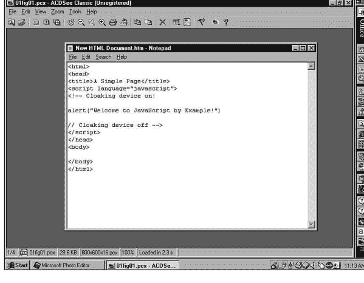

图1.1：在Windows记事本中显示的JavaScript。

# 第1章：JavaScript入门！

## 使用可视化工具

用于编写JavaScript的可视化工具通常是HTML编辑器/创建器，它们允许你将简单的脚本拖放到网页中以执行简单任务。此类工具的示例包括Microsoft FrontPage、Macromedia Dreamweaver和Adobe GoLive。

通常，你甚至不需要查看或输入任何JavaScript，这表面上看起来可能是个好主意。但它们在易用性方面的优势，在灵活性方面却有所欠缺。每个工具通常在其库中仅限于少数几个JavaScript技巧，因此创意空间有限。另一个缺点是，这些可视化工具输出的JavaScript通常冗长而复杂，即使专业开发人员也发现难以阅读，更不用说修改或编辑脚本了。一次小小的编辑导致整个JavaScript停止工作并抛出错误的情况并不少见——这对于向你的网站访问者展示来说可不是件好事！

然而，有时你可能需要或必须使用可视化工具。这没关系。重要的是，当你需要的时候，你能够编写自己的JavaScript，而不必完全依赖软件中的内置脚本。

但是，使用可视化工具确实存在一些优势：

- **速度**——它们比手动输入快得多。
- **准确性**——如果允许其自行处理，可视化工具输出的JavaScript是可以工作的（然而，一旦你开始修改它，情况可能就不是这样了！）。
- **特殊功能**——诸如HTML颜色编码等功能使HTML和JavaScript更具可读性。

> **提示**

在本书中，我们鼓励你实际动手输入示例。虽然这可能看起来乏味且耗时，但这是学习如何编写以及更重要的如何用JavaScript思考的最好方法。这让你能够亲身感受这门语言是如何组合在一起的。

## 使用最新的浏览器

因为你要在这里学习尖端的JavaScript，所以拥有最新的浏览器以利用这一点很重要。我们建议你至少拥有Netscape Navigator 4.0和Microsoft Internet

已安装 Internet Explorer 5.5。Internet Explorer 5.5 和 Netscape Navigator 6 Preview Release 2 分别如图 1.2 和图 1.3 所示。

> **提示**
这两款浏览器均可从网上免费下载。有关 Internet Explorer 的最新信息，请访问 http://www.microsoft.com/ie；有关 Netscape Navigator 的最新信息，请访问 http://www.netscape.com。

> **注意**
唯一其他能够运行 JavaScript 的浏览器是 Opera Software 的 Opera（目前为 4.5 版本）。该浏览器并非免费，但可以从 http://www.opera.com 购买并下载。

**图 1.2：** *Microsoft Internet Explorer 5.5。*

*图 1.3：Netscape Navigator 6（这是 Preview Release 2 版本）。*

## 其他工具

你还能做些什么来让你作为 JavaScript 开发者的生活更轻松呢？这里有一些想法。

## 创建 HTML 模板

如果你打算使用文本编辑器来创建网页，那么减少重复输入是有意义的。一种方法就是使用 HTML 模板。*模板*是一个包含构成每个页面骨架的 HTML 的文本文件。它可以根据你自己的情况进行定制，但作为一个起点，以下内容可能就足够了：

```
<html>
<head>
<title>HTML Template Page</title>
<script language="javascript">
<!--


// -->
</script>
</head>
<body>

</body>
</html>
```

这个模板已经做了一些定制，以适应你将要学习如何编写 JavaScript 的事实，但如果你不理解其中的某些内容，请不要担心。在下一章中，你将更详细地了解它！

创建此模板（如图 1.4 所示）后，你可以将其保存在硬盘上的方便位置，例如你的 Windows 桌面或当前项目文件夹。只需记住在开始使用后保存文件之前重命名它。

> **注意**
如果你的页面 HTML 有标准布局，你可以将其添加到模板中。

## 保留脚本库

在学习编写 JavaScript 时，你可以做的一件非常节省时间的事情就是创建你自己的 JavaScript 库。这可以只是一个文件夹中的一堆文本文件。（不过，给它们起有意义的名字，因为遍历所有文件来寻找你需要的脚本可能比直接输入它更耗时！）

如果你真的想建立一个强大的库，你可以创建一个 JavaScript 代码片段数据库，为每个片段命名并包含一些关于它们的说明。这可以非常容易地找到和检索正确的脚本。

> **提示**
通过保留 JavaScript 库，你不仅可以使未来的编程更轻松、更省时，还可以轻松跟踪你的进步并观察你已经提高了多少。

### 下一步

既然我们已经介绍了 JavaScript 的起源、历史和未来，并了解了成为一名合格的 JavaScript 开发者需要什么，你已经准备好开始编写一些脚本了！完成下一章后，你将理解 JavaScript 和 HTML 如何在网页中结合在一起。

---

# 结合 JavaScript 和 HTML

如果你想学习如何编写 JavaScript，首先需要了解的是网页中的 JavaScript 和 HTML 如何结合在一起。在本章中，你将学到这一点。

本章将教你以下内容：

- 如何将 JavaScript 添加到网页的 HTML 中
- `<head>` 标签的重要性
- `<script>` 块是什么以及如何将其添加到网页中
- 如何向旧的、不支持 JavaScript 的浏览器隐藏 JavaScript

## 世界的交汇——HTML 和 JavaScript

所以，你知道 HTML 是如何工作的，并且现在对 JavaScript 有了一些了解。下一步是看看这两者如何在网页中和谐地结合在一起工作。

因为 HTML 和 JavaScript 是完全独立的技术，所以存在关于如何将 JavaScript 插入到网页 HTML 中的规则。实际上，有几种方法可以将 JavaScript 添加到网页中，但为了让你开始，我们将首先集中讨论最常用且可以说是最灵活的方法。在这种方法中， JavaScript 被插入到 `<head>` 标签中的一个脚本*块*中。

让我们看看如何做到这一点。

## HTML 骨架

在继续之前，你必须熟悉 HTML 页面的结构。图 2.1 中浏览器显示的这个非常基础的网页的 HTML 代码如下：

```
<html>
<head>
<title>A Simple Page</title>
</head>
<body>
<p>A very simple Web page indeed!</p>
</body>
</html>
```
图 2.1：在 Internet Explorer 中显示的一个简单 HTML 网页。

从 JavaScript 的角度来看，你需要关注此页面的部分是从起始标签 `<head>` 到结束标签 `</head>` 的 HTML 块。这是页面的 `<head>` 块，也称为网页的*头部*，你将在这里放置你的 JavaScript。

然而，你不能直接将代码放入 `<head>` 中。你首先还必须做些别的事情！

## `<script>` 块

要将 JavaScript 放在 `<head>` 标签内，你必须向 `<head>` 添加一个新的 HTML 块。这个块就是 `<script>` 块。这个脚本块的目的是告诉浏览器，其起始和结束标签之间的任何内容都是一个脚本——并且应该将其作为脚本来处理。

这个块可以添加在 `<head>` 块内的任何位置，但通常添加在末尾，即结束标签 `</head>` 之前：

```
<html>
<head>
<title>A Simple Page</title>
<script>

</script>
</head>
<body>
<p>A very simple Web page indeed!</p>
</body>
</html>
```

> **注意**
将 `<script>` 块放在头部的一个原因是，通过将其放在这里，你可以确保它在其他任何内容之前加载，这大大减少了出错的可能性。如果现在这对你来说没有任何意义，别担心，本书稍后将更详细地介绍这一点。

在将 JavaScript 添加到 `<script>` 块之前，你必须再做几件事。其中第一项任务是告诉浏览器 `<script>` 块标签中包含哪种类型的脚本。这是因为 JavaScript 并不是你可以使用的唯一 Web 脚本语言。另一种广泛使用的脚本语言是 Microsoft 的 VBScript。因此，要告诉浏览器你使用的是 JavaScript，你首先必须按照如下方式向 `<script>` 标签添加 language 属性：

```
<html>
<head>
<title>A Simple Page</title>
<script language="">
```

### 第 2 章：结合 JavaScript 和 HTML

```
</script>
</head>
<body>
<p>A very simple Web page indeed!</p>
</body>
</html>
```

你通过在引号内输入 JavaScript 来声明使用的语言是 JavaScript：

```
<html>
<head>
<title>A Simple Page</title>
<script language="JavaScript">
</script>
</head>
<body>
<p>A very simple Web page indeed!</p>
</body>
</html>
```

> **注意**
例如，如果你想用 VBScript 编写脚本，语言将设置为 vbscript：
`<script language="vbscript">`

你刚刚涉及了两个要点。

首先是引号。在某些情况下，你可能会查看一些 JavaScript 代码，发现 language 的声明没有使用引号。一切似乎都工作得很好，那么何必费心输入它们呢？嗯，这又是那种最好完全正确的时候。即使 Internet Explorer 和 Netscape Navigator 浏览器无论有无引号都能理解该语言，正确的形式是使用引号，所以这就是为什么这里这样展示。浏览器可能会要求 HTML 编写正确的时候总会到来。现在编写格式良好的 HTML，你就能确保你的技能是面向未来的！

第二个要点是区分大小写。看看以下内容：

- `<script language="javascript">`
- `<script language="JavaScript">`
- `<script language="JAVASCRIPT">`


## 世界的交汇——HTML与JavaScript

有什么区别？对了，它们各自使用了不同的大小写形式。在本书中，我们将使用"JavaScript"，但当创建你的网页时，目前最好使用全小写。这不仅更快，而且更不容易出现拼写错误。

再说一次，如果你观察网上的脚本，有时会注意到`language`属性被省略了。嗯，这样也完全没问题。其背后的原因是，由于JavaScript是第一个出现的脚本语言，它被视为默认选择。然而，为了保持格式正确的网页，最好还是包含它。这再次确保了你今天学到的技能是面向未来的。

### 深入了解 `language` 属性

`language` 属性的内涵比你看到的要丰富。虽然纯JavaScript是默认选择，但你在前一章中读到过，存在相当多版本或风格的JavaScript。JavaScript 1.0、JavaScript 1.1、JScript等都是可用的。你实际上可以使用`language`属性来精确指定你编写的版本。你指定哪个版本真的取决于你希望脚本在哪个浏览器和JavaScript版本上运行。这听起来有点复杂，但让我们看几个例子，这会有所帮助。

如果你使用 `<script language="JavaScript">`，你就是在告诉浏览器这只是JavaScript，并使用你的JavaScript引擎（实际解释JavaScript的程序）来运行它。这是默认设置。然而，如果你希望JavaScript只在微软的Internet Explorer上运行，最好的方法是将你编写的JavaScript定义为JScript，如下所示：

```
<script language="JScript">
```

```
</script>
```

现在，`<script>`块中的任何JavaScript都只在Internet Explorer浏览器中运行。

如果你想要针对网景导航者3.0用户呢？从上一章中，你可能记得这个浏览器有JavaScript的1.1版本。这意味着如果你使用以下语言设置，只有网景导航者3.0会运行你的JavaScript：

```
<script language="JavaScript1.1">
```

```
</script>
```

提出这一点是为了让你有个全面的了解。在本书的后面，我们将再次讨论这个问题，并向你展示一些你可以使用的技巧！

# 第2章：结合JavaScript和HTML

> **注意**
记住默认是language="JavaScript"，本书中的大多数示例都使用这种语言（如果我们想让你设置为其他值，我们会特别说明）。小心不要无意中将语言设置为其他值，因为这会导致脚本在新浏览器中无法运行，有时发现这个错误可能很棘手！

### 对旧浏览器隐藏JavaScript

网景导航者2.0之前的浏览器根本无法运行JavaScript，如果它们在网页中遇到JavaScript，会导致它们生成一些非常难看的错误。为了避免出现此类错误的可能性，将你放置在页面上的任何脚本隐藏起来，方法是在`<script>`块内放置HTML注释标签。这添加起来快速简单，即使旧浏览器如今已很少见，但将注释标签插入你的HTML模板中，使它们出现在每个包含JavaScript的网页中仍然值得。

这些注释标签很容易添加。在`<script>`标签内，插入另一对标签`<!--`和`-->`。你编写的所有代码都放在这些标签之间，然后会被任何不理解`<script>`标签含义的浏览器忽略。

> **注意**
将任何你想让浏览器使用的内容放在注释标签内可能看起来很奇怪，因为这些标签是用来防止页面上的文本显示的。但事实是，所有理解脚本的浏览器也知道要忽略这些注释标签，并照常处理，就好像它们不存在一样。

为了让注释标签更明显，开发者通常会在这些HTML注释标签内放置一些（有时是有趣的！）注释，告诉可能查看代码的其他人它们的作用：

```
<script language="JavaScript">
<!-- Cloaking device on!

// Cloaking device off -->
</script>
```

现在的页面看起来像这样：

```
<html>
<head>
<title>A Simple Page</title>
<script language="JavaScript">
<!-- Cloaking device on!
```

```
// Cloaking device off -->
</script>
</head>
<body>
<p>A very simple Web page indeed!</p>
</body>
</html>
```

### 注意

信不信由你，你刚刚遇到了你的第一个JavaScript小知识！这是JavaScript注释标签（//）。它们不同于HTML注释标签；在下一章中，你将看到它们如何工作以及更多内容。

### 下一步

你现在已经了解了关于JavaScript如何融入HTML网页所需知道的一切，你准备好开始编写JavaScript了！在下一章中，你将学习如何编写几行简单的JavaScript代码，这将向你展示如何让JavaScript显示输出并接受输入。


- **确认框（Confirm）**—输出信息，并允许用户以是/否问题的形式输入选择。

**图 3.3**：*由 Internet Explorer 显示的确认框。*

**图 3.4**：*由 Netscape Navigator 显示的确认框。*

- **提示框（Prompt）**—输出一些信息，并允许用户输入对输出的响应。

**图 3.5**：*由 Internet Explorer 显示的提示框。*

**图 3.6**：*由 Netscape Navigator 显示的提示框。*

## 对象、方法……甚至属性

你可能听说过 JavaScript 是一种面向对象的语言。但这究竟意味着什么？要理解这一点，你需要熟悉三个术语：

- 对象
- 方法
- 属性

接下来我们简要介绍这三者。在你使用 JavaScript 一段时间后，你会发现它们的使用频率非常高，因此详细的讲解留到后面。

### 对象

简单来说，*对象*就是一个东西，任何东西。就像现实世界中的事物都是对象（汽车、狗、钞票等），计算机世界中的事物也被视为对象。

对于 JavaScript 而言，它的对象都存在于 Web 浏览器中。这些对象包括浏览器窗口本身、表单，以及表单中的按钮和文本框等部件。JavaScript 还拥有自己的一组内置对象，与数组、日期等相关。目前你不需要过多考虑这些对象，因为后面会详细介绍；现在你只需要掌握一些必要的术语。

正是对象使 JavaScript 成为面向对象的语言。JavaScript 围绕对象而非操作来组织；换句话说，它是围绕数据而非编程逻辑来组织的。面向对象编程的观点是：你真正关心的是需要操作的对象，而不是操作它们所需的逻辑。这样做的一大好处是——由于你从编程逻辑中解放出来——不仅编程（或脚本编写）的过程更加简单，而且执行特定操作的方式也有多种多样。

### 方法

*方法*是对象能做的事情。在现实世界中，对象也有方法。汽车行驶、狗吠叫、钞票购物，等等。`alert()` 是 Window 对象的一个方法，因此 Window 对象可以用消息框来提醒用户。其他方法的例子包括窗口可以被打开或关闭，按钮可以被点击。这里的三个方法分别是 `open()`、`close()` 和 `click()`。注意括号。要注意这些括号，因为它们表明正在使用的是方法，而非属性。

### 属性

所有对象都有*属性*。汽车有轮子，狗有毛发。对于 JavaScript 来说，浏览器这样的东西有名称和版本号。

> **提示**
>
> 将对象和属性理解为*事物*，将方法理解为*动作*，可能会对你有所帮助。

## 使用 alert() 方法

`alert()` 是这三个方法中最容易使用的。你可以用它以简洁的方式向用户显示文本信息。用户阅读完消息后，只需单击"确定"即可将其关闭。

首先，在你喜欢的文本编辑器中打开模板 HTML 页面，并以新名称保存到硬盘上的便捷位置：

```
<html>
<head>
<title>A Simple Page</title>
<script language="JavaScript">
<!-- Cloaking device on!

// Cloaking device off -->
</script>
</head>
<body>

</body>
</html>
```

> **注意**
>
> 记得使用 HTM 或 HTML 作为文件扩展名来保存；否则，将无法按预期工作。

34 第 3 章：JavaScript 实战

> **警告**
>
> 在现阶段，你大概需要知道 JavaScript 是一种区分大小写的语言。你将在后面的章节中更详细地学习这一点，但目前请注意，除了你想要使用的文本字符串外，最好遵循 JavaScript 中大小写字母的使用规范。

要创建 alert 消息框，请输入以下内容：

```
<html>
<head>
<title>A Simple Page</title>
<script language="JavaScript">
<!-- Cloaking device on!
alert();
// Cloaking device off -->
</script>
</head>
<body>
</body>
</html>
```

> **注意**
>
> `alert()` 方法末尾的分号称为*行终止符*，它是为了使你的 JavaScript 符合 ECMA 标准（尽管没有它也能正常运行）。在接下来的几章中你会经常看到它；在第 4 章"使用变量处理数据"中，你将了解它具体在何时何地使用。

现在，设置你想要显示的消息。将其放在引号内，置于圆括号之中：

```
<html>
<head>
<title>A Simple Page</title>
<script language="JavaScript">
<!-- Cloaking device on!
alert("An alert triggered by JavaScript!");
// Cloaking device off -->
</script>
</head>
<body>
</body>
</html>
```

保存页面，在浏览器中加载它，然后观看消息出现（参见图 3.7）！

*图 3.7：*由 Internet Explorer 显示的带有自定义消息的 alert 消息框。

让第二个 alert 出现和第一个一样简单——只需在 `<script>` 代码块中第一个 alert 下面添加 alert()，并在引号中添加你自己的消息：

```
<html>
<head>
<title>A Simple Page</title>
<script language="JavaScript">
<!-- Cloaking device on!
alert("An alert triggered by JavaScript!");
alert("A second message appears!");
// Cloaking device off -->
</script>
</head>
<body>

</body>
</html>
```

在文本编辑器中保存文件并刷新浏览器。这次你会注意到出现了两条消息。但更重要的是，注意它们是分别显示的，而不是一条叠在另一条上面。这表明 JavaScript 在每条消息之间都暂停了，而不是盲目地一直运行到脚本末尾。它耐心等待用户在第一个消息框上单击"确定"后，才继续显示第二条消息。

> **提示**
>
> 记住在查看更改之前重新保存文件。你无法相信有多少用户忘记这一步，还以为自己做错了什么！

**练习**

作为练习，回到模板文件，从头开始创建一个新的 JavaScript 来触发一个显示你自选消息的 alert 消息框。

完成后，按照同样的格式添加第二个 alert 消息框。接下来，在新行上添加 alert() 方法，然后在圆括号内用引号括起来，添加你想要显示的消息。

## 为 JavaScript 添加注释

专业的 JavaScript 开发者力求使自己在回来阅读代码时（也许是几个月后）能够轻松理解。他们使用的辅助工具之一就是 JavaScript 注释标签，其中一种你已经在上一章中遇到过了——单行注释。

### 单行注释

以下是单行注释标签的使用示例：

```
<html>
<head>
<title>A Simple Page</title>
<script language="JavaScript">
<!-- Cloaking device on!
// The first alert is below
alert("An alert triggered by JavaScript!");
// Here is the second alert
alert("A second message appears!");
// Cloaking device off -->
</script>
</head>
<body>

</body>
</html>
```

如果你运行这段 JavaScript，不会注意到任何差别。这是因为注释标签已经完成了它们的工作，将注释从浏览器的视线中隐藏了起来。

### 多行注释

有时你需要在脚本中添加多行注释，虽然你可以在每行开头都放置斜杠（//），但这并不方便。这就是多行注释标签发挥作用的地方。

多行注释标签由开始注释标签（`/*`）和注释内容以及结束注释标签（`*/`）组成。

以下是多行注释的示例：

```
<html>
<head>
<title>A Simple Page</title>
<script language="JavaScript">
<!-- Cloaking device on!
/*
```

下面两个 alert() 方法用于弹出两个消息框——请注意第二个消息框是在第一个消息框的确定按钮被点击后触发的
*/
alert("一个由 JavaScript 触发的提示框！");
alert("第二个消息出现！");
// 隐身设备关闭 -->
</script>
</head>
<body>
</body>
</html>

为脚本添加有意义的注释是一项需要通过实践才能掌握的技能。一开始，这可能显得繁琐甚至不必要，但它不仅能让你的 JavaScript 代码更易于理解，在早期阶段还能帮助你更清晰地理解脚本的工作原理。抓住一切机会为你的脚本添加注释！

**练习**
为你上一个练习中创建的示例，使用单行和多行注释为你的代码添加注释。

## 使用 confirm() 方法

`confirm()` 方法的工作方式与 `alert()` 类似，但这个对话框用于让用户在“确定”和“取消”之间做出选择。你可以用几乎相同的方式让它显示出来，唯一的区别是这里使用的是 `confirm()` 方法，而不是 `alert()` 方法。

**注意**
“取消”按钮背后需要比你目前所学更多的 JavaScript 知识才能使其生效。不过别担心；这部分内容会讲到的！


因此，同样按照 `alert()` 方法的相同流程，你首先在脚本块中添加 `confirm()` 方法，如下所示：

```
<html>
<head>
<title>一个简单的页面</title>
<script language="JavaScript">
<!-- 隐身设备开启！
confirm();
// 隐身设备关闭 -->
</script>
</head>
<body>

</body>
</html>
```

同样，你希望在框中显示的消息需要输入在括号内，并用引号括起来：

```
<html>
<head>
<title>一个简单的页面</title>
<script language="JavaScript">
<!-- 隐身设备开启！
confirm("你会选择哪一个？");
// 隐身设备关闭 -->
</script>
</head>
<body>

</body>
</html>
```

保存文件（同样使用与模板不同的文件名，并记住使用 HTM 或 HTML 文件扩展名），然后将其加载到浏览器中（参见图 3.8）。

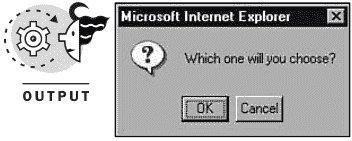

现在请注意对话框上的按钮——“确定”和“取消”。然而，目前点击它们除了让对话框消失并让 JavaScript 继续运行之外，不会发生任何事情。在你能够使用 `confirm` 对话框上的按钮之前，你还需要学习更多的 JavaScript 技能，之后你将重新学习 `confirm()` 方法。

### 练习

练习在网页中添加 `confirm()` 方法。添加你自己的消息。

在一个网页中添加几个独立的 `confirm()` 方法，并注意结果。

## 使用 `prompt()` 方法

`prompt()` 方法与你在本章中看到的另外两个方法略有不同。这是唯一一个允许用户输入自己对问题的回答的方法，而不是脚本只处理它已有的信息（如 `alert()` 方法），或者是允许用户选择“确定”或“取消”（通过 `confirm()` 方法）。

你添加 `prompt()` 方法的方式与另外两个非常相似。首先，将 `prompt()` 方法添加到 `<script>` 块中：

```
<html>
<head>
<title>一个简单的页面</title>
<script language="JavaScript">
<!-- 隐身设备开启！
prompt();
// 隐身设备关闭 -->
</script>
</head>
<body>
</body>
</html>
```

`prompt()` 方法现在开始与其他两个方法不同，因为必须在括号内添加两部分文本。第一部分是你希望显示的消息。

这与以前的做法完全相同。文本同样放在括号内，并用引号括起来：

```
<html>
<head>
<title>一个简单的页面</title>
<script language="JavaScript">
<!-- 隐身设备开启！
prompt("你叫什么名字？");
// 隐身设备关闭 -->
</script>
</head>
<body>
</body>
</html>
```

保存此页面并在浏览器中查看。注意提示框出现，询问用户的名字（参见图 3.9）。你可以输入名字并点击“确定”继续，或者点击“取消”。

# 第3章：JavaScript 实战

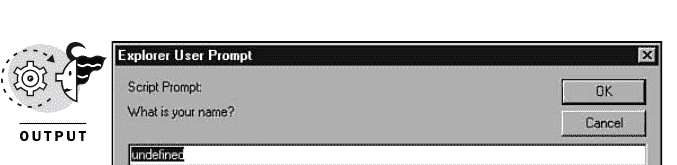

*图 3.9：由 Internet Explorer 显示的带有自定义消息的提示框。*

注意输入框中的单词 "undefined"。这是 Internet Explorer 的一个特性；Netscape Navigator 则会让输入框保持空白（参见图 3.10）。

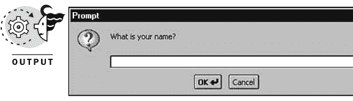

*图 3.10：在 Netscape Navigator 中的同一个提示框；注意输入框中没有出现任何文本。*

目前，无论你做什么都不会真正发生什么，但到本章结束时，你将能够通过一点额外的 JavaScript 知识让这个功能真正发挥作用！

我们可以添加的另一部分文本是出现在 `prompt` 实际输入框中的默认文本。添加这个很简单，并且可以消除 Internet Explorer 显示的难看的 "undefined"。你需要做的是：在括号内的第一部分文本之后，在引号外面放一个逗号，然后在逗号后面放置第二部分文本（同样用引号括起来）。下面是一个实际操作的例子：

```
<html>
<head>
<title>一个简单的页面</title>
<script language="JavaScript">
<!-- 隐身设备开启！
prompt("你叫什么名字？","在此输入你的名字。");
// 隐身设备关闭 -->
</script>
</head>
<body>

</body>
</html>
```

再次保存页面并刷新浏览器。注意原本空白的输入框现在包含了第二组引号中的文本（参见图 3.11）。

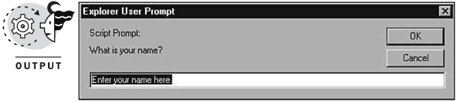

*图 3.11：由 Internet Explorer 显示的带有自定义消息和默认输入框文本的提示框。*

### 练习

练习在网页中添加 `prompt()` 方法。添加你自己的消息和输入框的默认文本。

在一个网页中添加几个独立的 `prompt()` 方法，并注意结果。

为你的页面添加一些注释（单行和多行），解释发生了什么以及每一部分的作用。

## 接下来

到目前为止，你已经了解了如何使用 JavaScript 显示三种类型的消息框。在下一章中，你将学习如何通过探索 JavaScript 的两个最重要领域——使用变量和数组处理数据，让这些消息框和其他 JavaScript 真正发挥作用。

# 使用变量处理数据

在上一章中，你看到了如何使用 JavaScript 生成三种类型的消息框，可用于输入和输出决策以及文本。然而，到目前为止你看到的 JavaScript 并不是很灵活。你输入的 JavaScript，包括你希望显示的消息，没有任何修改的余地。此外，在 `prompt` 框中输入的任何文本在点击“确定”或“取消”后都会丢失。在本章中，你将学习如何改变这一点，让 JavaScript 真正为你服务！

本章将教你以下内容：

- 值
- 变量
- 如何在 JavaScript 中使用它们

# JavaScript 值

信息就是一切，在 JavaScript 中，每一条信息都称为一个 *值*。因为世界上存在多种多样的信息，所以也有多种多样的值可供选择。然而，为了简化问题，JavaScript 中所有信息最基础的构建块被称为 *原始类型*。

三种主要的原始类型是

- 字符串
- 数字
- 布尔值

## 字符串

最常见的值可能是字符串。*字符串* 是一串字符，可以包括字母、标点符号和数字，它们按字面意义连接在一起。在 JavaScript 中，字符串通常表示文本。

以下是所有字符串的例子：

Hello and welcome!

Who are you?

I am 6 feet tall

可以通过用成对的双引号或单引号将字符串包围起来，将其包含在你的 JavaScript 中，就像这样：

```
"Hello and welcome!"
```

提供这种灵活性的原因是，可以通过用单引号 (') 包围字符串，将双引号 (") 包含在字符串中。相反，可以通过用双引号包围整个字符串来包含单引号：

```
"I'm 6 feet tall."
'"Who are you?" he asked.'
```

一个有趣的点是，字符串不一定包含任何字符。在这种情况下，它被称为 *空* 字符串，并由空引号表示：

```
" "
```

## 数字

JavaScript 识别两种类型的数字。它们是 *整数* 和 *浮点* 数。


### 整数

整数是包含正数（如 1、2、3）、负数（如 -1、-2、-3）和零 0 的完整数字。

虽然 JavaScript 中使用的大多数数字以十进制（基数为 10）书写，但也可以用八进制（基数为 8）和十六进制（基数为 16）来表示。

> **注意**
> 本书通篇使用十进制（基数为 10）。

### 浮点值

浮点值可以是带有小数部分的整数，如 3.1415926535897932384626433832795，也可以用科学计数法表示：3.76e2。

> **注意**
> 在科学计数法中，大写或小写的 "e" 表示"10 的幂次方"。

以单个零开头且包含小数点的数字会被解释为十进制浮点数。

> **警告**
> 以 "00" 开头且包含小数点的数字（如 005.5）会产生错误。

### 数字，数字，数字……

表 4.1 包含了一些 JavaScript 数字的示例，帮助你更好地熟悉它们。

### 第 4 章：用变量处理数据

表 4.1：JavaScript 数字

| 数字 | 描述 | 十进制等价值 |
| :--- | :--- | :--- |
| 91 | 整数 | 91 |
| 4.56e2 | 浮点数 | 456 |
| 0.001 | 浮点数 | 0.001 |
| 00.001 | 会产生错误 | |
| 0.001 | 四个等价的浮点数 | 0.001 |
| .001 | | |
| 1e-3 | | |
| 1.0e-3 | | |

### 数字能有多大？能有多小？

> **注意**
> 除非你从事非常高深的数学运算，否则你可能不需要担心所使用数字的大小。

JavaScript 中的数字可以非常大或非常小。非常大是指大约 10^308（即 1 后面跟着 308 个零），非常小是指 10^-308（即 0. 后面跟着 307 个零，然后是 1）。

## 布尔值

布尔值与字符串和数字不同，因为它只能有两个值：真（True）和假（False）。

> **注意**
> 布尔（Boolean）以英国数学家乔治·布尔（1815–1864）的名字命名。

以下是布尔值的示例：
- 狗会叫 = true
- 狗有五条腿 = false

你将在后面的第 6 章"表达式、条件、运算符以及更多字符串和数字"中重新学习布尔值，届时你会接触到表达式和条件。目前，你只需要知道它的存在，以及它是 JavaScript 中一种可能的值类型。

## 特殊数据类型：数字、Null 和 Undefined

除了前面介绍的三种类型之外，还有几种不太明显的原始数据类型可用。以下是四种特殊的数字值：
- 正无穷大
- 负无穷大
- 正零和负零
- NaN

还存在两种特殊类型：
- Null
- Undefined

简要来说，关于这四种特殊数字值，你没有办法手动输入它们（难道你想试着输入一个无限大的数字吗？）。NaN 代表"非数字"，它通常是由不合理的数学运算产生的（例如任何数除以零）。与无穷大相关的值是在突破 10^308 或 10^-308 限制时产生的（比如说，将 1.0e300 乘以自身），因此它们对你来说也没有太大用处（除了告诉你可能出了什么问题之外）！

null 类型只有一个值，即 null。Null 意味着什么都没有——没有数据——它只是用来告诉你没有可用的有用信息或数据。

Undefined 更难理解一些。它同样只有一个值（undefined），而且在大多数情况下与 null 相同。除了极少数情况外，undefined（尤其是显示给访问者时）都是一个不好的信号，它的出现表明你的 JavaScript 出了问题。

## JavaScript 变量

现在你已经了解了 JavaScript 的值，接下来可以进入 JavaScript *变量*的世界了。

变量非常重要，不仅在 JavaScript 中如此，在所有计算机编程语言中都是如此。没有变量，几乎什么都做不了。有了变量，你就能释放出巨大的能力，能够移动、修改和处理各种数据。

简单来说，变量就是一个容器，你为它指定一个名称，用来存放运行 JavaScript 的计算机内存中的一个值（该值总是具有特定的类型）。这个说法可能会让变量听起来比实际更复杂，因为在实际使用中，它们非常容易上手。

### 创建变量

在 JavaScript 中创建变量很简单。为了让你快速简单地了解变量，让我们回到标准的 HTML 模板：

### 第 4 章：用变量处理数据

```html
<html>
<head>
<title>A Simple Page</title>
<script language="JavaScript">
<!-- Cloaking device on!

// Cloaking device off -->
</script>
</head>
<body>

</body>
</html>
```

首先要做的是创建一个变量。有两种方式：声明变量和动态创建。先来看看使用前先声明的变量。本章后面我们再讨论动态创建变量。

要声明（创建）一个变量，你需要使用 JavaScript 语句 `var`（代表 variable），后面跟上你想给变量指定的名称。因此，下面这行 JavaScript 代码创建了一个名为 `msg` 的变量：

```html
<html>
<head>
<title>A Simple Page</title>
<script language="JavaScript">
<!-- Cloaking device on!
var msg;
// Cloaking device off -->
</script>
</head>
<body>

</body>
</html>
```

> **注意**
> 语句相当于英语中的完整句子。更多内容将在第 7 章"在 JavaScript 中使用语句"中介绍。

以下是关于变量名的几个要点：
- 变量名可以包含大写字母、小写字母或两者的混合。
- 在初始化之前，变量的值为 undefined。
- 第一个字符不能是数字。
- 变量名不能包含空格；如果你想将两个或多个单词组合在一起，应该使用下划线字符（_）。
- 你应该避免在变量名中使用美元符号（$），因为 Internet Explorer 3.02（使用 JScript 1.0）和 Netscape Navigator 2.02 无法处理它。
- 你应该避免使用仅大小写不同的变量名（例如 msg 和 Msg），因为 JScript 1.0 无法区分两者。

以下都是有效的变量名：
```
msg
Hello_There
Msg1
Msg_1
```

以下变量名都是无效的或最好避免使用的：

| 变量 | 原因 |
| :--- | :--- |
| 1msg | 以数字开头 |
| hello there | 包含空格 |
| var | JavaScript 保留字 |
| dollar$ | 最好避免，因为它包含 $ |
| msg 和 Msg | 最好避免同时使用，因为它们仅大小写不同 |

如果你想给新创建的变量赋值，可以将创建和赋值合并在一行中完成：
```html
<html>
<head>
<title>A Simple Page</title>
<script language="JavaScript">
<!-- Cloaking device on!
var msg = "Welcome to JavaScript variables!";
// Cloaking device off -->
</script>
</head>
<body>

</body>
</html>
```

或者，你也可以在不同的行上分别创建和赋值：
```html
<html>
<head>
<title>A Simple Page</title>
<script language="javascript">
<!-- Cloaking device on!
var msg;
msg = "Welcome to JavaScript variables!";
// Cloaking device off -->
</script>
</head>
<body>

</body>
</html>
```

如果你想给变量赋一个数字而不是字符串，可以这样做：
```html
<html>
<head>
<title>A Simple Page</title>
<script language="JavaScript">
<!-- Cloaking device on!
var msg = 22;
// Cloaking device off -->
</script>
</head>
<body>

</body>
</html>
```

> **注意**
> 给变量赋数字时，记得去掉引号，因为引号表示该值是字符串而不是数字。

> **练习**
> 创建一个示例页面，在其中创建一个变量并给它赋一个字符串值。然后，创建一个新页面，在其中赋一个数字值。同时，练习在同一行上创建变量并赋值，以及在不同行上分别创建和赋值。和上一章一样，别忘了添加适当的注释。

### 创建多个变量

你可能会发现，在 JavaScript 的学习过程中，某个时候需要使用多个变量（事实上很快就会用到！），所以你需要能够创建多个变量。


## 第4章：使用变量处理数据

实现这一点的一种方法是在 JavaScript 中每行创建一个变量：

```html
<html>
<head>
<title>A Simple Page</title>
<script language="JavaScript">
<!-- Cloaking device on!
var msg1;
var msg2;
var num1;
var num2;
// Cloaking device off -->
</script>
</head>
<body>
</body>
</html>
```

这样做完全没问题，但代码的可读性稍差。更好的方法是将声明全部放在一行，如下所示：

```html
<html>
<head>
<title>A Simple Page</title>
<script language="JavaScript">
<!-- Cloaking device on!
var msg1, msg2, num1, num2;
// Cloaking device off -->
</script>
</head>
<body>
</body>
</html>
```

行首是 var，然后依次添加每个要创建的变量名，变量名之间用逗号分隔。行末是分号作为行结束符。

> **警告**

省略逗号会导致错误！

如果愿意，你在一行中创建变量的同时就可以赋值：

```html
<html>
<head>
<title>A Simple Page</title>
<script language="JavaScript">
<!-- Cloaking device on!
var msg1 = "Hello", msg2 = "There", num1 = 6, num2 = 52;
// Cloaking device off -->
</script>
</head>
<body>
</body>
</html>
```

### 练习

练习创建多个变量，最好同时给它们赋值。记住用逗号分隔变量名。

根据需要为你的 JavaScript 添加注释。

### 显示变量的内容

好了，你已经创建了变量，并为它们赋了字符串值和数值。现在，可以让它们为你工作了！

你首先需要证明这些变量操作确实有效。所以，在这个简短的示例中，你将使用 `alert()` 方法来显示变量的值。

首先，声明两个名为 msg1 和 num1 的变量，并分别赋值 "Hello there"（字符串）和 22（数字）：


```html
<html>
<head>
<title>A Simple Page</title>
<script language="JavaScript">
<!-- Cloaking device on!
var msg1 = "Hello there", num1 = 22;
// Cloaking device off -->
</script>
</head>
<body>
</body>
</html>
```

下一步，在页面中添加 `alert()` 方法——确保它位于变量定义的下方：

```html
<html>
<head>
<title>A Simple Page</title>
<script language="JavaScript">
<!-- Cloaking device on!
var msg1 = "Hello there", num1 = 22;
alert();
// Cloaking device off -->
</script>
</head>
<body>
</body>
</html>
```

最后，必须让 `alert()` 方法读取变量的值。还记得你生成带有文本的警告框时吗？文本被放在引号中。这是为了表明它是字符串。然而，让警告框显示变量的值更加简单。你只需将变量名放在括号内（不需要引号，也不需要其他任何东西）：

```html
<html>
<head>
<title>A Simpleinely simple page></title>
<script language="JavaScript">
<!-- Cloaking device on!
var msg1 = "Hello there", num1 = 22;
alert(msg1);
// Cloaking device off -->
</script>
</head>
<body>
</body>
</html>
```

保存页面并在浏览器中打开，看看你的实际效果（见图4.1）！

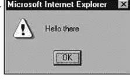

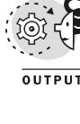

图 4.1：显示变量 msg1 值的警告框。

继续处理第二个变量，你现在可以在第二个警告框中显示它了：


```html
<html>
<head>
<title>A Simple Page</title>
<script language="JavaScript">
<!-- Cloaking device on!
var msg1 = "Hello there", num1 = 22;
alert(msg1);
alert(num1);
// Cloaking device off -->
</script>
</head>
<body>
</body>
</html>
```

再次保存页面并刷新浏览器，看看你做出的改动。这次会出现两个警告框，一个接一个，第二个警告框 display the number 22（见图 4.2）。

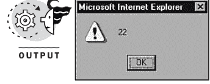

*图 4.2：第二个警告框显示变量 num1 的值。*

### 练习

为了帮助巩固本章到目前为止所学的内容，你现在可以基于已学知识创建几个类似的示例。创建几个变量，为它们赋予各种类型的值；然后使用 `alert()` 方法显示这些变量的值。

如果你只用模板从头开始创建这些页面，你会收获更多。不要只是从我们已经完成的示例中复制粘贴！

使用注释让你的 JavaScript 更易读、更易理解。

### 故障排查！

以下示例有什么问题？

### 示例 1

```html
<html>
<head>
<title>A Simple Page</title>
<script language="JavaScript">
<!-- Cloaking device on!
var msg1 = "Hello there", num1 = 22;
alert(msg11);
alert(num1);
// Cloaking device off -->
</script>
</head>
<body>
</body>
</html>
```

**答案**：第一个 `alert()` 方法显示了一个尚未创建或未赋值的变量（`msg11`）。这是*未定义值*的一个示例。

#### 示例 2

```html
<html>
<head>
<title>A Simple Page</title>
<script language="JavaScript">
<!-- Cloaking device on!
var msg1 = "Hello there" num1 = 22;
alert(msg1);
alert(num1);
// Cloaking device off -->
</script>
</head>
<body>
</body>
</html>
```

**答案**：在 `var msg1 = "Hello there" num1 = 22;` 这一行中，变量之间没有用逗号分隔。

#### 示例 3

```html
<html>
<head>
<title>A Simple Page</title>
<script language="JavaScript">
<!-- Cloaking device on!
var 1msg = "Hello there", num 1 = 22;
alert(1msg);
alert(num 1);
// Cloaking device off -->
</script>
</head>
<body>
</body>
</html>
```

### 使用 `prompt()` 方法为变量赋值

到目前为止，你已经看到了如何在 JavaScript 中直接为变量赋值的示例。但有时，你无法这样做。例如，如果你问用户一个问题，比如她的名字，你根本不可能知道答案会是什么（除非也许你的网站只有一个人访问！）。

幸运的是，在脚本执行过程中为变量赋值很容易。以下示例展示了如何使用 `prompt()` 方法来实现这一点。

你再次从空白 HTML 模板页面开始，在 `<script>` 块中添加 `prompt()` 方法：

```html
<html>
<head>
<title>A Simple Page</title>
<script language="JavaScript">
<!-- Cloaking device on!
prompt();
// Cloaking device off -->
</script>
</head>
<body>
</body>
</html>
```

下一步，添加你想要显示的消息和默认文本：

```html
<html>
<head>
<title>A Simple Page</title>
<script language="JavaScript">
<!-- Cloaking device on!
prompt("What is your name?","Type your name here ...");
// Cloaking device off -->
</script>
</head>
<body>
</body>
</html>
```

接下来，你需要一种方法将用户输入的文本赋给一个变量，以便稍后使用。这做起来出奇地简单。你只需在行的开头输入变量名，后面跟着等号（=）：

```html
<html>
<head>
<title>A Simple Page</title>
<script language="JavaScript">
<!-- Cloaking device on!
yourname = prompt("What is your name?","Type your name here ...");
// Cloaking device off -->
</script>
</head>
<body>
</body>
</html>
```

注意这里我们如何在没有使用 var 语句的情况下即时创建了变量。很多时候即时创建变量很有用，特别是当你要以简单的方式使用这个变量时（比如保存一个短字符串或数字）。但是，如果你真的想对变量进行操作（比如进行数学计算），你应该使用 var 语句，因为你的变量将更容易跟踪。另外，如果你想使用已使用 var 语句创建的变量，方法完全相同——你只需要先创建它即可！

现在，剩下的就是将变量 yourname 的值显示在警告框中了：

```html
<html>
<head>
<title>A Simple Page</title>
<script language="JavaScript">
<!-- Cloaking device on!
yourname = prompt("What is your name?","Type your name here ...");
alert(yourname);
// Cloaking device off -->
</script>
</head>
<body>
</body>
</html>
```


保存页面并在浏览器中加载它。首先你会看到提示框被显示出来，如图 4.3 所示。

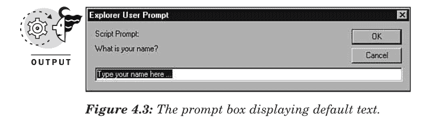

*图 4.3：显示默认文本的提示框。*

在输入框中输入你的名字（见图 4.4）。

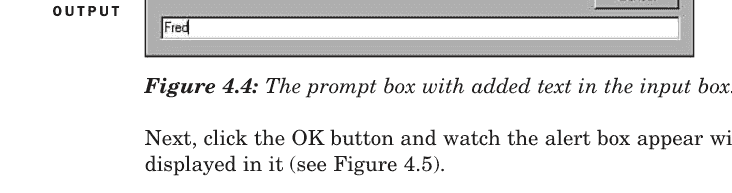

*图 4.4：输入框中已添加文本的提示框。*

接下来，单击"确定"按钮，观察警告框出现并显示你的名字（见图 4.5）。

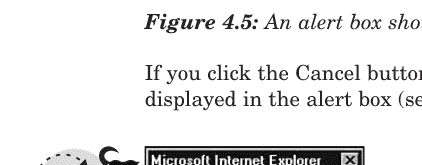

*图 4.5：显示 yourname 变量值的警告框。*

如果你单击"取消"按钮，yourname 的值将被设置为 null，并显示在警告框中（见图 4.6）。

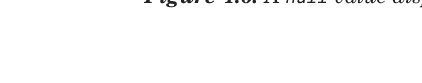

*图 4.6：警告框中显示的 null 值。*

## 使用 prompt() 方法为变量赋值

还要注意的是，你可以轻松地重新显示变量的值（如下例所示），因为该值会被保留，直到被更改或清除：

```html
<html>
<head>
<title>A Simple Page</title>
<script language="JavaScript">
<!-- Cloaking device on!
yourname = prompt("What is your name?","Type your name here ...");
alert(yourname);
alert(yourname);
// Cloaking device off -->
</script>
</head>
<body>
</body>
</html>
```

为了演示你可以更改变量的值，再添加一个 prompt() 方法，让你有机会再次更改它：

```html
<html>
<head>
<title>A Simple Page</title>
<script language="JavaScript">
<!-- Cloaking device on!
yourname = prompt("What is your name?","Type your name here ...");
alert(yourname);
yourname = prompt("Type something different in","Something different ...");
alert(yourname);
// Cloaking device off -->
</script>
</head>
<body>
</body>
</html>
```

保存页面并在浏览器中试用。你在第二个提示框中输入的文本存储在同一个变量中，而旧的值会被静默地丢弃。

> **注意**
> 没有办法恢复变量的先前值；一旦被更改，它就丢失了。

## 将变量值传递给另一个变量

如果你出于某种原因想保留变量的值，可以将该值传递给另一个不同的变量。因此，在 yourname 的值被更改之前，你可以将其传递给一个名为 yourname2 的新变量，如下所示：

```
yourname2 = yourname
```

这会动态创建一个名为 yourname2 的新变量，并赋予它与 yourname 相同的值。因此实际上，在这一刻两个变量具有相同的值。请记住，你必须在更改第一个变量的值之前完成此操作！

以下代码演示了这一点：

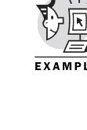

```html
<html>
<head>
<title>A Simple Page</title>
<script language="JavaScript">
<!-- Cloaking device on!
yourname = prompt("What is your name?","Type your name here ...");
alert(yourname);
yourname2 = yourname
yourname = prompt("Type something different in","Something different ...");
alert(yourname);
alert(yourname2);
// Cloaking device off -->
</script>
</head>
<body>

</body>
</html>
```

### 练习

- 练习使用 prompt() 为动态创建的变量以及使用 var 语句创建的变量赋值。
- 练习将变量值传递给其他变量以及重用变量。
- 像往常一样，添加注释以便你理解每一步，并使你的代码更易于阅读！

### 接下来的内容

在下一章中，你将学习一种能够容纳多个值的不同类型的变量——数组。

## JavaScript 数组和转义字符

在上一章中，你学习了如何使用变量。本章在此基础上进一步介绍数组。

本章将教你以下内容：

- 使用数组
- 创建数组
- 创建数组元素
- 使用转义字符

### 使用数组

数组是大多数编程语言的强大特性，JavaScript 开发者也可以使用它！*数组*使你能够在一个变量中存储多个独立的值。通常，所有这些值都有一个关联的主题（例如星期几）。数组非常棒，因为当你知道如何使用它们时，它们确实可以简化你的代码——免去你创建一堆具有类似名称的单独变量的麻烦。

那么，让我们来看看如何创建和使用数组。这里的示例将用于存储一周的七天。

你需要做的第一件事是让数组存在：

```html
<html>
<head>
<title>A Simple Page</title>
<script language="JavaScript">
<!-- Cloaking device on!
var days_of_week = new Array(7);
// Cloaking device off -->
</script>
</head>
<body>

</body>
</html>
```

> **警告**
> 注意 new Array 后面的圆括号（(())）。一个常见的错误是在这里放置方括号！

这行 JavaScript 完成了几件不同的事情：

- 首先，它创建了一个名为 `days_of_week` 的变量。
- 其次，你使用 `new Array()` 将新变量定义为数组。
- 第三，它定义了数组的大小（在本例中为 7）。

你实际创建的是七个空单元格，即*元素*，准备接受值（见图 5.1）。

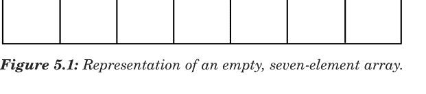

输入值同样简单——只需记住跟踪你想要放置的内容到什么位置。

days_of_week[x]

在前面的代码中，x 是元素的位置。

你首先必须注意的是 JavaScript 如何对数组计数。这是通过以下方式完成的。

在处理数组时，JavaScript 不会将第一个数组视为数字 1；相反，它是 0（零）。因此，星期几的示例将有元素 0–6，而不是 1–7。查看图 5.2 了解其工作原理。

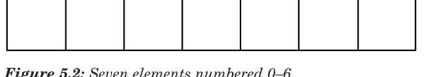

那么，要将相应的值（在本例中为 Sunday）放入数组的第一个元素，你可以这样做：

```html
<html>
<head>
<title>A Simple Page</title>
<script language="JavaScript">
<!-- Cloaking device on!
var days_of_week = new Array(7);
days_of_week[0] = "Sunday";
// Cloaking device off -->
</script>
</head>
<body>
</body>
</html>
```

按照这种格式，你现在可以用相应的值填充数组：

```html
<html>
<head>
<title>A Simple Page</title>
<script language="JavaScript">
<!-- Cloaking device on!
var days_of_week = new Array(7);
```

## 第 5 章：JavaScript 数组和转义字符

```html
days_of_week[0] = "Sunday";
days_of_week[1] = "Monday";
days_of_week[2] = "Tuesday";
days_of_week[3] = "Wednesday";
days_of_week[4] = "Thursday";
days_of_week[5] = "Friday";
days_of_week[6] = "Saturday";
// Cloaking device off -->
</script>
</head>
<body>

</body>
</html>
```

图 5.3 提供了该数组的可视化表示。

| 0 | 1 | 2 | 3 | 4 | 5 | 6 |
|---|---|---|---|---|---|---|
| Sunday | Monday | Tuesday | Wednesday | Thursday | Friday | Saturday |

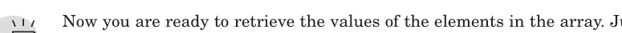

现在你已准备好检索数组中元素的值。正如你使用变量名（在本例中为 days_of_week）后跟包含元素编号的一组方括号（例如 days_of_week[2]）的格式来赋值一样，同样的格式也用于检索值。因此，要将第三个元素的值放入警告框中，你可以这样做：

```html
<html>
<head>
<title>A Simple Page</title>
<script language="JavaScript">
<!-- Cloaking device on!
var days_of_week = new Array(7);
days_of_week[0] = "Sunday";
days_of_week[1] = "Monday";
days_of_week[2] = "Tuesday";
days_of_week[3] = "Wednesday";
days_of_week[4] = "Thursday";
days_of_week[5] = "Friday";
days_of_week[6] = "Saturday";
alert(days_of_week[2]);
// Cloaking device off -->
```

```html
</script>
</head>
<body>

</body>
</html>
```

图 5.4 显示了此脚本的输出。

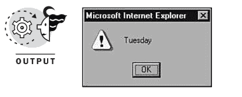

### 图 5.4：显示编号为 2 的元素值的警告框。

> **注意**
> 记住从 0 开始计数的惯例！

以下是另一种实现相同结果的方式：

```html
<html>
<head>
<title>A Simple Page</title>
<script language="JavaScript">
<!-- Cloaking device on!
var days_of_week = new Array(7);
days_of_week[0] = "Sunday";
days_of_week[1] = "Monday";
days_of_week[2] = "Tuesday";
days_of_week[3] = "Wednesday";
days_of_week[4] = "Thursday";
days_of_week[5] = "Friday";
days_of_week[6] = "Saturday";
var x = 2;
alert(days_of_week[x]);
// Cloaking device off -->
</script>
</head>
<body>

</body>
</html>
```

在这里，你会看到一个示例，其中创建了一个变量 x，并将数字 2 赋予它作为值。然后变量 x 被放入方括号中，结果是从数组中返回元素 2。


## 第5章：JavaScript 数组与转义字符

**练习**

创建一个数组来存放一年中的月份，并使用两种获取变量值的方法来显示二月和八月的月份。（从现在开始，你会有效地注释代码，这自不必说！）

#### 快速创建数组！

这里有一种更快的方法来创建与前面示例中完全相同的数组——这一次，全部写在一行里：

```html
<html>
<head>
<title>A Simple Page</title>
<script language="JavaScript">
<!-- Cloaking device on!
var days_of_week = new Array("Sunday", "Monday", "Tuesday", "Wednesday", "Thursday", "Friday", "Saturday");
// Cloaking device off -->
</script>
</head>
<body>

</body>
</html>
```

以这种方式创建数组的优点在于，你无需预先担心有多少个元素。使用这种方法，具有适当数量元素的数组会自动创建。

该数组在功能上的表现与前面的示例相同，其元素的访问方式也完全一样。

#### 数组的长度

前面提到，数组的长度隐藏在其 `length` 属性中。`length` 是数组的一个属性，尽管它可能被隐藏起来，但并非触不可及。

要找出 `days_of_week` 数组中有多少个元素，可以使用以下方法：

```
days_of_week.length
```

在下面的示例中，使用警告框来显示此值：

```html
<html>
<head>
<title>A Simple Page</title>
<script language="JavaScript">
<!-- Cloaking device on!
var days_of_week = new
Array("Sunday","Monday","Tuesday","Wednesday","Thursday","Friday","Saturday");
alert(days_of_week.length);
// Cloaking device off -->
</script>
</head>
<body>

</body>
</html>
```

此示例的输出如图 5.5 所示。

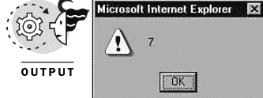

*图 5.5：显示数组 days_of_week 中元素数量的警告框。*

**练习**

使用 `length` 属性来统计你之前创建的年度月份示例中的元素数量。

#### 显示所有元素

最后，让我们来看一种快速而简单的方法来列出数组中所有元素的值。这只需通过使用数组的名称即可完成。因此，要返回 `days_of_week` 的所有元素并将其放入警告框中，可以使用以下代码（输出见图 5.6）：

```html
<html>
<head>
<title>A Simple Page</title>
<script language="JavaScript">
<!-- Cloaking device on!
var days_of_week = new Array("Sunday","Monday","Tuesday","Wednesday","Thursday",
"Friday","Saturday");
alert(days_of_week);
// Cloaking device off -->
</script>
</head>
<body>

</body>
</html>
```

70 第5章：JavaScript 数组与转义字符

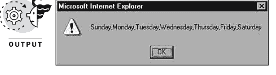

图 5.6：显示数组 days_of_week 中所有元素值的警告框。

**练习**

尝试使用数组来存放简单的值。练习添加数组中元素的值。练习获取所有值，以及获取单个值。

使用 `length` 属性来告诉你每个数组中的元素数量。

#### 练习——交互式故事

让我们通过一个示例来练习使用数组创建交互式故事。你可能熟悉这种"填空"游戏，系统会要求用户输入一系列词语——例如形容词、名词等。然后将用户的回答插入到一段广为人知的文本中，从而创作出一个完全独特且 hopefully 有趣的故事。下面是如何创建你自己的游戏：

1. 选择你想要使用的故事/歌谣/歌词，挑出你想要替换的词语，并为它们分别指定一个唯一的变量名：

```
Once upon a entry1 dreary,
while I pondered, entry2 and weary,
Over many a entry3 and curious volume
of entry4 lore--
While I entry5, nearly napping,
entry6 there came a tapping,
As of some one entry7 rapping, rapping
at my entry8 door.
"'Tis some entry9," I muttered,
"tapping at my entry8 door--
Only this and nothing more."
```

注意变量 `entry8` 被使用了两次——这样用户输入的任何词语都会在故事的两行中使用。保存这段文本——我们马上会回到这里。

2. 现在为每个被替换的词语列出合适的描述：

- "A time of day"
- "A feeling"
- "An adjective—eg. sunny"
- "An adjective—eg. sunny"
- "A verb—past tense, eg. walked"
- "An adverb—eg. quickly or monstrously"
- "An adverb—eg. quickly or monstrously"
- "A room in a house"
- "A profession"
- "An exclamation!"

这些将是提示信息，告诉用户应该输入哪种类型的词语。稍后，你将根据这些描述创建一个数组。

同时，列出将出现在故事中的默认词语。如果你愿意，可以是你自己想到的有趣建议。如果用户只是点击"确定"而不输入任何内容，这些词语将用于最终的故事中：

```
"lunchtime"
"wet"
"plump"
"malodorous"
"wriggled"
"hungrily"
"fiercely"
"bathroom"
"Web developer"
"Yipes"
```

现在你可以开始编写 JavaScript 了！

3. 从你的模板文件开始，创建一个新数组来存放你想要出现在提示框中的信息，直接将提示字符串添加到元素中：

```html
<script language="JavaScript">
<!-- Cloaking device on!
// create array for prompts
var promptmsg = new Array("A time of day","A feeling","An adjective - eg sunny", "An adjective - eg sunny","A verb - past tense eg walked","An adverb - eg quickly or monstrously","An adverb - eg quickly or monstrously","A room in a house",
"A profession","An exclamation!");
// Cloaking device off -->
</script>
```

72 第5章：JavaScript 数组与转义字符

4. 接下来，创建一个数组来存放你想要出现在故事中的默认词语：

```html
<script language="JavaScript">
<!-- Cloaking device on!
// create array for prompts
var promptmsg = new Array("A time of day","A feeling","An adjective - eg sunny", "An adjective - eg sunny","A verb - past tense eg walked","An adverb - eg quickly or monstrously","An adverb - eg quickly or monstrously","A room in a house", "A profession","An exclamation!");

// create array for default text
var defaulttxt = new Array("lunchtime","wet","plump","malodorous", "wriggled","hungrily","fiercely","bathroom","Web developer","Yipes");
// Cloaking device off -->
</script>
```

5. 现在为输入的提示创建变量：

```html
<script language="JavaScript">
<!-- Cloaking device on!
// create array for prompts
var promptmsg = new Array("A time of day","A feeling","An adjective - eg sunny", "An adjective - eg sunny","A verb - past tense eg walked","An adverb - eg quickly or monstrously","An adverb - eg quickly or monstrously","A room in a house", "A profession","An exclamation!");

// create array for default text
var defaulttxt = new Array("lunchtime","wet","plump","malodorous", "wriggled","hungrily","fiercely","bathroom","Web developer","Yipes");

// variables for prompt inputs
var entry1, entry2, entry3, entry4, entry5, entry6, entry7, entry8, entry9, entry10;
// Cloaking device off -->
</script>
```

6. 接下来，编写 JavaScript 来弹出提示框，通过使用数组元素值来添加提示信息和默认文本：

```html
<script language="JavaScript">
<!-- Cloaking device on!
// create array for prompts
var promptmsg = new Array("A time of day","A feeling","An adjective - eg sunny", "An adjective - eg sunny","A verb - past tense eg walked", "An adverb - eg quickly or monstrously","An adverb - eg quickly or monstrously","A room in a house", "A profession","An exclamation!");

// create array for default text
var defaulttxt = new Array("lunchtime","wet","plump","malodorous", "wriggled","hungrily","fiercely","bathroom","Web developer","Yipes");

// variables for prompt inputs
var entry1, entry2, entry3, entry4, entry5, entry6, entry7, entry8, entry9, entry10;

// bring on the prompts!
entry1  = prompt(promptmsg[0], defaulttxt[0]);
entry2  = prompt(promptmsg[1], defaulttxt[1]);
entry3  = prompt(promptmsg[2], defaulttxt[2]);
entry4  = prompt(promptmsg[3], defaulttxt[3]);
entry5  = prompt(promptmsg[4], defaulttxt[4]);
entry6  = prompt(promptmsg[5], defaulttxt[5]);
entry7  = prompt(promptmsg[6], defaulttxt[6]);
entry8  = prompt(promptmsg[7], defaulttxt[7]);
entry9  = prompt(promptmsg[8], defaulttxt[8]);
entry10 = prompt(promptmsg[9], defaulttxt[9]);
// Cloaking device off -->
</script>
```

7. 现在所有的部分都已准备就绪，你可以回到之前保存的故事/歌谣/歌词文本。你需要将每一行转换为一个包含故事文本的警告框。

在括号内，文本应出现在双引号（"）中。记住，你可以在双引号中包含单引号（'）。


反之亦然。在故事的第九行中，请注意文本中同时使用了单引号和双引号。将文本用双引号括起来，要显示双引号本身，你可以使用双引号的转义字符（\"）。这样就能正确显示双引号，而不会导致错误。

用户输入的文本字符串与变量值通过 + 运算符拼接在一起。

> **注意**

那些熟悉 Microsoft Visual Basic 或 VBScript 的读者可能会习惯性地使用和号（&）字符来进行拼接；这是一个常见的错误！

```
<script language="JavaScript">
<!-- Cloaking device on!
// create array for prompts
var promptmsg = new Array("An adjective - eg sunny","A verb - past tense eg walked","An adverb - eg quickly or monstrously","An adverb - eg quickly or monstrously","A room in a house","A profession","An exclamation!");


// create array for default text
var defaulttxt = new Array("lunchtime","wet","plump","malodorous","wriggled","hungrily","fiercely","bathroom","Web developer","Yipes");

// variables for prompt inputs
var entry1, entry2, entry3, entry4, entry5, entry6, entry7, entry8, entry9, entry10;

// bring on the prompts!
entry1  = prompt(promptmsg[0], defaulttxt[0]);
entry2  = prompt(promptmsg[1], defaulttxt[1]);
entry3  = prompt(promptmsg[2], defaulttxt[2]);
entry4  = prompt(promptmsg[3], defaulttxt[3]);
entry5  = prompt(promptmsg[4], defaulttxt[4]);
entry6  = prompt(promptmsg[5], defaulttxt[5]);
entry7  = prompt(promptmsg[6], defaulttxt[6]);
entry8  = prompt(promptmsg[7], defaulttxt[7]);
entry9  = prompt(promptmsg[8], defaulttxt[8]);
entry10 = prompt(promptmsg[9], defaulttxt[9]);

// bring on the alert boxes!
alert("Once upon a " + entry1 + " dreary,")
alert("while I pondered, " + entry2 + " and weary,")
alert("Over many a " + entry3 + " and curious volume")
alert("of " + entry4 + " lore")
```

```
alert("While I " + entry5 + ", nearly napping,")
alert(entry6 + " there came a tapping,")
alert("As of someone " + entry7 + " rapping,")
alert("rapping at my " + entry8 + " door.")
alert("\"Tis some " + entry9 + ",\" I muttered,")
alert("tapping at my " + entry8 + " door")
alert("Only " + entry10 + "! and nothing more.")
// Cloaking device off -->
</script>
```

8.  保存你正在编辑的文件，然后在浏览器中加载它，创建你自己的互动故事！依次通过各个提示框，看看你创作的精彩（希望如此）故事在警告框中输出的效果。

### 优化

一种可能的优化与提示框有关。无需先声明变量再调用提示框，有一种简写方式可以在同一行中完成变量声明和提示框显示：

```
var entry1  = prompt(promptmsg[0], defaulttxt[0]);
var entry2  = prompt(promptmsg[1], defaulttxt[1]);
var entry3  = prompt(promptmsg[2], defaulttxt[2]);
var entry4  = prompt(promptmsg[3], defaulttxt[3]);
var entry5  = prompt(promptmsg[4], defaulttxt[4]);
var entry6  = prompt(promptmsg[5], defaulttxt[5]);
var entry7  = prompt(promptmsg[6], defaulttxt[6]);
var entry8  = prompt(promptmsg[7], defaulttxt[7]);
var entry9  = prompt(promptmsg[8], defaulttxt[8]);
var entry10 = prompt(promptmsg[9], defaulttxt[9]);
```

**练习**

你能想到其他可能的优化方式吗？

-   使用数组代替变量来存储从提示框中输入的值（entry1 到 entry10）。

-   在开头使用警告框为用户添加一些说明，让他了解即将发生什么，并为你的代码添加充分的注释！

## 转义字符

在互动故事示例中，你已经看到 JavaScript 转义字符的实际应用——\"，它在字符串中表示一个双引号。转义字符用于字符串中以实现以下目的：

-   防止某些字符导致错误
-   为字符串添加格式（如换行符）

表 5.1 列出了可用的转义字符。

| 序列 | 名称 |
|------|------|
| \b | 退格符 |
| \t | 水平制表符 |
| \f | 换页符 |
| \n | 换行符（行馈送） |
| \r | 回车符 |
| \" | 双引号 |
| \' | 单引号 |
| \\ | 反斜杠 |

这些转义字符可以放置在字符串中的任何位置，其前后无需空格。

以下是一些转义字符的实际使用示例：

-   回车符

```
<script language="JavaScript">
<!-- Cloaking device on!
alert("A carriage return lies right\rin the middle of this line!");
// Cloaking device off -->
</script>
```

图 5.7 展示了在字符串中放置回车符的效果。

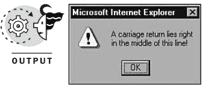

***图 5.7：** 显示回车符的警告框。*

-   单引号和双引号

```
<script language="JavaScript">
<!-- Cloaking device on!
alert("\"That wasn't how it was at all!\" she said.");
// Cloaking device off -->
</script>
```

图 5.8 展示了在字符串中放置引号的效果。

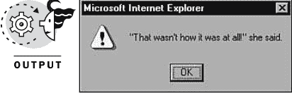

图 5.8：显示单引号和双引号的警告框。

-   制表符

```
<script language="JavaScript">
<!-- Cloaking device on!
alert("This line has a tab\there");
// Cloaking device off -->
</script>
```

图 5.9 展示了制表符对字符串的影响。

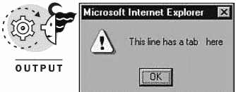

图 5.9：显示插入制表符的警告框。

**练习**

修改互动故事示例，使你使用一个警告框来显示全部文本。（提示：你需要使用转义字符 \r 在每行之间创建回车换行。）

**接下来**

既然你已经熟悉了变量和数组，下一章将开始讲解表达式、条件和运算符。

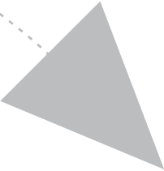

## 表达式、条件、运算符以及更多字符串和数字

在上一章中，你了解了如何在 JavaScript 代码中使用变量和数组来以值的形式存储信息。在本章中，你将在此基础上进一步学习如何处理这些信息。

本章将教你以下内容：

-   表达式
-   条件
-   各种类型的运算符及其使用方法
-   字符串类型与数字类型的相互转换

### 术语深入——什么是表达式和条件？

要学习任何计算机语言，都难免需要不时跳出来从外部视角审视它，JavaScript 也不例外。让我们暂时停下来，了解一下在继续 JavaScript 学习之旅之前你需要掌握的一些新术语。

## 表达式和条件

有了变量和数组，你几乎可以将所有想要的数据以各种类型存储起来。然而，最终你会希望对这些信息做更多的事情，而不仅仅是将其简单地输出到屏幕上或警告框中。你会想要修改它、操作它或验证它。表达式和条件正是用于这些目的。

表达式用于将两个或多个值组合在一起，得到一个新的值。举一个简单的例子，以下求和就是一个表达式：

-   1 + 2 = 3

你将两个值（1 和 2）组合，得到第三个值（3）。

另一个例子是：

-   3 + 3 - 1 = 5

这里，三个值（3、3 和 1）被组合在一起，产生另一个值（5）。

另一方面，条件用于比较值并返回一个布尔真值——true 或 false。条件的一个例子是：

-   柠檬是黄色的吗？是

或者另一个例子：

-   3 + 3 = 6 吗？是

注意这两个条件都是带有"是"或"否"答案的问题（好吧，也许柠檬的问题可以有"也许"）。就 JavaScript（以及其他计算机语言）而言，条件的结果是"是"或"否"的值。

> **注意**
> 学习 JavaScript 是有益的，因为它能帮助你理解其他编程语言。而且，确实如此——在你学会了一种计算机语言之后，其余的语言似乎更容易学了！


### 运算符介绍

表达式和条件语句使用运算符来组合数据。*运算符*（Operators）必须作用于某些数据才能进行运算。它们可以作用于一个数据，这使其成为*一元*（unary）运算符；可以作用于两个数据，这使其成为*二元*（binary）运算符；也可以作用于三个数据，这使其成为*三元*（ternary）运算符。

让我们来看一些更常见的运算符。

### 算术运算符

这些运算符是我们熟悉的数学运算符。它们包括：

- 加 (+)
  `1 + 3 = 4`
- 减 (-)
  `2 - 1 = 1`
- 除 (/)
  `4 / 2 = 2`
- 乘 (*)
  `2 * 2 = 4`
- 取模 (%)
  `9 % 5 = 4`

> **NOTE**
> 所有这些运算符都是二元的。

唯一可能需要进一步解释的算术运算符是取模运算符。这个运算符也称为*余数*（remainder）运算符，它考察的是除法完成后剩余的部分。因此，5 除 9 得 1，余 4。使用整数时，结果也是整数。然而，对于实数（浮点数，非整数），结果则是实数。例如：

```
5.5 % 2.2 = 1.1
```

> **CAUTION**
> JScript 1.0 在应用取模运算符之前会将实数截断为整数，因此 `5.3 % 2.2 = 1`。

使用这些运算符时要小心，因为如果使用不当，它们可能导致 `NaN` 或 `Infinity`。除以 0 就是可能导致问题的操作之一。

### 82 第 6 章：表达式、条件、运算符，以及更多关于字符串和数字的内容

**JavaScript 示例**

以下是算术运算符实际应用的一些示例。

> NOTE
> 脚本块外的内容已被省略。所有这些示例都是使用空白模板文件创建的。

- *加法运算符：+（见图 6.1）*

```javascript
<script language="JavaScript">
<!-- Cloaking device on!
var a = 6, b = 4;
alert(a + b);
// Cloaking device off -->
</script>
```

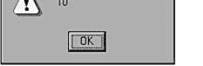

- *减法运算符：-（见图 6.2）*

```javascript
<script language="JavaScript">
<!-- Cloaking device on!
var a = 6, b = 4;
alert(a - b);
// Cloaking device off -->
</script>
```

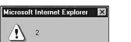

- *除法运算符：/（见图 6.3）*

```javascript
<script language="JavaScript">
<!-- Cloaking device on!
var a = 6, b = 3;
alert(a / b);
// Cloaking device off -->
</script>
```

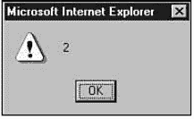

**图 6.3：除法运算符的实际应用。**

- *乘法运算符：*（见图 6.4）*

```javascript
<script language="JavaScript">
<!-- Cloaking device on!
var a = 6, b = 3;
alert(a * b);
// Cloaking device off -->
</script>
```

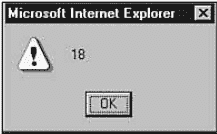

**图 6.4：乘法运算符的实际应用。**

- *取模运算符：%（见图 6.5）*

```javascript
<script language="JavaScript">
<!-- Cloaking device on!
var a = 6, b = 4;
alert(a % b);
// Cloaking device off -->
</script>
```

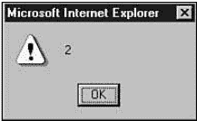

**图 6.5：取模运算符的实际应用。**

### 练习

按照前面的示例练习使用算术运算符。

### 关系运算符

*关系*（Relational）运算符用于比较。这些运算符如下：

- 小于：<
  `5 < 6`
- 小于或等于：<=
  `6 <= 6` 或 `6 <= 7`
- 大于：>
  `7 > 4`
- 大于或等于：>=
  `5 >= 5` 或 `5 >= 4`
- 等于：==
  `5 == 5`
- 不等于：!=
  `5 != 3`

> **NOTE**
> 这些都是二元运算符。

这里你看到数字比较的例子，但它们也可以用于字符串。（稍后详细介绍。）最好遵守的一条规则是：被比较的两个对象必须是同一类型。如果不是，JavaScript 会尝试将数据从一种类型转换为另一种类型，但这并不总是成功的。为了安全起见，保持被比较对象的类型相同。

### 逻辑运算符

*逻辑*（Logical）运算符的工作原理不是那么直观。当你开始在语句中使用它们时（例如 If 语句），它们的功能会变得更加清晰。

三个逻辑运算符如下：

- 逻辑与：`&&`
- 逻辑或：`||`
- 逻辑非：`!`

> **NOTE**
> 逻辑与和逻辑或是二元的，而逻辑非是一元的。

这些运算符让你能够将多个变量测试的结果组合成一个易于使用的结果。

逻辑与（`&&`）意味着两边都必须为真。`&&` 实际应用的一个简单现实例子可能是司机在踩刹车之前的思维过程：车速太快 `&&` 司机想要减速。

逻辑或（`||`）意味着至少有一边必须为真。再次使用汽车类比，司机在打开车头灯之前的思维过程可能是：再说一遍逻辑或就是 `||` 表示至少一边为真。用汽车的例子来说，司机决定开车灯前可能会想：天变暗了 `||` 能见度差。

逻辑非（`!`）返回真/假的相反值。所以，要打开汽车的车头灯，必须是 `! light`（因此是天黑）。

> **NOTE**
> 如果其中一些现在看起来有点模糊，不要担心。你以后会有很多机会使用它们，当你创建了一些真正的 JavaScript 示例后，你肯定会掌握其要领的！

### 其他一元运算符

顾名思义，这些是作用于一个值的一元运算符。这些运算符包括：

- 前缀和后缀自增：`++`
- 前缀和后缀自减：`--`
- 一元正号：`+`
- 一元负号：`-`

一元负号只是将值的符号从负变正或从正变负。在这四个中，这是最容易理解的。另一方面，一元正号不这样做；它用于将操作数转换为数字类型（例如，从字符串转换）。

前缀/后缀自增/自减运算符为你提供了一种快速简便的方式来表达 `x = x + 1` 和 `x = x - 1`。然而，前缀和后缀部分对这些运算符使用结果的整体效果有影响。

前缀运算符很简单，按预期工作。
如果 a = 5，那么
`++a + 2 = 8`
因为 a 在加 2 之前自增到了 6，而
`--a + 2 = 6`
因为 a 在加 2 之前自减 1 变成了 4。

后缀运算符的作用不同，因为自增或自减是在旧值用于表达式之后才执行的。所以，如果 a = 5，那么
`a++ + 2 = 7`
因为只有在表达式之后才执行自增。
以下也是如此：
`a-- + 2 = 7`
这是因为 a 的自减是在旧值用于表达式之后才执行的。

> **TIP**
> 记住这一点的最好方法是：如果运算符在前面（前缀），则先执行操作。然而，如果它们在后面（后缀），则操作在表达式之后执行。

### JavaScript 示例

- *前缀自增（见图 6.6）*

```javascript
<script language="JavaScript">
<!-- Cloaking device on!
var a = 6, b = 2;
alert(++a + b);
// Cloaking device off -->
</script>
```

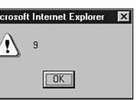

*图 6.6：前缀自增运算符的实际应用。*

- *前缀自减（见图 6.7）*

```javascript
<script language="JavaScript">
<!-- Cloaking device on!
var a = 6, b = 2;
alert(--a + b);
// Cloaking device off -->
</script>
```

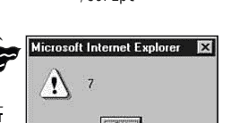

*图 6.7：前缀自减运算符的实际应用。*

- *后缀自增（见图 6.8）*

```javascript
<script language="JavaScript">
<!-- Cloaking device on!
var a = 6, b = 2;
alert(a++ + b);
alert(a);
// Cloaking device off -->
</script>
```

这里，你看到第二个警告框（见图 6.9）用于显示 a 的值在表达式之后已经自增了 1。

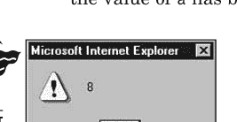

*图 6.8：后缀自增运算符的实际应用。*

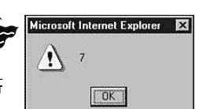

*图 6.9：第二个警告框确认 a 自增了 1。*

- *后缀自减（见图 6.10）*

```javascript
<script language="JavaScript">
<!-- Cloaking device on!
var a = 6, b = 2;
alert(a-- + b);
alert(a);
// Cloaking device off -->
</script>
```

这里，你看到第二个警告框（见图 6.11）用于显示 a 的值在表达式之后已经自减了 1。

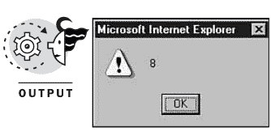

*图 6.10：后缀自减运算符的实际应用。*

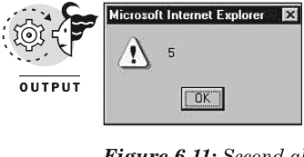

*图 6.11：第二个警告框确认 a 自减了 1。*

### 赋值运算符

最显而易见的赋值运算符是普通赋值（=）。它用于将一个值复制到变量中。你已经使用过这个运算符，但为了强调这一点，这里有一个变量 a 被赋值为 3 的例子：

```
a = 3
```

它也可以用于将多个变量设置为相同的值。在以下示例中，所有变量（a、b、c 和 d）都被设置为 5：

```
a = b = c = d = 5
```

这组中的其他运算符称为*复合*（compound）赋值运算符，它们的工作原理与 ++ 和 -- 非常相似。

以下是一些例子：

`x += 3` 等同于 `x = x + 3`

`x -= 3` 等同于 `x = x - 3`


`x *= 3` 与 `x = x * 3` 相同
`x /= 3` 与 `x = x / 3` 相同

### JavaScript 示例

- 复合运算符：`+=`（见图 6.12）

```
<script language="JavaScript">
<!-- Cloaking device on!
var x = 6;
alert(x += 2);
// Cloaking device off -->
</script>
```

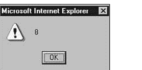

- 复合运算符：`-=`（见图 6.13）

```
<script language="JavaScript">
<!-- Cloaking device on!
var x = 6;
alert(x -= 2);
// Cloaking device off -->
</script>
```

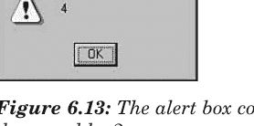

- 复合运算符：`*=`（见图 6.14）

```
<script language="JavaScript">
<!-- Cloaking device on!
var x = 6;
alert(x *= 2);
// Cloaking device off -->
</script>
```

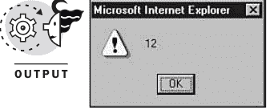

*图 6.14：警告框确认 x 的值已乘以 2。*

- 复合运算符：`/=`（见图 6.15）

```
<script language="JavaScript">
<!-- Cloaking device on!
var x = 6;
alert(x /= 2);
// Cloaking device off -->
</script>
```

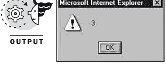

*图 6.15：警告框确认 x 的值已除以 2。*

### 其他运算符

还有三个运算符你需要了解，它们实际上不属于上述任何类别：三元条件运算符（`?:`）、二元字符串连接运算符（`+`）和一元 `typeof` 运算符。

条件运算符是一种快速简便的方法，根据条件的结果为变量赋予两个可能值中的一个。考虑以下示例：

```
W = 1, X = 2, Y = 3, Z = 4
Ans = (W < X) ? Y : Z

Ans 等于 4。
```

### 运算符介绍

这看起来很复杂，但实际上并非如此。其工作原理如下：如果 `?` 前面的表达式（即条件）为真，则将冒号（`:`）左侧表达式的值赋给变量 `Ans`。否则，使用左侧的表达式（如本例所示）。

字符串连接运算符用于通过将两个独立的字符串连接在一起（连接）来创建一个新字符串：

```
A = "JavaScript "
B = "by Example!"
C = A + B
```

### 注意

注意这个运算符与算术加号运算符相同。同一运算符的不同含义是 JavaScript 中让初学者困惑的领域之一。为避免这种情况，你必须对每个运算符使用正确的术语。避免使用"加"和"减"等术语，因为它们含义模糊！

最后一个运算符是 `typeof` 运算符。该运算符用于告诉你变量中保存的数据类型或条件返回的数据类型。

### 警告

`typeof` 运算符在 Netscape Navigator 2.02 中不存在。

表 6.1 显示了根据操作类型常见的七种输出结果。

*表 6.1：typeof 字符串*

| 类型 | 结果 |
|------|--------|
| Undefined | "undefined" |
| Null | "object" |
| Boolean | "boolean" |
| Number | "number" |
| String | "string" |
| Object（非函数） | "object" |
| Object（函数） | "function" |

### 注意

你在第 5 章"JavaScript 数组和转义字符"中已经使用的另一个运算符是 `new` 运算符。它使你能够创建新对象（如 `Array`）。

是时候看一些示例了！

92   第 6 章：表达式、条件、运算符以及更多字符串和数字

### 其他运算符示例

- 条件运算符：`?:`


示例 1（见图 6.16）

```
<script language="JavaScript">
<!-- Cloaking device on!
var w = 1, x = 2, y = 3, z = 4, ans;
ans = (w > x) ? y : z
alert(ans);
// Cloaking device off -->
</script>
```


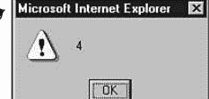

图 6.16：警告框确认 ans 的值为 4。


示例 2（见图 6.17）

```
<script language="JavaScript">
<!-- Cloaking device on!
var w = 1, x = 2, y = 3, z = 4, ans;
ans = (w < x) ? y : z
alert(ans);
// Cloaking device off -->
</script>
```


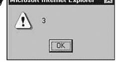

图 6.17：警告框确认 ans 的值为 3。

- 字符串连接运算符：`+`


示例 1（见图 6.18）

```
<script language="JavaScript">
<!-- Cloaking device on!
var A = "JavaScript ", B = "by Example!";
C = A + B;
alert(C);
// Cloaking device off -->
</script>
```

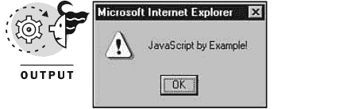

图 6.18：显示 JavaScript by Example! 的警告框。

### 示例 2（见图 6.19）

> **注意**
> 本示例演示了尝试将字符串数字与数字连接时发生的情况。不会生成错误，因为数字会自动转换为字符串，但结果可能不是你所期望的。

```
<script language="JavaScript">
<!-- Cloaking device on!
var A = "10", B = 5;
C = A + B;
alert(C);
// Cloaking device off -->
</script>
```

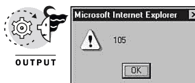

图 6.19：警告框显示字符串 105。

- `typeof` 运算符：`typeof`（见图 6.20、6.21 和 6.22）

### 示例 1

```
<script language="JavaScript">
<!-- Cloaking device on!
var x = "Hello", y;
alert("Variable x value is " + typeof(x));
alert("Variable y value is " + typeof(y));
alert("Variable z value is " + typeof(z));
// Cloaking device off -->
</script>
```

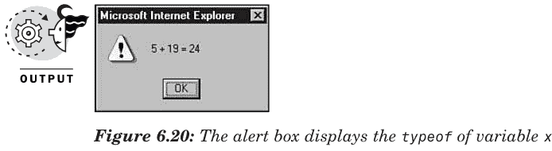

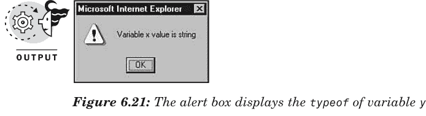

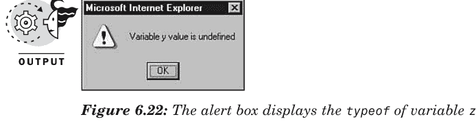

### 练习

本章到目前为止内容繁忙，但它不仅让你对运算符有了良好的基础，还让你有机会练习编写 JavaScript、添加注释以及使用变量和方法。作为练习，尝试使用这里涵盖的运算符创建一些简单的 JavaScript 示例。这不仅会是很好的练习（熟能生巧！），而且通过使用你自己的示例，你会对运算符有更好的感觉；不久之后它们就会变得得心应手。

### 重温字符串和数字

让我们用一个非常简单的 JavaScript 计算器的示例快速重温字符串和数字！在这个示例中，你不仅会看到一种使用运算符的方法，还会发现如何通过称为*类型转换*的过程将字符串数字更改为数字。

### JavaScript 计算器

1. 从基本的 HTML 模板开始：

```
<html>
<head>
<title>A Simple Page</title>
<script language="JavaScript">
<!-- Cloaking device on!

// Cloaking device off -->
</script>
</head>
<body>

</body>
</html>
```

2. 在这里声明你将使用的变量。你应该有两个变量用于用户将输入的每个数字——一个用于用户想要使用的运算符，最后一个用于保存答案：

```
<html>
<head>
<title>A Simple Page</title>
<script language="JavaScript">
<!-- Cloaking device on!
var num1, op, num2, ans;
// Cloaking device off -->
</script>
</head>
<body>

</body>
</html>
```

3. 接下来，使用 `prompt()` 方法提示用户输入第一个数字，并将其赋给变量 `num1`：

```
<html>
<head>
<title>A Simple Page</title>
<script language="JavaScript">
<!-- Cloaking device on!
var num1, op, num2, ans;
num1 = prompt("Enter a number:","a number");
// Cloaking device off -->
</script>
</head>
<body>

</body>
</html>
```

4. 添加另一个提示，这次要求输入要使用的运算符。将此值赋给变量 `op`：

```
<html>
<head>
<title>A Simple Page</title>
<script language="JavaScript">
<!-- Cloaking device on!
var num1, op, num2, ans;
num1 = prompt("Enter a number:","a number");
op = prompt("Enter an operator (+, -, *, / and %)", "operator");
// Cloaking device off -->
</script>
</head>
<body>

</body>
</html>
```

5. 接下来，为第二个数字添加另一个提示。这被赋给 `num2`：

```
<html>
<head>
<title>A Simple Page</title>
<script language="JavaScript">
<!-- Cloaking device on!
var num1, op, num2, ans;
num1 = prompt("Enter a number:","a number");
op = prompt("Enter an operator (+, -, *, / and %)", "operator");
num2 = prompt("Enter another number:", "a number");
// Cloaking device off -->
</script>
</head>
<body>

</body>
</html>
```

6. 现在，执行计算。在这里，你必须使用 `eval()` 方法来计算总和。这个方法会为你进行数学运算。但是，在进行数学运算之前，你需要将字符串变量 `num1` 和 `num2` 更改为数字。你可以通过将它们声明为数字来做到这一点。计算的结果被传递给变量 `ans`：

> **注意**
> 
> `eval()` 方法将在后面的章节中更详细地介绍。


### 在 JavaScript 中使用语句

语句是 JavaScript 的核心所在！通过学习如何在 JavaScript 中使用语句，你将看到你的脚本提升到一个全新的水平，让你能够轻松完成更复杂的事情。

本章将教你以下内容：

- 什么是语句
- 变量语句
- if 语句
- 迭代语句
- continue 语句
- break 语句
- switch 语句

### 什么是语句？

所有编写的 JavaScript 代码，无论是一行代码还是一个复杂的小程序，都由一系列*语句*组成。你已经见过这样的语句了。下面这个弹出的警告框就是语句执行的结果：

```javascript
<script language="JavaScript">
<!-- Cloaking device on!
alert("This is a statement!");
// Cloaking device off -->
</script>
```

这也是：

```javascript
<script language="JavaScript">
<!-- Cloaking device on!
var ournames = "Adrian and Kathie";
// Cloaking device off -->
</script>
```

这里还有更多的语句：

```javascript
<script language="JavaScript">
<!-- Cloaking device on!
var ournames = "Adrian and Kathie", ans;
alert("Welcome from " + ournames);
ans = prompt("Do you like JavaScript?", "Yes or No");
alert(ans);
// Cloaking device off -->
</script>
```

你编写的所有语句都是从上到下处理的（除非稍后你会看到，你将它们组织成其他方式）。但请注意每条语句的另一个特点。是的，在每一行的末尾都有一个分号（;）。在 JavaScript 中，分号是表示语句结束的恰当方式（类似于句子中的句号）。你*不需要*添加它们，因为 JavaScript 会假设你很懒，并为你自动添加——但你应该添加它们，原因有二：

- 它们有助于使你的 JavaScript 更易读。
- 在某些情况下不使用它们会导致问题，因为 JavaScript 可能会将它们放置在不正确的位置。

让我们来看看 JavaScript 程序员可以使用的一些不同类型的语句。

### 变量语句（variable Statement）

**variable** 是你已经知道如何使用的语句，这里提及它只是为了强化语句类似于英语中完整句子的概念。因此，像下面这样的变量语句

```javascript
var this_year = 2001
```

表示创建一个名为 this_year 的变量，并为其赋值 2001。这是一个完整的句子。

### if 语句

**if** 语句是一种流程控制语句，具有多种用途。

if 语句使你的 JavaScript 脚本能够在两组备选语句之间进行选择以运行（或*执行*）。选择是通过布尔值（true 或 *false*）条件来完成的。

让我们在这个例子中回顾一下确认框，看看如何使用 if 语句使这种类型的消息框生效。

首先，你必须使用 `confirm()` 方法创建一个简单的确认框：

```javascript
<script language="JavaScript">
<!-- Cloaking device on!
confirm("Do you want to proceed with this book?  Click OK to proceed otherwise click Cancel.");
// Cloaking device off -->
</script>
```

这会向用户呈现两个选项："确定" 和 "取消"（见图 7.1）。接下来，让我们编写代码来处理那些点击 "确定" 的用户（没有人会想点 "取消" 的，对吧？）。

**图 7.1：** *显示的确认框。*

当用户点击 "确定" 时，她正在创建一个值为 true 的布尔值，你可以用这个方法来检测她点击了什么。要做到这一点，你必须将一个变量赋值给 `confirm()` 方法，如下所示：

```javascript
<script language="JavaScript">
<!-- Cloaking device on!
var response = confirm("Do you want to proceed with this book?
Click OK to proceed otherwise click Cancel.");
// Cloaking device off -->
</script>
```

这个变量 response 保存了用户对该问题的回答（与 `prompt()` 方法类似，该变量保存用户输入的字符串）。因此，如果（或当她！）她点击 "确定"，值 true 就会被赋值给变量 response（见图 7.2）。你可以使用 if 语句来检测这一点。

以下是实现此功能的 JavaScript 代码：

```javascript
<script language="JavaScript">
<!-- Cloaking device on!
var response = confirm("Do you want to proceed with this book?
Click OK to proceed otherwise click Cancel.");
if ( response == true )
{
alert("A fine choice!");
}
// Cloaking device off -->
</script>
```

*图 7.2：点击 "确定" 时显示的警告框。*

让我们逐行分析这段代码：

```javascript
if ( response == true )
```

这一行是 `if` 语句的开始（注意它不以分号结尾），它包含了一个条件，询问 response 的值是否设置为 true。如果是，你就继续到下一行。

下一行包含左花括号（`{`），这是许多 JavaScript 初学者难以理解的一个字符。然而，花括号的功能非常直观。花括号（{ 和 }）用于清晰地*括起语句*。

> **提示**
> 将花括号视为定义语句中的段落——因此如果某事为真，则执行
>
> ```
> {
> this;
> that;
> and the other;
> }
> ```

> **注意**
> 关于花括号的放置位置，有几种不同的观点。然而，这里采用的惯例是将它们放在单独的行上，以获得最佳的 JavaScript 清晰度。

继续到下一行，这行用于显示祝贺用户做出明智选择的警告框。最后，你会看到右花括号（}）。

如果你保存这个文件并将其加载到浏览器中，你可以看看它是如何工作的。

首先，你会被确认框迎接（见图 7.3）。

**图 7.3：** *确认框向你问好。*

然后，当你点击 "确定" 时，它会被警告框取代（见图 7.4）。

7. 最后，使用 `alert()` 方法显示 ans 的值。在警告框中，你会看到求和结果通过将变量值与空格和等号（=）连接而重建并显示，使输出清晰明确：

```javascript
<html>
<head>
<title>A Simple Page</title>
<script language="JavaScript">
<!-- Cloaking device on!
var num1, op, num2, ans;
num1 = prompt("Enter a number:","a number");
op = prompt("Enter an operator (+, -, *, / and %)", "operator");
num2 = prompt("Enter another number:", "a number");
ans = eval(Number(num1)+ op + Number(num2));
alert(num1 + " " + op + " " + num2 + " = " + ans);
// Cloaking device off -->
</script>
</head>
<body>

</body>
</html>
```

8. 保存文件并将页面加载到浏览器中。在提示框中输入数字或运算符，看着它为你做数学计算！（见图 6.23。）

**输出**

**图 6.23：** *警告框显示你让 JavaScript 计算的算式的答案！*

### 注意

你可能已经猜到，将数字转换为字符串的方法是将其声明为字符串。

以下是一个例子：

```javascript
`String(varname)`
```

#### 接下来是什么

现在你已经牢固掌握了变量、数组和运算符，你已经准备好探索 JavaScript 语句了。

```javascript
<html>
<head>
<title>A Simple Page</title>
<script language="JavaScript">
<!-- Cloaking device on!
var num1, op, num2, ans;
num1 = prompt("Enter a number:","a number");
op = prompt("Enter an operator (+, -, *, / and %)", "operator");
num2 = prompt("Enter another number:", "a number");
ans = eval(Number(num1)+ op + Number(num2));
// Cloaking device off -->
</script>
</head>
<body>

</body>
</html>
```


*图 7.4：警告框。*

那么，if 语句的基本骨架如下：

```
if (condition)
{
    statement1
}
```

条件部分总是必需的，并且必须是一个布尔表达式。

statement1 是可选的。（这里不一定非要写任何内容；尽管这样确实违背了编写 JavaScript 的初衷，因为如果不添加 if 语句，你什么也做不了！）不过，如果这里有语句，那么当条件为真时，它们会被执行。

**注意**

如果条件为 `null` 或 `undefined`，则会被视为 `false`。

好的，JavaScript 可以处理有人点击“确定”的情况，但“取消”按钮怎么办呢？这正是 if 语句下一部分的用武之地——`else`。通过在语句中添加 `else`，你可以处理条件的例外情况（在本例中，是响应“取消”点击，这将值 `false` 赋给变量 `response`）：

```
<script language="JavaScript">
<!-- Cloaking device on!
var response = confirm("Do you want to proceed with this book?
Click OK to proceed otherwise click Cancel.");
if ( response == true )
{
alert("A fine choice!");
}
else
{
alert("Are you sure? JavaScript is fun!");
}
// Cloaking device off -->
</script>
```

`else` 部分附加在闭合花括号之后。此外，这里的语句被包含在一组新的花括号中。进行此修改并保存文件；然后再次尝试点击“取消”按钮（参见图 7.5）。

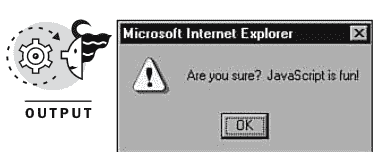

图 7.5：点击“取消”时显示的警告框。

因此，if ... else 语句的骨架结构如下：

```
if (condition)
{
    statement1
}
else
{
    statement2
}
```

**练习**

重写前面的 JavaScript 代码，使得 if 语句测试的条件变为 `response == false`。

### 迭代语句

迭代是指重复执行一系列语句

- 指定次数
- 直到满足某个条件

有四种迭代语句可用：

- `do ... while` 语句
- `while` 语句
- `for` 语句
- `for ... in` 语句

这些语句执行的任务略有不同，但都是值得学习的有用语句。

### do ... while 语句

`do ... while` 语句执行一个语句或一个语句块，然后重复整个过程，直到条件表达式为 `false`。一个例子可以说明这一点：

```
<script language="JavaScript">
<!-- Cloaking device on!
var x = 1
do
{
++x;
alert(x);
}
while (x < 10);
// Cloaking device off -->
</script>
```

前面的代码有一个变量 `x`，其初始值为 `1`。接下来，脚本的 `do` 部分指定将 `1` 加到 `x` 上，然后在警告框中显示该值。脚本的 `while` 部分指定，当 `x` 小于 `10` 时需要执行此操作。

`do ... while` 语句不仅可以处理数字。在下面的示例中，提示框会持续重新出现，直到输入一个文本字符串。输入一些文本后，脚本的 `while` 部分变为 `false`，脚本的下一部分开始运行，显示警告框：

```
<script language="JavaScript">
<!-- Cloaking device on!
do
{
sometext = prompt("Enter some text","");
}
while (sometext == "");
alert(sometext);
// Cloaking device off -->
</script>
```

请注意，要使前面的示例工作，输入框中不能有默认文本。不过，稍作修改即可解决这个问题：

```
<script language="JavaScript">
<!-- Cloaking device on!
do
{
sometext = prompt("Enter some text","Type some text");
}
while (sometext == "Type some text" || sometext == "" || sometext == null);
alert(sometext);
// Cloaking device off -->
</script>
```

这个示例解决了三个问题：

- 用户保留默认文本
- 用户将输入框留空
- 用户点击“取消”

此功能是通过使用逻辑或运算符（`||`）实现的。当 `sometext` 等于 "Type some text"，或为空，或为 `null`（用户点击了“取消”）时，`do` 部分就会运行。

> **注意**
>
> 这种示例在现实世界中不应过度使用。仅在用户必须输入值（例如用于发送某些信息的电子邮件地址）至关重要时才使用它。过度使用可能会惹恼访问者，尤其是当他们甚至无法取消消息框时！

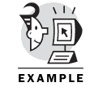

使用任何类型的迭代语句时都必须小心，因为很容易出错并导致代码无限循环！以下就是一个例子（但最好不要尝试运行这个示例！）：

```
<script language="JavaScript">
<!-- Cloaking device on!
var x = 1
do
{
++x;
alert(x);
}
while (x > 0);
// Cloaking device off -->
</script>
```

这个示例会让你永远点击警告框的“确定”按钮，因为通过不断地将 `1` 加到前一个值上，`x` 永远不可能变得小于或等于零！

> **警告**
>
> 对此类错误要非常小心，因为它很容易锁住甚至导致访问者的浏览器崩溃！

**练习**

如何纠正前面的示例，使其正常工作？

### while 语句

`while` 语句与 `do ... while` 语句类似，工作方式也基本相同：

```
<script language="JavaScript">
<!-- Cloaking device on!
var x = 1
while (x < 10)
{
++x;
alert(x);
}
// Cloaking device off -->
</script>
```

**注意**

初学者通常觉得 `do ... while` 语句更容易理解。这通常与它们的工作方式有关。`do ... while` 语句在脚本运行过程中至少会执行一次，而 `while` 语句可能根本不会执行（取决于情况）。这有时会让 JavaScript 新手感到困惑。

**练习**

使用 `while` 语句创建一个提示框示例（类似于 `do ... while` 示例）。

### for 语句

`for` 语句也类似于前面的语句，但它稍微复杂一些。区别在于它内置了一种计数方法，使得整个过程不会无限进行：

```
<script language="JavaScript">
<!-- Cloaking device on!
for (x = 1; x < 10; ++x)
{
alert(x);
}
// Cloaking device off -->
</script>
```

**警告**

然而，如果设置不正确，例如

```
for (x=1;x>0;x++)
```

它确实可能无限循环！

看看完成大部分工作的这一行：

```
for (x = 1; x < 10; ++x)
```

这行以紧凑的形式表达了以下含义：对于从 `x = 1` 到 `x < 10`，将 `x` 的值递增 `1`。然后运行后续语句，直到条件满足。

思考 `for` 语句的一种简写方式是：

```
for (initialization; test; increment)
```

`initialization` 是变量的初始值；`test` 是布尔条件；`increment`（或 `decrement`）是在测试条件为假之前，对初始化变量执行的操作。

下面是一个例子，其中每一步变量都递减 `2`：

```
<script language="JavaScript">
<!-- Cloaking device on!
for (x = 10; x >= 0; x = x - 2)
{
alert(x);
}
// Cloaking device off -->
</script>
```

以下是另一个例子，其中 `for` 语句用于创建数组的 10 个元素，并为每个元素分配与其位置对应的值。最后，完成后，将数组的内容输出到警告框中。这是示例（输出参见图 7.6）：

```
<script language="JavaScript">
<!-- Cloaking device on!
var myarray = new Array();
for (i = 0; i < 10; i++)
{
myarray[i] = i;
}
alert(myarray);
// Cloaking device off -->
</script>
```

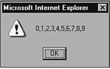

图 7.6：`myarray` 的内容。

**练习**

修改前面的示例，使其创建一个包含 100 个元素的数组。

### for ... in 语句

你将在此处看到的最后一个迭代语句是 `for ... in` 语句。此语句用于对数组的元素执行一个或多个语句。

这使你可以使用单个语句处理数组的所有元素，而无需为每个元素编写单独的语句。

在这个示例中，你看到 `for ... in` 语句用于将数组 `myarray` 中五个元素的值各加 1：

```
<script language="JavaScript">
<!-- Cloaking device on!
var myarray = new Array(5);
myarray[0] = 5
myarray[1] = 8
myarray[2] = 10
myarray[3] = 18
myarray[4] = 180
for (x in myarray)
{
myarray[x] = ++myarray[x];
}
alert(myarray);
// Cloaking device off -->
</script>
```

`for (x in myarray)` 这一行使 `x` 依次取值为数组元素的索引，并导致每次迭代的值递增 1（如图 7.7 所示）。


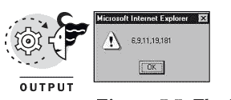

图 7.7：myarray 中元素的最终值。

for ... in 循环的另一个实用场景是用字符串填充数组元素，例如图片文件名（你稍后会看到这方面的用法）。假设你需要为一个数组填充 10 个图片文件名的元素（img0.gif、img1.gif、img2.gif、... img9.gif）。使用 for ... in 语句来实现这一点非常简单：

```
<script language="JavaScript">
<!-- Cloaking device on!
var myarray = new Array("", "", "", "", "", "", "", "", "", "");
for (x in myarray)
{
    myarray[x] = "img" + x + ".gif";
}
alert(myarray);
// Cloaking device off -->
</script>
```

最终的 alert 对话框（如图 7.8 所示）显示了这 10 个元素的内容。

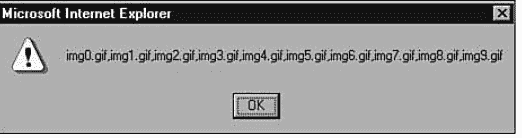

图 7.8：myarray 中 10 个元素的最终值。

> **注意**
> 如果你觉得 for ... in 语句的整体概念还不太清楚，不用担心。在本书后续内容中，你会有大量机会使用它。

**练习**
修改前面的示例，使其创建一个包含五个超链接的数组。

### continue 语句

continue 语句与 while、do…while、for 和 for…in 语句配合使用。continue 语句使你能够强制计算机执行下一次迭代。

因此，如果将 continue 语句直接放在某个语句的主体中，其后的所有语句都将被忽略。以下是一个示例：

```
<script language="JavaScript">
<!-- Cloaking device on!
var x = 0;
while (x < 10)
{
    x++;
    alert(x);
    continue;
    alert("You never see this!");
}
// Cloaking device off -->
</script>
```

这种效果通常是不可取的，更好的做法是在 if 语句中使用 continue 语句。在这个示例中，当 x = 5 时，alert 对话框会被跳过：

```
<script language="JavaScript">
<!-- Cloaking device on!
var x = 0;
while (x < 10)
{
    x++;
    if (x == 5)
    {
        continue;
    }
    alert(x);
}
// Cloaking device off -->
</script>
```

你可以修改这个示例，使其只显示奇数，使用条件 `if (x % 2 == 0)`，当 x 为偶数时该条件为真（结果显示在图 7.9 中）：

```
<script language="JavaScript">
<!-- Cloaking device on!
var x = 0;
while (x < 10)
{
    x++;
    if (x % 2 == 0)
    {
        continue;
    }
    alert(x);
}
// Cloaking device off -->
</script>
```


*图 7.9：只显示奇数。*

或者，通过更改条件，可以使其只显示偶数（新的输出结果如图 7.10 所示）：

```
<script language="JavaScript">
<!-- Cloaking device on!
var x = 0;
while (x < 10)
{
    x++;
    if (x % 2 != 0)
    {
        continue;
    }
    alert(x);
}
// Cloaking device off -->
</script>
```


*图 7.10：通过更改条件，现在只显示偶数。*

第 116 章 第 7 章：在 JavaScript 中使用语句

**练习**
在几个示例脚本中试验 continue 语句。尝试各种不同的条件，真正体会它的工作原理。

### break 语句

与 continue 语句相辅相成的是 break 语句。continue 语句强制执行下一次迭代，而 break 语句则让你完全跳出循环！

你通常在 while、for、for ... in 和 do ... while 语句（以及我们尚未介绍的 switch 语句）中使用 break 语句。

在下面的示例中，首先显示第一个 alert 对话框（显示 1），之后 break 语句生效，将你踢出循环：

```
<script language="JavaScript">
<!-- Cloaking device on!
var x = 0;
while (x < 10)
{
    x++;
    alert(x);
    break;
    alert("Never seen!");
}
// Cloaking device off -->
</script>
```

同样，使用 break 语句的最佳方式是与 if 语句配合使用。这个示例允许你输入一个数字，当 **x** 的值等于该数字时退出 while 语句：

```
<script language="JavaScript">
<!-- Cloaking device on!
var x = 0, breakat;
breakat = prompt("Pick a number between 1 and 10 to break at", "");
while (x < 10)
{
    if (x == breakat)
        break;
    alert(x);
    x++;
}
// Cloaking device off -->
</script>
```

**while** 迭代语句将一直执行，直到 **x** 的值等于 **breakat** 的值，此时循环退出。因此，如果你在提示框中输入 5，将显示 1–4 的 alert 对话框。

**练习**
在几个示例脚本中试验 **break** 语句。同样，尝试各种不同的条件，真正体会它的工作原理。

### switch 语句

**switch** 语句使你能够在指定表达式的值与某个标签匹配时执行一条或多条语句。

脚本的布局如下：

```
switch (expression)
{
    case label1:
        statementList
    case label2:
        statementList
}
```


在下面的示例中，输入到提示框中的值决定了运行哪些语句（操作前后分别如图 7.11 和图 7.12 所示）：

```
<script language="JavaScript">
<!-- Cloaking device on!
var yourchoice;
yourchoice = prompt("Choose a number between 1 and 4", "1, 2, 3 or 4")
switch (yourchoice)
{
    case "1":
        alert("You typed in a 1");
        break;
    case "2":
        alert("You typed in a 2");
        break;
    case "3":
        alert("You typed in a 3");
        break;
    case "4":
        alert("You typed in a 4");
        break;
}
// Cloaking device off -->
</script>
```

**第 7 章：在 JavaScript 中使用语句**


*图 7.11：在提示框中输入一个值。*


*图 7.12：alert 对话框显示了运行的是哪条语句。*

每个语句块都需要以 break 语句结束；否则，该特定 case 之后的所有语句都会被执行。

有时，包含一组默认语句很有用，当没有任何标签值与表达式匹配时执行这些语句。前面的示例就是一个这种情况，如果输入的数字不在 1 到 4 之间。


```
<script language="JavaScript">
<!-- Cloaking device on!
var yourchoice;
yourchoice = prompt("Choose a number between 1 and 4", "1, 2, 3 or 4")
switch (yourchoice)
{
    case "1":
        alert("You typed in a 1");
        break;
    case "2":
        alert("You typed in a 2");
        break;
    case "3":
        alert("You typed in a 3");
        break;
    case "4":
        alert("You typed in a 4");
        break;
    default:
        alert("You didn't type in a number between 1 and 4");
        break;
}
// Cloaking device off -->
</script>
```

使用 switch 语句的另一种方式是与你之前了解的 confirm 对话框配合使用。在下面的示例中，你要查找的是布尔值 true 和 false。因为这里不存在其他可能的结果（只有两个可点击的选项——确定和取消），所以不需要 default 语句：

```
<script language="JavaScript">
<!-- Cloaking device on!
var yourchoice;
yourchoice = confirm("Are you at your computer now?")
switch (yourchoice)
{
    case true:
        alert("See, I'm psychic!");
        break;
    case false:
        alert("Eh?  How can you be doing this then?");
        break;
}
// Cloaking device off -->
</script>
```

当你将此页面加载到浏览器中时，会看到如图 7.13 所示的 confirm 对话框。


点击取消，你会看到如图 7.14 所示的 alert 对话框。


**练习**
使用 switch 语句编写一个脚本，当在提示框中输入字母 a、b、c、d 和 e 时运行不同的语句。记得为未预期的输入包含一个 default 语句。

## 接下来

你的 JavaScript 知识正在呈指数级增长！你需要完成的最后一个基础步骤是将你的代码从顺序执行（从上到下运行）转变为使用函数进行模块化，这将是下一章的主题！


# 通过使用函数和事件编写更出色的 JavaScript 脚本

到目前为止，你的 JavaScript 代码由一系列从上到下顺序执行的语句或语句组构成。这对简单的脚本来说很棒，但在大多数情况下，你并不希望所有 JavaScript 代码都在页面加载时运行。你可能只希望开头运行几条语句，然后在其他时间点再运行几条。这就是函数大显身手的地方。

本章将教你以下内容：

- 函数是什么
- 如何使用函数
- 使用事件触发函数
- 向函数传递信息及从函数获取信息
- return 语句

### 第 8 章：通过使用函数和事件编写更出色的 JavaScript 脚本

## 什么是函数？

函数的最简单形式是一组执行某项操作的语句，被归在一个名称下。函数采用以下形式：

```
function functionname()
{
    statements go here!;
}
```

函数由关键字 `function` 后跟你赋予函数的名称组成，例如 `yourMessage`。然后，函数名称后跟圆括号——例如，`yourMessage()`。这些括号是必需的，如果省略则会产生错误。

> **注意**
> 目前，这些括号将保持为空。在本章后面，你将看到它们的用途。

圆括号之后是左花括号和右花括号，语句位于两者之间。

你使用的每个函数都必须有一个名称，并且页面上不能有两个同名的函数。然后，函数可以从网页中运行（或调用或执行）——我们稍后会介绍如何操作。

## 你的第一个函数

在第一次操作之前，事情可能看起来有点复杂，所以让我们来编写你的第一个函数。请按照以下步骤操作：

1. 在你最喜欢的文本编辑器中打开你的 HTML 模板页面。

2. 编写（在脚本块中）关键字 `function` 并为其命名（这个函数将命名为 `yourMessage`）来开始编写函数。记得在行末加上圆括号：

3. 接下来，添加一对花括号：

```
<script language="JavaScript">
<!-- Cloaking device on!
function yourMessage()

// Cloaking device off -->
</script>
```

```
<script language="JavaScript">
<!-- Cloaking device on!
function yourMessage()
{
}
// Cloaking device off -->
</script>
```

> **注意**
> 记得以左花括号（`{`）开始，以右花括号（`}`）结束。JavaScript 新手常犯的一个错误是搞错花括号的顺序，这会导致 JavaScript 无法工作。

4. 接下来，添加一条简单的语句：

```
<script language="JavaScript">
<!-- Cloaking device on!
function yourMessage()
{
alert("Your first function!");
}
// Cloaking device off -->
</script>
```

5. 保存你的工作并将其加载到浏览器中查看会发生什么。

什么也没发生！嗯。别担心！这并不意味着你的 JavaScript 有问题。原因是你还没有 *调用* 函数。你必须这样做，因为与直接在脚本块中输入语句（浏览器遇到时会立即运行）不同，函数不会自动运行，所以你必须编写更多脚本才能让它工作！

你可以通过多种方式调用 JavaScript 函数。最简单但效果最差的方式是在脚本块中直接调用。这只需在脚本块中放置函数名即可：

```
<!-- Cloaking device on!

yourMessage();

function yourMessage()
{
alert("Your first function!");
}
// Cloaking device off -->
</script>
```

6. 再次保存页面并将其加载到浏览器中，看看你的作品是如何运行的！（参见图 8.1。）

### 126 第 8 章：通过使用函数和事件编写更出色的 JavaScript 脚本

**输出**

图 8.1：显示一个警告框，表明函数已被调用并运行。

我们在前一个示例中调用函数的方式可能是最没用的方式之一。即使它能工作，它也与直接在脚本块中输入语句没有实质区别。

正如你稍后将看到的，这对于从一个函数调用另一个函数很有用。但在你能这样做之前，你需要了解如何运行函数，为此，你首先需要了解事件。事件使你能够更好地控制函数的运行方式和时间。

## 事件

调用函数的诀窍是使用事件来完成工作。JavaScript 是事件驱动的，这意味着发生的一切都是事件的结果或导致某个事件发生。在浏览器窗口中打开一个新页面是一个事件。移动鼠标指针是一个事件。点击是一个事件。本书中最常用的四个事件是：

- `onLoad`
- `onClick`
- `onMouseover`
- `onMouseout`

让我们快速了解每一个事件，以便在我们继续之前让你熟悉它们。

### `onLoad` 事件

`onLoad` 事件是当某些内容加载完成时发生的事件——例如，浏览器已完成将页面加载到浏览器窗口中。只有当整个页面（包括如果设置为加载的图像）完成下载时，此事件才会发生。

> **注意**
> 你可能会感兴趣地注意到，当页面 *卸载*（通过转到另一个页面或关闭浏览器窗口）时发生的事件称为 `onUnload`。

当你希望在页面加载并准备就绪后触发函数时，`onLoad` 事件是一个很好的事件。

### `onClick` 事件

当用户在页面的某个位置点击时，`onClick` 事件发生。正如你稍后将看到的，页面上的各种元素（如超链接、图像、按钮和文本）可以单独响应 `onClick` 事件。

当你想要创建与用户交互的 JavaScript 时，此事件很有用。

### `onMouseover` 事件

此事件类似于 `onClick` 事件，但它发生在用户将鼠标指针移到元素上时，而不是点击时。此事件同样可以分配给网页上的几乎所有对象（文本、图像、按钮、超链接等）。

同样，这对于脚本和用户之间的交互性非常有用。

### `onmouseout` 事件

同样，此事件类似于 `onMouseover` 事件，但它发生在鼠标指针移出对象时。

## 使用事件

好的，现在你知道了四个事件，但如何使用它们呢？好吧，让我们从 `onLoad` 事件开始。

### 使用 `onLoad` 事件

要使用 `onLoad` 事件触发 JavaScript 函数，你必须在网页的 `<body>` 标签中放置以下事件处理程序：

```
<body onLoad="functionname()">
```

> **注意**
> *事件处理程序* 是一段处理事件并因事件发生而执行某些操作（如运行 JavaScript 函数）的代码。

现在，你只需在事件处理程序的双引号之间输入函数名，例如 `<body onLoad="yourMessage()">`，即可触发 `yourMessage()` 函数。现在，保存页面并将其加载到浏览器窗口中：

```
<html>
<head>
<title>A Simple Page</title>
<script language="JavaScript">
<!-- Cloaking device on!
function yourMessage()
{
alert("Your first function!");
}
// Cloaking device off -->
</script>
</head>
<body onLoad="yourMessage()">

</body>
</html>
```

### 使用 `onClick` 事件

其他事件怎么办？如果你想使用 `onClick` 事件呢？很简单，只需将 `onLoad` 改为 `onClick`：

```
<html>
<head>
<title>A Simple Page</title>
<script language="JavaScript">
<!-- Cloaking device on!
function yourMessage()
{
alert("Your first function!");
}
// Cloaking device off -->
</script>
</head>
<body onClick="yourMessage()">

</body>
</html>
```

如果你保存这个文件并在浏览器中加载，你会看到在点击页面上的任意位置之前什么都不会发生，而一旦点击，函数就会运行！

然而，仅仅在页面上任意点击并不是最好的方式。更好的方式是以更具体的方式控制操作——例如，点击一个超链接。这很容易！你只需要将 onClick 事件处理程序直接添加到超链接上，而不是添加到 `<body>` 标签上：

```
<html>
<head>
<title>A Simple Page</title>
<script language="JavaScript">
<!-- Cloaking device on!
function yourMessage()
{
alert("You clicked on a link!");
}
// Cloaking device off -->
</script>
</head>
<body>
<a href="http://www.kingsley-hughes.com" onClick="yourMessage()">My Web site!</a>
</body>
</html>
```

如果你在 Web 浏览器中加载此示例并点击链接，你会看到在获取 URL 指向的页面之前，消息框就已出现（参见图 8.2）。


*图 8.2：点击超链接时显示的警告框。*

### 使用 onmouseover 事件

超链接也非常适合用于 onmouseover 事件。下面是一个简单的示例，当用户将鼠标指针移到超链接上时，`overMessage()` 函数会被触发：

```
<html>
<head>
<title>A Simple Page</title>
<script language="JavaScript">
<!-- Cloaking device on!
function overMessage()
{
alert("This is a great link - click on it!");
}
// Cloaking device off -->
</script>
</head>
<body>
<a href="http://www.kingsley-hughes.com" onMouseover="overMessage()">My Web Site!</a>
</body>
</html>
```

**练习**

创建一个包含超链接的页面，当用户将鼠标指针移开该链接时触发一个函数。

**挑战**

你能创建另一个页面，当用户离开 Web 页面时显示告别消息吗？提示：还记得 onUnload 事件吗？

## 创建有效的函数！

现在你已经有机会编写了第一个函数，并且练习了如何使用事件来触发函数，接下来可以深入学习了。

理解函数的最佳方式是将其视为执行特定任务的一组语句。这个任务可以很简单，只需要一条语句（正如我们之前所见），也可以是一个需要多条语句的更复杂的函数。无论哪种方式，函数都是执行特定任务的。

所以，回到交互式故事的示例，你可以通过将所有脚本放入一个函数中，并使用按钮上的 onClick 事件来触发它，从而整理代码并使其更加用户友好（参见图 8.3）：


```
<html>
<head>
<title>A Simple Page</title>
<script language="JavaScript">
<!-- Cloaking device on!
function story()
{
// create array for prompts
var promptmsg = new Array("A time of day","A feeling","An adjective - eg sunny",
```

## 创建有效的函数！

```
var promptmsg = new Array("An adjective - eg sunny","A verb - past tense eg walked","An adverb - eg quickly or monstrously","An adverb - eg quickly or monstrously","A room in a house", "A profession","An exclamation!");

// create array for default text
var defaulttxt = new Array("lunchtime","wet","plump","malodorous","wriggled",
"hungrily","fiercely","bathroom","Web developer","Yipes");

// variables for prompt inputs
var entry1, entry2, entry3, entry4, entry5, entry6, entry7, entry8, entry9,
entry10;

// bring on the prompts!
entry1  = prompt(promptmsg[0], defaulttxt[0]);
entry2  = prompt(promptmsg[1], defaulttxt[1]);
entry3  = prompt(promptmsg[2], defaulttxt[2]);
entry4  = prompt(promptmsg[3], defaulttxt[3]);
entry5  = prompt(promptmsg[4], defaulttxt[4]);
entry6  = prompt(promptmsg[5], defaulttxt[5]);
entry7  = prompt(promptmsg[6], defaulttxt[6]);
entry8  = prompt(promptmsg[7], defaulttxt[7]);
entry9  = prompt(promptmsg[8], defaulttxt[8]);
entry10 = prompt(promptmsg[9], defaulttxt[9]);

// bring on the alert boxes!
alert("Once upon a " + entry1 + " dreary,")
alert("while I pondered, " + entry2 + " and weary,")
alert("Over many a " + entry3 + " and curious volume")
alert("of " + entry4 + " lore")
alert("While I " + entry5 + ", nearly napping,")
alert(entry6 + " there came a tapping,")
alert("As of someone " + entry7 + " rapping,")
alert("rapping at my " + entry8 + " door.")
alert("\"'Tis some " + entry9 + ",\" I muttered,")
alert("tapping at my " + entry8 + " door")
alert("Only " + entry10 + "! and nothing more.")
}
// Cloaking device off -->
</script>
</head>
<body>
<h1>Interactive Story!</h1>
<p>Click <input type="button" value="HERE" onClick="story()"> to start the
story!</p>
</body>
</html>
```

**132** 第 8 章：**通过使用函数和事件编写更好的 JavaScript 脚本**


**图 8.3：** *对页面做了一些改进的交互式故事——现在它更加友好了。*

这是一种非常快速且简单的方式，可以用函数来整理页面。

### 函数调用函数！


你已经了解了事件如何用于触发函数，但是一个函数触发另一个函数呢？这很简单！下面是一个函数示例，它包含一个由 onLoad 事件触发的警告框，而该函数本身又触发了另一个函数：

```
<html>
<head>
<title>A Simple Page</title>
<script language="JavaScript">
<!-- Cloaking device on!
function firstMessage()
{
alert("Here is the first message!");
secondMessage();
}

function secondMessage()
{
alert("And here is the second!");
}
// Cloaking device off -->
</script>
</head>
<body onLoad="firstMessage()">

</body>
</html>
```

当你在浏览器中加载此页面时，`onLoad` 事件触发 `firstMessage()` 函数，该函数显示第一个警告框（参见图 8.4）。


图 8.4：由 `onLoad` 事件运行 `firstMessage()` 所显示的第一个警告框。

然而，第二个警告框是由 `secondMessage()` 函数生成的，该函数从 `firstMessage()` 函数中被调用（参见图 8.5）。图 8.6 展示了函数运行顺序的示意图。


图 8.5：由 `firstMessage()` 函数调用 `secondMessage()` 所显示的第二个警告框。

```
<html>
<head>
<title>A Simple Page</title>
<script language="JavaScript">
<!-- Cloaking device on!
function firstMessage()
{
alert("Here is the first message!");
secondMessage();
}

function secondMessage()
{
alert("And here is the second!");
}
// Cloaking device off -->
</script>
</head>
<body onLoad="firstMessage()">
</body>
</html>
```

图 8.6：JavaScript 函数的运行顺序。

**第 8 章：通过使用函数和事件编写更好的 JavaScript 脚本**

如果你不在当前函数末尾调用下一个函数，事情发生的顺序就不会那么直接了。请看以下示例：


```
<html>
<head>
<title>A Simple Page</title>
<script language="JavaScript">
<!-- Cloaking device on!
function firstMessage()
{
alert("Here is the first message!");
secondMessage();
alert("And here is the third!");
}

function secondMessage()
{
alert("And here is the second!");
}
// Cloaking device off -->
</script>
</head>
<body onLoad="firstMessage()">

</body>
</html>
```

这里发生的情况是，`firstMessage()` 函数被 `onLoad` 事件触发，第一个警告框被显示（参见图 8.7 的示意图和图 8.8 在浏览器中看到的结果）。

当执行到调用 `secondMessage()` 函数时，代码从 `firstMessage()` 跳转到 `secondMessage()` 并运行该函数，这意味着下一个显示的警告框是该函数中的那个（参见图 8.9）。

当 `secondMessage()` 函数完成后，代码跳回到之前离开 `firstMessage()` 的位置，并继续执行剩余的语句（参见图 8.10 和图 8.11）。

> **注意**
>
> 这种效果称为*分支*，是一种有用的技术，值得理解和运用；不过，这意味着你应该为代码添加良好的注释，使其清晰明确。

> **练习**
>
> 在你自己的几个 JavaScript 示例中练习使用这种分支技术。尝试在函数中放置多个分支，看看会发生什么。
>
> 为代码添加良好的注释，以便所有步骤和分支对你来说都是清晰的！

 ```html
<html>
<head>
<title>A Simple Page</title>
<script language="JavaScript">
<!-- Cloaking device on!
function firstMessage()
{
alert("Here is the first message!");
secondMessage();
alert("And here is the third!");
}

function secondMessage()
{
alert("And here is the second!");
}
// Cloaking device off -->
</script>
</head>
<body onLoad="firstMessage()">

</body>
</html>
```

**图 8.7：** onLoad 事件触发 firstMessage() 函数，并显示第一个警告框。


**图 8.8：** 显示第一个警告框。


**图 8.9：** 显示第二个警告框。

```
<html>
<head>
<title>A Simple Page</title>
<script language="JavaScript">
<!-- Cloaking device on!
function firstMessage()
{
alert("Here is the first message!");
secondMessage();
alert("And here is the third!");
}

function secondMessage()
{
alert("And here is the second!");
}
// Cloaking device off -->
</script>
</head>
<body onLoad="firstMessage()">

</body>
</html>
```

*图 8.10：secondMessage() 执行完毕后，继续运行 firstMessage() 中剩余的语句。*


*图 8.11：显示最后一个警告框。*

### 那些括号是干什么用的？

现在来说说函数名末尾的那些括号——它们肯定有存在的理由，对吧？

这些括号实际上是用来存放*参数*的。参数的作用和变量一样，可以存放几乎任何你想要的数据——文本字符串、数字、布尔值等等。

让我们来看一个使用参数的函数示例：


```
<html>
<head>
<title>A Simple Page</title>
<script language="JavaScript">
<!-- Cloaking device on!
function yourMessage(quote)
{
```

```
alert(quote);
}
// Cloaking device off -->
</script>
</head>
<body>
<p>Click <input type="button" value="HERE" onClick="yourMessage('How come dumb stuff seems so smart while you\'re doing it!')"> for a message!</p>
<br>
<p>Click <input type="button" value="HERE" onClick="yourMessage('How do you tell when you run out of invisible ink?')"> for another message!</p>
</body>
</html>
```

### 注意

注意在第一个按钮的消息中使用了转义字符（\'）来表示单引号——如果省略它，就会发生错误！

这个页面包含两个按钮。如果你点击按钮，会显示一个包含消息的警告框。显示的消息从 onClick 事件处理程序传递给函数参数。这个参数名为 quote，它的作用和变量一样，其值被传递给警告框显示出来。

如果这看起来有点复杂，请看图 8.12。

```
<html>
<head>
<title>A Simple Page</title>
<script language="JavaScript">
<!-- Cloaking device on!
function yourMessage(quote)
{
alert(quote);
}
// Cloaking device off -->
</script>
</head>
<body>
<p>Click <input type="button" value="HERE"
onClick="yourMessage('How come dumb stuff seems so
smart while you\'re doing it!')"> for a message!</p>
<br>
<p>Click <input type="button" value="HERE"
onClick="yourMessage('How do you tell when you run
out of invisible ink?')"> for another message!</p>
</body>
</html>
```

*图 8.12：脚本的处理过程以及参数的处理方式。*

### 第 8 章：通过使用函数和事件编写更出色的 JavaScript 脚本

### 注意

和变量一样，尽量给你的参数起一些能提醒你其用途的名称。


使用函数和参数来做这种示例的好处是，你可以轻松添加更多按钮和引用，而无需修改或添加 JavaScript：

```
<html>
<head>
<title>A Simple Page</title>
SBKD 8: Writing Better JavaScript FY
<script language="JavaScript">
<!-- Cloaking device on!
function yourMessage(quote)
{
alert(quote);
}
// Cloaking device off -->
</script>
</head>
<body>
<p>Click <input type="button" value="HERE" onClick="yourMessage('How come dumb stuff seems so smart while you\'re doing it!')"> for a message!</p>
<br>
<p>Click <input type="button" value="HERE" onClick="yourMessage('How do you tell when you run out of invisible ink?')"> for another message!</p>
<br>
<p>Click <input type="button" value="HERE" onClick="yourMessage('Do run with scissors ... sorry, I mean DON\'T run with scissors!')"> for another message!</p>
<br>
<p>Click <input type="button" value="HERE" onClick="yourMessage('If it isn\'t broken, fix it till it is.')"> for a final message!</p>
</body>
</html>
```

#### 提示

如果不使用参数，而是为每个按钮单独设置函数，这个网页页面会变得复杂得多。

### 练习

创建几个使用函数和参数的类似示例。注意使用参数比使用单独的函数让代码更容易编写和理解。

继续练习你的 JavaScript 注释！

## 在函数之间使用参数

你可以利用参数将数据从一个函数（*调用*函数）传递到另一个函数（*接收*函数）。

下面是一个简单的实际示例：


```
<html>
<head>
<title>A Simple Page</title>
<script language="JavaScript">
<!-- Cloaking device on!
function first()
{
var x = 3, y = 5;
doAdd(x, y);
}

function doAdd(x, y)
{
alert(x + y);
}
// Cloaking device off -->
</script>
</head>
<body onLoad="first()">

</body>
</html>
```

在这个示例中，调用函数（`first()`）将 `x` 和 `y` 传递给接收函数（`doAdd()`）的参数，后者执行计算并输出答案。

现在你可能觉得这没什么价值（为什么不在第一个函数里做运算，而不用第二个函数呢？），但很快你就会明白在函数之间分担工作负载是多么有用。

### return 语句

有一个语句你在上一章没有学到，那就是 return 语句。（其实还有一个——`with` 语句——但你将在下一章遇到它！）

上一章省略了 `return` 语句，因为它专门涉及*函数*，而那时你还没有接触到函数。所以，现在让我们来看看它。

### 第 8 章：通过使用函数和事件编写更出色的 JavaScript 脚本

你已经看到参数如何用于将数据从调用函数传递给接收函数以便处理数据；那么，有一种方法可以传回结果。这就是通过 return 语句实现的：

```
<html>
<head>
<title>A Simple Page</title>
<script language="JavaScript">
<!-- Cloaking device on!
function calcAvg()
{
var inpNum1 = prompt("Enter a number","Number here");
var inpNum2 = prompt("Enter a number","Number here");
var inpNum3 = prompt("Enter a number","Number here");
var inpNum4 = prompt("Enter a number","Number here");
numAvg = doCalcAvg(inpNum1, inpNum2, inpNum3, inpNum4);
alert("The average of the four numbers you entered is: " + numAvg);
}

function doCalcAvg(inpNum1, inpNum2, inpNum3, inpNum4)
{
var ans;
ans = (Number(inpNum1) + Number(inpNum2) + Number(inpNum3) + Number(inpNum4)) / 4;
return (ans);
}
// Cloaking device off -->
</script>
</head>
<body onLoad="calcAvg();">
</body>
</html>
```

这是一个使用 return 语句的示例，用户可以通过一系列提示框输入四个数字，然后 JavaScript 告诉她这四个数字的平均值。看一下代码，你会发现有两个函数。第一个名为 calcAvg()，是由 onLoad 事件运行的函数。这个函数主要处理输入和输出，管理提示框和警告框。它还将四个变量传递给函数 doCalcAvg()，后者接收它们作为参数。

> **注意**
> 如果你调用一个使用 return 语句的函数，却没有赋值给变量，比如
> doCalcAvg(inpNum1, inpNum2, inpNum3, inpNum4);
> 会导致脚本无法正常运行，因为返回的数据无处可去。
```


函数 doCalcAvg() 随后对数据执行计算，并使用 return 语句将结果（保存在名为 ans 的变量中）返回。示意图和结果请参见图 8.13 和图 8.14。

```
<html>
<head>
<title>A Simple Page</title>
<script language="JavaScript">
<!-- Cloaking device on!
function calcAvg()
{
var inpNum1 = prompt("Enter a number","Number here");
var inpNum2 = prompt("Enter a number","Number here");
var inpNum3 = prompt("Enter a number","Number here");
var inpNum4 = prompt("Enter a number","Number here");
numAvg = doCalcAvg(inpNum1, inpNum2, inpNum3, inpNum4);
alert("The average of the four numbers you entered is: " +
numAvg);
}

function doCalcAvg(inpNum1, inpNum2, inpNum3, inpNum4)
{
var ans;
ans = (Number(inpNum1) + Number(inpNum2) + Number(inpNum3)
+ Number(inpNum4)) / 4;
return (ans);
}
// Cloaking device off -->
</script>
</head>
<body onLoad="calcAvg();">
</body>
</html>
```

图 8.13：两条函数中语句的执行顺序。

> **注意**
>
> 注意接收变量（numAvg）和返回变量（ans）使用了不同的名称。这是避免出现问题的最佳方式——你只需要记住哪个变量放在哪里即可。


图 8.14：计算结果显示在弹出提示框中。

关于 return 语句有一点需要注意：虽然一个函数可以接收多个参数，但它只能返回单个值给调用函数。

这就引出了一种设计策略：创建接收数据、处理数据并输出单个值的函数。数学计算是体现这种策略实用性的好例子，但其他用途还包括在线表单流程中，你需要一个函数来计算邮费。额外的好处是，如果邮费发生了变化，它们都集中在一个函数中，而不会分散在许多不同的函数里！

### 练习——温度转换 JavaScript

1.  请看下面的示例。这个示例与你之前看过的示例非常相似：

```
<html>
<head>
<title>A Simple Page</title>
<script language="JavaScript">
<!-- Cloaking device on!
function inputCels()
{
var cels = prompt("Enter a temperature in Degrees Celsius","Enter a temperature");
ansFah = doFahCalc(cels);
alert(cels + " Degrees Celsius is " + ansFah + " Degrees Fahrenheit");
}

function inputFah()
{
var fah = prompt("Enter a temperature in Degrees Fahrenheit","Enter a temperature");
ansCel = doCelCalc(fah);
alert(fah + " Degrees Fahrenheit is " + ansCel + " Degrees Celsius");
}

function doCelCalc(fah)
{
var ans = ((Number(fah) - 32) / 1.8);
return (ans);
}

function doFahCalc(cels)
{
var ans = ((1.8 * Number(cels)) + 32);
return (ans);
}
// Cloaking device off -->
</script>
</head>
```

```
<body>
<input type="button" value="Convert Celsius to Fahrenheit" onClick="inputCels();">
<br>
<br>
<input type="button" value="Convert Fahrenheit to Celsius" onClick="inputFah();">
</body>
</html>
```

2.  请仔细阅读这段代码（输入并运行，或下载示例来尝试）。试着弄清楚每条语句的作用，以及它们如何通过参数和 return 语句进行交互。
3.  为脚本添加注释，以帮助你理解它的工作原理。
4.  尝试修改示例，使用不同的数学公式（销售税、油耗等等）。
5.  最重要的是，享受乐趣！放轻松；参考前面的示例，将它们作为指南来帮助你理解这个 JavaScript 示例中的交互过程。这需要一点时间，也不一定简单，但绝对值得！通过亲自完成这个示例，甚至创建自己的示例，你将巩固你的 JavaScript 知识，这将助你在 JavaScript 之路上走向成功！

**练习**

尝试创建通过参数和 return 语句来回传递数据的函数。如果觉得难以入手，请参考前面的示例，只需更改变量名即可。过一段时间后，你会发现这对你来说变得轻而易举。

**下一步**

你现在知道了如何编写函数、使用参数来简化 JavaScript，以及使用 return 语句来传递数据。在下一章中，你将进一步练习函数，届时将进入 JavaScript 中初学者通常望而生畏的领域——对象！

我们下一章见！

# 充分利用对象

你已经学习了脚本块；你已经学习了语句；你已经学习了运算符、函数和事件。现在是时候了解 JavaScript 对象了！

本章将教你以下内容：

-   对象是什么
-   对象与浏览器——不同浏览器支持不同的对象
-   `Math` 对象及其使用方法
-   `Date` 对象及其使用方法
-   `String` 对象及其使用方法
-   在对象中使用 `with` 语句

## 对象——它们是什么？

简单来说，*对象*是方法和属性的集合。记住那个类比：对象就是事物。对象有属性（例如电脑有显示器、汽车有轮子等等），而方法是对象可以做的事情（汽车可以行驶、剪刀可以剪切等等）。

如果你把对象、属性和方法放在一起，你就能更好地理解对象是什么。在 JavaScript 中，对象及其各自的属性和方法通过句点（.）分隔连接在一起，这被称为*点语法*。所以，如果现实世界由 JavaScript 控制，你可能会有以下代码：

```
computers.monitors
cars.wheels
scissors.cut()
```

注意这种方式如何让你更好地描述一个对象（`computer.monitor` 是具体的）或描述一个过程（`scissors.cut`）。这种点语法使你能够更深入地了解对象，变得更加具体：

```
cars.wheels.rear.right
```

> **注意**
>
> 当我们后面学习浏览器对象（与 JavaScript 对象相对）时，这种深入探索会变得更加明显。

## 对象与浏览器

有一件事总是让 JavaScript 初学者感到意外：并非所有浏览器都支持相同的对象。这主要是因为各大浏览器厂商都想在各自的浏览器所采用的 JavaScript 标准中添加自己的专有功能。不过，主要得益于 ECMAScript 标准，以及部分归功于微软的 JScript 和 Netscape Navigator 的 JavaScript 的共同渊源，大多数对象在两种浏览器中都是可用的。

举例来说，请看以下内容。ECMAScript 标准包含以下对象：

-   **Array**——支持创建新数组
-   **Boolean**——创建新的布尔值
-   **Date**——支持日期和时间的基本存储与检索
-   **Function**——创建新函数
-   **Global**——一个将全局方法（如 eval）收集到一个对象中的对象
-   **Math**——提供基本数学功能和常量的对象
-   **Number**——表示数值数据的对象
-   **Object**——提供所有 JavaScript 对象共有的功能
-   **RegExp**——一个全局对象，存储正则表达式模式匹配（文本字符串搜索）结果的信息
-   **String**——支持文本字符串的处理、格式化以及子字符串的定位

但 Internet Explorer 5.5 中包含的 JScript 5.5 引擎还有以下对象：

-   **Enumerator**
-   **Regular Expression**
-   **VBArray**
-   **ActiveXObject**
-   **GetObject**

为了保持简单，本书仅介绍 ECMAScript 标准对象。

## JavaScript 对象——深入探讨

JavaScript 中的若干对象是为高级用户准备的，因此无需在此详细介绍（尽管本章末尾有所有 ECMAScript 对象可用属性和方法的完整列表）。在本章中，你将了解 JavaScript 中三个最有趣和最有用的对象，它们是：

-   Math 对象
-   Date 对象
-   String 对象

#### Math 对象

Math 对象为 JavaScript 带来了你可能需要的所有基本数学功能和常量。

让我们来看一些 Math 对象的实际使用示例。


#### 使用 PI 属性

π 常数是一个你可能想要使用的常数（等于约 3.1415，尽管这个数字是无限不循环的，其百万位数字是 1！），特别是在处理圆形时。π 返回圆的周长与其直径的比值。下面展示了一个简单的圆形面积计算器中的实际应用，使用数学公式 `Pi x r^2` 或 `Pi x r x r`（见图 9.1）：

```
<script language="JavaScript">
<!-- Cloaking device on!
inRadius = prompt("Enter the radius for your circle","Radius - digits only!");
alert(Math.PI * ((inRadius)*(inRadius)));
// Cloaking device off -->
</script>
```

**图 9.1：圆形面积计算器运行中。**

这个属性所做的只是保存数学常数 π 的值；使用变量也可以实现同样的功能。然而，Math 对象的 `PI` 属性做到了这一点，而你无需查找 π 的值！

这里还有另一个例子，这次使用三个函数——一个计算圆形面积，另一个计算周长，最后一个计算球体体积（见图 9.2）：

```
<html>
<head>
<title>A Simple Page</title>
<script language="JavaScript">
<!-- Cloaking device on!
function calcArea()
{
inRadius = prompt("Enter the radius for your circle","Radius - digits only!");
alert(Math.PI * ((inRadius)*(inRadius)));
}
```

```
function calcPeri()
{
inRadius = prompt("Enter the radius for your circle","Radius - digits only!");
alert(2 * Math.PI * (inRadius));
}
```

```
function calcVol()
{
inpRadius = prompt("Enter the radius for your sphere","Radius - digits only!");
alert(Math.PI * ((inpRadius)*(inpRadius)*(inpRadius)) * (4/3));
}
// Cloaking device off -->
</script>
</head>
<body>
<h1>All about Circles and Spheres!</h1>
<p>Click <input type="button" value="HERE" onclick="calcArea();"> to calculate
circle area!</p>
<br>
<p>Click <input type="button" value="HERE" onclick="calcPeri();"> to calculate
circle perimeter!</p>
<br>
<p>Click <input type="button" value="HERE" onclick="calcVol();"> to calculate
sphere volume!</p>
</body>
</html>
```

*图 9.2：新的、改进版的圆形面积计算器运行中！*

#### 使用 max 和 min 方法

Math 对象有两个有趣的方法：max 和 min 方法。它们使你能够找到提供的数字表达式中的较大值或较小值。

这是一个简单的例子：

```
<script language="JavaScript">
<!-- Cloaking device on!
inp1 = prompt("Enter a number","Number goes here");
inp2 = prompt("Enter a number","Number goes here");
```

```
inp3 = prompt("Enter a number","Number goes here");
alert("The largest number entered was " + Math.max(inp1, inp2, inp3));
alert("The smallest number entered was " + Math.min(inp1, inp2, inp3));
// Cloaking device off -->
</script>
```

第一个警告框使用 max 方法显示输入的最大数字，而第二个警告框使用 min 方法显示最小数字。这是一个展示这些方法功能的简单例子。一个更复杂的例子可能涉及显示价格列表中的最高和最低价格，或者学生的最高和最低测试分数。

#### 使用 round 方法

当处理不规整的数字时（你正在研究的实数就是一种不规整的数字），这是一个方便的方法，因为它能将数字四舍五入到最接近的整数。

如果一个正数的小数部分是 0.5 或更大，则返回的值等于大于该数的最小整数。否则，round 返回小于或等于该数的最大整数。所以

- 1.45 四舍五入为 1。
- 6.93 四舍五入为 7。
- 7.5 四舍五入为 8。
- 0.5 四舍五入为 1。
- 0.49 四舍五入为 0。

这里有一个使用 round 方法的例子。实际上，它是圆形计算器的改进版——这次返回的答案四舍五入到最接近的整数（见图 9.3）：

```
<html>
<head>
<title>A Simple Page</title>
<script language="JavaScript">
<!-- Cloaking device on!
function calcArea()
{
inpRadius = prompt("Enter the radius for your circle","Radius - digits only!");
alert(Math.round(Math.PI * ((inpRadius)*(inpRadius))));
}

function calcPeri()
{
inpRadius = prompt("Enter the radius for your circle","Radius - digits only!");
```

```
alert(Math.round(2 * Math.PI * (inpRadius)));
}

function calcVol()
{
inpRadius = prompt("Enter the radius for your sphere","Radius - digits only!");
alert(Math.round(Math.PI * ((inpRadius)*(inpRadius)*(inpRadius)) * (4/3)));
}
// Cloaking device off -->
</script>
</head>
<body>
<h1>All about Circles and Spheres!</h1>
<p>Click <input type="button" value="HERE" onclick="calcArea();"> to calculate circle area!</p>
<br>
<p>Click <input type="button" value="HERE" onclick="calcPeri();"> to calculate circle perimeter!</p>
<br>
<p>Click <input type="button" value="HERE" onclick="calcVol();"> to calculate sphere volume!</p>
</body>
</html>
```

*图 9.3：新的、改进版的圆形面积计算器运行中——现在支持四舍五入了！*

> 注意
> 先前使用的方程式包含许多括号。处理括号的技巧是确保你有相同数量的左括号 ( ( ) 和右括号 ( ) )。否则，你将得到错误。

如果你想保留一些小数位，一个快速而简单的方法是首先将原始数字乘以 10（如果你想要一位小数），乘以 100（如果你想要两位小数），乘以 1000（如果你想要三位小数），以此类推。然后，执行四舍五入，最后除以你乘以原始数字的数字。所以，如果你想让圆形计算器精确到两位小数，你应该这样做（见图 9.4）：

```
<html>
<head>
<title>A Simple Page</title>
```

# 第 152 页 第 9 章：充分利用对象

```
<script language="JavaScript">
<!-- Cloaking device on!
function calcArea()
{
inpRadius = prompt("Enter the radius for your circle","Radius - digits only!");
ans = ((Math.PI * ((inpRadius)*(inpRadius))) * 100);
alert((Math.round(ans)) / 100);
}

function calcPeri()
{
inpRadius = prompt("Enter the radius for your circle","Radius - digits only!");
ans = ((2 * Math.PI * (inpRadius)) * 100);
alert((Math.round(ans)) / 100);
}

function calcVol()
{
inpRadius = prompt("Enter the radius for your sphere","Radius - digits only!");
ans = ((Math.PI * ((inpRadius)*(inpRadius)*(inpRadius)) * (4/3)) * 100);
alert((Math.round(ans)) / 100);
}
// Cloaking device off -->
</script>
</head>
<body>
<h1>All about Circles and Spheres!</h1>
<p>Click <input type="button" value="HERE" onclick="calcArea();"> to calculate
circle area!</p>
<br>
<p>Click <input type="button" value="HERE" onclick="calcPeri();"> to calculate
circle perimeter!</p>
<br>
<p>Click <input type="button" value="HERE" onclick="calcVol();"> to calculate
sphere volume!</p>
</body>
</html>
```

*图 9.4：圆形计算器的进一步改进！*

### 使用 random 方法

random 方法用于生成一个介于 0（包含）和 1（不包含）之间的伪随机数——换句话说，返回的数字可以是零，但它总是小于一（见图 9.5）。

> 注意
> 生成的数字不是真正的随机数（轮盘赌或掷骰子会给你一个真正的随机数），因此得名伪随机数。伪随机数是使用特定算法生成的，但它们满足统计随机性的标准测试。
> 最重要的是：它们是你可以得到的最接近随机的数！

使用 random 方法很简单：

```
<script language="JavaScript">
<!-- Cloaking device on!
alert(Math.random());
// Cloaking device off -->
</script>
```

如果你想得到一个介于 0 到 10 之间的随机整数，你必须将 random 的结果乘以 10，然后使用 round 方法对其进行四舍五入（见图 9.6）：

```
<script language="JavaScript">
<!-- Cloaking device on!
rndNum = Math.random();
rndNum = rndNum * 10;
alert(Math.round(rndNum));
// Cloaking device off -->
</script>
```


第9章：**充分发挥对象的作用**

同样地，要生成一个介于0到100之间的伪随机数，你可以使用以下代码（见图9.7）：

```javascript
<script language="JavaScript">
<!-- Cloaking device on!
rndNum = Math.random();
rndNum = rndNum * 100;
alert(Math.round(rndNum));
// Cloaking device off -->
</script>
```


*图9.7：介于0到100之间的伪随机数。*

> **练习**

自己尝试在一些例子中使用Math对象。在给出的示例基础上进行扩展，尝试你自己的数学计算，记得练习取整，或许还可以在计算中使用一些随机数。

### Date对象

Date对象为你提供了丰富的日期相关属性和方法。
要使用Date对象，首先你必须为其分配一个变量名（类似于使用Array对象的方式）：

```javascript
<script language="JavaScript">
<!-- Cloaking device on!
dateVar = new Date();
// Cloaking device off -->
</script>
```

现在你已经完成了这一步，可以开始使用Date对象了。

> **注意**

使用不带参数的`new Date()`会返回系统设置的当前日期和时间。

> **注意**

Date对象可以表示的日期范围大约是从1970年1月1日起前后各285,616年！

#### 使用getFullYear方法

你可以首先尝试使用getFullYear方法来获取完整年份，如下所示（见图9.8）：

```javascript
<script language="JavaScript">
<!-- Cloaking device on!
dateVar = new Date();
alert(dateVar.getFullYear());
// Cloaking device off -->
</script>
```


*图9.8：在警告框中显示的完整年份。*

使用此方法会返回四位数年份，无论当前是哪一年，从而避免了任何千年虫问题。另一方面，getYear方法对于1900-1999年会返回两位数年份。对于超出该范围的日期，则返回四位数年份。因此，例如，1995年返回为95，但1825年和2025年则按原样返回。

#### 使用getMonth方法

使用getMonth方法获取月份与获取年份一样简单。使用此方法会返回一个0到11之间的数字，分别对应一月到十二月。图9.9展示了代码的实际效果。

> **注意**
记住月份从0开始，而不是1！

```javascript
<script language="JavaScript">
<!-- Cloaking device on!
dateVar = new Date();
alert(dateVar.getMonth());
// Cloaking device off -->
</script>
```


*图9.9：在警告框中显示的代表月份的数字。*

要使用这个数字显示实际的月份，需要使用if语句来测试结果，并根据条件将月份名称赋值给变量。以下是一个简单的例子（见图9.10）：

```javascript
<script language="JavaScript">
<!-- Cloaking device on!
dateVar = new Date();
monthNow = dateVar.getMonth();
if (monthNow == 0)
{
txtMonth = "January";
}
if (monthNow == 1)
{
txtMonth = "February";
}
if (monthNow == 2)
{
txtMonth = "March";
}
if (monthNow == 3)
{
txtMonth = "April";
}
if (monthNow == 4)
{
txtMonth = "May";
}
if (monthNow == 5)
{
txtMonth = "June";
}
if (monthNow == 6)
{
txtMonth = "July";
}
if (monthNow == 7)
{
txtMonth = "August";
}
if (monthNow == 8)
{
txtMonth = "September";
}
if (monthNow == 9)
{
txtMonth = "October";
}
if (monthNow == 10)
{
txtMonth = "November";
}
if (monthNow == 11)
{
txtMonth = "December";
}
alert("The month now is: " + txtMonth);
// Cloaking device off -->
</script>
```


*图9.10：显示实际月份。*

#### 使用getDay方法

同样，getDay方法与getMonth和getYear类似。此方法返回一个0到6之间的数字，对应星期日到星期六（见图9.11）：

```javascript
<script language="JavaScript">
<!-- Cloaking device on!
dateVar = new Date();
alert(dateVar.getDay());
// Cloaking device off -->
</script>
```


*图9.11：在警告框中显示的代表日期的数字。*

> **警告**
务必记住，在这个例子中星期日用0表示。

#### 小时、分钟、秒……甚至毫秒！

使用Date对象获取当前时间是另一项简单的任务！
为此使用的方法是getHours、getMinutes、getSeconds和getMilliseconds。以下是一个例子：

```javascript
<script language="JavaScript">
<!-- Cloaking device on!
dateVar = new Date();
alert("The time on your PC - accurate to the millisecond :-) is: " +
	dateVar.getHours() + ":" + dateVar.getMinutes() + ":" + dateVar.getSeconds() +
	":" + dateVar.getMinutes() + ":" + dateVar.getSeconds() +
	":" + dateVar.getMilliseconds());
// Cloaking device off -->
</script>
```

运行这段JavaScript会给你一个非常精确的时间（好吧，无论如何，和你电脑的时钟一样精确）。参见图9.12的示例。


*图9.12：在警告框中显示的代表小时、分钟、秒和毫秒的数字。*

> **练习**
在自己的JavaScript示例中尝试Date对象的各种方法。

### String对象

String对象可以对文本字符串进行操作和格式化，还可以查找字符串中的子字符串。

#### toUpperCase和toLowerCase方法

String对象中最简单的两个方法是toUpperCase和toLowerCase。以下是一个简单示例，其中输入到提示框中的文本被转换为大写（见图9.13）：

```javascript
<script language="JavaScript">
<!-- Cloaking device on!
inpTxt = prompt("Enter some text","HERE!");
alert(inpTxt.toUpperCase());
// Cloaking device off -->
</script>
```


*图9.13：字符串转换为大写。*

以下是一个将文本转换为小写的示例：

```javascript
<script language="JavaScript">
<!-- Cloaking device on!
inpTxt = prompt("Enter some text","HERE!");
alert(inpTxt.toLowerCase());
// Cloaking device off -->
</script>
```

图9.14展示了代码的实际效果。


*图9.14：字符串转换为小写。*

#### substring方法

此方法用于返回String对象中指定位置的子字符串。

以下是substring方法的实际应用，如图9.15所示，从现有字符串中检索子字符串：

```javascript
<script language="JavaScript">
<!-- Cloaking device on!
inpTxt = "Hello there";
alert(inpTxt.substring(0, 5));
// Cloaking device off -->
</script>
```


*图9.15：substring方法检索子字符串。*

substring方法使用括号中的两个数字来定位要从字符串中提取的子字符串（见图9.16）。第一个数字是起始位置（从0开始计数），从字符串的开头开始计算。第二个数字是结束位置。


*图9.16：substring方法如何定位文本。*

> **注意**
稍后，当我们看到状态栏滚动效果时，你会看到substring方法更加炫酷的应用！

> **注意**
有趣的是，substring方法总是使用较小的值作为起始点，然后进行到较大的值。这意味着inpTxt.substring(0, 4)和inpTxt.substring(4, 0)返回相同的子字符串。

> **练习**
练习使用String对象，特别是从字符串中提取子字符串。尝试用更多代码来操作这些字符串！

### with语句

暂时回到语句本身，with语句使JavaScript中使用对象变得更加容易，因为它减少了你必须编写的代码量。

with语句使你能够为语句创建一个默认对象，从而简化代码并减少输入量。

以下是一个例子：

```javascript
<script language="JavaScript">
<!-- Cloaking device on!
inp1 = prompt("Enter a number","Number goes here");
inp2 = prompt("Enter a number","Number goes here");
inp3 = prompt("Enter a number","Number goes here");
alert("The largest number entered was " + Math.max(inp1, inp2, inp3));
alert("The smallest number entered was " + Math.min(inp1, inp2, inp3));
// Cloaking device off -->
</script>
```

使用with语句，Math对象的使用可以简化如下：

```javascript
<script language="JavaScript">
<!-- Cloaking device on!
inp1 = prompt("Enter a number","Number goes here");
inp2 = prompt("Enter a number","Number goes here");
inp3 = prompt("Enter a number","Number goes here");
with (Math)
{
alert("The largest number entered was " + max(inp1, inp2, inp3));
alert("The smallest number entered was " + min(inp1, inp2, inp3));
}
// Cloaking device off -->
</script>
```

这可能看起来不是一个很大的改进，但如果你打算使用JavaScript处理多个属性或方法，那么你会发现使用with语句非常有益！


## 第9章：充分发挥对象的作用

### 对象的方法和属性

#### Array 对象

**属性**

constructor 属性 | length 属性 | prototype 属性

**方法**

concat 方法 | join 方法 | pop 方法 | push 方法 | reverse 方法 | shift 方法 | slice 方法 | sort 方法 | splice 方法 | toLocaleString 方法 | toString 方法 | unshift 方法 | valueOf 方法

#### Boolean 对象

**属性**

constructor 属性 | prototype 属性

**方法**

toString 方法 | valueOf 方法

#### Date 对象

**属性**

constructor 属性 | prototype 属性

**方法**

getDate 方法 | getDay 方法 | getFullYear 方法 | getHours 方法 | getMilliseconds 方法 | getMinutes 方法 | getMonth 方法 | getSeconds 方法 | getTime 方法 | getTimezoneOffset 方法 | getUTCDate 方法 | getUTCDay 方法 | getUTCFullYear 方法 | getUTCHours 方法 | getUTCMilliseconds 方法 | getUTCMinutes 方法 | getUTCMonth 方法 | getUTCSeconds 方法 | getVarDate 方法 | getYear 方法 | setDate 方法 | setFullYear 方法 | setHours 方法 | setMilliseconds 方法 | setMinutes 方法 | setMonth 方法 | setSeconds 方法 | setTime 方法 | setUTCDate 方法 | setUTCFullYear 方法 | setUTCHours 方法 | setUTCMilliseconds 方法 | setUTCMinutes 方法 | setUTCMonth 方法 | setUTCSeconds 方法 | setYear 方法 | toGMTString 方法 | toLocaleString 方法 | toUTCString 方法 | toString 方法 | valueOf 方法 | parse 方法 | UTC 方法

#### Function 对象

**属性**
arguments 属性 | caller 属性 | constructor 属性 | prototype 属性

**方法**
toString 方法 | valueOf 方法

#### Global 对象

**属性**
Infinity 属性 | NaN 属性

**方法**
escape 方法 | eval 方法 | isFinite 方法 | isNaN 方法 | parseFloat 方法 | parseInt 方法 | unescape 方法

#### Math 对象

**属性**
E 属性 | LN2 属性 | LN10 属性 | LOG2E 属性 | LOG10E 属性 | PI 属性 | SQRT1_2 属性 | SQRT2 属性

**方法**
abs 方法 | acos 方法 | asin 方法 | atan 方法 | atan2 方法 | ceil 方法 | cos 方法 | exp 方法 | floor 方法 | log 方法 | max 方法 | min 方法 | pow 方法 | random 方法 | round 方法 | sin 方法 | sqrt 方法 | tan 方法

#### Number 对象

**属性**
MAX_VALUE 属性 | MIN_VALUE 属性 | NaN 属性 | NEGATIVE_INFINITY 属性 | POSITIVE_INFINITY 属性 | constructor 属性 | prototype 属性

**方法**
toLocaleString 方法 | toString 方法 | valueOf 方法

#### Object 对象

**属性**
prototype 属性 | constructor 属性

**方法**
toLocaleString 方法 | toString 方法 | valueOf 方法

#### RegExp 对象

**属性**
$1–$9 属性 | index 属性 | input 属性 | lastIndex 属性 | lastMatch 属性 | lastParen 属性 | leftContext 属性 | rightContext 属性

**方法**
RegExp 对象没有方法。

#### String 对象

**属性**
constructor 属性 | length 属性 | prototype 属性

**方法**
anchor 方法 | big 方法 | blink 方法 | bold 方法 | charAt 方法 | charCodeAt 方法 | concat 方法 | fixed 方法 | fontcolor 方法 | fontsize 方法 | fromCharCode 方法 | indexOf 方法 | italics 方法 | lastIndexOf 方法 | link 方法 | match 方法 | replace 方法 | search 方法 | slice 方法 | small 方法 | split 方法 | strike 方法 | sub 方法 | substr 方法 | substring 方法 | sup 方法 | toLowerCase 方法 | toUpperCase 方法 | toString 方法 | valueOf 方法

### 下一步

在网页中使用了如此多的 JavaScript，你无疑会遇到一些问题。因此，在下一章中，你将了解 JavaScript 错误，并学习如何发现它们以及如何解决它们！

# 第10章：Bug——如何发现和消灭它们

既然你已经有很多机会编写 JavaScript 代码，你很可能已经遇到了代码中的问题。这些 Bug 可能会令人烦恼，而且看起来很难发现，但到本章结束时，你将成为世界级的 JavaScript Bug 猎手！

本章教你以下内容：

- 什么是 Bug
- 使用 Internet Explorer 和 Netscape Navigator 进行调试
- 使用 Microsoft Script Debugger
- 常见的 JavaScript 错误

## 什么是 Bug？

*Bug* 是代码中存在的问题，而追踪并消灭这些 Bug 的过程被称为*调试*。但为什么用这么奇怪的类比呢？

实际上，没有人真正知道确切的原因，但这个术语的起源曾被错误地归因于40年代中期的先驱程序员格蕾丝·霍珀。1944年，格蕾丝·霍珀——一名年轻的海军预备役军官（她后来成为霍珀上将）——在哈佛大学参与 Mark I 计算机的工作，是最早为其编写计算机程序的人之一。后来在使用 Mark II 计算机时，据说一名技术人员从计算机的两个电气继电器之间取出了一只飞蛾，这只飞蛾就是导致程序无法运行的"Bug"。这只飞蛾显然被海军保存展示了很多年，现在是史密森尼学会的藏品。

调试是用于描述发现和修复（有时是绕过）这些计算机 Bug 的过程的名称。

> 注意

不要被 JavaScript 中的 Bug 打退堂鼓。一开始很容易灰心丧气，但请放心，你很快就会培养出对 Bug 的敏锐嗅觉，并能够在它们演变成问题之前及早发现它们。

## Bug 的类型

就像现实世界有许多爬虫物种一样，计算机世界也有许多类型的计算机 Bug。事实上，计算机 Bug 有几种不同的"物种"。以下是一些最常见的：

- 语法错误
- 运行时错误
- 逻辑错误
- 运算符优先级使用不当

让我们逐一看看它们各自的含义。

### 语法错误简介

语法错误是程序员最常遇到的错误类型。*语法*是计算机语言的语法和拼写规则，而且由于计算机对语言的要求比我们人类更加严格，所以在与它们交流时你需要非常小心。你必须学会遵守它们的规则。这意味着，例如，当你使用字符串时，必须用引号将其括起来。不要以为可以省略其中一个引号——计算机一定会发现的！

JavaScript 代码在加载到浏览器时就会进行语法检查，因此任何错误都会很快显现。

以下是此类错误的一个示例：

```
txtString = "Hello there
```

另一个语法错误的例子是拼写错误：

```
function callMe()
{
alert("This script has a syntax error in the spelling of function");
}
```

### 运行时错误

*运行时错误*发生在 JavaScript 脚本尝试执行系统无法完成的操作时。它们之所以被称为运行时错误，是因为它们可能在脚本生命周期中的任何时候发生。

一个常见的运行时错误例子是调用一个不存在的函数（比如拼错了函数名）：

```
<html>
<head>
<title>A Simple Page</title>
<script language="JavaScript">
<!-- Cloaking device on!
function myFunction()
{
alert("Hello there");
}
// Cloaking device off -->
</script>
</head>
<body onLoad="myFunction()">

</body>
</html>
```

### 逻辑错误

*逻辑错误*并不是真正的 JavaScript 错误，而是脚本工作方式上的错误。你可能有一个计算销售税的脚本，但脚本不是将其加到总额上，而是将其减去。这就是一个逻辑错误。

### 运算符优先级

*运算符优先级*类似于逻辑错误，但与数学中运算符的处理方式有关。

以下是示例：

```
ans = num1 - num2 * num3;
```

如果为 num1、num2 和 num3 赋予任意数字——比如 3、1 和 6——结果会是多少？是 12（3 减 1 等于 2，乘以 6）还是 -3（6 乘以 -1 等于 -6，加上 3）？实际上，结果是 -3，因为运算符的处理顺序是先乘法后减法。

运算符*优先级*顺序如下：

- ( )——分组
- -- 和 ++——一元运算符
- *、/ 和 %——乘法、除法和取模运算
- + 和 -——加法和减法
- <、<=、> 和 >=——小于、小于等于、大于和大于等于
- == 和 !=——等于和不等于
- &&——逻辑与
- ||——逻辑或
- ?:——条件运算

> 注意
熟悉代数运算优先级的同学会发现这个列表很眼熟，因为它们是一样的。

括号用于改变由运算符优先级决定的求值顺序。这意味着括号内的表达式会在其值被用于表达式的其余部分之前先求值。所以，如果你希望上面的示例等于 12，应该这样写：

```
ans = (num1 - num2) * num3;
```

以下示例证明了这一点（见图 10.1 和图 10.2）：

```
<script language="JavaScript">
<!-- Cloaking device on!
alert(3 - 1 * 6);
alert((3 - 1) * 6);
// Cloaking device off -->
</script>
```


## 查找错误

让我们看看 Netscape Navigator 4、Netscape Navigator 6 和 Internet Explorer 5.5 如何处理以下错误：

```
<script language="JavaScript">
<!-- Cloaking device on!
alrtt("This will not work!");
// Cloaking device off -->
</script>
```

注意这里有一个简单的语法错误——“alert”的拼写错误。

图 10.3 显示了 Netscape Navigator 4 处理此错误的情况。

如图 10.3 所示，页面上没有显示任何错误迹象。嗯，这并不完全正确。首先，警告框没有出现，并且浏览器的状态栏（你现在看到“Document: Done”文本的地方）短暂地闪烁了一段文字，写着“Javascript error. Type 'javascript:' into Location for details”（你需要眼疾手快才能看到这个）。如果你在地址栏（输入 URL 的地方）输入 **javascript**，你会看到图 10.4 所示的消息。


**图 10.4：** 错误的更多细节。

图 10.4 中显示的 Communicator 控制台告诉你更多关于错误的信息——但你得知道去哪里找这些信息！

接下来，图 10.5 显示了 Netscape Navigator 6 中看到的相同错误。


**图 10.5：** 同样，页面上没有明显的错误显示。

这次，没有出现警告框，Netscape Navigator 6 也没有显示任何其他内容。但如果你在地址栏输入 **javascript:**，就会出现一个控制台（见图 10.6）。


*图 10.6：* 同样，没有显示明显内容。

> **注意**
>
> 撰写本文时，Netscape Navigator 仍处于预览版发布阶段，最终版本的行为可能有所不同，尽管在地址栏输入 javascript: 可能不会改变。

最后，图 10.7 显示了 Internet Explorer 5.5 处理该错误的情况。将同一页面加载到此浏览器时，状态栏会闪烁文本“Done, but with errors on the page”。随后该文本被“Done”取代，但旁边会有一个感叹号图标。


*图 10.7：* Internet Explorer 5.5 有一个状态栏错误消息图标。

双击此图标会弹出一个对话框，提供有关错误的详细信息（见图 10.8）。


*图 10.8：一个对话框提供了错误的详细信息。*

### 缩小错误范围

你是否注意到所有三个浏览器都指向包含错误的同一行——第 6 行？事实上，错误确实发生在这里（见图 10.9）。

```
1  <html>
2  <head>
3    <title>A Simple Page</title>
4    <script language="JavaScript">
5      <!-- Cloaking device on!
6      alrtt ('This will not work!')
7      // Cloaking device off -->
8    </script>
9  </head>
10 <body>
11 
12 </body>
13 </html>
```

*图 10.9：第 6 行包含错误。*

这对 JavaScript 开发者来说是个好消息。然而，每枚银币都有两面：

-   你必须打开文件并逐行计数以找到错误。
-   它提供的信息不够清晰。
-   它并不总是准确的。

不过，Internet Explorer 用户可以利用微软开发的一个程序来帮助程序员调试网页。这个程序叫做 Microsoft Script Debugger。

> **提示**
> 从 http://www.Microsoft.com/scripting 下载 Microsoft Script Debugger——它是免费的！

## Microsoft Script Debugger

建议你在继续本章内容之前下载并安装 Microsoft Script Debugger。安装过程很简单：运行你下载的可执行文件，并按照屏幕上的向导完成安装过程。

你可能需要采取的最后一步是检查浏览器中关于脚本调试的设置。单击“工具”并选择“Internet 选项”（见图 10.10）。


单击“高级”选项卡，确保“禁用脚本调试”未被勾选（见图 10.11）。


**图 10.11：** *确保“禁用脚本调试”未被勾选。*

现在你就可以开始使用 Microsoft Script Debugger 了！取回你之前使用的那个简单的语法错误示例，并将其再次加载到 Internet Explorer 中。现在当你将此页面加载到 Internet Explorer 时，你会看到一个对话框，为你提供调试页面的选项，如图 10.12 所示。


**图 10.12：** *一个对话框为你提供了调试页面的选项。*

如果你点击“确定”，Script Debugger 将打开，并且页面上的错误会被高亮显示（见图 10.13）。

发现错误后，你可以打开相关文件并进行 JavaScript 修改。

> **注意**
> 页面在 Script Debugger 中是以只读方式打开的，因此无法在窗口中进行编辑。你必须返回到实际文件并进行必要的更改。

虽然 Microsoft Script Debugger 是一个具有多种用途的工具（包括调试服务器端的 ASP 页面），但它对客户端的 JavaScript 开发者也很有用。这是因为它显著减少了调试 JavaScript 项目所需的时间。


**图 10.13：** 在 Microsoft Script Debugger 中打开的包含错误的页面。

## 常见错误

接下来是 JavaScript 新手常犯的一些错误示例。列举这些是为了让你了解这些错误，并在编写代码时能够避免它们。它们并非按任何技术顺序排列，也远非完整列表，但如果你能学会识别这些错误，你的 JavaScript 项目第一次成功运行的机会将会大得多。

### 拼写错误和拼写失误！

编写 JavaScript 时遇到的大多数错误（如果你遵循这里的示例）都可能属于这些类别。拼写错误发生在你打字时不小心按错键或键组合的情况。拼写错误的例子有：

-   按错键：

```
<html>
<head>
<title>A Simple Page</title>
<script language="JavaScript">
<!-- Cloaking device on!
function myFunction()
{
//Hitting the wrong key when closing the parentheses below
alert("Hello there"_;
```

```
}
// Cloaking device off -->
</script>
</head>
<body onLoad="myFunction()">
```

```
</body>
</html>
```

-   忘记按 Shift 键，例如在花括号之前：

```
<html>
<head>
<title>A Simple Page</title>
<script language="JavaScript">
<!-- Cloaking device on!
function myFunction()
//Forgetting to press Shift before the curly bracket
[
alert("Hello there");
}
// Cloaking device off -->
</script>
</head>
<body onLoad="myFunction()">
```

```
</body>
</html>
```

-   开启了 Caps Lock 键：

```
<html>
<head>
<title>A Simple Page</title>
<script language="JavaScript">
<!-- Cloaking device on!
//Having Caps Lock on!
FUNCTION MYFUNCTION()
{
alert("Hello there");
}
// Cloaking device off -->
</script>
</head>
<body onLoad="myFunction()">
```

```
</body>
</html>
```

输入错误的数学运算符（尤其是在使用数字小键盘时）：


```
<html>
<head>
<title>A Simple Page</title>
<script language="JavaScript">
<!-- Cloaking device on!
function myFunction()
{
//Concatenation operator wrong!
alert("Hello" - " there");
}
// Cloaking device off -->
</script>
</head>
<body onLoad="myFunction()">
</body>
</html>
```

*拼写失误* 与拼写错误不同，因为拼写失误是指你可能之前正确输入过，但现在拼写错误的情况。例如包括：

内置方法和函数：


```
<html>
<head>
<title>A Simple Page</title>
<script language="JavaScript">
<!-- Cloaking device on!
function myFunction()
{
//That's not how alert is supposed to be spelled
alerg("Hello there");
}
// Cloaking device off -->
</script>
</head>
<body onLoad="myFunction()">
</body>
</html>
```

变量：


```
<html>
<head>
<title>A Simple Page</title>
<script language="JavaScript">
<!-- Cloaking device on!
function myFunction()
{
//Misnamed variable (count vs. counter)
var count = 1;
while (count < 10)
{
alert("The number is: " + counter);
count++;
}
}
// Cloaking device off -->
</script>
</head>
<body onLoad="myFunction()">
</body>
</html>
```


```html
<script language="JavaScript">
<!-- Cloaking device on!
function myFunction()
{
var msg = "Hello there";
//Wrong variable name
alert(mssg);
}
// Cloaking device off -->
</script>
</head>
<body onLoad="myFunction()">

</body>
</html>
```

另一种可能出现的错误是使用错误的括号。记住，JavaScript 使用三种括号：

- ( )
- { }
- [ ]

而且它们不可互换——你必须使用正确的那一个：


```html
<html>
<head>
<title>A Simple Page</title>
<script language="JavaScript">
<!-- Cloaking device on!
function myFunction()
//Wrong bracket
(
var msg = "Hello there"
alert(msg);
// ... and here
)
// Cloaking device off -->
</script>
</head>
<body onLoad="myFunction()">

</body>
</html>
```

这些只是初学者（以及不是初学者的人！）经常犯的一些错误的例子。识别出它们，你的 JavaScript 将会少很多 bug！

### 练习

回顾一下你在前面章节中的示例，试着回忆一下你遇到过的一些困难。有没有什么你经常做的事情？也许是你使用了错误的括号，或者不断地拼错某个属性或方法。也许是你输入了错误的运算符。如果你经常犯某个错误或失误，花几分钟专门练习一下——你会对结果印象深刻。

#### 接下来是什么

现在你已经掌握了调试的基础知识，是时候跳出框框思考，看看将 JavaScript 添加到网页的不同方式了。


## JavaScript 放在哪里？

跳出框框（或者说跳出 `<head>`？）


### 跳出框框（或者说跳出 `<head>`？）

干得好！你已经走到这一步了！在这一章中，一个非常简短快捷的章节里，你不会学习任何新的 JavaScript。不，你在这里要看看的是你可以将 JavaScript 放在哪里。

到目前为止，你所见过的所有 JavaScript 都被限制在网页的头部，被囚禁在 `<script>` 标签之间。现在是时候看看如何编写能够打破这些限制的 JavaScript 了。

本章将教你以下内容：

- 你还可以用哪些其他方式将 JavaScript 添加到网页中
- 如何创建 .JS 文件并将其链接到网页
- 如何编写内联 JavaScript
- 每种方法的优缺点

**第11章：跳出框框（或者说跳出 `<head>`？）**

#### 跳出 `<head>` 思考！

除了嵌套在 `<script>` 标签内部，JavaScript 还可以放在另外两个地方以在网页中运行。它可以是位于一个完全独立的文件中，然后使用 HTML 将 JavaScript 代码链接到网页（类似于图像是独立的文件，但作为主网页的一部分出现）；或者以内联方式放在 `<body>` 标签内的其他适当 HTML 元素中。两种方法各有优缺点，到本章结束时，你会对每个方法何时何地使用有很好的了解。两种方法都很简单，你很快就能用上它们！

那么，让我们开始看看如何将 JavaScript 链接到网页。

#### 链接，链接，链接！

将你的 JavaScript 链接到网页涉及将 JavaScript 写在一个单独的文件中，然后将网页和这个文件链接在一起。概念简单，实践也简单！

必须遵循一些约定——嗯，实际上只有一个。包含 JavaScript 的文件应该具有 .JS 文件扩展名。那些喜欢探究事物如何工作以及为什么不行的人会发现其他文件扩展名也能工作。然而，.JS 是推荐使用的扩展名！

> **警告**
> 如果你发现任何链接的脚本不起作用，在你开始拆解你写的代码寻找错误之前，请检查你是否引用了正确的文件。这里常见的错误是将包含 JavaScript 的文件保存为一个文件名，却尝试用另一个文件名来链接它。

1. 使用你喜欢的文本编辑器（我们将使用忠实的老朋友 Windows 记事本）输入你的 JavaScript（见图 11.1）。你不需要 `<script>` 块或注释标签或任何其他东西。直接输入即可！


*图 11.1：在文本编辑器中输入的一些简单 JavaScript。*

2. 将文件保存为 first.js，位置与你创建 HTML 页面的位置相同。

3. 在文本编辑器中打开你的标准模板 HTML 页面。你应该看到以下内容：

```html
<html>
<head>
<title>A Simple Page</title>
<script language="JavaScript">
<!-- Cloaking device on!

// Cloaking device off -->
</script>
</head>
<body>

</body>
</html>
```

4. 去掉 `<script>` 块之间的注释标签；这些对于链接来说不是必需的：

```html
<html>
<head>
<title>A Simple Page</title>
<script language="JavaScript">
</script>
</head>
<body>

</body>
</html>
```

5. 链接 JavaScript 文件使用 script 标签的 src 属性（与使用 img 标签的 src 属性将图像引入页面的方式非常相似）。让 src 属性指向 .JS 文件。

6. 保存两个文件，然后将 HTML 页面加载到浏览器中。当页面加载时，会显示警告框，表明 JavaScript 已被执行（见图 11.2）。

就是这样！就这么简单！真的就像记住几点那么简单：

- 你在文本编辑器中输入 JavaScript。
- .JS 文件中不需要 `<script>` 标签或 HTML 注释标签。
- 你可以像平常一样使用 // 或 /* */ 来注释代码。
- 你必须使用 .JS 扩展名保存文件。
- 记住使用 `<script>` 标签的 src 属性指向正确的文件。

简单！


*图 11.2：当链接的 JavaScript 文件被执行时显示警告框。*

> **警告**
> 请记住，文字处理软件（如 Microsoft Word 和 Lotus WordPro）不是编写 JavaScript 的理想文本编辑器，因为它们会对文档内容进行格式化。这种格式化可能会导致问题。
>
> 为了避免这些问题，始终使用简单的文本编辑器来创建 HTML 文件和 .JS 文件！

> **练习**
> 查看一些你之前的 JavaScript 示例，将 JavaScript 放入外部的 .JS 文件中。完成将 JavaScript 从 HTML 页面中提取出来并放入新文档的过程。使用 .JS 扩展名保存文件，并使用 `<script>` 标签中的 src 属性进行链接。

#### 内联 JavaScript

*内联 JavaScript* 是直接输入到网页 HTML 标签中的 JavaScript。这种方法同样简单，但它在简单性上的优势在功能上有所欠缺。内联 JavaScript 最适合简单的示例，任何复杂的 JavaScript 最好留给其他方法。

这里有一个内联 JavaScript 的示例，它会弹出一个提示框：

```html
<html>
<head>
<title>A Simple Page</title>
<script language="JavaScript">
<!-- Cloaking device on!

// Cloaking device off -->
</script>
</head>
<body>
<p onclick="prompt('How many do you want', 'Enter quantity');">
Click here to specify quantity</p>
</body>
</html>
```

点击页面上的文字会弹出提示框，如图 11.3 所示。


*图 11.3：点击文字时显示提示框。*

注意所有的 JavaScript 都在页面的 body 中。`<script>` 块中完全没有 JavaScript。所有内容都由 `<p>` 标签中的一个 onclick 事件触发。这里有一个更复杂的示例，根据所需数量来确定订单的成本：

```html
<html>
<head>
<title>A Simple Page</title>
<script language="JavaScript">
<!-- Cloaking device on!
```


 ```
// Cloaking device off -->
</script>
</head>
<body>
<p onclick="units = prompt('How many do you want','Enter quantity');
alert('Cost per unit is $9.99, therefore total cost for ' + units +
' is $' + units * 9.99);">Click here to specify quantity</p>
</body>
</html>
```

请注意，在这个 JavaScript 示例中，第二条语句位于同一行的分号之后，而不是在单独的一行（见图 11.4）。


从前面的示例可以看出，内联 JavaScript 让你能够快速、轻松地将小段 JavaScript 添加到网页中。你可以随时随地、随心所欲地添加它们。

### 何时使用 <head>，何时链接，何时使用内联！

拥有选择的问题在于知道该选哪个！幸运的是，遵循几个快速简单的经验法则，你就能得出正确的结论。

#### 经验法则 1

如果你使用的 JavaScript 很大，忘掉内联，选择 <head> 或链接文件。

#### 经验法则 2

如果你想将相同的 JavaScript 添加到多个 HTML 页面，链接文件将使添加和更新脚本变得容易。

#### 经验法则 3

想为页面添加一个小的、一次性的 JavaScript？使用内联代码。

#### 经验法则 4

记住，你可以混合搭配这三种类型。对从一个页面到另一个页面重复使用的 JavaScript 使用链接文件，将其他大型 JavaScript 放在 <head> 中，将一次性的 JavaScript 放在内联中。

#### 经验法则 5

如果有疑问，就把它放在 <head> 里！

#### 提示

在单个页面中同时使用这三种方式起初可能看起来很复杂，但你很快就会掌握诀窍；秘诀就是练习，练习，再练习！

### 练习

这里有一个简单的练习。回顾你在前几章创建的一些示例，决定三个选项中哪个是最佳选择（你不需要实际去做；只需经历思考过程）。哪些最适合内联 JavaScript？哪些最适合链接文件？哪些最适合留在 <head> 中？

#### 接下来是什么

你已经了解 JavaScript 了！现在你可以开始真正利用 JavaScript 赋予你的强大功能，将其与动态 HTML 的强大功能结合起来！


## JavaScript 与动态 HTML

动态 HTML 与 JavaScript

层叠样式表与 JavaScript！

JavaScript 与文档对象模型

示例，示例，更多的示例！


## 动态 HTML 与 JavaScript

到目前为止，你所看到的几乎都是纯 JavaScript（好吧，某些方面如 alert、confirm 和 prompt 框并不严格属于 JavaScript，但没有一些输入和输出，很难做任何事）。JavaScript 功能强大，能做很多事情，但你有没有注意到它实际上与浏览器缺乏真正的集成？那是因为直到现在，你一直在纯粹关注 JavaScript 能做什么以及如何做（请记住，就在几年前，我们目前作为示例看到的东西还是 JavaScript 所能做到的极限！）。下一步，也是最后一步，就是将 JavaScript 和 HTML 以及浏览器提供的技术结合起来，创建混合技术动态 HTML（DHTML）！

本章将教你以下内容：

- 什么是 DHTML
- DHTML 由哪些技术组成
- DHTML 可以实现哪些功能

# 第12章：动态 HTML 与 JavaScript

## DHTML 的世界

动态 HTML 是一个统称。它由新的 HTML 标签和选项以及脚本提供的编程组合而成，让你能够创建比以往任何时候都更加动态、交互和响应迅速的网页。DHTML 甚至可以让网页的行为和感觉就像计算机上运行的其他应用程序一样，模糊硬盘和互联网之间的界限。

构成 DHTML 的功能首次出现在 Netscape Navigator 4 和 Microsoft Internet Explorer 4 中。虽然 DHTML 的核心基于 HTML 4.0 标准，受到两个浏览器的支持，但额外的技术仅受其中一个浏览器支持。这是开发人员在网页上使用 DHTML 时面临的问题之一；另一个主要问题是许多网民并没有使用最新的浏览器，仍在使用 3 版或更早版本的浏览器。

> 注意
> 各种浏览器中 DHTML 的问题（不仅仅是 Internet Explorer 和 Navigator 之间的差异，还包括版本之间的差异）本身就是一两本书的内容！这里涵盖的是如何编写与各种 DHTML 技术交互的 JavaScript。在可能的情况下，示例将在所有浏览器上工作。

要深入了解专有 DHTML 技术，请访问 http://msdn.microsoft.com/workshop 获取 Internet Explorer 的信息，或访问 http://developer.netscape.com 获取 Netscape Navigator 的信息。

## DHTML 的概念和功能

Microsoft 和 Netscape 的 DHTML 包括以下内容：

- 对网页及其所有元素的面向对象视图
- 层叠样式表（CSS）和内容分层
- 可以寻址所有（或至少大多数）页面元素的脚本
- 动态字体

> 注意
> 动态字体不在本书中介绍。

> 提示
> 你们中许多人可能已经熟悉这些技术；如果是这样，欢迎你跳过本节，或者与我们其他人一起继续。

### 页面元素的面向对象视图

页面上的每个元素（分区或节、标题、段落、图像、列表、表单等）都被视为一个*对象*。

> **注意**

> 微软称之为*动态 HTML 对象模型*；Netscape 称之为*HTML 对象模型*；而 W3C（Web 标准组织）称之为*文档对象模型*。这些都是同一事物的不同名称；想通这点！

例如，页面上的每个超链接、标题或文本段落都可以命名，赋予文本样式和颜色属性，并通过页面中包含的脚本按名称寻址。这个脚本可以用多种语言编写（例如 VBScript），但在这里你当然会看到如何使用 JavaScript 来实现！页面上的这个元素随后可以因特定事件而改变，如鼠标经过、被点击、按下按键或一段时间过去。

不仅可以更改文本内容和颜色，而且对象中包含的所有内容都可以替换为新内容，包括新的或额外的 HTML，以及不同的文本和图像。

### 样式表和分层

*样式表*用于描述文档或文档部分的默认样式特征。这包括页面布局、文本元素的字体类型和大小。

就网页而言，样式表还描述了页面上的默认背景颜色或图像、超链接颜色等。样式表是确保文档或网站中所有页面或一组页面一致性的好方法，因为一个样式表可以附加到构成网站的许多或所有文档。

> **注意**

> 就像你可以在页面头部、内联或链接中使用 JavaScript 一样，样式表也是如此——这使它们非常有用和灵活，确实如此！

*分层*是使用样式表通过提供内容*层*来改变网页内容。这些层（每个层都有自己的内容，如文本或图像）可以覆盖其他层以替换它们，或叠加在现有内容之上。层可以被编程为在页面用户交互（如点击按钮）时显示，或作为演示的一部分。

# 第12章：动态 HTML 与 JavaScript

## 脚本

*脚本*是 DHTML 的第三个组成部分，也是本书的重点。脚本已经出现了一段时间，形式多样（JavaScript、VBScript、Java applet、ActiveX 控件等），但 DHTML 为网页提供了更多的编程能力，因为页面的大多数元素都可以通过简单的脚本来寻址。

### 浏览器之间为什么存在差异？

Web 开发新手经常问的一个问题是："为什么 Netscape Navigator 和 Microsoft 的 Internet Explorer 之间存在差异？"简短简单的答案是，差异就是存在。更长的答案涉及浏览器和制造商的历史。就像你使用的所有其他软件包一样，每个浏览器制造商都有不同的做事方式，并添加自己的花哨功能到浏览器中。以两个文字处理器为例。界面会不同，文件格式也会不同。按钮和热键也会不同，因此，人们会有自己喜欢并经常使用的文字处理器，不喜欢更换品牌。如果所有文字处理器都一样，使它们独一无二的唯一因素就是它们的缺陷。

浏览器也发生了同样的事情，Netscape 和 Microsoft 都添加了自己的功能并开发了自己的技术。了一场竞赛，要创建用户喜欢的浏览器，以及开发人员想要使用的技术。然而，当时兼容性并不重要，直到最近几年，各公司才看到遵循标准以使开发人员和用户的生活更轻松一些的优势。

如果存在几种不同的电视标准，而只有拥有正确的电视才能观看某些节目，会怎么样呢？你能指望拥有三四台不同的电视，只为涵盖所有标准和技术吗？不，那行不通，网络也是如此：用户和开发人员都对浏览器之间日益扩大的差距感到厌倦。

幸运的是，这一差距已经开始缩小，但还需要几年时间，技术和标准上的差距才能小到不再产生影响。

但是，雪上加霜的是，你仍然需要考虑那些不将浏览器升级到最新版本的用户。


## 你能用 DHTML 做什么？

实际上，其可能性几乎是无限的。网页现在更接近于小型应用程序，而非静态文档。如果你在 Web 上浏览一段时间，你会遇到各种各样 DHTML 的好的（以及坏的）用例。幻灯片展示、带有自定义界面的网站、图像悬停效果和动画、屏幕上文本的交互式演示、游戏、表单验证和计算器都是可行的，而且远不止这些！

在本书的剩余章节中，你将看到 JavaScript 在一些最常见的 Web 任务中的实际应用，这些任务都是用户经常要求实现的，同时你将学习它是如何工作的以及为什么这样工作。

> **提示**
>
> 去吧，去进行一次互联网探险，搜寻技术资源，看看你能发现什么。重新访问一些你喜欢的网站，看看它们使用了多少交互性和 DHTML。你喜欢什么？你想自己尝试什么？

要让 DHTML 工作，JavaScript 需要与两项关键技术进行交互。这两项技术分别是浏览器的对象模型和页面上的样式表信息（这也是文档对象模型的一部分）。对象模型控制浏览器及其中的文档，而样式表控制页面上元素的格式和布局。

### 下一章预告

在下一章中，你将学习如何使用样式表，并了解 JavaScript 如何被用来控制它们，开始让你的网页动起来！


## 层叠样式表与 JavaScript！

层叠样式表（也称为样式表或 CSS）可能是格式化 HTML 文档的最佳方式。CSS 不仅快速易用，而且是实现整个网站一致外观和感觉的最佳方式。

本章将教你以下内容：

- 一点 CSS 历史
- CSS 简介
- CSS 和 JavaScript 如何交互
- JavaScript/CSS 示例

### 一点层叠样式表的历史

CSS Level 1 于 1996 年 12 月被 W3C 联盟采纳为标准，迈出了重要的一步，它将网页的内容（文本、图像等）与页面的格式（布局和文本增强效果，如字体信息）分离开来。这使 HTML 回归为纯粹面向功能的定位（而非面向形式的定位），但同时使用户能够对页面的外观拥有近乎完全的控制。

1998 年 5 月，CSS 标准进行了更新，CSS2 被采纳，这为 Web 开发者提供了对网页更多的控制权。该标准建立在现有的 CSS Level 1 基础之上，增加了功能，例如能够精确地定位网页上的元素和对象，以及允许屏幕reading软件朗读网页内容的听觉样式表（这对视力受损的 Web 冲浪者很有用）。

**注意**
本书不可能涵盖 CSS 的全部内容——CSS 本身是一门庞大且技术丰富的技术。因此，我们所能做的只是让你领略一下它的风采。幸运的是，Web 上有许多优秀的 CSS 资源可以提供帮助。以下是微软提供的几个优秀的 CSS 相关 Web 资源：
http://msdn.microsoft.com/workshop/author/css/usingcss.asp
http://msdn.microsoft.com/workshop/author/css/css.asp
http://msdn.microsoft.com/workshop/author/css/reference/attributes.asp
Netscape 也提供了一个很好的 CSS 资源，可以在以下网址找到：
http://developer.netscape.com/tech/css/
这些链接在本书撰写时是正确的，但可能会有变动。

**提示**
如果你还不了解 CSS，不用担心。本章不假设你已经了解任何相关知识。然而，在本章结束时，你将获得一些 CSS 技巧和窍门，可以添加到你的 Web 开发工具带中，并立即在你的 Web 项目中使用。然后你可以慢慢学习如何在自己的时间里充分利用 CSS。

### CSS 简介

乍一看，CSS 可能看起来很复杂，但幸运的是，它并不复杂！在最简单的形式中，向网页添加 CSS 就像向现有的 HTML 标签添加一些新的属性一样简单。

考虑这个简单的网页：

```html
<html>
<head>
<title>A Simple Page</title>
<script language="JavaScript">
<!-- Cloaking device on!

// Cloaking device off -->
</script>
</head>
<body>
<h1>Welcome to this page!</h1>
<p>A lot of interesting text goes here! A lot of interesting text goes here!
A lot of interesting text goes here! A lot of interesting text goes here!
A lot of interesting text goes here!</p>
</body>
</html>
```

假设你想使用 CSS 给标题添加下划线。要做到这一点，首先必须在 `<h1>` 标签中插入 CSS style 属性：

```html
<html>
<head>
<title>A Simple Page</title>
<script language="JavaScript">
<!-- Cloaking device on!

// Cloaking device off -->
</script>
</head>
<body>
<h1 style="">Welcome to this page!</h1>
<p>A lot of interesting text goes here! A lot of interesting text goes here!
A lot of interesting text goes here! A lot of interesting text goes here!
A lot of interesting text goes here!</p>
</body>
</html>
```

接下来，在引号内添加 CSS 属性 `text-decoration`：

```html
<html>
<head>
<title>A Simple Page</title>
<script language="JavaScript">
<!-- Cloaking device on!

// Cloaking device off -->
</script>
</head>
<body>
<h1 style="text-decoration">Welcome to this page!</h1>
<p>A lot of interesting text goes here! A lot of interesting text goes here!
A lot of interesting text goes here! A lot of interesting text goes here!
A lot of interesting text goes here!</p>
</body>
</html>
```

最后，你需要该属性的值——在本例中，要添加下划线，你需要 underline 属性值。属性和值之间用冒号分隔，所以需要将冒号放在两者之间：

```html
<html>
<head>
<title>A Simple Page</title>
<script language="JavaScript">
<!-- Cloaking device on!

// Cloaking device off -->
</script>
</head>
<body>
<h1 style="text-decoration:underline">Welcome to this page!</h1>
<p>A lot of interesting text goes here! A lot of interesting text goes here!
A lot of interesting text goes here! A lot of interesting text goes here!
A lot of interesting text goes here!</p>
</body>
</html>
```

现在，保存页面并在浏览器中查看结果（见图 13.1）！


**图 13.1：** 使用 CSS 为标题添加下划线。

看看下面的一些简单示例，其中一些在你了解如何使用 JavaScript 更改分配给 CSS 属性的值时可以派上用场。

### 示例 1——更改文本颜色

这里使用 CSS 将标题中的文本变为红色（输出见图 13.2）：

```html
<html>
<head>
<title>A Simple Page</title>
<script language="JavaScript">
<!-- Cloaking device on!

// Cloaking device off -->
</script>
</head>
<body>
<h1 style="color:red">Welcome to this page!</h1>
<p>A lot of interesting text goes here! A lot of interesting text goes here!
A lot of interesting text goes here! A lot of interesting text goes here!
A lot of interesting text goes here!</p>
</body>
</html>
```


*图 13.2：使用 CSS 将标题颜色更改为红色（你可能想亲自验证一下！）。*

以下是其他一些可用的 CSS 命名颜色：

| | | | |
|---|---|---|---|
| aqua | black | blue | fuchsia |
| gray | green | lime | maroon |
| navy | olive | purple | red |
| silver | teal | white | yellow |

> **练习**
>
> 使用其中一些颜色尝试你自己的示例！

### 示例  ")");
示例 2——格式化文本

你已经看到了如何使用 CSS 添加下划线或更改文本颜色。但还有更多可以做的。首先，使用一些 CSS 属性可以实现粗体、斜体、上划线和删除线（见图 13.3）：


```html
<html>
<head>
<title>A Simple Page</title>
<script language="JavaScript">
<!-- Cloaking device on!

// Cloaking device off -->
</script>
</head>
<body>
<h1 style="text-decoration:underline">Welcome to this page!</h1>
<p>Example of <span style="font-weight:bold">bold</span> text</p>
<p>Example of <span style="font-style:italic">italics</span> text</p>
<p>Example of an <span style="text-decoration:overline">overline</span> - doesn't work in Netscape Navigator 4!</p>
<p>Example of an <span style="text-decoration:line-through">line-through</span></p>
<p>Example of <span style="text-transform:uppercase">uppercase</span> text</p>
<p>Example of <span style="text-transform:lowercase">LOWERCASE</span> text</p>
</body>
</html>
```

所有这些 CSS 效果在 Internet Explorer 5 中都能很好地工作。


# 第13章：层叠样式表与JavaScript！


**图 13.3：** *Internet Explorer 5 中显示的某些 CSS 文本效果。*

如图 13.4 所示，这些效果在 Netscape Navigator 6 中同样适用。


**图 13.4：** *Netscape Navigator 6 中显示的某些 CSS 文本效果。*

然而，Netscape Navigator 4 对上划线效果（参见图 13.5）存在一些问题！


**图 13.5：** *Netscape Navigator 4 中显示的某些 CSS 文本效果。注意上划线效果无法正常工作。*

注意，所有的 CSS 格式都位于 HTML 标签 `<span>` 内部。当你想要包裹文本以应用 CSS 而又不想对其产生其他影响时，这个标签非常理想。`<span>` 标签是一个容器元素，它不会向文本传递任何自身的格式，这使其非常适合此类用途。

> **练习**
>
> 在你自己的一些项目中尝试这些 CSS 属性，尤其是当你还不熟悉它们的时候。也试试 `<span>` 标签吧！

### 示例 3——格式化超链接

使用 CSS 还可以做的另一件很酷的事情是让超链接看起来更有趣。这种技术与目前为止你看过的 CSS 有所不同，因为这次你要从内联 CSS（标签本身中的样式信息——这里 inline 的含义与 JavaScript 中的内联相同）转移到应用于整个页面的 CSS，它放在文档头部的 `<style>` 块中。

让我们来了解为超链接添加一些有趣效果所需的步骤。

#### 步骤 1——创建带有超链接的页面

以下是之前创建的页面：

```html
<html>
<head>
<title>A Simple Page</title>
<script language="JavaScript">
<!-- Cloaking device on!

// Cloaking device off -->
</script>
</head>
<body>
<h1 style="text-decoration:underline">Welcome to this page!</h1>
<a href="http://www.mcp.com">A hyperlink</a>
<br>
<a href="http://www.kingsley-hughes.com">Another hyperlink!</a>
</body>
</html>
```

#### 步骤 2——添加 `<style>` 块

`<style>` 块在很多方面与 `<script>` 块相似。它们都放在 `<head>` 块内部，并且都需要在内部使用 HTML 注释标签来隐藏内容，以防不支持 CSS 的旧版浏览器显示这些内容。然而，相似之处仅限于此！有一点你不能做的是将 JavaScript 放入 `<style>` 块中（同样，也不能将 CSS 信息放入 `<script>` 块中）。

> **警告**
>
> 那些经常使用 CSS 的人通常会在他们的 HTML 模板中包含 `<style>` 块。以下是一个示例：

```html
<html>
<head>
<title>A Simple Page</title>
<script language="JavaScript">
<!-- Cloaking device on!

// Cloaking device off -->
</script>
<style>
<!--

-->
</style>
</head>
<body>

</body>
</html>
```

这是个好主意，但要注意，如果将 JavaScript 输入到错误的块中，它将无法工作（同样，将 CSS 信息放在 `<script>` 块中也是如此）。如果你选择使用这种类型的模板，请务必小心将技术放在适当的块中！

现在，你来添加 `<style>` 块：

```html
<html>
<head>
<title>A Simple Page</title>
<script language="JavaScript">
<!-- Cloaking device on!

// Cloaking device off -->
</script>
<style>
<!--
</style>
</head>
<body>
<h1 style="text-decoration:underline">Welcome to this page!</h1>
<a href="http://www.mcp.com">A hyperlink</a>
<br>
<a href="http://www.kingsley-hughes.com">Another hyperlink!</a>
</body>
</html>
```

#### 步骤 3——添加正确的 CSS 属性

有几个 CSS 属性可用于为超链接添加特殊效果：

-   `a:hover`——当访问者将鼠标指针移到超链接上时，这会改变超链接的样式。鼠标指针移开后，链接会恢复正常。不过，它在 Netscape 4 中无效。
-   `a:active`——当访问者点击超链接以跟随它时，这会改变超链接的样式。
-   `a:visited`——当访问者最近访问过超链接时，这会改变超链接的样式。
-   `a:link`——这会设置访问者尚未跟随的超链接的样式。

以下示例介绍如何使用 `a:hover`。要使用此属性，首先需要将其输入到样式块中：

```html
<html>
<head>
<title>A Simple Page</title>
<script language="JavaScript">
<!-- Cloaking device on!

// Cloaking device off -->
</script>
<style>
<!--
a:hover
-->
</style>
</head>
<body>
<h1 style="text-decoration:underline">Welcome to this page!</h1>
<a href="http://www.mcp.com">A hyperlink</a>
<br>
<a href="http://www.kingsley-hughes.com">Another hyperlink!</a>
</body>
</html>
```

#### 步骤 4——修改超链接

最后一步是添加控制超链接如何变化的 CSS 信息。这些样式信息放在 `a:hover` 后面的大括号内。同样，请注意与 JavaScript 的相似之处：

```html
<html>
<head>
<title>A Simple Page</title>
<script language="JavaScript">
<!-- Cloaking device on!

// Cloaking device off -->
</script>
<style>
<!--
a:hover {}
-->
</style>
</head>
<body>
<h1 style="text-decoration:underline">Welcome to this page!</h1>
<a href="http://www.mcp.com">A hyperlink</a>
<br>
<a href="http://www.kingsley-hughes.com">Another hyperlink!</a>
</body>
</html>
```

你希望鼠标指针移到超链接上时它变成红色，因此在大括号内添加 `color:red`：

```html
<html>
<head>
<title>A Simple Page</title>
<script language="JavaScript">
<!-- Cloaking device on!

// Cloaking device off -->
</script>
<style>
<!--
a:hover {color:red}
-->
</style>
</head>
<body>
<h1 style="text-decoration:underline">Welcome to this page!</h1>
<a href="http://www.mcp.com">A hyperlink</a>
<br>
<a href="http://www.kingsley-hughes.com">Another hyperlink!</a>
</body>
</html>
```

你还想给它添加一个好看的上划线。为此，在第一个属性值对（`color:red`）之后添加 `text-decoration:overline`，并用分号将两者分开：

```html
<html>
<head>
<title>A Simple Page</title>
<script language="JavaScript">
<!-- Cloaking device on!

// Cloaking device off -->
</script>
<style>
<!--
a:hover {color:red; text-decoration:overline}
-->
</style>
</head>
<body>
<h1 style="text-decoration:underline">Welcome to this page!</h1>
<a href="http://www.mcp.com">A hyperlink</a>
<br>
<a href="http://www.kingsley-hughes.com">Another hyperlink!</a>
</body>
</html>
```

#### 步骤 5——保存网页并在浏览器中查看

图 13.6、13.7 和 13.8 分别显示了该页面在 Internet Explorer 5、Netscape Navigator 4 和 Netscape Navigator 6 中的效果。


**图 13.6：** *Internet Explorer 5 中显示的超链接效果。*


**图 13.7：** *Netscape Navigator 4 中显示的超链接效果。*


**图 13.8：** *Netscape Navigator 6 中显示的超链接效果。*

> **注意**
>
> 尽管 Netscape Navigator 不支持你选择的效果，但超链接仍然可以工作，并且不会显示任何错误。这是因为 CSS 在浏览器中*优雅降级*——当浏览器不支持某个特定效果时，它会被跳过并忽略。这使得使用 CSS 变得容易，因为你不必担心当用户的浏览器没有你预期的那么新时会出现错误！

### 214 第13章：层叠样式表与JavaScript！

### 示例 4——定位

动态 HTML（DHTML）中最令人兴奋的发展之一是能够精确控制页面上文本和图像的位置。最初，Netscape 和 Microsoft 各自有不同的、相互冲突的方式来实现这一点。Netscape 选择在 `<layer>` 标签中添加属性，并通过 HTML 进行定位，而 Microsoft 选择使用 CSS 作为首选方法。两者当时都是竞争的标准，最终 Microsoft 的方式被 W3C 接受，使得 Netscape 的方法过时。幸运的是，Netscape Navigator 4 也支持大多数 CSS 定位功能，这让开发者可以使用这种技术创建能够在两种浏览器中正常工作的 HTML 页面。

让我们首先看看文本的定位。这里有一个你可以处理的简单网页：


```html
<html>
<head>
<title>A Simple Page</title>
<script language="JavaScript">
<!-- Cloaking device on!

// Cloaking device off -->
</script>
<style>
<!--

-->
</style>
</head>
<body>
<h1 style="text-decoration:underline">Welcome to this page!</h1>
<p>Some simple text for positioning</p>
</body>
</html>
```

用于定位任何元素的三个常用属性是：

-   `position`——此属性有两个值得关注的值：`absolute` 和 `relative`。两者之间的区别很微妙。`absolute` 值使用浏览器窗口的左上角作为原点，所有与位置相关的测量都从这个点计算。另一方面，`relative` 则取*如果未提供定位信息时元素将在页面上出现的位置*作为参考。等你看到实际效果后，就会理解它了。


### CSS 入介

-   **top**—该属性用于设置元素需要移动的偏移量。度量单位可以有多种形式（像素、英寸、厘米、毫米等）。在本节的示例中，我们将以像素为例进行演示。`top`的正值会使元素向下移动，而负值则会将元素向上推向浏览器窗口的顶部。
-   **left**—与`top`类似，但作用于水平方向。正值使元素向右移动，负值则使其向左移动。虽然这听起来有点复杂，但实际操作之后你就会理解。


你所看到的 CSS 信息可以放在`<style>`块中，也可以内联使用。以下是一个简单的内联示例：

```
<html>
<head>
<title>A Simple Page</title>
<script language="JavaScript">
<!-- Cloaking device on!

// Cloaking device off -->
</script>
<style>
<!--

-->
</style>
</head>
<body>
<h1 style="text-decoration:underline">Welcome to this page!</h1>
<p style="position:absolute;top:125px;left:200px">Some simple text for positioning</p>
</body>
</html>
```

那么，这段 CSS 做了什么呢？首先，文本被设置为绝对定位，这意味着其位置将相对于浏览器窗口的左上角。`top`被设置为`125px`（即 125 像素），这意味着文本距离顶部有 125 像素。`left`被设置为`200px`，这意味着文本距离浏览器窗口左边缘 200 像素。

图 13.9–11 展示了在各个浏览器中的显示效果。

## 第 13 章：层叠样式表与 JavaScript！


*图 13.9：在 Internet Explorer 5 中显示的定位文本。*


*图 13.10：在 Netscape Navigator 4 中显示的定位文本。*


*图 13.11：在 Netscape Navigator 6 中显示的定位文本。*

同样的方法也可以用于图片：

```
<html>
<head>
<title>A Simple Page</title>
<script language="JavaScript">
<!-- Cloaking device on!

// Cloaking device off -->
</script>
<style>
<!--

-->
</style>
</head>
<body>
<h1 style="text-decoration:underline">Welcome to this page!</h1>

</body>
</html>
```

如图 13.12–14 所示，这种方法在 Internet Explorer 5 和 Netscape Navigator 6 中有效，但在 Netscape Navigator 4 中失败。


*图 13.12：在 Internet Explorer 5 中显示的定位图片。*

218 第 13 章：层叠样式表与 JavaScript！


*图 13.13：在 Netscape Navigator 4 中无法正常显示的定位图片。*


*图 13.14：在 Netscape Navigator 6 中显示的定位图片。*

不过，如果你换一种方式来写，就能成功：

```
<html>
<head>
<title>A Simple Page</title>
<script language="JavaScript">
<!-- Cloaking device on!

// Cloaking device off -->
</script>
<style>
<!--

-->
</style>
</head>
<body>
<h1 style="text-decoration:underline">Welcome to this page!</h1>
<div style="position:absolute;top:125px;left:200px">

</div>
</body>
</html>
```

在这个示例中，使用了另一个容器元素——`<div>`标签来包裹图片（参见图 13.15）。


如果你不使用绝对定位，而是尝试相对定位，就能开始看到两者的区别（参见图 13.16）：

```
<html>
<head>
<title>A Simple Page</title>
<script language="JavaScript">
<!-- Cloaking device on!

// Cloaking device off -->
</script>
<style>
<!--

-->
</style>
</head>
<body>
<h1 style="text-decoration:underline">Welcome to this page!</h1>
<div style="position:relative;top:125px;left:200px">

</div>
</body>
</html>
```


*图 13.16：相对定位的图片在页面上的位置比绝对定位的图片更低。*

这张图片出现在页面较低位置的原因是，定位原点（即浏览器移动图片的参照点）是图片在没有 CSS 信息时本来应该所在的位置。当你想要创建偏移效果时，这会是一个非常便捷的方法，例如将图片向右缩进几像素以制造边距。

## 示例 5—三维效果（准确地说，应该是 2.5D！）

2.5D 不仅能够控制页面上图片和文本的 top 和 left 位置，还能控制元素的*堆叠顺序*。通常在 HTML 中，堆叠顺序由对象在 HTML 代码中的位置决定。如果某个元素在代码中位于另一个元素之下，它就会显示在上方。以下是 HTML 中一段文本和一张位于其下方的图片（图 13.17 展示了结果）：

```
<html>
<head>
<title>A Simple Page</title>
<script language="JavaScript">
<!-- Cloaking device on!

// Cloaking device off -->
</script>
<style>
<!--

-->
</style>
</head>
<body>
<h1 style="position:absolute;top:15px;left:10px;text-decoration:underline">
 Welcome to this page!</h1>
<div style="position:absolute;top:15px;left:200px">

</div>
</body>
</html>
```


**图 13.17：** *HTML 中的堆叠顺序由元素在 HTML 代码中的排列顺序决定。*

只需交换 HTML 代码中两个元素的位置，就可以改变堆叠顺序。图 13.18 展示了结果：

```
<html>
<head>
<title>A Simple Page</title>
<script language="JavaScript">
<!-- Cloaking device on!

// Cloaking device off -->
</script>
<style>
<!--

-->
</style>
</head>
<body>
<div style="position:absolute;top:15px;left:200px">

</div>
<h1 style="position:absolute;top:15px;left:10px;text-decoration:underline">
Welcome to this page!</h1>
</body>
</html>
```


*图 13.18：改变 HTML 中元素的排列顺序，也就改变了浏览器中显示的堆叠顺序。*

然而，这种方法很难控制，而且你最不想做的事情就是反复调整 HTML 元素的顺序。一种更好的方式是使用 CSS 属性`z-index`来为你完成这项工作。`z-index`的值是数字，数字最大的元素会显示在最顶层。因此，如果你修改前面的示例，就可以改变默认的排列顺序：

```
<html>
<head>
<title>A Simple Page</title>
<script language="JavaScript">
<!-- Cloaking device on!

// Cloaking device off -->
</script>
<style>
<!--

-->
</style>
</head>
<body>
<div style="position:absolute;top:15px;left:200px;z-index:2">

</div>
<h1 style="position:absolute;top:15px;left:10px;text-decoration:underline;z-index:1">Welcome to this page!</h1>
</body>
</html>
```

按照 HTML 代码的顺序，文本应该显示在上方（参见图 13.19）。


**图 13.19：** *使用 z-index 控制堆叠顺序。*

然而，在浏览器窗口中，图片却显示在了上方！

## JavaScript 与 CSS

好了，你已经看到了一些 CSS 的实际应用。是不是觉得它很酷？那么，将它与 JavaScript 结合起来，效果会更上一层楼！

CSS/JavaScript 组合使用的关键在于，你要始终意识到自己其实是在用 JavaScript 来修改 CSS 属性值。在页面加载完成后执行这些操作，用户就会在浏览器中看到页面上的变化——这就是动态 HTML（Dynamic HTML）！

让我们通过一个基于前面颜色示例的新示例，让你直接动手实践。

> **注意**
>
> 此示例仅在 Internet Explorer 4 及更高版本中有效。

```
<html>
<head>
<title>A Simple Page</title>
<script language="JavaScript">
<!-- Cloaking device on!
```


## 第十三章：层叠样式表与JavaScript！

```
// 隐身装置关闭 -->
</script>
</head>
<body>
<h1 style="color:red">欢迎来到本页面！</h1>
<p>这里有许多有趣的文字！这里有许多有趣的文字！
这里有许多有趣的文字！这里有许多有趣的文字！
这里有许多有趣的文字！</p>
</body>
</html>
```

假设你想稍作修改，使得标题中的文字只在用户将鼠标悬停其上时才变为红色。这能用CSS和JavaScript实现吗？当然可以！

## 第一步——移除现有的样式信息

这看似有点倒退，但必须完成：

```
<html>
<head>
<title>一个简单的页面</title>
<script language="JavaScript">
<!-- 隐身装置开启！

// 隐身装置关闭 -->
</script>
</head>
<body>
<h1>欢迎来到本页面！</h1>
<p>这里有许多有趣的文字！这里有许多有趣的文字！
这里有许多有趣的文字！这里有许多有趣的文字！
这里有许多有趣的文字！</p>
</body>
</html>
```

## 第二步——添加一个ID

因为你需要一种方式来引用JavaScript将要操作的元素，所以你需要给 `<h1>` 标签添加 `id` 属性。这个 `id` 是一个简短的描述性名称，它能让你精确地指定你的JavaScript要作用于哪个元素：

```
<html>
<head>
<title>一个简单的页面</title>
<script language="JavaScript">
<!-- 隐身装置开启！

// 隐身装置关闭 -->
</script>
</head>
<body>
<h1 id="head1">欢迎来到本页面！</h1>
<p>这里有许多有趣的文字！这里有许多有趣的文字！
这里有许多有趣的文字！这里有许多有趣的文字！
这里有许多有趣的文字！</p>
</body>
</html>
```

## 第三步——添加事件处理程序

下一步是给元素添加一个事件处理程序，以检测用户将鼠标指针移动到标题上的动作。与此对应的事件是 `onmouseover` 事件。此时也是选择函数名称的好时机，以便该事件能触发相应的函数：

```
<html>
<head>
<title>一个简单的页面</title>
<script language="JavaScript">
<!-- 隐身装置开启！

// 隐身装置关闭 -->
</script>
</head>
<body>
<h1 id="head1" onmouseover="colorchange()">欢迎来到本页面！</h1>
<p>这里有许多有趣的文字！这里有许多有趣的文字！
这里有许多有趣的文字！这里有许多有趣的文字！
这里有许多有趣的文字！</p>
</body>
</html>
```

## 第四步——编写一些JavaScript

现在到了有趣的部分——JavaScript！

那么，首先，添加函数骨架：

```
<html>
<head>
<title>一个简单的页面</title>
<script language="JavaScript">
<!-- 隐身装置开启！
function colorchange()
{
```

```
}
// 隐身装置关闭 -->
</script>
</head>
<body>
<h1 id="head1" onMouseover="colorchange()">欢迎来到本页面！</h1>
<p>这里有许多有趣的文字！这里有许多有趣的文字！
这里有许多有趣的文字！这里有许多有趣的文字！
这里有许多有趣的文字！</p>
</body>
</html>
```

现在你需要能实际执行操作的JavaScript。你只需要一行代码，它由四个部分组成：

- 指向页面中你希望JavaScript作用的位置的指针，在本例中是 `head1`。
- JavaScript应操作元素的哪个方面——在本例中，是它的 `style`（样式）。
- 要更改哪个样式属性——这里是 `color`（颜色）。
- 最后，你希望样式属性采用的新值，在本例中是 `red`（红色）。

将这些组合在一起，你就得到了以下代码：

```
head1.style.color = "red"
```

将这行代码添加到函数中并保存页面。你完成的页面应该如下所示：

```
<html>
<head>
<title>一个简单的页面</title>
<script language="JavaScript">
<!-- 隐身装置开启！
function colorchange()
{
head1.style.color = "red";
}
// 隐身装置关闭 -->
</script>
</head>
<body>
<h1 id="head1" onMouseover="colorchange()">欢迎来到本页面！</h1>
<p>这里有许多有趣的文字！这里有许多有趣的文字！
这里有许多有趣的文字！这里有许多有趣的文字！
这里有许多有趣的文字！</p>
</body>
</html>
```

接下来，将你的页面加载到浏览器中，并查看当鼠标指针移到标题上时会发生什么。如果一切顺利，它应该会变色！

然而，请注意，当你将鼠标指针移开时，文本并不会变回原样（参见图13.20）。要实现这一点，你需要编写一个新的JavaScript函数，当鼠标指针移开文本时运行该函数。你可以通过使用 `onMouseout` 事件来实现：

```
<html>
<head>
<title>一个简单的页面</title>
<script language="JavaScript">
<!-- 隐身装置开启！
function colorchange()
{
head1.style.color = "red";
}

function colorchangeback()
{
head1.style.color = "black";
}
// 隐身装置关闭 -->
</script>
</head>
<body>
<h1 id="head1" onMouseover="colorchange()" onMouseout="colorchangeback()">
欢迎来到本页面！</h1>
<p>这里有许多有趣的文字！这里有许多有趣的文字！
这里有许多有趣的文字！这里有许多有趣的文字！
这里有许多有趣的文字！</p>
</body>
</html>
```

*图13.20：JavaScript与CSS的实际应用。*

让我们再看一个例子；这次使用 `text-decoration` 属性。

> **注意**
>
> 在JavaScript中使用带连字符的CSS属性时，必须移除连字符，将两个单词连接起来，并将第二部分的首字母大写。因此，在脚本中使用时，`text-decoration` 变为 `textDecoration`。

```
<html>
<head>
<title>一个简单的页面</title>
<script language="JavaScript">
<!-- 隐身装置开启！
function addunderline()
{
head1.style.textDecoration = "underline"
}

function removeunderline()
{
head1.style.textDecoration = "none"
}
// 隐身装置关闭 -->
</script>
</head>
<body>
<h1 id="head1" onmouseover="addunderline()" onmouseout="removeunderline()">
欢迎来到本页面！</h1>
<p>这里有许多有趣的文字！这里有许多有趣的文字！
这里有许多有趣的文字！这里有许多有趣的文字！
这里有许多有趣的文字！</p>
</body>
</html>
```

> **警告**
>
> 注意 `textDecoration` 的大写形式——如果完全用小写字母输入，脚本将失败！

现在，当鼠标指针在标题文本上移动时，下划线会被添加和移除。

你可以扩展此功能以涵盖 `text-decoration` 可能的更多值，同时练习使用更多事件。这里，使用了 `onClick` 事件来添加上划线（参见图13.21）：

```
<html>
<head>
<title>一个简单的页面</title>
<script language="JavaScript">
<!-- 隐身装置开启！
function addunderline()
{
    head1.style.textDecoration = "underline"
}

function removeunderline()
{
    head1.style.textDecoration = "none"
}

function addoverline()
{
    head1.style.textDecoration = "overline"
}
// 隐身装置关闭 -->
</script>
</head>
<body>
<h1 id="head1" onMouseover="addunderline()" onMouseout="removeunderline()"
    onClick="addoverline()">欢迎来到本页面！</h1>
<p>这里有许多有趣的文字！这里有许多有趣的文字！
   这里有许多有趣的文字！这里有许多有趣的文字！
   这里有许多有趣的文字！</p>
</body>
</html>
```

**图13.21：** 使用 `onClick` 事件添加的上划线。

最后，这是由 `onDblclick` 事件（双击）触发的删除线。结果显示在图13.22中：

```
<html>
<head>
<title>一个简单的页面</title>
```


第230页 第13章：层叠样式表与JavaScript！

```
<script language="JavaScript">
<!-- Cloaking device on!
function addunderline()
{
  head1.style.textDecoration = "underline"
}

function removeunderline()
{
  head1.style.textDecoration = "none"
}

function addoverline()
{
  head1.style.textDecoration = "overline"
}

function addlinethrough()
{
  head1.style.textDecoration = "line-through"
}
// Cloaking device off -->
</script>
</head>
<body>
<h1 id="head1" onmouseover="addunderline()" onmouseout="removeunderline()" onclick="addoverline()" ondblclick="addlinethrough()">Welcome to this page!</h1>
<p>A lot of interesting text goes here! A lot of interesting text goes here! A lot of interesting text goes here! A lot of interesting text goes here! A lot of interesting text goes here!</p>
</body>
</html>
```


图13.22：删除线效果展示。

### 创建动画！

现在来看一些很酷的东西——使用CSS和JavaScript在网页上创建动画。而这里展示的动画最大的优点是，用户不需要任何插件或下载，因为它完全内置在浏览器中，最重要的是，它的速度很快！

#### 什么是动画？

*动画*是让事物移动或看起来在移动的过程。因为在计算机世界中，屏幕上操作的一切都是光，所以让我们来看看如何让事物*看起来*像在移动。

动画有两个组成部分。第一个是连续帧之间移动的距离，称为*跳动*。第二个是每次跳动之间的时间间隔，称为*间隔*。如果你的动画跳动很大而间隔很长，动画看起来就会缓慢而粗糙。它看起来不像事物在自然地移动，更像是在闪烁中时隐时现，每次闪烁时移动一下。如果跳动小且间隔也小，动画看起来就平滑得多；不过，如果你走得太远，事物又会开始显得奇怪。这里有大量的实验空间，没有单一的正确答案能覆盖所有的动画需求。

在计算机世界中，跳动可以用多种单位来衡量，但最好的单位是像素。这是因为它是每台计算机显示器都能理解的最小度量单位——这样出错的空间就小得多！至于间隔，最好的单位是毫秒（1/1000秒，即1000毫秒等于1秒）。

> 注意
电视屏幕上的图像每秒更新24次，或者说大约每40毫秒一次！这个速度非常快，以至于眼睛注意不到图像的变化，这就是为什么它看起来如此平滑。不过，如果你用相机或摄像机拍摄电视，你会看到这个过程在运行。

那么，问题是什么呢？嗯，主要问题是Internet Explorer和Netscape Navigator的工作方式不同。这并不奇怪，但更糟糕的是Netscape 4和Netscape 6的工作方式也不同！

为了简单起见，这里我们只看两种方式——一种用于Internet Explorer 5，另一种用于Netscape Navigator 4。这样，你就能覆盖浏览器市场的最大份额，同时也能让示例更容易管理。

在撰写本文时，Netscape Navigator 6处于预发布阶段，尚未最终确定。有关Netscape Navigator 6的CSS的更多信息，请访问Netscape开发者网站：http://developer.netscape.com。

让我们先看看在Internet Explorer中是如何实现动画的。

#### 动画与Internet Explorer 5


首先：让我们从需要动画的网页开始。这个示例对文本进行动画处理，使其从左向右移动：

```
<html>
<head>
<title>A Simple Page</title>
<script language="JavaScript">
<!-- Cloaking device on!

// Cloaking device off -->
</script>
</head>
<body>
<div>
Text ... on the go!
</div>
</body>
</html>
```

需要添加的第一项内容是给包围文本的<div>标签添加一个id，给它一个有意义的名称：

```
<html>
<head>
<title>A Simple Page</title>
<script language="JavaScript">
<!-- Cloaking device on!

// Cloaking device off -->
</script>
</head>
<body>
<div id="ani1">
Text ... on the go!
</div>
</body>
</html>
```

接下来，使用CSS将文本定位到其起始位置：

```
<html>
<head>
<title>A Simple Page</title>
<script language="JavaScript">
<!-- Cloaking device on!

// Cloaking device off -->
</script>
</head>
<body>
<div id="ani1" style="position:absolute;left:10;top:10">
Text ... on the go!
</div>
</body>
</html>
```

现在，开始编写JavaScript函数。首先搭建好它的框架。这个函数将被命名为moveTxt()：

```
<html>
<head>
<title>A Simple Page</title>
<script language="JavaScript">
<!-- Cloaking device on!
function moveTxt()
{

}
// Cloaking device off -->
</script>
</head>
<body>
<div id="ani1" style="position:absolute;left:10;top:10">
Text ... on the go!
</div>
</body>
</html>
```

现在开始编写JavaScript的实际主体。因为让文本无限制地继续向右移动没有意义，所以你需要某种方式来控制它。最好的方法是使用if语句检查文本的位置，然后仅在文本距离左侧小于（比如）500像素时才运行脚本。这使用pixelLeft CSS属性来完成。

> **提示**

记住为if语句为真时运行的语句添加第二组花括号。

```
<html>
<head>
<title>A Simple Page</title>
<script language="JavaScript">
<!-- Cloaking device on!
function moveTxt()
{
if (ani1.style.pixelLeft < 500)
{

}
}
// Cloaking device off -->
</script>
</head>
<body>
<div id="ani1" style="position:absolute;left:10;top:10">
Text ... on the go!
</div>
</body>
</html>
```

现在，让我们看看控制动画的最终语句。首先，你必须处理跳动。每一步，文本向右跳动两个像素。你不仅使用pixelLeft属性来读取文本的位置，还使用它来通过增加2来改变位置：

```
<html>
<head>
<title>A Simple Page</title>
<script language="JavaScript">
<!-- Cloaking device on!
function moveTxt()
{
if (ani1.style.pixelLeft < 500)
{
ani1.style.pixelLeft += 2;
}
}
// Cloaking device off -->
</script>
</head>
```

```
<body>
<div id="ani1" style="position:absolute;left:10;top:10">
Text ... on the go!
</div>
</body>
</html>
```

接下来是间隔。这使用setTimeout方法来控制，该方法允许你在指定的时间过去后重新运行一个函数。在这里，你在重新运行moveTxt()函数之前将间隔设置为50毫秒：

```
<html>
<head>
<title>A Simple Page</title>
<script language="JavaScript">
<!-- Cloaking device on!
function moveTxt()
{
if (ani1.style.pixelLeft < 500)
{
ani1.style.pixelLeft += 2;
setTimeout("moveTxt()", 50);
}
}
// Cloaking device off -->
</script>
</head>
<body>
<div id="ani1" style="position:absolute;left:10;top:10">
Text ... on the go!
</div>
</body>
</html>
```

现在，这个过程会一直重复，直到if语句为假。最后一步是触发脚本。为此，使用onLoad事件：

```
<html>
<head>
<title>A Simple Page</title>
<script language="JavaScript">
<!-- Cloaking device on!
function moveTxt()
{
if (ani1.style.pixelLeft < 500)
{
ani1.style.pixelLeft += 2;
setTimeout("moveTxt()", 50);
}
```

第236页 第13章：**层叠样式表与JavaScript！**

```
}
}
// Cloaking device off -->
</script>
</head>
<body onLoad="moveTxt()">
<div id="ani1" style="position:absolute;left:10;top:10">
Text ... on the go!
</div>
</body>
</html>
```

保存这个文件并在Internet Explorer中查看（参见图13.23）。


**图13.23：** *移动中的文本...在路上！*

#### 在Netscape Navigator 4中做同样的事情...！

如果你想在Netscape Navigator 4中做同样的事情，你可以从Internet Explorer示例中准备向JavaScript函数添加语句的那一点开始：

```
<html>
<head>
<title>A Simple Page</title>
<script language="JavaScript">
<!-- Cloaking device on!
function moveTxt()
{
```


与之前的示例一样，你需要添加一个 `if` 语句。然而，这次所用表达式的语法略有不同。这次，你需要如下代码：

```html
<head>
<title>A Simple Page</title>
<script language="JavaScript">
<!-- Cloaking device on!
function moveTxt()
{
if (document.ani1.left < 500)
{

}
}
// Cloaking device off -->
</script>
</head>
<body>
<div id="ani1" style="position:absolute;left:10;top:10">
Text ... on the go!
</div>
</body>
</html>
```

存在一个细微的差异导致了不兼容，但这就足够了！

接下来的语句也与 Internet Explorer 示例略有不同；然而，`setTimeout` 语句是相同的：

```html
<head>
<title>A Simple Page</title>
<script language="JavaScript">
<!-- Cloaking device on!
function moveTxt()
{
if (document.ani1.left < 500)
{
document.ani1.left += 2;
setTimeout("moveTxt()", 50);
}
}
// Cloaking device off -->
</script>
</head>
<body>
<div id="ani1" style="position:absolute;left:10;top:10">
Text ... on the go!
</div>
</body>
</html>
```

最后，使用 `onLoad` 事件来触发它，从而完成这个示例——你搞定了：

```html
<html>
<head>
<title>A Simple Page</title>
<script language="JavaScript">
<!-- Cloaking device on!
function moveTxt()
{
if (document.ani1.left < 500)
{
document.ani1.left += 2;
setTimeout("moveTxt()", 50);
}
}
// Cloaking device off -->
</script>
</head>
<body onLoad="moveTxt()">
<div id="ani1" style="position:absolute;left:10;top:10">
Text ... on the go!
</div>
</body>
</html>
```

将这个示例加载到 Netscape Navigator 4 中，看看结果，它应该看起来与 Internet Explorer 示例惊人地相似（参见图 13.24）！


## 图 13.24：在 Netscape Navigator 4 中移动的文本...行进中！

#### 让它在两种浏览器中都能工作！

这能实现吗？这类示例能同时在两种浏览器中工作吗？事实上，答案是肯定的！

关键在于认识到你可以利用差异。你将利用的差异是 Internet Explorer 中存在一个名为 `document.all` 的对象。因此，如果你使用一个 `if` 语句来检测它，你就可以判断你正在处理的是 Internet Explorer 5 还是 Netscape Navigator 4：

```html
<script language="JavaScript">
<!-- Cloaking device on!
function someFunction()
{
if (document.all)
{
//表达式为真，所以在这里放 IE5 的语句
}
else
//表达式为假，所以在这里放 NN4 的语句
}
// Cloaking device off -->
</script>
```

按照这种方法，创建一个能在两种浏览器中工作的超级 JavaScript，只需从单独的脚本中剪切出相应的部分，然后将它们填入这个布局即可：

```html
<html>
<head>
<title>A Simple Page</title>
<script language="JavaScript">
<!-- Cloaking device on!
function moveTxt()
{
if (document.all)
{
if (ani1.style.pixelLeft < 500)
{
ani1.style.pixelLeft += 2;
setTimeout("moveTxt()", 50);
}
}
else
if (document.ani1.left < 500)
{
document.ani1.left += 2;
setTimeout("moveTxt()", 50);
}
}
// Cloaking device off -->
</script>
</head>
<body onLoad="moveTxt()">
<div id="ani1" style="position:absolute;left:10;top:10">
Text ... on the go!
</div>
</body>
</html>
```

看到了吗？单独的 Internet Explorer 和 Netscape Navigator 脚本是如何被拼接到这个新的 `if` 语句中的？

将它加载到两种浏览器中，看看实际效果。

### 练习

尝试修改前面的示例，使文本反向移动，从右向左移动。记住，这涉及到改变起始位置和脚本停止的点；此外，你必须递减而不是递增像素值。

### 上下移动

想上下移动而不是左右移动？很简单！你只需使用 `pixelTop` 属性代替 `pixelLeft` 即可。


这是 Internet Explorer 示例的一个简单修改，以实现这个目的：

```html
<html>
<head>
<title>A Simple Page</title>
<script language="JavaScript">
<!-- Cloaking device on!
function moveTxt()
{
if (ani1.style.pixelTop < 500)
{
ani1.style.pixelTop += 2;
setTimeout("moveTxt()", 50);
}
}
// Cloaking device off -->
</script>
</head>
<body onLoad="moveTxt()">
<div id="ani1" style="position:absolute;left:10;top:10">
Text ... on the go!
</div>
</body>
</html>
```

现在，这是针对 Netscape Navigator 示例的相同修改。这里用属性 `top` 替代了 `left`：

```html
<html>
<head>
<title>A Simple Page</title>
<script language="JavaScript">
<!-- Cloaking device on!
function moveTxt()
{
if (document.ani1.top < 500)
{
document.ani1.top += 2;
setTimeout("moveTxt()", 50);
}
}
// Cloaking device off -->
</script>
</head>
<body onLoad="moveTxt()">
<div id="ani1" style="position:absolute;left:10;top:10">
Text ... on the go!
</div>
</body>
</html>
```

### 练习
你能把这两个示例合并成一个能在两种浏览器中都工作的示例吗？

### 想要斜向移动？

斜向移动就是在一次迭代中同时进行水平和垂直移动。下面是一个将文本从页面左上角移动到右下角的示例。

首先，这是 Internet Explorer 5 版本：

```html
<html>
<head>
<title>A Simple Page</title>
<script language="JavaScript">
<!-- Cloaking device on!
function moveTxt()
{
if (ani1.style.pixelTop < 500)
{
ani1.style.pixelTop += 2;
ani1.style.pixelLeft += 2;
setTimeout("moveTxt()", 50);
}
}
// Cloaking device off -->
</script>
</head>
<body onLoad="moveTxt()">
<div id="ani1" style="position:absolute;left:10;top:10">
Text ... on the go!
</div>
</body>
</html>
```

这是 Netscape Navigator 4 版本：

```html
<html>
<head>
<title>A Simple Page</title>
<script language="JavaScript">
<!-- Cloaking device on!
function moveTxt()
{
if (document.ani1.top < 500)
{
document.ani1.top += 2;
document.ani1.left += 2;
setTimeout("moveTxt()", 50);
}
}
// Cloaking device off -->
</script>
</head>
<body onLoad="moveTxt()">
<div id="ani1" style="position:absolute;left:10;top:10">
Text ... on the go!
</div>
</body>
</html>
```

### 注意
你可以使用 `top` 或 `left` 的值作为控制表达式，该表达式决定了对象应该移动多远，并包含在 `if` 语句中。

### 练习
现在，尝试将其制作成一个能在两种浏览器中都工作的示例。

### 回到 JavaScript 片刻...

你注意到这里使用的 JavaScript 看起来多么熟悉了吗？这是因为，即使你可能在将一种你熟悉的技术（JavaScript）与一种你可能不太熟悉的技术（CSS）结合起来，你仍然在使用之前学过的相同 JavaScript 语句。
通过对脚本语言打下良好的基础并花大量时间掌握基础，你现在能够将这些技能应用于其他挑战。JavaScript 是将构成 DHTML 的所有不同技术粘合在一起的粘合剂。

### 下一步是什么

你已经了解了 JavaScript 如何与 CSS 交互；接下来是时候看看文档对象模型（Document Object Model）了。了解它是什么以及 JavaScript 如何与它交互！

# JavaScript 和文档对象模型

你已经了解了 JavaScript 对象，例如 `Date`。现在是时候看看构成文档本身的对象了。这些浏览器对象形成了通常所说的浏览器的*文档对象模型*。

本章将教你以下内容：

- 文档对象模型
- 使用文档对象模型动态更改文本
- 事件模型

## 文档对象模型简介

“文档对象模型？”当这个短语与另一个短语“动态 HTML”一起开始出现时，它曾在 Web 开发者心中引起了恐惧。它是什么意思？它是做什么的？它能用来做什么？这些都是当时一些热门问题。

事实上，文档对象模型（DOM）在当时（当 Internet Explorer 4 和 Netscape Navigator 4 面世时，尽管文档对象模型实际上早于这两款浏览器）被誉为“HTML 的下一个大事件”之一，只是这一次，它不是对 HTML 本身的更改。它不是一个新标签（比如一些人想要的会改变颜色的 `<blink>` 标签！）或对现有 HTML 标签的属性；相反，它提供了一种控制网页上所有现有标签的方法！

### 注意

在本章中，你看到的示例主要面向 Internet Explorer 5。这不是偶然，因为 Internet Explorer 在所有浏览器中拥有最全面且最易访问的 DOM。因为你在这里是为了学习如何使用 JavaScript，所以这是最好也是最简单的途径。

这里的一线希望是，Web 标准组织 W3C 已经为文档对象模型制定了一份标准规范。这意味着在未来几个月和几年内，主要浏览器之间的鸿沟将开始缩小。

一如既往，要获取有关 Internet Explorer 的最新（且不断变化）信息，请访问 http://msdn.microsoft.com/workshop；要获取有关 Netscape Navigator 的信息，请访问 http://developer.netscape.com。

## 它赋予我多大的权力？

文档对象模型提供给 Web 开发者的权力是巨大的。然而，确实存在一个问题。Web 开发者要利用文档对象模型，需要对脚本语言，特别是 JavaScript，有良好的实用知识。

这是因为文档对象模型只是网页本身的一种表示，它本身并不能做任何事情。它与变量非常相似。它们保存一些值，但没有更多的 JavaScript，它们就什么也做不了。

文档对象模型的最新版本提供了四个关键创新（或者如果你愿意，可以称之为 Web 开发者的魔法力量）：

- 访问页面上的所有元素
- 即时页面更新

- 一个完整而全面的事件模型
- 动态改变页面内容

还有一个关键特性。对网页的修改可以随时进行！页面加载前、加载过程中和加载后，当用户按键、点击鼠标、移动鼠标时，当六月十二日、午夜、正午时，甚至当访客的桌面是红色时（是的，我是认真的！），随时都可以。完全掌控！

有了这样强大的功能，让我们来看看它是如何工作的！

## 访问页面元素

在 Internet Explorer 3.0 和 Netscape Navigator 3.0 的年代（不，其实没有听起来那么久远！），网页开发者可以通过脚本访问网页上的某些元素。这些选定的元素是诸如 `<a>`（锚标签）、`<applet>`（小程序标签）和 `<form>`（定义表单）之类的元素。

> 注意
回想起来，令人惊讶的是，网页开发者使用这种有限的能力做到了多么聪明的事情！即使在当时，网上也有很多很棒的内容！

然而，你能做的事情是有限的。例如，即使你想访问一个标题，你也做不到。

直到现在。有了 DOM，情况就不同了。网页上的每一个元素现在都可以访问了。文档有一个名为 `all` 的集合。这个集合包含了页面上的所有元素，你可以使用 `name` 和 `id` 属性来索引这个集合。

## 访问页面元素的简单示例

下面是一个例子。想检查你的页面中是否有 `<h1>` 吗？很简单。这是一个包含一个 `<h1>` 元素的简单页面：


```html
<html>
<head>
<title>A Simple Page</title>
<script language="JavaScript">
<!-- Cloaking device on!

// Cloaking device off -->
</script>
</head>
<body>
<h1 id="head1">Heading One</h1>
</body>
</html>
```

# 第14章：JavaScript 和文档对象模型

你可以使用 `document.all` 集合来检测这个元素的存在：

```html
<html>
<head>
<title>A Simple Page</title>
<script language="JavaScript">
<!-- Cloaking device on!
function findhead1()
{
  var detectElement;
  detectElement = document.all("head1");
  if (detectElement == head1)
  {
    alert("Element \'head1\' exists");
  }
}

// Cloaking device off -->
</script>
</head>
<body onload="findhead1()">
<h1 id="head1">Heading One</h1>
</body>
</html>
```

将此页面加载到浏览器中后，你会看到如图 14.1 所示的警告框。


*图 14.1：确认标题存在。*

你可以基于此示例扩展 JavaScript 以返回页面上的所有元素：

```html
<html>
<head>
<title>A Simple Page</title>
<script language="JavaScript">
<!-- Cloaking device on!
function findhead1()
{
  var tag, tags;
  tags = "The tags in the page are:"
  for(i = 0; i < document.all.length; i++)
  {
    tag = document.all(i).tagName;
    tags = tags + "\r" + tag;
  }
  alert(tags);
}
// Cloaking device off -->
</script>
</head>
<body onload="findhead1()">
<h1>Heading One</h1>
</body>
</html>
```

让我们逐步分析这个脚本的作用。

```javascript
var tag, tags;
```

脚本的第一行声明了你将要使用的变量。

```javascript
tags = "The tags in the page are:"
```

下一行将一个值赋给变量 `tags`。这样做是为了避免脚本后面的潜在问题。

```javascript
for(i = 0; i < document.all.length; i++)
{
  tag = document.all(i).tagName;
  tags = tags + "\r" + tag;
}
```

脚本的下一部分是 `for` 循环。第一行通过使用 `length` 属性，让 `for` 循环遍历页面上的所有标签，从第一个元素开始（i = 0，因为元素编号从 0 开始而不是 1），到最后一个元素结束（i = document.all.length），每次将 i 的值加一（i++）。

每次循环迭代时，都使用 `tagName` 方法检索标签名称，并将其存储在变量 `tag` 中。然后，连同一个回车符（\r）一起传递给 `tags` 变量，以使显示更易读。这就是 `tags` 初始值的作用。如果最初没有设置它，警告框中的第一个项目将是 `undefined`，这看起来可不太好！

```javascript
alert(tags);
```

最后，所有收集到的标签都显示在最后的警告框中（见图 14.2）。


**图 14.2：** *页面上的所有标签都列在警告框中。*

### 元素越多越好！

无论你在页面上放置多少个标签，`all` 集合都能找到它们。在这个示例中，一些标签（`<b>` 和 `<i>`）嵌套在其他标签内部（结果如图 14.3 所示）：

```html
<html>
<head>
<title>A Simple Page</title>
<script language="JavaScript">
<!-- Cloaking device on!
function findhead1()
{
var tag, tags;
tags = "The tags in the page are:"
for(i = 0; i < document.all.length; i++)
{
tag = document.all(i).tagName;
tags = tags + "\r" + tag;
}
alert(tags);
}
// Cloaking device off -->
</script>
</head>
<body onload="findhead1()">
<h1>Heading One</h1>
<p>Some text</p>
<h2>Another heading</h2>
<p>More text and some <b>bold</b> text</p>
<h3>Another heading</h3>
<p>More text and some <i>italics</i> text</p>
</body>
</html>
```


**图 14.3：即使嵌套在其他标签内，标签也无处可藏！**

## 使用 srcElement


这种无论标签在何处都能找到新标签的能力是一个强大的特性，因为它允许网页上的每个元素，无论多么微不足道，都可以成为活动元素。考虑以下示例，它使用 `window.event.srcElement.tagName` 检索标签名称，并在状态栏中显示该标签。`srcElement` 指的是源元素——最初触发事件的元素。这使你可以轻松定位到生成事件的元素。以下是示例：

```html
<html>
<head>
<title>A Simple Page</title>
<script language="JavaScript">
<!-- Cloaking device on!
function tagInfo()
{
var tag;
tag = window.event.srcElement.tagName;
window.status = tag;
}
// Cloaking device off -->
</script>
</head>
<body onMouseover="tagInfo()">
<h1>Heading One</h1>
<p>Some text</p>
<h2>Another heading</h2>
<p>More text and some <b>bold</b> text</p>
<h3>Another heading</h3>
<p>More text and some <i>italics</i> text</p>
</body>
</html>
```

如果你保存此页面并在浏览器中查看，你会看到，当你将鼠标指针移动到每个元素上时，浏览器窗口的状态栏中会显示该标签的名称（见图 14.4）。（这是通过将变量 `tag` 传递给 `window.status` 对象实现的。）

> 注意
关于 `window.status` 对象的更多信息在第15章“示例，示例，示例！”中。


## 添加 ids

稍加修改，这个示例就可以显示所讨论标签的 id（见图 14.5）。要检索它，你可以使用 `window.event.srcElement.id`：

```html
<html>
<head>
<title>A Simple Page</title>
<script language="JavaScript">
<!-- Cloaking device on!
function tagInfo()
{
var tag;
tag = "Element name: " + window.event.srcElement.tagName + " ID:\n" + window.event.srcElement.id;
window.status = tag;
}
// Cloaking device off -->
</script>
</head>
<body onmouseover="tagInfo()" id="body1">
<h1 id="head1">Heading One</h1>
<p id="para1">Some text</p>
<h2 id="head2">Another heading</h2>
<p id="para2">More text and some <b id="bold1">bold</b> text</p>
<h3 id="head3">Another heading</h3>
<p id="para3">More text and some <i id="italics1">italics</i> text</p>
</body>
</html>
```


**图 14.5：** *标签的名称和 id 显示在浏览器的状态栏中。*

## 父元素和子元素

进一步的增强（还能做到更多吗？）是能够找出一个元素的父元素。*父*元素是嵌套该元素的元素；被嵌套的元素称为*子*元素。


第14章：JavaScript与文档对象模型

以下是一个JavaScript示例，展示了页面上任意元素的父元素（参见图14.6）：

```
<html>
<head>
<title>A Simple Page</title>
<script language="JavaScript">
<!-- Cloaking device on!
function tagInfo()
{
var tag;
tag = "Element name: " + window.event.srcElement.tagName + " ID: " + window.event.srcElement.id + " Parent: " + window.event.srcElement.parentElement.tagName;
window.status = tag;
}
// Cloaking device off -->
</script>
</head>
<body onMouseover="tagInfo()" id="body1">
<h1 id="head1">Heading One</h1>
<p id="para1">Some text</p>
<h2 id="head2">Another heading</h2>
<p id="para2">More text and some <b id="bold1">bold</b> text</p>
<h3 id="head3">Another heading</h3>
<p id="para3">More text and some <i id="italics1">italics</i> text</p>
</body>
</html>
```

图14.6：标签的名称、id以及父元素显示在浏览器的状态栏中。

以下示例在父元素是 `<p>` 标签且鼠标悬停其上时，自动为所有粗体标签添加下划线（参见图14.7）。父元素为 `<h2>` 的 `<b>` 标签则不受影响（参见图14.8）。示例如下：

```
<html>
<head>
<title>A Simple Page</title>
<script language="JavaScript">
<!-- Cloaking device on!
function checkBold()
{
var thistag, parentTag;
thistag = window.event.srcElement.tagName;
parentTag = window.event.srcElement.parentElement.tagName;
if (thistag == "B" && parentTag == "P")
{
window.event.srcElement.style.textDecoration = "underline";
}
}

function checkBoldOff()
{
var thistag, parentTag;
thistag = window.event.srcElement.tagName;
parentTag = window.event.srcElement.parentElement.tagName;
if (thistag == "B" && parentTag == "P")
{
window.event.srcElement.style.textDecoration = "none";
}
}
// Cloaking device off -->
</script>
</head>
<body onmouseover="checkBold()" onmouseout="checkBoldOff()" id="body1">
<h1 id="head1">Heading One</h1>
<p id="para1">Some text</p>
<h2 id="head2">Another heading</h2>
<p id="para2">More text and some <b id="bold1">bold</b> text</p>
<h3 id="head3">Another heading</h3>
<p id="para3">More text and some <i id="italics1">italics</i> text</p>
<h2><b>All bold!</b></h2>
</body>
</html>
```

图14.7：父元素是 `<p>` 标签的 `<b>` 标签被加上了下划线。

图14.8：没有 `<p>` 父元素的 `<b>` 标签则没有下划线。

这个脚本也相当精巧，因为它包含第二个函数，其作用是在鼠标指针移开相应标签时立即移除下划线。

> **警告**
>
> 标签以大写字母形式返回，因此在检查标签时，记得要对照大写字母而非小写字母进行检查。使用小写字母会导致脚本失效。

### 文本展开与收起示例

实现此功能的一个实用方法是减少屏幕上一次显示的文本量。使用此方法，你可以将文本信息精简到只剩标题，并允许读者点击标题来展开以显示下方的完整文本。

为此，你需要使用一个名为 `display` 的CSS属性。该属性有两个值：`none` 和 `blank`（不是“blank”这个词，而是空值）。当设置为空值时，元素可见；当设置为 `none` 时，元素则从视图中完全隐藏。以下是代码示例（网页效果如图14.9和图14.10所示）：

```
<html>
<head>
<title>A Simple Page</title>
<script language="JavaScript">
<!-- Cloaking device on!
function clickEvent()
{
var thistag, parentTag;
thistag = window.event.srcElement.tagName;
parentTag = window.event.srcElement.parentElement.tagName;
if (thistag == "H1" && parentTag == "BODY")
{
if(document.all(window.event.srcElement.id + "p").style.
display == "none")
{
document.all(window.event.srcElement.id + "p").style.display = "";
}
else
{
document.all(window.event.srcElement.id + "p").style.display = "none";
}
}
}
// Cloaking device off -->
</script>
</head>
<body onclick="clickEvent()">
<h1 id="head1">Heading One</h1>
<p id="head1p" style="display:none">Lots and lots of interesting text
goes here ... Lots and lots of interesting text goes here ... Lots and
lots of interesting text goes here ... Lots and lots of interesting text
goes here ... Lots and lots of interesting text goes here ...</p>
<h1 id="head2">Heading Two</h1>
<p id="head2p" style="display:none">Lots and lots of interesting text
goes here ... Lots and lots of interesting text goes here ... Lots and lots of interesting text goes here ... Lots and lots of interesting text goes here ... </p>
<h1 id="head3">Heading Three</h1>
<p id="head3p" style="display:none">Lots and lots of interesting text goes here ... Lots and lots of interesting text goes here ... Lots and lots of interesting text goes here ... Lots and lots of interesting text goes here ... </p>
</body>
</html>
```

图14.9：页面初始显示状态。

图14.10：点击标题后显示出文本。

这个JavaScript脚本初看可能很复杂（这里有两个嵌套的 `if` 语句和许多需要追踪的花括号），但脚本的核心在于这三条语句：

```
if(document.all(window.event.srcElement.id + "p").style.
display == "none")
{
    document.all(window.event.srcElement.id + "p").style.display = "";
}
else
{
    document.all(window.event.srcElement.id + "p").style.display = "none";
}
```

第一条语句是条件判断。如果该条件为真，即id为 `window.event.srcElement.id + "p"` 的元素默认值为 `"none"`，那么将源元素的id与字母 `p` 拼接，就产生了位于标题下方的段落的id。（在创建这种效果时，你必须仔细考虑所使用的id。不过，一旦有了一个示例，你总可以对其进行修改，直到你有足够信心从头开始自己创建。）页面上的文本最初是隐藏的，然后由下一条语句使其显示出来。如果条件为假（即文本未被隐藏），则将其为用户隐藏起来。这就是第二次点击标题时文本消失的原理。

### 表格单元格示例

有时在用户执行操作时给予一点反馈会很有用。这里有一个便于记住的实用示例，特别是在使用大量表格时。它会将鼠标指针所在的单元格颜色更改为不同的颜色，这在阅读大型表格时非常有帮助。

以下示例使用了 `sourceIndex` 属性，它使你能够在多个元素中精确定位到单个元素，而无需为页面上的所有元素分配id。同样，从JavaScript的角度来看，这个脚本只是对你已见过的脚本的修改。所有这些脚本都演示了访问文档对象模型是何等快捷和简便。此示例的结果如图14.11所示：

```
<html>
<head>
<title>A Simple Page</title>
<script language="JavaScript">
<!-- Cloaking device on!
function chgColor()
{
var thistag, parentTag;
thistag = window.event.srcElement.tagName;
if (thistag == "TD")
{
document.all(window.event.srcElement.sourceIndex).bgColor =
"lemonchiffon"
}
}

function chgBack()
{
var thistag, parentTag;
thistag = window.event.srcElement.tagName;
if (thistag == "TD")
{
document.all(window.event.srcElement.sourceIndex).bgColor = ""
}
}
// Cloaking device off -->
</script>
</head>
<body onMouseover="chgColor()" onMouseout="chgBack()">
<table border="1" width="28%">
<tr>
<td width="25%">&nbsp;</td>
<td width="25%">&nbsp;</td>
<td width="25%">&nbsp;</td>
<td width="25%">&nbsp;</td>
</tr>
<tr>
<td width="25%">&nbsp;</td>
<td width="25%">&nbsp;</td>
<td width="25%">&nbsp;</td>
<td width="25%">&nbsp;</td>
</tr>
<tr>
<td width="25%">&nbsp;</td>
<td width="25%">&nbsp;</td>
<td width="25%">&nbsp;</td>
<td width="25%">&nbsp;</td>
</tr>
</table>
</body>
</html>
```


**图 14.11：** 当鼠标悬停在单元格上时，单元格会变色。

> 注意
所有这些效果的发生都无需浏览器与服务器进行任何通信。即使在用户离线时，它们也能正常工作。

## 事件模型

事件模型支持各种用户事件。这些事件是用户可以通过鼠标、键盘、焦点以及其他专业事件产生的。

以下章节将讨论 Internet Explorer 5.5 支持的部分事件。

### onClick 事件

当用户在文档中点击鼠标左键时，此事件会触发。

### onContextmenu 事件

当用户在文档区域点击鼠标右键以打开上下文菜单时，此事件会触发。使用此事件，你可以在上下文菜单弹出之前运行脚本，或完全禁用它（参见图 14.12）。你可以通过使用事件对象的 `returnValue` 属性并将其设置为 `false` 来取消一个事件。这会导致本应发生的默认事件丢失。以下是一个示例：

```
<html>
<head>
<title>A Simple Page</title>
<script language="JavaScript">
<!-- Cloaking device on!
function menu()
{
    alert("No context menu here!");
    event.returnValue = false;
}
// Cloaking device off -->
</script>
</head>
<body oncontextmenu="menu()">
</body>
</html>
```

**图 14.12：** *标准的右键上下文菜单已被禁用。*

> **注意**
> 上一个示例的一个巧妙用途是减少你网页上图片的未经授权的复制。这并非万无一失，但它能唬住许多网络用户！

### onDblclick 事件

当用户在文档中双击时，此事件会触发。同样，如果你想阻止显示标准的帮助文件，你必须使用 `event.returnValue` 属性。

### onHelp 事件

为你的网络访客提供额外的帮助是个好主意。你可以通过使用 onHelp 事件，来覆盖用户按 F1 时出现的标准 Internet Explorer 帮助文件。

> **警告**
> 在网络上对你的访客做这类事情是不明智的，但在内部网系统中可能很有用，因为它可以为用户提供简洁、适用的帮助。

当用户请求帮助时，此示例会显示一个真正无用的警告框（参见图 14.13）：

```
<html>
<head>
<title>A Simple Page</title>
<script language="JavaScript">
<!-- Cloaking device on!
function yourhelp()
{
alert("Hmmm, I don't know what you should do!");
event.returnValue = false;
}
// Cloaking device off -->
</script>
</head>
<body onHelp="yourhelp()">
</body>
</html>
```

### onKeydown 事件

每当用户按下一个键时，此事件都会触发。

从 Internet Explorer 5.0 开始，onKeydown 事件会为以下按键触发：

- 编辑键：DELETE、INSERT、BACKSPACE
- 功能键：F1–F12
- 字母键：A–Z（大写和小写）
- 导航键：HOME、END、LEFT ARROW、RIGHT ARROW、UP ARROW、DOWN ARROW、PAGE UP、PAGE DOWN
- 数字键：0–9
- 符号键：!、@、#、$、%、^、&、*、(、)、_、-、+、=、<、[、]、{、}、.、/、?、\、|、'、`、"、~ 和 ,
- 系统键：Esc、空格键、Shift、Tab、Shift+Tab

此外，通过指定 `event.returnValue = false`，可以取消以下按键和按键组合的此事件：

- 编辑键：Backspace、Delete
- 字母键：A–Z（大写和小写）
- 导航键：PAGE UP、PAGE DOWN、END、HOME、LEFT ARROW、RIGHT ARROW、UP ARROW、DOWN ARROW
- 数字键：0–9
- 符号键：!、@、#、$、%、^、&、*、(、)、_、-、+、=、<、[、]、{、}、.、/、?、\、|、'、`、"、~ 和 ,
- 系统键：空格键、Esc、Tab、Shift+Tab

在以下示例中，当按键被按下时事件被触发，并使用 `String.fromCharCode(event.keyCode)` 将捕获的字符从其标准 Unicode 格式（用于表示字符的数字）转换为实际字符。然后这些字符会显示在状态栏中。结果如图 14.14 所示：

```
<html>
<head>
<title>A Simple Page</title>
<script language="JavaScript">
<!-- Cloaking device on!
function press()
{
var char;
char = String.fromCharCode(event.keyCode);
window.status = "You pressed " + char;
}
// Cloaking device off -->
</script>
</head>
<body onkeydown="press()">
</body>
</html>
```

**图 14.14：** 状态栏显示输入的字符。

### onKeypress 事件

当用户按下一个字母数字键时，此事件会触发。它与 onKeydown 不同，因为此事件仅在按键被完全按下时才触发（相对于按下过程中）。

### onKeyup 事件

当用户释放一个键时，此键盘事件也会触发。它在按键从 onKeydown 位置释放时被触发。

### onMousedown 事件

当用户使用任一鼠标按钮点击文档时，此事件会触发。

此示例使用 `event.x` 和 `event.y` 来查找事件在页面中的位置，并将此信息输出到状态栏。图 14.15 显示了结果：

```
<html>
<head>
<title>A Simple Page</title>
<script language="JavaScript">
<!-- Cloaking device on!
function clicked()
{
window.status = "You clicked at the coordinates: X = " + event.x + "
Y = " + event.y
}
// Cloaking device off -->
</script>
</head>
<body onmousedown="clicked()">

</body>
</html>
```

**图 14.15：** 状态栏显示点击位置。

### onMousemove 事件

这是另一个鼠标事件，当用户在文档上移动鼠标时触发。此示例全程跟踪用户的鼠标指针，文本也跟踪其位置。结果请参见图 14.16：

```
<html>
<head>
<title>A Simple Page</title>
<script language="JavaScript">
<!-- Cloaking device on!
function moved()
{
window.status = "Current mouse coordinates: X = " + event.x + " Y = "
+ event.y
follower.style.pixelTop = event.y
follower.style.pixelLeft = event.x
}
// Cloaking device off -->
</script>
</head>
<body onmousemove="moved()">
<p id="follower" style="position:absolute">Squeak!</p>
</body>
</html>
```

**图 14.16：** *状态栏显示鼠标指针的位置。*

### onMouseout 事件

当用户将鼠标指针移出文档边界时，此鼠标事件会触发。这包括移动到另一个元素中。

在此示例中，当鼠标移出文档时，会显示一条消息。当指针快速移向文本时，也会显示相同的消息。这是因为用户移动指针的速度可以比文本移动的速度快，因此实际上它移动到了另一个元素中并触发了事件。以下是一个示例：

```
<html>
<head>
<title>A Simple Page</title>
<script language="JavaScript">
<!-- Cloaking device on!
function moved()
{
window.status = "Current mouse coordinates: X = " + event.x + " Y = " + event.y
follower.style.pixelTop = event.y
follower.style.pixelLeft = event.x
}

function outofbounds()
{
alert("Hey, come back! I can't follow you there!");
}
// Cloaking device off -->
</script>
</head>
<body onmousemove="moved()" onmouseout="outofbounds()">
<p id="follower" style="position:absolute">Squeak!</p>
</body>
</html>
```

### onMouseover 事件

当用户将鼠标指针移入文档时，此鼠标事件会响应。

### onMouseup 事件

当用户在鼠标位于文档上方时释放鼠标按钮时，onMouseup 事件会触发。这是在 onClick 事件之后发生的事件。

### onStop 事件

这是你将在这里看到的最后一个事件。当用户点击浏览器中的停止按钮或离开网页前往另一个网页时，此事件会触发：

```
<html>
<head>
<title>A Simple Page</title>
<script language="JavaScript">
<!-- Cloaking device on!
function stopped()
{
alert("Hey, don't go");
}
// Cloaking device off -->
</script>
</head>
<body onstop="stopped()">

</body>
</html>
```


## JavaScript 的强大功能

本章无意全面覆盖文档对象模型；仅针对一个浏览器就需要一本非常厚的书！计划是让你对能做的事情有个概念，并提供示例让你跟着做，了解它们是如何实现的。这些示例都很容易修改，可以设置来在你的网站上做一些有用的事情。

如前所述，浏览器不断变化，关于它们的最佳信息来源是制造商，他们拥有大量在线资源来详细说明其浏览器的功能。仅微软的 Web Workshop 网站就有数百页（甚至可能数千页）详细介绍其浏览器。不变的是你可以如何利用 JavaScript 来使用浏览器为你提供的工具。学习 JavaScript，其余的就容易了，而且现在甚至更容易了，因为微软和网景都提供了大量的 JavaScript 示例。这些示例现在应该非常有用，因为你知道如何编写 JavaScript，也知道如何阅读它了！

> 提示

这个示例可能是 `onStop` 事件最不烦人的用法之一。在网页上，不要用它来留住访客或将他们困在你的网站，或者弹出大量关于离开的警告——这些对用户来说很烦人！

这个事件的一个好用途是在内网页面上（也许是为了保持一个信息亭开放）或者如果你正在开发在线游戏之类的东西（警告访客离开会影响他们的分数之类的事情）。

### 下一步是什么

恭喜！你读到了最后！JavaScript 不再是你希望学会使用的东西；相反，它是一个你可以使用的严肃而强大的工具。在下一章中，你将浏览一些当今网络上最常见的 JavaScript 用途。

到时候见！

## 示例，示例，示例！

本章充满了示例，你将看到一些网络上最常见的 JavaScript 效果是如何实现的。你还学习了脚本以及如何修改它们以在你自己的网站上使用的技巧。

本章教你以下内容：

-   为网页添加最后修改日期
-   添加一个简单的时钟
-   添加一个倒计时计数器
-   简单的表单验证
-   创建翻转效果
-   创建滚动状态栏消息
-   控制 Cookies

### 示例 1——为网页添加最后修改日期

在本章的示例中，这个可能是最简单的，也是实现效果所需代码最少的。

在网页上添加最后修改日期可以让访客知道页面上次更改的时间，从而帮助他们决定是否要阅读该页面。这是一个很好的示例，使用起来非常简单。实际效果如下：

```
<html>
<head>
<title>A Simple Page</title>
</head>
<body>
<script language = "JavaScript">
<!-- Cloaking device on!
document.write("Page last updated: " + document.lastModified)
// Cloaking device off -->
</script>
</body>
</html>
```

这个示例使用了 `document` 对象的一个方法和一个属性。它使用 `lastModified` 属性来检索页面上次保存的日期，并使用 `write()` 方法将整个字符串写入到实际的网页中（参见图 15.1）。

因为你想将最后修改日期写入页面，所以必须将脚本块从页面的 `<head>` 部分移到主体部分。你可以将其放置在主体中适合你页面的任何位置。

*图 15.1：在页面中打印的最后修改日期和时间。*

### 修改

无法进行修改。

### 示例 2——简单的时钟

时钟是许多 Web 开发者的最爱，他们用它为网页添加一点动态内容。在这个示例中（适用于 Internet Explorer 和 Netscape Navigator），时间显示在输入框中（参见图 15.2）：

```
<html>
<head>
<title>A Simple Page</title>
<script language="JavaScript">
<!-- Cloaking device on!
function gettime() {
var date= new Date();
var hr = date.getHours();
var m = date.getMinutes();
var s = date.getSeconds();
var ampm = "AM";
if (hr > 11)
{
ampm = "PM"
}
if (hr > 12)
{
hr -= 12
}
if(m < 10)
{
m = "0" + m
}
if(s < 10)
{
s = "0" + s
}
document.clockform.clock.value = hr + ":" + m + ":" + s + " " +ampm;
setTimeout("gettime()",100)
}
// Cloaking device off -->
</script>
</head>
<body onload="gettime()">
<form name="clockform">
<input type="text" name="clock">
</form>
</body>
</html>
```

图 15.2：网页上的时钟。

### 修改

如果你剪掉一些代码（对 AM 和 PM 的引用以及如果小时大于 12 则减去 12 的 if 语句），时钟就变成了军事（或 24 小时）时钟（参见图 15.3）：

```
<html>
<head>
<title>A Simple Page</title>
<script language="JavaScript">
<!-- Cloaking device on!
function gettime() {
var date= new Date();
var hr = date.getHours();
var m = date.getMinutes();
var s = date.getSeconds();
if(m < 10)
{
m = "0" + m
}
if(s < 10)
{
s = "0" + s
}
document.clockform.clock.value = hr + ":" + m + ":" + s;
setTimeout("gettime()",100)
}
// Cloaking device off -->
</script>
</head>
<body onload="gettime()">
<form name="clockform">
<input type="text" name="clock">
</form>
</body>
</html>
```

**输出**

图 15.3：在网页上显示军事时间的时钟。

### 示例 3——简单的倒计时计数器

如果你希望在页面上有一个计数器，这是一个非常方便的脚本。计数器对于诸如显示页面或图像何时可能刷新之类的事情非常方便，例如，如果你有一个定期更新图像的网络摄像头。实际的页面更改可以通过元标签刷新器完成（它出现在 title 标签之后）。

这是一个简单的示例，结果显示在图 15.4 中：

```
<html>
<head>
<title>A Simple Page</title>
<meta http-equiv="refresh" content="30">
<script language="JavaScript">
<!-- Cloaking device on!
var x=30;
var y=1;
function startClock(){
x=x-y;
document.form1.clock.value = x;
timerID=setTimeout("startClock()", 1000);
}
// Cloaking device off -->
</script>
</head>
<body onload="startClock()">
<form name="form1">
<input type="text" name="clock">
</form>
</body>
</html>
```

*图 15.4：正在进行的倒计时。*

### 修改

你可以对这个计数器进行一些修改。你可以改变计数器的起始点（通过改变变量 x 的值），或者改变间隔（通过改变变量 y 的值）。

### 示例 4——简单的表单验证

如果你的网站上有任何形式的表单，你可能希望减少收到的垃圾或不准确信息的数量。最快的方法之一是使用一个脚本来验证发送给你的信息。

这是一个简单的示例，验证一个期望接收一些文本的输入框。如果它是空的，它会拒绝提交表单并告诉用户输入文本（参见图 15.5）：

```
<html>
<head>
<title>A Simple Page</title>
<script language="JavaScript">
<!-- Cloaking device on!
function sendMe()
{
return confirm("Do you want to continue the submission?");
}

function chkForm()
{
if (form1.inp1.value == "")
{
alert("Please fill in the text box");
form1.inp1.focus();
return false;
}
}
// Cloaking device off -->
</script>
</head>
<body>
<form name="form1" method="POST" action="someCGI.cgi" onSubmit="return sendMe()">
<p><input type="text" name="inp1">
<input type="submit" value="Submit" onClick="return chkForm()">
<input type="reset" value="Reset"></p>
</form>
</body>
</html>
```

图 15.5：如果未在输入框中输入文本，则显示一个警告框。

使用这种脚本可以防止用户提交包含空白字段的表单。该脚本还足够智能，可以使用 `form1.inp1.focus()` 方法将光标重新放回输入框。


# 第15章：示例，示例，示例！

### 修改

在表单验证主题上可以进行许多修改——事实上，多到足以让整本书都围绕这个主题展开。不过，这里还有一个有用的示例。这个示例用于验证用户是否正确设置了密码，方法是让他输入两次。如果两个字符串不匹配，说明用户出错了，最好在他下次尝试使用密码之前就发现这个问题！以下是示例，其产生的警告框如图15.6所示：

```html
<html>
<head>
<title>A Simple Page</title>
<script language="JavaScript">
<!-- Cloaking device on!
function sendMe()
{
return confirm("Do you want to continue the submission?");
}

function chkForm()
{
if (form1.pass1.value != form1.pass2.value)
{
alert("Please re-enter your password");
form1.pass1.value = "";
form1.pass2.value = "";
form1.pass1.focus();
return false;
}
}
// Cloaking device off -->
</script>
</head>
<body>
<form name="form1" method="POST" action="someCGI.cgi" onSubmit="return sendMe()">
<p>Enter your password: <input type="password" name="pass1"><br>
Re-enter your password: <input type="password" name="pass2"><br>
<input type="submit" value="Submit" onClick="return chkForm()">
<input type="reset" value="Reset"></p>
</form>
</body>
</html>
```

如果两次输入不匹配，脚本会清空两个输入框并将光标置于第一个输入框，准备接收用户的新输入。如果密码匹配，则表单将正常提交。


**图15.6：输入的两个密码必须匹配。**

### 示例5——翻转效果

翻转效果是指当用户将鼠标指针移到图片上时，一张图片被另一张图片替换的效果。通常，这只用于承载超链接的图片，但这并不是翻转效果唯一的用途。以下是一个示例：

```html
<html>
<head>
<title>A Simple Page</title>
<script language="JavaScript">
<!-- Cloaking device on!
if (document.images)
{
  img1 = new Image;
  img2 = new Image;
  img1.src = "img1.gif";
  img2.src = "img2.gif";
}
else
{
  img1 = "";
  img2 = "";
  document.imgSwap = "";
}
// Cloaking device off -->
</script>
</head>
<body>
<a href="moveon.htm" onMouseover="document.imgSwap.src = img2.src"
onMouseout="document.imgSwap.src = img1.src">

</a>
</body>
</html>
```

使用`if`语句的原因是为了排除那些不理解`document.images`含义但可能支持JavaScript的浏览器。这一策略可以防止任何不完全支持JavaScript 1.1规范的浏览器运行此脚本——因为在这种情况下脚本将无法工作。图15.7展示了翻转效果的实际运行情况。


**图15.7：翻转效果运行中。**

### 修改

同样，对翻转效果可以进行许多修改，但它们本质上都围绕着同一个主题。你可以为不同的图片添加更多的翻转效果，使图片变大、变小，等等。

### 示例6——滚动状态栏消息

另一种常见的JavaScript效果是浏览器状态栏中的滚动消息。这是向访客传递少量信息的好方法，无需使用警告框。尽管状态栏很小且不显眼，但它仍然有效。

以下是一个简单的示例，当用户将鼠标移到图片超链接上时，在状态栏中显示一些信息：

```html
<html>
<head>
<title>A Simple Page</title>
<script language="JavaScript">
<!-- Cloaking device on!
function addMsg()
{
window.status="Sample image";
return true;
}
// Cloaking device off -->
</script>
</head>
<body>
<a href="moveon.htm" onMouseover="window.status='Sample image';
return true" onMouseout="window.status='';return true">

</a>
</body>
</html>
```

将鼠标指针移到图片或超链接上会导致消息显示在浏览器的状态栏中（参见图15.8）。


**图15.8：** *状态栏中的测试消息。*

> **注意**
> 代码中的 `return true` 是使其正常工作所必需的。

### 修改

状态栏消息最受欢迎的修改之一是升级JavaScript，使其成为滚动消息而非静态消息。以下示例（其运行效果如图15.9所示）正是这样做的：


```html
<html>
<head>
<title>A Simple Page</title>
<script language="JavaScript">
<!-- Cloaking device on!
var msg = "Thanks for visiting our Web site! ... ";
function scrollMsg()
{
window.status = msg;
msg = msg.substring(1,msg.length) + msg.substring(0,1);
setTimeout("scrollMsg()",150);
}
// Cloaking device off -->
</script>
</head>
<body onload="scrollMsg()">

</body>
</html>
```


**图15.9：** *滚动状态栏消息。*

这段JavaScript的核心控制语句是：

```javascript
msg = msg.substring(1,msg.length) + msg.substring(0,1)
```

这条语句的第一部分是脚本中实际切割存储在变量`msg`中的初始消息的部分。等号右侧代表原始消息。左侧是切割后的版本，它在每次脚本运行时，将显示的消息的第一个字符移到末尾——从而产生消息在滚动的错觉。实际上，发生的一切只是字符串被重新排列了——第一个字符被移到了末尾。

那么，我们来分解一下：

-   `msg`——这是当前字符串。
-   `msg.substring(1, msg.length)`——这是除第一个字符外的整个字符串（因为编号从0开始）。
-   `msg.substring(0, 1)`——这是第一个字符，它被从前面取出并粘贴到`msg.substring(1, msg.length)`所表示的字符串部分的末尾。

因此，每次脚本运行时（由下一行出现的`setTimeout("showMsg()",150)`语句控制），这个过程都会重复——将位于字符串开头的字母移动到末尾。脚本每150毫秒重新运行一次。这是一个任意值，你可以根据需要自由更改它。

#### 更多修改

让滚动文本一直显示可能会让一些用户感到困扰，为什么不让它只运行一次呢？要做到这一点，需要记录你执行“首字符移到末尾”操作的次数，并在完成所有字符循环后停止。这个示例有39个字符，所以当索引从0到38后，就该停止了：

```html
<html>
<head>
<title>A Simple Page</title>
<script language="JavaScript">
<!-- Cloaking device on!
var counter = 0
var msg = "Thanks for visiting our Web site! ... ";
function scrollMsg()
{
if (counter < 38)
{
window.status = msg;
msg = msg.substring(1,msg.length) + msg.substring(0,1);
setTimeout("scrollMsg()",150);
counter += 1
}
else
{
window.status = "";
}
}
// Cloaking device off -->
</script>
</head>
<body onload="scrollMsg()">

</body>
</html>
```

> **提示**
> 不要在状态栏上设置持续的滚动消息，因为它可能会惹恼用户，尤其是当他们想用状态栏查看超链接指向何处时。相反，最好设置一个在一两次循环后就停止的消息。

### 示例7——控制Cookie

这里的最后一个示例探讨如何用JavaScript控制Cookie。如今，Cookie在网络上被广泛用于为常客个性化网页内容（更不用说Cookie提供的跟踪功能，这对营销和销售目的非常有用！）。

*Cookie*是网站提供给浏览器的独特信息片段。下次浏览器访问该网站时，该Cookie中包含的信息总会被读取。这使得网站能够记住你曾经访问过。

> **注意**
> 一点也不奇怪，Cookie中包含的各个信息片段被称为*crumbs*（中文常称“饼干”或“小甜饼”，此处为直译“碎屑”）！

JavaScript让你能用Cookie做一些聪明的事情。它们可以让你记住访客的用户名和密码、偏好设置等等。

让我们从一个网页开始，上面有一个用于输入用户名的输入框。页面上的链接将用户带到下一个页面，该页面将用于显示Cookie的内容：


```html
<html>
<head>
<title>Page 1</title>
```

## 示例 7——控制 Cookie

```html
<script language="JavaScript">
<!-- Cloaking device on!

// Cloaking device off -->
</script>
</head>
<body>
<form name="form1">
<p>Username: <input type="text" name="user1"><br>
<a href="page2.htm">continue ...</a></p>
</form>
</body>
</html>
```

要创建 Cookie，首先必须创建一个名为 expireAt 的新 Date 对象，该对象将用于选择从 Cookie 激活之日起三个月后的日期：

```html
<html>
<head>
<title>Page 1</title>
<script language="JavaScript">
<!-- Cloaking device on!
expireAt = new Date;
expireAt.setMonth(expireAt.getMonth() + 3);
// Cloaking device off -->
</script>
</head>
<body>
<form name="form1">
<p>Username: <input type="text" name="user1"><br>
<a href="page2.htm">continue ...</a></p>
</form>
</body>
</html>
```

接下来，创建一个名为 username 的空变量：

```html
<html>
<head>
<title>Page 1</title>
<script language="JavaScript">
<!-- Cloaking device on!
expireAt = new Date;
expireAt.setMonth(expireAt.getMonth() + 3);
username = " ";
// Cloaking device off -->
</script>
</head>
<body>
<form name="form1">
<p>Username: <input type="text" name="user1"><br>
<a href="page2.htm">continue ...</a></p>
</form>
</body>
</html>
```

286 **第 15 章：示例，示例，示例！**

然后，编写创建 Cookie 的函数。该函数由两条语句组成：

```html
<html>
<head>
<title>Page 1</title>
<script language="JavaScript">
<!-- Cloaking device on!
expireAt = new Date;
expireAt.setMonth(expireAt.getMonth() + 3);
username = "";

function makeCookie()
{
username = document.form1.user1.value
document.cookie = "name=" + username + ";expires=" + expireAt.toGMTString()
}
// Cloaking device off -->
</script>
</head>
<body>
<form name="form1">
<p>Username: <input type="text" name="user1"><br>
<a href="page2.htm">continue ...</a></p>
</form>
</body>
</html>
```

函数的第一条语句读取输入框的内容，第二条语句创建 Cookie。Cookie 由两部分组成。第一部分（"name=" + username）取 username 的值，并将其与一个选定的伪变量（不是真正的变量，更像是分配给数据的名称）拼接作为值（这里选择了 name）。确保在创建字符串时不要无意中输入空格；否则，结果将不如预期。第二部分（";expires=" + expireAt.toGMTString()）设置 Cookie 的过期时间（即它停止生效的时间）。这是一个从创建之日起三个月后的日期。该时间格式需要采用 GMT 格式，因此使用了 expireAt.toGMTString() 方法。

## 示例 7——控制 Cookie

在这个页面上要做的最后一件事是使用超链接上的 onClick 事件来触发函数 `makeCookie()`：

```html
<html>
<head>
<title>Page 1</title>
<script language="JavaScript">
<!-- Cloaking device on!
expireAt = new Date;
expireAt.setMonth(expireAt.getMonth() + 3);
username = " ";

function makeCookie()
{
username = document.form1.user1.value
document.cookie = "name=" + username + ";expires=" + expireAt.toGMTString()
}
// Cloaking device off -->
</script>
</head>
<body>
<form name="form1">
<p>Username: <input type="text" name="user1"><br>
<a href="page2.htm" onClick="makeCookie()">continue ...</a></p>
</form>
</body>
</html>
```

这个页面现在已经完成了。现在唯一需要做的就是创建第二个页面（名为 `page2.htm`）来读取 Cookie。下面是实现该功能的页面：

```html
<html>
<head>
<title>Page 2</title>
<script language="JavaScript">
<!-- Cloaking device on!
function fillIn()
{
if (document.cookie != "")
{
cookieCrumb = document.cookie.split("=")[1];
document.form1.read1.value = cookieCrumb;
}
else
{
document.form1.read1.value = "Cookie empty!";
}
}
// Cloaking device off -->
</script>
</head>
<body onload="fillIn()">
<form name="form1">
<p>The username you entered was: <input type="text" name="read1"></p>
</form>
</body>
</html>
```

**第 15 章：示例，示例，示例！**

函数 `fillIn()` 在页面加载时由 `onload` 事件触发运行。`if` 语句首先检查 Cookie 是否为空（即该页面不存在 Cookie）。如果 Cookie 不存在，则输入框将填充字符串 `Cookie Empty`。如果 Cookie 存在，则下一条语句在 `=` 号处拆分 Cookie 字符串，第二部分（由末尾的 `[1]` 定义，因为第一部分为 `[0]`）被赋值给变量 `cookieCrumb`。最后，该信息被传递到输入框中进行显示。

保存两个页面后，你可以试用这个示例。打开第一个页面并在输入框中输入一些内容（参见图 15.10）。


然后，点击页面底部的超链接加载第二个页面，Cookie 的内容将显示在输入框中（参见图 15.11）。


**图 15.11：** Cookie 的内容被放置在第二个页面的输入框中。

### 修改

你可以用 Cookie 做很多事情。你几乎可以将任何类型的小数据保存在 Cookie 中（甚至包括 CSS 属性值等），因此它们的用途非常广泛。你可能会在某个时候想要做的一件事是给用户提供删除 Cookie 的方式。删除 Cookie（或有时称为使其*失效*）是一个简单的过程，只需将 Cookie 的过期日期更改为一个已经过去的日期即可。

下面是一个函数，通过将过期日期更改为当前系统日期之前一个月来删除你已创建的 Cookie：

```html
<html>
<head>
<title>A Simple Page</title>
<script language="JavaScript">
<!-- Cloaking device on!
expireAt = new Date;
expireAt.setMonth(expireAt.getMonth() - 1);

if (document.cookie != "")
{
  if (confirm("Are you sure you want to delete the cookies from this Web site?"));
  {
    crumbs = document.cookie.split("; ");
    for(i=0; i < crumbs.length; i++)
    {
      crumbName = crumbs[i].split("=")[0];
      document.cookie = crumbName + ";expires=" + expireAt.toGMTString();
    }
  }
}
// Cloaking device off -->
</script>
</head>
<body>
</body>
</html>
```

**第 15 章：示例，示例，示例！**

这实际上是一种非常好的删除 Cookie 的方式，因为它给了用户反悔的机会（参见图 15.12）。此外，它还通过使用 length 属性遍历 Cookie 记录中你网站的所有 Cookie，从而让你能够删除网站赋予用户的所有 Cookie。


**图 15.12：** 是否继续清除 Cookie 的选项。

你可以通过加载已设置 Cookie 的第二个页面并显示前面的系列页面（名为 page2.htm）来检查 Cookie 是否已被加载。图 15.13 显示不存在任何 Cookie。


**图 15.13：** 清除后没有使用 Cookie。

## 接下来

好了，书中没有更多内容了！你要做的就是将你新获得的 JavaScript 技能带到网络空间，充分利用这项伟大而多功能的技术！

祝你好运，玩得开心！

Kathie 和 Adrian

# 索引

## 符号

- +   2.5D，220-222
- 3D，220-222

## A

- **a 属性**
- active 属性（CSS 超链接），210
- hover 属性（CSS 超链接），210
- link 属性（CSS 超链接），210
- visited 属性（CSS 超链接），210
- **访问页面元素（DOM），247-253，256**
- **ActiveXObject 对象，147**
- **添加**
- 动画，232-239
- 使用 CSS，231
- 注释，36-37
- 页面倒计时计数器，275-276
- CSS，203
- ID，224
- 悬停效果，279-280
- 到网页，186
- **alert() 方法，变量，53**
- **警告框（Netscape），30-34**
- 打开，34
- **警告，33-35**
- 行终止符，34
- 打开，34
- 变量，54
- **动画**
- 创建（CSS），231
- Internet Explorer，232-236
- 间隔，231
- 跳跃，231
- Netscape Navigator，236-239
- 文本，241
- 对角线，242
- **算术运算符，81**
- 示例，82-84
- **Array 对象，146，162**
- 方法，162
- **数组，64**
- 创建，68
- 描述，71
- 元素，66-70
- 错误，74
- 转义字符，75-76
- 示例，65-68
- 交互式故事，70-74
- for 语句，111
- 长度，68-69
- 月份，68
- 优化，75
- 属性，68-69
- 值，64-69
- 检索，68
- **赋值变量值，50**
- prompt() 方法，56-57，59
- **赋值运算符，88**
- 示例，88-91
- **属性**
- a，210
- CSS，210-212
- language，23
- 定位，214

## B

- **二元运算符，81-84**
- **Boolean 对象，146，162**
- 方法，162
- **布尔值，46**
- **分支，134**
- **break 语句，116-117**
- 示例，117
- **浏览器，13**
- Cookie，284-289
- 下载，13
- 错误，174
- 隐藏 JavaScript，24


## B

- 历史，7
- Internet Explorer，198
- Netscape Navigator，198
- 对象，146
- **错误（bugs），168**
  - 常见错误，177-180
  - 查找错误，171-174
  - 逻辑错误，168-169
  - 运算符优先级，168-170
  - 运行时错误，168-169
  - 脚本调试器，175-176
  - 语法错误，168-169

## C

- **calcAvg() 函数，140**
  - 计算器示例，94-97
- **调用函数，124-126**
- **Caps Lock 键（大写锁定），常见脚本错误，178**
- **层叠样式表。***参见 CSS*
- **区分大小写，34**
- **更改**
  - 超链接（CSS），211
  - 文本颜色（CSS），205
- **字符，转义，75-76**
- **子元素，253, 256**
- **时钟，添加到页面，273-275**
- **折叠文本，257-259**
- **彩色文本，更改（CSS），205**
- **组合**
  - CSS 和 JavaScript，223-225, 227-229
  - DHTML，196-198
  - HTML 和 JavaScript，20-23
- **注释，36-37**
  - 多行注释，36-37
  - 单行注释，36
- **常见错误，177-180**
  - Caps Lock 键（大写锁定），178
- **比较脚本和程序，9**
- **复合运算符，88-91**
- **条件，80-84**
  - 运算符，81-84
- **确认框，38**
  - Netscape，31
- **confirm 方法，37-38, 104**
- **内容，变量，52-54**
- **continue 语句，114-115**
- **控制 Cookie，284-289**
- **转换温度，142-143**
- **Cookie**
  - 控制，284-289
  - 碎片信息（crumbs），284-289
- **倒计时计数器，添加到页面，275-276**
- **计数器（倒计时），275-276**
- **创建**
  - 动画，232-239
  - *CSS，231*
  - 数组，68
  - 交互式故事（数组示例），72
  - 变量，47
- **碎片信息（crumbs），284-289**
- **CSS（层叠样式表），196-198, 202-203**
  - 添加，203
  - 动画，231
    - *Internet Explorer，233*
  - 属性，210-212
    - *活动状态属性（超链接），210*
    - *悬停状态属性（超链接），210*
    - *链接状态属性（超链接），210*
    - *已访问状态属性（超链接），210*
  - 折叠文本，257-259
  - 与 JavaScript 结合，223-225, 227-229
  - 事件处理器，225
  - 展开文本，257-259
  - 格式化
    - *属性，210*
    - *超链接，208-212*
    - *文本，206, 208*
  - 定位
    - *图像，217-220*
    - *文本，214-220*
  - 移除现有样式，224
  - 保存网页，212
  - `<style>` 代码块，209
  - 文本颜色，205
  - Web 资源，202
- **花括号，125**
- **当前时间，158**

## D

- **数据**
  - 空值，46-47
  - 数字，46-47
- **Date 对象，146, 154, 162**
  - 当前时间，158
  - getDay 方法，157
  - getFullYear 方法，155
  - getMonth 方法，155-157
  - 方法，162
- **老旧浏览器，隐藏 JavaScript，24**
- **日期，将修改后的日期添加到页面，272**
- **日期（天），生成，157**
- **调试，168**
- **小数，150-152**
- **声明**
  - 在 HTML 代码中声明 JavaScript，22
  - 变量，48
    - *多个变量，50-51*
- **DHTML（动态 HTML），196-198**
  - 浏览器，198
  - CSS（层叠样式表），196-198
  - ECMAScript
  - 对象模型，197-198
  - 对象，146
  - 功能可能性，199
  - 脚本，198
- **对角线文本动画，242**
- **禁用脚本调试，176**
- **显示**
  - 元素（数组），69-70
  - 变量内容，52-54
- **除法运算符，83**
- **do ... while 语句，108-109**
- **doCalcAvg() 函数，140**
- **DOM（文档对象模型），246, 269**
  - 访问页面元素，246-253, 256
  - 子元素，253-256
  - 父元素，253-256
  - 标签，250-252
  - 更新页面，246
- **下载**
  - 浏览器，13
  - Internet Explorer，13
- **动态 HTML。***参见 DHTML*

## E

- **编辑器**（文本），10
- **元素**，64-68
  - 数组，66-68, 73
  - 子元素，253, 256
  - 父元素，253, 256
  - 用数组显示元素，69-70
  - 值，64-68
- **Enumerator 对象**，147
- **错误**
  - 浏览器，174
  - Caps Lock 键（大写锁定），178
  - 常见错误，177-180
  - 查找错误，171-174
  - 处理错误，171-174
  - 逻辑错误，169
  - 缩小范围，174
  - 运行时错误，169
  - 脚本调试器，175-176
  - 拼写错误，177-180
  - 语法错误，169
  - 打字错误，177-180
- **转义字符**，75-76
- **事件处理器**，128
  - CSS，225
- **事件模型**，261
- **事件**，126-127
  - 函数，触发，127-129
  - onClick，126-129, 261
  - onContextmenu，261
  - onDblclick，262
  - onHelp，262
  - onKeydown，264
  - onKeypress，265
  - onKeyup，265
  - onLoad，126-127
  - onMousedown，265
  - onMousemove，266
  - onMouseout，126-127, 267
  - onMouseover，126-130, 268
  - onMouseup，268
  - onStop，268
- **示例**
  - 3D 作品，220, 222
  - 访问页面元素（DOM），247-253, 256
  - 添加
    - 动画（Internet Explorer），232-239
    - 时钟到页面，273-275
    - 倒计时计数器到页面，275-276
    - 最后修改日期到页面，272
    - 鼠标悬停效果到页面，279-280
    - 滚动状态栏，280-284
  - 数组，65
    - 显示元素，69-70
    - 元素，66-68
    - 交互式故事，70-74
  - 分支结构，134
  - break 语句，116-117
  - 折叠文本，257-259
  - continue 语句，114-115
    - 控制 Cookie，284-289
  - 转换温度，142-143
  - CSS，203
    - 更改文本颜色，205
    - 与 JavaScript 结合，228-229
    - 创建动画，231
    - 格式化超链接，208-212
    - 格式化文本，206, 208
    - 定位图像，219
    - 移除样式信息，224
  - Date 对象
    - getDay 方法，157
    - getMonth 方法，155-157
  - 显示变量内容，53
  - 转义字符，75-76
  - 事件
    - onClick，128-129
    - onMouseover，129-130
  - 展开文本，257-259
  - 表单验证，276-278
  - 函数
    - 调用，134
    - 参数，136-138
    - 传递参数，139
    - 触发，130-131
  - HTML 网页，20
  - if 语句，104
  - 内联 JavaScript，189-190
  - 调用函数，124-126
  - 迭代语句，109-111
    - do ... while，108
    - for ... in，112-113
  - JavaScript 计算器，94-97
  - Math 对象
    - PI 属性，148
    - random 方法，153
  - 运算符，82-84
    - 算术运算符，81-84
    - 赋值运算符，88-91
    - 一元运算符，85
  - 定位文本（CSS），214-215, 217-220
  - 前缀自增运算符，86-88
  - prompt 方法，39
  - return 语句，140-141
  - 运行时错误，169
  - 语句，102
  - String 对象
    - substring 方法，160
    - toLowerCase 方法，159
    - toUpperCase 方法，159
  - 字符串，计算器，94-97
  - switch 语句，117-119
  - 表格单元格，259-260
  - 变量故障排除，54-56
    - 多个变量，50-51
    - 变量名，49-50
    - 传递给他人，60
  - with 语句，161
  - 执行语句，103
  - 展开文本，257-259
  - 表达式，80-84
    - 运算符，81-84

## F

- **特性（DHTML）**，196-198
- **文件，链接**，186
- **查找**
  - 错误，171-174
    - 常见错误，177-180
  - 标签（DOM），250-252
- **firstMessage() 函数**，133-134
- **浮点数**，44-46
- **for ... in 语句**，112-113
- **for 语句**，110-111
  - 数组，111
- **格式化**
  - 用 CSS 格式化超链接，208-212
  - 用 CSS 格式化文本，206-208
- **表单，验证**，276-278
- **Function 对象**，146, 163
  - 方法，163

## 函数

- 函数，124, 130-131
  - 分支结构，134
  - calcAvg()，140
  - 调用，124-126
  - 花括号，125
  - doCalcAvg()，140
  - 事件，126-127
    - firstMessage()，133-134
  - 调用，124-126
  - makeCookie()，287
  - moveTxt，233
  - new Date()，154
  - 参数，136-138
  - 圆括号，136-138
  - 接收，139
  - 引用，139
  - return 语句，139
  - 运行，132-134
  - 触发，130-131
    - 与事件一起触发，127-129
  - yourMessage()，124

## G

- 生成随机数，153
- getDay 方法，157
  - Date 对象，157
- getFullYear 方法（Date 对象），155
- getHours 方法，158
- getMilliseconds 方法，158
- getMinutes 方法，158
- getMonth 方法，155-157
  - Date 对象，155-157
- GetObject 对象，147
- getSeconds 方法，158
- Global 对象，147
  - 方法，163

## H

- 处理器（事件），128
- 处理
  - 错误，171-174
  - 事件，128
- `<head>` 标签，186, 190-191
- 帮助，提供帮助，263
- 隐藏 JavaScript，24
- 历史，7
  - 浏览器，7-8
  - Netscape Navigator 2.0，7
- 小时，生成，158
- HTML
  - 结合，23
  - 声明 JavaScript，22
  - 动态（DHTML），196-198
  - 区分大小写，22
  - 标签，21-22
    - 模板，14
  - 网页示例，20
- 超链接
  - 属性，210
  - 用 CSS 格式化，208-212
  - onMouseover 事件，129-130
  - 鼠标悬停效果，279-280
  - 保存网页，212

## I

- ID，添加，224
- if 语句，103
  - 示例，104
- 图像，定位，217-220
- 重要性，运算符优先级，170
- 内联 JavaScript，188-191
- 在 HTML 标签中插入 JavaScript，21-22
- 整数，44-46
- 交互式故事（数组示例），70-74
  - 转义字符，75-76
- Internet Explorer
  - 动画，232-236
    - 文本动画，241
  - 与 Netscape Navigator 比较，198
  - 下载，13
- 间隔（动画），231
- 无效名称，变量，49-50
- 调用函数，124-126, 132-134
- 迭代语句，107-109
  - do ... while，108-109
  - for ... in，112-113
  - for，110-111

## J-K

- JavaScript，5
  - 历史，7
  - 内联，188-190
  - 工具，10
- 跳转（动画），231

## L

- language 属性，23
- 语言
  - 编程语言，10
  - 脚本语言，10
- 最后修改日期，添加到页面，272
- 长度，数组，68-69
- 库，15
  - 脚本库，15
- 行终止符，警报，34
- 行，错误，174
- 链接
  - 文件，186
  - 脚本，186-188, 190-191
  - 到网页，186, 188
- 列表
  - 转义字符，75-76
  - 数字列表，45
- 加载页面（onLoad 事件），127
- 逻辑错误，169
  - 错误（bugs），168
- 逻辑运算符，84

## M

- makeCookie() 函数，287
- Math 对象，147
  - max 方法，149
  - 方法，163
  - PI 属性，148
  - random 方法，153
  - round 方法，150-152
  - with 语句，161
- max 方法（Math 对象），149
- 消息（滚动状态栏），280-284
- 方法，32-33, 146
  - alert，33-35
  - confirm，37-38, 104
  - getDay，157
  - getFullYear，155
  - getHours，158
  - getMilliseconds，158
  - getMinutes，158
  - getMonth，155-157
  - getSeconds，158
  - max，149
  - min，149


+   - prompt, 39, 41
- random, 153
- round, 150-152
- substring, 160
- toLowerCase, 159
- toUpperCase, 159

## M

- **Microsoft Internet Explorer.** *参见 Internet Explorer*
- **Microsoft Script Debugger,** 175-176
- **min 方法 (Math 对象),** 149
- **minus 运算符,** 82
- **生成分钟,** 158
- **杂项运算符,** 90, 92-94
- **向页面添加修改日期,** 272
- **取模运算符,** 83
- **生成月份,** 155-157
- **moveTxt( ) 函数,** 233
- **多行注释,** 36-37
- **多个变量,** 50-51
- **乘法运算符,** 83

## N

- **命名变量,** 49
  - 示例, 49-50
- **缩小错误范围,** 174
- **Netscape Navigator**
  - 警告框, 30
  - 动画, 236-237, 239
  - 与 Internet Explorer 比较, 198
  - 历史, 7-8
  - 提示框, 31
- **new Date( ) 函数,** 154
- **nulls,** 46-47
- **Number 对象,** 147
  - 方法, 163
- **数字,** 45-47, 94-97
  - *小数,* 150-152
  - *示例, 计算器,* 94-97
  - *浮点数,* 45-46
  - *整数,* 44-46
  - *Math 对象,* 150-152
  - 伪随机数, 153
  - 随机数, 153
  - round 方法, 150-152

## O

- **对象模型 (DHTML),** 197-198
- **Object 对象,** 147
  - 方法, 164
- **对象,** 32, 146
  - ActiveXObject, 147
  - Array, 146
  - Boolean, 146
  - Date, 146, 154-155
  - Enumerator, 147
  - Function, 146
  - GetObject, 147
  - Global, 147
  - Math, 147, 153
  - 方法, 146
  - Number, 147
  - Object, 147
  - 属性, 146
  - RegExp, 147
  - Regular Expression, 147
  - String, 147, 159
  - VBArray, 147
- **onClick 事件,** 126-129, 261
- **onContextmenu 事件,** 261
- **onDblclick 事件,** 262
- **onHelp 事件,** 262
- **onKeydown 事件,** 264
- **onKeypress 事件,** 265
- **onKeyup 事件,** 265
- **onLoad 事件,** 126-127
  - 加载页面, 127
  - 触发函数, 127-129
- **onMousedown 事件,** 265
- **onMousemove 事件,** 266
- **onMouseout 事件,** 127, 267
- **onMouseover 事件,** 127, 268
  - 超链接, 129-130
- **onMouseup 事件,** 268
- **onStop 事件,** 268
- **运算符优先级,** 169-170
- **运算符,** 81-84
  - 算术, 81
  - 赋值, 示例, 88-91
  - 二元, 81-84
  - 复合, 88-91
  - 条件, 81-84
  - 示例, 82-84
    - *计算器,* 96
    - *前缀递增运算符,* 86-88

## P-Q

- **页面元素,** 197-198
  - 访问 (DOM), 247-253, 256
- **页面**
  - 添加
    - *倒计时器,* 275-276
    - *滚动状态栏,* 280-284
    - *脚本,* 186-188
    - *简单时钟,* 273-275
  - 动画, 231-239
  - cookie, 284-289
  - CSS, 添加, 203
  - 元素, 访问 (DOM), 247-253, 256
  - 链接到, 186, 188
  - 修改日期, 272
  - 文本定位, 214-220
  - 翻转效果, 279-280
  - 保存, 212
  - 卸载, 127
- **参数,** 136-138
  - 函数之间, 139
- **父元素,** 253, 256
- **括号,** 136-138
- **将变量值传递给其他变量,** 60
- **PI 属性 (Math 对象),** 148
- **plus 运算符,** 82
- **定位**
  - 属性, 214
  - 用 CSS 定位图像, 217-220
  - 用 CSS 定位文本, 214-220
- **首选项, cookie,** 284-289
- **前缀递增运算符**
  - *示例,* 86-88
- **原始类型,** 44
- **编程语言,** 10
- **程序,** 9

## # prompt( ) 方法

**prompt( ) 方法**, 39, 41

- 赋值, 变量, 56-59
- Netscape, 31
- 提示框, 40

**属性**, 32-33, 146

- 数组, 68-69
- PI, 148

**伪随机数**, 153

## R

**random 方法**, 153

- 示例, 153

**随机数**, 153

**接收函数**, 139

**引用函数**, 139

**RegExp 对象**, 147

- 方法, 164

**Regular Expression 对象**, 147

**关系运算符**, 84

**remainder 运算符**, 81

**移除样式信息 (CSS)**, 224

**检索值 (数组)**, 68

**return 语句**, 139-143

**翻转效果, 添加到页面**, 279-280

**round 方法**, 150

- 数字, 150-152

**运行函数**, 124-126, 132-134

**运行时错误 (bug)**, 168-169

## S

**保存 cookie**, 284-289

**Script Debugger (Microsoft)**, 175-176

- 禁用, 176

**script 标签**, 21-22

- 脚本语言, 10

**脚本**, 9

- CSS, 203
- 声明变量, 48
- DHTML, 198
- 内联, 188-190
- 库, 15
- 链接, 186-188, 190-191
- 样式表, 197-198

**滚动状态栏, 添加到页面**, 280-284

**生成秒**, 158

**显示元素, 数组**, 69-70

**简单时钟, 添加到页面**, 273-275

**简单表单验证**, 276-278

**单行注释**, 36

**sourceIndex 属性**, 259-260

**拼写错误**, 177-180

**srcElement 函数**, 251

**堆叠顺序**, 220, 222

**语句**, 101

- break, 116-117
- continue, 114-115
- do ... while, 108-109
- 示例, 102
- 执行, 103
- for, 110-111
- for ... in, 112-113
- 函数, 124
- if, 103-104
- 迭代, 107-113
- return, 139-141, 143
- switch, 117-119
- 变量, 103
- with, 161

**状态栏 (滚动)**, 280-284

**字符串连接运算符**, 92

**String 对象**, 147, 159

- 方法, 164
- substring 方法, 160
- toLowerCase 方法, 159
- toUpperCase 方法, 159

**字符串**, 44, 94-97

- 运算符, 91
- 类型转换, 94-97

**样式表**, 197-198. **另见 CSS**

- `<style>` 块, 209

**样式, 移除 (CSS)**, 224

**substring 方法**, 160

**switch 语句**, 117-119

**语法**, 169

**语法错误 (bug)**, 168-169

## T

**表格单元格, 示例**, 259-260

**标签**

- 注释, 36-37
- `<head>`, 186, 190-191
- script, 21-22

**温度, 转换**, 142-143

**模板**, 14

- HTML, 14

**文本**

- 动画, 241
- 更改颜色 (CSS), 205
- 折叠, 257-259
- 展开, 257-259
- 用 CSS 格式化, 206, 208
- 用 CSS 定位, 214-215, 217-220

**文本编辑器**, 10

**生成时间**, 158

**提示, `<head>` 标签**, 190-191

**toLowerCase 方法**, 159

**工具**, 10, 14

- 可视化, 12

**toUpperCase 方法**, 159

**触发函数**

- 事件, 127-129
- 示例, 130-131

**故障排除, 变量**, 54-56

**类型转换**, 94-97

**typeof 运算符**, 93

**拼写错误**, 177-180

## U

**一元运算符**, 85

**未定义数据**, 46-47

**未定义值, 变量**, 55

**卸载页面**, 127

## V

**验证表单**, 276-278

**值**, 44

- 数组, 68-69
- 布尔值, 46
- 元素, 64-68
- nulls, 46-47
- 未定义, 46-47
- 变量
  - 赋值, 50
  - 传递给其他变量, 60

**variable 语句**, 103

**变量**, 47

- alert( ) 方法, 53
- 警告, 54
- 创建, 47
- 声明, 48
- 显示内容, 52-54
- 错误, 51
- 多个, 50-51
- 名称, 49
  - 示例, 49-50
  - 故障排除, 54-56
  - 未定义值, 55
- 值
  - 赋值, 50
  - 传递给其他变量, 60
- prompt( ) 方法, 56-57, 59

**VBArray 对象**, 147

**查看网页**, 212

**可视化工具**, 12

## W-Z

**网页**

- 添加脚本, 186, 188
- 动画, 231-239
- CSS, 添加, 203
- 元素, 访问 (DOM), 247-253, 256
- 链接到, 186, 188
- 文本定位, 214-220
- 保存, 212

**CSS 网页资源**, 202

**网站**

- cookie, 284-289
- CSS 资源, 202
- 表单验证, 276-278
- JavaScript, 6
- 翻转效果, 279-280

**with 语句**, 161

**编写函数**, 130-131

**yourMessage( ) 函数**, 124

***

嘿，你已经够多烦恼的了。
别让 IT 培训也成为其中之一。


点击 InformIT 的快车道，获取 IT 培训，这是您全面的信息技术培训网络。

InformIT | www.informit.com | Que

- 涵盖数十个主题的海量及时文章
- 所有出版合作伙伴的 IT 图书折扣，包括 Que Publishing
- InformIT 免费图书馆的免费完整版图书
- "专家问答"——我们与 IT 专家的在线实时聊天
- 更快、更轻松的认证和培训，来自我们的网络或课堂培训课程
- 最新 IT 新闻
- 软件下载
- 职业发展资源
