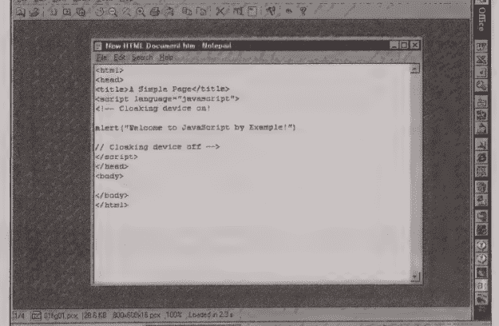
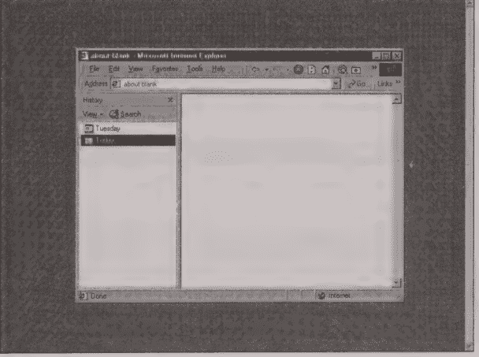
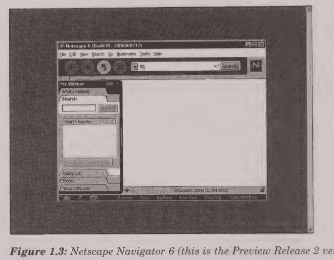
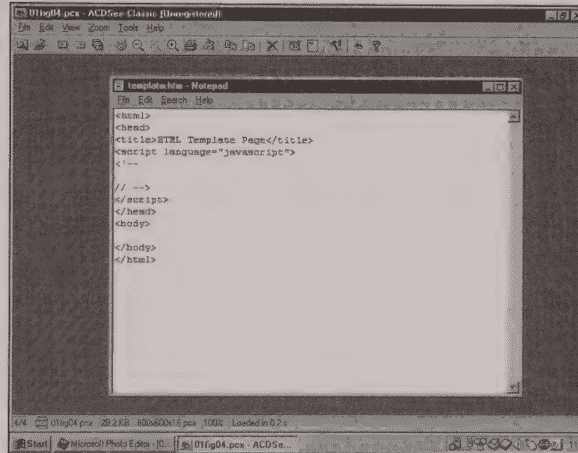
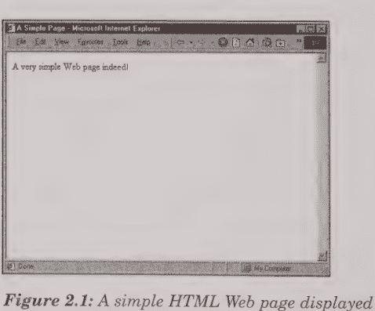
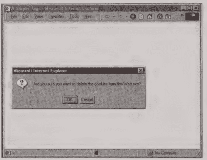
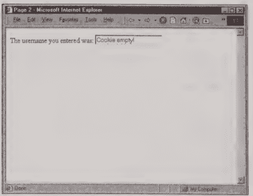

# JavaScript 1.5 示例

## 商标

本书中提及的所有已知商标或服务商标均已适当大写。Que 无法保证这些信息的准确性。在本书中使用某个术语不应视为影响任何商标或服务商标的效力。

## 声明与免责声明

已尽一切努力确保本书尽可能完整和准确，但不提供任何明示或暗示的保证。所提供的信息按“原样”基础提供。对于因使用本书所含信息而产生的任何损失或损害，作者和出版商对任何个人或实体均不承担任何责任。

## 关于作者

阿德里安和凯西·金斯利-休斯已撰写关于 Web 开发主题的文章超过三年。他们的著作包括 *《Web 样式表入门 第1部分和第2部分》*、*《VBScript 第1部分和第2部分》* 以及 *《数据绑定与脚本小程序》*（均由 Active Path/ZD Education 出版）。他们曾合著 Wrox Press 的 *《VBScript 程序员参考手册》* 和 *《XML 应用程序》*。阿德里安还为 Sybex 的 *《HTML 完全指南（第二版）》* 撰写了部分内容。

两人均为一家英国 Web 开发与培训公司的顾问，负责设计和提供 Web 开发与编程的培训课程。他们都在 ElementK.com 和 SmartPlanet.com 进行在线教学，在此之前他们曾在 ZDU 任教。

## 献词

献给我们的家人，特别是乔伊斯和布鲁斯，感谢他们坚定不移的信任和不知疲倦的支持；献给奈恩和泰德，感谢他们的智慧与力量——我们想念你们；最后，同样重要的，献给我们了不起的孩子们，凯蒂、艾米和蒂娜，感谢他们对我们写作的耐心，以及每天带给我们的所有快乐与喜悦。

## 致谢

如此规模的项目，其功劳绝不能仅归于封面上署名的一两个人。我们衷心感谢所有与我们愉快合作、最终打造出这款真正可用产品的编辑和工作人员！这过程充满乐趣，我们希望未来能再次与各位共事。

特别感谢托德·格林提出了绝佳的创意，并将产品塑造成如此精良的格式；感谢他让我们保持愉快，对许多冗长的邮件给出及时回复，并就如何改进产品提出了宝贵的建议。

非常感谢维多利亚·埃尔泽在项目初期的辛勤工作，她将最初的提纲从一堆要点打磨成我们赖以工作的坚实基础——谢谢！

同样要大力感谢迪恩·米勒、辛迪·蒂特斯和凯伦·希尔兹在数周写作期间推动项目进展，也要感谢梅根·韦德在文字编辑方面的出色工作——谢谢！

此外，感谢吉姆·奥唐奈审阅了最初的书稿，确保我们都在正确的轨道上——干得漂亮，非常感谢！

最后，向所有在幕后为这个项目付出努力的其他人致以诚挚的“谢谢”，那些我们未能有机会见面的人！你们的努力并未被忽视。

阿德里安和凯西·金斯利-休斯，2000年12月

## 请告诉我们您的想法！

作为本书的读者，*您* 是我们最重要的评论者和意见提供者。我们重视您的意见，希望了解我们做对了什么、哪些地方可以改进、您希望我们出版哪些领域的书籍，以及您愿意与我们分享的任何其他宝贵建议。

作为 Que 的副出版人，我欢迎您的评论。您可以通过传真、电子邮件或直接写信告诉我您喜欢或不喜欢本书的哪些方面——以及我们如何能让我们的书籍更加强大。

*请注意，我无法帮助您解决与本书主题相关的技术问题，并且由于我收到的邮件量巨大，我可能无法回复每一条信息。*

来信时，请务必注明本书的书名和作者，以及您的姓名和电话或传真号码。我将仔细审阅您的评论，并将其分享给参与本书工作的作者和编辑。

- **传真：** 317.581.4666
- **电子邮件：** feedback@quepublishing.com
- **邮寄地址：** Associate Publisher Que 201 West 103rd Street Indianapolis, IN 46290 USA

## 引言

### “实例”系列

通过 *实例* 学习 JavaScript 有两个显著优势。首先，在阅读每一章时动手完成示例，能立即巩固你对概念的理解，这比仅仅阅读技术讲解要有效得多。

其次，借助可从网络下载的 JavaScript 示例，《JavaScript 1.5 实例教程》让你在 Web 开发的前沿占据有利位置，同时还能在当今的网站上练习新技能。如何做到？在学习示例的过程中，你可以根据即时需求编辑它们，从而快速拥有一个启用 JavaScript 的可运行网站。

### 谁应该使用这本书

本书面向 JavaScript 编程新手，甚至可能是从未见过 JavaScript 语句的人，教授如何编写和创建 JavaScript 脚本。书中讲解了 JavaScript 脚本语言的核心概念，例如输入与输出、变量与数据类型、表达式、条件、语句、函数和对象。不要求具备 JavaScript 经验（但假定了解 HTML），所有内容都从头开始，循序渐进，并且 *通过实例* 讲解！

如果你直到今天早上才听说过 JavaScript，或者过去曾羡慕地看着示例，希望自己也能写出那样的 JavaScript，那么这本书就是为你准备的！

### 本书的结构

本书专注于通过教授你所需的所有技术和技巧，来帮助你编写正确的 JavaScript。你将从简单的示例开始，通过一个又一个示例、一个又一个概念，逐步构建你的知识和理解。你不会在第1章就被迫创建一个“超级示例”，也不会被引入需要复制粘贴到网页中的脚本库。在这里，你将找到的是坚实的 JavaScript 基础，它将使你能够按照自己的意愿继续前进并使用这门语言！

*《JavaScript 1.5 实例教程》* 教授你运用这门语言所需知道的一切。除了学习语言的实际细节和技巧，你还将学习提示和警告，获得如何有效运用 JavaScript 的一些思路，并了解一点这门已成为 Web 有史以来最重要、最令人兴奋的脚本语言背后的历史。

## 简介

学习 JavaScript 不仅本身就有回报，而且如果你想进阶学习其他计算机语言，如 Java、C++、Perl、VB、C 等，它也可以作为一个跳板，因为它们之间都有相似之处。

在本书中，你会看到人们如何在自己的网站上实际使用 JavaScript 的例子。这些例子都会有详尽的文档说明，你将有充足的机会通过实践和扩展这些章节中呈现的示例来磨炼你的 JavaScript 技能。

请访问 *by Example* 网站获取与本书相关的代码示例或附加材料，网址为 http://www.quecorp.com/series/by_example。

### 本书排版约定

本书使用以下字体约定：

| 字体 | 含义 |
| :--- | :--- |
| *Italic（斜体）* | “伪代码”示例中的变量以及首次使用的术语 |
| **Bold（粗体）** | 读者需要输入的文本 |
| Computer type（等宽字体） | 命令、文件名、HTML 标签、JavaScript 语言，以及网址和互联网站点、新闻组和邮件列表的地址 |

此图标表示即将呈现一个 JavaScript 示例。

此图标表示在你创建并运行示例后，屏幕上应该出现的内容。请注意，根据你所使用的浏览器不同，可能会出现轻微差异。

> **NOTE（注意）**
> 注释提供与特定主题相关的附加信息。

> **TIP（提示）**
> 提示提供快速且有帮助的信息，助你一路前行。

## 接下来

学习任何计算机语言的最佳起点都是从头开始，因此第一章将带你踏上一段 JavaScript 历史之旅。一路上，你还会了解到成为 JavaScript 开发者需要哪些软件（别担心——你无需购买任何东西！）。

那么，准备好通过 *实例* 来学习 JavaScript 吧！

# 第一部分 欢迎来到 JavaScript

- 走进 JavaScript！
- 将 JavaScript 与 HTML 结合

## 走进 JavaScript！

JavaScript 是一种脚本语言，能够让你为网页增添全新的交互性和功能。学会 JavaScript 之后，你的网页开发将提升到全新的水平。在这第一章中，你会发现如今能够编写 JavaScript 几乎与懂得使用 HTML 同等重要。在开始下一章正式编写 JavaScript 之前，你还将了解一些 JavaScript 的背景知识。

从这一刻起，你的网页将再也不一样了！

本章将教你以下内容：

- 为什么你需要学习 JavaScript
- JavaScript 的起源和历史
- 脚本语言与编程语言之间的一些区别
- 编写 JavaScript 所需的工具

### JavaScript 无处不在

看看你经常访问的一些网站。你看到了什么？页面可能都有文字，还有很多图片，对吧？但仔细看，还能看到别的东西吗？有没有显示时间的时钟，或者浏览器状态栏中滚动的消息？也许网站上有需要填写的表单：注意当你遗漏某些信息时，会弹出消息告诉你存在问题。在某些页面上，你可能会看到在屏幕上移动的图片，或者点击后会变化的文字。对于每一项这些特性和效果，很有可能你看到的就是 JavaScript 在发挥作用！这些就是具备扎实 JavaScript 知识的人能够做到的。迅速且轻松。

> **TIP（提示）**
> 密切关注其他像你一样的开发者在使用 JavaScript 做什么，这是一个非常好的主意。这是发现“热门”与“冷门”的绝佳方式！

在本书中，你不仅将学习 JavaScript 的工作原理（而不仅仅是学习如何将脚本剪切粘贴到你的网页中），而且还将获得大量灵感，可以用 JavaScript 为自己创建新颖而令人兴奋的应用程序。

### 为什么你需要学习 JavaScript

正因为 JavaScript 在 Web 上使用得如此广泛，你才真的需要知道如何使用它。因为如此多的网站都会在其页面中添加脚本（原因多种多样，你将会发现），相比之下，不使用脚本的网站可能显得平淡，甚至无聊。所以，即使你的内容本身很出色，访客也不太可能再次光顾。当然，每个网站都需要优质内容，但加入一些 JavaScript 不仅能让内容更清晰，还能增加一些实用的功能——让它更令人难忘。

> **TIP（提示）**
> 记住，有时区分成功和失败的网站唯一因素就是它们的外观和感觉。 invariably，为访客提供最佳浏览体验的网站最受欢迎。

> **CAUTION（警告）**
> 对于在网上找到的现成 JavaScript 代码要保持警惕。许多都是低质量脚本，但更糟的是，你会发现同样的脚本被用在成千上万的网站上。学习 JavaScript 能让你摆脱这种困境，让访客获得完全独特且难忘的体验。

### JavaScript 历史

学习和使用 JavaScript 还有很多其他实际理由。例如，只需几行脚本就能根据访客的浏览器类型和设置将其导向合适的页面，或者为访客自动完成某项任务，比如在线订单表格中的列求和。这些任务可能看起来不够炫酷或 outwardly 令人印象深刻，但它们标志着一位关心访客的专业开发者。

JavaScript（当时称为 Livescript）由 Netscape Communications 的 Brendan Eich 发明，其名称仅在 *Java* 成为非常时尚的 Web 术语后才更改。

第一个支持 JavaScript 的浏览器是 Netscape Navigator 2.0。当时微软看到了 Web 脚本语言的实用性，便发布了其自有的变体，称为 JScript 1.0，随 Internet Explorer 3.0 浏览器和 Internet Information Server 软件一同推出。微软的 JScript 1.0 与 Netscape 的 JavaScript 1.0 基本兼容，这意味着为其中一个浏览器编写的 JavaScript 很有可能（但并非总是 100%）在另一个浏览器中按预期工作。

后来，Netscape 随 Netscape Navigator 3.0 浏览器和 LiveWire Web 服务器软件发布了 JavaScript 1.1。这个版本包含了 JavaScript 1.0 的所有功能，并新增了许多特性和能力。微软对此的回应是升级其自有的 JScript，但决定不加入 JavaScript 1.1 中的所有功能。这就是 *浏览器不兼容* 的开端，即为某个浏览器编写的 HTML 和脚本在竞争对手的浏览器中无法正常显示。

Netscape 将 JavaScript 的定义公开（也就是说，他们试图通过向所有人开放自己所做的事情来让自家版本最受欢迎）。此后不久，Netscape 与微软等其他公司达成一致，创建一个中立的标准。欧洲计算机制造商协会（ECMA），一家瑞士标准机构，于 1996 年 11 月开始制定该标准。1997 年 7 月，他们发布了该标准，将该语言命名为 *ECMAScript*。在瑞士发生这一切的同时，Netscape 随其 Netscape Navigator 4.0 浏览器发布了 JavaScript 1.2，而微软则发布了适用于 Internet Explorer 3.0 浏览器的 JScript 2.0。JavaScript 1.2 和 JScript 2.0 都未能 100% 符合 ECMAScript 标准（有时也被称为 *ECMA-262*）。

那个时代现在通常被世界各地的 Web 开发者视为非常艰难的时期。他们不仅需要记住每个浏览器版本支持什么，还必须设法创建同时适用于 Internet Explorer 和 Netscape Navigator 的网页。

### 开始学习 JavaScript！

许多人曾认为情况不会再好转，标准会继续背道而驰，而另一些人则乐观地寄希望于 ECMA 标准能够普及，标准将再次变得兼容。

值得庆幸的是，这种混乱在很大程度上已让位于双方对标准的更紧密遵循。JavaScript 1.5 和 JScript 5.5 现在都（除了为向后兼容性保留的一些小例外，以及微软和网景为预期成为标准而添加的扩展）100% 符合 ECMAScript 第 3 版标准。这意味着，至少在理论上，你可以编写在两种浏览器中都能同样良好运行的 JavaScript。然而，正如你稍后将发现的，浏览器中的其他差异仍然意味着事情并不总是像可能的那么简单。表 1.1 和 1.2 展示了 JavaScript 在浏览器中的历史。

> 如果每个人都使用最新版本的浏览器，标准是很棒的。然而，正如你可能已经知道的，情况并非如此。许多人仍在使用版本 4、3，甚至在某些情况下使用版本 2 或更旧的浏览器上网。如果你的访问者使用这些浏览器，你仍然必须适应他们——你稍后将了解到如何做到这一点。

*表 1.1：JavaScript 在浏览器中的历程——网景 JavaScript 版本*

| 浏览器 | 版本 |
| :--- | :--- |
| 网景 2.0 | 1.0 |
| 网景 3.0 | 1.1 |
| 网景 4.0 | 1.2 |
| 网景 4.5 | 1.3/1.4 |
| 网景 6.0 | 1.5 |

*表 1.2：JavaScript 在浏览器中的历程——Internet Explorer JScript 版本*

| 浏览器 | 版本 |
| :--- | :--- |
| Internet Explorer 3.0 | 1.0/2.0 |
| Internet Explorer 4.0 | 3.0 |
| Internet Explorer 5.0 | 5.0 |
| Internet Explorer 5.5 | 5.5 |

### 现代的 JavaScript

JavaScript 1.5 和 JScript 5.5 代表了 Web 脚本语言的最新成果，赋予了你对页面外观和行为的强大控制力。当你将 JavaScript 与最新浏览器中的其他尖端技术（如全面的浏览器文档对象模型和层叠样式表，这些将在本书后面介绍）结合起来时，你几乎完全控制了 Web 页面上发生的一切。通过使用 JavaScript 和浏览器对象模型，你可以创建响应用户点击和键盘输入的网页。另一方面，将 JavaScript 和层叠样式表结合起来，使你能够做到诸如随意隐藏或显示文本、在页面上移动图像、控制浏览器窗口等等许多事情。

> **提示**
> 如果上一段听起来有点令人沮丧，请不要担心——情况并没有听起来那么糟！

有了这些技术，你不仅仅是创建网页，更是为访问者创造一个可以像她计算机上的任何其他应用程序一样具有外观、感觉和响应的环境。在本书后面，你将了解到如何做到这一点。

### JavaScript 的未来

随着 ECMA 标准将 JavaScript 和 JScript 结合在一起，JavaScript 在 Web 上的未来得到了保障。网景和微软（其还拥有另一种仅限 Internet Explorer 使用、基于其 Visual Basic 语言的脚本语言 VBScript）都已承诺未来将继续支持和开发 JavaScript。除了网景和微软的参与，Opera 软件公司也加入了进来，从第 3 版开始为其 Opera 浏览器添加了 JavaScript 支持。

这意味着 JavaScript 是面向未来的——你可以今天就学习如何编写它，并确信它不会在不久的将来消失。

### 脚本和程序有什么区别？

这是脚本新手甚至一些使用脚本一段时间的人常问的问题。技术的（可以说是“技术控”的）答案是：脚本是由另一个程序解释或执行的指令序列（有时甚至是另一个程序），而不是由计算机的处理器执行。这在现实世界中意味着什么？首先，要创建一个程序，你需要另一个程序（至少是一个编译器），而要编写脚本，你至少只需要一个文本编辑器（稍后会详细说明）。这意味着脚本比程序更容易编写，并且通常更快，因为它们是用更具结构化的编译语言编写的，例如 C 和 C++。

然而，脚本的运行确实比编译后的程序花费更长时间，因为脚本中的每条指令首先由另一个程序处理（这需要加载额外的程序并执行更多指令），而不是直接由处理器处理。然而，这个缺点完全被以下事实所弥补：脚本可以使用免费的文本编辑器编写，而 C++ 程序可能需要价值数百美元的软件！

### 脚本语言和编程语言有什么区别？

你过去可能听说过这样的话：“哦，是的，JavaScript 就像 C++”，或者“JavaScript 和 Java 是一样的东西”。事实上，这两种说法都不正确。JavaScript 是一种第三代语言，这意味着它是 C、Pascal 和 BASIC 的近亲（如果你难以想象这意味着什么，别担心！）。相似之处确实存在，但也有一些重要的区别。以下是一些：

- JavaScript 是自由格式的。这意味着仔细的格式化是可选的。
- JavaScript 是一种解释型语言。这意味着它由计算机上的一个单独的程序处理。
- JavaScript 具有高度的可移植性和硬件独立性。这意味着，类似于 Java，它可以在任何地方运行。
- JavaScript 可以轻松地嵌入到其他软件中，比如浏览器（试试用 C++ 做这个！）。

所有这一切意味着，如果你有一些 C、C++、Pascal、BASIC、Java、FORTRAN 或 Perl 经验，你可能会发现 JavaScript 的某些方面看起来很熟悉。然而，不要期望能够用其中任何一种语言来创建 JavaScript——要编写 JavaScript，你必须使用 JavaScript！

### JavaScript 开发者工具

正如你已经知道的，JavaScript 不需要你去软件零售商那里购买昂贵的软件来编写。然而，存在两种不同类型的软件可以让你完成这项工作。现在让我们来看看这些工具。

#### 简单的文本编辑器

可能最好的选择是选择一个简单的文本编辑器（例如可靠的老式 Windows 记事本）并以这种方式输入代码。以这种方式编写 JavaScript 可能是编写 JavaScript 的“硬核方式”，但它有一些非常棒的优点：

- 它很便宜！
- 你不需要学习如何使用复杂的软件。
- 你实际上学习的是 JavaScript，而不是学习如何使用一个软件包。
- 它将你从软件包内置的 JavaScript 技术中解放出来。通过自己编写代码，你可以做到 JavaScript 能让你做的任何事情。
- 你可以自由地格式化 JavaScript，并添加你认为合适的注释和批注。你了解它的工作原理，因此修改 JavaScript 很容易。
- 你可以保存你编写的所有 JavaScript 代码片段，建立你自己的 JavaScript 库。
- 你会有满足感，因为 JavaScript 完全是你自己的作品，并且你可以为此承担全部荣誉！

> **注意**
> 不要试图使用富文本编辑器（如 Microsoft Word 或 Windows Write）来编写 JavaScript，因为可能会出现问题。一个常见问题是引号。JavaScript 需要普通引号（`"` 或 `'`），而某些富文本编辑器倾向于使用花哨的“智能引号”。这些简单的、弯曲的智能引号可能会引起大问题。避免这些问题的最佳方法是使用简单的文本编辑器。

在本书中，我们将使用 Windows 记事本（如图 1.1 所示）来演示所有示例。



图 1.1：在 Windows 记事本中显示的 JavaScript。

#### 使用可视化工具

用于编写 JavaScript 的可视化工具通常是支持在网页中嵌入简单脚本以完成简单任务的 HTML 编辑器/创建器。这类工具的例子包括 Microsoft FrontPage、Macromedia Dreamweaver 和 Adobe GoLive。

通常，你甚至不需要查看或输入任何 JavaScript 代码，这表面上看起来似乎是个好主意。但它们在易用性方面的优势，却以牺牲灵活性为代价。每种工具通常只限于其内置的少数几种 JavaScript 技巧，因此创造性发挥的空间颇为有限。另一个缺点是，这些可视化工具输出的 JavaScript 通常又长又复杂，即便专业开发人员也难以阅读，更不用说修改或编辑了。一个小小的编辑就可能导致整个 JavaScript 停止工作并报错——这可不利于展示给你网站的访客！

不过，有些时候你可能需要或不得不使用可视化工具。这没问题。关键是，当你想要时，你能够自己编写 JavaScript，而不必完全依赖软件内置的脚本。

然而，使用可视化工具确实存在一些优势：

- **速度**——它们比手动输入快得多。
- **准确性**——如果任由其自行处理，可视化工具输出的 JavaScript 是可以正常工作的（不过，一旦你开始修改它，情况可能就不一样了！）。
- **特殊功能**——诸如 HTML 颜色编码之类的功能使 HTML 和 JavaScript 更易读。

> **提示**
> 在本书中，我们鼓励你亲自输入示例代码。尽管这可能显得繁琐且耗时，但这无疑是学习如何编写 JavaScript、更重要的是学习如何用 JavaScript 思考的最佳方式。这能让你体会到这门语言是如何实际运作的。

#### 拥有最新的浏览器

由于你将在这里学习最前沿的 JavaScript，因此拥有最新的浏览器以便充分利用这一点非常重要。我们建议你至少安装 Netscape Navigator 4.0 和 Microsoft Internet Explorer 5.5。Internet Explorer 5.5 和 Netscape Navigator 6 Preview Release 2 分别如图 1.2 和 1.3 所示。

> **提示**
> 这两款浏览器都可以从网络上免费下载。访问 http://www.microsoft.com/ie 获取 Internet Explorer 的最新信息，访问 http://www.netscape.com 获取 Netscape Navigator 的最新信息。

> **注意**
> 另一款能够运行 JavaScript 的浏览器是 Opera Software 的 Opera（当前版本为 4.5）。这款浏览器不能免费获取，但可以从 http://www.opera.com 购买并下载。





#### 其他工具

还有什么能让你的 JavaScript 编程生活更轻松呢？这里有几个建议。

##### 创建 HTML 模板

如果你打算使用文本编辑器来创建网页，那么减少重复输入量是合理的。一种方法是使用 HTML 模板。*模板*是一个包含每页所需基础 HTML 结构的文本文件。它可以根据你自己的情况进行定制，但作为起点，以下内容可能就足够了：

```html
<html>
<head>
<title>HTML Template Page</title>
<script language="javascript">
<!--

// -->
</script>
</head>
<body>

</body>
</html>
```

这个模板已经针对你将要学习编写 JavaScript 的情况做了少许定制，但如果你还看不懂里面的某些内容，不用担心。下一章你将更详细地了解它！

创建好这个模板后（如图 1.4 所示），你可以将其保存在硬盘上的方便位置，比如 Windows 桌面或当前项目文件夹。只需记住在开始编辑后、保存之前重命名文件即可。



> **注意**
> 如果你的页面有标准的 HTML 布局，可以将其添加到模板中。

##### 维护脚本库

在学习编写 JavaScript 的过程中，有一件事能为你节省大量时间，那就是创建自己的 JavaScript 库。这只不过是一文件夹里的几个文本文件罢了。（但要起有意义的名称，因为要从中找出需要的脚本可能比直接输入还费时！）

如果你真想建立一个出色的库，可以创建一个 JavaScript 代码片段数据库，为每个片段添加标题并附上一些注释。这能让查找和获取正确的脚本变得非常轻松。

> **提示**
> 通过维护 JavaScript 库，你不仅能让未来的编程工作更轻松、更省时，还能轻松追踪自己的进步，看到自己提高了多少。

### 下一步

既然我们已经介绍了 JavaScript 的起源、历史和未来，也了解了成为合格 JavaScript 程序员所需的条件，你已经准备好开始编写一些脚本了！完成下一章后，你将理解 JavaScript 和 HTML 如何在网页中协同工作。

## JavaScript 与 HTML 的结合

如果你想学习如何编写 JavaScript，首先需要理解的是 JavaScript 和网页的 HTML 是如何结合在一起的。在本章中，你将学到这一点。

本章将教你以下内容：

- JavaScript 如何添加到网页的 HTML 中
- `<head>` 标签的重要性
- `<script>` 块是什么以及如何将其添加到网页
- 如何向旧的、不支持 JavaScript 的浏览器隐藏 JavaScript

### 世界的交汇——HTML 与 JavaScript

好了，你知道 HTML 是如何工作的，现在也了解了一些关于 JavaScript 的知识。下一步是看看两者如何在网页上协同工作、和谐共处。

由于 HTML 和 JavaScript 是完全不同的技术，因此存在关于 JavaScript 如何嵌入网页 HTML 的规则。实际上，有多种方法可以将 JavaScript 添加到网页中，但为了让你入门，我们最初只 concentrate 于最常用、也可以说是最灵活的方法。在这种方法中，JavaScript 以脚本*块*（block）的形式插入到 `<head>` 标签中。

让我们看看如何做到这一点。

### HTML 骨架

在继续之前，你必须熟悉 HTML 页面的结构。以下是显示在图 2.1 所示浏览器中的非常基础的网页的 HTML 代码：

```html
<html>
<head>
<title>A Simple Page</title>
</head>
<body>
<p>A very simple Web page indeed!</p>
</body>
</html>
```



从 JavaScript 的角度来看，你需要了解的是以开标签 `<head>` 开始、以闭标签 `</head>` 结尾的 HTML 块。这是页面的 `<head>` 块，也称为网页的 *header*（头部），你将在这里放置你的 JavaScript。

然而，你不能直接把代码放到 `<head>` 里。还有一件必须先做的事！

### `<script>` 块

要将 JavaScript 放到 `<head>` 标签内，你必须在 `<head>` 中添加一个新的 HTML 块。这个块就是 `<script>` 块。这个脚本块的作用是告诉浏览器，其开标签和闭标签之间包含的内容是一个脚本——浏览器应该按脚本的方式处理它。

这个块可以添加在 `<head>` 块内的任何位置，但通常添加在末尾，即在闭标签 `</head>` 之前：

```html
<html>
<head>
<title>A Simple Page</title>
<script>

</script>
</head>
<body>
<p>A very simple Web page indeed!</p>
</body>
</html>
```

> **注意**
> `<script>` 块放在头部的原因之一是，放在这里可以确保它在其他所有内容之前加载，这大大减少了出错的可能性。如果这现在对你来说还无法理解，不要担心，本书后面会更详细地介绍这一点。

在可以向 `<script>` 块添加 JavaScript 之前，你还需要做几件事。第一件就是告诉浏览器 `<script>` 块标签内包含的是哪种类型的脚本。这是因为 **JavaScript** 并非你可以使用的唯一网页脚本语言。另一种广泛使用的脚本语言是微软的 VBScript。因此，要告诉浏览器你使用的语言是 JavaScript，首先必须将 `language` 属性添加到 `<script>` 标签中，如下所示：

```html
<html>
<head>
<title>A Simple Page</title>
<script language="">
</script>
</head>
<body>
<p>一个非常简单的网页！</p>
</body>
</html>
```

你可以在引号内输入JavaScript来声明所使用的语言：

```html
<html>
<head>
<title>A Simple Page</title>
<script language="JavaScript">

</script>
</head>
<body>
<p>A very simple Web page indeed!</p>
</body>
</html>
```

> **注意**
> 例如，如果你想用VBScript编写脚本，语言应设置为`vbscript`：
> ```
> <script language="vbscript">
> ```

你刚刚了解了关于它的两点。

第一点，引号。在某些情况下，你可能会看到一些JavaScript代码，其中声明语言时没有使用引号包围这个词。一切似乎都正常工作，那么为什么还要费心输入它们呢？嗯，这又是那种最好做到完全正确的情况。即使Internet Explorer和Netscape Navigator浏览器无论有无引号都能理解该语言，但正确的形式是使用引号，所以这里也是这样展示的。浏览器可能有一天会要求HTML必须正确编写。通过现在编写格式良好的HTML，你正在确保你的技能能够经得起未来考验！

第二点是区分大小写。看看以下内容：

- `<script language="javascript">`
- `<script language="JavaScript">`
- `<script language="JAVASCRIPT">`

有什么区别？对，它们各自使用了不同的大小写形式。在整本书中，我们将使用`"JavaScript"`，但在创建你的网页时，迄今为止最好的做法是全部使用小写。这不仅更快，而且大大减少了拼写错误的可能性。

现在，如果你再看看网上写的脚本，有时会注意到`language`属性被省略了。嗯，这同样能正常工作。背后的原因是，由于JavaScript是第一个出现的脚本语言，它被认为是默认语言。然而，为了维护格式正确的网页，最好包含它。这再次确保了你今天学到的技能是未来可用的。

### 关于`language`属性的更多信息

`language`属性比表面看起来更复杂。虽然普通的JavaScript是默认值，但你在前一章中读到，存在相当多版本或变体的JavaScript。JavaScript 1.0、JavaScript 1.1、JScript等等都是可用的。你实际上可以使用`language`属性来精确指定你编写脚本所针对的版本。指定哪个版本实际上取决于你想运行脚本的浏览器和JavaScript版本。这听起来有点复杂，但让我们看几个例子，这会有所帮助。

如果你使用`<script language="JavaScript">`，你是在告诉浏览器这只是JavaScript，并使用你的JavaScript引擎（实际解释JavaScript的程序）来运行它。这是默认设置。然而，如果你想让JavaScript仅在Microsoft的Internet Explorer上运行，最好的方法是将你编写的JavaScript定义为JScript，如下所示：

```html
<script language="JScript">
</script>
```

现在，包含在`<script>`块中的任何JavaScript只会在Internet Explorer浏览器中运行。

如果你的目标是Netscape Navigator 3.0用户呢？从上一章中，你可能记得该浏览器具有JavaScript 1.1版本。这意味着如果你使用以下语言设置，只有Netscape Navigator 3.0才会运行你的JavaScript：

```html
<script language="JavaScript1.1">
</script>
```

提出这一点是为了给你一个完整的图景。在本书后面，我们将再次讨论这个话题，并向你展示一些可以使用的技巧！

> **警告**
> 记住默认值是`language="JavaScript"`，本书中的大多数示例都使用这种语言（如果我们想让你设置为其他内容，我们会注明）。小心不要无意中将语言设置为其他值，因为这会导致脚本在新浏览器中无法运行，有时发现这个错误可能很棘手！

### 对旧版浏览器隐藏JavaScript

Netscape Navigator 2.0之前的浏览器根本无法运行JavaScript，如果它们在网页中遇到JavaScript，会导致产生一些非常难看的错误。为了避免这种错误的可能性，请在`<script>`块内放置HTML注释标签来隐藏你放置在页面上的任何脚本。添加这个既快又简单，即使旧版浏览器现在已经很少见，将注释标签插入你的HTML模板中，使它们出现在每个包含JavaScript的网页上仍然是值得的。

这些注释标签很容易添加。在`<script>`标签内，插入另一对标签，`<!--`和`-->`。你编写的所有代码都放在这两个标签之间，然后任何不理解`<script>`标签含义的浏览器都会忽略它。

> **注意**
> 将任何你希望浏览器使用的内容放在注释标签内可能看起来很奇怪，因为这些标签是用来防止页面上的文本显示的。但事实是，所有理解脚本的浏览器也知道忽略这些注释标签，并像它们不存在一样继续操作。

为了使注释标签更明显，开发者经常在其中放置一些（有时是有趣的！）注释。本节描述了JavaScript第一次少量出现的地方，特别是JavaScript注释标签`//`。这些与HTML注释标签不同；在下一章中，你将看到它们如何工作以及更多内容。

### 接下来是什么

你现在已经了解了JavaScript如何融入HTML网页所需的所有知识，可以开始编写JavaScript了！在下一章中，你将学习如何编写几行简单的JavaScript，这将向你展示如何让JavaScript显示输出和接受输入。

# 第二部分 语言巡礼

- JavaScript实战
- 使用变量处理数据
- JavaScript数组和转义字符
- 表达式、条件、运算符以及更多字符串和数字
- 在JavaScript中使用语句
- 通过使用函数和事件编写更好的JavaScript脚本
- 充分利用对象
- 错误——如何找到并消灭它们

## JavaScript实战

在本章中，你将获得第一次编写JavaScript的机会！本章将向你正确介绍JavaScript。此外，本章是一个非常注重实践的章节，你将真正开始通过示例学习JavaScript的基础！

本章教你：

- JavaScript的一些基础知识，如语法、布局、注释代码等
- JavaScript的一些术语，以及为什么它被称为面向对象语言
- 如何在网页上练习读写JavaScript
- 如何使用JavaScript创建输入和输出

### 探索JavaScript的输入和输出

> **注意**
> 本章使用了许多JavaScript小示例。我建议你亲自动手完成每个示例，实际输入代码。目的是让你在进入更复杂的JavaScript示例之前，获得大量JavaScript基础知识的实践。

重复是掌握JavaScript的关键。

JavaScript的输入和输出不仅对于编写能够与用户进行双向通信的JavaScript代码非常有用，而且探索JavaScript的这个领域也是你开始精通之旅的好起点！

计算的核心就是输入和输出。数据进来，数据出去。没有输入和输出，什么都不会发生，什么也做不成。文字处理软件只有在接收到用户输入（通常是以按键生成的字符形式）后才会开始工作，然后这导致输出（输出到屏幕上，随后到纸上或以电子形式）。

在这里，我们将使用JavaScript来控制以各种类型的消息框形式进行的输入和输出（保证，如果你上网冲浪超过几分钟，你以前一定见过这些消息框！）。

可以使用JavaScript调用三种类型的消息框。图3.1、3.3和3.5显示了Internet Explorer的消息框，而图3.2、3.4和3.6显示了Netscape Navigator的消息框。

- **警报（Alert）**——用于输出信息。

*图3.1：Internet Explorer显示的警报框。*

*图3.2：Netscape Navigator显示的警报框。*

- **确认（Confirm）**——此方法输出信息，并允许用户以“是/否”问题的形式输入选择。

*图 3.3：Internet Explorer 显示的确认框。*

*图 3.4：Netscape Navigator 显示的确认框。*

- **提示（Prompt）**——此方法输出一些信息，并允许用户输入对输出的回应。

*图 3.5：Internet Explorer 显示的提示框。*

*图 3.6：Netscape Navigator 显示的提示框。*

### 对象、方法……甚至是属性

> **注意**
> 为什么 Internet Explorer 中的消息框看起来与 Netscape Navigator 中的消息框如此不同？这实际上与 JavaScript 无关——它们之所以不同，是因为 `alert`、`confirm` 和 `prompt` 窗口是由浏览器生成的。这些框仅由 JavaScript 触发。正因如此，每个浏览器都为其外观增添了自己独特的风格。

`alert()`、`confirm()` 和 `prompt()` 实际上都是浏览器 `Window` 对象的方法。

你可能听说过 JavaScript 是一种面向对象语言。但这到底是什么意思？要理解这一点，你需要熟悉三个术语：

- 对象
- 方法
- 属性

接下来我们简要了解这三点。在你使用 JavaScript 一段时间后，你会发现你会更频繁地使用它们，因此我们可以将详细内容留到以后介绍。

#### 对象

简单来说，一个*对象*就是一种事物，任何事物。正如现实世界中的事物是对象（汽车、狗、美元钞票等），计算机世界中的事物也被视为对象。

对于 JavaScript 而言，它的对象都存在于 Web 浏览器中。这些对象包括浏览器窗口本身、表单以及表单的组成部分，如按钮和文本框。JavaScript 也有自己的一组固有或内置对象，这些对象与数组、日期等事物相关。目前，你不需要过多考虑这些对象，因为它们将在后面介绍；现在你只需要掌握一些必要的术语。

正是对象使得 JavaScript 成为面向对象语言。JavaScript 围绕对象而非动作来组织；换句话说，它围绕数据而非编程逻辑来组织。面向对象编程的观点是，你真正关心的是你想要操作的对象，而不是操作它们所需的逻辑。这样做的一个好处是——因为你从编程逻辑中解放出来——不仅编程（或脚本编写）的过程变得更容易，而且执行特定操作也有多种方式。

#### 方法

方法是对象可以做的事情。在现实世界中，对象也有方法。汽车行驶，狗吠叫，美元可以购买东西，等等。`alert()` 是 `Window` 对象的一个方法，因此 `Window` 对象可以使用消息框向用户发出警报。其他方法的例子包括窗口可以被打开或关闭，按钮可以被点击。这里的三个方法是 `open()`、`close()` 和 `click()`。注意括号。要注意这些括号，因为它们表明正在使用方法，而不是属性。

#### 属性

所有对象都有属性。汽车有轮子，狗有毛皮。对于 JavaScript，像浏览器这样的事物也有名称和版本号。

> **提示**
> 将对象和属性想象成事物，将方法想象成动作，可能会对你有所帮助。

### 使用 `alert()` 方法

`alert()` 是三个方法中最容易使用的。你可以用它以简单、简洁的方式向用户显示文本信息。当用户读完消息后，只需点击“确定”即可将其关闭。

首先，在你最喜欢的文本编辑器中打开你的模板 HTML 页面，并以新名称保存在硬盘驱动器上方便的位置：

```html
<html>
<head>
<title>A Simple Page</title>
<script language="JavaScript">
<!-- Cloaking device on!


// Cloaking device off -->
</script>
</head>
<body>

</body>
</html>
```

> **注意**
> 记得用 HTM 或 HTML 文件扩展名保存它；否则，事情将无法按计划进行。

> **警告**
> 在这一阶段，了解 JavaScript 是一种区分大小写的语言可能很有价值。你将在未来的章节中更详细地学习这一点，但现在，请注意，除了你想使用的文本字符串外，最好遵循所有 JavaScript 代码的大写和小写字母选择。

要调出警报消息框，请输入以下内容：

```html
<html>
<head>
<title>A Simple Page</title>
<script language="JavaScript">
<!-- Cloaking device on!
alert();
// Cloaking device off -->
</script>
</head>
<body>
</body>
</html>
```

> **注意**
> `alert()` 方法末尾的分号称为行终止符，需要它才能使你的 JavaScript 符合 ECMA 标准（尽管没有它也能正常工作）。在接下来的几章中，你会经常看到它；在第 4 章“使用变量处理数据”中，你将确切了解它何时以及何处使用。

现在，输入你想要显示的消息。将其放在括号内的引号内：

```html
<html>
<head>
<title>A Simple Page</title>
<script language="JavaScript">
<!-- Cloaking device on!
alert("An alert triggered by JavaScript!");
// Cloaking device off -->
</script>
</head>
<body>
</body>
</html>
```

保存页面，将其加载到浏览器中，然后观察消息出现（见图 3.7）！

*图 3.7：由 Internet Explorer 显示的包含自定义消息的警报框。*

使第二个警报出现与使第一个警报出现一样简单——只需在第一个 `alert()` 下面的 `<script>` 块中添加另一个 `alert()`，并添加你自己的、用引号括起来的消息：

```html
<html>
<head>
<title>A Simple Page</title>
<script language="JavaScript">
<!-- Cloaking device on!
alert("An alert triggered by JavaScript!");
alert("A second message appears!");
// Cloaking device off -->
</script>
</head>
<body>

</body>
</html>
```

在文本编辑器中保存文件并刷新浏览器。这次注意两条消息都出现了。但更重要的是，注意它们是分开显示的，而不是一个叠在另一个上面。这表明 JavaScript 在每条消息之间都停顿了，而不是盲目地一直运行到脚本末尾。它耐心等待，直到用户在第一个框上点击“确定”，然后才继续显示第二个。

> **提示**
> 记得在查看你所做的更改之前重新保存文件。你无法相信有多少用户忘记这一步，并认为他们做错了什么！

**练习**

作为练习，回到模板，从头开始创建一个新的 JavaScript，以触发一个包含你选择的消息的警报框。

完成之后，添加第二个警报框，遵循相同的格式。接下来，在新的一行上添加 `alert()` 方法，然后在括号内并用引号括起来，添加你想要显示的消息。

### 为 JavaScript 添加注释

专业的 JavaScript 开发者力求使代码易于在重新阅读时（可能是几个月后）理解。他们用来帮助实现这一点的方法之一是 JavaScript 注释标签，你已经在前面的章节中遇到过——单行注释。

#### 单行注释

以下是单行注释标签实际使用的示例：

```html
<html>
<head>
<title>A Simple Page</title>
<script language="JavaScript">
<!-- Cloaking device on!
// The first alert is below
alert("An alert triggered by JavaScript!");
// Here is the second alert
alert("A second message appears!");
// Cloaking device off -->
</script>
</head>
<body>
</body>
</html>
```

如果你运行这段 JavaScript，你不会注意到任何区别。这是因为注释标签已经完成了它们的工作，将注释隐藏在了浏览器的视线之外。

#### 多行注释

有时你需要在脚本中添加多行注释，虽然你可以在每行开头放置斜杠（`//`），但这确实不太方便。这就是多行注释标签发挥作用的地方。

多行注释标签由开始注释标签（`/*`）组成，然后是注释本身，最后是结束注释标签（`*/`）。

以下是多行注释的示例：

```html
<html>
<head>
<title>A Simple Page</title>
<script language="JavaScript">
<!-- Cloaking device on!
/*
下面的代码使用了两个 alert() 方法来弹出两个消息框——注意第二个消息框是在第一个的 OK 按钮被点击后才弹出的
*/
alert("An alert triggered by JavaScript!");
alert("A second message appears!");
// Cloaking device off -->
</script>
</head>
<body>

</body>
</html>
```

为脚本添加有意义的注释是需要通过实践才能掌握的技能。起初，这可能会显得繁琐甚至不必要，但这不仅能让你的 JavaScript 更易于理解，在学习初期还能帮助你更清楚地理解脚本的工作原理。抓住每一个机会为你的脚本添加注释！

### 练习

为你在上一个练习中创建的示例，使用单行注释和多行注释为你的代码添加注释。

### 使用 `confirm()` 方法

`confirm()` 方法的工作方式与 `alert()` 类似，但这个对话框用于让用户在“确定”和“取消”之间做出选择。它的显示方式几乎相同，唯一的区别是你使用的是 `confirm()` 方法而不是 `alert()` 方法。

> **注意**
> “取消”按钮需要更多你目前还没有学过的 JavaScript 知识才能使其工作。不过别担心，后面会讲到的！

因此，按照与 `alert()` 方法相同的步骤，你首先在脚本块中添加 `confirm()` 方法，如下所示：

```html
<html>
<head>
<title>A Simple Page</title>
<script language="JavaScript">
<!-- Cloaking device on!
confirm();
// Cloaking device off -->
</script>
</head>
<body>
</body>
</html>
```

同样，你想要显示在对话框中的消息用引号括起来，放在括号内：

```html
<html>
<head>
<title>A Simple Page</title>
<script language="JavaScript">
<!-- Cloaking device on!
confirm("Which one will you choose?");
// Cloaking device off -->
</script>
</head>
<body>
</body>
</html>
```

保存文件（同样使用与模板不同的名称，并记得使用 HTM 或 HTML 文件扩展名），然后在浏览器中加载它（参见图 3.8）。

**图 3.8：** *Internet Explorer 显示的带有自定义消息的确认框。*

现在注意对话框上的按钮——“确定”和“取消”。然而，目前点击它们时除了对话框消失、JavaScript 继续运行外，不会发生其他事情。在能够使用确认框上的按钮之前，你需要掌握更多的 JavaScript 技能，之后你将重新学习 `confirm()` 方法。

**练习**

练习将 `confirm()` 方法添加到网页中。添加你自己的消息。

在网页中添加几个独立的 `confirm()` 方法，并观察结果。

### 使用 `prompt()` 方法

`prompt()` 方法与你在本章中看到的其他两个方法略有不同。这是唯一一个允许用户输入他自己的回答的方法，而不是让脚本只处理它已经拥有的信息（如 `alert()` 方法），或者让用户选择“确定”或“取消”（`confirm()` 方法提供的功能）。

添加 `prompt()` 方法的方式与其他两个大致相同。首先，将 `prompt()` 方法添加到 `<script>` 块中：

```html
<html>
<head>
<title>A Simple Page</title>
<script language="JavaScript">
<!-- Cloaking device on!
prompt();
// Cloaking device off -->
</script>
</head>
<body>
</body>
</html>
```

`prompt()` 方法现在开始与其他两个方法不同，因为必须在括号内添加两段文本。第一段是你想要显示的消息。

这与之前的方式完全相同。同样，文本放在括号内，并用引号括起来：

```html
<html>
<head>
<title>A Simple Page</title>
<script language="JavaScript">
<!-- Cloaking device on!
prompt("What is your name?");
// Cloaking device off -->
</script>
</head>
<body>
</body>
</html>
```

保存此页面并在浏览器中查看。注意提示框出现，询问用户的姓名（参见图 3.9）。你可以输入姓名并点击“确定”继续，或者点击“取消”。

**图 3.9：** *Internet Explorer 显示的带有自定义消息的提示框。*

注意输入框中的 `undefined` 一词。这是 Internet Explorer 的特性；Netscape Navigator 只是将该框留空（参见图 3.10）。

**图 3.10：** *Netscape Navigator 中的相同提示框；注意输入框中没有显示任何文本。*

目前，无论你怎么做都不会发生什么事情，但到本章结束时，你将能够用更多的 JavaScript 知识来运用它！

我们还可以添加的另一段文本是提示框实际输入框中显示的默认文本。添加这个很简单，并且可以消除 Internet Explorer 显示的难看的 `"undefined"`。你需要这样做：在括号内的第一段文本之后，在引号外放置一个逗号，然后在逗号后放置第二段文本（同样用引号括起来）。以下是实际应用的例子：

```html
<html>
<head>
<title>A Simple Page</title>
<script language="JavaScript">
<!-- Cloaking device on!
prompt("What is your name?","Enter your name here.");
// Cloaking device off -->
</script>
</head>
<body>

</body>
</html>
```

再次保存页面并刷新浏览器。注意曾经为空的输入框现在包含了第二组引号中的文本（参见图 3.11）。

*图 3.11：* Internet Explorer 显示的带有自定义消息和默认输入框文本的提示框。

### 练习

- 练习将 `prompt()` 方法添加到网页中。添加你自己的消息和输入框的默认文本。
- 在网页中添加几个独立的 `prompt()` 方法，并观察结果。
- 在你的页面中添加一些注释（单行和多行），解释发生什么以及每个部分是什么。

### 下一步

到目前为止，你已经了解了如何使用 JavaScript 显示三种消息框。在下一章中，你将学习如何通过探索 JavaScript 中两个最重要的领域——使用变量和数组处理数据，来使这些消息框和其他 JavaScript 真正发挥作用。

## 使用变量处理数据

在上一章中，你了解了如何使用 JavaScript 生成三种类型的消息框，用于输入和输出决策及文本。然而，你目前看到的 JavaScript 并不是很灵活。你编写了完整的 JavaScript，包括你想要显示的消息，没有任何余地。此外，在提示框中输入的任何文本在你点击“确定”或“取消”后立即丢失。在本章中，你将学习如何改变这一点，让 JavaScript 真正为你工作！

本章将教你以下内容：

- 值
- 变量
- 如何在 JavaScript 中使用它们

### JavaScript 值

信息就是一切，在 JavaScript 中，每一条信息都被称为*值*。因为世界上存在多种信息，所以有多种值可供选择。然而，为了简化，JavaScript 中所有信息的最简单构建块被称为*原始类型*。

三种主要的原始类型是：

- String（字符串）
- Number（数字）
- Boolean（布尔值）

### 字符串

最常见的值可能是字符串。*字符串*是由字母、标点符号和数字组成的字符链，字面意义上是串联在一起的。在 JavaScript 中，字符串通常代表文本。

以下都是字符串的例子：

`Hello and welcome!`

`Who are you?`

`I am 6 feet tall`

字符串可以通过用匹配的双引号或单引号括起来，包含在你的 JavaScript 中，如下所示：

```javascript
"Hello and welcome!"
```

这种灵活性的原因是，这样可以通过用单引号（`'`）括起字符串，在字符串中包含双引号（`"`）。相反，可以通过用双引号括起整个字符串，来包含单引号：

```javascript
"I'm 6 feet tall"
'"Who are you?" he asked.'
```

需要补充的是，字符串不一定需要包含任何字符。在这种情况下，它被称为*空*字符串，用空引号表示：

```javascript
""
```

### 数字

JavaScript 识别两种类型的数字。它们是*整数*和*浮点数*。

#### 整数

整数是包括正整数在内的完整数字，例如：

- 1
- 2
- 3

负整数，例如：

- -1
- -2
- -3

以及零：

- 0

虽然 JavaScript 中使用的大多数数字以十进制（基数为 10）书写，但它们也可以用八进制（基数为 8）和十六进制（基数为 16）表示。

> **注意**
> 在本书中，我们始终使用十进制基数 10。

#### 浮点数

浮点数可以是带有小数部分的整数，例如：

- 3.1415926535897932384626433832795

或以科学计数法表示：

- 3.76e2

> **注意**
> 书写科学计数法时，使用大写或小写的 `"e"` 来表示“10 的幂”。

以单个零开头并包含小数点的数字被解释为十进制浮点数。

> **警告**
> 以 `"00"` 开头并包含小数点的数字（例如 `005.5`）会产生错误。

### 数字，数字，数字...

表 4.1 包含了一些 JavaScript 数字示例，帮助你更熟悉它们。

*表 4.1：JavaScript 数字*

| 数字 | 描述 | 十进制等效值 |
| :--- | :--- | :--- |
| 91 | 整数 | 91 |
| 4.56e2 | 浮点数 | 456 |
| 0.001 | 浮点数 | 0.001 |
| 00.001 | 产生错误 | |
| 0.001 | 四个等效的浮点数 | 0.001 |
| .001 | | |
| 1e-3 | | |
| 1.0e-3 | | |

### 数字有多大？有多小？

> **注意**
> 除非你进行非常繁重的数学运算，否则你可能不需要担心所使用数字的大小。

在 JavaScript 中，数字可以非常大或非常小。非常大指的是高达约 10^308（即 1 后面跟着 308 个零），非常小指的是 10^-308（即 0. 后面跟着 307 个零然后是一个 1）。

### 布尔值

布尔值与字符串和数字不同，因为它们只能有两个值：`true` 和 `false`。

> **注意**
> 布尔值以英国数学家乔治·布尔（1815-1864）的名字命名。

以下是布尔值示例：

狗会吠叫 = `true`
狗有五条腿 = `false`

你将在第 6 章“表达式、条件、运算符以及更多字符串和数字”中重新审视布尔值，届时你将研究表达式和条件。目前，你只需要知道它的存在，以及它是 JavaScript 中一种可能的值类型。

### 特殊数据类型：数字、空值和未定义值

除了你目前看到的三种类型之外，还有几种不太明显的原始数据类型可用。这些是四个特殊的数字值：

- 正无穷大
- 负无穷大
- 正零和负零
- `NaN`（非数字）

还存在两种特殊类型：

- `Null`（空值）
- `Undefined`（未定义值）

简而言之，就这四个特殊的数字值而言，你无法输入它们（你打算尝试输入一个无限大的数字吗？）。`NaN` 代表“非数字”，它通常是由无意义的数学运算（例如将任何数字除以零）产生的结果。与无穷大相关的值是由于突破了 10^308 或 10^-308 的限制（比如，将 `1.0e300` 乘以自身），因此它们对你也没有太大用处（除了告诉你可能出错了！）。

`null` 类型只有一个值，即 `null`。`Null` 意味着“无”——没有数据——它只是用来告诉你没有可用的有用信息或数据。

`Undefined` 更难理解一些。同样，它有一个值（`undefined`），而且通常情况下与 `null` 相同。除了最极端的情况外，`undefined`（尤其是如果显示给访问者）是一个坏兆头，它的出现表明你的 JavaScript 出了问题。

## JavaScript 变量

既然你已经了解了 JavaScript 值，你就可以进入 JavaScript *变量*的世界了。

变量很重要，不仅在 JavaScript 的上下文中，而且在所有计算机编程语言中都很重要。没有变量，几乎什么也做不了。有了变量，你就能释放巨大的力量，并具备移动、修改和处理各种数据的能力。

简单来说，变量是一个容器，你为它分配一个名称，用于存放一个值（该值始终具有特定类型），该值存储在运行 JavaScript 的计算机内存中。这句话实际上可能让变量听起来比它们真实的样子更复杂，因为在现实世界中，它们非常容易使用。

### 创建变量

在 JavaScript 中创建变量很简单。为了快速简单地介绍变量，让我们回到你的标准 HTML 模板：

```html
<html>
<head>
<title>A Simple Page</title>
<script language="JavaScript">
<!-- Cloaking device on!
// Cloaking device off -->
</script>
</head>
<body>
</body>
</html>
```

第一件事是创建一个变量。你可以通过两种方式做到这一点：通过声明它们和动态创建。首先，让我们看看在使用前声明的变量。在本章后面，我们将看看如何动态创建它们。

要声明（创建）一个变量，你使用 JavaScript 语句 `var`（代表 variable），后跟你想要分配给变量的名称。因此，以下 JavaScript 行创建一个名为 `msg` 的变量：

```html
<html>
<head>
<title>A Simple Page</title>
<script language="JavaScript">
<!-- Cloaking device on!
var msg;
// Cloaking device off -->
</script>
</head>
<body>
</body>
</html>
```

> **注意**
> 语句等同于英语中的完整句子。更多内容将在第 7 章“在 JavaScript 中使用语句”中介绍。

以下是关于变量名你需要知道的一些事项：

- 变量名可以包含大写字符、小写字符或两者的混合。
- 在初始化之前，变量的值是 `undefined`。
- 第一个字符不能是数字。
- 变量名不能包含空格；如果你想将两个或多个单词连接在一起，应该使用下划线字符 (`_`)。
- 你应该避免在变量名中使用美元符号 (`$`)，因为 Internet Explorer 3.02（使用 JScript 1.0）和 Netscape Navigator 2.02 无法处理它。
- 你应该避免使用仅大小写不同的变量名（例如，`msg` 和 `Msg`），因为 JScript 1.0 无法区分两者。

以下是所有有效的变量名：

```javascript
msg
Hello_There
Msg1
Msg_1
```

以下变量名要么无效，要么最好避免使用：

| 变量 | 原因 |
|----------|--------|
| `1msg` | 以数字开头 |
| `hello there` | 包含空格 |
| `var` | JavaScript 保留字 |
| `dollar$` | 最好避免使用，因为它包含 `$` |
| `msg` 和 `Msg` | 最好避免同时使用两者，因为它们仅大小写不同 |

如果你想为新创建的变量赋值，你可以将创建和赋值全部在一行中完成：

```html
<html>
<head>
<title>A Simple Page</title>
<script language="JavaScript">
<!-- Cloaking device on!
var msg = "Welcome to JavaScript variables!";
// Cloaking device off -->
</script>
</head>
<body>
</body>
</html>
```

或者，你可以在单独的行中完成创建和赋值：

```html
<html>
<head>
<title>A Simple Page</title>
<script language="javascript">
<!-- Cloaking device on!
var msg;
msg = "Welcome to JavaScript variables!";
// Cloaking device off -->
</script>
</head>
<body>
</body>
</html>
```

如果你不想给变量分配一个字符串，而是想分配一个数字，你应该这样做：

```html
<html>
<head>
<title>A Simple Page</title>
<script language="JavaScript">
<!-- Cloaking device on!
var msg = 22;
// Cloaking device off -->
</script>
</head>
<body>
</body>
</html>
```

> **警告**
> 将数字分配给变量时，记住要省略引号，因为它们表示该值是字符串而不是数字。

> **练习**
> 创建一个示例页面，在其中创建一个变量并为其分配一个字符串值。然后，创建一个新页面，在其中分配一个数字。同时，练习在一行中创建变量并赋值，以及在单独的行中完成。与上一章一样，不要忘记添加适当的注释。

### 创建多个变量

你可能会发现，在你的 JavaScript 职业生涯中的某个时候（实际上很快！）需要不止一个变量，因此你需要能够创建多个变量。

实现这一目的的一种方式是，在 JavaScript 中每一行分别创建变量：

```html
<html>
<head>
<title>A Simple Page</title>
<script language="JavaScript">
<!-- Cloaking device on!
var msg1;
var msg2;
var num1;
var num2;
// Cloaking device off -->
</script>
</head>
<body>
</body>
</html>
```

这样做完全没问题，但会让代码有点难以阅读。更好的方式是全部在一行中声明，如下所示：

```html
<html>
<head>
<title>A Simple Page</title>
<script language="JavaScript">
<!-- Cloaking device on!
var msg1, msg2, num1, num2;
// Cloaking device off -->
</script>
</head>
<body>
</body>
</html>
```

该行以 `var` 开头，然后依次添加你想要创建的每个变量名称，用逗号分隔每个变量名。行末是分号行终止符。

> **警告**
> 省略逗号会导致错误！

如果你愿意，可以在一行中同时创建变量并赋值：

```html
<html>
<head>
<title>A Simple Page</title>
<script language="JavaScript">
<!-- Cloaking device on!
var msg1 = "Hello", msg2 = "There", num1 = 6, num2 = 52;
// Cloaking device off -->
</script>
</head>
<body>
</body>
</html>
```

### 练习

练习创建多个变量，最好同时给它们赋值。记住要用逗号分隔变量名。

根据你的需要为 JavaScript 添加注释。

### 显示变量的内容

现在，你已经创建了变量，并为它们分配了字符串值和数值。现在，你可以让它们为你工作了！

首先要做的是证明所有这些变量操作确实有效。所以，在这个简短示例中，你将使用 `alert()` 方法来显示变量的值。

同样，你可以先声明两个变量 `msg1` 和 `num1`，并为它们赋值 `"Hello there"`（字符串）和 `22`（数字）：

```html
<html>
<head>
<title>A Simple Page</title>
<script language="JavaScript">
<!-- Cloaking device on!
var msg1 = "Hello there", num1 = 22;
// Cloaking device off -->
</script>
</head>
<body>
</body>
</html>
```

接下来，将 `alert()` 方法添加到页面中——确保它位于变量下方：

```html
<html>
<head>
<title>A Simple Page</title>
<script language="JavaScript">
<!-- Cloaking device on!
var msg1 = "Hello there", num1 = 22;
alert();
// Cloaking device off -->
</script>
</head>
<body>
</body>
</html>
```

最后，你必须让 `alert()` 方法读取变量的值。还记得你之前生成带有文本的警告框吗？文本被放在引号中。这样做是为了表明它是一个字符串。然而，让警告框显示变量的值则更简单。你只需要将变量名放在括号内（不加引号，什么都不加）：

```html
<html>
<head>
<title>A Simple Page</title>
<script language="JavaScript">
<!-- Cloaking device on!
var msg1 = "Hello there", num1 = 22;
alert(msg1);
// Cloaking device off -->
</script>
</head>
<body>
</body>
</html>
```

保存页面并将其加载到浏览器中，看看你的实际效果（见图 4.1）！

继续处理第二个变量，你现在可以在第二个警告框中显示它：

```html
<html>
<head>
<title>A Simple Page</title>
<script language="JavaScript">
<!-- Cloaking device on!
var msg1 = "Hello there", num1 = 22;
alert(msg1);
alert(num1);
// Cloaking device off -->
</script>
</head>
<body>
</body>
</html>
```

再次保存页面并刷新浏览器，查看你所做的更改。这次会出现两个警告框，一个接一个，第二个警告框显示数字 22（见图 4.2）。

> *图 4.2：第二个警告框显示变量 `num1` 的值。*

### 练习

为了帮助巩固你在本章到目前为止所学到的内容，你现在可以基于所学创建几个类似的示例。创建几个变量并给它们赋值不同类型的值；然后使用 `alert()` 方法显示变量的值。

如果你只是使用模板从头开始编写这些页面，你会获得更多收获。不要只是从我们已有的示例中复制粘贴！

使用注释让你的 JavaScript 更易于阅读和跟进。

### 故障排查！

以下示例有什么问题？

#### 示例 1

```html
<html>
<head>
<title>A Simple Page</title>
<script language="JavaScript">
<!-- Cloaking device on!
var msg1 = "Hello there", num1 = 22;
alert(msg11);
alert(num1);
// Cloaking device off -->
</script>
</head>
<body>
</body>
</html>
```

**答案：** 第一个 `alert()` 方法显示的是一个尚未创建或未赋值的变量（`msg11`）。这是**未定义值**的一个例子。

#### 示例 2

```html
<html>
<head>
<title>A Simple Page</title>
<script language="JavaScript">
<!-- Cloaking device on!
var msg1 = "Hello there" num1 = 22;
alert(msg1);
alert(num1);
// Cloaking device off -->
</script>
</head>
<body>
</body>
</html>
```

**答案：** 变量之间没有用逗号分隔：
```javascript
var msg1 = "Hello there" num1 = 22;
```

#### 示例 3

```html
<html>
<head>
<title>A Simple Page</title>
<script language="JavaScript">
<!-- Cloaking device on!
var 1msg = "Hello there", num 1 = 22;
alert(1msg);
alert(num 1);
// Cloaking device off -->
</script>
</head>
<body>
</body>
</html>
```

**答案：** 两个变量名都是非法的。第一个是非法的，因为它以数字开头；第二个是非法的，因为它包含空格。

### 使用 `prompt()` 方法为变量赋值

到目前为止，你已经看到了如何直接在 JavaScript 中为变量赋值的示例。但有时，你无法这样做。例如，如果你问用户一个问题，比如她的名字，你不可能知道答案可能是什么（除非也许你的网站只有一个人访问！）。

幸运的是，在脚本执行过程中为变量赋值很容易。下面的示例向你展示如何使用 `prompt()` 方法来实现这一点。

你再次从空白 HTML 模板页面开始，并向 `<script>` 代码块添加 `prompt()` 方法：

```html
<html>
<head>
<title>A Simple Page</title>
<script language="JavaScript">
<!-- Cloaking device on!
prompt();
// Cloaking device off -->
</script>
</head>
<body>
</body>
</html>
```

接下来，添加你想要显示的消息和默认文本：

```html
<html>
<head>
<title>A Simple Page</title>
<script language="JavaScript">
<!-- Cloaking device on!
prompt("What is your name?","Type your name here ...");
// Cloaking device off -->
</script>
</head>
<body>
</body>
</html>
```

接下来，你需要一种方法将用户输入的文本赋给一个稍后可以使用变量。这 surprisingly easy to do。你只需要在行首输入变量名，后跟等号（`=`）：

```html
<html>
<head>
<title>A Simple Page</title>
<script language="JavaScript">
<!-- Cloaking device on!
yourname = prompt("What is your name?","Type your name here ...");
// Cloaking device off -->
</script>
</head>
<body>
</body>
</html>
```

注意这里我们是怎么在没有使用 `var` 语句的情况下即时创建变量的。很多时候即时创建变量很有用，特别是如果你只是简单地使用该变量（比如，保存一个小字符串或数字）。但是，如果你真的想要对该变量进行操作（比如，做一些数学运算），你应该使用 `var` 语句，因为你的变量将更容易跟踪。此外，如果你想要使用一个已经用 `var` 语句创建的变量，方法完全相同——你只需要先创建它！

现在，剩下的就是将变量 `yourname` 的值显示在警告框中：

```html
<html>
<head>
<title>A Simple Page</title>
<script language="JavaScript">
<!-- Cloaking device on!
yourname = prompt("What is your name?","Type your name here ...");
alert(yourname);
// Cloaking device off -->
</script>
</head>
<body>
</body>
</html>
```

保存页面并在浏览器中加载它。你看到的第一个内容将是提示框，如图4.3所示。

***图4.3：**显示默认文本的提示框。*

在输入框中输入你的名字（参见图4.4）。

***图4.4：**输入框中添加了文本的提示框。*

接下来，点击“确定”按钮，并观看显示你名字的警告框出现（参见图4.5）。

***图4.5：**显示 `yourname` 变量值的警告框。*

如果你点击“取消”按钮，`yourname` 的值将被设置为 `null`，这将显示在警告框中（参见图4.6）。

***图4.6：**警告框中显示的 `null` 值。*

同样请注意，你可以轻松地重新显示变量的值（如以下示例所示），因为该值会保留直到被更改或清除：

```html
<html>
<head>
<title>A Simple Page</title>
<script language="JavaScript">
<!-- Cloaking device on!
yourname = prompt("What is your name?","Type your name here ...");
alert(yourname);
alert(yourname);
// Cloaking device off -->
</script>
</head>
<body>
</body>
</html>
```

为了演示你可以更改变量的值，请添加另一个 `prompt()` 方法，以便你有机会再次更改它：

```html
<html>
<head>
<title>A Simple Page</title>
<script language="JavaScript">
<!-- Cloaking device on!
yourname = prompt("What is your name?","Type your name here ...");
alert(yourname);
yourname = prompt("Type something different in","Something different ...");
alert(yourname);
// Cloaking device off -->
</script>
</head>
<body>
</body>
</html>
```

保存页面并在浏览器中试用。你在第二个提示框中输入的文本将存储在同一个变量中，而旧值会静默丢失。

> **注意**
> 无法恢复变量的先前值；一旦更改，它就丢失了。

### 将变量值传递给另一个变量

如果由于某种原因，你想保留该变量的值，可以将值传递给另一个不同的变量。因此，在 `yourname` 的值被更改之前，你可以将其传递给一个名为 `yourname2` 的新变量，如下所示：

```javascript
yourname2 = yourname
```

这会动态创建一个名为 `yourname2` 的新变量，并赋予它与 `yourname` 相同的值。因此，实际上，在这一刻两个变量具有相同的值。请记住，你必须在更改第一个变量的值之前完成此操作！

以下代码演示了这一点：

```html
<html>
<head>
<title>A Simple Page</title>
<script language="JavaScript">
<!-- Cloaking device on!
yourname = prompt("What is your name?","Type your name here ...");
alert(yourname);
yourname2 = yourname;
yourname = prompt("Type something different in","Something different ...");
alert(yourname);
alert(yourname2);
// Cloaking device off -->
</script>
</head>
<body>
</body>
</html>
```

> **练习**
> 练习使用 `prompt()` 为动态创建的变量和使用 `var` 语句创建的变量赋值。
>
> 练习将变量值传递给其他变量并重用变量。
>
> 像往常一样，添加注释以便你理解每一步并使你的代码更易于阅读！

### 下一步

在下一章中，你将学习一种能够保存多个值的不同变量——数组。

## JavaScript 数组和转义字符

在上一章中，你学习了如何使用变量。本章在此基础上，向你介绍数组。

本章将教你以下内容：

- 使用数组
- 创建数组
- 创建数组元素
- 使用转义字符

### 使用数组

数组是大多数编程语言的强大功能，JavaScript 开发者也可以使用它！数组使你能够在一个变量中存储多个单独的值。通常，所有这些值都有一个关联的主题（例如一周中的几天）。数组很棒，因为当你知道如何使用它们时，它们可以真正简化你的代码——让你无需创建一堆具有类似名称的单独变量。

那么，让我们来看看如何创建和使用数组。这里的例子将用于保存一周中的七天。

你需要做的第一件事是让数组存在：

```html
<html>
<head>
<title>A Simple Page</title>
<script language="JavaScript">
<!-- Cloaking device on!
var days_of_week = new Array(7);
// Cloaking device off -->
</script>
</head>
<body>
</body>
</html>
```

> 注意 `new Array` 末尾的圆括号（`()`）。一个常见的错误是在这里放置方括号！

这单行 JavaScript 代码完成了几件不同的事情：

- 首先，它创建了一个名为 `days_of_week` 的变量。
- 其次，你使用 `new Array()` 将新变量定义为数组。
- 第三，它定义了数组的大小（在这种情况下为 7）。

你实际创建的是七个空单元格或元素，准备接受值（参见图5.1）。

**图5.1：** *一个空的、包含七个元素的数组的表示。*

输入值同样简单——只需记住跟踪你想要放在哪里的内容。

```javascript
days_of_week[x]
```

在前面的代码中，`x` 是元素的位置。

你必须首先注意到 JavaScript 如何计算数组。这是通过以下方法完成的。

在处理数组时，JavaScript 不将第一个数组视为数字1；而是视为0（零）。因此，一周中的天数示例将有元素0–6，而不是1–7。查看图5.2以了解这是如何工作的。

*图5.2：编号为0–6的七个元素。*

因此，要将适当的值（在这种情况下是星期日）放入数组的第一个元素中，你应该这样做：

```html
<html>
<head>
<title>A Simple Page</title>
<script language="JavaScript">
<!-- Cloaking device on!
var days_of_week = new Array(7);
days_of_week[0] = "Sunday";
// Cloaking device off -->
</script>
</head>
<body>
</body>
</html>
```

按照此格式，你现在可以用适当的值填充数组：

```html
<html>
<head>
<title>A Simple Page</title>
<script language="JavaScript">
<!-- Cloaking device on!
var days_of_week = new Array(7);
days_of_week[0] = "Sunday";
days_of_week[1] = "Monday";
days_of_week[2] = "Tuesday";
days_of_week[3] = "Wednesday";
days_of_week[4] = "Thursday";
days_of_week[5] = "Friday";
days_of_week[6] = "Saturday";
// Cloaking device off -->
</script>
</head>
<body>
</body>
</html>
```

图5.3提供了该数组的可视化表示。

现在你准备好检索数组中元素的值了。就像你通过使用格式或变量名（在这种情况下是 `days_of_week`）后跟包含元素编号的方括号（例如 `days_of_week[2]`）来赋值一样，此格式用于检索值。因此，要将第三个元素的值放入警告框中，你应该这样做：

```html
<html>
<head>
<title>A Simple Page</title>
<script language="JavaScript">
<!-- Cloaking device on!
var days_of_week = new Array(7);
days_of_week[0] = "Sunday";
days_of_week[1] = "Monday";
days_of_week[2] = "Tuesday";
days_of_week[3] = "Wednesday";
days_of_week[4] = "Thursday";
days_of_week[5] = "Friday";
days_of_week[6] = "Saturday";
alert(days_of_week[2]);
// Cloaking device off -->
</script>
</head>
<body>
</body>
</html>
```

图5.4显示了此脚本的输出。

**图5.4：** *显示元素编号2的值的警告框。*

> **注意**
> 记住从0开始计数的约定！

以下是完成相同结果的另一种方式：

```html
<html>
<head>
<title>A Simple Page</title>
<script language="JavaScript">
<!-- Cloaking device on!
var days_of_week = new Array(7);
days_of_week[0] = "Sunday";
days_of_week[1] = "Monday";
days_of_week[2] = "Tuesday";
days_of_week[3] = "Wednesday";
days_of_week[4] = "Thursday";
days_of_week[5] = "Friday";
days_of_week[6] = "Saturday";
var x = 2;
alert(days_of_week[x]);
// Cloaking device off -->
</script>
</head>
<body>
</body>
</html>
```

在这里，你看到一个例子，其中创建了一个变量 `x` 并将数字2赋值为其值。然后将变量 `x` 放在方括号中，结果是返回数组中的元素2。

### 练习

创建一个数组来存放一年的月份，并使用两种获取变量值的方法来显示二月和八月。（从现在开始，你将有效地注释代码，这不言而喻！）

### 快速创建数组！

这里有一种更快的方法来创建与你上一个示例完全相同的数组——这次，所有内容都在一行内完成：

```html
<html>
<head>
<title>A Simple Page</title>
<script language="JavaScript">
<!-- Cloaking device on!
var days_of_week = new Array("Sunday", "Monday", "Tuesday", "Wednesday", "Thursday", "Friday", "Saturday");
// Cloaking device off -->
</script>
</head>
<body>
</body>
</html>
```

以这种方式创建数组的优点是，你无需事先担心有多少个元素。使用此方法，会自动创建一个具有适当元素数量的数组。此数组在功能上的行为与前一个示例相同，并且其元素的访问方式完全相同。

### 数组的长度

之前你读到过，数组的长度隐藏在 `length` 属性中。`length` 是数组的一个属性，虽然它可能隐藏着，但并非遥不可及。要找出 `days_of_week` 数组中有多少个元素，你可以使用以下代码：

```javascript
days_of_week.length
```

在下面的示例中，使用了一个警报框来显示此值：

```html
<html>
<head>
<title>A Simple Page</title>
<script language="JavaScript">
<!-- Cloaking device on!
var days_of_week = new Array("Sunday","Monday","Tuesday","Wednesday","Thursday","Friday","Saturday");
alert(days_of_week.length);
// Cloaking device off -->
</script>
</head>
<body>
</body>
</html>
```

此示例的输出如图 5.5 所示。

### 练习

使用 `length` 属性来计算你之前创建的年份数组中的元素数量。

### 显示所有元素

最后，让我们看看一种快速简便的方法来列出数组中所有元素的值。这只需简单地使用数组的名称即可完成。因此，要返回 `days_of_week` 的所有元素并将它们放入警报框，你可以使用以下代码（输出参见图 5.6）：

```html
<html>
<head>
<title>A Simple Page</title>
<script language="JavaScript">
<!-- Cloaking device on!
var days_of_week = new Array("Sunday","Monday","Tuesday","Wednesday","Thursday","Friday","Saturday");
alert(days_of_week);
// Cloaking device off -->
</script>
</head>
<body>
</body>
</html>
```

**图 5.6：** *警报框显示数组 `days_of_week` 中所有元素的值。*

### 练习

尝试使用数组来存放简单值。练习添加数组中元素的值。练习检索所有值，以及检索单个值。

使用 `length` 属性来告诉你每个数组中的元素数量。

### 练习——互动故事

让我们通过一个使用数组来创建互动故事的示例来深入学习。你可能熟悉这种类型的“填词”游戏，其中要求用户提供一系列单词——例如，形容词、名词等。然后，用户的答案被插入到一段众所周知的文本中，从而形成一个完全独特且可能有趣的故事。以下是创建你自己的游戏的方法：

1. 选择你想要使用的故事/韵文/歌词，挑选出你想要替换的单词，并为每个单词分配一个唯一的变量名：

   Once upon a `entry1` dreary,
   while I pondered, `entry2` and weary,
   Over many a `entry3` and curious volume
   of `entry4` lore--
   While I `entry5`, nearly napping,
   `entry6` there came a tapping,
   As of some one `entry7` rapping, rapping
   at my `entry8` door.
   "'Tis some `entry9`," I muttered,
   "tapping at my `entry8` door--
   Only this and nothing more."

注意，变量 `entry8` 被使用了两次——这样无论用户输入什么单词，它都会在故事的两行中使用。

保存这段文本——我们很快会回到它。

2. 现在，为每个被替换的单词列出合适的描述：

   - “一天中的某个时间”
   - “一种感觉”
   - “一个形容词——例如 sunny”
   - “一个形容词——例如 sunny”
   - “一个动词——过去式，例如 walked”
   - “一个副词——例如 quickly 或 monstrously”
   - “一个副词——例如 quickly 或 monstrously”
   - “房子里的一个房间”
   - “一个职业”
   - “一个感叹词！”

这些将是提示消息，告诉用户输入哪种单词。稍后，你将基于这些描述创建一个数组。

同时，列出将在故事中出现的默认单词。如果你愿意，这些可以是你自己想出的有趣建议。如果用户只点击“确定”而不输入任何内容，它们将用于最终故事：

   - “lunchtime”
   - “wet”
   - “plump”
   - “malodorous”
   - “wriggled”
   - “hungrily”
   - “fiercely”
   - “bathroom”
   - “Web developer”
   - “Yipes”

现在你已准备好开始编写 JavaScript 了！

3. 从你的模板文件开始，创建一个新数组来存放你希望在提示框中显示的消息，直接将提示字符串添加到元素中：

```javascript
<script language="JavaScript">
<!-- Cloaking device on!
// create array for prompts
var promptmsg = new Array("A time of day","A feeling","An adjective - eg sunny", "An adjective - eg sunny","A verb - past tense eg walked","An adverb - eg quickly or monstrously","An adverb - eg quickly or monstrously","A room in a house", "A profession","An exclamation!");
// Cloaking device off -->
</script>
```

4. 接下来，创建一个数组来存放你希望出现在故事中的默认单词：

```javascript
<script language="JavaScript">
<!-- Cloaking device on!
// create array for prompts
var promptmsg = new Array("A time of day","A feeling","An adjective - eg sunny", "An adjective - eg sunny","A verb - past tense eg walked","An adverb - eg quickly or monstrously","An adverb - eg quickly or monstrously","A room in a house", "A profession","An exclamation!");
// create array for default text
var defaulttxt = new Array("lunchtime","wet","plump","malodorous","wriggled","hungrily","fiercely","bathroom","Web developer","Yipes");
// Cloaking device off -->
</script>
```

5. 现在，为输入的提示创建变量：

```javascript
<script language="JavaScript">
<!-- Cloaking device on!
// create array for prompts
var promptmsg = new Array("A time of day","A feeling","An adjective - eg sunny", "An adjective - eg sunny","A verb - past tense eg walked","An adverb - eg quickly or monstrously","An adverb - eg quickly or monstrously","A room in a house", "A profession","An exclamation!");
// create array for default text
var defaulttxt = new Array("lunchtime","wet","plump","malodorous","wriggled","hungrily","fiercely","bathroom","Web developer","Yipes");
// variables for prompt inputs
var entry1, entry2, entry3, entry4, entry5, entry6, entry7, entry8, entry9, entry10;
// Cloaking device off -->
</script>
```

6. 接下来，编写 JavaScript 代码来弹出提示框，通过使用数组元素的值来添加提示消息和默认文本：

```javascript
<script language="JavaScript">
<!-- Cloaking device on!
// create array for prompts
var promptmsg = new Array("A time of day","A feeling","An adjective - eg sunny", "An adjective - eg sunny","A verb - past tense eg walked","An adverb - eg quickly or monstrously","An adverb - eg quickly or monstrously","A room in a house", "A profession","An exclamation!");
// create array for default text
var defaulttxt = new Array("lunchtime","wet","plump","malodorous","wriggled","hungrily","fiercely","bathroom","Web developer","Yipes");
// variables for prompt inputs
var entry1, entry2, entry3, entry4, entry5, entry6, entry7, entry8, entry9, entry10;
// bring on the prompts!
entry1 = prompt(promptmsg[0], defaulttxt[0]);
entry2 = prompt(promptmsg[1], defaulttxt[1]);
entry3 = prompt(promptmsg[2], defaulttxt[2]);
entry4 = prompt(promptmsg[3], defaulttxt[3]);
entry5 = prompt(promptmsg[4], defaulttxt[4]);
entry6 = prompt(promptmsg[5], defaulttxt[5]);
entry7 = prompt(promptmsg[6], defaulttxt[6]);
entry8 = prompt(promptmsg[7], defaulttxt[7]);
entry9 = prompt(promptmsg[8], defaulttxt[8]);
entry10 = prompt(promptmsg[9], defaulttxt[9]);
// Cloaking device off -->
</script>
```

7. 现在所有部分都已就位，你可以返回到之前保存的故事/韵文/歌词文本。你需要将每一行转换为一个包含故事文本的警报框。

在圆括号内，文本应出现在双引号（`"`）内。请记住，你可以在双引号内包含单引号（`'`），反之亦然。在故事的第九行，请注意文本中同时使用了单引号和双引号。要将文本用双引号括起来并显示双引号本身，可以使用双引号的转义字符 (`\"`)。这样就能显示双引号而不会导致错误。

文本字符串和用户输入的变量值使用 `+` 运算符连接在一起。

> **注意**
> 熟悉 Microsoft Visual Basic 或 VBScript 的人可能会不小心使用 `&` 符号进行连接；这是一个常见的错误！

```javascript
<script language="JavaScript">
<!-- Cloaking device on!
// create array for prompts
var promptmsg = new Array("An adjective - eg sunny","A verb - past tense -eg walked","An adverb - eg quickly or monstrously","An adverb - eg quickly or monstrously","A room in a house","A profession","An exclamation!");
// create array for default text
var defaulttxt = new Array("lunchtime","wet","plump","malodorous","wriggled","hungrily","fiercely","bathroom","Web developer","Yipes");
// variables for prompt inputs
var entry1, entry2, entry3, entry4, entry5, entry6, entry7, entry8, entry9, entry10;
// bring on the prompts!
entry1  = prompt(promptmsg[0], defaulttxt[0]);
entry2  = prompt(promptmsg[1], defaulttxt[1]);
entry3  = prompt(promptmsg[2], defaulttxt[2]);
entry4  = prompt(promptmsg[3], defaulttxt[3]);
entry5  = prompt(promptmsg[4], defaulttxt[4]);
entry6  = prompt(promptmsg[5], defaulttxt[5]);
entry7  = prompt(promptmsg[6], defaulttxt[6]);
entry8  = prompt(promptmsg[7], defaulttxt[7]);
entry9  = prompt(promptmsg[8], defaulttxt[8]);
entry10 = prompt(promptmsg[9], defaulttxt[9]);
// bring on the alert boxes!
alert("Once upon a " + entry1 + " dreary,")
alert("while I pondered, " + entry2 + " and weary,")
alert("Over many a " + entry3 + " and curious volume")
alert("of " + entry4 + " lore")
alert("While I " + entry5 + ", nearly napping,")
alert(entry6 + " there came a tapping,")
alert("As of someone " + entry7 + " rapping,")
alert("rapping at my " + entry8 + " door.")
alert("\"Tis some " + entry9 + ",\" I muttered,")
alert("tapping at my " + entry8 + " door")
alert("Only " + entry10 + "! and nothing more.")
// Cloaking device off -->
</script>
```

8. 保存你正在处理的文件，然后在浏览器中加载它，创建你自己的交互式故事！浏览各个提示框，并将你希望的搞笑故事输出到警告框中。

### 优化

一个可能的优化与提示框有关。与其先声明变量再调用提示框，一种简写方式是将变量的声明和提示框的显示合并在一行中：

```javascript
var entry1  = prompt(promptmsg[0], defaulttxt[0]);
var entry2  = prompt(promptmsg[1], defaulttxt[1]);
var entry3  = prompt(promptmsg[2], defaulttxt[2]);
var entry4  = prompt(promptmsg[3], defaulttxt[3]);
var entry5  = prompt(promptmsg[4], defaulttxt[4]);
var entry6  = prompt(promptmsg[5], defaulttxt[5]);
var entry7  = prompt(promptmsg[6], defaulttxt[6]);
var entry8  = prompt(promptmsg[7], defaulttxt[7]);
var entry9  = prompt(promptmsg[8], defaulttxt[8]);
var entry10 = prompt(promptmsg[9], defaulttxt[9]);
```

### 练习

你还能想到其他可能的优化方法吗？

使用一个数组而不是变量来保存从提示框输入的值（`entry1` 到 `entry10`）。

使用一个警告框在开始时添加一些说明，让用户知道会发生什么，并为你代码添加良好的注释！

### 转义字符

在交互式故事示例中，你看到了 JavaScript 转义字符 `\"` 的实际应用，它在字符串中代表一个双引号。转义字符在字符串中用于以下目的：

- 防止某些字符导致错误
- 为字符串添加格式（如回车符）

表 5.1 列出了可用的转义字符。

| 序列 | 名称 |
| --- | --- |
| `\b` | 退格 |
| `\t` | 水平制表符 |
| `\f` | 换页符 |
| `\n` | 换行符（行馈送） |
| `\r` | 回车符 |
| `\"` | 双引号 |
| `\'` | 单引号 |
| `\\` | 反斜杠 |

这些可以放置在字符串中的任何位置，前后无需空格。

以下是一些转义字符的实际应用示例：

- 回车符

```html
<script language="JavaScript">
<!-- Cloaking device on!
alert("A carriage return lies right\rin the middle of this line!");
// Cloaking device off -->
</script>
```

图 5.7 显示了在字符串中放置回车符的结果。

*图 5.7：显示回车符的警告框。*

- 单引号和双引号

```html
<script language="JavaScript">
<!-- Cloaking device on!
alert("\"That wasn't how it was at all!\" she said.");
// Cloaking device off -->
</script>
```

图 5.8 显示了在字符串中放置引号的结果。

*图 5.8：显示单引号和双引号的警告框。*

- 制表符

```html
<script language="JavaScript">
<!-- Cloaking device on!
alert("This line has a tab\there");
// Cloaking device off -->
</script>
```

图 5.9 显示了制表符对字符串的影响。

*图 5.9：显示制表符插入的警告框。*

### 练习

修改交互式故事示例，使用一个警告框来显示整个文本。（提示：你需要使用转义字符 `\r` 在每一行之间创建回车符。）

### 下一步

既然你已经熟悉了变量和数组，下一章将探讨表达式、条件和运算符。

## 平面向量的数量积

### 向量数量积的物理背景及其含义

我们学过两个向量的和(差)、一个向量与实数的乘法，两个向量是否能进行"乘法"运算呢？如果能，运算的结果是什么呢？本节我们将通过物理中"功"的概念，引入向量"数量积"的概念，并研究其性质及运算律。

### 探究

**探究点一** 向量数量积的概念

问题1：在物理学中，我们学习过功的概念，一个物体在力 **F** 的作用下产生位移 **s**（图2.3-1），那么力 **F** 所做的功 **W**=________。当力与位移的夹角为 $\theta$ 时，**W**=________。

## 表达式、条件、运算符以及更多字符串和数字

在上一章中，你了解了如何在 JavaScript 代码中使用变量和数组以值的形式存储信息。在本章中，你将在此基础上，学习如何处理这些信息。

本章将教你：

- 表达式
- 条件
- 各种类型的运算符及其使用方法
- 将字符串类型转换为数字——反之亦然！

### 更多术语——什么是表达式和条件？

学习任何计算机语言都难免需要偶尔跳出其本身进行观察，JavaScript 也不例外。让我们暂时把你拉到一边，看看在继续 JavaScript 学习之旅前需要熟悉的一些新术语。

#### 表达式和条件

有了变量和数组，你可以自由地以各种类型存储几乎所有想要的数据。然而，最终你会希望对信息进行更多操作，而不仅仅是将其简单地输出到屏幕或警告框中。你会想要更改它、操作它或验证它。表达式和条件正是用于这些目的。

*表达式* 用于组合两个或多个值并给出第三个新的值。因此，举个简单的例子，像下面这样的求和就是一个表达式：

- `1 + 2 = 3`

你组合两个值（`1` 和 `2`）得到第三个值（`3`）。

另一个例子是：

- `3 + 3 - 1 = 5`

这里，三个值（`3`、`3` 和 `1`）被组合以产生另一个值（`5`）。

另一方面，*条件* 比较值并返回布尔真值——真或假。一个条件的例子是：

- 柠檬是黄色的吗？是

或者，另一个例子是：

- `3 + 3 = 6` 吗？是

请注意，这些条件都是带有是或否答案的问题（好吧，柠檬的问题可能还有“也许”）。对于 JavaScript（和其他计算机语言）来说，条件产生的是是或否的值。

> **注意**
> 学习 JavaScript 是有益的，因为它让你能够洞察其他编程语言。此外，确实如此，一旦你学会了一门计算机语言，其他语言似乎就更容易学习了！

## 运算符介绍

表达式和条件通过运算符来组合数据。*运算符*必须作用于某些数据才能进行运算。它们可以作用于单个数据，这使它们成为*一元*运算符。它们可以作用于两个数据，这使它们成为*二元*运算符，或者它们可以作用于三个数据，这使它们成为*三元*运算符。

让我们来看一些比较常见的运算符。

### 算术运算符

这些运算符就是我们熟悉的数学运算符。它们是：

- 加号（`+`）：`1 + 3 = 4`
- 减号（`-`）：`2 - 1 = 1`
- 除法（`/`）：`4 / 2 = 2`
- 乘法（`*`）：`2 * 2 = 4`
- 取模（`%`）：`9 % 5 = 4`

> **注意**
> 所有这些运算符都是二元运算符。

唯一可能需要进一步解释的算术运算符是取模运算符。这个运算符，也称为*取余*运算符，用于查看除法运算后剩余的部分。因此，5 进入 9 一次，余数为 4。使用整数时，结果也是整数。然而，对于实数（浮点数，非整数），结果是实数。例如：

```javascript
5.5 % 2.2 = 1.1
```

> **注意**
> JScript 1.0 在应用取模运算符之前会将实数截断为整数，所以 `5.3 % 2.2 = 1`。

使用这些运算符时要小心，因为如果不当使用，可能会导致 `NaN` 或 `Infinity`。除以 0 就是一个可能导致问题的操作。

#### JavaScript 示例

以下是一些算术运算符的实际示例。

> **注意**
> 脚本块之外的内容已被省略。所有这些示例都是使用空白模板文件创建的。

- 加号运算符：`+`（参见图 6.1）

```html
<script language="JavaScript">
<!-- Cloaking device on!
var a = 6, b = 4;
alert(a + b);
// Cloaking device off -->
</script>
```

图 6.1：加号运算符的实际效果。

- 减号运算符：`-`（参见图 6.2）

```html
<script language="JavaScript">
<!-- Cloaking device on!
var a = 6, b = 4;
alert(a - b);
// Cloaking device off -->
</script>
```

图 6.2：减号运算符的实际效果。

- 除法运算符：`/`（参见图 6.3）

```html
<script language="JavaScript">
<!-- Cloaking device on!
var a = 6, b = 3;
alert(a / b);
// Cloaking device off -->
</script>
```

**图 6.3：** *除法运算符的实际效果。*

- 乘法运算符：`*`（参见图 6.4）

```html
<script language="JavaScript">
<!-- Cloaking device on!
var a = 6, b = 3;
alert(a * b);
// Cloaking device off -->
</script>
```

**图 6.4：** *乘法运算符的实际效果。*

- 取模运算符：`%`（参见图 6.5）

```html
<script language="JavaScript">
<!-- Cloaking device on!
var a = 6, b = 4;
alert(a % b);
// Cloaking device off -->
</script>
```

**图 6.5：** *取模运算符的实际效果。*

**练习**

按照前面的示例，练习使用算术运算符。

### 关系运算符

*关系*运算符用于比较。这些运算符如下：

- 小于：`<`：`5 < 6`
- 小于或等于：`<=`：`6 <= 6` 或 `6 <= 7`
- 大于：`>`：`7 > 4`
- 大于或等于：`>=`：`5 >= 5` 或 `5 >= 4`
- 等于：`==`：`5 == 5`
- 不等于：`!=`：`5 != 3`

> **注意**
> 这些都是二元运算符。

这里，你看到了数字比较的例子，但你也可以将它们用于字符串。（后面会详细介绍。）最好遵守的一个原则是，比较的两个值必须是相同类型。如果不是，JavaScript 会尝试将数据从一种类型转换为另一种类型，但这并不总是成功。为安全起见，请保持被比较的值为相同类型。

### 逻辑运算符

*逻辑*运算符的工作方式不太直观。当你开始在语句（如 `if` 语句）中使用它们时，它们的功能会变得更加清晰。

三个逻辑运算符如下：

- 逻辑与：`&&`
- 逻辑或：`||`
- 逻辑非：`!`

> **注意**
> 逻辑与和逻辑或是二元运算符，而逻辑非是一元运算符。

这些运算符让你能够将多个变量测试的结果组合为一个易于使用的结果。

逻辑与（`&&`）意味着两边都必须为 `true`。`&&` 在实际中的一个简单例子可能是驾驶员在踩刹车之前的思考过程：车速过快 `&&` 驾驶员想要减速。

逻辑或（`||`）意味着至少一边必须为 `true`。再次使用汽车的比喻，驾驶员在打开车灯之前的思考过程可能是：天变暗了 `||` 能见度差。

逻辑非（`!`）返回 `true`/`false` 的相反值。因此，要打开汽车的车灯，必须是 `!` 光亮（即黑暗）。

> **注意**
> 如果现在有些内容看起来有点模糊，不用担心。你以后会有很多机会使用它们，等到你创建了几个真正的 JavaScript 示例后，你一定能掌握其要领！

### 其他一元运算符

顾名思义，这些是作用于单个值的一元运算符。这些运算符是：

- 前缀和后缀自增：`++`
- 前缀和后缀自减：`--`
- 一元加：`+`
- 一元减：`-`

一元减只是将值的符号从负改为正，反之亦然。在这四个中，这是最容易理解的。而一元加则不同；它用于将操作数更改为数字类型（例如，从字符串转换）。

前缀/后缀自增/自减运算符提供了一种快速简便的方式来表示 `x = x + 1` 和 `x = x - 1`。但是，前缀和后缀部分对这些运算符的使用结果有整体影响。

前缀运算符很简单，按预期工作。

如果 `a = 5`，则：

```javascript
++a + 2 = 8
```

因为在加 2 之前 `a` 已经自增为 6，而：

```javascript
--a + 2 = 6
```

因为在加 2 之前 `a` 已经自减 1 变为 4。

后缀运算符的行为不同，因为自增或自减操作在表达式中使用旧值之后才执行。所以，如果 `a = 5`，则：

```javascript
a++ + 2 = 7
```

因为只有在表达式执行后才会进行自增。

以下情况也是如此：

```javascript
a-- + 2 = 7
```

这是因为 `a` 的自减操作在表达式中使用旧值之后才执行。

> **提示**
> 记住这一点的最佳方式是：如果运算符在前面（前缀），则运算先执行。如果运算符在后面（后缀），则运算在表达式之后执行。

#### JavaScript 示例

- 前缀自增（参见图 6.6）

```html
<script language="JavaScript">
<!-- Cloaking device on!
var a = 6, b = 2;
alert(++a + b);
// Cloaking device off -->
</script>
```

- 前缀自减（参见图 6.7）

```html
<script language="JavaScript">
<!-- Cloaking device on!
var a = 6, b = 2;
alert(--a + b);
// Cloaking device off -->
</script>
```

*图 6.7：前缀自减运算符的实际效果。*

- 后缀自增（参见图 6.8）

```html
<script language="JavaScript">
<!-- Cloaking device on!
var a = 6, b = 2;
alert(a++ + b);
alert(a);
// Cloaking device off -->
</script>
```

这里，你可以看到第二个弹出框（见图 6.9）用于显示 `a` 的值在表达式执行*之后*增加了 1。

*图 6.8：后缀自增运算符的实际效果。*

*图 6.9：第二个弹出框确认 `a` 自增了 1。*

- 后缀自减（参见图 6.10）

```html
<script language="JavaScript">
<!-- Cloaking device on!
var a = 6, b = 2;
alert(a-- + b);
alert(a);
// Cloaking device off -->
</script>
```

这里，你可以看到第二个弹出框（见图 6.11）用于显示 `a` 的值在表达式执行*之后*减少了 1。

*图 6.10：后缀自减运算符的实际效果。*

*图 6.11：第二个弹出框确认 `a` 自减了 1。*

### 赋值运算符

最明显的赋值运算符是普通赋值（`=`）。它用于将值复制到变量中。你已经用过它了，但为了强调，这里有一个将值 3 赋给变量 `a` 的示例：

```javascript
a = 3
```

它也可以用于将多个变量设置为相同的值。在以下示例中，所有变量（`a`、`b`、`c` 和 `d`）都被设置为 5：

```javascript
a = b = c = d = 5
```

这组中的其他运算符称为*复合*运算符，其工作方式与 `++` 和 `--` 非常类似。

以下是几个示例：

```javascript
x += 3 is the same as x = x + 3
x -= 3 is the same as x = x - 3
x *= 3 is the same as x = x * 3
x /= 3 is the same as x = x / 3
```

#### JavaScript 示例

- 复合运算符：`+=`（见图 6.12）

```html
<script language="JavaScript">
<!-- Cloaking device on!
var x = 6;
alert(x += 2);
// Cloaking device off -->
</script>
```

**图 6.12：** 警告框确认 `x` 的值已增加 2。

- 复合运算符：`-=`（见图 6.13）

```html
<script language="JavaScript">
<!-- Cloaking device on!
var x = 6;
alert(x -= 2);
// Cloaking device off -->
</script>
```

**图 6.13：** 警告框确认 `x` 的值已减少 2。

- 复合运算符：`*=`（见图 6.14）

```html
<script language="JavaScript">
<!-- Cloaking device on!
var x = 6;
alert(x *= 2);
// Cloaking device off -->
</script>
```

**图 6.14：** 警告框确认 `x` 的值已乘以 2。

- 复合运算符：`/=`（见图 6.15）

```html
<script language="JavaScript">
<!-- Cloaking device on!
var x = 6;
alert(x /= 2);
// Cloaking device off -->
</script>
```

**图 6.15：** 警告框确认 `x` 的值已除以 2。

## 其他运算符

还有三个你需要了解的运算符，它们不太适合归入前面的任何类别：三元条件运算符（`?:`）、二元字符串连接运算符（`+`）和一元 `typeof` 运算符。

条件运算符是一种快速简便的方法，用于根据条件的结果将两个可能的值之一赋给变量。请看以下示例：

```javascript
W = 1, X = 2, Y = 3, Z = 4
Ans = (W < X) ? Y : Z
```

`Ans` 等于 4。

这看起来很复杂，但其实并非如此。它的工作原理如下：如果 `?` 前面的表达式（即一个条件）为真，则将冒号（`:`）左侧表达式的值赋给变量 `Ans`；否则，使用右侧的表达式（如本例所示）。

字符串连接运算符用于通过将两个独立的字符串连接在一起（即拼接）来创建一个新的字符串：

```javascript
A = "JavaScript "
B = "by Example!"
C = A + B
```

> **注意**
> 请注意，该运算符与算术加法运算符相同。同一运算符具有不同的含义，这是 JavaScript 中令初学者困惑的一个方面。为了避免这种情况，你必须对每个运算符使用正确的术语。避免使用“加”、“减”等模糊的术语！

最后一个运算符是 `typeof` 运算符。该运算符用于告诉你变量中存储的数据类型，或条件返回的数据类型。

> **警告**
> `typeof` 运算符在 Netscape Navigator 2.02 中不存在。

表 6.1 显示了根据操作类型常见的七种输出结果。

*表 6.1：`typeof` 字符串*

| 类型 | 结果 |
|---|---|
| Undefined | `"undefined"` |
| Null | `"object"` |
| Boolean | `"boolean"` |
| Number | `"number"` |
| String | `"string"` |
| Object（非函数） | `"object"` |
| Object（函数） | `"function"` |

> **注意**
> 另一个在第 5 章“JavaScript 数组和转义字符”中已经使用过的运算符是 `new` 运算符。该运算符使你能够创建新对象（如 `Array`）。

是时候来看一些示例了！

### 其他运算符示例

- 条件运算符：`?:`

示例 1（见图 6.16）

```html
<script language="JavaScript">
<!-- Cloaking device on!
var w = 1, x = 2, y = 3, z = 4, ans;
ans = (w > x) ? y : z
alert(ans);
// Cloaking device off -->
</script>
```

图 6.16：警告框确认 `ans` 的值为 4。

示例 2（见图 6.17）

```html
<script language="JavaScript">
<!-- Cloaking device on!
var w = 1, x = 2, y = 3, z = 4, ans;
ans = (w < x) ? y : z
alert(ans);
// Cloaking device off -->
</script>
```

图 6.17：警告框确认 `ans` 的值为 3。

- 字符串连接运算符：`+`

示例 1（见图 6.18）

```html
<script language="JavaScript">
<!-- Cloaking device on!
var A = "JavaScript ", B = "by Example!";
C = A + B;
alert(C);
// Cloaking device off -->
</script>
```

图 6.18：显示 `"JavaScript by Example!"` 的警告框。

示例 2（见图 6.19）

> **注意**
> 本示例演示了尝试将字符串数字与数字连接时会发生什么。不会生成错误，因为数字会自动转换为字符串，但结果可能不是你预期的。

```html
<script language="JavaScript">
<!-- Cloaking device on!
var A = "10", B = 5;
C = A + B;
alert(C);
// Cloaking device off -->
</script>
```

图 6.19：警告框显示字符串 `105`。

- `typeof` 运算符：`typeof`（见图 6.20、6.21 和 6.22）

示例 1

```html
<script language="JavaScript">
<!-- Cloaking device on!
var x = "Hello", y;
alert("Variable x value is " + typeof(x));
alert("Variable y value is " + typeof(y));
alert("Variable z value is " + typeof(z));
// Cloaking device off -->
</script>
```

*图 6.20：警告框显示变量 `x` 的 `typeof`。*

*图 6.21：警告框显示变量 `y` 的 `typeof`。*

*图 6.22：警告框显示变量 `z` 的 `typeof`。*

### 练习

本章到目前为止内容很多，但它不仅让你对运算符有了扎实的理解，还让你有机会练习编写 JavaScript、添加注释，以及使用变量和方法。作为练习，尝试使用这里介绍的运算符创建一些简单的 JavaScript 示例。这不仅是一个很好的练习（熟能生巧！），而且通过使用你自己的示例，你会对运算符有更好的感觉；不久之后，它们就会变得得心应手。

## 重温字符串和数字

让我们用一个非常简单的 JavaScript 计算器示例快速重温字符串和数字！在这个示例中，你不仅将了解一种使用运算符的方法，还将发现如何通过一种称为*类型转换*的过程将字符串数字转换为数字。

### JavaScript 计算器

1. 从基本的 HTML 模板开始：

```html
<html>
<head>
<title>A Simple Page</title>
<script language="JavaScript">
<!-- Cloaking device on!
// Cloaking device off -->
</script>
</head>
<body>
</body>
</html>
```

2. 在此处声明你将使用的变量。你应该有两个变量用于用户输入的每个数字，一个用于用户想要使用的运算符，最后一个用于保存答案：

```html
<html>
<head>
<title>A Simple Page</title>
<script language="JavaScript">
<!-- Cloaking device on!
var num1, op, num2, ans;
// Cloaking device off -->
</script>
</head>
<body>
</body>
</html>
```

3. 接下来，使用 `prompt()` 方法提示用户输入第一个数字，并将其赋给变量 `num1`：

```html
<html>
<head>
<title>A Simple Page</title>
<script language="JavaScript">
<!-- Cloaking device on!
var num1, op, num2, ans;
num1 = prompt("Enter a number:","a number");
// Cloaking device off -->
</script>
</head>
<body>
</body>
</html>
```

4. 添加另一个提示，这次用于询问要使用的运算符。将该值赋给变量 `op`：

```html
<html>
<head>
<title>A Simple Page</title>
<script language="JavaScript">
<!-- Cloaking device on!
var num1, op, num2, ans;
num1 = prompt("Enter a number:","a number");
op = prompt("Enter an operator (+, -, *, / and %)", "operator");
// Cloaking device off -->
</script>
</head>
<body>
</body>
</html>
```

5. 接下来，为第二个数字添加另一个提示。这被赋给 `num2`：

```html
<html>
<head>
<title>A Simple Page</title>
<script language="JavaScript">
<!-- Cloaking device on!
var num1, op, num2, ans;
num1 = prompt("Enter a number:","a number");
op = prompt("Enter an operator (+, -, *, / and %)", "operator");
num2 = prompt("Enter another number:", "a number");
// Cloaking device off -->
</script>
</head>
<body>
</body>
</html>
```

6. 现在，执行计算。在这里，你必须使用 `eval()` 方法来评估计算。该方法为你执行数学运算。但是，在进行数学运算之前，你需要将字符串变量 `num1` 和 `num2` 转换为数字。你可以通过将它们声明为数字来实现这一点。评估的结果被传递给变量 `ans`：

> **注意**
> `eval()` 方法将在后面的章节中详细介绍。

```html
<html>
<head>
<title>A Simple Page</title>
<script language="JavaScript">
<!-- Cloaking device on!
var num1, op, num2, ans;
num1 = prompt("Enter a number:","a number");
op = prompt("Enter an operator (+, -, *, / and %)", "operator");
num2 = prompt("Enter another number:", "a number");
ans = eval(Number(num1)+ op + Number(num2));
// Cloaking device off -->
</script>
</head>
<body>
</body>
</html>
```

7. 最后，使用 `alert()` 方法显示 `ans` 的值。在警告框中，你会看到总和通过将变量的值与空格和等号（`=`）连接起来重新构建并显示，使输出清晰明确：

```html
<html>
<head>
<title>A Simple Page</title>
<script language="JavaScript">
<!-- Cloaking device on!
var num1, op, num2, ans;
num1 = prompt("Enter a number:","a number");
op = prompt("Enter an operator (+, -, *, / and %)", "operator");
num2 = prompt("Enter another number:", "a number");
ans = eval(Number(num1)+ op + Number(num2));
alert(num1 + " " + op + " " + num2 + " = " + ans);
// Cloaking device off -->
</script>
</head>
<body>
</body>
</html>
```

8. 保存文件并将页面加载到浏览器中。在提示框中输入数字或运算符，看着它为你做数学运算！（见图 6.23。）

### 图 6.23：警告框显示你提出的 JavaScript 算式的答案！

> **注意**
> 你可能已经猜到，将数字转换为字符串的方法就是将其声明为字符串。
>
> 以下是一个示例：
> ```javascript
> String(varname)
> ```

### 下一步

既然你已经牢固掌握了变量、数组和运算符，你就可以开始探索 JavaScript 语句了。

## 在 JavaScript 中使用语句

语句是伟大 JavaScript 的核心！通过学习如何在 JavaScript 中使用语句，你将看到你的脚本提升到一个全新的层次，让你能够轻松完成更复杂的事情。

本章将教你以下内容：

- 什么是语句
- 变量语句
- `if` 语句
- 迭代语句
- `continue` 语句
- `break` 语句
- `switch` 语句

### 什么是语句？

所有编写的 JavaScript，无论是一行代码还是一个庞大的小程序，都由一系列*语句*组成。你已经见过这样的语句。以下警告框的生成就是语句的结果：

```html
<script language="JavaScript">
<!-- Cloaking device on!
alert("This is a statement!");
// Cloaking device off -->
</script>
```

这个也是：

```html
<script language="JavaScript">
<!-- Cloaking device on!
var ournames = "Adrian and Kathie";
// Cloaking device off -->
</script>
```

还有更多语句：

```html
<script language="JavaScript">
<!-- Cloaking device on!
var ournames = "Adrian and Kathie", ans;
alert("Welcome from " + ournames);
ans = prompt("Do you like JavaScript?", "Yes or No");
alert(ans);
// Cloaking device off -->
</script>
```

你编写的所有语句都是从上到下处理的（除非你稍后另行组织）。但请注意每个语句还有另一个特点。是的，在每行的末尾都有一个分号（`;`）。在 JavaScript 中，分号是表示语句结束的恰当方式（类似于句子中的句号）。你*不需要*添加它们，因为 JavaScript 会假设你偷懒并自动为你添加——但你应该添加它们，原因有二：

- 它们有助于使你的 JavaScript 更易读。
- 不使用它们在某些情况下可能会导致问题，因为 JavaScript 会将它们放在错误的位置。

让我们看看 JavaScript 程序员可以使用的一些不同类型的语句。

### 变量语句

变量是你已经知道如何使用的语句，这里包含它只是为了强化语句类似于英语中完整句子的概念。因此，诸如：

```javascript
var this_year = 2001
```

的变量语句表示创建一个名为 `this_year` 的变量，并为其赋值 2001。这是一个完整的句子。

### `if` 语句

`if` 语句是一个流程控制语句的例子，它有很多用途。

`if` 语句使你的 JavaScript 脚本能够在两组备选语句中选择一组来运行（或*执行*）。选择是通过布尔（`true` 或 `false`）条件来完成的。

让我们在这个示例中重温确认框，看看如何使用 `if` 语句使这种类型的消息框工作。

你必须做的第一件事是使用 `confirm()` 方法创建一个简单的确认框：

```html
<script language="JavaScript">
<!-- Cloaking device on!
confirm("Do you want to proceed with this book? Click OK to proceed otherwise click Cancel.");
// Cloaking device off -->
</script>
```

这会向用户呈现两个选项：确定和取消（见图 7.1）。接下来，让我们编写代码来处理那些点击确定的人（没有人会想点击取消，对吧？）。

*图 7.1：显示的确认框。*

当用户点击确定时，她创建了一个值为 `true` 的布尔值，你可以用它来判断她点击了什么。要做到这一点，你必须将一个变量赋值给 `confirm()` 方法，如下所示：

```html
<script language="JavaScript">
<!-- Cloaking device on!
var response = confirm("Do you want to proceed with this book? Click OK to proceed otherwise click Cancel.");
// Cloaking device off -->
</script>
```

这个变量 `response` 保存了用户对该问题的回答（与 `prompt()` 方法非常相似，变量保存用户输入的字符串）。所以，如果（或当！）她点击确定，值 `true` 被赋给变量 `response`（见图 7.2）。你可以使用 `if` 语句来查找这个。

以下是实现此功能的 JavaScript：

```html
<script language="JavaScript">
<!-- Cloaking device on!
var response = confirm("Do you want to proceed with this book? Click OK to proceed otherwise click Cancel.");
if ( response == true )
{
alert("A fine choice!");
}
// Cloaking device off -->
</script>
```

让我们逐行分析：

```javascript
if ( response == true )
```

这一行是 `if` 语句的开始（注意它不以分号结尾），它包含询问 `response` 的值是否设置为 `true` 的条件。如果是，则进入下一行。

下一行包含左花括号（`{`），这是许多 JavaScript 新手觉得难以理解的字符。然而，花括号的功能相当简单。花括号（`{` 和 `}`）用于将语句括起来以提高清晰度。

> **提示**
> 将花括号视为定义语句中的段落——所以如果某事为真，则执行：
> ```
> {
> this;
> that;
> and the other;
> }
> ```

> **注意**
> 关于花括号的放置有几种不同的观点。然而，这里使用的惯例是将它们放在单独的行上，以获得最佳的 JavaScript 清晰度。

继续到下一行，这用于显示祝贺用户做出明智选择的警告框。最后，你看到右花括号（`}`）。

如果你保存此文件并将其加载到浏览器中，你可以看看它是如何工作的。

首先，你会看到确认框（见图 7.3）。

*图 7.3：确认框向你问候。*

然后，当你点击确定时，它会被警告框取代（见图 7.4）。

所以，`if` 语句的基本骨架如下：

```javascript
if (condition)
{
statement1
}
```

条件总是必需的，它是一个布尔表达式。

`statement1` 是可选的。（你不必在这里放任何东西；虽然如果不添加 `if` 语句，你就无法做任何事情，这确实违背了你编写 JavaScript 的目的！）但是，如果这里有任何语句，当条件为真时它们会被执行。

> **注意**
> 如果条件为 `null` 或 `undefined`，则被视为 `false`。

好的，JavaScript 可以处理点击确定的情况，但取消呢？这就是 `if` 语句的下一部分——`else`。通过向语句添加 `else`，你可以处理条件的例外情况（在这种情况下，响应取消，这将值 `false` 赋给变量 `response`）：

```html
<script language="JavaScript">
<!-- Cloaking device on!
var response = confirm("Do you want to proceed with this book? Click OK to proceed otherwise click Cancel.");
if ( response == true )
{
alert("A fine choice!");
}
else
{
alert("Maybe another time!");
}
// Cloaking device off -->
</script>
```

### `do … while` 语句

`do … while` 语句会执行一条语句或一段语句块，然后重复整个过程，直到条件表达式为 `false` 为止。下面的示例将帮助你理解：

```html
<script language="JavaScript">
<!-- Cloaking device on!
var x = 1
do
{
++x;
alert(x);
}
while (x < 10);
// Cloaking device off -->
</script>
```

上述代码中有一个变量 `x`，其初始值为 1。接下来，脚本的 `do` 部分指定将 `x` 加 1，然后将结果显示在提示框中。脚本的 `while` 部分指定只要 `x` 小于 10 就需要继续执行。

`do … while` 语句并非只能处理数字。在下面的示例中，提示框会不断重新出现，直到输入一段文本字符串为止。输入文本后，脚本的 `while` 部分变为 `false`，脚本的下一部分开始运行，显示提示框：

```html
<script language="JavaScript">
<!-- Cloaking device on!
do
{
sometext = prompt("Enter some text","");
}
while (sometext == "");
alert(sometext);
// Cloaking device off -->
</script>
```

请注意，要使前面的示例正常工作，输入框中不能有默认文本。不过，可以通过简单的修改来解决这个问题：

```html
<script language="JavaScript">
<!-- Cloaking device on!
do
{
sometext = prompt("Enter some text","Type some text");
}
while (sometext == "Type some text" || sometext == "" || sometext == null);
alert(sometext);
// Cloaking device off -->
</script>
```

这个示例解决了三个问题：

- 用户保留了默认文本
- 用户让输入框保持空白
- 用户点击了取消按钮

此功能通过使用逻辑或运算符（`||`）来实现。当 `sometext` 等于 `"Type some text"`，或为空，或为 `null`（即用户点击了取消按钮）时，`do` 部分就会运行。

> **注意：** 这种示例不应在实际中过度使用。仅在用户必须输入某个值至关重要时才使用，例如需要将某些信息发送到的电子邮件地址。过度使用会让访客感到厌烦，尤其是当他们甚至无法取消消息框时！

使用任何类型的迭代语句时都必须谨慎，因为很容易出错而导致代码无限循环！下面就是一个这样的示例（但你最好不要尝试运行这个示例！）：

```html
<script language="JavaScript">
<!-- Cloaking device on!
var x = 1
do
{
++x;
alert(x);
}
while (x > 0);
// Cloaking device off -->
</script>
```

这个示例会让你永远点击提示框的确定按钮，因为不断将 `x` 的值加 1 的情况下，`x` 不可能变为小于或等于零！

> **警告：** 要非常小心这类错误，因为它很容易锁定甚至导致访客的浏览器崩溃！

### `while` 语句

`while` 语句与 `do ... while` 语句类似，工作方式也大体相同：

```html
<script language="JavaScript">
<!-- Cloaking device on!
var x = 1
while (x < 10)
{
++x;
alert(x);
}
// Cloaking device off -->
</script>
```

> **注意：** 初学者通常觉得 `do ... while` 语句更容易理解。这通常与它们的工作方式有关。`do ... while` 语句在脚本执行过程中至少会运行一次，而 `while` 语句可能一次都不运行（取决于具体情况）。这有时会让 JavaScript 新手感到困惑。

**练习：** 使用 `while` 语句创建一个提示框示例（类似于 `do ... while` 示例）。

### `for` 语句

`for` 语句也与前面的语句类似，但稍微复杂一些。区别在于它内置了一种计数方法，使整个过程不会无限进行下去：

```html
<script language="JavaScript">
<!-- Cloaking device on!
for (x = 1; x < 10; ++x)
{
alert(x);
}
// Cloaking device off -->
</script>
```

> **警告：** 但是，如果设置不正确，例如：
> ```javascript
> for (x=1;x>0;x++)
> ```
> 那么确实可能会无限循环！

来看看完成大部分工作的那一行代码：

```javascript
for (x = 1; x < 10; ++x)
```

这行代码以简洁的形式表示以下含义：当 `x = 1` 到 `x < 10` 时，将 `x` 的值递增 1。然后运行其后的语句，直到条件满足为止。

`for` 语句的一种简写理解方式是：

```javascript
for (initialization; test; increment)
```

`initialization` 是变量的初始值；`test` 是布尔条件；而 `increment`（或 `decrement`）是对初始化变量执行的操作，直到 `test` 为 `false` 为止。

下面是一个示例，在每一步中将变量递减 2：

```html
<script language="JavaScript">
<!-- Cloaking device on!
for (x = 10; x >= 0; x = x - 2)
{
alert(x);
}
// Cloaking device off -->
</script>
```

以下是另一个示例，使用 `for` 语句创建包含 10 个元素的数组，并为每个元素分配与其位置对应的值。完成后，将数组的内容输出到提示框中。示例如下（输出结果见图 7.6）：

```html
<script language="JavaScript">
<!-- Cloaking device on!
var myarray = new Array();
for (i = 0; i < 10; i++)
{
myarray[i] = i;
}
alert(myarray);
// Cloaking device off -->
</script>
```

*图 7.6：* `myarray` 的内容。

**练习：** 修改前面的示例，创建一个包含 100 个元素的数组。

### `for ... in` 语句

这里要介绍的最后一个迭代语句是 `for ... in` 语句。该语句用于为数组的元素执行一条或多条语句。

这使你能够使用单条语句来处理数组的所有元素，而无需为每个元素编写单独的语句。

在这个示例中，你可以看到 `for ... in` 语句被用于将数组 `myarray` 中五个元素的每个值加 1：

```html
<script language="JavaScript">
<!-- Cloaking device on!
var myarray = new Array(5);
myarray[0] = 5
myarray[1] = 8
myarray[2] = 10
myarray[3] = 18
myarray[4] = 180
for (x in myarray)
{
  myarray[x] = ++myarray[x];
}
alert(myarray);
// Cloaking device off -->
</script>
```

`for (x in myarray)` 这行代码使 `x` 依次取指定数组元素的编号，并使每次迭代的值递增 1（如图 7.7 所示）。

*图 7.7：* `myarray` 中元素的最终值。

`for ... in` 循环的另一个有用示例是使用字符串（如图片文件名）填充数组元素（稍后你会看到如何使用）。例如，假设你需要用 10 个图片文件名（`img0.gif`、`img1.gif`、`img2.gif`、... `img9.gif`）填充一个数组的元素。使用 `for ... in` 语句可以轻松实现：

```html
<script language="JavaScript">
<!-- Cloaking device on!
var myarray = new Array("","","","","","","","","");
for (x in myarray)
{
myarray[x] = "img" + x + ".gif";
}
alert(myarray);
// Cloaking device off -->
</script>
```

最终的提示框（如图 7.8 所示）显示了这 10 个元素的内容。

*图 7.8：* `myarray` 中 10 个元素的最终值。

> **注意**
> 如果你感觉 `for ... in` 语句的整体概念似乎不太清晰，不用担心。在本书的后续部分，你将有很多机会使用它。

> **练习**
> 修改前面的示例，创建一个包含五个超链接的数组。

### `continue` 语句

`continue` 语句与 `while`、`do...while`、`for` 和 `for...in` 语句结合使用。`continue` 语句使你能够强制计算机执行另一次迭代。

因此，如果 `continue` 语句直接放在语句体中，其后的所有语句都将被忽略。下面是一个例子：

```html
<script language="JavaScript">
<!-- Cloaking device on!
var x = 0;
while (x < 10)
{
x++;
alert(x);
continue;
alert("You never see this!");
}
// Cloaking device off -->
</script>
```

这种效果通常是不可取的，最好在 `if` 语句内使用 `continue` 语句。在此示例中，当 `x = 5` 时，提示框将被跳过：

```html
<script language="JavaScript">
<!-- Cloaking device on!
var x = 0;
while (x < 10)
{
x++;
if (x == 5)
{
continue;
}
alert(x);
}
// Cloaking device off -->
</script>
```

你可以修改此示例，仅显示奇数，方法是使用条件 `if (x % 2 == 0)`，该条件在 `x` 为偶数时为真（结果如图 7.9 所示）：

```html
<script language="JavaScript">
<!-- Cloaking device on!
var x = 0;
while (x < 10)
{
x++;
if (x % 2 == 0)
{
  continue;
}
alert(x);
}
// Cloaking device off -->
</script>
```

**图 7.9：** *仅显示奇数。*

或者，通过更改条件，可以使其仅显示偶数（新的输出如图 7.10 所示）：

```html
<script language="JavaScript">
<!-- Cloaking device on!
var x = 0;
while (x < 10)
{
  x++;
  if (x % 2 != 0)
  {
    continue;
  }
  alert(x);
}
// Cloaking device off -->
</script>
```

**图 7.10：** *通过更改条件，现在仅显示偶数。*

### 练习

在几个示例脚本中试验 `continue` 语句。尝试不同的条件，真正理解它的工作原理。

### `break` 语句

与 `continue` 语句紧密相关的是 `break` 语句。`continue` 语句强制进行另一次迭代，而 `break` 语句则将你完全跳转出循环！

你通常在 `while`、`for`、`for ... in` 和 `do ... while` 语句（以及我们尚未介绍的 `switch` 语句）中使用 `break` 语句。

在下面的示例中，显示第一个提示框（显示数字 1）后，`break` 语句生效，将你踢出循环：

```html
<script language="JavaScript">
<!-- Cloaking device on!
var x = 0;
while (x < 10)
{
x++;
alert(x);
break;
alert("Never seen!");
}
// Cloaking device off -->
</script>
```

同样，使用 `break` 语句的最佳方式是与 `if` 语句结合使用。此示例允许你输入一个数字，`while` 语句将在该数字处退出：

```html
<script language="JavaScript">
<!-- Cloaking device on!
var x = 0, breakat;
breakat = prompt("Pick a number between 1 and 10 to break at", "");
while (x < 10)
{
if (x == breakat)
break;
}
alert(x);
x++;
}
// Cloaking device off -->
</script>
```

`while` 迭代语句将一直执行，直到 `x` 的值等于 `breakat` 的值，此时循环退出。因此，如果你在提示框中输入数字 5，将显示数字 1-4 的提示框。

### 练习

在几个示例脚本中试验 `break` 语句。同时，再次尝试不同的条件，真正理解它的工作原理。

### `switch` 语句

`switch` 语句使你能够在指定表达式的值与某个标签匹配时执行一条或多条语句。

脚本的布局如下：

```javascript
switch (expression)
{
case label1:
statementlist
case label2:
statementlist
}
```

在下面的示例中，输入到提示框中的值决定了运行哪些语句（前后对比如图 7.11 和图 7.12 所示）：

```html
<script language="JavaScript">
<!-- Cloaking device on!
var yourchoice;
yourchoice = prompt("Choose a number between 1 and 4", "1, 2, 3 or 4")
switch (yourchoice)
{
case "1":
alert("You typed in a 1");
break;
case "2":
alert("You typed in a 2");
break;
case "3":
alert("You typed in a 3");
break;
case "4":
alert("You typed in a 4");
break;
}
// Cloaking device off -->
</script>
```

图 7.11：输入到提示框中的值。

图 7.12：提示框显示了运行哪个语句。

每个语句块都需要以 `break` 语句结束；否则，该 `case` 下方的所有语句都将被执行。

有时，包含一个默认语句组很有用，以便在没有任何标签值与表达式匹配时运行。前面的示例就是这样一个实例，如果输入的数字不在 1 到 4 之间。

```html
<script language="JavaScript">
<!-- Cloaking device on!
var yourchoice;
yourchoice = prompt("Choose a number between 1 and 4", "1, 2, 3 or 4")
switch (yourchoice)
{
case "1":
alert("You typed in a 1");
break;
case "2":
alert("You typed in a 2");
break;
case "3":
alert("You typed in a 3");
break;
case "4":
alert("You typed in a 4");
break;
default:
alert("You didn't type in a number between 1 and 4");
break;
}
// Cloaking device off -->
</script>
```

使用 `switch` 语句的另一种方式是与你之前看到的 `confirm` 框结合使用。在下面的例子中，你正在寻找布尔值 `true` 和 `false`。因为这里没有其他可能的结果（只有两个可点击的选项——“确定”和“取消”），所以不需要 `default` 语句：

```html
<script language="JavaScript">
<!-- Cloaking device on!
var yourchoice;
yourchoice = confirm("Are you at your computer now?")
switch (yourchoice)
{
case true:
alert("See, I'm psychic!");
break;
case false:
alert("Eh? How can you be doing this then?");
break;
}
// Cloaking device off -->
</script>
```

当你将此页面加载到浏览器中时，会看到如图 7.13 所示的确认框。

*图 7.13：初始确认框。*

单击“取消”，你会看到如图 7.14 所示的提示框。

*图 7.14：提示框显示了运行哪个语句。*

### 练习

使用 `switch` 语句编写一个脚本，当在提示框中输入字母 a、b、c、d 和 e 时，运行不同的语句。记得为预期之外的条目包含一个 `default` 语句。

### 接下来是什么

你的 JavaScript 知识现在正呈指数级增长！你需要采取的最后一个基本步骤是将你的代码从顺序执行（从上到下运行）转变为使用函数进行模块化，这将是下一章的主题！

## 使用函数和事件编写更出色的 JavaScript 脚本

到目前为止，你的 JavaScript 代码由一条或一组语句组成，它们都是从上到下按顺序执行的。这对于简单的脚本来说很好，但在大多数情况下，你不想让所有的 JavaScript 都在页面加载时运行。你可能只想在开始时运行几条语句，然后在其他某个时间点再运行几条。这正是函数大显身手的地方。

本章将教你以下内容：

- 什么是函数
- 如何使用函数
- 使用事件触发函数
- 向函数传递信息和从函数获取信息
- `return` 语句

### 什么是函数？

从最简单的形式来看，*函数*是一组执行某项操作并放在一个名称下的语句。函数采用以下形式：

```javascript
function functionname()
{
    statements go here!;
}
```

函数由单词 `function` 开头，后面是你给函数起的名字，比如 `yourMessage`。然后在函数名后面加上括号——例如 `yourMessage()`。这些括号是必需的，如果省略会产生错误。

> **注意**
> 目前，这些括号将保持为空。本章稍后会介绍它们的用途。

括号之后是开大括号和闭大括号，中间是语句。

你使用的每个函数都必须有一个名称，而且同一页面上的两个函数不能同名。然后可以从网页运行（或*调用*）该函数——我们稍后会介绍如何操作。

### 你的第一个函数

在第一次实际操作之前，事情可能看起来有点复杂，所以让我们来编写你的第一个函数。按照以下步骤进行：

1. 在你喜欢的文本编辑器中打开 HTML 模板页面。
2. 在脚本块中，用单词 `function` 开头并给函数起一个名字（这个函数将命名为 `yourMessage`）来开始编写函数。记住要在行尾包含括号：

```html
<script language="JavaScript">
<!-- Cloaking device on!
function yourMessage()
// Cloaking device off -->
</script>
```

3. 接下来，添加一对大括号：

```html
<script language="JavaScript">
<!-- Cloaking device on!
function yourMessage()
{
    }
    // Cloaking device off -->
</script>
```

> **警告**
> 记住要以开大括号（`{`）开始，以闭大括号（`}`）结束。 JavaScript 初学者常见的错误是混淆大括号的顺序，这会导致 JavaScript 无法正常工作。

4. 接下来，添加一条简单的语句：

```html
<script language="JavaScript">
<!-- Cloaking device on!
function yourMessage()
{
    alert("Your first function!");
}
// Cloaking device off -->
</script>
```

5. 保存你的工作并将其加载到浏览器中，看看会发生什么。

什么都没发生！嗯。别担心！这并不意味着你的 JavaScript 出了问题。原因是你还没有*调用*该函数。你必须这样做，因为与直接在脚本块中输入语句——这些语句会在浏览器遇到它们时立即运行——不同，函数不会自动运行，所以你需要编写更多的代码来让它工作！

有几种方法可以调用 JavaScript 函数。最简单但效率最低的方式是在脚本块中直接调用。这是通过简单地将函数名放在脚本块中来实现的：

```html
<!-- Cloaking device on!
yourMessage();
function yourMessage()
{
    alert("Your first function!");
}
// Cloaking device off -->
</script>
```

6. 再次保存页面并将其加载到浏览器中，看看你的实际运行效果！（见图 8.1。）

*图 8.1：显示一个警告框，表明函数已被调用并运行。*

我们在前面的例子中调用函数的方式可能是用途最有限的方式之一。尽管它能工作，但与之前直接在脚本块中输入语句相比，它实际上没有什么不同。

正如你稍后看到的，这对于从一个函数调用另一个函数很有用。但在你这样做之前，你需要知道如何运行函数，而要做到这一点，你首先需要了解事件。*事件*让你能够更好地控制函数的运行方式和时机。

### 事件

调用函数的诀窍是使用事件来为你完成工作。JavaScript 是*事件驱动*的，这意味着发生的每件事都是一个事件的结果，或者会导致某个事件发生。在浏览器窗口中打开新页面是一个事件。移动鼠标指针是一个事件。点击是一个事件。你在本书中最常用的四个事件是：

- `onLoad`
- `onClick`
- `onMouseover`
- `onMouseout`

让我们快速浏览一下这些事件，以便在继续之前熟悉它们。

#### `onLoad` 事件

`onLoad` 事件是在某物加载完成时发生的事件——例如，浏览器已完成将页面加载到浏览器窗口中。这个事件只在页面所有内容（包括设置为加载的图像）都下载完成后才会发生。

> **注意**
> 你可能会感兴趣的是，当页面被卸载时（通过移动到另一个页面或关闭浏览器窗口），发生的事件称为 `onUnload`。

`onLoad` 事件是一个很好用的方式，当你想在页面加载完成并准备好使用时触发函数。

#### `onClick` 事件

`onClick` 事件发生在用户在页面上某处点击时。正如你稍后会看到的，页面上的各种元素（如超链接、图像、按钮和文本）可以分别响应 `onClick` 事件。这个事件在你想要创建与用户交互的 JavaScript 时非常有用。

#### `onMouseover` 事件

这个事件类似于 `onClick` 事件，但它不是发生在用户点击页面元素时，而是在用户将鼠标指针移到其上方时。这个事件同样可以分配给网页上几乎任何对象（文本、图像、按钮、超链接等）。这同样是实现脚本与用户之间交互性的好方法。

#### `onMouseout` 事件

同样，这个事件类似于 `onMouseover` 事件，但它发生在鼠标指针移离对象时。

### 使用事件

好吧，你已经了解了四个事件，但如何使用它们呢？让我们从 `onLoad` 事件开始。

#### 使用 `onLoad` 事件

要使用 `onLoad` 事件触发 JavaScript 函数，你必须在网页的 `<body>` 标签中放置以下事件处理程序：

```html
<body onLoad="functionname()">
```

> **注意**
> *事件处理程序*是一段处理事件并在事件发生时执行某些操作的代码，例如运行 JavaScript 函数。

你现在要做的就是触发 `yourMessage()` 函数，只需将其名称输入到事件处理程序的双引号之间——例如，`<body onLoad="yourMessage()">`。现在，保存页面并将其加载到浏览器窗口中：

```html
<html>
<head>
<title>A Simple Page</title>
<script language="JavaScript">
<!-- Cloaking device on!
function yourMessage()
{
    alert("Your first function!");
}
// Cloaking device off -->
</script>
</head>
<body onLoad="yourMessage()">
</body>
</html>
```

#### 使用 `onClick` 事件

其他一些事件呢？如果你想使用 `onClick` 事件呢？很简单，只需将 `onLoad` 改为 `onClick`：

```html
<html>
<head>
<title>A Simple Page</title>
<script language="JavaScript">
<!-- Cloaking device on!
function yourMessage()
{
    alert("Your first function!");
}
// Cloaking device off -->
</script>
</head>
<body onClick="yourMessage()">
</body>
</html>
```

如果你保存这个文件并将其加载到浏览器中，你会发现直到点击页面上的任何地方，才会发生任何事情，然后函数才会运行！

然而，只是在页面上的任何地方点击并不是最好的方式。更好的方式是能够更精确地控制——例如，点击一个超链接。这很简单！与其将事件处理程序添加到 `<body>` 标签，你只需将 `onClick` 事件处理程序直接添加到超链接：

```html
<html>
<head>
<title>A Simple Page</title>
<script language="JavaScript">
<!-- Cloaking device on!
function yourMessage()
{
    alert("You clicked on a link!");
}
// Cloaking device off -->
</script>
</head>
<body>
<a href="http://www.kingsley-hughes.com" onClick="yourMessage()">My Web site!</a>
</body>
</html>
```

如果你将这个例子加载到网页浏览器中并点击链接，你会看到消息框在指向 URL 的页面被检索之前出现（见图 8.2）。

**图 8.2：** *点击超链接时显示警告框。*

#### 使用 `onMouseover` 事件

超链接也很适合用于 `onMouseover` 事件。这里有一个简单的例子，当用户将鼠标指针移到超链接上时会触发 `overMessage()` 函数：

```html
<html>
<head>
<title>A Simple Page</title>
<script language="JavaScript">
<!-- Cloaking device on!
function overMessage()
{
alert("This is a great link - click on it!");
}
// Cloaking device off -->
</script>
</head>
<body>
<a href="http://www.kingsley-hughes.com" onMouseover="overMessage()">My Web Site!</a>
</body>
</html>
```

**练习**

创建一个包含超链接的页面，当用户将鼠标指针移开该链接时，会触发一个函数。

**挑战**

你能创建另一个页面，在用户离开网页时显示一个告别提示信息吗？提示：记得 `onUnload` 事件吗？

### 创建有效的函数！

既然你已经有机会编写了第一个函数，并且练习了如何使用事件来触发函数，那么现在是时候更深入地了解它们了。

理解函数的最佳方式，是将其视为执行特定任务的一组语句。这个任务可以像之前看到的那样简单，只需要一条语句；也可以更复杂，需要多条语句。无论如何，函数都是为了执行特定的任务。

所以，回到交互式故事的例子，你可以通过将所有脚本放入一个函数，并在按钮的 `onClick` 事件中触发它，来整理代码并使其更易于用户使用（参见图 8.3）：

```html
<html>
<head>
<title>A Simple Page</title>
<script language="JavaScript">
<!-- Cloaking device on!
function story()
{
// create array for prompts
var promptmsg = new Array("A time of day","A feeling","An adjective - eg sunny","An adjective - eg sunny","A verb - past tense eg walked","An adverb - eg quickly or monstrously","An adverb - eg quickly or monstrously","A room in a house","A profession","An exclamation!");
// create array for default text
var defaulttxt = new Array("lunchtime", "wet", "plump", "malodorous", "wriggled","hungrily", "fiercely", "bathroom", "Web developer", "Yipes");
// variables for prompt inputs
var entry1, entry2, entry3, entry4, entry5, entry6, entry7, entry8, entry9, entry10;
// bring on the prompts!
entry1 = prompt(promptmsg[0], defaulttxt[0]);
entry2 = prompt(promptmsg[1], defaulttxt[1]);
entry3 = prompt(promptmsg[2], defaulttxt[2]);
entry4 = prompt(promptmsg[3], defaulttxt[3]);
entry5 = prompt(promptmsg[4], defaulttxt[4]);
entry6 = prompt(promptmsg[5], defaulttxt[5]);
entry7 = prompt(promptmsg[6], defaulttxt[6]);
entry8 = prompt(promptmsg[7], defaulttxt[7]);
entry9 = prompt(promptmsg[8], defaulttxt[8]);
entry10 = prompt(promptmsg[9], defaulttxt[9]);
// bring on the alert boxes!
alert("Once upon a " + entry1 + " dreary,")
alert("while I pondered, " + entry2 + " and weary,")
alert("Over many a " + entry3 + " and curious volume")
alert("of " + entry4 + " lore")
alert("While I " + entry5 + ", nearly napping,")
alert(entry6 + " there came a tapping,")
alert("As of someone " + entry7 + " rapping,")
alert("rapping at my " + entry8 + " door.")
alert("\"Tis some " + entry9 + ",\" I muttered,")
alert("tapping at my " + entry8 + " door")
alert("Only " + entry10 + "! and nothing more.")
}
// Cloaking device off -->
</script>
</head>
<body>
<h1>Interactive Story!</h1>
<p>Click <input type="button" value="HERE" onClick="story()"> to start the story!</p>
</body>
</html>
```

*图 8.3：对页面进行了一些增补的交互式故事——现在它变得更加友好了。*

这是一个非常快速且简单的方法，通过函数可以整理页面。

### 函数运行函数！

你已经了解了如何使用事件来触发函数，那么一个函数触发另一个函数呢？这很简单！这里有一个例子，一个函数包含一个由 `onLoad` 事件触发的警告框，并且它自身又触发了另一个函数：

```html
<html>
<head>
<title>A Simple Page</title>
<script language="JavaScript">
<!-- Cloaking device on!
function firstMessage()
{
alert("Here is the first message!");
secondMessage();
}
function secondMessage()
{
alert("And here is the second!");
}
// Cloaking device off -->
</script>
</head>
<body onLoad="firstMessage()">
</body>
</html>
```

当你将此页面加载到浏览器中时，`onLoad` 事件触发函数 `firstMessage()`，该函数显示第一个警告框（参见图 8.4）。

*图 8.4：由 `onLoad` 事件运行 `firstMessage()` 显示的第一个警告框。*

然而，第二个警告框是由函数 `secondMessage()` 生成的，该函数是从函数 `firstMessage()` 中调用的（参见图 8.5）。图 8.6 显示了函数运行顺序的示意图。

*图 8.5：由函数 `firstMessage()` 调用 `secondMessage()` 显示的第二个警告框。*

*图 8.6：JavaScript 函数的运行顺序。*

如果你没有在当前函数末尾调用下一个函数，事情发生的顺序就不会那么直接了。考虑以下示例：

```html
<html>
<head>
<title>A Simple Page</title>
<script language="JavaScript">
<!-- Cloaking device on!
function firstMessage()
{
alert("Here is the first message!");
secondMessage();
alert("And here is the third!");
}
function secondMessage()
{
alert("And here is the second!");
}
// Cloaking device off -->
</script>
</head>
<body onLoad="firstMessage()">
</body>
</html>
```

这里发生的情况是，函数 `firstMessage()` 由 `onLoad` 事件触发，并显示第一个警告框（示意图参见图 8.7，浏览器中的结果参见图 8.8）。

当执行到调用函数 `secondMessage()` 时，会从 `firstMessage()` 跳转到 `secondMessage()` 并运行该函数，这意味着显示的下一个警告框是该函数中的警告框（参见图 8.9）。

当函数 `secondMessage()` 完成后，代码会跳回离开 `firstMessage()` 的地方，并继续执行剩余的语句（参见图 8.10 和图 8.11）。

> **注意**
> 这种称为“分支”的效果，是一种值得理解和使用的有用技巧；然而，它确实意味着你应该为代码添加良好的注释，以便所有内容都清晰明了，没有歧义。

**练习**

在几个你自己的 JavaScript 示例中练习使用这种分支。尝试在函数中放入多个分支，看看会发生什么。

为你的代码添加良好的注释，以便所有步骤和分支对你来说都清晰明了！

*图 8.7：`onLoad` 事件触发 `firstMessage()` 函数，并显示第一个警告框。*

*图 8.8：显示第一个警告框。*

*图 8.9：显示第二个警告框。*

*图 8.10：在 `secondMessage()` 完成后，运行 `firstMessage()` 中的剩余语句。*

*图 8.11：显示最后一个警告框。*

### 那些括号是干什么用的？

现在让我们谈谈函数名末尾的那些括号——它们肯定是有某种原因的，对吧？

这些括号实际上是用来容纳参数的。参数的行为就像变量，几乎可以容纳你想要的任何数据——文本字符串、数字、布尔值等等。

让我们看一个使用参数的函数示例：

```html
<html>
<head>
<title>A Simple Page</title>
<script language="JavaScript">
<!-- Cloaking device on!
function yourMessage(quote)
{
alert(quote);
}
// Cloaking device off -->
</script>
</head>
<body>
<p>请点击 <input type="button" value="HERE" onClick="yourMessage('How come dumb stuff seems so smart while you\'re doing it!')"> 获取消息！</p>
<br>
<p>请点击 <input type="button" value="HERE" onClick="yourMessage('How do you tell when you run out of invisible ink?')"> 获取另一条消息！</p>
</body>
</html>
```

> **注意**
> 注意第一个按钮消息中单引号使用了转义字符（`\'`）——如果省略它，就会发生错误！

这是一个包含两个按钮的页面。如果你点击一个按钮，就会显示一个包含消息的提示框。显示的消息由 `onClick` 事件处理程序传递给函数参数。这个参数的名称是 `quote`。它的作用就像一个变量，其值被传递给提示框进行显示。

如果这看起来有点复杂，请参阅图 8.12。

**图 8.12：** 脚本的处理过程和参数的处理方式。

> **注意**
> 就像变量一样，尽量给你的参数起一个能提醒你其用途的名称。

对于这类示例，使用函数和参数的好处在于，你可以轻松添加更多的按钮和引用，而无需修改或添加 JavaScript 代码：

```html
<html>
<head>
<title>A Simple Page</title>
<script language="JavaScript">
<!-- Cloaking device on!
function yourMessage(quote)
{
alert(quote);
}
// Cloaking device off -->
</script>
</head>
<body>
<p>请点击 <input type="button" value="HERE" onClick="yourMessage('How come dumb stuff seems so smart while you\'re doing it!')"> 获取消息！</p>
<br>
<p>请点击 <input type="button" value="HERE" onClick="yourMessage('How do you tell when you run out of invisible ink?')"> 获取另一条消息！</p>
<br>
<p>请点击 <input type="button" value="HERE" onClick="yourMessage('Do run with scissors ... sorry, I mean DON\'T run with scissors!')"> 获取另一条消息！</p>
<br>
<p>请点击 <input type="button" value="HERE" onClick="yourMessage('If it isn\'t broken, fix it till it is.')"> 获取最后一条消息！</p>
</body>
</html>
```

> **提示**
> 如果不使用参数，而每个按钮都需要一个单独的函数，那么这个网页将会复杂得多。

> **练习**
> 创建几个使用函数和参数的类似示例。注意使用参数如何使代码比使用独立函数更易于编写和理解。
>
> 继续练习你的 JavaScript 注释！

### 在函数之间使用参数

你可以使用参数将数据从一个函数（*调用*函数）传递到另一个函数（*接收*函数）。

下面是实际操作中的一个简单示例：

```html
<html>
<head>
<title>A Simple Page</title>
<script language="JavaScript">
<!-- Cloaking device on!
function first()
{
var x = 3, y = 5;
doAdd(x, y);
}
function doAdd(x, y)
{
alert(x + y);
}
// Cloaking device off -->
</script>
</head>
<body onLoad="first()">
</body>
</html>
```

在这个示例中，调用函数（`first()`）将 `x` 和 `y` 传递给接收函数（`doAdd()`）中的参数，后者执行运算并输出结果。

现在你可能觉得这没什么用（为什么不在第一个函数中直接做运算，而不需要第二个函数？），但稍后你会看到在函数之间分担工作量的好处。

### `return` 语句

上一章你没有看到的一个语句是 `return` 语句。（实际上还有一个——`with` 语句——但你将在下一章遇到它！）

`return` 语句在上一章中被省略了，因为它专门针对*函数*，而那时你还没有学习函数。所以，现在让我们来看看它。

你已经了解了如何使用参数将数据从调用函数传递到接收函数以便处理数据；那么，有一种方法可以将结果传递回来。这就是通过 `return` 语句来实现的：

```html
<html>
<head>
<title>A Simple Page</title>
<script language="JavaScript">
<!-- Cloaking device on!
function calcAvg()
{
var inpNum1 = prompt("Enter a number","Number here");
var inpNum2 = prompt("Enter a number","Number here");
var inpNum3 = prompt("Enter a number","Number here");
var inpNum4 = prompt("Enter a number","Number here");
numAvg = doCalcAvg(inpNum1, inpNum2, inpNum3, inpNum4);
alert("The average of the four numbers you entered is: " + numAvg);
}
function doCalcAvg(inpNum1, inpNum2, inpNum3, inpNum4)
{
var ans;
ans = (Number(inpNum1) + Number(inpNum2) + Number(inpNum3) + Number(inpNum4)) / 4;
return (ans);
}
// Cloaking device off -->
</script>
</head>
<body onLoad="calcAvg();">
</body>
</html>
```

这是一个使用 `return` 语句的示例，用户可以通过一系列提示框输入四个数字，然后 JavaScript 告诉她这四个数字的平均值。如果你看一下代码，会看到两个函数。第一个是 `calcAvg()`，是由 `onLoad` 事件运行的函数。这个函数主要处理输入和输出，处理提示框和提示框。它还向 `doCalcAvg()` 函数传递了四个变量，后者将其作为参数接收。

> **注意**
> 如果你调用一个使用 `return` 语句的函数而没有将其赋值给变量，比如：
> ```javascript
> doCalcAvg(inpNum1, inpNum2, inpNum3, inpNum4);
> ```
> 会导致脚本无法正常运行，因为返回的数据无处可去。

`doCalcAvg()` 函数随后对数据执行计算，并使用 `return` 语句将结果传递回来（存储在名为 `ans` 的变量中）。示意图和结果请参见图 8.13 和图 8.14。

**图 8.13：** *两个函数中语句的执行顺序。*

> **注意**
> 注意接收变量（`numAvg`）和返回变量（`ans`）具有不同的名称。这是避免任何问题的最佳方式——你只需要记住哪个变量用于哪个地方。

关于 `return` 语句，有一个重要的点需要注意：虽然一个函数可以接收多个参数，但它只能返回一个值给调用函数。

这就引出了一个设计策略：创建接收数据、处理数据并输出单个值的函数。数学计算是这如何有用的一个好例子，但其他用途可能包括在线表单处理，你希望一个函数来计算邮费。额外的好处是，如果你的邮费发生变化，它们都在一个函数中，而不是分散在许多不同的函数中！

### 练习——温度转换 JavaScript

1. 考虑以下示例。这个示例与你之前看过的示例非常相似：

```html
<html>
<head>
<title>A Simple Page</title>
<script language="JavaScript">
<!-- Cloaking device on!
function inputCels()
{
var cels = prompt("Enter a temperature in Degrees Celsius","Enter a temperature");
ansFah = doFahCalc(cels);
alert(cels + " Degrees Celsius is " + ansFah + " Degrees Fahrenheit");
}
function inputFah()
{
var fah = prompt("Enter a temperature in Degrees Fahrenheit","Enter a temperature");
ansCel = doCelCalc(fah);
alert(fah + " Degrees Fahrenheit is " + ansCel + " Degrees Celsius");
}
function doCelCalc(fah)
{
var ans = ((Number(fah) - 32) / 1.8);
return (ans);
}
function doFahCalc(cels)
{
var ans = ((1.8 * Number(cels)) + 32);
return (ans);
}
// Cloaking device off -->
</script>
</head>
<body>
<input type="button" value="Convert Celsius to Fahrenheit" onClick="inputCels();">
<br>
<br>
<input type="button" value="Convert Fahrenheit to Celsius" onClick="inputFah();">
</body>
</html>
```

2. 看看这段代码（可以自己输入运行，或者下载示例文件试试）。试着弄清楚每条语句的作用，以及它们如何通过参数和 `return` 语句相互作用。

3. 为脚本添加注释，以帮助你理解其工作原理。

4. 尝试修改示例，使用不同的数学公式（例如销售税、燃油效率等）。

5. 最重要的是，享受这个过程！放轻松；回顾之前的示例，并把它们当作指南来帮助你理解这个 JavaScript 示例中的交互。这会花一点时间，也未必容易，但绝对是值得的！通过亲自完成这个示例，甚至可能创建自己的示例，你正在巩固你的 JavaScript 知识，这将助力你走向 JavaScript 成功之路！

### 练习

尝试动手创建使用参数和 `return` 语句来回传递数据的函数。如果你觉得开始有困难，可以遵循前面的示例，只需更改变量名。过一段时间，你会发现这对你来说变得容易了。

### 接下来

你现在知道了如何编写函数、使用参数来简化你的 JavaScript 代码，以及使用 `return` 语句传递数据。在下一章，你将通过一个初学者通常会感到畏惧的 JavaScript 领域——对象——来获得更多函数练习！

下一章见！

## 充分利用对象

你已经学习了脚本块、语句、运算符、函数和事件。现在是时候来看看 JavaScript 对象了！

本章将教你以下内容：

- 什么是对象
- 对象与浏览器——不同浏览器支持不同的对象
- `Math` 对象及其使用方法
- `Date` 对象及其使用方法
- `String` 对象及其使用方法
- 使用 `with` 语句与对象

### 对象——它们是什么？

简单来说，*对象*是方法和属性的集合。记住那个类比：对象就是事物。对象有属性（就像计算机有显示器，汽车有轮子等），而方法是对象能做的事情（汽车可以行驶，剪刀可以剪切等）。

如果你把对象、属性和方法放在一起，你就能更好地理解对象是什么。在 JavaScript 中，对象及其各自的属性和方法通过句点（`.`）分隔组合在一起，这被称为*点语法*。所以，如果现实世界由 JavaScript 控制，你可能会看到这样的代码：

```javascript
computers.monitors
cars.wheels
scissors.cut()
```

注意这如何让你能更好地描述一个对象（`computer.monitor` 是具体的）或描述一个过程（`scissors.cut`）。这种点语法让你能更深入地探究对象，变得更加具体：

```javascript
cars.wheels.rear.right
```

> **注意**
> 当我们后面查看浏览器对象（相对于 JavaScript 对象）时，这种深入探究会变得更加明显。

### 对象与浏览器

初学 JavaScript 的人常常感到惊讶的一点是，并非所有浏览器都支持相同的对象。这主要是因为各种浏览器厂商都希望在自己的浏览器中包含的 JavaScript 标准上添加自己的专有内容。然而，这主要得益于 ECMAScript 标准，以及部分归功于微软的 JScript 和网景 Navigator 的 JavaScript 的共同起源，大多数对象在两种浏览器中都是可用的。

举个例子，看看下面。ECMAScript 标准包含以下对象：

- **Array**——支持创建新数组
- **Boolean**——创建新的布尔值
- **Date**——支持日期和时间的基本存储和检索
- **Function**——创建新函数
- **Global**——一个对象，其目的是将全局方法（如 `eval`）收集到一个对象中
- **Math**——一个提供基本数学功能和常量的对象
- **Number**——一个表示数字数据的对象
- **Object**——提供所有 JavaScript 对象共有的功能
- **RegExp**——一个全局对象，存储正则表达式模式匹配（在文本字符串搜索中）的结果信息
- **String**——支持文本字符串的处理和格式化，以及在字符串中定位子字符串

但是，Internet Explorer 5.5 中包含的 JScript 5.5 引擎还有以下对象：

- **Enumerator**
- **Regular Expression**
- **VBArray**
- **ActiveXObject**
- **GetObject**

为了简单起见，本书只涵盖 ECMAScript 标准对象。

### JavaScript 对象——深入探讨

JavaScript 中存在的一些对象是为高级用户准备的，因此不需要在这里讲解（尽管本章末尾有一个完整的列表，列出了所有 ECMAScript 对象的所有可用属性和方法）。在本章中，你将了解 JavaScript 中三个最有趣和最有用的对象。它们是：

- `Math` 对象
- `Date` 对象
- `String` 对象

### `Math` 对象

`Math` 对象为 JavaScript 带来了你可能需要的所有基本数学功能和常量。

让我们看一些 `Math` 对象实际应用的例子。

#### 使用 `PI` 属性

$\pi$ 常量是你可能想要使用的一个常量（约等于 3.1415，虽然其数字无限不循环，第百万位是 1！），尤其是当你处理圆形时。$\pi$ 返回圆的周长与直径的比率。下面展示了一个使用数学公式 Pi x r^2 或 Pi x r x r 的简单圆形面积计算器（见图 9.1）：

```html
<script language="JavaScript">
<!-- Cloaking device on!
inpRadius = prompt("Enter the radius for your circle","Radius - digits only!");
alert(Math.PI * ((inpRadius)*(inpRadius)));
// Cloaking device off -->
</script>
```

*图 9.1：正在运行的圆形面积计算器。*

这个属性所做的只是保存数学常量 $\pi$ 的值；使用变量也可以实现同样的效果。然而，`Math` 对象的 `PI` 属性让你无需查找 $\pi$ 的值就能实现！

这是另一个例子，这次使用了三个函数——一个计算圆的面积，另一个计算周长，最后一个计算球的体积（见图 9.2）：

```html
<html>
<head>
<title>A Simple Page</title>
<script language="JavaScript">
<!-- Cloaking device on!
function calcArea()
{
inpRadius = prompt("Enter the radius for your circle","Radius - digits only!");
alert(Math.PI * ((inpRadius)*(inpRadius)));
}
function calcPeri()
{
inpRadius = prompt("Enter the radius for your circle","Radius - digits only!");
alert(2 * Math.PI * (inpRadius));
}
function calcVol()
{
inpRadius = prompt("Enter the radius for your circle","Radius - digits only!");
alert((4/3) * Math.PI * (Math.pow(inpRadius, 3)));
}
function calcCyl()
{
inpHeight = prompt("Enter the height for your cylinder","Height - digits only!");
inpRadius = prompt("Enter the radius for your cylinder","Radius - digits only!");
alert(Math.PI * (Math.pow(inpRadius, 2)) * inpHeight);
}
// Cloaking device off -->
</script>
</head>
<body>
<h1>All about Circles and Spheres!</h1>
<p>Click <input type="button" value="HERE" onclick="calcArea();"> to calculate circle area!</p>
<br>
<p>Click <input type="button" value="HERE" onclick="calcPeri();"> to calculate circle perimeter!</p>
<br>
<p>Click <input type="button" value="HERE" onclick="calcVol();"> to calculate sphere volume!</p>
</body>
</html>
```

图 9.2：全新的、改进版的圆形面积计算器正在运行！

#### 使用 `max` 和 `min` 方法

`Math` 对象有两个有趣的方法：`max` 和 `min`。这些方法使你能够找出提供的数值表达式中较大或较小的一个。

这里有一个简单的例子：

```html
<script language="JavaScript">
<!-- Cloaking device on!
inp1 = prompt("Enter a number","Number goes here");
inp2 = prompt("Enter a number","Number goes here");
inp3 = prompt("Enter a number", "Number goes here");
alert("The largest number entered was " + Math.max(inp1, inp2, inp3));
alert("The smallest number entered was " + Math.min(inp1, inp2, inp3));
// Cloaking device off -->
</script>
```

第一个提示框使用 `max` 方法显示输入的最大数字，而第二个提示框使用 `min` 方法显示最小数字。这是一个展示这些方法威力的简单示例。更复杂的示例可能涉及显示价格列表中的最高价和最低价，或学生的最高和最低考试成绩。

#### 使用 `round` 方法

这是一个在处理棘手数字时非常实用的方法（此处所见的实数就是一种棘手数字），因为它可以将数字四舍五入到最接近的整数。

如果正数的小数部分大于或等于 0.5，则返回等于该数的最小整数。否则，`round` 返回小于或等于该数的最大整数。因此：

- `1.45` 四舍五入为 `1`。
- `6.93` 四舍五入为 `7`。
- `7.5` 四舍五入为 `8`。
- `0.5` 四舍五入为 `1`。
- `0.49` 四舍五入为 `0`。

以下是使用 `round` 方法的示例。实际上，它是圆形计算器的改进版——这次返回的答案四舍五入到最接近的整数（参见图 9.3）：

```html
<html>
<head>
<title>A Simple Page</title>
<script language="JavaScript">
<!-- Cloaking device on!
function calcArea()
{
inpRadius = prompt("Enter the radius for your circle", "Radius - digits only!");
alert(Math.round(Math.PI * ((inpRadius)*(inpRadius))));
}
function calcPeri()
{
inpRadius = prompt("Enter the radius for your circle", "Radius - digits only!");
alert(Math.round(2 * Math.PI * (inpRadius)));
}
function calcVol()
{
inpRadius = prompt("Enter the radius for your sphere","Radius - digits only!");
alert(Math.round(Math.PI * ((inpRadius)*(inpRadius)*(inpRadius)) * (4/3)));
}
// Cloaking device off -->
</script>
</head>
<body>
<h1>All about Circles and Spheres!</h1>
<p>Click <input type="button" value="HERE" onclick="calcArea();"> to calculate circle area!</p>
<br>
<p>Click <input type="button" value="HERE" onclick="calcPeri();"> to calculate circle perimeter!</p>
<br>
<p>Click <input type="button" value="HERE" onclick="calcVol();"> to calculate sphere volume!</p>
</body>
</html>
```

*图 9.3：全新的改进版圆形面积计算器——现在支持四舍五入了！*

> **注意**
> 之前使用的方程式包含大量括号。使用括号的技巧是确保左括号 `(` 和右括号 `)` 的数量相同。否则，你会得到错误。

**示例**

如果你想保留一些小数位，一个快速而简单的方法是先将原始数字乘以 10（保留一位小数）、乘以 100（保留两位小数）、乘以 1000（保留三位小数），以此类推。然后执行四舍五入，最后除以你之前乘以的那个数。因此，如果你想让圆形计算器精确到两位小数，可以这样做（参见图 9.4）：

```html
<html>
<head>
<title>A Simple Page</title>
<script language="JavaScript">
<!-- Cloaking device on!
function calcArea()
{
inpRadius = prompt("Enter the radius for your circle", "Radius - digits only!");
alert(Math.round(Math.PI * ((inpRadius)*(inpRadius)) * 100) / 100);
}
// Cloaking device off -->
</script>
</head>
<body>
<h1>All about Circles and Spheres!</h1>
<p>Click <input type="button" value="HERE" onclick="calcArea();"> to calculate circle area!</p>
</body>
</html>
```

*图 9.4：圆形面积计算器现在精确到两位小数。*


## 使用 random 方法

`random` 方法用于生成一个介于 0（含）和 1（不含）之间的伪随机数——换句话说，返回的数字可以是零，但始终小于一（参见图 9.5）。

> **注意**

生成的数字并非真正的随机数（轮盘赌或掷骰子才能给你真正的随机数），因此被称为*伪随机数*。伪随机数是使用特定算法生成的，但它们满足统计随机性的标准测试。

总之：它们的随机性已经相当好了！

使用 `random` 方法非常简单：

```javascript
<script language="JavaScript">

<!-- Cloaking device on!

alert(Math.random());

// Cloaking device off -->

</script>
```

如果你想获得 0 到 10 之间的随机整数，必须先将 `random` 的结果乘以 10，然后使用 `round` 方法四舍五入（参见图 9.6）：

```javascript
<script language="JavaScript">

<!-- Cloaking device on!

rndNum = Math.random();

rndNum = rndNum * 10;

alert(Math.round(rndNum));

// Cloaking device off -->

</script>
```

同样，要获得 0 到 100 之间的伪随机数，可以使用以下代码（参见图 9.7）：

```javascript
<script language="JavaScript">

<!-- Cloaking device on!

rndNum = Math.random();

rndNum = rndNum * 100;

alert(Math.round(rndNum));

// Cloaking device off -->

</script>
```

> **练习**

尝试在几个自己的示例中使用 `Math` 对象。在本书给出的示例基础上进行扩展，尝试自己的数学运算，记得练习四舍五入，也许在计算中使用一些随机数。

## Date 对象

`Date` 对象为你提供了丰富的日期相关属性和方法。要使用 `Date` 对象，你首先必须给它赋一个变量名（类似于使用 `Array` 对象的方式）：

```javascript
<script language="JavaScript">

<!-- Cloaking device on!

dateVar = new Date();

// Cloaking device off -->

</script>
```

完成此操作后，你就可以开始使用 `Date` 对象了。

> **注意**

使用不带参数的 `new Date()` 将返回系统当前设置的日期和时间。

> **注意**

`Date` 对象可以表示的日期范围大约是 1970 年 1 月 1 日前后各 285,616 年！

### 使用 getFullYear 方法

你可以尝试的第一件事是使用 `getFullYear` 方法获取完整的年份，如下所示（参见图 9.8）：

```javascript
<script language="JavaScript">

<!-- Cloaking device on!

dateVar = new Date();

alert(dateVar.getFullYear());

// Cloaking device off -->

</script>
```

使用此方法无论当前是哪一年，都返回四位数的年份，从而避免了任何 Y2K 问题。另一方面，`getYear` 方法对于 1900–1999 年返回两位数的年份。对于该范围之外的日期，则返回四位数的年份。例如，1995 返回为 95，但 1825 和 2025 则原样返回。

### 使用 getMonth 方法

使用 `getMonth` 方法获取月份就像获取年份一样简单。此方法返回 0 到 11 之间的数字，分别代表一月到十二月。图 9.9 展示了代码的实际运行效果。

> **注意**

记住，月份从 0 开始，而不是从 1 开始！

```javascript
<script language="JavaScript">

<!-- Cloaking device on!

dateVar = new Date();

alert(dateVar.getMonth());

// Cloaking device off -->

</script>
```

使用这个数字来显示实际的月份需要运用 `if` 语句来测试结果，并根据此条件将月份名称赋值给一个变量。下面是一个简单的示例（参见图 9.10）：

```javascript
<script language="JavaScript">

<!-- Cloaking device on!

dateVar = new Date();

monthNow = dateVar.getMonth();

if (monthNow == 0)

{

txtMonth = "January";

}

if (monthNow == 1)

{

txtMonth = "February";

}

if (monthNow == 2)

{

txtMonth = "March";

}

if (monthNow == 3)

{

txtMonth = "April";

}

if (monthNow == 4)

{

txtMonth = "May";

}

if (monthNow == 5)

{

txtMonth = "June";

}

if (monthNow == 6)

{

txtMonth = "July";

}

if (monthNow == 7)

{

txtMonth = "August";

}

if (monthNow == 8)

{

txtMonth = "September";

}

if (monthNow == 9)

{

txtMonth = "October";

}

if (monthNow == 10)

{

txtMonth = "November";

}

if (monthNow == 11)

{

txtMonth = "December";

}

alert("The month now is: " + txtMonth);

// Cloaking device off -->

</script>
```

### 使用 getDay 方法

同样，`getDay` 方法与 `getMonth` 和 `getYear` 类似。此方法返回一个 0 到 6 之间的数字，分别代表星期日到星期六（参见图 9.11）：

```javascript
<script language="JavaScript">

<!-- Cloaking device on!

dateVar = new Date();

alert(dateVar.getDay());

// Cloaking device off -->

</script>
```

> **警告**

至关重要的一点是，请记住在此示例中，星期日由数字 0 表示。

### 小时、分钟、秒...甚至毫秒！

使用 `Date` 对象获取当前时间是另一项简单的任务！

为此，你可以使用 `getHours`、`getMinutes`、`getSeconds` 和 `getMilliseconds` 方法。以下是一个示例：

```javascript
<script language="JavaScript">

<!-- Cloaking device on!

dateVar = new Date();

alert("The time on your PC - accurate to the millisecond -:) is: " + dateVar.getHours() + ":" + dateVar.getMinutes() + ":" + dateVar.getSeconds() + ":" + dateVar.getMilliseconds());

// Cloaking device off -->

</script>
```

运行此 JavaScript 代码会给你一个非常精确的时间（嗯，至少与你的电脑时钟一样精确）。示例参见图 9.12。

> **练习**

请在你自己的 JavaScript 示例中尝试使用 `Date` 对象的各种方法。

## String 对象

`String` 对象能够操作和格式化文本字符串，还能查找字符串中的子字符串。

### toUpperCase 和 toLowerCase 方法

`String` 对象的两个最简单的方法是 `toUpperCase` 和 `toLowerCase`。下面是一个简单的示例，将输入到提示框中的文本转换为大写（如图 9.13 所示）：

```javascript
<script language="JavaScript">

<!-- Cloaking device on!

inpTxt = prompt("Enter some text","HERE!");

alert(inpTxt.toUpperCase());

// Cloaking device off -->

</script>
```

下面是一个将文本转换为小写的示例：

```javascript
<script language="JavaScript">

<!-- Cloaking device on!

inpTxt = prompt("Enter some text","HERE!");

alert(inpTxt.toLowerCase());

// Cloaking device off -->

</script>
```

图 9.14 展示了代码运行效果。

### substring 方法

此方法用于返回 `String` 对象中指定位置的子字符串。

下面是 `substring` 方法的实际应用示例，如图 9.15 所示，从一个现有字符串中检索子字符串：

```javascript
<script language="JavaScript">

<!-- Cloaking device on!

inpTxt = "Hello there";

alert(inpTxt.substring(0, 5));

// Cloaking device off -->

</script>
```

`substring` 方法使用括号中的两个数字来定位要从字符串中提取的子字符串（参见图 9.16）。第一个数字是起始位置（从 0 开始计数），从字符串的开头算起。第二个数字是结束位置。

> **注意**

稍后，当我们探讨状态栏滚动器时，你将看到 `substring` 方法一个更引人注目的应用！

> **注意**

有趣的是，`substring` 方法总是使用较小的值作为起点，并向较大的值推进。这意味着 `inpTxt.substring(0, 4)` 和 `inpTxt.substring(4, 0)` 返回相同的子字符串。

> **练习**

练习使用 `String` 对象，特别是从字符串中提取子字符串。尝试使用更多代码来操作这些字符串！

### with 语句

我们暂时回到语句部分，`with` 语句通过减少你必须编写的代码量，使 JavaScript 中对象的使用变得更加容易。

`with` 语句允许你为一条语句创建一个默认对象，从而简化代码并减少你需要输入的内容。

以下是一个示例：

```javascript
<script language="JavaScript">

<!-- Cloaking device on!

inp1 = prompt("Enter a number","Number goes here");

inp2 = prompt("Enter a number","Number goes here");

inp3 = prompt("Enter a number","Number goes here");

alert("The largest number entered was " + Math.max(inp1, inp2, inp3));

alert("The smallest number entered was " + Math.min(inp1, inp2, inp3));

// Cloaking device off -->

</script>
```

使用 `with` 语句，`Math` 对象的使用可以简化如下：

```javascript
<script language="JavaScript">

<!-- Cloaking device on!

inp1 = prompt("Enter a number","Number goes here");

inp2 = prompt("Enter a number","Number goes here");

inp3 = prompt("Enter a number","Number goes here");

with (Math)

{

alert("The largest number entered was " + max(inp1, inp2, inp3));

alert("The smallest number entered was " + min(inp1, inp2, inp3));

}

// Cloaking device off -->

</script>
```

这看起来可能不是一个巨大的改进，但如果你打算使用 JavaScript 来处理多个属性或方法，那么你会发现使用 `with` 语句非常有益！

## 对象方法和属性

### Array 对象

**属性**

`constructor` 属性 | `length` 属性 | `prototype` 属性

**方法**

`concat` 方法 | `join` 方法 | `pop` 方法 | `push` 方法 | `reverse` 方法 | `shift` 方法 | `slice` 方法 | `sort` 方法 | `splice` 方法 | `toLocaleString` 方法 | `toString` 方法 | `unshift` 方法 | `valueOf` 方法

### Boolean 对象

**属性**

`constructor` 属性 | `prototype` 属性

**方法**

`toString` 方法 | `valueOf` 方法

### Date 对象

**属性**

`constructor` 属性 | `prototype` 属性

**方法**

`getDate` 方法 | `getDay` 方法 | `getFullYear` 方法 | `getHours` 方法 | `getMilliseconds` 方法 | `getMinutes` 方法 | `getMonth` 方法 | `getSeconds` 方法 | `getTime` 方法 | `getTimezoneOffset` 方法 | `getUTCDate` 方法 | `getUTCDay` 方法 | `getUTCFullYear` 方法 | `getUTCHours` 方法 | `getUTCMilliseconds` 方法 | `getUTCMinutes` 方法 | `getUTCMonth` 方法 | `getUTCSeconds` 方法 | `getVarDate` 方法 | `getYear` 方法 | `setDate` 方法 | `setFullYear` 方法 | `setHours` 方法 | `setMilliseconds` 方法 | `setMinutes` 方法 | `setMonth` 方法 | `setSeconds` 方法 | `setTime` 方法 | `setUTCDate` 方法 | `setUTCFullYear` 方法 | `setUTCHours` 方法 | `setUTCMilliseconds` 方法 | `setUTCMinutes` 方法 | `setUTCMonth` 方法 | `setUTCSeconds` 方法 | `setYear` 方法 | `toGMTString` 方法 | `toLocaleString` 方法 | `toUTCString` 方法 | `toString` 方法 | `valueOf` 方法 | `parse` 方法 | `UTC` 方法

### 函数对象

**属性**

`arguments` 属性 | `caller` 属性 | `constructor` 属性 | `prototype` 属性

**方法**

`toString` 方法 | `valueOf` 方法

### 全局对象

**属性**

`Infinity` 属性 | `NaN` 属性

**方法**

`escape` 方法 | `eval` 方法 | `isFinite` 方法 | `isNaN` 方法 | `parseFloat` 方法 | `parseInt` 方法 | `unescape` 方法

### Math 对象

**属性**

`E` 属性 | `LN2` 属性 | `LN10` 属性 | `LOG2E` 属性 | `LOG10E` 属性 | `PI` 属性 | `SQRT1_2` 属性 | `SQRT2` 属性

**方法**

`abs` 方法 | `acos` 方法 | `asin` 方法 | `atan` 方法 | `atan2` 方法 | `ceil` 方法 | `cos` 方法 | `exp` 方法 | `floor` 方法 | `log` 方法 | `max` 方法 | `min` 方法 | `pow` 方法 | `random` 方法 | `round` 方法 | `sin` 方法 | `sqrt` 方法 | `tan` 方法

### Number 对象

**属性**

`MAX_VALUE` 属性 | `MIN_VALUE` 属性 | `NaN` 属性 | `NEGATIVE_INFINITY` 属性 | `POSITIVE_INFINITY` 属性 | `constructor` 属性 | `prototype` 属性

**方法**

`toLocaleString` 方法 | `toString` 方法 | `valueOf` 方法

### Object 对象

**属性**

`prototype` 属性 | `constructor` 属性

**方法**

`toLocaleString` 方法 | `toString` 方法 | `valueOf` 方法

### RegExp 对象

**属性**

`$1`–`$9` 属性 | `index` 属性 | `input` 属性 | `lastIndex` 属性 | `lastMatch` 属性 | `lastParen` 属性 | `leftContext` 属性 | `rightContext` 属性

**方法**

`RegExp` 对象没有方法。

### String 对象

**属性**

`constructor` 属性 | `length` 属性 | `prototype` 属性

**方法**

`anchor` 方法 | `big` 方法 | `blink` 方法 | `bold` 方法 | `charAt` 方法 | `charCodeAt` 方法 | `concat` 方法 | `fixed` 方法 | `fontcolor` 方法 | `fontsize` 方法 | `fromCharCode` 方法 | `indexOf` 方法 | `italics` 方法 | `lastIndexOf` 方法 | `link` 方法 | `match` 方法 | `replace` 方法 | `search` 方法 | `slice` 方法 | `small` 方法 | `split` 方法 | `strike` 方法 | `sub` 方法 | `substr` 方法 | `substring` 方法 | `sup` 方法 | `toLowerCase` 方法 | `toUpperCase` 方法 | `toString` 方法 | `valueOf` 方法

**下一步是什么**

在你的网页中使用了如此多的 JavaScript，你无疑会遇到问题。因此，在下一章中，你将了解 JavaScript 错误，并学习如何找到它们以及如何修复它们！

## 错误——如何找到它们并修复它们

既然你已经有很多机会使用 JavaScript 代码，你可能已经遇到过代码中的问题。这些错误可能令人烦恼，而且可能看起来难以发现，但在本章结束时，你将成为世界级的 JavaScript 错误排查专家！

本章将教你：

- 什么是错误
- 使用 Internet Explorer 和 Netscape Navigator 进行调试
- 使用 Microsoft 脚本调试器
- 常见的 JavaScript 错误

### 什么是错误？

*错误*是代码中的问题，而追踪这些错误并修复它们的过程称为*调试*。但为什么用这样一个奇怪的类比呢？

实际上，没有人真正知道，但这个术语的起源被错误地归功于 40 年代中期的先驱程序员 Grace Hopper。1944 年，Grace Hopper——一位年轻的海军预备役军官（后来成为 Hopper 上将）——在哈佛大学参与 Mark I 计算机的工作，她是最早为它编写计算机程序的人之一。后来在 Mark II 计算机上工作时，据说一名技术人员从计算机中两个电气继电器之间取出了一只飞蛾，这只"虫子"阻碍了程序的运行。这只飞蛾显然被海军展示了很多年，现在是史密森尼学会的财产。

调试是查找和修复（或有时绕过）这些计算机错误的过程所赋予的名称。

> **注意**

不要因为 JavaScript 中的错误而灰心。一开始很容易感到沮丧，但请放心，你很快就能培养出对错误的敏感度，并能够在它们成为问题之前及早发现它们。

### 错误的类型

就像现实世界有许多种类的爬虫一样，计算机世界也有许多类型的计算机错误。事实上，有几种不同的计算机错误"种类"。一些最常见的错误是：

- 语法错误
- 运行时错误
- 逻辑错误
- 运算符优先级使用不当

让我们看看这些错误各自意味着什么。

#### 语法错误介绍

语法错误是程序员最常遇到的错误类型。*语法*是计算机语言的语法和拼写规则，而且由于计算机比我们人类更挑剔语言，所以在与它们交流时需要非常小心。你必须学会遵守它们的规则。例如，这意味着当你使用一个字符串时，必须用引号括起来。认为你可以省略其中一个引号是没有意义的——计算机会抓住你！

JavaScript 代码在加载到浏览器时会被检查语法错误，因此任何错误都会很快显现。

以下是此类错误的一个示例：

```javascript
txtString = "Hello there
```

语法错误的另一个例子是拼写错误：

```javascript
fnction callMe()
{
    alert("This script has a syntax error in the spelling of function");
}
```

#### 运行时错误

当 JavaScript 脚本尝试执行系统无法完成的操作时，就会发生运行时错误。它们被称为运行时错误，因为它们可能在脚本生命周期的任何时候发生。

一个常见的运行时错误示例是尝试调用一个不存在的函数（例如，当你拼错函数名时）：

```html
<html>

<head>

<title>A Simple Page</title>

<script language="JavaScript">

<!-- Cloaking device on!

function myFucntion()

{

    alert("Hello there");

}

// Cloaking device off -->

</script>

</head>

<body onLoad="myFunction()">

</body>

</html>
```

#### 逻辑错误

逻辑错误并非真正的 JavaScript 错误，而是脚本工作方式中的错误。你可能有一个计算销售税的脚本，但它不是将税加到总额中，而是从中减去。这就是一个逻辑错误。

### 运算符优先级

运算符优先级类似于逻辑错误，但与数学中运算符的处理方式有关。

以下是一个示例：

```javascript
ans = num1 - num2 * num3;
```

如果你给 `num1`、`num2` 和 `num3` 分配任意数字——比如 3、1 和 6——答案会是多少？会是 12（3 减 1 等于 2，乘以 6 等于 12）还是 -3（6 乘以 -1 等于 -6，加上 3 等于 -3）？事实上，答案将是 -3，这是由于运算符处理的顺序。乘法在减法之前执行。

运算符*重要性*的顺序如下：

- `( )`—分组
- `--` 和 `++`—一元运算符
- `*`、`/` 和 `%`—乘法、除法和取模
- `+` 和 `-`—加法和减法
- `<`、`<=`、`>` 和 `>=`—小于、小于等于、大于和大于等于
- `==` 和 `!=`—相等和不等
- `&&`—逻辑与
- `||`—逻辑或
- `?:`—条件

> **注意**

那些熟悉代数运算顺序的人会觉得这个列表很眼熟，因为它们是相同的。

括号用于改变由运算符优先级确定的求值顺序。这意味着括号内的表达式会在其值用于表达式的其余部分之前进行求值。因此，如果你希望前面的示例等于 12，你应该这样写：

```javascript
ans = (num1 - num2) * num3;
```

以下示例证明了这一点（参见图 10.1 和图 10.2）：

```html
<script language="JavaScript">

<!-- Cloaking device on!

alert(3 - 1 * 6);

alert((3 - 1) * 6);

// Cloaking device off -->

</script>
```

## 查找错误

让我们看看 Netscape Navigator 4、Netscape Navigator 6 和 Internet Explorer 5.5 如何处理以下错误：

```html
<script language="JavaScript">

<!-- Cloaking device on!

alrtt("This will not work!");

// Cloaking device off -->

</script>
```

这里，注意一个简单的语法错误——`alert` 的拼写。

图 10.3 显示了 Netscape Navigator 4 处理此错误的情况。

从图 10.3 可以看出，错误没有明显的迹象。好吧，事实上并非如此。首先，警告框没有弹出，浏览器状态栏（现在显示"Document: Done"的位置）中曾闪过一行文字，写着"JavaScript error. Type 'javascript:' into Location for details"（你需要眼疾手快才能看到）。如果你在地址栏（输入 URL 的地方）中输入 `javascript:`，就会看到图 10.4 所示的消息。

图 10.4 所示的 Communicator 控制台会告诉你更多关于错误的信息——但你得知道去哪里找这些信息！

接下来，图 10.5 展示了 Netscape Navigator 6 中显示的同一错误。

这一次，没有弹出警告框，Netscape Navigator 6 也没有任何其他提示。但如果你在地址栏中输入 `javascript:`，就会弹出一个控制台（见图 10.6）。

> **注意**

在撰写本文时，Netscape Navigator 处于预览发布阶段，最终版本的行为可能会有所不同，尽管输入 `javascript:` 到地址栏的做法可能不会改变。

最后，图 10.7 展示了在 Internet Explorer 5.5 中处理错误的方式。将同一页面载入该浏览器时，状态栏中会闪过"Done, but with errors on the page"的文字。随后该文字会被"Done"替代，但旁边会出现一个感叹号图标。

双击该图标会弹出一个对话框，为你提供有关错误的详细信息（见图 10.8）。

### 缩小错误范围

你有没有注意到，三款浏览器都指向同一行作为包含错误的行——第 6 行？事实上，错误确实发生在那里（见图 10.9）。

```html
1 <html>

2 <head>

3 <title>A Simple Page</title>

4 <script language="JavaScript">

5 <!-- Cloaking device on!

6 alert("This will not work!")

7 // Cloaking device off -->

8 </script>

9 </head>

10 <body>

11

12 </body>

13 </html>
```

这对 JavaScript 开发者来说是个好消息。然而，凡事都有两面性：

- 你必须打开文件，逐行数到找到错误的位置。
- 它提供的信息并不清晰。
- 它并不总是准确的。

不过，Internet Explorer 用户可以利用微软开发的一款程序来帮助程序员调试网页。这个程序叫做 Microsoft Script Debugger。

> **提示**

从 http://www.Microsoft.com/scripting 下载 Microsoft Script Debugger——它是免费的！

### Microsoft Script Debugger

建议你在继续阅读本章之前下载并安装 Microsoft Script Debugger。安装过程很简单：运行下载的可执行文件，然后按照屏幕上的向导完成安装过程。

你可能还需要最后一步，即检查浏览器的脚本调试设置。点击"工具"并选择"Internet 选项"（见图 10.10）。

点击"高级"选项卡，确保"禁用脚本调试"未被勾选（见图 10.11）。

现在你可以开始使用 Microsoft Script Debugger 了！用之前用过的简单语法错误示例，再次将其载入 Internet Explorer。当你现在将此页面载入 Internet Explorer 时，会看到一个对话框，给你调试该页面的选项，如图 10.12 所示。

如果你点击"确定"，Script Debugger 会打开，页面上的错误会被高亮显示（见图 10.13）。

发现错误后，你可以打开相关文件并对 JavaScript 进行修改。

> **注意**

页面在 Script Debugger 中以只读方式打开，因此无法在该窗口中编辑。你必须返回到实际文件并在那里进行任何必要的更改。

尽管 Microsoft Script Debugger 是一款用途广泛的工具（包括调试服务器端 ASP 页面），但它对客户端 JavaScript 开发者也很有用。这是因为它能大幅缩短调试 JavaScript 项目所需的时间。

### 常见错误

以下是 JavaScript 新手最常犯的一些错误示例。展示这些示例是为了让你了解这类错误，以便在编写代码时避免它们。它们按任何技术顺序排列，也远非完整列表，但如果你能学会识别这些错误，你的 JavaScript 项目首次运行成功的几率会大大增加。

### 拼写错误和打字错误！

你在编写 JavaScript 时遇到的大多数错误（如果你遵循这里的示例）可能都属于这些类别。打字错误是指你在打字时不小心按错了键或组合键。打字错误的例子包括：

- 按错键：

```html
<html>

<head>

<title>A Simple Page</title>

<script language="JavaScript">

<!-- Cloaking device on!

function myFunction()

{

//Hitting the wrong key when closing the parentheses below

alert("Hello there"_;

</head>

}

// Cloaking device off -->

</script>

</head>

<body onLoad="myFunction()">

</body>

</html>
```

- 忘记按 Shift 键，比如在花括号之前：

```html
<html>

<head>

<title>A Simple Page</title>

<script language="JavaScript">

<!-- Cloaking device on!

function myFunction()

//Forgetting to press Shift before the curly bracket

[

alert("Hello there");

}

// Cloaking device off -->

</script>

</head>

<body onLoad="myFunction()">

</body>

</html>
```

- 大写锁定开启：

```html
<html>

<head>

<title>A Simple Page</title>

<script language="JavaScript">

<!-- Cloaking device on!

//Having Caps Lock on!

FUNCTION MYFUNCTION()

{

alert("Hello there");

}

// Cloaking device off -->

</script>

</head>

<body onLoad="myFunction()">

</body>

</html>
```

- 输入了错误的数学运算符（特别是使用数字键盘时）：

```html
<html>

<head>

<title>A Simple Page</title>

<script language="JavaScript">

<!-- Cloaking device on!

function myFunction()

{

//Concatenation operator wrong!

alert("Hello" - " there");

}

// Cloaking device off -->

</script>

</head>

<body onLoad="myFunction()">

</body>

</html>
```

拼写错误与打字错误不同，因为拼写错误是指你拼错了某个词，尽管你可能之前输入正确。例子包括：

- 内置方法和函数：

```html
<html>

<head>

<title>A Simple Page</title>

<script language="JavaScript">

<!-- Cloaking device on!

function myFunction()

{

//That's not how alert is supposed to be spelled

alerg("Hello there");

}

// Cloaking device off -->

</script>

</head>

<body onLoad="myFunction()">

</body>

</html>
```

- 变量：

```html
<html>

<head>

<title>A Simple Page</title>

<script language="JavaScript">

<!-- Cloaking device on!

function myFunction()

{

var msg = "Hello there";

//Wrong variable name

alert(mssg);

}

// Cloaking device off -->

</script>

</head>

<body onLoad="myFunction()">

</body>

</html>
```

另一个可能发生的情况是使用错误的括号。记住，JavaScript 使用三种括号：

- `( )`
- `{ }`
- `[ ]`

它们不可互换——你必须使用正确的那种：

```html
<html>

<head>

<title>A Simple Page</title>

<script language="JavaScript">

<!-- Cloaking Processor.

function myFunction()

//Wrong bracket

(

var msg = "Hello there"

alert(msg);

// ... and here

)

// Cloaking device off -->

</script>

</head>

<body onLoad="myFunction()">

</body>

</html>
```

这些只是初学者（以及非初学者！）经常犯的一些错误示例。认出它们，你的 JavaScript 代码就会少很多 bug！

### 练习

回顾你过去章节中的示例，试着回忆一下你遇到过的一些困难。是否有某些你经常做的事情？也许是你用错了括号，或者不断拼错属性或方法名。也可能是你输入了错误的运算符。如果你经常犯同一类错误或失误，花几分钟时间专门练习一下——你会对结果感到惊喜的。

### 下一步

现在你已经掌握了调试的基础知识，是时候跳出思维定式，探索将 JavaScript 添加到网页的不同方法了。

## 超越框架（或者，该说是超越头部？）

做得好！你已经进展到这一步了！在这个非常简短快速的章节里，我们不会介绍任何新的 JavaScript 内容。不，你接下来要学习的是可以将 JavaScript 放置在哪些地方。

到目前为止，你所接触的所有 JavaScript 都局限在网页的头部，被禁锢在 `<script>` 标签之间。现在，是时候看看如何编写能够突破这些限制的 JavaScript 了。

本章将介绍以下内容：

- 将 JavaScript 添加到网页的其他方式
- 如何创建 `.JS` 文件并将其链接到网页
- 如何编写内联 JavaScript
- 每种方法的优缺点

### 跳出 `<head>` 思考！

除了可以放置在 `<script>` 标签内，JavaScript 还可以放在网页中的另外两个位置运行。它要么可以放在一个完全独立的文件中，然后通过 HTML 将该 JavaScript 代码链接到网页（类似于图片是独立文件但作为网页的一部分显示），要么可以内联在 `<body>` 标签内的其他适当 HTML 元素中。这两种方法各有优缺点，到本章结束时，你将清楚地知道何时以及在哪里使用每种方法。两种方法都很简单，你很快就能上手使用！

那么，让我们首先看看如何将 JavaScript 链接到网页。

### 链接，链接，链接！

将你的 JavaScript 链接到网页涉及将你的 JavaScript 编写在一个单独的文件中，然后将网页和这个文件链接在一起。概念简单，实践也简单！

必须遵循一些约定——实际上，只有一条。包含你的 JavaScript 的文件应使用 `.JS` 文件扩展名。你们中那些喜欢探究事物如何工作以及为何不工作的人可能会发现其他文件扩展名也能用。但是，`.JS` 是推荐使用的扩展名！

> **警告**

如果你发现任何链接的脚本不起作用，在你开始拆解已编写的代码寻找错误之前，请检查你是否引用了正确的文件。这里一个常见的错误是，保存包含 JavaScript 的文件时用了一个文件名，而尝试链接时却使用了另一个文件名。

无论你的示例是简单还是复杂，链接的方式都是相同的。看看下面示例的逐步创建过程：

1. 使用你最喜欢的文本编辑器（我们将使用经典的老式 Windows 记事本），输入你的 JavaScript（参见图 11.1）。你不需要 `<script>` 块或注释标签或任何其他东西。直接输入即可！

2. 将文件保存为 `first.js`，位置与你将创建的 HTML 页面相同。

3. 在文本编辑器中打开你的标准模板 HTML 页面。你应该会看到以下内容：

```html
<html>

<head>

<title>A Simple Page</title>

<script language="JavaScript">

<!-- Cloaking device on!

// Cloaking device off -->

</script>

</head>

<body>

</body>

</html>
```

4. 删除 `<script>` 块之间的注释标签；链接不需要这些：

```html
<html>

<head>

<title>A Simple Page</title>

<script language="JavaScript">

</script>

</head>

<body>

</body>

</html>
```

5. 链接 JavaScript 文件使用 `script` 标签的 `src` 属性（与使用 `img` 标签的 `src` 属性将图像引入页面的方式非常相似）。使 `src` 属性指向 `.JS` 文件。

6. 保存两个文件，并将 HTML 页面加载到浏览器中。当页面加载时，会显示一个警告框，表明 JavaScript 已被执行（参见图 11.2）。

就是这样！没有更多内容了！真的就像记住几个要点一样简单：

- 你在文本编辑器中输入 JavaScript。
- `.JS` 文件中不需要 `<script>` 标签或 HTML 注释标签。
- 你可以像平常一样使用 `//` 或 `/* */` 为代码添加注释。
- 你必须使用 `.JS` 扩展名保存文件。
- 记住使用 `<script>` 标签的 `src` 属性指向正确的文件。

很简单！

> **警告**

请记住，文字处理软件（如 Microsoft Word 和 Lotus WordPro）不是编写 JavaScript 的理想文本编辑器，因为它们会格式化文档内容。这种格式化可能会导致问题。

为避免这些问题，请始终使用简单的文本编辑器来创建 HTML 文件和 `.JS` 文件！

> **练习**

看看你之前的一些 JavaScript 示例，并将 JavaScript 代码放入一个外部 `.JS` 文件中。完成将 JavaScript 从 HTML 页面中提取出来并放入新文档的过程。使用 `.JS` 扩展名保存文件，并在 `<script>` 标签中使用 `src` 属性链接它。

### 内联 JavaScript

内联 JavaScript 是直接输入到网页 HTML 标签中的 JavaScript。这种方法同样简单，但它在获得简单性的同时，却缺乏功能。内联 JavaScript 最适合简单的示例，任何复杂的 JavaScript 最好留给其他方法之一。

这是一个内联 JavaScript 的示例，它会弹出一个提示框：

```html
<html>

<head>

<title>A Simple Page</title>

<script language="JavaScript">

<!-- Cloaking device on!

// Cloaking device off -->

</script>

</head>

<body>

<p onclick="prompt('How many do you want', 'Enter quantity');">

Click here to specify quantity</p>

</body>

</html>
```

点击页面上的文本会弹出提示框，如图 11.3 所示。

请注意，所有的 JavaScript 都在页面的 body 中。`<script>` 块中根本没有 JavaScript。一切都由 `<p>` 标签中的一个 `onclick` 事件触发。这是一个更复杂的示例，它根据所需的单位数量来确定订单成本：

```html
<html>

<head>

<title>A Simple Page</title>

<script language="JavaScript">

<!-- Cloaking device on!

// Cloaking device off -->

</script>

</head>

<body>

<p onclick="units = prompt('How many do you want','Enter quantity'); 

alert('Cost per unit is $9.99, therefore total cost for ' + units + 

' is $' + units * 9.99);">Click here to specify quantity</p>

</body>

</html>
```

请注意这个 JavaScript 示例中的第二条语句是如何跟在同一个分号后面，而不是在单独的一行上（参见图 11.4）。

从上一个示例中可以看出，内联 JavaScript 使你能够快速轻松地向网页添加少量的 JavaScript 代码片段。你可以随时随地将它们添加到任何你想要的地方。

### 何时使用 `<head>`，何时链接，何时内联！

有选择的问题在于知道该选哪一个！幸运的是，遵循一些快速简单的经验法则，你就能得出正确的结论。

**经验法则 1**

如果你要使用的 JavaScript 代码量很大，就别考虑内联了，选择 `<head>` 或链接文件。

## 动态 HTML 与 JavaScript

到目前为止，你看过的几乎所有内容都是纯 JavaScript（好吧，有些方面，比如 `alert`、`confirm` 和 `prompt` 框，严格来说并不属于 JavaScript，但如果没有一些输入和输出，很难做任何事）。JavaScript 功能强大，能做很多事情，但你有没有注意到它实际上缺乏与浏览器的集成？这是因为到目前为止，你一直在看 JavaScript 能做什么以及如何做（请记住，就在几年前，我们迄今为止所看过的示例还是 JavaScript 所能做到的极限！）。下一步，也是最后一步，就是将 JavaScript 和 HTML 以及浏览器提供的技术结合起来，创造出混合技术——动态 HTML（DHTML）！

本章将教你以下内容：

- DHTML 是什么
- 构成 DHTML 的技术有哪些
- DHTML 可以实现的一些功能

### DHTML 的世界

*动态 HTML* 是一个统称。它由新的 HTML 标签和选项以及脚本提供的编程组合而成，让你能够创建比以往更具动画效果、交互性和响应性的网页。DHTML 甚至可以让网页表现得像计算机上运行的其他应用程序一样，模糊硬盘与互联网之间的界限。

构成 DHTML 的功能首次出现在 Netscape Navigator 4 和 Microsoft Internet Explorer 4 中。尽管 DHTML 的核心基于 HTML 4.0 标准，两种浏览器都支持它，但额外的技术却仅由其中一种浏览器支持。这是开发者在网页上使用 DHTML 时面临的问题之一；另一个主要问题是，许多网络用户并没有使用最新的浏览器，而仍在使用第 3 版或更早版本的浏览器。

> **注意**

围绕各种浏览器的 DHTML 问题（不仅仅是 Internet Explorer 和 Navigator 之间的差异，还包括不同版本之间的差异）本身就可以写成一两本书！这里涵盖的是如何编写与各种 DHTML 技术交互的 JavaScript。只要可能，示例将在所有浏览器上运行。

要深入了解专有的 DHTML 技术，请访问 http://msdn.microsoft.com/workshop 获取 Internet Explorer 的相关信息，或访问 http://developer.netscape.com 获取 Netscape Navigator 的相关信息。

### DHTML 的概念与特性

Microsoft 和 Netscape 的 DHTML 包含以下内容：

- 面向对象的网页及其所有元素的视图
- 层叠样式表（CSS）和内容分层
- 可以访问所有（或至少大部分）页面元素的脚本
- 动态字体

> **注意**

本书不涵盖动态字体。

> **提示**

你们中的许多人可能已经熟悉这些技术；如果是这样，欢迎你跳过这一部分，或者继续与我们一同学习。

### 页面元素的面向对象视图

页面上的每个元素（分区或区块、标题、段落、图像、列表、表单等）都被视为一个*对象*。

> **注意**

Microsoft 称之为*动态 HTML 对象模型*；Netscape 称之为*HTML 对象模型*；而 W3C（Web 标准组织）则称之为*文档对象模型*。这些其实都是同一事物的不同名称；你说呢！

例如，页面上的每个超链接、标题或文本段落都可以被命名，赋予文本样式和颜色等属性，并在页面包含的脚本中按名称进行访问。这个脚本可以用多种语言编写（例如 VBScript），但在这里我们当然要看如何使用 JavaScript 来实现！页面上的这个元素随后可以根据指定的事件进行更改，比如鼠标滑过、被点击、按键被按下或一段时间过去后。

不仅可以更改文本内容和颜色，而且对象中包含的所有内容都可以被替换为新内容，其中可以包括新的或额外的 HTML，以及不同的文本和图像。

### 样式表与分层

*样式表*用于描述整个文档或文档某一部分的默认样式特征。这包括页面布局、字体样式以及文本元素的尺寸。

就网页而言，样式表还描述了，除其他内容外，页面上的默认背景颜色或图像、超链接颜色等。样式表是确保文档或网站中所有页面或一组页面保持一致性的绝佳方式，因为一个样式表可以附加到网站的许多或所有文档上。

> **注意**

正如你可以在页面头部、内联或链接中包含 JavaScript 一样，样式表也是如此——这使它们非常实用和多功能，确实如此！

*分层*是使用样式表通过提供内容*层*来改变网页内容的方法。这些层（每层都有自己的内容，如文本或图像）可以覆盖其他层以替换它们，或叠加在现有内容之上。层可以被编程为响应用户与页面的交互（如点击按钮）而出现，或作为演示的一部分。

### 脚本

*脚本*是 DHTML 的第三个组成部分，也是本书的重点。脚本已经存在一段时间了，并且有多种形式（JavaScript、VBScript、Java 小程序、ActiveX 控件等），但 DHTML 为网页提供了更多的编程能力，因为页面的绝大多数元素都可以通过简单的脚本来访问。

### 为什么浏览器之间存在差异？

Web 开发新手经常问的一个问题是："为什么 Netscape Navigator 和 Microsoft 的 Internet Explorer 之间存在差异？"简短而简单的答案是：差异就是存在。较长的答案则涉及浏览器的历史和制造商的考察。就像你使用的每一个其他软件包一样，每个浏览器制造商都有不同的做事方式，并会在浏览器中添加自己的特色功能。以两个文字处理软件为例，界面会有所不同，文件格式也会不同。按钮和快捷键也会有所差异，因此，人们会有自己喜欢定期使用的文字处理软件，并且不喜欢更换品牌。如果所有文字处理软件都一样，那唯一使它们独特的就是各自的缺陷。

浏览器也发生了同样的情况，Netscape 和 Microsoft 都添加了自己的功能并开发了自己的技术。一场竞赛开始了，目的是创建用户喜欢的浏览器，其中包含开发者想要使用的技术。然而，兼容性并不重要，而且直到最近几年，各公司才看到遵循标准的优势，以使开发者和用户的生活更加轻松。

如果存在几种不同的电视标准，而你只有在拥有正确的电视时才能观看某些节目，那会怎样？你会被期望拥有三四台不同的电视，只是为了涵盖所有标准和技术吗？不，那行不通，网络也是如此：用户和开发者都对浏览器之间日益扩大的差距感到厌倦。

幸运的是，这一差距已经开始缩小，但还需要几年时间，技术和标准之间的差距才会小到不会产生影响的程度。

但是，雪上加霜的是，你仍然需要考虑所有不将浏览器升级到最新版本的用户。

### 你能用 DHTML 做什么？

实际上，可能性几乎是无限的。网页现在更接近于迷你应用程序，而不是静态文档。如果你在网上浏览一段时间，你会发现各种 DHTML 得到良好（或糟糕）应用的例子。幻灯片放映、具有自定义界面的网站、图像悬停效果和动画、屏幕上文本的交互式演示、游戏、表单验证和计算器等等，一切皆有可能！

在本书的后续章节中，你将看到 JavaScript 被应用于一些最常见的 Web 任务，这些任务都是用户经常向它提出的，同时你将学习它的工作原理以及为什么如此工作。

> **提示**

来吧，去进行一次互联网探险，寻找技术，看看你能发现什么。重新访问一些你最喜欢的网站，看看它们使用了多少交互性和 DHTML。你喜欢哪些？你自己想尝试哪些？

要使 DHTML 工作，JavaScript 需要与两项关键技术交互。这两项技术是浏览器的对象模型和页面上的样式表信息（这也是文档对象模型的一部分）。对象模型控制浏览器及其内部的文档，而样式表控制页面上元素的格式和布局。

### 接下来是什么

在下一章，你将发现如何使用样式表，并了解如何使用 JavaScript 来控制它们，并开始让你的网页动起来！

## 层叠样式表与 JavaScript！

层叠样式表（也称为样式表或 CSS）可能是格式化 HTML 文档的最佳方式。CSS 不仅快速且易于使用，而且也是为整个网站实现一致外观和感觉的最佳方式。

本章将教你以下内容：

- CSS 简史
- CSS 简介
- CSS 和 JavaScript 如何协同工作
- JavaScript/CSS 示例

### 层叠样式表简史

CSS 级别 1 于 1996 年 12 月被 W3C 联盟采纳为标准，它迈出了重要的一步，将网页的内容（文本、图像等）与页面的格式（布局和文本增强，如字体信息）分离开来。这使 HTML 回归到简单地面向功能（而不是面向形式），但同时也使用户能够几乎完全控制页面的外观。

1998 年 5 月，CSS 标准被更改，CSS2 被采纳，这为 Web 开发人员提供了对网页的更大控制权。该标准建立在现有的 CSS 级别 1 之上，并添加了功能，例如能够精确定位网页上的元素和对象，以及有声样式表，允许屏幕阅读软件读取网页的内容（这对视觉障碍的网页浏览者很有用）。

> **注意**

本书不可能涵盖 CSS 的全部内容——CSS 本身就是一个庞大且技术丰富的技术。因此，我们只能希望能让你领略一下它的风采。幸运的是，Web 上有许多优秀的 CSS 资源可以提供帮助。以下只是微软提供的一些优秀的、与 CSS 相关的 Web 资源：

- http://msdn.microsoft.com/workshop/author/css/usingcss.asp
- http://msdn.microsoft.com/workshop/author/css/css.asp
- http://msdn.microsoft.com/workshop/author/css/reference/attributes.asp

网景也提供了一个很好的 CSS 资源，可以在以下地址找到：

- http://developer.netscape.com/tech/css/

这些链接在撰写本文时是正确的，但可能会更改。

> **提示**

如果你还不知道 CSS，别担心。本章并不要求你了解任何相关知识。然而，在本章结束时，你将掌握一些 CSS 技巧，并能将其添加到你的 Web 开发工具箱中，你可以立即在你的 Web 项目中使用它们。然后你可以慢慢来，根据自己的时间学习如何充分利用 CSS。

### CSS 简介

乍一看，CSS 似乎可能很复杂，但幸运的是，它并非如此！在最简单的形式下，向网页添加 CSS 就像向现有的 HTML 标签添加一些新属性一样简单。

考虑这个简单的网页：

```html
<html>

<head>

<title>A Simple Page</title>

<script language="JavaScript">

<!-- Cloaking device on!

// Cloaking device off -->

</script>

</head>

<body>

<h1>Welcome to this page!</h1>

<p>A lot of interesting text goes here! A lot of interesting text goes here!

A lot of interesting text goes here! A lot of interesting text goes here!

A lot of interesting text goes here!</p>

</body>

</html>
```

假设你想使用 CSS 给标题添加下划线。为此，你首先必须将 CSS 样式属性插入到 `<h1>` 标签中：

```html
<html>

<head>

<title>A Simple Page</title>

<script language="JavaScript">

<!-- Cloaking device on!

// Cloaking device off -->

</script>

</head>

<body>

<h1 style="">Welcome to this page!</h1>

<p>A lot of interesting text goes here! A lot of interesting text goes here!

A lot of interesting text goes here! A lot of interesting text goes here!

A lot of interesting text goes here!</p>

</body>

</html>
```

接下来，在引号内，添加 CSS 属性 `text-decoration`：

```html
<html>

<head>

<title>A Simple Page</title>

<script language="JavaScript">

<!-- Cloaking device on!

// Cloaking device off -->

</script>

</head>

<body>

<h1 style="text-decoration">Welcome to this page!</h1>

<p>A lot of interesting text goes here! A lot of interesting text goes here!

A lot of interesting text goes here! A lot of interesting text goes here!

A lot of interesting text goes here!</p>

</body>

</html>
```

最后，你需要该属性的值——在这种情况下，要添加下划线，你需要属性值 `underline`。属性和值之间用冒号分隔，因此需要将冒号放在两者之间：

```html
<html>

<head>

<title>A Simple Page</title>

<script language="JavaScript">

<!-- Cloaking device on!

// Cloaking device off -->

</script>

</head>

<body>

<h1 style="text-decoration:underline">Welcome to this page!</h1>

<p>A lot of interesting text goes here! A lot of interesting text goes here!

A lot of interesting text goes here! A lot of interesting text goes here!

A lot of interesting text goes here!</p>

</body>

</html>
```

现在，保存页面并在浏览器中查看结果（见图 13.1）！

看看下面一些简单的例子，其中一些可以在你研究如何使用 JavaScript 来更改分配给 CSS 属性的值时使用。

### 示例 1——更改文本颜色

这里，CSS 用于使标题中的文本变红（输出见图 13.2）：

```html
<html>

<head>

<title>A Simple Page</title>

<script language="JavaScript">

<!-- Cloaking device on!

// Cloaking device off -->

</script>

</head>

<body>

<h1 style="color:red">Welcome to this page!</h1>

<p>A lot of interesting text goes here! A lot of interesting text goes here!

A lot of interesting text goes here! A lot of interesting text goes here!

A lot of interesting text goes here!</p>

</body>

</html>
```

以下是一些其他可用的 CSS 命名颜色：

| aqua | black | blue |
| --- | --- | --- |
| fuchsia | gray | green |
| lime | maroon | navy |
| olive | purple | red |
| silver | teal | white |
| yellow | | |

> **练习**

尝试使用其中一些颜色制作你自己的例子！

### 示例 2——格式化文本

你已经看到如何使用 CSS 为某些文本添加下划线或更改颜色。但你还可以做更多。首先，使用一些 CSS 属性可以实现粗体、斜体、上划线和删除线（见图 13.3）：

```html
<html>

<head>

<title>A Simple Page</title>

<script language="JavaScript">

<!-- Cloaking device on!

// Cloaking device off -->

</script>

</head>

<body>

<h1 style="text-decoration:underline">Welcome to this page!</h1>

<p>Example of <span style="font-weight:bold">bold</span> text</p>

<p>Example of <span style="font-style:italics">italics</span> text</p>

<p>Example of an <span style="text-decoration:overline">overline</span>

... doesn't work in Netscape Navigator 4!</p>

<p>Example of an <span style="text-decoration:line-through">line-through

...</span></p>

<p>Example of <span style="text-transform:uppercase">uppercase</span> text</p>

<p>Example of <span style="text-transform:lowercase">LOWERCASE</span> text</p>

</body>

</html>
```

所有这些 CSS 效果在 Internet Explorer 5 中都能很好地工作。

如图 13.4 所示，这些效果在 Netscape Navigator 6 中同样有效。

然而，Netscape Navigator 4 在处理上划线方面有些问题（参见图 13.5）！

请注意，所有的 CSS 格式都包含在 HTML 标签 `<span>` 内。当你想要包裹文本以应用 CSS，同时又不希望其他格式受到影响时，这个标签是理想的选择。`<span>` 标签是一个容器元素，它自身不会向文本传递任何格式，因此非常适合此类用途。

### 练习

在你自己的项目中尝试这些 CSS 属性，特别是如果你对它们还不熟悉。也试试 `<span>` 标签！

### 示例 3——格式化超链接

你可以用 CSS 做的另一件很酷的事情是让超链接看起来更有趣。这种技巧与你目前看到的 CSS 不同，因为这一次，你从内联 CSS（样式信息位于标签本身——这里的"内联"与 JavaScript 中的含义相同）转向了应用于整个页面的 CSS，当它被放置在文档头部的 `<style>` 块中时。

让我们来了解为超链接添加一些有趣效果所需的过程。

#### 步骤 1——创建一个包含超链接的页面

这是一个之前创建的页面：

```html
<html>

<head>

<title>A Simple Page</title>

<script language="JavaScript">

<!-- Cloaking device on!

// Cloaking device off -->

</script>

</head>

<body>

<h1 style="text-decoration:underline">Welcome to this page!</h1>

<a href="http://www.mcp.com">A hyperlink</a>

<br>

<a href="http://www.kingsley-hughes.com">Another hyperlink!</a>

</body>

</html>
```

#### 步骤 2——添加一个 `<style>` 块

`<style>` 块在很多方面与 `<script>` 块相似。它们都位于 `<head>` 块内部，并且都需要 HTML 注释标签来对不支持 CSS 的旧浏览器隐藏内容。然而，相似之处仅止于此！有一件事你不能做，那就是将 JavaScript 放入 `<style>` 块中（或者反过来说，将 CSS 信息放入 `<script>` 块中）。

> **警告**

许多经常使用 CSS 的人会将 `<style>` 块包含在他们的 HTML 模板中。以下是一个示例：

```html
<html>

<head>

<title>A Simple Page</title>

<script language="JavaScript">

<!-- Cloaking device on!

// Cloaking device off -->

</script>

<style>

<!--

-->

</style>

</head>

<body>

</body>

</html>
```

这是一个好主意，但请注意，如果你将 JavaScript 输入到错误的块中，它将无法工作（将 CSS 信息放入 `<script>` 块中也是如此）。如果你选择使用这种模板，请确保将相应的技术放置在正确的块中！

所以，你现在添加 `<style>` 块：

```html
<html>

<head>

<title>A Simple Page</title>

<script language="JavaScript">

<!-- Cloaking device on!

// Cloaking device off -->

</script>

<style>

<!--

-->

</style>

</head>

<body>

<h1 style="text-decoration:underline">Welcome to this page!</h1>

<a href="http://www.mcp.com">A hyperlink</a>

<br>

<a href="http://www.kingsley-hughes.com">Another hyperlink!</a>

</body>

</html>
```

#### 步骤 3——添加正确的 CSS 属性

有几个 CSS 属性可用于为超链接添加特殊效果：

- `a:hover`——当访问者将鼠标指针移到超链接上时，此属性会改变超链接的样式。当鼠标指针移开后，链接会恢复正常。不过，它在 Netscape 4 中不起作用。
- `a:active`——当访问者点击超链接以进行跳转时，此属性会改变超链接的样式。
- `a:visited`——当访问者最近访问过某个超链接时，此属性会改变该超链接的样式。
- `a:link`——此属性设置访问者尚未访问过的超链接的样式。

以下示例探讨了 `a:hover` 的使用。要使用此属性，你首先需要将其键入样式块：

```html
<html>

<head>

<title>A Simple Page</title>

<script language="JavaScript">

<!-- Cloaking device on!

// Cloaking device off -->

</script>

<style>

<!--

a:hover

-->

</style>

</head>

<body>

<h1 style="text-decoration:underline">Welcome to this page!</h1>

<a href="http://www.mcp.com">A hyperlink</a>
```

#### 步骤 4——更改超链接

最后一步是添加控制超链接如何变化的 CSS 信息。这些样式信息被放置在 `a:hover` 之后的大括号内。再次注意与 JavaScript 的相似之处：

```html
<html>

<head>

<title>A Simple Page</title>

<script language="JavaScript">

<!-- Cloaking device on!

// Cloaking device off -->

</script>

<style>

<!--

a:hover {}

-->

</style>

</head>

<body>

<h1 style="text-decoration:underline">Welcome to this page!</h1>

<a href="http://www.mcp.com">A hyperlink</a>

<br>

<a href="http://www.kingsley-hughes.com">Another hyperlink!</a>

</body>

</html>
```

你希望超链接在鼠标指针移到其上时变为红色，因此在大括号内添加 `color:red`：

```html
<html>

<head>

<title>A Simple Page</title>

<script language="JavaScript">

<!-- Cloaking device on!

// Cloaking device off -->

</script>

<style>

<!--

a:hover {color:red}

-->

</style>

</head>

<body>

<h1 style="text-decoration:underline">Welcome to this page!</h1>

<a href="http://www.mcp.com">A hyperlink</a>

<br>

<a href="http://www.kingsley-hughes.com">Another hyperlink!</a>

</body>

</html>
```

你还想为它添加一个看起来很漂亮的上划线。为此，你在第一个属性值对（`color:red`）之后添加 `text-decoration:overline`，并使用分号分隔两者：

```html
<html>

<head>

<title>A Simple Page</title>

<script language="JavaScript">

<!-- Cloaking device on!

// Cloaking device off -->

</script>

<style>

<!--

a:hover {color:red; text-decoration:overline}

-->

</style>

</head>

<body>

<h1 style="text-decoration:underline">Welcome to this page!</h1>

<a href="http://www.mcp.com">A hyperlink</a>

<br>

<a href="http://www.kingsley-hughes.com">Another hyperlink!</a>

</body>

</html>
```

#### 步骤 5——保存网页并在浏览器中查看

图 13.6、13.7 和 13.8 分别显示了该页面在 Internet Explorer 5、Netscape Navigator 4 和 Netscape Navigator 6 中的视图。

> **注意**

即使 Netscape Navigator 不支持你在此选择的效果，超链接仍然有效，并且不会显示错误。这是因为 CSS 在浏览器中是优雅降级的——当浏览器不支持某个特定效果时，它会被跳过并忽略。这使得使用 CSS 变得容易，因为你不必担心当用户的浏览器没有你预期的那么新时会显示错误！

### 示例 4——定位

动态 HTML（DHTML）最令人兴奋的发展之一是能够对页面上的文本和图像进行精确定位。最初，Netscape 和 Microsoft 有不同的、相互冲突的方法来实现这一点。Netscape 选择通过 HTML 为 `<layer>` 标签添加属性来进行定位，而 Microsoft 则选择 CSS 作为首选方法。当时两者都是竞争标准，最终 Microsoft 的方式被 W3C 接受，使得 Netscape 的方法过时了。幸运的是，Netscape Navigator 4 也支持大部分 CSS 定位功能，这允许开发者使用这项技术创建适用于两种浏览器的 HTML 页面。

让我们首先来看文本定位。这是一个你可以操作的简单网页：

```html
<html>

<head>

<title>A Simple Page</title>

<script language="JavaScript">

<!-- Cloaking device on!

// Cloaking device off -->

</script>

<style>

<!--

-->

</style>

</head>

<body>

<h1 style="text-decoration:underline">Welcome to this page!</h1>

<p>Some simple text for positioning</p>

</body>

</html>
```

三个常用的用于定位任何元素的属性是：

- `position`——此属性有两个有用的值：`absolute` 和 `relative`。两者之间的区别很微妙。`absolute` 值使用浏览器窗口的左上角作为原点，所有与位置相关的测量都从这一点开始计算。`relative` 则取元素在*如果没有提供定位信息时，它在页面上本应出现的位置*的相对位置。在你看到实际效果后，就会明白了。
- `top`——该属性用于设置元素相对于原点需要移动的偏移量。度量单位可以有多种形式（像素、英寸、厘米、毫米等等）。在我们这里的示例中，你将看到像素的实际应用。`top` 的正值会将元素向下移动，而负值则会将元素向上推向浏览器窗口的顶部。
- `left`——与 `top` 类似，但它在水平方向上工作。正值将元素向右移动，而负值则将其向左移动。同样，虽然这听起来有点复杂，但尝试之后你就会明白。

你看到的 CSS 信息可以放在 `<style>` 块中，也可以内联放置。下面是一个简单的内联示例：

```html
<html>

<head>

<title>A Simple Page</title>

<script language="JavaScript">

<!-- Cloaking device on!

// Cloaking device off -->

</script>

<style>

</style>

</head>

<body>

<h1 style="text-decoration:underline">Welcome to this page!</h1>

<p style="position:absolute;top:125px;left:200px">Some simple text for positioning</p>

</body>

</html>
```

那么，这段 CSS 做了什么呢？首先，文本被设置为绝对定位（`position:absolute`），这意味着位置将相对于浏览器窗口的左上角。`top` 被设置为 125px（即 125 像素），这意味着文本将距顶部 125 像素。`left` 被设置为 200px，这意味着文本将距浏览器窗口左边缘 200 像素。

图 13.9–11 展示了各浏览器中的显示效果。

图片也可以用同样的方式处理：

```html
<html>

<head>

<title>A Simple Page</title>

<script language="JavaScript">

<!-- Cloaking device on!

// Cloaking device off -->

</script>

<style>

</style>

</head>

<body>

<h1 style="text-decoration:underline">Welcome to this page!</h1>


</body>

</html>
```

如图 13.12–14 所示，这种方法在 Internet Explorer 5 和 Netscape Navigator 6 中有效，但在 Netscape Navigator 4 中则无法正常工作。

但是，换一种方式就可以了：

```html
<html>

<head>

<title>A Simple Page</title>

<script language="JavaScript">

<!-- Cloaking device on!

// Cloaking device off -->

</script>

<style>

</style>

</head>

<body>

<h1 style="text-decoration:underline">Welcome to this page!</h1>

<div style="position:absolute;top:125px;left:200px">


</div>

</body>

</html>
```

在这个示例中，使用了另一个容器元素——`<div>` 标签——来包裹图片（参见图 13.15）。

如果不使用绝对定位，而尝试相对定位，你就能开始看出区别（参见图 13.16）：

```html
<html>

<head>

<title>A Simple Page</title>

<script language="JavaScript">

<!-- Cloaking device on!

// Cloaking device off -->

</script>

<style>

</style>

</head>

<body>

<h1 style="text-decoration:underline">Welcome to this page!</h1>

<div style="position:relative;top:125px;left:200px">


</div>

</body>

</html>
```

这张图片在页面上位置更靠下的原因是，定位原点（即浏览器移动图片的参照点）是图片在没有 CSS 信息时本应所在的位置。当你想创建偏移效果时，比如将图片向右缩进几个像素以留出边距，这种方法会非常方便。

### 示例 5——三维效果（准确地说，是 2.5D！）

2.5D 是指不仅能控制页面上图片和文本的 `top` 和 `left` 位置，还能控制元素的堆叠顺序。通常在 HTML 中，堆叠顺序由对象在 HTML 代码中的位置决定。如果一个元素在代码中位于另一个元素的下方，它就会显示在上面。下面是 HTML 中一段文本和位于其下方的图片（图 13.17 展示了结果）：

```html
<html>

<head>

<title>A Simple Page</title>

<script language="JavaScript">

<!-- Cloaking device on!

// Cloaking device off -->

</script>

<style>

<!--

-->

</style>

</head>

<body>

<h1 style="position:absolute;top:15px;left:10px;text-decoration:underline">

Welcome to this page!</h1>

<div style="position:absolute;top:15px;left:200px">


</div>

</body>

</html>
```

只需简单交换 HTML 代码中两个元素的位置，就可以改变堆叠顺序。图 13.18 展示了结果：

```html
<html>

<head>

<title>A Simple Page</title>

<script language="JavaScript">

<!-- Cloaking device on!

// Cloaking device off -->

</script>

<style>

</style>

</head>

<body>

<div style="position:absolute;top:15px;left:200px">


</div>

<h1 style="position:absolute;top:15px;left:10px;text-decoration:underline">

Welcome to this page!</h1>

</body>

</html>
```

然而，这种方法很难控制，而且你最不想做的事情就是去调整 HTML 元素的顺序。更好的方法是使用 CSS 属性 `z-index` 来完成这项工作。`z-index` 的值是数字，数字最大的元素显示在最上面。因此，如果你修改前面的示例，就可以改变元素的自然顺序：

```html
<html>

<head>

<title>A Simple Page</title>

<script language="JavaScript">

<!-- Cloaking device on!

// Cloaking device off -->

</script>

<style>

</style>

</head>

<body>

<div style="position:absolute;top:15px;left:200px;z-index:2">


</div>

<h1 style="position:absolute;top:15px;left:10px;text-decoration:underline;z-index:1">Welcome to this page!</h1>

</body>

</html>
```

按照 HTML 代码的顺序，文本应该在上面（参见图 13.19）。

然而，在浏览器窗口中，胜出的却是图片！

## JavaScript 与 CSS

好了，你已经看到了一些 CSS 的实际应用。是不是觉得很酷？将它与 JavaScript 结合使用，会让你进入一个全新的境界！

CSS/JavaScript 组合的诀窍在于，你要始终意识到自己是在用 JavaScript 来更改 CSS 属性值。在页面加载完成后执行操作，用户就会在浏览器中看到页面上的内容发生变化——这就是动态 HTML（Dynamic HTML）！

让我们直接通过一个基于你之前看到的文本颜色示例的例子，带你深入实践。

> **注意**

此示例仅适用于 Internet Explorer 4 及更高版本。

```html
<html>

<head>

<title>A Simple Page</title>

<script language="JavaScript">

<!-- Cloaking device on!

// Cloaking device off -->

</script>

</head>

<body>

<h1 style="color:red">Welcome to this page!</h1>

<p>A lot of interesting text goes here! A lot of interesting text goes here!

A lot of interesting text goes here! A lot of interesting text goes

here! A lot of interesting text goes here!</p>

</body>

</html>
```

假设你想稍作修改，使标题中的文本仅在用户将鼠标移至其上时变为红色。这能通过 CSS 和 JavaScript 实现吗？当然可以！

### 第 1 步——移除现有的样式信息

这看起来可能像是退了一步，但必须这样做：

```html
<html>

<head>

<title>A Simple Page</title>

<script language="JavaScript">

<!-- Cloaking device on!

// Cloaking device off -->

</script>

</head>

<body>

<h1>Welcome to this page!</h1>

<p>A lot of interesting text goes here! A lot of interesting text goes here!

A lot of interesting text goes here! A lot of interesting text goes here!

A lot of interesting text goes here!</p>

</body>

</html>
```

### 第 2 步——添加 ID

因为你需要一种方式来引用需要 JavaScript 作用的元素，所以需要在 `<h1>` 标签中添加 `id` 属性。这个 `id` 是一个简短的描述性名称，能够让你精确定位 JavaScript 要操作的目标：

```html
<html>

<head>

<title>A Simple Page</title>

<script language="JavaScript">

<!-- Cloaking device on!

// Cloaking device off -->

</script>

</head>

<body>

<h1 id="head1">Welcome to this page!</h1>

<p>A lot of interesting text goes here! A lot of interesting text goes here!

A lot of interesting text goes here! A lot of interesting text goes here!

A lot of interesting text goes here!</p>

</body>

</html>
```

### 第 3 步——添加事件处理程序

下一步是为该元素添加一个事件处理程序，以检测用户将鼠标指针移至标题上。与此对应的事件是 `onMouseover` 事件。这也是选择函数名称的好时机，以便该事件能够触发相应的函数：

```html
<html>

<head>

<title>A Simple Page</title>

<script language="JavaScript">

<!-- Cloaking device on!

// Cloaking device off -->

</script>

</head>

<body>

<h1 id="head1" onMouseover="colorchange()">Welcome to this page!</h1>

<p>A lot of interesting text goes here! A lot of interesting text goes here!

A lot of interesting text goes here! A lot of interesting text goes here!

A lot of interesting text goes here!</p>

</body>

</html>
```

### 第 4 步——编写一些 JavaScript

现在进入有趣的部分——JavaScript！

首先，先添加函数骨架：

```html
<html>

<head>

<title>A Simple Page</title>

<script language="JavaScript">

<!-- Cloaking device on!

function colorchange()

{

}

// Cloaking device off -->

</script>

</head>

<body>

<h1 id="head1" onMouseover="colorchange()">Welcome to this page!</h1>

<p>A lot of interesting text goes here! A lot of interesting text goes here!

A lot of interesting text goes here! A lot of interesting text goes here!

A lot of interesting text goes here!</p>

</body>

</html>
```

现在你需要编写完成实际工作的 JavaScript 代码。你只需一行代码即可实现，它由四个部分组成：

- 指向页面中需要 JavaScript 作用的位置的指针，在本例中是 `head1`。
- JavaScript 应该操作的方面——在本例中是它的样式。
- 要更改的样式属性——这里更改的是颜色。
- 最后，你希望样式属性取的新值，在本例中是 `red`。

将这些部分组合在一起，得到以下代码：

```javascript
head1.style.color = "red"
```

将此代码添加到函数中并保存页面。你完成的页面应如下所示：

```html
<html>

<head>

<title>A Simple Page</title>

<script language="JavaScript">

<!-- Cloaking device on!

function colorchange()

{

head1.style.color = "red";

}

// Cloaking device off -->

</script>

</head>

<body>

<h1 id="head1" onMouseover="colorchange()">Welcome to this page!</h1>

<p>A lot of interesting text goes here! A lot of interesting text goes here!

A lot of interesting text goes here! A lot of interesting text goes here!

A lot of interesting text goes here!</p>

</body>

</html>
```

接下来，将你的页面加载到浏览器中，看看当鼠标指针移至标题上时会发生什么。如果一切顺利，文本应该会变色！

但是请注意，当你将鼠标指针移开时，文本并没有变回原来的颜色（参见图 13.20）。要实现这一点，你需要编写一个新的 JavaScript 函数，该函数在鼠标指针移开文本时运行。你可以通过使用 `onMouseout` 事件来实现：

```html
<html>

<head>

<title>A Simple Page</title>

<script language="JavaScript">

<!-- Cloaking device on!

function colorchange()

{

  head1.style.color = "red";

}

function colorchangeback()

{

  head1.style.color = "black";

}

// Cloaking device off -->

</script>

</head>

<body>

<h1 id="head1" onmouseover="colorchange()" onmouseout="colorchangeback()">

Welcome to this page!</h1>

<p>A lot of interesting text goes here! A lot of interesting text goes here!

A lot of interesting text goes here! A lot of interesting text goes here!

A lot of interesting text goes here!</p>

</body>

</html>
```

让我们来看另一个示例；这次使用 `text-decoration` 属性。

> **注意**

在 JavaScript 中使用带连字符的 CSS 属性时，必须移除连字符，将两个单词合并在一起，并将第二部分的首字母大写。因此，`text-decoration` 在脚本中使用时变为 `textDecoration`。

```html
<html>

<head>

<title>A Simple Page</title>

<script language="JavaScript">

<!-- Cloaking device on!

function addunderline()

{

head1.style.textDecoration = "underline"

}

function removeunderline()

{

head1.style.textDecoration = "none"

}

// Cloaking device off -->

</script>

</head>

<body>

<h1 id="head1" onMouseover="addunderline()" onMouseout="removeunderline()">

Welcome to this page!</h1>

<p>A lot of interesting text goes here! A lot of interesting text goes here!

A lot of interesting text goes here! A lot of interesting text goes here!

A lot of interesting text goes here!</p>

</body>

</html>
```

> **警告**

注意 `textDecoration` 的大小写——如果全部以小写字母输入，脚本将会失败！

现在，当鼠标指针移至标题文本上时，下划线会被添加和移除。

你可以扩展此功能以涵盖更多 `text-decoration` 可能的取值，同时练习更多事件。这里使用了 `onClick` 事件来添加上划线（参见图 13.21）：

```html
<html>

<head>

<title>A Simple Page</title>

<script language="JavaScript">

function addunderline()

{

head1.style.textDecoration = "underline"

}

function removeunderline()

{

head1.style.textDecoration = "none"

}

function addoverline()

{

head1.style.textDecoration = "overline"

}

// Cloaking device off -->

</script>

</head>

<body>

<h1 id="head1" onMouseover="addunderline()" onMouseout="removeunderline()" onClick="addoverline()">Welcome to this page!</h1>

<p>A lot of interesting text goes here! A lot of interesting text goes here! A lot of interesting text goes here! A lot of interesting text goes here! A lot of interesting text goes here!</p>

</body>

</html>
```

#### 示例

最后，这是由 `onDblclick` 事件（双击）触发的删除线效果。结果如图 13.22 所示：

```html
<html>

<head>

<title>A Simple Page</title>

<script language="JavaScript">

<!-- Cloaking device on!

function addunderline()

{

head1.style.textDecoration = "underline"

}

function removeunderline()

{

head1.style.textDecoration = "none"

}

function addoverline()

{

head1.style.textDecoration = "overline"

}

function addlinethrough()

{

head1.style.textDecoration = "line-through"

}

// Cloaking device off -->

</script>

</head>

<body>

<h1 id="head1" onMouseover="addunderline()" onMouseout="removeunderline()"

onClick="addoverline()" ondblclick="addlinethrough()">Welcome to this

page!</h1>

<p>A lot of interesting text goes here! A lot of interesting text goes here!

A lot of interesting text goes here! A lot of interesting text goes here!

A lot of interesting text goes here!</p>

</body>

</html>
```

## 创建动画！

现在来介绍一些酷炫的内容——使用 CSS 和 JavaScript 在网页上创建动画。这里介绍的动画最棒的地方在于，用户不需要任何插件或下载，因为所有功能都内置于浏览器中，而且速度非常快！

### 什么是动画？

动画是让某物移动或看起来在移动的过程。因为在计算机世界中，屏幕上操作的一切都是光，我们来看看如何让事物*看起来*像在移动。

动画有两个组成部分。第一个是连续帧之间移动的距离，称为*跳跃（jump）*。第二个是每次连续跳跃之间的时间间隔，称为*间隔（interval）*。如果动画的跳跃很大且间隔很长，动画看起来就会缓慢且粗糙。它不会看起来像是自然移动的，而更像是在存在与消失之间闪烁，每次闪烁时移动一次。如果跳跃很小且间隔也很小，动画看起来就会流畅得多；不过，如果走极端，效果又会变得奇怪。这里有很大的实验空间，没有唯一正确的答案能涵盖所有动画需求。

在计算机世界中，跳跃可以用多种单位之一来度量，但最佳单位是像素。这是因为像素是每台电脑显示器都能理解的最小计量单位——这样出错的余地就小得多了！至于间隔，最佳单位是毫秒（1/1000 秒，即 1000 毫秒构成一秒）。

> **注意**

电视屏幕上的图像每秒更新 24 次，也就是大约每 40 毫秒一次！这速度太快，眼睛察觉不到图像的变化，因此看起来才那么流畅。不过，如果你用相机或摄像机拍摄电视，就会看到这一过程的实际效果。

有什么注意事项吗？嗯，主要的一点是 Internet Explorer 和 Netscape Navigator 的工作方式不同。这不足为奇，但更糟的是 Netscape 4 和 Netscape 6 也不相同！

为了在这里保持简单，你只了解两种方式——一种用于 Internet Explorer 5，一种用于 Netscape Navigator 4。这样，你就能覆盖最大份额的浏览器市场，同时又能让示例更易于管理。

> **注意**

在撰写本文时，Netscape Navigator 6 处于预览发布阶段，尚未完全定型。有关 Netscape Navigator 6 的 CSS 更多信息，请访问 Netscape 开发者网站 http://developer.netscape.com。

首先来看看在 Internet Explorer 中如何实现动画。

### 在 Internet Explorer 5 中实现动画

先说重要的事情：从需要动画效果的网页开始。本示例让文本从左向右移动：

```html
<html>

<head>

<title>A Simple Page</title>

<script language="JavaScript">

<!-- Cloaking device on!

// Cloaking device off -->

</script>

</head>

<body>

<div>

Text ... on the go!

</div>

</body>

</html>
```

首先要做的是给包围文本的 `<div>` 标签添加一个 `id`，给它一个有意义的名称：

```html
<html>

<head>

<title>A Simple Page</title>

<script language="JavaScript">

<!-- Cloaking device on!

// Cloaking device off -->

</script>

</head>

<body>

<div id="ani1">

Text ... on the go!

</div>

</body>

</html>
```

接下来，使用 CSS 将文本定位到起始位置：

```html
<html>

<head>

<title>A Simple Page</title>

<script language="JavaScript">

<!-- Cloaking device on!

// Cloaking device off -->

</script>

</head>

<body>

<div id="ani1" style="position:absolute;left:10;top:10">

Text ... on the go!

</div>

</body>

</html>
```

现在，开始编写 JavaScript 函数。先把骨架搭建好。这个函数将被称为 `moveTxt()`：

```html
<html>

<head>

<title>A Simple Page</title>

<script language="JavaScript">

<!-- Cloaking device on!

function moveTxt()

{

}

// Cloaking device off -->

</script>

</head>

<body>

<div id="ani1" style="position:absolute;left:10;top:10">

Text ... on the go!

</div>

</body>

</html>
```

现在开始编写 JavaScript 的实际主体。因为让文本无限地向右移动没有意义，所以需要某种方式来控制这一点。最好的方法是使用 `if` 语句检查文本的位置，然后只在文本距左侧小于，比如说，500 像素时运行脚本。这是通过使用 `pixelLeft` CSS 属性来实现的。

> **提示**

记得为 `if` 语句条件为真时执行的语句添加第二组花括号。

```html
<html>

<head>

<title>A Simple Page</title>

<script language="JavaScript">

<!-- Cloaking device on!

function moveTxt()

{

if (ani1.style.pixelLeft < 500)

{

}

}

// Cloaking device off -->

</script>

</head>

<body>

<div id="ani1" style="position:absolute;left:10;top:10">

Text ... on the go!

</div>

</body>

</html>
```

现在，来看看控制动画的最终语句。首先，必须处理跳跃。每一步中，文本向右跳跃两个像素。你不仅要使用 `pixelLeft` 属性来读取文本的位置，还要通过将其增加 2 来改变位置：

```html
<html>

<head>

<title>A Simple Page</title>

<script language="JavaScript">

<!-- Cloaking device on!

function moveTxt()

{

if (ani1.style.pixelLeft < 500)

{

ani1.style.pixelLeft += 2;

}

}

// Cloaking device off -->

</script>

</head>

<body>

<div id="ani1" style="position:absolute;left:10;top:10">

Text ... on the go!

</div>

</body>

</html>
```

接下来是间隔。这通过使用 `setTimeout` 方法来控制，它使你能够在指定的时间段过后重新运行函数。这里，你将间隔设置为 50 毫秒，然后重新运行 `moveTxt()` 函数：

```html
<html>

<head>

<title>A Simple Page</title>

<script language="JavaScript">

<!-- Cloaking device on!

function moveTxt()

{

if (ani1.style.pixelLeft < 500)

{

ani1.style.pixelLeft += 2;

setTimeout("moveTxt()", 50);

}

}

// Cloaking device off -->

</script>

</head>

<body>

<div id="ani1" style="position:absolute;left:10;top:10">

Text ... on the go!

</div>

</body>

</html>
```

这整个过程现在会重复，直到 `if` 语句为假。最后要做的是触发脚本。为此，使用 `onLoad` 事件：

```html
<html>

<head>

<title>A Simple Page</title>

<script language="JavaScript">

<!-- Cloaking device on!

function moveTxt()

{

if (ani1.style.pixelLeft < 500)

{

ani1.style.pixelLeft += 2;

setTimeout("moveTxt()", 50);

}

}

// Cloaking device off -->

</script>

</head>

<body onLoad="moveTxt()">

<div id="ani1" style="position:absolute;left:10;top:10">

Text ... on the go!

</div>

</body>

</html>
```

保存并在 Internet Explorer 中查看（见图 13.23）。

### 做同样的事情……只是在 Netscape Navigator 4 中！

如果你想在 Netscape Navigator 4 中做同样的事情，可以从 Internet Explorer 示例中即将向 JavaScript 函数添加语句的位置继续：

```html
<html>

<head>

<title>A Simple Page</title>

<script language="JavaScript">

<!-- Cloaking device on!

function moveTxt()

{

}

// Cloaking device off -->

</script>

</head>

<body>

<div id="an1" style="position:absolute;left:10;top:10">

Text ... on the go!

</div>

</body>

</html>
```

与前面的示例一样，你需要添加一个 `if` 语句。然而，这次所用表达式的语法略有不同。这次，你需要以下内容：

```html
<html>

<head>

<title>A Simple Page</title>

<script language="JavaScript">

<!-- Cloaking device on!

function moveTxt()

{

if (document.an1.left < 500)

{

}

}

// Cloaking device off -->

</script>

</head>

<body>

<div id="an1" style="position:absolute;left:10;top:10">

Text ... on the go!

</div>

</body>

</html>
```

存在细微的差别导致了不兼容，但这就够了！

下一条语句也与 Internet Explorer 示例略有不同；不过，`setTimeout` 语句是相同的：

```html
<html>

<head>

<title>A Simple Page</title>

<script language="JavaScript">

<!-- Cloaking device on!

function moveTxt()

{

if (document.ani1.left < 500)

{

document.ani1.left += 2;

setTimeout("moveTxt()", 50);

}

}

// Cloaking device off -->

</script>

</head>

<body>

<div id="ani1" style="position:absolute;left:10;top:10">

Text ... on the go!

</div>

</body>

</html>
```

最后，通过使用 `onLoad` 事件来触发该示例，从而完成整个效果：

```html
<html>

<head>

<title>A Simple Page</title>

<script language="JavaScript">

<!-- Cloaking device on!

function moveTxt()

{

if (document.ani1.left < 500)

{

document.ani1.left += 2;

setTimeout("moveTxt()", 50);

}

}

// Cloaking device off -->

</script>

</head>

<body onLoad="moveTxt()">

<div id="ani1" style="position:absolute;left:10;top:10">

Text ... on the go!

</div>

</body>

</html>
```

将此示例加载到 Netscape Navigator 4 中，查看结果，它应该看起来与 Internet Explorer 示例（参见图 13.24）惊人地相似！

### 在两种浏览器中都能工作！

这能做到吗？这些示例能在两种浏览器中工作吗？事实上，答案是肯定的！

关键在于意识到你可以利用这些差异。你将利用的差异是 Internet Explorer 中存在一个名为 `document.all` 的对象。因此，如果你使用 `if` 语句来检测它，你就可以知道你是在处理 Internet Explorer 5 还是 Netscape Navigator 4：

```javascript
<script language="JavaScript">

<!-- Cloaking device on!

function someFunction()

{

if (document.all)

{

//Expression is true, so put IE5 statements here

}

else

//Expression is false, so put NN4 statements here

}

// Cloaking device off -->

</script>
```

遵循这个方法，创建一个在两种浏览器中都能工作的超级 JavaScript 只需要将不同脚本中的部分剪切出来，并将它们放入这个布局中：

```html
<html>

<head>

<title>A Simple Page</title>

<script language="JavaScript">

<!-- Cloaking device on!

function moveTxt()

{

if (document.all)

{

if (ani1.style.pixelLeft < 500)

{

ani1.style.pixelLeft += 2;

setTimeout("moveTxt()", 50);

}

}

else

if (document.ani1.left < 500)

{

document.ani1.left += 2;

setTimeout("moveTxt()", 50);

}

}

// Cloaking device off -->

</script>

</head>

<body onLoad="moveTxt()">

<div id="ani1" style="position:absolute;left:10;top:10">

Text ... on the go!

</div>

</body>

</html>
```

看到独立的 Internet Explorer 和 Netscape Navigator 脚本是如何被拼接在一起，形成这个新的 `if` 语句的了吗？

将此代码加载到两种浏览器中，并查看实际效果。

### 练习

尝试修改前面的示例，使文本向相反方向移动，即从右向左移动。记住，这涉及到更改起始位置和脚本停止的位置；此外，不是增加像素数，而是必须减少。

### 上下移动

想上下移动而不是左右移动吗？很简单！你所需要做的就是使用 `pixelTop` 属性而不是 `pixelLeft`。

这是 Internet Explorer 示例的一个简单修改，实现了这个功能：

```html
<html>

<head>

<title>A Simple Page</title>

<script language="JavaScript">

<!-- Cloaking device on!

function moveTxt()

{

if (ani1.style.pixelTop < 500)

{

ani1.style.pixelTop += 2;

setTimeout("moveTxt()", 50);

}

}

// Cloaking device off -->

</script>

</head>

<body onLoad="moveTxt()">

<div id="ani1" style="position:absolute;left:10;top:10">

Text ... on the go!

</div>

</body>

</html>
```

现在，这是 Netscape Navigator 示例的相同修改。这里将属性 `top` 替换了 `left`：

```html
<html>

<head>

<title>A Simple Page</title>

<script language="JavaScript">

<!-- Cloaking device on!

function moveTxt()

{

if (document.ani1.top < 500)

{

document.ani1.top += 2;

setTimeout("moveTxt()", 50);

}

}

// Cloaking device off -->

</script>

</head>

<body onLoad="moveTxt()">

<div id="ani1" style="position:absolute;left:10;top:10">

Text ... on the go!

</div>

</body>

</html>
```

**练习**

你能将这两个示例合并成一个在两种浏览器中都能工作的示例吗？

### 想斜着走？

沿对角线方向移动就是在一次迭代中同时进行水平和垂直移动。下面是一个示例，它将文本从页面的左上角移动到右下角。

首先，这是 Internet Explorer 5 版本：

```html
<html>

<head>

<title>A Simple Page</title>

<script language="JavaScript">

<!-- Cloaking device on!

function moveTxt()

{

if (ani1.style.pixelTop < 500)

{

ani1.style.pixelTop += 2;

ani1.style.pixelLeft += 2;

setTimeout("moveTxt()", 50);

}

}

// Cloaking device off -->

</script>

</head>

<body onLoad="moveTxt()">

<div id="ani1" style="position:absolute;left:10;top:10">

Text ... on the go!

</div>

</body>

</html>
```

这是 Netscape Navigator 4 版本：

```html
<html>

<head>

<title>A Simple Page</title>

<script language="JavaScript">

<!-- Cloaking device on!

function moveTxt()

{

if (document.ani1.top < 500)

{

document.ani1.top += 2;

document.ani1.left += 2;

setTimeout("moveTxt()", 50);

}

}

// Cloaking device off -->

</script>

</head>

<body onLoad="moveTxt()">

<div id="ani1" style="position:absolute;left:10;top:10">

Text ... on the go!

</div>

</body>

</html>
```

> **注意**

你可以使用 `top` 或 `left` 的值作为控制表达式，该表达式决定了对象应该移动多远，并包含在 `if` 语句中。

**练习**

现在尝试动手将这个示例修改成一个在两种浏览器中都能工作的示例。

### 暂时回到 JavaScript...

你有没有注意到你在这里使用的 JavaScript 感觉很熟悉？这是因为，即使你可能正在将一种你了解的技术（JavaScript）与一种你可能不太熟悉的技术（CSS）结合起来，但你仍然在使用你之前学到的相同的 JavaScript 语句。

通过在脚本语言方面打下良好的基础并花费大量时间掌握基础，你现在能够将这些技能应用于其他挑战。JavaScript 是将 DHTML 中涉及的各种技术粘合在一起的胶水。

### 下一步

你已经了解了 JavaScript 如何与 CSS 交互；接下来是时候研究文档对象模型了。了解它是什么以及 JavaScript 如何与之交互！

## JavaScript 与文档对象模型

你已经研究过 JavaScript 对象，例如 `Date`。现在是时候研究构成文档本身的对象了。这些浏览器对象构成了通常所说的浏览器的 *Document Object Model*（文档对象模型）。

本章将教你以下内容：

- 文档对象模型
- 使用文档对象模型动态更改文本
- 事件模型

### 文档对象模型简介

"Document Object Model（文档对象模型）？" 当这个短语与另一个短语"Dynamic HTML（动态 HTML）"一起出现时，它曾让 Web 开发者心生恐惧。它意味着什么？它是做什么的？它能用来做什么？这些只是当时的一些热点问题。

事实上，文档对象模型（DOM）在当时（当 Internet Explorer 4 和 Netscape Navigator 4 进入世界时，尽管文档对象模型实际上早于这两个浏览器）被誉为"HTML 的下一个大事件"之一，只不过这次它不是对 HTML 本身的更改。它不是一个新的标签（例如某些人想要的变色 `<blink>` 标签！）或现有 HTML 标签的属性；相反，它提供了一种控制网页上所有现有标签的方法！

> **注意**

在本章中，你看到的示例主要面向 Internet Explorer 5。这并非偶然，因为 Internet Explorer 在所有浏览器中拥有最全面且最易于访问的 DOM。因为你在这里学习如何使用 JavaScript，这是最好也是最简单的途径。

这里的一线光明是，Web 标准组织 W3C 已经为文档对象模型制定了一个 DOM 标准规范。这意味着在未来几个月和几年内，主要浏览器之间的鸿沟将开始缩小。

一如既往，有关 Internet Explorer 的最新（且不断变化）信息，请访问 http://msdn.microsoft.com/workshop；有关 Netscape Navigator 的信息，请访问 http://developer.netscape.com。

### 它给了我多少能力？

文档对象模型提供给 Web 开发者的能力是巨大的。然而，确实存在一个问题。Web 开发者需要利用文档对象模型的一件事是扎实的脚本编程知识，特别是 JavaScript。

这是因为文档对象模型只是网页本身的一种表示，它自身无法做任何事情。它与变量非常相似。它们保存一些值，但没有更多的 JavaScript，它们什么也做不了。

文档对象模型的最新版本提供了四项关键创新（或者如果你愿意，可以称为 Web 开发者的魔力）：

- 访问页面上的所有元素
- 即时更新页面
- 一个完整且全面的事件模型
- 动态更改页面内容

还有一个最终的关键特性。对网页的更改可以随时进行！在页面加载前、加载过程中以及加载后，当用户按下按键、点击鼠标、移动鼠标时，当是 6 月 12 日，当是午夜或正午，甚至当访客的桌面是红色时（是的，我是认真的！）。任何时候，都能完全控制！

考虑到这强大的功能，让我们看看它是如何工作的！

### 访问页面元素

在 Internet Explorer 3.0 和 Netscape Navigator 3.0 的时代（不，并不像听起来那么久远！），Web 开发者可以使用脚本访问网页上的一些元素。这些被选中的元素包括 `<a>`（锚点标签）、`<applet>`（小程序标签）和 `<form>`（定义表单）等元素。

> **注意**

回顾过去，令人惊讶的是，Web 开发者们竟然能用这种有限的功能做出如此聪明的事情！即使在当时，网络上也有很多很棒的内容！

然而，你能做的事情确实存在限制。例如，即使你想访问一个标题，你也做不到。

直到现在。有了 DOM，情况就不再是这样了。网页上的每一个元素现在都可以访问。该文档具有一个名为 `all` 集合的特性。这个集合包含了页面上的所有元素，你可以使用 `name` 和 `id` 属性来索引这个集合。

### 访问页面元素的简单示例

下面是一个例子。想检查你的页面中是否有 `<h1>` 元素吗？很简单。这是一个包含一个 `<h1>` 元素的简单页面：

```html
<html>

<head>

<title>A Simple Page</title>

<script language="JavaScript">

<!-- Cloaking device on!

// Cloaking device off -->

</script>

</head>

<body>

<h1 id="head1">Heading One</h1>

</body>

</html>
```

你可以使用 `document.all` 集合来检测该元素的存在：

```html
<html>

<head>

<title>A Simple Page</title>

<script language="JavaScript">

<!-- Cloaking device on!

function findhead1()

{

var detectElement;

detectElement = document.all("head1");

if (detectElement == head1)

{

alert("Element \'head1\' exists");

}

}

// Cloaking device off -->

</script>

</head>

<body onload="findhead1()">

<h1 id="head1">Heading One</h1>

</body>

</html>
```

将此页面加载到浏览器后，你将看到如图 14.1 所示的警报框。

你可以在此示例的基础上构建，让 JavaScript 返回页面上的所有元素：

```html
<html>

<head>

<title>A Simple Page</title>

<script language="JavaScript">

<!-- Cloaking device on!

function findhead1()

{

var tag, tags;

tags = "The tags in the page are:"

for(i = 0; i < document.all.length; i++)

{

tag = document.all(i).tagName;

tags = tags + "\r" + tag;

}

alert(tags);

}

// Cloaking device off -->

</script>

</head>

<body onload="findhead1()">

<h1>Heading One</h1>

</body>

</html>
```

让我们逐步分析这个脚本的作用。

```javascript
var tag, tags;
```

脚本的第一行声明了你将要使用的变量。

```javascript
tags = "The tags in the page are:"
```

下一行给变量 `tags` 赋值。这样做是为了避免脚本后面出现问题。

```javascript
for(i = 0; i < document.all.length; i++)

{

tag = document.all(i).tagName;

tags = tags + "\r" + tag;

}
```

脚本的下一部分是 `for` 循环。第一行让 `for` 循环通过使用 `length` 属性遍历页面上的所有标签，遍历元素从第一个开始（`i = 0`，因为元素的编号从 0 而不是 1 开始），到最后一个结束（`i = document.all.length`），每次将 `i` 的值加一（`i++`）。

每次循环迭代时，使用 `tagName` 方法检索标签名称并存储在变量 `tag` 中。然后，将其传递给 `tags` 变量，并添加一个回车符（`\r`）以使显示更易读。这就是 `tags` 初始值的用处。如果最初没有设置这个值，警报框中的第一个项目将是 `undefined`，这样看起来就不好了！

```javascript
alert(tags);
```

最后，所有收集到的标签都在警报框中显示出来（见图 14.2）。

### 标签越多越好！

无论你在页面上放多少个标签，`all` 集合都能找到它们。在这个例子中，一些标签（`<b>` 和 `<i>`）嵌套在其他标签内部（结果显示在图 14.3 中）：

```html
<html>

<head>

<title>A Simple Page</title>

<script language="JavaScript">

<!-- Cloaking device on!

function findhead1()

{

var tag, tags;

tags = "The tags in the page are:"

for(i = 0; i < document.all.length; i++)

{

tag = document.all(i).tagName;

tags = tags + "\r" + tag;

}

alert(tags);

}

// Cloaking device off -->

</script>

</head>

<body onload="findhead1()">

<h1>Heading One</h1>

<p>Some text</p>

<h2>Another heading</h2>

<p>More text and some <b>bold</b> text</p>

<h3>Another heading</h3>

<p>More text and some <i>italics</i> text</p>

</body>

</html>
```

### 使用 srcElement

这种无论标签在哪里都能找到它们的能力是一个强大的特性，因为它允许网页上的每个元素，无论多么微不足道，都能成为一个活动元素。考虑以下示例，它使用 `window.event.srcElement.tagName` 检索标签的名称，并在状态栏中显示该标签。`srcElement` 指源元素——最初引发事件的元素。这使你能够轻松定位产生事件的元素。下面是一个例子：

```html
<html>

<head>

<title>A Simple Page</title>

<script language="JavaScript">

<!-- Cloaking device on!

function tagInfo()

{

var tag;

tag = window.event.srcElement.tagName;

window.status = tag;

}

// Cloaking device off -->

</script>

</head>

<body onMouseover="tagInfo()">

<h1>Heading One</h1>

<p>Some text</p>

<h2>Another heading</h2>

<p>More text and some <b>bold</b> text</p>

<h3>Another heading</h3>

<p>More text and some <i>italics</i> text</p>

</body>

</html>
```

如果你保存此页面并在浏览器中查看，你会看到，当鼠标指针移到每个元素上时，浏览器窗口状态栏中会显示该标签的名称（见图 14.4）。（这是通过将变量 `tag` 传递给 `window.status` 对象来完成的。）

> **注意**

更多关于 `window.status` 对象的信息请参见第 15 章"示例，示例，示例！"

### 添加 ids

稍作修改，此示例可以显示所讨论标签的 `id`（见图 14.5）。要检索它，你需要使用 `window.event.srcElement.id`：

```html
<html>

<head>

<title>A Simple Page</title>

<script language="JavaScript">

<!-- Cloaking device on!

function tagInfo()

{

    var tag;

    tag = "Element name: " + window.event.srcElement.tagName + " ID: " + window.event.srcElement.id;

    window.status = tag;

}

// Cloaking device off -->

</script>

</head>

<body onmouseover="tagInfo()" id="body1">

<h1 id="head1">Heading One</h1>

<p id="para1">Some text</p>

<h2 id="head2">Another heading</h2>

<p id="para2">More text and some <b id="bold1">bold</b> text</p>

<h3 id="head3">Another heading</h3>

<p id="para3">More text and some <i id="italics1">italics</i> text</p>

</body>

</html>
```

### 父元素与子元素

一个进一步的增强（难道还有尽头吗？）是能够找出一个元素的父元素。*父*元素是包含该元素的元素；被嵌套的元素称为*子*元素。

以下是一个 JavaScript 示例，展示页面中任意元素的父元素（参见图 14.6）：

```html
<html>

<head>

<title>A Simple Page</title>

<script language="JavaScript">

<!-- Cloaking device on!

function tagInfo()

{

var tag;

tag = "Element name: " + window.event.srcElement.tagName + "

ID: " + window.event.srcElement.id + " Parent: " +

window.event.srcElement.parentElement.tagName;

window.status = tag;

}

// Cloaking device off -->

</script>

</head>

<body onMouseover="tagInfo()" id="body1">

<h1 id="head1">Heading One</h1>

<p id="para1">Some text</p>

<h2 id="head2">Another heading</h2>

<p id="para2">More text and some <b id="bold1">bold</b> text</p>

<h3 id="head3">Another heading</h3>

<p id="para3">More text and some <i id="italics1">italics</i> text</p>

</body>

</html>
```

以下是一个示例，当鼠标移到粗体标签上时，如果其父元素是 `<p>` 标签，则自动在该粗体标签下方添加下划线（参见图 14.7）。父元素为 `<h2>` 的 `<b>` 标签不受影响（参见图 14.8）。示例如下：

```html
<html>

<head>

<title>A Simple Page</title>

<script language="JavaScript">

<!-- Cloaking device on!

function checkBold()

{

var thistag, parentTag;

thistag = window.event.srcElement.tagName;

parentTag = window.event.srcElement.parentElement.tagName;

if (thistag == "B" && parentTag == "P")

{

window.event.srcElement.style.textDecoration = "underline";

}

}

function checkBoldOff()

{

var thistag, parentTag;

thistag = window.event.srcElement.tagName;

parentTag = window.event.srcElement.parentElement.tagName;

if (thistag == "B" && parentTag == "P")

{

window.event.srcElement.style.textDecoration = "none";

}

}

// Cloaking device off -->

</script>

</head>

<body onMouseover="checkBold()" onMouseout="checkBoldOff()" id="body1">

<h1 id="head1">Heading One</h1>

<p id="para1">Some text</p>

<h2 id="head2">Another heading</h2>

<p id="para2">More text and some <b id="bold1">bold</b> text</p>

<h3 id="head3">Another heading</h3>

<p id="para3">More text and some <i id="italics1">italics</i> text</p>

<h2><b>All bold!</b></h2>

</body>

</html>
```

这个脚本也相当巧妙，因为还有一个函数的作用是在鼠标指针移出合适标签后立即移除下划线。

> **警告**

标签以大写字母返回，因此在检查它们时，请记住使用大写字母而非小写字母进行检查。使用小写字母会导致脚本运行失败。

### 展开与折叠文本示例

这个功能的一个用处是减少屏幕上同时显示的文本量。使用这种方法，你可以将文本信息缩减为仅显示标题，并允许读者点击标题来展开显示下方的完整文本。

为此，你需要使用一个名为 `display` 的 CSS 属性。该属性有两个值：`none` 和 blank（不是单词 "blank"，而是空值）。当设置为 blank 时，元素可见；当设置为 `none` 时，元素完全隐藏。以下是代码示例（网页如图 14.9 和 14.10 所示）：

```html
<html>

<head>

<title>A Simple Page</title>

<script language="JavaScript">

<!-- Cloaking device on!

function clickEvent()

{

var thistag, parentTag;

thistag = window.event.srcElement.tagName;

parentTag = window.event.srcElement.parentElement.tagName;

if (thistag == "H1" && parentTag == "BODY")

{

if(document.all(window.event.srcElement.id + "p").style.

display == "none")

{

document.all(window.event.srcElement.id + "p").style.display = "";

}

else

{

document.all(window.event.srcElement.id + "p").style.display = "none";

}

}

}

// Cloaking device off -->

</script>

</head>

<body onclick="clickEvent()">

<h1 id="head1">Heading One</h1>

<p id="head1p" style="display:none">Lots and lots of interesting text

goes here ... Lots and lots of interesting text goes here ... Lots and

lots of interesting text goes here ... Lots and lots of interesting text

goes here ... Lots and lots of interesting text goes here ...</p>

<h1 id="head2">Heading Two</h1>

<p id="head2p" style="display:none">Lots and lots of interesting text

goes here ... Lots and lots of interesting text goes here ... Lots and lots of interesting text goes here ... Lots and lots of interesting text goes here ... Lots and lots of interesting text goes here ... </p>

<h1 id="head3">Heading Three</h1>

<p id="head3p" style="display:none">Lots and lots of interesting text goes here ... Lots and lots of interesting text goes here ... Lots and lots of interesting text goes here ... Lots and lots of interesting text goes here ... </p>

</body>

</html>
```

JavaScript 一开始可能看起来复杂（这里有两个嵌套的 `if` 语句和很多需要跟踪的花括号），但脚本的核心在于以下三条语句：

```javascript
...

if(document.all(window.event.srcElement.id + "p").style.

display == "none")

{

document.all(window.event.srcElement.id + "p").style.display = "";

}

else

{

document.all(window.event.srcElement.id + "p").style.display = "none";

}

...
```

第一条语句是条件判断，如果该条件为真，即 `id` 为 `window.event.srcElement.id + "p"` 的元素的 `display` 属性默认值为 `none`，那么将源元素的 `id` 与字母 `p` 拼接就能得到标题下方段落的 `id`。（在创建这种效果时，你必须仔细考虑所使用的 `id`。不过，一旦你有了示例，就可以随时修改它，直到你有足够的信心能够从头开始自己创建为止。）页面上的文本最初是隐藏的，然后通过下一条语句使其显示。如果条件为假（即文本未被隐藏），则对用户隐藏该文本。这就是为什么第二次点击标题时文本会消失。

### 表格单元格示例

有时，在用户执行操作时给予一点点反馈是很有用的。这里有一个值得记住的实用示例，特别是如果你大量使用表格的话。它会将鼠标指针所在单元格的颜色更改为不同的颜色，这在阅读大型表格时真的很有帮助。

以下示例使用了 `sourceIndex` 属性，这使你可以在多个元素中间精确定位单个元素，而无需为页面上的所有内容都分配 `id`。同样，从 JavaScript 的角度来看，这个脚本只是对已有内容的修改。所有这些脚本都证明了访问文档对象模型是多么快速和简便。此示例的结果如图 14.11 所示：

```html
<html>

<head>

<title>A Simple Page</title>

<script language="JavaScript">

<!-- Cloaking device on!

function chgColor()

{

    var thistag, parentTag;

    thistag = window.event.srcElement.tagName;

    if (thistag == "TD")

    {

        document.all(window.event.srcElement.sourceIndex).bgColor =

        "lemonchiffon"

    }

}

function chgBack()

{

    var thistag, parentTag;

    thistag = window.event.srcElement.tagName;

    if (thistag == "TD")

    {

        document.all(window.event.srcElement.sourceIndex).bgColor = ""

    }

}

// Cloaking device off -->

</script>

</head>

<body onmouseover="chgColor()" onmouseout="chgBack()">

<table border="1" width="28%">

<tr>

<td width="25%">&nbsp;</td>

<td width="25%">&nbsp;</td>

<td width="25%">&nbsp;</td>

<td width="25%">&nbsp;</td>

</tr>

<tr>

<td width="25%">&nbsp;</td>

<td width="25%">&nbsp;</td>

<td width="25%">&nbsp;</td>

<td width="25%">&nbsp;</td>

</tr>

<tr>

<td width="25%">&nbsp;</td>

<td width="25%">&nbsp;</td>

<td width="25%">&nbsp;</td>

<td width="25%">&nbsp;</td>

</tr>

</table>

</body>

</html>
```

> **注意**

所有这些效果都不需要浏览器与服务器进行任何通信。即使用户处于离线状态，它们也能正常工作。

### 事件模型

事件模型支持各种用户事件。这些事件包括用户可以通过鼠标、键盘、焦点和其他专用事件触发的事件。以下几节将讨论 Internet Explorer 5.5 支持的部分事件。

#### onClick 事件

当用户在文档中点击鼠标左键时，此事件被触发。

#### onContextmenu 事件

当用户在文档区域点击鼠标右键以打开上下文菜单时，此事件被触发。使用此事件可以在上下文菜单弹出之前运行脚本，也可以完全禁用它（参见图 14.12）。你可以通过将 `event.returnValue` 属性设置为 `false` 来取消事件。这会导致本应发生的默认事件被丢弃。以下是一个示例：

```html
<html>

<head>

<title>A Simple Page</title>

<script language="JavaScript">

<!-- Cloaking device on!

function menu()

{

alert("No context menu here!");

event.returnValue = false;

}

// Cloaking device off -->

</script>

</head>

<body oncontextmenu="menu()">

</body>

</html>
```

> **注意**

上面示例的一个便捷用途是减少网页上图片被未授权复制的情况。它并非万无一失，但能骗过许多网络用户！

#### onDblclick 事件

当用户在文档中双击时，此事件被触发。同样，如果你想阻止显示标准的帮助文件，必须使用 `event.returnValue` 属性。

#### onHelp 事件

为你的网站访问者提供额外的帮助是一个好主意。你可以通过使用 `onHelp` 事件来覆盖用户按下 F1 时出现的标准 Internet Explorer 帮助文件。

> **注意**

在 Web 上对访问者做这类事情是不明智的，但在内联系统中它可以很有用，因为它可以为用户提供简洁、实用的帮助。

此示例在用户请求帮助时显示一个毫无帮助的警告框（参见图 14.13）：

```html
<html>

<head>

<title>A Simple Page</title>

<script language="JavaScript">

<!-- Cloaking device on!

function yourhelp()

{

alert("Hmmm, I don't know what you should do!");

event.returnValue = false;

}

// Cloaking device off -->

</script>

</head>

<body onHelp="yourhelp()">

</body>

</html>
```

#### onKeydown 事件

当用户按下任意键时，此事件被触发。

从 Internet Explorer 5.0 开始，`onKeydown` 事件会为以下按键触发：

- 编辑键：`DELETE`、`INSERT`、`BACKSPACE`
- 功能键：`F1`–`F12`
- 字母键：`A`–`Z`（大写和小写）
- 导航键：`HOME`、`END`、`LEFT ARROW`、`RIGHT ARROW`、`UP ARROW`、`DOWN ARROW`、`PAGE UP`、`PAGE DOWN`
- 数字键：`0`–`9`
- 符号键：`!`、`@`、`#`、`$`、`%`、`^`、`&`、`*`、`(`、`)`、`_`、`-`、`+`、`=`、`<`、`[`、`]`、`{`、`}`、`.`、`/`、`?`、`\`、`|`、`'`、`` ` ``、`"`、`~` 和 `,`
- 系统键：`Esc`、空格键、`Shift`、`Tab`、`Shift+Tab`

此外，对于以下按键和组合键，可以通过指定 `event.returnValue = false` 来取消此事件：

- 编辑键：`Backspace`、`Delete`
- 字母键：`A`–`Z`（大写和小写）
- 导航键：`PAGE UP`、`PAGE DOWN`、`END`、`HOME`、`LEFT ARROW`、`RIGHT ARROW`、`UP ARROW`、`DOWN ARROW`
- 数字键：`0`–`9`
- 符号键：`!`、`@`、`#`、`$`、`%`、`^`、`&`、`*`、`(`、`)`、`_`、`-`、`+`、`=`、`<`、`[`、`]`、`{`、`}`、`.`、`/`、`?`、`\`、`|`、`'`、`` ` ``、`"`、`~` 和 `,`
- 系统键：空格键、`Esc`、`Tab`、`Shift+Tab`

在以下示例中，事件在按键被按下时触发，捕获到的字符通过 `String.fromCharCode(event.keyCode)` 从其标准 Unicode 格式（用于表示字符的数字）转换为实际字符。然后将这些字符显示在状态栏中。结果如图 14.14 所示：

```html
<html>

<head>

<title>A Simple Page</title>

<script language="JavaScript">

<!-- Cloaking device on!

function press()

{

var char;

char = String.fromCharCode(event.keyCode);

window.status = "You pressed " + char;

}

// Cloaking device off -->

</script>

</head>

<body onkeydown="press()">

</body>

</html>
```

#### onKeypress 事件

当用户按下字母数字键时，此事件被触发。它与 `onKeydown` 不同，因为此事件直到按键被完全按下才触发（与按键正在按下的过程中不同）。

#### onKeyup 事件

当用户释放按键时，此键盘事件也会被触发。它在按键从 `onKeydown` 位置被释放时触发。

#### onMousedown 事件

当用户使用任意鼠标按钮点击文档时，此事件被触发。

此示例使用 `event.x` 和 `event.y` 来查找事件在页面中的位置，并将此信息输出到状态栏。图 14.15 显示了结果：

```html
<html>

<head>

<title>A Simple Page</title>

<script language="JavaScript">

<!-- Cloaking device on!

function clicked()

{

window.status = "You clicked at the coordinates: X = " + event.x + " Y = " + event.y

}

// Cloaking device off -->

</script>

</head>

<body onmousedown="clicked()">

</body>

</html>
```

#### onMousemove 事件

这是另一个鼠标事件，当用户在文档上移动鼠标时触发。此示例始终跟踪用户的鼠标指针，文本也会随之移动。结果参见图 14.16：

```html
<html>

<head>

<title>A Simple Page</title>

<script language="JavaScript">

<!-- Cloaking device on!

function moved()

{

window.status = "Current mouse coordinates: X = " + event.x + " Y = " + event.y

follower.style.pixelTop = event.y

follower.style.pixelLeft = event.x

}

// Cloaking device off -->

</script>

</head>

<body onmousemove="moved()">

<p id="follower" style="position:absolute">Squeak!</p>

</body>

</html>
```

#### onMouseout 事件

当用户将鼠标指针移出文档边界时，此鼠标事件被触发。这包括移入另一个元素的情况。

在此示例中，当鼠标移出文档时，会显示一条消息。当指针快速移向文本时，也会显示相同的消息。这是因为用户可以比文本移动得更快地移动指针，所以实际上它会移入另一个元素并触发事件。以下是示例：

```html
<html>

<head>

<title>A Simple Page</title>

<script language="JavaScript">

<!-- Cloaking device on!

function moved()

{

window.status = "Current mouse coordinates: X = " + event.x + " Y = " + event.y

follower.style.pixelTop = event.y

follower.style.pixelLeft = event.x

}

function outofbounds()

{

alert("Hey, come back! I can't follow you there!");

}

// Cloaking device off -->

</script>

</head>

<body onmousemove="moved()" onmouseout="outofbounds()">

<p id="follower" style="position:absolute">Squeak!</p>

</body>

</html>
```

#### onMouseover 事件

当用户将鼠标指针移入文档时，此鼠标事件会被响应。

#### onMouseup 事件

当用户在鼠标位于文档上方时释放鼠标按钮时，`onMouseup` 事件被触发。它是 `onClick` 事件之后发生的事件。

#### onStop 事件

这是我们要在此讨论的最后一个事件。当用户点击浏览器中的停止按钮或离开当前网页转到另一个网页时，此事件被触发：

```html
<html>

<head>

<title>A Simple Page</title>

<script language="JavaScript">

<!-- Cloaking device on!

function stopped()

{

alert("Hey, don't go");

}

// Cloaking device off -->

</script>

</head>

<body onstop="stopped()">

</body>

</html>
```

> **提示**

这个示例可能是对 `onStop` 事件最不招人烦的用法之一。在网页上，不要用它来把访客困在你的网站里，或者弹出大量关于离开的警告——这些事情会让用户感到烦躁！

这个事件的一个好用法是在内部网页面上（也许是为了让信息亭保持开启状态），或者如果你正在开发像在线游戏这样的东西（用来警告访客离开会影响他们的分数或其他什么）。

## JavaScript 的威力

本章并不打算全面介绍文档对象模型；单是一个浏览器的相关内容就会是一本非常厚的书！计划是通过你可以跟随的示例，让你体验一下你能用 JavaScript 做什么，从而了解它们是如何实现的。这些示例都是你可以轻松修改并着手在你的网站上做些有用事情的东西。

正如之前所说，浏览器在不断变化，关于它们的最佳信息来源是制造商，他们有海量的在线资源来记录其浏览器的功能。仅微软的 Web Workshop 网站就有数百页（甚至可能数千页）详细介绍其浏览器的页面。不变的是你可以如何使用 JavaScript 来利用浏览器为你提供的工具。学会了 JavaScript，剩下的就容易了，现在甚至更容易，因为微软和网景都提供了大量的 JavaScript 示例。既然你不仅知道如何编写 JavaScript，也知道如何阅读它，这些示例现在应该非常有用了！

### 下一步

恭喜！你已经读到了最后！JavaScript 不再是你只希望有朝一日能学会使用的东西；相反，它是一个你可以使用的、严肃而强大的工具。在下一章中，你将浏览一些当今网络上最常见的 JavaScript 用途。

下一章见！

## 示例，示例，示例！

本章充满了示例，在这些示例中，你将看到如何实现一些最常见的网络 JavaScript 效果。你还将学习脚本以及如何修改它们以在你自己的网站上使用的技巧。

本章教你以下内容：

- 为网页添加最后修改日期
- 添加一个简单的时钟
- 添加一个倒计时器
- 简单的表单验证
- 创建鼠标悬停效果
- 创建滚动状态栏消息
- 控制 cookie

### 示例 1——为网页添加最后修改日期

在本章的示例中，这个可能是最简单的，并且实现该效果所需的代码最少。

为网页添加最后修改日期可以让访客知道页面最后更新的时间，这反过来帮助他们决定是否要阅读该页面。这是一个很好的示例，而且非常容易使用。以下是它的实际效果：

```html
<html>

<head>

<title>A Simple Page</title>

</head>

<body>

<script language = "JavaScript">

<!-- Cloaking device on!

document.write("Page last updated: " + document.lastModified)

// Cloaking device off -->

</script>

</body>

</html>
```

这个示例使用了文档对象的一个方法和一个属性。它使用 `lastModified` 属性来检索页面最后保存的日期，并使用 `write()` 方法将整个字符串写入实际的网页（见图 15.1）。

因为你想让脚本将最后修改日期写入页面，所以你必须将脚本块从页面的 `<head>` 部分移动到 `<body>` 部分。你可以将其放在 `<body>` 中任何适合你页面的位置。

### 示例 2——简单时钟

时钟是许多网页开发者的最爱，他们用它来为网页增添一点动态内容。在这个示例中（适用于 Internet Explorer 和 Netscape Navigator），时间显示在输入框中（见图 15.2）：

```html
<html>

<head>

<title>A Simple Page</title>

<script language="JavaScript">

<!-- Cloaking device on!

function gettime() {

var date= new Date();

var hr = date.getHours();

var m = date.getMinutes();

var s = date.getSeconds();

var ampm = "AM";

if (hr > 11)

{

ampm = "PM"

}

if (hr > 12)

{

hr -= 12

}

if(m < 10)

{

m = "0" + m

}

if(s < 10)

{

s = "0" + s

}

document.clockform.clock.value = hr + ":" + m + ":" + s + " " +ampm;

setTimeout("gettime()",100)

}

// Cloaking device off -->

</script>

</head>

<body onload="gettime()">

<form name="clockform">

<input type="text" name="clock">

</form>

</body>

</html>
```

#### 修改

如果你删除一小部分代码（对 AM 和 PM 的引用，以及如果小时大于 12 则减去 12 的 `if` 语句），时钟就变成了军用（或 24 小时制）时钟（见图 15.3）：

```html
<html>

<head>

<title>A Simple Page</title>

<script language="JavaScript">

<!-- Cloaking device on!

function gettime() {

var date= new Date();

var hr = date.getHours();

var m = date.getMinutes();

var s = date.getSeconds();

if(m < 10)

{

m = "0" + m

}

if(s < 10)

{

s = "0" + s

}

document.clockform.clock.value = hr + ":" + m + ":" + s;

setTimeout("gettime()",100)

}

// Cloaking device off -->

</script>

</head>

<body onload="gettime()">

<form name="clockform">

<input type="text" name="clock">

</form>

</body>

</html>
```

### 示例 3——简单倒计时器

如果你需要在页面上放一个计数器，这是一个非常方便的脚本。计数器可以用于诸如显示页面或图像何时刷新之类的事情，例如，如果你有一个定期更新图像的网络摄像头。实际的页面更改可以通过一个 meta 刷新标签来完成（它出现在 title 标签之后）。

这是一个简单的示例，其结果如图 15.4 所示：

```html
<html>

<head>

<title>A Simple Page</title>

<meta http-equiv="refresh" content="30">

<script language="JavaScript">

<!-- Cloaking device on!

var x=30;

var y=1;

function startClock(){

x=x-y;

document.form1.clock.value = x;

timerID=setTimeout("startClock()", 1000);

}

// Cloaking device off -->

</script>

</head>

<body onload="startClock()">

<form name="form1">

<input type="text" name="clock">

</form>

</body>

</html>
```

#### 修改

你可以对这个计数器进行一些修改。你可以更改计数器的起始点（通过更改变量 `x` 的值），或者你可以更改间隔（通过更改变量 `y` 的值）。

### 示例 4——简单表单验证

如果你的网站上有任何形式的表单，你可能会希望减少收到的垃圾信息或不准确信息的数量。最快的方法之一就是使用一个脚本来验证发送给你的信息。

这是一个简单的示例，它验证一个期望接收一些文本的输入框。如果它为空，脚本会拒绝提交表单并告诉用户输入文本（见图 15.5）：

```html
<html>

<head>

<title>A Simple Page</title>

<script language="JavaScript">

<!-- Cloaking device on!

function sendMe()

{

return confirm("Do you want to continue the submission?");

}

function chkForm()

{

if (form1.inp1.value == "")

{

alert("Please fill in the text box");

form1.inp1.focus();

return false;

}

}

// Cloaking device off -->

</script>

</head>

<body>

<form name="form1" method="POST" action="someCGI.cgi" onSubmit="return sendMe()">

<p><input type="text" name="inp1"></p>

<input type="submit" value="Submit" onClick="return chkForm()">

<input type="reset" value="Reset"></p>

</form>

</body>

</html>
```

使用这种脚本可以防止用户提交带有空白字段的表单。该脚本还足够智能，可以通过使用 `form1.inp1.focus` 方法将光标重新放回输入框中。

#### 修改示例

关于表单验证主题，可以进行许多修改——实际上如此之多，以至于整本书都可以专门讨论这个话题。不过，这里还有另一个有用的例子。这个例子用于验证用户是否正确设置了密码，方法是让他输入两次。如果两个字符串不匹配，说明用户出了错，最好让他在下次尝试使用密码之前就发现这个问题！下面是这个例子，结果弹出的警告框如图 15.6 所示：

```html
<html>

<head>

<title>A Simple Page</title>

<script language="JavaScript">

<!-- Cloaking device on!

function sendMe()

{

return confirm("Do you want to continue the submission?");

}

function chkForm()

{

if (form1.pass1.value != form1.pass2.value)

{

alert("Please re-enter your password");

form1.pass1.value = "";

form1.pass2.value = "";

form1.pass1.focus();

return false;

}

}

// Cloaking device off -->

</script>

</head>

<body>

<form name="form1" method="POST" action="someCGI.cgi" onSubmit="return sendMe()">

<p>Enter your password: <input type="password" name="pass1"><br>

Re-enter your password: <input type="password" name="pass2"><br>

<input type="submit" value="Submit" onClick="return chkForm()">

<input type="reset" value="Reset"></p>

</form>

</body>

</html>
```

如果两次输入不相同，它会清空两个输入框，并将光标放在第一个输入框中，等待用户重新输入。如果密码匹配，则正常提交表单。

### 示例 5——悬停效果（Rollovers）

悬停效果是指当用户将鼠标指针移到图像上时，用另一张图像替换当前图像的效果。通常，这只用于带有超链接的图像，但这并非悬停效果的唯一用途。以下是一个示例：

```html
<html>

<head>

<title>A Simple Page</title>

<script language="JavaScript">

<!-- Cloaking device on!

if (document.images)

{

img1 = new Image;

img2 = new Image;

img1.src = "img1.gif";

img2.src = "img2.gif";

}

else

{

img1 = "";

img2 = "";

document.imgSwap = "";

}

// Cloaking device off -->

</script>

</head>

<body>

<a href="moveon.htm" onMouseover="document.imgSwap.src = img2.src"

onMouseout="document.imgSwap.src = img1.src">


</a>

</body>

</html>
```

`if` 语句的作用是排除那些不理解 `document.images` 含义但可能理解 JavaScript 的浏览器。这一策略可以防止任何不完全支持 JavaScript 1.1 的浏览器运行该脚本——否则这些浏览器上脚本将无法工作。图 15.7 展示了悬停效果的实际效果。

#### 修改示例

同样，悬停效果也有许多修改方式，但它们实际上都围绕同一个主题。你可以在不同的图像上添加更多悬停效果，将图像放大、缩小，等等。

### 示例 6——状态栏滚动消息

另一种常见的 JavaScript 效果是在浏览器状态栏中显示滚动消息。这是向访问者传递少量信息的好方法，无需使用警告框。尽管状态栏很小且不显眼，但它仍然很有效。

下面是一个简单的例子，当用户将鼠标移到图像超链接上时，会在状态栏中显示一些信息：

```html
<html>

<head>

<title>A Simple Page</title>

<script language="JavaScript">

<!-- Cloaking device on!

function addMsg()

{

window.status="Sample image";

return true;

}

// Cloaking device off -->

</script>

</head>

<body>

<a href="moveon.htm" onMouseover="window.status='Sample image';

return true" onMouseout="window.status='';return true">


</a>

</body>

</html>
```

将鼠标指针移到图像或超链接上会导致消息显示在浏览器状态栏中（见图 15.8）。

> **注意**

代码中需要 `return true` 才能使其正常工作。

#### 修改示例

状态栏消息最受欢迎的修改之一是将 JavaScript 升级为滚动消息，而非静态消息。下面是一个示例（实际效果见图 15.9）：

```html
<html>

<head>

<title>A Simple Page</title>

<script language="JavaScript">

<!-- Cloaking device on!

var msg = "Thanks for visiting our Web site! ... ";

function scrollMsg()

{

window.status = msg;

msg = msg.substring(1,msg.length) + msg.substring(0,1);

setTimeout("scrollMsg()",150);

}

// Cloaking device off -->

</script>

</head>

<body onload="scrollMsg()">

</body>

</html>
```

这段 JavaScript 的控制部分是以下语句：

```javascript
msg = msg.substring(1,msg.length) + msg.substring(0,1)
```

第一条语句是脚本中实际对存储在变量 `msg` 中的初始消息进行"切割"的部分。等号右侧的语句部分代表原始消息。左侧是切割后的版本，在脚本每次运行时，都会取消息的第一个字符并将其放到末尾——从而产生消息在滚动的视觉效果。实际上，发生的一切只是字符串被重新排列——第一个字符被移到了末尾。

让我们来分解一下：

- `msg`——这是当前字符串。
- `msg.substring(1, msg.length)`——这是除第一个字符之外的整个字符串（因为编号从 0 开始）。
- `msg.substring(0, 1)`——这是第一个字符，然后从前端取出并粘贴到由 `msg.substring(1, msg.length)` 表示的那部分字符串的末尾。

因此，在脚本的每次运行中（由下一行的 `setTimeout("showMsg()", 150)` 语句控制），这个过程都会重复——位于字符串开头的字母被移到末尾。脚本每 150 毫秒重新运行一次。这是一个任意值，你可以根据自己的需要自由更改。

#### 更多修改

状态栏中始终显示滚动文字可能会让一些用户感到厌烦，所以为什么不把它减少到只运行一次呢？要做到这一点，需要记录你已经执行了多少次"前字符换到后字符"的操作，并在全部完成后停止。这个例子中有 39 个字符，所以在你从 0 到 38 完成之后，就该停止了：

```html
<html>

<head>

<title>A Simple Page</title>

<script language="JavaScript">

<!-- Cloaking device on!

var counter = 0

var msg = "Thanks for visiting our Web site! ... ";

function scrollMsg()

{

if (counter < 38)

{

window.status = msg;

msg = msg.substring(1,msg.length) + msg.substring(0,1);

setTimeout("scrollMsg()",150);

counter += 1

}

else

{

window.status = "";

}

}

// Cloaking device off -->

</script>

</head>

<body onload="scrollMsg()">

</body>

</html>
```

> **提示**

不要在状态栏上设置持续滚动的消息，因为这可能会惹恼用户，特别是当他们想使用状态栏查看你的超链接会将他们带到哪里时。相反，选择运行一两次后就停止的那种。

### 示例 7——控制 Cookie

这里的最后一个示例介绍如何使用 JavaScript 控制 Cookie。Cookie 如今在 Web 上的使用比以往任何时候都更加广泛，用于为常客个性化 Web 内容（更不用说 Cookie 提供的追踪功能，这对营销和销售目的很有用！）。

Cookie 是网站提供给浏览器的独特信息片段。下次浏览器访问该网站时，通常会读取该 Cookie 中包含的信息。这使得网站能够记住你之前来过。

> **注意**

Cookie 中包含的各个信息片段，不出所料，被称为*碎屑*（crumbs）！

JavaScript 可以让你对 Cookie 做一些巧妙的事情。它们可以让你记住访问者的用户名和密码、偏好设置等等。

让我们从一个网页开始，上面有一个供用户输入用户名的输入框。页面上的链接将带用户进入下一页，该页面用于显示 Cookie 的内容：

```html
<html>

<head>

<title>Page 1</title>

<script language="JavaScript">

<!-- Cloaking device on!

// Cloaking device off -->

</script>

</head>

<body>

<form name="form1">

<p>用户名：<input type="text" name="user1"><br>

<a href="page2.htm">继续 ...</a></p>

</form>

</body>

</html>
```

要创建 Cookie，你首先必须创建一个名为 `expireAt` 的新 `Date` 对象，它将用于选取一个从 Cookie 激活日期起三个月后的日期：

```html
<html>

<head>

<title>第 1 页</title>

<script language="JavaScript">

<!-- Cloaking device on!

expireAt = new Date;

expireAt.setMonth(expireAt.getMonth() + 3);

// Cloaking device off -->

</script>

</head>

<body>

<form name="form1">

<p>用户名：<input type="text" name="user1"><br>

<a href="page2.htm">继续 ...</a></p>

</form>

</body>

</html>
```

接下来，你创建一个名为 `username` 的空变量：

```html
<html>

<head>

<title>第 1 页</title>

<script language="JavaScript">

<!-- Cloaking device on!

expireAt = new Date;

expireAt.setMonth(expireAt.getMonth() + 3);

username = "";

// Cloaking device off -->

</script>

</head>

<body>

<form name="form1">

<p>用户名：<input type="text" name="user1"><br>

<a href="page2.htm">继续 ...</a></p>

</form>

</body>

</html>
```

接下来，编写创建 Cookie 的函数。实现此功能的函数包含两个语句：

```html
<html>

<head>

<title>第 1 页</title>

<script language="JavaScript">

<!-- Cloaking device on!

expireAt = new Date;

expireAt.setMonth(expireAt.getMonth() + 3);

username = "";

function makeCookie()

{

username = document.form1.user1.value

document.cookie = "name=" + username + ";expires=" + expireAt.toGMTString()

}

// Cloaking device off -->

</script>

</head>

<body>

<form name="form1">

<p>用户名：<input type="text" name="user1"><br>

<a href="page2.htm">继续 ...</a></p>

</form>

</body>

</html>
```

该函数的第一条语句读取输入框的内容，第二行创建 Cookie。Cookie 由两部分组成。第一部分（`"name=" + username`）获取 `username` 的值，并将其与一个选定的伪变量（不是真正的变量，更像是分配给数据的名称）作为值（此处选择了 `name`）连接起来。确保不要在你创建的字符串中无意间输入空格；否则，事情将不会按预期进行。第二部分（`";expires=" + expireAt.toGMTString()`）设置 Cookie 的过期时间（换句话说，何时停止工作）。这是一个从创建时起三个月后的日期。此时间格式需要是 GMT 格式，因此使用了 `expireAt.toGMTString()` 方法。

在此页面上要做的最后一件事是使用超链接的 `onclick` 事件来触发 `makeCookie()` 函数：

```html
<html>

<head>

<title>第 1 页</title>

<script language="JavaScript">

<!-- Cloaking device on!

expireAt = new Date;

expireAt.setMonth(expireAt.getMonth() + 3);

username = "";

function makeCookie()

{

username = document.form1.user1.value

document.cookie = "name=" + username + ";expires=" + expireAt.toGMTString()

}

// Cloaking device off -->

</script>

</head>

<body>

<form name="form1">

<p>用户名：<input type="text" name="user1"><br>

<a href="page2.htm" onclick="makeCookie()">继续 ...</a></p>

</form>

</body>

</html>
```

此页面现已完成。现在只需要创建第二个页面（称为 `page2.htm`）来读取 Cookie。下面是一个执行此操作的页面：

```html
<html>

<head>

<title>第 2 页</title>

<script language="JavaScript">

<!-- Cloaking device on!

function fillIn()

{

if (document.cookie != "")

{

cookieCrumb = document.cookie.split("=")[1];

document.form1.read1.value = cookieCrumb;

}

else

{

document.form1.read1.value = "Cookie 为空！";

}

}

// Cloaking device off -->

</script>

</head>

<body onload="fillIn()">

<form name="form1">

<p>您输入的用户名是：<input type="text" name="read1"></p>

</form>

</body>

</html>
```

此函数 `fillIn()` 在页面加载时由 `onload` 事件运行。`if` 语句首先检查 Cookie 是否为空（即，对于此页面不存在）。如果 Cookie 不存在，则输入框将填充字符串 `Cookie 为空`。如果存在，则下一条语句在 `=` 号处分割 Cookie 字符串，并将第二部分（由末尾的 `[1]` 定义，因为第一部分是 `[0]`）分配给变量 `cookieCrumb`。最后，此信息被传递到输入框进行显示。

保存两个页面后，你可以尝试此示例。打开第一个页面并在输入框中输入内容（见图 15.10）。

然后，点击页面底部的超链接加载第二个页面，Cookie 的内容将显示在输入框中（见图 15.11）。

#### 修改

你可以对 Cookie 做很多事情。你几乎可以在 Cookie 中保存任何类型的小数据（甚至像 CSS 属性值这样的东西），因此它们的范围很广。你可能在某个时候想用 Cookie 做的一件事是给用户提供删除它们的方法。删除 Cookie（或使其*失效*，有时也这样称呼）是一个简单的过程，只需将 Cookie 的过期日期更改为已经过去的日期即可。

下面是一个函数，它通过将过期日期更改为比当前系统日期早一个月来删除你创建的 Cookie：

```html
<html>

<head>

<title>一个简单页面</title>

<script language="JavaScript">

<!-- Cloaking device on!

expireAt = new Date;

expireAt.setMonth(expireAt.getMonth() - 1);

if (document.cookie != "")

{

    if (confirm("您确定要删除本网站的 Cookie 吗？"));

    {

        crumbs = document.cookie.split("; ");

        for(i=0; i < crumbs.length; i++)

        {

            crumbName = crumbs[i].split("=")[0];

            document.cookie = crumbName + "=;expires=" + expireAt.toGMTString();

        }

    }

}

// Cloaking device off -->

</script>

</head>

<body>

</body>

</html>
```


这实际上是一种非常好的删除 Cookie 的方式，因为它给用户一个改变主意的机会（见图 15.12）。此外，它还允许你通过使用`length`属性遍历 Cookie 记录中的所有 Cookie 来删除你网站赋予用户的所有 Cookie。



图 15.12：是否继续进行 Cookie 清除的选项。

你可以通过加载已设置 Cookie 的第二个页面并显示前面的序列（称为`page2.htm`）来检查 Cookie 是否已被加载。图 15.13 显示没有 Cookie 存在。



图 15.13：清除后没有使用 Cookie。

### 下一步

嗯，书中没有更多内容了！你剩下的就是将你新学的 JavaScript 技能带入网络空间，并充分利用这项伟大而多才多艺的技术！

祝你好运，玩得开心！

Kathie 和 Adrian

# 索引

## 符号

- 2.5D，220-222
- 3D，220-222

## A

- **a 属性**
  - `active`属性（CSS 超链接），210
  - `hover`属性（CSS 超链接），210
  - `link`属性（CSS 超链接），210
  - `visited`属性（CSS 超链接），210
- **访问页面元素（DOM）**，247-253，256
- **`ActiveXObject`对象**，147
- **添加**
  - 动画，232-239
    - 使用 CSS，231
  - 注释，36-37
  - 倒计时器到页面，275-276
  - CSS，203
  - ID，224
  - 悬停效果，279-280
  - 到网页，186
- **`alert()`方法**，变量，53
- **Alert 框（Netscape）**，30-34
  - 打开，34
- **警报**，33-35
  - 行终止符，34
  - 打开，34
  - 变量，54
- **动画**
  - 创建（CSS），231
  - Internet Explorer，232-236
  - 间隔，231
  - 跳转，231
  - Netscape Navigator，236-239
  - 文本，241
    - 对角线，242
- **算术运算符**，81
  - 示例，82-84
- **`Array`对象**，146，162
  - 方法，162
- **数组**，64
  - 创建，68
  - 描述，71
  - 元素，66-70
  - 错误，74
  - 转义字符，75-76
  - 示例，65-68
    - 互动故事，70-74
  - `for`语句，111
  - 长度，68-69
  - 月份，68
  - 优化，75
  - 属性，68-69
  - 值，64-69
    - 检索，68
- **分配变量值**，50
  - `prompt()`方法，56-57，59
- **赋值运算符**，88
  - 示例，88-91
- **属性**
  - a，210
  - CSS，210-212
  - `language`，23
  - `positioning`，214

## B

- **二元运算符**，81-84
- **`Boolean`对象**，146，162
  - 方法，162
- **布尔值**，46
- **分支**，134
- **`break`语句**，116-117
  - 示例，117
- **浏览器**，13
  - Cookie，284-289
  - 下载，13
  - 错误，174
  - 隐藏 JavaScript，24

## B

**bugs（错误）**, 168
- 常见错误, 177-180
- 查找, 171-174
- 逻辑错误, 168-169
- 运算符优先级, 168-170
- 运行时错误, 168-169
- 脚本调试器, 175-176
- 语法错误, 168-169

**browsers（浏览器）**, 7 历史
- Internet Explorer, 198
- Netscape Navigator, 198

**objects（对象）**, 146

## C

**`calcAvg()`函数**, 140
- 计算器示例, 94-97

**calling functions（调用函数）**, 124-126

**Caps Lock（大写锁定）**, 常见脚本错误, 178

**Cascading Style Sheets（层叠样式表）**. 参见 CSS

**case-sensitivity（区分大小写）**, 34

**changing（更改）**
- 超链接（CSS）, 211
- 文本颜色（CSS）, 205

**characters, escape（转义字符）**, 75-76

**child elements（子元素）**, 253, 256

**clocks, adding to pages（向页面添加时钟）**, 273-275

**collapsing text（折叠文本）**, 257-259

**color text, changing（更改文本颜色）** (CSS), 205

**combining（组合）**
- CSS 和 JavaScript, 223-225, 227-229
- DHTML, 196-198
- HTML 和 JavaScript, 20-23

**comments（注释）**, 36-37
- 多行, 36-37
- 单行, 36

**common errors（常见错误）**, 177-180
- 大写锁定, 178

**comparing scripts and programs（比较脚本和程序）**, 9

**compound operators（复合运算符）**, 88-91

**conditions（条件）**, 80-84
- 运算符, 81-84

**confirm box（确认框）**, 38
- Netscape, 31

**`confirm`方法**, 37-38, 104

**content, variables（变量内容）**, 52-54

**`continue`语句**, 114-115

**controlling cookies（控制 Cookie）**, 284-289

**converting temperatures（转换温度）**, 142-143

**cookies（Cookie）**
- 控制, 284-289
- 碎屑, 284-289

**countdown counters, adding to pages（向页面添加倒计时计数器）**, 275-276

**counters (countdown)（计数器（倒计时））**, 275-276

**creating（创建）**
- 动画, 232-239
- CSS, 231
- 数组, 68
- 交互式故事（数组示例）, 72
- 变量, 47

**crumbs（碎屑）**, 284-289

**CSS (Cascading Style Sheets)（CSS（层叠样式表））**, 196-198, 202-203
- 添加, 203
- 动画, 231
- Internet Explorer, 233
- 属性, 210-212
  - `active`属性（超链接）, 210
  - `hover`属性（超链接）, 210
  - `link`属性（超链接）, 210
  - `visited`属性（超链接）, 210
- 折叠文本, 257-259
- 与 JavaScript 组合, 223-225, 227-229
- 事件处理程序, 225
- 展开文本, 257-259
- 格式化
  - 属性, 210
  - 超链接, 208-212
  - 文本, 206, 208
- 定位
  - 图像, 217-220
  - 文本, 214-220
- 移除现有样式, 224
- 保存网页, 212
- `<style>`块, 209
- 文本颜色, 205
- Web 资源, 202

**curly braces（花括号）**, 125

**current time（当前时间）**, 158

## D

**data（数据）**
- 空值, 46-47
- 数字, 46-47

**`Date`对象**, 146, 154, 162
- 当前时间, 158
- `getDay`方法, 157
- `getFullYear`方法, 155
- `getMonth`方法, 155-157
- 方法, 162

**dated browsers, hiding JavaScript（隐藏 JavaScript 以兼容旧浏览器）**, 24

**dates, adding modified to pages（向页面添加修改日期）**, 272

**days, generating（生成日期）**, 157

**debugging（调试）**, 168

**decimals（小数）**, 150-152

**declaring（声明）**
- HTML 代码中的 JavaScript, 22
- 变量, 48
  - 多个, 50-51

**DHTML (Dynamic HTML)（DHTML（动态 HTML））**, 196-198
- 浏览器, 198
- CSS（层叠样式表）, 196-198
- ECMAScript 对象模型, 197-198
- 对象, 146
- 可能性, 199
- 脚本, 198

**diagonal text animations（对角线文本动画）**, 242

**disabling Script Debugging（禁用脚本调试）**, 176

**displaying（显示）**
- 元素, 数组, 69-70
- 变量内容, 52-54

**division operator（除法运算符）**, 83

**`do ... while`语句**, 108-109

**`doCalcAvg()`函数**, 140

**DOM (Document Object Model)（DOM（文档对象模型））**, 246, 269
- 访问页面元素, 246-253, 256
- 子元素, 253-256
- 父元素, 253-256
- 标签, 250-252
- 更新页面, 246

**downloading（下载）**
- 浏览器, 13
- Internet Explorer, 13

**Dynamic HTML（动态 HTML）**. 参见 DHTML

## E

**editors (text)（文本编辑器）**, 10

**elements（元素）**, 64-68
- 数组, 66-68, 73
- 子, 253, 256
- 父, 253, 256
- 使用数组显示, 69-70
- 值, 64-68

**`Enumerator`对象**, 147

**errors（错误）**
- 浏览器, 174
- 大写锁定, 178
- 常见, 177-180
- 查找, 171-174
- 处理, 171-174
- 逻辑, 169
- 缩小范围, 174
- 运行时, 169
- 脚本调试器, 175-176
- 拼写, 177-180
- 语法, 169
- 打字错误, 177-180

**escape characters（转义字符）**, 75-76

**event handlers（事件处理程序）**, 128
- CSS, 225

**event model（事件模型）**, 261

**events（事件）**, 126-127
- 函数, 触发, 127-129
- `onClick`, 126-129, 261
- `onContextmenu`, 261
- `onDblclick`, 262
- `onHelp`, 262
- `onKeydown`, 264
- `onKeypress`, 265
- `onKeyup`, 265
- `onLoad`, 126-127
- `onMousedown`, 265
- `onmousemove`, 266
- `onMouseout`, 126-127, 267
- `onMouseover`, 126-130, 268
- `onMouseup`, 268
- `onStop`, 268

**examples（示例）**
- 3D 作品, 220, 222
- 访问页面元素（DOM）, 247-253, 256
- 添加
  - 动画（Internet Explorer）, 232-239
  - 时钟到页面, 273-275
  - 倒计时计数器到页面, 275-276
  - 最后修改日期到页面, 272
  - 翻转效果到页面, 279-280
  - 滚动状态栏, 280-284
- 数组, 65
  - 显示元素, 69-70
  - 元素, 66-68
- 交互式故事, 70-74
- 分支, 134
- `break`语句, 116-117
- 折叠文本, 257-259
- `continue`语句, 114-115
- 控制 Cookie, 284-289
- 转换温度, 142-143
- CSS, 203
  - 更改文本颜色, 205
  - 与 JavaScript 组合, 228-229
  - 创建动画, 231
  - 格式化超链接, 208-212
  - 格式化文本, 206, 208
  - 定位图像, 219
  - 移除样式信息, 224
- `Date`对象
  - `getDay`方法, 157
  - `getMonth`方法, 155-157
- 显示变量内容, 53
- 转义字符, 75-76
- 事件
  - `onClick`, 128-129
  - `onMouseover`, 129-130
- 展开文本, 257-259
- 表单验证, 276-278
- 函数
  - 调用, 134
  - 参数, 136-138
  - 参数之间传递, 139
  - 触发, 130-131
- HTML 网页, 20
- `if`语句, 104
- 内联 JavaScript, 189-190
- 调用函数, 124-126
- 迭代语句, 109-111
  - `do ... while`, 108
  - `for ... in`, 112-113
  - JavaScript 计算器, 94-97
- `Math`对象
  - `PI`属性, 148
  - `random`方法, 153
- 运算符, 82-84
  - 算术, 81-84
  - 赋值, 88-91
  - 一元, 85
- 定位文本（CSS）, 214-215, 217-220
- 前缀递增运算符, 86-88
- `prompt`方法, 39
- `return`语句, 140-141
- 运行时错误, 169
- 语句, 102
- `String`对象
  - `substring`方法, 160
  - `toLowerCase`方法, 159
  - `toUpperCase`方法, 159
- 字符串, 计算器, 94-97
- `switch`语句, 117-119
- 表格单元格, 259-260
- 变量故障排除, 54-56
  - 多个, 50-51
  - 名称, 49-50
  - 传递给其他, 60
  - `with`语句, 161

**executing statements（执行语句）**, 103

**expanding text（展开文本）**, 257-259

**expressions（表达式）**, 80-84
- 运算符, 81-84

## F

**features (DHTML)（特性（DHTML））**, 196-198

**files, linking（链接文件）**, 186

**finding（查找）**
- 错误, 171-174
- 常见, 177-180
- 标签, DOM, 250-252

**`firstMessage()`函数**, 133-134

**floating-point numbers（浮点数）**, 44-46

**`for ... in`语句**, 112-113

**`for`语句**, 110-111
- 数组, 111

**formatting（格式化）**
- 使用 CSS 格式化超链接, 208-212
- 使用 CSS 格式化文本, 206-208

**forms, validating（验证表单）**, 276-278

**`Function`对象**, 146, 163
- 方法, 163

## functions（函数）

**functions（函数）**, 124, 130-131
- 分支, 134
- `calcAvg()`, 140
- 调用, 124-126
- 花括号, 125
- `doCalcAvg()`, 140
- 事件, 126-127
- `firstMessage()`, 133-134
- 调用, 124-126
- `makeCookie()`, 287
- `moveTxt`, 233
- `new Date()`, 154
- 参数, 136-138
- 括号, 136-138
- 接收, 139
- 引用, 139
- `return`语句, 139
- 运行, 132-134
- 触发, 130-131
  - 使用事件, 127-129
- `yourMessage()`, 124

## G

**generating random numbers（生成随机数）**, 153

**`getDay`方法**, 157
- `Date`对象, 157

**`getFullYear`方法（`Date`对象）**, 155

**`getHours`方法**, 158

**`getMilliseconds`方法**, 158

**`getMinutes`方法**, 158

**`getMonth`方法**, 155-157
- `Date`对象, 155-157

**`GetObject`对象**, 147

**`getSeconds`方法**, 158

**`Global`对象**, 147
- 方法, 163

## H

**handlers (event)（处理程序（事件））**, 128

**handling（处理）**
- 错误, 171-174
- 事件, 128

**`<head>`标签**, 186, 190-191

**help, providing（提供帮助）**, 263

**hiding JavaScript（隐藏 JavaScript）**, 24

**history（历史）**, 7
- 浏览器, 7-8
- Netscape Navigator 2.0, 7

**hours, generating（生成小时）**, 158

**HTML**
- 组合, 23
- 声明 JavaScript, 22
- 动态（DHTML）, 196-198
- 敏感性, 22
- 标签, 21-22
  - 模板, 14
- 网页示例, 20

**hyperlinks（超链接）**
- 属性, 210
- 使用 CSS 格式化, 208-212
- `onMouseover`事件, 129-130
- 翻转效果, 279-280
- 保存网页, 212

## I

**IDs, adding（添加 ID）**, 224

**`if`语句**, 103
- 示例, 104

**images, positioning（定位图像）**, 217-220

**importance, operators（运算符优先级）**, 170

**inline JavaScript（内联 JavaScript）**, 188-191

**inserting JavaScript in HTML（在 HTML 中插入 JavaScript）**
- 标签, 21-22

**integers（整数）**, 44-46

**interactive story (array example)（交互式故事（数组示例））**, 70-74
- 转义字符, 75-76

**Internet Explorer**
- 动画, 232-236
  - 文本, 241
- 与 Netscape Navigator 比较, 198
- 下载, 13

**intervals (animation)（间隔（动画））**, 231

**invalid names, variables（无效变量名）**, 49-50

**invoking functions（调用函数）**, 124-126, 132-134

**iteration statements（迭代语句）**, 107-109
- `do ... while`, 108-109
- `for ... in`, 112-113
- `for`, 110-111

## J-K

**JavaScript**, 5
- 历史, 7
- 内联, 188-190
- 工具, 10

**jumps (animation)（跳跃（动画））**, 231

## L

**`language`属性**, 23

**languages（语言）**
- 编程语言, 10
- 脚本语言, 10

**last modified dates, adding to pages（向页面添加最后修改日期）**, 272

**lengths, arrays（数组长度）**, 68-69

**libraries（库）**, 15
- 脚本, 15

**line terminators, alerts（警告换行符）**, 34

**lines, errors（错误行）**, 174

**linking（链接）**
- 文件, 186
- 脚本, 186-188, 190-191
- 到网页, 186, 188

**lists（列表）**
- 转义字符, 75-76
- 数字, 45

**loading pages (`onLoad`事件)（加载页面（`onLoad`事件））**, 127

**logic errors（逻辑错误）**, 169
- 错误, 168

**logical operators（逻辑运算符）**, 84

## M

**`makeCookie()`函数**, 287

**`Math`对象**, 147
- `max`方法, 149
- 方法, 163
- `PI`属性, 148
- `random`方法, 153
- `round`方法, 150-152
- `with`语句, 161

**`max`方法（`Math`对象）**, 149

**messages (scrolling status bars)（消息（滚动状态栏））**, 280-284

**methods（方法）**, 32-33, 146
- 警告, 33-35
- `confirm`, 37-38, 104
- `getDay`, 157
- `getFullYear`, 155
- `getHours`, 158
- `getMilliseconds`, 158
- `getMinutes`, 158
- `getMonth`, 155-157
- `getSeconds`, 158
- `max`, 149
- `min`, 149

## O

- 提示，39，41
- 随机，153
- 四舍五入，150-152
- 子字符串，160
- 转换为小写，159
- 转换为大写，159

**对象模型 (DHTML)，197-198**

**`Object`对象，147**
- 方法，164

表达式，81-84

重要性，170

逻辑，84

杂项，90-94

关系，84

余数，81

字符串，91

`typeof`，93

一元，85

- **Microsoft Internet Explorer。**
  参见 Internet Explorer
- Microsoft 脚本调试器，175-176
- 优化数组，75

## 对象，32，146

- `ActiveXObject`，147
- `Array`，146
- `Boolean`，146
- `Date`，146，154-155
- `Enumerator`，147
- `Function`，146
- `GetObject`，147
- `Global`，147
- `Math`，147，153
- 方法，146
- `Number`，147
- `Object`，147
- 属性，146
- `RegExp`，147
- 正则表达式，147
- `String`，147，159
- `VBArray`，147
- `min`方法（`Math`对象），149
- 减号运算符，82
- 生成分钟，158
- 杂项运算符，90，92-94
- 将修改日期添加到页面，272
- 取模运算符，83
- 生成月份，155-157
- `moveTxt()`函数，233
- 多行注释，36-37
- 多个变量，50-51
- 乘法运算符，83

## P-Q

**页面元素，197-198**
- 访问 (DOM)，247-253，256

**页面**

- 添加
  - 倒计时器，275-276
  - 滚动状态栏，280-284
  - 脚本，186-188
  - 简单时钟，273-275
- 动画，231-239
- Cookie，284-289
- 添加 CSS，203
- 访问元素 (DOM)，247-253，256
- 链接到，186，188
- 修改日期，272
- 定位文本，214-220
- 鼠标悬停效果，279-280
- 保存，212
- 卸载，127

## N

- 变量命名，49
- 示例，49-50
- 缩小错误范围，174

**Netscape Navigator**

- 警告框，30
- 动画，236-237，239
- 与 Internet Explorer 比较，198
- 历史，7-8
- 提示框，31
- `new Date()`函数，154
- 空值，46-47

**`Number`对象，147**

- 方法，163
- 数字，45-47，94-97
  - 小数，150-152
  - 示例，计算器，94-97
  - 浮点数，45-46
  - 整数，44-46
- `Math`对象，150-152
- 伪随机数，153
- 随机数，153
- `round`方法，150-152
- 参数，136-138
  - 函数间的参数，139
- 父元素，253，256
- 圆括号，136-138
- 将变量值传递给其他变量，60
- `onClick`事件，126-129，261
- `onContextmenu`事件，261
- `onDblclick`事件，262
- `onHelp`事件，262
- `onKeydown`事件，264
- `onKeypress`事件，265
- `onKeyup`事件，265
- `onLoad`事件，126-127
  - 加载页面，127
  - 触发函数，127-129
- `onMousedown`事件，265
- `onMousemove`事件，266
- `onMouseout`事件，127，267
- `onMouseover`事件，127，268
  - 超链接，129-130
- `onMouseup`事件，268
- `onStop`事件，268
- 运算符优先级，169-170
- 运算符，81-84
  - 算术，81
  - 赋值，示例，88-91
  - 二元，81-84
  - 复合，88-91
  - 条件，81-84
  - 示例，82-84
    - 计算器，96
    - 前缀递增运算符，86-88
- `PI`属性（`Math`对象），148
- 加号运算符，82
- **定位**
  - 属性，214
  - 用 CSS 定位图像，217-220
  - 用 CSS 定位文本，214-220
- 偏好，Cookie，284-289
- 前缀递增运算符示例，86-88
- 原始类型，44
- 编程语言，10
- 程序，9
- `prompt()`方法，39，41
- 赋值，变量，56-59
- Netscape，31
- Prompt 框，40
- 属性，32-33，146
- 数组，68-69
- `PI`，148
- 伪随机数，153
- 显示元素，数组，69-70
- 简单时钟，添加到页面，273-275
- 简单表单验证，276-278
- 单行注释，36
- `sourceIndex`属性，259-260
- 拼写错误，177-180
- `srcElement`函数，251
- 堆叠顺序，220，222
- 语句，101
  - `break`，116-117
  - `continue`，114-115
  - `do ... while`，108-109
  - 示例，102
  - 执行，103
  - `for`，110-111
  - `for ... in`，112-113
  - 函数，124
  - `if`，103-104
  - 迭代，107-113
  - `return`，139-141，143
  - `switch`，117-119
  - 变量，103
  - `with`，161
- 状态栏（滚动），280-284
- 字符串连接运算符，92
- `String`对象，147，159
  - 方法，164
  - `substring`方法，160
  - `toLowerCase`方法，159
  - `toUpperCase`方法，159
- 字符串，44，94-97
  - 运算符，91
  - 类型转换，94-97
- 样式表，197-198。另见 CSS
- `<style>`块，209
- 样式，移除 (CSS)，224
- `substring`方法，160
- `switch`语句，117-119
- 语法，169
- 语法错误（缺陷），168-169
- 温度，转换，142-143
- 模板，14
  - HTML，14
- 文本
  - 动画，241
  - 更改颜色 (CSS)，205
  - 折叠，257-259
  - 展开，257-259
  - 用 CSS 格式化，206，208
  - 用 CSS 定位，214-215，217-220
- 文本编辑器，10
- 生成时间，158
- 提示，`<head>`标签，190-191
- `toLowerCase`方法，159
- 工具，10，14
  - 可视化，12
- `toUpperCase`方法，159
- 触发函数
  - 事件，127-129
  - 示例，130-131
- 故障排除，变量，54-56
- 类型转换，94-97
- `typeof`运算符，93
- 拼写错误，177-180

## R

- `random`方法，153
  - 示例，153
- 随机数，153
- 接收函数，139
- 引用函数，139
- `RegExp`对象，147
  - 方法，164
- 正则表达式对象，147
- 关系运算符，84
- 余数运算符，81
- 移除样式信息 (CSS)，224
- 检索值（数组），68
- `return`语句，139-143
- 鼠标悬停效果，添加到页面，279-280
- `round`方法，150
  - 数字，150-152
- 运行函数，124-126，132-134
- 运行时错误（缺陷），168-169

## S

- 保存 Cookie，284-289
- 脚本调试器 (Microsoft)，175-176
  - 禁用，176
- `script`标签，21-22
- 脚本语言，10
- 脚本，9
  - CSS，203
  - 声明变量，48
  - DHTML，198
  - 内联，188-190
  - 库，15
  - 链接，186-188，190-191
  - 样式表，197-198
- 滚动状态栏，添加到页面，280-284
- 生成秒数，158

## T

- 表格单元格，示例，259-260
- 标签
  - 注释，36-37
  - `<head>`，186，190-191
  - `script`，21-22

## U

- 一元运算符，85
- 未定义数据，46-47
- 未定义值，变量，55
- 卸载页面，127

## V

- 验证表单，276-278
- 值，44
  - 数组，68-69
  - 布尔值，46
  - 元素，64-68
  - 空值，46-47
  - 未定义，46-47
- 变量
  - 赋值，50
  - 传递给其他变量，60
- `variable`语句，103
- 变量，47
  - `alert()`方法，53
  - 警告，54
  - 创建，47
  - 声明，48
  - 显示内容，52-54
  - 错误，51
  - 多个，50-51
  - 名称，49
    - 示例，49-50
  - 故障排除，54-56
  - 未定义值，55
  - 值
    - 赋值，50
    - 传递给其他变量，60
    - `prompt()`方法，56-57，59
- **`VBArray`对象**，147
- 查看网页，212
- 可视化工具，12

## W-Z

**网页**
- 添加脚本，186，188
- 动画，231-239
- 添加 CSS，203
- 访问元素 (DOM)，247-253，256
- 链接到，186，188
- 定位文本，214-220
- 保存，212

**CSS 的 Web 资源**，202

**网站**
- Cookie，284-289
- CSS 资源，202
- 表单验证，276-278
- JavaScript，6
- 鼠标悬停效果，279-280

**`with`语句**，161

**编写函数**，130-131

**`yourMessage()`函数**，124

---

嘿，你已经有足够的烦心事了。

别让 IT 培训成为其中之一。


在 InformIT 加速你的 IT 培训，这里是你全面的 IT 培训网络。

InformIT | www.informit.com | que

- 涵盖数十个主题的数百篇及时文章
- 来自我们所有出版合作伙伴（包括 Que 出版社）的 IT 图书折扣
- 来自 InformIT 免费图书馆的免费完整版图书
- "专家问答"—我们与 IT 专家的在线实时聊天
- 通过我们的网络或课堂培训项目，更快、更轻松地获得认证和培训
- 最新的 IT 新闻
- 软件下载
- 提升职业发展的资源

## bankAccount

```javascript
var balance = 500;
var minBalance = 100;

function deposit(amt)
{
    if (amt < 0)
    {
        alert("You entered an amount less than zero.");
    }
    else if (isNaN(amt))
    {
        alert("You entered an amount that's not a #.");
    }
    else
    {
        return balance = balance + amt;
    }
}

function withdraw(amt)
{
    if (amt < 0)
    {
        alert("  ");
    }
    else if (isNaN(amt))
    {
        alert("  ");
    }
    else if (balance - amt < minBalance)
    {
        alert("  ");
    }
    else
    {
        return balance = balance - amt;
    }
}
```

# JavaScript™ 1.5
实战范例

如果你像大多数初学者一样，通过遵循清晰、简明的示例学习效果最好。*实战范例*系列遵循逻辑、线性的教学进程，通过循序渐进的步骤，让你能看清所学内容的全貌。

《JavaScript 1.5 实战范例》教你 JavaScript 的基础知识——包括 Netscape 和 Microsoft 最新浏览器 1.5 版中的新特性。探索 JavaScript 的所有功能，从基本语法到包括动态 HTML (Dynamic HTML) 在内的高级概念。你还将学习如何处理用户输入、使用表达式操作数据以及使用语句做出决策。

- 将 JavaScript 集成到 HTML 网页中：内联、在代码块中或使用链接文件
- 通过输入和输出与用户交互
- 使用 JavaScript 和层叠样式表 (Cascading Style Sheets) 创建动态 HTML
- 利用 DHTML 的强大功能创建动画、导航、表单处理等
- 使用 JavaScript 对象更高效地编程
- 操作和控制对象模型以创建 DHTML 效果
- 从 www.quepublishing.com 下载源代码

**Adrian Kingsley-Hughes 和 Kathie Kingsley-Hughes** 自从 Netscape® Navigator 2.0 和 Internet Explorer™ 3.0 以来就一直在使用和研究 JavaScript。他们是互联网开发和 Microsoft® Office 集成领域的作家、培训师和演讲者。此外，Adrian 是两家英国公司的技术总监；Kathie 是一家英国开发公司的董事总经理，也是一家英国设计公司的合伙人。

| 类别 | Web 编程 |
| --- | --- |
| 涵盖内容 | JavaScript 1.5 |
| 用户水平 | 初级—中级 |

$29.99 美元 / $44.95 加元 / £21.99 净价 英镑

InformIT
www.informit.com

www.quepublishing.com
