# JavaScript：2本合1：初学者指南 + JavaScript 编程代码技巧

## 关于本合集

恭喜你下载了《JavaScript：二合一 - 初学者编程代码指南》与《JavaScript编程代码技巧与技巧》，感谢你的支持。

你即将阅读的是两本关于如何学习 JavaScript 计算机编程的独立书籍集。每本书将讨论学习 JavaScript 的不同阶段，按正确的顺序排列，带你从初学者水平达到中级水平。

**第 1 卷：** JavaScript：学者编程代码指南。在这里，你将学习学习 JavaScript 的基本要素——获得入门级知识所需的必要主题。

**第 2 卷：** JavaScript：编程代码技巧与技巧。在这里，你将进阶学习关于 JavaScript 编程语言的中级实用技巧和技巧——帮助你在精通 JavaScript 的道路上取得进展。

再次感谢你拥有这本书！让我们从 JavaScript 合集中的第一本书开始。

### 引言

恭喜你下载《JavaScript：初学者编程代码指南》，感谢你的支持。

后续章节将讨论 JavaScript 以及你理解这种流行脚本语言所需要的所有知识。JavaScript 是一种复杂的语言，需要很多耐心来学习。然而，当你学会它时，你就可以为你开发的网页实现许多不同的功能，因为你的浏览器会执行你在网页页面上输入的 JavaScript 代码。通过 JavaScript 提供的功能，你的网页可以变得更具交互性且更符合用户习惯。

本书针对了解一些 HTML 和 CSS 的读者——因为 JavaScript 是一种与网页协作并处理网页的语言。如果你不熟悉这两项技术，市场上确实有几本书你可以查阅。但即使你本身不是程序员也没关系。你即使没有计算机编程背景也可以学习 JavaScript。市场上上有许多关于此主题的 JavaScript 书籍，再次感谢你选择这一本！

我们已尽力确保包含尽可能实用的信息，请尽用！

## 第一章：JavaScript……它是什么？它将带给我什么好处？

JavaScript 是一种客户端脚本语言。这意味着该语言或代码被发送到用户的计算机，并在那里执行。这与 ASP.NET 或 PHP 等服务器端技术不同，在后者中，代码首先在 Web 服务器上运行，然后将结果传递给用户的计算机。

通过 JavaScript，你将与不同的网页交互，从而创建一个网络应用程序。Netscape Communications 在 1995 年首次实现了 JavaScript。

在构建网页时，你通常会遇到三种主要语言之一的 JavaScript，另外两种是 HTML 和 CSS。所以，HTML 负责网页的内容和结构，CSS 负责页面的呈现（如指定背景颜色），而 JavaScript 则充当页面交互和行为的编程语言。

例如，当你在“联系我们”表单页面的字段中输入错误值时会发生什么？让网页具有交互性并执行 HTML 和 CSS 无法实现的额外功能的能力，让你发现 JavaScript 对网站的用处。

但我必须指出，JavaScript 的创建并不是为了作为一种通用的、万能的语言；它有其局限性。例如，它无法访问你的计算机文件系统，无法与数据库通信。但尽管如此，它在使网页交互化方面做得非常出色。

JavaScript 经常与 Java 混淆，因为它们的名称非常相似；然而，它们并不是一回事。但好处是，它们可以在客户端（例如你的网络浏览器）上共同交互，因为它们可以直接嵌入网络源码中。

每当你查看 JavaScript 的支持时，你都会惊讶地发现它几乎在处处可见。在 Firefox、Google Chrome 和 Safari 等浏览器中，如果你不确定你的浏览器是否是 JavaScript 授权的厂商，可以去设置查看是否可以启用或禁用 JavaScript。如果可以，你的浏览器就获得了 JavaScript 授权。

### 优势

学习 JavaScript 将对你非常有利，它可以帮助你提升职业生涯或寻找另一个职业。如果你想进入 IT 领域甚至从事网页设计，JavaScript 是必不可少的。

如果你已经在这些领域中有一份工作，你将能够获得职业发展，因为你加深了对对你有益的知识的学习。

JavaScript 不仅在你从事 IT 或网页设计时很有用。JavaScript 可以用于任何工作，如果你不确定它是否可以用于你的工作，请问问你的老板。表现出学习工作之外知识的积极性将给老板留下深刻印象并赢得青睐。

## 第 2 章：编写你的第一段 JavaScript 代码

正如上一章提到的，帮助运行交互网站的 JavaScript 并不是孤立工作的，它与 HTML 和 CSS 共同运行，构成了网页的三个核心语言。

所以，让我们开始编写 JavaScript。由于 JavaScript 将运行在网页中，我们首先需要一个编写 JavaScript 语言的网页。下面是一个简单的网页示例供我们参考：

```html
<!DOCTYPE html>
<html>
<head>
<title>此处标题</title>
</head>
<body>
<p>这是一个网页</p>
</body>
</html>
```

代码由基础 HTML 组成，没有 CSS，非常基础。所以现在，如果你将代码复制并粘贴到记事本应用程序中，然后将其保存为 HTML 文件（例如`first.html`），然后双击该文件（如果双击时浏览器没有打开该文件，请手动打开浏览器并将文件拖入其窗口中），你电脑上安装的 Web 浏览器应该能够成功渲染代码并产生“这是一个网页”的结果。

正如我们使用起始和结束的`<p>`标签来包围一个段落一样，对于 JavaScript，我们使用`<script>`标签将其包括起来。`<script> </script>`

为了向此 HTML 文件示例添加第一段 JavaScript 代码，我们将使用一个名为`alert`的 JavaScript 弹出框，它会在运行网页时产生一个弹出消息框并输出文本“Hello World”。

```javascript
<script>
alert("Hello World!");
</script>
```

注意，为了让弹出框出现，请确保你的浏览器隐私设置允许此操作。

现在将所有内容整合在一起，我们将 JavaScript 代码添加到 HTML 的其余部分：

```html
<!DOCTYPE html>
<html>
<head>
<title>此处标题</title>
</head>
<body>
<p>这是一个网页</p>
<script>
alert("Hello World!");
</script>
</body>
</html>
```

保存文件并双击它在 Web 浏览器中打开。如果这不起作用，打开浏览器并将文件直接拖到浏览器窗口；它将打开你正在创建的网页。然后你应该会看到 alert 消息框弹出并显示文本“Hello World!”。

**结果：** Hello World!

恭喜——你已经写了你的第一段 JavaScript 代码。在接下来的章节中，我们将更多地讨论这种语言以及你如何使用它来制作更好的网页。

## 第 3 章：数据和 JavaScript 变量

数据通常被存储以便以后使用。这是编写代码的一个非常重要的方面。JavaScript 是一门很棒的编程语言，它可以存储数据以便你以后使用，而无必担心它们丢失。

当你编写代码时，你将通过询问可能以后使用的信息来与用户进行交互。

### 代码

你希望用户输入他们的姓氏，以便你为他们提供个性化的问候。

```javascript
var surname = prompt("你好用户，可以问问你姓什么名字吗？");
```

代码运行后，将出现一个框询问用户他们的姓氏。用户只需要在按下回车键或点击确定按钮之前输入他们的姓氏，该信息就会被移动并存储在适当的地方。

恭喜，你现在创建了一个将作为用户姓氏的变量。

### 变量

如果你将变量想象成架子，它们将变得更容易理解。每个架子都有一个名字，这个名字在变量创建后生成。所以对于之前的代码，你的架子名字将是`surname`，放在该架子上的对象就是用户的姓氏。

你可以创建任何你想作为变量的内容。但建议先给你的变量命名，这样你就能知道哪个变量是哪个，而不是用数字或字母之类的来命名它们。

当你告诉用于定位变量的浏览器时，该变量不仅会被定位，而且该“架子”上的数据也将将返回给你。架子上的对象被称为“值”（value）。存储在值中的数据被称为“字符串”（string）。所以，组成某人姓氏的字母就是`surname`变量的值和字符串。字符串并不仅仅是字母；也可以是数字。基本上，字符串是用于使用的任何可能字符的数组。

本质上，每个变量都有一个值以及一个名称，这就是数据存储的方式。

变量通过两个部分创建：初始化（initialization）和声明（declaration）。创建之后，你将为它分配适当的值。

### 声明

声明过程将宣布变量的存在。回到把变量想象成架子的想法。声明是宣布变量存在，就像你第一次挑选架子一样。

为了留出一个变量，使用`var`单词在编写变量名称之前。

代码：

```javascript
var birthday;
var first_name;
```

注意：每一行 JavaScript 都以分号结尾，这样它作为普通文本运行。

### 初始化

为了给变量它需要的值，你将使用初始化。这些值以后可以更改，但初始化只需要一次。

变量的初始化将使用等号，这样语句将读取等号右侧的数据。

代码：

```javascript
var name = "Sue";
```

字符串将是 Sue，该字符串将被双引号或单引号包裹。

代码：

```javascript
var age = 22;
```

由于变量的值是数字，它必须放在引号中才能被识别。这种变量被称为整数（integer）。

### 赋值

将值设置给变量被称为赋值。该值可以无限次赋值给变量。它将非常之前提到的初始化过程。

赋值将使用等号，但你不需要再使用`var`关键字，因为代码已经知道值是一个变量。

代码：

```javascript
Name = "Sue";
Age = 22;
```

但在赋值之前必须声明变量！

## 第 4 章：JavaScript 中的数学运算

你在 JavaScript 中声明的变量可以使用存储的字符串以及任何存储的任何数字。但当你进行数学运算时，JavaScript 主要关注数字。

在你的脚本中，你将创建两个不同的数字变量。

```javascript
var apples = 5, oranges = 10;
```

现在你创建了这两个变量。`var`只被使用一次的原因是因为你执行了初始化并给了变量一个值。

在 JavaScript 的帮助下，你将能够算出你有多少水果。

代码：

```javascript
var piecesOfFruit = apples + oranges;
```

代码将告诉浏览器它需要计算右侧数字之和，然后将该结果重新赋值给`piecesOfFruit`。但是，变量名不会被相加，只有值会相加。

你的总和将不是`pieces of fruit`而是`piecesOfFruit`，因为你的变量不能包含任何空格。很容易注意到`Of`和`Fruit`中的`O`和`F`是大写的。这被称为驼峰命名法（camel casing），它有助于变量更易读。

记住，代码的阅读方式有很多。因此，确保你的代码易于阅读和理解是极其重要的。

### 分割

当你做数学题时，不仅仅有加法。对于代码来说，还有除法。

代码：

```javascript
var piecesForEachPerson = piecesOfFruit / 3 ;
```

JavaScript 能够完成这些计算，而你无需取出计算器来确保计算正确。

除法通过正斜杠`/`完成，以确保你将左侧除以右侧。

### 运算符

为了得到一组数字的和，你将为每种操作使用符号。

- 乘法 ( `*` )
- 加法 ( `+` )
- 除法 ( `/` )
- 减法 ( `-` )

每个符号被称为运算符，因为它们将操作某些数学数据。就像任何数学题一样，事情的执行有一个特定的顺序，这被称为运算符优先级（operator precedence）。

看到一组括号意味着在执行乘法、除法、加法或减法过程之前需要先执行它们。记住这种运算顺序的简单方法是 PEMDAS（括号、指数、乘除法以及加减法）。

代码：

```javascript
(10+2) / 2 + 4 * 2
12 / 2 + 4 * 2
6 + 4 * 2
6 + 8
```

## 第 5 章：JavaScript 逻辑

在编程时，能够比较不同的值很重要，这样在涉及代码及其如何执行时就可以做出决策。比较将使你的结果变为`false`或`true`。然后，有一种特殊的数据类型被称为布尔类型（Boolean data type）。

使用 JavaScript 进行数学计算将引入一组处理布尔值的运算符。这些比较将在你在控制台操作时进行。每一行得到的任何结果将显示为`true`或`false`。

### 相等

要确定两个不同的值是否相等，你将使用三个等号 ( `===` )。

代码：

```javascript
15.234 === 15.234
True
```

要检查两个变量是否不相等，你需要使用两个等号并在它们前面加一个感叹号 ( `!==` )。

代码：

```javascript
15.234 !== 18.4545
True
```

包含数字的字符串在数值上与该数字相等，但类型不同，因此`===`比较将返回`false`：

```javascript
"10" === 10
False
```

然而，如果你使用两个等号 ( `==` ) 比较这两个值，它将返回`true`，因为两个等号只比较变量的值，而不是类型！所以这将返回`true`：

```javascript
"10" == 10
True
```

### 大于/小于

两个数字可以比较为一个比另一个大或小。当一个数字大于另一个数字时，你将使用大于符号`>`。

代码：

```javascript
10 > 5
True
```

小于符号是大于符号 ( `<` ) 的反面。

代码：

```javascript
20.4 < 20.2
False
```

### 组合比较

当数字相等且需要比较大小时，可以使用大于等于 ( `>=` ) 或小于等于 ( `<=` ) 运算符进行比较。

代码：

```javascript
10 >= 10
True
10 <= 5
False
```

## 第 6 章：JavaScript 条件

使用 JavaScript 逻辑将根据所做的比较类型为代码做出决策。在进行比较之前，必须设置一个条件。JavaScript 中使用了几种条件，但最常用的是`if`语句。

### If 语句

当发现条件为`true`时，代码将按照预期方式运行。得益于`if`语句，你可以在条件不为真时添加必须的额外代码。当条件返回`false`时，将会有额外的条件和代码块供选择执行。这种选项就是`if-else`语句。

代码：

```javascript
if(10 > 5) {
// 在此处运行代码
}
```

放在大括号之间的任何代码都将被视为一个代码块，并与`if`语句连接。然而，只有当括号内的条件结果为`true`时，它才会被执行。

注意：双斜杠`//`表示代码中放置的注释，它不会作为代码执行。放置注释是为了让其他人更容易理解代码。

### If-else

`if-else`语句是`if`语句的另一种形式，当条件返回`false`时，它将使用一段代码并运行它而不是原始代码。`if`代码块中的代码将被忽略，以便运行`else`块。

代码：

```javascript
if ( 43 < 2) {
// 在此处运行代码
} else {
// 运行不同的代码
}
```

## 第 7 章：JavaScript 循环

就像圆圈一样，循环将多次重复相同的代码。循环通常用于需要为数组中的对象执行代码的情况。

你最常用的两种循环是`while`循环和`for`循环。条件将组合在一起，然后将运行代码块，直到条件被强制不再为真。

### While 循环

`while`循环将在条件为`true`时重复代码。`while`循环与`if`语句非常相似，且括号内的条件必须为`true`。

代码：

```javascript
var i = 1;
while ( i < 10 ) {
alert (i);
i = i + 1 ;
}
// i 现在将是 10
```

一旦循环完成，代码在闭括号后将继续运行。这段代码将产生显示从 1 到 9 数字的弹出警告框，当循环完成时，`i`的值将等于 10。

### For 循环

`for`循环也类似于`if`语句，主要区别在于使用三个分号来分离放在括号内的信息部分。`for`循环将初始化条件以获取最终表达式。

在初始化时，你将创建变量，以便跟踪你进入循环的深度，就像你对`while`语句执行的那样。你的条件是放置循环逻辑的地方。最终表达式将在循环结束时运行。

代码：

```javascript
for(var i = 1 ; i < 10 ; i++ ) {
alert (i) ;
}
```

在代码中，将弹出一个警告框按顺序给出 1 到 10 的数字。`i++`等于`i = i + 1`。`( i )`被称为递增`i`的值。正如所见，在这种情况下`for`循环和`while`循环的作用是相同的。你可能想知道什么时候使用`for`，什么时候使用`while`循环。这是一个简短的解释。

`while`循环通常用于不知道循环运行次数的情况。例如，用户正在玩一个游戏，需要猜隐藏的数字。你永远不知道用户的运气，所以你不知道他们何时会选正确的数字。这就是为什么你设置`while`循环并等待正确数字出现。

代码：

```javascript
var number = 0;
// 7 是隐藏的数字！
prompt("尝试猜猜数字!");
while (number !== 7)
{
number = parseInt(prompt("数字错误，请重试!"));
}
alert("恭喜，你猜对了！");
```

当用户输入数字 7 时，它将显示庆祝消息，但如果用户输入任何其他数字，它将继续显示错误消息，直到用户输入数字 7。

相反，在使用`for`循环时，我们确切知道需要执行循环的次数；它主要用于处理数组，我们将在后的章节中学习。

## 第 8 章：JavaScript 中使用的函数

函数用于重用代码块，以便执行特定的任务。为了执行你调用的函数内部的代码，该函数将允许传递任何用到的参数，以便将值返回给最初调用它的地方。

函数可以保存为你的变量的值。该函数将使用该变量和括号来调用函数。

代码：

```javascript
doSomething();
findAnInterestingThing();
```

创建一个函数意味着你将使用`function`关键字。在使用该关键字之后，参数将列在一组括号内，以便该代码块拥有函数的代码。

代码：

```javascript
var add = function(a, b) {
  return a + b;
};
```

`a`和`b`是函数的参数，而值将通过`return`关键字返回。

用于返回的关键字将停止执行放在函数中的代码；因此，在它之后将不会有任何代码运行。

代码：

```javascript
var result = add(1, 2); // 结果将是 3.
```

调用将加上参数 1 和 2，它们已经被保存到变量`a`和`b`中。

## 第 9 章：JavaScript 中的对象

当在 JavaScript 中找到一个对象时，它非常像现实生活中的对象，包含一组属性和能力。

对象将拥有一组命名的属性，以及决定其如何运行的方法。

对象将被保存到变量中，而其他所有内容都可以通过使用点符号表示（dot notation）的短语获取。

作为一个类比，如果你看一个人，他们会有名字、有年龄，并且能够移动、学习和说话。如果将这个人放入 JavaScript 中，他们的名字和年龄将被视为属性，这些无非是数据片段。移动、说话和学习的能力将是人的函数，因为它们是复杂的行为。拥有这些能力的对象被称为方法（method）。

变量可以持有对象，它们通过使用封装在括号内的特殊语法来创建对象。

代码：

```javascript
var jedi = {
  Name: "Luke",
  Age: 899,
  Talk: function() {
    alert("another... Sky... walk ...");
  }
};
```

绝地武士（Jedi）的名字和年龄将是对象内部的属性或变量。对象可以存储变量可以存储的任何数据。绝地武士可以进行的说话是持有函数的属性，也被称为方法。数据可以通过使用点符号表示的短语从对象返回。

代码：

```javascript
jedi.Name; // Luke
jedi.Age; // 899
jedi.Talk(); // 将产生一个警告框。
```

属性也可以重新赋值给该对象。

代码：

```javascript
jedi.Name = "Mace Windu";
```

或者你可以添加早期没有添加过的新变量对象。

```javascript
jedi.lightsaber = "purple";
```

属性不需要是任何特定数据；它们也可以是任何内容，如对象和数组。当一个对象被列为另一个对象的属性时，你就成功地创建了一个嵌套对象。

代码：

```javascript
var person = {
  age: 122
};

person.name = {
  First: "Jeanne",
  Last: "Calment"
};
```

现在，如果你想知道这个人的名字是什么，你将使用这个。

代码：

```javascript
alert(person.name.First);
```

要创建一个将的项，你需要添加属性和方法。

代码：

```javascript
var dog = {};
dog.bark = function() {
  alert("Woof!");
};
```

## 第 10 章：JavaScript 数组

数组是任何类型数据的列表，它不限于包含其他数组。列在数组中的每一个项都有一个索引，该索引将用于从数组中检索元素。

索引始终从 0 开始，所有排序的元素都会增加 1，因此最后一个元素将比数组总长度少 1。

在 JavaScript 中创建数组意味着你使用数组字面量语法。

代码：

```javascript
var emptyArray = [];
var shoppingList = ['Rice', 'Soda', 'Buns'];
```

你可以使用方括号语法获取特定的元素。

代码：

```javascript
shoppingList[0]; // Rice
```

你也可以通过使用方括号语法设置特定索引的值。

代码：

```javascript
shoppingList[1] = "Water";
```

数组的长度将告诉你数组中有多少元素。

```javascript
shoppingList.length; // 3
```

你可以使用`push`方法向数组添加新元素。

```javascript
shoppingList.push('Apples'); // 4
```

你可以使用`pop`方法从数组移除最后一个元素。

```javascript
shoppingList.pop(); // 3
```

你可以使用`shift`方法从数组移除第一个元素。

```javascript
shoppingList.shift(); // 2
```

你可以使用`unshift`方法在数组开头添加新元素。

```javascript
shoppingList.unshift('Bread'); // 3
```

你可以使用`splice`方法在数组的任何位置添加或删除元素。

```javascript
shoppingList.splice(1, 1, 'Milk'); // 从索引1 处删除 1 个元素并插入 'Milk'
```

`document.getElementsByTagName`的工作方式与`getById`相同，但它需要一个标签名称（例如`a`、`li`或`ul`），而不是一个 ID。它将返回一个`NodeList`，这本质上是一个来自 DOM 的元素列表或数组。

例如，如果你只有如下的两个`<p>`元素：

```html
<p>This is one paragraph</p>
<p>This is another paragraph</p>
```

那么你可以使用以下代码将这两个元素存储在`paragraphs`变量中：

```javascript
var paragraphs = document.getElementsByTagName("p");
alert(paragraphs[0].innerHTML);
alert(paragraphs[1].innerHTML);
```

`alert`函数将显示第一个段落的内容，然后显示第二个段落的内容。

### Class name

`document.getElementsByClassName`返回与标签名方法相同的列表。最大的区别在于，你必须传递一个匹配的类名，而不是标签名。

### CSS

在现代浏览器中，有几个新方法供你使用，它们通过使用 CSS 选择器更轻松地选择元素。CSS 的语法为：`document.querySelector`和`document.querySelectorAll`。

```javascript
var pageHeader = document.querySelector("#example");
var buttons = document.querySelectorAll(".btn");
```

`querySelector`的作用类似于通过 ID 搜索元素，它只会返回一个元素。但是，`querySelectorAll`会返回一个`NodeList`。因此，如果有多个元素匹配你的搜索标准，你就需要使用`querySelector`，以便只获取返回的第一个元素，而不是所有元素。

## 第 12 章：JavaScript 中的回调函数与事件

位于浏览器内部的代码将是事件驱动的，当你编写交互式应用程序时，你必须等待并响应那些最终改变浏览器行为的事件。当页面加载或用户与页面上的某些内容交互时，就会发生事件。还有其他触发时间，但那些必须手动完成。

当你需要对事件做出响应时，你必须监听它以便提供一个函数。当事件发生时，浏览器会调用该函数，这被称为回调（callback）。

```javascript
var handleClick = function(event) {
    // 选择不同的动作！
};

var button = document.querySelector('#big-button');
button.addEventListener('click', handleClick);
```

`addEventListener`是一个可以在所有 DOM 元素使用的方法。当它被调用时，元素将被保存在变量`button`中。字符串中第一个列出的参数是你应该监听的事件名称。这段代码中的事件是鼠标点击或手指轻触。回调是`handleClick`。

如果你在使用 Internet Explorer，且运行的版本早于版本 9，则不支持`addEventListener`。在这种情况下，你应该改用`attachEvent`。

```javascript
button.attachEvent('onclick', handleClick);
```

如果你仔细看，会发现需要使用`onclick`而不是`click`。这种情况在你遇到的大多数事件中都会发生。正是这样的对象创建了像 jQuery 这样的库来帮助你，即使两个浏览器之间的监听方式不同，但得益于作为回调传递的事件，这并不重要。

传递给任何特定事件的数据是一个回调。当你查看上面声明的`handleClick`时，你会发现参数`event`（事件）是描述对象属性的地方。

```javascript
{
    offsetX: 74,
    offsetY: 10,
    pageX: 154,
    pageY: 698,
    target: h2,
    timestamp: 215897564812,
    type: "click",
    x: 154,
    y: 395
}
```

## 第 13 章：JavaScript 中的 AJAX

在进入这一节之前，非常重要的一点是，许多浏览器会自动阻止直接从用户机器调用的 AJAX。为了让 AJAX 正常工作，你需要一个 Web 托管主机或安装 localhost。

当 Web 最初出现时，情况比现在简单。现在的页面有文本和样式，同时可能带有引导你进入不同网络页面的链接。要在页面上放置新内容，你必须从一个页面移动到另一个页面。网页开发者变得更有野心，试图让网页具有交互性。但显而易见，需要一种方法将新内容加载到页面，而不是每次都完全重新加载。

在获取新内容时，有一种名为 XHR 或 XML HTTP 请求的软件辅助。互联网应用程序使用 AJAX 应用。AJAX 的字母代表异步 JavaScript 和 XML。大多数网页都能通过这种技术在无需重新加载页的情况下获取新内容。微软实际上在创建 Outlook 时决定使用 XML HTTP 请求。

### XML HTTP 请求

你知道什么是 XML HTTP 请求，但它是如何显示的呢？

```javascript
var req = new XMLHttpRequest();
req.onload = function (event) { ... };
req.open('get', 'some-file.txt', true);
req.send();
```

在创建`XMLHttpRequest`时，你需要一个新的关键字来调用`XMLHttpRequest`，类似于调用函数的方式。回调将在信息可用的时间点发生，然后会将该事件的输入传递到第一个参数。

数据将通过`req.open`提取。调度（dispatch）是 HTTP 技术。下一步是 URL 提取，它与链接的`href`属性相同。

下一个是布尔值，用于指定异步请求是否为`true`。因此，`XMLHttpRequest`将被触发，随后执行的代码将继续运行，直到系统给出答案导致回调被执行。

异步的参数默认为`false`，这会导致代码执行暂停，直到请求到适当的数据，这被称为同步（synchronous）。同步`XMLHttpRequest`很少使用，因为它向系统提供了有时需要很长时间加载的内容。最后一行允许网页拒绝对任何信息的请求。

在使用`XMLHttpRequest`时，你可以在 HTTP 和 HTTPS 服务器上加载 JSON、XML、HTML 以及一系列文本，同时继续支持 FTP 等规则。最终，它们对于 JavaScript 应用程序开发中涉及的一系列任务是非常有用的。

### AJAX 与库

用于 AJAX 的技术正在不断发展，因此现在有了单页应用程序，按需调出 JavaScript 脚本，从而允许异步加载任何其他需要从服务器加载的脚本。有整个库和框架是为了实现这一点而构建的。

## 第 14 章：JSON

JSON 代表 JavaScript Object Notation（JavaScript 对象表示法）。这是一组文本格式规则，用于在机器中存储和移动数据，以便人类阅读。它看起来类似于在 JavaScript 中使用的对象字面量语法，但这是 JSON 的起源。

JSON 可能不是 JavaScript 官方代码的一部分，但它是 JavaScript 的重要部分，所以虽然它是一种不同的语言，当它与 JavaScript 工作时，理解它的工作原理仍然非常重要。

```json
{ "name" : "Luke", age: 894, "lightsaber" : { "color" : "green" }
```

就像普通的 JavaScript 代码一样，括号用于标记代码的特定部分。

可以使用`stringify`方法配合`parse`方法将数据转换为 JSON 或从 JSON 转换。JSON 是大多数现代浏览器都可用的对象格式，但如果你的浏览器中不存在，你可以将其添加到其中。

代码：

```javascript
var jsonString = JSON.stringify( {
Make: "McLaren",
Model: "MP4-12C",
Miles: 5023
} ) ;
```

`JSON.stringify`将把一个对象转换为 JSON 字符串。如代码所示，`jsonString`将变为`{ "make": "McLaren", "model": "MP4-12C", "miles": 5023 }`。

代码：

```javascript
var car = JSON.parse(jsonString);
```

`JSON.parse`允许字符串被转换为 JavaScript 对象，其中`car`现在是一个 JavaScript 对象，你可以在设置属性的地方使用它。

代码：

```javascript
car.model = "P1";
```

## 第 15 章：JavaScript 作用域

作用域（Scope）是一个决定变量可见性的术语。变量作用域是指代码中访问和修改变量的部分。JavaScript 中有一种函数作用域（function scope）。

作用域由变量声明的代码块决定。块可以是包含在两个大括号内的内容，或者是缩进的内容。

代码：

```javascript
var a = 10 ;
if(a > 5) {
var b = 5;
}
var c = a + b; // 这是一种糟糕的编程习惯！
```

全局变量在你在应用程序中放置的任何地方被读取和修改，但它们不是最佳使用方式，因为它们会暴露代码中的安全问题，最终导致代码更难以维护。

记住这一点很重要：你的代码被阅读的次数需要比编写的次数更多。每当人类阅读代码但无法确定变量来自何处或有哪些可能的取值时，你就会遇到问题。

当你尽可能地限制变量的作用域时，你将获得最佳的结果，这使得它在尽可能少的代码部分可见。

### 函数作用域

由于 JavaScript 的处理方式与不同，它将使用函数作用域。函数作用域意味着变量在声明变量的函数外部时是不可见的。如果它们没有在函数内部声明，那么它们将在全局范围内可见。

代码：

```javascript
var doSomething = function() {
var a = 10 ;
} ;
doSomething () ;
console.log(a) // 这显示 a 是未定义的（undefined）。
```

### 子作用域

变量也会出现在子作用域中，子作用域有自己的作用域。对于代码而言，如果`doSomethingElse`是`doSomething`函数的子级，那么当变量`a`放在`doSomethingElse`内部时它是可见的。

代码：

```javascript
var doSomething = function() {
var a = 10;
var doSomethingElse = function() {
console.log(a); // a 将是 10
} ;
doSomethingElse ();
} ;
doSomething() ;
```

函数作用域对于创建优雅的代码是非常强大的工具，但实际上需要一段时间才能真正精通。

## 第 16 章：JavaScript 中的 jQuery

在修改和控制 DOM 时，会使用一组工具。不过，这有点混乱，因为不同类型的浏览器有不同的 DOM。为了让编码体验更简单，已经设置了大量的资源来隐藏大型错误，并为与 DOM 的交互提供了一种更统一的方式。在大多数情况下，它还提供了 AJAX 功能，从而减轻了复杂编码的压力。

jQuery 是一个广名的 DOM 库，被用于各种页面。但是，你与 DOM 通信的过程被称为应用程序编程接口或 API。

jQuery 的语法非常独特，因为它基于美元符号`$`。

代码：

```javascript
$('.btn').click (
function() {
// 选择一个不同的动作
}
) ;
```

这段代码将附加到列在`btn`类中的所有元素的点击事件处理程序（click handler）上。选择器语法是 jQuery 的核心。jQuery 可以像脚本元素一样通过文件被放置在网站上。你可以从 jquery.com 获取该文件，也可以从 CDN 添加。

代码：

```html
<script src="http://ajax.googleapis.com/ajax/libs/jquery/1.7.2/jquery.min.js"></script>
```

你不应该总是使用库，但你应该选择它是否具有一个基于开发者选择的产品所建立的结构。例如，如果 jQuery 有详尽的文档需要引入，那么页面下载速度将会变慢，特别是对于连接可能较弱的移动浏览器。

## 第 17 章：jQuery DOM 和 API

当选中元素并与 DOM 交互时，最可能会使用 jQuery。幸运的是，它很容易使用，因为在选择单个元素甚至一组元素时，语法非常简单。这与 CSS 几乎完全一样。

jQuery 允许在元素上执行的操作同时完成，从而在你的编码过程中节省一些时间。

`$('.note')`将选择所有具有`note`类的元素。

代码：

```javascript
$('.note').css('background', 'red').height(100);
```

jQuery 具有可链式（chainable）的语法，这在你设置任何方法时非常有效。jQuery 会返回与选择器函数相同的元素。美元符号`$`是一个函数，帮助返回一个包裹元素的 jQuery 对象。`.css`方法将背景颜色更改为红色，而`.height`设置你所选元素的高度。还有一个可以用于宽度的方法。

### Getter 和 Setter（获取器和设置器）

如上所示，`.css`和`.height`用于设置元素的值，但这些方法称为获取器（getters）。当你调用`.height()`且没有任何要设置的值时，元素的当前高度将调用`.css`，并使用一个简单的 CSS 属性来检索该属性的值。

代码：

```javascript
var currentHeight = $('.note').height(),
currentColor = $ ('.note').css('color') ;
```

当选中了多个元素时，获取器将检索其中第一个元素的值。

### 上下文（Context）

有时需要限制从何处选择元素的 DOM。被使用的 DOM 区域被称为不同的上下文（context）。

你需要通过第二个参数告诉 jQuery 你想要从中选择的区域，该参数可以是一个 DOM 元素、字符串选择器，甚至是一个 jQuery 对象。jQuery 只会在该上下文中搜索你的选择器，不再搜索其他。

代码：

```javascript
var $header = $('header'),
$headerBoxes = $('.note' , $header);
```

## 第 18 章：jQuery 和 AJAX

jQuery 提供了一些 AJAX 辅助方法可以让你节省时间并让代码看起来更轻松。它们是`$`变量的方法：`$.get`、`$.post`和`$.ajax`。AJAX 策略是你构建 AJAX 请求时将使用的主要方法。其他方法将作为获取数据或发送数据的配置快捷方式使用。

代码：

```javascript
$.ajax( {
url: '/data.json',
method: 'GET',
success: function (data) {
console.log(data);
}
} ) ;
```

当 jQuery 需要检索数据时，将使用一个对象的配置。基础信息将被提供，例如 URL。该方法默认使用 get 方法，并且当数据被检索时，函数将被调用，因为它是成功回调（success callback）。

### $.get

此方法的代码将获取一系列信息，由于这是该函数的基础；jQuery 将提供一个辅助方法。

代码：

```javascript
$.get('/data.json', function (data) {
  console.log(data);
});
```

还会提供一个回调错误，以便在出现问题时通知你，导致找不到服务器。

代码：

```javascript
$.get('/data.json', function (data) {
  console.log(data);
}).fail(function () {
  // 噢，这不对
});
```

### $.post

当你将输入重定向到系统时，你会使用`$.post`方法。

第二个参数将导致数据发送到函数以外的任何地方。jQuery 会找到发送数据的方法。

代码：

```javascript
$.post('/save', { username: 'burt' }, function (data) {
  console.log(data);
}).fail(function () {
  // 错误的操作
});
```

### $.ajax

为了获得控制信息方向的权限范围，你将使用`$.ajax`方法。

```javascript
$.ajax({
  url: '/save',
  method: 'POST',
  data: { username: 'burt' },
  success: function (data) {
    console.log(data);
  },
  error: function () {
    // 错误的操作
  }
});
```

## 第 19 章：jQuery 及其他技巧

jQuery 将帮助你完成其他常见任务，特别是当一系列浏览器之间存在不一致之处时。

### DOM 加载完成

有些时候，JavaScript 会在 DOM 加载后随时运行，例如当你尝试将对象移动到网站的不同部分，或者设计新网站时。这完全是 JavaScript 的工作。但它在每个浏览器中都能无法工作。

代码：

```javascript
var doSomething = function(event) {...};
window.addEventListener('DOMContentLoaded', doSomething);
```

然而，使用 jQuery 这样做会更容易，并且它可以跨越多个浏览器。

代码：

```javascript
$(doSomething);
```

### 加载 (Load)

在某些情况下，你需要在页面完全加载后再对其进行任何操作。当你使用 jQuery 时，你会监听加载到窗口的事件。

代码：

```javascript
window.addEventListener('load', doSomething);
```

使用 jQuery，它会更简单：

代码：

```javascript
$(window).load(doSomething);
```

### 类型检查 (Type Checking)

要找出存储在变量中的数据，JavaScript 会很笨拙，但 jQuery 能够向你展示如何做到而无需尴尬。

代码：

```javascript
$.isArray([1, 2, 3]); // True
$.isFunction(function() { }); // True
$.isNumeric(10); // True
$.isPlainObject({name: 'Burt'}); // True.
```

## 第 20 章：JavaScript 控制流语句

在前面的章节中，我们讨论了 if、else 和循环，但本节将更详细地解释这些内容。

源文件将按照它们编写的精确顺序执行叙述。控制流语句将处理运算符根据循环、决策、分支流向的方式，以及程序如何由于带有特定条件的特定代码块而得以运行。

### If-then (如果-那么)

if then 语句将是你使用的最简单的控制语句。只有当括号内的表达式为真时，该语句才会执行你的代码。

驾驶员培训班只有在汽车已经移动的情况下才会允许通过制动来减慢汽车加速。

代码：

```javascript
function applyBrakes() {
  // "if" 子句：汽车已经在移动
  if(isMoving) {
    // "then" 子句：降低汽车的加速度
    acceleration--;
  }
}
```

如果条件为假，则控制语句将移动到代码块中的下一个语句。大括号是严格可选的；然而，只有当位于它们之间的语句是单个语句时才会如此。

代码：

```javascript
function applyBrakes() {
  // 与上述代码相同，只是这里没有大括号。
  if(isMoving) CurrentSpeed--;
}
```

每当省略大括号时，你就让你的代码变得可易断。如果你在代码中放置了另一个表达式，则会增加一个要求，意味着你必须使用大括号，但编码人员有时会忘记它们。JavaScript 编译器不会捕获这个错误；它只会给你不正确的结果。

### If-then-else (如果-那么-否则)

if then else 子句将在子句失败时为代码创建一个遵循的次要路径。

代码：

```javascript
function applyBrakes() {
  if(isMoving) {
    currentSpeed--;
  } else {
    alert("汽车没有移动！");
  }
}
```

### Switch (切换)

switch 语句为代码的执行提供了不同的路径。switch 语句将与 int、short、char 和 byte 数据以及枚举数据类型一起。

代码：

```javascript
var month = 8;
var monthString;
switch(month) {
  case 1: monthString = "January"; break;
  case 2: monthString = "February"; break;
  case 3: monthString = "March"; break;
  case 4: monthString = "April"; break;
  case 5: monthString = "May"; break;
  case 6: monthString = "June"; break;
  case 7: monthString = "July"; break;
  case 8: monthString = "August"; break;
  case 9: monthString = "September"; break;
  case 10: monthString = "October"; break;
  case 11: monthString = "November"; break;
  case 12: monthString = "December"; break;
  default: monthString = "Invalid month"; break;
}
alert(monthString);
```

作为 switch 块的一部分，主语句允许注释掉进 switch 块，以便执行多个 case 或默认标签。所有的 switch 语句在被 JavaScript 执行之前都会被评估。当一个语句与另一个语句具有相同的标签时，它将是成功的。

代码：

```javascript
var month = 8;
if(month === 1) {
  alert("January");
} else if (month === 2) {
  alert("February");
}
… 等此类推。
```

当使用 if then else 语句时，必须检查表达式的清晰度。if then else 语句将测试任何表达式，以检查条件以及必须使用的任何值，以便根据所使用的枚举值、字符串值和整数进行测试。Switch 语句将结束任何 break 语句。控制流将继续执行 switch 块之后放置的任何注释。break 语句仅在 switch 块发生穿透时使用，但所有其他语句都需要具有相同的标签，以便它们能够按照被放置的顺序执行。case 标签位于哪里并不重要，直到到达 break 语句为止。

代码：

```javascript
var futureMonths = [];
var month = 8;
switch (month) {
  case 1: futureMonths.push("January");
  case 2: futureMonths.push("February");
  case 3: futureMonths.push("March");
  case 4: futureMonths.push("April");
  case 5: futureMonths.push("May");
  case 6: futureMonths.push("June");
  case 7: futureMonths.push("July");
  case 8: futureMonths.push("August");
  case 9: futureMonths.push("September");
  case 10: futureMonths.push("October");
  case 11: futureMonths.push("November");
  case 12: futureMonths.push("December");
  break;
  default: break;
}
if(futureMonths.length === 0) {
  alert("Invalid month");
} else {
  for(var i=0; i<futureMonths.length; i++) {
    alert(futureMonths[i]);
  }
}
```

代码的输出将弹出 8 月。当 break 结束时，你不需要替换任何代码，因为将从 switch 语句中消失。这种 break 是强烈建议的，因为它让修改代码变得更容易，从而减少你收到的错误。default 下的代码部分将处理未放在 case 部分的值。

```javascript
var month = 2;
var year = 2016;
var numDays = 0;
switch (month) {
  case 1: case 3: case 5:
  case 7: case 8: case 10:
  case 12:
    numDays = 28;
    break;
  case 4: case 6:
  case 9: case 11:
    numDays = 31;
    break;
  case 2:
    if ((year % 4 === 0) && !(year % 100 === 0)) || (year % 400 === 0))
      numDays = 29;
    else
      numDays = 28;
    break;
  default: alert ("Invalid month.");
    break;
}
alert("Number of Days = " + numDays);
```

### Switch 语句字符串

字符串对象将被放入 switch 语句中。在某个时刻，将放置一个 switch，使表达式与其他表达式进行比较。只有当 case 是小写且 case 标签小写时，这些字符串才能被 switch 接受。

代码：

```javascript
var month = "January";

var monthNumber = 0;

switch (month.toLowerCase()) {
  case "january":
    monthNumber = 1
    break ;
}
```

该语句将继续执行，直到所有的月份都以小写形式写出与其月份相关的数字。

### While 和 do while 语句

While 语句只有在条件为真时，才会对语句块进行连续操作。

语法：

```javascript
While (expression) {
  Statement(s)
}
```

while 语句在返回布尔语句之前，会评估任何和所有的表达式。当发现条件为真时，它将执行 while 块中找到任何语句。但是，当语句进行测试时，它将一直执行到该语句被证明为假为止。

代码：

```javascript
var count = 5 ;

while (count < 15) {
  alert(" Count is: " + count) ;
  count++;
}
```

无限循环可以使用此语法在 while 语句中实现：

```javascript
while(true){
  // 你的脚本属于此部分
}
```

“do while”语句也可以是 JavaScript 代码的一部分。

```javascript
do {
  Statement(s)
} while (expression) ;
```

do while 语句和无限循环之间的主要区别在于，作为 while 循环执行条件的表达式将在 JavaScript 按照从向上的方式工作时首先被评估。在循环的某一点，每个表达式在循环中至少会被评估一次，但某些表达式会被评估两次。

代码：

```javascript
var count = 5

do {
  alert("Count is: " + count) ;
  count++;
} while (count < 10) ;
```

### For 语句

For 语句提供了一种对范围内发现的值进行迭代的方法。for 循环将继续执行，直到为其设置的条件按预期满足。

语法：

```javascript
for (initialization; termination; Increment) {
  Statement(s)
}
```

当你处理 for 语句时，必须记住每当条件被发现为假时，就会终止。增量表达式会在循环迭代后调用，但如果此表达式的值增加或减少也是没问题的。最后，表达式的初始化将初始化循环并在循环启动后执行一次。

代码：

```javascript
for (var i=1 ; i<12; i++){
  alert ("Count is: " + i);
}
```

输出将是数字一到十。

当声明一个代码时，变量将在表达式中初始化。变量作用域将从变量声明的地方扩展到代码块的结束。当必须终止一个表达式时将使用 for 语句。

如果变量在 for 语句中声明，则它不能在循环之外使用，因为它是在初始化过程中声明的。像 j、k 和 i 这样的变量被用于循环控制。一旦变量声明，该变量的生命周期就会被缩短，从而减少发生错误的概率。在 for 循环中，将会使用三个表达式。

代码：

```javascript
for (var i=1 ; i<91; i++){
  alert ("Count is: " + i);
}
```

for 语句可以包含一种在迭代过程中使用的不同变体。这种变体将增强语句而闻名，并将循环变得更小且更容易人们阅读。

代码：

```javascript
var numbers = [11, 12, 13, 14, 15, 16, 17, 18, 19];

for (var i=0; i<numbers.length; i++) {
  alert (" Count is : " + numbers[i]) ;
}
```

任何持有值的变量（如上面所示的代码）都将再次给你一个从一到十的输出。这种变体的使用将按照 for 语句通常的写法来写出语句。

### break 语句

JavaScript 中有两种 break 语句，带标签的语句和无标签语句。当使用 switch 语句时，会使用无标签语句。这些 break 也会终止大多数循环。

代码：

```javascript
var arrayOfInts = [72, 57, 5, 579, 14, 1179, 2120, 9, 655, 145];
var searchfor = 14;
var I;
var foundIt = false;

for (I = 0; I < arrayOfInts.length; I++) {
  if (arrayOfInts [I] === searchfor) {
    foundIt = true;
    break;
  }
}

if (foundIt) {
  alert("found " + searchfor + " at index " + I);
} else {
  alert ("not in the array");
}
```

break 语句必须放置在循环到达你想要提取的值之前终止的地方。大多数控制流语句都可以转换到循环中。

在上面的代码中，输出将是数字十二，并且是在第四个索引处找到。

breaks 是无标签的，因此它们将终止 switch、while、do while 和 for 语句的内部部分。当 break 带有标签时，它将停止任何位于外部的语句。

代码：

```javascript
var arrayOfInts = [ [ 32, 87, 3, 589 ], [ 12, 1076, 2000, 8 ], [ 622, 127, 77, 955] ];
var searchfor = 12;
var I;
var j = 0;
var foundIt = false;

search:
for(I =0; I < arrayOfInts.length; I++) {
  for (j = 0; j < arrayOfInts[I].length; j++) {
    if (arrayOfInts[I][j] === searchfor) {
      foundIt = true;
      break search;
    }
  }
}

if (foundIt) {
  alert("Found " + searchfor + " at " + I + ", " +j);
} else {
  alert(searchfor + " not in the array");
}
```

输出将是在第一个索引处找到了十二。

带标签的语句将在 break 语句停止，然后流将不会转移。当控制流语句转移时，标签将停止该语句。

### Continue 语句

Continue 语句将跳过你放置在 for、do while 或 while 循环中的任何迭代。无标签的形式将被跳过，以便内部代码在布尔表达式之前被评估。

代码：

```javascript
var searchMe = "Peter Piper picked a " + "peck of pickled peppers";
var max = searchMe.length;
var numPs=0;

for (var I = 0; I < max; I++) {
  // 只感兴趣 p’s
  if (searchMe[I] !== 'p')
    continue;
  // 处理 p’s
  numPs++;
}
alert("found " + numPs + " p-s in the string. " );
```

上面的代码中发现了 7 个 p。

每当移除 continue 语句时，实际上发现了 35 个 p。语句将被跳过是因为发现控制循环的标签。

代码：

```javascript
var searchMe = "Look for a substring in me";
var substring = "sub";
var foundIt = false;
var max = searchMe.length - substring.length;

test:
for (var I = 0; I <= max; I++) {
  var n = substring.length;
  var j = I;
  var k = 0;
  while (n-- !== 0) {
    if (searchMe[j++] !== substring[k++]) {
      continue test;
    }
  }
  foundIt = true;
  break test;
}
alert(foundIt ? "Found it" : "Didn’t find it");
```

### Return 语句

return 语句可以位于分支语句的结尾。return 语句用作控制流语句的退出方法，以便它们返回到最初调用方法的地方。就像其他表达式一样，有两个不同的表达式可以用于已返回的语句。

当在一个语句中发现值时，它将被返回，而另一个值则不会。要获取返回的值，你需要在想要返回的关键字之后列出该值。语法为`return ++ count ;`。

返回的数据类型需要与方法声明的类型匹配。一旦方法已声明，该值将是错误的，它将不会返回值。

### 结论

感谢你读完 *JavaScript：初学者编程代码指南*，希望这本书能为你提供丰富的见解，并能为你提供实现目标所需的所有工具，无论你的目标是什么。

下一步是运用你学到的编码技能来创建你自己的代码。起初这并不容易，但绝对是值得的。你会有搞砸一切的时候，但你应该保持耐心，因为就像学习任何新事物一样，你不可避免会犯错。

不要因为你的代码第一次运行没有结果就放弃。重新过一遍书中的课程并重读。学习编写代码会让你感到很困惑，因为你会学习到各种不同的条件和异常，直到你掌握窍门为止。

一旦你掌握了代码，你将拥有创建自己的网页、移动应用程序以及更多内容的能力。

JavaScript 是一种多功能的代码，它可以从多个方面为你提供帮助。最后，如果你觉得这本书在任何方面对你有帮助，在 Amazon 上给出评价我们将不胜感激！

# JavaScript：使用 JavaScript 编程的技巧与窍门

**Charlie Masterson**

### 目录

- 引言
- 第一章：帮助你快速学习 JavaScript 的简单技巧
- 第二章：JavaScript 备忘表——每个程序员的必备
- 第三章：设计和构建自己的 JavaScript 库的技巧与窍门
- 第四章：需要保持并记住 JavaScript 技巧与窍门
- 第五章：未来需要掌握 JavaScript 技能
- 结论

**©** Copyright 2016 by Charlie Masterson 保留所有权利。

以下电子书的出版目的是提供尽可能准确和可靠的信息。尽管如此，购买本电子书可被视为同意：此书的出版者和作者对书中讨论的话题均非专家，且书中提出的任何建议或指示仅供娱乐之用。在采取书中支持的任何行动之前，应根据需要咨询专业人士。

此声明被美国律师协会和出版商协会委员会共同认为是公平且有效的，并在整个美国法律范围内具有法律约束力。

此外，无论是以电子形式还是纸质形式传输、复制或再现以下任何作品（包括特定信息），都将被视为非法行为。这延伸到创建作品的次级或三级副本或录制副本，并且在获得出版者的明确书面同意的情况下才允许。保留所有其他权利。

后续页面中的信息被广泛认为是对事实的真实准确描述，因此读者对相关信息的任何疏忽、使用或误用将导致任何后果完全由其自行负责。在任何情况下，出版者或本作品的原作者均不对在采取书中描述的信息后可能发生的任何困难或损害承担任何责任。

此外，后续页面中的信息仅供参考之用，因此应被视为通用的。根据其性质，它的呈现时不对其长期有效性或中期质量提供保证。书中提到的商标是在未获得书面许可的情况下使用的，不能被商标持有者的背书。

### 引言

JavaScript 是一种广泛使用的编程语言，是网页程序员生活和编程技能不可或缺的一部分。它是使网页具有交互性和动态的基础；它用于创建表单、投票和问答，并经常用于轻量级编程。

它是从简单的 Internet Explorer 到先进的 Google Chrome 和 Safari 等所有主流浏览器中最常用的计算机语言。大多数计算机在系统中已经安装了 JavaScript，因此可以确保世界各地的访问者都能查看你在上的、软件和计算机程序。

每个人和任何人都可以无需购买许可使用 JavaScript。此外，如果你好奇的话，JavaScript 和 Java 是两种完全不同的计算机语言，用于各种编程需求。

JavaScript 的用点在于，有许多预先写好的 JavaScript 代码你可以直接复制并插入到你的网页中实现类似的效果，而无需自己重新编写所有代码。你只需要知道代码的作用是什么，然后知道将这些代码复制并粘贴在哪些特定位置以获得所需的效果，就像烤蛋糕一样。

如果你打开了这本书，我们不会进入 JavaScript 的细节，也不会教你基础知识、编码编程的步骤，或如何将这些代码粘贴到你的网页中。

然而，这本书将为你提供大量的技巧和窍门，帮助你成为一名更好的程序员并更高效地使用 JavaScript。

### JavaScript 简史

回到 20 世纪 90 年，当世界网仍处于发展阶段，所有的网页都是静态的——用户与网站之间没有交互方式。你看到的完全就是设置好的样子。

当时最流行的两个浏览器是 Internet Explorer 和 Netscape Navigator。虽然 Internet Explorer 著名得多，但 Netscape 是第一个引入让网页与用户交互的编程语言的。这种语言被称为 LiveScript，并被集成到 Netscape 浏览器中。现在，任何使用 Netscape 的人都可以通过这种语言与页面进行交互。LiveScript 不需要插件。

另外，还有另一种编程语言需要单独的插件才能运行，那就是 Java。此时，Java 变得非常为人知，Netscape 决定通过将 LiveScript 重命名为 JavaScript 来从中获利。

正如前面提到的，Java 和 JavaScript 之间存在巨大差异，尽管它们的代码看起来相似。

然后 Internet Explorer 出于创新的需要，更新并受到了两种集成语言的支持，一种是基于 BASIC 编程的 vbscript，另一种是与 JavaScript 相似的 Jscript。

到 Internet Explorer 成为最常用的浏览器时，JavaScript 也已成为新兴网络浏览器中最广为接受和最广泛使用的编程语言。

快进到1996 年，脚本语言变得如此重要，以至于将其交给竞争对手浏览器开发人员是具有风险的。在同一年，JavaScript 被交给了 ECMA，这是一个负责开发编程语言的国际标准机构。这种语言被正式重命名为 ECMAScript，但程序员和其他人仍然称其为 JavaScript。

它听起来也酷得多。

### JavaScript 的重要性

理解如何使用 JavaScript，就是为了理解开发网页时涉及的其他编程语言的基本作用。

简单来说：

1. HTML 是用于标记内容的语言。HTML 定义了内容是什么，而不是它在网页上看起来如何。

2. CSS 用于定义网页的外观。这涉及到指定哪种媒体对应哪条命令。

只需使用这两种语言，你就可以创建一个静态网页，无论你用什么设备查看网页或使用何种浏览器访问，都可以轻松访问。

然而，这类网页最大的缺点是，访问者与你的静态站点交互的唯一方法就是填写表单并等待新页面加载。

这就是 JavaScript 发挥作用的地方。

JavaScript 将静态页面转换为交互式，这样网站访问者在每次请求时就不需要等待新页面加载。JavaScript 让你的网页具有了行为——使它们能够实时响应各种操作。

通过 JavaScript，你可以：

- 在用户输入信息时验证表单中的每个字段，而不是填完整个表单后在提交表单后才被告知用户拼写错误。
- 让你的页面能够比涉及表单的更多方式进行交互。
- 为页面添加动画，吸引对特定部分的注意力，或让网站更易于使用
- 在网页上加载新的、体积更的图像和脚本
- 帮助你提升访问者的体验

## 第 1 章：帮助你快速学习 JavaScript 的简单技巧

通常，当任何人处于学习 JavaScript 或任何编码技能的道路上，往往会遇到以下问题：

- 概念混淆
- 学习的时间和动力
- 容易忘记代码
- 工具领域不断变化

在这一章中，我们将学习如何通过一些心理技巧来克服这些挑战，这些技巧可以帮助你更快地掌握 JavaScript 领域，让你成为一名更高效的编码员。

### 技巧 1：为你想要学习的内容创建一个路线图

让我们面对现实吧——有许多框架可以使用，而新学者总是处于该从哪一个开始学习的十字路口。与其研究从哪个框架开始，不如克服这一问题的最佳方法之一是创建一个你需要掌握的知识路线图。

例如，如果你想成为一名前端开发者，那么你的路线图可能像这样：

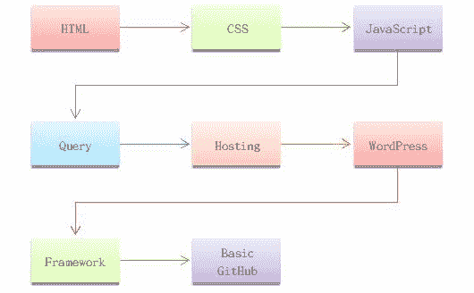

HTML 和 CSS 是你在继续学习其他内容之前需要掌握的最基础编码知识。然后你可以转向 JavaScript 和 jQuery。一旦你创建了路线图，它将让你更容易专注于最核心的内容，这样你就不会浪费时间和精力。

### 技巧 2：慢点来

想要快速理解编码将阻碍你学习编码和 JavaScript 进展的有害因素之一。

试图扫读某些内容然后转向手头上的下一个问题，只会让你忘记得更彻底。你会忘记第一次读过的内容，回去读一遍以加深记忆，然后继续前进。到那个时候，你可能已经完全忘记了其他东西。这个循环会不断重复，然后你会发现自己灰了意了。为了防止这种情况发生，你可以这样做：

- 将编码量限制在特定的任务上。一次学习一件事
- 练习你所学的内容

通过学习和练习你的编码技能，你会发现随着学习新事物的进行，记忆和吸收它们变得容易得多。这个过程可能看起来更长，但熟能生巧。

### 技巧 3：以正确的心态进行练习

记住这一点：如果你尝试在 JavaScript 练习中走捷径，你最终只会花费更长时间来学习它。是的，练习是无聊且重复的，但这里有一些方法可以让它变得有趣：

尝试将 JavaScript 中的每个新概念看作一个新玩具、汽车、iPhone 甚至一件新衣服。你会对尝试它感到兴奋，尤其是当它是新的而且你使用了几次之后。用你刚刚学的概念应用一些酷炫的东西；让自己惊讶，并向你的朋友展示你的新技能。

通过更具趣味性的方法来学习新事物，你可以在学习的同时享受其中。你还会发现对这些概念记得更久，学习得也更快。

### 技巧 4：时间碎片化

找时间练习编码可能是困难的。然而，编写代码的人也是社交媒体的重度用户，经常花时间在 YouTube、Facebook、Reddit 甚至 Wikipedia 上。无论你是否如此，从使用社交媒体中都能学到贵的教训。

即使我们只是想看一眼通知，我们都在 Facebook 上花费了这么多时间，这一事实说明了很多问题。我们被 Facebook 吸引是因为一件事引发了另一件事，因为你不断看到人们更新状态和动态，而且你的新闻推送里总有新东西可以看。

利用同样的心理学，你可以将其转化为学习代码的优势。与其一次投入几个小时学习代码，不如告诉自己你将投入 15 分钟的完全不受打扰的时间。然后看一眼 Facebook，休息一下。然后再次回来再做 15 分钟。

但是，这种技术只有在你专注于目标时才有效，不要让 Facebook 或其他任何事情将你吸进去，让你完全忘记正在做什么。

### 技巧 5：给自己留时间

俗话说说，如果你花时间慢慢思考，你学得会快得多。编码需要时间。你需要时间来理解它。否则，你只会更加困惑。花时间弄清楚你正在尝试学习什么。如果需要，就解释给别人听。在一次性搞定一切之前，花时间仔细每一个步骤、每一行代码。

### 技巧 6：用通俗语言编写

编码可能变得极其复杂。如果你阅读的内容变得太复杂或陌生，尝试用简单的术语将其写出来——或者用任何你先能理解的方式写出来。这样，在实际编写之前，你就可以弄清楚你想写什么代码。

这将使你下一次编码变得容易得多，你编写代码的速度也会更快，因为你不需要在每行代码处停下来思考。你还可以在编写代码之前就发现漏洞。

### 总结

这些技巧中的许多可以让你轻松且更快速地学习 JavaScript。事实是，你可以将这些技巧应用于学习任何任何你需要的课程。

## 第 2 章：JavaScript 备查表——每个程序员的必备项

到现在你已经知道如果你认真想成为一名程序员，学习 JavaScript 有有多重要。JavaScript 无疑是我们数字世界中最实用的编程语言。它被用于应用开发、Web 应用、网页和通用编程。

在这一章中，我们向你介绍一些你可以获取的必备备查表，让你在编码和编写编程语言方面变得更好。这些备查表非常有用，因为它们帮助你在学习的同时掌握基础知识。

### CHEATOGRAPHY JAVASCRIPT CHEAT SHEET

通过这个网站，你可以找到各种列表方法和函数，包括常用表达式的指南以及更复杂的项目（如 XMLHttpRequest 对象），以及许多 JavaScript 的引用。

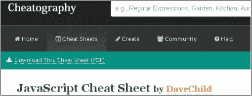

### QUICKLYCODE- PROGRAMMING CHEAT SHEET AND MANY OTHERS

这个网站为你链接到更多满足你编程需求的备查表和其他资源，从 JavaScript 到 SQL、Java、WordPress、Ruby on Rails 和 PHP。

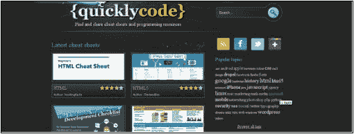

### FIRSTSITEGUIDE JAVASCRIPT CHEAT SHEET

FirstSiteGuide 由几个自称为 Web 极客的人组成，他们从 SEO 到营销、Web 托管、设计和开发的方方面建议和教程。他们还把你引导到免费资源和工具包。


### MOOTOOLS CHEAT SHEET

这个网站为你提供各种 JavaScript 工具，对于中级或高级的 JavaScript 开发者来说非常出色。你可以利用许多文档完备且优雅的 API 编写强大且灵活的代码。

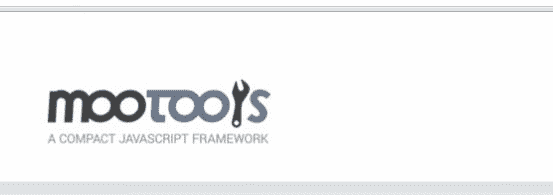

### jQUERY CHEATSHEET

由 Oscar Otero 管理，jQuery 备查表让开发者能够找到与 jQuery 1.3 库相关的函数和属性。

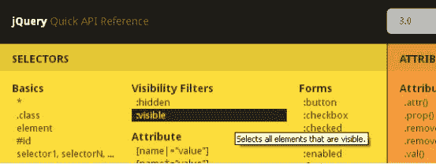

### STEAMFEED HTML & JAVASCRIPT SHORTCUTS

SteamFeed 的人们制作了一个非常棒的备查表，将 HTML 代码和 JavaScript 信息放在整洁且易读的信息图中，你可以将其打印并放在阅读范围内，以便在练习编码时可以方便获取。

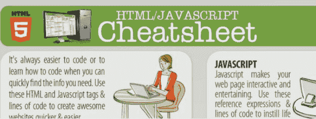

### WEB DESIGN CHEAT SHEET

如果你需要一个获取各种网页设计相关备查表的网站，那么 Sellfy 提供了一些关于 CSS、响应式网页设计备查表、HTML 标签等许多资源。


### THE ULTIMATE JAVASCRIPT CHEAT SHEET

这份来自 codementor 网站的备查列表提供了 JavaScript 语言的快速概述。你可以选择从开始阅读，也可以跳转到你感兴趣的话题。

## 第 3 章：设计和构建自己的 JavaScript 库的技巧与窍门

你说 JavaScript 库吗？

不，它不包含书籍。然而，它包含了 Web 设计师、开发者和程序员可以在项目使用的封装好的代码，这些代码可以节省时间和精力。换句话说，当你想要在不同的网站和程序上应用相同的代码包来实现相同的效果时，你不需要重复发明轮子。

### 那么，什么是 JavaScript 库？

以下是 JavaScript 库的几个显著特征：

- 它包含在单个文件夹中的一个或多个文件
- 它的代码必须单独维护，并且在你使用它来实现项目时，它应保持原样
- 它应该允许用户设置项目特定的行为或配置

在本章中，我们将讨论你为什么应该构建 JavaScript 库，以及它们是如何构建的——尽可能用最简单的方法。

### 为什么要构建自己的 JavaScript 库？

首先，它让程序员和 Web 开发者都变得非常方便，特别是当你编写和开发大量的程序、网站和 Web 应用时。拥有一个现有代码的库会让你的工作变得更容易并节省时间，因为你不需要不断从硬盘中某个模糊的文件夹里翻找旧项目。你只需要把它从库中提取出来即可。你有一个方便的地方来存储所有的代码；你有一个地方来分解所有的应用程序，并将它们保持在一个更容易维护的位置。

本质上，任何让你的工作变得更容易且可以重用的代码都是添加到库中的绝佳组件。其中一个很好的例子就是 jQuery。jQuery 的 API 是一个更简单的 DOM API。在跨浏览器 DOM 操作困难的时期，jQuery 是必不可少的。

如果一个开源项目变得越来越流行，越来越多的开发者使用它，它最终会鼓励更多开发者加入并通过贡献代码和提交问题来协助这项事业，使其操作变得更容易。这种贡献将有利于该库以及所有依赖它的其他实验。

热门的开源项目也可以为开发者带来极佳的机会。科技公司或任何组织可能会对开发者工作的质量留下深刻印象，并向他们提供工作。这可能意味着某公司将提供一名开发者合作某个项目，或者让他们将项目集成到自己的应用程序中。

但对于大多数开发者或编码员来说，拥有自己的库是一种爱好；这让他们能够编写多个代码、帮助他人并为过程做出贡献。

### 你的目标和工作范围

在你开始编写代码之前，你需要明确你对这个库的目标是什么。这将帮助你专注于你遇到的问题以及如何用你的库解决它们。

你的首要目标也是让你的库易于使用。本质上，你的 API 越简单，任何人就越容易使用你的库。

所以问问自己——你的库解决了什么问题，你将如何解决它？你将利用他人库中的代码，还是自己手写一切？

在第一章中，我们讨论了创建路线图。你库的这个路线图将是你进行任何其他代码开发时使用的技术之一。

### 你的库的路线图

- 列出你想要在库中实现的功能
- 使这些功能保持最少且实用
- 为每个功能创建里程碑

你通过路线图所做的本质上是为每个功能设定目标，基本上将你的项目分解为可管理的规模，使其更容易完成，并且创建过程会愉快得多。它还会让你保持理智和专注。

### 你的库的 API 设计

在创建库时，把自己想象成最终用户。通过把自己置于用户，你致力于以用户为中心的设计和开发。这将让任何能够访问该库的人都使用得更加方便。

### 测试你的 API

测试 API 质量的最佳方法是在你的项目中使用它。你可以做的是应用代码替换为你的库，看看它的结果是否涵盖了你想要的所有功能。尽可能保持最基本的核心要素，同时也提供灵活性以更改和修订任何看起来略有偏差的内容。

这里有一个实现代码或 User-Agent 字符串库的示例：

```javascript
// 从空的 UserAgent 字符串开始
var userAgent = new UserAgent;

// 创建并添加第一个产品：EvilCorpBrowser/1.2 (X11; Linux; en-us)
var application = new UserAgent.Product('EvilCorpBrowser', '1.2');
application.setComment('X11', 'Linux', 'en-us');
userAgent.addProduct(application);

// 创建并添加第二个产品：Blink/20420101
var engine = new UserAgent.Product('Blink', '20420101');
userAgent.addProduct(engine);

// EvilCorpBrowser/1.2 (X11; Linux; en-us) Blink/20420101
userAgent.toString();

// 对 engine 产品进行更多更改
engine.setComment('Hello World');

// EvilCorpBrowser/1.2 (X11; Linux; en-us) Blink/20420101 (Hello World)
userAgent.toString();
```

取决于你库的复杂程度，你还需要考虑结构化。实现此点之一是利用设计模式来构建你的库，并克服你在过程中可能遇到的任何技术问题。

结构化还可以当你向库添加新功能时，减少重新对齐巨大部分的风险。

### 灵活性和定制化

世界上大多数 JavaScript 库的酷之处在于其灵活性。然而，许多开发者在决定哪些可以和不能自定义时面临问题。其中两个就是 chart.js 和 D3.js。

这两个元素都是可视化数据的很好的库。如果你需要对图形有更多控制权，那么 D3.js 是你想要的。如果你想要一种容易创建且提供不同类型内置图表的东西，那么 Chart.js 是你的选择。

你有三种方法可以让用户对你的库进行控制：

1. 配置
2. 暴露公共方法
3. 回调函数（Callbacks）与事件

配置库通常在项目初始化阶段完成，但某些库也允许你在运行时进行设置。这些配置通常仅限于简单问题，因为更改这些设置只会更新这些值供以后使用。

```javascript
// 在初始化时配置
var userAgent = new UserAgent({
  commentSeparator: ';'
});

// 使用公共方法进行运行时配置
userAgent.setOption('commentSeparator', '-');

// 使用公共属性进行运行时配置
userAgent.commentSeparator = '-';
```

故意暴露某些方法是为了与实例进行交互（获取器 getters），例如从实例中检索数据或将数据放入实例中（设置器 setters），以及执行某些操作。

```javascript
var userAgent = new UserAgent;

// 用于检索所有产品注释的 getter
userAgent.getComments();

// 用于打乱所有产品顺序的操作
userAgent.shuffleProducts();
```

回调函数有时也会通过公共方法接受并传递，它们通常用于在异步任务之后运行用户代码。

```javascript
var userAgent = new UserAgent;
userAgent.doAsyncThing(function asyncThingDone() {
  // 在异步任务完成后运行代码
});
```

事件在 JavaScript 库中具有巨大的潜力。与回调函数相似，但它们有细微不同：添加事件处理器不会导致触发动作。事件还用于指示特定事件，并为用户提供额外信息，同时为库返回一个特定的值。

```javascript
var userAgent = new UserAgent;

// 在添加产品时进行验证
userAgent.on('product.add', function onProductAdd(e, product) {
  var shouldAddProduct = product.toString().length < 5;
  // 告诉库是否添加该产品
  return shouldAddProduct;
});
```

你还可以允许你的用户扩展你自己的库。为了这一点，你需要公开你的公共方法或属性以便用户可以填充它，例如 Angular 模块。

```javascript
(angular.module('myModule')) 和 jQuery 的 fn(jQuery.fn.myPlugin)
```

你也可以什么都不做，允许用户通过命名空间访问你的库。

```javascript
// AngryUserAgent 模块
// 拥有 UserAgent 命名空间
(function AngryUserAgent(UserAgent) {
  // 创建新方法 .toAngryString()
  UserAgent.prototype.toAngryString = function() {
    return this.toString().toUpperCase();
  };
})(UserAgent);

// 应用代码
var userAgent = new UserAgent;
// ...
// EVILCORPBROWSER/1.2 (X11; LINUX; EN-US) BLINK/20420101
userAgent.toAngryString();
```

同样，这允许你覆盖方法。

```javascript
// AngryUserAgent 模块
(function AngryUserAgent(UserAgent) {
  // 存储旧的 .toString() 方法备后用
  var _toString = UserAgent.prototype.toString;
  // 覆盖 .toString()
  UserAgent.prototype.toString = function() {
    return _toString.call(this).toUpperCase();
  };
})(UserAgent);

var userAgent = new UserAgent;
// ...
// EVILCORPBROWSER/1.2 (X11; LINUX; EN-US) BLINK/20420101
userAgent.toString();
```

在这种情况下，允许用户访问你库的命名空间也意味着你对插件和扩展的定义控制力更小。

为了让扩展遵循某些约定，你需要编写文档。

### 测试

对于测试驱动开发，大纲是必不可少的。换句话说，这就是以测试的形式写下功能和标准的时间，甚至在编写实际库之前。

如果你的测试显示某个功能的行为符合预期，并且你在将其写入库之前就写写了它，那么这种策略被称为行为驱动开发。

如果你的测试涵盖了库的每一个方面，并且你的代码通过了所有这些测试，那么你就可以放心地说库运行良好。

你可以使用的其他测试框架包括：

- Jani Hartikainen 写的《Unit Test Your JavaScript Using Mocha and Chai》，你可以在 Mocha 中编写单元测试。
- Tim Evko 写的《Testing JavaScript with Jasmine, Travis, and Karma》向你展示如何与另一个名为 Jasmine 的框架协调设置测试流水线。

下面是 Tim Severien 提供的另一个可以尝试的大纲。他为自己的库使用了 Jasmine 测试，看起来像这样。

```javascript
describe('Basic usage', function () {
  it('should generate a single product', function () {
    // 创建单个产品
    var product = new UserAgent.Product('EvilCorpBrowser', '1.2');
    product.setComment('X11', 'Linux', 'en-us');
    expect(product.toString())
      .toBe('EvilCorpBrowser/1.2 (X11; Linux; en-us)');
  });

  it('should combine several products', function () {
    var userAgent = new UserAgent;
    // 创建并添加第一个产品
    var application = new UserAgent.Product('EvilCorpBrowser', '1.2');
    application.setComment('X11', 'Linux', 'en-us');
    userAgent.addProduct(application);

    // 创建并添加第二个产品
    var engine = new UserAgent.Product('Blink', '20420101');
    userAgent.addProduct(engine);
    expect(userAgent.toString())
      .toBe('EvilCorpBrowser/1.2 (X11; Linux; en-us) Blink/20420101');
  });

  it('should update products correctly', function () {
    var userAgent = new UserAgent;
    // 创建并添加第一个产品
    var application = new UserAgent.Product('EvilCorpBrowser', '1.2');
    application.setComment('X11', 'Linux', 'en-us');
    userAgent.addProduct(application);

    // 更新第一个产品
    application.setComment('X11', 'Linux', 'nl-nl');
    expect(userAgent.toString())
      .toBe('EvilCorpBrowser/1.2 (X11; Linux; nl-nl)');
  });
});
```

一旦你完成了测试，并对第一个库版本的 API 设计完全满意，你就可以开始考虑网站的架构以及你的库具体将如何被使用了。

### 模块加载器兼容性

并不是多少开发者使用模块加载器，这完全取决于你。然而，你需要意识到，某些使用你库的开发者可能会选择使用模块加载器，因此你需要让你的库兼容此功能。

你可以选择一些流行的模块加载器，如 AMD、RequireJS 和 CommonJS。如果在这些功能之间做选择很困难，你也可以尝试通用模块定义 (UMD)，它旨在支持多种类型的模块加载器。

要使你的库兼容 UMD，你也可以找到一些变体，例如 UMD GitHub 仓库。从使用这些模板之一开始创建你的库。另一个建议是，如果你选择使用 ES2015 的 import/export 语法，请使用 Babel 编译为 ES5 并结合 Babel 的 UMD 插件。这样，你既可以在项目中使用 ES2015，又能生成一个被使用各种模块的开发者使用的库。

### 文档

你需要从基础信息开始编写文档，例如你的项目名称以及关于其内容的简要描述。这将帮助他人理解你的库旨在做什么，以及使用你的库对他们来说是否是一个良好的选择。你还可以包含更多关于范围和目标等信息，以便用户获得更充分的信息。

你还可以包含路线图，让用户知道他们对你库的未来开发可以期待什么，以及他们如何对此做出贡献。

### API、教程和示例

API 文档也是文档不可或缺的一部分，因为它会告诉用户具体如何使用你的库。其他很好的补充还有示例和教程。这可能花费一些时间，所以你可以在库开发过程中进行。

### 元任务

用户还可能希望对你的库进行更改，这通常以贡献的形式出现，但某些人可能想创建一个仅供私下使用的自定义构建。对于这些用户，你可以包含元任务文档，其中包含一个构建库、运行测试、生成和转换或下载数据的命令列表。

### 贡献

贡献是非常好的，特别是当你开源你的库时。你可以添加的另一个文档是引导贡献者解释向库做出贡献的步骤，以及他们在贡献之前应该填写哪些标准。这将使你的评审过程更容易接受能够积极升级和增强你库的贡献。

### 许可证

许可证也很重要。包含许可证让每个人知道哪些材料受版权保护。推荐 ChooseALicense.com 作为没有法律顾问的情况下获取许可证的优秀资源。将选择的许可证以 LICENSE.txt 格式保存在项目根目录下。

### 向你的 Git 仓库添加版本/发布

对于一个好的库来说，版本控制是必要的。当前版本命名的标准是 SemVer（语义化）。该版本由三个数字组成，表示主、次和补丁版本的更改。如果你有 git 仓库，你也可以添加版本号。考虑你仓库的快照或标签（Tags）。要创建一个标签，打开终端执行以下操作：

```bash
# git tag -a [version] -m [version message]
git tag -a v1.2.0 -m "Awesome Library v1.2.0"
```

例如，GitHub 提供了所有版本的完整视图以及每个版本的下载链接。

### 发布到公共仓库

#### npm

大多数编程语言都配备了包管理器，或者至少有一个第三方包管理器，允许用户拉取针对特定语言的特定库。例如，PHP 的管理器是 Composer，Ruby on Rails 是 RubyGems。对于像 Node.js 这样独立的 JavaScript 引擎，你有 npm。默认情况下，你的 npm 包将公开可用。但你也可以选择发布：

- 私有包
- 设置私有注册表
- 完全避免发布

然而，如果你决定发布你的包，你就需要 package.json 文件。你可以手动执行，也可以使用交互式向导来实现。要启动此向导，首先输入：

```bash
npm init
```

version 属性应该匹配你的 git tag。包含 README.md 文件。就像 GitHub 一样，npm 使用它作为展示你包的页面。完成后，输入以下命令发布你的包：

```bash
npm publish
```

搞定！你成功发布了你的 npm 包。

#### Bower

另一个名为 Bower 的实用包管理器几年前出现。这是一个为 Web 设计的管理器。在这里，你可以找到所有的前端断言。只是，如果你的库被设置为浏览器兼容，那么使用 Bower 发布你的包将受益。npm 包主要用于 JavaScript，许多前端包仍在使用 npm，但 Bower 从根本上仍然是流行的，所以尽管继续使用 Bower 发布吧。

要生成 bower.json 文件，输入：

```bash
bower init
```

就像 npm init 一样，指令是自解释其它的。最后，发布你的包：

```bash
bower register awesomelib https://github.com/you/awesomelib
```

现在，你的库已经可以供大家在他们的 Node 项目或网页上使用了！

### 结论

请记住，你的代码开发就是这个库。确保你的库能够解决问题，既方便又易用，而且最重要的是要保持稳定。这将确保你和许多其他使用它的开发者都能感到满意。

上面解释的任务可以很容易自动化，例如运行测试和创建标签、更新你的版本以及发布你的包。

## 第 4 章：需要掌握并记住的 JavaScript 技巧与窍门

在本章中，我们将探讨一些与提高 JavaScript 技能和增强代码编写相关的短而实用的技巧。

### 使用 === 代替 ==

`==`（或`!=`）运算符在需要时会执行自动类型转换。而`===`（或`!==`）运算符则不会执行任何转换。

它所执行的是比较值和类型，这可以被认为比`==`更快（参考 jsPerf）。

```javascript
[10] == 10 // 为 true
[10] === 10 // 为 false
'10' == 10 // 为 true
'10' === 10 // 为 false
[] == 0 // 为 true
[] === 0 // 为 false
'' == false // 为 true 但 true == "a" 为 false
'' === false // 为 false
```

### charAt() 简写

要实现这一点，你可以利用`eval()`函数，但这种括号表示法的简写技术比求值要简单得多。

完整形式：

`"myString".charAt(0);`

简写形式：

`"myString"[0]; // 返回 'm'`

### 字符串转换为数字

实现此操作最快且简单（jsPerf）的方法是使用`+`（加号）运算符。

```javascript
var one = '1';
var numberOne = +one; // 数字 1
```

你也可以使用`-`（减号）运算符，它会将值类型转换为数字，但也会将其取反。

```javascript
var one = '1';
var negativeNumberOne = -one; // 数字 -1
```

### 将真值/假值转换为布尔值

你可以使用`!!`将真值或假值转换为布尔值`true`。

```javascript
!!"" // false
!!0 // false
!!null // false
!!undefined // false
!!NaN // false
!!"hello" // true
!!1 // true
!!{} // true
!![] // true
```

### 使用 JSON.Stringify

假设有一个具有属性`prop1`、`prop2`、`prop3`的对象。可以向`JSON.stringify`传递额外的参数以有选择地将对象的属性写入字符串，例如：

```javascript
var obj = {
  'prop1': 'value1',
  'prop2': 'value2',
  'prop3': 'value3'
};
var selectedProperties = ['prop1', 'prop2'];
var str = JSON.stringify(obj, selectedProperties);
// str
// {"prop1":"value1","prop2":"value2 "}
```

`str`将仅包含所选属性的信息。除了数组，我们也可以传递函数。

```javascript
function selectedProperties(key, val) {
  //第一个 val 是整个对象，key 是空字符串
  if (!key) {
    return val;
  }
  if (key === 'prop1' || key === 'prop2') {
    return val;
  }
  return;
}
```

最后一个可选参数用于修改将对象写入字符串的方式。

```javascript
var str = JSON.stringify(obj, selectedProperties, '\t\t');
/* str 输出在每行都有双制表符。
{
  "prop1": "value1",
  "prop2": "value2"
}
*/
```

### 数组和写入单个元素的单一方法

与其编写单独的方法来存放数组和单个元素参数，你可以编写函数使其能够同时处理两者。

你只需要先将所有内容合并到一个数组中。`Array.concat`会接受数组或单个元素。

```javascript
function printUpperCase(words) {
  var elements = [].concat(words || []);
  for (var i = 0; i < elements.length; i++) {
    console.log(elements[i].toUpperCase());
  }
}
```

`printUpperCase`现在准备好接受单个节点或节点数组作为其参数。它还避免了未传递参数时可能抛出的潜在`TypeError`。

```javascript
printUpperCase("cactus");
// => CACTUS

printUpperCase(["cactus", "bear", "potato"]);
// => CACTUS
// BEAR
// POTATO
```

### 测量 JavaScript 代码的性能

为了快速测量 JavaScript 代码块的性能，我们可以使用 console 函数如`console.time(label)`和`console.timeEnd(label)`

```javascript
console.time("Array initialize");
var arr = new Array(100),
len = arr.length,
i;
for (i = 0; i < len; i++) {
  arr[i] = new Object();
};
console.timeEnd("Array initialize"); // 输出: Array initialize: 0.711ms
```

### 变量提升

提升将帮助你管理函数作用域。变量声明和函数会被提升到顶部，而变量定义不会。

```javascript
function doTheThing() {
  // ReferenceError: notDeclared 是未声明的
  console.log(notDeclared);
  // 输出: undefined
  console.log(definedLater);
  var definedLater;
  definedLater = 'I am defined!'
  // 输出: 'I am defined!'
  console.log(definedLater)
  // 输出: undefined
  console.log(definedSimulateneously);
  var definedSimulateneously = 'I am defined!'
  // 输出: 'I am defined!'
  console.log(definedSimulateneously)
  // 输出: 'I did it!'
}
doSomethingElse();
function doSomethingElse(){
  console.log('I did it!');
}

// TypeError: undefined 不是一个函数
functionVar();
var functionVar = function(){
```

## 第 5 章：向前发展所需的 JavaScript 技能

### Angular 2

Angular 2 是 AngularJS 的完全重写版本。Angular 1 是一个庞大的框架，而 Angular 2 被设计为一种更易于管理的语言。

微软公司去年积极推行 .NET，因为它开源了许多元素，并努力让微软工具对开发者来说更易用。在重写之后，团队希望解决 Angular 1 应用中出现的任何升级问题，而且到目前为止性能非常出色。Angular 2 的开发是为了支持 Web 组件，根据 Google 的说法，它是 Web 开发的未来。然而，AngularJS 社区对 Angular 采取的发展方向持有不同意见——尽管 Angular 团队已经投入了大量精力帮助开发者从 Angular 1 顺利过渡到 Angular 2。

这次重写也让 React 得以发展和成熟，其社区日益壮大。正因如此，程序员怀疑 Angular 2 是否会像 Angular 1 那样成功。然而，如上述所示，科技世界是不断变化的，因此 Angular 2 可能在 2017 年有增长空间。Angular 2 仍然被视为 React 应用的备选方案。

### Meteor

另一个值得关注的趋势是 Meteor，它一直保持着稳定的下载量和 GitHub 星数。它与 React 和 Angular 集成良好，并具有许多巧妙的功能。作为一个轻量级的全栈 JavaScript 框架，开发者发现 Meteor 框架用起来非常愉快。Meteor 一直被认为是一个可靠的初学者框架，也非常适合原型设计。

阻碍 Meteor 成为主流成功的是随着时间推移不断出现的隐藏复杂性，特别是在生产环境中。尽管 Meteor 募集了大量资金，但它并没有像 React 和 AngularJS 那样拥有庞大工程师标准的领先科技企业支持。尽管 AngularJS 有很多问题，但它有 Google 支撑；另一方面，Meteor 被认为是一项投资风险，因为它是一个兼顾后端和前端开发的框架。为了最大限地利用部署的便利性，Meteor 还需要托管。

目前让 Meteor 不尽理想的另一个问题是，许多开发者并不喜欢 MongoDB，而 Mongo 正是 Meteor 的默认数据库。Meteor 在 2017 年可能仍是一个不错的选择，因为更多开发者可能会等待更可靠的证据，证明 Meteor 可用于大型且更复杂的应用开发。不言而喻，Meteor 在 2016 年甚至 2017 年可能仍保持小众化。大多数专业开发者将等待任何关于它可以用于开发大型、复杂应用的证据。

### ES6 终于到来

JavaScript 开发者在 2016 年迈向 2017 年期间要做的事情之一，是确保他们所有的应用符合 ES2015 标准。但就像科技应用和编程语言中的许多其他问题一样，我们面临着 Babel 与 TypeScript 问题。

Babel 主要将 ES6 代码翻译为 ES5，而 TypeScript 实际上是 JavaScript 的超集，它为 JavaScript 添加了必要但可选的静态类型，然后将所有内容编译为纯 JavaScript。Babel 和 TypeScript 的创建目的完全不同，因此没有可比性。

由 Facebook 开发的 Babel 支持 Flow，Flow 也为 JavaScript 添加了静态类型检查。使用 Babel 稍微更有意义，因为你可以连续使用这两种。Babel 也是第一个帮助桥接 ES5 和 ES6 应用之间差异的工具。

另一方面，TypeScript 只支持 ES6，因此在演进性方面次于 Babel。查看 GitHub 星数发现，Babel 是最受欢迎的转换器。React 开发者也倾向于使用 Babel + Webpack 的组合。

尽管有星数支持，TypeScript 似乎要可行得多，且有时甚至是更青睐的选择，特别是当你正在寻找一种能让你的 JavaScript 代码库更易于管理的解决方案时。JavaScript 一直以来被认为是一种难以阅读的语言，由于其弱类型检查系统，这使得调试变得更加困难。因此在支持方面，TypeScript 的追随者比 Flow 多。

下图显示了 Google 趋势图，展示了对 TypeScript 兴趣的增长。

TypeScript 可能流行的另一个原因是 Angular 2，但并不仅仅因为 JavaScript 应用受到更多关注，这并不是 TypeScript 流行的贡献原因。

虽然 Redux 让测试变得简单得多，但 TypeScript 让代码库变得更易维护。除外，Google、Facebook 和微软正在合作为 JavaScript 添加静态类型，从而为 ECMAScript 铺平道路。

与此同时，Google 放弃了 Script 和 AngularJS，转而采用微软的 TypeScript。另一方面，Facebook 的 Flow 并没有像 TypeScript 那样的社区普及度。

这表明静态类型 JavaScript 是一个活跃且不断增长的趋势，即使是 JavaScript 的不信者也会认可，而 TypeScript 是最可靠的解决方案。

### 函数式编程正成为主流

许多函数式编程平台正在进入主流编程领域，但最近，“函数式编程模型”引起了大量关注，特别是随着复杂 Web 应用的兴起。

**Scala** 回成为想要拥抱函数式编程的后端开发者的喜爱语言。然而，Facebook 的 React 则鼓励前端 JavaScript 开发者使用一种实用的方法来承担 UI 开发。

对于函数式编程的积极反馈越来越多，看起来它可能将在 2017 年成为主流。在此时，前端 Web 开发正处于响应式和函数式编程的前沿。

因此，React+Redux 方案对于那些熟悉面向对象编程的人来说，确实是最受青睐的初学者友好解决方案。换句话说，React 只需要开发者对 UI 使用函数式方法，而 Redux 主要是一个鼓励使用实用方法处理数据的系统。所有其他事情都以 OOP 风格完成。

### RxJS

但对于那些仍然想坚持完全函数式响应式编程（被认为是“真正的”FRP）并且仍然想使用 JavaScript 的人，RxJS 是一项必须学习的技能。RxJS 是 JavaScript 的响应式扩展，可以取代 Flux 架构。对于简单小小的应用，这听起来可能过过了，但实际上，它为通过复杂处理流的 Web 应用构建了强大的基础。

Netflix 使用 RxJS，而 Angular 2 也依赖 RxJS。由微软开发的 RxJS 与 TypeScript 配合得非常完美，因此开发者可以预期 RxJS 将继续改进。

然而，学习 RxJS 是一个完全不同的领域。它具有陡峭的学习曲线，导致大多数开发者放弃在 JavaScript 中进行任何 FRP，转而选择其他与 JavaScript 兼容的函数式编程语言。

开发者选择替代 RxJS 的一些兼容编程是 ClojureScript 和 Elm。然而，所有这些程序的增长和流行与 Redux+React 相比都显得黯然逊色。

问题在于，考虑到函数式编程如何完美地解决 Web 开发中的现代问题，人们必须承认函数式编程范式及其等概念将作为 JavaScript 开发者需要掌握和学习的技能持续存在。

### 桌面框架对决：Nw.js vs. Electron

如今数据需要从各种平台（如桌面和移动）同步数据。然而，许多服务大多以 Web 应用的形式开始，然后转换为桌面应用以增强用户体验。这样做是因为 Web 应用的开发快得多且更容易更新。此外，用户还可以更快速地尝试 Web 应用，而无需安装任何其他东西。

过去，开发者如果想使用 Web 技术为桌面应用创建前端 UI，受限于使用 CEF。这不是一个容易的过程，而且应用程序本身并不是真正的跨平台兼容。尽管如此，Node.js 让桌面框架的跨平台应用变得更加简单。使用 Web 技术进行桌面应用开发的趋势开始兴起，始于2014年。

因此，让我们来看看这两个项目的 GitHub Star 历史：


尽管 Nw.js 较早进入市场并被认为更老，但看起来 Electron 正在以爆炸性的速度增长，而 nw.js 则以单调的线性速率增长。

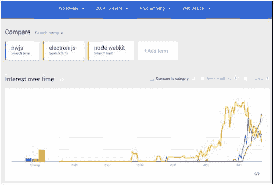

虽然 Electron 还相当新，但它已经被 Slack、Microsoft (Visual Studio Code)、WordPress 和 Sencha 等多家成熟机构使用。但由于 Electron 的易用性，网络和社区增长得非常快。这股热潮很可能会持续到 2017 年，从而使 Electron 成为桌面和 Web 应用开发的首选框架。

### 移动应用框架对决：React Native vs. Ionic

当 React Native 出世时，人们预测它将接管并利用 Web 技术引领移动开发方向，因为它可以被用于开发原生跨平台应用。那么 2017 年是 React Native 的年吗？通过这张图表，可能会产生一些预期：

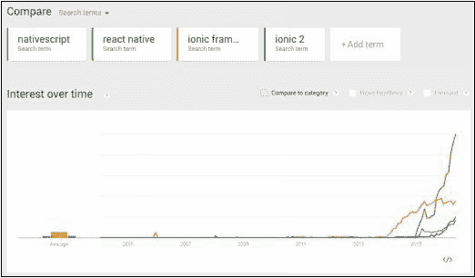

此时，React Native 尚未发布任何更新的软件，因为它仍然处于 0.26 版本。它是否会在 2017 年成为主流，很大程度上取决于开发者处理应用开发变化的耐心，这些变化需要同时重构整个代码库以及其他问题。因此，让我们来看看 React Native 与 Ionic 的近似 npm 下载量：

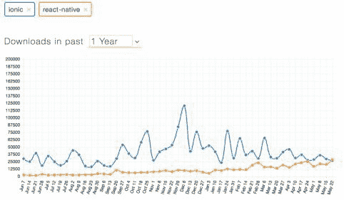

从图表中可以看出，React Native 进展有望超越 Ionic，成为使用 Web 技术进行跨平台移动开发的首选框架。

在就业市场方面，React Native 的需求也比 Ionic 更大：

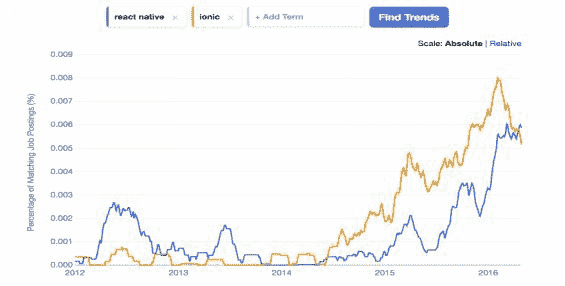

招聘信息的快速搜索显示，至少有 75 个职位招聘在寻找 Ionic 技能开发者，而 65 个职位招聘在寻找 React 技能开发者。这表明人们对 React Native 的熟悉程度正在增加，这很可能为 2017 年之后的任何新兴开发者提供巨大的推动力。

### Web API 的未来：GraphQL vs. REST

在 Facebook 提到他们将开源 GraphQL 后不久，许多 JavaScript 开发者在 2016 年初就追上了热潮，尤其是因为 Facebook 在开源项目方面已变成了 JavaScript 界的苹果。

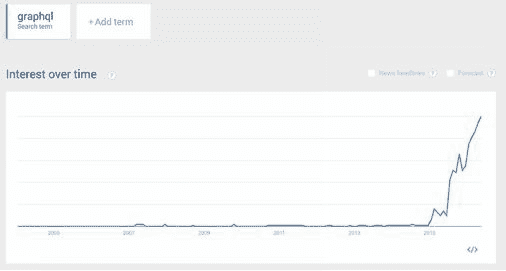

GraphQL 旨在某种取代 REST API，但考虑到 REST API 的无处不在，这种情形不太可能：

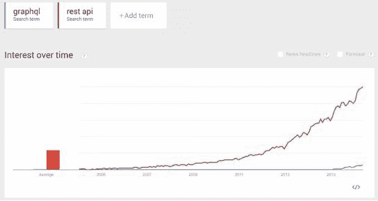

GraphQL 与 REST API 结合得很好，但它绝对不会像某些开发者认为的那样取代 REST。与此更相关的是，GraphQL 相对较新，并与 Facebook Relay 关联，因此程序员和开发者在其他地方没有学习资源或最佳实践来掌握这项技能。尽管如此，尽管 GraphQL 现在有强烈的炒作，但 2017 年对于它成为主流仍然为过早。

### JavaScript 趋势总结

总之，JavaScript 社区的发展变化非常快，跟上任何即将出现的趋势并与主流技术保持一致，这意味着更多的支持、相关性和资源。根据本章讨论的趋势，JavaScript 开发者应该让自己掌握 Redux & React，以及其他熟悉的函数式编程语言，如 TypeScript。不仅如此，拥有 React Native 和 Electron 的经验无疑会为未来的程序员在求职时提供更多推动力和信誉。

### 结论

感谢你读完 *JavaScript: Tips and Tricks to Programming Code with JavaScript.*。希望它对你有所启发，并能够为你提供实现目标（无论目标是什么）所需的所有工具。

下一步是使用你所学到的编码技能将其应用到你自己的项目中。学习需要时间，但你应该保持耐心，因为就像学习任何新事物一样，你会犯错。再次复习书中的课程并重读它们。由于你要学习的所有不同的条件和异常，学习编写代码将令人困惑，直到你掌握了窍门。

最后，如果你发现这本书在任何方面都有帮助，我们将非常感谢你在 Amazon 上给出评价！

### 关于作者

Charlie Masterson 是一位计算机程序员和导师，开发过多个应用程序和计算机程序。

作为一名计算机科学学生，他很早就对编程感兴趣，但对学习高度复杂的课题感到沮丧。

Charlie 想要一种他可以轻松学习并提高编程技能的教学方法。他很快发现了一系列让他学得更快、更好的教程。

通过同样的方法，Charlie 成功学习了不同的编程语言，现在通过写书籍教授这些主题。

通过他编写的计算机编程书籍，他希望提供巨大的价值，并帮助对学习计算机相关主题感兴趣的读者。
