# JavaScript：二合一合集：初学者指南 + JavaScript 编程技巧


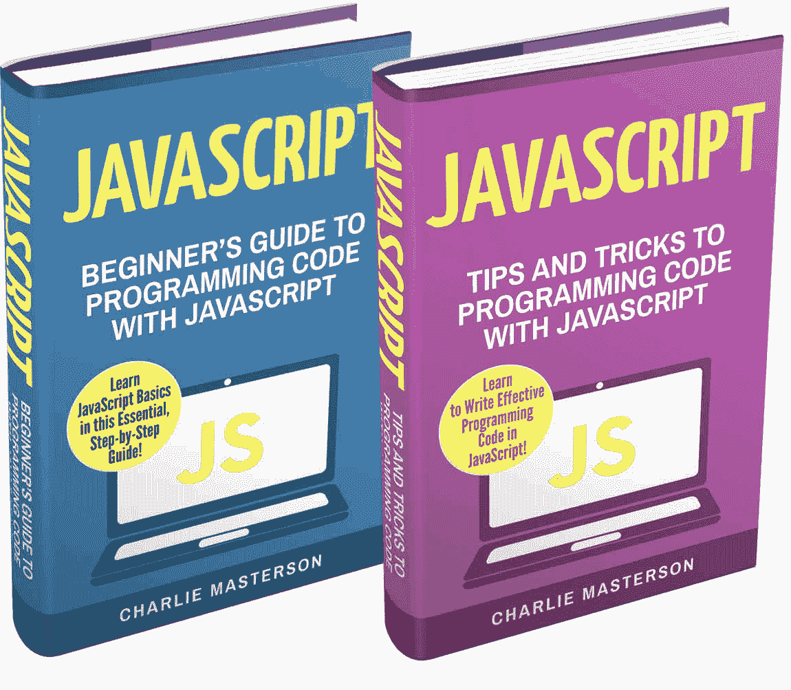


## 关于本合集

恭喜你下载《JavaScript: 2 Books in 1 - JavaScript 编程入门指南与编程技巧与方法》，并感谢你的支持。

你即将阅读的是两本关于如何学习 `JavaScript` 计算机编程的独立书籍。每本书都将讨论学习 `JavaScript` 的不同阶段，并按照合理的顺序排列，带你从初学者水平走向中级水平。

### 第 1 本
JavaScript: 编程入门指南
在这里，你将学习学习 `JavaScript` 的基础要点——获得初级知识所需的必要主题。

### 第 2 本
JavaScript: 编程技巧与方法
在这里，你将不断进步，学习学习 `JavaScript` 编程语言的中级实用技巧和方法——帮助你在精通 `JavaScript` 的道路上不断前进。

再次感谢你拥有本书！让我们从 `JavaScript` 合集中的第一本书开始：


## 介绍

恭喜你下载《JavaScript: 2 Books in 1 - JavaScript 编程入门指南与编程技巧与方法》，并感谢你的支持。你即将阅读的是两本关于如何学习 `JavaScript` 计算机编程的独立书籍。每本书都将讨论学习 `JavaScript` 的不同阶段，并按照合理的顺序排列，带你从初学者水平走向中级水平。

### 第 1 本
JavaScript: 编程入门指南
在这里，你将学习学习 `JavaScript` 的基础要点——获得初级知识所需的必要主题。

### 第 2 本
JavaScript: 编程技巧与方法
在这里，你将不断进步，学习学习 `JavaScript` 编程语言的中级实用技巧和方法——帮助你在精通 `JavaScript` 的道路上不断前进。

再次感谢你拥有本书！让我们从 `JavaScript` 合集中的第一本书开始：

## 第 1 章：JavaScript……它是什么？它将如何使受益？

`JavaScript` 是一种客户端脚本语言。这意味着该语言或代码被发送到用户的计算机并在那里执行。这与 `ASP.NET` 或 `PHP` 等服务器端技术形成对比，后者是在结果传递给用户计算机之前在 Web 服务器上运行代码。

通过 `JavaScript`，你将与不同的网页进行交互，以便创建 Web 应用程序。Netscape Communications 在 1995 年首次实现了 `JavaScript`。

在构建网页时，你通常会在三种主流语言中遇到 `JavaScript`，另外两种是 `HTML` 和 `CSS`。因此，虽然 `HTML` 处理页面的内容和结构，`CSS` 处理页面的呈现（如指定背景颜色），但 `JavaScript` 是页面交互和行为的编程语言。

例如，当你在“联系我们”页面的表单字段中输入错误的值会发生什么？让网页具有交互性并执行 `HTML` 和 `CSS` 无法实现的功能，让你发现了 `JavaScript` 对网站的用性。

但我必须指出，`JavaScript` 并不是作为一种通用的全能语言而设计的；它有局限性。例如，它无法访问计算机的文件系统，也无法与数据库通信。尽管如此，它在实现网页交互方面表现非常好。

`JavaScript` 很容易与 `Java` 混淆，因为它们的名字非常相似；但它们并不是一回事。不过的是，它们可以在客户端共同交互，例如你的网络浏览器，因为它们可以直接嵌入 Web 源码中。


每当你查看 JavaScript 的支持时，你会惊讶地发现它几乎在任何地方都受到支持。在 `Firefox`、`Google Chrome` 和 `Safari` 等浏览器中，如果你不确定你的浏览器是否是 JavaScript 授权的厂商，可以进入设置查看是否可以启用或禁用 JavaScript。如果可以，说明你的浏览器已获得 JavaScript 授权。

## 优势

学习 JavaScript 将对你有所益，它可以帮助你职业晋升或寻找不同的职业。如果你想进入 IT 领域甚至是网页设计，JavaScript 是必不可少的。

如果你已经在这些领域有了一份工作，你将能够获得职业晋升，因为你加深了对某些你有益知识的理解。

JavaScript 不仅在你在 IT 或网页设计领域时很有用。JavaScript 可以应用于任何工作，如果你不确定它是否可以用于你的工作，请询问你的老板。表现出学习工作要求之外知识的积极性将给你的老板留下深刻印象并赢得青睐。

## 第 2 章：编写你的第一段 JavaScript 代码

如上一章所述，帮助运行交互网站的 JavaScript 并不是孤立工作的，它与 HTML 和 CSS 共同运行，构成了网页的三大核心语言。

那么，让我们开始编写 JavaScript 。由于 JavaScript 将运行在网页中，我们首先需要一个编写 JavaScript 语言的网页。

下面是一个简单的网页示例，作为我们的参考：

```html
<!DOCTYPE html>
<html>
<head>
<title>这里是标题</title>
</head>
<body>
<p>这是一个网页</p>
</body>
</html>
```

代码由基础的 HTML 和没有 CSS 组成，都是非常基础的内容。现在，如果你将代码复制并粘贴到记事本应用程序中，将其保存为 HTML 文件（例如 `first.html`），然后双击该文件（如果双击时浏览器没有打开文件，请手动打开浏览器并将文件拖入其窗口），你电脑上安装的 浏览器应该能够成功渲染代码并产生如下结果：

这是一个网页。

就像我们使用起始和结束的 `p` 标签来包裹一个段落一样，对于 JavaScript，我们用 `script` 标签将其包裹。`<script> </script>`

为了向这个 HTML 文件示例添加第一段 JavaScript 代码，我们将使用一个名为 `alert` 的 JavaScript 弹出框，它在运行网页时会产生一个弹出消息框并输出文本“Hello World”。

```javascript
<script>
alert ("Hello World!");
</script>
```

注意，为了让弹出框出现，请确保你的浏览器隐私设置允许此操作。

现在将所有内容整合，我们将 JavaScript 代码添加到 HTML 的其他部分：

```html
<!DOCTYPE html>
<html>
<head>
<title>这里是标题</title>
</head>
<body>
<p>这是一个网页</p>
<script>
alert ("Hello World!");
</script>
</body>
</html>
```

保存文件并双击它在 浏览器中打开。如果这不起作用，打开浏览器并将文件直接拖到浏览器窗口；它将打开你正在创建的网页。然后你应该会看到 alert 消息框弹出，并显示文本“Hello World!”。

**结果：Hello World!**

恭喜——你已经写了你的第一段 JavaScript 代码。在接下来的章节中，我们将讨论更多关于这种语言的内容以及你如何使用它来制作更好的网页。

## 第 3 章：数据和 JavaScript 变量

数据通常被存储以便以后使用。这是编写代码的一个非常重要的方面。JavaScript 是一门奇的编程语言，它可以存储数据以便你以后使用，而无必担心它丢失。

当你编写代码时，你可以通过询问可能在以后使用的信息来与用户进行交互。

### 代码

你希望用户输入他们的姓氏，以便为他们提供个性化的问候。

```javascript
var surname = prompt(“你好用户，可以问一下你姓什么字吗？”);
```

代码运行后，将弹出一个框询问用户的姓氏是什么。用户只需要在按下回车键或点击确定按钮之前输入他们的姓氏，信息就会被移动并存储在适当的地方。

恭喜，你现在创建了一个作为用户姓氏的变量。

### 变量

如果你把变量想象成架子，它们将变得更容易理解。每个架子都有一个名字，这个名字在变量创建后生成。因此，对于之前的代码，你的架子名字将是 `surname`，而放在架子上的对象就是用户的姓氏。

你可以创建任何你想作为变量的内容。但建议先为变量命名，这样你就知道哪个变量是哪个，而不是用数字或字母来命名它们。

当你告诉你使用的浏览器来定位一个变量时，它不仅会被找到，该“架子”上的数据也会返回给你。架子上的对象也被称为值（value）。

存储在值中的数据被称为字符串（string）。因此，组成某人姓氏的字母就是 `surname` 变量的值和 `string`。字符串不一定是字母；也可以是数字。


现在你创建了两个变量。`var` 只使用了一次的原因是因为你进行了初始化并给变量赋了值。当你只写一次关键字并用逗号将它们分开时，你可以省去一些额外的工作。

在 JavaScript 的帮助下，你将能够计算出你拥有多少个水果。

代码：
```javascript
var piecesOfFruit = apples + oranges;
```

这段代码将告诉浏览器，在将结果重新赋值给 `piecesOfFruit` 的数量之前，它需要根据右侧的数字计算总和。但是，变量名不会被相加，只有值会被相加。你的浏览器会知道你在做什么，并且只会给你这些值的总和。

你的总和不会是 "pieces of fruit"（水果个数），而是 `piecesOfFruit`，因为你的变量不能包含任何空格。很容易发现，`Of` 和 `Fruit` 中的 `O` 和 `F` 是大写的。这被称为驼峰命名法（camel casing），它有助于使变量更易读。

请记住，代码有多种读取方式。这就是为什么确保你的代码易于阅读和理解是非常重要的。

### 拆分

当你进行数学运算时，不仅仅有加法。对于代码来说，还有除法。

代码：
```javascript
var piecesForEachPerson = piecesOfFruit / 3 ;
```

JavaScript 能够完成这些数学计算，而你无需拿出计算器来确保计算正确。

除法是通过正斜杠 `/` 完成的，以确保你将左侧除以右侧。

### 运算符

为了得到一组数字的总和，你将为每种操作使用符号。

- 乘法 (`*`)
- 加法 (`+`)
- 除法 (`/`)
- 减法 (`-`)

每个符号都被称为运算符，因为它们将对某些数学数据进行操作。就像任何数学题一样，执行的执行有一个特定的顺序，这被称为运算符优先级（operator precedence）。

看到一组括号意味着在执行乘法、除法、加法或减法过程之前需要先执行它们。记住这个运算顺序简单方法是 `PEMDAS`（括号、指数、乘法和除法、以及加法和减法）。

代码：
```javascript
(10+2) / 2 + 4 * 2
12 / 2 + 4 * 2
6 + 4 * 2
6 + 8
```

## 第 5 章：JavaScript 逻辑

在编程时，能够比较不同的值是非常重要的以便在涉及代码以及如何执行代码时做出决策。比较将使你的结果为假（false）或真（true）。然后，还有一种特殊的数据类型，被称为布尔型（Boolean）数据类型。

使用 JavaScript 进行数学计算将引入一组与布尔值工作的运算符。这些比较将在你操作控制台时进行。你从每行得到的任何结果都将显示为 true 或 false。

### 等于

要确定两个不同的值是否相等，你将使用三个等号（`===`）。

代码：
```javascript
15.234 === 15.234
True
```

要检查两个变量是否不等，你需要使用两个等号并在它们前面加一个感叹号（`!==`）。

```javascript
15.234 !== 18.4545
True
```

包含数字的字符串在值上等于该数字，但在类型上不等，因此 `===` 比较将返回 false：

```javascript
“10” === 10
False
```

然而，如果你使用两个等号（`==`）比较这两个值，它将返回 true，因为两个等号只比较变量的值，而不比较类型！所以这将返回 true：

```javascript
"10" == 10
True
```

### 大于/小于

两个数字可以比较为其中一个大于或小于另一个。当一个数字大于另一个数字时，你将使用大于符号 `>`。

代码：
```javascript
10 > 5
True
```

小于符号是大于符号的反符号（`<`）。

代码：
```javascript
20.4 < 20.2
False
```

### 组合比较

当数字相等且大小可以比较时，可以使用大于等于（`>=`）或小于等于（`<=`）运算符进行数字比较。

代码：
```javascript
10 >= 10
True
10 <= 5
False
```

## 第 6 章：JavaScript 条件

使用 JavaScript 逻辑将根据所做的比较类型来为代码做出决策。在进行比较之前，必须设置一个条件。JavaScript 中使用了多种条件，但最常用的是 `If` 语句。

### If 语句

当发现条件为真时，代码将按照预期方式运行。得益于 `if` 语句，当条件证明不成立时，你可以添加必须运行的代码。当条件返回为假时，将会有可选运行的额外条件和代码块。这个选项就是 `if-else` 语句。

代码：
```javascript
if(10 > 5) {
  // 运行代码
}
```

当条件返回为假时，将会有可选运行的额外条件和代码块。这就是 `if-else` 语句。

```javascript
if (condition) {
  // 运行代码
}
```
在大括号内的代码在条件成立时运行。

### If-else

`if-else` 语句是 `if` 的另一种形式，当条件返回为假时使用。

代码：
```javascript
if (4 < 2) {
// 运行代码
} else {
// 另一种代码
}
```

## 第 7 章：使用 JavaScript 循环

就像圆一样，循环将重复执行代码。循环通常在需要多次执行代码时使用。

你最常用的两种循环是 `while` 循环和 `for` 循环。这些条件将结合在一起，直到条件不再为真。

### While 循环

`while` 循环在条件为真时将重复代码。`while` 循环与 `if` 语句非常相似，放在括号内的条件为真。

代码：
```javascript
var i = 1;
while ( i < 10 ) {
  alert(i);
  i = i + 1 ;
}
// i 现在是 10
```

一旦循环完成，代码将在括号后继续运行。这段代码将产生从 1 到 9 的弹出框，当循环完成后 `i` 的值将等于 10。

### For 循环

`for` 循环也类似于 `if` 语句，主要区别在于使用三个分号分隔放在括号之间的信息。`for` 循环将初始化条件以获取最终表达式。

在初始化时，你将创建一个变量，以便跟踪你循环到多远，就像你之前使用 `while` 语句时的那样。你的条件将是循环逻辑所在的地方。最终表达式将在创建的每个循环结束时运行。

代码：
```javascript
for(var i = 1 ; i < 10 ; i++ ) {
  alert(i) ;
}
```

在代码中，将弹出一个警告框，按正确顺序给出 1 到 10 的数字。`i++` 等同于 `i = i + 1`。`(i++)` 被称为增量 `i` 的值。正如你所见，在这种情况下 `for` 和 `while` 循环的作用是一样的。你可能想知道什么时候使用 `for` 循环，什么时候使用 `while` 循环。这是一个简短的解释。


`while` 循环通常用于你不知道循环会执行多少次的情况。例如，用户正在玩游戏，他需要猜一个隐藏的数字。你永远不知道用户有多幸运，所以你不知道他什么时候会选中正确的数字。这就是为什么你设置一个 `while` 循环并等待正确的数字出现。

代码：

```javascript
var number = 0;

// 7 是隐藏的数字！

prompt("Try to guess the number!");

while (number !== 7)

{

number = parseInt(prompt("Wrong number, try again!"));
}

alert("Congratulations, you guessed it correctly!");
```

当用户输入 `7` 时，它将显示恭喜消息；但如果用户输入其他数字，它将继续显示错误消息，直到用户输入数字 `7` 为止。

另一方面，在使用 `for` 循环时，我们是在确切知道需要执行循环多少次数时使用它们；它们主要用于处理数组，我们将在稍后的章节中学习数组。

## 第 8 章：JavaScript 中使用的函数

函数将重用代码块以便执行特定的任务。为了执行你调用的函数内部的代码，函数将允许传递任何所使用的参数，以便将值返回给最初调用它的地方。

函数可以保存你变量的值。函数将使用该变量和括号来调用函数。

代码：

```javascript
doSomething() ;

findAnInterestingThing() ;
```

创建一个函数意味着你将使用 `function` 关键字。在使用该关键字之后，参数将列在一组括号内，以便代码块拥有函数的代码。

代码：

```javascript
var add = function(a, b) {

return a + b ;

} ;
```

`a` 和 `b` 将是函数的参数，而值将由关键字返回。

用于 `return` 的关键字将停止放在函数中的代码执行；因此，它之后将不再有代码运行。

代码：

```javascript
var result = add( 1, 2); // 结果将是 3。
```

调用会将参数一和参数二相加，这些参数已保存到 `a` 和 `b` 变量中。

## 第 9 章：JavaScript 中的对象

当 JavaScript 中 中一个对象时，它将非常像现实中的对象，包含一组属性和能力。

对象将拥有一组命名的属性，以及决定其如何运行的方法。

对象将保存到变量中，而其他内容可以通过使用点符号法（dot notation）短语来获取。

作为一个类比，如果你看一个人，他们会有名字、年龄，并且能够移动、学习和说话。如果将这个人类放入 JavaScript 中，他们的名字和年龄将被视为属性，这些无非数据片段。移动、说话和学习的能力将是人类的函数，因为它们是复杂的行为。拥有这些能力的对象被称为方法。

变量可以持有对象，它们通过封装在括号内的特殊语法来创建对象。

代码：

```javascript
var jedi = {

Name: “Luke”,

Age: 899,

Talk: function() {

    alert(“another... Sky... walk …”);
}

};
```

绝地武（Jedi）的名字和年龄将是对象内部的属性或变量。对象可以存储变量可以存储的任何数据。绝地可以进行的对话是存储函数的属性，也称为方法。数据可以通过使用点符号法的短语从对象中返回。

代码：

```javascript
jedi.Name;

Luke

jedi.Age ;

899

jedi.Talk() ;

// 将产生一个警告框。
```

属性也可以重新赋值给对象。

代码：

```javascript
jedi.Name = “Mace Windu”;
```

或者你也可以添加之前没有添加的新变量对象。

```javascript
jedi.lightsaber = “purple” ;
```

属性不需要是任何特定的数据；它们可以是任何内容，也可以是对象和数组。当一个对象列为另一个对象的属性时，你就成功地创建了一个嵌套对象。

代码：

```javascript
var person = {

age: 122

};

person.name = {

First: “Jeanne” ,

Last: “Calment”
};
```

现在如果你想知道这个人的名字是什么，你将使用这个。

代码：

```javascript
alert(person.name.First);
```

要创建一个为空的项，你需要添加属性和方法。

代码：

```javascript
var dog = {};

dog.bark = function() {

alert(“Woof!” );
};
```

## 第 10 章：JavaScript 数组

数组是任何类型数据的列表，它不限于包含其他数组。数组中列出的每个项目都将有一个索引，该索引将用于从数组中检索元素。

索引始终从零开始，所有排序的元素都会加一。

在 JavaScript 中创建数组意味着你使用数组字面量语法。

代码：

```javascript
var emptyArray = [];

var shoppingList = ['Soda', 'Buns'];
```

你可以使用方括号法获取特定的元素。

代码：

```javascript
shoppingList[0];

Soda
```

你也可以通过方括号法为索引设置值。

代码：

```javascript
shoppingList[1] = 'Chips';

// 你的 shoppingList 现在是 ['Soda', 'Chips']
```

数组中存在的数量将使用 `length` 属性告知你有多少元素。

代码：

```javascript
shoppingList.length;

3
```

可以使用 `push` 和 `pop` 方法从数组末尾添加或删除元素。

代码：

```javascript
shoppingList.push('A car');

// shoppingList ['Soda', 'Buns', 'Chips', 'A car']

shoppingList.pop();

// shoppingList 现在是 ['Soda', 'Buns', 'Chips']
```

下面的代码将创建一个 push、pop，然后遍历数组，以便将其传递给标记为 `helloFrom` 的函数。然后 `helloFrom` 将返回用于问候字符串：“Hello from”以及用户的名字。在完成 push 和 pop 方法后，用户的名字列表将是“Burt”、“Luke”、“Ron”和“Tim”。

代码：

```javascript
var helloFrom = function(personName) {

return “Hello from” + personName;

}

var people = ['Burt', 'Luke', 'Ron'];

people.push('Tim');

people.push('Dr Evil');

people.pop();

for(var I = 0 ; I < people.length; I ++)

var greeting = helloFrom(people[I]);

alert(greeting) ;
}```

## 第 11 章：DOM

DOM 代表文档对象模型，它将操控 HTML 页面的结构和样式。它将由浏览器看到的内部页面表示，以便开发者修改 JavaScript 代码。

为了查看页面的 DOM，你需要打开正在使用的浏览器的开发者工具并定位到“元素”（elements）面板。你可以通过在页面的任何地方点击右键并点击菜单列表中的“检查”来实现。

## 树与分支

HTML 的结构与 XML 相似，元素将包含其创建的结构中的父节点以及子节点。这非常像树枝。HTML 将有一个单一根元素，包含分支，就像头部、身体以及连接在其上的肢体。因此，DOM 也称为 DOM 树。


当修改 DOM 时，你将选择一个元素并对其进行你想要的任何更改。这个过程通常是通过 JavaScript 完成的。为了从 JavaScript 访问 DOM，你需要使用被使用的对象 `document`。它将由浏览器提供，以便代码允许与页面内容中的代码进行交互。

## 获取元素

当你获取一个元素时，取决于你所使用的浏览器，你会有几种方法可以来实现。

### ID

当你尝试通过其 `Id` 检索项时，`document.getElementById` 将是你你使用的方法。

代码：
```javascript
var pageHeader = document.getElementById('pageheader');
```

使用这段代码，你可以选择 ID 为 `pageheader` 的元素并将其存储在变量 `pageHeader` 中。稍后，你可以修改它、获取它的内容，甚至隐藏和显示它。这里有一个示例。

代码：
```javascript
alert(pageHeader.innerHTML);
```

这将弹出 ID 为 `pageHeader` 的元素的内容。例如，如果 `pageheader` 看起来像这样：

代码：
```html
<p id="pageheader">This is the page header</p>
```

它将弹出“This is the page header”文本。

你会注意到 `getElementById` 是与 `document` 对象一起使用的方法。其他一些方法将可以访问在文件中定位了元素的页面。

### 标签名

`document.getElementsByTagName` 的工作方式与 `getElementById` 相同，但它需要一个标签名，如 `a`、`li` 或 `ul`，而不是 ID。它将被返回为 `NodeList`，这基本上是来自 DOM 的元素列表或数组。

例如，如果你只有两个这样的 `<p>` 元素：

代码：
```html
<p>This is one paragraph</p>
<p>This is another paragraph</p>
```

那么你可以使用以下代码将这两个元素存储在 `paragraphs` 变量中：

代码：
```javascript
var paragraphs = document.getElementsByTagName("p");
alert(paragraphs[0].innerHTML);
alert(paragraphs[1].innerHTML);
```

`Alert` 函数将显示第一个段落的内容，然后是第二个段落的内容。

### 类名

`Document.getElementsByClassName` 返回与标签名方法相同的列表。最大的区别在于，你需要传递一个匹配的类名，而不是标签名。

### CSS

对于现代浏览器，有一些新方法供你使用，通过使用 CSS 选择器让选择元素变得更容易。CSS 的语法为：`document.querySelector` 和 `document.querySelectorAll`。

代码：
```javascript
var pageHeader = document.querySelector("#example”);
var buttons = document.querySelectorAll(".btn”);
```

`querySelector` 就像你通过 ID 搜索元素一样，它只会返回一个元素。但是，`querySelectorAll` 将返回 `NodeList`。因此，如果有多个元素匹配你的搜索标准，你就需要使用 `querySelector`，以便你只获取返回的第一个，而不是所有的元素。

## 第 12 节：JavaScript 回调和事件

位于浏览器内部的代码将是事件驱动的，当你编写交互式应用程序时，你必须等待并响应最终将改变浏览器行为的事件。当页面加载或用户与页面上的某些内容交互时，就会发生事件。还有其他会被触发的时间，但这些必须手动完成。

当你需要对事件做出反应时，你必须监听它，以便提供一个函数。每当事件发生时，浏览器都会调用该函数，它被称为回调。

代码：
```javascript
var handleClick = function(event) {
    // 选择一个不同的动作！
};

var button = document.querySelector('#big-button');
button.addEventListener('click',handleClick);
```

`addEventListener` 是可以在所有 DOM 元素上找到的方法。当它被调用时，元素将被保存在变量 `button` 中。字符串中第一个列出的参数将是你应该监听的事件名称。这段代码中的事件是鼠标点击或手指的触摸。回调是 `handleClick`。

如果你正在使用 Internet Explorer，如果你运行的版本早于版本 9，则不支持 `addEventListener`。在这种情况下，你应该使用 `attachEvent`。

代码：
```javascript
button.attachEvent('onclick', handleClick);
```

如果你仔细看，你会发现需要 `onclick` 而不是 `click`。这会在你遇到的大多数事件中发生。正是像这样的对象创建了如 `jQuery` 之类的库来帮助你，即使两个浏览器之间的监听方式不同，得由于作为回调传递的事件，这也不再重要了。

传递的任何特定事件的数据都是回调。当你查看上面声明的 `handleClick` 时，你会发现参数或 `event` 是描述对象属性的地方。

代码：
```javascript
{
  offsetX: 7,
  offsetY: 0,
  pageX: 1,
  pageY: 1,
  target: 2,
  timestamp: 3,
  type: “click”,
  x: 4,
  y: 5
}
```

## 第 13 节：结合 JavaScript AJAX

在进入这一节之前，非常注意的是，许多浏览器在直接从用户处调用时会自动 AJAX。为了让 AJAX 正常工作，你需要一个 Web 主机或本地。当 Web 最初出现时，情况比现在简单。页面现在有文本和样式，同时可能有引导你到另一个页面的链接。要在页面上放置新内容，你必须将其从一个页面移动到另一个页面。开发者一直试图让网页具有交互性，但显然新内容需要一种不需要每次重新加载的方法。

在检索新内容时，有一种名为 `XHR` 或 `XML HTTP Request` 的软件可以帮助。互联网应用程序使用 AJAX。AJAX 的意思是异步 JavaScript 和 XML。大多数网页都可以通过这种技术无需重新加载页面即可获取内容。微软实际上在创建 Outlook 时决定应该使用 `XML Http Request`。

### XML HTTP 请求

你知道 `XML HTTP Request` 是什么，但它是如何显示的呢？

代码：
```javascript
var req = new XMLHttpRequest ();
req.onload = function ( event) { … };
req.open('get' , 'some-file.txt' , true);
req.send();
```

当创建一个 `XMLHttpRequest` 时，你需要一个新的关键字来调用它，类似于调用函数的方式。回调将在信息可用的时间点发生，然后它将事件输入传递到第一个参数。

异步的参数将默认为 `false`，这会导致代码的执行暂停，直到请求到适当的数据，这被称为同步。


同步 `XMLHttpRequest` 极少被使用，它是向系统的一种请求，该请求有时需要很长时间才能加载。最后一行将允许网页拒绝对任何信息的请求。

在使用 `XMLHttpRequest` 时，你将能够通过 `HTTP` 和 `HTTPS` 服务器加载 `JSON`、`XML`、`HTML` 以及一系列文本，同时继续支持如 `FTP` 等规则。归而言之，它们在涉及 JavaScript 应用开发的一系列任务中是非常有用的。

## AJAX 和库

与 `AJAX` 配合的技术被创建出来，使得现在有了一些单页应用，其需求是触发 JavaScript 脚本，从而允许从服务器加载的任何其他脚本以异步的方式出现。有整个库和框架是为了帮助实现这一点而构建的。

## 第 14 章：JSON

JSON 代表 `JavaScript Object Notation`（JavaScript 对象表示法）。这是一组文本格式规则，用于在机器中存储和移动数据，以便人类能够阅读。它看起来类似于在 `JavaScript` 中使用的对象字面量语法，但这正是 `JSON` 起源的地方。

`JSON` 可能不是 `JavaScript` 官方代码的一部分，但它是 `JavaScript` 的重要组成部分，所以虽然它是一种不同的语言，但当它与 `JavaScript` 工作时，理解它是如何工作的对你来说仍然很重要。

### 代码
```
{ “name” : “Luke” , age: 894, “lightsaber” : { “color” : “green” } }
```

就像普通的 `JavaScript` 代码一样，括号用于标记代码的特定部分。

`JSON` 将传输浏览器与其服务器之间需要移动的信息，或者它将被保存在文本文件中并在稍后检索，因为它仅仅是文本。正因如此，你将被允许存储函数等复杂数据。然而，数组和任何包含简单数据的对象将被使用。

当来自网页的数据传输格式以及新的 `APIs` 被编写为专门为 `JSON` 服务时，`JSON` 将取代 `XML`。这意味着你将能够使用 `AJAX` 技术来获取 `JSON`。

## 使用 JSON

可以通过 `stringify` 方法配合 `parse` 方法将数据从 `JSON` 转换转换。`JSON` 是可用的对象在大多数现代浏览器中都是可用的，但如果你的浏览器中尚不存在，你可以将其添加到浏览器中。

### 代码
```

var jsonString = JSON.stringify( {

Make: "McLaren" ,

Model: "MP4-12C" ,

Miles: 5023

} ) ;
```

`JSON.stringify` 将一个对象转换为 `JSON` 字符串。如代码所示，`jsonString` 将是 `{ “make” : “McLaren”, “model” : “MP4-12C”, “miles”: 5023 }`。

### 代码
```
var car = JSON.parse(jsonString);
```

使用 `JSON.parse` 将允许字符串转换为 `JavaScript` 对象。`.car` 现在是一个 `JavaScript` 对象，可以在设置属性的地方使用它。

### 代码
```
car.model = “P1” ;
```

## 第 15 章：JavaScript 作用域

作用域是决定变量可见性的术语。变量作用域是代码中可以访问和修改变量的部分。`JavaScript` 使用了函数作用域。

作用域由声明变量的代码块决定。该块可以是包含两个大括号内的任何内容，或者是缩进的内容。

### 代码
```
var a = 10 ;

if(a > 5) {

var b = 5;

}

var c = a + b; // 这是糟糕的编程实践！
```

全局变量可以在你放置它们的应用程序任何地方被读取和修改，但它们不是最好的使用方式，因为它们会暴露代码中的安全问题，最终会使代码更难以维护。

记住，你的代码需要阅读的次数多于编写的次数。每当代码被人类阅读但无法确定变量来自何处或有哪些潜在值时，你就会遇到问题。

当你尽可能地限制变量的作用域时，你将获得最佳结果，这将使得它在尽可能少的代码部分可见。

## 函数作用域

由于 `JavaScript` 的处理方式不同，它将使用函数作用域。函数作用域意味着变量在它们被声明的函数外部时是不可见的。如果它们没有在函数中声明，那么它们将是全局可见。

### 代码
```
var doSomething = function() {

var a = 10 ;

} ;

doSomething () ;

console.log(a) ; // 这显示 a 未定义。
```

### 子作用域

变量也会出现在子作用域中，子作用域有它们自己的作用域。对于代码，如果 `doSomethingElse` 是 `doSomething` 函数的子函数，那么当变量 `"a"` 放在 `doSomethingElse` 内部时它是可见。

### 代码
```
var doSomething = function() {

var a = 10;

var doSomethingElse = function() {

console.log(a); //a 将是 10

} ;

doSomethingElse ();

} ;

doSomething() ;
```

函数作用域在创建优雅代码方面是非常强大的工具，但需要一些时间才能真正精通。

## 第 16 章：JavaScript 中的 jQuery

有一组工具在修改和控制 DOM 时会被使用。尽管这有点混乱，但因为有不同的 DOM。为了让编码体验更简单，已经设置了大量的资源来隐藏重大的错误，并提供了一种更统一的方式来提供功能，从而消除代码复杂性带来的压力。`jQuery` 是一个广名的 DOM 库，被用于各种页面。但是，你用于与 DOM 通信的过程将被称为应用程序编程接口或 `API`。

`jQuery` 具有一种非常独特的语法，因为它基于美元符号。

### 代码
```
$('.btn').click (

function() {

//选择一个不同的动作

}

) ;
```

此代码将附加到所有 `btn` 类元素的点击处理程序上。选择器语法是 `jQuery` 的核心。`jQuery` 可以通过脚本元素放在网站。你可以从 `jquery.com` 获取文件，也可以从 CDN 添加。

### 代码
```html
<script src="http://ajax.googleapis.com/ajax/libs/jquery/1.7.2/jquery.min.js"></script>
```

你不应该总是使用库，但你应该根据它是否具有开发者选择的结构来做出选择。例如，如果 `jQuery` 有一个庞大的文档需要引入，那么下载速度将会变慢，特别是对于连接可能较弱的移动浏览器。


jQuery 拥有一种链式语法，在您设置任何类型的方法时都非常有效。jQuery 将返回与选择器函数相同的元素。美元符号 `$` 是一个函数，用于返回一个封装在元素之上的 jQuery 对象。`.css()` 方法可以将背景颜色更改为红色，而 `.height()` 则设置你所选元素的高度。还有一个可以用于宽度的方法。

### 获取器与设置器 (Getters and Setters)

如所示，`.css()` 和 `.height()` 用于为元素设置值，但这些方法也被获取器（getters）。当你调用 `.height()` 且没有提供任何要设置的值时，元素的当前高度将通过带有简单 CSS 属性的 `.css()` 方法来获取该属性的值。

### 代码：
```javascript
var currentHeight = $('.note').height(),
currentColor = $('.note').css('color');
```

当选中了多个元素时，获取器将获取其中第一个元素的值。

### 上下文 (Context)

在某些情况下，需要限制选择元素的 DOM 范围。被使用的 DOM 区域被称为不同的上下文（context）。

你需要通过第二个参数告诉 jQuery 你想要选择的区域，该参数可以是一个 DOM 元素、字符串选择器，甚至是 jQuery 对象。jQuery 只会在你选择器所在的上下文中搜索，而不涉及其他内容。

### 代码：
```javascript
var $header = $('header'),
$headerBoxes = $('.note', $header);
```

## 第 18 章：jQuery 和 AJAX

在 jQuery 方面，有一些 AJAX 辅助方法可以帮助你节省时间并让你的代码看起来更轻松。它们是 `$` 变量的方法：`$.get`、`$.post` 和 `$.ajax`。

`$.ajax` 策略是构建 AJAX 请求的主要技术和方法。其他方法将作为配置的快捷方式，例如获取数据或提交数据。

### 代码：
```javascript
$.ajax({
  url: '/data.json',
  method: 'GET',
  success: function (data) {
    console.log(data);
  }
});
```

当 jQuery 需要检索时，将使用对象配置。它会提供基础信息，如 URL。该方法默认使用 get 方法，每当数据检索完成后都会调用该函数，其命名为 `success` 回调。

### $.get

该方法的代码将获取一系列信息，由于这是函数的基础，jQuery 将提供一个辅助方法。

### 代码：
```javascript
$.get('/data.json', function (data) {
  console.log(data);
});
```

还会提供一个错误回调（callback error），让你知道是否出现错误，从而导致找不到服务器的情况。

### 代码：
```javascript
$.get('/data.json', function (data) {
  console.log(data);
}).fail(function () {
  // 噢，那不对
});
```

### $.post

当你将输入重定向到系统时，将使用 `$.post` 方法。第二个参数将导致数据发送到函数以外的任何地方。jQuery 会找到一种发送数据的方法。

### 代码：
```javascript
$.post('/save', { username: 'burt' }, function (data) {
  console.log(data);
}).fail(function () {
  // 错误操作
});
```

### $.ajax

为了对信息的流向拥有更大的控制权限，你会使用 `$.ajax` 方法。

### 代码：
```javascript
$.ajax({
  url: '/save',
  method: 'POST',
  data: { username: 'burt' },
  success: function (data) {
    console.log(data);
  },
  error: function () {
    // 错误操作
  }
});
```

## 第 19 章：jQuery 和其他技巧

jQuery 将帮助你完成其他常见任务，特别是当一系列浏览器之间存在不一致时。

#### DOM 内容加载完成 (DOM Content Loaded)

在某些情况下，JavaScript 在 DOM 加载后运行，以便代码尝试将对象移动到网站的不同部分，或设计新网站。这完全是 JavaScript 的。但它并不是在每个浏览器中都能工作。

### 代码：
```javascript
var doSomething = function(event) {...};
window.addEventListener('DOMContentLoaded', doSomething);
```

然而，使用 jQuery 这样做会更容易，并且它可以跨越多个浏览器。

### 代码：
```javascript
$(doSomething);
```

### 加载 (Load)

在特定情况下，你需要在页面完全加载后再尝试对其进行任何操作。当你使用 jQuery 时，你将监听加载到窗口的事件。

### 代码：
```javascript
window.addEventListener('load', doSomething);
```

使用 jQuery，这会更简单。

### 代码：
```javascript
$(window).load(doSomething);
```

### 类型检查 (Type Checking)

要找出存储在变量中的数据，JavaScript 会很笨拙，但 jQuery 能够展示你如何做。

### 代码：
```javascript
$.isArray([1, 2, 3]); // True
$.isFunction(function() { }); // True
$.isNumeric(10); // True
```
``` // True

## 第 20 章：JavaScript 控制语句

在前面的章节中我们讨论了 `if`、`else` 和循环，但本节将详细解释它们。

### if-then

`if` then 语句在条件为真时执行。

### 代码：
```javascript
function applyBrakes() {
  if (isMoving) {
    // "if" 子句
    acceleration--;
}
```

当省略大括号时，你的代码会变得脆弱。如果在代码中放置另一个表达式，就会增加一个要求，意味着你必须使用大括号。JavaScript 编译器不会捕捉这个错误；它只会给你不正确的结果。

### if-then-else

`if then else` 子句会在语句失败时为代码创建一个辅助路径。

### 代码：
```javascript
function applyBrakes() {
  if (isMoving) {
    currentSpeed--;
  } else {
    alert("车辆未移动！");
  }
}
```

### switch

`switch` 语句为代码执行提供了不同的路径。`switch` 语句适用于 `int`、`short`、`char` 和 `byte` 数据以及枚举数据类型。

### 代码：
```javascript
var month = 8;
var monthString;
switch(month) {
  case 1: monthString = "January"; break;
  case 2: monthString = "February"; break;
  case 3: monthString = "March"; break;
  case 4: monthString = "April"; break;
  case 5: monthString = "May"; break;
  case 6: monthString = "June"; break;
  case 7: monthString = "July"; break;
  case 8: monthString = "August"; break;
  case 9: monthString = "September"; break;
  case 10: monthString = "October"; break;
  case 11: monthString = "November"; break;
  case 12: monthString = "December"; break;
  default: monthString = "无效月份"; break;
}
alert(monthString);
```


作为 `switch` 语句的一部分，主语句将允许注释进入 `switch` 块，以便执行多个 `case` 或 `default` 标签。所有的 `switch` 语句在被 JavaScript 执行之前会被评估。当一个语句与另一个语句具有相同的标签时，它将成功匹配。

### Code
```javascript
var month = 8

if(month === 1) {

  alert("January");

} else if (month === 2) {

  alert("February");

}

… 以此类类推。
```

当使用 `if-then else` 语句时，会对表达式的清晰度进行检查。`if-then else` 语句将测试任何表达式，以检查是否根据使用的枚举值、字符串值和整数进行测试所需的条件和任何值。`switch` 语句将结束任何 `break` 语句。

控制流将继续执行放置在 `switch` 块之后的任何注释。`break` 语句仅在 `switch` 块发生穿透（fall through）时使用，但所有其他语句都需要相同的标签，以便按照它们放置的顺序进行执行。`case` 标签的位置并不重要，直到遇到 `break` 语句为止。

### Code
```javascript
var futureMonths = [ ];

var month = 8;

switch (month) {

case 1: futureMonths.push ("January") ;

case 2: futureMonths.push ("February") ;

case 3: futureMonths.push ("March") ;

case 4: futureMonths.push ("April") ;

case 5: futureMonths.push ("May") ;

case 6: futureMonths.push ("June") ;

case 7: futureMonths.push ("July") ;

case 8: futureMonths.push ("August") ;

case 9: futureMonths.push ("September") ;

case 10: futureMonths.push ("October") ;

case 11: futureMonths.push ("November") ;

case 12: futureMonths.push ("December") ;

break ;

break ;

Default: break ;

}

if(futureMonths.length === 0) {

  alert ("Invalid month number") ;

} else {

  for(var i=0; i<futureMonths.length; i++) {

    alert(monthName);

  }

}
```

该代码的输出将弹出从 8 月到 12 月的月份。

当 `break` 结束时，你不需要替换任何代码，因为代码已经从 `switch` 语句中消失了。强烈建议使用此 `break`，因为它使修改代码变得更容易，从而减少可能收到的错误。`default` 下的代码部分将处理未放置在 `case` 部分的值。代码可以包含多个 `case`。

### Code
```javascript
var month = 2;

var year = 2016;

var numDays = 0;

switch (month) {

case 1: case 3: case 5:

case 7: case 8: case 10:

case 12:

numDays = 28;

break ;

case 4: case 6:

case 9: case 11:

numDays = 31;

break;

case 2:

if ((year % 4 === 0) &&

!(year % 100 === 0)

|| (year % 400 === 0))

numDays = 29;

else

numDays= 28;

break;

default: alert ("Invalid month.") ;

break ;

}

alert("Number of Days = " + numDays) ;
```

结果将是 29，因为在 2 月发现了 29 天。

### Switch 语句字符串
字符串对象将被放入 `switch` 语句中。在某个时刻，将放置一个 `switch`，其表达式将根据 `case` 标签与其他表达式进行比较。只有当 `case` 为小写且 `case` 标签也是小写时，这些字符串才能被 `switch` 。

### Code
```javascript
var month = "January";

var monthNumber = 0;

switch (month.toLowerCase()) {

case "january":

monthNumber = 1

break ;

}
```

该语句将继续执行，直到所有十二月份都以小写写出来以及对应的月份数字。

### While 和 do while 语句
`while` 语句只有在条件为真时才会在语句块上连续工作。

### Syntax
```
while (expression) {
  Statement(s)
}
```

`while` 语句会在返回布尔语句之前评估任何和所有表达式。当发现条件为真时，它将执行 `while` 块中的任何语句。但当语句被测试时，它将一直执行到语句被证明为假为止。

### Code
```javascript
var count = 5 ;

while (count < 15) {

  alert(" Count is: " + count) ;

  count++;

}
```

无限循环将以此语法在 `while` 语句中实现：
```javascript
while(true){
// 脚本属于此部分
}
```

`do while` 语句也可以是 JavaScript 编码的一部分。

```javascript
do {
  Statement(s)
} while (expression) ;
```

`do while` 语句与无限循环之间的主要区别在于，作为 `while` 循环执行执行的表达式会在 JavaScript 向上运行时时首先被评估。

### Code
```javascript
var count = 5

do {
  alert("Count is: " + count)
  count++;

} while (count < 10) ;
```

### For 语句
`For` 语句为迭代提供了一种方法。

### Syntax
```
for (initialization; termination; Increment) {
  Statement(s)
}
```

当你处理 `for` 语句时，必须记住每当条件为假时就会发生 `termination`。`Increment` 表达式将在循环后调用。最后，初始化将启动循环。

### Code
```javascript
for (var i=1 ; i<12; i++){
  alert ("Count is: " + i);
}
```

输出将是从一到十的数字。当声明代码时，变量将从其声明的地方开始扩展。如果变量在 `for` 语句中声明，则不能在循环外部使用。`j`、`k` 和 `I` 等变量用于循环控制。一旦变量被声明，该变量的生命周期就会缩短，从而减少错误发生的概率。在 `for` 循环中将使用三个表达式。`for` 语句可以包含一个在迭代过程中使用的不同变体。

### Code
```javascript
var numbers = [11, 12, 13, 14, 15, 16, 17, 18, 19];

for (var i=0; i<numbers.length; i++) {
  alert (" Count is : " + numbers[i])
}
```

这种变体使语句更短。使用这种变体将按照 `for` 语句通常的通用方式写出语句。

### break 语句
JavaScript 中使用了两种 `break` 语句，带标签的语句和无标签的语句。无标签语句用于使用 `switch` 语句时。这些 `break` 也会终止大多数循环。

### Code
```javascript
var arrayOfInts = [72, 57, 5, 579, 14, 1179, 2120, 9, 655, 145];

var searchfor = 14;

var I;

var foundIt = false;

for (I = 0; I < arrayOfInts.length; I++) {
  if (arrayOfInts [I] === searchfor) {
    foundIt = true;
    break;
  }
}

if (foundIt) {
  alert("found " + searchfor + " at index " + I);
} else {
  alert("not in the array");
}
```


如果在循环在到达你想要提取的值之前就已经终止，则必须在粗体位置放置 **break** 语句。大多数控制流语句都可以转换为循环。

在上面的代码中，输出将是数字十二，并且它是在第四个索引处找到的。

`breaks` 是无标签的，因此它们将终止 `switch`、`do while` 和 `for` 语句的任何内部部分。当 `break` 带有标签时，它将停止任何位于外部找到的语句。

代码：

```javascript
var arrayOfInts = [ [ 32, 87, 3, 589 ], [ 12, 1076, 2000, 8 ], [ 622, 127, 77, 955] ];

var searchfor = 12;

var I;

var j = 0;

var foundIt = false;

search:

for(I =0; I < arrayOfInts.length; I++) {
  for (j = 0; j < arrayOfInts[I].length; j++) {
    if (arrayOfInts[I][j] === searchfor) {
      foundIt = true;
      break search;
    }
  }
}

if (foundIt) {
  alert("Found " + searchfor + " at " + I + ", " +j);
} else {
  alert(searchfor + " not in the array");
}
```

输出将是十二是在第一个索引处找到的。

标签语句将在 `break` 语句处停止，然后流将不会转移。当控制流语句发生转移时，标签将停止该语句。

### Continue 语句

`continue` 语句将跳过你放置在 `for`、`do while` 或 `while` 循环内部的任何迭代。无标签的形式将被跳过，以便在控制你循环的布尔表达式之前对内部内部代码进行求值。

代码：

```javascript
var searchMe = "Peter Piper picked a " + "peck of pickled peppers";

var max = searchMe.length;

var numPs=0;

for (var I = 0; I < max; I++) {
  // 仅对 p 感兴趣
  if (searchMe[I] !== 'p')
    continue;
  // 处理 p
  numPs++;
}

alert("found "  + numPs + " p-s in the string. );
```

在上面的代码中发现了 7 个 p。

每当移除 `continue` 语句时，实际上会找到 35 个 p。当发现外层循环的当前迭代具有标签时，该语句将被跳过。

在这段代码中，你将看到有两个嵌套在一起的循环，以便搜索子字符串。当两个循环嵌套时，需要其中一个对子字符串进行迭代，同时另一个字符串进行搜索。

代码：

```javascript
var searchMe = "Look for a substring in me" ;

var substring = "sub";

var foundIt = false;

var max = searchMe.length - substring.length;

test:

for (var I = 0; I <= max; I++) {
  var n = substring.length;
  var j = I;
  var k =0;
  while (n-- !== 0) {
    if (searchMe[j++] !== substring[k++]) {
      continue test;
    }
  }
  foundIt = true;
  break test;
}

alert(foundIt ? "Found it" : "Didn’t find it");
```

### Return 语句

在分支语句的结尾可以找到 `return` 语句。`return` 语句用作当前控制流语句的退出方法，以便返回到方法首次调用的点。就像其他表达式一样，对于返回的语句可以使用两个不同的表达式。

当在一个语句中找到值时，它将被返回，而另一个值将不会返回。要获取返回的值，你需要在想要返回的关键字之后列出值。语法将是 `return ++ count ;`。

返回的数据类型需要与方法声明的类型匹配。一旦方法声明完成，该值将无效且不会返回值。

### 结论

感谢你阅读《JavaScript：初学者编程指南》（JavaScript: Beginner’s Guide to Programming Code with JavaScript），希望它对你有启发性，并为你提供了实现目标所需的所有工具，无论目标是什么。

下一步是使用你所学的编码技能并创建你自己的代码。起初并不容易，但将是值得的。会有搞砸的时候，但你应该保持耐心，因为就像学习任何新事物一样，你将会犯错。

不要因为你的代码第一次运行不通就放弃。再次回顾书中的课程并重读它们。学习如何编写代码在你掌握精窍之前会很困惑，因为由于你将学习到所有不同的条件和异常。

一旦你掌握了代码，你将拥有创建自己的网页、移动应用程序等更多内容。JavaScript 是一种多功能的代码，它将从多个方面帮助你。

最后，如果你觉得这本书对你有帮助，我们将不胜感激你在 Amazon 上的评价！


它是所有主流浏览器中最通用的计算机语言，从简陋的 Internet Explorer 到先进的 Google Chrome 和 Safari 都是如此。大多数计算机的系统中已经安装了 `JavaScript`，因此可以确保世界各地的访问者都能看到你在互联网上的内容、软件和计算机程序。

每个人和任何人都可以使用 `JavaScript`，而无需购买许可。

此外，如果你好奇的话，`JavaScript` 和 `Java` 是两种完全不同的计算机语言，用于各种编程需求。

`JavaScript` 的用处在于，有许多预先写好的 `JavaScript` 代码你可以直接复制并将其插入到你的网页中以实现类似的效果，而不需要自己重新编写所有代码。你只需要弄清楚代码的作用，然后知道将这些代码复制并粘贴到哪些特定位置，以获得所需的效果，就像烘焙蛋糕一样。

如果你打开了这本书，我们不会深入探讨 `JavaScript` 的细节，也不会教你编码、编程的基础知识或步骤，或是将这些代码粘贴到你的网页中。

然而，这本书将做的是为你提供大量的技巧和窍门，帮助你成为一名更优秀的程序员，并更高效地使用 `JavaScript`。

## JavaScript 简史

回到 20 世纪 90 年代，当世界网仍处于发展阶段时，所有的网页都是静态的，用户与网站之间没有交互方式。你看到的完全就是设置好的。

当时最流行的两个浏览器是 Internet Explorer 和 Netscape Navigator。虽然 Internet Explorer 著名得多，但 Netscape 是第一个引入让网页能够与用户交互的编程语言的。这种语言被称为 `LiveScript`，并被集成到 Netscape 浏览器中。得益于这种语言，任何使用 Netscape 的人都可以与页面交互。`LiveScript` 不需要插件。

另外，还有另一种编程语言需要单独的插件才能运行，它被称为 `Java`。此时，`Java` 变得非常广为人知，Netscape 决定通过将 `LiveScript` 重命名为 `JavaScript` 来从中获利。

正如前面提到的，`Java` 和 `JavaScript` 之间存在巨大差异，尽管它们的代码看起来相似。

然后，Internet Explorer 出于创新的需求进行了更新，并受到了两种集成语言的支持：一种基于 `BASIC` 编程的 `vbscript`，另一个是类似于 `JavaScript` 的 `Jscript`。

当 Internet Explorer 成为最常用的浏览器时，`JavaScript` 也成为了新兴浏览器中最接受、使用最广泛的编程语言。

回到 1996 年，脚本语言变得如此重要，以至于将其交给竞争对手的浏览器开发商是有风险的。在同一年，`JavaScript` 被交给了 ECMA，该机构是负责编程语言开发的国际标准组织。这种语言被正式重命名为 `ECMAScript`，但程序员和所有其他人仍然称它为 `JavaScript`。

它的名字听起来也酷得多。

## JavaScript 的重要性

理解如何使用 `JavaScript`，就是理解开发网页的其它编程语言的基本作用。

简单来说：

1. `HTML` 是用于标记内容的语言。`HTML` 定义了内容是什么，而不是它在网页上什么样子。
2. `CSS` 用于定义网页的外观。这包括指定哪种媒体对应哪条命令。

仅仅通过这两种语言，你就可以创建一个静态网页，无论你在什么设备上查看该网页，或使用何种浏览器进行访问，都可以轻松访问。

然而，这类网页最大的缺点是，访问者与你的静态站点交互的唯一方法就是填写表单并等待新页面加载。

这就是 `JavaScript` 用用场的地方。

`JavaScript` 将静态页面转换为交互式页面，这样网站访问者在每次发出请求时都不需要等待新页面加载。`JavaScript` 让你的网页具有行为——让它们能够实时响应各种操作。

通过 `JavaScript`，你可以：

- 在用户输入信息时验证表单中的每个字段，而不是等填完整个表单并在提交表单后才被告知用户拼写错误。
- 让你的页面能够比涉及表单更多的更多方式进行交互。
- 为页面添加动画，吸引对特定部分的注意，或让网站更易用。
- 在网页上加载新的、更重的图像和脚本。
- 让你能够改进访问者的体验。

## 第 1 章：帮助你的简单技巧

## 更快地学习 JavaScript

通常，当任何人在学习 `JavaScript` 或任何编码技能的道路上时，他们经常会遇到这些问题：

- 概念混淆
- 学习的时间和动力
- 容易忘记代码
- 工具领域不断变化

在本章中，我们将学习通过一些心理技巧来克服这些挑战，这些技巧可以帮助你更快地熟悉 `JavaScript` 领域，让你成为一名更高效的程序员。

### 技巧 1：为你想要学习的内容创建一个一个路线图

面对现实吧——有许多框架可以使用，新手总是处于应该从哪一个开始的十字路口。与其研究应该从哪种框架开始，克服这一点的最佳方法之一是创建一个你需要知道的学习路线图。

例如，如果你想成为一名前端开发人员，你的路线图可能像这样：

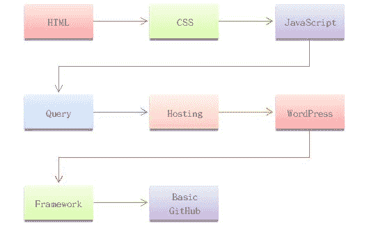

`HTML` 和 `CSS` 是你在继续学习其他内容之前需要知道的最基础编码知识。然后你可以继续学习 `JavaScript` 和 `jQuery`。一旦你创建了路线图，它将让你更容易专注于本质的事情，而不是浪费时间和精力。

### 技巧 2：慢慢来


寻找练习代码的时间可能是困难的。然而，编写代码的人往往也是社交媒体的重度用户，经常花时间在 YouTube、Facebook、Reddit 甚至 Wikipedia 上。无论你是否如此，都能从使用社交媒体中汲取宝贵的教训。

即使我们只是想看一条通知，却在 Facebook 上花费了如此多时间，这一事实说明了很多问题。我们被 Facebook 吸引是因为一环扣一环的，因为你不断看到有人更新状态和动态，而你的新闻推送里总有新内容可以看。

利用同样的心理学，你可以将其转化为学习代码的优势。与其承诺投入几个小时来学习代码，不如告诉自己你将投入整整 15 分钟且完全不受打扰的时间。

然后看看 Facebook，稍微休息一下。

然后再次回来，再做 15 分钟。

但是，这种技术只有在你专注于目标、不让 Facebook 或其他任何事情将你卷入并让你完全忘记正在做什么时，它才会生效。

### 技巧 5：给自己留出时间

俗话说，如果你花时间慢慢思考，你的学习速度会快得多。编程需要时间。你需要时间来理解它。否则，你只会变得更加困惑。花时间弄清楚你正在尝试学习什么。如果有必要，向别人解释它。花时间仔细研究每一个步骤、每一行代码，而不是试图一次性搞定所有。

### 技巧 6：用通俗语言编写

编程可能极其复杂。如果你阅读的内容变得太复杂或陌生，请尝试用简单的语言将其写出来——或者用任何你先理解的方式先写下来。这样，在实际编写代码之前，你就能弄清楚你想写什么代码。

这将让你下一次编写代码时容易得多，你编写代码的速度也会更快，因为你不需要在每行代码处都停下来思考。你甚至可以在编写代码之前就发现漏洞。

### 总结

这些许多技巧可以让你更轻松、更快速地学习 JavaScript。事实是，你可以将这些技巧应用到学习你需要的任何课程中。

## 第 2 章：JavaScript 速查表——每个程序员的必备工具

到目前，你已经知道如果你想认真成为一名程序员，学习 JavaScript 有有多重要。毫无疑问，JavaScript 是我们数字世界中最实用的编程语言。它被用于应用开发、Web 应用、网页以及通用编程。

在本章中，我们将为你介绍一些你可以获取的必备速查表，帮助你更擅长编写代码和编程语言。这些速查表非常实用，因为它们可以帮助你在学习的同时掌握基础知识。

[CHEATOGRAPHY JAVASCRIPT 速查表](https://www.cheatography.com/davechild/cheat-sheets/javascript/)

通过这个网站，你可以找到各种列表方法和函数，包括常用表达式的指南，以及更复杂的项目如 `XMLHttpRequest` 对象，以及许多 JavaScript 的引用。

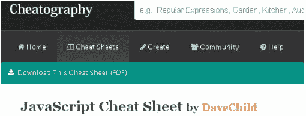

[QUICKLYCODE 编程速查表及其他许多](http://www.quicklycode.com/)

该网站将你链接到更多满足编程需求的速查表和其他资源，涵盖从 JavaScript 到 SQL、Java、WordPress、Ruby on Rails 和 PHP。

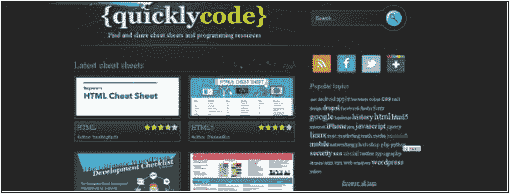

[FIRSTSITEGUIDE JAVASCRIPT 速查表](https://firstsiteguide.com/javascript-cheat-sheet/)

FirstSiteGuide 由几位自认为 Web 极客的人组成，他们提供从 SEO 到营销、Web 托管、设计和开发的各种建议和教程。他们还为你提供了免费资源和工具包。


[MOOTOOLS 速查表](http://mootools.net/)

该网站为你提供了各种 JavaScript 工具，非常适合中级或高级的 JavaScript 开发者。你可以利用许多文档齐全且优雅的 API 编写强大且灵活的代码。


[jQUERY 速查表](https://oscarotero.com/jquery/)

由 Oscar Otero 管理的 `jQUERY` 速查表让开发者能够找到与 `jQuery` 1.3 库相关的函数和属性。

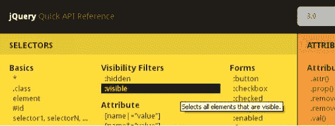](http://oscarotero.com/jquery/)

[STEAMFEED HTML & JAVASCRIPT 快捷键](http://www.steamfeed.com/html-and-javascript-cheat-sheet-for-site-designers/)

SteamFeed 的人们制作了一份很棒的速查表，将 HTML 代码和 JavaScript 信息放在整洁且易读的信息图表中，你可以将其打印并放在手可及范围内，这样在练习编程时就可以方便查看。

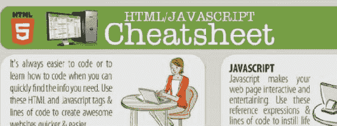

[WEB 设计速查表](http://blog.sellfy.com/cheat-sheets-for-web-designers/)

如果你需要一个可以获取各种 Web 设计相关速查表的网站，那么 Sellfy 有了一些关于 CSS、响应式 Web 设计速查表、HTML 标签等许多资源。


[终 JavaScript 速查表](https://www.codementor.io/johnnyb/tutorials/javascript-cheatsheet-fb54lz08k)

这份来自 codementor 网站的速查列表提供了 JavaScript 语言的快速概述。你可以选择从开始阅读，也可以跳转到感兴趣的主题。


## 第 3 章：设计和构建你自己的 JavaScript 库的技巧与窍

你说 JavaScript 库？

不，它不包含书籍。然而，它包含了 Web 设计师、开发者和程序员可以在项目中使用的封装代码，可以节省时间和精力。换句话说，当你想要应用相同的代码包在不同的网站和程序上实现相同的效果时，你不需要重复发明轮子。

### 什么是 JavaScript 库？

以下是 JavaScript 库的几个独特特征：

- 它在一个文件夹中有一个或多个文件
- 当你使用它实现项目时，它的代码必须单独维护并保持原样
- 它应该允许用户设置特定项目的行为或配置

在本章中，我们将讨论为什么你应该构建 JavaScript 库，以及如何以最简单的方式构建它们。

### 为什么要构建自己的 JavaScript 库？

首先，这对程序员和 Web 开发者来说都非常方便，特别是当你编写和开发大量的程序、网站和 Web 应用时。拥有带有现有代码的库会让你的工作更容易并节省时间，因为你不需要不断从硬盘中某个模糊的文件夹里寻找旧项目。你只需要从库中提取它即可。

本质，任何让你的工作更轻松且可以重复的代码都是添加到库中的绝佳组件。一个很好的例子是 `jQuery`。`jQuery` 的 API 是一个更简单的 DOM API。在跨浏览器 DOM 操作仍然困难的，`jQuery` 是必不可少的。

而且如果一个开源项目变得越来越流行，更多的开发者使用它，最终将鼓励更多开发者加入并通过贡献代码和提交问题来协助这项工作，使其变得更容易操作。这种贡献将造福库以及所有依赖它的其他实验。

流行的开源项目也可以为开发者带来绝佳的机会。科技公司或任何机构可能会对开发者的工作质量印象深刻，并向他们提供工作机会。这可能意味着一家公司将提供一名开发者来合作项目，或者让他们将项目集成到自己的应用程序中。


但对于大多数开发者或编码人员来说，拥有自己的库是一种爱好；这让他们能够编写多个代码、帮助他人并为这一过程做出贡献。

## 你的目标与工作范围

在开始编写代码之前，你需要明确你开发这个库的目标是什么。这可以帮助你专注于你所遇到的问题，以及如何用你的库来解决它们。

你的首要目标也是让你的库易于使用。从本质上说，`API` 越简单，任何人就越容易使用你的库。

所以问问自己——你的库解决了什么问题，你又如何解决它？你是打算利用别人库中的代码，还是将亲手编写一切？

在第 1 章中，我们讨论了如何创建路线图。你库的路线图将成为你在进行任何其他代码开发时使用的技巧之一。

### 你的库的路线图：

-   列出你希望库中具备的功能
-   使这些功能保持最少且实用
-   为每个功能创建里程碑

你通过路线图所做的是为每个函数设定目标，本质上是将你的项目拆分为易于管理的规模，使其更容易完成，并让创建过程变得更加愉快。它还能让你保持理智和专注。

## 你的库 API 设计

在创建库时，将自己想象成终端用户。通过把自己置于用户的位置，朝着以用户为中心的设计和开发工作。这将使得任何访问该库的人都能使用得更加方便。

### 测试你的 API

测试 `API` 质量最好的方法是将其用于你的项目。你可以尝试将应用程序代码替换为你的库，看看它给结果是否涵盖了你想要的所有功能。尽可能保持最核心的基础，同时也为灵活性留出空间以更改和修订任何可能略有偏差的内容。

以下是实现代码或 User-Agent 字符串库的示例：

代码：

```javascript
// 从空的 UserAgent string 开始

var userAgent = new UserAgent;

// 创建并添加第一个产品：EvilCorpBrowser/1.2 (X11; Linux; en-us)

var application = new UserAgent.Product('EvilCorpBrowser', '1.2');

application.setComment('X11', 'Linux', 'en-us');

userAgent.addProduct(application);

// 创建并添加第二个产品：Blink/20420101

var engine = new UserAgent.Product('Blink', '20420101');

userAgent.addProduct(engine);

// EvilCorpBrowser/1.2 (X11; Linux; en-us) Blink/20420101

userAgent.toString();

// 对 engine 产品进行更多更改

engine.setComment('Hello World');

// EvilCorpBrowser/1.2 (X11; Linux; en-us) Blink/20420101 (Hello World)

userAgent.toString();
```

取决于你库的复杂程度，你还需要考虑结构化。实现此点的一种方法是利用设计模式来结构化你的库，并克服在此过程中可能遇到的任何技术问题。

结构化还可以减少在你的库添加新功能时，重新对齐大部分部分的风险。

### 灵活性与自定义

市面上大多数 JavaScript 库酷酷的一点在于其灵活性。然而，许多开发者在决定哪些可以自定义哪些不能自定义时会面临问题。其中之一就是 `chart.js` 和 `D3.js`。

这两个都是数据可视化的优秀库。如果你需要对图形有更多的控制权，那么 `D3.js` 就是你想要的。如果你想要某种易于创建且提供不同类型内置图表的东西，那么 `Chart.js` 是你的选择。

有三种方法可以让你用户对你的库拥有控制权：

1.  配置
2.  暴露公共方法
3.  回调函数与事件

配置一个库通常是在项目初始化阶段完成的，但某些库也允许你在运行时期间设置。这些配置通常仅限于简单的问题，因为更改这些设置只会更新这些值以供以后使用。

代码：

```javascript
// 在初始化时配置

var userAgent = new UserAgent({

  commentSeparator: ';'
});

// 使用公共方法进行运行时配置

userAgent.setOption('commentSeparator', '-');

// 使用公共属性进行运行时配置

userAgent.commentSeparator = '-';
```

某些方法被刻意暴露，以便与实例交互（getter），例如从实例中检索数据或将数据放入实例（setter），以及执行某些操作。

代码：

```javascript
var userAgent = new UserAgent;

// 用于从所有产品中检索注释的 getter

userAgent.getComments();

// 打乱所有产品顺序的 action

userAgent.shuffleProducts();
```

回调函数有时也会通过公共方法接受并传递，它通常用于在异步任务后运行用户代码。

```javascript
var userAgent = new UserAgent;

userAgent.doAsyncThing(function asyncThingDone() {

  // 在异步任务完成后运行代码
});
```

事件在 JavaScript 库中具有巨大的潜力。与回调函数略相似，它们有一个微小的区别，添加事件处理器不会触发动作。事件还用于指示某些事件，并可以向用户提供额外信息，同时返回一个供库对应的特定值。

代码：

```javascript
var userAgent = new UserAgent;

// 在添加时验证产品

userAgent.on('product.add', function onAdd(product) {
  var shouldProduct = product.toString().length < 5;
  // 告诉库添加
  return shouldProduct;
});
```

你也可以允许用户扩展你的库。为了让扩展遵循某些约定，你需要编写文档。你需要提供公共方法或属性，例如 Angular 模块。

代码：

```javascript
(angular.module('myModule')) && jQuery.fn.myPlugin
```

你也可以什么都不做，让用户通过其命名空间访问你的库。

代码：

```javascript
// AngryUserAgent 模块
// 拥有 UserAgent
(function AngryUserAgent(UserAgent) {
  // 创建新方法 .toString()
  UserAgent.prototype.toString = function() {
    return this.toString().toUpperCase();
  };
})(UserAgent);

// 应用代码
var userAgent = new UserAgent;

// ...

// EVILCORPBROWSER/1.2 (X11; Linux; en-us) BLINK/20420101

userAgent.toString();
```

同样，这允许你覆盖方法。

代码：

```javascript
// AngryUserAgent 模块
(function AngryUserAgent(UserAgent) {
  // 存储旧的 .toString() 方法备后使用
  var _toString = UserAgent.prototype.toString;

  // 覆盖 .toString()
  UserAgent.prototype.toString = function() {
    return _toString.call(this).toUpperCase();
  };
})(UserAgent);

var userAgent = new UserAgent;

// ...

// EVILCORPBROWSER/1.2 (X11; Linux; en-us) BLINK/20420101

userAgent.toString();
```

在这种情况下，让用户访问库的命名空间也意味着你对插件和扩展的定义控制力较小。

为了允许扩展遵循某些约定，你需要编写文档。

## 测试

对于测试驱动开发，大纲是至关重要的。换句话说，这是你以测试的形式写下功能和标准的时刻，甚至在编写实际库之前。

如果你的测试显示某个功能的行为符合预期，并且你在将其写入库中之前就写下了它，那么这种策略被称为行为驱动开发。

如果你的测试涵盖了库的每一个方面，那么只要你的代码通过了所有这些测试，你就可以安全地说你的库运行良好。

你还可以使用的其他测试框架有：

[使用 Mocha 和 Chai 测试你的 JavaScript](http://www.sitepoint.com/unit-test-javascript-mocha-chai/) 由 Jani Hartikainen 编写，其中你可以在 Mocha 中编写单元测试。


[使用 Jasmine, Travis 和 Karma 进行 JavaScript 测试](http://www.sitepoint.com/testing-javascript-jasmine-travis-karma/) 由 Tim Evko 编写，向你展示了如何与名为 `Jasmine` 的另一个框架一致地设置测试流水线。

下面是 Tim Severien 提供的另一个你可以尝试的大纲。他为他的库使用了 `Jasmine` 测试，它看起来像这样。

代码：

```javascript
describe('Basic usage', function () {

  it('should generate a single product', function () {
    // Create a single product
    var product = new UserAgent.Product('EvilCorpBrowser', '1.2');
    product.setComment('X11', 'Linux', 'en-us');
    expect(product.toString())
      .toBe('EvilCorpBrowser/1.2 (X11; Linux; en-us)');
  });

  it('should combine several products', function () {
    var userAgent = new UserAgent;
    // Create and add first product
    var application = new UserAgent.Product('EvilCorpBrowser', '1.2');
    application.setComment('X11', 'Linux', 'en-us');
    userAgent.addProduct(application);
    // Create and add second product
    var engine = new UserAgent.Product('Blink', '20420101');
    userAgent.addProduct(engine);
    expect(userAgent.toString())
      .toBe('EvilCorpBrowser/1.2 (X11; Linux; en-us) Blink/20420101');
  });

  it('should update products correctly', function () {
    var userAgent = new UserAgent;
    // Create and add first product
    var application = new UserAgent.Product('EvilCorpBrowser', '1.2');
    application.setComment('X11', 'Linux', 'en-us');
    userAgent.addProduct(application);
    // Update first product
    application.setComment('X11', 'Linux', 'nl-nl');
    expect(userAgent.toString())
      .toBe('EvilCorpBrowser/1.2 (X11; Linux; nl-nl)');
  });
});
```

一旦你完成了测试并且对你第一个库版本的 API 设计完全满意，你就可以开始考虑网站的架构以及你的库具体将如何被使用。

### 模块加载器兼容性

并不是很多开发者使用模块加载器，这完全取决于你。然而，你需要意识到，某些使用你库的开发者可能会选择模块加载器，因此你需要让你的库兼容此功能。

你可以选择一些流行的模块加载器，如 `AMD`、`RequireJS` 和 `CommonJS`。如果你在这些功能之间做出选择很困难，你也可以尝试`通用模块定义` (`UMD`），它旨在支持多种类型的模块加载器。

为了让你的库兼容 `UMD`，你也可以找到一些变体，例如 `UMD` GitHub 仓库。通过使用这些模板之一开始创建你的库。另一个技巧是，如果你选择使用 `ES2015` 的 `import/export` 语法，可以使用 `Babel` 编译为 `ES5` 并结合 `Babel` 的 `UMD` 插件。这样，你可以在项目中使用 `ES2015`，同时生成一个可以被使用各种模块的开发者使用的库。

### 文档

你需要从基础信息开始编写文档，例如你的项目名称以及关于其内容的简短描述。这将帮助他人理解你的库是做什么的，以及使用你的库对他们来说是否是一个不错的选择。你还可以包含更多关于范围和目标等方面的信息，以便用户获得更充分的信息。你还可以包含路线图，让用户知道他们对你的库开发未来可以期待什么，以及他们如何也能对此做出贡献。

### API、教程和示例

API 文档也是文档不可或缺的一部分，因为它会告诉用户具体如何使用你的库。其他很好的补充内容是示例以及教程。这可能花费一些时间，因此你可以在库开发过程中进行这些工作。

### 元任务 (Meta-tasks)

用户还会想要对你的库进行更改，这通常是以贡献的形式存在的，但某些人可能只想为私有用途创建一个自定义构建。对于这些用户，你可以包含关于元任务的文档，其中包含构建库、运行测试、生成和转换或下载数据的命令列表。

### 贡献

贡献是非常棒的，特别是当你开源你的库时。你可以添加的另一个文档是，引导贡献者解释向库提交贡献的步骤，以及在提交贡献之前他们应该填写哪些标准。这将使你的评审工作变得更容易。

### 许可证 (License)

许可证也是重要的。包含许可证可以让大家知道哪些内容受版权保护。将你选择的许可证保存为根目录下的 `LICENSE` 文件。

### 为 Git 添加版本

版本控制对于一个良好的库是必要的。目前的版本标准是 [SemVer](https://semver.org/)，它包含主版本、次要版本和补丁版本。要创建一个标签，打开终端并执行：

```bash
git tag -a [version] -m [message]
```

示例：

```bash
git tag -a v1.0.0 -m "First release"
```

### 发布到仓库

大多数编程语言都带有包管理器，或者至少有第三方包管理器。例如，PHP 的管理器是 [Composer](https://www.sitepoint.com/mastering-composer-tips/)，Ruby on Rails 是 [Gems](https://rubygems.org/)。默认情况下，你的 npm 包将公开。但你也可以选择发布：

- [私有包](https://www.npmjs.com/npm/private-packages)
- [设置私有注册表](https://docs.npmjs.com/misc/registry#can-i-run-my-private-registry)
- [完全避免将包发布到官方注册表](https://docs.npmjs.com/misc/registry#i-dont-want-my-package-published-in-official-registry)

然而，如果你决定发布你的包，你需要 `package.json` 文件。你可以手动执行，也可以使用交互式向导。开始向导请输入：

```bash
npm init
```

`version` 属性应与你的 git 标签匹配。包含 `README.md` 文件。就像 GitHub 一样，npm 使用它作为展示包的页面。

完成后，通过输入以下发布你的包：

```bash
npm publish
```

就这样！你成功发布了 npm 包。

### Bower

另一个名为 `Bower` 的实用包管理器几年前出现了。这是一个为 Web 设计的包管理器。在这里，你可以找到所有的前端断。唯一的是，如果你的库设置为为了兼容浏览器，那么使用 `Bower` 发布你的包将让你获益。npm 包主要用于 JavaScript，许多前端包仍使用 npm，但 `Bower` 仍然非常流行，所以也去使用 `Bower` 发布吧。

要生成 `bower.json` 文件，输入：

```bash
bower init
```

和 `npm init` 一样，指令是显而易懂的。最后，发布你的包：

```bash
bower register [package-name] [repo-url]
```

现在你的库可以供大家在他们的 Node 项目或 Web 上使用了！

### 总结

记住，你的代码开发就是库。确保你的库解决了问题、方便易用，最重要的是稳定。这将确保你和许多其他使用它的开发者都感到满意。


[content]
上述解释的任务可以很容易自动化，例如运行测试和创建标签、更新版本以及发布你的包。

## 第 4 章：JavaScript 技巧与窍门

## 保存与记忆

在本章中，我们将探讨一些与提升 JavaScript 技能和增强代码编写相关的简短实用技巧。

| 使用 === 代替 == | `==`（或 `!=`）运算符在需要时会执行自动类型转换。`===`（或 `!==`）运算符则不会执行任何转换。它的作用是比较值和类型，这被认为比 `==` 更快 ([jsPref](http://jsperf.com/strictcompare))。[10] <```
[10] == 10 // is true
[10] === 10     // is false
'10' == 10 // is true
'10' === 10     // is false
[] == 0 // is true
[] === 0      // is false
'' == false   // is true but true == "a" is false
'' === false // is false
``` |
| charAt() 简写 | 要实现这一点，你可以利用 `eval()` 函数，但这种括号符号简写技术比求值写法要简单得多。写法：<```
"myString".charAt(0);
Shorthand:"myString"[0]; // Returns 'm'
``` | |
| 字符串转换为数字 | 执行此操作最快且简单 ([jsPerf](https://jsperf.com/number-vs-parseint-vs-plus/29)) 方法是使用 `+`（加号）运算符。 <```
var one = '1';
var numberOne = +one;  // Number 1
```
你也可以使用 `-`（减号）运算符，它会将值类型转换为数字，但也会进行取反。
```
var one = '1';
var negativeNumberOne = -one;  // Number -1
``` | |
| 真值/假值转换为布尔值 | 你可以使用 `!!` 将真值或假值转换为布尔值 `true`
<```
!!""  // false
!!0  // false
!!null  // false
!!undefined  // false
!!NaN  // false
!!"hello"  // true
!!1  // true
!!{}  // true
!![]  // true
``` | |
| 使用 JSON.Stringify | 假设有一个带有属性“prop1”、“prop2”、“prop3”的对象。可以向 `JSON.stringify` 传递额外的参数，以选择性地将对象的属性写入字符串，例如： <```
var obj = { 'prop1': 'value1', 'prop2': 'value2', 'prop3': 'value3'};
var selectedProperties = ['prop1', 'prop2'];
var str = JSON.stringify(obj, selectedProperties);
// str {"prop1":"value1","prop2":"value2"}
```
`str` 将仅包含所选属性的信息。除了数组，我们也可以传递一个函数。
<```
function selectedProperties(key, val) { //第一个 val 将是整个对象，如果 key 为空字符串
  (!key) { return val; } if  (key === 'prop1' || key === 'prop2') { return val; } return;}
```
最后一个可选参数用于修改将对象写入字符串的方式。
<```
var str = JSON.stringify(obj, selectedProperties, '\t\t');
/* str 输出在每行都有双制表符。
      "prop1": "value1",
      "prop2": "value2"}*/
``` | |
| 数组和写入单个元素的单一方法 | 与编写单独的方法来存储数组和单个元素参数，你可以编写函数使它们能够同时处理两者。你只需要先将所有内容合并到一个数组中。`Array.concat` 将接受数组或单个元素。
<```
function printUpperCase(words) {
  var elements = [].concat(words || []); for (var i = 0; i < elements.length; i++) { console.log(elements[i].toUpperCase()); }}
```
`printUpperCase` 现在准备好接受单个节点或节点数组作为参数。它还避免了未传递参数时可能抛出的 `TypeError`。
<```
printUpperCase("cactus");// => CACTUS
printUpperCase(["cactus", "bear", "potato"]);// => CACTUS
// BEAR
// POTATO
``` | |
| 测量 JavaScript 代码块的性能 | 为了快速测量 JavaScript 代码块的性能，我们可以使用 `console` 函数，如 `[console.time(label)](https://developer.chrome.com/devtools/docs/console-api#consoletimabel)` 和 `[console.timeEnd(label)](https://developer.chrome.com/devtools/docs/console-api#consoletimeendlabel)`
<```
console.time("Array initialize");
var arr = new Array(100), len = arr.length, i;
for (i = 0; i < len; i++) { arr[i] = new Object();};
console.timeEnd("Array initialize");  // Outputs: Array initialize: 0.711ms
``` | |
| 变量提升 | 提升将帮助你管理函数作用域。变量声明和函数会被提升到顶部，而变量定义不会。<```
function doTheThing() { // ReferenceError: notDeclared is not defined
console.log(notDeclared); // Outputs: undefined
console.log(definedLater); var definedLater; definedLater = {};
``` | |
[/content]

[content]
## 第 5 章：需要掌握的 JavaScript 技能

无论你是否喜欢，作为程序员或应用程序开发者，你都需要学习 JavaScript。

在本章中，我们将探讨一些与提升 JavaScript 技能和增强代码编写相关的简短实用技巧。

## React & Redux

2015 年，当更多程序员开始抱怨 AngularJS 时，React 赢得了关注。Angular 2 将无法与 Angular 1 运行的消息让 Angular 社区变得更加糟糕。React 的出现在 2016 年填补了这一空白。

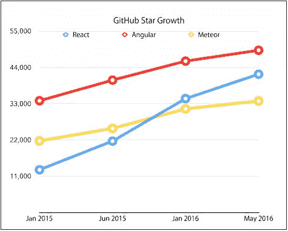

基于存档的估计。也许更具指示意义的是 `react`、`angular` 和 `Angular2` 包的 npm 下载量：


在过去的一年里，React 在 JavaScript 社区中获得的关注比 AngularJS 多。因此，如果你查看上面的图表，可能在好奇 8 月发生了什么？它显示 React 的 npm 下载量大幅增加，它也显示了 React 的 GitHub Star 何时追上 AngularJS。


React 和 Redux 绝对是 2016 年最热门的趋势，而且在前端“框架” JavaScript 领域，它们在 2017 年似乎不会消退。Netflix、Yahoo! 和 Dropbox 都将 React 纳入了它们的技术库，这为它增添了信心。尽管如此，Facebook 的 Relay 看起来也是 2017 年的一个很有竞争力的对手。

## 值得关注的其他框架

其他框架可能会加入这一领域，虽然它们不可同日而论，但这里是对其他现有框架的概述。再次强调，技术领域的任何事情都可能发生变化。今年效果可能不那么好的东西，明年可能就会成为顶尖水平。

话不多说，这里是一些值得关注的其它框架。

### Angular2

许多非技术公司将考虑使用 `Angular 2`，特别是那些使用微软 `.NET` 框架的企业。`Angular 2` 是通过谷歌和微软合作开发的，旨在让 JavaScript 成为一种更易于管理的语言。

微软本身在去年积极推推 `.NET`，因为它开源了许多元素，并努力让微软工具对开发者更易获取。在重写之后，团队希望修复 `Angular 1` 应用中出现的任何升级问题，到目前为止性能一直非常出色。`Angular2` 的开发是为了支持 Web 组件，根据谷歌的说法，它是 Web 开发的未来。然而，`AngularJS` 社区对 `Angular` 方向持有不同意见——尽管 `Angular` 团队投入了大量努力帮助开发者从 `Angular 1` 顺利过渡到 `Angular 2`。

这次重写也让 `React` 得以发展和成熟，其社区每天都在扩大。因此，程序员们怀疑 `Angular 2` 是否会像 `Angular 1` 那样成功。然而，如上述所示，技术世界瞬息万变，`Angular 2` 可能在 2017 年有增长空间。`Angular2` 仍然被认为是 `React` 应用的替代方案。

### Meteor

另一个值得关注的未来趋势是 `Meteor`，它一直拥有稳定的下载量和 GitHub Star。它与 `React` 和 `Angular` 集成良好，并具有许多实用的功能。作为一个轻量级的全栈 JavaScript 框架，开发者发现 `Meteor` 框架用起来非常愉快。`Meteor` 一直被认为是一个非常扎实的入门框架，也非常适合原型开发。

阻碍 `Meteor` 成为主流成功的是随着时间推移不断出现的隐藏复杂性，特别是在生产环境方面。尽管 `Meteor` 募集了大量资金，但它并没有像 `React` 和 `AngularJS` 那样拥有庞大工程师团队的领先科技企业支持。尽管 `AngularJS` 有很多问题，但有谷歌的支持；相比之下，`Meteor` 被视为投资风险，因为它是一个兼顾后端和前端开发的框架。为了最大限度地利用部署便利性，`Meteor` 还需要托管。

目前让 `Meteor` 不太理想的另一个问题是，许多开发者并不喜欢 `MongoDB`，而 `Mongo` 正是 `Meteor` 的默认数据库。`Meteor` 在 2017 年仍是一个不错的选择，因为更多开发者可能会等待更可靠的证据，证明 `Meteor` 可用于更大、更复杂的应用程序开发。不说说，`Meteor` 在 2016 年甚至 2017 年未来可能仍保持小众化。大多数专业开发者将等待任何证明它可以用于开发大型、复杂应用的证据。

### ES6 终于到来

JavaScript 开发者在 2016 年迈向 2017 年的工作之一，是确保他们所有的应用都符合 `ES2015` 标准。但就像许多技术应用和编程语言的其他复杂问题一样，我们面临着 `Babel` 与 `TypeScript` 问题。

`Babel` 主要将 `ES6` 代码翻译为 `ES5`，而 `TypeScript` 实际上 JavaScript 的超集，为 JavaScript 添加了必要的但可选的静态类型，然后将所有内容编译为纯 JavaScript。`Babel` 和 `TypeScript` 的创建目的完全不同，因此不可比拟。

由 Facebook 开发的 `Babel` 支持 `Flow`，后者也为 JavaScript 添加了静态类型检查。使用 `Babel` 更有意义一点，因为你可以连续使用两者。`Babel` 也是第一个桥接 `ES5` 和 `ES6` 应用差异的工具。

另一方面，`TypeScript` 只支持 `ES6`，因此在进展性方面次于 `Babel`。查看 GitHub Star 发现，`Babel` 是最受欢迎的转编译器。`React` 开发者也倾向于使用 `Babel + Webpack` 组合。


尽管有 Star 数，但 `TypeScript` 似乎更有可行性，有时甚至是首选，特别是当你寻找一种让你的 JavaScript 代码库更易管理的解决方案时。JavaScript 一直以来以难读著称，由于其弱类型检查系统，调试更加困难。因此在支持方面，`TypeScript` 拥有比 `Flow` 更多的追者。


下面的图表显示了 Google Trends 图表中 `TypeScript` 兴趣的增长。


`TypeScript` 可能流行的另一个原因是由于 `Angular2`，但仅仅因为 JavaScript 应用受到更多关注，并不是 `TypeScript` 流行的真正原因。

虽然 `Redux` 让测试变得容易得多，但 `TypeScript` 让代码库的维护变得容易得多。此外，谷歌、Facebook 和微软正在合作为 JavaScript 添加静态类型，从而为 `ECMAScript` 铺平道路。

与此同时，谷歌放弃了 `AtScript` 和 `AngularJS` 转而采用 TypeScript。另一方面，Facebook 的 `Flow` 并没有像 `TypeScript` 那样的社区流行度。

这表明静态类型 JavaScript 是一个活跃且增长的趋势，即使是 JavaScript 的不信者也会认可，而 `TypeScript` 是其中最可靠的解决方案。

## 函数式编程正在成为主流

许多函数式编程平台正在进入主流编程，但最近，“函数式编程模型”引起了大量关注，特别是随着复杂 Web 应用的兴。


RxJS


但对于那些仍然想坚持全栈函数式响应编程（这被认为是“真正”的 FRP）并且仍然想使用 JavaScript 的人来说，学习 `RxJS` 是一项必须的技能。`RxJS` 是 JavaScript 的一个响应式扩展，可以用来替代 `Flux` 架构。对于简单和小型应用来说，这听起来可能过载了，但实际上，它为经过复杂流处理的 Web 应用程序构建了强大的基础。

Netflix 使用 `RxJS`，而 `Angular2` 也依赖于 `RxJS`。`RxJS` 由微软开发，与 `TypeScript` 配合得非常完美，因此开发者可以预期 `RxJS` 将持续得到改进。

然而，学习 `RxJS` 是一个完全不同的领域。它具有陡峭的学习曲线，让大多数开发者放弃在 JavaScript 中进行任何 FRP，转而选择其他与 JavaScript 兼容的函数编程语言。


开发者选择代替 `RxJS` 的某些兼容编程语言是 `ClojureScript` 和 `Elm`。然而，所有程序的增长和流行程度与 `Redux+React` 相比都显得黯然失色。


事实是，看到函数编程如何完美地解决 Web 开发中的现代问题，人们必须同意函数编程范式及其等概念作为 JavaScript 开发者需要掌握和学习的必要技能一直存在。

## 桌面框架对决：Nw.js vs. Electron

如今有很多需要从桌面和移动等各种平台同步数据。然而，许多服务最初都是以 Web 应用的形式出现，然后转换为桌面应用以增强用户体验。这样做是因为 Web 应用的开发速度更快且更容易更新。此外，用户还可以更快速地尝试 Web 应用，而无需安装任何其他东西。

过去的开发者如果想使用 Web 技术为桌面应用创建前端 UI，只能受限于使用 `CEF`。这不是一个简单的过程，应用程序本身并不是真正的跨平台兼容。尽管如此，`Node.js` 让桌面框架的跨平台应用变得更加容易。使用 Web 技术进行桌面应用开发的趋势从 2014 年开始兴起。

因此，让我们来看看这两个项目的 GitHub Star 历史：


尽管 `Nw.js` 早得多进入领域并被认为更老旧，但看起来 `Electron` 正在以爆炸性的速度增长，而 `nw.js` 则以单调的线性速度增长。

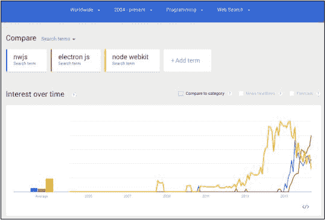

虽然 `Electron` 还很新，但它被 `Slack`、`Microsoft` (`Visual Studio Code`)、`WordPress` 和 `Sencha` 等多个成熟机构使用。凭借 `Electron` 的易用性，网络和社区增长非常快。这种流行趋势可能会持续到 2017 年，从而使 `Electron` 成为桌面和 Web 应用开发的框架框架。

## 移动应用框架对决：React Native vs. Ionic

当 `React Native` 出世时，人们预测它将接管并利用 Web 技术引领移动开发的路线，因为它可以用于开发原生跨平台应用。那么 2017 年是 `React Native` 的年吗？通过这张图表可能会产生一些预期：

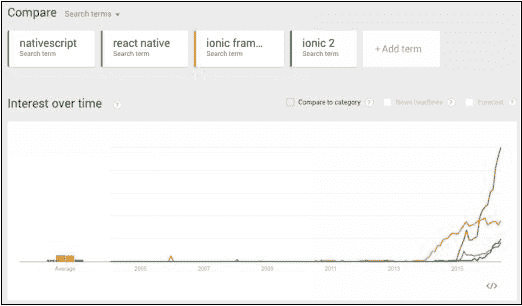

此时，`React Native` 尚未发布任何更新的软件，因为它仍处于 0.26 版本。它在 2017 年是否会成为主流，很大程度上取决于开发者处理需要一起重构整个代码库以及其他问题的应用开发变化的耐心。

因此，让我们来看看 `React Native` 对比 `Ionic` 的近似 `npm` 下载量：

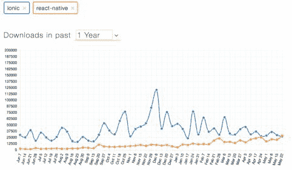

从图表中可以看出，`React Native` 有望超越 `ionic`，成为使用 Web 技术进行跨平台移动开发的首框架。

在就业市场方面，`React Native` 也比 `Ionic` 更有需求：


快速搜索招聘信息显示，至少有 75 个招聘职位寻找具有 `ionic` 技能的开发者，而 65 个招聘职位正在寻找具有 `React` 技能的开发者。这表明人们对 `React Native` 的熟悉程度正在增加，这很可能对 2017 年之后的任何新兴开发者提供巨大的推动力。

## Web API 的未来：GraphQL vs REST

在 `Facebook` 提到他们将开源 `GraphQL` 后，许多 JavaScript 开发者在 2016 年早期就加入了这一热潮，特别是当 `Facebook` 在开源项目方面变成了 JavaScript 界的“苹果公司”。

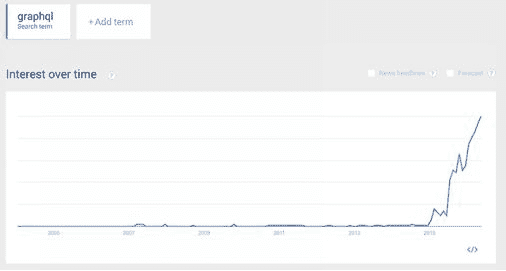

`GraphQL` 旨在取代 `REST` API，但考虑到 `REST` API 的无处不在，这种情况不太可能发生：

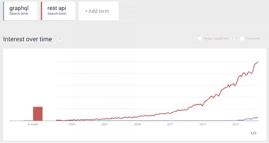

`GraphQL` 与 `REST` API 配合得很好，但它绝对不会像某些开发者认为的那样取代 `REST`。更重要的是，`GraphQL` 相对较新并与 `Facebook Relay` 关联，因此程序员和开发者在其他地方没有获取该技能的学习资源或最佳实践。尽管如此，2017 年对于 `GraphQL` 成为主流仍然太早了。

### JavaScript 趋势结论

结论，JavaScript 社区的移动和变化非常快，跟上任何趋势并符合主流技术意味着更多的支持、相关性和资源。根据本章讨论的趋势，JavaScript 开发者应该为自己配备 `Redux & React` 以及其他函数式编程语言，如 `TypeScript`。不仅如此，拥有 `React Native` 和 `Electron` 的经验无疑会为未来的程序员在求职中中提供更多推力和信誉。

### 结语

感谢读完《JavaScript：使用 JavaScript 编程的技巧与窍门》。希望这本书对你有启发性，并能够为你提供实现目标所需的所有工具，无论你的目标是什么。

下一步是使用你学到的编码技能并将其应用于你自己的项目中。学习需要时间，但你应该保持耐心，因为每当你学习新东西时，你都会犯错。

再次回顾书中的课程并反复阅读。在掌握之前，学习编写代码会令人困惑，因为你将学习到所有不同的条件和异常。

最后，如果你觉得这本书在任何方面都有帮助，我们将非常感谢你在 Amazon 上的评价！
