# JavaScript® 24小时训练指南

## 与Wrox联系

### 参与

通过参与我们的P2P论坛（p2p.wrox.com）在网上发挥积极作用

### 用户组计划

成为会员并享受所有福利

### Wrox Blox

下载简短的信息片段和代码，让您保持最新并避免麻烦

### Wrox在Twitter上

在Twitter上关注@wrox，了解Wrox世界的最新消息

### 加入社区

在newsletter.wrox.com注册我们的免费月度通讯

### Wrox在Facebook上

在facebook.com/wroxpress加入Wrox Facebook页面，获取新书和出版物的更新，以及即将举行的程序员会议和用户组活动信息

### Wrox.com

浏览Wrox的大量图书、电子书和博客，找到您所需的内容

### 联系我们

我们喜欢反馈！有图书创意？需要社区支持？请通过电子邮件wrox-partnerwithus@wrox.com告知我们

## 前言

本书献给我的妻子斯塔拉，以及我的儿子海登和埃文。感谢你们在我撰写本书期间给予的爱、支持，以及（尤其是）耐心。本书也献给我的祖父母弗吉尼亚和唐。感谢你们的爱与支持。

## 致谢

**策划编辑**

斯科特·迈尔斯

**副总裁兼执行出版人**

理查德·斯瓦德利

**项目编辑**

埃德·康纳

截止日期驱动出版公司

**副总裁兼执行出版人**

巴里·普鲁特

**技术编辑**

约翰·佩洛昆

**副出版人**

吉姆·米纳特尔

**高级制作编辑**

黛布拉·班宁格

**项目协调员，封面**

林赛·斯坦福德

**文字编辑**

萨迪·克莱因曼

**排版**

克雷格·约翰逊，

偶然排版工作室

**编辑总监**

罗宾·B·西斯基

**校对**

南希·卡拉斯科

**编辑经理**

玛丽·贝丝·韦克菲尔德

**索引编制**

罗伯特·斯旺森

**自由撰稿编辑经理**

罗斯玛丽·格雷厄姆

**封面图片**

© seraficus / iStockPhoto

**市场经理**

阿什利·祖尔彻

**封面设计师**

迈克尔·特伦特

**制作经理**

蒂姆·泰特

## 关于作者

**杰里米·麦克皮克**是一位自学成才的程序员，于1998年开始通过捣鼓网站开启职业生涯。他是《*Professional Ajax, Second Edition*》（Wiley, 2007）和《*Beginning JavaScript, Fourth Edition*》（Wiley, 2009）的合著者。他也为Nettuts+（http://net.tutsplus.com）供稿，提供关于ASP.NET的文章和视频教程。他目前受雇于一家石油和天然气公司，负责构建内部传统和Web应用程序。杰里米可以通过p2p论坛或他的网站http://www.wdonline.com联系。

## 关于技术编辑

**约翰·佩洛昆**是一位前端工程师，拥有各种规模JavaScript应用程序的经验。约翰在加州大学伯克利分校获得数学学士学位，目前是一家医疗保健初创公司的首席开发人员。当不编写代码或收集勘误时，约翰经常沉浸在数学、哲学或杂耍中。

## 致谢

**首先，最重要的是**，我要感谢上帝赐予我的恩典。同时，非常感谢我的妻子，她忍受了我深夜工作和睡眠不足（脾气暴躁）的态度。

撰写和制作一本书需要很多人，我知道我无法列出所有参与此项目的人。但非常感谢斯科特·迈尔斯让这本书得以实现，感谢埃德·康纳在将这本书最终付印的过程中忍受我。谢谢你，约翰·佩洛昆，感谢你提供的意见并确保我所写的文本准确且有意义。谢谢，金尼·门罗，在项目后期阶段接替了埃德的工作，也感谢罗斯玛丽·格雷厄姆组织了一切。

最后，感谢尼古拉斯·C·扎卡斯，《*Professional JavaScript, Second Edition*》（Wiley, 2009）的作者和《*Professional Ajax, Second Edition*》（Wiley, 2007）的合著者，是他引领我进入了这个行业。

## 前言

**JavaScript 是世界上最流行的**编程语言。它被用于所有主要的互联网网站，甚至那些不那么重要的网站。无论你是从在线零售商处购物，使用银行网站管理资金，访问新闻网站了解时事，还是仅仅阅读全球数百万博主之一的博客，你都以某种方式体验过 JavaScript。

尽管如此流行，关于 JavaScript 总存在一些形式的误解。有些人声称，因为它的名字，它是 Java 的轻量级版本，Java 是一种最初由 Sun 开发、现在由 Oracle 拥有的编程语言。事实并非如此。虽然 JavaScript 的语法与 Java 相似，但 JavaScript 是一种独立的语言，主要用于编程你每天使用网络浏览器访问的网页。其目的是为用户提供交互性——让网页或网络应用程序感觉像是在你计算机上运行的传统应用程序。

JavaScript 是一种简单而又复杂的面向对象语言。虽然开始学习 JavaScript 不需要太多时间，但要精通这门语言可能需要数年时间。即便如此，语言大师们仍然会发现自己在不断学习新的东西。

本书旨在教你 JavaScript，让你走上正确的道路，以便你可以使用这门语言为你的网页和应用程序添加交互性。如果你不知道如何编程，请不要担心。本书从最基础开始教你 JavaScript——向你展示所有编程语言基础知识背后的概念。你会发现 JavaScript 可以成为通往编程世界的门户。对于你的作者来说，它就是如此。

## 本书适合谁

本书适合两个层次的初学者：那些从未使用过 JavaScript 的人，以及那些使用过但没有在 jQuery 等库之外学习过这门语言的人。

为了从本书中获得最大收益，你需要理解 HTML 和 CSS，以及如何使用这两种技术创建网页。JavaScript 存在于网络浏览器中，用于与加载到浏览器中的网页进行交互。因此，在学习 JavaScript 之前，能够编写 HTML 并用 CSS 设置样式是一项重要的技能。

## 本书涵盖的内容

*JavaScript 24小时训练* 从绝对基础开始教你如何在网页中使用 JavaScript：将 JavaScript 添加到你的页面。然后本书继续向你介绍 JavaScript（以及所有编程语言）的基础知识，例如语法、变量、函数、决策和循环。接着，你将通过查看 JavaScript 的一些内置对象来接触面向对象编程，并学习编写自己的对象来表示复杂数据。

在此基础上，你将学习如何使用 JavaScript 通过创建和操作新窗口以及脚本化框架来编程浏览器。然后你将学习如何通过添加、删除和修改样式来与页面中的 HTML 元素交互。你将学习如何通过使用事件来响应用户的操作，以及针对不同浏览器的不同方法。你将继续学习浏览器和页面，包括如何动画元素、脚本化 HTML 表单，以及利用 Ajax 从服务器发送和接收数据。

然后你将转向错误、调试和最佳实践的学习。你将学习如何识别和避免常见错误，以及如何处理由你无法控制的刺激引起的错误。对于那些难以发现的错误，你将学习如何使用 Firebug 调试你的代码。之后你将学习一些专业 JavaScript 开发者遵循的惯例，以及编写高效且可维护的 JavaScript 的技巧。

## 本书的结构

本书由简短的课程组成，每节课专注于 JavaScript 语言的特定方面。它并非旨在成为详尽的资源或对语言技术方面的深入探讨。目标是教你开始在网页和应用程序中使用 JavaScript 所需的知识。

本书包含 43 课。大多数课程都相当简短——比大多数其他书籍中的章节短得多。有几课较长，但那只是因为该特定课程的内容需要更大的篇幅。

课程分为三个不同的部分：

- **第一部分：JavaScript 简介：** 本节教你 JavaScript 语言的基础知识。你也可以将本节中的概念应用于几乎所有其他编程语言。

- **第二部分：编程浏览器：** JavaScript 的主要用途是操作浏览器和加载到其中的网页。你将学习如何使用语言来做到这一点。

- **第三部分：处理错误、调试与最佳实践：** 错误会发生，有些是可以避免的。你将学习如何发现错误，处理你无法控制的错误，以及通过调试和 Firebug 定位难以发现的 bug。你还将学习专业开发者采用的技巧，这些技巧可以帮助你使代码更高效、更易于维护。

大多数课程包含一个名为“动手试试”的教程，每个教程都在一个示例中应用课程的概念。你也可以观看 DVD，看到你的作者完成教程，并对主题内容进行讲解。

在您阅读完本书并观看DVD后，可以访问Wrox的p2p论坛，作者将在那里提供支持。

## DVD上的教学视频

并非所有人都能直接从书本中学习；对于那些能做到的人，我们表示赞赏。对于我们其他人（包括作者本人），通常需要视觉和听觉辅助。这正是本书附带DVD的原因。本书的大部分课程都有相应的视频教程，并配有讲解。因此，如果观看操作演示和聆听讲解比单纯阅读更能帮助您理解主题，那么本书与DVD的组合正是为您量身打造。

## 约定

为了帮助您充分利用文本并跟踪内容进展，本书使用了一些约定。

> 像这样的方框会加粗重要的、不可遗忘的、与周围文本直接相关的信息。

> 注释、提示、建议、技巧以及对当前讨论的旁注，会像这样以斜体形式单独放置。

> 像这样的引用会指引您去DVD观看特定课程的教学视频。

至于文本中的样式：

- 新术语和重要词汇在引入时会以*斜体*显示。

- 文本中出现的代码如下所示：`document.body`。

- 文本中的URL如下所示：www.wrox.com。

- 代码块以如下方式呈现：

```
独立成行的等宽字体
表示代码示例。
```

## 支持包和代码

在学习本书课程时，您可以选择手动输入代码并创建所有文件，也可以使用本书附带的支持代码文件。本书中使用的所有代码和其他支持文件均可在www.wrox.com下载。在该网站上，只需找到本书的书名（使用搜索框或书名列表均可），然后点击书籍详情页上的“下载代码”链接，即可获取本书的所有源代码。

> 由于许多书名相似，您可能会发现通过ISBN搜索最为便捷；本书的ISBN是978-0-470-64783-7。

下载代码后，只需使用您喜欢的压缩工具解压即可。或者，您也可以访问Wrox的主代码下载页面www.wrox.com/dynamic/books/download.aspx，查看本书及所有其他Wrox书籍的可用代码。

## 勘误

我们已尽一切努力确保文本或代码中没有错误。然而，人无完人，错误难免发生。如果您在本书或任何Wrox书籍中发现错误，例如拼写错误或代码错误，我们将不胜感激您的反馈。通过提交勘误，您可以为其他读者节省数小时的困扰，同时也能帮助作者和Wrox提供更高质量的信息。

要查找本书的勘误页面，请访问www.wrox.com，使用搜索框或书名列表找到本书。然后，在“书籍搜索结果”页面上，点击“勘误”链接。在此页面上，您可以查看已提交并由Wrox编辑发布的所有勘误。

> 完整的书单，包括勘误链接，也可在www.wrox.com/misc-pages/booklist.shtml获取。

如果您在勘误页面上没有发现“您的”错误，请点击“勘误表”链接并填写表格，将您发现的错误发送给我们。我们会核实信息，如果合适，将在本书的勘误页面上发布消息，并在后续版本中修正问题。

## P2P.WROX.COM

如需与作者和同行讨论，请加入p2p.wrox.com的P2P论坛。该论坛是一个基于网络的系统，您可以在其中发布与Wrox书籍及相关技术相关的消息，并与其他读者和技术用户互动。论坛提供订阅功能，当有新帖子发布时，会通过电子邮件将您选择的感兴趣主题发送给您。Wrox的作者和编辑、其他行业专家以及您的读者同伴都在这些论坛上。

在http://p2p.wrox.com，您会找到许多不同的论坛，这些论坛不仅在您阅读本书时有所帮助，在您开发自己的应用程序时也同样如此。要加入论坛，只需按照以下步骤操作：

1. 访问p2p.wrox.com并点击“注册”链接。

2. 阅读使用条款并点击“同意”。

3. 填写加入所需的信息以及您希望提供的任何可选信息，然后点击“提交”。

4. 您将收到一封电子邮件，其中包含有关如何验证您的帐户并完成加入过程的信息。

> 您无需加入P2P即可阅读论坛中的消息，但要发布自己的消息，您必须加入。

加入后，您可以发布新消息并回复其他用户发布的消息。您可以随时在网上阅读消息。如果您希望将特定论坛的新消息通过电子邮件发送给您，请在论坛列表中点击论坛名称旁边的“订阅此论坛”图标。

有关如何使用Wrox P2P的更多信息，请务必阅读P2P常见问题解答，其中包含有关论坛软件如何工作以及许多特定于P2P和Wrox书籍的常见问题的答案。要阅读常见问题解答，请点击任何P2P页面上的“常见问题解答”链接。

# 第一部分

## JavaScript简介

- 第1课：将JavaScript添加到网页

- 第2课：变量和JavaScript语法

- 第3课：函数

- 第4课：做出决策

- 第5课：循环

- 第6课：作用域

- 第7课：对象和内置类型

- 第8课：自定义对象

- 第9课：原型和继承（函数对象）

# 1

## 将JavaScript添加到网页

当JavaScript首次被引入网页时，Netscape需要找到一种机制，允许将JavaScript添加到网页中，而不会在其他浏览器中引起不良影响。经过多次讨论，最终决定采用`<script/>`元素，该元素后来被添加到HTML规范中。

### `<SCRIPT/>`元素

将JavaScript添加到网页的主要方式是使用`<script/>`元素。这个由Netscape引入的元素，作为向HTML 4.01过渡的占位符，成为了HTML 3.2规范的一部分，在HTML 4.01中该元素被充实并赋予了以下属性：

- `src`：可选。指定要执行的外部脚本文件。

- `type`：必需。指定`<script/>`元素内容中使用的语言，通常使用值"text/javascript"。即使HTML规范要求此属性，如果省略，所有浏览器都默认语言为JavaScript。

- `language`：已弃用。此属性指定`<script/>`元素内容中使用的语言。此属性不再使用，已被`type`取代。

- `defer`：可选。一个布尔值（`true`或`false`），告诉浏览器是否等待加载整个HTML文档后再执行`<script/>`元素内的任何代码。

- `charset`：可选。由`src`属性指定的外部代码文件的字符编码。此属性很少使用。

使用`<script/>`元素有两种方式：要么将JavaScript代码直接嵌入页面（此时称为*内联代码*），要么使用`src`属性引用外部文件。

要将内联代码添加到网页，请将代码放在开始和结束标签之间，如下所示：

```
<script type="text/javascript">
function inlineScript() {
    var message = "Hello, World!";
    alert(message);
}

inlineScript();
</script>
```

现在不用担心代码——您将在适当的时候了解这段代码的功能。尽管浏览器自动假定`<script/>`元素内的代码是JavaScript，但包含`type`属性被认为是良好的实践。当浏览器遇到`<script/>`元素时，它会停止加载页面的其余部分；它会加载代码并进行解释，然后再处理HTML页面的其余部分。

需要注意的是，如前面的代码示例所示的内联代码块，在XHTML文档中应包含在CDATA块中。目前，不这样做不会导致浏览器错误。事实上，所有主要浏览器仍然会正常加载JavaScript并执行它。但是，不能保证未来的浏览器会像今天的浏览器一样运行。因此，如果您使用XHTML，请通过将内联脚本封装在CDATA部分中来确保其未来兼容性，如下所示：

```
<script type="text/javascript">
//<![CDATA[
function inlineScript() {
    var message = "Hello, World!";
    alert(message);
}

inlineScript();
//]]>
</script>
```

将外部JavaScript文件添加到页面需要使用`src`属性。可以从前一个示例中剪切JavaScript代码（不包括`<script>`标签），并将其粘贴到另一个文件中。然后，通过使用`src`属性，页面可以像这样引用外部JavaScript文件：

```
<script type="text/javascript" src="sample.js"></script>
```

这个`<script/>`元素引用了一个名为`sample.js`的外部JavaScript文件。使用`.js`扩展名是几乎所有JavaScript开发者都遵循的约定。文件如何命名并不重要——浏览器会下载它并将其内容解释为JavaScript代码。

与内联代码一样，当浏览器遇到`<script>`标签时，它会停止处理HTML页面，但它还必须在开始解释之前下载文件。浏览器从外部文件加载JavaScript后，它会恢复处理HTML页面。

选择使用内联脚本还是外部脚本最终取决于你。然而，大多数开发者使用外部 JavaScript 文件，原因如下：

- 外部脚本比内联脚本更容易维护，尤其是当你在多个页面中使用相同代码时。想象一下，如果需要编辑多个 HTML 页面才能对内联代码块进行相同的更改，那肯定会是一项耗时的任务。而使用外部文件，你只需修改一个文件即可。

- 外部脚本会被浏览器缓存，就像图像和样式表一样。浏览器会下载一次脚本文件，并在后续页面请求中重复使用它，只要该脚本文件没有更改。这带来了一定的性能提升，因为浏览器不必反复下载相同的代码，而如果代码嵌入在 HTML 页面中，则需要这样做。

`<script/>` 元素在页面中的放置方式和位置确实很重要——它们会按照在页面中出现的顺序被加载和解释。

## 标签放置

`<script/>` 元素是少数几个几乎可以放在 HTML 页面任何位置的元素之一：它可以放在 `<head/>` 元素内，也可以放在 `<body/>` 元素内。更传统的做法是放在 `<head/>` 元素内，与 `<style/>` 和 `<link/>` 元素一起。以下 HTML 演示了这一点：

```html
<html>
<head>
    <title>Sample Page</title>
    <script type="text/javascript" src="sample.js"></script>
</head>
<body>

</body>
</html>
```

虽然这使得 HTML 页面的资源集中在文档的一个位置，但请记住，浏览器一旦遇到 `<script/>` 元素，就会暂停处理 HTML 文档，以便下载并加载它引用的脚本。因此，将 `<script/>` 元素放在文档顶部会带来延迟浏览器加载页面内容的副作用。对用户来说，这是一个性能问题，因为他们在浏览器下载和加载 JavaScript 时看到的是一个空白网页。

因此，最佳实践是将所有 `<script>` 标签放在 `</body>` 闭合标签之前，如下所示：

```html
<html>
<head>
    <title>Sample Page</title>
</head>
<body>

    <script type="text/javascript" src="sample.js"></script>
</body>
</html>
```

这样，浏览器会在加载 JavaScript 代码之前加载并渲染整个页面。尽管无论 `<script>` 标签放置在何处，总的下载时间是相同的，但用户能更快地看到他们请求的网页，并感觉网页加载更快。

## 动手试试

在本课中，你将向网页添加一个外部 JavaScript 文件。

## 课程要求

对于本课，你需要一个文本编辑器；任何纯文本编辑器都可以。对于 Microsoft Windows 用户，系统默认提供记事本，或者你可以下载 Microsoft 免费的 Visual Web Developer Express (www.microsoft.com/express/web/) 或 Web Matrix (www.asp.net/webmatrix/)。Mac OS X 用户可以使用 TextMate（作为 OS X 的一部分提供），或下载 Coda 的试用版 (www.panic.com/coda/)。Linux 用户可以使用内置的 VIM。

你还需要一个现代网络浏览器。选择以下任意一个：

- Internet Explorer 8+

- Google Chrome

- Firefox 3.5+

- Apple Safari 4+

- Opera 10+

在你的文件系统中创建一个名为 `JS24Hour` 的文件夹，并创建一个名为 `Lesson01` 的子文件夹。将你在本课中创建的文件存储在你创建的 `Lesson01` 文件夹中。

## 分步操作

按照以下步骤向网页添加外部 JavaScript 文件：

1. 打开你的文本编辑器，输入以下 JavaScript 代码：

```javascript
function inlineScript() {
    var message = "Hello, World!";
    alert(message);
}

inlineScript();
```

2. 将文件保存为 `lesson01_sample01.js`。

3. 打开另一个文本编辑器实例，输入以下 HTML：

```html
<html>
<head>
    <title>Sample Page</title>
</head>
<body>
    <script type="text/javascript" src="lesson01_sample01.js"></script>
</body>
</html>
```

4. 将此文件保存为 `lesson01_sample01.html`，并确保将其保存在与 `lesson01_sample01.js` 相同的位置。

5. 通过双击文件在你的网络浏览器中打开 HTML 文件。当浏览器加载页面时，你应该会看到一个显示“Hello, World!”的警告框。

> 请在 DVD 上选择第 1 课，以查看随附本课的视频。你也可以从本书网站 www.wrox.com 下载所有课程的示例代码。

# 2. 变量和 JavaScript 语法

在上一课中，在教你如何以及在何处向页面添加脚本的同时，介绍了以下简单脚本：

```javascript
function inlineScript() {
    var message = "Hello, World!";
    alert(message);
}

inlineScript();
```

要完全理解这段代码的作用，了解 JavaScript 语言的基础知识非常重要。任何语言的核心都是其语法——一套规定语言中某些部分如何组合的规则。想象一下一种口语，如果没有一套规则来定义如何将单词排列成完整且可理解的句子，与他人交流会有多困难。同样的道理也适用于编程语言。就 JavaScript 而言，如果没有语言规范所规定的规则，浏览器将不知道如何处理你的代码。语法定义了非常小的代码片段如何组合在一起以执行某种工作。

本课重点讲解页面顶部代码清单中一行代码的语法——变量声明：

```javascript
var message = "Hello, World!";
```

在本课中，你将学习变量以及创建它们所需的语法。

## 变量——内存中的盒子

开发者编写程序是为了更轻松地处理数据。大量数据通常存储在程序外部，通过文件系统或数据库，但很多时候这些数据会被引入应用程序并存储在计算机的内存中。因此，所有编程语言都需要某种方式来访问存储在内存中的数据，以便对其进行操作。

变量是编程语言的一部分，它赋予程序员存储和检索内存中数据的能力。你可以将变量想象成一个盒子——当你创建变量时，盒子是空的；当你将变量赋值以保存数据时，盒子就满了。

有些语言对于可以放入特定盒子的数据类型非常严格。这类语言被称为*强类型*语言。例如，有些语言有专门用于数字的盒子，只能放数字——试图将文本放入数字盒子会导致错误。

JavaScript 不属于这种强类型语言。相反，它是一种*弱类型*语言——它将变量视为一个可以在任何给定时间容纳任何类型数据的盒子。这个盒子可能会扩大或缩小以容纳你放入的数据，但它不会区分哪些类型的数据可以放入盒子。这意味着一个变量可以包含文本值，也可以包含数字值。

在 JavaScript 中定义变量需要使用变量声明*语句*。语句是执行某种操作的一小段代码。任何给定的程序都由一个或多个按特定顺序排列的语句组成。以下代码显示了一个变量声明语句：

```javascript
var myVariable;
```

大多数 JavaScript 语句以分号结尾，如本代码所示。但省略分号也是有效的，如以下代码所示：

```javascript
var myVariable
```

然而，省略分号被认为是不好的编程习惯，强烈不建议这样做。这段代码被认为是糟糕的代码。

变量声明以 `var` *关键字*开头，这是语言为特定用途保留的单词。`var` 关键字专门用于声明变量。在 `var` 关键字之后是变量的*标识符*，即名称。标识符由一个或多个字符组成，并且必须遵循以下规则：

- 标识符的第一个字符必须是字母、下划线或美元符号。许多 JavaScript 库广泛使用美元符号。因此，建议你避免使用它。

- 所有其他字符可以是字母、整数（0-9）、下划线或美元符号。

- 标识符不能与关键字或保留字相同（稍后会详细介绍）。

> 标识符应简要描述变量包含的内容。

需要注意变量标识符中每个字母的大小写。JavaScript 是一种*区分大小写*的语言：它区分大写和小写字母。前面的标识符，`myVariable` 与 `myvariable`、`Myvariable`、`mYVariable` 或任何此类变体并不相同。始终注意标识符的大小写非常重要，因为忽略这一点是导致错误的常见原因。

`myVariable` 标识符使用了所谓的驼峰命名法。这意味着标识符的第一个字母是小写的，而标识符中的每个单词都以大写字母开头。驼峰命名法并非 JavaScript 的强制要求，但 JavaScript 的大多数内置标识符都使用驼峰命名法。作为程序员，遵循你所使用语言的惯例是一个好习惯。对于 JavaScript 而言，这意味着在命名自己的标识符时遵循驼峰命名法准则。

前面代码中的变量声明语句不包含任何数据。它已被声明，但尚未初始化或赋值。要将数据赋值给变量，请使用等号（`=`），也称为赋值运算符，为变量赋值。运算符是一个符号或关键字，它接受一个或多个操作数作为输入，并对这些操作数执行操作。

```
var myVariable;
myVariable = "some text";
```

这段代码通过两个独立的语句声明并初始化了 `myVariable`。第一条语句是声明语句（使用 `var` 关键字声明变量），第二条语句是初始化语句（为变量赋予初始值）。注意初始化行中没有使用 `var` 关键字。`var` 关键字仅用于声明变量。一旦变量被声明，就不再需要对该变量使用 `var`。

赋值操作中的操作数，如前例中的初始化语句所示，位于赋值运算符（等号）的两侧。右侧的操作数是一个表达式或值，它被赋值给左侧的操作数（变量）。

使用两个语句，如前例所示，有时是必要的，因为变量的数据在变量声明时可能尚不存在。然而，变量可以在一条语句中声明并初始化。以下代码展示了这一点：

```
var myVariable = "some text";
```

更倾向于使用一条语句，因为它更易于阅读，并且会导致更小的文件大小。

变量的值可以随时被另一个值覆盖。使用前面示例中的 `myVariable`，以下代码用数字值覆盖了 "some text" 的值：

```
myVariable = 100;
```

该变量现在包含数字 100。变量被覆盖的次数没有限制。

变量也可以被赋予另一个变量中包含的值。以下行创建了一个名为 `myVariable2` 的新变量，并使用 `myVariable` 中包含的值对其进行初始化：

```
var myVariable2 = myVariable;
```

因此，现在 `myVariable2` 变量包含的值为 100。尽管这两个变量包含相同的值，并且看起来它们可能相互关联，但实际上它们彼此独立。换句话说，修改 `myVariable` 中包含的值不会影响 `myVariable2` 中的数据。这种变量独立性源于数字在 JavaScript 中是原始数据类型这一事实。

## JavaScript 中的原始数据类型

*数据类型*是编程语言中表示的值的类型，例如数字、文本和*真/假*值（以及其他类型）。*原始数据类型*是编程语言提供的基本数据类型。它们是更复杂数据类型的构建块。

JavaScript 有五种原始数据类型。它们是：

- Number（数字）

- String（字符串，文本）

- Boolean（布尔值）

- Undefined（未定义）

- Null（空值）

JavaScript 的原始数据类型一次只保存一个值，并且是*不可变的*。这意味着一旦创建了一个原始值，它就不能被更改。相反，必须销毁变量的原始值并用新值替换。原始变量直接包含它被赋予的值。将原始数据类型的值赋给变量会复制第二个变量的值，并将该副本赋给第一个变量。

考虑以下代码，它重新创建了 `myVariable` 和 `myVariable2` 变量：

```
var myVariable = 5,
    myVariable2 = myVariable; // 复制数字并赋值副本

myVariable = 6;              // 销毁旧的数字值并赋值新的
                             // 第二个变量中的数字值仍然完好
```

在我讨论这段代码之前，你无疑注意到了第二行、第三行和第四行末尾的一些新语法。这些是*注释*。注释是代码中人类可读的注解。它们会被 JavaScript 忽略，旨在为任何阅读代码的人提供信息。前面代码中展示的注释类型是单行注释。它们以两个正斜杠（`//`）开头，斜杠之后的任何内容都被视为注释。同样，注释会被 JavaScript 完全忽略，但它们能让读者了解特定代码行的含义。

你可能还注意到的另一件事是，`myVariable` 和 `myVariable2` 变量的初始化之间用逗号分隔，并且第二行省略了 `var` 关键字。这段代码的前两行在一条语句中初始化了两个变量。这些多变量初始化语句以 `var` 关键字开头，每个后续的变量初始化都用逗号分隔。你可以在一条语句中初始化任意数量的变量。只需以 `var` 开始语句，用逗号分隔每个初始化，并以分号结束语句。

> 在一条或多条语句中初始化变量并不重要。这是个人偏好。为了清晰起见，本书选择使用多条语句来初始化变量。

代码的第一行将 `myVariable` 变量初始化为包含值 5。该值属于 `Number` 数据类型。第二行代码通过复制 `myVariable` 中包含的值并将该副本赋给 `myVariable2` 来初始化 `myVariable2` 变量。第三行代码将新值 6 重新赋给 `myVariable`——销毁了其原始值 5。但 `myVariable2` 仍然包含值 5，因为它被赋予的是 `myVariable` 原始值的副本。因此，这两个变量是相互独立的。

每次在代码中使用包含原始数据类型值的变量时，都会创建该值的副本并在其位置使用。修改变量值的唯一方法是为变量赋一个新值。

## 数字

JavaScript 与大多数其他语言不同，它不区分不同类型的数字，例如整数和小数。相反，所有数字都由 `Number` 类型表示，该类型仅由*浮点数*组成，即具有非常大值范围的有理数。

在大多数 JavaScript 应用程序中，数字被用作数字*字面量*。这意味着数字直接出现在代码中。到目前为止的示例使用了整数或整数字面量，如以下代码所示：

```
var myNumber = 5;
```

但你也可以使用数字字面量来赋值带小数的数字，像这样：

```
myNumber = 3.14;
```

数字主要用于使用算术运算符执行数学计算。

## 使用算术运算符

JavaScript 有几个用于执行算术计算的运算符。下表列出了它们：

| 运算符 | 名称 | 描述 |
| :--- | :--- | :--- |
| + | 加法 | 将操作数相加 |
| - | 减法 | 从左操作数中减去右操作数 |
| * | 乘法 | 将操作数相乘 |
| / | 除法 | 将左操作数除以右操作数 |
| % | 取模 | 将左操作数除以右操作数并返回操作的余数 |

请看以下代码行：

```javascript
var myNumber = 2 + 2;
```

这段代码创建了一个名为 `myNumber` 的变量。它的值是将 2 和 2 相加的数学运算结果；因此，赋给 `myNumber` 变量的值是 4。

数学运算不仅限于使用数字字面量；包含数值的变量可用于任何数学表达式。以下代码在另一个数学计算中使用了之前创建的 `myNumber` 变量：

```javascript
myNumber = myNumber - 4;
```

请记住，赋值操作总是从右向左进行。因此，等号右侧的表达式（`myNumber - 4`）会被计算，其结果值被赋给等号左侧的变量。由于 `myNumber` 的值是 4，这段代码本质上等同于以下代码：

```javascript
myNumber = 4 - 4;
```

算术运算不限于每条语句一个操作；一条语句可以包含多个操作，如下所示：

```javascript
myNumber = 1 + 2 * 3 - 4 / 2;
```

执行此语句后，`myNumber` 变量的值为 5。JavaScript 的算术运算符具有与数学中“先乘除后加减”类似的优先级顺序。乘法和除法运算的优先级高于加法和减法，因此它们先执行。在执行了乘法和除法运算后，前面的代码可以重写为以下代码：

```javascript
myNumber = 1 + 6 - 2;
```

同样在数学中，你可以使用括号来赋予某些操作更高的优先级。以下代码在前面的代码示例中添加了一些括号：

```javascript
myNumber = (1 + 2) * 3 - 4 / 2;
```

通过将 `1 + 2` 操作用括号括起来，你赋予了它比乘法或除法更高的优先级，因此它先执行，然后是乘法和除法运算，最后是减法运算。由于 `1 + 2` 操作先执行，结果值从 5 变成了 7。

运算符优先级决定了数学运算的结果。因此，在执行运算时牢记运算符优先级非常重要。

最后一个运算符是 *取模*（或求余）运算符，用百分号（%）表示。它对两个操作数执行除法运算，并返回商的余数。以下代码演示了这一点：

```javascript
var remainder = 3 % 2; // 返回 1
var remainder2 = 2 % 2; // 返回 0
```

当你需要测试一个数值是偶数还是奇数时，取模运算符非常方便。如果对 2 取模的结果是 0，则该数是偶数。如果是任何其他数字，则该数是奇数。请看以下代码：

```javascript
var isEven = 4 % 2; // 0 - 所以是偶数
var isOdd = 1 % 2; // 1 - 所以是奇数
```

## 当数字不是数字时

有时数值运算会失败，例如除以零或违反其他数学规则。JavaScript 不会像许多其他语言那样注册错误并停止代码执行，而是使用一个名为 `NaN`（表示“非数字”）的特殊数值来表示数学运算失败。以下代码的结果是 `NaN`，因为除以零是非法的：

```javascript
var nan = 1 / 0;
```

任何涉及 `NaN` 值的运算结果总是 `NaN`。这有一个副作用，可能会破坏包含多个步骤的数学运算。

## 字符串

字符串是文本值——零个或多个字符的序列。字符串由双引号（"）或单引号（'）分隔。以下代码显示了两个有效的字符串：

```javascript
var str1 = "Hello, World";
var str2 = 'Hello, World (again)';
```

以双引号开头的字符串必须以双引号结尾；同样，以单引号开头的字符串必须以单引号结尾。例如，以下代码不正确，会导致错误，因为开头和结尾的引号不匹配：

```javascript
var str3 = 'Hello, World (yes again!)"; // 无效的字符串字面量
```

然而，用双引号分隔的字符串完全可以包含单引号，如下所示：

```javascript
var str4 = "Hello, Jeremy's World";
```

同样，用单引号分隔的字符串可以包含双引号：

```javascript
var str5 = 'Jeremy said, "Hello, World!"';
```

与其他语言不同，JavaScript 不区分用于分隔字符串的引号类型。使用单引号与使用双引号相比，不会改变 JavaScript 处理字符串的方式。它们都是一样的，因此使用哪种类型的引号来分隔字符串完全取决于你。本书中的示例主要使用双引号。

用单引号分隔的字符串不能在字符串内部使用单引号。以下代码不正确，将产生错误：

```javascript
var str6 = 'Hello, Jeremy's World'; // 错误
```

这是不正确的，因为 JavaScript 认为字符串在 'Hello, Jeremy' 的 y 之后结束。它将第二个单引号视为字符串的结尾，并且不知道如何处理文本 s World'。对于用双引号分隔的字符串中的双引号字符也是如此，如下所示：

```javascript
var str7 = "Jeremy said, "Hello, World!""; // 错误
```

JavaScript 认为此语句中的字符串是 "Jeremy said, "，并且它再次不知道如何处理语句的其余部分：Hello, World!"";

除了引号，JavaScript 还有许多其他无法在字符串中直接输入的特殊字符。但是，它们可以用 *转义序列表示*。可以将转义序列视为 HTML 实体：它是一组字符，在渲染时表示特定的按键。

例如，HTML 实体以与号（&）开头，以分号（;）结尾。`&quot;` HTML 实体在 HTML 标记中看起来很奇怪，但在浏览器中渲染为双引号。同样，JavaScript 中的 `\"` 转义序列在代码中看起来很奇怪，但当它出现在 JavaScript 字符串中时，会被解释为双引号。

例如，以下代码重新审视了 `str7` 变量声明，并为其赋值一个包含转义序列的字符串值：

```javascript
var str7 = "Jeremy said, \"Hello, World!\""; // 有效的字符串
```

JavaScript 中的转义序列以反斜杠开头，后跟一个或多个字符，以表示转义序列所代表的特殊字符。下表列出了更常用的转义序列：

## 转义序列

| 转义序列 | 描述 |
|---|---|
| `\n` | 换行符 |
| `\t` | 制表符 |
| `\'` | 单引号（当字符串用单引号分隔时使用） |
| `\"` | 双引号（当字符串用双引号分隔时使用） |
| `\\` | 反斜杠 |

当你想在字面字符串中存储此类字符时，可以使用转义序列。

## 修改字符串

与 Number 数据类型一样，字符串是不可变的。字符串值一旦创建就无法更改。修改字符串值涉及销毁原始字符串值并将其替换为不同的值。

假设一个名为 `str1` 的变量包含字符串值 "This is a string."。以下代码演示了这一点：

```javascript
var str1 = "This is a string.";
```

从技术上讲，赋给 `str1` 的字符串值无法更改；但是，*连接*（或连接）操作可以使用 `str1` 中包含的原始值，并将其与另一个字符串值连接以创建新的字符串值。

连接两个或多个字符串需要使用连接运算符：加号（+）。以下代码将 `str1` 中的原始字符串值与另一个字符串值连接，以修改 `str1` 中包含的数据：

```javascript
str1 = str1 + " Hello, World!";
```

现在 `str1` 中包含的值是 "This is a string. Hello, World!"。

请关注赋值运算符（等号）右侧的代码。此表达式是一个连接操作。第一个操作数检索 `str1` 值的副本（请记住，值不是直接使用的；它们是被复制的）。第二个操作数是一个字符串字面量，连接操作将这两个值连接成一个值——然后将该值赋给 `str1` 变量。

请注意字符串字面量中 `Hello` 前面的空格。如果省略了空格，连接后的字符串将是 "This is a string.Hello World!"。JavaScript 不会自动为你格式化字符串；你必须自己完成。

同样的原理可以应用于多个变量。请看这段代码：

```javascript
var firstString = "This is a string.";
var greetingString = "Hello,";
var name = "Jeremy";
var finalString = firstString + " " + greetingString + " " + name + "!";
```

这段代码初始化了四个字符串。前三个是简单的字符串，第四个将前三个连接成一个问候语。请注意，这次前三个字符串值不包含用于格式化的空格。相反，第四行代码中的连接操作根据需要插入了空格。因此，赋给 `finalString` 的值是："This is a string. Hello, Jeremy!"。

## 将数字转换为字符串

字符串连接起初可能令人困惑，特别是因为 + 运算符通常用于数学运算。在许多语言中，此运算符身兼二职，既是加法运算符又是字符串连接运算符。在 JavaScript 中，困惑来自于将 + 运算符用于不同类型的值。请看以下代码作为示例：

```javascript
var possiblyConfusing = "This is the number " + 1;
```

这段代码声明并初始化了一个名为 `possiblyConfusing` 的变量。等号右侧的表达式由一个字符串值、一个 + 运算符和一个数字组成。JavaScript 足够智能，知道字符串 "This is the number " 不能用于数学运算。

因此，JavaScript 会将数字 1 转换为字符串，并将两个操作数连接在一起。变量中包含的值是 "This is the number 1"。

当字符串参与包含 `+` 号的运算时，如上一行代码所示，字符串右侧的所有非字符串值都会被转换为字符串值。运算符左侧的操作数保持其原始值，但最终结果是一个字符串值。

请记住这一点，然后查看以下代码并确定运算结果：

```
var probablyConfusing = 1 + 2 + "45";
```

在这段代码中，`=` 运算符右侧的表达式由三个操作数组成。前两个是数字值，第三个是字符串。由于两个数字位于字符串的左侧，它们被视为数字，`+` 运算符执行加法运算。因此，这段代码可以简化为：

```
var probablyConfusing = 3 + "45";
```

现在 JavaScript 看到一个数字值和一个字符串值，并将 `+` 运算符视为连接运算符。分配给 `probablyConfusing` 变量的最终值是 "345"。即使字符串看起来像数字，它仍然是字符串。任何涉及 `+` 运算符和字符串的操作都会导致连接操作。

可以使用任何其他算术运算符将字符串转换为数字。请看以下示例：

```
var probablyConfusing = "1" + 2 - 3;
```

在这段代码中，字符串 "1" 与数字值 2 连接。因此，这段代码可以简化为：

```
var probablyConfusing = "12" - 3;
```

然而，减法运算不是有效的字符串运算符。因此，JavaScript 会将字符串转换为数字值并执行运算。这段代码的结果是 9，因为 "12" 被转换为 12。

## 将字符串转换为数字

不过，将字符串转换为数字的方法不止一种。JavaScript 提供了两个函数来将字符串转换为数字：`parseInt()` 和 `parseFloat()` 函数。你将在后面学习更多关于函数的知识，但现在你需要知道的是，函数对数据执行操作。

调用函数很简单，只需使用函数的标识符后跟一对括号，如下所示：

```
parseInt();
```

这将执行 `parseInt()` 函数。然而，它返回一个 `NaN` 值，因为它没有任何数据可供处理。一些函数，如 `parseInt()`，以参数的形式接受数据，参数是函数使用的一组特殊变量。例如，`parseInt()` 函数接受一个字符串值以转换为数字，如下所示：

```
var num = parseInt("45");
```

这段代码将字符串 "45" 转换为数字 45 并将其存储在 `num` 变量中。`parseInt()` 函数返回一个整数（整数）值。如果将包含小数的字符串传递给 `parseInt()` 函数，它会丢弃小数点及其后的数字，并返回整数。它不会四舍五入。以下代码演示了这一点：

```
num = parseInt("1.8392"); // 返回 1
```

在这段代码中，一个包含小数的字符串被传递给函数。结果是整数：1。

有时需要保留小数点后的数字。在这种情况下，请使用 `parseFloat()` 函数。示例如下：

```
var floatingNum = parseFloat("1.8392"); // 返回 1.8392
```

在这段代码中，相同的字符串被传递给 `parseFloat()` 函数，结果是传递给函数的精确数字。

`parseInt()` 和 `parseFloat()` 函数解析传递给它们的字符串。它们的工作原理是从字符串的开头开始，查看字符串中的每个字符。函数确定该字符是否为有效数字。如果是，函数使用该数字值开始构建要返回的数字，并查看下一个字符。如果该字符不是数字，JavaScript 会认为数字已结束并停止解析字符串。这意味着这两个函数也可以解析包含字母字符的字符串。以下代码展示了这一点：

```
var num = parseInt("1234abcd"); // 返回 1234
var decNum = parseFloat("1.234abcd"); // 返回 1.234
var num2 = parseInt("1234abcd5678"); // 返回 1234
```

这段代码演示了 `parseInt()` 和 `parseFloat()` 如何解析包含字母字符的字符串。在所有三行中，解析函数从第一个字符开始解析字符串，当遇到非数字字符时停止解析。第三行更好地演示了这一点，因为传递给 `parseInt()` 的字符串包含多个由一组字母字符分隔的数字字符。

`parseInt()` 函数接受一个可选的第二个参数，称为基数。基数决定了传递给第一个参数的字符串被转换为哪种数字系统。例如，我们人类使用十进制系统，但计算机使用二进制（基数为 2）系统。二进制数 100 实际上是十进制数 4。调用 `parseInt()` 时，指定基数很重要；否则，JavaScript 可能会将字符串解释为不同数字系统的数字。因此，如果你想将字符串转换为我们人类使用的数字，请指定基数为 10，如下所示：

```
var parsedNumber = parseInt("1043", 10); // 1043
```

## 布尔值

所有计算机系统在其最基本层面都使用二进制系统。CPU 和其他处理器由晶体管组成，这些晶体管要么开启，要么关闭。硬盘通过磁性地对盘片的一小部分进行正向或负向充电来存储数据。

*位* 是计算机系统中最简单的单位。它只能有两种状态之一：它可以开启（1）或关闭（0）。在编程中，布尔数据类型通常是最基本的数据类型，因为它精确地表示了一个位的状态。布尔值要么是 *true*，要么是 *false*（分别对应开启或关闭）。

JavaScript 有两个布尔字面量：*true* 和 *false*。这些值与数字等效值 1 和 0 不同，尽管它们可以用来表示相同的意思。你可以这样赋值布尔值：

```
var trueVar = true;
var falseVar = false;
```

请记住 JavaScript 的大小写敏感性。*true* 和 *false* 字面量值与 *True* 和 *False* 不同。

## 真值和假值

JavaScript 有些独特，因为 *true* 和 *false* 并不是该语言中唯一的布尔值。事实上，所有数据类型都有等同于 *true* 和 *false* 的值。JavaScript 开发者称这些值为 *真值* 和 *假值*。

数字数据类型的假值是数字零（0）和 `NaN`，所有其他数字都被视为真值。以下代码提供了一些真值和假值数字的示例：

```
var truthyVar = -56;
var truthyVar2 = 0.453;
var falseyVar = 0;
var falseyVar2 = 1 / 0;
```

字符串数据类型与数字类似。空字符串（`""`）是假值，而除空字符串以外的任何内容都是真值。以下几行代码展示了一些示例：

```
truthyVar = " ";
truthyVar2 = "This is a string.";
falseyVar = "";
```

JavaScript 还有两个原始数据类型，它们都用作假值。

## Undefined 和 Null

`Undefined` 和 `Null` 数据类型在 JavaScript 中是特殊的，主要是因为它们每个只能有一个值。`Undefined` 类型的特殊值称为 *undefined*，`Null` 的特殊值是 *null*。许多 JavaScript 初学者认为这两个值是同义词。相反，这两个值服务于两个不同的目的。

当一个变量被声明但未初始化时，其值被认为是未定义的。回想一下本章前面介绍变量时的内容。以下代码被用作示例：

```
var myVariable;
myVariable = "some text";
```

第一行使用 `var` 关键字后跟变量名声明了 `myVariable` 变量。没有为其赋值。因此，在为其赋值之前，其值为 `undefined`。

`null` 数据类型在处理对象时发挥作用。后面的课程将深入探讨对象，但现在，可以将对象视为包含多种数据类型的东西。一个空对象被认为是 `null`。`null` 的值最好用于为稍后将保存对象的变量赋值。以下代码行将 `null` 赋值给一个变量：

```
var obj = null;
```

现在不用担心 `null` 数据类型。后面的课程将在讨论对象的上下文中重新讨论 `null`，届时它会更有意义。

## 确定变量的数据类型

在使用存储在变量中的数据之前，了解变量中实际存储的数据类型非常重要。在强类型语言中，这通常不是问题，因为你通常知道你正在处理什么类型的数据。然而，由于 JavaScript 的松散类型特性，它需要某种方式来识别变量的数据类型。`typeof` 运算符就是用于这个特定目的的。

`typeof` 运算符是一个 *一元* 运算符，意味着它只对一个操作数进行操作。这与算术和连接运算符形成对比，后者是二元运算符（它们对两个操作数执行操作）。`typeof` 运算符返回一个字符串值，其中包含存储在变量中的数据类型。以下列表显示了可能的值：

- "number"：用于数字值

- "string"：用于字符串值

- "boolean"：用于布尔值（纯布尔值——不是真值或假值）

- "undefined"：用于未初始化的变量

- "object"：用于 `null`

这些都相当不言自明，除了 `null`。请记住，`null` 指的是一个空对象。因此，其数据类型被认为是对象。

请看以下代码示例：

```
var myVariable = 3.14;
var variableType = typeof myVariable; // "number"
```

第一行代码创建了 `myVariable` 变量，并用数字值 3.14 初始化它。第二行使用 `typeof` 运算符对 `myVariable` 操作数进行操作，以获取变量的数据类型。在这种情况下，`typeof` 运算符返回 "number"。

## 关键字和保留字

每种编程语言都有一组具有特定用途的单词。这些单词被称为关键字，你在本课中已经接触过几个。关键字不能用作标识符。JavaScript 的完整关键字列表如下：

- `break`

- `case`

- `catch`

- `continue`

- `default`

- `delete`

- `do`

- `else`

- `finally`

- `for`

- `function`

- `if`

- `in`

- `instanceof`

- `new`

- `return`

- `switch`

- `this`

- `throw`

- `try`

- `typeof`

- `var`

- `void`

- `while`

- `with`

JavaScript 还有一组*保留*字。这些单词目前在语言中未被使用，但被保留以供将来使用。以下是保留字的完整列表：

- `abstract`

- `boolean`

- `byte`

- `char`

- `class`

- `const`

- `debugger`

- `double`

- `enum`

- `export`

- `extends`

- `final`

- `float`

- `goto`

- `implements`

- `import`

- `int`

- `interface`

- `long`

- `native`

- `package`

- `private`

- `protected`

- `public`

- `short`

- `static`

- `super`

- `synchronized`

- `throws`

- `transient`

- `volatile`

## 动手试试

在本课中，你将学习变量、原始数据类型以及 JavaScript 的一些语法。

## 课程要求

学习本课，你需要一个文本编辑器；任何纯文本编辑器都可以。对于 Microsoft Windows 用户，系统默认提供了记事本，或者你可以下载 Microsoft 免费的 Visual Web Developer Express (www.microsoft.com/express/web/) 或 Web Matrix (www.asp.net/webmatrix/)。Mac OS X 用户可以使用 TextMate，它是 OS X 的一部分，或者可以下载 Coda 的试用版 (www.panic.com/coda/)。Linux 用户可以使用内置的 VIM。

你还需要一个现代的 Web 浏览器。选择以下任意一种：

- Internet Explorer 8+

- Google Chrome

- Firefox 3.5+

- Apple Safari 4+

- Opera 10+

在你在第 1 课创建的 `JS24Hour` 文件夹中，创建一个名为 `Lesson02` 的子文件夹。将你在本课中创建的文件存储在 `Lesson02` 文件夹中。

## 分步操作

创建并初始化三个变量。第一个变量应包含一个数值。第二个变量的初始化应使用第一个变量的值进行加法运算。第三个变量应包含一个字符串，后跟第二个变量中的数值。使用 `alert()` 函数显示第三个变量中的字符串值。

1. 打开你的文本编辑器，输入以下代码，并将文件保存为 `lesson02_sample01.js`。

```
var myVariable = 3;
var myVariable2 = myVariable + 2;
var myVariable3 = "The value is: " + myVariable2;
alert(myVariable3); // alert the value
```

2. 打开另一个文本编辑器实例，输入以下 HTML，并将其保存为 `lesson02_sample01.htm`：

```
<html>
<head>
    <title>Sample Page</title>
</head>
<body>
    <script type="text/javascript" src="lesson02_sample01.js"></script>
</body>
</html>
```

3. 在浏览器中打开 HTML 文件。你将看到一个警报框，显示值为 "The value is: 5"。

> 请在 DVD 上选择第 2 课，以查看本课的配套视频。你也可以从本书网站 www.wrox.com 下载所有课程的示例代码。

# 3

## 函数

变量无疑是任何编程语言的重要组成部分；没有它们，开发者无法创建高效且有意义的应用程序。然而，一种没有任何代码组织手段的语言会导致低效的应用程序。事实上，一些早期的编程语言，例如用于穿孔卡片的语言（以及基于它们的语言，如 RPG II），缺乏组织结构，导致了许多重复的代码行。

考虑一个对多个变量执行相同操作序列的应用程序。以下展示了这样一个应用程序的示例：

```
var valueOne = 100;
valueOne = valueOne + 150;
valueOne = valueOne / 2;
valueOne = "The value is: " + valueOne; // results in "The value is: 125"

var valueTwo = 50;
valueTwo = valueTwo + 150;
valueTwo = valueTwo / 2;
valueTwo = "The value is: " + valueTwo; // results in "The value is: 100"

var valueThree = 2;
valueThree = valueThree + 150;
valueThree = valueThree / 2;
valueThree = "The value is: " + valueThree; // results in "The value is: 76"
```

这就是代码重复。相同的操作为三个变量重复了三次。想象一下，对于程序需要的任意多个变量，你都必须一遍又一遍地重复这些相同的操作。再想象一下，需要将加法操作（+ 150）更改为减法操作（- 150）。你不仅需要对这段代码进行三处更改，还需要对任何使用相同语句模式的其他变量进行相同的更改。这既耗时又使更新更容易出错。

信不信由你，许多旧的编程语言都需要这种类型的编程——根据需要输入语句，重复多次以对任意多个变量执行相同的操作集。这不仅创建起来耗时，而且在需要更新时维护起来也是一场噩梦。这就是当今大多数编程语言拥有函数的主要原因。

函数可以说是任何编程语言最重要的部分。它们封装一条或多条语句以执行特定任务，你可以随时*调用*或执行它们。但在 JavaScript 中，函数尤其重要，因为它们具有*一等*地位。在编程中，*一等*意味着函数可以动态创建，可以存储在变量中，也可以作为参数传递给其他函数。换句话说，函数是 JavaScript 中的一种值类型，这是一个强大的特性，使 JavaScript 成为最好的编程语言之一。

你已经接触过一些函数。`parseInt()` 和 `parseFloat()` 函数将字符串值转换为数值。你还见过一个名为 `alert()` 的函数，它在浏览器的警报框中显示信息。你知道如何调用函数并向它们传递参数，所以现在是时候学习如何编写自己的函数了。

## 函数声明

函数通过 `function` 关键字在*函数声明*语句中声明。与第 2 课和本课开头看到的语句不同，函数声明语句不以分号结尾。以下代码展示了函数声明语句的语法：

```
function functionName(parameter1, parameter2, etc) {
    // statements here
}
```

函数声明语句以 `function` 关键字开头，后跟一个空格和函数的标识符。标识符在整个 HTML 页面中应该是唯一的，但同时它应该是有意义的。例如，名为 `sum()` 的函数的作用不言而喻；任何阅读代码的人都能立即认出该函数是将两个或多个数字相加。与名为 `function4392()` 的函数相比，即使是编写该函数的人也无法记住它的作用。可读性在编写代码时非常重要——尤其是在你重新审视代码进行更新时。

函数标识符遵循第 2 课中概述的标识符相同规则：

- 第一个字符必须是字母、下划线或美元符号。

- 所有其他字符可以是字母、数字、下划线或美元符号。

- 标识符不能与关键字或保留字相同。

标识符之后是一组用逗号分隔并封装在一对圆括号内的*参数*。参数是函数可能需要的特殊变量，以便正确完成其工作。

> 你可能会听到和读到*参数*和*实参*这两个术语互换使用，但它们之间是有区别的。术语*参数*更恰当地用于指代函数声明中圆括号之间的标识符。例如：“该函数有三个参数。”术语*实参*更恰当地用于指代传递给函数的值：“将值 3 作为实参传递给该函数。”

参数是可选的。函数不必有参数，但另一方面，一个函数可以接受多个实参。无论函数有多少个参数，声明中都需要开括号和闭括号。以下示例展示了零参数函数和接受两个参数的函数之间的区别：

```
function noArgumentFunction() {

}

function twoArgumentFunction(paraOne, anotherValue) {
    var newValue = paraOne + anotherValue;
}
```

第一个函数由于圆括号内没有任何标识符，因此没有定义任何参数。然而，第二个函数列出了两个参数，你可以看到它们在函数体内的使用方式——就像变量一样。

参数列表之后是一个左花括号。这标志着函数体的开始，右花括号标志着结束。当被调用时，函数执行其体内的语句。函数体外的任何语句都不会被该函数执行。

> 函数体，或发生在一对花括号内的任何数量的代码，有时被称为代码块。

让我们通过修改本课开头的代码来应用这些信息，并编写一个函数使代码更易于输入和维护。这个函数名为 `augmentValue()`，它只接受一个参数，名为 `originalValue`：

```
function augmentValue(originalValue) {
    var augmentedValue = originalValue;
    augmentedValue = augmentedValue + 150;
    augmentedValue = augmentedValue / 2;
    augmentedValue = "The value is: " + augmentedValue;

    return augmentedValue;
}
```

将函数内部的语句与本课开头的语句进行比较。原始值存储在一个变量中，通过加上150进行修改，然后除以2，最后转换为字符串。除了最后一条语句（`return`语句）外，该函数中的所有语句执行的操作与本课开头列出的代码完全相同。唯一的区别是变量的名称。

函数的最后一行使用`return`关键字退出函数，并将存储在`augmentedValue`中的值返回给调用该函数的代码。要使用此函数，只需通过其名称调用它，并将一个数字值作为参数传递给函数（就像第2课中的`parseInt()`和`parseFloat()`函数一样）。以下代码正是这样做的：

```
var valueOne = augmentValue(100); // 结果为 "The value is: 125"
var valueTwo = augmentValue(50);  // 结果为 "The value is: 100"
var valueThree = augmentValue(2); // 结果为 "The value is: 76"
```

当函数执行时，参数`originalValue`包含作为参数传递给函数的值。因此，在这段代码的第一行中，`originalValue`包含值100。当第二行调用`augmentValue()`时，`originalValue`包含50，而在最后一次调用`augmentValue()`时，`originalValue`是2。对每个值执行各种操作，结果分别返回给`valueOne`、`valueTwo`和`valueThree`变量。

所以，这不就简单多了吗？如果你只是将重复的代码组织成一个函数，整个代码就更容易编写，维护也变得简单得多。再次想象一下，你不是给原始值加上150，而是需要减去150。在旧代码中，你至少需要进行三处更改，并且希望你不会忘记更改代码中其他使用它的地方。然而，如果你使用函数，进行这样的更改就简单而容易，因为你只需要对函数进行一次更改，而这一个更改在每次调用函数时都有效。

函数的使用是代码重用的一个例子，而不是本课开头看到的代码重复。你不是一遍又一遍地重复相同的操作，而是简单地重用一段代码（函数）来获得相同的结果。这使得应用程序的开发和维护变得容易得多。

函数并不强制要求返回值；只有在需要时，函数才应该返回值。在`augmentValue()`的情况下，编写该函数是为了替换导致字符串值存储在变量中的代码。

同样重要的是要注意，函数在遇到`return`语句时会立即退出。`return`语句之后的任何语句永远不会执行。以下示例重写了`augmentValue()`函数来演示这一点：

```
function augmentValue(originalValue) {
    var augmentedValue = originalValue;

    return augmentedValue;

    augmentedValue = augmentedValue + 150;
    augmentedValue = augmentedValue / 2;
    augmentedValue = "The value is: " + augmentedValue;
}
```

在这个版本的`augmentValue()`中，加粗的行永远不会执行，因为函数在那些语句能够执行之前就退出了。所以，实际上，这个函数根本没有增强原始值；它只是返回传递给函数的相同值。

> 在少数情况下，代码可能会在`return`语句之后执行，但现在不用担心这一点。

你也可以使用不指定返回值的`return`语句。开发人员使用这种技术在函数不需要返回值时提前退出函数。

## 函数作为值

使用函数声明语句并不是创建函数的唯一方式；你可以创建一个*匿名函数*。匿名函数，顾名思义，没有名称，尽管如此，它们非常有用。

匿名函数看起来非常像上一节的函数语句。唯一的区别是缺少标识符，如下例所示：

```
function(parmOne, parmTwo) {
    // 此处的语句
}
```

单独来看，这实际上是无效的代码，因为解释器期望一个命名的函数声明，但使函数在JavaScript中强大的原因是它们本身就是一种值类型。这意味着一个函数可以被赋值给一个变量，这样做就给了函数变量的名称。将函数赋值给变量称为使用*函数表达式*语句。这样的语句是变量初始化语句和函数声明语句的交叉。以下代码使用函数表达式重写了`augmentValue()`函数：

```
var augmentValue = function(originalValue) {
    var augmentedValue = originalValue;
    augmentedValue = augmentedValue + 150;
    augmentedValue = augmentedValue / 2;
    augmentedValue = "The value is: " + augmentedValue;

    return augmentedValue;
};
```

这段代码创建了一个匿名函数，包含一个参数及其语句，并将其赋值给`augmentValue`变量。注意函数右花括号后的分号。即使这个语句涉及函数的创建，它仍然是一个赋值操作，因此应该以分号结尾。

你执行这个函数的方式与任何其他函数完全相同，如下所示：

```
var valueOne = augmentValue(100);
```

除了函数的创建和命名方式不同之外，声明的函数和赋值给变量的函数之间几乎没有区别。你以相同的方式执行它们，它们以相同的方式执行代码主体，并且以相同的方式退出。

## 将函数传递给其他函数

因为函数在JavaScript中是值，所以你可以像使用任何其他值一样使用它们，即它们可以被赋值给变量、传递给其他函数以及由函数返回。你已经看到一种使用函数表达式语句将函数赋值给变量的方法，但也可以将使用函数声明语句声明的函数赋值给变量。看看这段代码：

```
function sum(paramOne, paramTwo) {
    return paramOne + paramTwo;
}

var sumCopy = sum;
```

这段代码创建了一个名为`sum()`的新函数。它接受两个参数并返回它们的和。这段代码的最后一行创建了一个名为`sumCopy`的变量，并将`sum()`函数赋值给它。仔细注意这个赋值，注意标识符`sum`使用时没有后面的括号。当你省略函数名称后的括号时，你使用的是函数的实际值。

所以这段代码的作用是创建`sum()`函数，然后将实际的`sum()`函数赋值给`sumCopy`变量；`sumCopy`现在是一个函数，允许你像使用`sum()`一样使用它，如下所示：

```
var sumOne = sum(1, 2); // 3
var sumTwo = sumCopy(1, 2); // 3
```

本例中使用的变量名`sumCopy`实际上具有误导性，因为它并不是`sum()`的副本——它是具有不同标识符的`sum()`。很好，现在你有了一个具有两个不同名称的函数！但为什么呢？嗯，看看下面的代码：

```
function sum(paramOne, paramTwo) {
    return paramOne + paramTwo;
}

function multiply(paramOne, paramTwo) {
    return paramOne * paramTwo;
}

function calculate(paramOne, paramTwo, calculator) {
    return calculator(paramOne, paramTwo);
}

var sumResult = calculate(1, 2, sum); // 3
var multiplyResult = calculate(1, 2, multiply); // 2
```

这段代码创建了三个函数：`sum()`、`multiply()`和`calculate()`。前两个函数不言自明，但第三个`calculate()`则不那么明显。它接受三个参数：两个数值和一个函数值（`calculator`）。在`calculate()`的主体中，调用赋值给`calculator`的函数，并将两个数值传递给`calculator`中包含的函数。

当在代码的最后两行调用`calculate()`函数时，`sum()`和`multiply()`函数作为第三个参数传递。通过在倒数第二行传递`sum()`，`calculate()`函数调用`sum()`，将数值1和2传递给它，并将`sum()`的结果返回给`sumResult`变量。在最后一行，`multiply()`被传递给`calculate()`。所以`calculate()`调用`multiply()`并返回调用`multiply(1, 2)`的结果。

现在看另一个例子：

```
var subtractionResult = calculate(1, 2, function(paramOne, paramTwo) {
    return paramOne - paramTwo;
}); // 结果为 -1
```

这段代码使用了与使用`sum()`和`multiply()`的代码相同的原理，但一个匿名函数作为第三个参数传递给`calculate()`。这个匿名函数将两个值相减，结果为-1。所以，你不必在将函数作为参数传递给另一个函数之前声明或命名它——通常只需传递一个匿名函数就足够了。

这样的代码具有高度的模块化和灵活性。任何时候你想对两个数值执行数学运算，你都可以编写一个函数来完成它，并将其传递给`calculate()`函数来为你完成工作。诚然，这个特定的例子并不是那么有用，因为你可以直接调用`sum()`和`multiply()`函数，而不需要调用`calculate()`。但是，从第16课开始，当你学习事件时，这种将函数传递给另一个函数的技术将变得非常宝贵。

## 返回函数

你也可以像返回任何其他值一样从一个函数返回一个函数。例如：

```
function someFunction() {
    return function() {
        alert("Hello!");
    };
}

var foo = someFunction(); // foo 现在是一个函数
foo(); // 弹出字符串 "Hello!"
```

这段代码创建了一个名为`someFunction()`的函数，它返回一个匿名函数给调用`someFunction()`的任何对象。你可以在这段代码的最后两行看到这一点。一个名为`foo`的变量被赋值为`someFunction()`的返回值，本质上使`foo`成为一个函数。然后，执行`foo()`函数，弹出文本`Hello!`。与上一节一样，返回函数的能力可能看起来不是特别有用。随着你学习本书的进展，特别是在第20课和第23课，你将看到从另一个函数返回函数的许多用途。

## 动手试试

在本课中，你将学习函数、如何编写函数，以及函数在 JavaScript 中如何被视为值。

## 课程要求

学习本课，你需要一个文本编辑器；任何纯文本编辑器都可以。对于 Microsoft Windows 用户，系统默认提供了记事本，或者你可以下载 Microsoft 免费的 Visual Web Developer Express (www.microsoft.com/express/web/) 或 Web Matrix (www.asp.net/webmatrix/)。Mac OS X 用户可以使用 TextMate（它是 OS X 的一部分），或者下载 Coda 的试用版 (www.panic.com/coda/)。Linux 用户可以使用内置的 VIM。

你还需要一个现代的 Web 浏览器。选择以下任意一种：

- Internet Explorer 8+

- Google Chrome

- Firefox 3.5+

- Apple Safari 4+

- Opera 10+

在你在第 1 课创建的 `JS24Hour` 文件夹中，创建一个名为 `Lesson03` 的子文件夹。将你在本课中创建的文件保存在 `Lesson03` 文件夹中。

## 分步操作

编写一个带有两个参数的函数：一个名和一个姓。让函数使用这两个参数拼接一条问候消息，并将问候语返回给调用者。

1. 打开你的文本编辑器，输入以下代码。将文件保存为 `lesson03_example01.js`。

```
function getGreeting(firstName, lastName) {
    var greeting = "Hello, " + firstName + " " + lastName + "!";

    return greeting;
}
```

这段代码创建了一个名为 `getGreeting()` 的函数。它接受一个名和一个姓作为参数，并使用这些值创建一条问候消息，存储在 `greeting` 变量中。然后，`greeting` 中包含的值被返回给调用者。

2. 现在调用此函数并显示消息，添加以下加粗的代码：

```
function getGreeting(firstName, lastName) {
    var greeting = "Hello, " + firstName + " " + lastName + "!";

    return greeting;
}

var message = getGreeting("John", "Doe");
alert(message);
```

3. 重新保存文件。

4. 打开另一个文本编辑器实例，输入以下 HTML：

```
<html>
<head>
<title>Lesson 3: Example 01</title>
</head>
<body>
<script type="text/javascript" src="lesson03_example01.js"></script>
</body>
</html>
```

将其保存为 `lesson03_example01.htm`。

5. 在浏览器中打开 HTML 文件。你将看到一个警报框，显示消息 Hello, John Doe！

> 请在 DVD 上选择第 3 课，以查看随附本课的视频。你也可以从本书网站 www.wrox.com 下载所有课程的示例代码。

# 4 做出决策

编程远不止是变量、函数和计算。如果编程仅限于这三件事，计算机就不过是巨型计算器，而且你很可能也不会在读这本书了。

计算机与其他电子计算设备的不同之处在于它们模拟智能的能力。诚然，是程序员告诉计算机如何行为以及如何、何时做出决策，但最终是计算机根据一组标准来决定采取什么行动。

做出决策是编程的重要组成部分。决策的核心是*条件*，程序根据特定条件是否满足来做出决策。有一些控制结构使用条件来确定代码如何执行，但首先让我们看看如何编写条件语句。

## 条件语句

在 JavaScript 中，条件语句由一个比较两个或多个值以产生布尔值的运算，以及可能根据结果运行的语句组成。回顾第 2 课，布尔值由 `true` 或 `false` 组成。如果条件语句的结果为 `true`，则认为条件已满足；否则，`false` 值定义条件为未满足。为了获得 `true` 或 `false` 值，你通常使用 JavaScript 的*比较运算符*。

### 比较运算符

第 2 课介绍了几种运算符：用于给变量赋值的赋值运算符、用于连接两个或多个字符串的字符串连接运算符、用于确定变量数据类型的 `typeof` 运算符，以及用于执行算术运算的数学运算符。类似地，JavaScript 提供了许多运算符来测试条件。这些运算符是二元运算符，意味着它们有一个左侧（左操作数）和一个右侧（右操作数）。比较运算符查看两个操作数，比较它们，并在执行测试后返回 *true* 或 *false* 值。

让我们向你介绍小于比较运算符。就像其数学对应物一样，它的符号是小于号 (<)。此运算符确定左操作数是否小于右操作数。以下代码演示了此运算符的用法：

```
5 < 6;
```

这读作“5 小于 6 吗？”，当然是 *true*。然而，交换操作数，使 6 在左边，5 在右边（6 < 5），结果为 *false*。

JavaScript 有许多比较运算符，如下表所示：

### 比较运算符

| 运算符 | 名称 | 描述 |
| :--- | :--- | :--- |
| `==` | 相等 | 测试两个操作数是否相等 |
| `===` | 严格相等 | 测试两个操作数是否相等且类型相同 |
| `!=` | 不相等 | 测试两个操作数是否不相等 |
| `!==` | 严格不相等 | 测试两个操作数是否不严格相等 |
| `<` | 小于 | 测试左操作数是否小于右操作数 |
| `>` | 大于 | 测试左操作数是否大于右操作数 |
| `<=` | 小于或等于 | 测试左操作数是否小于或等于右操作数 |
| `>=` | 大于或等于 | 测试左操作数是否大于或等于右操作数 |

这些运算符大多不言自明；小于、大于、小于或等于以及大于或等于运算符的工作方式与其数学对应物相同（对于数字而言）。然而，相等和严格相等运算符之间的区别，以及不相等和严格不相等运算符之间的区别，并不立即显而易见。

JavaScript 的相等运算符在比较两个操作数时比较宽松；它*强制转换*或将操作数转换为相同类型，然后比较转换后的值。考虑以下代码：

```
"6" == 6; // true
"6" != 6; // false
```

第一行检查字符串值 "6" 是否等于数字值 6。尽管它们看起来不同，JavaScript 说它们相等。第二行执行不相等检查：它确定字符串 "6" 是否*不*等于数字 6。再次，外表可能具有欺骗性。尽管代码比较的是字符串和数字，但 JavaScript 返回 `false`，因为它转换了两个值然后进行比较。

这在许多编程圈子里被认为是错误的，但值得庆幸的是，这就是严格相等和严格不相等运算符发挥作用的地方。这些运算符不会将操作数转换为相同类型。相反，这些运算符保持操作数不变，并比较两个操作数的类型和值。以下代码执行之前的比较，但使用严格相等和严格不相等运算符：

```
"6" === 6; // false
"6" !== 6; // true
```

这是一个更理想的结果，因此使用严格相等和严格不相等运算符是推荐的做法。

### 运算符优先级

与算术运算符一样，比较运算符也有优先级顺序。相等/不相等和严格相等/严格不相等运算符的优先级最低，而其他比较运算符具有相同的较高优先级。这意味着小于、大于、小于或等于以及大于或等于运算符在相等和严格相等运算符执行其测试之前执行它们的测试。看以下代码示例：

```
5 < 6 === true; // true
```

在此条件中，小于比较首先执行，因为它比严格相等运算符具有更高的优先级。小于比较的结果是布尔值 `true`，然后与布尔字面量 `true` 进行比较。此条件本质上可以简化为 `true === true`。因此，条件的总体结果是 `true`。

让我们看另一个例子：

```
false !== 6 >= 6; // true
```

记住，大于比较的优先级高于严格相等比较，因此首先进行 `6 >= 6` 比较。数字 6 大于或等于 6，比较结果为 `true`。得出这个结论后，整个条件可以简化为 `false !== true`，这当然是 `true`，因为 `false` 不严格等于 `true`。

现在看一个涉及一些算术运算符的条件示例：

```
3 * 4 > 11 + 2; // false
```

比较运算符的优先级低于算术运算符。这意味着在比较运算之前执行算术运算。算术运算执行后，条件简化为 `12 > 13`，结果为 `false`。

前面的例子相对简单，了解运算符优先级规则无疑有助于解读每个条件语句及其结果。然而，使用括号可以使条件语句更加清晰，并确保你不会得到意外的结果。请看以下几行代码：

```
(5 < 6) === true; // true
false !== (6 >= 6); // true
(3 * 4) > (11 + 2); // false
```

这三行代码是对本节前面三个条件语句示例的重写。添加括号可以确保运算优先级清晰，这在你（或他人）维护代码时非常重要。作为一般规则，请使用括号。

最后，关于比较运算符有一点需要注意：在一个条件中使用多个比较运算符可能会导致意外的结果。请考虑以下条件作为示例，并判断其结果：

```
5 > 4 > 3;
```

如果你回答 `false`，那么你是正确的。乍一看，这个条件似乎是在测试 4 是否小于 5 且大于 3。在正常的数学表示法中，这是正确的，但在 JavaScript 中并非如此。

让我们来分解一下。首先，这个条件中的比较运算符都是 `>` 运算符，具有相同的优先级。因此，这个条件是从左到右进行求值的。第一个比较检查 5 是否大于 4。请记住，比较的结果是一个 `true` 或 `false` 值。所以 `5 > 4` 比较的结果是 `true`，整个条件可以简化为 `true > 3`。第二个比较显然是 `false`，因为 `true` 不大于 3，这使得条件语句的最终结果为 `false`。

但如果你想执行这样的检查：“4 是否小于 5 且大于 3？” 这种检查必须拆分为两个条件，例如 `5 > 4` 和 `4 > 3`。然后，这两个条件通过一组不同的运算符——*逻辑运算符*——组合成一个表达式。

## 逻辑运算符

逻辑运算符将多个条件组合成一个表达式。JavaScript 有三个逻辑运算符，下表列出了它们及其符号：

| 运算符 | 名称 |
| :--- | :--- |
| `&&` | 逻辑与 |
| `||` | 逻辑或 |
| `!` | 逻辑非 |

需要注意的是，与和或运算符分别使用两个与号（`&&`）和管道符（`||`）。只使用一个会得到奇怪的结果，因为单个 `&` 和单个 `|` 是 JavaScript 的*位运算符*——对单个位进行操作的运算符。

与比较和算术运算符一样，逻辑与和逻辑或运算符作用于左操作数和右操作数。逻辑运算符与比较运算符的主要区别在于，逻辑运算符作用于布尔值，因此左右两边的值都必须求值为 *true* 或 *false*。通常，一个或两个操作数都是条件语句。逻辑非运算符是一元运算符，但它也作用于布尔值。

逻辑与和逻辑或运算符的优先级最低。所有其他操作（数学和条件）都在逻辑与和或运算符执行其工作之前执行。另一方面，逻辑非运算符的优先级高于所有其他数学和条件运算符。让我们更详细地了解这些运算符，从逻辑与开始。

## 逻辑与

逻辑与运算符（`&&`）的行为非常类似于英语单词 *and*（和）。例如，“4 是否小于 5 *且* 大于 3？” 这个语句中有两个条件。左边的条件是“4 是否小于 5？”右边的条件是“4 是否大于 3？”如果两个条件的结果都是 *true*，那么整个语句必须是 *true*。但如果一个或两个条件的结果是 *false*，那么整个语句就不可能是 *true*，因此是 *false*。让我们将其转换为条件表达式。以下条件表达式是“4 是否小于 5 且大于 3？”的代码等价形式：

```
5 > 4 && 4 > 3;
```

使用逻辑与运算符，左右操作数都必须求值为 *true*，整个表达式的结果才会是 *true*。这段代码的结果是 *true*，因为 5 大于 4，且 4 大于 3。但请看下一个表达式并判断其最终结果：

```
5 > 4 && 3 < 2;
```

如果你回答 *false*，那么你是正确的。左操作数 `5 > 4` 条件的结果是 *true*。右操作数 `3 < 2` 条件的结果是 *false*。因此，整个表达式的结果是 *false*，因为两个操作数并非都是 *true*。

下表是逻辑与运算符所有可能结果的真值表：

### 逻辑与真值表

| 左操作数 | 右操作数 | 结果 |
|---|---|---|
| `true` | `true` | `true` |
| `true` | `false` | `false` |
| `false` | `true` | `false` |
| `false` | `false` | `false` |

JavaScript 不想做任何超出绝对必要的工作；它表现出一种称为*短路求值*的行为。这意味着只有当左操作数无法确定逻辑运算的结果时，才会对右操作数进行求值。

查看真值表，你可以看到逻辑与运算仅在两个操作数都是 `true` 时才返回 `true`。如果左操作数是 `true`，JavaScript 必须对右操作数求值，以确定逻辑运算返回 `true` 还是 `false`。如果左操作数是 `false`，JavaScript 自动知道逻辑与运算不可能返回 `true`，因此它会停止对表达式的求值并返回 `false`。

## 逻辑或

与逻辑与运算符类似，逻辑或运算符（`||`）的行为在某种程度上类似于其英语对应词 *or*（或）。在英语中，“or”一词通常是隐含排他性的。例如，“你想要一块饼干还是一个纸杯蛋糕？”这个问题暗示你只能选择其中一个。然而，逻辑或是隐含包含性的。考虑以下问题：“4 是否小于 5 或小于 3？”这个短语有两个条件。左边的是“4 是否小于 5？”右边的条件是“4 是否小于 3？”与这个问题一样，逻辑或运算会查看两个条件操作数，如果其中一个或多个为 `true`，则返回 `true`。以下表达式是这个“或”问题的 JavaScript 等价形式：

```
5 > 4 || 4 < 3;
```

第一个操作数 `5 > 4` 求值为 `true`，但第二个操作数 `4 < 3` 则不是。即便如此，这个表达式返回 `true`，因为至少有一个操作数是 `true`。

请记住，逻辑与运算仅在两个操作数都是 `true` 时才返回 `true`；所有其他结果都是 `false`。对于逻辑或运算，除非两个操作数都是 `false`，否则结果都是 `true`。

为了更清楚一些，以下是逻辑或运算符的真值表：

### 逻辑或真值表

| 左操作数 | 右操作数 | 结果 |
| :--- | :--- | :--- |
| `true` | `true` | `true` |
| `true` | `false` | `true` |
| `false` | `true` | `true` |
| `false` | `false` | `false` |

与逻辑与运算符一样，逻辑或运算符也可以短路求值。如果左操作数求值为 `true`，JavaScript 就不会费心去求值右操作数，直接返回 `true`。然而，如果左操作数求值为 `false`，JavaScript 将检查右操作数以确定或运算的结果。

## 逻辑非

逻辑非运算符（`!`）与与和或有些不同。一个区别，如前所述，是它只作用于一个操作数——运算符右边的那个。另一个区别是它会反转该操作数返回的布尔值。这是一个有用的行为，正如你在学习 `if` 语句时会看到的。记住这两点，看看下面的逻辑非运算符示例：

```
!(4 < 3);
```

如果你用母语读这个表达式，它会读作“4 不小于 3”。这样读，你当然知道这个表达式是 true。然而，重要的是要知道如何在不将其转换为口语的情况下确定语句的结果。

首先求值 `4 < 3` 条件。其结果是 `false`，因此这个表达式的简化版本是 `!false`。逻辑非运算符的行为是反转其操作数包含的任何布尔值。在这种情况下，它将 `false` 反转为 `true`。

以下是逻辑非运算符的真值表：

### 逻辑非真值表

| 右操作数 | 结果 |
|---|---|
| `true` | `false` |
| `false` | `true` |

## 赋值条件的结果

到目前为止，为了简单起见，条件语句的示例都显示了孤立的表达式。条件语句的结果是布尔值，因此完全有可能将条件的结果存储在变量中。以下代码行展示了这一点：

```
var conditionalOutcome = (4 < 3) || (3 > 2); // true
```

这其实很简单：只需声明一个变量，使用赋值运算符，并将条件表达式放在等号右边。

## 基于条件执行代码

你已经了解了条件语句和表达式作为决策核心的内容。现在是时候运用这些概念，并将它们应用于在代码中实际做出决策了。

除了第 5 课介绍的循环外，JavaScript 有两种进行决策的结构。第一种是 `if` 语句，第二种是 `switch` 语句。你使用这些语句来基于条件的结果执行代码。

## if 语句

你会发现自己在几乎编写的每个程序中都会使用 `if` 语句；它的行为与口语中非常相似。例如，“如果外面很冷，萨莉会穿上她的外套。” 这这句话的意思是，如果外面冷（一个条件），莎莉就会穿上外套（一个动作）。将其翻译成JavaScript可能看起来像这样：

```
if (weatherType === "cold") {
    putCoatOn();
}
```

这段代码假设有一个名为`weatherType`的字符串类型变量。它展示了`if`语句的语法。注意，除了代码块内的语句外，没有使用分号。一个`if`语句由`if`关键字后跟一个用括号括起来的条件组成。在这段代码中，条件是一个字符串比较，将`weatherType`的值与值"cold"进行比较。如果这个条件的结果为`true`，则执行代码块内的代码。如果为`false`，则跳过代码块，JavaScript开始执行代码块之后的下一行代码。

如果你想做相反的事情：检查外面是否不冷，并根据该结果执行一个操作，该怎么办？你可以采取几种不同的操作。一种是，你可以使用`!==`运算符来查看`weatherType`变量是否不等于"cold"；或者你可以使用逻辑非运算符，像这样：

```
if (!(weatherType === "cold")) {
    // 为温暖天气做些事情
}
```

这就是逻辑非运算符有用的地方。这段代码使用它来反转比较运算符的结果。如果比较的结果是`false`，逻辑非运算符会将其更改为`true`，并执行温暖天气的代码。如果比较的结果是`true`（意味着寒冷天气），则非运算符会将值更改为`false`，从而跳过温暖天气的代码。

要为寒冷或温暖天气执行代码，你可以顺序编写这两个`if`语句，像这样：

```
if (weatherType === "cold") {
    putCoatOn();
}

if (!(weatherType === "cold")) {
    // 为温暖天气做些事情
}
```

但JavaScript提供了一种更简洁的方式：`else`语句。与`if`语句一样，`else`语句可以很好地翻译成口语：“如果外面冷，莎莉会穿上外套，*否则*她会穿适合温暖天气的衣服。”以下代码演示了`else`语句的用法：

```
if (weatherType === "cold") {
    putCoatOn();
} else {
    // 为温暖天气做些事情
}
```

如你所见，`else`语句被添加在`if`代码块的右花括号之后，它也有自己的代码块。`else`语句不能单独使用；它必须与`if`语句结合使用。

到目前为止，关于莎莉如何为天气做准备的例子，如果温暖和寒冷是唯一需要计划的天气状况，那一切都很好，但很明显，世界上还存在其他天气模式。可能是下雨或刮风。关键是，对于这个例子，一个简单的`if ... else`语句块是不够的；它需要考虑其他几种天气模式。

JavaScript通过允许你在`else`之后立即使用`if`语句来提供便利。`else if`语句与`if`语句结合使用，但在最终的`else`语句之前。它的用法类似于`else`语句，同时提供了测试另一个条件的能力。所以，换句话说，它看起来完全像一个`if`语句，只是在`if`之前有`else`这个词。以下示例包含了莎莉更多的天气可能性：

```
if (weatherType === "cold") {
    putCoatOn();
} else if (weatherType === "rainy") {
    getUmbrella();
} else if (weatherType === "windy") {
    putOnJacket();
} else {
    // 为温暖天气做些事情
}
```

这段代码包含了对雨天和刮风天气的新检查，你可以轻松添加更多的`else if`语句来检查其他天气条件。使用`if ... else if ... else`，你可以将一个愚蠢的计算器类型应用程序变成一个能够处理不同类型情况的思考程序。这对于检查各种条件非常有用。

在这个例子中，每个条件都检查了一个变量的值，即`weatherType`变量。在这种情况下，有一种更有效的方法来实现相同的结果：`switch`语句。

## switch 语句

`switch`语句是一种开关。你向它提供一个值或一个表达式，它会切换到与提供的值或表达式匹配的代码。`switch`语句有四个重要部分：

- 测试表达式

- 一个或多个`case`语句，用于检查提供的测试表达式的可能值

- `break`语句

- `default`语句

上一节中的最后一个例子，即`if ... else if ... else`的例子，可以用`switch`语句重写，如下所示：

```
switch (weatherType) {
    case "cold":
        putCoatOn();
        break;
    case "rainy":
        getUmbrella();
        break;
    case "windy":
        putOnJacket();
        break;
    default:
        // 为温暖天气做些事情
        break;
}
```

`switch`语句的测试表达式跟在`switch`关键字之后，并包含在括号内。这段代码使用`weatherType`变量作为测试表达式，但你可以在括号内使用任何有效的表达式。

接下来是`case`语句。`case`语句通过使用`case`语句中的值并检查它是否等于`switch`语句的测试表达式来进行条件检查。例如，本例中的第一个`case`语句可以翻译为`if (weatherType == "cold")`。`case`语句以冒号（:）结尾，每个`case`语句都与一个`break`语句配对。如果测试表达式与`case`语句的条件匹配，则执行`case`语句和`break`语句之间的代码。

`break`关键字用于在匹配到一个case并执行该case中的代码时跳出`switch`语句。可以省略`break`语句：这样做会导致代码执行跳到下一个case语句。如果发生这种情况，case的条件值将被忽略，JavaScript将执行所有代码，直到遇到`break`语句或`switch`代码块的末尾。以下示例演示了这一点：

```
switch (true) {
    case true:
        alert("Hello");
    case false:
        alert("World");
}
```

运行此代码会导致一个警报窗口显示文本"Hello"，因为第一个`case`语句与测试表达式匹配（两个值都是`true`）。在用户单击确定退出警报窗口后，代码执行跳到下一个`case`语句。JavaScript不会检查`false`是否等于测试表达式，而是简单地执行代码`alert("World")`。这会导致另一个警报窗口显示文本"World"。

作为一般经验法则，请在每个`case`语句的代码块末尾使用`break`关键字来跳出`switch`语句。否则，你可能会遇到一些意外的结果。

`switch`语句的最后一部分是一个特殊的`case`语句，称为`default`。`default` case不使用`case`关键字，它是当没有找到匹配的case时执行的代码。它是可选的，如前面的示例所示。但是，如果省略它，请记住，如果没有找到匹配的case，则不会执行任何代码。通常，包含一个`default` case是个好主意，除非你绝对确定不需要它。

本节中的case表达式使用字面值来确定找到匹配时执行的代码。

## 三元运算符

有时你想根据一个条件给一个变量赋值。常见的想法是使用`if ... else`语句，像这样：

```
var someVariable = null;

if (4 < 5) {
    someVariable = "4 is less than 5.";
} else {
    someVariable = "4 isn't less than 5.";
}
```

这段代码在技术上没有任何问题。你初始化一个名为`someVariable`的变量，值为`null`，然后根据`if`语句条件的结果将一个字符串值赋给`someVariable`。然而，它确实需要六行代码来本质上给`someVariable`赋一个值。值得庆幸的是，有一种更短的方法来执行完全相同的过程，它使用三元运算符来完成。三元运算符的语法如下所示：

```
(<条件>) ? <如果为真则返回的值> : <如果为假则返回的值>;
```

要将前面的`if ... else`块转换为使用三元运算符，代码将如下所示：

```
var someVariable = (4 < 5) ? "4 is less than 5." : "4 isn't less than 5.";
```

三元运算符在像这样你想根据条件赋值或返回值的情况下非常方便。但是，它仅限于返回单个值；你不能像使用`if ... else`那样在三元运算中执行多个语句。

## 试一试

在本课中，你学习了条件语句以及如何使用`if`和`switch`语句以及三元运算符来做出决策。

## 课程要求

对于本课，你需要一个文本编辑器；任何纯文本编辑器都可以。对于Microsoft Windows用户，记事本默认在你的系统上可用，或者你可以下载Microsoft的免费Visual Web Developer Express（www.microsoft.com/express/web/）或Web Matrix（www.asp.net/webmatrix/）。Mac OS X用户可以使用TextMate，它是OS X的一部分，或者下载Coda的试用版（www.panic.com/coda/）。Linux用户可以使用内置的VIM。

你还需要一个现代的网络浏览器。选择以下任何一个：

- Internet Explorer 8+

- Google Chrome

- Firefox 3.5+

## 分步操作

通过使用条件来判断一个数字是否小于三且大于零，从而控制代码执行。

1. 打开你的文本编辑器，输入以下代码，并将文件保存为 `lesson04_sample01.js`。

```javascript
var valueToTest = 2;

if ((3 > valueToTest) && (valueToTest > 0)) {
    alert("The value is less than 3 and greater than 0");
} else {
    alert("The value does not meet the needed criteria");
}
```

2. 打开另一个文本编辑器实例，输入以下 HTML 代码，并将其保存为 `lesson04_sample01.htm`：

```html
<html>
<head>
    <title>Playing with if...else</title>
</head>
<body>
    <script type="text/javascript" src="lesson04_sample01.js"></script>
</body>
</html>
```

3. 在浏览器中打开 HTML 文件。你将看到一个警报窗口，显示文本 "The value is less than 3 and greater than 0"。

4. 将 `valueToTest` 变量的值更改为任何大于三的数字，保存 JavaScript 文件，然后重新加载页面以查看不同的消息。

在下一个练习中，你的脚本将更具动态性，并需要通过 `prompt()` 函数获取用户输入。你还没有见过这个函数，但它非常简单。

1. 打开你的文本编辑器，输入以下代码，并将文件保存为 `lesson04_sample02.js`。

```javascript
var weatherType = prompt("What is it like outside?", "");

switch (weatherType) {
    case "sunny":
        alert("It's sunny outside! Go out and play!");
        break;
    case "rainy":
        alert("It's rainy outside! Stay inside!");
        break;
    case "cloudy":
        alert("It's cloudy outside. Stay in or go out.");
        break;
    case "windy":
        alert("It's windy outside! Carry a jacket!");
        break;
    case "cold":
        alert("It's cold outside! Don't forget your coat!");
        break;
    default:
        alert("I don't know that type of weather");
        break;
}
```

2. 打开另一个文本编辑器实例，输入以下 HTML 代码，并将其保存为 `lesson04_sample02.htm`：

```html
<html>
<head>
    <title>Weather Program</title>
</head>
<body>
    <script type="text/javascript" src="lesson04_sample02.js"></script>
</body>
</html>
```

3. 在浏览器中打开 HTML 文件。一个窗口会提示你回答一个问题。回答问题，看看你的程序如何响应。

要获取示例数据库文件，你可以从本书网站 www.wrox.com 下载第 4 课。

> 请在 DVD 上选择第 4 课，以查看随附本课的视频。

# 5 循环

在第 3 课中，你学习了函数如何通过封装重复的操作和计算，以便在整个应用程序代码中使用，从而大大简化你的代码。然而，有时函数并不是处理重复代码的合适工具。

例如，你想让某一行代码重复 10 次——不多也不少。当然，你可以将同一行代码写 10 次，但这样做会让你陷入维护噩梦，因为你可能需要对 10 行代码进行 10 次更改。函数也无法解决这个问题。尽管代码可能稍微不那么复杂，但你仍然需要输入（或复制粘贴）10 行相同的代码。

因此，编程语言有一个称为 *循环* 的概念。在编程中，循环意味着在特定条件为 `true` 时重复一行或多行代码。此功能非常有用，你将在本书中看到循环的使用。但现在，让我们来看一些循环。

## 循环基础

有几种不同类型的循环，但它们都执行相同的主要功能：重复代码。它们也有一些相似的特征。例如，所有循环都基于条件的结果重复一个代码块。只要条件评估为 `true`，循环就会 *迭代*，或重复其代码，并在条件评估为 `false` 时立即结束。

循环可以分为两类：*前测试* 和 *后测试*。前测试循环在每次循环迭代开始时测试其条件——甚至在第一次迭代时。前测试循环完全有可能根本不执行其代码块。如果条件在第一次迭代时失败，循环将不执行任何代码。

后测试循环在每次迭代结束时测试其条件。这意味着后测试循环的代码块至少执行一次。代码块执行后，JavaScript 评估循环的条件逻辑，并确定循环是继续还是退出。

循环虽然有用，但在开发应用程序时有时会引起问题。请记住，循环会一遍又一遍地重复其代码，直到其提供的条件返回 `false`。很容易忽略条件逻辑中的缺陷，导致循环永不结束。这种类型的错误被称为 *无限循环*，在应用程序开发过程中非常常见。务必仔细检查循环条件的逻辑；它可以为你节省大量的 *调试* 时间，或用于定位和修复错误的时间。

也可以通过使用第 4 课中介绍的 `switch` 语句的 `break` 语句提前跳出循环，并且可以使用 `continue` 语句跳过迭代。

现在让我们从 `for` 循环开始，看看不同类型的循环。

## FOR 循环

`for` 循环的主要功能是将代码重复指定的次数。`for` 关键字表示一个 `for` 循环，其后是包含在括号中的循环逻辑。此逻辑由以下三部分组成：

- 循环计数器的初始化

- 确定循环迭代次数的条件

- 确定计数器如何递增的递增语句

以下是 `for` 循环语法的示例：

```javascript
for (var loopCounter = 0; loopCounter < 10; loopCounter++) {
    alert("This is loop iteration: " + loopCounter);
}
```

重点关注括号内的逻辑。初始化、条件和递增语句由分号分隔。循环计数器（`loopCounter` 变量，但可以是任何变量）初始化为值 0。计算机科学家从 0 开始计数而不是从 1 开始，主要是因为所有计算机都基于二进制系统。这与我们人类几个世纪以来的做法相反；因此确实需要一段时间才能习惯。

> 计数器不必从 0 开始；它们可以从任何整数值开始。

计数器初始化之后是条件。只要条件结果为 `true`，循环就会迭代并重复代码块中的代码。如果为 `false`，循环立即退出。`for` 循环是一个前测试循环；因此，它可以执行零次或多次。在此示例中，只要 `loopCount` 小于 10，循环就会迭代。一旦 `loopCount` 等于或大于 10，循环结束。

条件之后是循环逻辑的递增部分。这里的代码在每次循环迭代结束时将循环计数器递增一。在此示例中，你看到一个新运算符，递增运算符 (`++`)。递增运算符是一个一元运算符，它将变量中包含的值加一。代码 `loopCounter++` 等效于 `loopCounter = loopCounter + 1`。

递增运算符是一个特殊的一元运算符，因为它可以放在要递增的变量之前或之后：`++loopCounter` 和 `loopCounter++` 都是有效的语句。递增运算符的位置决定了值如何递增。如果它放在变量之前 (`++loopCounter`)，则 `loopCounter` 中包含的值递增一，并将新值返回给调用者。考虑以下代码作为示例：

```javascript
var x = 1;
var y = ++x; // returns 2
```

这里一个名为 `x` 的变量初始化为值 1。在第二行中，递增运算符位于 `x` 变量之前。`x` 中的值递增，并将 `x` 的新值赋给 `y` 变量。因此 `y` 包含值 2。将此示例与 `++` 运算符放在变量之后的情况进行对比，如下所示：

```javascript
var x = 1;
var y = x++; // returns 1, but x is now 2
```

与前面的示例一样，此代码将 `x` 变量初始化为值 1。在第二行中，`x` 的当前值（即 1）被赋给 `y`，然后 `x` 递增一变为 2。因此 `y` 包含 1，而 `x` 包含 2。

理解 `++loopCounter` 和 `loopCounter++` 之间的区别很重要，因为如果递增运算符放置不正确，可能会产生意外结果。

> 还有一个递减运算符：`--`。它不是增加一，而是减少一。它也可以放在变量之前或之后，除了减少一之外，其行为与递增运算符相同。

需要注意的是，递增或递减运算符不必在 `for` 循环的递增部分中使用。你可以通过加法、减法、乘法或除法以任何你想要的方式递增循环计数器。查看以下代码作为示例：

```javascript
for (var loopCounter = 0; loopCounter < 10; loopCounter = loopCounter * 2) {
    // code to repeat here
}
```

这里 `loopCounter` 通过每次循环迭代时乘以 2 来增加。但此特定实现的逻辑存在缺陷。`loopCounter` 变量初始化为 0。当 `loopCounter` 递增时，0 乘以 2，结果为 0。因此 `loopCounter` 始终具有值 0，小于 10，这意味着循环将永远运行。

当你确切知道需要执行同一代码块多少次时，`for` 循环特别有用，但有时你只需要一个只要条件为 `true` 就持续迭代的循环。这时就轮到 `while` 循环登场了。

## WHILE 循环

`while` 循环比 `for` 循环更简单。它不需要计数器就能正常工作；它只需要一个条件。不过，使用 `while` 循环也可以复制 `for` 循环的功能。

`while` 循环是一个**前测试循环**，因此 JavaScript 会在循环迭代之前测试条件。该循环的语法如下所示：

```
while (condition) {
    // statements
}
```

它以 `while` 关键字开头，后跟括号中的条件逻辑，然后是循环重复执行的代码块。使用 `while` 循环可以像下面的例子一样简单：

```
var counter = 0;

while (counter < 5) {
    alert(counter);
    counter++;
}
```

这段代码将 `counter` 变量初始化为 0。为了确定是否应该执行循环代码，会将 `counter` 的当前值（目前是 0）与数字 5 进行比较。如果比较结果为 `true`，则执行循环代码块内的代码。一个警告窗口会显示 `counter` 的值，并且 `counter` 通过 `++` 运算符递增。只要 `counter` 小于 5，循环就会执行。否则循环退出，JavaScript 开始执行循环之后的下一行代码。

## DO-WHILE 循环

`do-while` 循环是一个**后测试循环**：其条件在每次迭代结束时进行测试。除此之外，`do-while` 循环与 `while` 循环类似。当你知道希望循环至少执行一次时，这种循环类型很有用。

`do-while` 循环的语法如下所示：

```
do {
    // statements
} while (condition);
```

使用此循环时，`do` 代码块内的代码至少执行一次，然后评估条件以确定循环是继续迭代还是退出。注意 `while` 语句末尾的分号。这是唯一一次使用分号来终止循环语句。

看看这个 `do-while` 循环实现的例子：

```
var counter = 0;

do {
    alert(counter++);
} while (counter < 5);
```

这段代码产生的结果与 `while` 循环的例子相同。首先将 `counter` 变量初始化为 0。然后执行 `do` 代码块内的代码；它使用警告窗口显示 `counter` 的值，并在同一条语句中递增该变量。然后条件测试循环是应该继续还是退出。

## 动手试试

在本课中，你学习了使用 `for`、`while` 和 `do-while` 循环进行循环操作。你将为每种循环编写一个 HTML 页面和一个 JavaScript 文件。

## 课程要求

对于本课，你需要一个文本编辑器；任何纯文本编辑器都可以。对于 Microsoft Windows 用户，系统默认提供记事本，或者你可以下载 Microsoft 免费的 Visual Web Developer Express (www.microsoft.com/express/web/) 或 Web Matrix (www.asp.net/webmatrix/)。Mac OS X 用户可以使用作为 OS X 一部分的 TextMate，或者下载 Coda (www.panic.com/coda/) 的试用版。Linux 用户可以使用内置的 VIM。

你还需要一个现代的 Web 浏览器。选择以下任意一种：

- Internet Explorer 8+

- Google Chrome

- Firefox 3.5+

- Apple Safari 4+

- Opera 10+

在你在第 1 课创建的 `JS24Hour` 文件夹中创建一个名为 `Lesson05` 的子文件夹。将你在本课中创建的文件存储在 `Lesson05` 文件夹中。

## 分步操作

使用 `for` 循环，计算从 0 到 20 的偶数的累加总和。换句话说，将每个偶数相加得到一个总数。使用 `continue` 语句来实现这一点。当循环退出时，使用 `alert()` 显示总和。

1. 打开你的文本编辑器并输入以下代码。使用 `i` 作为计数器变量的名称，使用 `total` 作为跟踪总和的变量的名称。

```
var total = 0;

for (var i = 0; i < 20; i++) {

}

alert(total);
```

2. 将以下代码中的粗体行添加到文件中。这一行计算 `total`：

```
var total = 0;

for (var i = 0; i < 20; i++) {
    total = total + i;
}

alert(total);
```

3. 这段代码在循环的每次迭代中将计数器加到 `total` 上。你只想要偶数，所以当 `i` 为奇数时，使用 `continue` 语句跳过一次迭代。添加以下粗体代码行：

```
var total = 0;

for (var i = 0; i < 20; i++) {
    if (i % 2) {
        continue;
    }

    total = total + i;
}

alert(total);
```

这段代码使用取模运算符来确定 `i` 是偶数还是奇数。记住，如果 `i` 是偶数，取模运算返回 0。因为 0 是一个假值，所以 `continue` 语句不会执行。然而，如果 `i` 是奇数，取模运算返回一个非零数字——一个真值。因此，当这种情况发生时，`continue` 语句执行并导致循环跳过当前迭代。

4. 将文件保存为 `lesson05_sample01.js`。

5. 打开另一个文本编辑器实例，输入以下 HTML，并将其保存为 `lesson05_sample01.htm`。

```
<html>
<head>
    <title>Playing with for loops</title>
</head>
<body>
    <script type="text/javascript" src="lesson05_sample01.js"></script>
</body>
</html>
```

6. 在浏览器中打开 HTML 文件。一个警告窗口将显示值 90。

使用 `while` 循环编写一个简单的应用程序。该应用程序应提示用户输入其姓名。循环将使用警告窗口向用户显示问候语以及一个计数器值，并且它将继续循环，直到用户输入 `exit`。计数器变量的名称是 `i`，用于保存用户姓名的变量是 `userName`。

1. 打开你的文本编辑器并输入以下代码：

```
var i = 0;
var userName = prompt("Please enter your name. Type exit to exit", "");

while (userName !== "exit") {

}
```

2. 将以下粗体行添加到文件中。第一行使用警告窗口向用户显示消息。这一行将几个字符串字面量与用户输入的值连接起来，并将 `i` 变量递增一。增量运算符在变量之前使用，以便向用户显示从 1 开始的数字。第二行提示用户再次输入其姓名。

```
var i = 0;
var userName = prompt("Please enter your name. Type exit to exit", "");

while (userName !== "exit") {
    alert("Hello, " + userName + ". You've run this " + ++i + " times.");

    userName = prompt("Please enter your name. Type exit to exit", "");
}
```

3. 将文件保存为 `lesson05_sample02.js`。

4. 打开另一个文本编辑器实例，输入以下 HTML，并将其保存为 `lesson05_sample02.htm`。

```
<html>
<head>
    <title>Playing with while loops</title>
</head>
<body>
    <script type="text/javascript" src="lesson05_sample02.js"></script>
</body>
</html>
```

5. 在浏览器中打开 HTML 文件并输入几个姓名。然后，输入 `exit` 退出循环。

使用 `do-while` 循环重写 `while` 循环示例。

1. 打开你的文本编辑器并输入以下代码。将文件保存为 `lesson05_sample03.js`。

```
var i = 0;

do {
    var userName = prompt("Please enter your name. Type exit to exit", "");
    alert("Hello, " + userName + ". You've run this " + ++i + " times.");
} while (userName !== "exit");
```

2. 打开另一个文本编辑器实例，输入以下 HTML，并将其保存为 `lesson05_sample03.htm`。

```
<html>
<head>
    <title>Playing with do-while loops</title>
</head>
<body>
    <script type="text/javascript" src="lesson05_sample03.js"></script>
</body>
</html>
```

3. 在浏览器中打开 HTML 文件并输入几个姓名。然后输入 `exit` 退出循环。注意警告窗口会为 `exit` 显示问候语。你可以通过使用 `if` 语句来确定是否输入了 `exit` 来修复此行为。添加以下清单中的粗体行，保存 JavaScript 文件，然后重新加载网页。

```
var i = 0;

do {
    var userName = prompt("Please enter your name. Type exit to exit", "");
    if (userName !== "exit") {
        alert("Hello, " + userName + ". You've run this " + ++i + " times.");
    }
} while (userName !== "exit");
```

> 请在 DVD 上选择第 5 课以查看随附本课的视频。你也可以从本书网站 www.wrox.com 下载所有课程的示例代码。

# 6 作用域

在第5课的“试一试”环节中，你使用了一个名为 `i` 的变量来计算 `for` 循环的迭代次数。大多数程序员正是出于这个原因使用 `i` 这个标识符；它被广泛且持续地用于计算循环迭代次数。那么，如果多个开发者在同一个应用程序的不同部分工作，所有这些对 `i` 的使用难道不会相互冲突吗？

多亏了作用域，答案是否定的。*作用域*是编程中的一个重要概念，尤其是在 JavaScript 中。理解作用域很重要，因为它决定了一个函数能看到和访问哪些变量。

### 全局作用域

在函数外部定义的变量和函数是在全局作用域中创建的。JavaScript 的全局作用域是最高级别的作用域。它在整个网页中持续存在，在全局作用域中创建的任何变量和函数都可以在页面的任何位置访问。

考虑以下代码：

```javascript
var globalVar = "This is a global variable.";

function globalFunction() {
    globalVar = "This changes the value of globalVar";
}

globalFunction();
```

在这个例子中，一个名为 `globalVar` 的变量在任何函数之外创建；因此，它是一个全局变量，可以在页面的任何位置访问。因为 `globalVar` 变量是全局变量，同样在全局作用域中定义的 `globalFunction()` 函数可以访问并修改该变量。由于 `globalVar` 是全局的，它的新值可以在页面的任何位置被看到和访问；修改全局变量的值会使新值在任何地方都可见和可用。

全局变量和函数在整个页面中持续存在，并且在用户导航到另一个页面之前，它们一直与该页面相关。这与*函数*作用域形成对比，在函数作用域中，作用域仅限于该函数。

## 函数作用域

可以参考图6-1来理解作用域。

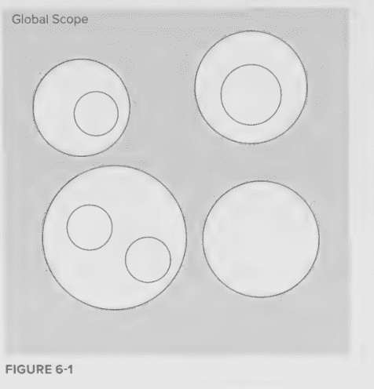

圆圈外部的阴影区域是全局作用域。在此区域中定义的所有变量和函数都可以访问同一空间中的其他变量和函数。圆圈代表函数：有些是全局定义的，有些是在其他函数内部定义的。每个圆圈的边界线是一道屏障，防止圆圈外部的项目访问圆圈内定义的变量和函数。然而，一个圆圈要么包含在另一个圆圈内，要么包含在全局空间内，并且圆圈内定义的项目可以完全访问圆圈外定义的项目。

此图展示了 JavaScript 中作用域的主要特征。特定作用域圆圈中的项目可以访问其包含圆圈内的项目，以及圆圈外的项目。但是，它们无法穿透边界进入另一个圆圈——即使是包含在自身内部的圆圈也不行。

在函数内部定义的变量和函数被称为具有函数作用域或*局部*作用域——它们对于其包含的函数是局部的。它们可以访问全局变量和函数，以及在同一函数内定义的其他变量和函数，但无法从定义它们的函数外部访问。这可以通过以下示例来展示：

```javascript
var globalVar = "This is a global variable.";

function globalFunction() {
    var localVar = "This is a local variable";
    globalVar = localVar;
}

globalFunction();

alert(localVar); // error; execution stops
alert(globalVar); // "This is a local variable";
```

此示例使用了上一节中的全局变量和函数，但在函数内部添加了一个变量初始化。这个新变量名为 `localVar`，是 `globalFunction()` 函数的一个局部变量。

此示例的倒数第二行使用警报窗口显示 `localVar` 中包含的值。这里唯一的问题是，`localVar` 无法在 `globalFunction()` 函数外部访问，因为它是该函数的局部变量——它只能被函数内部的代码访问。这一行实际做的是尝试查找一个名为 `localVar` 的全局变量。由于它不存在，因此会发生错误，代码执行停止。两个警报窗口都不会显示。

当函数退出时，其所有局部变量都会被销毁。但请注意，在函数内部，`globalVar` 变量被更改为包含 `localVar` 中的值。虽然局部变量 `localVar` 被销毁了，但在函数退出之前，它的值已被复制到 `globalVar` 中。

函数参数也表现出相同的行为。函数将它们视为局部变量，虽然函数上下文中的所有代码都可以访问这些参数，但函数外部的代码不能。看下面的例子：

```javascript
var globalVar;

function globalFunction(paramOne) {
    globalVar = paramOne;
}

globalFunction("This is a parameter");

alert(paramOne); // error; execution stops
alert(globalVar); // "This is a parameter"
```

此代码通过修改 `globalFunction()` 函数使其接受一个参数来重新创建它。函数声明之后是执行 `globalFunction()` 的语句，向函数传递一个字符串值。倒数第二行尝试访问一个名为 `paramOne` 的变量，但这样的变量在全局作用域中不存在。因此，再次发生错误，代码执行在警报窗口弹出之前停止。

让我们把事情变得更有趣一点。看下面的代码：

```javascript
var globalVar = "This is a global variable";

function globalFunction(paramOne) {
    var localVar = "This is a local variable";

    function innerFunction() {
        var innerVar = "This is an inner function's variable";
        alert(globalVar);
        alert(paramOne);
        alert(localVar);
    }

    innerFunction();
    alert(innerVar); // error; execution stops
}

globalFunction("This is a parameter");

// code execution never gets here, but if it did...
innerFunction(); // error
```

此代码再次重新创建了 `globalFunction()` 函数。它像前面的例子一样接受一个参数，但函数体发生了巨大变化。在 `globalFunction()` 的函数体内声明了一个名为 `innerFunction()` 的函数。此函数在 `globalFunction()` 的作用域内创建，因此它可以访问 `globalFunction()` 内的所有其他变量和函数，以及全局作用域中的变量和函数。换句话说，它可以直接访问外部 `globalFunction()` 函数的 `paramOne` 和 `localVar` 变量，以及全局上下文中的 `globalVar` 变量。

`innerFunction()` 函数有自己的局部作用域。虽然它可以访问外部函数和全局作用域中的项目，但外部作用域无法访问在 `innerFunction()` 内定义的 `innerVar` 变量。此外，`innerFunction()` 函数无法在 `globalFunction()` 外部访问。

## 没有块级作用域

作用域的概念可能会令人困惑，尤其是在处理函数套函数的情况时。许多其他语言为每个代码块（即一对花括号 `{}` 内的语句列表）包含一个作用域级别。这意味着在其他语言中，`if` 语句、循环和 `switch` 语句都有自己独立的作用域级别。JavaScript 则不是这样。考虑以下代码：

```javascript
if (true) {
    var hundred = 100;
}

alert(hundred);
```

在其他语言中，`hundred` 变量会在 `if` 语句执行后被销毁，因此最后一行会导致错误。另一方面，JavaScript 将声明的变量添加到其创建时所在的作用域中（在此例中是全局作用域，使其可在应用程序的任何位置使用）。

`function` 代码块是少数几个拥有自己作用域的代码块之一。大多数其他代码块，如 `if ... else`、循环和 switch，与其容器共享相同的作用域。

## 变量声明

在本书中，变量声明和初始化都以 `var` 关键字开头。事实上，可以不使用 `var` 关键字来创建变量，但这样做会产生创建全局变量的副作用。看下面的例子：

```javascript
function someFunction() {
    someVariable = "This creates a global variable";
}
someFunction();
alert(someVariable);
```

此代码创建了一个名为 `someFunction()` 的函数。其唯一的语句是将一个字符串值赋给一个名为 `someVariable` 的变量。当此语句执行时，JavaScript 引擎会查找 `someVariable` 变量以赋予其新值。引擎找不到它，因此在全局作用域中创建了它。当此代码的最后一行执行时，它会显示文本 "This creates a global variable"。

尽管这看起来可能有益，但省略 `var` 关键字可能导致意外错误。强烈建议始终使用 `var` 关键字来声明变量。

这种行为部分是由 JavaScript 查找标识符的方式引起的。

## 标识符查找

当你在代码中访问一个变量或函数时，JavaScript 引擎会开始查找该项的标识符，从当前作用域级别开始。如果在当前作用域中找不到匹配项，它会开始在下一级作用域中查找——向上遍历每一级作用域，直到找到匹配项或在全局作用域中找不到为止。例如，考虑以下代码：

```javascript
var globalVar = "Hello, Global Scope!";

function someFunction() {
    alert(globalVar);
}
```

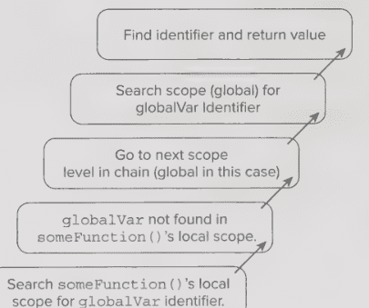

此代码创建了一个名为 `globalVar` 的全局变量和一个 `someFunction()` 函数，用于警报显示 `globalVar` 的值。当 `someFunction()` 执行时，JavaScript 引擎会从图6-2的底部开始查找 `globalVar` 标识符。

由于标识符是这样查找的，因此可以用本地作用域中的变量或函数覆盖在更高作用域级别中定义的变量或函数。看这个例子：

```javascript
var aNumber = 100;

function overrideVar() {
    var aNumber = 101;

    alert(aNumber); // 101
}

overrideVar();

alert(aNumber); // 100
```

这段代码创建了一个名为 `aNumber` 的全局变量；其值为 100。接着，代码创建了一个名为 `overrideVar()` 的函数。在该函数内部，另一个名为 `aNumber` 的变量被初始化为 101。函数的第二行代码通过将 `aNumber` 变量传递给 `alert()` 函数来使用它。JavaScript 会查找 `aNumber` 标识符，在当前作用域中找到一个后，便立即停止搜索该标识符。因此，在调用 `alert()` 时使用的是局部 `aNumber` 变量，所以警告窗口显示 101。

局部 `aNumber` 变量不会以任何方式修改同名的全局变量，但 `overrideVar()` 内部的任何代码行都会使用局部 `aNumber` 变量，而不是全局变量。JavaScript 引擎只是在局部作用域中找到了该标识符，并使用它，因为引擎首先找到了该变量的标识符。

在函数外部，全局 `aNumber` 变量保持不变。`overrideVar()` 函数内部的 `aNumber` 变量仅限于该函数的作用域，因此本示例的最后一行代码调用 `alert()` 函数，传递全局 `aNumber` 变量，并在警告窗口中显示值 100。

## 试一试

在本课中，你将学习 JavaScript 的作用域及其如何影响你的应用程序。你将编写一个函数来计算三角形和矩形的面积。

## 课程要求

对于本课，你需要一个文本编辑器；任何纯文本编辑器都可以。对于 Microsoft Windows 用户，系统默认提供记事本，或者你可以下载 Microsoft 免费的 Visual Web Developer Express (www.microsoft.com/express/web/) 或 Web Matrix (www.asp.net/webmatrix/)。Mac OS X 用户可以使用 TextMate，它是 OS X 的一部分，或者他们可以下载 Coda 的试用版 (www.panic.com/coda/)。Linux 用户可以使用内置的 VIM。

你还需要一个现代网络浏览器。选择以下任意一个：

- Internet Explorer 8+
- Google Chrome
- Firefox 3.5+
- Apple Safari 4+
- Opera 10+

在你在第 1 课中创建的 `JS24Hour` 文件夹中创建一个名为 `Lesson06` 的子文件夹。将你在本课中创建的文件存储在 `Lesson06` 文件夹中。

## 分步指南

1. 打开你的文本编辑器并输入以下代码：

```
function shapeArea(base, height, shape) {
    var area = 0;

    function triangle() {
        area = (base * .5) * height;
    }

    function rectangle() {
        area = base * height;
    }

    switch (shape) {
        case "triangle":
            triangle();
            break;
        case "rectangle":
            rectangle();
            break;
        case "square":
            rectangle();
            break;
    }

    return area;
}
```

这段代码创建了一个名为 `shapeArea()` 的函数。它接受三个参数：一个表示形状底边的数字，一个表示形状高度的数字，以及一个包含要计算面积的形状类型的字符串。在函数内部，一个名为 `area` 的局部变量被初始化为 0。

接下来是两个内部函数：`triangle()` 和 `rectangle()`。它们访问传递给 `shapeArea()` 的 `base` 和 `height` 参数的值。由于局部作用域，它们可以访问这些值。

然后，一个 `switch` 语句根据 `shape` 参数的三个可能值进行切换：`triangle`、`rectangle` 和 `square`。根据 `shape` 的值调用相应的内部函数。最后，将 `area` 返回给调用者。

2. 将此文件保存为 `lesson06_sample01.js`。

3. 打开另一个文本编辑器实例，输入以下 HTML，并将其保存为 `lesson06_sample1.htm`。

```
<html>
<head>
<title>Lesson 6: Example 1</title>
<script type="text/javascript" src="lesson06_sample01.js"></script>
<script type="text/javascript">
    var area = shapeArea(2, 2, "square");
    alert(area);
</script>
</head>
<body>
</body>
</html>
```

4. 在浏览器中打开 HTML 文件。一个警告窗口将显示值 4。

要获取示例代码文件，你可以从本书网站 www.wrox.com 下载第 6 课。

> 请在 DVD 上选择第 6 课以查看随附本课的视频。

# 7 对象和内置类型

你生活在一个基于对象的世界里。停下来想想你几乎每时每刻都在接触的对象。无论你是开车去上班或上学，坐在桌子旁吃晚餐，睡在床上，甚至在田野里行走——你都在与对象互动。你甚至不会去想你每天接触的大多数对象。与对象的互动对你来说是自然而然的。

在 20 世纪 90 年代之前，程序员主要使用过程式编程语言。这些语言基于程序为达到预期目标所采取的步骤——非常像本书迄今为止的示例。直到 20 世纪 90 年代，主流开发者才开始转变思维，将对象纳入其中。

对象是 JavaScript 中非常重要的一部分：事实上，JavaScript 中几乎一切都是对象。为了充分发挥该语言的潜力，需要理解对象是什么以及如何使用它们。首先，让我们多谈谈对象是什么以及它们为什么有用。

## 什么是对象？

在编程上下文中，通过与现实世界的例子进行比较，最容易理解对象。以汽车为例。汽车有多种颜色，由制造商制造成不同的型号。有些是乙烯基内饰，而另一些是皮革内饰。大多数汽车配备自动变速箱，少数配备手动变速箱。大多数汽车有四个轮子，而其他汽车有四个以上。有各种各样的*属性*或数据片段，帮助描述地球上的每一辆汽车。

汽车还由一组它们可以执行的动作来定义。它们通过向发动机提供燃料来向前或向后推进。它们可以通过将车轮向右或向左移动来改变方向。它们甚至有一个通信设备（喇叭），可以鸣响以引起其他驾驶员的注意。这些是驾驶员可以用来控制汽车的*方法*或动作。

在编程中，对象是可以拥有属性或特殊变量的东西，这些变量包含关于它们的数据。它们还有方法，类似于函数，执行某种类型的操作——通常是对存储在属性中的数据进行操作。就像汽车对象的属性和方法定义了汽车一样，编程中对象的属性和方法也定义了该对象。面向对象编程是一种旨在通过使用对象来组织和处理数据——复杂数据，而不是第 2 课中讨论的简单原始数据——来模拟现实世界的编程类型。

JavaScript 有许多对象数据类型。然而，在深入研究它们之前，首先看看如何使用对象。

## 使用 JavaScript 对象

对象必须先创建才能使用，创建对象最常见的方法是调用*构造函数*。构造函数是一个特殊的函数，它创建特定数据类型的*实例*。

回想一下第 2 课，回忆 JavaScript 中的原始数据类型：Number、String 和 Boolean。虽然这些原始数据类型本身不是对象，但它们确实有所谓的*包装器*对象——封装原始类型以便它们可以表示为对象的对象。因此，可以使用适当的构造函数创建这些类型的值。构造函数与其所代表的数据类型同名。例如，String 数据类型的构造函数是 `String()`。

调用构造函数时，你使用一个名为 `new` 的运算符。这告诉 JavaScript 你想要创建指定数据类型的新对象。输入 `new` 运算符后，你调用数据类型的构造函数并传递任何必要的参数。以下代码显示了使用构造函数创建 String 对象的示例：

```
var message = new String("Hello, World!");
```

这是一个变量初始化语句，它创建一个包含数据 "Hello, World!" 的 String 对象，并将其赋值给 `message` 变量。

> 即使你可以通过调用其构造函数来创建 String 值或任何其他原始类型的值，但建议你使用字面量表示法来创建这些值。你仍然可以访问这些数据类型的属性和方法。

一旦对象被创建，就可以使用该数据类型的属性和方法（统称为*成员*）。访问数据类型的成员涉及使用点（`.`）运算符。在对象的标识符和成员的标识符之间使用此运算符，如下所示：

```
var numberOfCharacters = message.length; // 13
```

此语句使用了字符串数据类型的 `length` 属性，该属性返回字符串中字符和空白字符的数量。访问该属性的方式是：先使用对象的标识符（在此代码中为 `message`），后跟点运算符，然后是属性的标识符（`length`）。

属性非常类似于附加在对象上的变量。有些属性是只读的——这意味着它们可以返回数据，但不能被赋予新值。字符串数据类型的 `length` 属性就是一个只读属性。因此，以下这行代码是错误的：

```
message.length = 10; // wrong; length is read-only
```

访问方法遵循相同的原则：使用对象的标识符，后跟一个点，然后是方法的标识符。以下代码调用了字符串数据类型的一个方法：

```
var lowerCaseMessage = message.toLowerCase(); // "hello, world!"
```

正如属性类似于变量，方法则类似于函数。方法和函数之间的主要区别在于，方法会对对象执行某种操作或为对象执行某种操作。`toLowerCase()` 方法就是一个例子。它通过复制字符串对象的值并将所有字母字符转换为小写，然后将新值返回给调用者（在此代码中是 `lowerCaseMessage` 变量）来执行操作。

既然你已经了解了如何使用对象，让我们开始了解 JavaScript 的内置数据类型。

## 内置数据类型

JavaScript 有许多内置数据类型。本课程将向你介绍以下类型：

- 数组
- 日期
- 数字
- 字符串

后续课程将向你介绍对象和函数数据类型。

## 数组

扩展本课程开头的汽车示例，汽车有一组档位来决定车辆如何移动。将汽车挂入倒档会使其向后移动，而另一个档位则使车辆向前移动。将所有可能的档位值存储在对象的属性中可能会有问题，因为属性和变量通常一次只包含一个数据。以下代码提供了一个示例：

```
var gear = 1;
```

有时，例如在档位的情况下，我们希望在一个变量或属性中存储多个值。这就是*数组*派上用场的地方。数组最简单的定义是值的有序集合。

数组有两种创建方式。第一种方式使用数组数据类型的构造函数，如下所示：

```
var myArray = new Array(); // create a new array
```

`Array()` 构造函数可以接受一组参数，这些参数包含要存储在数组中的数据。以下代码行创建了一个数组并添加了汽车档位的可能值：

```
var gears = new Array(1, 2, 3);
```

这个数组被认为有三个*元素*或项目。然而，有一种更短且更推荐的创建数组的方法。通过使用*数组字面量表示法*，你可以用更少的击键创建相同的数组：

```
var myArray = [];

var gears = [ 1, 2, 3 ];
```

数组字面量表示法**涉及使用方括号，如本代码所示**。使用方括号是因为你访问数组中每个单独元素的方式：*索引表示法*。你首先使用数组的标识符，后跟一个左方括号，然后是元素的*索引*，最后是右方括号。

数组中的元素以从零开始的数字序列存储。还记得第 5 课中示例显示的从零开始的循环吗？这就是原因。数组中的第一个元素的索引为 0。第二个元素的索引为 1，第三个元素的索引为 2，依此类推。你使用元素的索引号来访问数组中的它。检索 `gears` 数组中第三个元素的代码如下所示：

```
gears[2]; // 3
```

检索 `gears` 数组中第一个元素的代码如下所示：

```
gears[0]; // 1
```

如果这让你感到困惑，没关系，因为对于初学者来说通常都是如此。作为人类，我们通常从数字 1 开始计数。计算机不是——它们从零开始计数。JavaScript 以及许多其他语言都遵循计算机的模式，也从零开始计数。这意味着数到 10 实际上涉及 11 个数字：0, 1, 2, 3, 4, 5, 6, 7, 8, 9, 和 10。这是一个需要理解的重要概念，因为这种计数方法在整个语言中都会用到。

数组中的每个元素都非常像一个变量；你可以像前面示例中那样获取数据，也可以通过为现有元素分配新数据来修改它们。以下代码更改了数组中的第一个元素：

```
gears[0] = 2; // changed from 1 to 2
gears[0] = 1; // changed back to 1
```

这就像使用普通变量一样，只是你使用索引表示法来访问数组中的元素。`gears` 数组有三个元素，这个信息是通过数组类型的 `length` 属性获取的。它的行为与字符串类型的 `length` 属性非常相似，只是它计算的不是字符数，而是数组中的元素数量。以下代码展示了 `length` 属性的一个示例：

```
var length = gears.length; // 3
```

当你使用循环遍历数组时，`length` 属性特别有用。`length` 属性可以确保循环遍历每个元素并在最后一个元素之后结束，而不是为循环编程一个特定的结束点。以下代码展示了这一点：

```
for (var i = 0; i < gears.length; i++) {
    alert(gears[i]);
}
```

此代码是遍历数组的基础。`for` 循环的初始化部分将一个名为 `i` 的变量初始化为值 0。循环的条件告诉循环只要 `i` 小于 `gears` 数组的长度就重复执行。它将迭代三次，每次迭代时 `i` 的值分别为：0, 1, 2。在第四次迭代时，条件判断 `i`（此时值为 3）是否小于 `gears` 数组的长度（也是 3）。因为 3 不小于 3，所以循环退出。

`length` 属性总是返回数组中的元素数量。这意味着向 `gears` 数组添加一个新元素将导致 `gears.length` 返回 4。向数组添加新元素的一种方法是使用索引表示法。以下代码行添加了一个新元素来表示倒档：

```
gears[3] = -1;
```

此代码在索引位置 3 添加了一个新元素，这是数组中的第四个位置。虽然在某些情况下硬编码索引位置是可行的，例如这个示例，但有时你不知道数组中有多少个元素。在这种情况下，你可以使用 `length` 属性在下一个索引位置添加新元素。为了使代码更灵活，前一行代码可以重写为：

```
gears[gears.length] = -1;
```

在此示例中，`length` 属性返回值 3，这也是在数组末尾添加新元素所需的索引号。然而，有一种更简单的方法可以达到相同的效果，它需要使用数组类型的一个方法：`push()` 方法，如下所示：

```
gears.push(-1);
```

`push()` 方法接受一个参数：要添加到数组的值。现在数组中添加了一个新元素，`length` 属性返回 4，因为现在数组中有四个元素：1, 2, 3, 和 -1。

除了 `push()` 方法，数组数据类型还提供了其他一些有用的方法，如下表所示：

### 有用的数组方法

| 方法 | 描述 |
| :--- | :--- |
| `concat(array1, array2, ...)` | 将两个或多个数组连接成一个数组。 |
| `join(separator)` | 将数组转换为字符串。每个元素由指定的分隔符分隔。 |
| `pop()` | 移除数组的最后一个元素并将其返回给调用者。 |
| `push(element)` | 向数组末尾添加一个新元素。返回新的长度。 |
| `reverse()` | 反转数组中元素的顺序。 |
| `sort()` | 对数组中的元素进行排序。 |

接下来的几节将向你展示如何使用其中一些方法。

## 连接数组

如果你想将多个数组连接在一起，可以使用 `concat()` 方法。它不会改变原始数组；相反，它创建一个新数组，用所有指定数组的元素填充它，然后将其返回给调用者。让我们暂时离开汽车示例，来看一个家庭的例子，如本例所示：

```
var parents = ["John", "Jane" ];
var kids = [ "Jason", "Joe", "Jordan" ];
var pets = [ "Jackson", "Jimmy" ];

var family = parents.concat(kids, pets);
```

此代码的前三行创建了三个数组，都代表家庭的一部分——父母、孩子和宠物的名字。此代码的最后一行在 `parents` 数组上调用 `concat()` 方法，并将 `kids` 和 `pets` 数组传递给该方法。新创建的数组 `family` 包含其他所有数组的元素。这意味着 `family` 包含以下名字：John, Jane, Jason, Joe, Jordan, Jackson, 和 Jimmy。

调用 `concat()` 方法的顺序决定了新数组中元素的顺序。在此示例中，`concat()` 是在 `parents` 数组上调用的，因此该数组中的元素是 `family` 中的第一个元素。`kids` 数组是传递给该方法的第一个参数，因此它的元素可以在 `family` 中的 John 和 Jane 之后找到。`pets` 数组是传递给 `concat()` 的最后一个参数，因此它的元素出现在 `family` 的末尾。更改调用 `concat()` 的方式会更改提供的数组连接在一起的顺序。

## 将数组转换为字符串

有时将数组转换为字符串是有益的。事实上，这样做比将多个字符串连接在一起更高效。使用 `join()` 方法可以将各个元素连接成一个字符串。该方法接受一个参数，用于指定放置在元素值之间的分隔符。以下示例使用了上一节中的原始 `family` 数组：

```
var familyString = family.join(", ");
```

此代码向 `family` 数组调用的 `join()` 方法传递了一个逗号后跟一个空格字符。这将生成 `familyString`，其值为 "John, Jane, Jason, Joe, Jordan, Jackson, Jimmy"。传递给方法的分隔符在字符串中分隔了元素的值。

如前所述，使用 `join()` 方法连接数组元素比使用 `+` 运算符连接字符串更高效。因此，你会看到开发者使用类似以下代码来生成字符串：

```
var stringParts = [
    "John's family is: ",
    family.join(", ")
];

var familyString = stringParts.join("");
```

此代码首先创建一个名为 `stringParts` 的数组。它的第一个元素是一个字符串值，第二个元素是转换 `family` 数组的结果。此代码的最终结果是字符串 "John's family is: John, Jane, Jason, Joe, Jordan, Jackson, Jimmy"。

与 `concat()` 方法一样，`join()` 方法不会修改原始数组。

## 对元素排序

数组通常用于组织相似的数据片段。因此，如果元素是字符串值，可能需要按字母顺序对数据进行排序；如果数据由数字组成，则按数字顺序排序。

`sort()` 方法使排序变得简单：它按字母顺序对数组的元素进行排序。以下示例再次使用 `family` 数组：

```
family.sort();
```

与之前的方法不同，`sort()` 方法会修改原始数组。`family` 中包含的元素现在按以下顺序排列：Jackson, Jane, Jason, Jimmy, Joe, John, 和 Jordan。

`sort()` 方法区分大小写：以大写字母开头的单词排在以小写字母开头的单词之前。因此，在 JavaScript 中，`Jackson` 会排在 `jackson` 之前。

`sort()` 方法按升序对元素进行排序：没有方法或参数可以按降序排序。但是，有一个名为 `reverse()` 的方法可以反转升序数组的顺序。

## 反转元素

`reverse()` 方法通过反转数组元素的顺序来修改数组。为了了解其工作原理，让我们看看前面章节中的 `kids` 数组：

```
var kids = [ "Jason", "Joe", "Jordan" ];

kids.reverse();
```

原始的 `kids` 数组可以表示为下表：

| 索引 | 元素值 |
|---|---|
| 0 | Jason |
| 1 | Joe |
| 2 | Jordan |

此表显示了数组中的每个元素及其索引位置。调用 `reverse()` 方法会按相反的顺序重新排列数组中的元素，并且元素会获得新的索引位置。下表显示了调用 `reverse()` 后的数组：

| 索引 | 元素值 |
|---|---|
| 0 | Jordan |
| 1 | Joe |
| 2 | Jason |

通过结合使用 `sort()` 和 `reverse()` 方法，你基本上可以按降序对数组进行排序，如以下代码所示：

```
family.sort().reverse();
```

请记住，许多数组对象方法返回一个数组；`sort()` 就是这样一个方法。因此，可以链接方法调用以在单个语句中执行多个过程。对 `sort()` 的调用返回 `family` 数组的排序版本，但结果没有被赋值给变量，而是使用返回值来调用 `reverse()` 方法。这只是经验丰富的开发者用来编写更高效代码的一种技巧。

## 日期

每个计算机系统都需要维护日期和时间功能。当今的许多操作系统依赖日期和时间来提供基本信息和服务。同样，每种编程语言都需要某种方式来获取当前日期和时间，以便程序员可以编写有意义且可用的应用程序。

JavaScript 使用 Date 数据类型来处理此功能。它提供对当前日期和时间以及其他任何日期和时间的信息访问，以便可以进行计算。JavaScript 的 Date 对象使用 UNIX 时间戳；事实上，它以这种格式存储日期信息。UNIX 时间戳是自 UNIX 纪元（1970年1月1日格林威治标准时间午夜12:00）以来的毫秒数。例如，2010年1月1日格林威治标准时间午夜12:00的 UNIX 时间戳是 1264982400000。Date 对象中包含的日期和时间基于你计算机的日期和时间。

有四种方法可以创建 Date 对象。第一种是最简单的，它返回当前日期和时间。只需调用构造函数而不传递任何参数，如下所示：

```
var date = new Date(); // 当前日期和时间
```

创建 Date 对象的第二种方法是向 Date 构造函数传递年、月、日、小时、分钟、秒和毫秒：

```
var date = new Date(2010, 0, 1, 0, 0, 0, 0); // 2010年1月1日 上午12:00
var date2 = new Date(2010, 0, 1); // 2010年1月1日 上午12:00
```

大多数参数是可选的；省略它们会导致传递 0 作为替代。这里需要注意的一个重要事项是，月份参数是以零为基数的数字传递的。所以一月是 0，二月是 1，三月是 2，依此类推。如果你指定了小时，它们必须以 24 小时格式传递：0 是午夜，13 是下午 1:00，23 是晚上 11:00。

你也可以通过传递字符串值来创建 Date 对象，如下所示：

```
var date = new Date("January 1, 2010");
var date2 = new Date("Jan 1 2010");
var date3 = new Date("1 January 2010");
```

你可以向构造函数传递各种字符串变体。如果有疑问，可以尝试一下。但是，浏览器在以这种方式创建 Date 对象时表现不同。例如，Firefox 不支持 "01-01-2010" 作为有效的日期格式。因此，在向构造函数传递字符串时，请确保在多个浏览器中测试 Date 对象的创建。

创建 Date 对象的最后一种方法是传递 UNIX 时间戳。这可能是最不常用的 Date 对象创建方法。以下行通过传递 UNIX 时间戳创建了一个 Date 对象：

```
var copy = new Date(date.getTime()); // 2010年1月1日 上午12:00
```

Date 对象的 `getTime()` 方法返回调用它的 Date 对象的 UNIX 时间戳。因此，此代码通过调用其 `getTime()` 方法、将其传递给 Date 构造函数并将新的 Date 对象赋值给 `copy` 变量，来复制上一个示例中的 `date` Date 对象。

JavaScript 以 UNIX 时间戳存储日期和时间。这并不实用，因此 Date 数据类型公开了一些方法，允许你从 Date 对象获取更有意义的信息。下表列出了涉及日期的更有用的方法。

## 与日期相关的方法

| 方法 | 描述 |
| :--- | :--- |
| `getFullYear()` | 返回四位数的年份。 |
| `getMonth()` | 返回一个表示月份的零基数数字。一月是 0，二月是 1，十二月是 11。 |
| `getDate()` | 返回一个表示月份中某天的数字。 |
| `getDay()` | 返回一个表示星期几的零基数数字。星期日是 0，星期一是 1，星期六是 6。 |
| `toDateString()` | 将对象的日期部分转换为字符串，并以 Fri Jan 1 2010 的格式返回。 |
| `setDate(dayOfMonth)` | 根据作为 `dayOfMonth` 传递的参数设置月份中的某天。 |
| `setMonth(monthNumber)` | 根据作为 `monthNumber` 传递的参数设置月份。有效值为 0 到 11。 |
| `setFullYear(yearNumber)` | 根据作为 `yearNumber` 传递的四位数年份设置年份。 |

不幸的是，Date 对象不返回月份或星期几的名称；开发者必须在代码中提供该功能。然而，使用数组，这是一个简单的练习。看看这段代码：

```
var daysOfWeek = [ "Sunday", "Monday", "Tuesday", "Wednesday", "Thursday",
    "Friday", "Saturday" ];

var date = new Date(); // 获取当前日期

alert("Today is " + daysOfWeek[date.getDay()]);
```

运行此代码的结果取决于执行它的日期。如果在 2010年1月1日运行，警报窗口将显示文本 "Today is Friday."。由于数组索引是零基数的，Date 对象的 `getDay()` 方法也是如此，你可以使用 `getDay()` 返回的值作为一周中正确日期的索引。同样的原理也适用于月份，你将在后面的“动手试试”部分看到。

正如 JavaScript 的 Date 数据类型有处理日期的方法一样，它也提供了处理 Date 对象时间部分的方法。下表列出了这些与时间相关的方法：

## 与时间相关的方法

| 方法 | 描述 |
|---|---|
| `getHours()` | 返回小时数，采用 24 小时制。可能的值为 0 到 23。 |
| `getMinutes()` | 返回分钟数。可能的值为 0 到 59。 |
| `getSeconds()` | 返回秒数。可能的值为 0 到 59。 |
| `getMilliseconds()` | 返回毫秒数。值范围为 0 到 999。 |
| `setHours(newHour)` | 根据参数 `newHours` 设置小时数。参数的有效值为 0 到 23。 |
| `setMinutes(newMinutes)` | 根据参数 `newMinutes` 设置分钟数。参数的有效值为 0 到 59。 |
| `setSeconds(newSeconds)` | 根据参数 `newSeconds` 设置秒数。参数的有效值为 0 到 59。 |
| `setMilliseconds(newMS)` | 根据参数 `newMS` 设置毫秒数。参数的有效值为 0 到 999。 |

## 数字

第 2 课详细介绍了 Number 数据类型。Number 对象没有任何属性，但它们确实有一些方法。最有用，也可能是最常用的 Number 方法是 `toFixed()` 方法。此方法将数字格式化为固定的小数位数，如下所示：

```
var num = 1.2345;
var fixedNum = num.toFixed(2); // 1.23
```

它接受一个参数，指定新数字中要包含的小数位数。它不会修改原始数字；而是复制它，格式化副本，然后将副本返回给调用者。

`toFixed()` 方法会对最近的小数位进行四舍五入。前面的例子查看了百分位之后的小数位，并确定它应该向下舍入。下一个例子使用 `toFixed()` 方法进行向上舍入：

```
var num = 1.54321;
var fixedNum = num.toFixed(0); // 2
```

此代码会去掉数字的所有小数位。`toFixed()` 方法会查看第一位小数以确定是向上还是向下舍入数字。由于它大于或等于五，`toFixed()` 将数字向上舍入为 2。

`toFixed()` 方法只能去掉 0 到 20 位小数。

## 字符串

本课开头向你介绍了 String 数据类型的两个成员：`length` 属性和 `toLowerCase()` 方法。`length` 属性是 String 唯一的属性，但与 Number 类型不同，String 类型有许多有用的方法。它们不会以任何方式修改原始字符串。相反，它们会创建一个副本，在副本上执行操作，然后将副本返回给调用者。

下表列出了本节将介绍的几个有用的 String 方法：

### 有用的字符串方法

| 方法 | 描述 |
| :--- | :--- |
| `charAt(index)` | 获取指定索引处的字符。 |
| `indexOf(searchString)` | 返回提供的字符串首次出现的索引位置。如果未找到匹配项，则返回 -1。 |
| `lastIndexOf(searchString)` | 返回提供的字符串最后一次出现的索引位置。如果未找到匹配项，则返回 -1。 |
| `replace(toReplace, replaceWith)` | 在字符串中搜索与提供的 `toReplace` 参数匹配的子字符串，并将第一个匹配项替换为提供的 `replaceWith`。 |
| `split(separator)` | 使用提供的分隔符将字符串分割成数组。 |
| `substr(startIndex, numberOfChars)` | 从 `startIndex` 位置开始提取字符串的字符，并选择由 `numberOfChars` 指定的字符数量。省略 `numberOfChars` 将选择字符串的其余部分。 |
| `substring(startIndex, endIndex)` | 从字符串中提取字符，从 `startIndex` 指定的位置开始，到 `endIndex` 之前的字符结束。省略 `endIndex` 将选择字符串的其余部分。 |
| `toLowerCase()` | 返回全小写字符的字符串。 |
| `toUpperCase()` | 返回全大写字符的字符串。 |

## 搜索子字符串

String 对象有两个有用的方法来搜索*子字符串*，即出现在较大字符串中的较小字符串。它们是 `indexOf()` 和 `lastIndexOf()` 方法。当你想确定某个特定字符串是否包含关键字或短语时，这些方法很有用。这两个方法都接受一个子字符串作为参数，JavaScript 将在调用该方法的 String 对象中搜索该子字符串。这些方法区分大小写：除非找到完全匹配，否则它们不会报告匹配。

这两个方法的区别在于它们搜索子字符串的方式。看下面的例子：

```
var welcomeString = "Hello, Jeremy! Wonderful day, isn't it, Jeremy?";

alert(welcomeString.indexOf("Jeremy")); // 7
alert(welcomeString.lastIndexOf("Jeremy")); // 40
alert(welcomeString.indexOf("JavaScript")); // -1
```

`indexOf()` 方法从字符串的开头开始搜索指定的子字符串。然后它开始搜索字符串，直到找到匹配项或到达字符串末尾才停止。当它找到匹配项时，它会立即返回匹配项的索引。在此代码中，`indexOf("Jeremy")` 返回 7，因为子字符串是从第七个字符位置开始找到的。

`lastIndexOf()` 方法从字符串的末尾开始搜索，而不是从开头，并且它不会停止，直到找到匹配项或到达字符串的开头。当它找到指定子字符串的匹配项时，它也会立即返回匹配项的索引位置。在此示例中，`lastIndexOf()` 找到的匹配项从索引位置 40 开始。

如果 `indexOf()` 或 `lastIndexOf()` 未找到匹配项，则返回值 -1。

## 提取子字符串

有时提取字符串的一部分是有益的，JavaScript 的 String 数据类型允许使用 `substr()` 和 `substring()` 方法来实现这一点。这两种方法提供相同的结果，但它们基于不同的参数值来实现。

`substr()` 方法接受两个参数。第一个是必需的，它是开始提取的索引。第二个参数是可选的。如果指定，它确定从起始索引开始提取多少个字符，包括起始字符。如果省略第二个参数，`substr()` 方法将提取起始索引之后的所有字符。以下代码使用 `substr()` 方法提取字符串的一部分：

```
var message = "JavaScript 24-Hour Trainer";

var subString = message.substr(11, 7); // 24-Hour
```

此代码使用 `substr()` 方法提取 `message` 变量中包含的字符串的 `24-Hour` 部分。`24-Hour` 中的 2 是字符串中的第十二个字符——因此起始索引为 11（再次记住，索引从 0 开始）——并且该短语有 7 个字符长。将这两个值传递给 `substr()` 方法会提取短语 `24-Hour` 并将其分配给 `subString` 变量。`message` 中包含的字符串不会被修改。

`substring()` 方法可以提供相同的结果，但它使用略有不同的数据来实现。它仍然需要一个起始索引，并且如果省略第二个参数，`substring()` 方法的行为类似于 `substr()`。但如果指定了第二个参数，它是停止提取的索引。`substring()` 方法的一个重要且经常被遗忘的行为是，提取包括*直到*结束索引的字符；它不包括*在*结束索引处的字符。以下代码使用 `substring()` 方法重写了前面的示例：

```
var message = "JavaScript 24-Hour Trainer";

var substring = message.substring(11, 18); // 24-Hour
```

使用对你最有意义的方法。如果你知道所需子字符串的确切长度，`substr()` 方法显然是更好的选择。当你不知道所需子字符串有多长时，`substring()` 方法是更好的选择，并且与 `indexOf()` 和 `lastIndexOf()` 方法结合使用时，可以成为一个强大的工具。

## 转换为数组

在许多方面，字符串与数组密切相关。事实上，许多编程语言将字符串视为字符数组。不幸的是，JavaScript 不是这些语言之一。虽然 String 对象像数组对象一样有 `length` 属性，但你不能像使用数组中的元素那样使用索引表示法来访问单个字符。相反，String 对象有一个 `charAt()` 方法。将索引传递给此方法，你可以检索但不能编辑指定索引处的单个字符。

然而，可以使用 `split()` 方法将字符串转换为数组：它将字符串分割成子字符串数组。该方法根据传递给它的参数知道在哪里分割字符串。如果你提供一个空字符串作为参数，此方法会创建一个数组，其中每个单独的字符都是一个元素。以下代码演示了这一点：

```
var message = "Hello, World!";
var messageArray = message.split(""); // converts to array
```

一旦字符串以数组形式存在，你就可以使用索引表示法访问单个字符。当你有一个包含由一致分隔符（如逗号）分隔的项目列表的字符串时，此方法也非常有用。看这段代码：

```
var fruitsString = "orange,apple,banana";
var fruitsArray = fruitsString.split(","); // creates array with 3 elements
```

此代码通过在每个逗号处分割 `fruitsString` 字符串来创建一个数组。生成的数组包含三个元素：`orange`、`apple` 和 `banana`。

## 替换文本

`replace()` 方法接受两个参数：要替换的字符串，以及用于替换它的字符串。此方法从开头开始搜索字符串，并查找指定子字符串的第一次出现。它不会替换指定子字符串的所有出现——只替换第一个，如以下代码所示：

```
var message = "Today is Monday. Yesterday was Monday.";
var newMessage = message.replace("Monday", "Tuesday");

alert(newMessage); // Today is Tuesday. Yesterday was Monday.
```

这段代码首先创建了一个包含错误的字符串值。它声称今天是星期一，昨天也是星期一。为了修正这个错误，代码的第二行使用了 `replace()` 方法，将“Monday”（星期一）改为“Tuesday”（星期二），并将新字符串返回给 `newMessage` 变量。当警报窗口显示新消息时，它会显示：“Today is Tuesday. Yesterday was Monday.”（今天是星期二。昨天是星期一。）

与本课讨论的所有其他字符串方法一样，原始字符串（本例中为 `message`）并未被修改。

## 动手试试

在本课中，你将学习如何使用对象以及 JavaScript 的一些内置对象类型。在这里，你将应用从前面章节中获得的一些知识和概念。

## 课程要求

学习本课，你需要一个文本编辑器；任何纯文本编辑器都可以。对于 Microsoft Windows 用户，系统默认提供了记事本，或者你可以下载 Microsoft 免费的 Visual Web Developer Express (www.microsoft.com/express/web/) 或 Web Matrix (www.asp.net/webmatrix/)。Mac OS X 用户可以使用 TextMate，它是 OS X 的一部分，或者可以下载 Coda 的试用版 (www.panic.com/coda/)。Linux 用户可以使用内置的 VIM。

你还需要一个现代的 Web 浏览器。选择以下任意一种：

- Internet Explorer 8+
- Google Chrome
- Firefox 3.5+
- Apple Safari 4+
- Opera 10+

在你在第 1 课创建的 `JS24Hour` 文件夹中，创建一个名为 `Lesson07` 的子文件夹。将你在本课中创建的文件存储在 `Lesson07` 文件夹中。

## 分步操作

编写一个应用程序，提示用户输入其姓名。在警报窗口中显示姓名和今天的日期。使用一个函数获取月份的名称，并使用另一个函数将其缩写为三个字符。

1. 打开你的文本编辑器，输入以下函数。

```
function getMonthName(index) {
    var months = [ "January", "February", "March", "April", "May", "June",
                   "July", "August", "September", "October", "November", "December" ];

    return months[index];
}
```

这个 `getMonthName()` 函数创建了一个包含月份名称的数组，并返回所提供索引处的元素。

2. 现在添加以下加粗的函数：

```
function getMonthName(index) {
    var months = [ "January", "February", "March", "April", "May", "June",
        "July", "August", "September", "October", "November", "December" ];

    return months[index];
}

function abbrName(text) {
    return text.substr(0, 3);
}
```

这个新函数 `abbrName()` 使用 `substr()` 方法选择所提供文本的前三个字符，并将其返回给调用者。

3. 添加以下加粗的代码：

```
function getMonthName(index) {
    var months = [ "January", "February", "March", "April", "May", "June",
        "July", "August", "September", "October", "November", "December" ];

    return months[index];
}

function abbrName(text) {
    return text.substr(0, 3);
}

var date = new Date();
var messageParts = [
    "Hello, ",
    prompt("Please enter your name", "Please enter your name"),
    ". Today is ",
    abbrName(getMonthName(date.getMonth())),
    " ",
    date.getDate(),
    ", ",
    date.getFullYear()
];
```

这段代码的第一行创建了一个包含今天日期的 `Date` 对象。这个 `Date` 对象将用于向用户显示日期信息。

第二条语句创建了一个名为 `messageParts` 的数组。这个数组的目的是包含将被连接成要显示给用户的消息的元素。第一个元素是一个简单的字符串。第二个元素调用 `prompt()` 函数，提示用户输入其姓名。第四个元素从日期对象获取当前月份，并将其传递给 `getMonthName()` 函数。然后，`getMonthName()` 的返回值被传递给 `abbrName()` 函数。因此，数组中的第四个元素是一个包含当前月份前三个字符的字符串。

4. 通过添加以下加粗的代码，向用户显示消息：

```
function getMonthName(index) {
    var months = [ "January", "February", "March", "April", "May", "June",
        "July", "August", "September", "October", "November", "December" ];

    return months[index];
}

function abbrName(text) {
    return text.substr(0, 3);
}

var date = new Date();
var messageParts = [
    "Hello, ",
    prompt("Please enter your name", "Please enter your name"),
    ". Today is ",
    abbrName(getMonthName(date.getMonth())),
    " ",
    date.getDate(),
    ", ",
    date.getFullYear()
];

alert(messageParts.join(""));
```

这一行调用了 `join()` 方法，并传入一个空字符串，以便在没有明显分隔符的情况下连接元素。

5. 将文件保存为 `lesson07_sample01.js`。

6. 打开另一个文本编辑器实例，输入以下 HTML，并将其保存为 `lesson07_sample01.htm`。

```
<html>
<head>
    <title>Lesson 7: Objects</title>
</head>
<body>
    <script type="text/javascript" src="lesson07_sample01.js"></script>
</body>
</html>
```

7. 在浏览器中打开 HTML 文件。一个警报窗口将显示在提示窗口中提供的姓名，以及包含今天日期的消息。

> 请在 DVD 上选择第 7 课，以查看随附本课的视频。你也可以从本书网站 www.wrox.com 下载所有课程的示例代码。

# 8 自定义对象

第 7 课讨论的内置对象在使应用程序更易于编写和维护方面大有帮助，但它们无法让开发者根据个人需求和应用程序需求来定制对象。例如，如果你的工作是编写一个模拟二维笛卡尔坐标平面的应用程序，该怎么办？`Array`、`Date`、`Number` 和 `String` 数据类型将如何帮助你实现这一目标？这是可以做到的，但要编写一个合适的应用程序需要花费大量的时间和精力。

事实是，JavaScript 或任何面向对象的编程语言，如果没有创建语言提供的内置对象之外的对象的能力，就不会有用。能够构建自己的对象和数据类型，使得编写灵活且可维护的应用程序成为可能。

JavaScript 面向对象设计的核心是 `Object` 数据类型。它是 JavaScript 中所有对象和引用类型的基础，你将在本课中学习如何使用它。

## OBJECT 数据类型

有两种方法可以创建一个基本对象。第一种是使用 `Object` 数据类型的构造函数，如下所示：

```
var coordinates = new Object();
```

这段代码使用 `new` 关键字调用 `Object()` 构造函数，并将其赋值给 `coordinates` 变量。与 `Array` 数据类型一样，有一种更简单（也是首选的）创建对象的方法，即使用*对象字面量表示法*：

```
var coordinates = {};
```

对象字面量表示法使用花括号，而不是用于表示数组字面量的方括号。

一个普通的对象是不可用的。你几乎无法用它做什么，但 JavaScript 是一种动态语言。你可以随时向对象添加属性。你只需要为属性赋值，如下所示：

```
var coordinates = {};

coordinates.x = 0;
coordinates.y = 0;
```

可以更进一步，在一条语句中定义对象及其属性。这样做会产生类似以下代码的结果：

```
var coordinates = {
    x : 0,
    y : 0
};
```

这条语句的开头就像任何其他赋值语句一样。`var` 关键字表示变量声明或初始化，后跟变量的标识符（本例中为 `coordinates`），然后是赋值运算符。接下来是一个表示对象字面量的左花括号，但随后情况开始变得不同。

在花括号内是用逗号分隔的属性定义列表。对象字面量内的属性定义由属性的名称、一个冒号 (`:`) 和属性的值组成。每个定义之间用逗号分隔；否则 JavaScript 将不知道一个属性定义在哪里结束，另一个在哪里开始。在这段代码中，为 `coordinates` 对象定义了两个属性。它们是 `x` 和 `y`，这段代码将它们的值都赋为 0。

定义了对象及其属性后，你可以像使用任何其他对象一样使用它们。看看下面的代码：

```
var text = "X is " + coordinates.x + " and Y is " + coordinates.y;

alert(text);
```

`coordinates` 对象的 `x` 和 `y` 属性与其他字符串值连接在一起。最终结果被赋值给 `text` 变量，第二条语句向用户显示 `text` 的内容。这个功能很适合作为一个方法，所以让我们向 `coordinates` 对象添加一个执行此操作的方法。

方法定义遵循与属性定义相同的原则；唯一的区别是冒号右边的值是一个函数。以下加粗的代码向 `coordinates` 对象添加了一个方法定义：

```
var coordinates = {
    x : 0,
    y : 0,
    sayCoordinates : function() {
        var text = "X is " + this.x + " and Y is " + this.y;
        alert(text);
    }
};
```

首先，请注意在 `y` 的定义末尾添加了一个逗号。由于它不再是定义列表中的最后一个成员，因此需要一个逗号将其与 `sayCoordinates()` 的定义分隔开。

新方法体内的代码与前一个示例中的代码非常相似。但有一处变化：之前使用 `coordinates` 标识符的地方，现在使用了一个名为 `this` 的新关键字。`this` 关键字是在函数内部使用的特殊变量；它指向调用该函数作为方法的那个对象。`sayCoordinates()` 方法是 `coordinates` 的一个成员。因此，它在 `coordinates` 对象的上下文中执行。正因为如此，`this` 变量指向 `coordinates` 对象。`this` 所使用的上下文可以很容易地转换成口语。像 `this.x = 0;` 这样的语句可以翻译为“将此对象的 x 属性设置为 0。”当你看到 `this` 时，就想“这个对象。”

## 输出对象

自定义对象在 JavaScript 开发中有许多用途，但它们主要用于数据交换。继续笛卡尔平面的例子，二维空间中的一个点必须包含两条信息：x（水平）信息和 y（垂直）信息。为了让应用程序知道当前点在二维空间中的位置，需要一个名为 `getCurrentPoint()` 的函数来返回当前点的 x 和 y 坐标。JavaScript 没有表示坐标数据的数据类型，但正如你在本课中所看到的，自定义对象可以轻松完成这项工作。以下代码展示了这样一个函数可能的样子：

```
function getCurrentPoint() {
    // set initial values for current coordinates
    var currentX = 0;
    var currentY = 0;

    // code here to get the current x and y
    // and assign it to the variables

    return {
        x : currentX,
        y : currentY
    };
}
```

此函数首先将两个名为 `currentX` 和 `currentY` 的局部变量初始化为 0。然后，如注释所述，一些代码确定 x 和 y 数据，并将相应的值赋给 `currentX` 和 `currentY` 变量。最后，函数返回一个对象，该对象使用对象字面量符号创建，包含两个属性 `x` 和 `y`，其中包含当前点所需的值。请注意，此对象没有标识符，也没有在函数内赋值给任何局部变量。此代码演示了如何返回任何类型的数据，而无需先专门创建并将其赋值给变量。

要使用此函数，你可能会编写类似这样的代码：

```
var point = getCurrentPoint();

alert(point.x);
alert(point.y);
```

第一行调用 `getCurrentPoint()` 函数，并将结果值赋给 `point` 变量，该变量现在是一个对象。接下来的两行代码通过访问 `x` 和 `y` 属性来展示 `point` 对象的使用。

## 对象作为输入

正如返回一个对象来表示复杂数据是有益的，在函数中接受对象作为参数同样有益。你虚构的笛卡尔平面应用程序需要在图表上的特定点绘制一个点，而一个名为 `drawPoint()` 的函数为应用程序提供了此功能。该函数可能如下所示：

```
function drawPoint(x, y) {
    // do something with x
    // do something with y
}
```

这里，一个传统函数接受两个参数，并对这些参数执行某种类型的操作，以在屏幕上绘制一个点。这个函数本身没有问题，但如果它接受一个包含坐标数据的对象作为参数，就能更好地融入面向对象的环境：

```
function drawPoint(point) {
    // do something with point.x
    // do something with point.y
}

var point = getCurrentPoint(); // get coordinates
drawPoint(point); // draw the dot on the screen
```

通过一个简单的改变，这个函数非常适合基于对象的环境。由于它现在接受一个包含复杂数据的参数，调用起来要容易得多。

## 创建自定义数据类型

自定义对象有其用途，但如果你计划使用多个具有相同属性和方法的对象，更好的解决方案是编写一个自定义数据类型，允许你使用 `new` 关键字和构造函数来创建对象。

创建自定义数据类型的第一步是创建构造函数。构造函数与常规函数非常相似，不同之处在于你在函数内部定义数据类型的成员。按照惯例，构造函数以大写字母开头。这有助于区分构造函数和常规函数。以下代码创建了一个名为 `Point` 的数据类型：

```
function Point(x, y) {
    this.x = x;
    this.y = y;

    this.getDistance = function(point) {
        var x2 = Math.pow(point.x - this.x, 2);
        var y2 = Math.pow(point.y - this.y, 2);

        return Math.sqrt(x2 + y2);
    };
}
```

这个 Point 构造函数接受两个参数：x 和 y 坐标。它接受单独的数据片段，而不是上一节末尾显示的单个对象。这是一个个人选择：其背后的哲学是，将单独的数据片段组合起来构建一个单一的复杂数据片段。构造函数接受一个包含 x 和 y 属性的自定义对象也是完全可以的。

在构造函数内部，两个属性 x 和 y 被赋予传递给构造函数的值。注意 `this` 变量的使用。请记住，`this` 指向当前对象，而在这种情况下，当前对象是通过使用 `new` 关键字调用 `Point()` 构造函数创建的对象。因此，构造函数中的前两条语句通过赋值创建了 x 和 y 属性。如果省略 `this` 而使用 `var`，x 和 y 将只是变量。

创建 x 和 y 属性后，构造函数创建了一个名为 `getDistance()` 的方法。此方法接受一个 Point 对象作为参数，并使用 Math 对象来计算欧几里得距离公式，以确定当前对象所代表的点与传递给该方法的 Point 对象之间的距离。

要创建一个 Point 对象，只需使用 `new` 关键字调用构造函数，并传递一些数据，如下所示：

```
var point1 = new Point(0, 0);
var point2 = new Point(1, 1);
```

创建了多个 Point 对象后，你可以通过在一个对象上调用 `getDistance()` 方法并将另一个对象作为参数传递来确定两点之间的距离，如下所示：

```
var distance = point1.getDistance(point2);
```

在调用你创建的构造函数时，记住包含 `new` 关键字是非常非常重要的。不这样做会导致近乎灾难性的后果。自定义构造函数使用特殊的 `this` 变量为构造函数正在创建的对象创建属性和方法。如果省略 `new` 关键字，`this` 变量将指向全局对象。

因此，构造函数会在全局对象上创建其内部定义的属性和方法。这不仅会污染全局对象，添加其不需要的属性和方法，而且不会创建新对象。JavaScript 不会给出任何警告或错误；它只是执行代码。你唯一的线索是你的代码将无法按预期工作。所以，永远，永远记住在调用构造函数时使用 `new` 关键字。

## 动手试试

在本课中，你学习了如何创建自己的对象并在代码中使用它们。

## 课程要求

对于本课，你需要一个文本编辑器；任何纯文本编辑器都可以。对于 Microsoft Windows 用户，系统默认提供记事本，或者你可以下载 Microsoft 免费的 Visual Web Developer Express (www.microsoft.com/express/web/) 或 Web Matrix (www.asp.net/webmatrix/)。Mac OS X 用户可以使用 TextMate（作为 OS X 的一部分提供），或者下载 Coda 的试用版 (www.panic.com/coda/)。Linux 用户可以使用内置的 VIM。

你还需要一个现代的 Web 浏览器。选择以下任一：

- Internet Explorer 8+
- Google Chrome
- Firefox 3.5+
- Apple Safari 4+
- Opera 10+

在你在第 1 课创建的 `JS24Hour` 文件夹中创建一个名为 `Lesson08` 的子文件夹。将你在本课中创建的文件存储在 `Lesson08` 文件夹中。

## 分步指南

编写一个 Person 数据类型，它有两个属性：`firstName` 和 `lastName`。它还应该有一个名为 `getFullName()` 的方法，用于将这两个属性连接在一起并返回连接结果，以及一个用于向其他 Person 对象问好的方法。

1. 打开你的文本编辑器，输入以下函数：

```
function Person(firstName, lastName) {

}
```

这是你的 Person 数据类型构造函数的基础。该函数有两个参数：`firstName` 和 `lastName`。

2. 现在添加以下加粗的代码：

```
function Person(firstName, lastName) {
    this.firstName = firstName;
    this.lastName = lastName;
}
```

此代码将 `firstName` 和 `lastName` 属性添加到数据类型中。它们的值来自传递给构造函数的值。

3. 添加以下加粗的代码：

```javascript
function Person(firstName, lastName) {
    this.firstName = firstName;
    this.lastName = lastName;

    this.getFullName = function() {
        return this.firstName + " " + this.lastName;
    };
}
```

这段代码添加了 `getFullName()` 方法。它将 `firstName` 和 `lastName` 属性连接起来，并返回该操作的结果。连接的结果没有存储在变量中；而是直接返回给调用者。

4. 现在是时候添加 `greet()` 方法了。它在以下代码中被加粗：

```javascript
function Person(firstName, lastName) {
    this.firstName = firstName;
    this.lastName = lastName;

    this.getFullName = function() {
        return this.firstName + " " + this.lastName;
    };

    this.greet = function(person) {
        alert("Hello, " + person.getFullName());
    };
}
```

`greet()` 方法接受一个 `Person` 对象作为参数，并在该 `Person` 对象上调用 `getFullName()` 方法以获取该人的姓名，并将其用于问候消息中。该消息显示在警报窗口中。

5. 再次添加以下加粗的代码。你可以随意将你自己的名字传递给其中一个构造函数调用。

```javascript
function Person(firstName, lastName) {
    this.firstName = firstName;
    this.lastName = lastName;

    this.getFullName = function() {
        return this.firstName + " " + this.lastName;
    };

    this.greet = function(person) {
        alert("Hello, " + person.getFullName());
    };
}

var person1 = new Person("Jeremy", "McPeak");
var person2 = new Person("John", "Doe");

person1.greet(person2);
```

6. 将文件保存为 `lesson08_sample01.js`。

7. 打开你的文本编辑器的另一个实例，输入以下 HTML，并将其保存为 `lesson08_sample01.htm`：

```html
<html>
<head>
    <title>Lesson 8: Custom Objects</title>
</head>
<body>
    <script type="text/javascript" src="lesson08_sample01.js"></script>
</body>
</html>
```

8. 在浏览器中打开 HTML 文件。一个警报窗口显示调用 `person.getFullName()` 的结果：一个包含传递给 `Person()` 构造函数的值的字符串。

> 请在 DVD 上选择第 8 课以查看随附本课的视频。你也可以从本书网站 www.wrox.com 下载所有课程的示例代码。

# 9. 原型与继承（函数对象）

第 8 课的后半部分教你如何通过创建构造函数并结合 `this` 变量来创建属性和方法，从而创建自己的数据类型。我们将继续使用 `Point` 数据类型；为方便起见，其代码在此重复：

```javascript
function Point(x, y) {
    this.x = x;
    this.y = y;

    this.getDistance = function(point) {
        var x = Math.pow(point.x - this.x, 2);
        var y = Math.pow(point.y - this.y, 2);

        return Math.sqrt(x + y);
    };
}
```

这个实现有一个小缺陷。当使用 `new` 关键字调用构造函数时，JavaScript 会创建一个 `Point` 对象，并且在这样做时，它必须在每次调用时重新创建构造函数内的所有内容。也就是说，`x` 和 `y` 属性，以及一个新的 `Function` 对象作为 `getDistance()` 方法。在 JavaScript 中，函数也是对象——拥有自己的属性和方法。

在面向对象的环境中，创建一个新对象也应该创建其属性。属性，更重要的是它们的值，是特定于数据类型的每个实例的，它们很少与特定数据类型的所有其他实例共享。例如，一个 `Point` 对象的 `x` 和 `y` 属性包含的值独立于另一个 `Point` 对象的 `x` 和 `y` 属性。更改一个 `Point` 的 `x` 属性不应影响另一个 `Point` 对象的 `x` 属性。因此，`Point` 的 `x` 和 `y` 属性应该在创建 `Point` 对象时创建。

然而，`Point` 对象的方法则是另一回事。从开发者的角度来看，你希望一个 `Point` 对象的行为与应用程序中的每个其他 `Point` 对象相同。对一个 `Point` 对象行为的更改应该反映在所有其他 `Point` 对象中；否则，你将无法依赖任何对象按照你需要的行为来运行。

在 JavaScript 中，每次定义或声明一个函数时，都会创建一个 `Function` 数据类型的实例。这意味着每次调用 `Point()` 构造函数时，JavaScript 都会为 `getDistance()` 方法创建一个新的函数实例。JavaScript 不应该在每次创建新对象时都创建新的行为；它应该使用已存在的行为，并与相同类型的所有对象共享该行为。这是通过 `prototype` 属性实现的。

## 使用原型对象

每个 `Function` 对象都有一个 `prototype` 属性。它是一个对象，包含在特定数据类型的所有实例之间共享的属性和方法。这意味着对特定数据类型的 `prototype` 对象的任何属性或方法的更改都会被该数据类型的所有实例看到。`prototype` 对象非常像是通过构造函数创建的每个对象的原型；在数据类型的 `prototype` 上定义的属性和方法成为对象的成员。

话虽如此，属性通常应该只在构造函数中创建，而不是在 `prototype` 对象中创建，因为属性通常是每个数据类型实例独有的数据片段。另一方面，`prototype` 对象的共享特性使其成为创建方法的理想场所。

要访问 `Function` 对象的 `prototype` 对象，请使用函数名称，后跟一个点和单词 `prototype`。以下代码重写了 `Point` 数据类型以包含 `prototype` 属性的使用：

```javascript
function Point(x, y) {
    this.x = x;
    this.y = y;
}

Point.prototype.getDistance = function(point) {
    var x = Math.pow(point.x - this.x, 2);
    var y = Math.pow(point.y - this.y, 2);

    return Math.sqrt(x + y);
};
```

在这里，`getDistance()` 方法被移出构造函数并添加到 `Point.prototype` 对象。这有两个优点：

- 只创建一个 `Function` 对象并分配给 `getDistance`。现在调用 `Point()` 构造函数不会为 `getDistance()` 创建新的 `Function` 对象。
- `getDistance()` 方法在所有 `Point` 对象之间共享。对该方法的更改会被所有 `Point` 对象看到。

即使该方法现在是在原型上创建的，你仍然可以以相同的方式从对象访问该方法，如以下代码所示：

```javascript
var point1 = new Point(0, 0);
var point2 = new Point(1, 1);

point1.getDistance(point2);
```

这之所以有效，是因为 JavaScript 在对象上查找标识符的方式。当访问此 `getDistance()` 方法时，JavaScript 首先在对象本身上搜索 `getDistance` 标识符——寻找同名的标识符。如果 JavaScript 找到匹配项，则返回匹配项的值（记住：函数可以是值）。但是，如果它没有找到匹配项，JavaScript 会在数据类型的 `prototype` 对象中搜索 `getDistance` 标识符，并返回找到的值或 `undefined`（如果找不到）。

由于这种行为，可以覆盖在 `prototype` 对象中定义的方法。为此，只需为 `getDistance` 标识符分配一个值，如下所示：

```javascript
var point1 = new Point(0, 0);
var point2 = new Point(1, 1);

point1.getDistance = function(point) {
    alert("This method no longer works.");
};

point1.getDistance(point2); // message in alert window
```

查看此代码的加粗部分。这里，创建了一个新的函数对象并分配给对象上的 `getDistance` 成员。你可能认为这段代码更改了原型上的 `getDistance()` 方法，但事实并非如此。`Point.prototype.getDistance()` 方法只能通过直接访问 `prototype` 对象来修改（即 `Point.prototype.getDistance = new value`）。这段代码实际上在 `point1` 对象本身上创建了一个新的 `getDistance()` 方法，本质上覆盖了在 `prototype` 上定义的 `getDistance()` 方法。

因此，现在当访问 `point1` 上的 `getDistance()` 方法时，JavaScript 搜索 `getDistance` 标识符，在 `point1` 对象上找到匹配项，并返回较新的函数。`prototype` 对象上的原始 `getDistance()` 方法仍然完好无损，以下代码证明了这一点：

```javascript
point2.getDistance(point1); // returns 2
```

在这里，代码调用 `point2.getDistance()` 方法。`point2` 对象实际上没有 `getDistance` 成员，因此 JavaScript 从 `Point.prototype.getDistance` 中获取值——执行距离计算的函数。

要小心以这种方式覆盖方法。使用 `prototype` 对象的全部意义在于，成员（通常是方法）不必为每个对象创建。此外，像这样覆盖方法可能会导致不期望的结果。

> 值得重申的是，属性通常不属于原型。属性通常应该在构造函数内部创建。

## 从其他对象继承成员

JavaScript 中的所有对象都*继承*自 Object 数据类型。继承是一个面向对象的概念，与你脑海中可能浮现的想法或定义并无太大不同。它并非指从家庭成员那里获得传家宝，或继承特定的遗传特征（如眼睛或头发颜色）的那种继承。它指的是轿车继承汽车属性和行为的那种继承。

在面向对象编程中，继承的核心在于代码复用。你有一个*基础数据类型*（称为基类型、超类型或父类型），然后通过创建一个新的数据类型（称为子类型或子类）来扩展该基础类型，这个新类型从基础类型继承属性和方法，同时提供特定于子类型的新功能。

假设你受委托编写一个应用程序的一部分，用于跟踪给定公司内的所有员工。你负责的部分是编写一个表示单个员工的数据类型。应用程序需要知道该人的姓名和职位。你整合了第 8 课中创建的 Person 数据类型的修改版本，而你团队中的另一位开发者已经在其负责的应用程序部分中使用了它。修改后的 Person 类型如下所示：

```
function Person(firstName, lastName) {
    this.firstName = firstName;
    this.lastName = lastName;
}

Person.prototype.getFullName = function() {
    return this.firstName + " " + this.lastName;
};
```

这是一个简单的数据类型。它具有表示人名和姓氏的属性，以及一个将两者连接成全名的方法。这个数据类型已经完成了大量工作。如果你能在不修改它（否则，你同事的代码可能会中断）的情况下使用它，同时还能添加你需要的功能，那岂不是很好？继承使你能够做到这一点。

> JavaScript 中有多种继承模式，每种都有其优缺点。本书只教你一种模式。

第一步是创建一个新的数据类型，它将从 Person 数据类型继承。这个新类型称为 Employee，构造函数有三个参数：员工的名字、姓氏和职位。

```
function Employee(firstName, lastName, position) {
    this.position = position;
}
```

这个构造函数创建了一个 *position* 属性，并将其赋值为传递给同名参数的值，但 *firstName* 和 *lastName* 参数未被使用。就目前而言，Employee 对象只有一个属性。因此，Employee 需要某种方式来获取 Person 类型的 firstName 和 lastName 属性。这就是 Function 对象的 `call()` 方法发挥作用的地方。

`call()` 方法允许你像调用特定对象的方法一样调用一个函数。换句话说，它使用为 `this` 变量指定的值来调用一个方法。通过一些代码可能更容易理解这个想法。以下加粗的代码为 `Employee()` 构造函数添加了一行新代码：

```
function Employee(firstName, lastName, position) {
    Person.call(this, firstName, lastName);

    this.position = position;
}
```

这里发生的事情是，`this` 的值（正在创建的 Employee 对象）被传递给 `call()` 方法，这使得 `Person()` 中的 `this` 变量具有正在创建的 Employee 对象的值。因此，本质上，`Person()` 的执行方式就像它是 `Employee()` 一样。

传递给 `call()` 的其他参数反映了 `Person()` 函数的参数：`firstName` 和 `lastName`。这段代码的结果是，当 Employee 对象被创建时，`firstName` 和 `lastName` 属性被添加到其中。所以，Employee 现在已经继承了 Person 的属性，但它仍然需要继承 `getFullName()` 方法。

如果 `getFullName()` 是在构造函数内部定义的，那么继承就完成了，你也就完成了。但该方法是在 Person 的原型中定义的，因此你将使用一种称为原型链的东西来继承 Person 的原型。原型链的过程很简单：只需创建一个基类型的新实例并将其分配给子类型的原型，如以下加粗代码所示：

```
function Employee(firstName, lastName, position) {
    Person.call(this, firstName, lastName);

    this.position = position;
}

Employee.prototype = new Person();
```

原型链之所以得名，是因为它向搜索列表中添加了另一个原型，就像向链条中添加一个新环节一样。现在，当你创建一个 Employee 对象并调用 `getFullName()` 方法时，JavaScript 首先查看对象本身是否有匹配项。它没有找到匹配项，因此查看 Employee 的原型，也没有在那里找到匹配项。于是它查看 Person 的原型，因为那是原型“链”中的一个新“环节”，找到了匹配项并执行它。当然，你向链中添加的原型越多，JavaScript 在原型中搜索项目所需的时间就越多。因此，保持原型链相对较小是一个好主意。

你现在可以创建一个 Employee 对象并使用 `firstName`、`lastName` 和 `position` 属性，以及调用 `getFullName()` 方法。以下代码演示了这一点：

```
var employee = new Employee("Jeremy", "McPeak", "Author");

alert(employee.firstName); // Jeremy
alert(employee.lastName); // McPeak
alert(employee.getFullName()); // Jeremy McPeak
```

然而，还有更多工作要做，所以现在是时候...

## 动手试试

在本课中，你学习了如何使用原型通过创建更少的对象来使你的代码更高效。你还学习了 Function 的 `call()` 方法，以及如何链接原型以使继承数据类型的原型成为可能。在本节中，你将学习如何在子类型中覆盖基类型的方法。

## 课程要求

对于本课，你需要一个文本编辑器；任何纯文本编辑器都可以。对于 Microsoft Windows 用户，系统默认提供记事本，或者你可以下载 Microsoft 免费的 Visual Web Developer Express (www.microsoft.com/express/web/) 或 Web Matrix (www.asp.net/webmatrix/)。Mac OS X 用户可以使用 TextMate（作为 OS X 的一部分提供），或下载 Coda 的试用版 (www.panic.com/coda/)。Linux 用户可以使用内置的 VIM。

你还需要一个现代的 Web 浏览器。选择以下任一：

- Internet Explorer 8+
- Google Chrome
- Firefox 3.5+
- Apple Safari 4+
- Opera 10+

在你在第 1 课创建的 `JS24Hour` 文件夹中创建一个名为 `Lesson09` 的子文件夹。将你在本课中创建的文件存储在 `Lesson09` 文件夹中。

## 分步操作

`getFullName()` 方法需要包含员工的职位。请按照以下步骤覆盖 Person 的 `getFullName()` 方法以提供该功能。

1. 打开你的文本编辑器并输入以下函数：

```
function Person(firstName, lastName) {
    this.firstName = firstName;
    this.lastName = lastName;
}

Person.prototype.getFullName = function() {
    return this.firstName + " " + this.lastName;
};

function Employee(firstName, lastName, position) {
    Person.call(this, firstName, lastName);

    this.position = position;
}

Employee.prototype = new Person();
```

这是本课中的 Employee 数据类型。

2. 现在向 Employee 的原型对象添加一个名为 `getFullName()` 的方法。它在以下代码中加粗显示：

```
// Person omitted for printing

function Employee(firstName, lastName, position) {
    Person.call(this, firstName, lastName);

    this.position = position;
}

Employee.prototype = new Person();

Employee.prototype.getFullName = function() {
};
```

3. Person 数据类型的 `getFullName()` 方法具有我们想要使用的功能。为了节省重新编码该部分方法的时间，使用 `call()` 方法调用 Person 的 `getFullName()` 方法，并将结果分配给一个变量。新代码在以下内容中加粗显示：

```
// Person omitted for printing

function Employee(firstName, lastName, position) {
    Person.call(this, firstName, lastName);

    this.position = position;
}

Employee.prototype = new Person();

Employee.prototype.getFullName = function() {
    var fullName = Person.prototype.getFullName.call(this);
};
```

此代码在当前对象（Employee 对象）的上下文中调用 `Person.prototype.getFullName()` 方法。这里必须使用 `call()` 方法，因为 Employee 对象的 `getFullName()` 现在有一个新值（你正在创建的方法）。

4. 将员工的职位附加到 `fullName` 字符串并返回它：

```
function Employee(firstName, lastName, position) {
    Person.call(this, firstName, lastName);

    this.position = position;
}

Employee.prototype = new Person();

Employee.prototype.getFullName = function() {
    var fullName = Person.prototype.getFullName.call(this);

    return fullName + ", " + this.position;
};
```

5. 再次添加粗体代码：

```
function Employee(firstName, lastName, position) {
    Person.call(this, firstName, lastName);

    this.position = position;
}

Employee.prototype = new Person();

Employee.prototype.getFullName = function() {
    var fullName = Person.prototype.getFullName.call(this);

    return fullName + ", " + this.position;
};

var employee = new Employee("Jeremy", "McPeak", "Author");

alert(employee.getFullName());
```

6. 将文件保存为 `lesson09_sample01.js`。

7. 打开另一个文本编辑器实例，输入以下 HTML 代码，并将其保存为 `lesson09_sample01.htm`。

```
<html>
<head>
    <title>Lesson 9: Prototypes and Inheritance</title>
</head>
<body>
    <script type="text/javascript" src="lesson09_sample01.js"></script>
</body>
</html>
```

8. 在浏览器中打开该 HTML 文件。一个警告窗口会显示调用 `employee.getFullName()` 的结果：一个包含传递给 `Employee()` 构造函数的值的字符串。

要获取示例代码文件，您可以从本书网站 www.wrox.com 下载第 9 课。

> 请在 DVD 上选择第 9 课，以查看与本课配套的视频。

# 第二部分

## 浏览器编程

- 第 10 课：window 对象
- 第 11 课：脚本化窗口
- 第 12 课：脚本化框架
- 第 13 课：文档对象模型
- 第 14 课：使用 JavaScript 添加 HTML
- 第 15 课：修改元素样式
- 第 16 课：事件简介
- 第 17 课：使用 HTML 属性分配事件处理程序
- 第 18 课：使用早期 DOM 事件处理程序
- 第 19 课：使用标准 DOM 和 IE 事件处理程序
- 第 20 课：编写跨浏览器事件处理程序
- 第 21 课：标准事件对象
- 第 22 课：Internet Explorer 的事件对象
- 第 23 课：编写跨浏览器事件代码
- 第 24 课：拖放
- 第 25 课：定时器和元素动画
- 第 26 课：表单——入门
- 第 27 课：脚本化按钮
- 第 28 课：脚本化文本元素
- 第 29 课：脚本化选择框
- 第 30 课：脚本化复选框和单选按钮
- 第 31 课：Ajax 简介
- 第 32 课：使用 XMLHttpRequest 对象
- 第 33 课：使用 GET 发出 Ajax 请求
- 第 34 课：使用 POST 发出 AJAX 请求
- 第 35 课：JSON

# 10

## window 对象

JavaScript 语言基于一个名为 ECMAScript 的标准，您可以在各种应用和技术中找到 ECMAScript 的使用。Flash 有自己的 ECMAScript 版本，称为 ActionScript，它与 JavaScript 类似。

然而，ECMAScript 在 Web 浏览器中使用最为广泛，您购买本书和 DVD 很可能就是为了学习如何以这种方式使用 JavaScript。您的等待即将结束（某种程度上）。

Web 浏览器是 JavaScript 开发者的平台，每个平台都有所谓的*应用程序编程接口*，即 API。API 是一组对象和数据类型，允许开发者与特定平台进行交互。Web 浏览器有两个主要的 API：浏览器对象模型（BOM）和文档对象模型（DOM）。

BOM 是一个用于编程浏览器某些方面的 API。它使您能够确定用户当前使用的 Web 浏览器、打开和调整窗口大小，以及导航到不同的页面或网站。它的主要焦点是浏览器窗口。

DOM 是另一个 API，允许您操作加载到浏览器中的 HTML 页面。您可以在 HTML 文档中查找、添加和删除元素，更改它们的外观，并将它们完全重新定位到屏幕的不同部分。DOM 的焦点是 HTML 文档。

本课向您介绍 BOM 中的主要对象：`window` 对象。此对象表示包含 HTML 页面的浏览器窗口，它允许您操作浏览器窗口的许多方面。其最重要的目的是作为 JavaScript 的全局作用域。

### 全局作用域

您在本书中已经多次看到对全局作用域的引用。每个 JavaScript 实现都有一个全局作用域，在浏览器中，全局作用域就是 `window` 对象。它是最顶层的对象，所有与浏览器窗口或 HTML 文档相关的其他对象都被视为 `window` 对象的成员。

### 变量和函数是属性和方法

事实上，您在之前的每一课中都使用过 window 对象。`alert()` 和 `prompt()` 函数实际上是 window 对象的方法。在 JavaScript 中，window 对象是隐含的，因此可以在变量或方法前不显式指定 `window` 来访问其属性和方法。例如，就浏览器而言，以下两行代码是相同的：

```
window.alert("Hello, Browser!");
alert("Hello, Browser!");
```

这个概念可以进一步扩展到变量和函数。当您在全局作用域中创建变量或函数时，实际上创建的是 window 对象的属性或方法。看看这段代码：

```
var someVariable = "Some value"; // is same as window.someVariable = "Some value";

function showSomeVariable() {
    alert(window.someVariable); // explicitly use window
}

window.showSomeVariable(); // explicitly use window
```

这里创建了一个名为 `someVariable` 的变量并赋予其一个字符串值。接下来声明了一个名为 `showSomeVariable()` 的函数；其函数体包含对 `alert()` 方法的调用，并将 `window.someVariable` 属性传递给它。此代码的最后一行显式使用 window 对象来执行 `showSomeVariable()` 方法。此代码的结果如图 10-1 所示。

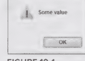

所有全局变量和函数都是 window 对象的成员；因此，您可以通过显式使用 window 对象来访问它们。然而，除非有理由使用，否则惯例是省略显式使用 `window`。例如，当函数内的局部变量与全局变量同名时，您需要使用它来处理作用域。考虑以下代码：

```
var someVariable = "Global value";

function showSomeVariable() {
    var someVariable = "Local value";

    alert(someVariable); // Local value
    alert(window.someVariable); // Global value
}
```

在此代码中，一个名为 `someVariable` 的全局变量被初始化为一个字符串值。接下来声明了 `showSomeVariable()` 函数，其第一条语句是初始化一个名为 `someVariable` 的变量——与全局变量同名。在函数内部，标识符 `someVariable` 指的是局部变量。为了访问同名的全局变量，必须在其前面加上 `window`；否则，JavaScript 将检索局部变量。

一般的经验法则是，除非绝对需要显式指定全局对象，否则省略 `window`。

### this 变量

在第 8 课中，您学习了如何通过编写构造函数并在其中使用 `this` 变量来创建属性，从而创建自定义数据类型。第 8 课结束时指示您在调用构造函数时始终使用 `new` 关键字。现在您知道全局函数实际上是 `window` 对象的方法，您可以开始了解在不使用 `new` 关键字调用构造函数时会发生什么。首先，这里有一些正确调用自定义数据类型构造函数的代码：

```
function Person(firstName, lastName) {
    this.firstName = firstName;
    this.lastName = lastName;
}

var person = new Person("Jeremy", "McPeak");
```

此代码创建了一个 `Person` 数据类型并正确调用了该数据类型的构造函数。一个新的 `Person` 对象被创建并分配给 `person` 变量。此代码没有任何问题。将其与以下省略了 `new` 关键字的代码进行比较：

```
var person2 = Person("Jeremy", "McPeak");
```


这里一条语句调用了`Person()`函数，但没有在前面加上`new`。JavaScript将此调用视为任何其他函数调用并执行它。因为`Person("Jeremy", "McPeak")`等同于`window.Person("Jeremy", "McPeak")`，所以`this`变量绑定到`window`对象；因此，函数内的代码创建了两个全局变量`firstName`和`lastName`，并将它们赋值为传递给函数的任何值。此外，由于`Person()`不返回值，`person2`变量包含的值为`undefined`。因此，此代码不仅向全局作用域添加了不必要的变量，而且依赖于`person2`的代码也会中断，因为`person2`是`undefined`而不是`Person`对象。

再次强调，在调用构造函数时始终使用`new`关键字非常重要。

## 显示和使用对话框

对话框在几乎所有应用程序中都扮演着至关重要的角色。它们向用户提供各种信息，例如一般信息和错误消息，并且可以允许用户输入数据或做出决定。Web浏览器也不例外，`window`对象使开发者可以访问三种对话框：警告对话框、提示对话框和确认对话框。当浏览器显示其中一个时，JavaScript执行会暂停，直到对话框关闭。您在之前的课程中已经看到过其中两个对话框的使用，但为了彻底起见，让我们回顾一下所有对话框。

### 警告对话框

警告对话框用于向用户显示消息。窗口包含一个“确定”按钮，用于关闭对话框。关闭警告框不会导致任何特殊的JavaScript运行；它只是一个显示信息的框。图10-2显示了Chrome浏览器中的警告框。

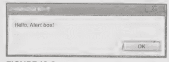

生成此图中警告框的代码如下：

```javascript
alert("Hello, Alert box!");
```

使用`alert()`方法来显示此类对话框。它的唯一参数是要显示给用户的数据。如果你想通过对话框获取用户输入，请使用`prompt()`方法。

## 提示对话框

提示对话框的用途是提示用户输入数据。图10-3展示了Chrome浏览器中提示对话框的样子。

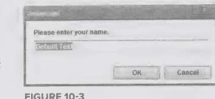

提示框在其他浏览器中可能看起来有所不同，但它们都具有相同的基本组件：一条给用户的消息、一个文本框、一个“确定”按钮和一个“取消”按钮。以下代码生成了图10-3中看到的提示框：

```javascript
var name = prompt("Please enter your name.", "Default Text");
```

`prompt()`方法接受两个参数。第一个是要显示给用户的消息。第二个是可选的，用于确定文本框中输入的默认文本。

点击“确定”会导致`prompt`方法将文本框中输入的文本返回给调用者。对于这段代码，`name`变量的值取决于用户点击“确定”时文本框中的文本。如果用户点击“取消”，`prompt()`方法返回`null`。因此，当依赖`prompt()`方法从用户获取数据时，请确保返回的数据不是`null`，如下所示：

```javascript
if (name != null) {
    // do something with data
}
```

`prompt()`方法是一种侵入式的数据获取方式。从用户界面的角度来看，网页中的表单元素是获取基于文本的用户输入的更好方式。表单元素不仅可以呈现你的Web应用程序的外观和感觉，而且你可以在不显示丑陋的弹出窗口进行用户输入的情况下获取多条数据。

然而，有一种对话框在某些情况下非常适合从用户那里获取输入。

## 确认对话框

有时你希望用户决定你的程序应该如何运行。你经常在某些操作系统中看到这种类型的对话框。例如，当你选中一个文件并按下删除键时，对话框可能会询问你是否确实要删除该文件。它等待你的输入，如果你选择“是”，则删除文件。这就是确认对话框背后的理念。它的目的是为用户提供一个“是”或“否”的选项，你的应用程序可以根据用户的输入来处理数据。

你可以通过调用`confirm()`方法来显示确认对话框。它接受一个包含要显示给用户的消息的参数，并根据用户按下的按钮返回一个布尔值。以下代码在`if`语句中使用了`confirm()`方法：

```javascript
if (confirm("Is it sunny today?")) {
    alert("Let's go outside");
} else {
    alert("Let's stay inside");
}
```

这里向用户显示了一个确认对话框（如图10-4所示），询问外面是否阳光明媚。如果用户点击“确定”，`confirm()`方法返回`true`，一个警告框会显示文本“Let's go outside”。如果用户点击“取消”，他或她会看到一条消息说“Let's stay inside”。

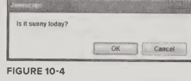

确认对话框允许你的应用程序通过询问用户是否允许执行具有侵入性操作的代码（例如使用`location`对象意外导航到另一个网页）来体现对用户的体贴。

## Location对象

`window`对象有一个名为`location`的属性；它是一个包含有关浏览器中加载的当前URL信息的对象。`location`对象的两个主要用途是重新加载当前页面和导航到新页面。

### 重新加载页面

在浏览器中重新加载网页的方法有很多。常见的是使用`<meta/>`元素在设定的时间后重新加载页面，但JavaScript通常是更好的解决方案，因为你可以控制页面如何刷新自身以适应应用程序的需求。

要重新加载页面，你可以使用`reload()`方法。它接受一个可选的布尔参数，该参数决定在Web服务器表示文档未被修改的情况下，浏览器是否执行完全刷新。如果Web服务器响应说自浏览器上次请求以来网页未被修改，浏览器通常会从其缓存中加载页面。通过向`reload()`方法传递`true`值，你可以确保始终从Web服务器检索文档；省略该参数则让浏览器从缓存加载页面。以下代码演示了`reload()`方法的使用：

```javascript
location.reload(true);
```

这里在`location`对象上调用了`reload()`方法。请记住，`window`是隐含的，所以这段代码实际上等同于`window.location.reload(true)`。向此方法传递了`true`值，因此它将始终从Web服务器检索页面。

### 导航到另一个页面

离开当前页面导航到另一个页面可能是`location`对象最常用于的操作。有两种方法可以做到这一点：第一种是使用`location`对象的`href`属性，如下所示：

```javascript
location.href = "http://www.google.com";
```

此代码将一个新的URL赋值给`href`属性，浏览器会自动导航到该页面（在这种情况下是Google的搜索页面）。然而，你可以通过省略`href`属性来简化此代码：

```javascript
location = "http://www.google.com";
```

此代码执行与前一个示例相同的功能，它实际上是导航到不同页面的首选方法。

## 动手试试

在本课中，你学习了`window`对象及其全局特性。你还了解了它提供的对话框，以及重新加载页面和导航到另一个页面的能力。

## 课程要求

对于本课，你需要一个文本编辑器；任何纯文本编辑器都可以。对于Microsoft Windows用户，你的系统默认提供了记事本，或者你可以下载Microsoft免费的Visual Web Developer Express (www.microsoft.com/express/web/)或Web Matrix (www.asp.net/webmatrix/)。Mac OS X用户可以使用TextMate（它是OS X的一部分），或者他们可以下载Coda的试用版 (www.panic.com/coda/)。Linux用户可以使用内置的VIM。

你还需要一个现代的Web浏览器。选择以下任意一种：

- Internet Explorer 8+
- Google Chrome
- Firefox 3.5+
- Apple Safari 4+
- Opera 10+

在你在第1课中创建的`JS24Hour`文件夹中创建一个名为`Lesson10`的子文件夹。将你在本课中创建的文件存储在`Lesson10`文件夹中。

## 分步操作

编写一个简单的应用程序，根据用户的输入导航到不同的页面或重新加载当前页面。

1. 打开你的文本编辑器并输入以下代码：

```javascript
if (confirm("Do you want to go to Google?")) {
    location = "http://www.google.com";
}
```

此代码显示一个确认对话框，询问用户是否要转到另一个网页。如果用户点击“确定”，浏览器将转到Google的网站。

2. 现在添加一个else块来重新加载页面。它在以下代码中以粗体显示：

```javascript
if (confirm("Do you want to go to Google?")) {
    location = "http://www.google.com";
} else {
    location.reload(true);
}
```

3. 将文件保存为`lesson10_sample01.js`。

4. 打开另一个文本编辑器实例，输入以下HTML，并将其保存为`lesson10_sample01.htm`：

```html
<html>
<head>
    <title>Lesson 9: The window Object</title>
</head>
<body>
    <script type="text/javascript" src="lesson10_sample01.js"></script>
</body>
</html>
```

5. 在浏览器中打开HTML文件。一个对话框会询问你是否要去Google。点击“确定”前往那里，或点击“取消”重新加载当前页面。

要获取示例代码文件，你可以从本书网站 www.wrox.com 下载第10课。

> 请在DVD上选择第10课以查看随附本课的视频。

# 11 脚本化窗口

对话框和`location`对象远非`window`对象能提供给开发者的全部。事实上，这个对象常被用来打开和操作新窗口。

## 打开新窗口

尽管弹出窗口拦截器的出现极大地（且理所当然地）减少了通过脚本打开新窗口的做法，但你仍然可以在许多基于网络的应用程序中看到其合法使用。此功能的关键是`open()`方法。它接受四个可选参数，并返回新创建窗口的`window`对象（在本文中称为*子窗口*）。

该方法的第一个参数是你想在子窗口中打开的网页的URL；传递一个空字符串会导致子窗口打开一个空白页。第二个参数（如果指定）是你想给新窗口起的名字。这个名字对应于超链接中`target`属性的值。以下HTML是一个示例：

```html
<a href="http://www.microsoft.com" target="childWindow">Microsoft.com</a>
```

如果你用JavaScript打开一个新窗口并给它命名为`childWindow`，点击此链接将在新打开的窗口中加载`www.microsoft.com`。当然，如果你不希望该窗口成为链接的目标，请省略第二个参数。

第三个参数是一个选项和属性列表，用于确定子窗口的外观。这些选项和属性包括但不限于宽度、高度以及用户界面元素是否对用户可见。可供选择的选项列表很长，你稍后会看到一个简短的列表。现在，让我们先通过这个简单的例子只关注高度和宽度：

```javascript
var childWindow = open("http://www.google.com", "googleWindow",
    "height=400, width=400");
```

这里调用了`open()`方法（`window`对象在`open()`之前是隐含的），子窗口的`window`对象存储在`childWindow`变量中。传递给方法的第一个参数是Google主页的URL。它的名字是`googleWindow`，因此主文档中任何具有相同`target`值的超链接都会在此新窗口中打开其URL。注意第三个参数：它看起来与你目前见过的其他参数有点不同。第三个参数是一个字符串，包含一个或多个用逗号分隔的选项。在此示例中，`height`和`width`选项被赋值为400，两个选项之间用逗号分隔。图11-1显示了此代码在Chrome中打开的窗口。

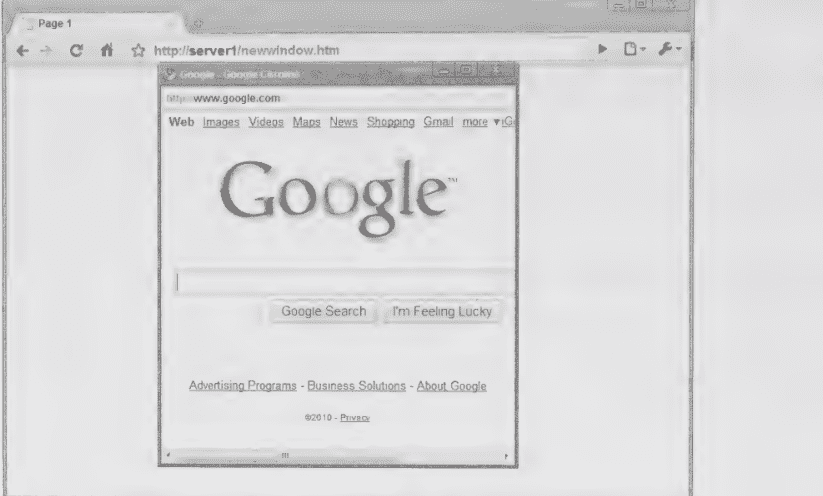

**图11-1**

第三个参数是完全可选的；你不必为新窗口指定任何选项或设置。但是，如果你指定了，你可以添加以下任何选项来控制窗口的外观或行为。

## 新窗口选项

| 选项 | 可能的值 | 描述 |
| :--- | :--- | :--- |
| height | 整数 | 新窗口的高度（以像素为单位） |
| left | 整数 | 新窗口的水平位置 |
| location | yes, no | 显示地址栏（在Opera中无效） |
| menubar | yes, no | 显示菜单栏（在Opera或Safari中无效） |
| resizable | yes, no | 确定用户是否可以调整窗口大小 |
| scrollbars | yes, no | 如果页面太大无法在窗口中显示，则显示水平和/或垂直滚动条 |
| status | yes, no | 显示状态栏（在Opera中无效） |
| toolbar | yes, no | 显示工具栏（在Opera中无效） |
| top | 整数 | 新窗口的垂直位置 |
| width | 整数 | 新窗口的宽度（以像素为单位） |

请记住，此列表并非详尽无遗，但这些是新窗口最常用的选项。考虑以下代码以了解如何应用其中一些选项：

```javascript
var childWindow = open("http://www.google.com", "googleWindow",
    "height=400, width=400, resizable=no, menubar=no");
```

这里在`open()`方法的第三个参数中添加了两个选项。新窗口不再允许用户调整大小，并且不显示菜单栏。图11-2显示了此代码在Internet Explorer 8中生成的窗口。

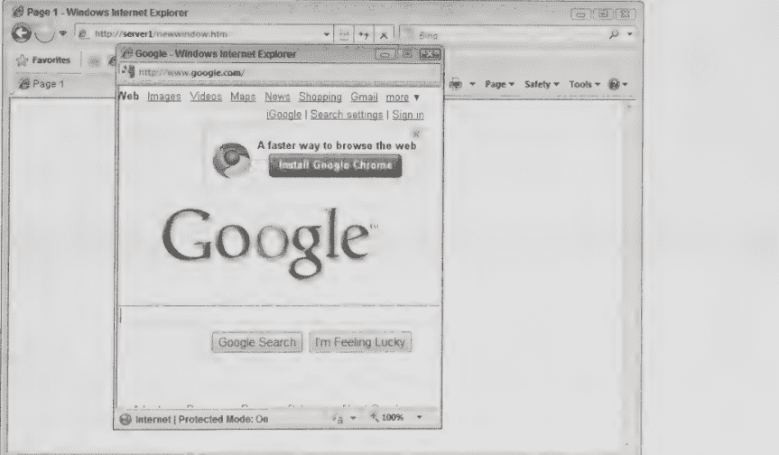

**图11-2**

第四个参数是一个布尔值，用于确定当页面加载到已存在的窗口中时，第一个参数中指定的URL是创建一个新条目还是替换浏览器历史记录列表中的当前条目。如果为`true`，则URL替换历史记录列表中的当前文档。如果为`false`，则在历史记录中创建一个新条目。

## 操作窗口

不幸的是，一旦窗口打开，你就无法更改上表中列出的属性。但是，你可以更改窗口的尺寸和位置。你必须使用四个特殊的方法来执行这些操作，而不是使用上表中的`height`、`width`、`top`和`left`属性。

在查看这些方法，特别是位置方法之前，你需要了解屏幕上的坐标是如何转换的。计算机屏幕是一个像素坐标系。屏幕左上角的像素是原点，或0, 0 (x, y)。当你沿着屏幕的y轴向下移动时，每个像素都是连续的正数。因此，原点正下方的像素垂直位置为1，再下方的像素垂直位置为2，依此类推。当你沿着x轴向右移动时，每个像素都是连续的正数。这意味着原点正右方的像素水平位置为1，旁边的像素水平位置为2，依此类推。图11-3说明了这个坐标平面。


你使用此坐标系通过指定其水平和垂直位置来定位窗口，使用`moveTo()`方法。以下代码打开一个窗口并将其定位在屏幕上的(100, 100)处。图11-4显示了以下代码的结果：

```javascript
var childWindow = open("http://www.google.com", "", "height=300, width=300");
childWindow.moveTo(100, 100);
```


这里，`moveTo()`方法将窗口从原点向右移动100像素，向下移动100像素。传递给`moveTo()`的第一个参数是新的水平(x)位置，第二个是新的垂直(y)位置。此方法相对于整个屏幕移动窗口。因此，此代码将窗口从屏幕的左边缘和上边缘移动100像素。如果你想将窗口从其当前位置(100, 100)向左移动四个像素，向下移动两个像素，你可以使用这行代码：

```javascript
childWindow.moveTo(100 - 4, 100 + 2);
```

但是，你可以使用另一个名为`moveBy()`的方法来执行相同的操作。此方法相对于窗口的当前位置，按指定的值移动窗口。因此，无需像前面的示例那样进行算术运算，只需使用`moveBy()`方法并提供要移动窗口的像素数，如下所示：

```javascript
childWindow.moveBy(-4, 2);
```

这行代码提供的结果与前面的示例相同。它不是将窗口移动到坐标(-4, 2)，而是将其从当前位置(100, 100)向左移动四个像素，向下移动两个像素。给定屏幕上的一个特定点，正数将窗口向右和向下移动；负数将窗口向左和向上移动。

重新定位窗口并不是创建窗口后操作它们的唯一方式；你还可以使用与`moveTo()`和`moveBy()`方法概念相似的方法来更改它们的高度和宽度。第一个方法是`resizeTo()`，它允许你指定窗口的新宽度和高度，如下所示：

```javascript
childWindow.resizeTo(100, 200);
```

这里`resizeTo()`方法调整窗口大小，使其宽度为100，高度为200。图11-5显示了此代码对本节前面创建的窗口所做的更改。


如果你想根据窗口当前尺寸来调整其大小，只需使用`resizeBy()`方法。以下代码将窗口宽度缩小50像素，高度增加100像素：

```javascript
childWindow.resizeBy(-50, 100);
```

浏览器允许你使用这些方法来操作父窗口。**强烈建议你不要这样做**。作为网络开发者，我们的首要目标是为用户提供可用且友好的网络应用程序。调整和移动主窗口会破坏我们应用程序的友好性。一般经验法则是：只移动和调整你打开的窗口，不要动用户打开的窗口。

改变窗口的大小或位置并不是与通过`open()`方法创建的窗口交互的唯一方式。父窗口和子窗口可以使用JavaScript相互通信。

## 窗口间的编码通信

请记住，`open()`方法返回新窗口的`window`对象，因此你可以通过子窗口的`window`对象访问该窗口内的几乎所有内容。例如，看看这段代码：

```javascript
var childWindow = open("http://www.google.com");
childWindow.alert("Hello there!");
```

这里打开了一个指向 www.google.com 的新窗口，其`window`对象被赋值给`childWindow`变量。下一行使用该对象并调用其`alert()`方法，在子窗口中显示一个警告框。因此，通过执行这段代码，主窗口中的JavaScript代码就与子窗口的`window`对象进行了通信。使用这种方法，你可以通过`location`对象告诉子窗口导航到不同的页面，如下所示：

```javascript
childWindow.location = "http://www.microsoft.com";
```

这里，子窗口通过为`location`对象赋新值，导航到了微软的网站。

跨窗口通信不是单向的——子窗口也可以使用`opener`关键字与父窗口的`window`对象通信。此关键字在子窗口内部用于引用父窗口。以下代码演示了`opener`属性的用法：

```javascript
opener.alert("Hello from the child!");
```

在这段代码中，尽管是从子窗口执行的，但一个警告框在父窗口中显示了一条消息。你也可以访问父窗口的`location`对象——只需在其前面加上`opener`，如下所示：

```javascript
opener.location = "http://www.google.com";
```

在这行代码中，子窗口告诉父窗口导航到谷歌的主页。然而，乐趣不止于此。你不仅可以访问父窗口和子窗口的`window`对象，还可以访问每个窗口的JavaScript代码。以下代码是一个HTML页面。我们称它为页面1：

```html
<html>
<head>
    <title>Page 1</title>
    <script type="text/javascript">
        function showMessage(message) {
            alert(message);
        }
        var childWindow = open("page2.htm");
    </script>
</head>
<body>
</body>
</html>
```

关注`<script/>`元素。它创建了一个名为`showMessage()`的函数，该函数接受一个名为`message`的参数。传递给此函数的值随后被传递给`alert()`方法。`<script/>`元素的最后一行打开了一个新窗口，我们称之为页面2。其HTML如下：

```html
<html>
<head>
    <title>Page 2</title>
    <script type="text/javascript">
        opener.showMessage("Hello from Page 2!");
    </script>
</head>
<body>
</body>
</html>
```

此页面中的脚本只有一行；它使用`opener`对象调用`showMessage()`方法（请记住，全局变量和函数实际上是`window`对象的属性和方法）。因此，当你在浏览器中加载页面1时，会发生以下情况：

1. 页面1创建`showMessage()`函数并打开一个新窗口。
2. 页面2加载到新窗口中，并调用父窗口中的`showMessage()`函数，传递一个字符串值。
3. `showMessage()`函数执行，在页面1的一个警告框中显示"Hello from Page 2!"。

JavaScript代码在窗口间通信的能力非常酷，当你编写需要多窗口的应用程序时，它会非常有用。然而，跨窗口JavaScript通信存在一个问题：安全性。

## 安全性

JavaScript的成功部分归功于其安全策略，其中与此讨论相关的一个策略是同源策略。该策略规定，一个窗口中的JavaScript脚本可以访问和交互另一个窗口中的网页（及其JavaScript），**当且仅当**两个窗口中的网页来自同一源。换句话说，如果两个窗口中的页面不来自同一域名（以及其他更精细的细节），一个窗口中的JavaScript就无法与另一个窗口中的网页及其JavaScript通信。

两个网页或JavaScript脚本被视为同源，必须满足以下标准：

- 协议必须匹配。HTTP是互联网上使用的主要协议，两个页面或脚本必须使用相同的协议才能被视为来自同一源。这意味着`http://www.wrox.com`与`https://www.wrox.com`不是同源的。一个URL使用HTTP协议，另一个使用HTTPS。
- 主机名或域名必须匹配。网页的域名是唯一的。为了被视为来自同一源，两个页面或脚本必须来自同一域名。这包括子域名。例如，`http://p2p.wrox.com`与`http://www.wrox.com`不是同一域名。尽管主域名`wrox.com`相同，但子域名不同。因此，这两个URL不被视为来自同一源。
- 端口必须匹配。默认情况下，HTTP流量使用端口80。当你请求一个网站时，你的浏览器使用端口80向服务器发送HTTP请求。因此，`http://www.wrox.com`的URL与`http://www.wrox.com:80`相同。然而，有些Web服务器被配置为使用不同的端口（常见的是8080）来提供其他基于Web的服务。为了被视为同源，两个脚本或页面的端口必须匹配。这意味着`http://www.wrox.com`与`http://www.wrox.com:8080`不是同源的。

只有当这三个标准都满足时，两个网页或JavaScript脚本才被视为同源。这意味着你不能打开一个指向`http://www.google.com`的窗口并与其网页和JavaScript交互。你可以更改窗口的大小和位置，也可以访问`location`对象，但你不能与任何JavaScript交互。JavaScript的安全性不允许这样做。

## 动手试试

在本课中，你学习了如何创建新窗口以及如何通过更改其位置和大小与之交互，还学习了如何与对象和JavaScript代码（如果安全允许）进行交互。

## 课程要求

对于本课，你需要一个文本编辑器；任何纯文本编辑器都可以。对于Microsoft Windows用户，系统默认提供记事本，或者你可以下载Microsoft免费的Visual Web Developer Express (www.microsoft.com/express/web/)或Web Matrix (www.asp.net/webmatrix/)。Mac OS X用户可以使用TextMate（它是OS X的一部分），或者下载Coda的试用版 (www.panic.com/coda/)。Linux用户可以使用内置的VIM。

你还需要一个现代的Web浏览器。选择以下任一浏览器：

- Internet Explorer 8+
- Google Chrome
- Firefox 3.5+
- Apple Safari 4+
- Opera 10+

在你在第1课创建的`JS24Hour`文件夹中创建一个名为`Lesson11`的子文件夹。将你在本课中创建的文件存储在`Lesson11`文件夹中。

## 分步操作

编写一个简单的网页，该网页打开一个带有空白页的新窗口，并向其中写入文本。

1. 打开你的文本编辑器，输入以下代码：

```html
<html>
<head>
    <title>Page 1</title>
    <script type="text/javascript">
        var childWindow = open("");
    </script>
</head>
<body>
</body>
</html>
```

此页面中的JavaScript通过不指定要打开的URL，在新窗口中打开一个空白页。

2. 现在添加此处所示的粗体代码：

```html
<html>
<head>
    <title>Page 1</title>
    <script type="text/javascript">
        var childWindow = open("");
        childWindow.document.write("Hello, new Window!<br/>");
        childWindow.document.write("How are you today?");
    </script>
</head>
<body>
</body>
</html>
```

# 12 脚本框架

前两课主要讲解了`window`对象——它是浏览器窗口的程序化表示。浏览器窗口通常包含一个网页，因此只有一个`window`对象。然而，`<frameset/>`元素允许网页开发者将浏览器窗口划分为两个或更多较小的窗格。

每个窗格本身就是一个浏览器窗口，因此拥有一个完整的`window`对象。事实上，某些浏览器允许你使用第11课中学到的移动和调整大小的方法来移动和调整单个框架的大小（强烈建议不要在框架上使用这些方法）。

作为JavaScript开发者，处理框架时最重要的方面无疑是跨框架访问代码和对象。在本课中，你将看到跨框架脚本与跨窗口脚本之间有许多相似之处。

## 框架与窗口对象

深入研究框架脚本最简单的方法是通过一个演示。你将首先查看框架集页面。其HTML如下所示：

```html
<html>
<head>
    <title>Frameset Page</title>
</head>
<frameset rows="50%,*">
    <frame name="frmTop" src="frame_top.htm" />
    <frame name="frmBottom" src="frame_bottom.htm" />
</frameset>
</html>
```

这是一个简单的框架集页面：它将页面分为上下两个区域。顶部的框架名为`frmTop`，它将`frame_top.htm`页面加载到其中；底部的框架名为`frmBottom`，它加载`frame_bottom.htm`。请记下每个框架的名称，因为当你通过脚本访问它们时，这些名称是关键。

当浏览器加载此框架集页面时，会创建一个包含三个窗口对象的层次结构。第一个窗口对象属于主窗口——即加载框架集页面的那个窗口。这被称为父窗口。

第二个和第三个窗口对象是父窗口的子对象。第一个子对象是为框架集中的第一个框架（`frmTop`）创建的，下一个子对象是为`frmBottom`框架创建的。图12-1直观地展示了这三个窗口对象之间的关系和层次结构——可以将其视为一棵家谱树。

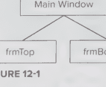

此图也可作为框架间通信的指南。你可以看到父窗口与其子窗口之间存在直接关系。因此，可以安全地假设在JavaScript中从父窗口访问子窗口是直接进行的。你访问子框架的窗口对象的方式与访问已打开窗口的窗口对象非常相似。在第11课中，你了解到`open()`方法返回新创建窗口的窗口对象，并且可以将该对象赋值给一个变量，如下所示：

```javascript
var newWindow = open("");
```

获取框架的窗口对象甚至更简单，因为浏览器会自动使用框架的名称作为变量标识符来创建一个变量。因此，要从框架集页面调用顶部框架的`alert()`方法，你可以编写如下代码：

```javascript
frmTop.alert("Hello, Top!");
```

访问底部框架也使用相同的原理。以下加粗的代码向框架集页面添加了一个`<script/>`元素：

```html
<html>
<head>
    <title>Frameset Page</title>
    <script type="text/javascript">
        function sayHello(message) {
            alert(message);
        }
    </script>
</head>
<frameset rows="50%,*">
    <frame name="frmTop" src="frame_top.htm" />
    <frame name="frmBottom" src="frame_bottom.htm" />
</frameset>
</html>
```

在`<script/>`元素内部是一个名为`sayHello()`的简单函数。它接受一个参数，然后在警告框中显示该参数。此主页面中没有任何代码调用此函数；相反，它是由加载到每个框架中的HTML页面内部调用的。

回想一下第11课，记住子窗口如何使用`opener`关键字访问其父窗口。从加载到框架中的页面访问主框架集的`window`对象同样简单；区别在于你使用的是`parent`关键字而不是`opener`。

以下是`frame_top.htm`的源代码。请注意加粗的行：

```html
<html>
<head>
    <title>Top Frame</title>
    <script type="text/javascript">
        parent.sayHello("Hello from Top!");
    </script>
</head>
<body>
</body>
</html>
```

这条语句使用`parent`关键字访问父窗口的`window`对象并调用`sayHello()`。当浏览器将此页面加载到顶部框架时，它会执行这行代码，导致一个警告框显示文本“Hello from Top!”。

`frame_bottom.htm`的源代码类似：

```html
<html>
<head>
    <title>Bottom Frame</title>
    <script type="text/javascript">
        parent.sayHello("Hello from Bottom!");
    </script>
</head>
<body>
</body>
</html>
```

此页面中的代码经历相同的过程。唯一的区别是当浏览器加载此页面并执行JavaScript代码时，警告框显示的消息。

从这些示例可以看出，在父窗口和子框架之间进行脚本编写与在父窗口和子窗口之间进行脚本编写非常相似。唯一的区别在于你如何引用子窗口和父窗口的`window`对象。但是，如果你想在两个独立的框架之间进行脚本编写呢？

使用JavaScript在框架之间进行脚本编写与在父窗口和子窗口之间进行脚本编写略有不同，但几乎同样直接。回顾图12-1，并注意图中每个`window`对象是如何连接的。注意两个子框架之间没有直接链接；相反，连接它们的唯一东西是父窗口。这表明了你如何从一个子框架访问其兄弟框架的代码和对象。

假设你想从底部框架访问顶部框架并调用其`alert()`方法。为此，你必须首先使用`parent`关键字引用父窗口，然后使用顶部框架的名称`frmTop`。以下代码展示了这可能是什么样子：

```javascript
parent.frmTop.alert("Called from frame_bottom.htm");
```

这里，`parent`关键字用于引用主页面的`window`对象。然后通过框架名称`frmTop`访问顶部框架的`window`对象，并调用`alert()`方法。这会导致显示一个警告框，但无法明显看出该警告框属于`frmTop`框架。修改`frame_bottom.htm`中的JavaScript，在顶部框架中写入一些文本。以下是`frame_bottom.htm`的新版本：

```html
<html>
<head>
    <title>Bottom Frame</title>
    <script type="text/javascript">
        parent.frmTop.document.write("Hello from frame_bottom.htm");
    </script>
</head>
<body>
</body>
</html>
```

这里，加粗的代码行是与前一行代码相比唯一改变的地方。它使用`parent`对象访问`frmTop`对象。然后，此代码使用`frmTop`的`document`对象向页面写入一些文本。此代码的结果如图12-2所示。

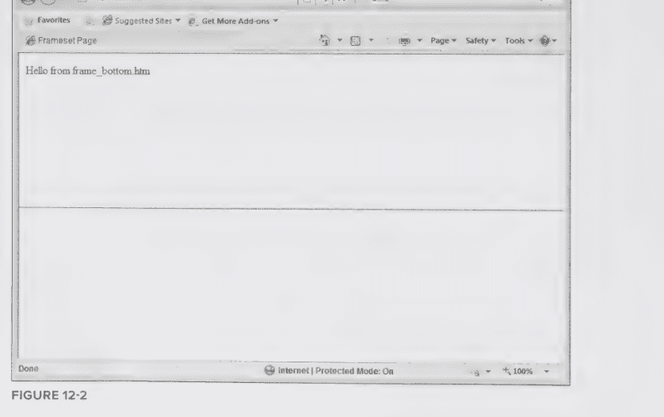

尽管需要额外使用`parent`对象，但在两个框架之间进行脚本编写仍然是一个直接的过程。你只需遍历树结构即可到达你想要的对象。

还有一个名为`top`的对象，它让你可以直接访问最顶层页面的`window`对象——即主框架集页面。当页面包含嵌套的框架集时，这非常有用，如图12-3所示。

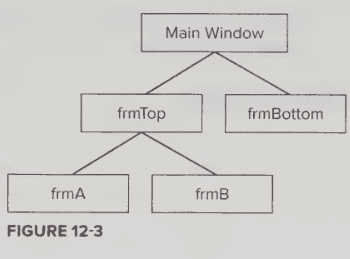

在此图中，`frmTop`本身就是一个框架集，它将框架划分为两个框架：`frmA`和`frmB`；`frmTop`现在是`frmA`和`frmB`的父级。如果`frmA`中的代码要访问`frmBottom`中的对象，从`frmA`到`frmBottom`的代码路径如下所示：

```javascript
parent.parent.frmBottom
```

这里的第一个`parent`指的是`frmA`的父级，即`frmTop`。下一个`parent`引用的是`frmTop`的父级，即主框架集页面。通过这个对象，你可以直接访问`frmBottom`。嵌套的框架集越多，在框架间编写脚本就越繁琐。`top`对象可以帮助你避免必须逐级向上爬到最顶层页面。你无需输入`parent.parent.frmBottom`，只需输入：

```javascript
top.frmBottom
```

这是一个快捷方式，可以在需要时直接到达`window`对象树的顶层。你将在下一节中看到这个对象的使用。

## 动手试试

在本课中，你将学习如何编写框架脚本。你将了解浏览器如何自动创建变量以允许访问框架。你还将了解`parent`和`top`对象，它们允许你导航由框架集创建的`window`对象层次结构。

## 课程要求

对于本课，你需要一个文本编辑器；任何纯文本编辑器都可以。对于Microsoft Windows用户，系统默认提供记事本，或者你可以下载Microsoft免费的Visual Web Developer Express (www.microsoft.com/express/web/)或Web Matrix (www.asp.net/webmatrix/)。Mac OS X用户可以使用TextMate（作为OS X的一部分提供），或者下载Coda的试用版 (www.panic.com/coda/)。Linux用户可以使用内置的VIM。

你还需要一个现代的Web浏览器。选择以下任意一种：

- Internet Explorer 8+
- Google Chrome
- Firefox 3.5+
- Apple Safari 4+
- Opera 10+

在你在第1课中创建的`JS24Hour`文件夹中创建一个名为`Lesson12`的子文件夹。将你在本课中创建的文件存储在`Lesson12`文件夹中。

## 分步指南

再看一下图12-3。将其作为蓝图，创建五个用于框架集的网页。`frmA`中的JavaScript将向`frmBottom`写入文本，而`frmB`中的JavaScript将调用`frmTop`中的一个函数，该函数将调用主窗口中的一个函数，以在`frmB`中写入文本。

1. 打开你的文本编辑器，输入以下HTML：

```html
<html>
<head>
<title>Frameset Page</title>
<script type="text/javascript">
function writeInB(message) {
    frmTop.frmB.document.write(message);
}
</script>
</head>
<frameset rows="50%,*">
    <frame name="frmTop" src="frame_top.htm" />
    <frame name="frmBottom" src="frame_bottom.htm" />
</frameset>
</html>
```

将其保存为`frameset_main.htm`。这是加载到浏览器中的主框架集页面，它将屏幕划分为上下两个框架。此页面中的JavaScript定义了一个名为`writeInB()`的函数。它将访问`frmB`框架（`frmTop`的子框架），并使用`document.write()`方法在其中写入消息。

2. 打开另一个文本编辑器实例，输入以下HTML：

```html
<html>
<head>
<title>Top Frame</title>
<script type="text/javascript">
function callParentFunction() {
    parent.writeInB("Calling from frmTop");
}
</script>
</head>
<frameset cols="50%,*">
    <frame name="frmA" src="frame_a.htm" />
    <frame name="frmB" src="frame_b.htm" />
</frameset>
</html>
```

将其保存为`frame_top.htm`。这是另一个框架集页面，它加载在`frameset_main.htm`的顶部框架中。它将可用屏幕划分为两列。此页面中的JavaScript定义了一个名为`callParentFunction()`的函数。它调用在`frameset_main.htm`中定义的`writeInB()`函数。

3. 打开另一个文本编辑器实例，输入以下HTML：

```html
<html>
<head>
    <title>Bottom Frame</title>
</head>
<body>
    <h1>Bottom Frame</h1>
</body>
</html>
```

将此文件保存为`frame_bottom.htm`。此页面加载在`frameset_main.htm`的底部框架中。此页面不包含任何JavaScript。

4. 现在你需要为加载到`frame_top.htm`框架集中的页面编写HTML。因此，再次打开另一个文本编辑器实例，输入以下HTML：

```html
<html>
<head>
    <title>Frame A</title>
    <script type="text/javascript">
        top.frmBottom.document.write("Hello from frmA!");
    </script>
</head>
<body>
    <h1>Frame A</h1>
</body>
</html>
```

将其保存为`frame_a.htm`。此页面中的JavaScript没有定义函数，但它使用了`top`对象来引用`frameset_main.htm`的`window`对象。然后它访问`frmBottom`对象，并向该框架写入一条消息。

5. 你需要编写的最后一个HTML文件是`frame_b.htm`。再次打开一个新的文本编辑器实例，输入以下HTML：

```html
<html>
<head>
    <title>Frame B</title>
    <script type="text/javascript">
        parent.callParentFunction();
    </script>
</head>
<body>
    <h1>Frame B</h1>
</body>
</html>
```

将其保存为`frame_b.htm`。此文件中的JavaScript代码使用`parent`对象访问`frame_top.htm`的`window`对象，并调用在该页面中定义的`callParentFunction()`函数。

6. 在浏览器中打开`frameset_main.htm`文件。你应该会看到类似图12-4的内容。

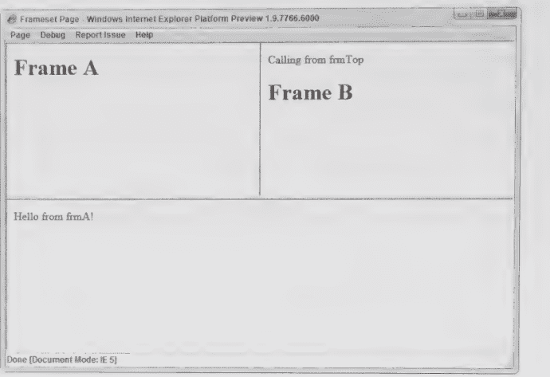

图12-4

要获取示例代码文件，你可以从本书网站 www.wrox.com 下载第12课。

> 请在DVD上选择第12课，以查看随附本课的视频。

# 13 文档对象模型

在传统应用程序中，操作系统提供用户界面元素和行为，使开发者能够为用户提供丰富的体验。开发此类应用程序很方便，因为整个应用程序通常用一种语言编写。开发者只需要知道一种语言，就可以编写与数据存储（如数据库）交互的代码、处理该数据的代码、向用户显示该数据的代码以及与用户交互的代码。

Web开发者没有这么轻松。数据存储交互和处理是用一种语言编写的（如PHP、Python或C#），而用户界面通常是HTML、CSS和JavaScript的组合。HTML用于用户的基本输出/输入，这是一种相当静态且乏味的体验。CSS可以让应用程序稍微生动一些，但它的设计目的远不止于此，它主要决定浏览器如何渲染元素。因此，要创建丰富的交互体验，开发者必须转向JavaScript。

但JavaScript只是等式的一部分。必须有一个接口，使JavaScript开发者能够在网页加载到浏览器中时与之交互；这样的接口确实存在，它被称为文档对象模型（DOM）。

### 什么是DOM？

DOM是一个与浏览器无关的应用程序编程接口（API）——一组对象、属性和方法，定义了如何使用JavaScript结构化、访问和操作HTML文档。它是由W3C（一个标准制定机构）提出的一个标准，当在浏览器中实现时，它提供了一种在HTML页面加载到浏览器中时，可以实际更改页面中所有内容的方法。DOM有多个级别或版本，每个新版本都建立在上一个版本的基础上。最新版本是DOM Level 3。

为了实现这种可编程性，文档中的每个HTML元素都由一个对象表示，这些对象被组织成一个树状的层次结构。这种结构在概念上与计算机上的文件系统非常相似。图13-1显示了Windows 7中Windows资源管理器的屏幕截图。

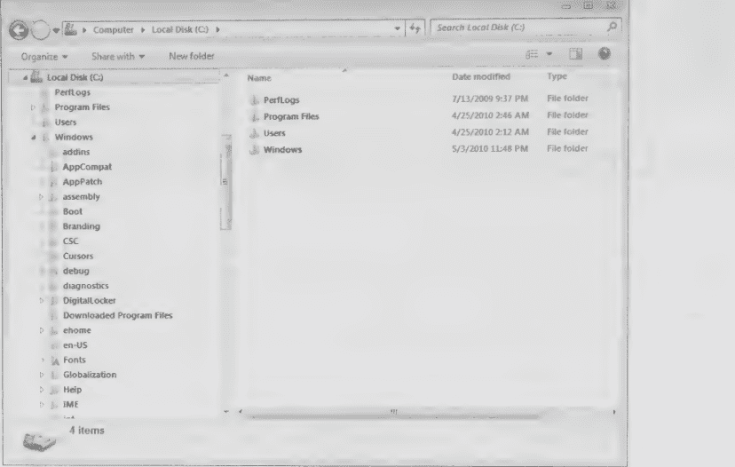

树的最顶层是C:\，或根目录。根目录内是一系列子目录；这些是分支，可以包含更多分支（目录）或叶子（文件）。要找到特定的文件，你需要从根目录开始，通过适当的目录导航，直到找到它。DOM非常相似，因为HTML文档的结构非常像一棵树。看看下面的HTML：

```html
<html>
<head>
    <title>Sample Page</title>
</head>
<body>
    <p>This is some text.</p>
    <p>This is more text.</p>
    <p>Here is text with a <span>span element</span>.</p>
</body>
</html>
```

如果你将这个HTML文档绘制成一棵树，它看起来会像图13-2。

## 导航DOM

你从树的顶部开始，即所谓的根元素——文档。在DOM中，树中的每个点都称为*节点*。节点有多种类型，其中比较重要的有：

- 文档节点类型代表整个文档。
- 元素节点类型代表一个元素。
- 属性节点类型代表一个属性。
- 文本节点类型代表元素内的文本。

文档节点有时被称为*根节点*。根节点包含其他节点，例如doctype声明（如果指定）和*文档元素*，即`<html/>`元素，它有时也被称为*根元素*。

文档元素包含表示为*子节点*的HTML元素。在本例中，文档元素节点有两个子节点：`<head/>`和`<body/>`，对于这些节点，`<html/>`元素节点是一个*父节点*。这两个子节点彼此之间也是*兄弟节点*；所有共享同一父节点的子节点都是兄弟节点。

`<head/>`和`<body/>`节点也包含它们自己的子节点。`<head/>`元素节点包含一个`<title/>`节点；该节点包含一个文本节点，其中包含文本Sample Page。这个文本节点是该特定分支的末端。

`<body/>`节点包含三个子节点——三个`<p/>`元素。前两个`<p/>`节点只包含文本，但第三个有三个子节点：

- 文本节点Here is text with a
- `<span/>`元素节点
- 文本节点。

当你向网页添加元素和文本时，DOM中会添加一个相应的节点来表示该页面。

> HTML属性也是节点，但它们在树中的表示方式不同。为了简单起见，在本特定讨论中省略了属性。

要从DOM中获得任何用处，了解如何在DOM树中导航非常重要。

使用父、子和兄弟关系，你可以使用`Node`数据类型的属性和方法遍历整个DOM树。`Node`数据类型不是JavaScript语言的一部分。相反，它由浏览器提供，用于表示DOM中的节点。它是DOM类型中最基本的（大多数其他DOM数据类型都继承自`Node`），但它提供了从一个节点到另一个节点的必要工具。下表列出了一些更有用的成员：

### 有用的`Node`成员

| 成员 | 描述 |
| :--- | :--- |
| `childNodes` | 一个`NodeList`（特殊数组），包含指定节点的所有子节点。如果节点没有子节点，则列表为空。 |
| `firstChild` | 指定节点的第一个子节点。如果不存在这样的节点，则返回`null`。 |
| `lastChild` | 指定节点的最后一个子节点。如果不存在这样的节点，则返回`null`。 |
| `nextSibling` | 紧随指定节点之后的节点。如果不存在这样的节点，则返回`null`。 |
| `previousSibling` | 紧接在此节点之前的节点。如果不存在这样的节点，则返回`null`。 |
| `ownerDocument` | 指定节点所属的文档。 |
| `parentNode` | 指定节点的父节点。如果不存在这样的节点，则返回`null`。 |
| `nodeName` | 节点的名称。如果节点是元素，则返回标签名。如果节点是文本，则返回`"#text"`。 |
| `nodeValue` | 节点的值。如果是文本节点，则返回实际文本；如果是元素，则返回`null`。 |
| `hasChildNodes()` | 返回一个布尔值，指定节点是否有任何子节点。 |

使用其中一些成员，你可以从树的顶部（文档）到达上一节示例HTML中的`<span/>`元素，如下所示：

```javascript
document.firstChild.firstChild.nextSibling.lastChild.childNodes[1];
```

让我们逐个对象分解一下。这行代码从树的顶部`document`开始，它的第一个子节点是`<html/>`元素。所以`document.firstChild`返回`<html/>`。`firstChild`属性用于`<html/>`节点，获取`<head/>`元素，因为它是`<html/>`的第一个子节点。然后使用`nextSibling`，返回`<body/>`元素节点。`<body/>`节点的`lastChild`属性返回第三个`<p/>`元素，由于这个`<p/>`元素有三个子节点，你通过指定`childNodes`集合中的第二个子节点来获取`<span/>`元素。

这看起来确实很费劲，不是吗？维护将是一场噩梦，因为即使对HTML标记的微小更改也需要你重写这段代码。值得庆幸的是，`document`对象为你提供了一些方法，使选择特定元素节点变得容易得多。

## 选择元素节点

第一个方法是`getElementsByTagName()`。它接受一个字符串参数，包含你要检索的元素的名称，并返回页面中所有具有指定标签名的元素的`NodeList`。使用本课前面提供的示例HTML，以下示例选择所有`<p/>`元素：

```javascript
var paragraphs = document.getElementsByTagName("p");
```

这里`getElementsByTagName()`方法返回一个包含三个元素的`NodeList`。`NodeList`是一个特殊数组。它有一个`length`属性，你可以通过数字索引访问列表中的每个元素。然而，主要区别在于`NodeList`是*实时的*：对文档中元素的任何更改都会反映出来。通过修改示例HTML可以很容易地演示这一点。以下代码向页面添加了一些元素：

```html
<html>
<head>
    <title>Sample Page</title>
</head>
<body>
    <p>This is some text.</p>
    <p>This is more text.</p>
    <p>Here is text with a <span>span element</span>.</p>
    <script type="text/javascript">
        var paragraphs = document.getElementsByTagName("p");
        alert(paragraphs.length); // 3
    </script>
    <p>Another paragraph.</p>
    <script type="text/javascript">
        alert(paragraphs.length); // 4
    </script>
</body>
</html>
```

这段代码的粗体部分添加了一个脚本元素来调用`getElementsByTagName()`，选择文档中当前所有的`<p/>`元素，并将生成的`NodeList`分配给`paragraphs`变量。请记住，在文档的这一点上，文档中只找到三个`<p/>`元素，因此第一个`<script/>`元素中的`alert()`调用会提示值为3。

在第一个`<script/>`元素之后是另一个`<p/>`元素，使总数达到四个。然后另一个`<script/>`元素添加了另一行JavaScript，再次提示`paragraphs`的长度；它提示4。

因此，通过使用`getElementsByTagName()`方法，你可以通过选择所有`<span/>`元素并获取`NodeList`中的第一个元素来更容易地到达`<span/>`元素，如以下代码所示：

```javascript
var theSpan = document.getElementsByTagName("span")[0];
```

这容易多了，不是吗？但你可以通过稍微修改HTML标记并使用`getElementById()`方法使其更容易。此方法的目的很简单：仅选择具有特定值的`id`属性的一个元素。此功能和简单性使`getElementById()`方法成为JavaScript开发中最常用的方法。

以下代码通过向`<span/>`元素添加`id`属性来修改本课开头的原始HTML。

```html
<html>
<head>
    <title>Sample Page</title>
</head>
<body>
    <p>This is some text.</p>
    <p>This is more text.</p>
    <p>Here is text with a <span id="foo">span element</span>.</p>
</body>
</html>
```

经过这个简单的更改，可以使用以下代码在文档中立即找到`<span/>`元素：

```javascript
var theSpan = document.getElementById("foo");
```

`getElementById()`方法是迄今为止在文档中选择单个元素的最简单方法。只要`id`属性不变，它也比其他方法更容易维护。

如果在文档中找不到具有指定`id`值的元素，`getElementById()`返回`null`。因此，使用`getElementById()`方法的位置至关重要：只有在浏览器将所需的HTML元素加载到DOM中后，才能可靠地使用它。还记得第1课中我建议你将`<script/>`元素放在body底部吗？这是另一个原因——这样所有元素都可以在任何脚本尝试访问它们之前加载到DOM中。

## 动手试试

在本课中，你学习了DOM以及如何在树结构中导航和查找节点。

## 课程要求

学习本课，你需要一个文本编辑器；任何纯文本编辑器都可以。对于Microsoft Windows用户，系统默认提供了记事本，或者你可以下载Microsoft免费的Visual Web Developer Express (www.microsoft.com/express/web/)或Web Matrix (www.asp.net/webmatrix/)。Mac OS X用户可以使用TextMate，它是OS X的一部分，或者可以下载Coda的试用版 (www.panic.com/coda/)。Linux用户可以使用内置的VIM。

你还需要一个现代的Web浏览器。选择以下任意一种：

- Internet Explorer 8+
- Google Chrome
- Firefox 3.5+
- Apple Safari 4+
- Opera 10+

在你在第1课创建的`JS24Hour`文件夹中，创建一个名为`Lesson13`的子文件夹。将你在本课中创建的文件保存在`Lesson13`文件夹中。

## 分步操作

你将使用本课提供的HTML编写一个网页，该网页选择一个特定元素并使用`nodeValue`属性更改其包含的文本。

1. 打开你的文本编辑器，输入以下代码：

```html
<html>
<head>
    <title>Sample Page</title>
</head>
<body>
    <p>This is some text.</p>
    <p>This is more text.</p>
    <p>Here is text with a <span id="foo">span element</span>.</p>
</body>
</html>
```

这是本课前面提供的相同HTML。将此文件保存为`lesson13_example01.htm`。

2. 现在添加以下粗体代码：

```html
<html>
<head>
    <title>Sample Page</title>
</head>
<body>
    <p>This is some text.</p>
    <p>This is more text.</p>
    <p>Here is text with a <span id="foo">span element</span>.</p>
    <script type="text/javascript">
        var theSpan = document.getElementById("foo");
        theSpan.childNodes[0].nodeValue = "span element containing new text";
    </script>
</body>
</html>
```

这段新代码检索`id`为`foo`的`<span/>`元素。然后它使用`childNodes` `NodeList`来选择元素内包含的文本节点（`firstChild`可以用来代替`childNodes[0]`），并为该文本节点分配一个新值。

3. 重新保存文档并将其加载到浏览器中。

要获取示例代码文件，你可以从本书网站 www.wrox.com 下载第13课。

> 请在DVD上选择第13课，以查看伴随本课的视频。

# 14 使用JavaScript添加HTML

文档对象模型（DOM）远不止是在页面中查找特定元素。请记住，JavaScript在Web开发中的目的是为用户提供更高层次的交互性，有时你会希望根据用户的输入动态地向网页添加元素。

DOM允许你创建新的HTML元素并动态地将它们添加到页面中。你可以通过两种方式之一来实现：使用DOM标准提供的创建方法，或者使用`innerHTML`属性。这两种方法的结果在表面上看起来是一样的，但你应该选择哪一种取决于你想要达到的最终效果。

## DOM创建方法

`document`对象是一种名为`Document`的DOM数据类型的实例。它的成员提供了许多有用的方法，允许你创建其他DOM对象，如元素和文本节点。在这里，你将了解如何创建这些类型的对象，从HTML元素开始。

然而，在开始之前，以下代码展示了本课所使用的HTML文档：

```html
<html>
<head>
    <title>Sample Page</title>
</head>
<body>
    <script type="text/javascript">
    </script>
</body>
</html>
```

这是一个简单的网页，主体中只有一个`<script/>`元素。本课介绍的脚本将放在`<script/>`元素内。

## 创建元素

`Document`数据类型指定了一个名为`createElement()`的方法。它接受一个参数，一个包含你要创建的元素标签名的字符串。它在当前加载的文档之外创建一个元素，并返回一个元素对象。你可以这样使用它：

```javascript
var el = document.createElement("div");
```

这里你通过调用`createElement()`方法并传递`div`标签名来创建一个`<div/>`元素。你不需要包含任何尖括号——只需元素的标签名。生成的元素对象保存在`el`变量中。

这个新对象是`HTMLElement`数据类型（DOM包含的另一种数据类型）的实例，更具体地说，是`HTMLDivElement`的实例。你可以在除Internet Explorer 8及更早版本之外的任何浏览器中通过调用`alert(el)`来查看这一点。图14-1显示了在Internet Explorer 9中`alert(el)`的结果。

这个元素是`HTMLDivElement`的事实对于本讨论来说不一定重要。但重要的是要理解，HTML规范中的每个HTML元素在DOM规范中都有一个相应的数据类型。这意味着DOM包含了许多新的数据类型。然而，为了简单起见，只有在它们相关时才会介绍它们。

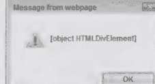

在DOM中，所有HTML元素对象都是`HTMLElement`和`Element`数据类型的实例，因此所有元素对象都有一组特定的属性和方法，你可以用来向元素添加属性。下表列出了一些这样的成员：

## 有用的HTMLElement和Element成员

| 成员名称 | 描述 |
| :--- | :--- |
| `id` | 获取或设置元素的`id`属性值 |
| `className` | 获取或设置`class`属性的值 |
| `setAttribute(name, value)` | 使用指定值设置元素上的属性 |
| `getAttribute(name)` | 获取指定属性的值；如果属性不存在则返回`null` |
| `removeAttribute(name)` | 从元素中移除指定的属性 |

因此，通过使用其中一些成员，你可以向元素添加更多内容。以下代码中的粗体行正是这样做的：

```javascript
var el = document.createElement("div");
el.id = "myDiv";
el.setAttribute("align", "center");
```

在这段代码中，新的`<div/>`元素被赋予一个`id`为`myDiv`，并且使用`setAttribute()`方法向元素添加了一个`align`属性。如果你要编写这段代码生成的HTML，它看起来会像这样：

```html
<div id="myDiv" align="center"></div>
```

然而，请记住，这个元素尚未加载到文档中。你已经使用文档的`createElement()`方法创建了该元素，但它目前存在于文档之外。要将其加载到文档中，你需要使用`appendChild()`方法或其他插入方法。

## 将元素添加到文档

`appendChild()`方法是`Node`数据类型的成员，与你在上一课中学习的数据类型相同。你看，每个HTML元素对象都是多种数据类型的实例。元素不仅是`HTMLElement`和`Element`的实例，它也是`Node`数据类型的实例。因此，如果你想将这个`<div/>`元素添加到网页的`<body/>`元素中，你可以通过找到`<body/>`元素的对象并使用其`appendChild()`方法来实现。在DOM中找到`<body/>`非常容易：它是`document`对象的一个属性。以下代码中的粗体行将之前创建的`<div/>`元素添加到页面：

```javascript
var el = document.createElement("div");
el.id = "myDiv";
el.setAttribute("align", "center");
document.body.appendChild(el);
```

执行此代码后，页面的结构如图14-2所示。

`appendChild()`方法将提供的子节点*追加*到调用节点。因此，此代码将新元素作为页面主体中的最后一个子节点放置。

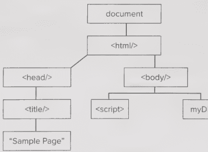

有时你会想要追加一个新节点，但并非在所有情况下都是如此。`insertBefore()`方法就是为此而存在的。它也将一个新节点作为现有节点的子节点添加，但它允许你决定在子节点列表中的哪个位置放置它。

`insertBefore()`方法接受两个参数。第一个是要插入的新节点，第二个是参考节点，新节点将放置在该节点之前。以下代码中的粗体行创建一个新的`<div/>`元素，并将其插入到上一个示例中的`el`之前：

```javascript
var el = document.createElement("div");
el.id = "myDiv";
```

## 创建和添加文本节点

在DOM中，文本片段被组织成独立的节点。因此，用于创建文本的DOM方法实际上创建的是一个文本节点，这并不奇怪。创建文本节点的方法被恰当地命名为`createTextNode()`。它只接受一个参数：节点中包含的文本。其用法如下所示：

```javascript
var text = document.createTextNode("Hello, DOM methods!");
```

这里创建了一个包含文本`Hello, DOM methods!`的文本节点，并将其赋值给`text`变量。文本节点也继承自`Node`数据类型，因此可以像这样传递给`appendChild()`方法：

```javascript
var el = document.createElement("div");
var text = document.createTextNode("Hello, DOM methods!");
el.id = "myDiv";
el.setAttribute("align", "center");
el.appendChild(text);
document.body.appendChild(el);
```

在这段代码中，加粗的行创建了一个文本节点并将其附加到前面示例中的`el`元素。

你可能会注意到，在这段代码中，文本节点是在元素被添加到body之前附加到`<div/>`元素上的。从技术上讲，将节点附加到元素和文档的顺序并不重要。但请记住这一点：就性能而言，DOM是一个负担。每次你对文档进行更改时，浏览器都必须重绘页面。因此，目标是限制你更改文档的次数。

在此处提供的示例中，文本节点是在两个节点都位于文档本身之外时添加到`<div/>`元素中的。这是理想的情况，因为将`<div/>`元素（包含子文本节点）添加到文档只需要一次文档写入操作。

此外，正如方法名称所暗示的，`createTextNode()`创建的是文本，而不是HTML。`createTextNode()`方法会将小于号和大于号（<和>）转换为它们的HTML实体等效形式（`&lt;`和`&gt;`）。为了演示这一点，让我们回到我们正在进行的示例，并使用以下代码添加一个包含<和>符号的文本节点：

```javascript
var el = document.createElement("div");
var text = document.createTextNode("Hello, DOM methods!");
el.id = "myDiv";
el.setAttribute("align", "center");
el.appendChild(text);
document.body.appendChild(el);
var el2 = document.createElement("div");
var text2 = document.createTextNode("<b>Will this be bold?</b>");
el2.id = "myDiv2";
el2.setAttribute("align", "center");
el2.appendChild(text2);
document.body.insertBefore(el2, el);
```

新的代码行以粗体显示。第一行新代码创建了一个包含HTML标记的文本节点，这些标记将被转换为HTML实体。第二行新代码将该节点添加到`el2`中的`<div/>`元素。你可以在图14-4中看到此代码的结果。

使用DOM方法创建元素是冗长且耗时的。然而，回报在于你拥有对所创建对象的引用——你不必在DOM中搜索它们。修改`el`变量中包含的`<div/>`元素就像使用该变量一样简单。因此，如果你计划稍后修改这些相同的对象，DOM创建方法是理想的选择，但如果你只想显示HTML然后不再管它，有一种更快、更简单的方法将HTML添加到页面。

## 使用innerHTML属性

`innerHTML`属性是所有HTML元素都具有的属性，它提供了一种简单有效的方法将HTML添加到页面。它是微软的一项发明，于1997年在Internet Explorer 4中首次亮相。它变得如此受欢迎，以至于开发者们强烈要求其他浏览器制造商也包含此属性。如今，所有主流浏览器都支持`innerHTML`。

`innerHTML`属性获取或设置给定元素中包含的HTML。你可以为其分配一个包含HTML的字符串，该HTML将在浏览器中显示。以下代码显示了一个示例：

```javascript
var el = document.getElementById("someElement");
el.innerHTML = "<b>This is my new HTML!</b>";
```

这里，`el`元素中包含的HTML被更改为一些粗体文本。在此代码的情况下，`el`中任何预先存在的HTML都会被移除，并替换为分配给`innerHTML`属性的HTML。可以通过执行类似以下代码的操作来保留任何预先存在的HTML：

```javascript
el.innerHTML = el.innerHTML + "<b>This is my new HTML!</b>";
```

这里，现有的HTML被保留，并附加了一些新的HTML。

`innerHTML`属性确实如此简单，但它也备受争议。在Google中输入"innerHTML"，你会发现许多支持和反对使用它的文章。尽管存在持续的争论，但它是一个极其有用的工具。当它仅用于更新元素的内容时，其速度和简洁性无与伦比。

## 试一试

在本课中，你将学习如何使用JavaScript、DOM创建方法和`innerHTML`属性向页面添加内容。

## 课程要求

对于本课，你需要一个文本编辑器；任何纯文本编辑器都可以。对于Microsoft Windows用户，记事本默认在你的系统上可用，或者你可以下载Microsoft免费的Visual Web Developer Express (www.microsoft.com/express/web/)或Web Matrix (www.asp.net/webmatrix/)。Mac OS X用户可以使用TextMate，它是OS X的一部分，或者他们可以下载Coda的试用版 (www.panic.com/coda/)。Linux用户可以使用内置的VIM。

你还需要一个现代的Web浏览器。选择以下任一：

- Internet Explorer 8+
- Google Chrome
- Firefox 3.5+
- Apple Safari 4+
- Opera 10+

在你在第1课中创建的`JS24Hour`文件夹中创建一个名为`Lesson14`的子文件夹。将你在本课中创建的文件存储在`Lesson14`文件夹中。

## 分步操作

你将使用DOM创建方法和`innerHTML`编写一个网页及其内容，一个购物清单。

1. 打开你的文本编辑器并输入以下代码：

```html
<html>
<head>
    <title>Lesson 14 Example 1</title>
</head>
<body>
    <script type="text/javascript">
    </script>
</body>
</html>
```

将此文件保存为`lesson14_example01.htm`。

2. 现在添加以下加粗的代码：

```html
<html>
<head>
    <title>Lesson 14 Example 1</title>
</head>
<body>
    <script type="text/javascript">
        var shoppingList = [
            "Eggs",
            "Milk",
            "Juice",
            "Diapers",
            "Bread"
        ];
        for (var i = 0; i < shoppingList.length; i++) {
        }
    </script>
</body>
</html>
```

这添加了一个名为`shoppingList`的数组。每个元素包含一个在商店购买的物品。数组定义之后是一个`for`循环，用于遍历购物清单中的每个项目。

3. 添加以下加粗的代码：

```html
<html>
<head>
    <title>Lesson 14 Example 1</title>
</head>
<body>
    <script type="text/javascript">
        var shoppingList = [
            "Eggs",
            "Milk",
            "Juice",
            "Diapers",
            "Bread"
        ];
        var ul = document.createElement("ul");
        for (var i = 0; i < shoppingList.length; i++) {
            ul.innerHTML = ul.innerHTML + "<li>" + shoppingList[i] + "</li>";
        }
        document.body.appendChild(ul);
    </script>
</body>
</html>
```

这段新代码在`for`循环外部创建了一个无序列表元素（`<ul/>`）。其列表项元素（`<li/>`）在循环内部使用`innerHTML`生成，这样在循环的每次迭代中都会保留现有的HTML。当循环退出时，`<ul/>`元素被附加到`<body/>`元素。浏览器渲染的HTML如图14-5所示。

要获取示例代码文件，您可以从本书网站 www.wrox.com 下载第14课。

> 请在DVD上选择第14课，以查看与本课配套的视频。

# 15 修改元素样式

人类是视觉动物。我们能够识别视觉线索，无论它们多么细微，并解读其含义。例如，Windows操作系统通过视觉线索来区分活动窗口和非活动窗口——改变窗口的颜色、不透明度和其他视觉元素。在Windows 7中，非活动窗口的显示效果比色彩丰富、带有阴影的活动窗口更显淡化和透明。这是一种微妙但有效的手段，用于告知用户当前哪个窗口是活动的。

改变特定用户界面元素外观的能力是应用程序编程接口（API）的一个极其重要的特性，而DOM结合CSS的样式化能力，赋予了你这种能力。

在本课中，你将学习如何利用DOM和CSS的强大功能来改变网页中元素的外观。你可以通过两种方式修改元素的样式：

- 使用`style`属性更改单个CSS属性。
- 更改元素的`class`属性的值。

### 使用style属性

`style`属性是一个对象，它映射到元素的`style`属性。它提供了对单个CSS属性的访问，允许你更改浏览器支持的所有CSS属性。你可以这样访问`style`属性：

```javascript
document.getElementById("someElement").style.color = "red";
```

这里，获取了一个`id`为`someElement`的元素，并将其`color`属性设置为红色。假设这个元素是一个`<div/>`元素，这段代码本质上等同于以下HTML：

```html
<div id="someElement" style="color: red"></div>
```

HTML `style`属性和JavaScript `style`属性之间的关系常常被JavaScript和DOM的新手所忽视。`style`属性通常被（错误地）认为是访问影响元素的所有样式信息的入口——人们相信，无论元素的样式是在外部样式表中定义的，还是通过内联`style`属性定义的，都可以通过`style`对象来检索。例如，假设以下样式表：

```html
<style type="text/css">
#someElement { color: red; }
</style>
```

看到使用`style`对象尝试检索此信息的代码并不少见，如下所示：

```javascript
var someEl = document.getElementById("someElement");
alert(someEl.style.color); // 空字符串
```

当此代码在浏览器中执行时，警报框会显示一个空字符串（即，什么也没有）——如图15-1所示。

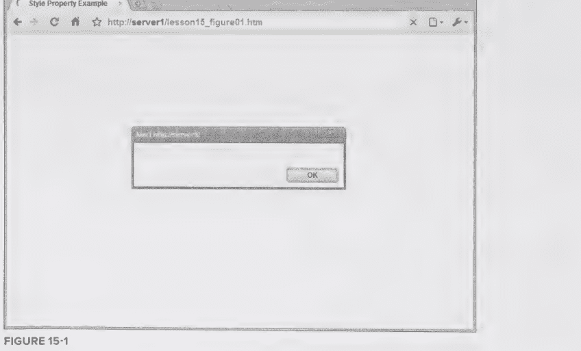

这种情况发生是因为`style`对象与影响HTML元素的任何样式规则都没有链接——它只链接到`style`属性中定义的CSS属性。前面的代码查看`style`属性，搜索`color`属性，但找不到，因此返回一个空字符串。但是，一旦通过`style`属性或`style`属性设置了该信息，你就可以获取它，如下所示：

```html
<div id="someElement" style="color: red;">Hello</div>
```

```javascript
var someEl = document.getElementById("someElement");
alert(someEl.style.color); // red
someEl.style.color = "blue";
alert(someEl.style.color); // blue
```

请始终记住，`style`对象只链接到HTML元素的`style`属性。请记住，虽然HTML属性包含一串CSS，但DOM的`style`属性是一个对象。

通过比较实际的CSS属性（本例中为`color`）与其JavaScript等效项，你可以看到它们是相同的。许多通过`style`属性在JavaScript中访问的CSS属性名与样式表中使用的CSS属性完全相同。然而，也有一些是不同的，必须进行更改才能在JavaScript中工作。

例如，用于更改元素背景颜色的CSS属性是`background-color`。这个特定的CSS属性不能直接在JavaScript中使用，因为连字符（-）不能用在标识符中。因此，为了能够使用JavaScript和`style`对象更改元素的背景颜色，`background-color`中的连字符被去掉，并且`color`的首字母大写，如下所示：

```javascript
document.getElementById("someElement").style.backgroundColor = "blue";
```

许多CSS属性使用连字符，将它们转换为JavaScript等效项遵循相同的模式：去掉连字符，并将连字符后的字母改为驼峰式大小写。例如，`border-left-color`的JavaScript等效项是`borderLeftColor`。

驼峰式大小写规则有一些例外。以CSS的`float`属性为例。"float"是JavaScript中的保留字，因此代码`element.style.float`不会更改指定元素的浮动属性。相反，你必须使用`cssFloat`和`styleFloat`（适用于IE8及以下版本）属性。

通过使用`style`对象及其允许你修改的属性，你本质上可以为单个HTML元素复制一个样式规则，如下所示：

```javascript
var someEl = document.getElementById("someElement");
someEl.style.color = "red";
someEl.style.backgroundColor = "gray";
someEl.style.border = "1px solid black";
```

这里，从`document`中获取了一个`id`为`someElement`的元素，将其文本颜色更改为红色，为其设置灰色背景颜色，并在其周围添加一个一像素的黑色边框。然而，以这种方式对元素的样式进行多次更改会带来一些你应该注意的问题：

- 对元素样式的每次更改都是对DOM属性的单独调用——正如你在上一课中学到的，出于性能原因，你希望尽可能限制这种调用。
- CSS背后的理念是将样式与标记和行为分离。这种分离使得维护和修改变得容易得多，因为所有样式信息都集中在样式表中——消除了在HTML和JavaScript中搜索样式信息的需要。

出于这些原因，一次编辑元素的一个样式属性被认为是不正确的方法。在某些情况下你可能想要这样做，但在大多数情况下，更好的解决方案是使用`className`属性操作元素的CSS类。

### 使用className属性

HTML元素有一个class属性，允许你分配一个或多个CSS类。此属性通过DOM的`className`属性访问，你可以这样使用它：

```javascript
someEl.className = "a-CSS-class";
```

使用`className`属性很好地解决了前面提到的两个问题：

- 修改元素的CSS类（可以包含多个CSS属性）只需一次DOM调用即可更改元素的样式。
- CSS数据与JavaScript保持分离；CSS样式表和JavaScript代码之间的唯一链接是CSS类名。这使得维护变得容易得多。

使用`className`属性的另一个优点是它需要更少的JavaScript代码。上一节中的最后一个示例使用了三行代码来更改元素的颜色、背景颜色和边框。但是，将该样式信息放在一个CSS类中，如下所示：

```css
.a-CSS-class {
    color: red;
    background-color: gray;
    border: 1px solid black;
}
```

只需要一行JavaScript代码：

```javascript
someEl.className = "a-CSS-class";
```

你也可以将多个CSS类分配给`className`属性，就像使用`class`属性一样。以下代码演示了这一点：

```javascript
someEl.className = "a-CSS-class b-CSS-class";
```

只需确保类名之间用空格隔开。

## 动手试试

在本课中，你学习了如何使用`style`和`className`属性来操作元素的样式。

## 课程要求

对于本课，你需要一个文本编辑器；任何纯文本编辑器都可以。对于Microsoft Windows用户，记事本默认在你的系统上可用，或者你可以下载Microsoft的免费Visual WebDeveloper Express (www.microsoft.com/express/web/)或Web Matrix (www.asp.net/webmatrix/)。Mac OS X用户可以使用TextMate（它是OS X的一部分），或者下载Coda的试用版 (www.panic.com/coda/)。Linux用户可以使用内置的VIM。

你还需要一个现代的Web浏览器。选择以下任意一种：

- Internet Explorer 8+
- Google Chrome
- Firefox 3.5+
- Apple Safari 4+
- Opera 10+

在你在第1课创建的`JS24Hour`文件夹中，创建一个名为`Lesson15`的子文件夹。将你在本课中创建的文件存储在`Lesson15`文件夹中。

## 分步指南

你将编写一个网页，并动态更改元素的样式。

1. 打开你的文本编辑器，输入以下代码：

```html
<html>
<head>
    <title>Lesson 15: Example 1</title>
    <style type="text/css">
        .message-style1 {
            color: navy;
            font-weight: bold;
            background-color: gray;
        }
    </style>
</head>
<body>
    <div id="divMessage">
        Here is a message.
    </div>
    <input type="button" value="Toggle Style" />
    <script type="text/javascript">
    </script>
</body>
</html>
```

2. 现在添加以下粗体代码：

```html
<html>
<head>
    <title>Lesson 15: Example 1</title>
    <style type="text/css">
        .message-style1 {
            color: navy;
            font-weight: bold;
            background-color: gray;
        }
    </style>
</head>
<body>
    <div id="divMessage">
        Here is a message.
    </div>
    <input type="button" value="Toggle Style" />
    <script type="text/javascript">
    function toggleStyle() {
        var divMessage = document.getElementById("divMessage");
        if (divMessage.className === "message-style1") {
            divMessage.className = "";
        } else {
            divMessage.className = "message-style1";
        }
    }
    </script>
</body>
</html>
```

新代码添加了一个名为`toggleStyle()`的函数。它检索id为`divMessage`的`<div/>`元素，并根据其当前值设置元素的`className`属性。如果元素的`className`是`message-style1`，则将`className`设置为空字符串——这实际上会移除应用于元素的任何样式。如果元素的`className`不等于`message-style1`，则将`className`赋值为该值。

3. 现在修改以下粗体行：

```html
<html>
<head>
    <title>Lesson 15: Example 1</title>
    <style type="text/css">
        .message-style1 {
            color: navy;
            font-weight: bold;
            background-color: gray;
        }
    </style>
</head>
<body>
    <div id="divMessage">
        Here is a message.
    </div>
    <input type="button" value="Toggle Style" onclick="toggleStyle()" />
    <script type="text/javascript">
    function toggleStyle() {
        var divMessage = document.getElementById("divMessage");
        if (divMessage.className === "message-style1") {
            divMessage.className = "";
        } else {
            divMessage.className = "message-style1";
        }
    }
    </script>
</body>
</html>
```

一个事件处理程序被添加到`<input/>`元素上，以便在按钮被点击时执行`toggleStyle()`函数。现在不用担心事件；你将在下一课开始学习它们。目前，只需知道当你点击按钮时`toggleStyle()`会执行。

4. 将此HTML文件保存为`lesson15_example01.htm`。在浏览器中打开它，并多次点击按钮。你会看到每次点击时`<div/>`元素的样式都会发生变化。

要获取示例代码文件，你可以从本书网站 www.wrox.com 下载第15课。

> 请在DVD上选择第15课以查看随附本课的视频。

# 16 事件简介

Web应用程序通常分为两个不同的部分。第一部分通常称为*后端*或*服务器端*。它由PHP、ASP.NET、Ruby或任何其他服务器端技术驱动，用于验证、处理和格式化数据。虽然应用程序总是涉及一定程度的复杂性，但Web应用程序的服务器端部分通常比客户端部分——第二部分——更直接，因为它只在用户发送或请求数据时才需要执行某些操作。

客户端部分，或*前端*，是用户用来输入和查看信息，以及与整个应用程序交互的界面。客户端部分由HTML、CSS和JavaScript组成。HTML和CSS足以为Web应用程序提供用户界面，但JavaScript才能使界面变得动态和响应式。

Web应用程序的用户界面通常处于反应状态——它等待用户执行特定操作，然后才知道该做什么。以Google的搜索页面为例。当你第一次访问该页面时，你会看到类似图16-1的内容。

你看到的只是一个搜索表单，但当你移动鼠标指针或在搜索字段中输入内容时，页面会对你的操作做出反应。移动鼠标会导致顶部的工具栏淡入视图，在搜索字段中输入文本会激活Google的自动完成功能，如图16-2所示。

Google搜索页面上的这些微妙功能是JavaScript如何丰富用户体验的绝佳例子。但是JavaScript如何知道何时根据用户的操作执行某些代码呢？

答案是*事件*。事件是发生的事情，通常不受开发人员控制，并由代码处理。例如，在Google搜索页面的搜索字段中按下键盘上的一个键会导致一个名为`keypress`的事件*触发*或发生。Google搜索页面的开发人员无法控制你何时按键，但他们可以编写所谓的*事件处理程序*来处理`keypress`事件。每次你在搜索字段中输入时按键，此事件处理程序都会执行JavaScript代码。通过响应用户的操作，你可以在他们使用你的应用程序时丰富他们的体验——就像Google搜索页面的开发人员增强你的体验一样。


图16-1

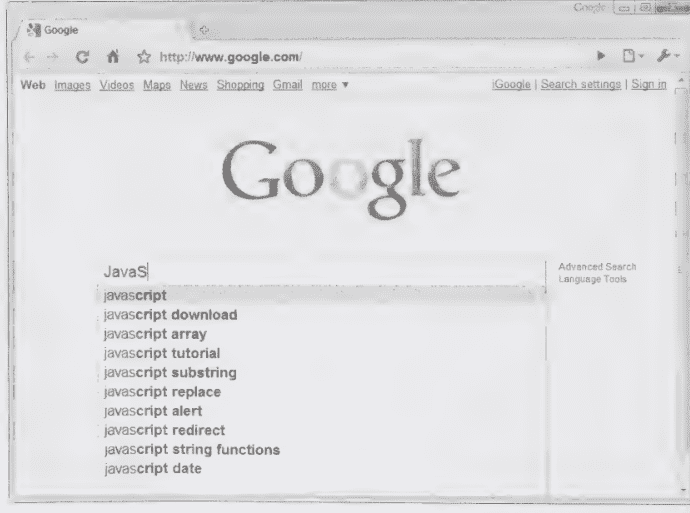

图16-2

不幸的是，事件是客户端开发中一个在不同浏览器之间存在非常显著差异的领域。一方面，有支持和实现标准DOM事件模型的浏览器；这些是Internet Explorer 9、Firefox、Chrome、Safari和Opera。另一方面是Internet Explorer 8及更低版本，它们使用自己的专有事件模型。值得庆幸的是，这两种事件模型之间存在相似之处；它们的差异以及如何应对将在后面的课程中讨论。

不过现在，你将被介绍许多不同类型的事件，你可以“监听”这些事件，以便在它们发生时执行代码。你将在未来的课程中应用这些信息。

> 本简介中涵盖的事件是W3C DOM事件标准的一部分，大多数与附加到HTML元素的事件有关。

## 鼠标事件

在Web方面，鼠标可以说是最重要的输入设备。除非在表单中输入信息，否则普通用户不会经常使用键盘，当然也不会用它来与网页交互。不，指向设备在Web上占主导地位，因此与鼠标相关的事件是最常被处理的。

鼠标可以生成多种事件，但它们都分为两类：基于移动的和基于按钮的。

### 基于移动的事件

在网页上，用户每次移动鼠标都会生成一个事件。在某些情况下，将鼠标指针向任一方向移动一个像素可以生成三个事件（或更多，取决于浏览器）。这些事件是：

- `mousemove`：当鼠标指针在元素上移动时发生此事件。
- `mouseover`：当鼠标指针移到元素上时发生此事件。
- `mouseout`：当鼠标指针移出元素时发生此事件。

### 基于按钮的事件

在鼠标事件方面，移动只是等式的一部分；知道用户何时点击鼠标按钮也非常有用。通常，点击鼠标上的一个按钮会生成三个事件，它们按以下顺序发生：

- `mousedown`：当鼠标按钮在元素上按下时发生此事件。
- `mouseup`：当鼠标按钮在元素上释放时发生此事件。
- `click`：当鼠标按钮在元素上点击时发生此事件。当`mousedown`和`mouseup`在同一位置发生时，就会发生`click`事件。

还有第四个按钮事件：

- `dblclick`：当鼠标按钮在相同位置快速连续点击两次时触发此事件。如果同一元素上处理了`click`事件，则`click`事件会在`dblclick`之前被处理。

## 键盘事件

对于Web应用而言，第二重要的输入设备是键盘。它是用户向Web应用提供数据的方式。有三种键盘事件，它们在概念上与鼠标按钮的三个主要事件类似。按下按键会按以下顺序生成三个事件：

- `keydown`：当按键被按下时触发此事件。
- `keyup`：当按键被释放时触发此事件。
- `keypress`：当按键被按下并释放时触发此事件。

关于键盘事件通常存在一些困惑，因为它们可能看起来是多余的。但它们的使用方式存在细微差别，了解字符与按键之间的区别非常重要。按键是键盘上的物理按钮，而字符是按键被按下后产生的值。

传统上，`keypress`事件用于检测输入的字符。实际上，`keypress`事件仅在按下并释放字母数字或符号（如句点或波浪号）键时才会触发。例如，你可以在文本框上处理`keypress`事件，并过滤掉字母字符，使文本框中只显示数字和符号。

`keypress`事件不会为退格键、Shift键或Enter键等触发，但`keyup`和`keydown`事件会。这两个事件在任何按键被按下和释放时都会触发。你实际上可以检测用户何时按下退格键并阻止字符删除——当然，你不应该这样做。

## 基础事件

并非所有事件都由用户操作触发。有些事件发生在HTML文档内部发生某些事情时。用户没有做任何事情，但窗口或文档内部发生了某些事情，你可能希望在这些事件发生时执行一些代码。

例如，有一些事件与窗口相关。它们是：

- `load`：当窗口完成加载文档和所有其他资源（如JavaScript、样式表和图像）时触发此事件。
- `unload`：当文档从窗口卸载时触发此事件。例如，当你导航到另一个页面时，它会在当前页面上触发。
- `abort`：当页面加载被中止时触发此事件，通常是因为用户按下了取消按钮。
- `resize`：当窗口大小被调整时触发此事件。
- `error`：当发生JavaScript错误时触发此事件。

事件的美妙之处在于，与事件相关的对象（如`window`对象）并不关心你或任何人是否编写了代码来处理该事件。对象只知道它需要在关联事件发生时执行事件处理程序，如果存在的话，它就会执行。

## 试一试

本课没有需要尝试的内容。事件是客户端开发的重要组成部分，理解相关概念非常重要。本课主要作为事件的入门。在下一课中，你将学习处理事件的多种方法之一——使用HTML属性。

> 本课没有配套视频。

# 17 使用HTML属性分配事件处理程序

上一课向你介绍了可以在JavaScript代码中处理的许多事件。这就引出了一个问题：“如何在JavaScript中处理事件？”

答案并不像大多数人希望的那样直接。有许多方法可以将JavaScript代码“连接”起来处理事件，在本课及后续课程中，你将学习设置函数来处理事件的多种方法。

你将从学习如何使用HTML属性处理事件开始这段旅程。诚然，HTML属性事件处理程序不像以前那样常用，但当你需要快速处理事件时，它们非常有用。

### 连接事件处理程序

让我们从一个示例元素开始。下面是一个普通的`<div/>`元素：

```html
<div id="myDiv">Hello, Events!</div>
```

这个元素有一个`id`为`myDiv`，包含一小段文本。它现在是一个普通元素，但你可以通过处理`click`事件为其添加一些特殊性。要处理此事件，请在开始标签中添加一个名为`onclick`的属性，如下所示：

```html
<div id="myDiv" onclick="">Hello, Events!</div>
```

用于处理事件的属性名称是单词`on`后跟事件名称。在此示例中，事件处理程序`onclick`处理`click`事件。如果你想处理`mouseover`事件，属性名称将是`onmouseover`。

还要记住，即使`<div/>`元素默认不与鼠标点击交互，你也可以通过处理`click`事件来添加该功能。实际上，你可以通过处理事件为几乎任何HTML元素添加自定义功能。

现在让我们添加一些代码，当此元素被点击时执行。HTML属性允许你将任何JavaScript代码分配为属性的值。因此，更改此元素的文本颜色就像使用`this`变量，后跟`style`对象，然后是`color` CSS属性一样简单，如下所示：

```html
<div id="myDiv" onclick="this.style.color = 'red'">Hello, Events!</div>
```

当你使用HTML属性处理事件时，`this`变量指的是触发事件的元素。这里`this`指的是`<div/>`元素；当`<div/>`元素被点击时，其文本颜色变为红色。

注意`red`周围使用了单引号。这里使用单引号是因为`onclick`属性使用双引号来包含其值。如果你在`red`周围使用双引号，它将如下所示：

```html
<div id="myDiv" onclick="this.style.color = "red"">Hello, Events!</div>
```

这将导致浏览器认为`onclick`属性的值是"this.style.color = "，这显然不会产生预期的结果。在处理HTML属性事件处理程序时，始终注意引号。

属性还有一个相当不寻常的特点，即允许在属性值中包含多个JavaScript语句。为了演示这一点，以下代码添加了另一个调用`alert()`方法的语句：

```html
<div id="myDiv" onclick="this.style.color = 'red'; alert('You clicked me!')">
    Hello, Events!
</div>
```

你可以使用任意多的语句；只需在每个语句末尾使用分号，以便JavaScript引擎知道一个语句何时结束，新语句何时开始。但如果你想在事件处理程序中执行多个语句，最好将这些语句分组到一个函数中。这样做有以下优势：

- 执行重复任务更容易，因为你只需调用一个函数，而不是一遍又一遍地重复相同的语句。换句话说，代码重用。
- 维护代码更容易。将代码组织成函数形式使错误更容易发现和修复。当你在多个元素的`onclick`事件处理程序中使用相同的代码时，维护要容易得多；对函数进行更改比对多个属性进行更改简单得多。

考虑到这一点，让我们使用函数重写前面的示例。我们再添加另一个处理`click`事件并调用相同函数的HTML元素，如下所示：

```html
<script type="text/javascript">
function changeToRed(that) {
    that.style.color = "red";
    alert("You clicked me!");
}
</script>
<div id="myDiv" onclick="changeToRed(this)">Hello, Events!</div>
<p id="myPara" onclick="changeToRed(this)">Hello, Events 2!</p>
```

首先看JavaScript函数。它名为`changeToRed()`，接受一个名为`that`的对象。这个参数名传统上用于包含`this`对象（this和that...明白了吗？），这里就是它的用途。第一行使用`that`变量将元素的文本颜色更改为红色，然后一个警告框向用户显示一条通用消息。

现在看HTML。`<div/>`元素被更改为调用`changeToRed()`函数，并将`this`作为参数传递。添加了另一个元素`<p/>`元素，其`onclick`事件处理程序也被设置为调用`changeToRed()`，通过使用`this`变量传递对该元素的引用。即使`<p/>`是与`<div/>`不同的元素，结果也将相同：`<p/>`元素的文本颜色将变为红色，并且一个警告框向用户显示消息。

因此，通过将原始语句放入函数中，你本质上使代码可供页面中几乎任何元素使用，并且也使其更易于维护。

### 取消默认行为

`<div/>`和`<p/>`元素在用户点击它们时没有任何默认行为。因此到目前为止的示例按预期工作。但如果你想为`<a/>`元素提供相同的功能——一个在被点击时确实会执行某些操作（如导航到不同页面）的元素呢？

当用户点击网页中的链接时，浏览器会查看`<a/>`元素并确定是否为该元素定义了`onclick`事件处理程序。如果找到，浏览器会先执行JavaScript代码，然后导航到`href`属性中定义的页面。让我们将此过程应用于一个通过调用`changeToRed()`处理`click`事件的链接，如以下代码所示：

```html
<a href="http://www.wrox.com" onclick="changeToRed(this)">Click me!</a>
```

对于此元素，浏览器会执行以下步骤：

1. 浏览器找到`onclick`属性并执行`changeToRed()`。
2. `<a/>`元素的文本颜色变为红色。
3. 一个警告框弹出，浏览器停留在页面上，直到用户点击确定按钮。
4. 一旦点击确定按钮，浏览器导航到另一个页面。

如果你想禁用链接导航到不同页面的默认行为呢？这样做有一些充分的理由；当你进入后续课程（如Ajax）时，你会明白为什么你可能想要禁用链接的默认行为以增强用户在网页上的体验。

但现在，只需想象你希望用户看到你将链接文本颜色更改为红色的超凡能力。毕竟，如果没有警告框，任何点击前面链接的人都会用户完全不知道文本颜色已经变成了红色，因为浏览器在用户有机会看到变化之前就导航到了另一个页面。要禁用`<a/>`元素（或任何元素）的默认行为，只需确保事件处理程序返回`false`即可。这可以通过两种方式实现。

第一种方法，只需在调用`changeToRed()`之后加上`return false`语句，如下所示：

```html
<a href="http://www.wrox.com"
    onclick="changeToRed(this); return false">Click me!</a>
```

但这样做会使你的代码更难管理和维护——特别是如果你计划对其他`<a/>`元素执行相同操作的话。更好的解决方案是将`return false`语句移入`changeToRed()`函数中，如下所示：

```javascript
function changeToRed(that) {
    that.style.color = "red";
    alert("You clicked me!");
    return false;
}
```

然后，你可以在事件处理程序中简单地使用`return`关键字来返回`changeToRed()`返回的值，如以下代码所示：

```html
<a href="http://www.wrox.com" onclick="return changeToRed(this)">Click me!</a>
```

尽管`changeToRed()`返回`false`，但它只返回给调用代码——即`onclick`事件处理程序。事件处理程序必须返回`false`才能禁用链接的默认行为。这就是为什么`onclick`事件处理程序被设置为`return changeToRed()`——因为该函数返回`false`。现在，当用户点击此链接时，浏览器会经历以下过程：

1. 浏览器找到`onclick`事件处理程序并执行`return`语句，该语句执行`changeToRed()`函数。
2. `<a/>`元素的文本颜色变为红色。
3. 弹出一个警告框。
4. 用户点击确定按钮后，`changeToRed()`向`onclick`事件处理程序返回`false`。
5. 事件处理程序向浏览器返回`false`（因为`changeToRed()`返回`false`）。
6. 浏览器停留在当前页面，取消了链接导航到`href`属性中指定页面的默认行为。

既然你已经了解了HTML属性事件处理程序背后的理论，尝试将它们应用到实际应用中吧。

## 动手试试

在本课中，你将学习如何使用HTML属性来处理事件。

## 课程要求

对于本课，你需要一个文本编辑器；任何纯文本编辑器都可以。对于Microsoft Windows用户，系统默认提供了记事本，或者你可以下载Microsoft免费的Visual Web Developer Express (www.microsoft.com/express/web/)或Web Matrix (www.asp.net/webmatrix/)。Mac OS X用户可以使用TextMate（它是OS X的一部分），或者下载Coda的试用版 (www.panic.com/coda/)。Linux用户可以使用内置的VIM。

你还需要一个现代的Web浏览器。选择以下任意一种：

- Internet Explorer 8+
- Google Chrome
- Firefox 3.5+
- Apple Safari 4+
- Opera 10+

在你在第1课中创建的`JS24Hour`文件夹中创建一个名为`Lesson17`的子文件夹。将你在本课中创建的文件存储在`Lesson17`文件夹中。

## 分步指南

你将使用HTML属性事件处理程序编写一个基于Web的计算器。

1. 打开你的文本编辑器，输入以下HTML：

```html
<html>
<head>
    <title>Lesson 17: Example 01</title>
    <style type="text/css">
        td {
            border: 1px solid gray;
            width: 50px;
        }
        #results {
            height: 20px;
        }
    </style>
</head>
<body>
    <table border="0" cellpadding="2" cellspacing="2">
        <tr>
            <td colspan="4" id="results"></td>
        </tr>
        <tr>
            <td><a href="#">1</a></td>
            <td><a href="#">2</a></td>
            <td><a href="#">3</a></td>
            <td><a href="#">+</a></td>
        </tr>
        <tr>
            <td><a href="#">4</a></td>
            <td><a href="#">5</a></td>
            <td><a href="#">6</a></td>
            <td><a href="#">-</a></td>
        </tr>
        <tr>
            <td><a href="#">7</a></td>
            <td><a href="#">8</a></td>
            <td><a href="#">9</a></td>
            <td><a href="#">x</a></td>
        </tr>
        <tr>
            <td><a href="#">Clear</a></td>
            <td><a href="#">0</a></td>
            <td><a href="#">=</a></td>
            <td><a href="#">/</a></td>
        </tr>
    </table>
    <script type="text/javascript">
    </script>
</body>
</html>
```

这是此应用程序使用的标记，一个表格构成了HTML的主体。第一行有一个`id`为`results`的`<td/>`元素。这是计算器的显示屏。后续行每行由四个单元格组成，每个单元格包含一个链接。这些链接的`href`属性被设置为`#`，这可以防止浏览器导航离开页面。然而，这有点不必要，因为你的JavaScript代码将取消链接的默认行为。

2. 现在添加以下代码中加粗显示的JavaScript函数：

```html
<html>
<head>
    <title>Lesson 17: Example 01</title>
    <style type="text/css">
    td {
        border: 1px solid gray;
        width: 50px;
    }
    #results {
        height: 20px;
    }
    </style>
</head>
<body>
    <table border="0" cellpadding="2" cellspacing="2">
        <tr>
            <td colspan="4" id="results"></td>
        </tr>
        <tr>
            <td><a href="#">1</a></td>
            <td><a href="#">2</a></td>
            <td><a href="#">3</a></td>
            <td><a href="#">+</a></td>
        </tr>
        <tr>
            <td><a href="#">4</a></td>
            <td><a href="#">5</a></td>
            <td><a href="#">6</a></td>
            <td><a href="#">-</a></td>
        </tr>
        <tr>
            <td><a href="#">7</a></td>
            <td><a href="#">8</a></td>
            <td><a href="#">9</a></td>
            <td><a href="#">x</a></td>
        </tr>
        <tr>
            <td><a href="#">Clear</a></td>
            <td><a href="#">0</a></td>
            <td><a href="#">=</a></td>
            <td><a href="#">/</a></td>
        </tr>
    </table>
    <script type="text/javascript">
    function addDigit(digit) {
        var resultField = document.getElementById("results");
        resultField.innerHTML += digit;
        return false;
    }
    </script>
</body>
</html>
```

这个新函数名为`addDigit()`，接受一个名为`digit`的参数。它通过将该值附加到`id`为`results`的`<td/>`元素的`innerHTML`来使用该值。该函数返回`false`。

3. 添加以下代码中加粗的函数：

```html
<html>
<head>
    <title>Lesson 17: Example 01</title>
    <style type="text/css">
        td {
            border: 1px solid gray;
            width: 50px;
        }
        #results {
            height: 20px;
        }
    </style>
</head>
<body>
    <table border="0" cellpadding="2" cellspacing="2">
        <tr>
            <td colspan="4" id="results"></td>
        </tr>
        <tr>
            <td><a href="#">1</a></td>
            <td><a href="#">2</a></td>
            <td><a href="#">3</a></td>
            <td><a href="#">+</a></td>
        </tr>
        <tr>
            <td><a href="#">4</a></td>
            <td><a href="#">5</a></td>
            <td><a href="#">6</a></td>
            <td><a href="#">-</a></td>
        </tr>
        <tr>
            <td><a href="#">7</a></td>
            <td><a href="#">8</a></td>
            <td><a href="#">9</a></td>
            <td><a href="#">x</a></td>
        </tr>
        <tr>
            <td><a href="#">Clear</a></td>
            <td><a href="#">0</a></td>
            <td><a href="#">=</a></td>
            <td><a href="#">/</a></td>
        </tr>
    </table>
    <script type="text/javascript">
    function addDigit(digit) {
        var resultField = document.getElementById("results");
        resultField.innerHTML += digit;
        return false;
    }
    function calculate() {
        var resultField = document.getElementById("results");
        resultField.innerHTML = eval(resultField.innerHTML);
        return false;
    }
    </script>
</body>
</html>
```

这个名为`calculate()`的函数检索`id`为`results`的元素（第一个`<td/>`元素），并使用`eval()`方法执行该元素`innerHTML`的内容。`eval()`方法对你来说是新的：它接受一个字符串值并将该字符串作为JavaScript执行。尽管它很有用，但`eval()`通常被认为是“邪恶的”，因为它会导致难以维护的混乱代码，并且会使JavaScript执行变慢。然而，`eval()`也有一些合理的用途，其中之一就是执行数学计算。它在这里的使用是良性的，并且在这个例子中为了简单起见而使用。

4. 现在添加一个清除结果的函数。它在以下代码中加粗显示：

```html
<html>
<head>
    <title>Lesson 17: Example 01</title>
    <style type="text/css">
        td {
            border: 1px solid gray;
            width: 50px;
        }
        #results {
            height: 20px;
        }
    </style>
</head>
<body>
    <table border="0" cellpadding="2" cellspacing="2">
        <tr>
            <td colspan="4" id="results"></td>
        </tr>
        <tr>
            <td><a href="#">1</a></td>
            <td><a href="#">2</a></td>
            <td><a href="#">3</a></td>
            <td><a href="#">+</a></td>
        </tr>
        <tr>
            <td><a href="#">4</a></td>
            <td><a href="#">5</a></td>
            <td><a href="#">6</a></td>
            <td><a href="#">-</a></td>
        </tr>
        <tr>
            <td><a href="#">7</a></td>
            <td><a href="#">8</a></td>
            <td><a href="#">9</a></td>
            <td><a href="#">x</a></td>
        </tr>
        <tr>
            <td><a href="#">Clear</a></td>
            <td><a href="#">0</a></td>
            <td><a href="#">=</a></td>
            <td><a href="#">/</a></td>
        </tr>
    </table>
    <script type="text/javascript">
        function addDigit(digit) {
            var resultField = document.getElementById("results");
            resultField.innerHTML += digit;
            return false;
        }

        function calculate() {
            var resultField = document.getElementById("results");
            resultField.innerHTML = eval(resultField.innerHTML);
            return false;
        }

        function reset() {
            var resultField = document.getElementById("results");
            resultField.innerHTML = "";
            return false;
        }
    </script>
</body>
</html>
```

`reset()`函数用于重置计算器的值，将结果字段的`innerHTML`设置为空字符串。

5. 为每个`<a/>`元素连接事件。在调用相应函数之前，不要忘记使用`return`关键字。

```html
<html>
<head>
    <title>Lesson 17: Example 01</title>
    <style type="text/css">
    td {
        border: 1px solid gray;
        width: 50px;
    }
    #results {
        height: 20px;
    }
    </style>
</head>
<body>
    <table border="0" cellpadding="2" cellspacing="2">
        <tr>
            <td colspan="4" id="results"></td>
        </tr>
        <tr>
            <td><a href="#" onclick="return addDigit(1)">1</a></td>
            <td><a href="#" onclick="return addDigit(2)">2</a></td>
            <td><a href="#" onclick="return addDigit(3)">3</a></td>
            <td><a href="#" onclick="return addDigit('+')">+</a></td>
        </tr>
        <tr>
            <td><a href="#" onclick="return addDigit(4)">4</a></td>
            <td><a href="#" onclick="return addDigit(5)">5</a></td>
            <td><a href="#" onclick="return addDigit(6)">6</a></td>
            <td><a href="#" onclick="return addDigit('-')">-</a></td>
        </tr>
        <tr>
            <td><a href="#" onclick="return addDigit(7)">7</a></td>
            <td><a href="#" onclick="return addDigit(8)">8</a></td>
            <td><a href="#" onclick="return addDigit(9)">9</a></td>
            <td><a href="#" onclick="return addDigit('*')">x</a></td>
        </tr>
        <tr>
            <td><a href="#" onclick="return reset()">Clear</a></td>
            <td><a href="#" onclick="return addDigit(0)">0</a></td>
            <td><a href="#" onclick="return calculate()">=</a></td>
            <td><a href="#" onclick="return addDigit('/')">/</a></td>
        </tr>
    </table>
    <script type="text/javascript">
    function addDigit(digit) {
        var resultField = document.getElementById("results");
        resultField.innerHTML += digit;
        return false;
    }

    function calculate() {
        var resultField = document.getElementById("results");
        resultField.innerHTML = eval(resultField.innerHTML);
        return false;
    }

    function reset() {
        var resultField = document.getElementById("results");
        resultField.innerHTML = "";
        return false;
    }
    </script>
</body>
</html>
```

请注意，用于清除和计算计算器结果的链接分别调用了`reset()`和`calculate()`函数。所有其他链接都调用`addDigit()`函数，并传递一个代表其对应数字或运算符的值。

要使用计算器，请点击相应的链接来执行算术运算。图17-1展示了计算器运行中的一个示例。

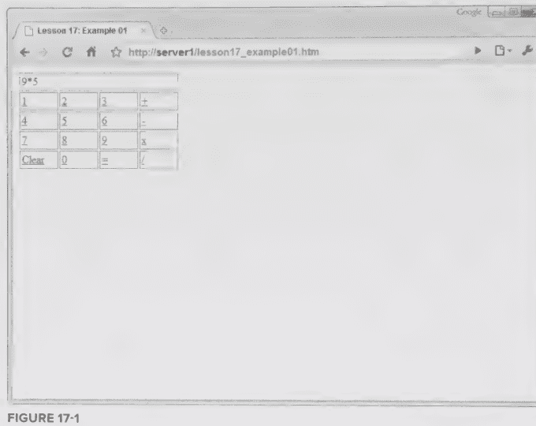

图17-1

要获取示例代码文件，您可以从本书网站 www.wrox.com 下载第17课。

> 请在DVD上选择第17课，以查看本课的配套视频。

# 18 使用早期DOM事件处理程序

HTML事件处理程序属性当然可以工作，并且尽管它们是在Netscape的非常早期版本中发明的，但每个浏览器都继续支持它们。然而，正如您可能推测的那样，使用HTML属性处理事件可能变得乏味，主要是因为您必须为每个希望用户交互的元素定位并添加属性。请记住，在那些年里，大多数网站主要是静态的，负责生成这些网站的开发人员完全控制着每个页面的HTML。那也是一个将标记（HTML）与样式（CSS）和行为（JavaScript）分离的想法真正流行起来之前的时代。

第四代浏览器，主要是Internet Explorer 4和Netscape 4，引入了一种新的分配事件处理程序的方法，使用现在称为*DOM Level 0事件处理程序*的方式。可以将“级别”视为版本；这些事件处理程序被称为DOM Level 0事件处理程序，因为它们存在于任何W3C DOM标准之前。然而，所有浏览器都支持它们。即使到今天，DOM Level 0事件处理程序仍被广泛使用，并且是许多Web应用程序不可或缺的一部分。

早期DOM事件处理程序如此受欢迎，是因为它们受到所有浏览器的支持（这在接下来的课程中您会欣赏到），并且您可以在JavaScript代码中使用它们，从而有效地将JavaScript与HTML解耦。

### 分配事件处理程序

DOM Level 0事件处理程序是DOM对象以及`window`对象的属性。因此，为了分配事件处理程序，您必须首先从DOM（或`window`）中检索一个对象。事件处理程序属性名称与HTML属性事件处理程序的名称非常相似：它们是小写的，由`on`后跟事件名称组成。

例如，您通过创建一个函数并将其分配给`onload`属性来处理`window`对象的`load`事件，如下所示：

```javascript
function handleOnload() {
    alert("Loaded!");
}

onload = handleOnload;
```

请注意，在此代码的最后一行中，`handleOnload`没有括号。在分配事件处理程序时，重要的是分配一个函数或`null`（`null`告诉浏览器不要处理该事件）。未能将这两个值之一分配给事件处理程序属性会导致错误。

在本例中，在将`handleOnload()`分配给`onload`事件处理程序时执行它实际上并没有分配该函数——它分配的是函数执行的*结果*。函数的结果由函数内的`return`语句决定。由于`handleOnload()`不包含`return`语句，因此函数执行的结果是`undefined`。在下面的行中，`undefined`被分配给`onload`：

```javascript
onload = handleOnload(); // 错误；undefined被分配给onload
```

`undefined`的值不是函数，也不是`null`，因此此代码会导致错误。但是，可以编写一个返回另一个函数的函数。让我们修改`handleOnload()`，使用以下代码来做到这一点：

```javascript
function handleOnload() {
    return function() {
        alert("Loaded!");
    }
}
```

由于`handleOnload()`现在返回一个函数，并且该函数是处理事件所需的函数，因此您可以在将其分配给事件处理程序时执行`handleOnload()`，如本代码的第一行所示：

```javascript
onload = handleOnload(); // 现在可以了；它返回一个函数
onload = handleOnload; // 不会导致错误，但不会显示警报消息
```

此代码的第二行在技术上是正确的，但它不会导致在事件触发时显示包含消息“Loaded!”的警报窗口这一预期结果。这是因为分配为事件处理程序的是函数`handleOnload()`，而不是`handleOnload()`返回的函数。始终注意如何分配事件处理程序；分配您希望在事件触发时执行的函数。

尽管本课中有示例，但您更有可能看到事件处理程序以略有不同的方式分配——通过将匿名函数分配给它们，如下所示：

```javascript
onload = function() {
    alert("Loaded!");
};
```

这种格式的优点是可读性。事件处理程序及其分配的函数被分组在同一语句中——使得阅读和理解代码的功能变得更加容易。从大局来看，如何将函数分配给事件处理程序并不重要——只要您正确地执行即可。

与第17课中的事件处理程序不同，您不能将值传递给DOM Level 0事件处理程序。因此，您不能像使用HTML属性事件处理程序那样将`this`作为参数传递。但是，您可以在事件处理程序内部使用`this`来引用发生事件的元素或对象。例如：

```javascript
var someElement = document.getElementById("divElement");
someElement.onclick = function() {
    this.style.color = "red";
};
```

此代码获取一个`id`为`divElement`的元素，并分配一个函数来处理`click`事件。当用户单击该元素时，其包含的文本颜色变为红色。虽然您失去了向DOM Level 0事件处理程序传递数据的能力，但您仍然可以在函数内部使用`this`来访问触发事件的对象。

> 浏览器实际上会将一个事件对象传递给DOM Level 0事件处理程序。您将在第21课和第22课中了解此对象。

## 动手试试

在本课中，您学习了如何使用早期DOM事件处理程序。

## 课程要求

对于本课，您需要一个文本编辑器；任何纯文本编辑器都可以。对于Microsoft Windows用户，记事本默认在您的系统上可用，或者您可以下载Microsoft的免费Visual Web Developer Express（www.microsoft.com/express/web/）或Web Matrix（www.asp.net/webmatrix/）。Mac OS X用户可以使用TextMate（它是OS X的一部分），或者下载Coda的试用版（www.panic.com/coda/）。Linux用户可以使用内置的VIM。

您还需要一个现代的Web浏览器。选择以下任一：

- Internet Explorer 8+
- Google Chrome
- Firefox 3.5+
- Apple Safari 4+
- Opera 10+

在你在第1课中创建的`JS24Hour`文件夹内，创建一个名为`Lesson18`的子文件夹。将本课中创建的文件存储在`Lesson18`文件夹中。

## 分步指南

你将重写第17课的计算器应用程序。你将不再使用HTML属性事件处理程序，而是使用DOM Level 0事件处理程序，以将HTML与JavaScript解耦。

1. 打开你的文本编辑器，输入以下HTML：

```html
<html>
<head>
    <title>Lesson 18: Example 01</title>
    <style type="text/css">
        td {
            border: 1px solid gray;
            width: 50px;
        }
        #results {
            height: 20px;
        }
    </style>
</head>
<body>
    <table border="0" cellpadding="2" cellspacing="2">
        <tr>
            <td colspan="4" id="results"></td>
        </tr>
        <tr>
            <td><a href="#">1</a></td>
            <td><a href="#">2</a></td>
            <td><a href="#">3</a></td>
            <td><a href="#">+</a></td>
        </tr>
        <tr>
            <td><a href="#">4</a></td>
            <td><a href="#">5</a></td>
            <td><a href="#">6</a></td>
            <td><a href="#">-</a></td>
        </tr>
        <tr>
            <td><a href="#">7</a></td>
            <td><a href="#">8</a></td>
            <td><a href="#">9</a></td>
            <td><a href="#">*</a></td>
        </tr>
        <tr>
            <td><a href="#">Clear</a></td>
            <td><a href="#">0</a></td>
            <td><a href="#">=</a></td>
            <td><a href="#">/</a></td>
        </tr>
    </table>
    <script type="text/javascript">
    function addDigit(digit) {
        var resultField = document.getElementById("results");
        resultField.innerHTML += digit;
        return false;
    }

    function calculate() {
        var resultField = document.getElementById("results");
        resultField.innerHTML = eval(resultField.innerHTML);
        return false;
    }

    function reset() {
        var resultField = document.getElementById("results");
        resultField.innerHTML = "";
        return false;
    }
    </script>
</body>
</html>
```

将其保存为`lesson18_example01.htm`。这与第17课中的页面几乎完全相同；唯一的区别是`<title/>`元素中的内容，没有任何`<a/>`元素使用`onclick`属性，以及乘法链接的文本从x改为了星号(*)。`addDigit()`、`calculate()`和`reset()`函数保持不变。

2. 现在处理`load`事件，如粗体代码所示：

```html
<html>
<head>
    <title>Lesson 18: Example 01</title>
    <style type="text/css">
    td {
        border: 1px solid gray;
        width: 50px;
    }
    #results {
        height: 20px;
    }
    </style>
</head>
<body>
    <table border="0" cellpadding="2" cellspacing="2">
        <tr>
            <td colspan="4" id="results"></td>
        </tr>
        <tr>
            <td><a href="#">1</a></td>
            <td><a href="#">2</a></td>
            <td><a href="#">3</a></td>
            <td><a href="#">+</a></td>
        </tr>
        <tr>
            <td><a href="#">4</a></td>
            <td><a href="#">5</a></td>
            <td><a href="#">6</a></td>
            <td><a href="#">-</a></td>
        </tr>
        <tr>
            <td><a href="#">7</a></td>
            <td><a href="#">8</a></td>
            <td><a href="#">9</a></td>
            <td><a href="#">*</a></td>
        </tr>
        <tr>
            <td><a href="#">Clear</a></td>
            <td><a href="#">0</a></td>
            <td><a href="#">=</a></td>
            <td><a href="#">/</a></td>
        </tr>
    </table>
    <script type="text/javascript">
    function addDigit(digit) {
        var resultField = document.getElementById("results");
        resultField.innerHTML += digit;
        return false;
    }

    function calculate() {
        var resultField = document.getElementById("results");
        resultField.innerHTML = eval(resultField.innerHTML);
        return false;
    }

    function reset() {
        var resultField = document.getElementById("results");
        resultField.innerHTML = "";
        return false;
    }

    onload = function() {
        var links = document.getElementsByTagName("a");
        var length = links.length;
    };
    </script>
</body>
</html>
```

这并非完全必要，因为代码在HTML加载到浏览器后运行。然而，它确实可以防止全局作用域被不必要的变量污染——本例中是`links`和`length`变量。

3. 现在遍历`links`节点列表中的元素：

```html
<html>
<head>
    <title>Lesson 18: Example 01</title>
    <style type="text/css">
        td {
            border: 1px solid gray;
            width: 50px;
        }
        #results {
            height: 20px;
        }
    </style>
</head>
<body>
    <table border="0" cellpadding="2" cellspacing="2">
        <tr>
            <td colspan="4" id="results"></td>
        </tr>
        <tr>
            <td><a href="#">1</a></td>
            <td><a href="#">2</a></td>
            <td><a href="#">3</a></td>
            <td><a href="#">+</a></td>
        </tr>
        <tr>
            <td><a href="#">4</a></td>
            <td><a href="#">5</a></td>
            <td><a href="#">6</a></td>
            <td><a href="#">-</a></td>
        </tr>
        <tr>
            <td><a href="#">7</a></td>
            <td><a href="#">8</a></td>
            <td><a href="#">9</a></td>
            <td><a href="#">*</a></td>
        </tr>
        <tr>
            <td><a href="#">Clear</a></td>
            <td><a href="#">0</a></td>
            <td><a href="#">=</a></td>
            <td><a href="#">/</a></td>
        </tr>
    </table>
    <script type="text/javascript">
    function addDigit(digit) {
        var resultField = document.getElementById("results");
        resultField.innerHTML += digit;
        return false;
    }

    function calculate() {
        var resultField = document.getElementById("results");
        resultField.innerHTML = eval(resultField.innerHTML);
        return false;
    }

    function reset() {
        var resultField = document.getElementById("results");
        resultField.innerHTML = "";
        return false;
    }

    onload = function() {
        var links = document.getElementsByTagName("a");
        var length = links.length;
        for (var i = 0; i < length; i++) {
            var link = links[i];
            var innerHTML = link.innerHTML;
        }
    };
    </script>
</body>
</html>
```

这是一个普通的`for`循环，遍历`links`节点列表中的每个`<a/>`元素。第一条语句创建了两个变量：`link`和`innerHTML`。`link`变量包含指定索引处的`<a/>`对象，`innerHTML`变量包含`<a/>`元素的HTML。

4. 使用`switch`元素为每个`<a/>`元素对象分配适当的功能。根据元素的`innerHTML`进行分配：

```html
<html>
<head>
    <title>Lesson 18: Example 01</title>
    <style type="text/css">
        td {
            border: 1px solid gray;
            width: 50px;
        }
        #results {
            height: 20px;
        }
    </style>
</head>
<body>
    <table border="0" cellpadding="2" cellspacing="2">
        <tr>
            <td colspan="4" id="results"></td>
        </tr>
        <tr>
            <td><a href="#">1</a></td>
            <td><a href="#">2</a></td>
            <td><a href="#">3</a></td>
            <td><a href="#">+</a></td>
        </tr>
        <tr>
            <td><a href="#">4</a></td>
            <td><a href="#">5</a></td>
            <td><a href="#">6</a></td>
            <td><a href="#">-</a></td>
        </tr>
        <tr>
            <td><a href="#">7</a></td>
            <td><a href="#">8</a></td>
            <td><a href="#">9</a></td>
            <td><a href="#">*</a></td>
        </tr>
        <tr>
            <td><a href="#">Clear</a></td>
            <td><a href="#">0</a></td>
            <td><a href="#">=</a></td>
            <td><a href="#">/</a></td>
        </tr>
    </table>
    <script type="text/javascript">
    function addDigit(digit) {
        var resultField = document.getElementById("results");
        resultField.innerHTML += digit;
        return false;
    }

    function calculate() {
        var resultField = document.getElementById("results");
        resultField.innerHTML = eval(resultField.innerHTML);
        return false;
    }

    function reset() {
        var resultField = document.getElementById("results");
        resultField.innerHTML = "";
        return false;
    }

    function getHandlerFunction(innerHTML) {
        return function() {
            addDigit(innerHTML);
            return false;
        };
    }

    onload = function() {
        var links = document.getElementsByTagName("a");
        var length = links.length;
        for (var i = 0; i < length; i++) {
            var link = links[i];
            var innerHTML = link.innerHTML;
            switch (innerHTML) {
                case "Clear":
                    link.onclick = reset;
                    break;
                case "=":
                    link.onclick = calculate;
                    break;
                default:
                    link.onclick = getHandlerFunction(innerHTML);
            }
        }
    };
    </script>
</body>
</html>
```

如果链接的`innerHTML`是"Clear"，你知道它是用于清除结果字段内容的链接；将其`onclick`属性分配给`reset()`函数。类似地，如果链接的`innerHTML`是等号(=)，则将`calculate()`函数分配给链接的`onclick`事件处理程序。

5. 为其他链接连接事件：

```html
<html>
<head>
    <title>Lesson 18: Example 01</title>
    <style type="text/css">
        td {
            border: 1px solid gray;
            width: 50px;
        }
        #results {
            height: 20px;
        }
    </style>
</head>
<body>
    <table border="0" cellpadding="2" cellspacing="2">
        <tr>
            <td colspan="4" id="results"></td>
        </tr>
        <tr>
            <td><a href="#">1</a></td>
            <td><a href="#">2</a></td>
            <td><a href="#">3</a></td>
            <td><a href="#">+</a></td>
        </tr>
        <tr>
            <td><a href="#">4</a></td>
            <td><a href="#">5</a></td>
            <td><a href="#">6</a></td>
            <td><a href="#">-</a></td>
        </tr>
        <tr>
            <td><a href="#">7</a></td>
            <td><a href="#">8</a></td>
            <td><a href="#">9</a></td>
            <td><a href="#">*</a></td>
        </tr>
        <tr>
            <td><a href="#">Clear</a></td>
            <td><a href="#">0</a></td>
            <td><a href="#">=</a></td>
            <td><a href="#">/</a></td>
        </tr>
    </table>
    <script type="text/javascript">
    function addDigit(digit) {
        var resultField = document.getElementById("results");
        resultField.innerHTML += digit;
        return false;
    }

    function calculate() {
        var resultField = document.getElementById("results");
        resultField.innerHTML = eval(resultField.innerHTML);
        return false;
    }

    function reset() {
        var resultField = document.getElementById("results");
        resultField.innerHTML = "";
        return false;
    }

    function getHandlerFunction(innerHTML) {
        return function() {
            addDigit(innerHTML);
            return false;
        };
    }

    onload = function() {
        var links = document.getElementsByTagName("a");
        var length = links.length;
        for (var i = 0; i < length; i++) {
            var link = links[i];
            var innerHTML = link.innerHTML;
            switch (innerHTML) {
                case "Clear":
                    link.onclick = reset;
                    break;
                case "=":
                    link.onclick = calculate;
                    break;
                default:
                    link.onclick = getHandlerFunction(innerHTML);
            }
        }
    };
    </script>
</body>
</html>
```

因为只有两个链接具有特殊功能（清除和计算），所以其余链接可以归入默认`switch`。

要处理这些链接的`click`事件，请编写一个名为`getHandlerFunction()`的函数，如前面代码中粗体所示。它应接受一个包含元素`innerHTML`的参数，并返回一个处理链接`click`事件的函数。

6. 在浏览器中加载页面。它的行为将与第17课的计算器完全相同。

要获取示例代码文件，你可以从本书网站 www.wrox.com 下载第18课。

> 请在DVD上选择第18课，以查看随附本课的视频。

# 19 使用标准DOM和IE事件处理程序

DOM Level 0事件处理程序的一个问题是，只能为一个事件处理程序分配一个函数；将另一个函数分配给同一事件处理程序属性会覆盖之前分配给该属性的任何函数值。如果你拥有网页中的所有代码，这并不是什么大问题，因为你可以编写一个函数来调用所需的任意多个函数，如下面的代码所示：

```javascript
onload = function() {
    doSomething();
    doSomethingElse();
    andDoSomethingElse();
};
```

但是，如果你使用第三方编写的代码，它可能依赖于同一事件处理程序进行初始化，如下所示：

```javascript
// 来自第三方模块或库的代码
onload = function() {
    initializeLibrary();
};
```

如果是这种情况，结果将是以下之一：要么你的函数覆盖了第三方的函数，要么反过来。不错，对吧？幸运的是，有一个针对这个特定问题的解决方案，允许你为特定事件添加任意多个事件处理程序。不幸的是，该解决方案在支持标准DOM事件模型的浏览器（Firefox、Chrome、Safari、Opera和Internet Explorer 9）和支持Internet Explorer (IE)事件模型的浏览器（8及以下版本；9版本支持两种事件模型）之间有所不同。

### 标准事件处理程序

DOM Level 2中指定的标准事件模型围绕两个方法展开，这两个方法是DOM中几乎所有元素对象的成员。它们是`addEventListener()`和`removeEventListener()`。它们的目的是在单个对象上注册或移除事件处理程序（或监听器——即它们*监听*事件触发）。

让我们先看看`addEventListener()`。它的用法相当简单。你首先获取一个要调用该方法的对象，例如`window`或来自DOM的元素对象。然后你调用`addEventListener()`方法并传递三个参数：

- 要处理或监听的事件（`click`、`mouseover`、`mouseout`、`load`等）
- 事件触发时要调用的函数
- 一个布尔值，指示是使用*事件捕获*还是*事件冒泡*

在我们进一步讨论之前，让我们先谈谈事件捕获和冒泡。

在1990年代末，作为客户端开发人员的生活很艰难。好吧，那是谎言。那是但丁九层地狱中的一层。争夺主导地位的两个浏览器是Netscape 4和Microsoft Internet Explorer 4。这些浏览器具有不同且不兼容的DOM，因此具有不同的事件模型。Netscape 4的事件模型捕获事件，而Internet Explorer使用事件冒泡。

当W3C开始制定事件模型标准时，它采用了两种实现并将它们融合在一起。因此，在标准事件模型中，事件有三个阶段：

- 事件捕获
- 事件到达事件目标（你为其指定监听器的DOM中的对象）。
- 事件冒泡

这很好，但这一切意味着什么？考虑一个具有图19-1所示结构的HTML文档，并想象一个事件监听器正在监听`<span/>`元素上的`click`事件。


当用户单击该元素时，捕获阶段开始，`click`事件首先被窗口接收——或者更确切地说，窗口捕获事件并执行文档的任何`click`事件监听器。然后事件向下移动到文档，文档捕获并执行文档的任何`click`事件监听器。事件继续向下移动到下一个元素`<div/>`元素，并捕获并执行该元素的任何`click`事件监听器。从那里，`<p/>`元素捕获事件（并执行该元素的任何`click`监听器）。然后事件最终到达目标`<span/>`元素，目标上的`click`事件监听器执行。因此，通过事件捕获，事件从文档树的顶部（`document`对象）开始，并向下传递给每个后代，执行每个后代的每个`click`事件监听器，直到到达目标（图19-2）。

当事件最终到达事件目标时，冒泡阶段开始——冒泡与捕获正好相反。事件从目标（本例中是`<span/>`元素）开始，并执行目标的`click`事件监听器。然后事件沿DOM树向上冒泡，执行每个父级的`click`监听器，直到到达`window`对象（图19-3）。

在符合标准的浏览器中，你必须选择使用事件捕获还是事件冒泡。由于唯一支持标准事件模型的Internet Explorer版本是IE9，因此实际上选择已经为你做好了：冒泡。当然，这是假设你希望你的代码在所有浏览器中都能正常工作。换句话说，传递给`addEventListener()`的第三个参数几乎总是`false`，表示冒泡（传递`true`表示捕获）。

最后，让我们用一些代码来应用这一点。以下是`addEventListener()`使用示例：

```javascript
var spanEl = document.getElementById("someElement");

function clickHandler1() {
    alert("You clicked me!");
}

function clickHandler2() {
    alert("You clicked me (I like repeating myself)!");
}

spanEl.addEventListener("click", clickHandler1, false);
spanEl.addEventListener("click", clickHandler2, false);
```

这段代码首先使用`getElementById()`从文档中获取一个元素。然后，定义了两个函数；这两个函数都将处理`<span/>`元素的`click`事件。接着调用`addEventListener()`为该元素添加`click`事件的监听器（注意省略了`on`），并将监听器设置为使用事件冒泡。然后使用`clickHandler2()`函数为`click`事件注册了另一个事件监听器。当用户点击这个`<span/>`元素时，一个警告框将显示文本"You clicked me!"。然后，在用户点击警告框的确定按钮后，另一个警告框将显示文本"You clicked me (I like repeating myself)!"。当你为同一对象上的同一事件分配多个函数来处理时，函数将按照它们被分配的顺序被调用。

如果你想移除使用`addEventListener()`注册的监听器，请使用`removeEventListener()`方法。它接受与`addEventListener()`相同的三个参数，并且传递给`removeEventListener()`的值必须与注册监听器时传递给`addEventListener()`的值完全匹配。例如，以下代码展示了移除上一代码中注册的第二个监听器的错误和正确方式：

```javascript
// incorrect
spanEl.removeEventListener("click", clickHandler2, true);

// correct
spanEl.removeEventListener("click", clickHandler2, false);
```

在第一个语句中，传递给`removeEventListener()`的第三个参数是`true`；该语句试图移除一个使用提供的函数处理`click`事件的监听器，该监听器使用的是事件捕获。虽然此语句不会导致错误，但它是不正确的，因为该监听器是注册为使用事件冒泡的。

现在看第二个语句。它也试图移除一个使用提供的函数处理`click`事件的监听器，并且第三个参数是`false`。由于所有三个值都与最初传递给`addEventListener()`的值匹配，因此该特定监听器被移除，并且当事件触发时，关联的函数将不会执行。

> 在标准事件模型中，处理事件的函数内部使用的`this`变量指的是触发事件的对象。

## IE事件处理器

大约在W3C制定DOM Level 2事件规范的时候，微软发布了IE的第5版。该浏览器提供了注册和注销事件处理器的新方法：`attachEvent()`和`detachEvent()`方法。

使用这两个方法类似于使用标准事件模型；你从文档中获取一个对象，调用`attachEvent()`方法注册一个事件处理器（或调用`detachEvent()`移除一个处理器），并传递两个参数：

- 要处理的事件，前面加上`on`
- 事件触发时要执行的函数

专有的IE事件模型不支持事件捕获——只支持冒泡。因此这些方法没有第三个参数。以下代码展示了上一节中注册代码的IE等效代码：

```javascript
var spanEl = document.getElementById("someElement");

spanEl.attachEvent("onclick", clickHandler1);
spanEl.attachEvent("onclick", clickHandler2);
```

这里调用了两次`attachEvent()`方法，注册了两个`onclick`事件处理器。注意`onclick`中使用了`on`。与`addEventListener()`和`removeEventListener()`不同，你必须使用事件处理器的名称而不是事件的名称。这段代码的结果与之前几乎相同：当点击`<span/>`元素时，两个警告框显示两条消息。只是在这种情况下，处理器是按相反的顺序执行的。与`addEventListener()`不同，为同一对象上的同一事件分配的多个函数是按它们被分配的相反顺序执行的。

移除第二个事件处理器就像调用`detachEvent()`并传递相同的值一样简单：

```javascript
// remove the second listener
spanEl.detachEvent("onclick", clickHandler2);
```

> 在专有的IE事件模型中，处理事件的函数内部使用的`this`变量指的是`window`对象。

## 试一试

在本课中，你学习了如何使用标准和IE方法分配事件处理器。

## 课程要求

对于本课，你需要一个文本编辑器；任何纯文本编辑器都可以。对于Microsoft Windows用户，系统默认提供记事本，或者你可以下载Microsoft免费的Visual Web Developer Express (www.microsoft.com/express/web/)或Web Matrix (www.asp.net/webmatrix/)。Mac OS X用户可以使用TextMate（作为OS X的一部分提供），或者下载Coda的试用版 (www.panic.com/coda/)。Linux用户可以使用内置的VIM。

你还需要一个现代的Web浏览器。选择以下任一浏览器：

- Internet Explorer 8+
- Google Chrome
- Firefox 3.5+
- Apple Safari 4+
- Opera 10+

在你在第1课创建的`JS24Hour`文件夹中创建一个名为`Lesson19`的子文件夹。将你在本课中创建的文件存储在`Lesson19`文件夹中。

## 分步操作

你将使用标准和IE特定的事件处理器重写第18课的计算器应用程序。

1. 打开你的文本编辑器并输入以下HTML：

```html
<html>
<head>
    <title>Lesson 19: Example 01</title>
    <style type="text/css">
        td {
            border: 1px solid gray;
            width: 50px;
        }
        #results {
            height: 20px;
        }
    </style>
</head>
<body>
    <table border="0" cellpadding="2" cellspacing="2">
        <tr>
            <td colspan="4" id="results"></td>
        </tr>
        <tr>
            <td><a href="#">1</a></td>
            <td><a href="#">2</a></td>
            <td><a href="#">3</a></td>
            <td><a href="#">+</a></td>
        </tr>
        <tr>
            <td><a href="#">4</a></td>
            <td><a href="#">5</a></td>
            <td><a href="#">6</a></td>
            <td><a href="#">-</a></td>
        </tr>
        <tr>
            <td><a href="#">7</a></td>
            <td><a href="#">8</a></td>
            <td><a href="#">9</a></td>
            <td><a href="#">*</a></td>
        </tr>
        <tr>
            <td><a href="#">Clear</a></td>
            <td><a href="#">0</a></td>
            <td><a href="#">=</a></td>
            <td><a href="#">/</a></td>
        </tr>
    </table>
    <script type="text/javascript">
        function addDigit(digit) {
            var resultField = document.getElementById("results");
            resultField.innerHTML += digit;
            return false;
        }

        function calculate() {
            var resultField = document.getElementById("results");
            resultField.innerHTML = eval(resultField.innerHTML);
            return false;
        }

        function reset() {
            var resultField = document.getElementById("results");
            resultField.innerHTML = "";
            return false;
        }

        function getHandlerFunction(innerHTML) {
            return function() {
                addDigit(innerHTML);
                return false;
            };
        }

        onload = function() {
            var links = document.getElementsByTagName("a");
            var length = links.length;
            for (var i = 0; i < length; i++) {
                var link = links[i];
                var innerHTML = link.innerHTML;
                var func = null;
                switch (innerHTML) {
                    case "Clear":
                        func = reset;
                        break;
                    case "=":
                        func = calculate;
                        break;
                    default:
                        func = getHandlerFunction(innerHTML);
                }
                link.addEventListener("click", func, false);
            }
        };
    </script>
</body>
</html>
```

将其保存为`lesson19_example01.htm`。此版本中有一些改动，重要的改动已用粗体标出。一个名为`func`的新变量被声明并初始化为`null`。这个变量的目的是包含在调用`addEventListener()`时使用的函数，这使得代码更易于阅读，同时避免了多次输入`link.addEventListener()`。

`switch`块中的`case`语句保持不变，只是`func`在每个case中被赋予了相应的函数。最后，在`for`循环中添加了一行新代码，为`<a/>`元素添加了一个`click`事件监听器。

2. 现在将该代码复制并粘贴到文本编辑器的新实例中。按照以下代码进行指定的更改（更改部分已用粗体标出）：

```html
<html>
<head>
    <title>Lesson 19: Example 02</title>
    <style type="text/css">
        td {
            border: 1px solid gray;
            width: 50px;
        }
        #results {
            height: 20px;
        }
    </style>
</head>
<body>
    <table border="0" cellpadding="2" cellspacing="2">
        <tr>
            <td colspan="4" id="results"></td>
        </tr>
        <tr>
            <td><a href="#">1</a></td>
            <td><a href="#">2</a></td>
            <td><a href="#">3</a></td>
            <td><a href="#">+</a></td>
        </tr>
        <tr>
            <td><a href="#">4</a></td>
            <td><a href="#">5</a></td>
            <td><a href="#">6</a></td>
            <td><a href="#">-</a></td>
        </tr>
        <tr>
            <td><a href="#">7</a></td>
            <td><a href="#">8</a></td>
            <td><a href="#">9</a></td>
            <td><a href="#">*</a></td>
        </tr>
        <tr>
            <td><a href="#">Clear</a></td>
            <td><a href="#">0</a></td>
            <td><a href="#">=</a></td>
            <td><a href="#">/</a></td>
        </tr>
    </table>
    <script type="text/javascript">
        function addDigit(digit) {
            var resultField = document.getElementById("results");
            resultField.innerHTML += digit;
            return false;
        }

        function calculate() {
            var resultField = document.getElementById("results");
            resultField.innerHTML = eval(resultField.innerHTML);
            return false;
        }

        function reset() {
            var resultField = document.getElementById("results");
            resultField.innerHTML = "";
            return false;
        }

        function getHandlerFunction(innerHTML) {
            return function() {
                addDigit(innerHTML);
                return false;
            };
        }

        onload = function() {
            var links = document.getElementsByTagName("a");
            var length = links.length;
            for (var i = 0; i < length; i++) {
                var link = links[i];
                var innerHTML = link.innerHTML;
                var func = null;
                switch (innerHTML) {
                    case "Clear":
                        func = reset;
                        break;
                    case "=":
                        func = calculate;
                        break;
                    default:
                        func = getHandlerFunction(innerHTML);
                }
                link.attachEvent("onclick", func);
            }
        };
    </script>
</body>
</html>
```

将其保存为`lesson19_example02.htm`。这些更改使其能在IE中工作——`addEventListener()`变成了`attachEvent()`，`on`被添加到`click`前面，并且原本传递给`addEventListener()`的第三个参数被移除了。

3. 在相应的浏览器中打开每个文件进行测试。你会看到该应用程序的工作方式与第17课和第18课中非常相似。

要获取示例代码文件，你可以从本书网站 www.wrox.com 下载第19课。

> 请在DVD上选择第19课，以查看本课的配套视频。

# 20 编写跨浏览器事件处理程序

在过去，跨浏览器脚本编写的常见方法类似于第19课末尾的解决方案：为每种浏览器类型创建多个页面。这个解决方案有效，但所需的时间会随着你想要支持的不同浏览器数量而增加。随着时间的推移，公认的方法是在需要时简单地进行代码分支（使用if语句来确定使用哪种方法），如下所示：

```javascript
// 假设el变量是一个元素对象
if (typeof addEventListener === "function") {
    el.addEventListener("click", function() {
        alert("You clicked me!");
    }, false);
} else if (typeof attachEvent !== "undefined") {
    el.attachEvent("onclick", function() {
        alert("You clicked me!");
    });
} else {
    el.onclick = function() {
        alert("You clicked me!");
    };
}
```

你在这里看到的是一种称为*特性检测*的浏览器检测类型——检测某些特性，如`addEventListener()`。其思想是确定浏览器是否支持某个特定特性，如果支持，则使用它。如果不支持该特性，则回退到一个你知道会有效的特性。在前面的示例中，代码检查`addEventListener()`方法（所有符合标准的浏览器都支持），如果找到则使用它。如果浏览器不支持`addEventListener()`，那么代码会尝试识别浏览器是否为IE的某个版本，如果是，则使用`attachEvent()`。如果浏览器既不支持`addEventListener()`也不支持`attachEvent()`，那么代码会回退到DOM Level 0的`onclick`事件处理程序。

> IE8及以下版本中的JavaScript引擎可能会因为浏览器中不同组件的构建方式而产生奇怪的行为。例如，`typeof attachEvent`实际上返回的是"object"而不是"function"。这就是为什么前面的代码检查`attachEvent`是否不是undefined。然而，用户定义的函数类型是"function"。

然而，大多数时候，你为两种类型的浏览器编写代码：符合标准的浏览器和IE8及以下版本。因此，前面的代码可以简化为以下形式：

```javascript
// 假设el变量是一个元素对象
if (typeof addEventListener === "function") {
    el.addEventListener("click", function() {
        alert("You clicked me!");
    }, false);
} else {
    el.attachEvent("onclick", function() {
        alert("You clicked me!");
    });
}
```

这段代码遵循与之前相同的思想，只是现在`attachEvent()`是回退方案，而不是DOM Level 0的`onclick`事件处理程序。

如何检查特性很重要。十有八九，你希望首先检查标准符合性，因为标准很少改变。例如，你可以先检查`attachEvent()`，如下所示：

```javascript
// 错误！
if (typeof attachEvent !== "undefined") {
    el.attachEvent("onclick", function() {
        alert("You clicked me!");
    });
} else {
    el.addEventListener("click", function() {
        alert("You clicked me!");
    }, false);
}
```

这确实有效，但考虑IE 9的情况。它不仅支持其专有的事件模型，还支持标准事件模型。作为开发人员，你希望尽可能多地使用标准提出的特性，你可以通过首先检查标准特性而不是专有特性来确保这一点。

现在，在过去，像这样的代码分支会遍布整个JavaScript文件。自然地，下一步的演进是将该代码重构为它自己的函数，如下所示：

```javascript
function setEventHandler(obj, evt, fn) {
    if (typeof addEventListener === "function") {
        obj.addEventListener(evt, fn, false);
    } else {
        obj.attachEvent("on" + evt, fn);
    }
}

setEventHandler(el, "click", function() {
    alert("You clicked me!");
});
```

这段代码创建了一个名为`setEventHandler()`的函数。它接受三个参数：要分配事件处理程序的对象、要处理的事件名称（不带`on`前缀）以及处理事件的函数。在函数内部，一个`if`语句确定应该使用`addEventListener()`还是`attachEvent()`来为提供的对象分配事件处理程序。注意`else`块中对`attachEvent()`的调用。记住，事件名称是不带`on`前缀传递给函数的，因此在调用`attachEvent()`时必须添加该前缀。

这段代码的最后一条语句展示了如何通过向元素对象添加`click`事件处理程序来调用该函数。这样，每当你需要为特定对象连接事件时，就可以调用`setEventHandler()`函数。但这种方法也有其自身的缺点——其中之一是性能不是最优的。每次调用`setEventHandler()`都会导致轻微的性能损失，原因如下：

- JavaScript引擎在执行`addEventListener()`或`attachEvent()`之前必须做出决定。这个决定比简单地执行其中一个事件处理程序方法花费的时间更长。
- 引擎必须查找`addEventListener`标识符。

这些问题将我们带到了现代JavaScript技术，你将在本课中学习这些技术。

## 编写事件实用程序对象

浏览器中JavaScript编程的每个方面都是面向对象的。自然地，你编写的任何工具和实用程序也应该包含面向对象的概念，将你的代码组织成一个或多个对象。在事件的情况下，你将开始开发一个包含在所有现代浏览器中都能工作的实用方法的对象。

首先创建一个名为`eventUtility`的对象，如下所示：

```javascript
var eventUtility = {};
```

这段代码使用对象字面量表示法创建一个单例对象。你不需要为此实用程序创建新的数据类型，因为它不需要任何实例数据；它只是一个实用程序，所有必要的数据都传递给它的方法。现在添加一个`if`语句来分支你的代码，如前所述。检查`addEventListener`是否是浏览器支持的特性：

```javascript
var eventUtility = {};

if (typeof addEventListener === "function") {
} else {
}
```

现在，`eventUtility`对象需要一个方法来为对象添加事件处理器。将此方法命名为`addEvent`，并为其分配一个函数，该函数调用`addEventListener()`或`attachEvent()`，如下面的粗体代码所示：

```javascript
var eventUtility = {};

if (typeof addEventListener === "function") {
    eventUtility.addEvent = function(obj, evt, fn) {
        obj.addEventListener(evt, fn, false);
    };
} else {
    eventUtility.addEvent = function(obj, evt, fn) {
        obj.attachEvent("on" + evt, fn);
    };
}
```

这段新代码创建了一个`addEvent()`方法作为`eventUtility`对象的成员。实际上，`addEvent()`有两个定义，但只有一个被实际赋值给`eventUtility.addEvent`。注意两个声明中`addEvent()`的三个参数；它们是相同的。这非常重要，因为你希望能够调用`addEvent()`并使其在用户使用的任何浏览器中都能正确工作。以下代码将为一个元素添加一个事件处理器来处理`click`事件，并且它在任何现代浏览器（甚至IE6）中都能工作：

```javascript
eventUtility.addEvent(el, "click", function() {
    alert("You clicked me!");
});
```

让我们看看这比本课开头展示的`setEventHandler()`函数有什么优势。

- 现在，`if`语句及其伴随的性能问题（`addEventListener`查找和实际决策）只执行一次——在浏览器加载代码时。不幸的是，这个决策无法避免。
- `addEvent()`方法可以立即调用，因为浏览器在加载JavaScript代码后立即执行`if...else`语句和赋值操作——就像它处理`setEventHandler()`函数一样。
- 对`addEvent()`的调用只执行将事件处理器分配给对象所需的代码。没有决策，也没有对其他标识符的额外查找。这与`setEventHandler()`形成对比，后者需要额外的代码才能工作。

尽管`eventUtility`对象使事件处理变得更容易（也更快），但其实现与现代JavaScript专家使用的技术并不完全匹配。因此，让我们看看如何将此代码转换为现代JavaScript。

## 现代化你的事件工具

一个更新的`eventUtility`对象首先像以前一样使用对象字面量：

```javascript
var eventUtility = {};
```

接下来，向对象添加一个名为`addEvent()`的方法，如下所示：

```javascript
var eventUtility = {
    addEvent : function() {
    }
};
```

注意，此方法没有指定任何参数。这是因为此函数声明实际上将执行并返回另一个函数给`addEvent`。现在让我们添加一些代码：

```javascript
var eventUtility = {
    addEvent : function() {
    }()
};
```

这段代码唯一添加的是函数语句末尾的一组括号。请记住，为了使函数执行，函数标识符后必须跟一组括号，就像这个对`alert()`的调用：

```javascript
alert("Hello, JavaScript!");
```

你可以将相同的概念应用于匿名函数，只需在函数语句末尾添加一组括号，如下所示：

```javascript
function() {
    alert("Hello, JavaScript!");
}();
```

这段代码实际上不起作用，因为它有语法错误，但你可以通过用另一组括号包围函数和括号使其工作，如下所示：

```javascript
(function() {
    alert("Hello, JavaScript!");
})();
```

因此，当JavaScript引擎加载此代码时，它会执行匿名函数，该函数又执行其内部的`alert()`方法。这种类型的函数有时被称为*自执行函数*。

回到你的事件工具对象，你有一个在浏览器加载JavaScript代码后执行的匿名函数，但它没有向`addEvent`返回任何有价值的东西。因此，让我们用以下粗体代码进行更改：

```javascript
var eventUtility = {
    addEvent : (function() {
        if (typeof addEventListener === "function") {
            return function(obj, evt, fn) {
                obj.addEventListener(evt, fn, false);
            };
        } else {
            return function(obj, evt, fn) {
                obj.attachEvent("on" + evt, fn);
            };
        }
    }())
};
```

这段新代码首先将自执行函数封装在括号中。然后添加一个`if`块，看起来与原始`eventUtility`代码中的代码有些相似；它返回一个函数给`addEvent`，而不是像以前的版本那样直接将函数赋值给`eventUtility.addEvent`。让我们通过为不支持`addEventListener`的浏览器添加一个`else`块来完成这个新版本。新代码为粗体：

```javascript
var eventUtility = {
    addEvent : (function() {
        if (typeof addEventListener === "function") {
            return function(obj, evt, fn) {
                obj.addEventListener(evt, fn, false);
            };
        } else {
            return function(obj, evt, fn) {
                obj.attachEvent("on" + evt, fn);
            };
        }
    }())
};
```

同样，`else`块的内容与以前的版本有些相似。主要区别在于函数被返回给`addEvent`，而不是直接赋值；然而，最终结果是相同的。当自执行函数执行其操作时，它会返回两个函数之一给`addEvent`；哪个函数取决于浏览器支持的事件模型。

> 本课中展示的此事件工具不提供移除事件处理器的方法。但是，“试一试”部分中的代码以及代码下载中的代码提供了此功能。该功能按照本课讨论的相同原则运行。

## 试一试

在本课中，你学习了如何编写自己的事件工具来处理跨浏览器问题。

## 课程要求

对于本课，你需要一个文本编辑器；任何纯文本编辑器都可以。对于Microsoft Windows用户，记事本默认在你的系统上可用，或者你可以下载Microsoft的免费Visual Web Developer Express（www.microsoft.com/express/web/）或Web Matrix（www.asp.net/webmatrix/）。Mac OS X用户可以使用TextMate，它是OS X的一部分，或者下载Coda的试用版（www.panic.com/coda/）。Linux用户可以使用内置的VIM。

你还需要一个现代网络浏览器。选择以下任何一个：

- Internet Explorer 8+
- Google Chrome
- Firefox 3.5+
- Apple Safari 4+
- Opera 10+

在你在第1课中创建的`JS24Hour`文件夹中创建一个名为`Lesson20`的子文件夹。将你在本课中创建的文件存储在`Lesson20`文件夹中。

## 分步指南

你将使用事件工具对象重写第17、18和19课中的计算器应用程序。

1. 打开你的文本编辑器并输入以下JavaScript：

```javascript
var eventUtility = {
    addEvent : (function() {
        if (typeof addEventListener === "function") {
            return function(obj, evt, fn) {
                obj.addEventListener(evt, fn, false);
            };
        } else {
            return function(obj, evt, fn) {
                obj.attachEvent("on" + evt, fn);
            };
        }
    })(),
    removeEvent : (function() {
        if (typeof removeEventListener === "function") {
            return function(obj, evt, fn) {
                obj.removeEventListener(evt, fn, false);
            };
        } else {
            return function(obj, evt, fn) {
                obj.detachEvent("on" + evt, fn);
            };
        }
    })()
};
```

将其保存为`eventutility.js`。

2. 现在打开另一个文本编辑器实例并输入以下HTML：

```html
<html>
<head>
    <title>Lesson 20: Example 02</title>
    <style type="text/css">
        td {
            border: 1px solid gray;
            width: 50px;
        }
        #results {
            height: 20px;
        }
    </style>
</head>
<body>
    <table border="0" cellpadding="2" cellspacing="2">
        <tr>
            <td colspan="4" id="results"></td>
        </tr>
        <tr>
            <td><a href="#">1</a></td>
            <td><a href="#">2</a></td>
            <td><a href="#">3</a></td>
            <td><a href="#">+</a></td>
        </tr>
        <tr>
            <td><a href="#">4</a></td>
            <td><a href="#">5</a></td>
            <td><a href="#">6</a></td>
            <td><a href="#">-</a></td>
        </tr>
        <tr>
            <td><a href="#">7</a></td>
            <td><a href="#">8</a></td>
            <td><a href="#">9</a></td>
            <td><a href="#">*</a></td>
        </tr>
        <tr>
            <td><a href="#">Clear</a></td>
            <td><a href="#">0</a></td>
            <td><a href="#">=</a></td>
            <td><a href="#">/</a></td>
        </tr>
    </table>
    <script type="text/javascript" src="eventutility.js"></script>
    <script type="text/javascript">
        function addDigit(digit) {
            var resultField = document.getElementById("results");
            resultField.innerHTML += digit;
            return false;
        }
    </script>
</body>
</html>
```

将其保存为`lesson20_example01.htm`。这个版本没有太多变化。引用了外部JavaScript文件中包含的`eventUtility`对象，并使用该工具将`click`事件处理程序分配给`<a/>`元素对象。在多个浏览器中打开此文件，你会发现它在所有浏览器中都能工作。

要获取示例代码文件，你可以从本书网站 www.wrox.com 下载第20课。

> 请在DVD上选择第20课，以查看伴随本课的视频。

# 21 标准事件对象

在过去的几节课中，你已经学习了如何通过HTML属性、DOM对象属性和DOM对象方法来处理事件。但有一个至关重要的信息一直未向你透露：如何访问一个包含任何事件信息的特殊对象。毫不奇怪，访问此对象的方式因用户的浏览器而异：符合标准的浏览器使用标准的`Event`对象，而旧版Internet Explorer (IE)则使用其专有的事件对象。

本课将重点介绍标准的`Event`对象。你将在下一课中了解IE的旧版事件对象。

## 访问事件对象

当你有空时，请翻阅之前关于事件处理的课程。注意那些被指定用于处理事件的函数；注意这些函数都不接受任何参数。这是设计使然，因为作为开发者的你并不调用事件处理程序；是浏览器在调用。因此，编写一个接受参数的函数似乎没什么意义。

或者真的如此吗？

实际上，你绑定到事件的函数应该接受一个参数，因为根据标准事件模型，浏览器会将一个`Event`对象传递给处理事件的函数，如下所示：

```javascript
eventUtility.addEvent(document, "click", function(event) {
    alert(event);
});
```

这段代码在文档对象上为`click`事件设置了一个事件处理程序。当你在页面的任何位置点击时，你会看到一个类似于图21-1所示的警告框（假设使用的是符合标准的浏览器）。

图21-1中提到的`MouseEvent`是一种继承自`Event`的数据类型，它包含与`click`事件相关的信息，例如点击了哪个鼠标按钮、鼠标指针的坐标以及其他各种信息。你将在未来的课程中研究`MouseEvent`对象。现在，让我们先专注于基本的`Event`对象。

## 事件对象

大多数情况下，`Event`对象包含了你想要了解的关于特定事件的大部分信息。它包含有关发生的事件类型以及接收该事件的元素的信息。

### 确定发生的事件

要确定发生了什么事件，你可以使用`type`属性，如下所示：

```javascript
eventUtility.addEvent(document, "click", function(event) {
    alert(event.type); // click
});
```

此属性返回一个包含事件名称（不带前导`on`）的字符串。当你使用一个函数来处理多种事件时，这非常有用。例如，看看以下代码：

```javascript
function eventHandler(event) {
    if (event.type === "click") {
        alert("You clicked me!");
    } else if (event.type === "keypress") {
        alert("You pressed a key!");
    }
}

eventUtility.addEvent(document, "click", eventHandler);
eventUtility.addEvent(document, "keypress", eventHandler);
```

在这段代码中，一个名为`eventHandler()`的函数接受一个名为`event`的参数（`event`是事件处理程序参数的现代惯例标识符。有时你可能只看到`e`；那是老派的写法）。在函数内部，一个`if`语句判断导致函数执行的事件是否是`click`事件。如果是，则显示一个警告框，消息为"You clicked me!"。还有一个`else...if`语句检查事件是否是`keypress`事件，如果确实触发了此事件，则警告框显示"You pressed a key!"。这段代码的最后两行将`eventHandler()`函数设置为处理`document`对象上的`click`和`keypress`事件。

使用一个函数来处理多种事件实际上相当常见；辨别发生了何种类型事件的能力是`Event`对象赋予你的一项重要能力。

### 访问事件目标

`Event`对象为你提供的另一个至关重要的信息是`target`属性。此属性返回与接收事件的元素相关联的DOM元素对象。因此，如果你想的话，你可以操作接收事件的元素，或者使用你在第13课中学到的DOM属性来定位兄弟元素或父元素。让我们看一个使用以下HTML的例子：

```html
<body>
    <div id="divElement"
         style="width: 100px; height: 100px; background-color: red; "></div>
</body>
```

这是一个HTML页面的片段，显示了`<body/>`元素的内容。它有一个`<div/>`元素，样式设置为一个红色方块。你可以设置一个事件处理程序，在点击时更改此元素的背景颜色，而且你可以通过多种方式来实现。一种是为`<div/>`元素本身分配一个`click`事件处理程序，如下所示：

```javascript
eventUtility.addEvent(document.getElementById("divElement"), "click",
function(event) {
    var bgColor = event.target.style.backgroundColor;
    var color = "red";
    if (bgColor === color) {
        color = "green";
    }
    event.target.style.backgroundColor = color;
});
```

这个事件处理程序将此`<div/>`元素的背景颜色在红色和绿色之间切换。事件处理程序的第一条语句创建了两个变量：一个用于包含元素的当前背景颜色，称为`bgColor`；另一个用于包含文本"red"，称为`color`。

下一条语句确定元素的背景颜色。如果当前是红色，则将`color`更改为`green`；否则，`color`保持为`red`。最后一行将元素的`backgroundColor`更改为`color`变量中包含的值。

这段代码可以工作，但如果你想向文档添加另一个`<div/>`元素并为其提供相同的功能呢？以下是HTML：

```html
<body>
    <div id="divElement"
         style="width: 100px; height: 100px; background-color: red; "></div>
    <br/><br/>
    <div id="divElement2"
         style="width: 100px; height: 100px; background-color: red; "></div>
</body>
```

嗯，你可以为新元素设置另一个`click`事件处理程序，但更好的解决方案是使用一种叫做*事件委托*的技术。事件委托是一种技术，你只需在父元素上设置一个事件处理程序。这样，发生在该父元素内的任何事件（包括其子元素）都会被触发，并且事件的目标是事件起源的任何元素（父元素或子元素）。

结合图21-2可能更容易理解。

图21-2显示了一个包含两个子元素的元素。假设在父元素上设置了一个`click`事件处理程序。你可以在父元素边界内的任何位置点击，点击事件都会由你的处理程序处理。这包括Child-A和Child-B。因此，当你点击Child-B时，它接收点击事件，但由于它是父元素的子元素（并且因为事件会冒泡到父元素），事件处理程序会执行，并且事件的目标是Child-B。

所以，忘掉所有关于`divElement` `<div/>`元素的事件处理程序吧，看看下面这段使用事件委托的代码：

```javascript
eventUtility.addEvent(document, "click", function(event) {
    var eSrc = event.target;
    if (eSrc.tagName.toUpperCase() === "DIV") {
        var bgColor = eSrc.style.backgroundColor;
        var color = "red";
        if (bgColor === color) {
            color = "green";
        }
        eSrc.style.backgroundColor = color;
    }
});
```

这段代码在`document`对象上设置了一个`click`事件处理程序。当你在文档中的任何位置点击时，事件处理程序都会执行。在函数内部，第一条语句创建了一个名为`eSrc`的变量，它包含事件的目标（即你点击的元素）。然后，一个`if`语句检查`eSrc`的`tagName`属性是否等于"DIV"（`tagName`属性返回元素标签名的大写形式）。如果目标元素是一个`<div/>`元素，则执行切换背景颜色的代码。

通过使用事件委托，你只需一个事件处理程序就可以处理文档中所有`<div/>`元素的`click`事件。这比为每个元素单独设置事件处理程序要高效得多。

## 动手试试

在本课中，你将学习如何在标准事件模型中检索有关事件的基本信息。

## 课程要求

学习本课，你需要一个文本编辑器；任何纯文本编辑器都可以。对于Microsoft Windows用户，系统默认提供记事本，或者你可以下载Microsoft免费的Visual Web Developer Express (www.microsoft.com/express/web/)或Web Matrix (www.asp.net/webmatrix/)。Mac OS X用户可以使用TextMate（它是OS X的一部分），或者下载Coda的试用版 (www.panic.com/coda/)。Linux用户可以使用内置的VIM。

你还需要一个现代网络浏览器。选择以下任意一种：

- Internet Explorer 8+
- Google Chrome
- Firefox 3.5+
- Apple Safari 4+
- Opera 10+

在你在第1课创建的`JS24Hour`文件夹中，创建一个名为`Lesson21`的子文件夹。将你在本课中创建的文件保存在`Lesson21`文件夹中。

## 分步操作

你将编写一个带有三个按钮的简单工具栏。它们将有正常状态、鼠标指针悬停状态和点击状态。使用事件委托来处理按钮的事件。

1. 打开你的文本编辑器，输入以下HTML：

```html
<html>
<head>
    <title>Lesson 21: Example 01</title>
    <style type="text/css">
        #divContainer {
            background-color: silver;
            height: 50px;
            padding: 2px;
        }
        span {
            display: inline-block;
            width: 50px;
            height: 50px;
        }
        .button-normal {
            background-color: gray;
        }
        .button-over {
            background-color: navy;
        }
        .button-click {
            background-color: yellow;
        }
    </style>
</head>
<body>
    <div id="divContainer">
        <span class="button-normal">
        </span>
        <span class="button-normal">
        </span>
        <span class="button-normal">
        </span>
    </div>
    <script type="text/javascript" src="eventutility.js"></script>
    <script type="text/javascript">
    </script>
</body>
</html>
```

将其保存为`lesson21_example01.htm`。这里没有什么特别令人兴奋的。一个`<div/>`元素包含三个`<span/>`元素，它们被样式化为一个粗糙、超大的工具栏。有三个值得注意的CSS类：`button-normal`、`button-over`和`button-click`。这三个类代表按钮可能处于的三种不同状态。

2. 现在添加粗体显示的JavaScript代码：

```html
<html>
<head>
    <title>Lesson 21: Example 01</title>
    <style type="text/css">
        #divContainer {
            background-color: silver;
            height: 50px;
            padding: 2px;
        }
        span {
            display: inline-block;
            width: 50px;
            height: 50px;
        }
        .button-normal {
            background-color: gray;
        }
        .button-over {
            background-color: navy;
        }
        .button-click {
            background-color: yellow;
        }
    </style>
</head>
<body>
    <div id="divContainer">
        <span class="button-normal">
        </span>
        <span class="button-normal">
        </span>
        <span class="button-normal">
        </span>
    </div>
    <script type="text/javascript" src="eventutility.js"></script>
    <script type="text/javascript">
        function mouseHandler(event) {
            var eSrc = event.target;
            var type = event.type;
            if (eSrc.tagName.toUpperCase() === "SPAN") {
            }
        }
    </script>
</body>
</html>
```

这段代码添加了一个名为`mouseHandler()`的函数，它接受一个浏览器传递给函数的参数。第一条语句创建了两个变量`eSrc`和`type`。这两个变量分别保存事件目标和事件类型。

在变量声明之后，一个`if`语句确定事件目标是否为`<span/>`元素。这个检查是足够的，因为它们是文档中唯一的`<span/>`元素。如果还有其他`<span/>`元素，你可以使用`className`属性来确定目标是否具有三个CSS类之一。

3. 现在添加更多代码；以下代码中粗体部分为新增：

```html
<html>
<head>
    <title>Lesson 21: Example 01</title>
    <style type="text/css">
        #divContainer {
            background-color: silver;
            height: 50px;
            padding: 2px;
        }
        span {
            display: inline-block;
            width: 50px;
            height: 50px;
        }
        .button-normal {
            background-color: gray;
        }
        .button-over {
            background-color: navy;
        }
        .button-click {
            background-color: yellow;
        }
    </style>
</head>
<body>
    <div id="divContainer">
        <span class="button-normal">
        </span>
        <span class="button-normal">
        </span>
        <span class="button-normal">
        </span>
    </div>
    <script type="text/javascript" src="eventutility.js"></script>
    <script type="text/javascript">
        function mouseHandler(event) {
            var eSrc = event.target;
            var type = event.type;
            if (eSrc.tagName.toUpperCase() === "SPAN") {
                if (type === "mouseover") {
                    eSrc.className = "button-over";
                } else if (type === "mouseout") {
                    eSrc.className = "button-normal";
                } else if (type === "mousedown") {
                    eSrc.className = "button-click";
                } else if (type === "mouseup") {
                    eSrc.className = "button-over";
                }
            }
        }

        eventUtility.addEvent(document, "mouseover", mouseHandler);
        eventUtility.addEvent(document, "mouseout", mouseHandler);
        eventUtility.addEvent(document, "mousedown", mouseHandler);
        eventUtility.addEvent(document, "mouseup", mouseHandler);
    </script>
</body>
</html>
```

这段新代码在`if`语句内部添加了一个嵌套的`if...else if`链，根据事件类型更改`<span/>`元素的`className`。如果事件是`mouseover`，则将元素的类更改为`button-over`。如果是`mouseout`，则更改为`button-normal`。如果是`mousedown`，则更改为`button-click`。如果是`mouseup`，则更改为`button-over`。

最后，使用`eventUtility.addEvent()`方法在`document`对象上为`mouseover`、`mouseout`、`mousedown`和`mouseup`事件注册了`mouseHandler`函数。这样，无论鼠标指针在文档中的哪个位置，只要这些事件发生，`mouseHandler`函数就会被调用。

4. 在浏览器中打开该文件。将鼠标指针移到按钮上，按下鼠标按钮，然后释放。你会看到按钮的颜色根据鼠标事件而变化。

要获取示例代码文件，你可以从本书网站 www.wrox.com 下载第21课。

> 请在DVD上选择第21课，以查看伴随本课的视频。


# 22 Internet Explorer 的事件对象

Internet Explorer（IE）的事件模型源于该浏览器的早期版本，并且在超过12年的时间里几乎保持不变。事实上，Chrome、Safari 和 Opera 背后的组织认为有必要在其浏览器中实现它——只有 Firefox 不支持它。尽管有如此广泛的支持，IE 的事件模型仍被认为是不正确的，并且不鼓励在任何支持标准的浏览器中使用它。

IE 事件模型的关键是一个名为 `event` 的对象。每次处理事件时，该对象都会填充事件信息。在本课中，你将学习如何访问 `event` 对象并从中提取事件信息。

## 访问事件对象

`event` 对象是一个全局对象，因此它实际上是 `window` 的一个属性。因此，你可以相当容易地访问它，如以下代码所示：

```
eventUtility.addEvent(document, "click", function() {
    alert(event);
});
```

这里为 `document` 对象的 `click` 事件分配了一个事件处理程序。当你在文档中的任何位置单击时，会显示一个如图 22-1 所示的警报框，其中仅显示文本“[object]”。

当使用 `attachEvent()` 方法（`eventUtility.addEvent()` 方法使用的就是这个）分配事件处理程序时，`event` 对象也会作为参数传递给处理函数，这与标准支持浏览器中的标准 `Event` 对象类似。以下代码展示了这一点：

```
eventUtility.addEvent(document, "click", function(event) {
    alert(event);
});
```

全局 `event` 对象与传递给处理函数的 `event` 对象之间没有区别。


图 22-1

## 事件对象

在第 21 课中，我提到标准事件模型使用多种类型的 `Event` 对象来表示不同的事件（例如 `MouseEvent` 对象）。相比之下，IE 的 `event` 对象是一个多用途对象，它不仅包含基本事件信息，还包含与鼠标和键盘相关事件的信息。尽管存在这种差异，你可以从 `event` 对象中收集与标准 `Event` 和 `MouseEvent` 对象相同的信息，但你可能需要使用不同的属性名称来获取这些信息。

### 确定发生的事件

要确定发生了什么事件，请使用 `type` 属性。你完全按照第 21 课中看到的方式操作：

```
eventUtility.addEvent(document, "click", function(event) {
    alert(event.type); // click
});
```

它返回一个包含事件名称的字符串，没有前面的 `on`，你可以像使用标准 `Event` 对象一样使用它。以下示例是第 21 课中代码的完全重复：

```
function eventHandler(event) {
    if (event.type === "click") {
        alert("You clicked me!");
    } else if (event.type === "keypress") {
        alert("You pressed a key!");
    }
}

eventUtility.addEvent(document, "click", eventHandler);
eventUtility.addEvent(document, "keypress", eventHandler);
```

此代码使用 `type` 属性来确定发生的事件并显示相应的消息。这是一个所有浏览器都支持的简单属性。不幸的是，虽然识别事件目标很简单，但与标准 `Event` 对象并不相同。

### 访问事件目标

标准 `Event` 对象提供 `target` 属性来访问事件起源的 HTML 元素。IE 版本的 `target` 称为 `srcElement`，它的用法与 `target` 完全相同。让我们使用以下 HTML 重新审视第 21 课中的示例：

```
<body>
    <div id="divElement"
         style="width: 100px; height: 100px; background-color: red; "></div>
</body>
```

再次说明，这是一个 HTML 页面的片段。`<div/>` 元素被设置为红色方块的样式，你可以设置一个事件处理程序，以便在单击时更改此元素的背景颜色，如下所示：

```
eventUtility.addEvent(document.getElementById("divElement"), "click",
    function(event) {
        var bgColor = event.srcElement.style.backgroundColor;
        var color = "red";

        if (bgColor === color) {
            color = "green";
        }

        event.srcElement.style.backgroundColor = color;
    });
```

就像在第 21 课中一样，此事件处理程序将此 `<div/>` 元素的背景颜色在红色和绿色之间切换。第一条语句初始化两个变量。第一个变量 `bgColor` 包含元素的当前背景颜色，第二个变量 `color` 包含文本 `red`。然后函数确定要将元素的背景更改为哪种颜色，并通过更改元素的 `backgroundColor` 来实现。此代码实现了与第 21 课中代码相同的结果，但使用的是 `srcElement` 属性而不是 `target`。

此外，由于 IE 事件模型的冒泡特性，你可以使用事件委托为任意数量的元素提供相同的功能。这里再次提供上一课更新后的 HTML：

```
<body>
    <div id="divElement"
         style="width: 100px; height: 100px; background-color: red; "></div>
    <br/><br/>
    <div id="divElement2"
         style="width: 100px; height: 100px; background-color: red; "></div>
</body>
```

用于切换两个 `<div/>` 元素背景颜色的事件处理程序如下所示：

```
eventUtility.addEvent(document, "click", function(event) {
    var eSrc = event.srcElement;

    if (eSrc.tagName.toUpperCase() === "DIV") {
        var bgColor = eSrc.style.backgroundColor;
        var color = "red";

        if (bgColor === color) {
            color = "green";
        }

        eSrc.style.backgroundColor = color;
    }
});
```

此代码对于 IE 来说非常容易修改。只有函数的第一行从 `event.target` 更改为 `event.srcElement`。函数的其余部分保持不变。因此，`tagName` 属性允许你确定事件源是否为 `<div/>` 元素。如果是，则将元素的背景颜色更改为红色或绿色。

## 试一试

在本课中，你学习了如何使用 IE 的 `event` 对象来检索有关事件的基本信息。

## 课程要求

对于本课，你需要一个文本编辑器；任何纯文本编辑器都可以。对于 Microsoft Windows 用户，记事本默认在你的系统上可用，或者你可以下载 Microsoft 免费的 Visual Web Developer Express（www.microsoft.com/express/web/）或 Web Matrix（www.asp.net/webmatrix/）。

Mac OS X 用户可以使用 TextMate（它是 OS X 的一部分），或者下载 Coda 的试用版（www.panic.com/coda/）。Linux 用户可以使用内置的 VIM。

你还需要一个现代的网络浏览器。选择以下任意一种：

- Internet Explorer 8+
- Google Chrome
- Firefox 3.5+
- Apple Safari 4+
- Opera 10+

在你在第 1 课中创建的 `JS24Hour` 文件夹中，创建一个名为 `Lesson22` 的子文件夹。将你在本课中创建的文件存储在 `Lesson22` 文件夹中。

## 分步指南

你将为 IE 重写第 21 课的工具栏脚本。使用事件委托来处理按钮的事件。

1. 打开你的文本编辑器，输入以下 HTML。它是 `lesson21_example01.htm` 的最终 HTML：

```html
<html>
<head>
    <title>Lesson 21: Example 01</title>
    <style type="text/css">
        #divContainer {
            background-color: silver;
            height: 50px;
            padding: 2px;
        }

        span {
            display: inline-block;
            width: 50px;
            height: 50px;
        }

        .button-normal {
            background-color: gray;
        }

        .button-over {
            background-color: navy;
        }

        .button-click {
            background-color: yellow;
        }
    </style>
</head>
<body>
    <div id="divContainer">
        <span class="button-normal"></span>
        <span class="button-normal"></span>
        <span class="button-normal"></span>
    </div>
    <script type="text/javascript" src="eventutility.js"></script>
    <script type="text/javascript">
    function mouseHandler(event) {
        var eSrc = event.target,
            type = event.type;

        if (eSrc.tagName.toUpperCase() === "SPAN") {
            if (type === "mouseover") {
                if (eSrc.className !== "button-click") {
                    eSrc.className = "button-over";
                }
            } else if (type === "mouseout") {
                if (eSrc.className !== "button-click") {
                    eSrc.className = "button-normal";
                }
            } else if (type === "click") {
                if (eSrc.className !== "button-click") {
                    eSrc.className = "button-click";
                } else {
                    eSrc.className = "button-over";
                }
            }
        }
    }

    eventUtility.addEvent(document, "mouseover", mouseHandler);
    eventUtility.addEvent(document, "mouseout", mouseHandler);
    eventUtility.addEvent(document, "click", mouseHandler);
    </script>
</body>
</html>
```

2. 将其保存为 `lesson22_example01.htm`。

3. 使用以下加粗的代码行修改 HTML 和 JavaScript：

```html
<html>
<head>
    <title>Lesson 22: Example 01</title>
    <style type="text/css">
        #divContainer {
            background-color: silver;
            height: 50px;
            padding: 2px;
        }

        span {
            display: inline-block;
            width: 50px;
            height: 50px;
        }

        .button-normal {
            background-color: gray;
        }

        .button-over {
            background-color: navy;
        }

        .button-click {
            background-color: yellow;
        }
    </style>
</head>
<body>
    <div id="divContainer">
        <span class="button-normal"></span>
        <span class="button-normal"></span>
        <span class="button-normal"></span>
    </div>
    <script type="text/javascript" src="eventutility.js"></script>
    <script type="text/javascript">
    function mouseHandler(event) {
        var eSrc = event.srcElement,
            type = event.type;

        if (eSrc.tagName.toUpperCase() === "SPAN") {
            if (type === "mouseover") {
                if (eSrc.className !== "button-click") {
                    eSrc.className = "button-over";
                }
            } else if (type === "mouseout") {
                if (eSrc.className !== "button-click") {
                    eSrc.className = "button-normal";
                }
            } else if (type === "click") {
                if (eSrc.className !== "button-click") {
                    eSrc.className = "button-click";
                } else {
                    eSrc.className = "button-over";
                }
            }
        }
    }

    eventUtility.addEvent(document, "mouseover", mouseHandler);
    eventUtility.addEvent(document, "mouseout", mouseHandler);
    eventUtility.addEvent(document, "click", mouseHandler);
    </script>
</body>
</html>
```

改动很小：你更改了 `<title/>` 元素和 `mouseHandler()` 函数的第一条语句（从 `event.target` 改为 `event.srcElement`）。

4. 在任何支持 IE 事件模型的浏览器（自 IE5 以来的任何版本的 IE、Chrome、Safari 或 Opera）中打开此页面，你会看到它的行为与支持标准事件模型的版本完全相同。

要获取示例代码文件，你可以从本书网站 www.wrox.com 下载第 22 课。

> 请在 DVD 上选择第 22 课，以查看随附本课的视频。

# 23 编写跨浏览器事件代码

处理两种不同事件模型的挑战在于决定如何将它们融合在一起，以使使用它们尽可能轻松。这是所有 JavaScript 开发者在某个时刻都会面临的问题，他们的解决方案也各不相同。然而，最好的解决方案是最简单的。

在本课中，你将了解解决跨浏览器事件差异的简单方法，并在本课结束时，你将为 `eventUtility` 对象添加功能。

## 获取事件目标

前两课详细介绍了不同类型的基本事件信息之间的差异。要获取生成事件的元素对象的引用，基于标准的浏览器使用 `target` 属性，而 Internet Explorer (IE) 8 及以下版本使用 `srcElement` 属性。尽管这两个名称非常不同，但这两个属性提供的信息完全相同：事件被触发的元素。

获取此信息的最简单方法是编写一个函数，该函数接受一个事件对象作为参数，并使用适当的属性来获取事件目标。这样的函数可能如下所示：

```javascript
function getTarget(event) {
    if (typeof event.target !== "undefined") {
        return event.target;
    } else {
        return event.srcElement;
    }
}
```

这个名为 `getTarget()` 的函数确定是使用 `target` 还是 `srcElement` 属性。这是一个简单问题的简单解决方案。让我们给它增加一点复杂性，使其符合 `eventUtility` 对象使用的模式。将以下加粗的代码添加到 `eventUtility` 对象中：

```javascript
var eventUtility = {
    addEvent : (function() {
        // removed for printing
    })(),

    removeEvent : (function() {
        // removed for printing
    })(),

    getTarget : (function() {
        if (typeof addEventListener !== "undefined") {
            return function(event) {
                return event.target;
            }
        } else {
            return function(event) {
                return event.srcElement;
            }
        }
    })()
};
```

这个 `eventUtility.getTarget()` 方法看起来非常像 `addEvent()` 和 `removeEvent()` 方法。它通过检查 `addEventListener` 标识符是否未定义来确定是使用基于标准的代码还是 IE 的专有代码。注意特性检测代码的一个小变化。最初，`getTarget()` 函数检查 `event.target` 以确定是否符合标准，但 `eventUtility.getTarget()` 方法使用 `addEventListener` 进行检测。这是因为 `getTarget()` 和 `eventUtility.getTarget()` 的调用方式不同。

原始的 `getTarget()` 函数接受一个事件对象作为参数，因此你可以使用该对象来确定它实现了哪些属性。然而，`eventUtility.getTarget()` 方法不是作为事件的结果被调用的；它在浏览器加载时立即执行。由于 `addEventListener()` 和 `event.target` 都是标准事件模型的一部分，因此测试 `addEventListener()` 并假设浏览器也支持 `target` 属性是相当安全的。

所以现在你有了一个可以调用来获取事件目标的方法。让我们看看如何为 `eventUtility` 添加更多功能。

## 取消默认行为（续）

还记得第 17 课（处理 HTML 属性事件处理程序的课程）中，事件处理程序如何返回 `false` 并取消与事件关联的默认操作（如果有的话）吗？嗯，你可能已经注意到，在许多计算器示例中，返回 `false` 对 `addEventListener()` 不起作用。你可以通过打开其中一个页面，点击一个链接，并查看地址栏中的URL。你会看到URL末尾有一个井号（#），如图23-1所示。

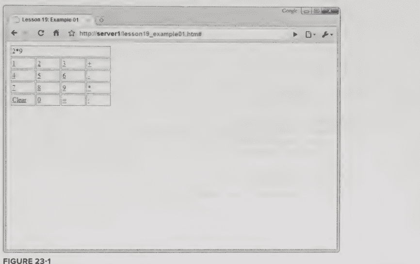

这并非坏事，因为在事件处理程序中看到 `return false` 并不能清楚地表明该语句的作用。但与此同时，取消事件默认行为的能力非常有用。幸运的是，还有另一种方法可以取消事件，但你仍然需要处理两种不同的实现方式。

标准的 `Event` 对象（由Chrome、Firefox、Safari、Opera和IE9支持）有一个名为 `preventDefault()` 的方法。它不接受任何参数；你只需调用该方法，浏览器就会取消事件的默认行为。因此，你只需在处理事件的函数中添加以下代码行，而不是返回 `false`：

```javascript
// 在事件对象上调用preventDefault()以取消事件
event.preventDefault();
```

在IE8及以下版本中取消事件需要不同的方法。IE的 `event` 对象有一个名为 `returnValue` 的属性，你需要将其赋值为 `false` 以取消事件。以下代码演示了这一点：

```javascript
// 将returnValue设置为false以取消事件
event.returnValue = false;
```

因此，你在各种浏览器中执行相同操作有两种完全不同的方式。与你添加到 `eventUtility` 的 `getTarget()` 方法一样，一个方法是在所有浏览器中执行事件取消的最简单、最有效的方式。让我们跳过编写单独的函数，直接将该方法添加到 `eventUtility` 对象中。以下代码添加了一个名为 `preventDefault()` 的新方法。它以粗体显示：

```javascript
var eventUtility = {
    addEvent : (function() {
        // 为打印而省略
    }()),

    removeEvent : (function() {
        // 为打印而省略
    }()),

    getTarget : (function() {
        // 为打印而省略
    }()),

    preventDefault : (function() {
        if (typeof addEventListener !== "undefined") {
            return function(event) {
                event.preventDefault();
            }
        } else {
            return function(event) {
                event.returnValue = false;
            }
        }
    }())
};
```

这个自执行函数根据 `addEventListener` 是否定义返回两个函数之一。同样，我们假设如果浏览器支持 `addEventListener()`，它就支持标准 `Event` 对象的 `preventDefault()` 方法，而不是IE的 `returnValue` 属性。

现在你已经向 `eventUtility` 对象添加了这两个新部分，让我们重新审视计算器和工具栏示例。

## 试一试

在本课中，你将学习如何通过编写一个统一的应用程序编程接口（API）来处理跨浏览器差异，该API在所有浏览器中执行工作。

## 课程要求

对于本课，你需要一个文本编辑器；任何纯文本编辑器都可以。对于Microsoft Windows用户，系统默认提供记事本，或者你可以下载Microsoft的免费Visual Web Developer Express（www.microsoft.com/express/web/）或Web Matrix（www.asp.net/webmatrix/）。Mac OS X用户可以使用TextMate（作为OS X的一部分提供），或者下载Coda的试用版（www.panic.com/coda/）。Linux用户可以使用内置的VIM。

你还需要一个现代网络浏览器。选择以下任一浏览器：

- Internet Explorer 8+
- Google Chrome
- Firefox 3.5+
- Apple Safari 4+
- Opera 10+

在你在第1课中创建的 `JS24Hour` 文件夹中创建一个名为 `Lesson23` 的子文件夹。将你在本课中创建的文件存储在 `Lesson23` 文件夹中。

## 分步指南

你将为IE重写第21课的工具栏脚本。使用事件委托来处理按钮的事件。

1. 在文本编辑器中打开 `eventutility.js`，并将 `getTarget()` 和 `preventDefault()` 方法添加到对象中。它们在以下代码中以粗体显示：

```javascript
var eventUtility = {
    addEvent : (function() {
        if (typeof addEventListener !== "undefined") {
            return function(obj, evt, fn) {
                obj.addEventListener(evt, fn, false);
            };
        } else {
            return function(obj, evt, fn) {
                obj.attachEvent("on" + evt, fn);
            };
        }
    }()),

    removeEvent : (function() {
        if (typeof removeEventListener !== "undefined") {
            return function(obj, evt, fn) {
                obj.removeEventListener(evt, fn, false);
            };
        } else {
            return function(obj, evt, fn) {
                obj.detachEvent("on" + evt, fn);
            };
        }
    }()),

    getTarget : (function() {
        if (typeof addEventListener !== "undefined") {
            return function(event) {
                return event.target;
            }
        } else {
            return function(event) {
                return event.srcElement;
            }
        }
    }()),

    preventDefault : (function() {
        if (typeof addEventListener !== "undefined") {
            return function(event) {
                event.preventDefault();
            }
        } else {
            return function(event) {
                event.returnValue = false;
            }
        }
    }())
};
```

2. 现在你将编写计算器的修改版本。这个新版本将包含多项改进：例如，它将使用事件工具的新功能、事件委托以及一个控制计算器的API（而不是函数）。打开文本编辑器的另一个实例，输入以下代码：

```html
<html>
<head>
<title>第23课：示例01</title>
<style type="text/css">
td {
    border: 1px solid gray;
    width: 50px;
}

#results {
    height: 20px;
}
</style>
</head>
<body>
<table border="0" cellpadding="2" cellspacing="2">
    <tr>
        <td colspan="4" id="results"></td>
    </tr>
    <tr>
        <td><a href="#">1</a></td>
        <td><a href="#">2</a></td>
        <td><a href="#">3</a></td>
        <td><a href="#">+</a></td>
    </tr>
    <tr>
        <td><a href="#">4</a></td>
        <td><a href="#">5</a></td>
        <td><a href="#">6</a></td>
        <td><a href="#">-</a></td>
    </tr>
    <tr>
        <td><a href="#">7</a></td>
        <td><a href="#">8</a></td>
        <td><a href="#">9</a></td>
        <td><a href="#">*</a></td>
    </tr>
    <tr>
        <td><a href="#">Clear</a></td>
        <td><a href="#">0</a></td>
        <td><a href="#">=</a></td>
        <td><a href="#">/</a></td>
    </tr>
</table>
<script type="text/javascript" src="eventutility.js"></script>
<script type="text/javascript">
var calculator = {
    resultField : document.getElementById("results"),

    reset : function() {
        this.resultField.innerHTML = "";
    },

    calculate : function() {
        this.resultField.innerHTML = eval(this.resultField.innerHTML);
    },

    addDigit : function(digit) {
        this.resultField.innerHTML += digit;
    }
};
</script>
</body>
</html>
```

从这段代码中可以看出，`reset()`、`calculate()`、`addDigit()` 和 `getHandlerFunction()` 函数已经消失。取而代之的是一个 `calculator` 对象，它使用对象字面量符号定义，包含一个 `resultField` 属性（HTML元素）、一个 `reset()` 方法、一个 `calculate()` 方法和一个 `addDigit()` 方法。这个新的 `calculator` 对象是对之前函数列表的改进。计算器的功能不仅被组织到一个单一实体（`calculator` 对象）中，而且表示结果字段的HTML元素对象被缓存在 `resultField` 属性中。各种方法可以使用这个属性，而不必每次调用时都执行DOM搜索。

3. 现在添加事件委托代码，此处以粗体显示：

```html
<html>
<head>
    <title>第23课：示例01</title>
    <style type="text/css">
        td {
            border: 1px solid gray;
            width: 50px;
        }

        #results {
            height: 20px;
        }
    </style>
</head>
<body>
<table border="0" cellpadding="2" cellspacing="2">
    <tr>
        <td colspan="4" id="results"></td>
    </tr>
    <tr>
        <td><a href="#">1</a></td>
        <td><a href="#">2</a></td>
        <td><a href="#">3</a></td>
        <td><a href="#">+</a></td>
    </tr>
    <tr>
        <td><a href="#">4</a></td>
        <td><a href="#">5</a></td>
        <td><a href="#">6</a></td>
        <td><a href="#">-</a></td>
    </tr>
    <tr>
        <td><a href="#">7</a></td>
        <td><a href="#">8</a></td>
        <td><a href="#">9</a></td>
        <td><a href="#">*</a></td>
    </tr>
    <tr>
        <td><a href="#">Clear</a></td>
        <td><a href="#">0</a></td>
        <td><a href="#">=</a></td>
        <td><a href="#">/</a></td>
    </tr>
</table>
<script type="text/javascript" src="eventutility.js"></script>
<script type="text/javascript">
var calculator = {
    resultField : document.getElementById("results"),

    reset : function() {
        this.resultField.innerHTML = "";
    },

    calculate : function() {
        this.resultField.innerHTML = eval(this.resultField.innerHTML);
    },

    addDigit : function(digit) {
        this.resultField.innerHTML += digit;
    }
};

eventUtility.addEvent(document, "click", function(event) {
    var target = eventUtility.getTarget(event);

    if (target.tagName.toUpperCase() === "A") {
        var innerHTML = target.innerHTML;

        switch (innerHTML) {
            case "Clear":
                calculator.reset();
                break;
            case "=":
                calculator.calculate();
                break;
            default:
                calculator.addDigit(innerHTML);
                break;
        }

        eventUtility.preventDefault(event);
    }
});
</script>
</body>
</html>
```

你需要处理的唯一事件是 `click` 事件，并且你需要在文档级别处理它。事件处理程序的第一行使用新的 `getTarget()` 方法获取事件目标。接下来，代码确定目标是否为 `<a/>` 元素，然后 `switch` 块确定要执行哪个 `calculator` 方法。`if` 块中的最后一条语句取消了默认事件的行为，你可以通过在任何浏览器中运行它并在 URL 中看不到井号来验证其效果。

4. 现在你将修改工具栏脚本以使用新的 `getTarget()` 方法。打开 `lesson22_example01.htm` 并将其另存为 `lesson23_example02.htm`。更改以下代码中的粗体行：

```html
<html>
<head>
    <title>Lesson 23: Example 02</title>
    <style type="text/css">
        #divContainer {
            background-color: silver;
            height: 50px;
            padding: 2px;
        }

        span {
            display: inline-block;
            width: 50px;
            height: 50px;
        }

        .button-normal {
            background-color: gray;
        }

        .button-over {
            background-color: navy;
        }

        .button-click {
            background-color: yellow;
        }
    </style>
</head>
<body>
    <div id="divContainer">
        <span class="button-normal"></span>
        <span class="button-normal"></span>
        <span class="button-normal"></span>
    </div>
    <script type="text/javascript" src="eventutility.js"></script>
    <script type="text/javascript">
    function mouseHandler(event) {
        var eSrc = eventUtility.getTarget(event),
            type = event.type;

        if (eSrc.tagName.toUpperCase() === "SPAN") {
            if (type === "mouseover") {
                if (eSrc.className !== "button-click") {
                    eSrc.className = "button-over";
                }
            } else if (type === "mouseout") {
                if (eSrc.className !== "button-click") {
                    eSrc.className = "button-normal";
                }
            } else if (type === "click") {
                if (eSrc.className !== "button-click") {
                    eSrc.className = "button-click";
                } else {
                    eSrc.className = "button-over";
                }
            }
        }
    }

    eventUtility.addEvent(document, "mouseover", mouseHandler);
    eventUtility.addEvent(document, "mouseout", mouseHandler);
    eventUtility.addEvent(document, "click", mouseHandler);
    </script>
</body>
</html>
```

这是一个简单的更改，但页面现在可以在每个现代浏览器中工作。请打开它，你会发现它运行良好。

要获取示例代码文件，你可以从本书网站 www.wrox.com 下载第 23 课。

> 请在 DVD 上选择第 23 课，以查看伴随本课的视频。

# 24 拖放功能

JavaScript 能为任何网页增添丰富的交互性，这种交互性过去只有传统应用程序才能提供。例如，看看你电脑的桌面。很可能有一个图标，你可以点击并将其拖动到任何你想要的位置。这就是用户所期望的交互级别，而如果没有 JavaScript 或 Flash、Silverlight 等插件，在网页上提供这种交互性是不可能的。

在本课中，你将学习如何：

- 获取鼠标指针的位置。
- 移动页面上的元素。
- 使用事件来实现拖放功能。

然后，你将通过编写一个拖放脚本来应用这些知识。

## 获取鼠标指针的位置

对于拖放功能，你需要的最重要信息是鼠标指针的坐标。但实际上，你需要以两种不同的方式来表示这些信息。首先，你需要知道鼠标指针相对于页面的坐标；没有这些坐标，你就不知道要将项目拖动到哪里。

你还需要知道鼠标指针相对于你想要拖动的 HTML 元素的位置。这很重要，因为在将元素拖动到新位置时，你需要保持鼠标指针在元素上的位置。如果没有这些信息，点击并拖动元素会导致元素的左上角吸附到鼠标指针上，如图 24-1 所示。

让我们从获取鼠标指针相对于页面的位置开始。

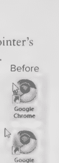

## 客户端坐标

要获取此信息，请再次查看标准和 Internet Explorer (IE) 事件模型中的事件对象。值得庆幸的是，在处理此类信息时，两种事件模型是同步的。你完全不需要扩展 `eventUtility` 对象的功能，因为这些属性具有相同的名称和用途。

实际上，你可以从事件对象中检索两组与鼠标指针相关的坐标。第一组是指针相对于整个屏幕的位置。你可以通过使用 `screenX` 和 `screenY` 属性来获取此信息，如下所示：

```
eventUtility.addEvent(document, "click", function(event) {
    alert("X Coordinate is: " + event.screenX); // 指针的水平位置
    alert("Y Coordinate is: " + event.screenY); // 指针的垂直位置
});
```

这些信息可能有用，但不太适合拖放操作。屏幕大小是固定的，因此无论鼠标在屏幕上的哪个位置移动，使用 `screenX` 和 `screenY` 时，你都受限于屏幕的尺寸。最重要的是，`screenX` 和 `screenY` 坐标是相对于整个屏幕的，这不是你想要的信息。更好的解决方案是使用相对于客户端区域（显示文档的窗口部分，也称为视口）的一组坐标。图 24-2 概述了这个区域。

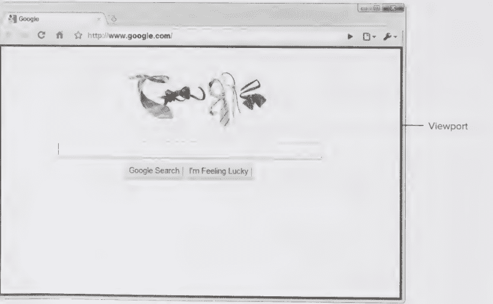

你可以通过使用 `clientX` 和 `clientY` 属性来获取此信息，如下所示：

```
eventUtility.addEvent(document, "click", function(event) {
    alert("X Coordinate is: " + event.clientX); // 指针的水平位置
    alert("Y Coordinate is: " + event.clientY); // 指针的垂直位置
});
```

与屏幕坐标系一样，客户端坐标系的大小是固定的（视口的大小）。例如，点击视口的左上角总是得到 `clientX` 值为 0——无论页面是否水平滚动。`clientX` 和 `clientY` 坐标是相对于视口的，而不是文档的，但你可以获取另外两个信息与客户端坐标结合，以准确获取指针的位置：`document.body.scrollTop` 和 `document.body.scrollLeft` 属性。

`scrollTop` 和 `scrollLeft` 是所有元素对象的属性，它们获取元素滚动条的垂直或水平位置。当在 `body` 对象上使用时，这些属性返回滚动条已滚动的像素数。当滚动条位于顶部（或水平滚动条位于左侧）时，位置为 0。

要获取鼠标指针在文档中的准确位置，你需要将客户端坐标与 body 的滚动位置结合起来，如下所示：

```
var x = event.clientX + document.body.scrollLeft;
var y = event.clientY + document.body.scrollTop;
```

## 元素坐标

每个元素都有一组属性，允许你获取该元素的位置和大小信息。它们不是任何 W3C 标准的一部分，但自 IE4 首次引入以来，所有主要浏览器都已实现它们。它们是：

- `offsetLeft`：获取元素相对于其最近定位祖先的左侧位置。
- `offsetTop`：获取元素相对于其最近定位祖先的顶部位置。
- `offsetWidth`：获取元素相对于其最近定位祖先的宽度。此属性返回的值还包括元素的内边距、外边距和边框宽度。
- `offsetHeight`：获取元素相对于其最近定位祖先的高度。此属性返回的值还包括元素的内边距、外边距和边框宽度。

当你需要知道元素在浏览器中渲染时的位置和尺寸时，这四个属性非常有用。对于拖放功能，你唯一需要查看的属性是 `offsetLeft` 和 `offsetTop`。

要找到鼠标指针相对于某个元素的坐标，你需要使用该元素的 `offsetLeft` 和 `offsetTop` 属性，然后减去事件对象的 `clientX` 和 `clientY` 属性，如下所示：

```
eventUtility.addEvent(document, "click", function(event) {
    var eSrc = eventUtility.getTarget(event);
    var x = event.clientX + document.body.scrollLeft;
    var y = event.clientY + document.body.scrollTop;
    var relativeX = eSrc.offsetLeft - x;
    var relativeY = eSrc.offsetTop - y;
});
```

在这段代码中，`eventUtility` 对象通过使用 `getTarget()` 方法获取事件目标，并将返回值赋给 `eSrc`。然后，创建两个变量 `relativeX` 和 `relativeY`，并通过偏移坐标与鼠标指针坐标的计算来为它们赋值。同样，这些相对坐标很重要，因为要准确模拟用户在操作系统中习惯看到的行为，它们是必不可少的。

有了这两组坐标，你就已经具备了编写拖放脚本的所有关键要素。拼图还差最后一块：事件。

## 拖放中使用的事件

拖放是一系列完全由鼠标控制的操作。用户点击一个项目，然后在按住鼠标按钮的同时移动鼠标。当鼠标按钮释放时，项目就被“放置”在鼠标指针的位置。要使拖放在网页上工作，你必须处理至少三个与鼠标相关的事件：

- `mousedown`：当鼠标指针在对象上时按下鼠标按钮触发。
- `mouseup`：当鼠标指针在对象上时释放鼠标按钮触发。
- `mousemove`：当鼠标指针在对象上移动时触发。

`mousedown` 事件启动拖动过程，`mousemove` 事件用于使元素与鼠标指针同步移动（拖动），而 `mouseup` 事件结束拖动过程并将元素放置在指针位置。

那么，让我们将所有这些知识付诸实践，尝试一下。

## 试一试

在本课中，你学习了事件对象的 `clientX` 和 `clientY` 属性，以及元素的 `offsetLeft` 和 `offsetTop` 属性。在本节中，你将学习如何在创建拖放脚本中使用它们。

## 课程要求

对于本课，你需要一个文本编辑器；任何纯文本编辑器都可以。对于 Microsoft Windows 用户，系统默认提供记事本，或者你可以下载 Microsoft 免费的 Visual Web Developer Express (www.microsoft.com/express/web/) 或 Web Matrix (www.asp.net/webmatrix/)。Mac OS X 用户可以使用 TextMate（作为 OS X 的一部分提供），或下载 Coda 的试用版 (www.panic.com/coda/)。Linux 用户可以使用内置的 VIM。

你还需要一个现代的 Web 浏览器。选择以下任一浏览器：

- Internet Explorer 8+
- Google Chrome
- Firefox 3.5+
- Apple Safari 4+
- Opera 10+

在你在第 1 课中创建的 `JS24Hour` 文件夹中，创建一个名为 `Lesson24` 的子文件夹。将你在本课中创建的文件存储在 `Lesson24` 文件夹中。

## 分步操作

1. 首先输入以下 HTML：

```html
<html>
<head>
    <title>Lesson 24: Example 01</title>
    <style type="text/css">
        .draggable {
            position: absolute;
            cursor: move;
        }

        .box {
            width: 100px;
            height: 100px;
        }

        .navy {
            background-color: navy;
        }

        .green {
            background-color: Green;
        }
    </style>
</head>
<body>
<div class="navy box draggable"></div>
<div class="green box draggable"></div>
<script type="text/javascript" src="eventutility.js"></script>
<script type="text/javascript">
</script>
</body>
</html>
```

这是你网页的基础。它包含一个样式表，其中有四个 CSS 类：`draggable`、`box`、`navy` 和 `green`。

`draggable` 类将元素的位置设置为绝对定位，使得具有此类的元素可以在页面中的任何位置移动。它还将鼠标指针更改为移动符号。这是给用户的视觉提示，让她知道该元素是可移动的。此类用于使元素可拖动。你编写的 JavaScript 将确定元素是否使用此类，用户将能够将其拖动到页面上的任何位置。

`box` 类纯粹用于呈现。应用于元素时，它将元素渲染为一个边长为 100 像素的正方形。

`navy` 和 `green` 类也纯粹用于呈现。它们分别将元素的背景颜色更改为海军蓝和绿色。

在页面的 `<body/>` 中有两个 `<div/>` 元素。第一个使用 `navy`、`box` 和 `draggable` 类将元素渲染为一个具有绝对定位的海军蓝方块。第二个使用 `green`、`box` 和 `draggable` 类。

2. 现在你想添加一些 JavaScript。第一小部分是 `mouseHandler()` 函数，你用它来处理各种事件。新代码以粗体显示：

```html
<html>
<head>
    <title>Lesson 24: Example 01</title>
    <style type="text/css">
        .draggable {
            position: absolute;
            cursor: move;
        }

        .box {
            width: 100px;
            height: 100px;
        }

        .navy {
            background-color: navy;
        }

        .green {
            background-color: Green;
        }
    </style>
</head>
<body>
<div class="navy box draggable"></div>
<div class="green box draggable"></div>
<script type="text/javascript" src="eventutility.js"></script>
<script type="text/javascript">
function mouseHandler(event) {
    var eSrc = eventUtility.getTarget(event);
    var type = event.type;
    var x = event.clientX + document.body.scrollLeft;
    var y = event.clientY + document.body.scrollTop;

    switch (type) {
        case "mousedown":
            if (eSrc.className.indexOf("draggable") > -1) {
            }
            break;
        case "mouseup":
            break;
        case "mousemove":
            break;
    }
}

eventUtility.addEvent(document, "mousedown", mouseHandler);
eventUtility.addEvent(document, "mouseup", mouseHandler);
eventUtility.addEvent(document, "mousemove", mouseHandler);
</script>
</body>
</html>
```

通过这段代码，一些部分开始组合在一起。为文档对象设置了 `mousedown`、`mouseup` 和 `mousemove` 事件的事件处理程序，`mouseHandler()` 函数处理所有这三个事件。

函数中的第一条语句创建了四个变量。第一个是 `eSrc`，即事件目标。接下来是 `type`，即事件类型。接下来是 `x` 和 `y` 变量，用于包含鼠标指针的坐标。

因为这个函数处理多个事件，你需要确定发生了什么事件。一个 `switch` 语句使用事件类型，并为三个事件中的每一个编写一个 `case` 块。

当用户触发 `mousedown` 事件时，你使用 `indexOf()` 字符串方法来确定目标是否具有 `draggable` CSS 类。你只想拖动具有此 CSS 类的元素，因此所有启动拖放序列的代码都将放在 `if` 代码块内。

3. 为了方便拖放过程，在 `mouseHandler()` 函数外部创建一个名为 `dragObj` 的对象。它的职责是初始化要拖动的元素，以及包含有关拖动过程状态的信息。添加以下代码：

```html
<html>
<head>
    <title>Lesson 24: Example 01</title>
    <style type="text/css">
        .draggable {
            position: absolute;
            cursor: move;
        }

        .box {
            width: 100px;
            height: 100px;
        }

        .navy {
            background-color: navy;
        }

        .green {
            background-color: Green;
        }
    </style>
</head>
<body>
<div class="navy box draggable"></div>
<div class="green box draggable"></div>
<script type="text/javascript" src="eventutility.js"></script>
<script type="text/javascript">
var dragObj = {
    setDragObj : function(el, mouseX, mouseY) {
        this.el = el;
        this.relativeLeft = el.offsetLeft - mouseX;
        this.relativeTop = el.offsetTop - mouseY;
    },

    dragTo : function(x, y) {
        this.el.style.left = x + this.relativeLeft + "px";
        this.el.style.top = y + this.relativeTop + "px";
    },

    dragging : false,
    el : null,
    relativeTop : 0,
    relativeLeft : 0
};
</script>
</body>
</html>
```

这个 `dragObj` 对象有四个属性：

- `dragging`：一个布尔值，用于设置元素是否正在被拖动
- `el`：要拖动的元素
- `relativeTop`：鼠标光标相对于元素的垂直位置
- `relativeLeft`：鼠标光标相对于元素的水平位置

`dragObj` 对象还有两个方法：

- `setDragObj()`：接受要拖动的元素以及鼠标指针的 x 和 y 坐标作为参数。此方法初始化拖动元素所需的所有数据。它将 `el` 属性设置为将被拖动的元素，并通过获取元素的偏移坐标减去鼠标指针的坐标来设置 `relativeLeft` 和 `relativeTop` 属性。
- `dragTo()`：接受一组坐标作为参数，并使用元素的 `style` 对象将其 `left` 和 `top` 属性设置为提供的坐标与相对坐标之和。字符串 `px` 被附加到每个值后面。在设置元素的大小和位置时，添加单位总是一个好主意。符合标准的浏览器在没有单位的情况下不会调整元素的大小或位置。

4. 现在使用 `dragObj` 来实现拖放序列。添加以下粗体代码：

```html
<html>
<head>
    <title>Lesson 24: Example 01</title>
    <style type="text/css">
        .draggable {
            position: absolute;
            cursor: move;
        }

        .box {
            width: 100px;
            height: 100px;
        }

        .navy {
            background-color: navy;
        }

        .green {
            background-color: Green;
        }
    </style>
</head>
<body>
<div class="navy box draggable"></div>
<div class="green box draggable"></div>
<script type="text/javascript" src="eventutility.js"></script>
<script type="text/javascript">
var dragObj = {
    setDragObj : function(el, mouseX, mouseY) {
        this.el = el;
        this.relativeLeft = el.offsetLeft - mouseX;
        this.relativeTop = el.offsetTop - mouseY;
    },

    dragTo : function(x, y) {
        this.el.style.left = x + this.relativeLeft + "px";
        this.el.style.top = y + this.relativeTop + "px";
    },

    dragging : false,
    el : null,
    relativeTop : 0,
    relativeLeft : 0
};

function mouseHandler(event) {
    var eSrc = eventUtility.getTarget(event);
    var type = event.type;
    var x = event.clientX + document.body.scrollLeft;
    var y = event.clientY + document.body.scrollTop;

    switch (type) {
        case "mousedown":
            if (eSrc.className.indexOf("draggable") > -1) {
                dragObj.dragging = true;
                dragObj.setDragObj(eSrc, x, y);
            }
            break;
        case "mouseup":
            dragObj.dragging = false;
            break;
        case "mousemove":
            if (dragObj.dragging) {
                dragObj.dragTo(x, y);
            }
            break;
    }
}

eventUtility.addEvent(document, "mousedown", mouseHandler);
eventUtility.addEvent(document, "mouseup", mouseHandler);
eventUtility.addEvent(document, "mousemove", mouseHandler);
</script>
</body>
</html>
```

第一段新代码行位于 `mousedown` 情况的 `if` 块内。你将 `dragObj` 的 `dragging` 属性设置为 `true`，并调用 `setDragObj()` 方法来准备要拖动的元素。

接下来，你在 `mouseup` 情况下添加一行代码；你将 `dragging` 属性设置为 `false`。

然后，在 `mousemove` 情况下，你判断 `dragObj.dragging` 是否为 `true`。如果用户在鼠标位于具有 CSS 类 `draggable` 的元素上时按住鼠标按钮，那么 `dragObj.dragging` 将为 `true`。如果为 `true`，你希望调用 `dragTo()` 方法将元素移动到当前鼠标指针的坐标位置。

当用户释放鼠标按钮时，`dragObj.dragging` 将为 `false`，并且当 `mousemove` 事件触发时，元素将停止移动。

5. 将此文件保存为 `lesson24_example01.htm`，并在任何浏览器中打开它。将绿色方框拖动到页面上的另一个位置，然后对海军蓝方框执行相同操作。

你可能会注意到的一件事是，海军蓝方框总是在绿色方框的后面。在传统的拖放实现中，当前正在拖动的项目应该是屏幕上最顶层的项目。例如，拖动你的文本编辑器窗口和浏览器窗口相互覆盖，你会看到你当前正在拖动的窗口位于另一个窗口之上，如图 24-3 所示。

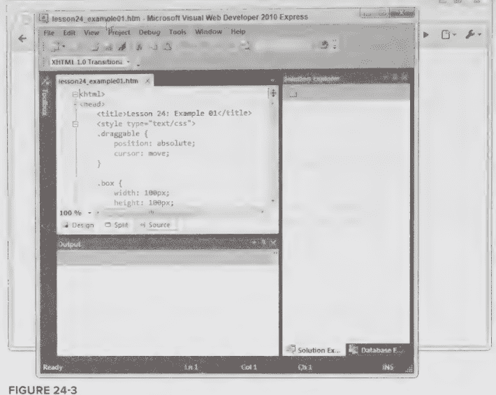

图 24-3

你可以通过修改元素的 `z-index` CSS 属性，为你的拖放脚本添加相同的功能。

6. 为了使此功能尽可能简单地工作，向 `dragObj` 添加一个 `zIndex` 属性并给它一个初始值 1，如以下粗体代码所示：

```html
<html>
<head>
    <title>Lesson 24: Example 01</title>
    <style type="text/css">
    .draggable {
        position: absolute;
        cursor: move;
    }

    .box {
        width: 100px;
        height: 100px;
    }

    .navy {
        background-color: navy;
    }

    .green {
        background-color: Green;
    }
</style>
</head>
<body>
<div class="navy box draggable"></div>
<div class="green box draggable"></div>
<script type="text/javascript" src="eventutility.js"></script>
<script type="text/javascript">
var dragObj = {
    setDragObj : function(el, mouseX, mouseY) {
        this.el = el;
        this.relativeLeft = el.offsetLeft - mouseX;
        this.relativeTop = el.offsetTop - mouseY;
        this.el.style.zIndex = this.zIndex++;
    },

    dragTo : function(x, y) {
        this.el.style.left = x + this.relativeLeft + "px";
        this.el.style.top = y + this.relativeTop + "px";
    },

    dragging : false,
    el : null,
    relativeTop : 0,
    relativeLeft : 0,
    zIndex : 1
};

function mouseHandler(event) {
    var eSrc = eventUtility.getTarget(event);
    var type = event.type;
    var x = event.clientX + document.body.scrollLeft;
    var y = event.clientY + document.body.scrollTop;

    switch (type) {
        case "mousedown":
            if (eSrc.className.indexOf("draggable") > -1) {
                dragObj.dragging = true;
                dragObj.setDragObj(eSrc, x, y);
            }
            break;
        case "mouseup":
            dragObj.dragging = false;
            break;
        case "mousemove":
            if (dragObj.dragging) {
                dragObj.dragTo(x, y);
            }
            break;
    }
}

eventUtility.addEvent(document, "mousedown", mouseHandler);
eventUtility.addEvent(document, "mouseup", mouseHandler);
eventUtility.addEvent(document, "mousemove", mouseHandler);
</script>
</body>
</html>
```

这段新代码还向 `setDragObj()` 添加了一行，将 `style.zIndex` 属性设置为 `dragObj.zIndex` 属性的递增值。

7. 重新保存文件并刷新浏览器。现在在页面上拖动两个方框。你会看到你拖动的任何一个方框都会变成最顶层的方框——就像你操作系统的拖放功能一样。

要获取示例代码文件，你可以从本书网站 www.wrox.com 下载第24课。

> 请在 DVD 上选择第24课，以查看伴随本课的视频。

# 25 定时器与元素动画

用户已经习惯于他们所使用的应用程序——尤其是操作系统——达到一定的精致程度。每个新版本都会增加更多视觉上的优化，虽然并非完全必要，但能提升用户体验。像菜单的淡入淡出、窗口在最大化和最小化时的缩放等特性，就是如何通过不显眼的动画在保持显示或隐藏菜单、调整窗口大小等原始功能的同时，增添视觉魅力的绝佳例子。

在第24课中，你允许用户点击一个元素并将其拖动到他希望的位置；你本质上编写了一个动画脚本。这个动画是有限的，并且依赖于用户的操作，但元素会与鼠标指针同步移动到不同的坐标位置——这是一种移动动画。

像菜单淡入淡出这样的动画则不太依赖于用户交互。当然，用户必须触发一个事件来启动动画，但菜单是在一段时间内淡入的——而不是与用户移动鼠标指针的位置相关。

这种类型的动画类似于电影或卡通——角色流畅的动作被分解成许多帧，并以快速的顺序显示。每帧显示一定的时间（通常是三十分之一秒），以模拟屏幕上的运动。

在网页上，你使用定时器在一段时间内逐步（或逐帧）修改一个元素（角色）。在本课中，你将学习两种用于计时的方法。然后，你将使用这些定时器来创建动画。

## 设置延迟——`setTimeout()` 方法

第一种方法是 `setTimeout()` 方法。它是 `window` 对象的一个成员，因此是全局的。它本质上是一个延迟：其目的是在一定时间后执行一次函数。

它接受两个参数：一个要执行的函数和执行代码前等待的毫秒数。其语法如下所示：

```
function doSomething() {
    alert("Hello, timeout!");
}

var timer = setTimeout(doSomething, 1000);
```

`setTimeout()` 方法返回一个数值，即计时器的唯一ID。虽然不一定需要使用这个ID，但它确实很方便，稍后你就会看到。

在这段代码中，`setTimeout()` 方法被调用时，将 `doSomething()` 函数作为第一个参数传递，将数值1000作为第二个参数传递。记住，第二个参数是以毫秒为单位的时间。数字1000实际上代表一秒钟。

`setTimeout()` 方法执行后，JavaScript引擎会等待一秒钟，然后执行 `doSomething()`。然而，引擎不会延迟 `setTimeout()` 调用之后可能出现的任何语句——它只延迟 `doSomething()` 的执行。例如，看看下面的代码：

```
function doSomething() {
    alert("Hello, timeout!");
}

var timer = setTimeout(doSomething, 1000);
alert("After setTimeout() call");
```

这段代码在上一个示例的末尾添加了一条语句。当这段代码执行时，`setTimeout()` 调用将 `doSomething()` 函数排队，以便在一秒钟后调用，然后一个警告框显示文本 "After setTimeout() call."。然后，只有在调用 `setTimeout()` 一秒钟之后，`doSomething()` 才会执行。因此，引擎不会延迟所有代码；它只延迟作为 `setTimeout()` 第一个参数指定的代码。

尽管 `setTimeout()` 是一个一次性计时器，但你可以使用一种递归（函数调用自身）的形式，在每次 `doSomething()` 执行时调用 `setTimeout()`。看看下面的代码，它从上一个示例中移除了 `alert()` 调用，并在 `doSomething()` 中添加了一行新代码（加粗显示）：

```
function doSomething() {
    alert("Hello, timeout!");
    timer = setTimeout(doSomething, 1000);
}

var timer = setTimeout(doSomething, 1000);
```

这是一个简单的修改，但它极大地改变了代码的行为方式。它创建了一个无限循环。函数外部的 `setTimeout()` 调用通过设置一个一秒钟的超时来启动循环，然后执行 `doSomething()`。然后，当一秒钟到期时，`doSomething()` 执行，它设置另一个一秒钟的超时来再次调用 `doSomething()`。每次 `doSomething()` 执行时，都会设置一个新的 one-second 超时来调用 `doSomething()`。

注意 `timer` 变量是如何被重用的。由于 `doSomething()` 在超时到期时执行，存储在 `timer` 中的超时ID就变得无用了。因此，不是创建一个新变量，而是重用 `timer` 来存储新超时的ID。这是有利的，因为正如你可能猜到的，像前面那样的循环可能会带来麻烦。一个永无止境的循环，尤其是每秒钟弹出一个警告窗口的循环，可能会非常烦人。

值得庆幸的是，当 `setTimeout()` 被添加到 Netscape 2 时，一个名为 `clearTimeout()` 的配套方法也被包含在内。顾名思义，它取消使用 `setTimeout()` 设置的超时，并接受一个超时ID作为参数。看看下面的代码，看看它的实际效果：

```
function doSomething() {
    alert("Hello, timeout!");
    timer = setTimeout(doSomething, 1000);
}

var timer = setTimeout(doSomething, 1000);
clearTimeout(timer);
```

调用 `clearTimeout()` 并传递 `timer` 会在超时到期之前取消设置的超时。记住，`setTimeout()` 不会延迟其余代码的执行。因此，超时被清除，`doSomething()` 永远不会执行。

> 对已过期的计时器ID调用 `clearTimeout()` 不会产生任何效果，也不会抛出错误。

许多年前，`setTimeout()` 经常用于在特定时间间隔内执行某个函数一定次数，如下代码所示：

```
function doSomething() {
    if (counter < 5) {
        alert("Hello, timeout!");
        counter++;
        timer = setTimeout(doSomething, 1000);
    }
}

var counter = 0;
var timer = setTimeout(doSomething, 1000);
```

这段代码添加了一个 `counter` 变量，只要 `counter` 的值小于5，`setTimeout()` 就会再次延迟 `doSomething()` 的执行。如果 `counter` 大于5，则不再发出超时，循环退出。

这种使用时间延迟重复函数的方法至今仍在使用，但 `setTimeout()` 通常更适用于延迟函数的执行。如果你想在固定的时间间隔内重复函数调用，请使用 `setInterval()` 方法。

## 设置间隔 — `setInterval()` 方法

正如上一节所暗示的，`setInterval()` 方法以固定的时间间隔执行一个函数。以下代码以一秒钟的固定间隔执行 `doSomething()` 函数：

```
function doSomething() {
    alert("Hello, timeout!");
}

var timer = setInterval(doSomething, 1000);
```

`doSomething()` 将每秒执行一次，直到在代码中取消它或在浏览器中加载不同的页面。与 `setTimeout()` 类似，`setInterval()` 方法返回一个唯一的计时器ID，可以传递给配套方法 `clearInterval()`。以下代码使用 `setInterval()` 和 `clearInterval()` 重新创建了上一节中的超时：

```
function doSomething() {
    if (counter < 5) {
        alert("Hello, timeout!");
        counter++;
    } else {
        clearInterval(timer);
    }
}

var counter = 0;
var timer = setInterval(doSomething, 1000);
```

不需要多次调用 `setInterval()`；它的任务是在允许的情况下重复提供的函数。因此，代码确定 `counter` 是否小于5，如果不是，则调用 `clearInterval()` 来清除计时器。

> `setInterval()` 会等待指定的时间过去后，才第一次执行提供的函数。

`setInterval()` 和 `clearInterval()` 方法广泛用于执行动画，你现在将使用它们来创建一个调整方框大小的动画脚本。

## 试一试

在本课中，你学习了计时器及其用途。在本节中，你将使用其中一个 `setInterval()` 来为元素制作动画。

## 课程要求

对于本课，你需要一个文本编辑器；任何纯文本编辑器都可以。对于 Microsoft Windows 用户，系统默认提供记事本，或者你可以下载 Microsoft 免费的 Visual Web Developer Express (www.microsoft.com/express/web/) 或 Web Matrix (www.asp.net/webmatrix/)。Mac OS X 用户可以使用 TextMate，它是 OS X 的一部分，或者下载 Coda 的试用版 (www.panic.com/coda/)。Linux 用户可以使用内置的 VIM。

你还需要一个现代的网络浏览器。选择以下任一：

- Internet Explorer 8+
- Google Chrome
- Firefox 3.5+
- Apple Safari 4+
- Opera 10+

在你在第1课中创建的 `JS24Hour` 文件夹中创建一个名为 `Lesson25` 的子文件夹。将你在本课中创建的文件存储在 `Lesson25` 文件夹中。

## 分步操作

1. 首先输入以下 HTML：

```html
<html>
<head>
    <title>Lesson 25: Example 01</title>
    <style type="text/css">
    .box {
        width: 100px;
        height: 100px;
        background-color: navy;
    }
    </style>
</head>
<body>
<div id="divNavyBox" class="box"></div>
<script type="text/javascript">
</script>
</body>
</html>
```

这是你的网页的基础。它有一个样式表，其中包含一个名为 `box` 的 CSS 类。此类将元素的高度和宽度设置为 100px，并为其提供海军蓝的背景色。在 `<body/>` 内部是一个 ID 为 `divNavyBox` 的 `<div/>` 元素，它使用了 `box` 类。

2. 现在添加一些 JavaScript 代码。创建一个名为 `animated` 的对象，并为其赋予以下代码中的成员：

```html
<html>
<head>
    <title>Lesson 25: Example 01</title>
    <style type="text/css">
    .box {
        width: 100px;
        height: 100px;
        background-color: navy;
    }
    </style>
</head>
<body>
<div id="divNavyBox" class="box"></div>
<script type="text/javascript">
var animated = {
    timer : null,
    el : document.getElementById("divNavyBox"),

    startGrowAnimation : function() {
    },

    startShrinkAnimation : function() {
    },

    stopAnimation : function() {
        clearInterval(this.timer);
    },

    doAnimation : function(amount) {
    }
};
</script>
</body>
</html>
```

这段代码向 `animated` 对象添加了几个成员。`timer` 属性包含间隔的唯一ID；`el` 属性包含 `<div/>` 元素对象；四个方法启动、停止和执行动画。`stopAnimation()` 方法很简单：它调用 `clearInterval()` 并传递 `timer` 属性。

3. 让我们从 `doAnimation()` 方法开始。它的目的是执行增长和收缩动画。它接受一个参数，一个数值，可以是正数也可以是负数。如果是正数，方框按指定的量增长。如果是负数，方框按指定的量收缩。方法的主体加粗显示：

```html
<html>
<head>
    <title>Lesson 25: Example 01</title>
    <style type="text/css">
    .box {
        width: 100px;
        height: 100px;
        background-color: navy;
    }
    </style>
</head>
<body>
<div id="divNavyBox" class="box"></div>
<script type="text/javascript">
var animated = {
    timer : null,
    el : document.getElementById("divNavyBox"),

    startGrowAnimation : function() {
    },

    startShrinkAnimation : function() {
    },

    stopAnimation : function() {
        clearInterval(this.timer);
    },

    doAnimation : function(amount) {
        var size = this.el.offsetWidth;

        if ((amount > 0 && size < 200) || (amount < 0 && size > 0)) {
            this.el.style.width = size + amount + "px";
            this.el.style.height = size + amount + "px";
        } else {
            this.stopAnimation();
        }
    }
};
</script>
</body>
</html>
```

因为 `<div/>` 元素是方形的，`doAnimation()` 方法通过仅使用元素的 `offsetWidth` 属性获取其宽度来保持简单。

接下来，一个 `if` 语句通过判断 `amount` 是正数还是负数来决定是增大还是缩小元素。它还决定了元素变得多大或多小。如果 `amount` 是正数，元素将增长到最大200像素高和宽。如果是负数，元素将缩小到最小0像素。只要元素的尺寸在硬编码的限制范围内，就会按指定的量调整其尺寸，并且当达到任一限制时，`stopAnimation()` 方法就会执行。

4. 现在在以下代码中添加粗体部分：

```html
<html>
<head>
    <title>Lesson 25: Example 01</title>
    <style type="text/css">
        .box {
            width: 100px;
            height: 100px;
            background-color: navy;
        }
    </style>
</head>
<body>
<div id="divNavyBox" class="box"></div>
<script type="text/javascript">
var animated = {
    timer : null,
    el : document.getElementById("divNavyBox"),

    startGrowAnimation : function() {
        this.stopAnimation();
        this.timer = setInterval(function() {
            animated.doAnimation(5);
        }, 10);
    },

    startShrinkAnimation : function() {
    },

    stopAnimation : function() {
        clearInterval(this.timer);
    },

    doAnimation : function(amount) {
        var size = this.el.offsetWidth;

        if ((amount > 0 && size < 200) || (amount < 0 && size > 0)) {
            this.el.style.width = size + amount + "px";
            this.el.style.height = size + amount + "px";
        } else {
            this.stopAnimation();
        }
    }
};
</script>
</body>
</html>
```

这段代码的第一行调用了 `stopAnimation()`。这绝对至关重要，因为如果在另一个动画进行时调用 `startGrowAnimation()`，`timer` 属性将被一个新的定时器ID覆盖，而正在运行的间隔定时器只有在页面重新加载时才会停止。通过首先调用 `stopAnimation()`，你可以停止当前动画（如果有的话），并安全地开始增长动画。

第二条语句调用 `setInterval()` 并传递一个匿名函数给它。匿名函数内部是对 `animated.doAnimation()` 的调用，传递的值为5。这里使用匿名函数是因为你需要向 `doAnimation()` 方法传递一个值才能使其工作。

5. 现在添加 `startShrinkAnimation()` 的代码。它与 `startGrowAnimation()` 的代码非常相似。新代码在以下内容中以粗体显示：

```html
<html>
<head>
    <title>Lesson 25: Example 01</title>
    <style type="text/css">
        .box {
            width: 100px;
            height: 100px;
            background-color: navy;
        }
    </style>
</head>
<body>
<div id="divNavyBox" class="box"></div>
<script type="text/javascript">
var animated = {
    timer : null,
    el : document.getElementById("divNavyBox"),

    startGrowAnimation : function() {
        this.stopAnimation();
        this.timer = setInterval(function() {
            animated.doAnimation(5);
        }, 10);
    },

    startShrinkAnimation : function() {
        this.stopAnimation();
        this.timer = setInterval(function() {
            animated.doAnimation(-5);
        }, 10);
    },

    stopAnimation : function() {
        clearInterval(this.timer);
    },

    doAnimation : function(amount) {
        var size = this.el.offsetWidth;

        if ((amount > 0 && size < 200) || (amount < 0 && size > 0)) {
            this.el.style.width = size + amount + "px";
            this.el.style.height = size + amount + "px";
        } else {
            this.stopAnimation();
        }
    }
};
</script>
</body>
</html>
```

这里唯一的区别是传递给 `doAnimation()` 的值。它是-5，所以元素的尺寸将缩小五像素。

6. 现在添加以下 `<a/>` 元素来调用开始和停止方法：

```html
<html>
<head>
    <title>Lesson 25: Example 01</title>
    <style type="text/css">
        .box {
            width: 100px;
            height: 100px;
            background-color: navy;
        }
    </style>
</head>
<body>
    <a href="#" onclick="animated.startGrowAnimation(); return false;">Grow Box</a>
    <a href="#" onclick="animated.startShrinkAnimation(); return false;">Shrink Box</a>
    <a href="#" onclick="animated.stopAnimation(); return false;">Stop Animation</a>
    <div id="divNavyBox" class="box"></div>
    <script type="text/javascript">
        var animated = {
            timer: null,
            el: document.getElementById("divNavyBox"),

            startGrowAnimation: function() {
                this.stopAnimation();
                this.timer = setInterval(function() {
                    animated.doAnimation(5);
                }, 10);
            },

            startShrinkAnimation: function() {
                this.stopAnimation();
                this.timer = setInterval(function() {
                    animated.doAnimation(-5);
                }, 10);
            },

            stopAnimation: function() {
                clearInterval(this.timer);
            },

            doAnimation: function(amount) {
                var size = this.el.offsetWidth;

                if ((amount > 0 && size < 200) || (amount < 0 && size > 0)) {
                    this.el.style.width = size + amount + "px";
                    this.el.style.height = size + amount + "px";
                } else {
                    this.stopAnimation();
                }
            }
        };
    </script>
</body>
</html>
```

7. 将此文件保存为 `lesson25_example01.htm`，并在任何浏览器中打开它。点击链接以增大和缩小元素，也可以点击停止链接来停止正在运行的动画。

要获取示例代码文件，你可以从本书网站 www.wrox.com 下载第25课。

> 请在DVD上选择第25课，以查看本课的配套视频。

# 26 表单——入门指南

在浏览器的早期版本中，表单通常是Web应用程序与用户交互的唯一方式。用户可以将数据输入到各种表单控件中，并将这些数据发送到服务器，然后服务器端应用程序会返回一个以某种方式整合了这些数据的网页。在许多情况下，服务器端应用程序必须验证表单中的每个字段，并在响应表单提交时通知用户任何错误。这种体验对用户来说可能令人沮丧，因为有时一个或多个字段会被清除用户已输入的所有数据。

表单仍然是任何需要用户输入的Web应用程序的重要组成部分，但今天的Web比过去要复杂得多。借助JavaScript，你可以在将任何信息发送到服务器之前验证某些表单字段——从而为用户提供更好的体验。

在接下来的几节课中，你将学习如何为各种表单控件编写脚本。但首先，让我们看看使用JavaScript编写表单脚本的一些基础知识。

## 表单与DOM

HTML页面中的表单由 `<form/>` 元素表示，一个网页可以包含任意数量的表单。很自然地，`document` 对象有一个 `forms` 属性——它是文档中找到的所有 `<form/>` 元素的集合。像所有类数组对象一样，`document.forms` 有一个 `length` 属性，你可以通过指定表单在文档中的索引来访问每个表单，如下所示：

```javascript
var firstForm = document.forms[0];
```

这段代码获取文档中找到的第一个表单，在大多数情况下这就足够了，因为大多数网页只包含一个表单。然而，你的页面确实可能包含多个表单，并且它们在HTML中定义的顺序因页面而异。

因此，你可以通过使用 `<form/>` 元素的 `name` 属性中设置的值来访问任何表单。以下代码显示了一个指定名称为 `theForm` 的表单的HTML：

```
<form name="theForm"></form>
```

要在DOM中找到这个表单，你可以简单地将表单的名称作为 `document` 对象的属性来使用，像这样：

```
var theForm = document.theForm;
```

这种方法不是W3C DOM标准的一部分，但自Netscape 2.0以来，它已被所有支持JavaScript的浏览器所采用。这是使用JavaScript访问表单最清晰的方式，你可以确信这种方法不会消失。

一旦你有了一个 `<form/>` 元素对象，你就可以通过调用 `submit()` 方法来提交表单，或者你可以使用 `reset()` 来清除表单或将表单控件元素重置为其默认值。`<form/>` 元素对象还有一个 `elements` 属性，它是表单中包含的所有元素的集合。

可能最常用的属性是 `onsubmit` 事件处理程序。它对应于 `<form/>` 元素的 `onsubmit` 属性。处理 `submit` 事件允许你验证表单字段，并在发现错误时取消表单向服务器的提交。因此，如果你要求用户提供电子邮件地址，而他或她提供了“Use the Force, Luke”这样的答案，你可以识别出无效数据，并禁止用户提交表单，直到他或她的数据通过验证。

> 调用 `submit()` 方法确实会触发 `submit` 事件。

当然，使用表单验证意味着使用表单控件元素。让我们简要地看一下各种表单控件及其DOM对象公开的一些常见属性。

## 表单控件元素

有几种元素通常用于允许用户输入。图26-1、26-2、26-3和26-4显示了它们按功能分组的情况。

大多数表单控件是通过 `<input/>` 元素创建的，`type` 属性决定了该 `<input/>` 元素执行什么功能。在接下来的课程中，你将研究这些类别中的每一个，并学习如何使用JavaScript在DOM中访问它们。但首先让我们看看一些表单控件共有的属性和方法。

## 文本输入元素

文本框（`<input type="text" />`）

我输入的一些文本

密码框（`<input type="password" />`）

........

文本区域（`<textarea></textarea>`）

我在这个文本区域输入的一些文本

## 复选框元素

复选框（`<input type="checkbox" />`）

单选按钮（`<input type="radio" />`）

## 选择元素

下拉列表（`<select><option></option></select>`）

第一个列表项

列表框（`<select size="4"><option></option></select>`）

- 第一个列表项
- 第二个列表项
- 第三个列表项
- 第四个列表项

## 按钮

标准按钮（`<input type="button" />`）

按钮

提交按钮（`<input type="submit" />`）

提交

重置按钮（`<input type="reset" />`）

重置

## `name` 属性

所有表单控件元素都有一个 `name` 属性，因此它们的DOM对象有一个对应于该属性的 `name` 属性。此属性的值是为元素提供一个唯一的名称，以便你可以轻松地在DOM中访问它们。此外，`name` 属性是表单提交时发送到服务器的信息的一部分。因此，表单中的几乎每个元素都会有一个 `name` 属性。

## `value` 属性

如果所讨论的元素用于从用户那里获取数据，那么它很可能有一个 `value` 属性。该元素对应的DOM对象也有一个 `value` 属性，用于获取和设置与该元素关联的值。如果表单控件是一个文本框（一个 `type` 为 `text` 的 `<input/>` 元素），则该控件的值是文本框中包含的文本。元素的实际值根据特定的表单控件而有所不同，因此你将在接下来的课程中看到如何确定每个控件的值。

## `form` 属性

HTML页面中的几乎每个元素都可以有一个ID属性。因此，那些确实有ID属性的元素可以通过 `document.getElementById()` 方法来检索——包括表单控件元素。因此，可以使用 `getElementById()` 检索一个表单控件元素，而无需对其所在的表单执行任何操作。但如果你之后需要找到该特定元素所在的表单怎么办？你可以使用 `form` 属性，它返回该控件所在的 `<form/>` 元素对象。

## `type` 属性

当你进行大量表单处理时，你会发现自己编写了通用函数，这些函数可用于任何表单来操作数据或表单内控件的DOM对象。在此类函数中，`type` 属性对于确定控件在表单中扮演的角色非常有帮助。`type` 属性直接映射到HTML元素的 `type` 属性。

## `disabled` 属性

有时你想禁用一个表单控件元素；这样做会禁止用户使用该控件。这在验证表单时很有帮助，可以禁止用户在所有必填字段填写完毕之前点击提交按钮。你可以通过使用 `disabled` 属性并为其分配一个布尔值来禁用或启用元素；`true` 禁用该元素，`false` 启用它。

## `focus()` 和 `blur()` 方法

所有表单控件元素对象都有 `focus()` 和 `blur()` 方法，它们与不仅在网页中而且在计算机科学中普遍应用的概念相关。

在现实世界中，当你聚焦于一个对象时，你会将注意力集中在该对象上。它可能是一个咖啡杯或一个电灯开关，但无论它是什么，它都吸引了你的注意力。通常，当一个项目获得你的焦点时，你的操作就会发送到该对象。如果你正在看一个咖啡杯，你很可能会伸手去拿它并喝一口。或者如果你正在看一个电灯开关，这很好地表明你正在考虑打开或关闭它。

在JavaScript中，`focus()` 的工作方式与现实世界非常相似。当你给操作系统中的一个窗口焦点时，你按下的每个键都会发送到该窗口。当你给网页中的一个文本框焦点时，你按下的键会在文本框内输入文本。因此，在元素上调用 `focus()` 会导致浏览器聚焦于该元素。

Blur是一个与焦点相反的概念。如果某物被模糊了，它就没有你（或浏览器）的注意力，因此你按下的任何键都不会发送到被模糊的元素。因此，在元素上调用 `blur()` 不会在屏幕上模糊该元素，而是从该元素移除焦点。

这两个方法还与两个事件相关联：`focus` 和 `blur`。当焦点被给予和从元素移除时，元素分别触发这些事件。

## 试一试

在本课程中，你简要地了解了表单以及表单控件的常见属性和方法。

## 课程要求

对于本课程，你需要一个文本编辑器；任何纯文本编辑器都可以。对于Microsoft Windows用户，记事本默认在你的系统上可用，或者你可以下载Microsoft的免费Visual Web Developer Express（www.microsoft.com/express/web/）或Web Matrix（www.asp.net/webmatrix/）。Mac OS X用户可以使用TextMate，它是OS X的一部分，或者下载Coda的试用版（www.panic.com/coda/）。Linux用户可以使用内置的VIM。

你还需要一个现代的网络浏览器。选择以下任何一个：

- Internet Explorer 8+
- Google Chrome
- Firefox 3.5+
- Apple Safari 4+
- Opera 10+

在你在第1课中创建的 `JS24Hour` 文件夹中创建一个名为 `Lesson26` 的子文件夹。将你在本课程中创建的文件存储在 `Lesson26` 文件夹中。

## 分步操作

1. 输入以下HTML：

```html
<html>
<head>
    <title>Lesson 26: Example 01</title>
</head>
<body>
<form name="theForm" action="" onsubmit="trySubmit(event)">
    <input type="submit" value="Submit" />
</form>
<script type="text/javascript" src="eventutility.js"></script>
<script type="text/javascript">
function trySubmit(event) {
    if (confirm("Do you want to stop submission?")) {
        eventUtility.preventDefault(event);
    }
}
</script>
</body>
</html>
```

将此文件保存为 `lesson26_example01.htm`。该页面包含一个名为 `theForm` 的 `<form/>`。它有一个 `onsubmit` 事件处理程序，被设置为 `trySubmit()` 函数。请注意，一个名为 `event` 的变量被传递给了该函数。这个能力在第17课中没有提到，但现在值得一提。

当使用 HTML 属性分配事件处理程序时，你可以通过使用 `event` 这个词将事件对象传递给处理函数。这使你能够在处理函数中访问事件对象，因为默认情况下，对于 HTML 属性事件处理程序，事件对象不会被传递给函数。如果你想访问该对象，必须自己传递它。

`trySubmit()` 函数接受事件对象作为参数。它询问用户是否要取消表单提交。如果用户点击“确定”，提交将被停止。如果用户点击“取消”，表单将提交（尽管它实际上并没有向任何服务器发送数据）。

2. 目前尚不清楚 `trySubmit()` 是否真的有效，因此在以下代码中添加粗体行：

```html
<html>
<head>
    <title>Lesson 26: Example 01</title>
</head>
<body>
<form name="theForm" action="" onsubmit="trySubmit(event)">
    <input type="submit" value="Submit" />
</form>
<script type="text/javascript" src="eventutility.js"></script>
<script type="text/javascript">
alert("Page Loaded");

function trySubmit(event) {
    if (confirm("Do you want to stop submission?")) {
        eventUtility.preventDefault(event);
    }
}
</script>
</body>
</html>
```

`alert()` 的调用发生在页面加载到浏览器时。因此，当用户点击提交按钮时，如果表单提交被取消，`alert()` 将不会执行。但如果允许表单提交，浏览器将重新加载页面并再次调用 `alert()`。

要获取示例代码文件，你可以从本书网站 www.wrox.com 下载第26课。

> 请在DVD上选择第26课，以查看本课的配套视频。

# 27 脚本化按钮

最常见的表单控件可能就是按钮。尽管你可以通过调用表单的 `submit()` 方法（从而无需使用提交按钮）来提交表单，但大多数表单都有一个按钮，因为表单与其控件之间存在关联。

按钮控件可以通过两种方式之一创建。你可以使用 `<input/>` 元素，如下所示：

```html
<input type="submit" name="myButton" value="Button Text" />
```

或者你可以使用 `<button/>` 元素，如下所示：

```html
<button type="submit" name="myButton2" value="Button Text"/>
```

无论你如何创建按钮，你都可以通过以下两种方式之一直接访问其 DOM 对象。首先，你可以通过表单获取按钮。以下代码展示了如何访问名为 `myButton` 的 `<input/>` 元素（来自页面顶部），假设它位于名为 `theForm` 的表单中：

```javascript
var button = document.theForm.myButton;
```

表单控件对象会自动作为属性添加到它们所在的表单中。因此，这段代码首先获取 `<form name="theForm" />` 元素对象，然后获取 `myButton` 属性。通过表单获取按钮的第二种方式是简便的 `document.getElementById()` 方法，但对于 `myButton` 按钮，`getElementById()` 将不起作用，因为它没有 `id` 属性。

获得 DOM 对象的访问权限后，你可以根据需要对其进行操作。例如，以下代码设置了一个 `click` 事件处理程序（使用事件工具），以便在每次点击按钮时修改它：

```javascript
var count = 0;
var button = document.theForm.myButton;

eventUtility.addEvent(button, "click", function(event) {
    var eSrc = eventUtility.getTarget(event);

    eSrc.value = "You clicked me " + ++count + " times.";
});
```

这段代码创建了两个名为 `count` 和 `button` 的变量。前者用于计算按钮被点击的次数，后者获取 `<input/>` 元素的 DOM 对象。有了对该对象的引用，代码随后设置了一个事件处理程序来处理 `click` 事件。当按钮被点击时，按钮的 `value` 属性会被更改以反映按钮被点击的次数。按钮的 `value` 属性用于获取或设置按钮内显示的文本。

> 请记住，`++` 是一个递增运算符，当它出现在变量之前时，变量的值会在返回变量值之前递增。

然而，这个事件处理程序存在一个缺陷。假设 `myButton` 按钮是 `theForm` 表单的一部分，点击按钮会导致表单提交。它的 `type` 属性被设置为 `submit`，所以这并不奇怪。这很容易修复；只需调用 `eventUtility.preventDefault()`，表单就不会提交了。提交按钮的默认操作是提交它所在的表单。因此，当你点击提交按钮时，会按以下顺序触发一系列事件：

1. `mousedown`
2. `mouseup`
3. `click`
4. `submit`

`submit` 事件在 `click` 事件触发之后才会触发，并且由于 `submit` 是提交按钮的默认事件，调用 `preventDefault()` 将阻止 `submit` 事件触发。对于 `reset` 类型的按钮也是如此。`reset` 事件在 `click` 之后触发，在 `click` 的处理程序中调用 `preventDefault()` 会抑制 `reset` 事件。

在大多数情况下，这些相同的概念也适用于使用 `<button/>` 元素创建的按钮。根据 HTML 规范，你如何创建按钮并不重要；然而，`<button/>` 元素确实允许你向其添加内容，如以下 HTML 代码所示：

```html
<button name="myButton3" type="submit">
    <p id="buttonContent">Button Text</p>
</button>
```

这里，一个 `id` 为 `buttonContent` 的 `<p/>` 元素包含了文本 "Button Text"，它被作为子元素添加到 `<button/>` 中。此内容在 `<button/>` 内部渲染，因此内容决定了用户看到的内容，而不是 `<input/>` 元素的 `value` 属性。

就脚本编写而言，`<button/>` 元素的不同之处在于，按钮内的内容也可以是事件的目标。因此，为了复制 `myButton` 按钮的 `click` 事件处理程序的功能，必须对事件处理程序函数进行一些更改。

假设 `myButton3` 按钮替换了 `theForm` 表单中的 `myButton` 按钮，并查看以下代码：

```javascript
var count = 0;
var button = document.theForm.myButton3;

eventUtility.addEvent(button, "click", function(event) {
    var content = document.getElementById("buttonContent");

    content.innerHTML = "You clicked me " + ++count + " times.";
    eventUtility.preventDefault(event);
});
```

这段代码中的事件处理程序通过使用 `getElementById()` 获取 `<p/>` 元素，然后设置其 `innerHTML` 以反映按钮被点击的次数。这绝对是最简单的方法。否则，你将不得不获取事件目标，检查目标是否是 `<p/>` 元素，如果不是，则在 DOM 树中搜索该元素。因此，如果你打算使用 `<button/>` 元素，并且想要修改其内容，请在要修改的元素上放置一个 `id` 属性。

尽管你可以通过这种方式修改按钮，但很可能你对按钮进行的唯一修改就是禁用它。如果你经常访问讨论板，你可能注意到类似“重复发帖”的情况。重复发帖发生在用户填写表单、点击提交按钮，然后在浏览器加载第一次提交的服务器响应之前再次点击它时。这是表单出现的任何地方的常见问题，如果用户重复提交表单进行购买，可能会导致严重问题。

你将在下面的“试一试”部分了解如何禁用按钮。

## 试一试

在本课中，你学习了按钮控件，以及使用 `<input/>` 和 `<button/>` 元素创建它们之间的区别。

## 课程要求

对于本课，你需要一个文本编辑器；任何纯文本编辑器都可以。对于 Microsoft Windows 用户，记事本默认在你的系统上可用，或者你可以下载 Microsoft 免费的 Visual Web Developer Express (www.microsoft.com/express/web/) 或 Web Matrix (www.asp.net/webmatrix/)。Mac OS X 用户可以使用 TextMate（它是 OS X 的一部分），或者下载 Coda 的试用版 (www.panic.com/coda/)。Linux 用户可以使用内置的 VIM。

你还需要一个现代的网络浏览器。选择以下任一：

- Internet Explorer 8+
- Google Chrome
- Firefox 3.5+
- Apple Safari 4+
- Opera 10+

## 分步操作

1. 输入以下 HTML 代码：

```html
<html>
<head>
    <title>Lesson 27: Example 01</title>
</head>
<body>
<form name="theForm" action="" onsubmit="validateForm(event)">
    <input name="btnSubmit" type="submit" value="Submit" />
</form>
<script type="text/javascript" src="eventutility.js"></script>
<script type="text/javascript">
</script>
</body>
</html>
```

将其保存为 `lesson27_example001.htm`。该页面包含一个名为 `theForm` 的 `<form/>`。它设置了一个 `onsubmit` 事件处理程序，指向 `validateForm()` 函数。表单内部有一个名为 `btnSubmit` 的提交按钮。

2. 现在，在以下代码中添加粗体部分：

```html
<html>
<head>
    <title>Lesson 27: Example 01</title>
</head>
<body>
<form name="theForm" action="" onsubmit="validateForm(event)">
    <input name="btnSubmit" type="submit" value="Submit" />
</form>
<script type="text/javascript" src="eventutility.js"></script>
<script type="text/javascript">
function validateForm(event) {
    var button = document.theForm.btnSubmit;

    button.disabled = true;

    var notValidated = confirm("Do you want to simulate an invalid form?");
}
</script>
</body>
</html>
```

这段代码添加了 `validateForm()` 函数，它接受一个事件对象作为参数。函数的第一行获取提交按钮并将其存储在 `button` 变量中。然后，你通过将 `disabled` 属性赋值为 `true` 来禁用该按钮。这段代码的最后一行模拟了一个验证错误：它调用 `confirm()` 方法，询问你是否要模拟验证错误。如果你点击“确定”，`notValidated` 的值为 `true`。如果点击“取消”，`notValidated` 的值为 `false`。

3. 此时，点击确认框中的“确定”或“取消”不会发生任何事情，因此请添加以下粗体代码：

```html
<html>
<head>
    <title>Lesson 27: Example 01</title>
</head>
<body>
<form name="theForm" action="" onsubmit="validateForm(event)">
    <input name="btnSubmit" type="submit" value="Submit" />
</form>
<script type="text/javascript" src="eventutility.js"></script>
<script type="text/javascript">
function validateForm(event) {
    var button = document.theForm.btnSubmit;

    button.disabled = true;

    var notValidated = confirm("Do you want to simulate an invalid form?");

    if (notValidated) {
        alert("Invalid data was found in the form. Please fix and submit again");
        button.disabled = false;
        eventUtility.preventDefault(event);
    }
}
</script>
</body>
</html>
```

这段新代码检查 `notValidated` 的值。如果它是 `true`（意味着发生了模拟的验证错误），一个警告框会告知用户数据无效并需要修复错误。关闭警告框后，通过将按钮的 `disabled` 属性设置为 `false` 来重新启用该按钮，并且调用 `eventUtility.preventDefault()` 以阻止表单被提交。

当然，如果点击的是“取消”按钮，意味着 `notValidated` 为 `false`，那么表单将被提交并重新加载页面，以模拟所有字段的验证过程。

在未来的某些课程中，你将基于此示例构建并执行实际的验证程序。要获取示例代码文件，你可以从本书网站 www.wrox.com 下载第 27 课的内容。

> 请在 DVD 上选择第 27 课，以查看与本课配套的视频。

# 28 脚本化文本元素

如果说按钮是最常见的表单控件，那么基于文本的输入元素紧随其后。文本元素有几种类型，使其成为向 Web 应用程序输入数据以进行提交的最佳工具。它们是：

- 文本框
- 密码文本框
- 隐藏文本框
- 多行文本框

这些文本框类型之间的差异很小。让我们从简单的文本框开始。

## 文本框

你可以使用 `<input/>` 元素创建一个文本框，并将其 `type` 属性设置为 `text`，如下所示：

```
<input type="text" name="textBox" />
```

这段 HTML 创建了一个名为 `textBox` 的文本框。要在表单中访问它，你可以通过其 `id` 属性（此示例中没有）或通过它所属的表单来获取该元素。假设此文本框位于名为 `theForm` 的表单中，以下代码获取对此文本框的引用：

```
var txtBox = document.theForm.textBox;
```

创建文本框时，你可以设置其 `value` 属性以包含一个文本值。`value` 属性决定了浏览器渲染时文本框内显示的内容。此属性直接映射到 `value` 属性，因此你可以像这样使用 `value` 属性来获取或设置文本框中的文本：

```
txtBox.value = "Some new data";
```

`value` 属性的内容始终是字符串，即使输入的是数字字符。因此，当你期望文本框用于数字数据时，最好始终使用 `parseInt()` 或 `parseFloat()` 方法将文本框的值转换为数字。这种转换不仅可以避免不必要的字符串连接操作（使用 `+` 运算符），还有助于你发现无效数据。

除了第 26 课讨论的通用属性和方法外，文本框对象还有一个名为 `select()` 的方法；它会选中文本框内的所有文本。当与 `focus()` 方法结合使用时，`select()` 在你希望引导用户关注特定文本框的值时非常有用，例如当用户输入无效数据时。

此外，文本框对象拥有的事件不仅仅是第 26 课讨论的 `focus` 和 `blur` 事件。它们还有：

- `change`：当文本框失去焦点且仅当文本框内的文本发生更改时触发。
- `select`：当文本框的文本被选中时触发（调用 `select()` 也会触发此事件）。
- `keydown`：当键盘上的一个键被按下时触发。
- `keyup`：当键盘上被按下的键被释放时触发。
- `keypress`：当键盘上的一个键被按下并释放时触发。

## 密码文本框

密码文本框的唯一目的是让用户在输入密码时，从视觉上混淆每个字符。这种混淆仅是视觉上的，可以防止任何从用户肩膀后偷看的人看到用户输入的文本。密码文本框对象的 `value` 属性包含实际的文本，没有对数据进行任何混淆或加密。这实际上是有益的，因为你可以将密码文本框中输入的数据与其他表单数据（例如第二个密码文本框中输入的数据）进行比较，这很常见。

要创建密码文本框，请使用 `<input/>` 元素并将其类型设置为 `password`，如下所示：

```
<input type="password" name="password1" />
```

密码文本框具有与普通文本框相同的方法和事件。

## 隐藏文本框

与密码文本框类似，隐藏文本框是一种特殊控件，是为单一目的而派生的。隐藏文本框可以保存与其他文本框相同类型的数据，主要区别在于隐藏文本框对用户不可见。由于它们是隐藏的，因此获取和设置隐藏文本框中数据的唯一方法是通过 `value` 属性和属性。

隐藏文本框使用 `<input/>` 元素创建，如下所示：

```
<input type="hidden" name="hiddenTextBox" />
```

因为你使用 `<input/>` 元素来创建此文本框，所以它具有与普通和密码文本框相同的属性、方法和事件。是的，隐藏文本框甚至具有键盘事件，但祝你好运，能让它们触发。

## 多行文本框

普通文本框的一个问题是它只允许输入一行文本。为了允许用户一次输入多行文本，你可以使用 `<textarea/>` 元素创建一个多行文本框：

```
<textarea name="multiLine" cols="30" rows="20">
    Line 1
    Line 2
</textarea>
```

`cols` 和 `rows` 属性决定了 `<textarea/>` 元素在浏览器中渲染时的大小，但可以使用 CSS 来设置更精确的尺寸。这两个属性在 DOM 中是可用的，但你很少（如果有的话）会想要动态地更改它们。

与其他文本框一样，`<textarea/>` 元素对象有一个 `value` 属性，它获取和设置元素开始和结束标签之间的文本。也与其他文本框一样，`<textarea/>` 对象具有 `select()` 方法，以及 `change`、`keydown`、`keyup` 和 `keypress` 事件。

## 动手试试

在本课中，你学习了各种文本框控件。你还学习了基本的表单验证，以及如何使用 `value` 属性和 `select()` 和 `focus()` 方法来处理无效数据。

## 课程要求

对于本课，你需要一个文本编辑器；任何纯文本编辑器都可以。对于 Microsoft Windows 用户，系统默认提供记事本，或者你可以下载 Microsoft 免费的 Visual Web Developer Express (www.microsoft.com/express/web/) 或 Web Matrix (www.asp.net/webmatrix/)。Mac OS X 用户可以使用 TextMate（作为 OS X 的一部分提供），或下载 Coda 的试用版 (www.panic.com/coda/)。Linux 用户可以使用内置的 VIM。

你还需要一个现代的 Web 浏览器。选择以下任一浏览器：

- Internet Explorer 8+
- Google Chrome
- Firefox 3.5+
- Apple Safari 4+
- Opera 10+

在你在第1课创建的 `JS24Hour` 文件夹中，创建一个名为 `Lesson28` 的子文件夹。将本课中创建的文件存储在 `Lesson28` 文件夹中。

## 分步指南

1. 输入以下HTML代码：

```html
<html>
<head>
    <title>Lesson 28: Example 01</title>
</head>
<body>
<form name="theForm" action="" onsubmit="validateForm(event)">
    <p>
        Name: <input type="text" name="txtName" />
    </p>
    <p>
        Age: <input type="text" name="txtAge" />
    </p>
    <p>
        Email: <input type="text" name="txtEmail" />
    </p>
    <p>
        Password: <input type="password" name="txtPassword1" />
    </p>
    <p>
        Retype Password: <input type="password" name="txtPassword2" />
    </p>
    <input name="btnSubmit" type="submit" value="Submit" />
</form>
<script type="text/javascript" src="eventutility.js"></script>
<script type="text/javascript">
</script>
</body>
</html>
```

将其保存为 `lesson28_example01.htm`。该页面包含一个名为 `theForm` 的 `<form/>`。它设置了一个 `onsubmit` 事件处理程序，指向 `validateForm()` 函数。表单内部有几个文本框，用户可以输入姓名、年龄、电子邮件和密码，以及一个提交按钮。

2. 你将要编写的第一段JavaScript是一个名为 `isEmpty()` 的函数。它在以下代码中以粗体显示；请将其添加到你的文件中。

```html
<html>
<head>
    <title>Lesson 28: Example 01</title>
</head>
<body>
<form name="theForm" action="" onsubmit="validateForm(event)">
    <p>
        Name: <input type="text" name="txtName" />
    </p>
    <p>
        Age: <input type="text" name="txtAge" />
    </p>
    <p>
        Email: <input type="text" name="txtEmail" />
    </p>
    <p>
        Password: <input type="password" name="txtPassword1" />
    </p>
    <p>
        Retype Password: <input type="password" name="txtPassword2" />
    </p>
    <input name="btnSubmit" type="submit" value="Submit" />
</form>
<script type="text/javascript" src="eventutility.js"></script>
<script type="text/javascript">
function isEmpty(value) {
    return (value === "");
}
</script>
</body>
</html>
```

它的功能很简单：根据字符串是否为空返回一个布尔值。

3. 现在开始编写 `validateForm()` 函数。在此示例中添加粗体代码：

```html
<html>
<head>
    <title>Lesson 28: Example 01</title>
</head>
<body>
<form name="theForm" action="" onsubmit="validateForm(event)">
    <p>
        Name: <input type="text" name="txtName" />
    </p>
    <p>
        Age: <input type="text" name="txtAge" />
    </p>
    <p>
        Email: <input type="text" name="txtEmail" />
    </p>
    <p>
        Password: <input type="password" name="txtPassword1" />
    </p>
    <p>
        Retype Password: <input type="password" name="txtPassword2" />
    </p>
    <input name="btnSubmit" type="submit" value="Submit" />
</form>
<script type="text/javascript" src="eventutility.js"></script>
<script type="text/javascript">
function isEmpty(value) {
    return (value === "");
}

function validateForm(event) {
    var theForm = document.theForm;
    var txtName = theForm.txtName;
    var txtAge = theForm.txtAge;
    var txtEmail = theForm.txtEmail;
    var txtPassword1 = theForm.txtPassword1;
    var txtPassword2 = theForm.txtPassword2;
    var button = theForm.btnSubmit;
    var age = parseInt(txtAge.value);

    button.disabled = true;
}
</script>
</body>
</html>
```

这是函数的开头。它定义了多个变量，其中大部分用于获取表单中每个控件的DOM对象。`txtAge` 文本框的值被转换为一个数字，并赋值给最后一个变量 `age`。

4. 现在开始按照文本框出现的顺序进行验证。添加粗体代码：

```html
<html>
<head>
    <title>Lesson 28: Example 01</title>
</head>
<body>
<form name="theForm" action="" onsubmit="validateForm(event)">
    <p>
        Name: <input type="text" name="txtName" />
    </p>
    <p>
        Age: <input type="text" name="txtAge" />
    </p>
    <p>
        Email: <input type="text" name="txtEmail" />
    </p>
    <p>
        Password: <input type="password" name="txtPassword1" />
    </p>
    <p>
        Retype Password: <input type="password" name="txtPassword2" />
    </p>
    <input name="btnSubmit" type="submit" value="Submit" />
</form>
<script type="text/javascript" src="eventutility.js"></script>
<script type="text/javascript">
function isEmpty(value) {
    return (value === "");
}

function validateForm(event) {
    var theForm = document.theForm;
    var txtName = theForm.txtName;
    var txtAge = theForm.txtAge;
    var txtEmail = theForm.txtEmail;
    var txtPassword1 = theForm.txtPassword1;
    var txtPassword2 = theForm.txtPassword2;
    var button = theForm.btnSubmit;
    var age = parseInt(txtAge.value);

    button.disabled = true;

    // validate name field
    if (!isEmpty(txtName.value)) {
        // more code here
    } else {
        alert("Please enter your name.");
        txtName.focus();
    }

    button.disabled = false;
    eventUtility.preventDefault(event);
}
</script>
</body>
</html>
```

这是用于验证所有文本框的基本模式。其思路是确保当一个文本框通过验证后，下一个文本框的验证就在前一个文本框验证检查的 `if` 块中开始。一旦执行了最终的验证检查并且检查通过，函数就简单地返回，浏览器提交表单。

如果任何文本框验证失败，其 `else` 块会向用户发送一条消息，并将焦点赋予该文本框。然后按钮被重新启用，并且表单被阻止提交。

这是一种快速简便的表单验证方法。

5. 添加验证年龄文本框的代码。使用 `isNaN()` 方法来确定用户输入的是否为数字。同时检查确保输入的数字大于零。该代码在此处以粗体显示：

```javascript
function validateForm(event) {
    var theForm = document.theForm;
    var txtName = theForm.txtName;
    var txtAge = theForm.txtAge;
    var txtEmail = theForm.txtEmail;
    var txtPassword1 = theForm.txtPassword1;
    var txtPassword2 = theForm.txtPassword2;
    var button = theForm.btnSubmit;
    var age = parseInt(txtAge.value);

    button.disabled = true;

    // validate name field
    if (!isEmpty(txtName.value)) {
        // validate age
        if (!isNaN(age) && age > 0) {
            // more code here
        } else {
            alert("Please enter your age.");
            txtAge.focus();
            txtAge.select();
        }
    } else {
        alert("Please enter your name.");
        txtName.focus();
    }

    button.disabled = false;
    eventUtility.preventDefault(event);
}
```

为了打印，HTML和 `isEmpty()` 函数被省略了。此代码添加了年龄验证，它看起来与验证姓名文本框的代码相似。

6. 现在添加验证电子邮件地址的代码。确保 `@` 符号存在于文本框的值中，并且它不是字符串的第一个字符。该代码在此处以粗体显示：

```javascript
function validateForm(event) {
    var theForm = document.theForm;
    var txtName = theForm.txtName;
    var txtAge = theForm.txtAge;
    var txtEmail = theForm.txtEmail;
    var txtPassword1 = theForm.txtPassword1;
    var txtPassword2 = theForm.txtPassword2;
    var button = theForm.btnSubmit;
    var age = parseInt(txtAge.value);

    button.disabled = true;

    // validate name field
    if (!isEmpty(txtName.value)) {
        // validate age
        if (!isNaN(age) && age > 0) {
            // validate email field
            if (txtEmail.value.indexOf("@") > 0) {
                // more code here
            } else {
                alert("Please enter a valid email address.");
                txtEmail.focus();
                txtEmail.select();
            }
        } else {
            alert("Please enter your age.");
            txtAge.focus();
            txtAge.select();
        }
    } else {
        alert("Please enter your name.");
        txtName.focus();
    }

    button.disabled = false;
    eventUtility.preventDefault(event);
}
```

如果验证测试失败，会发生与之前相同的情况。一个警告框要求用户输入有效的电子邮件地址，并将焦点赋予该文本框。

7. 现在添加验证密码的代码。这是一个两步过程：确保其中一个密码字段不为空，然后确保两个字段具有相同的文本。添加粗体代码：

```javascript
function validateForm(event) {
    var theForm = document.theForm;
    var txtName = theForm.txtName;
    var txtAge = theForm.txtAge;
    var txtEmail = theForm.txtEmail;
    var txtPassword1 = theForm.txtPassword1;
    var txtPassword2 = theForm.txtPassword2;
    var button = theForm.btnSubmit;
    var age = parseInt(txtAge.value);

    button.disabled = true;

    // validate name field
    if (!isEmpty(txtName.value)) {
        // validate age
        if (!isNaN(age) && age > 0) {
            // validate email field
            if (txtEmail.value.indexOf("@") > 0) {
                // validate password - pass 1
                if (!isEmpty(txtPassword1.value)) {
                    // validate password - pass 2
                    if (txtPassword1.value === txtPassword2.value) {
                        return;
                    } else {
                        alert("Passwords do not match. Please reenter them.");
                        txtPassword1.focus();
                        txtPassword1.select();
                    }
                } else {
                    alert("Password cannot be blank.");
                    txtPassword1.focus();
                    txtPassword1.select();
                }
            } else {
                alert("Please enter a valid email address.");
                txtEmail.focus();
                txtEmail.select();
            }
        } else {
            alert("Please enter your age.");
            txtAge.focus();
            txtAge.select();
        }
    } else {
        alert("Please enter your name.");
        txtName.focus();
    }

    button.disabled = false;
    eventUtility.preventDefault(event);
}
```

检查哪个密码字段是否为空并不重要。此代码检查第一个密码字段。如果检查通过，则比较两个密码文本框的值。如果所有验证规则都通过，函数返回，浏览器提交表单。否则，一个警告框会告诉用户他或她需要做什么才能输入有效信息，并且浏览器被禁止提交表单。

要获取示例代码文件，你可以从本书网站 www.wrox.com 下载第28课。

> 请在DVD上选择第28课以查看随附本课的视频。

# 29 脚本化选择框

HTML规范提供了 `<select/>` 元素，以便页面作者可以向表单添加选项菜单。`<select/>` 元素生成的菜单可以像一个下拉列表，从中只能选择一项；也可以像一个列表框，允许选择多项。这些选择框在 `<select>` 开始和结束标签内包含一个或多个 `<option/>` 元素。以下HTML展示了一个示例：

```html
<select id="dayOfTheWeek" name="dayOfTheWeek" size="5">
    <option value="0">Sunday</option>
    <option value="1">Monday</option>
    <option value="2">Tuesday</option>
    <option value="3">Wednesday</option>
    <option value="4">Thursday</option>
    <option value="5" selected="selected">Friday</option>
    <option value="6">Saturday</option>
</select>
```

浏览器中可见的选项数量由 `<select/>` 元素的 `size` 属性决定，正是这个属性决定了浏览器如何渲染 `<select/>` 元素。如果 `size` 大于1，浏览器会将该元素渲染为一个列表框，一次显示指定数量的选项。如果 `size` 为1或未指定，浏览器会将选择框渲染为下拉列表。

`<select/>` 元素的DOM对象有一个名为 `options` 的属性，它是一个 `<option/>` 元素对象的集合。`<select/>` 元素内的每个 `<option/>` 元素都是 `options` 集合中的一个项。因此，使用之前的 `<select/>` 元素，你可以像这样访问星期一的 `<option/>` 元素：

```javascript
var dayOfWeek = document.getElementById("dayOfTheWeek");
var mondayOption = dayOfWeek.options[1];

alert(mondayOption.value); // 1
```

这段代码首先通过 `getElementById()` 方法从DOM中获取 `<select/>` 元素对象（你也可以通过其所在的表单来访问 `<select/>` 元素对象）。然后，使用 `options` 集合，代码获取第二个位置的 `<option/>` 元素对象，并将该 `<option/>` 对象赋值给 `mondayOption` 变量。这段代码的最后一行使用了 `<option/>` 对象的 `value` 属性，该属性获取元素 `value` 属性中包含的值——本例中为1。

你可以通过将 `options` 集合与 `<select/>` 对象的 `selectedIndex` 属性结合使用来获取当前选中的选项，如下所示：

```javascript
var selectedDay = dayOfWeek.options[dayOfWeek.selectedIndex]; // Friday option

alert(selectedDay.value); // 5
```

因为星期五的 `<option/>` 元素具有 `selected` 属性，所以它在菜单中被渲染为选中选项，并且 `<select/>` 对象的 `selectedIndex` 属性获取了该选项在 `options` 集合中的索引。

你也可以使用 `selectedIndex` 属性通过赋值为你想要选择的选项的索引来更改选中的选项。假设你想让星期二成为选中的日期。星期二的 `<option/>` 元素位于索引位置2。因此，要将选中的选项更改为星期二，你可以使用以下代码：

```javascript
dayOfWeek.selectedIndex = 2;
```

执行此代码后，浏览器会将选中的选项从星期五更改为星期二。

在你获得对 `<option/>` 对象的引用后，除了其值之外，你还可以检索关于该选项的更多信息。你可以使用 `<option/>` 的 `index` 属性来获取其在 `options` 集合中的位置，或者使用其 `text` 属性来获取或设置与之关联的新文本。然而，大多数时候，你只需要它的值。

与DOM中的大多数内容一样，你不必局限于HTML中硬编码的内容。你可以根据需要从 `<select/>` 元素中添加和删除选项。

## 删除选项

从选择框中删除选项极其容易。要删除一个选项，你只需在 `options` 集合的所需索引位置赋值为 `null`，如下所示：

```javascript
dayOfWeek.options[4] = null;
```

此代码从 `<select/>` 元素中删除了星期四选项。幸运的是，从 `options` 集合中删除一个 `<option/>` 对象会自动通过将更高索引位置的选项下移来重新排序剩余的选项。现在星期五的选项位于索引4，星期六位于索引5。你无需编写任何代码来重新定位和重新排序剩余的 `<option/>` 元素；DOM会为你完成这些。

你也可以使用 `<select/>` 对象的 `remove()` 方法来删除选项。它接受一个数值作为参数，指定你想要删除的索引位置。因此，与其将星期四的 `<option/>` 设置为 `null`，你可以这样做：

```javascript
dayOfWeek.remove(4);
```

现在星期四从一周中消失了，世界陷入了混乱。我们最好把它放回去……

## 添加选项

创建一个 `<option/>` 元素对象很容易。只需调用 `Option()` 构造函数并传递两个参数：

```javascript
var thursOption = new Option("Thursday", 4);
```

此代码创建了一个新的 `<option/>` 对象。它的文本是Thursday，值是4。既然你已经创建了一个选项，现在是时候将它添加到 `<select/>` 元素了。不幸的是，向 `<select/>` 对象添加选项不像删除它们那样直接。

你可以通过将新对象赋值给 `options` 集合中的特定索引来添加一个新的 `<option/>` 对象。然而，这样做实际上会覆盖一个现有选项。看下面的代码：

```javascript
dayOfWeek.options[4] = thursOption;
```

此代码将新的 `<option/>` 对象赋值给索引4处的元素。你可能还记得，位置4的 `<option/>` 对象现在是星期五选项。所以这段代码实际上做的是用新的星期四选项覆盖了星期五选项。哎呀。不过，你可以在不覆盖任何内容的情况下将新选项添加到 `options` 集合的末尾，如下所示：

```javascript
dayOfWeek.options[dayOfWeek.options.length] = thursOption;
```

此代码使用 `length` 属性将 `thursOption` 对象赋值到 `options` 集合的最末尾——将星期四放在星期六之后。又错了。虽然在某些情况下这可能没问题，但让一个日期列表乱序几乎毫无意义。你可以编写代码来重新排序选项并将其放入正确的顺序，但这需要大量的额外代码（而且你的作者很懒）。

因此，`<select/>` 对象有一个名为 `add()` 的方法，它允许你在指定位置添加一个 `<option/>` 对象。此方法接受两个参数：要添加的选项，以及你希望在其前面放置的现有选项。因此，添加新的星期四选项可以这样：

```javascript
var fridayOption = dayOfWeek.options[4]; // Friday

dayOfWeek.add(thursOption, fridayOption);
```

此代码获取星期五的 `<option/>` 对象，该对象位于索引位置4。然后调用 `add()` 将新的星期四 `<option/>` 添加到星期五的 `<option/>` 之前。所有三个受影响的 `<option/>` 对象（星期四、星期五和星期六）都被重新组织并赋予新的索引位置。星期四的 `<option/>` 回到了索引4，星期五在索引5，星期六在索引6。

一切又恢复正常了……除非你尝试在 Internet Explorer (IE) 7（或 IE8 非标准模式）中运行此代码。当调用 `add()` 时，IE7 会崩溃（没错，这是个技术术语）。

这并不是说 IE7（以及 IE8 非标准模式）没有为 `<select/>` 对象提供 `add()` 方法。它有，但它期望第二个参数是你想要放置新选项的索引位置。因此，对于 IE7，代码应该这样写：

```
dayOfWeek.add(thursOption, 4);
```

这段代码将新的星期四选项插入到索引位置 4，然后 IE7 会重新组织 `options` 集合，将星期五和星期六选项分别推送到位置 5 和 6。

这是一个问题，但有一个简单的解决方案：异常处理。这实际上是第 37 课涵盖的主题，因此这里不会详细讲解。当浏览器因为 JavaScript 代码而崩溃（再次强调，这是技术术语）时，JavaScript 引擎会抛出一个异常。“抛出”一词在计算机科学中被广泛使用，在这种情况下，它意味着引擎在程序执行期间本质上生成了一个异常或错误。

异常会发生。它们是编程的一部分，因此使用一种称为异常处理的过程来处理可能抛出异常的代码。该过程大致如下：

- 你尝试执行可能导致异常的代码。如果成功，很好！如果不成功，则会抛出异常，然后……
- 你捕获异常并执行通常安全的代码——例如向用户发送消息或实现与导致异常的代码相同的结果的代码。

要将此过程转化为代码，你需要使用此处所示的 `try...catch` 语句：

```
try {
    dayOfWeek.add(thursOption, fridayOption);
} catch (exceptionObject) {
    dayOfWeek.add(thursOption, 4);
}
```

这段代码使用 `try...catch`，通过传递星期五 `<option/>` 对象来尝试执行 `add()` 方法。如果该代码抛出异常，代码执行将跳转到 `catch` 块，并通过指定索引位置 4 来执行 `add()`。现在，当浏览器执行此代码时，无论使用哪个浏览器执行代码，新的星期四 `<option/>` 都会被放置在正确的位置。

> 不要担心前面代码中的 `exceptionObject`。异常处理在第 37 课中有更详细的介绍。

好了，现在让我们将这些信息应用到自第 27 课以来你一直在处理的表单中。

## 试一试

在本课中，你将学习通过获取选定的选项、获取与该选项相关的数据以及添加和删除选项来编写选择框脚本。

## 课程要求

对于本课，你需要一个文本编辑器；任何纯文本编辑器都可以。对于 Microsoft Windows 用户，系统默认提供记事本，或者你可以下载 Microsoft 免费的 Visual Web Developer Express (www.microsoft.com/express/web/) 或 Web Matrix (www.asp.net/webmatrix/)。Mac OS X 用户可以使用 TextMate（作为 OS X 的一部分提供），或者下载 Coda 的试用版 (www.panic.com/coda/)。Linux 用户可以使用内置的 VIM。

你还需要一个现代网络浏览器。选择以下任一浏览器：

- Internet Explorer 8+
- Google Chrome
- Firefox 3.5+
- Apple Safari 4+
- Opera 10+

在你在第 1 课创建的 `JS24Hour` 文件夹中创建一个名为 `Lesson29` 的子文件夹。将你在本课中创建的文件存储在 `Lesson29` 文件夹中。

## 分步操作

1. 输入以下 HTML：

```html
<html>
<head>
    <title>Lesson 29: Example 01</title>
</head>
<body>
<form name="theForm" action="" onsubmit="validateForm(event)">
    <p>
        Name: <input type="text" name="txtName" />
    </p>
    <p>
        Age: <input type="text" name="txtAge" />
    </p>
    <p>
        Email: <input type="text" name="txtEmail" />
    </p>
    <p>
        Password: <input type="password" name="txtPassword1" />
    </p>
    <p>
        Retype Password: <input type="password" name="txtPassword2" />
    </p>
    <p>
        Your Favorite Day: <select id="dayOfTheWeek" name="dayOfTheWeek">
        </select>
    </p>
    <input name="btnSubmit" type="submit" value="Submit" />
</form>
<script type="text/javascript" src="eventutility.js"></script>
<script type="text/javascript">
function isEmpty(value) {
    return (value === "");
}

function validateForm(event) {
    var theForm = document.theForm,
        txtName = theForm.txtName,
        txtAge = theForm.txtAge,
        txtEmail = theForm.txtEmail,
        txtPassword1 = theForm.txtPassword1,
        txtPassword2 = theForm.txtPassword2,
        button = theForm.btnSubmit,
        age = parseInt(txtAge.value);

    button.disabled = true;

    // validate name field
    if (!isEmpty(txtName.value)) {
        // validate age
        if (!isNaN(age) && age > 0) {
            // validate email field
            if (txtEmail.value.indexOf("@") > 0) {
                // validate password - pass 1
                if (!isEmpty(txtPassword1.value)) {
                    // validate password - pass 2
                    if (txtPassword1.value === txtPassword2.value) {
                        return;
                    } else {
                        alert("Passwords do not match. Please reenter them.");
                        txtPassword1.focus();
                        txtPassword1.select();
                    }
                } else {
                    alert("Password cannot be blank.");
                    txtPassword1.focus();
                    txtPassword1.select();
                }
            } else {
                alert("Please enter a valid email address.");
                txtEmail.focus();
                txtEmail.select();
            }
        } else {
            alert("Please enter your age.");
            txtAge.focus();
            txtAge.select();
        }
    } else {
        alert("Please enter your name.");
        txtName.focus();
    }

    button.disabled = false;
    eventUtility.preventDefault(event);
}
</script>
</body>
</html>
```

将其保存为 `lesson29_example01.htm`。它与第 28 课末尾的 HTML 页面几乎相同，但现在它有一个 `id` 和 `name` 为 `dayOfTheWeek` 的 `<select/>` 元素。它是空的，因此你需要编写一个函数来用选项填充 `<select/>` 元素。

2. 添加一个名为 `populateDays()` 的函数，并在函数内部创建一个名为 `days` 的数组，包含一周的七天。同时在 `<script/>` 元素末尾添加一行以执行 `populateDays()`。新代码为粗体：

```html
<html>
<head>
    <title>Lesson 29: Example 01</title>
</head>
<body>
<form name="theForm" action="" onsubmit="validateForm(event)">
    <p>
        Name: <input type="text" name="txtName" />
    </p>
    <p>
        Age: <input type="text" name="txtAge" />
    </p>
    <p>
        Email: <input type="text" name="txtEmail" />
    </p>
    <p>
        Password: <input type="password" name="txtPassword1" />
    </p>
    <p>
        Retype Password: <input type="password" name="txtPassword2" />
    </p>
    <p>
        Your Favorite Day: <select id="dayOfTheWeek" name="dayOfTheWeek">
        </select>
    </p>
    <input name="btnSubmit" type="submit" value="Submit" />
</form>
<script type="text/javascript" src="eventutility.js"></script>
<script type="text/javascript">
function populateDays() {
    var days = [ "Sunday", "Monday", "Tuesday", "Wednesday",
                 "Thursday", "Friday", "Saturday" ];
}

function isEmpty(value) {
    return (value === "");
}

function validateForm(event) {
    // removed for printing
}

populateDays();
</script>
</body>
</html>
```

3. 现在创建更多变量。使用 `getElementById()` 方法获取 `<select/>` 元素，并将其赋值给名为 `dayOfWeek` 的变量。同时，创建一个变量来包含今天的日期，方法是创建一个新的 `Date` 对象并调用 `getDay()` 方法。新代码为粗体：

```html
<html>
<head>
    <title>Lesson 29: Example 01</title>
</head>
<body>
<form name="theForm" action="" onsubmit="validateForm(event)">
    <p>
        Name: <input type="text" name="txtName" />
    </p>
    <p>
        Age: <input type="text" name="txtAge" />
    </p>
    <p>
        Email: <input type="text" name="txtEmail" />
    </p>
    <p>
        Password: <input type="password" name="txtPassword1" />
    </p>
    <p>
        Retype Password: <input type="password" name="txtPassword2" />
    </p>
    <p>
        Your Favorite Day: <select id="dayOfTheWeek" name="dayOfTheWeek">
        </select>
    </p>
    <input name="btnSubmit" type="submit" value="Submit" />
</form>
<script type="text/javascript" src="eventutility.js"></script>
<script type="text/javascript">
function populateDays() {
    var days = [ "Sunday", "Monday", "Tuesday", "Wednesday",
                 "Thursday", "Friday", "Saturday" ];
    var dayOfWeek = document.getElementById("dayOfTheWeek");
    var today = (new Date()).getDay();
}

function isEmpty(value) {
    return (value === "");
}

function validateForm(event) {
    // removed for printing
}

populateDays();
</script>
</body>
</html>
```

注意 `today` 变量的代码。代码 `new Date()` 被封装在一对括号内。这是专业人士在不需要一个特定对象来处理多于一项数据时使用的技巧。在这个脚本中，除了 `getDay()` 返回的值，你不需要 `Date` 对象的任何其他信息。因此，创建了一个匿名的 `Date` 对象，并在该匿名对象上调用了 `getDay()` 方法。请记住，`getDay()` 返回一个与星期几相关的数值。星期日是 0，星期一是 1，星期二是 2，依此类推。

4. 遍历 `days` 数组，并为每一天添加一个选项。使用索引变量 `i` 作为选项的值：

```html
<html>
<head>
    <title>Lesson 29: Example 01</title>
</head>
<body>
<form name="theForm" action="" onsubmit="validateForm(event)">
    <p>
        Name: <input type="text" name="txtName" />
    </p>
    <p>
        Age: <input type="text" name="txtAge" />
    </p>
    <p>
        Email: <input type="text" name="txtEmail" />
    </p>
    <p>
        Password: <input type="password" name="txtPassword1" />
    </p>
    <p>
        Retype Password: <input type="password" name="txtPassword2" />
    </p>
    <p>
        Your Favorite Day: <select id="dayOfTheWeek" name="dayOfTheWeek">
        </select>
    </p>
    <input name="btnSubmit" type="submit" value="Submit" />
</form>
<script type="text/javascript" src="eventutility.js"></script>
<script type="text/javascript">
function populateDays() {
    var days = [ "Sunday", "Monday", "Tuesday", "Wednesday",
                 "Thursday", "Friday", "Saturday" ];
    var dayOfWeek = document.getElementById("dayOfTheWeek");
    var today = (new Date()).getDay();

    for (var i = 0; i < days.length; i++) {
        var length = dayOfWeek.options.length;

        dayOfWeek.add(new Option(days[i], i), length);
    }
}

function isEmpty(value) {
    return (value === "");
}

function validateForm(event) {
    // removed for printing
}

populateDays();
</script>
</body>
</html>
```

加粗的代码展示了遍历 `days` 数组的 `for` 循环。对于数组中的每个元素，都会创建一个新的 `Option` 对象并将其添加到 `<select/>` 元素中。请注意，代码获取了 `options` 集合的长度，并将其作为第二个参数传递给 `add()` 方法。这会将新的 `<option/>` 对象添加到 `options` 集合的末尾。这段代码在所有浏览器中都能正常工作，因此你不必担心需要捕获任何异常。

5. 最后，使用 `selectedIndex` 属性将选中的选项设置为今天的日期。新增的代码以加粗显示：

```html
<html>
<head>
    <title>Lesson 29: Example 01</title>
</head>
<body>
<form name="theForm" action="" onsubmit="validateForm(event)">
    <p>
        Name: <input type="text" name="txtName" />
    </p>
    <p>
        Age: <input type="text" name="txtAge" />
    </p>
    <p>
        Email: <input type="text" name="txtEmail" />
    </p>
    <p>
        Password: <input type="password" name="txtPassword1" />
    </p>
    <p>
        Retype Password: <input type="password" name="txtPassword2" />
    </p>
    <p>
        Your Favorite Day: <select id="dayOfTheWeek" name="dayOfTheWeek">
        </select>
    </p>
    <input name="btnSubmit" type="submit" value="Submit" />
</form>
<script type="text/javascript" src="eventutility.js"></script>
<script type="text/javascript">
function populateDays() {
    var days = [ "Sunday", "Monday", "Tuesday", "Wednesday",
                 "Thursday", "Friday", "Saturday" ];
    var dayOfWeek = document.getElementById("dayOfTheWeek");
    var today = (new Date()).getDay();

    for (var i = 0; i < days.length; i++) {
        var length = dayOfWeek.options.length;

        dayOfWeek.add(new Option(days[i], i), length);
    }

    dayOfWeek.selectedIndex = today;
}

function isEmpty(value) {
    return (value === "");
}

function validateForm(event) {
    // removed for printing
}

populateDays();
</script>
</body>
</html>
```

这行新代码使用 `today` 变量中包含的值，从下拉列表中选择当前日期。

请务必保存文件并在任何现代浏览器中运行它。你会发现它运行得非常完美。

要获取示例代码文件，你可以从本书网站 www.wrox.com 下载第 29 课。

> 请在 DVD 上选择第 29 课，以查看本课的配套视频。

# 30 脚本控制复选框和单选按钮

复选框和单选按钮有两种不同的使用方式。单选按钮用于一组互斥的多选项，用户只能从中选择一个。复选框则用于多选项，用户可以选择任意数量。尽管有这种区别，但两者的主要目的都是为用户提供多个选项供其选择。

它们还有另一个共同点：它们的 DOM 对象共享相同的属性、方法和事件。但由于它们在 DOM 中的表示方式不同，对它们进行脚本控制可能略有不同。本课将教你如何为这些控件编写 JavaScript，首先从复选框开始。

## 脚本控制复选框

你通过使用 `<input/>` 元素并将其 `type` 属性设置为 `checkbox` 来生成复选框，如下所示的 HTML：

```html
<input type="checkbox" name="color" value="Red" checked="checked" />
```

这段 HTML 创建了一个名为 `color`、值为 `Red` 的复选框，由于 `checked` 属性的存在，它默认是选中的。在 DOM 中，就像所有其他表单控件一样，`name` 和 `value` 属性可以作为复选框 DOM 对象的属性供你使用。`checked` 属性映射到一个同名的属性，但该属性的值是 `true` 或 `false`（与前面 HTML 代码中 `checked` 属性的值相反）。因此，你可以通过为 `checked` 属性分配一个布尔值来更改复选框的选中状态，如下所示：

```javascript
var chkBox = theForm.color;

chkBox.checked = false;
```

这段代码获取复选框 DOM 对象的引用（假设它在一个名为 `theForm` 的表单中），并使用 `checked` 属性取消选中该复选框。像本例中这样单独对复选框进行脚本控制是常见的方法。有时你需要在特定复选框被选中时执行某些操作，而由 `click` 事件触发的操作取决于复选框的选中状态。例如，你可能希望根据特定复选框是否被选中来启用或禁用表单的某些部分。你将在本课后面的代码中做类似的事情。

你还可以通过为每个复选框使用相同的名称将两个或多个复选框分组，如下所示：

```html
<input type="checkbox" name="color" value="Red" checked="checked" />
<input type="checkbox" name="color" value="Blue" checked="checked" />
<input type="checkbox" name="color" value="Green" checked="checked" />
```

这段 HTML 添加了另外两个复选框，并且所有三个 `<input/>` 元素都具有相同的名称：`color`。因此，这是一个名为 `color` 的复选框组。在 DOM 中，对复选框进行分组会创建一个复选框的 `NodeList`，你可以通过使用复选框组的名称来访问这个 `NodeList`，如下所示：

```javascript
var colorBoxes = theForm.color;

alert(colorBoxes.length); // 3
```

这段代码获取 `color` 复选框组的引用，并将其赋值给 `colorBoxes` 变量。回想一下第 13 课的内容，`NodeList` 是一个类数组对象，因此它有一个 `length` 属性。所以警告框显示的值是 3。`length` 属性使得遍历 `NodeList` 并确定组中哪些复选框被选中成为可能。看看下面的代码：

```javascript
var colors = [];

for (var i = 0; i < colorBoxes.length; i++) {
    var chkBox = colorBoxes[i];

    if (chkBox.checked) {
        colors.push(chkBox.value);
    }
}

alert("You picked: " + colors.join(", "));
```

这段代码遍历 `color` 组中的复选框，确定哪些复选框被选中，将选中复选框的值添加到 `colors` 数组中，然后向用户显示所选的颜色。

单选按钮几乎总是放在单选按钮组中。你可以像脚本控制复选框组一样对它们进行脚本控制。

## 脚本化单选按钮

单选按钮同样使用 `<input/>` 元素生成，但其 `type` 属性设置为 `radio`，如下所示：

```
<input type="radio" name="color" value="Red" />
<input type="radio" name="color" value="Blue" />
<input type="radio" name="color" value="Green" />
```

这段 HTML 代码创建了上一节中 `color` 复选框组的单选按钮版本。其中包含三个单选按钮，由于它们被分组在一起，用户只能选择其中一项。

尽管在此 HTML 示例中省略了，但单选按钮控件具有 `checked` 属性和属性，你可以像上一节复选框组代码那样编写代码，来确定特定组中的单选按钮是否被选中，如下所示：

```
var colorButtons = theForm.color;

for (var i = 0; i < colorButtons.length; i++) {
    var rdoButton = colorButtons[i];

    if (rdoButton.checked) {
        // do something with verified data
    }
}
```

你将在接下来的“动手试试”部分使用与此类似的代码。

## 动手试试

在本课中，你将学习如何编写单个和多个复选框以及单选按钮组的脚本。你将了解到，除了标准的表单控件属性外，复选框和单选按钮控件都具有 `checked` 属性，用于确定控件是否被选中。

## 课程要求

对于本课，你需要一个文本编辑器；任何纯文本编辑器都可以。对于 Microsoft Windows 用户，系统默认提供记事本，或者你可以下载 Microsoft 免费的 Visual Web Developer Express (www.microsoft.com/express/web/) 或 Web Matrix (www.asp.net/webmatrix/)。Mac OS X 用户可以使用 OS X 自带的 TextMate，或者下载 Coda 的试用版 (www.panic.com/coda/)。Linux 用户可以使用内置的 VIM。

你还需要一个现代的 Web 浏览器。选择以下任意一个：

- Internet Explorer 8+
- Google Chrome
- Firefox 3.5+
- Apple Safari 4+
- Opera 10+

在你在第 1 课创建的 `JS24Hour` 文件夹中，创建一个名为 `Lesson30` 的子文件夹。将你在本课中创建的文件存储在 `Lesson30` 文件夹中。

## 分步操作

1. 输入以下 HTML 和 JavaScript：

```html
<html>
<head>
    <title>Lesson 30: Example 01</title>
</head>
<body>
<form name="theForm" action="" onsubmit="validateForm(event)">
    <p>
        Name: <input type="text" name="txtName" />
    </p>
    <p>
        Age: <input type="text" name="txtAge" />
    </p>
    <p>
        Email: <input type="text" name="txtEmail" />
    </p>
    <p>
        Password: <input type="password" name="txtPassword1" />
    </p>
    <p>
        Retype Password: <input type="password" name="txtPassword2" />
    </p>
    <p>
        Your Favorite Day: <select id="dayOfTheWeek" name="dayOfTheWeek">
        </select>
    </p>
    <p>
        Please choose your favorite color:
    </p>
    <p>
        <input type="radio" name="color" value="Red" /> Red
    </p>
    <p>
        <input type="radio" name="color" value="Blue" /> Blue
    </p>
    <p>
        <input type="radio" name="color" value="Green" /> Green
    </p>
    <p>
        &nbsp;
    </p>
    <p>
        <input type="checkbox" name="userAgree"
               onclick="userAgreeClick(event)" />
        I agree to use this form.
    </p>
    <input name="btnSubmit" type="submit" value="Submit" disabled="disabled" />
</form>
<script type="text/javascript" src="eventutility.js"></script>
<script type="text/javascript">
function populateDays() {
    var days = [ "Sunday", "Monday", "Tuesday", "Wednesday",
                 "Thursday", "Friday", "Saturday" ];
    var dayOfWeek = document.getElementById("dayOfTheWeek");
    var today = (new Date()).getDay();

    for (var i = 0; i < days.length; i++) {
        var length = dayOfWeek.options.length;

        dayOfWeek.add(new Option(days[i], i), length);
    }

    dayOfWeek.selectedIndex = today;
}

function isEmpty(value) {
    return (value === "");
}

function validateForm(event) {
    var theForm = document.theForm,
        txtName = theForm.txtName,
        txtAge = theForm.txtAge,
        txtEmail = theForm.txtEmail,
        txtPassword1 = theForm.txtPassword1,
        txtPassword2 = theForm.txtPassword2,
        button = theForm.btnSubmit,
        age = parseInt(txtAge.value);

    button.disabled = true;

    // validate name field
    if (!isEmpty(txtName.value)) {
        // validate age
        if (!isNaN(age) && age > 0) {
            // validate email field
            if (txtEmail.value.indexOf("@") > 0) {
                // validate password - pass 1
                if (!isEmpty(txtPassword1.value)) {
                    // validate password - pass 2
                    if (txtPassword1.value === txtPassword2.value) {
                        return;
                    } else {
                        alert("Passwords do not match. Please reenter them.");
                        txtPassword1.focus();
                        txtPassword1.select();
                    }
                } else {
                    alert("Password cannot be blank.");
                    txtPassword1.focus();
                    txtPassword1.select();
                }
            } else {
                alert("Please enter a valid email address.");
                txtEmail.focus();
                txtEmail.select();
            }
        } else {
            alert("Please enter your age.");
            txtAge.focus();
            txtAge.select();
        }
    } else {
        alert("Please enter your name.");
        txtName.focus();
    }

    button.disabled = false;
    eventUtility.preventDefault(event);
}

populateDays();
</script>
</body>
</html>
```

将其保存为 `lesson30_example01.htm`。这是你在第 29 课结束时完成的表单的修改版本。粗体代码向你展示了添加到文件中的内容。一个名为 `color` 的单选按钮组被添加到页面中，同时添加了一个名为 `userAgree` 的复选框。它有一个 `onclick` 事件处理程序，调用函数 `userAgreeClick()`，你将在下一步中编写该函数。此外，提交按钮添加了一个 `disabled` 属性，默认禁用它。

2. 该复选框的目的类似于你在互联网上可能看到的其他表单上的复选框，即在提交前必须同意一组条款。当用户点击复选框时，提交按钮应该被启用。编写 `userAgreeClick()` 函数来启用该按钮。它在以下代码中以粗体显示：

```html
<html>
<head>
    <title>Lesson 30: Example 01</title>
</head>
<body>
<form name="theForm" action="" onsubmit="validateForm(event)">
    <!-- Removed for Printing -->
    <p>
        Please choose your favorite color:
    </p>
    <p>
        <input type="radio" name="color" value="Red" /> Red
    </p>
    <p>
        <input type="radio" name="color" value="Blue" /> Blue
    </p>
    <p>
        <input type="radio" name="color" value="Green" /> Green
    </p>
    <!-- Removed for Printing -->
</form>
<script type="text/javascript" src="eventutility.js"></script>
<script type="text/javascript">
function populateDays() {
    // removed for printing
}

function userAgreeClick(event) {
    var eSrc = eventUtility.getTarget(event);
    var button = theForm.btnSubmit;

    button.disabled = !eSrc.checked;
}

function isEmpty(value) {
    return (value === "");
}

function validateForm(event) {
    // removed for printing
}

populateDays();
</script>
</body>
</html>
```

此函数的第一条语句获取事件目标（复选框）和表单的提交按钮。然后，按钮的 `disabled` 属性被设置为复选框 `checked` 属性的相反值。当 `checked` 为 `true` 时，按钮的 `disabled` 属性应为 `false`，反之亦然。

3. `color` 单选按钮组没有默认选中的选项，因此你需要编写一个函数来确保用户从三个选项中选择一个。将该函数命名为 `validateColor()`。它在此代码中以粗体显示：

```html
<html>
<head>
    <title>Lesson 30: Example 01</title>
</head>
<body>
<form name="theForm" action="" onsubmit="validateForm(event)">
    <!-- Removed for Printing -->
    <p>
        Please choose your favorite color:
    </p>
    <p>
        <input type="radio" name="color" value="Red" /> Red
    </p>
    <p>
        <input type="radio" name="color" value="Blue" /> Blue
    </p>
    <p>
        <input type="radio" name="color" value="Green" /> Green
    </p>
    <!-- Removed for Printing -->
</form>
<script type="text/javascript" src="eventutility.js"></script>
<script type="text/javascript">
function populateDays() {
    // removed for printing
}

function userAgreeClick(event) {
    // removed for printing
}

function validateColor() {
    var colorButtons = document.theForm.color;

    for (var i = 0; i < colorButtons.length; i++) {
        if (colorButtons[i].checked) {
            return true;
        }
    }

    return false;
}

function isEmpty(value) {
    return (value === "");
}

function validateForm(event) {
    // removed for printing
}

populateDays();
</script>
</body>
</html>
```

此函数的工作很简单：如果其中一个单选按钮被选中，则返回 `true`，否则返回 `false`。一个 `for` 循环遍历单选按钮组，并检查每个单选按钮的 `checked` 属性。如果有一个被选中，函数返回 `true`。如果循环遍历每个 `color` 单选按钮都没有找到被选中的，则函数返回 `false`。

4. 现在修改 `validateForm()` 函数以使用 `validateColor()` 函数。以下代码中的更改以粗体显示：

```javascript
function userAgreeClick(event) {
    // removed for printing
}

function validateColor() {
    var colorButtons = document.theForm.color;

    for (var i = 0; i < colorButtons.length; i++) {
        if (colorButtons[i].checked) {
            return true;
        }
    }

    return false;
}

function isEmpty(value) {
    return (value === "");
}

function validateForm(event) {
    var theForm = document.theForm,
        txtName = theForm.txtName,
        txtAge = theForm.txtAge,
        txtEmail = theForm.txtEmail,
        txtPassword1 = theForm.txtPassword1,
        txtPassword2 = theForm.txtPassword2,
        button = theForm.btnSubmit,
        age = parseInt(txtAge.value);

    button.disabled = true;

    // validate name field
    if (!isEmpty(txtName.value)) {
        // validate age
        if (!isNaN(age) && age > 0) {
            // validate email field
            if (txtEmail.value.indexOf("@") > 0) {
                // validate password - pass 1
                if (!isEmpty(txtPassword1.value)) {
                    // validate password - pass 2
                    if (txtPassword1.value === txtPassword2.value) {
                        // validate color
                        if (validateColor()) {
                            return;
                        } else {
                            alert("Please choose your favorite color");
                        }
                    } else {
                        alert("Passwords do not match. Please reenter them.");
                        txtPassword1.focus();
                        txtPassword1.select();
                    }
                } else {
                    alert("Password cannot be blank.");
                    txtPassword1.focus();
                    txtPassword1.select();
                }
            } else {
                alert("Please enter a valid email address.");
                txtEmail.focus();
                txtEmail.select();
            }
        } else {
            alert("Please enter your age.");
            txtAge.focus();
            txtAge.select();
        }
    } else {
        alert("Please enter your name.");
        txtName.focus();
    }

    button.disabled = false;
    eventUtility.preventDefault(event);
}

populateDays();
```


由于`validateColor()`返回一个布尔值，它被用作新`if`语句的条件。如果验证通过，`validateForm()`将返回并提交表单。如果验证失败，将显示一个警告框，向用户显示一条消息，要求他或她选择一种颜色。

请确保保存该文件，并在任何浏览器中运行以测试新功能。

要获取示例代码文件，您可以从本书网站`www.wrox.com`下载第30课。

> 请在DVD上选择第30课，以查看随附本课的视频。

# 31

## Ajax简介

Web应用程序有时被认为不如传统应用程序——即在您选择的操作系统上原生运行的应用程序——那样出色。这种心态很容易形成。想象一个传统应用程序，它有一个表单，用户可以使用该表单输入数据并将其存储在数据库中。此类传统应用程序具有许多常见功能，例如实时验证、无缝的快速响应时间和实时错误报告。

将所有这些与一个类似的Web应用程序进行比较。用户将数据输入表单并提交。您可以使用JavaScript进行一些实时验证，但通常此类Web应用程序的服务器负责进行全面验证。当用户单击表单的提交按钮时，体验是脱节的：页面必须使用来自服务器的新数据重新加载，因此页面不仅会闪烁，而且必须再次下载。如果发生错误，用户在页面完全加载到浏览器中之前不会知道。

导致传统应用程序和Web应用程序之间差异的因素多种多样，但Web开发人员面临的最大障碍可能是超文本传输协议(HTTP)。互联网依赖于多个组件才能运行，其中最重要的组件可能是HTTP，这是一种请求-响应协议。当您打开浏览器并访问任何网站时，您的浏览器会向网站的服务器发送HTTP请求以检索HTML页面。服务器处理您的请求，并将HTTP响应发送回您的浏览器。如果服务器能够满足您的请求，响应将包含您请求的页面的HTML。当浏览器在HTML中找到引用的图像、CSS和JavaScript文件时，它必须为这些资源发出额外的HTTP请求。如果由于某种原因服务器无法满足您的请求，其响应将是一个简单的错误代码。

正是HTTP的请求-响应特性导致了Web应用程序感觉不连贯和脱节。每次用户单击链接或表单中的按钮时，浏览器都会发送一个请求并等待服务器的响应。在浏览器等待时，用户通常会看到一个空白的网页。拥有宽带连接的用户通常会在浏览器加载请求的HTML之前看到白色闪烁。无论如何，默认情况下，Web应用程序仍然缺乏传统应用程序的无缝、实时感。

因此，在2000年代初期，Web开发人员开始开发新技术，以使他们的Web应用程序的行为更像传统应用程序。这些技术通过使应用程序能够在后台发送和接收数据而无需重新加载整个页面，从而增强了应用程序的性能和可用性。

这些技术的核心是JavaScript及其使用隐藏框架和Microsoft开发的名为`XMLHttpRequest`的组件来使HTTP请求对用户透明的能力。早在那时，使HTTP请求透明的技术简单地被称为*远程脚本*。如今，它们被称为*Ajax*。

## 什么是AJAX？

Ajax最简单的定义是使用JavaScript通过HTTP发送和接收数据而无需重新加载页面。该术语源自Jesse James Garrett于2005年2月撰写的一篇题为"Ajax: A New Approach to Web Applications" (http://www.adaptivepath.com/ideas/essays/archives/000385.php)的文章。在文章中，Garrett指出传统桌面应用程序和Web应用程序之间的差距正在缩小。他以Google的Suggest和Maps为例，指出它们是开创性的Web应用程序，因为它们提供了丰富的体验和响应能力。

在文章中，Garrett还创造了Ajax这个术语。它最初代表*Asynchronous JavaScript + XML*，因为当时XML是客户端/服务器通信的公认格式。XML仍在使用，尽管其他格式已被证明更高效。然而，现在Ajax被定义为使用JavaScript从服务器请求和接收数据而无需刷新页面，无论数据是什么格式。它允许开发人员创建行为像丰富且响应迅速的传统桌面应用程序的应用程序。

仅用文字描述Ajax是不够的，因此让我们看看Web上的一些实际用例。Garrett举的Google Suggest和Maps的例子仍然适用，所以我们来看看它们。

## Google Suggest

Google Suggest是一个在Google Labs中停留了相当长一段时间后才被推送到主搜索页面全职服务的应用程序。它在用户输入时提供搜索词建议。每次按键时，Google Suggest都会使用Ajax向服务器发送HTTP请求，以根据搜索框中包含的文本获取搜索建议。图31-1显示了Suggest的运行情况。

它快速且响应迅速，在用户使用Google搜索时提供了更好的体验——所有这些都无需重新加载页面。

## Google Maps

在Google收购Keyhole并将其重新命名为Google Earth之后，它迅速发布了一个基于Web的版本，称为Google Maps (http://maps.google.com)。Google Maps结合了Ajax和DHTML的使用，提供了在Web应用程序中很少见的体验。请查看图31-2中的Google Maps默认页面。

# 31

## AJAX的要求

你已经见识过一些因Ajax而变得出色的Web应用程序。那么，要开始使用Ajax，你需要什么呢？

首先，你需要一个能够发出透明HTTP请求并处理响应的Web浏览器。使用隐藏框架（本书不涉及）的旧技术可以在IE4+中使用，但最流行的Ajax技术——使用`XMLHttpRequest`对象——只能在支持XMLHttp的浏览器中使用。这些浏览器包括：

- Internet Explorer 5+
- Firefox 1+
- Opera 9+
- Safari 2+
- Chrome 1+

其次，你需要一个Web服务器，因为Ajax依赖于HTTP通信。你希望使用Ajax的页面必须由真正的Web服务器提供服务；否则HTTP请求将会失败。

有几种免费的Web服务器可供你选择，但有两种脱颖而出，能够满足你的需求：

- Apache HTTP服务器 (http://httpd.apache.org/)
- 微软的Internet信息服务 (IIS)

Apache HTTP服务器是世界上最流行的Web服务器。互联网上的大多数网站都由Apache提供服务，你几乎可以找到适用于任何操作系统的版本。然而，Apache并不适合胆小的人。要配置服务器超出默认设置，需要编辑一个或多个文本文件。话虽如此，默认设置通常足以在你的计算机上开发应用程序。

微软的IIS自Windows 2000以来就免费提供给用户，但只有XP、Vista和Windows 7的专业版/商业版或更高版本的用户才能在其机器上安装和使用它。IIS通过图形用户界面进行配置。

有一个名为IIS Express的版本可以在所有主要的Windows操作系统（XP、Vista和7）上运行。在撰写本文时，它仅包含在微软的WebMatrix测试版中；没有独立的IIS Express版本可供下载。

选择权在你；无论选择哪个服务器，都能让你在接下来的课程中学习Ajax。

要获取示例代码文件，请从本书网站`www.wrox.com`下载第31课。

> 请查看DVD中的第31课：它将指导你在OS X和Windows上安装Apache，以及安装IIS。

# 32

## 使用XMLHttpRequest对象

在第31课中，你了解到有多种方法可以将Ajax集成到Web应用程序中。使用隐藏框架的旧技术在许多现代Web应用程序中仍然可以找到，但为应用程序添加Ajax功能最流行的方法是使用`XMLHttpRequest`(XHR)对象。尽管名字如此，你使用XHR可以检索的不仅仅是XML。事实上，它更常用于检索纯文本。

XHR对象最初是微软MSXML库中的一个组件，名为`XmlHttp`。该组件首次随Internet Explorer(IE) 5发布。`XmlHttp`允许开发人员使用JavaScript或VBScript发出HTTP请求以检索XML数据。微软在每个主要版本的IE中都更新了MSXML库，每个新版本都包含改进的`XmlHttp`组件。

随着微软`XmlHttp`的普及，Mozilla背后的开发人员为Firefox构建了自己的版本（称为`XMLHttpRequest`）。尽管名称不同，Mozilla开发人员复制了微软`XmlHttp`的大部分属性和方法，使得跨浏览器使用变得更加容易。此后不久，Opera和Safari的开发人员也复制了Mozilla的XHR对象，使得在所有现代浏览器中通过纯JavaScript发出透明HTTP请求成为可能。

## 创建XHR对象

就XHR支持而言，浏览器基本上有两种类型。第一种支持原生XHR对象——意味着XHR内置于浏览器中。第二种不原生支持XHR，但可以使用MSXML库中的`XmlHttp`组件。

让我们首先看看原生支持XHR的浏览器，并学习如何创建XHR对象。

## 具有原生支持的浏览器

所有现代浏览器都具有原生的XHR支持。在这些浏览器中创建XHR对象非常简单。只需使用`new`运算符调用构造函数，如下所示：

```javascript
var xhr = new XMLHttpRequest();
```

就这么简单，它在以下浏览器中有效：

- IE7+
- Firefox 1+
- Opera 8+
- Safari 1.2+
- Chrome 1+

## 支持XmlHttp的浏览器

MSXML库是一个ActiveX库，因此只有Internet Explorer支持`XmlHttp`。因此，本节重点介绍IE5、IE5.5和IE6。这些浏览器相当古老，微软已不再支持它们。尽管如此，尽管微软做出了努力，但在撰写本文时，IE6仍占据约10%的市场份额。这是一个巨大的数字。

> 尽管IE7+支持XHR对象和构造函数，但它实际上是从MSXML库创建一个`XmlHttp`对象。因此，虽然IE7+确实支持`XMLHttpRequest`标识符，但实际对象并非浏览器原生。

因为`XmlHttp`是一个ActiveX组件，实例化`XmlHttp`对象需要创建一个ActiveX对象。创建ActiveX对象包括调用`ActiveXObject`构造函数并传递一个包含你要创建的ActiveX组件的字符串，如下所示：

```javascript
var xhr = new ActiveXObject("Microsoft.XMLHttp");
```

此代码创建了微软`XmlHttp`的第一个版本。实际上有多个版本，但微软建议使用以下版本之一：

- `MSXML2.XmlHttp.6.0`
- `MSXML2.XmlHttp.3.0`

你应该尽可能使用最新版本，因为它将包含错误修复和性能提升。不幸的是，无法知道每个人是否安装了最新版本，但你可以编写代码来确定用户拥有的版本，以便创建适当的`XmlHttp`对象。

这段代码背后的思路是循环遍历两个推荐的版本名称，并尝试为每个版本创建一个`XmlHttp`对象——从版本6开始，因为它是最新版本。如果用户的计算机没有安装版本6，当你尝试创建版本6的`XmlHttp`对象时，浏览器会抛出一个错误。你可以捕获该错误并继续循环，尝试创建版本3的对象。以下代码演示了此过程：

```javascript
var versions = [ "MSXML2.XmlHttp.6.0",
    "MSXML2.XmlHttp.3.0" ];

for (var i = 0; i < versions.length; i++) {
    try {
        var xhr = new ActiveXObject(versions[i]);
    } catch (error) {
        // do nothing
    }
}
```

此代码中的第一条语句定义了一个名为`versions`的数组，其每个元素都是用于实例化`XmlHttp` ActiveX对象的版本字符串。接下来，一个`for`循环遍历数组，在循环内部，你会看到一个`try...catch`块。记住，`try`块“尝试”执行代码，而`catch`块捕获从`try`块中的代码执行时抛出的错误。

此过程的这一部分至关重要，因为代码尝试根据当前版本号创建`XmlHttp` ActiveX对象。在前面的代码中，可能失败的行已加粗。如果代码尝试创建版本6的`XmlHttp`对象并失败，`catch`块会捕获错误并执行空操作。然后循环继续迭代，代码尝试创建版本3的对象。当成功创建`XmlHttp`对象时，`xhr`变量包含一个`XmlHttp`对象。否则，它包含值`undefined`。

在本课的后面，你将编写一个函数，将创建XHR和`XmlHttp`对象的两种方法结合起来。但在这样做之前，让我们开始了解这些对象的一些特性。

> 为简单起见，除非需要区分两者，否则`XMLHttpRequest`和`XmlHttp`对象都将被称为XHR对象。

## 使用XHR对象

创建XHR对象后，你可以开始使用它发出HTTP请求。第一步是通过调用`open()`方法来初始化请求。它接受以下三个参数：

- **请求方法：** 一个字符串，指示要发出的请求类型。有效值为GET和POST，你将在第33课和第34课中分别学习它们。
- **URL：** 一个字符串，包含要发送请求的URL
- **异步模式：** 一个布尔值，确定是使用异步(true)还是同步(false)模式

调用`open()`方法看起来像这样：

```javascript
xhr.open("GET", "info.txt", true);
```

这段代码初始化一个GET请求，用于检索名为`info.txt`的文本文件，并使用异步模式。异步模式和同步模式的选择很重要，因为它决定了XHR如何影响你的应用程序。

异步模式意味着XHR对象发送请求、等待响应并处理响应，而不会中断页面其余部分的加载或其他脚本的执行。同步模式则意味着浏览器会停止并等待XHR对象发送请求、接收响应并处理响应，然后才继续加载页面或执行其他脚本。你使用的模式会极大地改变应用程序的性能。

同步请求比异步请求更简单。使用同步请求时，你初始化请求、发送它，然后处理服务器的响应。问题在于同步请求会导致浏览器停止一切，直到收到响应。事实上，用户可能会觉得页面出了问题，而你并不希望这样。异步模式是更好的选择，尽管它需要额外的代码和复杂性。

当你发出异步请求时，XHR对象会经历五个不同的阶段，称为就绪状态，它们具有数值。它们是：

- 0：对象已创建但未初始化。
- 1：对象已初始化但请求尚未发送。
- 2：请求已发送。
- 3：已从HTTP服务器收到响应。
- 4：请求的数据已完全接收。

所有XHR对象都有一个`readyState`属性，它包含上述数值之一。当`readyState`属性的值发生变化时，XHR的`readystatechange`事件会触发并调用`onreadystatechange`事件处理程序。`onreadystatechange`事件处理程序通常这样定义：

```javascript
xhr.onreadystatechange = function() {
    // more code here
};
```

接下来，你需要确定请求的数据是否完全可用，因为如果没有数据，你就无法处理它。你主要关心的就绪状态是第五个状态，其值为4。为了确保你拥有请求的数据，请在`onreadystatechange`事件处理程序内检查`readyState`属性的值，如下所示：

```javascript
xhr.onreadystatechange = function() {
    if (xhr.readyState === 4) {
        alert("We got a response");
    }
};

xhr.send(null);
```

`onreadystatechange`事件处理程序在`readyState`的值每次改变时都会触发；因此，处理该事件的函数会执行四次。在这段代码中，一个`if`语句检查`readyState`是否为4，这意味着请求已完成。如果是，一个警告框会显示一条消息，说明已从服务器收到响应。这段代码的最后一行使用`send()`方法发送请求。你将在第33和34课中了解更多关于`send()`的内容。

即使XHR的就绪状态为4（完全完成），也不能保证你得到了想要的数据。可能发生了错误。

## 确定请求是否成功

完全有可能你请求的资源不存在，或者处理你请求的服务器端应用程序出现了内部错误。可能会出现各种各样的问题，导致服务器无法提供你请求的数据。无论你使用异步还是同步模式，错误都会发生，你需要某种方式来识别它们。幸运的是，确定这些错误何时发生相当简单：查看响应状态码。

当向客户端发送响应时，服务器必须包含一个状态码，指示请求的成功或失败。这些响应码是HTTP协议的标准化部分，它们是三位数长，分为五个不同的类别：

- 1xx：信息性
- 2xx：成功
- 3xx：重定向
- 4xx：客户端错误
- 5xx：服务器错误

你可能永远不会实际看到状态码，但它们存在于幕后，每个支持HTTP的客户端都能理解它们。例如，当用户访问`http://www.google.com`上的Google主页时，Google的Web服务器会在其响应中发送状态码200。此代码是成功HTTP请求的标准响应。它字面意思是“确定”。然而，如果用户将浏览器指向`http://www.google.com/javascript/`，Google的Web服务器会响应状态码404。这意味着在服务器上找不到指定的资源（例如，它不存在）。

你可以通过使用XHR对象的`status`属性（它包含一个三位数的HTTP响应码）并将其与HTTP响应码进行比较来确定你的请求是否成功，如下所示：

```javascript
if (xhr.status === 200) {
    alert("Everything is OK.");
}
```

这段代码使用`status`属性，通过将`status`属性与状态码200进行比较来确定请求是否成功完成。但如果你想确定请求的成功，这个检查实际上是不够的。200状态码在大多数情况下有效，但200到299之间的状态码都被视为成功状态码。此外，状态码304被视为成功，因为它表示自上次请求以来请求的资源未更改。因此，为了充分确定请求的成功，你的代码应检查响应状态是否在200范围内或等于304，如下所示：

```javascript
var status = xhr.status;

if ((status >= 200 && status < 300) || status === 304 ) {
    alert("Everything is OK.");
} else {
    alert("Something went wrong.");
}
```

这段代码首先将XHR的`status`属性赋值给一个名为`status`的变量。然后它检查`status`是否在200到299的范围内或等于304。这样，所有成功的状态码都会导致消息“Everything is OK.”。如果请求导致任何其他状态码，则视为错误，用户会收到消息“Something went wrong.”。

> 对于异步和同步请求，都应进行状态码检查。

## 安全性

毫无疑问，XHR为你的应用程序增添了巨大的功能，但这种功能并非没有限制。XHR是一个JavaScript组件，因此，它受到该语言规则和限制的约束——尤其是JavaScript的安全性。

为了防止恶意编码人员，JavaScript不能访问来自不同源的脚本或文档——只能访问来自同一源的脚本或文档。同源策略规定，只有当协议、端口和主机相同时，两个页面（或脚本）才来自同一源。考虑以下两个URL：

```text
http://www.wrox.com
http://www.wrox.com/WileyCDA/
```

这两个URL是同一源。它们共享相同的协议（HTTP）、相同的主机（`www.wrox.com`）和相同的端口（80是默认值）。因为它们是同一源，所以一个页面上的JavaScript可以访问另一个页面。现在看下面两个URL：

```text
http://www.wrox.com
https://www.wrox.com/WileyCDA/
```

这两个URL不是同一源，因为它们的协议和端口不匹配（默认HTTPS端口是443）。因此，其中一个页面上的JavaScript无法访问另一个页面。

为什么这很重要？这很重要，因为Ajax依赖于JavaScript。同源策略禁止任何JavaScript组件（包括XHR）访问来自另一个源的任何资源。开发人员通过编写服务器端服务作为代理来从另一个源检索资源并返回给XHR对象来解决这个问题。

在本课中，你已经了解了XHR对象的许多组件，所以让我们将它们全部结合起来，让你更清楚地了解它们是如何组合在一起的。

## 动手试试

在本课中，你将了解XHR对象的几个基本部分：如何创建一个、如何确定对象在异步模式下的就绪状态，以及如何确定请求是否成功。你将所有这些部分组合起来，为后续课程奠定基础。

## 课程要求

对于本课，你需要一个文本编辑器；任何纯文本编辑器都可以。对于Microsoft Windows用户，系统默认提供记事本，或者你可以下载Microsoft免费的Visual Web Developer Express (www.microsoft.com/express/web/)或Web Matrix (www.asp.net/webmatrix/)。Mac OS X用户可以使用TextMate（作为OS X的一部分提供），或下载Coda的试用版 (www.panic.com/coda/)。Linux用户可以使用内置的VIM。

你还需要一个现代的Web浏览器。选择以下任一：

- Internet Explorer 8+
- Google Chrome
- Firefox 3.5+
- Apple Safari 4+
- Opera 10+

此外，你需要在计算机上安装Web服务器软件。有关安装说明，请参阅DVD上的第31课。在Web服务器的根目录中创建一个名为`Lesson32`的子文件夹。将你在本课中创建的文件存储在`Lesson32`文件夹中。

## 分步操作

1. 编写一个函数，为所有浏览器创建一个XHR对象。将该函数命名为`createXHR()`，并让它返回一个XHR对象。其代码如下：

```javascript
function createXHR() {
    if (typeof XMLHttpRequest !== "undefined") {
        return new XMLHttpRequest();
    } else {
        var versions = [ "MSXML2.XmlHttp.6.0",
                         "MSXML2.XmlHttp.3.0" ];

        for (var i = 0; i < versions.length; i++) {
            try {
                var xhr = new ActiveXObject(versions[i]);
                return xhr;
            } catch (error) {
                // do nothing
            }
        }
    }

    alert("Your browser does not support XmlHttp");
    return null;
}
```

# 33

## 使用GET发起Ajax请求

打开一个网页浏览器并访问`http://www.google.com`。你刚刚向Google的网络服务器发送了一个GET请求。现在将你的浏览器指向`http://www.google.com/search?q=JavaScript`。你又一次发送了GET请求。点击搜索结果中的任意链接。没错，你刚刚又发送了一个GET请求。

HTTP协议定义了九种HTTP方法（也称为*动词*），用于确定对请求资源执行的操作类型。GET动词表示请求资源的客户端只是想获取该资源包含的数据。GET请求通常被认为是安全的，因为它们不会在服务器上引起任何变化；它们仅用于请求资源的数据。

如第32课所述，你可以使用`XMLHttpRequest`(XHR)对象发起两种类型的请求：GET和POST。用户在互联网上发起的大多数请求都是GET请求。同样，你使用XHR发起的大多数请求也将是GET请求。

## 发起GET请求

第32课中的代码示例说明了如何发起GET请求，但让我们回顾一下发起此类请求所需的一切。首先，你创建XHR对象并使用`open()`方法对其进行初始化，如下所示：

```javascript
var xhr = createXHR();

xhr.open("GET", "info.txt");
```

传递给`open()`的第一个参数告诉XHR对象向第二个参数指定的URL发起GET请求，并且由于省略了第三个参数，请求将以异步模式发送。

充分理解XHR对象如何处理传递给`open()`的URL非常重要。在前面的代码示例中，XHR对象将尝试在代码执行所在的同一目录中查找名为`info.txt`的文件。因此，例如，如果此代码在位于`http://www.yourdomain.com/ajax/get_ajax.htm`的网页中执行，XHR对象将向`http://www.yourdomain.com/ajax/info.txt` URL发送请求。前面代码中传递给`open()`的URL被称为*相对URL*——它相对于浏览器中当前加载的页面。另一种类型的URL是*绝对URL*。绝对URL包含资源的协议、域名和路径。URL`http://www.yourdomain.com/ajax/info.txt`是一个绝对URL，只要你遵守第32课讨论的同源策略，你也可以使用绝对URL。以下代码使用了此示例中`info.txt`的绝对URL：

```javascript
var xhr = createXHR();

xhr.open("GET", "http://www.yourdomain.com/ajax/info.txt");
```

使用相对URL还是绝对URL并没有太大关系。绝对URL清晰且不易出错；相对URL更短，但如果你不注意资源相对于页面的位置，可能会导致问题。

初始化请求后，你需要处理`readystatechange`事件，检查就绪状态是否为4，并确保请求没有失败。以下代码完成了所有这些操作：

```javascript
xhr.onreadystatechange = function() {
    if (xhr.readyState === 4) {
        var status = xhr.status;

        if ((status >= 200 && status < 300) || status === 304) {
            alert(xhr.responseText);
        } else {
            alert("An error occurred");
        }
    }
};
```

这段代码看起来与第32课中的一个代码片段相似，但加粗行中有一些不同。XHR对象的一个新属性`responseText`在请求成功时被传递给`alert()`方法。`responseText`属性返回响应的主体——以文本格式呈现的请求资源的数据。因此，`info.txt`中包含的任何文本都会显示在警报框中。

> 还有另一个名为`responseXML`的属性，如果返回的数据是XML格式，它将返回一个DOM对象。

此过程的最后一步是发送请求，你通过调用`send()`方法来完成。它接受一个参数，该参数包含构成请求主体的数据。GET请求不发送数据，因此你必须向该方法传递`null`，如下所示：

```javascript
xhr.send(null);
```

调用`send()`后，XHR对象将独立于调用`send()`之后可能执行的任何JavaScript代码运行。这是因为XHR对象在异步模式下运行，使用异步对象进行编程需要与常规编程不同的方法。查看以下代码：

```javascript
var xhr = createXHR();

xhr.open("GET", "info.txt");

xhr.onreadystatechange = function() {
    if (xhr.readyState === 4) {
        var status = xhr.status;

        if ((status >= 200 && status < 300) || status === 304) {
            // code removed
        } else {
            alert("An error occurred");
        }
    }
};

xhr.send(null);

alert(xhr.responseText); // wrong!!
```

此代码像上一节一样，为`info.txt`文件发起GET请求，但有一个小改动。注意，调用`alert()`来显示`responseText`内容的代码行被移出了`onreadystatechange`事件处理程序，并放置在调用`send()`之后（更改部分已加粗）。

根据你的浏览器，你将看到一个空的警报框或一个错误。这是因为浏览器会继续执行`send()`调用之后找到的任何JavaScript代码。当最后一行代码执行并尝试从`responseText`属性获取值时，XHR对象尚未从服务器接收到完整的响应。因此，在某些浏览器中`responseText`为空，警报框显示一个空字符串，而在其他浏览器中则会抛出错误。

也许用一个视觉辅助工具能更好地解释这种行为。想象一个位于大陆附近海洋中的岛屿（图33-1）。

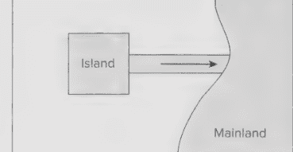

该岛屿通过一座单向桥与大陆相连，在该桥上行驶的车辆只能从岛屿驶向大陆。异步XHR对象就像这个岛屿，而页面其余部分的JavaScript代码就像大陆。所有依赖于XHR对象数据的代码都在岛上；如果来自大陆的代码在数据到达之前尝试访问它，将会失败。

## 动手试试

在本课中，你将学习如何使用XHR对象发起GET请求，并处理通过它们检索到的数据。

## 课程要求

学习本课，你需要一个文本编辑器；任何纯文本编辑器都可以。对于Microsoft Windows用户，系统默认提供了记事本，或者你可以下载Microsoft免费的Visual Web Developer Express (www.microsoft.com/express/web/)或Web Matrix (www.asp.net/webmatrix/)。Mac OS X用户可以使用TextMate（它是OS X的一部分），或者下载Coda的试用版 (www.panic.com/coda/)。Linux用户可以使用内置的VIM。

你还需要一个现代的Web浏览器。选择以下任意一种：

- Internet Explorer 8+
- Google Chrome
- Firefox 3.5+
- Apple Safari 4+
- Opera 10+

此外，你的计算机上需要安装Web服务器软件。安装说明请参阅DVD上的第31课。在你的Web服务器根目录下创建一个名为`Lesson33`的子文件夹。将你在本课中创建的文件保存在`Lesson33`文件夹中。

## 分步操作

1. 创建一个新的文本文件，并将以下文本精确地添加到其中：

```text
Jeremy,Jason,Jeffrey
```

注意，逗号和名称之间没有空格。你可以随意添加更多名称。只需确保用逗号分隔它们，并将所有名称保持在一行。将此文本文件保存为`lesson33_example_data.txt`。

2. 创建另一个新文件，并输入以下JavaScript代码。你可以随意从第32课的`lesson32_example01.js`中复制`createXHR()`函数：

```javascript
function createXHR() {
    if (typeof XMLHttpRequest !== "undefined") {
        return new XMLHttpRequest();
    } else {
        var versions = [ "MSXML2.XmlHttp.6.0",
                         "MSXML2.XmlHttp.3.0" ];

        for (var i = 0; i < versions.length; i++) {
            try {
                var xhr = new ActiveXObject(versions[i]);
                return xhr;
            } catch (error) {
                // do nothing
            }
        }
    }

    alert("Your browser does not support XmlHttp");
    return null;
}

function makeGetRequest(url, callback) {
    var xhr = createXHR();

    xhr.open("GET", url);

    xhr.onreadystatechange = function() {
        if (xhr.readyState === 4) {
            var status = xhr.status;

            if ((status >= 200 && status < 300) || status === 304) {
                callback(xhr.responseText);
            } else {
                alert("An error occurred");
            }
        }
    };

    xhr.send(null);
}
```

这些是你迄今为止创建的用于辅助Ajax请求的函数。将文件保存为`xhr.js`并将其放置在`Lesson33`目录中。

3. 将`eventUtility.js`文件从代码下载包或之前的课程中复制到`Lesson33`目录。

4. 输入以下HTML：

```html
<html>
<head>
    <title>Lesson 33: Example 01</title>
</head>
<body>
<form name="theForm" action="" onsubmit="validateName(event)">
    <input type="text" name="txtName" value="" />
    <input type="submit" name="btnSubmit" value="Check Name" />
</form>
<script type="text/javascript" src="eventutility.js"></script>
<script type="text/javascript" src="xhr.js"></script>
<script type="text/javascript">
</script>
</body>
</html>
```

此页面有一个名为`theForm`的表单，其中包含一个名为`txtName`的文本框控件和一个名为`btnSubmit`的按钮。`eventutility.js`和`xhr.js`文件也通过两个`<script/>`元素添加到页面中，第三个`<script/>`元素将包含内联JavaScript代码。

5. 表单有一个`onsubmit`事件处理程序，它调用一个名为`validateName()`的函数。此函数应验证文本框不为空，并应发起一个请求来检索`lesson33_example_data.txt`文件。在空的`<script/>`元素内输入以下函数：

```javascript
function validateName(event) {
    var nameToVerify = document.theForm.txtName.value;
    var button = document.theForm.btnSubmit;

    if (nameToVerify === "") {
        alert("Please enter a name.");
    } else {
        button.disabled = true;
        makeGetRequest("lesson33_example_data.txt", processData);
    }

    eventUtility.preventDefault(event);
}
```

如果文本框为空，会弹出一个警告消息，提示用户输入名称。否则，调用`makeGetRequest()`来请求文本文件，并在请求成功时调用一个名为`processData()`的函数。

在发送请求之前，按钮也会被禁用。发起HTTP请求时，延迟是一个问题，用户可以通过反复点击按钮来生成许多请求。通过在发起请求时禁用按钮，你可以确保在任何给定时间只能发送一个请求。

事件工具的`preventDefault()`方法用于阻止表单被提交。

6. 编写`processData()`函数。它应该将文本文件中包含的数据分割成一个数组，并确定输入到文本框中的名称是否在文件中有匹配项。它还应该告诉用户是否找到了匹配项。在所有内容处理完毕后，重新启用按钮。在内联`<script/>`元素内输入以下函数：

```javascript
function processData(data) {
    var names = data.split(",");
    var nameToVerify = document.theForm.txtName.value;
    var button = document.theForm.btnSubmit;
    var nameFound = false;

    for (var i = 0; i < names.length; i++) {
        var name = names[i];

        if (name.toLowerCase() === nameToVerify.toLowerCase()) {
            nameFound = true;
            break;
        }
    }

    if (nameFound) {
        alert("That name is taken.");
    } else {
        alert("That name isn't taken");
    }

    button.disabled = false;
}
```

文本文件中的名称用逗号分隔，因此`String`数据类型的`split()`方法使用逗号作为分隔符来分割字符串。接下来，一个`for`循环遍历名称数组，并将数组中的每个元素与文本框中包含的值进行比较。两个值都被转换为小写等效形式，以使搜索不区分大小写。如果在数组中找到匹配项，则`nameFound`变量被设置为`true`并且循环结束。否则，循环继续遍历每个元素，直到找到匹配项或循环退出。

循环退出后，该函数向用户显示一条消息。消息的内容取决于`nameFound`的值。最后，按钮被重新启用，允许用户搜索另一个名称。

将文件保存为`lesson33_example01.htm`，并将浏览器指向`http://localhost/Lesson33/lesson33_example01.htm`。开始在文本框中输入名称并按下按钮，以查看你输入的名称是否在文本文件中找到。

要获取示例代码文件，请从书籍网站`www.wrox.com`下载第33课。

> 请在DVD上选择第33课，以查看伴随本课的视频。

# 34

## 使用POST方法发起Ajax请求

如果说GET请求构成了网络上绝大多数的HTTP请求，那么POST请求则紧随其后。POST请求通常由表单生成。虽然并非所有表单都使用POST方法发送数据，但许多表单确实用于向服务器POST信息。

POST请求与GET请求截然相反：它们用于向Web应用程序提交数据，以便应用程序可以对这些数据进行处理。与GET请求（数据可以在URL的查询字符串中发送）不同，POST请求的数据是在请求体中发送的。尽管存在这些差异，但使用`XMLHttpRequest`(XHR)对象发起POST请求与发起GET请求非常相似。当然，也存在一些差异，你将在本课中了解它们。

## 组装数据

POST请求旨在将信息从浏览器发送到服务器。因此，大多数POST请求是通过表单发起的。表单是用户输入和发送数据的主要方式。然而，与Ajax的区别在于数据的发送方式。

没有Ajax时，浏览器负责收集表单数据、格式化数据并将其POST到服务器。有了Ajax，这个责任就落在了你身上。因此，在发送POST请求之前，你必须组装表单数据并对其进行格式化。

让我们看一个表单示例：

```html
<form name="theForm" method="post" action="ajax_test.php">
    <p>
        Name: <input type="text" name="txtName" value="" />
    </p>
    <p>
        Email: <input type="text" name="txtEmail" value="" />
    </p>
    <p>
        <input type="submit" name="btnSubmit" value="Submit" />
    </p>
</form>
```

这个表单有两个文本框：一个用于姓名，一个用于电子邮件地址。它还有一个用于提交表单的按钮，该表单将数据POST到服务器上名为`ajax_test.php`的文件。

> PHP是一种编程语言和服务端框架，允许开发者编写服务端程序。它几乎可以在所有操作系统上运行。解释PHP超出了本书的范围，但我在示例中使用了它。有关Windows和Mac OS X的安装说明，请参阅DVD上的第31课。

如果用户在姓名文本框中输入值`Jeremy`，在电子邮件文本框中输入`jeremy@xyz`，那么当用户点击提交按钮时，浏览器会将数据组装成以下格式：

```text
txtName=Jeremy&txtEmail=jeremy%40xyz.com&btnSubmit=Submit
```

这看起来非常像URL的查询部分。有三个由`&`符号分隔的名称/值对。它们是：

- `txtName=Jeremy`
- `txtEmail=jeremy%40xyz.com`
- `btnSubmit=Submit`

每个等号(`=`)的左侧是表单中某个表单控件的名称，右侧是该控件的值。注意`txtEmail`的值。它不是`jeremy@xyz.com`，而是`jeremy%40xyz.com`。`@`符号是一个特殊字符，在HTTP中有其特定含义，在作为请求体的一部分传输之前必须进行编码。其他特殊字符包括：

- `,` (逗号)
- `/`
- `?`
- `:`
- `&`
- `=`
- `+`
- `$`
- `#`

当你使用XHR将数据POST到服务器时，请求体必须采用这种格式。组装和格式化表单中包含的所有信息可能听起来令人生畏，但一个函数可以为你完成所有这些工作。查看以下代码中名为`getRequestBody()`函数的开头部分：

```javascript
function getRequestBody(form) {
    var pieces = [];
    var elements = form.elements;

    // more code here

    return pieces.join("&");
}
```

这个函数接受一个参数，一个`<form/>`元素对象。因此，你可以将任何表单传递给该函数，让它生成请求体。该函数中的前两条语句创建了两个变量。第一个是名为`pieces`的数组，该数组中的每个元素将是一个名称/值对。第二个变量`elements`被赋值为表单的`elements`集合属性。该函数的最后一行返回调用`pieces`数组的`join()`方法的结果。

接下来，该函数遍历`elements`集合，并为每个表单控件构造一个`name=value`字符串。新代码以粗体显示：

```javascript
function getRequestBody(form) {
    var pieces = [],
        elements = form.elements;

    for (var i = 0; i < elements.length; i++) {
        var element = elements[i];
        var name = encodeURIComponent(element.name);
        var value = encodeURIComponent(element.value);

        pieces.push(name + "=" + value);
    }

    return pieces.join("&");
}
```

在`for`循环内部，初始化了三个新变量。第一个变量`element`包含指定索引处的表单控件元素对象。第二个变量`name`通过将未编码的属性传递给`encodeURIComponent()`函数，被赋值为元素`name`属性的编码版本。`encodeURIComponent()`是一个内置函数，它将特殊字符编码为可传输的等效形式。第三个变量`value`被赋值为表单控件`value`属性的编码版本。最后，`name`和`value`变量被连接起来并添加到`pieces`数组中。

现在，你可以通过简单地调用此函数并传递你想要发送的`<form/>`元素对象来组装和格式化表单内容，如下所示：

```javascript
var requestBody = getRequestBody(document.theForm);
```

此代码将名为`theForm`的表单传递给`getRequestBody()`函数，以生成格式正确的数据并将其赋值给`requestBody`变量。

> 本课中编写的`getRequestBody()`函数未考虑禁用的字段、未选中的单选按钮和复选框，或`<select/>`元素。

## 发起POST请求

当你拥有适当格式的数据后，就可以使用XHR对象发送它。POST请求看起来与GET请求非常相似，因此以下代码你会感到熟悉：

```javascript
var xhr = createXHR();
var data = getRequestBody(document.theForm);

xhr.open("POST", "ajax_test.php");
xhr.setRequestHeader("Content-Type", "application/x-www-form-urlencoded");

xhr.onreadystatechange = function() {
    if (xhr.readyState === 4) {
        var status = xhr.status;

        if ((status >= 200 && status < 300) || status === 304) {
            processResponse(xhr.responseText); // callback function
        } else {
            alert("An error occurred");
        }
    }
};

xhr.send(data);
```

第一个主要变化是添加了`data`变量，它包含要在请求中发送的格式化的名称/值对字符串。下一个重大变化是在调用`open()`方法时：第一个参数现在是`POST`而不是`GET`。在调用`open()`之后，有一行新代码调用了XHR对象的`setRequestHeader()`方法。此方法允许你使用提供的值设置一个HTTP头。对于POST请求，你需要将`Content-Type`头设置为值`application/x-www-form-urlencoded`。否则请求将无法工作。最后一个主要变化是在调用`send()`时。你传递的是`getRequestBody()`生成的数据，而不是传递`null`。

> 将`Content-Type`头设置为`application/x-www-form-urlencoded`并非所有POST请求所必需——它仅在发送表单格式的数据时才需要。

你可以通过编写一个类似于你在第33课中编写的`makeGetRequest()`函数的函数来简化POST请求。以下代码定义了一个名为`postFromForm()`的函数：

```javascript
function postFromForm(url, form, callback) {
    var xhr = createXHR();
    var data = getRequestBody(form);

    xhr.open("POST", url);
    xhr.setRequestHeader("Content-Type", "application/x-www-form-urlencoded");

    xhr.onreadystatechange = function() {
        if (xhr.readyState === 4) {
            var status = xhr.status;

            if ((status >= 200 && status < 300) || status === 304) {
                callback(xhr.responseText);
            } else {
                alert("An error occurred");
            }
        }
    };

    xhr.send(data);
}
```

此函数接受三个参数：要请求的URL、要从中收集数据的`<form/>`对象，以及在请求成功完成时执行的回调函数。因此，使用此函数意味着编写类似以下代码的内容：

```javascript
function processResponse(responseData) {
    alert(responseData);
}

postFromForm("ajax_text.php", document.theForm, processResponse);
```

这里，一个包含名为`theForm`的表单数据的POST请求被发送到`ajax_text.php`，并且在请求成功时，`processResponse()`函数处理服务器的响应。

## 动手试试

在本课中，你学习了如何通过格式化请求体数据、提供`Content-Type`头以及随请求发送数据来使用XHR对象发起POST请求。

## 课程要求

对于本课，你需要一个文本编辑器；任何纯文本编辑器都可以。对于Microsoft Windows用户，系统默认提供记事本，或者你可以下载Microsoft免费的Visual Web Developer Express (www.microsoft.com/express/web/)或Web Matrix (www.asp.net/webmatrix/)。Mac OS X用户可以使用作为OS X一部分的TextMate，或者下载Coda的试用版 (www.panic.com/coda/)。Linux用户可以使用内置的VIM。

你还需要一个现代的网页浏览器。可以选择以下任意一种：

- Internet Explorer 8+
- Google Chrome
- Firefox 3.5+
- Apple Safari 4+
- Opera 10+

此外，你的电脑上需要安装网页服务器软件和PHP。安装说明请参考DVD中的第31课。在你的网页服务器根目录下创建一个名为`Lesson34`的子文件夹。将本课中创建的文件存储在`Lesson34`文件夹中。

## 分步指南

1. 将`ajax_post.php`文件从代码下载中复制到`Lesson34`目录。这是一个PHP文件，它会根据POST给它的信息生成随机消息。

2. 编写一个Ajax工具对象。创建一个名为`ajaxUtility.js`的新文件，并输入以下内容：

```javascript
var ajaxUtility = {
    createXHR : function() {
        if (typeof XMLHttpRequest !== "undefined") {
            return new XMLHttpRequest();
        } else {
            var versions = [ "MSXML2.XmlHttp.6.0",
                "MSXML2.XmlHttp.3.0" ];

            for (var i = 0; i < versions.length; i++) {
                try {
                    var xhr = new ActiveXObject(versions[i]);
                    return xhr;
                } catch (error) {
                    // do nothing
                }
            }
        }

        alert("Your browser does not support XmlHttp");
        return null;
    },

    makeGetRequest : function(url, callback) {
        var xhr = this.createXHR();

        xhr.open("GET", url);

        xhr.onreadystatechange = function() {
            if (xhr.readyState === 4) {
                var status = xhr.status;

                if ((status >= 200 && status < 300) || status === 304) {
                    callback(xhr.responseText);
                } else {
                    alert("An error occurred");
                }
            }
        };

        xhr.send(null);
    },

    getRequestBody : function(form) {
        var pieces = [];
        var elements = form.elements;

        for (var i = 0; i < elements.length; i++) {
            var element = elements[i];
            var name = encodeURIComponent(element.name);
            var value = encodeURIComponent(element.value);

            pieces.push(name + "=" + value);
        }

        return pieces.join("&");
    },

    postFromForm : function(url, form, callback) {
        var xhr = this.createXHR();
        var data = this.getRequestBody(form);

        xhr.open("POST", url);
        xhr.setRequestHeader("Content-Type", "application/x-www-form-urlencoded");

        xhr.onreadystatechange = function() {
            if (xhr.readyState === 4) {
                var status = xhr.status;

                if ((status >= 200 && status < 300) || status === 304) {
                    callback(xhr.responseText);
                } else {
                    alert("An error occurred");
                }
            }
        };

        xhr.send(data);
    }
};
```

这段代码创建了一个名为`ajaxUtility`的新对象。它的`createXHR()`和`makeGetRequest()`方法与`xhr.js`文件中同名函数的功能相似。另外两个方法`getRequestBody()`和`postFromForm()`则与本课中同名的两个函数功能相同。创建这样的工具对象很有优势，因为它将所有代码都集中在`ajaxUtility`对象中。

3. 将`eventUtility.js`文件从`Lesson33`目录复制到`Lesson34`目录。

4. 输入以下HTML代码：

```html
<html>
<head>
    <title>Lesson 34: Example 01</title>
</head>
<body>
<form name="theForm" method="post" action="ajax_post.php" onsubmit="addUser(event)">
    <p>
        Name: <input type="text" name="txtName" value="" />
    </p>
    <p>
        Email: <input type="text" name="txtEmail" value="" />
    </p>
    <p>
        <input type="submit" name="btnSubmit" value="Submit" />
    </p>
</form>
<script type="text/javascript" src="eventutility.js"></script>
<script type="text/javascript" src="ajaxUtility.js"></script>
<script type="text/javascript">
</script>
</body>
</html>
```

这个页面包含了本课前面用过的同一个表单，但它会POST到`ajax_post.php`，并且有一个`onsubmit`事件处理器。`eventUtility.js`和`ajaxUtility.js`文件也通过两个`<script/>`元素添加到页面中，第三个`<script/>`元素将包含内联JavaScript代码。

5. 表单的`onsubmit`事件处理器调用`addUser()`函数。这个函数应该验证表单是否已填写，并POST到`ajax_post.php`文件。在空的`<script/>`元素内输入以下函数：

```javascript
function addUser(event) {
    var theForm = document.theForm;
    var name = theForm.txtName.value;
    var email = theForm.txtEmail.value;
    var button = theForm.btnSubmit;

    button.disabled = true;

    if (name === "" || email === "") {
        alert("Please complete the form.");
        button.disabled = false; // so user can resubmit
    } else {
        ajaxUtility.postFromForm(theForm.action, theForm, processData);
    }

    eventUtility.preventDefault(event);
}
```

这个函数首先禁用提交按钮，以防止用户一次提交多个请求。然后函数检查文本框是否包含信息，如果任一文本框为空，则提示用户完成表单。如果两个文本框都包含数据，则将`theForm`对象传递给`ajaxUtility.postFromForm()`方法以发送请求。

这里没有将字符串字面量`ajax_post.php`传递给`postFromForm()`方法，而是使用了表单的`action`属性。这是一个很好的小技巧，它允许你的XHR对象将数据POST到`<form/>`元素的`action`属性中指定的任何URL。因此，如果你更改了`action`属性的值，就不必更改`postFromForm()`调用中的URL。

最后，事件工具的`preventDefault()`方法阻止表单被提交。

6. 编写`processData()`函数。它只需要警报响应数据并重新启用按钮。在内联`<script/>`元素内输入以下函数：

```javascript
function processData(data) {
    var button = document.theForm.btnSubmit;

    alert(data);
    button.disabled = false;
}
```

将文件保存为`lesson34_example01.htm`，然后将浏览器指向`http://localhost/Lesson34/lesson34_example01.htm`。填写表单，提交它，并观察来自服务器的随机响应。

> 请选择DVD上的第34课，查看与本课配套的视频。

# 35

## JSON

在第33课和第34课中，你向服务器发送了请求并收到了一些数据，然后对这些数据进行了处理；在第33课中，你检索了一个以逗号分隔的名称列表，并解析这些数据以创建一个功能性的应用程序。第34课让你向服务器发送了一个POST请求，服务器以文本形式响应，你在一个警报框中显示了这些文本。这两课中从服务器返回的数据都很简单，在实际应用中你很少会处理如此简单的数据集。因此，本课将向你介绍一种适合表示复杂数据的交换格式。它是当今Ajax通信的标准：JavaScript对象表示法（JSON）。首先，让我们看看JSON是如何产生的。

## XML统治世界……还是这样吗？

自诞生以来，可扩展标记语言（XML）作为首选的数据交换格式，其地位稳步提升。标记数据并在不同计算机系统之间交换数据的能力，使XML成为数据传输的事实标准。如果你不熟悉XML，也不用担心。这门语言的基础非常简单。事实上，它看起来很像HTML。下面是一个描述一个人的简单XML文档：

```xml
<?xml version="1.0" encoding="utf-8"?>
<person>
    <firstName>John</firstName>
    <lastName>Doe</lastName>
    <address>
        <street>1234 XYZ</street>
        <city>Dallas</city>
        <state>Texas</state>
        <country>USA</country>
    </address>
    <phoneNumbers>
        <phoneNumber type="home">111-123-4567</phoneNumber>
        <phoneNumber type="cell">111-234-5678</phoneNumber>
    </phoneNumbers>
    <company><![CDATA[John & Joe's Lobster House]]></company>
</person>
```

XML比HTML有更严格的规则集：

- 第一行被称为XML声明，每个XML文档都必须有一个。
- 每个XML文档还必须有且仅有一个文档元素，即文档的根元素。在此文档中，`<person/>`是文档元素（在HTML文档中，`<html/>`元素是文档元素）。
- 每个开始标签都必须有一个结束标签，并且所有元素都应正确嵌套。
- 特殊字符，如和号（`&`）和尖括号，除非在CDATA（字符数据）块内，否则不能在数据中使用。

XML严格的规则集以及创建自定义格式的能力，使其成为共享基于文本的数据（如RSS订阅源）的热门选择。XML无处不在。事实上，你很难找到一个不通过XML发送和接收数据的远程服务器上的Web服务或编程接口。

自然，XML作为交换格式的使用逐渐渗透到浏览器/服务器通信中。它对浏览器来说似乎很完美，因为XML文档可以加载到DOM中，开发者可以遍历XML文档的树来获取所需的数据。随着Ajax的流行，XML成为交换数据的事实标准格式（记住，Ajax中的x代表XML）。

虽然XML非常适合在网络和计算机系统之间发送和接收数据，但在将其用作与浏览器的数据交换格式时存在一些问题。首先，XML文档本质上是冗长的，因为XML是一种标记语言。回顾本节前面的示例XML文档。每个XML文档顶部都有一个XML声明，并且每个包含数据的元素都必须有开始和结束标签。此外，包含XML特殊/保留字符的数据必须表示为字符数据，如本XML文档中的`<company/>`元素所示。

XML的冗长特性使得这个简单文档的大小达到507字节。诚然，507字节并不大，但想象一下一个描述超过50个人的文档。文件大小可能会很快变得很大。文件大小与Web应用程序的性能直接相关。你希望尽可能从应用程序中挤出性能，而更小的文件大小有助于实现这一点。

XML的第二个问题是DOM API。DOM是作为一种以编程方式表示结构化文档（如HTML和XML）的手段而开发的。为了让开发者能够在JavaScript中处理XML文档，该文档被加载到其自己的DOM对象中（独立于HTML页面的DOM对象）。JavaScript开发者经常使用DOM，但该API笨重且不友好。例如，在IE中，直接访问`<country/>`元素（在`<address/>`元素中）的值的代码如下所示：

```javascript
doc.documentElement.childNodes[2].childNodes[3].nodeValue
```

这段代码使用`doc`作为顶级DOM对象（就像`document`是HTML页面的顶级DOM对象一样），`documentElement`获取`<person/>`元素，`childNodes[2]`获取`<address/>`元素，`childNodes[3]`访问`<country/>`元素，而`nodeValue`属性获取元素中包含的值。要获取一个元素的值需要这么多代码，而且它很晦涩，使得维护变得困难。

> 如果XML文档加载到标准XML DOM对象中，前面的代码清单实际上是不正确的。在标准XML DOM对象中访问`<country/>`元素的代码实际上更复杂。

因此，对于JavaScript开发者来说，XML作为数据交换格式效率低下。那么，替代方案是什么？

## JAVASCRIPT OBJECT NOTATION拯救世界

计算机科学家Douglas Crockford认识到XML对JavaScript开发者来说效率低下，并致力于开发一种交换格式，以产生更小的文件并使处理数据更容易。他开发的是一种轻量级格式，称为JavaScript对象表示法，简称JSON（发音为*Jason*）。

JSON基于JavaScript语言的一个子集，其背后的理念是你可以通过使用对象和数组字面量来充分描述数据。例如，上一节中的XML文档可以转换为如下所示的JavaScript对象：

```javascript
var person = {
    firstName : "John",
    lastName : "Doe",
    address : {
        street : "1234 XYZ",
        city : "Dallas",
        state : "Texas",
        country : "USA"
    },
    phoneNumbers : [
        {
            type : "home",
            number : "111-123-4567"
        },
        {
            type : "cell",
            number : "111-234-5678"
        }
    ],
    company : "John & Joe's Lobster House"
};
```

这段代码使用对象和数组字面量来描述与上一节XML相同的数据。该对象名为`person`，与XML文件中的`<person/>`根元素具有相同的目的。`<firstName/>`、`<lastName/>`和`<address/>`元素被转换为`person`对象的属性。接下来，`<phoneNumbers/>`被转换为数组字面量，数组中的每个项目都是一个表示`<phoneNumber/>`元素的对象。

现在，这是一个JavaScript对象，而不是JSON。JavaScript对象/数组字面量与JSON之间的主要区别在于，JSON没有变量、属性、方法或JavaScript语言的任何其他构造。JSON是一种仅用于表示数据的文本格式，因此此JavaScript代码的JSON等效形式如下：

```json
{
    "firstName" : "John",
    "lastName" : "Doe",
    "address" : {
        "street" : "1234 XYZ",
        "city" : "Dallas",
        "state" : "Texas",
        "country" : "USA"
    },
    "phoneNumbers" : [
        {
            "type" : "home",
            "number" : "111-123-4567"
        },
        {
            "type" : "cell",
            "number" : "111-234-5678"
        }
    ],
    "company" : "John & Joe's Lobster House"
}
```

这被称为JSON结构。注意属性名称变成了字符串值：JSON是序列化的JavaScript对象和数组。*序列化*是将对象转换为文本的过程，序列化（以及*反序列化*——将文本转换为对象）使得JSON成为JavaScript开发者合适的传输格式。JSON对JavaScript开发者有两个优势：

- JSON数据比XML数据小，当你移除所有不必要的空格时，它会变得更小。本例中的JSON数据为462字节，你可以将其缩小到256字节。即使压缩成一行，XML等效形式仍然更大，为399字节。
- 反序列化JSON意味着你得到一个可以在程序中使用的JavaScript对象。因此，在你反序列化前面的JSON并将生成的对象分配给名为`person`的变量后，你可以轻松地使用以下代码找出John Doe居住在哪个国家：

```javascript
var country = person.address.country;
```

这两个原因——大小和易用性——使得JSON对JavaScript开发者来说非常完美。那么，让我们看看如何序列化和反序列化JSON。

## 在JSON之间转换

由于JSON取代XML成为Ajax数据传输的事实标准，最新版本的JavaScript语言已内置JSON支持。一个名为JSON的新内置对象存在于以下浏览器中：

- Internet Explorer 8+（仅在IE8模式下）
- Firefox 3.5+
- Chrome 4+
- Safari 5+

然而，JSON支持并不止于这些浏览器。在JSON支持内置到JavaScript之前，Crockford编写了一个可以在任何浏览器中使用的JavaScript脚本。你可以在`www.json.org/json2.js`或本书附带的代码下载中找到此脚本。此实用程序在不支持原生JSON对象的浏览器中创建一个JSON对象，其功能与原生JSON对象完全相同。因此，在所有旧浏览器被淘汰之前，最好在任何计划使用JSON的页面中包含`json2.js`文件。

JSON对象有两个方法：

- `parse()`：反序列化JSON以创建JavaScript对象或数组。
- `stringify()`：将JavaScript对象或数组序列化为JSON。

首先让我们看看`stringify()`方法。它接受一个JavaScript值作为参数，并返回一个包含JSON文本的字符串。为了了解`stringify()`的工作原理，让我们假设你在一家汽车经销商工作，你的职责之一是编写一个允许访客根据品牌、型号和年份搜索车辆的Web应用程序。你代码的一部分创建了一个名为`Car`的数据类型。以下是其定义：

```javascript
function Car(make, model, year) {
    this.make = make;
    this.model = model;
    this.year = year;
}
```

构造函数有三个参数：`make`、`model`和`year`。它使用这些值来填充`Car`对象将具有的`make`、`model`和`year`属性。现在让我们通过创建一个带有一些数据的`Car`对象并将其传递给`JSON.stringify()`方法来模拟用户的输入，如下所示：

```javascript
var toyotaCamry = new Car("Toyota", "Camry", 2002);
var carJson = JSON.stringify(toyotaCamry);
```

这段代码的第一行创建了一个代表2002年丰田凯美瑞的`Car`对象，并将其分配给`toyotaCamry`变量。在下一行中，`toyotaCamry`对象被传递给`JSON.stringify()`方法，返回的字符串被赋值给`carJson`变量。这与执行以下操作得到的结果相同：

```javascript
var carJson = '{"make":"Toyota","model":"Camry","year":2002}';
```

请注意，数字2002不是字符串。根据设计，`JSON.stringify()`方法不会序列化数字或布尔值，以保留其原始值。

一旦你将数据转换为JSON格式，就可以随心所欲地处理它。不过，更可能的情况是，你序列化一个对象是为了将其发送到服务器，你可以通过向`ajaxUtility`对象添加以下方法来实现：

```javascript
var ajaxUtility = {
    // other methods snipped for printing

    makePostRequest : function(url, data, callback) {
        var xhr = this.createXHR();

        xhr.open("POST", url);

        xhr.onreadystatechange = function() {
            if (xhr.readyState === 4) {
                var status = xhr.status;

                if ((status >= 200 && status < 300) || status === 304) {
                    callback(xhr.responseText);
                } else {
                    alert("An error occurred");
                }
            }
        };

        xhr.send(data);
    }
};
```

与上一课中你编写的`ajaxUtility.postFromForm()`方法通过POST发送数据不同，通过POST发送JSON不需要`application/x-www-form-urlencoded`内容类型头。因此，要使用这个新方法发送`carJson`中的JSON，你只需这样做：

```javascript
ajaxUtility.makePostRequest(serverUrl, carJson, processResponse);
```

虽然有时你会因为数据的复杂性而希望使用JSON将数据发送到服务器，但本例中的简单数据使用`ajaxUtility.postFromForm()`方法发送会更好。

让我们假设你将汽车查询发送到一个服务器应用程序，该程序用于确定指定的汽车是否有库存。服务器处理请求并响应以下JSON：

```json
{
    "searchedCar" : {
        "make" : "Toyota",
        "model" : "Camry",
        "year" : 2002
    },
    "isFound" : false,
    "results" : [
        {
            "make" : "Toyota",
            "model" : "Camry",
            "year" : 2005
        },
        {
            "make" : "Honda",
            "model" : "Accord",
            "year" : 2002
        }
    ]
}
```

这个JSON结构包含三个主要数据部分。首先，它包含`searchedCar`对象结构，其中包含被搜索的制造商、型号和年份。其次，它包含一个名为`isFound`的结构，其中包含一个布尔值，用于确定是否找到了被搜索的汽车。最后是一个名为`results`的结构，其中包含用户可能认为合适的汽车列表。

当然，这种格式的数据对你来说并不是特别有用，因此你需要使用`JSON.parse()`方法对其进行反序列化。现在，你的请求是通过`ajaxUtility`发送的，因此当请求成功完成时，将执行以下函数：

```javascript
function processResponse(data) {
    var results = JSON.parse(data);

    // more code here
}
```

在`processResponse()`函数中，第一行调用`JSON.parse()`方法，将`data`参数的值传递给它，并将生成的对象赋值给`results`变量。现在你有了一个可以在代码中使用的实际JavaScript对象，因此你可以轻松地向用户提供有关其查询的信息，如下所示：

```javascript
function processResponse(data) {
    var results = JSON.parse(data);

    if (results.isFound) {
        // do something with the matched data
    } else {
        // do something to let the user know no match was found
        // do something with the suggestions
    }
}
```

通过将JSON解析为JavaScript对象，你可以立即在JavaScript代码中访问JSON结构包含的数据，而无需遍历DOM来获取它。

将JSON转换为JavaScript的便捷性使得JSON成为在JavaScript应用程序之间传输数据的最流行方式。我们将在下一节中扩展这个汽车经销商场景。

## 试一试

在本课中，你学习了如何利用JSON在JavaScript中发送、接收和处理复杂数据。

## 课程要求

对于本课，你需要一个文本编辑器；任何纯文本编辑器都可以。对于Microsoft Windows用户，系统默认提供记事本，或者你可以下载Microsoft免费的Visual Web Developer Express (www.microsoft.com/express/web/)或Web Matrix (www.asp.net/webmatrix/)。Mac OS X用户可以使用TextMate（作为OS X的一部分提供），或下载Coda的试用版 (www.panic.com/coda/)。Linux用户可以使用内置的VIM。

你还需要一个现代的Web浏览器。选择以下任意一个：

- Internet Explorer 8+
- Google Chrome
- Firefox 3.5+
- Apple Safari 4+
- Opera 10+

此外，你的计算机上还需要安装Web服务器软件和PHP。有关安装说明，请参阅DVD上的第31课。在Web服务器的根目录中创建一个名为`Lesson35`的子文件夹，并将`eventUtility.js`和`ajaxUtility.js`文件复制到其中。同时，从代码下载中复制`car_dealership.php`和`json2.js`文件，并将它们粘贴到`Lesson35`文件夹中。将你在本课中创建的文件存储在`Lesson35`文件夹中。

`car_dealership.php`文件响应一个JSON结构。服务器的响应如下：

```json
{
    "searchedCar" : {
        "make" : "value",
        "model" : "value",
        "year" : numericValue
    },
    "isFound" : booleanValue,
    "results" : [
        {
            "make" : "value",
            "model" : "value",
            "year" : numericValue
        }
        // more object structures if necessary
    ]
}
```

这个JSON结构定义了包含搜索查询的数据、一个指示是否找到匹配项的布尔值，以及一个名为`results`的数组结构，其中包含一个或多个类似汽车的对象结构，每个结构都具有制造商、型号和年份信息。

## 分步指南

1. 打开你的文本编辑器，然后输入以下内容：

```html
<html>
<head>
    <title>Lesson 35: Example 01</title>
</head>
<body>
<div id="divResults">
    <div id="divSearchMessage"></div>
    <div id="divSearchResults"></div>
</div>
<form name="theForm" method="post" action="car_dealership.php"
      onsubmit="submitForm(event);">
    <p>
        Make: <input type="text" name="txtMake" value="" />
    </p>
    <p>
        Model: <input type="text" name="txtModel" value="" />
    </p>
    <p>
        Year: <input type="text" name="txtYear" value="" />
    </p>
    <p>
        <input type="submit" name="btnSubmit" value="Submit" />
    </p>
</form>
<script type="text/javascript" src="eventutility.js"></script>
<script type="text/javascript" src="ajaxUtility.js"></script>
<script type="text/javascript" src="json2.js"></script>
<script type="text/javascript">

function submitForm(event) {
    var data = ajaxUtility.getRequestBody(document.theForm);

    ajaxUtility.makeGetRequest("car_dealership.php?" + data,
        processResponse);

    eventUtility.preventDefault(event);
}

function getCarString(carObj) {
    return [carObj.year, carObj.make, carObj.model].join(" ");
}

function processResponse(data) {

}

</script>
</body>
</html>
```

将其保存为`lesson35_example01.htm`。在body的顶部是一个id为`divResults`的`<div/>`元素。在此元素内部还有两个`<div/>`元素。id为`divSearchMessage`的元素将包含一条消息，告诉用户查询是否获得了任何结果。id为`divSearchResults`的`<div/>`元素将包含结果/建议。

接下来是一个表单，其中包含用于搜索的制造商、型号和年份的`<input/>`元素。它有一个`onsubmit`事件处理程序，调用`submitForm()`函数。此函数使用`ajaxUtility.getRequestBody()`方法将数据格式化为URL的查询字符串，然后向PHP文件发出GET请求，其中包含`data`中的查询字符串。

定义了另一个名为`getCarString()`的函数。它接受一个类似汽车的对象作为参数，并将该对象格式化为“年份 制造商 型号”字符串，例如“2002 Toyota Camry”。

第三个函数名为`processResponse()`，它是`submitForm()`中发出的Ajax请求的回调函数。

2. 将以下代码中的粗体行添加到`processResponse()`函数中：

```javascript
function processResponse(data) {
    var result = JSON.parse(data);
    var messageDiv = document.getElementById("divSearchMessage");
    var message = "";
    var length = result.results.length;
    var carStr = getCarString(result.searchedCar);

    if (result.isFound) {
        message = "We found " + result.results.length + " matches for " + carStr;
    } else {
        message = "We could not find " + carStr + ". You might like: ";
    }

    messageDiv.innerHTML = message;
}
```

这段新代码解析JSON数据，并将生成的对象赋值给`result`变量，同时从文档中检索对id为`divSearchMessage`的`<div/>`元素的引用，并将其赋值给`messageDiv`变量。另一个名为`message`的变量被设置为空字符串。它将包含一条消息，告诉用户搜索的结果如何。然后，一个名为`length`的变量被赋值为`result.results`数组的长度。最后，`carStr`被赋值为调用`getCarString()`并将`result.searchedCar`属性作为参数传递后获得的返回值。

接下来，一些使用`result`对象的`isFound`属性的代码确定是否找到了匹配项，并构造一条适当的消息显示在消息`<div/>`元素中。

3. `processResponse()`函数仍然需要显示没有匹配项的搜索的建议列表。添加以下代码中的粗体行：

```javascript
function processResponse(data) {
    var result = JSON.parse(data);
    var messageDiv = document.getElementById("divSearchMessage");
    var resultsDiv = document.getElementById("divSearchResults");
    var message = "";
    var results = [];
    var length = result.results.length;
    var carStr = getCarString(result.searchedCar);

    if (result.isFound) {
        message = "We found " + length + " matches for " + carStr;
    } else {
        message = "We could not find " + carStr + ". You might like: ";

        for (var i = 0; i < length; i++) {
            results.push(getCarString(result.results[i]));
        }

        resultsDiv.innerHTML = results.join("<br/>");
    }

    messageDiv.innerHTML = message;
}
```

# 第三部分

处理错误、调试与最佳实践

- 第36课：常见编码错误
- 第37课：处理错误
- 第38课：使用Firebug进行调试
- 第39课：编码指南
- 第40课：分离JavaScript与HTML
- 第41课：分离JavaScript与CSS
- 第42课：避免全局作用域
- 第43课：优化你的代码

# 36 常见编码错误

如果说新手和专家有什么共同点，那就是他们在编写代码时都会犯错。他们可能会引入难以发现和修复的bug，或者犯一些像拼写错误这样简单的错误。随着应用程序代码库规模的增长，开发者犯错的可能性也会增加。

有一些错误是所有开发者都会犯的——即使是专业人士。错误是不可避免的，但你可以通过在编码时留意它们来减少常见错误的数量。

本课涵盖的大多数错误是语法错误。大多数语法错误会被浏览器报告，但有些，正如你将看到的，并不会导致浏览器抛出任何错误。

## 未定义的变量

JavaScript会尽力迁就开发者。如果你省略了语句末尾的分号，它会自动插入；它还允许你在不使用`var`关键字先声明变量的情况下直接给变量赋值。例如，以下代码创建了一个名为`myVariable`的新全局变量，并用一个字符串值初始化它：

```javascript
myVariable = "Hello, Global!";
```

虽然这段代码执行时不会产生任何类型的错误，但在变量声明中省略`var`关键字被认为是不良实践。省略`var`关键字会影响变量的作用域——具体来说，会使变量成为全局变量。因此，在声明新变量时，请始终使用`var`。

在变量被赋值之前使用它会导致错误。例如，以下代码尝试在变量初始化之前使用它：

```javascript
alert(someVariable); // 错误
```

在尝试使用变量之前，请务必确保已用值初始化该变量。

同样，请确保向需要值的函数传递参数。考虑以下代码：

```javascript
function addByTwo(num) {
    return num + 2;
}

var result = addByTwo();

alert(result); // NaN
```

这段代码定义了一个名为`addByTwo()`的函数，它接受一个参数。该函数返回参数值加二的结果。代码的最后两行调用`addByTwo()`，将结果赋值给`result`变量并弹出`result`。当在此代码中调用`addByTwo()`时，JavaScript将`undefined`值赋给`num`参数，因为没有传递任何值给它。由于`undefined`不是数字，加法操作失败并导致`NaN`。通常，未能向函数传递所需值将导致函数执行失败。

此外，你必须确保具有参数的函数定义在函数体中正确使用了参数的标识符。看看以下代码：

```javascript
function someFunction(someParameter) {
    alert(someParamter);
}

someFunction("Hello, World!");
```

这段代码有一个错误。`someFunction()`声明定义了一个名为`someParameter`的参数。然而，这个参数在函数体内并未被使用。相反，`alert()`方法尝试弹出`someParamter`的值（注意`m`和`t`之间缺少了`e`）。一个轻微的拼写错误，比如漏掉一个字母，都可能导致你的代码失败。请注意你的标识符，并确保它们与定义相匹配。

## 大小写敏感

轻微的拼写错误很烦人。就像省略一个字符一样，标识符的大小写不匹配也会导致你的代码失败。例如，看看你能否找出以下代码中的所有错误：

```javascript
var myName = "Jeremy";
If (myname === "Jeremy") {
    alert(myName.toLowercase());
}
```

这段代码中有三个错误：

- `If`中的大写`I`应该是小写。
- `myname`标识符全是小写，而`n`应该大写。
- `toLowercase()`方法不存在。相反，代码应该调用`toLowerCase()`。

始终注意大小写；了解标识符命名约定对此有所帮助：

- 所有关键字和保留字都是小写的。
- 所有变量、非构造函数、属性和方法都以小写字母开头，后续使用驼峰命名法。
- 所有数据类型构造函数标识符都以大写字母开头，后续使用驼峰命名法。

## 闭合花括号和圆括号

代码组织对于可维护性和可读性至关重要，JavaScript有两个内置的组织单元：花括号和圆括号。不幸的是，仅靠它们还不够；你需要使用空白字符使代码更易于阅读。以下是包含一些故意错误的代码。看看你能否找出它们：

```javascript
function doSomething()
{
var x=1,y=2;
if (x+y)*2<10)
{
if (x+y<5)
{
alert("Alert something");
}
}

doSomething();
```

这段代码一团糟，它很好地说明了为什么你应该努力格式化你的代码。格式化使代码更易于阅读，这反过来又使错误更容易识别。所以让我们按如下方式格式化代码：

```javascript
function doSomething() {
    var x = 1,
        y = 2;

    if (x + y) * 2 < 10) {
        if (x + y < 5) {
            alert("Alert something");
        }
    }
}

doSomething();
```

现在你可以轻松地找出其中一个错误：函数定义末尾缺少一个闭合花括号。第二个错误更难发现。看看第一个`if`语句，你会注意到有一个左圆括号和两个右圆括号。需要添加一个左圆括号来正确地包围加法操作。如果一个语句中有许多圆括号，很容易漏掉一个左圆括号或右圆括号。

以下是更正后的代码，更正部分用粗体标出：

```javascript
function doSomething() {
    var x = 1,
        y = 2;

    if ((x + y) * 2 < 10) {
        if (x + y < 5) {
            alert("Alert something");
        }
    }
}

doSomething();
```

## 运算符误用

误用运算符很常见，尤其是在处理赋值（`=`）和相等（`==`）时。看下面的例子：

```javascript
var number = 100;

if (number = 200) {
    alert("Number is 200");
} else {
    alert("Number is " + number);
}
```

乍一看，你可能认为这段代码的结果是一个显示消息“Number is 100”的警报框。事实并非如此。这段代码说明了一个非常常见的错误：使用赋值运算符而不是相等运算符。`if`语句条件内的代码不是将`number`与字面量200进行比较，而是将`number`赋值为200。

使这种误用更糟糕的是，JavaScript不会抛出错误。在条件内给变量赋值是完全有效的，所以你得到的唯一迹象是应用程序的异常行为。在大段代码中，运算符误用非常容易被忽视。因此，如果你的脚本行为与预期不同，请记住这一点。

> 请在DVD上选择第36课，以查看本课的配套视频。

## 处理错误

第36课中介绍的常见错误是由开发者违反了JavaScript的某些语法规则造成的。正如你无疑会在自己的实践中发现的那样，即使你遵循了JavaScript的语法规则，应用程序中也可能出现错误。这些错误被称为*运行时错误*，因为它们发生在程序运行期间。运行时错误由多种因素引起：

- 代码逻辑存在缺陷，例如在处理用户输入前未进行验证
- 不可控的外部条件，例如用户计算机上的网络错误
- 墨菲定律（任何可能出错的事情都会出错）

> 从技术上讲，语法错误通常也是运行时错误，因为这些错误发生在浏览器加载并尝试执行代码的过程中。

编写应用程序时，你希望被告知发生的每一个错误，以便修复它。但当你部署应用时，你最不希望用户看到的是对他们毫无意义的错误消息。软件中会出现缺陷——这是必然的。但我们可以尽力预防它们，并在它们发生时进行处理，以提供尽可能好的用户体验。

### 预防错误

如果你想创建无错误的网页，可以采取一些措施。首先，确保你的HTML标记符合标准。关闭所有需要关闭的元素，并正确嵌套元素。互联网上有很多免费的HTML验证服务。一个流行的是W3C的标记验证服务，网址为`validator.w3.org`。

其次，尽可能在多种浏览器中彻底检查你的页面。对于使用Windows的开发者来说这更容易，因为他们可以轻松获得所有主要浏览器；使用OS X或Linux的开发者可选择的浏览器有限。然而，随着虚拟化技术在我们的计算机系统中变得无处不在，OS X和Linux用户通过在虚拟机上安装Windows来测试Internet Explorer（IE）变得容易得多。或者，你可以决定你的应用程序要支持哪些浏览器，并验证你的代码在这些浏览器中是否正常工作。

> 请记住，IE是目前使用最广泛的浏览器。截至本文撰写时，互联网上60%的用户使用它。如果你正在为所有人编写一个Web应用，它需要在IE中正常工作。

第三，验证用户输入。用户可能有意或无意地在你的表单控件中输入无效数据。例如，你可能有一个要求输入数字数据的文本框，并在代码中的某处对其进行数学运算。如果用户在该文本框中输入字母字符会发生什么？答案是你的代码将无法工作。要么会抛出错误，要么更可能的是你的数学运算会返回不正确的结果——从而破坏你的应用程序。

本质上，彻底测试你的应用程序，遵循HTML、CSS和JavaScript的最佳实践，并验证用户输入，将使你走上正轨。假设你已经完成了所有这些，并且你的应用程序在你的开发环境中运行完美。不幸的是，事情仍然可能出错，并且可能出现超出你控制范围的问题。

本书作者多年前编写了一个内容管理系统，许多人用它来更新其网页上的内容。在开发过程中，Jeremy测试了他的应用程序，发现并修复了缺陷。当它发布并投入使用时，一些用户抱怨应用程序的某些部分无法正常工作，并且在添加或编辑新内容时收到错误。结果发现，这些用户使用了一种特定的安全软件，该软件将自己的JavaScript文件注入到页面中，从而导致应用程序的JavaScript在某些关键点上失败。

Jeremy确实无法为此做任何计划，他能修复这个问题的唯一方法是使用`try...catch`块来捕获抛出的错误，并为使用该特定安全软件的用户提供一种替代方法来添加或编辑他们的数据。

## TRY...CATCH语句

`try...catch`语句对你来说并不陌生；你在第29课和第32课中见过它们的使用。快速回顾一下，它们使你能够编写可以优雅失败的代码。你`try`执行可能失败的代码，然后`catch`任何可能因代码失败而抛出的*异常*。*异常*是程序员对因不可预见情况而发生的错误的术语（与仅指代码编写错误的*error*不同）。

要使用`try...catch`语句，你将可能失败的代码放在`try`块内。然后，你将代码放在`catch`块内，该代码仅在`try`代码抛出异常时执行。查看以下代码：

```javascript
try {
    alert("No code to fail here");
} catch(exception) {
    alert("Ooops. " + exception.message);
}
```

在此代码中，`alert()`调用被放置在`try`块内。`try`中没有可以抛出错误的代码，但如果抛出错误，代码执行将跳转到`catch`块。在`catch`关键字之后是一对括号，其中包含一个标识符。当抛出异常时，会创建一个`Error`类型的对象并传递给`catch`块。因此，在此代码中，`exception`的工作方式类似于函数的参数（实际上，你可以将`catch`视为一个函数）。`Error`对象有一个名为`message`的属性，其中包含对抛出异常的描述。让我们在此代码中添加一个故意的错误：

```javascript
try {
    alert("No code to fail here");
    abert("But now there is");
} catch(exception) {
    alert("Ooops. " + exception.message);
}
```

此代码中的粗体行添加了对不存在的`abert()`的调用。因此，当JavaScript尝试执行粗体语句时，引擎会抛出一个异常，该异常被`catch`块捕获。在IE9中，`alert()`方法显示消息"Ooops. Function expected"，因为`exception.message`返回字符串"Function expected"——不存在名为`abert()`的函数。

## 抛出异常

这可能看起来很奇怪，但有时你想抛出自己的异常。例如，当用户输入无效数据时，这很有用。要抛出异常，你使用`throw`关键字，后跟要抛出的对象。通常该对象是`Error`的一个实例。以下代码抛出一个`Error`对象：

```javascript
throw new Error("This is my own exception");
```

但抛出自己异常的真正威力在于能够抛出任何你想要的对象。因此，如果你正在验证表单，并且文本框中的数据无效，你可以这样做：

```javascript
throw {
    element : txtTextBox,
    message : "Data is invalid"
};
```

此代码抛出一个使用对象字面量语法定义的对象。它有一个名为`element`的属性，其中包含一个HTML元素对象，以及一个`message`属性，其中包含错误的描述。抛出自己的对象时，最好包含一个`message`属性，因为它有助于模拟`Error`数据类型的对象。

## 试一试

在本课中，你学习了如何通过将代码封装在`try...catch`块中来处理可能因不可预见情况而产生的异常。你还学习了如何抛出自己的异常。

## 课程要求

对于本课，你需要一个文本编辑器；任何纯文本编辑器都可以。对于Microsoft Windows用户，系统默认提供记事本，或者你可以下载Microsoft的Visual Web Developer Express (www.microsoft.com/express/web/)或Web Matrix (www.asp.net/webmatrix/)，两者都是免费的。Mac OS X用户可以使用TextMate，它是OS X的一部分，或者下载Coda的试用版 (www.panic.com/coda/)。Linux用户可以使用内置的VIM。

你还需要一个现代的Web浏览器。选择以下任一：

- Internet Explorer 8+
- Google Chrome
- Firefox 3.5+
- Apple Safari 4+
- Opera 10+

在你在第1课创建的`JS24Hour`文件夹中创建一个名为`Lesson37`的子文件夹。将你在本课中创建的文件存储在`Lesson37`文件夹中。将你的`eventUtility.js`文件复制到此文件夹中。

## 分步指南

你将重新审视你在第28课中编写的表单验证例程，并使用`try...catch`以及抛出自己的异常，使代码更易于阅读和维护。如果你愿意，可以从`Lesson28`目录中复制`lesson28_example01.htm`并将其粘贴到`Lesson37`目录中，将其重命名为`lesson37_example01.htm`，并使其看起来像步骤1中的HTML。或者，你可以自由地跳过复制/粘贴，直接从步骤1开始。

1. 打开你的文本编辑器并输入以下内容：

```html
<html>
<head>
    <title>Lesson 37: Example 01</title>
</head>
<body>
<form name="theForm" action="" onsubmit="validateForm(event)">
    <p>
        Name: <input type="text" name="txtName" />
    </p>
    <p>
        Age: <input type="text" name="txtAge" />
    </p>
    <p>
        Email: <input type="text" name="txtEmail" />
    </p>
    <p>
        Password: <input type="password" name="txtPassword1" />
    </p>
    <p>
        Retype Password: <input type="password" name="txtPassword2" />
    </p>

    <input name="btnSubmit" type="submit" value="Submit" />
</form>
<script type="text/javascript" src="eventutility.js"></script>
<script type="text/javascript">
function isEmpty(value) {
    return (value === "");
}

function validateForm(event) {
    var theForm = document.theForm;
    var txtName = theForm.txtName;
    var txtAge = theForm.txtAge;
    var txtEmail = theForm.txtEmail;
    var txtPassword1 = theForm.txtPassword1;
    var txtPassword2 = theForm.txtPassword2;
    var button = theForm.btnSubmit;
    var age = parseInt(txtAge.value, 10);

    button.disabled = true;
}
</script>
</body>
</html>
```

将此文件保存为`lesson37_example01.htm`。

2. 不要抛出匿名对象，而是创建一个名为`ValidationException`的数据类型。它应接受两个参数：一个元素对象和一个消息。添加以下粗体代码：

```javascript
function ValidationException(element, message) {
    this.element = element;
    this.message = message;
}
```

3. 现在开始验证每个字段。如果表单字段验证失败，则抛出一个`ValidationException`对象。从`txtName`文本框开始。将以下粗体代码添加到`validateForm()`函数中：

```javascript
function validateForm(event) {
    var theForm = document.theForm;
    var txtName = theForm.txtName;
    var txtAge = theForm.txtAge;
    var txtEmail = theForm.txtEmail;
    var txtPassword1 = theForm.txtPassword1;
    var txtPassword2 = theForm.txtPassword2;
    var button = theForm.btnSubmit;
    var age = parseInt(txtAge.value, 10);

    button.disabled = true;

    try {
        if (isEmpty(txtName.value)) {
            throw new ValidationException(txtName, "Please enter your name.");
        }
    }
}
```

这段新代码检查`txtName`文本框是否为空，如果为空，则抛出一个异常。

4. 现在验证用户年龄字段。确保数据是数字且年龄大于零。新代码为粗体：

```javascript
function validateForm(event) {
    var theForm = document.theForm;
    var txtName = theForm.txtName;
    var txtAge = theForm.txtAge;
    var txtEmail = theForm.txtEmail;
    var txtPassword1 = theForm.txtPassword1;
    var txtPassword2 = theForm.txtPassword2;
    var button = theForm.btnSubmit;
    var age = parseInt(txtAge.value, 10);

    button.disabled = true;

    try {
        if (isEmpty(txtName.value)) {
            throw new ValidationException(txtName, "Please enter your name.");
        }

        if (isNaN(age) || age < 1) {
            throw new ValidationException(txtAge, "Please enter your age.");
        }
    }
}
```

同样的基本原理适用。如果`age`不是数字或小于1，则抛出异常。

5. 验证`txtEmail`字段。添加粗体代码：

```javascript
function validateForm(event) {
    var theForm = document.theForm;
    var txtName = theForm.txtName;
    var txtAge = theForm.txtAge;
    var txtEmail = theForm.txtEmail;
    var txtPassword1 = theForm.txtPassword1;
    var txtPassword2 = theForm.txtPassword2;
    var button = theForm.btnSubmit;
    var age = parseInt(txtAge.value, 10);

    button.disabled = true;

    try {
        if (isEmpty(txtName.value)) {
            throw new ValidationException(txtName,
                "Please enter your name.");
        }

        if (isNaN(age) || !(age > 0)) {
            throw new ValidationException(txtAge, "Please enter your age.");
        }

        if (!(txtEmail.value.indexOf("@") > 0)) {
            throw new ValidationException(txtEmail,
                "Please enter a valid email address.");
        }
    }
}
```

6. 现在验证密码字段。它们应该匹配，并且不能为空。新代码为粗体：

```javascript
function validateForm(event) {
    var theForm = document.theForm;
    var txtName = theForm.txtName;
    var txtAge = theForm.txtAge;
    var txtEmail = theForm.txtEmail;
    var txtPassword1 = theForm.txtPassword1;
    var txtPassword2 = theForm.txtPassword2;
    var button = theForm.btnSubmit;
    var age = parseInt(txtAge.value, 10);

    button.disabled = true;

    try {
        if (isEmpty(txtName.value)) {
            throw new ValidationException(txtName, "Please enter your name.");
        }

        if (isNaN(age) || !(age > 0)) {
            throw new ValidationException(txtAge, "Please enter your age.");
        }

        if (!(txtEmail.value.indexOf("@") > 0)) {
            throw new ValidationException(txtEmail,
                "Please enter a valid email address.");
        }

        if (isEmpty(txtPassword1.value)) {
            throw new ValidationException(txtPassword1,
                "Password cannot be blank");
        }

        if (txtPassword1.value !== txtPassword2.value) {
            throw new ValidationException(txtPassword1,
                "Passwords do not match. Please reenter them");
        }
    }
}
```

7. 现在添加`catch`块。使用`alert()`方法显示异常的消息，并使用`element`属性将焦点赋予该元素。同时，不要忘记阻止表单`submit`事件的默认操作，并启用按钮。添加以下粗体代码：

```javascript
function validateForm(event) {
    var theForm = document.theForm;
    var txtName = theForm.txtName;
    var txtAge = theForm.txtAge;
    var txtEmail = theForm.txtEmail;
    var txtPassword1 = theForm.txtPassword1;
    var txtPassword2 = theForm.txtPassword2;
    var button = theForm.btnSubmit;
    var age = parseInt(txtAge.value, 10);

    button.disabled = true;

    try {
        if (isEmpty(txtName.value)) {
            throw new ValidationException(txtName, "Please enter your name.");
        }

        if (isNaN(age) || !(age > 0)) {
            throw new ValidationException(txtAge, "Please enter your age.");
        }

        if (!(txtEmail.value.indexOf("@") > 0)) {
            throw new ValidationException(txtEmail,
                "Please enter a valid email address.");
        }

        if (isEmpty(txtPassword1.value)) {
            throw new ValidationException(txtPassword1,
                "Password cannot be blank");
        }

        if (txtPassword1.value !== txtPassword2.value) {
            throw new ValidationException(txtPassword1,
                "Passwords do not match. Please reenter them");
        }
    } catch(exception) {
        var element = exception.element;

        alert(exception.message);
        element.focus();
        element.select();

        eventUtility.preventDefault(event);
        button.disabled = false;
    }
}
```

在这段新代码中，`exception.element`属性被赋值给`element`变量。接下来，一个警告框向用户显示错误消息，然后在`element`对象上调用`focus()`和`select()`方法。接着，由于发生了错误，`eventUtility.preventDefault()`方法阻止了表单被提交。最后，按钮被启用，允许用户重新提交表单。

在浏览器中打开此文件并进行测试。你会发现它的工作方式与第28课非常相似，但代码更少！

要获取示例代码文件，请从本书网站`www.wrox.com`下载第37课。

> 请在DVD上选择第37课，以查看本课的配套视频。

# 38

## 使用Firebug进行调试

在JavaScript成为世界上最流行的编程语言之前，它实际上被轻视为一种古怪的语言，不值得任何真正的开发者投入时间。这种对JavaScript的看法主要由两个问题引起：

- 开发者没有完全理解这门语言。
- 当时没有像样的开发工具可用。

Web应用程序和Ajax的流行本质上将JavaScript推到了聚光灯下。结果，开发者终于开始理解这门语言，其中一些人开始为JavaScript构建开发工具。

如今，开发者有各种各样的工具可用。可能最重要的是所有主流浏览器中都存在的JavaScript调试器。使用调试器，你可以暂停脚本的代码执行，并通过一个称为*单步调试*的过程，逐行执行代码以查找代码中的错误。

调试在所有浏览器和语言中都是普遍必要的。尽管一些调试工具提供了其他工具可能没有的功能，但所有调试工具都基于以下概念：

- **断点**：告诉调试器应该在哪里*中断*或停止代码执行。你可以在代码的任何行上设置断点；调试器将在那里暂停。
- **单步调试**：让你一次执行一条代码语句。有三种方式可以单步调试代码：
  1. **单步进入**：执行下一行代码。如果是函数，调试器将执行该函数并在函数内的第一条语句处中断。
  2. **单步跳过**：也执行下一行代码。如果该行是函数，调试器将执行该函数并在函数调用后的行处中断。
  3. **单步跳出**：当你在函数内部时，返回到调用者。它执行该函数，然后在函数的返回点中断。
- **监视**：让你检查变量以查看其数据。
- **调用栈**：记录执行到断点处的函数和方法。
- **控制台**：让你在断点的作用域内执行JavaScript语句，以及显示可能发生的未处理错误。

尽管所有调试器都支持这些关键概念，并且每个现代浏览器都有一个JavaScript调试器，但最流行的JavaScript调试器是一个名为Firebug的Firefox附加组件。即使你不使用Firefox作为浏览器，你可能像许多其他开发者一样，决定安装它只是为了使用Firebug。

不幸的是，Firebug默认不随Firefox一起提供；你必须安装这个附加组件。你可以从`www.getfirebug.com`下载最新版本，或者从Mozilla的附加组件网站`addons.mozilla.org/en-US/firefox/addon/1843/`下载。

因为Firebug是一个附加组件，你不会找到适用于你操作系统的安装程序。相反，你必须使用Firefox访问提供的URL之一，点击网页上的安装按钮，并按照说明操作。附加组件安装后，你需要重新启动Firefox才能使用新的附加组件。

请继续安装Firebug，并在准备好后进入下一节。

## 熟悉用户界面

默认情况下，当你打开一个新的Firefox窗口或标签页时，Firebug不可见。要访问Firebug，请点击Firefox窗口右下角状态栏中的Firebug图标。如果你没有看到状态栏，可以通过点击“工具”菜单，将鼠标悬停在Firebug选项上，然后点击“打开Firebug”来打开它。或者，你只需按键盘上的F12键。

> F12键通常会打开浏览器的开发者工具。

默认情况下，Firebug作为面板在窗口底部打开（图38-1），但你可以通过点击右上角的中间面板控制按钮将其弹出到自己的窗口中。

面板顶部是一系列标签页，为你提供有关网页的信息。最左边的标签页是控制台标签页，如图38-2所示。顶部部分是一个信息区域，列出了你在下部执行的JavaScript代码的错误和结果。

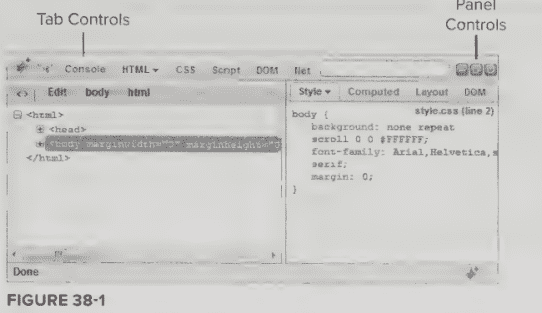

图38-1

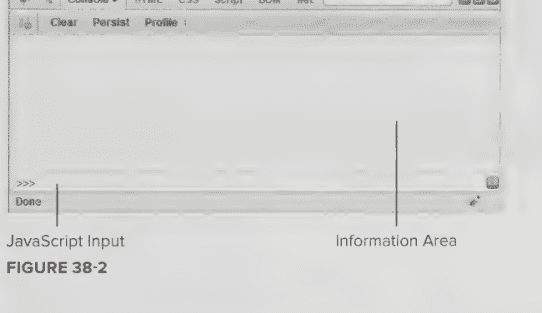

图38-2

默认情况下，控制台只允许输入和执行单行JavaScript语句，但你可以点击向上箭头以允许多语句JavaScript代码。当你这样做时，控制台标签页会分成左面板（信息面板）和右面板（JavaScript输入面板）。

下一个标签页是HTML标签页，它提供了关于浏览器中渲染的HTML结构的信息（图38-3）。

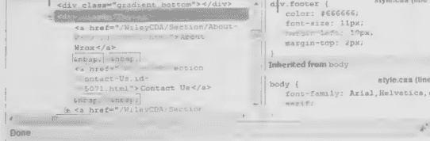

图38-3

左侧是一个树状结构，让你可以深入到页面中的任何元素。你实际上可以实时编辑HTML以查看更改如何影响其渲染。对于任何Web开发者来说，这都是一个强大的工具。右侧是一个面板，为你提供你在左面板中选定的元素的CSS和布局信息，以及该元素的DOM对象。

下一个标签页是CSS标签页（图38-4）。它显示页面中引用的所有CSS样式表的源代码。

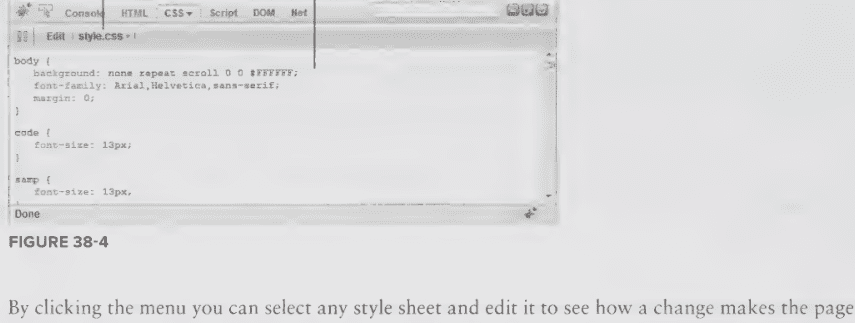

通过点击菜单，你可以选择任何样式表并进行编辑，以查看更改如何使页面在浏览器中呈现。虽然这对JavaScript开发者来说不是特别有用，但对于负责页面外观的人来说很方便。

接下来是脚本标签页，如图38-5所示，这是你在本课中将花费大部分时间的地方。

左面板显示页面中引用的所有JavaScript的源代码。你可以通过点击菜单并选择你想要查看的JavaScript文件来查看其他JavaScript文件。源代码面板最左侧显示行号的区域称为*边栏*。你将使用边栏来设置和移除断点。


脚本标签页的右侧面板是一个信息区域，允许你指定监视、查看调用栈以及查看设置了断点的语句。

下一个标签页是DOM标签页（图38-6）。它显示DOM加载的所有内容，以及当前加载页面中的JavaScript变量、函数和对象。

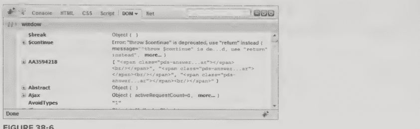

最后是网络标签页，默认情况下是禁用的，但如果你想启用它，它会提供说明。此标签页显示此页面上发出的所有请求，如图38-7所示。

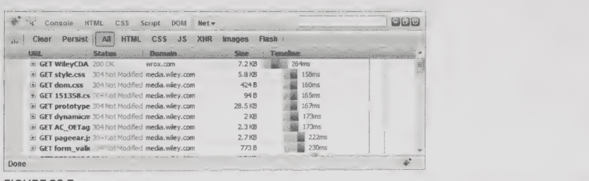

它为你提供了关于每个请求的几乎所有信息：请求头、响应代码、请求发送到的域名以及下载资源所花费的时间。当你试图优化Web应用程序的网络部分时，这是一个非常有用的工具。

以上就是用户界面的快速概览。让我们从脚本标签页开始，专注于JavaScript开发的核心工具。

## 设置断点

当调试器到达断点时，它会暂停代码执行并等待你的操作。这很有用，因为它允许你在代码执行时检查代码。要创建断点，只需在你想中断的行的边栏中左键单击。断点由你单击的行边栏中的红色圆圈表示（图38-8）。

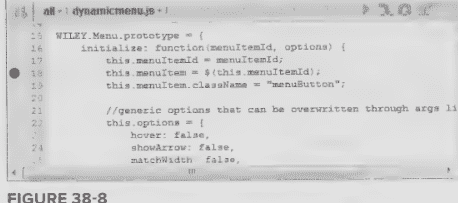

你也可以通过在JavaScript代码中使用`debugger`关键字来硬编码断点，如下所示：

```javascript
function someFunction() {
    var someVariable = "Doing some work";
    debugger;
    someVariable = "Doing more work";
}
```

当代码执行到达此代码中的`debugger`语句时，Firebug将中断并等待你的操作。

要查看你设置的所有断点，你可以点击右侧面板中的断点标签页（图38-9）。列表中的每个条目都允许你通过选中或取消选中复选框来启用或禁用断点，并且还显示包含断点所在语句的函数名称（如果适用）、源文件的文件名和行号、断点的源文本以及用于删除断点的删除按钮。

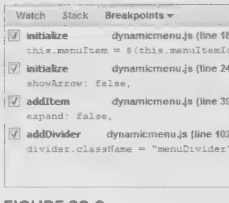

## 单步调试代码

你可以使用源代码面板右上角的四个按钮来控制代码单步调试（图38-10）。

- 第一个按钮是继续按钮（其快捷键是F8）。当代码执行在断点处停止时，继续操作将重新启动它，直到到达下一个断点或代码结束。
- 第二个按钮是单步进入（其快捷键是F11）。它执行当前行代码并在下一条语句处暂停。如果当前行是函数，它将单步进入函数的第一行。
- 接下来是单步跳过（F10），它执行当前行代码并在下一条语句处暂停。
- 最后是单步跳出按钮（Shift+F11）。当在函数内部调用时，单步跳出执行函数的剩余代码并返回到调用者。

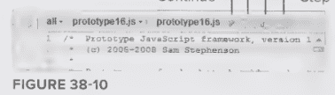

## 试一试

本课将向你介绍最受欢迎的JavaScript调试器——Firebug。你将学习如何设置断点、单步执行代码，以及如何使用控制台获取信息和按需修改值。

## 课程要求

本课需要一个文本编辑器；任何纯文本编辑器都可以。对于Microsoft Windows用户，系统默认提供了记事本，或者你可以下载Microsoft的Visual Web Developer Express (www.microsoft.com/express/web/)或Web Matrix (www.asp.net/webmatrix/)，两者都是免费的。Mac OS X用户可以使用OS X自带的TextMate，或者下载Coda (www.panic.com/coda/)的试用版。Linux用户可以使用内置的VIM。

你还需要安装Firefox和Firebug附加组件。如果你的计算机上没有安装Firefox，请访问`www.getfirefox.com`下载并安装。安装完成后，按照本课前面的描述安装Firebug附加组件。

在`JS24Hour`文件夹中创建一个名为`Lesson38`的子文件夹，然后打开你的文本编辑器并输入以下HTML。加粗的行有一个故意的拼写错误。

```html
<html>
<head>
    <title>Lesson 38: Example 01</title>
</head>
<body>

<script type="text/javascript">
function writeTimesTable(timesTable) {
    var writeString = "";

    for (var counter = 1; counter < 12; counter++) {
        writeString = counter + " * " + timesTable + " = ";
        writeString = writeString + (timesTable * counter);
        writeString = writeString + "<br />";

        documents.write(writeString);
    }
}

writeTimesTable(2);
</script>

</body>
</html>
```

将此文件保存为`lesson38_example01.htm`，并确保它位于`Lesson38`文件夹中。

## 分步操作

1. 在Firefox中打开`lesson38_example01.htm`。Firebug应该会自动打开。如果没有，也没关系。

   如果你的状态栏已启用，请查看浏览器窗口的右下角，你会看到此页面发生了一个错误（图38-11）。

2. 如果你的状态栏已启用，请单击状态栏中的“1 Error”消息。

3. 如果你的状态栏已禁用，并且尚未打开Firebug，请按F12键打开Firebug，然后单击“控制台”选项卡。

4. 现在你会看到错误。请注意，系统会提供错误消息、导致错误的源代码，以及错误发生的文件和行号。

5. 返回你的文本编辑器，通过从`documents`中删除`s`来修复错误。再次保存文件，并在浏览器中刷新页面。

6. 现在在第13行设置一个断点。该行的代码是：

```javascript
writeString = writeString + (timesTable * counter);
```

要设置断点，请单击“脚本”选项卡，然后在第13行的边栏上单击鼠标左键。现在你应该会在行号旁边看到一个红圈。

7. 重新加载页面。注意看起来好像什么都没发生。那是因为Firebug已暂停JavaScript执行。查看“脚本”选项卡中的源代码。你会看到红圈内有一个箭头，并且该行会被高亮显示（图38-12）。调试器尚未执行此行代码——它正在等待你的操作。你很快就会给它一个操作。

8. 看看右边的窗格。“监视”选项卡应该是活动的。如果不是，请单击它。

   断点导致调试器在第13行暂停，该行位于`writeTimesTable()`函数内部。“监视”选项卡中显示的项目是在`writeTimesTable()`作用域内的变量。你可以看到`this`是`window`对象，`counter`变量是1，`timesTable`是2，`writeString`是"1 * 2 = "。你可以单击“新建监视表达式”来添加新的监视。目前没有任何需要添加的。

   

9. 现在按F11键（或单击“步入”按钮）步入下一行。调试器执行当前高亮显示的行，然后在下一行暂停。

10. 回到“监视”选项卡，查看`writeString`的值。现在它如下所示：

```text
"1 * 2 = 2"
```

监视项的值会实时更新。

11. 再步入代码两次。注意Firefox在你单步执行代码时会更新页面。不幸的是，并非所有JavaScript调试器都会这样做（IE的调试器就不会）。

12. 现在步出代码（Shift+F11）。循环迭代，代码执行再次在第13行暂停。如果在循环内的语句上设置了断点，你无法步出函数。在循环的剩余迭代执行期间，调试器会在下一次迭代中再次在断点处停止。

   要在循环内步出函数，必须禁用或删除循环内的断点。

13. 单击右侧面板中的“断点”选项卡，你会看到关于第13行断点的信息。取消选中该复选框，然后再次步出。循环完成执行而没有再次中断，你步出了函数。现在代码执行在第20行暂停，即调用`writeTimesTable()`的地方。

14. 再次步入代码，看起来好像什么都没发生。当你步出函数时，它完成执行并返回到函数被调用的位置。由于没有其他代码要执行，步入实际上不会做任何事情。

15. 再次启用断点并刷新页面。代码再次在第13行暂停。

16. 让我们搞乱它。单击“控制台”选项卡，并在控制台选项卡底部的输入框中输入以下代码：

```javascript
writeString = "I messed this up!";
```

17. 现在按键盘上的回车键。看起来好像什么都没发生。

18. 这次通过单击边栏中的红圈来删除断点，然后按F8继续（或单击按钮）。Firefox中的页面应如图38-13所示。

   这是因为你在第13行暂停时更改了`writeString`的值。

   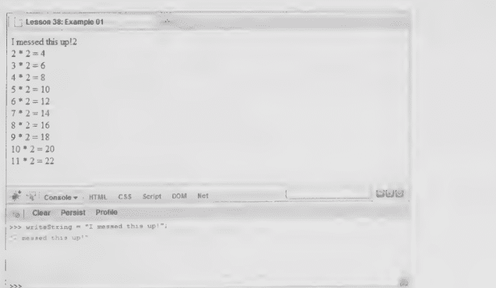

   要获取示例代码文件，请从本书网站`www.wrox.com`下载第38课。

> 请在DVD上选择第38课，以查看本课附带的视频。

# 39 编码准则

无论你是独自工作还是与其他开发人员一起工作，在编写代码时遵循一套准则都非常重要。遵循准则可以提高代码质量，使你和其他人更容易查找错误、阅读和维护代码。大多数准则的核心是编程语言固有的代码约定。例如，在第2课中介绍变量和标识符时，你被教导标识符应遵循语言本身已使用的代码约定。

除了命名标识符外，JavaScript开发人员还遵循一套不同的准则，通常基于约定，以使他们的代码更易于阅读和维护。让我们来看其中的一些。

## 使用空格

空格虽然不是实际的代码，但它是编程语言中最重要的部分之一。它允许你将代码在视觉上组织成可读和可维护的文本块。没有空格，代码将是一团混乱的文本。看下面的代码示例：

```javascript
function doSomethingUseless(num) {if(num===1) {num=num+1;
doSomethingUseless(1);}
else{num=num*2;for(var i=0;i<num;i++){
num--;}
return num;
}
}
```

这段代码很难阅读。通过浏览它，你可以看到这是一个包含一些判断和循环的函数，但缺乏空格使得很难辨别代码实际做了什么。所以让我们添加一些空格使其更具可读性：

```javascript
function doSomethingUseless(num) {
    if (num === 1) {
        num = num + 1;
        doSomethingUseless(num);
    } else {
        num = num * 2;
        for (var i = 0; i < num; i++) {
            num--;
        }
        return num;
    }
}
```

要在视觉上组织你的代码，请遵循以下准则：

- 将每个语句放在自己的行上。
- 通过以下方式组织代码块：
  - 将左花括号(`{`)放在开始代码块的行的末尾。
  - 将右花括号(`}`)放在新行的开头。它应该缩进以与包含左花括号的语句对齐。
  - 缩进每一行代码，以便你可以看到特定代码块中包含哪些行。
- 在值和运算符之间添加一个空格。代码`2+2`写成`2 + 2`更易于阅读。

## 变量声明

使代码更易于阅读和维护的另一件事是在函数开头声明所有变量（当然使用`var`关键字）。考虑以下代码作为示例：

```javascript
function nothingSpecial(value) {
    var multiplier = 2;
    var result = value;

    for (var i = 0; i < value; i++) {
        result = result * 2 + num;
    }

    return result;
}
```

将变量声明放在函数顶部还有一个副作用，即指出可能的错误。例如，此代码在`for`循环内使用了一个名为`num`的变量。它显然对`nothingSpecial()`函数很重要，因为它用于计算`result`。

那么`num`应该是全局变量，还是应该是局部变量？你能指望它在用于计算之前就有值吗？通过在函数顶部声明变量，你可以捕获像`num`变量这样的小问题，因为你知道函数中应该有哪些变量。另外请记住，JavaScript没有块级作用域。将变量声明放在函数开头使这一事实变得明确。

作为循环计数器的变量是个例外。通常，它们与所计数的循环一起声明。

## 避免全局作用域

上一节提出了一个关于未在函数内声明的变量的有效问题。它是全局变量吗？JavaScript的一个缺陷是其对全局作用域的依赖。JavaScript假定未声明的变量是全局变量，这可能导致应用程序中出现不期望的结果。因此，最好避免使用全局作用域。

避免全局作用域也有好处，因为它有助于避免命名冲突（即，拥有多个同名的变量或函数）。随着你开发的应用程序越来越多，你可能会发现自己使用了其他人编写的代码，例如流行的jQuery库中的代码。你向项目中添加的第三方代码越多，发生命名冲突的可能性就越大。虽然完全避免全局作用域几乎不可能，但你可以通过尽可能将代码保留在全局作用域之外来最小化命名冲突。你将在第42课中学习如何做到这一点。

## 使用字面量

你的Web应用程序的性能与其下载到用户浏览器的速度有关。显然，较大的文件需要更多时间下载。随着宽带连接变得越来越普遍，文件大小似乎无关紧要。毕竟，在1MB/s的线路上，一个50KB的文件需要0.05秒下载，但积少成多。因此，删除不必要的字符不仅使输入更容易，还能减小代码的大小。

也许减少输入的最佳方法是在创建对象和数组时使用字面量表示法，而不是调用它们的构造函数。记住，对象字面量使用花括号（`{}`），数组字面量使用方括号（`[]`）。例如，以下代码使用`Object`和`Array`构造函数创建了一个具有三个属性（其中一个属性是数组）的对象：

```javascript
var person = new Object();
person.firstName = "John";
person.lastName = "Doe";
person.friends = new Array();
person.friends[0] = "Jim";
person.friends[1] = "Jane";
person.friends[2] = "Bartholomew";
```

创建一个`person`对象需要输入很多内容：相当于203字节的字符。与以下代码对比：

```javascript
var person = {
    firstName : "John",
    lastName : "Doe",
    friends : [
        "Jim",
        "Jane",
        "Bartholomew"
    ]
};
```

这段代码使用字面量表示法创建了相同的`person`对象。尽管它比前一段代码多两行，但输入更少，大小为146字节。这是一个显著的尺寸减少，而且随着添加更多属性或数组元素，尺寸差异只会越来越大。

许多专业人士使用一个名为JSLint (http://www.jslint.com/)的工具（由Douglas Crockford编写）来分析代码并检查其质量。本课中提到的指导原则只是JSLint检查的项目中的一部分，未来的课程将涉及JSLint审查的其他项目。

# 40 将JavaScript与HTML分离

Web应用程序自然地分为不同的层。HTML层负责将数据呈现给用户，CSS层负责数据的可视化表示，而JavaScript为页面添加行为。尽管存在这种分离，但开发者倾向于通过使用内联样式表或脚本，以及使用`style`和事件处理程序属性（如`onclick`）将HTML、CSS和JavaScript绑定在一起。

本书中就存在这样的证据。在许多示例中，你会发现使用了内联脚本或事件处理程序属性。这使得解释和演示更容易，但同时也使维护变得困难。你集成多个层越紧密，将来进行更改时面临的工作就越多。

从技术上讲，使用内联脚本和事件处理程序属性是正确的。毕竟，本书中的示例使用了它们，但它们的使用使得示例更难维护，并且在出现错误时更难修复。考虑以下代码作为示例：

```html
<form name="theForm" onsubmit="submitForm(event);" />

<script type="text/javascript">
function submitForm(event) {
    alert("Submitting!");
}
</script>
```

这段代码中有一个错误。但是在哪里？是在`<form/>`元素的`onsubmit`属性中，还是在JavaScript代码中？你有50%的机会选对开始调试的位置，如果选错了，你就浪费了时间。实际错误在`onsubmit`事件处理程序中：它调用的是`submitForm()`，而不是`submitForm()`。现在，这是一个非常简单的例子，所以想象一下在多个页面上调试多个HTML属性和内联脚本。这是一项艰巨的任务。

这个例子还引出了另一种可能发生错误的方式：在`submitForm()`函数对浏览器可用之前，表单可能已被提交。换句话说，当用户提交表单时，浏览器尚未加载`submitForm()`函数。这是那种你在开发应用程序时可能不会亲自遇到，但使用不同连接（尤其是慢速连接）的用户可能会遇到的错误。

将你的JavaScript与HTML解耦是*渐进增强*的原则之一，这是一种倡导可访问性的Web开发理念。渐进增强背后的理念是创建一个在所有浏览器中都能工作的基本文档（完全没有CSS或JavaScript）。然后，开发者通过外部样式表或JavaScript为页面添加增强功能。渐进增强使拥有最新浏览器的用户能够体验全功能页面；而使用禁用JavaScript浏览器的用户仍然可以使用页面的基本功能，而无需下载不必要的JavaScript文件。

前面的表单提交示例完美地说明了渐进增强如何改善用户体验。检查以下HTML：

```html
<form name="theForm" onsubmit="submitForm(event);" />

<script type="text/javascript">
function submitForm(event) {
    alert("Submitting!");
}
</script>
```

禁用JavaScript的浏览器仍然必须下载内联JavaScript，因为它是HTML文档的一部分。将该代码与以下HTML进行比较：

```html
<form name="theForm" />

<script type="text/javascript" src="formStuff.js"></script>
```

`formStuff.js`中的JavaScript代码包含了为现代Web浏览器用户提供增强功能和可用性所需的所有代码。对于启用了JavaScript的浏览器用户，会下载外部文件。对于禁用了JavaScript的浏览器用户，则不需要该文件；浏览器会忽略外部文件并不下载它。因此，通过遵循渐进增强的理念（从而将你的JavaScript与HTML分离），你为需要这些功能的用户提供了功能，同时为不需要这些功能的用户提高了性能。

将HTML与JavaScript解耦意味着JavaScript文件与HTML文档分开提供。这使你能够使用gzip压缩JavaScript文件使其更小，将它们设置为可缓存以便只需下载一次，并使用各种工具（如Yahoo!的UI Compressor (http://developer.yahoo.com/yui/compressor/)或Douglas Crockford的JSMIN (http://crockford.com/javascript/jsmin)）对其进行*压缩*（即删除不必要的字符）。

那么，如何将你的JavaScript与HTML分离呢？第一步是移除所有内联JavaScript并将其放入外部文件中。第二步，从你的HTML元素中移除所有事件处理程序属性，最后，在你的JavaScript中连接事件。

## 试一试

在本课中，你学习了如何将JavaScript与HTML分离，以避免错误并使你的应用程序更易于维护和调试。

## 课程要求

对于本课，你需要一个文本编辑器；任何纯文本编辑器都可以。对于Microsoft Windows用户，系统默认提供记事本，或者你可以下载Microsoft的Visual Web Developer Express (www.microsoft.com/express/web/)或Web Matrix (www.asp.net/webmatrix/)，两者都是免费的。Mac OS X用户可以使用TextMate（作为OS X的一部分提供），或下载Coda (www.panic.com/coda/)的试用版。Linux用户可以使用内置的VIM。

你还需要一个支持PHP的现代Web浏览器。选择以下任一浏览器：

- Internet Explorer 8+
- Google Chrome
- Firefox 3.5+
- Apple Safari 4+
- Opera 10+

此外，你需要一个安装了PHP支持的Web服务器。有关安装说明，请参阅DVD上的第31课。

本课修改了第35课的JSON示例，因此你需要在Web服务器的根目录中创建一个名为`Lesson40`的目录，其中包含第35课使用的`eventUtility.js`、`ajaxUtility.js`、`car_dealership.php`和`json2.js`文件。你也可以将`lesson35_example01.htm`复制并粘贴到`lesson40`文件夹中。只需记住将其重命名为`lesson40_example01.htm`。

## 分步操作

1. 如果你没有复制`lesson35_example01.htm`，请打开文本编辑器并输入以下内容：

```html
<html>
<head>
    <title>Lesson 40: Example 01</title>
</head>
<body>
<div id="divResults">
    <div id="divSearchMessage"></div>
    <div id="divSearchResults"></div>
</div>
<form name="theForm" method="post" action="car_dealership.php"
    onsubmit="submitForm(event);">
    <p>
        Make: <input type="text" name="txtMake" value="" />
    </p>
    <p>
        Model: <input type="text" name="txtModel" value="" />
    </p>
    <p>
        Year: <input type="text" name="txtYear" value="" />
    </p>
    <p>
        <input type="submit" name="btnSubmit" value="Submit" />
    </p>
</form>
<script type="text/javascript" src="eventutility.js"></script>
<script type="text/javascript" src="ajaxutility.js"></script>
<script type="text/javascript" src="json2.js"></script>
<script type="text/javascript">
function submitForm(event) {
    var data = ajaxUtility.getRequestBody(document.theForm);

    ajaxUtility.makeGetRequest("car_dealership.php?" + data,
        processResponse);

    eventUtility.preventDefault(event);
}

function getCarString(carObj) {
    return [carObj.year, carObj.make, carObj.model].join(" ");
}

function processResponse(data) {
    var result = JSON.parse(data);
    var messageDiv = document.getElementById("divSearchMessage");
    var resultsDiv = document.getElementById("divSearchResults");
    var message = "";
    var results = [];
    var length = result.results.length;
    var carStr = getCarString(result.searchedCar);

    if (result.isFound) {
        message = "We found " + length + " matches for " + carStr;
    } else {
        message = "We could not find " + carStr + ". You might like: ";

        for (var i = 0; i < length; i++) {
            results.push(getCarString(result.results[i]));
        }

        resultsDiv.innerHTML = results.join("<br/>");
    }

    messageDiv.innerHTML = message;
}
</script>
</body>
</html>
```

将其保存为`lesson40_example01.htm`。

2. 复制内联JavaScript代码并粘贴到一个新的文本文件中。将这个新文件保存为`lesson40_example01.js`。请务必将其保存在`lesson40`目录中。

3. 现在，从你的HTML文件中移除内联代码，并按照以下HTML所示的方式引用新的`lesson40_example01.js`文件：

```html
<html>
<head>
    <title>Lesson 40: Example 01</title>
</head>
<body>
<div id="divResults">
    <div id="divSearchMessage"></div>
    <div id="divSearchResults"></div>
</div>
<form name="theForm" method="post" action="car_dealership.php"
      onsubmit="submitForm(event);">
    <p>
        Make: <input type="text" name="txtMake" value="" />
    </p>
    <p>
        Model: <input type="text" name="txtModel" value="" />
    </p>
    <p>
        Year: <input type="text" name="txtYear" value="" />
    </p>
    <p>
        <input type="submit" name="btnSubmit" value="Submit" />
    </p>
</form>
<script type="text/javascript" src="eventutility.js"></script>
<script type="text/javascript" src="ajaxutility.js"></script>
<script type="text/javascript" src="json2.js"></script>
<script type="text/javascript" src="lesson40_example01.js"></script>
</body>
</html>
```

这样看起来是不是更整洁了？

4. 从`<form/>`元素中移除`onsubmit`属性。新代码应如下所示：

```html
<html>
<head>
    <title>Lesson 40: Example 01</title>
</head>
<body>
<div id="divResults">
    <div id="divSearchMessage"></div>
    <div id="divSearchResults"></div>
</div>
<form name="theForm" method="post" action="car_dealership.php">
    <p>
        Make: <input type="text" name="txtMake" value="" />
    </p>
    <p>
        Model: <input type="text" name="txtModel" value="" />
    </p>
    <p>
        Year: <input type="text" name="txtYear" value="" />
    </p>
    <p>
        <input type="submit" name="btnSubmit" value="Submit" />
    </p>
</form>
<script type="text/javascript" src="eventutility.js"></script>
<script type="text/javascript" src="ajaxutility.js"></script>
<script type="text/javascript" src="json2.js"></script>
<script type="text/javascript" src="lesson40_example01.js"></script>
</body>
</html>
```

JavaScript代码现在完全从你的HTML中消失了。这很好。

5. 你现在需要做的就是处理`<form/>`的提交事件。在`lesson40_example01.js`文件的末尾添加以下代码行：

```javascript
eventUtility.addEvent(document.forms[0], "submit", submitForm);
```

这段代码使用`eventUtility`对象为表单添加了一个`submit`事件处理器。

现在你的JavaScript与HTML完全分离了。你对JavaScript代码所做的任何更改都无需触及任何HTML。此外，任何可能发生的JavaScript错误都只能源自外部文件中的JavaScript。在确定错误是源于HTML还是JavaScript时，不再需要猜测。

> 即使完全分离了HTML和JavaScript，本例中的表单仍然可能在`submitForm()`或将其分配给处理`submit`事件的代码被浏览器加载之前就被提交。无法阻止过早的表单提交。

你将在第41课继续这项最佳实践的学习，届时你将学习如何解耦JavaScript和CSS。

要获取示例代码文件，请从本书网站`www.wrox.com`下载第32课。

> 请在DVD上选择第40课，以查看与本课配套的视频。

# 41

## 分离JavaScript和CSS

HTML层可以说是最重要的，因为它负责将数据传递给用户，而HTML和JavaScript层之间的交互对用户的整体体验至关重要。JavaScript可以与另一个层——CSS层进行交互，该层负责页面在浏览器中的显示方式。正如HTML和JavaScript层可以紧密集成一样，CSS和JavaScript层也可能耦合。

在第15课中，你学习了如何使用元素对象的`style`属性来更改元素的样式，如下所示：

```javascript
var someEl = document.getElementById("someElement");

someEl.style.color = "red";
someEl.style.backgroundColor = "gray";
someEl.style.border = "1px solid black";
```

这段代码获取一个`id`为`someElement`的元素，然后更改各种CSS属性以改变该元素在浏览器中的渲染方式。代码运行良好，但它存在与HTML和JavaScript耦合类似的问题，即使得维护变得更加困难。不仅每次你想更改`color`、`backgroundColor`和`border`属性时都必须重新审视这段代码，而且进行额外的样式更改需要为每个要更改的属性添加一行代码。这样的代码本质上使JavaScript承担了本应由CSS承担的表现层角色。

另一个问题是性能。要使用`style`对象，你需要访问一个DOM对象——这是一个性能不佳的操作。随着你添加更多代码行来更改元素的样式，你不仅会使应用程序变慢，还可能导致浏览器多次重新渲染页面。

诚然，完全分离CSS和JavaScript是不可能的（除非你不使用JavaScript来更改元素的样式），但你可以通过使用`className`属性向元素的`className`属性添加和移除CSS类来最小化CSS和JavaScript的集成，就像你在第15课中所做的那样，如下所示：

```javascript
someEl.className = "cssClassName";
```

通过这样做，你只对DOM进行了一次调用，而不是多次，并且对CSS的任何修改都在其需要的地方进行——即在CSS文件中。如果你想向`someEl`代表的元素添加另一个CSS类，可以编写以下代码：

```javascript
someEl.className = someEl.className + " anotherCssClass";
```

这段代码添加了一个名为`anotherCssClass`的CSS类，当你想移除它时，可以这样做：

```javascript
someEl.className = someEl.className.replace(" anotherCssClass", "");
```

然而，这种分离规则也有例外。有时，更改元素的CSS类无法提供你想要的功能。还记得第24课中的拖放脚本吗？你必须通过更改`top`和`left` CSS属性来移动元素，同时还要操作元素的`z-index`。这种精细的控制无法通过CSS类来实现。因此，当你需要这种级别的控制时，使用JavaScript设置单个CSS属性是可以接受的。

# 42

## 避免全局作用域

在第39课中，我提到避免全局作用域是一个好习惯。当你在页面中引入他人代码时，这一点至关重要，因为它有助于避免你的代码和对方代码中的变量和函数名之间发生*命名冲突*。到底什么是命名冲突？当你使用的标识符在同级作用域的另一个脚本中也被使用时，就会发生命名冲突。

让我们看一个例子。以下代码是本书中使用的`eventUtility`对象的精简版本：

```javascript
// your code
var eventUtility = {
    addEvent : (function() {
        if (typeof addEventListener !== "undefined") {
            return function(obj, evt, fn) {
                obj.addEventListener(evt, fn, false);
            };
        } else {
            return function(obj, evt, fn) {
                obj.attachEvent("on" + evt, fn);
            };
        }
    }())
};
```

这段代码创建了带有`addEvent()`方法的`eventUtility`对象。这段代码定义在全局作用域中，你的事件驱动代码严重依赖于这个特定的对象和方法。但你想为页面添加一些额外功能，并引入了别人编写的代码。它也使用了一个名为`eventUtility`的全局对象，但它与你的不同。它的代码如下：

```javascript
// third party code
var eventUtility = {
    addEventHandler : function(obj, evt, fn) {
        // ...
    }
};
```

## 使用函数

在第6课中，你学习了作用域的概念，并了解到函数拥有自己的作用域层级；在另一个函数内部定义的变量、对象和函数，无法从该函数外部访问。在第20课中，编写跨浏览器事件工具时，你了解了自执行函数——即定义后立即执行的匿名函数。这两个概念——函数作用域和自执行函数——可以结合起来，从而将你的代码从全局作用域中隐藏起来。

让我们看一个例子。以下是一些使用自执行函数将代码与全局作用域隔离的代码：

```javascript
var someVariable = "Hello, Global!";

(function() {
    var someVariable = "Hello, Privacy!";

    alert(someVariable); // Hello, Privacy!
})();

alert(someVariable); // Hello, Global!
```

这段代码的第一行创建了一个名为`someVariable`的全局变量。它可以在页面的任何地方被访问，因此有可能被其他数据覆盖。

接下来定义了一个自执行函数，其函数体包含一个名为`someVariable`的局部变量（与全局变量同名）以及一个调用`alert()`来显示`someVariable`值的语句。记住，第6课讨论了局部作用域中的变量或函数如何*覆盖*（不同于*覆写*）同名的全局变量或函数。全局变量或函数及其值仍然完好无损，但在局部作用域中，定义的局部变量或函数会替代全局变量或函数。因此，当这个自执行函数执行时，局部`someVariable`变量的值会显示在警告窗口中。

函数执行完毕后，这段代码的最后一行执行，并警告文本"Hello, Global!"，因为全局`someVariable`变量未被更改。

让我们再看一个例子。这个例子使用了本课前面提到的`eventUtility`示例：

```javascript
(function() {
    var eventUtility = {
        addEvent : (function() {
            if (typeof addEventListener !== "undefined") {
                return function(obj, evt, fn) {
                    obj.addEventListener(evt, fn, false);
                };
            } else {
                return function(obj, evt, fn) {
                    obj.attachEvent("on" + evt, fn);
                };
            }
        }())
    };

    function documentLoad(event) {
        alert("Document loaded!");
    }

    // 使用 eventUtility 和 documentLoad() 的本地版本
    eventUtility.addEvent(document, "load", documentLoad);
}());

function documentLoad(event) {
    alert("Event handled with third party");
}

// 使用第三方 eventUtility 和全局 documentLoad()
eventUtility.addHandler(document, "load", documentLoad);
```

这段代码首先执行一个自执行函数。在这个函数内部，定义了你的`eventUtility`对象，并用它来分配一个事件处理器来处理`document`对象的`load`事件。当事件触发时，一个警告窗口会显示文本"Document loaded!"。

函数执行后，另一个事件处理器被分配来使用第三方`eventUtility`对象处理`document`的`load`事件。当包含此JavaScript的页面加载时，你会看到两个警告框：第一个告诉你文档已加载，第二个在支持`addEventListener()`的浏览器中显示"Event handled with third party"。

因此，通过将你的代码放入自执行函数，你可以有效地保护它免受页面中加载的其他JavaScript代码的影响。但这里有一个问题。`eventUtility`对象是你希望在整个应用程序中使用的——可能在不同的JavaScript文件中。如果它被隐藏在一个函数内部，其他代码如何使用它？难道它不应该是全局可访问的，以便你可以在需要的地方使用它吗？是的，它应该是，你可以通过模拟命名空间来实现这一点。

## 模拟命名空间

许多编程语言都有内置的构造，称为*命名空间*，以帮助避免命名冲突。命名空间是一个容器，为其包含的对象提供上下文，同时保护这些对象的名称免受命名空间外部其他对象名称的冲突。命名空间并非防止命名冲突的万无一失的方法，但它们做得足够好。

不幸的是，JavaScript不支持正式的命名空间特性，但你可以使用对象字面量来模拟命名空间。

> 本书将模拟的*命名空间*称为*伪命名空间*，因为它们在技术上不是*命名空间*，但服务于相同的目的。

命名空间应该具有意义，同时对你来说有些独特，例如你的名字或你网站的域名。本书作者的网站是`www.wdonline.com`，因此你可以通过输入以下内容为他创建一个伪命名空间：

```javascript
var wdonline = {};
```

然后你可以开始附加你需要全局访问的代码，如以下代码所示：

```javascript
wdonline.eventUtility = {
    addEvent : (function() {
        if (typeof addEventListener !== "undefined") {
            return function(obj, evt, fn) {
                obj.addEventListener(evt, fn, false);
            };
        } else {
            return function(obj, evt, fn) {
                obj.attachEvent("on" + evt, fn);
            };
        }
    })()
};
```

就这段代码而言，`wdonline`对象是全局的，但`wdonline`被第三方代码覆盖的可能性很小。`eventUtility`对象现在是`wdonline`的一个属性，使其免受被覆盖的保护。如果`wdonline`被覆盖的可能性很小，那么`wdonline.eventUtility`的可能性就更小了。

现实情况是，如果你想让你的某些代码在页面的任何地方都可访问，你就无法完全脱离全局作用域，但你可以通过使用自执行函数和伪命名空间来尽力避免命名冲突。

## 动手试试

在本课中，你将学习如何最小化你的代码对全局作用域的影响，以减少命名冲突的可能性。

## 课程要求

为了实践本课概述的技术，你将重构`eventUtility`和`ajaxUtility`对象，以包含自执行匿名函数和伪命名空间的使用。为此，你将更改第35课中的示例，即使用JSON的汽车经销商搜索。

你需要一个文本编辑器。对于Microsoft Windows用户，系统默认提供记事本，或者你可以下载Microsoft的Visual Web Developer Express (www.microsoft.com/express/web/)或Web Matrix (www.asp.net/webmatrix/)，两者都是免费的。Mac OS X用户可以使用TextMate（作为OS X的一部分提供），或下载Coda的试用版 (www.panic.com/coda/)。Linux用户可以使用内置的VIM。

你还需要一个支持PHP的现代Web浏览器。选择以下任一：

- Internet Explorer 8+
- Google Chrome
- Firefox 3.5+
- Apple Safari 4+
- Opera 10+

你还需要一个安装了PHP支持的Web服务器。有关安装说明，请参阅DVD上的第31课。

在你的Web服务器根目录中创建一个名为`Lesson42`的子文件夹。将`Lesson35`目录的内容复制到`Lesson42`，并将`lesson35_example01.htm`文件重命名为`lesson42_example01.htm`。

## 分步指南

1. 在文本编辑器中打开`lesson42_example01.htm`，并将`<title/>`元素更改为包含文本`Lesson 42: Example 01`。

2. 创建一个名为`lesson42_example01.js`的新文件，并将所有内联JavaScript移动到该新文件。同时，从`<form/>`元素中移除`onsubmit`事件处理器。更改后的HTML应如下所示：

```html
<html>
<head>
    <title>Lesson 42: Example 01</title>
</head>
<body>
<div id="divResults">
    <div id="divSearchMessage"></div>
    <div id="divSearchResults"></div>
</div>
<form name="theForm" method="post" action="car_dealership.php">
    <p>
        Make: <input type="text" name="txtMake" value="" />
    </p>
    <p>
        Model: <input type="text" name="txtModel" value="" />
    </p>
    <p>
        Year: <input type="text" name="txtYear" value="" />
    </p>
    <p>
        <input type="submit" name="btnSubmit" value="Submit" />
    </p>
</form>
<script type="text/javascript" src="eventutility.js"></script>
<script type="text/javascript" src="ajaxutility.js"></script>
<script type="text/javascript" src="json2.js"></script>
<script type="text/javascript" src="lesson42_example01.js"></script>
</body>
</html>
```

3. 在你的文本编辑器中打开`eventUtility.js`文件。你将创建一个名为`js24Hour`的伪命名空间，并将`eventUtility`对象添加到该伪命名空间中。在文件开头添加以下代码：

```javascript
if (typeof js24Hour === "undefined") {
    var js24Hour = {};
}
```

这段代码为你的伪命名空间增加了灵活性。请记住，`eventUtility`和`ajaxUtility`对象存在于两个独立的文件中。如果你在两个文件中都创建了`js24Hour`对象，其中一个会被覆盖。通过使用这段代码，你可以检查`js24Hour`是否不存在，并在必要时创建它。这样，你的`eventUtility`和`ajaxUtility`对象就都存在于同一个`js24Hour`伪命名空间中了。

4. 按照以下代码中粗体所示对文件进行修改：

```javascript
if (!js24Hour) {
    var js24Hour = {};
}

js24Hour.eventUtility = {
    addEvent : (function() {
        if (typeof addEventListener !== "undefined") {
            return function(obj, evt, fn) {
                obj.addEventListener(evt, fn, false);
            };
        } else {
            return function(obj, evt, fn) {
                obj.attachEvent("on" + evt, fn);
            };
        }
    })(),
    removeEvent : (function() {
        if (typeof removeEventListener !== "undefined") {
            return function(obj, evt, fn) {
                obj.removeEventListener(evt, fn, false);
            };
        } else {
            return function(obj, evt, fn) {
                obj.detachEvent("on" + evt, fn);
            };
        }
    })(),
    getTarget : (function() {
        if (typeof addEventListener !== "undefined") {
            return function(event) {
                return event.target;
            };
        } else {
            return function(event) {
                return event.srcElement;
            };
        }
    })(),
    preventDefault : (function() {
        if (typeof addEventListener !== "undefined") {
            return function(event) {
                event.preventDefault();
            };
        } else {
            return function(event) {
                event.returnValue = false;
            };
        }
    })()
};
```

这段代码将`eventUtility`对象添加到了`js24Hour`伪命名空间中。没有其他更改。保存文件。

5. 现在打开`ajaxUtility.js`，并按照以下代码中粗体标记进行修改：

```javascript
if (typeof js24Hour === "undefined") {
    var js24Hour = {};
}

js24Hour.ajaxUtility = {
    createXHR : function() {
        if (typeof XMLHttpRequest !== "undefined") {
            return new XMLHttpRequest();
        } else {
            var versions = [ "MSXML2.XmlHttp.6.0",
                            "MSXML2.XmlHttp.3.0" ];

            for (var i = 0; i < versions.length; i++) {
                try {
                    var xhr = new ActiveXObject(versions[i]);
                    return xhr;
                } catch (error) {
                    // do nothing
                }
            }
        }

        alert("Your browser does not support XmlHttp");

        return null;
    },

    makeGetRequest : function(url, callback) {
        var xhr = this.createXHR();

        xhr.open("GET", url);

        xhr.onreadystatechange = function() {
            if (xhr.readyState === 4) {
                var status = xhr.status;

                if ((status >= 200 && status < 300) || status === 304) {
                    callback(xhr.responseText);
                } else {
                    alert("An error occurred");
                }
            }
        };

        xhr.send(null);
    },

    getRequestBody : function(form) {
        var pieces = [];
        var elements = form.elements;

        for (var i = 0; i < elements.length; i++) {
            var element = elements[i];
            var name = encodeURIComponent(element.name);
            var value = encodeURIComponent(element.value);

            pieces.push(name + "=" + value);
        }

        return pieces.join("&");
    },

    makePostRequest : function(url, data, callback) {
        var xhr = this.createXHR();

        xhr.open("POST", url);

        xhr.onreadystatechange = function() {
            if (xhr.readyState === 4) {
                var status = xhr.status;

                if ((status >= 200 && status < 300) || status === 304) {
                    callback(xhr.responseText);
                } else {
                    alert("An error occurred");
                }
            }
        };

        xhr.send(data);
    },

    postFromForm : function(url, form, callback) {
        var xhr = this.createXHR();

        xhr.open("POST", url);
        xhr.setRequestHeader("Content-Type", "application/x-www-form-urlencoded");

        xhr.onreadystatechange = function() {
            if (xhr.readyState === 4) {
                var status = xhr.status;

                if ((status >= 200 && status < 300) || status === 304) {
                    callback(xhr.responseText);
                } else {
                    alert("An error occurred");
                }
            }
        };

        xhr.send(this.getRequestBody(form));
    }
};
```

同样，开头的几行代码确保你不会覆盖任何已存在的`js24Hour`对象。保存文件。

6. 现在你需要打开`lesson42_example01.js`并修改此文件。首先，将此文件中的代码包裹在一个自执行匿名函数中。然后，由于你已经从`<form/>`元素的HTML中移除了`onsubmit`事件处理器，你需要将`submitForm()`函数绑定到表单的`submit`事件上。最后，你需要修改`submitForm()`函数以使用`js24Hour.ajaxUtility`和`js24Hour.eventUtility`对象。此文件的更改在以下代码中以粗体显示：

```javascript
(function() {
    var ajaxUtility = js24Hour.ajaxUtility;
    var eventUtility = js24Hour.eventUtility;

    function submitForm(event) {
        var data = ajaxUtility.getRequestBody(document.theForm);

        ajaxUtility.makeGetRequest("car_dealership.php?" + data, processResponse);

        eventUtility.preventDefault(event);
    }

    function getCarString(carObj) {
        return [carObj.year, carObj.make, carObj.model].join(" ");
    }

    function processResponse(data) {
        var result = JSON.parse(data);
        var messageDiv = document.getElementById("divSearchMessage");
        var resultsDiv = document.getElementById("divSearchResults");
        var message = "";
        var results = [];
        var length = result.results.length;
        var carStr = getCarString(result.searchedCar);

        if (result.isFound) {
            message = "We found " + length + " matches for " + carStr;
        } else {
            message = "We could not find " + carStr + ". You might like: ";

            for (var i = 0; i < length; i++) {
                results.push(getCarString(result.results[i]));
            }

            resultsDiv.innerHTML = results.join("<br/>");
        }

        messageDiv.innerHTML = message;
    }

    eventUtility.addEvent(document.forms[0], "submit", submitForm);
})();
```

在此文件中使用自执行匿名函数可以保护此代码免受页面中可能加载的其他JavaScript的意外破坏。自执行函数中的前两条语句将`js24Hour.ajaxUtility`和`js24Hour.eventUtility`对象分别缓存到`ajaxUtility`和`eventUtility`变量中。缓存这些对象使你能够在自执行函数内部像在之前的课程中一样使用它们。

此代码还通过使用你的事件工具将一个函数分配给处理表单的`submit`事件，从而将你的JavaScript代码与HTML解耦。

7. 保存`lesson42_example01.js`，并将浏览器指向`http://localhost/Lesson42/lesson42_example01.htm`。填写表单并提交，你会看到它和第35课中一样工作正常。

你也可以从本书的网站`www.wrox.com`下载所有课程的示例代码。

> 请在DVD上选择第42课，以查看伴随本课的视频。

# 43

## 优化你的代码

你每天使用的应用程序很可能已经开发多年。其背后的代码经过不断优化，使其比最初版本更高效、响应更迅速。代码在初次编写时很少能达到最佳状态——通常远非如此。

大多数专业开发者都遵循一句古老的格言：“先让它运行，然后再让它运行良好。”当你首次编写应用程序时，不必担心优化代码。另一句格言是“过早优化是万恶之源。”先专注于让应用程序运行起来，等它能正常工作后，*再*开始优化代码。

JavaScript优化主要有三个方面，它们是：

- 重构代码
- 优化DOM代码
- 使用事件委托

让我们首先探讨如何重构代码。

### 重构代码

这一点已被多次提及，但值得重复：代码下载速度越快，用户感觉应用程序运行得越快。你无法控制用户的连接速度，但你可以控制代码文件的大小。代码文件的大小取决于多种因素，但通常导致代码体积增大的两个主要原因是代码重复和不必要的语句。

### 重构重复代码

你可以通过*重构*重复代码来减小代码体积。重构代码时，你在不改变其外部行为的前提下对其进行改进。最常见的重构方法是识别重复代码，并将其修改为可复用且易于维护的形式。

回顾关于函数的课程（第3课）。课程开头给出了一个代码重复的例子。为方便起见，此处再次列出：

```javascript
var valueOne = 100;
valueOne = valueOne + 150;
valueOne = valueOne / 2;
valueOne = "The value is: " + valueOne; // results in "The value is: 125"

var valueTwo = 50;
valueTwo = valueTwo + 150;
valueTwo = valueTwo / 2;
valueTwo = "The value is: " + valueTwo; // results in "The value is: 100"

var valueThree = 2;
valueThree = valueThree + 150;
valueThree = valueThree / 2;
valueThree = "The value is: " + valueThree; // results in "The value is: 76"
```

这段代码对三个不同的变量执行了完全相同的操作。在该课程的后面部分，这段代码被重构为使用以下函数：

```javascript
function augmentValue(originalValue) {
    var augmentedValue = originalValue;
    augmentedValue = augmentedValue + 150;
    augmentedValue = augmentedValue / 2;
    augmentedValue = "The value is: " + augmentedValue;

    return augmentedValue;
}

var valueOne = augmentValue(100); // results in "The value is: 125"
var valueTwo = augmentValue(50);  // results in "The value is: 100"
var valueThree = augmentValue(2); // results in "The value is: 76"
```

这次重构节省了两行代码。现在看来可能不多，但让我们看看其好处。首先，代码变得可复用。如果你需要以相同方式处理更多值，只需像下面示例那样调用函数即可：

```javascript
var valueFour = augmentValue(10); // results in "The value is: 80"
var valueFive = augmentValue(40); // results in "The value is: 90"
var valueSix = augmentValue(0);   // results in "The value is: 75"
```

现在你开始看到复用`augmentValue()`函数带来的实际代码节省。重构前，对一个变量执行一组操作需要四行代码（包括变量声明）。如果要对六个变量执行相同操作，需要24行代码。通过重构，代码行数减少到13行（函数占7行，每个变量占6行）——这是相当可观的节省。

其次，代码更易于维护。假设你想在将数字除以二后给每个值加一。重构前，你需要修改每组操作，如下代码中的加粗行所示：

```javascript
var valueOne = 100;
valueOne = valueOne + 150;
valueOne = (valueOne / 2) + 1;
valueOne = "The value is: " + valueOne; // results in "The value is: 125"

var valueTwo = 50;
valueTwo = valueTwo + 150;
valueTwo = (valueTwo / 2) + 1;
valueTwo = "The value is: " + valueTwo; // results in "The value is: 100"

// etc, etc, etc
```

进行此类修改会使代码更容易出错（万一你漏掉了一个变量怎么办？），并且耗费大量时间。通过编辑一行代码（如下例加粗所示），你可以实现相同的修改：

```javascript
function augmentValue(originalValue) {
    var augmentedValue = originalValue;
    augmentedValue = augmentedValue + 150;
    augmentedValue = (augmentedValue / 2) + 1;
    augmentedValue = "The value is: " + augmentedValue;

    return augmentedValue;
}
```

因此，通过识别重复代码并进行重构，你不仅通过减少代码量提升了性能，还节省了时间并避免了潜在错误。

### 减少语句

上一节中的`augmentValue()`函数确实消除了重复代码，但函数体可以变得更高效、更节省空间。你可以做的第一个改动是移除`augmentedValue`变量。传递给此函数的值应该是一个数字。在JavaScript中，数字是原始值，因此传递给函数的值会被复制并包含在`originalValue`变量中。因此，没有必要将`originalValue`中的值复制到`augmentedValue`。第一次重构的结果如下：

```javascript
function augmentValue(originalValue) {
    originalValue = originalValue + 150;
    originalValue = (originalValue / 2) + 1;
    originalValue = "The value is: " + originalValue;

    return originalValue;
}
```

你可以通过合并语句来进一步重构此函数。JavaScript引擎执行一条包含多个操作的语句，比执行多条各执行一个操作的语句更快。虽然你可以将此函数中的所有语句合并为一条，但更好的方法（就可维护性而言）是合并执行类似操作的语句。例如，有两条语句执行算术运算。你可以将它们合并为一条语句，如以下代码所示：

```javascript
function augmentValue(value) {
    originalValue = ((value + 150) / 2) + 1;
    return "The value is: " + originalValue;
}
```

首先，`originalValue`参数被改为`value`。这样做有两个原因：

- 在移除`augmentedValue`变量之前，`originalValue`标识符是有意义的。现在，由于`augmentedValue`不再使用，`originalValue`就失去了意义。
- 因为`originalValue`不再有意义，所以单独使用`value`这个词是合理的。它简短、节省空间，同时为参数提供了有意义的名称。

接下来，前两条语句被合并。这并不总是个好主意。如果需要执行许多数学运算，将它们放在多条语句中会更易于阅读和维护。但在这里，合并它们是可行的。

最后，连接操作和`return`语句被合并。因为在`value`与字符串连接后不需要执行其他操作，所以直接返回连接操作的结果是合理的。

现在`augmentValue()`函数比之前小了很多。这与将重复代码重构为`augmentValue()`函数相结合，使得这段代码高效且准备好下载。

合并语句也适用于变量。第2课介绍了在一条语句中初始化多个变量的概念，如下代码所示：

```javascript
var variableOne = "data",
    variableTwo = 10,
    variableThree = [];
```

每个变量初始化用逗号分隔。这段代码比以下代码执行得更快：

```javascript
var variableOne = "data";
var variableTwo = 10;
var variableThree = [];
```

本书为了清晰起见，选择像这段代码一样在单独的语句中声明和初始化多个变量。许多专业人士以这种方式声明变量，但请记住，单语句方法更高效。

### 优化DOM代码

重构代码只是优化拼图的一部分；你还需要审视与DOM交互的代码。作为JavaScript开发者，你将花费大量时间处理DOM——这是你将遇到的应用程序中最慢的部分（除了基于连接的部分，如Ajax）。

DOM的缓慢主要由两个因素引起：DOM变化导致的页面重新渲染，以及DOM管理的大量数据。你可以通过限制对DOM的更新次数来优化与DOM交互的代码。

## 使用文档片段

在第14课中，你学习了如何使用`document.createElement()`和`document.createTextNode()`方法动态创建HTML元素和文本节点，以及如何使用`appendChild()`和`insertBefore()`方法将它们添加到页面。作为快速回顾，请看以下代码：

```javascript
for (var i = 0; i < 20; i++) {
    var el = document.createElement("p");
    el.appendChild(document.createTextNode("Paragraph " + i));
    document.body.appendChild(el);
}
```

这段代码创建了20个`<p/>`元素，为它们添加了文本节点，并将它们添加到页面。图43-1展示了它在浏览器中的样子。


图43-1

从技术上讲，这段代码没有问题，但它效率极低，因为DOM被更新了20次，每次添加一个`<p/>`元素到页面时都会更新一次。每次更新时，浏览器都必须重绘页面。这种页面更新可能会被用户察觉到，并影响性能。为了解决这个问题，你需要减少对DOM的更新次数，而你可以通过创建一个*文档片段*来实现。

文档片段是轻量级的文档对象，可以包含元素对象，你可以像操作HTML文档内部的元素一样操作它们。要创建文档片段，你需要使用`document`对象的`createDocumentFragment()`方法，如下所示：

```javascript
var fragment = document.createDocumentFragment();
```

创建片段后，你就可以开始向其中添加元素对象。在本例中，你可以将每个`<p/>`元素附加到文档片段，然后将片段添加到HTML文档。以下代码说明了这一点：

```javascript
var fragment = document.createDocumentFragment();

for (var i = 0; i < 20; i++) {
    var el = document.createElement("p");
    el.appendChild(document.createTextNode("Paragraph " + i));
    fragment.appendChild(el);
}

document.body.appendChild(fragment);
```

这里，每个`<p/>`元素都被附加到文档片段。循环退出后，片段被附加到`document`的`body`节点。

以这种方式使用文档片段是有利的，因为它将DOM更新次数减少到一次。即使你将每个`<p/>`元素附加到片段，片段也存在于DOM之外。因此，在你将片段附加到`document.body`之前，不会引起更新。文档片段对象本身不生成HTML，但它的子元素会。因此，这段代码生成的HTML与不使用文档片段时完全相同。

## 使用innerHTML

同样在第14课中，你学习了`innerHTML`属性，你可以用它来向元素添加HTML。你无需创建节点对象，只需构建一个包含HTML标记的字符串并将其赋值给元素的`innerHTML`属性即可。这很简单、快速且高效——当然，除非你对DOM进行多次更新。让我们使用`innerHTML`通过以下代码将`<p/>`元素添加到页面，来重新创建上一节的示例：

```javascript
for (var i = 0; i < 20; i++) {
    var el = "<p>Paragraph " + i + "</p>";
    document.body.innerHTML = document.body.innerHTML + el;
}
```

与上一节一样，这段代码创建了20个`<p/>`元素并将它们添加到文档的body中。你可能已经意识到，这段代码效率低下，因为你对body进行了20次更新——导致浏览器在每次更新时都渲染页面。你可以通过创建一个变量并将每个HTML字符串添加到其中来修复这个问题，如下所示：

```javascript
var html = "";

for (var i = 0; i < 20; i++) {
    html = html + "<p>Paragraph " + i + "</p>";
}

document.body.innerHTML = html;
```

但这段代码效率也不高，因为JavaScript中的字符串是不可变的。`html`中的字符串值在每次循环迭代时都必须被复制、销毁并重新创建。更好的解决方案是创建一个数组并将每个HTML字符串推入其中，如以下代码所示：

```javascript
var html = [];

for (var i = 0; i < 20; i++) {
    html.push("<p>Paragraph " + i + "</p>");
}

document.body.innerHTML = html.join();
```

在这段代码中，一个字符串值作为元素被添加到`html`数组中。循环退出后，调用`html`数组的`join()`方法将数组转换为字符串值，然后将其赋值给body的`innerHTML`属性。通过构建HTML字符串，或者在这种情况下构建数组，你可以限制对页面的更新次数。

## 使用事件委托

事件是JavaScript应用程序的关键部分，页面上使用的事件处理程序越多，其对用户的响应就越慢。第21课向你介绍了事件委托——一种通过在父元素上设置单个事件处理程序来利用事件冒泡的技术。

为了重用第21课的示例，假设你想处理页面中两个`<div/>`元素的点击事件。以下是HTML：

```html
<body>
    <div id="divElement"
         style="width: 100px; height: 100px; background-color: red; "></div>
    <br/><br/>
    <div id="divElement2"
         style="width: 100px; height: 100px; background-color: red; "></div>
</body>
```

你希望这些`<div/>`元素在被点击时改变颜色。你可以为每个元素添加一个`onclick`事件处理程序，但你也想限制页面中使用的事件处理程序数量。为了解决这个问题，使用事件委托，通过处理`document`对象的`click`事件来实现，如下所示：

```javascript
var eventUtility = js24Hour.eventUtility;

eventUtility.addEvent(document, "click", function(event) {
    var eSrc = eventUtility.getTarget(event);

    if (eSrc.tagName.toUpperCase() === "DIV") {
        var bgColor = eSrc.style.backgroundColor,
            color = "red";

        if (bgColor === color) {
            color = "green";
        }

        eSrc.style.backgroundColor = color;
    }
});
```

当用户在文档中的任何位置点击时，事件处理程序就会执行，代码会确定接收到鼠标点击的元素是否是`<div/>`元素。如果是，它的背景颜色就会改变。

使用事件委托是在页面中处理事件的一种高效方式。只需为特定事件（本例中为`click`）分配一个事件处理程序，并用它来处理页面中所有元素的相同事件。

## 动手试试

在本课中，你学习了如何在编写代码后通过重构、限制DOM更新和使用事件委托来优化代码。

## 课程要求

你需要一个文本编辑器。对于Microsoft Windows用户，系统默认提供记事本，或者你可以下载Microsoft的Visual Web Developer Express (www.microsoft.com/express/web/)或Web Matrix (www.asp.net/webmatrix/)，两者都是免费的。Mac OS X用户可以使用TextMate（作为OS X的一部分提供），或者下载Coda的试用版 (www.panic.com/coda/)。Linux用户可以使用内置的VIM。

你还需要一个支持PHP的现代Web浏览器。选择以下任意一个：

- Internet Explorer 8+
- Google Chrome
- Firefox 3.5+
- Apple Safari 4+
- Opera 10+

你还需要一个安装了PHP支持的Web服务器。有关安装说明，请参阅DVD上的第31课。

在你的Web服务器根目录中创建一个名为`Lesson43`的子文件夹。将`Lesson42`目录中的所有文件复制并粘贴到`Lesson43`文件夹中。将`lesson42_example01.htm`文件重命名为`lesson43_example01.htm`。作为代码优化的练习，你将重构`ajaxUtility`对象。

## 分步指南

1. 在文本编辑器中打开`ajaxUtility.js`文件并查看它；具体来说，查看`makeGetRequest()`、`makePostRequest()`和`postFromForm()`方法。为方便起见，它们在此列出：

```javascript
makeGetRequest : function(url, callback) {
    var xhr = this.createXHR();

    xhr.open("GET", url);

    xhr.onreadystatechange = function() {
        if (xhr.readyState === 4) {
            var status = xhr.status;

            if ((status >= 200 && status < 300) || status === 304) {
                callback(xhr.responseText);
            } else {
                alert("An error occurred");
            }
        }
    };

    xhr.send(null);
},

makePostRequest : function(url, data, callback) {
    var xhr = this.createXHR();

    xhr.open("POST", url);

    xhr.onreadystatechange = function() {
        if (xhr.readyState === 4) {
            var status = xhr.status;

            if ((status >= 200 && status < 300) || status === 304) {
                callback(xhr.responseText);
            } else {
                alert("An error occurred");
            }
        }
    };

    xhr.send(data);
},

postFromForm : function(url, form, callback) {
    var xhr = this.createXHR();

    xhr.open("POST", url);
    xhr.setRequestHeader("Content-Type", "application/x-www-form-urlencoded");

    xhr.onreadystatechange = function() {
        if (xhr.readyState === 4) {
            var status = xhr.status;

            if ((status >= 200 && status < 300) || status === 304) {
                callback(xhr.responseText);
            } else {
                alert("An error occurred");
            }
        }
    };

    xhr.send(this.getRequestBody(form));
}
```

这里存在大量的代码重复。所有这些方法都创建一个XHR对象，打开连接，分配`onreadystatechange`事件处理程序（该程序调用回调函数），并发送请求。这些操作可以重构到它们自己的方法中，那么我们就这样做。

2. 创建一个名为`openAndSend()`的新方法。它将负责创建XHR对象，打开GET或POST请求，设置`onreadystatechange`事件处理程序，并发送数据（如果适用）。因此它应该接受四个参数：请求类型、发送请求的URL、请求中要发送的数据以及回调函数。其代码如下：

```javascript
openAndSend : function(type, url, data, callback) {
    var xhr = this.createXHR();

    xhr.open(type, url);

    xhr.onreadystatechange = function() {
        if (xhr.readyState === 4) {
            var status = xhr.status;

            if ((status >= 200 && status < 300) || status === 304) {
                callback(xhr.responseText);
            } else {
                alert("An error occurred");
            }
        }
    };

    xhr.send(data);
}
```

将这段代码与`makeGetRequest()`和`makePostRequest()`方法进行比较。它们看起来非常相似，不是吗？事实上，唯一的区别在于传递给XHR对象的`open()`和`send()`方法的值。

3. 因此，让我们重构`makeGetRequest()`和`makePostRequest()`以调用`openAndSend()`。以下是新的代码：

```javascript
makeGetRequest : function(url, callback) {
    this.openAndSend("GET", url, null, callback);
},

makePostRequest : function(url, data, callback) {
    this.openAndSend("POST", url, data, callback);
},
```

在`makeGetRequest()`中，`openAndSend()`被调用时传递了四样东西：表示请求类型的字符串"GET"、`url`参数、表示数据的`null`，以及传递给`callback`参数的值。`makePostRequest()`被修改为传递"POST"，以及`url`、`data`和`callback`参数。

请注意，从API的角度来看，这两个方法并没有改变；你仍然像以前一样调用`makeGetRequest()`和`makePostRequest()`。但在底层，这些方法通过调用新的`openAndSend()`方法来完成所有工作，从而实现了不同的功能。当你重构已经在使用的代码时，尽力保持外部部分不变非常重要。这样你就可以直接放入新修订的`ajaxUtility.js`文件，而无需重写任何依赖于`ajaxUtility`对象的代码。例如，当你完成这段代码的重构后，你可以在本书中任何使用`ajaxUtility`对象的示例中使用它，而无需进行任何额外的更改。

4. 现在让我们看看`postFromForm()`方法。它与`makeGetRequest()`和`makePostRequest()`方法相同，除了一个细节：它使用XHR对象的`setRequestHeader()`方法设置Content-Type头。乍一看，似乎我们无法像重构其他两个方法那样重构这个方法。幸运的是，你可以。

`postFromForm()`唯一的作用就是设置那个头，所以你可以向`openAndSend()`添加另一个参数来确定是否设置Content-Type头——本质上是再次重构。以下是修改后的`openAndSend()`，更改部分以粗体显示：

```javascript
openAndSend : function(type, url, data, callback, contentType) {
    var xhr = this.createXHR();

    xhr.open(type, url);

    if (contentType) {
        xhr.setRequestHeader("Content-Type", contentType);
    }

    xhr.onreadystatechange = function() {
        if (xhr.readyState === 4) {
            var status = xhr.status;

            if ((status >= 200 && status < 300) || status === 304) {
                callback(xhr.responseText);
            } else {
                alert("An error occurred");
            }
        }
    };

    xhr.send(data);
}
```

在这个修订版中，`contentType`参数是一个字符串值（内容类型）。如果传递了数据，传递给`contentType`参数的值将用于使用XHR对象的`setRequestHeader()`设置Content-Type头。如果省略，则跳过头代码，方法继续正常执行。

5. 现在修改`postFromForm()`以调用`openAndSend()`，如下所示：

```javascript
postFromForm : function(url, form, callback) {
    this.openAndSend("POST", url, this.getRequestBody(form), callback,
        "application/x-www-form-urlencoded");
}
```

即使你更改了`openAndSend()`的参数列表，你也不必更改`makeGetRequest()`和`makePostRequest()`方法。JavaScript中的参数始终是可选的。从技术上讲，你不必向函数传递任何东西就可以执行它，但如果你不提供函数所需的数据，函数可能无法执行其应有的功能。

当未传递参数时，该参数包含一个值`undefined`。因此，当`makeGetRequest()`和`makePostRequest()`调用`openAndSend()`而不传递值作为`contentType`参数时，`contentType`变为`undefined`，这是一个假值。

因此，你的重构再次改变了某些东西的工作方式，而无需重写依赖于它的代码。

6. `ajaxUtility.js`文件现在应该如下所示：

```javascript
js24Hour.ajaxUtility = {
    createXHR : function() {
        if (typeof XMLHttpRequest !== "undefined") {
            return new XMLHttpRequest();
        } else {
            var versions = [ "MSXML2.XmlHttp.6.0",
                "MSXML2.XmlHttp.3.0" ];

            for (var i = 0; i < versions.length; i++) {
                try {
                    var xhr = new ActiveXObject(versions[i]);
                    return xhr;
                } catch (error) {
                    // do nothing
                }
            }
        }

        alert("Your browser does not support XmlHttp");

        return null;
    },

    getRequestBody : function(form) {
        var pieces = [],
            elements = form.elements;

        for (var i = 0; i < elements.length; i++) {
            var element = elements[i],
                name = encodeURIComponent(element.name),
                value = encodeURIComponent(element.value);

            pieces.push(name + "=" + value);
        }

        return pieces.join("&");
    },

    makeGetRequest : function(url, callback) {
        this.openAndSend("GET", url, null, callback);
    },

    makePostRequest : function(url, data, callback) {
        this.openAndSend("POST", url, data, callback);
    },

    postFromForm : function(url, form, callback) {
        this.openAndSend("POST", url, this.getRequestBody(form), callback,
            "application/x-www-form-urlencoded");
    },

    openAndSend : function(type, url, data, callback, contentType) {
        var xhr = this.createXHR();

        xhr.open(type, url);

        if (contentType) {
            xhr.setRequestHeader("Content-Type", contentType);
        }

        xhr.onreadystatechange = function() {
            if (xhr.readyState === 4) {
                var status = xhr.status;

                if ((status >= 200 && status < 300) || status === 304) {
                    callback(xhr.responseText);
                } else {
                    alert("An error occurred");
                }
            }
        };

        xhr.send(data);
    }
};
```


```
xhr.open(type, url);

if (contentType) {
    xhr.setRequestHeader("Content-Type", contentType);
}

xhr.onreadystatechange = function() {
    if (xhr.readyState === 4) {
        var status = xhr.status;
        if ((status >= 200 && status < 300) || status === 304) {
            callback(xhr.responseText);
        } else {
            alert("发生错误");
        }
    }
};

xhr.send(data);
```

7. 保存`ajaxUtility.js`。让我们测试它以确保一切正常工作。将你的浏览器指向`http://localhost/Lesson43/lesson43_example01.htm`。填写表单，提交它，你会看到它完全按预期工作。

请在 DVD 上选择第 43 课以查看本课的配套视频。你也可以从本书的网站`www.wrox.com`下载所有课程的示例代码。

# 附录

## DVD 中包含什么？

本附录为您提供有关随书附赠 DVD 内容的信息。如需获取最新信息，请参阅 DVD 根目录下的 ReadMe 文件。您将在本附录中找到以下内容：

- 系统要求
- 使用 DVD
- DVD 中包含什么
- 故障排除

## 系统要求

大多数配置较新且带有 DVD 驱动器的计算机应能播放 DVD 中包含的屏幕录像。您可能还会发现互联网连接对于下载本书的更新很有帮助。

您需要一个文本编辑器来完成几乎每一课。大多数操作系统默认安装了一个，但您可能希望下载并安装另一个提供更多功能的文本编辑器（特别是如果您使用的是 Windows）。我在屏幕录像中使用的是 Microsoft 的 Visual Web Developer Express 2010 (`www.microsoft.com/express/`)。

您还需要一个网络浏览器。几乎所有主要的消费级操作系统都默认安装了一个，但如果您愿意，可以下载其他浏览器（或更新您的浏览器）。以下列表详细说明了最常用浏览器的最新版本及其下载地址：

- Microsoft Internet Explorer 8 (`www.microsoft.com/ie/` — 仅限 Windows)
- Google Chrome 7 (`www.google.com/chrome/`)
- Mozilla Firefox 3.6 (`www.getfirefox.com`)
- Apple Safari 5 (`www.apple.com/safari/`)
- Opera 10.62 (`www.opera.com`)

## 在 PC 上使用 DVD

要访问 DVD 中的内容，请按照以下步骤操作。

1. 将 DVD 插入计算机的 DVD-ROM 驱动器。许可协议将出现。

> 如果您禁用了自动运行，界面将不会启动。在这种情况下，请单击“开始”>“运行”（对于 Windows Vista，单击“开始”>“所有程序”>“附件”>“运行”）。在出现的对话框中，键入`D:\Start.exe`。（如果您的 DVD 驱动器使用不同的字母，请将 D 替换为相应的字母。如果您不知道该字母，请查看您的 CD 驱动器在“我的电脑”下的列出方式。）单击“确定”。

2. 阅读许可协议，如果您想使用 DVD，请单击“接受”按钮。
3. DVD 界面出现。只需选择您想观看的课程视频。

## 在 Mac 上使用 DVD

要将 DVD 中的项目安装到硬盘驱动器，请按照以下步骤操作：

1. 将 DVD 插入计算机的 DVD-ROM 驱动器。
2. DVD 图标将出现在您的桌面上；双击打开。
3. 双击“开始”按钮。
4. 阅读许可协议并单击“接受”按钮以使用 DVD。
5. DVD 界面将出现。在此处您可以安装程序并运行演示。

## DVD 中包含什么

没有什么比观看某事如何完成更好的了，这就是为什么本书附带一张 DVD。书中的大多数课程都有一个相应的屏幕录像，它演示了课程中的示例，并提供了印刷内容之外的内容。

我建议在阅读课程时遵循以下步骤：

1. 阅读课程文本。
2. 阅读课程“动手试一试”部分的分步说明。
3. 在屏幕录像中观看我完成练习。

您也可以在本书的网站上下载所有“动手试一试”的解决方案。如果您遇到困难，不知道下一步该做什么，请访问 p2p 论坛 (`p2p.wrox.com`)，找到本书的论坛并留言。您也可以通过我的网站`www.wdonline.com/contact/`联系我。

## 故障排除

如果您在安装或使用随附 DVD 上的任何材料时遇到困难，请尝试以下解决方案：

- 关闭您可能正在运行的任何防病毒软件：安装程序有时会模拟病毒活动，可能导致您的计算机错误地认为它正在感染病毒。（请务必稍后重新打开防病毒软件。）
- 关闭所有正在运行的程序：您运行的程序越多，其他程序可用的内存就越少。安装程序通常也会更新文件和程序；如果您让其他程序继续运行，安装可能无法正常进行。
- 参阅 ReadMe：请参阅 CD-ROM 根目录下的 ReadMe 文件，以获取发布时的最新产品信息。
- 必要时重新启动：如果所有其他方法都失败，重新启动机器通常可以清除系统中的任何冲突。

## 客户服务

如果您在 CD-ROM 方面遇到问题，请致电 Wiley 产品技术支持电话 (800) 762-2974。在美国境外，请致电 1(317) 572-3994。您也可以通过`http://support.wiley.com`联系 Wiley 产品技术支持。John Wiley & Sons 仅提供安装和其他一般质量控制项目的技术支持。有关应用程序本身的技术支持，请咨询程序供应商或作者。

如需订购更多产品或索取有关其他 Wiley 产品的信息，请致电 (877) 762-2974。

# 索引

## 符号

& (和号)
    按位运算符, 38
    POST, 330
, (逗号)
    初始化, 402
    参数, 26
    属性定义, 84
    变量初始化, 12
{} (花括号)
    结束, 355–356
    对象字面量表示法, 83
    参数, 27
    属性定义, 84
    语句, 60
= (等号)
    赋值运算符, 17
    innerHTML, 182
    误用, 356
== (双等号)
    相等比较运算符, 36
    误用, 356
() (圆括号)
    结束, 355–356
    数学, 14–15
+ (加号)
    加法算术运算符, 13
    join(), 71
    字符串连接, 17–18
&& (双和号), AND 逻辑运算符,
    38–40
[] (方括号), 数组字面量, 83
| (管道符号), 按位运算符, 38
// (双斜杠), 注释, 12
> (大于), 比较运算符, 36
< (小于), 比较运算符, 36
-- (双减号), 递减运算符, 51
/ (斜杠), 除法算术运算符, 13
\\ (双反斜杠), 转义序列, 16
\" (反斜杠/双引号), 转义序列, 16
\' (反斜杠/单引号), 转义序列, 16
\ (反斜杠), 转义序列, 16

>= (大于/等于号), 大于或等于
    比较运算符, 36
$ (美元符号), 标识符, 10, 26
_ (下划线), 标识符, 10, 26
=== (三等号), 恒等比较
    运算符, 36
++ (双加号), 递增运算符, 51
    变量, 268
!= (感叹号/等于号), 不等
    比较运算符, 36
<= (小于/等于号), 小于或等于
    比较运算符, 36
% (百分号), 取模算术运算符,
    13, 14
* (星号), 乘法算术运算符, 13
!== (感叹号/双等于号),
    非恒等比较运算符, 36
! (感叹号), NOT 逻辑运算符, 38,
    40–41
|| (双管道符号), OR 逻辑运算符,
    38, 40
@ (at 符号), POST, 330
: (冒号), 属性定义, 84
" " (双引号), 字符串, 15
' ' (单引号), 字符串, 15
- (减号), 减法算术运算符, 13

`<a/>`
    for, 180
    计算器, 233
    click, 163
    innerHTML, 180
    链接, 180
    onclick, 177
    return, 170
    switch, 180
`abbrName()`, 80
abort, 159
绝对, 240
绝对 URL, 322
ActiveX, 312
`ActiveXObject`, 318
`add()`, 286, 292
`addDigit()`, 167, 171, 177, 231
addEvent, 198, 200
`addEvent()`, 226
    eventUtility, 198, 389–390
    if...else, 198
    `setEventHandler()`, 198
addEventListener, 226
    else, 200
    自执行函数, 228
`addEventListener()`, 186–188
    addEvent, 198
    `attachEvent()`, 194, 195
    click, 187
    `event.target`, 226
`addUser()`, 336
Ajax. 参见 Asynchronous JavaScript + XML
`ajax_post.php`, 334
`ajax_text.php`, 333
`ajaxUtility.js`, 334–335, 410–411
    `<script/>`, 336
`ajax.Utility.js`, 407
`alert()`, 26, 62, 103–104, 199
    catch, 365
    `doSomething()`, 250
    frames, 122, 123
    responseText, 322, 323
    `<script/>`, 116
    someParameter, 354
    someVariable, 390
    try, 359
    `trySubmit()`, 266
    window, 102
警告对话框, 103–104, 187, 189, 323
align, 139
amount, 255
AND 逻辑运算符, 38–40
动画, 254
动画
    `clearInterval()`, 252
    元素, 249–259
匿名函数, 29, 257, 398
Apache, 308
API. 参见 Application Programming Interface
`appendChild()`, 139, 403–404
应用程序编程接口 (API), 101
    跨浏览器, 228–234
    DOM, 129
    UI, 147

参数, 18
    函数, 86
    `insertBefore()`, 139
    参数, 27
    `push()`, 69
算术运算符, 13–15, 37
Array, 68–71
数组, 67–72
    元素, 68, 71–72
    `join()`, 405
    连接, 70–71
    JSON, 342
    字面量, 68, 83, 379
    字符串, 71, 78
赋值运算符, 14
异步 JavaScript + XML (Ajax), 305–309
    GET, 321–328
    POST, 329–337
异步模式
    GET, 323–325
    XHR, 313–314
attachEvent, 196
`attachEvent()`, 188–189
    addEvent, 198
    `addEventListener()`, 194, 195
    else, 197
    onclick, 189, 196
Attr, 131
属性, HTML, 161–172, 266
augmentedValue, 28, 401–402
`augmentValue()`, 27–29, 401–402
后端, 155
基本数据类型, 94
位, 20
按位运算符, 38
代码块, 27, 60
`blur()`, 264
blur, 264
`<body/>`, 133
    `<div/>`, 139, 207, 240, 253
    `<p/>`, 131
    `<script/>`, 5
    `<ul/>`, 144
BOM. 参见 Browser Object Model
Boolean, 19–20
"boolean", 21
borderLeftColor, 149
border-left-color, 149
框, 240, 253

## controls – 文档对象模型（DOM）

controls, forms, 262–264
coordinates, 83
count, 268
counter, 52, 251
`createElement()`, 138
`createTextNode()`, 140–142
`createXHR()`, 318, 326, 335
Crockford, Douglas, 341, 380, 382
跨浏览器
- API, 228–234
- events, 225–234
- event handlers, 195–204
CSS（层叠样式表）
- box, 253
- button-click, 211, 213
- button-normal, 211
- button-over, 211, 213
- className, 150
- draggable, 242
- Firebug, 370
- left, 388
- separating from, 387–388
- style, 148, 149
- top, 388
- UI, 147
- z-index, 246, 388
currentX, 85
currentY, 85
custom data types, 86–87
custom objects, 83–90

data, 332
data types, 12
- base, 94
- built-in, 67–79
- custom, 86–87
- inheritance, 94–95
- Object, 83–86
- primitive, 12–21, 66
- variables, 21
Date, 72–75
dblclick, 158
debugging
- Firebug, 367–376
- infinite loops, 50
decisions, 35–47
declarations
- functions, 26–29
- statements, 10–11
- variables, 10–11, 61, 378–379, 402
  - var, 353

decrement operator, 51
default behavior, canceling, 163–164, 226–228
default, switch, 43–44, 184
defer, 3
delegation, events, 208–209, 405–406
deserialization, JSON, 342
`detachEvent()`, 188–189
dialog boxes
- alert, 103–104, 187, 189, 323
- confirm, 104–105
- prompt, 104
- window, 103–105
digit, 167
disabled
- checkboxes, 300
- checked, 301
- form controls, 264
- `validateForm()`, 271
`<div/>`
- `<body/>`, 139, 207, 240, 253
- click, 161–162, 186, 207
- `createElement()`, 138
- `doAnimation()`, 255
- el, 254
- id, 139
- JSON, 348–349
- onclick, 405
- `<p/>`, 163
- tagName, 209, 220
- this, 162
- `toggleStyle()`, 152
divElement `<div/>`, 208
`doAnimation()`, 254–255, 258
Document, 131
- `createElement()`, 138
document, 137
- `<body/>`, 139
- click, 209, 217
- event capture, 186
- forms, 261
- keypress, 207
- someElement, 149
document fragments, 403–404
Document Object Model (DOM), 129–136
- API, 129
- checkboxes, 295
- creation methods, 137–142
- elements, 139–140
- event handlers, 173–184, 185–188
- Firebug, 371
- HTML, 101, 130
- navigation, 132–133
- optimizing, 402–405
- properties, 149
- responseXML, 322
- style, 387
- text nodes, 140–142
- UI, 147
- versions, 129
- XML, 340–341
`document.body.scrollLeft`, 237
`document.body.scrollTop`, 237
`document.createElement()`, 403–404
`document.createTextNode()`, 403–404
`document.forms`, 261
`document.getElementById()`, 264
DOM. 参见 Document Object Model
`doSomething()`, 250–251
do-while, 52–53
drag-and-drop, 235–248
- client area, 236–237
- elements, 237–238
- events, 238
- eventUtility, 236
- mouse pointer, 235–238
draggable, 240, 242
dragging, 242, 245
dragObj, 242
- methods, 243
- zIndex, 246
`dragObj.dragging`, 245
`dragObj.zIndex`, 248
`dragTo()`, 242
`drawPoint()`, 86

sorting, 71–72
style, 147–150
text, 273–282
elements, `<form/>`, 262
else, 42–43
- addEventListener, 200
- `attachEvent()`, 197
- textboxes, 279
else...if, 207
`encodeURIComponent()`, 331
error, 159
errors, 357–366
- HTML, 381–386
- IE, 358
- prevention, 357–358
escape sequences, 16
eSrc, 209, 212, 238
`eval()`, 168–169
Event, 205–215
- click, 205–206
- IE, 205
- target, 207–209
- type, 206
event
- `eventHandler()`, 207
- `eventUtility.addEvent()`, 217
- HTML, 266
- IE, 217–224
- returnValue, 227
- srcElement, 219–220
- target, 219–220
- type, 218–219
events, 155–159
- click, 186
- cross-browser, 225–234
- delegation, 208–209, 405–406
- drag-and-drop, 238
- HTML, 158
- keyboard, 158
- mouse, 157–158
- textboxes, 274
event bubbling, 186–187, 405
- IE, 220
- `<span/>`, 187
event capture, 186
event handlers, 155, 381
- cross-browser, 195–204
- DOM, 173–184, 185–188
- HTML, 161–172, 266
- IE, 185–189
- parent elements, 208
- standard, 185–188
- this, 188

ECMAScript, 101
e1, 138
- `<div/>`, 254
- dragObj, 242
Element, 131
- DOM, 138
element, 365, 366
elements
- animation, 249–259
- arrays, 68, 71–72
- child, 208
- DOM, 139–140
- drag-and-drop, 237–238
- mouse pointer, 238
- nodes, 133–134
- parent, 208
- `reverse()`, 72
- reversing, 72
- root, 131

## event source – functions

event source, 209
event utility objects, 197–200
`eventHandler()`, 207
`event.srcElement`, 224
`event.target`, 224, 226
eventUtility, 197–200, 391
- `addEvent()`, 198, 389–390
- drag-and-drop, 236
- eSrc, 238
- event cancellation, 227–228
- `getTarget()`, 238
- if, 200
`eventUtility.addEvent()`, 217
`eventUtility.getTarget()`, 226
`eventUtility.js`, 229, 326, 327, 336
`eventUtility.preventDefault()`, 268, 366
exceptions
- throwing, 286, 359–360
- try...catch, 358–359
eXtensible Markup Language (XML), 339–341
- DOM, 340–341
- HTML, 340
external scripts, 5

form, 264
`<form/>`, 261
- elements, 262
- `getRequestBody()`, 331
- name, 262
- onsubmit, 262, 266, 381, 385
- `submit()`, 262
forms, 261–266
- controls, 262–264
  - `blur()`, 264
  - disabled, 264
  - `focus()`, 264
  - name, 263
  - type, 264
  - value, 263
- HTML, 262
- POST, 329–332
forms, document, 261
4xx, 315
`frame_bottom.htm`, 121–122, 127
frames, 121–128
- `alert()`, 122, 123
- window, 121–125
`<frameset/>`, 121
`frameset_main.htm`, 126, 127
`frame_top.htm`, 121, 126, 127
frmBottom, 121–122, 125
frmTop, 121, 125
front end, 155
func, null, 192
Function, 91–98
- `call()`, 95
- getDistance, 92
- prototype, 92–93
functions, 25–33
- anonymous, 29, 257, 398
- arguments, 86
- callback, 324
- declarations, 26–29
- expressions, 29
- first-class status, 26
- global scope, 390–391
- methods, 67
- to other functions, 30–31
- recursion, 250
- returning, 31
- scope, 58–60
- self-executing, 199, 228, 392, 398
- values, 28, 29–30
- window, 102

falsy values, 20
feature detection, 195
Firebug
- CSS, 370
- debugging, 367–376
- DOM, 371
- HTML, 369–370
- UI, 368–372
firstChild, 132
- childNodes, 136
- `<html/>`, 133
first-class status, functions, 26
firstName, 88, 94–95
5xx, 315
float, 149
floating-point numbers, 13
focus, 264
`focus()`
- element, 366
- form controls, 264
for
- `<a/>`, 180
- i, 57
- loops, 50–51, 180
  - iteration, 328
- `<ul/>`, 144

## GET

- Ajax，321–328
  - 异步模式，323–325
  - `info.txt`，323
  - XHR，313，321–323，408

`getAttribute()`，138

`getCurrentPoint()`，85–86

`getDate()`，74

`GetDay()`，74

getDistance，92，93

`getDistance()`，87，91

- 标识符，93
- Point，92
- `Point()`，92

`getElementById()`，134，187

- 表单控件，264
- `<p/>`，269
- `<select/>`，284，290

`getElementsByTagName()`，133–134

`getFullName()`，88，90，96–98

`getFullYear()`，74

`getHandlerFunction()`，184，231

`getHours()`，75

`getMilliseconds()`，75

`getMinutes()`，75

`getMonth()`，74

`getMonthName()`，80

`getRequestBody()`，335

- `<form/>`，331
- `<select/>`，332

`getSeconds()`，75

`getTarget()`，231

- eventUtility，238
- `eventUtility.js`，229
- srcElement，226
- target，226

`getTime()`，74

全局作用域，57–58

- 避免使用，379，389–398
- 函数，390–391
- 命名空间，392
- window，101–103

`globalFunction()`，57–60

globalVar，57，61

Google Maps，306–308

Google Suggest，306–307

指南，377–386

边距，370

`handleOnLoad()`，174

`hasChildNodes()`，132

`<head>`，5，131

高度，110

隐藏文本框，274–275

## HTML

- 添加，137–145
- 属性，161–172，266
- `<button/>`，268
- 与之解耦，381–386
- DOM，101，130
- 错误，381–386
- 转义序列，16
- 事件，266
- 事件，158
- 事件处理程序，161–172，266
- 外部脚本，5
- Firebug，369–370
- 表单，262
- innerHTML，142
- 鼠标指针，235
- 节点，132
- `<script/>`，3–5
- 样式，148
- XML，340

html，405

`<html/>`，131，133

HTMLDivElement，138

HTMLElement，138

HTTP。参见超文本传输协议

HTTPS，117

超链接，110

超文本传输协议 (HTTP)，117，305

i，用于，57

id

- buttonContent，268
- `<div/>`，139
- HTMLElement，138
- myDiv，161
- `<p/>`，268
- results，166，167
- someElement，147
- `<span/>`，136

标识符

- `getDistance()`，93
- 关键字，26
- 查找，61–62
- 保留字，26
- 变量，10

IE。参见 Internet Explorer

if，41–43

- amount，255
- eventUtility，200
- onreadystatechange，318
- 作用域，60

if...else，43，45，198

IIS。参见 Internet Information Services

不可变

- 原始数据类型，12
- 字符串，405

自增运算符，51，268

索引表示法，68

`indexOf()`，76

- 关键字，77
- mousedown，241

无限循环，50，250

`info.txt`，323

继承

- 数据类型，94–95
- Object，94–96

初始化

- 循环计数器，50
- 语句，403
- var，11，12

内联代码，4，381

`innerFunction()`，60

innerHTML，143–144，404–405

- `<a/>`，180
- Clear，182
- `eval()`，168
- HTML，142
- `reset()`，170
- return，184
- `<td/>`，167

`<input/>`

- button，268
- 复选框，296
- 表单控件，262
- JSON，348
- `toggleStyle()`，153
- type，273，297
- type text，263

`insertBefore()`，139，403–404

Internet Explorer (IE)

- `add()`，286
- 错误，358
- Event，205
- 事件，217–224
- 事件冒泡，220
- 事件处理程序，188–189
- srcElement，219–220
- XHR，312

Internet Information Services (IIS)，308

- `isEmpty()`，276–277，280
- `isNaN()`，279

迭代

- 定义，328
- 循环，49
  - for，328

JavaScript 对象表示法 (JSON)，339–349

- 数组，342
- 相互转换，343–345
- 反序列化，342
- `<div/>`，348–349
- `<input/>`，348
- POST，344
- `processResponse()`，348
- result，348
- 序列化，342
- `submitForm()`，348
- 变量，342
- 空白字符，67

`join()`

- 数组，70，71，405
- 字符串连接，81

jQuery，379

`.js`，4

JSLint，380

JSMIN，382

JSON。参见 JavaScript 对象表示法

JSON

- `parse()`，343
- `stringify()`，343

`JSON.parse()`，345

键盘事件，158

keydown，158，274

keypress，155，158

- document，207
- else...if，207
- 文本框，274

keyup，158，274

关键字，10

- 标识符，26
- `indexOf()`，77
- `lastIndexOf()`，77
- 列表，22

后测试，49

前测试，49

while，52

弱类型语言，10

lowerCaseMessage，67

`makeGetRequest()`，324–325，333，335，407–410

`makePostRequest()`，407–410

标记验证服务，357

成员，66

菜单栏，110

消息，116

messageParts，80

message-style，152

`<meta/>`，105

方法，65

- Date，74
- DOM，137–142
- dragObj，243
- 函数，67
- 原型，93
- String，76
- 时间，75
- window，102

错误，353–356

鼠标

- 事件，157–158
- 指针
  - 拖放，235–238
  - 元素，238
  - HTML，235

mousedown，157

- 拖放，238
- `indexOf()`，241
- `mouseHandler()`，241

`mouseHandler()`，240–241

- dragObj，242
- eSrc，212
- `<title/>`，224
- type，212

mousemove，157

- 拖放，238
- `dragObj.dragging`，245
- `mouseHandler()`，241

mouseout，157，213

mouseover，157

- className，213
- onmouseover，161

语言，3

lastChild，132，133

`lastIndexOf()`，76，77

lastName，88，94–95

延迟，327

左侧

- CSS，388
- 样式，243
- 窗口选项，110

长度，67，69，179

- `document.forms`，261
- NodeList，296

链接，180

`<link/>`，5

链接，循环，179–180

字面量，13，379–380

- 数组，68，83，379
- 构造函数，379
- 对象，83，379
  - 命名空间，392

加载，158，174

localVar，59–60

位置

- 子窗口，115
- 导航，106
- `reload()`，105
- window，105–106
- 窗口选项，110

逻辑运算符，38–41

loopCounter，50–51

循环，49–56

- for，50–51，180
  - 迭代，328
- 计数器，50
- do-while，52–53
- 无限，50，250
- 迭代，49
- 链接，179–180

mouseup，157

- 拖放，238
- `mouseHandler()`，241

`moveBy()`，114

`moveTo()`，113–114

MSXML，311，312

多行文本框，275

`multiply()`，31

myDiv，161

`\n`，16

name

- `<form/>`，262
- 表单控件，263

nameFound，328

命名空间，392

命名冲突，389

- 自执行函数，392

NaN (非数字)，15

导航

- DOM，132–133
- location，106

Netscape，3

new，86

- 构造函数，87
- `Object()`，83
- XHR，312

nextSibling，132，133

无块级作用域，60

节点，131

- 子节点，139
- 元素，133–134
- HTML，132
- 根节点，131
- 兄弟节点，131
- 文本节点，140–142

Node，`appendChild()`，139

NodeList，133–134，296

nodeName，132

nodeValue，132，135

NOT 逻辑运算符，38，40–41

Null，20–21

null，21，174

- func，192
- someVariable，45

Number，75–76

"number"，21

数字，17–19

Object

- 数据类型，83–86
- 继承，94–96

`Object()`，83

"object"，21

对象，65–67。另见特定对象

- 子对象，122
- 自定义，83–90
- 输入，86
- 字面量，83，379
  - 命名空间，392
- 输出，85–86
- 包装器，66

offsetHeight，237

offsetLeft，237

offsetTop，237

offsetWidth，237

onclick

- `<a/>`，177
- `attachEvent()`，189，196
- `calculate()`，182
- click，161
- `<div/>`，405
- `reset()`，182
- `userAgreeClick()`，300

1xx，315

onmouseover，161

onreadystatechange，318–319，408

- if，318
- readyState，314–315
- readystatechange，314
- responseText，323

onsubmit

- `addUser()`，336
- `<form/>`，262，266，381，385
- `validateForm()`，270，276

`open()`

- POST，332
- window，110，115
- XHR，313

`openAndSend()`，408–410

opener，116

操作数，11

运算符，11。另见特定运算符或运算符类型

- 误用，356
- 优先级，37–38

Option，292

`<option/>`，283–285

选项，292

OR 逻辑运算符，38，40

originalValue，27–28，401–402

`overrideVar()`，62

覆盖，390

ownerDocument，132

前测试循环，49

`preventDefault()`，227–228，327，337

- click，268
- `eventUtility.js`，229
- submit，268

previousSibling，132

原始数据类型，12–21，66

`processData()`，328，337

`processResponse()`，324–325，333

- JSON，348
- `JSON.parse()`，345

渐进增强，382

`prompt()`，102，104

提示对话框，104

属性，65

- 定义，84
- DOM，149
- dragObj，242
- 原型，93
- 只读，67
- 变量，67
- window，102

原型

- Function，92–93
- getDistance，93
- 方法，93
- 属性，93

原型链，95

伪命名空间，392

`push()`，69–70

`<p/>`

- `<body/>`，131
- click，186
- `<div/>`，163
- 文档片段，403–404
- `getElementById()`，269
- `getElementsByTagName()`，134
- id，268
- `<script/>`，134
- `<span/>`，133

参数，26

- 参数，27

paramOne，59–60

父级，124

父元素，208

父对象，127

父窗口，122

- 子框架，123

parentNode，132

`parse()`，343

`parseFloat()`，18–19，274

`parseInt()`，18–19，274

密码，274

`Person()`，90

PHP，330

片段，331

Point，91

- `getDistance()`，92

`Point()`，92

`pop()`，70

位置，94

POST

- Ajax，329–337
- Content-Type，332
- 数据，332
- 表单，329–332
- JSON，344
- `makeGetRequest()`，333
- `open()`，332
- `send()`，332
- XHR，313，332–333，408

`postFromForm()`，333，335，407，409

后测试循环，49

单选按钮，297

基数，19

只读，67

就绪状态，314

readyState

- onreadystatechange，314–315
- XHR，323

readystatechange，314，323

`rectangle()`，63

rectangle，63

递归，250

重构，399–402

相对 URL，322

relativeLeft，242

relativeTop，242

relativeX，238

relativeY，238

`reload()`，105

`remove()`，285

## removeAttribute() – setInterval()

`removeAttribute()`, 138
`removeEvent()`, 226
`removeEventListener()`, 186–188
`replace()`, 76, 78–79
保留字
    标识符, 26
    列表, 22
reset, 268
`reset()`, 171, 177
    innerHTML, 170
    onclick, 182
resizable, 111
resize, 159
`resizeBy()`, 115
`resizeTo()`, 114
response, 322
responseText
    `alert()`, 322, 323
    onreadystatechange, 323
    XHR, 322
responseXML, 322
result, 348
resultField, 231
results, id, 166, 167
return
    `<a/>`, 170
    augmentedValue, 28
    `handleOnLoad()`, 174
    innerHTML, 184
returnValue, 227
`reverse()`
    Array, 70
    elements, 72
    `sort()`, 72
根目录, 130
根元素, 131
根节点, 131
rows, 275
运行时错误, 357

screenX, 236
screenY, 236
`<script/>`, 3–7
    `ajaxUtility.js`, 336
    `alert()`, 116
    `eventUtility.js`, 327
    `<p/>`, 134
    `processData()`, 328
    `sayHello()`, 122
    `showMessage()`, 116
    `xhr.js`, 327
scrollbars, 111
scrollLeft, 237
scrollTop, 237
安全, 117
    XHR, 316–317
`<select/>`, 283
    `getElementById()`, 284, 290
    `getRequestBody()`, 332
    Option, 292
`<option/>`, 283–285
    `remove()`, 285
    selectedIndex, 284
`select()`
    element, 366
    `<textarea/>`, 275
    textboxes, 274
select, textboxes, 274
selectedIndex, 284, 292–293
选择框, 283–294
自执行函数, 199
    addEventListener, 228
    匿名函数, 398
    命名冲突, 392
`send()`, 315
    alert对话框, 323
    POST, 332
    XHR, 323
序列化, JSON, 342
服务器端, 155
    PHP, 330
    请求, 315
`setAttribute()`
    align, 139
    HTMLElement, 138
`setDate()`, 74
`setDragObj()`, 245
    dragObj, 242
    `style.zIndex`, 248
`setEventHandler()`, 197, 198
`setHours()`, 75
`setInterval()`, 252, 257

`sayCoordinates()`, 84
`sayHello()`
    `<script/>`, 122
    window, 123
作用域, 57–64. 另见全局作用域
    函数, 60
    函数, 58–60
    if, 60
    无块级作用域, 60
    switch, 60

## setMilliseconds() – 语法错误

- `setMilliseconds()`, 75
- `setMinutes()`, 75
- `setMonth()`, 74
- `setRequestHeader()`, 410
- `setSeconds()`, 75
- `setTimeout()`, 249–251
    - 计数器, 251
    - `doSomething()`, 250–251
    - 无限循环, 250
    - window, 249
- 形状, 63
- `shapeArea()`, 63
- 短路求值, 39
- `showMessage()`, 116
- `showSomeVariable()`, 102
- 兄弟节点, 131
- someElement
    - document, 149
    - id, 147
- `someFunction()`, 31, 61
    - globalVar, 61
    - someParameter, 354
- someParameter, 354
- someVariable, 61
    - `alert()`, 390
    - null, 45
- `sort()`
    - Array, 70, 71–72
    - 大小写敏感, 72
    - `reverse()`, 72
- `<span/>`, 131
    - alert对话框, 187, 189
    - className, 212
    - 事件冒泡, 187
    - id, 136
    - `<p/>`, 133
- `split()`, 76, 78
    - String, 328
- 正方形, 63
- src, 3, 4
- srcElement, 225–226
    - event, 219–220
    - `getTarget()`, 226
    - IE, 219–220
- `startGrowAnimation()`, 256
- `startShrinkAnimation()`, 257
- 语句
    - 声明, 10–11
    - 初始化, 403
    - 精简, 401–402
- status
    - 窗口选项, 111
    - XHR, 315–316

- 单步进入, 367, 372
- 单步跳出, 367, 372
- 单步跳过, 367, 372
- 单步调试, 367
- `stopAnimation()`, 254–256
- String, 76–79
    - 方法, 76
    - `split()`, 328
- "string", 21
- 字符串, 15–19
    - 数组, 71, 78
    - 连接, 17–18, 81
    - 不可变, 405
    - 修改, 16–17
    - 数字, 17–19
    - `replace()`, 78–79
- `stringify()`, 343
- stringParts, 71
- 字符串, 空白字符, 67
- 强类型语言, 10
- 样式
    - CSS, 148, 149
    - DOM, 387
    - 元素, 147–150
    - HTML, 148
    - left, 243
    - top, 243
- `<style>`, 5
- `style.zIndex`, 248
- 提交
    - `preventDefault()`, 268
    - type, 268
- `submit()`
    - 按钮, 267
    - `<form/>`, 262
- `submitForm()`, 348
- `substr()`, 76, 77
- `substring()`, 76, 77–78
- 子字符串
    - 提取, 77–78
    - 搜索, 77
- `sum()`, 30–31
- sumCopy, 30
- switch, 43–44
    - `<a/>`, 180
    - case, 241
    - default, 184
    - 作用域, 60
    - 形状, 63
- 同步模式, XHR, 314
- 语法错误, 357

\t – userAgreeClick()

`\t`, 制表符转义序列, 16
tagName, 209, 220
target, 109, 225–226
    Event, 207–209
    event, 219–220
    `getTarget()`, 226
    超链接, 110
`<td/>`, 166, 167, 168
三元运算符, 45
文本
    元素, 273–282
    节点, DOM, 140–142
    值, 273–274
Text, 131
文本, 坐标, 84
`<textarea/>`, 275
textBox, 273–274
文本框, 273–282
    else, 279
    事件, 274
    隐藏, 274–275
    `isNaN()`, 279
    多行, 275
    密码, 274
    `select()`, 274
    验证, 278–279
this, 87
    `call()`, 95
    坐标, 85
    `<div/>`, 162
    事件处理程序, 188
        DOM, 175
    window, 103
3xx, 315
抛出异常, 286, 359–360
时间, 方法, 75
计时器
    `doSomething()`, 251
    `startGrowAnimation()`, 256
定时器, 249–259
时间戳, UNIX, 73
`<title/>`, 177
    `<head>`, 131
    `mouseHandler()`, 224
`toDateString()`, 74
`toFixed()`, 75–76
`toggleStyle()`
    `<div/>`, 152
    `<input/>`, 153
`toLowerCase()`, 67, 76

工具栏, 111
top
    CSS, 388
    样式, 243
    window, 125
    窗口选项, 111
`toUpperCase()`, 76, 209
`triangle()`, 63
triangle, 63
真值, 20
try, `alert()`, 359
try...catch
    `add()`, 286
    异常, 358–359
    xmlHttp, 313
`trySubmit()`, 266
2xx, 315
txtAge, 278
txtName, 327
type
    Event, 206
    event, 218–219
    表单控件, 264
    `<input/>`, 273, 297
    `mouseHandler()`, 212
    `<script/>`, 3, 4
    submit, 268
type text, 263
typeof, 21, 35
    attachEvent, 196
UI. 见用户界面
UI Compressor, 382
`<ul/>`, 144
undefined, 20–21, 174
    contentType, 410
    变量, 353–354
    xmlHttp, 313
"undefined", 21
UNIX, 73
unload, 158
URLs
    绝对路径, 322
    相对路径, 322
用户界面 (UI), 147, 155
    Firebug, 368–372
userAgree, 300
`userAgreeClick()`, 300

## validateColor() – zIndex

**V**
- `validateColor()`, 303–304
- `validateForm()`, 277–278, 303–304, 362–363
    - disabled, 271
    - onsubmit, 270, 276
- ValidationException, 361–363
- `validator.w3.org`, 357
- value
    - 表单控件, 263
    - originalValue, 402
    - pieces, 331
    - 文本, 273–274
- values, 函数, 28, 29–30
- var, 10, 61, 378
    - 坐标, 84
    - 初始化, 11, 12
    - 变量声明, 353
- 变量, 9–21
    - 数据类型, 21
    - 声明, 10–11, 61, 378–379, 402
        - var, 353
    - 标识符, 10
    - 自增运算符, 268
    - JSON, 342
    - 属性, 67
    - undefined, 353–354
    - window, 102–103
- 版本, XmlHttp, 313
- 视口, 236

- 父对象, 127
- `prompt()`, 102
- 属性, 102
- `sayHello()`, 123
- `setTimeout()`, 249
- `showSomeVariable()`, 102
- this, 103
- top, 125
- 变量, 102–103
- 窗口, 109–119
    - 子窗口, 109, 115
    - 窗口间编码, 115–117
    - 加载, 158
    - 操作, 112–115
    - 打开, 109–112
    - 选项, 110–111
    - 卸载, 158
- 包装对象, 66

**W**
- 监视, 368
- W3C, 129
    - 标记验证服务, 357
- 网页, 3–7
- while, 52
- 空白字符, 377–378
    - JSON, 67
    - 字符串, 67
- 宽度, 111
- window, 101–107
    - `alert()`, 102
    - 对话框, 103–105
    - 框架, 121–125
    - `frame_top.htm`, 127
    - 函数, 102
    - 全局作用域, 101–103
    - 层级, 122
    - 加载, 174
    - location, 105–106
    - 方法, 102
    - `open()`, 110, 115
    - 父窗口, 124

**X**
- XHR. 见 XMLHttpRequest
- xhr, 318
- `xhr.js`, 327, 335
- XHTML, 4
- XML. 见可扩展标记语言
- XmlHttp, 312–313
    - MSXML, 312
    - try...catch, 313
    - undefined, 313
    - 版本, 313
- XMLHttpRequest, 306, 308, 311–319
    - `ActiveXObject`, 318
    - 异步模式, 313–314
    - GET, 313, 321–323, 408
    - IE, 312
    - new, 312
    - `open()`, 313
    - POST, 313, 332–333, 408
    - readyState, 314, 323
    - responseText, 322
    - 安全, 316–317
    - `send()`, 323
    - status, 315–316
    - 同步模式, 314

**Y**
- Yahoo!, UI Compressor, 382

**Z**
- z-index, CSS, 246, 388
- zIndex, dragObj, 246

## WILEY PUBLISHING, INC.
### 最终用户许可协议

请阅读本协议。在打开本书（“Book”）附带的软件包之前，您应仔细阅读这些条款和条件。这是您与 Wiley Publishing, Inc.（“WPI”）之间签订的许可协议（“Agreement”）。通过打开随附的软件包，即表示您已阅读并接受以下条款和条件。如果您不同意且不想受这些条款和条件的约束，请立即将本书和未开封的软件包退还至购买处以获得全额退款。

1. 许可授予。WPI 授予您（个人或实体）非排他性许可，允许您在单台计算机（无论是标准计算机还是多用户网络的工作站组件）上，仅为个人或业务目的使用一份随附软件程序（统称为“软件”）。当软件加载到临时内存（RAM）或安装到永久内存（硬盘、CD-ROM 或其他存储设备）时，即视为正在使用。WPI 保留此处未明确授予的所有权利。

2. 所有权。WPI 是记录在本书随附物理介质（“软件介质”）上的软件编译的所有权利、所有权和权益（包括版权）的所有者。记录在软件介质上的各个程序的版权由各程序的作者或其他授权版权所有者拥有。软件的所有权及所有相关专有权归 WPI 及其许可方所有。

3. 使用和转让限制。
    (a) 您只能 (i) 为备份或存档目的制作一份软件副本，或 (ii) 将软件转移到单个硬盘，前提是您保留原始副本以供备份或存档。您不得 (i) 出租或租赁软件，(ii) 通过局域网或其他网络系统或任何计算机订阅系统或公告板系统复制或复制软件，或 (iii) 修改、改编或创建基于软件的衍生作品。
    (b) 您不得对软件进行反向工程、反编译或反汇编。您可以永久转让软件和用户文档，前提是受让方同意接受本协议的条款和条件，且您不保留任何副本。如果软件是更新版本或已更新，则任何转让必须包括最新更新和所有先前版本。

4. 单个程序的使用限制。您必须遵循本书“关于 CD”附录或软件介质中针对每个单独程序详细说明的个别要求和限制。这些限制也包含在记录在软件介质上的单独许可协议中。这些限制可能包括要求用户在使用程序指定时间后必须支付注册费或停止使用。通过打开软件包，您同意遵守“关于 CD”附录和/或软件介质中详细说明的这些单独程序的许可和限制。软件介质上的任何材料或本书中列出的任何材料均不得以原始或修改形式重新分发用于商业目的。

5. 有限保证。
    (a) WPI 保证自购买本书之日起六十（60）天内，在正常使用下，软件和软件介质无材料和工艺缺陷。如果 WPI 在保证期内收到材料或工艺缺陷的通知，WPI 将更换有缺陷的软件介质。
    (b) WPI 和本书作者对软件、程序、其中包含的源代码和/或本书中描述的技术，不作任何其他明示或暗示的保证，包括但不限于对适销性和特定用途适用性的暗示保证。WPI 不保证软件中包含的功能满足您的要求或软件操作无错误。
    (c) 本有限保证赋予您特定的法律权利，您可能拥有因司法管辖区而异的其他权利。

6. 补救措施。
    (a) WPI 对材料和工艺缺陷的全部责任和您的唯一补救措施应限于更换软件介质，可将软件介质连同您的收据副本寄至以下地址：Software Media Fulfillment Department, Attn.: JavaScript 24-Hour Trainer, Wiley Publishing, Inc., 10475 Crosspoint Blvd., Indianapolis, IN 46256，或致电 1-800-762-2974。请允许四到六周的交付时间。如果软件介质的故障是由意外、滥用或误用造成的，则本有限保证无效。任何更换的软件介质将在原始保证期的剩余时间或三十（30）天内（以较长者为准）得到保证。
    (b) 在任何情况下，WPI 或作者均不对因使用或无法使用本书或软件而引起的任何损害（包括但不限于业务利润损失、业务中断、业务信息损失或任何其他金钱损失）负责，即使 WPI 已被告知此类损害的可能性。
    (c) 由于某些司法管辖区不允许排除或限制对后果性或附带损害的责任，因此上述限制或排除可能不适用于您。

7. 美国政府受限权利。为美利坚合众国、其机构和/或工具（“美国政府”）使用、复制或披露软件，须遵守 DFARS 252.227-7013 中技术数据和计算机软件条款的 (c)(1)(ii) 段，或 FAR 52.227-19 中商业计算机软件 - 受限权利条款的 (c)(1) 和 (2) 小节，以及 NASA FAR 补充文件中的类似条款（如适用）。

8. 一般条款。本协议构成双方之间的全部理解，并撤销和取代双方之间先前的所有口头或书面协议，除双方签署的明确提及本协议的书面文件外，不得修改或修订。本协议应优先于任何可能与之冲突的其他文件。如果本协议中包含的任何一项或多项条款被任何法院或法庭认定为无效、非法或不可执行，则每一项其他条款应保持完全有效。

## 相关 Wrox 书籍

《Beginning HTML, XHTML, CSS, and JavaScript》
ISBN: 978-0-470-54070-1
自万维网诞生以来，用于构建网站的语言一直在不断演进。如今，一套最佳实践已经形成：使用 HTML 或 XHTML 创建基本网页，使用 CSS 控制其外观使其更具吸引力，以及使用 JavaScript 添加交互性。本书无需任何先验知识，作为一份宝贵的资源，它使学习如何使用最新的 Web 标准构建网站变得轻松。无论你是渴望编写第一个网页的初学者，还是希望更新技能的更有经验的程序员，你都将找到对这些核心语言的实用介绍，以及经验丰富的 Web 专业人士使用的宝贵技巧和技术。

《Beginning JavaScript, 4th Edition》
ISBN: 978-0-470-52593-7
JavaScript 允许你通过提供动态、个性化和交互式的内容来增强你的网页和 Web 应用程序。作为 JavaScript 的绝佳入门，本书提供了立即开始在网页上使用 JavaScript 所需的一切。它已全面更新，涵盖了如何在最新版本的 Internet Explorer、Firefox 和 Safari 浏览器中使用 JavaScript。

《Beginning JavaScript and CSS Development with jQuery》
ISBN: 978-0-470-22779-4
通过这本独特的、以项目为导向的书籍，作者 Richard York 教授即使是最 JavaScript 新手也能快速开始使用 JavaScript jQuery 库，以减少需要编写和测试的代码量。四色代码语法高亮系统提供了视觉强化，让你能够看到构成每一行和每一节代码的细节。借助这本实用的指南和动手练习，你将能够运用 jQuery 为你工作，避免从头开始编写代码。

《HTML5 24-Hour Trainer》
ISBN: 978-0-470-64782-0
由畅销书作者 Joseph Lowery 撰写，DVD 内容由知名多媒体和电子学习制作人 Mark Fletcher 创作，《HTML5 24-Hour Trainer》以其他任何资源都无法比拟的方式，将 HTML5 和互联网的新特性生动地呈现出来。

《JavaScript Programmer's Reference》
ISBN: 978-0-470-34472-9
资深编程讲师 Alexei White 为你提供了一本实用的教程和一本易于查阅的参考手册。所介绍的材料涵盖了从基本 JavaScript 语法和核心函数到高级主题（如动画、调试、远程服务器交互和离线存储）的一系列主题。随着你逐步学习各章内容，你将提升 JavaScript 技能，同时深入理解 JavaScript 语言。你还将发现解决现实世界难题的新工具，并找到无数理由将这本书放在手边。

《Professional JavaScript for Web Developers, 2nd Edition》
ISBN: 978-0-470-22780-0
如果你想充分发挥 JavaScript 的潜力，理解其本质、历史和局限性至关重要。本书通过涵盖从 JavaScript 诞生之初到当今包含对 DOM 和 Ajax 支持的版本，为你奠定了基础。它还向你展示了如何扩展这种强大的语言以满足特定需求，并创建无需 Java 或隐藏框架等中介的无缝客户端-服务器通信。你将探索 JavaScript 的基本概念，包括其面向对象编程、继承以及在 HTML 和 XHTML 中的使用。

《Professional JavaScript Frameworks: Prototype, YUI, ExtJS, Dojo, and MooTools》
ISBN: 978-0-470-38459-6
随着多年来开发者需求和要求的演变，JavaScript 也在不断发展，它以提供高性能和极其出色的 Web 用户体验而闻名。这种灵活、动态的编程语言越来越多地用于 Web 上的严肃开发，其许多工具和项目正以库和框架的形式共享。这本权威指南涵盖了众多最受欢迎的 JavaScript 框架，深入探讨了这些框架如何针对 Web 开发中的各种问题呈现独特且不同的方法，每种方法都有其自身的优缺点。这支无与伦比的作者团队汇集了目前最活跃和最受欢迎的 JavaScript 框架，他们引导你了解每个框架解决的常见 Web 开发任务，同时探讨框架如何处理特定任务集。

## 全面的学习体验，展示 JavaScript 在现实世界中的工作方式

新一代 Web 浏览器已经出现，它们专门针对 JavaScript 的功能进行了优化。这本独特的书籍-DVD 组合向你展示如何使用 JavaScript 使网页更具动态性和交互性，从而创造一流的用户体验。这本必备的书籍-DVD 套装包含专家撰写的课程，DVD 上的教学演示通过教程演示和实用示例增强了你的 JavaScript 学习体验。本书假设你几乎没有或完全没有编程经验，自学课程将指导你学习 JavaScript 语言的编程基础，并逐步在基础知识上构建。

《JavaScript 24-Hour Trainer》：

- 回顾 JavaScript 变量、数据类型、函数和控制结构
- 讲解如何避免常见错误、调试代码以及使用最佳编程实践
- 解释如何使用 JavaScript 操作 HTML
- 指导你修改元素样式
- 详细说明如何使用跨浏览器事件实用程序对象处理事件
- 强调旨在帮助你编写更高效代码的惯例和最佳实践
- 解释如何使用 Ajax 和 JSON 发送和接收数据

Jeremy McPeak 是一位专业的程序员和分析师，广泛使用 JavaScript 和 C#。他参与了 *Professional Ajax* 和 *Beginning JavaScript* 的编写。

Wrox 指南旨在让学习编程语言和技术变得比你想象的更容易。由程序员为程序员编写，它们提供了一种结构化的教程格式，将指导你掌握所有相关技术。

编程语言 / JavaScript

$39.99 美国
$47.99 加拿大

## 不仅要学习——更要实践！

书中的每一课都附有 DVD 上的教学演示——超过 4 小时的视频教程！

## 你将学会：

- 将 JavaScript 添加到网页
- 创建 JavaScript 动画
- 根据条件执行代码
- 使用循环重复代码
- 使用 JavaScript 进行面向对象编程
- 访问和修改样式
- 动态创建新的 HTML 元素
- 导航文档对象模型
- 在浏览器中启用拖放功能
- 使用 Firebug 处理错误和调试
