# JavaScript：3合1：JavaScript 初学者指南 + JavaScript 前端编程 + JavaScript 后端编程

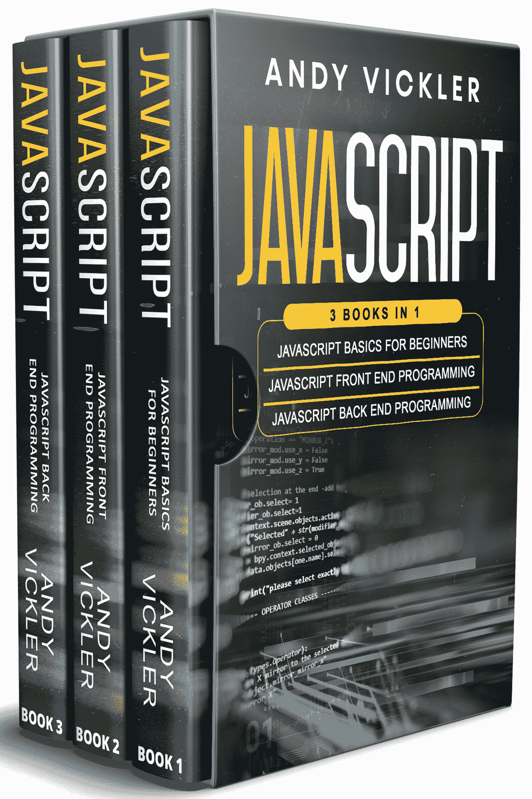

# JavaScript 后端编程

## 引言

## 第一章：搭建你的 Node.js 环境

### Windows

### Mac 和 Linux

### IDE 安装

#### IDE – Visual Studio Code

#### Hello World

## 第二章：Node.js - REPL 终端

### 第一步 — 启动与停止 REPL

### 第二步 — 在 REPL 中执行代码

### 第三步 — 掌握 REPL 快捷键

### 第四步 — REPL 命令

## 第三章：Node.js 包管理器 (NPM)

### 下载与安装依赖

### 版本

### 运行任务

### npm 安装包的位置

### 使用或执行通过 npm 安装的包

## 第四章：Node.js 回调（Callbacks）与承诺（Promises）

## 第五章：异步 JavaScript 编程

### 同步 JavaScript

### 异步 JavaScript

### 异步回调

### 承诺

### 异步代码本质

## 第六章：Node.js 事件循环与事件发射器（EventEmitter）

### 阶段概述

### `setImmediate()` vs `setTimeout()`

### `process.nextTick()`

### `process.nextTick()` vs `setImmediate()`

## 第七章：Node.js 缓冲区（Buffers）

### 什么是缓冲区？

### 进阶玩转缓冲区

## 第八章：Node.js 流（Streams）

### 什么是流？

### 异步迭代器（Async Iterator）

### 如何创建一个可写流

### `pipeline()`

### Stream Module

## 第九章：Node.js 文件系统（File System）

### 什么是同步与异步方法？

### 重要 `fs.module` 方法

## 第十章：Node.js 全局对象

### Global 对象

### 全局模块与函数

### 全局对象

## 第十一章：Node.JS 实用模块

### OS Module

### OS Module 方法

### Path Module

### Net Module

### 类 - `net.Server`

### 类 - `net.Socket`

### DNS Module

### Domain Module

## 第十二章：Node.js Web 模块

### Web 应用程序架构

### 使用 Node 创建 Web 服务器

### 向 Node.js 服务器发送请求

### 使用 Node 创建 Web

## 第十三章：Node.js Express 框架

### 什么是 Express.js？

### 安装与使用 Express

### 什么是路由（Routes）？

### 使用 Express.js 构建 Web 服务器

## 第十四章：Node.js RESTful API

### HTTP 方法

### RESTful Web 服务

### 如何为库创建 RESTful API

### 列出用户

### 添加用户

### 显示详情

### 删除用户

## 第五章：Node.js 可扩展应用

### 扩展策略

### Cluster 模块

### HTTP 服务器负载均衡

### 向所有 Worker 广播消息

### 提高服务器可用性

### 零停机重启

### 共享状态与粘性负载均衡

## 第十六章：Node.js 打包

### 打包你的 Node.js 应用

### 使用命令行打包

### 使用代码打包

## 第十七章：Node.js + MongoDB + Mongoose – 后端开发者最佳实践

### 为什么你需要 Mongoose

### 执行 Mongoose 操作

### 执行 CRUD 操作

## 结论

## 参考文献

# JavaScript 基础

# 初学者入门


# Andy Vickler

## 引言


本书包含了关于如何使用 JavaScript 编程的经过的步骤和策略。我在书中包含了 JavaScript 的分步编程技术，以便你能够正确地学习它们。JavaScript 是一种脚本语言。你会看到许多嵌入在 HTML 标签中的脚本。由于 JavaScript 无法独立工作，我认为将其嵌入 HTML 是恰当的，当你想要运行它时，它可以在网络浏览器中良好地运行。

如果你想练习所学的内容，可以打开代码编辑器，复制代码并粘贴进去以检查结果。此外，你也可以简单地将页面加载到浏览器中直接在网页上查看结果。嵌入脚本是即取即用的形式。最好的方法是背诵这些脚本，然后对它们进行编辑以进行自定义，这样你就可以以更快、更有趣的方式学习。

无论你是在制作网站，还是一个渴望成为 Web 开发者的学生，亦或是计划为自己的业务建立网站，这本书都是你在市面上可能遇到的最好的文献。一旦你读完前几章，你将处于正确的心态来继续学习复杂的话题。最好的方法是起初慢一点，随着概念变得清晰来调整节奏。

## 第一章：JavaScript 简介


JavaScript 是一种解释型语言。该语言的定义比“解释型”一词更广泛。你可以将其定义为一种弱类型、基于原型的、动态且命令式的过程化语言。JavaScript 以客户端编程语言的形式进行开发和实现。它是网络浏览器的一部分，被视为有助于开发者实现动态功能以及在网页上创建和集成用户界面的工具。

你可能在服务器端也能发现 JavaScript 的实现。然而，JavaScript 编程语言的流行在很大程度上基于它在客户端的应用。你可能在 Web 应用之外也能看到 JavaScript 的应用。例如，你可能会发现它们被用于为桌面组件和 PDF 格式文档添加交互性。

JavaScript 最初的设计与 C 语言的设计模式相同，但也采用了一些 Java 编程语言的名字。你不应该将 Java 误认为 JavaScript，因为两者在本质上是不同的。它们也有不同的目的和语义。

### JavaScript 的开发者

Brendan Each 最初开发 JavaScript 时使用的名为 `Mocha`。后来名字被更改为 `LiveScript`。之后，再次被更改为 `JavaScript`。这个名字让了一些人困惑，并给人一种印象，即这种新语言（JavaScript）是 Java 的分支。人们认为这种新的编程语言是 Netscape 营销策略的一部分，旨在新编程语言世界中获得急需的声望。

第二年，微软引入了一种类似的客户端语言，并将其整合到他们著名的 Internet Explorer 3.0 浏览器中。为了规避品牌问题，它将该语言命名为 `JScript`。这个词听起来和看起来被认为与 JavaScript 非常相似；然而，它的不同之处在于，它无法 100% 兼容 ECMA 规范。

1997 年，出现了一个将 JavaScript 提交给 `ECMA` 标准的提案，并在 1997 年 6 月，`ECMA` 标准以 `ECMAScript` 的名称采纳了它。该编程语言还赢得了 ISO 标准推荐。JavaScript 凭借其适应互联网的方式汇聚了极高的普及率。这就是它成为全球范围内最常用的编程语言之一的原因。

## JavaScript 的用例

JavaScript 运行在世界上大多数网页的客户端。当你打开一个网页时，如果它与你上次打开时发生了变化，那么，这些变化可能是使用 JavaScript 完成的。让我告诉你说一些有趣的事。在你的电脑屏幕上打开一个网页。右键点击网页，然后点击`查看源代码`。你会在页面代码中看到 `JavaScript` 这个词。不要将 HTML 与 JavaScript 混淆，因为你可能会在页面代码中发现两者。

`HTML` 是一种标记语言，允许开发者格式化内容并创建动态网页。你可以将文本变为粗体，创建你选择的框和表格，并在页面上添加按钮和项目符号。然而，JavaScript 允许你更改文本、添加弹出消息，并通过 HTML 编码验证你输入的文本。HTML 和 JavaScript 并肩而行。JavaScript 领先于 HTML 的地方在于它让页面变得动态且可交互。它将允许你的用户点击某些元素并从现有页面打开新页面。

你应该学习 JavaScript，因为它非常容易实现。你只需要将代码放在 HTML 文档中，然后指示浏览器运行它。JavaScript 运行在许多计算机和操作系统上，即使在系统离线时也是。在 JavaScript 的帮助下，你可以创建响应式界面，优化用户体验并提供极其动态的功能。

JavaScript 允许用户在需要随时以文档的形式加载内容，而且无需重新加载网页。我们把这个过程称为 `Ajax`。JavaScript 允许你在浏览器中对现有可能性运行测试，然后做出相应的反应。这个过程被称为防御性脚本。JavaScript 将修复你网页上出现的任何问题。它将覆盖浏览器支持中存在的漏洞。

当我们把 JavaScript 为我们做的一切与其他 Web 编程语言进行比较时，我们意识到它可以做得多得多。JavaScript 广受需求和喜爱，因为它允许你在无任何烦恼的情况下构建复杂的应用程序。你也可以用 Flash 构建复杂的应用程序，但 JavaScript 是最佳选择，因为它是 Web 标准。

涉及到 JavaScript 的用途，这些用途在不断变化。起初，JavaScript 与网站的交互局限于形成交互和给用户反馈。然而，它随着时间的推移而演变，现在的用途远超它的初始状态。

JavaScript 的用例随着时代的变化而改变。用户需要改变那些陈旧、测试过且无味的网页界面——即点击链接、在网页上填写信息和发送大量表单。他们希望让这些过程更加现代、更符合用户习惯。JavaScript 让用户能够创建一个注册表单，能够检查用户名是否已被占用或可用。这防止了用户忍受可能非常令人沮丧的页面刷新。搜索框在你输入内容时会显示更相关且建议的结果。它显示的是基于你输入的内容。这种模式被称为 `autocomplete`（自动完成）——如果没有 JavaScript，那是不可能的。

在没有用户输入的情况下，设定时间后需要更改的信息在 JavaScript 的帮助下是可能的。JavaScript 可能尝试修复布局问题。通过使用 JavaScript，你可能会发现网页上任何元素的精确区域和位置。你可以计算浏览器的尺寸。通过收集这些信息，你可能帮助防止元素之间的重叠。让我们假设你有一个菜单。JavaScript 帮助你的最佳方法是增强 HTML 提供的界面。

代码被标记为文本。在许多章节中，你会发现代码。阅读和编写代码，必须说，是学习和编写程序的组成部分。元编程被认为是一种强大的技术，允许你编写一组程序。`ES6` 的出现进一步放大了元编程的使用。你可以使用 `proxies` 和其他类似的功能。

### `<script>` 标签

让我们谈谈书中最常用的标签符号。所有的 JavaScript 代码都包含在 `<script>` 标签内。

```html
<!DOCTYPE html>
<html>
<body>
<p>JavaScript rests in Body</p>
<p id="demo12"></p>
<script>
document.getElementById("demo12").innerHTML = "This is your JavaScript";
</script>
</body>
</html>
```

### JavaScript 位于 Body 中

这是你的第一个 JavaScript 编写方式不同，格式为 `<script type="text/javascript">`。JavaScript 有许多函数可以执行代码块。当某种事件发生时，你可以调用函数。事件可以定义为点击。你可以将脚本放在 `<head>` 或 `<body>` 中，或者两者都有。其示例如下：

```html
<!DOCTYPE html>
<html>
<head>
<script>
function FunctionUN() {document.getElementById("demo34").innerHTML = "I have changed the Paragraph.";}
</script>
</head>
<body>
<p>You have seen the JavaScript in the Head</p>
<p id="demo">This is a Paragraph.</p>
<button type="button" onclick="FunctionUN()">Click Me</button>
</body>
</html>
```

### 你在 Head 中看到了 JavaScript

这是一个段落。当你点击浏览器上的按钮时，将触发函数的调用。你也可以把脚本放在 HTML 页的 `<body>` 中。

```html
<!DOCTYPE html>
<html>
<head>
<script>
function FunctionZ() {document.getElementById("demo").innerHTML = "I have changed the Paragraph.";}
</script>
</head>
<body>
<p>This is A Web Page</p>
<p id="demo">This is a Paragraph.</p>
<button type="button" onclick="FunctionZ()">Click Me</button>
</body>
</html>
```

### 你在 Head 中看到了

上述文本将在浏览器上显示。每次运行代码，你都会在屏幕顶部看到数学计算的结果。`window` 关键字的使用是可选的。由于 JavaScript 中的 `window` 对象是全局的，你可以放弃它的使用并获得相同的结果。以下代码将交付相同的结果。

```html
<!DOCTYPE html>
<html>
<head>
<script>
alert (4567 + 36);
</script>
</head>
<body>
<p>This is going to my First Page</p>
<p>This will be Paragraph.</p>
<p id="demo1234"></p>
</body>
</html>
```

### This is A Web Page 我改变了段落

在浏览器中显示 JavaScript 有不同的方法。我们在书中使用的第一种方法是 `document.getElementById(id)`。在短语中，`id` 指向元素。`innerHTML` 定义了 HTML 内容。

```html
<!DOCTYPE html>
<html>
<body>
<p>This is going to my First Page</p>
<p>This will be Paragraph.</p>
<p id="demo1234"></p>
<script>
document.getElementById("demo1234").innerHTML = 4567 + 36;
</script>
</body>
</html>
```

### This is going to my First Page 将段落

你可以使用的第二种方法是 `document.write()`。这也是简单的。然而，我们在书中没有通过这种方法创建任何脚本。如下：

```html
<!DOCTYPE html>
<html>
<body>
<p>This is going to my First Page</p>
<p>This will be Paragraph.</p>
<p id="demo1234"></p>
<script>
document.write (4567 + 36);
</script>
</body>
</html>
```

### This is going to my First Page 页面

如果你在加载 HTML 页面后使用这种方法，你将丢失所有数据，因为它会被删除。因此，如果你犯了这个错误，你应该小心。此外，你还可以使用这种方法创建一个按钮并测试 HTML 页面。如下：

```html
<!DOCTYPE html>
<html>
<body>
<p>This is going to my First Page</p>
<p>This will be Paragraph.</p>
<button type="button" onclick="document.write(35 + 6)">Click me</button>
</body>
</html>
```

### This is going to my First Page 页面 将

另一种方法是 `window.alert()`。

```html
<!DOCTYPE html>
<html>
<body>
<p>This is going to my First Page</p>
<p>This will be Paragraph.</p>
<p id="demo1234"></p>
<script>
window.alert (4567 + 36);
</script>
</body>
</html>
```

### This is going to my First Page 页面 将

上述文本将显示在浏览器上。每次运行代码，你都会在屏幕上方看到数学计算的结果。`window` 关键字的使用是可选的。由于 JavaScript 中的 `window` 对象是全局的，你可以放弃它的使用并获得相同的结果。以下代码将交付相同的结果。

```html
<!DOCTYPE html>
<html>
<head>
<script>
alert (4567 + 36);
</script>
</head>
<body>
<p>This is going to my First Page</p>
<p>This will be Paragraph.</p>
</body>
</html>
```

- 我的职业是编码。
- 我的所在地是美国德克萨斯州。

如果你已经阅读了这些，你已经在脑中添加了这些信息：我是一名程序员，我住在 `Texas, USA`。在上述文本中，`coding` 和 `Texas, USA` 这些单词和短语的作用方式与 JavaScript 中的变量相同。`My Profession` 和 `My State` 等术语指的是特定的值。它们与 `Coding` 和 `Texas, USA` 之间的关系，与 JavaScript 中值与变量之间的关系相同。

你可以通过编写 `var`（variable 的缩写）来创建一个变量。后面将跟随你必须赋值给变量的名称。当你创建一个变量时，它会取一个特定的值。变量的名字可以是你喜欢的任何名字。听起来什么样由你决定。变量的值可能会改变。变量的事实也可以改变。

JavaScript 变量可以简单地定义为以数据形式存储值的容器。在接下来的示例中，我将使用三个变量：`a`、`b` 和 `c` 并为它们填充不同的值。

```html
<!DOCTYPE html>
<body>
<p>These are JavaScript Variables</p>
<p>In the following example, a, b, and c are JavaScript variables.</p>
<p id="variable-demo"></p>
<script>
var a = 50;
var b = 16;
var c = a + b;
document.getElementById("variable-demo").innerHTML ="The value of c is: " + c;
</script>
</body>
</html>
```

这些是 JavaScript 变量。在接下来的示例中，`a`、`b` 和 `c` 是 JavaScript 变量。`c` 的值是：66。由于这是第一个示例，你需要很好地理解它。首先，行区分了 JavaScript 的后端代码和前端。你可以说它区分了代码编辑器中编写的内容和你在网页上看到的内容。`h1` 和 `p` 标题在书中显示的可能与在网页上显示不同。这是因为我正在使用的文字处理器对 `h1` 和 `p` 有设置。如果你将代码复制粘贴到编辑器中并在网页上运行，它们将正常工作。此外，这就是我在本书的其余部分编写嵌入 HTML 结构中的代码的方式，因为当你在创建网站时也是这样写的。你需要 HTML 嵌入来在 JavaScript 中编写脚本，以便网络浏览器读取它们。在上面提到的示例中，你可以看到每个变量都有用来保存它的变量。

不再创建一个单个字母变量，现在我将创建具有完整单词名称的变量。

```html
<!DOCTYPE html>
<body>
<p>You are studying JavaScript Variables</p>
<p>In the following example, the variables will have full-word names.</p>
<p id="variable-demo"></p>
<script>
var milkprice = 150;
var oilprice = 160;
var totalprice = milkprice + oilprice;
document.getElementById("variable-demo").innerHTML ="The value of totalprice is: " + totalprice;
</script>
</body>
</html>
```

你正在学习 JavaScript 变量。在接下来的示例中，变量将具有完整单词名称。`totalprice` 的值是：310。

### JavaScript 标识符

JavaScript 变量需要赋予唯一的名称以便于识别。这些唯一名称标记为标识符。标识符可以是像 `a`、`b`、`c` 这样的短名称，也可以是像 `totalprice`、`milkprice` 和 `oilprice` 这样的描述性长名称。JavaScript 变量有一些命名规则。你可以使用这些规则来减少错误发生的概率。

- 变量不得包含数字、字母、美元符号和下划线（注：此处原文逻辑有误，通常是指不能数字开头）。
- 变量可以以 `$` 符号开头。
- 变量区分大小写，这使得 `a` 和 `A` 变量不同。
- 变量必须以字母开头。
- 你不能使用 JavaScript 关键字作为变量。

如果你在 JavaScript 中看到类似 `=` 的等号，你不应该将其误认为是代数中使用的等号。它的用途是不同的。变量存储的信息可能稍后在你创建的程序中使用。脚本很长，因此变量使得定位有用值变得容易。变量便于在同一段代码中重复使用某个值。与其记住这个值，不如创建一个变量并将该值填充其中。

### 数据类型

JavaScript 变量可以持有不同类型的信息，如数字和文本。编程中的文本值被称为文本字符串（text strings）。JavaScript 可以持有不同类型的数据。正如我已经解释过的，字符串必须写在单引号或双引号中，任你选择方便的哪种。写数字时不需要加引号。如果你对数字使用引号，浏览器将将其解释为字符串。

```html
<!DOCTYPE html>
<html>
<p>You are studying JavaScript Variables</p>
<p>I am defining JavaScript datatypes.</p>
<p id="variable-demo"></p>
<script>
var num = 5555555.889;
var novelist = "Charles Dickens";
var introduction = 'Charles Dickens wrote melodramatic novels!';
document.getElementById("variable-demo").innerHTML =num + "<br>" + novelist + "<br>" + introduction;
</script>
</body>
</html>
```

5555555.889

Charles Dickens

Charles Dickens wrote melodramatic novels!

### 变量的声明

声明变量的过程实际上就是创建变量的过程。你可能已经注意到上面的示例中，我在每个变量之前都使用了 `var` 关键字。没有 `var` 关键字，你就无法创建变量。一旦你声明了一个变量，该变量将没有值。你必须像我在示例中做的那样给它分配一个值。在这里使用了等号 `=`。你将该符号插入在变量名和值之间。

### 未定义的变量

在不同的程序中，你经常可以声明没有值的变量。该值可以是你可以计算出来的东西，也可以是你稍后提供它的东西，例如用户输入。你在没有值的情况下声明的变量将携带一个 `undefined` 值。我将使用我已经创建的示例之一并剥离变量的值。让我们使用最后一个示例，以便你更好地理解。

```html
<!DOCTYPE html>
<html>
<p>You are studying JavaScript Variables</p>
<p>I am defining JavaScript's undefined variables.</p>
<p id="variable-demo"></p>
<script>
var num;
var novelist;
var introduction;
document.getElementById("variable-demo").innerHTML =
</script>
</body>
</html>
```

You are studying JavaScript Variables

I am defining JavaScript's undefined variables.

### 重复

你可能已经定义并声明了一个变量，但后来改变了主意，并通过我刚刚解释的过程使其变为未定义。那么，这会让它变成未定义吗？答案是 `No`。在声明后使其未定义不会让变量失去它的值。

```html
<!DOCTYPE html>
<html>
<p>You are learning JavaScript Variables</p>
<p>This is JavaScript's undeclared variables.</p>
<p id="variable-demo"></p>
<script>
var num = 5555.444;
var novelist = "Charles Lamb";
var introduction = "Charles Lamb wrote beautiful humor.";
var num;
var novelist;
var introduction;
document.getElementById("variable-demo").innerHTML =num + "<br>" + novelist + "<br>" + introduction;
</script>
</body>
</html>
```

You are learning JavaScript Variables

This is JavaScript's undeclared variables.

5555.444

Charles Lamb

Charles Lamb wrote beautiful humor.

### 算术

JavaScript 与其他编程语言一样，允许你进行数学计算。你可以相加数字产生结果，然后将结果传递给变量进行存储。在代码中，你可以使用 `=` 和 `+` 这样的运算符。

```html
<!DOCTYPE html>
<html>
<p>JavaScript Arithmetic</p>
<p>This is JavaScript's undeclared arithmetic.</p>
<p id="variable-demo"></p>
<script>
var a = 15 + 3452 + 13 + 8 + 1;
document.getElementById("variable-demo").innerHTML = a
</script>
</body>
</html>
```

JavaScript Arithmetic

This is JavaScript's undeclared arithmetic.

3489

### 减法

下一个要讨论的算术运算符是减法。该运算符的符号与代数中使用的相同。你可以用你选择的数字填充程序，并在之间插入 `–` 符号以开始减法过程。

```html
<!DOCTYPE html>
<html>
<p>JavaScript Arithmetic</p>
<p>JavaScript subtraction.</p>
<p id="variable-demo"></p>
<script>
var a = 55;
var b = 40;
var c = a - b;
document.getElementById("variable-demo").innerHTML = c
</script>
</body>
</html>
```

JavaScript Arithmetic

JavaScript subtraction.

15

### JavaScript 字符串拼接

正如你学习了相加数字一样，JavaScript 允许你拼接字符串。我将在接下来的示例中使用 `+` 运算符来连接字符串。

```html
<!DOCTYPE html>
<html>
<p>JavaScript String Concatenation</p>
<p>JavaScript datatypes.</p>
<p id="variable-demo"></p>
<script>
var a = "Charles Dickens" + "" + " wrote" + "" + " melodramatic novels!";
document.getElementById("variable-demo").innerHTML = anum + "<br>" + novelist + "<br>" + introduction;
</script>
</body>
</html>
```

JavaScript String Concatenation

JavaScript datatypes.

Charles Dickens wrote melodramatic novels!

### JavaScript Let 关键字

在 JavaScript 中，`let` 关键字用于变量的声明。`var` 关键字也可以用于变量的声明；然而，关键在于两者的作用域。`var` 关键字基于函数作用域（function scope），而 `let` 关键字基于块作用域（block scope）。学习如何使用 `let` 关键字与学习 `var` 关键字和 `let` 关键字之间的区别有关。

#### 全局作用域

你在 JavaScript 函数之外声明的变量。

```html
<!DOCTYPE html>
<html>
<p>JavaScript Let Keyword</p>
<p>You can access a GLOBAL variable working from any script or any function.</p>
<p id="let-demo"></p>
<script>
var cars = "BMW";
Function1();
function Function1() {document.getElementById("let-demo").innerHTML = "I plan to buy a " + cars + " for my daily commute and offroading.";}
</script>
</body>
</html>
```

JavaScript Let Keyword

You can access a GLOBAL variable working from any script or any function.

I plan to buy a BMW for my daily commute and offroading.

#### 函数作用域

你在 JavaScript 函数限制内声明的变量具有函数作用域（Function Scope）。在接下来的示例中，我将在函数范围内声明变量。

```html
<!DOCTYPE html>
<html>
<p>These are JavaScript Scopes</p>
<p>I will define and declare a variable outside of Function2().</p>
<p id="let-demo1"></p>
<p id="let-demo2"></p>
<script>
Function2();
function Function2() {var cars = "BMW";document.getElementById("let-demo1").innerHTML = typeof cars;}document.getElementById("let-demo2").innerHTML = cars;
</script>
</body>
</html>
```

These are JavaScript Scopes

I will define and declare a variable outside of Function2().

string undefined

#### 块作用域

使用 `var` 关键字声明的变量没有块作用域。只有在花括号内部声明的变量才具有块作用域。块作用域是在 ES2015 引入 JavaScript 的。在此之前，没有块作用域。虽然使用 `var` 关键字在块中声明变量是允许的，但它们仍然是函数作用域的。使用 `let` 关键字在块中声明变量，它们将具有块作用域。

`var` 关键字在某些情况下会给程序员带来问题。特别是当你通过包含 `var` 关键字重复声明变量时，会在编辑器中看到很多问题。如果你在块中重复声明变量，你会在该块之外也能访问到它。这长远来看会导致额外的问题。

```html
<!DOCTYPE html>
<html>
<p>This code snippet will declare a variable with the var keyword</p>
<p id="variable-demo"></p>
<script>
var x = 10;
{ // Now you can see the value of x is 10
{
  var x = 1; // Now the redeclared value of x is 1
}
console.log(x); // 1
document.getElementById("variable-demo").innerHTML = x;
</script>
</body>
</html>
```

This code snippet will declare a variable with the var keyword

1

所以，你可以看到我们遇到了大问题。对于 `var` 关键字，重复声明可能是一个棘手问题。这就是 `let` 关键字发挥作用的地方。它解决了重复声明的问题。如果你使用 `let` 关键字声明变量，那么当你重复声明它时将不会有任何问题。

```html
<!DOCTYPE html>
<html>
<p>I will use the let keyword now to redeclare a variable</p>
<p id="variable-demo"></p>
<script>
let x = 10;
{ // Now you can see the value of x is 10
{
  let x = 1; // Now the redeclared value of x is 1
}
console.log(x); // 10
document.getElementById("variable-demo").innerHTML = x;
</script>
</body>
</html>
```

I will use the let keyword now to redeclare a variable

10

- `var` 关键字主要用于旧版本的 JavaScript 版本中，而 `let` 关键字被认为是声明变量的最新方法。你可以说 `let` 关键字是从 ES6 开始的，它也被称为 ES2015。
- `var` 关键字基本上是函数作用域的，而 `let` 关键字是块级作用域的。

如果讨论这两个关键字的推荐程度，我们可以说在编写程序时，`let` 关键字是最佳的考虑选项。然而，某些浏览器并不支持 `let` 关键字。因此，你可能会觉得需要使用 `var` 关键字。

## 第三章 JavaScript 常量

JavaScript 中的 `const` 关键字是在 `ES2015` 中引入的。使用 `const` 关键字定义的变量与使用 `let` 关键字定义的变量一样。唯一的区别在于你不能对它们进行重新赋值。一旦初始化了常量，之后就无法更改它的值。这就是常量与 `var` 关键字的区别。如果你必须声明一个常量，需要先对其进行初始化。

你应该仔细考虑一下在程序中是否需要使用常量。只有当你确定不会更改变量的值时，才使用它。常量的名称可以是合法的标识符。

你正在学习 JavaScript 常量。

记住，你不能改变原始类型的值。

```javascript
try {
  const xyz = 89.141592653589793;
  xyz = 54.14;
} catch (err) {
  document.getElementById("const-demo").innerHTML = err;
}
```

TypeError: Assignment to constant variable.

#### 块级作用域

在使用块级作用域时，使用 `const` 关键字声明变量与使用 `let` 关键字相似。接下来的示例将解释它是如何倾向于 `let` 关键字并远离 `var` 关键字的。

在这个示例中，我将使用 `const` 关键字声明一个变量。

```javascript
var xyz = 15; // xyz 的值为 15
{
  const xyz = 1; // xyz 的值是 1
}
// xyz 的值是 15
document.getElementById("const-demo").innerHTML = xyz;
```

15

与使用 `var` 关键字声明的变量不同，常量在声明时必须赋值。你不能让赋值部分为空。“常量”这个词有点让人困惑，如果说它不是完全具有误导性。`const` 关键字定义的并不是常量值。实际上，它定义的是你在等式中所使用的值的“常量引用”。这就是为什么你不能改变常量的原始类型值。但是，你可以更改属性。

#### 原始类型值

如果你给常量赋了一个原始类型值，你以后将无法更改该值。

这些是 JavaScript 常量。

尝试一下是否可以更改原始类型值。

```javascript
try {
  const xyz = 5556.175757557757793;
  xyz = 3555.19090;
} catch (err) {
  document.getElementById("const-demo").innerHTML = err;
}
```

TypeError: Assignment to constant variable.

虽然你不能更改 JavaScript 常量中的原始类型值，但你可以更改对象的属性。在下面的示例中，我将使用 `const` 关键字创建一个对象，然后对该对象的属性引入一些更改，看看是否可以更改它们。查看示例以了解如何操作。

JavaScript 常量

在声明对象后你可以更改它的属性：

```javascript
// 我将创建一个对象：
const mycar = {name:"Honda", model:"Vezel", make:"Japan", color:"Grey"};
// 让我们修改属性：
mycar.model = "Civic";
// 你还可以添加一个新属性：
mycar.transmission = "Automatic";
// 现在是显示你的属性了：
document.getElementById("const-demo").innerHTML = "I have a " + mycar.name + "." + " It is of " + mycar.color + " color and its model label is " + mycar.model + ". " + "This car has " + mycar.transmission + ".";
```

我有一辆本田。它是灰色的，型号是 Civic。这辆车是自动挡的。

你看到我将型号从 Vezel 改为了 Civic。我还添加了新属性来描述汽车的变速箱模式。这方便了程序员，因为他们可以创建一个对象，然后根据不断变化添加或更改属性。然而，你不能在程序中将不同的对象重新赋值给同一个常量。如果你这样做，你会看到一个错误。

学习 JavaScript 常量

禁止：不能将不同的对象重新赋值给同一个常量：

```javascript
try {
  const mycar = {name:"Honda", model:"Vezel", make:"Japan", color:"black"};
  mycar = {name:"BMW", model:"Z1", make:"German", color:"red"};
} catch (err) {
  document.getElementById("demo").innerHTML = err;
}
```

#### 常量数组

你可以使用 `const` 关键字创建数组，也可以更改它们。

## 第四章 提示框与条件语句

提示框（prompt）用于要求用户提供信息并为答案提供响应字段。代码向用户提出一些问题，然后在相应的字段中提供答案进行响应。你可以更改响应。无论你是保留默认响应还是将其更改为其他内容，你的响应都将被赋值给变量。

提示代码与警报（alert）代码相似，但有两点不同。对于提示代码，你需要遵循一种方法来接收用户的响应，这意味着你需要从声明变量开始代码。之后，你必须使用等号。在提示框中，你必须指定第二个字符串，这是在显示提示框时在字段中弹出的默认响应。如果用户原样保留并点击 OK，你的默认响应将赋给一个变量。然而，你有选择是否声明默认响应。你有选择将字符串赋值给特定的变量，然后你需要在括号内指定变量而不是字符串。

有些程序员使用 `window.prompt` 而不是简单地写 `prompt`。这种做法是正式的，并被认为是正确的写法。然而，由于大家时间都很紧迫，大多数编码者倾向于写 `prompt`。

#### JavaScript if 语句

在本节中，我将解释在 JavaScript 世界中如何处理不同类型的条件。假设你编写了一个提示框，要求用户提供美国总统目前居住的地方。这是用户在显示上看到的行：“你住在哪里？”

如果用户回答正确，你可以显示一个警报来祝贺他。要成功完成这项任务，你需要 `if` 语句。如果用户通过输入“白宫”给出正确答案，你的程序将对他表示祝贺。如果他输入其他内容，程序将不返回任何内容。代码不允许对问题的其他回答。

`if` 语句（我稍后会包含一个示例）以关键字 `if` 开始。它与括号之间的空格是代码必须的。当你写好 `if` 语句并包含空格后，你需要创建一个变量并填充对你问题的正确答案，以便 `if` 条件对其进行测试。你必须将条件包含在括号内。如果条件为真，将执行警报或你指示代码执行的任何其他操作。执行的可能是一个语句或多个语句。`if` 语句的第一行以大括号结束。整个 `if` 语句以同一行的大括号结束。这属于对典型语句以分号结尾的规则的例外。当语句复杂、像段落一样且末尾有大括号时，程序员通常省略分号。

在某些代码中，你可能在 `if` 语句中看到三连等号，你可能会认为它仅仅是一个等号。然而，事实并非如此。等号用于给变量赋值。如果你正在测试带有值的变量，你不能使用单等号（赋值）。如果你跳过这一步并使用单等号代替三连等号，你的代码就会出错。当条件满足时，你可能有多个语句要执行。条件语句具有在测试不同条件后执行多个动作的内在能力。通常，当你编写代码时，你需要为多个决策执行一系列操作。在 JavaScript 中你可以使用不同类型的条件语句。以下是每种语句的简述。我将逐一解释它们。

- `if` 关键字用于指定一段代码，当条件为真时编辑器必须执行。
- `else` 关键字用于指定一段代码，当相同的条件为假时编辑器必须执行该代码。
- `else-if` 关键字用于在第一个条件为假时添加一个新条件进行测试。

`if` 语句是区分大小写的，因此关键字 `if` 和 `IF` 是两个不同的单词。如果你将 `if` 替换为 `IF`，你会在屏幕上看到错误。

```html
<!DOCTYPE html>
<html><body>
<p>如果时间早于 15:00，我将显示“Have a Great Day!”：</p>
<p id="if-demo">Have a Savory Evening!</p>
<script>if (new Date().getHours() < 15) {document.getElementById("if-demo").innerHTML = "Have a Great Day!";}</script>
</body>
</html>
```

如果时间早于 15:00，我将显示“Have a Great Day!”：Have a Great Day!

## else 语句

你可以使用 `else` 语句来指定当你的条件为假时需要执行的代码。我将使用相同的代码并添加 `else` 语句，以看看我们如何使用 `else` 语句来扩展代码并使其更具交互性和用户友好性。现在用户将有两个选项，而不是死板的单一选项代码。

```html
<!DOCTYPE html>
<html><body>
<p>我让你点击下方的按钮，根据当前时间显示问候语：</p>
<button onclick="FunctionX()">点击我以显示问候语</button>
<p id="ifelse-demo"></p>
<script>function FunctionX() {var myhours = new Date().getHours();var mygreetings;if (myhours < 15) {mygreetings = "Have a Great Day";} else {mygreetings = "Have a Great Evening. I hope you enjoy your dinner.";}document.getElementById("ifelse-demo").innerHTML = mygreetings;}</script>
</body>
</html>
```

我让你点击下方的按钮，根据当前时间显示问候语：点击我以显示问候语 Have a Great Day

你可以看到 `else` 语句完美地整合到了现有代码中。我特意在代码中添加了一个交互式按钮，以便用户确切知道该做什么。当用户点击按钮时，他将收到一条问候他的消息。该消息将根据程序在本地读取的时间进行结构。这就是你如何在你的页面上构建交互式网页应用并吸引访问者的方法。此外，你的访问者也会喜欢这种被欢迎的方式。

## else if 语句

你可以将 `else-if` 语句添加到代码中，以便在第一个条件返回假时指定新条件。在下面的示例中，我将添加两个以上的条件，看看它们是如何工作的，以及它们为我们的代码带来了多少改进。

```html
<!DOCTYPE html>
<html><body>
<p>我让你点击下方的按钮，根据当前时间显示问候语：</p>
<button onclick="FunctionX()">点击我以显示问候语</button>
<p id="ifelse-demo"></p>
<script>function FunctionX() {var mygreetings;var mytime = new Date().getHours();if (mytime < 8) {mygreetings = "Have a Good Morning. I hope you have had a nutritious breakfast. Get ready for work";} else if (mytime < 15) {mygreetings = "Have a Great Day. Don't forget to eat your lunch.";} else {mygreetings = "Have a Great Evening. Any special plans for dinner?";}document.getElementById("ifelse-demo").innerHTML = mygreetings;}</script>
</body>
</html>
```

我让你点击下方的按钮，根据当前时间显示问候语：点击我以显示问候语 Have a Great Day. Don't forget to eat your lunch.

这运行得非常完美。现在你的程序将在一天中的三个时间段显示问候消息。你可以根据业务需求自定义消息并使其更具交互性。有些程序员习惯于在省略大括号的情况下编写 `if` 语句。这种做法是完全合法的；但执行起来有点困难。有些程序员会将初始大括号放在新的一行上。另一种做法是将整个 `if` 语句写在一行中，这更容易实现，但当你回来研究程序结构时会很难阅读。我建议你遵循我在上面示例中使用的相同规则，这样你会发现编写和理解起来也更容易。在大多数情况下，你可以用双等号 `==` 代替三等号。然而，你可能会发现一点点技术上的差异。

编写 `if` 语句以及 `if` 语句变体的格式有很多。使用 `if` 语句编码的可能性是无限的。

## JavaScript Switch 语句

你可以使用 `switch` 语句对 JavaScript 条件执行不同的操作。它将帮助你处理单个代码块并执行它。编辑器对其进行一次评估，在值之间进行比较，如果匹配，则执行该块。如果不匹配，则不执行。接下来的程序将通过程序运行 `switch` 语句并检查你的计算机，查看计算机日历上是哪一天，以及代码中同一天包含什么消息。它将遍历一周中的七天，当遇到匹配时，它将运行你已经关联到同一天的消息。看下面的代码。

```html
<!DOCTYPE html>
<html><body>
<p id="switch-demo"></p>
<script>var weekdays;switch (new Date().getDay()) {case 0:weekdays = "the restful Sunday";break;case 1:weekdays = "the blue blue Monday";break;case 2:weekdays = "the superstitious Tuesday";break;case 3:weekdays = "the hectic Wednesday";break;case 4:weekdays = "the overwhelming Thursday";break;case 5:weekdays = "the joyful Friday";break;case 6 :weekdays = "the sleepy Saturday";}document.getElementById("switch-demo").innerHTML = "Today is " + weekdays + "." + " Have a great and productive day!";</script>
</body>
</html>
```

今天是迷信周二。祝你有愉快且高效的一天！

在上面的代码示例中，你可能注意到增加了 `break` 关键字。当代码到达 `break` 关键字时，它会跳出特定的 `switch` 块。跳出 `switch` 块的操作停止了 `switch` 块的执行。你不一定要在 `switch` 块的最后一个情况下插入 `break` 关键字。无论是否包含它，它都会结束。如果你从 `switch` 块中排除 `break` 关键字，即使值不匹配，网页浏览器也会执行紧接着的下一个 case。所以，如果你跳过了 `break` 关键字，请做好遇到错误的准备。

你还可以向 `switch` 语句添加另一个关键字。即使存在值不匹配，它也会运行代码。

```html
<!DOCTYPE html>
<html><body>
<p id="switch-demo"></p>
<script>var weekdays;switch (new Date().getDay()) {case 0:weekdays = "it is the restful Sunday";break;case 1:weekdays = "it is the blue blue Monday";break ;case 3:weekdays = "it is the hectic Wednesday";break;case 4:weekdays = "it is the overwhelming Thursday";break;case 5:weekdays = "it is the joyful Friday";break;case 6:weekdays = "it is the sleepy Saturday";break;default:weekdays = "I am desperately waiting for the weekend because I have planned a vacation.";}document.getElementById("switch-demo").innerHTML = weekdays</script>
</body>
</html>
```

我正疯狂地等待周末，因为我计划了一次假期。

你可能认为 `default` case 只能放在代码的最后。然而，事实并非如此。你可以将其插入代码的任何位置，甚至是代码的开头。它会运行良好。

```html
<!DOCTYPE html>
<html><body>
<p id="switch-demo"></p>
<script>var weekdays;switch (new Date().getDay()) {default:weekdays = "I am desperately waiting for the weekend because I have planned a vacation." ;break;case 0:weekdays = "it is the restful Sunday";break;case 1:weekdays = "it is the blue blue Monday";break;case 3:weekdays = "it is the hectic Wednesday";break;case 4:weekdays = "it is the overwhelming Thursday";break;case 5:weekdays = "it is the joyful Friday";break;case 6:weekdays = "it is the sleepy Saturday";}document.getElementById("switch-demo").innerHTML = weekdays</script>
</body>
</html>
```

我正疯狂地等待周末，因为我计划了一次假期。

## 第五章：字符串与数组

BR.jpg

我已经解释了什么是字符串以及你如何在脚本中使用它们。当你处理字符串时，可以使用一些方法。原始值不能拥有方法或属性。然而，JavaScript 允许原始值拥有属性和方法，因为它将原始值视为对象。你可以学习你在程序中使用的字符串的 `length`。

```html
<!DOCTYPE html>
<html><body>
<p>学习 JavaScript 字符串属性</p>
<p>此字符串属性将回答关于你的字符串长度的问题：</p>
<p id="string-demo"></p>
<script>var msgX = "I am about to leave for New York to start my business.";var msgY = msgX.length;document.getElementById("string-demo").innerHTML = msgY;</script>
</body>
</html>
```

## indexOf()

另一个方法可以帮助你在字符串内搜索字符串。我在这里使用的方法是 `indexOf()`。如果你在另一个字符串内部指定了字符串，它将为你找到。一个需要记住的重要事情是你可以使用单引号在字符串内部创建另一个字符串。下面的示例将解释如何进行操作。

```html
<!DOCTYPE html>
<html><body>
<p>学习 JavaScript 字符串属性</p>
<p>此字符串属性将回答关于你的字符串长度的问题：</p>
<p id="string-demo"></p>
<script>var msgX = "I am about to leave for 'New York' to start my business.";var msgY = msgX.indexOf("New York");document.getElementById("string-demo").innerHTML = msgY;</script>
</body>
</html>
```

## lastIndexOf() 方法

你可以看到屏幕上显示了内部索引。请记住 JavaScript 从 0 开始计数。你可以使用 `lastIndexOf()` 方法查看 New York 最后一次出现的索引。

```html
<!DOCTYPE html>
<html><body>
<p>学习 JavaScript 字符串属性</p>
<p>此字符串属性将回答关于你的字符串长度的问题：</p>
<p id="string-demo"></p>
<script>var msgX = "I am about to leave for 'New York' to start my business.";var msgY = msgX.lastIndexOf("New York");document.getElementById("string-demo").innerHTML = msgY;</script>
</body>
</html>
```

## 提取 (Parts Extraction)

你可以根据程序需求将字符串拆分为多个部分。JavaScript 提供了三种方法来拆分字符串。第一个方法被标记为 `slice()` 方法。它提取字符串的一个部分并以新字符串的形式显示。你需要执行两个参数；一个是字符串的起始位置，另一个是结束位置。

```html
<!DOCTYPE html>
<html><body>
<p>学习 JavaScript 字符串属性</p>
<p>此字符串属性将回答关于你的字符串长度的问题：</p>
<p id="string-demo"></p>
<script>var msgX = "I am about to leave for New York to start my business.";var msgY = msgX.slice(23, 34);document.getElementById("string-demo").innerHTML = msgY;</script>
</body>
</html>
```

请记住 JavaScript 从 0 点计数。如果一个参数是负数，你必须从字符串的结束点开始计数。它将反向切分字符串。

```html
<!DOCTYPE html>
<html><body>
<p>学习 JavaScript 字符串属性</p>
<p>此字符串属性将回答关于你的字符串长度的问题：</p>
<p id="string-demo"></p>
<script>var msgX = "I am about to leave for New York to start my business.";var msgY = msgX.slice(23);document.getElementById("string-demo").innerHTML = msgY;</script>
</body>
</html>
```

第二个切分字符串并创建子字符串的方法是 `substring()` 方法。它与 `slice()` 方法非常相似。不同之处在于它不接受负索引。

```html
<!DOCTYPE html>
<html><body>
<p>学习 JavaScript 字符串属性</p>
<p>此字符串属性将回答关于你的字符串长度的问题：</p>
<p id="string-demo"></p>
<script>var msgX = "I am about to leave for New York to start my business.";var msgY = msgX.substring(23, 34);document.getElementById("string-demo").innerHTML = msgY;</script>
</body>
</html>
```

第三个也是最后一个切分方法是 `substr()` 方法，它与 `slice()` 非常相似。第二个参数定义了切分后剩余字符串的长度。

```html
<!DOCTYPE html>
<html><body>
<p>学习 JavaScript 字符串属性</p>
<p>此字符串属性将回答关于你的字符串长度的问题：</p>
<p id="string-demo"></p>
<script>var msgX = "I am about to leave for New York to start my business.";var msgY = msgX.substr(23, 34);document.getElementById("string-demo").innerHTML = msgY;</script>
</body>
</html>
```

## replace()

当 JavaScript 允许你替换字符串内部的值时，它变得有趣。例如，我在示例中包含的字符串包含了纽约作为将访问的城市。JavaScript 允许更改城市名称而不是编写新代码并创建新字符串。这在编写长时间程序时节省了大量时间。该方法识别为 `replace()`。

```html
<!DOCTYPE html>
<html><body>
<p>学习 JavaScript 字符串属性</p>
<p id="string-demo"></p>
<script>var msgX = "I am about to leave for New York to start my business.";var msgY = msgX.replace('New York', 'Las Vegas');document.getElementById("string-demo").innerHTML = msgY;</script>
</body>
</html>
```

默认情况下，如果你写 `NEW YORK` 而不是 `New York`，`replace()` 将无法工作。它是区分大小写的，并将其识别为不同的单词。因此，如果你发现该方法不起作用，最好检查单词的大小写。此外，`replace()` 方法只替换第一个匹配项。如果你想使用大写，必须使用如 `/i` 的正则表达式来让浏览器识别匹配项。

```html
<!DOCTYPE html>
<html><body>
<p>学习 JavaScript 字符串属性</p>
<p id="string-demo"></p>
<script>var msgX = "I am about to leave for New York to start my business.";var msgY = msgX.replace(/NEW YORK/i, 'Las Vegas');document.getElementById("string-demo").innerHTML = msgY;</script>
</body>
</html>
```

## 拼接 (Concatenation)

拼接是所有编程语言不可或缺的一部分。当需要组合两个或多个字符串时，程序员会寻求拼接。它是连接更多字符串最简单的方法。如果你的代码写得好，`concat()` 方法运行得很顺畅。

```html
<!DOCTYPE html>
<html><body>
<p>学习 JavaScript 字符串</p>
<p id="string-demo"></p>
<script>var msg1 = "I have been promoted as Executive Officer of Skyfall.";var msg2 = "I will call a board meeting next week!";var msg3 = msg1.concat(" ", msg2);document.getElementById("string-demo").innerHTML = msg3;</script>
</body>
</html>
```

## JavaScript 数组 (JavaScript Arrays)

和变量一样，JavaScript 数组也是值的容器。然而，它们与变量属性的不同在于它们可以在一个名称中存储比变量更多的数据。因此，当你需要在相同名称下加载更多数据时，应该使用数组。设置数组有多种方法。简单的方法是使用 `var` 关键字，然后编写数组名称并赋值。

## 字符串数组 (String Arrays)

标题可能看起来有些困惑。并没有所谓的字符串数组。然而，有一种新方法可以将字符串转换为数组。

```html
<!DOCTYPE html>
<html><body>
<p>请点击“点击我”产生第一个数组元素：</p>
<button onclick="FunctionX()">点击这个按钮</button>
<p id="string-demo"></p>
<script>function FunctionX() {var msg1 = "Texas, Las Vegas, Los Angeles.";var msg2 = msg1.split(",");document.getElementById("string-demo").innerHTML = msg2[0];}</script>
</body>
</html>
```

- BMW
- Mitsubishi
- Honda
- Toyota

你已经看到如何在网页上显示一个整洁的项目列表了。数组中的所有项目都以项目符号的形式整齐地显示出来。下次当在网页上看到类似的列表时，你应该知道是数组和 `for` 循环创造了奇迹。数组中还有另一种可以创建相同效果。

```html
<!DOCTYPE html>
<html><body><p>These are JavaScript Arrays</p>
<p>I will use the for loop in the following code</p>
<p id="array-demo"></p>
<script>
var carsforsale, msg;
carsforsale = ["BMW", "Mitsubishi", "Honda", "Toyota"];
msg = "<ul>";
carsforsale.forEach(FunctionX);
msg += "</ul>"
document.getElementById("array-demo").innerHTML = msg;
function FunctionX(value) {
msg += "<li>" + value + "</li>";
}
</script>
</body>
</html>
```

这些是 JavaScript 数组。我将在下面的代码中使用 `for` 循环：

- BMW
- Mitsubishi
- Honda
- Toyota

## 添加元素

你可以使用 `push()` 方法向数组添加元素。如果你在零售公司工作，并且每天向同一个数组上传新元素，那么这个 JavaScript 功能非常有帮助。JavaScript 的奇妙之处在于它允许你声明一个没有值的变量。之后，你可以使用 `append` 函数向其添加值。你还可以根据不断的需求更改值。这一切可以在一个数组中发生。

```html
<!DOCTYPE html>
<html><body><p>Learning JavaScript Arrays</p>
<p>I will use the push method to append new elements to existing arrays.</p>
<button onclick="FunctionXX()">Please click this Button</button>
<p id="array-demo"></p>
<script>
var veggies = ["Pumpkin", "Tomato", "Ginger", "Potato"];
document.getElementById("array-demo").innerHTML = veggies;
function FunctionXX() {
veggies.push("Spinach");
document.getElementById("array-demo").innerHTML = veggies;
}
</script>
</body>
</html>
```

学习 JavaScript 数组。我将使用 `push` 方法向现有数组添加新元素。请点击此按钮：Pumpkin, Tomato, Ginger, Potato。

当你在浏览器中运行代码时，将看到上述结果。当你点击网页浏览器中的按钮时，你可以在数组项目列表中看到新添加的元素。当我点击按钮时，我看到了以下结果：请点击此按钮：Pumpkin, Tomato, Ginger, Potato, Spinach。

你可以操作 `length` 属性向你的数组添加新元素。看看你可以如何使用 `length` 属性。

```html
<!DOCTYPE html>
<html><body><p>Learning JavaScript Arrays</p>
<p>I will use the push method to append new elements to existing arrays.</p>
<button onclick="FunctionXX()">Please click this Button</button>
<p id="array-demo"></p>
<script>
var veggies = ["Pumpkin", "Tomato", "Ginger", "Potato"];
document.getElementById("array-demo").innerHTML = veggies;
function FunctionXX() {
veggies[veggies.length] = ("Spinach");
document.getElementById("array-demo").innerHTML = veggies;
}
</script>
</body>
</html>
```

学习 JavaScript 数组。我将使用 `push` 方法向现有数组添加新元素。请点击此按钮：Pumpkin, Tomato, Ginger, Potato, Spinach。

如果你不知道自己在做什么，处理数组可能会很棘手。例如，你可以使用索引号向数组添加元素。在此过程中，如果你在代码中包含一个较高的索引，你将在数组中创建出完全未定义（undefined）的“空洞”。

```html
<!DOCTYPE html>
<html><body><p>Learning JavaScript Arrays</p>
<p>I will add elements that have high indices. The result will be undefined "holes" in the array.</p>
<p id="undefinedarray-demo"></p>
<script>
var veggies, msg, cLn, XX;
veggies = ["Pumpkin", "Ginger", "Tomato", "Garlic"];
veggies[8] = "Spinach";
cLn = veggies.length;
msg = "";
for (XX = 0; XX < cLn; XX++) {
msg += veggies[XX] + "<br>";
}
document.getElementById("undefinedarray-demo").innerHTML = msg;
</script>
</body>
</html>
```

学习 JavaScript 数组。我将添加具有高索引的元素。结果数组中会出现未定义的“空洞”：

Pumpkin

Ginger

Tomato

Garlic

undefined

undefined

undefined

undefined

菠菜

你可以看到 JavaScript 在代码中并没有返回错误。它只是在对应位置创建了一个没有项目填充的 `undefined` 空槽。如果你以后需要，可以用项目填充这个空槽位。因此，这实际上不能被称为致命错误。

## 关联数组

在编程世界中，许多编程语言拥有具有命名索引的数组。包含命名索引的数组被称为关联数组。一些程序员也将其标记为哈希（hashes）。JavaScript 不支持具有命名索引的数组。JavaScript 中的数组使用数字索引。

```html
<!DOCTYPE html>
<html>
<body>
<p id="array-demo"></p>
<script>
var car = [];
car[0] = "BMW";
car[1] = "Germany";
car[2] = 2018;
document.getElementById("array-demo").innerHTML =car[0] + " " + car[1] + " " + car[2];
</script>
</body>
</html>
```

BMW Germany 2018

JavaScript 数组和 JavaScript 对象之间存在基础的区别。我已经解释过数组是数字索引的，而对象是命名的。现在我将解释在何时应该使用数组，何时应该使用对象。对于 JavaScript 对象，当你希望元素以文本形式的字符串命名时，你就必须使用它。对于数组，当你必须用数字命名元素时，就应该使用它们。如果你交换了位置，将在浏览器中得到意外的结果。

## 数组转换

JavaScript 提供了一些方法允许将数组转换为逗号分隔的字符串。该方法被称为 `toString()` 方法。我将使用 `veggies` 数组的示例并对其添加 `toString()` 方法，结果将在浏览器中可见。

```html
<!DOCTYPE html>
<html>
<body>
<p>Learning JavaScript Arrays</p>
<p id="undefinedarray-demo"></p>
<script>
var veggies = ["Pumpkin", "Ginger", "Tomato", "Garlic"];
document.getElementById("undefinedarray-demo").innerHTML = veggies.toString();
</script>
</body>
</html>
```

Learning JavaScript Arrays Pumpkin, Ginger, Tomato, Garlic

你可以看到数组已经转换成了字符串。网页上并没有一个整齐排列的列表。相反，你可以看到一个用逗号分隔的杂乱项目列表。`toString()` 方法不仅可以将数组转换为字符串，`join()` 方法也可以这样做。它将所有元素合并成一个整体。这个方法的工作原理与 `toString()` 方法一样良好。唯一的区别是该方法允许你指定一个分隔符。

```html
<!DOCTYPE html>
<html>
<body>
<p>Learning JavaScript Arrays</p>
<p id="array-demo"></p>
<script>
var veggies = ["Pumpkin", "Ginger", "Tomato", "Garlic"];
document.getElementById("array-demo").innerHTML = veggies.join(" - ");
</script>
</body>
</html>
```

Learning JavaScript Arrays Pumpkin - Ginger - Tomato - Garlic

你可以看到一切运行结果都和 `toString()` 方法一样。然而，代码显示了灵活性，因为它允许我选择自定义符号来分隔转换后的字符串元素。我选择了 “ – ” 作为分隔符。不过，你可以选择其他符号，如 `*` 或 `+`，任何适合你的都可以。

## 弹出数组

当你使用数组操作零售店或金融公司时，你可以使用 `pop` 和 `push` 方法来提取或添加元素。`pop` 将一个元素从数组末尾弹出，而 `push` 则将一个元素推入数组。`pop` 方法唯一的问题是你只能从数组末尾移除元素。查看下面的示例以了解如何操作。

```html
<!DOCTYPE html>
<html>
<body>
<p>Learning JavaScript Arrays</p>
<p id="popping-demo1"></p>
<p id="popping-demo2"></p>
<script>
var veggies = ["Pumpkin", "Ginger", "Tomato", "Garlic"];
document.getElementById("popping-demo1").innerHTML = veggies;
veggies.pop();
document.getElementById("popping-demo2").innerHTML = veggies;
</script>
</body>
</html>
```

Learning JavaScript Arrays Pumpkin, Ginger, Tomato, Garlic Pumpkin, Ginger, Tomato

数组的最后一项通过 `pop()` 方法的帮助被弹出了。你可以重复运行脚本，最终得到一个空数组。

现在你已经学习了如何从数组中弹出项，我将解释如何推入元素。请记住，在运行代码后，你不会立即看到添加的元素。由于我在代码中添加了一个按钮，你必须先点击按钮，会显示元素。由于代码包含一个函数，`push` 方法将向代码中添加许多相同元素的实例。持续点击，浏览器将不断向数组中添加更多实例。

```html
<!DOCTYPE html>
<html>
<body>
<p>Learning Array Methods</p>
<p>The JavaScript `push()` method will append a new element to your arrays.</p>
<button onclick="FunctionYY()">Click Me</button>
<p id="array-demo"></p>
<script>
var veggies = ["Garlic", "Pumpkin", "Ginger", "Tomato"];
document.getElementById("array-demo").innerHTML = veggies;
function FunctionYY() {
veggies.push("Spinach");
document.getElementById("array-demo").innerHTML = veggies;
}
</script>
</body>
</html>
```

Learning Array Methods The JavaScript `push()` method will append a new element to your arrays. Click Me Garlic, Pumpkin, Ginger, Tomato, Spinach

## 移动数组

另一种方法是 `shift`，用于从数组的起点移除元素。假设你有一个数组。我将使用相同的 `veggies` 数组来解释数组移动的概念。与 `pop` 方法相反，`shift` 方法将移除数组的第一个元素。当 `shift` 方法从数组移除一个元素时，`unshift` 方法从数组开头移除一个或多个元素。

随着元素的移除，索引数字也会发生变化。在使用 `shift` 或 `unshift` 方法后，数组中的所有其他元素将自动移动到较低的索引处。再次，仅仅在浏览器中运行代码并不会从开头移除元素。你必须点击“click me”按钮来触发数组的变化。如果你持续点击该按钮，浏览器将不断移除数组中的元素。`shift()` 方法非常灵活，因为它允许我选择自定义的符号来分隔转换后的字符串元素。我选择了 “ – ” 作为分隔。不过，你可以选择其他符号，如 `*` 或 `+`，任何适合你的都可以。

```html
<!DOCTYPE html>
<html>
<body>
<p>Learning Array Methods</p>
<p id="array-demo"></p>
<script>
var veggies = ["Garlic", "Pumpkin", "Ginger", "Tomato"];
document.getElementById("array-demo").innerHTML = veggies;
function FunctionYY() {
veggies.shift();
document.getElementById("array-demo").innerHTML = veggies;
}
</script>
</body>
</html>
```

Learning Array Methods The `shift()` Click Me Pumpkin, Ginger, Tomato

还有一种名为 `delete` 的方法用于从数组中删除元素。脚本中的方法被标记为 `delete`。

```html
<!DOCTYPE html>
<html>
<body>
<p>Learning Array Methods</p>
<p>The delete method</p>
<p id="array-demo1"></p>
<p id="array-demo2"></p>
<script>
var veggies = ["Garlic", "Pumpkin", "Ginger", "Tomato"];
document.getElementById("array-demo1").innerHTML = "Here is the vegetable " + veggies[0];
delete veggies[0];
document.getElementById("array-demo2").innerHTML = "Here is the vegetable: " + veggies[0];
</script>
</body>
</html>
```

Learning Array Methods The delete method is the first vegetable Garlic

## splice() 方法

JavaScript 中有一个 `splice()` 方法用于在数组中添加多个元素。该方法还会移除位于其位置的元素。我将使用相同的数组来理解 `splice()` 方法之间的区别。括号中的第一个数字是起始索引。第二个元素显示要移除的元素。你可以使用 `splice()` 方法在任何位置复制元素并将其添加到新数组。

```html
<!DOCTYPE html>
<html>
<body>
<p>JavaScript `splice()`</p>
<p>I will use the `splice()` method to add new elements.</p>
<button onclick="FunctionZZ()">Click Me</button>
<p id="array-demo1"></p>
<p id="array-demo2"></p>
<script>
var veggies = ["Pumpkin", "Ginger", "Tomato", "Potato"];
document.getElementById("array-demo1").innerHTML = "You are seeing the original Array:" + veggies;
function FunctionZZ() {
veggies.splice(3, 0, "Spinach");
document.getElementById("array-demo2").innerHTML = "You are seeing the new Array:" + veggies;
}
</script>
</body>
</html>
```

JavaScript `splice()` I will use the `splice()` method to add new elements. Click Me You are seeing the original Array: Pumpkin, Ginger, Tomato, Potato You are seeing the new Array: Pumpkin, Ginger, Tomato, Spinach

## 切片 (Slicing)

你可以在你想要的地方切切数组。`slice()` 方法产生数组片段并创建新数组。

```html
<!DOCTYPE html>
<html>
<body>
<p>JavaScript `concat()`</p>
<p>The `concat()` method follows the merging pattern:</p>
<p id="array-demo"></p>
<script>
var veggies = ["Tomato ", "Potato ", "Cauliflower ", "Cabbage "];
var freshveggies = veggies.slice(1);
var freshveggies1 = veggies.slice(2);
document.getElementById("array-demo").innerHTML = veggies + "<br>" + freshveggies + "<br>" + freshveggies;
</script>
</body>
</html>
```

JavaScript `concat()`

`slice()` 方法保持现有数组完整性。它不会从数组源删除任何元素。

```html
<!DOCTYPE html>
<html>
<body>
<p>JavaScript `concat()`</p>
<p>The `concat()` method follows the merging pattern:</p>
<p id="array-demo"></p>
<script>
var veggies = ["Tomato ", "Potato ", "Cauliflower ", "Cabbage "];
var freshveggies = veggies.slice(1, 3);
document.getElementById("array-demo").innerHTML = veggies + "<br>" + freshveggies;
</script>
</body>
</html>
```

JavaScript `concat()`

如果你省略了结束参数，结果将包含整个剩余部分。

## 拼接 (Concatenation)

JavaScript 允许你拼接两个数组以产生新数组。

```html
<!DOCTYPE html>
<html>
<body>
<p>JavaScript `concat()`</p>
<p>The `concat()` method follows the merging pattern:</p>
<p id="array-demo"></p>
<script>
var veggies = ["Tomato ", "Potato ", "Cauliflower ", "Cabbage "];
var frutoos = ["Orange ", "Fig ", "Guava ", "Date"];
var fruitbasket = veggies.concat(frutoos);
document.getElementById("array-demo").innerHTML = fruitbasket;
</script>
</body>
</html>
```

JavaScript `concat()` The `concat()` method follows the merging pattern: Tomato, Potato, Cauliflower, Orange, Fig, Guava, Date

JavaScript 中的 `concat()` 方法可以处理两个以上的参数。你可以添加另一个数组来合并它。接下来的示例将解释如何合并到三个数组。

```html
<!DOCTYPE html>
<html>
<body>
<p>JavaScript `concat()`</p>
<p>The `concat()` method follows the merging pattern:</p>
<p id="array-demo"></p>
<script>
var veggies = ["Tomato ", "Potato ", "Cauliflower ", "Cabbage "];
var frutoos = ["Orange ", "Fig ", "Guava ", "Date"];
var summerfrutos = ["Watermelon ", "Melon ", "Mango "];
var fruitbasket = veggies.concat(frutoos, summerfrutos);
document.getElementById("array-demo").innerHTML = fruitbasket;
</script>
</body>
</html>
```

JavaScript `concat()` The `concat()` method follows the merging pattern: Tomato, Potato, Cauliflower, Cabbage, Orange, Fig, Guava, Date, Watermelon, Melon, Mango

`concat()` 方法也接受字符串作为参数。这里有一个如何向数组添加字符串的示例。

```html
<!DOCTYPE html>
<html>
<body>
<p>JavaScript `concat()`</p>
<p>The `concat()` method follows the merging pattern:</p>
<p id="array-demo"></p>
<script>
var veggies = ["Tomato ", "Potato ", "Cauliflower ", "Cabbage "];
var fruitbasket = veggies.concat('Spinach ', 'garlic ', 'eggplant ');
document.getElementById("array-demo").innerHTML = fruitbasket;
</script>
</body>
</html>
```

JavaScript `concat()` The `concat()` method follows the merging pattern: Tomato, Potato, Cauliflower, Cabbage, Spinach, garlic, eggplant

## 切片 (Slicing)

你可以在你想要的地方切切数组。`slice()` 方法产生数组片段并创建新数组。

```html
<!DOCTYPE html>
<html>
<body>
<p>JavaScript `concat()`</p>
<p>The `concat()` method follows the merging pattern:</p>
<p id="array-demo"></p>
<script>
var veggies = ["Tomato ", "Potato ", "Cauliflower ", "Cabbage "];
var freshveggies = veggies.slice(1);
var freshveggies1 = veggies.slice(2);
document.getElementById("array-demo").innerHTML = veggies + "<br>" + freshveggies + "<br>" + freshveggies;
</script>
</body>
</html>
```

JavaScript `concat()`

`slice()` 方法保持现有数组完整性。它不会从数组源删除任何元素。

```html
<!DOCTYPE html>
<html>
<body>
<p>JavaScript `concat()`</p>
<p>The `concat()` method follows the merging pattern:</p>
<p id="array-demo"></p>
<script>
var veggies = ["Tomato ", "Potato ", "Cauliflower ", "Cabbage "];
var freshveggies = veggies.slice(1, 3);
document.getElementById("array-demo").innerHTML = veggies + "<br>" + freshveggies;
</script>
</body>
</html>
```

JavaScript `concat()`

如果你省略了结束参数，结果将包含整个剩余部分。

2234

12349

16899

我为函数分配了三个参数；第一个参数处理项的值，第二个参数处理项的索引，第三个参数处理整个数组。在上述示例中，我只部署了 `Evalue` 参数。这意味着如果你不需要另外两个参数，可以将它们从函数中删掉以简化代码。然而，如果你认为你以后可能需要那两个参数，可以保留它们并在稍后的单独函数调用中使用它们。`Array.forEach()` 方法最棒的一点是，它适用于除 Internet Explorer 8 或更早版本以外的所有浏览器。

### `map()` 方法

`map()` 方法被程序员用于通过对数组中的所有元素执行单独函数来创建一个新数组。它不会对空值的元素执行函数，也不会改变数组的原始形式。接下来的示例将使用加法运算符 `+` 为数组中的每个数字加上 `1000`，并创建一个新数组。

```html
<!DOCTYPE html>
<html><body>
<p>这是 JavaScript Array.map()</p>
<p>我将通过对所有数组元素应用函数来创建一个新数组。</p>
<p id="demo90"></p>
<script>
var nums1 = [12345, 7674, 3449, 12316, 9900025];
var nums2 = nums1.map(FunctionM);
document.getElementById("demo90").innerHTML = nums2;
function FunctionM(Mvalue, Mindex, Marray) {
  return Mvalue + 1000;
}
</script>
</body>
</html>
```

这是 JavaScript `Array.map()`。我将通过对所有数组元素应用函数来创建一个新数组。`13345,8674,4449,13316,9901025`

我移除 `+` 运算符并添加乘法运算符 `*` 以产生不同的结果并创建一个新数组。

```html
<!DOCTYPE html>
<html><body>
<p>这是 JavaScript Array.map()</p>
<p>我将通过对所有数组元素应用函数来创建一个新数组。</p>
<p id="demo90"></p>
<script>
var nums1 = [12345, 7674, 3449, 12316, 9900025];
var nums2 = nums1.map(FunctionM);
document.getElementById("demo90").innerHTML = nums2;
function FunctionM(Mvalue, Mindex, Marray) {
  return Mvalue * 1000;
}
</script>
</body>
</html>
```

这是 JavaScript `Array.map()`。我将通过对所有数组元素应用函数来创建一个新数组。`12345000,7674000,3449000,12316000,9900025000`

请注意，我在代码中包含的函数接受三个参数；第一个参数是值，第二个参数是索引，第三个是整个数组。如果你只需要处理一个参数，可以省略其余参数。省略不会影响程序。它将产生相同的结果。与前面的方法一样，`Array.map()` 在 Internet Explorer 8 或其早期版本以外的所有网络浏览器中都能运行良好。

### `filter()` 方法

`filter()` 方法倾向于创建一个新数组，其中的元素是那些成功通过测试的数组元素。我将过滤器设置为数字 `20`，这意味着所有大于 `20` 的数字都将被该方法过滤掉。用户只会看到大于 20 的数字。其余元素将被隐藏。

```html
<!DOCTYPE html>
<html><body>
<p>这是 JavaScript Array.filter()</p>
<p>接下来的程序将通过过滤所有通过测试的数组元素创建一个新数组。</p>
<p id="demo789"></p>
<script>
var nums = [45890, 17, 3459, 18, 2, 6, 23416, 87625];
var over20 = nums.filter(FunctionZ);
document.getElementById("demo789").innerHTML = over20;
function FunctionZ(valueF, indexF, arrayF) {
  return valueF > 20;
}
</script>
</body>
</html>
```

这是 JavaScript `Array.filter()`。接下来的程序将通过过滤所有通过测试的数组元素创建一个新数组。`45890,3459,23416,87625`

### `reduce()` 方法

`reduce()` 方法对所有数组元素进行函数调用并产生一个值。该方法在数组内部从左到右操作。它保持原始数组完整性。

```html
<!DOCTYPE html>
<html><body>
<p>这是 JavaScript Array.reduce()</p>
<p>接下来的程序将通过还原所有通过测试的数组元素创建一个新数组。</p>
<p id="demo789"></p>
<script>
var nums = [45890, 17, 3459, 18, 2, 6, 23416, 87625];
var over20 = nums.reduce(FunctionZ);
document.getElementById("demo789").innerHTML = over20;
function FunctionZ(Total, valueF) {
  return Total + valueF;
}
</script>
</body>
</html>
```

这是 JavaScript `Array.reduce()`。接下来的程序将通过还原所有通过测试的数组元素创建一个新数组。`160433`

`reduce()` 方法最奇妙的地方在于与其他方法不同，它接受一个额外的值作为起始。

```html
<!DOCTYPE html>
<html><body>
<p>这是 JavaScript Array.filter()</p>
<p>接下来的程序将通过过滤所有通过测试的数组元素创建一个新数组。</p>
<p id="demo89"></p>
<script>
var nums = [12345, 7674, 3449, 12316, 9900025];
var over20 = nums.reduce(FunctionZ, 500);
document.getElementById("demo89").innerHTML = over20;
function FunctionZ(Total, valueF) {
  return Total + valueF;
}
</script>
</body>
</html>
```

这是 JavaScript `Array.filter()`。接下来的程序将通过过滤所有通过测试的数组元素创建一个新数组。`500000`

### `reduceRight()` 方法

`reduceRight()` 方法倾向对数组的所有元素运行函数以产生一个值。该方法从数组的右侧到左侧运行。棒的一点是它可以保持原始数组。

```html
<!DOCTYPE html>
<html><body>
<p>这是 JavaScript Array.reduceRight()</p>
<p>接下来的程序将通过过滤所有通过测试的数组元素创建一个新数组。</p>
<p id="demo89"></p>
<script>
var nums = [45890, 17, 3459, 18, 2, 6, 23416, 87625];
var sum = nums.reduceRight(FunctionZ);
document.getElementById("demo89").innerHTML = "数字的总和是 " + sum;
function FunctionZ(Total, valueF) {
  return Total + valueF;
}
</script>
</body>
</html>
```

这是 JavaScript `Array.reduceRight()`。接下来的程序将通过过滤所有通过测试的数组元素创建一个新数组。数字的总和是 `876259708`。`reduceRight()` 在 Internet Explorer 8 或早期版本以外的所有浏览器中都能运行良好。

### `every()` 方法

`every()` 方法彻底检查数组中的所有元素是否通过测试。在接下来的示例中，我将运行测试来检查所有元素是否大于 500。

```html
<!DOCTYPE html>
<html><body>
<p>这是 JavaScript Array.every()</p>
<p>接下来的程序将显示结果。</p>
<p id="demo89"></p>
<script>
var nums = [45890, 17, 3459, 18, 2, 6, 23416, 87625];
var Over500 = nums.every(FunctionZ);
document.getElementById("demo89").innerHTML = "所有值大于 500 吗: " + Over500;
function FunctionZ(valueF) {
  return valueF > 500;
}
</script>
</body>
</html>
```

这是 JavaScript `Array.every()`。接下来的程序将显示结果。所有值大于 500：false。现在我将故意让所有值大于 500 并查看结果。

```html
<!DOCTYPE html>
<html><body>
<p>这是 JavaScript Array.every()</p>
<p>接下来的程序将显示结果。</p>
<p id="demo89"></p>
<script>
var nums = [45890, 1700, 3459, 1800, 2700, 6222, 23416, 87625];
var Over500 = nums.every(FunctionZ);
document.getElementById("demo89").innerHTML = "所有值大于 500 吗: " + Over500;
function FunctionZ(valueF) {
  return valueF > 500;
}
</script>
</body>
</html>
```

这是 JavaScript `Array.every()`。接下来的程序将显示结果。所有值大于 500：true。

### `some()` 方法

另一个方法用于检查数组中有多少值通过了测试。我将检查有多少值通过了大于 500 测试。该方法可能接受多个参数，但由于我一个，所以我坚持使用。你可以添加更多参数来筛选索引并产生整个数组。

```html
<!DOCTYPE html>
<html><body>
<p>这是 JavaScript Array.some()</p>
<p>接下来的程序将显示结果。</p>
<p id="demo789"></p>
<script>
var nums = [45890, 170, 345, 1800, 270, 622, 23416, 87625];
var Over500 = nums.some(FunctionZ);
document.getElementById("demo789").innerHTML = "是否有某些值大于 500: " + Over500;
function FunctionZ(valueF) {
  return valueF > 500;
}
</script>
</body>
</html>
```

这是 JavaScript `Array.some()`。接下来的程序将显示结果。是否有某些值大于 500：true。

### `indexOf()` 方法

`indexOf()` 方法遍历数组搜索一个值，然后返回该值的位置。列表中的第一个项位置为 `0`，而第二个项的位置为 `1`。

```html
<!DOCTYPE html>
<html><body>
<p>这是 JavaScript Array.indexOf()</p>
<p>接下来的程序将显示元素的索引。</p>
<p id="demo89"></p>
<script>
var nums = [45890, 170, 345, 1800, 270, 622, 23416, 87625];
var p = nums.indexOf(622);
document.getElementById("demo89").innerHTML = "622 在数组中的位置是: " + p;
</script>
</body>
</html>
```

这是 JavaScript `Array.indexOf()`。接下来的程序将显示元素的索引。`622` 在数组中的位置是 `5`。让我们分析该方法的语法。在开始时，你需要编写要搜索的项名称。第二个部分是可选的。你可以告诉代码起始点。负值将从特定位置开始，计数将从末尾开始。如果浏览器没有找到该项，它将返回 `-1`。如果项在数组中出现不止一次，它将显示第一次出现的位置。

```html
<!DOCTYPE html>
<html><body>
<p>这是 JavaScript Array.lastIndexOf()</p>
<p id="demo00"></p>
<script>
var veggies = ["Garlic", "Tomatoes", "Potatoes", "Tomatoes", "Pumpkin", "Tomatoes"];
var a = veggies.lastIndexOf("Tomatoes");
document.getElementById("demo00").innerHTML = "Tomatoes 出现在位置 " + (a);
</script>
</body>
</html>
```

`Tomatoes` 出现在位置 `5`。

### `find()` 方法

`find()` 方法给您数组中第一个通过测试的项的值。

```html
<!DOCTYPE html>
<html><body>
<p>这是 JavaScript Array.find()</p>
<p id="demo00"></p>
<script>
var nums = [444, 5554, 3333, 6666, 22, 876];
var a = nums.find(FunctionZ);
document.getElementById("demo00").innerHTML = "大于 500 的数字: " + a;
function FunctionZ(valueF) {
  return valueF > 500;
}
</script>
</body>
</html>
```

这是 JavaScript `Array.find()`。大于 500 的数字是 `5554`。

### `findIndex()` 方法

`findIndex()` 方法将返回数组中第一个通过测试的元素的索引。由于我们处理的数组由数字组成，我们将设置条件检查每个数字是否小于 `500`。

```html
<!DOCTYPE html>
<html><body>
<p>这是 JavaScript Array.findIndex()</p>
<p id="demo55"></p>
<script>
var nums = [444, 5554, 3333, 6666, 22, 876];
var a = nums.findIndex(FunctionZ);
document.getElementById("demo55").innerHTML = "小于 500 的索引: " + a;
function FunctionZ(valueF) {
  return valueF < 500;
}
</script>
</body>
</html>
```

这是 JavaScript `Array.findIndex()`。小于 500 的索引是 `0`。

# 第六章 循环


`for` 循环包含一个语句三个表达式。有一个初始化部分在 `for` 循环第一次执行之前运行。这个表达式用于创建计数器。在这里创建的变量立即进入 `for` 循环。一旦循环执行到逻辑结束，这些变量就会销毁。

`for` 循环的另一个重要部分是条件。`for` 循环在每次新迭代之前检查此表达式。如果你省略此部分，表达式将被求值为 `true`，循环中的语句执行。如果求值为 `false`，循环停止。

循环的另一个重要部分是最终表达式。此表达式在每次迭代后运行。它用于增加计数器。然而，你也可以用它来减少计数器。循环的语句部分是在循环内部重复的代码。根据需要你可以从 `for` 循环中省略这些表达式。

`for` 循环用于计数数字或语句的迭代。它们也可以重复代码中的语句。只有在插入了 `break` 语句后你才能退出循环。我将在接下来的章节中探索 `break` 语句。

循环是特殊的，因为它们避免了多次编写代码的麻烦。一旦你将其包含循环中，它就会重复代码。代码块应该重复多少次取决于你在代码中包含的数字。此外，尽管代码有重复，但重复是通过某种适当的方法进行的。

```html
<!DOCTYPE html>
<html><body>
<p id="forloop-demo"></p>
<script>
var carsforsale = ["Honda", "Toyota", "Vezel", "Fiat", "Volkswagen"];
var msg = "";
var YY;
for (YY = 0; YY < carsforsale.length; YY++) {
  msg += carsforsale[YY] + "<br>";
}
document.getElementById("forloop-demo").innerHTML = msg;
</script>
</body>
</html>
```

Honda Toyota Vezel Fiat Volkswagen

在这个示例中，我创建了一个数组，然后添加了一个 `for` 循环来遍历数组的元素。`for` 循环遍历了数组的项并整齐地显示了它们。

```html
<!DOCTYPE html>
<html><body>
<p id="demo1"></p>
<script>
var msg = "";
var YY;
for (YY = 0; YY < 3; YY++) {
  msg += "下一个需要添加到列表的数字是 " + YY + "<br>";
}
document.getElementById("demo1").innerHTML = msg;
</script>
</body>
</html>
```

下一个需要添加到列表的数字是 `0`。下一个需要添加到列表的数字是 `1`。下一个需要添加到列表的数字是 `2`。

第一个语句在 `for` 循环启动之前就设置了一个变量。第二个语句定义了此循环运行的正确条件。根据条件，循环不能运行超过三次。第三个语句在循环每次执行代码时通过 `YY++` 增加变量的值。通常，你需要使用第一个语句来初始化循环中的变量。然而，这并不总是强制从这里开始。你可以根据需要从 `for` 循环中省略这些表达式。

如果你非常在意索引的顺序，那么你应该放弃在数组上使用 `for in` 循环的念头。这种顺序与实现方式无关。你无法按照预期的顺序访问数组的值。当你认为顺序特殊时，使用 `for of` 循环、`for` 循环和 `Array.forEach()` 对你来说更重要且更好。

### `forEach()` 循环

该方法会为数组的每个元素调用一次函数（也称为回调函数）。

```html
<!DOCTYPE html>
<html><body>
<p>Learning JavaScript Array.forEach() loops</p>
<p>此程序将为数组的每个元素调用一次函数。</p>
<p id="demo5"></p>
<script>
var msg = "";
var nums = [55545, 454, 1239, 78816, 45625];
nums.forEach(FunctionYZ);
document.getElementById("demo5").innerHTML = msg;
function FunctionYZ(fvalue, findex, farray) {
msg = msg + fvalue + "<br>";
}
</script>
</body>
</html>
```

学习 JavaScript `Array.forEach()` 循环。此程序将为数组的每个元素调用一次函数。55545, 454, 1239, 78816, 45625 上述代码中的函数通常接受三个参数。第一个参数是项目的值，第二个参数是项目的索引，而第三个参数是数组本身。由于示例仅使用了值参数，你可以按照以下模式重写。

```html
<!DOCTYPE html>
<html><body>
<p>Learning JavaScript Array.forEach() loops</p>
<p>此程序将为数组的每个元素调用一次函数。</p>
<p id="demo5"></p>
<script>
var msg = "";
var nums = [55545, 454, 1239, 78816, 45625];
nums.forEach(FunctionYZ);
document.getElementById("demo5").innerHTML = msg;
function FunctionYZ(fvalue) {
msg = msg + fvalue + "<br>";
}
</script>
</body>
</html>
```

学习 JavaScript `Array.forEach()` 循环。此程序将为数组的每个元素调用一次函数。55545, 454, 1239, 78816, 45625 我排除了除了 `fvalue` 之外的所有其他参数，仍然得到了相同的结果。

### `for/of` 循环

JavaScript 中另一种类型的 for 循环，被称为 `for/of` 语句。该语句遍历可以迭代特定对象的值。该语句允许你创建遍历各种数据结构（如 Maps、Arrays、NodeLists 和 Strings）的循环。

当迭代开始时，下一个属性的值会自动赋值给变量。JavaScript 中的变量使用 `var`、`const` 和 `let` 关键字声明。我们已经在之前的章节中涵盖了所有主题。Safari 7、Chrome 38、Opera 25、Edge 12 和 Firefox 51 是目前支持 `for/of` 语句的浏览器。Internet Explorer 不支持它。

```html
<!DOCTYPE html>
<html><body>
<p>These are JavaScript For/Of Loop</p>
<p>for/of 语句将创建一个遍历所有可以迭代的对象的值的循环。</p>
<p id="demo6"></p>
<script>
let carsforsale = ["Volkswagen", "Vezel", "Ford", "Fortuner", "Sportage"];
let msg = "";
for (let YY of carsforsale) {
msg += YY + "<br>";
}
document.getElementById("demo6").innerHTML = msg;
</script>
</body>
</html>
```

这些是 JavaScript For/Of 循环。`for/of` 语句将创建一个遍历所有可以迭代的对象的值的循环。Volkswagen, Vezel, Ford, Fortuner, Sportage。在下一个示例中，我将使用字符串代替数组来获得相同的结果。

```html
<!DOCTYPE html>
<html><body>
<p>These are JavaScript For/Of Loop</p>
<p>for/of 语句将创建一个遍历所有可以迭代的对象的值的循环。</p>
<p id="demo6"></p>
<script>
let carsforsale = "Volkswagen, Vezel, Ford";
let msg = "";
for (let YY of carsforsale) {
msg += YY + "<br>";
}
document.getElementById("demo6").innerHTML = msg;
</script>
</body>
</html>
```

这些是 JavaScript For/Of 循环。`for/of` 语句将创建一个遍历所有可以迭代的对象的值的循环。Volkswagen, Vezel, Ford。

### 死循环

当你创建一个循环而它没有终点时，它被称为死循环（eternal loop）。循环会一直进行，直到计算机或浏览器在某种条件下崩溃。死循环可能意外发生，也可能是由于明显的疏忽。死循环是有害的，它们倾向于减慢网页速度，导致访问离开。如果你没有在代码中插入在完成预期迭代后停止循环的条件，就会创建一个死循环。

### JavaScript `while` 循环

JavaScript 循环在条件为真时执行代码。现在你学习了 for 循环，我将继续解释 `while` 循环是如何工作的。`while` 循环在某些条件为真时持续迭代。我将创建一个示例，其中 `while` 循环在条件成立时一直运行。

```html
<!DOCTYPE html>
<html><body>
<p>Learning JavaScript While Loops</p>
<p id="demo7"></p>
<script>
var msg = "";
var YY = 0;
while (YY < 10) {
msg += "<br>The next digit is " + YY;
YY++;
}
document.getElementById("demo7").innerHTML = msg;
</script>
</body>
</html>
```

学习 JavaScript While Loops。下一个数字是 0, 下一个数字是 1, 下一个数字是 2, 下一个数字是 3, 下一个数字是 4。

下一个数字是 5

# do/while 循环

`do/while` 循环被认为是 `while` 循环的一种变体。它在测试条件之前会执行一次代码。之后，只要特定条件为真，循环就会重复执行。`do/while` 与其他循环的一个区别点是，即使你将条件设置为假，它也会执行一次代码。这是因为浏览器在测试条件之前就已经执行了该代码。

```html
<!DOCTYPE html>
<html><body>
<p>This is JavaScript Do/While Loop</p>
<p id="demo8"></p>
<script>
var msg = ""
var YY = 0;
do {
msg += "<br>The next digit is " + YY;
YY++;
}while (YY < 5);
document.getElementById("demo8").innerHTML = msg;
</script></body>
</html>
```

这是 JavaScript Do/While Loop

下一个数字是 0

下一个数字是 1

下一个数字是 2

下一个数字是 3

下一个数字是 4

# for 循环与 while 循环的比较

如果你分析并运行 `for` 循环与 `while` 循环之间的比较，你会发现这两个循环几乎是相同的。`while` 循环与 `for` 循环非常相似。唯一的区别在于这里省略了第一和第三条语句。我将使用相同的示例对 `for` 循环和 `while` 循环进行测试，看看它们之间有多大差异。在第一部分，我将使用 `for` 循环。

```html
<!DOCTYPE html>
<html><body>
<p id="demo9"></p>
<script>
var carsforsale = ["Vezel", "Fortuner", "Land Cruiser", "Jimmy"];
var YY = 0;
var msg = "";
for (;carsforsale[YY];) {
msg += carsforsale[YY] + "<br>";
YY++;
}
document.getElementById("demo9").innerHTML = msg;
</script></body>
</html>
```

Vezel

Fortuner

Land Cruiser

Jimmy

接下来，我将使用 `while` 循环来收集待售汽车的名字，然后在浏览器中整齐地显示它们。

```html
<!DOCTYPE html>
<html><body>
<p id="demo9"></p>
<script>
var carsforsale = ["Vezel", "Fortuner", "Land Cruiser", "Jimmy"];
var YY = 0;
var msg = "";
while (carsforsale[YY]) {
msg += carsforsale[YY] + "<br>";
YY++;
}
document.getElementById("demo9").innerHTML = msg;
</script></body>
</html>
```

Vezel

Fortuner

Land Cruiser

Jimmy

# JavaScript break 和 continue 语句

`break` 和 `continue` 语句本质上与 `for` 和 `while` 循环相关。`break` 语句允许你跳出循环，而 `continue` 语句允许跳过循环内部的某次迭代。后者并不会中断循环，程序会继续运行。我在之前的章节中讨论 `switch` 语句时已经解释过 `break` 语句。然而，它在那里的用途不同，因为它是被应用于 `switch` 语句的。现在我将在循环中使用 `break` 语句。

```html
<!DOCTYPE html>
<html><body>
<p>Learning JavaScript Loops</p>
<p>I will integrate a `break` statement to the for loop.</p>
<p id="demo9"></p>
<script>
var msg = "";
var YY;
for (YY = 0; YY < 10; YY++) {
if (YY === 5) { break; }
msg += "The next digit is " + YY + "<br>";
}
document.getElementById("demo9").innerHTML = msg;
</script></body>
</html>
```

学习 JavaScript 循环

我将在 for 循环中集成一个 break 语句。

下一个数字是 0

下一个数字是 1

下一个数字是 2

下一个数字是 3

下一个数字是 4。循环必须完成 10 个数字的迭代，但我在位置 5 处添加了 `break` 语句，循环跳出了迭代，程序停止了。`continue` 语句不能说是 `break` 语句的相反，因为和 `break` 语句一样，它也会中断循环，但随后继续执行程序的剩余迭代。我将使用相同的示例来详细说明你如何从 `continue` 语句中受益。

```html
<!DOCTYPE html>
<html>
<body>
<p>学习 JavaScript 循环</p>
<p>我将向 for 循环中集成一个 `break` 语句。</p>
<p id="demo9"></p>
<script>
var msg = "";
var YY;
for (YY = 0; YY < 10; YY++) {
  if (YY === 5) {
    continue;
  }
  msg += "The next digit is " + YY + "<br>";
}
document.getElementById("demo9").innerHTML = msg;
</script>
</body>
</html>
```

学习 JavaScript 循环

我将向 for 循环中集成一个 `break` 语句。

下一个数字是 0

下一个数字是 1

下一个数字是 2

下一个数字是 3

下一个数字是 4

下一个数字是 6

下一个数字是 7

下一个数字是 8

下一个数字是 9

循环在点 5 处中断并继续。你可以看到结果中唯一缺失的数字是 5。`continue` 语句适用于跳过循环的这一次迭代。`break` 语句只有一个目的：让你跳出 switch 语句或循环。你可以使用 `break` 语句跳出代码块。

# 第七章：JavaScript 函数


到目前为止，我们创建了在浏览器加载网页时立即运行的脚本。代码还有另一种使用方法。你可以将代码封装在函数内部并在网页浏览器中运行它。除非你进行函数调用，否则你不会在浏览器中看到任何操作。一个函数短语包含 `function` 关键字、函数名和花括号。

你必须在 `function` 关键字后面包含一个空格。之后，你需要写下你选择给函数的名称。这些与变量命名的传统非常相似。然而，函数命名的唯一区别在于，你可以在函数名称中添加数字、字母、`$` 或下划线。之后，你需要添加一组圆括号来包含任何参数。之后，你需要放入花括号来编写代码。你不需要将函数写在多行上。如果你觉得舒服，可以写在一行上。然而，在开始时写多行更好，这样你可以清楚地了解它是如何写的。此外，如果代码运行不好，你可以轻松地纠正任何错误。

创建 JavaScript 函数是为了执行特殊任务。当你进行函数调用时，就可以执行它。

```html
<!DOCTYPE html>
<html>
<body>
<p>学习 JavaScript 函数</p>
<p>在这个示例中，我将进行一次函数调用来执行计算并返回结果：</p>
<p id="demo890"></p>
<script>
function FunctionZZ(x1, x2) {
  return x1 * x2;
}
document.getElementById("demo890").innerHTML = FunctionZZ(345, 1222);
</script>
</body>
</html>
```

学习 JavaScript 函数

在这个示例中，我将进行一次函数调用来执行计算并返回结果：421590

你可以看到有一个 `function` 关键字，后面跟着函数名。我已经在代码中包含了括号。你可以在括号中包含一个或多个参数。你需要包含在函数中的代码放在花括号内。至于函数参数，你需要在创建函数并在现在想要调用它时传递它们。在函数内部，参数的行为倾向于非常像局部变量。函数的工作方式与其他编程语言中的子程序（Subroutine）和过程（Procedure）相同。

## 函数的调用

你封装在函数内部的代码只有在调用函数时才会执行。调用过程也称为进行函数调用。它可能发生在访问者点击网页上的按钮时，或者你也可以从 JavaScript 代码中调用它。你也可以将函数设为自执行。

函数末尾有一个 `return`。当你到达它时，函数将停止执行。函数经常计算返回值，然后该值将返回给调用该函数的人。

```html
<!DOCTYPE html>
<html>
<body>
<p>学习 JavaScript 函数</p>
<p>在这个示例中，我将进行一次函数调用来执行计算并返回结果：</p>
<p id="demo890"></p>
<script>
var Y = FunctionZZ(55, 2345)
document.getElementById("demo890").innerHTML = Y;
function FunctionZZ(x1, x2) {
  return x1 * x2;
}
</script>
</body>
</html>
```

学习 JavaScript 函数

在这个示例中，我将进行一次函数调用来执行计算并返回结果：12895

你可以看到有一个 `function` 关键字，后面跟着函数名。我已经在代码中包含了括号。你可以在括号中包含一个或多个参数。你需要包含在函数中的代码放在花括号内。至于函数参数，你需要在创建函数并在现在想要调用它时传递它们。在函数内部，参数的行为倾向于非常像局部变量。函数的工作方式与其他编程语言中的子程序（Subroutine）和过程（Procedure）相同。

## () 运算符

`toCels` 词指向函数对象，而 `toCels()` 指向函数的结果。当你不带括号访问函数时，它将返回函数对象而不是结果。

```html
<!DOCTYPE html>
<html>
<body>
<p>将华氏度转换为摄氏度的函数调用：</p>
<p id="demo89"></p>
<script>
function toCels(f) {
  return (15/90) * (f);
}
document.getElementById("demo89").innerHTML = toCels;
</script>
</body>
</html>
```

将华氏度转换为摄氏度的函数调用：6.666666666

## 函数作为变量

你可以像在不同的赋值和计算中使用变量一样使用函数。与其使用变量来存储函数的返回值，你可以直接以变量的形式使用它。

```javascript
function toCels(fahrenheit) {
  return (15/9) * (fahrenheit);
}
```

学习 JavaScript 函数

目前，平均温度约为 83.33333333334 Celsius

## 局部变量

你在函数内部声明的变量是局部的。你只能在函数内部访问局部变量。

```html
<!DOCTYPE html>
<html>
<body>
<p>函数变量是未定义的。</p>
<p id="demo15"></p>
<p id="demo25"></p>
<script>
function FunctionOP() {
  var carsale = "BMW";
}
document.getElementById("demo15").innerHTML = typeof carsale + " " + carsale;
document.getElementById("demo25").innerHTML = typeof carsale;
</script>
</body>
</html>
```

函数变量是未定义的。字符串 BMW 可以在函数中被识别。名称相同的变量可以在多个函数中使用。当函数开始时，你可以创建局部变量。当函数完成时，局部变量会被删除。当你创建一个函数时，你可以保存代码并在浏览器中加载。如果你什么都没看到，说明你对了，因为花括号之间的代码不会显示。有多种方法调用函数。你可以使用 `onLoad` 函数将函数加载到浏览器窗口。你可以在函数的开头添加 `onLoad` 代码以成功执行。

## JavaScript 表达式

你可以通过表达式来定义 JavaScript 函数。你可以将函数的表达式存储在变量中。

```javascript
var Y = function (x, y) {return x * y};
document.getElementById("demo12").innerHTML = Y;
```

在这个示例中，我将一个函数存储在变量中：`function (x, y) {return x * y}`

表达式存储在变量后，你就可以在函数中使用该变量。在下面的示例中，我将值分配给变量。

```javascript
var Y = function (x, y) {return x * y};
document.getElementById("demo12").innerHTML = Y(34, 89);
```

在这个示例中，我将一个函数存储在变量中：3026

如果你分析上面的示例，你会发现函数缺少名称。我故意保持它是匿名。存储在变量中的函数不需要命名。你始终可以通过变量名来调用它们。至于在末尾添加分号，是为了结束一个可执行语句。

## constructor()

JavaScript 函数通常通过 `function` 关键字定义。这些函数是使用 `constructor()` 创建和定义的。

```html
<!DOCTYPE html>
<html>
<body>
<p>分析内置构造函数以创建函数。</p>
<p id="demo555"></p>
<script>
var FunctionLK = new Function("x", "y", "return x * y");
document.getElementById("demo555").innerHTML = FunctionLK(345, 2);
</script>
</body>
</html>
```

分析内置构造函数以创建函数：690

如果我们考虑 `constructor()` 的实际应用，我们会发现不需要使用构造函数。

```html
<!DOCTYPE html>
<html>
<body>
<p>分析内置构造函数以创建函数。</p>
<p id="demo555"></p>
<script>
var FunctionLK = function(x, y) {return x * y};
document.getElementById("demo555").innerHTML = FunctionLK(345, 2);
</script>
</body>
</html>
```

分析内置构造函数以创建函数：90

## 自执行

函数的表达式可以是自执行的。即使你不进行调用，自执行表达式也会自动执行，如果你在函数后面加上括号。为了说明这是一个表达式，你必须在函数周围加上括号。

```javascript
(function () {document.getElementById("demo789").innerHTML = "This is calling by myself"})
```

在不调用它们的情况下自动调用函数：上面的函数是自执行的。我没有给它命名。你可以按照以下方式使用函数作为值。

```javascript
function FunctionH(x, y) {return x * y;}
var Y = FunctionH(2, 2);
document.getElementById("demo12").innerHTML = Y;
```

你可以使用函数作为值：`Y = FunctionH(2, 2)` 或 `Y = 4`。在上面的情况下，`Y` 是一个值为 4 的数字。

```javascript
function Function123(x, y) {return x * y;}
var Y = Function123(5, 2) * 8;
document.getElementById("demo78").innerHTML = Y;
```

可以使用表达式函数：80

## 函数或对象

如果你使用 `typeof` 运算符了解之前章节的函数类型，你会发现函数最好以对象的形式描述。就像对象一样，JavaScript 中的函数有方法和属性。在下面的示例中，我将尝试给函数应用一些属性并它的行为。

```html
<!DOCTYPE html>
<html>
<body>
<p>用于返回函数的参数属性：</p>
<p id="demo90"></p>
<script>
function FunctionP(x, y) {return arguments.length;}
document.getElementById("demo90").innerHTML = FunctionP(40, 3, 7);
</script>
</body>
</html>
```

`arguments.length` 属性用于返回函数接收到的参数：3

## toString() 方法

如果你想将函数转换为字符串，可以使用 `toString()` 方法来实现。这里你可以如何操作函数并将其转换为字符串的。

```html
<!DOCTYPE html>
<html>
<body>
<p>`toString()` 方法将你的函数转换为字符串：</p>
<p id="demo12"></p>
<script>
function Function234(x, y, z) {return x * y * z;}
document.getElementById("demo12").innerHTML = Function234.toString();
</script>
</body>
</html>
```

`toString()` 方法将你的函数转换为字符串：`function Function234(x, y, z) { return x * y * z; }` 定义为特定对象属性的函数被标记为对象的方法。必须创建新对象的函数被称为对象构造函数。

## 箭头函数

箭头帮助你缩短函数的文本长度。语法将很短，编写时间将缩短，从而在短时间内促进更多编码。如果你正在使用箭头函数，你不再需要 `function` 关键字、花括号和 `return` 关键字。

```html
<!DOCTYPE html>
<html>
<body>
<p>学习 JavaScript 箭头函数</p>
<p>IE11 或早期版本不支持箭头函数。</p>
<p id="demo123"></p>
<script>
const a = (a, b) => a * b;
document.getElementById("demo123").innerHTML = a(50, 50);
</script>
</body>
</html>
```

学习 JavaScript 箭头函数

IE11 或早期版本不支持箭头函数。2500

箭头函数中不需要这个。箭头函数并不非常适用于定义与对象的方法。这些函数缺乏提升功能。你必须在程序中使用它之前定义一个箭头函数。如果没有定义，你将在程序中看到错误。在箭头函数中使用 `const` 被认为是一种比使用 `var` 关键字更好的方法。这是因为函数表达式始终有一个常量值。如果函数只由一条语句组成，你应该删除花括号和 `return` 关键字。

## 参数与参数

JavaScript 函数无法对参数的值进行任何检查。函数参数是列在函数定义中的名称。相反，参数是由传递给函数的真实值组成的。在接收它们后，函数对它们进行处理并使用它们创建不同类型的输出。没有设定的规则来定义参数。JavaScript 函数不需要定义参数的数据类型。你应该在参数上检查。

## 默认参数

在大多数情况下，你可能不需要在函数中填充参数。在某些情况下，如果缺少参数，你会看到 `undefined` 值。然而，在某些情况下，这不符合浏览器。默认值将覆盖漏掉的参数。

```html
<!DOCTYPE html>
<html>
<body>
<p>现在为函数设置默认值：</p>
<p id="demo567"></p>
<script>
function FunctionUP(a, b) {
  if (b === undefined) {
    b = 6;
  }
  return a * b;
}
document.getElementById("demo567").innerHTML = FunctionUP(6);
</script>
</body>
</html>
```

现在为函数设置默认值：36

最新的标准 `ECMAScript 2015` 允许函数中的默认参数。

```html
<!DOCTYPE html>
<html>
<body>
<p>现在为函数设置默认值：</p>
<p id="demo567"></p>
<script>
function FunctionUP(a, b = 5) {
  return a * b;
}
document.getElementById("demo567").innerHTML = FunctionUP(6);
</script>
</body>
</html>
```

现在为函数设置默认值：30

在 JavaScript 函数中有一个内置对象。程序员将其命名为 `arguments`。当你调用函数时，可以使用它。

## 加加

你可以创建一个函数来累加函数作为输入的所有值。这是一个在网页上包含的有用工具。`this` 是一个名为 `this` 的函数。你可以检查它。

```javascript
function FunctionDD() {
  return this;
}
```

在 HTML 语言中，`this` 是窗口对象。

```html
<!DOCTYPE html>
<html>
<body>
<p>在 HTML 语言中，`this` 是窗口对象。</p>
<p id="demo77"></p>
<script>
function FunctionDD() {
  return this;
}
document.getElementById("demo77").innerHTML = FunctionDD();
</script>
</body>
</html>
```

在 HTML 语言中，`this` 是窗口对象。

## 删除

添加属性是简单且有趣的，删除也是简单有趣的。使用了 `delete` 关键字。当你使用 `delete` 时应该小心。它一次性删除值以及属性，在你删除它后无法使用该属性。

```html
<!DOCTYPE html>
<html>
<body>
<p>你可以看到 JavaScript 删除了属性。</p>
<p id="demo90"></p>
<script>
var man1 = {f: "Christiano", Namel: "Ronaldo", profession: "soccer star", economicalstatus: "rich"};
delete man1.nationality;
document.getElementById("demo90").innerHTML = man1.Namef + " is the biggest " + man1.profession + " across the world. He is a " + man1.economicalstatus + " person.";
</script>
</body>
</html>
```

你可以看到 JavaScript 删除了属性。

## 类继承

如果你想创建一个继承，你必须在类上添加 `extends` 关键字。`extends` 关键字将所有方法传递给继承的类。

```html
<!DOCTYPE html>
<html>
<body>
<p>这是 JavaScript 类</p>
<p>我将向你展示如何在网页上创建和使用 JavaScript 类。</p>
<p id="demo77"></p>
<p id="demo78"></p>
<script>
class LuxCars {
  constructor(cname, cyear, cmake, cmodel, ccolor) {
    this.cname = cname;
    this.cyear = cyear;
    this.cmake = cmake;
    this.cmodel = cmodel;
    this.ccolor = ccolor;
  }
  present() {
    return 'We have a ' + this.cname + ' for sale';
  }
}
class Ecar extends LuxCars {
  constructor(battery, model) {
    super(battery);
    this.cmodel = model;
  }
  show() {
    return this.present() + '. It is a ' + this.model;
  }
}
</script>
</body>
</html>
```

这是 JavaScript 类

我将向你展示如何在网页上创建和使用 JavaScript 类。

020 Mustang Blue

2010 Germany K45 Silver

2021 Germany S-Class

我使用相同的 `LuxCars` 类创建了三个不同的对象。

你可以向你的 JavaScript 类发送参数。我将 `age` 和 `year` 参数传递给 JavaScript 类。看下面的示例。

```html
<!DOCTYPE html>
<html>
<body>
<p>这是 JavaScript 类</p>
<p>我将向你展示如何在网页上创建和使用 JavaScript 类。</p>
<p id="demo777"></p>
<p id="demo78"></p>
<script>
class LuxCars {
  constructor(cname, cyear, cmake, cmodel, ccolor) {
    this.cname = cname;
    this.cyear = cyear;
    this.cmake = cmake;
    this.cmodel = cmodel;
    this.ccolor = ccolor;
  }
  carAge(Y) {
    return Y - this.cyear;
  }
}
let cdate = new Date();
let cyear = cdate.getFullYear();
let Car1 = new LuxCars("Ford", 2017, "USA", "Mustang", "Blue");
document.getElementById("demo777").innerHTML = Car1.cname + " " + Car1.cyear + " " + Car1.cmake + " " + Car1.cmodel + " " + Car1.ccolor + " " + "This car is " + Car1.carAge(cyear) + " years old.";
</script>
</body>
</html>
```

## 日期

`Date` 功能很有意思学习。当你创建一个新网站时，你需要将日期功能集成到你的网页中。默认情况下，JavaScript 日期输出是根据浏览器的时间显示的。显示为完整字符串的形式。你可以创建不同的对象包含在日期显示中。对象可以是年、月、小时、秒和毫秒。你可以根据需要添加更多信息。你可以使用 `Date()` 方法创建一个新的数据对象来显示浏览器的当前日期。

```html
<!DOCTYPE html>
<html>
<body>
<p>学习 Date()</p>
<p id="demo678"></p>
<script>
var Y = new Date();
document.getElementById("demo678").innerHTML = Y;
</script>
</body>
</html>
```

`Date()` 方法将为你创建一个具有当前日期和时间的新日期对象：

## 类

JavaScript 也被称为基于原型的语言。这种语言中的每个对象都保留一个名为 `[[Prototype]]` 的隐藏内部属性。你可以使用它来扩展你在语言中创建的对象的方法和属性。你可以使用 `class` 关键字创建类。要添加到你的类中的另一个重要方法是 `constructor()` 方法。就像我们给对象添加属性一样，我们可以给类添加属性。类本身不是一个对象，而是用于创建对象并在网页浏览器中处理它们的模板。

```html
<!DOCTYPE html>
<html>
<body>
<p>这是 JavaScript 类</p>
<p>我将向你展示如何创建和使用 JavaScript 类。</p>
<p id="demo77"></p>
<p id="demo78"></p>
<p id="demo79"></p>
<script>
class LuxCars {
  constructor(cname, cyear, cmake, cmodel, ccolor) {
    this.cname = cname;
    this.cyear = cyear;
    this.cmake = cmake;
    this.cmodel = cmodel;
    this.ccolor = ccolor;
  }
}
</script>
</body>
</html>
```

- `JSX` - 一种为 React 开发推荐的 JavaScript 语法扩展，尽管它不是必须的。
- `Components`（组件）——`React JS` 高关注组件。事实上，一切都是组件，如果你能够掌握这种思维方式，你会发现大型项目的代码维护工作会变得容易得多。
- `Flux` 和单向数据流——理解你的应用最简单的方法之一是使用 `React` 实现的单向数据流，这种模式被称为 `Flux`。

## React 的优势

- 它使用一个名为 `Virtual DOM` 的 JavaScript 对象，比普通的 `DOM` 快得多，并有助于提高应用程序的性能。
- 它可以用于服务器端和客户端，也可以用于其他框架。
- 数据和组件模式使得可读性大大提高，有助于维护规模大得多的应用程序。

## React 的局限性

- 它仅作用于应用的视图层，因此你仍然需要其他技术来构建完整的开发工具包。
- 它使用了 `JSX` 和内联模板，一些开发者可能会认为这有点别扭。

`React JS` 是你前端开发工具包中最好的工具之一，所以请投入其中，掌握所有概念，并通过简单的实战示例学习如何使用它们。

## 第 1 章：ReactJS - 环境搭建


为了开启你的旅程，我们将从建立成功 React 开发所需的环境开始。这涉及到好几个步骤，第一步要求你安装 `Node.js`，所以我们从这里开始。

### 本地环境搭建

你需要在电脑上准备两样东西——一个文本编辑器和 `Node.js` 的安装包。


#### 文本编辑器

它用于编写程序，有多种不同的编辑器可以使用，例如 Windows 记事本、`Brief`、`EMACS`、`Vi`、`Vim`、OS edit Command 等。你所使用的编辑器取决于你的操作系统，例如，如果你使用 Windows，你可能会使用 `Notepad` 或 `Vi` 或 `Vim`，而 Linux 用户会坚持使用 `Vi` 或 `Vim`。

使用编辑器创建一个文件时，它被称为源代码，是你存储程序代码的地方。`Node.js` 源代码通常具有 `.js` 扩展名。

在开始编程之前，请确保你已经准备好了文本编辑器。做出你的选择，如果需要安装，请遵循编辑器网站上的下载说明操作。另外，请确保你有足够的编程经验——这本书不是为没有经验的人准备的。

#### Node.js 运行时

当你在文件中编写源码时，它是用 `JavaScript` 写的，`Node.js` 解释器会读取、解释并执行这些代码。`Node.js` 是适用于 `Linux`、`SunOS`、`macOS` 和 `Windows` 的二进制安装，支持 32 位和 64 位架构。

##### 下载 Node.js 存档

从 [`nodejs.org/download/`](http://nodejs.org/download/) 为你的特定操作系统下载最新版本。

**macOS/Linux/Unix/SunOS**

下载文件并在电脑上打开。将名为 `(osname).tar.gz` 的压缩包解压到 `/tmp`。将那里的文件移动到名为 `/usr/local/nodejs` 的目录。这是一个示例：

```bash
cd /tmp
wget http://nodejs.org/dist/v6.3.1/node-v6.3.1-linux-x64.tar.gz
tar xvfz node-v6.3.1-linux-x64.tar.gz
mkdir -p /usr/local/nodejs
mv node-v6.3.1-linux-x64/* /usr/local/nodejs
```

现在，根据你的操作系统，使用下面的命令之一将 `/usr/local/nodejs/bin` 添加到你的 `PATH` 环境变量：

- Linux: `export PATH=$PATH:/usr/local/nodejs/bin`
- Mac: `export PATH=$PATH:/usr/local/nodejs/bin`
- FreeBSD: `export PATH=$PATH:/usr/local/nodejs/bin`

**Windows**

下载 `MSI` 文件并按照提示在系统上安装 `Node.js`。安装程序应该使用 `C:\Program Files\node.js` 的默认选项安装文件，并在 `Path` 环境变量中为你设置 bin 目录（`C:\Program Files\nodejs\bin`）。如果你有已打开的命令提示符，请重启它们以使更改生效。

##### 验证安装

创建一个新文件并命名为 `main.js`。然后向其中添加以下代码：

```javascript
/* Hello, World! program in node.js */
console.log("Hello, World!")
```

使用以下命令通过 `Node.js` 解释器执行该文件：

```bash
node main.js
```

你应该会在屏幕上看到：

`Hello, World!`

一旦 `Node.js` 安装并正常工作，就可以使用 `npm` 在其上安装 `React`。有两种方法：

- 使用 `Webpack` 和 `Babel`
- 使用 `create-react-app` 命令

# 使用 Webpack 和 Babel

Webpack 管理独立的模块并加载它们，通常被称为模块打包器。它将依赖的模块编译成一个包（bundle），即单个文件，该文件可以在应用开发过程中以两种方式使用——通过命令行调用，或使用 `webpack.config` 对其进行配置。

Babel 编译并转译 JavaScript，用于将源代码转换为另一种代码。这允许你使用 ES6 代码特性，因为 Babel 会将其转换为任何浏览器都可以使用的 ES5。

### 第一步 – 创建根文件夹

创建一个新文件夹并将其命名为 `reactApp`。使用 `mkdir` 命令在此处安装所有所需的文件：

```
C:\Users\username\Desktop>mkdir reactApp
C:\Users\username\Desktop>cd reactApp
```

创建模块需要生成 `package.json` 文件，因此一旦创建了文件夹，创建一个名为 `package.json` 的文件。要执行此操作，请在命令行提示符中运行以下 `npm init` 命令：

```
C:\Users\username\Desktop\reactApp>npm init
```

该命令要求输入模块信息，如作者、描述、包名等。你可以通过使用 `-y` 选项来避免这一切，如下：

```
C:\Users\username\Desktop\reactApp>npm init -y
```

写入 `C:\reactApp\package.json`：`{"name": "reactApp","version": "1.0.0","description": "","main": "index.js","scripts": {"test": "echo \"Error: no test specified\" && exit 1"},"keywords": [],"author": "","license": "ISC"}`

## 第二步 – 安装 React 和 react dom

我们尝试安装 ReactJS 及其所有的 dom 包，我们通过两个 npm 命令来实现——`install react` 和 `install react-dom`。使用 `--save` 选项将这些包添加到 `package.json` 文件中：

```
C:\Users\Username\Desktop\reactApp>npm install react --save
C:\Users\Username\Desktop\reactApp>npm install react-dom --save
```

或者使用单个命令安装并保存所有内容：

```
C:\Users\username\Desktop\reactApp>npm install react react-dom –save
```

### 第三步 – 安装 Webpack

因为使用 webpack 来生成打包器，我们需要在这里安装这些——`webpack`、`webpack-dev-server` 和 `webpack-cli`：

```
C:\Users\username\Desktop\reactApp>npm install webpack --save
C:\Users\username\Desktop\reactApp>npm install webpack-dev-server --save
C:\Users\username\Desktop\reactApp>npm install webpack-cli --save
```

或者使用一个命令安装所有内容：

```
C:\Users\username\Desktop\reactApp>npm install webpack webpack-dev-server webpack-cli --save
```

## 第四步 – 安装 Babel

现在我们想要安装 babel 以及相关的插件：

```
C:\Users\username\Desktop\reactApp>npm install babel-core --save-dev
C:\Users\username\Desktop\reactApp>npm install babel-loader --save-dev
C:\Users\username\Desktop\reactApp>npm install babel-preset-env --save-dev
C:\Users\username\Desktop\reactApp>npm install babel-preset-react --save-dev
C:\Users\username\Desktop\reactApp>npm install html-webpack-plugin --save-dev
```

或者使用一个命令安装所有它们：

```
C:\Users\username\Desktop\reactApp>npm install babel-core babel-loader babel-preset-env babel-preset-react html-webpack-plugin --save-dev
```

## 第五步 – 创建文件

最后需要创建更多文件，这些可以手动创建，也可以使用命令行提示符。这些是所需的文件：

```
C:\Users\username\Desktop\reactApp>type nul > index.html
C:\Users\username\Desktop\reactApp>type nul > App.js
C:\Users\username\Desktop\reactApp>type nul > main.js
C:\Users\username\Desktop\reactApp>type nul > webpack.config.js
C:\Users\username\Desktop\reactApp>type nul > .babelrc
```

## 第六步 – 设置编译器、服务器和加载器

打开 `webpack-config.js` 文件并添加下面的代码。这样做的作用是将 `main.js` 设置为 webpack 的入口点。输出路径是打包后的应用所在的地方，开发服务器也被设置为 8001 端口，尽管你可以选择任何你端口。

```javascript
webpack.config.js
const path = require('path');
const HtmlWebpackPlugin = require('html-webpack-plugin');
module.exports = {
  entry: './main.js',
  output: {
    path: path.join(__dirname, '/bundle'),
    filename: 'index_bundle.js'
  },
  devServer: {
    inline: true,
    port: 8001
  },
  module: {
    rules: [{
      test: /\.jsx?$/,
      exclude: /node_modules/,
      loader: 'babel-loader',
      query: {
        presets: ['es2015', 'react']
      }
    }]
  },
  plugins:[new HtmlWebpackPlugin({template: './index.html'})]
}
```

打开 `package.json` 并从 `Scripts` 对象中删除以下内容：`test` `echo` `\` `Error: no test specified` && exit 1。

我们删除这些是因为我们现在不测试任何东西。

相反，我们可以添加两个更多命令——`start` 和 `build`：

```json
"start": "webpack-dev-server --mode development --open --hot",
"build": "webpack --mode production"
```

## 第七步 – Index.html

这只是标准的 HTML，并且 `div` id = “app” 被设置为应用的根元素。我们还添加了打包后的应用文件 `index_bundle.js`：

```html
<!DOCTYPE html>
<html lang = "en">
<head>
  <meta charset="UTF-8">
  <title>React App</title>
</head>
<body>
  <div id = "app"></div>
  <script src = 'index_bundle.js'></script>
</body>
</html>
```

## 第八步 – App.jsx 和 main.js

现在我们想要添加第一个 React 组件 – 我们在稍后会详细探讨这些，但现在这一个将渲染 Hello World：

`App.js`

```javascript
import React, { Component } from 'react';
class App extends Component{
  render(){
    return(
      <div><h1>Hello World</h1></div>
    );
  }
}
export default App;
```

我们还需要导入另一个组件，将其渲染到根元素。这允许我们在浏览器中看到它：

`main.js`

```javascript
import React from 'react';
import ReactDOM from 'react-dom';
import App from './App.js';
ReactDOM.render(<App />, document.getElementById('app'));
```

注意：意识到你必须导入你想使用的任何东西，如果你想让它在应用的不同部分可用，一旦创建必须导入。创建一个新文件并命名为 `.babelrc`：

```json
["env", "react"]
```

## 第九步 – 运行服务器

现在你的设置完成了，可以使用下面的命令启动服务器：

```
C:\Users\username\Desktop\reactApp>npm start
```

它显示了必须在浏览器中打开的端口，在这种情况下为 `http://localhost:8001/`。

## 第十步 – 生成包

最后我们想要生成包，这需要运行 `build` 命令：

```
C:\Users\username\Desktop\reactApp>npm run build
```

包在当前文件夹中生成：

# create-react-app 命令

如果你不想使用 babel 和 webpack，有另一种更简单的方法安装 React – 使用 `create-react-app`。

### 第一步 – 安装 create-react-app

使用以下命令安装：

```
C:\Users\Username>cd C:\Users\Desktop
npx create-react-app my-app
```

创建一个名为 `my-app` 的文件夹并放在你的桌面上，并且创建了所需的文件。

### 第二步 – 删除源文件

打开 `my-app` 文件夹并查看 `src` 文件夹。从这里删除以下文件：

```
C:\Users\Username\Desktop>cd my-app/src
del *
```

确定吗 (Y/N)?

### 第三步 – 添加文件

在 `src` 文件夹中添加两个文件 `index.css` 和 `index.js`：

```
C:\Users\Username\Desktop\my-app\src>type nul > index.css
C:\Users\Username\Desktop\my-app\src>type nul > index.js
```

在 `index.js` 中添加下面的代码：

```javascript
import React from 'react';
import ReactDOM from 'react-dom';
import './index.css';
```

### 第四步 – 运行它

最后，使用 `start` 命令运行它：

```
C:\Users\Username\Desktop\my-app>npm start
```

你应该看到类似这样的：

# 第 2 章 引入 React JSX

这完成了设置，我们将通过查看 JSX 来深入了解 React。

在这个变量声明：

```javascript
const element = <h1>Hello, world!</h1>;
```

它看起来有点奇怪，你可能在它是 HTML 还是字符串。很好，它两者都不是。这种语法是 JavaScript 的扩展，叫做 `JSX`，虽然你不需要使用，但它可以帮助用户界面外观。JSX 看起来和感觉像一种模板语言，但相信我，它背后拥有 JavaScript 的力量。它产生 react 元素，我们将查看如何将其渲染到 DOM。

首先，看看 JSX 的基础。

为什么使用 JSX？

React 利用这样一个事实：逻辑渲染与用户界面中的逻辑有内在关系。这包括事件处理、随时间变化的状态以及准备显示的数据。而不是通过分离的文件逻辑和标记进行人工分割，React 使用松耦合组件来分离关注点。我们将在后面的章节讨论组件，但本节将让你对预期内容有一个良好的概述。正如我所说，你不需要在 React 中使用 JSX，但在 JavaScript 代码中处理 UI 时，它是非常有用的视觉辅助。使用它可以让 React 向你显示一些非常有用的警告和错误消息。

现在你知道它是关于什么的了，让我们深入研究 JSX。

## 如何在 JSX 中嵌入表达式

在下面的简单示例中，一个名为 `name` 的变量被声明，然后包裹在一对大括号中，以便在 JSX 中使用：

```javascript
const name = 'John Philips';
const element = <h1>Hello, {name}</h1>;
ReactDOM.render(element,document.getElementById('root'));
```

只要 JavaScript 表达式是有效的，就可以放在括号中供 JSX 使用。例如，`5 + 7`、`formatName(user)` 和 `user.firstName` 都是 JavaScript 中的有效表达式。在下一个示例中，我们调用 JavaScript 函数 `formatName(user)` 并结果嵌入 `<h1>` 元素中：

```javascript
function formatName(user) {
  return user.firstName + ' ' + user.lastName;
}
const user = {firstName: 'Harry',lastName: 'Philips'};
const element = (<h1>Hello, {formatName(user)}!</h1>);
ReactDOM.render(element ,document.getElementById('root'));
```

JSX 跨越几行是为了更具可读性。虽然你不需要这样做，但建议将所有内容包裹在括号中，以便避开自动分号插入的问题。我在这里不介绍这一点——如果你有 JavaScript 知识，你已经遇到过它了。

JSX 是一个表达式

当 JSX 表达式被编译时，它们变成普通的函数调用并可以求值为 JavaScript 对象。这意味着 JSX 可以被用于 `for` 循环和 `if` 语句内部；它可以赋值给变量、从函数返回并也可以作为参数接受。这是一个示例：

```javascript
function getGreeting(user) {
  if (user) {
    return <h1>Hello, {formatName(user)}!</h1>;
  }
  return <h1>Hello, Stranger.</h1>;
}
```

使用 JSX 指定属性

字符串字面量可以使用引号指定为属性，如下：

```javascript
const element = <div tabIndex="0"></div>
```

大括号也可以用于在属性中嵌入 JS 表达式：

```javascript
const element = </img>;
```

当属性内部嵌入 JS 表达式时，不要在大括号周围放置引号。引号应该用于字符串，你永远不要在同一个属性中同时使用两者。

- 不要将 JSX 视为模板。相反，应将其视为一种需要编译的标准 JavaScript 语法的替代方案。例如，`JSX` 将类 XML 标记转换为 JavaScript。
- `Babel` 工具帮助将 ES6 代码和 `JSX` 语法转换为 ES5 代码。
- `JSX` 与 React 是完全分离的。它不会尝试兼容 HTML 或 XML 规范；它被设计为 ECMAScript 的一种特性，与 XML 或 HTML 的任何相似之处仅存在于表面——它看起来像 HTML 或 XML，使得编写出让人熟悉的内容变得简单。
- `<foo-bar />` 在 `JSX` 中是有效的，而 `<foo-bar>` 则不有效。记住，所有标签都必须关闭。

以下是 JSX 的四个有用要点总结：

- 所需要的部分可以被技术性较低的用户理解和修改。CSS 设计师和开发者可能发现 `JSX` 比纯粹的 JavaScript 更熟悉——例如，HTML 标记看起来和真正的 HTML 标记一模一样。
- 可以在 HTML 中利用 JavaScript 的全部功能，避免了学习和使用模板语言的需要。`JSX` 的不是模板语言；它是一种让你在树结构中更容易表达 UI 组件的语法。
- 当你添加了 `JSX` 转换步骤时，你可以看到之前可能完全错过的 HTML 错误。
- `JSX` 强烈建议使用内联样式。

还有你确实需要注意的 `JSX` 陷阱：

虽然 `JSX` 看起来像 HTML，但你必须记住它们之间存在差异：

### HTML 实体

HTML 实体可以插入 `JSX` 的字面量文本：

```html
<div>First &middot; Second</div>
```

如果你想在动态内容显示 HTML 实体，可能会遇到双重转义问题。React 默认会对显示的字符串进行转义以防止 XSS 攻击。

```javascript
// Bad：显示为 "First &middot; Second"
<div>{'First &middot; Second'}</div>
```

你可以通过几种方法解决，最简单的方法是将 Unicode 字符放在 `JS` 中。确保将文件保存为 `UTF-8` 并设置适当的 `UTF-8` 指令；否则浏览器将无法正常显示它。

```html
<div>{'First · Second'}</div>
```

或许更好、更安全的方法是为实体找到正确的 Unicode 字符并将其添加到字符串中：

```html
<div>{'First \u00b7 Second'}</div>
<div>{'First ' + String.fromCharCode(183) + ' Second'}</div>
```

混合数组可以与 `JSX` 元素和字符串一起使用。

```html
<div>['First ', <span>&middot;</span>, ' Second']}</div>
```

作为最后的手段，可以插入原始 HTML：

```html
<div dangerouslySetInnerHTML={{__html: 'First &middot; Second'}} />
```

### 自定义 HTML 属性

如果传递给原生 HTML 元素的属性不在 HTML 规范中，React 将不会渲染它们。可以使用自定义属性，但它们必须以 `data-` 开头：

```html
<div data-custom-attribute="foo" />
```

如果你以 `aria-` 开始你的网络无障碍属性，它们将能够正确渲染。

```html
<div aria-hidden={true} />
```

# 第 3 章关于组件


React 允许你将组件定义为函数或类，定义为类的具有许多实用的功能。首先，定义一个 React 组件类需要扩展 `React.Component`：

```javascript
class Welcome extends React.Component {
  render() {
    return <h1>Hello, {this.props.name}</h1>;
  }
}
```

`React.Component` 子类必须至少定义一个方法。虽然我们在本章讨论的大部分是可选的，但你必须定义 `render()` 方法。

我必须警告你不要做的一件事是创建自己的基组件类。React 组件通过组合而不是继承来复用代码。

**注意**：在 React 中你并不强制要求使用 ES6 类语法。如果你愿意，可以使用类似 `create-react-class` 的模块。

## 组件生命周期

每个 React 组件都有许多生命周期方法。这些方法可以在过程中的某些时刻被重写以运行代码。在这里我们将讨论这些方法，其中最常用的用粗体表示。其他方法很少，但你仍然需要了解它们。

### 挂载 (Mounting)

当组件实例被创建并放入 DOM 时，挂载生命周期方法按如下所示的顺序调用：

- [`constructor()`](https://reactjs.org/docs/react-component.html#constructor)
- [`static getDerivedStateFromProps()`](https://reactjs.org/docs/react-component.html#static-getderivedstatefromprops)
- [`render()`](https://reactjs.org/docs/react-component.html#render)
- [`componentDidMount()`](https://reactjs.org/docs/react-component.html#componentdidmount)

**注意**：`UNSAFE_componentWillMount()` 方法是一个遗留方法，不能放在新代码中。我们稍后会更多遗留方法。

### 更新 (Updating)

状态或 props 的变化会导致更新，以下是重新渲染组件时这些方法的调用顺序：

- [`static getDerivedStateFromProps()`](https://reactjs.org/docs/react-component.html#static-getderivedstatefromprops)
- [`shouldComponentUpdate()`](https://reactjs.org/docs/react-component.html#shouldcomponentupdate)
- [`render()`](https://reactjs.org/docs/react-component.html#render)
- [`getSnapshotBeforeUpdate()`](https://reactjs.org/docs/react-component.html#getsnapshotbeforeupdate)
- [`componentDidUpdate()`](https://reactjs.org/docs/react-component.html#componentdidupdate)

**注意**：以下方法是遗留的，不应放在新代码中：

- [`UNSAFE_componentWillUpdate()`](https://reactjs.org/docs/react-component.html#unsafe_componentwillupdate)
- [`UNSAFE_componentWillReceiveProps()`](https://reactjs.org/docs/react-component.html#unsafe_componentwillreceiveprops)

### 卸载 (Unmounting)

当组件从 DOM 中移除时调用此方法：

- [`componentWillUnmount()`](https://reactjs.org/docs/react-component.html#componentwillunmount)

### 错误处理 (Error Handling)

当在渲染过程中、子组件的构造函数或生命周期方法中发生错误时，调用错误处理方法：

- [`static getDerivedStateFromError()`](https://reactjs.org/docs/react-component.html#static-getderivedstatefromerror)
- [`componentDidCatch()`](https://reactjs.org/docs/react-component.html#componentdidcatch)

## 其他 API

每个组件都有其他 API：

- [`setState()`](https://reactjs.org/docs/react-component.html#setstate)
- [`forceUpdate()`](https://reactjs.org/docs/react-component.html#forceupdate)

## 类属性

- [`defaultProps`](https://reactjs.org/docs/react-component.html#defaultprops)
- [`displayName`](https://reactjs.org/docs/react-component.html#displayname)

## 实例属性

- [`props`](https://reactjs.org/docs/react-component.html#props)
- [`state`](https://reactjs.org/docs/react-component.html#state)

## 常用生命周期方法

在本节中，我们将介绍创建 React 组件时可能遇到的大多数情况。

### `render()`

这是类组件中唯一必须包含的方法。当调用 `render()` 方法时，它会检查 `this.state` 和 `this.props` 并返回下面列出的类型之一：

- React 元素。这些元素通常使用 `JSX` 创建。例如，用于告诉 React 需要渲染 DOM 模式的组件是 `<div />`，而 `<MyComponent />` 则用于指示 React 渲染另一个用户定义的组件。
- 碎片 (Fragments) 和数组 (Arrays)。这些允许你从 `render` 返回多个元素。
- 端口 (Portals)。这些允许你将子元素渲染到其他的 DOM 子树中。
- 数字和字符串。两者在 DOM 中都作为文本节点渲染。
- Null 或布尔值。它们不渲染任何内容，主要用于支持当 `test` 为布尔值时的 `test && <Child />` 模式。

这是一个必须是纯函数。这意味着它永远不会修改任何组件状态，永远不会直接与浏览器交互，并且在调用时，总是返回相同的结果。如果你需要与浏览器交互，请使用 `componentDidMount()` 或另一个生命周期方法来执行工作。当 `render()` 保持纯性时，其他组件会更容易处理。

**注意**：如果 `shouldComponentUpdate()` 返回为 false，则 `render()` 不会被调用。

### constructor

```javascript
constructor(props)
```

如果不需要初始化状态且不需要绑定方法，那么你的 React 组件不需要实现 `constructor`。React 组件的构造函数在挂载之前被调用。当为 `React.Component` 子类实现 `constructor` 时，在调用任何其他语句之前，应该先调用 `super(props)`。如果没有这样做，`this.props` 将在 `constructor` 中是未定义的，从而导致代码中出现错误和虫。

通常情况下，构造函数在 React 中仅用于两个原因：

- 初始化本地状态——通过将对象赋值给 `this.state` 来完成
- 将事件处理方法绑定到实例

你绝对不应该在 `constructor` 中调用 `setState()`。如果组件需要本地状态，应该直接在 `constructor` 中将初始状态赋值给 `this.state`：

```javascript
constructor(props) {
  super(props);
  // 永远在这里调用 this.setState()!
  this.state = { counter: 0 };
  this.handleClick = this.handleClick.bind(this);
}
```

`this.state` 应该被直接赋值的地方只有 `constructor`。在其他方法中，应该使用 `this.setState()`。尽量不要让任何订阅或副作用进入 `constructor`；在可能出现这种情况的用例，你应该使用 `componentDidMount()`。

**注意**：不要犯了将 prop 复制到状态的常见错误：

```javascript
constructor(props) {
  super(props);
  // 永远不要这样做！
  this.state = { color: props.color };
}
```

你不应该这样做有两个原因——第一，这真的没有必要（可以直接使用 `this.props.color`），第二，它除了产生 Bug 虫之外什么都没用处，因为任何颜色 prop 的更新都不会反映在状态中。只有当你故意忽略 prop 更新时才应该使用这种模式。这时，你想要给 prop 起另一个名字，类似于 `defaultColor` 或 `initialColor`。之后，组件可以在需要时强制更改其 key，从而重置其内部状态。

### componentDidMount

这在组件挂载或将其插入树中之后立即调用。任何需要 DOM 节点的初始化都需要放在这里，如果你需要加载远程端点数据，这里是实例化网络请求的最佳位置。它也是设置订阅的好地方，但你不能忘记使用 `componentWillUnmount` 来取消订阅。在 `componentDidMount()` 中可以立即调用 `setState()`，触发额外的渲染。然而，这发生在浏览器更新屏幕之前，保证了用户永远看不到中间状态，尽管我们调用了两次 `render()`。

这种模式必须谨慎使用，因为它可能会导致性能问题。大多数情况下，初始状态可以在 `constructor()` 中赋值，但在你拥有工具提示（tooltips）和模态，并且在测量某些依赖于位置或尺寸的内容之前需要测量 DOM 节点时，可以使用这种模式。

### componentDidUpdate

```javascript
componentDidUpdate(prevProps, prevState, snapshot)
```

一旦发生更新，`componentDidUpdate()` 就会立即被调用。然而，它永远不会在初始渲染时被调用。这应该用于在更新组件后对 DOM 执行操作，只要比较当前和之前的 props，它也是网络请求的好地方。例如，如果 props 没有变化，则某些网络请求是不必要的。

```javascript
componentDidUpdate(prevProps) {
  // 典型用法（你必须比较 props）：
  if (this.props.userID !== prevProps.userID) {
    this.fetchData(this.props.userID);
  }
}
```

`setState()` 可以在 `componentDidUpdate()` 中立即被调用，但它必须像你上面看到的那样封装在条件中。如果不是，将会发生无限循环以及额外的渲染——用户看不到这一点，但会对组件的性能产生影响。如果你想让状态镜像到来自上方的 prop，请直接使用该 prop。

如果你正在使用你的组件实现 `getSnapShotBeforeUpdate`（这并不常见），它将把值作为第三个参数返回给 `componentDidUpdate()`；否则，该参数将为 undefined。

**注意**：如果 `shouldComponentUpdate()` 返回 false 值，`componentDidUpdate()` 不会被调用。

### componentWillUnmount

在组件被卸载并销毁之前，`componentWillUnmount()` 被调用。使用此方法执行任何必要的清理——这包括取消任何网络请求、清理你在 `componentDidMount` 中创建的订阅、失效任何计时器以及其他类似任务。在 `componentWillUnmount()` 中不能调用 `setState()`。组件永远不会重新渲染，任何已卸载的组件都不能再次挂载。

### 很少使用的生命周期方法

我们在这里查看的方法通常不怎么使用。诚然，它们偶尔派上用场，但你使用的大多数组件并不需要它们。

### shouldComponentUpdate

```javascript
shouldComponentUpdate(nextProps, nextState)
```

这应该用于告诉 React 组件的输出不受当前 props 或状态发生的影响的影响。默认情况下，每个状态变化都应该重新渲染，在大多数情况下，这比使用 `shouldComponentUpdate()` 方法更优。

当接收到新的状态或 props 时，该方法会在渲染之前被调用，其默认值为 true。当使用 `forceUpdate()` 或初始渲染时，它永远不会被调用。

你永远不要依赖使用此方法来防止渲染，因为这通常会导致 Bug 虫；它纯粹是为了优化性能。与其使用 `shouldComponentUpdate()`，不如考虑 `PureComponent`。首先，它是内置方法且易于调用，其次，它不需要你手写它。`PureComponent` 允许我们对状态和 prop 执行浅比较，减少了错掉重要更新的概率。

然而，如果你想自己写它，可以使用它来比较 `this.state` 与 `nextState`，以及 `this.props` 与 `nextProps`，并返回 `false`，这会告诉 React 跳过更新。注意——如果返回了 `false`，它不会停止状态已发生改变的子组件的重新渲染。

你也不应该在 `shouldComponentUpdate()` 中使用 `JSON.stringify()` 或进行任何深度相等检查，因为它是无效的，并且会损害性能。在编写时，如果 `shouldComponentUpdate()` 返回 `false`，那么 `render()`、`UNSAFE_ComponentWillUpdate()` 和 `componentDidUpdate()` 都不会被调用。希望未来 `shouldComponentUpdate()` 将被 React 视为一个提示而不是一个指令，并且如果它返回 false，组件可能会重新渲染。

### static getDerivedStateFromProps

```javascript
static getDerivedStateFromProps(props, state)
```

该方法在调用 `render()` 之前立即调用，不仅在初始挂载时，在所有后续更新中都是如此。应该返回两者之一：更新状态的对象或 `null`（不会更新任何内容）。

此方法仅用于极少数情况，即状态随时间 prop 的变化而变化。例如，当你想要实现一个 `<Transition>` 组件时它是有用的，组件通过比较上一个和下一个元素来确定哪个应该淡入或淡出。当派生状态时，你的代码会变得有些冗长，并且组件更难以理解，因此你需要考虑简单的替代方案：

- 如果需要对 prop 的变化做出副作用（例如动画或数据获取），那么 `componentDidUpdate` 生命周期更好。
- 如果你只需要在 prop 发生变化时重新计算数据，那么使用记忆化辅助（memorization helper）会更有用。
- 如果你只需要在 prop 变化时重置状态，请考虑使用 key 来使组件完全不受控或完全受控。

静态的 `getDerivedStateFromProps` 也无法访问组件实例。你可以在该方法与任何其他可用类方法之间复用代码——这需要在类定义之外提取状态和 props 的纯函数。请注意，无论原因如何，该方法会在所有的渲染时被触发。相比之下，`UNSAFE_componentWillReceiveProps` 只会在父组件引起重新渲染时触发，而不会由本地的 `setState` 触发。

### getSnapshotBeforeUpdate()

```javascript
getSnapshotBeforeUpdate(prevProps, prevState)
```

这将在最近渲染的内容提交（例如提交到 DOM）之前立即调用。使用它可以让组件在任何潜在更改之前从 DOM 获取信息，生命周期函数返回的任何值将作为参数传递给 `componentDidUpdate()`。

这不是一个常见的用例，但在某些 UI 中可能会发生，例如聊天线程，需要特殊处理滚动位置。每当你使用它时，都应该返回 null 或快照值。例如：

```javascript
class ScrollingList extends React.Component {
  constructor(props) {
    super(props);
    this.listRef = React.createRef();
  }
  getSnapshotBeforeUpdate(prevProps, prevState) {
    // 列表是否添加了新项目？
    // 捕捉滚动位置以便稍后进行调整。
    if (prevProps.list.length < this.props.list.length) {
      const list = this.listRef.current;
      return list.scrollHeight - list.scrollTop;
    }
    return null;
  }
  componentDidUpdate(prevProps, prevState, snapshot) {
    // 如果我们看到了快照值，说明添加了新项目。
    // 调整滚动，这样它们就不会将旧项目推出视图。
    // （在这里，snapshot 是从 getSnapshotBeforeUpdate 的返回值）
    if (snapshot !== null) {
      const list = this.listRef.current;
      list.scrollTop = list.scrollHeight - snapshot;
    }
  }
  render() {
    return (<div ref={this.listRef}>{/* ...contents... */}</div>);
  }
}
```

这些示例说明了从 `getSnapshotBeforeUpdate` 中读取 `scrollHeight` 属性有多么重要，因为提交阶段和渲染生命周期阶段之间可能存在延迟。

### 错误边界 (Error Boundaries)

错误边界是一种可以捕获 JavaScript 错误的组件，无论错误位于子组件树的任何位置。它还可以捕获错误并提供替代 UI 来代替崩溃的 UI。这些边界可以捕获边界下方整个树的生命周期方法、渲染和构造中的错误。

当类组件定义了一个或两个生命周期方法——`componentDidCatch()` 或 `static getDerivedStateFromError()` 时，它们变成了错误边界。当从任一生命周期更新状态时，你可以捕获树下方未处理的错误并显示替代 UI。你不应该使用错误边界来控制逻辑流，而仅用于从意外异常中恢复。

**注意**：错误边界只能捕获下方树组件中的错误；它们无法捕获自身的内部错误。

### static getDerivedStateFromError()

```javascript
static getDerivedStateFromError(error)
```

这将在后代组件抛出错误后调用一次。该方法接收错误作为参数，其返回的值应该更新状态：

```javascript
class ErrorBoundary extends React.Component {
  constructor(props) {
    super(props);
    this.state = { hasError: false };
  }
  static getDerivedStateFromError(error) {
    // 更新状态以便下次渲染可以显示替代 UI。
    return { hasError: true };
  }
  render() {
    if (this.state.hasError) {
      // 可以渲染任何自定义的替代 UI
      return <h1>出错了。</h1>;
    }
    return this.props.children;
  }
}
```

**注意**：该方法只在渲染阶段被调用，因此你不能使用副作用。如果你需要的话，应该考虑使用 `componentDidCatch()`。

### componentDidCatch()

```javascript
componentDidCatch(error, info)
```

这将在后代组件抛出错误后调用一次，它将接收两个参数：

1. `error` – 这是抛出的错误
2. `info` – 这是一个包含 `componentStack` 键的对象，详细列出了错误是由哪个组件抛出的

它在提交阶段被调用，因此你可以使用副作用。它最好用于记录错误以及其他类似的任务：

```javascript
class ErrorBoundary extends React.Component {
  constructor(props) {
    super(props);
    this.state = { hasError: false };
  }
  static getDerivedStateFromError(error) {
    // 更新状态以便下次渲染显示替代 UI。
    return { hasError: true };
  }
  componentDidCatch(error, info) {
    // 示例 "componentStack":
    // in ComponentThatThrows (created by App)
    // in ErrorBoundary (created by App)
    // in div (created by App)
    // in App
    logComponentStackToMyService(info.componentStack);
  }
  render() {
    if (this.state.hasError) {
      // 可以渲染任何自定义的替代 UI
      return <h1>出错了。</h1>;
    }
    return this.props.children;
  }
}
```

React 的开发构建和生产构建在处理 `componentDidCatch()` 中的错误方面存在细微差异。开发构建会将错误向上泡到 window，这意味着任何 `window.addEventListener('error', callback)` 或 `window.onerror` 都可以拦截 `componentDidCatch()` 捕获的错误。这些错误在生产构建中不会冒泡，因此祖先错误处理器只能接收那些 `componentDidCatch()` 未显式捕获的错误。

**注意**：如果发生错误，可以使用 `componentDidCatch()` 渲染替代 UI。现在你可以通过调用 `setState()` 实现，但这种方法预计在不久后被弃用，因此请习惯使用 `static getDerivedStateFromError`。

## 其他 API

上述的生命周期方法由 React 调用，但以下方法可以由你在组件中调用。共有两个：

- `setState()`
- `forceUpdate()`

## setState()

```javascript
setState(updater, [callback])
```

此方法会将任何组件状态更改放入队列，告诉 React 使用新状态重新渲染组件及其子组件。这将是在你根据服务器响应和事件处理程序的响应来更新 UI 的首选方法。`setState()` 可以被视为一个更新组件的请求，而不是一个命令。如果 React 认为通过一次更新多个组件可以提高性能，它可能会延迟此请求。无法保证状态更改会立即应用。

这种做法的缺点是，如果你在调用 `setState()` 之后立即读取 `this.state()`，它可能不会反映请求的更改。你应该使用 `setState` 的回调，例如 `setState(updater, callback)` 或 `componentDidUpdate`，因为这两者都会立即使请求的更改生效。如果需要根据上一个状态设置状态，请参阅本节后文中关于 `updater` 参数的介绍。

当你使用 `setState()` 时，如果 `shouldComponentUpdate()` 返回 `true`，它将始终导致重新渲染。如果你在使用可变对象且无法在 `shouldComponentUpdate()` 中实现条件渲染逻辑，可以通过仅在新状态和旧状态不同时才调用 `setState()` 来避免不必要的重新渲染。

`setState()` 接受两个参数。第一个是一个更新函数，其签名如下：

`(state, props) => stateChange`

`stateChange` 在应用更改时引用组件状态。它永远不应该被直接修改；相反，你应该通过根据输入的 `props` 和 `state` 构建另一个对象来表示更改。

例如，假设我们想使用 `props.step` 来增加一个状态值：

```javascript
this.setState((state, props) => {
  return {counter: state.counter + props.step};
});
```

更新函数获取的 `props` 和 `state` 保证是最新的，且更新器的输出会与状态进行浅合并（shallow merge）。第二个参数是可选的。它是一个回调函数，仅在 `setState` 完成且组件已重新渲染后才会执行。通常情况下，这种逻辑更适合 `componentDidUpdate()`。

除了函数外，你还可以选择传递一个对象作为 `setState()` 的第一个参数：

`setState(stateChange[, callback])`

这将对新状态和 `stateChange` 进行浅合并，例如，当你需要更改购物车中的某项内容时。

```javascript
this.setState({quantity: 4})
```

这是 `setState()` 的异步形式，如果在同一个周期内进行了多次调用，它们可以被批处理（batched）。例如，如果你想在一个周期内多次增加购物车的数量，那将等同于：

```javascript
Object.assign(previousState, {quantity: state.quantity + 1}, {quantity: state.quantity + 1}, ...)
```

此后的任何调用都将覆盖同一周期内上一次调用的值，因此只会增加一次数量。当下一个状态依赖于当前状态时，你应该使用更新函数的形式：

```javascript
this.setState((state) => {
  return {quantity: state.quantity + 1};
});
```

## forceUpdate()

```javascript
component.forceUpdate(callback)
```

当组件中的状态或 `props` 发生时，会发生重新渲染。如果 `render()` 方法依赖于其他数据，你应该调用 `forceUpdate()` 来指示 React 重新渲染组件。

当你调用 `forceUpdate()` 时，会自动调用组件的 `render()`，并且将跳过 `shouldComponentUpdate()`。这会触发子组件的标准生命周期方法，包括每个子组件的 `shoudComponentUpdate()` 方法。然而，除非标记（markup）发生变化，否则 React 不更新 DOM。你应该尽可能不要使用 `forceUpdate()`，仅在 `render()` 方法中从 `this.state` 和 `this.props` 读取内容。

## Class Properties

### defaultProps

我们可以将默认 Props 定义为组件类属性，以设置该类的默认 props。我们不应该将其用于 `null` 属性，但可以将其用于 `undefined` 属性。这里有一个例子：

```javascript
class CustomButton extends React.Component {
  // ...
}
CustomButton.defaultProps = {color: green};
```

如果你不提供 `props.color`，它将默认为‘green’。

```javascript
render() {
  return <CustomButton /> // props.color 被设置为 green
}
```

并且，如果你将 `props.color` 设置为 `null`，它将保持为：

```javascript
render() {
  return <CustomButton color={null} /> // props.color 将保持为 null
}
```

### displayName

此字符串用于调试信息，但通常不需要显式设置，因为定义组件的类或函数名称会推导出它。但是，如果你为了调试目的显示不同的名称，可以显式设置，在创建高阶组件（higher-order component）也是如此。我们将在书中后面详细讨论这些。

## Instance Properties

### Props

在 `this.props` 内部，你可以看到由调用组件定义的 props。我们将在后续章节深入探讨 `props`，但这里只是简要回顾。具体来说，`this.props.children` 是特殊的，它通常由 JSX 表达式的子标签定义，而不是在标签本身。

### state

这包含了随时间改变的组件特定数据。它是用户定义的状态，应该是一个标准的 JavaScript 对象。

```javascript
class Clock extends React.Component {
  render() {
    return (
      <div>
        <h1>Hello, world!</h1>
        <h2>It is {this.props.date.toLocaleTimeString()}.</h2>
      </div>
    );
  }
}
```

现在我们将 `Clock` 定义为一个类而不是一个函数。每当发生更新时，`render()` 都会被调用。但只要 `<Clock />` 被渲染到同一个 DOM 节点，就只会使用一个 `Clock` 类实例，这允许它使用本地状态、生命周期方法和其他有用功能。

## 为类中添加本地状态

将日期从 props 提取到状态是一个三步的过程：

### 第一步

第一步是在 `render()` 中进行替换——将 `this.props.date` 替换为 `this.state.date`。

```javascript
class Clock extends React.Component {
  render() {
    return (
      <div>
        <h1>Hello, world!</h1>
        <h2>It is {this.state.date.toLocaleTimeString()}.</h2>
      </div>
    );
  }
}
```

### 第二步

接下来添加一个类构造函数来分配第一个 `this.state`：

```javascript
class Clock extends React.Component {
  constructor(props) {
    super(props);
    this.state = { date: new Date() };
  }
  render() {
    return (
      <div>
        <h1>Hello, world!</h1>
        <h2>It is {this.state.date.toLocaleTimeString()}.</h2>
      </div>
    );
  }
}
```

注意 `props` 被传递给了基构造函数：

```javascript
constructor(props) {
  super(props);
  this.state = {date: new Date() };
}
```

类组件应该始终使用 `props` 调用基构造函数。

### 第三步

最后一步是从 `<Clock />` 元素中移除 date prop：

```javascript
ReactDOM.render(<Clock />, document.getElementById('root'));
```

稍后，定时器代码将加回组件中。结果如下：

```javascript
class Clock extends React.Component {
  constructor(props) {
    super(props);
    this.state = { date: new Date() };
  }
  render() {
    return (
      <div>
        <h1>Hello, world!</h1>
        <h2>It is {this.state.date.toLocaleTimeString()}.</h2>
      </div>
    );
  }
}
ReactDOM.render(<Clock />, document.getElementById('root'));
```

接下来，我们将让 `Clock` 每秒设置并更新一次时间：

## 在类中添加生命周期方法

如果你的应用程序有大量的组件，最重要的事情之一就是释放被销毁组件所使用的资源。我们需要做的是确保每当 `Clock` 首次渲染到 DOM 时，都设置一个定时器。在 React 中，这被称为挂载（mounting）。我们还希望确保当 `Clock` 生成的 DOM 被移除时，清除定时器。在 React 中，这被称为卸载（unmounting）。

每当组件被挂载和卸载时，我们希望在组件类中声明特殊方法以便运行某些代码：

```javascript
class Clock extends React.Component {
  constructor(props) {
    super(props);
    this.state = { date: new Date() };
  }
  componentDidMount() {
  }
  componentWillUnmount() {
  }
  render() {
    return (
      <div>
        <h1>Hello, world!</h1>
        <h2>It is {this.state.date.toLocaleTimeString()}.</h2>
      </div>
    );
  }
}
```

这些被称为生命周期方法。一旦组件输出渲染到 DOM，`componentDidMount()` 就会运行，这是设置定时器的良好位置：

```javascript
componentDidMount() {
  this.timerID = setInterval(
    () => this.tick(),
    1000
  );
}
```

注意定时器 ID 被保存在了 `this.timerID` 上。因此，React 设置了 `this.props`，且 `this.state` 有一些特殊含义，但你仍然可以手动向类添加其他字段，特别是当你想要存储某些在数据流中不扮演特定角色的内容时，例如 `this.timerID`。

我们将使用名为 `componentWillUnmount` 的生命周期方法来销毁定时器：

```javascript
componentWillUnmount() {
  clearInterval(this.timerID);
}
```

最后，实现了一个名为 `tick()` 的方法，它每秒会被钟组件运行一次。它将使用 `this.setState()` 调度组件本地状态的更新。

```javascript
class Clock extends React.Component {
  constructor(props) {
    super(props);
    this.state = { date: new Date() };
  }
  componentDidMount() {
    this.timerID = setInterval(() => this.tick(), 1000);
  }
  componentWillUnmount() {
    clearInterval(this.timerID);
  }
  tick() {
    this.setState({
      date: new Date()
    });
  }
  render() {
    return (
      <div>
        <h1>Hello, world!</h1>
        <h2>It is {this.state.date.toLocaleTimeString()}.</h2>
      </div>
    );
  }
}
ReactDOM.render(<Clock />, document.getElementById('root'));
```

现在我们的时钟每秒都会跳动。让我们快速回顾一下发生的情况和方法的顺序：

1. `<Clock />` 被传递给 `ReactDOM.render()`。React 调用了 `Clock` 组件的 `constructor`。`Clock` 必须显示当前时间，因此 `this.state` 初始化为一个包含当前时间的对象。该状态稍后会更新。
2. React 随后调用了 `Clock` 组件中的 `render()` 方法，告诉 React 在屏幕上显示意味着什么。然后，React 更新 DOM 以匹配 `Clock` 的渲染输出。
3. 浏览器每秒调用一次 `tick()` 方法，在方法内部，`Clock` 组件调度了一次 UI 更新。它通过调用 `setState()` 并传入一个包含当前时间的对象来实现。React 使用对 `setState()` 的调用来感知状态已更改。调用 `render()` 方法来确定应该显示什么，而这次 `render()` 方法中的 `this.state.date` 是不同的，更新后的时间将包含在渲染输出中。React 相应地更新 DOM。
4. 如果 `Clock` 组件从 DOM 中移除，React 将会调用 `componentWillUnmount()`，停止定时器。

## 正确使用状态

关于 `setState()` 有三点重要的事情你需要了解：

- **状态不应该被直接修改**

  在下面的示例中，组件将不会重新渲染：

  ```javascript
  // 错误
  this.state.comment = 'Hello';
  ```

  相反，应该使用 `setState()`：


# 第 5 章：React Props 和 PropTypes


你对 props 和 PropTypes 感到困惑吗？许多人在这一章需要知道的第一点是——它们可以让你开发 React 应用变得极其简单。当你构建 React 应用时，将 UI 拆分为多个组件，数据从一个组件传递到另一个，而 props 是其中的关键。

## 理解 Props

在 React 中，props 用于在组件之间传递信息。由于 React 中有多个组件，props 允许我们在组件之间共享数据，而回调函数让我们能反向传递。数据以多种格式传入——字符串、数字、函数、数组等。props 可以像 HTML 代码中声明属性一样传递给任何组件。看这个例子：

```jsx
<PostList posts={postsList} />
```

在这里，我们向名为 `PostList` 的组件传递了一个名为 `posts` 的 prop，其值是 `{postsList}`。让我们看看数据是如何访问和传递的。

## 传递和访问 Props

首先创建一个带有用户名和帖子列表的应用。应用将几个组件——`App`、`PostList` 和 `Post`。帖子列表需要某些数据，如内容和用户名，数据可以这样构造：

```javascript
const postsList = [
  {id: 1, content: "Soon, the pandemic will be over", user: "Laura Lyle"},
  {id: 2, content: "I'm so excited to be married", user: "Julie Jones"},
  {id: 3, content: "What do you think of the pandemic", user: "Simon Stevens"},
  {id: 4, content: "Is the world coming to an end", user: "Mark David"},
];
```

现在 `App` 组件需要拉取数据，组件如下：

```javascript
const App = () => {
  return (
    <div>
      <PostList posts={postsList} />
    </div>
  );
};
```

帖子数组作为 prop 传递给 `PostList`（我们很快会创建 `PostList`）。父组件是 `PostList`，它访问 `postsList` 中的数据。然后这些数据作为 `posts` props 传递给 `Post`，它是子组件。记得，我说过应用中有三个组件，我们将在过程中创建它们。

首先是 `PostList`：

```javascript
class PostList extends React.Component {
  render() {
    return (
      <React.Fragment>
        <h1>Latest Users Posts</h1>
        <ul>
          {this.props.posts.map((post) => {
            return (<li key={post.id}><Post {...post} /></li>);
          })}
        </ul>
      </React.Fragment>
    );
  }
}
```

`PostList` 组件接收一个 `posts` prop。然后它遍历 `this.props.posts`，将帖子项作为 `Post` 组件返回。我们在此段代码中还使用了 `key`，这是给每个列表项目的唯一标识符，有助于区分它们。我们将在后面的章节中更多讨论 key，但目前 `key` 是 `post ID`，且没有两个项目具有相同的 ID。

其余属性随后作为 props 传递给 `Post` 组件 `<Post {...post} />`。所以，现在我们需要创建那个 `Post` 组件，以便在其中使用这些 props：

```javascript
const Post = (props) => {
  return (
    <div>
      <h2>{props.content}</h2>
      <h4>username: {props.user}</h4>
    </div>
  );
};
```

`Post` 组件正在被构造为一个函数组件，而不是像 `PostList` 那样一个类组件。我们这样做是为了演示在函数组件中访问 props 与在类组件中使用 `this.props` 访问 props 的区别。在函数组件中，`props` 可以用来访问值的。现在你知道了如何在组件之间传递 props 并访问它们，以及如何通过 props 传递函数。

## 通过 Props 传递函数

在最后一部分，我们查看了如何通过 props 传递数据，但如果数据是函数呢？React 也允许在组件之间传递函数，当想要由子组件触发状态改变时非常有用。props 是不可变的，这意味着你不应该尝试改变它们的值。这通过向下传递 prop 完成。为了看到这一效果，我们将创建一个在听到点击时改变状态的应用。

```javascript
class App extends React.Component {
  constructor(props) {
    super(props);
    this.state = {isShow: true};
  }
  toggleShow = () => {
    this.setState({isShow: !this.state.isShow});
  }
  render() {
    return (
      <div>
        <ChildComponent isShow={this.state.isShow} clickMe={this.toggleShow} />
      </div>
    );
  }
}

class ChildComponent extends React.Component {
  clickMe = () => {
    this.props.clickMe();
  };
  render() {
    const greeting = "Welcome to Props";
    return (
      <div style={{textAlign: "center", marginTop: "8rem"}}>
        {this.props.isShow ? (
          <h1 style={{color: "green", fontSize: "4rem"}}>{greeting}</h1>
        ) : null}
        <button onClick={this.clickMe}>click</button>
      </div>
    );
  }
}
```

这里的重要的是 `App` 组件通过 prop 将函数传递给 `ChildComponent`。`clickMe()` 函数在 `ChildComponent` 中作为点击处理器使用，但 `ChildComponent` 并不知道函数的逻辑——它只是等待按钮被点击然后触发函数。

## React 有 PropTypes？

`PropTypes` 确保组件使用了正确的数据类型并传递了正确的数据。它们还确保接收 prop 的组件使用了正确的类型。将其想象成去宠物店。商店不想要蛇或老虎；它想要猫。`PropTypes` 确保交付的是正确的数据类型（猫）而不是动物。

## 使用 PropTypes

使用 `PropTypes` 需要将包作为依赖添加到应用程序。通过以下 `npm` 代码实现：

```bash
npm install --save prop-types
```

首先，必须从 `prop-types` 包导入 `PropTypes`：

```javascript
import PropTypes from 'prop-types';
```

我们将在创建用户列表的应用中使用 `PropTypes`。在这里它用于 `Post` 组件：

```javascript
Post.propTypes = {
  id: PropTypes.number,
  content: PropTypes.string,
  user: PropTypes.string
}
```

这里有两个 prop 验证器——`PropTypes.number` 和 `PropTypes.string`。它们用于确保接收到正确的 prop 类型。在上面的代码中 `id` 被声明为数字，`user` 和 `content` 被声明为字符串。`PropTypes` 也有助于捕捉 bug，可以通过 `isRequired` 强制传递 props：

```javascript
Post.propTypes = {
  id: PropTypes.number.isRequired,
  content: PropTypes.string.isRequired,
  user: PropTypes.string.isRequired
}
```

`PropTypes` 中有很多验证器，这些是常用的：

```javascript
Component.propTypes = {
  string: PropTypes.string,
  number: PropTypes.number,
  any: PropTypes.any,
  boolean: PropTypes.bool,
  function: PropTypes.func,
  array: PropTypes.array
}
```

## 默认 Props

如果我们有默认信息通过 props 传递给组件，可以使用 `defaultProps`。当 `PropTypes` 没有使用 `isRequired` 时，它被归类为可选，可以在这里设置 `defaultProps`，以确保在没有传递任何内容时 prop 有值。这是一个例子：

```javascript
class Profile extends React.Component {
  // 指定 props 的默认值
  static defaultProps = {name: 'Stranger'};
  // 渲染 "Welcome, Stranger":
  render() {
    return <h2> Welcome, {this.props.name}</h2>;
  }
}
```

在这里，`defaultProps` 确保了 `this.props.name` 有一个值，以防父组件没有指定。如果名为 `Profile` 的类没有接收到名字，它将有一个 `Stranger` 的默认属性。这阻止了在未传递 prop 时发生错误。最佳实践建议对所有可选的 `PropTypes` 使用 `defaultProps`。

# 第 6 章：React Forms


表单是用 React 构建的 Web 应用最重要的部分之一。它们允许应用用户在登录界面、结账界面等输入数据并提交。大多数用 React 构建的应用都是 SPA（单页应用）或只有一个页面并动态显示新数据的 Web 应用。这意味着由于信息无法直接从表单提交到服务器，它在客户端被捕获并使用另一个 JS 代码发送。

这些表单的独特之处在于它们呈现的方式——要么由浏览器处理表单上的大部分元素，使用 change 事件来收集数据，要么由 React 通过直接设置输入来完全控制。第一种被称为非控组件，因为 React 没有部分负责设置值；而第二种是受控组件，因为 React 积极更新输入。在本章中，我们将完成一个使用表单提交请求的应用。通过这种方式，你将发现非控组件和受控组件的优缺点。你还将学习如何根据表单动态设置属性。

## 第一步——使用 JSX 创建基础表单

创建一个空表单必须有一个元素和一个提交按钮。表单提交事件将被处理，并在第一步结束时，你的表单将能够异步传递数据。首先，打开 `App.js`：

```javascript
import React from 'react';
import './App.css';
function App() {
  return (
    <div className="wrapper">
      <h1>Look At Oranges</h1>
      <form></form>
    </div>
  );
}
```

现在，在 `<form>` 标签中，你需要一个 `<fieldset>` 元素和一个 `<label>` 标签内的 `<input>` 元素。将 `<input>` 包装在 `<label>` 标签中会让你的应用程序更易访问。最后，在底部添加一个提交的 `<button>`：

```javascript
import React from 'react';
import './App.css';
function App() {
  return (
    <div className="wrapper">
      <h1>Look At Oranges</h1>
      <form>
        <fieldset>
          <label>
            Name
            <input name="name" />
          </label>
        </fieldset>
        <button type="submit">Submit</button>
      </form>
    </div>
  );
}
export default App;
```

保存文件并关闭它。现在打开 `App.css` 来设置样式：

```css
.wrapper {
  padding: 5px;
}
fieldset {
  margin: 20px;
}
```

保存文件并关闭它；浏览器刷新，屏幕上出现一个基础表单，写着“Look At Oranges!”下方有一个提交按钮。点击提交，页面刷新。由于这是单页应用，通过 `type="submit"` 防止了默认行为，所以提交事件将在组件内部处理：首先，打开 `App.js`：

```javascript
import React, { useState } from 'react';
import './App.css';
function App() {
  const [submitting, setSubmitting] = useState(false);
  const handleSubmit = event => {
    event.preventDefault();
    setSubmitting(true);
    setTimeout(() => {
      setSubmitting(false);
    }, 3000)
  };
  return (
    <div className="wrapper">
      <h1>Look At Oranges</h1>
      {submitting && <div>Submitting Form...</div>}
      <form onSubmit={handleSubmit}>
        <fieldset>
          <label>
            Name
            <input name="name" />
          </label>
        </fieldset>
        <button type="submit">Submit</button>
      </form>
    </div>
  );
}
export default App;
```

## 第二步——使用非控组件收集表单数据

现在我们将使用非控组件来收集表单数据。这些组件的值不是由 React 设置的与其与其组件上设置数据，而是连接 `onChange` 事件来收集用户输入。随着组件的构建，你将学习 React 如何处理不同的输入类型，以及如何使用可重用的函数将表单数据收集到一个对象中。在第二步结束，你将知道如何使用不同的元素（如复选框和下拉列表）构建表单。你还将知道如何收集表单数据、提交并显示它。

**注意**：你的 React 应用将使用受控组件，但从非控组件开始可以让你理解它们，并学习避免在设置错误时可能引入 bug 和意外循环。现在，你有一个可以提交信息的表单，但我们没有信息要提交。表单中有一个输入元素，但数据没有在组件中收集或存储。为了实现这一点并能够处理用户提交的表单数据，你需要一种管理状态的方法，然后每个输入都需要连接到事件处理器。再次打开 `App.js` 并使用 `useReducer` 创建一个带有 `setFormData` 函数的 `formData` 对象。状态必须更新——当值改变时，当前状态会被覆盖：

```javascript
import React, { useReducer, useState } from 'react';
import './App.css';
const formReducer = (state, event) => {
  if (event.reset) {
    return {
      orange: '',
      count: 0,
      name: '',
      'gift-wrap': false,
    }
  }
  return {...state, [event.name]: event.value}
}
function App() {
  const [formData, setFormData] = useReducer(formReducer, {});
  const [submitting, setSubmitting] = useState(false);
  const handleSubmit = event => {
    event.preventDefault();
    setSubmitting(true);
    setTimeout(() => {
      setSubmitting(false);
    }, 3000);
  };
  return (
    <div className="wrapper">
      <h1>Look At Oranges</h1>
      {submitting && <div>Submitting Form...</div>}
      <form onSubmit={handleSubmit}>
        <fieldset>
          <label>
            Name
            <input name="name" />
          </label>
        </fieldset>
        <button type="submit">Submit</button>
      </form>
    </div>
  );
}
export default App;
```

## 第三步——使用受控组件更新数据

现在我们将学习如何使用受控组件来更新数据。这些值通过 prop 传递给组件，并在显示数据之前，首先通过 state 对象设置初始值：

```javascript
function App() {
  const [formData, setFormData] = useReducer(formReducer, {count: 100});
  const [submitting, setSubmitting] = useState(false);
```

## 第四步——动态更新表单属性

最后，我们将发现如何动态更新表单元素属性。属性根据之前的选择设置并禁用表单以阻止多次提交。现在，组件都是静态的且不会随着表单的操作而改变。大多数应用程序都有动态表单。字段根据之前的数据进行变化、验证和显示错误。随着其他组件的填充，字段可能会展开或消失。

```jsx
<fieldset>
  <label>
    <p>Oranges</p>
    <select name="orange" onChange={handleChange} value={formData.orange || ''}>
      <option value="">Please choose an option--</option>
      <option value="seville">Seville</option>
      <option value="andrew">Andrew</option>
      <option value="blood-orange">Blood Orange</option>
    </select>
  </label>
  <label>
    <p>Count</p>
    <input type="number" name="count" onChange={handleChange} step="1" value={formData.count || ''}/>
  </label>
  <label>
    <p>Gift Wrap</p>
    <input type="checkbox" name="gift-wrap" onChange={handleChange} checked={formData['gift-wrap'] || false}/>
  </label>
</fieldset>
<button type="submit">Submit</button>
```

我们将通过在复选框上设置 `disabled` 属性，直到用户选择了 Seville 选项。打开 `App.js` 并向复选框添加 `disabled` 属性，使其属性在 `formData.orange` 为 Seville 时为真：

- 用户在空输入框中输入文本

- 当输入框中输入值时，会触发 `onChange` 事件，调用用于设置新输入状态的 `handleChange` 函数

- 点击“Reverse Text”（反转文本）按钮时，会触发另一个事件。调用 `handleReverse()` 函数，设置一个新的 `reversedText` 状态。

让我们通过代码来看这一切：

```javascript
class App extends React.Component {
  state = {
    /*  Initial State */
    input: "",
    reversedText: ""
  };
  /* handleChange() 函数，用于设置新的输入状态 */
  handleChange = event => {
    const value = event.target.value;
    this.setState({input: value});
  };
  /* handleReverse() 函数，反转输入并将其设置为新的 reversedText 状态 */
  handleReverse = event => {
    event.preventDefault();
    const text = this.state.input;
    this.setState({reversedText: text.split("").reverse().join("")});
  };
  render() {
    return (
      <React.Fragment>
        { /* 当表单提交时，调用 handleReverse() */ }
        <form onSubmit={this.handleReverse}>
          <div>
            { /* 渲染输入的文本 */ }
            <label>Text: {this.state.input}</label>
          </div>
          <div>
            { /* 当输入文本时，触发 handleChange() */ }
            <input
              type="text"
              value={this.state.input}
              onChange={this.handleChange }
              placeholder="Enter a text"/>
          </div>
          <div>
            <button>Reverse Text</button>
          </div>
        </form>
        { /* 渲染反转后的文本 */ }
        <p>Reversed Text: {this.state.reversedText}</p>
      </React.Fragment>
    )
  }
}
```

## 监听组件事件

假设你有一个如下所示的组件：

```javascript
class IncrementButton extends React.Component{
  render() {
    return (<React.Fragment><button>+</button></React.Fragment>)
  }
}
```

如果你像这样把它添加到 `App` 组件中，它能工作吗？

```javascript
class App extends React.Component{
  state = {count: 0}
  handleIncrement = (event) => {
    this.setState({ count: this.state.count + 1})
  }
  render() {
    return (
      <React.Fragment>
        <h1>{this.state.count}</h1>
        <IncrementButton onClick={this.handleIncrement} />
      </React.Fragment>
    )
  }
}
```

不能，简单的原因是，事件只能在 DOM 元素上被监听。而且，正如你之前学到的，DOM 元素被封装在 React 组件中，这意味着，为了监听事件，我们需要穿过另一层。我们可以通过将事件处理器作为 `prop` 传递给子组件，然后将该 `prop` 作为属性传递给点击事件来解决这个问题，如下：

```javascript
class IncrementButton extends React.Component{
  render() {
    return (<React.Fragment><button onClick={this.props.increaseButton}>+</button></React.Fragment>)
  }
}
class App extends React.Component{
  state = {count: 0}
  handleIncrement = (event) => {
    this.setState({ count: this.state.count + 1})
  }
  render() {
    return(
      <React.Fragment>
        <h1>{this.state.count}</h1>
        <IncrementButton increaseButton={this.handleIncrement} />
      </React.Fragment >
    )
  }
}
```

另一种方法是使用无状态函数组件：

```javascript
const IncrementButton = (props) => {
  return (<React.Fragment><button onClick={props.increaseButton}>+</button></React.Fragment>)
}
```

## 添加事件监听器

在某些，你可能想要使用在组件挂载后触发的特定 DOM 事件。我们可以通过 `resize` 事件来实现这一点，我们希望每当窗口大小改变时都能查看窗口宽度是多少。

```javascript
class App extends React.Component{
  state = {windowWith: window.innerWidth}
  handleResize = (event) => {
    this.setState({ windowWith: window.innerWidth })
  }
  render() {
    return(
      <React.Fragment>
        <h1>Window Width</h1>
        <h1>{this.state.windowWith}</h1>
      </React.Fragment>
    )
  }
}
```

如果我们直接创建一个组件并尝试像下面的代码中那样做，事件将不会触发。在这种情况下，必须连同事件类型一起添加 `handleResize()` 事件监听器：

```javascript
class App extends React.Component{
  state = {windowWith: window.innerWidth}
  handleResize = (event) => {
    this.setState({ windowWith: window.innerWidth })
  }
  componentDidMount() {
    window.addEventListener('resize', this.handleResize)
  }
  componentDidUnmount() {
    window.removeEventListener('resize', this.handleResize)
  }
  render() {
    return(
      <React.Fragment>
        <h1>Window Width</h1>
        <h1>{this.state.windowWith}</h1>
      </React.Fragment>
    )
  }
}
```

现在，每当组件挂载时，事件监听器被添加，这意味着组件正在积极监听浏览器窗口，每当宽度更新时，它都会显示新值。

所以，我们了解到 React 不直接连接到 DOM 事件，而是连接到合成事件——这是封装在 DOM 事件上的 React 组件。我们还查看了如何创建事件监听器，将其附加到合成事件，并确保在事件触发时组件能够更新。现在，我们需要查看如何处理事件。

## 事件处理

虽然 React 元素的事件处理与 DOM 元素的事件处理非常相似，但在语法上有几处不同：

- React 事件命名使用 `camelCase`（驼峰法），而不是小写

- 在 `JSX` 中，函数是作为事件处理器传递的，而不是字符串

这里有一个 HTML 示例：`<button onclick="activateLasers()">Activate Lasers</button>`，它与 React 有点不同：`<button onClick={activateLasers}> Activate Lasers</button>`

还有另外一点不同——在 React 中，你不能通过返回 `false` 来阻止默认行为；相反，必须显式调用 `preventDefault`。例如，当你在原生 HTML 中工作时，可以编写以下代码来停止默认的链接行为（即打开新页）：`<a href="#" onclick="console.log('The link was clicked.'); return false">Click me</a>`

如果用 React 编写，它看起来是这样：

```javascript
function ActionLink() {
  function handleClick(e) {
    e.preventDefault();
    console.log('The link was clicked.');
  }
  return (<a href="#" onClick={handleClick}>
      Click me</a>)}
}
```

在这个示例中，我们有一个名为 `e` 的合成事件，这些类型的事件是 React 根据 W3C 规范定义的，这意味着它们可以跨浏览器工作的。React 事件的工作方式与原生事件略有不同。

在 React 中，当你想要在创建 DOM 事件后添加监听器时，通常不需要调用 `addEventListener`。相反，在元素首次渲染时就会提供一个监听器。

当你使用 ES6 类来定义组件时，事件处理程序通常是类方法。以下方的 `Toggle` 组件为例。它渲染了一个按钮，允许用户在 On 和 Off 之间切换：

```javascript
class Toggle extends React.Component {
  constructor(props) {
    super(props);
    this.state = {isToggleOn: true};
    // 有必要绑定以确保 `this` 在回调中正常工作  
    this.handleClick = this.handleClick.bind(this);
  }
  handleClick() {
    this.setState(state => ({
      isToggleOn: !state.isToggleOn
    }));
  }
  render() {
    return (<button onClick={this.handleClick}>
          {this.state.isToggleOn ? 'ON' : 'OFF'}</button>);
  }
}
ReactDOM.render(<Toggle />,document.getElementById('root'));
```

你必须意识到的是这在 JSX 回调中意味着什么。默认情况下，JavaScript 方法不会被绑定。因此，如果 `this.handleClick` 没有被绑定并传递给 `onClick`，当函数被调用时，它将是 `undefined`。

这种行为并不是 React 特有的；它是 JavaScript 函数的工作方式。如果引用一个方法而没有给它添加 `()`，例如 `onClick={this.handleClick}`，那么该方法应该是被绑定的。

如果你觉得调用 `bind` 很麻烦，可以通过两种方法来规避它。首先，如果你利用了公共类字段语法（这是实验性的），可以使用类字段来正确绑定回调：

```javascript
class LoggingButton extends React.Component {
  // 这种语法确保了 `this` 在 handleClick 内部被正确绑定。 
  // 警告：这是*实验性*语法。 
  handleClick = () => {
    console.log('this is:', this);
  }
  render() {
    return (<button onClick={this.handleClick}>Click me</button>);
  }
}
```

默认情况下，这种语法在 Create React App 中已启用。

第二种方法是——如果没有使用类字段语法，可以在回调中添加箭头函数：

```javascript
class LoggingButton extends React.Component {
  handleClick() {
    console.log('this is:', this);
  }
  render() {
    // 这种语法确保了 `this` 在 handleClick 内部被绑定  
    return (
      <button onClick={() => this.handleClick()}>
        Click me</button>);
  }
}
```

然而，这有一个问题。每当 `LoggingButton` 渲染时，都会创建一个不同的回调。大多数情况下这没有问题，但如果回调作为 prop 传递给下层组件，这些组件可能会进行额外的渲染。通常，我们建议在构造函数或使用第一种方法（类字段语法）时进行绑定——这可以避免这种性能问题。

## 向事件处理程序传递参数

在循环中，通常想要向事件处理程序传递额外的参数。例如，如果行 ID 是 `id`，以下两种方式任一有效：

`<button onClick={(e) => this.deleteRow(id, e)}>Delete Row</button>`

`<button onClick={this.deleteRow.bind(this, id)}>Delete Row</button>`

它们之间是等效的，分别使用了箭头函数和 `Function.prototype.bind`。两种情况下，`e` 参数都代表 React 事件，并在 ID 之后作为额外参数传递。箭头函数意味着必须显式传递，但当你使用 `bind` 时，额外的参数会自动转发。

# 第 8 章 ReactJS Refs

本章将探讨为什么一个设计为抽象代码以不受 DOM 操纵的框架，为开发者留下了一个大开的后门。像许多 UI 库一样，React 提供了一种将视图重新思考为组件状态结果的方法，这与应用程序通常的构建方式大相径庭。

当我们开始学习这些概念时，会发现简单的问题可以被如此容易地解决，那些曾经让我们各种头疼的前端问题。益处之一是可以使用 React 和 JSX，这是我们用于创建视图而非使用 DOM 规范方法的抽象机制。

React 团队所做的是所有库作者都应该做的事情——他们给了我们逃逸机制，保持库对于设计之外情况的开放操作，更不用说那些可能与模型不兼容的情况了。

## 创建 Refs

这些逃逸机制被称为 `refs`，尽管我会向你展示它们如何工作，但如果可能的话，你真的应该避免使用它们。

当我们使用 `ref` 获取节点并修改其 DOM 结构或属性时，可能会与 React 的更新和 diff 方案产生冲突。稍后我们将查看反模式，但首先，这是一个简单组件并使用 refs 获取节点元素的示例：

```javascript
import React from 'react'
class ActionButton extends React.Component {
  render() {
    const { label, action } = this.props
    return (<button onClick={action}>{label}</button>)
  }
}
```

在这里，button 表达式是 JSX 调用名为 `React.createElement('button')` 的语句。然而，这不是 HTML Button 元素的表示；它是一个 React 元素。

访问 HTML 元素需要创建一个 React 引用并传递给 HTML 元素：

```javascript
import React, { createRef } from 'react'
class ActionButton extends React.Component {
  constructor() {
    super()
    this.buttonRef = createRef()
  }
  render() {
    const { label, action } = this.props
    return (<button onClick={action} ref={this.buttonRef}>{label}</button>)
  }
}
```

通过这样做，在组件生命周期的任何时候，都可以通过 `this.buttonRef.current` 访问 HTML 元素。

## 像组件那样的函数来自哪里？

React 团队最近的发布包含了 Hooks，允许你与组件共享的功能配对。因此，可以在函数组件中导入 `useRef` 用于 refs：

```javascript
import React, { useRef } from 'react'
function ActionButton({ label, action }) {
  const buttonRef = useRef(null)
  return (<button onClick={action} ref={buttonRef}>{label}</button>)
}
```

我们知道如何在 React 组件内部访问 DOM 节点，让我们看看这有什么用处。

## 使用 React Refs

React 扩展了网络领域的许多概念，其中之一就是声明式视图。在这些之前，我们使用函数来修改 DOM。这是控制的反转，如果我们不使用 refs，就会失去这种特性。

控制焦点可以通过编程方式实现。为了做到这一点，必须在节点实例上调用 `focus()`。DOM 将暴露这种函数调用，因此在需要时手动创建一个 ref 是最好的方法。

```javascript
import React from "react";
class InputModal extends React.Component {
  constructor(props) {
    super(props);
    this.state = { value: props.initialValue };
  }
  onChange = e => {
    this.setState({ value: e.target.value });
  }
  onSubmit = e => {
    e.preventDefault();
    const { value } = this.state;
    const { onSubmit, onClose } = this.props;
    onSubmit(value);
    onClose();
  };
  render() {
    // ...
  }
```

这允许用户修改已经设置的值。如果输入在 modal 打开时就有焦点，用户将会有更好的体验。平滑的页面切换可以启用，第一件事是获取 input 引用：

```javascript
import React, { createRef } from "react";
// ...
```

Array 索引也可以被分配为 keys：

```javascript
numbers.map((number, index) => {
  return <li key={index}>{number}</li>
});
```

数组索引也可以被分配为 keys——下面的示例显示：

```javascript
const numbers = [1, 2, 3, 4, 5];
const updatedNums = numbers.map((number, index) => {
  return <li key={index}>{number}</li>
});
```

## 检测包含元素

同样地，你可能想知道分发事件的元素是否在应用上创建了某种操作。例如，Modal 组件在被点击外部时可以关闭：

```javascript
import React, { createRef } from "react";
class InputModal extends React.Component {
  constructor(props) {
    super(props);
    this.inputRef = createRef();
    this.modalRef = createRef();
    this.state = { value: props.initialValue };
  }
  // ...
}
```

当 modal 挂载时，焦点被命令式调用：

```javascript
  onClickOutside = e => {
    const { onClose } = this.props;
    const element = e.target;
    if (this.modalRef.current && !this.modalRef.current.contains(element)) {
      e.preventDefault();
      e.stopPropagation();
      onClose();
    }
  };
  // ...
}
export default InputModal;
```

### 与基于 DOM 的库集成

虽然 React 很好，但在它之外还有许多在 Web 上长期以来使用的库和生态系统，利用它们来解决某些问题是完全合理的。动画最流行的库之一是 GreenSock，使用它需要将 DOM 元素发送到任何 GreenSock 方法。通过使用 refs，我们可以结合 GreenSock 和 Ref，回到我们创建的 modal，让我们添加一些动画让它：

```javascript
import React, { createRef } from "react";
import gsap from "gsap";
class InputModal extends React.Component {
  constructor(props) {
    super(props);
    this.inputRef = createRef();
    this.modalRef = createRef();
    this.overlayRef = createRef();
    this.state = { value: props.initialValue };
  }
  componentDidMount() {
    this.inputRef.current.focus();
    this.timeline = gsap.timeline({ paused: true });
    this.timeline.from(this.overlayRef.current, {duration: 0.25, autoAlpha: 0});
  }
  // ...
}
```

## 使用 Refs 的经验法则

你已经知道 refs 是如何工作的，在不需要它们时使用它们是容易的。在 React 组件中，你可以通过一种方式来实现某些东西，掉入反模式是很容易的。这里有一个常见的反模式：

```javascript
import React, { createRef } from 'react';
class Form extends React.Component {
  constructor(props) {
    super(props);
    this.inputRef = createRef();
    this.state = { storedValue: '' };
  }
  onSubmit = (e) => {
    e.preventDefault();
    this.setState({ storedValue: e.target.value });
  }
  render() {
    return (<div className="modal"><form onSubmit={this.onSubmit}><input ref={this.inputRef} type="text"/><button>Submit</button></form></div>)
  }
}
```

当你使用 refs 时，一种经验法是在命令式调用函数时，你无法控制的。React 状态变化是异步的。实现这一点需要在向 body 元素上添加全局点击监听器，但你必须记住，当元素被卸载时，必须清理监听器。

## 转发 Refs

我们现在知道 refs 在某些情况下是很有用的，但向组件传递 ref 会得到一个 React 组件：

```javascript
import React from 'react'
const LabelledInput = (props, ref) => {
  const { id, label, value, onChange } = props
  return (<div class="labelled--input"><label for={id}>{label}</label><input id={id} onChange={onChange} value={value} /></div>)
}
export default LabelledInput
```

实现这一点需要将第二个参数传递给函数并放在相关的元素内部。`forwardRef` 允许你定义 ref 指向的元素：

```javascript
import React from 'react'
const LabelledInput = (props, ref) => {
  const { id, label, value, onChange } = props
  return (<div class="labelled--input"><label for={id}>{label}</label><input id={id} onChange={onChange} value={value} ref={ref}/></div>)
}
export default React.forwardRef(InputCombo)
```

# 第 9 章 ReactJS Lists 和 Keys

在开发网站用户界面时，列表非常有用，因为它们用于显示网站菜单，如导航栏。标准 JS 使用数组创建列表，这与 React 非常相似。我们很快就会详细讨论这一点，但首先，快速查看标准 JS 中如何遍历和更新列表。对于遍历，我们可以使用 `map()` 函数，如你在下面的代码所示：

```javascript
<script type="text/javascript">
var numbers = [1,2,3,4,5];
var updatedNums = numbers.map((number)=>{
  return (number + 2);
});
console.log(updatedNums);
</script>
```

运行该代码将提供以下输出：[3, 4, 5, 6, 7]

让我们尝试在 React 中创建一个元素列表。上述代码中的数字将在浏览器中渲染为无序列表，而不是登录控制台。我们将使用 `map()` 函数来遍历列表，需要的元素将封装在 `<li>` 元素之间：

```javascript
import React from 'react';
import ReactDOM from 'react-dom';
const numbers = [1,2,3,4,5];
const updatedNums = numbers.map((number)=>{
  return <li>{number}</li>;
});
ReactDOM.render(<ul>{updatedNums}</ul>,document.getElementById('root'));
```

## 在组件中渲染列表

在上面的 React 代码中，列表被直接渲染到 DOM，但并不是这样。在现代 Web 应用程序中，组件要复杂得多，我们很少使用原生 HTML 元素：

```javascript
import React from 'react'
const LabelledInput = (props) => {
  const { id, label, value, onChange } = props
  return (<div class="labelled--input"><label for={id}>{label}</label><input id={id} onChange={onChange} value={value} /></div>)
}
export default LabelledInput
```

现在我们有了另一个问题。如果我们给这个组件传递 ref，得到的是一个 React 组件而不是我们需要的输入元素。这有助于避免组件属性和内部状态暴露的情况，这破坏了封装。现在，那个没有实现焦点的表单现在将按预期工作了。

当你使用接口访问 DOM 时，库会保持 React 内部状态。如果你使用反模式破坏模型，可能会很难创建错误或改进性能。只有在进行 React 无法使用自己的方法处理的隐式函数调用时，你应该使用 refs，并且必须确保它们不会改变你的组件内部状态。

## Keys

在开发网站用户界面时，列表是非常用的，因为它们用于显示网站菜单，如导航栏。标准 JS 使用数组创建列表，这与 React 非常相似。我们很快就会详细讨论这一点，但首先，快速查看标准 JS 中如何遍历和更新列表：

```javascript
<script type="text/javascript">
var numbers = [1,2,3,4,5];
var updatedNums = numbers.map((number)=>{
  return (number + 2);
});
console.log(updatedNums);
</script>
```

运行该代码将提供以下输出：[3, 4, 5, 6, 7]

让我们尝试在 React 中创建一个元素列表。上述代码中的数字将在浏览器中渲染为无序列表，而不是登录控制台。我们将使用 `map()` 函数来遍历列表，需要的元素将封装在 `<li>` 元素之间。最后，新列表将被封装在 `<ul>` 元素中并渲染到 DOM：

```javascript
import React from 'react';
import ReactDOM from 'react-dom';
const numbers = [1,2,3,4,5];
const updatedNums = numbers.map((number)=>{
  return <li>{number}</li>;
});
ReactDOM.render(<ul>{updatedNums}</ul>,document.getElementById('root'));
```

## 在组件中渲染列表

在上面的 React 代码中，列表被直接渲染到 DOM，但并不是这样。在现代 Web 应用程序中，组件要复杂得多，我们很少使用原生 HTML 元素：

```javascript
import React from 'react'
const LabelledInput = (props) => {
  const { id, label, value, onChange } = props
  return (<div class="labelled--input"><label for={id}>{label}</label><input id={id} onChange={onChange} value={value} /></div>)
}
export default LabelledInput
```

- `react-router` – 这是核心库

- `react-router-dom` – 用于 Web 应用程序的核心库变体

- `react-router-native` – 在开发 iOS 和 Android 移动应用时结合 `react-native` 使用的核心库变体

通常情况下，你不会只安装核心库；你还需要根据你开发的是移动应用还是 Web 应用，在 `dom` 和 `native` 变体之间进行选择。这两个变体都导入了核心库的功能。在本章中我们将专注于 Web 应用，因此将使用 `react-router-dom`。你可以通过进入项目目录并运行此命令在项目中安装此库：`npm install --save react-router-dom`

## 路由器 (Routers)

在 `react-router` 包中，你会发现几个可以使用的路由器，取决于你为哪个平台开发应用程序。这些包括 `HashRouter`、`BrowserRouter` 和 `MemoryRouter`。

我们将专注于基于浏览器的应用程序，因此将使用 `HashRouter` 和 `BrowserRouter`。`BrowserRouter` 用于具有动态服务器的应用程序。它可以处理任何类型的 URL，而 `HashRouter` 用于静态网站，服务器只能响应对已知文件的请求。

我们将使用 `BrowserRouter`，假设我们的应用程序服务器是动态的。记住，路由器将只接收一个子元素。这是一个示例：

```javascript
ReactDOM.render(
  <BrowserRouter>
    <App/>
  </BrowserRouter>,
  document.getElementById('root'));
```

在这里，我们有一个名为 `<App/>` 的组件——它是 `<BrowserRouter>` 的子元素，且必须是唯一的。路由可以在 `<App/>` 组件的任何点发生，但良好的实践是所有的路由都应该分组并放在一个地方。我们稍后会详细讨论。

## 历史对象 (The History Object)

每个路由器都会创建自己的历史对象，它在其中跟踪当前位置，当该位置发生变化时，应用程序就会重新渲染。由于其他 React 组件将依赖该对象的存在，这就是为什么它们必须在路由器中渲染。

`BrowserRouter` 利用 HTML5 history API 来确保界面与浏览器地址栏中的 URL 保持同步。路由器创建的历史对象有多个属性，其中之一是 `location` 属性。它的值是一个对象，这是我们在本章中重点关注的属性之一。

当你会在浏览器中渲染之前的示例时，React DevTools 窗口应该显示历史对象。在 history 对象内部是 location 对象，它看起来如下：

```javascript
{ pathname, search, hash, state }
```

该对象的属性从应用程序的 URL 中派生。

## 路由 (Routes)

React Router 包中最关键的部分之一是 `<Route/>` 组件。当路由的路径与当前位置匹配时，该组件会渲染正确的 UI。路由路径是 `<Route/>` 组件的一个属性，用于描述路由应该匹配的 pathname，如此示例所示：

```javascript
<Route path="/items"/>
```

当 pathname 为 `/items` 或所有其他路径以 `/items` 开头时，路由就会被匹配。这方面的例子是 `/items/2`。如果你只想精确匹配 `/items`，则 `<Route/>` 组件必须接收一个 `exact` 属性。当你添加此属性时，可以确保渲染的是与当前位置完全匹配的 pathname。这里是使用 `exact` 属性的示例：

```javascript
<Route exact path="/items" />
```

当路径匹配成功时，需要渲染一个 React 组件来提供 UI 变化。你还应该注意，`react-router` 包使用了一个名为 `Path-to-RegExp` 的包将路径字符串转换为正则表达式，然后与当前位置进行匹配。

`<Route/>` 组件中有三个我们用来确定需要渲染哪个组件的属性：

- `component`

- `render`

- `children`

### Component 属性 (Component Prop)

此属性用于定义当路径匹配时 `Route` 返回的元素。提供的组件使用 `React.createElement` 创建元素，你可以在下方看到如何使用 `component` 属性的示例：

```javascript
<Route
  exact
  path="/items"
  component={Items}
/>
```

在这里，当路径和当前位置匹配时，将匹配到 `Items` 组件。

### Render 属性 (Render Prop)

`render` 属性允许内联渲染并能够为元素提供一些额外的属性。它期望一个函数，当当前位置和路径匹配时，该函数将返回一个 React 元素。以下是在 `Route` 组件上如何使用 `render` 属性的一些示例：

```javascript
<Route
  exact
  path="/items"
  render={() => (<div>List of Items</div>)}
/>
```

在这个示例中，当路径和当前位置完全匹配时，会创建一个元素，并且名为 "List of Items" 的字符串会在浏览器中渲染。

```javascript
const cat = {category: "food"}
<Route path="/items" render={props => <Items {...props} data={dog}/>}/>
```

在这个示例中，额外的 props 由 `data` 表示并被传递给 `Items` 组件。此示例中的额外 prop 是 `dog`。

### Children Prop

此 prop 接收一个能够返回 React 元素的函数，这使其与 render prop 非常相似。然而，它们之间存在区别。child prop 定义的元素无论当前位置和路径是否匹配，都会为每个路径返回一个元素。

```javascript
<Route children={props => <Items {...props}/>}/>
```

在这个示例中，`Items` 组件将始终被渲染。

### Switch Component

在 `react-router` 库中，你还会找到 `<Switch/>` 组件。它用于包裹多个 `<Route/>` 组件。该组件将始终从所有子路由中选择第一个匹配的路由。

在下一个示例中，你可以看到当没有 `Switch` 组件时，多个路由将如何表现：

```javascript
<Route path="/items" render={() => (<div><em>List of items</em></div>)}/>
<Route path="/items/2" render={() => (<div>Item with id of 2</div>)}/>
```

当在浏览器导航到 `/items/2` 时，你将看到 React 元素渲染了两个 `Route` 组件：

- List of items

- Item with id of 2

这可能正是预期的行为——第一个组件将显示标题，而具有相同基础路径的其余路由将都会渲染不同的用户界面。

让我们对上面的示例进行修改。这次，我们将添加 `<Switch/>` 组件，并看看导航到 `/items/2` 时会发生什么：

```javascript
<Switch>
  <Route path="/items" render={() => (<div><em>List of items</em></div>)}/>
  <Route path="/items/2" render={() => (<div>Item with id of 2</div>)}/>
</Switch>
```

你只会在浏览器中看到 List of Items 被渲染，因为 `Switch` 组件将只会匹配与当前位置的第一个路径。在这里，一旦在浏览器地址栏输入 `/items/2`，名为 `/items` 的路由就会被匹配。

### Link Component

`react-router` 包中的另一个组件是 `<Link/>` 组件。它使用超链接在应用程序的不同部分之间导航。它的工作方式类似于 HTML 中的锚点元素（anchor），但有一个区别——当你使用 `Link` 组件时，页面不会刷新。相反，UI 会发生变化。使用锚点标签时，页面需要刷新才能加载新的 UI。点击 `Link` 组件可确保 URL 已更新。

在这个示例中，我们可以看到如何使用 `Link` 组件。我们创建了一个允许我们从类别到项目再返回的应用程序。

```javascript
export const Home = () => (
  <div>
    Home Component
    <ul>
      <li><Link to="/items">Items</Link></li>
      <li><Link to="/category">Category</Link></li>
    </ul>
  </div>
);
```

在 `Home` 组件中，有指向另外两个组件的链接——`Items` 和 `Categories`。`<Link/>` 组件使用一个 prop 来定义导航到的目标位置。该 prop 可以是一个位置对象或一个字符串对象——如果是字符串，它会被转换为位置对象。请注意 `pathname` 必须是绝对路径。

如果你想在自己的机器上尝试，可以[在此处找到该项目](https://github.com/vumbula/vumbula-react/tree/master/chapter5/Link-example)。克隆它并运行：

```bash
npm install && npm start
```

你应该会在屏幕上看到类似的内容：

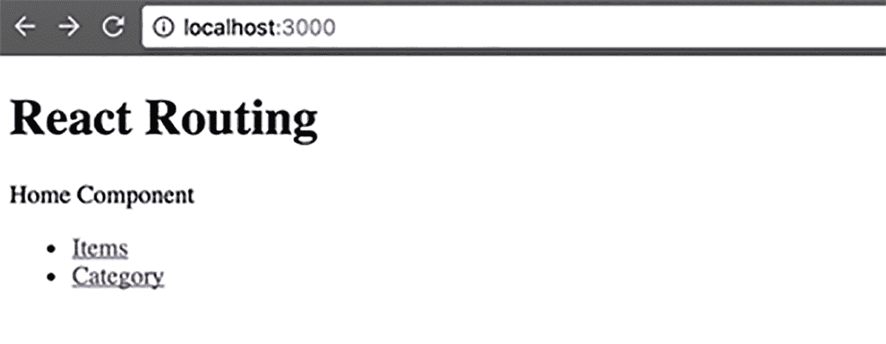

如果你点击 Items 链接，UI 会发生变化，地址栏中的 URL 也会更新：

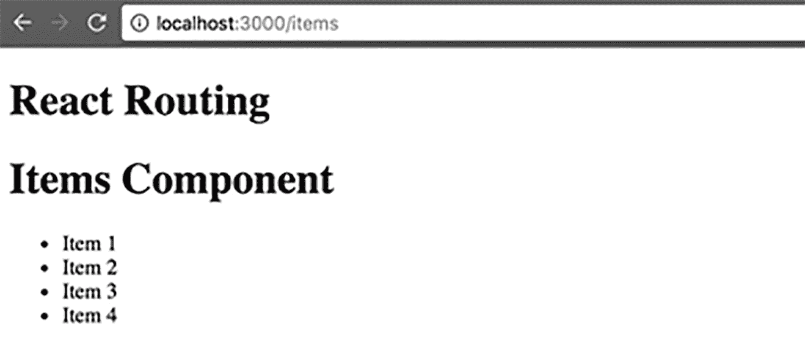

点击 Category 链接时也会发生同样的情况：

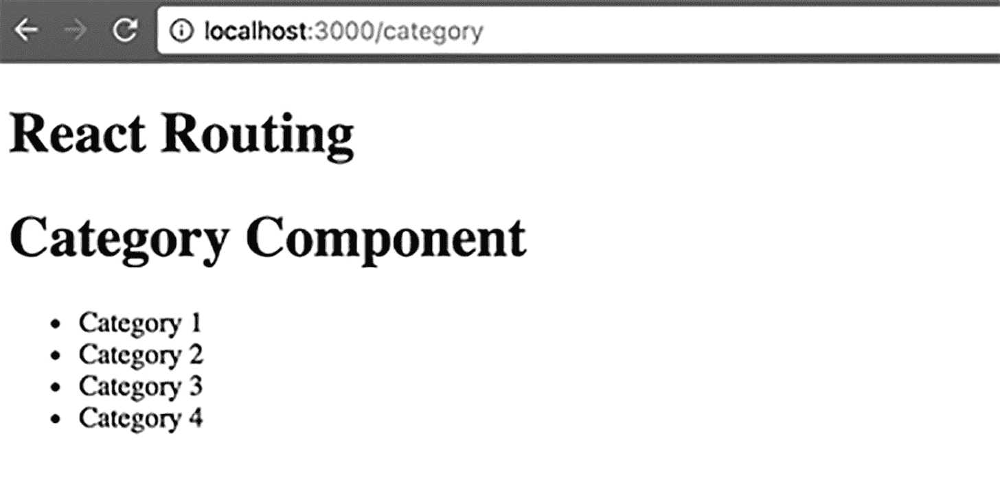

## 嵌套路由

你现在理解了路径和 `<Route/>` 组件是如何工作的，所以现在我们可以看看 React 应用程序中嵌套路由是如何工作的。

当路径和位置之间成功匹配时，会创建另一个对象——匹配对象（match object）。该对象中包含了关于路径和 URL 的信息，这些信息作为属性在对象上访问。

让我们来看看这些属性：

- `url`：这是一个字符串，它将返回 URL 中匹配的部分

- `path`：这是一个字符串，它将返回路由路径的一部分

- `isExact`：这是一个布尔值——如果匹配是精确的，它将返回 true；否则，它返回 false

- `params`：这是一个对象，包含了由 `Path-to-RegExp` 包匹配的键值对

为了成功实现嵌套路由，我们需要为嵌套的 `Links` 使用 `match.url`，并为嵌套路由使用 `match.path`。

在这里，我们将通过一个示例来查看嵌套路由是如何工作的。首先，从[此处的](https://github.com/vumbula/vumbula-react/tree/master/chapter5/Nested-Routing) 克隆项目并运行：

```bash
npm install && npm start
```

这将设置项目。项目中有四个组件：

- `Header`：它包含指向 Home、Category 和 Items 的链接

- `Home`：它包含了一些虚拟数据

- `Items`：它包含一个包含虚拟项目的列表

- `Category`：在这里你可以看到嵌套路由和动态路由的演示

我们将重点关注 `Category` 组件，因为嵌套路由和动态路由都在这里：

```javascript
export const Category = ({match}) => (
  <div>
    <h1>Category Component</h1>
    <h5>Click on a category</h5>
    <ul>
      <li><Link to={`${match.url}/shoes`}>Shoes（鞋子）</Link></li>
      <li><Link to={`${match.url}/food`}>Food（食品）</Link></li>
      <li><Link to={`${match.url}/dresses`}>Dresses（连衣裙）</Link></li>
    </ul>
  </div>
);
```

因此，通过观察这段代码片段，如果点击了 `Category` 链接，路由路径就会被匹配，从而创建一个 `match` 对象。然后，它将作为一个 `prop` 发送给 `category` 组件。

`Category` 组件内部有一个参数列表，在其中，`match` 对象被解构，并使用 `match.url` 链接到各个分类。

`prop` 的值需要在 `Link` 组件上构建，指向 `/shoes`、`/food` 和 `/dresses` 的三个 URL，这是使用模板字面量完成的。

如果你在浏览器中打开该示例并点击 `Category` 链接，你会看到三个分类。当你点击其中一个时，URL 会更新，但 UI 并不会发生变化。

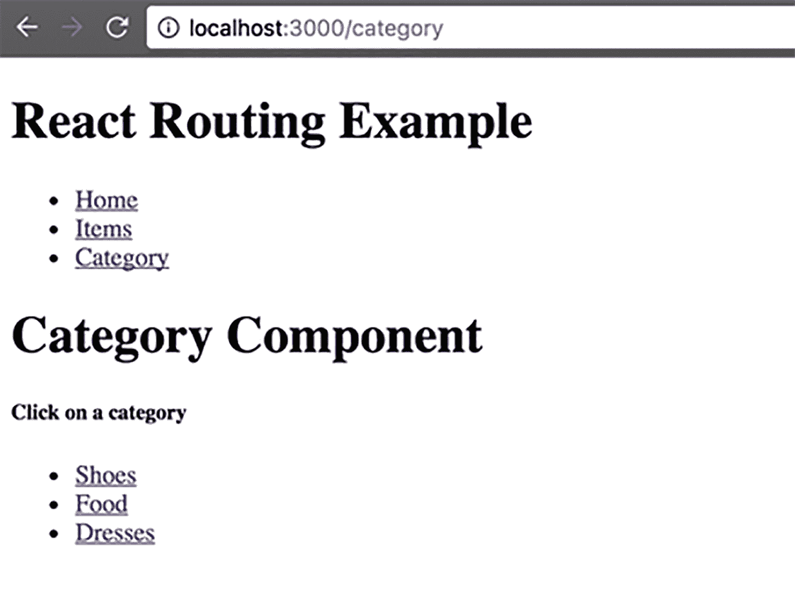

这是一个 Bug，需要修复。我们需要在每次点击分类链接时让 UI 发生变化，要做到这一点，需要在 `Category` 组件中创建一个动态路由。该路由将具有 `match.path` 的 `prop`，并且 UI 将发生动态变化：

```javascript
<Route path={`${match.path}/:categoryName`} render={props =>(<div>{props.match.params.categoryName} category</div>)}/>
```

当你在这段代码中检查 `path` `prop` 的值时，你可以看到使用了 `:categoryName`，这是一个 `pathname` 变量。它是 URL 内部路径参数，用于捕获 `/category` 之后的任何内容。

当我们以此方式将值传递给 `path` 属性时，就不需要为不同的分类硬编码路由了。此外，注意右路径是使用模板字面量构建的。`Param` 对象（如下例所示）是使用如 `category/food` 这样的路径名创建的。

`{categoryName: "food"}`

在这个示例中，`render` 属性执行内联渲染，显示来自 `props` 中 `match` 对象的名为 `categoryName` 的 `param`。这应该是我们让 UI 变化所需的修复，现在，当你点击分类时，UI 和 URL 都应该会更新：

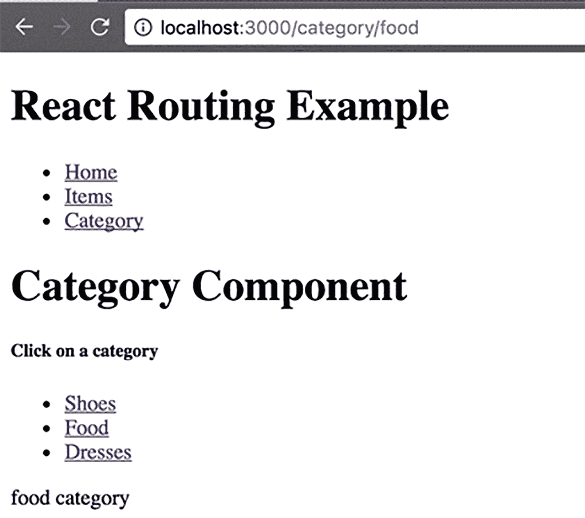

## 受保护路由

拥有受保护路由意味着，当用户在未登录的情况下尝试访问应用程序的任何部分时，他们会被重定向到登录页面，并需要在那里登录。

确保重定向正常工作需要来自 `react-router` 包的 `<Redirect/>` 组件。该包中包含一个 `to` 属性，作为对象传递，并带有 `state` 和 `pathname`，如下：

```javascript
<Redirect to={{pathname: '/login', state: {from:props.location}}}/>
```

`Redirect` 组件使用对象 `/login` 提供的 `pathname` 在当前位置栈中占据位置。用户尝试访问的位置将存储在 `state` 属性中。在 `Login` 组件内部，通过 `this.props.location.state` 访问 `state` 值。

例如，如果用户尝试在未登录的情况下访问 `/admin`（这是一个受保护路由），他们会被发送到登录页面。一旦成功登录，他们就会被重定向到他们最初尝试访问的 `/admin`。

## 自定义路由

实现受保护路由的概念我们需要理解自定义路由以及如何创建它们。自定义路由无非嵌套在组件中的路由。通常，在需要决定是否渲染组件时执行。

至于受保护路由，指定的路由应该只允许登录用户访问。如果用户未登录，他们必须被送到登录页面。

在下一个示例中，我们将进一步查看自定义路由，首先，克隆[此项目](https://github.com/vumbula/vumbula-react/tree/master/chapter5/Protected-Routes)，并像往常一样运行：

```bash
npm install && npm start
```

在私有路由中有三个属性——`isAuthenticated`、`component` 和 `path`。让我们仔细观察私有（自定义）路由。

`props` 在参数列表中被解构，`component` 被重命名为 `Component`（注意从小写到大写的变化）。`Route` 组件被传递给 `render` 和 `...rest` 属性。在 `render` 属性中，编写了逻辑来确定是否应该渲染组件，以及当用户登录时应该渲染哪些组件。如果没有登录，用户将被发送到登录页面。

`Login` 组件中有一个模拟验证方法。当用户点击 `Login` 按钮时，该方法会登录用户。当成功发生后，`redirectToReferrer` `state` 属性被设置为 true，触发重定向，将他们发送到最初想去的地方。

2. `Dispatcher` – `Dispatcher = require('flux').Dispatcher`

3. `Stores` – `EventEmitter = require('events').EventEmitter`。然而，正如我们很快看到的，这将会变为 `Backbone = require('backbone')`

我们将忽略 `Views`，因为它们是 `React` 的一部分，而且你对它们了如指掌。现在我们讨论另外两个组件。

## Dispatcher（分发器）

`Flux Dispatcher` 是处理所有用于修改 `Stores` 的事件的地方。使用它需要 `Store` 注册一个回调函数来处理所有事件。当 `Store` 需要被修改时，就需要分发（dispatch）一个事件。这是一个应用程序部分的示例，允许用户将项目添加到待办列表中：

```javascript
# in TodoDispatcher.coffee
Dispatcher = require("flux").Dispatcher
TodoDispatcher = new Dispatcher() # 这就是你需要的全部！
module.exports = TodoDispatcher
```

```javascript
# in TodoStore.coffee
TodoDispatcher = require("./TodoDispatcher")
TodoStore = {items: []}
TodoStore.dispatchCallback = (payload) ->
  switch payload.actionType
    when "add-item"
      TodoStore.items.push payload.item
    when "delete-last-item"
      TodoStore.items.pop()
TodoStore.dispatchToken = TodoDispatcher.registerCallback(TodoStore.dispatchCallback)
module.exports = TodoStore
```

```javascript
# in ItemAddComponent.coffee
TodoDispatcher = require("./TodoDispatcher")
ItemAddComponent = React.createClass
  handleAddItem: ->
    # 注意：你不要直接 push 到 store 中！
    # (因为通过 dispatcher 移动是有限制的
    # 一切都更加模块化且易于维护)
    TodoDispatcher.dispatch
      actionType: "add-item"
      item: "hello world"
  render: ->
    React.DOM.button {onClick: @handleAddItem}, "Add Item!"
```

正如此，我们现在可以回答这些问题：

1. 哪些事件被用于修改 `MyStore`？

   要回答这个问题，请查看 `MyStore.dispatchCallback` 中的 `switch` 语句。

2. 事件可能的来源有哪些？

   搜索 `actionType`。这比翻 `MyCollection.add`、`MyModel.save` 和 `MyModel.set` 等要容易得多，在那些地方很快就会找到这些问题的答案。你还应该记住，`Dispatcher` 使用 `waitFor` 来允许回调按顺序且同步执行：

```javascript
# in MessageStore.coffee
MyDispatcher = require("./MyDispatcher")
TodoStore = require("./TodoStore")
MessageStore = {items: []}
MessageStore.dispatchCallback = (payload) ->
  switch payload.actionType
    when "add-item"
      # 同步事件流！
      MyDispatcher.waitFor [TodoStore.dispatchToken]
      MessageStore.items.push "an item was added! It was: " + payload.item
module.exports = MessageStore
```

看看在使用 `Dispatcher` 修改 `Stores` 时你的代码变得多么整洁，即使你不使用 `waitFor`。

## Stores（存储）

现在，数据通过 `Dispatcher` 流向 `Stores`，但我们如何让数据从 `Stores` 流向 `Views` 呢？`Flux` 文档说 `View` 将监听 `View` 依赖的 stores 广播的事件。就像回调在 `Stores` 中注册一样，它们也可以在 `Views` 中注册，正如我们所知，它们是 `React` 组件。当 `Store` 的变化通过 `Store` 的 `props` 传递时，`React` 被要求重新渲染。这是一个示例：

```javascript
# in TodoListComponent.coffee
React = require("react")
TodoListComponent = React.createClass
  componentDidMount: ->
    @props.TodoStore.addEventListener "change", =>
      @forceUpdate()
  componentWillUnmount: ->
    # 移除回调
  render: ->
    # 在列表中显示项目。
    React.DOM.ul {}, @props.TodoStore.items.map (item) ->
      React.DOM.li {}, item
```

这很好，但变化事件是如何发出的呢？根据 `Flux`，你应该使用 `EventEmitter`，这里有一个示例：

```javascript
var MessageStore = merge(EventEmitter.prototype, {
  emitChange: function() {
    this.emit(CHANGE_EVENT);
  },
  /*** @param {function} callback*/
  addChangeListener: function(callback) {
    this.on(CHANGE_EVENT, callback);
  },
  get: function(id) {
    return _messages[id];
  },
  getAll: function() {
    return _messages;
  },
  // 等...
})
```

所以，每次你想创建一个 `Store` 时都得写所有这些，对吧？每当你想显示一条信息时都得使用它，对吧？错了，有一种更简单的方法。

## Models and Collections（模型与集合）

`Backbone` 提供了 `Models` 和 `Collections`，它们拥有 `Flux` 中基于 `EventEmitter` 的 `Stores` 的所有功能。当 `Flux` 建议你使用原始 `EventEmitter` 时，他们建议每当你创建一个 store 时，你都在重建 `Backbone` 中 50% 到 75% 的 `Models` 和 `Collections`。你可以将为 `Stores` 使用 `EventEmitter` 等同于使用普通的旧 Node 对象。

就像 `Express` 这样，`Collections` 是基于 `EventEmitter` 构建的。它包含了 getter、setter、查询方法以及你可能需要的其他一切。

## Flux/Backbone 模式

这是 `Flux` 架构与 `Backbone` 的组合：

1. `Models` 或 `Collections` 被用于实例化 `Stores`。模型或集合在 `Dispatcher` 中注册了回调，且通常是单例。

2. `View` 组件绝不会被用于直接修改 `Store`，即没有 `.set()` 方法。相反，`Actions` 由组件分发到 `Dispatcher`。

3. `Stores` 被 `View` 组件查询，它们通过绑定到事件来触发事件。

让我们逐一来看，并使用 `Backbone` 的示例：

### 1. `Models` 或 `Collections` 被用于实例化 `Stores`

模型或集合在 `Dispatcher` 中注册了回调，且通常是单例。

```javascript
# in TodoDispatcher.coffee
Dispatcher = require("flux").Dispatcher
TodoDispatcher = new Dispatcher() # 这就是你需要的全部！
module.exports = TodoDispatcher
```

```javascript
# in stores/TodoStore.coffee
Backbone = require("backbone")
TodoDispatcher = require("../dispatcher")
TodoItem = Backbone.Model.extend({})
TodoCollection = Backbone.Collection.extend
  model: TodoItem
  url: "/todo"
  # 初始化时在 Dispatcher 中注册了回调
  initialize: ->
    @dispatchToken = TodoDispatcher.register(@dispatchCallback)
  dispatchCallback: (payload) =>
    switch payload.actionType
      # 模型实例从 Store 中移除
      when "todo-delete"
        @remove payload.todo
      when "todo-add"
        @add payload.todo
      when "todo-update"
        # 执行一些操作...
        @add payload.todo, merge: true
      # ... 等
# store 现在是一个实例化的集合；单例。
TodoStore = new TodoCollection()
module.exports = TodoStore
```

### 2. `View` 组件绝不会被用于直接修改 `Store`

即：没有 `.set()` 方法。相反，`Actions` 由组件分发到 `Dispatcher`。

```javascript
# components/TodoComponent.coffee
React = require("react")
TodoListComponent = React.createClass
  handleTodoDelete: ->
    # 不是直接将 todo 从 ToDoStore 中移除
    # 而是使用了 Dispatcher
    TodoDispatcher.dispatch
      actionType: "todo-delete"
      todo: @props.todoItem
  # ... (见下文) ...
module.exports = TodoListComponent
```

```coffee
# components/TodoComponent.coffee
React = require("react")
TodoListComponent = React.createClass
  handleTodoDelete: ->
    # 并不是直接从 ToDoStore 中移除 todo，
    # 而是使用 Dispatcher。
    fluxTodoDispatcher.dispatch(actionType: "todo-delete")
    todo: @props.todoItem
  # ...
  componentDidMount: ->
    # 组件绑定到 Store 的事件
    @props.TodoStore.on "add remove reset", =>
      @forceUpdate()
  componentWillUnmount: ->
    # 关闭所有与此上下文相关的事件和回调
    @props.TodoStore.off null, null, this
  render: ->
    React.DOM.ul {},
      @props.TodoStore.items.map (todoItem) ->
        # TODO: TodoItemComponent，它将绑定到
        # `this.props.todoItem.on('change')`
        TodoItemComponent {todoItem: todoItem}
module.exports = TodoListComponent
```

尝试将这种方法应用到你的项目中，你会发现代码变得更加整洁、高效。那些你花费数小时尝试寻找更好方案的笨拙、丑陋的代码片段可以很容易被更合理的流程所取代，你会发现 Backbone 几乎可以无缝地集成到该模式中，你不再会感觉为了让它们协同工作而处处斗争。

## Mix 示例

每当你向组件添加基于 Flux 和 Backbone 的 Store 时，每次都编写 `this.on()` 和 `this.off()` 代码可能会让人感到沮丧。在下方的 React Mixin 示例中，虽然它有些简单，但它会让你的迭代工作变得容易得多：

### 在 `FluxBoneMixin.coffee` 中

```coffee
module.exports = (propName) ->
  componentDidMount: ->
    @props[propName].on "all", =>
      @forceUpdate()
  componentWillUnmount: ->
    @props[propName].off "all", =>
      @forceUpdate()
```

### 在 `HelloComponent.coffee` 中

```coffee
React = require("react")
UserStore = require("./stores/UserStore")
TodoStore = require("./stores/TodoStore")
FluxBoneMixin = require("./FluxBoneMixin")
MyComponent = React.createClass
  mixins: [
    FluxBoneMixin("UserStore"),
    FluxBoneMixin("TodoStore"),
  ]
  render: ->
    React.DOM.div {},
      "Hello, #{ @props.UserStore.get('name') }, you have #{ @props.TodoStore.length } things to do."
React.render(MyComponent {UserStore: UserStore, TodoStore: TodoStore}, document.body.querySelector(".main"))
```

## 与 Web APIs 同步

在之前的 Flux 图中，你可以看到 Web API 仅通过 `ActionCreators` 进行交互。这要求服务器在动作发送到 `Dispatcher` 之前做出响应，但理想情况下，`Store` 应该在服务器之前感知任何变化吗？

我们可以翻转这个图表，让 `Stores` 直接通过 Backbone 中的 `sync()` 方法与 RESTful CRUD API 交互。如果你正在处理这些 API，那么这将会非常方便。

维护数据完整性也没有问题。当使用 `.set()` 设置新属性时，更改事件会触发 React 重新渲染，并乐观性地显示新数据。当你尝试使用 `.save()` 将其保存到服务器时，请求事件会告诉你应该如何显示加载图标。当一切处理完成后，`sync` 事件会告诉你需要移除加载图标，或者 `error` 事件会让你知道状态需要变红。

第一层防御还包含一个验证和失效事件，以及一个用于从服务器获取新信息的 `.fetch()` 方法。

然而，如果你的任务并不那么标准，那么使用 `ActionCreators` 可能会更有意义。

仔细且巧妙地使用 Backbone 可以帮助填补 Flux 的某些空白，对于任何人来说，无论其业务规模如何，创建和维护令人印象深刻的应用程序将变得惊人地简单。

# 第 12 章：ReactJS 动画


我们很容易忘记为网络项目添加动画，仅仅因为我们的设计是以静态图像形式呈现的。当我们开始编码时，浏览器的兼容性是我们脑海中最重要的事情，还有屏幕尺寸以及我们如何实现这些功能。通常情况下，UI 实际上是如何移动的最后被考虑的，往往是事后补救。

这可能会导致一些严重的问题，因为 UI 组件有时需要移动。为什么？因为每个状态之间的过渡应该是平滑的，而这是通过运动来实现的。有时我们希望网页上出现最新内容，或者让某些操作引起注意。

例如，如果你的网站上价格发生了变化，你可能想引起人们的注意，确保没有人错过它。

将这类事情留到最后会导致问题，因为我们最终只是尝试拼凑出一个快速解决方案。结果是出现断续的、不一致的动画，应用错误，或者在某些情况下完全被遗忘了。

不过，为你的 React 应用制作动画并不困难。通过 React 动画，你可以获得许多预构建的关键帧和组件，它们帮助你非常快速地为应用添加动画。

## 介绍 React Animation

`React Animation` 是一个相对新的 React 包，它可以帮助你向项目中添加 UI 动画。该包充满了封装器组件和预构建的动画帧，你可以轻松快速地将它们添加到项目中。

当然，还有其他方法可以在应用中构建动画。你可以使用 `React Transition group`，它允许你添加和移除类以便应用动画。遗憾的是 `React Transition Group` 没有包含这些动画，因此你仍然需要自己处理。或者你可以选择 `React Spring`，它提供了许多高级工具来帮助你处理大量的动画元素。

- `bounceIn`

- `bounceOut`

- `fadeIn`

- `fadeInUp`

- `fadeOut`

- `popIn`

- `popOut`

- `slideIn`

- `slideOut`

思考一下你的项目，以及你可以在 UI 的哪些地方使用动画。例如，你可以将用户的注意力吸引到特定按钮，或者使用它让列表项淡入淡出。无论你想如何做，都可以考虑使用 React Animations 来帮助你。只需按照如下方式安装：

```bash
npm install react-animation
```

然后，就可以导入组件了：

```javascript
import { AnimateOnChange, HideUntilLoaded } from 'react-animation'
```

这些会自动引入你所需的帧定义，以便你可以在项目中使用这些组件。

# 第 13 章 ReactJS 高阶组件

在 React 中，高阶组件（或 `HOCs`）的灵感源自高阶 JavaScript 函数。简单来说，HOC 是一种允许你在组件中复用逻辑的进阶技术。基本上，它们体现了 DRY 原则——**不要重复自己**（Don't Repeat Yourself），我相信你在编程旅途中已经遇到过它。它是最为人知的软件开发原则，也是在构建应用或编写任何代码时最需要遵守的原则之一。

在本章中，我们将讨论 `HOCs` 是什么、它们是如何结构的、它们的用途，最后我们将看一个示例。为了充分利用本章内容，你需要具备一些 JavaScript 和 React 知识。

## JavaScript 中的高阶函数

在讨论 React 的 `HOCs` 之前，我们先快速查看 JavaScript 的 `HOCs`，因为 React 的高阶组件灵感正源于此。因此，理解它们至关重要。

JavaScript 高阶组件以函数的形式接收参数，然后返回另一个函数。这些 `HOCs` 让我们能够进行抽象，不仅针对值，还针对动作。它们有几种不同的形式，并用于在操作函数时编写更少的代码。它们甚至可以作用于数组。组合（Composition）是使用这些最有趣的部分，因为可以编写较小的函数来处理一段逻辑。然后使用这些较小的函数组合更复杂的函数，从而减少代码中的 bug 风险，并使代码更可读、更易理解。

某些高阶函数已经内置在 JavaScript 中，示例包括：

- `.forEach()` – 用于使用相同的代码遍历数组中的每个元素。然而，它不会以任何方式修改或改变数组，其返回 `undefined`。

- `.map()` – 用于转换数组。它通过对数组中的每个元素应用函数，然后使用返回的值构建一个新数组来实现。

- `.reduce()` – 用于对每个数组值执行特定函数，从左到右进行处理。

- `.filter()` – 用于检查给定数组中的每个单独元素，检查其是否符合 `filter()` 方法内部指定的标准。返回一个包含匹配指定标准元素的数组。

JavaScript 包含大量的高阶函数，但你仍然可以创建自己的自定义高阶函数。

### 自定义高阶函数示例

假设我们要写一个用于将整数格式化为货币的函数。你需要包含某种自定义内容来指定货币符号，并为金额添加分隔符——我们使用小数点分隔符。我们将编写一个高阶函数来接收符号和分隔符，然后使用小数点运算符和货币符号格式化传递给它的值。我们将这个高阶函数命名为 `formatCurrency`。

```javascript
const formatCurrency = function (currencySymbol, decimalSeparator) {
  return function( value ) {
    const wholePart = Math.trunc( value / 100 );
    let fractionalPart = value % 100;
    if ( fractionalPart < 10 ) {
      fractionalPart = '0' + fractionalPart;
    }
    return `${currencySymbol}${wholePart}${decimalSeparator}${fractionalPart}`;
  }
}
```

`formatCurrency` 函数将返回另一个包含小数点分隔符和固定货币符号的函数。格式化器接收一个值，并使用该函数对值进行格式化——提取整数和小数部分。使用模板字符串（template literal）来构建函数的返回值，并将货币符号、整数部分、分隔符和小数部分拼接在一起。

让我们给高阶函数分配一个值，以便使用它并查看结果：

```javascript
> getLabel = formatCurrency( '$', '.' );
> getLabel( 1999 )
"$19.99" //格式化后的值
> getLabel( 2499 )
"$24.99" //格式化后的值
```

所以，我们在这里做的是创建一个变量并命名为 `getLabel`。然后赋值 `formatCurrency`，并将货币格式化器传递给它——这些是小数点分隔符和货币符号。使用该函数时调用 `getLabel`（现在是一个函数），并传入需要格式化的值。这就是创建一个自定义高阶函数我们需要做的所有。

## 什么是高阶组件？

好了，`HOC` 是一种允许我们在 React 组件中复用逻辑的进阶元素。我们之前说过，而且这是必要的。组件可以以其他组件的形式接收参数，并返回一个新的组件（一个升级后的组件）。这听起来熟悉吗？应该是，因为它非常像接收函数作为参数并返回函数的高阶函数。

我们通常使用 `HOCs` 来设计具有共享行为的组件，但它们的设计方式与标准的状态到属性的方式不同。关于高阶组件，你需要知道：

1. 组件既没有修改也没有改变。相反，创建了新的组件。

2. `HOCs` 用于组合组件，以便于复用代码。

3. `HOCs` 是纯函数。它们没有副作用，只返回新组件。

以下是你可能在现实世界遇到的一些 `HOCs`：

- `react-redux` `connect(mapStateToProps, mapDispatchToProps)(UserPage)`

- `react-router` `withRouter(UserPage)`

- `material-ui` `withStyles(styles)(UserPage)`

## 高阶组件结构

HOC 的结构与高阶函数非常相似：

- 它们是组件

- 它们接收组件作为参数

- 它们返回新组件

- 返回的组件能够渲染传递给它的组件

在下面的代码示例中，你可以看到 React `HOC` 的结构：

```javascript
import React from 'react';
// 接收组件作为参数 WrappedComponent
const higherOrderComponent = (WrappedComponent) => {
  // 返回一个新的组件
  class HOC extends React.Component {
    render() {
      return <WrappedComponent />;
    }
  }
  return HOC;
};
```

可见，`higherOrderComponent` 接收 `WrappedComponent`（另一个组件），然后在内部返回一个新的组件。使用这种技术允许我们通过从组件创建 `HOC` 并在需要的地方复用组件的逻辑。

## 用例

作为一名前端工程师，你会发现 React 中 `HOCs` 的一些常见用例：

- 当组件等待数据时，你可以显示加载器（Loader）

当你构建 Web 应用程序时，可能会发现自己需要包含某种描述的加载器（loader）。它在组件加载时显示，即等待特定数据传入其 `props` 中。加载器可以使用组件内部的解决方案来渲染，虽然这种方法可行，但视觉效果并不尽理想。更好的方法是编写一个 HOC（高阶组件）来跟踪 `props`，并在 `props` 等待数据或为空时显示加载器。为了帮助解释这一点，让我们使用开放 API 创建一个公共 API 类别列表。列表加载将被处理，这确保了当应用程序只是在等待数据时，客户不会认为程序崩溃了。

首先，生成一个 React 应用：

```bash
npx create-react-app repos-list
```

接下来，我们可以像这样写一个基础列表组件：

```javascript
// List.js
import React from 'react';
const List = (props) => {
  const { repos } = props;
  if (!repos) return null;
  if (!repos.length) return <p>No repos, sorry</p>;
  return (
    <ul>{repos.map((repo) => {
      return <li key={repo.id}>{repo.full_name}</li>;
    })}</ul>
  );
};
export default List;
```

这是一个列表组件，让我们拆解代码并理解正在发生什么：

`const List = (props) => {};`

首先，初始化该函数组件，命名为 `List`，并将 `props` 传递给它。

`const { repos } = props;`

接下来，创建一个名为 `repos` 的常量，并将其传递给组件 `props`。这允许我们使用它来修改组件。

`if (!repos) return null;`

`if (!repos.length) return <p>No repos, sorry</p>;`

在这里的意思是，如果在获取完成后 `repos` `prop` 仍然为空，则应该返回 `null`。我们做的另一件事是条件渲染。如果 `repos` `prop` 的长度为空，则会在浏览器中渲染“no repos, sorry”。

`return (<ul>{repos.map((repo) => {return <li key={repo.id}>{repo.full_name}</li>;})}</ul>);`

在这里，我们遍历名为 `repos` 的数组。返回一个列表，其中包含根据其全名显示的 `repos`，并为每个条目提供唯一的 `key`。

现在，为了让用户满意，我们需要处理加载状态，因此让我们写一个 HOC：

```javascript
// withLoading.js
import React from 'react';
function WithLoading(Component) {
  return function WithLoadingComponent({ isLoading, ...props }) {
    if (!isLoading) return <Component {...props} />;
    return <p>Please wait, fetching data might take a while.</p>;
  };
}
export default WithLoading;
```

当应用程序仍在获取数据且 `props` 正在注入状态时，会显示文本“Please wait, fetching data might take a while”。我们还使用 `isLoading` 来决定是否渲染组件。在你创建的 `App.js` 文件中，可以将加载逻辑传递给 `WithLoading`，而不需要在 `List` 中考虑它。

```javascript
import React from 'react';
import List from './components/List.js';
import WithLoading from './components/withLoading.js';
const ListWithLoading = WithLoading(List);
class App extends React.Component {
  state = {};
  componentDidMount() {
    this.setState({ loading: true });
    fetch(`https://api.github.com/users/hacktivist123/repos`)
      .then((json) => json.json())
      .then((repos) => {
        this.setState({ loading: false, repos: repos });
      });
  }
  render() {
    return (
      <ListWithLoading isLoading={this.state.loading} repos={this.state.repos}/>
    );
  }
}
export default App;
```

这段代码是整个应用程序，让我们拆解它并看看正在发生什么：

```javascript
class App extends React.Component {
  state = {
    loading: false,
    repos: null,
  };
  componentDidMount() {
    this.setState({ loading: true });
    fetch(`https://api.github.com/users/hacktivist123/repos`)
      .then((json) => json.json())
      .then((repos) => {
        this.setState({ loading: false, repos: repos });
      });
  }
```

我们只是创建了一个类组件并将其命名为 `App()`。然后我们使用两个属性来初始化状态——`loading: false` 和 `repo: null`。`loading` 的初始状态为 `false`，`repos` 的初始状态为 `null`。当组件开始挂载时，`loading` 属性状态被设置为 `true`，并立即向 API URL 发起 `fetch` 请求，该 URL 包含了填充 `List` 组件所需的数据。请求完成后，`loading` 状态被设置为 `false`，`repos` 状态用 API 请求获取的数据填充。

`const ListWithLoading = WithLoading(List);`

在这一行中，我们创建了一个组件并将其命名为 `ListWithLoading`。传递了 `WithLoading` HOC 和 `List` 组件。

`render() {return (<ListWithLoading isLoading={this.state.loading} repos={this.state.repos}/>)}`

在这里渲染了 `ListWithLoading` 组件，通过传递 `WithLoading` HOC 和 `List` 组件对其增强。我们将 `loading` 状态和 `repos` 状态值传递给 `props`。由于页面仍在尝试获取数据，因此 HOC 在浏览器中渲染：


一旦加载完成且 `props` 不再为空，我们可以在屏幕上渲染 `repos`：


### 条件渲染组件

假设有一个组件只有在用户通过身份验证后才渲染。这是一个受保护的组件。可以创建一个名为 `withAuth()` 的 HOC 来封装保护组件，然后在 HOC 中进行检查，以确保仅在用户通过验证后渲染特定组件。你可以按照此示例编写 `withAuth()` HOC：

```javascript
// withAuth.js
import React from "react";
export function withAuth(Component) {
  return class AuthenticatedComponent extends React.Component {
    isAuthenticated() {
      return this.props.isAuthenticated;
    }
    /*** Render*/
    render() {
      const loginErrorMessage = (<div>Please <a href="/login">login</a> to see this part of the application.</div>);
      return (
        <div>{ this.isAuthenticated() === true ? <Component {...this.props} /> : loginErrorMessage }</div>
      );
    }
  }
}
export default withAuth;
```

这就是 `withAuth()` HOC，它接收一个组件并返回另一个名为 `AuthenticatedComponent` 的组件。该组件将检查用户是否通过验证。如果没有，则返回另一个名为 `loginErrorMessage` 的组件。如果用户已验证，则返回封装的组件。

**注意**：必须使用你的应用程序逻辑来设置 `this.props.isAuthenticated`，或者使用 `react-redux` 从全局状态中获取。

你可以这样在保护组件中使用 HOC：

```javascript
// MyProtectedComponent.js
import React from "react";
import {withAuth} from "./withAuth.js";
export class MyProtectedComponent extends React.Component {
  /*** Render*/
  render() {
    return (<div>只有通过身份验证的用户才能看到此。</div>);
  }
}
// 现在 MyProtectedComponent 被名为 requireAuthentication 的函数封装
export default withAuth(MyProtectedComponent);
```

### 为你的组件提供特定样式

接上述用例，可以根据来自 HOC 的特定 UI 状态，为特定的 UI 状态渲染特定的样式。例如，如果你需要在多个地方使用特定的样式，如 `fontSize`、`backgroundColor` 等，可以使用 HOC 来提供这些样式——只需将组件封装在另一个组件中，向 props 注入特定的 `className` 即可。

让我们用一个简单的组件作为示例 – 它渲染单词“Hello”，后面跟上人的名字。该组件将接收两个 props – 一个 `name` 和另一个影响渲染的 JSX 的属性 – `JSX` = JavaScript XML。

```javascript
// 一个简单的组件
const HelloComponent = ({ name, ...otherProps }) => (<div {...otherProps}>Hello {name}!</div>);
```

现在可以创建并调用一个 `withStyling` HOC，我们可以使用它来为文本添加样式：

```javascript
const withStyling = (BaseComponent) => (props) => (<BaseComponent {...props} style={{ fontWeight: 700, color: 'green' }} />);
```

要在 `HelloComponent` 上使用该 HOC，需要将 HOC 包裹在它周围。创建一个名为 `EnhancedHello` 的纯组件，并将 HOC 和 `HelloComponent` 赋值给它，如下：

```javascript
const EnhancedHello = withStyling(HelloComponent);
```

要以任何方式更改 `HelloComponent`，只需渲染 `EnhancedHello` 组件：

```jsx
<EnhancedHello name='World' />
```

现在 `HelloComponent` 的文本变为了：

```html
<div style="font-weight: 700; color: green;">Hello World</div>
```

## 为组件传递任何 Prop

这是 HOC 组件最流行的用法之一。可以通过研究代码库来确定我们想要在组件之间使用的可复用 prop。然后，可以创建一个包装 HOC，为该可复用 prop 提供正确的组件。

继续上面的示例：

```javascript
// 一个简单的组件
const HelloComponent = ({ name, ...otherProps }) => (<div {...otherProps}>Hello {name}!</div>);
```

现在我们可以创建一个 HOC 并将其命名为 `withNameChange`。这会将基础组件的 name 属性设置为 `New Name`：

```javascript
const withNameChange = (BaseComponent) => (props) => (<BaseComponent {...props} name='New Name' />);
```

将 HOC 包裹在 `HelloComponent` 周围并创建一个名为 `EnhancedHello2` 的纯组件。HOC 和 `HelloComponent` 赋值如下：

```javascript
const EnhancedHello2 = withNameChange(HelloComponent);
```

通过渲染 `EnhancedHello` 组件来更改我们的 `HelloComponent`，如下：

```jsx
<EnhancedHello />
```

现在 `HelloComponent` 的文本为：

```html
<div>Hello New Name</div>
```

更改 name 属性的方法如上所示：

```jsx
<EnhancedHello name='Shelley' />
```

现在我们的 `HelloComponent` 文本为：

```html
<div>Hello Shelley</div>
```

## 构建一个高阶组件 - 示例

为了完成本章的介绍，我们将构建一个 HOC。它将接收一个带有 `name` prop 的组件，并且该 `name` prop 将被用于 HOC 中。

首先，使用 `create-react-app` 创建一个 React 应用：

```bash
npx create-react-app my-app
```

一旦生成应用，可以将 `index.js` 文件中的代码替换为以下内容：

```javascript
import React from 'react';
import { render } from 'react-dom';
const Hello = ({ name }) => <h1>Hello {name}!</h1>;
function withName(WrappedComponent) {
  return class extends React.Component {
    render() {
      return <WrappedComponent name="Smashing Magazine" {...this.props} />;
    }
  }
}
const NewComponent = withName(Hello);
const App = () => <div><NewComponent /></div>;
render(<App />, document.getElementById('root'));
```

当 `index.js` 文件中的代码被替换后，你应该会在屏幕上看到：


# 第 14 章：React 最佳实践


作为前端开发者，你应该使用 React 构建用户界面，特别是那些交互性的部分。而且在使用 React 时，你应该始终记住最佳实践，以确保你的代码组织良好。为了帮助你充分利用 React，本章将详细介绍你应该遵循的基础最佳实践。

## 1. 确保你的组件是特定函数且较小的

我们已经知道 React 允许你拥有巨大的组件，在某些情况下用于执行多个任务。然而，设计组件的更好方法是让它们尽可能小，确保一个组件对应一个函数。在理想的世界中，组件应该只渲染网页的特定部分或修改特定的行为，这带来了许多优势：

- 每个小的组件在你的项目中都是可复用的。

- 如果组件被设计为执行通用函数，开发者可以将其提供给社区。

- 组件越小，越容易对应用性能进行优化。

- 较大的组件需要更多的工作，并且可能更难维护。

## 2. 仅创建所需的最少组件

当你坚持每个组件一个函数的第一个原则时，你显著改进了组件的可复用性。这意味着，当已经存在组件时，不要浪费时间为该函数创建一个新的。在一个或多个项目中复用组件可以确保一致性，你同时也为社区做出了贡献。

然而，如果一个组件变得太大、太臃肿且难以维护，最好将其拆分为几个较小的。

## 3. DRY – 不要重复

重复的代码应该合并。

这是一个常识性的规则——保持你的代码简洁，越短越好。这条规则适用于所有的计算机编程，而不只是 React。你如何实现这一点呢？通过仔细检查你的所有代码并寻找相似之处和模式。当你发现这些内容时，要进一步检查以确保你没有重复代码——尽可能将其消除。在大多数情况下，稍微重写一下就能解决问题。

这在很大程度上依赖于 React 的可重用原则。假设你想添加多个包含图标的按钮。与其为每个按钮编写标记（markup），你可以使用我们上面用代码创建的 `IconButton` 组件。你甚至可以更进一步，使用数组来 `map` 映射所有内容：

```javascript
const buttons = ['facebook', 'twitter', 'youtube'];
return (<div>{buttons.map( (button) => {return (<IconButton onClick={doStuff( button )} iconClass={button}/>);} )}</div>);
```

## 4. 在 JavaScript 中使用 CSS

当你开始一个新项目时，通用的做法是将所有的 CSS 样式都保留在一个 `SCSS` 文件中。通过使用全局前缀可以防止可能的命名冲突。然而，虽然这对于小项目有效，但在扩大规模时可能就不那么好了。现在有很多库可以帮助你在 JavaScript 中编写 CSS，其中最流行的两个是 `Glamorous` 和 `EmotionJS`。

下面，你可以看到如何使用 `EmotionJS` 为你的项目生成整个 CSS 文件。首先，需要安装 `EmotionJS`：

```bash
npm install --save @emotion/core
```

然后，需要将 `EmotionJS` 导入到你的应用程序中：

```javascript
import { jsx } from '@emotion/core'
```

元素的属性可以这样设置：

```javascript
let Component = props => {return (<div css={{border: '1px'}} {...props}/>)}
```

## 5. 仅在必要的地方使用注释

你应该只在绝对必要的地方给代码添加注释。这不仅能让你符合 React 的最佳实践，还能确保你的代码不会充斥杂乱。此外，如果你以后决定更改代码，这有助于避免代码与注释之间潜在的冲突。仅在必要的地方为代码附上注释。这不仅符合 React 的最佳实践，还同时实现了两个目的：

- 它将保持代码视觉上的整洁。

- 如果你在以后某个时刻修改了代码，可以避免注释与代码之间潜在的冲突。

## 6. 组件应该根据函数命名

根据其执行的特定函数来命名组件是一个良好的习惯——这样它们更容易被识别。例如，如果你有一个名为 `ProductTable` 的组件，你可以一眼看出它的作用。如果你采取根据代码需求来命名组件的方法，事情可能会变得困惑，不仅对你来说，对任何阅读你代码的人也是如此。

再举另一个例子，一个名为 `Avatar` 的组件。这个组件可以使用在任何地方，例如用于用户、作者，甚至用于注释中。但如果你将其命名为 `AuthorAvatar`，它的实用性就会受到某种限制。作为一个额外的好处，当你与社区共享组件时，根据功能命名它们是有合理的，因为这使得它们更容易找到。

## 7. 组件名称应大写开头

大多数编码人员使用 JavaScript 扩展名 `JSX`，你的组件名称应该以大写字母开头。例如，一个组件应该被称为 `Menu` 而不是 `menu`，或者是 `SelectButton` 而不是 `selectbutton`。这样做是为了让 `JSX` 将它们与 `HTML` 标签区分开来。在 React 早期，官方维护了一个所有内置名称的列表，以帮助将它们与自定义名称区分开。然而，不断更新列表的工作量太大了，最终被取消，转而使用大写字母。如果你不使用 `JSX`，可以使用小写字母，但要注意——这可能会降低它们在项目外的组件可重用性。

## 8. 记住其他命名规范

当你在 React 中工作时，通常使用 `JSX` 文件。这意味着为 React 创建的所有组件都应该使用帕斯卡命名法（Pascal case）或大驼峰命名（upper camel case）。这意味着单词之间没有空格，且每个单词的首字母大写。例如，如果你想创建一个提交表单的函数，应该使用大驼峰将其命名为 `SubmitForm`，而不是 `submitForm` 或 `submit_form`。通常，大驼峰命名就是帕斯卡命名法的另一种称呼。

## 9. 将状态部分与渲染分离

React 组件可能是无状态的也可能是有状态的。有状态组件存储状态信息并提供任何所需的上下文。相比之下，无状态组件没有任何内存，无法为 UI 的其他部分提供任何上下文。它们所做的是从父组件接收输入（`props`）并返回 `JSX` 元素。它们是可重用的、可扩展的，并且类似于 JavaScript 的纯函数。

使用 React 的一项最佳实践是：加载数据的状态逻辑不应与无状态渲染逻辑保留在一起。如果你有一个用于数据加载的有状态组件和一个用于数据显示的无状态组件，效果会好得多，从而降低组件的复杂性。在较新的 React 版本中，你可以使用 `React Hooks` 来编写与函数相关的状态组件。最终可能会消除对类组件的需求。

例如，假设你的应用在挂载时获取了数据。你想管理主组件的数据，并将渲染任务（复杂得多）作为 props 传递给子组件。

```javascript
import RenderTable from './RenderTable';
class Table extends Component {
  state = { loading: true };
  render() {
    const { loading, tableData } = this.state;
    return loading ? <Loading/> : <RenderTable data={tableData}/>
  }
  componentDidMount() {
    fetchTableData().then( tableData => {
      this.setState( { loading: false, tableData } );
    } );
  }
}
```

## 10. 你的代码应该始终按照你的预期执行并且必须是可测试的

老实地说，这并不需要太多解释。当你编写代码时，它的行为应该始终符合你的预期，并且应该是易于测试的。源于此的另一个习惯是将测试文件命名为与源文件相同，但带有 `.test` 后缀。这样，你就可以轻松找到你想要测试的文件。

## 11. 将与组件相关的所有文件放在一个文件夹中

这包括你的样式文件。如果你有只与特定组件相关的小组件，请将它们全部放在一个文件夹中。这样，你就可以轻松理解层级结构——大型组件有自己的文件夹，较小的组件不拆分子文件夹，允许你在需要时提取代码或修改它。例如，如果你有一个 `Form` 组件，你应该将所有的图标、CSS 文件、测试、图像以及任何其他相关的子组件放在一个文件夹中。对命名保持理智，这样当你需要它们时就不会有找不到它们的麻烦。

## 12. 使用工具，例如 Bit

像 `Bit` 这样的工具可以帮助你组织所有的 React 组件，使维护代码和在需要时复用变得更容易。此外，你的代码变得更具可发现性，促进了组件构建中的团队协作，并帮助你在不同项目之间同步代码。

## 13. 使用代码片段库

代码片段（Code snippets）有助于你跟上所有最新且最好的语法，并且它们帮助你尽可能减少代码中的 Bug。因此，这使得成为你应该遵循的 React 最佳实践之一。有很多代码片段库，例如 `Redux`、`ES7 React`、`JS Snippets` 等。

## 14. 为你的所有代码编写测试

无论你使用什么编程语言，都应该始终进行充分的测试，以确保你的项目与其他代码集成时不会破坏已有的功能。因此，作为一种良好的实践，每当你创建一个新组件时，都应该始终编写测试。在组件所在的目录下创建一个 `Test` 目录来存储你所有的测试。

React 测试大致分为两类——使用 React 应用程序来测试组件功能，以及在应用程序在浏览器渲染后对整个应用进行测试。后者可以使用跨浏览器工具进行测试，而前者可以使用 JavaScript 测试运行器。最好的测试运行器被称为 `Jest`，它可以模拟 HTML DOM，允许你使用 `jsdom` 测试 React 组件。虽然只有在真实设备和真实浏览器中进行测试才能获得准确的测试结果，但在开发项目期间，`Jest` 能够给你提供直观的思路。

# 第 15 章：遵循 Linting 规则并拆分过长的行

Linting 过程允许我们运行一个程序来检查代码中的潜在错误。大多数情况下，它用于处理语言问题，但也可以用于修复其他问题，例如自动修复代码样式。当你使用 linter 时，可以保持代码免受 Bug 和错误的影响——至少可以免受大部分影响。

# 第 15 章：让我们创建一个 React 应用程序

为了完成这本书，我们将通过命令行和文本编辑器，逐步演示如何设置一个 React 应用程序。我们将使用 `npm`，它是 Node 包管理器，到目前，你应该已经在电脑上安装了 `node`。

安装 `Node` 会自动安装 `npm`，但后者与 `Node.js` 是独立的，且更新频率更频繁。这意味着，即使 `Node` 和 `npm` 刚刚安装在你的系统中，更新 `npm` 也是一个好主意——幸运的是，`npm` 内置了自更新功能。在终端中运行以下命令以确保你正处于最新版本：

```bash
sudo npm install -g npm@latest
```

## 第一步：设置模板应用

你可以手动创建 React 应用程序，但 Facebook 给了我们一个非常有用的包叫做 `create-react-app`——它会为我们生成一个模板应用。这样做的一个额外好处是，你的 React 应用程序结构是一致的，在你应用之间切换时可以轻松识别。此外，你还会获得开发服务器和一个构建脚本。

安装和运行 `create-react-app` 需要我们使用名为 `npx` 的包运行器工具——这也确保你运行的是最新版本的 `create-react-app`。

打开你的终端。首先，如果你之前通过 `npm install -g create-react-app` 全局安装过它，你应该使用以下命令卸载它：

```bash
npm uninstall -g create-react-app
npx create-react-app myfirstreactapp
```

如果你还没有安装，这是要运行的命令：

```bash
npx create-react-app myfirstreactapp
```

如果你安装了 `Yarn`，它会被默认用于创建新项目。如果你想改用 `npm`，在创建命令后加上 `--use-npm`，如下：

```bash
npx create-react-app myfirstreactapp --use-npm
```

完成后，你将看到一些关于如何应用的提示。在运行应用之前，让我们看看应用的结构是什么样的。

## 第二步：React 应用的结构

在你创建的应用中，切换目录并使用你的文本编辑器。你应该看到如下的结构：

```
myfirstreactapp
├── .gitignore
├── public
│   ├── favicon.ico
│   ├── index.html
│   ├── logo.png
│   ├── manifest.json
│   └── robots.txt
├── node_modules
├── src
│   ├── App.css
│   ├── App.js
│   ├── App.test.js
│   ├── index.css
│   ├── index.js
│   ├── logo.svg
│   ├── serviceWorker.js
│   └── setupTests.js
├── package.json
├── package-lock.json
└── README.md
```

`.gitignore` 文件告诉版本控制哪些目录和文件应该被忽略。注意，`node_modules` 已自动添加到 `.gitignore` 中。在 `node_modules` 目录下，你会发现当前应用所使用的任何包的依赖和子依赖，正如 `package.json` 中指定的那样。一看——它的数量可能会让你大惊讶！但是，即使有这些文件，一旦应用经过压缩和压缩处理准备用于生产环境，它仍然只有大约 50 KB。

`public` 目录包含直接提供的资源，不需要 `webpack` 进行任何其他处理。Web 应用的入口由 `index.html` 提供，这里有一个 `favicon`（头部图标）和一个 `manifest.json`。`manifest.json` 文件用于配置你的 Web 应用在被添加到 Android 屏幕时的行为。

`package.json` 文件概述了应用的设置：

- `name`: 应用的名称

- `version`: 当前版本

- `private`: true – 这是一个防止意外发布你应用的保险措施

- `dependencies`: 应用需要的模块（react, react-dom, 等）

- `scripts`: 告诉我们为了更高效访问命令的别名。例如，如果你运行 `npm test`，后台会运行 `react-scripts --env=jsdom`。

- `eslintConfig` 和 `browserslist`: 用于 linting 和浏览器兼容性的设置。

`package-lock.json` 文件显示了安装在 `node_modules/` 中的依赖树，允许工作于同一个应用的团队使用完全相同的版本。它还显示了对 `package.json` 所做的更改历史。

`src` 目录包含 `webpack` 处理的 JavaScript——这是你 React 应用程序的核心。

- `App.js`: 主 JS 组件

- `App.css`: 与组件相关的样式

- `App.test.js`: 测试套件

`Index.js` 和作为样式的 `index.css` 是应用程序的入口点，它们还启动了 `registerServiceWorker.js`。该文件负责处理用户的文件缓存和更新，并允许具备离线工作能力，并在完成首次访问后更快地加载页面。随着你的 React 应用程序变大，通常会添加一个 `components/` 目录来组织组件及其任何相关文件，以及一个 `views/` 目录来组织视图及其相关文件。

## 步骤三：启动开发服务器

当运行 `create-react-app` 时，你会看到一条成功消息。这告诉你，启动开发服务器需要在应用目录中运行 `npm start`。浏览器标签页应该会自动打开并指向 `http://localhost:3000/`。如果它没有自动打开，请手动打开一个标签页并访问该地址，你应该能看到类似这样的界面：


任何源代码的更改都会在这里实时更新，让我们来看看它是如何运作的。

保持你当前的终端页打开并运行，以便继续提供 React 应用程序的服务，打开你的文本编辑器，然后打开 `src/App.js`。现在，它看起来像是一堆 HTML 和 JavaScript 的混合——欢迎来到 JSX。这就是 React 如何将 XML 语法添加到 JS 中，为在 React 中构建组件提供了一种直观的方法。在运行时，它会被编译为 JavaScript。最后，将 `App.js` 中主段落的文本更改为你想要显示的内容并保存。你应该能在稍早打开的浏览器页面上看到这些更改。

如果你让终端一直运行，你应该可以切换到浏览器并看到更新：恭喜！你现在已经运行起 React 了。你现在可以为你的应用程序添加功能了。

## 结论


感谢你花时间阅读我的指南。我希望你发现它是有帮助的，并且现在对 React JS 是什么有了良好的理解。如果你以前从未用 React 构建过应用程序，本指南应该能为你提供如何操作的良好基础。它与其他库不同，主要因为它使用了 JSX，这是一种定义你视觉外观的全新语言。

但 JSX 的意义远不止于此，远超 UI 元素。它完全改变了应用程序的构建方式。你的浏览器无法理解原生 JSX，因此需要将其转换为 JavaScript，这需要另外一个步骤。你可以构建应用程序来生成与相应的 JSX 源代码对应的 JavaScript 输出。或者你可以使用 `Babel` 在浏览器中将 JSX 翻译成 JavaScript。这样对于练习和熟悉 React 是可以，但它会影响上线应用的性能。

React 相对较新，但它是一个成熟的库，使我们能够创建可用的视图组件。这些组件是可以共享、封装的，并且可以轻松维护。越来越多的人在生产环境中使用 React，这很大程度上归功于它非常活跃的社区，几乎每天都会为 React 添加新功能。

它绝对值得学习，不仅是因为世界需要更多 React 专家来构建更好的用户界面，并帮助现有公司转向当今最好的视图库之一。再次，我希望你发现这些内容很有帮助，祝你的前端开发之旅一切顺利。

## 参考文献


- Animation in React. 2019, www.nearform.com/blog/animation-in-react/.

- Atto, Edmond. "Understanding the Fundamentals of Routing in React." Medium, 20 Apr. 2020, medium.com/the-andela-way/understanding-the-fundamentals-of-routing-in-react-b29f806b157e.

- "Fullstack React: Introduction to Flux." Fullstack React, 22 Oct. 2016, www.newline.co/fullstack-react/30-days-of-react/day-18/.

- "Getting Started – React." Reactjs.org, 2019, reactjs.org/docs/getting-started.html.

- "Handling Events – React." Reactjs.org, 2019, reactjs.org/docs/handling-events.html.

- "Higher-Order Components in React." Smashing Magazine, 8 June 2020, www.smashingmagazine.com/2020/06/higher-order-components-react/.

- "How to Build Forms in React." DigitalOcean, www.digitalocean.com/community/tutorials/how-to-build-forms-in-react.

- Priya. "15 React Best Practices You Need to Follow in 2021." CodeinWP, 5 Sept. 2019, www.codeinwp.com/blog/react-best-practices/.

- "React – a JavaScript Library for Building User Interfaces." Reactjs.org, 2019, reactjs.org/.

- "ReactJS - Component Life Cycle - Tutorialspoint." Www.tutorialspoint.com, www.tutorialspoint.com/reactjs/reactjs_component_life_cycle.htm.

- "ReactJS - Components - Tutorialspoint." Www.tutorialspoint.com, www.tutorialspoint.com/reactjs_components.htm.

- "ReactJS - Environment Setup - Tutorialspoint." Www.tutorialspoint.com, www.tutorialspoint.com/reactjs_environment_setup.htm.

- "ReactJS - Forms - Tutorialspoint." Www.tutorialspoint.com, www.tutorialspoint.com/reactjs_forms.htm.

- "ReactJS - Props - Tutorialspoint." Www.tutorialspoint.com, www.tutorialspoint.com/reactjs_props_overview.htm.

- "ReactJS - Refs - Tutorialspoint." Www.tutorialspoint.com, www.tutorialspoint.com/reactjs_refs.htm.

- "ReactJS | Components." Geeksforgeeks, 10 Mar. 2018, www.geeksforgeeks.org/reactjs-components.

- "ReactJS | Keys." Geeksforgeeks, 5 Apr. 2018, www.geeksforgeeks.org/reactjs-keys.

- Wheeler, Ken. "Getting to Know Flux, the React.js Architecture." Scotch, scotch.io/tutorials/getting-to-know-flux-the-react-architecture.

# JavaScript 后端编程


Andy Vickler

## 引言


后端开发描述了你在 Web 应用程序上执行操作时在后台发生的一切。它主要指的是应用程序的服务器端，以及前端（浏览器）与数据库之间的通信。Node.js 由 Ryan Dahl 在 2009 年开发，基于 Chrome JavaScript 引擎。根据官方文档，Node.js 的设计目标是使用轻量级、高效的非阻塞和事件驱动 I/O 模型来轻松构建可扩展、快速的应用程序。这使其非常适合运行在分布式设备上的实时、数据密集型应用程序。它是开源的。它支持跨平台工作，使用 JavaScript 编写可以在 Linux、Windows 和 OSX 的 Node.js 运行时运行的应用程序。它提供了一个丰富的 JS 模块库，使开发变得简单。

### 本书的读者

本书面向已经具有软件编程经验并希望更进一步的人士。它将提供对 Node.js 主要组件的足够理解，并结合简单实用的示例。

### 先决条件

你必须对 JavaScript 有基础了解，并对其他技术（如 CSS、HTML、AJAX 等）有所概念。

### Node.js 特性

- 事件驱动和异步——所有的 Node.js API 都是异步的，即它们是非阻塞的。这意味着 Node.js 服务器永远不会等待 API 返回数据；它将移动到下一个调用，而事件通知机制将帮助获取之前调用的响应。

- 快速——由于构建在 Google Chrome V8 JavaScript 引擎，它是代码执行最快的库之一。

- 单线程、可扩展——使用包含事件循环的单线程模型，服务器可以以非阻塞的方式响应，从而具有扩展性。单线程程序比传统的服务器（如 Apache HTTP）可以处理更多的请求。

- 无缓冲 – 数据在 Node.js 应用中永不会被缓冲；而是以大块的形式进行输出。

如果你真的想掌握后端 JavaScript 编程，你需要从 Node.js 开始。所以，请坐好，让我们开始之旅吧。

# 第一章：搭建你的 Node.js 环境


在第一章中，从搭建你的 Node.js 环境开始是合理的。在这里，我将向你展示所需的工具以及如何操作。你可以在 Linux、Mac、Windows 和 Solaris 上搭建 Node.js 开发环境，且无论何种平台，你都需要以下内容：

- Node.js

- NPM – Node 包管理器

- IDE – 集成开发环境，或者你也可以使用任何兼容的文本编辑器。

自 `0.6.0` 版本起，`Node.js` 的下载包已包含包管理器，因此你不需要对其进行单独的 `install`。

## Windows

要在 `Windows` 上安装 `Node.js`，请访问 [`nodejs.org`](https://nodejs.org)。系统将自动识别你的操作系统并显示正确的下载链接。点击 `LTS` 或 `Current` 按钮下载 `Node MSI` —— 点击 `Current` 按钮更好，因为它能提供最新版本。一旦 `MSI` 下载完成，双击它，你将看到如下的安装界面：

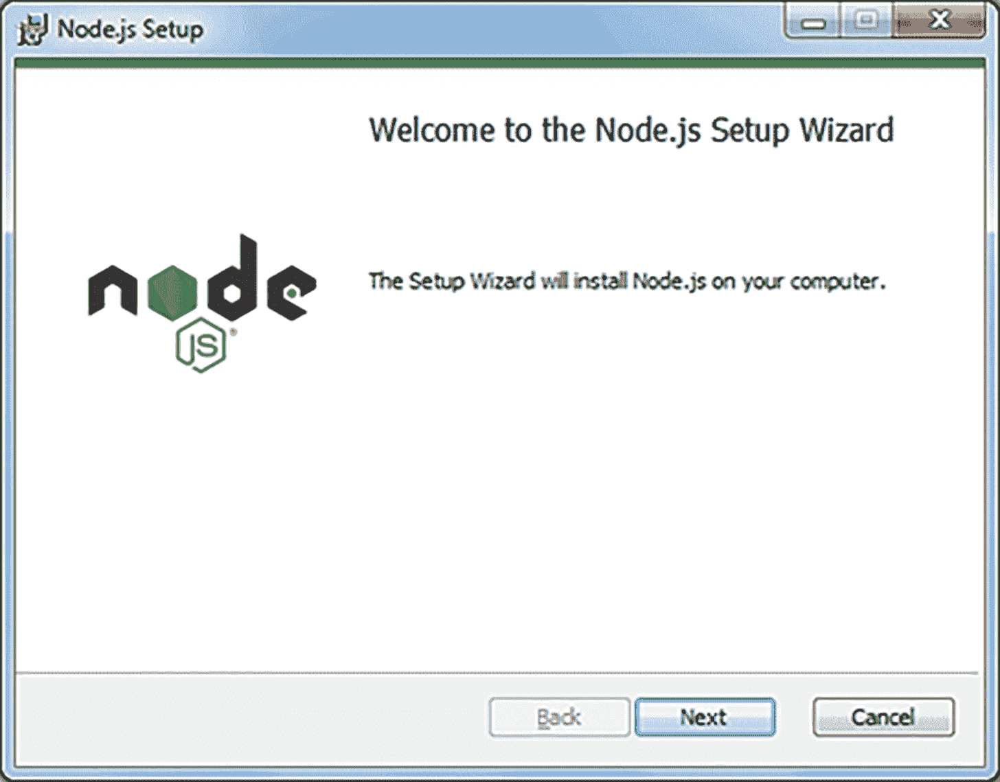

点击 `Next` 按钮，将出现 `License Agreement`（许可协议）；阅读并接受它，然后点击 `Install`。`Node.js` 将快速安装到你的计算机上；点击 `Finish` 按钮完成安装。

## 验证安装

现在已经安装了 `Node.js`，你可以通过启动命令提示符来验证安装。点击开始栏，输入 `Command Prompt` 并点击结果。现在输入以下命令：

```
node -v
```

如果安装成功，你将看到显示你的 `Node` 版本的屏幕；如果没有看到，你需要尝试重新安装。

## Mac 和 Linux

首先，访问 `Node.js` 官方网站 —— [`nodejs.org/en/download`](https://nodejs.org/en/download)。点击适用于你系统的右侧安装程序，如下所示：

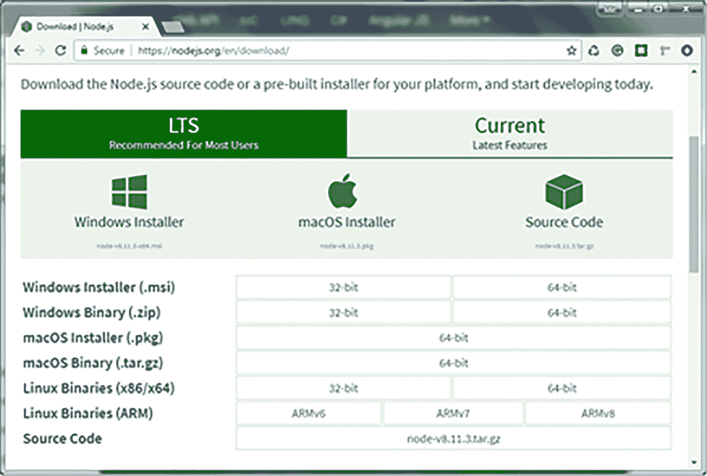

当正确的包下载完成后，点击安装程序，将加载 `Node.js 安装向导`。点击 `Continue` 按钮并按照屏幕上的步骤操作。成功后，你将看到一个安装摘要，告知 `NPM` 和 `Node.js` 的安装位置。

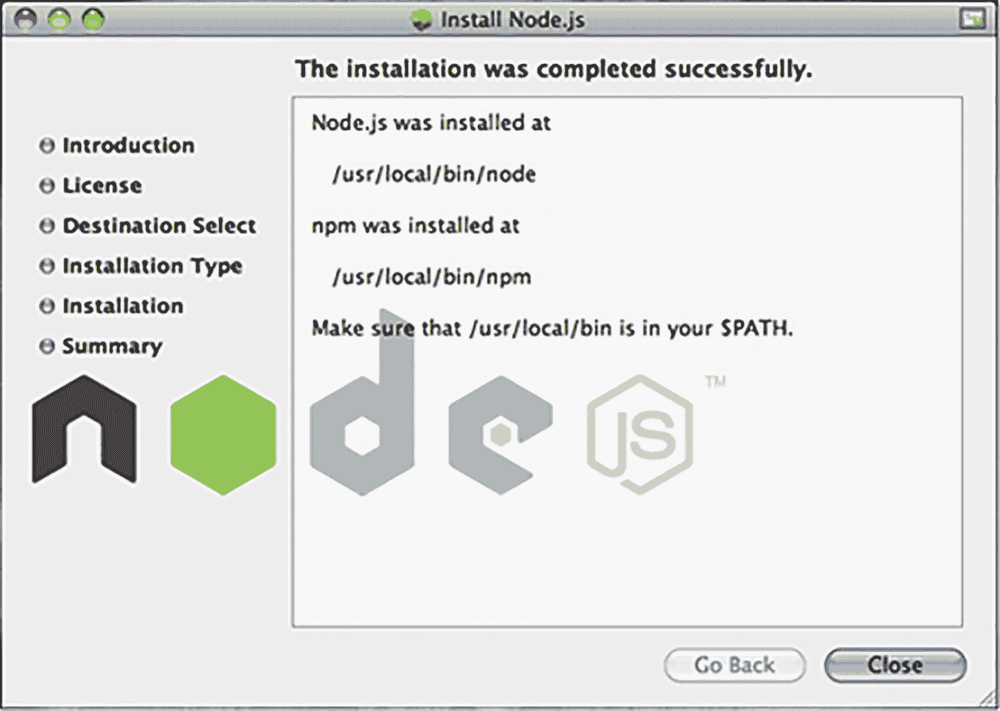

### 验证下载

打开你的终端窗口并输入以下命令来验证安装（注意，`$` 符号是命令提示符）：

```
node -v
```

你应该能在屏幕上看到显示的版本号。`Mac` 或 `Linux` 用户还有另一种安装 `Node.js` 的方法。这种方法涉及使用 `Homebrew` (Mac) 或 `Linuxbrew` (Linux) 包管理器直接从命令行安装 `Node.js`。如果你使用 `Linux`，在安装 `Node.js` 之前，你需要安装额外的依赖，例如 `Ruby v 1.8.6` 或更高版本以及 `GCC v 4.2` 或更高版本。准备好安装时，在提示符处输入以下命令：

```
$ brew install node
```

## IDE 安装

`Node.js` 在开发应用时使用 `JavaScript`，因此只要支持 `JavaScript`，任何文本编辑器或 `IDE` 都可以。尽管如此，我建议你使用支持 `Node.js API` 自动补全功能的 `IDE`，例如 `Sublime Text`、`Aptana`、`Eclipse`、`Visual Studio` 等。

### IDE – Visual Studio Code

`Node.js` 应用使用 `JavaScript` 开发。因此你可以使用任何支持 `JavaScript` 语法的 `IDE` 或文本编辑器。然而，推荐使用支持 `Node.js API` 自动补全功能的 `IDE`，例如 `Visual Studio`、`Sublime Text`、`Eclipse`、`Aptana` 等。`Visual Studio Code` 从一开始支持 `TypeScript` 和 `JavaScript` 语言，并且支持调试。不过，你需要在机器上拥有 `Node.js` 运行时才能运行 `Node.js` 应用。一旦系统上安装了 `Node.js`（包括 `Node Package Manager`），我们就可以安装 `VSC`：

### Windows

访问 [`code.visualstudio.com/download`](https://code.visualstudio.com/download) 下载适用于你系统的 `VSC`。完成后，打开文件夹并运行安装程序 —— 文件名为 `VSCodeUserSetup (version).exe`。当 `License agreement` 页面加载时，接受它并点击 `Next`。在下一页，点击 `Create a Desktop Icon` 选项 —— 这允许从桌面快速访问。点击 `Next`：


最后，点击 `Install` 按钮。安装完成后，点击 `Finish`，`Visual Studio Code` 将打开。

### Mac

首先，访问 [`code.visualstudio.com/download`](https://code.visualstudio.com/download) 下载 `Mac` 版 `Visual Studio Code`。文件以 `.zip` 格式下载；找到它并双击查看内容。找到名为 `Visual Studio Code.app` 的文件并拖入 `Applications`（应用程序）文件夹。双击该文件打开它。

### Hello World

让我们从创建 `Hello World` 应用开始使用 `VSC`。创建一个文件夹并命名为 `hello`，然后打开命令提示符。进入该文件夹并进入 `VS Code`。以下是你需要的命令：

```
mkdir hello
cd hello
code .
```

现在前往文件管理器工具栏并点击 `New File` 按钮；命名为 `app.js`。当你使用 `.js` 文件扩展时，`VSC` 可以将其解释为 `JavaScript` 文件并使用 `JS` 语言服务评估文件内容。

在 `app.js` 文件中，创建一个字符串变量并将其发送到控制台，如下所示：

```javascript
var msg = 'Hello World';
console.log(msg);
```

你可能注意到，当你输入 `console.` 时，`console` 对象上会自动呈现 `IntelliSense` 提示。`VS Code` 还知道 `msg` 是一个字符串，且它是基于 `Hello World` 初始化的。因此，当你输入 `msg` 时，`IntelliSense` 将向你显示所有 `msg` 字符串函数。使用 `CTRL+S` 保存文件，现在我们可以运行应用了。在终端上输入：

```
node app.js
```

输出应该是单词 "Hello World"。

### 集成终端

`VS Code` 还有一个集成终端，你可以在其中运行外壳命令，但它也允许你在运行命令行工具时无需退出 `VS Code` 直接运行 `Node.js`。要打开集成终端，前往 `View > Terminal`，当终端打开后，你可以从那里运行 `Node.js`。

### 调试 Hello World

`VS Code` 还有一个内置调试器，可以帮助调试 `Node.js` 应用。首先，在 `app.js` 中设置一个断点，点击行号左侧的圆圈。要开始调试代码，点击 `Activity bar` 上的绿色箭头或按 `F5`。你的应用将进入调试模式，当到达断点时，你可以单步执行。DEBUG 状态栏会显示不同的颜色。


- 计算机上已安装了 `Node.js` – 请参阅上一章

- 了解 `JavaScript` 的知识以及如何编写代码

# 第一步 — 启动停止 REPL

只要你的电脑上安装了 `Node`，你就拥有了 REPL（读入-打印循环）。因此，启动它非常简单——打开你的命令行 shell 并输入以下内容：

```
node
```

这将调出 REPL 提示符，它看起来如下：

`> `

当你看到 `>` 符号时，它表示你可以输入 JavaScript 代码进行即时评估。让我们尝试一个例子。在 REPL 中输入以下内容来将两个数字相加：

`> 2 + 3`

现在按回车键（ENTER），REPL 将进行评估并返回结果：

`5`

如果你想退出 REPL，输入 `.exit`。或者，按两次 `CTRL+C` 或按一次 `CTRL+D`，你就会返回 shell 提示符。现在你已经知道如何启动和停止 REPL 了，让我们来看看如何使用它来执行简单的 JavaScript 代码。

## 第二步 — 在 REPL 中执行代码

你可以使用 REPL 快速测试你的 JavaScript 代码，而无需创建文件来存储它，几乎所有的 `Node.js` 或 JavaScript 表达式都可以在这里执行。在第一步中，我们尝试了一个两个数字相加的表达式，现在我们来试一下除法。

启动 REPL：

```
node
```

在提示符处输入以下内容：

`> 20 / 5`

按下回车键，你将如你预期的那样看到输出为：

`4`

我们还可以在 REPL 中测试字符串操作。让我们尝试在 REPL 中拼接一对字符串。输入以下内容：

`> "Hello " + "World"`

再次按回车键，REPL 将评估表达式的结果，并输出：

`'Hello World'`

**注意**：你可能已经注意到输出被包裹在单引号中，而不是双引号中。与许多其他编程语言不同，JavaScript 字符串中使用的引号对它们的值没有影响。如果你在字符串输入中使用单引号，REPL 足够聪明，会在输出时将其更改为双引号。

### 调用函数

当你编写 `Node.js` 代码时，通常使用全局 `console.log` 方法或另一个类似的函数来打印消息。在 REPL 提示符处输入下面的命令：

`> console.log("Hey")`

按下回车键，你应该看到以下内容：

`Hey`

`undefined`

输出的第一行是我们从 `console.log` 得到的内容。字符串中的消息被打印到 `stdout` 流（即你的屏幕）。注意这里没有引号——这是因为 `console.log` 打印字符串时不带引号。第二行显示为 `undefined` 的内容是函数的返回值。

### 创建变量

在 JavaScript 中，你很少只会与字面量工作。当你在 REPL 中创建变量时，它的工作方式与处理 `.js` 文件时非常相似。在提示符处输入下面的命令：

`> let age = 45`

按下回车键，你将看到以下内容：

`undefined`

和之前一样，当我们使用 `console.log` 时，命令的返回值是 `undefined`。名为 `age` 的变量将一直可用，直到 REPL 会话关闭。因此，例如，你可以将其乘以三，如下：

`> age * 3`

按下回车，输出将是：

`135`

因为 REPL 会返回值，所以不需要使用像 `console.log` 这样的函数查看输出。默认情况下，REPL 的值会自动显示在屏幕上。

### 多行块

同样支持的是多行块。例如，我们可以创建一个函数，给任何数字加 10。通过输入以下内容开始函数：

`> const add10 = (num) => {`

按下回车键，提示符将会改变，看起来如下：

`...`

为什么它那样做？因为 REPL 在命令末尾看到了一个大括号，并假设会有更多的代码行，而且这些行必须是缩进的。为了方便阅读，REPL 在下一行放置了三个点和一个空格，使得下一行代码看起来就像是缩进的。逐行输入此函数的后两行，一次一行，并在每行后按回车键：

`... return num + 10;`

`... }`

当你在右括号后按回车时，输出将显示：

`undefined`

这是赋值给变量的函数的值，`...` 提示符再次替换为 `>` 提示符。

接下来，我们可以在指定的值调用 `add10()`：

`> add10(10)`

如你预期的那样，输出显示为：

`20`

REPL 可用于在将代码添加到程序之前尝试 JS 代码段。而且，为了让你操作更方便，REPL 中有一些快捷键。

# 第三步 — 精通 REPL 快捷键

REPL 中有一些可以帮助减少编码用时的快捷键。首先，它会保留历史记录，显示所有输入的命令，并让你遍历它们并在需要时重复命令。例如，输入此字符串：

`"The answer to everything is 50"`

得到的结果是：

`'The answer to everything is 50'`

我们可以编辑它并将 `"50"` 改为 `"40"`，因此在提示符处，按向上方向键回到上一次使用的命令：

`> "The answer to everything is 50"`

通过光标移动并修改后，再次按回车，结果变为：

`> "The answer to everything is 40"`

得到的结果将是：

`'The answer to everything is 40'`

- `--save`: 这会安装包并在 `package.json` 中名为 `dependencies` 的文件中添加一个条目。

- `--save-dev`: 这会安装包并在 `package.json` 中名为 `devDependencies` 的文件中添加一个条目。

这两者的区别在于，`devDependencies` 往往是开发工具（例如测试库），而 `dependencies` 则会被包含在应用中。你也可以通过运行此命令来更新包：`npm update`。`npm update` 会检查每个包，寻找符合你版本限制的更新版本。如果你只想更新单个包，只需指定包名即可：`npm update <package-name>`。

## 版本控制

除了标准下载外，你还可以使用 `npm` 进行版本控制，允许你指定特定的包版本，或者请求高于或低于你所需版本的版本。大多数情况下，库只与另一个库的主版本发布（major release）兼容。或者你可能遇到某个库导致的问题，因为它包含一个未修复的错误。

当你显式指定库版本时，它有助于所有人保持在该版本，确保整个团队在 `package.json` 更新之前都在使用相同的版本。在这些情况下，版本控制是非常有帮助的，且 `npm` 将始终遵循 `semver`（语义版本控制）标准。

### 运行任务

`package.json` 支持指定命令行任务的格式，你可以使用以下命令运行这些任务：`npm run <task-name>`。

这里有一个示例：

```json
{
  "scripts": {
    "start-dev": "node lib/server-development",
    "start": "node lib/server-production"
  }
}
```

使用此功能运行 Webpack 也是很常见的：

```json
{
  "scripts": {
    "watch": "webpack --watch --progress --colors --config webpack.conf.js",
    "dev": "webpack --progress --colors --config webpack.conf.js",
    "prod": "NODE_ENV=production webpack -p --config webpack.conf.js"
  }
}
```

与其输入长长的命令，或者尝试记住它们并确保没有写错，你也可以这样操作：

```bash
$ npm run watch
$ npm run dev
$ npm run prod
```

## npm 将包安装在何处

当使用 `npm` 安装包时，你可以使用两种安装类型——本地安装或全局安装。

当你在 `npm` 中输入安装命令时，例如：`npm install lodash`，默认情况下，包会被安装在当前树的名为 `node_modules` 的子文件夹中。同时，`lodash` 条目也会添加到当前文件夹下 `package.json` 的 `dependencies` 属性中。

要进行全局安装，你需要添加 `-g` 标志：`npm install -g lodash`。此时，包将使用全局位置而不是安装在本地文件夹中。但在哪里呢？根 `-g` 命令会告诉你你计算机上的确切位置。在 Linux 或 Mac 系统上，这可能是 `/usr/local/lib/node_modules`，而在 Windows 上，它可能在 `C:\Users\YOU\AppData\Roaming\npm\node_modules`。

如果你使用 `npm` 管理 Node.js 版本，这些位置将会不同。

### 使用或执行通过 npm 安装的包

当你使用 `npm` 将包安装到 `node_modules` 文件夹或全局位置时，它们在 Node.js 代码中是如何使用的呢？假设你使用以下命令安装了流行的 JS 实用库 `lodash`：`npm install lodash`。

包将安装在本地 `node_modules` 文件夹中。在代码中使用它需要你使用 `require` 命令将它导入程序：

```javascript
const _ = require('lodash')
```

那么，如果你有一个可执行的包呢？可执行文件将会进入 `node_modules/.bin/` 文件夹。演示这一点最简单的方法之一是使用 `cowsay` 包，它包含一个命令行程序。执行该程序可以使一个动物（比如牛）说话。

当按这种方式安装包时：`npm install cowsay` 时，它会连同所需的依赖一起安装在 `node_modules` 文件夹中：

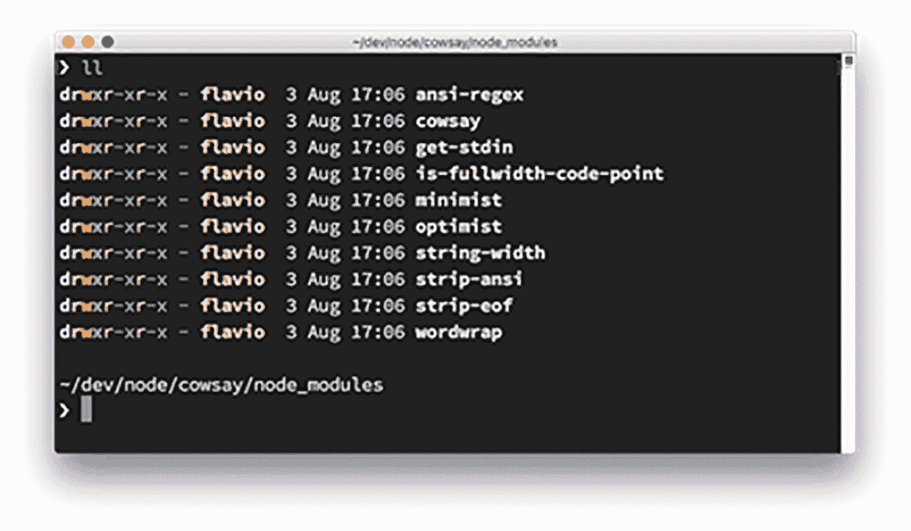

一个隐藏的 bin 文件夹包含指向 `cowsay` 二进制文件的符号链接：

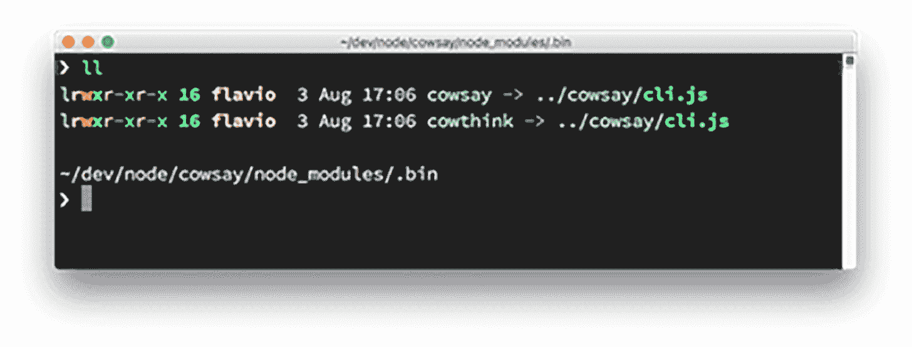

那么，这些是如何执行的呢？你可以通过输入 `./node_modules/.bin/cowsay` 来运行它，它可以正常工作。然而，最近 `npm` 版本中的 `npx` 更好。你只需要运行：`npx cowsay`，系统会自动找到包的位置。

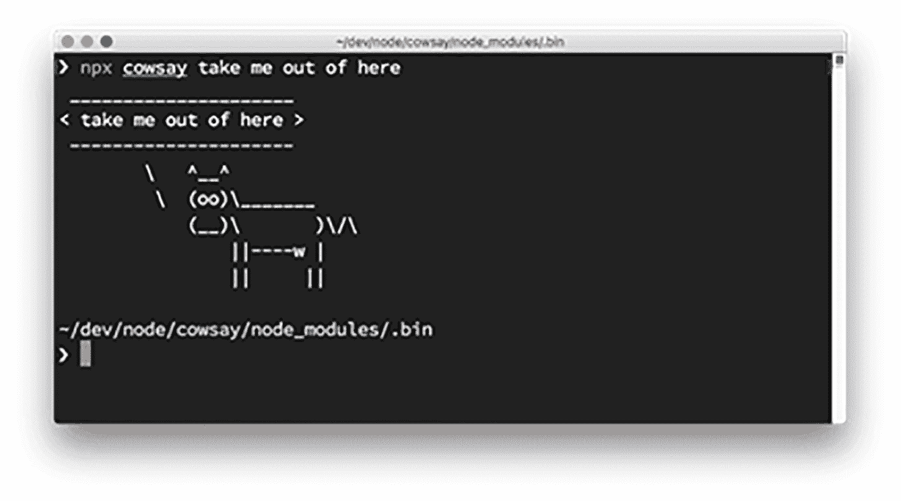

# 第四章：Node.js 回调与 Promise


当你刚开始学习 Node.js 时，可能遇到的第一个问题之一就是回调（callbacks）。在我们研究什么是回调之前，我们需要知道它们为什么存在，这归功于 Node 的异步特性。大多数人知道异步编程“更好但更难”。这听起来可能有些简单化，所以让我们通过对比同步代码和异步代码来看这个问题。

你首先看到的将是，异步版本的代码简直是糟糕的。它看起来过度复杂，但我们从中获得的收益并没有比同步代码多多少。然而，不可否认的是它确实有优势，让我们谈谈这些优势。

异步代码的酷之处在于，当你的代码在挂起等待 API 调用或数据库响应时，它并不是挂在那里无所事事。在同步代码中，当它在执行某些操作时，会阻塞你的代码，如果该操作需要很长时间，就会让所有其他事务停滞。而在异步代码中，你可以同时进行其他事情。这是 Node.js 存在的主要原因之一——异步服务器可以在等待 I/O（输入/输出）时继续处理请求。

是的，当你进行异步编程时（我们将在下一章深入探讨），事情确实感觉更复杂了，但它并不难理解，而且它提供的收益非常值得理解它所花费的时间。

现在我们对此有了更深入的了解，让我们深入研究回调。回调到底是什么？回调无非是作为参数传递给其他函数，接收的函数随后会使用它，或者回调用它。

看这个回调函数实际作用的简单示例：

```javascript
fs.readFile(funFileName, function(err, file) {
    if(err) {
        handleError(err);
    }
    console.log("file: ", file)
})
```

一旦 `fs.readFile` 获取了 `funFileName` 文件，回调函数就会执行。该函数随后将处理任何抛出的错误，并将检索到的文件记录到控制台。

回调函数接受两个参数（或参数）——`err` 和 `file`。按照约定，回调函数的第一个参数是错误。如果父函数抛出错误，它将在该处被处理；但如果没有抛出错误（这有时会发生），函数的第一个参数必须是 `null`。约定还规定，随后的函数参数将是响应数据。

好了，这没问题，但是，我们为什么不直接这样写代码呢？

```javascript
let file = fs.readFile(fooFileName);
console.log("file: ", file);
```

对这个问题的简短回答是 `async`。第二个示例显示，当我们尝试打印文件时，该文件尚未被定义。这是因为在我们到达 `console.log()` 之前，`fs.readFile` 还没有完成获取。

然而，值得注意的是，以下代码可以运行：

```javascript
let file = 1+1;
console.log("file: ", file);
```

对于你们这些真正的初学者，且只接触过同步编程的人来说，这会感到有些困惑，更不用说有些麻烦了。在同步编程中，你的生活一直简单且充满逻辑，但突然之间，第四行代码可能会在第三行之前执行！那么，难道为了以防万一，应该随处、随时地使用回调函数吗？答案是坚定的否定。只有在你不知道某件事情是否会被完成时，你才应该使用回调。再次，考虑从数据库获取数据、API 调用等。这些操作都需要时间，因此在事件发生时需要调用回调，这正是我们“事件驱动编程”这一术语的由来。

如果你觉得现在还没有真正理解这一点，请不要担心——你不是一个人，理解它的唯一真正方法就是实践。让我们更深入地探讨异步编程及其所包含的内容。

# 第五章：异步 JavaScript 编程


在本章中，我们将研究异步 JavaScript 编程，但首先，我们需要回顾异步 JavaScript 的一些问题。然后，我们将介绍异步技术，并展示它们如何帮助我们解决这些问题。

## 同步 JavaScript

要理解异步 JavaScript，我们必须首先理解同步 JavaScript。你看到的许多基础 JavaScript 代码都围绕同步代码展开——你运行代码，一旦浏览器能够处理，它就会返回结果。这是一个非常简单的例子：

```javascript
const btn = document.querySelector('button');
btn.addEventListener('click', () => {
  alert('You clicked on me!');
  let pElem = document.createElement('p');
  pElem.textContent = 'This is a new paragraph.';
  document.body.appendChild(pElem);
});
```

在这里，每一行代码都按顺序执行：

首先，我们在 DOM 中获取一个可用的 `<button>` 元素的引用。然后添加了一个点击事件监听器；当按钮被点击时，按顺序发生四件事：

1. 显示 `alert()` 消息

2. 忽略警告框后，创建一个 `<p>` 元素

3. 为该元素提供文本

4. 将段落添加到文档正文（body）中

现在，同步代码的问题在这里——JavaScript 是单线程的，因此当上述列出的任何操作在执行时，其他任何操作都无法进行。每一步都依赖于前一步的完成才能运行——在它完成之前，所有其他操作都会被阻塞。以上面的例子为例——一旦点击按钮，就会弹出警告消息。在消息上的 `OK` 按钮被点击之前，段落不会显示。

**注意**：虽然 `alert()` 有助于演示同步阻塞操作是如何运作的，但它并不适用于实际应用。

## 异步 JavaScript

由于阻塞相关问题，大多数 Web API 倾向于运行异步代码，特别是当应用程序需要获取或访问外部资源时。这可能包括从网络获取文件、进入数据库返回数据、访问摄像头的视频流、将显示内容投到 VR 头显设备等。

所以，为什么我们不能使用同步代码来做到这一点呢？我们可以通过一个示例来演示。当从服务器获取图像时，结果无法立即返回，这意味着下面的代码（这是一段伪代码）将无法工作。

```javascript
let response = fetch('myImage.png'); // fetch 是异步的
let blob = response.blob(); // 以某种方式在 UI 中显示图像 blob
```

这段代码无法工作，是因为我们不知道图像下载需要多长时间。所以，当运行第二行代码时，会抛出一个错误——这可能是每次都会发生，也可能是间歇性的——因为没有可用的响应。你真的需要代码在尝试其他操作之前等待响应。

异步代码有两种样式——回调函数（callbacks）和承诺（promise）样式，后者是新的代码样式。我们现在来查看这两种。

### 异步回调

回调是在我们调用执行后台代码的函数时，作为参数指定的函数。一旦后台代码运行，就会调用回调函数来通知你工作已完成或发生了某些有趣的事情。回调函数是旧式的，但它们在一些较旧但常见的 API 中仍然在使用。

在上面的代码中，我们看到了一个异步回调的示例——它是作为第二个参数出现在 `addEventListener()` 方法中的：

```javascript
btn.addEventListener('click', () => {
    alert('You clicked on me!');
    let pElem = document.createElement('p');
    pElem.textContent = 'This is a new paragraph.';
    document.body.appendChild(pElem);
});
```

第一个参数表示我们想要监听的事件类型，而第二个参数是回调函数，在事件触发之前它不会被调用。当回调函数作为参数传递给另一个函数时，我们做的只是将函数的引用作为参数传递；例如，回调函数不会立即执行。包含它的函数会在时机合适时执行回调。

编写包含回调的函数足够了。这里有一个使用 `XMLHttpRequest` API 加载资源的示例：

```javascript
function loadAsset(url, type, callback) {
    let xhr = new XMLHttpRequest();
    xhr.open('GET', url);
    xhr.responseType = type;
    xhr.onload = function() {
        callback(xhr.response);
    };
    xhr.send();
}

function displayImage(blob) {
    let objectURL = URL.createObjectURL(blob);
    let image = document.createElement('img');
    image.src = objectURL;
    document.body.appendChild(image);
}

loadAsset('coffee.jpg', 'blob', displayImage);
```

创建了一个 `displayImage()` 函数来表示一个 `blob`。这个 `blob` 作为 `object URL` 传递给函数；创建了一个图像来显示该 URL，并将其附加到文档的 `<body>` 中。创建了一个 `loadAsset()` 函数，它接收一个 `callback` 参数、内容类型以及要获取的 `URL`。`XMLHttpRequest`（通常被称为 `XHR`）被用于从指定的 `URL` 获取资源，并将响应传递给回调，以便对其进行处理。在我们的案例中，回调等待 `XHR` 使用 `onload` 事件处理器下载资源，然后该资源会被传回给回调。

回调函数非常多功能，它们允许你控制函数运行的顺序并决定在它们之间传递的数据，但它们也允许你根据当前情况将数据传递给其他函数。通过这种方式，不同的操作可以在下载的响应上运行，例如 `displayText()`、`processJSON()` 等。

请注意，并不是所有的回调都是异步的；有些是同步的，其中一个例子是使用 `Array.prototype.forEach()` 遍历项目数组：

```javascript
const gods = ['Apollo', 'Demeter', 'Ares', 'Hades'];
gods.forEach(function (eachName, index){
    console.log(index + '. ' + eachName);
});
```

在这里，循环了一个包含神灵名字的数组，索引数字和相关值被打印到控制台。`forEach()` 参数是一个回调函数，它也接受两个参数。这些是对数组名和索引值的引用。然而，它没有做的是等待——它会立即运行。

### 承诺 (Promises)

Promises 是当今 Web API 中通常使用的最新异步代码样式。一个最好的示例之一是名为 `fetch()` 的 API，它是 `XMLHttpRequest` 的现代版本，效率高得多。这里有一个示例：

```javascript
fetch('products.json')
    .then(function(response) {
        return response.json();
    })
    .then(function(json) {
        products = json;
        initialize();
    })
    .catch(function(err) {
        console.log('Fetch problem: ' + err.message);
    });
```

在这段代码中，`fetch()` 只接受一个参数：想要获取的网络资源的 `URL`，并返回一个 promise。Promises 是代表异步操作失败或完成的对象，如果你愿意，也可以看作是中间状态。它就像是浏览器向你承诺尽快给出答案——这就是它名字的由来。这里还有：

- 有两个 `then()` 块，它们都有一个回调函数。该函数只有在之前的操作成功时才会运行，每个回调都接收该操作的结果作为输入。通过这种方式，你可以继续执行其他操作。`.then()` 返回 promise，多个 `.then()` 块可以链联，允许异步操作按顺序运行。

- 结尾还有一个 `catch()` 块，它只有在一个或两个 `.then()` 块失败时才会运行。类似于同步 JavaScript 中的 `try...catch` 块，`catch()` 块包含一个错误对象，用于报告发生的任何错误。需要注意的是，同步 `try...catch` 不适用于 promises。

### 事件队列

异步操作（如 promises）被放入事件队列中。为了避免后续代码被阻塞，这些队列会在主线程处理完毕后运行，当队列中的操作完成后，它们会将结果返回给 JavaScript。

### Promises 与回调函数

Promises 与回调有些相似，它们本质上是带有回调函数的返回对象，而不是传递给函数的回调。但 promises 专门为异步操作设计的，并且比回调具有多个优势：

- 多个异步操作可以通过任意数量的 `.then()` 操作链联。结果从上一个作为输入传递给下一个，这使用回调是很困难做到的——试一下，你会发现一团乱。

- Promises 按照它们进入事件队列的精确顺序被调用。

- 处理错误变得更加简单，因为所有错误都可以通过放在末尾的一个 `.catch()` 块来处理，而不是在每个层级单独处理。

- Promises 还避免了控制反转，而旧的回调函数在将回调传递给第三方库时，会失去对函数执行的控制。

### 异步代码的本质

让我们来看另一个展示异步代码真实本质的示例。它展示了当我们完全不知道代码的执行顺序时，以及将异步代码和同步代码一同对待时会发生什么。这个例子与我们之前看到的例子类似，但这次包含了几个 `console.log()` 语句，以展示你可能认为代码执行的顺序：

```javascript
console.log ('Starting');
let image;
fetch('coffee.jpg').then((response) => {
  console.log('It worked :)')
  return response.blob();
}).then((myBlob) => {
  let objectURL = URL.createObjectURL(myBlob);
  image = document.createElement('img');
  image.src = objectURL;
  document.body.appendChild(image);
}).catch((error) => {
  console.log('There is a problem with your fetch operation: ' + error.message);
});
console.log ('All done!');
```

浏览器开始执行代码。它看到初始的 `console.log()` 语句并执行它，接着创建 `image` 变量。然后它进入下一行并开始执行 `fetch()` 块。然而，`fetch()` 是异步执行且不阻塞的，在与 promise 相关的代码执行后，其余代码继续执行。因此，达到了最后一个 `console.log()`，结果输出在控制台上。

只有当 `fetch()` 完成并且结果通过 `.then()` 块传递时，第二个 `console.log()` 消息才会出现在控制台上。正如你所看到的，这些消息出现顺序与你预期的并不符：

- Starting

- All done!

- It worked :)

如果你觉得这很困惑，请看这个示例：

```javascript
console.log("registering click handler");
button.addEventListener('click', () => {
  console.log("get click");
});
console.log("all done");
```

它的行为方式非常相似——第一个和第三个 `console.log()` 消息立即显示，但中间的那个被阻塞了直到点击鼠标按钮。在第一个示例中，区别在于中间的消息被阻塞了，在等待资源显示在屏幕上，而不是等待按钮点击。

这种设置在不复杂的代码中可能会导致真实的问题。如果异步代码块返回的结果在随后的同步块中被依赖，则不能包含该块。没有办法保证异步函数在浏览器处理同步块之前返回。

要查看它是如何运作的，请参考以下示例：

```html
<!DOCTYPE html>
<html>
<head>
  <meta charset="utf-8">
  <title>Simple async sync example</title>
</head>
<body>
<script>
  console.log ('Starting');
  let image;
  fetch('coffee.jpg').then((response) => {
    console.log('It worked :)')
    return response.blob();
  }).then((myBlob) => {
    let objectURL = URL.createObjectURL(myBlob);
    image = document.createElement('img');
    image.src = objectURL;
    document.body.appendChild(image);
  }).catch((error) => {
    console.log('There is a problem with your fetch operation: ' + error.message);
  });
  console.log ('All done!');
</script>
</body>
</html>
```

将第四个 `console.log()` 修改为：

```javascript
console.log ('All done! ' + image.src + 'displayed.');
```

现在你的控制台应该显示一个错误而不是第三条消息：`TypeError: image is undefined; can't access its "src" property`

这发生在浏览器尝试运行第三个 `console.log()` 而 `fetch()` 块尚未完成时——`image` 变量还没有赋值。

**注意**：出于安全考虑，你不能使用 `fetch()` 从本地系统获取文件，因此你需要通过本地 Web 服务器运行上面的示例。

修复这个 `fetch()` 问题并确保所有 `console.log()` 语句按照你想要的顺序出现，可以通过让第三个语句异步执行来实现。你可以通过将其放在链在第二个块之后的 `.then()` 块中，或者将其放在第二个 `.then()` 块中。

# 第六章：Node.js 事件循环和事件发射器

事件循环（Event loops）帮助 Node.js 执行非阻塞 I/O 操作，尽管 JS 是一种单线程语言。为了实现这一点，只要可能，操作就会卸载给系统内核。如今，内核是多线程的，这意味着它们在后台执行任务时可以同时处理多个操作。当某个操作完成时，内核会通知 Node.js，确保正确的回调函数进入轮询队列（poll queue）以便在某一点被执行。你将在本章结束时理解这一点。

当 Node.js 启动时，事件循环会被初始化。提供的输入脚本会被处理或丢弃到 REPL 中——这可能涉及调度定时器、异步 API 调用，或者调用 `process.nextTick()`——然后开始处理事件循环。

在下图中，你可以看到事件循环中操作顺序的简单概述：

```
┌───────────────────────────┐
┌─>│           timers         │
│  └─────────────┬─────────────┘
│  ┌─────────────┴─────────────┐
│  │      pending callbacks     │
│  └─────────────┬─────────────┘
│  ┌─────────────┴─────────────┐
│  │       idle, prepare       │
│  └─────────────┬─────────────┘      ┌───────────────┐
│  ┌─────────────┴─────────────┐      │   incoming:   │
│  │             poll           │<─────┤  connections, │
│  └─────────────┬─────────────┘      │    data, etc.  │
│  ┌─────────────┴─────────────┐      └───────────────┘
│  │           check           │
│  └─────────────┬─────────────┘
│  ┌─────────────┴─────────────┐
└──┤      close callbacks      │
   └───────────────────────────┘
```

上述图中每个框被称为事件循环阶段（event loop phases）。每个阶段都包含一个需要执行的回调 FIFO（先进先出）队列。当事件循环进入任何阶段时，会执行该阶段特定的操作，并执行该阶段队列中的回调，直到它们全部完成或达到回调限制。发生这种情况时，事件循环将进入下一个阶段，并按照顺序继续执行。

任何操作都可能导致更多操作被调度，内核会在轮询阶段将新的事件处理排队。在处理轮询事件的同时，轮询事件可能被排队。其结果是回调运行时间更长，导致轮询阶段的运行时间超过了定时器允许的时间。

## 阶段概述

在每个阶段之间，Node.js 会检查是否有任何定时器或异步 I/O 需要运行；如果没有，它将直接关闭。

### 定时器 (Timers)

定时器用于指定一个阈值，在该阈值后执行指定的回调，而不是等待某人所需的精确执行时间。这些回调在达到阈值调度后立即运行，但可能会被操作系统调度的其他回调所延迟。从技术上说，定时器的执行是由轮询阶段控制的。

假设你调度了一个在 100ms 阈值后执行的超时；在这种情况下，你的脚本将开始异步读取文件，这需要花费 95ms：

```javascript
const fs = require('fs');
function someAsyncOperation(callback) {
  // 这需要 95ms 完成
  fs.readFile('/path/to/file', callback);
}
const timeoutScheduled = Date.now();
setTimeout(() => {
  const delay = Date.now() - timeoutScheduled;
  console.log(`${delay}ms have passed since scheduling`);
}, 100);
// 执行某些需要 95ms 完成的操作
someAsyncOperation(() => {
  const startCallback = Date.now();
  // 执行一些其他需要 10ms 的操作...
  while (Date.now() - startCallback < 10) {
    // 什么都不做
  }
});
```

当事件循环进入轮询阶段时，队列是空的——`fs.readFile()` 尚未完成——因此循环会等待剩余指定的毫秒数，直到达到最早定时器的阈值。在此期间，`fs.readFile()` 继续读取文件，耗时 10ms 的回调被放入轮询队列并被执行。一旦回调完成，所有排队的回调都已结束，事件循环就可以发现最接近的定时器阈值已达到。它回到定时器阶段并执行定时器回调。调度的定时器与其回调执行之间的延迟为 100ms。

### 防止事件循环饥饿

轮询阶段在停止轮询事件之前需要一个硬性最大值。该最大值取决于系统。

### 待处理回调 (Pending callbacks)

待处理回调阶段负责执行如 TCP 错误的回调。例如，如果 TCP 套接字接收到错误，它可能不会立即报告。它会在待处理回调阶段中排队。

### 轮询 (Poll)

轮询阶段有两个主要功能：

- 计算阻塞并轮询 I/O 的时间

- 处理队列事件

当事件循环进入轮询阶段时，如果没有调度任何定时器，则可能发生以下两种情况之一：

1. 如果队列不为空，循环将遍历回调队列，异步执行它们，直到达到限制或队列为空。

2. 如果队列为空，可能会发生两种情况之一：

- 如果使用了 `setImmediate()` 来调度脚本，事件循环将结束轮询阶段。随后，循环将进入检查阶段（check phase）并执行所有调度的脚本。

- 如果没有使用 `setImmediate()` 来调度脚本，事件循环将等待回调被添加到队列，此时它们将会立即执行。

当轮询队列中没有剩余内容时，事件循环会寻找已达到阈值的定时器。如果至少有一个已就绪，事件循环将回到定时器阶段并执行回调。

### 检查 (Check)

检查阶段允许回调在轮询阶段完成后立即执行。如果该阶段处于空闲状态且 `setImmediate()` 队列了某些脚本，循环将继续检查该阶段而不是等待。

`setImmediate()` 是一个定时器，一个运行在不同事件循环阶段的特殊定时器。libuv API 用于在轮询阶段完成后调度回调的执行。通常，当代码执行时，事件循环在某一点必须进入轮询阶段。它在那里等待传入的请求、连接等，但如果使用了 `setImmediate` 来调度回调且轮询阶段空闲，循环将结束并进入检查阶段。

### 关闭回调 (Close Callbacks)

如果句柄或套接字突然关闭（例如通过 `socket.destroy()`），则会在关闭回调期间发出“close”事件。否则，将使用 `process.nextTick()` 来发出它。

### setImmediate() vs setTimeout()

这两者非常相似，但在被调用时，它们的运行方式可能不同。

- `setImmediate()` 在当前轮询阶段完成后执行脚本。

- `setTimeout()` 调度脚本在经过最小毫秒阈值后运行。

执行顺序会有变化，并取决于调用上下文。如果它们都从主模块被调用，进程性能将绑定它们的时间点，但其他机器应用程序可能会影响性能。例如，假设运行了以下脚本。它不在主模块中，这是一个 I/O 周期，因此由于性能进程绑定了其顺序，执行顺序是非确定的：

```javascript
// timeout_vs_immediate.js
setTimeout(() => {console.log('timeout');}, 0);
setImmediate(() => {console.log('immediate');});
```

```
$ node timeout_vs_immediate.js
timeout
immediate
```

```
$ node timeout_vs_immediate.js
immediate
timeout
```

另一方面，如果这两个调用被放置在 I/O 周期内，则 `immediate` 将第一个执行：

```javascript
// timeout_vs_immediate.js
const fs = require('fs');
fs.readFile(__filename, () => {
  setTimeout(() => {console.log('timeout');}, 0);
  setImmediate(() => {console.log('immediate');});
});
```

```
$ node timeout_vs_immediate.js
immediate
timeout
```

```
$ node timeout_vs_immediate.js
immediate
timeout
```

使用 `setImmediate()` 相比 `setTimeout()` 有一个主要优势：如果它在 I/O 周期中调度，它将在定时器之前先执行，无论有多少个定时器。

### `process.nextTick()`

你可能已经注意到，`process.nextTick()` 不在上面的图表中，尽管它是异步 API 的一部分。从技术上说，它不是事件循环的一部分。一旦当前操作完成，`nextTickQueue` 会被首先处理，无论事件循环当前处于哪个阶段。

回到那张图，每当在某个阶段调用 `process.nextTick()` 时，所有传递给它的回调在事件循环继续之前都会解析。然而，这可能会导致糟糕情况的发生——因为进行了递归的 `process.nextTick()` 调用，它会让你的 I/O 饥饿。这会阻止事件循环进入轮询阶段（poll）。

那么，Node.js 为什么允许这种情况发生呢？这是设计哲学的一部分，允许 API 始终保持异步状态，无论是否需要。看看这个例子：

```javascript
function apiCall(arg, callback) {
  if (typeof arg !== 'string')
    return process.nextTick(callback, new TypeError('argument should be a string'));
}
```

代码检查参数，如果不对，则将错误传递给 `callback`。最近更新的 API 允许将参数传递给 `process.nextTick()`，这意味着它可以接收在回调之后传递的参数。这些参数随后作为回调参数传播，消除了嵌套函数的需要。

我们所做的是向用户传递了一个错误，但这只有在用户代码执行完毕后才会发生。`process.nextTick` 保证了 `apiCall()` 回调仅在剩余用户代码执行之后且事件循环继续之前运行。实现这一点的是允许 JS 栈展开（unwind）。然后，指定的回调会被立即执行，允许对 `process.nextTick()` 进行递归调用，而不会触发来自 `v8` 的 `RangeError: Maximum call stack size exceeded`。

然而，这可能会导致一些问题。看看这段代码：

```javascript
let bar;
// 签名是异步的，但同步调用回调
function someAsyncApiCall(callback) {
  callback();
}
// 回调在 `someAsyncApiCall` 完成之前就被调用了。
someAsyncApiCall(() => {
  // 因为 someAsyncApiCall 还没有完成，bar 还没有被赋值
  console.log('bar', bar); // undefined
});
bar = 1;
```

`someAsyncApiCall()` 定义了一个异步签名，尽管它在操作上是同步的。当被调用时，`someAsyncApiCall()` 在事件循环阶段被调用，因为 `someAsyncApiCall()` 没有执行任何异步操作。这是因为回调尝试引用 `bar`，尽管由于脚本尚未完成，该变量可能不在作用域内。

当你将回调放在 `process.nextTick()` 中，脚本仍然可以完成，允许在调用回调之前对所有函数、变量等进行初始化。它还停止了事件循环的继续。它也可以用于在事件循环继续之前向用户提示错误。这里是之前的 `process.nextTick()` 示例：

```javascript
let bar;
function someAsyncApiCall(callback) {
  process.nextTick(callback);
}
someAsyncApiCall(() => {
  console.log('bar', bar); // 1
});
bar = 1;
```

另一个真实世界的示例：

```javascript
const server = net.createServer(() => {}).listen(8080);
server.on('listening', () => {});
```

当仅传递一个端口时，端口会被立即绑定。这意味着监听回调可能会被立即调用，但有一个问题——`on('listening')` 回调尚未设置。解决方法是让监听事件进入 `nextTick()` 队列以完成脚本。这样用户就可以设置任何所需的事件处理器。

### `process.nextTick()` vs `setImmediate()`

这些是非常相似的调用，但名称容易引起混淆：

- `process.nextTick()` 会在同一阶段立即触发。

- `setImmediate()` 将等待下一次事件循环迭代或 tick 之后才触发。

实际上，这两个名字应该互换过来，因为 `process.nextTick()` 触发得比 `setImmediate()` 更“立即”。然而，这是早期的遗留问题，不太可能改变。简单的原因是这会破坏大量的 `npm` 包。每天都有更多模块添加，这导致了更多潜在的破坏，所以虽然名称很令人困惑，但它们不会改变。

我们建议你始终使用 `setImmediate()`。

### 为什么用 `process.nextTick()`？

有几个你应该使用 `process.nextTick()` 的良好理由：

- 用户可以在循环继续之前，更好地处理错误、清理掉任何不需要的资源，或重新提交请求。

- 有时，回调需要在调用栈展开和事件循环继续之间运行。

最好的例子之一是匹配用户预期，其中一个简单的例子如下：

```javascript
const server = net.createServer();
server.on('connection', (conn) => { });
server.listen(8080);
server.on('listening', () => { });
```

假设我们在事件循环开始时运行了 `listen()`，但回调函数在 `setImmediate()` 中。如果没有传递主机名，端口绑定将立即发生。事件循环需要到达 `poll` 阶段才能继续执行，这意味着有非零概率接收到连接，因此连接（connection）事件可能会在监听（listening）事件之前触发。

另一个例子是运行一个继承自 `EventEmitter` 的函数构造函数，并希望在构造函数中调用一个事件：

```javascript
const EventEmitter = require('events');
const util = require('util');
function MyEmitter() {
  EventEmitter.call(this);
  this.emit('event');
}
util.inherits(MyEmitter, EventEmitter);
const myEmitter = new MyEmitter();
myEmitter.on('event', () => {
  console.log('an event occurred!');
});
```

事件不能从构造函数中立即发射，因为脚本处理得还不够后，用户无法为事件分配回调。在构造函数中，可以使用 `process.nextTick()` 来设置回调。事件会在构造函数完成后通过回调发射，这为用户提供了预期的结果：

```javascript
const EventEmitter = require('events');
const util = require('util');
function MyEmitter() {
  EventEmitter.call(this);
  // 使用 nextTick 在分配了处理器时发射事件
  process.nextTick(() => {
    this.emit('event');
  });
}
util.inherits(MyEmitter, EventEmitter);
const myEmitter = new MyEmitter();
myEmitter.on('event', () => {
  console.log('an event occurred!');
});
```

# 第七章 Node.js Buffers


虽然纯 JavaScript 适用于处理 Unicode 编码的字符串，但在处理纯二进制数据时它的表现并不理想。在浏览器中，大多数数据都是字符串格式，所以这没问题；但对于 Node.js 服务器来说，情况有所不同。这些服务器还需要处理 TCP 流，并且需要读取文件系统并写入文件。这两点都意味着我们还需要处理二进制数据流。

处理这种问题的一种方法是使用字符串，这是 Node.js 过去所使用的。然而，这是一个非常麻烦的方法——不仅速度慢，而且意味着你操作的是字符串 API 而不是二进制数据。而且它们似乎非常容易以非常奇怪的方式崩溃。

那么，你用什么来代替二进制字符串呢？Buffer。

## 什么是 Buffer？

在 Node.js 中，`Buffer` 类用于处理原始二进制数据。每个缓冲区均对应于在 V8 外部分配的原始内存。Buffer 的工作方式与整数数组非常相似，但它们不能调整大小，并且包含了许多专门为处理二进制数据设计的方法。在缓冲区中，整数表示字节，每个缓冲区元素对应一个字节，这意味着它们的值被限制在 0 到 255 之间（包含在内）。当你使用 `console.log()` 打印 `Buffer` 实例时，结果是一个充满十六进制值的链。通常情况下，看到缓冲区的上下文是来自流的输出二进制数据，例如 `fs.createReadStream`。

## 创建 Buffer

有几种方法可以创建缓冲区：

```javascript
var buffer = Buffer.alloc(8);
// 这将打印 8 字节的零
// <Buffer 00 00 00 00 00 00 00 00>
```

通过这种方式，缓冲区被初始化并拥有八个零字节。

```javascript
var buffer = Buffer.from([ 8, 6, 7, 5, 3, 0, 9]);
// 这将打印 8 字节特定值
// <Buffer 08 06 07 05 03 00 09>
```

通过这种方式，缓冲区初始化为数组内容。请记住，数组内容是表示字节的整数。

```javascript
var buffer = Buffer.from("I'm a string!", "utf-8");
// 这将打印一个 utf-8 值的链
// <Buffer 49 27 6d 20 61 20 73 74 72 69 6e 67 21>
```

在第三种方法中，缓冲区被初始化为二进制编码。这是第二个参数指定的第一个字符串——`utf-8`。这是 Node.js 中最常用的编码方法之一。

## 写入 Buffer

假设我们已经创建了一个缓冲区：

```javascript
var buffer = Buffer.alloc(16)
```

可以将字符串写入其中：

```javascript
buffer.write("Hello", "utf-8")
```

`Buffer.write()` 的第一个参数是需要写入缓冲区的字符串，而第二个参数是字符串编码。因为默认值是 `utf-8`，所以该参数是无关的。

我们从 `buffer.write` 得到了结果 5，这意味着前五个字节已写入缓冲区。字符串“Hello”恰好也是五个字符，这纯属巧合，因为每个字符恰好是 8 位。当你想要完成消息时，这些信息是有用的：

```javascript
buffer.write(" world!", 5, "utf-8")
```

当 `buffer.write` 有三个参数时，第二个参数表示偏移量（offset），即从哪个缓冲区索引开始写入。

## 从 Buffer 读取：toString

读取缓冲区最常用的方法是使用 `toString` 方法，因为绝大多数缓冲区都包含文本：

```javascript
buffer.toString('utf-8')
// 'Hello world!\u0000k\t'
```

再次，初始参数是编码，在这里我们可以看到并不是所有的缓冲区都被使用了。然而，由于我们恰好知道写入缓冲区的字节数，我们可以多添加一些参数，允许我们将感兴趣的切片转换为字符串：

```javascript
buffer.toString("utf-8", 0, 12)
// 'Hello world!'
```

## 单个字节（Octets）

也可以使用类似于数组的语法来设置单个字节：

```javascript
buffer[12] = buffer[11];
buffer[13] = "1".charCodeAt();
buffer[14] = buffer[13];
buffer[15] = 3333;
buffer.toString("utf-8")
// 'Hello world!!11!'
```

在这里，剩余字节通过手动设置来表示由 `utf-8` 编码的 1 和 ! 字符。

## 更多有趣的 Buffer

`Buffer.isBuffer(object)`

我们使用这个方法来检查一个对象是否真的是缓冲区，就像 `Array.isArray` 方法一样。

`Buffer.byteLength(string, encoding)`

此函数允许我们检查对具有指定编码的字符串进行编码需要多少字节——默认是 `utf-8` 编码。长度将与字符串长度不同，因为许多字符编码时需要更多的字节。这里有一个例子：

```javascript
var snowman = "☃";
snowman.length
// 1
Buffer.byteLength(snowman)
// 3
```

这是一个 Unicode 雪人，它只有一个字符。然而，对其进行编码需要三个字节。

`buffer.length`

这是你的缓冲区长度，用于表示分配的内存量。它与字符串长度不同。

# 第八章 Node.js Streams


Node.js 流（Streams）并不容易处理，而且难以理解。行业中大人物害怕它们，觉得它们很难操作。别担心，在本章中，我们将尽可能地简化它们。

## 什么是流？

它们是任何 Node.js 应用中最基础的概念之一。流是处理数据并顺序读取或读写输出的方法。流可以用于读取和写入网络通信、文件以及任何端到端的信息交换，而且它们非常高效。

为什么用流？因为流比其他数据处理方法提供了两个非常大的优势：

## 流概述

1. **内存效率**：在处理数据之前，不需要将大量数据加载到内存中。

2. **时间效率**：当你可以在获取数据时立即进行处理，而不是等待其传输完成，速度会快得多。

Node.js 有四种类型的流：

1. `Writable` – 可写流：我们可以向其写入数据的流。例如，我们可以使用 `fs.createWriteStream()` 向文件写入数据。

2. `Readable` – 可读流：我们可以从中读取数据的流。例如，我们可以使用 `fs.createReadStream()` 读取文件内容。

3. `Duplex` – 双工流：既可以从从中读取也可以向其写入数据的流。`net.Socket` 就是一个很好的例子。

4. `Transform` – 转换流：可以在读取和写入数据的同时对其进行转换或修改的流。例如，可以使用文件压缩写入压缩数据，也可以从文件中读取并解压缩后的数据。

如果你有 Node.js 经验，毫无疑问你已经接触过流。例如，在基于 Node.js 的 HTTP 服务器中，`response` 是一个可写流，而 `request` 是一个可读流。如果你使用过 `fs` 模块，你就处理过可读流和可写流。当你使用 `Express` 时，你正在通过流与客户端交互。而且，由于 TLS 栈、TCP 栈以及基于 Node.js 的连接，你在使用的每个数据库驱动程序中处理流。

## 实际示例

要创建一个可读流，我们需要 `Readable` 流并需要对其进行初始化。

```javascript
const Stream = require('stream')
const readableStream = new Stream.Readable()
```

一旦初始化了流，就可以向它发送数据：

```javascript
readableStream.push('ping!')
readableStream.push('pong!')
```

### 异步迭代器

在处理流时，应该使用异步迭代器。异步迭代是一种用于异步检索数据容器中内容的协议——这意味着在获取项目之前可以停止当前任务。同样重要的是，当你实现流的异步迭代器时，它使用其内部的可读事件（readable event）。

异步迭代器可以从可读流中读取数据：


```javascript
import * as fs from 'fs';
async function logChunks(readable) {
  for await (const chunk of readable) {
    console.log(chunk);
  }
}
const readable = fs.createReadStream ('tmp/test.txt', {encoding: 'utf8'});
logChunks(readable);
// 输出:
// 'This is a test!\n'
```

可读字符串的内容也可以被收集到一个字符串中：

```javascript
import {Readable} from 'stream';
async function readableToString2(readable) {
  let result = '';
  for await (const chunk of readable) {
    result += chunk;
  }
  return result;
}
const readable = Readable.from('Good morning!', {encoding: 'utf8'});
assert.equal(await readableToString2(readable), 'Good morning!');
```

在这种情况下，我们使用了异步函数是因为我们希望返回一个 promise。你还应该记住，异步函数不能与`EventEmitter`混合使用。在事件处理程序中触发拒绝（rejections）没有方法可以被捕获，这意味着内存泄漏和 bug 难以追踪。目前的最佳实践是将异步函数的内容封装在`try…catch`块中并处理错误。

## Readable.from(): 如何从可迭代对象创建可读流

`stream.Readable.from(iterable, [options])`是一个实用方法，用于从迭代器（iterators）创建可读流，其中`iterable`用于持有数据。`Options`是一个可选参数，可以使用它来指定文本编码等：

```javascript
const { Readable } = require('stream');
async function * generate() {
  yield 'hello';
  yield 'streams';
}
const readable = Readable.from(generate());
readable.on('data', (chunk) => {
  console.log(chunk);
});
```

## 两种读取模式

Streams API 告诉我们可读流可以在两种模式下运行：暂停（paused）和流动（flowing）。无论处于暂停模式还是流动模式，`Readable`流都可以处于对象模式（object mode）或之外。

- **流动模式（Flowing mode）**：数据从底层系统自动读取。它被快速提供给应用程序，这是带有事件和`EventEmitter`接口的形式。

- **暂停模式（Paused mode）**：要从流中读取数据块，需要显式调用`stream.read()`方法。

如果我们想从流中读取数据，可以在流动模式下监听数据事件并附加回调函数。当数据可用时，可读流会发出`data`事件，并执行回调。这里是一个示例：

```javascript
var fs = require("fs");
var data = '';
var readerStream = fs.createReadStream('file.txt'); // 创建一个可读流
readerStream.setEncoding('UTF8'); // 设置编码为 utf8
// 处理流事件 --> data, end, and error
readerStream.on('data', function(chunk) {
  data += chunk;
});
readerStream.on('end',function() {
  console.log(data);
});
readerStream.on('error', function(err) {
  console.log(err.stack);
});
console.log("Program Ended");
```

`fs.createReadStream()`是一个提供可读流的函数调用。起初，流将处于静态状态，但当监听`data`事件并附加回调时，它就会开始流动。一旦发生这种情况，数据块就会被读取并传递给回调函数。流实现者决定数据事件触发的频率。例如，HTTP 请求可能在读取几 KB 数据后触发`data`事件。如果你的数据来自文件，你可以选择在读取完每一行后触发数据事件。

当所有数据都读取完毕后，流会发出`end`事件。在上面的代码中，监听了该事件，因此我们知道何时到达末尾。如果检测到错误，流会发出错误并通知。

在暂停模式下，必须在流实例上反复调用`read()`直到所有数据块都被读取完毕。这里是一个示例：

```javascript
var fs = require('fs');
var readableStream = fs.createReadStream('file.txt');
var data = '';
var chunk;
readableStream.on('readable', function() {
  while ((chunk=readableStream.read()) != null) {
    data += chunk;
  }
});
readableStream.on('end', function() {
  console.log(data)
});
```

内部缓冲区是`read()`函数从中读取数据并返回数据的地方。如果没有可读取的内容，则返回`null`。我们检查`while`循环中的`null`，然后终止循环。只有当可以从流中读取数据块时，才会发出`Readable`事件。

每个`Readable`流都从暂停模式开始，但可以通过以下任一方式转换为流动模式：

- 添加`data`事件处理器。

- 调用方法`stream.resume()`。

- 调用方法`stream.pipe()`，将数据发送到`Writable`中。

可读流可以通过以下方式从流动模式转换为暂停模式：

- 如果不存在 pipe 目标，可以调用`stream.pause()`方法。

- 如果存在多个 pipe 目标，可以移除所有现有的目标，调用`stream.unpipe()`方法。

你需要记住最重要的事情之一是，在建立机制来消费或忽略数据之前，任何`Readable`都不会生成任何数据。如果已经有了消费机制但其被移除或禁用，`Readable`将尝试停止数据生成。如果添加了`readable`事件处理程序，流会自动停止流动，数据将通过`readable.read()`消费。如果`readable`事件处理程序被移除，只要存在`data`事件处理器，流就会自动流动。

# 如何创建可写流 (Writable Stream)

向可写流写入数据需要在流实例上调用`write()`方法，如下例所示：

```javascript
var fs = require('fs');
var readableStream = fs.createReadStream('file1.txt');
var writableStream = fs.createWriteStream('file2.txt');
readableStream.setEncoding('utf8');
readableStream.on('data', function(chunk) {
writableStream.write(chunk);
});
```

这段代码非常直观。它所做的仅仅是从输入流中读取数据块，并使用`write()`将其写入目的地。该函数返回一个`Boolean`值，表示操作是否成功。这些布尔值为`true`和`false`——`true`表示写入成功，你可以继续写入数据；而`false`则表示出了某些问题，目前无法写入更多数据。在这种情况下，将触发`drain`事件来通知你何时可以再次开始写入。

当调用`writable.end()`方法时，它会告诉我们数据不再写入`Writable`流中。如果提供了一个可选的回调函数，它将作为监听器附加到`finish`事件上：

```javascript
// 写入 'hello, ' 并以 'world!' 结束。
const fs = require('fs');
const file = fs.createWriteStream('example.txt');
file.write('hello, ');
file.end('world!');
// 你现在无法再写入内容了！
```

一个可写流允许你从可读流中读取数据：

```javascript
const Stream = require('stream')
const readableStream = new Stream.Readable()
const writableStream = new Stream.Writable()
writableStream._write = (chunk, encoding, next) => {
console.log(chunk.toString())
next()}
readableStream.pipe(writableStream)
readableStream.push('ping!')
readableStream.push('pong!')
writableStream.end()
```

异步迭代器也可以用于向可写流写入——这是推荐的操作方案：

```javascript
import * as util from 'util';
import * as stream from 'stream';
import * as fs from 'fs';
import {once} from 'events';
const finished = util.promisify(stream.finished); // (A)
async function writeIterableToFile(iterable, filePath) {
const writable = fs.createWriteStream(filePath, {encoding: 'utf8'});
for await (const chunk of iterable) {
if (!writable.write(chunk)) { // (B)
// 处理背压
await once(writable, 'drain');
}
}
writable.end(); // (C)
// 等待完成。如果发生错误则抛出异常。
await finished(writable);
}
await writeIterableToFile(['One', ' line of text.\n'], 'tmp/log.txt');
assert.equal(fs.readFileSync('tmp/log.txt', {encoding: 'utf8'}),'One line of text.\n');
```

默认情况下，`stream.finished()`是基于回调的，但你可以使用`util.promisify()`（行 A）将其转换为基于 Promise 的版本。此示例展示了在两种模式下的用法：

向可写流写入并处理背压（行 B）：

```javascript
if (!writable.write(chunk)) {
await once(writable, 'drain');
}
```

关闭可写流并等待写入完成（行 C）：

```javascript
writable.end();
await finished(writable);
```

# pipeline()

管道（Piping）是另一种机制，通过将一个流的输出提供给另一个流。通常情况下，管道用于从流中获取数据并将其传递给另一个流，并且对使用的管道数量没有限制。简单来说，你使用管道通过多个步骤来处理流式数据。

Node.js 最近添加的功能之一是名为`stream.pipeline()`的模块方法。它用于在流之间进行管道传输，以便转发错误、清理资源并在管道完成时提供回调。

以下是一个示例：

```javascript
const { pipeline } = require('stream');
const fs = require('fs');
const zlib = require('zlib');
// pipeline API 用于轻松将多个流组合在一起
// 并在管道完全完成后收到通知
// 一个到 gzip 的管道可以高效地移动可能巨大的视频文件。
pipeline(fs.createReadStream('The.Matrix.1080p.mkv'),
zlib.createGzip(),
fs.createWriteStream('The.Matrix.1080p.mkv.gz'),
(err) => {
if (err) {
console.error('管道失败', err) ;
} else {
console.log('管道成功');
}});
```

请务必确保你使用`pipeline`而不是`pipe`，因为后者在使用时是不安全的。

# 流模块 (The Stream Module)

Node.js 中的`stream`模块是构建所有流式 API 的。它是 Node.js 的原生模块，因此在安装时默认已存在。它是一个`EventEmitter`类。

访问流模块的方式如下：

```javascript
const stream = require('stream');
```

由于其许多优势，Node API 提供了处理流的能力。最显著的能力包括：

*   `net.Socket`——它是基于事件的

*   `process.stdin`——返回一个连接到 stdin 的流

*   `process.stdout`——返回一个连接到 stdout 的流

*   `process.stderr`——返回一个连接到 stderr 的流

*   `fs.createReadStream()`——创建一个可读流

*   `fs.createWriteStream()`——创建一个可写流

*   `net.connect`——发起连接

*   `http.request()`——返回`http.ClientRequest`类实例——这是可写流

*   `zlib.createGzip()`——使用 gzip 算法压缩数据到流

*   `zlib.createGunzip()`——解压缩 gzip 流

*   `zlib.createDeflate()`——使用 deflate 算法压缩数据到流

*   `zlib.createInflate()`——解压缩 deflate 流

为了结束本章，这些是与可写流相关的重要的事件：

*   `error`——在管道/写入发生错误时触发

*   `pipeline`——当可读流管道到可写流时触发

*   `unpipe`——当可读流调用`unpipe`时触发。它会停止流到目标流。

希望本章能够让你对流有一个基础的了解。Node.js 最强大的功能之一是管道、流和链，而流可以帮助处理 I/O。

*   **同步方法 (Synchronous approach)** – 这些是阻塞函数。它们会等待每个操作完成，然后执行下一个操作。这就是它们被称为阻塞的原因——它们会阻塞后续命令的执行。简单来说，除非当前命令完成，否则无法执行后续命令。

*   **异步方法 (Asynchronous approach)** – 这些是非阻塞函数。它们不会在等待一个命令完成之前执行下一个命令。相反，所有操作都会第一次循环时执行。每个操作的结果会在结果返回后被处理，即每个命令都会在上一个命令执行后尽快执行，而上一个命令将保持在后台处理数据并生成结果。

## 使用场景

*   如果你的操作不需要从数据库查询大量数据或进行任何其他密集型任务，你可以使用`Synchronous`；否则，你应该使用`Asynchronous`。

*   当你使用`Asynchronous`时，你可以向用户显示进度指示器，同时在后台继续执行密集型任务——这对于 GUI 应用程序非常好。

使用`fs`模块的一些常用 I/O 操作包括：

### 读取文件

要异步读取一个物理文件，请使用：`fs.readFile()`

其工作原理示例：

```javascript
fs.readFile(fileName [,options], callback)
```

参数

这里有三个参数：

*   `filename`: 字符串格式的完整路径和文件名。

*   `options`: 这可以是字符串或对象，可以包含标志（flags）和编码。默认标志为`'r'`，`utf8`是默认编码。

*   `callback`: 这是一个具有两个参数——`fd`和`err`的函数。它在操作完成后被调用。

在下一个示例中，你可以看到如何异步读取名为`TestFile.txt`的文件：

```javascript
var fs = require('fs');
fs.readFile('TestFile.txt', function (err, data) {
  if (err) throw err;
  console.log(data);
});
```

这段代码在 Windows 操作系统上异步读取`TestFile.txt`。当读取操作完成后，将执行回调函数。操作将成功完成，或者抛出错误。如果抛出错误，`err`参数将包含所有的错误信息。在`data`参数中，你找到指定文件的内容。

这是一个名为`TextFile.txt`的示例文件，内容如下：

```
This test file tests the fs module of Node.js
```

运行它将得到以下结果：

```
C:\> node server.js
This test file tests the fs module of Node.js
```

如果你想同步读取文件，请使用名为`fs.readFileSync()`的方法：

```javascript
var fs = require('fs');
var data = fs.readFileSync('dummyfile.txt', 'utf8');
console.log(data);
```

### 写入文件

`fs.writeFile`方法用于将数据写入文件。如果文件已存在，将覆盖现有内容，但如果文件不存在，该方法将创建文件并将数据写入其中。

签名：

```javascript
fs.writeFile(filename, data[, options], callback)
```

参数

该方法有四个参数：

*   `filename`: 字符串格式的完整路径和文件名。

*   `Data`: 这是写入文件的内容。

*   `options`: 这可以是字符串或对象，可以包含标志和编码。默认标志为`'r'`，`utf8`是默认编码。

*   `callback`: 这是一个具有两个参数——`fd`和`err`的函数。它在操作完成后被调用。

在下一个示例中，你可以看到创建了一个名为`test.txt`的新文件，并异步地写入"hello World"：

```javascript
var fs = require('fs');
fs.writeFile('test.txt', 'Hello World!', function (err) {
  if (err) console.log(err);
  else console.log('Write operation complete.');
});
```

如果你想将此内容追加到已存在的文件，请使用名为`fs.appendFile()`的方法：

```javascript
var fs = require('fs');
fs.appendFile('test.txt', 'Hello World!', function (err) {
  if (err) console.log(err);
  else console.log('Append operation complete.');
});
```

### 打开文件

`fs.open()`方法可打开文件以读取或写入

签名：

```javascript
fs.open(path, flags[, mode], callback)
```

参数：

*   `path`: 字符串格式的完整路径和文件名。

*   `Flag`: 执行操作所需的标志。

*   `Mode`: 表示需要哪种模式——读、写、读写。默认是`readwrite`，即`0666`。

*   `callback`: 这是一个具有两个参数——`fd`和`err`的函数。它在操作完成后被调用。

### 标志

稍微偏一下，这些是在读/写操作中可以使用标志：

| FLAG | DESCRIPTION |

| :--- | :--- |

| r | 打开文件以便读取。如果文件不存在，则抛出异常 |

| rs | 以同步模式打开文件进行读取 |

| rs+ | 打开文件进行读取和写入。告诉操作系统以同步方式打开文件 |

| w | 打开文件进行写入。如果文件不存在，则创建文件 |

### 删除文件

如果你想删除一个文件，请使用`fs.unlink()`

签名：

```javascript
fs.unlink(path, callback)
```

参数

有两个参数：

*   `path`: 字符串格式的完整路径和文件名。

*   `callback`: 这是一个具有两个参数——`fd`和`err`的函数。它在操作完成后被调用。

在下面的示例中，你可以看到一个已存在的文件被删除：

```javascript
var fs = require('fs');
fs.unlink('test.txt', function () {
  console.log('write operation complete.');
});
```

## 重要 fs 模块方法

这是最重要的方法列表：

| METHOD | DESCRIPTION |

| :--- | :--- |

| `fs.access()` | 检查文件是否存在以及 Node.js 是否可以根据其权限访问它 |

| `fs.appendFile()` | ... (为了简洁起见，省略了表格其余部分) |

| `fs.readdir()` | 读取指定目录的内容 |

| `fs.readFile()` | 读取指定文件的内容。与`fs.read()`相关 |

| `fs.rename()` | 重命名指定的文件或文件夹 |

| `fs.rmdir()` | 删除指定的文件夹 |

| `fs.unlink()` | 删除指定的文件或符号链接 |

| `fs.unwatchFile()` | 停止监控文件的更改 |

| `fs.utimes()` | 更改指定文件的时间戳。与`fs.futimes()`相关 |

| `fs.watchFile()` | 开始监控指定文件的更改。与`fs.watch()`相关 |

| `fs.writeFile()` | 向指定文件写入数据。RE |

关于`fs`模块，你应该了解它的特殊之处——默认情况下，它所有的方法都是异步的，但通过附加`sync()`，你可以让它们以同步方式工作：例如，`fs.rename()`变为`fs.renameSync()`，`fs.write()`变为`fs.writeSync()`。这可能会显著改变你应用程序的流程。让我们来看`fs.rename()`方法，它在异步 API 中使用了回调：

```javascript
const fs = require('fs')
fs.rename('before.json', 'after.json', err => {
  if (err) {
    return console.error(err)
  }
  //done
})
```

你可以像下面一样使用异步 API，通过`try/catch`块处理错误：

```javascript
const fs = require('fs')
try {
  fs.renameSync('before.json', 'after.json')
  //done
} catch (err) {
  console.error(err)
}
```

区别在于，在第二个示例中，你的脚本会阻塞，直到文件操作成功完成。

# 第十章：Node.js 全局对象

本章分为两个部分——第一部分讨论 Node.js 全局对象，第二部分查看 node.js 全局对象。正如你看到的，它们是不同的。

## 全局对象

全局对象是顶层对象，我们可以从任何地方访问它。事实上，你可能在不知不觉已经使用了它的模块和函数。假设我们想检查一个变量是否为数组：

```javascript
let x = [1, 2, 3];
let result = Array.isArray(x) // true
```

那么，`Array`是如何在不需要将其作为模块的情况下被使用的呢？通过全局对象。要查看全局对象中包含什么，你只需要使用`node`命令进入 REPL。打开命令行界面并运行不带选项的`node`命令。然后按两次 Tab 键，你将看到全局对象中所有可用的模块和函数——这些可以在不需要模块的情况下使用。

## 全局模块和函数

毫无疑问，在此过程中，你已经使用了其中相当一些，例如`NaN`、`isNaN`、`Infinity`、`Promise`、`String`等。当你想要向全局对象添加内容时，你必须先修改全局对象：

```javascript
global.myName = "marypoppins"
```

现在，可以在你的项目的任何地方调用`myName`。这里有一个简单的示例：

**FirstFile.js**

```javascript
global.myName = "marypoppins";
```

**SecondFile.js**

```javascript
require('FirstFile.js');
console.log(myName); // 它将打印 "marypoppins"
```

这仅仅是为了演示——Node.js 的最佳实践规定不应出于任何原因修改全局对象。让我们来看全局对象中两个非常重要的模块——`process`和`buffer`。

### Process

该对象包含了许多关于进程的有用信息：

*   `Process.versions` – 这告诉我们每个 node 核心模块的版本，例如`openssl`、`zlib`、`v8`等。

*   `Process.env` – 告诉我们关于 node 运行环境的一些重要信息。这里是一些很好的例子：

    ```bash
    process.env.shell'/usr/bin/fish'
    process.env.LANG'en_US.UTF-8'
    process.env.USER'marypoppins'
    ```

我们还可以使用`process.stdin`、`process.stdout`和`process.stderr`（它们都是流）与环境交互。process 对象是一个`EventEmitter`实例，这意味着该对象可以用于注册事件监听器。你还可以使用`process.exit(exitCode)`使用你想要的退出码结束你的代码。

### Buffer

Buffer 是一个 v8 堆外部的内存块，用于帮助我们将数据放入内存中。简单来说，它是一个表示二进制数据序列的底层数据结构；一旦分配，就无法调整大小。从缓冲区读取时需要指定编码。创建缓冲区的某些方式包括：

*   `Buffer.from()` – 使用任何内容（如图像、文件或字符串）来创建缓冲区

*   `Buffer.alloc()` – 创建指定大小的填充缓冲区

*   `Buffer.allocUnsafe()` – 创建指定大小的缓冲区，可能包含旧数据，但在性能方面具有优势。也可以使用`.fill()`进行填充。

如你所见，`alloc`创建的缓冲区没有数据，但`unsafe`缓冲区有一些旧数据。这是另一个例子：

```bash
<Buffer 48 65 6c 6c 6f 20 47 75 79 73 2e 2e 2e>
Hello Guys...
Hello Guys...
```

在第 3 行中，我们使用`Buffer.from`创建缓冲区。现在当打印缓冲区时，我们看到了二进制数据序列。通常使用`.toString()`方法将缓冲区转换为字符串。

### 全局对象

正如你目前所收集，Node.js 采用模块化方法，这意味着当函数、变量或对象定义在文件内部时，它是该文件的局部。当你想在另一个文件中使用在一个文件中定义的变量时，你需要使用`module.exports`语法导出，然后使用`require(path_of_file)`导入到另一个文件中。

在 Node.js 中，全局对象的工作方式略有不同。因为它们是全局的并且可以在所有模块中访问，因此不需要导入或导出它们——你可以在应用程序的任何你想的地方使用它们。

### 前提条件

你需要安装 Node.js，并且需要一些命令行或终端的基础知识。我们将查看一些更重要且常见的 Node.js 全局对象：

*   `process`

*   `__dirname`

*   `__filename`

*   `require()`

*   `module`

*   `URL`

从开始，在主目录下创建一个新文件夹并命名为`nodejs`：

```bash
mkdir nodejs
```

现在进入该文件夹：

```bash
cd nodejs
```

一旦进入 nodejs 目录，创建一个新文件并命名为`main.js`：

```bash
touch main.js
```

注意：如果你使用 Windows，`touch`将无法工作。唯一的解决方法是使用文本编辑器创建文件，然后将其保存到你的 nodejs 目录中。

### Process

这个全局对象为你提供了许多关于程序执行环境的有用信息。它提供的一些信息包括架构、平台、进程 ID、运行时间、环境变量、当前工作目录等。以下是该对象中一些常见的函数和属性：

*   `process.arch` – 返回操作系统的 CPU 架构，某些值包括`x32`、`x64`和`ia32`。

*   `process.platform` – 返回运行程序的操作系统或平台。返回字符串的示例包括`openbsd`、`linux`、`freebsd`和`win32`。

*   `process.id` – 返回 node 进程的 PID 或进程 ID。

*   `process.cwd()` – 这是一个返回执行程序当前工作目录的方法。

*   `process.chdir(directory)` - 此方法用于更改当前工作目录。

`process`对象具有许多属性，但我们将重点放在四个主要的属性上，并使用它们创建一个程序：

打开`main.js`并输入以下内容：

```javascript
// 打印当前工作目录
console.log(`Starting directory: ${process.cwd()}`);
console.log(`This platform is ${process.platform}`);
console.log(`Process PID: ${process.pid}`);
console.log(`The CPU Architecture is: ${process.arch}`);
// 切换工作目录到 Documents
process.chdir('../Documents');
console.log(`Ending directory: ${process.cwd()}`);
```

现在运行该程序，确保你在执行时处于 nodejs 目录下：

```bash
node main.js
```

输出内容类似于如下：

```
Starting directory: /home/<your username>/nodejs
This platform is linux
Process PID: 19253
The CPU Architecture is: x64
Ending directory: /home/<your username>/Documents
```

### require()

此方法用于导入或加载 JSON、本地文件和模块。如果你想导入 JSON 或本地模块，则需要文件的相对路径：

本地模块。

```javascript
const localModule = require('.path/filename.js');
```

JSON 文件。

```javascript
const jsonData = require('.path/filename.json');
```

如果你想导入从`node_modules`目录或内置 Nodejs 模块导入的模块，必须将模块名传递给`require()`方法：

```javascript
// fs 是内置模块
const fileSystem = require('fs');
```

### __dirname

这返回执行脚本的目录路径。你将无法在 Node.js REPL 中访问它。从`main.js`中移除之前的代码并替换为以下内容：

```javascript
console.log(__dirname);
```

输出将是：

```
/home/<your username>/nodejs
```

当你想要使用 Node.js 读写时，这非常有用。

### __filename

这返回执行文件的绝对路径。同样，它无法在 REPL 中访问。移除`main.js`中的代码并替换为以下内容：

```javascript
console.log(__filename);
```

输出将是：

```
/home/<your username>/nodejs/main.js
```

### module

`module`全局对象引用当前模块，其中包含了有关当前模块的信息，CommonJS 利用这些信息确定如何导入该模块。每当创建一个文件（例如我们之前创建的`main.js`文件），它就会变成一个模块。打印模块允许我们获取关于`main.js`模块的信息：

```javascript
console.log(module);
```

当日志打印模块时，会返回一个包含该模块所有信息的对象：

```
Module {id: '.',path: '/home/<your username>/nodejs',exports: {},parent: null,filename: '/home/<your username>/nodejs/main.js',loaded: false,children: [],paths: ['/home/<your username>/nodejs/node_modules','/home/<your username>/node_modules','/home/node_modules','/node_modules']}
```

当 CommonJS 在另一个文件中导入`main.js`模块时，它将在来自`Module.paths`的路径中查找`main.js`文件。

### URL

这是一个构造方法，用于解析 URL 并返回一个包含解析后数据的对象。删除`main.js`中的所有内容，以便我们解析以下 URL（这不是真实的 URL）——`https://www.marypoppins.madeup`。如果你愿意，可以尝试使用真实的 URL——只需输入细节：

```javascript
const url = new URL('https://www.marypoppins.madeup/');
console.log(`The url protocol: ${url.protocol}`);
console.log(`The url path : ${url.pathname}`);
console.log(`The url hostname: ${url.hostname}`);
```

输出将是：

```
The url protocol: https:
The url path : /articles/
The url hostname: www.marypoppins,madeup
```

现在你了解什么是全局对象，以及如何使用 Node.js 提供的最常用的全局对象。

# 第十一章：Node.JS 实用模块


Node.js 模块库包含了许多在基于 Node 的应用程序时常用的实用模块。本章将详细介绍这些模块、它们的用途，并提供一些代码示例。

## OS 模块

OS 模块提供了与操作系统相关的实用函数。下面的语法用于导入它：

```javascript
var os = require("os")
```

### OS 模块方法

这些是 OS 模块的方法：

| METHOD | DESCRIPTION |

| :--- | :--- |

| `os.tmpdir()` | 返回操作系统临时文件的默认目录 |

| `os.endianness()` | 返回 CPU 的字节序，可能的值为 LE 或 BE |

| `os.hostname()` | 返回操作系统的主机名 |

| `os.type()` | 返回操作系统的内核名称 |

| `os.arch()` | 返回操作系统的 CPU 架构。可能的值有 arm, x64 和 ia32。 |

| `os.platform()` | 返回操作系统平台 |

| `os.release()` | 返回操作系统的发布版本 |

| `os.uptime()` | 返回系统运行时间（秒） |

| `os.loadavg()` | 返回一个包含 1、5 和 15 分钟平均负载的数组 |

| `os.totalmem()` | 返回系统总内存量（字节） |

| `os.freemem()` | 返回系统空闲内存（字节） |

| `os.cpus()` | 返回一个包含每个已安装 CPU/核心信息的对象数组。这包括速度 (MHz)、模型以及时间——CPU/核心在 irq、idle、sys、nice 和 user 上花费的秒 |

| `os.networkInterfaces()` | 提供网络接口列表 |

### OS 模块属性

该模块的主要属性是`os.EOL`。它是一个常量，定义了特定操作系统的正确的换行符。

在下面的代码演示中，你可以看到一些 OS 模块方法。如果你想尝试，请创建一个文件，命名为`main.js`并输入此代码：

```javascript
var os = require("os");
// 字节序
console.log('endianness : ' + os.endianness());
// OS 类型
console.log('type : ' + os.type());
// OS 平台
console.log('platform : ' + os.platform());
// 系统总内存
console.log('total memory : ' + os.totalmem() + " bytes.");
// 总空闲内存
console.log('free memory : ' + os.freemem() + " bytes.");
```

运行程序，你应该看到类似以下的内容：

```bash
$ node main.js
Verify the Output.endianness : LE
type : Linux
platform : linux
total memory : 25103400960 bytes.
free memory : 20676710400 bytes.
```

## Path 模块

该模块包含了帮助我们处理和转换文件路径的实用。使用以下语法导入它：

```javascript
var path = require("path")
```

### Path 模块方法

这些是你可能会使用的 Path 模块方法：

| METHOD | DESCRIPTION |

| :--- | :--- |

| `path.normalize(p)` | 用于规范化字符串路径，处理 "." 和 ".." 部分 |

| `path.join([path1][, path2][, ...])` | 连接参数并规范化生成的路径 |

| `path.resolve([from ...], to)` | 解析为绝对路径 |

| `path.isAbsolute(path)` | 判断路径是否为绝对路径。无论工作目录是什么，绝对路径始终解析到相同的位置。 |

| `path.relative(from, to)` | 解析从 from 到 to 的相对路径 |

| `path.dirname(p)` | 返回路径的目录名 |

| `path.basename(p[, ext])` | 返回路径的最后部分 |

| `path.extname(p)` | 返回路径的扩展名，从最后部分的最后一个 '.' 到字符串末尾的格式。如果最后部分没有 '.' 或 '.' 是其首字符，则返回空字符串 |

| `path.parse(pathString)` | 从路径字符串返回一个对象 |

| `path.format(pathObject)` | 从对象返回路径字符串 |

### Path 模块属性

这些是 Path 模块的属性：

| PROPERTIES | DESCRIPTION |

| :--- | :--- |

| `path.sep` | 特定平台的路径分隔符，为 / 或 \\ |

| `path.delimiter` | 特定平台的路径分隔符，为 : 或 ; |

| `path.posix` | 提供访问上述路径的方法，但只允许以 posix 方式交互 |

| `path.win32` | 这也提供了访问上述路径的方法，但只允许以 win32 方式交互 |

在这里，你可以看到 Path 模块方法的用法。清空你的`main.js`文件并添加以下内容：

```javascript
var path = require("path")
// Normalization
console.log('normalization : ' + path.normalize('/test/test1//2slashes/1slash/tab/..'));
// Join
console.log('joint path : ' + path.join('/test', 'test1', '2slashes/1slash', 'tab', '..'));
// Resolve
console.log('resolve : ' + path.resolve('main.js'));
// extName
console.log('ext name : ' + path.extname('main.js'));
```

运行该文件，你应该看到类似的内容：

```bash
$ node main.js
```

验证输出：

```
normalization : /test/test1/2slashes/1slash
joint path : /test/test1/2slashes/1slash
resolve : /web/com/1427176256_27423/main.js
ext name : .js
```

# net 模块

net 模块提供了客户端和服务器的流，并且还提供了一个用于网络传输的异步封装。使用以下语法导入它：

```javascript
var net = require("net")
```

## net 模块方法

这些是 net 模块中的方法：

| METHODS | DESCRIPTION |

| :--- | :--- |

| `net.createServer([options][, connectionListener])` | 创建一个 TCP 服务器，并将参数 (`connectionListener`) 自动设置为连接事件监听器 |

| `net.connect(options[, connectionListener])` | 这是一个工厂方法，返回一个`net.Socket`并连接到提供的地址和端口 |

| `net.createConnection(options[, connectionListener])` | 与上述相同 |

| `net.connect(port[, host][, connectListener])` | 在主机的端口上创建到 TCP 连接。如果没有主机名，则默认为 localhost。参数`connectListener`被添加连接事件监听器，与前两个方法一样，它也返回一个`net.Socket`。 |

| `net.connect(path[, connectListener])` | 创建到路径的 Unix socket 连接。参数`connectListener`被添加连接事件监听器，与之前的方法一样，它也返回一个`net.Socket`。 |

| `net.createConnection(path[, connectListener])` | 与上述相同 |

| `net.isIP(input)` | 测试`input`是否为有效的 IP 地址。如果无效返回 0，IPv4 返回 4，IPv6 返回 6。 |

| `net.is4(input)` | 如果输入是 IPv4 地址则返回 true，否则返回 false。 |

| `net.is6(input)` | 如果输入是 IPv6 地址则返回 true，否则返回 false。 |

# net.Server

`net.Server`类用于接受新连接。

## Server 方法

这些是`net.Server`类中的方法：

| METHODS | DESCRIPTION |

| :--- | :--- |

| `server.listen([port[, host][, callback]])` | 启动服务器监听传入的连接。 |

| `server.close([callback])` | 关闭服务器，停止接受新连接但保持现有连接开启。 |

| `server.address()` | 返回服务器正在监听的地址。 |

| `server.getConnections()` | 返回所有已连接 socket 的数组。 |

| `server.setTimeout(timeout[, callback])` | 为非活动连接设置超时时间。 |

| `server.unref()` | 从事件循环中移除引用。 |

# net.Socket

`net.Socket`类是一个用于 TCP 通信的双工流。

## Socket 事件

这些是由`net.Socket`出的事件：

| EVENT | DESCRIPTION |

| :--- | :--- |

| `lookup` | 在连接之前解析主机名后触发一次。 |

| `connect` | 在成功建立连接后触发。 |

| `data` | 在任何接收到数据时触发。 |

| `end` | 当 socket 的另一端发送 FIN 包时触发。 |

| `timeout` | 当 socket 空闲时触发。 |

| `drain` | 在写入缓冲区清空后触发。 |

| `error` | 在发生错误后触发。 |

| `close` | 仅当 socket 完全关闭时触发。 |

## Socket 属性

这些是`net.Socket`用于控制交互的属性：

| PROPERTIES | DESCRIPTION |

| :--- | :--- |

| `socket.bufferSize` | 表示等待写入的字符数。 |

| `socket.remoteAddress` | 字符串表示的远程 IP 地址。 |

| `socket.remoteFamily` | 字符串表示的远程 IP 族（IPv4 或 IPv6）。 |

| `socket.remotePort` | 数字表示的远程端口。 |

| `socket.localAddress` | 表示正在连接的本地 IP 地址。 |

| `socket.localPort` | 数字表示的本地端口。 |

| `socket.bytesRead` | 表示接收到的字节数。 |

| `socket.bytesWritten` | 表示发送的字节数。 |

| `socket.connect(path[, connectListener])` | 用于为指定的 socket 打开连接。如果提供了主机和端口，socket 将以 TCP 方式打开；但如果未提供主机，则将假设为 localhost。如果提供了路径，socket 将作为 UNIX socket 打开到该路径。 |

| `socket.setEncoding([encoding])` | 用于将 socket 编码设置为一个可读流（Readable Stream）。 |

| `socket.write(data[, encoding][, callback])` | 用于在 socket 上发送数据。如果是字符串，第二个参数用于指定编码——默认是 UTF8。 |

| `socket.end([data][, encoding])` | 用于发送一个 FIN 包，这会半关闭 socket。服务器可能仍然能够发送数据。 |

| `socket.destroy()` | 用于确保 socket 上不会发生任何 I/O 活动。这仅在发生错误（如解析错误等）时才是必要的。 |

| `socket.pause()` | 用于暂停数据读取，这意味着数据事件将停止触发。当你想要限制上传速度时这非常有用。 |

| `socket.resume()` | 用于在调用`pause`方法后恢复数据读取。 |

| `socket.setTimeout(timeout[, callback])` | 设置 socket，使其在 socket 上未活动指定的毫秒数后超时。默认情况下，`net.socket`没有超时设置。 |

| `socket.setNoDelay([noDelay])` | 用于禁用 Nagle 算法。TCP 连接默认使用该算法，并在发送数据之前对其进行缓存。如果`noDelay`设置为 true，则在调用`socket.write()`时会立即发送数据。默认情况下`noDelay`设置为 true。 |

| `socket.setKeepAlive([enable][, initialDelay])` | 有助于启用或禁用心跳功能。可选，它还可以设置空闲 socket 发送初始心跳探针之前的延迟。默认情况下`enable`设置为 false。 |

| `socket.address()` | 返回操作系统报告的地址族名称、绑定的地址和 socket 端口。返回一个带有三个属性的对象，例如`{port 23467, family: 'IPv6', address: '128.0.1.1'}`。 |

| `socket.unref()` | 当你在 socket 上调用`unref`时，如果事件系统没有其他活跃的 socket，程序可以退出。如果 socket 已经是 unref 状态，调用`unref`将没有影响。 |

| `socket.ref()` | 反相反——如果你对之前 unrefd 的 socket 调用`ref`，且它是唯一剩余的 socket，则程序无法退出。如果 socket 已经是 ref 状态，再次调用`ref`将没有影响。 |

下面是这些方法的使用示例。首先，创建一个新文件并命名为`server.js`。然后输入以下内容：

```javascript
var net = require('net');
var server = net.createServer(function(connection) {
  console.log('client connected');
  connection.on('end', function() {
    console.log('client disconnected');
  });
  connection.write('Hello World!\r\n');
  connection.pipe(connection);
});
server.listen(8080, function() {
  console.log('server is listening');
});
```

现在运行它并查看输出：

```
$ node server.js
```

验证输出。

```
server is listening
```

接下来，创建另一个名为`client.js`的新文件并输入此代码：

文件：`client.js`

```javascript
var net = require('net');
var client = net.connect({port: 8080}, function() {
  console.log('connected to server!');
});
client.on('data', function(data) {
  console.log(data.toString());
  client.end();
});
client.on('end', function() {
  console.log('disconnected from server');
});
```

现在尝试从不同的终端运行此文件并查看输出：

```bash
$ node client.js
```

验证输出。

```
connected to server!
Hello World!
disconnected from server
```

最后，在您运行`server.js`文件的终端上验证输出：

```
server is listening
client connected
client disconnected
```

## DNS 模块

DNS 模块包含了一些函数，允许我们进行 DNS 查询并使用底层的名称解析功能。它为我们提供了网络的异步封装，导入它需要以下语法：

```javascript
var dns = require("dns")
```

## DNS 模块方法

这些是来自 DNS 模块的方法：

| METHOD | 描述 |

| :--- | :--- |

| `dns.lookup(hostname[, options], callback)` | 此方法用于将主机解析为第一个 IPv4 (A) 或 IPv6 (AAAA) 记录。`options`参数可以是整数或对象，但如果没有提供，则 IPv4 和 IPv6 地址都是有效的。如果设置为整数，则为 4 或 6。 |

| `dns.lookupService(address, port, callback)` | 使用`getnameinfo`将指定的端口和地址解析为服务和主机。 |

| `dns.resolve(hostname[, rrtype], callback)` | 用于将主机解析为包含`rrtype`指定的记录类型的数组。 |

| `dns.resolve4(hostname, callback)` | 与上，但仅限于 IPv4 或 A 记录查询。 |

| `dns.resolve6(hostname, callback)` | 与上，但用于 IPv6 或 AAAA 记录查询。 |

| `dns.resolveMx(hostname, callback)` | 与上，但仅用于 MX 记录或邮件交换查询。 |

| `dns.resolveTxt(hostname, callback)` | 与上，但用于 TXT 记录或文本查询。 |

| `dns.resolveSrv(hostname, callback)` | 与上，但用于 SRV 记录或服务记录查询。 |

| `dns.resolveSoa(hostname, callback)` | 与上，但仅用于 SOA 或起始权限记录。 |

| `dns.resolveNs(hostname, callback)` | 与上，但仅用于 NS 或名称服务器记录。 |

| `dns.resolveCname(hostname, callback)` | 与上，但仅用于 CNAME 或规范记录。 |

| `dns.reverse(ip, callback)` | 反向解析 IP 地址为主机名数组。 |

| `dns.getServers()` | 用于返回一个包含当前用于解析的字符串格式的 IP 地址的数组。 |

| `dns.setServers(servers)` | 用于将给定的字符串格式的 IP 地址数组设置为解析它们所需的服务器。 |

## DNS 模块 rrtypes

这些是`dns.resolve()`方法使用的有效`rrtypes`：

- `A` - 默认值，IPv4 地址。

- `AAAA` – IPv6 地址。

- `MX` – 这些是邮件交换记录。

- `SRV` – 这些是 SRV 记录。

- `TXT` – 这些是文本记录。

- `PTR` – 这用于进行反向 IP 查询。

- `CNAME` – 这些是规范名称记录。

- `NS` – 这些是名称服务器记录。

- `SOA` – 这些是起始权限记录。

# DNS 模块错误代码

所有的 DNS 查询可能会返回以下代码之一：

* `dns.NODATA` – DNS 服务器的回答中没有返回数据

* `dns.FORMERR` – 根据 DNS 服务器的，查询格式错误。

* `dns.SERVFAIL` – DNS 服务器返回了通用性故障

* `dns.NOTFOUND` – 未找到域名。

* `dns.NOTIMP` – DNS 服务器未实现请求的操作。

* `dns.REFUSED` – DNS 服务器拒绝了查询。

* `dns.BADQUERY` – DNS 查询格式错误

* `dns.BADNAME` – 主机名格式错误

* `dns.BADFAMILY` – 不支持的地址族

* `dns.BADRESP` – DNS 回复格式错误

* `dns.CONNREFUSED` – 无法连接到 DNS 服务器

* `dns.TIMEOUT` – 连接 DNS 服务器超时

* `dns.EOF` – 文件结束（End of）。

* `dns.FILE` – 读取文件时出错。

* `dns.NOMEM` – 内存不足。

* `dns.DESTRUCTION` – 通道正在销毁。

* `dns.BADSTR` – 字符串格式错误。

* `dns.BADFLAGS` – 指定的标志位非法。

* `dns.NONAME` – 指定的主机名不是数字。

* `dns.BADHINTS` – 指定了非法提示标志。

* `dns.NOTINITIALIZED` – 尚未初始化 c-ares 库。

* `dns.LOADIPHLPAPI` – 加载 iphlpapi.dll 出。

* `dns.ADDRGETNETWORKPARAMS` – 未找到 GetNetworkParams 函数。

* `dns.CANCELLED` – DNS 查询已取消。

这里有一个实时示例。找到你的`main.js`文件并清除内容。然后添加以下内容：

```javascript
var dns = require('dns');
dns.lookup('www.google.com', function onLookup(err, address, family) {
  console.log('address:', address);
  dns.reverse(address, function (err, hostnames) {
    if (err) {
      console.log(err.stack);
    }
    console.log('reverse for ' + address + ': ' + JSON.stringify(hostnames));
  });
});
```

运行文件查看输出：

`$ node main.js`

现在验证该输出：

address: 173.194.46.83

reverse for 173.194.46.83: ["ord08s11-in-f19.1e100.net"]

# Domain 模块

我们的最后一个工具模块是 Domain 模块，用于帮助我们将多个 I/O 操作视为一组处理。它使用外部或内部绑定来拦截未处理的错误。如果这些错误不被处理，Node 应用将会崩溃。

* **内部绑定 (Internal Binding)** – 错误触发器在 domain 的`run`方法中执行代码。

* **外部绑定 (External Binding)** – 错误触发器使用自己的`add`方法显式添加到 domain 中。

使用以下语法导入模块：

```javascript
var domain = require("domain")
```

domain 模块的`domain`类提供了将捕获的异常和错误路由到活动`Domain`对象的功能。它是`EventEmitter`的子类，需要监听它的`error`事件以处理任何捕获的错误。下面的语法创建了它：

```javascript
var domain = require("domain");
var child = domain.create();
```

## Domain 模块方法

这些是 Domain 模块的方法：

| METHODS | DESCRIPTION |

| :--- | :--- |

| `domain.run(function)` | 该方法在 domain 上文中运行指定的函数。它隐式地绑定了所有的定时器、事件触发器和底层请求。这是使用 domain 的基本方式。 |

| `domain.add(emitter)` | 显式将触发器添加到 domain 中。如果 emitter 调用的任何事件处理程序抛出错误，或者 emitter 触发了错误事件，它将发送到 domain 的错误事件，与隐式绑定相同。 |

| `domain.remove(emitter)` | 与上述相反，从给定的 emitter 中移除 domain 处理。 |

| `domain.bind(callback)` | 返回的函数是对提供的回调函数的封装。当该函数被调用时，抛出的错误将发送到 domain 中的 error 事件。 |

| `domain.intercept(callback)` | 与`domain.bind(callback)`几乎相同，但它也会捕获错误，并拦截任何作为第一个参数发送到函数的错误消息。 |

| `domain.enter()` | 被`bind`、`run`和`intercept`方法使用，用于设置 domain。它将`process.domain`和`domain.active`设置为该 domain，并将该 domain 隐式推入 domain 模块管理的 domain 栈中。对此方法的调用绑定了特定 domain 的异步调用链和 I/O 操作的开始。 |

| `domain.exit()` | 该方法将当前 domain 从栈中弹出并退出。当执行切换到另一个异步调用链的上下文中时，必须退出当前 domain。调用 exit 将限定调用链及任何绑定的 I/O 操作的中断或结束。 |

| `domain.dispose()` | 与`domain.bind(callback)`几乎相同，但它也会捕获错误，并拦截任何作为第一个参数发送到函数的错误消息。 |

# 第十二章 Node.js Web 模块

Web 服务器是软件应用程序；简单如此。它们处理 HTTP 客户端发送的 HTTP 请求（可能是 Web 浏览器），并通过返回网页来响应。通常，Web 服务器会交付带有样式表的 HTML 文档、图像和脚本。大多数 Web 服务器都支持服务端脚本，它们使用脚本语言或将任务发送到其他地方（通常是到应用程序服务器，从数据库中检索数据并执行某些复杂的逻辑）。然后，结果通过 Web 服务器发送给 HTTP 客户端。最常见的之一是一个名为 Apache webserver 的开源项目。

## Web 应用架构

通常，Web 应用分为四个独立的层，如下图所示：

* **客户端 (Client)**：客户端层由应用程序、移动浏览器或 Web 浏览器组成，这些程序可以创建并发送 Web 服务器的 HTTP 请求。

* `Server` – 服务端层是 Web 服务器所在的地方，它可以拦截客户端发出的任何请求并向其发送响应。

* `Business` – 业务层是应用服务器所在的地方。Web 服务器利用它来处理需要的操作。它通过外部程序或数据库与最终层——数据层进行交互。

* `Data` – 数据层包含数据库和其他数据源。

### 使用 Node 创建 Web 服务器

在 Node.js 中，你可以访问`http`模块。它被用于创建服务器的 HTTP 客户端。下面你可以看到在端口`8081`上监听的 HTTP 服务器的绝对极简化结构。首先，创建一个名为`server.js`的程序，然后向其中添加此代码：

```javascript
var http = require('http');
var fs = require('fs');
var url = require('url');
// 创建服务器
http.createServer( function (request, response) {
  // 解析包含文件名的请求
  var pathname = url.parse(request.url).pathname;
  // 打印请求产生的文件名。
  console.log("Request for " + pathname + " received.");
  // 从文件系统读取请求的文件内容
  fs.readFile(pathname.substr(1), function (err, data) {
    if (err) {
      console.log(err);
      // HTTP Status: 404 : NOT FOUND
      // Content Type: text/plain
      response.writeHead(404, {'Content-Type': 'text/html'});
    } else {
      // 找到页面
      // HTTP Status: 200 : OK
      // Content Type: text/plain
      response.writeHead(200, {'Content-Type': 'text/html'});
      // 将文件内容写入响应体
      response.write(data.toString());
    }
    // 发送响应体
    response.end();
  });
}).listen(8081);
// 控制台打印消息
console.log('Server running at http://127.0.0.1:8081/');
```

接下来，创建另一个文件，这是一个 html 文件，并将其命名为`index.htm`。将其保存到`server.js`所在的目录下：

```html
<html><head><title>Sample Page</title></head><body>Hello World!</body></html>
```

现在你就可以运行`server.js`来查看输出结果了：

`$ node server.js`

最后，需要验证输出结果：

`Server running at http://127.0.0.1:8081/`

### 向 Node.js 服务器发送请求

打开你使用的浏览器，然后打开此地址 – [`127.0.0.1:8081/index.htm`](http://127.0.0.1:8081/index.htm)，你应该能看到类似的内容：


需要在服务器端验证输出。

`Server running at http://127.0.0.1:8081/`

`Request for /index.htm received.`

## 使用 Node 创建 Web 客户端

你也可以使用`http`模块创建一个 Web 客户端。首先，创建一个名为`client.js`的文件并将以下内容复制到其中：

```javascript
var http = require('http');
// 请求将使用的选项
var options = {host: 'localhost',port: '8081',path: '/index.htm'};
// 我们使用回调函数来处理响应
var callback = function(response) {
  // 流会持续更新数据
  var body = '';
  response.on('data', function(data) {
    body += data;
  });
  response.on('end', function() {
    // 数据已完全接收。
    console.log(body);
  });
};
// 向服务器发送请求
var req = http.request(options, callback);
req.end();
```

现在打开另一个与`server.js`不同的终端窗口并运行`client.js`来查看结果：

`$ node client.js`

不要忘记验证输出：

```html
<html><head><title>Sample Page</title></head><body>Hello World!</body></html>
```

然后在服务器端验证：

`Server running at http://127.0.0.1:8081/`

`Request for /index.htm received.`

如你所示，web 模块对于创建 Web 服务器和客户端非常简单。

# 第十三章 Node.js Express 框架


在本章中，我们将介绍 Express，它是一个为 Node.js 构建的灵活但极简的 Web 应用框架。它提供了强大的功能集，帮助我们构建单页和多页 Web 应用，以及混合应用。

### 什么是 Express.js?

它是一个基于 Node.js 构建的 Web 应用服务器框架，帮助我们构建不同类型的 Web 应用。现在，标准的 Node.js 服务器框架是 MEAN 栈的后端。这是一个开源免费的软件栈，帮助我们构建动态 Web 应用和网站，它包含以下组件：

1. `MongoDB` – 这是标准的 NoSQL 数据库

2. `Express.js` – 这是 Web 应用的默认框架

3. `Angular.js` – 这是我们在 Web 应用中 JavaScript MVC 框架

4. `Node.js` – 这是用于扩展网络和服务器端应用的框架

通过 Express 框架，你可以轻松开发能够处理多种请求类型的应用程序，例如`PUT`、`GET`、`DELETE`和`POST`请求。

### 安装和使用 Express

Express 的安装非常简单；通过 Node 包管理器（npm），打开命令行并输入此命令即可完成：

`npm install express`

此命令是要求 Node 包管理器下载 Express 模块并安装它们。

让我们从创建一个 Hello World 应用开始。它所做的只是创建一个服务器模块。它监听端口 3000，在本例中，如果浏览器通过此端口发送请求，服务器应用程序会将响应（在此例中为 Hello World）发送给客户端。

```javascript
var express=require('express');
var app=express();
app.get('/',function(req,res){res.send('Hello World!');});
var server=app.listen(3000,function() {});
```

#### 代码解释：

1. 第一行，使用`require`函数引入指定的模块。

2. 在使用该模块之前，必须先创建一个对象。

3. 第三行，我们创建了回调函数，当访问根路径时调用它。

4. 回调函数将字符串 Hello World 发送到客户端。这里使用了`res`参数。

5. 最后，`listen`函数用于让应用程序监听 3000 端口。可以指定任何可用端口。

假设命令执行成功，运行代码后会在浏览器中看到类似：

输出：

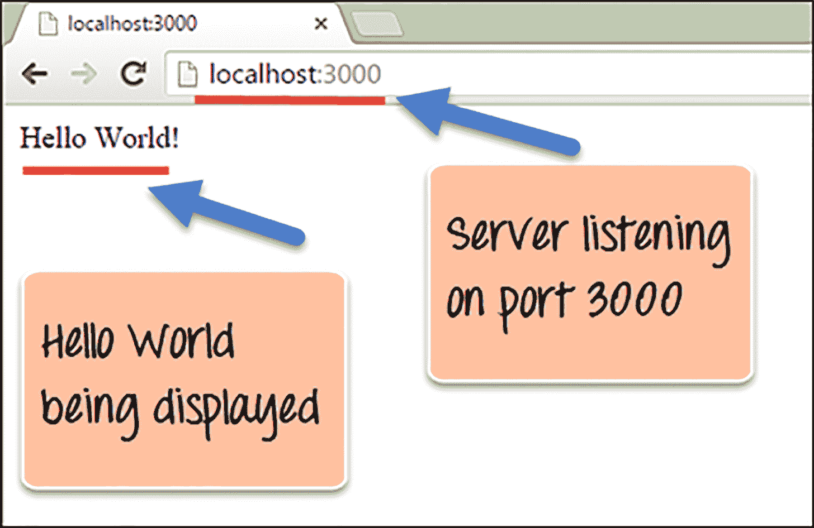

从该输出可以看出，如果访问 localhost:3000，会显示 Hello World。

### 什么是路由？

路由决定了应用程序如何响应对特定端点的请求。例如，客户端可以发送 http 请求，如`POST`、`GET`、`DELETE`或`PUT`，针对任何 URL，例如：

http://localhost:3000/Books

http://localhost:3000/Students

在本例中，对第一个 URL 进行 GET 请求，理想输出是书籍列表；而对第二个，你将看到学生列表。根据你访问的 URL，服务器上会调用某些功能并将响应发送给客户端——这就是路由的工作原理。

每个路由都可以至少有一个处理函数，当路由匹配时，会执行这些函数。典型的路由语法为：`app.METHOD(PATH, HANDLER)`

在语法中：

1. `app`是一个 express 模块实例。

2. `METHOD`是 HTTP 请求方法之一，即`POST`、`GET`、`DELETE`或`PUT`。

3. `PATH`指示服务器路径。

4. `HANDLER`是在路由匹配时执行的函数。

让我们看看如何在 Express 中实现路由。我们将创建三个路由：

1. `/Node`路由 – 访问路由时显示 Node 教程字符串。

2. `/Angular`路由 – 访问路由时显示 Angular 教程字符串。

3. 默认路由`/` - 将显示"欢迎来到我的教程"字符串。

基础代码与我们之前看到的相同，下面的代码是一个显示如何实现路由的扩展部分：

```javascript
var express = require('express');
var app = express();
app.route('/Node').get(function(req,res){res.send("Node Tutorial");});
app.route('/Angular').get(function(req,res){res.send("Angular Tutorial");});
app.get('/',function(req,res){res.send('Welcome to My Tutorials');}));
```

### 代码解释

1. 如果在浏览器中访问 [`localhost:3000/Node`](http://localhost:3000/Node) URL，则定义该路由。路由上绑定了一个回调函数，当浏览到该 Node URL 时会调用该函数。

回调函数有两个参数：

- `res`是用于向客户端发送信息的首要参数。

- `req`是次要参数，包含与请求有关的信息。有时会随请求发送其他参数，`req`参数有助于找到这些参数。

2. 如果选择了 Node 路由，则使用`send`函数向客户端发送 "Node Tutorial" 字符串。

3. 如果在浏览器中访问 [`localhost:3000/Angular`](http://localhost:3000/Angular) URL，则定义该路由。路由上绑定了一个回调函数，当浏览到 Angular URL 时会调用该函数。

4. 如果选择了 Angular 路由，则使用`send`函数向客户端发送 "Angular Tutorial" 字符串。

5. 如果在浏览器中访问 [`localhost:3000/Angular`](http://localhost:3000/Angular) URL，则选择默认路由——这是应用程序根目录。选择它时，向客户端发送 "Welcome to My Tutorials" 信息。

只要命令执行成功，您会在浏览器中看到 "Welcome to My Tutorials" 屏幕。输出将显示，通过浏览端口 3000 的 localhost URL，屏幕上显示了 "Welcome to My Tutorials" 信息——这是我们在代码中指定的默认消息。

### 使用 Express.js 构建 Web 服务器

在上面的示例中，我们看到了如何根据路由决定输出内容。这是现代 Web 应用中使用的技术，而 Web 服务器的其他部分全部关于使用 Node.js 模板。当您快速创建 Node 应用时，最简单的方法之一就是使用 Node.js 模板。市场上有很多框架，我们将使用 jade 框架。

使用 Node 包管理器（NPM）在命令行中输入以下内容来安装 jade：

```bash
npm install jade
```

此命令要求 NPM 下载并安装我们需要的模块。让我们创建一个 jade 模板。创建一个新文件并命名为`index.jade`，将以下代码放入其中，确保该文件创建在名为`views`的文件夹中。

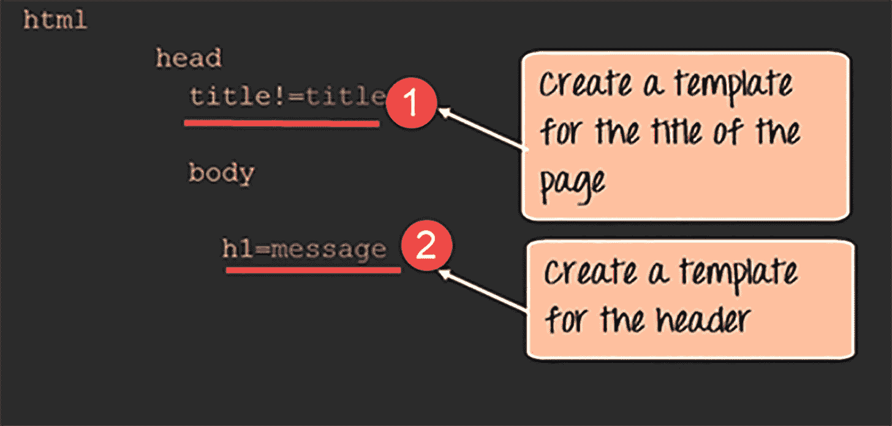

页面标题将更改为调用模板时传递的值。我们还指明 header 标签文本将用模板中传递的内容替换。

```javascript
var express=require('express');
var app=express();
app.set('view engine','jade');
app.get('/',function(req,res){res.render('index',{title:'My Tutorials',message:'Welcome'})});
var server=app.listen(3000,function() {});
```

### 代码解释

1. 首先，在应用程序中指定了"view engine"（这用于渲染模板，因为使用了 jade，所以我们指定了它。

2. 我们使用`render`函数来渲染网页。在这里，我们渲染了之前创建的`index.jade`模板。

3. 我们向`title`和`message`参数传递了两个值——分别为"My Tutorials"和"Welcome"。这些值会被模板中指定的`title`和`message`参数所替换。

如果您成功执行了该命令，您将在浏览器中看到欢迎屏幕。从输出中，您可以看到页面标题被设置为 My Tutorials，页面页头被设置为 Welcome。发生这种情况是因为我们在应用程序中调用了 Jade 模板。

### 快速总结

Express 框架通常用于 Node.js 应用程序的开发，并构建在 Node 框架之上。它用于帮助我们快速构建基于服务器的应用程序。我们使用路由根据用户的请求将用户重定向到应用程序的不同区域——路由响应根据用户需要查看的内容而异。最后，模板用于高效地注入正确的内容，Node 应用最流行的模板引擎之一是 Jade。

# 第十四章 Node.js RESTful API


让我们从名称开始——REST 源于"可表述性状态转移"（Representational State Transfer）。REST 由 Roy Fielding 于 2000 年首次引入，是一种基于 Web 标准并使用 HTTP 协议的架构。REST 围绕资源展开——所有组件都是资源，通过标准接口使用标准的 HTTP 方法访问这些资源。REST 服务器基本上为资源提供访问点，而 REST 客户端使用 HTTP 协议访问并修改这些资源。使用 URI 和全局 ID 来标识每个资源，REST 以不同的方式表示资源，例如 XML 和文本，但最常见的表示形式是 JSON。

### HTTP 方法

这些是 REST 架构中最常用的四种 HTTP 方法：

- `GET` – 用于对资源提供只读访问。

- `PUT` – 用于创建新资源。

- `DELETE` – 用于删除资源。

- `POST` – 用于更新资源或创建新资源。

### RESTful Web 服务

Web 服务是标准和开放协议的集合，用于系统和应用程序之间的数据交换。软件应用程序使用 Web 服务在计算机网络上进行数据交换——这些应用程序使用各种编程语言编写并运行在所有平台上。互操作性（即 Python 和 Java 之间的通信，或 Linux 应用程序与 Windows 应用程序的通信）完全归功于开放标准。

当 Web 服务基于 REST 架构时，它被称为 RESTful Web 服务。它们通过使用 HTTP 方法实现 REST 架构概念。通常，RESTful Web 服务会定义统一资源标识符 (URI)、一个提供资源表示（如 JSON）的服务以及 HTTP 方法。

### 如何为库创建 RESTful API

假设我们有一个基于 JSON 的数据库，其中在一个名为`users.json`的文件中包含用户列表：

```json
{"user1" : {"name" : "michael","password" : "password1","profession" : "teacher","id": 1},"user2" : {"name" : "sara","password" : "password2","profession" : "scientist","id": 2},"user3" : {"name" : "ronnie","password" : "password3","profession" : "clerk","id": 3}}
```

使用这些信息，我们可以提供所有的 RESTful API：

| | URI | HTTP 方法 | POST Body | 结果 |

| :--- | :--- | :--- | :--- | :--- |

| 1 | `listUsers` | `GET` | 空 | 显示所有用户的列表 |

| 2 | `addUser` | `POST` | JSON 字符串 | 添加新用户的详情 |

| 3 | `deleteUser` | `DELETE` | JSON 字符串 | 删除用户 |

| 4 | `:id` | `GET` | 空 | 显示用户的详情 |

我假设到目前你已经知道如何从前端使用表单数据或 AJAX 传递值，以及如何使用 Express Request 对象来处理它们。

### 列出用户

我们将实现的第一个 RESTful API 是`listUsers`。创建一个名为`server.js`的文件并添加以下代码：

```javascript
var express = require('express');
var app = express();
var fs = require("fs");
app.get('/listUsers', function (req, res) {
  fs.readFile( __dirname + "/" + "users.json", 'utf8', function (err, data) {
    console.log( data );
    res.end( data );
  });
})
var server = app.listen(8081, function () {
  var host = server.address().address
  var port = server.address().port
  console.log("Example app listening at http://%s:%s", host, port)
})
```

现在在本地机器上使用`http://127.0.0.1:8001/listUsers`配合 HTTP 方法：`GET`。确保你使用了 REST 客户端以便访问 API，并且你应该能看到下面的结果——考虑到在生产环境中使用此代码时，IP 地址可能会发生：

`{"user1" : {"name" : "michael","password" : "password1","profession" : "teacher","id": 1},"user2" : {"name" : "sara","password" : "password2","profession" : "scientist","id": 2},"user3" : {"name" : "ronnie","password" : "password3","profession" : "clerk","id": 3}}`

### 添加用户

我们将实现的下一个 RESTful API 是`newUser`，使用以下详情：`user = {"user4" : {"name" : "monica","password" : "password4" ,"profession" : "teacher","id": 4}}`

可以通过 AJAX 调用在 JSON 表单中接受相同的输入，但为了本章的目的，我们将硬编码一切。清空你的`server.js`文件并添加以下内容：

**server.js**

```javascript
var express = require('express');
var app = express();
var fs = require("fs");
var user = {"user4" : {"name" : "monica","password" : "password4","profession" : "teacher","id": 4}}
app.post('/addUser', function (req, res) {
  // First read existing users.
  fs.readFile( __dirname + "/" + "users.json", 'utf8', function (err, data) {
    data = JSON.parse( data );
    data["user4"] = user["user4"];
    console.log( data );
    res.end( JSON.stringify(data));
  });
})
var server = app.listen(8081, function () {
  var host = server.address().address
  var port = server.address().port
  console.log("Example app listening at http://%s:%s", host, port)
})
```

现在尝试通过 URL 访问：`http://127.0.0.1:8081/addUser`并配合 HTTP 方法：`POST`。使用本地机器和 REST 客户端，你应该看到以下内容：

`{"user1":{"name":"michael","password":"password1","profession":"teacher","id":1},"user2":{"name":"sara","password":"password2","profession":"scientist","id":2},"user3":{"name":"ronnie","password":"password3","profession":"clerk","id":3},"user4":{"name":"monica","password":"password4","profession":"teacher","id":4}}`

### 显示详情

现在我们想要实现一个带有用户 ID 的 RESTful API，并显示相应用户的详情。同样，清空`server.js`文件并添加这段代码：

**server.js**

```javascript
var express = require('express');
var app = express();
var fs = require("fs");
app.get('/:id', function (req, res) {
  // First read existing users.
  fs.readFile( __dirname + "/" + "users.json", 'utf8', function (err, data) {
    var users = JSON.parse( data );
    var user = users["user" + req.params.id]
    console.log( user );
    res.end( JSON.stringify(user));
  });
})
var server = app.listen(8081, function () {
  var host = server.address().address
  var port = server.address().port
  console.log("Example app listening at http://%s:%s", host, port)
})
```

和之前一样，使用本地机器和 REST 客户端尝试使用`http://127.0.0.1:8081/2`配合 HTTP 方法：`GET`进行访问，你应该会看到：`{"name":"sara","password":"password2","profession":"scientist","id":2}`

### 删除用户

最后的策略涉及将应用程序拆分为几个较小的实例——每个实例负责其自身应用程序的一小部分数据。在数据库中，你通常会看到这种策略被称为分片（sharding）或水平分区（horizontal partitioning）。在数据分区中，在每次操作之前都需要执行一个查表步骤（lookup step）。这决定了应该使用哪一个应用实例。例如，我们可能想根据语言或国家对用户进行分片，我们需要先查找这些信息。当你成功扩展一个大型应用时，最终，这三个策略都应该被实现。虽然 Node.js 确实让所有这一切变得简单，但我将专注于使用第一种策略——克隆（cloning），因为它最基础，并将查看一下实现它所需的 Node.js 工具。在继续之前，你确实需要对 Node.js 子进程的工作原理有一个良好的了解。

### Cluster 模块

你可以使用内置的`cluster`模块在环境中实现跨 CPU 核心的负载均衡。该模块基于`child_process`模块中的`fork`方法，允许主应用程序进程根据 CPU 核心的数量进行多次派生。然后，它会接管发送到主进程的请求，并通过派生的进程进行负载均衡。

`Cluster`模块是 Node.js 提供的一个辅助工具，帮助我们实现这种克隆策略，但仅限单机。当你有拥有多个资源的大型机器，或者当在单台机器上添加额外资源比添加其他机器更便宜更方便时，`Cluster`模块效果良好，帮助你快速实现该策略。即使是较小的机器也可能有几个核心；即使你不担心 Node 服务器的负载，也应该启用`Cluster`模块，以增加服务器的可用性和容错能力水平。这很容易，而且当你使用进程管理器（例如`PM2`）时，你只需要提供带参数的启动命令即可。

让我们看看如何原生使用`cluster`模块以及它是如何工作的。`Cluster`模块结构非常简单。创建一个主进程（master process）来派生并管理多个工作进程（worker processes）。每个工作进程代表一个需要扩展的应用程序实例。主进程处理所有传入的请求，并决定传入的请求应该由哪个工作进程处理。

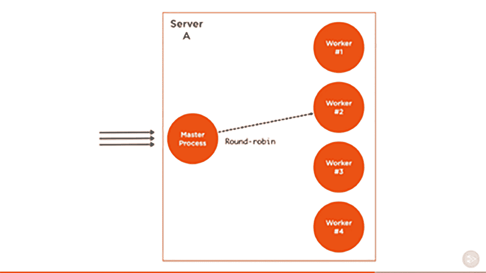

主进程的工作相对简单，因为它使用轮询算法（round-robin algorithm）来选择工作进程。在 Windows 以外的所有平台上，这已经是默认设置，通过全局修改可以让操作系统处理负载均衡。轮询算法通过旋转基准将负载均匀地分布在所有可用进程中。第一个传入的请求发送到第一个可用的工作进程，第二个发送到第二个进程，依此类推。当列表到达末尾时，算法将直接回到开头并重新开始。这是最易使用的负载均衡算法之一，但它只是许多之一。还有其他算法允许分配优先级，并选择负载最低的服务器或响应最快的服务器。

### 为 HTTP 服务器实现负载均衡

让我们进入一些实际操作。我们想构建一个简单的 HTTP 服务器，并使用`Cluster`模块对它进行负载均衡。我们将使用 Node 的 hello-world 示例服务器，并对其进行轻微修改，以在响应之前模拟 CPU 负载。

创建一个`server.js`文件并添加以下代码：

```javascript
// server.js
const http = require('http');
const pid = process.pid;
http.createServer((req, res) => {
  for (let i=0; i<1e7; i++); // simulate CPU work
  res.end(`Handled by process ${pid}`);
}).listen(8080, () => {
  console.log(`Started process ${pid}`);
});
```

我在 HTTP 响应中包含了`process.pid`。这将通过识别处理请求的应用实例来验证我们的负载均衡器是否工作。在创建集群以将服务器克隆到多个工作进程之前，我们需要运行一个基准测试，看看服务器每秒可以处理多少请求。Apache 基准测试工具是一个很好的选择；一旦运行了上面的服务器代码，继续运行下面的命令：

```bash
ab -c200 -t10 http://localhost:8080/
```

这使用了 200 个并发连接来对我们的服务器进行 10 秒负载测试。

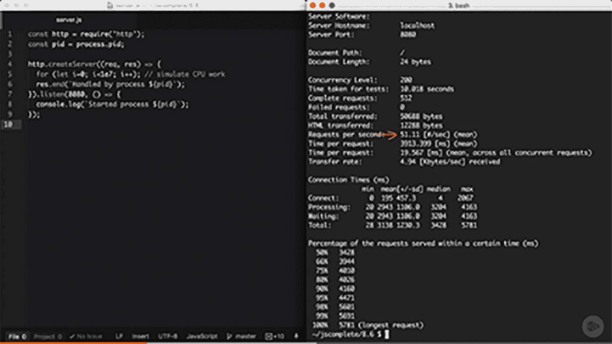

当我尝试时，我的机器每秒处理大约 51 个请求，但这些结果因机器和平台而异。这只是一个让你对性能有所了解简单测试，不能被视为 100% 准确——它只会向你展示在具有多个核心的环境中使用集群会有什么区别。

我们现在有了可以参考的基准测试，所以现在是使用`Cluster`模块通过克隆来扩展应用程序了。使用与你的`server.js`文件相同的服务器，创建另一个新文件并命名为`cluster.js`。这是用于主进程的，需要以下内容：

```javascript
// cluster.js
const cluster = require('cluster');
const os = require('os');
if (cluster.isMaster) {
  const cpus = os.cpus().length;
  console.log(`Forking for ${cpus} CPUs`);
  for (let i = 0; i<cpus; i++) {
    cluster.fork();
  }
} else {
  require('./server');
}
```

在我们的`cluster.js`文件中，首先引入了`os`和`cluster`模块。`os`模块用于读取`os.cpus()`可以工作的 CPU 核心数。通过`cluster`模块，我们得到了`isMaster`布尔值标志，它用于判断`cluster.js`文件是否作为主进程加载。当文件被第一次执行时，会执行主进程，`isMaster`标志被设置为`true`。可以指示主进程根据 CPU 核心的数量派生服务器。

现在我们已经使用`os`模块读取了我们有多少个 CPU 核心，我们可以对数量进行`for`循环以调用`cluster.fork`方法。`for`循环所做的就是创建与系统 CPU 数量相匹配的 worker，充分利用系统的处理能力。当`cluster.fork`在主进程中执行时，`cluster.js`会再次运行，但这次是工作模式，此时`isMaster`被设置为`false`。如果你需要的话，在这种情况下有一个`isWorker`标志可以运行，被设置为`true`。

当应用程序在工作模式下运行时，就可以开始执行实际工作，这就是需要定义服务器逻辑的地方。在这个示例中，我们可以引入创建的`server.js`文件来完成此操作。基本上这样。这就是你如何利用机器的处理能力，而测试集群就像运行`cluster.js`一样简单：

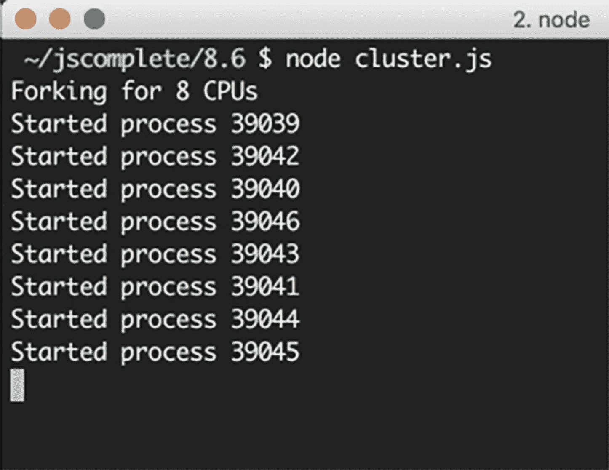

因为我的机器有八个核心，所以启动了八个进程。你必须理解每个进程都是不同的 Node.js 进程——每个单独的工作进程都有自己的事件循环和内存空间。现在，当 Web 服务器被多次访问时，不同的工作进程将开始处理请求，并且每个进程都有自己的进程 ID。worker 并不是顺序旋转的，因为集群模块只在执行了一些优化后才会选择 worker，但负载将均匀地分布在所有工作进程中。

我们上面使用的`ab`命令现在可以再次对进程集群进行负载测试：


我的机器上创建的集群每秒可以处理大约 181 个请求，而我们从单个 Node 进程得到的每秒只有 52 个请求。只需要几行代码，性能就翻了一倍。

### 向所有 Worker 广播消息

主进程和工作进程之间的通信是简单的，因为底层使用了`child_process.fork`。使用我们上面的示例，可以通过`cluster.workers`访问 worker 列表。这是一个包含每个 worker 对象的列表，用于读取它们的信息。因为主进程和工作进程之间存在通信通道，向它们所有广播消息只需要对 workers 进行循环。

```javascript
Object.values(cluster.workers).forEach(worker => {
  worker.send(`Hello Worker ${worker.id}`);
});
```

`Object.values`用于获取包含 workers 的数组。`send`函数用于每个 worker，发送我们想要的值。在我们的`server.js`文件中，当接收到主进程的消息时，通过在全局进程上注册 message 事件来读取它。这是一个示例：

```javascript
process.on('message', msg => {
  console.log(`Message from master: ${msg}`);
});
```

### 模拟 DB 调用

让事情变得实际一点。我们想让服务器返回创建了多少用户的回复。我们需要一个模拟函数来返回数据库中的用户数量。

```javascript
const numberOfUsersInDB = function() {
  this.count = this.count || 5;
  this.count *= 2; // 随机
}
```

每当我们调用`numberOfUsersInDB`时，假设已经连接到了数据库。为了避免产生多次请求，我们希望在一个周期内，例如 10 秒。而不是，主进程可以直接执行一次请求让 workers 知道新的计数：

```javascript
const updateWorkers = () => {
  const usersCount = numberOfUsersInDB();
  Object.values(cluster.workers).forEach(worker => {
    worker.send({ usersCount });
  });
};
setInterval(updateWorkers, 10000);
```

在这里，`updateWorkers`第一次被调用，然后使用`setInterval`每 10 秒调用一次。这样，所有 workers 都会得到新的用户计数。

### 增加服务器的可用性

当你运行单个实例时，问题是每当它崩溃时必须重启。这意味着在崩溃和重启之间会有一些停机时间，即使是自动化。这也适用于服务器需要部署新代码。下面的示例是随机崩溃：

```javascript
setTimeout(() => {
  process.exit(1)
}, Math.random() * 10000);
```

当工作进程以这种方式退出时，主进程会收到通知。这是通过`cluster`对象的`exit`事件来实现的派生一个新的 worker。这是一个示例：

```javascript
cluster.on('exit', (worker, code, signal) => {
  if (code !== 0 && !worker.exitedAfterDisconnect) {
    console.log(`Worker ${worker.id} crashed. Starting new worker...`);
    cluster.fork();
  }
});
```

添加一个`if`条件是有意义的，因为它确保了 worker 是崩溃的而不是被用户手动断开的。在这种情况下，主进程可能会根据观察到的负载判断使用了过多的资源。为了这一点，可以在 worker 上使用`disconnect`方法，并将`exitedAfterDisconnect`标志设置为`true`。

### 共享状态与粘性负载均衡

就像所有好事一样，总是有代价的。当 Node 应用负载均衡时，某些适用于单进程的功能将会丢失，比如其他语言中的线程安全。在 Windows 上，不支持这些进程信号，因此需要找到其他方法。有几种方法——可以使用 socket 或标准输入。或者我们可以监控`process.pid`文件的移除事件。为了保持简单，我使用的是 Linux，所以如果你使用其他系统，你可能只需要阅读这里而不进行实际操作。虽然 Node 在 Windows 上运行良好，但 Linux 是托管 Node 应用的更安全的平台。你可能感兴趣的是，如果你使用最新版本，可以使用 Linux 子系统——如果你感兴趣，请看 Windows 上的 Bash。回到我们的示例，当主进程接收到 SIGUSR2 信号时，它告诉 workers 可以重启。这就是重启所需的全部内容。为了启动这一点，workers 被存储在一个数组中：

```javascript
const workers = Object.values(cluster.workers);
const restartWorker = (workerIndex) => {
  const worker = workers[workerIndex];
  if (!worker) return;
  worker.on('exit', () => {
    if (!worker.exitedAfterDisconnect) return;
    console.log(`Exited process ${worker.id}`);
    cluster.fork().on('listening', () => {
      restartWorker(workerIndex + 1);
    });
  });
  worker.disconnect();
};
restartWorker(0);
```

在函数中，我们获取需要重启的 worker 引用。此函数被递归地调用，以便在上一个一个就绪时调用下一个。在内存中保留已验证用户会话的引用将不再有效，因为每个工作进程都有自己的事件循环。由于某些请求会足够不幸地遇到崩溃，这无法避免。可用性实际上可以使用我们之前的`ab`命令来测量：


显示可用性高于 99%。

### 零停机重启

那么，当我们想要重启所有工作进程时，例如我们需要部署新代码怎么办？我们有多个运行中的实例，而不是让它们一起重启；而是一个一个重启，让其他 workers 继续处理请求。使用`Cluster`模块来实现这一点非常容易。一旦主进程启动并运行，我们需要找到一种向它发送命令让它重启的方法。如果你使用的是 Linux，这很容易，因为你只需要监听 SIGUSR2 或其他进程信号。在进程 ID 上触发`kill`命令如下：

```javascript
// In Node
process.on('SIGUSR2', () => { ... });
// To trigger that
$ kill -SIGUSR2 PID
```

这样，主进程不会被杀死，我们可以告诉它执行其他事情。SIGUSR2 是这种情况下正确的信号，因为它用户命令。SIGUSR1 被 Node 作为调试器使用，你真的不想产生任何冲突。

# 依赖版本控制

当你的`packages.json`文件包含语义化版本（semver）时，你可能会发现配置提示某个包依赖需要匹配特定版本，例如`4.17.2`。你的生产机器会拉取`4.17.3`，然后使用`4.17.4`来运行测试。当你准备部署生产环境时，库的作者可能又更新了一次，导致你的软件最终运行在`4.17.9`版本——而这是在生产环境中的。很多时候，库作者在更新库时引入了重大更改，这些更改可能会破坏生产环境，无论他们是无意还是没有意识到这些更改会产生的影响。他们的更新提升了版本号，这可能导致广泛的版本冲突，从而引发严重的代码崩溃。`node_modules`中极其复杂的依赖链进一步加剧了这个问题。假设你有一个`Module A`，这是一个显式依赖模块，它依赖于`Module B`的版本范围。反之，`Module B`又依赖于几个模块的版本范围。不要忘记——运行`npm install`时，你不仅是在动态地确定和解析你的模块——依赖链中的其他所有部分也是如此。只要将文件提交到版本控制，使用最近添加的`package-lock`功能可以在一定程度上缓解这个问题。

# 部署成功并非由你控制

每当你的应用程序进行部署时，你都会下载可能未经测试的新依赖项。而且这还是在一切进展顺利的情况下。`npm`不再支持将新文件推送到旧版本，这并不是什么新闻，但我们已经多次看到生产发布因为包没有被下载而失败——通常是因为`npm`宕机或网络出现问题。通常，这种安装失败会与旧版本被覆盖同时发生。结果是，在`npm`恢复访问之前，服务器将毫无用处。我可以告诉你一个案例：有一个开发者每当想要从`AWS Elastic Beanstalk`获取新服务器时，都会进行全新的安装，因为他现有的服务器集群已经过载。由于`npm`服务器无法访问，新服务器无法上线，由于无法处理所有的流量，原本运行良好的网站也突然崩溃了——而在这几天之前，原始安装已经成功了，且所有新服务器都部署了相同的程序版本。

幸运的是，有一个解决办法。

### 打包你的 Node.js 应用

我们应该能就一点达成共识——所有的 JS 应用都应该像我们处理任何其他编译语言一样——在构建时，应用程序应该被打包成可以部署的产物（artifact）。假设在本章中，我们将开发一个名为`RandomQuote-JS`的示例应用。我们可以通过一个非常简单的构建步骤来实现：

```bash
npm install
gulp build    # 插入你想要的构建工具
zip -r ../RandomQuotes.1.0.zip .
# 创建了 ../RandomQuotes.1.0.zip (5.2 MB)
```

生成的`zip`文件随后可以解压到你的生产服务器上，应用程序即可直接运行。然而，在这里我们压缩了整个应用程序目录，而其中大部分是编译和调试应用程序所需的库。一旦应用程序已完全构建并准备投入生产环境，就不再需要`typescript`编译器、测试框架或`webpack`库了。大问题是，我们如何将生产依赖和开发时依赖分开？

运行以下`npm`命令可以从`node_modules`中移除`package.json`中`devDependencies`部分的所有包：

```bash
npm prune --production
```

建议在整个应用程序压缩成归档包之前运行此命令，无论你使用的是手动过程还是如`VSTS`、`Octopus Deploy`或`Chef`等部署工具。

我们可以通过`octojs`让整个过程变得更简单。这是`Octopus Deploy`发布的一个 Node.js `cli`工具，帮助我们创建`zip`或`tar.gz`文件，而无需先执行`prune`步骤。默认情况下，包名与你在项目中`package.json`文件中的名称和版本相同。然而，所有这些值都可以覆盖。你可以通过两种方式使用`octojs`——导入并在应用程序构建过程中使用，或者通过控制台。

### 使用命令行打包

最简单的方法是全局安装该工具：

```bash
npm install -g @octopusdeploy/octojs
```

现在，你可以在任何项目内部调用`octojs`并让它打包应用程序。假设我们已经构建并测试了项目；现在可以通过这种简单的方式打包：

```bash
octijs pack -O C:\Bin --gitignore
创建了包 C:\Bin\RandomQuotes.1.0.zip (5. MB)
```

生成的包尺寸要小得多，且 ID 和版本来自项目。现在包已经生成，可以直接推送到内置的 Octopus Deploy 馈源：

```bash
octijs push --package C:\Bin\randomquotes.1.0.zip --server http://octopusserver.acme.com --apiKey API-F22908AA123
推送 - 完成
```

### 使用代码打包

另一种方法是使用同一个库，通过代码一步完成项目打包并推送：

```javascript
var octo = require("@octopusdeploy/octojs");
octo.pack({
    dependencies: 'prod',
    bypassDisk: true,
    root: "."
}, (err, data) => {
    console.log("正在上传包:"+data.name);
    octo.push(data.stream, {
        apiKey: 'API-F22908AA123',
        server: 'http://octopusserver.acme.com',
        name: data.name
    }, () => {
        console.log("已上传");
    });
}).append('hello.txt', new Buffer('This Is An Additional File')).finalize(true);
```

服务器通常会在 TCP 套接字上监听，而 Node.js 进程通过 TCP 连接连接到服务器。然而，MongoDB 也有自己的一套协议，帮助它理解进程（即客户端）从数据库中需要什么。与其学习所有在 TCP 层需要发送的消息，我们不如使用驱动程序来帮助我们抽象掉这些内容。在这种情况下，我们使用`MongoDB`驱动程序，你可以在[此处作为 npm 软件包找到它](https://www.npmjs.com/package/mongodb)。

现在，你需要记住的是，虽然这个驱动程序可以帮助我们连接并抽象化底层的通信请求和响应，但它只能让我们这些开发者在道路上走得远那么一点。MongoDB 是所谓的"无模式（schemaless）"数据库，这意味着当你刚开始时，你拥有的权力远超你的需求。你拥有的权力越大，出错的表面积就越大。减少 Bug 和错误转弯的表面积，你就走在正确的道路上了，但这还需要一些额外的东西。

这就是`Mongoose`大显用场的地方——它是对上面提到的驱动程序的抽象。通常情况下，每种抽象都会减少你的低级操作能力。但这并不总是坏事，因为在某些时候，它甚至可以将你的生产力提高 1000 倍或更多，因为归根结底，你永远不需要完全访问底层 API。

你可以这样理解这一点：从技术上讲，一个实时聊天应用可以用`Python`和`C`同时创建。作为开发者，`Python`能帮助你以更高的生产力和更快的速度实现它。`C`是更高效的选择，但它会在开发生产力和速度上让你付出巨大代价，更不用说崩溃和 Bug 了。而且，主要实现 websockets 并不需要`C`提供的那种能力。类似地，`Mongoose`让你减少对低级 API 的访问表面积，但它带来了极佳的开发者体验（DX）和许多收益。

## 连接 Mongoose + MongoDB

首先，我们想看看如何用 Mongoose 连接 MongoDB 数据库：

```javascript
mongoose.connect(DB_CONNECTION_STRING, { useNewUrlParser: true, useUnifiedTopology: true, useCreateIndex: true, useFindAndModify: false })
```

使用这种格式进行连接，可以确保你正在使用`Mongoose`的 URL 解析器，并且没有使用任何已弃用的做法。

### 执行 Mongoose 操作

现在我们可以看看 Mongoose 操作以及它们应该如何执行。Mongoose 提供了两种选项：

1. 基于游标的查询

2. 全量获取查询

### 基于游标的查询

基于游标的查询的核心在于一次只处理一条记录，同时从数据库中获取单个或批量文档。当你拥有海量数据且内存受限的环境时，这是最高效的方法之一。假设你有一个总计约 10GB 的文档，并且需要在 1 核 1GB 内存的云服务器上进行解析。整个内容无法一次性获取，因为根本无法放入你的环境中，因此唯一合理的选项就是使用基于游标的查询。

### 全量获取查询

这种查询类型允许你一次性获取整个查询响应，这也是你最常使用的——也是我们在这里的重点。

## 使用 Mongoose 模型

模型是 Mongoose 的超能力，帮助你强制执行模式规则并将 Node 代码无缝集成到数据库单元中。所以，首先我们需要定义一个良好的模型：

```javascript
import mongoose from 'mongoose'
const CompletedSchema = new mongoose.Schema({
  type: { type: String, enum: ['course', 'classroom'], required: true },
  parentslug: { type: String, required: true },
  slug: { type: String, required: true },
  userid: { type: String, required: true }
}, { collection: 'completed' })

CompletedSchema.index({ slug: 1, userid: 1 }, { unique: true })
const model = mongoose.model('Completed', CompletedSchema)
export default model
```

从这里你需要注意的一些有趣的点是：

1. **Required**：尽可能在所有必填字段上保持为`true`。这可以为你节省很多痛苦，当你没有使用`TypeScript`或其他静态类型检查系统来帮助你正确编写创建对象的属性名时。

2. **索引和唯一字段**：应该被定义，你也可以在模式中添加唯一属性。我在这里不会深入讨论索引，因为这是一个非常广泛的主题，但它们可以显著提高你的查询速度，特别是在大规模应用中。

3. **集合名称 (Collection names)**：应该显式定义。虽然 Mongoose 能够根据模型的名称自动提供集合名称，但这也是一种抽象，对于我们的需求来说太过了。至少，你应该知道代码库中的集合和数据库名称。

4. **使用枚举 (enums)**：如果可能，限制值的范围。

### 执行 CRUD 操作

CRUD 代表创建（Create）、读取（Read）、更新（Update）、删除（Delete）——这是操作数据库数据的基本选项。让我们通过几个示例来结束学习。

### 创建操作

这仅用于创建新的数据库记录。我们将使用之前定义的模型来创建记录：

```javascript
try {
  const res = await CompletedSchema.create(record)
} catch(error) {
  console.error(error)// 处理错误
}
```

同样，有几点需要注意：

1. 不要使用回调函数，改用`async-wait`。

2. 你应该在查询中使用`try-catch`块，因为查询可能由于多种原因失败，包括错误的值、重复记录等。

### 读取操作

此操作从数据库中读取值，但虽然听起来很简单，在使用 Mongoose 时仍有几点需要注意：

```javascript
const res = await CompletedSchema.find(info).lean()
```

1. 你发现`lean()`函数了吗？这是为了性能最好的函数之一。默认情况下，Mongoose 会获取从数据库返回的文档，对其进行处理并添加魔法方法，例如`.save`。

2. 当使用`.lean()`时，返回的是纯 JSON 对象，而不是消耗大量资源和内存的文档。这让你的查询快得多，而且不会消耗太多 CPU 资源。

3. 尽管如此，如果你考虑要更新数据，可以不使用`.lean()`。

## 更新操作

在没有触发`.lean()`的情况下，如果你已经拥有一个`Mongoose`文档，可以修改对象属性并使用`object.save()`将其保存：

```javascript
const doc = await CompletedSchema.findOne(info)
doc.slug = 'something-else'
await doc.save()
```

在这里，我们进行了两次数据库调用——`findOne`和`doc.save`。在可能的情况下，尽量减少访问数据库的请求。在比较网络、内存和磁盘时，网络几乎总是最慢的。

另一种情况是允许你使用类似下面的代码来对数据库只进行一次调用：

```javascript
const res = await CompletedSchema.updateOne(<condition>, <query>).lean()
```

## 删除操作

最后，`Mongoose`也让删除操作变得非常简单。以下是删除单个文档的方法：

```javascript
const res = await CompletedSchema.deleteOne(<condition>)
```

与`updateOne`类似，`deleteOne`也将文档的匹配条件作为其第一个参数。

当你有多个文档需要删除时，应该使用另一种方法`deleteMany`。然而，当你想要避免多次删除查询时，请使用`deleteOne`，特别是在你尝试执行自己的查询时。

## 结论

感谢你花时间阅读我的指南。多年来，`JavaScript`的流行程度不断提高，今天 Web 开发的面貌已经发生了不可思议的变化。几年前，我们甚至无法想象今天在浏览器和服务器上使用`JavaScript`能做到的事情。那时，任何类似于此的内容都会被封装在`Java Applet`、`Flash`或类似的沙箱环境中。

20 多年来，我们一直生活在基于无状态请求-响应范式的无状态 Web 中，但现在我们有了基于双向实时连接的 Web 应用。`Node.js`让服务器和客户端发起通信并自由交换数据成为可能。典型的响应范式与之形成直接对比，客户端总是发起通信的一方。这一切基于运行在 80 端口的`JS`、`CSS`和`HTML`开放 Web 技术栈。

当然，你可以辩称这已经存在多年了。我们早就有`Java Applets`和`Flash`，但它们仅仅是利用 Web 作为客户端传输形式的沙箱环境。由于是沙箱，它们是隔离的，运行在非标准端口上，并且可能需要额外的支持，例如更多的权限。

`Node.js`拥有一切优势，现在被几乎完全依赖其所提供功能的知名公司使用。这意味着世界上永远会有下一个`Node.js`专家的位置——会是你吗？

## 参考文献

- "An Introduction to the Npm Package Manager."。

- "Build Node.js Apps with Visual Studio Code.", Octopus. "Packaging Node.js Applications."。

- "Global Object."。

- "How to Use the Node.js REPL."。

- "Introducing Asynchronous JavaScript - Learn Web Development | MDN."。

- "Introduction to Backend Development."。

- `jsmanifest`. "Callbacks vs. Promises in JavaScript."。

- Node.js. "How to Use Buffers in Node.js."。

- "The Node.js Event Loop, Timers, and Process.nextTick()."。

- "Node.js - RESTful API - Tutorialspoint."。

- "Node.js - Utility Modules - Tutorialspoint."。

- "Node.js | File System."。

- "Node.js Callback Concept - JavaTpoint."。

- "Node.js Console - REPL."。

- "Node.js Express FrameWork Tutorial - Learn in 10 Minutes."。

- "Node.js Tutorial - Tutorialspoint."。

- Oelbadrawi. "Step by Step Building Your First Node.JS Project."。

- OPTASY. "How to Scale Your Node.js App: Best Strategies and Built-in Tools for Scalability."。

- "Understanding Streams in Node.js."。
