# JavaScript 三合一教程

## 引言

本书包含了关于如何使用 JavaScript 进行编码的经过验证的步骤和策略。我在书中包含了 JavaScript 的逐步编程技术，以便你能正确学习它们。JavaScript 是一种脚本语言。你会看到很多脚本嵌入在 HTML 标签中。由于 JavaScript 无法独立工作，我认为将其嵌入 HTML 是合适的，这样当你想运行它时，它就能在浏览器中正常工作。

如果你想练习所学的内容，可以打开一个代码编辑器，复制代码并粘贴进去查看结果。你也可以简单地将页面加载到浏览器中，直接在网页上查看结果。嵌入的脚本已经处于可工作状态。学习脚本的最佳方法是先将其熟记于心，然后编辑它们以进行自定义，这样你就能以一种有趣的方式学得更快。

无论你是正在制作网站，还是渴望成为 Web 开发者的学生，抑或是计划为自己的企业构建网站，这本书都是你在市场上能找到的最佳读物。一旦你读完了前面几章，你就会处于正确的心态，继续学习更复杂的主题。最好的方法是起初放慢速度，随着概念变得清晰而调整自己的节奏。

## 第一章

### JavaScript 简介

JavaScript 是一种解释型语言。这门语言的定义比“解释型”这个词更宽泛。你可以将其定义为一种过程式语言，它是弱类型的、基于原型的、动态的和命令式的。JavaScript 以客户端编程语言的形式开发和实现。它是 Web 浏览器的一部分，被视为有助于开发人员在网页上实现动态功能以及创建和集成用户界面的东西。你可能也会发现一些 JavaScript 在服务器端的实现。然而，JavaScript 编程语言的流行主要基于其在客户端的应用。你可能也会看到 JavaScript 在 Web 应用之外的应用。例如，你可能会发现它们被用作向桌面小部件和 PDF 格式文档添加一些交互性的方式。

JavaScript 最初的设计蓝图与 C 语言相似，但它也采用了一些 Java 编程语言的名称。你不应该将 Java 与 JavaScript 混为一谈，因为它们本质上是不同的。它们的目的和语义也不同。

### JavaScript 的开发者

Brendan Eich 最初以 Mocha 为名开发了 JavaScript。后来改名为 LiveScript。再后来，又改名为 JavaScript。这个名字让一些人感到困惑，它给人一种印象，即新语言，也就是 JavaScript，是 Java 的一个分支。人们认为这个新的编程语言是网景公司为了在新的编程语言世界中获得急需的声誉而制定的营销策略的一部分。

第二年，微软引入了一种类似的客户端语言，集成到他们著名的 Internet Explorer 3.0 浏览器中。为了避开品牌问题，它将该语言命名为 JScript。这个词听起来和看起来都与 JavaScript 非常相似；然而，它的不同之处在于无法做到 100% 兼容 ECMA 规范。

1997年，一项将 JavaScript 提交给 ECMA 标准的提案出现，并于 1997 年 6 月被 ECMA 标准采纳，标签为 ECMAScript。该编程语言也赢得了 ISO 标准推荐。JavaScript 因其适应互联网的方式而获得了极高的人气。这就是为什么它成为地球上使用最广泛的编程语言之一。

### JavaScript 的用例

JavaScript 在全球大多数网页的客户端发挥作用。当你打开一个网页，并且它与你上次打开时不同，嗯，那些更改可能是使用 JavaScript 完成的。让我告诉你一些有趣的事情。在你的电脑屏幕上打开一个网页。右键单击网页，然后单击“查看源代码”。你会在页面代码中看到 JavaScript 这个词。不要将 HTML 与 JavaScript 混淆，因为你可能会在页面代码中同时找到两者。

HTML 是一种标记语言，允许开发人员格式化内容并创建动态网页。你可以将文本加粗，创建你选择的框和表格，并向页面添加按钮和项目符号。然而，JavaScript 允许你更改文本、添加弹出消息，并验证通过 HTML 编码输入的文本。HTML 和 JavaScript 并肩前行。JavaScript 超越 HTML 的地方在于它使页面变得动态和交互的方式。它将允许你的用户点击某些元素并从现有页面打开新页面。

你应该学习 JavaScript，因为它非常容易实现。你所要做的就是将代码放入 HTML 文档中，然后指示浏览器运行它。JavaScript 可以在许多计算机和操作系统上工作，即使系统处于离线状态。借助 JavaScript 的帮助，你可以创建响应式界面，从而改善用户体验并提供极其动态的功能。

JavaScript 允许用户在需要时以文档形式加载内容，而无需重新加载网页。我们称这个过程为 Ajax。JavaScript 允许你在浏览器中运行现有可能性的测试，然后做出相应的反应。这个过程被称为防御性脚本。JavaScript 将修复出现在你网页上的任何问题。它将弥补浏览器支持中存在的漏洞。

当我们比较 JavaScript 能为我们做的一切与其他用于 Web 的编程语言时，我们意识到它能做更多的事情。JavaScript 非常受欢迎和被喜爱，因为它允许你毫无麻烦地构建复杂的应用程序。你也可以用 Flash 构建复杂的应用程序，但 JavaScript 是最好的选择，因为它是一种 Web 标准。

说到 JavaScript 的用途，其用途一直在不断变化。起初，JavaScript 与网站的交互仅限于形成交互和向用户提供反馈。然而，它随着时间不断演变，现在的用途远比最初要多得多。

JavaScript 的用例也在随着时代的变化而变化。用户需要改变那种经过反复尝试、测试却又枯燥乏味的网页界面，比如点击链接、在网页上填写信息以及发送一堆表单。他们希望让这些流程变得更现代化、更用户友好。JavaScript 使用户能够创建注册表单，该表单可以检查用户名是否已被占用或是否可用。这避免了用户忍受页面重加载，而这在某种程度上可能非常令人沮丧。搜索框在你输入内容时会显示更相关和更推荐的搜索结果。它显示的是基于你输入内容的建议。这种模式被称为自动补全——如果没有 JavaScript，这是不可能实现的。

需要在设定时间后自动更新而无需用户输入的信息，可以通过 JavaScript 来实现。JavaScript 可以尝试修复布局问题。通过使用 JavaScript，你可以找到网页上任何元素的确切区域和位置。你可以计算浏览器窗口的尺寸。通过收集和使用这些信息，你可以帮助防止元素重叠及其他相关问题。假设你有一个多级菜单。你可以通过检查子菜单的空间来防止菜单项和滚动条的重叠。也许 JavaScript 帮助你的最佳方式是增强 HTML 提供的界面。

代码被认为是构成程序的文本。在本书的许多章节中，你会看到大量代码。阅读和编写代码，我必须说，是学习和编写程序过程中不可或缺的一部分。

元编程被认为是一种强大的技术，它能够让你编写一系列程序。ES6 的出现进一步简化了元编程在 JavaScript 编程世界中的应用。你可以使用代理及其他类似功能。ES6 的代理有助于重新定义对象中的不同操作。

### `<script>` 标签

让我们来谈谈本书中最常用的标签符号。所有 JavaScript 代码都包含在 `<script>` 标签内。

```html
<!DOCTYPE html>
<html>
<body>

<p>JavaScript rests in the Body</p>

<p id="demo12"></p>

<script>
document.getElementById("demo12").innerHTML = "This is your First JavaScript";
</script>

</body>
</html>
```

JavaScript Rests in the Body

This is your First JavaScript

旧版本的 JavaScript 写法有所不同。它的格式如下：`<script type="text/javascript">`。

JavaScript 中有函数可以用来执行代码块。你可以在某种事件发生时调用函数。事件可以定义为点击按钮。你可以在任何 HTML 文档中放置任何类型的脚本。脚本可以放在 `<head>` 中、`<body>` 中，或两者都放。以下是在 head 中使用脚本的示例：

```html
<!DOCTYPE html>
<html>
<head>
<script>
function FunctionUN() {
  document.getElementById("demo34").innerHTML = "I have changed the Paragraph.";
}
</script>
</head>
<body>

<p>You have seen the JavaScript in the Head</p>

<p id="demo">This is a Paragraph.</p>

<button type="button" onclick="FunctionUN()">Click Me</button>

</body>
</html>
```

You have seen the JavaScript in the Head

This is a Paragraph.

Click Me

当你在网页浏览器中点击按钮时，将触发函数的调用。你也可以将脚本放在 HTML 页面的 `<body>` 中。点击按钮时将调用此函数。

```html
<!DOCTYPE html>
<html>
<body>

<p>This is A Web Page</p>
<p id="demo1">This is a Paragraph</p>
<button type="button" onclick="FunctionZ()">Click Me</button>

<script>
function FunctionZ() {
  document.getElementById("demo1").innerHTML = "I have changed the Paragraph.";
}
</script>

</body>
</html>
```

This is A Web Page

I have changed the Paragraph.

Click Me

### 显示

在网页浏览器中显示 JavaScript 有不同的方法。程序员使用不同的技术来达到显示目的。我在本书中使用的第一种方法是 `document.getElementById(id)` 方法。在该短语中，`id` 指的是定义 HTML 文档的元素。`innerHTML` 一词定义了 HTML 的内容。

```html
<!DOCTYPE html>
<html>
<body>

<p>This is going to be my First Web Page</p>
<p>This will be the First Paragraph.</p>

<p id="demo1234"></p>

<script>
document.getElementById("demo1234").innerHTML = 4567 + 36;
</script>

</body>
</html>
```

This is going to be my First Web Page

This will be the First Paragraph.

4603

你可以使用的第二种方法是 `document.write()` 方法。这也同样简单。然而，除了本示例之外，我在本书中没有使用此方法创建任何脚本，只是为了向你展示它的工作原理：

```html
<!DOCTYPE html>
<html>
<body>

<p>This is going to be my First Web Page</p>
<p>This will be the First Paragraph.</p>

<p id="demo1234"></p>

<script>
document.write(4567 + 36);
</script>

</body>
</html>
```

This is going to be my First Web Page

This will be the First Paragraph.

4603

如果在加载 HTML 页面后使用此方法，你将丢失所有数据，因为它会被删除。因此，如果你犯了这个错误，应该警惕其后果。此外，你可以使用此方法创建一个按钮并测试 HTML 页面。请参阅以下示例。

```html
<!DOCTYPE html>
<html>
<body>

<p>This is going to be my First Web Page</p>
<p>This will be the First Paragraph.</p>

<button type="button" onclick="document.write(335 + 6)">Click me</button>

</body>
</html>
```

This is going to be my First Web Page

This will be the First Paragraph.

Click me

另一种方法是 `window.alert` 方法。

```html
<!DOCTYPE html>
<html>
<body>

<p>This is going to be my First Web Page</p>
<p>This will be the First Paragraph.</p>

<p id="demo1234"></p>

<script>
window.alert(4567 + 36);
</script>

</body>
</html>
```

This is going to be my First Web Page

This will be the First Paragraph.

上述文本将在浏览器中看到。每次运行代码时，你会在屏幕顶部的警告窗口中看到数学计算的结果。`window` 关键字的使用是可选的。由于 JavaScript 中的 `window` 对象是全局的，你可以省略它的使用，仍然可以获得相同的结果。以下代码将产生相同的结果。

```html
<!DOCTYPE html>
<html>
<body>

<p>This is going to be my First Web Page</p>
<p>This will be the First Paragraph.</p>

<p id="demo1234"></p>

<script>
alert(4567 + 36);
</script>

</body>
</html>
```

另一种方法是 `console.log()` 方法。此方法用于调试代码并显示数据。

```html
<!DOCTYPE html>
<html>
<body>

<p>This is going to be my First Web Page</p>
<p>This will be the First Paragraph.</p>

<p id="demo1234"></p>

<script>
console.log(4567 + 36);
</script>

</body>
</html>
```

### 值

在计算机世界中，你只会看到一样东西，那就是数据。你可以读取数据、修改数据，还可以创建新数据。所有这些数据都以基本相似的序列形式存储。位是具有两个值的实体，通常被描述为一和零。如果你拆开一台计算机，你会看到数据以多种形式存在，比如低电荷和高电荷、弱信号或强信号，或 CD 上暗淡和光亮的斑点。一条离散的信息可以还原为一和零的序列。因此，它们被表示为位。你可以用位来表示任何数字。这个过程与十进制数相同。然而，你不必写很多位数字，只需用两个就能产生结果。

那么，什么是值？想象一下位的海洋。一台典型的现代计算机在工作内存中大约包含 300 亿个位。工作内存也被称为易失性数据存储。属于硬盘或与之等效的非易失性存储则有几倍的数量级。如果你想继续处理这些数量的位而不混淆和搞混，就必须将它们分成称为值的微小块。必须记住，值是由位创建的，但这些值扮演着多种角色。

每个值都有一个类型，该类型决定了值要扮演的角色。有些值被称为数字，有些被称为文本片段，还有些被称为函数。创建值有标准做法——你必须首先调用它的名称。这种做法不仅是标准的，而且也很方便。你不必为值收集正确的构建材料，也不必立即为它们付费。调用一个，你就会有一个。这并不意味着值会凭空产生。每个值都需要某个地方来存储自己。所以，如果你想创建大量值，就必须考虑存储过程。然而，如果你不是同时创建它们，这就不是问题。当你不使用某个值时，计算机系统会将其丢弃。

### 数字

数字类型的值就是数值。在 JavaScript 代码中，你可以这样写：

```
13
```

你将在程序中使用它，它将在你的计算机内存中生成该数字的位模式。JavaScript 使用固定数量的位，即 64 位，来存储单个数字的值。用 64 位可以创建无限种模式。这意味着系统所能表示的不同数字是有限的。使用 N 位十进制数字，你有机会表示 10^N 个数。

过去计算机的内存要小得多，人们不得不使用特定的 8 位和 16 位组合来表示数字。一些小数字很容易溢出，最终得到一个无法放入某些位中的数。时代变了。即使是放在我们口袋里的计算机，也有巨大的空间来保存你需要的任何东西。

这些位存储负数，其中有一位表示单个数字的符号。你可能遇到的一个更大问题是，非整数也需要被表示。为了做到这一点，你需要用一些位来存储小数点的位置。

### 算术

要点在于数字被用于算术运算。它们在编程中被用于执行加法和乘法等算术运算。乘法和加法这类简单运算至少需要两个数才能产生第三个数。`+` 是加法的符号，而 `*` 是乘法的符号。这两个符号都被称为运算符。当你编程时，在一个运算符放在两个数字之间，你就开始了一个算术运算。你可以使用括号来改变运算符执行的顺序。例如，在正常情况下，乘法优先。但如果你把加法放在括号中，你就改变了顺序。现在编辑器会先执行加法。

```
(500 + 100) * 500
```

当运算符没有括号出现时，它们的应用顺序由优先级决定。

### 字符串

在深入 JavaScript 编程的海洋之前，你必须牢记的另一个概念是字符串。JavaScript 字符串表示文本。你可以通过将任何想要转换为字符串的文本片段用引号括起来编写它们。参见以下示例。

> 'I am looking at the sinking sun.'
>
> "I am going to take a flight to Mars."
>
> `The weather is balmy, as April has started.`

你可以使用单引号、双引号和反引号，如我在上述示例中所示。在每个字符串的开头或结尾放置引号，以便代码编辑器将文本识别为字符串。你几乎可以在引号中放入任何内容，JavaScript 都会将其转换为字符串。然而，语言中的某些字符难以转换。你可能想过如何在引号中放入引号。第一个几乎不可能包含在字符串中的是换行符。换行符出现在你按下键盘上的回车键时。使用反引号时，你可以不用转义就做到这一点。

如果你想在字符串中包含特殊字符，可以使用反斜杠（`\\`）。反斜杠表示紧跟其后的字符被赋予了特殊含义。这个过程被称为转义字符。如果反斜杠位于引号之前，它不会结束字符串，而是会被包含在字符串中。如果在反斜杠后插入 'n' 字符，它将被解释为一个换行符。如果在反斜杠后放置 't'，它表示一个制表符。参见以下字符串示例。

```
"I will reach the moon\n And I will travel onwards to Mars."
```

你在网页上将看到的内容如下所示：

I will reach the moon

And I will travel onwards to Mars.

你可能会遇到一种情况，你需要在字符串中使用反斜杠就只是作为反斜杠，而不是任何特殊代码。如果两个反斜杠相继出现，它们肯定会合并。最终字符串的值中只会剩下一个。

你必须将字符串建模为一系列位，以便它们能存在于计算机中。JavaScript 执行的方式取决于 Unicode 标准。这些标准为你需要的每个字符分配特定的数字，包括阿拉伯语、希腊语、亚美尼亚语和日语的字符。如果每个字符都有一个数字，你的字符串就可以由特定的数字序列来描述。这就是 JavaScript 执行代码的方式。不过，你可能会面临一些复杂情况。JavaScript 的表示使用每个字符串元素 16 位。Unicode 定义的字符远多于此。一些字符如表情符号会占用两个字符位置。

JavaScript 字符串的一个奇特之处是你不能对它们进行除法、减法和乘法运算。然而，有一个运算符可以用于字符串。你可以在 JavaScript 字符串上使用 `+` 运算符来连接它们，或者简单地将它们组合成一个整体。参见以下示例：

```
"I" + "am" + "going" + "to" + "Mars" + "."
```

字符串值有多个相关函数，你可以用来执行不同的操作。你用单引号或双引号编写的字符串行为方式相同。这两种字符串的唯一区别是字符串中转义字符的使用。当你在 `${}` 中写入某些内容时，结果将被计算，然后转换为字符串，并插入到同一位置。

### JavaScript 数组

JavaScript 数组可以通过方括号来识别。数组的项目填充在方括号内，并用逗号分隔。看看我们如何声明数组。

```html
<!DOCTYPE html>
<html>
<body>
<p>Learn JavaScript Arrays</p>
<p>The indices of JavaScript Arrays are zero-based. It means the first item in an array is [0].</p>
<p id="array-demo"></p>
<script>
    var carsArray = ["Volkswagen","Honda","Toyota", "Suzuki"];
    document.getElementById("array-demo").innerHTML = carsArray[0];
</script>
</body>
</html>
```

学习 JavaScript 数组

JavaScript 数组的索引是从零开始的。这意味着数组中的第一个项目是 `[0]`。

Volkswagen

## 第二章

### JavaScript 变量

让我们从一个例子开始。

- My profession is coding.
- My state is Texas, USA.

如果你读到了这些内容，你就已经把我是程序员、我住在德克萨斯州的信息记在了脑中。在上述文本片段中，`coding` 和 `Texas, USA` 这些词语和短语的作用方式与 JavaScript 中的变量相同。`My Profession` 和 `My State` 这类术语指向特定的值。它们与 `Coding` 和 `Texas, USA` 的关系，正如 JavaScript 中值与变量的关系。

你可以通过书写 `var`（代表 variable，变量）来创建一个变量。然后跟上你要分配给变量的名称。当你创建一个变量时，它会获得一个特定的值。变量的名称可以是你喜欢的任何东西。如何命名由你决定。变量的值可能会改变。变量的实际情况可以改变。

JavaScript 变量可以简单地定义为用于以数据形式存储值的容器。在以下示例中，我将使用三个变量：`a`、`b` 和 `c`，并用不同的值填充它们。

```html
<!DOCTYPE html>
<html>
<body>

<p>These are JavaScript Variables</p>

<p>In the following example, a, b, and c are JavaScript variables.</p>

<p id="variable-demo"></p>

<script>
var a = 50;
var b = 16;
var c = a + b;
document.getElementById("variable-demo").innerHTML =
"The value of c is: " + c;
</script>

</body>
</html>
```

这些是 JavaScript 变量

在以下示例中，`a`、`b` 和 `c` 是 JavaScript 变量。

c 的值是：66

因为这是第一个示例，你需要好好理解它。首先，这一行划分了 JavaScript 的后端代码和前端。你可以说它划分了你在代码编辑器中编写的内容和你在网页上看到的内容。`h1` 和 `p` 标题在书中显示的可能与在网页上显示的不同。这是因为我使用的文字处理器的 `h1` 和 `p` 设置。如果你将代码复制粘贴到编辑器中并在网页上运行，它们会正常工作。此外，这就是我在本书其余部分中将代码嵌入 HTML 结构的写法，因为这就是你创建网站时的写法。你需要 HTML 嵌入来编写 JavaScript 脚本，以便让网页浏览器读取它们。在上述示例中，你可以看到每个变量都有一个变量来容纳。

我现在不再创建单字母变量，而是创建具有完整单词名称的变量。

```html
<!DOCTYPE html>
<html>
<body>

<p>You are studying JavaScript Variables</p>

<p>In the following example, the variables will have full-word names.</p>

<p id="variable-demo"></p>

<script>
var milkprice = 150;
var oilprice = 160;
var totalprice = milkprice + oilprice;
document.getElementById("variable-demo").innerHTML =
"The value of totalprice is: " + totalprice;
</script>

</body>
</html>
```

你正在学习 JavaScript 变量

在下面的示例中，变量将使用完整的单词名称。

`totalprice` 的值为：310

### JavaScript 标识符

JavaScript 变量需要被赋予唯一的名称，以便于识别。这些唯一的名称被称为标识符。标识符可以是像 `a`、`b`、`c` 这样的短名，也可以是像 `totalprice`、`milkprice` 和 `oilprice` 这样的较长描述性名称。JavaScript 变量有一些命名规则。你可以使用这些规则来最大限度地减少错误发生的可能性。

- 变量必须不包含数字、字母、美元符号和下划线。
- 变量可以以 `$` 符号开头。
- 变量区分大小写，这使得 `a` 变量与 `A` 变量不同。
- 变量必须以字母开头。
- 你不能将 JavaScript 关键字用作变量。

如果你在 JavaScript 中看到像 `=` 这样的等号，不要将其误认为是代数中使用的那个等号。它有不同的用途。

变量存储的信息可能在你创建的程序的后续部分中使用。脚本很长，因此变量使得定位有用值变得容易。变量便于在同一代码中重复使用一个值。你无需记住该值，只需创建一个变量并为其赋值即可。

### 数据类型

JavaScript 变量可以存储不同类型的信息，如数字和文本。编程中的文本值被称为文本字符串。JavaScript 可以存储不同类型的数据。正如我已经解释过的，字符串必须用单引号或双引号编写，取决于哪种适合你。数字编写时不带引号。如果你对数字使用引号，浏览器会将其解释为字符串。

```html
<!DOCTYPE html>
<html>
<body>
<p>You are studying JavaScript Variables</p>

<p>I am defining JavaScript datatypes.</p>

<p id="variable-demo"></p>

<script>
var num = 5555555.889;
var novelist = "Charles Dickens";
var introduction = 'Charles Dickens wrote melodramatic novels!';

document.getElementById("variable-demo").innerHTML =
num + "<br>" + novelist + "<br>" + introduction;
</script>

</body>
</html>
```

You are studying JavaScript Variables

I am defining JavaScript datatypes.

5555555.889

Charles Dickens

Charles Dickens wrote melodramatic novels!

### 变量声明

变量声明的过程，实际上就是创建变量的过程。你可能已经注意到，在上面的示例中，我在每个变量前都使用了关键字 `var`。没有 `var` 关键字，你无法创建一个变量。一旦你声明了一个变量，该变量将没有值。你必须像我在示例中所做的那样为它赋值。这里使用了等号 `=`。你将这个符号放在变量名和值之间。

### 未定义的变量

在不同的程序中，你经常会声明没有值的变量。这个值可能是你可以计算出来的东西，也可能是你稍后可以提供给它的东西，比如用户的输入。你声明时没有赋值的变量会带有一个“未定义”的值。我将使用我已经创建的其中一个示例，并移除变量的值。让我们使用最新的示例，以便你能更好地理解。

```html
<!DOCTYPE html>
<html>
<body>

<p>You are studying JavaScript Variables</p>

<p>I am defining JavaScript's undefined variables.</p>

<p id="variable-demo"></p>

<script>

var num;
var novelist;
var introduction;

document.getElementById("variable-demo").innerHTML =
</script>

</body>
</html>
```

You are studying JavaScript Variables

I am defining JavaScript's undefined variables.

### 重新声明

有可能你已经定义并声明了一个变量，但后来改变了主意，并按照我刚才解释的过程使其未定义。那么，这会让它变成未定义吗？答案是“不会”。在声明之后使其未定义不会导致变量失去其值。

```html
<!DOCTYPE html>
<html>
<body>

<p>You are learning JavaScript Variables</p>

<p>This is JavaScript's undeclared variables.</p>

<p id="variable-demo"></p>

<script>

var num = 5555.444;
var novelist = "Charles Lamb";
var introduction = "Charles Lamb wrote beautiful humor.";

var num;
var novelist;
var introduction;

document.getElementById("variable-demo").innerHTML =
num + "<br>" + novelist + "<br>" + introduction;
</script>

</body>
</html>
```

You are learning JavaScript Variables

This is JavaScript's undeclared variables.

5555.444

Charles Lamb

Charles Lamb wrote beautiful humor.

### 算术运算

JavaScript 与其他编程语言一样，允许你进行数学计算。你可以对数字进行运算，产生结果，然后将结果传递给变量进行存储。在代码中，你可以使用像 `=` 和 `+` 这样的运算符。

```html
<!DOCTYPE html>
<html>
<body>

<p>JavaScript Arithmetic</p>

<p>This is JavaScript's undeclared arithmetic.</p>

<p id="variable-demo"></p>

<script>

var a = 15 + 3452 + 13 + 8 + 1;

document.getElementById("variable-demo").innerHTML = a

</script>

</body>
</html>
```

JavaScript Arithmetic

This is JavaScript's undeclared arithmetic.

3489

### 减法

接下来要讨论的算术运算符是减法。该运算符的符号与代数中使用的相同。你可以用你选择的数字填充程序，并在它们之间放置 `–` 符号以开始减法过程。

```html
<!DOCTYPE html>
<html>
<body>

<p>JavaScript Arithmetic</p>

<p>JavaScript subtraction.</p>

<p id="variable-demo"></p>

<script>

var a = 55;
var b = 40;
var c = a - b;

document.getElementById("variable-demo").innerHTML = c

</script>

</body>
</html>
```

JavaScript Arithmetic

JavaScript subtraction.

15

### JavaScript 字符串连接

就像你学会了加法一样，JavaScript 允许你连接字符串。在下面的示例中，我将使用 `+` 运算符来连接字符串。

```html
<!DOCTYPE html>
<html>
<body>

<p>JavaScript String Concatenation</p>

<p>JavaScript datatypes.</p>

<p id="variable-demo"></p>

<script>

var a = "Charles Dickens" + "" + " wrote" + "" + " melodramatic novels!";

document.getElementById("variable-demo").innerHTML = a
num + "<br>" + novelist + "<br>" + introduction;
</script>

</body>
</html>
```

JavaScript String Concatenation

JavaScript datatypes.

Charles Dickens wrote melodramatic novels!

### JavaScript Let 关键字

在 JavaScript 中，`let` 关键字用于变量的声明。`var` 关键字也可用于变量的声明；然而，关键区别在于两者的作用域。`var` 关键字基于函数作用域，而 `let` 关键字基于块作用域。学习如何使用 `let` 关键字与学习 `var` 关键字和 `let` 关键字之间的区别相关联。

#### 全局作用域

你在 JavaScript 函数外部声明的变量。

```html
<!DOCTYPE html>
<html>
<body>
<p>JavaScript Let Keyword</p>
<p>You can access a GLOBAL variable working from any script or any function.</p>
<p id="let-demo"></p>
<script>
var cars = "BMW";
Function1();

function Function1() {
    document.getElementById("let-demo").innerHTML = "I plan to buy a " + cars + " for my daily commute and offroading.";
}
</script>
</body>
</html>
```

JavaScript Let Keyword

You can access a GLOBAL variable working from any script or any function.

I plan to buy a BMW for my daily commute and offroading.

你可以在 JavaScript 程序内的任何位置访问全局变量。

#### 函数作用域

你将在 JavaScript 函数范围内声明的变量具有函数作用域。在下面的示例中，我将在函数内部声明变量。

```html
<!DOCTYPE html>
<html>
<body>
<p>These are JavaScript Scopes</p>
<p>I will define and declare a variable outside of Function2().</p>
<p id="let-demo1"></p>
<p id="let-demo2"></p>
<script>
Function2();

function Function2() {
    var cars = "BMW";
    document.getElementById("let-demo1").innerHTML = typeof cars + " " + cars;
}
</script>
</body>
</html>
```

这些是 JavaScript 作用域

我将在 `Function2()` 外部定义并声明一个变量。

```
string BMW
undefined
```

我尝试在函数内部和外部定义变量。因此，当我检查这些变量的类型时，我发现被抛出函数范围之外的变量被标记为 `undefined`。这就是我们称它们为函数作用域变量的原因。所以，如果你编写代码时错误地将一个变量带出函数，你会看到相同的消息。解决办法是将声明包含在函数括号内，这样代码就会正常工作了。

#### 块级作用域

使用 `var` 关键字声明的变量没有块级作用域。只有在大括号内声明的变量才能从块外部访问。块级作用域是在 ES2015 中引入 JavaScript 的。在此之前，它没有作用域。虽然使用 `var` 关键字的变量没有块级作用域，但使用 `let` 关键字声明的变量可以具有块级作用域。

`var` 关键字在某些情况下会给程序员带来问题。尤其是当你尝试使用 `var` 关键字重新声明变量时，你会看到编辑器中出现一堆问题。如果你在块内重新声明一个变量，也会在同一个块外重新声明它。从长远来看，这会导致额外的问题。

```html
<!DOCTYPE html>
<html>
<body>

<p>This code snippet will declare your variable with the var keyword</p>

<p id="let-demo"></p>

<script>
var  xyz = 10000;
// You can see the value of xyz is 10000
{
    var xyz = 1;
    // Now the redeclared value of xyz variable is 1
}
// See the redeclared value of variable xyz has been applied or not
document.getElementById("let-demo").innerHTML = xyz;
</script>

</body>
</html>
```

此代码片段将使用 `var` 关键字声明你的变量

1

所以，你可以看到我们遇到了一个大问题。使用 `var` 关键字时，重新声明可能是一个棘手的难题。这就是 `let` 关键字发挥作用的地方。它解决了重新声明的问题。如果你使用 `let` 关键字声明变量，在重新声明同一变量时就不会有任何问题。在下面的代码中，我将解释 `let` 关键字如何解决重新声明的问题。

```html
<!DOCTYPE html>
<html>
<body>

<p>I will use the let keyword now to redeclare a variable</p>

<p id="let-demo"></p>

<script>
var  xyz = 1000;
// The value of xyz variable is 1000
{
  let xyz = 1;
  // Now the value of xyz is set at 1
}
// The let keyword will let the variable xyz retain the previously declared value
document.getElementById("let-demo").innerHTML = xyz;
</script>

</body>
</html>
```

我现在将使用 `let` 关键字来重新声明一个变量

1000

由于 `let` 关键字是后来引入的，Internet Explorer 11 及更早版本不支持它。目前，Chrome 49、Firefox 44、Opera 36、Edge 12 和 Safari 11 支持使用 `let` 关键字。

在使用 JavaScript 循环时，`var` 和 `let` 关键字具有不同的行为。请参阅以下两个示例以了解这两个关键字之间的区别。

#### 示例 1

```html
<!DOCTYPE html>
<html>
<body>

<p>The JavaScript let Keyword</p>

<p id="let-demo"></p>

<script>
var xyz = 4;
for (var xyz = 0; xyz < 9; xyz++) {


}
document.getElementById("let-demo").innerHTML = xyz;
</script>

</body>
</html>
```

JavaScript 的 let 关键字

9

#### 示例 2

```html
<!DOCTYPE html>
<html>
<body>

<p>The JavaScript let Keyword</p>

<p id="let-demo"></p>

<script>
let xyz = 4;
for (let xyz = 0; xyz < 9; xyz++) {


}
document.getElementById("let-demo").innerHTML = xyz;
</script>

</body>
</html>
```

JavaScript 的 let 关键字

4

在第一个示例中，当我使用 `var` 关键字时，在循环内声明的变量重新声明了循环外部的 `xyz` 变量。然而，在示例 2 中，当我使用 `let` 关键字时，在循环内部声明的变量并没有重新声明循环外部的变量。当你使用 `let` 在 `for` 循环中声明 `xyz` 变量时，你只能在该循环内看到 `xyz` 变量，而在循环外是看不到的。

`let` 关键字和 `var` 关键字都致力于声明变量。然而，在创建 JavaScript 程序之前，你应该了解两者之间的关键区别。

- `var` 关键字主要在较早的 JavaScript 版本中使用，而 `let` 关键字被认为是最新的变量声明方法。你可以说 `let` 关键字从 ES6 开始，也就是 ES2015。
- `var` 关键字基本上是函数作用域的，而 `let` 关键字是块级作用域的。

如果我们谈论这两个关键字中推荐使用哪一个，我们可能会说 `let` 关键字是编写程序时的最佳选择。然而，一些浏览器不支持 `let` 关键字。因此，你可能会觉得需要使用 `var` 关键字。

## 第三章

### JavaScript 常量

JavaScript 中的 `const` 关键字是在 ES2015 中引入的。使用 `const` 关键字定义的变量与使用 `let` 关键字定义的变量一样好用。唯一的区别是你不能重新赋值它们。一旦初始化常量，就无法再更改其值。这就是常量与 `var` 关键字的区别。如果要声明常量，需要先对其进行初始化。

在程序中是否应该使用常量，你应该先考虑一下。只有当你确定不需要更改变量的值时，才应该使用它。

常量的名称可以是合法的标识符。

```html
<!DOCTYPE html>
<html>
<body>

<p>You are learning JavaScript constants</p>

<p>Keep in mind that you cannot change primitive values.</p>

<p id="const-demo"></p>

<script>

try {

  const xyz = 89.141592653589793;

  xyz = 54.14;

}

catch (err) {

  document.getElementById("const-demo").innerHTML = err;

}

</script>

</body>

</html>
```

你正在学习 JavaScript 常量

请记住，你不能更改原始值。

TypeError: Assignment to constant variable.

#### 块级作用域

在使用块级作用域时，使用 `const` 关键字声明变量与使用 `let` 关键字声明变量类似。以下示例将解释它是如何倾向于 `let` 关键字，而远离 `var` 关键字的。

```html
<!DOCTYPE html>
<html>
<body>

<p>In this example, I will be declaring a Variable by Using the const keyword</p>

<p id="const-demo"></p>

<script>

var xyz = 15;

// The value of xyz is 15

{

    const xyz = 1;

    // The value of xyz is 1

}

// The value of xyz is 15

document.getElementById("const-demo").innerHTML = xyz;

</script>

</body>

</html>
```

在此示例中，我将使用 `const` 关键字声明变量

15

与使用 `var` 关键字声明的变量不同，常量必须在声明时赋值。你不能将值部分留空。`constant` 这个词有点令人困惑，如果不是完全误导的话。`const` 关键字并不定义常量值。实际上，它定义了你在等式中使用的值的常量引用。这就是为什么你不能更改常量的原始值。但是，你可以更改属性。

#### 原始值

如果给常量一个原始值，你将无法再更改该值。

```html
<!DOCTYPE html>
<html>
<body>

<p>These are JavaScript constants</p>

<p>Let try if we can change primitive value.</p>

<p id="const-demo"></p>

<script>

try {

    const xyz = 5556.175757557757793;

    xyz = 3555.19090;

}

catch (err) {

    document.getElementById("const-demo").innerHTML = err;

}

</script>

</body>

</html>
```

这些是 JavaScript 常量

让我们试试能否更改原始值。

TypeError: Assignment to constant variable.

虽然你无法更改 JavaScript 常量中的原始值，但你可以更改对象的属性。在下面的示例中，我将使用 `const` 关键字创建一个对象，然后对该对象的属性进行一些更改，看看是否可以更改它们。请参阅示例以了解如何完成。

```html
<!DOCTYPE html>
<html>
<body>

<p>JavaScript constants</p>

<p>You can change the properties of objects after Declaring them:</p>

<p id="const-demo"></p>

<script>

// I am going to create an object:

const mycar = {name:"Honda", model:"Vezel", make:"Japan", color:"Grey"};

// Let us Change the property:

mycar.model = "Civic";

// You also can add a new property:

mycar.transmission = "Automatic";

// It is time to display your properties:

document.getElementById("const-demo").innerHTML = "I have a " + mycar.name + "," + " It is of " + mycar.color + " color and its model label is " + mycar.model + "." + "This car has " + mycar.transmission + ".";

</script>

</body>

</html>
```

JavaScript 常量

你可以在声明对象后更改其属性：

我有一辆本田汽车。它是灰色的，型号标签是思域。这辆车是自动挡。

你看到我将型号从缤智改为了思域。我还添加了新的属性来描述汽车的变速箱类型。这为程序员提供了便利，因为他们可以根据不断变化的需求创建一个对象，然后根据需要添加或更改属性。但是，你不能在程序中将同一个常量重新赋值为另一个对象。如果你这样做，会看到一个错误。

```html
<!DOCTYPE html>
<html>
<body>

<p>学习 JavaScript 常量</p>

<p>禁止：你不能将同一个常量重新赋值为另一个对象：</p>

<p id="const-demo"></p>

<script>

try {

  const mycar = {name:"Honda", model:"Vezel", make:"Japan", color:"black"};

  mycar = {name:"BMW", model:"Z1", make:"German", color:"red"};

}

catch (err) {

  document.getElementById("demo").innerHTML = err;

}

</script>

</body>

</html>
```

学习 JavaScript 常量

禁止：你不能将同一个常量重新赋值为另一个对象：

#### 常量数组

你可以使用 `const` 关键字创建数组，也可以更改它们。

## 第四章

### 提示框和条件语句

提示框用于向用户询问信息，并提供一个响应字段供用户输入答案。该代码会向用户提出一些问题，然后在相应的字段中提供答案。你可以更改响应。无论你是保留默认响应不变还是将其更改为其他内容，你的响应都会被分配给一个变量。

提示代码类似于警告代码。但是，两者有两个区别。对于提示代码，你需要遵循一种方法来接收用户的响应，这意味着你需要以声明一个变量开始代码。然后，你必须使用等号。在提示中，你必须指定第二个字符串，这是在看到提示显示时字段中弹出的默认响应。如果用户保留它不变并点击确定，你的默认响应将被分配给一个变量。但是，你可以选择是否声明默认响应。你可以选择将字符串分配给特定的变量，然后你需要在括号内指定变量而不是字符串。

一些程序员使用 `window.prompt` 而不是简单地写 `prompt`。这种做法是正式的，并且被认为是正确的写法。然而，由于每个人时间有限，大多数编码者更喜欢写 `prompt`。

### JavaScript 的 if 语句

在本节中，我将解释在 JavaScript 世界中如何处理不同类型的条件。假设你编写了一个提示框，要求用户提供美国总统目前居住的地方。以下是用户在屏幕上看到的行：“你住在哪里？”

如果用户回答正确，你可以显示一个警告框来祝贺他。要成功完成此任务，你需要 `if` 语句。如果用户通过输入白宫给出正确答案，他将被你的程序祝贺。如果他输入其他内容，程序将不返回任何内容。代码将不允许任何其他答案。

一个 `if` 语句（我稍后将提供一个示例）以关键字 `if` 开头。关键字与括号之间的空格对于代码是必须的。当你写好 `if` 语句并包含空格后，你需要创建并填充一个变量，其中包含问题的正确答案，以便 `if` 条件可以测试它。你必须将条件括在括号内。如果条件为真，将显示警告框或执行你指示代码执行的任何其他操作。执行可以是单个语句或多个语句。`if` 语句的第一行以花括号结束。整个 `if` 语句以同一行上的花括号结束。这与典型语句以分号结束的规则相比是一个例外。当语句复杂、像段落并且尾部带有花括号时，程序员省略分号是很常见的。

在某些代码中，你可能会在 `if` 语句中看到三个等号，你可能认为它只是一个等号。然而，情况并非如此。单个等号用于为变量赋值。如果你用值测试变量，你不能使用单个等号。如果你跳过此步骤并使用单个等号而不是三个等号，你的代码会出错。当条件满足时，你可能有多个语句要执行。

条件语句具有在测试不同条件后执行多个动作的内在能力。更常见的是，当你编写代码时，你需要为多个决策执行一系列操作。在 JavaScript 中，你可以使用不同类型的条件语句。以下是每种类型的概述。我将逐一解释所有类型。

- `if` 关键字用于指定在条件为真时编辑器必须执行的代码。
- `else` 关键字用于指定在相同条件为假时编辑器必须执行的代码。
- `else-if` 关键字用于添加一个新条件，以便在第一个条件为假时进行测试。

`if` 语句区分大小写，因此关键字 `if` 和 `IF` 是两个不同的词。如果你用 `IF` 替换 `if`，你将在屏幕上看到一个错误。

```html
<!DOCTYPE html>
<html>
<body>

<p>如果时间早于 15:00，我将显示 "Have a Great Day!"：</p>

<p id="if-demo">Have a Savory Evening!</p>

<script>

if (new Date().getHours() < 15) {

    document.getElementById("if-demo").innerHTML = "Have a Great Day!";

}

</script>

</body>

</html>
```

如果时间早于 15:00，我将显示 "Have a Great Day!"：

Have a Great Day!

### else 语句

你可以使用 `else` 语句来指定当你的条件结果为假时需要执行的代码。我将使用相同的代码并在代码中添加 `else` 语句，看看如何使用 `else` 语句来扩展我们的代码，使其更具交互性和用户友好性。现在用户将有两个选项，而不是只有一个固定选项的代码。

```html
<!DOCTYPE html>
<html>
<body>

<p>我希望你点击下面的按钮，根据当前时间显示问候语：</p>

<button onclick="FunctionX()">请点击我显示问候语</button>

<p id="ifelse-demo"></p>

<script>

function FunctionX() {

    var myhours = new Date().getHours();

    var mygreetings;

    if (myhours < 15) {

        mygreetings = "Have a Great Day";

    } else {

        mygreetings = "Have a Great Evening. I hope you enjoy your dinner.";

    }

    document.getElementById("ifelse-demo").innerHTML = mygreetings;

}

</script>

</body>

</html>
```

我希望你点击下面的按钮，根据当前时间显示问候语：

请点击我显示问候语

Have a Great Day

你可以看到 `else` 语句完美地集成到了现有代码中。我冒昧地为代码添加了一个交互式按钮，以便用户确切知道该做什么。当用户点击按钮时，他将收到一条问候他的消息。消息将根据程序在你端读取的时间来构建。这就是你如何在页面上构建一个交互式网站应用并吸引访问者的方法。同时，访问者会喜欢他们受到欢迎的方式。

### else if 语句

你可以在代码中添加 `else-if` 语句，以便在第一个条件返回假时指定新条件。在下面的示例中，我将添加两个以上的条件，看看它们如何工作以及它们为我们的代码带来了多大的改进。

```html
<!DOCTYPE html>
<html>
<body>

<p>我希望你点击下面的按钮，根据当前时间显示问候语：</p>

<button onclick="FunctionX()">请点击我显示问候语</button>

<p id="ifelse-demo"></p>

<script>

function FunctionX() {

  var mygreetings;

  var mytime = new Date().getHours();

  if (mytime < 8) {

    mygreetings = "Have a Good Morning. I hope you have had a nutritious breakfast. Get ready for work";

  } else if (mytime < 15) {

    mygreetings = "Have a Great Day. Don't forget to eat your lunch.";

  } else {

    mygreetings = "晚上好。晚餐有什么特别计划吗？";

  }

  document.getElementById("ifelse-demo").innerHTML = mygreetings;

}

</script>

</body>

</html>
```

我需要您点击下面的按钮，根据当前时间显示问候语：

请点击我以显示问候语

祝您度过愉快的一天。别忘了吃午餐。

这运行得非常完美。现在你的程序将在一天中的三个时间段显示问候信息。你可以根据业务需求自定义消息，使其更具互动性。一些程序员习惯省略花括号来编写 `if` 语句。这种做法完全合法，但写起来有点难度。另一些程序员则把左花括号放在新行上。还有一种做法是将整个 `if` 语句写在一行上，这样做更容易，但当你回头研究程序结构时却难以阅读。我建议你遵循我在上面示例中使用的相同规则，这样你会发现编写和理解都更容易。在大多数情况下，你可以使用双等号 `==` 来代替三等号。不过，你可能会注意到两者之间存在细微的技术差异。

编写 `if` 语句以及 `if` 语句的各种变体有许多不同的格式。使用 `if` 语句进行编码的可能性是无穷无尽的。

### JavaScript Switch 语句

你可以使用 `switch` 语句根据 JavaScript 条件执行不同的操作。它将帮助你处理单个代码块并执行它。编辑器会对其求值一次，在值之间进行比较，如果匹配，则执行该代码块。如果不匹配，则不会执行。以下程序将运行 `switch` 语句，遍历你的电脑日历查看今天是星期几，并找出代码中为这一天设置的消息。它将遍历一周的所有七天，当找到匹配时，它将运行你已为这一天关联的消息。请参阅以下代码。

```html
<!DOCTYPE html>
<html>
<body>

<p id="switch-demo"></p>

<script>

var weekdays;

switch (new Date().getDay()) {

  case 0:

    weekdays = "宁静的星期日";

    break;

  case 1:

    weekdays = "忧郁的星期一";

    break;

  case 2:

    weekdays = "迷信的星期二";

    break;

  case 3:

    weekdays = "忙碌的星期三";

    break;

  case 4:

    weekdays = "疲惫的星期四";

    break;

  case 5:

    weekdays = "欢乐的星期五";

    break;

  case 6:

    weekdays = "慵懒的星期六";

}

document.getElementById("switch-demo").innerHTML = "今天是" + weekdays + "。" + " 祝你度过充实而美好的一天！";

</script>

</body>

</html>
```

今天是迷信的星期二。祝你度过充实而美好的一天！

在上面的代码示例中，你可能已经注意到了 `break` 关键字的使用。当代码执行到 `break` 关键字时，它会跳出特定的 `switch` 代码块。这种跳出 `switch` 代码块的操作会终止 `switch` 代码块的执行。你并非必须在 `switch` 代码块的最后一个 `case` 中插入 `break` 关键字。包含或不包含它，代码块最终都会结束。如果你在 `switch` 代码块中省略了 `break` 关键字，即使值不匹配，Web 浏览器也会执行紧接着的下一个 `case`。所以，如果你跳过了 `break` 关键字，请做好出现错误的准备。

还有另一个关键字可以添加到 `switch` 语句中。即使值不匹配，它也会执行代码。

```html
<!DOCTYPE html>
<html>
<body>

<p id="switch-demo"></p>

<script>

var weekdays;

switch (new Date().getDay()) {

  case 0:

    weekdays = "今天是宁静的星期日";

    break;

  case 1:

    weekdays = "今天是忧郁的星期一";

    break;

  case 3:

    weekdays = "今天是忙碌的星期三";

    break;

  case 4:

    weekdays = "今天是疲惫的星期四";

    break;

  case 5:

    weekdays = "今天是欢乐的星期五";

    break;

  case 6:

    weekdays = "今天是慵懒的星期六";

    break;

  default:

    weekdays = "我正热切地盼望着周末，因为我已经计划了一个假期。";

}

document.getElementById("switch-demo").innerHTML = weekdays

</script>

</body>

</html>
```

我正热切地盼望着周末，因为我已经计划了一个假期。

你可能认为 `default` 情况只能放在代码的最后。但事实并非如此。你可以将其插入到代码中的任何位置，甚至在代码的开头。它都能正常工作。

```html
<!DOCTYPE html>
<html>
<body>

<p id="switch-demo"></p>

<script>

var weekdays;

switch (new Date().getDay()) {

  default:

    weekdays = "我正热切地盼望着周末，因为我已经计划了一个假期。";

    break;

  case 0:

    weekdays = "今天是宁静的星期日";

    break;

  case 1:

    weekdays = "今天是忧郁的星期一";

    break;

  case 3:

    weekdays = "今天是忙碌的星期三";

    break;

  case 4:

    weekdays = "今天是疲惫的星期四";

    break;

  case 5:

    weekdays = "今天是欢乐的星期五";

    break;

  case 6:

    weekdays = "今天是慵懒的星期六";

}

document.getElementById("switch-demo").innerHTML = weekdays

</script>

</body>

</html>
```

我正热切地盼望着周末，因为我已经计划了一个假期。

## 第五章

### JavaScript 字符串和数组

我已经解释了什么是字符串以及如何在脚本中使用它们。在处理字符串时，你可以使用一些方法。一些原始值不能拥有方法或属性，因为它们不是对象。但是，JavaScript 允许原始值拥有属性和方法，因为它在执行属性和方法时会将原始值当作对象处理。你可以了解程序中使用的字符串的长度。

```html
<!DOCTYPE html>
<html>
<body>

<p>学习JavaScript字符串的属性</p>

<p>这个字符串属性将回答关于字符串长度的问题：</p>

<p id="string-demo"></p>

<script>

var msgX = "我正准备动身去纽约开始我自己的事业。";

var msgY = msgX.length;

document.getElementById("string-demo").innerHTML = msgY;

</script>

</body>

</html>
```

学习JavaScript字符串的属性

这个字符串属性将回答关于字符串长度的问题：

58

另一个 JavaScript 方法帮助你在字符串中查找子串。我这里将使用的方法叫做 `indexOf()`。如果你在一个字符串中指定了另一个字符串（子串），它会帮你找到它。需要记住的一个重要提示是，你可以使用单引号在字符串内部创建另一个字符串。下面的例子将说明这个过程。

```html
<!DOCTYPE html>
<html>
<body>

<p>学习JavaScript字符串的属性</p>

<p>这个字符串属性将回答关于字符串中子串的问题：</p>

<p id="string-demo"></p>

<script>

var msgX = "我正准备动身去'纽约'开始我自己的事业。";

var msgY = msgX.indexOf("纽约");

document.getElementById("string-demo").innerHTML = msgY;

</script>

</body>

</html>
```

这个字符串属性将回答关于字符串中子串的问题：

25

你可以看到子串的索引已经显示在屏幕上。请记住 JavaScript 的索引编号是从 0 开始的。

### lastIndexOf() 方法

你可以使用 `lastIndexOf()` 方法查看我们指定的子串“纽约”最后一次出现的索引位置。

```html
<!DOCTYPE html>
<html>
<body>

<p>学习JavaScript字符串的属性</p>

<p>这个字符串属性将回答关于字符串中子串的问题：</p>

<p id="string-demo"></p>

<script>

var msgX = "我正准备动身去'纽约'开始我自己的事业。";

var msgY = msgX.lastIndexOf("纽约");

document.getElementById("string-demo").innerHTML = msgY;

</script>

</body>

</html>
```

这个字符串属性将回答关于字符串中子串的问题：

25

### 如果找不到索引怎么办？

如果这些方法未能找到索引，它们将返回 `-1`。如果你在代码中写错了拼写或者写了一个完全不同的词，就可能会发生这种情况。

```html
<!DOCTYPE html>
<html>
<body>

<p>Learning Properties of JavaScript Strings</p>

<p>This String property will answer the question about the inner string of your string:</p>

<p id="string-demo"></p>

<script>

var msgX = "I am about to leave for 'New York' to start my own business.";

var msgY = msgX.lastIndexOf("Washington");

document.getElementById("string-demo").innerHTML = msgY;

</script>

</body>

</html>
```

This String property will answer the question about the inner string of your string:

-1

### search() 方法

还有另一种方法可以在长字符串中定位指定的内部子串。如果匹配完全正确，你可以使用 `search()` 方法来查找它。

```html
<!DOCTYPE html>
<html>
<body>

<p>Learning Properties of JavaScript Strings</p>

<p>This String property will answer the question about the inner string of your string:</p>

<p id="string-demo"></p>

<script>

var msgX = "I am about to leave for 'New York' to start my own business.";

var msgY = msgX.search("New York");

document.getElementById("string-demo").innerHTML = msgY;

</script>

</body>

</html>
```

This String property will answer the question about the inner string of your string:

25

如果你注意到这两种方法的结果，即 `search()` 和 `indexOf()`，你会发现它们是相同的。它们接受相同的参数，然后返回相同的值。然而，从技术上讲，这两种方法有很大的不同。`search()` 方法不能接受第二个起始位置参数，而 `indexOf()` 方法不能接受强大的搜索值。

### 部分提取

你可以根据程序的需要将字符串拆分成多个部分。JavaScript 为我们提供了三种拆分字符串的方法。第一种方法被称为 `slice()` 方法。它提取字符串的一部分，并以新字符串的形式显示出来。你需要执行两个参数：一个是字符串的起始位置，另一个是字符串的结束位置。看看你可以如何做到这一点。

```html
<!DOCTYPE html>
<html>
<body>

<p>Learning Properties of JavaScript Strings</p>

<p>This String property will answer the question about the inner string of your string:</p>

<p id="string-demo"></p>

<script>

var msgX = "I am about to leave for 'New York' to start my own business.";

var msgY = msgX.slice(23, 34);

document.getElementById("string-demo").innerHTML = msgY;

</script>

</body>

</html>
```

This String property will answer the question about the inner string of your string:

'New York'

请记住，JavaScript 从 `0` 点开始计算索引。如果一个参数是负数，你必须从字符串的末尾开始计数。它会向后切片字符串。你可以试试并查看结果。我现在跳过这个，测试一下如果你忘记插入结束点会发生什么。

```html
<!DOCTYPE html>
<html>
<body>

<p>Learning Properties of JavaScript Strings</p>

<p>This String property will answer the question about the inner string of your string:</p>

<p id="string-demo"></p>

<script>

var msgX = "I am about to leave for 'New York' to start my own business.";

var msgY = msgX.slice(23);

document.getElementById("string-demo").innerHTML = msgY;

</script>

</body>

</html>
```

This String property will answer the question about the inner string of your string:

'New York' to start my own business.

你可以看到它显示了其余的文本直到末尾。如果起始点是负数且缺少结束点，你将看到结果从末尾开始计数到切片点。

第二种切割字符串并生成子字符串的方法是 `substring()` 方法。这和 `slice()` 方法一样简单。不同之处在于它不接受负索引。请看下面的例子来理解它的用法。

```html
<!DOCTYPE html>
<html>
<body>

<p>Learning Properties of JavaScript Strings</p>

<p>This String property will answer the question about the inner string of your string:</p>

<p id="string-demo"></p>

<script>

var msgX = "I am about to leave for 'New York' to start my own business.";

var msgY = msgX.substring(23, 34);

document.getElementById("string-demo").innerHTML = msgY;

</script>

</body>

</html>
```

This String property will answer the question about the inner string of your string:

'New York'

第三种也是最后一种切片方法是 `substr()` 方法，它与 `slice()` 非常相似。第二个参数定义了切片的剩余字符串的长度。

```html
<!DOCTYPE html>
<html>
<body>

<p>Learning Properties of JavaScript Strings</p>

<p>This String property will answer the question about the inner string of your string:</p>

<p id="string-demo"></p>

<script>

var msgX = "I am about to leave for 'New York' to start my own business.";

var msgY = msgX.substr(23, 34);

document.getElementById("string-demo").innerHTML = msgY;

</script>

</body>

</html>
```

This String property will answer the question about the inner string of your string:

'New York' to start my own business

JavaScript 变得有趣的时候，是它允许你替换字符串内的值。例如，我在示例中包含的字符串中，New York 是我将要访问的城市。JavaScript 允许你更改城市的名称，而无需编写新代码并创建新字符串。这在你创建冗长的程序时节省了大量时间。这个方法可以被称为 `replace()`。

```html
<!DOCTYPE html>
<html>
<body>

<p>Learning Properties of JavaScript Strings</p>

<p id="string-demo"></p>

<script>

var msgX = "I am about to leave for 'New York' to start my own business.";

var msgY = msgX.replace('New York', 'Las Vegas');

document.getElementById("string-demo").innerHTML = msgY;

</script>

</body>

</html>
```

Learning Properties of JavaScript Strings

I am about to leave for 'Las Vegas' to start my own business.

默认情况下，如果你写 NEW YORK 而不是 New York，JavaScript 的 `replace()` 将不会工作。它是区分大小写的，它将不同的大小写视为不同的词。因此，如果你发现该方法不起作用，最好检查一下词的大小写。此外，`replace()` 方法只替换第一个匹配项。如果字符串中有多个 New York，它只会替换第一个匹配项，而保留其余的词不变。如果你想不顾警告而使用大写，你必须使用正则表达式，例如与词一起使用的 `/i`，以使浏览器能够识别匹配。该正则表达式将使词不区分大小写。看看你应该如何在编辑器中编写它。

```html
<!DOCTYPE html>
<html>
<body>

<p>Learning Properties of JavaScript Strings</p>

<p id="string-demo"></p>

<script>

var msgX = "I am about to leave for 'New York' to start my own business.";

var msgY = msgX.replace(/NEW YORK/i, 'Las Vegas');

document.getElementById("string-demo").innerHTML = msgY;

</script>

</body>

</html>
```

Learning Properties of JavaScript Strings

I am about to leave for 'Las Vegas' to start my own business.

让我们看看如果你不使用正则表达式，仍然在代码中使用大写，代码会是什么样子的。

```html
<!DOCTYPE html>
<html>
<body>

<p>Learning Properties of JavaScript Strings</p>

<p id="string-demo"></p>

<script>

var msgX = "I am about to leave for 'New York' to start my own business.";

var msgY = msgX.replace('NEW YORK', 'Las Vegas');

document.getElementById("string-demo").innerHTML = msgY;

</script>

</body>

</html>
```

Learning Properties of JavaScript Strings

I am about to leave for 'New York' to start my own business.

你可以看到代码不再工作了。

### 全局替换

我已经解释过，如果你要替换多个词，你不能通过 `replace()` 方法来做到。它就是行不通。然而，这个问题有一个解决方案。如果你有多个词必须被替换为另一个词，你需要再次使用正则表达式。这次正则表达式被称为 `/g`。包含该表达式的方法与 `/i` 相同。然而，我会写一个新字符串并包含该表达式，以便你能很好地理解它。

```html
<!DOCTYPE html>
<html>
<body>

<p>Learning Properties of JavaScript Strings</p>

<p id="string-demo"></p>

<script>

var msgX = "The Coach of the NBA team will visit Las Vegas. Las Vegas has a huge fan base for NBA stars.";

var msgY = msgX.replace(/Las Vegas/g, 'Los Angeles');

document.getElementById("string-demo").innerHTML = msgY;

</script>

</body>

</html>
```

Learning Properties of JavaScript Strings

The Coach of the NBA team will visit Los Angeles. Los Angeles has a huge fan base for NBA stars.

还有一些额外的方法可以调整字符串。你可以通过简单的方法将字符串转换为大写和小写。

```html
<!DOCTYPE html>
<html>
<body>

<p>我正在将字符串转换为大写和小写：</p>

<button onclick="FunctionX()">你需要点击我</button>

<p id="string-demo">JavaScript使你的网页具有交互性并易于使用！</p>

<script>

function FunctionX() {

    var msg = document.getElementById("string-demo").innerHTML;

    document.getElementById("string-demo").innerHTML = msg.toUpperCase();

}

</script>

</body>

</html>
```

我正在将字符串转换为大写和小写：

你需要点击我

JavaScript使你的网页具有交互性并易于使用！

以上是运行代码时显示的结果。现在我将点击刚才创建的按钮。你将看到大写形式的结果。我只显示结果。

我正在将字符串转换为大写和小写：

你需要点击我

JAVASCRIPT使你的网页具有交互性并易于使用！

你可以使用另一种方法 `toLowerCase()` 将文本转换为小写。只需将 `toUpperCase()` 替换为 `toLowerCase()` 即可。

### 拼接

拼接是几乎所有编程语言不可或缺的一部分。每当需要将两个或多个字符串配对时，程序员都会寻求拼接的支持。这是连接两个或多个字符串最简单的方法。如果你编写的代码行正确，`concat()` 方法将顺利工作。需要注意的最重要事项是逗号和空格的位置。`concat()` 方法用于替代加号运算符。

功能上没有区别——这两种方法仅作为替代方案。下面的练习将帮助你顺利掌握拼接过程。

```html
<!DOCTYPE html>
<html>
<body>

<p>学习JavaScript字符串</p>

<p id="string-demo"></p>

<script>

var msg1 = "I have been promoted as Chief Executive Officer of Skyfall.";

var msg2 = "I will call a board meeting next week.!";

var msg3 = msg1.concat(" ", msg2);

document.getElementById("string-demo").innerHTML = msg3;

</script>

</body>

</html>
```

学习JavaScript字符串

我已被提升为天幕公司的首席执行官。我将在下周召开董事会会议！

几乎所有字符串方法都有一个习惯，即创建新字符串，同时保持原始字符串不变。它们首先创建一个副本，然后将你提出的更改应用到编辑器中。程序员说字符串只能被替换，而不能被改变。

程序员们每天都在努力为编程语言引入一些新东西。ECMAScript 2017 为 JavaScript 字符串引入了更多方法。`padStart` 和 `padEnd` 方法现在被用于 JavaScript 字符串的开头和结尾。

### 字符串数组

标题可能有点令人困惑。实际上并不存在字符串数组。但是，有一个新方法可以将字符串转换为数组。

```html
<!DOCTYPE html>
<html>
<body>

<p>请点击“Click me”来生成第一个数组元素。</p>

<button onclick="FunctionX()">Click This Button</button>

<p id="string-demo"></p>

<script>

function FunctionX() {

    var msg1 = "Texas, Las Vegas, Los Angeles.";

    var msg2 = msg1.split(", ");

    document.getElementById("string-demo").innerHTML = msg2[0];

}

</script>

</body>

</html>
```

请点击“Click me”来生成第一个数组元素。

Click This Button

Texas

字符串非常神奇，如果你能很好地学习其方法和属性，它们将在你的编程事业中提供巨大帮助。如果你能敏锐地捕捉细微差别，JavaScript 编程是所有编程语言中最简单、最完美的。

### JavaScript 数组

与变量一样，JavaScript 数组也是值的容器。然而，它们在某种意义上偏离了变量的属性，因为它们可以在一个名称下容纳比变量更多的数据。因此，当你需要在同一个名称下加载更多数据时，应该使用数组。有多种设置数组的方法。最简单的方法是使用 `var` 关键字，然后写出数组的名称并赋值。数组在一个变量中保存各个值。你必须用逗号将它们分隔开，并将它们全部放在方括号内。等号必须跟在变量名后面。

当你必须访问所有数组值时，应使用索引号，就像在字符串中一样。方括号中的数字表示索引。该数字必须对应于数组中值的位置。需要记住的最重要一点是索引位置从 0 开始。

创建数组后，你就可以在 Web 浏览器中运行它。你应该能够在浏览器的屏幕上看到所需的值。你可以编辑索引号并插入其他内容以显示不同的值。保存编辑后的数字并刷新浏览器以更改结果。如果你的数组有三个项目，而你输入索引号 3，你会发现浏览器将在计算机屏幕上显示单词 `undefined`。这是因为数组中只有三个项目。当你输入索引 3 时，你试图显示第四个项目，但它并不存在。JavaScript 不会显示错误，而是在数组中添加一个新位置，该位置尚未定义。JavaScript 将新位置添加到数组末尾。在你用合理的值填充它之前，它一直保持未定义状态。你可以根据需要使用这个新的未定义位置来存储数据。

```html
<!DOCTYPE html>
<html>
<body>

<p>学习JavaScript数组</p>

<p id="array-demo"></p>

<script>

var carsforsale = ["Honda", "Toyota", "GTX", "Ford"];

document.getElementById("array-demo").innerHTML = carsforsale;

</script>

</body>

</html>
```

学习JavaScript数组

Honda,Toyota,GTX,Ford

从上面的例子中你可以看到，JavaScript 中的数组是一种特殊类型的变量，可以同时保存多个值。如果你有一个汽车列表，原本可能存储在多个变量中，你可以使用数组来打包所有值并将它们插入网页中。如果你将它们存储在独立变量中，你将创建四个具有不同名称的变量。现在有 4 辆汽车，所以你可能认为为这些值创建四个独立变量不是什么大事。但是，如果你有 4000 个值，为它们创建独立变量就会成为一个问题。在这种情况下，数组就派上用场了。同样，如果你有一百个值并且必须在循环中使用它们，独立变量不会有太大帮助。数组更容易处理，因为你可以轻松地遍历它们。

空格或换行在 JavaScript 数组中并不那么重要。你可以用不同的格式编写它们。请参见以下示例，它与上面的内容相同，但格式不同。

```html
<!DOCTYPE html>
<html>
<body>

<p>学习JavaScript数组</p>

<p id="array-demo"></p>

<script>

var carsforsale = ["Honda",

    "Toyota",

    "GTX",

    "Ford"];

document.getElementById("array-demo").innerHTML = carsforsale;

</script>

</body>

</html>
```

学习JavaScript数组

Honda,Toyota,GTX,Ford

它与前面的示例结果相同。创建数组还有另一种方法。这被称为 JavaScript 关键字 `new`。我将在下面的示例中使用关键字 `new` 创建一个数组。

```html
<!DOCTYPE html>
<html>
<body>

<p>学习JavaScript数组</p>

<p id="array-demo"></p>

<script>

var carsforsale = new Array("Honda", "Toyota", "GTX", "Ford");

document.getElementById("array-demo").innerHTML = carsforsale;

</script>

</body>

</html>
```

学习JavaScript数组

Honda,Toyota,GTX,Ford

让我们分析这种新格式，了解其中有什么不同。第一个区别是在数组的开头添加了关键字 `new`，位于等号之后，紧跟在关键字 `new` 后面的是关键字 `Array`。另一个显著的区别是移除了方括号以及添加圆括号，但两种方法的工作原理相同。第二种方法更复杂、更冗长。为了简洁、快速和可读性，你应该选择第一种方法，也就是所谓的数组字面量方法。

### 索引号

你可以通过索引号来访问数组中的项目。如前所述，数组的索引从数字 0 开始。在下面的示例中，我将访问具有零索引的元素。

```html
<!DOCTYPE html>
<html>
<body>

<p>Learning JavaScript Arrays</p>

<p id="array-demo"></p>

<script>

var carsforsale = new Array("Honda", "Toyota", "GTX", "Ford");

document.getElementById("array-demo").innerHTML = carsforsale[0];

</script>

</body>

</html>
```

Learning JavaScript Arrays

Honda

索引号非常有用，因为它们可以帮助更改数组元素的值。你只需要提及索引号，就可以替换数组中的几乎所有元素。

```html
<!DOCTYPE html>
<html>
<body>

<p>Learning JavaScript Arrays</p>

<p id="array-demo"></p>

<script>

var carsforsale = new Array("Honda", "Toyota", "GTX", "Ford");

carsforsale[0] = "BMW"

carsforsale[1] = "Mitsubishi"

document.getElementById("array-demo").innerHTML = carsforsale;

</script>

</body>

</html>
```

Learning JavaScript Arrays

BMW,Mitsubishi,GTX,Ford

数组被视为特殊的对象。如果你使用 `typeof` 运算符来检查数组的类型，你会得到单词 `object` 作为返回值。但我们必须使用“数组”这个词来描述 JavaScript 数组。原因是 JavaScript 数组使用数字来访问元素，而对象则使用项目的名称来让你访问相同的项目。

你可以将任何值赋给数组。任何你可以赋给变量的值，都可以赋给数组。你可以在同一个数组中混合不同类型的数据。程序员通常更喜欢给数组起复数名称，如 `cities`、`countries`、`numbers` 等。原因是每个数组都是包含多个项目的列表。就像普通变量一样，你只能声明一次数组。

JavaScript 变量可以被称为对象，而 JavaScript 数组则被称为特殊对象，因为数组可以包含不同类型的变量。你可以用对象、函数甚至数组来填充一个数组。就像字符串一样，数组的真正强大之处在于其丰富的属性和内置方法。

### 数组属性

首先要讨论的属性是 `length` 属性。它返回数组的完整长度，包含数组的所有元素。

```html
<!DOCTYPE html>
<html>
<body>

<p>Learning JavaScript Arrays</p>

<p id="array-demo"></p>

<script>

var carsforsale = new Array("Honda", "Toyota", "GTX", "Ford");

document.getElementById("array-demo").innerHTML = carsforsale.length;

</script>

</body>

</html>
```

Learning JavaScript Arrays

4

你可以遍历数组中的项目来显示所有项目，或者在程序中使用所有项目。创建循环的最常见方法之一是 `for` 循环。

```html
<!DOCTYPE html>
<html>
<body>

<p>These are JavaScript Arrays</p>

<p>I will use the for loop in the following code</p>

<p id="array-demo"></p>

<script>

var carsforsale, msg, cLn, y;

carsforsale = ["BMW", "Mitsubishi", "Honda", "Toyota"];

cLn = carsforsale.length;

msg = "<ul>";

for (y = 0; y < cLn; y++) {

  msg += "<li>" + carsforsale[y] + "</li>";

}

msg += "</ul>";

document.getElementById("array-demo").innerHTML = msg;

</script>

</body>

</html>
```

These are JavaScript Arrays

I will use the for loop in the following code

- BMW
- Mitsubishi
- Honda
- Toyota

你已经看到了如何在网页上显示一个整洁有序的项目列表。数组的所有项目都以项目符号的形式整齐地显示出来。下次你在网页上看到类似样式的列表时，你应该知道这是数组和 `for` 循环创造的奇迹。还有另一个函数可以在数组中创建相同的效果。

```html
<!DOCTYPE html>
<html>
<body>

<p>These are JavaScript Arrays</p>

<p>I will use the for loop in the following code</p>

<p id="array-demo"></p>

<script>

var carsforsale, msg;

carsforsale = ["BMW", "Mitsubishi", "Honda", "Toyota"];

msg = "<ul>";

carsforsale.forEach(FunctionX);

msg += "</ul>"

document.getElementById("array-demo").innerHTML = msg;

function FunctionX(value) {

  msg += "<li>" + value + "</li>";

}

</script>

</body>

</html>
```

These are JavaScript Arrays

I will use the for loop in the following code

- BMW
- Mitsubishi
- Honda
- Toyota

### 添加元素

你可以使用 `push()` 方法向数组中添加元素。如果你在一家零售公司工作，每天都需要向同一个数组上传新元素，这个 JavaScript 特性会非常有帮助。JavaScript 的惊人之处在于，它允许你声明一个没有值的变量。之后，你可以使用追加函数向同一个变量添加值。你还可以根据不断变化的需求更改值。所有这些都可以在一个数组中进行。

```html
<!DOCTYPE html>
<html>
<body>

<p>Learning JavaScript Arrays</p>

<p>I will use the push method to append new elements to existing arrays.</p>

<button onclick="FunctionXX()">Please click this Button</button>

<p id="array-demo"></p>

<script>

var veggies = ["Pumpkin", "Tomato", "Ginger", "Potato"];

document.getElementById("array-demo").innerHTML = veggies;

function FunctionXX() {

    veggies.push("Spinach");

    document.getElementById("array-demo").innerHTML = veggies;

}

</script>

</body>

</html>
```

Learning JavaScript Arrays

I will use the push method to append new elements to existing arrays.

Please click this Button

Pumpkin, Tomato, Ginger, Potato

当你在浏览器中运行代码时，你会看到上述结果。当你在网页浏览器中点击按钮时，你将能够看到数组项目列表中新增的元素。当我点击按钮时，我看到了以下结果。

Please click this Button

Pumpkin, Tomato, Ginger, Potato,Spinach

你可以操作 `length` 属性来向数组追加新元素。看看如何使用 `length` 属性。

```html
<!DOCTYPE html>
<html>
<body>

<p>Learning JavaScript Arrays</p>

<p>I will use the push method to append new elements to existing arrays.</p>

<button onclick="FunctionXX()">Please click this Button</button>

<p id="array-demo"></p>

<script>

var veggies = ["Pumpkin", "Tomato", "Ginger", "Potato"];

document.getElementById("array-demo").innerHTML = veggies;

function FunctionXX() {

  veggies[veggies.length] = ("Spinach");

  document.getElementById("array-demo").innerHTML = veggies;

}

</script>

</body>

</html>
```

Learning JavaScript Arrays

I will use the push method to append new elements to existing arrays.

Please click this Button

Pumpkin, Tomato, Ginger, Potato, Spinach

如果你不知道自己在做什么，数组可能会很难处理。例如，你可以使用索引号向数组追加元素。在此过程中，如果你在代码中使用了过高的索引，你将在数组中创建空洞，这些空洞将完全是未定义的。

```html
<!DOCTYPE html>
<html>
<body>

<p>Learning JavaScript Arrays</p>

<p>I will add elements that have high indices. The result will be undefined "holes" in the array.</p>

<p id="undefinedarray-demo"></p>

<script>

var veggies, msg, cLn, XX;

veggies = ["Pumpkin", "Ginger", "Tomato", "Garlic"];

veggies[8] = "Spinach";

cLn = veggies.length;

msg = "";

for (XX = 0; XX < cLn; XX++) {

  msg += veggies[XX] + "<br>";

}

document.getElementById("undefinedarray-demo").innerHTML = msg;

</script>

</body>

</html>
```

Learning JavaScript Arrays

I will add elements that have high indices. The result will be undefined "holes" in the array.

- Pumpkin
- Ginger
- Tomato
- Garlic
- undefined
- undefined
- undefined
- undefined
- Spinach

你可以看到 JavaScript 不会在代码中返回错误。它只是在没有项目填充的位置上创建一个未定义的槽位。如果你以后需要，可以用项目填充未定义的槽位。因此，这实际上不能被称为致命错误。

### 关联数组

在编程世界中，许多编程语言都有具有命名索引的数组。包含命名索引的数组被称为关联数组。一些程序员也将它们称为哈希。JavaScript 不支持具有命名索引的数组。JavaScript 中的数组使用数字索引。

```html
<!DOCTYPE html>
<html>
<body>

<p id="array-demo"></p>

<script>

var car = [];

car[0] = "BMW";

car[1] = "Germany";

car[2] = 2018;

document.getElementById("array-demo").innerHTML =

car[0] + " " + car[1] + " " + car[2];

</script>

</body>

</html>
```

BMW Germany 2018

JavaScript 数组和 JavaScript 对象之间存在一个基本区别。我已经解释过，数组是按数字编号的，而对象是按名称命名的。现在我将继续解释在何处应该使用数组，以及在何处应该使用对象。对于 JavaScript 对象，当你希望元素以文本形式的字符串来命名时，就必须使用它。而对于数组，则应该在必须使用数字来命名元素的地方使用它们。如果混淆了二者的使用场景，将会在 Web 浏览器中得到意想不到的结果。

### 数组转换

JavaScript 提供了一些方法，允许你将数组转换为用逗号分隔的字符串。这个方法被称为 `toString()` 方法。我将使用 `veggies` 数组作为示例，并将 `toString()` 方法应用于该数组，其效果将在 Web 浏览器中可见。

```html
<!DOCTYPE html>
<html>
<body>

<p>Learning JavaScript Arrays</p>

<p id="array-demo"></p>

<script>

var veggies = ["Pumpkin", "Ginger", "Tomato", "Garlic"];

document.getElementById("array-demo").innerHTML = veggies.toString();

</script>

</body>

</html>
```

Learning JavaScript Arrays

Pumpkin, Ginger, Tomato, Garlic

你可以看到数组已经被转换成了字符串。网页上没有显示整齐的列表，取而代之的是一团由逗号分隔的杂乱项目。不仅 `toString()` 方法可以将数组转换为字符串，`join()` 方法也能做到同样的事情。它会将所有元素连接成一个整体。这个方法的效果与 `toString()` 方法一样好。唯一的区别是，这个方法允许你指定分隔符。

```html
<!DOCTYPE html>
<html>
<body>

<p>Learning JavaScript Arrays</p>

<p id="array-demo"></p>

<script>

var veggies = ["Pumpkin", "Ginger", "Tomato", "Garlic"];

document.getElementById("array-demo").innerHTML = veggies.join(" - ");

</script>

</body>

</html>
```

Learning JavaScript Arrays

Pumpkin - Ginger - Tomato - Garlic

你可以看到一切都与 `toString()` 方法的效果相同。然而，代码在允许我选择自己喜欢的符号来分隔转换后的字符串元素时，显示出了灵活性。我选择了 `" - "` 作为分隔符。不过，你也可以选择其他符号，比如 `*` 或 `+`，任何适合你的都可以。

### 弹出数组

当你使用数组来运营零售店或金融机构时，可以使用弹出（popping）和推入（pushing）方法来提取或添加元素。弹出会从数组中移除一个元素，而推入则是将一个元素插入数组。弹出方法的唯一问题是，你只能从数组末尾移除元素。请看下面的示例，了解如何实现这一点。

```html
<!DOCTYPE html>
<html>
<body>

<p>Learning JavaScript Arrays</p>

<p id="popping-demo1"></p>

<p id="popping-demo2"></p>

<script>

var veggies = ["Pumpkin", "Ginger", "Tomato", "Garlic"];

document.getElementById("popping-demo1").innerHTML = veggies;

veggies.pop();

document.getElementById("popping-demo2").innerHTML = veggies;

</script>

</body>

</html>
```

Learning JavaScript Arrays

Pumpkin, Ginger, Tomato, Garlic

Pumpkin, Ginger, Tomato

数组的最后一项通过 `pop()` 方法被弹出了。你可以不断重复执行该脚本，最终会得到一个空数组。

现在你已经学会了如何从数组中弹出项目，接下来我将解释如何推入元素。请记住，运行代码后你不会立即看到添加的元素。由于我在代码中添加了一个按钮，你必须先点击按钮，然后才能显示该元素。由于代码中包含一个函数，`push` 方法会向代码中添加多个相同的元素实例。持续点击，浏览器将不断向数组中添加更多实例。

```html
<!DOCTYPE html>
<html>
<body>

<p>Learning Array Methods</p>

<p>The JavaScript push() method will append a new element to your arrays.</p>

<button onclick="FunctionYY()">Click Me</button>

<p id="array-demo"></p>

<script>

var veggies = ["Garlic", "Pumpkin", "Ginger", "Tomato"];

document.getElementById("array-demo").innerHTML = veggies;

function FunctionYY() {

  veggies.push("Spinach");

  document.getElementById("array-demo").innerHTML = veggies;

}

</script>

</body>

</html>
```

Learning Array Methods

The JavaScript push() method will append a new element to your arrays.

Click Me

Garlic, Pumpkin, Ginger, Tomato, Spinach

### 数组移位

还有另一种被称为 `shift` 方法的操作，用于从数组的起始位置移除元素。假设你有一个数组。我将使用相同的 `veggies` 数组来解释数组中移位的概念。与弹出方法相反，移位方法会从数组中移除第一个元素。`shift` 方法从数组中移除一个元素，而 `unshift` 方法则从开始位置移除一个或多个元素。

随着元素的移除，索引数字也会发生变化。在使用 `shift` 或 `unshift` 方法后，数组中所有其他元素将自动移至更低的索引位置。再次提醒，仅在浏览器中运行代码并不会从开始位置移除元素。你必须点击 "Click Me" 按钮来触发数组的变化。此外，如果你持续点击该按钮，浏览器将不断从数组中移除元素。如此循环往复，无休无止。`shift()` 方法非常灵活，因为你可以将移除的元素收集到一个变量中。然后你可以根据需要随意使用它们。

```html
<!DOCTYPE html>
<html>
<body>

<p>Learning Array Methods</p>

<p>The shift()</p>

<button onclick="FunctionYY()">Click Me</button>

<p id="array-demo"></p>

<script>

var veggies = ["Garlic", "Pumpkin", "Ginger", "Tomato"];

document.getElementById("array-demo").innerHTML = veggies;

function FunctionYY() {

  veggies.shift();

  document.getElementById("array-demo").innerHTML = veggies;

}

</script>

</body>

</html>
```

Learning Array Methods

The shift()

Click Me

Pumpkin, Ginger, Tomato

有一种方法可以从数组中删除元素。该脚本的关键字被标记为 `delete`。

```html
<!DOCTYPE html>
<html>
<body>

<p>Learning Array Methods</p>

<p>The delete method</p>

<p id="array-demo1"></p>

<p id="array-demo2"></p>

<script>

var veggies = ["Garlic ", "Pumpkin ", "Ginger ", "Tomato "];

document.getElementById("array-demo1").innerHTML =

"Here is the first vegetable name " + veggies[0];

delete veggies[0];

document.getElementById("array-demo2").innerHTML =

"Here is the first vegetable name: " + veggies[0];

</script>

</body>

</html>
```

Learning Array Methods

The delete method

Here is the first vegetable name Garlic

Here is the first vegetable name: undefined

### splice() 方法

JavaScript 中有一个 `splice()` 方法，用于在数组中添加更多或多个元素。该方法还会移除放置在其后的元素。我将使用与其他方法相同的数组，以便你能理解不同方法之间的区别。括号中的第一个数字是添加或删除的起始索引。第二个元素表示要移除的剩余元素数量。你可以使用 `splice` 方法在任意位置复制连续元素，然后将它们添加到一个新数组中。

```html
<!DOCTYPE html>
<html>
<body>

<p>JavaScript splice()</p>

<p>I will use the splice() method to add new elements.</p>

<button onclick="FunctionZZ()">Click Me</button>

<p id="array-demo1"></p>

<p id="array-demo2"></p>

<script>

var veggies = ["Pumpkin ", "Ginger ", "Tomato ", "Potato "];

document.getElementById("array-demo1").innerHTML = "You are seeing the original Array:<br>" + veggies;

function FunctionZZ() {

    veggies.splice(3, 0, "Spinach ", "Garlic ");

    document.getElementById("array-demo2").innerHTML = "You are seeing the new Array:<br>" + veggies;

}

</script>

</body>

</html>
```

JavaScript splice()

I will use the splice() method to add new elements.

Click Me

You are seeing the original Array:

Pumpkin, Ginger, Tomato, Potato

You are seeing the new Array:

Pumpkin, Ginger, Tomato, Spinach, Garlic, Potato

如果你分析这段代码片段，会看到代码中有两个参数。第一个参数（3）指出了我指示编辑器添加新元素的位置——换句话说，元素被拼接进去了。第二个参数（0）定义了我想要从代码中移除的元素数量。接下来的两个参数指示编辑器向数组添加新元素。

你还可以使用 `splice()` 方法来从数组中排出某些元素。虽然还有许多其他方法可以完成这项任务，但 `splice()` 方法为程序员提供了正确消除数组中空洞的方法。

```html
<!DOCTYPE html>
<html>
<body>

<p>JavaScript splice()</p>

<p>I will use the splice() method to add new elements.</p>

<button onclick="FunctionZZ()">Click Me</button>

<p id="array-demo1"></p>

<p id="array-demo2"></p>

<script>

var veggies = ["Pumpkin ", "Ginger ", "Tomato ", "Potato "];

document.getElementById("array-demo1").innerHTML = "You are seeing the original Array:<br>" + veggies;

function FunctionZZ() {

    veggies.splice(0, 1);

    document.getElementById("array-demo2").innerHTML = "You are seeing the new Array:<br>" + veggies;

}

</script>

</body>

</html>
```

JavaScript splice() 方法

我将使用 `splice()` 方法来添加新元素。

点击此处

你看到的是原始数组：

Pumpkin, Ginger, Tomato, Potato

你看到的是新数组：

Tomato, Potato

在上述代码片段中，第一个参数（0）定义了应作为添加新元素参考点的位置。第二个参数（1）用于定义需要移除的元素数量。由于我排除了前两个额外元素，因此不会添加新元素。

### 拼接

JavaScript 允许你将两个数组拼接起来以产生一个新数组。

### JavaScript Array concat()

`concat()` 方法遵循合并模式：

Tomato, Potato, Cauliflower, Cabbage, Orange, Fig, Guava, Date

JavaScript 中的 `concat()` 方法可以处理多于两个参数。你可以再添加一个数组将其与前两个合并。下面的示例将解释如何合并多达三个数组的方法。

### JavaScript Array concat()

`concat()` 方法遵循合并模式：

Tomato, Potato, Cauliflower, Cabbage, Orange, Fig, Guava, Date, Watermelon, Melon, Mango

`concat()` 方法也接受字符串作为参数。这是一个学习如何将字符串添加到数组的示例。

### JavaScript Array concat()

`concat()` 方法遵循合并模式：

Tomato, Potato, Cauliflower, Cabbage, Spinach, Garlic, Eggplant

### 切片

你可以在想要的点切开一个数组。`slice()` 方法产生数组的片段并创建新数组。

Tomato, Potato, Cauliflower, Cabbage

Potato, Cauliflower, Cabbage

Cauliflower, Cabbage

`slice()` 方法保持现有数组不变。它不会从数组源中删除任何新元素。示例

`concat()` 方法遵循合并模式：

Tomato, Potato, Cauliflower, Cabbage

Potato, Cauliflower

如果你省略结束参数，结果将包含整个被省略的数组。

### JavaScript Array

`concat()` 方法遵循合并模式：

Tomato, Potato, Cauliflower, Cabbage

Potato, Cauliflower, Cabbage

### 数组排序

你可以使用 `sort()` 方法按字母顺序对数组进行排序。当你在零售店或金融公司处理大量数组元素时，这非常有用。

这是 JavaScript Array Sort 方法

此方法将按字母顺序对数组进行排序。

请点击此处

Garlic, Peas, Potato, Radish, Spinach

### 反向排列

你可以使用 `reverse()` 方法将数组设置为反向位置。它会将元素按相反顺序排列。此方法也称为降序方法，因为它反转字母顺序并将其设置为降序位置。

这是 JavaScript Array Sort 方法

此方法将按字母顺序对数组进行排序。

请点击此处

Spinach, Radish, Potato, Peas, Garlic

### 数字排序

`sort()` 函数默认设置为对字符串形式的值进行排序。当你有单词需要排序时，它们工作良好。但是，如果你有数字需要排序，你将陷入困境。在排序函数看来，数字 20 比数字 100 大。原因是 2 比 1 大。这就是为什么如果你尝试将 `sorted()` 方法应用于数组，很可能会得到不正确结果的原因。

### 学习 JavaScript Array Sort

通过点击按钮，你可以将数组按升序排序。

请点击此处

4000, 1000, 15, 555, 253, 102

这是你在浏览器中运行代码时结果的样子。现在我将点击按钮以获取排序后的结果。请看下面的差异。

### 学习 JavaScript Array Sort

通过点击按钮，你可以将数组按升序排序。

请点击此处

15, 102, 253, 555, 1000, 4000

现在我将使用相同的 `sort()` 方法以降序模式反转顺序。让我们看看通过这种方式可以得到什么类型的结果。我将在浏览器屏幕上点击按钮后展示我得到的结果。

```html
<html>
<body>

<p>Learning JavaScript Array Sort</p>

<p>By clicking the button, you can sort the array in ascending order.</p>

<button onclick="FunctionT()">Click Me</button>

<p id="demo10"></p>

<script>

var nums = [4000, 1000, 15, 555, 253, 102];

document.getElementById("demo10").innerHTML = nums;

function FunctionT() {

  nums.sort(function(x, y){return y - x});

  document.getElementById("demo10").innerHTML = nums;

}

</script>

</body>

</html>
```

学习 JavaScript 数组排序

点击按钮，即可按升序对数组进行排序。

点我

4000,1000,555,253,102,15

如果得到不同的结果，请尝试点击按钮并查看结果。

### 比较函数

即使在处理数字时，你也可以使用比较函数来获得所需的结果。此函数旨在定义排序顺序的特定替代方案。该比较函数必须根据所使用的参数返回零、负数或正值。当你向 `sort()` 函数传入一对值时，它会将这些值传递给比较函数。之后，它会根据返回的负值、正值或零对这些值进行排序。如果结果为负，则将 `x` 排在 `y` 之前。如果结果为正，则将 `y` 排在 `x` 之前。零表示值的排序顺序不变。

此函数比较数组中的值。当比较 20 和 100 时，它会调用比较函数来计算差值。如果结果为负，则判定 20 小于 100。你可以使用以下代码片段来试验字母排序和数字排序。

```html
<!DOCTYPE html>
<html>
<body>

<p>Learning JavaScript Array Sort</p>

<p>You can use the click buttons to sort out the arrays either in alphabetical order or in numerical order.</p>

<button onclick="FunctionP()">Click Me to Sort Alphabetically</button>

<button onclick="FunctionQ()">Click Me to Sort Numerically</button>

<p id="demo1"></p>

<script>

var nums = [4045, 1002, 1567, 5234, 251, 100];

document.getElementById("demo1").innerHTML = nums;

function FunctionP() {

  nums.sort();

  document.getElementById("demo1").innerHTML = nums;

}

function FunctionQ() {

  nums.sort(function(x, y){return x - y});

  document.getElementById("demo1").innerHTML = nums;

}

</script>

</body>

</html>
```

学习 JavaScript 数组排序

你可以点击按钮，将数组按字母顺序或数字顺序进行排序。

点我按字母排序 点我按数字排序

4045,1002,1567,5234,251,100

以上是当你在浏览器中运行代码时显示的原始结果。下面是点击字母排序按钮后的效果。

学习 JavaScript 数组排序

你可以点击按钮，将数组按字母顺序或数字顺序进行排序。

点我按字母排序 点我按数字排序

100,1002,1567,251,4045,5234

以下是进行数字排序后的结果。

学习 JavaScript 数组排序

你可以点击按钮，将数组按字母顺序或数字顺序进行排序。

点我按字母排序 点我按数字排序

100,251,1002,1567,4045,5234

### 随机排序

你可以使用随机方法来对数组进行随机排序。请参阅示例，了解如何将方法添加到代码中以获得所需结果。通过使用随机方法，数字将进行随机排序。我无法在此展示所有排序结果，因为每次点击浏览器中的按钮时，我都会得到不同的结果。你可以使用这段代码，并多次点击按钮查看不同的结果。参见以下示例。

```html
<!DOCTYPE html>
<html>
<body>

<p>Learning JavaScript Array Sort</p>

<p>By clicking the button, you can sort the array in ascending order.</p>

<button onclick="FunctionT()">Click Me</button>

<p id="demo10"></p>

<script>

var nums = [4000, 1000, 15, 555, 253, 102];

document.getElementById("demo10").innerHTML = nums;

function FunctionT() {

  nums.sort(function(x, y){return 0.5 - Math.random()});

  document.getElementById("demo10").innerHTML = nums;

}

</script>

</body>

</html>
```

学习 JavaScript 数组排序

点击按钮，即可按升序对数组进行排序。

点我

15,253,1000,555,102,4000

随机方法的问题在于它偏爱某些数字而非其他数字。还有一种比这种方法更正确、更有用的方法。它通常被称为 Fisher-Yates 洗牌法。该方法在数据科学早期就被引入了。

```html
<!DOCTYPE html>
<html>
<body>

<p>JavaScript Array Sort Goes On</p>

<h3>This is Fisher-Yates Method</h3>

<p>When you click the button repeatedly, you will sort the array in random order.</p>

<button onclick="FunctionXX()">Click Me</button>

<p id="demo12"></p>

<script>

var nums = [404, 10023, 123, 589, 2511, 102];

document.getElementById("demo12").innerHTML = nums;

function FunctionXX() {

  var a, b, c;

  for (a = nums.length -1; a > 0; a--) {

    b = Math.floor(Math.random() * a)

    c = nums[a]

    nums[a] = nums[b]

    nums[b] = c

  }

  document.getElementById("demo12").innerHTML = nums;

}

</script>

</body>

</html>
```

JavaScript 数组排序继续

这就是 Fisher-Yates 方法

反复点击按钮，即可将数组随机排序。

点我

404,10023,123,589,2511,102

### 数组值

JavaScript 没有内置函数来查找数组中的最大值或最小值。但是，当你存储了一个数组后，可以使用索引来获取最大值和最小值。

```html
<!DOCTYPE html>
<html>
<body>

<p>JavaScript Array Sorting Method</p>

<p>You are seeing the lowest number which is <span id="demo4"></span>.</p>

<script>

var nums = [4099999, 124100, 12, 5444, 2544444, 102343];

nums.sort(function(x, y){return x-y});

document.getElementById("demo4").innerHTML = nums[0];

</script>

</body>

</html>
```

JavaScript 数组排序方法

你看到的是最小的数字：12。

同样的代码可以用来找出最大的数字。我将反转模式，找出列表中最大的数字。以下是该模式。

```html
<!DOCTYPE html>
<html>
<body>

<p>JavaScript Array Sorting Method</p>

<p>You are seeing the lowest number which is <span id="demo4"></span>.</p>

<script>

var nums = [4099999, 124100, 12, 5444, 2544444, 102343];

nums.sort(function(x, y){return y - x});

document.getElementById("demo4").innerHTML = nums[0];

</script>

</body>

</html>
```

JavaScript 数组排序方法

你看到的是最小的数字：4099999。

这种查找数组中最大值和最小值的方法是最笨拙的方法。它也是低效的。如果你想更精确、更准确，可以使用 `Math.max()` 方法，无需遍历整个数组后再返回答案，即可获得最准确的结果。

```html
<!DOCTYPE html>
<html>
<body>

<p>JavaScript Array Sorting through Max method</p>

<p>Here is the highest number in the array: <span id="demo7"></span>.</p>

<script>

var nums = [4087787878, 1002333333333, 112, 5, 2544, 11220];

document.getElementById("demo7").innerHTML = ArrayMaxPoint(nums);

function ArrayMaxPoint(arr) {

  return Math.max.apply(null, arr);

}

</script>

</body>

</html>
```

通过 Max 方法进行 JavaScript 数组排序

数组中最大的数字是：1002333333333。

现在我将使用同样的方法来找出数组中最小的值。参见以下示例。

```html
<!DOCTYPE html>
<html>
<body>

<p>JavaScript Array Sorting through Max method</p>

<p>Here is the highest number in the array: <span id="demo7"></span>.</p>

<script>

var nums = [4087787878, 1002333333333, 112, 5, 2544, 11220];

document.getElementById("demo7").innerHTML = ArrayMaxPoint(nums);

function ArrayMaxPoint(arr) {

  return Math.min.apply(null, arr);

}

</script>

</body>

</html>
```

通过 Max 方法进行 JavaScript 数组排序

以下是数组中最大的数字：5。

下面是另一种被认为是检测数组中最大数字最快方法的解决方案。在这种方法中，一个函数进入循环并遍历数组，将数组中的每一个值与它第一阶段检测到的最大值进行比较。当它遍历完所有值后，会产生结果。

```html
<!DOCTYPE html>
<html>
<body>

<p>JavaScript Array Sorting for highest value</p>

<p>Here is the highest number in the array: <span id="demo7"></span>.</p>

<script>

var nums = [4077879878, 10023, 14777777777, 53, 25, 1023];

document.getElementById("demo7").innerHTML = ArrayMaxPoint(nums);

function ArrayMaxPoint(arr) {

  var length = arr.length;

  var maximum = -Infinity;

  while (length--) {

    if (arr[length] > maximum) {

      maximum = arr[length];

    }

  }

  return maximum;

}

</script>

</body>

</html>
```

JavaScript 数组排序求最大值

数组中最大的数字是：14777777777。

同样，你可以创建一个函数，它会遍历整个数组，首先检测最低值，然后将其与数组中的其余值进行比较。最后，它会在浏览器中输出结果。看看最小值函数是如何工作并遍历数组的。

```html
<!DOCTYPE html>
<html>
<body>

<p>JavaScript Array Sorting for highest value</p>

<p>Here is the highest number in the array: <span id="demo7"></span>.</p>

<script>

var nums = [4077879878, 10023, 14777777777, 53, 25, 1023];

document.getElementById("demo7").innerHTML = ArrayMinPoint(nums);

function ArrayMinPoint(arr) {

    var length = arr.length;

    var minimum = Infinity;

    while (length--) {

        if (arr[length] < minimum) {

            minimum = arr[length];

        }

    }

    return minimum;

}

</script>

</body>

</html>
```

JavaScript 数组排序求最大值

数组中最大的数字是：25。

### 对象数组排序

如果你有一个包含对象的数组，可以使用以下方法对它们进行排序。

```html
<!DOCTYPE html>
<html>
<body>

<p>JavaScript Array Sorting Objects</p>

<p>Please click the buttons to sort out the objects of the car.</p>

<button onclick="FunctionO()">Please Click Me to Sort</button>

<p id="demo2"></p>

<script>

var carsObjects = [

    {type:"Honda", year:2020, Make:"Japan", Model:"Vezel"},

    {type:"Toyota", year:2010, Make:"Japan", Model:"Fortuner"},

    {type:"Toyota", year:2018, Make:"Japan", Model:"Vitz"}

];

ToDisplayCars();

function FunctionO() {

    carsObjects.sort(function(x, y){return x.year - y.year});

    ToDisplayCars();

}

function ToDisplayCars() {

    document.getElementById("demo2").innerHTML =

    carsObjects[0].type + " " + carsObjects[0].year + " " + carsObjects[0].Make + " " +

    carsObjects[0].Model + "<br>" +

    carsObjects[1].type + " " + carsObjects[1].year + " " + carsObjects[1].Make + " " +

    carsObjects[1].Model + "<br>" +

    carsObjects[2].type + " " + carsObjects[2].year + " " + carsObjects[2].Make + " " +

    carsObjects[2].Model;

}

</script>

</body>

</html>
```

JavaScript 对象数组排序

请点击按钮对汽车对象进行排序。

请点击我进行排序

Toyota 2010 Japan Fortuner

Toyota 2018 Japan Vitz

Honda 2020 Japan Vezel

我已经通过点击排序按钮完成了排序。当你在浏览器中首次运行代码时，可能会看到不同的顺序。只有点击排序按钮后，顺序才会改变。

### JavaScript 迭代

JavaScript 数组还有更多可以学习和应用的内容，供你在创建网页时使用。`forEach()` 方法帮助你为数组的所有元素调用一个函数。

```html
<!DOCTYPE html>
<html>
<body>

<p>This is JavaScript Array.forEach()</p>

<p>This method makes a function call at least once for all individual array elements.</p>

<p id="demo44"></p>

<script>

var msg = "";

var nums = [4588888, 2234, 12349, 16899, 900025];

nums.forEach(FunctionE);

document.getElementById("demo44").innerHTML = msg;

function FunctionE(Evalue, Eindex, Earray) {

    msg = msg + Evalue + "<br>";

}

</script>

</body>

</html>
```

这是 JavaScript Array.forEach()

该方法至少会为每个单独的数组元素调用一次函数。

- 4588888
- 2234
- 12349
- 16899
- 900025

我为该函数分配了三个参数；第一个参数处理元素的值，第二个参数处理元素的索引，第三个参数处理整个数组。在上述示例中，我只使用了 `Evalue` 参数。这意味着如果你不需要其他两个参数，可以将它们从函数中移除以简化代码。然而，如果你认为以后会在单独的函数调用中需要另外两个参数，可以保留它们以备后用。`Array.forEach()` 方法最大的优点是它适用于所有 Web 浏览器，除了 Internet Explorer 8 或更早版本。

### map() 方法

`map()` 方法被程序员用于通过对所有数组元素执行单个函数来创建一个新数组。它不会对没有值的元素执行该函数，也不会改变数组的原始形式。以下示例将使用加法运算符为数组中的每个数字加上 1000，从而创建一个新数组。

```html
<!DOCTYPE html>
<html>
<body>

<p>This is JavaScript Array.map()</p>

<p>I will create a new array by applying the function on all array elements.</p>

<p id="demo90"></p>

<script>

var nums1 = [12345, 7674, 3449, 12316, 9900025];

var nums2 = nums1.map(FunctionM);

document.getElementById("demo90").innerHTML = nums2;

function FunctionM(Mvalue, Mindex, Marray) {

    return Mvalue + 1000;

}

</script>

</body>

</html>
```

这是 JavaScript Array.map()

我将通过对所有数组元素应用函数来创建一个新数组。

13345,8674,4449,13316,9901025

我将移除加号运算符，添加乘法运算符以产生不同的结果并创建一个新数组。

```html
<!DOCTYPE html>
<html>
<body>

<p>This is JavaScript Array.map()</p>

<p>I will create a new array by applying the function on all array elements.</p>

<p id="demo90"></p>

<script>

var nums1 = [12345, 7674, 3449, 12316, 9900025];

var nums2 = nums1.map(FunctionM);

document.getElementById("demo90").innerHTML = nums2;

function FunctionM(Mvalue, Mindex, Marray) {

    return Mvalue * 1000;

}

</script>

</body>

</html>
```

这是 JavaScript Array.map()

我将通过对所有数组元素应用函数来创建一个新数组。

12345000,7674000,3449000,12316000,9900025000

请注意，我在代码中包含的函数接受三个参数；第一个参数用于值，第二个用于索引，第三个用于整个数组。如果你只需要使用一个参数，可以省略其余参数。省略不会影响程序，它会产生相同的结果。与前面的方法一样，`Array.map()` 适用于所有 Web 浏览器，除了 Internet Explorer 8 或更早版本。

### filter() 方法

`filter()` 方法倾向于创建一个由通过测试的数组元素组成的新数组。我将筛选标准设置在数字 20，这意味着所有大于 20 的数字都会被该方法筛选出来。用户只会看到大于 20 的数字。其余元素将被隐藏。

```html
<!DOCTYPE html>
<html>
<body>

<p>This is JavaScript Array.filter()</p>

<p>The following program will create a new array by filtering all array elements that tend to pass the test.</p>

<p id="demo789"></p>

<script>

var nums = [45890, 17, 3459, 18, 2, 6, 23416, 87625];

var over20 = nums.filter(FunctionZ);

document.getElementById("demo789").innerHTML = over20;

function FunctionZ(valueF, indexF, arrayF) {

  return valueF > 20;

}

</script>

</body>

</html>
```

这是 JavaScript Array.filter()

以下程序将通过筛选所有通过测试的数组元素来创建一个新数组。

45890,3459,23416,87625

### reduce() 方法

`reduce()` 方法对所有数组元素进行函数调用并产生一个值。该方法将从左到右在数组内部进行操作。它保持原始数组不变。

```html
<!DOCTYPE html>
<html>
<body>

<p>This is JavaScript Array.reduce()</p>

<p>The following program will create a new array by reducing all array elements that tend to pass the test.</p>

<p id="demo789"></p>

<script>

var nums = [45890, 17, 3459, 18, 2, 6, 23416, 87625];

var over20 = nums.reduce(FunctionZ);

document.getElementById("demo789").innerHTML = over20;

function FunctionZ(Total, valueF) {

  return Total + valueF;

}

</script>

</body>

</html>
```

This is JavaScript Array.reduce()

The following program will create a new array by filtering all array elements that tend to pass the test.

160433

`reduce()` 方法最神奇之处在于，与其他方法不同，它可以接受一个额外的初始值。

```html
<!DOCTYPE html>
<html>
<body>

<p>This is JavaScript Array.filter()</p>

<p>The following program will create a new array by filtering all array elements that tend to pass the test.</p>

<p id="demo789"></p>

<script>

var nums = [45890, 17, 3459, 18, 2, 6, 23416, 87625];

var over20 = nums.reduce(FunctionZ, 5000000000);

document.getElementById("demo789").innerHTML = over20;

function FunctionZ(Total, valueF) {

  return Total + valueF;

}

</script>

</body>

</html>
```

This is JavaScript Array.filter()

The following program will create a new array by filtering all array elements that tend to pass the test.

5000160433

### reduceRight() 方法

`reduceRight()` 方法对数组的所有元素运行一个函数，以生成一个值。该方法从数组的右侧向左侧工作，效果很好。最好的优点是你能够保持原始数组不变。

```html
<!DOCTYPE html>
<html>
<body>

<p>This is JavaScript Array.reduceRight()</p>

<p>The following program will create a new array by filtering all array elements that tend to pass the test.</p>

<p id="demo789"></p>

<script>

var nums = [45890, 17, 3459, 18, 2, 6, 23416, 87625900000];

var sum = nums.reduceRight(FunctionZ);

document.getElementById("demo789").innerHTML = "The Total sum of all the numbers is " + sum;

function FunctionZ(Total, valueF) {

  return Total + valueF;

}

</script>

</body>

</html>
```

This is JavaScript Array.reduceRight()

The following program will create a new array by filtering all array elements that tend to pass the test.

The Total sum of all the numbers is 87625972808

`Array.reduceRight()` 在所有浏览器中都能正常工作，除了 Internet Explorer 8 或更早版本。

### every() 方法

`every()` 方法对数组进行全面检查，查看数组中的所有元素是否都通过了测试。在下面的示例中，我将运行一个测试，查看所有元素是否都大于 500。

```html
<!DOCTYPE html>
<html>
<body>

<p>This is JavaScript Array.every()</p>

<p>The following program will display the results of the test.</p>

<p id="demo789"></p>

<script>

var nums = [45890, 17, 3459, 18, 2, 6, 23416, 87625900000];

var Over500 = nums.every(FunctionZ);

document.getElementById("demo789").innerHTML = "Are all values bigger than 500: " + Over500;

function FunctionZ(valueF) {

  return valueF > 500;

}

</script>

</body>

</html>
```

This is JavaScript Array.every()

The following program will display the results of the test.

Are all values bigger than 500: false

现在我故意将所有值设为大于 500，看看结果是什么。

```html
<!DOCTYPE html>
<html>
<body>

<p>This is JavaScript Array.every()</p>

<p>The following program will display the results of the test.</p>

<p id="demo789"></p>

<script>

var nums = [45890, 1700, 3459, 1800, 2700, 6222, 23416, 87625900000];

var Over500 = nums.every(FunctionZ);

document.getElementById("demo789").innerHTML = "Are all values bigger than 500: " + Over500;

function FunctionZ(valueF) {

  return valueF > 500;

}

</script>

</body>

</html>
```

This is JavaScript Array.every()

The following program will display the results of the test.

Are all values bigger than 500: true

### some() 方法

有另一个方法用于检查数组中有多少个值通过了测试。我将检查有多少个值通过了大于 500 的测试。该方法可以接受多个参数，但由于我只需要一个，我就坚持使用一个。你可以添加更多参数来筛选索引并生成整个数组。

```html
<!DOCTYPE html>
<html>
<body>

<p>This is JavaScript Array.some()</p>

<p>The following program will display the results of the test.</p>

<p id="demo789"></p>

<script>

var nums = [45890, 170, 345, 1800, 270, 622, 23416, 87625900000];

var Over500 = nums.some(FunctionZ);

document.getElementById("demo789").innerHTML = "Are there some values bigger than 500: " + Over500;

function FunctionZ(valueF) {

  return valueF > 500;

}

</script>

</body>

</html>
```

This is JavaScript Array.some()

The following program will display the results of the test.

Are there some values bigger than 500: true

### indexOf() 方法

`indexOf()` 方法遍历数组以搜索某个值，然后返回该值的位置。列表中的第一个项目位置为 0，第二个项目位置为 1。

```html
<!DOCTYPE html>
<html>
<body>

<p>This is JavaScript Array.indexOf()</p>

<p>The following program will display the index of the elements of the array.</p>

<p id="demo789"></p>

<script>

var nums = [45890, 170, 345, 1800, 270, 622, 23416, 87625900000];

var p = nums.indexOf(622);

document.getElementById("demo789").innerHTML = "The position of 622 in the array is: " + p;

</script>

</body>

</html>
```

This is JavaScript Array.indexOf()

The following program will display the index of the elements of the array.

The position of 622 in the array is: 5

让我们分析一下该方法的语法。首先，你需要写出方法必须搜索的项目的名称。第二部分是可选的。你可以告诉代码搜索的起始点。负值将从特定位置开始，计数从最后一点开始。搜索将继续到末尾。如果浏览器找不到该项目，它将返回 `-1` 作为结果。如果该项目在数组中有多个实例，它将显示第一个出现的位置。

```html
<!DOCTYPE html>
<html>
<body>

<p>This is Array.lastIndexOf()</p>

<p id="demo00"></p>

<script>

var veggies = ["Garlic", "Tomatoes", "Potatoes", "Tomatoes", "Pumpkin", "Tomatoes"];

var a = veggies.lastIndexOf("Tomatoes");

document.getElementById("demo00").innerHTML = "Tomatoes are found at position " + (a);

</script>

</body>

</html>
```

This is Array.lastIndexOf()

Tomatoes are found at position 5

### find() 方法

`find()` 方法返回数组中第一个通过测试函数的项目的值。

```html
<!DOCTYPE html>
<html>
<body>

<p>This is Array.find()</p>

<p id="demo00"></p>

<script>

var nums = [444, 55544, 2333, 56666, 22, 876];

var a = nums.find(FunctionZ);

document.getElementById("demo00").innerHTML = "The number that is bigger than 500 = " + a;

function FunctionZ(valueF) {

  return valueF > 500;

}

</script>

</body>

</html>
```

This is Array.find()

The number that is bigger than 500 = 55544

### findIndex() 方法

`findIndex()` 方法返回数组中第一个通过测试的元素的索引号。由于我们处理的数组由数字组成，我将设置一个条件，让数组测试每个数字，检查它是否小于 500。

```html
<!DOCTYPE html>
<html>
<body>

<p>This is Array.findIndex()</p>

<p id="demo055"></p>

<script>

var nums = [444, 55544, 2333, 56, 22, 876];

var a = nums.findIndex(FunctionZ);

document.getElementById("demo055").innerHTML = "The index of the number that is lower than 500 = " + a;

function FunctionZ(valueF) {

  return valueF < 500;

}

</script>

</body>

</html>
```

This is Array.findIndex()

The index of the number that is lower than 500 = 0

## 第六章

### JavaScript 循环

JavaScript 的 `for` 循环包含一条语句和三个表达式。其中有一个初始化部分，在 `for` 循环第一次执行之前运行。该表达式用于创建计数器。在此处创建的变量会立即被限定在 `for` 循环的作用域内。一旦循环执行完毕并达到其逻辑终点，这些变量就会被销毁。

JavaScript `for` 循环的另一个重要部分是条件。`for` 循环会在每次新迭代开始之前检查该表达式。如果省略此部分，表达式将被求值为 `true`，循环内的语句将被执行。如果求值结果为 `false`，循环将停止运行。

循环的另一个重要部分是 `final-expression`（最终表达式）。该表达式在每次迭代后执行，用于递增计数器。不过，你也可以用它来递减计数器。循环的 `statement`（语句）部分是需要在循环内部重复执行的代码。你可以根据需要省略这些表达式中的任何一个。

JavaScript 中的 `for` 循环用于计数数学数字或语句的迭代次数。它们也可以重复执行代码中的语句。只有在循环中插入了 `break` 语句后，才能退出循环。我将在接下来的章节中更深入地探讨 `break` 语句。

循环的特殊之处在于，它们免去了多次编写代码的麻烦。一旦将代码放入循环中，它就会重复执行。代码块应该重复多少次取决于你在代码中包含的数字。此外，每次循环执行代码时，数值都会不同。因此，虽然代码在重复，但这种重复是按照某种适当的方式进行的。

```html
<!DOCTYPE html>
<html>
<body>

<p id="forloop-demo"></p>

<script>

var carsforsale = ["Honda", "Toyota", "Vezel", "Fiat", "Volkswagen"];

var msg = "";

var YY;

for (YY = 0; YY < carsforsale.length; YY++) {

  msg += carsforsale[YY] + "<br>";

}

document.getElementById("forloop-demo").innerHTML = msg;

</script>

</body>

</html>
```

Honda

Toyota

Vezel

Fiat

Volkswagen

在这个例子中，我创建了一个数组，然后添加了一个 `for` 循环来遍历数组的元素。`for` 循环遍历了数组的项，并将它们整齐地显示在单独的行上。

```html
<!DOCTYPE html>
<html>
<body>

<p id="demo1"></p>

<script>

var msg = "";

var YY;

for (YY = 0; YY < 3; YY++) {

  msg += "The next number you will have to add to the list is " + YY + "<br>";

}

document.getElementById("demo1").innerHTML = msg;

</script>

</body>

</html>
```

The next number you will have to add to the list is 0

The next number you will have to add to the list is 1

The next number you will have to add to the list is 2

在这个例子中，第一条语句在循环开始之前设置了一个变量。第二条语句定义了该循环运行的适当条件。根据条件，循环运行不能超过三次。第三条语句在 `for` 循环每次执行代码时通过 `YY++` 增加变量的值。

通常，你需要使用第一条语句来初始化循环中的变量。然而，这并非总是必须的。JavaScript 并不强制从第一条语句开始。你可以跳过它，并在第一条语句中初始化不同的值。

```html
<!DOCTYPE html>
<html>
<body>

<p id="demo1"></p>

<script>

var carsforsale = ["Vezel", "Fortuner", "Sportage", "Sorento"];

var YY, length, msg;

for (YY = 0, length = carsforsale.length, msg = ""; YY < length; YY++) {

  msg += carsforsale[YY] + "<br>";

}

document.getElementById("demo1").innerHTML = msg;

</script>

</body>

</html>
```

Vezel

Fortuner

Sportage

Sorento

如果你的值已经在循环开始前设置好了，你也可以跳过第一条语句。

```html
<!DOCTYPE html>
<html>
<body>

<p id="demo1"></p>

<script>

var carsforsale = ["Vezel", "Fortuner", "Sportage", "Sorento"];

var YY = 0

var length = carsforsale.length

var msg = ""

for (; YY < length; YY++) {

  msg += carsforsale[YY] + "<br>";

}

document.getElementById("demo1").innerHTML = msg;

</script>

</body>

</html>
```

Vezel

Fortuner

Sportage

Sorento

`for` 循环中的第二条语句通常用于评估起始变量的条件。然而，情况并非总是如此。JavaScript 对此不再严格。第二条语句是可选的。如果第二条语句返回 `true`，循环将重新开始。如果返回其他值，循环将结束。如果省略了第二条语句，你必须在循环中插入 `break`。否则，循环将变成无限循环。你将永远无法停止它。无限循环对你来说是一条死路，因为当用户打开包含无限循环的网站时，他或她的浏览器将会崩溃。用户不太可能再回到你的网站。

第三条语句递增起始变量的值。然而，第三条语句是可选的。它可以执行负递增、正递增等操作。你也可以省略第三条语句。

```html
<!DOCTYPE html>
<html>
<body>

<p id="demo1"></p>

<script>

var carsforsale = ["Vezel", "Fortuner", "Sportage", "Sorento"];

var YY = 0

var length = carsforsale.length

var msg = ""

for (; YY < length; YY++) {

  msg += carsforsale[YY] + "<br>";

  YY++;

}

document.getElementById("demo1").innerHTML = msg;

</script>

</body>

</html>
```

Vezel

Sportage

最需要记住的是，计数器 `YY` 有着重要的用途。它在内存中记录迭代次数，以便在确切的点停止循环。它还充当数组的索引号，允许代码在计数器随着迭代进行而递增时遍历数组元素。

变量名 `YY` 并非神圣不可更改。名称可以不同。你可以根据自己的喜好选择一个，只要名称合法且符合命名规则。大多数程序员也使用 `i` 作为变量，因为它表示程序必须执行的迭代次数。

### for/in 循环

`for` 循环的另一种类型是 JavaScript 的 `for/in` 循环。该循环遍历特定对象的所有属性。

```html
<!DOCTYPE html>
<html>
<body>

<p>Learning JavaScript For/In Loop</p>

<p>Our for/in loops through all the properties of the object car.</p>

<p id="demo1"></p>

<script>

var msg = "";

var car = {name:"Honda", model:"Vezel", year:2020, make:"Japan"};

var YY;

for (YY in car) {

  msg += car[YY] + " ";

}

document.getElementById("demo1").innerHTML = msg;

</script>

</body>

</html>
```

学习 JavaScript For/In 循环

我们的 `for/in` 循环遍历对象 `car` 的所有属性。

Honda Vezel 2020 Japan

在这个例子中，`for in` 循环遍历对象 `car`。每次迭代返回键（`YY`）。程序使用该键来访问键的特定值，即 `car[YY]`。

`for/in` 循环的特殊之处在于，你可以将它与数组配对使用，它会像遍历对象的属性一样遍历数组的属性。

```html
<!DOCTYPE html>
<html>
<head>

<meta content="text/html; charset=windows-1050" http-equiv="Content-Type">

</head>
<body>

<p>These are JavaScript For In Loops</p>

<p>I will show how the for/in statement loop through and over Array values.</p>

<p id="demo5"></p>

<script>

var msg = "";

var nums = [5545, 24, 139, 6716, 4425];

var YY;

for (YY in nums) {

  msg += nums[YY] + "<br>";

}

document.getElementById("demo5").innerHTML = msg;

</script>

</body>

</html>
```

These are JavaScript For In Loops

我将展示 `for/in` 语句如何遍历数组值。

| 值    |
|-------|
| 5545  |
| 24    |
| 139   |
| 6716  |

如果你非常在意索引的顺序，就应该放弃在数组循环中使用 `for in` 的想法。顺序与实现无关。你无法按照预期的顺序访问数组的值。重要的是，当你认为顺序很特殊时，最好使用 `for of` 循环、`for` 循环以及 `Array.forEach()`。

### forEach() 循环

此方法为数组的每个元素调用一次函数，该函数也称为回调函数。

```html
<!DOCTYPE html>
<html>
<body>

<p>学习 JavaScript Array.forEach() 循环</p>

<p>此程序将为数组的每个元素调用一次函数。</p>

<p id="demo5"></p>

<script>

var msg = "";

var nums = [55545, 454, 1239, 78816, 45625];

nums.forEach(FunctionYZ);

document.getElementById("demo5").innerHTML = msg;

function FunctionYZ(fvalue, findex, farray) {

  msg = msg + fvalue + "<br>";

}

</script>

</body>

</html>
```

学习 JavaScript Array.forEach() 循环

此程序将为数组的每个元素调用一次函数。

- 55545
- 454
- 1239
- 78816
- 45625

上述代码中的函数通常接受三个参数。第一个参数是项的值。第二个参数是项的索引，第三个参数是数组本身。由于示例只使用了值参数，你可以用以下模式重写它。

```html
<!DOCTYPE html>
<html>
<body>

<p>学习 JavaScript Array.forEach() 循环</p>

<p>此程序将为数组的每个元素调用一次函数。</p>

<p id="demo5"></p>

<script>

var msg = "";

var nums = [55545, 454, 1239, 78816, 45625];

nums.forEach(FunctionYZ);

document.getElementById("demo5").innerHTML = msg;

function FunctionYZ(fvalue) {

  msg = msg + fvalue + "<br>";

}

</script>

</body>

</html>
```

学习 JavaScript Array.forEach() 循环

此程序将为数组的每个元素调用一次函数。

55545

454

1239

78816

45625

我排除了除 `fvalue` 之外的所有其他参数，仍然得到了相同的结果。

### for/of 循环

JavaScript 中还有另一种 `for` 循环，称为 `for/of` 语句。此语句遍历特定对象的值，这些对象必须是可迭代的。此语句允许你创建循环，遍历各种数据结构，如 Map、数组、NodeList 和字符串。

当迭代开始时，下一个属性的值会自动分配给一个变量。JavaScript 中的变量使用 `var`、`const` 和 `let` 关键字声明。我们已经在前面的章节中涵盖了所有主题。

目前只有 Safari 7、Chrome 38、Opera 25、Edge 12 和 Firefox 51 支持 `for/of` 语句。Internet Explorer 不支持它。

```html
<!DOCTYPE html>
<html>
<body>

<p>这是 JavaScript For/Of 循环</p>

<p>for/of 语句将创建一个循环，遍历你可以迭代的所有对象的值。</p>

<p id="demo6"></p>

<script>

let carsforsale = ["Volkswagen", "Vezel", "Ford", "Fortuner", "Sportage"];

let msg = "";

for (let YY of carsforsale) {

  msg += YY + "<br>";

}

document.getElementById("demo6").innerHTML = msg;

</script>

</body>

</html>
```

这是 JavaScript For/Of 循环

`for/of` 语句将创建一个循环，遍历你可以迭代的所有对象的值。

- Volkswagen
- Vezel
- Ford
- Fortuner
- Sportage

在下一个示例中，我将使用字符串而不是数组来获得相同的结果。

```html
<!DOCTYPE html>
<html>
<body>

<p>这是 JavaScript For/Of 循环</p>

<p>for/of 语句将创建一个循环，遍历你可以迭代的所有对象的值。</p>

<p id="demo6"></p>

<script>

let carsforsale = "Volkswagen, Vezel, Ford";

let msg = "";

for (let YY of carsforsale) {

  msg += YY + "<br>";

}

document.getElementById("demo6").innerHTML = msg;

</script>

</body>

</html>
```

这是 JavaScript For/Of 循环

`for/of` 语句将创建一个循环，遍历你可以迭代的所有对象的值。

Volkswagen, Vezel, Ford

### 无限循环

当你创建一个循环，而它没有结束点时，这就称为无限循环。循环会持续进行，直到计算机或浏览器在某种情况下崩溃。无限循环可能是意外发生的，也可能是由于明显的疏忽。无限循环是有害的，它们往往会拖慢网页速度，赶走访客。如果你未能在代码中插入使循环在完成预期迭代后停止的条件，就可能创建一个无限循环。

### JavaScript while 循环

JavaScript 循环会在特定条件为真时执行代码。既然你已经了解了 `for` 循环，我将继续解释 `while` 循环的工作原理。`while` 循环在特定条件为真时进行迭代。

我将创建一个示例，其中 `while` 循环在条件为真时运行。

```html
<!DOCTYPE html>
<html>
<body>

<p>学习 JavaScript While 循环</p>

<p id="demo7"></p>

<script>

var msg = "";

var YY = 0;

while (YY < 10) {

  msg += "<br>下一个数字是 " + YY;

  YY++;

}

document.getElementById("demo7").innerHTML = msg;

</script>

</body>

</html>
```

学习 JavaScript While 循环

下一个数字是 0

下一个数字是 1

下一个数字是 2

下一个数字是 3

下一个数字是 4

下一个数字是 5

### do/while 循环

`do/while` 循环被视为 `while` 循环的一个变体。它会在测试条件之前执行一次代码。之后，只要特定条件为真，循环就会重复执行。`do/while` 循环与其他循环的区别之一在于，即使你将条件设置为 `false`，它也会执行一次代码。这是因为浏览器甚至在测试条件之前就执行了代码。

```html
<!DOCTYPE html>
<html>
<body>

<p>这是 JavaScript Do/While 循环</p>

<p id="demo8"></p>

<script>

var msg = ""

var YY = 0;

do {

  msg += "<br>下一个数字是 " + YY;

  YY++;

}

while (YY < 5);

document.getElementById("demo8").innerHTML = msg;

</script>

</body>

</html>
```

这是 JavaScript Do/While 循环

下一个数字是 0

下一个数字是 1

下一个数字是 2

下一个数字是 3

下一个数字是 4

如果你分析并比较 `for` 和 `while` 循环，你会意识到这两种循环几乎是相同的。`while` 循环与 `for` 循环非常相似。然而，唯一的区别是这里省略了第一句和第三句。我将使用相同的示例，并在其中测试 `for` 和 `while` 循环，以看看两者之间存在多少差异。在第一部分，我将使用 `for` 循环。

```html
<!DOCTYPE html>
<html>
<body>

<p id="demo9"></p>

<script>

var carsforsale = ["Vezel", "Fortuner", "Land Cruiser", "Jimmy"];

var YY = 0;

var msg = "";

for (;carsforsale[YY];) {

    msg += carsforsale[YY] + "<br>";

    YY++;

}

document.getElementById("demo9").innerHTML = msg;

</script>

</body>

</html>
```

Vezel

Fortuner

Land Cruiser

Jimmy

在以下内容中，我将使用 `while` 循环收集待售汽车的名称，然后在浏览器中整齐地显示它们。

```html
<!DOCTYPE html>
<html>
<body>

<p id="demo9"></p>

<script>

var carsforsale = ["Vezel", "Fortuner", "Land Cruiser", "Jimmy"];

var YY = 0;

var msg = "";

while (carsforsale[YY]) {

    msg += carsforsale[YY] + "<br>";

    YY++;

}

document.getElementById("demo9").innerHTML = msg;

</script>

</body>

</html>
```

Vezel

Fortuner

Land Cruiser

Jimmy

### JavaScript break 和 continue 语句

`break` 和 `continue` 语句与 `for` 和 `while` 循环有着内在的联系。`break` 语句允许你跳出循环，而 `continue` 语句则用于跳过循环内的某个特定迭代。后者不会中断循环。程序会继续执行。我之前在讨论 `switch` 语句时已经解释过 `break` 语句。不过，那时它的用法不同，因为它应用于 `switch` 语句。现在我将在循环中使用 `break` 语句。

```html
<!DOCTYPE html>
<html>
<body>

<p>学习 JavaScript 循环</p>

<p>我将向 for 循环添加一个 <b>break</b> 语句。</p>

<p id="demo9"></p>

<script>

var msg = "";

var YY;

for (YY = 0; YY < 10; YY++) {

  if (YY === 5) { break; }

  msg += "下一个数字是 " + YY + "<br>";

}

document.getElementById("demo9").innerHTML = msg;

</script>

</body>

</html>
```

学习 JavaScript 循环

我将向 `for` 循环中添加一个 `break` 语句。

The next digit is 0

The next digit is 1

The next digit is 2

The next digit is 3

The next digit is 4

循环本需要完成 10 个数字的迭代，但由于我在位置 5 处添加了 `break` 语句，循环退出了迭代，程序停止了。`continue` 语句不能说是 `break` 语句的反面，因为与 `break` 语句类似，它也会中断循环，但随后会继续执行程序的其余迭代。我将使用相同的示例来详细说明如何利用 `continue` 语句。

```html
<!DOCTYPE html>
<html>
<body>

<p>Learning JavaScript Loops</p>

<p>I will integrate a <b>break</b> statement to the for loop.</p>

<p id="demo9"></p>

<script>

var msg = "";

var YY;

for (YY = 0; YY < 10; YY++) {

  if (YY === 5) { continue; }

  msg += "The next digit is " + YY + "<br>";

}

document.getElementById("demo9").innerHTML = msg;

</script>

</body>

</html>
```

学习 JavaScript 循环

我将向 `for` 循环中添加一个 `break` 语句。

The next digit is 0

The next digit is 1

The next digit is 2

The next digit is 3

The next digit is 4

The next digit is 6

The next digit is 7

The next digit is 8

The next digit is 9

循环在点 5 处中断，然后继续。你可以看到结果中唯一缺失的数字是 5。`continue` 语句适合用于跳过循环的一次迭代。`break` 语句只有一个用途：让你跳出 `switch` 或循环。你可以使用 `break` 语句跳出代码块。

## 第七章

### JavaScript 函数

到目前为止，我们创建的脚本都是在网页加载到浏览器时立即运行的。还有另一种使用代码的方式。你可以将代码打包到一个函数中，然后在网页浏览器中运行它。除非你进行函数调用，否则你不会在浏览器上看到任何动作。函数短语包含 `function` 关键字、函数名称和花括号。

你需要在 `function` 关键字后包含一个空格。之后，你需要写下你为函数选择的名称。这些与变量命名规则非常相似。然而，函数命名的唯一区别是你可以在函数名中添加数字、字母、`$` 或下划线。之后，你需要添加一组圆括号或括号来包含任何参数。然后，你需要放入花括号来编写代码。你不必将函数写在多行上。如果你习惯的话，可以将其写在单行上。然而，刚开始时最好写在多行上，这样你可以清楚地了解它是如何编写的。此外，如果代码运行不正常，你可以轻松纠正任何错误。

JavaScript 函数是为了执行特定任务而创建的。当你进行函数调用时，可以执行它。

```html
<!DOCTYPE html>
<html>
<body>

<p>Learning JavaScript Functions</p>

<p>In this example I will make a function call to perform a calculation and gives back the result:</p>

<p id="demo890"></p>

<script>

function FunctionZZ(x1, x2) {

  return x1 * x2;

}

document.getElementById("demo890").innerHTML = FunctionZZ(345, 1222);

</script>

</body>

</html>
```

学习 JavaScript 函数

在这个示例中，我将进行函数调用以执行计算并返回结果：

421590

你可以看到有一个 `function` 关键字，后跟函数名称。我在代码中包含了括号。你可以在括号中包含一个或多个参数。函数中需要包含的代码放在花括号内。至于函数参数，你在创建函数后想要调用它时必须传递它们。在函数内部，参数的行为非常类似于局部变量。函数的工作方式与 Subroutine 和 Procedure 在其他编程语言中的工作方式相同。

### 函数的调用

你打包到函数内部的代码只有在调用函数时才会执行。调用过程也称为进行函数调用。它可能在访客点击网页上的按钮时发生，或者你可以从 JavaScript 代码中调用它。你也可以将函数设置为自调用。

函数末尾有一个 `return`。当你到达它时，函数将停止执行。函数通常会计算返回值，然后将值返回给进行函数调用的人。

```html
<!DOCTYPE html>
<html>
<body>

<p>Learning JavaScript Functions</p>

<p>In this example I will make a function call to perform a calculation and gives back the result:</p>

<p id="demo890"></p>

<script>

var Y = FunctionZZ(55, 2345)

document.getElementById("demo890").innerHTML = Y;

function FunctionZZ(x1, x2) {

  return x1 * x2;

}

</script>

</body>

</html>
```

学习 JavaScript 函数

在这个示例中，我将进行函数调用以执行计算并返回结果：

128975

在以下示例中，你将看到我在创建代码一次后如何多次重用它。你可以根据需要填充尽可能多的参数并产生不同的结果。这在开发网页时可以节省时间和精力。这也使得编码过程更快更高效。参见以下示例。

```html
<!DOCTYPE html>
<html>
<body>

<p>This will make a function call to convert digits from Fahrenheit to Celsius:</p>

<p id="demo789"></p>

<script>

function toCels(f) {

  return (15/90) * (f-40);

}

document.getElementById("demo789").innerHTML = toCels(80);

</script>

</body>

</html>
```

这将进行函数调用，将数字从华氏度转换为摄氏度：

6.666666666666666

### () 运算符

`toCels` 一词指的是函数的对象，而 `toCels()` 指的是函数的结果。当你不带括号访问函数时，它将返回函数的对象而不是函数的结果。让我们看看当你遗漏括号时函数的行为。

```html
<!DOCTYPE html>
<html>
<body>

<p>This will make a function call to convert digits from Fahrenheit to Celsius:</p>

<p id="demo789"></p>

<script>

function toCels(f) {

  return (15/90) * (f-40);

}

document.getElementById("demo789").innerHTML = toCels;

</script>

</body>

</html>
```

这将进行函数调用，将数字从华氏度转换为摄氏度：

```
function toCels(f) { return (15/90) * (f-40); }
```

我们得到的是函数的脚本而不是结果，它被打印在网页浏览器上。

### 函数作为变量

你可以像在不同赋值、公式和计算中使用变量一样使用函数。无需使用变量来存储函数的返回值，你可以直接以变量值的形式使用它。

```html
<!DOCTYPE html>
<html>
<body>

<p>Learning JavaScript Functions</p>

<p id="demo1234"></p>

<script>

document.getElementById("demo1234").innerHTML =

"Presently, the average temperature is about " + toCels(90) + " Celsius";

function toCels(tempfahrenheit) {

  return (15/9) * (tempfahrenheit-40);

}

</script>

</body>

</html>
```

学习 JavaScript 函数

目前，平均温度约为 83.33333333333334 摄氏度

### 局部变量

你在 JavaScript 函数内部声明的变量对该函数而言是局部的。你只能从函数内部访问局部变量。

```html
<!DOCTYPE html>
<html>
<body>

<p>A variable out of a Function is undefined.</p>

<p id="demo15"></p>

<p id="demo25"></p>

<script>

FunctionOP();

function FunctionOP() {

  var carsforsale = "BMW";

  document.getElementById("demo15").innerHTML =

  typeof carsforsale + " " + carsforsale;

}

document.getElementById("demo25").innerHTML =

typeof carsforsale;

</script>

</body>

</html>
```

函数外的变量是未定义的。

string BMW

undefined

局部变量可以在函数中识别。具有相同名称的变量可以在多个函数中使用。当函数开始时，你可以创建局部变量。当函数完成时，局部变量被删除。

当你创建了一个函数后，你可以保存代码并将其加载到浏览器中。如果你看到没有任何反应，那你做对了，因为花括号之间的代码不会显示。有多种方法可以进行函数调用。你可以使用 `onLoad` 函数将函数加载到浏览器窗口。你可以在函数开头添加 `onLoad` 代码以成功执行。

### JavaScript 表达式

你可以借助表达式来定义一个 JavaScript 函数。你可以将函数的表达式存储在一个变量中。

```html
<!DOCTYPE html>
<html>
<body>

<p>In this example, I will store a function in a variable:</p>

<p id="demo12"></p>

<script>

var Y = function (x, y) {return x * y};

document.getElementById("demo12").innerHTML = Y;

</script>

</body>

</html>
```

在这个例子中，我将把一个函数存储在一个变量里：

```
function (x, y) {return x * y}
```

在表达式被存储到变量后，你就可以在函数中使用该变量了。在下面的例子中，我将为变量分配值。

```html
<!DOCTYPE html>
<html>
<body>

<p>In this example, I will store a function in a variable:</p>

<p id="demo12"></p>

<script>

var Y = function (x, y) {return x * y};

document.getElementById("demo12").innerHTML = Y(34, 89);

</script>

</body>

</html>
```

在这个例子中，我将把一个函数存储在一个变量里：

3026

如果你分析上面的例子，你会注意到该函数缺少一个名字。我特意让它保持匿名。存储在变量中的函数不需要命名。你总是可以通过使用变量名来调用它们。至于末尾添加分号，那是为了结束一条可执行语句。

### 构造函数()

JavaScript 函数通常借助 `function` 关键字来定义。这些函数是通过构造函数 `function()` 创建和定义的。

```html
<!DOCTYPE html>
<html>
<body>

<p>Analyzing the built-in constructor to create functions.</p>

<p id="demo555"></p>

<script>

var FunctionLK = new Function("x", "y", "return x * y");

document.getElementById("demo555").innerHTML = FunctionLK(345, 2);

</script>

</body>

</html>
```

分析用于创建函数的内置构造函数。

690

如果我们考虑 `constructor()` 的实际应用，就会意识到我们不必使用构造函数。

```html
<!DOCTYPE html>
<html>
<body>

<p>Analyzing the built-in constructor to create functions.</p>

<p id="demo555"></p>

<script>

var FunctionLK = function(x, y) {return x * y};

document.getElementById("demo555").innerHTML = FunctionLK(345, 2);

</script>

</body>

</html>
```

分析用于创建函数的内置构造函数。

690

### 自调用

函数的表达式可以被设计成自调用的。一个自调用表达式即使你没有调用它，也会自动执行。如果你在函数后面加上括号，函数的表达式就会自动执行。你无法自调用一个函数声明。你必须在函数周围加上括号，以表明它是一个函数的表达式。

```html
<!DOCTYPE html>
<html>
<body>

<p>You can invoke functions automatically without calling them:</p>

<p id="demo6789"></p>

<script>

(function () {

    document.getElementById("demo6789").innerHTML = "This is calling by myself";

})();

</script>

</body>

</html>
```

你可以无需调用就自动执行函数：

This is calling by myself

上述例子中的函数是一个匿名自调用函数。我没有给它起名字。你可以按照以下方式将函数用作值。

```html
<!DOCTYPE html>
<html>
<body>

<p>You can use Functions as values:</p>

<p>Y = FunctionH(2,2) or Y = 4</p>

<p>In the above cases, Y is a number becomes a number with the value of 4.</p>

<p id="demo12"></p>

<script>

function FunctionH(x, y) {

    return x * y;

}

var Y = FunctionH(2, 2);

document.getElementById("demo12").innerHTML = Y;

</script>

</body>

</html>
```

你可以将函数用作值：

`Y = FunctionH(2,2)` 或 `Y = 4`

在上述情况下，`Y` 是一个数值，其值为 4。

你可以在 JavaScript 表达式中使用 JavaScript 函数。

```html
<!DOCTYPE html>
<html>
<body>

<p>You can use functions in expressions.</p>

<p id="demo678"></p>

<script>

function Function123(x, y) {

  return x * y;

}

var Y = Function123(5, 2) * 8;

document.getElementById("demo678").innerHTML = Y;

</script>

</body>

</html>
```

你可以在表达式中使用函数。

80

### 函数或对象

如果你使用我们在前几章学过的 `typeof` 运算符来了解函数的类型，你会意识到 JavaScript 函数最好用对象的形式来描述。就像对象一样，JavaScript 中的函数也有方法和属性。在下面的例子中，我将尝试将一些属性应用于函数，看看它的行为。

```html
<!DOCTYPE html>
<html>
<body>

<p>The arguments.length property is used to return arguments that the function has received:</p>

<p id="demo90"></p>

<script>

function FunctionP(x, y) {

  return arguments.length;

}

document.getElementById("demo90").innerHTML = FunctionP(40, 3, 78);

</script>

</body>

</html>
```

`arguments.length` 属性用于返回函数收到的参数数量：

3

### toString() 方法

如果你想将你的函数转换为一个字符串，你可以使用 `toString()` 方法来实现。以下是你如何操作一个函数并将其转换为字符串的方法。

```html
<!DOCTYPE html>
<html>
<body>

<p>The toString() method converts your function into a string:</p>

<p id="demo12"></p>

<script>

function Function1234(x, y, z) {

  return x * y * z;

}

document.getElementById("demo12").innerHTML = Function1234.toString();

</script>

</body>

</html>
```

`toString()` 方法将你的函数转换为一个字符串：

```
function Function1234(x, y, z) { return x * y * z; }
```

一个被定义为特定对象属性的函数被称为该对象的方法。一个必须创建新对象的函数被称为对象构造函数。

### 箭头函数

箭头函数可以帮助你缩短函数中的文本长度。语法会更简短，编写时间也会减少，从而便于在短时间内编写更多代码。如果你使用箭头函数，你就不再需要 `function` 关键字、花括号和 `return` 关键字了。

```html
<!DOCTYPE html>
<html>
<body>

<p>Learning JavaScript Arrow Functions</p>

<p>IE11 or earlier versions do not support Arrow functions.</p>

<p id="demo123"></p>

<script>

const a = (a, b) => a * b;

document.getElementById("demo123").innerHTML = a(50, 50);

</script>

</body>

</html>
```

学习 JavaScript 箭头函数

IE11 或更早版本不支持箭头函数。

2500

箭头函数中不需要这些。箭头函数不太适合定义与对象相关的方法。这些函数缺少变量提升的特性。你必须在程序中使用它之前定义箭头函数。如果没有定义，你将在程序中看到一个错误。在箭头函数中使用 `const` 被认为比使用 `var` 关键字更安全。这是因为函数表达式总有一个常量值。如果函数只包含一条语句，你应该移除花括号和 `return` 关键字。

### 参数与实参

JavaScript 函数无法对参数的值进行任何检查。函数参数是在函数定义中列出的名称。而实参则包括传递给函数的实际值。函数在接收它们后，会处理它们并使用它们来创建不同类型的输出。

定义参数没有固定的规则。JavaScript 函数参数不必为参数定义数据类型。你无需对传递的实参进行类型检查。对函数收到的实参总数完全没有检查。

### 默认函数参数

在大多数情况下，你可能觉得没有必要用实参来填充一个函数，如果缺少实参，你将在结果中看到未定义的值。在某些情况下，你可以让它这样继续。然而，在某些情况下，你不能让实参部分保持未定义。这不符合网络浏览器的要求。如果你漏掉了为某个实参插入值，参数的默认值将会覆盖它。

```html
<!DOCTYPE html>
<html>
<body>

<p>I am now setting up a default value to the function parameter.</p>

<p id="demo567"></p>

<script>

function FunctionTUP(a, b) {

  if (b === undefined) {

    b = 6;

  }

  return a * b;

}

document.getElementById("demo567").innerHTML = FunctionTUP(6);

</script>

</body>

</html>
```

我现在正在为函数参数设置一个默认值。

36

ECMAScript 2015 的最新标准允许在函数声明中为参数设置默认值。

```html
<!DOCTYPE html>
<html>
<body>

<p>I am now setting up a default value to the function parameter.</p>

<p id="demo567"></p>

<script>

function FunctionTUP(a, b = 5) {

  return a * b;

}

document.getElementById("demo567").innerHTML = FunctionTUP(6);

</script>

</body>

</html>
```

我现在正在为函数参数设置一个默认值。

30

JavaScript 函数中有一个内置对象。程序员将其命名为 `arguments` 对象。该对象预先填充了一个数组，你可以在调用函数时使用它。以下是你可以使用函数来查找数字列表中最大值的方法。

```html
<!DOCTYPE html>
<html>
<body>

<p>I am now finding the largest number in an array.</p>

<p id="demo123"></p>

<script>

function findingtheMax() {

  var O;

  var maximum = -Infinity;

  for(O = 0; O < arguments.length; O++) {

    if (arguments[O] > maximum) {

      maximum = arguments[O];

    }

  }

  return maximum;

}

document.getElementById("demo123").innerHTML = findingtheMax(4, 5, 6, 7, 8, 9, 10, 11, 12, 13, 14);

</script>

</body>

</html>
```

我现在正在查找数组中的最大数字。

### 求和功能

你可以创建一个函数来将函数接收到的所有输入值相加。这是一个可以包含在网页中的实用工具。你的访客在结账时可以计算他们在你的产品上花费了多少以及需要支付多少。以下是你可以使用 JavaScript 函数的求和功能的方法。如果一个函数有大量的参数，事实上，超过了声明的参数数量，可以使用 `arguments` 对象来访问所有参数。

```html
<!DOCTYPE html>
<html>
<body>

<p>Here is how you can sum up all the arguments:</p>

<p id="demo555"></p>

<script>

function summingUpAll() {

  var Y;

  var summingUp = 0;

  for(Y = 0; Y < arguments.length; Y++) {

    summingUp += arguments[Y];

  }

  return summingUp;

}

document.getElementById("demo555").innerHTML = summingUpAll(1444, 1232, 1233500, 7115, 454, 123);

</script>

</body>

</html>
```

以下是你可以将所有参数相加的方法：

1243868

当函数被调用时，参数充当函数的实参。你可以通过值传递 JavaScript 参数。函数需要知道参数的值而不是参数的位置。如果某个特定函数更改了参数的值，它不会更改形参的原始值。你对函数参数所做的更改在函数的作用域之外是不可见或不可用的。

### 调用

当你编写了一个函数并调用它时，JavaScript 会执行其中的代码。仅定义函数不会执行代码。调用函数与调用函数是同一回事。你不应该混淆两者，因为在 Python 等其他编程语言中，calling a function（调用函数）被广泛使用。JavaScript 稍微偏离了这一传统，使用 invoking a function（调用函数）而不是 calling。你也可以说 calling upon a function、executing a function 或 starting a function。所有这些短语做的是同一件事，即执行函数。

```html
<!DOCTYPE html>
<html>
<body>

<p>This is JavaScript Function</p>

<p>My global function will return the product of different arguments (x , y):</p>

<p id="demo77"></p>

<script>

function FunctionXXX(x, y) {

    return x * y;

}

document.getElementById("demo77").innerHTML = FunctionXXX(12, 89);

</script>

</body>

</html>
```

这是 JavaScript 函数

我的全局函数将返回不同参数的乘积（`x`，`y`）：

1068

示例中的函数与任何对象都没有关联。这就引出了一个问题：为什么在没有对象的情况下执行仍然成功？答案是 JavaScript 有一个默认的全局对象。由于 JavaScript 与 HTML 紧密配合，HTML 中的默认对象是 HTML 页面本身，因此该函数由 HTML 页面使用。在浏览器内部，该对象是访客浏览器的窗口，因此该函数变成了窗口函数。

```html
<!DOCTYPE html>
<html>
<body>

<p>This is JavaScript Function</p>

<p>My global function will return the product of different arguments. If you invoke FunctionXXX, you are actually invoking window.FunctionXXX. Both are the same. (x , y):</p>

<p id="demo77"></p>

<script>

function FunctionXXX(x, y) {

    return x * y;

}

document.getElementById("demo77").innerHTML = FunctionXXX(12, 89);

</script>

</body>

</html>
```

这是 JavaScript 函数

我的全局函数将返回不同参数的乘积。如果你调用 `FunctionXXX`，你实际上是在调用 `window.FunctionXXX`。两者是相同的。（`x`，`y`）：

1068

这种调用方式虽然常见，但不被认为是好的做法。方法、全局变量和函数可能会导致全局对象中的命名冲突和错误。

在 JavaScript 中，如果你看到 `this` 关键字，你应该理解它是一个拥有当前代码的对象。当你在函数中使用它时，`this` 的值是拥有该函数的对象。它实际上不是一个变量，而是一个关键字。你无法更改它的值。

### 全局对象

当函数调用中缺少拥有者对象时，`this` 的值会变成全局对象。在 Web 浏览器中，浏览器的窗口充当全局对象。

```html
<!DOCTYPE html>
<html>
<body>

<p>In HTML programming language, the value of <b>this</b> is the window object.</p>

<p id="demo777"></p>

<script>

var Y = FunctionDD();

function FunctionDD() {

    return this;

}

document.getElementById("demo777").innerHTML = Y;

</script>

</body>

</html>
```

在 HTML 编程语言中，`this` 的值是 `window` 对象。

[object Window]

### 函数作为方法

在 JavaScript 的世界中，你可以以对象方法的形式定义某些函数。

```html
<!DOCTYPE html>
<html>
<body>

<p>Working on JavaScript Functions</p>

<p>thisObject.Namef() will return Mac Millan:</p>

<p id="demo234"></p>

<script>

var thisObject = {

  Namef:"Mac",

  Namel: "Millan",

  completeName: function() {

    return this.Namef + " " + this.Namel;

  }

}

document.getElementById("demo234").innerHTML = thisObject.completeName();

</script>

</body>

</html>
```

使用 JavaScript 函数

`thisObject.Namef()` 将返回 Mac Millan：

Mac Millan

`completeName` 是一个属于名为 `thisObject` 的对象的函数。该对象拥有该函数。在示例中，`this` 的值是 `thisObject`。你可以验证一下。

```html
<!DOCTYPE html>
<html>
<body>

<p>Working on JavaScript Functions</p>

<p>thisObject.Namef() will return Mac Millan:</p>

<p id="demo234"></p>

<script>

var thisObject = {

  Namef:"Mac",

  Namel: "Millan",

  completeName: function() {

    return this;

  }

}

document.getElementById("demo234").innerHTML = thisObject.completeName();

</script>

</body>

</html>
```

使用 JavaScript 函数

`thisObject.Namef()` 将返回 Mac Millan：

[object Object]

### 构造函数()

你可以使用构造函数来调用函数。

```html
<!DOCTYPE html>
<html>
<body>

<p>Function constructor:</p>

<p id="demo234"></p>

<script>

function FunctionT(argument1, argument2) {

    this.Namef = argument1;

    this.Namel  = argument2;

}

var Y = new FunctionT("Mac","Millan")

document.getElementById("demo234").innerHTML = Y.Namef;

</script>

</body>

</html>
```

构造函数：

Mac

### 重用方法

借助 `call()` 方法，你可以将一个方法应用于不同类型的对象。在 JavaScript 中，所有函数都是对象的方法。如果一个函数不是，则它属于全局对象。

```html
<!DOCTYPE html>
<html>
<body>

<p>Working on JavaScript Functions</p>

<p>thisObject.Namef() will return Mac Millan:</p>

<p id="demo234"></p>

<script>

var thisObject = {

    Namef:"Mac",

    Namel: "Millan",

    completeName: function() {

        return this.Namef + " " + this.Namel;

    }

}

Y = thisObject.completeName();

document.getElementById("demo234").innerHTML = thisObject.completeName(); Y

</script>

</body>

</html>
```

使用 JavaScript 函数

`thisObject.Namef()` 将返回 Mac Millan：

Mac Millan

### call() 方法

JavaScript 中的 `call()` 方法就像一个预定义的方法，你可以用来调用一个方法。你可以使用另一个对象所拥有的方法。

```html
<!DOCTYPE html>
<html>
<body>

<p>The following example will call the fullName method of a person by using it on another person:</p>

<p id="demo90"></p>

<script>

var man = {

  completeName: function() {

    return this.Namef + " " + this.Namel;

  }

}

var man1 = {

  Namef:"Christiano",

  Namel: "Ronaldo"

}

var man2 = {

  Namef:"Lionel",

  Namel: "Messi"

}

var Y = man.completeName.call(man1);

document.getElementById("demo90").innerHTML = Y;

</script>

</body>

</html>
```

以下示例将通过在一个对象上使用另一个对象的 `fullName` 方法来调用它：

Christiano Ronaldo

现在我将在 `man2` 上调用 `completeName` 方法并使用它。

```html
<!DOCTYPE html>
<html>
<body>

<p>The following example will call the fullName method of a person by using it on another person:</p>

<p id="demo90"></p>

<script>

var man = {

  completeName: function() {

    return this.Namef + " " + this.Namel;

  }

}

var man1 = {

  Namef:"Christiano",

  Namel: "Ronaldo"

}

var man2 = {

  Namef:"Lionel",

  Namel: "Messi"

}

var Y = man.completeName.call(man2);

document.getElementById("demo90").innerHTML = Y;

</script>

</body>

</html>
```

下面的示例将调用一个人的 `fullName` 方法，并将其用于另一个人：

Lionel Messi

### 添加参数

`call()` 方法足够灵活，可以向函数添加许多参数，使其更具交互性和实用性。现在，我们有一个关于两个人的函数。我们可以向函数添加更多参数来分享关于这两个人的更多详细信息，以便我们能在网页上显示这些详细信息。假设你正在为足球明星构建一个网站。你必须将球员的数据添加到数据库中，以便你的访问者可以查看和阅读，并在你的网站上停留更长时间。函数的 `call()` 方法可以在这个过程中给你很大帮助。我将创建一个示例并向其中添加参数，看看我们可以添加多少个参数以及如何添加它们。

```html
<!DOCTYPE html>
<html>
<body>

<p>The following example will call the fullName method of a person by using it on another person:</p>

<p id="demo90"></p>

<script>

var man = {

  completeName: function(profession, economicalstatus) {

    return this.Namef + " " + this.Namel + ", " + profession + ", " + economicalstatus;

  }

}

var man1 = {

  Namef:"Christiano",

  Namel: "Ronaldo"

}

var man2 = {

  Namef:"Lionel",

  Namel: "Messi"

}

var Y = man.completeName.call(man2, "soccer star", "extremely rich");

document.getElementById("demo90").innerHTML = Y;

</script>

</body>

</html>
```

下面的示例将调用一个人的 `fullName` 方法，并将其用于另一个人：

Lionel Messi, soccer star, extremely rich


## JavaScript 对象

JavaScript 中的对象用大括号括起来。你必须以名称:值对的形式编写对象的属性。你可以用逗号将它们分隔开。对象在 JavaScript 世界中被视为**王者**。如果你对对象有透彻的理解，你就能很好地理解 JavaScript。

```html
<!DOCTYPE html>
<html>
<body>

<p>Learning JavaScript Objects</p>
<p id="objects-demo"></p>

<script>
var car = {
  Name : "BMW",
  Make : "Germany",
  model  : 2020,
  Color : "silver"
};
document.getElementById("objects-demo").innerHTML =
car.Name + " is made in " + car.Make + "." + " The model no is " + car.model + " and the color is " + car.Color + ".";
</script>

</body>
</html>
```

学习 JavaScript 对象

BMW is made in Germany. The model no is 2020, and the color is silver.

我在上述示例中创建的对象具有多个属性。我给它命名、设置了型号、颜色和产地。这就是你可以根据所创建对象的需求添加更多属性的方式。

JavaScript 中几乎所有东西都可以是对象。如果你使用 `new` 关键字定义它们，布尔值可以是对象。同样，当你使用相同的 `new` 关键字定义数字时，数字也可以是对象。字符串在与 `new` 关键字配对时也可以是对象。数学和日期也是对象。数组和正则表达式是对象。函数也是对象。除了原始类型，JavaScript 中的一切都是对象。

对象可以填充变量。JavaScript 中的对象是命名值的集合。这些命名值被称为*属性*。你在关于函数的章节中看到了它们的应用。你可以对不同的对象执行某些名为*方法*的操作。这些属性可以是原始的，如对象和函数。对象方法包含函数的定义，你可以在 JavaScript 中创建和定义对象。你可以使用多种方法来实现这一点。你可以通过字面量来创建对象，即**对象字面量**。关键字 `new` 用于创建。对象字面量被认为是创建 JavaScript 对象最简单的方法。通过使用对象字面量，你只需一个语句就可以做到。

```html
<!DOCTYPE html>
<html>
<body>

<p>JavaScript Objects</p>
<p id="demo90"></p>

<script>
var man1 = { Namef:"Christiano", Name1: "Ronaldo", profession: "soccer star",
economicalstatus: "rich"};
document.getElementById("demo90").innerHTML =
man1.Namef + " is the biggest " + man1.profession + " across the world. He is a " +
man1.economicalstatus + " person.";
</script>

</body>
</html>
```

## JavaScript 对象

Christiano is the biggest soccer star across the world. He is a rich person.

在 JavaScript 中创建对象时，换行和空格并不重要。你可以使用多行来创建对象，结果将是相同的。看看同一个对象创建示例的另一种形式。

```html
<!DOCTYPE html>
<html>
<body>

<p>JavaScript Objects</p>
<p id="demo90"></p>

<script>
var man1 = {
    Namef:"Christiano",
    Namel: "Ronaldo",
    profession: "soccer star",
    economicalstatus: "rich"
};
document.getElementById("demo90").innerHTML =
man1.Namef + " is the biggest " + man1.profession + " across the world. He is a " +
man1.economicalstatus + " person.";
</script>

</body>
</html>
```

我将在这里写下结果，因为它们将是相同的。这种方法整洁高效，可以编写清晰的代码。如果你习惯了编写这样的清晰代码，当你回到编辑器阅读或修改代码时，你会发现阅读起来很容易。

### new 关键字

`new` 关键字在 JavaScript 世界中是最重要的。它有许多属性，你可以用多种方式使用它。看看它在同一示例中的使用，感受其中的区别，不是在结果上，而是在代码上。

```html
<!DOCTYPE html>
<html>
<body>

<p>JavaScript Objects</p>
<p id="demo90"></p>

<script>
var man1 = new Object();
    man1.Namef="Christiano";
    man1.Namel = "Ronaldo";
    man1.profession = "soccer star";
    man1.economicalstatus = "rich";
document.getElementById("demo90").innerHTML =
man1.Namef + " is the biggest " + man1.profession + " across the world. He is a " +
man1.economicalstatus + " person.";
</script>

</body>
</html>
```

## JavaScript 对象

Christiano is the biggest soccer star across the world. He is a rich person.

你可以看到，唯一的区别是我必须添加更多单词和符号，并删除一些旧的。我去掉了大括号，添加了等号而不是冒号。我不得不删除逗号并用分号代替。无论你观察到哪些变化，我建议你为了使用简便起见使用字面量方法。`new` 关键字只会让代码更复杂，而不会对结果产生任何影响。

你可以随意修改 JavaScript 对象。你必须通过引用而不是值来寻址对象。如果你用一个人的属性构建了一个对象，你无法通过简单的方法创建一个副本。

### 对象属性

JavaScript 属性是对象最重要的部分。每个对象都有一个名为属性的值。每个对象都建立在**一组无序的属性**之上。你可以更改它们、添加更多属性或删除它们。但是，其中一些是只读的。

当你创建了一个对象后，你可以构建一个循环来遍历该对象的所有项目。请参阅以下示例作为参考。

```html
<!DOCTYPE html>
<html>
<body>

<p>JavaScript Object Properties</p>
<p id="demo555"></p>

<script>
var msg = "";
</script>

</body>
</html>
```

### JavaScript 对象属性

Lionel Messi 33

向现有对象添加新属性从来都不困难。你只需为其赋值即可添加新属性。我将使用已经创建好的对象。我将添加一个新属性来展示作为对象创建的人的国籍。请看下面的示例。

```html
<!DOCTYPE html>
<html>
<body>

<p>JavaScript Objects</p>
<p id="demo90"></p>

<script>
var man1 = {
    Namef:"Christiano",
    Namel: "Ronaldo",
    profession: "soccer star",
    economicalstatus: "rich"
};
man1.nationality = "Portuguese"
document.getElementById("demo90").innerHTML =
man1.Namef + " is the biggest " + man1.profession + " across the world. He is from " +
man1.nationality + ".";
</script>

</body>
</html>
```

JavaScript Objects

Christiano is the biggest soccer star across the world. He is from Portuguese.

#### 删除操作

正如添加属性简单又有趣一样，删除操作也同样简单有趣。使用的关键字是 `delete`。通过使用该关键字，JavaScript 会从对象中删除一个属性。在使用 `delete` 关键字时你应该小心。它会一次性删除值和属性，删除后你就不能再使用该属性了。这与其他编程语言不同。该运算符只适用于对象，对函数和变量没有作用。该运算符对 JavaScript 的预定义对象属性无效，如果你这样做，你的网页应用可能会崩溃。这对你的网站和业务声誉不利。

```html
<!DOCTYPE html>
<html>
<body>

<p>JavaScript Objects</p>
<p id="demo90"></p>

<script>
var man1 = {
    Namef:"Christiano",
    Namel: "Ronaldo",
    profession: "soccer star",
    economicalstatus: "rich"
};
delete man1.nationality
document.getElementById("demo90").innerHTML =
man1.Namef + " is the biggest " + man1.profession + " across the world. He is from " + man1.nationality + ".";
</script>

</body>
</html>
```

# JavaScript Objects

Christiano is the biggest soccer star across the world. He is from undefined.

你可以看到，JavaScript 甚至在程序中使用该属性之前就将其删除了。`undefined` 一词表明该属性的值已经不存在了。

### 日期

JavaScript 的日期功能非常有趣。当你创建新网站时，你需要将日期功能集成到你的网页中，以便访客能够看到。它还有助于规范发货时间和其他细节。默认情况下，JavaScript 中日期功能的输出按照浏览器的时区显示。显示形式为完整的文本字符串。你可以创建不同的对象来包含在日期的显示中。这些对象可以是年、月、小时、秒和毫秒。你可以根据需要添加更多信息。你可以使用 `new Date()` 方法来创建一个新的日期对象，以显示浏览器的当前日期和时间。

```html
<!DOCTYPE html>
<html>
<body>

<p>Learning JavaScript new Dates()</p>
<p>The new Date() method will create for you a new date object that has the current date and time:</p>
<p id="demo678"></p>

<script>
var Y = new Date();
document.getElementById("demo678").innerHTML = Y;
</script>

</body>
</html>
```

### JavaScript 类

JavaScript 也被称为基于原型的语言。该语言中的每个对象都保留一个隐藏的、内部的属性，称为 `[[Prototype]]`。你可以用它来扩展你在该语言中创建的对象的方法和属性。你可以使用关键字 `class` 来创建一个类。另一个需要添加到类中的重要方法是 `constructor()` 方法。正如我们向对象添加属性一样，我们也可以向类添加属性。类本身不是对象，而是一个模板，用于创建对象并在网页浏览器中操作它们。

```html
<!DOCTYPE html>
<html>
<body>

<p>This is the JavaScript Class</p>
<p>I will show you how to create and use the JavaScript Class on your website.</p>
<p id="demo777"></p>
<p id="demo778"></p>
<p id="demo779"></p>

<script>
class LuxCars {
  constructor(cname, cyear, cmake, cmodel, ccolor) {
    this.cname = cname;
    this.cyear = cyear;
    this.cmake = cmake;
    this.cmodel = cmodel;
    this.ccolor = ccolor;
  }
}
Car1 = new LuxCars("Ford", 2020, "USA", "Mustang", "Blue");
document.getElementById("demo777").innerHTML = 
Car1.cname + " " + Car1.cyear + " " + Car1.cmake + " " + Car1.cmodel + " " + Car1.ccolor;
Car2 = new LuxCars("BMW", 2010, "Germany", "K45", "Silver");
document.getElementById("demo778").innerHTML = 
Car2.cname + " " + Car2.cyear + " " + Car2.cmake + " " + Car2.cmodel + " " + Car2.ccolor;
Car3 = new LuxCars("Mercedes", 2021, "Germany", "S-Class", "Black");
document.getElementById("demo779").innerHTML = 
Car3.cname + " " + Car3.cyear + " " + Car3.cmake + " " + Car3.cmodel + " " + Car3.ccolor;
</script>

</body>
</html>
```

This is the JavaScript Class

I will show you how to create and use the JavaScript Class on your website.

Ford 2020 USA Mustang Blue

BMW 2010 Germany K45 Silver

Mercedes 2021 Germany S-Class Black

我使用同一个 `LuxCars` 类创建了三个不同的对象。类提供了最简单的方法来创建和部署对象以供使用。如果你经营汽车展厅并需要网站来接触客户，这个程序会对你有所帮助。一个单一的类允许你创建无限数量的不同汽车对象。一旦你创建了类，你所需要做的就是填入属性并将它们显示在你的网站上。当新对象诞生时，构造方法会被自动调用并运行。这个方法是特殊的。你必须写清楚拼写 `constructor`。当你在类中创建新对象时，该方法会自动执行，节省你的时间。这个方法启动对象的属性。

### 类方法

编写和执行类方法的程序与编写和创建对象相同。当你向类添加新方法时，你必须使用 `class` 关键字和 `constructor()` 方法。你可以添加的方法总数没有上限。你可以随意添加任意数量。让我们添加一个新方法来声明汽车的年龄。JavaScript 使用当前日期作为参考来计算汽车的年龄。例如，如果一辆汽车生产于 2020 年，程序将显示年龄为 1 岁，因为当前年份是 2021 年。

```html
<!DOCTYPE html>
<html>
<body>

<p>This is the JavaScript Class</p>
<p>I will show you how to create and use the JavaScript Class on your website.</p>
<p id="demo777"></p>
<p id="demo778"></p>
<p id="demo779"></p>

<script>
class LuxCars {
  constructor(cname, cyear, cmake, cmodel, ccolor) {
    this.cname = cname;
    this.cyear = cyear;
    this.cmake = cmake;
    this.cmodel = cmodel;
    this.ccolor = ccolor;
  }
  carAge() {
    let cdate = new Date();
    return cdate.getFullYear() - this.cyear;
  }
}
let Car1 = new LuxCars("Ford", 2017, "USA", "Mustang", "Blue");
document.getElementById("demo777").innerHTML =
Car1.cname + " " + Car1.cyear + " " + Car1.cmake + " " + Car1.cmodel + " " + Car1.ccolor
+ " : " + "This car is " + Car1.carAge() + " years old.";
let Car2 = new LuxCars("BMW", 2010, "Germany", "K45", "Silver");
document.getElementById("demo778").innerHTML =
Car2.cname + " " + Car2.cyear + " " + Car2.cmake + " " + Car2.cmodel + " " + Car2.ccolor
+ " : " + "This car is " + Car2.carAge() + " years old.";
let Car3 = new LuxCars("Mercedes", 2021, "Germany", "S-Class", "Black");
document.getElementById("demo779").innerHTML =
Car3.cname + " " + Car3.cyear + " " + Car3.cmake + " " + Car3.cmodel + " " + Car3.ccolor;
</script>

</body>
</html>
```

### JavaScript 类

我将向你展示如何在你的网站上创建和使用 JavaScript 类。

福特 2017 美国 野马 蓝色：这辆车已经有 4 年了。

宝马 2010 德国 K45 银色：这辆车已经有 11 年了。

梅赛德斯 2021 德国 S级 黑色：这辆车是 0 年的新车。

### 传递参数

你可以向 JavaScript 类传递参数。我将把年龄和年份参数传递给 JavaScript 类。请参看以下示例。

```html
<!DOCTYPE html>
<html>
<body>

<p>This is the JavaScript Class</p>
<p>I will show you how to create and use the JavaScript Class on your website.</p>
<p id="demo777"></p>
<p id="demo778"></p>

<script>
class LuxCars {
  constructor(cname, cyear, cmake, cmodel, ccolor) {
    this.cname = cname;
    this.cyear = cyear;
    this.cmake = cmake;
    this.cmodel = cmodel;
    this.ccolor = ccolor;
  }
  carAge(Y) {
    return Y - this.cyear;
  }
}
let cdate = new Date();
let cyear = cdate.getFullYear();
let Car1 = new LuxCars("Ford", 2017, "USA", "Mustang", "Blue");
document.getElementById("demo777").innerHTML =
Car1.cname + " " + Car1.cyear + " " + Car1.cmake + " " + Car1.cmodel + " " + Car1.ccolor
+ " : " + "This car is " + Car1.carAge(cyear) + " years old.";
let Car2 = new LuxCars("BMW", 2010, "Germany", "K45", "Silver");
document.getElementById("demo778").innerHTML =
Car2.cname + " " + Car2.cyear + " " + Car2.cmake + " " + Car2.cmodel + " " + Car2.ccolor
+ " : " + "This car is " + Car2.carAge(cyear) + " years old.";
</script>

</body>
</html>
```

这是 JavaScript 类

我将向你展示如何在你的网站上创建和使用 JavaScript 类。

福特 2017 美国 野马 蓝色：这辆车已经有 4 年了。

宝马 2010 德国 K45 银色：这辆车已经有 11 年了。

### 类继承

如果你想创建类继承，必须在类中添加 `extends` 关键字。`extends` 关键字会将所有方法传递给继承的类。

```html
<!DOCTYPE html>
<html>
<body>

<p>This is the JavaScript Class</p>
<p>I will show you how to create and use the JavaScript Class on your website.</p>
<p id="demo777"></p>
<p id="demo778"></p>

<script>
class LuxCars {
  constructor(cname, cyear, cmake, cmodel, ccolor) {
    this.cname = cname;
    this.cyear = cyear;
    this.cmake = cmake;
    this.cmodel = cmodel;
    this.ccolor = ccolor;
  }
  present() {
    return 'We have a ' + this.cname + ' for sale';
  }
}
class Ecar extends LuxCars {
  constructor(battery, model) {
    super(battery);
    this.cmodel = model;
  }
  show() {
    return this.present() + '. It is a ' + this.cmodel + ' model.';
  }
}
let Car2 = new Ecar("Tesla", 2010);
document.getElementById("demo778").innerHTML = Car2.show()
</script>

</body>
</html>
```

这是 JavaScript 类

我将向你展示如何在你的网站上创建和使用 JavaScript 类。

我们有一辆特斯拉待售。它是 2010 年的车型。

上面代码中的 `super()` 方法引用的是父类。当你在构造函数方法中调用此方法时，就可以访问父类的属性和方法。继承的唯一目的是避免你重复编写相同的代码。你只需编写一次类，然后通过创建子类来使用它的方法和属性。每当你创建一个新类时，都不必从头开始编写。这既节省时间，又节省空间。

### Getter 和 Setter

使用类，你可以在浏览器中设置 getter 和 setter。如果你需要对返回值进行特殊处理，getter 和 setter 对属性非常有用。你可以使用 `get` 和 `set` 关键字将它们添加到类中。

```html
<!DOCTYPE html>
<html>
<body>

<p>This is the JavaScript Class</p>
<p>I will show you how to create and use the JavaScript Class on your website.</p>
<p id="demo777"></p>
<p id="demo778"></p>

<script>
class LuxCars {
  constructor(carname, caryear, carmake, carmodel, carcolor) {
    this.cname = carname;
    this.cyear = caryear;
    this.cmake = carmake;
    this.cmodel = carmodel;
    this.ccolor = carcolor;
  }
  get namec() {
    return this.cname;
  }
  set namec(Y) {
    this.cname = Y;
  }
}
let Car2 = new LuxCars("Tesla");
document.getElementById("demo778").innerHTML = Car2.namec;
</script>

</body>
</html>
```

这是 JavaScript 类

我将向你展示如何在你的网站上创建和使用 JavaScript 类。

Tesla

## 结语

既然你已经读到了本书的最后，下一步就是多加练习，成为 JavaScript 的高手。我希望你不仅阅读了所有的理论和代码，还实际使用这些代码来加载网页和显示信息。我特意将所有代码都包含在 HTML 标签中，以便你能更方便地使用和练习。

最好的方法是在复习时记录下代码，并在有空时加以练习。练习是掌握这门脚本语言的唯一途径。记忆代码然后在浏览器中使用，是学习 JavaScript 的最佳方式。

## 参考文献

Brand, A. W. (2013). PHP, MySQL, JavaScript & HTML 5. https://khmerbamboo.files.wordpress.com/2014/09/php-mysql-javascript-html5-all-in-one-for-dummies.pdf

Haverbeke, M. (2018). Eloquent JavaScript. PDF Drive https://www.pdfdrive.com/eloquent-javascript-a-modern-introduction-to-programming-d158409266.html

Https://www.digitalocean.com/community/tutorials/understanding-classes-in-javascript. (2020, February 12). The advantages and disadvantages of JavaScript. freeCodeCamp.org. https://www.freecodecamp.org/news/the-advantages-and-disadvantages-of-javascript/

JavaScript class inheritance. (n.d.). W3Schools Online Web Tutorials. https://www.w3schools.com/js/js_class_inheritance.asp

JavaScript output. (n.d.). W3Schools Online Web Tutorials. https://www.w3schools.com/js/js_output.asp

Patrick, J. (n.d.). JAVASCRIPT A Beginner's Guide to Learning the Basics of JavaScript Programming. PDF Drive - Search and download PDF files for free. https://www.pdfdrive.com/javascript-a-beginners-guide-to-learning-the-basics-of-javascript-programming-d186477670.html

# JavaScript 前端编程

Andy Vickler

## 引言

React 由 Facebook 开发并于 2013 年发布，是最好的前端库之一，用于处理移动应用和 Web 应用中的视图层。React JS 使我们能够创建可复用的用户界面组件，目前它已成为最受欢迎的社区支持型 JavaScript 库。

### 目标读者

本指南面向那些已经具备一定开发和编程经验，并希望掌握 React JS 的读者。在全书中，我们尝试用简单的示例来解释每个概念，你可以自行实践。当你读完本书后，你将有信心使用该库来构建自己的 Web 应用和网页。

### 前置要求

使用 React JS 需要你具备良好的 JavaScript、CSS 和 HTML5 知识。虽然 HTML 并不直接用于 React JS，但 JSX 与 HTML 非常相似，因此掌握 HTML 也很有帮助。

官方文档指出，React JS 库帮助我们构建可组合的用户界面，并强烈推荐使用可复用组件来呈现会变化的数据。它为我们提供了更好的编程模型，并且可以使用 Node 在服务器端进行渲染。使用 React 有助于实现响应式数据流，这比传统的数据绑定方式更容易理解和推理。

### React 特性

React 提供了丰富的特性：

- **JSX** — 一种推荐用于 React 开发的 JavaScript 语法扩展，虽然并非严格必需。
- **组件** — React JS 以组件为核心。事实上，一切都是组件，如果你能掌握这种思维方式，在大型项目中你会觉得代码维护变得更加容易。
- **Flux 与单向数据流** — 理解应用最简单的方式之一，就是使用 React 实现的单向数据流，采用的模式叫做 Flux。

### React 优势

- 它使用一种称为虚拟 DOM 的 JavaScript 对象，比常规 DOM 快得多，有助于提升应用性能。
- 它既可用于服务器端，也可用于客户端，还兼容其他框架。
- 数据和组件模式使代码可读性更好，有助于维护更大的应用。

### React 局限性

- 它仅作用于应用的视图层，因此你仍然需要其他技术来构建完整的开发工具包。
- 它使用 JSX 和内联模板，部分开发者可能觉得有些不习惯。

React JS 是前端开发工具包中最好的工具之一，所以赶快动手，通过简单实用的示例来掌握所有概念并学习如何使用它们。

## 第一章

## ReactJS - 环境搭建

为了开启你的学习之旅，我们将首先搭建你在 React 开发中取得成功所需的环境。这需要经历若干步骤，第一步要求你安装 Node.js，所以我们就从这里开始。

### 本地环境搭建

要完成这项工作，你的电脑上需要准备两样东西——文本编辑器和 Node.js 安装包。

#### 文本编辑器

文本编辑器用于编写你的程序，有多种不同的编辑器可供选择，例如 Windows 记事本、Brief、EMACS、Vi、Vim、OS edit 命令等，还有很多其他的。具体使用哪一种取决于你的操作系统，例如，如果你使用的是 Windows，你可能会用记事本、Vi 或 Vim，而 Linux 用户则会坚持使用 Vi 或 Vim。

使用编辑器创建的文件称为源文件，你的程序代码就存储在其中。Node.js 源文件通常具有 `.js` 扩展名。

在开始编程之前，请确保你已经准备好了文本编辑器。做出你的选择，如果需要安装新的编辑器，请按照编辑器网站上的下载说明进行操作。另外，请确保你具备足够的编程经验——本书不面向没有任何经验的读者。

#### Node.js 运行时

当你在源文件中编写源代码时，代码是用 JavaScript 编写的，Node.js 解释器会读取、解释并执行这些代码。Node.js 是适用于 Linux、SunOS、macOS 和 Windows 的二进制安装包，支持 32 位和 64 位架构。

##### 下载 Node.js 归档文件

请从 http://nodejs.org/download/ 下载适合你特定操作系统的最新版本文件。

##### macOS/Linux/Unix/SunOS

下载文件并在你的计算机上打开它。将名为 `(osname).tar.gz` 的 node 归档文件解压到 `/tmp`。然后将文件从那里移动到一个名为 `/usr/local/nodejs` 的目录。示例如下：

```
$ cd /tmp
$ wget http://nodejs.org/dist/v6.3.1/node-v6.3.1-linux-x64.tar.gz
$ tar xvzf node-v6.3.1-linux-x64.tar.gz
$ mkdir -p /usr/local/nodejs
$ mv node-v6.3.1-linux-x64/* /usr/local/nodejs
```

现在，根据你的操作系统，使用下面的命令之一将 `/usr/local/nodejs/bin` 添加到你的 `PATH` 环境变量中：

- **Linux** - `export PATH=$PATH:/usr/local/nodejs/bin`
- **Mac** - `export PATH=$PATH:/usr/local/nodejs/bin`
- **FreeBSD** - `export PATH=$PATH:/usr/local/nodejs/bin`

##### Windows

下载 MSI 文件并按照屏幕上的提示将 Node.js 安装到你的系统中。安装程序应使用默认选项 `C:\Program Files\node.js` 来安装文件，并将 bin 目录（`C:\Program Files\nodejs\bin`）设置到你的 `Path` 环境变量中。如果你已经打开了命令提示符窗口，请重新启动它们，以便使更改生效。

### 验证安装

创建一个新文件，将其命名为 `main.js`。然后在其中添加以下代码：

```
/* Hello, World! program in node.js */
console.log("Hello, World!")
```

使用 Node.js 解释器通过以下命令执行该文件：

```
$ node main.js
```

你应该会在屏幕上看到以下内容：

Hello, World!

一旦 Node.js 安装并运行正常，就可以使用 npm 在其上安装 React 了。有两种方法可以做到这一点：

- 使用 Webpack 和 Babel
- 使用 `create-react-app` 命令

### 使用 Webpack 和 Babel

Webpack 管理独立的模块并进行加载，通常被称为模块打包工具。它将依赖模块编译打包成一个文件，这个单一文件可以在你的应用开发过程中以两种方式使用——通过命令行调用，或使用 `webpack.config` 进行配置。

Babel 编译和转译 JavaScript，用于将源代码转换成另一种形式。这使你能够使用 EC6 代码特性，因为 Babel 会将其转换为任何浏览器都可以使用的 EC5。

#### 第一步 —— 创建根文件夹

创建一个新文件夹，命名为 `reactApp`。这是使用 `mkdir` 命令安装所有必需文件的位置：

```
C:\Users\username\Desktop>mkdir reactApp
C:\Users\username\Desktop>cd reactApp
```

创建模块需要生成 `package.json` 文件，所以一旦文件夹创建完成，就创建另一个名为 `package.json` 的文件。为此，在命令提示符下运行以下 `npm init` 命令：

```
C:\Users\username\Desktop\reactApp>npm init
```

该命令会询问模块的相关信息，如作者、描述、包名等。你可以使用 `-y` 选项来跳过所有这些步骤，如下所示：

```
C:\Users\username\Desktop\reactApp>npm init -y
Written to C:\reactApp\package.json:
{
  "name": "reactApp",
  "version": "1.0.0",
  "description": "",
  "main": "index.js",
  "scripts": {
    "test": "echo \"Error: no test specified\" && exit 1"
  },
  "keywords": [],
  "author": "",
  "license": "ISC"
}
```

#### 第二步 —— 安装 React 和 react-dom

我们要安装 ReactJS 及其所有 DOM 包，这需要使用两个 npm 命令——`install react` 和 `react-dom`。使用 `--save` 选项将这些包添加到 `package.json` 文件中：

```
C:\Users\Username\Desktop\reactApp>npm install react --save
C:\Users\Username\Desktop\reactApp>npm install react-dom --save
```

或者，使用一条命令来安装并保存所有内容：

```
C:\Users\username\Desktop\reactApp>npm install react react-dom --save
```

#### 第三步 —— 安装 Webpack

由于 webpack 用于生成打包工具，我们需要在这里安装一些东西——webpack、webpack-dev-server 和 webpack-cli：

```
C:\Users\username\Desktop\reactApp>npm install webpack --save
C:\Users\username\Desktop\reactApp>npm install webpack-dev-server --save
C:\Users\username\Desktop\reactApp>npm install webpack-cli --save
```

或者使用一条命令安装所有内容：

```
C:\Users\username\Desktop\reactApp>npm install webpack webpack-dev-server webpack-cli --save
```

#### 第四步 —— 安装 Babel

现在我们要安装 babel，以及相关的插件：

```
C:\Users\username\Desktop\reactApp>npm install babel-core --save-dev
C:\Users\username\Desktop\reactApp>npm install babel-loader --save-dev
C:\Users\username\Desktop\reactApp>npm install babel-preset-env --save-dev
C:\Users\username\Desktop\reactApp>npm install babel-preset-react --save-dev
C:\Users\username\Desktop\reactApp>npm install html-webpack-plugin --save-dev
```

或者使用一条命令安装所有内容：

```
C:\Users\username\Desktop\reactApp>npm install babel-core babel-loader babel-preset-env babel-preset-react html-webpack-plugin --save-dev
```

#### 第五步 —— 创建文件

最后，还需要创建更多文件，这些文件可以手动创建，也可以使用命令提示符创建。以下是必需的文件：

```
C:\Users\username\Desktop\reactApp>type nul > index.html
C:\Users\username\Desktop\reactApp>type nul > App.js
C:\Users\username\Desktop\reactApp>type nul > main.js
C:\Users\username\Desktop\reactApp>type nul > webpack.config.js
C:\Users\username\Desktop\reactApp>type nul > .babelrc
```

#### 第六步 —— 设置编译器、服务器和加载器

打开名为 `webpack-config.js` 的文件，并添加以下代码。它的作用是将 `main.js` 设为 webpack 的入口点。output path 是打包后的应用被提供的位置，开发服务器也被设置为 8001 端口，不过你可以选择任何你想要的端口。

##### webpack.config.js

```
const path = require('path');
const HtmlWebpackPlugin = require('html-webpack-plugin');
module.exports = {
    entry: './main.js',
    output: {
        path: path.join(__dirname, '/bundle'),
        filename: 'index_bundle.js'
    },
    devServer: {
        inline: true,
        port: 8001
    },
    module: {
        rules: [
            {
                test: /\.[jsx]?$/,
                exclude: /node_modules/,
                loader: 'babel-loader',
                query: {
                    presets: ['es2015', 'react']
                }
            }
        ]
    },
    plugins:[
        new HtmlWebpackPlugin({
            template: './index.html'
        })
    ]
}
```

打开 `package.json`，并从 Scripts 对象中删除以下内容：

```
"test": "echo \"Error: no test specified\" && exit 1"
```

我们删除这个是因为目前不打算测试任何东西。

相反，我们可以添加另外两个命令——`start` 和 `build`。

##### 第七步 – Index.html

这只是标准的 HTML，其中 `div id = "app"` 被设置为应用的根元素。我们还添加了打包后的应用文件 `index_bundle.js`：

```html
<!DOCTYPE html>
<html lang="en">
    <head>
        <meta charset="UTF-8">
        <title>React App</title>
    </head>
    <body>
        <div id="app"></div>
        <script src="index_bundle.js"></script>
    </body>
</html>
```

##### 第八步 – App.jsx 和 main.js

现在我们想要添加我们的第一个 React 组件——稍后我们会详细介绍这些组件，但目前，这个组件将渲染 Hello World：

##### App.js

```jsx
import React, { Component } from 'react';
class App extends Component{
    render(){
        return(
            <div>
                <h1>Hello World</h1>
            </div>
        );
    }
}
export default App;
```

我们还需要导入另一个组件，并将其渲染到根应用元素中。这使我们在浏览器中能够看到它：

##### main.js

```javascript
import React from 'react';
import ReactDOM from 'react-dom';
import App from './App.js';
ReactDOM.render(<App />, document.getElementById('app'));
```

### 注意

请注意，你必须始终导入你想使用的任何东西，而且，如果你想在不同的应用部分中使用它，它必须在创建后导出，然后再导入到新的位置。

创建一个新文件并命名为 `.babelrc`。向其中添加以下代码：

```json
{
    "presets":["env", "react"]
}
```

##### 第九步 – 运行服务器

现在你的设置已经完成，可以使用以下命令启动服务器：

```
C:\Users\username\Desktop\reactApp>npm start
```

它会显示必须在浏览器中打开的端口，在本例中是 [http://localhost:8001/](http://localhost:8001/)。一旦打开，你会看到类似这样的内容：

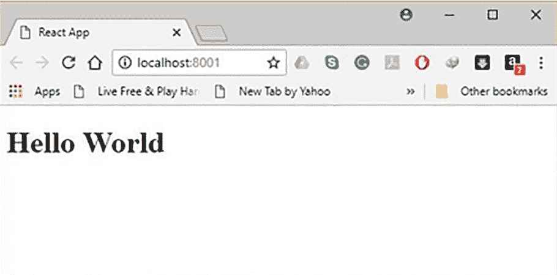

##### 第十步 – 生成打包文件

最后，我们想要生成打包文件，这需要从命令提示符运行 build 命令：

```
C:\Users\Username\Desktop\reactApp>npm run build
```

打包文件会在当前文件夹中生成，如下所示：

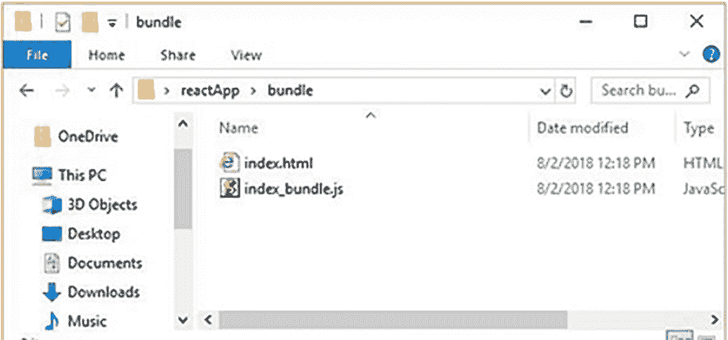

### create-react-app 命令

如果你不想使用 babel 和 webpack，还有另一种更简单的安装 ReactJS 的方法——使用 `create-react-app` 命令。

**第一步 – 安装 create-react-app**
使用以下命令进行安装：

```
C:\Users\Username>cd C:\Users\Username\Desktop\
C:\Users\Username\Desktop>npx create-react-app my-app
```

会创建一个名为 `my-app` 的文件夹并放置在你的桌面上，所有必需的文件也会随之创建。

**第二步 – 删除源文件**
打开 `my-app` 文件夹并查看 `src` 文件夹。从中删除以下文件：

```
C:\Users\Username\Desktop>cd my-app/src
C:\Users\Username\Desktop\my-app\src>del *
C:\Users\Username\Desktop\my-app\src\*, Are you sure (Y/N)? y
```

**第三步 – 添加文件**
向 `src` 文件夹中添加两个文件——`index.css` 和 `index.js`：

```
C:\Users\Username\Desktop\my-app\src>type nul > index.css
C:\Users\Username\Desktop\my-app\src>type nul > index.js
```

向 `index.js` 文件添加以下代码：

```javascript
import React from 'react';
import ReactDOM from 'react-dom';
import './index.css';
```

### 第四步 – 运行它

最后，使用 start 命令来运行它：

```
npm start
```

你应该会看到类似这样的内容：

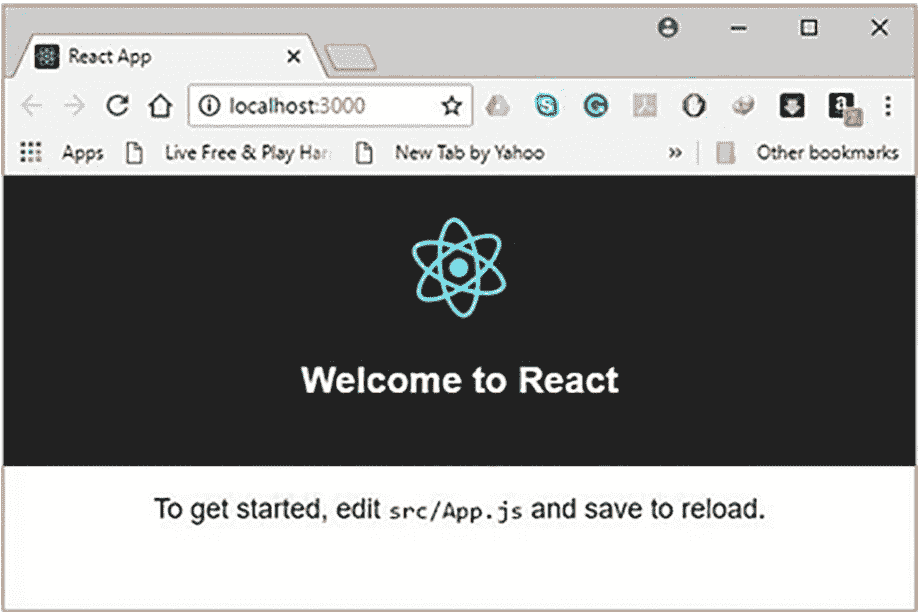

这完成了设置，所以我们将通过了解 JSX 来更深入地探讨 ReactJS。

## 第二章

## React JSX 简介

看看这个变量声明：

```jsx
const element = <h1>Hello, world!</h1>;
```

它看起来有点奇怪，你可能会想知道这是 HTML 还是字符串。嗯，它两者都不是。

这种语法是一种 JavaScript 的扩展，称为 JSX，虽然你不必使用它，但建议你在 ReactJS 中使用它来帮助描述用户界面的外观。JSX 可能看起来和感觉上像是一种模板语言，但相信我，它背后拥有 JavaScript 的全部强大功能和威力。

它生成 React 元素，稍后我们将看看如何将它们渲染到 DOM 中。不过首先，让我们了解一下 JSX 的基础知识。

### 为什么要使用 JSX？

React 非常强调渲染逻辑与用户界面中的其他逻辑有着固有的关系。这包括事件处理、随时间变化的状态以及准备要显示的数据。

与其使用单独的文件将技术人为地分离，或者将逻辑和标记分离，React 使用组件来分离关注点，这些组件不过是松散耦合的单元，同时包含逻辑和标记。我们将在后面的章节中讨论组件，但本节将为你提供一个良好的预期概述。

正如我所说，你不必在 React 中使用 JSX，但当你用 JavaScript 代码处理 UI 时，它是一个有用的视觉辅助工具。而且使用它能让你看到 React 提供的一些非常有用的警告信息和错误信息。

现在你知道它是怎么回事了，让我们深入了解 JSX。

### 如何在 JSX 中嵌入表达式

在下面这个简单的例子中，声明了一个名为 `name` 的变量，然后将其包裹在一对花括号中，以便在 JSX 中使用：

```javascript
const name = 'John Philips';
const element = <h1>Hello, {name}</h1>;
ReactDOM.render(
  element,
  document.getElementById('root')
);
```

只要 JavaScript 表达式是有效的，它就可以放在花括号中用于 JSX。例如，`5 + 7`、`formatName(user)` 和 `user.FirstName` 都是 JavaScript 中的有效表达式。

在下一个例子中，我们调用一个名为 `formatName(user)` 的 JavaScript 函数，并将其结果嵌入到 `<h1>` 元素中：

```javascript
function formatName(user) {
  return user.firstName + ' ' + user.lastName;
}
const user = {
  firstName: 'Harry',
  lastName: 'Philips'
};
const element = (
  <h1>
    Hello, {formatName(user)}! </h1>
);
ReactDOM.render(
  element,
  document.getElementById('root')
);
```

JSX 可以拆分为多行以提高可读性。虽然你不必这样做，但建议将其全部包裹在圆括号中，以避免自动分号插入带来的问题。我在这里不会深入讨论这个——如果你有 JavaScript 知识，你已经遇到过这个问题了。

### JSX 是一种表达式

当 JSX 表达式被编译后，它们会变成常规的函数调用，可以被求值为 JavaScript 对象。这意味着 JSX 可以在 `for` 循环和 `if` 语句中使用；它可以赋值给变量，从函数中返回，也可以作为参数接受。以下是一个例子：

```javascript
function getGreeting(user) {
  if (user) {
    return <h1>Hello, {formatName(user)}!</h1>; }
  return <h1>Hello, Stranger.</h1>;}
```

### 使用 JSX 指定属性

可以使用引号将字符串字面量指定为属性，如下所示：

```jsx
const element = <div tabIndex="0"></div>;
```

也可以使用花括号将 JS 表达式嵌入到属性中：

```jsx
const element = </img>;
```

当你在属性中嵌入 JS 表达式时，不要在花括号周围加引号。字符串应该用引号包围，表达式应该用花括号包围，但你不应该在一个属性中同时使用两者。

**警告**
JSX 比 HTML 更接近 JavaScript，因此 React DOM 使用 camelCase 命名约定，而不是 HTML 的属性名称。

例如，`tabindex` 会变成 `tabIndex`，`class` 会变成 `className`。

### 如何使用 JSX 指定子元素

如果有一个空标签，可以像 XML 中那样直接使用 `/>` 立即关闭：

```jsx
const element = ;
```

JSX 标签可以包含子元素：

```jsx
const element = (
  <div>
    <h1>Hello!</h1>
    <h2>Great to see you here.</h2>
  </div>
);
```

### 使用 JSX 防止注入攻击

用户输入可以安全地嵌入到 JSX 中：

```javascript
const title = response.potentiallyMaliciousInput;
// 这是安全的：
const element = <h1>{title}</h1>;
```

React DOM 在渲染之前，默认会对嵌入 JSX 的值进行转义。因此，这意味着没有任何方式可以注入应用程序中未明确编码的内容。所有内容在渲染前都会被转换为字符串，这有助于阻止跨站脚本（XSS）攻击。

### JSX 表示对象

JSX 会被 Babel 编译为 `React.createElement()` 调用。以下是两个相同的示例：

```javascript
const element = (
  <h1 className="greeting">
    Hello, world!
  </h1>
);
const element = React.createElement(
  'h1',
  {className: 'greeting'},
  'Hello, world!'
);
```

`React.createElement()` 会执行一些检查，帮助你编写无 bug 的代码，但本质上，它所做的就是创建如下对象：

```javascript
// 注意：这是一个简化结构
const element = {
  type: 'h1',
  props: {
    className: 'greeting',
    children: 'Hello, world!'
  }
};
```

这些是 React 元素，你可以将它们视为描述屏幕上想要呈现内容的一种方式。这些元素或对象会被 React 读取，并用于构建和更新 DOM。

**提示**

使用编辑器提供的 Babel 语言定义，以确保 ES6 和 JSX 代码能够正确高亮显示。

### 实用提示

虽然这只是对 JSX 的简要概述，但如果你觉得需要了解它的基本概念和使用方法，请记住以下实用提示：

- 切勿将 JSX 视为模板。相反，将其视为需要编译的标准 JavaScript 语法的替代方案。例如，JSX 将类 XML 标记转换为 JavaScript。
- Babel 工具可帮助将 ES 代码和 JSX 语法转换为 ES5 代码。
- JSX 与 React 完全分离。它不会尝试遵循 HTML 或 XML 规范；它被设计为 ECMAScript 的一项特性，与 XML 或 HTML 的任何相似性都 purely 是表面上的——它看起来像 HTML 或 XML，使得编写熟悉的内容变得容易。
- `<foo-bar />` 在 JSX 中是有效的，而 `<foo-bar>` 则不是。请记住，所有标签都必须闭合。

以下是 JSX 的四个要点总结：

- 必要的部分可以被技术能力较弱的用户理解和修改。CSS 设计师和开发人员相比纯 JavaScript 更可能觉得 JSX 更熟悉——例如，HTML 标记看起来完全像 HTML 标记。
- 可以充分运用 JavaScript 的全部能力来处理 HTML，避免了学习和使用模板语言的必要。JSX 绝不是模板语言；它是一种语法，使得以树结构表达 UI 组件变得更加容易。
- 当你添加 JSX 转换步骤后，你可以发现之前可能遗漏的 HTML 错误。
- JSX 强烈建议使用内联样式。

还有一些 JSX 的陷阱你真的需要注意：

虽然 JSX 看起来非常像 HTML，但你必须记住它们之间存在重要的区别：

### HTML 实体

HTML 实体可以插入到 JSX 中的字面文本里：

```html
<div>First &middot; Second</div>
```

如果你想在动态内容中显示 HTML 实体，你可能会遇到双重转义的问题。React 默认会在显示时对每个字符串进行转义，以阻止 XSS 攻击。

```javascript
// 不好：它显示 "First &middot; Second"
<div>{'First &middot; Second'}</div>
```

有几种方法可以解决这个问题，最简单的方法是将 Unicode 字符放入 JS 中。确保将文件保存为 UTF-8 并设置正确的 UTF-8 指令；否则浏览器将无法正确显示。

```javascript
<div>{'First · Second'}</div>
```

也许更好、更安全的方法是找到实体的正确 Unicode 字符并将其添加到字符串中：

```javascript
<div>{'First \u00b7 Second'}</div>
<div>{'First ' + String.fromCharCode(183) + ' Second'}</div>
```

混合数组可以与 JSX 元素和字符串一起使用。

```javascript
<div>{['First ', <span>&middot;</span>, ' Second']}</div>
```

而且，作为最后的手段，可以插入原始 HTML：

```javascript
<div dangerouslySetInnerHTML={{__html: 'First &middot; Second'}} />
```

### 自定义 HTML 属性

如果向原生 HTML 元素传递的属性不在 HTML 规范中，React 将不会渲染它们。可以使用自定义属性，但它们必须以 `data-` 为前缀：

```html
<div data-custom-attribute="foo" />
```

如果你以 `aria-` 开头命名网页可访问性属性，它们将被正确渲染。

```html
<div aria-hidden={true} />
```

## 第 3 章

## 组件全解

React 允许你将组件定义为函数或类，而那些定义为类的组件具有许多有用的特性。首先，定义一个 React 组件类需要扩展 `React.Component`：

```javascript
class Welcome extends React.Component {
  render() {
    return <h1>Hello, {this.props.name}</h1>;
  }
}
```

`React.Component` 的子类必须至少定义一个方法。虽然我们在本章讨论的大多数方法是可选的，但你必须定义 `render()` 方法。

有一件事我必须提醒你：不要创建自己的基础组件类。React 组件通过组合而非继承来复用代码。

**注意**

在 React 中，你并非必须使用 ES6 类语法。如果你愿意，可以使用类似 `create-react-class` 模块的替代方案。

### 组件生命周期

每个 React 组件都有多个生命周期方法。这些方法可以在流程中的特定时刻被覆盖以运行代码。在这里，我们将讨论这些方法，其中最常用的以**粗体**显示。其余方法很少使用，但你仍然需要了解它们。

#### 挂载

当组件实例被创建并放入 DOM 时，会按以下顺序调用挂载生命周期方法：

- `constructor()`
- `static getDerivedStateFromProps()`
- `render()`
- `componentDidMount()`

**注意**

`UNSAFE_componentWillMount()` 是一个遗留方法，绝不能放入新代码中。稍后我们将更多地讨论遗留方法。

#### 更新

状态或 props 的变化可能导致更新，以下是在重新渲染组件时这些方法的调用顺序：

- `static getDerivedStateFromProps()`
- `shouldComponentUpdate()`
- `render()`
- `getSnapshotBeforeUpdate()`
- `componentDidUpdate()`

**注意**

以下方法是遗留方法，不应放入新代码中：

- `UNSAFE_componentWillUpdate()`
- `UNSAFE_componentWillReceiveProps()`

#### 卸载

当组件从 DOM 中移除时，会调用此方法：

- `componentWillUnmount()`

#### 错误处理

当渲染过程中、子组件的构造函数或生命周期方法中发生错误时，会调用错误处理方法：

- `static getDerivedStateFromError()`
- `componentDidCatch()`

### 其他 API

每个组件都有其他 API：

- `setState()`
- `forceUpdate()`

### 类属性

- `defaultProps`
- `displayName`

### 实例属性

- `props`
- `state`

### 常用的生命周期方法

在本节中，我们将介绍创建 React 组件时你可能遇到的大多数情况。

#### render()

这是类组件中**必须**存在的唯一方法。当 `render()` 方法被调用时，它会检查 `this.state` 和 `this.props`，并返回以下类型之一：

- **React 元素。** 这些通常是使用 JSX 创建的。例如，用于告诉 React 需要渲染 DOM 节点的一个组件是 `<div />`，而 `<MyComponent />` 则用于指示 React 渲染不同的用户定义组件。
- **片段和数组。** 这些允许你从 render 返回多个元素。
- **Portal（传送门）。** 它允许你将子组件渲染到其他的 DOM 子树中。
- **数字和字符串。** 两者在 DOM 中都以文本节点的形式渲染。
- **Null 或布尔值。** 这些不会渲染任何内容，它们的存在主要是为了支持 `test && <Child />` 模式，其中 `test` 为布尔值。

这是一个必须是纯函数的函数。这意味着它永远不会修改任何组件状态，永远不会直接与浏览器交互，并且在调用时始终返回相同的结果。

如果你需要与浏览器交互，请使用 `componentDidMount()` 或其他生命周期方法来完成工作。当 `render()` 保持纯净时，其他组件更容易协作。

**注意**
如果 `shouldComponentUpdate()` 返回 `false`，`render()` 将不会被调用。

#### constructor()

`constructor(props)`

如果状态未初始化且方法未绑定，你的 React 组件不需要实现构造函数。

React 组件的构造函数在挂载之前被调用。当实现 `React.Component` 子类的构造函数时，应在任何其他语句之前首先调用 `super(props)`。如果这没有发生，`this.props` 在构造函数中将不会被定义，从而导致代码中的错误和 bug。

通常，构造函数在 React 中仅用于两个原因：

- 初始化局部状态 – 这在将对象赋值给 `this.state` 时完成
- 将事件处理方法绑定到实例

有一件事你永远不应该在构造函数中调用，那就是 `setState()`。如果组件需要局部状态，初始状态应在构造函数中直接赋值给 `this.state`：

```
constructor(props) {
  super(props);
  // Never call this.setState() here!
  this.state = { counter: 0 };
  this.handleClick = this.handleClick.bind(this);
}
```

唯一可以直接赋值 `this.state` 的地方是构造函数。在其他方法中，应该使用 `this.setState()`。

尽量不要让任何订阅或副作用进入构造函数；在可能的情况下，你应该改用 `componentDidMount()`。

### 注意

不要犯将 prop 复制到 state 中的常见错误：

```
constructor(props) {
  super(props);
  // Never do this!
  this.state = { color: props.color };
}
```

你不应该这样做的原因有两个 – 第一，这确实没有必要（可以直接使用 `this.props.color()`），第二，这样做只会产生 bug，因为任何 `color` prop 的更新都不会反映在 state 中。

这种模式只应在你有意忽略 prop 更新时使用。然后，你应该给 prop 另一个名称，类似 `defaultColor` 或 `initialColor`。之后，可以在需要时强制组件更改其 `key`，从而重置其内部状态。

#### componentDidMount()

它在组件挂载后或插入到组件树中后立即被调用。任何需要 DOM 节点的初始化工作都需要放在这里，如果你需要加载远程端点数据，这里是发起网络请求的最佳位置。

它也是设置订阅的好地方，但你必须记住使用 `componentWillUnmount` 来取消订阅。

`setState()` 可以在 `componentDidMount()` 中立即调用，触发额外的渲染。然而，这发生在浏览器更新屏幕之前，保证用户永远不会看到中间状态，尽管我们调用了两次 `render()`。

这种模式必须谨慎使用，因为它可能导致性能问题。大多数情况下，初始状态可以在 `constructor()` 中赋值，但当你有工具提示、模态框，以及 DOM 节点需要在测量依赖于位置或大小的内容之前进行测量时，可以使用这种模式。

#### componentDidUpdate()

`componentDidUpdate(prevProps, prevState, snapshot)`

一旦更新发生，`componentDidUpdate()` 将立即被调用。但是，它永远不会在初始渲染时被调用。这应该用于在更新组件后对 DOM 执行操作，同时也是发起网络请求的好地方，只要比较了当前和之前的 props。例如，如果 props 没有发生变化，某些网络请求就不需要进行。

```
componentDidUpdate(prevProps) {
  // Typical use (you must compare props):
  if (this.props.userID !== prevProps.userID) {
    this.fetchData(this.props.userID);
  }
}
```

`setState()` 可以在 `componentDidUpdate()` 中立即调用，但它必须被包裹在条件语句中，如上面所示。如果没有，将会发生无限循环以及额外的重新渲染 – 用户不会看到这个，但它会影响组件的性能。如果你想让一个来自上方的 prop 镜像到 state 中，请直接使用该 prop。

如果你使用你的组件来实现 `getSnapshotBeforeUpdate`（这不太可能），它将作为 `componentDidUpdate()` 的第三个参数返回该值；否则，该参数保持未定义。

**注意**
如果 `shouldComponentUpdate()` 返回 `false`，`componentDidUpdate()` 将不会被调用。

#### componentWillUnmount()

在组件被卸载并销毁之前，`componentWillUnmount()` 被调用。使用此方法执行任何必要的清理工作 – 这可以包括取消任何网络请求、清理你在 `componentDidMount` 中创建的订阅、使任何计时器无效以及其他类似的任务。

`setState()` 不得在 `componentWillUnmount()` 中调用。组件永远无法重新渲染，任何已卸载的组件都无法再次挂载。

### 较少使用的生命周期方法

我们这里讨论的方法不太常被使用。当然，它们偶尔会有用处，但你使用的大多数组件不需要它们。

#### shouldComponentUpdate()

`shouldComponentUpdate(nextProps, nextState)`

这应该用于告知 React，组件的输出不会受到 props 或 state 当前变化的影响。默认情况下，每次状态变化都应该重新渲染，在大多数情况下，这比使用 `shouldComponentUpdate()` 方法更可取。

当收到新的 state 或 props 时，此方法在渲染之前被调用，其默认值为 `true`。当使用 `forceUpdate()` 或初始渲染时，它永远不会被调用。

你永远不应该依赖使用此方法来阻止渲染，因为它通常会导致 bug；它纯粹是为了优化性能。考虑使用 `PureComponent` 而不是 `shouldComponentUpdate()`。首先，它是一个内置方法，易于调用；其次，它不需要你手写。`PureComponent` 让我们对 state 和 prop 进行浅比较，减少了错过重要更新的机会。

但是，如果你想手写它，可以使用它来比较 `this.state` 与 `nextState` 以及 `this.props` 与 `nextProps`，并返回 `false`，这将告诉 React 跳过更新。注意 – 如果返回 `false`，它不会阻止子组件在其状态发生变化时的重新渲染。

你也不应该在 `shouldComponentUpdate()` 中使用 `JSON.stringify()` 或进行任何深度相等性检查，因为它效率低下，而且可能损害性能。

在撰写本文时，如果 `shouldComponentUpdate()` 返回 `false`，那么 `render()`、`UNSAFE_componentWillUpdate()` 和 `componentDidUpdate()` 将不会被调用。希望在未来，React 将 `shouldComponentUpdate()` 视为提示而非指令，并且如果它返回 `false`，组件可能仍会被重新渲染。

#### static getDerivedStateFromProps()

`static getDerivedStateFromProps(props, state)`

此方法在调用 `render()` 之前立即被调用，不仅在初始挂载时，而且在所有后续更新时也是如此。应返回以下两者之一 – 更新状态的对象或 `null`（不会更新任何内容）。

此方法仅在状态依赖于 props 随时间变化的少数情况下使用。例如，当你想要实现一个 `<Transition>` 组件时很有用，该组件将先前的 children 与下一个进行比较，以确定哪些应该被动画进入或退出。

当你派生状态时，它会使你的代码有些冗长，并使组件更难以理解，因此你需要考虑简单的替代方案：

- 如果需要副作用，例如动画或数据获取，作为对 props 变化的响应，`componentDidUpdate` 生命周期更合适。
- 如果仅需要在 props 发生变化时重新计算数据，记忆化辅助函数会更有用。
- 如果仅在 props 变化时重置状态，请考虑使用 `key` 使组件完全非受控或完全受控。

`static getDerivedStateFromProps` 也无法访问组件实例。你可以在方法和其他可用的类方法之间复用代码——这需要在类定义之外提取状态和 props 的纯函数。

请注意，此方法在所有渲染时都会触发，无论原因如何。相比之下，`UNSAFE_componentWillReceiveProps` 仅在由父组件导致的重新渲染时触发，而非本地 `setState`。

#### getSnapshotBeforeUpdate()

`getSnapshotBeforeUpdate(prevProps, prevState)`

此方法将在最近渲染的输出被提交到 DOM 之前立即调用。使用它可以让组件在任何潜在更改发生之前从 DOM 获取信息，该生命周期返回的任何值都会作为参数传递给 `componentDidUpdate()`。

这不是一个常见的使用场景，但在某些需要特殊处理滚动位置的 UI 中可能会用到，例如聊天记录。

无论何时使用此方法，你都应该返回 `null` 或快照值。例如：

```
class ScrollingList extends React.Component {
  constructor(props) {
    super(props);
    this.listRef = React.createRef();
  }
  getSnapshotBeforeUpdate(prevProps, prevState) {
    // Is a new item being added to the list?
    // Capture the scroll position so we it can be adjusted later.
    if (prevProps.list.length < this.props.list.length) {
      const list = this.listRef.current;
      return list.scrollHeight - list.scrollTop;
    }
    return null;
  }
  componentDidUpdate(prevProps, prevState, snapshot) {
    // If we see a snapshot value, we know new items have been added.
    // Adjust scroll, so they don't push the old items out of the view.
    // (Here, the snapshot is the returned value from getSnapshotBeforeUpdate)
    if (snapshot !== null) {
      const list = this.listRef.current;
      list.scrollTop = list.scrollHeight - snapshot;
    }
  }
  render() {
    return (
        <div ref={this.listRef}>{/* ...contents... */}</div>
    );
  }
}
```

这些示例说明了从 `getSnapshotBeforeUpdate` 中读取 `scrollHeight` 属性的重要性，因为在提交和渲染生命周期阶段之间可能会有一些延迟。

### 错误边界

错误边界是一种可以捕获 JavaScript 错误的组件，无论错误发生在子组件树中的哪个位置。它还可以捕获错误并提供替代 UI 来取代崩溃的界面。这些边界会捕获边界下方整棵子树中生命周期方法、渲染和构造函数中的错误。

当类组件定义了一个或两个生命周期方法——`componentDidCatch()` 或 `static getDerivedStateFromError()`——时，它们就变成了错误边界。当从任一生命周期更新状态时，你可以捕获下方子树中未处理的错误并显示替代 UI。

你不应该使用错误边界来控制流程，而仅用于从意外异常中恢复。

**注意**
错误边界只能捕获其下方组件树中的错误；它们无法捕获自身内部的错误。

#### static getDerivedStateFromError()

`static getDerivedStateFromError(error)`

当后代组件抛出错误时，此方法会被调用一次。该方法接收错误作为参数，其返回值应更新状态：

```
class ErrorBoundary extends React.Component {
    constructor(props) {
        super(props);
        this.state = { hasError: false };
    }
}
```

#### componentDidCatch()

`componentDidCatch(error, info)`

此方法在后代组件抛出错误后被调用。它接收两个参数：

- `error` – 抛出的错误
- `info` – 包含 `componentStack` 键的对象，其中包含有关哪个组件抛出错误的信息

```
class ErrorBoundary extends React.Component {
    constructor(props) {
        super(props);
        this.state = { hasError: false };
    }
    static getDerivedStateFromError(error) {
        return { hasError: true };
    }
    componentDidCatch(error, info) {
        logComponentStackToMyService(info.componentStack);
    }
    render() {
        if (this.state.hasError) {
            return <h1>Something went wrong.</h1>;
        }
        return this.props.children;
    }
}
```

## 第 4 章

## State 和生命周期

本章将简要介绍 React 组件的 state 和生命周期概念。让我们直接开始。

假设我们有一个滴答作响的时钟示例。如果你想跟着做，可以创建一个新文件，随意命名，然后添加以下代码：

```
function tick() {
  const element = (
    <div>
      <h1>Hello, world!</h1>
      <h2>It is {new Date().toLocaleTimeString()}.</h2>
    </div>
  );
  ReactDOM.render(element, document.getElementById('root'));
}
setInterval(tick, 1000);
```

我们想要做的是让时钟组件变得封装化和可复用，这样它就能设置自己的定时器，并且每秒自动更新自身。

首先要做的是封装时钟的外观：

```
function Clock(props) {
  return (
    <div>
      <h1>Hello, world!</h1>
      <h2>It is {props.date.toLocaleTimeString()}.</h2>
    </div>
  );
}
function tick() {
  ReactDOM.render(
    <Clock date={new Date()} />, document.getElementById('root')
  );
}
setInterval(tick, 1000);
```

然而，有一个关键部分缺失了——所有这些，包括设置定时器和每秒更新 UI，都应该只是实现细节。因此，我们想做的是只编写一次代码，并让时钟自动更新：

```
ReactDOM.render(
  <Clock />, document.getElementById('root')
);
```

实现这一点需要在时钟组件中添加"state"。State 类似于 props（我们稍后会讨论），但它是私有的，由组件自身控制。

### 将函数转换为类

像 Clock 这样的函数组件可以通过以下五个步骤转换为类：

- 1. 创建一个同名的 ES6 类，并继承 `React.Component`
- 2. 向该类添加一个名为 `render()` 的空方法
- 3. 将函数体移入 `render()` 中
- 4. 在 `render()` 的函数体中用 `this.props` 替换 props
- 5. 删除剩余的空函数声明：

```
class Clock extends React.Component {
  render() {
    return (
      <div>
        <h1>Hello, world!</h1>
        <h2>It is {this.props.date.toLocaleTimeString()}.</h2>
      </div>
    );
  }
}
```

现在我们已经将 Clock 定义为一个类，而不是函数。

每当发生更新时，`render()` 就会被调用。但是，只要 `<Clock />` 被渲染到同一个 DOM 节点上，就只会使用一个 Clock 类的实例，从而允许它使用本地 state、生命周期方法和其他有用的功能。

### 向类中添加本地 state

将日期从 props 中取出并放入 state 中，需要三个步骤：

#### 第一步

第一步是在 `render()` 中进行替换——用 `this.state.date` 替换 `this.props.date`。

```
class Clock extends React.Component {
  render() {
    return (
      <div>
        <h1>Hello, world!</h1>
        <h2>It is {this.state.date.toLocaleTimeString()}.</h2>
      </div>
    );
  }
}
```

#### 第二步

接下来添加一个类构造函数，用来赋值初始的 `this.state`：

```
class Clock extends React.Component {
  constructor(props) {
    super(props);
    this.state = {date: new Date()};
  }
  render() {
    return (
      <div>
        <h1>Hello, world!</h1>
        <h2>It is {this.state.date.toLocaleTimeString()}.</h2>
      </div>
    );
  }
}
```

请注意 props 被传递给了基类构造函数：

```
constructor(props) {
  super(props);
  this.state = {date: new Date()};
}
```

类组件应该始终使用 props 调用基类构造函数。

#### 第三步

最后一步是从 `<Clock />` 元素中移除 `date` prop：

```
ReactDOM.render(
  <Clock />, document.getElementById('root')
);
```

稍后，定时器代码将被添加回组件中。

以下是最终结果：

```
class Clock extends React.Component {
  constructor(props) {
    super(props);
    this.state = {date: new Date()};
  }
  render() {
    return (
      <div>
        <h1>Hello, world!</h1>
        <h2>It is {this.state.date.toLocaleTimeString()}.</h2>
      </div>
    );
  }
}
ReactDOM.render(
  <Clock />, document.getElementById('root')
);
```

接下来，我们将让 Clock 设置自己的时间并每秒更新：

### 向类中添加生命周期方法

如果你的应用程序有大量组件，最重要的事情之一就是释放已被销毁组件所使用的资源。

我们需要做的是确保每次 Clock 首次被渲染到 DOM 时，都会设置一个定时器。在 React 中，这被称为挂载（mounting）。我们还需要确保在 Clock 产生的 DOM 被移除时清除定时器。在 React 中，这被称为卸载（unmounting）。

每当组件被挂载和卸载时，我们希望在组件类中声明特殊的方法，以便运行一些代码：

```
class Clock extends React.Component {
  constructor(props) {
    super(props);
    this.state = {date: new Date()};
  }
  componentDidMount() { }
  componentWillUnmount() { }
  render() {
    return (
      <div>
        <h1>Hello, world!</h1>
        <h2>It is {this.state.date.toLocaleTimeString()}.</h2>
      </div>
    );
  }
}
```

这些被称为生命周期方法。

一旦组件的输出被渲染到 DOM，`componentDidMount()` 就会运行，这使其成为设置定时器的好地方：

```
componentDidMount() {
  this.timerID = setInterval(
    () => this.tick(),
    1000
  );
}
```

注意，计时器 ID 保存在 `this.timerID` 上。

所以，React 设置 `this.props`，`this.state` 有一些特殊含义，但你仍然可以手动向类添加其他字段，特别是如果你想存储一些在数据流中没有特定作用的东西，比如 `this.timerID`。

我们将使用名为 `componentWillUnmount` 的生命周期方法来拆除计时器。

```
componentWillUnmount() {
  clearInterval(this.timerID);
}
```

最后，实现了一个名为 `tick()` 的方法，时钟组件每秒都会运行它。它将使用 `this.setState()` 调度组件本地状态的更新。

```
class Clock extends React.Component {
  constructor(props) {
    super(props);
    this.state = {date: new Date()};
  }
  componentDidMount() {
    this.timerID = setInterval(
      () => this.tick(),
      1000
    );
  }
  componentWillUnmount() {
    clearInterval(this.timerID);
  }
  tick() {
    this.setState({
      date: new Date()
    });
  }
  render() {
    return (
      <div>
        <h1>Hello, world!</h1>
        <h2>It is {this.state.date.toLocaleTimeString()}.</h2>
      </div>
    );
  }
}
ReactDOM.render(
  <Clock />,
  document.getElementById('root')
);
```

### 正确使用 State

现在，我们的时钟将每秒滴答一次。

让我们快速回顾一下发生的事情以及方法调用顺序：

- 1. `<Clock />` 被传入 `ReactDOM.render()`。React 调用 Clock 组件的构造函数。Clock 必须显示当前时间，因此 `this.state` 使用包含当前时间的对象进行初始化。此状态将在稍后更新。
- 2. 然后，React 调用 Clock 组件中的 `render()` 方法，告诉 React 应该在屏幕上显示什么。随后，React 更新 DOM 以匹配 Clock 的渲染输出。
- 3. 浏览器每秒调用一次 `tick()` 方法，在该方法内部，Clock 组件调度一次 UI 更新。它通过使用包含当前时间的对象调用 `setState()` 来实现这一点。React 通过调用 `setState()` 来了解状态已更改。接着调用 `render()` 方法来确定应该显示什么，这一次，`render()` 方法中的 `this.state.date` 不同了，更新的时间将包含在渲染输出中。React 相应地更新 DOM。
- 4. 如果从 DOM 中移除 Clock 组件，React 会调用 `componentWillUnmount()`，停止计时器。

关于 `setState()`，有三件重要的事情需要了解：

- 不应直接修改状态

在以下示例中，组件将不会重新渲染：

```javascript
// 错误
this.state.comment = 'Hello';
```

相反，应该使用 `setState()`：

```javascript
// 正确
this.setState({comment: 'Hello'});
```

构造函数是唯一可以给 `this.state` 赋值的地方。

### 状态更新可能是异步的

React 可能会将多个 `setState()` 调用合并为一个更新以提高性能。然而，由于 `this.state` 和 `this.props` 可能会异步更新，你永远不要依赖它们的值来计算下一个状态。

例如，计数器可能不会被以下代码更新：

```javascript
// 错误
this.setState({
    counter: this.state.counter + this.props.increment,
});
```

修复它需要使用另一种 `setState()` 形式，这种形式接受函数而不是对象。该函数的第一个参数是之前的状态，第二个是更新应用时的 props。

```javascript
// 正确
this.setState((state, props) => ({
    counter: state.counter + props.increment
}));
```

这里使用了箭头函数，但普通函数同样适用。

```javascript
// 正确
this.setState(function(state, props) {
    return {
        counter: state.counter + props.increment
    };
});
```

### 状态更新会被合并

当调用 `setState()` 时，React 会将该对象合并到当前状态中。例如，你的状态中可能有若干独立的变量：

```javascript
constructor(props) {
    super(props);
    this.state = {
        posts: [],
        comments: []
    };
}
```

然后你可以使用单独的 `setState()` 调用来独立更新它们：

```javascript
componentDidMount() {
    fetchPosts().then(response => {
        this.setState({
            posts: response.posts
        });
    });
    fetchComments().then(response => {
        this.setState({
            comments: response.comments
        });
    });
}
```

这是浅合并，因此 `this.setState({comments})` 不会改变 `this.state.posts`，但 `this.state.comments` 会被替换。

### 数据流向下

父组件和子组件无法知道某个特定组件是有状态的还是无状态的，而且组件被定义为类还是函数对它们来说也不应该有任何区别。

这就是为什么你经常将状态视为封装的或局部的——唯一能访问它的组件是该状态的拥有者和设置它的组件。

组件可以选择将它们的作为 props 传递给子组件：

```javascript
<FormattedDate date={this.state.date} />
```

名为 `FormattedDate` 的组件在其 props 中接收日期，但它不知道数据来自 Clock 的 props、状态还是手动输入的。

```javascript
function FormattedDate(props) {
  return <h2>It is {props.date.toLocaleTimeString()}.</h2>;
}
```

这被称为单向或自上而下的数据流。状态始终由组件拥有。状态派生的任何 UI 或数据都有可能影响树中较低的组件。

想象组件树是一个 props 的"瀑布"。每个组件的状态是另一个在某一点加入但向下流动的水源。

创建一个应用组件来渲染三个 `<Clock />` 会向我们展示所有组件都是隔离的：

```javascript
function App() {
  return (
    <div>
      <Clock />
      <Clock />
      <Clock />
    </div>
  );
}
ReactDOM.render(
  <App />,
  document.getElementById('root')
);
```

每个独立的时钟都会设置自己的计时器并独立更新。

在任何 React 应用中，组件是有状态的还是无状态的被视为组件的实现细节，可能会随时间变化。无状态组件可以用于有状态组件中，反之亦然。

## 第 5 章

## ReactJS Props 和 PropTypes

你是否对 props 和 PropTypes 感到困惑？很多人都是如此，在本章中，我的目标是告诉你需要了解的内容——首先要知道的是，当你开发 React 应用时，它们可以让你的生活变得*极其轻松*。

当你构建 React 应用时，你将 UI 拆分为多个组件，这意味着数据正在它们之间传递，而 props 是其中至关重要的一部分。

### 理解 Props

在 React 中，props 用于在组件之间传递信息，而且由于 React 中有多个组件，props 允许我们在需要它的组件之间共享数据。它使用单向流，这意味着数据从父组件流向子组件，但使用回调函数可以让我们朝相反方向传递。

数据有多种格式——字符串、数字、函数、数组、对象等。Props 可以以与在 HTML 代码中声明属性的相同方式传递给任何组件。看看这个例子：

```javascript
<PostList posts={postsList} />
```

在这里，我们将一个名为 `posts` 的 prop 传递给了一个名为 `PostList` 的组件。该 prop 的值是 `{postsList}`。

让我们看看如何访问和传递数据。

### 传递和访问 Props

首先创建一个包含用户名和帖子列表的应用。该应用将有几个组件——App、PostList 和 Post。帖子列表需要某些数据，如内容和用户名，数据可以这样构建：

```javascript
const postsList = [
  {
    id: 1,
    content: "Soon, the pandemic will be over",
    user: "Laura Lyle",
  },
  {
    id: 2,
    content: "I'm so excited to be getting married",
    user: "Julie Jones",
  },
  {
    id: 3,
    content: "What do you think of the pandemic",
    user: "Simon Stevens",
  },
  {
    id: 4,
    content: "Is the world coming to an end",
    user: "Mark David",
  },
];
```

现在 App 组件需要获取数据，组件看起来像这样：

```javascript
const App = () => {
  return (
    <div>
      <PostList posts={postsList} />
    </div>
  );
};
```

帖子数组作为 prop 传递给 `PostList`（我们稍后会创建 PostList）。父组件是 `PostList`，它访问 `postsList` 中的数据。然后这些数据作为 `posts` props 传递给子组件 `Post`。

记住，我说过应用中有三个组件，我们将在过程中创建它们。

首先，`PostList`：

```javascript
class PostList extends React.Component {
  render() {
    return (
      <React.Fragment>
        <h1>Latest Users Posts</h1>
        <ul>
          {this.props.posts.map((post) => {
            return (
              <li key={post.id}>
                <Post {...post} />
              </li>
            );
          })}
        </ul>
      </React.Fragment>
    );
  }
}
```

`PostList` 组件接收一个 `posts` 属性。然后它遍历 `this.props.posts`，将每篇文章作为 `Post` 组件返回。我们在这段代码中还使用了 `key`，它是分配给每个列表项的唯一标识符，用于区分不同项目。我们将在后面的章节中更详细地讨论 `key`，但现在，`key` 就是文章的 ID，没有两个项目可以拥有相同的 ID。

其余属性通过 `<Post {...post} />` 作为 props 传递给 `Post` 组件。因此，现在我们需要创建那个 `Post` 组件，以便在其中使用 props：

```javascript
const Post = (props) => {
  return (
    <div>
      <h2>{props.content}</h2>
      <h4>username: {props.user}</h4>
    </div>
  );
};
```

`Post` 被构建成一个函数式组件，而不是像 `PostList` 那样的类组件。我们这样做的目的是演示在函数式组件中如何访问 props，与在类组件中使用 `this.props` 访问 props 进行对比。在函数式组件中，props 可以直接用于访问值。

现在你已经了解了如何传递和访问 props，以及信息如何在组件之间传递，我们需要进一步探讨如何将 props 与函数结合使用。

### 通过 Props 传递函数

在上一节中，我们了解了如何在组件之间传递数据数组作为 props，但如果我们要传递的是函数呢？React 也允许函数在组件之间传递，当我们希望子组件触发父组件的状态变更时，这非常有用。Props 应该是不可变的，这意味着你不应该尝试更改它们的值。状态变更必须在传递 props 的组件中完成，也就是父组件中。

为了演示实际效果，我们将创建一个应用，当监听到点击事件时改变应用状态。要在一个不同的组件中改变应用状态，必须将函数传递给需要更改状态的组件。通过这样做，我们就能在子组件中获得一个可以更改状态的函数。

听起来很复杂？试试下面的代码——它将使用两个组件在屏幕上显示一条有用的信息。第一个是 App，它是包含状态和设置状态函数的父组件。第二个是 ChildComponent，用于在状态改变时渲染屏幕上的信息：

```javascript
class App extends React.Component {
  constructor(props) {
    super(props);
    this.state = {
      isShow: true,
    };
  }
  toggleShow = () => {
    this.setState((state) => ({ isShow: !state.isShow }));
  };
  render() {
    return (
      <div>
        <ChildComponent isShow={this.state.isShow} clickMe={this.toggleShow} />
      </div>
    );
  }
}
```

我们将状态设置为 `true`，并在 App 组件中创建了用于更改状态的方法。应用的状态通过 `render()` 中的 `isShow` 属性传递给 `ChildComponent` 组件。最后，`toggleShow()` 函数作为 props 传递给 `clickMe`。

这将在 `ChildComponent` 中使用，其代码如下：

```javascript
class ChildComponent extends React.Component {
  clickMe = () => {
    this.props.clickMe();
  };
  render() {
    const greeting = "Welcome to React Props";
    return (
      <div style={{ textAlign: "center", marginTop: "8rem" }}>
        {this.props.isShow ? (
          <h1 style={{ color: "green", fontSize: "4rem" }}>{greeting}</h1>
        ) : null}
        <button onClick={this.clickMe}>
          <h3>click Me</h3>
        </button>
      </div>
    );
  }
}
```

最重要的是，App 组件通过 props 将一个函数传递给了 `ChildComponent`。`clickMe()` 函数在 `ChildComponent` 中被用作点击处理程序，但 `ChildComponent` 完全不知道该函数的内部逻辑——它只是等待按钮被点击，然后触发该函数。当函数被调用后，状态发生改变，随后状态再次作为 props 传递下来。所有受影响的组件将重新渲染。

应用状态 `isShow` 作为 props 传递给 `ChildComponent`——没有它，就无法编写逻辑在状态更新后显示正确的问候语。

接下来让我们看看如何验证 props，这需要使用 PropTypes。

### 什么是 React PropTypes？

PropTypes 确保组件使用正确的数据类型，并且传递了正确的数据。它们还确保组件使用了正确的 prop 类型，并且接收方组件也获得了正确的 prop 类型。

可以把它想象成一只小猫去宠物店。这家店不想要蛇、老虎或马；它只想要小猫。PropTypes 确保传递了正确的数据类型（小猫），而不是其他类型的动物。

我们已经了解了如何使用 props 向组件传递信息。props 是直接作为属性传递的，也可以从组件外部传入和使用。我们没有做的是检查通过 props 传入组件的值的类型，也没有检查一切是否正常工作。

是否验证 prop 传递给组件的数据由我们自己决定，但在处理复杂应用时，数据验证始终是一个好主意。

在复杂应用中，验证通过 props 获取的数据始终是一个好的做法。

### 使用 PropTypes

使用 PropTypes 需要将该包作为依赖添加到应用中。可以通过以下 npm 命令完成：

```
npm install --save prop-types
```

首先，必须从 `prop-types` 包中导入 PropTypes：

```javascript
import PropTypes from 'prop-types';
```

我们将在之前创建的用户文章列表应用中使用 PropTypes。以下是在 `Post` 组件上的用法：

```javascript
Post.propTypes = {
  id: PropTypes.number,
  content: PropTypes.string,
  user: PropTypes.string
}
```

这里有两个 prop 验证器——`PropTypes.number` 和 `PropTypes.string`。它们用于确保接收到正确类型的 props。在上面的代码中，`id` 被声明为数字类型，`user` 和 `content` 被声明为字符串类型。

PropTypes 还有助于捕获 bug，并且可以通过使用 `isRequired` 来强制传递 props：

```javascript
Post.propTypes = {
  id: PropTypes.number.isRequired,
  content: PropTypes.string.isRequired,
  user: PropTypes.string.isRequired
}
```

PropTypes 中有很多验证器，以下是较常用的一些：

```javascript
Component.propTypes = {
  stringProp: PropTypes.string,    // 该 prop 是字符串
  numberProp: PropTypes.number,    // 该 prop 是数字
  anyProp: PropTypes.any,          // 该 prop 可以是任何数据类型
  booleanProp: PropTypes.bool,     // 该 prop 是布尔值
  functionProp: PropTypes.func     // 该 prop 是函数
  arrayProp: PropTypes.array       // 该 prop 是数组
}
```

### 默认 Props

如果我们有想通过 props 传递给组件的默认信息，可以使用 `defaultProps`。当 PropType 没有使用 `isRequired` 时，它被视为可选的，此时可以设置 `defaultProps`，确保在没有传递 props 时仍有默认值。以下是一个示例：

```javascript
class Profile extends React.Component{
    // 指定 props 的默认值
    static defaultProps = {
        name: 'Stranger'
    };
    // 渲染 "Welcome, Stranger":
    render() {
        return <h2> Welcome, {this.props.name}<h2>
    }
}
```

在这个例子中，`defaultProps` 确保了 `this.props.name` 有值，以防父组件没有指定它。如果 `Profile` 组件没有接收到 `name` prop，它将有一个默认值 `Stranger`。这可以防止在 prop 未传递时发生错误。

最佳实践建议对所有可选的 PropTypes 使用 `defaultProps`。

## 第 6 章

## ReactJS 表单

表单是使用 React 构建的 Web 应用中最重要的部分之一。它们允许应用用户在登录界面、结账界面等场景中输入数据并提交。大多数使用 React 构建的应用是 SPA（单页应用）或只有一个页面的 Web 应用，新数据通过动态方式显示。这意味着，由于信息不能直接从表单提交到服务器，它需要在客户端被捕获并通过其他 JS 代码发送。

这些表单在面临的挑战上有其独特之处——要么由浏览器处理表单上的大部分元素，使用 React 变更事件来收集数据；要么由 React 完全控制元素，直接设置输入值并进行更新。第一种方式被称为非受控组件，因为 React 不参与值的设置；而第二种是受控组件，因为 React 积极参与任何输入的更新。

在本章中，我们将完成一个使用表单和表单提交来提交购买橙子请求的应用。在此过程中，你将了解使用非受控和受控组件的优势和劣势。你还将学习如何根据表单状态动态设置表单属性，以启用和禁用字段。

### 第一步——使用 JSX 创建基本表单

第一步是使用 JSX 创建一个空表单。它必须包含一个元素和一个提交按钮。表单的提交事件将被处理，数据将传递给不同的服务。在第一步结束时，你的表单将能够将数据传递给异步函数。

首先，打开 `App.js` 组件：

```
nano src/components/App/App.js
```

我们想要构建一个允许我们购买橙子的表单，因此创建一个 `<div>` 并为其设置一个名为 `wrapper` 的 `className`。给它一个包含文本“Look At Those Oranges!”的 `<h1>` 标签，并添加一个空的 `form` 元素。你可以使用下面的代码来完成：

```jsx
import React from 'react';
import './App.css';
function App() {
  return (
    <div className="wrapper">
      <h1>Look At Those Oranges!</h1>
      <form>
      </form>
    </div>
  )
}
export default App;
```

现在，在 `<form>` 标签内，你需要一个 `<fieldset>` 元素，其中需要包含一个在 `<label>` 标签内的 `<input>` 元素。当你将 `<input>` 元素包裹在 `<label>` 元素中时，它有助于屏幕阅读器用户，因为标签和输入是关联的——这也让你的应用更具可访问性。最后，需要在表单底部添加一个提交 `<button>`：

```jsx
import React from 'react';
import './App.css';
function App() {
  return(
    <div className="wrapper">
      <h1>Look At Those Oranges!</h1>
      <form>
      <fieldset>
        <label>
          <p>Name</p>
          <input name="name" />
        </label>
      </fieldset>
      <button type="submit">Submit</button>
    </form>
  </div>
  )
}
export default App;
```

保存并关闭文件。现在打开 `App.css` 以便设置样式：

```
nano src/components/App/App.css
```

现在为 `.wrapper` 添加一些内边距，并为 `fieldset` 添加外边距。这将为元素之间提供空间。

```css
.wrapper {
    padding: 5px 20px;
}
.wrapper fieldset {
    margin: 20px 0;
}
```

保存并关闭文件；你的浏览器会重新加载，一个基本的表单将出现在屏幕上，显示“Look At Those Oranges!”，下方有一个提交按钮。

点击提交按钮，页面会重新加载。因为这是一个单页应用，标准按钮行为通过 `type="submit"` 被阻止了，所以提交事件将在组件内部处理：

首先，打开 `App.js`：

```
nano src/components/App/App.js
```

现在需要为 `<form>` 元素（而不是你可能认为的 `<button>`）添加一个事件处理程序。创建一个函数并命名为 `handleSubmit`——它将接收一个 `SyntheticEvent` 参数，该参数包装了 `Event` 对象并具有相同的接口。通过调用 `.preventDefault`，你可以阻止页面提交表单，并触发一个确认表单提交的警报：

```jsx
import React from 'react';
import './App.css';
function App() {
  const handleSubmit = event => {
    event.preventDefault();
    alert('The form is submitted.')
  }
  return(
    <div className="wrapper">
      <h1>Look At Those Oranges!</h1>
      <form onSubmit={handleSubmit}>
        <fieldset>
          <label>
            <p>Name</p>
            <input name="name" />
          </label>
        </fieldset>
        <button type="submit">Submit</button>
      </form>
    </div>
  )
}
export default App;
```

再次保存文件，浏览器会重新加载。点击提交按钮，你会收到一个警报，告诉你表单已提交——窗口没有重新加载。

许多 React 应用需要你将数据发送到外部服务，例如 Web API。当服务解析完成时，可能会显示成功消息，或者你可以将用户重定向到其他地方，或者两者都做。

模拟 API 需要在 `handleSubmit` 函数中添加 `setTimeout` 函数，从而产生一个异步操作，该操作在完成前会等待指定的时间——这类似于外部数据请求的行为。然后使用 `useState` Hook 来创建两样东西——一个 `submitting` 变量和一个 `setSubmitting` 函数。当数据提交时，调用 `setSubmitting(true)`，当超时完成时，调用 `setSubmitting(false)`。

```jsx
import React, { useState } from 'react';
import './App.css';
function App() {
  const [submitting, setSubmitting] = useState(false);
  const handleSubmit = event => {
    event.preventDefault();
    setSubmitting(true);
    setTimeout(() => {
      setSubmitting(false);
    }, 3000)
  }
  return(
    <div className="wrapper">
      <h1>Look At Those Oranges!</h1>
      {submitting &&
        <div>Submitting Form...</div>
      }
      <form onSubmit={handleSubmit}>
        <fieldset>
          <label>
            <p>Name</p>
            <input name="name" />
          </label>
        </fieldset>
        <button type="submit">Submit</button>
      </form>
    </div>
  )
}
export default App;
```

当 `submitting` 为 `true` 时，你还会显示一个简短的 HTML 消息，告诉用户他们的表单正在提交。

保存文件，浏览器重新加载，然后点击提交——你的消息将会显示。

你现在有了一个基本的表单，可以在 React 组件内处理提交事件。它使用 `onSubmit` 事件处理程序连接到你的 JSX，并使用钩子在 `handleSubmit` 事件运行时显示警报。

在第二步中，我们将添加更多的用户输入，并学习当用户填写表单时数据如何保存到状态中。

### 第二步 – 使用非受控组件收集表单数据

现在我们将使用非受控组件来收集表单数据。这些组件的值不是由 React 设置的。与其在组件上设置数据，不如连接 `onChange` 事件来收集用户输入。随着组件的构建，你将学习 React 如何处理不同的输入类型，以及如何使用可重用函数将表单数据收集到一个对象中。

在第二步结束时，你将知道如何使用不同元素（如复选框和下拉菜单）构建表单。你还将知道如何收集表单数据、提交并显示它。

**注意**

你的大多数 React 应用将使用受控组件构建，但从非受控组件开始可以让你理解它们，并学习如何避免因值设置不正确而可能引入的错误和意外循环。

目前，你有一个提交信息的表单，但我们没有信息可以提交。表单中有一个 `<input>` 元素，但数据没有被收集或存储在组件中。要做到这一点并能够在用户提交的表单上处理数据，你需要一种管理状态的方法，然后每个输入都需要通过一个事件处理程序连接。

再次打开 `App.js`，通过使用 `useReducer` 钩子创建一个 `formData` 对象和一个 `setFormData` 函数。reducer 函数需要从 `event.target` 对象中提取 `name` 和 `value`。然后必须更新状态——当前状态被展开，而 `name` 和 `value` 被添加在末尾。这将导致创建一个状态对象，并在特定值改变时被覆盖，同时保持不变：

```jsx
import React, { useReducer, useState } from 'react';
import './App.css';
const formReducer = (state, event) => {
  return {
    ...state,
    [event.target.name]: event.target.value
  }
}
function App() {
  const [formData, setFormData] = useReducer(formReducer, {});
  const [submitting, setSubmitting] = useState(false);
  const handleSubmit = event => {
    event.preventDefault();
    setSubmitting(true);
    setTimeout(() => {
      setSubmitting(false);
    }, 3000)
  }
  return(
    <div className="wrapper">
      <h1>Look At Those Oranges!</h1>
      {submitting &&
        <div>Submitting Form...</div>
      }
      <form onSubmit={handleSubmit}>
        <fieldset>
          <label>
            <p>Name</p>
            <input name="name" onChange={setFormData}/>
          </label>
        </fieldset>
        <button type="submit">Submit</button>
      </form>
    </div>
  )
}
export default App;
```

一旦你创建了 reducer，就需要将 `setFormData` 添加到输入的 `onChange` 事件处理程序上——这将导致浏览器重新加载。如果你尝试在输入框中输入，你会得到一个错误：

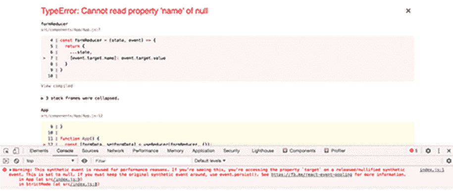

造成这种情况的原因是 `SyntheticEvent` 被重复使用了，因此它不能被传递给任何异步函数。简单来说，事件不能直接传递。修复此问题需要在调用 reducer 函数之前提取出你需要的数据。

需要更新 reducer 函数，使其接受一个包含 `name` 和 `value` 属性的对象。需要创建一个名为 `handleChange` 的函数，从 `event.target` 中提取数据，并将对象传递给 `setFormData`。最后，需要更新 `onChange` 事件处理程序，使其能够使用这个新函数：

```jsx
import React, { useReducer, useState } from 'react';
import './App.css';
const formReducer = (state, event) => {
    return {
        ...state,
        [event.name]: event.value
    }
}
function App() {
    const [formData, setFormData] = useReducer(formReducer, {});
    const [submitting, setSubmitting] = useState(false);
    const handleSubmit = event => {
        event.preventDefault();
        setSubmitting(true);
        setTimeout(() => {
            setSubmitting(false);
        }, 3000);
    }
    const handleChange = event => {
      setFormData({
        name: event.target.name,
        value: event.target.value,
      });
    }
    return(
      <div className="wrapper">
        <h1>Look At Those Oranges!</h1>
        {submitting &&
          <div>Submitting Form...</div>
        }
        <form onSubmit={handleSubmit}>
          <fieldset>
            <label>
              <p>Name</p>
              <input name="name" onChange={handleChange}/>
            </label>
          </fieldset>
          <button type="submit">Submit</button>
        </form>
      </div>
    )
}
export default App;
```

保存你的文件，页面会刷新，然后你就可以输入数据了。

由于你现在正在收集表单状态，可以更新用户显示信息，以显示一个包含数据的无序列表 `<ul>` 元素。使用 `Object.entries` 将数据转换为数组，然后映射数据以将每个数组成员转换为一个 `<li>` 元素，包括名称和值。确保使用名称作为元素的 `key` 属性。

```jsx
return(
  <div className="wrapper">
    <h1>Look At Those Oranges!</h1>
    {submitting &&
    <div>
      The following is being submitted:
      <ul>
        {Object.entries(formData).map(([name, value]) => (
          <li key={name}><strong>{name}</strong>: {value.toString()}</li>
        ))}
      </ul>
    </div>
    }
    <form onSubmit={handleSubmit}>
      <fieldset>
        <label>
          <p>Name</p>
          <input name="name" onChange={handleChange}/>
        </label>
      </fieldset>
      <button type="submit">Submit</button>
    </form>
  </div>
  )
}
export default App;
```

再次保存文件，页面会重新加载，你可以输入数据并提交。

现在你有了一个基本的表单，可以向其添加更多元素。再创建一个 `<fieldset>` 元素，并向其中添加一个 `<select>` 元素。这将包含不同的橙子品种作为每个 `<option>`，以及一个 `type="checkbox"` 的 `<input>`，用于选择礼品包装选项。

每个元素都需要将 `handleChange` 函数添加到 `onChange` 事件处理器：

```jsx
return(
<div className="wrapper">
<h1>Look At Those Oranges!</h1>
{submitting &&
<div>
The following is being submitted:
<ul>
{Object.entries(formData).map(([name, value]) => (
<li key={name}><strong>{name}</strong>: {value.toString()}</li>
))}
</ul>
</div>
}
<form onSubmit={handleSubmit}>
<fieldset>
<label>
<p>Name</p>
<input name="name" onChange={handleChange}/>
</label>
</fieldset>
<fieldset>
<label>
<p>Oranges</p>
<select name="orange" onChange={handleChange}>
<option value="">--Please choose an option--</option>
<option value="seville">Seville</option>
<option value="andrew">Andrew</option>
<option value="blood-orange">Blood Orange</option>
</select>
</label>
<label>
<p>Count</p>
<input type="number" name="count" onChange={handleChange} step="1"/>
</label>
<label>
  <p>Gift Wrap</p>
  <input type="checkbox" name="gift-wrap" onChange={handleChange} />
</label>
</fieldset>
<button type="submit">Submit</button>
</form>
</div>
)
}
export default App;
```

保存你的文件，页面重新加载，你会看到一系列用于表单的输入类型。

你确实需要考虑一个特殊情况——礼品包装复选框的值必须始终设置为 "on"，无论该项是否被选中。这里需要的是 `checked` 属性，而不是事件的值。

`handleChange` 函数需要更新以检查 `event.target.type` 是否为复选框。如果是，则必须将 `event.target.checked` 属性作为值传递，而不是 `event.target.value`：

```jsx
import React, { useReducer, useState } from 'react';
import './App.css';
function App() {
  const [formData, setFormData] = useReducer(formReducer, {});
  const [submitting, setSubmitting] = useState(false);
  const handleSubmit = event => {
    event.preventDefault();
    setSubmitting(true);
    setTimeout(() => {
      setSubmitting(false);
    }, 3000);
  }
  const handleChange = event => {
    const isCheckbox = event.target.type === 'checkbox';
    setFormData({
      name: event.target.name,
      value: isCheckbox ? event.target.checked : event.target.value,
    })
  }
```

这段代码使用 `?` 三元运算符来做出条件判断。

保存文件，浏览器将刷新，你可以填写表单并点击提交。警报将与表单中的数据匹配。

这一步教你如何创建一个非受控表单组件，使用 `useReducer` Hook 将表单数据保存到状态中，然后在其他组件中重用该数据。你还添加了其他表单组件类型，并更改了函数，以便根据元素类型保存正确的数据。

接下来，我们将通过动态设置组件值，来了解如何将这些组件转换为受控组件。

### 步骤三 – 使用受控组件更新表单数据

现在我们将学习如何使用受控组件来设置数据并动态更新它。将为每个组件添加一个 `value` 属性来设置表单数据或更新它，我们还将了解在提交时如何重置表单数据。

这一步将教你如何使用 React 的 props 和状态来动态控制表单数据。

当你使用非受控组件时，甚至不需要考虑数据同步，因为你的应用程序始终会拥有最近的更改。然而，有些情况下你需要从输入组件中读取数据并写入数据，这要求组件具有动态值。

在上一步中，表单已提交，但即使提交成功后，原始数据仍然保留在表单上。每个输入的数据都需要被清除，这要求将组件从非受控更改为受控。

受控组件与非受控组件非常相似，但有一个区别——`value` 属性由 React 更新。这很方便，但如果你没有正确更新 `value` 属性，组件看起来就会像是坏了，而不会显示正在更新。

在你创建的表单中，数据已经在被存储，因此转换组件需要使用 `formData` 状态中的数据来更新 `value` 属性。但是，值必须被定义；未定义的值将在控制台中引发错误。

由于你的初始状态是一个空对象，值必须设置为 `formData` 的值或一个空字符串，或其他一些默认值。例如，姓名值应为 `formData.name || ""`：

```jsx
return(
  <div className="wrapper">
    <h1>Look At Those Oranges!</h1>
    {submitting &&
      <div>
        The following is being submitted:
        <ul>
          {Object.entries(formData).map(([name, value]) => (
            <li key={name}><strong>{name}</strong>: {value.toString()}</li>
          ))}
        </ul>
      </div>
    }
    <form onSubmit={handleSubmit}>
      <fieldset>
        <label>
          <p>Name</p>
          <input name="name" onChange={handleChange} value={formData.name || ""}/>
        </label>
      </fieldset>
      <fieldset>
        <label>
          <p>Oranges</p>
          <select name="orange" onChange={handleChange} value={formData.orange || ""}>
            <option value="">--Please choose an option--</option>
            <option value="seville">Seville</option>
            <option value="andrew">Andrew</option>
            <option value="blood-orange">Blood Orange</option>
          </select>
        </label>
        <label>
          <p>Count</p>
          <input type="number" name="count" onChange={handleChange} step="1" value={formData.count || ""}/>
        </label>
        <label>
          <p>Gift Wrap</p>
          <input type="checkbox" name="gift-wrap" onChange={handleChange} checked={formData['gift-wrap'] || false}/>
        </label>
      </fieldset>
      <button type="submit">Submit</button>
    </form>
  </div>
)
}
export default App;
```

像上一步一样，复选框有所不同。不是设置一个值，而是必须设置 `checked` 属性。如果它是真值，浏览器中的方框将显示为选中状态。使用 `formData['gift-wrap'] || false` 来设置初始的 `checked` 属性。

如果你想让表单预填充一些数据，请在 `formData` 状态中放入一些默认数据。通过向 `formState` 提供 `{ count: 100 }` 来为 `count` 设置一个默认值。你也可以选择设置初始对象的默认值，但首先需要在显示表单信息之前过滤掉假值：

```jsx
function App() {
    const [formData, setFormData] = useReducer(formReducer, {
        count: 100,
    });
    const [submitting, setSubmitting] = useState(false);
    ...
}
```

保存你的文件，浏览器重新加载，默认的数据输入将显示在屏幕上。

**注意**

不要混淆 `value` 和 `placeholder` 属性——后者是浏览器原生的。`placeholder` 属性会显示信息，当用户输入新数据时，旧数据会立刻被替换——旧数据从不被存储。`value` 可以被主动编辑，但占位符只不过是给用户的提示。

现在你的组件是活跃的，数据可以在提交时被清除。这需要给 `formReducer` 一个新的条件。当 `event.reset` 为真时，为每个表单元素返回一个对象，该对象将包含空值。确保每个输入都有一个值。如果返回一个空或不完整的对象，值将是未定义的，因此，组件无法更新。

在将新的事件条件添加到 `formReducer` 之后，你的提交函数可以被更新，以便当函数解析完成时，状态被重置：

```jsx
import React, { useReducer, useState } from 'react';
import './App.css';
const formReducer = (state, event) => {
    if(event.reset) {
        return {
            name: '',
            orange: '',
            count: '',
            'gift-wrap': false
        }
    }
    return {
        ...state,
        [event.name]: event.value
    }
}
function App() {
    const [formData, setFormData] = useReducer(formReducer, {
        count: 100
    });
    const [submitting, setSubmitting] = useState(false);
    const handleSubmit = event => {
        event.preventDefault();
        setSubmitting(true);
        setTimeout(() => {
            setSubmitting(false);
            setFormData({
                reset: true
            })
        }, 3000);
    }
    ...
}
```

### 第四步 – 动态更新表单属性

最后，我们来了解如何动态更新表单元素的属性。属性根据之前的选择进行设置，并在提交时禁用表单，以防止多次提交。

目前，所有组件都是静态的，不会随表单变化而改变。大多数应用程序都有动态表单。字段会根据先前的数据发生变化，进行验证并显示错误。随着其他组件被填写，字段可能会展开或消失。

在大多数 React 组件中，组件的属性和属性可以动态设置，并且当数据变化时，它们会重新渲染。

尝试设置一个输入框，使其在另一个输入框满足特定条件之前保持禁用状态。我们将以礼品包装复选框为例——在用户选择 Seville 选项之前，将其禁用。

打开 `App.js`，在复选框中添加 `disabled` 属性，当 `formData.orange` 为 Seville 时，该属性为真：

```jsx
function App() {
  const [formData, setFormData] = useReducer(formReducer, {
    count: 100
  });
  const [submitting, setSubmitting] = useState(false);
  const handleSubmit = event => {
    event.preventDefault();
    setSubmitting(true);
    setTimeout(() => {
      setSubmitting(false);
      setFormData({
        reset: true
      })
    }, 3000);
  }
  // ...
        <fieldset>
            <label>
                <p>Oranges</p>
                <select name="orange" onChange={handleChange} value={formData.orange || ""}>
                    <option value="">--Please choose an option--</option>
                    <option value="seville">Seville</option>
                    <option value="andrew">Andrew</option>
                    <option value="blood-orange">Blood Orange</option>
                </select>
            </label>
            <label>
                <p>Count</p>
                <input type="number" name="count" onChange={handleChange} step="1"
                    value={formData.count || ""} />
            </label>
            <label>
                <p>Gift Wrap</p>
                <input
                    checked={formData['gift-wrap'] || false}
                    disabled={formData.orange !== 'seville'}
                    name="gift-wrap"
                    onChange={handleChange}
                    type="checkbox"
                />
            </label>
        </fieldset>
        <button type="submit">Submit</button>
    </form>
    </div>
    )
}
export default App;
```

保存文件后，浏览器会重新加载，默认情况下复选框是禁用的。如果选择 Seville 作为橙子类型，该元素将被启用。

除了更改单个组件的属性外，还可以通过更新 `fieldset` 组件来修改整个组件组。

例如，在活跃提交期间可以禁用表单。这样可以防止双重或多次提交，并阻止用户在 `handleSubmit` 完全处理之前更改任何字段。

为此，应在每个 `<fieldset>` 和 `<button>` 元素上添加 `disabled={submitting}`：

```jsx
          <form onSubmit={handleSubmit}>
            <fieldset disabled={submitting}>
              <label>
                <p>Name</p>
                <input name="name" onChange={handleChange} value={formData.name || ""}/>
              </label>
            </fieldset>
            <fieldset disabled={submitting}>
              <label>
                <p>Oranges</p>
                <select name="orange" onChange={handleChange} value={formData.orange || ""}>
                    <option value="">--Please choose an option--</option>
                    <option value="seville">Seville</option>
                    <option value="andrew">Andrew</option>
                    <option value="blood-orange">Blood Orange</option>
                </select>
              </label>
              <label>
                <p>Count</p>
                <input type="number" name="count" onChange={handleChange} step="1" value={formData.count || ""}/>
              </label>
              <label>
                <p>Gift Wrap</p>
                <input
                  checked={formData['gift-wrap'] || false}
                  disabled={formData.orange !== 'seville'}
                  name="gift-wrap"
                  onChange={handleChange}
                  type="checkbox"
                />
              </label>
            </fieldset>
            <button type="submit" disabled={submitting}>Submit</button>
          </form>
        </div>
      )
    }
export default App;
```

最后一次保存文件，浏览器会刷新。当表单提交时，字段将被禁用，直到提交功能完全处理完毕。

可以更新输入组件上的任何属性，这在需要更改数字输入的 `maxvalue` 或添加动态 `pattern` 属性进行验证时非常有用。

在最后这一步中，你学习了如何在表单组件上动态设置属性。你添加了一个属性，用于根据另一个组件的输入动态启用或禁用组件，还使用了 `<fieldset>` 组件来禁用整个部分。

表单是富 Web 应用的关键组成部分，React 提供了许多选项来连接和控制元素和表单。属性可以动态更新，包括值输入元素。如果你追求简单，可以使用非受控组件，但它们并不适用于所有情况。当组件需要预先填充数据或清空时，你应该使用受控组件，因为它们提供了更多更新数据的机会。它们还允许你使用另一个抽象层次，这可能会导致意外重新渲染或错误。

无论你选择哪种方法，React 都能让你动态更新和调整表单，以满足用户和应用程序的需求。

## 第七章

## ReactJS 事件

大多数应用程序的行为都基于事件。当用户在表单中输入值时，这是一个事件。当用户点击提交按钮时，这也是一个事件。事件可以通过多种方式触发，应用程序被设计成监听这些事件，以便作为响应执行其他操作。

如果你有 JavaScript 经验，你可能已经对事件很熟悉了。但 React 处理事件的方式有所不同，有其独特之处。它不是直接针对 DOM 事件，而是将它们包装在一个事件包装器中——稍后再详细介绍这一点。首先，我们需要了解如何创建、添加和监听 React 事件。

### 创建事件

首先要做的是创建一个包含输入框和按钮的表单。当输入值时，会触发一个事件。按钮调用一个函数来反转该值。工作原理如下：

- 用户在空输入框中输入文本
- 当在输入框中输入值时，会触发 `onChange` 事件，调用用于设置新输入状态的 `handleChange` 函数
- 当点击"反转文本"按钮时，会触发另一个事件。调用 `handleReverse()` 函数，设置新的 `reversedText` 状态。

让我们在代码中看看这一切：

```jsx
class App extends React.Component {
  state = {
    /* 初始状态 */
    input: "",
    reversedText: ""
  };
  /* handleChange() 函数用于设置新的输入状态 */
  handleChange = event => {
    const value = event.target.value;
    this.setState({
      input: value
    });
  };
  /* handleReverse() 函数将输入反转并设置为新的 reversedText 状态 */
  handleReverse = event => {
    event.preventDefault();
    const text = this.state.input;
    this.setState({
      reversedText: text
        .split("")
        .reverse()
        .join("")
    });
  };
  render() {
    return (
      <React.Fragment>
        {/* 表单提交时调用 handleReverse() */}
        <form onSubmit={this.handleReverse}>
          <div>
            {/* 渲染输入的内容 */}
            <label>Text: {this.state.input}</label>
          </div>
          <div>
            {/* 输入文本时触发 handleChange() */}
            <input
              type="text"
              value={this.state.input}
              onChange={this.handleChange}
              placeholder="Enter a text"
            />
          </div>
          <div>
            <button>Reverse Text</button>
          </div>
        </form>
        {/* 渲染反转后的文本 */}
        <p>Reversed Text: {this.state.reversedText}</p>
      </React.Fragment>
    );
  }
}
```

### 监听组件事件

假设你有一个像这样的组件：

### 添加事件监听器

有时，你可能想要在组件挂载之后使用特定的 DOM 事件。我们可以通过 `resize` 事件来看这个实际操作，我们希望在窗口大小改变时知道窗口的宽度。

```javascript
class App extends React.Component {
  state = {
    windowWidth: window.innerWidth
  }
  handleResize = (event) => {
    this.setState({ windowWidth: window.innerWidth })
  }
  render() {
    return (
      <React.Fragment>
        <h1>Window Width</h1>
        <h1>{this.state.windowWidth}</h1>
      </React.Fragment>
    )
  }
}
```

如果我们直接创建组件，然后像下面的代码那样尝试，事件并不会被触发。在这种情况下，必须添加 `handleResize()` 事件监听器，同时指定事件类型：

```javascript
class App extends React.Component {
  state = {
    windowWidth: window.innerWidth
  }
  handleResize = (event) => {
    this.setState({ windowWidth: window.innerWidth })
  }
  componentDidMount() {
    window.addEventListener('resize', this.handleResize)
  }
  componentWillUnmount() {
    window.removeEventListener('resize', this.handleResize)
  }
  render() {
    return (
      <React.Fragment>
        <h1>Window Width</h1>
        <h1>{this.state.windowWidth}</h1>
      </React.Fragment>
    )
  }
}
```

现在，每当组件挂载时，事件监听器就会被添加，这意味着组件正在主动监听浏览器窗口，并且每当宽度更新时，它会显示新的值。

所以，我们了解到 React 不会直接与 DOM 事件连接，而是与合成事件连接——这是包裹在 DOM 事件外部的 React 组件。我们还研究了如何创建事件监听器，将其附加到合成事件，并确保事件触发时组件会更新。现在我们需要看看事件处理。

### 处理事件

尽管 React 元素的事件处理与 DOM 元素的事件处理非常相似，但在语法上有一些区别：

- React 事件命名使用 camelCase，而非小写。
- 在 JSX 中，函数作为事件处理程序传递，而非字符串。

以下是 HTML 示例：

```html
<button onclick="activateLasers()">
    Activate Lasers
</button>
```

这与 React 略有不同：

```jsx
<button onClick={activateLasers}> Activate Lasers
</button>
```

还有一个区别——在 React 中，你不能通过返回 `false` 来阻止默认行为；相反，必须显式调用 `preventDefault`。例如，当你使用纯 HTML 时，可以编写以下代码来阻止链接的默认行为（即打开新页面）：

```html
<a href="#" onclick="console.log('The link was clicked.'); return false">
Click me
</a>
```

用 React 编写，看起来会是这样：

```jsx
function ActionLink() {
  function handleClick(e) {
    e.preventDefault();
    console.log('The link was clicked.');
  }
  return (
    <a href="#" onClick={handleClick}> Click me
    </a>
  );
}
```

在这个示例中，我们有一个名为 `e` 的合成事件，React 根据 W3C 规范定义了这些类型的事件，这意味着它们可以跨浏览器工作。React 事件与原生事件的工作方式略有不同。

在 React 中，当你想要为已创建的 DOM 事件添加监听器时，通常不需要调用 `addEventListener`。相反，监听器在元素首次渲染时就已经提供。

当你使用 ES6 类来定义组件时，事件处理程序通常是类方法。以下面的 `Toggle` 组件为例。渲染了一个按钮，允许用户在"开"和"关"之间切换：

```jsx
class Toggle extends React.Component {
  constructor(props) {
    super(props);
    this.state = { isToggleOn: true };
    // 必须进行绑定，以确保 `this` 在回调中有效
    this.handleClick = this.handleClick.bind(this);
  }
  handleClick() {
    this.setState(state => ({
      isToggleOn: !state.isToggleOn
    }));
  }
  render() {
    return (
      <button onClick={this.handleClick}>
        {this.state.isToggleOn ? 'ON' : 'OFF'}
      </button>
    );
  }
}
ReactDOM.render(
  <Toggle />,
  document.getElementById('root')
);
```

你必须意识到 `this` 在 JSX 回调中的含义。默认情况下，JavaScript 方法不会被绑定。因此，如果 `this.handleClick` 没有被绑定就传递给 `onClick`，当函数被调用时，它将会是 `undefined`。

这种行为并非 React 特有；这是 JavaScript 函数的工作方式。如果引用一个方法时没有在其后添加 `()`，比如 `onClick={this.handleClick}`，那么该方法应该被绑定。

如果你觉得调用 `bind` 很烦人，有两种方法可以解决这个问题。首先，如果你使用公共类字段语法（这是实验性的），可以使用类字段来正确绑定回调：

```jsx
class LoggingButton extends React.Component {
  // 这种语法确保 `this` 在 handleClick 中被绑定。
  // 警告：这是*实验性*语法。
  handleClick = () => {
    console.log('this is:', this);
  }
  render() {
    return (
      <button onClick={this.handleClick}>
        Click me
      </button>
    );
  }
}
```

默认情况下，此语法已在 Create React App 中启用。

第二种方法是——如果不使用类字段语法，可以在回调中添加箭头函数：

```jsx
class LoggingButton extends React.Component {
  handleClick() {
    console.log('this is:', this);
  }
  render() {
    // 这种语法确保 `this` 在 handleClick 中被绑定
    return (
      <button onClick={() => this.handleClick()}>
        Click me
      </button>
    );
  }
}
```

然而，这有一个问题。每次 `LoggingButton` 渲染时，都会创建不同的回调。大多数情况下，这没有问题，但如果回调作为 prop 传递给下层组件，这些组件可能会进行额外的渲染。通常，我们建议在构造函数中使用绑定，或者使用第一种方法，即类字段语法——这样可以避免这类性能问题。

### 向事件处理程序传递参数

在循环中，通常希望向事件处理程序传递额外的参数。例如，如果行 ID 是 `id`，以下两种方式都可以工作：

```jsx
<button onClick={(e) => this.deleteRow(id, e)}>Delete Row</button>
<button onClick={this.deleteRow.bind(this, id)}>Delete Row</button>
```

这两种方式是等价的，分别使用了箭头函数和 `Function.prototype.bind`。

两次中，`e` 参数都代表 React 事件，并在 ID 之后作为附加参数传递。箭头函数意味着必须显式传递它，但使用 `bind` 时，附加参数会自动转发。

## 第 8 章

## ReactJS Refs

本章将探讨为何一个旨在将代码抽象化、使其免受 DOM 操作影响的框架，却为开发者留下了一个敞开的后门。与许多 UI 库一样，React 提供了一种重新思考视图的方式——将视图视为组件状态的结果，这与应用程序通常的构建方式截然不同。

当我们开始学习这些概念时，会发现一些曾经让我们头疼不已的前端问题，如今可以轻松解决。其中一个好处来自使用 React 和 JSX 的能力——这是我们用来创建视图的两种抽象机制，而非使用 DOM 规范方法。

React 团队做的事情是所有库的作者都应该做的——他们为我们提供了逃生机制，使库保持开放性，并能应对超出其设计范围的场景，更不用说那些可能与该模型不兼容的场景了。

### 创建 Refs

这些逃生机制被称为 refs，但尽管我会向你展示它们的工作原理，你真的应该尽量避免使用它们。

当我们使用 ref 获取一个节点并修改其 DOM 结构或属性时，可能会与 React 的更新和差异比较机制产生冲突。稍后我们会讨论反模式，但首先来看一个简单组件的示例，以及如何使用 refs 来获取节点元素：

```javascript
import React from 'react'
class ActionButton extends React.Component {
  render() {
    const { label, action } = this.props
    return (
      <button onClick={action}>{label}</button>
    )
  }
}
```

这里，`button` 表达式是 JSX 调用 `React.createElement('button')` 语句的方式。然而，这并不是一个 HTML Button 元素的表示；它是一个 React 元素。

要访问 HTML 元素，需要创建一个 React 引用，然后将其传递给 HTML 元素：

```javascript
import React, { createRef } from 'react'
class ActionButton extends React.Component {
  constructor() {
    super()
    this.buttonRef = createRef()
  }
  render() {
    const { label, action } = this.props
    return (
      <button onClick={action} ref={this.buttonRef}>{label}</button>
    )
  }
}
```

通过这样做，在组件生命周期的任何时刻，都可以通过 `this.buttonRef.current` 来访问 HTML 元素。

那么，那些像组件一样工作的函数是从哪里引入的呢？

React 团队最近发布了一个包含 Hooks 的版本，允许你将函数组件与类组件共享的功能进行配对。

因此，现在也可以在函数组件中导入 `useRef` 来使用 refs：

```javascript
import React, { useRef } from 'react'
function ActionButton({ label, action }) {
  const buttonRef = useRef(null)
  return (
    <button onClick={action} ref={buttonRef}>{label}</button>
  )
}
```

我们已经知道如何在 React 组件内部访问 DOM 节点，接下来看看这有什么用处。

### 使用 React Refs

React 在 Web 领域扩展了许多概念，其中之一就是声明式视图。在此之前，我们通过调用函数来显式修改 DOM。正如本章开头所提到的，现在视图是基于状态来声明的，虽然仍然通过调用函数来改变状态，但我们无法控制 DOM 何时或是否会发生变化。

这被称为控制反转，如果我们不使用 refs，就会失去这种命令式特性。以下是 refs 可以在你的代码中发挥作用的一些用例。

#### 焦点控制

可以通过编程方式让元素获得焦点。为此，必须在节点实例上调用 `focus()` 方法。DOM 会将其暴露为一个函数调用，因此创建一个 ref 并在需要时手动执行是最佳解决方案。

```javascript
import React from "react";
class InputModal extends React.Component {
  constructor(props) {
    super(props);
    this.state = { value: props.initialValue };
  }
  onChange = e => {
    this.setState({ value: e.target.value });
  };
  onSubmit = e => {
    e.preventDefault();
    const { value } = this.state;
    const { onSubmit, onClose } = this.props;
    onSubmit(value);
    onClose();
  };
  render() {
    const { value } = this.state;
    return (
      <div className="modal--overlay">
        <div className="modal">
          <h1>Insert a new value</h1>
          <form action="?" onSubmit={this.onSubmit}>
            <input
              type="text"
              onChange={this.onChange}
              value={value}
            />
            <button>Save new value</button>
          </form>
        </div>
      </div>
    );
  }
}
```

这个模态框允许用户修改已经设置的值。如果在模态框打开时输入框就处于焦点状态，用户将获得更好的体验。可以实现屏幕间流畅的键盘切换，首先要做的就是获取一个输入框的引用：

```javascript
import React, { createRef } from "react";
class InputModal extends React.Component {
  constructor(props) {
    super(props);
    this.inputRef = createRef();
    this.state = { value: props.initialValue };
  }
  onChange = e => {
    this.setState({ value: e.target.value });
  };
  onSubmit = e => {
    e.preventDefault();
    const { value } = this.state;
    const { onSubmit, onClose } = this.props;
    onSubmit(value);
    onClose();
  };
  render() {
    const { value } = this.state;
    return (
      <div className="modal--overlay">
        <div className="modal">
          <h1>Insert a new value</h1>
          <form action="?" onSubmit={this.onSubmit}>
            <input
              ref={this.inputRef}
              type="text"
              onChange={this.onChange}
              value={value}
            />
            <button>Save new value</button>
          </form>
        </div>
      </div>
    );
  }
}
export default InputModal;
```

当模态框挂载后，命令式地在输入框 ref 上调用焦点：

```javascript
import React, { createRef } from "react";
class InputModal extends React.Component {
  constructor(props) {
    super(props);
    this.inputRef = createRef();
    this.state = { value: props.initialValue };
  }
  componentDidMount() {
    this.inputRef.current.focus();
  }
  onChange = e => {
    this.setState({ value: e.target.value });
  };
  onSubmit = e => {
    e.preventDefault();
    const { value } = this.state;
    const { onSubmit, onClose } = this.props;
    onSubmit(value);
    onClose();
  };
  render() {
    const { value } = this.state;
    return (
      <div className="modal--overlay">
        <div className="modal">
          <h1>Insert a new value</h1>
          <form action="?" onSubmit={this.onSubmit}>
            <input
              ref={this.inputRef}
              type="text"
              onChange={this.onChange}
              value={value}
            />
            <button>Save new value</button>
          </form>
        </div>
      </div>
    );
  }
}
export default InputModal;
```

不要忘记；必须通过 `current` 属性来访问元素。

#### 检测包含的元素

同样地，你可能想知道用于分发事件的元素是否应该在应用程序上触发某种操作。例如，当点击模态框外部时，Modal 组件可以关闭：

```javascript
import React, { createRef } from "react";
class InputModal extends React.Component {
  constructor(props) {
    super(props);
    this.inputRef = createRef();
    this.modalRef = createRef();
    this.state = { value: props.initialValue };
  }
  componentDidMount() {
    this.inputRef.current.focus();
    document.body.addEventListener("click", this.onClickOutside);
  }
  componentWillUnmount() {
    document.removeEventListener("click", this.onClickOutside);
  }
  onClickOutside = e => {
    const { onClose } = this.props;
    const element = e.target;
    if (this.modalRef.current
        && !this.modalRef.current.contains(element)) {
      e.preventDefault();
      e.stopPropagation();
      onClose();
    }
  };
  onChange = e => {
    this.setState({ value: e.target.value });
  };
  onSubmit = e => {
    e.preventDefault();
    const { value } = this.state;
    const { onSubmit, onClose } = this.props;
    onSubmit(value);
    onClose();
  };
  render() {
    const { value } = this.state;
    return (
      <div className="modal--overlay" ref={this.modalRef}>
        <div className="modal">
          <h1>Insert a new value</h1>
          <form action="?" onSubmit={this.onSubmit}>
            <input
              ref={this.inputRef}
              type="text"
              onChange={this.onChange}
              value={value}
            />
            <button>Save new value</button>
          </form>
        </div>
      </div>
    );
  }
}
export default InputModal;
```

我们在这里所做的是检查元素点击是否在模态框的范围之外。如果是，我们会阻止任何进一步的操作并调用回调 `onClose`。这是因为模态框组件期望其父组件来控制它们。

不要忘记检查当前 DOM 元素引用是否仍然存在——React 的状态变更都是异步的。

实现这一功能需要在 `body` 元素上添加一个全局点击监听器，但你必须记住，当一个元素被卸载时，必须清理该监听器。

### 与基于 DOM 的库集成

虽然 React 很优秀，但在它之外还有大量已在 Web 上长期使用的库和生态系统，利用它们来解决特定问题是非常合理的。

动画方面较流行的库之一是 GreenSock，使用它需要向任何 GreenSock 方法传递一个 DOM 元素。通过使用 refs，我们可以将 GreenSock 和 React 结合起来，所以回到之前我们创建的模态框，让我们添加一些动画来使其更完善：

```javascript
import React, { createRef } from "react";
import gsap from "gsap";
class InputModal extends React.Component {
  constructor(props) {
    super(props);
    this.inputRef = createRef();
    this.modalRef = createRef();
    this.overlayRef = createRef();
    this.state = { value: props.initialValue };
    const onComplete = () => {
      this.inputRef.current.focus();
    };
    const timeline = gsap.timeline({ paused: true, onComplete });
    this.timeline = timeline;
  }
  componentDidMount() {
    this.timeline
      .from(this.overlayRef.current, {
        duration: 0.25,
        autoAlpha: 0
      })
      .from(this.modalRef.current, {
        duration: 0.25,
        autoAlpha: 0,
        y: 25
      });
    this.timeline.play();
    document.body.addEventListener("click", this.onClickOutside);
  }
  componentWillUnmount() {
    this.timeline.kill();
    document.removeEventListener("click", this.onClickOutside);
  }
  onClickOutside = e => {
    const { onClose } = this.props;
    const element = e.target;
    if (
      this.modalRef.current &&
      !this.modalRef.current.contains(element)
    ) {
      e.preventDefault();
      e.stopPropagation();
      onClose();
    }
  };
  onChange = e => {
    this.setState({ value: e.target.value });
  };
  onSubmit = e => {
    e.preventDefault();
    const { value } = this.state;
    const { onSubmit, onClose } = this.props;
    onSubmit(value);
    onClose();
  };
  render() {
    const { value } = this.state;
    return (
      <div className="modal--overlay" ref={this.overlayRef}>
        <div className="modal" ref={this.modalRef}>
          <h1>Insert a new value</h1>
          <form action="?" onSubmit={this.onSubmit}>
            <input
              ref={this.inputRef}
              type="text"
              onChange={this.onChange}
              value={value}
            />
            <button>Save new value</button>
          </form>
        </div>
      </div>
    );
  }
}
export default InputModal;
```

在构造函数层级，初始动画值被设置好，这些值会修改我们的 DOM 引用样式。时间线只会在组件挂载后才会生效。

当元素被卸载时，DOM 状态和操作会通过调用 `kill()` 方法来终止正在运行的动画从而被清理掉。`kill()` 方法来自 Timeline 实例。

### 使用 Refs 的经验法则

现在你知道了 refs 的工作原理，很容易在不需要使用它们的时候误用它们。在 React 组件中，你可以通过多种方式实现同一功能，而不慎陷入反模式也是轻而易举的事。关于使用 refs，一条简单的经验法则是：当你遇到 React 不允许你控制的行为时，使用命令式调用函数。

更简单的解释方式是——有一个函数需要被调用，而这个函数与任何 React 构件或方法无关。下面是一个常见反模式的简短示例：

```javascript
import React, { createRef } from 'react';
class Form extends React.Component {
  constructor(props) {
    super(props)
    this.inputRef = createRef()
    this.state = { storedValue: "" }
  }
  onSubmit = (e) => {
    e.preventDefault()
    this.setState({ storedValue: this.inputRef.current.value })
  }
  render() {
    return (
      <div className="modal">
        <form action="?" onSubmit={this.onSubmit}>
          <input
            ref={this.inputRef}
            type="text"
          />
          <button>Submit</button>
        </form>
      </div>
    )
  }
}
```

公平地说，当你需要在提交时发送一个值时，这种方法是可以工作的。

但主要问题是——当我们知道 ref 是 React 视图模型中的一个逃逸机制时，我们实际上是在查看可以通过 React 接口访问的 DOM 元素的值或属性。

当我们控制一个输入框的值时，我们总是有办法检查它的值：

```javascript
render() {
  const { value } = this.state
  return (
    <input
      type="text"
      onChange={e => this.setState({ value: e.target.value })}
      value={value}
    />
  )
}
```

那么回到命令式调用函数来处理你无法控制的行为这条规则。我们有一个非受控输入框，我们在其中创建了一个 ref 却没有命令式地调用它。这个函数存在，但由于你已经能够控制输入框的值，它并没有被真正需要。

### 转发 Refs

我们现在知道 refs 在某些情况下很有用，但本章中使用的示例与你在现代 Web 应用的代码库中能找到的相比要简单得多。

如今，组件要复杂得多，我们很少直接使用简单的 HTML 元素。更常见的做法是将一个或多个节点包含在代码中，封装围绕视图行为的逻辑：

```javascript
import React from 'react'
const LabelledInput = (props) => {
  const { id, label, value, onChange } = props
  return (
    <div class="labelled--input">
      <label for={id}>{label}</label>
      <input id={id} onChange={onChange} value={value} />
    </div>
  )
}
export default LabelledInput
```

现在我们遇到了另一个问题。如果我们将一个 ref 传递给这个组件，我们得到的是一个 React 组件引用，而不是我们想要的输入元素。幸运的是，React 中有一个原生的解决方案，它叫做 `forwardRef`。这允许你定义 ref 在内部指向哪个元素。

```javascript
import React from 'react'
const LabelledInput = (props, ref) => {
  const { id, label, value, onChange } = props
  return (
    <div class="labelled--input">
      <label for={id}>{label}</label>
      <input id={id} onChange={onChange} value={value} ref={ref}/>
    </div>
  )
}
export default React.forwardRef(LabelledInput)
```

实现这一点需要向函数传递第二个参数并将其放入相关的元素中。当父组件传递一个 ref 值时，就能获取到 input 元素。这有助于避免暴露组件属性和内部细节，从而打破封装的情况。

现在，之前未能实现焦点的表单示例将可以正常工作了。

当你使用接口来访问 DOM 时，库会将 React 的内部状态维护在原位。如果你使用反模式破坏了这个模型，可能会导致难以排查错误或进行性能优化。

你只应该在 React 无法通过自身方法处理的隐式函数调用时使用 refs。并且你必须确保它们不会改变组件的内部状态。

## 第 9 章

## ReactJS 列表与键

在开发网站用户界面时，列表非常有用，常用于显示网站菜单，例如导航栏菜单。标准 JS 使用数组来创建列表，这与 React 非常相似。我们稍后会详细讲解，但首先简要了解一下在标准 JS 中如何遍历和更新列表。对于遍历，我们可以使用 `map()` 函数，如下所示：

```html
<script type="text/javascript">
    var numbers = [1,2,3,4,5];
    const updatedNums = numbers.map((number)=>{
        return (number + 2);
    });
    console.log(updatedNums);
</script>
```

运行上述代码将输出以下结果：

```
[3, 4, 5, 6, 7]
```

让我们尝试在 ReactJS 中创建一个元素列表。上面代码中的列表数字将在浏览器中渲染为无序列表元素，而不是打印到控制台。我们将使用 JS 的 `map()` 函数来遍历列表，需要更新的元素将被包裹在 `<li> </li>` 元素中。最后，新列表将被包裹在 `<ul> </ul>` 元素中并渲染到 DOM。

代码示例如下：

```javascript
import React from 'react';
import ReactDOM from 'react-dom';
const numbers = [1,2,3,4,5];
const updatedNums = numbers.map((number)=>{
    return <li>{number}</li>;
});
ReactDOM.render(
    <ul>
        {updatedNums}
    </ul>,
    document.getElementById('root')
);
```

这段代码将输出一个无序列表，如下所示：

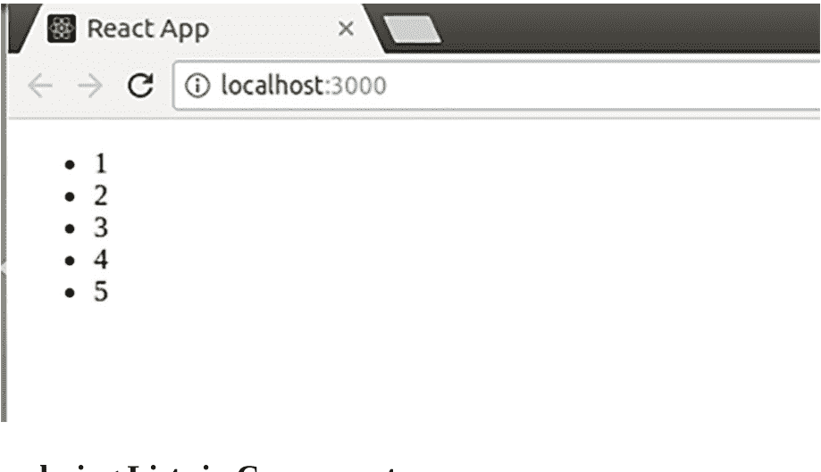

### 在组件中渲染列表

在上面的 React 代码中，列表是直接渲染到 DOM 的，但这并不是良好的 React 实践。我们已经知道 React 中的一切都是独立的组件。想想网站上的导航菜单——很明显，导航菜单项在任何网站上都不是硬编码的。相反，这些项目从数据库中获取，并以列表的形式显示在浏览器中。从组件的角度来看，我们可以说列表通过 props 传递给组件，然后组件将列表渲染到 DOM。上面的代码可以更新为：组件接收一个数组作为 props，然后返回一个无序列表：

```javascript
import React from 'react';
import ReactDOM from 'react-dom';
// Component that returns an
// unordered list
function Navmenu(props)
{
    const list = props.menuitems;
    const updatedList = list.map((listItems)=>{
        return <li>{listItems}</li>;
    });
    return(
        <ul>{updatedList}</ul>
    );
}
const menuItems = [1,2,3,4,5];
ReactDOM.render(
    <Navmenu menuitems = {menuItems} />,
    document.getElementById('root')
);
```

输出结果如下：


虽然无序列表已成功渲染到浏览器，但你将在控制台上看到一条错误信息：

Warning: Each child in an array or iterator should have a unique "key" prop

这条警告信息告诉我们，列表项需要唯一的键——每个元素各一个。键是在 React 中创建元素列表时必须包含的一个字符串属性。我们稍后会详细介绍键。目前，我们需要在上面的代码中为列表中的每个项目分配一个字符串键：

以下是更新后的代码：

```javascript
import React from 'react';
import ReactDOM from 'react-dom';
// Component that returns an
// unordered list
function Navmenu(props)
{
    const list = props.menuitems;
    const updatedList = list.map((listItems)=>{
        return(
            <li key={listItems.toString()}>
                {listItems}
            </li>
        );
    });
    return(
        <ul>{updatedList}</ul>
    );
}
const menuItems = [1,2,3,4,5];
ReactDOM.render(
    <Navmenu menuitems = {menuItems} />,
    document.getElementById('root')
);
```

这段代码的输出与之前相同，但这次不会再出现警告信息。在 React 中，键用于标识列表中的哪些元素发生了更改、被删除或已更新。换句话说，键为每个元素提供了唯一的身份标识。

### 关于键的一切

我们知道，键是创建 React 列表所需的字符串属性。它们用于标识列表元素的变化，因此接下来我们需要考虑的是使用什么作为列表项的键。最佳实践建议使用字符串为每个元素赋予其唯一的身份标识。在下面的示例中，你可以看到一个使用字符串作为键的列表：

```javascript
const numbers = [ 1, 2, 3, 4, 5 ];
const updatedNums = numbers.map((number)=>{
    return <li key={number.toString()}>{ number } </li>;
});
```

数组索引也可以作为键分配给列表项——下面的示例展示了如何分配数组索引：

```javascript
const numbers = [ 1, 2, 3, 4, 5 ];
const updatedNums = numbers.map((number, index)=>{
    return <li key={index}>{ number } </li>;
});
```

虽然我已经向你展示了如何这样做，但这并不是推荐的做法。如果将来某个时候数组元素的顺序发生变化，情况就会变得非常混乱，因为元素的键也会随之改变。

### 如何在组件中使用键

请思考一下。你有一个项目列表，并且已经为它们创建了一个单独的组件；你想从该组件中提取这些项目。你需要将键分配给从迭代器返回的组件，而不是分配给列表中的项目。因此，键应该分配给 `<Component />` 而不是 `<li>`。为了避免犯错，最佳实践建议牢记一点——每当从 `map()` 函数内部返回内容时，都需要为其分配一个键。

下面的第一个示例展示了错误的键使用方式：

```javascript
import React from 'react';
import ReactDOM from 'react-dom';
// Component you want extracted
function MenuItems(props)
{
    const item = props.item;
    return(
        <li>
            {item}
        </li>
    );
}
// Component that returns an
// unordered list
function Navmenu(props)
{
    const list = props.menuitems;
    const updatedList = list.map((listItems)=>{
        return (
            <MenuItems item={listItems} />
        );
    });
    return(
        <ul>{updatedList}</ul>);
}
const menuItems = [1, 2, 3, 4, 5];
ReactDOM.render(
    <Navmenu menuitems={menuItems} />,
    document.getElementById('root')
);
```

输出结果如下：

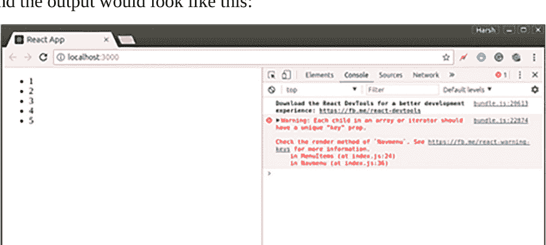

你可以看到，虽然列表已成功渲染，但你仍然会收到警告，提示你没有为迭代器中的元素分配键。这是因为没有为返回给 `map()` 迭代器的元素分配 `key`。

现在你可以看到正确使用键的方式：

```javascript
import React from 'react';
import ReactDOM from 'react-dom';
// Component you want extracted
function MenuItems(props)
{
    const item = props.item;
    return(
        <li>
            {item}
        </li>
    );
}
// Component that returns an
// unordered list
function Navmenu(props)
{
    const list = props.menuitems;
    const updatedList = list.map((listItems)=>{
        return (
            <MenuItems key={listItems.toString()} item={listItems} />
        );
    });
    return(
        <ul>{updatedList}</ul>);
}
const menuItems = [1, 2, 3, 4, 5];
ReactDOM.render(
    <Navmenu menuitems={menuItems} />,
    document.getElementById('root')
);
```

运行该代码，将执行成功；不会出现任何警告信息。

### 键的唯一性

你知道需要为每个数组元素分配唯一的键，但这并不意味着需要全局唯一的键。数组中的每个元素必须有自己的唯一键，因此你可以有多个数组，它们可以共享相同的键集合，只要每个元素的键在各自数组内不重复即可。

在下面的代码示例中，有两个数组——`menuItems1` 和 `menuItems2`。每个数组的前五个项目共享相同的键，但代码将成功执行，不会出现警告信息。


```
import React from 'react';
import ReactDOM from 'react-dom';

// Component you want extracted
function MenuItems(props)
{
    const item = props.item;

    return(
        <li>
            {item}
        </li>
    );
}

// Component that returns an
// unordered list
function Navmenu(props)
{
    const list = props.menuitems;

    const updatedList = list.map((listItems)=>{
        return (
            <MenuItems key={listItems.toString()} item={listItems} />
        );
    });

    return(
        <ul>{updatedList}</ul>);
}

const menuItems1 = [1, 2, 3, 4, 5];
const menuItems2 = [1, 2, 3, 4, 5, 6];

ReactDOM.render(
    <div>
        <Navmenu menuitems={menuItems1} />
        <Navmenu menuitems={menuItems2} />
    </div>,
    document.getElementById('root')
)
```

### 注意事项

请不要混淆 keys 与 props；它们并不相同。唯一相同之处在于为组件分配 keys 的方法与分配 props 的方法相同。Keys 存在于 React 内部，你无法像访问 props 那样从组件内部访问它们。因此，你赋给 key 的相同值可以用于传递给组件的任何 prop。

## 第 10 章

### ReactJS Router

在本章中，你可以选择通过从 GitHub 克隆示例来参与实践。相关链接已为你提供。

在 ReactJS 中，路由是指当用户输入 URL 或点击链接、图标、按钮或应用程序上的任何其他元素时，让我们能够在应用程序内导航的功能。本章将概述如何在 React 应用程序中使用路由。要为你的 React 应用程序添加路由功能，你需要使用一个非常流行的库叫做 React-Router，它有三个变体：

- `react-router` – 这是核心库

- `react-router-dom` – 用于 Web 应用程序的核心库变体

- `react-router-native` – 与 react-native 结合用于开发 iOS 和 Android 移动应用程序的核心库变体

通常，你不会只单独安装核心库；根据你是开发移动应用还是 Web 应用，你还需要在 dom 和 native 变体之间做出选择。这两个变体都导入了核心库的功能。

在本章中，我们将专注于 Web 应用程序，因此我们将使用 `react-router-dom`。你可以通过进入项目目录并运行以下命令将此库安装到你的项目中：

```
npm install --save react-router-dom
```

### 路由器

在 `react-router` 包中，你会发现几个可以使用的路由器，具体取决于你开发应用程序所针对的平台。这些包括 `HashRouter`、`BrowserRouter` 和 `MemoryRouter`。

我们将重点关注基于浏览器的应用程序，因此我们将使用 `HashRouter` 和 `BrowserRouter`。

`BrowserRouter` 用于具有动态服务器的应用程序。这些可以处理任何类型的 URL，而 `HashRouter` 用于静态网站，服务器只能响应已知文件的请求。

我们将使用 `BrowserRouter`，并假设我们的应用程序服务器是动态的。请记住，路由器只会期望接收一个子元素。以下是一个示例：

```jsx
ReactDOM.render(
 <BrowserRouter>
   <App/>
 </BrowserRouter>,
 document.getElementById('root'));
```

这里，我们有一个名为 `<App/>` 的组件 - 它是 `<BrowserRouter>` 的子组件，并且必须是唯一的一个。路由可以发生在 `<App/>` 组件的任何位置，但良好的实践是所有路由都应该被分组并放置在一个地方。我们稍后会详细讨论这一点。

### History 对象

每个路由器都会创建自己的 history 对象，在其中跟踪当前位置，并且当该位置发生变化时，应用程序会重新渲染。正因如此，其他 React 组件将依赖于该对象的存在，这就是为什么它们必须在路由器内渲染。

`BrowserRouter` 使用 HTML5 history API 来确保界面与浏览器地址栏中当前的 URL 保持同步。Router 创建的 history 对象有多个属性，其中一个就是 location 属性。它的值是一个对象，也是我们在本章中将重点讨论的一个属性。

当你在浏览器中渲染前面的示例时，React DevTools 窗口应该会显示 history 对象。在 history 对象内部是 location 对象，它看起来像这样：

```js
{ pathname, search, hash, state }
```

这个对象将从应用程序的 URL 中派生其属性。

### Routes

React Router 包中最关键的部分之一是 `<Route/>` 组件。当路由的路径与当前位置匹配时，此组件会渲染正确的 UI。路由路径是 `<Route/>` 组件的一个 prop，用于描述应由路由匹配的路径名，如下例所示：

```jsx
<Route path="/items"/>
```

当路径名读作 `/items`，或者所有其他路径以 `/items` 开头时，路由就会匹配。一个这样的例子是 `/items/2`。如果你只想精确匹配 `/items`，`<Route/>` 组件必须接受一个 exact prop。添加此 prop 后，你可以确保渲染的是与当前位置完全匹配的路径名。以下是使用 exact prop 的示例：

```jsx
<Route exact path="/items" />
```

当路径匹配成功时，需要渲染一个 React 组件以提供 UI 变化。

你还应该注意，`react-router` 包使用一个名为 Path-to-RegExp 的包将路径字符串转换为正则表达式，然后与当前位置进行匹配。

在 `<Route/>` 组件中有三个 prop，我们用它们来确定需要渲染哪个组件：

- `component`

- `render`

- `children`

让我们更详细地看看这些。

#### Component Prop

这个 prop 用于定义当路径匹配时 Route 返回的元素。提供的组件使用 `React.createElement` 来创建元素，你可以在下面看到如何使用 component prop 的示例：

```jsx
<Route
  exact
  path="/items."
  component={Items}
/>
```

这里，当路径与当前位置匹配时，`Items` 组件被匹配。

#### Render Prop

render prop 允许内联渲染，并能够给元素传递一些额外的 prop。它期望一个函数，当当前位置和路径匹配时，该函数将返回一个 React 元素。以下是一些示例，展示如何在 Route 组件上使用 render prop：

```jsx
<Route
  exact
  path="/items"
  render={() => (<div>List of Items</div>)}
/>
```

在这个示例中，当路径与当前位置精确匹配时，会创建一个元素，名为 List of Items 的字符串将被渲染在浏览器中。

```jsx
const cat = {category: "food"}
<Route
  exact path="/items"
  render={props => <Items {...props} data={dog}/>}
/>
```

在这个示例中，额外的 prop 由 data 表示，并被传递到 `Items` 组件中。这个示例中的额外 prop 是 dog。

#### Children Prop

这个 prop 期望接收一个能够返回 React 元素的函数，这使得它与 render prop 非常相似。然而，有一个区别。child prop 定义了一个无论当前路径和路径是否匹配都会为每个路径返回的元素。

```jsx
<Route children={props => <Items {...props}>}/>
```

在这个示例中，`Items` 组件将始终被渲染。

### Switch 组件

在 `react-router` 库中，你还会发现一个 `<Switch/>` 组件。它用于包裹多个 `<Route/>` 组件。这个组件将始终只从所有子路由中选择第一个匹配的路由。

在下一个示例中，你可以看到当没有 Switch 组件时，多个路由的行为方式：

```jsx
<Route
  path="/items"
  render={() => (<div><em>List of items</em></div>)}
/>
<Route
  path="/items/2"
  render={() => (<div>Item with id of 2</div>)}
/>
```

当在浏览器中导航到 `/items/2` 时，你会看到两个 Route 组件都被 React 元素渲染：

List of items

Item with id of 2

这很可能是预期的行为——第一个组件将显示标题，而具有相同基础路径的其他路由都将渲染不同的用户界面。

让我们对上面的示例进行修改。这一次，我们将添加 `<Switch/>` 组件，并查看当导航到 `/items/2` 时会发生什么：

```jsx
<Switch>
  <Route
    path="/items"
    render={() => (<div><em>List of items</em></div>)}
  />
  <Route
    path="/items/2"
    render={() => (<div>Item with id of 2</div>)}
  />
</Switch>
```

你将只看到 List of Items 被渲染在浏览器中，因为 Switch 组件将只匹配与当前位置匹配的第一个路径。在这里，一旦在浏览器地址栏中输入 `/items/2`，名为 `/items` 的路由就会立即被匹配。

### Link 组件

`react-router` 包中的另一个组件是 `<Link/>` 组件。它使用超链接在应用程序的不同部分之间导航。它的工作方式类似于 HTML 中的锚点元素，但存在一个区别——当使用 Link 组件时，页面不会重新加载。相反，界面（UI）会发生变化。而使用锚点标签时，需要重新加载页面才能加载新的界面。点击 Link 组件可确保 URL 得到更新。

在这个例子中，我们可以看到如何使用 Link 组件。我们创建了一个应用，让我们能够从分类导航到项目，再返回。

```
export const Home = () => (
<div>
```

#### Home 组件

```
<ul>
<li>
<Link to="/items">Items</Link>
</li>
<li>
<Link to="/category">Category</Link>
</li>
</ul>
</div>
);
```

Home 组件中包含指向另外两个组件——Items 和 Categories 的链接。

`<Link/>` 组件使用一个属性（prop）来定义要导航到的位置。该属性可以是位置对象或字符串对象——如果是字符串，它会被转换为位置对象。请注意，路径名必须是绝对路径。

如果你想在自己的机器上尝试，可以在 [这里](link) 找到项目。克隆它并运行：

```
npm install && npm start
```

你应该会在屏幕上看到类似以下的内容：

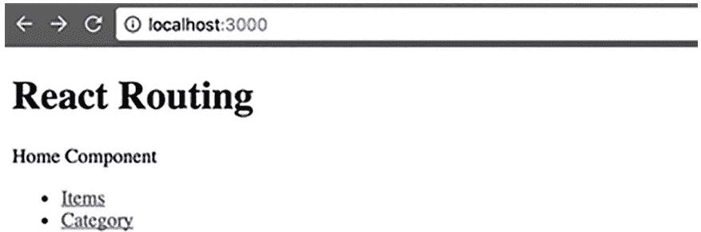

如果你点击 Items 链接，界面会变化，并且地址栏中的 URL 会更新：

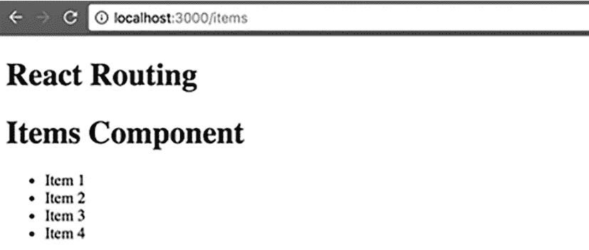

点击 Category 链接时会发生同样的事情：

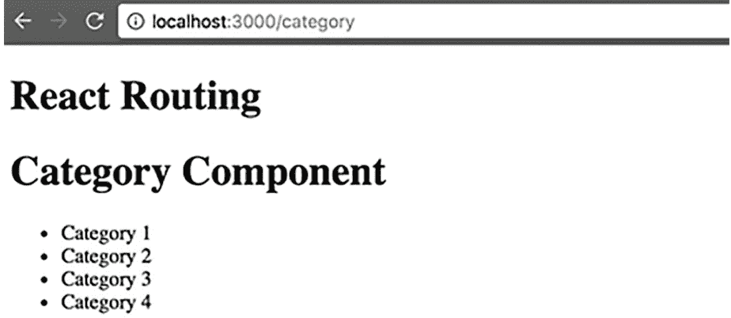

### 嵌套路由

你现在已经理解了 `path` 和 `<Route/>` 组件的工作原理，接下来我们可以看看在 React 应用程序中嵌套路由是如何工作的。

当 `path` 与位置（location）成功匹配时，会创建另一个对象——匹配对象（match object）。这个对象包含了关于 `path` 和 URL 的信息，这些信息作为属性（property）在对象上访问。

让我们看看这些属性：

- `url:` 这是一个字符串，它将返回匹配到的 URL 部分

- `path:` 这是一个字符串，将返回路由路径的一部分

- `isExact:` 这是一个布尔值——如果匹配是精确的，它将返回 true；如果不是，则返回 false

- `params:` 这是一个对象，包含 Path-to-RegExp 包匹配的键值对

为了成功实现嵌套路由，我们需要对嵌套的 Links 使用 `match.url`，而对嵌套的路由使用 `match.path`。

这里，我们将通过一个例子来看看嵌套路由是如何工作的。首先，从 [这里](here) 克隆项目并运行：

```
npm install && npm start
```

这将设置好项目。

项目中有四个组件：

- `Header` —— 包含指向 Home、Category 和 Items 的链接

- `Home` —— 包含一些虚拟数据

- `Items` —— 包含一个虚拟项目的列表

- `Category` —— 展示嵌套路由和动态路由

我们将重点关注 Category 组件，因为这里展示了嵌套路由和动态路由：

```
export const Category = ({match}) => (
<div>
<h1>Category Component</h1>
<h5>Click on a category</h5>
<ul>
<li>
<Link to={`${match.url}/shoes`}>Shoes</Link>
</li>
<li>
<Link to={`${match.url}/food`}>Food</Link>
</li>
<li>
<Link to={`${match.url}/dresses`}>Dresses</Link>
</li>
</ul>
);
```

所以，看这段代码片段，如果点击了 Category 链接，路由路径会被匹配，从而创建一个匹配对象。然后，它会作为一个属性（prop）被发送到 category 组件。

Category 组件内部有一个参数列表，其中匹配对象被解构（destructured），并使用 `match.url` 来链接到各个分类。

需要在 Link 组件上为指向 `/shoes`、`/food` 和 `/dresses` 这三个 URL 的链接构造属性值，这是通过模板字面量（template literals）完成的。

如果你在浏览器中打开这个示例，然后点击 Category 链接，你会看到三个分类。当你点击其中一个时，URL 会更新，但界面不会改变。


### React 路由示例

- [Home](http://localhost:3000/home)

- [Items](http://localhost:3000/items)

- [Category](http://localhost:3000/category)

#### Category 组件

**点击一个分类**

- [Shoes](http://localhost:3000/category/shoes)

- [Food](http://localhost:3000/category/food)

- [Dresses](http://localhost:3000/category/dresses)

这是一个需要修复的缺陷。我们需要在每次点击分类链接时改变界面，为此需要在 Category 组件中创建一个动态路由。该路由将有一个 `match.path` 属性，界面将动态改变：

```
<Route
path={`${match.path}/:categoryName`}
render={props =>
(<div>
{props.match.params.categoryName} category
</div>
)
}
/>
```

当你检查这段代码中的 `path` 属性值时，可以看到使用了 `:categoryName`，这是一个路径名变量。它是 URL 中的路径参数，用于捕获 `/category` 之后的所有内容。

以这种方式将值传递给 `path` 属性，就无需为不同的分类硬编码路由了。同时请注意，正确的路径是使用模板字面量构建的。

像下面例子中的参数对象，是通过像 `category/food` 这样的路径名创建的。

```
{
  categoryName: "food"
}
```

在这个例子中，`render` 属性运行一个内联渲染，显示 props 中来自匹配对象的名为 `categoryName` 的参数。这应该就是我们需要做的修复，以使界面发生变化。现在，当你点击一个分类时，界面和 URL 都应该会更新：

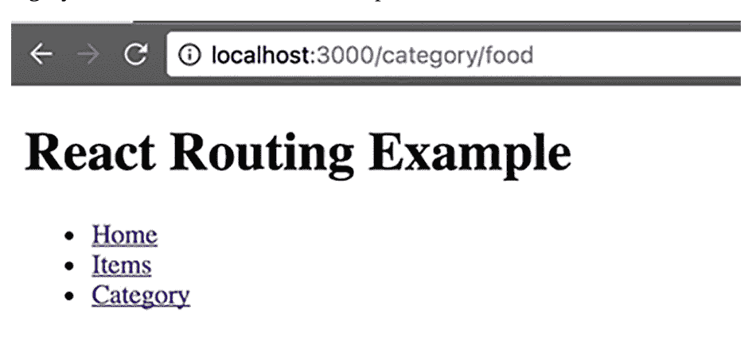

### React 路由示例

- [Home](#)

- [Items](#)

- [Category](#)

#### Category 组件

**点击一个分类**

- [Shoes](#)

- [Food](#)

- [Dresses](#)

food category

### 受保护的路由

拥有受保护的路由意味着，当用户尝试访问应用程序的任何部分而未首先登录时，他们会被重定向并最终到达登录页面，在那里需要登录。

确保重定向正常工作需要 `react-router` 包中的 `<Redirect/>` 组件。包中包含一个 `to` 属性，作为对象传递，并包含 `state` 和 `pathname`，如下所示：

```
<Redirect
to={{pathname: '/login', state: {from: props.location}}}
/>
```

Redirect 组件使用对象提供的路径名 `/login` 替换堆栈中的当前位置。然后，用户试图访问的位置被存储在 `state` 属性中。`state` 值通过 `this.props.location.state` 从 Login 组件内部访问。

例如，如果用户尝试访问 `/admin`（一个受保护的路由）而未登录，他们会被发送到登录页面。一旦成功登录，他们会被转引到他们最初试图访问的 `/admin`。

### 自定义路由

实现受保护的路由概念要求我们理解自定义路由以及如何创建它们。自定义路由只不过是在组件中嵌套的路由。通常，这发生在需要决定是否渲染一个组件的时候。

就受保护的路由而言，指定的路由只能由已登录的用户访问。如果用户未登录，他们必须被发送到登录页面。

在下一个例子中，我们将更深入地了解自定义路由。首先，克隆 [这个项目](https://github.com/reactTraining/react-router/tree/master/packages/react-router-dom/examples/AuthWithRedirect) 并像往常一样运行：

```
npm install && npm start
```

在私有路由（private route）中，有三个属性——`isAuthenticated`、`component` 和 `path`。让我们更仔细地看看这个私有（自定义）路由。

这些属性在参数列表中被解构，并且 `component` 被重命名为 Component（注意从小写变为大写）。Route 组件被传递给 render 和 `...rest` props。在 render prop 中，编写了逻辑来判断是否应该渲染某个组件，以及当用户已登录时应该渲染哪些组件。如果没有登录，用户将被重定向到登录页面。

在 Login 组件中有一个虚拟的身份验证方法。当用户点击登录按钮时，该方法会将用户登录。当登录成功时，`redirectToReferrer` 状态属性被设置为 true，触发重定向，将用户送到他们原本想去的地方。如果他们是从登录路由开始的，则被重定向到 `/path`。

在克隆的项目运行时，访问 `localhost:3000`，你应该会看到类似这样的内容：

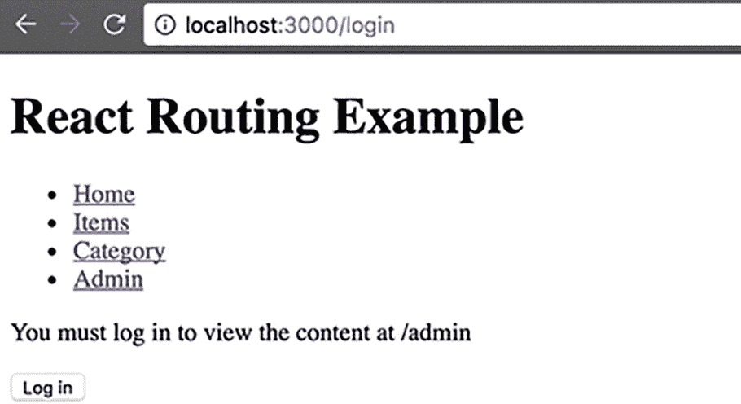

如果你点击 Admin 链接时未登录，你会被送到 `/login` 页面，并显示登录按钮。当你点击该按钮时，你会被送到 admin 页面，该页面是受保护的，如下所示：

### React 路由示例

- Home

- Items

- Category

- Admin

#### 受保护的管理组件

你现在可以访问这个组件，因为你已登录。

继续练习，使用克隆的项目，尝试编写你自己的代码。

# 第 11 章

## ReactJS – Flux 简介

到目前为止，你已经了解到 React.js 库有多棒，但它只是成功的前端应用程序整个技术栈的一部分。事实上，就状态和数据管理而言，React 真的没有提供太多功能。

React 的创造者 Facebook 提供了很多有用的指导，它以一种名为 Flux 的应用程序架构的形式出现。这种架构（不是框架）是围绕单向数据流构建的，使用 React Stores、Action Dispatcher 和 Views。使用 Flux 模式可以帮助解决一些大问题，因为它体现了重要的**事件控制原则**，使*推理*、开发和维护 React 应用程序变得更加容易。

在本章中，我们将看一些 Flux 控制流的基本示例，讨论一下 Stores，并看看如何使用 Flux Backbone models 和 Collection。为此，我使用的是 CoffeeScript——如果你没有，也可以继续跟上，这些示例可以视为伪代码。

### Flux 简介

Backbone 是一个很棒的库，包含 Models、Views、Routes 和 Collections。它是结构化前端应用程序的事实标准库之一，于 2013 年引入 React。到目前为止，大多数不在 Facebook.com 上的 React 示例都提到 Backbone 是与之**搭配使用**的。

不幸的是，当我们完全依赖 Backbone 来处理 React 中 Views 之外的所有应用程序流时，事情变得有些复杂，复杂的事件链很快就会成为障碍。想象一下——你需要从 UI 发送事件到 Models。从那里，事件在模型之间来回传递，使得很难跟踪什么被什么改变了、在哪里、以什么顺序，甚至为什么。

我马上要讲的 Flux 教程将向你展示 Flux 模式如何使处理这类问题变得更容易。

Flux 有一个令人难忘的口号——"*单向数据流*"，下图展示了数据流：

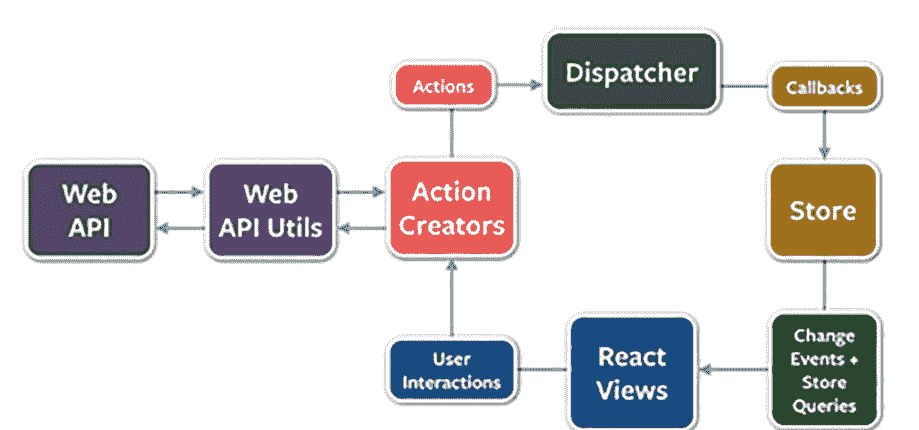

最重要的是记住数据以这种方式流动：

React → Dispatcher → Stores → React。

让我们深入了解这些主要组件，看看它们是如何连接的。

不过，在此之前，Flux 文档提供了以下*注意事项*：

> Flux is a pattern rather than a framework, and it has no hard dependencies.

> However, EventEmitter is often used for our Views as a basis for React and

> Stores. The Dispatcher is the one part of Flux that is not easily available

> elsewhere but is needed for your Flux toolbox.

因此，Flux 中有三个组件：

1. **Views** – `React = require('react')`

2. **Dispatcher** – `Dispatcher = require('flux').Dispatcher`

3. **Stores** – `EventEmitter = require('events').EventEmitter.`

不过，很快我们就会看到，这会变成 `Backbone = require("backbone")`

我们将忽略 Views，因为它们是 React 的一部分，而你已经对它们了如指掌。另外两个组件，我们现在来讨论。

#### Dispatcher

Flux Dispatcher 是一个处理所有用于修改 Stores 的事件的地方。使用它要求 Store 注册一个回调函数来处理所有事件。当需要修改 Store 时，需要分发（dispatch）一个事件。

以下是一个让用户将项目添加到待办事项列表的应用程序的部分示例：

```coffee
# in TodoDispatcher.coffee
Dispatcher = require("flux").Dispatcher

TodoDispatcher = new Dispatcher() # That's all you need!.

module.exports = TodoDispatcher
# in TodoStore.coffee
TodoDispatcher = require("./TodoDispatcher")

TodoStore = {items: []}

TodoStore.dispatchCallback = (payload) ->
  switch payload.actionType
    when "add-item"
      TodoStore.items.push payload.item
    when "delete-last-item"
      TodoStore.items.pop()

TodoStore.dispatchToken = TodoDispatcher.registerCallback(TodoStore.dispatchCallback)

module.exports = TodoStore
# in ItemAddComponent.coffee
TodoDispatcher = require("./TodoDispatcher")

ItemAddComponent = React.createClass
  handleAddItem: ->
    # note: you do not just push to the store directly!
    # (because there are restrictions on moving through the dispatcher
    # everything is way more modular and maintainable)
    TodoDispatcher.dispatch
      actionType: "add-item"
      item: "hello world"

  render: ->
    React.DOM.button {
      onClick: @handleAddItem
    },
      "Add Item!"
```

因此，我们现在可以回答这些问题：

### 1. **哪些事件用于修改 MyStore？**

要回答这个问题，查看 `MyStore.dispatchCallback` switch 语句内部。

### 2. **事件的可能来源是什么？**

搜索 `actionType`。

这比查看 `MyCollection.add`、`MyModel.save` 和 `MyModel.set` 等要容易得多，在那里很快就会发现很难找到这些问题的答案。

你还应该记住，Dispatcher 使用 `waitFor` 来允许回调按顺序和同步地运行。

```coffee
# in MessageStore.coffee
MyDispatcher = require("./MyDispatcher")
TodoStore = require("./TodoStore")

MessageStore = {items: []}

MessageStore.dispatchCallback = (payload) ->
    switch payload.actionType
        when "add-item"
            # synchronous event flow!
            MyDispatcher.waitFor [TodoStore.dispatchToken]

            MessageStore.items.push "an item was added! It was: " + payload.item

module.exports = MessageStore
```

看看使用 Dispatcher 修改 Stores 时，代码变得多么清晰，即使你*不使用* `waitFor` 也是如此。

#### Stores

现在，数据通过 Dispatcher 流入 Stores，但我们如何让数据从 Stores 流向 Views 呢？Flux 文档说，View 会监听 Stores 广播的、View 所依赖的事件。

因此，就像回调可以在 Stores 中注册一样，它们也可以在 Views 中注册，而 Views 我们知道是 React 组件。当通过 Store props 传入 Store 的变化时，React 被告知重新渲染。

以下是一个示例：

```coffee
# in TodoListComponent.coffee
React = require("react")

TodoListComponent = React.createClass
  componentDidMount: ->
    @props.TodoStore.addEventListener "change", =>
      @forceUpdate()
    , @

  componentWillUnmount: ->
    # remove callback

  render: ->
    # show items in a list.
    React.DOM.ul {}, @props.TodoStore.items.map (item) ->
      React.DOM.li {}, item
```

这很好，但是 change 事件是如何发出的呢？根据 Flux，你应该使用 EventEmitter，以下是一个示例：

```javascript
var MessageStore = merge(EventEmitter.prototype, {

  emitChange: function() {
    this.emit(CHANGE_EVENT);
  },

  /**
   * @param {function} callback
   */
  addChangeListener: function(callback) {
    this.on(CHANGE_EVENT, callback);
  },

  get: function(id) {
    return _messages[id];
  },

  getAll: function() {
    return _messages;
  },
  // etc...
```

所以，你每次创建 Store 时都必须写所有这些代码，对吧？而且每当想显示一条信息时都必须使用它，对吧？**不对。** 有一种更简单的方法。

#### Models 和 Collections

Backbone 提供了 Models 和 Collections，它们拥有 Flux 中基于 EventEmitter 的 Stores 所具备的一切功能。

当 Flux 告诉你使用原生 EventEmitter 时，他们实际上是在建议你，每当你创建一个 store 时，你都在重新创建 Backbone 中 50% 到 75% 的 Models 和 Collections。你可以将 EventEmitter 用于 Stores 类比于在拥有更好、更丰富的选择时使用原生 Node.js 来构建服务器，例如像 Express.js 这样的微框架。

就像 Express 基于 Node 构建一样，Models 和 Collections 也是基于 EventEmitter 构建的。而且它包含了你所需的一切——Backbone 会触发 change 事件，并且包含 getter、setter、查询方法以及你可能需要的其他所有功能。

那么，让我们使用 Backbone 来构建我们的 Stores。

### The Flux/Backbone Pattern

这是 Flux 架构与 Backbone 的结合，基本模式如下：

1. Models 或 Collections 用于实例化 Stores。这些 models 或 collections 在 Dispatcher 上注册了一个回调，并且通常是单例的。

2. View 组件绝不直接修改 Store，也就是说，没有 `.set()` 方法。相反，Actions 由组件派发给 Dispatcher。

3. View 组件通过绑定到 Stores 的事件来查询 Stores 并触发事件。

让我们逐一介绍，并使用 Backbone 和 Flux 的示例：

1. **Models 或 Collections 用于实例化 Stores。这些 models 或 collections 在 Dispatcher 上注册了一个回调，并且通常是单例的。**

```
# in TodoDispatcher.coffee
Dispatcher = require("flux").Dispatcher

TodoDispatcher = new Dispatcher() # That's all you need!

module.exports = TodoDispatcher
# in stores/TodoStore.coffee
Backbone = require("backbone")
```

```
TodoDispatcher = require("../dispatcher")

TodoItem = Backbone.Model.extend({})

TodoCollection = Backbone.Collection.extend
    model: TodoItem
    url: "/todo"

    # a callback is registered on init with the Dispatcher
    initialize: ->
        @dispatchToken = TodoDispatcher.register(@dispatchCallback)

    dispatchCallback: (payload) =>
        switch payload.actionType
            # The model instance is removed from the Store
            when "todo-delete"
                @remove payload.todo
            when "todo-add"
                @add payload.todo
            when "todo-update"
                # do stuff...
                @add payload.todo,
                    merge: true
                # ... etc

# the Store is now an instantiated Collection; a singleton.
TodoStore = new TodoCollection()
module.exports = TodoStore
```

2. **View 组件绝不直接修改 Store，也就是说，没有 `.set()` 方法。相反，Actions 由组件派发给 Dispatcher。**

```
# components/TodoComponent.coffee
React = require("react")

TodoListComponent = React.createClass
    handleTodoDelete: ->
        # rather than the todo being directly removed from the ToDoStore,
        # the Dispatcher is used
        TodoDispatcher.dispatch
            actionType: "todo-delete"
            todo: @props.todoItem
        # ... (see below) ...

module.exports = TodoListComponent
```

3. **View 组件通过绑定到 Stores 的事件来查询 Stores 并触发事件。**

```
# components/TodoComponent.coffee
React = require("react")

TodoListComponent = React.createClass
```

```
handleTodoDelete: ->
  # rather than the todo being directly removed from the ToDoStore,
  # the Dispatcher is used. #flux
  TodoDispatcher.dispatch
    actionType: "todo-delete"
    todo: @props.todoItem
  # ...
componentDidMount: ->
  # the Component is bound to the Store's events
  @props.TodoStore.on "add remove reset", =>
    @forceUpdate()
  , @
componentWillUnmount: ->
  # All events and callbacks with this context are turned off
  @props.TodoStore.off null, null, this
render: ->
  React.DOM.ul {},
    @props.TodoStore.items.map (todoItem) ->
      # TODO: TodoItemComponent, which would bind to
      # `this.props.todoItem.on('change')`
      TodoItemComponent {
        todoItem: todoItem
      }

module.exports = TodoListComponent
```

尝试在你的项目中应用这种方法，你会发现你的代码变得更加清晰、更加简洁。那些你曾经花费数小时试图找到更好解决方案的笨拙、丑陋的代码片段，都可以轻松地被更合理的流程所取代，你会发现 Backbone 几乎可以无缝地融入这个模式，你再也不用感觉像是在与一切作斗争才能让它们协同工作。

### Mixin Example

每当你将基于 Flux 和 Backbone 的 Store 添加到一个组件时，每次都写 `this.on()` 和 `this.off()` 代码可能会令人沮丧。

在下面的 React Mixin 示例中，虽然它有些简单，但它会让你的迭代工作变得更加容易：

```
# in FluxBoneMixin.coffee
module.exports = (propName) ->
  componentDidMount: ->
    @props[propName].on "all", =>
      @forceUpdate()
    , @

  componentWillUnmount: ->
    @props[propName].off "all", =>
      @forceUpdate()
    , @
```

```
# in HelloComponent.coffee
React = require("react")

UserStore = require("./stores/UserStore")
TodoStore = require("./stores/TodoStore")

FluxBoneMixin = require("./FluxBoneMixin")

MyComponent = React.createClass
  mixins: [
    FluxBoneMixin("UserStore"),
    FluxBoneMixin("TodoStore"),
  ]
  render: ->
    React.DOM.div {},
      "Hello, #{@props.UserStore.get('name')},"
      "you have #{@props.TodoStore.length}"
      "things to do."

React.renderComponent(
  MyComponent {
    UserStore: UserStore
    TodoStore: TodoStore
  }
  , document.body.querySelector(".main")
)
```

### Syncing with Web APIs

在之前的 Flux 示意图中，你可以看到 Web API 只能通过 ActionCreators 进行交互。这要求服务器在响应之前才能将 actions 发送给 Dispatcher，但是，Store 难道不应该在服务器之前知道任何变化吗？

我们可以交换示意图，将其翻转，使 Stores 直接通过 Backbone 中的 `sync()` 方法与 RESTful CRUD API 交互。如果你正在使用这些 API，这将非常便利。

维护数据完整性也没有问题。当使用 `.set()` 设置新属性时，change 事件会触发 React 重新渲染，新数据会以乐观方式显示。当你尝试使用 `.save()` 保存到服务器时，request 事件会告诉你如何显示加载图标。当一切完成后，sync 事件会告诉你需要移除加载图标，或者 error 事件会让你知道需要将某些内容标红。

第一层防御还有验证和无效事件，以及用于从服务器获取新信息的 `.fetch()` 方法。

---

然而，如果你的任务不太标准，使用 ActionCreators 可能更有意义。

谨慎而巧妙地使用 Backbone 可以帮助填补 Flux 的一些空白，而且无论业务规模大小，任何人都能以惊人的简单方式创建令人印象深刻的应用程序并维护它们。

# Chapter 12

## ReactJS Animations

我们很容易忘记在 Web 项目中添加动画，仅仅因为我们的设计是以平面图像的形式呈现的。当我们开始编码时，浏览器兼容性是我们最关心的事情，此外还有屏幕尺寸以及如何实现功能。更多时候，UI 实际上如何移动是我们最后才会想到的事情，往往是一种事后考虑。

这可能会导致一些严重的问题，因为有时候 UI 组件需要动起来。为什么？因为每个状态之间的过渡需要平滑，而这通过动画来实现。有时候我们希望网页上最新的内容或某些操作能够吸引注意力。

例如，如果你的网站上价格发生了变化，你可能希望吸引注意力，确保没人能错过它。

将这种事情留到最后可能会导致问题，因为我们最终试图拼凑一个快速解决方案。结果是生硬、不一致的动画，应用不当，或者在某些情况下完全被遗忘。

不过，为你的 React 应用添加动画并不一定很难。有了 React animation，你可以访问大量预构建的关键帧和组件，帮助你非常快速、轻松地为应用添加动画。

### Introducing React Animation

React Animation 是一个相对较新的 React 包，帮助你将 UI 动画添加到项目中。这个包充满了包装组件和预构建的动画关键帧，你可以轻松快速地添加到项目中。

当然，还有其他方式可以为你的应用构建动画。你可以使用 **React Transition Group**，它允许你添加和移除类名，从而应用动画效果。遗憾的是，React Transition Group 并不包含动画本身，因此这部分工作仍需你自己处理。或者，你可以选择 **React Spring**，它提供了许多高级工具，帮助你处理大量动画元素。

你真正需要的是一个介于两者之间的方案，它能简化为元素部分添加动画的过程，并提供大量可直接集成到项目中的预构建动画。这就是 **React Animations** 的用武之地——它易于使用，提供了足够的、一致的灵活性，帮助你根据项目需求定制动画。

让我们更深入地了解一下 React Animation 为我们提供了什么，从辅助组件开始。

### AnimateOnChange

`AnimateOnChange` 是几个简单的包装组件之一，它包裹你的内容，并根据需要应用动画。

有时，你希望通过添加一些可见的动画效果，让用户知道某些内容已经更改。如果你需要在用户界面的多个部分编写此类功能，这很快就会变得枯燥且耗时，错误也容易在此时产生。这时，你可以用 `AnimateOnChange` 组件包裹你的内容。

首先，通过以下命令安装 React Animation：

```
npm install react-animation
```

现在可以这样使用该组件：

```
import { AnimateOnChange } from 'react-animation'

Your content and components go here
```

每当网站中的子内容发生变化时，该组件会通过应用淡出-淡入动画来响应：旧内容淡出，新内容淡入。

但这个组件的功能不止于此。我们还可以传入属性来控制动画的工作方式。其中一个是 `durationOut` 值，以毫秒为单位提供。它规定了淡出动画将旧内容移除所需的时间。根据你希望淡出动画呈现的感觉，这个值可以设置得更小或更大。

当你传入 `animationOut` 和 `animationIn` 属性时，你还可以选择在内容更改时应用哪些动画。这些属性的值是你从包中选择的动画名称，你可以在本章末尾看到这些名称的列表。

你也可以从一系列弹跳动画中进行选择，并使用 `style` 属性在组件上设置任何你想要的属性。这与 React 的 `style` 属性工作方式类似，以标准方式接受包含样式规则的对象。

### 自定义动画

`AnimateOnChange` 组件还允许你以两种不同的方式创建自定义动画。首先，它允许你创建关键帧，并将动画字符串传入 `animationIn` 和 `animationOut` 属性。假设你将用于隐藏内容的关键帧命名为 `my-anim-out`，将用于显示新内容的关键帧命名为 `my-anim-in`；这些关键帧可以这样定义：

```
@keyframes custom-animation-in {
  from {
    transform: rotateX(140deg) scale(32);
  }
  to {
    transform: none;
  }
}

@keyframes custom-animation-out {
  from {
    transform: none;
  }
  to {
    transform: rotateX(-270deg) scale(0);
  }
}
```

这样做的结果将是一个带有旋转效果的 3D 缩放效果。

第二种方式是使用类。假设你希望为特定元素的伪元素或指定元素的子元素设置动画。在这种情况下，你可以在动画处于“出”或“入”状态时，通过指定 `className` 来应用一个 `top-left` 类。

能够让你的用户界面不同部分动起来非常有用，尤其是为了让人们看到你网站上的某些内容发生了变化。也许你在网站上显示股票价格或其他实时流数据，你想用动画来展示信息何时更新。或者你经营一家网上商店，你想让顾客知道他们将某样东西加入了购物车。实际上，可能性是无穷无尽的。

### HideUntilLoaded

一些 UI 组件使用背景图片或另一张可能是动态的、并且文件尺寸可能非常大的图片。我们不希望组件在图片完全加载之前就显示出来，因为这样可能导致网站上只显示部分内容。你也可能希望组件在图片完全加载前保持隐藏状态，这就是 `HideUntilLoaded` 组件的用武之地。

它的使用方式与上一个组件类似，也是包裹你的内容；在这种情况下，它会告诉内容需要等待哪张图片。

你甚至可以传入一个加载指示器组件，向用户直观地展示图片正在加载——这样，他们就会知道有事情正在发生。最后，可以为所有内容完全加载后指定一个 `animationIn` 动画。

`HideUntilLoaded` 组件非常有用，特别是在你的组件依赖于大尺寸背景图片的情况下。这些图片可以是你的产品图片，带有文字叠加和阴影效果，或者是包含文字和照片的媒体组件。这个组件可以帮助你将它们全部隐藏，直到它们准备就绪，然后一起进行动画处理。

### 预构建关键帧

React Animation 包还内置了一系列可供你使用的动画。甚至无需使用上述任何辅助组件，就可以将它们添加到你的项目中。不过，导入它们需要其他相关的关键帧：

```
import 'react-animation/dist/keyframes.css'
import { animations } from 'react-animation'
```

一旦导入了关键帧，`animations` 对象就可以在你的组件样式中使用了。例如，当你希望动画在网站首次加载时弹出，我们可以这样做：

```
const style = {
  animation: animations.popIn
}

const MyComponent = () =>
```

My Component

这里，`animations.popIn` 的计算结果是 `pop-in 500ms cubic-bezier(0.19, 1, 0.22,1) forwards`。

该包中内置的动画有：

- `bounceIn`

- `bounceOut`

- `fadeIn`

- `fadeInUp`

- `fadeOut`

- `popIn`

- `popOut`

- `slideIn`

- `slideOut`

思考一下你的项目，以及你可以在用户界面的哪些地方使用动画。例如，你可以将用户的注意力吸引到某个特定的按钮上，或者用它来让列表中的项目淡入淡出。无论你想怎么做，都可以考虑使用 React Animations 来帮助你。只需像这样安装它：

```
npm install react-animation
```

然后，就可以导入这些组件了：

```
import { AnimateOnChange, HideUntilLoaded } from 'react-animation'
```

它们会自动引入你需要的关键帧定义，这样你就可以在项目中使用这些组件了。

## 第 13 章

## ReactJS 高阶组件

在 React 中，高阶组件或 HOC 的灵感来源于 JavaScript 的高阶函数。简单来说，HOC 是一种允许你复用组件中逻辑的高级技术。

它们基本上遵循了 DRY（Don't Repeat Yourself，不要重复自己）原则，我相信你在编程过程中一定已经接触过这个原则。它是最著名的软件开发原则，也是在构建应用程序或编写任何代码时需要遵守的最重要原则之一。

在本章中，我们将讨论什么是 HOC，它们的结构是怎样的，它们的用途是什么，最后，我们将看一个示例。

要充分利用本章内容，你需要具备一定的 JavaScript 和 React 知识。

### JavaScript 中的高阶函数

在讨论 React HOC 之前，我们先快速看一下 JavaScript 中的高阶函数，因为 React HOC 的灵感正来源于此。因此，理解它们至关重要。

JavaScript 高阶组件以函数的形式接收参数，然后返回另一个函数。这些 HOC 让我们能够抽象的不仅是值，还包括操作。它们以多种形式出现，是我们在操作函数时用来编写更少代码的工具。它们甚至适用于数组。

组合是使用这些函数最有趣的部分，因为可以编写更小的函数来处理某一段逻辑。然后，使用这些较小的函数组合成更复杂的函数，这降低了代码出错的风险，使代码更具可读性和易于理解。

部分高阶函数已经内置于 JavaScript 中，以下是一些示例：

- `.forEach()` – 用于使用相同的代码遍历数组中的每个元素。但是，它不会以任何方式修改或改变数组，且返回值为 undefined。

- `.map()` – 用于转换数组。通过对数组中的每个元素应用一个函数，然后使用返回的值构建一个新数组来实现。

- `.reduce()` – 用于对每个数组值执行特定函数，从左到右进行处理。

- `.filter()` – 用于检查给定数组中的每个元素，查看其是否满足 `filter()` 方法内指定的条件。返回一个包含与指定条件匹配的元素的新数组。

JavaScript 包含大量高阶函数，但你仍然可以创建自己的自定义高阶函数。

### 自定义高阶函数示例

假设我们要编写一个用于将整数格式化为货币形式的函数。你需要加入某种自定义配置来指定货币符号，并为金额添加分隔符——我们使用小数点分隔符。

我们会编写一个高阶函数来接收符号和分隔符，然后使用小数运算符和货币符号对传入的值进行格式化。我们将这个高阶函数命名为 `formatCurrency`。

```
const formatCurrency = function(
    currencySymbol,
    decimalSeparator ) {
    return function( value ) {
        const wholePart = Math.trunc( value / 100 );
        let fractionalPart = value % 100;
        if ( fractionalPart < 10 ) {
            fractionalPart = '0' + fractionalPart;
        }
        return `${currencySymbol}${wholePart}${decimalSeparator}${fractionalPart}`;
    }
}
```

`formatCurrency` 函数将返回另一个包含小数点分隔符和固定货币符号的函数。该格式化函数接收一个值，并使用该函数对其进行格式化——提取整数部分和小数部分。使用模板字面量来构造函数的返回值，并将货币符号、整数部分、分隔符和小数部分拼接在一起。

让我们为这个高阶函数赋值，以便使用它并查看结果：

```
> getLabel = formatCurrency('$', '.');
> getLabel( 1999 )
"$15.99" //formatted value
> getLabel( 2499 )
"$34.99" //formatted value
```

这里，我们所做的就是创建一个名为 `getLabel` 的变量。然后，将 `formatCurrency` 赋值给它，并将货币格式化参数传入——即小数点分隔符和货币符号。要使用该函数，调用 `getLabel`（现在是一个函数），并传入需要格式化的值即可。

这就是创建自定义高阶函数所需的全部步骤。

### 什么是高阶组件？

高阶组件（HOC）是一种高级元素，允许我们在 React 组件中复用逻辑。我们之前已经提到过这一点，这里需要再次强调。

一个组件可以接收其他组件作为参数，并返回一个新组件，即一个升级后的组件。这听起来熟悉吗？确实如此，因为它非常类似于以函数作为参数并返回新函数的高阶函数。

我们通常使用高阶组件来设计具有共享行为的组件，但它们的设计方式与标准的状态到属性的连接模式不同。

关于高阶组件，你需要了解以下几点：

1. 组件既不会被修改也不会被改变，而是创建新的组件

2. 高阶组件用于组合组件，使代码更易于复用

3. 高阶组件是纯函数，没有任何副作用，只返回新组件

以下是一些你可能在实际开发中遇到的高阶组件：

| 库 | 示例 |

|---------|---------|

| react-redux | `connect(mapStateToProps, mapDispatchToProps)(UserPage)` |

| react-router | `withRouter(UserPage)` |

| material-ui | `withStyles(styles)(UserPage)` |

### 高阶组件结构

高阶组件的结构与高阶函数非常相似：

- 它们是组件

- 它们接收组件作为参数

- 它们返回新组件

- 返回的组件能够渲染最初传入的组件

在下面的代码示例中，你可以看到 React 高阶组件的结构：

```
import React from 'react';
// Take a component as an argument WrappedComponent
const higherOrderComponent = (WrappedComponent) => {
  // Return a new component
  class HOC extends React.Component {
    render() {
      return <WrappedComponent />;
    }
  }
  return HOC;
};
```

如你所见，`higherOrderComponent` 接收 `WrappedComponent`（即另一个组件），然后在内部返回一个新组件。使用这种技术，我们可以通过从组件创建高阶组件来复用组件的逻辑，并在需要的地方使用它。

### 使用场景

作为前端程序员，你会在 React 中发现一些高阶组件的常见使用场景：

- **当组件等待数据时，你可以显示一个加载器**

构建 Web 应用程序时，你可能会发现需要添加某种加载器。当组件正在加载（即等待特定数据填充到其 props 中）时显示该加载器。虽然可以通过组件内部方案来渲染加载器，但这虽然可行，但视觉效果并不理想。更好的方式是编写一个高阶组件来跟踪 props，并在 props 等待数据或为空时显示加载器。

为了帮助解释这一点，让我们使用开放 API 创建一个公共 API 类别列表。列表加载被处理好，确保用户不会认为应用程序崩溃了，而实际上它只是在等待数据。

首先，生成一个 React 应用：

```
npx create-react-app repos-list
```

接下来，我们可以编写一个基本的列表组件，如下所示：

```
//List.js
import React from 'react';
const List = (props) => {
  const { repos } = props;
  if (!repos) return null;
  if (!repos.length) return <p>No repos, sorry</p>;
  return (
    <ul>
      {repos.map((repo) => {
        return <li key={repo.id}>{repo.full_name}</li>;
      })}
    </ul>
  );
};
export default List;
```

这是一个列表组件，让我们逐行解析代码，了解其工作原理：

```
const List = (props) => {};
```

首先，初始化函数组件，命名为 `List`，然后将 props 传递给它。

```
const { repos } = props;
```

接下来，创建一个名为 `repos` 的常量，然后将其传递给组件的 props。这允许我们使用它来修改组件。

```
if (!repos) return null;
if (!repos.length) return <p>No repos, sorry</p>;
```

这里我们表达的意思是，如果获取完成后 `repos` prop 仍然为空，则应返回 null。我们还进行了条件渲染——如果 `repos` prop 的长度为空，浏览器中应渲染"no repos, sorry"。

```
return (
  <ul>
    {repos.map((repo) => {
      return <li key={repo.id}>{repo.full_name}</li>;
    })}
  </ul>
);
```

这里，我们遍历名为 `repos` 的数组，返回一个列表，其中包含各仓库的完整名称，并为每个条目提供唯一的 key。

现在，为了让用户满意，我们需要处理加载状态，让我们编写一个高阶组件：

```
//withLoading.js
import React from 'react';
function WithLoading(Component) {
  return function WithLoadingComponent({ isLoading, ...props }) {
    if (!isLoading) return <Component {...props} />;
    return <p>Please wait, fetching data might take a while.</p>;
  };
}
export default WithLoading;
```

当应用仍在获取数据且 props 正在被注入到状态中时，会显示文本"Please wait, fetching data might take a while"。我们还使用 `isLoading` 来判断是否渲染组件。

在你创建的 `App.js` 文件中，可以将加载逻辑传递给 `WithLoading`，而无需在 `List` 中处理它。

```
import React from 'react';
import List from './components/List.js';
import WithLoading from './components/withLoading.js';
const ListWithLoading = WithLoading(List);
class App extends React.Component {
  state = {
  };
  componentDidMount() {
    this.setState({ loading: true });
    fetch(`https://api.github.com/users/hacktivist123/repos`)
      .then((json) => json.json())
      .then((repos) => {
        this.setState({ loading: false, repos: repos });
      });
  }
  render() {
    return (
      <ListWithLoading
        isLoading={this.state.loading}
        repos={this.state.repos}
      />
    );
  }
}
export default App;
```

这段代码就是整个应用，让我们逐行解析，了解其工作原理：

```
class App extends React.Component {
  state = {
    loading: false,
    repos: null,
  };
  componentDidMount() {
    this.setState({ loading: true });
    fetch(`https://api.github.com/users/hacktivist123/repos`)
      .then((json) => json.json())
      .then((repos) => {
        this.setState({ loading: false, repos: repos });
      });
  }
}
```

我们所做的不过是创建一个类组件并将其命名为 `App()`。然后使用两个属性初始化状态——`loading: false` 和 `repos: null`。`loading` 的初始状态为 false，`repos` 的初始状态为 null。

当组件开始挂载时，`loading` 属性的状态被设置为 true，并立即向 API URL 发起 fetch 请求，该 URL 包含填充 `List` 组件所需的数据。当请求完成时

当加载完成后，加载状态被设置为 false，并且仓库状态会填充我们通过 API 请求获取到的数据。

```
const ListWithLoading = WithLoading(List);
```

在这行代码中，我们创建了一个名为 `ListWithLoading` 的组件。我们传递了 `WithLoading` 高阶组件和 `List` 组件。

```
render() {
    return (
        <ListWithLoading
            isLoading={this.state.loading}
            repos={this.state.repos}
        />
    );
}
```

在这里，我们渲染了 `ListWithLoading` 组件，该组件通过传入 `WithLoading` 高阶组件和 `List` 组件得到了增强。我们还将加载状态的值和仓库状态的值作为 props 传递给了该组件。

页面仍在尝试从 API 获取数据，因此高阶组件会在浏览器中渲染文本：


一旦加载完成，并且 props 不再显示空状态，我们就可以将仓库数据渲染到屏幕上了：


### 条件渲染组件

假设我们有一个只应在用户认证通过时才渲染的组件。这将是一个受保护的组件。可以创建一个名为 `withAuth()` 的高阶组件来包裹这些受保护组件，然后在高阶组件中进行检查，以确保该特定组件仅在用户认证通过时才渲染。

你可以根据此示例编写一个 `withAuth()` 高阶组件，如下所示：

```
// withAuth.js
import React from "react";
export function withAuth(Component) {
    return class AuthenticatedComponent extends React.Component {
        isAuthenticated() {
            return this.props.isAuthenticated;
        }

        /**
         * Render
         */
        render() {
            const loginErrorMessage = (
                <div>
                    Please <a href="/login">login</a> to see this part of the application.
                </div>
            )
```

```
);
return (
    <div>
        { this.isAuthenticated === true ? <Component {...this.props} /> :
loginErrorMessage }
    </div>
);
}
};
}
export default withAuth;
```

这就是 `withAuth()` 高阶组件。它将接收一个组件并返回另一个名为 `AuthenticatedComponent` 的组件。该组件会检查用户是否已认证。如果没有，则返回另一个名为 `loginErrorMessage` 的组件。如果用户已认证，则返回被包裹的组件。

**注意**

你的应用逻辑必须用于设置 `this.props.isAuthenticated`，或者必须通过 react-redux 从全局状态中检索它。

我们可以在一个受保护的组件中这样使用这个高阶组件：

```
// MyProtectedComponent.js
import React from "react";
import {withAuth} from "./withAuth.js";

export class MyProtectedComponent extends React.Component {
    /**
     * Render
     */
    render() {
        return (
            <div>
                This can only be seen by authenticated users.
            </div>
        );
    }
}
```

// 现在 MyPrivateComponent 被一个名为 requireAuthentication 的函数包裹了

```
export default withAuth(MyPrivateComponent);
```

创建了一个只能由认证用户看到的组件。该组件被 `withAuth` 高阶组件包裹，以确保其免受未认证用户的访问。

#### 为你的组件提供特定样式

延续上面的用例，可以根据高阶组件传入的 UI 状态，为特定的 UI 状态渲染特定的样式。例如，如果你需要在多个地方使用特定的样式，如 `fontSize`、`backgroundColor` 等，你可以使用一个高阶组件来提供它们——只需将该组件与另一个将特定 `className` 注入到 props 中的组件包裹即可。

让我们用一个简单的组件作为例子——一个渲染单词 "Hello" 后跟一个人名的组件。该组件将接收两个 props——一个 `name`，另一个影响被渲染的 JSX（JSX = JavaScript XML）。

```
// A simple component
const HelloComponent = ({ name, ...otherProps }) => (
  <div {...otherProps}>Hello {name}!</div>
);
```

现在，我们可以创建一个高阶组件，并将其命名为 `withStyling`，然后用它来为文本添加样式：

```
const withStyling = (BaseComponent) => (props) => (
  <BaseComponent {...props} style={{ fontWeight: 700, color: 'green' }} />
);
```

要在 `HelloComponent` 上使用此高阶组件，需将高阶组件包裹在它外面。创建一个纯净组件，名为 `EnhancedHello`，并将高阶组件和 `HelloComponent` 赋值给它，如下所示：

```
const EnhancedHello = withStyling(HelloComponent);
```

要以任何方式更改 `HelloComponent`，只需渲染 `EnhancedHello` 组件即可：

```
<EnhancedHello name='World' />
```

`HelloComponent` 的文本现在变成：

```
<div style={{fontWeight: 700, color: 'green' }}>Hello World</div>
```

#### 为组件提供任意 Props

这是高阶组件最受欢迎的用途之一。我们可以研究代码库，并确定我们想要跨组件使用的可复用 prop。然后可以创建包装高阶组件，将可复用的 prop 注入到正确的组件中。

继续上面的例子：

让我们使用上面的例子：

```
// A simple component
const HelloComponent = ({ name, ...otherProps }) => (
  <div {...otherProps}>Hello {name}!</div>
);
```

现在我们可以创建一个高阶组件，并将其命名为 `withNameChange`。它将把基础组件的 `name` prop 设置为 'New Name'：

```
const withNameChange = (BaseComponent) => (props) => (
  <BaseComponent {...props} name='New Name' />
);
```

将高阶组件包裹在 `HelloComponent` 周围，并创建一个纯净组件，名为 `EnhancedHello2`。将高阶组件和 `HelloComponent` 赋值给它，如下所示：

```
const EnhancedHello2 = withNameChange(HelloComponent);
```

通过渲染 `EnhancedHello` 组件来更改我们的 `HelloComponent`，如下所示：

```
<EnhancedHello />
```

现在 `HelloComponent` 的文本是：

```
<div>Hello New World</div>
```

像这样更改 `name` prop：

```
<EnhancedHello name='Shelley' />
```

现在我们的 `HelloComponent` 文本是：

```
<div>Hello Shelley</div>
```

### 构建一个高阶组件 - 示例

在本章结束时，我们将构建一个高阶组件。它将接收一个带有 `name` prop 的组件，并且该 `name` prop 将在高阶组件中被使用。

首先，使用 create-react-app 创建一个 React 应用：

```
npx create-react-app my-app
```

一旦应用生成，你可以将 `index.js` 文件中的代码替换为以下内容：

```
import React from 'react';
import { render } from 'react-dom';
const Hello = ({ name }) =>
  <h1>
    Hello {name}!
  </h1>;

function withName(WrappedComponent) {
  return class extends React.Component {
    render() {
      return <WrappedComponent name="Smashing Magazine" {...this.props} />;
    }
  };
}
const NewComponent = withName(Hello);
const App = () =>
  <div>
    <NewComponent />
  </div>;
render(<App />, document.getElementById('root'));
```

当代码在 `index.js` 文件中替换后，你屏幕上应该显示如下内容：


让我们来分析这段代码：

```
const Hello = ({ name }) =>
  <h1>
    Hello {name}!
  </h1>;
```

创建了一个函数组件，并赋予了一个名为 `name` 的 prop。组件中渲染了 "Hello" 以及 `name` prop 的值，包裹在一个 `h1` 标签中：

```
function withName(WrappedComponent) {
  return class extends React.Component {
    render() {
      return <WrappedComponent name="Smashing Magazine" {...this.props} />;
    }
  };
}
```

创建了一个高阶函数组件，名为 `withName()`。它内部返回一个匿名类组件，在高阶组件包裹器中渲染该组件，然后为被包裹组件中的 prop 赋值。

```
const NewComponent = withName(Hello);
```

创建了一个名为 `NewComponent` 的新组件。我们将之前创建的高阶组件赋值给了最开始创建的函数组件。

```
const App = () =>
  <div>
    <NewComponent />
  </div>;
render(<App />, document.getElementById('root'));
```

我们这里所做的只是创建了另一个函数组件，并将其命名为 `App`。该组件将渲染 `NewComponent`——就是我们用高阶组件在 `div` 中升级过的那个组件——然后使用 react-dom 的 render 函数将其显示在浏览器中。

就是这样，我们需要做的全部事情。名为 `withName` 的函数将接收一个参数，该参数是一个组件，并返回一个高阶组件。如果你以后想修改内容，你只需编辑高阶组件即可。

真的就是这么简单。

## 第14章

## ReactJS 最佳实践

作为一名前端开发者，你应该使用 React 来构建用户界面，尤其是那些具有交互性的界面。在使用 React 的时候，你应该始终牢记最佳实践——哪怕只是为了确保你的代码组织得当。

你已经知道 React 是 Facebook 的一个库，支持与许多不同的组件集成。事实上，可以说作为一名开发者，你甚至可以创建自己的组件，供社区其他成员使用。

为了帮助你充分利用这个出色的库，本章将详细介绍你应该遵循的最基本的 React 最佳实践。

### 1. 确保你的组件功能单一且小巧

我们已经知道 React 允许你创建一些相当大的组件，在某些情况下甚至非常庞大，用于执行多个任务。然而，设计组件的更好方式是让它们尽可能小巧，确保一个组件只对应一个功能。在理想情况下，一个组件应该只渲染网页的特定部分或修改特定的行为，这带来了很多优势：

- 功能单一的组件可以被设计为独立的，这使得测试和维护变得更加容易。

- 每个小组件都应该能在你的各个项目中复用。

- 如果一个组件被设计为执行通用功能，开发者可以将其提供给社区使用。

- 组件越小，就越容易对应用性能进行优化。

- 较大的组件需要做更多的工作，而且可能更难维护。

在为一个功能创建一个组件和创建大型组件来处理多个任务之间需要平衡，这在不同组织之间会有所不同。归根结底，你能拥有的组件数量没有限制，你可以按需重新组合它们以获得正确的结果。

### 2. 只创建所需最少数量的组件——可复用性是 React 的关键部分

当你坚持每个组件只有一个功能的第一条规则时，你就显著提升了组件的可复用性。这意味着，不要浪费时间为已经存在的功能再创建新组件。在一个或多个项目中复用组件可以确保一致性，同时你也为社区做出了贡献。

然而，如果一个组件变得过于庞大、笨重且难以维护，最好将其拆分为多个较小的组件。

例如，你可以创建一个能够处理图标的 Button 组件，这样每当你的项目需要按钮时，你都可以调用这个组件。通过遵循模块化的方式，一个组件可以覆盖更多的使用场景。你需要做的是寻找平衡——保持你的组件足够抽象但不过于复杂：

```
class IconButton extends React.Component {
    [...]
    render() {
        return (
            <button onClick={this.props.onClick()}>
                <i class={this.props.iconClass}></i>
            </button>
        );
    }
}
```

### 3. DRY——不要重复自己。重复代码应当被合并

这是一条常识性规则——保持你的代码简洁且尽可能精练。这条规则适用于所有计算机编程，而不仅仅是 React。

如何实现这一点？通过仔细审查你的所有代码，寻找相似之处和模式。当你发现它们时，进一步检查以确保你没有重复代码——尽可能消除重复。大多数时候，稍加重写就能解决问题。

这在很大程度上依赖于 React 的可复用性原则。假设你想添加多个按钮，每个都包含图标。你不必为每个按钮编写标记代码，而是可以使用我们上面代码创建的 `IconButton` 组件。你甚至可以更进一步，使用数组来映射所有内容：

```
const buttons = ['facebook', 'twitter', 'youtube'];

return (
  <div>
    {
      buttons.map( (button) => {
        return (
          <IconButton
            onClick={doStuff( button )}
            iconClass={button}
          />
        );
      } )
    }
  </div>
);
```

### 4. 在 JavaScript 中使用 CSS

当你开始一个新项目时，通常的做法是将所有 CSS 样式保存在一个 SCSS 文件中。通过使用全局前缀来防止名称之间的潜在冲突。然而，虽然这在小型项目中可行，但在项目规模扩大时可能效果不佳。

有许多库可以帮助你在 JavaScript 中编写 CSS，其中最受欢迎的两个是 Glamorous 和 EmotionJS。

下面，你可以看到如何使用 EmotionJS 为你的项目生成完整的 CSS 文件。首先，需要安装 EmotionJS：

```
npm install – save @emotion/core
```

然后，需要将 EmotionJS 导入到你的应用中：

```
import { jsx } from '@emotion/core'
```

可以这样设置元素的属性：

```
let Component = props => {
  return (
    <div
      css={{
        border: '1px'
      }}
      {...props}
    />
  )
}
```

### 5. 只在必要时添加注释

你应该只在绝对必要的情况下为代码添加注释。这不仅符合 React 最佳实践，还能确保你的代码不会充满杂乱内容。此外，它还有助于避免在未来修改代码时，代码与注释之间产生潜在冲突。

仅在必要时为代码添加注释。这不仅符合 React 最佳实践，还同时实现了两个目的：

- 保持代码在视觉上整洁无杂乱。

- 避免在未来某个时间点修改代码时，注释与代码之间产生潜在冲突。

### 6. 组件应以功能命名

按照组件执行的具体功能来命名是一个好习惯——这样更容易识别。例如，如果你有一个名为 `ProductTable` 的组件，你一眼就能看出它的作用。如果你按照代码的需要来命名组件，事情可能会变得混乱，不仅对你自己如此，对其他阅读你代码的人也是如此。

再举一个例子，一个名为 `Avatar` 的组件。这个组件可以在任何地方使用，例如用于用户、作者，甚至在评论中。但如果你将其命名为 `AuthorAvatar`，它的用途就会在一定程度上受到限制。

额外的好处是，当你与社区共享组件时，按照功能来命名是合理的，因为这样更容易找到它们。

### 7. 组件名称应首字母大写

大多数开发者使用 JavaScript 的扩展——JSX，你的组件名称应该以大写字母开头。例如，组件应该命名为 `Menu` 而不是 `menu`，或者 `SelectButton` 而不是 `selectbutton`。这样做是为了让 JSX 能将其与 HTML 标签区分开来。

在 React 早期，维护了一个所有内置名称的列表，以帮助与自定义名称区分。然而，不断更新这个列表工作量太大，最终被放弃，转而采用首字母大写的方式。

如果你不使用 JSX，可以使用小写字母，但要注意——这可能会降低组件在项目之外的可复用性。

### 8. 遵循其他命名约定

在使用 React 时，你通常使用 JSX 文件。这意味着为 React 创建的所有组件都应该使用 Pascal 大小写或大驼峰命名法。也就是说，单词之间没有空格，每个单词的首字母都大写。

如果你想创建一个提交表单的函数，应该使用大驼峰命名法将其命名为 `SubmitForm`，而不是 `submitForm` 或 `submit_form`。通常，大驼峰命名法就是 Pascal 大小写的另一个名称。

### 9. 将有状态逻辑与渲染逻辑分离

React 组件可以是无状态的或有状态的。有状态组件在状态中存储信息，并提供任何需要的上下文。相比之下，无状态组件没有任何记忆，无法为 UI 的其他部分提供任何上下文。它们所做的只是接收来自父组件的输入（props），返回 JSX 元素。它们是可复用的、可扩展的，类似于 JavaScript 的纯函数。

React 的一个最佳实践是：加载数据的有状态逻辑不应与渲染无状态逻辑放在一起。如果你用一个有状态组件来加载数据，用一个无状态组件来显示数据，效果会好得多，从而降低组件的复杂性。

在新版本的 React 中，你可以使用 React Hooks 来编写与函数相关的有状态组件。最终，这可能会消除对基于类的组件的需求。

例如，假设你的应用在挂载时获取数据。你希望管理主组件数据，将渲染任务作为 props 传递给子组件，这会复杂得多。

```
import RenderTable from './RenderTable';

class Table extends Component {
    state = { loading: true };

    render() {
        const { loading, tableData } = this.state;
        return loading ? <Loading/> : <RenderTable data={tableData}/>;
    }

    componentDidMount() {
        fetchTableData().then( tableData => {
            this.setState( { loading: false, tableData } );
        } );
    }
}
```

### 10. 你的代码应该始终按预期执行，并且必须具备可测试性

老实说，这确实不需要太多解释。当你编写代码时，它应该始终按你的预期运行，并且应该易于测试。由此得出的另一个好做法是将测试文件命名与源文件相同，但带有 `.test` 后缀。这样，你可以轻松找到你想要测试的文件。

### 11. 将与单个组件相关的所有文件保存在一个文件夹中

这包括你的样式文件。如果你有仅与特定组件相关的小组件，将它们全部放在一个文件夹中。这样，你可以轻松理解层次结构——大型组件有自己的文件夹，较小的组件被拆分到子文件夹中，允许你在需要时提取代码或修改它。

例如，如果你有一个 `Form` 组件，你应该将所有图标、CSS 文件、测试、图像以及任何其他相关的子组件放在一个文件夹中。

命名要合理，这样你在需要时就不会找不到它们。

### 12. 使用工具，例如 Bit

像 Bit 这样的工具可以帮助你保持所有 React 组件的组织有序，使维护代码和在需要时重用代码变得更加容易。此外，你的代码会立即变得更容易被发现，促进团队在组件构建方面的协作，并帮助你在项目之间同步代码。

### 13. 使用代码片段库

代码片段有助于你掌握所有最新和最佳的语法，并帮助你在代码中尽可能避免 bug。因此，这使其成为你应该遵循的最佳 React 实践之一。有很多代码片段库，例如 Redux、ES7 React、JS Snippets 等。

### 14. 为所有代码编写测试

无论你使用什么编程语言，你都应该始终进行足够的测试，以确保你的项目与其他代码集成，并且不会损害已有的功能。因此，作为一个好的实践，每当你创建一个新组件时，你都应该编写测试。在组件所在的目录中创建一个 **Test** 目录来存储所有测试。

React 测试大致可以分为两类——使用 React 应用来测试组件功能，以及在应用渲染到浏览器后测试整个应用。后者可以使用跨浏览器工具进行测试，而前者可以使用 JavaScript 测试运行器。

最好的测试运行器叫做 Jest，它可以用来模拟 HTML DOM，允许你使用 jsdom 测试 React 组件。只有在真实设备的真实浏览器中进行测试才能获得准确的结果，但 Jest 确实能让你在开发项目时有个很好的了解。

### 15. 遵循 Lint 规则并拆分过长的行

Lint 过程让我们运行程序来检查代码中的潜在错误。大多数时候它用于语言问题，但它也可以用于自动修复其他问题，例如代码风格。当你使用 linter 时，你可以保持代码没有 bug 和错误——或者至少大部分没有。

# 第15章

## 我们来创建一个 React 应用

为了完成本书，我们将逐步介绍使用命令行和文本编辑器设置 React 应用的过程。我们将使用 npm，也就是 Node 包管理器，到现在，你应该已经在电脑上安装了 node。

安装 Node 会自动安装 npm，但后者与 Node.js 是分开的，并且更新更频繁。这意味着，即使 Node 和 npm 刚刚安装在你的系统上，更新 npm 也是个好主意——幸运的是，npm 内置了自我更新的功能。

在终端中运行以下命令，确保你使用的是最新版本：

```
sudo npm install -g npm@latest
```

### 第一步：设置一个样板应用

你可以手动创建 React 应用，但 Facebook 为我们提供了一个有用的包，叫做 create-react-app——它会为我们生成一个样板应用。这样做的一个额外好处是你的 React 应用结构一致，并在你的应用之间移动时容易被识别。此外，你还获得了开发服务器和构建脚本。

安装和运行 create-react-app 需要我们使用一个叫做 npx 的包运行工具——这也能确保你运行的是最新版本的 create-react-app。

打开你的终端。

首先，如果你早前全局安装了 create-react-app，使用 `npm install -g create-react-app`，你应该使用以下命令卸载它：

```
npm uninstall -g create-react-app
npx create-react-app myfirstreactapp
```

如果你还没有安装它，这是要运行的命令：

```
npx create-react-app myfirstreactapp
```

如果你安装了 Yarn，默认会使用它来创建新项目。如果你想改用 npm，在创建命令后追加 `--use-npm`，像这样：

```
npx create-react-app myfirstreactapp --use-npm
```

完成后，你会看到一些关于使用该应用的提示：

```
npm start
	启动开发服务器。

npm run build
	将应用打包为用于生产的静态文件。

npm test
	启动测试运行器。

npm run eject
	移除此工具并将构建依赖项、配置文件
	和脚本复制到应用目录中。如果你这样做，就无法恢复了！
```

我们建议你从输入以下内容开始：

```
cd myfirstreactapp
npm start
```

祝你 hacking 愉快！

在运行应用之前，让我们看看应用的结构是什么样的。

### 第二步：React 应用结构

在你创建的应用中，切换目录并使用文本编辑器打开应用。你应该会看到类似这样的文件结构：

```
myfirstreactapp
├── node_modules
├── public
│   ├── favicon.ico
│   ├── index.html
│   ├── logo192.png
│   ├── logo512.png
│   ├── manifest.json
│   └── robots.txt
├── src
│   ├── App.css
│   ├── App.js
│   ├── App.test.js
│   ├── index.css
│   ├── index.js
│   ├── logo.svg
│   ├── serviceWorker.js
│   └── setupTests.js
├── .gitignore
├── package.json
├── package-lock.json
└── README.md
```

如你所见，create-react-app 已经设置了主要的应用结构和一些开发者设置。大部分结构对你的 Web 应用用户是不可见的。一个叫做 webpack 的工具被 React 用来将你的文件和目录转换为静态资源，这就是 Web 访问者将看到的内容。

现在不要担心理解 webpack。使用 create-react-app 的好处是我们可以绕过手动 webpack 配置。

#### .gitignore

当你的代码提交时，这是源代码控制用来确定哪些目录和文件应该被忽略的标准文件。注意，create-react-app 没有在该文件夹中创建 git 仓库。相反，如果你查看该文件，可以看到几项内容已被忽略：

```
~/Documents/Projects/myfirstreactapp
$ cat .gitignore
# See https://help.github.com/ignore-files/ for more about ignoring files.

# dependencies
/node_modules

# testing
/coverage

# production
/build

# misc
.DS_Store
.env.local
.env.development.local
.env.test.local
.env.production.local

npm-debug.log*
yarn-debug.log*
yarn-error.log*
```

#### package.json

```
{
  "name": "myfirstreactapp",
  "version": "0.1.0",
  "private": true,
  "dependencies": {
    "@testing-library/jest-dom": "^4.2.4",
    "@testing-library/react": "^9.5.0",
    "@testing-library/user-event": "^7.2.1",
    "react": "^16.13.1",
    "react-dom": "^16.13.1",
    "react-scripts": "3.4.3"
  },
  "scripts": {
    "start": "react-scripts start",
    "build": "react-scripts build",
    "test": "react-scripts test",
    "eject": "react-scripts eject"
  },
  "eslintConfig": {
    "extends": "react-app"
  },
  "browserslist": {
    "production": [
      ">0.2%",
      "not dead",
      "not op_mini all"
    ],
    "development": [
      "last 1 chrome version",
      "last 1 firefox version",
      "last 1 safari version"
    ]
  }
}
```

上面的文件概述了所有 React 应用的设置：

- `name` – 你的应用名称

- `version` – 当前应用版本

- `"private": true` – 这是一个安全机制，帮助你避免不小心将应用作为公共包发布到 npm

- `dependencies` – 这是存储应用所需的所有 Node 模块及其版本的地方。我们有六个依赖项——

#### node_modules

在本模块中，你会看到当前 React 应用所使用的各种包的依赖项和子依赖项，具体取决于 `package.json` 的配置。看看吧——你可能会惊讶于它们的数量之多！

当你在 `node_modules/` 目录中运行 `ls -1 | wc -l` 命令时，你会看到超过 800 个不同的子文件夹。这就是为什么该文件夹会被自动添加到 `.gitignore` 中的原因！但是，即使有这么多依赖，在应用经过压缩和最小化以用于生产环境后，其体积仍然只有大约 50 KB。

#### package-lock.json

在该文件中，你可以看到安装在 `node_modules/` 中的依赖树，这使得开发私有应用的团队可以使用完全相同的依赖和子依赖版本。在这里，你还可以看到对 `package.json` 所做更改的历史记录，方便你随时回溯依赖项的变更情况。

#### public

在这个目录中，你可以找到无需 webpack 进行任何额外处理就能直接提供的静态资源。Web 应用的入口点由 `index.html` 提供，还有一个 favicon（网站图标），以及一个 `manifest.json` 文件。

`manifest.json` 文件用于配置你的 Web 应用被添加到 Android 主屏幕后的行为——作为参考，Android 用户可以将 Web 应用添加为快捷方式，并直接从用户界面启动。

#### src

在这里，你可以看到 webpack 处理的 JavaScript 代码——这是你的 React 应用的核心。当你浏览 `src` 文件夹时，你会看到以下内容：

- `App.js` – 主 JS 组件

- `App.css` – 与该组件相关的样式

- `App.test.js` – 测试套件

`Index.js` 和 `index.css`（样式文件）是应用的入口点，它们还会启动 `registerServiceWorker.js`。该文件负责为终端用户缓存和更新文件，同时还提供离线工作能力，并在首次访问完成后加快页面加载速度。

随着你的 React 应用不断壮大，通常会添加一个 `components/` 目录来帮助组织组件及相关文件，以及一个 `views/` 目录来组织视图及其相关文件。

### 第三步：启动开发服务器

运行 `create-react-app` 时，你看到了一条成功消息。它告诉你，要在应用目录中运行 `npm start` 才能启动开发服务器。浏览器应该会自动打开一个标签页，指向 [http://localhost:3000/](http://localhost:3000/)。如果没有自动打开，请手动打开一个标签页并访问该地址，你应该会看到类似这样的界面：


任何源代码的更改都会在这里实时更新，让我们来看看它是如何工作的。

保持当前终端标签页打开并运行（以便持续提供 React 应用服务），打开你的文本编辑器，然后打开 `src/App.js`。现在，这个文件看起来像是 HTML 和 JavaScript 的混合体——欢迎来到 JSX 的世界。这就是 React 将 XML 语法添加到 JS 中的方式，为 React 中构建组件提供了一种直观的方法。在运行时，它会被编译为 JavaScript。

最后，将 `App.js` 中主段落的文本修改为你想要的任何内容，然后保存。你应该会看到这些更改反映在之前打开的浏览器页面上。

如果你让终端保持运行状态，你应该能够切换到浏览器查看更新：

恭喜！你现在已经开始使用 React 了。接下来，你可以开始为你的应用添加功能。

### 总结

感谢你花时间阅读本指南。希望它对你有所帮助，现在你对 React JS 的内容有了良好的理解。如果你以前从未使用 React 构建过应用，本指南应该能为你提供良好的基础知识。React 与其他库不同，主要是因为它使用 JSX——一种全新的语言，用于定义你的界面的外观。

但 JSX 的作用远不止于此，它远远超出了 UI 元素的范畴。它彻底改变了应用的构建方式。你的浏览器无法理解原生 JSX，因此需要将其转换为 JavaScript，这需要额外的步骤。你可以构建应用，使 JavaScript 输出与相应的 JSX 源代码对应。或者，你可以使用 Babel 在浏览器中将 JSX 翻译为 JavaScript。这种方式在练习和熟悉 React 时没有问题，但它会影响生产应用的性能。

React 虽然相对较新，但它是一个成熟的库，使我们能够创建可复用的视图组件。这些组件可共享、封装良好且易于维护。越来越多的人在生产环境中使用 React，这在很大程度上得益于其活跃的社区几乎每天都在为 React 添加新功能。

它绝对值得学习，不仅因为世界需要更多 React 专家来构建更好的用户界面，还因为它能帮助现有公司转向当今最优秀的视图库之一。

再次希望本指南对你有所帮助，祝你在前端开发之旅中一切顺利！

### 参考资料

- Animation in React. 2019, www.nearform.com/blog/animation-in-react/.

- Atto, Edmond. "Understanding the Fundamentals of Routing in React." Medium, 20 Apr. 2020, medium.com/the-andela-way/understanding-the-fundamentals-of-routing-in-react-b29f806b157e.

- "Fullstack React: Introduction to Flux." Fullstack React, 22 Oct. 2016, www.newline.co/fullstack-react/30-days-of-react/day-18/.

- "Getting Started – React." Reactjs.org, 2019, reactjs.org/docs/getting-started.html.

- "Handling Events – React." Reactjs.org, 2019, reactjs.org/docs/handling-events.html.

- "Higher-Order Components in React." Smashing Magazine, 8 June 2020, www.smashingmagazine.com/2020/06/higher-order-components-react/.

- "How to Build Forms in React." DigitalOcean, www.digitalocean.com/community/tutorials/how-to-build-forms-in-react.

- Priya. "15 React Best Practices You Need to Follow in 2021." CodeinWP, 5 Sept. 2019, www.codeinwp.com/blog/react-best-practices/.

- "React – a JavaScript Library for Building User Interfaces." Reactjs.org, 2019, reactjs.org/.

- "ReactJS - Component Life Cycle - Tutorialspoint." Www.tutorialspoint.com, www.tutorialspoint.com/reactjs/reactjs_component_life_cycle.htm.

- "ReactJS - Components - Tutorialspoint." Www.tutorialspoint.com, www.tutorialspoint.com/reactjs/reactjs_components.htm.

- "ReactJS - Environment Setup - Tutorialspoint." Www.tutorialspoint.com, www.tutorialspoint.com/reactjs/reactjs_environment_setup.htm.

- "ReactJS - Forms - Tutorialspoint." Www.tutorialspoint.com, www.tutorialspoint.com/reactjs/reactjs_forms.htm.

- "ReactJS - Props Overview - Tutorialspoint." Www.tutorialspoint.com, www.tutorialspoint.com/reactjs/reactjs_props_overview.ht.

- "ReactJS - Refs - Tutorialspoint." Www.tutorialspoint.com, www.tutorialspoint.com/reactjs/reactjs_refs.htm.

- "ReactJS | Components." GeeksforGeeks, 10 Mar. 2018, www.geeksforgeeks.org/reactjs-components/.

- "ReactJS | Keys." GeeksforGeeks, 5 Apr. 2018, www.geeksforgeeks.org/reactjs-keys/.

- Wheeler, Ken. "Getting to Know Flux, the React.js Architecture." Scotch, scotch.io/tutorials/getting-to-know-flux-the-react-js-architecture#:~:text=Flux%20is%20an%20architecture%20that.

# JAVASCRIPT

## JAVASCRIPT 后端编程

Andy Vickler

### 介绍

后端开发描述的是当你在 Web 应用或网站上进行操作时，在幕后发生的一切。它主要指的是应用程序的服务端以及前端（浏览器）与数据库之间的通信。简而言之，它关注的是整个系统如何运作。

Node.js 由 Ryan Dahl 于 2009 年开发，基于 Chrome JavaScript 引擎构建。根据官方文档，Node.js 旨在利用轻量、高效的非阻塞事件驱动 I/O 模型，轻松构建可扩展的快速网络应用程序。这使其非常适合在分布式设备上运行的实时、数据密集型应用。

它是开源的，支持跨平台运行，使用 JavaScript 编写的应用可以在 Linux、Windows 和 OS X 的 Node.js 运行时中执行。它提供了丰富的 JS 模块库，使开发变得简单。

### 本书适合谁

本书面向已有软件编程经验并希望更进一步的读者。它将帮助你充分理解 Node.js 的核心组件，并辅以简单实用的示例。

### 前提条件

你必须具备 JavaScript 的基本知识，并了解 CSS、HTML、AJAX 等相关技术。

### Node.js 特性

- **事件驱动和异步** – 所有 Node.js API 都是异步的，即非阻塞的。这意味着 Node.js 服务器永远不会等待 API 返回数据；它会继续处理下一个请求，而事件通知机制将帮助获取之前调用的响应。

- **快速** – 由于基于 Google Chrome V8 JavaScript 引擎构建，它是代码执行速度最快的库之一。

- **单线程、可扩展** – 使用包含事件循环的单线程模型，服务器可以以非阻塞方式进行响应，从而实现可扩展性。单线程程序比传统服务器（如 Apache HTTP）能处理更多的请求。

- **无缓冲** – Node.js 应用中数据永远不会被缓冲，而是以大块数据的形式直接输出。

如果你想真正掌握后端 JavaScript 编程，就需要从 Node.js 开始。所以请坐好，让我们一起深入探索吧。

## 第一章

### 搭建 Node.js 开发环境

在第一章中，首先搭建 Node.js 开发环境是合理的。我将向你展示所需的工具以及如何进行设置。你可以在 Linux、Mac、Windows 和 Solaris 上搭建 Node.js 开发环境，无论使用哪种平台，你都需要以下内容：

- Node.js

- NPM – Node 包管理器

- IDE – 集成开发环境，或者你可以使用任何兼容的文本编辑器。

从 0.6.0 版本开始，Node.js 的下载包已包含包管理器，因此无需单独安装。

##### Windows

要在 Windows 上安装 Node.js，请访问 [https://nodejs.org](https://nodejs.org)。系统会自动检测你的操作系统，并显示正确的下载链接。

点击 LTS 或 Current 按钮下载 Node MSI – 建议选择 Current 按钮，因为它提供最新版本。下载 MSI 后，双击运行，你将看到如下安装界面：


点击 Next 按钮，将出现许可协议；阅读并接受协议，然后点击 Install。Node.js 将快速安装到你的计算机上；点击 Finish 按钮完成安装。

### 验证安装

Node.js 安装完成后，你可以通过启动命令提示符来验证安装。点击开始菜单，输入"Command Prompt"，然后点击搜索结果。接着输入以下命令：

```
node -v
```

如果安装成功，你将看到显示 Node 版本号的界面；如果没有看到，则需要重新尝试安装。

### Mac 和 Linux

首先，访问 Node.js 官方网站 – [https://nodejs.org/en/download](https://nodejs.org/en/download)。

为你的系统点击正确的安装程序，如下图所示：

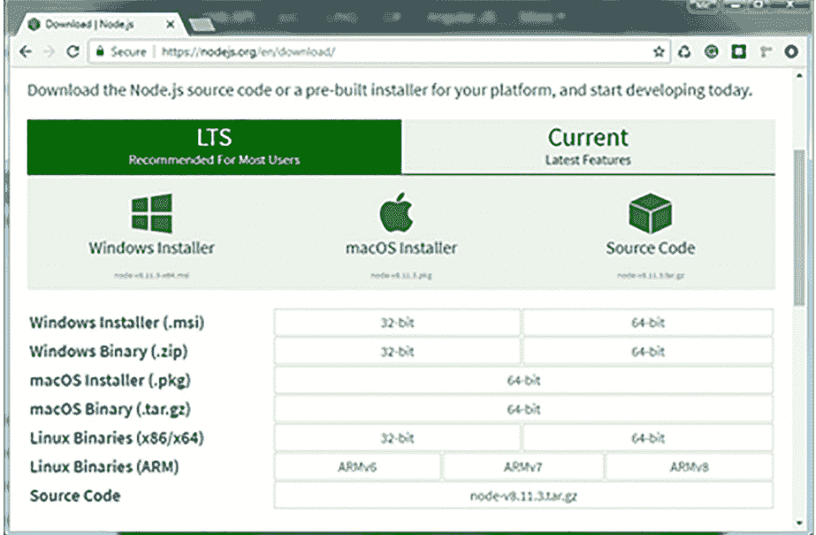

下载正确的安装包后，点击安装程序，Node.js 安装向导将启动。点击 Continue 按钮并按照屏幕上的步骤操作。安装成功后，你将看到安装摘要，显示 NPM 和 Node.js 的安装位置。

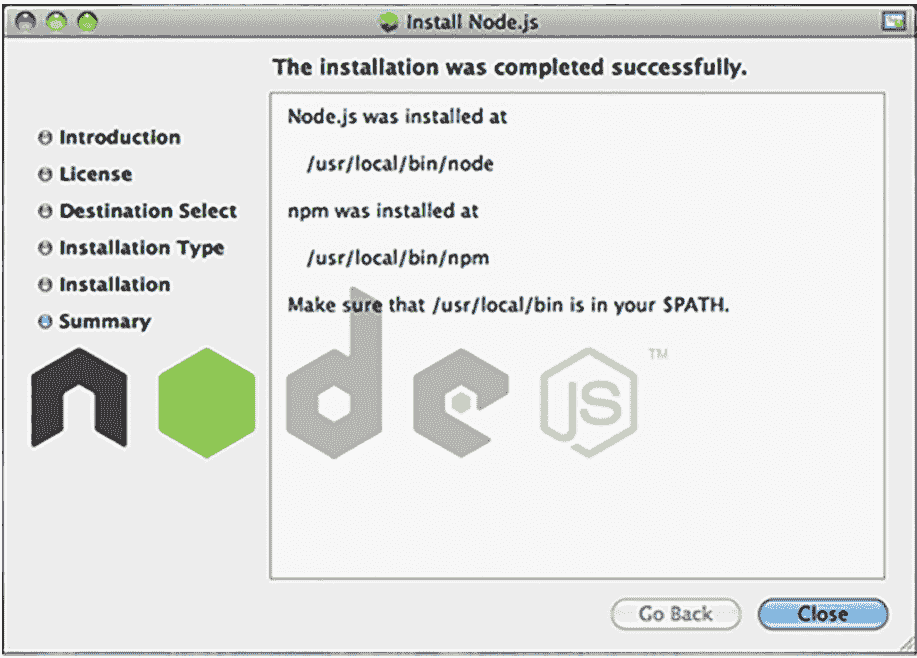

### 验证下载

打开终端窗口，输入以下命令来验证安装（注意，$ 是命令提示符）：

```
node -v
```

你应该会在屏幕上看到版本号。

Mac 或 Linux 用户还有另一种安装 Node.js 的方式，即使用 Homebrew（Mac）或 Linuxbrew（Linux）包管理器，直接从命令行安装 Node.js。如果你使用 Linux，需要先安装额外的依赖项，例如 Ruby v1.8.6 或更高版本以及 GCC v4.2 或更高版本，才能安装 Node.js。

准备好安装后，在提示符下输入以下命令：

```
$ brew install node
```

### IDE 安装

Node.js 在开发应用程序时使用 JavaScript，因此任何支持 JavaScript 的文本编辑器工具或 IDE 都可以使用。不过，我建议你使用支持 Node.js API 自动补全功能的 IDE，例如 Sublime Text、Aptana、Eclipse、Visual Studio 等。

#### IDE – Visual Studio Code

Node.js 应用使用 JavaScript 进行开发。因此，你可以使用任何支持 JavaScript 语法的 IDE 或文本编辑器工具。不过，建议使用支持 Node.js API 自动补全功能的 IDE，例如 Visual Studio、Sublime Text、Eclipse、Aptana 等。

Visual Studio Code 从一开始就同时支持 TypeScript 和 JavaScript 语言，还支持调试功能。但你需要在机器上安装 Node.js 运行时才能运行 Node.js 应用程序。

在系统上安装好 Node.js（包括 Node 包管理器）后，我们就可以安装 VSC 了：

##### Windows

打开 [https://code.visualstudio.com/download](https://code.visualstudio.com/download)，下载适合你系统的 VSC。下载完成后，打开文件夹并运行安装程序 – 文件名为 VSCodeUserSetup（版本号）.exe。加载许可协议后，接受并点击 Next。在下一页，勾选"Create a Desktop Icon"选项 – 这样你可以从桌面快速访问。点击 Next。


最后，点击 Install 按钮。安装完成后，点击 Finish，Visual Studio Code 将自动打开。

##### Mac

首先，前往 [https://code.visualstudio.com/download](https://code.visualstudio.com/download)，下载 Mac 版本的 Visual Studio Code。文件以 .zip 格式下载；找到文件并双击查看内容。找到名为 Visual Studio Code.app 的文件，将其拖到"应用程序"文件夹中。双击文件即可打开。

### Hello World

让我们通过创建 Hello World 应用来开始使用 VSC。

创建一个文件夹，命名为 hello，然后打开命令提示符。进入该文件夹并启动 VS Code。以下是所需的命令：

```
mkdir hello
cd hello
code .
```

现在前往"File Explorer"工具栏，点击"New File"按钮；将其命名为 `app.js`。使用 .js 文件扩展名后，VSC 会将其识别为 JavaScript 文件，并使用 JS 语言服务来解析文件内容。

在 `app.js` 文件中，创建一个字符串变量并将其内容输出到控制台，如下所示：

```
var msg = 'Hello World';
console.log(msg);
```

你可能已经注意到，当输入 `console.` 时，系统会自动在 console 对象上显示 IntelliSense。VS Code 还知道 `msg` 是一个字符串，并且它是基于 Hello World 初始化的。因此，当输入 `msg` 时，IntelliSense 会显示 `msg` 字符串的所有函数。

使用 CTRL+S 保存文件，现在我们可以运行这个应用了。在终端中输入：

```
node app.js
```

输出应该是 "Hello World" 字样。

### 集成终端

VS Code 还有一个集成终端，你可以在其中运行 shell 命令，它还允许你直接运行 Node.js，无需在运行命令行工具时退出 VS Code。

要打开集成终端，请前往"View > Terminal"，终端打开后，你就可以在其中运行 Node.js 了。

### 调试 Hello World

VS Code 还内置了调试器，可以帮助你调试 Node.js 应用。让我们用之前创建的 Hello World 应用来试试。首先，我们需要在 `app.js` 中设置断点，将编辑器光标放在第 1 行，然后按 F9。或者，点击行号左侧的灰色区域 – 你会看到一个红色圆圈。

要开始调试代码，请前往活动栏并点击 Run View。

然后点击调试工具栏上的绿色箭头或按 F5。你的应用现在将进入调试模式，当程序执行到断点时，你可以逐步调试应用程序。VS Code 以不同颜色的状态栏显示调试模式，你将在屏幕上看到 DEBUG 控制台。

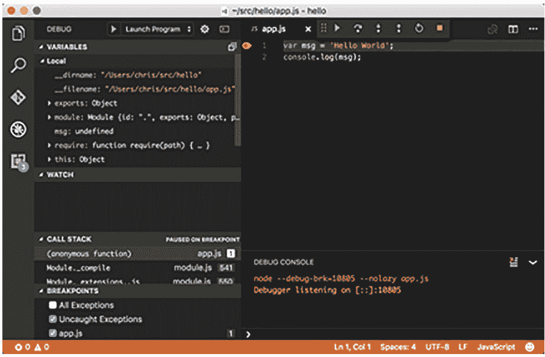

这是一个简单的示例，使用简单的代码向你展示 VS Code 的工作方式。让我们更进一步，将其与一个用 Node.js 构建的全栈 Web 应用程序一起使用。首先，退出 Hello World 文件夹，因为你不再需要它了。如果你愿意，可以将其删除。接下来，我们将创建一个 Express 应用程序。

### 一个 Express 应用程序

Express 是构建和运行 Node.js 应用程序最受欢迎的框架之一——我们将在后面的章节中更详细地介绍它；目前，这只是一个快速示例。

Express 提供了多种工具，其中之一是 Express 生成器，它可以帮助你创建或搭建新的应用程序。Express 生成器是一个 npm 模块，你可以使用 npm 命令行工具来安装它。

首先，打开你的终端并输入 `npm --help` 来检查是否正确安装——你应该能在屏幕上看到关于其使用方法的文档。

现在使用以下命令安装 Express 生成器：

```
npm install -g express-generator
```

注意这里的 `-g` 开关；它会在你的计算机上全局安装 Express 允许你从任何位置运行它。

接下来，使用以下命令创建一个名为 `myExpressApp` 的新应用程序：

```
express myExpressApp --view pug
```

将创建一个名为 `myExpressApp` 的新文件夹，其中包含你的应用程序内容。命令末尾的参数 `--view pug` 告知生成器应使用 pug 模板引擎。

你还需要安装应用程序依赖项，所有依赖项都是 npm 模块；导航到该文件夹，然后执行 `npm install` 命令：

```
cd myExpressApp
npm install
```

现在我们需要确保应用程序能够运行。在生成的 Express 应用程序中有一个名为 `package.json` 的文件，其中包含一个运行 `node ./bin/www` 的启动脚本——这将启动 Node.js 应用程序。在 Express 应用程序文件夹内的终端中输入以下内容：

```
npm start
```

Node.js Web 服务器启动；导航到 http://localhost:3000，你就可以看到应用程序正在运行。

关闭浏览器并在 `myExpressApp` 文件夹中打开一个终端；按 CTRL+C 停止服务器。现在打开 VS Code：

```
code .
```

如果你使用集成终端安装生成器并创建了应用，你需要做的就是使用“文件” > “打开文件夹”从打开的 VS Code 实例中打开应用程序。

### 强大的代码编辑

打开 `app.js` 文件，找到名为 `__dirname` 的 Node.js 全局对象。将光标悬停在上面，你会看到 VS Code 将 `__dirname` 视为一个字符串。并且你可以获得针对该框架的智能感知。例如，当你在 VS Code 中输入代码中 require 的内容（如 HTTP）时，你可以获得智能感知。

VS Code 使用 TypeScript 类型的声明文件，为 VS Code 提供有关你的应用程序所使用的 JS 框架的元数据。类型声明使用 TypeScript 来让 Express 知道函数和参数的数据类型。这使得 VS Code 能够提供最佳的智能感知体验，而且你无需担心下载这些文件——得益于自动类型获取功能，VS Code 会自动安装它们。

你还可以在代码的不同文件中引用其他模块。例如，我们在 `app.js` 中需要 `./routes/index` 模块，该模块导出一个 `Express.Router` 类。

### 调试 Express 应用

首先，你的 Express 应用程序需要一个名为 `launch.json` 的调试器配置文件。转到活动栏并单击“运行”图标。然后在“运行”视图中单击“配置”图标（看起来像一个齿轮）以创建默认的 `launch.json` 文件。在“配置”中，确保 `type` 属性设置为 `node`——这将确保选择 Node.js 环境。文件创建后，VS Code 会在 `package.json` 中查找启动脚本，并将其值用作“启动程序”配置的程序——在我们的例子中，它是 `${workspaceFolder}\\bin\\www`。

```json
{
    "version": "0.2.0",
    "configurations": [
        {
            "type": "node",
            "request": "launch",
            "name": "Launch Program",
            "program": "${workspaceFolder}\\bin\\www"
        }
    ]
}
```

保存文件并转到“运行”视图。单击“配置”选项，确保选择了“启动程序”。打开 `app.js`，通过单击左侧边栏在 Express 应用对象附近（靠近文件开头）设置你的断点。按 F5 开始调试，服务器将在新终端中启动。从断点开始，你可以逐步执行代码、创建监视并检查变量。

到此结束了这第一章。你的 Node.js 环境已经设置好了，所以现在我们可以看看 REPL 终端。

# 第二章

## Node.js — REPL 终端

REPL 即读取-求值-打印-循环，是一个交互式 shell，用于求值 Node.js 表达式。REPL 读取用户输入的代码，求值解释结果，打印出来以便用户看到，并循环直到收到退出信号。

它是 Node.js 内置的一部分，为用户提供了一种快速简便的方式，在 Node 环境中探索和测试 JS 代码，而无需先将其保存并存储到文件中。

### 先决条件

要学习本章内容，你需要具备以下两个条件：

- 计算机上已安装 Node.js——参见上一章

- 具备一些 JavaScript 知识以及如何用它编写代码

### 第一步 — 启动和停止 REPL

只要你的计算机上安装了 Node，也就安装了 REPL。因此启动它很容易——打开你的命令行 shell 并输入以下内容：

```
node
```

这将显示 REPL 提示符，如下所示：

```
>
```

当你看到 `>` 符号时，它告诉你现在可以输入 JavaScript 代码以进行即时求值。

让我们尝试一个示例。在 REPL 中输入以下内容来将两个数字相加：

```
> 2 + 3
```

现在按回车键，REPL 进行求值并返回结果：

```
5
```

如果你想退出 REPL，输入 `.exit`。或者，按两次 CTRL+C 或一次 CTRL+D，你将返回到 shell 提示符。

现在你知道如何启动和停止 REPL 了，让我们看看如何用它来执行简单的 JavaScript 代码。

### 第二步 — 在 REPL 中执行代码

你可以使用 REPL 快速测试你的 JavaScript 代码，而无需创建文件来存储它，实际上所有的 Node.js 或 JavaScript 表达式都可以在这里执行。在第一步中，我们尝试了一个将两个数字相加的表达式，那么现在让我们试试除法。

启动 REPL：

```
node
```

然后在提示符下输入以下内容：

```
> 20 / 5
```

按回车键，你会看到如你所料的输出：

```
4
```

我们也可以在 REPL 中测试字符串操作。让我们尝试在 REPL 中连接两个字符串。输入以下内容：

```
> "Hello " + "World"
```

再次按回车键，REPL 求值该表达式的结果，输出：

```
'Hello World'
```

> **注意**

> 你可能已经发现输出被单引号而不是双引号括起来。与许多其他编程语言不同，JavaScript 字符串中使用的引号对其值没有影响。如果你在字符串输入中使用了单引号，REPL 会智能地在输出中将其改为双引号。

#### 调用函数

当你编写 Node.js 代码时，通常使用全局 `console.log` 方法或类似的函数来打印消息。

在 REPL 提示符下输入以下命令：

```
> console.log("Hey")
```

按回车键，你应该会看到以下内容：

```
Hey
undefined
```

输出的第一行是我们从 `console.log` 得到的。字符串中的消息被打印到标准输出流，即你的屏幕。注意这里没有引号——这是因为 `console.log` 打印字符串时不带引号。

读作“undefined”的第二行是该函数的返回值。

#### 创建变量

在 JavaScript 中，你很少只处理字面量。在 REPL 中创建变量与使用 .js 文件工作的方式非常相似。

在提示符下输入以下命令：

```
> let age = 45
```

按回车键，你会看到以下内容：

```
undefined
```

和之前使用 `console.log` 时一样，该命令的返回值是“undefined。”名为 `age` 的变量将一直可用，直到 REPL 会话关闭。因此，例如，你可以将其乘以三，像这样：

```
> age * 3
```

按回车键，输出将是：

```
135
```

因为 REPL 会返回值，所以没有必要使用 `console.log` 这样的函数来查看输出。默认情况下，REPL 的值会自动显示在屏幕上。

#### 多行代码块

还支持多行代码块。例如，我们可以创建一个为任意给定数字添加10的函数。

输入以下内容开始创建函数：

```
> const add10 = (num) => {
```

按下回车键，提示符将发生变化，看起来像这样：

```
...
```

为什么会这样？因为REPL在命令末尾看到一个花括号，就假定后面还会有更多行代码，并且这些代码必须缩进。为了便于阅读，REPL在下一行放置三个点和一个空格，这样下一行代码看起来就像缩进了一样。

逐行输入该函数的下两行代码，并在每行后按回车键：

```
... return num + 10;
... }
```

在闭括号后按回车键，输出将是：

```
undefined
```

这是函数被赋值给变量的值，`...`提示符再次被`>`提示符取代。

```
undefined
>
```

接下来，我们可以对指定的值调用`add10()`：

```
> add10(10)
```

正如预期的那样，输出显示：

```
20
```

REPL可用于在将JavaScript代码添加到程序之前进行试运行。而且，为了让你的操作更方便，REPL中还提供了一些快捷方式。

### 第三步——掌握REPL快捷方式

REPL中有一些快捷方式，可以帮助减少编码时间。首先，它会保留一个显示所有已输入命令的历史记录，让你可以浏览并在需要时重复命令。

例如，输入这个字符串：

```
> "The answer to everything is 50"
'The answer to everything is 50'
```

我们可以编辑它，将"50"改为"40"，因此在提示符处，按上箭头键回到上一个使用的命令：

```
> "The answer to everything is 50"
```

将光标左移，删除5，输入4；然后按回车键，你会看到：

```
'The answer to everything is 40'
```

继续按上箭头键，它将带你回溯命令历史，直到当前会话中使用的第一条命令。按下箭头键将带你到最近使用的命令。

当你玩够了并了解了所有功能后，重复按下箭头键直到回到提示符。

要获取上一个求值的结果，可以使用下划线。在提示符处输入：

```
_
```

然后按回车键。

屏幕上的输出是上一个输入的字符串：

```
'The answer to everything is 40'
```

此外，REPL中还有一个自动补全功能，可用于关键字、变量和函数。假设你想使用`Math.sqrt`函数来求一个给定数字的平方根；你可以输入前几个字符：

```
> Math.sq
```

按下TAB键，函数会自动补全：

```
> Math.sqrt
```

如果有多个自动补全的可能性，REPL会向你展示所有可用的选项。

尝试在命令中输入以下内容：

```
> Math.
```

按两次TAB按钮，你将看到潜在的自动补全选项：

```
> Math.
Math.__defineGetter__    Math.__defineSetter__    Math.__lookupGetter__
Math.__lookupSetter__    Math.__proto__            Math.constructor
Math.hasOwnProperty      Math.isPrototypeOf        Math.propertyIsEnumerable
Math.toLocaleString      Math.toString             Math.valueOf

Math.E                Math.LN10               Math.LN2
Math.LOG10E           Math.LOG2E              Math.PI
Math.SQRT1_2          Math.SQRT2              Math.abs
Math.acos             Math.acosh              Math.asin
Math.asinh            Math.atan               Math.atan2
Math.atanh            Math.cbrt               Math.ceil
Math.clz32            Math.cos                Math.cosh
Math.exp              Math.expm1              Math.floor
Math.fround           Math.hypot              Math.imul
Math.log              Math.log10              Math.log1p
Math.log2             Math.max                Math.min
Math.pow              Math.random             Math.round
Math.sign             Math.sin                Math.sinh
Math.sqrt             Math.tan                Math.tanh
Math.trunc
```

你看到的行数和列数取决于你的shell屏幕大小，但以上列表包含了Math模块中的所有属性和函数。

要在不执行当前行的情况下在提示符中换到新一行，可以按CTRL+C键。

这些只是REPL快捷方式中的一部分，它们都能让你的编码效率大大提高。然而，还有其他一些东西也有助于提高生产力，那就是REPL命令。

### 第四步——REPL命令

一些特定的关键字有助于控制REPL的行为，每个都以点号（`.`）开头。

#### .help

如果你想查看所有可用的命令，请使用此命令：

```
> .help
```

你不会看到庞大的命令列表，因为命令并不多，但它们都对你在REPL中完成任务很有帮助：

- `.break` —— 如果你卡住了，这个命令可以让你退出

- `.clear` —— `.break`的别名

- `.editor` —— 进入编辑器模式

- `.exit` —— 退出REPL

- `.help` —— 打印帮助信息

- `.load` —— 从文件将JavaScript加载到REPL会话中

- `.save` —— 将本次会话中求值的命令保存到文件

如果你想退出当前的表达式，可以按^C；如果你想退出REPL，可以按^D。

如果你需要回忆某个命令的作用，只需回到`.help`命令即可了解。

#### .break/.clear

你可以使用`.clear`或`.break`退出多行表达式。让我们像这样开始一个for循环：

```
> for (let i = 0; i < 100000000; i++) {
```

如果你想退出更多行，请使用`.clear`或`.break`命令，而不是输入下一行。这将让你退出循环：

```
... .break
```

会出现一个新的提示符：

```
>
```

REPL会转到新的一行，而无需执行代码。这与按CTRL+C的作用类似。

#### .save和.load

你可以使用`.save`命令将REPL启动后运行的所有代码存储到一个文件中，而`.load`命令则会在REPL中运行文件中的JavaScript代码。

使用CTRL+D或`.exit`命令退出当前会话，然后使用`node`启动一个新的会话。唯一保存的代码将是你现在要编写的代码。创建一个列出一些蔬菜的数组：

```
> vegetables = ['pepper', 'onion', 'potato']
```

下一行将显示REPL的输出：

```
[ 'pepper', 'onion', 'potato' ]
```

将其保存到文件，并命名为`vegetables.js`：

```
> .save vegetables.js
```

现在你将看到以下消息：

```
Session saved to: vegetables.js
```

该文件将保存到打开REPL的目录中。例如，如果是在你的主目录中打开的，文件就会保存在那里。

退出会话，并使用`node`打开一个新的REPL。在提示符处加载文件，如下所示：

```
> .load vegetables.js
```

结果将是：

```
vegetables = ['pepper', 'onion', 'potato']
[ 'pepper', 'onion', 'potato' ]
```

`.load`命令会读取每一行代码并执行它，正如你期望JavaScript解释器所做的那样。现在`vegetables`变量就可以像一直存在于当前会话中一样使用了。

输入以下内容：

```
> vegetables[1]
```

按下回车键，你将看到以下输出：

```
'onion'
```

任何JavaScript文件都可以用这个命令加载，不仅仅是你保存的文件。为了快速演示，打开你的代码编辑器，或者如果你使用的是nano（一个命令行编辑器）。现在创建一个名为`walnuts.js`的新文件：

你可以用`.load`命令加载任何JavaScript文件，而不仅仅是你保存的项目。让我们快速演示一下：打开你偏好的代码编辑器或nano（命令行编辑器），创建一个名为`walnuts.js`的新文件：

```
nano walnuts.js
```

打开文件后，输入以下内容：

现在文件已打开，输入以下内容：

```
walnuts.js
console.log('I love walnuts!');
```

通过按CTRL+X保存并退出，然后在保存`walnuts.js`的目录中，使用`node`启动REPL。然后在会话中加载`walnuts.js`文件：

```
> .load walnuts.js
```

使用`.load`命令，你可以执行`console`语句，你将看到：

```
console.log('I love walnuts!');
I love walnuts!
undefined
>
```

如果你最终使用REPL的时间比预期的长，或者你有一段代码想要深入研究或分享，请使用`.load`和`.save`命令来帮助你。

以上就是对Node.js中REPL的简要介绍。在下一章中，我们将介绍包管理器。

## 第三章

## Node.js - 包管理器（NPM）

截至2017年1月，npm已拥有超过350,000个不同的包，而且这个数字还在持续增加，如今它已成为世界上最大的语言代码仓库之一。可以*肯定*地说，只要你能想到的功能，很可能都有对应的包！

Npm最初是用来下载Node.js包并管理其依赖的工具。现在它已成为前端JavaScript开发中最流行的工具之一，并且被用于许多不同的场景：

### 下载和安装依赖

Npm用于管理项目中的所有下载依赖。如果你的包中包含一个名为`package.json`的文件，运行`npm install`将确保你的项目获得所需的一切。所有内容都将安装在一个名为`node_modules`的文件夹中——如果该文件夹尚不存在，npm会自动创建它。

#### 安装和更新包

可以通过运行以下命令安装单个包：

```
npm install <package-name>
```

通常情况下，还会在命令中添加 angezeigt 其他标志，例如：

- `--save` – 安装后将条目添加到`package.json`中名为dependencies的文件中

- `--save-dev` – 安装后将条目添加到`package.json`中名为devDependencies的文件中

两者的区别在于，devDependencies通常是开发工具，如测试库，而dependencies则是打包到应用中的依赖项。

你也可以通过运行以下命令来更新包：

```
npm update
```

npm会检查每个包，查找符合你版本限制的更新版本。如果你只想更新某个特定的包，只需指定包名即可：

```
npm update <package-name>
```

### 版本控制

除了标准下载之外，你还可以使用npm进行版本控制，允许你指定特定的包版本，或要求高于或低于当前所需的版本。大多数时候，库只兼容另一个库的主版本。或者你可能因为某个库中存在未修复的bug而遇到问题。

当你明确指定库版本时，有助于所有人保持一致，确保整个团队在`package.json`更新之前都使用相同的版本。

在这种情况下，版本控制非常有用，而且npm始终遵循semver（语义化版本控制）标准。

### 运行任务

`package.json`支持指定命令行任务的格式，你可以通过以下方式运行这些任务：

```
npm run <task-name>
```

以下是一个示例：

```json
{
    "scripts": {
        "start-dev": "node lib/server-development",
        "start": "node lib/server-production"
    }
}
```

使用此功能运行Webpack也很常见：

```json
{
    "scripts": {
        "watch": "webpack --watch --progress --colors --config webpack.conf.js",
        "dev": "webpack --progress --colors --config webpack.conf.js",
        "prod": "NODE_ENV=production webpack -p --config webpack.conf.js"
    }
}
```

无需输入冗长的命令，也无需费力记忆它们并确保不会输错，你可以这样做：

```
$ npm run watch
$ npm run dev
$ npm run prod
```

### npm将包安装到哪里？

使用npm安装包时，可以选择两种安装类型——本地安装或全局安装。

当你在npm中输入安装命令时，例如：

```
npm install lodash
```

默认情况下，包会安装在当前目录下，位于名为`node_modules`的子文件夹中。同时，lodash条目也会被添加到当前文件夹中`package.json`的dependencies属性里。

要进行全局安装，需要添加`-g`标志：

```
npm install -g lodash
```

这次，包会使用全局位置而不是安装到本地文件夹。但具体在哪里呢？

`root -g`命令会告诉你计算机上的确切位置。在Linux或Mac系统上，可能是`/usr/local/lib/node_modules`，而在Windows上，可能是`C:\Users\YOU\AppData\Roaming\npm\node_modules`。

如果你使用npm管理Node.js版本，这些位置会有所不同。

### 使用或执行通过npm安装的包

当你使用npm在名为`node_modules`的文件夹中或全局安装包时，如何在Node.js代码中使用它呢？假设你使用以下命令安装了流行的JS工具库lodash：

```
npm install lodash
```

该包将安装在本地`node_modules`文件夹中。要在代码中使用它，需要使用require命令将其导入程序：

```javascript
const _ = require('lodash')
```

那么，如果你有一个可执行的包呢？

可执行文件会被放到`node_modules/.bin/`文件夹中。

演示这一点的最简单方法之一是使用cowsay包，它包含一个命令行程序。可以执行该程序让动物（如奶牛）说些什么。

当像这样安装包时

```
npm install cowsay
```

它会连同所需的依赖一起安装在`node_modules`文件夹中：

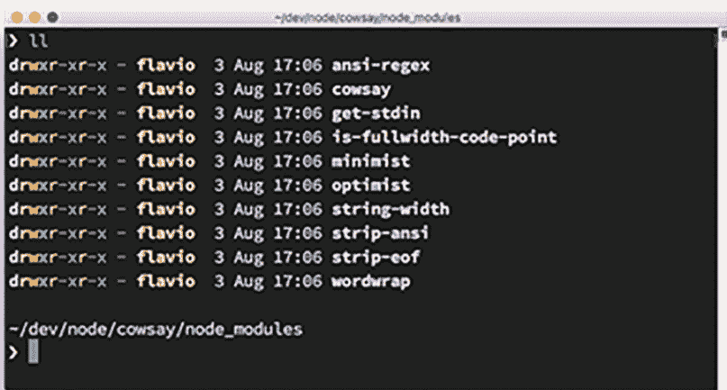

一个隐藏的bin文件夹包含指向cowsay二进制文件的符号链接：

```
> ll
lrwxr-xr-x  16 flavio  3 Aug 17:06 cowsay -> ../cowsay/cli.js
lrwxr-xr-x  16 flavio  3 Aug 17:06 cowthink -> ../cowsay/cli.js

~/dev/node/cowsay/node_modules/.bin
> █
```

那么，如何执行这些程序呢？

你可以通过输入`./node_modules/.bin/cowasay`来运行，它会生效。但使用*npx*更好，它已集成在较新的npm版本中。你只需运行：

```
npx cowsay
```

包的位置会自动找到。

```
> npx cowsay take me out of here
-----------------------------
< take me out of here >
-----------------------------
       \   ^__^
        \  (oo)\_______
           (__)\       )\/\
               ||----w |
               ||     ||

~/dev/node/cowsay/node_modules/.bin
> █
```

## 第四章

## Node.js 回调与Promise

当你刚开始接触Node.js时，首先遇到的很可能是回调。在深入了解回调之前，我们需要知道它们存在的原因，这归结于Node的**异步**特性。大多数人都知道异步编程是"更好但更困难的"。这听起来有些过于简单，所以让我们通过对比同步和异步代码来看看。

首先你会发现，异步代码版本简直*惨不忍睹*。它看起来过于复杂，但我们从中获得的收益并不比同步代码多太多。然而，不可否认其中确有收益，所以让我们来谈谈这些收益。

异步代码非常酷的一点是，当你的代码在等待某些事情（如API调用或数据库响应）时，它并不会无所事事。在同步代码中，当它在做某事时会阻塞你的代码，如果需要很长时间，它会让其他所有事情都停止。而在异步代码中，你可以同时处理其他事情。这是Node.js存在的首要原因之一——异步服务器可以在等待I/O（输入/输出）的同时继续处理请求。

是的，当你进行异步编程时——我们将在下一章中更深入地探讨——事情确实感觉更复杂了，但它并不难理解，而且带来的收益值得你花时间去理解。

那么，现在我们对此有了更好的理解，让我们更深入地了解回调。它们究竟是什么？

回调无非就是作为参数传递给其他函数的函数，接收函数随后会使用或回调它。

看看这个回调函数在行动中的简单示例：

```javascript
fs.readFile(funFileName, function(err, file) {
  if(err)
    handleError(err);
  console.log("file: ", file)
})
```

一旦`fs.readFile`获取了`funFileName`文件，回调函数就会被执行。该函数将处理任何抛出的错误，并将检索到的文件记录到控制台。

回调函数接受两个参数——`err`和`file`。按照惯例，回调函数的第一个参数是错误。如果父函数抛出错误，它会被处理；但有时候不会抛出错误，此时函数的第一个参数必须为null。按照惯例，后续跟随的函数是响应数据。

好的，这很好，但我们为什么不直接这样写代码呢？

```javascript
let file = fs.readFile(fooFileName);
console.log("file: headphones, file);
```

简短的答案是异步。

第二个例子表明，当我们尝试记录时`file`尚未定义。这是因为`fs.readFile`在我们到达`console.log()`之前还没有完成获取。

然而，值得注意的是，以下内容会生效：

```javascript
let file = 1+1;
console.log("file: ", file);
```

对于那些真正刚接触这个领域、只接触过同步编程的人来说，这会让人感到有些困惑，更不用说还有些繁琐了。在同步编程中，你的生活很轻松，充满了逻辑，然后突然间，第四行可以在第三行之前执行！那么，回调应该到处使用、一直使用，以防万一吗？答案是一个响亮的**不**。

你应该只在不知道某事何时完成时才使用回调。再次想想从数据库获取数据、API调用等。这些都需要时间，所以回调需要在事件发生时被调用，这就是"事件驱动编程"这一术语的由来。

如果你现在还不太理解，别担心——你不是唯一一个，真正的理解方法就是亲手实践。

让我们进一步深入探讨异步编程及其包含的所有内容。

## 第五章

### JavaScript 异步编程

在本章中，我们将探讨 JavaScript 异步编程，但首先，我们需要回顾一些 JavaScript 异步的问题。然后我们将介绍异步技术，并展示它们如何帮助我们解决这些问题。

### 同步 JavaScript

要理解 JavaScript 异步，我们首先必须理解同步 JavaScript。你看到的大部分基础 JavaScript 代码都围绕同步代码展开——你运行代码，一旦浏览器能够处理，它就会返回结果。这里有一个非常简单的例子：

```
const btn = document.querySelector('button');
btn.addEventListener('click', () => {
  alert('You clicked on me!');

  let pElem = document.createElement('p');
  pElem.textContent = 'This is a new paragraph.';
  document.body.appendChild(pElem);
});
```

在这里，每一行代码依次执行：

首先，我们获取 DOM 中一个现成的 `<button>` 元素的引用。然后添加一个点击事件监听器；当按钮被点击时，按顺序发生四件事：

1. 显示一个 `alert()` 消息

2. 关闭警告框后，创建一个 `<p>` 元素

3. 然后为该元素设置文本

4. 将段落追加到文档主体中

现在，这就是同步代码问题所在——JavaScript 是单线程的，因此，在上述每个操作发生时，其他操作都无法执行。每个步骤都依赖于前一个步骤完成后才能运行——在此之前，所有其他操作都被阻塞。以上面的例子为例——一旦按钮被点击，警告消息就会出现。直到点击消息上的“确定”按钮，段落才会出现。

**注意**

虽然 `alert()` 对于演示同步阻塞操作的工作方式很有用，但它并不适合实际应用。

### JavaScript 异步

由于阻塞带来的问题，大多数 Web API 更倾向于运行异步代码，尤其是在应用需要获取或访问外部资源时。这可能包括从网络获取文件、访问数据库以返回数据、访问网络摄像头的视频流、将显示内容广播到 VR 头戴设备等等。

那么，我们为什么不能用同步代码来完成这个呢？我们可以通过一个例子来说明。当从服务器获取图像时，结果无法立即返回，这意味着下面的伪代码将无法工作：

```
let response = fetch('myImage.png'); // fetch 是异步的
let blob = response.blob();
// 以某种方式在 UI 中显示 image blob
```

代码无法工作，因为我们不知道图像下载需要多长时间。因此，当执行到第二行代码时，会抛出一个错误——这可能是每次都发生，也可能是间歇性发生的——因为没有可用的响应。你确实需要你的代码在尝试其他操作之前等待响应。

异步代码有两种风格——回调和 Promise 风格，后者是更新的代码风格。我们现在将介绍这两种。

### 异步回调

回调函数是我们作为参数指定的函数，当调用执行后台代码的函数时传入。一旦后台代码运行完毕，就会调用回调函数，通知你工作已完成或发生了某些有趣的事情。回调函数是老式的，但仍在一些较旧但常见的 API 中使用。

在上面的代码中，我们看到了一个异步回调的例子——它在 `addEventListener()` 方法中作为第二个参数：

```
btn.addEventListener('click', () => {
  alert('You clicked on me!');

  let pElem = document.createElement('p');
  pElem.textContent = 'This is a new paragraph.';
  document.body.appendChild(pElem);
});
```

第一个参数指示我们想要监听的事件类型，而第二个是回调函数，只有在事件触发后才会调用。

当一个回调函数作为参数传递给另一个函数时，我们所做的只是将函数的引用作为参数传递；例如，回调函数不会立即执行。包含它的函数会在适当时机执行回调。

编写包含回调的函数相当简单。这是一个使用 XMLHttpRequest API 加载资源的例子：

```
function loadAsset(url, type, callback) {
  let xhr = new XMLHttpRequest();
  xhr.open('GET', url);
  xhr.responseType = type;

  xhr.onload = function() {
    callback(xhr.response);
  };

  xhr.send();
}

function displayImage(blob) {
  let objectURL = URL.createObjectURL(blob);

  let image = document.createElement('img');
  image.src = objectURL;
  document.body.appendChild(image);
}

loadAsset('coffee.jpg', 'blob', displayImage);
```

创建了一个 `displayImage()` 函数来表示一个 blob。这个 blob 作为对象 URL 传递给函数；创建一个图像来显示该 URL，并将其追加到文档的 `<body>` 中。创建了一个 `loadAsset()` 函数，它接受一个回调函数参数、内容类型和要获取的 URL。XMLHttpRequest（通常称为 XHR）用于从指定的 URL 获取资源，然后将响应传递给回调函数以便它可以对其进行处理。在我们的例子中，回调函数等待 XHR 使用 `onload` 事件处理器下载资源，然后将资源传回给回调函数。

回调函数非常灵活，因为它们让你控制函数执行的顺序，并确定在函数之间传递的数据，但它们也允许你根据当前情况将数据传递给其他函数。这样，可以在下载的响应上运行不同的操作，例如 `displayText()`、`processJSON()` 等。

请注意，并非每个回调都是异步的；有些是同步的，一个例子是当使用 `Array.prototype.forEach()` 遍历项目数组时：

```
const gods = ['Apollo', 'Demeter', 'Ares', 'Hades'];

gods.forEach(function (eachName, index){
  console.log(index + '. ' + eachName);
});
```

这里，遍历一个包含神祇名字的数组，并将索引号和相应的值打印到控制台。`forEach()` 的参数是一个回调函数，它也接受两个参数。这些是对数组名称和索引值的引用。然而，它并不等待——它会立即运行。

### Promise

Promise 是当今 Web API 中使用的最新异步代码风格。最好的例子之一是一个名为 `fetch()` 的 API，它是 XMLHttpRequest 的现代版本，效率高得多。这里有一个例子：

```
fetch('products.json').then(function(response) {
  return response.json();
}).then(function(json) {
  products = json;
  initialize();
}).catch(function(err) {
  console.log('Fetch problem: ' + err.message);
});
```

在这段代码中，`fetch()` 只接受一个参数：你想要获取的网络资源的 URL，它返回一个 Promise。Promise 是代表异步操作成功或失败的对象，可以说是中间状态的表示。这就像浏览器在向你承诺，它会尽快给你一个回复——这就是名字的由来。

这可能需要一点时间来适应，并且感觉有点像薛定谔的猫——所有可能的结果都还没有发生，`fetch()` 正在等待浏览器结果，这个结果将在未来的某个时间点出现。还有另外三个代码块链接到 `fetch()`：

- 有两个 `then()` 块，每个都包含一个回调函数。这个函数只有在前面的操作成功时才会运行，每个回调都接收该先前操作的结果作为输入。这样，你就可以继续做其他事情。`.then()` 块返回一个 Promise，多个 `.then()` 块可以链接在一起，允许异步操作按顺序一个接一个地运行。

- 最后还有一个 `catch()` 块，它只在一个或多个 `.then()` 块失败时才会运行。就像同步 JavaScript 中的 `try...catch` 块一样，`catch()` 块中有一个错误对象，用于报告发生的任何错误。值得注意的是，同步的 `try...catch` 对 Promise 不起作用。

### 事件队列

异步操作，例如 Promise，被放入事件队列中。为避免后续代码被阻塞，这些队列在主线程处理完毕后运行，当排队的操作完成后，它们会将结果返回给 JavaScript。

### Promise 与回调

Promise 与回调有些相似，它们只不过是返回的对象附加了回调函数，而不是将回调传递给函数。但 Promise 专门设计用于异步操作，相对于回调有几个优势：

- 多个异步操作可以链接在一起，可以有任意多个 `.then()` 操作在需要时链式调用。结果作为输入从一个操作传递到下一个操作，这在回调函数中很难实现——你可以试试，结果往往会变得一团糟。

- Promise 总是按照它们进入事件队列的确切顺序被调用。

- 错误处理起来更容易，因为所有错误都由一个 `.catch()` 块统一处理，而不是在每一层都单独处理。

- Promise 也摆脱了控制反转的问题，而传统的回调函数在将回调传递给第三方库时，会失去对函数执行的控制。

### 异步代码的本质

让我们再看一个例子，它展示了异步代码的真实本质。它表明，当我们不完全清楚代码的执行顺序，以及将异步代码和同步代码同等对待时，可能会发生什么。这与我们之前看过的例子类似，但这次包含了多个 `console.log()` 语句，以展示你可能假设的代码执行顺序：

```
console.log ('Starting');
let image;

fetch('coffee.jpg').then((response) => {
  console.log('It worked :)')
  return response.blob();
}).then((myBlob) => {
  let objectURL = URL.createObjectURL(myBlob);
  image = document.createElement('img');
  image.src = objectURL;
  document.body.appendChild(image);
}).catch((error) => {
  console.log('There is a problem with your fetch operation: ' + error.message);
});

console.log ('All done!');
```

浏览器开始执行代码。它看到第一个 `console.log()` 语句并执行它，然后创建了 `image` 变量。接着，它执行到下一行，开始执行 `fetch()` 代码块。然而，`fetch()` 是异步执行的，不会阻塞，因此在 Promise 相关的代码执行后，剩余的代码会继续执行。这样，最后一个 `console.log()` 就被执行了，并将结果输出到控制台。

只有当 `fetch()` 完成，并且结果通过 `.then()` 代码块传递后，第二个 `console.log()` 消息才会出现在控制台上。如你所见，消息出现的顺序与你预期的不符：

- Starting

- All done!

- It worked :)

如果你觉得这很困惑，请看这个例子：

```
console.log("registering click handler");

button.addEventListener('click', () => {
  console.log("get click");
});

console.log("all done");
```

它的行为方式非常相似——第一个和第三个 `console.log()` 消息会立即显示，但中间的那个会被阻塞，直到鼠标按钮被点击。在第一个例子中，区别在于中间的消息被阻塞，是在等待一个资源显示在屏幕上，而不是等待一个按钮被点击。

这种设置在更复杂的代码中可能会导致真正的问题。如果异步代码块返回一个结果，而这个结果又在后续的同步代码块中被依赖，那么这样的异步代码块就不能被包含。因为无法保证异步函数在浏览器处理同步代码块之前返回。

要了解这是如何工作的，请看以下示例：

```
<!DOCTYPE html>
<html>
  <head>
    <meta charset="utf-8">
    <title>Simple async sync example</title>
  </head>
  <body>
    <script>
      console.log ('Starting');
      let image;
```

```
fetch('coffee.jpg').then((response) => {
  console.log('It worked :)')
  return response.blob();
}).then((myBlob) => {
  let objectURL = URL.createObjectURL(myBlob);
  image = document.createElement('img');
  image.src = objectURL;
  document.body.appendChild(image);
}).catch((error) => {
  console.log('There is a problem with your fetch operation: ' + error.message);
});

console.log ('All done!');
</script>
</body>
</html>
```

将第四个 `console.log()` 改为：

```
console.log ('All done! ' + image.src + 'displayed.');
```

现在你的控制台应该显示一个错误，而不是第三条消息：

TypeError: image is undefined; can't access its "src" property

当浏览器尝试运行第三个 `console.log()`，而 `fetch()` 代码块尚未完成时，就会发生这种情况——`image` 变量此时还没有值。

### 注意

出于安全原因，你不能使用 `fetch()` 从本地文件系统获取文件，因此你需要通过本地 Web 服务器来运行上面的示例。

修复这个 `fetch()` 问题，并确保所有 `console.log()` 语句按你想要的顺序出现，可以通过让第三个语句异步运行来实现。你可以通过将其放入一个与第二个 `.then()` 块链式调用的 `.then()` 块中，或者直接将其放入第二个 `.then()` 块中来实现。

## 第六章

## Node.js 事件循环与事件发射器

事件循环帮助 Node.js 执行非阻塞 I/O 操作，即使 JS 是单线程语言。为此，只要有可能，操作就会被卸载到系统内核执行。

如今，内核是多线程的，这意味着它们可以在后台同时处理多个操作。当一个操作完成时，内核会通知 Node.js，确保正确的回调函数被放入轮询队列，并在某个时刻被执行。在本章结束时，你将理解这一点。

当 Node.js 启动时，事件循环会被初始化。提供的输入脚本被处理或放入 REPL 中——它可以安排定时器、异步 API 调用，或者调用 `process.nextTick()`——然后事件循环开始运行。

在下面的图表中，你可以看到事件循环中操作顺序的一个简单概览：

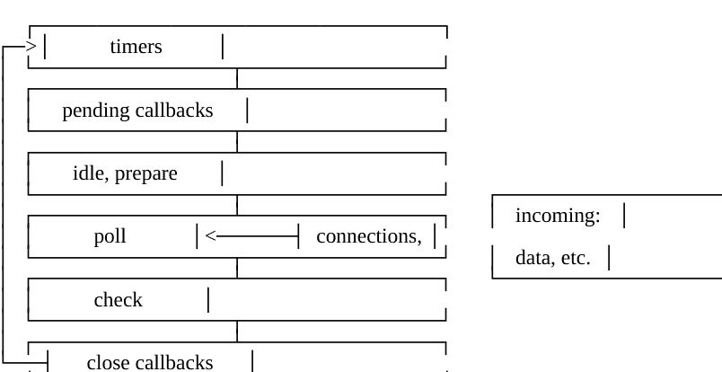

上图中的每个框都称为事件循环阶段。每个阶段都包含一个需要执行的回调函数的 FIFO（先进先出）队列。当事件循环进入任何阶段时，会执行该阶段特有的操作，并且会执行阶段队列中的回调函数，直到它们全部完成，或者达到回调函数数量限制。发生这种情况时，事件循环会进入下一个阶段，如此循环往复。

任何一个操作都可能导致更多操作被调度，内核会在轮询阶段对新事件进行排队处理。轮询事件可能在轮询事件被处理的同时被排队。这样做的结果是回调函数运行时间更长，导致轮询阶段的运行时间超出了定时器的允许范围。

### 阶段概览

在每个阶段之间，事件循环运行时，Node.js 会检查是否有任何定时器或异步 I/O 需要运行；如果没有，它将干净地关闭。

#### 定时器

定时器用于指定一个阈值，超过该阈值后，给定的回调函数将被执行，而不是等待精确的时间。这些回调函数会在调度后尽快在阈值之后运行，但可能会被操作系统中其他调度的回调函数延迟。从技术上讲，定时器的执行是由轮询阶段控制的。

假设你想安排一个在 100ms 阈值后执行的超时；在这种情况下，你的脚本将开始一个耗时 95ms 的文件异步读取：

```
const fs = require('fs');

function someAsyncOperation(callback) {
  // This takes 95ms to complete
  fs.readFile('/path/to/file', callback);
}

const timeoutScheduled = Date.now();

setTimeout(() => {
  const delay = Date.now() - timeoutScheduled;

  console.log(`${delay}ms have passed since scheduling`);
}, 100);
```

```
// do someAsyncOperation that takes 95 ms to complete
someAsyncOperation(() => {
    const startCallback = Date.now();

    // do something else that takes 10ms...
    while (Date.now() - startCallback < 10) {
        // do nothing
    }
});
```

当事件循环进入轮询阶段时，队列是空的——`fs.readFile()` 尚未完成——因此循环会等待指定的剩余毫秒数，直到最早定时器的阈值到达。与此同时，`fs.readFile()` 继续读取文件，耗时 10ms 的回调函数被放入轮询队列并执行。一旦回调函数完成，所有排队的回调函数都已处理完毕，事件循环就能看到最快定时器的阈值已到达。它回到定时器阶段，定时器回调函数被执行。在这个例子中，从定时器调度到其回调函数执行的延迟是 105 毫秒。

**注意**

要防止轮询阶段导致事件循环饥饿，需要一个名为 libuv 的库设置一个硬性最大值，在此之前它会停止轮询新事件。这个最大值取决于系统。Libuv 是一个 C 库，负责实现事件循环和所有平台的异步行为。

#### 待处理回调

待处理回调阶段负责执行系统操作的回调函数，例如 TCP 错误类型。例如，如果 TCP 套接字在尝试连接时收到 ECONNREFUSED 错误，某些 *nix 系统可能不会立即报告该错误。相反，它会被放入待处理回调阶段的队列中，等待执行。

此阶段执行一些系统操作的回调函数，例如 TCP 错误类型。例如，如果 TCP 套接字在尝试连接时收到 ECONNREFUSED，某些 *nix 系统会等待报告该错误。这将被放入 **待处理回调** 阶段的队列中执行。

#### 轮询

轮询阶段有两个主要功能：

- 计算阻塞和轮询 I/O 的时间长度

### 进程轮询队列事件

当事件循环进入轮询阶段时，如果没有已调度的定时器，则可能发生以下两种情况之一：

1. 如果队列不为空，循环会遍历回调队列，异步执行它们，直到达到硬性限制或队列为空。

2. 如果队列为空，则可能发生以下两种情况之一：

   - 如果已使用 `setImmediate()` 调度脚本，事件循环将结束轮询阶段。然后循环进入检查阶段并执行所有已调度的脚本。

   - 如果未使用 `setImmediate()` 调度脚本，事件循环将等待回调被添加到队列中，届时它们将立即被执行。

当轮询队列中没有剩余内容时，事件循环会查找已到达时间阈值的定时器。如果至少有一个就绪，事件循环将返回定时器阶段并执行回调。

### 检查

检查阶段允许回调在轮询阶段完成后立即执行。如果该阶段处于空闲状态且 `setImmediate()` 已将一些脚本加入队列，循环将继续检查该阶段，而不是等待。

`setImmediate()` 是一个定时器，一种在不同事件循环阶段运行的特殊定时器。libuv API 用于在轮询阶段完成后调度回调的执行。通常，当代码执行时，事件循环必须在某个时刻进入轮询阶段。它在那里等待传入的请求、连接等，但如果已使用 `setImmediate()` 调度回调且轮询阶段处于空闲状态，循环将不会等待轮询事件，而是结束并继续进入检查阶段。

### 关闭回调

如果一个句柄或套接字被突然关闭，即使用 `socket.destroy()`，则在关闭回调阶段会触发 `close` 事件。否则，将使用 `process.nextTick()` 来触发该事件。

### setImmediate() vs setTimeout()

它们非常相似，但在调用时，它们的表现可能有所不同。

- `setImmediate()` 在当前轮询阶段结束后执行脚本。

- `setTimeout()` 调度一个脚本在最小毫秒阈值过后运行。

执行顺序是变化的，取决于调用上下文。如果两者都在主模块中调用，进程性能会绑定它们的时序，但其他机器应用可能会影响性能。

例如，假设运行以下脚本。它不在主模块中，而是在 I/O 循环中，因此执行顺序是不确定的，因为性能进程会绑定它：

```javascript
// timeout_vs_immediate.js
setTimeout(() => {
  console.log('timeout');
}, 0);

setImmediate(() => {
  console.log('immediate');
});
```

```
$ node timeout_vs_immediate.js
timeout
immediate

$ node timeout_vs_immediate.js
immediate
timeout
```

另一方面，如果这两个调用被放置在 I/O 循环中，则 `setImmediate()` 会先被执行：

```javascript
// timeout_vs_immediate.js
const fs = require('fs');

fs.readFile(__filename, () => {
  setTimeout(() => {
    console.log('timeout');
  }, 0);
  setImmediate(() => {
    console.log('immediate');
  });
});
```

```
$ node timeout_vs_immediate.js
immediate
timeout

$ node timeout_vs_immediate.js
immediate
timeout
```

使用 `setImmediate()` 相比 `setTimeout()` 有一个主要优势：如果它在 I/O 循环中被调度，无论有多少个定时器，它都会在定时器之前优先执行。

### process.nextTick()

你可能也注意到 `process.nextTick()` 并未出现在上面的图中，尽管它是异步 API 的一部分。严格来说，它不是事件循环的一部分。无论事件循环当前处于什么阶段，`nextTickQueue` 都会在当前操作完成后优先处理。

回到那张图，在任何一个阶段调用 `process.nextTick()` 时，传递给它的所有回调都会在事件循环继续之前被解析完成。然而，这可能会导致问题的发生——由于递归调用 `process.nextTick()`，它会使你的 I/O 饥饿。这会阻止事件循环进入轮询阶段。

那么，为什么 Node.js 允许这种情况发生呢？这是其设计哲学的一部分，即允许 API 始终是异步的，无论它是否需要。来看这个例子：

```javascript
function apiCall(arg, callback) {
    if (typeof arg !== 'string')
        return process.nextTick(callback,
            new TypeError('argument should be a string'));
}
```

这段代码检查参数，如果参数不正确，错误会被传递给回调。最近更新的 API 允许将参数传递给 `process.nextTick()`，这意味着它可以接受在回调之后传递的参数。这些参数随后作为回调参数被传递，消除了嵌套函数的需要。

我们所做的是将错误传递给用户，但这只在其余用户代码执行完成后才会发生。`process.nextTick()` 保证了 `apiCall()` 回调仅在剩余用户代码执行完毕后、事件循环继续之前运行。实现这一点是通过允许 JS 调用栈解包来完成的。然后指定的回调会立即被执行，从而允许递归调用 `process.nextTick()` 而不会从 v8 引擎收到 `RangeError: Maximum call stack size exceeded` 错误。

然而，这可能会导致一些问题。来看这段代码：

```javascript
let bar;

// the signature is asynchronous but synchronously calls callback
function someAsyncApiCall(callback) { callback(); }

// the callback gets called before `someAsyncApiCall` is finished.
someAsyncApiCall(() => {
    // because someAsyncApiCall hasn't finished, bar doesn't get a value assigned
    console.log('bar', bar); // undefined
});

bar = 1;
```

`someAsyncApiCall()` 的签名是异步的，但其操作是同步的。调用时，`someAsyncApiCall()` 会在事件循环阶段被调用，因为 `someAsyncApiCall()` 没有进行任何异步操作。这是因为回调试图引用 `bar`，但由于脚本尚未完成，该变量可能不在作用域内。

当你将回调放入 `process.nextTick()` 中时，脚本仍然可以完成，从而在回调被调用之前允许所有函数、变量等完成初始化。它还会阻止事件循环继续执行。这在事件循环继续之前向用户提示错误时也很有用。以下是之前的 `process.nextTick()` 示例：

```javascript
let bar;

function someAsyncApiCall(callback) {
    process.nextTick(callback);
}

someAsyncApiCall(() => {
    console.log('bar', bar); // 1
});

bar = 1;
```

再看一个实际的例子：

```javascript
const server = net.createServer(() => {}).listen(8080);
server.on('listening', () => {});
```

当只传递端口时，端口会被立即绑定。这意味着监听回调可能被立即调用，但有一个问题——`on('listening')` 回调还未被设置。解决这个问题需要将监听事件放入 `nextTick()` 队列以完成脚本。这样，用户就可以设置所需的任何事件处理器。

### process.nextTick() vs setImmediate()

这两个调用非常相似，但名字容易让人混淆：

- `process.nextTick()` 会在同一阶段立即触发。

- `setImmediate()` 会等待下一次事件循环迭代或 tick 后再触发。

实际上，这两个名字应该互换，因为 `process.nextTick()` 比 `setImmediate()` 更快触发。然而，这是历史遗留问题，不太可能改变。简单的原因是这会破坏相当多的 npm 包。每天都有更多的模块被添加，这会导致更多潜在的破坏，因此，尽管令人困惑，这些名字不会改变。

我们建议你始终使用 `setImmediate()`。

### 为什么使用 process.nextTick()？

有几个充分的理由应该使用 `process.nextTick()`：

- 用户可以在循环继续之前更好地处理错误、清理不需要的资源，或重新提交请求。

- 有时，回调需要在调用栈解包和事件循环继续之间运行。

最好的例子之一是匹配用户预期，一个简单的例子是：

```
const server = net.createServer();
server.on('connection', (conn) => { });

server.listen(8080);
server.on('listening', () => { });
```

假设 `listen()` 在事件循环开始时运行，但回调函数在 `setImmediate()` 中。如果未传入主机名，端口绑定会立即发生。事件循环需要到达轮询阶段才能继续，这意味着存在非零概率收到连接，因此 `connection` 事件可能在 `listening` 事件之前被触发。

另一个例子是运行一个继承自 `EventEmitter` 的函数构造函数，并希望在构造函数中调用一个事件：

```
const EventEmitter = require('events');
const util = require('util');

function MyEmitter() {
  EventEmitter.call(this);
  this.emit('event');
}
util.inherits(MyEmitter, EventEmitter);

const myEmitter = new MyEmitter();
myEmitter.on('event', () => {
  console.log('an event occurred!');
});
```

事件不能从构造函数中立即发出，因为脚本尚未处理到足够远的位置，用户无法为该事件分配回调。在构造函数中，可以使用 `process.nextTick()` 来设置回调。回调在构造函数完成后发出事件，这会得到用户期望的结果：

```
const EventEmitter = require('events');
const util = require('util');

function MyEmitter() {
  EventEmitter.call(this);

  // use nextTick to emit the event when a handler is assigned
  process.nextTick(() => {
    this.emit('event');
  });
}
util.inherits(MyEmitter, EventEmitter);

const myEmitter = new MyEmitter();
myEmitter.on('event', () => {
  console.log('an event occurred!');
});
```

## 第七章

## Node.js Buffer

虽然纯 JavaScript 在处理 Unicode 编码字符串方面表现良好，但在处理纯二进制数据时并不擅长。在浏览器端，大多数数据都是字符串格式的，所以这没什么问题，但 Node.js 服务器的情况则不同。它们还需要处理 TCP 流，以及读写文件系统。这两者都意味着我们也需要处理二进制数据流。

处理这个问题的一种方式是使用字符串，这也是 Node.js 过去的做法。然而，这是一种麻烦的方式——不仅速度慢，而且意味着你使用的是字符串的 API 而非二进制数据的 API。而且它们还很容易以非常奇怪的方式出错。

那么，用什么来替代二进制字符串呢？答案是 Buffer。

### 什么是 Buffer？

在 Node.js 中，Buffer 类用于处理原始二进制数据。每个 Buffer 对应于在 V8 引擎外部分配的原始内存。Buffer 的行为与整数数组非常相似，但它们不能调整大小，并且包含大量专为处理二进制数据而设计的方法。在 Buffer 中，整数表示字节，每个 Buffer 元素占一个字节，这意味着它们的取值范围被限制在 0 到 255 之间（含端点值）。当你使用 `console.log()` 打印 Buffer 实例时，结果是一串十六进制值。

通常，Buffer 出现的场景是从流中获取二进制数据，例如 `fs.createReadStream`。

### 创建 Buffer

创建 Buffer 有几种方式：

```
var buffer = Buffer.alloc(8);
// This prints 8 bytes of zero:
// <Buffer 00 00 00 00 00 00 00 00>
```

## 第八章

## Node.js 流

Node.js 流并不容易使用，当然也不容易理解。业内一些大名鼎鼎的人物都对其望而生畏，觉得难以驾驭，那你要怎样才能理解它们呢？

别担心，在本章中，我们会尽可能地把事情简化。

### 什么是流？

流是任何 Node.js 应用程序背后最基本的概念之一。流是一种按顺序处理数据或读写输入到输出的方法。

流可以用于读写网络通信、文件以及任何其他端到端的信息交换，而且效率相当高。那么，它们的独特之处在哪里呢？

与传统方式一次性将整个文件读入内存不同，流以分块的方式获取数据，每次读取一点并进行处理，而无需将全部数据保存在内存中。

当你处理大量数据时，流的优势就会显现出来，证明其极其强大。例如，有些文件比你可用的内存空间还要大，这使得将整个文件读入内存进行处理几乎不可能。由于流可以按较小的分块处理数据，因此可以轻松读取较大的文件。

以 Netflix、YouTube 或其他流媒体服务为例。当你使用这些服务时，无需在观看和收听之前下载文件。你的浏览器会以连续的数据块流的形式接收视频和音频，让你不间断地收听和观看。

然而，流不仅仅关乎大数据和媒体。它们还为我们提供了编程的另一个强大方面——可组合性。在设计时考虑到可组合性，你可以以特定方式组合多个组件以获得相同的结果类型。Node.js 允许我们组合强大的代码，使用流在较小的代码块之间传输数据。

### 为什么使用流

因为流相比其他数据处理方法给我们带来了两个非常大的优势：

1. **内存效率：** 无需在处理之前将大量数据加载到内存中。
2. **时间效率：** 当你一有数据就可以处理，而不是等待数据传输完成时，速度会显著提升。

Node.js 有四种类型的流：

1. **可写流（Writable）** – 这是我们可以写入数据的流。例如，我们可以使用 `fs.createWriteStream()` 将数据写入文件。
2. **可读流（Readable）** – 这是我们可以读取数据的流。例如，我们可以使用 `fs.createReadStream()` 读取文件内容。
3. **双工流（Duplex）** – 这是我们既可以读取又可以写入的流。一个很好的例子是 `net.Socket`。
4. **转换流（Transform）** – 这是在读写数据时可以对其进行转换或修改的流。例如，压缩数据可以通过 file-compression 写入，解压后的数据可以从文件中读取。

如果你有使用 Node.js 的经验，无疑你已经接触过流。例如，在基于 Node.js 的 HTTP 服务器中，response 是一个可写流，而 request 是一个可读流。如果你使用过 fs 模块，你就已经使用过可读流和可写流。当你使用 Express 时，你正在通过流与客户端进行交互。而且，由于 TLS 协议栈、TCP 协议栈和其他基于 Node.js 的连接，你在使用的每个数据库连接驱动程序中也都在使用流。

### 实际示例

要创建一个可读流，我们需要引入 Readable 流并对其进行初始化。

```
const Stream = require('stream')

const readableStream = new Stream.Readable()
```

一旦流初始化完成，就可以向其发送数据：

```
readableStream.push('ping!')

readableStream.push('pong!')
```

### 异步迭代器

在使用流时，应该使用异步迭代器。异步迭代是一种用于异步检索数据容器中内容的协议——这意味着当前任务可以在获取项目之前暂停。还需要记住，当你实现流的异步迭代器时，它使用的是内部的 readable 事件。

异步迭代器可以用于从可读流中读取数据：

```
import * as fs from 'fs';

async function logChunks(readable) {
  for await (const chunk of readable) {
    console.log(chunk);
  }
}

const readable = fs.createReadStream(
  'tmp/test.txt', {encoding: 'utf8'});

logChunks(readable);

// Output:
// 'This is a test!\n'
```

可读流的内容也可以收集到一个字符串中：

```
import {Readable} from 'stream';

async function readableToString2(readable) {
  let result = '';
  for await (const chunk of readable) {
    result += chunk;
  }
  return result;
}

const readable = Readable.from('Good morning!', {encoding: 'utf8'});

assert.equal(await readableToString2(readable), 'Good morning!');
```

在本例中，我们使用了 async 函数，因为我们希望返回一个 Promise。

你还应该记住，async 函数不得与 EventEmitter 混合使用。当在事件处理器中发出 rejection 时，无法以任何方式捕获它，这意味着内存泄漏和 bug 难以追踪。目前，最佳实践是将 async 函数的内容包装在 try… catch 块中并处理错误。

### Readable.from()：如何从可迭代对象创建可读流

`stream.Readable.from(iterable, [options])` 是一个实用方法，用于从迭代器创建可读流，其中 iterable 用于存放数据。Options 是一个可选参数，你可以用它来指定文本编码等：

```
const { Readable } = require('stream');

async function * generate() {
  yield 'hello';
  yield 'streams';
}

const readable = Readable.from(generate());

readable.on('data', (chunk) => {
  console.log(chunk);
});
```

### 两种读取模式

Streams API 告诉我们，可读流可以以两种不同的模式运行——暂停模式和流动模式。而可读流可以处于或不处于对象模式，无论是在暂停模式还是流动模式下。

- **流动模式（Flowing mode）** – 数据从底层系统自动读取。数据会快速传递给应用程序，这是基于事件和 EventEmitter 接口的模式。
- **暂停模式（Paused mode）** – 要从流中读取数据块，需要显式调用 `stream.read()` 方法。

如果我们想从流中读取数据，可以在流动模式下监听 data 事件并附加回调函数。当数据可用时，可读流会发出一个 data 事件，然后回调函数被执行。示例如下：

```
var fs = require("fs");
var data = "";

var readerStream = fs.createReadStream('file.txt'); //Create a readable stream

readerStream.setEncoding('UTF8'); // Set the encoding to utf8.

// Handle stream events --> data, end, and error
readerStream.on('data', function(chunk) {
    data += chunk;
});

readerStream.on('end',function() {
    console.log(data);
});

readerStream.on('error', function(err) {
    console.log(err.stack);
});

console.log("Program Ended");
```

`fs.createReadStream()` 是一个提供可读流的函数调用。起初，流处于静态状态，但当监听到 data 事件并附加回调后，它就会开始流动。一旦发生这种情况，数据块就会被读取并传递给回调函数。data 事件发出的频率由流的实现者决定。例如，HTTP 请求可能在读取了几 KB 数据后发出 data 事件。如果你的数据来自文件，你可以选择在每行读取完毕后发出 data 事件。

当所有数据读取完毕后，流会发出一个 end 事件。在上面的代码中，我们监听了该事件，因此我们知道何时到达末尾。此外，如果检测到错误，流会发出 error 事件并进行通知。

在暂停模式下，必须在流实例上反复调用 `read()` 方法，直到所有数据块读取完毕。示例如下：

```
var fs = require('fs');
var readableStream = fs.createReadStream('file.txt');
var data = '';
var chunk;

readableStream.on('readable', function() {
    while ((chunk=readableStream.read()) != null) {
        data += chunk;
    }
});

readableStream.on('end', function() {
    console.log(data);
});
```

### 如何创建可写流

要向可写流写入数据，需要在流实例上调用 `write()` 方法，如下面的示例所示：

```javascript
var fs = require('fs');
var readableStream = fs.createReadStream('file1.txt');
var writableStream = fs.createWriteStream('file2.txt');

readableStream.setEncoding('utf8');

readableStream.on('data', function(chunk) {
    writableStream.write(chunk);
});
```

这段代码非常简单。它所做的就是从输入流中读取数据块，然后使用 `write()` 将数据写入目标流。该函数返回一个布尔值，表示操作是否成功。这些布尔值为 `true` 和 `false`——`true` 表示写入成功，你可以继续写入数据，而 `false` 表示出了问题，目前无法继续写入更多数据。在这种情况下会触发一个 `drain` 事件，通知你可以重新开始写入。

当调用 `writable.end()` 方法时，表示不再向可写流写入数据。如果提供了可选的回调函数，它将作为 `finish` 事件的监听器被附加：

```javascript
// Write 'hello, ' and end with 'world!'.
const fs = require('fs');
const file = fs.createWriteStream('example.txt');
file.write('hello, ');
file.end('world!');
// \You cannot Write anymore!
```

可写流允许你从可读流中读取数据：

```javascript
const Stream = require('stream')

const readableStream = new Stream.Readable()
const writableStream = new Stream.Writable()

writableStream.__write = (chunk, encoding, next) => {
    console.log(chunk.toString())
    next()
}

readableStream.pipe(writableStream)

readableStream.push('ping!')
readableStream.push('pong!')

writableStream.end()
```

异步迭代器也可以用于向可写流写入数据——这是推荐的做法：

```javascript
import * as util from 'util';
import * as stream from 'stream';
import * as fs from 'fs';
import {once} from 'events';

const finished = util.promisify(stream.finished); // (A)

async function writeIterableToFile(iterable, filePath) {
  const writable = fs.createWriteStream(filePath, {encoding: 'utf8'});
  for await (const chunk of iterable) {
    if (!writable.write(chunk)) { // (B)
      // Handle backpressure
      await once(writable, 'drain');
    }
  }
  writable.end(); // (C)
  // Wait until done. Throws if there are errors.
  await finished(writable);
}

await writeIterableToFile(
  ['One', ' line of text.\n'], 'tmp/log.txt');
assert.equal(
  fs.readFileSync('tmp/log.txt', {encoding: 'utf8'}),
  'One line of text.\n');
```

默认情况下，`stream.finished()` 基于回调，但你可以使用 `util.promisify()`（第 A 行）将其转换为基于 Promise 的版本。

此示例展示了两种使用模式：

向可写流写入数据并处理背压（第 B 行）：

```javascript
if (!writable.write(chunk)) {
  await once(writable, 'drain');
}
```

关闭可写流并等待写入完成（第 C 行）：

```javascript
writable.end();
await finished(writable);
```

### pipeline()

管道是另一种将一个流的输出传递给另一个流的机制。通常，管道用于从一个流中获取数据，然后传递给另一个流，且使用数量没有限制。简单来说，你使用管道在多个步骤中处理流式数据。

Node 最新添加的功能之一是一个名为 `stream.pipeline()` 的模块方法。它用于在流之间建立管道，以转发错误、进行清理以及在管道完成时提供回调。

示例如下：

```javascript
const { pipeline } = require('stream');
const fs = require('fs');
const zlib = require('zlib');

// The pipeline API is used to make it easy pipe multiple streams
// together and be notified when the pipeline has completely finished.

// A pipeline to gzip can move a potentially large video file in an efficient manner.

pipeline(
  fs.createReadStream('The.Matrix.1080p.mkv'),
  zlib.createGzip(),
  fs.createWriteStream('The.Matrix.1080p.mkv.gz'),
  (err) => {
    if (err) {
      console.error('Pipeline failed', err);
    } else {
      console.log('Pipeline succeeded');
    }
  }
);
```

务必确保你使用的是 `pipeline` 而不是 `pipe`，因为后者在使用上是不安全的。

### Stream 模块

Node.js 中的 stream 模块是所有流式 API 构建的基础。它是 Node.js 的原生模块，默认在安装 Node.js 时即可使用。它是一个 `EventEmitter` 类实例，用于异步处理 Node 事件。这意味着流本质上是基于事件的。

访问 stream 模块的方式如下：

```javascript
const stream = require('stream');
```

当你需要创建新的流实例类型时，stream 模块非常有用。通常情况下，当你只是需要消费流时，不需要使用 stream 模块。

### 基于流的 Node API

由于流具有诸多优势，一些 Node.js 核心模块提供了处理流的原生能力。其中最值得注意的能力包括：

- `net.Socket` – 这是 Node 流的主要 API 基础，几乎所有其他 API 都以此为底层支撑。
- `process.stdin` – 返回一个连接到 stdin 的流
- `process.stdout` – 返回一个连接到 stdout 的流
- `process.stderr` – 返回一个连接到 stderr 的流
- `fs.createReadStream()` - 创建一个指向文件的可读流
- `fs.createWriteStream()` – 创建一个指向文件的可写流
- `net.connect` – 发起一个基于流的连接
- `http.request()` - 返回一个 `http.ClientRequest` 类实例——这是一个可写流。
- `zlib.createGzip()` – 使用名为 gzip 的压缩算法将数据压缩到流中
- `zlib.createGunzip()` - 解压 gzip 流
- `zlib.createDeflate()` – 使用名为 deflate 的压缩算法将数据压缩到流中
- `zlib.createInflate()` - 解压 deflate 流

在结束本章之前，以下是与可写流相关的一些最重要的事件：

- `error` – 当管道传输/写入过程中发生错误时触发
- `pipeline` – 当可读流被管道传输到可写流时，可写流会触发此事件。
- `unpipe` – 当在可读流上调用 `unpipe` 时触发。它会停止将数据管道传输到目标流。

希望本章能让你对流有一个基本的了解。Node.js 一些最强大的特性包括管道、流和链式调用，而流能够帮助你编写简洁、优雅的代码来高效地执行 I/O 操作。

## 第九章

## Node.js 文件系统

Node.js 帮助开发者在服务器端运行代码已有相当长的一段时间，协助他们生成并交付动态内容给 Web 客户端。它有两个主要特点使其脱颖而出——它是**事件驱动**的，并且具有**非阻塞 I/O 模型**。

为了帮助处理某些文件操作，例如创建文件、读取和写入文件，甚至删除文件，Node.js 内置了一个模块。它被称为 **FS 模块**，即文件系统（File System）。Node.js 通过封装 POSIX 函数来提供文件 I/O 功能。每个 FS 操作都可以有两种形式之一，取决于用户需求——**同步**和**异步**。

如果你想使用文件系统模块，需要使用 `require()` 方法：

```
var fs = require('fs');
```

### 文件系统模块的常见用途

- 读取文件
- 写入文件
- 追加文件
- 关闭文件
- 删除文件

我们会在后面稍微触及这些内容。

### 什么是同步和异步方法？

- **同步方法**——这些是*阻塞函数*。它们等待每个操作完成，然后才会执行下一个操作。这就是为什么它们被称为阻塞——它们会阻止后续命令的执行。简单来说，除非当前命令完成，否则无法执行下一个命令。

- **异步方法**——这些是*非阻塞函数*。它们不会等待一个命令完成后再执行下一个。相反，所有操作都会在第一时间执行。每个操作的结果在结果返回时处理，也就是说，每个命令在上一个命令执行后尽快执行，而前一个命令将在后台持续处理数据并产生结果。

### 使用场景

- 如果你的操作不需要从数据库查询大量数据或进行其他繁重计算，可以使用同步；否则，应该使用异步。
- 当你使用异步时，可以向用户显示进度指示器，同时在后台继续处理繁重任务——这对于 GUI 应用程序非常有效。

一些更常见的使用 fs 模块的 I/O 操作有：

### 读取文件

要异步读取物理文件，使用：

`fs.readFile()`

其工作方式的示例：

`fs.readFile(fileName [,options], callback)`

### 参数

这里有三个参数或参数项：

- `filename`：字符串格式的完整路径和文件名。
- `options`：这可以是字符串或对象，可以包含标志和编码。默认标志是 `'r'`，默认编码是 `utf8`。
- `callback`：这是一个有两个参数的函数——`fd` 和 `err`。它在操作完成时被调用。

在下面的示例中，你可以看到如何异步读取名为 `TestFile.txt` 的文件：

```
var fs = require('fs');

fs.readFile('TestFile.txt', function (err, data) {
    if (err) throw err;
    console.log(data);
});
```

这段代码在 Windows 操作系统上异步读取 `TestFile.txt`。读取操作完成后执行回调函数。操作将成功完成，或者会抛出错误。如果抛出错误，`err` 参数包含所有的错误信息。在 `data` 参数中，你会找到指定文件的内容。

这是一个名为 `TextFile.txt` 的示例文件，内容如下：

This test file tests the fs module of Node.js

运行它将产生以下结果：

```
C:\> node server.js
```

This test file tests the fs module of Node.js

如果你想同步读取文件，使用名为 `fs.readFileSync()` 的方法：

```
var fs = require('fs');
var data = fs.readFileSync('dummyfile.txt', 'utf8');
console.log(data);
```

### 写入文件

`fs.writeFile` 方法用于将数据写入文件。如果文件已经存在，现有内容将被覆盖，但如果文件不存在，该方法会创建文件并写入数据。

签名：

```
fs.writeFile(filename, data[, options], callback)
```

### 参数

这个方法有四个参数：

- `filename`：字符串格式的完整路径和文件名。
- `Data`：这是要写入文件的内容。
- `options`：这可以是字符串或对象，可以包含标志和编码。默认标志是 `'r'`，默认编码是 `utf8`。
- `callback`：这是一个有两个参数的函数——`fd` 和 `err`。它在操作完成时被调用。

在下面的示例中，你可以看到创建了一个名为 `test.txt` 的新文件，并异步写入 "Hello World"：

```
var fs = require('fs');

fs.writeFile('test.txt', 'Hello World!', function (err) {
    if (err)
        console.log(err);
    else
        console.log('Write operation complete.');
});
```

如果你想将此内容追加到已存在的文件中，使用名为 `fs.appendFile()` 的方法：

```
var fs = require('fs');

fs.appendFile('test.txt', 'Hello World!', function (err) {
    if (err)
        console.log(err);
    else
        console.log('Append operation complete.');
});
```

### 打开文件

`fs.open()` 方法可用于打开文件以进行读取或写入。

签名：

```
fs.open(path, flags[, mode], callback)
```

### 参数

- `path`：字符串格式的完整路径和文件名。
- `Flag`：执行操作所需的标志。
- `Mode`：这表示所需的模式——读、写、读写。默认是读写，即 0666。
- `callback`：这是一个有两个参数的函数——`fd` 和 `err`。它在操作完成时被调用。

#### 标志

稍微岔开一下，这些是我在读/写操作中可以使用的标志：

| 标志 | 描述 |
|---|---|
| r | 打开文件以便读取。如果文件不存在，会抛出异常 |
| rs | 以同步模式打开文件以进行读取 |
| rs+ | 打开文件以进行读写。操作系统被告知以同步方式打开文件 |
| w | 打开文件以进行写入。如果文件不存在，则创建文件；如果存在，则截断文件 |
| wx | 与 'w' 标志类似，但如果路径存在，则会失败 |
| w+ | 打开文件以进行写入。如果文件不存在，则创建文件；如果存在，则截断文件 |
| wx+ | 与 'w+' 标志类似，但如果路径存在，则会失败 |
| a | 打开文件以进行追加。如果文件不存在，则创建文件 |
| ax | 与 'a' 标志类似，但如果路径存在，则会失败 |
| a+ | 打开文件以进行追加。如果文件不存在，则创建文件 |
| ax+ | 与 'a+' 标志类似，但如果路径存在，则会失败 |

在下面的示例中，你可以看到打开一个现有文件并读取其内容：

```
var fs = require('fs');

fs.open('TestFile.txt', 'r', function (err, fd) {
    if (err) {
        return console.error(err);
    }

    var bufr = new Buffer(1024);

    fs.read(fd, bufr, 0, bufr.length, 0, function (err, bytes) {
        if (err) throw err;

        // 只打印读取的字节，避免垃圾数据。
        if (bytes > 0) {
            console.log(bufr.slice(0, bytes).toString());
        }

        // 关闭已打开的文件。
        fs.close(fd, function (err) {
            if (err) throw err;
        });
    });
});
```

### 删除文件

如果你想删除文件，使用 `fs.unlink()` 方法。

签名：

```
fs.unlink(path, callback);
```

### 参数

有两个参数：

- `path`：字符串格式的完整路径和文件名。
- `callback`：这是一个有两个参数的函数——`fd` 和 `err`。它在操作完成时被调用。

在下面的示例中，你可以看到删除一个现有文件：

```
var fs = require('fs');

fs.unlink('test.txt', function () {
    console.log('write operation complete.');
});
```

### 重要的 fs 模块方法

这是 FS 模块中最重要方法的列表：

| 方法 | 描述 |
|---|---|
| `fs.access()` | 查看文件是否存在，以及 Node.js 是否可以根据其权限访问该文件 |
| `fs.appendFile()` | 追加数据到文件——如果指定的文件不存在，则创建该文件 |
| `fs.chmod()` | 更改指定文件的权限。与 `fs.lchmod()` 和 `fs.fchmod()` 相关 |
| `fs.chown()` | 更改指定文件的所有者和/或组。与 `fs.chown()` 和 `fs.lchown()` 相关 |
| `fs.close()` | 关闭文件描述符 |
| `fs.copyFile()` | 复制指定文件 |
| `fs.createReadStream()` | 创建可读文件流 |
| `fs.createWriteStream()` | 创建可写文件流 |
| `fs.link()` | 创建指向指定文件的硬链接 |
| `fs.mkdir()` | 创建新文件夹 |
| `fs.mkdtemp()` | 创建临时目录 |
| `fs.open()` | 设置所需的文件模式 |
| `fs.readdir()` | 读取指定目录的内容 |
| `fs.readFile()` | 读取指定文件的内容。与 `fs.read()` 相关 |
| `fs.read()` | 读取指定缓冲区 |
| `fs.readlink()` | 读取符号链接的指定值 |
| `fs.realpath()` | 将相对文件路径指针解析为完整路径 |
| `fs.rename()` | 重命名指定的文件或文件夹 |
| `fs.rmdir()` | 删除指定的文件夹 |
| `fs.stat()` | 返回指定文件名的状态信息。与 `fs.fstat()` 和 `fs.lstat()` 相关 |
| `fs.symlink()` | 创建指向指定文件的新符号链接 |
| `fs.truncate()` | 将指定文件截断为指定长度。与 `fs.ftruncate()` 相关 |
| `fs.unlink()` | 删除指定的文件或符号链接 |
| `fs.unwatchFile()` | 停止监视文件的更改 |
| `fs.utimes()` | 更改指定文件的时间戳。与 `fs.futimes()` 相关 |
| `fs.watchFile()` | 开始监视指定文件的更改。与 `fs.watch()` 相关 |
| `fs.writeFile()` | 将数据写入指定文件。RE |

关于 fs 模块，有一点需要了解——默认情况下，它的所有方法都是异步的，但通过添加 `sync()` 后缀，可以让它们同步运行：

例如，`fs.rename()` 变为 `fs.renameSync()`，`fs.write()` 变为 `fs.writeSync()`。

这会对应用程序的执行流程产生显著影响。让我们来看一下 `fs.rename()` 方法，它在异步 API 中使用回调函数：

```javascript
const fs = require('fs')

fs.rename('before.json', 'after.json', err => {
  if (err) {
    return console.error(err)
  }

  //done
})
```

你也可以使用同步 API，通过 try/catch 块来处理错误：

```javascript
const fs = require('fs')

try {
  fs.renameSync('before.json', 'after.json')
  //done
} catch (err) {
  console.error(err)
}
```

区别在于，在第二个示例中，脚本会阻塞直到文件操作成功完成。

## 第十章

## Node.js 全局对象

本章分为两部分——第一部分讨论 Node.js 全局对象，第二部分介绍 Node.js 全局对象。它们是不同的，你会看到这一点。

### 全局对象

全局对象是一个顶层对象，我们可以在任何地方访问它。事实上，你可能一直在使用它的模块和函数，只是没有意识到而已。假设我们想检查一个变量是否为数组：

```javascript
let x = [1, 2, 3];
let result = Array.isArray(x) // true
```

那么，为什么不需要将 Array 作为模块引入就能使用它呢？这归功于全局对象。要查看全局对象中包含什么，只需使用 `node` 命令进入 REPL 环境即可。

打开命令行界面，运行不带任何选项的 `node` 命令，然后按两次 Tab 键，你将看到全局对象中所有可用的模块和函数——这些都可以直接使用，无需导入模块。

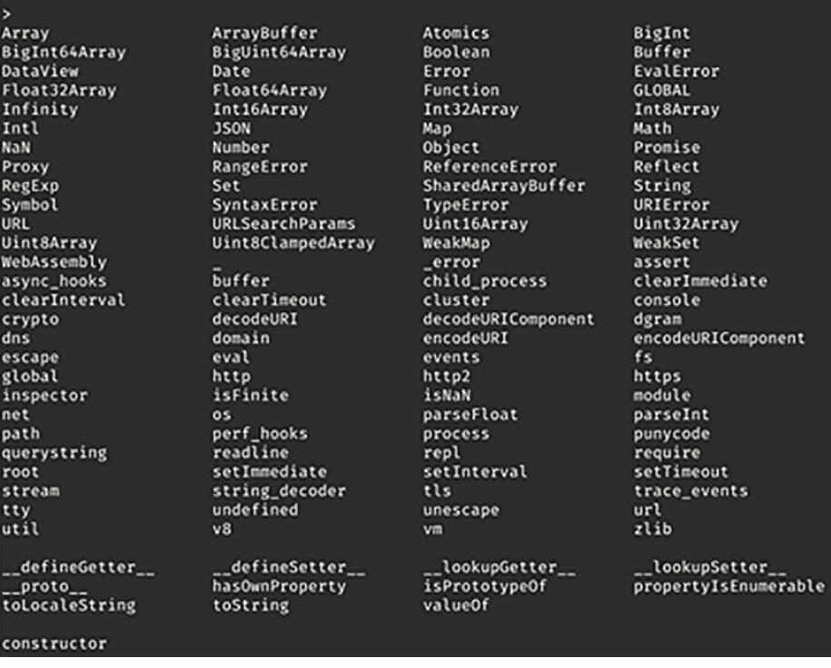

#### 全局模块和函数

毫无疑问，在学习过程中，你已经使用过不少这样的全局对象，比如 `NaN`、`isNaN`、`Infinity`、`Promise`、`String` 等等。当你想向全局对象添加内容时，必须先修改全局对象：

```javascript
global.myName = "marypoppins"
```

现在，`myName` 可以在项目的任何地方被调用。下面给你一个简单的示例：

FirstFile.js

```javascript
global.myName = "marypoppins";
```

SecondFile.js

```javascript
require('FirstFile.js');

console.log(myName); // It will log "marypoppins"
```

以上仅为演示目的——Node.js 的最佳实践规定，不应出于任何原因修改全局对象。

接下来，让我们深入了解全局对象中两个非常重要的模块——`process` 和 `buffer`。

#### Process

该对象包含大量关于进程的有用信息：

- `Process.versions` – 告诉我们每个 Node 核心模块的版本，例如 openssl、zlib、v8 等。

```javascript
> process.versions
{ http_parser: '2.9.3',
  node: '10.19.0',
  v8: '6.8.275.32-node.55',
  uv: '1.34.2',
  zlib: '1.2.11',
  brotli: '1.0.7',
  ares: '1.15.0',
  modules: '64',
  nghttp2: '1.40.0',
  napi: '5',
  openssl: '1.1.1d',
  icu: '66.1',
  unicode: '13.0',
  cldr: '36.1',
  tz: '2020a' }
> 
```

- `Process.env` – 告诉我们有关 Node 运行环境的一些重要信息。以下是一些示例：

```javascript
>process.env.shell
'/usr/bin/fish'
>process.env.LANG
'en_US.UTF-8'
>process.env.USER
'marypoppins'
>
```

我们还可以使用 `process.stdin`、`process.stdout` 和 `process.stderr`，它们都是流，用于与环境进行交互。

`process` 对象是 `EventEmitter` 的一个实例，这意味着可以使用该对象来注册事件监听器：

```javascript
process.on('exit', (exitCode)=>{
  console.log(`Bye Bye : exit code:${exitCode}`);
});

console.log("Hello I'm running ... ");
```

以上代码的运行结果如下：


你还可以使用 `process.exit(exitCode)` 以你指定的退出码来结束代码执行。

#### Buffer

Buffer 是 V8 堆外部的一个内存块，用于帮助我们将数据放入内存。简单来说，它是一种表示二进制数据序列的低级数据结构；一旦分配，就无法调整大小。从 Buffer 中读取数据需要指定编码方式。

创建 Buffer 的一些方式包括：

- `Buffer.from()` - 使用任何内容（如图片、文件或字符串）来创建 Buffer
- `Buffer.alloc()` – 创建指定大小的已填充 Buffer
- `Buffer.allocUnsafe()` - 创建指定大小的 Buffer，可能包含旧数据，但在性能方面具有优势。也可以使用 `.fill()` 来填充。

下图展示了 `Buffer.alloc()` 和 `Buffer.allocUnsafe()` 之间的区别。

```javascript
> Buffer.alloc(10)
<Buffer 00 00 00 00 00 00 00 00 00 00>
> Buffer.allocUnsafe(10)
<Buffer f0 72 c9 24 a6 7f 00 00 f0 72>
> 
```

如你所见，通过 `alloc` 创建的 Buffer 没有数据，而 `unsafe` Buffer 中包含一些旧数据。再看另一个示例：

```javascript
// myFile.js
const { StringDecoder } = require('string_decoder');
const decoder = new StringDecoder('utf8');

let myBuffer = Buffer.from("Hello Guys ... ");

console.log(myBuffer);
console.log(myBuffer.toString());
console.log(decoder.write(myBuffer));
```

在查看控制台输出之前，先猜一下结果：

```javascript
<Buffer 48 65 6c 6c 6f 20 47 75 79 73 2e 2e 2e>
Hello Guys...
Hello Guys...
```

在第 3 行中，我们使用 `Buffer.from` 创建了 Buffer。当打印 Buffer 时，我们看到的是二进制数据序列。我们之所以能看到字符串，是因为 `.toString` 方法默认使用 utf8 编码。通常，我们需要使用 `string_decoder`，这是一个 Node.js 内部包。通过 `stringDecoder`，可以实例化一个解码器对象，将编码方式传入其构造函数，然后使用 `write()` 方法将 Buffer 转换为解码后的数据。

### 全局对象

正如你现在已经了解的，Node.js 采用模块化的方式，这意味着当一个函数、变量或对象在某个文件中定义时，它对该文件来说是局部的，该文件会被视为一个模块。当你想在另一个文件中使用在一个文件中定义的变量时，需要使用 `module.exports` 语法导出该变量，然后使用 `require(path_of_file)` 在另一个文件中导入。

在 Node.js 中，全局对象的工作方式略有不同。因为它们是全局的，可以在所有模块中访问，所以无需导入或导出——你可以在应用程序中的任何地方直接使用它们。

接下来，我们将介绍一些更重要、更常用的 Node.js 全局对象。

### 前提条件

你需要安装 Node.js，并具备基本的命令行或终端知识。

我们将介绍以下全局对象：

- process
- `__dirname`
- `__filename`
- `require()`
- module
- URL

首先，在主目录下创建一个新文件夹，命名为 nodejs：

```javascript
mkdir nodejs
```

然后进入该文件夹：

```javascript
cd nodejs
```

进入 nodejs 目录后，创建一个新文件，命名为 `main.js`：

```javascript
touch main.js
```

**注意**

如果你使用的是 Windows 系统，touch 命令将无法使用。唯一的解决方法是使用文本编辑器创建文件，然后将其保存到你的 nodejs 目录中。

让我们来看看这些对象。

#### Process

这个全局对象为你提供大量有关程序执行环境的有用信息。它提供的一些信息包括架构、平台、进程 ID、运行时间、环境变量、当前工作目录等。以下是该对象中一些较常用的函数和属性：

- `process.arch` – 返回操作系统的 CPU 架构。一些返回值包括 x32、x64 和 ia32。
- `process.platform` – 返回程序正在其上运行的操作系统或平台。一些返回的字符串示例包括 openbsd、linux、freebsd 和 win32。
- `process.id` – 返回 Node 进程的 PID，即进程 ID。
- `process.cwd()` – 这是一个返回执行程序当前工作目录的方法。
- `process.chdir(directory)` – 此方法用于更改当前工作目录。

process 对象有很多属性，但我们将把注意力集中在四个主要属性上，并用它们创建一个程序：

打开 `main.js` 并输入以下内容：

```js
// 打印当前工作目录
console.log(`Starting directory: ${process.cwd()}`);
console.log(`This platform is ${process.platform}`);
console.log(`Process PID: ${process.pid}`);
console.log(`The CPU Architecture is: ${process.arch}`);

// 将工作目录改为 Documents
process.chdir('../Documents');
console.log(`Ending directory: ${process.cwd()}`);
```

现在运行这个程序，确保你在 nodejs 目录中执行：

```sh
node main.js
```

输出类似于：

```
Starting directory: /home/<your username>/nodejs
This platform is linux
Process PID: 19253
The CPU Architecture is: x64
Ending directory: /home/<your username>/Documents
```

### require()

此方法用于导入或加载 JSON、本地文件和模块。

如果你想导入 JSON 或本地模块，需要提供文件的相对路径：

#### 本地模块

```js
const localModule = require('.path/filename.js');
```

#### JSON 文件

```js
const jsonData = require('.path/filename.json');
```

如果你想从 `node_modules` 目录导入模块或使用 Node.js 内置模块，需要将模块名称传递给 `require()` 方法：

```js
// fs 是一个内置模块
const fileSystem = require('fs');
```

### \_\_dirname

这返回脚本正在执行的目录路径。你无法在 Node.js REPL 中访问它。

将 `main.js` 中的代码清空，并替换为以下内容：

```js
console.log(__dirname);
```

输出将是：

```
/home/<your username>/nodejs
```


## Node.js 全局对象

当你想用 Node.js 读写文件时，这会很有用。

### `__filename`

这返回正在执行的文件的绝对路径。同样，它也无法在 REPL 中访问。

将 `main.js` 中的代码清空，并替换为以下内容：

```js
console.log(__filename);
```

输出将是：

```
/home/<your username>/nodejs/main.js
```

### `module`

`module` 全局对象引用当前模块，其中包含 CommonJS 可以用来确定如何导入该模块的当前模块信息。

每当创建一个文件时，就像我们之前创建的 `main.js` 文件，它就会变成一个模块。记录 `module` 可以让我们获取有关 `main.js` 模块的信息：

```js
console.log(module);
```

当你记录 `module` 时，会返回一个包含该模块所有信息的对象：

```
Module {
  id: '.',
  path: '/home/<your username>/nodejs',
  exports: {},
  parent: null,
  filename: '/home/<your username>/nodejs/main.js',
  loaded: false,
  children: [],
  paths: [
    '/home/<your username>/nodejs/node_modules',
    '/home/<your username>/node_modules',
    '/home/node_modules',
    '/node_modules'
  ]
}
```

当 `main.js` 模块被 CommonJS 在另一个文件中导入时，它会在来自 `Module.paths` 的路径中查找 `main.js` 文件。

### `URL`

这是一个构造函数方法，用于解析 URL 并返回一个包含解析数据的对象。

删除 `main.js` 中的所有内容，以便我们可以解析以下 URL（这不是一个真实的 URL）—— `https://www.marypoppins.madeup/`。如果你愿意，也可以用一个真实的 URL 来尝试——只需输入相应的详细信息：

```js
const url = new URL('https://www.marypoppins.madeup/');
console.log(`The url protocol: ${url.protocol}`);
console.log(`The url path : ${url.pathname}`);
console.log(`The url hostname: ${url.hostname}`);
```

输出将是：

```
The url protocol: https:
The url path : /articles/
The url hostname: www.marypoppins.madeup
```

现在你已经知道什么是全局对象，以及如何使用 Node.js 提供的最常见的全局对象了。

## 第十一章：Node.js 实用模块

Node.js 模块库包含了不少在开发基于 Node 的应用程序时常用的实用模块。本章将详细介绍这些模块、它们的用途，并给出一些代码示例。

### OS 模块

OS 模块提供与操作系统相关的实用函数。使用以下语法导入它：

```js
var os = require("os");
```

#### OS 模块方法

以下是 OS 模块的方法：

| 方法 | 描述 |
|---|---|
| `os.tmpdir()` | 返回操作系统临时文件的默认目录 |
| `os.endianness()` | 返回 CPU 的字节序，可能值为 `LE` 或 `BE` |
| `os.hostname()` | 返回操作系统的主机名 |
| `os.type()` | 返回操作系统的系统名称 |
| `os.arch()` | 返回操作系统的 CPU 架构。可能值为 `arm`、`x64` 和 `ia32`。 |
| `os.platform()` | 返回操作系统平台 |
| `os.release()` | 返回操作系统的发布版本 |
| `os.uptime()` | 返回系统运行时间（秒） |
| `os.loadavg()` | 返回包含 1、5 和 15 分钟平均负载的数组 |
| `os.totalmem()` | 返回系统内存总量（字节） |
| `os.freemem()` | 返回系统空闲内存量（字节） |
| `os.cpus()` | 返回包含每个已安装 CPU/核心信息的对象数组。包括速度（MHz）、型号和 `times` —— CPU/核心在 `irq`、`idle`、`sys`、`nice` 和 `user` 上花费的时间（秒） |
| `os.networkInterfaces()` | 提供网络接口列表 |

#### OS 模块属性

该模块的主要属性是 `os.EOL`。它是一个常量，定义了特定操作系统的正确行尾标记。

在下面的代码演示中，你可以看到一些 OS 模块方法。如果你想跟着做，创建一个文件，命名为 `main.js`，然后输入以下代码：

```js
var os = require("os");

// 字节序
console.log('endianness : ' + os.endianness());

// 操作系统类型
console.log('type : ' + os.type());

// 操作系统平台
console.log('platform : ' + os.platform());

// 系统总内存
console.log('total memory : ' + os.totalmem() + " bytes.");

// 空闲内存总量
console.log('free memory : ' + os.freemem() + ' bytes.');
```

运行程序，你应该会看到类似以下内容：

```
$ node main.js
endianness : LE
type : Linux
platform : linux
total memory : 25103400960 bytes.
free memory : 20676710400 bytes.
```

### Path 模块

该模块包含帮助我们处理和转换文件路径的实用工具。使用以下语法导入它：

```js
var path = require("path");
```

#### Path 模块方法

这些是你可能会用到的 Path 模块方法：

| 方法 | 描述 |
| --- | --- |
| `path.normalize(p)` | 用于规范化字符串路径，处理 `"."` 和 `".."` 部分 |
| `path.join([path1][, path2][, ...])` | 连接参数并规范化生成的路径 |
| `path.resolve([from ...], to)` | 将解析为绝对路径 |
| `path.isAbsolute(path)` | 确定路径是否为绝对路径。无论工作目录是什么，绝对路径始终解析到同一位置。 |
| `path.relative(from, to)` | 求解 `from` 到 `to` 的相对路径 |
| `path.dirname(p)` | 返回路径的目录名 |
| `path.basename(p[, ext])` | 返回路径的最后一部分 |
| `path.extname(p)` | 返回路径的扩展名形式 |

| 方法 | 说明 |
|--------|-------------|
| `path.parse(pathString)` | 从路径字符串返回一个对象 |
| `path.format(pathObject)` | 从对象返回路径字符串 |

#### Path 模块属性

以下是 Path 模块的属性：

| 属性 | 说明 |
|------------|-------------|
| `path.sep` | 特定于平台的文件分隔符，为 `/` 或 `\\` |
| `path.delimiter` | 特定于平台的路径分隔符，为 `:` 或 `;` |
| `path.posix` | 提供对上述路径方法的访问，但只允许以与 posix 兼容的方式进行交互 |
| `path.win32` | 这也提供对上述路径方法的访问，但只允许以与 win32 兼容的方式进行交互 |

在这里，你可以看到 Path 模块方法的实际应用。

清空 `main.js` 文件的内容，并添加以下内容：

```js
var path = require("path");

// Normalization
console.log('normalization : ' + path.normalize('/test/test1//2slashes/1slash/tab/..'));

// Join
console.log('joint path : ' + path.join('/test', 'test1', '2slashes/1slash', 'tab', '..'));

// Resolve
console.log('resolve : ' + path.resolve('main.js'));

// extName
console.log('ext name : ' + path.extname('main.js'));
```

运行文件，你应该会看到类似这样的输出：

```
$ node main.js
Verify the Output.
normalization : /test/test1/2slashes/1slash
joint path : /test/test1/2slashes/1slash
resolve : /web/com/1427176256_27423/main.js
ext name : .js
```

### Net 模块

`net` 模块提供客户端和服务器流，还提供了围绕网络的异步包装器。使用以下语法导入：

```js
var net = require("net")
```

#### Net 模块方法

以下是 Net 模块中的方法：

| 方法 | 说明 |
| --- | --- |
| `net.createServer([options][, connectionListener])` | 创建 TCP 服务器，参数 `connectionListener` 自动设置为连接事件监听器 |
| `net.connect(options[, connectionListener])` | 这是一个工厂方法，返回 `net.Socket` 并连接到提供的地址和端口 |
| `net.createConnection(options[, connectionListener])` | 同上 |
| `net.connect(port[, host][, connectListener])` | 创建到主机上端口的 TCP 连接。如果没有主机，则默认为 `localhost`。参数 `connectListener` 添加为连接事件监听器，与前两种方法一样，它也返回 `net.Socket`。 |
| `net.connect(path[, connectListener])` | 创建到路径的 Unix 套接字连接。参数 `connectListener` 添加为连接事件监听器，与前面方法一样，它也返回 `net.Socket`。 |
| `net.createConnection(path[, connectListener])` | 同上 |
| `net.isIP(input)` | 测试输入是否为 IP 地址，如果字符串无效返回 `0`，是 IPv4 地址返回 `4`，是 IPv6 地址返回 `6` |
| `net.isIPv4(input)` | 如果输入是 IPv4 地址返回 `true`，否则返回 `false` |
| `net.isIPv6(input)` | 如果输入是 IPv6 地址返回 `true`，否则返回 `false` |

#### 类 - `net.Server`

`net.Server` 类用于创建本地或 TCP 服务器。

##### `net.Server` 方法

以下是该类的相关方法：

| 方法 | 说明 |
| :--- | :--- |
| `server.listen(port[, host][, backlog][, callback])` | 允许开始在给定端口和主机上接受连接。如果没有指定主机，服务器将接受指向 IPv4 地址（`INADDR_ANY`）的连接。如果端口号缺失，则分配随机端口。 |
| `server.listen(path[, callback])` | 启动在给定路径上监听连接的本地套接字服务器 |
| `server.listen(handle[, callback])` | 你可以将 `handle` 对象设置为套接字或服务器，只要它具有 `{fd: <n>}` 对象或底层 `_handle` 成员。服务器被迫在给定 `handle` 上接受连接，但假定该 `handle` 或文件描述符已绑定到域套接字或端口。Windows 不支持在文件描述符上监听。 |
| `server.listen(options[, callback])` | 在此方法中，`host`、`port`、可选属性 `backlog` 和回调函数的行为与 `server.listen(port, [host], [backlog], [callback])` 调用中的相同。你还可以使用 `path` 选项来指定 UNIX 套接字。 |
| `server.close([callback])` | 当没有更多打开的连接时关闭，并发出 `close` 事件 |
| `server.address()` | 此方法将返回绑定地址、服务器端口以及操作系统报告的地址族名称 |
| `server.unref()` | 当你对服务器调用 `unref` 时，如果事件系统没有其他活跃的服务器，程序可以退出。如果服务器已经 `unref`，调用 `unref` 将无效。 |
| `server.ref()` | 与上述相反——如果你在之前 `unref` 的服务器上调用 `ref`，如果它是唯一剩余的服务器，程序将无法退出。如果服务器是 `ref` 状态，再次调用 `ref` 将无效。 |
| `server.getConnections(callback)` | 异步获取并发连接数。这适用于发送到分叉的套接字，回调需要两个参数——`err` 和 `count` |

#### 事件

以下是上述方法相关的事件：

| 事件 | 说明 |
|-------|-------------|
| `listening` | 当 `server.listen` 被调用且服务器绑定后发出此事件 |
| `connection` | 当新连接建立后发出。事件处理器可以访问连接对象、套接字对象，套接字是 `net.Socket` 实例。 |
| `close` | 当服务器关闭后发出。如果存在现有连接，必须等它们全部关闭后才能发出 |
| `error` | 当发生错误时发出。此事件之后，立即调用 `close` 事件。 |

#### 类 - `net.Socket`

这是本地或 TCP 套接字的抽象，`net.Socket` 的实例用于实现双工流接口。用户可以创建它们，并使用 `connect()` 作为客户端，或者 Node 可以创建它们并通过服务器的 `connection` 事件传递给用户。

##### `net.Socket` 事件

以下是 `net.Socket` 发出的事件：

| 事件 | 说明 |
| --- | --- |
| `lookup` | 当主机名解析后但在连接之前发出此事件。这不适用于 UNIX 套接字 |
| `connect` | 套接字连接成功建立后发出 |
| `data` | 收到数据时随时发出。参数数据使用 `String` 或 `Buffer`，`socket.setEncoding()` 用于设置数据编码 |
| `end` | 当套接字的另一端发送 FIN 包时发出 |
| `timeout` | 当不活动导致套接字超时时发出。这纯粹是为了告诉你套接字处于空闲状态，连接必须由用户手动关闭 |
| `drain` | 写入缓冲区清空后发出，可用于限制上传速度 |
| `error` | 发生错误后发出，并立即由 `close` 事件跟随 |
| `close` | 仅在套接字完全关闭时发出。它接受 `had_error` 参数，这是一个布尔值，告诉你传输错误是否导致套接字关闭。 |

##### `net.Socket` 属性

以下是 `net.Socket` 用于控制套接字交互的属性：

| 属性 | 说明 |
|---|---|
| `socket.bufferSize` | 指示等待写入的缓冲字符数 |
| `socket.remoteAddress` | 远程 IP 地址的字符串表示。 |
| `socket.remoteFamily` | 远程 IP 族的字符串表示，`IPv4` 或 `IPv6` |
| `socket.remotePort` | 以数字表示远程端口 |
| `socket.localAddress` | 表示远程客户端连接到的本地 IP 地址，是字符串表示。例如，如果你在 `0.0.0.0` 上监听，远程客户端使用 `192.168.1.1` 连接，则值为 `192.168.1.1` |
| `socket.localPort` | 以数字表示本地端口 |
| `socket.bytesRead` | 指示接收了多少字节 |
| `socket.bytesWritten` | 指示发送了多少字节 |

##### `net.Socket` 方法

以下是 `net.Socket` 的方法：

| 方法 | 说明 |
| --- | --- |
| `new net.Socket([options])` | 此方法用于构造新的套接字对象 |
| `socket.connect(port[, host][, connectListener])` | 用于打开指定套接字的连接。如果提供了 `host` 和 `port`，套接字作为 TCP 打开；如果未提供 `host`，则假定为 `localhost`。如果提供了 `path`，套接字作为 UNIX 套接字打开到该路径 |
| `socket.connect(path[, connectListener])` | 用于打开指定套接字的连接。 |
| `socket.setEncoding([encoding])` | 用于将 socket 编码设置为可读流 |
| `socket.write(data[, encoding][, callback])` | 用于在 socket 上发送数据。如果数据是字符串，则第二个参数用于指定编码方式——默认为 `UTF8` |
| `socket.end([data][, encoding])` | 用于发送 FIN 包，半关闭 socket。服务器可能仍能发送数据 |
| `socket.destroy()` | 用于确保 socket 上不会发生 I/O 操作。仅在出现错误（如解析错误等）时才需要使用 |
| `socket.pause()` | 用于暂停数据读取，即停止触发 `data` 事件。当你希望限制上传速度时非常有用 |
| `socket.resume()` | 用于在调用 `pause` 方法后恢复数据读取 |
| `socket.setTimeout(timeout[, callback])` | 用于设置 socket 在指定毫秒数后超时。默认情况下，`net.socket` 没有超时设置 |
| `socket.setNoDelay([noDelay])` | 用于禁用 Nagle 算法。TCP 连接默认使用该算法，在发送数据之前会进行缓冲。如果将 `noDelay` 设置为 `true`，则在调用 `socket.write()` 时会立即发送数据。默认情况下，`noDelay` 设置为 `true` |
| `socket.setKeepAlive([enable][, initialDelay])` | 用于启用或禁用 keep-alive 功能。可选地，还可以设置空闲 socket 发送初始 keepalive 探测之前的延迟时间。默认情况下，`enable` 设置为 `false` |
| `socket.address()` | 返回操作系统报告的地址族名称、绑定地址和 socket 端口。返回一个包含三个属性的对象，即 `{port: 23467, family: 'IPv6', address: '128.0.1.1'}` |
| `socket.unref()` | 当你对 socket 调用 `unref` 时，如果事件系统中没有其他活动的 socket，程序可以退出。如果 socket 已经被 `unref`，调用 `unref` 不会产生效果 |
| `socket.ref()` | 与上面相反——如果你对之前被 `unref` 的 socket 调用 `ref`，当它是唯一剩余的 socket 时，程序将无法退出。如果 socket 已经被 `ref`，再次调用 `ref` 不会产生效果 |

以下是使用这些方法的示例。首先，创建一个新文件，命名为 `server.js`。然后输入以下内容：

```js
var net = require('net');
var server = net.createServer(function(connection) {
    console.log('client connected');
    connection.on('end', function() {
        console.log('client disconnected');
    });
    connection.write('Hello World!\r\n');
    connection.pipe(connection);
});
server.listen(8080, function() {
    console.log('server is listening');
});
```

现在运行它并查看输出结果：

```
$ node server.js
```

验证输出。

```
server is listening
```

接下来，创建另一个新文件，命名为 `client.js`，并输入以下代码：

```js
var net = require('net');
var client = net.connect({port: 8080}, function() {
    console.log('connected to server!');
});
client.on('data', function(data) {
    console.log(data.toString());
    client.end();
});
client.on('end', function() {
    console.log('disconnected from server');
});
```

现在尝试从另一个终端运行此文件，查看输出结果：

```
$ node client.js
```

验证输出。

```
connected to server!
Hello World!
disconnected from server
```

最后，在运行 `server.js` 文件的终端上，验证输出：

```
server is listening
client connected
client disconnected
```

### DNS 模块

DNS 模块包含允许我们进行 DNS 查询和使用操作系统底层名称解析功能的函数。它为网络提供了一个异步封装，需要使用以下语法来导入它：

```js
var dns = require("dns")
```

#### DNS 模块方法

以下是 DNS 模块提供的方法：

| 方法 | 描述 |
| :--- | :--- |
| `dns.lookup(hostname[, options], callback)` | 此方法用于将主机名解析为第一条 IPv4（`A`）或 IPv6（`AAAA`）记录。`options` 参数可以是整数或对象，如果未提供，则 IPv4 和 IPv6 地址均有效。如果设置为整数，则为 `4` 或 `6` |
| `dns.lookupService(address, port, callback)` | 使用 `getnameinfo` 将指定的端口和地址解析为服务和主机名 |
| `dns.resolve(hostname[, rrtype], callback)` | 用于将主机名解析为包含 `rrtype` 指定的记录类型的数组 |
| `dns.resolve4(hostname, callback)` | 与上面类似，但仅针对 IPv4 或 `A` 记录查询 |
| `dns.resolve6(hostname, callback)` | 与上面类似，但针对 IPv6 或 `AAAA` 记录查询 |
| `dns.resolveMx(hostname, callback)` | 与上面类似，但仅针对 `MX` 记录或邮件交换查询 |
| `dns.resolveTxt(hostname, callback)` | 与上面类似，但针对 `TXT` 记录或文本查询 |
| `dns.resolveSrv(hostname, callback)` | 与上面类似，但针对 `SRV` 记录或服务记录查询 |
| `dns.resolveSoa(hostname, callback)` | 与上面类似，但仅针对 `SOA` 或起始授权记录 |
| `dns.resolveNs(hostname, callback)` | 与上面类似，但仅针对 `NS` 或名称服务器记录 |
| `dns.resolveCname(hostname, callback)` | 与上面类似，但仅针对 `CNAME` 或规范名称记录 |
| `dns.reverse(ip, callback)` | 将 IP 地址反向解析为主机名数组 |
| `dns.getServers()` | 返回一个包含当前用于解析的 IP 地址字符串的数组 |
| `dns.setServers(servers)` | 将给定的字符串格式 IP 地址数组设置为解析所需的服务器 |

#### DNS 模块 rrtypes

以下是 `dns.resolve()` 方法使用的有效 rrtypes：

- `A` —— 默认值，IPv4 地址
- `AAAA` —— IPv6 地址
- `MX` —— 邮件交换记录
- `SRV` —— SRV 记录
- `TXT` —— 文本记录
- `PTR` —— 用于进行反向 IP 查询
- `CNAME` —— 规范名称记录
- `NS` —— 名称服务器记录
- `SOA` —— 起始授权记录

##### DNS 模块错误代码

所有 DNS 查询都可能返回以下代码之一：

- `dns.NODATA` —— DNS 服务器响应中没有返回数据
- `dns.FORMERR` —— 根据 DNS 服务器的说明，查询格式错误
- `dns.SERVFAIL` —— DNS 服务器返回了通用故障
- `dns.NOTFOUND` —— 未找到域名
- `dns.NOTIMP` —— DNS 服务器尚未实现所请求的操作
- `dns.REFUSED` —— DNS 服务器拒绝了该查询
- `dns.BADQUERY` —— DNS 查询格式错误
- `dns.BADNAME` —— 主机名格式错误
- `dns.BADFAMILY` —— 不支持该地址族
- `dns.BADRESP` —— DNS 响应格式错误
- `dns.CONNREFUSED` —— 无法联系 DNS 服务器
- `dns.TIMEOUT` —— DNS 服务器连接超时
- `dns.EOF` —— 文件结束
- `dns.FILE` —— 读取文件时出错
- `dns.NOMEM` —— 内存不足
- `dns.DESTRUCTION` —— 通道正在被销毁
- `dns.BADSTR` —— 字符串格式错误
- `dns.BADFLAGS` —— 指定的标志无效
- `dns.NONAME` —— 指定的主机名不是数字格式
- `dns.BADHINTS` —— 指定了非法的 hints 标志
- `dns.NOTINITIALIZED` —— c-ares 库尚未初始化
- `dns.LOADIPHLPAPI` —— 加载 `iphlpapi.dll` 时出错
- `dns.ADDRGETNETWORKPARAMS` —— 未找到 `GetNetworkParams` 函数
- `dns.CANCELLED` —— DNS 查询已取消

下面是一个实际示例。找到你的 `main.js` 文件，清空其内容。然后添加以下代码：

```js
var dns = require('dns');

dns.lookup('www.google.com', function onLookup(err, address, family) {
    console.log('address:', address);
    dns.reverse(address, function (err, hostnames) {
        if (err) {
            console.log(err.stack);
        }
        console.log('reverse for ' + address + ': ' + JSON.stringify(hostnames));
    });
});
```

运行该文件，查看输出：

```
$ node main.js
```

现在验证输出：

```
address: 173.194.46.83
reverse for 173.194.46.83: ["ord08s11-in-f19.1e100.net"]
```

### Domain 模块

我们最后一个实用模块是 Domain 模块，用于帮助我们将多个 I/O 操作作为一个组来处理。它通过外部绑定或内部绑定来拦截未处理的错误。如果这些错误未被处理，Node 应用程序将会崩溃。

- **内部绑定**（Internal Binding）—— 错误发射器在域的 `run` 方法中执行代码
- **外部绑定**（External Binding）—— 错误发射器使用其自身的 `add` 方法显式添加到域中。

导入该模块的语法如下：

```js
var domain = require("domain")
```

Domain 模块的 `domain` 类提供了将未捕获的异常和错误路由到活动 Domain 对象的功能。它是 `EventEmitter` 的子类，需要监听其 `error` 事件来处理任何捕获到的错误。下面的语法创建它：

```js
var domain = require("domain");
var child = domain.create();
```

#### Domain 模块方法

以下是 Domain 模块的方法：

| 方法 | 描述 |
|---|---|
| `domain.run(function)` | 此方法在域上下文中运行指定的函数。它会隐式绑定所有定时器、事件发射器和底层请求。这是使用域的基本方式 |
| `domain.add(emitter)` | 显式将发射器添加到域中。如果发射器调用的事件处理程序抛出错误，或者发射器发出了 `error` 事件，该错误将被发送到域的 `error` 事件，与隐式绑定相同。 |
| `domain.remove(emitter)` | 与上述相反，从给定发射器移除域处理 |
| `domain.bind(callback)` | 返回的函数是所提供回调函数的包装器。当该函数被调用时，抛出的错误将被发送到域中的 `error` 事件 |
| `domain.intercept(callback)` | 与 `domain.bind(callback)` 几乎相同，但除了捕获错误外，还会拦截作为第一个参数发送到函数的任何错误消息 |
| `domain.enter()` | 由 `bind`、`run` 和 `intercept` 方法使用，帮助设置域。它将 `process.domain` 和 `domain.active` 设置为该域，并将该域隐式推入域模块管理的域堆栈中。调用此方法标记异步调用链和绑定到特定域的 I/O 操作的开始。 |
| `domain.exit()` | 此方法将当前域从堆栈中弹出并退出。当执行切换到另一个异步调用链的上下文时，必须退出当前域。`exit` 的调用将标记对调用链的中断或结束，以及任何绑定到特定域的 I/O。 |
| `domain.dispose()` | 调用此方法时，使用 `intercept`、`bind` 或 `run` 绑定到域中的任何回调都无法再使用该域，并且会发出一个 `dispose` 事件 |

#### Domain 模块属性

Domain 模块有一个主要属性称为 `domain.members`。它是一个数组，包含显式添加到域中的事件发射器和定时器。

现在看一个展示上述所有内容的示例。清空你的 `main.js` 文件并添加以下代码：

```js
var EventEmitter = require("events").EventEmitter;
var domain = require("domain");

var emitter1 = new EventEmitter();

// Create a domain
var domain1 = domain.create();

domain1.on('error', function(err) {
    console.log("domain1 handled this error ("+err.message+")");
});

// Explicit binding
domain1.add(emitter1);

emitter1.on('error',function(err) {
    console.log("listener handled this error ("+err.message+")");
});

emitter1.emit('error',new Error('To be handled by listener'));

emitter1.removeAllListeners('error');

emitter1.emit('error',new Error('To be handled by domain1'));

var domain2 = domain.create();

domain2.on('error', function(err) {
    console.log("domain2 handled this error ("+err.message+")");
});

// Implicit binding
domain2.run(function() {
    var emitter2 = new EventEmitter();
    emitter2.emit('error',new Error('To be handled by domain2'));
});

domain1.remove(emitter1);

emitter1.emit('error', new Error('Converted to exception. System will crash!'));
```

运行该文件，查看输出：

```
$ node main.js
```

最后，验证输出：

```
listener handled this error (To be handled by listener)
domain1 handled this error (To be handled by domain1)
domain2 handled this error (To be handled by domain2)

events.js:72 throw er; // Unhandled 'error' event
      ^
Error: Converted to exception. System will crash!
    at Object.<anonymous> (/web/com/1427722220_30772/main.js:40:24)
    at Module._compile (module.js:456:26)
    at Object.Module._extensions..js (module.js:474:10)
    at Module.load (module.js:356:32)
    at Function.Module._load (module.js:312:12)
    at Function.Module.runMain (module.js:497:10)
    at startup (node.js:119:16)
    at node.js:906:3
```

## 第十二章：Node.js Web 模块

Web 服务器就是软件应用程序，就这么简单。它们处理 exporting HTTP 请求，这些请求由 HTTP 客户端（可能是 Web 浏览器）发送，并通过返回网页来响应。通常，Web 服务器会传送包含样式表、图像和脚本的 HTML 文档。

大多数 Web 服务器都支持服务器端脚本，它们使用脚本语言或将其发送到别处来完成，通常是通过应用服务器从数据库中检索数据并执行一些复杂逻辑。然后，结果通过 Web 服务器发送到 HTTP 客户端。

最常见的一个是名为 Apache Web 服务器的开源项目。

### Web 应用架构

通常，Web 应用程序分为四个独立的层：

- **客户端**（Client）—— 客户端层由能够向 Web 服务器发出和发送 HTTP 请求的应用程序、移动浏览器或 Web 浏览器组成。
- **服务器**（Server）—— 服务器层是 Web 服务器所在的位置，它可以拦截客户端发出的任何请求并发送响应。
- **业务层**（Business）—— 业务层是应用服务器所在的位置。Web 服务器利用它来进行需要处理的任务。它通过外部程序或数据库与最后一层——数据层进行交互。
- **数据层**（Data）—— 数据层包含数据库和其他数据源。

### 使用 Node 创建 Web 服务器

在 Node.js 中，你可以访问 `http` 模块。此模块用于创建服务器的 HTTP 客户端。下面你可以看到在端口 `8081` 监听的 HTTP 服务器的绝对最小结构。首先，创建一个名为 `server.js` 的程序，然后向其中添加此代码：

```js
var http = require('http');
var fs = require('fs');
var url = require('url');

// Create the server
http.createServer( function (request, response) {
    // Parse the request that contains the file name
    var pathname = url.parse(request.url).pathname;

    // Print the name of the file the request was made for.
    console.log("Request for " + pathname + " received.");

    // Read the requested file content from the file system
    fs.readFile(pathname.substr(1), function (err, data) {
        if (err) {
            console.log(err);
            // HTTP Status: 404 : NOT FOUND
            // Content Type: text/plain
            response.writeHead(404, {'Content-Type': 'text/html'});
        } else {
            //Page found
            // HTTP Status: 200 : OK
            // Content Type: text/plain
            response.writeHead(200, {'Content-Type': 'text/html'});
            // Write the content of file to the response body
            response.write(data.toString());
        }
        // Send the response body
        response.end();
    });
}).listen(8081);

// Console prints the message
console.log('Server running at http://127.0.0.1:8081/');
```

接下来，创建另一个文件，这次是 html 文件，并将其命名为 `index.htm`。将其保存在创建 `server.js` 的同一目录中：

```html
<html>
    <head>
        <title>Sample Page</title>
    </head>
    <body>
        Hello World!
    </body>
</html>
```

现在你可以运行 `server.js` 来查看输出：

```
$ node server.js
```

最后，需要验证输出：

```
Server running at http://127.0.0.1:8081/
```

### 向 Node.js 服务器发出请求

打开你使用的浏览器，然后打开这个地址——`http://127.0.0.1:8081/index.htm`，你应该会看到类似这样的内容：

输出需要在服务器端进行验证。

```
Server running at http://127.0.0.1:8081/
Request for /index.htm received.
```

### 使用 Node 创建 Web 客户端

你也可以使用 `http` 模块来创建一个 Web 客户端。首先，创建一个名为 `client.js` 的文件，并将以下内容复制进去：

```js
var http = require('http');

// Options the request will use
var options = {
  host: 'localhost',
  port: '8081',
  path: '/index.htm'
};

// We use a callback function to deal with the response
var callback = function(response) {
  // The stream is continuously updated with data
  var body = '';
  response.on('data', function(data) {
    body += data;
  });

  response.on('end', function() {
    // Data completely received.
    console.log(body);
  });
}

// Make a request to the server
var req = http.request(options, callback);
req.end();
```

现在打开一个与 `server.js` 不同的命令终端，运行 `client.js` 来查看结果：

```
$ node client.js
```

别忘了验证输出：

```html
<html>
  <head>
    <title>Sample Page</title>
  </head>
  <body>
    Hello World!
  </body>
</html>
```

然后在服务器端进行验证：

```
Server running at http://127.0.0.1:8081/
Request for /index.htm received.
```

如你所见，Web 模块在创建 Web 服务器和客户端方面非常易于使用。

## 第十三章：Node.js Express 框架

在本章中，我们将了解 Express，这是一个为 Node.js 构建的灵活但精简的 Web 应用框架。它提供了一套强大的功能集，帮助我们构建单页和多页 Web 应用，以及混合型应用。

### 什么是 Express.js？

它是一个基于 Node.js 构建的 Web 应用服务器框架，帮助我们构建不同类型的 Web 应用。现在标准的 Node.js 服务器框架是 MEAN 技术栈的后端。这是一个开源的、免费的软件技术栈，帮助我们构建动态 Web 应用和网站，它包含以下组件：

1. **MongoDB** – 标准的 NoSQL 数据库
2. **Express.js** – Web 应用的默认框架
3. **Angular.js** – 用于 Web 应用的 JavaScript MVC 框架
4. **Node.js** – 用于可扩展网络和服务器端应用的框架

使用 Express 框架，你可以轻松开发能够处理多种请求类型的应用，例如 `PUT`、`GET`、`DELETE` 和 `POST` 请求。

### 安装和使用 Express

Express 安装非常简单；通过打开命令行并输入以下命令，即可从 Node 包管理器完成安装：

```
npm install express
```

此命令要求 Node 包管理器下载 Express 模块并进行安装。

让我们从创建一个 Hello World 应用开始。它所做的就是创建一个服务器模块。该模块监听端口 `3000`，在本例中，如果浏览器通过该端口发起请求，服务器应用将向客户端发送响应——即 Hello World。

```js
var express=require('express');
var app=express();

app.get('/',function(req,res)
{
res.send('Hello World!');
});

var server=app.listen(3000,function() {});
```

### 代码说明：

1. 第一行中，`require` 函数用于引入指定的模块，在本例中是 `express` 模块

2. 在使用该模块之前，必须从中创建一个对象

3. 第三行中，我们创建了一个回调函数，当浏览到 Web 应用的根路径时会调用该函数——根路径是 `http://localhost:3000`。回调函数将响应——即一个读作 Hello World 的字符串——作为响应发送到网页。

4. 字符串 Hello World 由回调函数发送给客户端。使用 `res` 参数将内容发送到网页。该参数由 `request` 模块提供，允许将内容发送到网页。

5. 最后，`listen` 函数用于使应用监听端口 `3000` 上的客户端请求。可以指定任何可用端口。

如果命令成功执行，当你运行代码时，应该在浏览器中看到类似这样的内容：

### 输出：

从输出中可以看到，如果在端口 `3000` 上浏览到 `localhost` URL，字符串 Hello World 将显示在你的页面上。只要你浏览到服务器监听的指定端口，就能在屏幕上看到正确的输出。

### 什么是路由？

路由决定了应用如何响应客户端对特定端点的请求。例如，客户端可以对任何 URL 发起 HTTP 请求，如 `POST`、`GET`、`DELETE` 或 `PUT`，例如以下这些：

- `http://localhost:3000/Books`
- `http://localhost:3000/Students`

在本例中，当对第一个 URL 发起 `GET` 请求时，理想的输出应该是一个书籍列表，而如果对第二个 URL 发起请求，你将看到一个学生列表。根据你访问的 URL，Web 服务器上会调用特定的功能，并将响应发送给客户端——这就是路由的工作方式。

每个路由可以有至少一个处理函数，当路由匹配时，这些函数将被执行。

典型的路由语法为：

```
app.METHOD(PATH, HANDLER)
```

在该语法中：

1. `app` 是 `express` 模块实例
2. `METHOD` 是 HTTP 请求方法之一，即 `POST`、`GET`、`DELETE` 或 `PUT`
3. `PATH` 表示服务器路径
4. `HANDLER` 是当路由匹配时执行的函数

让我们看看如何在 Express 中实现路由。我们将创建三个路由：

1. `/Node` 路由 – 当访问该路由时，显示 Node Tutorial 字符串
2. `/Angular` 路由 – 当访问该路由时，显示 Angular Tutorial 字符串
3. 默认路由 `/` – 显示 Welcome to My Tutorials 字符串

基本代码与我们之前看到的相同，以下代码是展示如何实现路由的附加部分：

```js
var express = require('express');
var app = express();

app.route('/Node').get(function(req,res)
{
    res.send("Node Tutorial");
});

app.route('/Angular').get(function(req,res)
{
    res.send("Angular Tutorial");
});

app.get('/',function(req,res){
    res.send('Welcome to My Tutorials');
});
```

### 代码说明：

1. 当在浏览器中访问 `http://localhost:3000/Node` URL 时，该路由被定义。一个回调函数附加到该路由上，当浏览到 Node URL 时会被调用。

回调函数有两个参数：

- `res` 是用于向客户端发送信息的主要参数
- `req` 是次要参数，包含与请求相关的信息。有时，其他参数可能会随请求一起发送，`req` 参数有助于找到这些参数。

2. 如果选择了 Node 路由，`send` 函数用于将 Node Tutorial 字符串发送给客户端

3. 当在浏览器中访问 `http://localhost:3000/Angular` URL 时，该路由被定义。一个回调函数附加到回调函数上，当浏览到 Angular URL 时会被调用。

4. 如果选择了 Angular 路由，`send` 函数用于将 Angular Tutorial 字符串发送给客户端。

5. 当在浏览器中访问 `http://localhost:3000` URL 时——即应用根路径——选择默认路由。选择后，Welcome to My Tutorials 消息将被发送给客户端。

如果命令成功执行，你应该在浏览器中看到 Welcome to My Tutorials 界面。

输出将显示，通过在端口 `3000` 上浏览到 `localhost` URL，Welcome to My Tutorials 消息显示在屏幕上——这是我们在代码中指定的默认消息。

### 使用 Express.js 构建 Web 服务器

在上面的示例中，我们了解了如何根据一个路由上。这就是现代 Web 应用程序中使用的方式，而 Web 服务器的其余部分则完全是关于使用 Node.js 模板。

当你快速创建 Node 应用程序时，最简单的方法之一是使用 Node.js 模板。市场上有大量的框架，我们将使用 jade 框架。

Node 包管理器用于通过在命令行中输入以下命令来安装 jade：

```
npm install jade
```

此命令要求 NPM 下载并安装我们想要的模块。

让我们创建一个 jade 模板。创建一个新文件并将其命名为 `index.jade`，并在其中放入以下代码，确保该文件是在名为 `views` 的文件夹中创建的。

```js
var express=require('express');
var app=express();

app.set('view engine','jade');

app.get('/',function(req,res)
{
res.render('index',
{title:'My Tutorials',message:'Welcome'})
});

var server=app.listen(3000,function() {});
```

### 代码解释：

1. 首先，在应用程序中指定了 `"view engine"`——它用于渲染模板，由于使用的是 jade，因此我们指定它。
2. 我们使用 `render` 函数来渲染网页。这里，我们渲染之前创建的 `index.jade` 模板。
3. 我们向 `title` 和 `message` 参数传递两个值——分别是 `"My Tutorials"` 和 `"Welcome"`。这些值会替换模板中指定的 `title` 和 `message` 参数。

如果你成功执行该命令，你将在浏览器中看到欢迎界面。

从输出中，你可以看到页面标题被设置为 My Tutorials，页面标题被设置为 Welcome。这是因为在应用程序中调用了 Jade 模板。

### 快速摘要

Express 框架常用于 Node.js 的应用程序开发，它基于 Node 框架构建。它用于帮助我们快速构建基于服务器的应用程序。

我们使用路由根据用户的请求将他们引导到应用程序的不同区域——路由的响应可能会根据用户需要看到的内容而有所不同。

最后，模板用于高效地注入正确的内容，而 Node 应用程序中较受欢迎的模板引擎之一是 Jade。

## 第十四章：Node.js RESTful API

让我们从名字说起——REST 代表 Representational State Transfer（表述性状态转移）。REST 于 2000 年由 Roy Fielding 首次提出，是一种基于 Web 标准的架构，使用 HTTP 协议。REST 围绕资源展开——所有组件都是资源，一个通用接口通过使用标准 HTTP 方法来访问这些资源。

REST 服务器基本上提供对资源的访问点，REST 客户端使用 HTTP 协议来访问和修改资源。URI 和全局 ID 用于标识每个资源，REST 以不同的方式表示资源，例如 XML 和文本，但最常见的表示形式是 JSON。

### HTTP 方法

以下是 REST 架构中最常用的四种 HTTP 方法：

- `GET` – 用于对资源进行只读访问。
- `PUT` – 用于创建新资源。
- `DELETE` – 用于删除资源。
- `POST` – 用于更新资源或创建新资源。

### RESTful Web 服务

Web 服务是包含系统和应用程序之间数据交换标准和开放协议的集合。软件应用程序使用 Web 服务通过计算机网络进行数据交换——这些应用程序可以用各种编程语言编写，并在所有平台上运行。互操作性，即 Python 和 Java 通信，或 Linux 应用程序和 Windows 应用程序通信，都归功于开放标准。

当 Web 服务基于 REST 架构时，它被称为 RESTful Web 服务。这些通过使用 HTTP 方法来实现 REST 架构概念。通常，一个 RESTful Web 服务会定义一个统一资源标识符（URI），一个提供资源表示（如 JSON）的服务，以及 HTTP 方法。

### 如何为库创建 RESTful API

假设我们有一个基于 JSON 的数据库，其中包含一个名为 `users.json` 的文件，其中列出了用户列表：

```json
{
    "user1" : {
        "name" : "michael",
        "password" : "password1",
        "profession" : "teacher",
        "id": 1
    },
    "user2" : {
        "name" : "sara",
        "password" : "password2",
        "profession" : "scientist",
        "id": 2
    },
    "user3" : {
        "name" : "ronnie",
        "password" : "password3",
        "profession" : "clerk",
        "id": 3
    }
}
```

利用这些信息，我们可以提供所有这些 RESTful API：

|    | URI        | HTTP 方法 | POST 主体  | 结果               |
|---|---|---|---|---|
| 1 | `listUsers`  | `GET`       | 空         | 显示所有用户的列表 |
| 2 | `addUser`    | `POST`      | JSON 字符串| 添加新用户详情     |
| 3 | `deleteUser` | `DELETE`    | JSON 字符串| 删除用户           |
| 4 | `:id`        | `GET`       | 空         | 显示用户详情       |

我假设，到现在为止，你已经知道如何从前端传递值（使用表单数据或 AJAX），以及如何使用 Express 的 Request 对象来处理它们。

### 列出用户

我们将实现的第一个 RESTful API 是 `listUsers`。创建一个名为 `server.js` 的文件并添加以下代码：

```js
var express = require('express');
var app = express();
var fs = require("fs");

app.get('/listUsers', function (req, res) {
   fs.readFile( __dirname + "/" + "users.json", 'utf8', function (err, data) {
       console.log( data );
       res.end( data );
   });
})

var server = app.listen(8081, function () {
   var host = server.address().address
   var port = server.address().port
   console.log("Example app listening at http://%s:%s", host, port)
})
```

现在，在本机上使用 `http://127.0.0.1:8001/listUsers` 和 HTTP 方法：`GET`。确保你使用 REST 客户端，以便你可以访问 API，你应该会看到以下结果——在生产环境中使用此代码时，给定的 IP 地址可能会更改：

```json
{
    "user1" : {
        "name" : "michael",
        "password" : "password1",
        "profession" : "teacher",
        "id": 1
    },
    "user2" : {
        "name" : "sara",
        "password" : "password2",
        "profession" : "scientist",
        "id": 2
    },
    "user3" : {
        "name" : "ronnie",
        "password" : "password3",
        "profession" : "clerk",
        "id": 3
    }
}
```

### 添加用户

我们将实现的下一个 RESTful API 是 `newUser`，使用以下详细信息：

```json
user = {
  "user4" : {
    "name" : "monica",
    "password" : "password4",
    "profession" : "teacher",
    "id": 4
  }
}
```

同样的输入也可以通过 AJAX 调用以 JSON 形式接受，但为了本章的目的，我们所有内容都是硬编码的。清空你的 `server.js` 文件并添加以下内容：

```js
var express = require('express');
var app = express();
var fs = require("fs");

var user = {
  "user4" : {
    "name" : "monica",
    "password" : "password4",
    "profession" : "teacher",
    "id": 4
  }
}

app.post('/addUser', function (req, res) {
   // 首先读取现有用户。
   fs.readFile( __dirname + "/" + "users.json", 'utf8', function (err, data) {
       data = JSON.parse( data );
       data["user4"] = user["user4"];
       console.log( data );
       res.end( JSON.stringify(data));
   });
})

var server = app.listen(8081, function () {
   var host = server.address().address
   var port = server.address().port
   console.log("Example app listening at http://%s:%s", host, port)
})
```

现在尝试通过 URL 访问：`http://127.0.0.1:8081/addUser` 和 HTTP 方法：`POST`。使用本机和 REST 客户端，你应该会看到以下内容：

```json
{
    "user1":{"name":"michael","password":"password1","profession":"teacher","id":1},
    "user2":{"name":"sara","password":"password2","profession":"scientist","id":2},
    "user3":{"name":"ronnie","password":"password3","profession":"clerk","id":3},
    "user4":{"name":"monica","password":"password4","profession":"teacher","id":4}
}
```

### 显示详情

现在我们想实现一个 RESTful API，通过用户 ID 调用并显示相应用户的详细信息。同样，清空 `server.js` 文件并添加此代码：

```js
var express = require('express');
var app = express();
var fs = require("fs");

app.get('/:id', function (req, res) {
    // 首先读取现有用户。
    fs.readFile( __dirname + "/" + "users.json", 'utf8', function (err, data) {
        var users = JSON.parse( data );
        var user = users["user" + req.params.id]
        console.log( user );
        res.end( JSON.stringify(user));
    });
})

var server = app.listen(8081, function () {
    var host = server.address().address
    var port = server.address().port
    console.log("Example app listening at http://%s:%s", host, port)
})
```

和以前一样，使用本机和 REST 客户端尝试通过 `http://127.0.0.1:8081/2` 和 HTTP 方法：`GET` 访问它，你应该会看到这个：

```json
{"name":"sara","password":"password2","profession":"scientist","id":2}
```

### 删除用户

这与 `addUser` API 非常相似。输入数据通过 `req.body` 传递，并使用用户 ID，我们从系统中删除正确的用户。保持事情很简单，我们将删除用户 ID 2。清空 `server.js` 文件并添加以下代码：

```js
var express = require('express');
var app = express();
var fs = require("fs");

var id = 2;

app.delete('/deleteUser', function (req, res) {
    // First read existing users.
    fs.readFile( __dirname + "/" + "users.json", 'utf8', function (err, data) {
        data = JSON.parse( data );
        delete data["user" + 2];
        console.log( data );
        res.end( JSON.stringify(data));
    });
})

var server = app.listen(8081, function () {
    var host = server.address().address
    var port = server.address().port
    console.log("Example app listening at http://%s:%s", host, port)
})
```

同样，使用本地机器和 REST 客户端，访问 `http://127.0.0.1:8081/deleteUser`，HTTP 方法选择 `DELETE`，你应该会看到以下内容：

```json
{"user1":{"name":"michael","password":"password1","profession":"teacher","id":1},
"user3":{"name":"ronnie","password":"password3","profession":"clerk","id":3}}
```

RESTful API 的内容就差不多这些了——你需要知道的就是如何定义 API 以及如何使用 HTTP 方法。

## 第十五章：Node.js 可扩展应用

Node.js 的可扩展性并不是后来才硬塞进去的；它是 Node 运行时的核心部分。Node 之所以被如此命名，正是为了强调 Node 应用应该以怎样的方式构建——由分布式的、相互通信的小型节点组成。

让我问你几个问题：

- 你的 Node 应用是否包含多个节点？
- 你的生产服务器的所有 CPU 核心上是否都运行着 Node 进程，且它们之间的所有请求是否都经过了负载均衡？
- 你知道 Node 有一个内置模块可以帮助你完成所有这些事情吗？

它叫做 Cluster，它提供了一种解决方案，帮助你利用机器的 CPU 算力。不仅如此，它还能确保你的 Node 进程具有更好的可用性，并提供了一种在不停机的情况下重启整个应用的选项。

暂且放下这些，让我们深入探讨可扩展性策略。

### 可扩展性策略

我们扩展 Node 应用的最佳理由之一是工作负载，但这并不是唯一的原因——另外两个原因是提高可用性和增强对故障的容忍能力。

扩展应用主要有三种方式：

1. **克隆**

扩展应用最简单的方式，尤其是大型应用，就是将其克隆多次，让每个克隆体处理一部分工作负载，例如配合负载均衡器使用。这种方式的开发成本很低，也是最有效的方式之一。这是你应该采用的最基本的策略，你可以使用 Node 内置的 Cluster 模块在单台服务器上轻松实现这一策略。

2. **分解**

应用也可以通过分解来进行扩展。这是基于服务和功能来划分的，意味着拥有多个具有各自代码库的应用，在某些情况下，它们还有各自独立的用户界面和专属数据库。

我们通常将分解策略与微服务这个概念联系在一起。微表示服务应该是小型的，但现实中服务的规模并不重要；重要的是如何在服务之间实现高内聚和松耦合。实施这一策略并不总是容易的，有可能引发长期问题；但如果实施得当，它将带来巨大的优势。

3. **拆分**

最后一种策略是将应用拆分为多个更小的实例——每个实例负责处理应用数据中自己那一小部分。通常你会看到这种策略在数据库中被称为分片或水平分区。在数据分区中，每次操作之前都需要一个查找步骤，以确定应该使用哪个应用实例。例如，我们可能希望根据语言或国家对用户进行分区，这就需要先查找这些信息。

当你成功扩展一个大型应用时，最终这三种策略都应该被实施。虽然 Node.js 确实让所有这些操作变得简单，但我将重点介绍第一种策略——克隆，因为它是最基本的，同时会介绍实现该策略所需的 Node.js 工具。

在继续之前，你确实需要对 Node 子进程的工作方式有充分的了解。

### Cluster 模块

你可以使用内置的 `cluster` 模块在环境中启用跨 CPU 核心的负载均衡。该模块基于子进程模块中的 `fork` 方法，允许主应用进程被 fork 出与 CPU 核心数量相同的次数。然后，它接管发送到主进程的请求，并通过 fork 出的进程对其进行负载均衡。

Cluster 模块是 Node.js 提供的一个辅助工具，帮助我们实现克隆策略，但仅限于单台机器上。在拥有更多资源的大型机器上，或者当向单台机器添加额外资源比添加其他机器更便宜、更方便时，Cluster 模块表现出色，帮助你快速实现该策略。

即使是一台小型机器也可能拥有多个核心；即使你不担心 Node 服务器的负载，也应该启用 Cluster 模块，以提高服务器的可用性和容错水平。这很容易做到，当你使用进程管理器（例如 PM2）时，你只需为启动命令提供一个参数即可。

让我们看看 `cluster` 模块是如何在原生环境中使用以及它是如何工作的。

Cluster 模块的结构相当简单。创建一个主进程来 fork 并管理多个工作进程。每个工作进程代表一个需要扩展的应用实例。主进程处理所有传入的请求，并决定由哪个工作进程来处理传入的请求。

主进程的工作相对简单，因为它使用轮询算法来选择工作进程。在除 Windows 之外的所有平台上，这已经是默认启用的设置，通过全局修改可以让操作系统来处理负载均衡。

负载通过轮询算法在可用进程之间均匀分配，采用轮转机制。第一个传入的请求分配给第一个可用的工作进程，第二个分配给第二个进程，以此类推。当列表到达末尾时，算法会回到开头重新开始。

这是最简单的负载均衡算法之一，但只是众多算法中的一种。还有其他算法可以分配优先级、选择负载最低的服务器或响应速度最快的服务器。

### HTTP 服务器的负载均衡

让我们来动手实践。我们要关闭一个简单的 HTTP 服务器，并使用 Cluster 模块对其进行负载均衡。我们将使用 Node 的 hello-world 示例服务器，并稍作修改，在响应之前模拟 CPU 工作。

创建一个 `server.js` 文件并添加以下代码：

```js
// server.js
const http = require('http');
const pid = process.pid;

http.createServer((req, res) => {
  for (let i=0; i<1e7; i++); // simulate CPU work
  res.end(`Handled by process ${pid}`);
}).listen(8080, () => {
  console.log(`Started process ${pid}`);
});
```

我在 HTTP 响应中包含了进程 `pid`。这将通过识别处理请求的应用实例来验证我们的负载均衡器是否正常工作。

在创建集群将服务器克隆为多个工作进程之前，我们需要运行一个基准测试来查看服务器每秒能处理多少请求。Apache 基准测试工具非常适合做这件事；运行完上述服务器代码后，继续执行以下命令：

```
ab -c200 -t10 http://localhost:8080/
```

这将使用 200 个并发连接对服务器进行 10 秒的测试负载。

我运行时，我的机器大约每秒处理 51 个请求，但这些结果会因机器和平台而异。这只是一个简单的测试，让你了解性能情况，但不能将其视为 100% 准确的结果——它只会向你展示在多核环境下使用集群所带来的差异。

我们现在有了一个可以作为参考的基准，所以现在是时候使用 Cluster 模块，通过克隆来扩展应用了。

与你的 `server.js` 文件使用同一台服务器，创建另一个新文件并将其命名为 `cluster.js`。这个文件用于主进程，需要包含以下内容：

```js
// cluster.js
const cluster = require('cluster');
const os = require('os');

if (cluster.isMaster) {
  const cpus = os.cpus().length;

  console.log(`Forking for ${cpus} CPUs`);
  for (let i = 0; i < cpus; i++) {
    cluster.fork();
  }
} else {
  require('./server');
}
```

在我们的 `cluster.js` 文件中，首先引入了 `os` 和 `cluster` 模块。`os` 模块用于读取 `os.cpus()` 可以使用的 CPU 核心数。通过 `cluster` 模块，我们获取到 `isMaster` 布尔标志，用于判断 `cluster.js` 文件是否作为主进程被加载。当文件第一次执行时，主进程被运行，`isMaster` 标志被设置为 `true`。主进程可以被指示按照 CPU 核心数来 fork 服务器。

既然我们已经使用 `os` 模块读取了 CPU 核心数，我们就可以用一个 `for` 循环来调用 `cluster.fork` 方法。`for` 循环所做的就是创建与系统 CPU 数量匹配的工作进程数，充分利用系统的处理能力。

当 `cluster.fork` 在主进程中执行时，`cluster.js` 会再次运行，但这次是以工作进程模式运行，`isMaster` 被设置为 `false`。如果需要的话，在这种情况下还可以使用 `isWorker` 标志，它会被设置为 `true`。

当应用以工作进程模式运行时，就可以开始执行实际工作了，这也是需要定义服务器逻辑的地方。在这个示例中，我们可以通过引入之前创建的 `server.js` 文件来实现。

差不多就是这些了。这就是你如何利用机器的处理能力，测试集群就像运行 `cluster.js` 一样简单：

因为我的机器有八个核心，所以启动了八个进程。你必须理解的是，每个进程都是一个独立的 Node.js 进程——每个工作进程都有自己独立的事件循环和内存空间。

现在，当 Web 服务器被多次访问时，不同的工作进程将开始处理请求，每个进程都有自己的进程 ID。工作进程不会按顺序轮转，因为集群模块在选择工作进程之前会进行一些优化，但负载会均匀地分布到所有工作进程中。

我们之前使用的 `ab` 命令现在可以再次用来对进程集群进行负载测试：

在我的机器上创建的集群每秒可以处理大约 181 个请求，而单个 Node 进程每秒只能处理 52 个请求。仅仅用了几行代码，我们就将这个简单应用的性能提升了三倍。

### 向所有工作进程广播消息

主进程与工作进程之间的通信很简单，因为 Cluster 模块底层使用的是 `child_process.fork` API。这意味着主进程和每个工作进程之间也存在可用的通信通道。

使用上面的示例，可以通过 `cluster.workers` 来访问工作进程对象列表。这是另一个包含每个工作进程引用的对象，用于读取它们的信息。因为主进程和工作进程之间存在通信通道，向所有工作进程广播消息只需要遍历工作进程即可。下面是一个示例：

```js
Object.values(cluster.workers).forEach(worker => {
    worker.send(`Hello Worker ${worker.id}`);
});
```

`Object.values` 用于获取一个包含 `cluster.workers` 对象中所有工作进程的数组。`send` 函数用于向每个单独的工作进程发送我们想要的值。

在我们的 `server.js` 文件中（即工作进程文件），当从主进程收到消息时，通过在全局 `process` 对象上注册消息事件处理器来读取。下面是一个示例：

```js
process.on('message', msg => {
  console.log(`Message from master: ${msg}`);
});
```

当我测试这些对服务器/集群示例的补充时，看到的效果如下：

这里，主进程向每个工作进程发送了一条消息。需要注意的一点是，工作进程并不是按顺序启动的。

让我们做一些更实际的事情。我们想让服务器回复一个数字，表示数据库中创建了多少个用户。我们需要一个模拟函数来返回数据库中的用户数量，并且每次调用时，我们希望这个值翻倍——这被称为"梦幻增长"：

```js
// **** Mock DB Call
const numberOfUsersInDB = function() {
  this.count = this.count || 5;
  this.count = this.count * this.count;
  return this.count;
}
// ****
```

每次调用 `numberOfUsersInDB` 时，我们假设已经建立了与数据库的连接。为了避免多次发起数据库请求，我们希望将这个调用缓存一段时间，比如 10 秒。我们不希望八个 fork 出来的工作进程各自发起自己的请求，因为每 10 秒我们不想要八个请求。相反，主进程可以只做一次请求，然后通过通信接口让工作进程知道新的用户计数值。

例如，在主进程模式下，我们可以用一个循环将该值广播给所有工作进程：

```js
// Immediately after fork loop within isMaster=true block
const updateWorkers = () => {
    const usersCount = numberOfUsersInDB();
    Object.values(cluster.workers).forEach(worker => {
        worker.send({ usersCount });
    });
};

updateWorkers();
setInterval(updateWorkers, 10000);
```

这里，`updateWorkers` 被首次调用，然后使用 `setInterval` 每 10 秒调用一次。这样，所有工作进程将每 10 秒通过通信通道获取新的用户计数值，确保只向数据库发起一次连接。

`usersCount` 的值可以在服务器代码中使用，消息事件的处理器完全相同。我们需要使用一个模块级全局变量来缓存这个值，然后在需要的地方使用它。

下面是另一个示例：

```js
const http = require('http');
const pid = process.pid;

let usersCount;

http.createServer((req, res) => {
    for (let i = 0; i < 1e7; i++); // simulate CPU work
    res.write(`Handled by process ${pid}\n`);
    res.end(`Users: ${usersCount}`);
}).listen(8080, () => {
    console.log(`Started process ${pid}`);
});

process.on('message', msg => {
    usersCount = msg.usersCount;
});
```

这里，工作进程的 Web 服务器被设置为使用缓存的 `usersCount` 值进行响应。如果现在测试集群代码，你会在前 10 秒内获得 25 的值，这是所有工作进程的总用户数——别忘了，只发起了一次数据库请求。再过 10 秒后，你会看到所有工作进程开始报告新的计数 625，且只多发起了一次请求。

这一切都归功于工作进程和主进程之间运行的通信通道。

### 提升服务器可用性

当你运行单个 Node 应用实例时，存在一个问题：实例崩溃时必须重启。这意味着在崩溃和重启之间会有一段停机时间，即使有自动化流程也是如此。

当服务器需要部署新代码并必须重启时也是如此——单实例运行时会有一些停机时间，这会影响系统的可用性。

当你使用多个实例时，只需额外几行代码就能提升系统可用性。

下面的示例模拟了服务器进程随机崩溃的情况。为此，我们在一个定时器中调用 `process.exit`，该定时器会在随机时间后触发：

```js
// In server.js
setTimeout(() => {
  process.exit(1) // death by random timeout
}, Math.random() * 10000);
```

当工作进程以这种方式退出时，主进程会收到通知。这是通过集群模型对象的 `exit` 事件实现的，可以为该事件注册一个处理器，每当一个工作进程退出时就 fork 一个新的工作进程。下面是一个示例：

```js
// Immediately after fork loop within isMaster=true block
cluster.on('exit', (worker, code, signal) => {
  if (code !== 0 && !worker.exitedAfterDisconnect) {
    console.log(`Worker ${worker.id} crashed. ` +
      'Starting a new worker...');
    cluster.fork();
  }
});
```

添加 `if` 条件是有意义的，因为它确保了工作进程是崩溃的，而不是被用户手动断开连接，或者不是被主进程杀死的。例如，主进程可能根据其观察到的负载模式判断使用了过多资源，如果是这种情况，它需要杀死一些工作进程。为此，可以对工作进程使用 `disconnect` 方法，并将 `exitedAfterDisconnect` 标志设置为 `true`。我们添加的 `if` 语句就是用来防止在这种情况下派生新的工作进程。

如果使用上述处理程序运行集群，加上 `server.js` 中的随机崩溃，工作进程将在随机秒数后开始崩溃。主进程将开始派生新的工作进程以提高系统的可用性。实际上可用性可以用我们之前使用的 `ab` 命令来衡量——它会显示服务器无法处理的请求数量。这是因为有些请求不幸会遇到崩溃，而这确实是无法避免的。

我测试了这段代码，在 10 秒的测试中，在超过 1800 个请求中我得到了 17 个失败的请求，使用的是 200 个并发请求：

这表明可用性超过了 99%。只需额外添加几行代码，我们就可以不用担心进程崩溃了，因为守护主进程会替我们监控它们。

### 零停机重启

那么，当我们想要重启所有工作进程时怎么办，比如需要部署新代码的时候？

我们有多个运行实例，所以不需要同时重启它们；可以一个接一个地重启，在重启一个工作进程的同时让其他工作进程继续处理请求。

使用 Cluster 模块实现这一点非常简单。一旦主进程启动并运行，我们不希望它被重启，因此需要找到一种方式向它发送命令，告诉它开始重启工作进程。如果你使用的是 Linux，这很容易，因为你只需监听 `SIGUSR2` 或其他进程信号。可以对进程 ID 触发 `kill` 命令，并传递信号：

```js
// In Node
process.on('SIGUSR2', () => { ... });

// To trigger that
$ kill -SIGUSR2 PID
```

这样主进程不会被杀死，我们可以告诉它开始做其他事情。在这种情况下 `SIGUSR2` 是正确的信号，因为它是用户命令。`SIGUSR1` 被 Node 用作调试器，你真的不希望出现任何冲突。

在 Windows 上，不支持这些进程信号，因此需要找到其他方式。有几种方法——我们可以使用套接字或标准输入，或者可以监控 `process.pid` 文件的移除事件。为了保持简单，我使用的是 Linux，所以如果你使用其他系统，可能只能阅读而无法实际操作。

虽然 Node 在 Windows 上运行良好，但 Linux 是托管 Node 应用程序的更安全的平台。你可能有兴趣知道，如果你使用最新版本的 Windows，可以利用 Linux 子系统——如果你感兴趣，可以查看 Bash on Windows。

回到我们的例子，当主进程接收到 `SIGUSR2` 信号时，它被告知可以重启工作进程，但我们希望一次重启一个。这意味着主进程应该在前一个工作进程重启完成后才重启下一个。

首先，我们需要引用所有当前工作进程，这通过 `cluster.workers` 对象来实现。然后，可以将工作进程存储在数组中：

```js
const workers = Object.values(cluster.workers);
```

之后，可以创建一个 `restartWorker` 函数来接收需要重启的工作进程的索引。这样，函数在准备好后可以调用自身，确保工作进程按顺序重启。以下是该函数的示例：

```js
const restartWorker = (workerIndex) => {
  const worker = workers[workerIndex];
  if (!worker) return;

  worker.on('exit', () => {
    if (!worker.exitedAfterDisconnect) return;
    console.log(`Exited process ${worker.process.pid}`);
    cluster.fork().on('listening', () => {
      restartWorker(workerIndex + 1);
    });
  });

  worker.disconnect();
};

restartWorker(0);
```

在函数中，我们获取需要重启的工作进程的引用。这个函数通过递归调用来形成序列，因此需要添加停止条件。当没有更多工作进程需要重启时，我们可以返回。然后，我们想使用 `worker.disconnect` 断开工作进程，但在重启下一个工作进程之前，需要先派生一个新工作进程来替换被断开的那个。

`exit` 事件可以在当前工作进程已存在时用于派生新工作进程。但是，我们需要确保在调用 `disconnect` 之后，`exit` 动作确实被触发了，这可以通过 `exitedAfterDisconnect` 标志来判断。如果该标志不为 `true`，说明是 `disconnect` 调用之外的其他操作触发了退出——这种情况下我们可以直接返回，不需要做任何其他事情。但如果为 `true`，就可以派生新工作进程来替换被断开的那个。

当新工作进程准备好后，就可以重启下一个。但请记住，`fork` 进程不是同步的，因此不能在调用 `fork` 之后就直接重启下一个工作进程。相反，需要监听新派生工作进程的 `listening` 事件——这会告诉我们工作进程已连接。一旦收到该事件，就可以安全地重启序列中的下一个工作进程。

这就是零停机重启所需的全部内容。要测试它，只需读取将接收 `SIGUSR2` 信号的主进程 ID：

```js
console.log(`Master PID: ${process.pid}`);
```

启动集群，然后复制主进程 ID，使用 `kill -SIGUSR2 PID` 命令来重启集群。在集群重启时也可以运行 `ab` 命令，查看这对系统可用性的影响。理论上，你不应该得到任何失败的请求：

PM2 以及其他在生产环境中使用的进程监控器应该使所有这些操作变得非常简单，同时还提供大量功能来监控你的 Node 应用程序的健康状况。例如，如果你使用 PM2 并想为任何应用程序启动集群，只需使用 `-i` 参数：

```bash
pm2 start server.js -i max
```

而零停机重启只需要这个简单的命令：

```bash
pm2 reload all
```

然而，虽然我可以轻松地告诉你使用哪些命令，但理解底层发生了什么非常重要。

### 共享状态与粘性负载均衡

和所有美好的事物一样，总是有代价的。当 Node 应用程序进行负载均衡时，一些适合单进程的特性会丢失，这类似于你在其他编程语言中可能了解的线程安全。线程安全是关于线程之间的数据共享，但在我们的情况下，是关于工作进程之间的数据共享。

以集群设置为例。不能再将数据缓存在内存中，因为每个工作进程都有自己的内存空间。在一个工作进程的内存中缓存某些内容意味着其他工作进程都无法访问它。

如果在集群设置中需要缓存某些内容，则需要一个独立的实体。所有工作进程都需要能够读写该实体的 API，该实体可以是数据库服务器，或者在需要内存缓存的情况下，可以使用 Redis 或其他服务器。或者，你可以创建一个包含读写 API 的 Node 进程，所有其他工作进程都可以与之通信。

但这并不是一个缺点，你不应该这样看待它——为缓存需求使用独立实体属于可扩展性策略之一——分解。事实上，即使你使用的是单核机器，你也应该这样做。

在运行集群设置时，除了缓存之外，还有另一个问题——通用的有状态通信。由于无法保证通信会与同一个工作进程进行，因此无法在任何特定工作进程上创建有状态通道。用户认证就是最常见的例子之一：

在集群设置中，认证请求会发送到主负载均衡进程。然后，该请求会被转发到某个工作进程——在本例中，我们假设是工作进程 A：

现在，工作进程 A 能识别该用户的状态。然而，如果同一用户发出另一个请求，最终负载均衡器会将其发送到其他工作进程，即使这些工作进程并未对该用户进行认证。再为单个实例在内存中保留已认证用户会话的引用将不再可行。

我们有几种方法可以解决这个问题。我们可以让所有工作进程共享状态——具体做法是将这些会话的信息存储在 Redis 节点或共享数据库中。然而，这种策略需要修改部分代码，而这并不总是可行的。

如果无法修改代码以实现这种共享会话存储，还可以使用另一种策略，尽管效率较低。你可以使用一种称为**粘性负载均衡**（Sticky Load Balancing）的技术，它的实现更简单，因为许多负载均衡器都原生支持。思路很简单——当用户在某个工作进程实例上完成认证后，负载均衡器层面会维护一条关联记录：

现在，当同一用户发送新请求时，会在记录中查询哪个服务器保存了已认证的会话；然后请求会被发送到该服务器，而不是采用标准的分布式行为。这样，服务器端代码就无需更改。但缺点是我们无法为已认证用户获得负载均衡的好处，所以这其实是在没有其他办法时才应该使用的方案。

粘性负载均衡实际上并不被 `cluster` 模块支持，但有些负载均衡器默认支持这一功能。

## 第十六章：Node.js 打包

近年来，Node.js 的 popularity 飙升，JavaScript 连续多年被评为最受欢迎的编程语言——现在，你应该理解这并不令人意外了。

JavaScript 是无处不在的前端 Web 编程语言，这意味着无论开发者过去使用过什么编程语言——C、C#、Java、Ruby 等——他们都在使用并理解 JavaScript。由于使用 JavaScript 的开发者数量如此庞大，社区已经充满了各种框架和库，几乎能满足每一种需求。因此，将其用于服务器端项目是正确的选择。

### 问题真的会出现

有时，许多从编译型语言转向脚本型语言的程序员会莫名其妙地抛弃他们良好的编程习惯。

我们经常看到程序员用 Node.js 开发应用，或使用 Node.js 开发纯 JS 应用，将代码存放在 GitHub 之类的平台上，然后直接将其拉取到生产服务器。接着运行 `npm install` 和 web build——有时他们会写测试，但更多时候，他们认为部署时重新构建一切要容易得多。这可能导致许多问题：

- **依赖版本控制**

当你的 `packages.json` 文件包含 semver 时，你的配置可能会告诉你某个包依赖需要匹配特定版本，比如 `4.17.2`。你的生产机拉取下来的是 `4.17.3`，而 `4.17.4` 被用于运行测试。等你部署到生产环境时，库的作者又更新了一次，你的软件最终运行在了 `4.17.9` 版本上——这是在生产环境。很多时候，库作者更新的库包含重大变更，可能会破坏生产环境，无论他们是无意为之，还是没有意识到自己的变更会产生什么影响。他们的更新抬高了版本号，这可能导致版本范围过宽，引发严重的代码崩溃。而 `node_modules` 中极其复杂的依赖链更是加剧了这一问题。

假设你有模块 A，它是一个显式依赖的模块，依赖于某个版本范围的模块 B。而模块 B 又依赖于某个版本范围的多个其他模块。别忘了——运行 `npm install` 时，你不仅需要动态确定和解析你的模块，还要处理依赖链中的所有其他内容。使用最近新增的 `package-lock` 功能可以在一定程度上缓解这个问题，只要将该文件提交到源代码控制中。

- **部署成功不在你的掌控之中**

每次部署应用时，你都在下载可能未经测试的新依赖。而且这还是在一切顺利的情况下。npm 不再支持向旧版本推送新文件，这已经不是新闻了，但不止一次，我们看到过生产发布失败是因为包没有下载下来——通常是因为 npm 宕机或网络有问题。通常，这种安装失败与旧版本被覆盖同时发生。结果就是在 npm 恢复访问之前，服务器完全无法使用。我可以告诉你一个案例：一位开发者在需要新服务器时每次都从 AWS Elastic Beanstalk 进行全新安装，而他们已有的集群已经在满载运行。由于 npm 服务器故障，新服务器无法上线，而由于无法处理所有流量，原本运行良好的网站也突然崩溃了——就在几天前，原始安装还成功了，所有新服务器都部署了相同的产品版本。

幸运的是，有一种方法可以摆脱这种困境。

### 打包你的 Node.js 应用

我们应该能在一个问题上达成一致——所有 JS 应用都应该像对待其他编译型语言一样对待——在构建时，应用应该被打包成一个可部署的制品。

在本章中，我们假设要开发一个名为 RandomQuote-JS 的示例应用。我们可以将其作为一个非常简单的构建步骤：

```
> npm install
> gulp build   # 插入你想用的构建工具
> zip -r ../RandomQuotes.1.0.zip .

# ../RandomQuotes.1.0.zip created (5.2 MB)
```

生成的 zip 文件随后可以解压到你的生产服务器上，应用就可以直接运行了。然而，我们在这里压缩了整个应用目录，其中大部分是编译和调试应用所需的库。应用完全构建好并准备投入生产后，TypeScript 编译器、测试框架或 webpack 库都不再需要。关键问题是，我们如何区分生产依赖和开发时依赖？

运行以下 npm 命令会从 `node_modules` 中移除 `package.json` 的 `devDependencies` 部分指定的所有包：

```
npm prune --production
```

建议在你的整个应用被打包成归档文件之前运行此命令，无论你是使用手动流程还是 VSTS、Octopus Deploy 或 Chef 等部署工具。

我们可以使用 octojs 来简化整个过程。这是 Octopus Deploy 发布的 Node.js CLI 工具，帮助我们在无需先执行 `prune` 步骤的情况下创建 zip 或 `tar.gz` 文件。默认情况下，包名称会生成与你的项目的 `package.json` 文件中相同的名称和版本。不过，所有这些值都可以被覆盖。你可以通过两种方式使用 octojs——导入后作为应用构建过程的一部分使用，或通过控制台使用。

### 使用命令行打包

最简单的方法是全局安装该工具：

```
> npm install -g @octopusdeploy/octojs
```

现在，你可以从任何项目内部调用 octojs 来打包你的应用。假设我们已构建并测试了项目，现在可以简单地打包：

```
> octojs pack -O C:\Bin --gitignore --dependencies prod
Created package C:\Bin\RandomQuotes.1.0.0.zip (1.66 MB)
```

生成的包大小显著减小，包的 ID 和版本来自项目。现在包已生成，可以直接推送到内置的 Octopus Deploy 源，以便部署：

```
> octojs push --package C:\Bin\RandomQuotes.1.0.0.zip --server http://octopusserver.acme.com --apiKey API-F2K29BA08AA123
Push response 201 - Created
```

### 使用代码打包

另一种替代方式是通过代码一步完成项目的打包和推送，使用同一个库：

```js
var octo = require("@octopusdeploy/octojs");

octo.pack({dependencies: 'prod', bypassDisk: true, root: "."},
    (err, data) => {
        console.log("Uploading package: " + data.name);
        octo.push(data.stream, {
            apiKey: 'API-F2K29BA08AA123',
            server: 'http://octopusserver.acme.com',
            name: data.name
        }, () => console.log("Uploaded"));
    }
)
.append('hello.txt', new Buffer('This Is An Additional File'))
.finalize(true);
```

你可以在 [GitHub 上找到 octojs 库](https://github.com/OctopusDeployLibrary/octopus-deploy-client)，它是一个开源包，同时还有 [grunt](https://github.com/OctopusDeployLibrary/octopus-deploy-grunt) 和 [gulp](https://github.com/OctopusDeployLibrary/octopus-deploy-gulp) 版本，帮助你在构建过程中打包项目。

### Node 是一门严肃的语言

是时候在我们的 CD 流水线中也这样对待它了。这意味着依赖可以在构建服务器上下载、构建或转译一次，然后将其依赖项打包成一个自包含的部署包。

你可以使用 Octopus JS 库来帮助你完成这项工作，但归根结底，应用程序如何构建和打包、使用什么工具来完成这些工作，其实都不重要；真正重要的是，它只构建一次，然后部署到每个环境中。

## 第十七章：Node.js 中的 MongoDB + Mongoose – 后端开发者最佳实践

MongoDB 无疑是所有 NOSQL 数据库中最受欢迎的之一，它拥有一个出色的生态系统和一个优秀的社区。本章将介绍在将 MongoDB 和 Mongoose 与 Node.js 应用程序一起使用时，应遵循的一些最佳实践：

### 为什么需要 Mongoose

理解 Mongoose 需要我们从架构层面理解 MongoDB 和数据库的工作方式。

假设你有：

- 1. 一个数据库服务器，即一个 MongoDB 社区版服务器
- 2. 一个作为进程运行的 Node.js 脚本

服务器通常会监听一个 TCP 套接字，而 Node.js 进程通过 TCP 连接到服务器。然而，MongoDB 还有自己的协议，以帮助它理解这个作为客户端的进程需要数据库提供什么。

我们不必学习所有需要在 TCP 层发送的消息，而是可以使用驱动软件来帮助我们抽象所有这些细节。在这种情况下，我们使用 MongoDB 驱动，你可以在 [这里作为 npm 包找到它](https://www.npmjs.com/package/mongodb)。

现在，你需要记住的是，虽然这个驱动可以连接并抽象底层的通信请求和响应，但它只能带我们开发者走这么远。

MongoDB 是一个无模式数据库，这意味着当你刚开始使用时，它的功能远超你所需。拥有的功能越多，出错的可能性就越大。减少你的错误和误操作领域，你就走在了正确的道路上，但这还需要一些额外的东西。

这就是 Mongoose 的用武之地——它是对我们上面提到的驱动的抽象。

通常，每个抽象层都会降低你的底层操作能力。但这并不总是一件坏事，因为在某些情况下，它甚至可以将你的生产力提高1000倍或更多，因为归根结底，你永远不需要完全访问底层 API。

一种理解方式是，从技术上讲，一个实时聊天应用程序可以用 Python 和 C 两种语言创建。作为开发者，Python 帮助你以更好的生产力更快地实现它。C 是效率更高的选择，但它会在开发生产力和速度上让你付出巨大代价，更不用说崩溃和错误了。而且，大多数情况下，实现 websocket 并不需要 C 语言所提供的强大能力。

同样，Mongoose 让你减少了底层 API 的访问界面，但它提供了出色的开发体验和许多潜在的收益。

### 连接 Mongoose + MongoDB

首先，我们想了解如何使用 Mongoose 连接 MongoDB 数据库：

```js
mongoose.connect(DB_CONNECTION_STRING, {
    useNewUrlParser: true,
    useUnifiedTopology: true,
    useCreateIndex: true,
    useFindAndModify: false
})
```

使用这种格式进行连接可确保你使用 Mongoose URL 解析器，并且不使用任何现已弃用的做法。

### 执行 Mongoose 操作

现在我们可以看看 Mongoose 操作以及如何执行它们。Mongoose 提供了两种选项：

- 1. 基于游标的查询
- 2. 完整的查询获取

#### 基于游标的查询

基于游标的查询重点在于一次只处理一条记录，同时从数据库中获取单个或批量的文档。当你拥有大量数据且内存有限的环境时，这是更高效的方法之一。

假设你有总共约 10GB 的文档，需要在一台单核 1GB 的云服务器上解析。整个内容无法一次获取，因为它根本无法放入你的环境中，所以唯一合理的选项是使用基于游标的查询。

#### 完整的查询获取

这种查询类型允许你一次获取整个查询响应，这通常是你将使用的方式——这也是我们将在这里重点关注的。

### 使用 Mongoose 模型

模型是 Mongoose 的超级功能，帮助你强制执行模式规则并将 Node 代码无缝集成到数据库单元中。所以，首先，我们需要定义一个好的模型：

```js
import mongoose from 'mongoose'

const CompletedSchema = new mongoose.Schema(
    {
        type: { type: String, enum: ['course', 'classroom'], required: true },
        parentslug: { type: String, required: true },
        slug: { type: String, required: true },
        userid: { type: String, required: true }
    },
    { collection: 'completed' }
)

CompletedSchema.index({ slug: 1, userid: 1 }, { unique: true })

const model = mongoose.model('Completed', CompletedSchema)
export default model
```

这里需要注意的一些更有趣的事情是：

- 1. 必需项：应尽可能在所有必填字段上保持 `true`。这可以为你省去很多麻烦，特别是当你不使用 TypeScript 或其他静态类型检查系统来帮助你正确设置创建对象上的属性名时。

- 2. 应定义索引和唯一字段，你也可以在模式中添加唯一属性。我不会在这里深入讨论索引，因为它是一个相当广泛的主题，但它们可以显著帮助提高查询速度，尤其是在大规模场景下。

- 3. 应明确定义集合名称。虽然 Mongoose 能够根据模型名称自动提供集合名称，但这同样是相当多的抽象，对我们来说太多了。至少，你应该知道代码库中的集合和数据库名称。

- 4. 如果可能，使用枚举来限制值。

### 执行 CRUD 操作

CRUD 代表 **创建**、**读取**、**更新**、**删除**——操作数据库中数据的基本选项。让我们最后看几个例子来结束这一章。

#### 创建操作

这仅仅是为了创建新的数据库记录。我们将使用之前定义的模型来创建记录：

```js
try {
    const res = await CompletedSchema.create(record)
} catch(error) {
    console.error(error)
    // 处理错误
}
```

同样，有几点需要注意：

- 1. 不要使用回调，改用 async-await。

- 2. 你应该在查询中使用 try-catch 块，因为查询可能由于多种原因失败，包括值不正确、重复记录等。

#### 读取操作

此操作从数据库读取值，但虽然听起来简单，关于 Mongoose 有几点需要注意：

```js
const res = await CompletedSchema.find(info).lean()
```

- 1. 你注意到 `lean()` 函数了吗？这是性能方面最好的函数之一，默认情况下，Mongoose 会处理从数据库返回的文档，为它们添加魔术方法，例如 `.save`。

- 2. 当使用 `.lean()` 时，返回的是普通的 JSON 对象，而不是消耗大量资源和内存的文档对象。这使得你的查询快得多，并且 CPU 消耗也不会那么大。

- 3. 话虽如此，如果你考虑更新数据，可以省略 `.lean()`。

#### 更新操作

如果未触发 `.lean()`，并且你已经有一个 Mongoose 文档，那么可以通过 `object.save()` 修改对象属性并保存：

```js
const doc = await CompletedSchema.findOne(info)
doc.slug = 'something-else'
await doc.save()
```

在这里，我们进行了两次数据库调用——`findOne` 和 `doc.save`。在可能的情况下，尽量减少对数据库的请求次数。当你比较网络、内存和磁盘时，网络几乎总是最慢的。

另一种情况允许你使用类似下面的方式只对数据库进行一次调用：

```js
const res = await CompletedSchema.updateOne(<condition>, <query>).lean()
```

#### 删除操作

最后，Mongoose 也使删除操作变得简单直接。以下是删除单个文档的方法：

```js
const res = await CompletedSchema.deleteOne(<condition>)
```

与 `updateOne` 类似，`deleteOne` 也将文档的匹配条件作为其第一个参数。

另一种方法 `deleteMany`，当你需要删除多个文档时应使用它。但是，若想避免执行多个查询，尤其是在试图执行自定义查询时，请使用 `deleteOne`。

### 结论

感谢您花时间阅读我的指南。多年来，JavaScript日益普及，如今，网络开发的面貌已发生了翻天覆地的变化。几年之前，我们甚至无法想象今天能够在网络上实现的事情——无论是使用浏览器中的JavaScript还是服务器端。在那时，任何类似的功能都只能被封装在Java Applet、Flash或其他类似的沙盒环境中。

二十多年来，我们一直生活在基于无状态请求-响应范式的无状态网络上，但现在我们有了基于双向实时连接的Web应用程序。Node.js使得服务器和客户端都可以发起通信并自由交换数据成为可能。这与典型的客户端始终作为发起通信一方的响应范式形成了鲜明对比。所有这一切都基于一个开放的Web技术栈——JS、CSS和HTML，运行在80端口上。

当然，你可能会争辩说这种模式已经存在多年了。我们早就有Java Applet和Flash，但它们不过是使用Web作为传输媒介到客户端的沙盒环境。由于是沙盒化的，它们是隔离的，运行在非标准端口上，很可能需要额外的条件，例如更多的权限。

Node.js拥有所有这些优势，现在被那些几乎完全依赖于其功能的知名公司所使用。这意味着世界上将永远需要更多的Node.js专家——那个人会是你吗？

### 参考资料

"An Introduction to the Npm Package Manager." *An Introduction to the Npm Package Manager*, nodejs.dev/learn/an-introduction-to-the-npm-package-manager.

"Build Node.js Apps with Visual Studio Code." *Code.visualstudio.com*, code.visualstudio.com/docs/nodejs/nodejs-tutorial.

Deploy, Octopus. "Packaging Node.js Applications." *Octopus Deploy*, octopus.com/blog/deploying-nodejs.

"Global Object." *Javascript.info*, javascript.info/global-object.

"How to Use the Node.js REPL." *DigitalOcean*, www.digitalocean.com/community/tutorials/how-to-use-the-node-js-repl.

"Introducing Asynchronous JavaScript - Learn Web Development | MDN." *Developer.mozilla.org*, developer.mozilla.org/en-US/docs/Learn/JavaScript/Asynchronous/Introducing.

"Introduction to Backend Development." *DEV Community*, dev.to/kaperskyguru/introduction-to-backend-development-506a.

jsmanifest. "Callbacks vs. Promises in JavaScript." *Medium*, 3 Dec. 2019, medium.com/better-programming/callbacks-vs-promises-in-javascript-1f074e93a3b5.

Node.js. "How to Use Buffers in Node.js." *Node.js*, nodejs.org/en/knowledge/advanced/buffers/how-to-use-buffers/.

---. "The Node.js Event Loop, Timers, and Process.nextTick()." *Node.js*, nodejs.org/en/docs/guides/event-loop-timers-and-nexttick

"Node.js - RESTful API - Tutorialspoint." *Www.tutorialspoint.com*, www.tutorialspoint.com/nodejs/nodejs_restful_api.htm.

"Node.js - Utility Modules - Tutorialspoint." *Www.tutorialspoint.com*, www.tutorialspoint.com/nodejs/nodejs_utility_module.htm.

"Node.js | File System." *GeeksforGeeks*, 10 May 2020, www.geeksforgeeks.org/node-js-file-system/.

"Node.js Callback Concept - JavaTpoint." *Www.javatpoint.com*, www.javatpoint.com/nodejs-callbacks.

"Node.js Console - REPL." *Www.tutorialsteacher.com*, www.tutorialsteacher.com/nodejs/nodejs-console-repl.

"Node.js Express FrameWork Tutorial - Learn in 10 Minutes." *Www.guru99.com*, www.guru99.com/node-js-express.html.

"Node.js Tutorial - Tutorialspoint." *Tutorialspoint.com*, 2019, www.tutorialspoint.com/nodejs/index.htm.

Oelbadrawi. "Step by Step Building Your First Node.JS Project." *Medium*, 14 Oct. 2020, medium.com/swlh/step-by-step-building-your-first-node-js-project-45489f15aaa1.

OPTASY. "How to Scale Your Node.js App: Best Strategies and Built-in Tools for Scalability." *Medium*, 4 Feb. 2020, medium.com/@OPTASY.com/how-to-scale-your-node-js-app-best-strategies-and-built-in-tools-for-scalability-a1725df082f5.

"Understanding Streams in Node.js." *The NodeSource Blog - Node.js Tutorials, Guides, and Updates*, 22 Nov. 2019, nodesource.com/blog/understanding-streams-in-nodejs/
