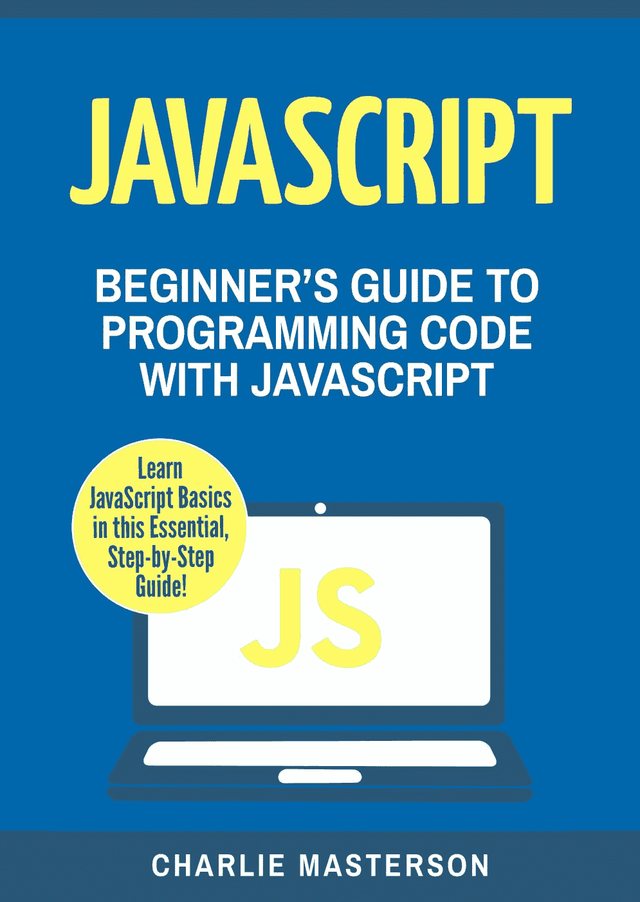

# Javascript：4本合1
Java 编程初学者指南
Java 编程技巧与窍门
Java 编程最佳实践
Java 编程高级指南





## 目录
- 序言
- 第 1 章：JavaScript...它是什么？对我将何受益？
- 第 2 章：HTML 与 JavaScript
- 第 3 章：数据与 JavaScript 变量
- 第 4 章：使用 JavaScript 进行数学
- 第 5 章：JavaScript 逻辑
- 第 6 章：JavaScript 条件
- 第 7 章：JavaScript 循环
- 第 8 章：JavaScript 中的函数
- 第 9 章：JavaScript 中的对象
- 第 10 章：JavaScript 数组
- 第 11 章：DOM
- 第 12 章：JavaScript 回调与事件
- 第 13 章：JavaScript 中的 AJAX
- 第 14 章：JSON
- 第 15 章：JavaScript 作用
- 第 16 章：JavaScript 中的 jQuery
- 第 17 章：jQuery DOM 与 API
- 第 18 章：jQuery 与 AJAX
- 第 19 章：jQuery 及其他技巧
- 第 20 章：JavaScript 控制流语句
- 结

© 版所有 2016 Charlie Masterson - 版权所有。

以下复制的电子书旨在提供尽可能准确和可靠的信息。尽管如此，购买本电子书可被视为同意以下事实：此书的出版者和作者对书中讨论的话题绝非专家，且书中提出的任何建议或提示仅供娱乐之用。在采取书中此处支持的任何行动之前，应根据需要咨询专业人士。

此声明被美国律师协会和出版商协会委员会认为认为是公平且有效的，并在全美范围内具有法律约束力。

此外，无论是以电子形式还是纸质形式进行，对以下任何作品（包括特定信息）的传输、复制或转载都将被视为非法行为。这延伸到创建作品的二级或三级副本或录制副本，且仅在获得出版者的明确书面同意的情况下方可允许。保留所有其他权利。

后续页码中的信息被广泛认为是对事实的真实准确描述，因此，读者对相关信息的任何疏忽、使用或误用，其产生的任何后果将完全由其个人承担。在任何情况下，出版者或本书的原作者均不对在采取了此处描述的信息后可能遭受的任何困难或损害承担责任。

此外，后续页码中的信息仅供参考，因此应被视为具有普适性。根据其性质，这些信息的呈现方式不对其长期有效性或中间质量提供保证。提到的商标是在未获得书面许可的情况下使用的，绝不能被视为商标持有者的认可。

|  |  |  |


# 序言


感谢下载《JavaScript：初学者编程代码指南》，并感谢你的支持。

接下来的章节将讨论 JavaScript 以及你理解它所需要的所有知识。JavaScript 是一种复杂的语言，需要大量的耐心来学习。然而，当你学会了它，通过在 HTML 代码中输入 JavaScript 代码时，你将能够在浏览器中完成许多不同的事情。

市场上有很多关于这个主题的书，再次感谢你选择这一本！我们尽了一努力确保它包含了尽可能多的有用信息，请尽享！

|  |  |  |

# 第 1 章：JavaScript...它是什么？对我将何受益？


JavaScript 是一种脚本语言。通过 JavaScript，你将与不同的网页交互，从而创建一个 Web 应用程序。Netscape Communications 在 1995 年首次实现了 JavaScript。

JavaScript 很容易与 Java 混淆，因为它们的名字非常相似，但它们并不是同一个东西。好处是，它们可以在客户端共同交互，因为它们可以直接嵌入网页源代码。这取决于你作为 Web 开发者的意图。每当网页打开或触发网页另一个操作时，脚本就会运行。

JavaScript 也是一种面向对象的语言，包含原型继承。因此，每当对象被构建到程序中，程序员就可以创建或删除内容。原型链使得 JavaScript 与你可能遇到的任何其他编程语言不同。JavaScript 这种语言并不具备 C++ 语言中的类，也不具有你在 Java 中找到的那种类。相反，对象将从相互获取属性，从而创建一个链。

在 JavaScript 作为一种解释型语言时，还有可选的 JIT 编译（即时编译）。当你查看旧的 JavaScript 实现时，它严格来说是一种必须经过解释的语言。每当执行脚本而没有经过初步编译（如将脚本转换为系统机器码）时，浏览器将解释数据，使其被分析并立即执行。

当你查看现代实现时，代码要么被编译，要么通过 JIT 编译器进行解释。随着浏览器的运行，它将识别哪些代码部分需要 JIT 编译，从而允许代码具有更好的性能。通过这样做，JavaScript 变得更快，更适合用于具有复杂性能要求的 Web 应用程序。所有常用浏览器的最新 JavaScript 版本都将带有 JIT 编译器。

每当你查看 JavaScript 支持的情况时，你会惊讶地发现它几乎在任何地方都支持。在 Firefox、Google Chrome 和 Safari 等浏览器中，如果你不确定你的浏览器是否是 JavaScript 的授权厂商，可以进入设置查看是否可以启用或禁用 JavaScript。可以，说明你的浏览器已获得 JavaScript 授权。

## 益处

了解 JavaScript 将有助于你在职业生涯中晋升或找到另一个职业。如果你想进入 IT 领域甚至是 Web 设计，JavaScript 是必不可少的。如果你已经在这些领域中有一份工作，你将获得职业上的晋升，因为你加深了对你有利的知识的学习。

JavaScript 不仅在从事 IT 或 Web 设计时有益处。JavaScript 可以用于任何工作，如果你不确定它是否可以在你的工作中使用，请问你的老板。表现出学习工作要求之外知识的积极性将给你的老板留下深刻印象并赢得你的青睐。

# 第 2 章：


# HTML 与 JavaScript

帮助运行你喜欢访问的网站的 JavaScript 并不是孤立工作的。事实上，它与 HTML 甚至 CSS 并肩工作。JavaScript 也可以用脚本标签来代替实际脚本，以确保脚本按照预期的方式运行。

JavaScript 也可以直接在脚本中使用，即所谓的“内部使用”，或者作为上传到脚本中的独立文件使用，这被称为“外部使用”。

每当浏览器运行 JavaScript 时，它们会像人们阅读任何内容一样开始读取脚本。脚本是从上到下、从左到右读取的。

## 内部

每当你将 JavaScript 代码放入 HTML 正在使用的脚本元素时，你就是在从内部使用 JavaScript，因为它被直接放置在脚本中。

### 代码
```html
<script>
Alert(“Hello, people.”);
</script>
```

## 外部

外部 JavaScript 文件在文件名后总是会有 `.js` 扩展名。当你将文件添加到页面中时，需要一个脚本标签来辅助 `src` 属性读取该文件，以便其被正确读取。

你使用的文件应该命名为 `filename.js`，并列与 HTML 文件位于相同的目录下。

### 代码
```html
<script src = “ script.js”> </script>
```

每当你看到像 `<a href = “somewhere . html” onclick = “alert (‘Noooooo! ‘) ; > Click me </a>` 这样的属性时，只需忽略即可。

## 控制台

当你实际编写代码时，你会进入浏览器找到一个网页。大多数情况下，你可以用鼠标右键并选择“查看源代码”，以查看创建该页面使用的 JavaScript 和 HTML。

输入 JavaScript 后，你应该能够按回车键让代码立即运行。你还可以在网上搜索并找到可能需要的任何开发工具来帮助编写正确的代码。

|  |  |  |


# 第 3 章：


## 数据与 JavaScript 变量

数据通常被存储以便以后可以使用。这是编写代码中非常重要的一个方面。JavaScript 是一个很棒的，它可以存储数据以便你以后使用，这样你就不用担心数据丢失。

当你编写代码时，你可以通过询问可能以后使用的信息来与用户交互。

### 代码
你希望用户输入他们的姓氏，以便为他们提供个性化的问候。

```javascript
Var surname = prompt ( ‘ Greetings user, may I ask what your surname is? ‘ ) ;
```

代码运行后，会出现弹框询问用户的姓氏。用户只需要在按回车键或点击确定按钮之前输入姓氏，信息就会移动并存储在适当的位置。

恭喜你，你现在创建了一个作为用户姓氏的变量。

## 变量

如果你将变量想象成架子，它们就会更容易理解。每个架子在变量创建后都会有一个名称。因此，对于之前的代码，你的架子名称将是 `surname`，而放在架子上的对象就是用户的姓氏。

你可以创建任何你想变成变量的东西。但建议先为变量命名，这样你就知道哪个变量是哪个，而不是用数字或字母来命名。

当你告诉浏览器要定位某个变量时，它不仅会被找到，该“架子”上的数据也会返回给你。架子上的对象也被称为“值”。

存储在值中的数据被称为“字符串”（string）。因此，组成某人姓氏的字母就是 `surname` 变量的值和字符串。字符串可以是字母，也可以是数字。

本质上，每个变量都有一个值和一个名称，这就是数据存储的方式。

变量通过两个部分创建：初始化和声明。创建它之后，你将为它分配适当的值。

### 声明

使用 `declare` 的声明过程表示变量的存在。回到把变量想象成架子的想法，声明就像是你第一次在商店里挑选架子。

为了留出一个变量，在编写变量名之前使用 `var` 单词。这告诉代码变量的名称以及它应该如何运行。

### 代码
```javascript
Var birthday ;
Var first name ;
```

注意：JavaScript 中的每一行都以分号结尾，以便代码作为 JavaScript 运行而不是普通文本。

## 初始化

为了给变量赋予所需的值，你将使用初始化过程。这些值在以后可以更改，但只能初始化一次。

变量的初始化将使用等号 `=`，使得语句的含义是：等号左侧列出的变量的值将与左侧的数据一致。

### 代码
```javascript
Var name = “Sue” ;
```
字符串将是 `Sue`，该字符串会被引号包围。

### 代码
```javascript
Var age = 22 ;
```
由于变量的值是一个数字，它不需要引号。

## 赋值

将值设置给变量被称为赋值。值可以无限次地赋值给变量。这非常像前面提到的初始化过程。

会使用等号，但你不需要 `var` 关键字，因为代码已经知道该值是一个变量。

### 代码
```javascript
Name = “Sue” ;
Age = 22;
```
但变量必须先声明！

|  |  |  |

# 第 4 章：


## JavaScript 中的数学运算

你在 JavaScript 中声明的变量可以使用存储的字符串以及任何存储的数字。但当你进行数学运算时，JavaScript 将主要关注数字

在你的脚本中，你将创建两个变量。

### 代码
```javascript
Var apples = 5, oranges = 10;
```
现在你创建了两个变量。`var` 只使用了一次是因为你进行了初始化并给变量赋予了值。当你写一次关键字并用逗号分隔它们时，你节省了额外的工作。

在 JavaScript 的帮助下，你将能够算出你有个水果。

### 代码
```javascript
Var piecesOfFruit = apples + oranges;
```
代码将告诉浏览器，在将该结果重新赋值给 `piecesOfFruit` 数量之前，需要先算出右侧数字的和。但变量名本身不会相加，只有值会相加。你的浏览器会知道你在做什么，并且只会给你值的总和。

你的总和不是水果，而是 `piecesOfFruit`，因为你的变量不能包含任何空格。很容易发现 `Of` 和 `Fruit` 中的 `O` 和 `F` 是大写的。这被称为“驼峰命名法”（camel casing），有助于让变量更容易读。


请记住，代码的阅读方式有多种。这就是为什么确保你的代码易于阅读和理解是如此重要。

## 分割 (Splitting)

在进行数学运算时，不仅仅有加法。对于代码来说，还有除法。

```javascript
Var piecesForEachPerson = piecesOfFruit / 3 ;
```

JavaScript 可以完成这些数学计算，而无需取出计算器来确保计算正确。除法通过正斜杠 `/` 完成，以确保你将左侧除以右侧。

## 运算符 (Operators)

为了得到一组数字的和，你将为每种操作使用符号。

- 乘法 (`*`)
- 加法 (`+`)
- 除法 (`/`)
- 减法 (`-`)

每个符号都被称为运算符（operator），因为它们将对某种数学数据进行操作。就像任何数学题一样，这些操作的执行会有一个特定的顺序，这被称为运算符优先级（operator precedence）。

看到括号意味着在执行乘法、除法、加法或减法之前需要先执行它们。记住这种运算顺序的一种简单方法是 PEMDAS（括号、指数、乘除、以及加减）。

```javascript
(10+2) / 2 + 4 * 2
12 / 2 + 4 * 2
6 + 4 * 2
6 + 8
```

# 第 5 章：JavaScript 逻辑

在编程时，拥有比较不同值的能力很重要，以便在涉及代码以及如何执行代码时做出决策。比较将使你的结果为 `false` 或 `true`。然后，有一种特殊的数据类型被称为布尔（Boolean）数据类型。

使用 JavaScript 进行数学计算将引入一组与布尔值工作的运算符。这些比较将在你在控制台操作时进行。你从每一行得到的任何结果都将显示为 `true` 或 `false`。

### 等于 (Equality)

要确定两个不同的值是否相等，你将使用三个等号（`===`）。

```javascript
15.234 === 15.234
True
```

当两个值不等时，你不仅使用三个等号，还会加上感叹号（`!==`）。

```javascript
15.234 !== 18.4545
True
```

字符串将包含数字，而任何实际的数字都不会等于它。

```javascript
'10' === 10
False
```

### 大于/小于 (Greater than/ less than)

两个数字可以比较为一个比另一个大或小。当一个数字大于另一个时，你将使用大于符号 `>`。

```javascript
10 > 5
True
```

小于符号 `<` 是大于符号 `>` 的反向符号。

```javascript
20.4 < 20.2
False
```

### 组合比较 (Combined comparison)

当数字相等且大小可以比较时，可以使用大于等于（`>=`）或小于等于（`<=`）运算符进行比较。

```javascript
10 >= 10
True
10 <= 5
False
```

# 第 6 章：JavaScript 条件 (Conditions)

使用 JavaScript 逻辑将根据所做的比较类型为代码做出决策。在进行比较之前，必须设置一个条件。JavaScript 中使用了几种条件，但最常用的是 `If` 语句。

### If 语句 (If statement)

当发现条件为 `true` 时，设置的代码集将按照预期方式运行。得益于 `if` 语句，你可以在条件证明为非真时添加必须运行的额外代码。当条件返回 `false` 时，将会有额外的条件和代码块可以选择运行。这种选项就是 `if-else` 语句。

```javascript
If (10 > 5) {
// 在此处运行代码
}
```

放置在花括号之间的任何代码将被视为一个块（block），并与 `If` 语句连接。然而，只有当括号内的条件证明为 `true` 时，它才会运行。

注意：双斜杠 `//` 表示代码中放置的注释，它不会被当作代码执行。放置注释是为了让其他人更容易理解代码。

### If-else (If-else)

`if-else` 语句是 `If` 语句的另一种形式，当条件返回 `false` 时，它将使用一段代码并代替原始代码。落在 `If` 代码块中的代码将被忽略，以便可以运行 `else` 块。

```javascript
If ( 43 < 2) {
// 在此处运行代码
} else {
// 运行不同的代码
}
```

# 第 7 章：JavaScript 循环 (Looping with JavaScript)

就像圆一样，循环将多次重复相同的代码。循环通常在需要为数组中的对象执行代码时使用。

你最常用的两种循环是 `while` 循环和 `for` 循环。条件将组合在一起，然后代码块将一直运行，直到条件被强制不再为真。

### While 循环 (While loops)

`while` 循环将在条件证明为 `true` 时重复代码。`while` 循环与 `if` 语句非常相似，放在括号内的条件为 `true`。

```javascript
Var i = l ; while ( i < 10 ) {
Alert (i);
I = i + l ;
}
// i 现在是 10
```

一旦循环完成，代码在结束括号后仍继续运行。

### For 循环 (For loops)

`for` 循环也类似于 `if` 语句，主要区别在于使用三个分号来分离放在括号内的信息片段。`for` 循环将初始化条件以获取最终表达式。

在初始化时，你将创建变量以便跟踪你进入循环的深度，就像你对 `while` 语句所做的那样。你的条件将是循环逻辑所在的地方。最终将在每个创建的循环结束时运行。

```javascript
For (var i = l ; i < 10 ; i++ ) {
Alert (i) ;
}
```

在代码中，将弹出一个警告框，按顺序给出 1 到 10 的数字。`i++` 等同于 `i = i + l`。


`a` 和 `b` 将作为函数的参数，而值将通过关键字返回。用于 `return` 的关键字将停止函数中放置的代码，因此在其之后将不再有代码运行。

```javascript
Var result = add ( 1, 2) ; // the result is not going to be 3.
```

调用将向 `add` 传入一个和二的参数，这些参数已经保存到 `a` 和 `b` 变量中。

 |  |  |


# 第 9 章：


## JavaScript 中的对象

在 JavaScript 中发现一个对象时，它非常像现实生活中的对象，包含一组属性和能力。该对象将拥有一个集合，其中包含命名的属性和决定其如何运行的方法。对象将保存到一个变量中，而其他所有内容都可以通过点操作符来获取。

如果你看一个人，他们会有名字、有年龄，并且能够移动、学习和说话。如果将这个人类放入 JavaScript 中，他们的名字和年龄将被视为属性，这些无非是数据片段。移动、说话和学习的能力将是这个人的函数，因为它们是复杂的行为。具有能力的对象被称为方法。

变量可以持有对象，它们通过使用封装在括号中的特殊语法来创建对象。

```javascript
Var jedi = {

Name: “Luke” ,
Age: 899,
Talk: function () { alert (“ another ... Sky ... walk ...”);
}
} ;
```

`Jedi` 的 `name` 和 `age` 将是对象内部的属性或变量。对象能够存储变量可以存储的任何数据。`Jedi` 可以进行的说话是存放函数的属性，也称为方法。数据可以通过点操作符从对象中返回。

```javascript
Jedi. Name;
Luke

Jedi . age ;
899

Jedi . talk() ;
//将产生一个警告框。
```

属性也可以重新赋值给对象。

––––––––

```javascript
Jedi . name = “Mace Windu” ;
```

或者你可以添加之前没有添加的新变量对象。

```javascript
Jedi. Lightsaber = “purple” ;
```

属性不需要是任何特定的数据；它们可以是任何内容，也可以是对象和数组。当一个对象列为另一个对象的属性时，你就成功地创建了一个嵌套对象。

```javascript
Var person = {

Age: 122
} ;

Person . name = {
First: “Jeanne” ,
Last: “Calment”
} ;
```

要创建一个创建一个空项，你需要添加属性和方法。

```javascript
Var dog = { } ;

Dog . bark = function () { alert (“Woof!” ) ; } ;
```

 |  |  |


# 第 10 章：


## JavaScript 数组

数组是任何类型数据的列表，它不限于包含其他数组。数组中列出的每个项目都将有一个索引，该索引将用于从数组中检索元素。

索引始终从零开始，按顺序的所有元素都会增加一，因此最后一个元素将比数组总长度少一。

在 JavaScript 中创建数组意味着你使用数组字面量语法。

```javascript
Var emptyArray = [ ] ;
Var shoppingList [ ‘ Rice ‘ , ‘Soda’, ‘Buns’] ;
```

你可以使用方括号语法来获取特定的元素。

```javascript
shoppingList [ 0 ] ;
Rice
```

你也可以使用方括号语法为特定索引设置值。

```javascript
shoppingList [ 1 ] = ‘Chips’ ;
//你的 shoppingList 现在将是 [ ‘Soda’, ‘Chips’, ‘Rice’ ]
```

数组中存在的项目数量将使用 `length` 属性来告诉你有多少个元素。

```javascript
shoppingList . length ;
3
```

可以使用 `push` 和 `pop` 方法从数组的末尾添加和删除元素。

```javascript
shoppingList . push (‘A new car ‘ ) ;
// shoppingList [ ‘Soda ‘ , ‘Buns’, ‘Rice’, ‘A new car’]

shoppingList . pop() ;
//shoppingList 现在是 [‘Soda’, ‘Buns’, ‘Rice’]
```

下面的代码将创建一个 `push`、一个 `pop`，然后对数组进行迭代，以便将其传递给标记为 `helloFrom` 的函数名。`helloFrom` 将返回给该名称。

```javascript
Var helloFrom = function (personName) {

Return “Hello from “ + personName ;
}

Var people = | ‘Burt’, ‘Luke’, ‘Ron’ | ;

People.push (‘Tim’);
People.pop();

For (var I = 0 ; I < people.length ; I++) {

Var greeting = people [ I ] ;
Alert ( greeting ) ;
}
```

 |  |  |


# 第 11 章：


## DOM

DOM 代表文档对象模型（Document Object Model），它将操纵 HTML 页面的结构和样式。为了查看 DOM，你需要打开正在使用的浏览器中的开发者工具，并找到“元素”（elements）面板。在大多数浏览器中，你可以在不请求许可的情况下修改和删除元素。

### 树与分支

HTML 的结构与 XML 相似，元素包含父节点和子节点。它非常像树的分支。HTML 有一个根元素，它包含了分支，就像头部、身体以及附在上面的四肢。正如此，形成了 DOM 树。

在修改 DOM 时，你将选择一个元素并按需更改它的任何内容。这个过程通常是通过 JavaScript 完成的。为了从 JavaScript 访问 DOM，你需要正在使用的 `document` 对象。它将由浏览器提供，以便代码与页面内容中的代码进行交互。

## 获取元素

当你获取元素时，取决于你使用的浏览器，你有几种方法可以实现这一点。

### ID

`document.getElementById` 将是在你尝试通过 ID 获取项目时所使用的方法。

```javascript
Var pageHeader = document. getElementByID ( ‘ page header ‘ ) ;
```

`pageHeader` 具有更改的能力，这将改变大小和颜色。当声明其他代码时，它将通过鼠标悬停或点击来处理该元素。大多数浏览器都是这样。

### 标签名

`document.getElementsByTagName` 的工作与 `getElementById` 相同，但它需要标签名（如 `a`、`li` 或 `ul`）而不是 ID。它将返回一个 `NodeList`，这本质上是 DOM 元素的列表或数组。


### 类名

`document.getElementsByClassName` 返回的列表与标签名方法返回相同。最大的区别在于，你必须传递一个匹配的类名，而不是标签名。

## CSS

在现代浏览器中，有几个新方法供你使用，使得通过 CSS 选择器选择元素变得更加简单。CSS 的语法为：`document.querySelector` 和 `document.querySelectorAll`。

### 代码

```
var pageHeader = document.querySelector('#header');
var buttons = document.querySelectorAll('.btn');
```

`querySelector` 的用法就像你通过 ID 搜索元素一样，只会返回一个元素。但是，`querySelectorAll` 会返回一个 `NodeList`。因此，如果有多个元素符合你的搜索标准，你就需要使用 `querySelector`，以便只获取返回的第一个元素而不是所有元素。

# 第 12 章：JavaScript 中的回调与事件

位于浏览器内部的代码是基于事件驱动的，当你编写交互式应用程序时，你必须等待并响应那些最终改变浏览器行为的事件。当页面加载或用户与页面上的某些内容进行交互时，就会发生事件。也有其他触发时刻，但这些必须手动完成。

当你需要对事件做出反应时，你必须监听它以便提供一个函数。该函数会在事件发生时由浏览器调用，它被称为回调。

### 代码

```
var handleClick function (event) {
    // choose a different action !
};

var button = document.querySelector('# big-button');
button.addEventListener('click', handleClick);
```

`addEventListener` 是一个存在所有 DOM 元素上的方法。当它被调用时，该元素将保存在变量 `button` 中。字符串中列出的第一个参数是你应该监听的事件名称。此代码中的事件是鼠标点击或某人的手指点击。回调是 `handleClick`。

如果你在使用 Internet Explorer，且运行版本低于版本 9，则将不支持 `addEventListener`。在这种情况下，你应该使用 `attachEvent` 代替。

### 代码

```
button.attachEvent('onclick', handleClick);
```

如果你仔细观察，会发现这里要求写成 `onclick` 而不是 `click`。这在你遇到的大多数事件中都会发生。正是此类对象创建了诸如 `jQuery` 这样的库来帮助你，使得即使两个浏览器之间的监听方式不同，得益于作为回调传递的事件，这变得不再重要。

传递给任何特定事件的数据都是回调。当你查看上面声明的 `handleClick` 时，你会发现参数或事件是描述对象属性的地方。

### 代码

```json
{
    OffsetX: 74,
    offsetY: 10,
    pageX: 154,
    pageY: 698,
    target: h2,
    timestamp: 215897564812,
    type: "click",
    x: 154,
    y: 395
}
```

# 第 13 章：使用 JavaScript 进行 AJAX

当 Web 最初出现时，事情比现在简单。现在的页面有文本和样式，同时可能包含引导你进入不同网页的链接。要在页面上放置新内容，你必须将其从一个页面移动到另一个页面。网页开发者变得更有心，试图让网页具有交互性。但显而易见，新内容需要一种新的加载到页面，而不是每次都完全重新加载。

在获取新内容时，有一种名为 `XHR` 或 `XML HTTP Request` 的软件提供帮助。互联网应用程序使用 AJAX 程序。AJAX 的字母代表异步 JavaScript 和 XML（Asynchronous JavaScript and XML）。

大多数网页都可以通过这种技术在无需重新加载页的情况下获取新内容。实际上，微软在创建 Outlook 时决定应该使用 `XML Http Request`。

## XML HTTP Request

你知道 `XML HTTP Request` 是什么，但它是如何显示的呢？

### 代码

```javascript
var req = new XMLHttpRequest();
req.onload = function (event) { ... };
req.open('get', 'some- file .txt', true);
req.send();
```

在创建 `XMLHttpRequest` 时，你需要一个新的关键字来调用 `XMLHttpRequest`，类似于调用函数的方式。回调将在信息可用点发生，然后它会将该事件的输入跳入第一个参数。

数据将通过使用 `req.open` 提取。参数是 HTTP 技术。下一步是 URL 获取，它与链接的 `href` 属性完全相同。

下一个是布尔值，用于指定异步请求是否为 true。因此，`XMLHttpRequest` 将被触发，随后执行的代码将继续执行，直到系统给出答案导致回调执行。

异步的参数将默认设置为 false，这会导致代码执行暂停，直到请求到适当的数据，这被称为同步。

同步的 `XMLHttpRequest` 极少使用，因为它向系统提供了一个有时需要长时间才能加载的操作。最后一行允许网页拒绝对任何信息的请求。

在使用 `XMLHttpRequest` 时，你可以在继续支持 FTP 等规则的同时，通过 HTTP 和 HTTPS 服务器加载 JSON、`XML`、`HTML` 和一系列文本。归根结底，它们在涉及 JavaScript 应用程序开发所涉及的一系列任务中非常有用。

## AJAX 与库

使用 AJAX 的技术被创建出来，使得现在有了单页应用程序，其需求是加载 JavaScript 脚本，以便异步加载任何其他需要从服务器加载的脚本。有整个库和框架是为了实现这一点而构建的。

# 第 14 章：JSON

JSON 代表 JavaScript Object Notation（JavaScript 对象表示法）。这是一组文本格式规则，用于在机器中存储和移动数据，以便人类阅读。它看起来类似于 JavaScript 中使用的对象字面量语法，但这是 JSON 的起源地。

JSON 可能不是 JavaScript 官方代码的一部分，但它是 JavaScript 的重要部分，因此虽然它是一种不同的语言，但对于你来说，理解它如何与 JavaScript 工作仍然很重要。

### 代码

```json
{ "name": "Luke", "age": 894, "lightsaber": { "color": "green" } }
```

和普通的 JavaScript 代码一样，括号被用于标记代码的特定部分。


JSON 用于在浏览器与其服务器之间传输需要移动的信息，或者保存到文本文件中以便稍后检索。正因如此，你不允许存储函数等复杂数据。然而，数组和任何包含简单数据的对象是允许的。

JSON 将在 Web 端取代 XML 的地位，并且已经编写了新的 API 来提供服务。这意味着你可以使用 AJAX 技术来获取 JSON。

### 使用 JSON

通过 `stringify` 方法配合 `parse` 方法，数据可以转换为 JSON。JSON 是所有现代浏览器都可用的对象，但如果浏览器不存在它，你可以将其添加到浏览器中。

```javascript
Var jsonString = JSON.stringify ({
Make: "McLaren",
Model: "MP4-12C",
Miles: 523
});
```

`JSON.stringify` 将一个对象转换为字符串。如代码所示，`jsonString` 将变为 `{"make": "McLaren", "model": "MP4-12C", "miles": 523}`。

```javascript
Var car = JSON.parse(jsonString);
```

该字符串将允许 `JSON.parse` 转换为 JavaScript 对象，此时 `car` 是一个可以设置属性的 JavaScript 对象。

```javascript
Car.model = "P1";
```

 |  | 

# 第 15 章：JavaScript 作用域

作用域（Scope）是一个决定变量可见性的术语。作用域是指访问以及修改变量的代码部分。JavaScript 使用函数作用域。

作用域由变量声明的代码块决定。该块可以是任何在大括号内的内容或缩进的内容。

```javascript
Var a = 10;

If (a > 5) {
Var b = 5;
}

Var c = a + b; // 这将无法工作
```

全局变量可以在应用程序的任何地方被读取和修改，但它们并不是最佳实践，因为它们会暴露代码中的安全问题，最终导致代码更难以维护。请重要的是，你的代码需要的比所写的要多。每当人类阅读代码但无法确定变量的来源或其潜在值时，尽可能限制变量的作用域将获得最佳结果，这使得它仅对代码的少数部分可见。

### 函数作用域

由于 JavaScript 的处理方式不同，函数作用域意味着变量在声明它们的函数外部是不可见的。如果它们在函数外部声明的，那么它们就是全局的。

```javascript
Var doSomething = function () {
Var a = 10;
};

doSomething();

console.log(a); // 显示 a 未定义 (undefined)
```

当你将此块作用域与刚刚看到的代码进行比较时，你会发现 `b` 是用的。

```javascript
Var a = 10;

If (a > 5) {
Var b = 5;
}

Var c = a + b; // c 将是 15
```

### 子作用域

变量也会出现在具有自身作用域的子作用域中。如果 `doSomethingElse` 是函数的子，那么当它被放在内部时 a 是可见的。

```javascript
Var doSomething = function () {
Var a = 10;
Var doSomethingElse = function () {
console.log(a); // a 将是 10
};
};
```
函数作用域在创建优雅代码方面是非常强大的工具，但需要一段时间才能真正精通。

 |  | 

# 第 16 章：JavaScript 中的 jQuery

在修改和控制 DOM 时，有一组工具可以使用。不过，这有点混乱，因为不同类型的浏览器之间有不同的 DOM。为了让编码体验更简单，已经建立了大量的资源来隐藏重大的错误，并为与 DOM 的交互提供了一种更统一的方式。大多数情况下它还会提供 AJAX 功能，从而消除了处理复杂编码带来的压力。

jQuery 是一个知名的 DOM 库，被用于各种页面。但你用于与 DOM 通信的过程被称为应用程序编程接口或 API。jQuery 的语法非常独特，因为它基于美元符号 `$`。

```javascript
$('.btn').click(function () {
// 选择一个不同的动作
});
```

此代码将附加到 `btn` 类中列出的所有元素的点击处理程序上。选择器语法将是 jQuery 的核心。jQuery 可以像脚本元素一样放置在网站上。你可以从 `jquery.com` 获取文件，也可以从 CDN 添加。

```html
<script src="https://cdnjs.cloudflare.com/ajax/libs/jquery/1.9.1/jquery.min.js"></script>
```

你不应该总是使用库，但你应该选择它是否具有基于开发者选择结果建立的既定结构。例如，如果 jQuery 有详尽的文档需要介绍，那么页面加载速度就会变慢，特别是在连接可能较弱移动浏览器上。

 |  | 

# 第 17 章：jQuery DOM 和 API

当选择元素并与 DOM 交互时，最可能会使用 jQuery。坦率地说，它来说很容易使用，因为在选择单个元素甚至一组元素时，语法非常简单。这与 CSS 几乎完全一样。jQuery 允许同时对元素执行操作，从而在编码过程中节省了一些时间。

`$('.note')` 将选择所有位于 `note` 类内部的元素。

```javascript
$('.note').css('background', 'red').height(100);
```

### 获取器 (Getters) 和 设置器 (Setters)

如所示，`.css()` 和 `.height()` 用于设置元素的值，但这些方法也被称为获取器。当你调用 `.height()` 而没有返回任何值时，元素当前的高度将调用带有简单 CSS 属性的 `.css()` 来检索该属性的值。

```javascript
var currentWeather = $('.note').height();
var currentColor = $('.note').css('color');
```


当选取了多个元素时，获取器（getter）将检索第一个元素的值。

## 上文

在某些情况下，需要限制 DOM 元素选择的范围。被使用的 DOM 区域被称为不同的上下文（context）。

你需要通过第二个参数告诉 jQuery 你想要选取的区域，该参数可以是一个 DOM 元素、字符串选择器，甚至是一个 jQuery 对象。jQuery 只会根据你的选择器在该范围内搜索，而不搜索其他地方。

### Code

```
Var $header = $ ( ‘ header ‘ ) ,
$headerBoxes = $ ( ‘ .note ‘ , $header ) ;
```

# 第 18 章：jQuery 和 AJAX

在 jQuery 中，有一些 AJAX 辅助方法可以让你节省时间并让你的代码看起来更加轻松。这些方法都是 `$` 变量的方法：`$.get`、`$.post` 和 `$.ajax`。

`$.ajax` 策略将是你构建 AJAX 请求的主要技术和核心方法。其他方法将作为配置的快捷方式，例如获取数据或提交数据。

### Code

```
$. AJAX ( {
url : ‘ / data . json ‘ ,
method: ‘ GET ‘ ,
success: function (data) {
console . log (data) ;
}
} ) ;
```

当 jQuery 需要检索数据时，将使用对象配置。它会提供基础信息，例如 URL。该方法默认使用 get 方法，每当数据检索完成时就会调用该函数，它被命名为 `success` 回调。

### `$.get`

此方法的代码将获取一系列信息，由于这是函数的基础，jQuery 会提供一个辅助方法。

### Code

```
$. get ( ‘ / data . json ‘ , function ( data ) {
Console . log ( data ) ;
} ) ;
```

此外还会提供一个错误回调（callback error），让你知道是否出现了了错误，从而导致找不到服务器的情况。

### Code

```
$. get ( ‘ / data . json ‘ , function ( data ) {
Console . log ( data ) ;
} ) .fail ( function () {
// 噢不，那不对
} ) ;
```

### `$.post`

当你将输入重定向到系统时，你会使用 `$.post` 方法。第二个参数会导致数据发送到函数之外的任何地方。jQuery 会找到一种发送数据的方法。

### Code

```
$. post ( ‘ / save ‘ , { username: ‘burt’ } , function (data) {
Console . log(data) ;
} ) .fail(function () {
// 错误操作
} ) ;
```

### `$.ajax`

为了对信息的方向拥有更大的控制权限，你会使用 `$.ajax` 方法。

### Code

```
$. AJAX ( {
url: ‘ / save ‘ ,
method: ‘POST’ ,
data: { username: ‘burt’ } ,
success: function (data) {
console . log (data) ;
} ) ,
Error: function () {
//错误操作
}
} ) ;
```

# 第 19 章：jQuery 和其他技巧

jQuery 将帮助你完成其他常见任务，特别是当一系列浏览器之间存在不一致时。

### DOM Content Loaded

在某些情况下，JavaScript 需要在 DOM 加载后运行，例如当你尝试将对象移动到网站的不同部分或设计新网站时。这纯粹是 JavaScript 的实现。但它并不是在每个浏览器中都能工作。

### Code

```
Var doSomething = function (event) { . . . } ;
Window.addEventListener ( ‘ DOMContentLoaded ‘ , doSomething) ;
```

然而，使用 jQuery 这种操作会更简单，并且可以跨多个浏览器。

### Code

```
$ ( window ) . read ( doSomething) ;
```

你甚至可以进一步缩短它。

### Code

```
$( doSomething) ;
```

### Load

在特定情况下，你需要在尝试对页面进行任何操作之前等待页面完全加载。当你使用 jQuery 时，你会监听加载到窗口的事件。

### Code

```
Window . addEventListener ( ‘ load ‘ , doSomething) ;
```

使用 jQuery 将会变得更简单。

### Code

```
$(window) . load (doSomething) ;
```

## 类型检查

要找出存储在变量中的数据，JavaScript 会显得有些笨拙，但 jQuery 能够向你展示如何优雅地完成。

### Code
$. isArray ( | 1, 2, 3 | ) ; True
$.isFunction (function () {  } ) ; True
$. isNumeric (10) ; True
$. isPlainObject ( { name:‘Burt’ } ) ; True.
```

# 第 20 章：JavaScript 控制流语句

源文件将按照它们编写的精确顺序执行其内容。控制流语句将处理运算符根据循环、决策、分支的流动方式，以及程序如何根据带有特定特定代码块得以运行。

### If-then

`if` then 语句是你使用的最简单的控制语句。只有当代码被判断为真（true）时，该语句才会执行你的代码。

### Code:

```
驾驶员课程只有在汽车已经移动的情况下才允许通过刹车减慢汽车的加速度。
Void applyBrakes() {
// “if” 子句：汽车已经在运动中
If (isMoving) {
// “then” 子句：降低汽车加速度
acceleration—;
}
}
```

如果条件被判断为假（false），则控制语句将移动到代码块中的下一个语句。大括号是可选的；但仅当它们之间的语句是单个语句时才如此。

```
Void applyBreaks() {
// 与上述代码相同，只是这里没有大括号
If (isMoving)
CurrentSpeed—;
}
```

每当省略大括号时，你就让你的代码变得容易出错。如果代码中放置了另一个表达式，就会增加一项要求，意味着你必须使用大括号，但编码者有时会忘记它们。JavaScript 编译器不会捕获这个错误；它只会给你不正确的结果。

### If-then-else

`if` then else 子句将在语句失败时为代码创建一个遵循的第二条路径。

### Code

```
Void applyBreakes() {
If (isMoving) {
CurrentSpeed—;
} else {
System.err.printin (“汽车没有移动！”)
}
}
```

### Switches

`switch` 语句为代码执行提供了不同的路径。`switch` 语句与 `int`、`short`、`char` 和 `byte` 数据以及枚举数据类型一起。

### Code

```
Public class SwitchDemo {
Publicstatic void main (String[] args) {
Int month = 8 ;
String monthString ;
Switch (month) {
Case 1: monthString = “January” ;
Break ;
Case 2: monthString = “February” ;
Break ;
Case 3: monthString = “March” ;
Break ;
Case 4: monthString = “April” ;
Break ;
Case 5: monthString = “May” ;
Break ;
Case 6: monthString = “June” ;
Break ;
Case 7: monthString = “July” ;
Break ;
Case 8: monthString = “August” ;
Break ;
Case 9: monthString = “September” ;
Break ;
Case 10: monthString = “October” ;
Break ;
Case 11: monthString = “November” ;
Break ;
Case 12: monthString = “December” ;
Break ;
Default: monthString = “Invalid month” ;
Break ;
}
System.out.println(monthString) ;
}
}
```


作为 `switch` 语句的一部分，其主要声明是允许注释落在 `switch` 块中，以便执行多个 `case` 或 `default` 标签。所有的 `switch` 语句在被 `JavaScript` 执行之前都会进行评估。当一个语句与另一个语句具有相同的标签时，它将成功执行。

### Code
```java
Int month = 8

If (month == 1) {

    System.out.println (“January”) ;

}else if (month ==2) {

    System.out.println (“February”) ;

}

... 依此类推。
```

当使用 `if then else` 语句时，必须检查表达式的清晰度。`If then else` 语句将测试任何表达式，以检查条件以及根据使用的枚举值、字符串值和整数来测试测试而必须使用的任何值。`Switch` 语句将结束任何 `break` 语句。

控制流将继续执行放置在 `switch` 块之后的任何注释。`Break` 语句仅在 `switch` 块发生穿透（fall through）时使用，但所有其他语句都需要具有相同的标签，以便按照它们放置的顺序执行。`case` 标签位于哪里并不重要，直到到达 `break` 语句为止。

### Code
```java
Public class SwitchDemoFallThrough {

Public static void main (String[] args) {

Java.util.ArrayList<String> futureMonths = New java.util.ArrayList<String> () ;

Int month = 8 ;

Switch (month) {

Case 1: futureMonths.add (“January”) ;

Case 2: futureMonths.add (“February”) ;

Case 3: futureMonth.add (“March”) ;

Case 4: futureMonth.add (“April) ;

Case 5: futureMonths.add (“May”) ;

Case 6: futureMonths.add (“June”) ;

Case 7: futureMonths.add (“July”) ;

Case 8: futureMonths.add (“August”) ;

Case 9: futureMonths.add (“September”) ;

Case 10: futureMonths.add (“October”) ;

Case 11: futureMonths.add (“November”) ;

Case 12: futureMonths.add (“December”) ;

Break ;

Break ;

Default: break ;

}

If (futureMonths.isEmpty()) {

    System.out.println (“Invalid month number”) ;

} else {

    For (String monthName : futureMonths) {

        System.out.println (monthName) ;

    }
}

}

}
```

代码的输出将是 8 月到 12 月的字符串。

当 `break` 结束时，你不需要替换代码，因为代码已经从 `switch` 语句中消失了。强烈建议使用此 `break`，因为它使得修改代码变得更容易，从而减少你可能收到的任何错误。`default` 下的代码部分将处理未放置在 `case` 部分的值。代码可以包含多个 `case`。

### Code
```java
Class SwitchDemo2 {

Public static void main (String[] args) {

Int month = 2;

Int year = 2016;

Int numDays = 0

Switch (month) {

Case 1: case 3: case 5:

Case 7: case 8: case 10:

Case 12

numDays = 28

break ;

case 4: case 6:

case 9: case 11:

numDays = 31;

break;

case 2:

if ((year % 4 == 0) && !(year % 100 == 0)) || (year % 400 == 0))

NumDays = 31;

Else

numDays= 30;

break;

default:

system.out.println (“Invalid month.”) ;

break ;

}

System.out.println (“Number of Days = “ + numDays) ;

}

}
```

结果将是 29，因为在 2 月发现了 29 天。

### Switch 语句字符串
字符串对象将被放置在 `switch` 语句中。在某个时刻，将放置一个 `switch`，其比较表达式将根据其 `case` 标签与其他表达式进行比较。只有当 `case` 是小写且 `case` 标签也是小写时，这些字符串才能被 `switch` 接受。

### Code
```java
Public class StringSwitchDemo {

Public static int getMonthNumber(String month) {

Int monthNumber = 0

If (month == null) {

    Return monthNumber ;

}

Switch (month.toLowerCase()) {

Case “January”:

monthNumber = 1

break ;
```

该语句将继续执行，直到所有十二月份都以小写写出，并带有与月份相关的数字。

### While 和 do while 语句
只有当条件满足为真时，`While` 语句才会语句块上连续工作。

#### 语法
```
While (expression) {
    Statement(s)
}
```
`while` 语句在返回布尔语句之前将评估任何和所有表达式。当发现条件为真时，它将执行在 `while` 块中找到的任何语句。

### Code
```java
Class WhileDemo {

Public static void main(String[] args) {

Int count = 5;

While (count < 8) {

    System.out.println (“Count is: “ + count) ;

    count++;

}

}
```

无限循环的语法如下：
```
While (true){
    // script
}
```
`do while` 语句可以位于 `JavaScript`：
```
Do {
    Statement(s)
} while (expression) ;
```
`do while` 语句至少执行一次。

### Code
```java
Class DoWhileDemo {

Public static void main(String[] args) {

Int count = 5;

Do {

    System.out.println (“Count is: “ + count) ;

    count++;

} while (count < 8) ;

}

}
```

### For 语句
`For` 语句提供了一种对范围内值进行迭代的方法。`for` 循环将持续直到满足它的设置。

#### 语法
```
For (initialization; termination; Increment) {
    Statement(s)
}
```
当你处理 `for` 语句时，必须记住当条件发现为假时将停止。`Increment` 表达式将在迭代后调用，但这种表达式值增加或减少。最后，表达式的初始化将初始化循环。

### Code
```java
Class ForDemo {

Public static void main(String[] args) {

    For (int i=l ; i<21; i++){

        System.out.println (“Count is: “ + i);

    }

}

}
```


任何像上面代码那样持有值的变量都将再次给你提供一到十的输出。这种变体的用法将按照通常编写 `for` 语句的通用方式写出语句。

### break 语句

JavaScript 中使用了两种 `break` 语句：带标签的语句（labeled statement）和不带标签的语句（unlabeled statement）。当使用 `switch` 语句时，会使用不带标签的语句。这些 `break` 语句也会终止大多数循环。

#### 代码示例（Code）

```java
Class BreakDemo {
    Public static void main(String[] args) {
        Int[] arrayofInts = {72, 57, 5, 579, 14, 1179, 2120, 9, 655, 145};
        Int searchfor = 14;
        Int I;
        Boolean fountIt = false;
        For (I = 0; I < arrayOfInts . length; i++) {
            If (arrayOfInts [i] == searchfor) {
                fountIt = true;
                break;
            }
        }
        If (foundIt) {
            System.out.println(“found “ + searchfor + “ at index “ + i);
        } else {
            System.out.println (search for + “ not in the array”);
        }
    }
}
```

在到达你想要提取的值之前，只要循环已终止，就必须在粗体打印处放置语句。大多数控制流语句都可以转移到循环中。

在上面的代码中，输出将是数字十二，并且它在第四个索引处被找到。

`break` 将是不带标签的，因此它们会终止 `switch`、`do while` 和 `for` 语句的任何内部部分。当 `break` 带有标签时，它将停止任何位于外部的语句。

#### 代码示例（Code）

```java
Class BreakWithLabelDemo {
    Public static void main(String[] args) {
        Int[] []arrayOfInts = {
            { 32, 87, 3, 589 },
            { 12, 1076, 2000, 8 },
            { 622, 127, 77, 955}
        };
        Int searchfor = 12;
        Int I;
        Int j = 0;
        Boolean foundIt = false;
        Search:
        For (I =0; I < arrayOfInts.length; i++) {
            For (j = 0; j < arrayOfInts[i].length; J++) {
                If (arrayOfInts[i][j] == searchfor) {
                    foundIt = true;
                    breack search;
                }
            }
        }
        If (foundIt) {
            System.out.println(“Found “ + searchfor + “ at “ + I + “, “ +j);
        } else {
            System.outoutprintln(searchfor + “ not in the array”);
        }
    }
}
```

输出将是在第一个索引找到了十二。

带标签的语句将在 `break` 语句停止，然后流将不会转移。当控制流语句转移时，标签将停止该语句。

### continue 语句

`continue` 语句将跳过你放在 `for`、`do while` 或 `while` 循环内部的任何迭代。不带标签的格式将被跳过，以便在控制你循环的布尔表达式执行之前，先对内部代码进行求值。

#### 代码示例（Code）

```java
Class ContinueDemo {
    Public static void main(String[] args) {
        String searchMe = “Peter Piper picked a “ + “peck of pickled peppers”;
        Int max = searchMe.length();
        Int numPs=0;
        For (int I = 0; I < max; I++) {
            // 只对 p 感感兴趣
            If (searchMe.charAt(i) ! = ‘p’)
                Continue;
            // 处理 p
            numPs++;
        }
        System.out.println(found” + numPs + “ p’s in the string. “ );
    }
}
```

在上面的代码中发现了两个 p。

每当 `continue` 语句被移除时，实际上会找到三个五个 p。当发现语句对于外层循环的当前迭代有一个标签时，该语句将被跳过。

在此代码中，你会看到有两个循环嵌套在一起，以便搜索子字符串。在两个循环嵌套时，需要其中一个对子字符串进行迭代，而另一个字符串则被搜索。

#### 代码示例（Code）

```java
Class ContinueWithLabelDemo {
    Public static void main(String[] args) {
        String searchMe = “Look for a substring in me” ;
        String substring = “sub”;
        Boolean foundIt = false;
        Int max = searchMe.length() – Substring.length();
        Test:
        For (int I = 0; I <= max; i++) {
            Int n = substring.length();
            Int j = I;
            Int k =0;
            While (n—!= 0) {
                If (searchMe.charAt(j++) != substring.charAt((k++)) {
                    Continue test;
                }
            }
            foundIt = true;
            break test;
        }
        System.out.println(foundIt ? “Found it” : “Didn’t find it”);
    }
}
```

### return 语句

在分支语句末尾可以找到 `return` 语句。`return` 语句用作当前控制流语句的退出方法，以便它们返回到方法首次被调用的点。与其他表达式一样，有两个不同的表达式可以用于已返回的语句。

当在一个语句中找到值时，它将被返回，而另一个语句则不会。要获取返回的值，你需要在想要返回的关键字后面列出值。语法将是 `return ++ count ;`

返回的数据类型需要与声明的方法类型匹配。一旦方法被声明，值将是坏的，它不会返回一个值。

### 结论

感谢你读到《JavaScript：使用 JavaScript 编程入门指南》的最后，我们希望它是启发性的，并为你提供了所需的所有工具。

下一步是使用你学习的编码技能创建你自己的代码。
