# JavaScript 程序员的 50 个实用程序

## 1. 网页加载倒计时

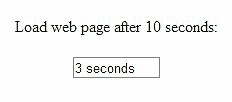

### 源代码

```html
<html xmlns="http://www.w3.org/1999/xhtml" >
<head>
<title>加载页面倒计时</title>
<meta http-equiv="Content-Type"
content="text/html; charset=UTF-8" />
<META HTTP-EQUIV="REFRESH" CONTENT="10;
URL=http://www.amazon.com">

<script language="JavaScript">

timeObject = new Date();

countStart = timeObject.getTime();

function initTimer()

{
  var myTime = new Date();
```

### 1. 计时器

```html
         var currentTime = myTime.getTime(); 

         var diffTime = currentTime - countStart;

         this.diffSeconds = diffTime/1000;      

         return(this.diffSeconds);            

}

  function getSeconds()

{

         var mySeconds0 = initTimer();

         var mySeconds1 = ""+mySeconds0;

         mySeconds1= 10 - eval(

mySeconds1.substring(0,mySeconds1.indexOf(".")))

+ " seconds";

document.myForm.timeElapse.value = mySeconds1;

window.setTimeout('getSeconds()',1000);

}

</script>

</head>

<body  onLoad="window.setTimeout('getSeconds()',1)">

  center><br>

Load web page after 10 seconds:<br><br>

<form name=myForm>

<input size=9 name=timeElapse></form>

</center>

</body>

</html>
```

## 2. 确定要删除吗？

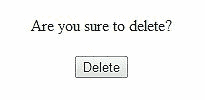

### 源代码

```html
<html xmlns="http://www.w3.org/1999/xhtml" >
<head>
    <title>Confirm Delete</title>
              <meta http-equiv="Content-Type"
              content="text/html; charset=UTF-8" />
    <script language="javascript">
     function delOperation()
    {
       if(confirm("Are you sure to delete?"))
          alert("Already deleted!");
       else
          alert("Cancel deleted!");
    }
    </script>
</head>
<body>
<center>
<br>Are you sure to delete?<br><br>
<input id="deleteButton" type="button"
value="Delete" onClick="delOperation()" />
</center>
</body>
</html>
```

## 3. 滚动文字

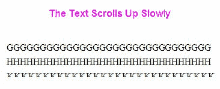

### 源代码

```html
<html xmlns="http://www.w3.org/1999/xhtml" >
<head>
<title>Marquee Text</title>
<meta http-equiv="Content-Type"
content="text/html; charset=UTF-8" />
</head>
<body>
<div align="center">
  <p>&nbsp;</p>
  <p><span>The Text Scrolls Up Slowly
    </span><br><br>
  </p>
</div>
<marquee direction=up scrollamount=1
scrolldelay=100 onmouseover='this.stop()'
onmouseout='this.start()' height=60>
<div align="center">
  <table>
    <tr>
      <td>
        AAAAAAAAAAAAAAAAAAAAAAAAAAAAAAA</td>
    </tr>
    <tr>
      <td>
        BBBBBBBBBBBBBBBBBBBBBBBBBBBBBBBBBB</td>
    </tr>
    <tr>
      <td>
      CCCCCCCCCCCCCCCCCCCCCCCCCCCCCCC</td>
    </tr>
    <tr>
      <td>
        DDDDDDDDDDDDDDDDDDDDDDDDDDDDDDD</td>
    </tr>
    <tr>
      <td> EEEEEEEEEEEEEEEEEEEEEEEEEEEEEEEEEEEEEE</td>
    </tr>
    <tr>
      <td>
     FFFFFFFFFFFFFFFFFFFFFFFFFFFFFFFFFFFFFF</td>
    </tr>
        <td>      GGGGGGGGGGGGGGGGGGGGGGGGGGGGGGG</td>
      </tr>
    <tr>
      <td>
        HHHHHHHHHHHHHHHHHHHHHHHHHHHHHHH</td>
    </tr>
    <tr>
      <td>
      KKKKKKKKKKKKKKKKKKKKKKKKKKKKK</td>
  </table>
</div>
</marquee>
</body>
</html>
```

## 4. 统计字母数量

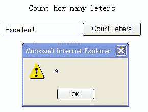

### 源代码

```html
<html xmlns="http://www.w3.org/1999/xhtml" >
<head>
</head>
<body>
<p align="center">&nbsp;</p>
<p align="center">Count how many leters<br>
</p>
<div align="center">
  <script language="JavaScript">
function cal(str)
{
    re=/[a-z & A-Z]/g;   
    if(re.test(str))       
    return str.match(re).length
    else
    return 0
}
</script>
<input onBlur="alert(cal(this.value) )">
<input type="button" value="Count Letters">
</div>
</body>
</body>
</html>
```

## 5. 搜索引擎

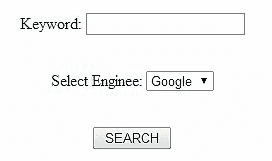

### 源代码

```html
<html xmlns="http://www.w3.org/1999/xhtml" >
<head>
<title>Search Engine</title>
<meta http-equiv="Content-Type"
content="text/html; charset=UTF-8" />
</head>
<body><br><br>
<form Name="myForm">
<div align="center"><center><p>
<script language="JavaScript">
var formVariable;
function makeSearch()
{
document.forms[formVariable +
document.myForm.SearchSelect.
selectedIndex].elements[0].value=
document.myForm.SeachText.value;
document.forms[formVariable+
document.myForm.SearchSelect.selectedIndex].submit();
}
</script>
</p>
    <p><span style="font-size: 12pt">Keyword:</span>
        <input name="SeachText" type="text" size="21"
style=" margin-left: 1px">
    </p>
    <p><br>
        <span style="font-size: 12pt">Select Enginee:</span>
        <select Name="SearchSelect" size="1" >
          <option selected>Yahoo</option>
          <option value="Google">Google</option>
          <option value="Bing">Bing</option>
        </select>
      </p>
    <p><br>
<input type="button" value=" SEARCH "
onClick="makeSearch()">
        <script language="JavaScript">
formVariable=document.forms.length
        </script>
    </p>
</center></div>
</form>
<form action="http://search.yahoo.com/bin/search"
method="get">
<input type="hidden" name="p" value>
</form>
<form action="http://www.google.com/search">
<input type="hidden" name="q" value>
</form>
<form action="http://www.bing.com/search">
<input type="hidden" name="q" value>
</form>
</body>
</html>
```

## 6. 选择标签

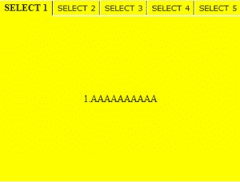

### 源代码

```html
<html xmlns="http://www.w3.org/1999/xhtml" >
<head>
    <title>Select Tag</title>
<meta http-equiv="Content-Type"
content="text/html; charset=UTF-8" />
<style>
.conts{visibility:hidden}
.tab{border-top:solid thin #E0E0E0;
border-right:solid thin gray;
border-left:solid thin #E0E0E0;
font-family:Verdana;
font-size:10pt;
text-align:center;
font-weight:normal}
.selTab{border-left:solid thin white;
border-top:solid thin white;
border-right:solid thin black;
font-weight:bold;
text-align:center}
</style>
<script language="JavaScript">
function public_Labels(label1, label2,
label3, label4, label5)
{
t1.innerText = label1;
t2.innerText = label2;
t3.innerText = label3;
t4.innerText = label4;
t5.innerText = label5;
}
function public_Texts(Texts1,
Texts2, Texts3, Texts4, Texts5){
t1Texts.innerHTML = Texts1;
t2Texts.innerHTML = Texts2;
t3Texts.innerHTML = Texts3;
t4Texts.innerHTML = Texts4;
t5Texts.innerHTML = Texts5;
init();
}
function init(){
tabTexts.innerHTML = t1Texts.innerHTML;
}
var nowTab;
var myTab;
var mark = true;
function altertab(){
if(mark == true){
nowTab = t1;
myTab = t1base;
mark = false;
}
if(window.event.srcElement.className == "tab")
{
nowTab.className = "tab";
myTab.style.backgroundColor = "white";
nowTab = window.event.srcElement;
myTabID = nowTab.id + "base";
tabContentID = nowTab.id + "Texts";
myTab = document.all(myTabID);
tabContent = document.all(tabContentID);
nowTab.className = "selTab";
myTab.style.backgroundColor = "";
tabTexts.innerHTML = tabContent.innerHTML;
}}
</script>
</head>
<body BGCOLOR="white" onclick="altertab()" onLoad="init()">
<br><br>
<table align="center" CELLPADDING="0" CELLSPACING="0"
bgcolor="yellow" STYLE="width:400; height:300">
<tr><td ID="t1" CLASS="selTab" HEIGHT="25">SELECT 1</td>
<td ID="t2" CLASS="tab">SELECT 2</td>
<td ID="t3" CLASS="tab">SELECT 3</td>
<td ID="t4" CLASS="tab">SELECT 4</td>
<td ID="t5" CLASS="tab">SELECT 5</td>
</tr><tr>
<td ID="t1base" STYLE="height:2; background-colro:white">
</td>
<td ID="t2base" STYLE="height:2; background-color:white">
</td>
<td ID="t3base" STYLE="height:2; background-color:white">
</td>
<td ID="t4base" STYLE="height:2; background-color:white">
</td>
<td ID="t5base" STYLE="height:2; background-color:white">
</td>
</tr><tr><td HEIGHT="*" COLSPAN="5" ID="tabTexts"
STYLE="border-left:solid thin white;border-bottom:solid
thin white;border-right:solid thin white">&nbsp;</td>
</tr></table></div><div CLASS="conts" ID="t1Texts">
<p align="center">1.AAAAAAAAAA</p>
</div><div CLASS="conts" ID="t2Texts">
<p align="center">2.BBBBBBBBBB</p>
</div><div CLASS="conts" ID="t3Texts">
<p align="center">3.CCCCCCCCCC </p>
</div><div CLASS="conts" ID="t4Texts">
<p align="center">4.DDDDDDDDDD </p>
</div><div CLASS="conts" ID="t5Texts">
<p align="center">5.EEEEEEEEEE</p>
</div>
</body>
</html>
```

## 7. 时间格式转换

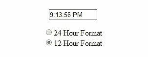

### 源代码

```html
<html xmlns="http://www.w3.org/1999/xhtml" >
<head>
<title>Time Format Conversion</title>
<meta http-equiv="Content-Type" content="text/html;
charset=UTF-8" />
<SCRIPT LANGUAGE="JavaScript">
function timeFormat() {
```

```javascript
if (document.myForm.showFormat[0].checked) {
    return true;
}
return false;
}

function showHours(nowHour) {
    if (timeFormat() || (nowHour > 0 && nowHour < 13)) {
        return (nowHour);
    }
    if (nowHour == 0) {
        return (12);
    }
    return (nowHour-12);
}

function displayZero(timeVal) {
    if (timeVal > 9) {
        return "" + timeVal;
    }
    return "0" + timeVal;
}

function AmPm() {
    if (timeFormat()) {
        return ("");
    }
    if (now.getHours() < 12) {
        return (" AM");
    }
    return (" PM");
}

function displayTime() {
    now = new Date
    document.myForm.showTime.value =
        showHours(now.getHours()) + ":" +
        displayZero(now.getMinutes()) + ":" +
        displayZero(now.getSeconds()) + AmPm()
    setTimeout("displayTime()",1000)
}
```

```html
</script>
</head>
<BODY onLoad="displayTime()">
<center><br><br>
<form name=myForm>
<input type=text name=showTime size=11><p>
<input type=radio name=showFormat>24 小时格式<br>
<input type=radio name=showFormat>12 小时格式<br>
</form>
</center>
</body>
</html>
```

## 8. 统计输入的字数

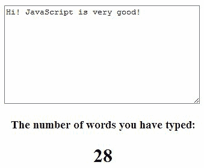

### 源代码

```html
<html xmlns="http://www.w3.org/1999/xhtml" >
<head>
<title>显示字数</title>
<meta http-equiv="Content-Type" content="text/html;charset=UTF-8" />
<script LANGUAGE="JavaScript">
function countWords(myContents)
{
    wordsNum=myContents.value.length;
    displayNum.innerText=wordsNum; }
</script>
</head>
<body><br><br>
<center>
<textarea id=myContents rows=10 colors=38 onKeyUp="countWords(this) " onKeyDown="countWords(this)">
</textarea>
<br><h3>你输入的字数：</h3>
<h1><div id="displayNum"></div></h1>
</center>
</body>
</html>
```

## 9. 禁止复制图片

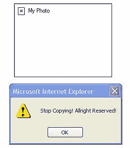

### 源代码

```html
<html xmlns="http://www.w3.org/1999/xhtml" >
<head>
    <title>禁止复制图片</title>
<meta http-equiv="Content-Type" content="text/html;charset=UTF-8" />
    <script language="javascript">
    function stopCopying(control) {
        alert("禁止复制！版权所有！");
        window.close();
    }
    function findPhoto() {
        if(document.images)
        for(i=0;i<document.images.length;i++)
        document.images[i].onmousedown = stopCopying;
    }
    </script>
</head>
<body oncontextmenu="return false" onLoad="findPhoto()">
<br><br>
<div align="center"></div>
</body>
</html>
```

## 10. 检查密码强度

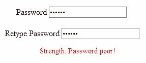

### 源代码

```html
<html>
<head>
<title>密码强度</title>
<meta http-equiv="Content-Type" content="text/html; charset=UTF-8"/>
</head>
<body <br><center>
<form name="myForm">
<label for="pwd1">密码</label>
<input type="Password" name="pwd1" onBlur="valuate(this)" />
<br><br>
<label for="pwd2">重复密码</label>
<input type="password" name="pwd2" />
</form></center>
<center><div id="showStrength"></div></center>
<script type="text/javascript">
function valuate(pwd) {
var t=pwd.value;
var id=getStrength(t);
var message=Array(4);
message[0]="密码太短了！";
message[1]="密码强度弱！";
message[2]="密码强度中等！";
message[3]="密码强度强！";
var myColor=Array(4);
myColor[0]="black";
myColor[1]="red";
myColor[2]="orange";
myColor[3]="green";
var setWidth=300;
var setHeight=15;
var PWD=document.getElementById("showStrength");
PWD.style.fontSize="15px";
PWD.style.color=myColor[id];
PWD.style.width=setWidth+"px";
PWD.style.height=setHeight+"px";
PWD.style.lineHeight=setHeight+"px";
PWD.style.textIndent="0px";
PWD.innerHTML="强度: " + message[id];
function getStrength(p){
if(p.length < 4){
return 0;
}
var level = 0;
if (p.match(/[a-z]/ig)){
level++;
}
if (p.match(/[0-9]/ig)){
level++;
}
if (p.match(/[^a-z0-9]/ig)){
level++;
}
if (p.length < 6 && level > 0){
level--;
}
return level
}
</script>
</body>
</html>
```

## 11. 打开硬盘

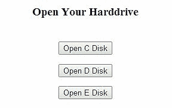

### 源代码

```html
<html xmlns="http://www.w3.org/1999/xhtml" >
<head>
<title>打开硬盘</title>
<meta http-equiv="Content-Type" content="text/html; charset=UTF-8" />
</head>
<body>
<br><center><h3>打开硬盘</h3><br>
<form action="c/">
<input type="submit" value="C"></form>
<form action="d/">
<input type="submit" value="D"></form>
<form action="e/">
<input type="submit" value="E"></form>
</center>
</body>
</html>
```

## 12. 波浪文本

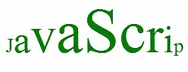


### 源代码

```javascript
<script language="JavaScript">
function makeWave(n) {
    makeWaveText = "JavaScript";
    display = "";
    for (i = 0; i < makeWaveText.length; i++) {
        size = 68*Math.abs(Math.sin((i+n)*34/makeWaveText.length));
        display += "<font style='font-size: "+ size + "pt' color='green'>" + makeWaveText.substring(i,i+1)+</font>";
    }
    textDiv.innerHTML = display;
    if (n > makeWaveText.length) {
        n=0
    } else {
        n++
    }
    setTimeout("makeWave(" + n + ")", 300);
}
</script>
<body onload=makeWave(0);><br>
<div id="textDiv" align="center">
</div>
</body>
```

## 13. 文字广告

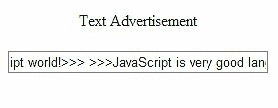

### 源代码

```html
<meta http-equiv="Content-Type" content="text/html;charset=UTF-8" />
<body onLoad="textAd();"><br><br>
<div align="center">文字广告<br><br>
<script language="JavaScript">
var myText=" >>>来到 JavaScript 世界！>>>";
myText+=" >>>JavaScript 是一门非常好的语言！>>>";
var aLetter=50;
function textAd(){
document.forms[0].panel.value=myText.substring(myText.length-aLetter, myText.length);
myText=myText.substring(myText.length-1,myText.length)+myText;
myText=myText.substring(0,myText.length-1);
setTimeout("textAd()",200);
}
</script>
</div>
<form>
  <div align="center">
    <input type="text" name="panel" value="" size="38">
  </div>
</form>
</body>
```

## 14. 网络时钟

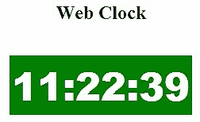

### 源代码

```html
<div align="center"><br>
  <br>
  <h2>网络时钟</h2>
  <br>
</div>
<table bgcolor="green" align=center>
<tr><td><div id="showClock"></div></td></tr>
</table>
<script language="javascript">
function webClock(){
var dataobj=new Date()
var hours=dataobj.getHours()
var minutes=dataobj.getMinutes()
var seconds=dataobj.getSeconds()
if(minutes<=9)
minutes="0"+minutes
if(seconds<=9)
seconds="0"+seconds
Eclock="<font size='7' color='white' face='Arial'>"
+hours+":"+minutes+":"+seconds+"</font>"
showClock.innerHTML=Eclock;
setTimeout("webClock()",1000)
}
webClock();
</script>
```

## 15. 价格是多少？

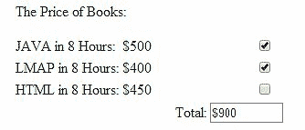

### 源代码

```html
<html>
<body><body>
<meta http-equiv="Content-Type" content="text/html; charset=UTF-8" />
<SCRIPT LANGUAGE="JavaScript">
var sum=0;
function checkPrice(chk){
if (chk.checked == false){
sum -= eval(chk.value);
}
else {
sum += eval(chk.value);
}
document.priceForm.total.value = '$'+ eval(sum);
}
</script>
<br>
<form method="POST" name="priceForm">
<table align=center width=300>
<tr>
<td height=50 colspan=2>书籍价格：</td>
</tr>
<tr>
<td>JAVA 8 小时：&nbsp; $500</td>
<td width=30>
<input type="checkbox" name="b1" value=500 onclick="checkPrice(this);">
</td>
</tr>
<tr>
<td>LMAP 8 小时：$400</td>
<td width=30>
<input type="checkbox" name="b2" value=400 onclick="checkPrice(this);">
</td>
</tr>
<tr>
<td>HTML 8 小时：$450 </td>
<td width=30>
<input type="checkbox" name="b3" value=450 onclick="checkPrice(this);">
</td>
</tr>
<tr>
<td colspan=2 align=right>总计：<input type="text" name="total"></td>
</tr>
</table>
</form>
</body>
</html>
```

```html
<input type="text" name="total" size=8 value='$0'
onFocus="this.blur();">
</td>
</tr>            
</table>
</form>
</body>
</html>
```

## 16. 进度条

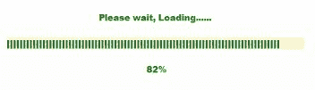

### 源代码

```html
<html>
<meta http-equiv="Content-Type" content="text/html; charset=UTF-8" />
<body>
<br><br>
<form name=loading>
<p align=center> <font color="green" size="2" face="Arial Black">Please wait, Loading......</font>
<br><br>
<input type=text name=progress size=55 style="font-family:Arial Black; font-weight:bolder; color:green; background-color:#fef4d0; padding:0px; border-style:none;">
<br><br>
<input type=text name=percent size=50 style="font-family:Arial Black; color:green; text-align:center; border-width:medium; border-style:none;">
<script language="JavaScript">
var loadingPercent=0 ;            
var mark="||" ;
var sum="||" ;
count() ;                
function count(){
loadingPercent=loadingPercent+2;
sum =sum + mark;
document.loading.progress.value=sum ;       
document.loading.percent.value=loadingPercent+"%";    
if (loadingPercent<99)  {
setTimeout("count()",100);
} 
else {                   
window.location.href = "http://www.amazon.com";
} }
</script>
</p>
</form>
</body>
</html>
```

## 17. 过滤不雅词汇

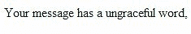

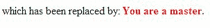

### 源代码

```html
<html>
<head>
<title>Filter Ungraceful Words</title>
<meta http-equiv="Content-Type" content="text/html; charset=UTF-8" />
<script language="javascript">
message=prompt("Filter "fool, idiot, imbecile and moron" words. Please enter your message: ","");
subsitude = /fool|idiot|imbecile|moron/g;
if (message.match(subsitude)){
message=message.replace(subsitude,"master");
message=message.bold().fontcolor("#FF0000");
myText="Your message has a ungraceful word, which has been replaced by: " + message;
}
else{
message=message.bold().fontcolor("#0000FF");
myText="Yor message has no ungraceful word, you said:  " + message;
}
</script>
</head>
<body>
<script language="javascript">
document.write(myText)
</script>
<br>
</body>
</html>
```

## 18. 禁止复制密码

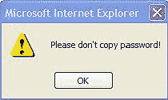

### 源代码

```html
<html>
<head>
<title>Forbid Copy Password</title>
<meta http-equiv="Content-Type" content="text/html; charset=UTF-8" />
<script language="javascript">
function noCopy(pwd){
alert("Please don't copy password!")
with(document.myForm){
if (pwd == "pwd1") {
pwd1.blur()
pwd2.focus()
}
else if(pwd == "pwd2"){
pwd2.blur()
pwd1.focus()
}}}
</script>
</head>
<body>
<form name="myForm">
<p><br>
Password:
<input type="password" name="pwd1" onSelect="noCopy(this.name)">
</p>
<p>Retype Password:
<input type="password" name="pwd2" onSelect="noCopy(this.name)">
</p>
<br>
</form>
</body>
</html>
```

## 19. 世界时钟

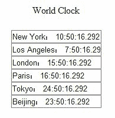

### 源代码

```html
<html>
<head>
<title>
The Time of Cities in the World
</title>
<meta http-equiv="Content-Type" content="text/html; charset=UTF-8" />
<script language="javascript">
var t
function wordTime(){
t=0
nowDate= new Date()
worldClock("New York",-5)
worldClock("Los Angeles",-8)
worldClock("London",0)
worldClock("Paris",1)
worldClock("Tokyo",9)
worldClock("Beijing",8)
setTimeout("wordTime()",1000)
}
function worldClock(city,diffTime){
UTCh= nowDate.getUTCHours()
UTCm= nowDate.getUTCMinutes()
UTCs= nowDate.getUTCSeconds()
UTCms= nowDate.getUTCMilliseconds()
with(document){
forms[0][t].value=city + "：　" + (UTCh+diffTime) + ":" + (UTCm) + ":" + (UTCs) + "." + (UTCms)
t++
}
}
</script>
</head>
<body onLoad="wordTime()">
<center>
<br><br>World Clock<br><br>
<form name="myForm">
<table align="center">
<tr><td>
<input type="text"><br><input type="text"><br><input type="text"><br>
<input type="text"><br><input type="text"><br><input type="text"><br>
</tr>
</table>
</form>
</center>
</body>
</html>
```

## 20. 将代码加密为数字

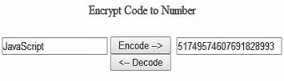

### 源代码

```html
<html>
<head>
<title>Encrypt Code to Number</title>
<meta http-equiv="Content-Type" content="text/html; charset=UTF-8" />
</head>
<SCRIPT LANGUAGE="JavaScript">
var strInput;
var strOutput = "";
var numInput;
var numOutput = "";
var txt = "Please enter data!";
function StrToNum(form) {
numOutput = "";
if(form.input.value == "") alert(txt);
else {
strInput = escape(form.input.value);
for(i = 0; i < strInput.length; i++) {
numOutput += strInput.charCodeAt(i) - 23;
}
form.output.value = numOutput;
form.input.value = "";
}
}
function NumToStr(form) {
strOutput = "";
if(form.output.value == "") alert(e)
else {
numOutput = form.output.value; 
for(i = 0; i < numOutput.length; i += 2) {
numInput = parseInt(numOutput.substr(i,[2])) + 23;
numInput = unescape('%' + numInput.toString(16));
strOutput += numInput;
}
form.input.value = unescape(strOutput);
form.output.value = "";
}
}
</script>
<body>
<br>
<div align="center">Encrypt Code to Number
</div>
<center>
<form>
<table>
<tr>
<td align=center>
<input name=input type=text size=20 value="JavaScript">
</td>
<td align=center>
<br>
<input type=button value=" Encode --> " onClick="javascript:StrToNum(this.form)">
<br>
<input type=button value=" <-- Decode " onClick="javascript:NumToStr(this.form)">
<br>
</td>
<td align=center>
<input name=output type=text size=20 value="51749574607691828993">
</td>
</tr>
</table>
</form>
</center>
</body>
</html>
```

## 21. 禁止复制文本

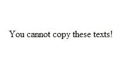

### 源代码

```html
<html xmlns="http://www.w3.org/1999/xhtml">
<head>
<meta http-equiv="Content-Type" content="text/html; charset=UTF-8" />
<title>Cannot Copy</title>
</head>
<body oncontextmenu="return false" ondragstart="return false" onselectstart="return false">
You are not able to copy these texts!
</body>
</html>
```

## 22. 检查电子邮件格式

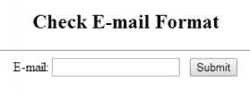

### 源代码

```html
<!DOCTYPE html PUBLIC "-//W3C//DTD XHTML 1.0 Transitional//EN"
"http://www.w3.org/TR/xhtml1/DTD/xhtml1-transitional.dtd">
<html>
<head>
<title>Check Email Format</title>
<meta http-equiv="Content-Type" content="text/html; charset=UTF-8" />
<script type="text/javascript">
function checkemail( ){
if(document.myForm.email.value.length!=0){
if(document.myForm.email.value.charAt(0)=="."||
   document.myForm.email.value.charAt(0)=="@"||
   document.myForm.email.value.indexOf('@',0)==-1||
  document.myForm.email.value.indexOf('.',0)==-1||
          document.myForm.email.value.lastIndexOf('@')==document.myForm.email.value.length-1||
        document.myForm.email.value.lastIndexOf('.')==document.myForm.email.value.length-1 ) {
alert("E-mail format wrong!");
document.myForm.email.focus();
return false;
}
else {
alert("Email Format Correct!");}
}
else{
alert("Email cannot be empty!");
document.myForm.email.focus();
return false;
}
return false;
}
</script>
</head>
<body>
<center>
  <h2>Check E-mail Format </h2>
  <hr>
</center>
<form name="myForm" method="POST" action onSubmit="return checkemail()">
  <div align="center">E-mail:
    <input type="text" name="email" id="email" size="20">
    &nbsp;
    <input type="submit" value="Submit" >
  </div>
</form>
</body>
</html>
```

## 23. 仅提交一次

防止重复提交。

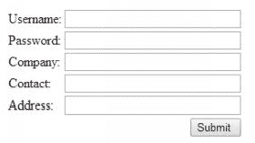

### 源代码

```html
<script type="text/JavaScript">
function MM_popupMsg(message) {
  alert(message);
}
</script>
<body>
<p>&nbsp;</p>
<form>
  <p align=center>&nbsp;</p>
<table width="200" align="center">
  <tr>
    <td>Username:</td>
    <td><input type=text name=username size=30></td>
  </tr>
  <tr>
    <td>Password: </td>
    <td><input type=password name=pwd size=30></td>
  </tr>
  <tr>
    <td>Company: </td>
    <td><input type=text name=danwei size=30></td>
  </tr>
  <tr>
    <td>Contact: </td>
    <td><input type=text name=lianxi size=30></td>
  </tr>
  <tr>
    <td>Address: </td>
    <td><input type=text name=dizhi size=30></td>
  </tr>
</table>
</form>
</body>
```

## 32. 禁用部分脚本

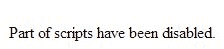

（未提供源代码）

### 禁用部分脚本

```html
<!DOCTYPE html PUBLIC "-//W3C//DTD XHTML 1.0 Transitional//EN"
"http://www.w3.org/TR/xhtml1/DTD/xhtml1-transitional.dtd">
<html xmlns="http://www.w3.org/1999/xhtml">
<head>
<title>禁用部分脚本</title>
<meta http-equiv="Content-Type" content="text/html; charset=UTF-8" />
</head>
<body>
<div align="center">
  <p>&nbsp;</p>
  <p>&nbsp;</p>
  <p>部分脚本已禁用。
    <noscript>
    <script LANGUAGE="JavaScript">
   alert("您无法看到此消息！");
    </script>
    </noscript>
      </p>
</div>
</body>
</html>
```

## 33. 限制错误密码

用户名：Smith   密码：123

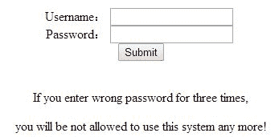

### 源代码

```html
<script language="JavaScript">
numberTimes=0
function checkpassword(){
if (numberTimes== 3){
              alert("您已输入错误密码三次，您不能再使用此系统了！")
              window.close();
}else{
if((document.myForm.username.value == "Smith")&&(document.myForm.myPassword.value == "123")){
                              alert("密码正确！")
                              window.location="http://www.amazon.com";
            }else{
                              numberTimes=numberTimes+1
                              alert("密码错误，请重试！")
                              return false
              }
}
}
</script>
</head>
<meta http-equiv="Content-Type" content="text/html; charset=UTF-8" />
<body>
<br>
<form name="myForm" method="post">
  <div align="center"><p>&nbsp;</p><br>
用户名：
<input name="username" type="text"><br>
密码：
<input name="myPassword" type="password"><br>
<input type="button" name="submit" value="提交" onClick="checkpassword();">
  </p>
<br>
    <p>如果您输入错误密码三次，</p>
    <p>您将不再允许继续使用此系统！</p>
  </div>
</form>
</body>
```

## 34. 文字处理

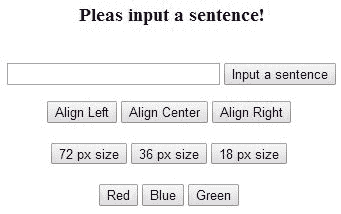

### 源代码

```html
<html xmlns="http://www.w3.org/1999/xhtml">
<head>
<title>文字处理</title>
<meta http-equiv="content-type" content="text/html; charset=UTF-8" />
</head>
<body><br>
<h1 id="myHeading" align="center" style="font-size: larger;">请输入一个句子！</h1>
<form name="myForm" id="myForm" action="#" method="get">
  <p align="center"><br />
    <input type="text" name="myText" id="myText" size="30" />
    <input type="button" value="输入句子"
onclick="document.getElementById('myHeading').textContent=document.myForm.myText.value;document.getElementById('myHeading').innerText=document.myForm.myText.value;" /></p>
  <p align="center">
    <input type="button" value="左对齐"
onclick="document.getElementById('myHeading').align='left';" />
    <input type="button" value="居中对齐"
onclick="document.getElementById('myHeading').align='center';" />
    <input type="button" value="右对齐"
onclick="document.getElementById('myHeading').align='right';" /><br /><br />
    <input type="button" name="Submit" value="72 px 字体" onClick="document.getElementById('myHeading').style.fontSize='72'+'px';">
    <input type="button" value="36 px 字体"
onclick="document.getElementById('myHeading').style.fontSize='36'+'px';" />
    <input type="button" value="18 px 字体"
onclick="document.getElementById('myHeading').style.fontSize='18'+'px';" /><br /><br />
    <input type="button" value="红色"
onclick="document.getElementById('myHeading').style.color='red';" />
    <input type="button" value="蓝色"
onclick="document.getElementById('myHeading').style.color='blue';" />
    <input type="button" value="绿色"
onclick="document.getElementById('myHeading').style.color='green';" /> <br /></p>
</form>
</body>
</html>
```

## 35. 按时间问候

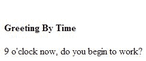

### 源代码

```html
<html><head>
<title>按时间问候</title></head>
<body><p>&nbsp;</p><p>&nbsp;</p><p>&nbsp;</p>
<strong>按时间问候</strong><br><br>
<script language="JavaScript">
var now=new Date()
var hr
hr=now.getHours()
if (hr==0) {document.write("现在是午夜 12 点，晚上安！明天早点起！")}
if (hr==1) {document.write("现在是凌晨 1 点，睡觉时间了。")}
if (hr==2) {document.write("凌晨 2 点！你还没睡！")}
if (hr==3) {document.write("凌晨 3 点！你还在熬夜！")}
if (hr==4) {document.write("凌晨 4 点！熬了一整晚还是早起了？")}
if (hr==5) {document.write("早上 5 点！你起这么早在干什么呢？")}
if (hr==6) {document.write("早上 6 点！你准备吃早餐了吗？")}
if (hr==7) {document.write("早上 7 点！你想去上学还是去上班？")}
if (hr==8) {document.write("早上 8 点，你吃完早餐去上班了吗？")}
if (hr==9) {document.write("上午 9 点，你开始工作了吗？")}
if (hr==10) {document.write("上午 10 点，忙吗？")}
if (hr==11) {document.write("上午 11 点！午饭时间了。")}
if (hr==12) {document.write("中午 12 点！午饭时间了！")}
if (hr==13) {document.write("下午 1 点！你想休息一下吗？")}
if (hr==14) {document.write("下午 2 点！你在忙吗？")}
if (hr==15) {document.write("下午 3 点！你有这么多工作要做？")}
if (hr==16) {document.write("下午 4 点！看起来你很累了！")}
if (hr==17) {document.write("下午 5 点！下班了！")}
if (hr==18) {document.write("晚上 6 点！下班后回家了吗！")}
if (hr==19) {document.write("晚上 7 点！晚饭时间！")}
if (hr==20) {document.write("晚上 8 点！上网时间？")}
if (hr==21) {document.write("晚上 9 点！看电视时间！")}
if (hr==22) {document.write("晚上 10 点！你还在在线吗？")}
if (hr==23) {document.write("晚上 11 点！你累了！")} 
</script></body></html>
```

## 36. 闪烁文字


### 源代码

```html
<html>
<head>
<title>闪烁文字</title>
</head>
<meta http-equiv="Content-Type" content="text/html; charset=UTF-8" />
<body>
<br>
<br>
<script language="JavaScript">
function colorArray() {
this.length = colorArray.arguments.length;
for (var i = 0; i < this.length; i++) {
this[i] = colorArray.arguments[i];   }
}
var twinkleText = "<h1>看！我在闪烁！</h1>";
var count = 0;
var color = new colorArray("#000000", "#FFCC33", "#0000FF","#33ffff","#CC6666","#6699FF");
document.write('<div id="text"><center>'+twinkleText+'</center></div>');
function updateColor(){
document.all.text.style.color = color[count];
(count < color.length-1) ? count++ : count = 0;  }
setInterval("updateColor()",200);
</script>
</body>
</html>
```

## 37. 登录页面

用户名：Smith   密码：123


### 源代码

```html
<html><head>
<title>登录：用户名，密码</title>
</head>
<meta http-equiv="Content-Type" content="text/html; charset=UTF-8" />
<body>
<br><br><center><br><br>
<script language=JavaScript>
function checking(){
if(document.myForm.username.value=""||document.myForm.passwrd.value=="")
{window.alert("请输入用户名和密码。");document.myForm.username.focus();}
else{
if(document.myForm.username.value=="Smith"&&document.myForm.passwrd.value=="123"){
      window.alert("登录成功，欢迎，"+document.myForm.username.value+" !")
location.href="http://www.google.com"; }
else{  window.alert("抱歉，密码错误！")  }}
} }
</script>
<form name="myForm">
<table border=2 cellpadding=5 cellspacing=0 >
  <tr><td colspan=2 align=center>
     <font size=3 color=#993366><b>输入您的信息</b></font>
  </td></tr>
  <tr><td>
     <font size=3 color=#993366><b>用户名：</b></font></td>
     <td><input type="text" name="username" value="" size=10>
  </td></tr>
  <tr><td>
```

```html
<font size=3 color=#993366><b>密码：</b></font></td>
     <td><input type="password" name="passwrd" value="" size=10>
  </td></tr>
  <tr><td colspan=2 align=center>
<input type="button" name="btn" value=" 登录 " onClick="checking();return false;">
  </td></tr>
</table>
</form>
</center></body></html>
```

## 38. 设计窗口大小

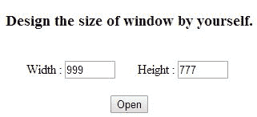

### 源代码

```html
<html>
<head>
<title>设计窗口大小</title>
<meta http-equiv="Content-Type" content="text/html; charset=UTF-8">
</head>
<body><br>
<h3 align="center">自行设计窗口大小。</h3> <br>
<script language=JavaScript>
function designWindow() {
window.open("http://www.google.com", '', 'toolbar=no, location=no, directories=no, menubar=no, scrollbars=no, resizable=no, width=' + document.windowSize.width.value + ',height=' + document.windowSize.height.value +'');
}
</script>
<form name="windowSize">
<div align="center">宽度：
<input type="text" name="width" value=999 size=5 maxlength=3>
&nbsp;&nbsp;&nbsp;&nbsp;&nbsp; 高度：
<input type="text" name="height" value=777 size=5 maxlength=3><br><br>
<input type="button" value="打开" onClick="designWindow()" >
</div>
</form>
</body>
</html>
```

## 39. 查看源代码

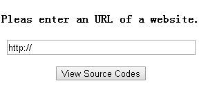

### 源代码

```html
<html>
<head>
<title>查看源代码</title>
</head>
<body>
<br><br>
<h4 align="center">请输入网站的 URL。 </h4>
<script language=JavaScript>
function view(){
var sourceCodes=document.forms[0].URL.value
window.location="view-source:"+sourceCodes;
}
</script>
<form>
<div align="center">
<input type="text" name="URL" value="http://" size=40 >
</div>
</form>
<form>
<div align="center">
<input type="button" value="查看源代码" onClick=view()>
</div>
</form>
</body>
</html>
```

## 40. 检查数字输入

防止非数字输入。

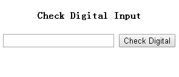

### 源代码

```html
<script language="javascript">
function checkDigitals()
{
if(isNaN(myForm.num.value)){
              alert("请输入数字!");
              myForm.num.focus();
              myForm.num.value=""
               return (false);
}
else
{
              alert("输入正确!");
}
}
</script>
<body>
<br>
<h4>
<div align="center">检查数字输入
</div></h4>
<form name=myForm>
  <div align="center">
     <input type=text name=num size=25>
     <input type=button onClick="checkDigitals()" value= "检查数字">
    </div>
</form>
</body>
```

## 41. 检查空输入

防止无输入。

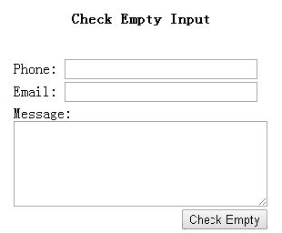

### 源代码

```html
<html>
<head>
<title>检查空输入</title>
<script language="JavaScript">
function checkEmpty(myForm)
{
if (myForm.phone.value == "")      
{
alert("请输入电话号码!");
myForm.email.focus();
return (false);
}
if (myForm.email.value == "")
{
alert("请输入邮箱地址!");
myForm.message.focus();
return (false);
}
if (myForm.message.value == "")
{
alert("请留言!");
myForm.phone.focus();
return (false);
}
}
</script>
</head>
<body>
<br>
<center>
  <p><strong>检查空输入</strong></p>
  <br>
</center>
<form name="myForm" method="post" onSubmit="javascript:return checkEmpty(this);">
<table width="36" border="0" cellspacing="1" cellpadding="1" align="center">
<tr>
<td>电话：
    <input type=text name=phone size=30>
</tr>
<tr>
<td>邮箱：
    <input type="text" name=email size="30">
</tr>
<tr>
<td>消息：<br>
    <textarea name=message cols=37 rows=6></textarea>
</tr>
<tr>
<td>
<div align="right">
    <input type="submit" name="pub" value="检查">
</div>
</td>
</tr>
</table>
</form>
</body>
```

## 42. 图片上传

防止非图片上传


### 源代码

```html
<html>
<script language=JavaScript>
function uploadPicture(){
    myForm.myPicture.src=myForm.pic.value;
          var checkFile;
         checkFile=myForm.pic.value.substring(myForm.pic.value.lastIndexOf(".")+1,myForm.pic.length); 
         checkFile=checkFile.toUpperCase();
       switch(checkFile){
            case "GIF":
              alert("正在上传 GIF 图片，好的!");
             break;
            case "JPG":
               alert("正在上传 JPG 图片，好的!");
             break;
            case "BMP":
               alert("正在上传 BMP 图片，好的!");
            break;
           case "PNG":
               alert("正在上传 PNG 图片，好的!");
            break;
           default:
               alert("错误！只允许上传 gif, jpg, bmp, png 图片!")
            break;
          }}
</script>
<title>检查图片上传</title>
<meta http-equiv="Content-Type" content="text/html; charset=UTF-8">
<body>
<br>
<p align="center" >只允许上传 gif, jpg, bmp, png 图片! </p>
<form name="myForm" id=myForm>
<p align=center>
    <input name=pic type="file">
</p>
<p align="center">
    <input type="button" value="上传" onClick="uploadPicture()">
</p>

</form>
</body>
</html>
```

## 43. 坐标


### 源代码

```html
<html>
<script language="JavaScript">
if (navigator.appName == 'Netscape'){
    document.captureEvents(Event);
    document.onmousemove = mousePosition;
}
function mousePosition(e) {
myForm.x.value = e.screenX;
myForm.y.value = e.screenY;
}
</script>
<meta http-equiv="Content-Type" content="text/html; charset=UTF-8" />
<body onMousemove="cursorCoordinates()">
<div align="center"><p>&nbsp;</p></div>
<form name="myForm">
  <div align="center">
    X: <input type="text" name="x" size="3">
    y: <input type="text" name="y" size="3">
  </div>
</form>
</body></html>
```

## 44. 防止恶意输入


### 源代码

```html
<html>
<head>
<title>防止恶意输入</title>
<meta http-equiv="content-type" content="text/html; charset=utf-8">
<script type="text/JavaScript">
function digital(field, event)
{
  var key, keyChar;
  if (window.event)  key = window.event.keyCode; 
  else if (event)  key = event.which;
  else  return true;
if (key == null || key == 0 || key == 8 || key == 13 || key == 27)
     return true;
  keyChar =  String.fromCharCode(key);
  if (/\d/.test(keyChar)) {           
            window.status = "";
            return true;
  }
  else {
      window.status = "只允许数字输入!";
     return false;
   }
}}
</script>
</head>
<body>
<br>
<center>
<h2>防止恶意输入 </h2>
</center>
<div align="center">
  <p> 不允许任何字母或符号输入!  </p>
</div>
<form name="myForm" id="myForm" action="#" method="get">
  <div align="center">只允许数字输入:
  <input type="text" name="num" id="num"
size="10" maxlength="10"
      onkeypress="return digital(this, event);"
title="防止恶意输入">
  </div>
</form>
</body>
</html>
```

## 45. 打字效果

单词将逐字自动显示


### 源代码

```html
<html>
<head>
<title>打字效果</title>
<meta http-equiv="Content-Type" content="text/html; charset=UTF-8" />
<script>
var i = 0
var displayWords= "Hi!" +
```

```javascript
"《8 小时学会 JavaScript》是一本非常好的书！" + "通过这本书你可以学到很多技能，如果你对编程感兴趣，你也可以学习《8 小时精通 jQuery》、《8 小时精通 AngularJS》，这可以帮助你成为一名优秀的程序员。但你需要花费许多时间来学习所有这些程序，以便你可以在工作中轻松地使用它们..."

function marquee() {
    var wordSize= displayWords.length
    document.show.typingEffect.value= document.show.typingEffect.value + displayWords.charAt(i)
    i++
    var timeID= setTimeout("marquee()",100)
    if (i >= wordSize) {
        clearTimeout(timeID); 
        i=0
    }
}
```

## 46. 设置背景颜色

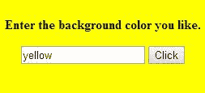

### 源代码

```html
<html>
<head>
  <title>Choose backgroun color</title>
  <script language="JavaScript">
    function chooseColor(form) {
      if (form.color.value == "")
        alert("Please enter the background color you like")
      else {
        document.bgColor=(""+form.color.value+"");
      }
    }
  </script>
  <meta http-equiv="Content-Type" content="text/html; charset=UTF-8" />
</head>
<body>
  <div align="center">
    <p>&nbsp;</p>
    <p> Enter the background color you like.</p>
    <br>
  </div>
  <form>
    <div align="center">
      <input type="text" name="color">
      <input type="button" name="btn" value="Click" onClick="chooseColor(this.form)">
    </div>
  </form>
</body>
</html>
```

## 47. 选择菜单

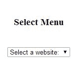

### 源代码

```html
<html>
<head>
  <meta http-equiv="Content-Type" content="text/html;charset=utf-8">
  <title>select menu</title>
</head>
<body>
  <br><center>
    <script type="text/javascript">
      function toWebsite(menu) {
        var myChoice = menu.selectedIndex;
        if (myChoice!= 0) {
          window.location = menu.options[myChoice].value;
        }
      }
    </script>
    <form name="myForm" id="myForm" method="post">
      <h3>Select Menu</h3><br>
      <select name="sites" id="sites" onChange="toWebsite(this);">
        <option value="" selected="seclected">Select a website:</option>
        <option value="http://www.amazon.com">Amazon</option>
        <option value="http://www.google.com">Google</option>
        <option value="http://www.yahoo.com">Yahoo</option>
        <option value="http://www.apple.com">Apple</option>
      </select>
    </form>
  </center>
</body>
</html>
```

## 48. 文字向上滚动

整个文本缓慢向上滑动

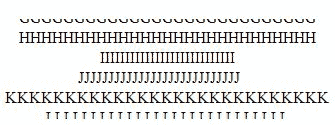

### 源代码

```html
<html>
<head>
  <title>Text scroll up</title>
  <meta http-equiv="Content-Type" content="text/html; charset=UTF-8" />
</head>
<body>
  <br><br><br>
  <center>
    <div id="textSlideUp" style="width:100%;height:100px;overflow:hidden" onMouseOver="slideAmount=0" onmouseout="slideAmount=1">
      AAAAAAAAAAAAAAAAAAAAAAAAAA<br/>
      BBBBBBBBBBBBBBBBBBBBBBBBBB<br/>
      CCCCCCCCCCCCCCCCCCCCCCCCCC<br/>
      DDDDDDDDDDDDDDDDDDDDDDDDDD<br/>
      EEEEEEEEEEEEEEEEEEEEEEEEEEE<br/>
      FFFFFFFFFFFFFFFFFFFFFFFFFFF<br/>
      GGGGGGGGGGGGGGGGGGGGGGGGGGG<br/>
      HHHHHHHHHHHHHHHHHHHHHHHHHHH<br/>
      IIIIIIIIIIIIIIIIIIIIIIIIIII<br/>
      JJJJJJJJJJJJJJJJJJJJJJJJJJJ<br/>
      KKKKKKKKKKKKKKKKKKKKKKKKKKK<br/>
      LLLLLLLLLLLLLLLLLLLLLLLLLLL<br/>
      MMMMMMMMMMMMMMMMMMMMMMMMMMM<br/>
      NNNNNNNNNNNNNNNNNNNNNNNN<br/>
    </div>
  </center>
  <script language="javascript">
    var slideUp = document.getElementById("textSlideUp");
    var lineHigh = 42;
    var lineNumber = 7;
    var slideAmount = 1;
    function move() {
      slideUp.scrollTop += slideAmount;
      if (slideUp.scrollTop == lineNumber * lineHigh) {
        slideUp.scrollTop = 0;
        if (slideUp.scrollTop % lineHigh == 0) {
          window.setTimeout("move()", 5);
        } else {
          window.setTimeout("move()", 60);
        }
    }
    slideUp.innerHTML += slideUp.innerHTML;
    window.setTimeout("move()",1000);
  </script>
</body>
</html>
```

## 49. 文字放大

鼠标悬停时文字放大 200%

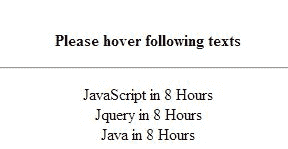

### 源代码

```html
<!DOCTYPE html PUBLIC "-//W3C//DTD HTML 1.0 Transitional//EN" "http://www.w3.org/TR/html1/transitional.dtd">
<html xmlns="http://www.w3.org/1999/xhtml">
<head>
  <title>Magnify texts</title>
  <meta http-equiv="Content-Type" content="text/html; charset=UTF-8" />
</head>
<body>
  <p align="center">&nbsp;</p>
  <p align="center"><strong>following texts</strong></p>
  <p><hr></p>
  <p align="center" onMouseOver="this.style='200%'" onMouseOut="this.style='normal'">
    JavaScript in 8 Hours<br>
    jQuery in 8 Hours<br>
    Java in 8 Hours<br>
  </p>
</body>
</html>
```

## 50. 五星评价


### 源代码

```html
<html xmlns="http://www.w3.org/1999/xhtml">
<head>
  <title>Five star review</title>
  <meta http-equiv="Content-Type" content="text/html; charset=UTF-8" />
</head>
<body>
  <br><br><br>
  <div align="center">Please give a star review: <br><br></div>
  <table width="200" border="0" align="center">
    <tr>
      <td><center>
        <script>
          var starNumber=0;
          function stars() {
            starNumber=event.target.id.slice(-1);
            for (var i=1;i<=5;i++) {
              document.write('<span id="'+i+'" onclick="stars()" style="cursor:hand;">☆</span>');
            }
          }
          function rating() {
            alert("Your review is: "+starNumber+" stars. Thank you!");
          }
          for (var j=1;j<=starNumber;j++) {
            document.write('<button onclick="rating()">Review</button>');
          }
        </script>
      </center></td>
    </tr>
  </table>
</body>
</html>
```

# 附录

## JavaScript 100 道测试与答案

### 100 道测试

**1.** 下面哪个标签用于 JavaScript？

1. `<?……?>`
2. `<JavaScript…>…..</JavaScript>`
3. `<script Language=”JavaScript”>……`
4. `<script type “text/JavaScript”>……</script>`

**2.** 关于 JavaScript 注释，哪个正确？

1. `//` 用于多行注释
2. `/* */` 用于单行注释
3. `//` 和 `/* */` 都可以用于单行或多行注释。
4. `//` 用于单行注释，`/* */` 用于多行注释。

**3.** 下面哪个是不正确的？

1. `a += b` 意味着 `a = (a + b)`
2. `a != b` 意味着 `a = (a ! b)`
3. `a *= b` 意味着 `a = (a * b)`
4. `a %= b` 意味着 `a = (a % b)`

**4.** 下面哪个变量名是无效的？

1. `10var`
2. `varName`
3. `my_var`
4. `var10`

**5.** 下面哪个运算符描述不正确？

1. `+` 用于加法
2. `–` 用于减法
3. `*` 用于乘法
4. `%` 用于除法

**6.** 下面哪个命令不是显示文本的？

A. `alert()`
B. `document.write()`
C. `console.writeline()`
E. `document.getElementById().innerHTML`

**7.** 下面哪个可以作为变量名？

1. `nonVir`
2. `var`
3. `float`
4. `try`

**8.** 下面哪个数据类型描述不正确？

A. `boolean` 返回 true 或 false。
B. `integer` 是一个整数。
C. `string` 是字符字符串中的字符。
D. `number` 是整数或浮点数。

**9.** 下面哪个转义序列描述不正确？

A. `\b` 用于 `backslash`（反斜杠）。
B. `\n` 用于 `newline`（换行）。
C. `\r` 用于 `return`（回车）。
D. `\t` 用于 `tap`（制表符）。

**10.** 以下代码中哪一行是不正确的？

```javascript
function firstFunction( ){
  var num = 100; // line 1
  secondFunction( ); //line 2
}
function secondFunction( ){line3
  document.write( num ); // line4
}
firstFunction();
```

1. line1
2. line2
3. line3
4. line4

**11.** 下面哪个是正确的命令？

1. `if ( ) { } else { }`
2. `if ( ) then { } else { }`
3. `if ( ) then { } then else { }`
4. `if ( ) then { } if else { }`

**12.** 下面哪个不是 JS 中的比较运算符？

A. `==`
B. `<=`

### JavaScript 多选题

#### Question 13

以下哪**不是** JS 中的逻辑运算符？

A. `$$`
B. `&&`
C. `||`
D. `!`

#### Question 14

以下代码中哪一行是不正确的？

```javascript
var a = 10;   // line 1
var b = 3;     // line 2
var num = (a % b = 0) ? "EVEN" : "ODD";   //  line 3
alert ( num );   //  line 4
```

1. `line1`
2. `line2`
3. `line3`
4. `line4`

#### Question 15

以下代码中哪一行是不正确的？

```javascript
var name = null;   // line1
name = prompt ("Please Input Your Name", " " );  // line2
if ( name == " " )  //line3
document.write( "Hello" + name );   // line4
```

1. `line1`
2. `line2`
3. `line3`
4. `line4`

#### Question 16

以下代码的输出是什么？

```javascript
var num = 2;
switch (num){
case 1: document.write("A");
case 2: document.write("B");
case 3: document.write("C");
default:  document.write("D");
}
```

1. A
2. B
3. BC
4. BCD

#### Question 17

以下代码的输出是什么？

```javascript
var teststring = ("JavaScript " == "Javascript");
alert( teststring);
```

A. true
B. false
C. 1
D. -1

#### Question 18

以下代码的结果是什么？

```javascript
var x = 0, y = 50;
while ( x < 10) {
y--;
x++;
}
alert ( "x is: " + x + "   and y is: " + y);
```

1. `x` 是 10 `y` 是 40
2. `x` 是 11 `y` 是 41
3. `x` 是 12 `y` 是 42
4. `x` 是 13 `y` 是 43

#### Question 19

以下代码的输出是什么？

```javascript
var x = 0, y = 50;
do {
y--;
x++;
} while ( x < 10)
alert ( "x is: " + x + "  and y is: " + y);
```

1. `x` 是 13 `y` 是 43
2. `x` 是 12 `y` 是 42
3. `x` 是 11 `y` 是 41
4. `x` 是 10 `y` 是 40

#### Question 20

以下代码的输出是什么？

```javascript
for (var num = 1; num < 10; num ++) {
document.write ( num + " " );
if (num % 5 == 0)
break;
}
```

1. 1 2
2. 1 2 3
3. 1 2 3 4
4. 1 2 3 4 5

#### Question 21

以下代码的输出是什么？

```javascript
for (var num = 1; num < 7; num++) {
if (num == 5)
continue;
document.write ( num + " " );
}
```

1. 1 2 3 4 5
2. 1 2 3 4 6
3. 1 2 3 4 7
4. 1 2 3 4 8

#### Question 22

创建数组时哪项是正确的？

1. `var a = new Array { “A”, “B”, “C” };`
2. `var a = new Array ( “A”, “B”, “C” );`
3. `var a = new Array [ “A”, “B”, “C” ];`
4. `var a = new Array < “A”, “B”, “C” >;`

#### Question 23

以下代码中哪一行是不正确的？

```javascript
var a = new Array( ); // line1
a[0] = "A";   // line2
a[1] = "B";
var arraySize = a.length( );  // line3
alert ( arraySize );  //line4
```

1. `line1`
2. `line2`
3. `line3`
4. `line4`

#### Question 24

以下代码中哪一行是不正确的？

```javascript
var a = new Array( 1, 2, 3 );  // line 1
alert (a[1]);   // line 2
alert (a[2]);   // line3
alert (a[3]);   // line 4
```

1. `line1`
2. `line2`
3. `line3`
4. `line4`

#### Question 25

以下代码的输出是什么？

```javascript
var a = new Array( );
a[0] = "A";
a[1] = "B";
a[2] = "C";
alert (a.join( " - " ));
```

1. A  B  C
2. A, B, C
3. A - B - C
4. “A”, “B”, “C”

#### Question 26

以下哪个语句是正确的？

`Array.slice(var m, var n);`

1. 返回从 m 到 n 的元素。
2. 返回从 m-1 到 n-1 的元素。
3. 返回从 m-1 到 n 的元素。
4. 返回从 m 到 n-1 的元素。

#### Question 27

如果 `getMonth()` 返回 11，意味着什么？

1. 九月
2. 十月
3. 十一月
4. 十二月

#### Question 28

要获取格林威治标准时间，请使用 ___。

1. `toGMTString()`
2. `getUTCHours()`
3. `getTimeZoneOffset()`
4. `getTime()`

#### Question 29

`window.settimeout( “myFunction( )”,10000 )` 的意思是？

1. 每 10000 秒调用一次 `myFunction`。
2. 每 1000 秒调用一次 `myFunction`。
3. 每 100 秒调用一次 `myFunction`。
4. 每 10 秒调用一次 `myFunction`。

#### Question 30

以下哪个函数是不正确的？

1. `setDate()`
2. `setMonth()`
3. `setYear()`
4. `setHour()`

#### Question 31

`3 > 5 && false` 返回？

1. true
2. false
3. 1
4. -1

#### Question 32

Math 方法的以下哪个描述是不正确的？

1. `ceil()` 返回一个大于等于参数的整数。
2. `log()` 返回数字的对数。
3. `sqrt()` 返回数字的平方根。
4. `floor()` 返回最接近的整数。

#### Question 33

`math.ceil (7.5 )` & `math.floor (7.5)` 的结果是什么？

1. 7 8
2. 7 7
3. 8 8
4. 8 7

#### Question 34

`math.ceil(-7.5)` & `math.floor ( -7.5)` 的结果是什么？

1. -7 -8
2. -7 -7
3. -8 -8
4. -8 -7

#### Question 35

`math.round (7.5 )` & `math.round (-7.5)` 的结果是什么？

1. 8 -8
2. 8 -7
3. 7 -8
4. 7 -7

#### Question 36

`math.max(-5, -4)` 和 `math.min(-5, -4)` 的结果是？

1. -5 -4
2. -5 -5
3. -4 -5
4. -4 -4

#### Question 37

以下代码的输出是什么？

```javascript
var str1 = " ";
var str2 = null;
if (str1 != str2) {
alert(str1.length);
}
```

1. 0
2. 1
3. null
4. error

#### Question 38

以下代码的输出是什么？

```javascript
var str = "JavaScript is very good!";
var ch = str.charAt(3);
alert( ch );
```

1. v
2. a
3. S
4. error

#### Question 39

以下代码的输出是什么？

```javascript
var str = "JavaScript is very good!";
var sub = str.substr( 4, 6 );
alert(sub);
```

1. aSc
2. Scr
3. arp
4. Script

#### Question 40

以下代码的输出是什么？

```javascript
var num = 100;
var str = num.toString( ) + 200;
alert( str );
```

1. 300
2. 200
3. error
4. 100200

#### Question 41

以下代码中哪一行是不正确的？

```javascript
var num = 100;   // line 1
if ( NaN )==){ // line 2
num++;   // line 3
alert( num);   // line 4
```

1. `line1`
2. `line2`
3. `line3`
4. `line4`

#### Question 42

以下代码中哪一行是不正确的？

```javascript
var str1 = "JavaScript";   // line 1
var str2 = "is very good.";   // line 2
var myString = str1 + str2;   // line 3
document.write ( myString.length( ));   // line 4
```

1. `line1`
2. `line2`
3. `line3`
4. `line4`

#### Question 43

以下代码的输出是什么？

```javascript
var x = 100;
var y = 200;
var z = 300;
document.write( eval ( x*2 + y - z ));
```

1. 100
2. 200
3. 300
4. 400

#### Question 44

以下代码中哪一行是不正确的？

```javascript
var str1 = "Hello ";  // line1
var str2 = " World!";   // line 2
var myString = concat(str1 + str2);  // line 3
document.write( myString );  // line 4
```

1. `line1`
2. `line2`
3. `line3`
4. `line4`

#### Question 45

以下代码的输出是什么？

```javascript
var str = "Hello world!";
var txt = str.lastIndexOf( "o" );
document.write( txt );
```

1. world
2. orld
3. 6
4. 7

#### Question 46

以下代码的输出是什么？

```javascript
var str = "Hello world!";
var txt = str.slice ( -1 );
document.write( txt );
```

1. “ ”
2. null
3. !
4. world!

#### Question 47

如果 `getMonth()` 返回 8，意味着 ___？

1. 返回 8 意味着八月。
2. 返回 8 意味着九月。
3. 返回 8 意味着十月。
4. 返回 8 意味着十一月。

#### Question 48

以下代码的输出是什么？

```javascript
var x = -2;
var y = 4;
document.write( Math.pow ( x, y ));
```

1. -2
2. 4
3. -8
4. 16

#### Question 49

以下代码的输出是什么？

```javascript
var arr = new Array(0,1,2,3);
var con = arr.join(  );
document.write ( con );
```

1. 0-1-2-3
2. 0,1,2,3
3. 0_1_2_3
4. 0 1 2 3

#### Question 50

以下代码中哪一行是不正确的？

```javascript
try {   // line 1
x = y;    // line 2
}
catch ( e) {   // line 3
document.write ( e );  // line 4
}
```

1. `line1`
2. `line2`
3. `line3`
4. `line4`

#### Question 51

要判断浏览器是否支持 cookie，请使用 ___？

1. `Navigator.cookieEnable`
2. `Navigator.cookieUsed`
3. `Navigator.cookieUtilized`
4. `Navigator.cookieAllowed`

#### Question 52

在 HTML 文档中，哪个元素先出现，`<script>` 元素还是 `<form>` 元素？

1. `<form>` 元素在 `<script>` 元素之前。
2. `<script>` 元素在 `<form>` 元素之前。
3. `<form>` 元素在 `<script>` 元素内部。
4. `<script>` 元素在 `<form>` 元素内部。

#### Question 53

输出是什么？

```javascript
var a=6, b;
b=++a-3; 
alert (b);
```

1. 2
2. 3
3. 4
4. 5

#### Question 54

输出是什么？

```javascript
var a=6, b;
b=a++-3; 
alert (b);
```

1. 2
2. 3
3. 4
4. 5

#### Question 55

以下哪项不是常量数据类型？

1. 浮点数常量
2. 布尔常量
3. 字符串常量
4. 双精度常量

#### Question 56

JavaScript 通过 ___ 关键字声明变量？

1. variable
2. `var`
3. myVariable
4. myVar

#### Question 57

哪个运算符的优先级更高？

（从高到低）

### JavaScript 和 HTML 测验

#### 运算符优先级

以下哪种是正确的运算符优先级？

1. `!` > `&&` > `||`
2. `||` > `&&` > `!`
3. `&&` > `!` > `||`
4. `&&` > `||` > `!`

#### 第 58 题

`break` 和 `continue` 的区别是 __ 和 __ ？

1. 停止程序运行。继续程序运行。
2. 继续程序运行。停止程序运行。
3. 退出循环。进入下次循环。
4. 进入下次循环。退出循环。

#### 第 59 题

在 JavaScript 中，使用 __ 关键字声明函数。

1. `fun`
2. `method`
3. `var`
4. `function`

#### 第 60 题

在 HTML 文档中，哪个 JS 命令应该先出现：函数定义还是函数调用？

1. 函数调用出现在函数定义之前。
2. 函数定义出现在函数调用之前。
3. 函数调用出现在函数定义内部。
4. 它们的顺序并不重要。

#### 第 61 题

在 JavaScript 函数中，使用 __ 关键字可以将结果值返回给调用者。

1. regain
2. `return`
3. retrieve
4. result

#### 第 62 题

在以下代码中，哪行是不正确的？

```javascript
var car;    // line 1
car = new Object( );   // line 2
car = "Yellow";   // line 3
alert ("The color of car is yellow");  // line 4
```

1. line 1
2. line 2
3. line 3
4. line 4

#### 第 63 题

在以下代码中，哪个答案是正确的？

```javascript
function car ( color, size ){
this.color = color;   // line 1
this.size = size;      // line 2
}
var myCar = new car ("Yellow ", " Large");
alert (myCar.color + myCar.size);    // line 3
```

1. line 1
2. line 2
3. line 3
4. 以上全部正确。

#### 第 64 题

以下哪个命令可以显示浏览器名称？

1. `navigator.userAgent`
2. `navigator.platform`
3. `navigator.plugin`
4. `navigator.appName`

#### 第 65 题

以下中哪个命令不是 JavaScript 命令？

1. `window.history.reverse()`
2. `window.history.back()`
3. `window.history.forward()`
4. `window.history.go( number )`

#### 第 66 题

以下哪个命令无法获取屏幕分辨率？

1. `window.screen.availWidth`
2. `window.screen.getHeight`
3. `window.screen.width`
4. `window.screen.height`

#### 第 67 题

以下哪些命令是 JavaScript 命令？（多选题）

1. `window.scrollBy()`
2. `window.moveBy()`
3. `window.scrollTo()`
4. `window.moveTo()`

#### 第 68 题

在以下代码中，哪行是不正确的？

```javascript
var result = window.confirm( "OK or Cancel?");  // line 1
( result = true) ?    // line 2
alert ( "OK button was clicked.") :   // line 3
alert ( "Cancel button was clicked.");   // line 4
```

1. line 1
2. line 2
3. line 3
4. line 4

#### 第 69 题

在以下代码中，哪行是不正确的？

```javascript
var num = window.prompt ( "How many car? Please enter 1, 2, 3 or other number. ");   // line 1
if (num == "1")     //  line 2
then alert ( "There is one car." );   //  line 3
else     // line 4
alert ( "There are two or more cars.");
```

1. line 1
2. line 2
3. line 3
4. line 4

#### 第 70 题

在以下代码中，哪行是不正确的？

```javascript
var win = window.open ( "w.html",    // line 1
"MyWindow",    // line 2
width = 300, height = 200, status = no );   // line 3
win.document.write("This is a small window.");   // line 4
```

1. line 1
2. line 2
3. line 3
4. line 4

#### 第 71 题

以下哪个陈述是不正确的？

1. `document.getElementById()` 通过其 ID 定位元素。
2. `document.getElementByTagName()` 通过标签名定位元素。
3. `document.getElementByClass()` 通过类名定位元素。
4. `document.getElementByVariable` 通过变量名定位元素。

#### 第 72 题

以下哪个陈述是不正确的？

1. `window.document.domain` 包含 URL 的域名。
2. `window.document.URL` 包含完整的 URL 地址。
3. `window.document.referrer` 包含带有该链接的网页的 URL。
4. `window.document.title` 包含浏览器的标题。

#### 第 73 题

以下哪个陈述是不正确的？

1. `window.document.createElement()` 可以动态创建一个新的 HTML 元素。
2. `window.document.createTextNode()` 可以创建一个指定字符串的对象。
3. `window.document.createID()` 可以创建一个指定 ID 的元素。
4. `hasNodes` 可以测试元素是否具有子元素。

#### 第 74 题

以下哪个陈述是正确的？（多选题）

1. `setAttribute()` 可以为 HTML 元素添加属性。
2. `getAttribute()` 可以获取赋值给属性的值。
3. `appendChild()` 可以将 HTML 元素添加到文档。
4. `removeChild()` 可以删除文档中的 HTML 元素。

#### 第 75 题

点击按钮返回上一页，使用以下代码：

1. `onclick = "history.withdraw()"`
2. `onclick = "history.backward()"`
3. `onclick = "history.previous()"`
4. `onclick = "history.back()"`

#### 第 76 题

当光标离开对象时，使用 `alert()` 命令：

1. `onUnload = alert("Is it?")`
2. `onFocus = alert("Is it?")`
3. `onMove = alert("Is it?")`
4. `onBlur = alert("Is it?")`

#### 第 77 题

以下哪些属于按钮事件？（多选题）

1. `onHelp` 事件
2. `onReset` 事件
3. `onScroll` 事件
4. `onSubmit` 事件

#### 第 78 题

以下哪个不是鼠标事件？

1. `onMouseUp` 事件
2. `onMouseDown` 事件
3. `onDbClick` 事件
4. `onSClick` 事件

#### 第 79 题

以下代码中哪行是不正确的？

```javascript
window.onload( ) = welcome( );    // line 1
function welcome( ){   // line 2
alert ( "Welcome to my site!");   // line 3
alert ( "The page loaded");   // line 4
}
```

1. line 1
2. line 2
3. line 3
4. line 4

#### 第 80 题

以下代码中哪行是不正确的？

```javascript
try{
var num;   // line1
var x = y;   // line 2
}
catch(e){    // line 3
document.write(e);   // line 4
}
```

1. line 1
2. line 2
3. line 3
4. line 4

#### 第 81 题

测试一个数字是奇数还是偶数，最好使用 __ ？

1. `if (num + 2 == 0)…`
2. `if (num - 2 == 0)…`
3. `if (num * 2 == 0)…`
4. `if (num % 2 == 0)…`

#### 第 82 题

以下代码的输出是什么？

```html
<form id ="f" method ="post" action = " >
<input type ="button" id ="b" value ="Please Click" onclick=myFunction()>
</form>
<script>
function myFunction(){
var message;
message = document.forms.f.b.value;
alert ( message );
}
</script>
```

1. button
2. b
3. Please Click
4. nothing

#### 第 83 题

以下代码中哪行是不正确的？

```html
<form id ="f" method ="post" action = " >   <!-- line 1-->
<input type ="text" id ="t" name ="mytext">
</form>     <!-- line 2 -->
<script>
window.document.forms.f.t.value = "JavaScript!";
window.document.forms.f.t.style.color = "red";  // line 3
window.document.forms.f.t.style.font = "18pt";  // line 4
</script>
```

1. line 1
2. line 2
3. line 3
4. line 4

#### 第 84 题

以下代码的输出是什么？

```javascript
var str = "Hello world, welcome to my web site!.";
var n = str.indexOf("JavaScript");
document.write ( n );
```

1. 1
2. 0
3. -1
4. nothing

#### 第 85 题

检查邮箱格式是否错误，通常使用 __ 代码。（多选题）

1. `email.value.indexOf("@") == -1;`
2. `email.value.indexOf("@") == 0;`
3. `email.value.indexOf(".") == -1;`
4. `email.value.indexOf(".") == 0;`

#### 第 86 题

哪个属性返回浏览器状态栏中的文本？

1. `window.self`
2. `window.parent`
3. `window.top`
4. `window.status`

#### 第 87 题

以下哪个方法属于 Math 对象？

1. `atan()`
2. `indexOf()`
3. `getDay()`
4. `setSecond()`

#### 第 88 题

以下属性中哪个是不正确的？

1. `location.hostname` 返回主机名。
2. `location.port` 返回端口号。
3. `location.ip` 返回 IP 地址。
4. `location.host` 返回主机名和端口号。

#### 第 89 题

以下代码的输出是什么？

```javascript
var sum = 0;
for ( var i = 1; i < 51; i ++ )
{
sum = sum + i;
}
alert (sum);
```

1. 2550
2. 1275
3. 637.5
4. 318.75

#### 第 90 题

以下哪个陈述是正确的？

`str.substring (var m, var n)`

1. 返回从 m 到 n 的子字符串。
2. 返回从 m-1 到 n-1 的子字符串。
3. 返回从 m-1 到 n 的子字符串。
4. 返回从 m 到 n-1 的子字符串。

#### 第 91 题

以下哪些是 Array 对象的正确方法？（多选题）

### JavaScript 测验

#### 数组方法

1. `unshift()` 在数组开头添加一个元素。
2. `push()` 在数组末尾添加一个元素。
3. `shift()` 从数组开头删除一个元素。
4. `pop()` 从数组末尾删除一个元素。

#### 第 92 题

以下代码的输出是什么？

```javascript
var now = new Date( );
var today = now.getTime( );
document.write(today);
```

1. 返回当前时间。
2. 返回格林威治时间。
3. 返回时区。
4. 返回一个数字，表示当前时间与 1970 年 1 月 1 日之间的毫秒差。

#### 第 93 题

下列哪个陈述是不正确的？

1. `clientX` / `clientY` 是事件发生时鼠标坐标到网页页面坐标的长度。
2. `offsetX` / `offsetY` 是事件发生时鼠标坐标到触发元素坐标的长度。
3. `screenX` / `screenY` 是事件发生时鼠标坐标到屏幕坐标的长度。
4. `imageX` / `imageY` 是事件发生时鼠标坐标到图像坐标的长度。

#### 第 94 题

在 DOM 中下列哪个陈述是正确的？

1. `Element` 是一种 `Node`。
2. `Node` 是一种 `Element`。
3. `Element` 和 `Node` 是完全不同的。
4. DOM 中根本没有 `Element` 和 `Node`。

#### 第 95 题

以下代码的输出是什么？

```javascript
var myLine = document.createElement("hr");
document.body.appendChild(myLine);
```

1. 单行换行符。
2. 一条水平分割线。
3. 可改变大小的标题。
4. 一个超链接。

#### 第 96 题

以下代码的输出是什么？

```javascript
var myText = document.createTextNode("Hello Dom!");
document.body.appendChild(myText);
```

1. `myText`
2. `TextNode`
3. `appenChild`
4. Hello Dom!

#### 第 97 题

以下代码的输出是什么？

```html
<p>Hello Dom!</p><br>
<script>
var s = document.getElementsByTagName("p")[0];
s.setAttribute("align", "center");
</script>
```

1. Hello Dom! ( 在右侧 )
2. Hello Dom! ( 在左侧)
3. Hello Dom! ( 居中 )
4. 什么都不显示。

#### 第 98 题

以下代码的输出是什么？

```html
<p>Hello Dom!</p><br>
<script>
var s = document.getElementsByTagName("p")[0];
s.setAttribute("align", "center");
var attr = s.getAttribute( "align" );
document.write( attr );
</script>
```

1. Hello Dom!
2. Align
3. TagName
4. Hello Dom!     center

#### 第 99 题

以下代码的 alert 输出是什么？

```html
<ul id="color"><li>Green</li><li>Yellow</li></ul>
<script>
var child = document.getElementById("color").hasChildNodes( );
alert ( child );
</script>
```

1. color
2. `hasChildNodes`
3. true
4. false

#### 第 100 题

在 Ajax 中，当 `readyState` 为 4 时，意味着请求过程处于阶段是 ___？

1. 未初始化
2. 正在发送数据
3. 已接收数据
4. 数据可用。

#### 第 101 题

在 Ajax 中，当 `http status` 为 200 时，意味着请求结果是 ____？

1. 请求成功。
2. 未授权
3. 禁止访问
4. 未找到。

#### 第 102 题

关于 Ajax 下列哪个陈述正确？（多选题）

1. `readyState` 属性是从 0 到 4 的请求状态。
2. `Http status` 返回数字 200, 401, 403 或 404。
3. `onreadystatechange` 属性是一个状态事件。
4. `responseText` 属性返回来自服务器的文本。

### 答案

| 题目 | 答案 | 题目 | 答案 |
|---|---|---|---|
| 1 | D | 26 | D |
| 2 | D | 27 | D |
| 3 | B | 28 | A |
| 4 | A | 29 | D |
| 5 | D | 30 | C |
| 6 | C | 31 | B |
| 7 | A | 32 | D |
| 8 | B | 33 | D |
| 9 | A | 34 | A |
| 10 | D | 35 | B |
| 11 | A | 36 | C |
| 12 | D | 37 | B |
| 13 | A | 38 | B |
| 14 | C | 39 | D |
| 15 | C | 40 | D |
| 16 | D | 41 | B |
| 17 | B | 42 | D |
| 18 | A | 43 | A |
| 19 | D | 44 | C |
| 20 | D | 45 | D |
| 21 | B | 46 | C |
| 22 | B | 47 | B |
| 23 | C | 48 | D |
| 24 | D | 49 | B |
| 25 | C | 50 | B |
| 51 | A | 76 | D |
| 52 | A | 77 | B |
| 53 | C | 78 | D |
| 54 | B | 79 | A |
| 55 | D | 80 | B |
| 56 | B | 81 | D |
| 57 | A | 82 | C |
| 58 | C | 83 | D |
| 59 | D | 84 | C |
| 60 | B | 85 | A,C |
| 61 | B | 86 | D |
| 62 | C | 87 | A |
| 63 | D | 88 | C |
| 64 | D | 89 | B |
| 65 | A | 90 | D |
| 66 | B | 91 | A,B,C |
| 67 | A,B,D | 92 | D |
| 68 | B | 93 | D |
| 69 | C | 94 | A |
| 70 | C | 95 | B |
| 71 | D | 96 | D |
| 72 | D | 97 | C |
| 73 | C | 98 | D |
| 74 | ABCD | 99 | C |
| 75 | D | 100 | D |
| 101 | A | 102 | |

## 结语

时光过得真快！该告别了。

### Ray 的著作

- [Linux 命令行](https://www.amazon.com/Linux-Command-Line-Beginners-Guide/dp/B00OP0TZDY/ref=sr_1_20?ie=UTF8&qid=1420734172&sr=8-20&keywords=linux)
- [8 小时掌握 JAVA](https://www.amazon.com/Java-Hours-Essential-Knowledge-Beginners-ebook/dp/B00UI926Y/ref=sr_1_205?s=digital-text&ie=UTF8&qid=1426071988&sr=1-205&keywords=java)
- [8 小时掌握 PHP](https://www.amazon.com/PHP-MySQL-Minutes-Coding-Beginners-ebook/dp/B00U02LB0/ref=sr_1_23?ie=UTF8&qid=1424960929&sr=8-23&keywords=php)
- [8 小时掌握 JavaScript](https://www.amazon.com/JAVCRIPT-Beginners-JavaScript-Simple-programming-ebook/dp/B00WH0ESWC/ref=sr_1_30?s=digital-text&ie=UTF8&qid=1429761426&sr=1-30&keywords=javascript)
- [8 小时掌握 C++](https://www.amazon.com/Hours-Beginners-Simple-programming-coding-ebook/dp/B00XT1HRA8/ref=sr_1_16?ie=UTF8&qid=1432212644&sr=8-16&keywords=C%2B%2B)
- [8 小时掌握 AngularJS](https://www.amazon.com/AngularJS-Angular-Beginners-JavaScript-programming-ebook/dp/B011PHIGIE/ref=sr_1_18?ie=UTF8&qid=1441492659&sr=8-18&keywords=AngularJS)
- [8 小时掌握 JQuery](https://www.amazon.com/gp/product/B015C6CACM?*Version*=1&*entries*=0)
- [8 小时掌握 Python](https://www.amazon.com/dp/B01FOJ4JPS)
- [8 小时掌握 HTML CSS](https://www.amazon.com/dp/B01FBHNZ3U)
- [8 小时掌握 C#](https://www.amazon.com/Beginners-Simple-Programming-Language-Coding-ebook/dp/B01LTFQHFQ/ref=asap_bc?ie=UTF8#nav-subnav)
- [JavaScript 50 个实用程序](https://www.amazon.com/JavaScript-50-Useful-Program-Programmers-ebook/dp/B01HOSXPWK?ie=UTF8&ref_=asap_bc)
- [PHP 100 道测试、答案与解析](http://www.amazon.com/PHP-Tests-Beginner-Answers-Explanations-ebook/dp/B00U4Z5BHS/ref=sr_1_117?s=digital-text&ie=UTF8&qid=1425242078&sr=8-117&keywords=php)
