# JavaScript 入门指南，第四版

献给我的妻子 Heather，女儿 Eva 和 Elizabeth，Bruce 和 Joy Anderson，以及 J. D. 博士和 Linda Andrews

纪念 James D. 和 Livian Anderson，John William 和 Edith Hopkins，Burley T. 和 Aline Price，"Doc" Flores，以及 Clifton Idom

# 关于作者

**John Pollock** 白天担任 Web 管理员，晚上从事网站和其他项目工作。他运营一个致力于 Web 开发和设计的网站：Script the Web (www.scripttheweb.com)。他还是 Web Xpertz (www.webpertz.net) 的贡献者，这是一个面向 Web 开发者的帮助社区。John 拥有萨姆·休斯州立大学的英语学士学位，目前与妻子 Heather 和女儿 Eva、Elizabeth 住在德克萨斯州汉斯维。

# 关于技术编辑

**Christie Sorenson** 是 ZingChart 的高级软件工程师。自1997年以来，她一直致力于分析、内容管理和业务应用程序中基于 JavaScript 的系统，并对语言的演变及其用户深着迷。她合作过几本书，包括《Ajax: The Complete Reference》和《HTML & CSS: The Complete Reference》，并担任《JavaScript: The Complete Reference》和《HTML: A Beginner's Guide》的技术编辑。她拥有加州大学圣地亚哥分校的计算机科学学士学位，现在与丈夫 Luke 和女儿 Ali、Keira 住在旧金山。

# 目录

- 创建动态脚本 ... 234
- String 对象简介 ... 344
- String 对象 ... 344
- 字符串字面量 (String Literal) ... 344
- 有什么区别？ ... 345
- 使用 Cookie ... 359
- 设置 Cookie ... 360
- 读取 Cookie ... 362

## 14 JavaScript 与表单 ... 379

- 安全与签名脚本 ... 430
- 使用 jQuery ... 446
- 尝试一下 16-2：拖放操作 ... 466
- ECMAScript Harmony ... 467
- `const` 和 `let` 关键字 ... 467
- 默认参数值 ... 470
- 类 (Classes) ... 471
- 关于 Harmony 的更多内容 ... 472
- 扩展阅读 ... 472
- 需要帮助？ ... 472
- 第16章：Let 自测 ... 473

# 致谢

首先，我要感谢我出色的妻子 Heather，感谢她对我所的一切付出的支持和鼓励。我爱你！我还要感谢我的两个女儿 Eva 和 Elizabeth。我爱你们！

我要感谢我的父母 Bruce 和 Joy Anderson，感谢他们的爱、指导以及对我努力的支持。

我要感谢 J. D. 博士和 Linda Andrews，感谢他们的爱、指导和支持。此外，我感谢我家族中所有的叔姨、舅舅、兄弟姐妹或其他亲戚。你们都对我的生活产生了巨大的影响。

# 引言

欢迎阅读《JavaScript：入门指南》第四版！几年前，我正在冲浪网页，注意到人们正在发布关于自己的页面，并称之为"主页"。在查看了许多此类页面后，我决定也创建一个主页。我当时不知道从何开始，但通过不断尝试，我弄出了如何创建 HTML 并将文档发布到 Web 服务器上。随着时间的推移，我在其他主页上看到了一些有趣的效果（例如凭空弹出的警告消息，或者当我鼠标悬停在上面时会神奇变化的图像）。我非常好奇，想知道这些效果是如何制作的。这些页面创建者是否使用了我不知道的 HTML 标签？

最终，一个网站揭示了他们用来创建这些效果的东西：JavaScript。我开始寻找相关信息，并在阅读了一些教程和脚本后找到了答案。由于我学习过其他语言（比如一种名为 Ada 的相对冷门的语言），通过查看这些教程和脚本，我很快就上手了 JavaScript。

我学到了足够的知识，于是决定创建一个向初学者教授 HTML 和 JavaScript 的网站。项目一启动，我就收到了许多访问者提出的乎意之外的问题——这迫使我深入挖掘并学习更多关于 JavaScript 的知识。你不仅可以为网页添加效果，还可以创建脚本来执行实用任务，如验证表单输入、为文档添加导航元素或响应用户事件。

本书的目标是帮助你学习 JavaScript 语言的基础知识，并尽可能减少抓头发和砸显示器的次数。从这本书中学习 JavaScript 不需要任何先前的编程经验。你只需要具备 HTML 和/或 XHTML 的知识、级联样式表（CSS），以及如何使用你喜欢的文本编辑器和 Web 浏览器（更多信息请参见第 1 章）。

# 本书内容

本书的 16 章涵盖了 JavaScript 语言的特定主题。前两章涵盖了该语言最基础的内容：它是什么、在使用 JavaScript 之前需要知道什么，以及如何将 JavaScript 放入 HTML 文件中。书的中间（第 3-14 章）涵盖了从变量到在表单中使用 JavaScript 的初级主题。最后两章（第 15-16 章）介绍了一些高级技术，并在你读完本书后想学习更多关于 JavaScript 的知识时提供相关资源。

本书的每章都包含了一些特殊功能，以帮助你学习 JavaScript。这些功能包括：

- **关键技能与概念**：每章都从一组关键技能和概念开始，你将在本章结束时掌握这些内容。
- **专家问答**："询问"部分介绍了前文中涵盖的常见问题，并由作者给出解答。
- **试一试**：这些章节让你通过动手操作的方法练习所学知识。每个"试一试"都会引导你分步骤编写代码，并说明为了实现目标你需要执行的操作。你可以在 McGraw-Hill/Professional 网站（www.mhprofessional.com/computingdownload/）上找到每个项目的解决方案。
- **注、提示与注意事项**：注、提示和注意事项引起你注意你在阅读章节过程中会发现的有帮助的重要陈述。
- **代码**：代码列表显示了脚本或程序中使用的示例源代码。
- **注记**：注记显示了关于示例代码的有用提示和注释，指向代码中的相关行。
- **自测**：每章结束时都有一个自测，由 15 个问题组成，用于检查你是否掌握了本章的主题。每个自测的答案可以在附录中找到。

就是这些！你现在已经熟悉本书的结构和特殊功能，可以开启你的 JavaScript 之之旅了。如果你发现遇到困难并需要帮助，请随时访问 Web Xperz 网站（www.webxpert.net/forums）上的 JavaScript 讨论论坛。论坛将允许你与其他 JavaScript 代码编写者互动，他们可能帮助你解决问题。如果你想联系我，可以在我的网站（www.scripttheweb.com/about/contact.html）上给我发消息，或者在 Twitter 上找到我（@ScriptWeb）。

现在是学习 JavaScript 的时候了。准备好了，出发，玩得开心！

# 第 1 章 JavaScript 简介

## 关键技能与概念

- 使用文本编辑器、所见即所得（WYSIWYG）编辑器和 Web 浏览器
- 定义 JavaScript
- JavaScript 与其他语言的区别

欢迎阅读《JavaScript：入门指南》第四版！你显然对学习 JavaScript 感兴趣，但可能不确定使用它需要知道什么。本章回答了关于 JavaScript 是什么的一些基本问题，讨论了它的优点和局限性，解释了你如何使用它创建更动态、更吸引人的网页，并提供了该语言的简要历史。JavaScript 在广域网上无处不在。你可以使用 JavaScript 让你的网页更具交互性，响应查看者的操作，并为你的网页添加特殊效果（视觉或其他）。JavaScript 经常与超文本标记语言（HTML）和级联样式表（CSS）并列，作为入门 Web 开发者的推荐语言（无论你是为了业务还是兴趣构建网站）。当然，你可以只使用 HTML 和 CSS 构建网页，但 JavaScript 允许你添加静态 HTML 页面在提供的帮助无法提供的额外功能。

## 你需要知道的

在开始学习 JavaScript 之前，你应该具备（或获得）以下基础知识：

- HTML 和级联样式表（CSS）
- 文本编辑器
- Web 浏览器

如果你拥有这些基础知识（JavaScript 的不同版本将在书中讨论），你在学习本书时会很顺利。如果你认为自己没有这些方面的知识，可以通过多种媒体快速学习。例如，你可以买一本书或在网上查找信息。一本不错的书是 Willard（2009年）编写的 HTML：入门指南》第四版。

## 基础 HTML 和 CSS 知识

虽然你不需要 HTML 大师，但你需要知道如何放置元素（如头部和主体元素）以及如何添加属性。有时，你可能需要为脚本标签添加属性，如下代码所示：

```html
<input type="text" id="txtName">
```

如果你了解标签和属性的基础知识，HTML 部分不会给学习 JavaScript 带来任何问题。如果你认为自己没有这些方面的经验，深入了解其中一个可能会对你有帮助。要在网上查找 HTML 信息，请查看这些网站：www.scriptweb.com/html 和 w3.org/wiki/The_basics_of_HTML。偶尔，你需要使用 CSS 在网页上添加或更改演示效果。在书中，我们主要通过 JavaScript 动态更改 CSS 属性。学习 CSS 的两个好地方是 www.scriptweb.com/css/ 和 w3.org/wiki/CSS_basics。

## 文本编辑器和 Web 浏览器知识

在编写和编码 JavaScript 之前，你必须学会文本编辑器或 HTML 编辑器以及 Web 浏览器。你将使用这些工具编写脚本。

### 文本编辑器

许多文本编辑器和 HTML 编辑器都支持 JavaScript。如果你了解 HTML，你可能已经使用编辑器创建过 HTML 文件，所以你可能不需要更改。然而，某些 HTML 编辑器在添加 JavaScript 代码方面存在问题（例如更改代码位置或在保存文件时更改代码）。这在使用所见即所得编辑器时更为常见。最好使用允许编写自己代码选项的 HTML 编辑器（如 Adobe Dreamweaver）、代码编辑器（如 NetBeans）或纯文本编辑器。文本编辑器的示例包括 Notepad、TextPad 和 Simple Text。

### Web 浏览器

同样，如果你在编写 HTML，你可能不需要更改浏览器。然而，某些浏览器在处理较新版本的 JavaScript 时会出现困难。选择的 Web 浏览器的选择取决于你自己，只要它兼容 JavaScript 即可。我建议使用以下浏览器之一来测试你的 JavaScript 代码：

- Microsoft Internet Explorer 9.0 版本（如果你无法升级操作系统，例如 Windows XP，请使用 8.0）
- Mozilla Firefox 14.0 或更高版本
- Google Chrome 20.0 或更高版本
- Opera 12.0 或更高版本

这些浏览器的新版本仍在持续更新。最新版本将继续支持更多功能。

为了让你直观地了解某些器的界面，图 1-1 显示了在 Microsoft Internet Explorer 中查看 Web 页面，图 1-2 显示了在 Firefox 中查看同一个页面。

如果你使用的是旧版浏览器且无法升级，某些功能（主要在书中讨论）可能无法在该浏览器中正常工作。尽管如此，本书仍然可以帮助你学习 JavaScript 语言，因此即使你有旧版浏览器也不必放弃。

> 注意：即使你拥有最新的浏览器，你的访问者可能并没有，因此，了解旧版浏览器可能不支持哪些功能总是合适的。本书将涵盖如何处理许多此类问题。

### 哪一个版本？

浏览器（或其他软件）所使用的 JavaScript 版本可能很难识别，因为不同的浏览器对该语言有不同的名称（例如，Microsoft Internet Explorer 中称为 JavaScript），并且每个浏览器都可以遵循自己的一套版本号。要找出遵循了哪些规范，最好查看每个浏览器支持哪种 ECMAScript 版本。你可以在 en.wikipedia.org/wiki/ECMAScript#Dialects 查看每个浏览器支持的版本。

ECMAScript 是 JavaScript 语言的国际名称和规范，因此它不是一种新语言，而是为 JavaScript、JavaScript 以及该语言的其他实现所设定的标准。有关 ECMAScript 的更多信息，请参阅 www.ecmascript.org/docs.php。

在编写本文时，本节推荐的浏览器至少应支持 ECMAScript 5。

### 记住，它不是 Java

JavaScript 和 Java 是两种不同的语言。Java 是一种编程语言，在执行程序之前必须经过编译（通过软件将高级代码转换为机器语言来运行程序）。关于 Java 语言的更多信息可以在 docs.oracle.com/javase/tutorial/ 找到。

### 与其他语言的相似之处

JavaScript 与其他编程脚本语言有相似之处。如果你有 Java、C++ 或 C 的经验，你会注意到语法上的一些相似之处，这可能帮助你更快学习。因为它是一种脚本语言，JavaScript 与 Perl 等语言也有相似之处——Perl 也可以通过解释器运行而不是编译。

如果你有任何语言的编程或脚本经验，会让学习 JavaScript 变得更容易——但并非必须。

### 提问专家

**Q：你提到可以使用我选择的文本编辑器或 HTML 编辑器，我不确定这意味着什么。什么是文本编辑器，我在哪里可以找到它？**

**答：** 文本编辑器是你用来保存和编辑文本的程序。文本编辑器从简单到复杂不等，有很多选择：例如记事本（Notepad）、WordPad 和 Simple Text 等。你也可以在网络上购买和下载一些，如 NoteTab 或 TextPad。

HTML 编辑器要么是更复杂的文本编辑器，另一种允许你通过点击按钮或其他手段添加代码的编辑器——通常被称为"所见即所得"（WYSIWYG）。我推荐使用纯文本编辑器或不会手动更改你添加的任何代码的 HTML 编辑器。HTML 编辑器的示例有 Dreamweaver 和 Softpress Freeway。

为了 JavaScript 编码，你可能决定使用一种更面向代码的程序，它可以提供代码高亮、自动补全、调试工具等功能，例如 NetBeans IDE。

**Q：关于使用文本编辑器我需要知道什么？**

**答：** 文本编辑器是你用来保存和编辑文本的程序。文本编辑器从简单到复杂不等，有很多选择：例如记事本（Notepad）、WordPad 和 Simple Text 等。你也可以在网络上购买和下载一些，如 NoteTab 或 TextPad。HTML 编辑器要么是更复杂的文本编辑器，另一种允许你通过点击按钮或其他手段添加代码的编辑器——通常被称为"所见即所得"（WYSIWYG）。我推荐使用纯文本编辑器或不会手动更改你添加的任何代码的 HTML 编辑器。HTML 编辑器的示例有 Dreamweaver 和 Softpress Freeway。为了 JavaScript 编码，你可能决定使用一种更面向代码的程序，它可以提供代码高亮、自动补全、调试工具等功能，例如 NetBeans IDE。

## 客户端语言

客户端语言也可以访问浏览器窗口的特殊功能，而服务器端语言可能无法访问。然而，客户端语言缺乏像服务器端语言那样保存文件或将文件更新到 Web 服务器的能力。

> 注意：使用 `XMLHttpRequest` 对象允许 JavaScript 从服务器发送和请求数据。这将在第 15 章中简要介绍。

客户端语言对于处理文档内容或在信息发送到服务器端程序或脚本之前进行验证的任务非常有用。例如，当用户点击链接或按下按钮时，JavaScript 可以更改页面上一个或多个元素的内容（还可以触发许多其他用户操作）。

JavaScript 可用于在信息发送到服务器端程序处理之前，检查表单中输入的信息。这种信息检查可以通过防止提交不准确或不完整的信息，从而减轻 Web 服务器的压力。与其在服务器上一直运行程序直到信息正确，不如只将正确正确的数据发送到服务器。

> 注意：虽然 JavaScript 能够帮助向服务器验证信息，但它不能取代服务器端验证，因为用户在使用的设备上可能禁用了或无法使用 JavaScript（这允许他们绕过 JavaScript 验证）。出于安全考虑，无论你是否结合了 JavaScript 验证，都应该始终使用服务器端验证。

## 脚本语言

脚本语言在运行之前不需要编译程序。所有的解释工作都由客户端即时完成。

使用普通的编程语言，你可以运行编写的程序，但必须使用特殊的编译器对其进行编译以确保没有语法错误。使用脚本语言，代码在加载到客户端时会被解释。这样，你可以更快速地测试代码的结果。然而，错误在脚本运行之前不会被捕获，如果客户端无法很好地处理错误，可能会导致问题。在 JavaScript 的情况下，错误处理取决于浏览器或用户正在查看的其他客户端。

## 综合考虑

考虑到所有这些，你可能想知道 JavaScript 是如何在浏览器中运行的。你可能想知道在哪里编写 JavaScript 代码，以及浏览器与 Web 页面上的其他内容有何不同。答案目前尚无，但下一章将提供更多细节。

JavaScript 是被添加到现有的 HTML 文档（直接添加或通过引用外部脚本文件）在浏览器中运行的。你可以在 HTML 代码中添加特殊的标签和命令，告诉浏览器它需要运行脚本。当浏览器看到这些特殊标签时，它会解释 JavaScript 命令并按照你的指令对代码执行操作。因此，通过简单编辑 HTML 文档，你就可以在 Web 页面上开始 JavaScript 并看到结果。例如，以下代码将文本写入 Web 页面。注意添加了 `<script>` 和 `</script>` 标签。它们内部的代码是 JavaScript。

```html
<html>
<body>
<script>
document.write("This writes text to the page");
</script>
</body>
</html>
```

下一章将介绍如何使用 `<script>` 和 `</script>` HTML 标签在 HTML 文件中添加 JavaScript。这将是你迈向成为一名 JavaScript 编码员之路的第一步！

## 在线资源

为了在网上找到额外的信息来帮助你学习 JavaScript，这里有一些实用资源：

- 寻找带有运行结果示例的教程的地方：www.scripttheweb.com/js/
- 一个包含可复制粘贴脚本的优秀教程网站：www.javascriptkit.com
- 你可以向其他程序员提问关于 JavaScript 问题的地方：www.webxpertz.net/forums

## 尝试练习 1-1 使用 JavaScript 编写文本

此项目通过在浏览器中加载 HTML 文档向你展示 JavaScript 的作用。脚本使用 JavaScript 在浏览器中编写一行文本。

### 逐步步骤

1. 将此处显示的代码复制并粘贴到你的文本编辑器中：

```html
<html>
<body>
<script>
document.write("This text was written with JavaScript!");
</script>
</body>
</html>
```

2. 将文件保存为 `pr1.html` 并在 Web 浏览器中打开它。你应该能看到一行用 JavaScript 编写的文本。（要在 Web 浏览器中打开文件，请转到"文件"菜单并寻找"打开"或"打开文件"选项，并选择它。你应该能够像打开其他程序一样浏览你想要打开的文件。）

### 尝试练习总结

在这个项目中，你将一段代码复制并粘贴到文本编辑器中并保存了文件。当你从 Web 浏览器中打开保存的文件时，浏览器中显示了一行文本。这段文本是使用 JavaScript 在浏览器窗口中编写的。你将在第 2 章中看到更多关于此类脚本如何工作的的知识。

## 第 1 章自测

1. 要使用 JavaScript，你必须知道以下哪项？

   A. Perl

   B. C++

   C. HTML

   D. SGML

2. 以下哪项是你使用 JavaScript 应该拥有的？

   A. 一个 Web 浏览器

   B. 一个 C++ 编译器

   C. 一个 500GB 的硬盘

3. ________ 的选择取决于你，只要。

   A. Java

   B. VBScript

   C. JavaScript

   D. Flash

4. JavaScript 是相同的。

   A. 正确

   B. 错误

5. 在发布之前，JavaScript 被称为 ________

   A. Java

   B. JavaScript

   C. LiveScript

   D. ActionScript

6. JavaScript 与 ________ 有相似之处。

   A. 正确

   B. 错误

7. `<script>` 和 `</script>` HTML 标签用于。

   A. JavaScript

   B. 编译器

   C. 对象

   D. HTML5

8. JavaScript 是添加到 Web 页面的？

   A. 被添加到

   B. 取自

   C. 在

   D. 不是

9. 什么标签用于插入 JavaScript？

   A. `<script>` 和 `</script>` 标签

   B. JavaScript 单词

   C. `<javascript>` 和 `</javascript>` 标签

   D. `<java>` 和 `</java>` 标签

10. 脚本语言在运行之前不需要编译。

    A. 服务器

    B. 脚本

    C. 编程语言

    D. 计算机

11. 使用脚本语言，代码在加载到客户端时会被解释。

    A. 正确

    B. 错误

12. 在 JavaScript 中，什么处理错误？

    A. 服务器

    B. 编译器

    C. Web 服务器

    D. 客户端

13. 客户端语言也可以访问浏览器窗口的特殊功能，而服务器端语言可能无法访问。

    A. 服务器

    B. 客户端

    C. HTML

    D. HTML5

14. 使用 `XMLHttpRequest` 对象允许 JavaScript 从服务器发送和请求数据。

    A. 服务器

    B. 客户端

    C. HTML

    D. HTML5

# 第 2 章 在 HTML 文件中放置 JavaScript

## 识别脚本语言

在起始和结束的 script 标签之间的脚本语言可以是 JavaScript、VBScript 或其他语言，尽管 JavaScript 始终被设置为浏览器的默认脚本语言。如果需要，可以通过在起始 script 标签中添加类型为 `"text/javascript"` 的 `type` 属性来显式地指定 JavaScript 为脚本语言：

```html
<script type="text/javascript">
  // 这里是 JavaScript 代码
</script>
```

> 注意：在 XHTML 中，起始 script 标签中的 `type` 属性是必须的，以便网页验证，但在 HTML 中是可选的。

在过去，用于识别脚本语言的 `language` 属性在现代浏览器中会被忽略，并且会导致页面在 XHTML 和 HTML 5 中无效。不应再使用。

`charset` 属性允许指定 JavaScript 代码的字符集，但大多数浏览器并不识别，因此不建议使用。

## 调用外部脚本

`script` 标签允许你在文档中调用外部 JavaScript 文件。外部 JavaScript 文件是一个仅包含 JavaScript 代码的文件，并以 `.js` 文件扩展名保存。通过调用外部文件，你可以节省编写代码或将长脚本复制到每个需要脚本页面的时间。相反，你可以在每个页面上使用单行代码指向包含所有代码的 JavaScript 文件。

你可以通过在起始 script 标签中添加 `src`（源）属性来调用外部脚本：

```html
<script type="text/javascript" src="your_file.js"></script>
```

此示例从任何放置此标签的页面调用名为 `your_file.js` 的 JavaScript 文件。起始和结束 script 标签之间不要有空格，因为这可能会导致脚本调用失败。

如果脚本非常长，使用 `src` 属性将脚本添加到多个页面会比在每个页面上插入整个代码要快得多。此外，浏览器会在第一次加载时缓存该外部 JavaScript 文件，使得使用该脚本的后续网页加载更快。在处理页面验证并尝试将脚本与标记（HTML）代码分离时，使用外部脚本也有帮助。

默认情况下，脚本文件按照它们在 HTML 代码中的放置顺序加载（同步加载）。有一些选项可以更改这种行为，见下一节描述。

## 指定脚本的加载时机

最后两个属性 `defer` 和 `async` 允许你指定何时加载外部脚本。旧版浏览器不完全支持这些属性，或者行为可能不同，因此请注意，旧版浏览器可能不会在预期的时间执行脚本。

### defer 属性

`defer` 属性允许你指定加载外部脚本，但在页面完成解析（即 `<html>` 标签已加载）之前不执行。下面的 `<script>` 标签将延迟外部 JavaScript 代码的执行：

```html
<script type="text/javascript" src="file.js" defer></script>
```

> 注意：如果你使用的是 XHTML，请使用 `defer="defer"` 设置此属性。

Internet Explorer 4+、Firefox 3.5 和 Chrome 7 支持此属性。Internet Explorer 4–7 允许此属性在内联脚本上生效，但 8 及以上版本与其他其它浏览器一样，在外部脚本上支持此属性。

### async 属性

当设置 `async` 属性时，页面可以继续加载而无需等待脚本加载，脚本将在文档完成加载之前执行。以下是一个示例：

```html
<script type="text/javascript" src="file.js" async></script>
```

> 注意：如果你使用的是 XHTML，请使用 `async="async"` 设置此属性。

Firefox 3.5+ 和 Chrome 7 支持此属性。

## 使用 `<noscript>` 标签

为没有 JavaScript（或禁用 JavaScript）的观众提供替代内容的方法之一是使用 `<noscript>` 标签。`<noscript>` 标签可以放置在 HTML 文档的任何位置，并包含观众在没有 JavaScript 的浏览所需的任何内容。例如：

```html
<script type="text/javascript">
document.write("The color is red.");
</script>
<noscript>
The color is red.
</noscript>
```

此示例通过 JavaScript 或 `<noscript>` 标签内的文本向观众显示"The color is red." 短语。

> 注意：某些旧浏览器可能无法正确处理 `noscript` 标签，并且不会显示任何一个部分的内容。如果你的用户使用旧浏览器，另一种替代方案是在页面上显示内容，然后使用 JavaScript 为那些能够显示 JavaScript 的用户增强内容。

`<noscript>` 标签有时很有用，但通常有更好的方法为没有 JavaScript 的用户提供相同的内容（例如，避免使用 `document.write()` 方法）。随着你对本书的阅读，你将学习更多关于无障碍 JavaScript 的知识。

## 专家问答

- **问：** 我总是使用 script 标签向页面添加 JavaScript 吗？
- **答：** 可以使用事件处理器，允许你在 HTML 标签的事件处理属性内编写简短的脚本。你将在第 8 章学习事件处理器。
- **问：** `language` 属性呢？
- **答：** 用于识别脚本语言的 `language` 属性在现代浏览器中会被忽略，并且会导致页面在 XHTML 和 HTML 5 中无效。不应再使用。
- **问：** 需要 `charset` 属性吗？
- **答：** `charset` 属性允许指定 JavaScript 代码的字符集，但大多数浏览器并不识别，因此不建议使用。
- **问：** 如何调用外部脚本？
- **答：** 你可以通过在起始 script 标签中添加 `src`（源）属性来调用外部脚本。
- **问：** `defer` 和 `async` 属性是什么？
- **答：** `defer` 属性允许外部脚本在页面解析完成后加载。`async` 属性允许页面继续加载而无需等待脚本，脚本将在文档完成加载之前执行。

> 注意：在随后的章节中，你会看到许多没有以分号结尾的行，因为它们开启或关闭了代码块。此外，你遇到的许多脚本也可能没有用分号结束语句。JavaScript 在某些情况下对分号的使用是宽容的；然而，最好用分号结束语句，因为它可以防止潜在的错误，并在以后对脚本进行调试（删除错误）时提供帮助。

因此，要在页面上写入字符串，请使用 `document.write()` 方法，后跟用引号括起来文本并放在括号内。用分号结束该行（该语句）。JavaScript 将处理剩余的工作。

## 为脚本创建 HTML 文档

为了使这个示例完整并测试该脚本，你需要将其插入到 HTML 文档中。首先，使用你喜爱的任何文本编辑器创建以下带有基本标签的 HTML 文档：

```html
<!DOCTYPE html>
<html>
<head>
<title>Untitled Document</title>
</head>
<body>
</body>
</html>
```

在文本编辑器中将该文档保存为 `test.html`。你稍后将用浏览器调用它来查看脚本结果。接下来，你会将脚本添加到此 HTML 文档中，并保持文件打开状态。

## 将脚本插入 HTML 文档中

现在你需要将脚本插入文档中。它应该放在哪里呢？你可以将脚本放在 `<head>` 和 `</head>` 标签之间，或者放在 `<body>` 和 `</body>` 标签之间。由于此示例直接将脚本写入页面，你希望将脚本插入到 `<body>` 和 `</body>` 标签之间，取决于你希望字符串出现在什么位置。它可以出现在页面上任何 HTML 代码的之前、之后或之间。

为了清楚脚本是如何呈现的，你将添加 HTML 在脚本的前后编写几行文本。脚本标签和脚本本身被插入在这些行之间。在 `<body>` 和 `</body>` 标签之间添加显示的行：

```html
<p>This is the first line, before the script results.</p>
<p>
<script type="text/javascript">
document.write("Yes! I am now a JavaScript coder!");
</script>
</p>
<p>This line comes after the script.</p>
```

再次显示 `test.html` 文档。现在你应该可以在浏览器中打开文档以查看脚本结果。图 2-1 显示了当加载网页时，文本在浏览器中应该的样子。

恭喜你，你现在完成了你的第一个脚本！

> 注意：本节中的示例代码使用了整个 HTML 文档及其所有的标签。为了保持相关性，从现在起，示例代码将只使用与脚本相关的 HTML 标签，而不是所有的标签。项目代码可能根据需要使用整个 HTML 文档。

## 问专家

**问：** 为什么在 `document.write()` 命令中有一个点 (。)？

**答：** Document 是 JavaScript 的预定义对象之一，而 `write()` 是 document 对象的预定义方法。点将对象和方法结合在一起，使函数工作。第 9 章解释了 JavaScript 对象，第 10 章专门介绍 document 对象。

**问：** 我如何知道什么时候应该将脚本添加到 head 部分内部，什么时候应该添加到 body 部分内部？

**答：** 在过去，JavaScript 代码几乎总是放置在 head 部分内部，这使其保持在与其他 HTML 代码分开的独立区域。现代编码实践通常是将所有 JavaScript 代码放置在外部的 `.js` 文件中，并将 `<script>` 标签放置在闭合 `</body>` 标签之前。这确保了 HTML 页面已经在浏览器中加载（因为大型脚本如果放在其他地方，可能会延迟页面加载），从而给用户提供更好的体验。

## 尝试这样做 2-1 将脚本插入 HTML 文档中

这个项目让你练习在页面上添加脚本。你将创建一个 HTML 文档并插入一个脚本，该脚本会在页面加载时在浏览器窗口中显示一个短句。

### 逐步步骤

1. 设置 HTML 文档，使你有一个简单的文件，在 `<body>` 和 `</body>` 标签之间没有任何内容。
2. 在网页的段落中输入以下行文本：

   I am part of the HTML document!

3. 在此行之后插入一个 `<p>` 标签。
4. 在 `<p>` 标签之后，插入一个脚本，它将在页面上写入以下行：

   This came from my script, and is now on the page!

5. 在脚本之后添加一个 `</p>` 标签。添加另一个起始 `<p>` 标签。
6. 在最后一个 `<p>` 标签之后向网页输入以下行文本，并对其进行强调（使用 `<em>...</em>` 标签）：

   I am also part of the HTML document, after the script results!

7. 添加一个 `</p>` 标签以完成段落。
8. 你的 HTML 文档看起来应该是这样的：

```html
<!DOCTYPE html>
<html>
<head>
<title>Untitled Document</title>
</head>
<body>
<p>I am part of the HTML document!</p>
<p>
<script type="text/javascript">
document.write("This came from my script, and is now on the page!");
</script>
</p>
<p><em>I am also part of the HTML document, after the script results!</em></p>
</body>
</html>
```

9. 将文件保存为 `pr2_1.html` 并在浏览器中查看页面以查看结果。

### 尝试这样做总结

在这个项目中，你练习了在页面上添加脚本。你将创建一个 HTML 文档并插入一个脚本，在页面加载时在浏览器窗口中显示一个短句。

## 使用外部文件

假设你想在多个页面使用 JavaScript。为了保持 HTML 的整洁，你可以将 JavaScript 放在外部文件中。

### 创建 JavaScript 文件

对于此示例，你将创建一个包含 JavaScript 代码的文件。不需要脚本标签。文件应该是这样的：

```javascript
document.write("Yes! I am now a JavaScript coder!");
```

在文本编辑器中将文件保存为 `jsfile.js`。要这样做，你需要使用"另存为"选项并在文件名周围加上引号以便以正确的扩展名保存。

### 创建 HTML 文件

你将创建两个使用脚本的文件。只要在每个文件中都添加了所需的脚本标签，该技术适用于数量数量 HTML 文件。

对于第一个文件，创建 HTML 文档并在 body 部分插入脚本标签，使用 `src` 属性指向 `jsfile.js` 文件，并在 body 中添加一些 HTML 文本以标识它是第一页：

```html
<!DOCTYPE html>
<html>
<head>
<title>Project 2-2</title>
</head>
<body>
<script type="text/javascript" src="jsfile.js"></script>
<p>This is page 1, and the script works here!</p>
</body>
</html>
```

在文本编辑器中将此文件保存为 `jsext1.html`。确保将其保存在与 `jsfile.js` 文件相同的目录下。第二个 HTML 文档与第一个相同，区别在于 HTML 文本显示它是第二页：

```html
<!DOCTYPE html>
<html>
<head>
<title>Project 2-2</title>
</head>
<body>
<script type="text/javascript" src="jsfile.js"></script>
<p>This is page 2, and the script also works here!</p>
</body>
</html>
```

在文本编辑器中将此文件保存为 `jsext2.html`。再次，确保将其放在与其他文件相同的目录下。

### 在浏览器中查看页面

在你的 Web 浏览器中打开 `jsext1.html` 文件。它应该像图 2-3 所示，页面中包含了从外部脚本文件插入的 JavaScript。

接下来，在 Web 浏览器中打开 `jsext2.html` 文件。它应该像图 2-4 所示，唯一的区别是你在 HTML 文件中添加的文本，用来说这是第 2 页面。JavaScript 向此页面写入的文本与它在第一个 HTML 页面上的相同。

虽然我们在这个示例中使用了一个短脚本，但它应该能让你了解到，当你有一个大型脚本时，使用外部文件可以节省大量时间。

## 尝试 2-2 从 HTML 文档调用外部脚本

此项目将允许你练习创建外部 JavaScript 文件并使用它们将脚本插入 Web 页面中。

### 步骤详解

1. 设置一个简单的 HTML 文档，在 `<body>` 和 `</body>` 标签之间保持为空。
2. 在页面的 body 标签之间放置以下文本：

   这段文本来自 HTML 文档！

3. 在此文本之后放置一个 `<p>` 标签。
4. 将其保存为 `prjs2_2.html`。
5. 创建一个外部 JavaScript 文件，它在执行时将写入以下行：

   我喜欢编写 JavaScript 并使用外部文件！

6. 你的 JavaScript 文件看起来应该是这样的：

```javascript
document.write("I love writing JavaScript, and using external files!");
```

7. 将 JavaScript 文件保存为 `prjs2_2.js`。
8. 回到 HTML 文档。在文档中的 `<p>` 标签之后放置脚本标签，这样 JavaScript 文件就会将它的句子写到页面上。
9. 在脚本标签之后插入一个 `</p>` 标签。
10. 你的 HTML 文档的 body 部分应该如下所示：

```html
<body>
This text is from the HTML document!
<p>
<script type="text/javascript" src="prjs2_2.js"></script>
</p>
</body>
```

11. 保存 HTML 文件并在浏览器中查看结果。

### 尝试练习总结

在这个项目中，你创建了一个 HTML 页面。利用你在上一节中学关于外部 JavaScript 文件的知识，你创建了一个外部 JavaScript 文件，并将必要的代码放入 HTML 文件以包含该外部 JavaScript 文件。当 HTML 文件在 Web 浏览器中显示时，会显示一行文本，随后是外部 JavaScript 文件的执行结果。

## 使用 JavaScript 注释

你可能需要在你的 JavaScript 代码中做笔记，例如描述某行代码的作用。例如，如果你正在脚本中查找错误，你可能想禁用脚本的某行，以查看它是否是引起错误的行。你可以使用 JavaScript 注释完成这些任务。你可以插入单行注释或跨越多行的注释。

### 插入单行注释

如果你想在代码的单行中添加注释，请在注释文本之前放置一对正斜杠：

```javascript
// 在此处输入你的注释
```

在这种格式下，该行中两个双斜杠之前的任何内容都是"活跃的"代码——即会被执行的代码——而该行中双斜杠之后的任何内容都将被忽略。例如，假设你在代码行中写了以下内容：

```javascript
document.write("This is cool!"); // 写出我的观点
```

浏览器将运行 `document.write()` 方法，因此文本 "This is cool!" 将被写入页面。然而，斜杠后的注释将会被浏览器忽略。

如果你将正斜杠放在一行的开头，浏览器将忽略整行。假设你将上一个示例中的斜杠移动到该行的第一个位置：

```javascript
// document.write("This is cool!"); // 写出我的观点
```

在这种格式下，整行都将忽略了，因为它以代表 JavaScript 注释的两个斜杠开头。文本将不会被写入页面，因为代码会被浏览器执行。实际上，你禁用了 `document.write()` 语句。如果包含该行的脚本存在错误，而你想知道这一行是否导致了问题，那么你可能希望这样做。

### 添加多行注释

由一对正斜杠表示的注释仅适用于它们出现的那一行；其效果在行尾处截断。你可以通过在代码的每行中都添加斜杠来让这种类型的注释跨越多行，如下例所示：

```javascript
// 已删除的注释。
// document.write("This is cool!"); // 写出我的观点
// 注释删除结束。
```

为了在不每行都添加斜杠的情况下添加跨越多行的注释，你可以使用不同的格式：在注释开头使用一个正斜杠加一个星号，在结尾使用一个星号加一个正斜杠。

```javascript
/*
这是一个多行注释。
它可以跨越很多行。
*/
```

在这种格式下，`/*` 和 `*/` 之间的所有内容都会被浏览器忽略。例如，假设你写了：

```javascript
/*
document.write("This is cool!"); // 写出我的观点
*/
document.write("This will be executed!");
```

在前面的示例中，你看到了如何使用注释来为每个脚本的预期行为提供一些文档。在第 3 章中，你将学习如何使用注释来帮助你调试代码。现在，你将养成在脚本中添加注释的习惯。

## 第 2 章自测

1. `<script>` 和 `</script>` 标签的作用是什么？

   A. 告诉浏览器脚本从哪里开始和结束

   B. 让浏览器知道何时应该加载脚本

   C. 指向一个外部 JavaScript 文件

   D. 以上所有

2. 为什么要在起始的脚本标签标签中使用 `type` 属性？

   A. 让浏览器知道你是哪种类型的编码员

   B. 在使用 XHTML 时确保 Web 页面通过验证

   C. 创建类型脚本

   D. 确保脚本不会出现语法错误

3. JavaScript 代码区分大小吗？

   A. 是

   B. 否

4. `noscript` 标签为 ________ 提供了 ________

5. 外部 JavaScript 文件通常使用 ________ 扩展名

   A. .js

   B. .html

   C. .java

   D. .javascript

6. 下列哪项正确指向名为 `yourfile.js` 的外部 JavaScript 文件？

   A. `<extscript type="text/javascript" src="yourfile.js"></extscript>`

   B. `<script type="text/javascript" src="yourfile.js"></script>`

   C. `<script language="yourfile.js"></script>`

   D. `<script type="text/javascript" link="yourfile.js"></script>`

7. 在 HTML 中，`script` 标签是不区分大小写的。然而，在 XHTML 中，`script` 标签必须是 ________ 的。

8. ________ 标志着一个 JavaScript 语句的结束。

   A. 冒号

   B. 句号

   C. 分号

9. 在 Web 上写入一段文本，可以使用 ________ 方法。

   A. `document.write()`

   B. `document.print()`

   C. `document.type()`

   D. `window.print()`

10. 在什么情况下使用外部 JavaScript 文件是一个好主意？

    A. 当脚本很短且仅用于一个 HTML 文档时

    B. 当你的访问者使用旧版浏览器时

    C. 当脚本非常长或需要放在多个 HTML 文档中时

    D. 外部文件不是好主意

11. JavaScript 注释对于 ________ 或 ________ 你的代码非常有用。

12. 以下哪项表示在 JavaScript 代码中将跟在一行单行注释？

    A. `/**`

    B. `/`

    C. `//`

    D. `<--`

13. 以下哪项表示在 JavaScript 代码中将跟在后面多行注释？

    A. `/**`

    B. `/`

    C. `//`

    D. `<--`

14. 以下哪项表示多行 JavaScript 注释的结束？

    A. `\`

    B. `-->`

    C. `/*`

    D. `*/`

15. 当你使用多行 JavaScript 注释时，你需要小心 ________ 它们。

    A. 关闭

    B. 读取

    C. 编写

    D. 编译

# 第 3 章 使用变量

## 核心技能与概念

- 理解变量
- 为什么变量很有用
- 为你的脚本定义变量
- 理解变量类型
- 在脚本中使用变量

现在你已经学习了将 JavaScript 添加到 Web 页面的基础知识，是时候进入该语言的内部机制了。由于变量是 JavaScript 编码中的重要部分，你将尽可能多了解它们是什么以及为什么在你的脚本中有用。一旦你理解了变量如何工作以及它们能做什么，你就可以转向其他基于使用各种类型变量的主题了。

在本章中，你将开始学习变量是什么以及它们为什么有用。然后你将继续寻找用于声明变量的方法以及如何给变量赋值。最后，你将看到如何在你的脚本中使用变量。

## 理解变量

变量代表或持有一个一个值。变量的实际值可以随时更改。为了理解变量是什么，请考虑你可能在代数课上记忆过的基础语句：

```
x=2
```

字母 `x` 被用作变量名。它被赋值为值 2。要更改该值，你只需要给 `x` 一个新的赋值：

```
x=4
```

变量名保持不变，但它现在代表一个不同的值。

将这个数学例子更进一步，你可能需要解决过像这样的问题：

```
If x=2, then 3+x=?
```

为了得到答案，你将值 2 代替问题中的变量 `x`，得到 `3+2=5`。如果 `x` 的值发生变化，问题的答案也会随之变化。因此，如果 `x=7`，那么计算变为 `3+7`，现在的结果是 10。

JavaScript 中的变量与数学中使用的变量非常相似。你给变量命名，并根据你的需要给它赋值。如果变量的值发生，它将改变脚本内部发生的事情。

## 为什么变量很有用

使用变量有几个用处：

- 它们可以用在编写代码时其代表的值未知的地方。
- 它们可以节省编写和更新脚本的时间。
- 它们可以使你的代码意图更清晰。

### 作为未知变量占位符的变量

通常，变量会在内存中占据一个位置，存储在脚本编写时未知的值。变量的值可能会根据访问者输入的内容而改变，或者在脚本代码稍后被更改。

例如，你可能有一个根据用户输入获取某些值的函数（函数将在第 4 章中讨论）。由于用户输入的值在脚本编写时是未知的，可以使用一个变量来存储用户将输入的值。这对于任何形式的用户输入都是如此，无论是以 JavaScript 提示/确认框的形式，表单中的输入字段的形式，还是其他的输入方法。

### 节省时间的变量

变量可以加速脚本编写，因为它们的值是可以改变的。当你在脚本开头给变量赋值时，脚本的其余部分可以直接在该变量来代替。如果你决定稍后更改值，你只需要更改一处的值——即你给变量赋值的地方——而不是许多处。

再次记住，最后一个声明并赋值数值的变量将以分号结尾，以完成 `var` 语句。

你所看到的示例说明了变量声明和赋值的正确且安全的方法。然而，JavaScript 在变量方面具有相当的灵活性。在许多情况下，即使不使用精确的编码语法，代码也可以运行。例如，你可能会看到脚本在第一次使用某个变量时没有使用 `var` 关键字。即使该变量之前没有声明，JavaScript 通常也会在第一次被使用时对其进行声明。这里有一个示例：

```javascript
paycheck = 1200;
```

这是可以的，因为变量正在被赋予一个值（JavaScript 只会声明该变量并为其赋值值 (1200)）。但是，如果你尝试在不进行赋值的情况下声明变量，下面的代码将是非的：

```javascript
paycheck;
```

这种声明仍然需要 `var` 关键字才能有效，如下面代码所示：

```javascript
var paycheck;
```

你可能还会看到脚本遗漏了末尾的分号：

```javascript
var paycheck = 1200
```

在某些脚本中，变量赋值的这两个特征都被遗漏了：

```javascript
paycheck = 1200
```

所有这些快捷方法似乎都很方便，但最好的做法是在使用之前定义每个变量，使用 `var` 关键字并包含分号。这样做可能会在某些浏览器中导致错误，并给人们留下代码编写得不印象。此外，如果你需要调试脚本，这些任何遗漏都可能带来麻烦。为变量提供正确的声明和赋值可以避免问题，并让你的代码更易于阅读和理解。

## 变量命名

在为变量命名之前，你需要了解 JavaScript 的命名规则。你在选择名称时考虑的因素有大小写敏感、无效字符以及 JavaScript 预留的名称。此外，你应该尝试给变量起一个既容易记忆又有意义的名字。

### 在变量中使用大小写

JavaScript 变量对大小写敏感——`paycheck`、`PAYCHECK`、`Paycheck` 和 `PaCheck` 是四个不同的变量。当你创建一个变量时，你需要确保在以后脚本中编写该名称时使用相同的大小写。如果你更改了任何大小写，JavaScript 都会将其视为新变量或返回错误。无论何种情况，这都会导致你的脚本出现问题。

以下关于在变量名中使用大小写的一些建议：

- 如果你使用的由一个单词组成的变量名，最简单的方法可能是整个名称都使用小写。这样输入速度更快，而且你在以后使用时知道要全部输入小写。
- 对于带有两个单词的变量名，你可能决定将每个单词的首字母大写。例如，你可以命名为 `MyCar` 或 `My_Car`（你将在下一节中更多地了解下划线字符 `_`）。你也可以使用所谓的"驼峰命名法"（camelCase），即第一个单词小写，并将后的每个单词大写。例如，你可以将变量命名为 `myCar` 或 `myCoolCar`。

变量的大小写完全取决于你，所以你应该使用你最习惯的风格。最好的做法是采用一种约定并继续使用它。例如，如果你只使用小写字母命名变量，你应该在整个脚本中都这样做，以避免在以后使用变量时不意外切换了大小写。在本书中，我变量名使用小写字母，以保持代码清晰。

### 使用允许的字符

需要记住的一个重要规则是，变量名必须以字母、下划线（`_`）或美元符号（`$`）开头。变量不能以数字或任何非字母字符（下划线和美元符号之外）开头。变量名中的其他可以是字母、数字、下划线和美元符号。变量名中不允许空格。因此，以下变量名是有效的：

- `paycheck`
- `_paycheck`
- `pay2check`
- `pay_check`
- `$pay_245`

然而，以下变量名是非法的：

- `#paycheck`
- `1paycheck`
- `pay check`
- `pay_check 2`
- `_pay_check`

最难记住的规则可能是你不能以数字开头命名（这是我最经常忘记的）。虽然这样的名称看起来是有效的，但 JavaScript 不允许这样做。

### 避免关键字和预留字

命名变量时，另一个需要记住的规则是避免使用 JavaScript 关键字和预留字。关键字是 JavaScript 中用于特定目的的特殊单词。例如，你已经学过预留字 `var` 用于声明 JavaScript 变量。将其作为变量名可能会你的脚本中引起许多问题，因为这个词可能会以不同的方式使用。预留字是预留供以后作为关键字使用的特殊单词，所以它们也不应该用作变量名，以防止你的代码在未来出现潜在问题。

表 3-1 列出了 JavaScript 中的关键字和预留字。注意所有这些单词都是小写的。在随后的章节中，你将使用许多关键字，随着时间的推移，它们将变得更加熟悉。

### 给变量赋予意义的名字

虽然 `x` 是一个可以接受的变量名，但以后需要调试程序时，可能无法记得它代表什么。此外，如果其他人试图帮助你调试代码，他们的工作将变得更加困难。

你应该尝试给变量起一个尽可能清晰描述它们所代表的内容的名字。假设你想使用一个变量存储数字：

```javascript
var example = 2;
```

| 表 3-1 关键字和预留字 |
| :--- | :--- |
| abstract | byte |
| boolean | delete |
| break | do |
| case | catch |
| char | export |
| const | extends |
| continue | else |
| default | for |
| do | finally |
| enum | for |
| extends | if |
| final | interface |
| float | let |
| function | new |
| get | native |
| import | package |
| instanceof | private |
| it | return |
| long | static |
| null | synchronized |
| protected | switch |
| super | typeof |
| this | throw |
| throw | try |
| void | volatile |
| while | with |

变量示例将易于识别，其他程序员也更容易理解它的用途。

## 理解类型

到为止，你已经看到了数值类型的变量示例。在 JavaScript 中，变量值可以是几种类型，包括 `number`、`string`、`null` 和 `undefined`。

与更严格的编程语言不同，JavaScript 在你定义变量时并不强制声明类型。相反，JavaScript 允许将任何值赋予任何变量。它允许你在更改值时更改类型。虽然这赋予了编码灵活性，但你需要小心，因为可能会导致意外的结果——特别是在处理数字时。

### 数字

数字变量就是——数字。JavaScript 不要求数字声明为整数、浮点数（小数）或任何其他类型。相反，任何数字都被视为数字，无论它是 7、-2、3.453 还是其他。除非你执行更改操作，否则数字将保持相同的类型。例如，如果你在变量中使用整数，它不会突然产生小数，除非你执行了某种计算（例如不均匀除）。

正如你所看到的，你通过关键字定义数字变量：

```javascript
var variablename = number;
```

这里是一些示例：

```javascript
var paycheck = 1200;
var phonebill = 29.99;
var savings = 0;
var sparetime = -24.5;
```

### 字符串 (String)

字符串变量是表示文本内容的变量。字符串可以包含字母、单词、空格、数字、符号或你喜欢的任何内容。字符串的定义方式与其他许多略有不同，使用以下格式：

```javascript
var varilename = "stringtext";
```

以下是一些字符串变量的示例：

```javascript
var mycar = "Corvette"
var oldcar = "Big Brown Station Wagon"
var mycomputer = "Pentium 3, 500 MHz, 128MB RAM"
var oldcomputer = "386 SX, 40 MHz, 8MB RAM"
var gibberish = "what? cool! I am @ home 4 now. (cool, right)";
```

如你所见，字符串可以很短，也可以是两者之间的任何长度。你可以在字符串变量中放置各种文本和其他字符。然而，需要考虑引号、某些特殊字符以及字符串的大小敏感性。

### 匹配引号

在 JavaScript 中，你通过将字符串放在引号（简称 quotes）内部来定义字符串，正如你在示例中所看到的。JavaScript 允许你使用双引号或单引号来定义字符串值。关键点在于，如果字符串用双引号开启，就必须用双引号结束：

```javascript
var mycar = "Red Corvette";
```

单引号也是如此：

```javascript
var myhouse = 'small brick house';
```

尝试用不匹配类型的引号来结束字符串，或者遗漏开启或结束引号，都会导致问题。

```javascript
var mycar = "Red Corvette';
var myhouse = 'small brick house";
var mycomputer = "Pentium 3, 500 MHz, 128MB RAM;
```

这些错误将导致 Web 浏览器出现"未终止的字符串 (Unterminated String)"错误。

> 注意：如果你使用双引号包裹字符串，你可以在字符串内部使用单引号，反之亦然。

### 注意大小写

JavaScript 字符串是大小敏感的。这现在看起来可能并不重要，当你需要比较字符串以进行匹配时，它就变得至关重要。只需一个字符的大小写不同，字符串就会不同：

```
"My car is fun to drive!"
"my car is fun to drive!"
```

你将在第 5 章学习更多关于字符串比较的知识。

### 使用特殊字符

特殊字符允许你向字符串中添加其他无法添加的内容。例如，假设你需要在字符串中的每个单词之间添加一个制表符（tab）。如果你按下键盘上的 TAB 键，JavaScript 可能会将其视为一组空格。相反，请使用特殊字符 `\t`，它会在字符串中放置一个制表符，如下例所示：

```javascript
var mypets="dog\tcat\tbird";
```

在每个特殊字符 `\` 出现的地方，JavaScript 都会将其解释解释为制表符字符。因此，如果你想在字符串中使用单个反斜杠，你需要使用表示反斜杠的特殊代码：`\\`。例如，假设你想在网页上写下以下句子："Go to the directory c:\javascript on your computer." 如果直接按原样编写字符串，你的代码看起来像这样：

```html
<script type="text/javascript">
document.write("Go to the directory c:\javascript");
</script>
```

单个反斜杠不会打印到浏览器上

问题是，单个反斜杠不会打印在网页上。它将显示为：

```
Go to the directory c:javascript on your computer
```

除非反斜杠后面紧跟着特殊字符的代码，否则 JavaScript 将按其原样形式打印斜杠后的字符（你将在下一节讨论的转义技术中看到这一点）。要修复此问题，使用此特殊代码在页面上打印单个反斜杠：

```html
<script type="text/javascript">
document.write("Go to the directory c:\\javascript on your computer.");
</script>
```

使用反斜杠字符的特殊代码 `\\` 允许将其打印到浏览器

现在你得到了想要在浏览器中打印的句子，如下：

```
Go to the directory c:\javascript on your computer.
```

JavaScript 中使用的特殊字符见表 3-2。

假设你想在网页上打印一个带有强强调效果的句子。JavaScript 允许你在 `document.write()` 方法中作为字符串的一部分将代码打印到页面（你在第 2 章编写第一个脚本时使用了该方法）。为了做到，你可以添加 HTML 的 `<strong>` 和 `</strong>` 标签，如示例代码所示：

```html
<script type="text/javascript">
document.write("<strong>JavaScript Rules!</strong> This is fun.");
</script>
```

现在假设你想让代码在查看时（通过浏览器的"查看源代码"）显示两行，如下：

```
<strong>JavaScript Rules!</strong>
This is fun.
```

你可以通过在代码中添加换行符来实现：

```html
<script type="text/javascript">
document.write("<strong>JavaScript Rules!</strong>\nThis is fun.");
</script>
```

特殊字符在 JavaScript 中仅为换行符；它不会导致 HTML 换行。JavaScript 的换行代码不会在浏览器显示的代码结果中添加新行。因此，上述代码的最终结果是一个这样的句子：

```
JavaScript Rules! This is fun.
```

| 输出字符 | 使用的特殊代码 |
| :--- | :--- |
| 反斜杠 (\) | `\\` |
| 双引号 (") | `\"` |
| 单引号 (') | `\'` |
| 退格 (Backspace) | `\b` |
| 换页符 (Form feed) | `\f` |
| 换行 (Newline) | `\n` |
| 回车 (Carriage return) | `\r` |
| 制表符 (Tab) | `\t` |
| 垂直制表符 (Vertical tab) | `\v` |

**表 3-2 特殊字符**

记住，换行只影响源代码的外观；它最终结果因素。然而，它对字符串很有帮助。

### 转义字符 (Escaping Characters)

JavaScript 允许转义某些字符，以便它们正确显示。转义序列使用反斜杠，斜杠位于需要转义的字符之前。如果你想在字符串中包含引号，这就很有。例如，假设你想在网页上打印以下句子：

```
John said, "JavaScript is easy."
```

如果把这一切都丢进 `document.write()` 命令会发生什么？

```html
<script type="text/javascript">
document.write("John said, "JavaScript is easy.");");
</script>
```

额外的引号会导致错误

如果你查看 `document.write()` 行的末尾，你会发现双引号在一起可能会引起问题，但浏览器实际上在此之前就感到困惑了。当双引号出现在 JavaScript 单词之前，浏览器认为你已经关闭了 `document.write()` 命令使用的字符串，并执行了结束括号和分号。后面还有文本，浏览器就会混乱。

为了避免问题，使用反斜杠字符转义字符串内部的引号。通过在每个引号前面放置反斜杠，你可以强制它们被视为字符串的一部分，而不是 JavaScript 语句的一部分：

```html
<script type="text/javascript">
document.write("John said, \"JavaScript is easy.\"");
</script>
```

这解决了字符串的问题，句子将带有引号打印

注意字符串中的单引号和撇号。对于单引号包裹的字符串，需要转义这些字符。

转义技术也适用于需要引号的 HTML 代码。例如，如果你想在页面上放置链接，使用锚点标签并将 URL 放在引号中。如果你转义锚点标签中的引号，JavaScript 允许你在 `document.write()` 方法中将 HTML 代码写入页面，如下例：

```html
<script type="text/javascript">
document.write("<a href=\"http://place.com/\">Text</a>");
</script>
```

这种方法可以运行，但如果你不想一直对引号进行转义，还有更简单的方法来实现它。

为了避免转义前面代码中的引号，你可以在内部的 URL 地址周围使用单引号，如下代码所示：

```html
<script type="text/javascript">
document.write("<a href='http://placeholder.com'>Text</a>");
</script>
```

如果你喜欢在外面使用单引号，也可以采用反过来的方法，如下例所示：

```html
<script type="text/javascript">
document.write('<a href="http://placeholder.com">Text</a>');
</script>
```

等一下，这里的关键点是确保你不要在字符串内部使用的引号类型与包裹字符串的引号类型相同。如果你需要更深层次地嵌套引号，就需要开始转义引号；这是因为如果你再次切换，字符串就会结束。例如，看这段代码：

```javascript
document.write("John said, \"Jeff says, 'Hi!'\" to someone.");
document.write("John said, 'Jeff says, 'Hi!' to someone.'");
```

第一行可以工作，因为引号被转义以保持字符串继续。然而，第二行仅在字符串内部的单引号内时才会切换回来。在不转义的情况下放置双引号会导致字符串终止并产生错误。

如你所见，当你需要在字符串中使用大量引号时，引号可能会让你非常头疼。然而，记住使用反斜杠转义引号可以让你在寻找丢失的引号时少很多麻烦。我曾多次在代码中寻找丢失的引号，遇到几次这种情况后我的头都晕了！在本章的后面，你将看到你可以将字符串连接起来，这可以为你简化引号的使用。

### 布尔 (Boolean)

布尔变量只有一个值：`true` 或 `false`。以下是示例：

```javascript
var johncodes = true;
var johnischool = false;
```

注意，`true` 和 `false` 不需要包含在引号中。这是因为它们是 JavaScript 识别的字面量。

当你需要只能有 `true` 和 `false` 值的变量时，布尔变量非常有用，例如在事件处理器中（第 7 章将介绍）。

> 注意：当我们谈论布尔变量的概念时，Boolean 一词的首字母是大写的（因为它源自数学家乔治·布尔 George Boolean 的名字）。然而，在脚本中使用关键字 `boolean` 时，它是用小字母书写的。

### 空值 (Null)

Null 用于表示一个空对象（你将在第 9 章学习对象）。如果你需要定义一个值为 `null` 的对象，请使用如下的声明：

```javascript
var varlename = null;
```

与布尔变量一样，你不需要像处理字符串值那样将此值包含在引号中，因为 JavaScript 识别 `null` 这个特殊值。`null` 数据类型只能有一个值：`null`。

### 未定义 (Undefined)

`undefined` 数据类型与 `null` 类似，因为它只有一个可能的值：`undefined`。这发生在变量没有被赋值初始值，或者使用了之前未声明的变量时。例如，以下两个示例都使用了未定义的变量（你将在本章稍后的部分看到更多关于如何使用变量的内容）：

```javascript
var myname; // 变量已声明，但未赋值
document.write(myname);
```

由于变量没有被赋值，它是 `undefined` 的，代码将不会按预期方式工作。

```javascript
document.write(myname); // myname 之前未被声明，所以 myname 是 undefined，代码将不会按预期方式工作。
```

## 专家问答

- **Q: 为什么我需要学习变量？我不能直接在需要使用的地方输入我想要使用的数字或文本吗？**
- **A:** 你可以这样做；但它会让长脚本更难以编写、读取和调试。它还会让更新你的脚本变得更加困难，因为为了更改那个数字或文本，你需要更改它出现的每一行。当你使用变量时，你只需要修改一行代码就可以更改它所有被使用处的值。随着你对 JavaScript 经验的增加，你会发现变量是多么有用。
- **Q: 为什么我在声明数字型变量时，不需要定义我正在使用的数字类型（例如浮点数或整数）？**
- **A:** JavaScript 不需要此，取决于你的观点，这可能是一个优点也可能是一个缺点。对于 JavaScript 来说，任何数字都只是数字，都可以作为数字变量使用。
- **Q: 为什么我需要在字符串的文本周围加上引号？**
- **A:** 这样做是为了让 JavaScript 知道字符串从哪里开始结束。没有它，JavaScript 将不确定什么应该在字符串中，什么不应该。
- **Q: 但分号不是结束语句的吗？为什么不使用它而去掉引号呢？**
- **A:** 当使用加法运算符两个字符串和/或变量时，变量声明或任何涉及字符串的操作可能会变得更加复杂。当这种情况发生时，JavaScript 需要知道同一行上的一个字符串何时停止另一个何时开始。
- **Q: 反斜杠 (\ 字符）通常起什么作用？**
- **A:** 如果使用反斜杠，它会转义随其后的字符。当你想要在由相同类型引号包裹的字符串内部包含引号时，这非常有用。

## 声明变量

这个项目提供了练习变量的机会。

### 步骤

- 创建一个 HTML 页面。
- 在 `<body>` 和 `</body>` 标签之间添加 `<script>` 和 `</script>` 标签。
- 创建一个名为 `cost` 的数字变量并赋值为 2。
- 创建名为 `istrue` 的布尔变量并赋值为 `false`。
- 创建名为 `nada` 的变量并赋值为 `null`。
- 创建一个向页面写入内容的 JavaScript 语句。在需要时记住转义引号：

```javascript
document.write("The cost is $" + cost + " and the value is " + istrue + " and nada is " + nada);
```

### 总结

在这个项目中，你能够使用你的技能声明不同类型的变量。这个项目包含了一个数字变量、一个布尔变量和一个值为 `null` 的变量。你还能够使用在第 2 章学到的技能向页面写入一行文本。

## 在脚本中使用变量

要让变量有用，仅仅在脚本中声明它是是不够的。你需要在脚本的之后以某种方式使用它，也许是打印它的值或更改它的值。使用变量时，在它声明后进行调用。

在 `document.write()` 命令中，将其值打印到文档页面时不需要引号。你已经可以看到，使用变量的好处是让简短的 `document.write()` 命令更容易编写。

### 在文本字符串中添加变量

之前的代码只是在浏览器中打印变量的值。如果你想让变量与字符串中的其他文本一起打印，`document.write()` 命令就会变得更加复杂。如果文本字符串没有被定义为变量，就需要用引号括起来，而变量则需要独立存在。你使用加运算符 `(+)` 将变量的值添加到字符串中，如下所示：

```html
<script type="text/javascript">
var mycar="Corvette"
document.write("I like driving my "+mycar);
</script>
```

这段代码会在浏览器窗口中打印以下句子：

```
I like driving my Corvette.
```

代码中 "my" 单词后面有一个空格。这确保了在变量添加到字符串之前会显示一个空格。如果你使用这一行代码：

```javascript
document.write("I like driving my"+mycar);
```

结果将是：

```
I like driving myCorvette.
```

在添加字符串时，你需要小心添加你希望在输出中出现的空格。加运算符允许你将变量放在字符串之前、之后，甚至是字符串的中间。要将变量插入到字符串中间（使其在两侧都显示内容），只需使用另一个运算符在变量的右侧添加任何你需要的内容，如例所示：

```html
<script type="text/javascript">
var mycar="Corvette"
document.write("I like driving my "+mycar+" every day!");
</script>
```

现在变量位于两个文本字符串内部，由三个部分组合成一个字符串。这段代码向浏览器打印以下句子：

```
I like driving my Corvette every day!
```

在使用变量时，你需要确保变量和加运算符不在字符串的引号内。如果它们在引号内，你将无法得到预期的结果。例如，看这段代码：

```html
<script type="text/javascript">
var mycar = "Corvette"
document.write("I like driving my+mycar every day!");
</script>
```

加运算符也必须在引号之外才能生效。JavaScript 不识别运算符和变量；由于它们在引号内，在这里被视为文本字符串的一部分。JavaScript 不会取变量的值，而是字面地处理一切并在浏览器中打印此句子：

```
I like driving my+mycar every day!
```

为了让这段代码更容易编写，你可以将涉及每个字符串放入变量中，这样你只需要将变量相加，而不是处理引号，如下：

```html
<script type="text/javascript">
var mycar = "Corvette";
var firststring = "I like driving my "
var secondstring = " every day!"
document.write(firststring+mycar+secondstring);
</script>
```

三个变量被相加并打印到浏览器。这打印了相同的句子，但允许你稍后更改它的部分，而无需编辑 `document.write()` 命令。你在本节中学会的技巧当你的字符串变得复杂时将变得非常有用，特别是当你在字符串中使用 HTML 代码时。

## 编写 JavaScript 页面

现在你已经学会了如何使用变量并使用 JavaScript 向页面编写基础 HTML 代码，你将创建一个几乎完全用 JavaScript 编写的页面（`<body>` 和 `</body>` 标签内的所有内容），以巩固你为止所学的技巧。

### 创建框架

你首先需要一个页面的基础框架，以便知道在哪里插入脚本。由于你正在向页面上写入信息，脚本标签将放在 `<body>` 和 `</body>` 标签内。在这种情况下，将使用名为 `ch3_code.js` 的脚本文件。你的 HTML 文档的 body 部分如下：

```html
<body>
<script type="text/javascript" src="ch3_code.js"></script>
</body>
```

在此处处插入脚本标签是为了调用外部 JavaScript 文件。你放在 `ch3_code.js` 文件中的代码将决定你完成后浏览器中显示什么内容。

### 定义变量

要开始你的脚本，使用一些 JavaScript 代码写入一个 HTML 标题。你可以将代码直接作为字符串写入 `document.write()` 命令中，如下所示：

```javascript
document.write("<h1>Page of JavaScript</h1>");
```

另一方面，你可以在脚本后半部分将字符串放在 `document.write()` 命令内部的变量中：

```javascript
var headingtext = "<h1>Page of JavaScript</h1>";
// 这里可以放置其他代码...
document.write(headingtext);
```

对于这个示例，你将采用第二种方法，因为它使用了变量。随着你深入编写脚本，你将看到这是一个非常方便的功能。事实上，通过 `headingtext`，你将创建一系列变量来持有 HTML 代码字符串并将其添加到页面中。下一个变量将为页面添加一段简短的介绍。介绍部分的变量声明如下：

```javascript
var myintro = "Hello, welcome to my JavaScript page!";
```

接下来，你为页面添加一个链接。链接的变量声明如下：

```javascript
var linktag = "<a href=\"http://www.scripttheweb.com/\">Link to a Site</a>";
```

接下来，你将放入一些文本来增加颜色。这是红色的变量定义：

```javascript
var redtext ="<span style=\"color:red\">I am so colorful today!</span>";
```

最后，你将添加只包含开始、结束标签和段落标签的变量：`ch3_code.js` 文件中变量的代码如下：

```javascript
var headingtext = "<h1>Page of JavaScript</h1>";
var myintro = "Hello, welcome to my JavaScript page!";
var linktag = "<a href=\"http://www.scripttheweb.com/\">Link to a Site</a>";
var redtext = "<span style=\"color:red\">I am so colorful today!</span>";
var begineffect = "<strong>";
var enddeffect = "</strong>";
var beginparara = "<p>";
var endpara = "</p>";
```

### 添加命令

现在，按照变量声明，你可以向 `ch3_code.js` 文件添加一些 `document.write()` 命令，将变量的内容写回 HTML 文档：

```javascript
document.write(headingtext)
document.write(begineffect + myintro + endeffect)
document.write(beginpara + linktag + endpara)
document.write(beginpara + redtext + endpara);
```

这会将标题写入页面顶部。在 `myintro` 左右两侧添加 `effect` 和 `endeffect` 变量，会将介绍文本加粗并写在标题下方。之后是一个带有链接的新段落，另一个是红色文本消息的新段落。

这是到目前为止 `ch3_code.js` 文件的代码：

```javascript
var headingtext = "<h1>Page of JavaScript</h1>"
var myintro = "Hello, welcome to my JavaScript page"
var linktag = "<a href=\"http://www.scriptweb.com\">Link to a Site</a>"
var redtext = "<span style=\"color:red\">I am so colorful today!</span>"
var begineffect = "<strong>"
var endeffect = "</strong>"
var beginpara = "<p>"
var endpara = "</p>"
document.write(headingtext)
document.write(begineffect + myintro + endeffect)
document.write(beginpara + linktag + endpara)
document.write(beginpara + redtext + endpara);
```

保存 `ch3_code.js` 文件并重新加载你的 HTML 文档。此代码在浏览器中的最终结果如图 3-1 所示。注意加粗的介绍文本和段落的使用。

### 修改页面

现在你不喜欢 Web 页面上的布局。相反，你希望加粗强调的介绍变为普通强调。如果你在编写 `document.write()` 命令时使用的是普通字符串而不是变量，你需要搜索代码以找到 `<strong>` 标签并将其更改为 `<em>` 标签。

然而，由于你使用了变量，你只需要更改脚本文件顶部相应变量的值，而不是在一堆代码中寻找 `strong` 标签。

以下代码了你可以对脚本文件进行的修改以获得新效果。注意你只需要更改 `effect` 和 `effect` 变量的值就可以更改页面的格式：

```javascript
var headingtext = "<h1>Page of JavaScript</h1>";
var myintro = "Hello, welcome to my JavaScript page!";
var linktag = "<a href=\"http://www.scripttheweb.com/\">Link to a Site</a>";
var redtext = "<span style=\"color:red\">I am so colorful today!</span>";
var begineffect = "<em>";
var endeffect = "</em>";
var beginpara = "<p>";
var endpara = "</p>";
document.write(headingtext);
document.write(begineffect + myintro + endeffect);
document.write(beginpara + linktag + endpara);
document.write(beginpara + redtext + endpara);
```

保存 `ch3_code.js` 文件并刷新 HTML 文档。图 3-2 显示了更改如何影响 Web 浏览器中的页面显示。

## 尝试此项 3-2 使用 JavaScript 创建 HTML 页面

在这个项目中，你将创建一个带有 JavaScript 的 HTML 页面，类似于你在本章中创建的那个。变量将获得新值，差异将显而易见。

### 逐步步骤

1. 创建一个 HTML 页面，在 `<body>` 和 `</body>` 标签之间留出空间。
2. 在 `<body>` 和 `</body>` 标签之间，添加 `<script>` 和 `</script>` 标签以链接到名为 `prjs3_2.js` 的文件。将 HTML 文件保存为 `pr3_2.html`。
3. 打开一个文件作为你的 JavaScript 文件。将其另存为 `prjs3_2.js`。使用此文件在第 4–10 步中添加 JavaScript 代码。
4. 创建名为 `heading` 的变量并给它赋值此值：

   `This is My Web Page!`

5. 创建名为 `linktag` 的变量并给它赋值此值：

   `<a href="http://www.webxpertz.net/">Web Site Link!</a>`

6. 创建名为 `sometext` 的变量并给它赋值此值：

   `This text can be affected by other statements.`

7. 创建名为 `begineffect` 的变量并给它赋值为 `<em>`。
8. 创建名为 `endeffect` 的变量并给它赋值为 `</em>`。
9. 创建名为 `beginpara` 的变量并给它赋值为 `<p>`。
10. 创建名为 `endpara` 的变量并给它赋值为 `</p>`。
11. 将所有的变量定义放在一个 `var` 语句中，这样你就不需要不断重复 `var` 关键字（记得在最后一个后面加分号）；
12. 按照以下顺序将每个变量的值写回 HTML 文档：

    heading

    begineffect

    sometext

    endeffect

    beginpara

    linktag

    endpara

    beginpara

    sometext

    endpara

当你完成后，保存 `prjs3_2.js` 文件。它看起来应该是这样的：

```javascript
var myheading = "<h1>This is My Web Page!</h1>";
var linktag = "<a href=\"http://www.webxpertz.net\">Web Site Link!</a>";
var sometext = "This text can be affected by other statements.";
var begineffect = "<em>";
var endeffect = "</em>";
var beginpara = "<p>";
var endpara = "</p>";
document.write(myheading);
document.write(begineffect + sometext + endeffect);
document.write(beginpara + linktag + endpara);
document.write(beginpara + sometext + endpara);
```

13. 在网络浏览器中打开 `prjs3_2.html` 页面并查看结果。
14. 重新打开 `prjs3_2.js` 文件并在第 15–16 步中进行更改。
15. 将 `begineffect` 的值改为 `<strong>`。
16. 将 `endeffect` 的值改为 `</strong>`。

当你完成后，保存 `prjs3_2.js` 文件。它看起来应该是这样的：

```javascript
var myheading = "<h1>This is My Web Page!</h1>";
var linktag = "<a href=\"http://www.webxpertz.net\">Web Site Link!</a>";
var sometext = "This text can be affected by other statements.";
var begineffect = "<strong>";
var endeffect = "</strong>";
var beginpara = "<p>";
var endpara = "</p>";
document.write(myheading);
document.write(begineffect + sometext + endeffect);
document.write(beginpara + linktag + endpara);
document.write(beginpara + sometext + endpara);
```

17. 在网络浏览器中重新加载 `prjs3_2.html` 页面。注意 JavaScript 文件中变量变化带来的差异。

### 尝试此项总结

在这个项目中，你将使用变量的新技能与早期使用 JavaScript 编写网页的技能结合了起来。你创建了一个使用变量在页面上编写 HTML 代码的脚本。然后你更改了两个变量的值并重新保存了脚本文件。变量的更改在页面上可见。

## 第 3 章自测

1. 变量是 ________ 的值。
2. 使用变量的两个好处是什么？

   A. 它们可以在编写和更新脚本时节省时间，并让代码意图更清晰。

   B. 它们让代码意图更清晰，并让非程序员更难理解脚本。

   C. 它们可以在编写和更新脚本时节省时间，并让非程序员更难理解脚本。

   D. 没有任何优点。

3. 要声明变量，你使用 ________ 关键字。
4. JavaScript 中用什么符号作为赋值运算符？

   A. `+`

   B. `-`

   C. `:`

   D. `=`

5. 下列哪一个声明了名为 `pagenumber` 的变量并给它赋值 240？

   A. `var PageNumber=240;`

   B. `pagenumber=220;`

   C. `var pagenumber=240;`

   D. `var pagenumber=240;`

6. 变量名区分大小写吗？

   A. 是

   B. 否

7. 变量名必须以 ________ 开始。
8. 变量名区分大小写吗？

   A. 是

   B. 否

9. 在 JavaScript 中，以下哪些声明是有效的？

   A. `var x;`

   B. `let x;`

   C. `int x;`

   D. `integer x;`

10. 在 JavaScript 中，以下哪些项可以作为变量的值？

    A. 字符串

    B. 数字

    C. 布尔值

    D. 符号

11. 声明函数你使用 ________ 关键字。
12. 在 JavaScript 中，使用哪个项来调用函数？

    A. 声明

    B. 赋值

    C. 访问

    D. 结束

13. 函数可以 ________ 它的任务。

    A. 包含

    B. 执行

    C. 运行

    D. 编写

14. 下列哪些项是返回的？

    A. 字符串

    B. 数字

    C. 布尔值

    D. 符号

15. 函数可以 ________ 参数。

    A. 接收

    B. 产生

    C. 传递

    D. 拥有

16. 函数可以 ________ 一个值。

    A. 给出

    B. 返回

    C. 发送

    D. 输出

17. 函数的代码是在 ________ 内部的。

    A. 括号

    B. 大括号

    C. 符号

    D. 结束

18. 允许在 ________ 之间定义多个的。

    A. 括号

    B. 大括号

    C. 符号

    D. 结束

19. 在 JavaScript 中，使用哪种方法在控制台打印 "Hello World!"？

    A. `console.log("Hello World!")`

    B. `console.print("Hello World!")`

    C. `console.write("Hello World!")`

    D. `console.output("Hello World!")`

20. 函数是 ________ 的。

    A. 局域

    B. 全局

    C. 静态

    D. 动态

# 第 4 章 使用函数

## 定义函数的代码

大括号 (`{ }`) 包围着函数内部的代码。左大括号标记函数代码的开始；接着是代码；最后，大括号标记函数的结束，格式如下：

```javascript
function reallycool() {
  JavaScript code here
}
```

要执行的 JavaScript 代码放在这里，即大括号之间。

右大括号结束函数。

当函数被调用时，浏览器将执行大括号内的所有代码（这一点你将在本章稍后的部分学习到）。当浏览器遇到右大括号时，它就知道函数已经结束了。浏览器将移动到下一行代码，或者继续它在调用函数之前正在执行的操作。

放置大括号最常见且推荐的格式是将左括号放在与函数声明相同的行上，如上一个示例所示。在这种格式下，代码块的左括号位于右侧，而右括号出现在左侧。这对于计算代码段内打开/关闭了多少个括号是一个非常有用的技巧。

当然，如果你有一个特别短的函数，也可以将整个函数放在单行，如下所示：

```javascript
function reallycool() { JavaScript code here }
```

大括号是灵活的；JavaScript 中令牌（tokens）之间的空白符、制表符和换行都会被忽略（令牌是指如变量或函数名、关键字或其他必须保持完好的代码部分）。因此，以下代码将是：

```javascript
function reallycool() {
  var
    =
  5; var b = 3; var c = 6; }
```

虽然这可能更难阅读，而且不是推荐的格式，但只要其他语法正确，JavaScript 仍然会将其视为有效代码。

在本书的示例中，我将把左括号放在与函数声明相同的行上，如果函数特别短，偶尔可能会将整个函数放在一行中。

## 函数命名

与变量一样，函数也需要仔细命名，以避免脚本出现问题。适用于变量的基本规则也适用于函数命名：大小写敏感、使用允许的字符，以及避免关键字和保留字。请参考第 3 章查看这些命名规则列表。

如果你选择反映其用途的名称，你的函数将更容易记忆和调试。正如你在第 3 章中学到的，对于变量，你应该使用反映其值的名称，例如表示页面上示例数量的 `examplename`。函数名应该告诉人们关于该函数将执行什么。例如，假设你创建了一个向此页面写入文本的函数。它可能包含以下行代码：

```javascript
document.write("<strong>something</strong>");
```

你可以直接将函数命名为 `text`，但这可能描述性不够，因为你可能还有其他函数也向页面写入文本。相反，你可能会命名为类似 `show_important_message` 的名称，这样你就知道该函数是用于向浏览器打印一段强调文本的。完整函数如下：

```javascript
function show_important_message() {
  document.write("<strong>This is a statement</strong>");
}
```

与变量一样，脚本中使用的函数越多，为它们使用有意义且易记的名称就越重要。

## 为函数添加参数

参数（Arguments）用于允许函数接受来自函数外部的一个或多个值。参数设置在函数内部括号内的第一行，格式如下：

```javascript
function functionname(variable1, variable2)
```

作为参数引入的任何值都将成为函数内部的变量，并使用你在括号内赋予它的名称。

例如，这里是你如何定义一个带有参数（变量）`cool` 和 `coolplace` 的 `reallycool` 函数的：

```javascript
function reallycool(cool, coolplace) {
  // JavaScript code here
}
```

注意，在 JavaScript 中，为函数设置参数时不需要使用 `var` 关键字。当变量被设置为函数的参数时，JavaScript 会自动声明它们，因此不使用 `var` 关键字。例如，像这样的行是无效的：

```javascript
function reallycool(coolvar, varplace)
```

参数从从哪里来？它们是在你调用函数时从函数外部获取的。你将在本章稍后的部分看到它是如何工作的。现在，你只需要知道它们如何用作 JavaScript 函数的参数。

> 注意：在其他语言中，变量在设置为参数时通常需要声明，但 JavaScript 会为你完成这一点。然而，当你在函数声明之外声明变量时，你需要使用 `var` 关键字。

## 使用参数值

当你为函数分配参数时，可以像使用其他变量一样使用它们。例如，你可以通过赋值运算符将 `coolcar` 的值赋给另一个变量，如示例所示：

```javascript
function reallycool(coolcar, coolplace) {
  var mycar = coolcar;
}
```

这将 `coolcar` 参数的值赋给一个具名变量。与其将其值赋给另一个变量，你可以直接在函数中使用 `coolcar` 参数，如示例所示：

```javascript
function reallycool(coolcar, coolplace) {
  document.write("My car is a " + coolcar);
}
```

如果 `coolcar` 的值为 `Corvette`，则函数将向浏览器打印此行：

```
My car is a Corvette
```

## 使用多个参数

你可能注意到上一个示例有两个参数，但只使用了一个。函数可以拥有你所需要的任意数量的参数。在上一个示例中，第二个参数没有被使用。这是修改函数以使用两个参数的方法：

```javascript
function reallycool(coolcar, coolplace) {
  document.write("My car is a " + coolcar + " and I drive to " + coolplace);
}
```

这两个参数都使用了 `write` 命令。

现在，如果 `coolcar` 的值为 `Corvette`，`coolplace` 的值为 `Las Vegas`，函数将向浏览器打印以下行：

```
My car is a Corvette and I drive to Las Vegas
```

你可以在第一行的括号内放置所需的任意参数。这里有一个四个参数的示例：

```javascript
function reallycool(coolcar, coolplace, coolfood, coolreeze)
```

记住，在有多个参数时用逗号分隔每个参数。

## 为函数添加返回语句

返回语句（return statement）用于返回调用它的作用域（目前是主脚本），并返回一个值。执行时，返回语句会立即返回，因此它通常是函数的最后一个语句或条件语句的结果（你将在第 6 章学习）。返回的值可以是变量的值或另一个表达式，使用以下格式：

```javascript
return variablename or expression;
```

例如，为了返回变量 `cooltext` 的值，返回语句如下：

```javascript
return cooltext;
```

这会将 `cooltext` 的值返回到调用它的作用域。

假设你想编写一个返回两个字符串拼接结果的函数。你可以使用返回语句，如下所示：

```javascript
function get_added_text() {
  var textpart1 = "This is: ";
  var textpart2 = "!";
  var addedtext = textpart1 + textpart2;
  return addedtext;
}
```

结果变量被返回给脚本。在这个函数中，前两个变量被分配了字符串值，`addedtext` 变量被赋予这两个字符串相加的值。新值被传回调用它的脚本。它返回这个字符串：

```
This is fun!
```

这个返回值可以在调用函数的作用域中使用。在目前的形式下，这个函数并不有用，因为字符串是在函数内部定义的，而不是作为参数引入的。

除了返回变量外，你还可以返回一个简单的值，甚至什么都不返回。

以下所有内容都是有效的返回语句：

- `return "This is cool";` ← 返回一个字符串值
- `return 42;` ← 返回一个数值
- `return true;` ← 返回一个布尔值
- `return null;` ← 返回一个 null 值
- `return;` ← 不返回任何内容

这些语句都会将控制权交回给函数调用后的第一个 JavaScript 语句。不返回内容也会执行此操作，但不会发送任何值。

你还可以返回一个表达式，例如数字或字符串相加（或你构建的任何其他表达式）。以下也是有效的返回语句：

- `return "This is " + "cool";` ← 返回两个字符串相加的结果
- `return 21+20+1;` ← 返回三个数字相加的结果

这些将分别返回值 "This is cool" 和 42。

你将在下一节中看到更多使用参数和返回语句的更有用的函数示例。

## 在脚本中调用函数

现在你已经了解了函数本身是如何运作的，你需要学习如何在脚本中调用函数。在 JavaScript 中，调用函数只需是函数名加上一组括号（左、括号之间可以有或没有参数），并以分号结束，就像普通的 JavaScript 语句一样：

```javascript
functionname();
```

你可以在脚本代码的任何地方调用函数。你甚至可以在另一个函数内部调用函数。实际上，从第 1 章开始你就在调用函数了，每当你使用 `document.write()` 时，你都在调用一个函数。

遵循的一个良好规则是在脚本中将函数定义放在调用之前。确保函数定义在函数调用之前的最简单方法是将所有的函数定义尽可能地放在脚本的开头（通常紧跟在变量声明之后）。例如：

```javascript
var paycheck = 1200; // 定义了一个变量
function send_alert() {
  window.alert("This came from the function!"); // 定义了函数
}
send_alert(); // 在函数定义后调用了函数
```

你会注意到这里用了 `window.alert()` 方法，这是另一个函数。该方法会弹出一个警报框，并将发送的字符串作为其参数。用户必须点击 OK 按钮关闭警报框。这可以用于快速示例或测试代码。

在调用函数之前定义它是一个良好的编码实践建议，而不是严格的规则。由于函数声明提升（hoisting），函数可以在 JavaScript 的任何地方被调用。JavaScript 解释器会首先遍历所有的 JavaScript 代码以寻找任何函数声明。它找到的任何函数声明都会移动（提升）到代码顺序的顶部。代码按新顺序执行，这允许所有被提升的函数在源代码的任何地方被调用。例如，以下代码由于函数声明提升可以正常工作：

```javascript
send_alert();
function send_alert() {
  window.alert("This came from the function!");
}
```

> 注意：函数声明提升仅在使用函数声明定义函数时起作用。关于此点的更多信息，请参阅本章后后的"定义函数的其他方法"。

## 脚本标签：head 或 body 部分

当直接将脚本添加到 Web 页面而不是使用外部文件时，确保确保变量和函数声明位于 `head` 部分有助于确保它们在脚本于 `body` 部分调用它们时是可用的；然而，JavaScript 经常使用来自可能尚未加载的数据的信息，这可能会产生问题。另一方面，当你需要编辑 HTML 代码时，在 `body` 部分有大量的 JavaScript 代码也会带来麻烦（而且如果 JavaScript 代码在 `body` 中，它需要位于包含 JavaScript 所需信息的元素之后，以确保必要的信息已加载）。

现代 JavaScript 中常用的一种做法是将 JavaScript 代码放置在外部文件中（将脚本与 HTML 分离），然后将脚本放在闭合的 `</body>` 标签之前。这种放置的原因是它可以让页面加载和显示得更快，并允许 JavaScript 代码在执行时利用文档提供的 HTML 标签和 CSS 信息，而不是导致错误或需要先等待页面加载。

作为示例，你将创建一个脚本，在页面加载浏览器中加载时向查看者发送一个警报。要在一个小消息框中弹出消息，你将使用一个名为 `alert()` 的 JavaScript 方法。

首先，你将学习如何创建一个 JavaScript 警报，然后你将看到如何构建一个使用该方法的函数并在脚本中调用该函数。

### 创建 JavaScript 警报

与其使用 `document.write()` 方法向屏幕写入内容，你不如使用 `window.alert()` 方法使用一个在消息框中弹出的 JavaScript 警报。与 `document.write()` 方法一样，`window.alert()` 方法将警报的文本字符串作为参数，使用以下格式：

```javascript
window.alert("alert_text");
```

文本字符串将显示在弹出框中。

例如，假设你想在弹出框中显示 "This is an alert!"。你在外部 JavaScript 文件（我们将使用文件名 `js_alert.js`）中这样编写该命令：

```javascript
window.alert("This is an alert!");
```

现在你已经知道如何让警报弹出来，但如何让它在页面加载后出现呢？

### 使用函数进行 JavaScript 警报

此示例在第一行定义了相同的函数 `show_message()`。函数之后跟的是两个警报命令，然后该行调用了该函数。使用以下代码保存 `js_alert.js` 文件：

```javascript
function show_message() {
  window.alert("This is an alert!"); // 这个警报在函数被调用之前是不会发生的
}
window.alert("I am first, ha!"); // 这个警报首先显示
window.alert("I am second, ha!"); // 这个警报是第二个
show_message();
```

这最终调用了函数，以便其内部的警报可以显示两个警报命令是 JavaScript 看到的第一个可执行语句，它们先执行。对函数的调用最后看到，因此执行了函数。结果是三个警报，顺序如下：

- 用户收到一个警报，显示 "I am first, ha!"，并点击 OK 按钮将其消除。
- 接着警报 "I am second, ha!" 出现，用户需要再次点击 OK。
- 最后执行函数，查看者看到 "This is an alert!" 并需要第三次点击 OK 来结束警报。

虽然这个示例在警报上有些过度，但它可以帮助你理解函数调用是如何运作的。

随着你编程经验的增加，选择将脚本标签放在 `head` 还是 `body` 部分将变得更容易。当脚本使用 HTML 文档主体的信息时，脚本标签要么放置在 `head` 部分并带有一个初始化函数（这使用了事件处理，将在第 8 章讨论），要么放置在 `body` 部分紧邻结束的 `</body>` 标签。我将在本书中使用后一种方法。

## 从另一个函数调用函数

在另一个函数内部调用函数是组织事件发生顺序的一种有用方法。通常，该函数被放在另一个需要完成更大任务的函数内部。

当你将函数调用放置在函数内部时，你应该在定义调用它的函数之前先定义被调用的函数，或者遵循早期的建议，在函数被调用之前定义它。

这里有一个两个函数的示例，其中第二个函数调用了第一个函数：

```javascript
function update_alert() {
    window.alert("Welcome! This site is updated daily!");
}
function call_alert() {
    update_alert();
}
call_alert();
```

注意，`update_alert()` 函数是所有操作发生的地方。其他所有都是函数。`call_alert()` 函数仅仅是调用 `update_alert()` 函数以便执行它。最后，你使用启动序列的命令，即对 `call_alert()` 函数的调用。由于这是函数之外的第一个 JavaScript 语句，它会首先执行。当它执行时，它只是调用了 `update_alert()` 函数，由该函数完成显示警告的工作。

> 注意：由于函数声明提升（function declaration hoisting），大多数浏览器会在你调用 `update_alert()` 之后定义它时也能无问题地执行前面的示例。

现在假设你想创建三个函数来执行某些任务。为了确保它们按照正确的顺序发生，你可以在另一个函数内部按顺序调用它们。这里是使用该技术的示例，包含三个调用不同目的警告的函数：

```javascript
function update_alert() {
    window.alert("Welcome! This site is updated daily!");
}
function section_alert() {
    window.alert("Please visit the picture section!");
}
function links_alert() {
    window.alert("Also, check out my links page!");
}
function get_messages() {
    update_alert();
    section_alert();
    links_alert();
}
get_messages();
```

代码开始于定义三个显示每个警告的函数。然后它定义了 `get_messages()` 函数，它只是调用了之前的三个函数。当然，必须调用 `get_messages()` 函数才能将其付诸行动。此调用发生在函数之外的第一语句。

当然，创建一个在消息后弹出的脚本并不是你想要做的。虽然示例演示了函数调用的正确用法，但一个这样做的脚本可能会骚扰你的观众！随着本书的进行，你将看到函数的实际用例示例。

## 带参数调用函数

上一个示例使用了不同的函数来显示三个警告。虽然这可行可行，但如果你不需要为每个警告都写一个新函数就更好了。你可以避免重复使用这些参数。你可以创建一个可以多次使用的函数来执行相同的操作，但每次都带有参数提供的新信息。

正如在本章前面提到的，变量通常被用作参数。你也可以使用一个值作为参数。你将先学习不同类型的变量参数，然后查看值参数。

主要规则是，如果你有多个参数，需要用逗号分隔每个参数，以便浏览器知道该做什么。此外，参数是按顺序读取的，所以如果你向一个可以接受两个参数的函数传递一个参数，它将始终被视为第一个。

如果你想将变量的值传递给函数，必须先声明变量，并确保在发送它们之前已经拥有你需要的值。在这里，变量的作用域（scope）变得非常重要。变量的作用域取决于它在哪里被定义。JavaScript 同时拥有全局变量和局部变量。

### 使用全局变量

全局变量是你在第三章中学到的变量。因为它们定义在任何函数之外，所以它们可以在脚本的任何地方被更改——包括函数内部或外部。全局变量在如下代码中定义在函数之外：

```javascript
var mycar = "Honda";
var paycheck = 1200;
```

示例中的变量可以在脚本的任何地方被更改。这意味着它们可能会被函数意外覆盖或修改。

为了理解全局变量如何受到函数的影响，请考虑一个显示两个警告的示例。你想让其中一个警告告诉你买某辆特定的车需要多少钱，并让另一个警告告诉你你现在有多少钱以及你现在开的是什么类型的车。如果你使用以下代码会发生什么？

```javascript
var mycar = "Honda";
var paycheck = 1200;
function new_car() {
    mycar = "Ferrari";
    paycheck = 3500;
    window.alert("You need $" + paycheck + " to get a " + mycar);
}
new_car(); //<- 警告出现在你预期的地方
window.alert("You need $" + paycheck + " and have a " + mycar);
```

看起来好像你通过名称创建了新变量，尽管它们的名称相同。然而，脚本会在两个警告中输出以下文本：

```
You need $3500 to get a Ferrari
You make $3500 and have a Ferrari
```

显然，这是不对的。

这个示例演示了为什么在声明变量时需要使用 `var` 关键字。如果没有 `var` 关键字，你并不是在创建局部变量，而是在修改全局变量。

### 使用局部变量

局部变量是定义在函数内部的变量。它们只能在该函数内部使用。如果你尝试在函数外部使用局部变量，JavaScript 将抛出错误。

```javascript
function my_function() {
    var local_var = "Hello";
    window.alert(local_var);
}
```

### 使用值参数

你也可以直接将一个值作为参数。不需要为了发送参数而声明全局变量，只需发送一个值，它将在函数内部被转换为局部变量。

需要记住的重要点是，如果你发送的是字符串值，需要将其包含在引号中。下面的函数将一个字符串值 "something" 传递给名为 `text_alert` 的函数：

```javascript
text_alert("something");
```

例如，上一个节中的最后一个示例可以通过使用值参数进行修改，从而在一行中添加更多信息：

```javascript
function check_alert(pcheck, car) {
  window.alert("You make $" + pcheck + " and have a " + car);
}

check_alert(1200, "Corvette");
```

函数接收的是一个数值值和一个字符串值，而不是变量。

在这个示例中，我们向函数发送了两个参数。第一个是数值值，不需要引号。第二个值是字符串，需要包含在引号中。这些值会被发送到函数，并在那里被读取到局部变量 `pcheck` 和 `car` 中。它们现在可以在函数中使用并在警告框中显示以下句子：

```
你赚了 $1200 并拥有一辆 Corvette
```

也可以使用表达式来发送参数，如下：

```javascript
check_alert(500+700, "Cor" + "vette");
```

JavaScript 将求值每个表达式并将结果发送给函数。因此，前面的代码将得到相同的结果（500 加 700 等于 1200，连接 "Cor" 和 "vette" 得到 "Corvette"）：

```
你赚了 $1200 并拥有一辆 Corvette
```

### 参数是可选的

另外需要说明的是，函数的参数是可选的。函数将尽力根据未发送的参数值工作。你可以不带任何参数调用函数 `check_alert()`：

```javascript
function check_alert(pcheck, car) {
  window.alert("You make $" + pcheck + " and have a " + car);
}

check_alert();
```

你的运行结果将类似于下面的文本：

```
你赚了 $undefined 并拥有一一个 undefined
```

因此，设置一些代码来处理未发送参数的情况是一个好主意。可以使用条件语句来实现。这里是检查参数是否发送到 `check_alert()` 的一种方法：

```javascript
function check_alert(pcheck, car) {
  if (pcheck && car) {
    window.alert("You make $" + pcheck + " and have a " + car);
  } else {
    window.alert("My arguments are missing!");
  }
}
check_alert();
```

这本质上是告诉 JavaScript 在向页面写入语句之前检查参数是否存在。如果存在，则带有参数值的值写入页面。如果不存在，查看者将收到一个显示为"My arguments are missing!"的警告。逻辑运算符 `&&` 将在第 5 章详细讨论，而 `if/else` 语句将在第 6 章详细讨论。

## 使用带有返回语句的函数

你可以将函数的赋值赋值给变量的值。通过这种方式，变量获取了函数返回的值，并在脚本后部分可以使用。这是声明具有函数返回值的变量格式：

```javascript
var varilename=functionname();
```

考虑这个情况，一个返回两个相加字符串值的函数：

```javascript
function get_added_text() {
  var textpart1 = "This is ";
  var textpart2 = "fun!";
  var addedtext = textpart1 + textpart2;
  return addedtext;
}

var alerttext = get_added_text();
window.alert(alerttext);
```

正如你所见，函数将连接文本的值返回给脚本。通过将 `get_added_text()` 函数的结果赋值给 `alerttext` 变量，你可以在脚本后部分使用这段连接文本。该变量用于向用户发送带有连接文本结果的警告。警告消息显示：

```
这很有趣！
```

现在，这很有趣吗？随着本书的进行，你将看到返回语句的一些实际应用。

## 定义函数的其他方法

在查看脚本时，可能会遇到几种定义函数的方法，或者在编写新脚本时发现它们很有用：函数声明（已讨论过）、函数表达式和函数构造函数。

### 函数声明

这是你到为止一直使用的方法，也是书中将经常用到的方法。正如你记得的，你只需按照如下方式声明函数：

```javascript
function functionname() {
  // 在处编写函数代码
}
```

你还可以像本章前面提到的那样添加参数和或返回语句。

### 函数表达式

函数表达式与函数声明非常相似，并使用这种格式：

```javascript
var variablename = function(arguments) {
  // 在处编写函数代码
};
```

注意闭括号后有一个分号。由于函数正在被赋值给变量，因此需要分号来完成变量赋值语句。注意，在这种情况下，函数本身被赋值给变量，而不是函数的结果（正如你之前做的那样）。此外，函数在这里并没有被执行，只是被赋值。

函数声明和函数表达式的主要区别如下：

- 函数表达式将函数赋值给变量，并需要分号来完成语句。
- 因为它是一个表达式，所以不能在变量定义之前被调用。
- 函数声明会被提升，这意味着你可以在代码中定义它之前调用它。
- 函数表达式不会被提升，因此必须在使用它之前定义它。

## 专家问答

**Q：如果我以后决定从脚本中删除一个函数会发生什么？**

**答：** 如果你没有删除之前对该函数的任何调用，就会导致问题。脚本可能会导致 JavaScript 错误；或者可能会运行但给出意料之外的结果。此外，在删除函数之前，请确保它没有在脚本的某处执行必要的任务。

**Q：那么，如果我调用一个不存在的函数会发生什么？**

**答：** 你要么得到一个 JavaScript 错误，要么浏览器在调用该函数时什么都不做，因为它找不到该函数。

**Q：确定何时使用函数以及何时直接将我想要的代码写进脚本中的最佳方法是什么？**

**答：** 在大多数情况下，如果函数内部的代码可以以某种方式被重用，那么你就应该使用函数。例如，一个执行特定计算的函数可能在脚本的多个地方有用。此外，如果你想避免使用全局变量，函数为你提供了一种将内容保持在全局之外的方法。随着你对这本书的阅读，你将看到更多内容。

## 使用函数创建 HTML 页面

在这个项目中，你创建了一个包含两个 JavaScript 函数的 HTML 页面。其中一个使用传递给它的参数来弹出一个带有消息的警告框。另一个函数使用 `return` 语句将值传回脚本。返回的值随后用于显示给查看者的警告消息。

### 步骤详解

1. 创建一个 HTML 页面，在 `<body>` 和 `</body>` 标签之间留空。
2. 创建一个外部 JavaScript 文件并将其保存为 `pr4js_1.js`。
3. 在 HTML 文档的 `<body>` 和 `</body>` 标签之间添加必要的 `<script>` 标签以包含外部 JavaScript 文件。将 HTML 文件保存为 `pr4_1.html`。
4. 打开外部 JavaScript 文件 `pr4js_1.js` 并执行步骤 5–10。
5. 创建名为 `car_cost()` 的函数，它接受两个参数：`markup` 和 `paycheck`。创建一个 `window.alert()` 命令，显示带有以下消息的警告：

   "You have a <mycar variable here> and make $<paycheck variable here>"

6. 创建一个命名函数 `get_added_text()`，它返回函数内部两个相加字符串的值。要相加的两个字符串是两个独立的字符串：

   "This project is almost fun!"

7. 在主脚本（函数定义之后）调用 `car_cost()` 函数，并将 "Mustang" 和 1500 作为参数传递给它。
8. 在主脚本（函数定义之后），将 `get_added_text()` 函数的结果赋值给名为 `alerttext` 的变量。创建一个弹窗显示该变量值的警告框。
9. 完成后，你的外部 JavaScript 文件应该像这样：

```javascript
function car_cost(markup, payback) {
  window.alert("You have a " + markup + " and make $" + payback);
}
function get_added_text() {
  var textpart1 = "This project";
  var textpart2 = "is most fun!";
  var addedtext = textpart1 + textpart2;
  return addedtext;
}
car_cost("Mustang", 1500);
var alerttext=get_added_text();
window.alert(alerttext);
```

10. 保存外部 JavaScript 文件。
11. 打开 `pr4_1.html` 文件并在浏览器中查看结果。

当你打开 Web 页面时，你应该看到两个警告消息：

```
You have a Mustang and make $1500
This project is almost fun!
```

### 练习总结

在这个项目中，你创建了一个使用两个 JavaScript 函数的脚本。第一个函数使用参数，并根据传递给函数的参数创建一个带有消息的警告框。第二个函数在相加两个字符串后向脚本返回一个值。浏览器中脚本运行的结果是根据发送给第一个函数的信息和从第二个函数返回的信息生成的两个警告消息。

## 作用域/上下文基础

在 JavaScript 中，涉及作用域（变量或函数可用且有效的上下文）时，有一些关键点需要记住。例如，在本章的早些时候，你通过在函数内部使用 `var` 关键字声明变量来创建局部变量。这些局部变量仅在定义它们的函数内有效，防止它们被主脚本（全局上下文）中的内容修改。JavaScript 中的两个主要执行环境是全局上下文和函数上下文。

### 全局上下文

JavaScript 中的全局上下文包含任何不在函数内部的代码。考虑这段代码：

```javascript
var myname = "John"
function say_name() {
  var mydog = "Joey"
  window.alert(myname + " has a dog named " + mydog);
}
say_name(); // 调用函数
window.alert(myname); // 使用全局作用域
window.alert(mydog); // 这会导致错误，因为在全局上下无法访问 mydog
```

此函数在全局作用域中创建，因此可以在全局作用域调用。

在函数内部定义的任何变量都在函数的局部作用域内，无法从全局作用域访问。

在示例中，全局变量 `myname`（来自 `say_name`）在定义之后可以在代码的任何地方使用。它可以从代码的任何地方调用。然而，`mydog` 变量仅在 `say_name()` 函数内部可用，不能在此上下文之外任何地方使用。在脚本末尾尝试使用警告将导致 JavaScript 错误。

通常情况下，脚本变得越复杂，将内容移出全局上下文就越好，因为全局变量可能会从任何其他上下文被意外覆盖。这个概念将在第 9 章进一步讨论。

### 函数上下文

在 JavaScript 中，函数会创建一个新的上下文。正如你所看到的，任何用 `var` 关键字声明的变量在函数外部都是不可用的。但需要记住，函数内部可以嵌套其他函数。考虑以下代码：

```javascript
var myname = "John";

function sayName() {
  var mydog = "Joey";

  function sayFood() {
    var myfood = "Pizza";
    window.alert(myname + " like " + myfood);
  }

  window.alert(myname + " has a dog named " + mydog);
  sayFood();
}

sayName();
```

`sayFood()` 函数嵌套在 `sayName()` 内部，因此 `myfood` 只能在 `sayName()` 中访问。在 `sayFood()` 内部定义的任何变量都在函数的局部作用域内，无法从全局作用域访问。

## 第 4 章自测

1. 一般而言，函数是较大 ________ 内部的一个较小 ________，用于执行单一的 ________ 或一系列的 ________。
2. 函数有用的两个原因是什么？

   A. 它们让简单的脚本变得复杂，并让非编码人员更难阅读脚本。

   B. 它们提供了一种方法，将脚本的不同部分组织成必须完成的不同任务，并且它们可以重复使用。

   C. 它们让简单的脚本变得复杂，并且它们可以重复使用。

   D. 它们提供了一种方法，将脚本的不同部分组织成必须完成的不同任务，并让非编码人员更难阅读脚本。

3. 在函数的第一行，你 ________ 它定义为一个函数，________ 它，并指明它是否接受
4. 要声明一个函数，你使用关键字 ________

   A. `var`

   B. `switch`

   C. `function`

   D. `for`

5. 什么包围着函数内部的代码？

   A. 大括号 – `{ }`

   B. 冒号 – `::`

   C. 方括号 – `[]`

   D. 什么都没有

6. 函数名对大小写敏感。

   A. 正确

   B. 错误

7. JavaScript 关键字可以作为函数名。

   A. 正确

   B. 错误

8. 下列哪项是 JavaScript 中有效的函数名？

   A. `function my function()`

   B. `function var()`

   C. `function get_text()`

   D. `function 24hours()`

9. ______ 用于允许函数从函数外部的地方导入一个或多个值。
10. 参数设置在函数的第一行，位于一组 ______ 内部

    A. 大括号 – `{ }`

    B. 圆括号 – `()`

    C. 方括号 – `[]`

    D. 什么都没有

11. 多个参数由什么符号分隔？

    A. 点

    B. 冒号

    C. 分号

    D. 逗号

12. 下列哪项是 `window.alert()` 方法的有效用法？

    A. `win.alt("This is text");`

    B. `window.alert("This is text");`

    C. `window.alert("This is text");`

    D. `window.alert("This is text");`

13. 下列哪项正确调用了名为 `some_alert()` 的函数并向其发送两个字符串值作为参数？

    A. `some_alert();`

    B. `some_alert("some", "words");`

    C. `some_alert("some", "words");`

    D. `SOME_alert("some", "words");`

14. 下列哪项正确将名为 `get_something()` 的函数结果赋值给名为 `shopping` 的变量？

    A. `var shopping = get_something();`

    B. `var shopping = "get_something";`

    C. `var Shopping = get_Something;`

    D. `shopping = getsothing;`

15. 变量可以在 JavaScript 的任何地方使用。

# 第 5 章 JavaScript 运算符

## 核心技能与概念

- 理解运算符类型
- 理解算术（数学）运算符
- 理解赋值运算符
- 理解比较运算符
- 理解逻辑运算符
- 理解操作顺序

运算符在脚本中承担了大部分工作。在之前的章节中，你已经见过使用赋值 (`=`) 和加法 (`+`) 运算符的示例。JavaScript 提供了许多其他类型的运算符来执行各种操作。

本章首先为你介绍不同类型的 JavaScript 运算符。然后，你将学习每个运算符及其在脚本中的用法。最后，你将学习运算符的优先级，它决定了哪些操作先于其他操作执行。

## 理解运算符类型

运算符是 JavaScript 中的符号或关键字，用于对一个或多个值执行某种计算、比较或赋值。在某些情况下，运算符为代码提供了快捷方式，从而减少了你的输入量。

常见的计算包括求两个数的和、比较两个字符串或除以两个数。一些常见的比较可能是判断两个值是否相等，或者查看一个值是否大于另一个值。快捷赋值运算符可能用于给变量赋新值，这样就不需要输入两次变量名。

JavaScript 使用了几种不同类型的运算符：

- 算术：这些运算符通常用于对两个值进行数学计算。算术运算符可能是你最熟悉的。它们使用如 `+`、`-` 等符号。
- 赋值：这些运算符用于给变量赋新值。
- 比较：这些运算符用于比较值。
- 逻辑：这些运算符用于处理多个条件。

## 算术运算符

算术运算符用于执行数学计算。以下是最常用的运算符：

| 运算符 | 符号 | 功能 |
| --- | --- | --- |
| 加法 | `+` | 两个值相加 |
| 减法 | `-` | 从一个值中减去另一个值 |
| 乘法 | `*` | 两个值相乘 |
| 除法 | `/` | 将一个值除以另一个值 |
| 取模 | `%` | 将一个值除以另一个值并返回余数 |
| 递增 | `++` | 给单个数字加 1 的快捷方式 |
| 递减 | `--` | 给单个数字减 1 的快捷方式 |
| 一元加 | `+` | 保持数值不变，但会尝试将非数值转换为数字 |
| 一元否定 | `-` | 将正数变为负数或负数变为正数 |

**表 5-1 算术运算符**

### 加法运算符 (`+`)

如你所见，加法运算符可以组合两个字符串。它也用于在数学计算中相加数字。

#### 用于结果的变量

加法运算符的一个用途是将两个数字相加得到数学结果。数值数值时，你通常会将结果赋值给变量并在稍后使用该变量的值。例如，计算 4 加 7 的值并显示结果，你可以这样编写：

```javascript
var thesum = 4 + 7; // 使用加法运算符两个两个数字
window.alert(thesum); // 将结果作为提示显示给观众
```

结果是一个显示 11 的提示。

为了让示例变得稍微复杂，你可以将其中一个数字改为变量：

```javascript
var num1 = 4; // 将数字赋值给变量
var thesum = num1 + 7; // 将数字与变量相加并将结果赋值给新变量
window.alert(thesum);
```

结果与上一个示例的代码相同：

将示例更进一步，你可以让两个数字都变为变量：

```javascript
var num1 = 4;
var num2 = 7;
var thesum = num1 + num2; // 使用加法运算符两个变量相加
window.alert(thesum);
```

此示例提供了最大的灵活性，因为你可以更改两个数字变量的值并获得新的结果，而无需深入脚本内部进行修改。

#### 操作数

每个与运算符一起使用的每个值都称为操作数。JavaScript 中的大多数运算符一次同时处理两个操作数。例如，下面的代码包含了两个操作数：7 和 4。

```javascript
var thesum = 7 + 4;
```

运算符两侧的值都是操作数。在使用其他数据类型或使用变量时，情况也是如此：

```javascript
var num1 = 7, mytext = "Hello",
thesum = num1 + 4, ans = mytext + " there!";
```

当在语句中多次使用接受两个操作数的运算符时，JavaScript 将使用运算符顺序（这将在本章的"理解运算符顺序"部分中解释），并一次执行包含一个运算符和两个操作数的任务。在加法的情况下，如果没有其他运算符或括号，那么运算符的顺序将从左到右进行。考虑以下代码：

```javascript
var thesum = 2 + 3 + 1;
```

首先，表达式中的 `2 + 3` 部分将被计算，得到结果 5。然后它被用作第一个操作数来完成计算 `5 + 1`，这将产生最终结果 6。某些运算符（称为一元运算符）只使用一个操作数。该运算符直接放在孤立的操作数之前或之后。例如，看这段代码：

```javascript
var moneey = 5;
moneey++;
```

在这种情况下，使用了递增运算符，唯一的操作数是 `moneey` 变量。随着本章的进行，你将看到更多关于递增运算符和其他一元运算符的知识。

#### 计算中的类型转换

重要的是注意的是，在处理算术运算符时，JavaScript 会执行类型转换（如果认为有必要，则尝试更改值的数据类型）。当你使用加法和其他算术运算符时，你需要意识到 JavaScript 会自动将不同的值（例如整数（一个非小数的数值）和浮点数（一个带小数的数值）转换为相应的类型。例如，你可能会有以下代码：

```javascript
var num1 = 4.73,
num2 = 7,
thesum = num1 + num2;
window.alert(thesum);
```

当脚本运行时，你将看到一个带有结果的警框。

JavaScript 将整数和浮点数相加并返回了一个浮点数：11.73。JavaScript 自动执行此操作，因此你需要确保你提供的值能产生你预期的结果。

例如，如果你将一个数字和一个字符串相加，结果就像合并了两个字符串。看这个例子：

```javascript
var num1 = 4; // 这个变量是一个数字
num2 = "7"; // 哎！这个变量是一个字符串，不是数字
thesum = num1 + num2;
window.alert(thesum);
```

当它们被相加时，它们像字符串一样组合在一起

这看起来就像你在相加数字 4 和 7，因为它们看起来都是数字。问题在于，在这种情况下 7 是一个字符串，而不是一个数字，因为它周围有引号。这导致 4 被转换为字符串，然后两个字符串相加（拼接）。出现在警框中的结果可能会让你感到惊讶。

你得到的不是预期的答案 11，而是 47。当两个值作为字符串相加时，它们是连接在一起的而不是进行数学上的相加。对于字符串，`"4"+"7"=47`。

其他算术运算符也会进行转换，这类似于加法运算符，因此如果你在脚本中得到意料之外的结果，请注意这种可能性。

#### 特殊规则

加法运算符在尝试执行计算或拼接时使用一些特殊规则。以下是最常遇到的一些情况：

- 如果一个操作数具有特殊值 `NaN`（不是一个数字），而另一个操作数是数字，那么结果将是 `NaN`。
- 如果一个操作数是字符串，另一个操作数将被转换为字符串并将字符串进行拼接。
- 如果两个操作数都是字符串，字符串将简单地拼接。

> 注意：如果你有两个数字然后是一个字符串，数字将先相加然后进行转换。例如，`35 + 5 + "Avenue"` 将先将 `35+5` 作为数字相加（因为运算符是从左到右求值的），然后结果（40）将作为字符串与 "nth Avenue" 拼接，产生 "40th Avenue"。

作为这些规则生效的示例，如果将 `NaN` 加到数字上，结果是 `NaN`。如果它被加到字符串上，字符串值 "NaN" 将拼接到另一个字符串值上：

- `4 + NaN = NaN`
- `"Hi" + NaN = "HiNaN"`

随着你继续学习章节，你将看到其他运算符也有可能有这些特殊规则。

### 减法运算符

减法运算符用于减去右侧的值。如下所示：

```javascript
var result = 10 - 3; // 使用减法运算符得到7
```

减法运算符从左侧的值减去右侧的值。

#### 特殊规则

与加法运算符类似，减法运算符也有特殊规则：

- 如果一个操作数是 `NaN`，结果将是 `NaN`。
- 如果一个操作数是字符串，另一个操作数将被转换为字符串。

### 乘法运算符

乘法运算符用于相乘。如下：

```javascript
var result = 10 * 5; // 使用乘法运算符得到50
```

#### 特殊规则

- 如果一个操作数是 `NaN`，结果将是 `NaN`。
- 如果一个操作数是字符串，另一个操作数将被转换为字符串。

### 除法运算符

除法运算符用于将左侧的值除以右侧的值。如下：

```javascript
var result = 10 / 2; // 得到5
```

#### 特殊规则

- 如果一个操作数是 `NaN`，结果将是 `NaN`。
- 如果一个操作数是字符串，另一个操作数将被转换为字符串。

### 取模运算符

取模运算符用于计算除法的余数。如下：

```javascript
var result = 11 % 2; // 使用取模运算符得到1
```

#### 特殊规则

- 如果一个操作数是 `NaN`，结果将是 `NaN`。
- 如果一个操作数是字符串，另一个操作数将被转换为字符串。

### 递增运算符 (`++`)

递增运算符是一个一元运算符，并将操作数的值增加 1。使用它的效果取决于运算符放在操作数之前还是之后。

#### 操作数之前的递增运算符

当递增运算符放在操作数之前时，它将操作数的值增加 1，然后执行语句的结果。例如：

```javascript
var num1 = 2;
theresult = ++num1;
```

在这种情况下，`num1` 的初始值为 2。然而，在代码将值赋值给变量 `theresult` 之前，它先增加了 `num1` 的值。增加首先发生，因为运算符在操作数前面。因此，`num1` 的值被设置为 3 (2+1)，然后赋值给变量 `theresult`，后者得到 3。

#### 操作数之后的递增运算符

如果你将递增运算符放在操作数之后，它会在赋值之后更改操作数的值。考虑这个例子：

```javascript
var num1 = 2;
theresult = num1++;
```

与上一个例子一样，`num1` 的初始值为 2。在下一行中，递增运算符用在操作数之后。这意味着代码将 `num1` 的当前值赋值给变量 `theresult`，在那之后它才增加 `num1` 的值。因此，只有在这次赋值完成后，你才有 `num1` 的新值。变量 `theresult` 得到了值 2，然后 `num1` 变为 3。

查看自增运算符在操作数之前之后作用的另一种方法是在浏览器中运行以下脚本。注意第一个 alert（警告框）中的值和第二个 alert 中的值。

```javascript
var num1 = 2;
result = ++num1;
alert("num1 = " + num1 + " result = " + result);
num1 = 2;
result = num1++;
alert("num1 = " + num1 + " result = " + result);
```

在第一个 alert 中，你会看到 `num1=3 result=3`。由于 `++` 运算符用在操作数之前，`num1` 的值加了 1，然后赋值给变量 `result`。在第二个 alert 框中，你看到 `num1=3 result=2`。这是因为 `++` 运算符用在操作数之后，所以 `num1` 的值在赋值给 `result` 变量之后才增加。`result` 得到值为 2，而 `num1` 将增加到 3。

注意，你不需要执行赋值就可以使用此运算符。你只需简单输入 `num1++;` 或 `++num1;`，`num1` 的值就会相应改变以供后续使用。

### 自减运算符 (`--`)

自减运算符的工作方式与自增运算符相同，但它是从操作数上减去 1 而不是加 1。与自增运算符一样，它在操作数之前或之后的位置很重要。

如果你将自减运算符放在操作数之前，操作数会减1，然后执行语句的剩余部分。这是一个示例：

```javascript
var num1 = 2;
result = --num1;
```

在这里，变量 `num1` 被赋值为 2。在下一行中，代码从 `num1` 减去 1，并将结果赋值给变量 `result`。因此，变量的值最终变为 1 (2-1)。

如果你将运算符放在操作数之后，如下一个示例所示，先执行语句的剩余部分，然后操作数减：

```javascript
var num1 = 2;
result = num1--;
```

这一次，变量被赋值为 2，然后 `num1` 减到 1。如果你在这一行之后使用 `num1`，它的值将是 1。

### 一元加运算符 (`+`)

一元加运算符用于尝试将一个值强制转换为数字。如果它无法转换该值，结果将是 `NaN`。当你遇到本章前面提到的情况时，这是一个非常实用的运算符：

```javascript
var num1 = 4,
num2 = "7";
var thesum = num1 + num2;
window.alert(thesum);
```

回想一下，这返回了字符串 "47"。可以在变量 `num2` 上使用一元 `+` 运算符将字符串 "7" 强制转换为其数值，从而允许进行数学加法而不是字符串拼接。

```javascript
var num1 = 4,
num2 = "7";
var thesum = num1 + (+num2);
window.alert(thesum);
```

注意语句中 `+num` 部分周围的括号。正如数学一样，你可以使用括号来设置运算顺序（你将在本章稍后部分学习），或者仅仅是为了在视觉上更清晰。在这里，括号并不是必要的，但它们有助于组织代码，你可以看到这是将 `num1` 加到使用一元加运算符处理 `num2` 的结果上。你可以这样写这段代码：

```javascript
var thesum = num1 + +num2;
```

这看起来很奇怪，但它是有效的。更新后的代码将返回结果 11 而不是 "47"，因为字符串 "7" 能够被强制转换为数字 7。

### 一元否定运算符 (`-`)

一元否定是指仅在单个操作数上使用减号。此运算符创建一个负数，或者反转数字当前的符号（正号或负号）。这里有一个给数字赋值为负值的示例：

```javascript
var negnum = -3;
```

这定义了一个值为 -3 的变量。基本上，该运算符告诉我们 3 是"不是正的"，因为它通过在数字前放置否定运算符，反转了默认的正号。

你还使用一元否定运算符来表示负数的加法或减法，如下例所示：

```javascript
var theresult = 4 + (-3);
```

注意语句中 `-3` 部分周围的括号。正如前面提到的，与一元加运算符一样，这是可选的，仅仅是为了提供清晰度。

你可能在想编写相同内容的另一种更简单的方法是这样的：

```javascript
var theresult = 4 - 3;
```

你是对的，这是最简单的写法；但它使用的是减法而不是一元否定。

你也可以将此运算符应用于变量值，它仅仅是反转变量所代表数字的符号：

```javascript
var x = 4;
var y = 3;
var z = -y;
```

这给 `z` 赋值了 `y` 的否定值，即 -3。

现在你已经学习了算术运算符，该转向赋值运算符了。

## 理解赋值运算符

赋值运算符为变量赋值。它们不比较两个项目项，也不执行逻辑测试。

当你在第 3 章学习变量时，你看到了基础赋值运算符（单个等号 `=`）如何用于赋予初始值。

其他赋值运算符也给变量赋予新值，但方式略有不同，下表总结了赋值运算符：

| 运算符 | 符号 | 功能 |
| :--- | :--- | :--- |
| 赋值 | `=` | 将右侧的值赋值给左侧 |
| 加赋值 | `+=` | 将右侧的值加到左侧变量上，并将结果赋值给它 |
| 减赋值 | `-=` | 从左侧变量中减去右侧的值，并将结果赋值给它 |
| 乘赋值 | `*=` | 将左侧变量乘以右侧的值，并将结果赋值给它 |
| 除赋值 | `/=` | 将左侧变量除以右侧的值，并将结果赋值给它 |
| 取模赋值 | `%=` | 取左侧变量除以右侧变量的余数，并将结果赋值给它 |

### 赋值运算符 (`=`)

你从第 3 章就开始使用直接赋值运算符。它将右侧的值赋值给左侧变量，如下所示：

```javascript
var population = 4500;
```

这给变量赋值了 4500。

### 加赋值运算符 (`+=`)

`+=` 运算符将右侧的值加到左侧变量上并赋值新值。本质上，它是重写以下代码的快捷方式：

```javascript
var money = 1000;
money = money + 1;
```

变量 `money` 被创建并赋值为 1000。代码随后通过赋值自身加 1 来改变其值。赋值给 `money` 变量的值是 1001。

与其多次编写变量名，你可以使用加赋值运算符来简化代码。以下代码与上一个示例的结果相同，但节省了输入：

```javascript
var money = 1000;
money += 1;
```

使用加赋值运算符，这段代码将 1（右侧的值）加到 `money`（左侧变量），并将新值 1001 赋值给 `money` 变量。此运算符可以用于任何值，而不只是 1。例如，你可以在赋值中加 5，如下所示：

```javascript
var money = 1000;
money += 5;
```

这一次，`money` 的值最终变为 1005。

你可以在右侧使用变量而不是纯数字值，如下例所示：

```javascript
var money = 1000;
var bonus = 300;
money += bonus;
```

在这里，`bonus` 的值为 300，将其加到变量 `money` 上，然后 `money` 被赋值为结果 1300。

此赋值运算符与加法算术运算符一样，也允许你拼接字符串。因此，你可以使用此运算符在字符串值的末尾添加内容：

```javascript
var myname = "Bob";
myname += "by";
```

这会将字符串 "by" 添加到字符串 "Bob" 的末尾，生成字符串 "Bobby"。

### 减法赋值运算符 (`-=`)

`-=` 运算符的工作与 `+=` 运算符类似，不同之处是将运算符右侧的值从左侧的变量中减去。然后将结果赋值给该变量。以下是该运算符的用法示例：

```javascript
var mymoney = 1000;
var bills = 800;
mymoney -= bills;
```

这个示例将 `bills` 变量的值（800）减去 `mymoney` 变量，并将结果赋值给 `mymoney`。最后，`mymoney` 的值为200。

### 乘法赋值运算符 (`*=`)

`*=` 运算符将运算符右侧的值乘以左侧的变量。然后将结果赋值给该变量。下一个示例展示了该运算符的使用：

```javascript
var mymoney = 1000;
var mult1by = 2;
mymoney *= mult1by;
```

变量 `mymoney` 乘以 `mult1by` 变量的值（即2）。然后将结果 2000 赋值给变量 `mymoney`。

### 除法赋值运算符 (`/=`)

`/=` 运算符将左侧的变量除以右侧的值。以下是一个示例：

```javascript
var mymoney = 1000;
var cutpayby = 2;
mymoney /= cutpayby;
```

在这个示例中，变量 `mymoney` 除以变量 `cutpayby` 的值（即2）。然后将结果 500 赋值给变量 `mymoney`。

### 取模赋值运算符 (`%=`)

与其他执行类似操作的赋值运算符一样，`%=` 运算符会对变量赋值进行计算。它将左侧的变量除以右侧的值，取除后的整数余数，并将结果赋值给变量。以下是使用取模赋值运算符为 `money` 变量赋值的方法：

```javascript
var money = 1000;
var cutpayby = 2;
money %= cutpayby;
```

在这里，变量 `money` 除以变量 `cutpayby` 的值（即2）。结果为 500 且没有余数，这意味着计算的最终结果为 0。因此，0 是赋值给变量 `money` 的值。（如果他们就此开始减工资，可能是时候该了！）

## 调整变量值

在这个项目中，你将创建一个使用一些算术和赋值运算符的页面，并将输出写在 HTML 页面上。

这些步骤中有多种解决方案可以采用，请随心使用你喜欢的方法。你也可以尝试看看哪种方法的字数最少。务必使用 `document.write()` 命令将每次更改的结果写入页面。

### 步骤说明

1. 创建一个 HTML 页面并将其保存为 `pr5_1.html`。在 body 部分放置 `script` 标签，以指向名为 `prjs5_1.js` 的脚本。
2. 创建一个外部 JavaScript 文件并将其保存为 `prjs5_1.js`。步骤 3–10 将使用此文件。
3. 创建一个名为 `paycheck` 的变量并赋予其初始值 2000。
4. 使用运算符将 `paycheck` 的值增加到 4000。
5. 使用运算符将 `paycheck` 的值减少到 3500。
6. 使用运算符将 `paycheck` 的值减少到 0。
7. 使用运算符将 `paycheck` 的值增加到 500。
8. 最后，使用运算符将 `paycheck` 的值减少到 420。
9. 在执行完每个操作后，在页面上写入 `paycheck` 的值。
10. 保存 HTML 和 JavaScript 文件，并在浏览器中查看 HTML 文件以查看结果。
11. 以下代码显示了文件的解决方案，但请记住有多种方法可以实现相同的结果：

```javascript
var paycheck = 2000;
document.write(paycheck + "<br>");
paycheck += 2000;
document.write(paycheck + "<br>");
paycheck = 500;
document.write(paycheck + "<br>");
paycheck *= 0;
document.write(paycheck + "<br>");
paycheck += 500;
document.write(paycheck + "<br>");
paycheck -= 80;
document.write(paycheck + "<br>");
```

### 练习总结

在这个项目中，你能够利用算术和赋值运算符的知识在 Web 页面上显示多次计算的结果。此项目可以通过许多方式完成，取决于你的偏好或对各种运算符的使用。

## 理解比较运算符

比较运算符通常用于条件语句，比较两个值。比较运算符返回一个真或假值。取决于你的偏好或对各种运算符的使用，可以通过许多方式完成。

### 等于运算符 (`==`)

`==` 运算符用于检查运算符两侧的值是否相等。它会将运算符右侧的值与左侧的变量进行比较。注意，如果值相等，它将返回真。在后续章节中，你将学习 `===`。

#### 特殊规则

由于它执行类型转换，有一些特殊规则：

- 如果一个操作数是数字，另一个是字符串，它会将字符串转换为数字。
- 如果一个操作数是布尔值，它将其转换为 1 或 0。
- 如果一个操作数是 `null` 另一个是 `undefined`，比较将返回真。
- 如果都是 `NaN`，比较将返回假。

| 运算符 | 符号 | 功能 |
| --- | --- | --- |
| 等于 | `==` | 如果两侧的值相等时返回真 |
| 不等于 | `!=` | 如果两侧的值不相等时返回真 |
| 严格等于 | `===` | 如果两侧的值相等且类型相同时返回真 |
| 严格不等于 | `!==` | 如果两侧的值不相等或类型不同时返回真 |
| 大于 | `>` | 如果左侧的值大于右侧的值返回真 |
| 小于 | `<` | 如果左侧的值小于右侧的值返回真 |
| 大于或等于 | `>=` | 如果左侧的值大于或等于右侧的值返回真 |
| 小于或等于 | `<=` | 如果左侧的值小于或等于右侧的值返回真 |

**表 5-3 比较运算符**

下表显示了使用等于运算符的示例、它们的返回值以及它们返回真或假的原因。

| 比较 | 返回值 | 原因 |
| --- | --- | --- |
| `4 == 4` | true | 相等的数字 |
| `(4+2) == (3+3)` | true | 两侧结果均为6，且 6 等于 6 |
| `"my socks" == "my socks"` | true | 字符串完全相同 |
| `1 == true` | true | 布尔值 true 被转换为 1 |
| `4 == 5` | false | 4 和 5 不是相等的数字 |
| `(4+3) == (2+2)` | false | 左侧结果为 7，右侧结果为 4，它们不等 |
| `"My socks" == "my socks"` | false | 字符串不完全相同（大小写问题） |
| `1 == false` | false | 布尔值 false 被转换为 0 |

> 注意：你会在上一个表中某些语句以及后面出现的某些表中看到括号的使用。在这里，它们的使用是为了提高可读性。

与其他运算符一样，你可以在比较运算符与变量使用。如果变量的值相等，比较将返回 `true`。否则，将返回 `false`。假设你已经声明了以下变量：

```javascript
var num1 = 2;
num2 = 3;
num3 = 5;
```

以下比较将返回 `true`：

```javascript
num2 == num3
```

下一个比较将返回 `false`：

```javascript
num1 == num3
```

> 注意：请记住等于运算符 (`==`) 是用于比较的。小心不要误用赋值运算符 (`=`) 代替它，因为那样执行的是赋值而不是比较，并返回赋值的结果，因此你可能会得到意想不到的结果。

### 不等于运算符 (`!=`)

`!=` 运算符与 `==` 运算符相反。运算符两侧的值相等时不返回 `true`，而 `!=` 运算符在运算符两侧的值不相等时返回 `true`。如果两侧的值相等，该运算符返回 `false` 值。

与 `==` 运算符一样，`!=` 运算符也存在类型转换，并且有一些特殊规则：

- 如果一个操作数是数字，另一个是字符串，它会在测试之前尝试将字符串转换为数字
- 如果一个操作数是布尔值，它会在测试之前将其转换为数值（true 转换为 1，false 转换为 0）
- 如果一个操作数是 `null` 且另一个是 `undefined`，比较将返回 `false`。
- 如果一个或两个操作数是 `NaN`，比较将返回 `true`。

下表显示了一些使用 `!=` 运算符的语句示例、它们的返回值以及它们返回 `true` 或 `false` 的原因。

| 比较 | 返回值 | 原因 |
|---|---|---|
| `4 != 3` | true | 4 和 3 不是相等的数字 |
| `"Cool" != "cool"` | true | 字符串的大小写不同，因此它们不相等 |
| `4 != 4` | false | 4 等于 4 |
| `"cool" != "cool"` | false | 字符串完全相同，因此它们相等 |

### 全等运算符 (`===`)

为了让 `===` 运算符返回 `true`，运算符两侧的操作数必须相等且类型相同（不进行类型转换）。这意味着如果你使用语句作为 `3 === "3"`，运算符将返回 `false`，因为左侧的值是数字，而右侧的值是字符串。

下表显示了一些使用 `===` 运算符的语句示例。

| 比较 | 返回值 | 原因 |
| --- | --- | --- |
| `4 === 4` | true | 两个相等的数字 |
| `(4+2) === (3+3)` | true | 两侧的结果均为 6，且两个值都是数字 |
| `"my socks" === "my socks"` | true | 两个值都是字符串，且完全相同 |
| `7 === "7"` | false | 数字和字符串类型不同 |
| `"My socks" === "my socks"` | false | 字符串并不完全相同（大小写问题） |
| `"2" === (1+1)` | false | 值类型不同 |

### 全不等于运算符 (`!==`)

为了让 `!==` 运算符返回 `true`，运算符两侧的值或语句必须不相等，或者类型不同（不进行类型转换）。这意味着如果你使用诸如 `3 !== "3"` 的语句，运算符将返回 `true`，因为左侧的值是数字，而右侧的值是字符串。

下表显示了一些使用 `!==` 运算符的语句示例。

| 比较 | 返回值 | 原因 |
| --- | --- | --- |
| `4 !== 3` | true | 4 和 3 不是相等的数字 |
| `"4" !== 4` | true | 两侧的值类型不同 |
| `4 !== 4` | false | 4 等于 4 |
| `"cool" !== "cool"` | false | 字符串完全相同，因此它们相等 |

### 大于运算符 (`>`)

当使用大于运算符时，如果运算符左侧的值大于右侧的值，则比较返回 `true`。由于使用了类型转换，因此有一些特殊规则：

- 如果两个操作数都是字符串，则通过检查两个字符串中每个字符的字符编码来比较字符串。
- 如果一个操作数是数字，它将尝试将该操作数转换为数字并进行比较。
- 如果一个操作数是布尔值，则将其转换为数字（true 为 1，false 为 0）。

> 注意：剩余的比较运算符（`<`, `>=`, `<=`）也使用相同的规则。

在字符串的情况下，使用每个字符的字符编码。结果会出现小写字母大于大写字母、大写字母大于数字的情况。要查询字符编码，可以使用 www.scriptweb.com/ref/javascript-character-codes.html 中的工具。

在比较字符串时，JavaScript 首先检查字符串的第一个字母是否有差异。如果没有差异，它将移动到下一个字符、下一个字符……直到找到差异或到达字符串末尾。下表显示了一些使用 `>` 运算符的语句示例。

| 比较 | 返回值 | 原因 |
|---|---|---|
| `5 > 3` | true | 5 大于 3 |
| `3 > 5` | false | 3 不大于 5 |
| `"b" > "A"` | true | 小写字母大于大写字母 |
| `"A" > "b"` | false | 大写字母不大于小写字母 |

### 小于运算符 (`<`)

小于运算符的作用与大于运算符相反。该运算符不是在左侧值较大时返回 `true`，而左侧值小于右侧值时返回 `true`。下表显示了一些使用 `<` 运算符的语句示例。

| 比较 | 返回值 | 原因 |
|---|---|---|
| `3 < 5` | true | 3 小于 5 |
| `5 < 3` | false | 5 不小于 3 |
| `"A" < "b"` | true | 大写字母小于小写字母 |
| `"b" < "A"` | false | 小写字母不小于大写字母 |

### 大于等于运算符 (`>=`)

大于等于运算符与大于运算符略不同，因为它增加了值相等时仍返回 `true` 的选项。要返回 `true`，运算符左侧的值必须大于或等于右侧的值。下表显示了一些语句示例。

| 比较 | 返回值 | 原因 |
|---|---|---|
| `5 >= 3` | true | 5 大于 3 |
| `5 >= 5` | true | 5 等于 5 |
| `"b" >= "A"` | true | 小写字母大于大写字母 |
| `"A" >= "b"` | false | 大写字母不大于小写字母 |

### 小于等于运算符 (`<=`)

与 `>=` 运算符类似，`<=` 运算符增加了两侧值相等的可能性。对于小于等于运算符，如果运算符左侧的值小于或等于右侧的值，则返回 `true` 值。下表显示了一些使用 `<=` 运算符的语句示例。

| 比较 | 返回值 | 原因 |
|---|---|---|
| `3 <= 5` | true | 3 小于 5 |
| `5 <= 5` | true | 5 等于 5 |
| `"A" <= "b"` | true | 大写字母小于小写字母 |
| `"b" <= "A"` | false | 小写字母不小于大写字母 |
| `5 <= 2` | false | 5 大于 2，不小于等于 |
| `"a" <= "A"` | false | 小写字母大于大写字母，不小于等于 |

当你在第 6 章中学习条件语句和循环时，你将获得一些比较运算符的练习。接下来是逻辑运算符，它们在检查条件时对你很有帮助。

## 理解逻辑运算符

三个逻辑运算符允许你比较两个条件语句，以判断一个或两个语句是否为真，并据此继续操作。如果你想一次检查多个条件并使用其结果，逻辑运算符将非常有用。与比较运算符一样，逻辑运算符根据运算符两侧的值返回 `true` 或 `false`。

表 5-4 总结了将在后续节中讨论的逻辑运算符。

### AND 运算符 (`&&`)

如果 `&&` 运算符两边的比较都为真，逻辑运算符 AND 返回 `true`。如果运算符两侧的一个或两个比较为假，则返回 `false` 值。下表显示了一些使用 AND 运算符的语句。

| 语句 | 返回值 | 属性 |
|---|---|---|
| `(1==1) && (2==2)` | true | 两边的比较均为真：1 等于 1，2 等于 2 |
| `(2>1) && (3<=4)` | true | 两边的比较均为真：2 大于 1，3 小于 4 |
| `"A"=="A" && ("c"=="d")` | false | 左侧的比较为真，但右侧的比较为假 |
| `(1==1) && (2==3)` | false | 右侧的比较为假 |
| `"a"=="a" && ("b"=="q")` | false | 右侧的比较为假 |
| `(2>7) && (5<=20)` | false | 左侧的比较为假 |

### OR 运算符 (`||`)

如果运算符两侧的任意比较返回 `true`，逻辑运算符 OR 返回 `true`。因此，要使其返回 `true`，只需一侧的语句中有一个为 `true` 即可。

| 运算符 | 符号 | 功能 |
|---|---|---|
| AND | `&&` | 如果运算符两侧的语句均为真，返回 `true` |
| OR | `||` | 如果运算符两侧的任意语句为真，返回 `true` |
| NOT | `!` | 如果运算符右侧的语句不真，则返回 `true` |

**表 5-4 逻辑运算符**

要返回 `false`，运算符两边的比较必须都返回 `false`。下表显示了一些使用 OR 运算符的比较示例。

| 语句 | 返回值 | 属性 |
|---|---|---|
| `(2==2) || (3>5)` | true | 左侧的比较为真 |
| `(5>17) || (4==9)` | true | 右侧的比较为真 |
| `(3==3) || (7<9)` | true | 两个比较均为真 |
| `(4<3) || (2==1)` | false | 两个比较均为假 |
| `(3!=3) || (4>=8)` | false | 两个比较均为假 |

### NOT 运算符 (`!`)

逻辑 NOT 可用于单个比较，表示"如果情况不是如此，返回 `true`"。基本上，它可以让一个通常会返回 `false` 的表达式返回 `true`，或者让一个通常会返回 `true` 的表达式返回 `false`。下表显示了一些该运算符的运行示例。

| 比较 | 返回值 | 属性 |
|---|---|---|
| `!(3 == 3)` | false | 3 等于 3 为真，但 NOT 运算符使该语句为假 |
| `!(2 > 5)` | true | 2 大于 5 为假；NOT 运算符使该语句为真 |

现在你已经掌握了常用的逻辑运算符，请快速查看位运算符。

## 位运算符

位运算符是在位（bit）级别工作的逻辑运算符，那里有一堆 0 和 1。你不会在书中提供的示例中使用它们，但你可以在 Web 上的某些脚本中使用它们。下表列出了一些位运算符及其符号，这有助于你在看到位运算符时识别出它们。

| 运算符 | 符号 |
|---|---|
| AND | `&` |
| XOR | `^` |
| OR | `|` |
| NOT | `~` |
| 左移 | `<<` |
| 有符号右移 | `>>` |
| 无符号右移 | `>>>` |

## 特殊运算符

JavaScript 中有许多特殊运算符，用于执行特定任务或辅助缩短代码。表 5-5 列出了特殊运算符及其用途。如果此表中使用的任何术语看起来很陌生，请不要气馁。对象、数组和其他不熟悉的术语将在后面的章节中讨论。这些运算符中的许多将在后续章节的适当位置重新引入，届时可以清楚地表达它们的目的。

| 运算符 | 符号 | 目的 |
|---|---|---|
| 三元 | `?:` | 通常用作简短的 if/else 类型语句。条件放在问号 (`?`) 之前，在冒号 (`:`) 侧各放置一个值 |
| 逗号 | `,` | 评估运算符两侧的语句，并返回第二个的值 |
| 删除 | `delete` | 用于删除对象、属性或数组中的元素 |
| 在 | `in` | 如果属性在指定的对象中，则返回 `true` |
| 实例 | `instanceof` | 如果对象属于指定的类型，则返回 `true` |
| 新 | `new` | 创建对象的实例 |
| 此 | `this` | 引用当前对象 |
| 类型 | `typeof` | 返回一个关于被求值类型的字符串 |
| 空 | `void` | 允许表达式求值但不返回结果 |

**表 5-5 特殊运算符**

## 专家问答

**问：为什么有这么多赋值运算符？如果可以用 `x=x+1` 代替 `x+=1`，我为什么需要这些额外的赋值运算符？**

**答：** 它们作为快捷方式提供，这样你就不需要在同一行中再次输入变量名。它们还减少了脚本的总体大小，有助于网页的加载。你可以使用每种方法，这取决于情况。

**问：运算符顺序是如何工作的？**

**答：** 在 JavaScript 中，乘法运算符的优先级高于加法运算符。因此，语句中的任何乘法都会在加法之前执行，除非你用括号覆盖它。例如，如果你想在前面的示例中先执行加法，你应该像所示那样写：

```javascript
var answer = (8 + 7) * 2;
```

**问：可以使用多组括号吗？**

**答：** 如果你在同一层级使用多组括号或运算符，它们将从左到右进行读取，如下例所示：

```javascript
var answer = (8 + 7) - (4 * 3) + (8 - 2);
```

**问：为什么要使用括号？**

**答：** 如表 5-6 所示，括号可以覆盖其他运算符。当你不确定各种运算符的优先级，或者你想提高可读性时，括号非常有用。

## 尝试此 5-2 真或假？

此项目将允许你实验一些比较运算符，以查看它们是如何工作的。你将创建一个脚本，通过弹框显示某个语句或比较将返回 true 还是。该脚本将使用 `conditional/else` 语句，将在下一章中进行详细解释。

### 逐步步骤

1. 创建一个 HTML 文件并保存为 `pr5_2.html`。
2. 创建一个外部 JavaScript 文件并保存为 `prjs5_2.js`。在 3–13 节中使用此文件进行编辑。
3. 将以下代码插入你的 JavaScript 文件：

```javascript
var num1 = 0;
var num2 = 0;
if (num1 == num2) {
    window.alert("True");
} else {
    window.alert("False");
}
```

4. 在浏览器中打开该 HTML 页面。你应该立即看到一个显示"True"的弹框。
5. 将变量 `num1` 的值改为 5。重新保存 JavaScript 文件并刷新浏览器。你现在应该看到一个显示"False"的弹框。
6. 在接下来的代码行中，将 `==` 运算符更改为 `>`运算符：

```javascript
if (num1 > num2)
```

7. 重新保存 JavaScript 文件并刷新浏览器。你应该再次得到"True"。
8. 将变量 `num2` 的值改为 7。
9. 重新保存 JavaScript 文件并刷新浏览器。你现在应该再次得到"False"。
10. 在接下来的行（你在第 4 步中更改过的行）中，将运算符更改为 `<` 运算符：

```javascript
if (num1 < num2)
```

11. 重新保存 JavaScript 文件并刷新浏览器。你应该再次得到"True"。
12. 尝试更改变量 `num1` 的值，以便得到显示"False"的弹框。
13. 尝试使用其他比较运算符进行测试，查看结果将如何。

### 尝试此总结

在这个项目中，你能够利用对比较运算符的知识来创建一个弹框，根据比较语句是返回 true 还是 false 来显示"True"或"False"。你还可以根据需要测试自己值和运算符的变体。

## 第 5 章自测

1. A(n) ________ 是 JavaScript 中的符号或单词，用于对一个或多个值执行某种计算、比较或赋值。
2. ________ 运算符最常用于对值进行数学计算。
3. ________ 运算符将两个值相加。
4. 当增运算符放在操作数 ________ 时，它会将操作数的值加 1，然后执行语句的其余部分。
5. 下列哪个不是 JavaScript 运算符？

   A. `=`

   B. `==`

   C. `&&`

   D. `$#`

6. 赋值运算符对变量做了什么

   A. 给变量分配一个新值

   B. 给变量起一个新名字

   C. 执行比较

   D. 什么都不做，因为赋值运算符是没用的

7. 加减 (`+=`) 运算符将运算符 ________ 侧的值加到运算符 ________ 侧的变量上，然后将该新值赋值给该变量。
8. 比较运算符的作用是什么？

   A. 执行数学计算

   B. 处理位，现在不重要

   C. 比较两个值或语句，并返回 true 或 false 的值

   D. 仅比较数字、字符串

9. 下列哪个比较将返回 true？

   A. `4 != 3`

   B. `4 == 3`

   C. `4 < 3`

   D. `4 <= 3`

10. 下列哪个比较将返回 false？

    A. `4 != 3`

    B. `3 == 3`

    C. `4 > 3`

    D. `4 <= 3`

11. 运算符允许你比较两个条件语句，以查看一个或两个语句是否为真并据此继续。
12. 下列哪个语句将返回 true？

    A. `(3 == 3) & (5 < 1)`

    B. `!(17 >= 20)`

    C. `(3 != 3) || (7 < 2)`

    D. `(1 == 1) && (2 < 0)`

13. 下列哪个语句将返回 false？

    A. `!(3 <= 1)`

    B. `(4 >= 4) && (5 <= 2)`

    C. `("a" == "a") && ("c" != "d")`

    D. `(2 < 3) || (3 < 2)`

14. ________ 是在位级上工作的逻辑运算符。
15. 在 JavaScript 中，运算符有特定的 ________ 顺序。

# 第 6 章 条件语句与循环

## 核心概念

- 定义条件语句
- 使用条件语句
- 定义循环
- 使用循环

现在你已经了解什么是条件语句，是时候详细地查看它们并学习如何编写它们了。你将查看 JavaScript 中使用的两种类型的条件语句块：`if/else` 语句和 `switch` 语句。你还将学习条件运算符的使用。

## 使用条件语句

在条件语句中，你会发现它们具有熟悉的语法。最常见的是花括号 `{}`，它们包围根据给定条件执行的代码段。

### if/else 语句块结构

你首先必须处理的是逻辑。`if/else` 语句是第一行，告诉浏览器继续或跳过。你用 JavaScript 关键字 `if` 开始 `if/else` 语句，后面跟着括号内的比较表达式。接下来的行显示了 `if` 语句的示例：

```javascript
if (comparison here) {
  JavaScript Code
}
```

你将此处的文本替换为实际的比较。要做到这一点，你需要记住上一个章节中过的比较运算符。假设你想检查一个名为 `boats` 的变量是否等于 3，如果条件成立，则发送一条显示"Yes, there are 3 boats"的提示。你使用以下代码：

```javascript
if (boats === 3) {
  window.alert("Yes, there are 3 boats");
}
```

记住，比较将返回 `true` 或 `false` 值。这就是返回值变得有用的地方。如果 `boats === 3` 的比较返回 `true`，则大括号内的代码将被执行。如果返回 `false`，括号内的代码将被忽略，并执行闭大括号之后的代码行。

如果你希望在比较返回 `false` 时执行一组 `else` 语句，你可以在该关键字放在下一行，然后紧随其后它的一组大括号，如下代码所示：

```javascript
if (boats === 3) {
  window.alert("You have the right number of boats");
} else {
  window.alert("You do not have the right number of boats");
}
```

如果变量 `boats` 等于 3，这段代码将发送一个显示"You have the right number of boats"的提示。如果不是，它将发送一个显示"You do not have the right number of boats"的提示。

现在你已经设置好了语句，你需要知道比较是否返回 `true`，以便你确定执行的是哪一个代码块。要做到这一点，你需要在比较发生之前声明变量并为其赋值一个值。这将为你提供决定脚本中发生什么情况的值。如果你使用以下代码，你能够猜出执行的是哪一个代码块（第一个还是第二个）吗：

```javascript
var boats = 3;
if (boats === 3) {
  window.alert("You have the right number of boats");
} else {
  window.alert("You do not have the right number of boats");
}
```

如果你猜到执行的是第一个代码块，那么你对了！由于变量等于 3，比较 `boats === 3` 返回 `true`。由于它返回 `true`，因此执行第一个代码块，而 `else` 关键字之后的代码被忽略。你会得到显示"You have the right number of boats"的提示，不再有其他内容。

> 注意：在输入变量赋值 (`=`)、相等比较 (`==`) 和严格相等比较 (`===`) 时要小心，因为它们很容易不小心写错，并导致你的脚本出现问题或产生意想不到的结果。

现在让我们下如何设置语句以获得相反的结果。以下代码将导致比较返回 `false`：

```javascript
var boats = 0; // 给变量赋值为 0 将
if (boats === 3) { // 导致比较返回 false
  window.alert("You have the right number of boats");
} else {
  window.alert("You do not have the right number of boats");
}
```

当变量 `boats` 的值为 0 时，比较 `boats === 3` 将返回 `false`；因此，第一个代码块被忽略，相反而执行 `else` 语句后的代码块。这一次，你得到了显示"You do not have the right number of boats"的提示，而第一个块被忽略了。

现在你已经知道了 `if/else` 语句的基本结构，准备好使用将一个代码嵌套在另一个代码中的技术了。

### 块嵌套

如果你嵌套某些东西，你基本上是将一个结构放在另一个相同或相似的结构内部。在 `if/else` 语句块中，你可以将其他 `if/else` 语句嵌套在比较之后的第一个块（即"if 块"）中，或者嵌套在 `else` 关键字之后的第二个块（即"else块"）中。

例如，这是一个相当长且复杂的语句，但通过在 JavaScript 中将一个 `if/else` 语句嵌套在另一个 `if/else` 语句的 `if` 块中，你可以实现你的目标：

```javascript
var havebook = "yes";
meatloafrecipe = "no";
if (havebook === "yes") {
  if (meatloafrecipe === "yes") {
    window.alert("Recipe found");
  } else {
    window.alert("Have the book but no recipe");
  }
} else {
  window.alert("You need a cookbook");
}
```

哦不不，嵌套一个 `if` 块需要到处都是大括号！为了帮助你理解这段代码发生了什么，我将把它拆解为各个部分。

你首先得到的是主块（第一个、最外层的块）。你用它来检查变量 `cookbook` 是否等于 `yes`。如果这个比较返回 `true`，你就在块内部；你发现的下一个是另一个块！这就是嵌套的 `if` 块，它位于外部 `if` 内部。在嵌套块中，你检查变量 `meatcookbook` 是否等于 `yes`。如果这返回 `true`，你终于可以做些事情了，发送"Recipe found"。

当嵌套的 `if` 完成时，你会看到它有一个对应的 `else` 块，用于 `meatcookbook` 比较返回 `false` 的情况。如果它失败了，浏览器将转到这个块并执行其中的代码。在前面的示例中，外部 `cookbook === "yes"` 的比较返回 `true`，但嵌套的 `meatcookbook` 返回 `false`。因此，执行了 `else`，发送"Have the book but no recipe"。

在 `else` 块之后，你看到一个类似于额外的括号；然而，这个括号实际上是用来关闭块的。正如代码的整齐排列所示——缩进可以使代码更易读。

> 提示：在缩进代码时，有人建议使用四个空格，有人建议两个空格，还有人建议使用 Tab 键。最重要的是选择一种缩进方法并在代码中保持一致。这将帮助你阅读脚本。访问 en.wikipedia.org/Indent_style 了解更多信息。

最后，你到了外部块。这是在比较 `cookbook === "yes"` 返回 `false` 时执行的块。

```javascript
var havebook = "yes";
meatloafrecipe = "no";
if (havebook === "yes") {
  if (meatloafrecipe === "yes") {
    window.alert("Recipe found");
  } else {
    window.alert("Have the book but no recipe");
  }
} else {
  window.alert("You need a cookbook");
}
```

你应该选择的提示是"Recipe found"。当第一个比较返回 `true` 时，你进入嵌套的 `if`。由于嵌套的 `if` 比较也返回 `true`，你执行该块中的代码，发送"Recipe found"提示。

关于嵌套，你最后应该知道的是你可以在其他块中嵌套任意多个块。不仅仅是在另一个内部嵌套一个 `if/else` 语句，你可以在该语句中嵌套第二个、第三个，或者在你能追踪范围内任何数量。例如，考虑以下代码：

```javascript
if (havecookbook === "yes") {
  if (meatloafrecipe === "yes") {
    if (ismomsmeatloaf === "yes") {
      window.alert("Recipe found");
    }
    else {
      window.alert("Recipe found, but not like mom makes");
    }
  } else {
    window.alert("Have the book but no recipe");
  }
} else {
  if (haveweebaccess === "yes") {
    window.alert("Find the recipe on the Web");
  }
  else {
    window.alert("You need a cookbook");
  }
}
```

在一个 `if` 块内在一个 `if` 块内还有一个 `if/else` 块。正如你所见，又添加了一个变量 `ismomsmeatloaf` 来检查更具体的食谱。你可以一直这样下去，直到你无法忍受为止；然而，这应该足够让你以后在需要时进行构建。

### 复杂比较

除了像 `x === 2` 或 `y < 3` 这样的简单比较外，你还可以使用第 5 章中讨论的逻辑运算符构建更复杂的比较。正如你可能记得的，那一章以类似于下面示例的形式展示了一些此类比较：

```javascript
(x==2) || (3<5)
```

在第 5 章中，唯一关注的是比较会返回 `true` 还是 `false`，而不是如何将其添加到 `if/else` 语句中。注意每个比较周围的括号。它们主要是为了组织结构；但考虑到操作顺序，你可以将比较写成：

```javascript
x==2||3<5
```

这里的问题是它的可读性较差，因此如果你需要调试代码，将很难判断代码是否存在问题。回想 `if/else` 语句的第一行使用了括号来包裹比较。如果你在编写复杂比较时没有使用组织性的括号（如上一个示例所示），第一行可能会看起来像这里显示的代码行：

```javascript
if (x==2)||3<5)
```

虽然这很容易输入，但非常难以阅读，因为你不确定它应该被读作"如果 2 等于 2 或 3 小于 5"，还是"如果 (2 等于 2) 或 (3 小于 5)"。你可以做的第一件事添加空格，这有助于比较的可读性：

```javascript
if ( 2 == 2 || 3 < 5 )
```

如果你为了组织而添加括号，它会变得更易阅读；但你必须小心地正确嵌套它们。下面的示例代码展示了为了组织的括号添加：

```javascript
if ( ( 2 == 2 ) || ( 3 < 5 ) )
```

你将使用哪种形式取决于个人偏好。目前，本章使用带有额外括号进行组织的方法。这应该让你觉得这本书的代码更容易编写。现在，你可以创建脚本，允许值包含或排除特定范围的值。假设你想在名为 `num1` 的变量大于 2 但小于 11 时显示一个警报，当 `num1` 不在在该范围内时显示另一个警报。你可以使用以下代码：

```javascript
if ( (num1 > 2) && (num1 <= 11) ) {
  window.alert("Cool number");
} else {
  window.alert("Not a cool number");
}
```

这种复杂比较允许特定范围的值返回 `true`。你的比较是在说："如果 `num1` 大于 2 且 `num1` 小于 11"。如果该比较返回 `true`，你就会看到"Cool number"警报。如果它返回 `false`，你会得到"Not a cool number"警报。

当然，你可以让比较行变得随你所复杂。你可以在一行中添加并使用逻辑运算符，直到你得到需要的……或者崩溃。接下来的示例为比较添加了一个额外条件，以检查 `num1` 是否等于 20：

```javascript
if ( (num1 > 2) && (num1 <= 11) ) || num1 == 20 )
```

现在，该比较允许大于 2 的数字、小于 11 的数字以及数字 20 给"Cool number"警报。当然，实际运行的代码需要声明 `num1` 变量并给它赋值。看看以下代码是否有效：

```javascript
var num1 = 1;
if ( (num1 > 2) && (num1 <= 11) ) || num1 == 20 {
  window.alert("Cool number");
} else {
  window.alert("Not a cool number");
}
```

是的，你被困在了"Not a number"警报，因为数字 1 不在条件返回 `true` 的接受范围内。当然，你可以将其更改为符合条件的内容，以获得"Cool number"警报。

> 注意：使用 `&&` 和 `||` 的复杂表达式如果没有正确分组，可能会在你的脚本中导致意外之外的结果。例如，比较 `u===v || w===z` 与分组为 `u===v && (w===z)` 的结果不同。如果 `u` 等于 `v` 或 `w` 等于 `x`，第一个将返回 `true`。如果 `u` 等于 `v` 且（`w` 等于 `x` 或 `y` 等于 `z`），第二个将返回 `true`。

### 链式 if/else 语句

在某些情况下，你可能想要设置一种"elseif"类型的语句。虽然 JavaScript 没有 `elseif` 关键字，但它允许你通过将 `if/else` 语句链起来来创建这种语句，代码如下：

```javascript
if (num1 === 1) {
  window.alert("Number 1! Yes!");
} else if (num1 === 2) {
  window.alert("Number 2.");
} else {
  window.alert("The number is not 1 or 2.");
}
```

`Else` 关键字后直接跟随关键字会创建一个 "elseif" 语句。

这允许你在执行最后的 `else` 语句作为最终选项之前执行任意数量的测试。这通常可以通过使用 `switch` 语句进一步缩短，该语句将在下一节中讨论。

### 大括号快捷键

该语句允许一种快捷方式，如果 `if` 或 `else` 块中只执行一条语句，则不需要大括号。例如，考虑以下代码：

```javascript
if (num1 === 1)
  window.alert("The number is 1!");
else
  window.alert("Not 1!");
```

由于 `if` 和 `else` 块只包含一条语句，JavaScript 允许它们不写括号。虽然这样可以简短代码，但不建议这样做，因为可能会对正在执行的代码引起混惑。为了兼容性，最好保留大括号。在稍后考虑这段代码：

```javascript
if (num1 === 1) {
  window.alert("The number is 1!");
} else {
  window.alert("Not 1!");
  window.alert("Ha Ha"); // 这一行即使条件为真也会执行
}
```

从代码的格式来看，"Ha Ha"警报似乎只有在 `num1` 不等于 1 时显示。无论条件是真是假，警报都会显示，因为漏掉了括号。

要修复这个问题，你只需添加大括号来明确代码应该做什么。以下代码将按预期工作：

```javascript
if (num1 === 1) {
  window.alert("The number is 1!");
} else {
  window.alert("Not 1!");
  window.alert("Ha Ha");
}
```

有了括号后，"Ha Ha"警报只有在 `num1` 不等于 1 时才会显示。

### 使用 switch 语句

`switch` 语句允许你获取一个表达式，并根据 case 是否等于该表达式的值执行不同的代码块。如果你想检查多个不同的值，这比使用一组链式 `if/else` 语句更简单。

`switch` 语句的第一行语法为：

```javascript
switch (expression)
```

将 `expression` 替换为值、变量或其他类型的表达式（例如，数值的相加或字符串的拼接）。对于第一个示例，你只需使用在 `switch` 语句开始前赋值的变量。

现在，你需要查看完整 `switch` 语句的通用语法。代码如下：

```javascript
var target = "Fred";
switch (target) {
  case "George":
    window.alert("George is an OK name");
    break;
  case "Fred":
    window.alert("Fred is the coolest name!");
    window.alert("Hi there, Fred!");
    break;
  default:
    window.alert("Interesting name you have there");
}
```

首先，此示例声明并赋值了一个名为 `theme` 的变量；它的值被赋予 Fred。接下来，`switch` 语句开始，使用变量 `theme` 作为比较的基础。然后，用大括号打开块，紧接着是第一个 `case` 语句。这样写它的意思是："如果 `theme` 等于 George，则执行冒号后面的命令。"如果 `theme` 等于 George，你将得到一个警告（alert）。

接下来你使用 `break` 语句，它告诉浏览器执行代码块并移动到块后的下一行代码。你在 `switch` 块中使用 `break` 语句是为了确保仅有一个 `case` 被执行；否则，你将面临所有 `case` 都执行返回的那一个的风险，因为默认情况下，浏览器会继续执行下一个语句（称为"贯穿"，fall through），而不是退出，除非它找到一个为真的 `case`。为了确保浏览器退出块，你添加了 `break` 语句。

如果你回到脚本，你会发现 `theme` 不等于 George，所以这个 `case` 被跳过了；然而，下一个比较返回了 true，因为在脚本中 `theme` 等于 Fred。因此，此块中的 `case` 组将被执行。注意，在此处 `break` 语句之前出现了两行 JavaScript 代码。这表明你可以在 `case` 内部编写任意数量的行。

最后，你使用了关键字 `default`。这用于在没有任何 `case` 语句返回 true 的情况下。如果发生这种情况，将执行 `default` 代码部分。注意，你不需要在 `default` 代码部分添加 `break` 语句，因为它本身就在 `switch` 块的末尾，所以浏览器之后会退出块，消除了对 `break` 语句的需求。

### 贯穿 (Falling Through)

有时你想执行下一个 `case`。这被称为"贯穿"，它允许你继续进入下一个 `case` 语句。这种技术之一是当多个 `case` 适用于特定的代码段时。你可以允许这些 `case` 贯穿，直到到达要执行的代码：

```javascript
switch (name) {
  case "Fred" : // 贯穿
  case "Frederick" : // 贯穿
  case "Freddie" :
    window.alert("Any version of Fred is a cool name");
    break;
  default:
    window.alert("I have not heard that name");
}
```

这允许当名称是 "Fred" 的某些变体时，由最后一个 `case` 中的语句进行处理，而不是在每个 `case` 中通过 `break` 重复它们。在使用贯穿时，使用注释进行标记是一个好习惯，如示例代码所示。

你仍然可以在贯穿之前的任何 `case` 上执行代码。以下代码展示了这种示例：

```javascript
switch (name) {
  case "Fred" :
    window.alert("Your name is Fred"); // 贯穿
  case "Frederick" : // 贯穿
  case "Freddie" :
    window.alert("Any version of Fred is a cool name");
    break;
  default:
    window.alert("I have not heard that name before");
}
```

这一次，如果 `name` 等于 "Fred"，则会显示 "Your name is Fred" 警告。然后该 `case` 将贯穿并同样显示 "Any Version of Fred is a cool name"。如果 `name` 等于 "Frederick" 或 "Freddie"，则只会显示 "Any version of Fred is a cool name" 警告。

### 使用表达式

到此为止，你一直使用变量的值作为 `switch` 语句起始行的表达式。JavaScript 允许你使用任何类型的表达式，当你使用布尔值作为表达式时，这会非常有用。这样做允许你编写返回布尔值的代码，从而允许你一次测试多个一个值。例如，考虑以下代码：

```javascript
var num1 = 17;
switch (true) {
  case (num1 < 20):
    window.alert("The number is less than 20");
    break;
  case (num1 >= 20) && (num1 <= 100) :
    window.alert("The number is somewhere between 20 and 100");
    break;
  default:
    window.alert("The number is negative or more than 100");
}
```

通过使用布尔值 `true` 作为表达式，每个 `case` 都可以变成一个条件。如果条件返回 true，则匹配成功并执行该 `case`。在在上一个用中，第一个将被执行，因为条件 `num1 < 20` 将返回 true，与初始表达式产生匹配。

### 使用条件运算符

条件运算符（也称为三元运算符）是一种可以用作根据条件赋值值的简短方式的运算符。例如，你可能决定根据条件语句的结果为变量赋值。你可以使用以下代码来实现：

```javascript
var mynum = 1;
mymessage = "";
if (mynum === 1) {
  mymessage = "You win!";
} else {
  mymessage = "Sorry! Try again!";
}
```

这种方法是有效的，并且由于 `mynum` 等于 1，它得到了 "You win!" 的值。然而，条件运算符允许你缩短此类测试所需的代码量。它允许你在问号 (`?`) 之前放置一个条件：

```javascript
mymessage = (mynum === 1) ? "You win!" : "Sorry! Try again!";
```

条件运算符评估表达式。如果为真，返回冒号之前的值；如果为假，返回冒号之后的值。这允许你编写更少的代码。

## 从提示框获取用户输入

获取用户输入的一种方法是使用 `window.prompt()` 方法。该方法接受两个参数：要显示的提示文本和文本框的默认值。例如，你可以使用以下代码：

```javascript
var username = window.prompt("Give me your name!", "");
```

如果点击 OK 或按下回车键，`window.prompt()` 方法返回文本框的内容。如果点击取消按钮或其他关闭提示框，返回的值将是 `null`。返回的值存储在变量中。

为了利用这种方法，假设你想在页面上显示观众名称以进行个性化。如果输入了名称，你想显示该名称；如果未输入或用户取消了提示，则显示默认消息。以下代码显示了如何实现：

```javascript
var username = window.prompt("Give me your name!", "");
if (username == null || username == "") {
  document.write("Hello, Random Nameless Person!");
} else {
  document.write("Hello, " + username + "!");
}
```

提示返回的值存储在 `username` 变量中。该语句检查此变量的值。如果 `username` 的值为 null 或空字符串，则页面将显示 "Hello, Random Nameless Person!" 消息。图 6-1 显示了在提示框中输入 "Brent" 的结果。

正如你所见，`if/else` 条件语句允许你对用户输入进行基本测试。这防止了显示以 null 或空字符串作为观众名称的消息。从技术上讲，用户仍然输入空格，但你可以通过在条件语句中使用正则表达式来防止这种情况。正则表达式将在第 13 章中详细介绍。

## 专家问答

**问：我需要在每个 if/else 块中都使用大括号吗？我在网页上的代码中看到过不带括号的写法。这是为什么？**

**答：** 如果你只想 if 块或 else 块中执行单条 JavaScript 语句，那么就有一种快捷方法可以让你省略大括号（请参见本章的"大括号快捷方式"部分）。正如之前解释过的，不建议使用这种技术，因为在回看或调试代码时可能会引起混惑。

**问：如果我能做的只是赋值然后测试它，那我为什么还要费劲用条件语句呢？如果我已经知道变量的值了，为什么还需要条件语句？**

**答：** 在下一节中，你将进入从查看者那里获取信息的阶段。这取决于查看者的情况（例如，如果查看者需要在文本框或提示框中输入他们的姓名），这使得条件块变得更有用，因为你能够为一个查看者执行一个操作，为另一个用户执行另一个任务。有了用户输入，你无法预先知道变量的值，需要使用条件块来处理各种可能性。此外，你可能记得函数可以接受不同的值作为参数，而在执行代码段之前，你可能需要用条件语句对其进行测试。

**问：我需要使用 switch 语句或条件运算符吗？**

**答：** 虽然不是必须使用它们（你可以用 if/else 语句代替），但学习它们是一个好主意，因为它们可以节省时间并优化你的代码。当你阅读其他脚本以查看代码在做什么时，了解它们也有帮助。

**问：我尝试在提示框（prompt）中输入一个数字并另一个数字相加，但它把两个数字连在了一起，而不是相加。这是为什么？**

**答：** 输入到提示框中的数据无论什么类型的数据，都会以字符串的形式返回。你可以使用一元加号运算符（参见第 5 章）将字符串强制转换为数值：

```javascript
var num1 = window.prompt("Enter a number", "");
num1 = +num1 + 5;
```

如果值被强制转换，它将变成数值，加法将按预期进行。你将在第 13 章中学习更多关于验证输入的知识。

## 尝试此 6-1 与用户输入交互

这个项目将帮助你练习 `window.prompt()` 方法、嵌套的 if/else 语句以及 switch 语句。你刚刚开始经营一家销售产品的在线商店。不幸的是，你的预算有限，只能向某些城市送货。你想要提示客户输入城市名称，并显示一条消息，告知客户是否可以送货。

1. 创建一个 HTML 页面并保存为 `pr6_1.html`。添加 `<script>` 标签指向一个名为 `prjs6_1.js` 的外部 JavaScript 文件。
2. 创建一个外部 JavaScript 文件并保存为 `prjs6_1.js`。在步骤 3-6 中使用该文件。
3. 创建一个变量 `msg`，初始值为空字符串（`""`）。这将用于存储将要显示给客户的消息。
4. 创建一个名为 `city` 的变量，并将 prompt 的返回值赋值，提示内容为"你的城市名称是什么？"。
5. 如果 `city` 的值为 null 或空字符串（`""`），则将值 "No city entered. Cannot determine delivery availability," 赋值给 `msg` 变量。否则（else），创建一个 switch 语句（这将嵌套在 else 块中）。
6. 在 switch 语句中，根据城市名称为 `msg` 变量赋值以下值：

   - 如果城市是 Johnston，赋值 "We have items delivered to you in 3 days."。
   - 如果城市是 Donville，赋值 "We have items delivered to you in 1 week."。
   - 如果城市是 Dailientown 或 Martyville，赋值 "We have items delivered to you in 2 weeks."。
   - 对于输入的任何任何城市，赋值 "Sorry! We do not deliver to your city."。

7. 在页面上写 `msg` 变量的值。
8. 完成后，你的 JavaScript 文件应该包含以下代码（也可以有其他解决方案）：

```javascript
var msg = "";
city = window.prompt("What is the name of your city?", "");
if (city === null) || (city === "") {
  msg = "No city entered. Cannot determine delivery availability.";
} else {
  switch (city) {
    case "Johnston":
      msg = "We have items delivered to you in 3 days.";
      break;
    case "Donville":
      msg = "We can have items delivered to you in 1 week.";
      break;
    case "Danieltown": // fall through
    case "Martyville":
      msg = "We have items delivered to you in 2 weeks.";
      break;
    default:
      msg = "Sorry! We do not deliver to your city yet.";
  }
}
document.write(msg);
```

9. 保存 JavaScript 文件和 HTML 文件，并在浏览器中查看 HTML 页面。
10. 尝试输入上述命名的城市之一。你应该会在页面上看到相应的消息。你可以刷新页面来尝试不同的城市名称。

### 尝试此练习总结

在这个项目中，你运用了关于 `window.prompt()` 方法、if/else 语句和 switch 语句的新技能，允许用户输入城市名称并查看是否可以送货。

## 定义循环

在开始循环之前，你需要了解循环是什么、它们能做什么以及为什么很有用。

### 什么是循环？

循环是一个代码块，允许你重复某些次数的代码，并且每次改变变量的值。

### 为什么循环很有用

循环之所以有用，是因为它们允许你无需重复输入代码行。这还避免了脚本中的错误。作为一个简单的例子，假设你想在页面上写十次句子。通常情况下，你可能需要这样写：

```javascript
document.write("All this typing gets tiring!");
document.write("All this typing gets tiring!");
document.write("All this typing gets tiring!");
document.write("All this typing gets tiring!");
document.write("All this typing gets tiring!");
document.write("All this typing gets tiring!");
document.write("All this typing gets tiring!");
document.write("All this typing gets tiring!");
document.write("All this typing gets tiring!");
document.write("All this typing gets tiring!");
```

哎！复制粘贴可以使任务变得简单，但如果你决定写 50 次，它仍然会很乏味。有了循环，你只需要写一次 `document.write(statement)`，然后调整你想重复的次数。它就像下面的示例一样。这不是实际代码，但你会看到重复多次语句所需的实际代码：

```javascript
do this 10 times {
document.write("I only had to type this once!<br>");
}
```

当然，你将把"Do this 10 times"文本替换为 JavaScript 理解的实际语句。你将在下一节中看到这些结构。

## 使用循环

为了看到循环如何对你真正有帮助，你需要查看 JavaScript 中使用的不同循环结构。本节涵盖的循环结构有 for、while 和 do 循环。

### for 循环的结构

循环的结构与条件块非常相似。主要的区别在于循环的用途不同，因此导致第一行代码也不同。之后，你仍然使用熟悉的大括号来包含循环的内容。

循环的第一行看起来类似于下面的代码：

```javascript
for (var count= 1; count < 11; count++)
```

你看到的第一个内容是 `for` 关键字。紧接着是一组括号，里面有三个语句。这三个语句通过提供特殊信息，告诉循环应该重复多少次。

第一条语句（`var count=1`）创建了一个名为 `count` 的变量并给它分配了一个初始值 `1`。这个初始值可以是任何数字。这个数字被用作循环重复次数的起点。使用 `1` 可以帮助你更清晰地看到循环重复的次数。前面的代码以 `count` 值为 `1` 的状态开始循环。如果 `count` 变量在脚本早早已经初始化，那么这里就不需要 `var` 关键字了。

下一条语句（`count<11`）告诉循环何时停止。循环将根据这个条件语句运行。这里的条件是：只有当变量 `count` 不再小于 `11` 时才停止。如果你在每次循环时给 `count` 的值加 1，那么循环的最后一次运行将是 `count` 等于 `10` 的时候。当 10 加上 1 时，它变成了 `11`；这不通过测试条件，因此循环停止。

组中的最后一条语句（`count++`）决定了变量变化的速率，它每次都会变大或变小。在前面的代码中，你每次通过循环时都会加 1。记住，在第一次循环时，变量被设置为 `1`。由于你每次都加 1，变量在第二次循环时的值将是 `2`，第三次是 `3`，依此类推，直到该变量不再小于 `11` 为止。

为了完成这个结构，你插入大括号来包裹你想在循环中使用的代码。循环的完整结构示例如下：

```javascript
for (var count= 1; count < 11; count++) {
  document.write("I only had to type this once!<br>");
}
```


```
for (var count=1; count < 11; count++) { 
  document.write("I am part of a loop!<br>"); 
}
```

> 这一行决定了循环将运行多少次

> 循环的 JavaScript 代码将位于这里的括号内

现在，你需要添加一个真实的变量和一些要执行的 JavaScript 代码，为了做到这一点，你将从一个向页面写入句子的脚本开始。既然你现在可以使用循环了，你只需要写一次句子本身，而不是连续写十次。下面的示例代码展示了如何使用循环实现这一点：

```
for (var count = 1; count < 11; count++) {
  document.write("I am part of a loop!<br>");
}
```

> 这行代码被循环了十次

`count`变量从`1`开始，因为它被分配了初始值`1`。你每次循环时都加了`1`。当`count`变量的值不再小于`11`时，循环将停止。在这种情况下，`count`将从`1`运行到`10`，执行十次循环。

## 第 6 章：条件语句与循环 137

当下次遇到语句并加 1 时，`count`变量的值变为`11`，它不再小于`11`；浏览器将跳过循环并继续执行循环结束括号后的下一行代码。`document.write`命令中使用了`<br>`标签，确保每个句子之间都有换行符，而不会将下一个句子写在同一行。

要在页面上看到效果，你可以添加`<script>`标签并将外部 JavaScript 文件插入到 HTML 页面的`body`中。创建一个名为`loops01.js`的 JavaScript 文件，添加以下代码并保存文件。在 HTML 文档中添加必要的`script`标签并将其保存为`loops01.html`。

```
document.write("Get ready for repeated text.<br>");
for (var count = 1; count < 11; count++) {
  document.write("I am part of a loop!<br>");
}
document.write("Now we are back to the plain text.");
```

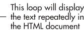

在这里，对`count`变量进行了递增处理。在给变量加 1 时，与其输入`count += 1`，使用递增运算符（`++`）是一种简短代码的方便方法。然而，如果你想让变量增加 2，则仍需使用加赋值运算符（即`count += 2`）。

由前面的代码生成的页面有一行短文本，后面跟着你重复的文本行。页面以注释“Now we are back to the plain text.”结尾。图 6-2 显示了这在浏览器窗口中查看时的外观。注意，句子“I am part of a loop!”被重复了十次。

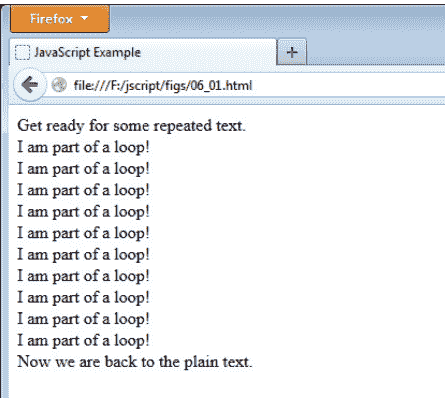

图 6-2 循环显示了该行文本十次。

## 138 JavaScript：初学者指南

现在你已经学会了基础循环，准备好向它添加一些内容，让循环变得更有用。在循环内部，你可以使用变量（这种灵活性在处理数组时会变得更加明显）。由于`count`变量每次都增加 1，你可以通过每次循环增加`1`来实现某些功能。为了更清晰地展示，你只需要从一个句子的开始开始。下面的示例代码展示了如何使用循环实现这一点：

```
for (var count = 1; count < 11; count++) {
  document.write(count + ". I am part of a loop!<br>");
}
```

`count`变量从`1`开始，因为它被分配了初始值`1`。你每次循环时都加了`1`。当`count`变量的值不再小于`11`时，循环将停止。在这种情况下，`count`将从`1`运行到`10`，执行十次循环。

## 比较

在进行比较时，你可以使用`<`运算符。例如，你已经循环了十次。这里显示了一些示例：

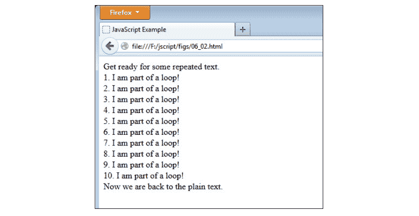

图 6-3 循环显示了该行。

## 第 6 章：条件语句与循环 139

有些示例显示在这里：

```
for (var count = 1; count <= 10; count++)
```

> 这行代码被循环了十次

> count 从 0 到 9

> count 从 1

记住，这种类型的灵活性可以根据`count`变量帮助你节省时间。你将在第 7 章学习更多相关内容。

## 块嵌套

你现在必须处理嵌套循环了。就像`if/else`块一样，你可以嵌套任意数量层级。目前，你只需要在循环内部嵌套另一个循环。下面的示例展示了：

```
for (var count = 1; count < 11; count++) {
  document.write(count + ". I am part of a loop!<br>");
  for (var nextcount = 1; nextcount < 3; nextcount++) {
    document.write(count + " I keep interrupting in pairs!<br>");
  }
}
```

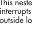

### 注意

在嵌套循环时要小心，确保每个嵌套循环都有其自己的计数器。在大多数情况下，计数器需要是循环唯一的。此外，如果大括号没有正确包含或配对，可能会发生错误。

你得到一个用其文本中断外部循环文本的循环。每当你通过外部循环时，你都会输出“I am part of a loop!”行。然后，你会遇到另一个在屏幕上输出“I keep interrupting in pairs!”的循环。

内部循环被设置为重复两次；每次你有一个内部循环的句子时，后面紧跟着两个内部循环的句子。为了更清楚地这一点，请考虑下面的示例，它更新了你早早在`loops01.js`文件中使用的代码：

```
document.write("Get ready for some repeated text.<br>");
for (var count = 1; count < 11; count++) {
  document.write(count + ". I am part of a loop!<br>");
}
```

# 140 JavaScript：初学者指南

```
for (nestcount = 1; nestcount < 3; nestcount++) {
  document.write("I keep interrupting in pairs!<br>");
}
document.write("Now we are back to the plain text.");
```

图 6-4 展示了这种嵌套循环如何影响浏览器中页面的显示。你现在可以看到嵌套循环如何帮助在执行需要的操作的过程中添加更多信息。

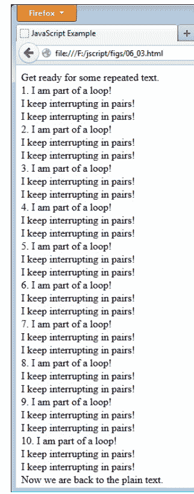

图 6-4 嵌套循环将文本插入到外部循环的文本内部。

# 第 6 章：条件语句和循环 141

为了让情况更加复杂，你还可以将不同类型的块嵌套在一起。例如，你可以将一个`if/else`语句放在循环内部，或者在`if/else`语句的`if`块或`else`块内部放置一个循环。接下来的示例在循环中创建了一个`if/else`块：

```
for (var count = 1; count < 11; count++) {
  if (count == 5) {
    document.write("The loop is halfway done!<br>");
  }
  else {
    document.write("I am part of a loop!<br>");
  }
}
```

在这种情况下，浏览器将检查`count`值是否等于 5。如果是，浏览器将在屏幕上打印出与通常情况下不同的消息。你可以通过调整你的 JavaScript 文件，使其包含以下代码来观察到这种效果：

```
document.write("Get ready for some repeated text.<br>");
for (var count = 1; count < 11; count++) {
  if (count == 5) {
    document.write("The loop is halfway done!<br>");
  }
  else {
    document.write("I am part of a loop!<br>");
  }
}
document.write("Now we are back to the plain text.");
```

图 6-5 显示了这段代码在浏览器中的结果。注意第五行与循环内部的条件语句的不同。

正如你所看到的，你可以通过嵌套做很多事情。使用你刚刚学到的相同技术，你可以嵌套此书中涵盖的所有其他语句；因此，我不会详细阐述嵌套技术与所涵盖语句结果的关系。

## 死循环

在编写任何类型的循环时，都可能创建所谓的死循环，即一个永远不会完成的循环。循环可能会一直运行，直到用户的计算机崩溃。大多数现代浏览器可以在一段时间后检测到这一点，并提示用户停止脚本执行，但这并不是保证的，并且可能会导致脚本运行出现问题。

为了避免编写死循环，你需要确保条件会在某个时刻返回`false`。例如，接下来的`for`循环创建了一个在循环运行时永远不会返回`false`的条件，从而创建了死循环：

```
// 不要使用 - 创建一个死循环
for (var i = 25; i > 10; i++) { // 错误！变量 i 永远不会小于 10
  document.write("This sentence can repeat forever...<br>");
}
```

## JavaScript：初学者指南

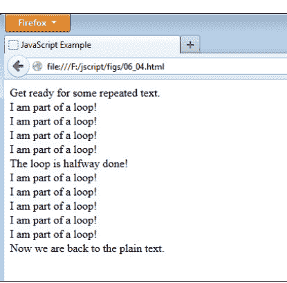

**6-5** 嵌套的 if/else 块导致第五行与其他行不同。

从这里你可以看到，变量`i`被赋值为初始值 25，并在每次循环时加 1。这意味着`i`将始终大于 10，且条件`i > 10`永远不会返回`false`，从而创建了死循环。

要修复此问题，请确保对循环进行调整，使条件最终会返回`false`。以下是修复此循环的两个示例：

```
for (var i = 25; i > 0; i--) {
  document.write("This sentence is stopped!<br>");
}
```

在这里，`i`是递减而不是递增，这最终会将`i`的值降到 10，使条件变为`false`。

```
for (var i = 25; i < 50; i++) {
  document.write("This sentence can be stopped<br>");
}
```

在这种情况下，条件被更改为`i < 50`同时保持递增不变。当它达到 50 时，条件将返回`false`并结束循环。

## 多条语句

循环在初始化时也可以包含多个语句。这让你能够拥有多个用于计数的变量，并可以通过循环进行修改。例如，如果你想数 2，可以使用以下代码从 10 计数到 100。

```
for (var i = 1, j = 10; i < 11; i++, j += 10){
  document.write(j + "<br>");
}
```

# 第 6 章：条件语句和循环 143

在这里，`i`和`j`两个变量都被初始化（`i`为 0，`j`为 10）并进行递增。（注：原文此处存在大量重复的 OCR 错误，已根据逻辑进行处理）。

## 第 6 章：条件语句与循环 145

前述代码中的循环只会运行一次。当检查比较时（此时`count`将是 12，因为在循环执行过程中它增加了 1），它会返回`false`，循环将不再运行。

当你有一些代码需要至少执行一次，但只有在满足某些条件时才重复执行，`while`循环是最有用的；否则，其他循环中的一个就足够完成任务。

## for in 和 for each in

`for in`循环允许你遍历对象的所有属性名称，而`for each`循环允许你遍历每个属性的值。这些循环将在第 8 章中进行详细介绍。

## 使用 break 和 continue

`break`和`continue`语句允许你停止循环正在执行的操作，但它们的工作方式不同。正如你记得在本章早期在`switch`块中使用`break`语句一样，`break`语句会在该点停止循环并完全退出循环，移动到循环后的下一个 JavaScript 语句。例如，`break`可以这样使用：

```javascript
var stopnumber = 5;
for (var count = 1; count < 11; count++) {
  if (count === stopnumber) {
    document.write("Sorry, the loop stops here!<br>");
    break;
  } else {
    document.write(count + " - I am part of a loop!<br>");
  }
}
```

此循环将正常运行直到`count`等于`stopnumber`的值（在此例中为 5）。当发生时，页面将写入一条特殊消息，并使用`break`语句完全结束循环。因此，循环并没有运行十次，而是只执行了五次。

如果你决定在满足该条件时不完全退出循环，你可以修改循环以使用`continue`语句。`continue`语句将停止循环在当前轮次中执行其后的任何语句。然而，它会回到循环的开头并从上次停止的地方继续，而不是完全退出循环。例如，你可以使用以下代码：

```javascript
var skipnumber = 5;
for (count = 1; count < 11; count++) {
  if (count === skipnumber) {
    continue; // 什么都不做
  }
  document.write(count + " - I am part of a loop!<br>");
}
```

146 JavaScript：初学者指南

**图 6-7** 跳过了第五次迭代，因此显示了 1–4 和 6–10。

这一次，当`count`等于`skipnumber`的值（在此例中为 5）时，页面上没有写入内容。相反，循环被告知返回开头并从那里继续。结果是，“I am part of a loop!”消息只会在页面上写入九次（实际上跳过了本应写入文本的第五次，并继续到第六次）。图 6-7 显示了这在浏览器中运行时的样子。

## 专家问答

**问：** 循环除了反复向页面上写入一行文本外，还有其他用吗？

**答：** 是的，随着你不断学习章节，你会发现它们的用处。在第 7 章中，当处理数组时它们会特别有用。

**问：** 在循环内部使用计数循环的变量`i`真的可以吗？这不会导致问题吗？

**答：** 在循环内部使用变量是可以的，只要你在使用它时没有给它赋新值。如果你担心自己可能会这样做，可以将它的值赋给另一个变量并在代码中使用该变量。例如，看以下代码：

```javascript
var thenum = 0;
for (var count = 1; count < 11; count++) {
  thenum = count;
  document.write(thenum + ". I am part of a loop!<br>");
}
```

第 6 章：条件语句与循环 147

在这里，你将`count`变量的值赋值给一个名为`thenum`的变量。然后你在代码中使用`thenum`变量而不是`count`变量。

但请注意，如果你确实打算这样做，那么给`count`变量赋新值是可以的。前面的想法只是当你不打算改变`count`变量并想确保自己不会不小心这样做时，可以使用的一种方法。

**当我想使用循环时，我应该使用`for`循环还是`while`循环？哪种更好？**

**答：** 使用你喜欢的循环类型。通常，所使用的循环类型取决于当前的情况。在不同的情况下，一种循环类型可能比另一种看起来更有意义。

**`while`循环对我会有用吗？**

**答：** 虽然`while`循环确实有它的用处，除非你使用的脚本需要在检查之前至少运行一次循环，否则你可能经常使用它。然而，你在这一章中学的关于`while`循环的知识将对你有帮助。当出现需要的情况时，`break`和`continue`语句将帮助你。

## 使用 for 和 while

在这个项目中，你将使用`for`循环来显示不同城市的可用物品数量。假设你有一家只向某些城市服务的商店。

- 创建一个 HTML 页面并保存为`2.html`。

- 创建一个 JavaScript 文件并保存为`2.js`。

- 添加一个名为`items`的新变量。

- 使用`switch`语句根据城市为`items`赋值。

- 在`switch`语句中添加内容：

  - Johnstown: 10

  - Danville: 5

  - Danielietown 或 Martyville: 2

  - 其他城市: 0

- 在`switch`语句后添加一个`if/else`语句。如果`items`大于 0，显示一条消息并使用`for`循环显示物品数量。

```javascript
var items = 0;
msg = "";
city = prompt("你的城市名称是？", "");
if (city === null) || (city === "") {
  msg = "No city entered.";
} else {
  switch (city) {
    case "Johnstown":
      msg = "We can in 3 days.";
      items = 10;
      break;
    case "Danville":
      msg = "We can deliver in 1 week.";
      items = 5;
      break;
    case "Danielietown":
      // 穿透
    case "Martyville":
      msg = "We can deliver to you in 2 weeks.";
      items = 2;
      break;
    default:
      msg = "Sorry! We do not deliver to your city.";
      items = 0;
  }
}
document.write(msg);
if (items > 0) {
  document.write("<p>We can deliver to " + items + " items to your city.</p>");
  document.write("<p>Print this out, write your item numbers below, and mail it to order.</p>");
  for (var count = 1; count <= items; count++) {
    document.write(count + "<br>");
  }
}
```

168 JavaScript：初学者指南

```javascript
items = 0;
msg = "";
city = prompt("你的城市名称是？", "");
if (city === null) || (city === "") {
  msg = "No city entered.";
} else {
  switch (city) {
    case "Johnstown":
      msg = "We can in 3 days.";
      items = 10;
      break;
    case "Danville":
      msg = "We can deliver in 1 week.";
      items = 5;
      break;
    case "Danielietown":
      // 穿透
    case "Martyville":
      msg = "We can deliver to you in 2 weeks.";
      items = 2;
      break;
    default:
      msg = "Sorry! We do not deliver to your city.";
      items = 0;
  }
}
document.write(msg);
if (items > 0) {
  document.write("<p>We can deliver to " + items + " items to your city.</p>");
  document.write("<p>Print this out, write your item numbers below, and mail it to order.</p>");
  for (var count = 1; count <= items; count++) {
    document.write(count + "<br>");
  }
}
```

第 6 章：条件语句与循环 149

## 第 6 章自测

1. 条件语句是一种你可以根据一个 ________ 来执行一段代码的语句，或者在该 ________ 不满足时执行其他操作的语句。

2. 你可以将条件语句想象成有点像 ________ 和 ________。

3. 与不是执行脚本中的每一行代码，条件语句允许在满足特定条件时执行脚本的某些部分。

   A. 正确

   B. 错误

4. 下列哪项可以作为`if/else`语句的第一行？

   A. `if (x=2)`

   B. `if (y<7)`

   C. `else`

   D. `if ((x==2 &&)`

# 150 JavaScript：初学者指南

- 5. 你使用什么来包含条件判断和循环中的代码块？

  - A. 圆括号 ()

  - B. 方括号 []

  - C. 大括号 {}

  - D. 小于号和大于号 < >

- 6. `switch`语句允许你取单个变量值，并根据该变量的值执行不同的代码行。

- 7. 循环是一个允许你重复特定次数某段代码块。

- 8. 循环是有用的，因为它迫使你重复输入代码行。

  - A. 正确

  - B. 错误

- 9. 下列中哪一个可以作为`for`循环的第一行？

  - A. `for (var x = 1; x < 6; x += 1)`

  - B. `for (x:=1;x<6;x+=1)`

  - C. `for (int x=1;x<6;x+=1)`

  - D. `for (var x+=1;x<6;x:=1)`

- 10. 循环会检查比较结果并重复执行，直到比较不再为真。

- 11. 下列中哪一个不能作为`while`循环的第一行？

  - A. `while (x<=7)`

  - B. `while (x=7)`

  - C. `while (x<7)`

  - D. `while (x!=7)`

- 12. `do while`循环是特殊的，因为循环体内的代码至少会执行一次，即使第一次比较返回为`false`。

  - A. 正确

  - B. 错误

- 13. `do while`块的第一行包含关键字`do`和一个比较算式。

  - A. 正确

  - B. 错误

- 14. `do while`块的最后一行只包含一个大括号。

  - A. 正确

  - B. 错误

- 15. 你可以在另一个代码块中嵌套多少次代码块？

  - A. 无

  - B. 一次

  - C. 三次，最多三次

  - D. 随你意愿（尽管过度嵌套可能会导致浏览器耗尽内存）

## 第 7 章

## JavaScript 数组

## JavaScript：初学者指南

## 核心技能与概念

- 定义和访问数组

- 数组属性和方法

- 在循环中使用数组

- 嵌套数组

在本章中，你将学习 JavaScript 数组以及它们如何帮助改进你的脚本。你将从对数组的定义以及它们为什么有用的基本概述开始，之后你将学习如何在 JavaScript 中定义和访问数组。然后，你将学习可以与数组配合使用的属性和方法。最后，你将学习如何嵌套数组以提供更多层次的组织结构。

## 什么是数组？

数组是存储数据列表的一种（例如，喜好颜色或食物列表）。这些值通过索引数字来访问。

为了直观数组是如何工作的，假设你有一个满是学生的班，你想要显示每个学生的名字。你可以使用普通变量来存储每个学生的名字，但通过在`document.write(name)`语句输入每个变量名将花费很长时间。相反，你可以将每个学生的名字存储在数组中，这将允许你使用循环通过几行代码更轻松地访问它们。

数组允许你将数字和名字组合在一起，如下例：

- Student 0: Thomas

- Student 1: Roger

- Student 2: Amber

- Student 3: Jennifer

通过这种方式存储，你可以使用数字来获取每个学生的名字。这就是数组作为存储信息和以后访问信息的方式变得有用的地方。

> 注意

> 请注意数组中的第一个学生是 Student 0 而不是 Student 1。这是因为数组的起始值是从 0 而不是 1。随着本章的深入，将详细讨论这一点。

## 第 7 章：JavaScript 数组 155

## 为什么数组很有用

为什么使用数字会让你更容易访问存储的信息呢？因为通过使用数字，你可以轻松地使用循环来遍历信息，而不是手动输入每个条目。如果示例中的学生列表变得很长，当你想要在浏览器中显示所有名字时，循环将为你节省大量的打字时间。

例如，如果你将示例列表中的每个学生的名字赋值给变量并将名字写入屏幕，你将需要在`document.write()`中重写每个变量名。以下代码显示了一个示例：

```javascript
var student0 = "Thomas"
student1 = "Roger"
student2 = "Amber"
student3 = "Jennifer"
document.write(student0 + "<br>")
document.write(student1 + "<br>")
document.write(student2 + "<br>")
document.write(student3 + "<br>")
```

变量如下所示

如果你使用循环为每个学生重复此`document.write()`语句，你就可以避免编写四个独立的变量名。数组是存储值（学生）的一种方便方法，因为你可以通过循环遍历这些值，而不是写出每个值——即使你事先不知道学生的数量（通过使用数组的`length`属性）。你将在本章的后续中看到更多内容。

每个值都单独写在页面上

## 定义和访问数组

## 命名数组

现在你已经知道什么是数组了，你准备好学习如何在 JavaScript 中命名、定义、访问和使用数组了。

## 定义和访问数组

## 命名数组

你可以使用与已经学习过的变量命名相同的规则来命名数组。请参考第 3 章查看这些命名规则列表。

## 定义数组

JavaScript 数组是非常多功能的。你可以选择是否指定数组中的项目数量，并可以在数组中的任何位置使用任何数据类型的值（例如，你可以让第一个元素是数字，第二个是字符串，依此类推）。要了解这一切是如何工作的，你将首先学习 JavaScript 中定义数组的两种方法：数组构造函数和数组字面量符号。

## 数组构造函数

数组构造函数使用以下格式定义数组：

```javascript
var arrayname = new Array();
```

JavaScript：初学者指南

你将`arrayname`替换你想给数组的名字。你会发现关键字`new`与`Array()`一起使用。这段代码创建一个空数组，但你也可以在括号中放置参数。

要指定数组的长度，你在括号内放置单个数字值，如代码所示：

```javascript
var students = new Array(4);
```

这创建了一个名为`students`且具有四个项目的数组。所有这四个值最初都是`undefined`，但稍后可以在你的代码中定义每一个。

要指定数组中每个项目的值，你将它们作为参数提供：

```javascript
var students = new Array("Thomas", "Roger", "Amber", "Jennifer");
```

此数组有四个项目："Thomas"、"Roger"、"Amber"和"Jennifer"。

正如你所读到的，JavaScript 允许你在同一个数组中拥有各种数据类型。以下代码也产生一个有效的数组：

```javascript
var answers = new Array(42, "paper", -3, "plastic");
```

### 注意

当使用数组构造函数时，提供单个数字值作为参数将始终创建一个该长度的数组，而不是创建一个包含该值的一个项目的数组。如果提供了多个参数（无论是否为数字），所有参数都将如预期作为项目值使用。

### 数组字面量符号

数组字面量符号提供了一种更短的定义数组的方法，使用方括号`[]`而不是构造函数语法。例如，你可以使用以下代码创建一个空数组：

```javascript
var students = [];
```

你可以通过提供一个逗号分隔的列表来添加项目，就像你使用参数一样。以下示例使用数组字面量符号创建了所有有效的数组：

```javascript
var answers = [42, "paper", -3, "plastic"];
```

```javascript
var is_true = [true, false];
```

```javascript
var nums = [4, 20, 19, 2, 2, 10056, -42, 3];
```

# 第 7 章：JavaScript 数组 157

与数组构造函数一样，任何数据类型都可以作为项目的值。在本书中，我在定义数组时经常使用数组字面量表示法。

### 注意

当使用数组字面量表示法时，单个数值将创建一个以该值作为唯一项目的数组，而数组构造函数则会创建一个长度为该数的数组。因此，`var students = [4];`将创建一个包含一个项目（值为 4）的数组，而不是一个包含四个项目的数组。

## 访问数组元素

要访问数组的元素，你需要使用所谓的“索引”（index），它允许你通过位置访问数组中的每个项目。例如，考虑以下代码：

```
var students = ["Thomas", "Roger", "Amber", "Jennifer"];
```

你可以使用语法`students[0]`访问"Thomas"，使用`students[1]`访问"Roger"，以此类推。请注意，方括号紧跟在数组名之后，它们告诉你是想要在数组中访问的项目索引。你还会发现第一个项目是通过 0 访问的。这是因为数组从 0 开始计数，而不是从 1 开始；因此，你必须小心不要混淆数组中项目的索引。第一个项目的索引为 0，第二个索引为 1，第三个索引为 2，以此类推。

你可以在代码中将数组项目作为变量。例如，看看这段代码：

```
var students = ["Thomas", "Roger", "Amber", "Jennifer"];
alert(students[0]);
```

这段代码将向查看者发送一个显示"Thomas"的警报。如果需要，你可以在代码中显示数组中的每个学生姓名：

```
var students = ["Thomas", "Roger", "Amber", "Jennifer"];
document.write(students[0] + "<br>");
document.write(students[1] + "<br>");
document.write(students[2] + "<br>");
document.write(students[3] + "<br>");
```

- 写入第一个项目的值："Thomas"

- 写入第二个项目的值："Roger"

- 写入第四个项目的值："Jennifer"

这将按顺序在 Web 页面上显示学生列表。遗憾的是，随着列表的增长，你必须为每个新项目继续添加代码行。这就是`length`属性和循环的使用可以帮助你处理不断增长的数组的地方。

## 158 JavaScript：初学者指南。

## 使用 length 属性和循环

拥有数组中的项目数量是一个非常方便的值。在 JavaScript 中，可以使用`length`属性获取它。要访问`length`属性的值，你使用数组名，后跟着点（`.`），然后是`length`，在下面的代码中：

```
var students = ["Thomas", "Roger", "Amber", "Jennifer"];
alert(students.length);
```

这将向查看者发送一个数字 4 的警报，因为数组中有四个项目。由于你的数组可以随时添加更多项目，`length`属性提供了一种查找当前数组中有多少项目的方法。它的优点之一是你可以创建一个循环来遍历数组中的每个项目。

回想上一节，你拥有以下代码：

```
var students = ["Thomas", "Roger", "Amber", "Jennifer"];
document.write("<p>" + students[0] + "<br>");
document.write(students[1] + "<br>");
document.write(students[2] + "<br>");
document.write(students[3] + "<br>");
```

每个数组项目的值被单独写入到页面索引上。这段代码可以工作，但如果你每当向数组添加一个项目时都不需要创建新的一行代码，将会好得多。既然你现在有了`length`属性，可以使用它来创建一个循环，将每个数组项目写入到页面上，无论长度如何。下面的代码展示了此示例：

```
var students = ["Thomas", "Roger", "Amber", "Jennifer"];
document.write("<p>My Students:</p>");
for (var i = 0; i < students.length; i++) {
  document.write(students[i] + "<br>");
}
```

注意，`for`初始化了一个命名变量`i`并给它赋值为 0。随后在循环的每次执行中，它都会与`students.length`的值（在本例中为 4）进行比较，并每次递增 1。此循环允许通过索引遍历每个数组项目，从 0 开始一直运行到数组的最后一个项目（在本例中为`students[3]`，即数组中的第四个项目）。注意使用的是`<`而不是`<=`，后者会尝试访问不存在的`students[4]`，因为计数是从 0 开始的。

此代码在浏览器中运行的结果如图 7-1 所示。现在，我们可以向数组添加任意数量的项目，脚本将在页面上写入所有项目。例如，假设你像下面的代码所示向数组添加了一些项目：

```
var students = ["Thomas", "Roger", "Amber", "Jennifer", "Joe", "Dawn"];
document.write("<p>My Students:</p>");
for (var i = 0; i < students.length; i++) {
  document.write(students[i] + "<br>");
}
```

## 179 第 7 章：JavaScript 数组

的值被单独写入到页面索引上。这段代码可以工作，但如果你每当向数组添加一个项目时都不需要创建新的一行代码，将会好得多。既然你现在有了`length`属性，可以使用它来创建一个循环，将每个数组项目写入到页面上，无论长度如何。下面的代码展示了此示例：

```
var students = ["Thomas", "Roger", "Amber", "Jennifer", "Joe", "Dawn"];
document.write("<p>My Students:</p>");
for (var i = 0; i < students.length; i++) {
  document.write(students[i] + "<br>");
}
```

注意，`for`初始化了一个命名变量`i`并给它赋值为 0。随后在循环的每次执行中，它都会与`students.length`的值（在本例中为 4）进行比较，并每次递增 1。此循环允许通过索引遍历每个数组项目，从 0 开始一直运行到数组的最后一个项目（在本例中为`students[3]`，即数组中的第四个项目）。注意使用的是`<`而不是`<=`，后者会尝试访问不存在的`students[4]`，因为计数是从 0 开始的。

## 180 JavaScript：初学者指南。

## 修改值

每个项目都可以随时更改其值。就像变量一样，数组的值可以根据需要更改。例如，下面的代码：

```
var students = ["Thomas", "Roger", "Amber", "Jennifer"];
students[2] = "Dawn";
```

这将第三个项目（索引 2）的值从"Amber"改为"Dawn"。

## 修改长度

你不仅可以访问`length`的值，还可以更改它。这样做会从数组末尾删除项目，或在数组末尾添加项目。例如，下面的代码将从数组移除最后两个项目：

```
var students = ["Thomas", "Roger", "Amber", "Jennifer"];
students.length = 2;
```

数组原本有四个项目，但现在只有两个："Thomas"和"Roger"。如果你将长度值更改为大于数组当前长度的数字，会在数组末尾添加项目。下面的代码展示了此示例：

```
var students = ["Thomas", "Roger", "Amber", "Jennifer"];
students.length = 7;
```

数组现在有七个元素，在末尾添加了三个元素。最后三个元素（`students[4]`、`students[5]`和`students[6]`）在赋值之前其值均为`undefined`。

增加数组长度的另一种方法是向大于数组当前任何索引的赋值。例如，考虑以下代码：

```
var students = ["Thomas", "Roger", "Amber", "Jennifer"];
students[6] = "Marty";
```

在索引 6 定义项目会强制数组扩展以包含新项目。原始数组末尾与新定义索引之间的元素在赋值之前其值均为`undefined`。在这种情况下，`students[4]`和`students[5]`为`undefined`，而`students[6]`将是代码中定义的"Marty"。

# 第 7 章：JavaScript 数组 161

如果你不确定如何将最后一个元素添加到数组的末尾，可以在括号中使用数组的长度（`length`）来实现，如下代码所示：

```
var students = ["Thomas", "Roger", "Amber", "Jennifer"];
students[students.length] = "Marty";
```

在这里，`students[4]`被添加到数组并被赋值为"Marty"。

你还可以使用数组方法来添加或删除项目，你将在本章的后续部分学习这些方法。

# 尝试一下 7-1 在数组中使用循环

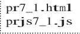

这个项目允许你练习在数组中使用循环。假设你的公司销售特定的计算机配件，你希望显示出售的每种部件。你所有的部件都存储在一个数组中。

## 逐步步骤

- 1. 创建一个 HTML 页面，包含一个文本为“Computer Parts Available”的标题。添加包含名为`pjs7_1.js`的外部 JavaScript 文件的标签。将 HTML 文件保存为`pr7_1.html`。

- 2. 创建一个外部 JavaScript 文件并保存为`pjs7_1.js`。在步骤 3-6 中使用它。

- 3. 创建一个名为`computer_parts`的新数组，并将以下部件列表赋值为数组项的值：

  - 显示器 (Monitors)

  - 主板 (Motherboards)

  - 芯片 (Chips)

  - 硬盘 (Hard Drives)

  - DVD-光驱 (DVD-ROMs)

  - 机箱 (Cases)

  - 电源 (Power Supplies)

- 4. 在浏览器窗口中单独行显示每个计算机部件（使用循环）。

- 5. 完成后，你的 JavaScript 文件应包含以下代码（可能有多个正确答案）：

- 6. 保存 JavaScript 文件并在浏览器中加载 HTML 文件以查看结果。你应该看到当前的部件列表。

```
var computer_parts = ["Monitors", "Motherboards", "Chips", "Hard Drives",
  "DVD-ROMs", "Cases", "Power Supplies"];
for (var i = 0; i < computer_parts.length; i++) {
  document.write(computer_parts[i] + "<br>");
}
```

## JavaScript：初学者指南

# 尝试一下总结

在项目中，你利用循环、数组和 Array 对象属性的知识创建了两个不同的结果。一个结果列出了数组的元素，另一个结果向数组中添加元素并按字母顺序列出元素。

## 数组属性和方法

数组有许多可以在脚本使用的属性和方法。这些允许你执行诸如添加项目、删除项目、排序项目、合并数组等操作。数组之所以拥有这些属性和方法是因为数组在 JavaScript 中是对象（你将在第 8 章学习对象）。首先，你将查看数组属性，然后是数组方法。

## 属性

表 7-1 列出了 Array 对象的属性，并对每个属性提供了简短描述。后续章节将对每个属性进行更详细的讨论。

# constructor（构造函数）和 prototype 属性

`constructor`包含了创建数组原型的函数代码值。它简单地返回此值：

```
function Array() { [native code] }
```

`prototype`属性允许你向所有已存在的数组实例（如 Array 对象）添加属性和方法。向数组原型添加内容会影响脚本中使用的所有数组，目前最好避免这样做。你将在第 8 章学习更多关于构造函数和原型的工作原理。

# index 和 input 属性

要理解`index`和`input`属性，你首先需要理解正则表达式（用于匹配文本字符串），这需要详细的解释，正如第 13 章所示。关于`index`和`input`属性的讨论将留到该章节。

| 属性 | 描述 |
| --- | --- |
| constructor | 指向用于创建 Array 对象实例的构造函数 |
| index | 当通过正则表达式匹配创建数组时使用 |
| input | 当通过正则表达式匹配创建数组时使用 | 
| length | 包含一个等于数组中元素数量的数值 |
| prototype | 允许向 Array 对象上添加属性和方法 |

**表 7-1** Array 对象的属性

# length 属性

正如你所见，`length`属性返回一个数字，告诉数组中有多少个元素。由于你已经在使用它，可以参考本章之前的章节以获取更多信息。

# 方法

现在你已经知道了 Array 对象的属性，本节介绍了你可以用来对数组执行不同操作的方法。表 7-2 列出了这些方法并提供了对每个方法作用的描述。表格之后，将对每个方法进行更详细的描述。

| 方法 | 描述 |
| --- | --- |
| join() | 使用分隔符将数组的元素合并成单个字符串 |
| pop() | 从数组中删除最后一个元素，并在需要时返回删除的元素 |
| push() | 在数组末尾添加元素，并在需要时返回新数组的数值 |
| shift() | 从数组中删除第一个元素，并在需要时返回它 |
| unshift() | 在数组开头添加元素，并在需要时返回新数组的数值 |
| reverse() | 反转数组中元素的方向：第一个元素移动到最后一个位置 |

## JavaScript：初学者指南

| 方法 | 描述 |
| --- | --- |
| map() | 对数组的每个项执行函数，并返回包含执行结果的数组 |
| some() | 如果函数对数组的某一项执行返回 true，则返回 true |
| reduce() / reduceRight() | 对数组的每个项执行函数，并返回最终结果 |
| toString() / toLocaleString() | 将数组的元素合并成单个字符串，使用逗号作为分隔符 |
| valueOf() | 返回数组对象的原始值 |

# 表 7-2 Array 对象的方法

`join(separator)`方法用于将数组的元素合并成单个字符串，可以使用一个分隔符或字符串作为其参数。

> 注意

> 如果不提供参数，Internet Explorer 7 之前的版本将默认使用字符串"undefined"。最好提供参数以防止这种情况发生。

要查看此方法如何工作，请看这段代码。以下示例定义了一个数组并在数组名上调用了`join()`方法：

```
var fruits = ["oranges", "apples", "pears"];
var fruit_string = fruits.join(",");
```

这段代码将`join()`方法的结果赋值给变量`fruit_string`。注意调用使用的是数组名（`fruits`），后面跟着一个点（`.`），然后是方法名。`fruit_string`变量将具有以下字符串值：

oranges,apples,pears

你可以通过将字符串写入 Web 页面来查看此。以下代码可以为你完成操作：

```
var fruits = ["oranges", "apples", "pears"];
var fruit_string = fruits.join(",");
document.write("The new string is " + fruit_string);
```

> 数组创建了三个项

> 数组的元素被合并成单个字符串

> 使用逗号作为分隔符

> 字符串显示在屏幕上


## 第 7 章：JavaScript 数组 165

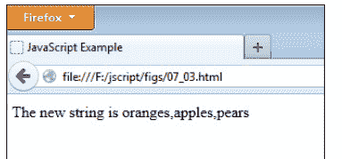

图 7-3 新字符串被写在页面上。

现在你可以看到从`join()`方法返回的字符串。图 7-3 显示了这段代码在浏览器中运行时产生的结果。

如果你想用逗号以外的其他字符分隔新字符串中的项，可以发送想要使用的字符串作为参数传递。以下代码使用冒号作为分隔符：

```javascript
var fruits = ["oranges", "apples", "pears"];
var fruit_string = fruits.join(":");
document.write("The new string is " + fruit_string);
```

这一次的字符串与上一个略有不同，因为它在上一个示例中逗号的位置使用了冒号。图 7-4 显示了该字符串在浏览器窗口中的显示方式。

## pop() 方法

`pop()`方法用于从数组中移除最后一项。如果你将方法的结果赋值给一个变量，被弹出的元素将被返回并赋值给该变量。

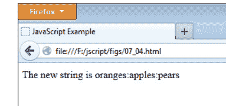

图 7-4 新字符串以冒号作为分隔符被写在页面上。

## 166 JavaScript：初学者指南

以下代码创建了一个数组并使用`pop()`方法移除数组的最后一项：

```javascript
var fruits = ["oranges", "apples", "pears"];
fruits.pop();
```

这创建了一个名为`fruits`的数组，其中包含三个项目（"oranges", "apples", "pears"）。然后，使用`pop()`方法移除了最后一项，将数组缩短为只剩前两个项目（"oranges", "apples"）。

如果你想从数组中移除一个项但仍要以某种方式使用它，可以将方法的结果赋值给变量。该变量将赋予被弹出的项的值。以下示例移除了数组的最后一项，然后将弹出的项作为警框显示给观众：

```javascript
var fruits = ["oranges", "apples", "pears"];
var picked_fruit = fruits.pop();
window.alert("You picked my " + picked_fruit);
```

这会向观众弹出一个显示“You picked my pears”的警框。

## push() 方法

`push(item)`方法用于向数组末尾添加项。发送到方法的参数是你想要添加到数组中的新项。如果赋值给一个变量，此方法将返回数组的新长度。

例如，查看这段向数组末尾添加一个项的代码：

```javascript
var fruits = ["oranges", "apples"];
fruits.push("pears");
```

这段代码创建了一个包含两个项目（"oranges", "apples"）的命名数组，并使用`push()`方法添加了第三个项目——"pears"。数组现在包含了三个项目（"oranges", "apples", "pears"），其中最后一个是数组的末尾。

你可以通过发送多个参数来添加更多项。项将按照它们在参数列表中发送的顺序被添加。以下代码向数组添加了两个元素：

```javascript
var fruits = ["oranges", "apples"];
fruits.push("pears", "grapes");
```

这段代码向数组添加了两个项。最后，数组包含四个元素（"oranges", "apples", "pears", "grapes"）。

如果你想要方法返回的长度，可以将结果赋值给变量。以下代码执行了此操作，然后显示带有返回值的警框：

```javascript
var fruits = ["oranges", "apples"];
var new_length = fruits.push("pears", "grapes");
window.alert("The array now has " + new_length + " items");
```

由于数组末尾添加了两个项，数组的新长度将为四，并向观众发送一个显示“The array now has 4 items”的警框。

> 注意

> 对于使用过其他语言的人来说，`push()`和`pop()`将数组视为一个栈（后进先出）。将这些与`shift()`和`unshift()`方法结合，可以让数组像队列一样工作。

## shift() 方法

`shift()`方法用于移除数组的第一项。它返回从数组中移除的项的值。以下代码使用`shift()`方法移除数组的第一项：

```javascript
var fruits = ["oranges", "apples", "pears"];
fruits.shift();
```

这段代码创建了一个包含三个项目的数组并使用`shift()`方法移除了第一项。这导致数组只剩下两个项目（"apples", "pears"）。

要使用被移除元素的值，可以将方法的结果赋值给变量。以下代码将移除的元素赋值给变量，并向观众提示移除了什么：

```javascript
var fruits = ["oranges", "apples", "pears"];
var picked_fruit = fruits.shift();
window.alert("You picked my " + picked_fruit);
```

这显示“You picked my oranges”。

## unshift() 方法

`unshift(item)`方法用于在数组开头添加项。发送到方法的参数是你想要添加到数组开头的项。以下代码在开头添加了一个项：

```javascript
var fruits = ["apples", "pears"];
fruits.unshift("oranges");
```

这创建了一个包含三个项目的数组，其中新项位于开头。如果你想添加多个项，可以发送多个参数。以下代码在数组的开头添加了两个项：

```javascript
var fruits = ["apples", "pears"];
fruits.unshift("oranges", "grapes");
```

数组在开头包含了四个项。

## reverse() 方法

`reverse()`方法用于反转数组项的顺序。为了演示如何使用此方法，以下代码创建一个数组并反转其顺序：

```javascript
var fruits = ["oranges", "apples", "pears"];
fruits.reverse();
```

数组的初始顺序是"oranges", "apples", "pears"。调用`reverse()`方法后，顺序变为"pears", "apples", "oranges"。注意这会改变原始数组，而不是返回新数组。

## sort() 方法

`sort(sort_function)`方法将每个数组项转换为字符串，并按升序排列。以下代码展示了该方法的用法：

```javascript
var fruits = ["oranges", "apples", "pears", "grapes"];
fruits.sort();
```

这将重新排列数组，使元素按字母顺序："apples", "grapes", "oranges", "pears"。

记住，字符串是根据它们的编码进行比较的（参见第五章中的“大于运算符 >”）。如果存在大小写差异，可能会导致返回意外之外的顺序：

```javascript
var fruits = ["oranges", "apples", "pears", "Grapes"];
fruits.sort();
```

由于列表项大写，排序后的数组顺序为"Grapes", "apples", "oranges", "pears"。为了修复这个问题，你可以使用名为`toLowerCase()`的字符串方法以确保所有值都以小写比较，并在之后返回预期结果：

```javascript
var fruits = ["oranges", "apples", "pears", "Grapes"];
for (var i = 0; i < fruits.length; i++) {
  fruits[i] = fruits[i].toLowerCase();
}
fruits.sort();
```

在此处，顺序现在将是"apples", "grapes", "oranges", "pears"。

由于`sort()`方法会将所有值转换为字符串，即使是只包含数值的数组也将根据其转换为字符串的结果进行排序：

```javascript
var fruits = [2, 3, 1, 20];
fruits.sort();
```

# 第 7 章：JavaScript 数组

在预期的顺序（数值）之外，排序后的结果顺序是 1, 2, 20, 3，因为这些值是被当作字符串进行比较的。为了解决这类问题，JavaScript 允许你将一个比较函数作为`sort()`方法的参数。

比较函数是一个带有两个参数的函数，它根据两个参数值比较的结果返回一个正数、负数或零。例如，这里显示了一个简单的比较函数：

```javascript
function mysort(first_value, second_value) {
  if (first_value > second_value) {
    return 1;
  } else if (first_value < second_value) {
    return -1;
  } else {
    return 0;
  }
}
```

基本上，如果第一个参数大于第二个参数，比较函数应该返回正数；如果第一个参数小于第二个参数，则返回负数；如果两个参数相等，则返回零。这将按升序排序数组。将前面的代码中的函数作为`sort()`方法的参数，将把数字按预期的数值顺序排列，而不是将它们转换为字符串。以下是此方法的示例：

```javascript
var fruits = [2, 3, 1, 20];
function mysort(first_value, second_value) {
  if (first_value > second_value) {
    return 1;
  } else if (first_value < second_value) {
    return -1;
  } else {
    return 0;
  }
}
fruits.sort(mysort);
```

通过这种方式，排序会将项目按预期的顺序排列：1, 2, 3, 20。

## concat(array) 方法

`concat(array)`方法将数组与发送给它的参数进行合并，并返回一个包含所有项目的新数组。它不会影响原始数组。你使用数组名称或值作为参数并按顺序提供它们。

第一个示例合并了两个数组的元素。要做到这一点，只需要使用一个参数——调用该方法时要合并的数组名称：

```javascript
var fruits = ["oranges", "apples"];
var veggies = ["corn", "peas"];
var fruits_n_veggies = fruits.concat(veggies);
```

## JavaScript：初学者指南

这段代码创建了一个名为`fruits`的包含两个元素的数组，以及一个名为`veggies`的包含两个元素的数组。接下来，它定义了`fruits_n_veggies`，它将接收`concat`方法返回的数组。在这种情况下，`fruits_n_veggies`数组将包含"oranges", "apples", "corn", "peas"。如果你希望`veggies`数组的项目在前，可以使用`veggies`数组调用该方法并将`fruits`数组作为参数：

```javascript
var fruits = ["oranges", "apples"];
var veggies = ["corn", "peas"];
var fruits_n_veggies = veggies.concat(fruits);
```

现在`veggies`的项目在前，新的`fruits_n_veggies`数组具有以下项目："corn", "peas", "oranges", "apples"。如果你合并两个数组，调用`concat()`方法的数组的项目在前，然后作为参数的每个数组的项目将按照它们发送的顺序添加：

```javascript
var fruits = ["oranges", "apples"];
var veggies = ["corn", "peas"];
var meats = ["fish", "chicken"];
var three_groups = fruits.concat(veggies, meats);
```

现在你合并了三个数组，`three_groups`数组的项目如下："oranges", "apples", "corn", "peas", "fish", "chicken"。如果你按照以下方式代码，将得到一个具有相同元素但顺序不同的数组：

```javascript
var fruits = ["oranges", "apples"];
var veggies = ["corn", "peas"];
var meats = ["fish", "chicken"];
var three_groups = meats.concat(veggies, fruits);
```

使用这种代码时`three_groups`数组的项目顺序为："fish", "chicken", "corn", "peas", "oranges", "apples"。除了合并数组，你还可以合并字符串、数字或其他数据类型。这些可以一起完成：

```javascript
var fruits = ["oranges", "apples"];
var veggies = ["corn", "peas"];
var big_array = fruits.concat(veggies, "cat", 4, "house");
```

这种合并创建了一个名为`big_array`的数组。它将`veggies`数组、一个字符串、一个数字和另一个字符串添加到`fruits`数组。`big_array`的最终项目为："oranges", "apples", "corn", "peas", "cat", 4, "house"。如果你不带参数使用`concat()`，它将创建原始数组的副本。因此，以下代码将给你`fruits`数组的副本：

```javascript
var fruits = ["oranges", "apples"];
var same_fruits = fruits.concat();
```

# 第 7 章：JavaScript 数组

## slice() 方法

`slice(start, [stop])`方法用于切分数组的一部分并返回所选元素的新数组。原始数组不会被修改。`slice`方法有两个参数：`start`，开始提取的索引；`stop`（可选），结束提取之前的索引（不包含 stop 索引）。如果 start 索引是负数，它将从数组末尾计数。如果 stop 索引是负数，它也从数组末尾计数。

```javascript
var fruits = ["Apple", "Banana", "Orange", "Date", "Elderberry"];
var sliced = fruits.slice(1, 3); // ["Banana", "Orange"]
var sliced2 = fruits.slice(2); // ["Orange", "Date", "Elderberry"]
var sliced3 = fruits.slice(-2); // ["Date", "Elderberry"]
var sliced4 = fruits.slice(1, -2); // ["Banana", "Orange"]
```

`slice`方法用于提取数组的一部分并返回新数组，而不修改原始数组。它对于创建数组的浅拷贝或提取特定片段非常有用。

## 第 7 章：JavaScript 数组 173

第二个参数可以指定从哪个索引开始搜索。这允许`indexOf()`或`lastIndexOf()`跳过该项目之前的实例，并仅返回从指定索引开始的第一个项的索引。例如，考虑以下代码：

```javascript
var fruits = ["oranges", "apples", "pears", "apples"];
var found_apples = fruits.lastIndexOf("apples", 2);
window.alert(found_apples);
found_apples = fruits.lastIndexOf("apples", 1);
window.alert(found_apples);
```

在这种情况下，`fruits.lastIndexOf("apples", 2)`从索引 2 开始向后搜索，而不是索引 0。这意味着它将跳过索引 1 处的第一个"apples"，从索引 2 开始搜索并返回 3，因为下一个"apples"位于索引 3。调用`lastIndexOf("apples", 1)`从索引 1 开始搜索并向前进行。在这种情况下，索引 3 的"apples"被跳过了，搜索从索引 1 开始，在索引 1 找到了"apples"并返回 1。

最后，需要注意的是，两种方法都使用`===`运算符而不是`==`来判断是否找到了某个项。因此，不会执行类型转换，必须精确匹配才能成功找到。例如，考虑以下代码：

```javascript
var nums = ["2", 5, 22, 3];
var found_two = nums.lastIndexOf(2);
alert(found_two);
```

由于"2"和 2 并不严格相等，因此未找到该项并返回 -1。在使用这些方法时请记住这一点，以避免出现意外的结果。

## every(), filter(), forEach(), map(), 和 some() 方法

`every()`、`filter()`、`forEach()`、`map()`和`some()`方法是在 ECMAScript 5 中添加的，提供了一种在数组的每个项上运行函数的方法。这些函数根据参数中在数组每个项上运行函数的结果返回一个值。这些被称为迭代方法，意味着它们会循环或遍历每个项。以下是每个迭代方法在调用时的操作：

- `every()` 对数组的每个项执行提供的函数，如果函数对所有项都返回 true，则返回 true。
- `some()` 对数组的每个项执行提供的函数，如果函数的执行对任何一个项返回 true，则返回 true。
- `filter()` 对数组的每个项执行提供的函数，并返回函数返回 true 的项的数组。
- `map()` 对数组的每个项执行提供的函数，并返回在每个项上调用函数产生的结果数组。
- `forEach()` 对数组的每个项执行提供的函数。不返回任何值。

使用这些方法之一时，你可以像下面的示例一样调用它并提供一个函数名作为参数：

```javascript
var grades = [94, 65, 71, 84, 99];
var name_result = grades.every(pass_grades);
```

`every()`方法在遍历所有数组项并运行函数（`pass_grades`）后返回的结果将存储在变量`name_result`中。

例如，假设在代码中使用名为`pass_grades()`的函数来判断学生的所有记录成绩是否都达到 70 分及以上：

```javascript
function pass_grades(item_value, item_index, arr_name) {
  return (item_value > 70);
}
var grades = [94, 65, 71, 84, 99];
var name_result = grades.every(pass_grades);
window.alert(name_result); // 弹出 false
```

这将根据成绩是否大于等于 70 返回一个布尔值。你会发现该函数接受三个参数：第一个是当前数组项的值，第二个是当前数组索引，第三个是数组本身。当调用任何迭代方法时，这些值都会作为参数发送给指定的函数（此处是`pass_grades`）。

`pass_grades`在迭代过程中返回了以下五个结果：true、false、true、true、true。由于`every()`方法要求所有返回值均为 true 才能返回 true，在这种情况下，由于索引 1 处有一个低分成绩（65），它将返回 false。

在之前的代码中，用所有其他方法代替`every()`将产生以下结果：

- `some()` 将返回 true，因为它只需要返回值之一为 true（在这种情况下，五个返回值中有四个是 true）。
- `filter()` 将返回一个包含所有返回 true 的项的数组。在这种情况下，数组将是`[94, 71, 84, 99]`。原数组中索引 1 处的项（65）被排除在外，因为它返回 false。新数组被赋值给变量`name_result`。
- `map()` 将返回一个包含每次函数调用结果的数组。在这种情况下，数组将是`[true, false, true, true, true]`。这个新数组被赋值给变量`name_result`。
- `forEach()` 将不返回任何内容。它只是为数组中的每个项运行函数。

## reduce() 和 reduceRight() 方法

`reduce()`和`reduceRight()`方法是在 ECMAScript 5 中添加的，提供了一种将数组还原为单个值的方法。这些方法使用回调函数和一个初始值。例如：

```javascript
var nums = [2, 5, 22, 3];
var sum = nums.reduce(function(prev, curr) {
  return prev + curr;
}, 0);
```

## 第 7 章：JavaScript 数组

如你所见，遍历数组会将 Thomas 放在索引 0，将他的最后一次考试成绩放在索引 1，将他目前的平均分放在索引 2。Roger 使用索引 3、4 和 5；Amber 使用 6、7 和 8；Jennifer 使用 9、10 和 11。尝试将这些值与相应的学生关联起来可能会很困难，尤其是当你想要遍历数组时。试图通过处理逻辑来区分哪个值是学生，哪个值是成绩可能会变得繁琐，因为你可能需要计算每个位置是否为新学生，而随其后的两个索引则是成绩。

如果每个学生都能与其自己的成绩分组在数组中，并通过主学生数组（`students`）进行访问，那就太棒了。这就是嵌套数组的能力可以让你作为开发者的生活变得更容易的地方。

## 定义嵌套数组

使用字面量表示法，你可以通过为每个新数组使用额外的方括号来轻松地嵌套数组。以下代码展示了一个示例：

```javascript
var students = [ ["Thomas", 92, 90],
  ["Roger", 87, 78],
  ["Amber", 81, 85],
  ["Jennifer", 99, 100]
];
```

这里外部数组（`students`）包含了四个内部数组。第一个数组位于`students`数组的索引 0（`students[0]`）。你可以通过在第一个方括号后立即添加第二组方括号来访问内部数组。例如，`students[0][0]`的值是"Thomas"，`students[2][1]`的值是 81。

注意，你也可以使用构造函数语法遍历外部数组，语法稍微长一点：

```javascript
var students = new Array(new Array("Thomas", 92, 90),
  new Array("Roger", 87, 78),
  new Array("Amber", 81, 85),
  new Array("Jennifer", 99, 100));
```

此的作用相同，但你必须小心不要用构造函数语法添加带有单个数字的数组。记住，尝试这样做将创建一个包含该数字数量元素的数组，而不是创建一个包含以该数字作为唯一元素的数组（例如，`Array(3)`会创建一个包含三个元素的数组，而不是创建一个包含值为 3 的单个元素的数组）。

## 循环与嵌套数组

要遍历外部数组中的所有数组，你需要创建一个嵌套循环：一个外部循环用于循环外部数组的项，另一个循环用于循环内部数组的项。例如，接下来的代码创建了一个嵌套的`for`循环，它遍历嵌套数组结构并显示内部数组中每个项的值：

```javascript
var students = [ ["Thomas", 92, 90],
  ["Roger", 87, 81],
  ["Amber", 81, 85],
  ["Jennifer", 99, 100]
];
var i = 0;
var j = 0;
for (i = 0; i < students.length; i++) {
  for (j = 0; j < students[i].length; j++) {
    document.write("Students[" + i + "][" + j + "]: " + students[i][j] + "<br>");
  }
}
```

如你所见，`length`属性用于确定每个循环执行的次数。外部循环为`students[0]`、`students[1]`、`students[2]`和`students[3]`执行四次，而内部循环在外部循环的每次迭代中执行三次（总共 12 次）。图 7-5 显示了在浏览器中运行此脚本的结果。

有了组织好的信息和可以使用的循环，你现在可以根据数组中的数据生成任意数量的报告。例如，你可以显示每个学生的名字以及他们获得的最新成绩（内部数组中的最后一个项）。

**图 7-5** 显示了每个内部数组的每个项。

以下代码展示了此的一个示例：

```javascript
var students = [ ["Thomas", 92, 90],
  ["Roger", 87, 78],
  ["Amber", 81, 85],
  ["Jennifer", 99, 100]
];
var i = 0;
var j = 0;
for (i = 0; i < students.length; i++) {
  for (j = 0; j < students[i].length; j++) {
    if (j == 0) {
      document.write(students[i][j] + ": ");
    } else if (j == students[i].length - 1) {
      document.write(students[i][j] + "<br>");
    } else {
      continue;
    }
  }
}
```

在这里，我们使用内部循环来收集你想要显示的数据。首先需要的是学生姓名，它位于每个数组的索引 0。需要的另一个项，即最新成绩，将是数组的最后一个项。通过检查索引是否等于`students[i].length - 1`来获取该成绩。这种逻辑可以确保只处理我们需要的数据。

### 尝试：嵌套数组

假设你想要在浏览器中显示每个学生及其成绩。

1. 创建一个 HTML 页面，标题为“学生数组”。
2. 创建一个名为`students.js`的 JavaScript 文件。
3. 使用字面量表示法，通过为每个新数组使用额外的方括号来轻松地嵌套数组。以下代码展示了一个示例：

```javascript
var students = [ ["Thomas", 92, 90],
  ["Roger", 87, 78],
  ["Amber", 81, 85],
  ["Jennifer", 99, 100]
];
```

4. 创建一个名为`students`的嵌套数组，其中包含以下内容：

```javascript
var students = [
  ["Thomas", 92, 90],
  ["Roger", 87, 78],
  ["Amber", 81, 85],
  ["Jennifer", 99, 100]
];
```

5. 在`students`数组中添加更多嵌套数组：

```javascript
var students = [
  ["Thomas", 92, 90],
  ["Roger", 87, 78],
  ["Amber", 81, 85],
  ["Jennifer", 99, 100],
  ["Alice", 95, 98],
  ["Bob", 70, 82]
];
```

6. 使用`for`循环遍历数组并显示每个学生的名字以及他们获得的最新成绩（内部数组中的最后一个项）。

**图 7-5** 显示了每个内部数组的每个项。

## 总结

在这个项目中，你使用了嵌套数组和循环来创建一个显示嵌套数组内容的页面。

## 第 7 章自测

1. 数组是存储 ________ 的方式。
2. 在 JavaScript 中，有 ________ 种方法定义数组。
3. 在数组中，对元素的访问是通过使用 ________ 实现的。
4. 你可以使用 ________ 来循环遍历数组中的所有项。
5. 你可以使用 JavaScript 关键字作为数组名。
   - A. 正确
   - B. 错误
6. 下列哪项没有正确创建数组？
   - A. `var array = Array();`
   - B. `var myarray = [3, 4, "Cool", 7];`
   - C. `var myarray = Array("hello","hi","g");`
   - D. `var if = new Array[10];`
7. 要正确访问名为"cool"的数组的第五项，可以写`cool[5]`。
   - A. 正确
   - B. 错误
8. 下列代码做了什么？

```javascript
var s_list = new Array(5)
```
   - A. 创建一个名为 s_list 的空数组
   - B. 创建一个包含值为 5 的单个元素的数组
   - C. 创建一个包含五个元素的数组
   - D. 代码无效

# 182 JavaScript: 初学者指南

- 9. Array 对象的哪个属性会返回数组长度的数值？
   - A. `length`属性
   - B. `size`属性
   - C. `constructor`属性
   - D. `lengthOf`属性
10. 数组字面量表示法允许你使用方括号创建数组，而无需编写"new Array"。
11. 使用 ________ 方法用于合并两个或多个数组的项，并返回一个包含所有项的新数组。
12. `join()`方法用于将数组的项合并成单个 ________，每个项之间由指定的字符分隔。
13. 使用 ________ 方法用于从数组中删除最后一个元素。
14. 默认情况下，`sort()`方法是如何对数组的内容进行排序的？
   - A. 它反转数组的内容。
   - B. 它按数值对内容进行排序。
   - C. 它使用字符串字符 Unicode 码对内容进行排序。
   - D. 它根据随机算法进行排序。
15. ________ 数组提供了创建多于一个维度数组的能力。

## 第 8 章

## 对象

## 核心技能与概念

- 定义对象
- 创建对象
- 使用原型
- 对象语句
- 理解预定义的 JavaScript 对象

对象为你的脚本提供了更大的灵活性。它们可以被用作存储数据的另一种方式，也可以用于创建可重用的结构。在本章中，你将学习 JavaScript 对象是如何构成的、以及如何创建对象，以及如何利用一些预定义对象。

## 定义对象

由于 JavaScript 是一种基于原型的语言，对象的工作方式与在基于类的语言中不同。

JavaScript 对象基本上是属性和值的集合，在编程中这被称为*哈希表*（hash table）。正是这些值赋予了 JavaScript 极大的灵活性——值可以是任何数据类型，包括函数、数组和其他对象。

你可以使用对象从一个地方向另一个地方传递多个值（你会发现，当使用 JSON 在 JavaScript 和另一种语言之间传递数据时，这非常有用，书中稍后会详细介绍）。你还可以使用它们来描述一种通用类型，该类型可以有许多特定的*实例*（instances）。例如，你可以有一个通用的汽车对象（例如：跑车、轿车、家庭轿车）。每辆汽车都可以从通用汽车对象中继承属性名，然后拥有自己的属性值。

## 创建对象

现在你已经理解了什么是对象以及它们的用处，你可以开始创建自己的 JavaScript 对象了。为了实现这一点，你将学习命名规范、对象的结构以及如何在你的对象中包含方法。

## 命名

与变量和函数一样，在 JavaScript 中命名对象时也必须遵循某些规则。这些与你命名变量和函数时遵循的规则相同，你可以在第 3 章复习这些规则。

## 单对象

在 JavaScript 中创建单个对象有两种方法：使用对象构造函数或使用对象字面量符号。单个对象适用于特定目的，例如创建键值对，或创建不需要与其他对象共享代码的唯一对象（而在其他情况下，你可能倾向于创建一个可重用的结构）。

## 对象构造函数

对象构造函数看起来与数组构造函数相似。你只需要给出对象名称并定义为一个新对象。以下代码展示了示例：

```javascript
var car = new Object();
```

这创建了一个空对象，可以为其分配属性和值，如下代码所示：

```javascript
var car = new Object();
car.seats = "cloth";
```

在这里，定义并赋值了名为"seats"的属性。注意对象名，后跟着一个点，然后是属性名。通过这种方式，你可以定义任意数量的属性。你也可以给属性分配一个函数。这被称为方法（回想一下你已经在代码中使用过如`document.write()`和`window.alert()`等方法）。方法是对象的一部分函数，必须使用对象的名称进行调用。例如，以下代码将创建两个属性（"seats"和"engine"）和一个方法（"show_features"）。

```javascript
var car = new Object();
car.seats = "cloth";
car.engine = "V-6";
car.show_features = function() {
  window.alert("car: " + car.seats + " " + car.engine);
}
car.show_features();
```

如你所见，使用函数表达式定义了`car.show_features()`方法。最后一行显示了如何通过对象名、点和属性名来访问每个属性的值。当方法被调用时，它会按意愿发送一个显示"car: cloth V-6"的警告，如下代码所示：

```javascript
var car = new Object();
car.seats = "cloth";
car.engine = "V-6";
function my_alert() {
  window.alert("car: " + car.seats + " " + car.engine);
}
car.show_features = my_alert;
car.show_features();
```

## 对象字面量

对象字面量符号使用大括号包含属性。语法如下：

```javascript
var car = {
  seats: "cloth",
  engine: "V-6"
};
```

如你所见，使用函数表达式定义了`car.show_features()`方法。最后一行显示了如何通过对象名、点和属性名访问每个属性的值。当方法被调用时，它会按意愿发送一个显示"car: cloth V-6"的警告。

## 访问属性值

JavaScript 提供了两种访问属性的方法：点表示法和括号表示法。

点表示法：如你之前看到的，你使用点表示法获取值。

```javascript
var car = {
  seats: "cloth",
  engine: "V-6"
};
window.alert(car.seats);
```

**括号表示法**：括号表示法允许你使用方括号访问属性。这与数组符号类似，但使用的是字符串值而不是数字。以下代码展示了一个示例：

```javascript
var car = {
  seats: "cloth",
  engine: "V-6"
};
window.alert(car["seats"]);
```

在这里，弹出了属性的值。注意这种符号要求属性名作为字符串插入（在本例中使用引号）。由于属性名是在括号内作为字符串插入的，可以通过拼接或使用变量组合。例如，以下代码：

```javascript
var car = {
  seats: "cloth",
  engine: "V-6"
};
var s = "seats";
var start = "sea";
window.alert(car["seats"]);
window.alert(car["sea" + "ts"]);
window.alert(car[s]);
window.alert(car[start + "ts"]);
```

如你所见，这些方法都会产生相同的结果，并从 car 对象中获取 seats 属性的值。为了发出显示"cloth"的警告，每个组合都等同于`car["seats"]`。

括号表示法的特性当你需要使用属性名将其存储在变量中时非常有用（例如，当值作为参数传递给函数时）。由于点表示法只允许裸属性名，它无法使用变量值：

```javascript
var car = {
  seats: "cloth",
  engine: "V-6"
};
var s = "seats";
function show_seat_type(sts) {
  window.alert(car.sts); // undefined
}
show_seat_type(s);
```

# 188 JavaScript：初学者指南

与其说是使用`sts`的值，不如是在`car`对象中搜索名为`sts`的属性，这会导致在未找到属性时返回`undefined`值。使用中括号表示法，你可以实现这一功能：

```javascript
var car = {
  seats: "cloth",
  engine: "V-6"
};
var s = "seats";
function show_seat_type(sts) {
  window.alert(car[sts]); // 可以工作
}
show_seat_type(s);
```

这一次，使用了变量`sts`的值（即字符串"seats"），并向查看者显示了"cloth"。

**应该使用哪种表示法？** 使用什么方法取决于具体情况。点表示法（Dot notation）最常用，但当你需要组合属性名、使用变量的值，或者使用不符合 JavaScript 规范的值（如作为属性名）时，应该使用中括号表示法（bracket notation）来成功访问属性值。

## 练习 8-1 创建一个计算机对象

pr8_1.html
prjs8_1.js

在这个项目中，你将在自己的电脑上创建对象，并开发创建对象相关的技能。脚本将创建一个计算机对象，然后使用该对象的属性、方法和实例为不同类型的计算机创建特性列表和价格列表。

## 逐步步骤

- 1. 创建一个 HTML 页面并保存为`pr8_1.html`。添加必要的`<script>`标签以指向名为`prjs8_1.js`的外部 JavaScript 文件。
- 2. 创建一个外部 JavaScript 文件并保存为`prjs8_1.js`。在步骤 3-5 中使用它。
- 3. 创建一个名为`computer`的对象，包含三个属性：`speed`值为"4GHZ"，`hd`值为"500GB"，`ram`值为"8GB"。使用字面量表示法（literal notation）。
- 4. 在页面上按以下格式显示每个属性的值：

- Computer Speed: speed value
- Computer Hard Disk: hd value
- Computer RAM: ram value

完成后，你的 JavaScript 文件应该看起来所示：

```javascript
var computer = {
  speed: "4GHZ",
  hd: "500GB",
  ram: "8GB"
};
document.write("Computer Speed: " + computer.speed + "<br>");
document.write("Computer Hard Disk: " + computer.hd + "<br>");
document.write("Computer RAM: " + computer.ram);
```

- 5. 保存 JavaScript 文件并在浏览器中查看 HTML 文件。你应该能看到创建的计算机对象的属性列表。

## 练习总结

在这个项目中，你能够利用关于对象的新知识，使用对象字面量表示法创建一个带有属性的对象。你能够创建一个 Web 页面，在浏览器中显示计算机对象的属性。

## 对象结构

当你以特定方式对对象进行编程时，你可以构建一个充当结构、模型或其他对象的对象。为了理解其工作原理，你将学习构造函数（constructor functions）以及原型（prototypes）是如何使用的。

## 构造函数

构造函数可以用于为对象创建可重用的代码。例如，你可以通过构造函数创建一个`Car`对象，允许它的代码被重用用于任意数量的汽车。你可以拥有一辆工作车、一辆家用车和一辆休闲车，它们都具有构造函数中定义的相同属性和方法名，同时赋予它们不同的值。

例如，要创建一个构造函数，你需要创建一个名为`Car()`的函数，并在内部添加你的属性和方法。下面的示例显示了`Car()`构造函数的轮廓：

```javascript
function Car() {
  // 定义构造函数
  // Properties/Methods = // 将列出属性和方法
  // 用于你正在创建的对象
}
```

注意函数名以大写字母 (C) 开头。虽然这不是强制要求的，但习惯上构造函数的名称以大写字母开头，以帮助与其他类型的函数区分开来。

要完成前面的函数，你需要向函数添加属性。假设你想创建一个名为`car`且具有`seats`、`engine`和`radio`属性的对象。以下代码显示了如何实现：

```javascript
function Car(seats, engine, radio) { // 函数接收三个参数
  this.seats = seats; // 将参数值赋值给
  this.engine = engine; // 对象的属性
  this.radio = radio;
}
```

在这段代码中，在第一行你看到参数的值被赋值为属性值；但是，有一个名为`this`的新关键字。JavaScript 中的`this`关键字用于表示当前使用的对象，或者说“它本身”。你将看到它是如何为其他对象创建结构的。注意，构造函数中不需要`return`语句。

一旦用构造函数设置了对象的属性，你就需要创建一个所谓的对象的*实例*（instance）才能使用它；构造函数只创建对象的结构，而不会创建一个可用的对象实例。要创建一个对象的实例，你使用另一个 JavaScript 关键字：`new`。你之前在数组构造函数（array constructor）中使用过它。数组在 JavaScript 中也是对象，因此使用`new Array()`会创建一个`Array`对象的实例。

使用`new`关键字来创建你的`Car`对象实例的示例见以下代码：

```javascript
var work_car = new Car("cloth", "V-6", "Tape Deck");
```

# 192 JavaScript：初学者指南

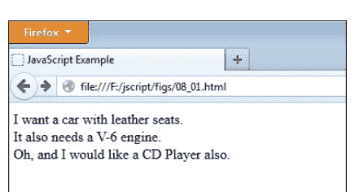

**图 8-1** 浏览器显示了每种汽车的特征。

该脚本的运行如图 8-1 所示。

### 属性值
虽然这不是房地产，但你可以更改你的属性值。在脚本中，你可以通过给对象属性分配新值来即时更改其值，就像操作变量一样。例如，如果你想更改之前示例中`work_car.engine`属性的值，只需为其分配一个你选择的新值即可。下面的示例显示了给`work_car.engine`属性分配一个新值：

```
work_car.engine = "V-4";
```

这可能不是一个好主意，但它可以为你节省保险费（还有汽油费！）
需要注意的是，前面的赋值将改变更改之后进行的任何调用中`work_car.engine`属性的值。在更改之前对该值进行的任何操作都不会受影响。

例如，以下代码为`work_car.engine`属性分配了新值：

```
function Car(seats, engine, radio) {
  this.seats = seats;
  this.engine = engine;
  this.radio = radio;
}
var work_car = new Car("cloth", "V-6", "Tape Deck");
var fun_car = new Car("leather", "V-8", "CD Player");
var original_work_car_engine = work_car.engine;
work_car.engine = "V-4";
var new_work_car_engine = work_car.engine;
document.write("wanted a " + original_work_car_engine + " initially<br>");
document.write("I got a " + new_work_car_engine + " instead of lower gas costs.");
```

`work_car.engine`原本设置为"V-6"，但被更改为了"V-4"。当它赋值给`original_work_car_engine`变量时，它仍然是"V-6"，该变量保留了该值。更改后，新值被赋值给`new_work_car_engine`，它使用了新值"V-4"。图 8-2 显示了在浏览器中运行此脚本的结果。

# 添加方法

要向构造函数添加一个方法，你可以将一个函数表达式赋值给属性名，如下代码所示：

```
function Car(seats, engine, radio) {
    this.seats = seats;
    this.engine = engine;
    this.radio = radio;
    this.describe = function() {
        document.write("This car has these features: ");
        document.write(this.seats + ", " + this.engine + ", " + this.radio);
    };
}
var work_car = new Car("cloth", "V-6", "Tape Deck");
work_car.describe();
```

如你所见，一旦有了对象的实例，就可以使用实例名、点和方法名来调用该方法。当方法被调用时，页面上会显示“This car has these features: cloth, V-6, Tape Deck”。

虽然向构造函数添加方法是直观的，但在构造函数内部包含方法有一个缺点。对于对象的每个新实例，都会创建一个执行相同操作的新方法函数。从本质上讲，方法被复制了多次，尽管在代码中没有直接看到。

正如你所看到的，构造函数内部的方法只是另一个属性。由于每个属性对于每个实例都是唯一的，方法函数也是每个实例唯一的。如果你有 50 个`Car`对象的实例，就会创建 50 个函数，消耗资源。

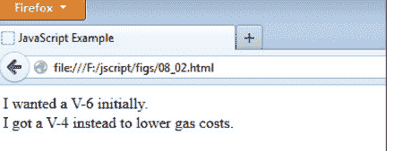

图 8-2 属性值的变化影响了更改之后使用它的语句，但不会影响更改之前使用的语句。

# 194 JavaScript：初学者指南

为了使其成为一个简单的可重复使用的单一函数，你可以将方法函数移动到构造函数外部，如下代码所示：

```
function Car(seats, engine, radio) {
  this.seats = seats;
  this.engine = engine;
  this.radio = radio;
  this.describe = describe_car;
}
function describe_car() {
  document.write("This amazing car has these features: ");
  document.write(this.seats + " seats, " + this.engine + " engine, ");
  document.write(this.radio);
}
var work_car = new Car("cloth", "V-6", "Tape Deck");
work_car.describe();
```

在这里，命名函数`describe_car`定义在构造函数外部，允许它被赋值给构造函数内部的属性以成为一个方法。注意在赋值时没有使用括号。这是为了将函数本身（而不是函数的结果）赋值给属性。当创建实例并运行方法时，你将获得之前相同的结果。

然而，这种技术也有缺点：方法函数现在是全局的，会使全局作用域充满应该属于构造函数局部作用域的函数。要解决这个问题，你需要学习原型（Prototypes）。

# 原型

JavaScript 中的每个函数都有一个被称为原型（prototype）的属性，这是一个包含了对于使用该函数的每个实例始终可用的属性和方法的对象。这允许跨实例轻松复用属性和方法。

# 使用原型

要了解原型如何工作，你将使用`Car`对象的原型属性。考虑以下代码：

```
function Car(seats, engine, radio) {
  this.seats = seats;
  this.engine = engine;
  this.radio = radio;
}
Car.prototype.locks = "automatic";
```

注意函数有一个原型属性（`Car.prototype`）。由于原型本身是一个对象，你可以向它添加任何其他属性。在这里，名为`locks`的属性被添加到了原型上。

那么，这到底做了什么？如果你添加`Car`对象的实例，你会发现每个实例都可以访问原型属性：

```
function Car(seats, engine, radio) {
  this.seats = seats;
  this.engine = engine;
  this.radio = radio;
}
Car.prototype.locks = "automatic";
var work_car = new Car("cloth", "V-6", "Tape Deck");
var family_car = new Car("cloth", "V-4", "CD Changer");
window.alert(work_car.locks);
window.alert(family_car.locks);
```

两个警报都会显示"automatic"，这在`Car`构造函数中不存在，但在原型中找到了。这是如何发生的？在 JavaScript 中，调用对象的属性或方法会首先检查尝试使用它的对象。如果那里没有找到属性或方法，它不会在那里放弃。相反，它将搜索原型查看是否有匹配。如果是，那么该属性或方法对于使用它的对象就是可用的。例如，图 8-3 显示了它如何检查`work_car`实例的`locks`属性。当那里没有时，会搜索原型，在那里找到了`locks`属性并供`work_car`实例使用。注意原型指向构造函数。构造函数和由该构造函数创建的任何实例都指向原型。在这种情况下，`Car`、`work_car`和`family_car`都指向原型，并可以使用原型内的任何属性或方法。

在创建实例时，你实际上为实例添加了一个与原型中属性同名的属性。这有效地隐藏了原型的值。

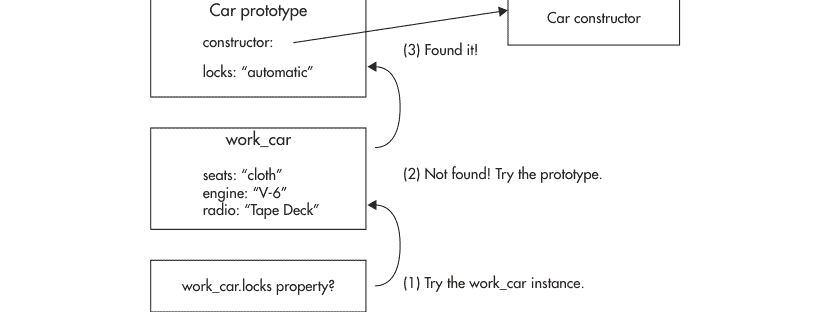

图 8-3 查找 locks 属性

# 196 JavaScript：初学者指南

对于对象的实例，如果原型中有同名的属性，该属性始终会在对象而不是原型中找到。例如，看以下代码：

```
function Car(seats, engine, radio) {
  this.seats = seats;
  this.engine = engine;
  this.radio = radio;
}
Car.prototype.locks = "automatic";
var work_car = new Car("cloth", "V-6", "Tape Deck");
var family_car = new Car("cloth", "V-4", "CD Changer");
work_car.locks = "manual";
window.alert(work_car.locks); // 显示 "manual"
window.alert(family_car.locks); // 显示 "automatic"
```

在这里，给`work_car.locks`赋值确保了在`work_car`实例中找到属性，不会搜索原型。因此，`work_car.locks`的值为"manual"。由于这不影响`family_car`实例，`family_car.locks`必须搜索原型来查找值，因此它的值仍然是"automatic"。

# hasOwnProperty() 方法

有时你想要知道正在使用的属性是在对象中还是原型中找到的。对象的`hasOwnProperty()`方法如果在实例中找到属性返回`true`，否则返回`false`。在上一个示例中，`work_car`实例有一个属性，而`family_car`实例没有（它只在原型有一个属性）。考虑以下代码：

```
function Car(seats, engine, radio) {
  this.seats = seats;
  this.engine = engine;
  this.radio = radio;
}
Car.prototype.locks = "automatic";
var work_car = new Car("cloth", "V-6", "Tape Deck");
var family_car = new Car("cloth", "V-4", "CD Changer");
work_car.locks = "manual";
window.alert(work_car.hasOwnProperty("locks")); // true
window.alert(family_car.hasOwnProperty("locks")); // false
```

在这里，第一个警报显示 true，而第二个显示 false。你将在章节后的部分看到，当你使用`for-in`循环且只想显示实例中的属性而不是原型中的属性时，这非常有用。

由于原型在构造函数外部并在全局作用域内，它为共享方法函数提供了一个良好的位置，这些函数可以在每个实例之间共享。你可以在构造函数中为它的属性的每个实例赋值（如果它们具有唯一值），并将它的方法放在原型（prototype）中，以便在所有实例中复用。出于上述原因，这是创建自定义对象的常用模式，通常称为构造函数/原型模式。

作为示例，以下代码将继续向`Car`构造函数添加属性，但将向`Car`的原型添加一个方法：

```javascript
function Car(seats, engine, radio) {
  this.seats = seats;
  this.engine = engine;
  this.radio = radio;
}
```

```javascript
Car.prototype.describe = function() {
  document.write("this car has these features: ");
  document.write(this.seats + " seats, " + this.engine + " engine, ");
  document.write(this.radio);
};
```

```javascript
var work_car = new Car("cloth", "V-6", "Tape Deck");
work_car.describe();
```

通过在代码中结合构造函数/原型模式，你现在可以允许实例属性和方法，以及共享的属性和方法。随着你继续这本书，你将看到更多关于原型的内容以及它们如何用于面向对象编程的继承。

## 对象的有用语句

JavaScript 允许你使用`for-in`循环来帮助遍历对象属性，并使用`with`语句更容易访问特定对象。

## for-in 循环

`for-in`循环允许你遍历对象的属性。以下代码显示了`for-in`循环的结构：

```javascript
for (var variable_name in object_name) { // 代表对象中的属性名，以及对象的名称
  // JavaScript 语句
}
```

假设你想遍历`Car`对象实例`work_car`的属性，以便在页面上显示每个属性的值。`for-in`循环允许你这样做，而无需输入每个属性名，如这段代码所示：

```javascript
function Car(seats, engine, radio) {
  this.seats = seats;
  this.engine = engine;
  this.radio = radio;
}
```

# 198 JavaScript：初学者指南。

```javascript
var work_car = new Car("cloth", "V-6", "Tape Deck"); // 创建的对象实例
for (var prop_name in work_car) { // for-in 循环开始
  document.write(prop_name + " " + work_car[prop_name] + "<br>");
}
```

这将显示每个属性名及其值（注意使用方括号符号，`prop_name`变量可以用于访问属性值）。

然而，注意，此循环将获取所有属性，包括在对象原型中找到的属性。如果你想确保你使用的属性属于对象的实例而不是原型，可以使用之前学习的`hasOwnProperty`方法在使用每个属性之前进行检查，如这段代码所示：

```javascript
function Car(seats, engine, radio) {
  this.seats = seats;
  this.engine = engine;
  this.radio = radio;
}
var work_car = new Car("cloth", "V-6", "Tape Deck");
for (var prop_name in work_car) {
  if (work_car.hasOwnProperty(prop_name)) {
    document.write(prop_name + " " + work_car[prop_name] + "<br>");
  }
}
```

在这里，代码显示你在页面上显示属性之前，是从对象实例而不是原型获取的属性。

## with 语句

如果你计划使用大量使用对象的语句，`with`语句允许你更轻松地访问对象的属性和方法。例如，如果你要在网页上编写许多使用名为`work_car`对象的语句，你可能会对输入对象名（`work_car`）、点运算符以及属性名感到疲倦。

### 注意

由于性能缺陷，通常不建议使用它，而且可能会使用该语句意外地赋值或覆盖全局变量。在启用"use strict"（严格模式）选项时，也不支持它。

`with`语句允许你在块内部的语句中省略对象名点运算符，因此你只需要输入属性名即可访问所需的属性。以下代码显示了该语句的结构：

```javascript
with (object_name) { // 将对象的名称放在括号内
  // 使用该对象的 JavaScript 语句放在这里
}
```

# 第8章：对象 199

假设你有一个名为`Car`的构造函数，具有`seats`、`engine`和`radio`属性，以及一个名为`work_car`的对象实例。你可以使用`with`语句来避免重复输入`work_car`和点运算符，如下例所示：

```javascript
function Car(seats, engine, radio) {
  this.seats = seats;
  this.engine = engine;
  this.radio = radio;
}
var work_car = new Car("cloth", "V-6", "Tape Deck");
with (work_car) {
  document.write("Seats: " + seats + "<br>");
  document.write("Engine: " + engine + "<br>");
  document.write("Radio: " + radio + "<br>");
}
```

现在你已经看到如何在不需要每次使用属性时都输入`work_car`和点运算符的情况下访问对象的汽车实例。

此示例在页面上显示了对象的`work_car`实例值。注意，在块内部，可以使用属性名而无需输入`work_car`和点运算符。

现在你已经看到如何访问对象的汽车实例，并且了解了如何创建对象、属性和方法，随着你阅读本书后续章节。

## 专家问答

- 问：我可以使用构造函数/原型模式来共享属性和方法吗？
  答：是的，如果某些属性不需要每个实例都是唯一的，你可以将它们添加到原型中，以便与其他实例共享。
- 问：JavaScript 有类吗？这会让事情变得更容易吗？
  答：计划在 ECMAScript Harmony 中实现`class`关键字，这将允许你构建类并扩展它们。在本书写作时，它尚未实现，但已经在路上了。

## JavaScript：初学者指南

- 问：我真的需要每次都通过构造函数创建一个实例吗？
  答：是的，构造函数只提供了对象的结构。
- 问：那么单例呢？我需要为它们创建实例吗？
  答：单例不需要创建实例，每个都是唯一的。

## 练习 8-2 使用构造函数/原型模式

pr8_2.html
prjs8_2.js

假设你决定销售某些电脑：工作电脑、家用电脑和游戏电脑。对于每种电脑，将有不同的属性和一个显示电脑属性的方法。

## 步骤

1. 创建一个 HTML 页面并保存为`pr8_2.html`。
2. 创建一个外部 JavaScript 文件并保存为`prjs8_2.js`。在第 3-8 步中使用它。
3. 创建一个`Computer`构造函数，并赋予它`type`、`processor`、`ram`和`hd`属性。
4. 创建名为`work_computer`的`Computer`实例。`type`的值为“Work”，`processor`的值为“2GHZ”，`ram`的值为“8GB”，`hd`的值为“1TB”。
5. 创建名为`home_computer`的`Computer`实例。`type`的值为“Home”，`processor`的值为“2GHZ”，`ram`的值为“4GB”，`hd`的值为“500GB”。
6. 创建名为`gaming_computer`的`Computer`实例。`type`的值为“Gaming”，`processor`的值为“4GHZ”，`ram`的值为“16GB”，`hd`的值为“2TB”。
7. 在`Computer`原型上创建一个名为`describe`的方法。使用它在页面上显示每个属性的值。

8. 完成后，你的 JavaScript 文件应该像下面所示：

```javascript
function Computer(type, processor, ram, hd) {
  this.type = type;
  this.processor = processor;
  this.ram = ram;
  this.hd = hd;
}
Computer.prototype.describe = function() {
  document.write("<p>" + this.type + "<br>");
  document.write("Processor: " + this.processor + "<br>");
  document.write("RAM: " + this.ram + "<br>");
  document.write("Hard Disk: " + this.hd + "</p>");
};
var work_computer = new Computer("Work", "2GHZ", "8GB", "1TB");
var home_computer = new Computer("Home", "2GHZ", "4GB", "500GB");
var gaming_computer = new Computer("Gaming", "4GHZ", "16GB", "2TB");
work_computer.describe();
home_computer.describe();
gaming_computer.describe();
```

9. 保存文件并在浏览器中打开 HTML 文件。每个实例的属性将显示出来。

## 本次尝试总结

在这个项目中，你利用关于构造函数和原型的知识创建了一个可复用的对象，该对象在原型上有一个方法，可以显示对象实例中的属性值。

## 理解预定义的 JavaScript 对象

在 JavaScript 中，有许多预定义的对象可以让你访问你可能需要的某些属性或方法。如果你学习了各种对象以及你可以用它们做什么，可以让你的脚本更具交互性。

本书将涵盖大部分预定义对象。在本章中，你将查看 navigator 和 history 对象，以及你可以用它们做什么。

## Navigator 对象

navigator 对象提供了对查看器浏览器各种属性的访问，例如名称、版本号等。它的名字源于 Mozilla Firefox 之前的 Netscape Navigator 浏览器。

navigator 对象是 window 对象的一部分，这意味着你可以使用`window.navigator.property`来访问其属性，但也可以简写为`navigator.property`。对于 window 对象的直接属性或方法也是如此（例如，`window.alert("Hi");`可以简写为`alert("Hi");`且依然有效）。

你经常会看到 window 对象的属性和方法以这种方式简写，以减少额外的输入或帮助缩短源代码。你将在第 11 章看到更多关于原因的内容。
首先，查看 navigator 对象的属性。

## 属性

navigator 对象的属性不能被更改，因为它们被设置为只读。表 8-1 显示了 navigator 对象的属性以及每个属性返回的值。当在后面括号中显示浏览器名称时，意味着在本文编写时，该属性仅在指定的浏览器中有效。
接下来的章节将详细查看一些更有用的属性。

| 属性 | 值 |
| :--- | :--- |
| appCodeName | 浏览器的名称 |
| appName | 浏览器的全名 |
| appMinorVersion | 表示浏览器次要版本的字符串（Internet Explorer 和 Opera） |
| appVersion | 浏览器的版本及其他信息 |
| browserLanguage | 正在操作系统的语言（Internet Explorer, Chrome 和 Opera） |
| buildID | 正在使用的浏览器构建标识符（Firefox） |
| cookieEnabled | 浏览器是否启用了 cookies |
| cpuClass | 用户电脑上的 CPU（Internet Explorer） |
| language | 正在使用的浏览器语言（Firefox, Chrome） |
| mimeTypes | 浏览器支持的 MIME 类型数组 |
| onLine | 浏览器是否处于“全局离线模式”（Internet Explorer, Firefox 和 Opera） |
| oscpu | 用户电脑上的操作系统和/或 CPU（Firefox） |
| platform | 创建浏览器的平台类型 |
| plugins | 浏览器已安装的插件数组 |
| product | 浏览器的产品名称（Firefox 和 Chrome） |
| productSub | 产品的构建号（Firefox 和 Chrome） |
| securityPolicy | 空字符串——以前在 Netscape 4.7 中返回过一个值（Firefox） |
| systemLanguage | 操作系统使用的默认语言（Internet Explorer） |
| userLanguage | 操作系统的自然语言（Internet Explorer 和 Opera） |
| userAgent | 浏览器的用户代理头 |
| userProfile | 访问用户配置中的信息（Internet Explorer） |
| vendor | 浏览器的厂商（Firefox 和 Chrome） |
| vendorSub | 浏览器的厂商版本号（Firefox 和 Chrome） |

表 8-1 Navigator 对象属性

## appName 属性

此属性允许你确定查看器正在使用的浏览器名称。如果你想知道特定浏览器的值，可以使用以下代码并在选定的浏览器中打开页面：

```javascript
window.alert("You have " + navigator.appName);
```

此属性在过去经常用于创建简单的浏览器检测脚本，如此代码所示：

```html
<script>
if (navigator.appName == "Microsoft Internet Explorer") {
  // IE 浏览器的代码
} else {
  document.write("Please get Internet Explorer to run this script");
}
</script>
<noscript>你没有 JavaScript！</noscript>
```

## cookieEnabled 属性

此属性在浏览器启用 cookies 时返回布尔值 true，如果未启用则返回布尔值 false。你可以用它避免在未启用时运行代码：

```javascript
if (navigator.cookieEnabled) {
  // 设置 cookie
}
```

## plugins 属性

此数组持有浏览器中安装的所有插件的值。这可以在运行代码之前检测查看器是否具有特定插件。

## 方法

navigator 对象有许多可以执行任务的方法。表 8-2 显示了这些方法。
接下来的章节将查看 javaEnabled 方法以及如何使用它。

## javaEnabled 方法

该方法在查看器启用了 Java 时返回布尔值 true；否则返回 false。如果你想向查看器显示 Java Applet，`javaEnabled()`方法非常有用。以下代码允许你这样做：

```javascript
if (navigator.javaEnabled()) {
  // 插入 Java Applet
} else {
  document.write("No Java? You cannot see my Java Applet!");
}
```

表 8-2 Navigator 方法

| 方法 | 用途 |
| :--- | :--- |
| javaEnabled() | 用于测试浏览器是否启用了 Java |
| preference() | 允许设置某些浏览器偏好。仅在特权模式下允许（Firefox） |
| registerContentType() | 允许网站成为某些 MIME 类型的潜在处理器 |
| registerProtocolHandler() | 允许网站成为某些协议的潜在处理器 |
| taintEnabled() | 返回 false——因为该方法已不再使用。它曾用于指定是否启用了数据污染。 |

## History 对象

history 对象也是 window 对象的一部分，它提供了有关当前窗口浏览器历史的信息。

## 属性

history 对象只有一个属性，名为`length`（在 Firefox 中还有几个可用属性，但它们不适用于 Web 内容）。该属性返回当前窗口浏览器会话历史中的页面数，包括当前加载的页面。它可以以类似的方式使用：

```javascript
alert("Your current window has viewed " + history.length + " pages!")
```
这只是向查看器发送一个警报，告知当前浏览器窗口查看了多少页面。

# 第8章：对象 (p. 205)

| 方法 | 目的 |
| --- | --- |
| back() | 将浏览器窗口返回到历史列表中的上一页 |
| forward() | 将浏览器向历史列表向前移动一页 |
| go() | 使用整数将浏览器发送到历史列表中的指定页面 |

表 8-3 History 对象的方法

## 方法

history 对象有三个方法，列在表 8-3 中。
接下来的章节将详细讨论这些方法的每一种。

**back() 方法**
`back()`方法将浏览器发送到历史列表中当前页面之前访问的上一个页面，这就像使用浏览器的“后退”按钮。要使用它，你只需在脚本中需要的地方调用该方法即可：

```
history.back();
```

**forward() 方法**
`forward()`方法将浏览器发送到历史列表中当前页面之后的页面，这就像使用浏览器的“前进”按钮。要使用它，你只需在脚本中需要的地方调用该方法即可：

```
history.forward();
```

**go() 方法**
`go()`方法接受一个整数作为参数。该整数可以是负数（在历史列表中后退），也可以是正数（在历史列表中向前移动）。例如，以下代码将窗口历史记录后退两页：

```
history.go(-2);
```

以下代码将向历史列表向前移动三页：

```
history.go(3);
```

与其他方法一样，如果你尝试访问的页面不存在（例如，像`history.go(15)`这样的页面可能在窗口历史记录中不存在），那么该方法将什么都不做。

预定义的 JavaScript 对象可能非常有帮助。正如你将在下一章中看到的，`document`对象（文档对象）允许你访问许多额外的属性和方法，用于处理 HTML 文档。

# 第8章 自测题

- 1. 对象（object）是 ________ 和 ________ 的集合。

- 2. 在创建单个对象时，你可以使用对象 ________ 或字面量表示法。

- 3. 使用对象字面量表示法时，属性和值被放在大括号 ({}) 内。
  A. 正确
  B. 错误

- 4. 在 JavaScript 中，你通常通过以下方式访问对象属性：
  A. 加法运算符 (+)
  B. 点运算符 (.)
  C. 乘法运算符 (*)
  D. 你无法访问对象的属性

- 5. 当你需要使用变量来访问属性名时，你可以使用 ________ 表示法。

- 6. 可以使用 ________ 函数来创建对象结构。

- 7. 使用`new`关键字可以创建一个对象的 ________ 。

- 8. 一个对象只能有一个实例。
  A. 正确
  B. 错误

- 9. 对于以下代码，你可以说明什么：
  `var x = myhouse.kitchen;`

  A. 它将字符串"myhouse.kitchen"赋值给变量`x`。
  B. 它将`myhouse`和`kitchen`的值相加并赋值给名为`x`的对象。
  C. 假设`myhouse`对象存在，它将`myhouse`对象中`kitchen`属性的值赋值给变量`x`。
  D. 假设`kitchen`对象存在，它将`kitchen`对象中`myhouse`属性的值赋值给变量`x`。

- 10. 如果在对象实例中找不到属性， JavaScript 将在对象的 ________ 中查找。

- 11. 下列哪项会向查看者发送警报，告知正在使用的浏览器名称？
  A. `window.alert("You are using " + navigator.appVersion);`
  B. `window.alert("You are using " + navigator.appName);`
  C. `window.alert("You are using " + navigator.javaEnabled());`
  D. `window.alert("You are using " + navigator.appCodeName);`

- 12. 对于以下代码，你可以说明什么？
  `myhouse.kitchen = "big";`

  A. 假设`myhouse`对象存在，`myhouse`属性被赋值了一个新的字符串值。
  B. 假设`myhouse`对象存在，变量的值被加到字符串"big"上。
  C. 假设`myhouse`对象存在，`kitchen`属性被赋值了一个新的字符串值"big"，或者用值"big"初始化。
  D. 这什么都不会做。

- 13. 在 JavaScript 中，有许多你可以使用的 ________ 对象来访问可能需要的某些属性和方法。

- 14. ________ 对象允许你访问查看者浏览器的各种属性。

- 15. 下列哪项不是`navigator`对象的属性？
  A. `appName`
  B. `appCodeName`
  C. `appType`
  D. `appVersion`

# 第9章

# 文档对象 (Document)

# JavaScript学者指南

## 核心技能与概念

- 定义文档对象
- 使用文档对象模型 (DOM)
- 使用文档对象的属性
- 使用文档对象的方法
- 使用 DOM 节点
- 创建动态脚本

现在你了解了对象是如何工作的以及如何使用预定义的 JavaScript 对象，是时候查看 JavaScript 中一些主要的预定义对象了。

本章涵盖了文档对象，它可以帮助你收集有关正在查看页面的信息。正如你将在本章中发现的，`document`对象允许你访问许多额外的属性和方法，用于处理 HTML 文档。

## 定义文档对象

`document`对象是浏览器为每个 HTML 页面创建的对象。为了开始你的文档对象之旅，你将查看它的属性和方法。许多这些属性在编写创建动态内容的脚本时将非常有用。

## 使用文档对象模型

文档对象模型 (DOM) 允许 JavaScript（以及脚本语言）访问文档的结构。每个文档由节点组成（例如，`<body>`标签就是一个节点）。如果你有以下 HTML 代码，可以使用 JavaScript 访问其结构：

```html
<body>
  <h1>My Page</h1>
  
</body>
```

图 9-1 显示了`body`元素是一个节点，以及它是如何拥有子节点的。每个元素也有节点。`h1`和`img`元素都是`body`元素的子节点。`h1`元素包含一个文本节点（"My Page"），而`img`元素包含属性（`src="myimage.jpg"`和`alt="My Picture"`）。你可以编写脚本添加、删除或更改 DOM 节点。你可以使用`document.getElementById()`方法通过属性值访问元素，并使用`document.getElementsByTagName()`或`document.getElementsByClassName()`获取元素组。

## 使用文档对象的属性

首先，你将查看文档对象的属性。表 9-1 列出了文档对象的属性及其简要描述。表格之后，将对某些特定属性进行详细讨论。

> 注意
> 并不是所有这些属性都能跨浏览器工作。你可以访问 http://developer.mozilla.org/en/DOM/document#Properties 和 http://msdn.microsoft.com/en-us/library/ms531073(VS.85).aspx 获取这些每个属性的更多信息。

## 集合

许多属性（`anchors`、`embeds`、`forms`、`images`、`links`、`plugins`、`scripts`、`styleSheets`和`styleSheet`）返回一个包含文档中的元素或值的数组。可以像任何数组索引一样访问它们。索引零的元素或值将是第一个，第二个，以此类推。

| body | |
|---||
| h1 (body 的子节点) | img (body 的子节点) | |
| My Page (h1 节点的子节点) | src="myimage.jpg" alt="My Picture" (img 节点的属性节点) | |

图 9-1 文档结构示例

| 属性 | 描述 |
| --- | --- |
| activeElement | 返回活动（聚焦）的元素 |
| anchors | 返回文档中所有命名锚点的数组 |
| async | 告诉浏览器使用异步请求还是同步请求加载文档 |
| baseURIObject | 返回一个表示文档 URI 的对象。仅在特权模式下可用 |
| body | 返回文档的 body 元素或 iframe 元素 |
| charset | 返回文档中使用的字符集 |
| compatMode | 如果文档在怪异模式（Quirks mode）下渲染，则返回字符串"BackCompat"，如果在严格模式（Strict mode）下渲染，则返回字符串"CSS1Compat" |
| contentType | 返回文档 MIME 头中的 Content-Type 值 |
| cookie | 在文档中返回或设置 JavaScript cookie |
| currentScript | 返回当前正在读取的脚本元素 |
| defaultCharset | 返回区域语言设置中找到的默认字符集 |
| defaultView | 返回文档的 window 对象 |
| designMode | 允许对文档进行编辑 |
| dir | 返回或设置文档的方向 |
| doctype | 返回与文档相关的 doctype 声明 |
| documentElement | 返回表示文档根节点的字符串 |
| documentMode | 返回文档的兼容模式 |
| documentURI | 返回文档的位置 |
| documentURIObject | 返回一个表示文档 URI 的对象（仅对特权 JavaScript 代码可用） |
| domain | 返回文档服务器的域名 |
| embeds | 文档中所有 embed 元素的数组 |
| expando | 根据文档内是否创建了任意变量返回布尔值 |
| fileSize | 返回以字节为单位的文档大小 |
| fileCreatedDate | 返回文档创建日期 |
| fileModifiedDate | 返回文档最后修改日期 |
| forms | 返回文档中所有表单元素的数组 |
| head | 返回文档的 head 元素 |

**表 9-1** 文档对象的属性

| 属性 | 描述 |
| --- | --- |
| images | 返回文档中所有图像 (img)元素的数组 |
| implementation | 返回实现对象 |
| inputEncoding | 返回表示文档编码的字符串 |
| lastModified | 返回文档最后修改的日期 |
| lastStyleSheet | 返回使用 selectedStyleSheet 的最近样式表名称 |
| links | 返回文档中所有超链接元素的数组 |
| location | 返回文档的 URI |
| namespaceURI | 返回文档的 XML 命名空间 |
| parentWindow | 返回父窗口的引用（父窗口对象） |
| plugins | 返回文档中使用的所有插件的数组 |
| popupNode | 返回调用弹出窗口时的元素 |
| preferredStyleSheet | 根据文档中样式声明顺序返回样式表 |
| protocol | 返回文档的协议部分（URL） |
| readyState | 返回文档的加载状态 |
| referrer | 返回引用者的文档 URI |
| rootElement | 返回文档的 SVG 元素 |
| scripts | 返回文档中所有脚本元素的数组 |
| selectedStyleSheet | 返回或设置当前样式表 |
| styleSheets | 返回文档中使用的所有样式表的数组 |
| styleSets | 返回文档中使用的所有样式集的数组 |
| textContent | 返回或设置文本内容 |
| title | 返回文档 title 标签内部使用的文本 |
| tooltipNode | 返回作为工具提示目标的元素 |
| uniqueID | 返回为文档生成的唯一 ID |
| URL | 返回当前文档的 URI |
| URLUnencoded | 返回无任何编码的 URI |
| xmlEncoding | 返回 XML 声明中找到的字符编码 |
| xmlStandalone | 返回或设置 XML 声明中找到的值 |
| xmlVersion | 返回或设置 XML 声明中找到的版本 |
| XSLDocument | 返回 XSL 文档的根元素 |

表 9-1 文档对象的属性（续）

## JavaScript：初学者指南

例如，可以使用`links`属性访问文档中的所有链接。如果你需要找到文档中的第一个链接，可以使用`document.links[0]`将该元素作为对象访问。你可以使用 DOM 属性或方法（在本章稍后的部分讨论）来获取或设置信息，或在元素上执行任务。

### cookie 属性

`cookie`属性用于设置 JavaScript cookie，以便为查看者存储信息。cookie 是保存到查看者计算机上的、持续特定时间（一个浏览器会话）的小型文本文件。cookie 对于允许网站记住并检索查看者的信息（例如购物车内容、特殊设置或信息）非常有帮助。

要设置 cookie，请将`document.cookie`属性的值设置为包含你想要为查看者存储的信息的字符串。以下是语法：

```
document.cookie = string;
```

你将用*string*替换为包含你想使用的信息的文本字符串。通常，其格式如下面的设置 cookie 示例所示：

```
document.cookie = "site=homepage";
```

你可以看到 cookie 设置了一项内容：site 是 homepage。两个等号之间的内容用于在读取 cookie 时帮助区分 site 和 homepage。注意，设置 cookie 不会替换整个 cookie；它只是将新字符串添加到其中。你将在随后的章节中更详细地了解如何使用高级字符串处理技术，以及如何设置和读取 cookie。

### dir 属性

`dir`属性返回一个表示文档阅读方向的字符串。该值可以是`ltr`（从左到右）或`rtl`（从右到左）。这对于显示从右到左而非从左到右读取的语言的 Web 页面非常有用，将值设置为`rtl`即可。为了好玩，你可以使用此属性动态更改页面的外观，如下例代码所示：

```
document.dir = "rtl";
```

图 9-2 显示了当`dir`属性设置为“rtl”时页面的显示效果。

### lastModified 属性

`lastModified`属性持有当前文档修改的日期和时间值。它主要用于信息目的，例如显示文档最后修改的日期，让查看者知道你何时更新了页面。该属性的值取决于你的浏览器，因为如果你在页面上编写最后修改日期，不同的浏览器会有不同的结果。

# 第 9 章：文档对象

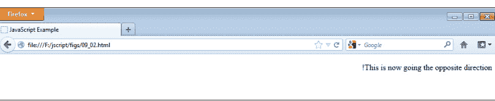

**图 9-2** 方向设置为 rtl 的 Web 页面

考虑以下代码，它将`document.lastModified`属性的值写入 Web 页面以显示最后修改的日期和时间：

```html
<body>
<h1>My Always Updated Web Page!</h1>
<script type="text/javascript">
document.write("Last Updated: " + document.lastModified);
</script>
</body>
</html>
```

图 9-3 显示了该代码在 Mozilla Firefox 中查看的结果。在页面上编写最后修改日期时，差异仅体现在空间上。某些布局可能需要为该属性较长的版本留出额外空间。

### referrer 属性

`referrer`属性用于信息目的，并持有进入你的页面之前的页面的 URL 值（引用页面）。虽然这可能很有用，但查看者并不总是带有引用 URL 进入的（例如使用书签或输入地址时），因此该值可能为空。此外，此属性的值

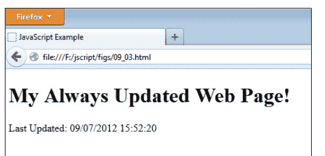

**图 9-3** 在 Mozilla Firefox 中查看的最后修改日期

# 216 JavaScript：初学者指南

`referrer`属性（引用属性）并不总是正确的，因为不同的浏览器可能将不同类型的对象视为新页面的引用，而不仅仅是链接，而且用户可能会隐藏或更改引用来源（referrer）。

将以下示例中的代码放入文档中，将向页面查看者发送一个警框，告诉他们在进入你的页面之前在的地方：

```
window.alert("You came from " + document.referrer + " !");
```

因此，如果引用页面是 http://www.scriptweb.com/js/，则会向查看者发送一个显示“You came from http://www.scriptweb.com/js/!”的警框。

# title 属性

`title`属性持有 HTML 文档标题的字符串值。标题设置在页面的`<title>`和`</title>`标签内部。

你可以使用`title`属性的一种方法是在窗口顶部栏以外的其他地方向查看者显示页面标题。以下代码将允许你：

```html
<head>
<title>Lions, Tigers and Bears!</title>
</head>
<body>
<script type="text/javascript">
document.write("<h1>" + document.title + "</h1>");
</script>
Lions and tigers and bears were what I saw when I went to ...
</body>
```

文档的标题将作为标题的形式显示给查看者。

这会在页面上将你的标题作为标题。图 9-4 显示了在浏览器中查看的结果。

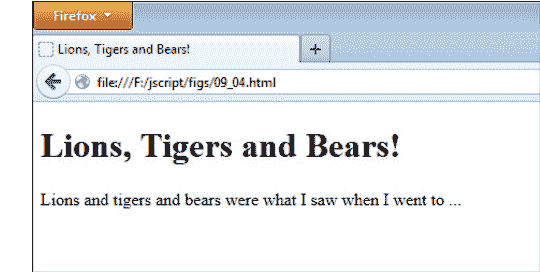

图 9-4 文档标题以标题的形式显示在页面上。

# URL 属性

`URL`属性持有当前文档完整 URL 的值。如果你在 HTML 页面的底部打印它，这个信息将非常有用，因为对于任何打印你页面的人来说，它都会显示 URL。

虽然你可以自己在底部输入 URL，但当需要在许多页面上这样做时，可能会变得非常繁琐。这时这个属性就很有用了，你可以向每个页面剪切粘贴一个小脚本，而不是每次都输入各种 URL 地址。在页面上编写 URL 地址的示例如以下代码所示：

```html
<body>
<h1>Buy Something!</h1>
If you don't buy something I will be really upset so you had better...
<br><br>
<script type="text/javascript">
document.write("You are at: " + document.URL);
</script>
</body>
```

图 9-5 显示了上述代码在浏览器中的结果。页面的最后一行告诉查看者当前位置。图中显示的是本地文件地址，但如果页面在网上，它将显示普通的 URL。

# URLUnencoded 属性

`URLUnencoded`属性返回未经任何编码的文档 URL。例如，如果文件名包含空格，该属性将返回空格而不是`%20`。对于 URL `http://scriptweb.com/my_script.html`，文档的`URL`属性将返回`http://scriptweb.com/my%20script.html`。文档`URLUnencoded`属性返回`http://scriptweb.com/my_script.html`，URL 返回空格的编码。请注意，在编写时，该属性仅在 Microsoft Internet Explorer 中可用。

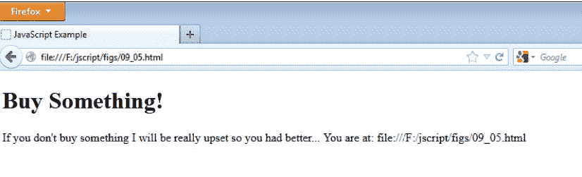

图 9-5 文档的 URL 显示在页面内容的末。

## JavaScript：初学者指南

## 专家问

**Q：** 学习文档对象（document object）和 DOM 对我有帮助吗？
**A：** 有的，因为它们不仅为处理 Web 页面，还为其他类型的文档提供了基础。例如，其他类型的文档使用类似的节点结构，学习它在 HTML 文档中如何工作，对于你需要在另一个平台（如用于 PDF 文件的 Adobe Acrobat）上使用 JavaScript 是有帮助的。

**Q：** `referrer`属性很酷！有没有什么方法可以在每次访问者进入时将信息写入文件，这样我就能知道我的访问者从哪里来了？
**A：** 客户端 JavaScript 无法自动在文件中保存信息，但可以将信息发送到服务器端程序，并在那里将其存储在文件或数据库中。你将在后面的章节中学习更多关于这些知识（使用 JSON 和/或 AJAX）。

**Q：** 除了元素集合的数组，还有其他方法可以访问文档中的元素吗？
**A：** 文档对象的方法（如`getElementById`）允许你更具体地选择要选择的元素。你将在下一节学习如何使用这些方法。

# 使用文档对象的方法

文档对象的方法允许你实现目前尚无法实现的新功能。表 9-2 列出了这些方法以及对每个方法的简短描述。由于其中许多方法是特定浏览器的（与属性一样），因此在表格之后仅对某些特定方法进行了更详细描述。

> 注意
> 并非所有这些属性都支持跨浏览器。你可以通过访问 http://developer.mozilla.org/en/DOM/document#Methods 和 http://msdn.microsoft.com/en-us/library/ms531073(VS.85) 获取更多关于这些属性的信息。

# 文档对象的 get 方法

文档对象的方法允许你执行你尚未能够执行的新操作。表 9-2 列出了这些方法并对每个方法进行了简短描述。由于其中许多方法是特定浏览器的（与属性一样），因此在表格之后仅对某些特定方法进行了更详细描述。

# 第 9 章：文档对象 219

| 方法 | 描述 |
| --- | --- |
| adoptNode() | 从另一个文档采用节点 |
| createAttribute() | 创建属性 |
| createAttributeNS() | 创建特定命名空间的属性 |
| createCDATASection() | 创建 CDATA 段 |
| createComment() | 创建注释 |
| createDocumentFragment() | 创建文档碎片 |
| createElement() | 创建元素 |
| createElementNS() | 创建特定命名空间的元素 |
| createEvent() | 创建事件 |
| createEventObject() | 创建事件对象 |
| createNodeIterator() | 创建节点迭代器 |
| createNodeResolver() | 创建节点解析器 |
| createProcessingInstruction() | 创建处理指令 |
| createRange() | 创建范围 |
| createStylesheet() | 创建样式表 |
| createTextNode() | 创建文本节点 |
| createTreeWalker() | 创建树遍历 |
| elementFromPoint() | 根据位置返回元素 |
| evaluate() | 根据参数返回结果 |
| execCommand() | 在设计模式下执行命令 |
| getElementById() | 允许通过 ID 更具体地选择要选择的元素 |
| getElementsByClassName() | 按类名获取元素 |
| getElementsByName() | 按名称获取元素 |
| getElementsByTagName() | 按标签名获取元素 |
| getElementsByTagNameNS() | 按标签名和命名空间获取元素 |
| getSelection() | 获取文档中选中的文本 |

# 文档对象的方法

| 方法 | 描述 |
| --- | --- |
| hasFocus() | 判断文档是否具有焦点 |
| importNode() | 返回另一个文档节点的副本 |
| isDefaultNamespace() | 判断命名空间是否为默认命名空间 |
| isEqualNode() | 检查两个节点是否相等 |
| isSameNode() | 检查两个节点是否指向同一个节点 |
| load() | 加载 XML 文档 |
| loadOverlay() | 在 XUL 文档中加载叠加 |
| lookupNamespace() | 返回命名空间 URI |
| lookupPrefix() | 返回指定的前缀 |
| normalize() | 标准化文档中的节点，使其没有空文本节点且没有相邻的文本节点（将其合并为单个文本节点） |
| open() | 打开新文档并允许使用 write() 或 writeln() 写入内容 |
| close() | 关闭通过 open() 方法打开的文档 |
| queryCommandHandler() | 根据传递的参数返回命令是否可以执行的布尔值 |
| queryCommandIndeterm() | 根据命令返回命令是否处于不确定状态的布尔值 |
| queryCommandState() | 返回命令是否已执行的返回值 |
| queryCommandSupported() | 返回命令是否支持的布尔值 |
| queryInputValue() | 返回文档中命令的当前值 |
| querySelector() | 返回匹配选择器的第一个元素节点 |
| querySelectorAll() | 返回匹配选择器的所有元素节点 |
| recalc() | 重新计算文档中的动态属性 |
| releaseCapture() | 释放鼠标捕获 |
| write() | 允许向 HTML 文档写入字符串文本 |
| writeln() | 允许向 HTML 文档写入字符串文本，但以 JavaScript 换行符结束行 |

表 9-2 文档对象的方法（续）

## 第 9 章：文档对象 221

## getElementById() 方法

`getElementById()`方法允许你通过元素的`id`属性值来访问元素。例如，如果你有以下 HTML 代码，可以使用`getElementById()`方法访问`div`元素：

```html
<div id="some_text">This is some text.</div>
```

由于`div`元素的`id`属性值为`some_text`，`document.getElementById()`方法可以使用该值作为参数来访问`div`元素：

```javascript
var text_element = document.getElementById("some_text");
```

在本章中，你将发现可以使用此方法以及其他选择方法从元素中检索信息、修改元素、添加元素或删除元素。

## getElementsByClassName() 方法

该方法允许你获取一个数组，其中包含文档中所有具有指定类名（来自 CSS 类）的元素。例如，要获取所有类名为`number_one`的元素，你可以使用以下代码：

```javascript
var my_class = document.getElementsByClassName("number_one");
```

## getElementsByName() 方法

该方法允许你获取一个数组，其中包含文档中所有具有指定`name`属性值的元素。在许多情况下，此值对于某个元素是唯一的。然而，属于同一组的单选按钮都需要具有相同的`name`值（这样只能选择其中一个）。这是一个可以检索所有元素的案例：

```html
<fieldset>
  <legend>选择一种恐龙：</legend>
  <input type="radio" name="dino" id="enigmosaurus" value="Enigmosaurus">
  <label for="enigmosaurus">神秘的类型</label>
  <input type="radio" name="dino" id="dino_spino" value="Spinosaurus">
  <label for="dino_spino">骨骼非常发达的</label>
  <input type="radio" name="dino" id="dino_xeno" value="Xenotarsaurus">
  <label for="dino_xeno">独特的命名类型</label>
</fieldset>
```

这段 HTML 代码有一组单选按钮，它们的名称均为`dino`。如果你想获取所有这些元素，可以使用以下代码：

```javascript
var dino_radios = document.getElementsByName("dino");
```

## 222 JavaScript：初学者指南

这会将所有名为`dino`的单选按钮元素检索到一个数组中，然后可以对该数组进行循环以执行任何必要的任务：

```javascript
for (var i = 0; i < dino_radios.length; i++) {
  // 执行一些操作...
}
```

如你所见，你现在可以在循环中处理所有元素，而不是通过`id`收集每个元素来执行相同的任务。

## getElementsByTagName() 方法

该方法允许你获取一个数组，其中包含文档中所有具有指定标签名的元素。例如，要获取文档中的所有图像元素，你可以使用以下代码：

```javascript
var all_images = document.getElementsByTagName("img");
```

## 更具针对性

一旦获取了更具体的对象，就可以对它们使用更具针对性的方法。例如，假设你有以下 HTML 代码：

```html
<nav id="sitelinks">
  <a href="page1.html">第 1 页</a>
  <a href="page2.html">第 2 页</a>
  <a href="page3.html">第 3 页</a>
</nav>
<div>
  这里是一些内容，并查看 <a href="someplace.com">我的其他网站</a>
</div>
```

如果你想获取`nav`元素内的链接，使用`document.getElementsByTagName("a")`将不起作用，因为你还会获取`div`内部的链接（仍然是文档的一部分）。要实现这一点，你可以先获取`nav`元素，然后对为`nav`元素创建的对象使用`getElementsByTagName()`方法，代码如下所示：

```javascript
// 通过其 id 获取 nav 元素
var nav_element = document.getElementById("sitelinks");
var nav_links = nav_element.getElementsByTagName("a");
alert("nav 元素中有 " + nav_links.length + " 个链接。");
```

`nav`元素中的链接数量是通过`nav`元素内每个元素创建的`nav_links`数组的`length`显示的。

在这里，你通过`id`获取了`nav`元素，创建了`nav`元素对象。该对象用于获取其内部所有的链接并将它们放入一个名为`nav_links`的数组中。现在可以使用此数组循环遍历`nav`元素内的每个链接，或者找出`nav`元素中包含多少链接。在这种情况下，链接的数量通过`nav_links`数组的长度 (3) 提示。

## open() 和 close() 方法

`open()`方法允许你打开新文档并完全使用`document.write()`或`document.writeln()`语句创建其内容。当调用`open()`时，浏览器会寻找这些语句以便写入新页面。一旦完成`write()`和/或`writeln()`语句，你就使用`document.close()`完成页面。

### 注意

当你向当前加载的页面写入内容时，不需要（也不建议）使用`open()`和`close()`方法。

为了示例`open()`和`close()`方法，假设你想创建一个新页面。以下代码展示了如何操作（将文件保存为 document.html）：

```html
<body>
  <form onsubmit="newpage()">
    输入姓名：<input type="text" id="yourname" size="25">
    <input type="submit" value="提交">
  </form>
  <script src="document.js"></script>
</body>
```

JavaScript 文件 (document.js) 将包含`newpage()`函数：

```javascript
function newpage() {
  var name = document.getElementById("yourname").value;
  document.open();
  document.write("<h1>欢迎！</h1>");
  document.write("你好，" + name + " - 欢迎来到我的页面！");
  document.close();
}
```

## 224 JavaScript：初学者指南

## write() 和 writeln() 方法

你在书的早期就已经开始使用`write()`方法，所以你已经知道它是如何工作的了。`document.write()`方法用于在调用它的页面上显示字符串值。`writeln()`方法的作用相同，但在语句末尾添加了一个换行符 (`\n`)。回想一下第 3 章讨论的 JavaScript 换行符是如何工作的——它只会在页面源代码中插入新行，而不会影响 HTML 页面的最终显示。

**提示**

当使用`document.write()`时，换行符只会影响源代码的显示，它可以用于在 JavaScript 创建的显示元素（如`alert`、`prompt`和`confirm`框）中创建新行。

页面显示不受 JavaScript 换行符的影响。回想第 3 章中的示例，它使用换行符将代码分成了两个不同的行：

```html
<body>
<script type="text/javascript">
document.writeln("<strong>JavaScript Rules!</strong>" + "\n" + "This is fun.");
</script>
</body>
```

由于`document.writeln()`方法在语句末尾添加了换行符，你可以使用以下`document.writeln()`语句重写上述代码：

```html
<body>
<script type="text/javascript">
document.writeln("<strong>JavaScript Rules!</strong>");
document.writeln("This is fun.");
</script>
</body>
```

这会将代码行放在页面源代码的两个不同行上，但不会影响浏览器中页面显示。

## 使用 DOM 节点

document 对象具有一些方法（如`createElement()`、`createAttribute()`和`createTextNode()`），它们允许你使用 JavaScript 在页面上创建新元素或节点。要使用这些方法，必须将新内容作为 DOM 中现有节点的子节点。这时就需要 DOM 节点的属性和方法了。

## JavaScript：入门指南

## DOM 节点属性

每个 DOM 节点都是一个具有可以访问的属性和方法的对象。DOM 节点属性列于表 9-3。

| 属性 | 描述 |
| --- | --- |
| attributes | 返回指定节点中所有属性的数组 |
| baseURI | 返回节点的基 URI |
| baseURIObject | 返回表示节点基 URI 的对象 |
| childElementCount | 返回作为元素的子节点数量 |
| childNodes | 返回指定节点中所有子节点的数组 |
| children | 返回指定节点中所有子元素的数组 |
| classList | 返回元素`class`属性中的类列表 |
| className | 返回元素`class`属性的值 |
| clientHeight | 返回元素的高度（像素） |
| clientWidth | 返回元素的宽度（像素） |
| clientLeft | 返回元素左边框的宽度（像素） |
| clientTop | 返回元素上边框的宽度（像素） |
| contentEditable | 返回元素是否可编辑 |
| dataset | 访问元素的自定义数据属性 |
| dir | 返回指定节点文本方向的值 |
| firstChild | 返回指定节点的第一个子节点 |
| firstElementChild | 返回指定节点的第一个直接子元素 |
| id | 返回指定节点的 id |
| innerHTML | 返回或设置指定节点内的 HTML 代码 |
| innerText | 返回或设置指定节点的内部文本 |
| isContentEditable | 返回元素的内容是否可以编辑 |
| lang | 返回指定节点的语言值 |
| lastChild | 返回指定节点的最后一个子节点 |
| lastElementChild | 返回该元素的最后一个直接子元素 |
| localName | 返回节点名称的局部部分 |

**表 9-3** DOM 节点属性

## 第 9 章：文档对象 227

| 属性 | 描述 |
| --- | --- |
| name | 返回指定元素的 name 属性 |
| namespaceURI | 返回指定节点的命名空间 URI |
| nextSibling | 返回指定节点之后的节点 |
| nextElementSibling | 返回与指定元素同一层级的下一个元素 |
| nodeName | 返回指定节点的名称（例如 div 元素的 div） |
| nodePrincipal | 返回指定节点的安全上下文（特权代码） |
| nodeType | 返回指定节点的类型 |
| nodeValue | 返回指定节点的值（例如 div 元素内的文本或属性值） |
| offsetHeight | 返回指定节点的偏移高度 |
| offsetWidth | 返回指定节点的偏移宽度 |
| outerHTML | 返回或设置指定节点的 HTML 代码（包括指定节点本身） |
| ownerDocument | 返回包含指定节点的文档对象 |
| parentNode | 返回指定节点的父节点 |
| prefix | 返回指定节点的命名空间前缀 |
| previousSibling | 返回指定节点之前的节点 |
| scrollLeft | 返回指定节点左边缘与视图中左边缘之间的差异 |
| scrollTop | 返回指定节点顶边缘与视图中顶边缘之间的差异 |
| scrollHeight | 返回指定节点的整个高度（包括任何隐藏和通过滚动条可见的内容） |
| scrollWidth | 返回指定节点的整个宽度（包括任何隐藏和通过滚动条可见的内容） |
| style | 返回指定节点的样式对象 |
| tabIndex | 返回节点的标签索引 |
| tagName | 返回指定节点的标签名（大写） |
| textContent | 返回或设置节点的文本内容 |
| title | 返回节点的 title 属性值 |

表 9-3 DOM 节点属性（续）

## JavaScript：入门指南

当表 9-3 提到指定节点时，节点的工作方式与你之前章节中处理元素非常相似。例如，你可能有以下 HTML 代码：

```html
<body>
<div id="div1" title="All about me!">
  This page is about me, me, and... me!
</div>
</body>
```

如果你想知道元素 title 属性的值，可以使用`document.getElementById`通过其 id 获取 div 元素。这将是 DOM 节点的属性。然后，你可以通过以下代码访问元素的属性：

```javascript
// 通过 id 获取元素并赋值给变量
var me_div = document.getElementById("div1");
window.alert("元素的标题是 " + me_div.title);
```

这的工作方式就像对象属性，正如你在上一章中学到的一样。`me_div.title`属性返回字符串"All about me"，这是元素 title 属性的值。

了解这一点后，你可以这样使用 DOM 方法。

## DOM 节点方法

如前面所述，为了通过将创建的节点添加到文档来使创建方法有用，需要 DOM 节点方法（如`appendChild()`或`insertBefore()`）来将新节点添加到文档中。

例如，你可能有之前使用的 HTML 代码：

```html
<body>
<div id="div1" title="All about me!">
  This page is about me, me, and... me!
</div>
</body>
```

这段代码包含一个带有文本节点（以及属性节点）的 div 元素。如果你想作为 div 元素的最后一个子元素创建一个 div 元素，你可以结合使用`document.createElement()`、`document.createTextNode()`和 DOM 节点方法`appendChild()`。

每个节点都是一个可以使用所有节点属性和方法的对象。由于你已经有了一个 div 节点，你可以使用`getElementById`将其作为对象访问，这将允许你使用`appendChild()`方法在其内部添加元素。

| 方法 | 说明 |
|---|---|
| addEventListener() | 向指定的节点添加事件监听器，在发送到该节点的事件发生时作为参数运行一个函数 |
| appendChild() | 将节点作为指定节点的最后一个子节点添加 |
| attachEvent() | 为指定的节点绑定事件，在发送到该节点的事件发生时作为参数运行一个函数 |
| blur() | 从指定的节点移除焦点 |
| click() | 在指定的节点上执行点击事件 |
| cloneNode() | 创建指定节点的克隆 |
| compareDocumentPosition() | 返回一个数字，表示该节点相对于作为参数传递的节点的位置 |
| detachEvent() | 从指定的节点上解绑事件 |
| dispatchEvent() | 在指定的节点上执行事件 |
| focus() | 给指定的节点赋予焦点 |
| getAttribute() | 返回作为参数传递的属性名称的值 |
| getAttributeNS() | 返回作为参数传递的属性名称和命名空间的值 |
| getAttributeNode() | 返回作为参数传递的属性名称的属性节点 |
| getAttributeNodeNS() | 为指定的节点返回作为参数传递的属性名称和命名空间对应的属性节点 |
| getElementsByTagName() | 返回指定节点中所有与参数传递的标签名相同的子元素节点数组 |
| getElementsByTagNameNS() | 返回指定节点中所有与参数传递的标签名和命名空间相同的子元素节点数组 |
| hasAttribute() | 如果作为参数传递的属性名称存在于指定节点，则返回 true，否则返回 false |
| hasAttributeNS() | 如果作为参数传递的属性名称和命名空间存在于指定节点，则返回 true，否则返回 false |
| hasAttributes() | 如果指定节点有任何定义的属性，返回 true，否则返回 false |
| hasChildNodes() | 如果指定节点有任何子节点，返回 true，否则返回 false |
| insertBefore() | 在指定的节点内部，将作为参数传递的节点插入到第二个参数节点之前 |
| normalize() | 规范化指定的节点 |

**表 9-4** DOM 节点方法

| 方法 | 说明 |
|---|---|
| removeAttribute() | 从指定的节点移除作为参数传递的属性名称的属性节点 |
| removeAttributeNode() | 从指定的节点移除作为参数传递的属性对象引用的属性节点 |
| removeAttributeNS() | 从指定的节点移除作为参数传递的属性名称及其命名空间的属性节点 |
| removeChild() | 从指定的节点移除作为参数传递的子节点 |
| removeEventListener() | 从指定的节点上移除事件监听器 |
| replaceChild() | 在指定的节点中，将第二个参数传递的子节点替换为第一个参数传递的子节点 |
| scrollIntoView() | 将指定的节点滚动到浏览器窗口 |
| setAttribute() | 为指定的节点设置属性名称（第一个参数）和值（第二个参数） |
| setAttributeNode() | 为指定的节点设置作为参数传递的属性对象作为属性节点 |
| setAttributeNodeNS() | 为指定的节点设置作为参数传递的带有命名空间的属性对象的属性节点 |
| setAttributeNS() | 为指定的节点设置属性的命名空间（第一个参数）、名称（第二个参数）和值（第三个参数） |

**表 9-4** DOM 节点方法（续）

## 230 JavaScript：初学者指南

首先，进入 JavaScript 代码，通过 id 获取 div1 并将其赋值给一个变量：

```javascript
var me_div = document.getElementById("div1");
```

接下来，使用`document.createElement()`创建新元素：

```javascript
var inner_div = document.createElement("div");
```

之后，使用`document.createTextNode`方法为 inner_div 节点创建文本节点：

```javascript
var inner_div_text = document.createTextNode("More about me...");
```

接下来，使用 DOM 节点方法`appendChild`将文本节点作为 inner_div 节点的子节点：

```javascript
inner_div.appendChild(inner_div_text);
```

## 第 9 章：文档对象 231

给 inner_div 节点赋予标题，可以为其 title 属性赋值：

```javascript
inner_div.title = "More";
```

最后，使用 DOM 节点方法`appendChild()`将 inner_div 节点作为最后一个元素添加到文档结构中（在此例中，它是 me_div 节点的唯一子元素）：

```javascript
me_div.appendChild(inner_div);
```

完整的 JavaScript 代码如下所示：

```javascript
var me_div = document.getElementById('div1');
var inner_div = document.createElement('div');
var inner_div_text = document.createTextNode("More about me...");
inner_div.appendChild(inner_div_text);
inner_div.title = "More";
me_div.appendChild(inner_div);
```

## 234 JavaScript：初学者指南

## 尝试此总结

在这个项目中，你利用了关于文档对象属性和方法以及 DOM 节点的知识，来弹出一个 DOM 属性，并在文档结构中创建一个新的`div`元素。

## 创建动态脚本

正如你所看到的，JavaScript 允许你通过`document.getElementById`和`document.getElementsByTagName()`等各种方法访问文档中的所有元素。这允许你像之前看到的那样获取信息、添加节点、修改节点和删除节点。此外，你还可以通过 DOM 节点属性访问元素的样式属性（通常最初是通过样式表设置），以便对位置、颜色、边框、大小或样式的任何部分进行更改。

## JavaScript 中的样式

当使用级联样式表（CSS）设置样式时，你可以在 CSS 代码中设置如下内容（将其保存为`dyn_01.css`）：

```css
#div1 { color:#000000; background-color:#FFFFFF; }
#div2 { border-style:solid; border-width:1px; border-color:#000000; }
```

这为你提供了两个`div`（div1 和 div2）的样式属性。因此，如果你有以下 HTML 代码（保存为`dyn_01.html`），那么这些`div`元素将在网页的显示中使用之前的样式：

```html
<head>
<link rel="stylesheet" type="text/css" href="dyn_01.css">
</head>
<body>
<div id="div1">
我在 div1 中。这里看起来是个不错的地方。
</div>
<div id="div2">
我在 div2 中。这里稍微华丽一点。
</div>
<script type="text/javascript" src="dyn_01.js"></script>
</body>
```

HTML 代码通过`link`标签与 CSS 代码建立联结。因此，`div1`元素将显示为白色背景上的简单黑色文本，而`div2`元素周围将有一个纯色的、实心的黑色边框。

## 第 9 章：文档对象 235

正如你所看到的，此页面为每个`div`元素使用了 id——所以你不仅可以通过 CSS 代码访问这些元素的 id，还可以在 JavaScript 代码中通过它们的 id 访问这些元素。因此，你可以开始你的 JavaScript 文件（在之前的 HTML 代码中调用——保存为`dyn_01.js`）中使用一些代码，通过`document.getElementById(id)`方法根据 id 获取`div`元素：

```javascript
var d1 = document.getElementById("div1");
var d2 = document.getElementById("div2");
```

现在你已经有了这两个元素的变量。

如果你想通过 JavaScript 修改在 CSS 代码中设置的样式，你需要使用每个节点都包含的`style`属性。然后，JavaScript 使用与 CSS 选择器相同的名称来访问特定属性。例如，如果你想将`div1`元素中的文本颜色更改为浅灰色，可以使用以下代码：

```javascript
var d1 = document.getElementById("div1");
var d2 = document.getElementById("div2");
d1.style.color = "#DDDDDD";
```

在 CSS 代码中，选择器被用于更改元素的前景色颜色。在 JavaScript 中，它也是在访问元素的`style`属性后用于更改颜色的属性名。

如果选择器不是单个单词怎么办？例如，如果你在 JavaScript 代码中使用相同的方法，`background-color`选择器在 JavaScript 中将无法工作。以下代码尝试将背景颜色改为绿色：

```javascript
var d1 = document.getElementById("div1");
var d2 = document.getElementById("div2");
d1.style.background-color = "#DDDDDD";
```

这是不起作用的，JavaScript 不允许将连字符 (`-`) 作为属性名的一部分。相反，JavaScript 将单词组合在一起，并将第一个单词之后的任何额外单词的首字母大写。因此，CSS 选择器`background-color`变为`backgroundColor`（例如，`border-right-color`将变为`borderRightColor`）。

JavaScript 代码可以重写如下以使更改生效：

```javascript
var d1 = document.getElementById("div1");
var d2 = document.getElementById("div2");
d1.style.backgroundColor = "#DDDDDD";
```

这将将`div1`元素的背景颜色改为浅灰色。现在唯一的问题是，这将在脚本运行时立即发生，在这种情况下，可能在观众注意到`div1`元素原本有另一种背景颜色之前就已经发生了。为了让它更有用，你需要一种方法在文档加载或重新加载以外的时间运行你的脚本部分代码。

## 236 JavaScript：初学者指南

### 注意

读取样式并没有设置样式那么简单，因为存在浏览器差异以及可能发生的问题。关于如何获取样式的更多信息和技术，请访问 www.quirksmode.org/dom/getstyles.html。

## 简单的事件处理

到目前为止，你的脚本只是在页面加载期间运行。这对于许多任务是有益的，但如果样式更改在响应用户操作时发生，将会更有用。

## 点击事件

点击事件（click event）适用于大多数元素。通过`onclick`获取点击控制的一种方法如下代码所示：

```javascript
var d1 = document.getElementById("div1");
var d2 = document.getElementById("div2");
d1.onclick = function() {
  d1.style.backgroundColor = "#DDDDDD";
}
```

以下代码显示了用户点击元素后页面的样子：

```javascript
var d1 = document.getElementById("div1");
var d2 = document.getElementById("div2");
d1.onclick = function() {
  // 执行的代码
}
```

### 注意

事件处理将在下一章进行详细介绍。目前，仅介绍点击事件。

## 第 9 章：文档对象 237

![图 9-9 第一个元素的背景颜色已变为浅]

## 编写动态脚本

现在你已经知道了如何更改元素的样式属性，你可以根据用户事件来更改它们以创建动态脚本。此外，你可以使用`innerHTML`属性更改给定元素内的 HTML 代码。

## innerHTML 属性

`innerHTML` DOM 节点属性允许你更改指定元素内部的 HTML 代码。例如，你可以从以下 HTML 代码开始：

```html
<body><div id="div1">
2+2 等于几
</div>
<div id="div2">
<a href="answer.html" id="answer_link">获取答案</a>
</div>
</body>
```

现在，如果你想更改`div`元素中的 HTML 代码以便在用户点击链接时为观众显示答案，你可以对链接使用点击事件来启动脚本，然后更改`div`元素的`innerHTML`属性将该元素的内容从问题变为答案：

```javascript
var div1 = document.getElementById("div1");
var answer_link = document.getElementById("answer_link");
answer_link.onclick = function() {
  div1.innerHTML = "太简单了，答案是<strong>4</strong>";
  return false;
}
```

注意，为了防止此链接在被点击时被跳转，你需要在执行所需操作后添加`return false;`语句。这将在下一章中进行详细讨论。

## 238 JavaScript: 初学者指南

运行此脚本时，它更改页面上`div1`元素的内容，因此 HTML 代码将如下（尽管使用浏览器的“查看源代码”命令无法看到）：

```html
<body>
<div id="div1">
That is easy; the answer is <strong>4</strong>!
</div>
<div id="div2">
<a href="answer.html" id="answer_link">Get the answer</a>
</div>
</body>
```

**提示（TIP）**
为了让没有 JavaScript 的用户也能访问该脚本，使用了默认的链接目标（answer.html）。在链接的页面中包含答案，允许没有 JavaScript 的用户仍然点击该链接并获得问题的答案。

正如你所见，这是一种动态更改网页内容的方便方法。`innerHTML`和`appendChild()`方法允许让你在不重新加载页面的情况下，动态地更改页面上显示的信息。这与你在此之前使用的`document.write()`相比有了明显的改进，因为`document.write()`只能在页面加载或重新加载时更改内容。

现在你已经学习了这些新方法，在继续阅读本书的过程中，你将使用这些方法而不是`document.write()`。通过在本章中所学习的访问 DOM 以及使用文档对象和 DOM 节点的属性与方法，你可以编写脚本对文档的外观或内容进行任意数量的更改。

## 练习 9-2 尝试更改属性

| pr9_2.html | 此项目允许你练习在本章中学习的样式（style）和`innerHTML`属性。 |
| :--- | :--- |
| prjs9_2.js | |

## 逐步步骤

- 1. 创建一个包含以下 body 代码的 HTML 页面，并将其保存为`pr9_2.html`：
```html
<body>
<div id="div1">
When will I update this page?
</div>
<div id="div2">
<a href="answer.html" id="c_link">Find out!</a>
</div>
<script type="text/javascript" src="prjs9_2.js"></script>
</body>
```

- 2. 创建一个外部 JavaScript 文件并将其保存为`prjs9_2.js`。在第 3-5 步中使用它。

- 3. 编写代码，使得当点击链接时，id 为`div1`的 div 元素的背景颜色更改为 #CCCCCC，且该元素的内容更改为：
`<strong>Right now!</strong> Was that quick or what?`

- 4. 完成后，JavaScript 文件应该像所示：
```javascript
var d1 = document.getElementById('div1');
var c_link = document.getElementById('c_link');
c_link.onclick = function() {
  d1.style.backgroundColor = "#CCCCCC";
  d1.innerHTML = "<strong>Right now!</strong> Was that quick or what?";
  return false;
};
```

- 5. 保存 JavaScript 文件并在浏览器中打开 HTML 文件以查看结果。

## 练习总结

在此项目中，你利用了关于 DOM 节点样式属性和`innerHTML`属性的知识，对网页进行了样式和内容的更改。

## 第 9 章自测

- 1. ________ 对象是浏览器为查看的每个新 HTML 页面创建的对象。

- 2. 文档的 ________ 属性返回引用用户到当前文档的文档 URL。

- 3. 你可以使用 DOM 节点属性来更改元素的样式表属性。
  - A. 正确
  - B. 错误

- 4. 文档对象的哪个方法允许你通过 id 属性的值获取元素？
  - A. `getElementsByClassName()`
  - B. `createElement()`
  - C. `getSelection()`
  - D. `getElementById()`

- 5. `appendChild()` DOM 节点方法允许将子节点作为指定节点的第一个子节点。
  - A. 正确
  - B. 错误

- 6. 一旦节点添加到文档，你就无法从其删除它们。
  - A. 正确
  - B. 错误

- 7. 文档对象的 ________ 属性是一个数组，包含了页面上所有的锚点（`<a>`）标签。

- 8. ________ 属性允许你更改元素节点的 HTML 内容。

- 9. ________ 属性持有当前文档最后修改的日期时间值。

- 10. 文档对象模型（DOM）允许 JavaScript（以及其他脚本语言）访问浏览器中的文档结构。
  - A. 正确
  - B. 错误

- 11. 你可以使用 title 属性在浏览器窗口顶部栏以外的地方显示网页标题。
  - A. 正确
  - B. 错误

- 12. 哪个属性返回当前文档的完整 URL？
  - A. `domain`
  - B. `referrer`
  - C. `URL`
  - D. `title`

## 第 9 章：文档对象

13. `writeln()`方法与`write()`方法有什么区别？
  - A. 它在行尾添加等同于 HTML `<br />`标签。
  - B. 它在行尾添加等同于 HTML `<p>`标签。
  - C. 它在行尾添加一个 JavaScript 换行符。

14. 什么是事件处理器？
  - A. 它是文档的方法。
  - B. 它是元素的属性。
  - C. 它是响应事件的函数。
  - D. 它是 HTML 中的一个标签。

15. 事件处理器用于什么？
  - A. 更改页面颜色。
  - B. 为网页添加交互性。
  - C. 定义新变量。
  - D. 用于清空文档。

# 246 JavaScript：初学者指南

如果你愿意，可以在两个 alert（框）中编写代码。你只需要记住包含分号来分隔 alert 命令。这与你通常看到的稍有不同，因为所有代码都将在同一行上，而不是分在不同的行：

```
<form>
<input type="button" value="Click Me!"
onclick="window.alert('Hi!'); window.alert('Bye!');">
</form>
```

注意分号是如何分隔 JavaScript 语句的

此示例能够通过处理程序在同一个事件上执行两个 JavaScript 语句。当你使用事件处理程序时，可以使用此方法执行多个命令。但是，重要的是将事件处理程序关键字（在本例中为`onclick`）和结束引号（在本例中为代码中的最后一个分号）之间的所有内容保持在同一行；否则，代码中的换行可能会导致无法正常运行或产生 JavaScript 错误。

如果你想要使用的代码变得非常长，你可能希望将其放在你在别处定义的函数中。例如，你可以在外部 JavaScript 文件的函数内部编写两个 alert，并在 HTML 代码的事件处理程序中调用该函数。首先，按如下方式编写外部 JavaScript 文件（此处为`js_event_01.js`）：

```
function hi_and_bye() {
  window.alert('Hi!');
  window.alert('Bye!');
}
```

接下来，在你的 HTML 代码中添加 script 标签和事件：

```
<form>
<input type="button" value="Click Me!" onclick="hi_and_bye();">
</form>
<script type="text/javascript" src="js_event_01.js"></script>
```

注意函数如何在脚本中作为普通函数被调用的。这不仅让你能够缩短事件处理程序内的代码，还可以在另一个按钮点击或页面稍后的位置复用该函数，而无需再次编写这两个 alert。使用函数可以对你大有帮助，尤其是当你想要使用的代码变得非常长时。

# 在脚本代码中使用事件处理程序

你可以在脚本代码中使用事件处理程序（无论使用 HTML 文档中的 script 标签还是使用外部 JavaScript 文件）。实现此点的方法之一是赋予元素`id`属性，然后使用 JavaScript 方法`document.getElementById()`来访问元素，正如你在第 9 章中所学习的那样。

# 添加 id 属性

要以这种方式使用之前的脚本，你首先为输入按钮的 HTML 标签添加`id`属性，如下：

```
<form>
<input type="button" value="Click Me!" id="say_hi">
</form>
<script type="text/javascript" src="js_event_01.js"></script>
```

注意按钮元素被赋予了`say_hi`的 id。你将使用它来访问按钮并通过 id 将其绑定到事件。

## 访问元素

`document.getElementById()`方法允许你通过其`id`属性的值访问 HTML 文档中任何具有`id`属性的元素。为了访问`id`为`say_hi`的输入元素，你可以使用以下代码：

```
var hi_button = document.getElementById("say_hi");
```

现在，你可以将函数放入 JavaScript 文件（`js_event_01.js`）的代码表达式中，所示：

```javascript
var hi_button = document.getElementById("say_hi");
hi_button.onclick = function() {
    window.alert("Hi!");
    window.alert("Bye!");
};
```

该函数表达式（绘制两个 alert）被赋值用于处理输入按钮的点击事件。然后，当按钮被点击时，观众将看到所有的 alert！这种处理事件的方法允许你将所有的 JavaScript 代码放在 HTML 元素之外，这使得你的 HTML 代码更加整洁（特别是当使用外部 JavaScript 文件时）。在本章的稍后部分，你将看到还有其他方法可以处理事件。

### 注意

在使用`getElementById()`访问元素之前，请确保该元素已添加到页面中。可以通过将`<script></script>`标签放在文档末尾（紧接`</body>`标签之前）或通过使用`load`事件在访问 DOM 元素之前确定文档已加载来实现。

## 问专家

**Q:** 你可以直接像 HTML 属性一样通过事件处理程序来写一些 JavaScript 吗？

**A:** 是的，但请记住，赋予元素`id`属性并在 JavaScript 代码中响应事件会让你的 HTML 代码更整洁。

**Q:** 你可以在按钮以外的元素上使用事件吗？

**A:** 可以的，几乎任何元素都可以对事件做出反应。你将在下一节中学习更多关于 JavaScript 中使用的事件。

**Q:** 我不是在第 9 章已经学过这些了吗？

**A:** 到目前为止，你看到的基本上是对第 9 章中学过的一些内容的回顾。剩余章节将在此基础上，为你提供可用的事件、讨论事件对象、学习新的事件注册技术，并根据你学到的构建示例脚本。

# 学习事件

现在你已经知道什么是事件处理程序以及如何使用它们，你需要查看哪些事件处理程序用于页面上的各种事件。首先查看表 10-1，该表列出了最常见的事件、它们的处理程序以及触发每个事件的动作示例。

> 注意
> 这些事件中的某些事件（例如`copy`事件）仅在某些浏览器中有效。还有一些事件尚未完全跨浏览器。
> 既然你已经对事件处理程序有了大致的了解，我们将详细查看最常用的事件。拖放功能将在第 16 章中讨论。

# 第 10 章：事件处理程序

| 事件 | 事件处理程序 | 事件触发 |
|---|---|---|
| Abort | onabort | 图片停止加载 |
| Blur | onblur | 元素失去焦点 |
| Change | onchange | 更改表单内容 |
| Click | onclick | 点击元素 |
| ContextMenu | oncontextmenu | 打开上下文菜单 |
| Copy | oncopy | 复制页面部分内容 |
| Cut | oncut | 剪切页面部分内容 |
| Dblclick | ondblclick | 在元素上双击 |
| Error | onerror | 浏览器获取 JavaScript 错误或图片不存在 |
| Focus | onfocus | 元素获得焦点 |
| Keydown | onkeydown | 按下键盘键 |
| Keypress | onkeypress | 按下键并输入相应的字符 |
| Keyup | onkeyup | 松开键 |
| Load | onload | 页面加载完成 |
| Mousedown | onmousedown | 按下鼠标按钮 |
| Mouseenter | onmouseenter | 鼠标移入元素（不包含子元素） |
| Mouseleave | onmouseleave | 鼠标离开元素（不包含子元素） |
| Mousemove | onmousemove | 移动鼠标（光标） |
| Mouseout | onmouseout | 鼠标离开元素 |
| Mouseover | onmouseover | 鼠标悬过元素 |
| Mouseup | onmouseup | 松开鼠标按钮 |
| Mousewheel | onmousewheel | 滚轮任何方向滚动 |
| Paste | onpaste | 粘贴页面部分内容 |
| Reset | onreset | 重置表单 |
| Resize | onresize | 窗口大小发生调整 |
| Scroll | onscroll | 滚动滚动区域 |
| Select | onselect | 用户进行选择 |
| Submit | onsubmit | 提交页面表单 |
| Unload | onunload | 离开当前页面 |

**表 10-1** 事件与事件处理程序

# JavaScript：学者指南

## 点击事件 (The Click Event)

你已经学习过的点击事件（click event）发生在查看者点击 Web 页面上的元素时。例如，你可以使用表单按钮，并在它被点击时发送一个警框：

```html
<body>
<form>
  <input type="button" value="Do not Click Here"
  onclick="window.alert('I told you not to click me!')">
</form>
</body>
```

一旦按钮被点击，就会向查看者发送一个警框。图 10-1 显示了当查看者点击按钮时，这段代码的结果。

若要使用此处理程序对链接执行相同的操作，你可能会尝试编写类似下面的代码：

```html
<body>
  <a href="//none" onclick="window.alert('Hey! You clicked me!')">
  Don't Click Me</a>
</body>
```

这段代码的问题在于，警框虽然会工作，但浏览器会尝试继续执行链接标签的原始操作，并尝试访问 http://none。这可能会导致浏览器中出现“找不到服务器”错误。

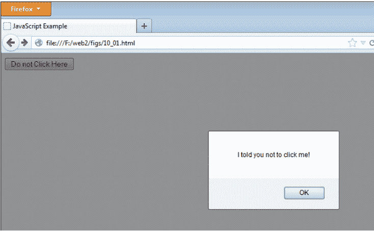

图 10-1 当查看者点击按钮时，会弹出此警框。

避免“找不到服务器”错误的一种方法是链接到一个实际的页面（这对于可访问性很有好处）；然而，如果查看者启用了 JavaScript，它可能会将查看者带离当前页面。为了在启用 JavaScript 时保持链接跳转，你需要在点击事件的 JavaScript 中添加一条额外的语句。你需要告诉浏览器在向查看者显示内容后不要继续执行。为了做到这一点，你将添加一个`return false`语句，它将阻止浏览器在警框显示后继续跳转链接。以下代码展示了如何在内联中添加`return`语句：

```html
<body>
<a href="http://none"
onclick="window.alert('Hey! You clicked me!'); return false;">
Don't Click Me</a></body></html>
```

`return false`语句阻止了浏览器尝试跳转链接

通过这段代码，点击事件将由点击事件处理程序处理，浏览器无需担心尝试跳转`href`属性中的链接。在本章的稍后部分，你将学习如何使用现代方法阻止默认操作：`event.preventDefault()`。

### 注意

你也可以通过使用`javascript:`命令为链接编写 JavaScript——例如，`<a href="javascript:alert('Hi');">Click</a>`——但出于可访问性考虑，不推荐这种方法（如果 JavaScript 被禁用，链接将无法跳转到任何地方）。

## 聚焦与失焦事件 (Focus and Blur Events)

当查看者赋予某个元素或窗口焦点时会发生聚焦事件。查看者通过点击项目附近的区域、使用键盘移动项目（通常通过 TAB 键）或通过脚本为某个项目赋予焦点。例如，查看者通过点击一个非活动窗口并使活动窗口获得焦点，从而点击了一个文本输入框。该事件还有一个相关的方法叫做`focus()`，该方法将在第 11 章和第 14 章中介绍。

要看到该事件的运行，你可以创建一个文本输入框，它是能够让你赋予元素焦点的元素之一。以下示例展示了如何这样做，以及如何编写代码以便在查看者赋予文本框焦点时弹出一个提醒：

```html
<form>
Enter Your Name:
<input type="text" onfocus="window.alert('Don't forget to capitalize!');">
</form>
```

文本框中的聚焦事件

这段代码会在查看者开始输入之前给他们显示一个警框。该警框作为姓名首字母大写的提醒。图 10-2 显示了当查看者赋予文本框焦点时，浏览器中前述代码的结果。

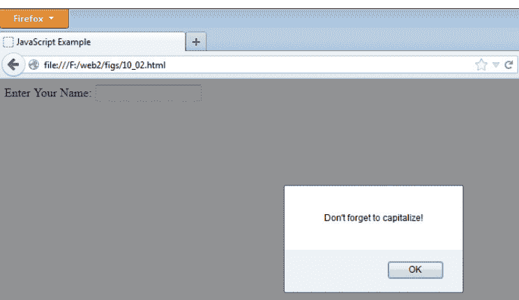

图 10-2 当文本框接收到查看者的焦点时，会弹出此警框。

失焦事件（blur event）发生在查看者从元素或窗口移除焦点时。要从某个项目上移除焦点，查看者通常会赋予其他项目焦点。例如，查看者可以从一个元素移动到另一个，或者从一个窗口移动到另一个。失焦事件还有一个相关的方法`blur()`，该方法将在第 11 章和第 14 章中介绍。

### 注意

只有当查看者将焦点转移到另一个区域时，才会触发失焦事件，这是浏览器知道查看者已从第一个区域释放焦点的唯一方式。例如，当查看者在输入字段中按回车键时，焦点从输入字段转移到文档窗口。

要看到失焦事件的运行，以下示例使用了两个文本框：点击第一个文本框会赋予焦点，而第二个文本框会触发第一个文本框的失焦事件。

```html
<form>
Give this box focus:<br>
<input type="text" onblur="window.alert('Hey! Come back!');"><br>
Then give this box focus to blur the first one:<br>
<input type="text">
</form>
```

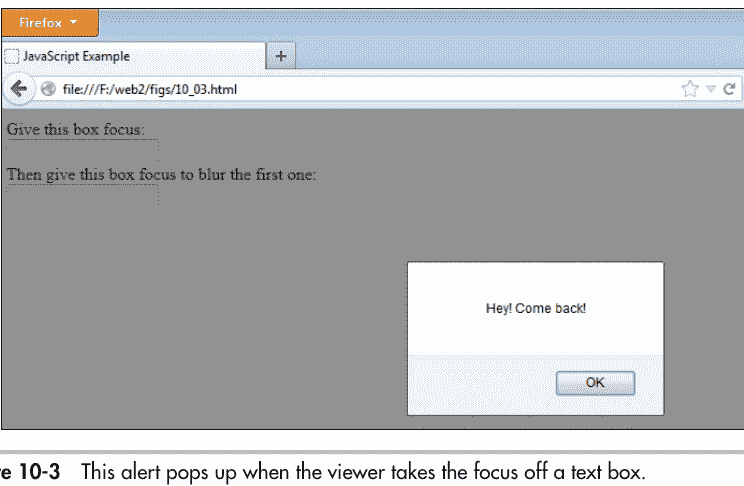

当查看者点击第二个文本框时，会赋予焦点。

图 10-3 显示了当查看者点击第二个文本框时，浏览器中前述代码的结果。

# 加载与卸载事件 (Load and Unload Events)

加载事件（load event）发生在查看者所在的页面加载完成时。如果你想在页面加载完成后显示一个警框，可以使用以下代码：

```html
<body onload="window.alert('I\'m done now!');">
Text for the body
</body>
```

当页面加载完成后，查看者会收到一个警框。图 10-4 显示了上述代码在浏览器中的结果。如果你想在脚本中使用加载处理程序而不是作为属性，你可以将其写入外部文件（保存为`load_alert.js`）：

```javascript
window.onload = function() {
  window.alert('I\'m done now!');
};
```

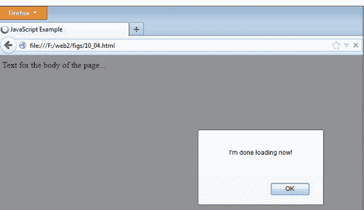

**图 10-4** 页面加载完成后在浏览器中显示此内容。

你现在可以访问所有的窗口对象（`window`对象将在第 11 章中详细介绍）。你可以这样从`<body>`标签移除事件处理程序：

```html
<body>
  <script type="text/javascript" src="load_alert.js"></script>
</body>
```

### 注意

你无法再次使用`document.write()`。

卸载事件（unload event）发生在查看者离开当前页面时。查看者可以通过点击链接、在浏览器中输入地址或关闭窗口来离开。该事件被认为会干扰查看者，因为它允许网站所有者在游客前往另一个页面时执行某些操作。为了在用户离开页面时弹出警框，你可以编写以下代码：

```html
<body onunload="window.alert('Be sure to come back, OK?')">
Other HTML code goes here.
</body>
```

## 重置与提交事件 (Reset and Submit Events)

重置和提交事件发生在包含一个或多个表单时。表单可以重置其内容或提交处理。这些事件允许你对这些表单操作编写响应。

当查看者使用重置按钮重置表单字段时，会发生重置事件（reset event）。重置事件还有一个相关的方法`reset()`，该方法将在第 14 章中介绍。当查看者提交表单时，会发生提交事件（submit event）。提交事件还有一个相关的方法`submit()`，该方法将在第 14 章中介绍。

## JavaScript：初学者指南

要看到`submit`事件的作用，你必须创建一个可以通过提交按钮提交的表单。以下代码将在用户点击提交按钮后，向查看者弹出一个“感谢你”的警告框：

```html
<form onsubmit="window.alert('Thank You');">
What's your name?<br>
<input type="text" id="name"><br>
<input type="submit" value="Submit Form">
</form>
```

`submit`事件目前的作用并不大（尤其是表单内容并没有真正发送到任何地方），但当你学习到第 14 章的表单验证时，这个事件将变得更加有用。

## 鼠标事件

有很多事件可用于用户移动鼠标的操作。下面列出了这些事件：

-   **mousedown**: 当观众在完成点击之前按下鼠标按钮（按钮尚未松开）时发生。
-   **mouseup**: 当观众在按下鼠标按钮后松开时发生。
-   **mouseenter**: 当观众将鼠标光标移动到元素上时（不包括子元素）发生。
-   **mouseleave**: 当观众将鼠标光标移出元素范围时（不包括子元素）发生。
-   **mouseover**: 当观众将鼠标光标移动到元素上时发生。
-   **mouseout**: 当观众将鼠标光标移出元素范围时发生。
-   **mousemove**: 当观众移动鼠标光标时发生。
-   **mousewheel**: 当观众向上或向下滚动鼠标轮时发生。

可以通过创建一个文本链接来展示使用鼠标事件的示例。当你向链接添加`onmouseover`事件处理器时，你就可以选择在观众将光标悬停在链接上时执行 JavaScript 命令。因此，如果你希望在观众鼠标移到链接上时弹出警告框，可以使用下面的代码：

```html
<a href="http://www.pageresource.com" onmouseover="window.alert('I told you not to try to click me!');">Don't Try Clicking Me!</a>
```

这一次，观众甚至还没来得及点击链接就先收到了警告框。请记住，如果过度使用此类脚本，可能会让访问者感到困扰。图 10-6 显示了该脚本在浏览器中的结果。只要鼠标光标移动到链接上，警告框就会弹出。

## 第 10 章：事件处理器 257

由于不需要点击链接就能发生某些操作，浏览器之后不会尝试跟随该链接。事实上，有了这个脚本，你根本无法点击链接，因为当你移动鼠标到它上面点击时，警告框会不断弹出！

## 键盘事件

当用户使用键盘与 Web 页面进行交互时，会发生键盘事件。这些事件允许你对观众按下和释放键的每个阶段做出反应。键盘事件列在这里：

-   **keydown**: 当观众按下键盘上的某个按键时发生。
-   **keypress**: 当观众按下键盘上的按键并输入相应字符时发生。这发生在`keydown`和`keyup`事件之间。
-   **keyup**: 当观众松开键盘上的按键时发生。

例如，如果你想在每次向文本框中输入字符时都弹出一个警告框，可以使用以下代码：

```html
<input type="text" id="typing" onkeyup="alert('You typed a character!')">
```

这会在每次向文本框中输入字符时提醒观众。在输入几个字符后，这可能会非常烦人，但一旦你在本章后面的部分学习了事件对象，你将学会如何找出按下的是哪个键，这将赋予你在处理键盘事件时更大的灵活性。

## JavaScript：初学者指南

### 尝试此 10-1 聚焦 (Focus) 与失去 (Blur)

在这个项目中，你将利用聚焦和失去事件以及 innerHTML（来自第 9 章）的知识，创建一个提醒用户在文本框中输入内容的脚本。

pr10_1.html
prjs10_1.js

## 步骤详解

1. 创建一个 HTML 页面并保存为`pr10_1.html`。在名为`prjs10_1.js`的外部 JavaScript 文件中添加必要的脚本标签。添加代码以便包含一个 id="pn" 的电话号码文本框和一个地址的文本区域。在电话号码文本框旁边，有一个 id="reminder" 的空`span`标签。完成后，HTML 文件的 body 部分应该如下所示：

```html
<form>
Phone Number:
<input type="text" id="pn"><span id="reminder"></span><br><br>
<textarea></textarea>
</form>
```

2. 创建一个外部 JavaScript 文件并保存为`prjs10_1.js`。将其用于第 3 和第 5 步。

3. 通过 id 获取'pn'和'reminder'元素，并将分别赋值给变量`pn`和`rm`。

4. 当`pn`获得聚焦（focus）时，将`rm`的`innerHTML`改为文本'Format: (xxx) xxx-xxxx'。当`pn`失去焦点（blur）时，将`rm`的`innerHTML`清空。

5. JavaScript 文件应该如下：

```javascript
var pn = document.getElementById("pn");
var rm = document.getElementById("reminder");
pn.onfocus = function() {
  rm.innerHTML = "Format: (xxx) xxx-xxxx";
};
pn.onblur = function() {
  rm.innerHTML = "";
};
```

6. 保存 HTML 和 JavaScript 文件，并在浏览器中加载 HTML。点击文本框查看消息的出现。

## 总结

在这个项目中，你使用了聚焦和失去事件以及 innerHTML（来自第 9 章）的知识，创建一个提醒用户在文本框中输入内容的脚本。

## 捕获与冒泡阶段

当一个元素内部包含另一个元素，且这两个元素都注册了相同的事件类型时，哪个事件先发生取决于使用的是捕获阶段（capturing phase）还是冒泡阶段（bubbling phase）注册事件。如果使用捕获阶段，最外层元素的事件先发生，最内层元素的事件最后发生。如果使用冒泡阶段，则相反。最常用的是冒泡阶段，因为它具有最好的浏览器兼容性。

## attachEvent() 方法

`attachEvent()`方法的工作方式与`addEventListener()`类似。然而，它只适用于事件冒泡，并且目前（截至本文撰写时）没有使用捕获阶段的方法。它的用法方式如下：

```
element.attachEvent(event_handler, function_name);
```

因此，如果你想使用你一直以来使用的脚本，可以这样写：

```
var web_page1 = "http://www.yahoo.com";
var b1 = document.getElementById("btn1");
b1.attachEvent("onclick", function () { window.location = web_page1; });
```

注意，该方法直接使用了事件处理器（`onclick`）。此外，它没有第三个选项；它只使用事件冒泡。
要移除事件，你会使用`detachEvent()`方法：

```
element.detachEvent(event_handler, function_name);
```

## 浏览器支持

事件注册的`attachEvent()`方法是 Internet Explorer 9 之前的版本所使用的（`addEventListener`不可用，但支持 DOM Level 0 注册）。如果你需要支持旧版本的 Internet Explorer，你需要使用一个函数，允许你使用每个浏览器可用的方法来处理事件。如果需要，你可以在 http://dean.edwards.name/weblog/2005/10/add-event/2 找到它，或者使用像 jQuery 这样的 JavaScript 库（本文将讨论）来辅助事件注册。

## 事件对象

当事件发生时，会创建一个名为`event`的对象，其中存储了关于事件的信息。这些信息可以被你的脚本用于执行所需的操作。例如，键盘事件将在事件对象中包含有关被按的按键的信息。这允许你在按下不同按键时编写不同的响应。
`Event`对象在 Internet Explorer（9 之前的版本）中的工作方式略有不同，因此你将首先查看如何在所有支持它的浏览器中使用该事件对象。

## DOM 与 Internet Explorer：DOM Level 0 注册

在浏览器中，使用名称`event`访问事件对象。它可以作为唯一参数传递给处理事件的函数，如下所示 DOM Level 0 代码所示：

```
var b1 = document.getElementById("btn1");
b1.onclick = function(event) {
  alert("The " + event.type + " event started this!");
}
```

注意，参数化的`event`被传递给了事件监听器。事件对象的`type`属性（返回事件的类型）随后被用于向查看者显示警报，这会让查看者知道点击事件被用于调用执行运行的函数。

然而，Internet Explorer 使用`window.event`来访问事件对象，这意味着 DOM Level 0 事件处理器将使用以下代码：

```
var b1 = document.getElementById("btn1");
b1.onclick = function() {
  alert("The " + window.event.type + " event started this!");
}
```

对于 DOM Level 0 函数，可以通过根据浏览器支持的情况将所需的值赋值给变量，来实现事件对象的跨浏览器实现，如下代码所示：

```
var b1 = document.getElementById("btn1");
b1.onclick = function(event) {
  var e = event || window.event;
  alert("The " + e.type + " event started this!");
}
```

注意，如果可用，则将事件对象赋值给变量，否则赋值为`window.event`对象。逻辑或（`||`）的使用允许你在值可用时提供首选值，在不可用时提供另一个（默认）值。现在变量`e`将持有跨浏览器的正确值，它可以用于警报事件类型。

## 与现代事件注册结合

在使用`addEventListener`或`attachEvent()`时，可以通过`event`访问事件对象。这允许你按预期使用事件对象。对于`addEventListener()`，你可以使用以下代码：

```
var b1 = document.getElementById("btn1");
b1.addEventListener("click", function(event) {
  alert("The " + event.type + " event started this!");
}, false);
```

对于`attachEvent()`，你可以使用以下代码：

```
var b1 = document.getElementById("btn1");
b1.attachEvent("onclick", function(event) {
  alert("The " + event.type + " event started this!");
});
```

如果需要，对旧版浏览器的支持可以通过 DOM Level 0 方法实现。再次，你可以参考本章前面“attachEvent() 方法”中提到的资源，这些资源已经编写好以处理各种事件注册模型。

## 属性与方法

你已经看到了`type`属性，但事件对象还有其他有用的属性和方法，列于表 10-2。

| 属性/方法 | 说明 |
|---|---|
| bubbles | 事件是否冒泡 |
| cancelable | 事件的默认操作是否可以被取消 |
| cancelBubble | 设置为`false`时取消事件冒泡（Internet Explorer） |
| currentTarget | 当前触发事件的元素 |
| defaultPrevented | 是否调用了`preventDefault()` |
| detail | 关于事件的额外信息 |
| eventPhase | 事件发生的阶段：1 = 捕获，2 = 目标，3 = 冒泡 |
| preventDefault() | 防止默认行为发生 |
| returnValue | 防止默认行为发生（Internet Explorer） |
| srcElement | 触发的元素（Internet Explorer） |
| stopImmediatePropagation() | 停止捕获和冒泡并阻止其他处理器调用 |
| stopPropagation() | 停止捕获和冒泡 |
| target | 事件目标 |
| trusted | 事件是由浏览器发起的还是程序员的 |
| type | 事件类型（例如 click、mouseover 等） |
| view | 事件发生的窗口对象 |

表 10-2 事件对象的属性和方法

## JavaScript: 入学者指南

如你所见，某些属性适用于 Internet Explorer（9 之前的版本），而其他属性适用于现代浏览器。由于大多数浏览器（包括 Internet Explorer 9 及以上）支持标准的 DOM 2 事件模型，你将在本书剩余部分中使用此方法。对于你可能需要在 Internet Explorer 中执行任务的情况，将添加注释。

## 防止默认行为

你可能记得在使用 DOM Level 0 注册时，阻止默认行为是通过使用`return`语句实现的（`return false`）。然而，你现在可以通过使用事件对象的`preventDefault()`在不需要返回的情况下这样做。

例如，现在可以使用以下代码防止链接点击加载指定页面：

```
var nlink = document.getElementById("notlink");
nlink.addEventListener("click", function(event) {
  event.preventDefault();
  alert("这个链接不会去任何地方！");
  // 后续代码...
}, false);
```

你可以看到，你可以继续处理事件，而不是使用`return`语句退出函数。

### 注意

在 9 之前的 Internet Explorer 中，你可以使用`returnValue`属性。将其值设置为`false`（例如`window.event.returnValue = false;`）的效果与`preventDefault()`相同。

## 事件信息

某些事件（如键盘事件）具有表中未显示的额外属性（适用于所有事件）。

例如，当键盘事件发生时，被按按键的代码存储在`event.keyCode`中，这允许你确定按了哪个按键。这可以被你的脚本用于在按下特定按键时做出反应。例如，你可以使用这段代码：

```
var text = document.getElementById("textbox1");
text.addEventListener("keyup", function(event) {
  if (event.keyCode === 80) {
    alert("请不要按 p 键！");
  }
}, false);
```

这将提示查看者你不希望按下“p”键，因为 80 是键盘上“p”键的键码。你可以在此处查看更多关于键码：http://protocolsofmatrix.blogspot.com/2007/09/javascript-keycode-reference-table-for.html

## 尝试此 10-2

## 使用 addEventListener()

在本项目中，你将使用`addEventListener`在一段文本上注册鼠标悬入（mouseover）/鼠标移出（mouseout）事件。

pr10_2.html
prjs10_2.js

## 逐步步骤

- 1. 创建一个 HTML 页面并将其保存为`pr10_2.html`。添加代码链接到名为`prjs10_2.js`的外部 JavaScript 文件。HTML 代码的`body`部分看起来如下：

```
<p>
This is very <span id="int">interesting!</span>
</p>
```

- 2. 创建一个 JavaScript 文件并将其保存为`prjs10_2.js`。在第 3 步中使用它。
- 3. 当鼠标移动到"int"上时，将颜色改为 #FF0000。当鼠标移开时，将颜色改为 #000000。完成后，JavaScript 代码应该像所示：

```
var int = document.getElementById("int");
int.addEventListener("mouseover", function() {
  int.style.color = "#FF0000";
});
int.addEventListener("mouseout", function() {
  int.style.color = "#000000";
});
```

- 4. 保存 JavaScript 文件并在浏览器中打开 HTML 文件。将鼠标移动到文本上并移开以改变颜色。

## 尝试此总结

在本项目中，你运用了事件处理程序和`addEventListener()`的技能，在鼠标移动到文本上或移开文本时改变文本的颜色。

## 使用事件处理器创建脚本

现在你已经处理了长长的事件处理器列表和事件对象，现在是时候玩点乐子了。在本节中，你将学习如何执行发送提示框（alert）以外的操作。

## JavaScript：初学者指南

## 显示隐藏内容

对于此脚本，创建一个 HTML 文件，在`body`部分内包含以下代码并将其保存为`news.html`。

```
<div>
  <strong>突发新闻故事!!!!!</strong>
  <a href="story.html" id="morelink">更多...</a>
</div>
<div id="morediv">
  今天，我们一直在这个网站上报道的一条故事有了重大进展。我们稍后将发布更多细节。快回来查看！
</div>
<script type="text/javascript" src="news.js"></script>
```

在这里，你有一个“突发新闻”标题。放置了一个链接（`id`为`morelink`），点击时它将显示故事的内容。下方，你有一个`div`元素（`id`为`morediv`），包含了故事的内容。目前，它是完全可见的，因为没有应用任何 CSS 或 JavaScript 来改变它。你的目标是初始时隐藏它，然后在用户激活链接时再显示它。

接下来，创建一个 JavaScript 文件并将其保存为`news.js`。你想要做的第一件事是定义一些变量来获取所需的元素：`morelink`元素和`morediv`元素。

```
var mlink = document.getElementById("morelink");
var mdiv = document.getElementById("morediv");
```


# 显示和隐藏内容

现在这些元素被赋值为对象给`mlink`和`morediv`变量。接下来，你需要添加一个事件监听器，在点击`mdiv`元素时显示或隐藏该元素，如下代码所示：

```javascript
mlink.addEventListener("click", function(event) {
  event.preventDefault();
  mdiv.style.display = (mdiv.style.display === "none") ? "block" : "none";
}, false);
```

注意事件对象是作为参数传递的，这防止了默认行为的执行。如果`mdiv`元素的`display`属性为`"none"`，则将其更改为`"block"`；如果是除了`"none"`的任何值，则更改为`"none"`（例如当它由于之前的更改被设置为`"block"`时）。

现在点击事件已准备就绪，但你需要在页面初始显示时隐藏`mdiv`元素。可以通过 CSS 完成，但在这里你将使用 JavaScript 简单地将它的显示样式设置为`"none"`：

```javascript
mdiv.style.display = "none";
```

**图 10-7** 页面的初始视图，显示了标题和链接。

JavaScript 文件的完整代码现在如下：

```javascript
var mlink = document.getElementById("morelink");
mlink.addEventListener("click", function(event) {
  event.preventDefault();
  mdiv.style.display = (mdiv.style.display === "none") ? "block" : "none";
  return false;
});
mdiv.style.display = "none";
```

保存 JavaScript 文件并在浏览器中打开 HTML 文件。你应该能看到标题和链接，没有额外的内容。图 10-7 显示了初始页面应该有的样子。

点击链接。故事内容现在应该显示标题和链接。再次点击应该隐藏故事，这可能是在读完一个简单的预告标题后想做的，而那个预告只是引导你去另一个让你稍后回来查看的预告！图 10-8 显示了点击链接显示内容的结果。

**图 10-8** 一旦点击链接，内容就会显示。

# 更改内容

与其显示和隐藏一段内容，你可能想给观众提供几个选项，并在点击特定内容时显示选定的内容。为了实现这一点，首先需要创建一个 HTML 文件并保存为`technews.html`：

```html
<!doctype html>
<html>
<head>
  <title>新闻</title>
  <link rel="stylesheet" type="text/css" href="technews.css">
</head>
<body>
  <div class="wrapper">
    <h1>新闻</h1>
    <div class="story_nav">
      <a href="#" id="sumlink">摘要</a>
      <a href="#" id="statslink">统计</a>
      <a href="#" id="comlink">评论</a>
    </div>
    <div id="sumdiv" style="display:none;">
      这里是摘要内容。
    </div>
    <div id="statsdiv" style="display:none;">
      这里是统计内容。
    </div>
    <div id="comdiv" style="display:none;">
      这里是评论内容。
    </div>
  </div>
  <script src="technews.js"></script>
</body>
</html>
```

接下来，创建一个 JavaScript 文件并将其保存为`technews.js`。最后，创建一个 CSS 文件并保存为`technews.css`。

```javascript
else {
  divs[j].style.display = "none";
}
}, false);
for (var i = 0; i < slinks.length; i++) {
  change_div(i);
  divs[1].style.display = "none";
  divs[2].style.display = "none";
```

这三个链接连接到三个内容 div，因此这两组元素都被放置在数组（`slinks`和`divs`）中。稍后将解释`change_link()`函数，但首先注意函数后面的循环。该循环遍历`slinks`数组，并为每个链接调用`change_div()`函数，将`i`的值作为参数传递，因为该参数将用于为每个元素注册点击事件，并在点击每个链接时更改相应的内容。

`change_div()`函数接收循环传递的`count`变量作为参数。循环第一次执行时，`change_div`接收到的值为`0`，第二次为`1`，依此类推。由于链接和 div 都是数组，这允许你使用`count`来访问所需的元素。该函数通过使用`addEventListener`开始。监听器被添加到`slinks`数组中索引为该处的链接元素。换句话说，当`count`为`0`时，将访问`slinks[0]`。这访问了第一个元素，因为`slinks[0]`的值是`document.getElementById("sumlink")`。由于此循环运行了三次，将添加`count`值为`0`、`1`和`2`的事件监听器。

事件监听器首先阻止默认操作。然后，根据所点击的链接，通过将其`style`设置为`"block"`来显示`divs`数组中相应的`div`。使用循环来隐藏剩余的两个元素。注意，如果`j`的值等于`count`（当前显示的元素），则会跳过它，因此该元素当前保持可见。

最后，在脚本的末尾，你会发现`sumdiv`和`cod`元素默认是可见的，而另外两个内容 div 是隐藏的。图 10-9 显示了在浏览器中查看时页面的初始显示。

点击“Stats”链接将显示统计数据（使`statdiv`可见并隐藏其他）。

最后，点击“Comments”链接将显示所有针对我在编程比赛中表现丢脸而发给我的评论！图 10-11 显示了正在显示的评论。

此脚本结合了你学过的许多技术（事件、循环、数组等）。数组和循环在这里特别有用，因为它们避免了你为了在事件注册和函数中硬编码每个值而编写三个版本的`addEventListener()`。在处理处理事件时，通过这些方式减少代码输入量通常非常有帮助。


# 第 10 章：事件处理器 271

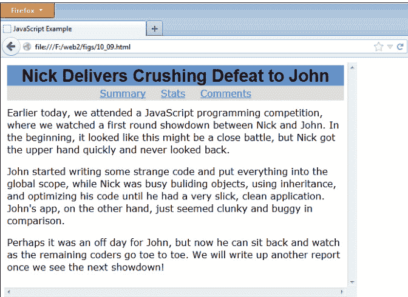

**图 10-9** 初始显示。注意用户可以点击的链接。

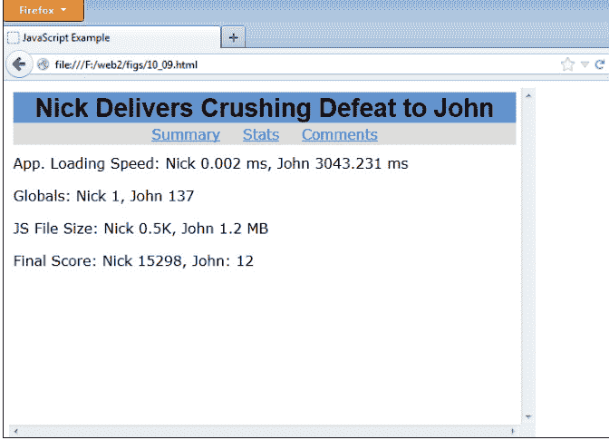

**图 10-10** 点击“Stats”链接的结果

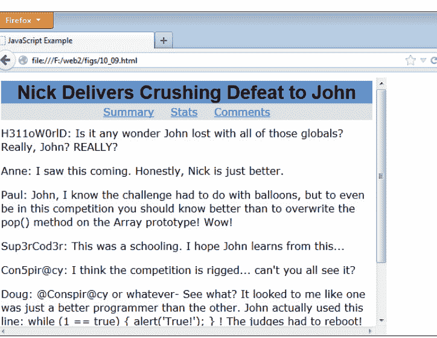

图 10-11 当点击“Comments”链接时显示的评论。

# 第 10 章自测

- 1. 事件处理器是对象的一个预定义的 JavaScript 属性，用于处理处理 Web 页面上的事件。
  - A. 正确
  - B. 错误

- 2. 事件处理器很有用，因为它们让你能够获取页面上可能发生的。

- 3. 要使用事件处理器，你将其放置在或或代码中。

- 4. 下面哪项代码正确编写了点击事件的警报框（alert）？
  - A. `<input type="button" onclick="window.alert('Hey there!');">`
  - B. `<input type="button" onclick="window.alert('Hey there!');">`
  - C. `<input type="button" onclick="window.alert('Hey there!');">`
  - D. `<input type="button" onChange="window.alert('Hey there!');">`

- 5. 当 Web 页面完成加载时发生 ________ 事件。

- 6. mouseover 事件发生在以下情况：
  - A. 观众在光标悬停在按钮上时点击鼠标。
  - B. 观众将光标移离开链接。
  - C. 观众点击链接、链接图像或图像地图的链接区域。
  - D. 观众将鼠标光标移动到页面上的一个元素上。

- 7. mouseout 事件发生在观众点击页面上的元素时。
  - A. 正确
  - B. 错误

- 8. ________ 事件发生在观众离开当前 Web 页面时。

- 9. blur 事件是 ________ 事件的对立面。

- 10. ________ 对象包含 ________ 事件。

- 11. blur 事件是 ________ 事件的对立面。

- 12. ________ 事件发生在观众离开当前 Web 页面时。

- 13. ________ 事件发生在观众点击页面上的元素时。
  - A. 正确
  - B. 错误

- 14. blur 事件是 ________ 事件的对立面。

- 15. ________ 对象包含 ________ 事件。

- 16. ________ 事件发生在观众离开。

- 17. ________ 事件发生在 Web 页面完成加载时。

- 18. mouseover 事件发生在以下情况：
  - A. 观众在光标悬停在按钮上时点击鼠标。
  - B. 观众将光标移离开链接。
  - C. 观众点击链接、链接图像或图像地图的链接区域。
  - D. 观众将鼠标光标移动到页面上的一个元素上。

- 19. mouseout 事件发生在观众点击页面上的元素时。
  - A. 正确
  - B. 错误

- 20. ________ 事件发生在观众离开当前 Web 页面时。

- 21. blur 事件是 ________ 事件的对立面。

- 22. ________ 对象包含 ________ 事件。

- 23. ________ 事件发生在观众离开。

- 24. ________ 事件发生在 Web 页面完成加载时。

- 25. blur 事件是 ________ 事件的对立面。

- 26. ________ 事件发生在观众离开。

- 27. ________ 事件发生在 Web 页面完成加载时。

- 28. mouseover 事件发生在以下情况：

- 29. ________ 对象包含。

# 第 11 章：Window 对象

## 注意

与之前的章节一样，本章列出的某些属性和方法并不是跨浏览器的，或者仅在现代浏览器中有效。欲需更多信息和完整列表，请参阅：https://developer.mozilla.org/en/DOM/window 和 http://msdn.microsoft.com/en-us/ms53583(VS.8.5).aspx。

## closed 属性

`closed`属性用于检查窗口是否已被查看者关闭。通常的用法是使用窗口名称，后跟`closed`属性，如下例所示：

```javascript
if (windowname.closed) {
  JavaScript 语句
}
```

你可以将`windowname`部分替换为你想要检查的窗口名称。这通常是一个用 JavaScript 打开的新窗口；你将在本章稍后的“open() 方法”节中看到如何命名新窗口。你也可以在新窗口内部使用`closed`属性来检查该窗口打开的窗口是否已关闭。要这样做，你可以在`opener`属性（在“opener 属性”节中讨论过）之后使用`closed`，如下例所示：

```javascript
if (window.opener.closed) {
  JavaScript 语句
}
```

如果你选择创建一个新窗口，允许查看者通过新窗口中的链接导航到主窗口，那么这种`closed`属性用法非常有用。

## frames 属性

`frames`属性是一个包含集合中每个帧的数组。它用于访问页面上各种帧的属性。你可以通过使用`frames.length`属性来获取窗口中帧的数量。

## innerWidth 和 innerHeight 属性

`innerWidth`和`innerHeight`属性持有视图窗口区域（浏览器窗口滚动条、菜单栏、工具栏等）的宽度和高度值。这些属性在现代浏览器中有效，但在版本 9 之前的 Internet Explorer 中不起作用（可以使用`document.body.clientWidth`和`document.body.clientHeight`于旧版本的 Internet Explorer）。

因此，如果你想获取脚本可用的内容区域宽度，可以使用以下代码：

```javascript
var mywin_width = window.innerWidth;
```

当然，如果你想根据窗口可用的`innerWidth`为浏览器使用 HTML 代码，可以使用以下代码：

```javascript
var mywin_width = window.innerWidth; // innerWidth 属性的值被
var cont = document.getElementById("container"); // 赋值给 mywin 变量
cont.style.width = (mywin_width >= 800) ? "750px" : "90%";
```

- 条件运算符用于快速的 if-else 语句，根据可用空间为 div 元素分配宽度
- 访问一个名为`"container"`的 div，它将没有设置宽度，并将容纳通过`innerHTML`提供的代码
- 这决定了查看者是否具有 800 像素的可视宽度。如果是，div 元素的宽度将设置为 750 像素。否则，div 元素将具有 90% 这样更安全的宽度，以便在较小的屏幕上更容易显示。

## length 属性

该属性告诉你窗口中有多少个帧，就像`window.frames.length`属性一样。它将其缩短为`window.length`（在你在编写代码时这通常更方便）。

## location 属性

`location`属性持有窗口的 URL。你可以使用`location`属性使浏览器立即重定向到页面（例如，如果你已移动到某个位置）。但是，请确保不要在列于不允许快速重定向的搜索引擎页面上使用此技术，因为它们可能会将页面从列表中删除。

如果页面已移动，且你想在不提供任何新值的情况下重定向查看者，只需给`location`属性赋一个新值，如下代码所示：

```html
<body>
<script type="text/javascript">
window.location = "newpage.html"; // 这将立即把查看者离开
// 如果在此过程中不需要执行任何操作
</script>
JavaScript？请点击下方链接进入新页面！<br><a href="newpage.html">新页面</a>
</body>
```

这将查看者带到本地 URL`new.html`。对于没有 JavaScript 的浏览器，包含了一个标准链接。否则，前面的代码将为那些查看者加载一个空白页面，且什么都不会发生。

### 注意

即时重定向对于未被搜索引擎索引的页面的测试目的是最好的，因为重定向规则在不同的搜索引擎之间各不相同。

## name 属性

`name`属性持有当前窗口的名称，并允许你为窗口命名。如果你想给主窗口命名，你可以赋值名称来使用此属性。下面的代码显示了一个示例：

```javascript
window.name = "cool_window"; // 赋予窗口它自己的名称
alert("此窗口的名为 " + window.name); // 窗口名称
// 通知给查看者
```

脚本给了一个窗口名称，然后向查看者弹出该名称。图 11-1 显示了此脚本在浏览器中的结果。

## opener 属性

`opener`属性用于引用打开当前窗口的窗口。这通常用于使用`open()`方法打开的新窗口，你将在本章稍后的“open() 方法”节中看到。在新窗口中使用`opener`属性，你可以检测主窗口是否已关闭。以下示例显示了如何进行测试：

```javascript
if (window.opener.closed)
```

在`opener`属性后添加`closed`属性是为了检查打开的窗口是否已关闭。如果你想通过新窗口在主窗口执行操作，这很有帮助，因为你可以在执行任何操作之前检查它是否仍然存在。

图 11-1 窗口名称通知了查看者。

## parent, self 和 top 属性

`parent`属性仅在页面上有帧时使用。它允许你访问当前帧的父帧。当你想要从另一个帧更改属性时，这很有用。

`self`属性是 JavaScript 中“当前窗口”的另一种表达。它像窗口对象一样使用，并像窗口对象一样访问当前窗口的属性。如果你有一组窗口并想要使用它，你是当前窗口的属性，而不是另一个窗口中的属性。

`top`属性用于访问所有帧（可能是嵌套的）中的顶级窗口。这与`parent`属性略不同，后者只到当前帧的顶部。而`top`属性则直达顶级窗口，即使窗口包含嵌套帧。

## status 和 defaultStatus 属性

`status`属性包含在窗口状态栏中的文本值。更改此属性将用`defaultStatus`属性覆盖状态栏的内容。

### 注意

现代浏览器默认不显示由 JavaScript 修改的状态栏文本，以防止不良网站通过状态栏中的虚假链接目标欺骗用户。因此，除非查看者更改浏览器设置，否则`status`和`defaultStatus`属性将不起作用。由于用户更改浏览器设置这样做存在安全风险，因此不建议使用这些属性。

`defaultStatus`属性设置了没有给`window.status`属性赋值时在状态栏中显示的文本字符串。更改`window.status`属性会覆盖此设置，因为它只作为默认值显示。此属性通常在事件循环中设置，以便在查看者未执行更改状态栏文本的操作时显示自定义消息。

## 尝试 11-1 使用 location 和 innerWidth 属性

```
prj11_l.html
prjs11_l.js
```

## 步骤

- 1. 创建一个 HTML 页面，保持 body 部分留空，仅在`</body>`标签之前包含一组 script 标签以引用名为`prjs11_l.js`的 JavaScript 文件。将文件保存为`prj11_l.html`。

- 2. 创建一个 JavaScript 文件并将其保存为`prjs1_1.js`。在步骤 3–6 中使用该文件。
- 3. 为名为`mywin_width`的变量设置默认值。
- 4. 将`window.innerWidth`的值赋值给`mywin_width`。
- 5. 如果`mywin_width`的值大于或等于 1000，则将用户重定向到 URL http://www.scriptweb.com/js/。否则，将用户重定向到 URL http://www.scriptweb.com/css/（使用`window.location`属性）。
- 6. 完成后，JavaScript 文件将具有代码：

```javascript
var my_win = window.innerWidth;
if (my_win >= 1000) {
    window.location = "http://www.scriptweb.com/js";
} else {
    window.location = "http://www.scriptweb.com/css";
}
```

- 7. 保存 JavaScript 文件并在您的查看浏览器中打开 HTML 文件。通过更改宽度然后重新打开新宽度的页面，查看它会显示哪个 Web 页面。

## 本章总结

在这个项目中，你利用对 window 对象的`location`和`innerWidth`属性的知识，创建一个脚本，根据用户浏览器中查看区域的可用宽度重定向用户。

## 使用 Window 对象的方法

现在你已经知道了如何使用 window 对象的属性，可以继续学习方法了。表 11-2 列出了 window 对象的若干方法及其描述，接下来的内容将更详细地描述某些特定方法。

## alert()、prompt() 和 confirm() 方法

`alert()`、`prompt()`和`confirm()`都会弹出系统对话框，允许用户执行操作。例如，用户可以点击 OK 关闭警报框，或者在使用`prompt()`时在文本框中输入信息。

## alert() 方法

你在前面章节的示例脚本中已广泛使用了`alert()`方法。它会向用户弹出一个消息，用户必须点击 OK 按钮才能继续。

| 方法 | 描述 |
| --- | --- |
| addEventListener() | 在窗口上注册一个事件 |
| alert() | 向用户弹出警报，用户必须点击 OK才能继续 |
| back() | 将窗口返回到历史列表中的上一个 |
| blur() | 移除窗口的焦点 |
| clearInterval() | 取消`setInterval`方法调用的操作 |
| clearTimeout() | 取消`setTimeout`方法调用的操作 |
| close() | 关闭浏览器窗口 |
| confirm() | 向用户显示确认对话框，用户必须点击 OK 或取消才能继续 |
| escape() | 将字符串中的特殊字符转换为十六进制字符 |
| find() | 允许用户在浏览器中启动实用程序来查找页面上的文本 |
| focus() | 给窗口赋予焦点 |
| forward() | 将窗口在历史列表中向前移动一项 |
| home() | 将用户送到其在 Web 浏览器设置设置的主页 |
| moveBy() | 通过传递的特定像素值移动窗口 |
| move() | 将窗口的左上角移动到传递的坐标处 |
| open() | 打开一个新的浏览器窗口 |
| print() | 打印窗口内容 |
| prompt() | 弹出提示对话框，要求用户输入信息 |
| resizeBy() | 通过传递的像素值移动右下角来调整窗口大小 |
| resizeTo() | 将整个窗口调整为传递的高度和宽度 |
| scrollBy() | 通过传递的特定像素值滚动窗口的查看区域 |
| scrollTo() | 将窗口的查看区域滚动到指定的坐标 |
| setInterval() | 每当经过一段时间时间调用一次函数 |
| setTimeout() | 在经过一段时间时间后调用一次函数 |
| stop() | 停止窗口加载内容 |
| unescape() | 将转义后的字符串转换回普通字符 |

**表 11-2** Window 对象的方法

### prompt() 方法

`prompt()`方法用于提示用户输入信息。你在第 6 章中使用过此方法，允许用户在提示对话框中输入数据。

### confirm() 方法

`confirm()`方法可以给用户一个确认或取消操作的机会。该方法返回`true`或`false`的布尔值，因此在使用时通常会将其结果赋值给变量。所以，如果你想将结果赋值给名为`is_sure`的变量并询问问题“你确定吗？”，可以使用以下代码：

```javascript
var is_sure = confirm("Are you sure?");
```

图 11-2 显示了上述代码显示的示例确认对话框。注意用户可以选择并点击的两个按钮：OK（确定）和 Cancel（取消）。如果用户点击取消，该方法返回`false`。请注意，对于`alert()`和`prompt()`，你无法更改按钮上文本的值，因为这是由用户的浏览器和操作系统决定的。

作为一个真实的示例，假设你想创建一个指向另一个页面的链接，但你希望用户在离开之前先确认。你可以使用确认对话框来确定用户是否想要离开。


以下代码显示了你如何获取用户的确认。首先是 HTML 代码：

```html
<body>
<a href="http://google.com" id="search_link">Go Searching</a>
</body>
```

接下来，使用 JavaScript 在点击链接时确认用户是否真的想离开：

```javascript
var s_link = document.getElementById("search_link");
s_link.addEventListener("click", function(event) {
  var is_sure = confirm("are sure you want to leave?");
  if (is_sure === false) {
    event.preventDefault();
    alert("OK. You can stay here.");
  }
}, false);
```

函数确认用户是否想离开。如果点击取消且`confirm()`方法返回`false`，则会向用户发送 alert，链接不会跳转。


图 11-3 点击按钮后弹出的确认对话框。

### find() 方法

你可以使用`find()`方法让用户查找页面上的某些文本。它告诉浏览器使用内置的查找实用程序，并允许用户输入要在页面上查找的文本。

例如，如果你想创建一个按钮让用户在要在页面上查找内容时点击，可以使用以下代码：

```html
<form>
<input type="button" value="Click to Find Text" onclick="find();">
</form>
```

这会在浏览器中弹出查找对话框，并允许用户搜索页面内的文本。图 11-4 显示了此脚本添加到 HTML 文档后的结果。


图 11-4 弹出查找对话框，允许用户搜索页面上的文本。

### home() 方法

`home()`方法用于将用户送到其在 Web 浏览器设置中设置的主页。例如，你可以提供一个按钮，让用户在点击时带他们去所选的主页，代码如下（在编写时该方法在 Mozilla Firefox 中有效，但在 Microsoft Internet Explorer 中不起作用）：

```html
<form>
<input type="button" value="Go Home!" onclick="home();">
</form>
```

# print() 方法

`print()`方法允许查看者打印当前窗口。当调用此方法时，它应该打开查看器的打印对话框，以便查看者可以设置打印选项来打印文档。

要使用它，请创建一个按钮，允许查看者打印正在查看的页面：

```
<form><input type="button" value="Click to Print Page" onclick="print();"></form>
```

当用户点击“Click to Print Page”按钮时，此代码将打开查看器的打印对话框。图 11-5 显示在浏览器中运行此脚本的结果。根据所使用的浏览器和打印机，此对话框的显示可能有所不同。

# setInterval() 和 clearInterval() 方法

`setInterval()`方法用于在设定的间隔内重复执行 JavaScript 函数。以下是该方法的通用语法：

```
setInterval(function() { // 函数内容 }, time);
```

你用想要重复的代码替换函数内容。然后用你希望在每次重复执行函数之前等待的时间（毫秒）替换 time。

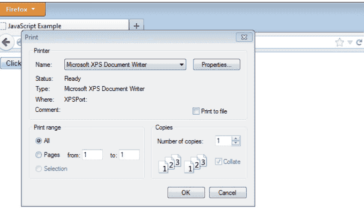

图 11-5 点击打印按钮时，会弹出查看器的打印选项。

所以，如果你真的想骚扰你的查看者，可以使用此方法在页面加载后每隔 10 秒（10000 毫秒）弹出一个警报框。你可以通过将以下脚本放在文档的 HTML 中来实现这一点：

```
setInterval(function() {
  alert("Am I bothering you yet?");
}, 10000);
```

当然，这可能会变得非常烦人。间隔时间越短，就越烦人。幸运的是，十秒的间隔让你你有足够的时间在另一个警报弹出之前离开页面。

### 注意

你可能会遇到某些脚本将字符串值作为`setInterval`或`setTimeout()`的第一个参数，而不是作为函数。这需要 JavaScript 使用`eval()`函数将字符串评估为 JavaScript 代码，在大多数情况下都不建议使用该函数。

要停止上一个脚本产生的连串警报，你可以使用`clearInterval`方法。以下是使用该方法的通用语法：

```
clearInterval(name);
```

你必须将`name`替换为赋值给你想要清除的`setInterval()`用的变量名。问题是，在上一个示例中，你没有将`setInterval()`调用赋值给变量名。

为了清除它，你需要调整代码。以下代码是更新后的版本，并将`setInterval()`调用赋值给一个变量名：

```
var madness = setInterval(function() {
  alert("Am I bothering you yet?");
}, 10000);
```

现在你就有了一种使用`clearInterval()`方法的方法，通过将`madness`变量作为参数调用它。为访问者提供一个按钮，让他们停止这种“疯狂”。只要在间隔期间点击它，它就会停止继续运行间隔。以下代码为你提供了一个带有查看者点击按钮的 HTML 页面以及更新后的 JavaScript 代码：

```
<<body
Click the button below to end the endless barrage of alerts.<br>
<form>
<input type="button" value="Stop the Madness!" id="stop_it">
</form>
</</body>>
```

更新后的 JavaScript 代码：

```
var madness = setInterval(function() { 
  alert("Am I bothering you yet?");
}, 10000);
var stop_it = document.getElementById("stop_it");
stop_it.addEventListener("click", function(event) {
  event.preventDefault();
  clearInterval(madness);
}, false);
```

该方法被赋值给变量供后续参考。

该方法引用了第一个方法的变量名，以取消其操作。

现在查看者可以通过点击“Stop Madness”按钮来停止警报。该方法对于时钟以及其他需要在页面上定期更新的其他内容非常有用。

# setTimeout() 和 clearTimeout() 方法

`setTimeout()`方法允许在经过一段时间后执行 JavaScript 函数。它与`setInterval`方法的区别在于它只执行一次（除非在循环中）。通用语法与`setInterval`方法相同。

如果你想在十秒后只弹出一个警报框而不重复，可以使用以下代码：

```
var theguest = setTimeout(function() {
  alert("Sign my book NOW!");
}, 10000);
```

超时已设置，并赋值给了一个变量。

`clearTimeout()`方法允许你在`setTimeout()`调用过期前取消它。通用语法与`setInterval`方法相同：使用变量名作为参数。

所以，如果你想给查看者一个机会在十秒内点击按钮以避免获取警报，如果点击了按钮，`setTimeout()`调用将被取消且不会弹出消息。以下是示例代码：

```
<body>
Click the button below within 10 seconds to avoid an alert.<br>
<form>
  <input type="button" value="No Alert for Me!" id="noalert">
</form>
</body>
```

JavaScript 代码：

```
var theguest = setTimeout(function() {
  alert("Sign my book NOW!");
}, 10000);
noalert.addEventListener("click", function(event) {
  clearTimeout(theguest);
}, false);
```

超时已设置并赋值给变量供后续参考。

如果在时间内点击按钮，超时会被清除。如果在时间内点击按钮，查看者将避免收到关于订阅书籍的警报。

# 咨询专家

- Q：这里有很多属性和方法！我能记住所有它们吗？
- A：随着你开始频繁地使用它们，它们会更容易记住。记住那些比我不常用的更多。如果你编写大量代码，留一些参考资料（如本书）是好的。
- Q：我很快就会进行窗口控制（remote controls）吗？
- A：主窗口的属性（如`location`属性）是“窗口控制”。虽然书中没有讨论窗口控制，但网页上有这些免费脚本。你需要创建并管理新窗口。注意，窗口之间的操作可能会引起安全问题。
- Q：我会经常使用`setTimeout()`和`setInterval()`等定时方法吗？
- A：当你需要构建计时、幻灯片或动态 HTML (DHTML) 动画时，你会用到它们。

# 练习 11-2 使用 setTimeout() 和 confirm 方法

此项目允许你练习一些窗口方法。你让浏览器等待几秒，然后询问查看者确认留在页面还是跳转到互联网搜索。

```
pr11_2.html
pr11_2.js
```

## 步骤

- 1. 创建一个 HTML 页面，在 body 部分包含以下代码，并将其保存为`pr11_2.html`：

```html
<body>
<h1>Breaking News!</h1>
<ul>
  <li>An interesting point here...</li>
  <li>Another interesting point here...</li>
  <li>An incredibly interesting point here...</li>
</ul>
<script type="text/javascript" src="pr11_2.js"></script>
</body>
```

- 2. 创建一个 JavaScript 文件并将其保存为`pr11_2.js`。使用它完成第 3-4 步。

- 3. 20 秒后，查看者将看到一个确认框，询问他们是否继续使用此网页。如果是，则什么都不做；如果不是，将他们发送到 http://www.google.com 更多新闻。

- 4. 完成后，JavaScript 文件应包含以下代码：

```javascript
setTimeout(function() {
  var stay = confirm("Do you want to continue using this Web site?");
  if (stay === false) {
    window.location = "http://www.google.com";
  }
}, 20000);
```

- 5. 保存 JavaScript 文件并在浏览器中打开 HTML 文件。20 秒后，你应该看到一个确认框。

## 总结

在这个项目中，你能够利用窗口对象的属性和方法的知识来创建一个定时的交互式脚本。这让查看者选择留在网页上还是跳转到互联网搜索。

# 主窗口与新窗口

出于安全考虑，主浏览器窗口通常会被保护无法移动、调整大小、关闭或进行其他操作（例如，为了防止在关闭主窗口的同时打开指向恶意网站的新窗口，或者为了防止打开微型的弹出窗口）。因此，在前一节中提到的许多方法（如`resize()`或`close()`）在主窗口中调用时将不起作用，或者向查看者显示一个弹出窗口。

在许多情况下，浏览器会允许你对弹出窗口有更多控制。接下来的章节将讨论如何打开新窗口，以及如何自定义它们在屏幕上的外观和位置。

## 注意事项

使用新窗口时，某些浏览器将不允许使用`resize()`或`move()`等方法。此外，浏览器可能直接在新标签页或主浏览器窗口中打开新窗口内容，而不是作为弹出窗口。不建议在 Web 网站上使用弹出窗口（尽管它们在本地应用程序或其他 JavaScript 环境中可以有用处）。

## 弹出窗口的故事

曾几何时，网站上经常使用弹出窗口。虽然那里有合法的广告，也有许多使用弹出窗口的欺骗性广告，它们通过伪装成警报或其他类型的系统消息来诱骗用户点击。此外，可以打开多个新窗口并从用户的视线中隐藏，或进行其他操作，这导致了安全担忧。

这些担忧通过多种方式得到了解决：

- 在现代浏览器中，只有当用户执行点击或按键操作时才能打开弹出窗口。
- 在某些浏览器中，弹出窗口只能在主窗口中或作为主浏览器窗口中的标签页打开。
- 在大多数情况下，无论设计弹出窗口提供了什么信息，状态栏和/或地址栏都将显示。
- 在某些浏览器中，弹出窗口可能不允许调整大小或移动。
- 某些代码在本地运行有效，但在页面上线后将无法工作。

由于这些原因，在 Web 网站上使用弹出窗口并不是一个好主意。尽管如此，如果你需要在本地环境或更安全的平台上处理新窗口，则提供了以下信息。

与其使用新窗口，你可能希望使用覆盖在当前窗口上的对话框，而不是弹出窗口。有关此更多信息，请访问 jquery.com/dialog。

## 打开新窗口

`open()`方法允许你使用 JavaScript 打开一个新窗口。该方法通常带有三个参数，如下例所示：

```javascript
window.open("URL", "name", "attribute1=value,attribute2=value");
```

第一个参数`"URL"`被替换为要在新窗口中打开的 HTML 文档的 URL。`"name"`参数被替换为你想要给窗口起的名字。第三个参数允许你为新窗口添加属性。这些属性通过在等号右侧使用`"yes"`、`"no"`或数值来设置。注意，每个属性都设置了一个值，在下一个属性之前有一个逗号，并且之间有空格。

如果你想打开一个具有当前窗口特征的窗口，可以通过省略带有属性的第三参数来实现。以下示例将打开一个本地 URL 为`webpage.html`且名称为`my_window`的新窗口；它将具有与你打开的窗口相同的特征：

```javascript
window.open("newpage.html", "my_window");
```

## 属性

如果你想包含窗口特征，你需要学习一些可以与窗口一起使用的属性。表 11-3 列出了你可以作为`open()`方法第三个参数部分的属性。

任何未定义的`"yes"`或`"no"`属性如果没有被浏览器覆盖，将默认为`"no"`。例如，在大多数浏览器中，location、menubar、status 属性可能会默认为`"yes"`且不可更改。任何未定义的数值将使用所用浏览器的设置。这些也可能是不可更改的，或者只允许某些值。例如，新窗口可能需要左侧和顶部坐标以将其放置在屏幕的可视区域，并且宽度和高度可能有你无法低于的最小值，以防止窗口太小而用户无法注意。

要打开一个宽度为 400 像素、高度为 300 像素的基础窗口，你可以使用以下代码：

```javascript
window.open("newpage.html", "my_window", "width=400,height=300");
```

除了宽度和高度，此窗口将以其他属性的默认值打开，这取决于查看者所使用的浏览器。

| 属性名称 | 可能的值 | 功能 |
| --- | --- | --- |
| width | number | 以像素为单位定义新窗口的宽度 |
| height | number | 以像素为单位定义新窗口的高度 |
| top | number | 定义新窗口的顶部坐标 |
| left | number | 定义新窗口的左侧坐标 |
| fullscreen | yes, no, 1, 0 | 定义新窗口是否应最大化打开。仅在 Internet Explorer 中有效 |
| location | yes, no, 1, 0 | 定义新窗口是否显示位置 |
| menubar | yes, no, 1, 0 | 定义新窗口是否显示菜单栏 |
| resizable | yes, no, 1, 0 | 定义新窗口是否可以调整大小 |
| scrollbars | yes, no, 1, 0 | 定义新窗口是否显示滚动条 |
| status | yes, no, 1, 0 | 定义新窗口是否显示状态栏 |
| toolbar | yes, no, 1, 0 | 定义新窗口是否显示工具栏 |

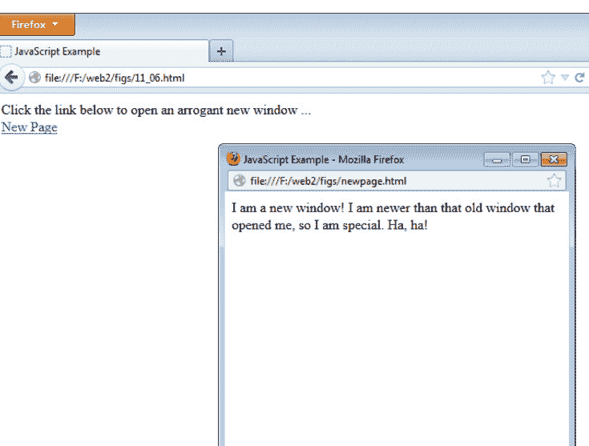

图 11-6 点击链接时会打开一个新窗口。

要使用`close()`方法，你可以修改你的`newpage.html`，在文本末尾提供一个按钮，让使用户可以通过点击该按钮来关闭窗口。因此，你可以将`newpage.html`的代码更改为如下所示：

```html
<body>
我是一个新窗口！我比打开我的那个旧窗口要新， 
所以我很特别。哈，哈！
<Form>
<input type="button" value="关闭窗口" onclick="window.close();">
</Form>
</body>
```

> 点击按钮时，窗口会被关闭

现在当点击按钮时，会调用`window.close()`方法并关闭窗口，就像窗口右上角的标准关闭按钮一样。如果你想尝试一下，请使用你在上一节中使用的主页面，并点击按钮打开新窗口。它应该会显示出一个带有关闭窗口选项的新按钮，当你点击按钮时它应该会关闭。

如果你喜欢从主窗口关闭新窗口，可以通过将`open()`方法赋值给变量来实现，该变量将提供新窗口的引用。然后你可以添加另一个提供关闭窗口选项的链接。你可以修改`manage.html`来使用以下代码：

```html
<body>
点击下方的链接打开一个傲慢的新窗口 ...<br>
<a href="newpage.html" id="nwin">新页面</a>
<a href="mainpage.html" id="cwin">关闭新页面</a>
<script type="text/javascript" src="openwin.js"></script>
</body>
```

添加了一个新链接以便可以关闭新窗口

你需要打开`openwin.js`并使用以下代码：

```javascript
var my_win = document.getElementById("nwin");
var c_win = document.getElementById("cwin");
var mywin = nw_win.addEventListener("click", function(event) {
  event.preventDefault();
  mywin = window.open("newpage.html", "cool", "width=400,height=300,status=yes");
});
c_win.addEventListener("click", function(event) {
  event.preventDefault();
  mywin.close();
});
```

添加了新变量：`c_win`用于访问“关闭新页面”链接，`mywin`稍后将用作窗口的引用。

`open()`方法被赋值给变量`mywin`

窗口被关闭了

这允许通过主窗口同时打开和关闭窗口。

## 移动、调整大小和滚动窗口

`moveTo()`、`resizeTo()`、`scrollTo()`、`scroll()`和`scrollTo()`方法允许你更改窗口的位置、窗口大小或窗口内的起始位置。对于`close()`方法，浏览器通常不允许在主窗口上使用这些方法。然而，它们经常被用于通过 JavaScript 创建的窗口。

## `moveTo()` 和 `moveBy()` 方法

`moveTo`方法可以将新窗口移动到屏幕上的新位置。它通过方法调用中给像素数来移动窗口。以下是该方法的语法：

```
moveTo(x-pixels, y-pixels);
```

你用`x-pixels`替换为想要让窗口从左向右移动的像素数。如果你想让窗口向右移动，输入一个正数。如果你想向向左移动，输入一个负数。

你用`y-pixels`替换为想要让窗口从上向下移动的像素数，正数将窗口向下推，负数将窗口向上推。

例如，如果你想让用户根据你选择的像素数获得打开窗口的选项，你可以修改代码来处理此情况。对于`mainpage.html`，使用以下代码：

```html
<body>
点击下方的链接打开一个傲慢的新窗口 ...<br>
<a href="newpage.html" id="awin">新页面</a>
<a href="mainpage.html" id="ater">修改新页面</a>
<script type="text/javascript" src="openwin.js"></script>
</body>
```

接下来，对`openwin.js`使用以下代码：

```javascript
var nw_win = document.getElementById("awin");
var aw_win = document.getElementById("ater");
var mywin = "";
nw_win.addEventListener("click", function(event) {
  event.preventDefault();
  mywin = window.open("newpage.html", "cool", "width=400,height=300,status=yes");
});
aw_win.addEventListener("click", function(event) {
  mywin.moveBy(50, 50);
  mywin.focus();
});
```

窗口被放回下方和右侧

点击按钮时，这向右移动 50 像素并向下移动 50 像素。注意移动之后调用了`focus()`方法。当你点击主窗口中的链接来移动新窗口时，新窗口会移动。新窗口应该提供关闭窗口的选项，如果你点击按钮时它应该会关闭。

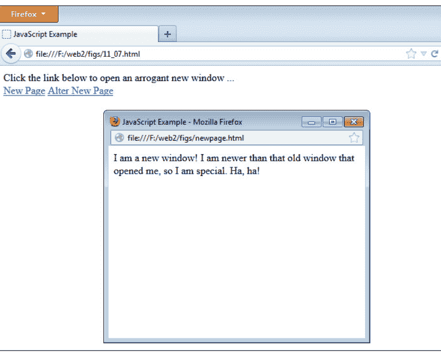

## 图 11-7 打开时的窗口初始位置

在这里，你用`x-pixels`替换为想要让窗口从左移动的像素数。例如，如果你输入 300，窗口将向左移动 300 像素。你再用`y-pixels`替换为想要让窗口从上向下移动的像素数。

作为一个示例，修改你的`open.js`代码使用`moveTo()`而不是`moveBy()`，如下代码所示：

```javascript
var nw_win = document.getElementById("nwin");
var aw_win = document.getElementById("awin");
var mywin = "";
nw_win.addEventListener("click", function(event) {
  event.preventDefault();
  mywin = window.open("new.html", "cool", "width=400,height=300,status=yes");
}, false);
aw_win.addEventListener("click", function(event) {
  event.preventDefault();
  mywin.moveTo(50, 50);
  mywin.focus();
}, false);
```

新窗口将移动到屏幕上的 (50,50) 坐标，距离左侧 50 像素，距离顶部 50 像素。

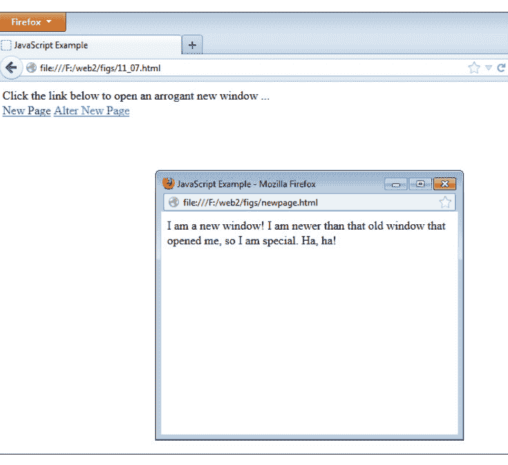

## 图 11-8 移动后窗口的新位置

这次当点击链接时，窗口将移动到屏幕上的 (50,50) 坐标。

为了看到它的工作方式与`moveBy()`方法不同，请再次点击链接。它不会再再次移动，而是停留在原地，因为它已经到达了目的地。然而，如果你手动移动了新窗口，点击链接将把它移回`moveTo()`的坐标。

大多数现代浏览器不允许窗口的任何部分移出屏幕。例如，移动到 (-10,-10) 的窗口会被浏览器移动到 (0,0)。

## `resize()` 和 `resizeTo()` 方法

`resizeBy()`方法用于根据方法调用发送的参数中的像素数来调整窗口大小。要让窗口变大，使用正数。要让它变小，使用负数。例如，你可以修改你的`openwin.js`代码，在点击时让新窗口变小，如下代码所示：

```javascript
var nw_win = document.getElementById("nwin"),
    aw_win = document.getElementById("awin"),
    mywin = ...;
nw_win.addEventListener("click", function(event) {
  event.preventDefault();
  mywin = window.open("page.html","cool",width=400,height=300,status=yes);
}, false);
aw_win.addEventListener("click", function(event) {
  event.preventDefault(); // 负数将使窗口变小
  mywin.resizeBy(-100, -100);
  mywin.focus();
}, false);
```

这段代码将窗口的宽度和高度设为 100 像素。图 11-9 显示了新窗口刚打开时的样子，图 11-10 显示了新窗口调整大小后的样子。

与`moveTo()`类似，再次点击链接将继续调整大小。出于安全考虑，大多数现代浏览器会在窗口达到最小允许尺寸后停止调整大小，并且当窗口大小达到屏幕上的最大可视区域时也会停止。

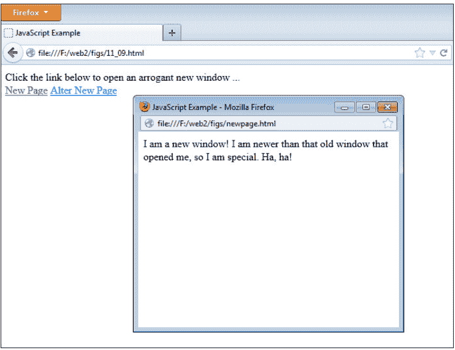

图 11-9 新窗口刚打开时的状态

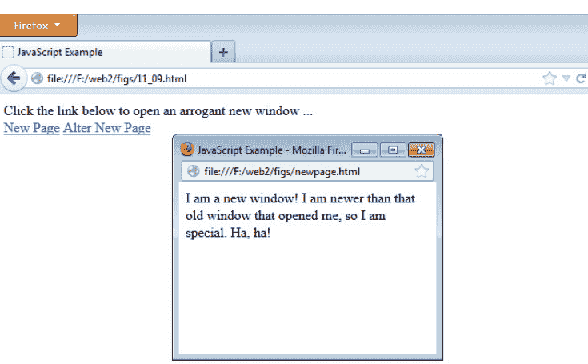

图 11-10 调整大小后的新窗口：高度和宽度各缩小了 100 像素。

`resizeTo()`方法用于根据方法调用中传递的参数将窗口调整为特定的像素尺寸。例如，你可以再次修改`openwin.js`文件。使用以下代码：

```javascript
var nw_win = document.getElementById("nwin");
aw_win = document.getElementById("awin");
mywin = "";
nw_win.addEventListener("click", function(event) {
  event.preventDefault();
  mywin = window.open("newpage.html", "cool",width=400,height=300,status=yes);
});
aw_win.addEventListener("click", function(event) {
  event.preventDefault();
  mywin.resizeTo(400, 400);
  mywin.focus();
}, false);
```

> 窗口被调整为 400 像素乘以 400 像素

现在点击主窗口中的“更改新页面”链接会将新窗口调整为 400 × 400 像素。如果新尺寸导致窗口大于屏幕可视区域，出于安全考虑，大多数现代浏览器会将窗口大小限制在该可视区域内，而不是使用提供的尺寸。

## scrollBy() 和 ScrollTo() 方法

`scrollBy()`方法用于根据方法调用中传递的像素数滚动窗口。`ScrollTo()`方法用于将窗口滚动到特定的位置。其语法和用法与此处提到的其他方法相同，并将根据作为参数提供的数字滚动新窗口。

# 第 11 章 自测题

- 1. 每个浏览器都会创建一个（对象。

- 2. `closed`属性用于检查窗口是否已关闭。
  - A. 正确
  - B. 错误

- 3. 该属性返回窗口内的帧数。

- 4. `location`属性可以导致浏览器立即重定向到新页面。
  - A. 正确
  - B. 错误

- 5. 该属性持有当前窗口的名称，并允许你为窗口命名。

- 6. 对窗口对象的属性和方法的调用通常可以通过以下方式简化：
  - A. window 对象是浏览器中 JavaScript 的全局对象。
  - B. 假设 window 属性和方法是`navigator`对象的一部分。
  - C. 真的没有 window 对象。
  - D. 浏览器假设 window 对象是`document`对象的一部分。

- 7. 该属性是 JavaScript 中表示“当前窗口”的另一种表达方式。

- 8. 为什么这段代码不起作用：

```javascript
onmouseover="window.status='Page 2'; return true;"
```

  - A. 它应该没有问题地运行。
  - B. 引号设置不正确。
  - C. 新的浏览器默认不允许更改窗口状态，用户需要更改安全设置才能使其工作。
  - D. 在 mouseover 事件中状态属性的更改后必须返回 false。

- 9. `parent`和`top`属性之间的区别是什么？
  - A. `parent`属性跳转到当前帧集的顶部，而`top`属性跳转到页面上所有帧集的顶部。
  - B. `top`属性跳转到当前帧集的顶部，而`parent`属性跳转到页面上所有帧集的窗口。
  - C. `parent`属性跳转到当前帧集的顶部，而`top`属性跳转到当前帧的顶部。
  - D. `parent`属性跳转到最外层帧集，而`top`属性跳转到页面上所有帧集的窗口。

- 10. 方法向用户弹出消息，用户必须点击 OK 按钮继续。

- 11. 如果用户点击 OK 按钮，`confirm()`方法返回什么值？
  - A. true
  - B. false
  - C. "OK"
  - D. 25

- 12. ________ 方法允许用户进入窗口。

- 13. `prompt()`方法用于 ________ 用户输入信息。

- 14. 在`open()`方法的第三个参数设置`toolbar`属性时，该属性可以取哪些值？
  - A. 仅 yes 和 no
  - B. 仅 1 和 0
  - C. yes, no, true 和 untrue
  - D. yes, no, 1 和 0

- 15. `setInterval()`方法和`setTimeout()`方法之间的区别是什么？
  - A. `setTimeout()`方法用于用户需要休息，而`setInterval()`用于用户需要休息休息。
  - B. `setInterval()`方法按设定间隔重复执行函数，而`setTimeout()`在指定的延迟后执行函数。
  - C. `setInterval()`方法默认按设定间隔在屏幕上闪广告，而`setTimeout()`无广告。
  - D. 它们执行相同的功能。

# 第 12 章：数学、数字和日期对象

| 属性 | 值 |
| --- | --- |
| E | 欧拉常数 (E) 的值，约为 2.71828... |
| LN10 | 10 的自然对数值，约为 2.302585... |
| LN2 | 2 的自然对数值，约为 0.693147... |
| LOG10E | E 的底数为 10 的对数，约为 0.43429... |
| LOG2E | E 的底数为 2 的对数，约为 1.442695... |
| PI | 圆周率，常用于圆，约为 3.14159... |
| SQRT2 | 2 的平方根值，约为 1.4142... |
| SQRT1_2 | 二分之一的平方根值，约为 0.7071... |

**表 12-1** Math 对象的属性

### 使用属性

这些属性包含只读值，这些值在特定类型的计算中非常有用。例如，如果你想计算面积`Area = pi*r²`，你可以使用公式`Area = pi*r²`。通过此，你可以编写一个应用程序，根据观众输入的半径来确定圆的面积。你可以使用以下代码，从 HTML 代码开始：

```html
<form id="getarea">
  <label for="radius">输入半径:</label><br>
  <input type="text" id="radius">
  <input type="submit" value="获取面积!">
</form>
```

接下来是 JavaScript 代码：

```javascript
var area_form = document.getElementById("getarea");
area_form.addEventListener("submit", function(event) {
  var rad = document.getElementById("radius").value;
  var _area = 0;
  if (!rad || rad.length < 1) {
    event.preventDefault();
    alert("请输入半径!");
    return;
  } else {
    event.preventDefault();
    rad = +rad || false;
    if (rad === false) {
      alert("半径必须是数字!");
      return;
    }
    _area = Math.PI * (rad * rad);
    alert("面积是 " + _area + " 平方单位.");
  }
});
```

- 通过其 id (getarea) 获取表单元素
- 使用其属性获取文本框（id 为 radius）的值
- 检查是否输入了数据，如果没有则弹出警报
- 检查输入的数据是否为数字，如果不是则弹出警报
- 执行计算并显示答案

这段代码首先通过其 id (getarea) 获取表单元素，并将其赋值给名为`_area`的变量。当表单被提交时，它获取文本字段中的半径值（radius）并将其赋值给名为`rad`的变量。接下来，代码执行检查。一旦完成计算并赋值给变量，就会向观众显示一个带有“平方单位”的警告框。可以修改该脚本以满足你的需求，或提供选项（厘米、英寸或其他计量单位）。

图 12-1 显示了在浏览器中运行此脚本并在文本框中输入 2 的结果。

图 12-1 为观众显示了圆的面积。

## 方法

Math 对象的方法允许你执行某些计算，这些计算对你的脚本可能有所帮助。表 12-2 列出了 Math 对象的各种方法，并简要描述了每个方法的目的。每个方法将在后续章节中进行更详细的讨论。

### 基础方法

就本书而言，“基础方法”定义为接收单个数字、进行简单计算并返回结果的方法。这种方法避免了列出所有方法的麻烦。

| 方法 | 目的 |
| --- | --- |
| abs() | 返回数字的绝对值 |
| acos() | 返回传入数字的反余弦值 |
| asin() | 返回传入数字的正弦值 |
| atan() | 返回传入数字的正切值 |
| atan2() | 返回两个数字之商的反正切值（考虑象限） |
| ceil() | 返回大于等于传入数字的最小整数 |
| cos() | 返回传入数字的余弦值 |
| exp() | 返回 E 的指定幂 |
| floor() | 返回小于等于传入数字的最大整数 |
| log() | 返回传入数字的自然对数 |
| max() | 返回两个数字中的较大值 |
| min() | 返回两个数字中的较小值 |
| pow() | 返回第一个参数的第二个参数的幂 |
| random() | 返回一个 0 到 1 之间的随机数；不需要参数 |
| round() | 返回传入数字四舍五入后的整数 |
| sin() | 返回传入数字的正弦值 |
| sqrt() | 返回传入数字的平方根 |
| tan() | 返回传入数字的正切值 |

**表 12-2** Math 对象的方法

以下基础方法的工作方式基本相同：

- `abs()`
- `exp()`
- `acos()`
- `log()`
- `asin()`
- `sin()`
- `atan()`
- `sqrt()`
- `cos()`
- `tan`

使用`sqrt()`方法的最简单方法是以数字作为参数，如下例所示：

```javascript
window.alert(Math.sqrt(4));
```

这将弹出 4 的正平方根值，即 2。

与其计算静态数字，不如让用户输入一个数字，然后向观众显示该数字的平方根。你可以使用以下代码实现这一点，从 HTML 代码开始：

```html
<form id="getroot">
  <label for="sr_num">输入一个正数或零:</label>
  <input type="text" id="sr_num">
  <input type="submit" value="获取平方根">
</form>
```

接下来是 JavaScript 代码：

```javascript
var root_form = document.getElementById("getroot");
root_form.addEventListener("submit", function(event) {
  var thenum = document.getElementById("sr_num").value;
  thenum = +thenum || false;
  event.preventDefault();
  if (!thenum || thenum.length < 1) {
    alert("输入必且必须是数字!");
    return;
  } else if (thenum < 0) {
    alert("嘿！我是说输入正数！再试一次。");
    return;
  }
});
```

```javascript
else {
  var theroot = Math.sqrt(thenum); // 平方根
  alert("The square root of "+thenum+" is "+theroot+"); // 计算并
  alerted to the viewer
}, false;
```

当用户提交表单时，输入到文本框的值被赋值给`thenum`变量。接下来，函数会检查该字段是否为空，或者输入的数据是否不是数字。之后，它会检查查看者是否输入了负数。任何这种情况都会向查看者提示错误。否则，将使用名为`theroot`的值调用`Math.sqrt()`方法。这会返回数字的平方根，然后将其赋值给名为`theroot`的变量。最后，会弹出一个提示框告诉用户平方根信息。

当查看者输入数字 4 时，该脚本的结果如图 12-2 所示。本节中的其他方法工作原理相似；它们只是返回不同的结果，例如绝对值、正切或对数。

## 双参数方法

本节讨论了接受两个参数而非仅一个参数的方法。这些方法包括以下几种：

- atan(2)
- max()
- min()
- pow()

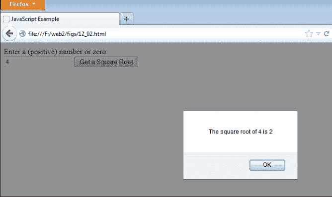

**图 12-2** 为查看者显示平方根。

`max()`和`min()`方法非常相似，而`pow()`方法的操作略有不同。

### max() 和 min() 方法

`max()`方法接受两个或多个数字并返回最大的数字。`min()`方法也接受两个参数，但返回较小的数字。你可以在脚本中使用这些方法，允许查看者输入两个数字，然后提示用户哪个数字较大。

下面的示例同时使用了这两种方法，并在提示框中向查看者显示结果。首先是 HTML 代码：

```html
<form id="getmax">
  输入两个数字查看哪个更大:<br>
  <label for="num1">Number</label>
  <input type="text" id="num1"><br>
  <label for="num2">Number</label>
  <input type="text" id="num2"><br>
  <input type="submit" value="Which Number is Bigger?">
</form>
```

接下来是 JavaScript 代码：

```javascript
var max_form = document.getElementById("getmax");
max_form.addEventListener("submit", function(event) {
  var num1 = document.getElementById("num1").value;
  var num2 = document.getElementById("num2").value;
  var smallnum = 0;
  num1 = (+num1 === 0) ? +num1 || false;
  num2 = (+num2 === 0) ? +num2 || false;
  event.preventDefault();
  if (num1 !== false) && (num2 !== false) {
    var largenum = Math.max(num1, num2);
    smallnum = Math.min(num1, num2);
    if (largenum === smallnum) {
      alert("这两个数字相相等!");
    } else {
      alert(largenum + " is larger than " + smallnum);
    }
  } else {
    alert("Please enter only numeric values.");
  }
}, false);
```

此表单向查看者请求两个数字并将它们赋值给变量。会进行检查以确保输入了数字。如果是，它将获取两个数字中的最大值和最小值并将值赋值给变量。然后使用变量检查它们是否相等。如果是，会弹出提示框说明它们相等；否则，会弹出结果提示框。

下面的插图显示了当查看者第一个数字输入 2，第二个数字输入 54 时，该脚本在浏览器中的结果。

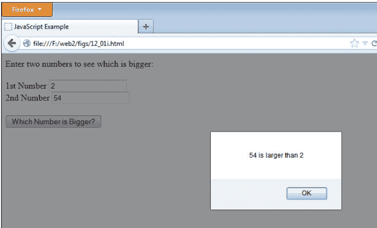

### pow() 方法

`pow()`方法接受两个参数，并计算第一个参数的第二个参数的幂。例如，以下代码将返回 2 的三次：

```javascript
Math.pow(2,3);
```

除了计算方式不同外，你可以像使用其他双参数方法一样使用它，将结果赋值给变量，然后在脚本中使用该变量。例如，你可以使用以下脚本，从 HTML 代码开始：

```html
<form id="getpow">
  <label for="base">Base Number:</label>
  <input type="text" id="base"><br>
  <label for="exp">Exponent:</label>
  <input type="text" id="exp"><br>
  <input type="submit" value="Find a Power">
</form>
```

接下来是 JavaScript 代码：

```javascript
var pow_Form = document.getElementById("getpow");
pow_Form.addEventListener("submit", function(event) {
  base = document.getElementById("base").value;
  exp = document.getElementById("exp").value;
  result = 0;
```

```javascript
  base = +base;
  exp = +exp;
  event.preventDefault();
  if (base !== false) && (exp !== false) {
    result = Math.pow(base, exp);
    alert(base + " to the power of " + exp + " is " + result);
  } else {
    alert("Please enter only numeric values.");
  }
}, false);
```

### 其他方法

接受单个参数的方法执行的操作如下：

- ceil()
- floor()
- round()

### ceil() 方法

`ceil()`方法接受一个参数并返回大于或等于该参数的最小整数。例如，以下代码将返回 13：

```javascript
Math.ceil(12)
```

除了计算方式不同外，你可以像使用其他双参数方法一样使用它，将结果赋值给变量，然后在脚本中使用该变量。例如，你可以使用以下脚本，从 HTML 代码开始：

```html
<form id="getceil">
  <label for="num">Number:</label>
  <input type="text" id="num"><br>
  <input type="submit" value="Find Ceiling">
</form>
```

接下来是 JavaScript 代码：

```javascript
var ceil_form = document.getElementById("getceil");
ceil_form.addEventListener("submit", function(event) {
  var num = document.getElementById("num").value;
  var ceiling = 0;
  event.preventDefault();
  if (num !== false) {
    ceiling = Math.ceil(num);
    alert("ceil of " + num + " is " + ceiling);
  } else {
    alert("Please enter only numeric values.");
  }
}, false);
```

此表单向查看者请求两个数字并将它们赋值给变量。通过检查确保输入了数字。如果是，它将获取两个数字中的最大值和最小值并将值赋值给变量。然后使用变量检查它们是否相等。如果是，会弹出提示框说明它们相等；否则，会弹出结果提示框。

下面的插图显示了当查看者输入 12.23 时，该脚本在浏览器中的结果。

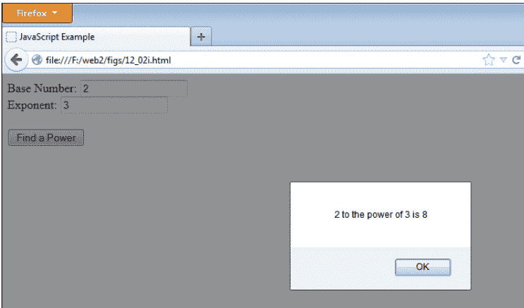

### floor() 方法

`floor()`方法接受一个参数并返回小于或等于该参数的最大整数。例如，以下代码将返回 12：

```javascript
Math.floor(12.23);
```

除了计算方式不同外，你可以像使用其他双参数方法一样使用它，将结果赋值给变量，然后在脚本中使用该变量。例如，你可以使用以下脚本，从 HTML 代码开始：

```html
<form id="getfloor">
  <label for="num">Number:</label>
  <input type="text" id="num"><br>
  <input type="submit" value="Find Floor">
</form>
```

接下来是 JavaScript 代码：

```javascript
var floor_form = document.getElementById("getfloor");
floor_form.addEventListener("submit", function(event) {
  var num = document.getElementById("num").value;
  var floor = 0;
  event.preventDefault();
  if (num !== false) {
    floor = Math.floor(num);
    alert("floor of " + num + " is " + floor);
  } else {
    alert("Please enter only numeric values.");
  }
}, false);
```

### round() 方法

`round()`方法接受一个参数并返回离该参数最近的整数。例如，以下代码将返回 13：

```javascript
Math.round(12.51);
```

为了获取一个你可以使用的随机整数，你需要执行一些操作来获取你想要使用的数值的类型。

**随机整数**

为了获取一个随机整数，你想要做的第一件事是让结果具有更大的数值范围，这样你就不会被卡在 0 和 1 之间。为了获得更大的范围，你可以将`random()`方法的结果乘以一个整数来创建一个更大的范围。就像数组一样，范围将从 0 开始计数；所以，为了获得一个包含五个可能整数的范围，你需要将结果乘以 5。下面的代码显示了你可以如何操作：

```
var rand_num = Math.random() * 5;
```

这会得到 0 到 4 之间的结果，但并没有给你一个整数。这个数字仍然可能是一个很长的小数。

为了获取一个 0 到 4 之间的整数，你需要找到一种方法让所有这些小数转换为整数。回想一下之前运行过的三个方法：`floor()`、`ceil()`和`round()`，它们以不同的方式将数字转换为整数。你在这里将选择`floor()`方法，因为它会移除整数后的小数部分，并给你整数部分。

要使用`floor()`方法，你可以编写以下代码：

```
var rand_num = Math.random()*5;
var rand_int = Math.floor(rand_num)*5;
```

`floor()`方法将`rand_num`变量的值作为参数，并从中给你一个整数。如果你想节省一行代码，可以写得花哨一点。你可以直接将`random()`方法和计算结果作为`floor()`方法的参数。你可以这样做是因为计算结果`Math.random()*5`是一个数字，而`floor()`方法可以接受一个数字作为参数。下面的代码显示了你如何在单行中完成操作：

```
var rand_int = Math.floor(Math.random())*5;
```

变量`rand_int`将具有 0 到 4 之间的随机整数值。正如你可能注意到的，这种数字对数组可能非常有用。这就是你如何开始使用随机数编写一些脚本。

**脚本中的随机数**

现在，你可以通过使用`random()`方法来对`Math`对象玩玩了。通过设置一些数组，你可以创建一个脚本，在每次页面加载时提供随机引言或显示随机图像。

**用于趣味的随机引言**

如果你想过在页面上添加一条引言，但不想一直更改引言以保持不同内容，那么一个随机引言脚本可能正适合你。

要创建一个脚本，你首先需要一些引言可以使用。假设你想设置十个不同的引言，并在每次页面加载时按顺序显示。由于你有许多相似的值（以便稍后与随机整数配合使用），你应该使用数组，这样就可以存储所有这些值并轻松地检索它们。

因此，你需要设置一个包含十个元素的数组，类似于下面的示例，其中每个元素都是我为了混合而的一个随机（也许是奇特的）代码：

- var quotes = ["Look in the mirror. Are you looking at me?",
- "It is time for a rhyme, I guess.",
- "Where is my JavaScript book?",
- "If I had a buck for every dollar I spent—Oops, never mind.",
- "I suppose you were expecting a real quote here.",
- "Quotes are great, but don't quote me on that.",
- "What should I write here?",
- "What happens if eye miss spell oh purpas?",
- "Mark my words, I will mark my words.",
- "This spot reserved for a better quote.",];

现在你有一组引言在数组，你可以通过生成随机整数来使用它们。

你需要一个 0 到 9 之间的随机整数（十个数字），因此可以使用以下代码将 0 到 9 之间的随机数赋值给变量：

```
var rand_int = Math.floor(Math.random() * 10);
```

现在变量`rand_int`的值将是 0 到 9 之间的随机整数。你可以使用该变量访问与`rand_int`随机整数匹配的数组元素，如下示例所示：

```
quotes[rand_int]
```

你可以使用 div 元素的`innerHTML`属性将此值写入页面主体，如下示例所示。HTML 文档保存为`random_quotes.html`，JavaScript 文件保存为`random_quotes.js`。HTML 代码如下：

```html
<h1>我的随机引言：</h1>
<div id="my_quote">
Look in the mirror. Are you looking at me?
</div>
<script type="text/javascript" src="random_quotes.js"></script>
```

JavaScript 代码如下：

```javascript
var quotes = ["Look in the mirror. Are you looking at me?",
"It is time for a rhyme, I guess.",
"Where is my JavaScript book?",
"If I had a buck for every dollar I spent—Oops, never mind.",
"I suppose you were expecting a real quote here.",
"Quotes are great, but don't quote me on that.",
"What should I write here?",
"Wut hapns iff eye miss spel oh purpas",
"Mark my words, I will mark my words.",
"This spot reserved for a better quote."];
```

```javascript
var q_div = document.getElementById("my_quote");
var rand_index = Math.floor(Math.random() * 10);
q_div.innerHTML = quotes[rand_index];
```

该代码根据`rand_int`变量中的随机整数在页面上写入引言之一。为没有 JavaScript 的用户提供了一个默认引言（数组中的第一个），如果可以使用 JavaScript，则会被随机引言覆盖。重新加载页面将使随机数重置，并可能（尽管不一定，因为是随机的）显示出一个不同的引言。

### 注意

在本示例中，图像被保存为 image0.gif、image1.gif 等；不过，你可以以你喜欢的任何名称保存图像文件。

关于`random()`方法的讨论可以一直进行下去，因为有很多事情可以进行随机化。然而，你现在已经了解该功能工作原理的基本知识，所以是时候继续后续了。

## 专家问答

- 问：我真的会用到`Math`对象的任何属性吗？它们都是我甚至从没用过的数字！

- 答：这取决于你执行不同类型计算的频率。对于初学者来说，使用其中任何一个对你都是有用的，但有些地方会将它们用于各种高级用途，例如 JavaScript 计算器、图形对象（如`canvas`元素）等。

- 问：我对写计算器没有兴趣。我真的需要麻烦去记忆`Math`对象的所有属性吗？

- 答：嗯，可能不需要，因为你需要用到它们的情况可能根本不会出现。不过，手头有一份参考以防万一，并且大致了解它们是什么是好的，因为它们会出现在出现在 Web 的脚本中。

- 问：如果我身边没有计算器，这些属性和方法可能会很有用。我可以写一个小脚本来自己计算东西，对吧？

- 答：当然可以！只需确保用你已知的数字进行双重检查，以确保你的代码中没有错误。

- 问：`random()`方法到目前为止很好用，但我想不出其他我可以用它的地方了。你能给我一些用它来做其他事情的建议吗？

- 答：还有很多其他地方你可以使用它。你可以对几乎任何可以用 HTML 标签或纯文本显示的内容进行随机化，所以尝试一些想法看看是否对你有效。不过，这里是我脑子里冒出的想法：随机链接、随机链接图片、某种 JavaScript 游戏的随机任务（如掷骰子或抽牌）、页面问候、随机警报……我确定还有很多。

## 尝试练习 12-1 在页面上显示随机链接

```
prjs12_1.html
prjs12_1.js
```

此脚本通过让你创建一个在页面上显示随机链接的脚本，让你能够进一步使用`random()`方法。

## 逐步步骤

- 1. 创建一个带有 script 标签的 HTML 页面，指向一个名为`prjs12_1.js`的外部 JavaScript 文件。添加一个显示“Random Link”的标题，并添加一个 id 为`random_link`的`div`元素。在`div`元素内部，为没有 JavaScript 的用户插入链接。将 HTML 文件保存为`prjs12_1.html`。

- 2. 完成后，HTML 文件的`body`部分应该如下：

```html
<body>
  <h1>Random Link</h1>
  <div id="random_link">
    <a href="http://www.scripttheweb.com">Random Site!</a>
  </div>
  <script type="text/javascript" src="prjs12_1.js"></script>
</body>
```

- 3. 创建一个外部 JavaScript 文件并将其保存为`prjs12_1.js`。在后续步骤 4–7 中使用它。

- 4. 在数组中创建五个 Web 地址。使用以下地址或你自行选择的某些地址：

```text
http://www.scripttheweb.com
http://www.webxertz.net
http://www.duckduckgo.com
http://www.yahoo.com
http://www.google.com
```

- 5. 使用`random()`方法创建一个随机整数，你可以用该整数作为索引来访问数组。

- 6. 通过更改 id 为`random_link`的`div`元素的`innerHTML`属性，以所示所示格式在页面上显示随机链接：

```html
<a href="random">Random Site!</a>
```

- 7. 完成后，JavaScript 文件应该如下：

```javascript
var urls = ["http://www.scripttheweb.com",
  "http://www.webxertz.net",
  "http://www.duckduckgo.com",
  "http://www.yahoo.com",
  "http://www.google.com"];
var div = document.getElementById("random_link");
var rand = Math.floor(Math.random() * 5);
div.innerHTML = '<a href="' + urls[rand] + '">Random Site!</a>';
```

- 8. 保存 JavaScript 文件并在浏览器中打开 HTML 文件。重新加载几次，查看随机地址是如何显示链接的。

### 尝试练习总结

在这个项目中，你能够运用对`Math`对象的知识。通过使用`random()`方法，你创建了一个显示指向随机地址链接的网页。

## 理解 Number 对象

`Number`对象是另一个预定义的 JavaScript 对象，它为数字的使用提供了几个实用的属性和方法。它最常见的用途是访问一些表示特定值的有用属性，这些值可以在你创建脚本时为你提供帮助。

## 属性

表 12-3 列出了`Number`对象的属性并简要描述了每个属性的用途。本节将更详细地描述每个属性。

| 属性 | 用途 |
| :--- | :--- |
| MAX_VALUE | 存储一个常量，代表 JavaScript 将数字解释为无穷大之前的最大值 |
| MIN_VALUE | 存储一个常量，代表 JavaScript 将数字解释为负无穷大之前的最小绝对值 |
| NaN | 代表“不是数字”（Not a Number）的值 |
| NEGATIVE_INFINITY | 代表负无穷大的值 |
| POSITIVE_INFINITY | 代表无穷大的值 |

**表 12-3** `Number`对象的属性

## MAX_VALUE 属性

`MAX_VALUE`属性是一个常量，大约为 1.79E+308。该属性之所以有用，是因为任何大于该值的数字在 JavaScript 中都会表示为无穷大。因此，在比较中使用它提供了一种避免产生过大无法显示的数值的方法。以下代码是这种工作原理的示例：

```javascript
var big_num = num1 * num2 * num3;
if (big_num > Number.MAX_VALUE) {
  alert("The number is too large, try smaller.");
}
```

## MIN_VALUE 属性

`MIN_VALUE`属性是一个常量，大约为 5e−324。该属性之所以有用，是因为任何小于该值的数字在 JavaScript 中都会表示为（接近零的）极小。因此，在比较中使用它提供了一种避免产生过小无法精确的数值的方法。以下代码是这种工作原理的示例：

```javascript
var small_num = num1 * num2 * num3;
if (small_num < Number.MIN_VALUE) {
  alert("The number is too small, try larger.");
}
```

## NaN 属性

`NaN`属性是一个代表“不是数字”的值。它不等于任何数字。

## NEGATIVE_INFINITY 属性

`NEGATIVE_INFINITY`属性是一个代表负无穷大的常量。它可以像使用其他数字一样被使用。

## POSITIVE_INFINITY 属性

`POSITIVE_INFINITY`属性是一个代表正无穷大的常量。它可以像使用其他数字一样被使用。

### 注意

无穷大（Infinity）在数学方程中的行为与其他数字不同。欲需更多信息，请参见 tutorial.math.lamar.edu/Classes/TypesInfinity.aspx

## 方法

表 12-4 列出了`Number`对象的方法并简要描述了每个方法的用途。后续章节将更详细地讨论每个方法。

### toExponential(), toFixed(), toPrecision(), 和 toString() 方法

这些方法返回一个字符串值，表示`Number`在特定格式下的样子。注意，在下面的代码中这些方法不能直接用于数字本身（数值）：

```javascript
alert(10.toExponential());
```

这将会导致 JavaScript 错误，因为它期望一个`Number`对象。为了避免这种情况，请通过将数值赋值给变量（这将使其成为`Number`对象）来使用这些方法：

```javascript
var the_num = 10;
alert(the_num.toExponential());
```

### 注意

你也可以使用构造语法`var_num = new Number(10);`，这也是有效的。

| 方法 | 用途 |
| :--- | :--- |
| toExponential() | 返回一个以指数计数法表示数字的字符串值 |
| toFixed() | 返回一个表示保留小数点后指定位数数字的字符串值 |
| toPrecision() | 返回一个表示舍入到指定有效位数数字的字符串值 |
| toSource() | 返回一个表示对象源代码的字符串值 |
| toString() | 返回一个表示 Number 对象的字符串值 |
| valueOf() | 最常被 JavaScript 内部调用 |

**表 12-4** `Number`对象的方法

### toExponential() 方法

`toExponential()`方法返回一个字符串，该字符串以科学计数法指数形式表示一个 Number 对象。因此，以下代码将在屏幕上显示 1.0e+1（或类似的表示，取决于你的浏览器）的结果：

```javascript
var the_num = 10;
alert(the_num.toExponential());
```

### toFixed() 方法

`toFixed()`方法返回一个字符串，该字符串表示一个 Number 对象并在小数点后指定的位数进行四舍五入。例如，如果你需要格式化计算结果以显示货币值，可以使用此方法将计算结果四舍五入到小数点后两位并以货币格式显示。例如，这段代码使用了美元和分：

```javascript
var kidsmoney = 2000;
var mykids = 7;
var one_share = kidsmoney/mykids;
alert("One share of the money is $" + one_share.toFixed(2));
```

每份钱的计算结果为 285.714285712857，但由于使用了`toFixed()`方法并将`2`作为参数，句子显示如下：

One share of the money is $285.71

### toPrecision() 方法

`toPrecision()`方法返回一个字符串，该字符串表示一个 Number 对象并在指定的有效数字范围内进行四舍五入。这包括小数点前后所有的数字。因此，如果你想将 45.57689349 这样的数字四舍五入到五位有效数字，可以使用代码：

```javascript
var the_num = 45.57689349;
alert(the_num.toPrecision(5));
```

浏览器将弹出 45.577，这是四舍五入到五位有效数字的结果（在这种情况下，小数点前两位，后三位）。

### toString() 方法

`toString()`方法返回 Number 对象的字符串值（或数值变量的值）。如果你想将数值转换为其对应的字符串值（例如，将 10 变为“10”），这就会非常有用。

### toSource() 方法

`toSource()`方法返回表示对象源代码的字符串。对于预定义的 Number 对象，此方法返回构造函数属性`constructor`的值。此方法通常由 JavaScript 内部调用，在代码中较少使用。

### valueOf() 方法

这是另一个主要由 JavaScript 内部使用的方法。目前，你只需要知道它是 Number 对象的一个有效方法。

### parseInt() 和 parseFloat() 方法

虽然这两个方法不是 Number 对象的方法，但当你需要从混合字符串中获取数值时，它们非常有用。它们的工作方式相似，`parseInt()`只获取数字的整数部分，而`parseFloat()`则获取整数和小数后的数字。以下是它们的工作原理：

- 如果字符串中的第一个字符不是数字、加号 (+) 或 减号 (-)，则两个方法都返回`NaN`。
- 对于`parseInt()`，如果第一个字符是数字（0 除外）、加号 (+) 或 减号 (-)，则会评估每个字符，直到遇到非数字字符为止（十六进制值除外，某些字符如 x 和 A 是允许的）。返回通过此过程获得的数字。如果第一个字符是 0 且不是十六进制，则返回 0。
- 对于`parseFloat()`，如果第一个字符是数字、加号 (+) 或 减号 (-)，它将评估每个字符，并在发现点 (.) 后面跟着额外的数字时继续评估，直到遇到非数字字符为止。如果数字以 0 开头且不是十六进制，将忽略任何前导 0，直到遇到另一个数字。十六进制数返回 0。

每个方法返回值的某些示例将展示这些规则是如何工作的：

```javascript
parseInt("14"); // 返回 14
parseInt("cool567"); // 返回 NaN
parseInt("+34iah"); // 返回 34
parseInt("-23avesome"); // 返回 -23
parseInt("020"); // 返回 0
parseInt("0xA"); // 返回 10 – 十六进制值
```

```javascript
parseFloat("14"); // 返回 14
parseFloat("blah22"); // 返回 NaN
parseFloat("123.456"); // 返回 123.456
parseFloat("123.45,6"); // 返回 123.45 – 第二个点结束处理
parseFloat("023.44"); // 返回 23.44
parseFloat("0xAF"); // 返回 0
```

使用`parseInt()`时，允许定义第二个参数，称为基数（radix）。这让你有机会指定要返回的数字类型。以下是一些示例：

```javascript
parseInt("11", 10); // 返回 11
parseInt("11", 2); // 返回 3 – 使用二进制值
parseInt("11", 16); // 返回 17 – 使用十六进制值
parseInt("11", 8); // 返回 9 – 使用八进制值
```

你可以看到，相同的值可以根据指定的基数产生不同的结果。`parseFloat()`方法没有这个选项，因为根据设计，它只解析十进制值。

**提示**

当省略基数参数时，JavaScript 会决定返回什么类型的值。在某些情况下，这可能会导致乎意想不到的结果。

### 使用 Date 对象

Date 对象用于处理日期和时间。它提供了多种用于获取和设置日期各个组件的方法。

### 属性和方法

Date 对象有许多属性和方法。以下是常用方法的列表：

| 方法 | 目的 |
| :--- | :--- |
| getDate() | 返回月份中的几 (1-31) |
| getDay() | 返回星期几 (0-6) |
| getHours() | 返回一天中的小时 (0-23) |
| getMilliseconds() | 返回秒内的毫秒 (0-999) |
| getMinutes() | 返回一小时内的分钟 (0-59) |
| getMonth() | 返回月份 (0-11) |
| getSeconds() | 返回分钟内的秒 (0-59) |
| getTime() | 返回自 1970 年 1 月 1 日来的毫秒数 |
| getTimezoneOffset() | 返回相对于格林威治标准时间的偏移量（分钟） |
| getYear() | 返回年份（两位） |
| getFullYear() | 返回完整年份（四位） |
| getUTCDate() | 返回协调世界时 (UTC) 的日期 |
| getUTDay() | 返回 UTC 的星期几 (0-6) |
| getUTCFullYear() | 返回 UTC 的完整年份（四位） |
| getUTCHours() | 返回 UTC 一天中的小时 (0-23) |
| getUTMilliseconds() | 返回 UTC 秒内的毫秒 (0-999) |
| getUTMinutes() | 返回 UTC 小时内的分钟 (0-59) |
| getUTMonth() | 返回 UTC 年中的月份 (0-11) |
| getUTCSeconds() | 返回 UTC 分钟内的秒 (0-59) |

| 方法 | 用途 |
| --- | --- |
| setMilliseconds() | 设置 Date 对象实例的毫秒 |
| setMinutes() | 设置 Date 对象实例的分钟 |
| setMonth() | 设置 Date 对象实例的月份 |
| setSeconds() | 设置 Date 对象实例的秒 |
| getTime() | 设置 Date 对象实例的时间（自 1970 年 1 月 1 日午夜以来的毫秒数） |
| setYear() | 设置 Date 对象实例的年份（两位） |
| setFullYear() | 设置 Date 对象实例的完整年份（四位） |
| setUTCDate() | 设置协调世界时（UTC）的月几 |
| setUTCFullYear() | 设置协调世界时（UTC）的完整年份（四位） |
| setUTCHours() | 设置协调世界时（UTC）当天中的小时数（0-59） |
| setUTCMiseconds() | 设置协调世界时（UTC）当前分钟内的毫秒数（0-999） |
| setUTCMinutes() | 设置协调世界时（UTC）每小时内的分钟数（0-59） |
| setUTCMonth() | 设置协调世界时（UTC）当前年份内的月份（0-11） |
| setUTCSeconds() | 设置协调世界时（UTC）当前分钟内的秒数（0-59） |
| DateString() | 以美式英语字符串返回 Date 对象的日期部分 |
| toGMTString() | 返回格林尼治标准时间（GMT）格式的日期字符串（现在使用 toUTCString()） |
| toLocaleString() | 返回基于本地区域的日期字符串 |
| toLocaleString() | 返回基于本地区域的 Date 对象日期部分字符串 |
| toLocalTimeString() | 返回基于本地区域的 Date 对象时间部分字符串 |
| toString() | 返回美式英语日期字符串 |
| toTimeString() | 返回美式英语的 Date 对象时间部分字符串 |

**表 12-5** Date 对象的方法（续）

## 获取值的方法

获取值的方法允许你获取可以在脚本中使用的各种时间和日期值。允许你获取 Date 对象实例值的方法包括：

- getDate()
- getDay()
- getHours()
- getMilliseconds()
- getMinutes()
- getMonth()
- getSeconds()
- getTime()
- getTimezoneOffset()
- getYear()
- getFullYear()
- getUTCDate()
- getUTCDay()
- getUTCFullYear()
- getUTCHours()
- getUTCMilliseconds()
- getUTCMinutes()
- getUTCMon()
- getUTCSeconds()

要使用这些方法，你需要一个 Date 对象实例。一旦拥有了实例，就可以使用实例名调用任何这些方法。此操作的语法为：`instance_name.method();`

你将`instance_name`替换为你的 Date 对象实例的名称，并将`method`替换为你想要使用的方法函数。

因此，如果你现在想对一个 Date 对象实例使用`getDate()`方法，可以使用以下代码：

```
var rightnow = new Date();
var theday = rightnow.getDate();
```

这会将`getDate()`方法返回的值赋值给名为`theday`的变量。

由于 Date 方法返回的值通常是数字，因此需要对这些方法进行进一步说明；因此，后续章节将详细查看这些方法。

## getDate() 方法

`getDate()`方法允许你在脚本中使用月份中的几几。返回的值是一个表示该月几的数字。因此，如果是该月的 5 号，`getDate()`方法将返回 5。这个方法很好用，因为它非常直观。

## getDay() 方法

`getDay()`方法允许你获取星期几；然而，它返回的不是星期一或星期五这样的名称，而是返回一个数字。该数字代表一周中的天数（0–6），而不是你通常想到的星期几（1–7）。因此，如果是星期日，方法返回 0；如果是星期三，方法返回 3。在脚本中使用它时，你必须记住它是从 0 开始计数的。接下来的许多方法都会从 0 开始计数。

## getHours() 方法

`getHours()`允许你获取一天中的小时数（0–23）。计数从 0 开始。因此，当午夜时，方法返回 0；当下午 2:00 时，它返回 14。

## getMilliseconds() 方法

`getMilliseconds()`允许你获取存储在 Date 对象实例中的毫秒数（0–999）。

## getMinutes() 方法

`getMinutes()`允许你获取存储在 Date 对象实例中的分钟数（0–59）。同样，计数从 0 开始。因此，如果过了 30 分，方法返回 30。

## getMonth() 方法

`getMonth()`允许你获取存储在 Date 对象实例中的月份（0–11）。因此，如果是 1 月，方法返回 0；如果是 12 月，方法返回 11。

## getSeconds() 方法

`getSeconds()`允许你获取存储在 Date 对象中的秒数（0–55）。因此，如果过了 30 秒，方法返回 30。

## getTime() 方法

`getTime()`获取 Date 对象的时间（自 1970 年 1 月 1 日午夜以来的毫秒数）。如果你想知道自该日期以来的时间，可以使用以下代码：

```
var rightnow = new Date();
var today = rightnow.getTime();
```

会将方法的赋值赋值给变量。

## getTimezoneOffset() 方法

`getTimezoneOffset()`提供本地时间与 UTC 的差异分钟数。如果你在 UTC 区，方法返回 0。

## getYear() 方法

`getYear()`返回年份的后两位（0 到 99 之间）。例如，如果年份是 1998，方法返回 98。在2000 年之后，某些浏览器会返回三位年份。

## getFullYear() 方法

`getFullYear()`返回四位年份。例如，如果年份是 1998，方法返回 1998。

```
var rightnow = new Date();
var theyear = rightnow.getFullYear();
```

会将方法的赋值赋值给变量。

## getUTCDate() 方法

`getUTCDate()`返回协调世界时（UTC）的月几。

## getUTCDay() 方法

`getUTCDay()`返回协调世界时（UTC）的星期几。

## getUTCFullYear() 方法

`getUTCFullYear()`返回协调世界时（UTC）的完整年份。

## getUTCHours() 方法

`getUTCHours()`返回协调世界时（UTC）当天中的小时数。

## getUTCMiseconds() 方法

`getUTCMilliseconds()`返回协调世界时（UTC）当前分钟内的毫秒数。

## getUTCMinutes() 方法

`getUTCMinutes()`返回协调世界时（UTC）每小时内的分钟数。

## getUTCMonth() 方法

`getUTCMonth()`返回协调世界时（UTC）当前年份内的月份。

## getUTCSeconds() 方法

`getUTCSeconds()`返回协调世界时（UTC）当前分钟内的秒数。

其他方法的工作原理相同。为了确定需要发送给这些方法之一的值，请查看其获取值的对应方法返回的是什么类型的值。该方法期望的参数将是一个与该方法返回的类似的值。

## 其他方法

其余的方法以某种方式执行其他方法未涵盖的各种任务。

## parse() 方法

`parse()`方法用于计算作为参数传入的日期字符串（例如 1999 年 12 月 12 日）自 1970 年 1 月 1 日午夜以来的毫秒数。这通常与`setTimeout()`方法配合使用——它需要一个毫秒数参数来设置日期。你可以使用`parse()`方法来计算 1999 年 12 月 12 日自 1970 年 1 月 1 日以来的毫秒数（Date 对象的午夜实例将用作所有方法返回值的基日期），如下代码所示：

```javascript
var rightnow = new Date();
var themum = Date.parse("Dec 12, 1999");
rightnow.setTime(denum);
```

这段代码将日期解析为毫秒数，然后将其发送到用于`rightnow` Date 实例的`setTimeout()`方法。

## toString(), toDateString(), toTimeString(), toLocaleString(), 和 toLocalTimeString() 方法

这些方法返回表示日期和时间的字符串或其部分。例如，`toString()`方法返回字符串格式的日期。你可以用它来获取 Date 实例的格式化日期，如下代码所示：

```javascript
var rightnow=new Date();
var thedate= rightnow.toString();
```

这会将一个日期值赋值给变量`thedate`。字符串的值取决于浏览器如何查看该页面。然后可以将其写入页面，或在脚本中与 Date 对象的其他方法配合使用。

## GMTString() 方法

`GMTString()`方法返回 GMT 格式的日期。可以使用它来获取 Date 实例的 GMT 格式，如下代码所示：

```javascript
var rightnow = new Date();
var thedate = rightnow.toGMTString();
```

这会将一个值（例如`Wed, 21 Dec 2003 11:12:44 GMT`）赋值给变量`thedate`。然后可以将其写入页面，或在脚本中与 Date 对象的其他方法配合使用。

## toLocaleString() 方法

`toLocaleString()`方法返回本地化格式的日期字符串。可以使用它来获取 Date 实例的本地格式，如下代码所示：

```javascript
var rightnow = new Date();
var thedate = rightnow.toLocaleString();
```

这会将一个日期字符串值赋值给变量`thedate`。字符串的值取决于用户查看页面时使用的浏览器。然后可以将其写入页面或与 Date 对象的其他方法使用。

现在你已经掌握了这些方法，尝试着用 Date 对象玩玩吧。

## 写些日期脚本如何？

在完成技术概述之后，你已经准备好创建一些使用 Date 对象方法的脚本了。首先，你将编写一个在页面上显示日期的脚本，然后将创建一个简单的状态栏时钟脚本。

## 在页面上写入日期

要在页面上写入日期，你需要使用一些 Date 对象方法来获取所需的值。假设你想写入以“星期几，M/D/Y（月/日/年）”格式格式的日期。为了做到这一点，你需要找到星期几、月份中的几以及年份。你可以使用`getDay()`、`getMonth()`、`getDate()`和`getFullYear()`方法来实现。

以下脚本将写入日期。首先是 HTML 代码（保存为`write_date.html`）：

```html
<h1>Today's Date</h1>
<div id="write_date">
<!-- 调用服务器端脚本作为备份代码 -->
<div>
<script type="text/javascript" src="write_date.js"></script>
</div>
```

不要在`div`元素内部编写注释。如果你想让不支持 JavaScript 的浏览器也能访问此内容，可以在此处放置对 PHP（或其他服务器端技术）脚本的调用以补偿缺失的 JavaScript。例如，如果页面设置了解析 PHP，你可以使用以下代码来像 JavaScript 代码那样显示日期：

```html
<h1>Today's Date</h1>
<div id="write_date">
<?php
$thedate = date(l, n/j/Y);
echo "$thedate";
?>
</div>
<script type="text/javascript" src="write_date.js"></script>
```

你会发现 PHP 脚本比 JavaScript 短得多，这是因为它内置了日期格式化功能。显示的日期可能与查看者的日期不同，因为它是在 Web 服务器上显示日期的。对服务器端技术的深入讨论超出了本书的范围，这里仅作为提供相同基本格式的一种示例。

接下来，是 JavaScript 代码（保存为`write_date.js`）：

```javascript
var rightnow = new Date();
day = rightnow.getDay();
month = rightnow.getMonth();
date = rightnow.getDate();
year = rightnow.getFullYear();
days = ["Sunday", "Monday", "Tuesday", "Wednesday", "Thursday", "Friday", "Saturday"];
date_div = document.getElementById("write_date");
date_div.innerHTML = days[day] + ", " + month + ", " + year;
```

## 创建简单的时钟

创建一个简单的时钟，你需要当前小时、分和秒。为了获取这些，可以使用`getHours()`、`getMinutes()`和`getSeconds()`方法。以下代码将创建一个在页面上显示的时钟。首先是 HTML 代码（保存为`clock.html`）：

```html
<h1>Current Time:</h1>
<div id="my_clock">
<!-- 调用服务器脚本作为备份 -->
</div>
<script type="text/javascript" src="clock.js"></script>
```

### 注意

如果你使用服务器端脚本作为 JavaScript 的备份，你几乎不想每秒更新一次，因为这会给 Web 服务器带来额外压力。在这种情况下，最好的方法是在更新显示时间。接下来是 JavaScript 代码（保存为`clock.js`）：

```javascript
function startClock() {
  var time = new Date();
  hours = time.getHours();
  mins = time.getMinutes();
  secn = time.getSeconds();
  ap = (hours >= 12) ? "p.m." : "a.m.";
  clock_div = document.getElementById("my_clock");
  hours = (hours < 12) ? 12 : hours;
  mins = (mins < 10) ? "0" + mins : mins;
  secn = (secn < 10) ? "0" + secn : secn;
  clock_div.innerHTML = hours + ":" + mins + ":" + secn + " " + ap;
}
setInterval(function() { startClock(); }, 1000);
```

该脚本通过`setInterval()`方法每秒调用一次。脚本创建了一个函数，将方法的结果赋值给变量。它获取小时变量，如果小时大于或等于 12，则将变量设置为 p.m.；如果小时小于 12，则设置为 a.m.（此时小时变量仍然保留 13 表示下午 1 点，14 表示下午 2 点，以此此类推）。完成这些操作后，调整小时变量的值，使其显示 12 小时时钟预期的值。脚本随后调整了分钟和秒变量的值，如果数字小于 10 则添加一个 0。这就是为什么时钟会显示 12:02:34，而不是 12:2:34。

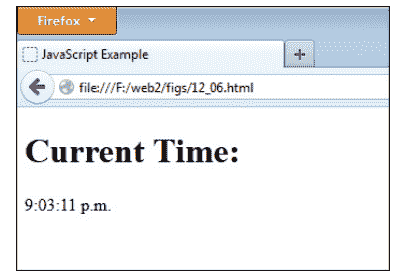

图 12-6 页面上显示当前时间。

最后，函数将输出显示在页面上。该函数在定义后立即被调用。函数每隔 1000 毫秒（即 1 秒）重复执行一次。这使得时钟能够保持实时更新。这些间隔在浏览器中运行的结果如图 12-6 所示。

## 尝试一下 12-2 创建一个 JavaScript 时钟

此项目将让你能够更多地使用`Date`对象的方法，并学习如何调整返回的值以便以各种方式使用。这创建了一个 JavaScript 时钟，它比上一节中的简单时钟多了几个选项。

## 步骤说明

- 创建一个 HTML 页面，并包含 script 标签，该标签指向名为`prjs12_2.js`的外部 JavaScript 文件。添加一个显示“Current Time”的标题，并添加一个 id 为`my_clock`的 div 元素。将 HTML 文件保存为`prjs12_2.html`。

- 完成后，HTML 文件的 body 部分应该如下：

```html
<body>
  <h1>Current Time</h1>
  <div id="my_clock"></div>
  <script type="text/javascript" src="prjs12_2.js"></script>
</body>
```

- 创建一个外部脚本 JavaScript 文件（--script file），并将其保存为`prjs12_2.js`。在步骤 4-7 中使用它。

- 4. 编写一些显示时钟的代码。在这个时钟中，包含以下信息：

- 5. 带有小时、分钟和秒的时间

- 6. 是上午 A.M. 还是下午 P.M.

- 7. mm/dd/yyyy 格式的日期

- 8. 这是一个 12 小时制钟，请确保调整小时的值使其保持在 1 到 12 之间。此外，注意日期格式并相应调整月份和日期值。

- 9. 启动时钟，并让它每秒更新一次。

- 10. 完成后，JavaScript 文件应该如下：

```javascript
function startClock() {
  var datetime = new Date();
  hours = datetime.getHours();
  mins = datetime.getMinutes();
  secn = datetime.getSeconds();
  ap = (hours >= 12) ? "p.m." : "a.m.";
  themonth = datetime.getMonth();
  thedate = datetime.getDate();
  theyear = datetime.getFullYear();
  clock_div = document.getElementById("my_clock");
  hours = (hours >= 12) ? hours - 12 : hours;
  mins = (mins < 10) ? "0" + mins : mins;
  secn = (secn < 10) ? "0" + secn : secn;
  themonth++;
  clock_div.innerHTML = hours + ":" + mins + ":" + secn + " " + ap + " " + 
    "" + themonth + "/" + thedate + "/" + theyear;
}
setInterval(function() { startClock(); }, 1000);
startClock();
```

- 11. 保存 JavaScript 文件并在浏览器中打开 HTML 文件。时间和和日期将出现在页面上。

## 尝试一下总结

在这个项目中，你使用了关于`Date`对象的知识。通过使用`Date`对象的方法，你创建了一个显示在网页上的时钟。

# 第 12 章自测

- 1. `Math`对象的属性和方法使你能够？
   A. 取字符串的平方根及其他类似值并返回数字
   B. 执行数学计算
   C. 去数学课学习新定理
   D. 什么都不做，它们没没用

- 2. 该属性持有欧拉常数的值。

- 3. `LN10`属性持有 10 的自然对数。

- 4. `LOG10E`属性持有 10*E 的对数。
   A. 正确
   B. 错误

- 5. 下列哪项可以正确在网页上写入 pi 的值？
   A. document.write(Math.PI);
   B. document.write(Math.PI);
   C. document.write(Math.PI);
   D. document.write(Date.PI);

- 6. 该属性持有 2 的平方根的值。

- 7. `abs()`方法返回作为参数传递给它的数字的值。
   A. absent（缺失）
   B. absurd（荒的）
   C. absolute（绝对值）
   D. absolute square root（绝对平方根）

- 8. 该方法返回作为参数传递给它的数字的正弦。

- 9. `pow()`方法返回参数的参数幂的数值值。

- 10. 下列哪项可以正确生成 0 到 7 之间的随机数？
   A. var rand_int= Math.floor(Math.random())*7);
   B. var rand_int= Math.floor(Math.random())*7);
   C. var rand_int= Math.floor(Math.random())*7);
   D. var rand_int= Math.floor(Math.random())*7;

# 第 13 章：处理字符串

## 使用 String 对象的属性和方法

String 对象只有一个属性（构造函数和原型属性除外，这些属性只能与通过构造函数创建的 String 对象一起使用）。表 13-1 显示该属性。

## length 属性

该属性返回字符串的长度，即字符串包含的字符数。你可以在 String 对象和字符串字面量使用它。你在其他对象（如 Array 对象）中也见过这个属性。（在这种情况下，该值是数组中元素的数量。）

以下代码使用了普通文本字符串。它将字符串变量的长度写入页面中。

```
var myname = "John"; 创建 创建一个字符串字面量
alert("The name has " + myname + " characters."); // length
```

名称的长度会提示给查看者。

注意变量名是如何像对象名一样使用的，并能够访问 String 的属性和方法的。脚本将结果写入页面。因为该名称有四个字符，所以`length`属性的值为 4。

## String 对象的方法

String 对象的方法列在表 13-2 中（按功能分组）。

## HTML 方法

尽管由于`innerHTML()`、节点创建以及某些方法创建的不再有效的 HTML 标签，现在不再使用它们，但如果需要，String 对象的 HTML 方法仍然可用。

基本的 HTML 方法（`big()`、`bold()`、`blank()`、`fixed()`、`italics()`、`small()`、`strike()`、`sub()`和`sup()`）只是在字符串周围添加 HTML 标签。例如，要创建较小的文本，你可以使用以下方法：

```
var little_bit = "I only want a little bit of cake.";
var tagged_phrase = little_bit.small();
document.write(tagged_phrase);
```

| 属性 | 目的 |
|---|---|
| length | 存储字符串长度的数值（字符数量） |

**表 13-1** String 对象的属性

| 方法 | 目的 |
| --- | --- |
| anchor() | 创建一个带有目标的 HTML 锚点标签 |
| big() | 在字符串值周围添加 <big> 和 </big> 标签 |
| blink() | 在字符串值周围添加 <blink> 和 </blink> 标签 |
| bold() | 在字符串值周围添加 <b> 和 </b> 标签 |
| fixed() | 在字符串值周围添加 &lt;b&gt; 和 &lt;/b&gt; 标签 |
| color() | 在字符串值周围添加 <font color="..."> 标签，将字符串颜色更改指定的颜色 |
| fontsize() | 在字符串值周围添加 &lt;fontsize="number"&gt; 和 &lt;/fontsize&gt; 标签，将字符串大小更改为指定的数字 |
| italics() | 在字符串值周围添加 <i> 和 </i> 标签 |
| link() | 使用字符串作为链接文本创建 HTML 链接，并链接到参数发送的 URL |
| small() | 在字符串值周围添加 <small> 和 </small> 标签 |
| strike() | 在字符串值周围添加 <s> 和 </s> 标签 |
| sub() | 在字符串值周围添加 <sub> 和 </sub> 标签 |
| sup() | 在字符串值周围添加 <sup> 和 </sup> 标签 |
| charAt() | 查找字符串中指定位置的字符 |
| charCodeAt() | 查找字符串中指定位置字符的编码 |
| concat() | 将两个或多个字符串拼接并返回合并后的字符串值 |
| slice() | 提取字符串值的指定部分并返回新字符串 |
| substr() | 允许返回从起始位置开始并在指定字符数后结束的字符串部分 |
| substring() | 允许返回返回起始位置和结束位置的字符串部分 |
| indexOf() | 在字符串中搜索作为参数的字符集；如果找到，则返回字符第一次出现的位置；否则返回 -1 |
| lastIndexOf() | 在字符串中搜索作为参数的字符集；如果找到，则返回字符最后一次出现的位置；否则返回 -1 |
| toLowerCase() | 将字符串转换为所有小写字母并返回结果 |
| toUpperCase() | 将字符串转换为所有大写字母并返回结果 |
| toString() | 返回字符串的字面值 |
| fromCharCode() | 使用字符编码作为参数创建新字符串 |
| localeCompare() | 根据字母顺序比较字符串并返回结果 |
| match() | 比较正则表达式和字符串以查看它们是否匹配 |

**表 13-2** String 对象的方法（续表）

| 方法 | 目的 |
| --- | --- |
| replace() | 查找正则表达式是否匹配字符串，然后将匹配的字符串替换为新字符串 |
| search() | 执行正则表达式与指定字符串之间的匹配搜索 |
| split() | 根据作为方法发送的字符将字符串分为字符串数组 |
| trim() | 移除字符串开头和结尾的空白字符 |

**表 13-2** String 对象的方法（续表）

当你想要查找一个字符时，记住位置计数是从 0 开始（类似于数组），而不是从 1 开始，第一个字符位于位置 0。以下代码显示了如何使用`charAt()`方法获取字符串的第一个字符：

`charAt()`方法找到字符串中位置为 0（第一个字符）的字符。

```
var the_text = "Character";
var first_char = the_text.charAt(0);
alert("The first character is " + first_char);
```

这段代码将`charAt()`方法调用的结果赋值给名为`first_char`的变量，然后使用该变量向查看者告出调用该方法的文本字符串中的第一个字符。在这种情况下，警框将显示“The first character is C”。

如果你想找到最后一个字符，在使用该方法之前，你需要知道字符串中有多少个字符，或者可以使用`length`属性来确定字符串中的字符数。使用`length`属性时，请记住它返回的是字符的数量，而不是最后一个字符的位置。

`length`属性从 1 开始计数，因此在使用`charAt()`方法时，你必须从 0 开始计数。因此，字符串中的最后一个字符的位置将比其字符数少 1。换句话说，如果字符串有 10 个字符（1–10），那么最后一个位置（0–9）就是 9。例如，这段代码找到字符串中的最后一个字符：

从长度上减 1 以找到字符串中的最后一个位置

```
var the_text = "Character";
position = the_text.length - 1;
last_char = the_text.charAt(position);
alert("The last character is " + last_char);
```

`charAt()`方法使用该值来找到字符串中的对应字符。

这段代码将字符串值减 1 的结果赋值给名为`position`的变量。`position`变量现在持有字符串中最后一个字符的位置。将`position`值作为参数调用`charAt()`方法的结果赋值给名为`last_char`的变量。最后，通过`alert`告出字符串中的最后一个字符，即 r。

`charAt()`返回作为参数传递的位置上对应字符的编码（关于字符编码的讨论，你可以参考第 5 章或访问 www.javascript.com/js/ref/javascript-character-codes.html）。例如，你可以使用以下代码：

`charAt()`方法找到字符串中位置为 0（第一个字符）的字符的编码。

```
var the_text = "Hello";
var char_code = the_text.charCodeAt(0);
alert("The character code is " + char_code);
```

警框将告知你字符串中位置 0 的字符编码（H），其值为 72。

## concat(), slice(), substr(), 和 substring() 方法

提供这些方法是为了允许你以各种方式更改字符串的值。

**concat() 方法** 该方法的工作原理与数组（Array）对象的`concat()`方法非常相似。它将调用方法的文本字符串与任意数量的文本字符串作为参数合并，并返回合并后的值。调用方法的文本字符串在顺序上在前，而作为参数发送的字符串按顺序在在其后添加。以下代码显示了一个使用`concat()`方法合并三个字符串的示例：

```
var string1 = "I went to the store ";
string2 = "then ";
string3 = "I played a video game";
alert(string1.concat(string2, string3));
```

三个字符串从左到右顺序合并。

这段代码按照`string1`、`string2`然后`string3`的顺序切取字符串。结果是一个显示“I went to the store I played a video game”的警框。

**slice() 方法** 该方法截取字符串的一部分并返回被截取的值。它的工作类似于数组的`slice()`方法。第一个参数告知起始位置，而第二个参数大于停止的位置。例如，看看接下来的代码：

```
var the_text = "Do not cut this short";
var shorter_string = the_text.slice(0,7)
alert(shorter_string);
```

这段代码从位置 0 截取字符串到位置 6。位置 7 是 "cut" 中 c 所在的位置；但它没有被截取，因为告诉 JavaScript 在何处结束截取的参数大于要截取的的上一个字符的位置。因此，警框将显示“Do not”。

**substr() 方法** 该方法提取字符串的一部分，并返回该部分作为一个新字符串。第一个参数指定删除的位置，第二个参数指定要删除多少字符。例如，以下代码删除了字符串位置 0 处的一部分，并持续到删除了七个字符：

```
var the_text = "Do not cut this short";
var shorter_string = the_text.substr(0,7)
alert(shorter_string);
```

这段代码删除了字符串从 "D" 到字符串中 "cut" 单词开头的所有内容。返回的字符串是被删除的那部分。因此，警框将显示“Do not”。

**substring() 方法** 该方法的工作原理与`substr()`方法类似，但它允许你为要删除的字符串部分发送起始位置和结束位置参数。它将删除的部分作为新字符串返回。

例如，看看下面的代码。你不是指定要删除字符的数量，而是提供一个结束位置。被删除的字符从起始位置开始，并比结束位置少 1。（记住`slice()`方法）。

```
var the_text = "Do not cut this short";
var shorter_string = the_text.substring(0,7)
alert(shorter_string);
```

这段代码从位置 0 截取到位置 6。位置 7 是 "cut" 中 c 所在的位置；但它没有被截取，因为告诉 JavaScript 在何处结束截取的参数大于要截取的上一个字符的位置。因此，警框将显示“Do not”。

`substring()`方法的工作原理类似于`substr()`方法，但它允许你发送要删除的字符串部分的起始位置和结束位置。它将删除的部分作为一个新字符串。

**localeCompare() 方法** `localeCompare`比较两个字符串并返回一个指示字符串在前后的数字：

- 如果字符串在字母顺序之前，返回负数。
- 如果字符串相等，返回 0。
- 如果字符串在字母顺序之后，返回正数。

例如，你可以使用以下代码来确定 "orange" 是否在 "apple" 之前：

```
var comp_string = "orange";
new_string = "apple";
pos = comp_string.localeCompare(new_string);
if (pos < 0) {
    alert(comp_string + " before " + new_string);
} else if (pos > 0) {
    alert(comp_string + " after " + new_string);
} else {
    alert("The strings are equal!");
}
```

在这种情况下，查看者将得到一个显示“orange after apple.”的警框。

**charCodeAt() 方法** `charCodeAt`返回指定位置的字符编码。

```
var the_text = "Hello";
var char_code = the_text.charCodeAt(0);
alert("The character code is " + char_code);
```

警框将告知你字符串位置 0 的字符编码（H），其值为 72。

**String() 方法** `String()`返回字符编码的字符串表示。

```
var the_text = "Hello";
var str_code = the_text.charCodeAt(0);
alert("The string code is " + str_code);
```

警框将告知你字符串位置 0 的字符串编码（72）。

**fromCharCode() 方法** `fromCharCode()`返回给定编码的字符。

```
var char_code = 72;
var char = String.fromCharCode(char_code);
alert("The character is " + char);
```

警框将告知编码 72 的字符，即 H。

## 第二部分：其他字符串方法

**repeat() 方法** `repeat`方法返回重复指定次数的字符串。

```
var the_text = "Hello";
var repeated_text = the_text.repeat(3);
alert("The repeated string is " + repeated_text);
```

警框将显示“The repeated string is HelloHelloHello”。

**padStart() 和 padEnd() 方法** `padStart()`和`padEnd()`方法在字符串的开头或结尾填充字符，直到达到指定的长度。

```
var the_text = "Hello";
var padded_start = the_text.padStart(10, "!");
alert("The padded start string is " + padded_start);
var padded_end = the_text.padEnd(10, "!");
alert("The padded end string is " + padded_end);
```

警框将显示“The padded start string is !!!Hello!!”和“The padded end string is Hello!!!!!”。

**trim() 方法** `trim()`方法移除字符串开头和结尾的空白。

```javascript
var the_text = "  Hello  ";
var trimmed_text = the_text.trim();
alert("The trimmed string is " + trimmed_text);
```

警框将显示“The trimmed string is Hello”。

**trimStart() 和 trimEnd() 方法** `trimStart()`和`trimEnd()`方法移除字符串开头或结尾的空白。

```javascript
var the_text = "  Hello  ";
var trimmed_start = the_text.trimStart();
alert("The trimmed start string is " + trimmed_start);
var trimmed_end = the_text.trimEnd();
alert("The trimmed end string is " + trimmed_end);
```

警框将显示“The trimmed start string is Hello  ”和“The trimmed end string is  Hello”。

**replace() 和 replaceAll() 方法** `replace()`方法返回新字符串，将模式的第一个匹配替换为替换值。`replaceAll()`方法返回新字符串，将模式的所有出现处替换为替换值。

```
var the_text = "The brown fox jumps over the lazy dog";
var replaced_text = the_text.replace("fox", "cat");
alert("The replaced string is " + replaced_text);
```

警框将显示“The replaced string is The cat jumps over the lazy dog”。

```javascript
var the_text = "The brown fox jumps over the lazy fox";
var all_replaced_text = the_text.replaceAll("fox", "cat");
alert("The all replaced string is " + all_replaced_text);
```

警框将显示“The brown fox jumps over the lazy cat”。

**split() 方法** `split()`方法根据指定的分隔符将字符串分为子字符串数组。

```javascript
var the_text = "Apple,banana,cherry,grape";
var fruits = the_text.split(",");
alert("The array of fruits is " + fruits);
```

警框将显示“The array of fruits is Apple,banana,cherry,grape”。

**join() 方法** `join()`方法将数组的所有元素连接成字符串，用指定的字符串分隔。

```javascript
var fruits = ["Apple", "banana", "cherry", "grape"];
var joined_fruits = fruits.join("-");
alert("The joined string is " + joined_fruits);
```

警框将显示“The joined string is Apple-banana-cherry-grape”。

**includes() 方法** `includes()`方法如果字符串包含另一个字符串，则返回 true，否则返回 false。

```javascript
var the_text = "The brown fox jumps over the lazy dog";
var has_fox = the_text.includes("fox");
alert("Does the string include fox? " + has_fox);
```

警框将显示“Does the string include fox? true”。

**startsWith() 方法** `startsWith()`方法如果字符串以指定的字符开头，则返回 true，否则返回 false。

```javascript
var the_text = "The brown fox jumps over the lazy dog";
var starts_with = the_text.startsWith("The");
alert("Does the string start with The? " + starts_with);
```

警框将显示“Does the string start with The? true”。

**endsWith() 方法** `endsWith()`方法如果字符串以指定的字符结尾，则返回 true，否则返回 false。

```javascript
var the_text = "The brown fox jumps over the lazy dog";
var ends_with = the_text.endsWith("dog");
alert("Does the string end with dog? " + ends_with);
```

警框将显示“Does the string end with dog? true”。

这一次，`if`语句检查方法是否返回位置`-1`。如果是这样，`alert`将显示“你的字符不在字符串中！”。否则，常规`alert`将告诉你该位置。`indexOf()`方法返回你用作参数的字符第一次出现的位置。在之前的代码中，小写`c`不在字符串中，因此会出现“你的字符不在字符串中！”的提示框。

如果你使用以下代码，你将收到提示，你的字符位于位置 1：

```javascript
var the_text = "Cool";
var position = the_text.indexOf("o");
if (position === -1) {
  alert("Your character is not in the string!");
} else {
  alert("Your character is at position "+position);
}
```

找到第二个 "o" 的一种方法是跳过位置 1 的第一个，从位置 2 开始查找。

```javascript
var the_text = "Cool";
var position = the_text.indexOf("o",2);
if (position === -1) {
  alert("Your character is not in the string!");
} else {
  alert("Your character is at position "+position);
}
```

这一次，方法返回的结果为 2，因为它直接在起始位置就找到了它。

如果你想找到字符串的所有出现处，你可能希望使用正则表达式，这将在本章稍后部分讨论。`lastIndexOf()`方法查找特定字符或字符串在字符串中最后出现的位置。它只返回作为参数传递的字符最后一次出现的位置。如果在字符串中未找到该字符或字符串，则返回 -1。以下代码在字符串 "Cruising Car" 中查找字母 C：

```javascript
var the_text = "Cruising Car";
var position = the_text.lastIndexOf("C");
alert("Your character is at position "+position);
```

这段代码将显示一个提示框，告诉观众“你的字符位于位置 1。”

### match(), replace(), 和 split() 方法

这些方法执行某种类型的匹配：

- `match()`方法比较正则表达式和字符串，以查看它们是否匹配。
- `replace()`方法查找正则表达式是否匹配字符串，然后将其替换为新字符串。
- `search()`方法执行正则表达式与指定字符串之间匹配的搜索。
- `split()`方法根据作为参数发送的字符创建一个字符串元素的数组。

前三个方法涉及正则表达式，因此你将在稍后的“正则表达式”部分学习更多关于它们的知识。

### split()

`split()`方法使用作为参数发送的字符作为分隔符，将单个字符串拆分。它返回一个数组，其中包含字符串的每个部分（去掉分隔符）。例如，下面的代码有一个包含许多冒号的字符串：

```javascript
var the_text = "orange:apple:grape";
split_text = the_text.split(":");
end_count = split_text.length;
for (var count = 0; count < end_count; count++) {
  document.write(split_text[count]+"<br>");
}
```

赋值给`the_text`变量的字符串由冒号分隔的几个水果名称组成。下一行使用`split()`方法对文本字符串创建一个数组`split_text`。参数是冒号，它用于将字符串拆分为数组项。在这种情况下，数组最终有四个项。

### 注意

作为参数发送的分隔符字符不会出现在数组中：它仅作为文本之间的分隔符，以便方法知道每个项目的开始和结束位置。下一行获取`split_text`数组的长度并将该值放在变量`end_count`中。该信息随后用于遍历新数组并在页面上打印项。图 13-2 显示了该脚本在浏览器中的结果，这是一份水果名称列表。

### toString() 方法

`toString()`方法为字符串返回一个字符串字面量值。这里有一个如何使用此方法的示例：

```javascript
var string_obj = new String("Cool");
var string_lit = string_obj.toString();
```

这段代码获取`String`对象并使用`toString()`方法获取其字符串字面量值。它将该值赋值给变量`string_lit`。

### toLowerCase() 和 toUpperCase() 方法

此方法返回全小写的字母字符串。看这段代码：

```javascript
var the_text = "I FEEL CALM. REALLY.";
alert(the_text.toLowerCase());
```

这段代码会弹出全小写的字符串，就像这段示例文本所示：i feel calm, really。

`toUpperCase()`方法返回全大写的字符串。这里有一个示例：

```javascript
var the_text = "I AM yELLING!";
alert(the_text.toUpperCase());
```

这段代码会弹出全大写的字母字符串，就像这段示例文本所示：I AM YELLING!

### trim() 方法

`trim()`方法移除字符串开头和结尾的多余空格并返回结果。原始字符串保持不变。例如，看下面的代码：

```javascript
var text = " Once upon a time... ";
trimmed_text = text.trim();
alert(trimmed_text);
```

图 13-3 向观众显示没有额外空格的文本。开头和结尾的空格将被移除，并向观众显示字符串“Once upon a time...”。 13-3 显示了该脚本在浏览器中运行的结果。

### 注意

此方法在版本 9 之前的 Internet Explorer 中不起作用。

### 提问专家

Q：是的，但也很困惑，因为`slice()`和`substring()`方法的位置比方法停止的位置高。为什么会这样？

A：刚开始确实很困惑。你只需要习惯每个方法的工作方式。如果你经常使用它们，你就会记住在什么情况下使用哪些数字。

- 3. 创建一个外部 JavaScript 文件并将其保存为`prjs13_1.js`。在第 4–7 步中使用它。
- 4. 将“email”文本框的值赋值给名为`email_add`的变量。
- 5. 使用`indexOf()`检查地址是否包含 (@) 字符，以及地址是否包含点 (.) 字符。
- 6. 如果地址同时包含 (@) 字符和点 (.) 字符，发送一个提示框感谢观众。否则，向观众发送提示框，告诉他或她需要这些字符并重试。
- 7. 完成后，JavaScript 文件应该如下：

```javascript
var email = document.getElementById("getmail");
email.addEventListener("submit", function(event) {
  var email_add = document.getElementById("email").value;
  event.preventDefault();
  if ( email_add.indexOf("@") >= 0 && email_add.indexOf(".") >= 0 ) {
    alert("Thank you!");
  } else {
    alert("The @ and . characters are required in the e-mail address.");
  }
});
```

- 8. 保存 JavaScript 文件并在浏览器中打开 HTML 文件以尝试运行脚本。

# 本节总结

在这个项目中，你使用了对`indexOf()`方法的知识来测试观众输入的电子邮箱地址是否包含特定字符。如果缺少其中一个字符，将向观众发送一个错误提示框。否则，将发送一个提示框感谢观众。

# 使用 Cookie

Cookie 是存储在终端计算机上的一个小文件。只要观众返回你的网站，就可以在随时引用它，前提是该 Cookie 没有被删除或过期。当然，如果观众不接受 Cookie，那么以后将无法设置或引用 Cookie。在使用 Cookie 时请记住以下几点：

- Cookie 必须是 4KB (4000 个字符) 或更少。
- 浏览器可以接受来自单个域名的最多 20 个 Cookie。
- 如果观众不接受 Cookie，这将消除你的 Cookie 对这些观众的任何优势。

Cookie 可以帮助用户更有效地浏览你的网站。例如，如果你在主页上使用脚本在页面加载时额外发送一个额外的提示框，你不希望在每当观众访问你网站的另一个页面并返回主页时都发生这种情况。这可能会让人非常恼火，至于几次之后你再也没有访客了。提示框每次页面加载时都会弹出，是因为 HTTP 缺乏状态持久化。Cookie 填补了这个空白——它们允许浏览器“记住”观众已经看过提示框，从而在随后的页面访问时不显示它。

# 设置 Cookie

设置基础 Cookie 就像给对象的 cookie 属性赋值一样简单。唯一的限制是字符串内部不能有空格、逗号或分号。例如，你可以设置一个 Cookie 名称，以便稍后识别是否使用了多个 Cookie。以下代码设置了一个基础 Cookie：

```
function set_it() {
  document.cookie = "name=tasty1";
}
```

### 注意

设置 Cookie 时，记住不要在设置 Cookie 数据的字符串内部使用空格、逗号或分号。

前述代码在调用函数时会设置一个值为`name=tasty1`的 Cookie。不过，你可以设置任何想要的分隔符（或者完全不设置，但设置分隔符允许你像查询字符串一样存储多个值），所以以下代码同样有效：

```
function set_it() {
  document.cookie = "name=tasty1";
}
```

只要值不需要空格，额外信息并不困难，如下代码所示：

```
function set_it() {
  document.cookie = "name=tasty1&fav=Sugar";
}
```

如你所见，Cookie 的值是以键值对的形式格式化的，每对之间之间用安培符号 (&) 分隔。再次，你可以选择任何你想要的分隔符。以下代码也可以：

```
function set_it() {
  document.cookie = "name=tasty1|fav=Sugar";
}
```

在这种情况下，名称和值用冒号分隔，而管道符号 (|) 则将它们分隔成对。你可以使用任何你觉得方便的符号。

# encodeURIComponent() 方法

如果你想在 Cookie 中使用空格、逗号或分号，你需要一种方法进行“转义”，以便将它们翻译成 Cookie 接受的形式。

Cookie 会接受字符代码，就像 CGI 程序经常做的那样。它们看起来像`%20`、`%41`或类似的内容。要将空格、逗号和分号转换为这些代码，你必须使用 JavaScript 的`encodeURIComponent()`方法。它是`window`对象下的一个方法，正如你在之前的章节中看到的，可以使用`encodeURIComponent()`。

以下代码显示了如何使用`encodeURIComponent()`设置一个带有空格的 Cookie：

```
function set_it() {
    var thetext = "name=tasty1&fav=Chocolate Chip"; // 创建字符串字面量包含
                                // 要放入 Cookie 中的信息
    newtext = encodeURIComponent(thetext); // 字符串被转义以便
                                // 可以在 Cookie 中使用
    document.cookie = newtext; // 值被添加到
}
```

注意文本以两种方式进行划分。安培符号（&）将字符串划分为键值对，而等号（=）将键值对划分为键名和值。

假设`name=tasty&fav=Chocolate Chip`现在已在代码中的`fixed_cookie`变量中，你可以通过在`&`字符上分割字符串来创建一个新数组：

```javascript
cookie 属性的值被读取。该值未经过转义，因此字符串将具有可读的字符
function read_it() {
```

# 使用正则表达式

正则表达式比简单的字符串要强大得多。它们允许你构建匹配字符串的模式。

## 创建正则表达式

要创建正则表达式，你必须创建一个`RegExp`对象的实例。要创建一个正则表达式字面量，使用斜杠：

```javascript
var varname = /your_pattern/
```

## 测试字符串

要对字符串测试正则表达式，可以使用正则表达式对象的`test()`方法。基本语法如下：

```javascript
regex_name.test(string_to_test);
```

```javascript
alert("Wow, we have the same name!"); // 如果结果为 true，则显示此警报
else {
  alert("Not my name, but it will work!"); // 如果结果为 false，则显示此警报
}
```

提示获取一个名称并将值存储在变量中。要匹配的模式是 John，它是区分大小大小的。因此，只有输入以大写 J 开头后跟小写 o、h、n 的 John 才会产生匹配并在测试时返回 true（尽管它可能包含不仅仅是 John 内容，例如 Johnny 或 John Doe 也会返回 true——如果你只想匹配特定的字符集，你需要使用额外的特殊字符，这将在本节稍后的部分讨论）。

`test()`方法的结果赋值给变量`is_a_match`，然后作为`if`语句的条件。如果该变量值为 true，查看者将收到“Wow, we have the same name!”的警报。如果它的值为 false，查看者将收到“Not my name, but it will work!”。图 13-4 显示了当使用 "Steve" 作为名称时，该脚本的运行。

如果你想缩短脚本，可以直接将`test()`方法的结果作为`if`语句的条件（而不是创建另一个变量），代码如下所示：

```javascript
var name = prompt("Enter your name.");
var tomach = /John/;
if (tomach.test(name)) { // test() 方法的结果被用作 if 语句的条件
  alert("Wow, we have the same name!");
} else {
  alert("Not my name, but it will work!");
}
```

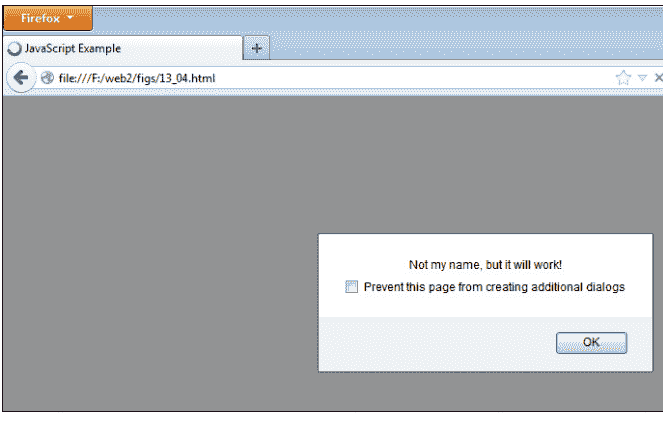

图 13-4 名称与正则表达式模式不匹配。

由于该方法返回 true 或 false，它可以独立地作为`if`语句的条件。（如果你愿意的话，也可以将其写为`(tomach.test(thename)==true)`）。

## 添加标志（Flags）

标志允许你忽略大小写，或者在字符串中查找任何匹配项而不仅仅是第一个（全局测试）。要添加标志，请将其放在正则表达式最后一个斜杠之后。你可以使用三种选项，如表 13-3 所示。

如果你想让之前使用的名称不区分大小写，可以给正则表达式添加一个标志，如下代码所示：

```javascript
var thename = prompt("Enter your name...");
tomach = /John/i; // 标志使得此正则表达式不区分大小写
if (tomach.test(thename)) {
  alert("Wow, we have the same name!");
} else {
  alert("Not my name, but it will work!");
}
```

只要字符串中包含 John 的模式，`test()`方法就会返回 true。它可以是任何大小写，所以现在 John、JOHN 甚至 JoH 都是匹配项，并将导致`test()`方法返回 true。

你可以使用多个一个标志，或同时使用所有三个标志。例如，如果你想让既不区分大小写又是多行的匹配，可以使用以下代码：

```javascript
var tomach = /John/im;
```

## 创建强大的模式

虽然能够创建一个精确的模式很不错，但你并不总是要寻找精确的匹配。在许多情况下，你将寻求匹配一个更通用的模式，例如需要至少三个字符的条目，或者需要两个任意类型的字符后跟一个特殊字符的条目。

通过在表达式中使用特殊字符，你可以创建匹配你所需的给定序列的模式类型。JavaScript 使用 Perl 表达式语法作为模型。因此，如果你在 Perl 中用过正则表达式，那么这里的许多内容将让你感到熟悉。表 13-4 列出了一些可以帮助你创建模式的字符。

| 标志(s) | 用途 |
|---|---|
| i | 使匹配不区分大小写 |
| g | 使匹配变为全局 |
| m | 使匹配在多行模式下工作 |

**表 13-3** 正则表达式标志

| 字符 | 用途 | 示例 |
|---|---|---|
| ^ | 仅从行首匹配 | /^c/ 匹配 corn 中的 c <br>^c/ 不匹配 acorn 中的 c |
| $ | 仅在行尾匹配 | /$/ 匹配 Car 中的 r <br>/$/ 不匹配 Cat 中的 t |
| * | 如果其前面的字符出现零次或多次，则匹配该字符 | /**/ 匹配 co 或 c <br>/**/ 不匹配 pi |
| + | 如果其前面的字符出现一次或多次，则匹配该字符 | /+/ 匹配 co 或 cooooo <br>+/+ 不匹配 ca |
| ? | 如果其前面的字符出现零次或一次，则匹配该字符 | /?/ 匹配 style 或 column <br>/? 不匹配 col |
| . | 匹配任何单个字符，但不包括换行符 | /./ 匹配 al 或 @ <br>/./ 不匹配 \n o 或 l |
| (x) | 通过将 x 替换为字符，该序列并将其保留在内存中以便稍后使用；用于表达式分组 | /(x)/ 匹配 a <br>/(x)/ 匹配 cool |
| | | 用于逻辑“或”符号，允许其右侧的匹配 | /\|/ 匹配 bad <br>/\|/ 不匹配 car |
| {x} | 如果其前面的字符出现 x 次，则匹配该字符 | /{1}/ 匹配 n <br>/{2}/ 不匹配 n |
| {x,} | 如果其前面的字符出现至少 x 次，则匹配该字符 | /{1,}/ 匹配 n <br>/{2,}/ 不匹配 |
| {x,y} | 如果其前面的字符出现 x 到 y 次之间，则匹配该字符 | /{1,2}/ 匹配 n <br>/{2,3}/ 不匹配 n |
| [] | 匹配集合内的任何字符 | [abc] 匹配 a, b, 或 c <br>[abc] 不匹配 d |
| [^ | 匹配不在集合内的任何字符 | [^abc] 匹配 d <br>[^abc] 不匹配 a, b, 或 c |
| \ | 用于转义特殊字符 | \@ 转义 @ |

**表 13-4** 正表达式代码（续）

| 字符 | 用途 | 示例 |
|---|---|---|
| \b | 匹配单词边界 | \b 匹配单词边界 |
| \B | 匹配不在单词边界的字符 | \Ba 匹配 car 中的 a <br>\Bc 不匹配 a |
| \cX | 匹配 CTRL 键后跟 X | \cX 匹配 CTRL-X <br>\cV 匹配 CTRL-V <br>\CS 不匹配 CTRL-Z |
| \d | 如果字符是单个数字 | \d 匹配 4 <br>\d 不匹配 s |
| \D | 如果字符不是数字 | \D 匹配 s <br>\D 不匹配 d |
| \f | 如果存在分页符 | \f 匹配分页符 |
| \n | 如果存在换行符 | \n 匹配换行符 |
| \r | 如果存在回车 | \r 匹配回车 |
| \s | 如果单个字符代表空白（如空格或换行） | \s 匹配 b c 中的空格 <br>\s 匹配 b 中的制表符 |
| \S | 如果单个字符不代表空白 | \S 匹配 d <br>\S 不匹配空白 |
| \t | 如果存在制表符 | \t 匹配 b c 中的制表符 |
| \v | 匹配垂直制表符 | |
| \w | 匹配任何字母、数字或下划线的单个字符 | \w 匹配 4 <br>\w 不匹配 @ |
| \W | 匹配任何不是字母、数字或下划线的单个字符 | \W 匹配 @ <br>\W 不匹配 g |

如你所见，创建所需的模式有许多选项。现在，你可以轻松地根据你设定的标准来验证字符串。

现在，如果你想确保文本字段包含一个或多个数字，可以使用表 13-4 中的`\d`和`+`字符，结合以下 HTML 和 JavaScript 代码，从 HTML 代码开始：

```html
<<body>
<form id="has_digits">
<label for="user_text">Enter some text:</label>
<input type="text" id="user_text">
<input type="submit" value="text">
</form>
</</body>
```

接下来是 JavaScript 代码：

```javascript
var has_digits = document.getElementById("has_digits");
has_digits.addEventListener("submit", function(event) {
  var has_num = document.getElementById("user_text").value;
  var tomatch = /\d+/;
  event.preventDefault();
  if (tomatch.test(has_num)) {
    alert("Your entry did contain one or more numbers!");
  } else {
    alert("Your entry did not contain any numbers!");
  }
}, false);
```

这段代码简单检查字符串中是否包含任何数字。现在，如果你想确保用户只输入了数字而不包含任何其他类型的字符，你需要确保正则表达式被编写为从字符串的开头到结尾进行测试。使用表 13-4 中的`^`和`$`符号，你可以确保字符串的匹配测试是从字符串开始并结束于字符串结尾的。`\d`后面的`+`确保了至少输入了一个数字。因此，以下模式将只会匹配数字：

```javascript
var tomatch = /^\d+$/;
```

由于从字符串开始到结束唯一的有效字符是数字，因此只有当输入包含数字且字符串中没有其他字符时，它才会返回`true`。这对于验证表单和其他类型的输入非常有帮助，可以确保输入类型符合你预期的类型。

### 注意

正则表达式对于验证来说非常强大，因为它们允许接受更错误的信息。

使用电子邮件地址或电话号码等数据对表单提交进行客户端验证，可以减少不必要的服务器访问。然而，用户可能会禁用 JavaScript 支持并直接提交表单。因此，客户端验证应该支持服务端验证（例如通过 PHP 脚本或 CGI 脚本），但不应取代它（存储或显示来自未验证查看者的数据可能会导致重大的安全风险）。

# 分组表达式

你会在表 13-4 中注意到，被括号括的表达式表示一个组，该组可以被存储起来供表达式稍后使用（使用如`match()`方法的方法，该方法会将组中的每个项与整体匹配一起存储在数组中）。

例如，你可能决定使用特定的数字序列并让该序列重复特定的次数。为了匹配某个内容的重复次数，你可以使用括号`{}`配合数字或范围。例如，如果你想匹配 5 次数字 3，可以使用以下表达式：

```javascript
/3{5}/
```

如果你希望当 3 至少出现 5 次但不超过 10 次时匹配数字，可以使用以下表达式：

```javascript
/3{5,10}/
```

现在，假设你想匹配以 3 开头且后续为任何数字，并匹配整个序列 5 次（因此，类似 3234353637 的内容将是一个匹配项）。你可能会这样写：

```javascript
/3\d{5}/
```

这种做法的问题在于它虽然正确获取了 3，但匹配了五个数字而不需要重复 3。因此，像 387643 这样的数字会被匹配，即使你想要的是五组每个以 3 开头的两个数字。为了修复这个问题，你可以用括号将 3 和`\d`组合在一起，并加上它应该重复的次数：

```javascript
/(3\d){5}/
```

这一次，3 和第二个数字被分组在了一起，该序列必须重复 5 次。

分组是充分利用正则表达式的一种有用方法，当你在下一章学习表单验证时，你会看到更多用法。

# replace()、match() 和 search() 方法

这些 String 对象的方法在在本章前面已经提到过，现在引入了正则表达式后，它们将变得更有意义。

# replace() 方法

要替换字符串中的信息，你可以使用正则表达式和 String 对象的`replace()`方法。使用`replace()`方法的语法如下：

```javascript
var stringname = stringname.replace(regex, newstring);
```

你将`var`替换为信息替换后将存储新字符串值的变量名。将`stringname`替换为将进行替换的字符串变量名。将`regex`替换为用于匹配字符串的正则表达式名称。最后，将`newstring`替换为用于替换字符串中任何匹配值的字符串或字符串变量。

例如，以下代码将`mystring`中的第一个 "car" 替换为 "skunk"：

```javascript
var mystring = "I like the new car smells, and cars are fun.";
var newstring = mystring.replace(/car/, "skunk");
```

- `replace()`方法替换了第一个 "car"
- 替换为 "skunk"
- 结果赋值给变量
- alert 显示结果

如果你想替换所有的 "car"，请使用`g`标志。以下显示了：

```javascript
var mystring = "I like the new car smells, and cars are fun.";
var newstring = mystring.replace(/car/g, "skunk");
```

- `g`标志捕获所有实例
- 正则表达式已设置
- 匹配项在字符串中

```javascript
}
else {
  alert("Name invalid. Please Try Again");
  getName();
}
getName();
```

此脚本无论姓氏是什么，都会将姓的第一个字母改为 Z。替换的正则表达式仅仅是使用单词边界`(\b`代码查找单词开头的字母。每当字母位于单词开头时，它就会被替换。

输入的验证防止脚本获取超过两个名字和一个空格，它还确保每个名字至少有一个字母，且没有数字或特殊字符。图显示了当查看者在提示处输入 Debra Loo 时脚本的运行：查看者的名字被了。


# match() 方法

`match()`比较正则表达式和字符串以查看它们是否匹配。它返回一个包含一个或多个匹配项的数组，取决于如何使用。如果没有找到匹配项，它返回`null`。

`match`方法的基本用法如下：

```javascript
string.match(regex);
```

字符串将是你的字面量，而`regex`将是你的正则表达式字面量。注意此方法与`test()`方法之间的顺序差异。你可以这样使用它：

```javascript
var mystring = "I am Ironman!",
tomatch = /Iron/;
if (mystring.match(tomatch)) {
  alert("Your string contains Iron!");
}
else {
  alert("Sorry, no Iron in your string.");
}
```

如果将其配合`g`标志或分组`()`使用，它将记住每个生成的匹配（包括对组或嵌套组的匹配），并将每个匹配项作为数组元素返回。

### search() 方法

`search()`方法执行正则表达式与指定字符串之间的匹配搜索。如果找到匹配项，它会返回字符串中匹配项起始的位置。否则，它返回 -1。以下是该方法的用法示例：

```javascript
var mystring = "I am Ironman!"
tomato = /iron/;
if (mystring.search(tomato)) {
  alert("Iron found at position " + mystring.search(tomato) + "!");
} else {
  alert("Sorry, no Iron in your string.");
}
```

如你所见，它的语法与`match()`方法非常。

## 更多信息

关于正则表达式以及如何创建更复杂的模式的更多信息，你可以参考以下在线资源：

- www.regular-expressions.info/
- www.regular-expressions.info/javascript.html（包含关于 JavaScript 引擎的细节）
- https://developer.mozilla.org/en/Core_JavaScript_1.5_Guide/Regular_Expressions

掌握了这些技术后，你就可以开始处理 JavaScript 中的表单以及进行表单内容的验证了。

# 第 13 章自测

1. ________ 对象提供了获取字符串信息或修改字符串的属性和方法。
2. 创建 String 对象的两种方法是哪两种？
    A. 创建 String 对象的实例和创建字符串字面量
    B. 创建 Array 对象的实例和创建字符串字面量
    C. 创建数字变量和创建数字对象
    D. 创建字符串并相加数字
3. 你可以通过给变量赋值字符串值来创建一个字符串 ________。
4. 普通文本字符串之所以能够使用 String 对象的方法，是因为：
    A. 它已经是一个 String 对象
    B. 它也可以使用其他方法，因此它可以使用 String 对象的方法
    C. JavaScript 获取字符串字面量并将其转换为临时的 String 对象
    D. String 对象原样使用字符串字面量
5. String 对象的哪个属性可以同时用于 String 对象和字符串字面量？
    A. prototype
    B. constructor
    C. length
    D. color
6. \_\_\_\_ 属性返回字符串的长度。
7. 下列哪项正确创建了字符串字面量？
    A. var_text_ = "Look at!",!",    B. var_text_ = "Look at me!";
    C. var_text_ = Look at me!
    D. var_text_ = new String("Look at me!");
8. 你可以使用 String 对象的哪个方法来查找字符串中指定位置的字符？
    A. indexOf()
    B. charAt()
    C. charIsAt()
    D. indexOfPosition()
9. \_\_\_\_\_ 方法在字符串值周围添加`<big>`和`</big>`标签。
10. concat() 方法 \_\_\_\_\_ 将或多个字符串连接在一起并返回新的组合后的字符串值。
11. 下述哪个说法是正确的？
    A. `charAt()`方法返回一个数值，该数值作为参数发送的字符的位置。
    B. `split()`方法通过移除字符串的一部分并返回减去该部分后的字符串来创建一个新字符串。
    C. `length`属性允许你为 String 对象添加更长的属性和方法。
    D. `indexOf()`方法返回一个数值，该数值作为参数发送的字符的位置，但仅返回该字符首次出现的位置。
12. Cookie 信息存储在 属性中。
13. 该方法返回字符串的字符串字面量值。
14. 为了替换字符串中的信息，可以使用正则表达式和 String 对象的方法。
15. 该方法比较正则表达式和字符串以查看它们是否匹配。

# 第 14 章：JavaScript 与表单

## 核心技能与概念

- 访问表单
- 使用表单对象的属性和方法
- 确保表单可用性
- 验证表单
- HTML5 与表单

当你使用 JavaScript 访问表单时，可以为 Web 页面创建新的脚本。本章首先解释如何使用 JavaScript 访问表单。然后，你将学习用于表单和元素的各种属性和方法。你还将学习表单与可用性、如何验证表单元素，以及如何使用`<select></select>`元素作为导航工具。

### 访问表单

每当你向 HTML 文档添加一组`<form>`和`</form>`标签时，就会创建一个表单对象。使用 JavaScript 访问其中一个表单，可以使用以下任选项：

- 使用文档对象的`forms`数组
- 在起始`<form>`标签中命名表单并使用该名称访问表单
- 在起始`<form>`标签中为表单指定 id 并使用`document.getElementById()`方法访问它

### 使用 forms 数组

`forms`数组允许你通过数组中的索引访问表单。页面上的每组`<form>`和`</form>`标签都会在`forms`数组中创建一个额外的项，并按照它们在文档中出现的顺序排列。因此，你可以这样引用文档中的第一个表单：`document.forms[0]`。

正如你记得的，数组从 0 开始计数，因此上一个示例将访问文档中的第一个表单。如果你想访问第二个表单，可以使用：`document.forms[1]`。这对于页面上的其余表单同样有效。只需记住从 0 而不是 1 开始计数，以访问正确的表单即可。

访问表单本身并不会产生任何操作。你访问的表单是一个对象。要使用它，你需要该对象的某个属性或方法。表单的属性和方法列在稍后的章节“使用表单对象的属性和方法”中，但现在先查看`length`看看它的作用。

### 属性值

本节中的示例使用了表单对象的`length`属性。这让你能够发现表单多少个元素（如输入框、选择框、单选按钮等）。

### 涵盖两个属性

如果你想在存在多个表单时显示元素数量，可以使用更复杂的脚本。图 14-1 显示了这种结果。

- `document.forms.length`查找页面上表单的数量。
- `document.forms[x].length`查找特定表单中的元素数量，其中 x 是要访问表单的索引。

## 结果

```html
<script type="javascript" src="lengths.js"></script>
<body>
```

接下来，是 JavaScript 代码（保存为 lengths.js）：遍历页面上所有表单的循环开始：

```javascript
for (var count=0; count < document.forms.length; count++) {
  var formnum = count + 1;
  document.write(" " + formnum + " has " + document.forms[count].length);
  document.write(" elements.<br>");
}
```

创建了一个变量来存储表单编号（比索引号大 1，更符合用户习惯）

结果写在页面上

该代码在 HTML 文档中创建了两个表单。脚本开启了一个从 0 开始（数组从 0 开始计数）的循环，结束于获取`document.forms.length`的值，即页面上表单的数量。由于有两个表单（使得`document.forms`的值为 2），因此`count`从 0 运行到 1 然后停止。`count`允许你访问索引为 0 和 1 的数组，它们在 HTML 代码中将是表单 1 和表单 2。

`formnum`的值为数组中的位置加一，即 HTML 代码中看到的表单数量。脚本使用`write()`语句在页面上写每个表单的元素数量。

数组使用变量`count`的值作为索引，在每次循环中都会找到指定表单中的元素数量。图 14-2 显示了此代码在浏览器中运行的结果。

# 使用表单名称

使用表单名称允许你对以后想要访问的页面表单进行命名。此选项有助于消除`document.forms.length`和`document[x].length`之间的任何混淆，因为除非尝试遍历页面上每个表单中的每个元素，否则不需要使用后者。

要使用表单，必须在想要访问的起始表单标签中添加`name="username"`属性。将`username`替换为你想要使用的表单名称，如下代码所示：

```html
<form name="info_form">
<label>Username:</label><input type="text"><br>
<input type="submit">
</form>
```

表单的名称现在是`info_form`，你可以使用此名称在脚本中访问该表单。

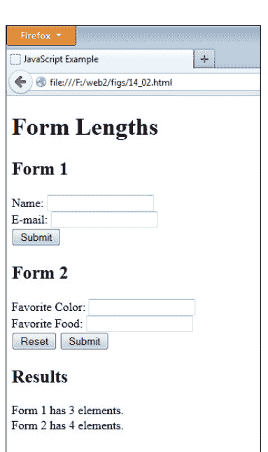

图 14-2 显示了每个表单中的元素数量。

表单的名称允许它成为表单对象的实例，你可以通过其名称访问它。要使用 JavaScript 访问使用表单名称的表单，可以使用此处所示语法：

document.yourname

将`yourname`替换为在起始表单标签的`name="yourname"`属性中赋予表单的名称。因此，如果你想写一个脚本来查找此示例中命名表单的元素数量，可以使用以下代码：

```javascript
document.write("The form has " + document.info_form.length + " elements.");
```

命名表单中的元素数量被写在页面上

注意`document.write()`语句中是如何访问表单的。不再使用表单数组，而是使用了表单名称。现在它可以访问表单对象的属性，并通过访问`length`属性来实现。

# 使用 ID

访问表单的第三种方法是使用 id 属性，然后使用`document.getElementById()`。这是访问表单及其元素最清晰的方法，因为你可以通过每个元素的单独 id 来访问它们，而之前的两种访问方法需要你知道表单位于哪个数组索引或表单名称以及元素的名称。

### 注意

如果你在使用`getElement()`访问元素时需要刷新，可以参考第 9 章。

如果你想使用`id`编写上一节中的脚本，可以使用以下 HTML 代码：

```html
<form id="info_form">
Name:<input type="text"><br>
<input type="submit">
</form>
```

表单被赋予了一个 id

接下来，是 JavaScript 代码：

```javascript
var f_length = document.getElementById("info_form").length;
document.write("The form has " + f_length + " elements.");
```

使用`getElementById()`访问表单并获取其长度

命名表单中的元素数量被写在页面上

由于你已经熟悉在前几章中使用的`document.getElementById()`，这对你来说应该是一个简单的方法。

你访问表单及其元素的方法取决于你正在编写的脚本类型。如果你在页面上使用多个表单，那么表单数组可以是遍历每个表单的方便方法。如果你试图尽可能增加与旧 HTML 代码或浏览器的向后兼容性，使用`name`方法可能是更好的选择。另一方面，尝试在 XHTML 1.0 Strict 中进行验证将要求你使用 id 来命名每个表单元素，在这种情况下，使用 id 方法更为合适。

# 使用表单对象的属性和方法

当你需要在脚本中访问表单的某些元素或属性时，JavaScript 表单对象将为你提供帮助。表单对象只有几个属性和方法。先描述属性。

## 属性

表单对象的属性在你处理表单时可能需要的信息。表 14-1 列出了表单的各种属性。

# Action 属性

此属性允许你访问起始表单标签中的值。该属性指定了将表单发送到何处。此处显示了带有 action 的属性：

```html
<form name="info_form" action="someplace.com">
<label>Name:</label>
<input type="text">
</form>
```

接下来，是 JavaScript 代码：

```javascript
document.write("The form goes to " + document.info_form.action);
```


此脚本输出了表单 `action` 值。

# Elements 属性（数组）

`elements` 属性允许你按照顺序访问表单中的每个元素。它的工作方式与数组类似。

| 属性 | 值 |
| :--- | :--- |
| `action` | 表单标签中的 `action` 属性值 |
| `autocomplete` | 定义浏览器是否可以使用自动完成功能来填写表单 |
| `elements` | 包含表单元素的数组 |
| `enctype` | 随浏览器变化的 `enctype` 属性 |
| `length` | 表单中元素的总数 |
| `method` | 表单的 `method` 属性值 |
| `name` | 表单的 `name` 属性值 |
| `noValidate` | 当存在时，指定表单不进行验证（HTML） |
| `target` | 表单标签中的 `target` 属性值 |

**表 14-2** 表单对象的属性

# 第14章：JavaScript 与表单 387

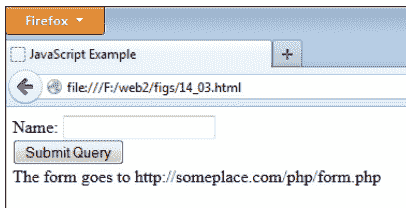

图 14-3 表单的 `action` 值打印在页面上。

要使用 `elements` 数组访问表单中的元素，请使用要访问元素的索引号。例如，以下表单拥有元素：

```html
<form name="info_form">
<label>Name:</label><input type="text"><br>
<input type="submit">
</form>
```

要访问第一个元素（文本框），可以使用此处所示语法：

```javascript
document.info_form.elements[0]
```

或者，如果你想使用表单数组（假设这是页面上的第一个表单），可以使用此语法：

```javascript
document.forms[0].elements[0]
```

访问文本框的另一种方法是命名它（像表单一样）并使用其名称访问。你可以对每个元素以及表单本身都这样做；你可以根据情况选择访问表单及其元素的最佳方法。
代码给出了表单和文本框名称，并允许你使用这些名称进行访问：

```html
<form name="info_form">
<label>Name:</label><input type="text" name="yourname"><br>
<input type="submit">
</form>
```

在这种情况下，你可以使用表单名称和文本框名称访问文本框，如下所示：

```javascript
document.info_form.yourname
```

## JavaScript：初学者指南

当然，你也可以使用 `id` 方法：

```html
<form>
  <label Name=:</label><input type="text" id="username"><br>
  <input type="submit">
</form>
```

然后，你可以使用 `getElementById` 获取输入元素：

```javascript
document.getElementById("username");
```

## encoding 和 enctype 属性

这些属性包含 `<form>` 标签中 `encode` 属性的值，该值是用于发送到表单服务器的数据所使用的编码类型。默认值是 `application/x-www-form-urlencoded`。

### length 属性

`length` 属性存储页面上给定表单中的元素数量。本章已经详细讨论过这一属性，因此没有必要再次讨论。

### method 属性

该属性包含 `<form>` 标签中 `method` 属性包含的值。因此，如果你要将表单发送到服务器进行处理，可能会使用类似下面的代码：

```html
<form name="fl" method="post" action="http://site.com/cgi-bin/form.cgi">
<!-- 此处为表单内容 -->
</form>
```

此表单的 `method` 属性的值为 `post`，因为它位于表单的 `method` 属性中。

### name 属性

该属性包含表单名称的值，该名称是在 `<form>` 标签的 `name` 属性中指定的。你可能会有这样的代码：

```html
<form name="cool_Form">
<!-- 此处为表单内容 -->
</form>
```

在这里，`name` 属性的值为 `cool_form`，因为它是表单 `name` 属性内部的值。

### noValidate 属性

该属性包含 `<form>` 标签中 `novalidate` 属性的布尔值（HTML5 中引入）。如果为 `true`，则表单在提交时不应进行验证。有关更多 HTML5 验证的信息，请参见本章后面的“HTML5 与表单”部分。

## target 属性

该属性包含 `<form>` 标签中 `target` 属性指定的值。例如，你可能会有以下代码：

```html
<form name="cool_form" target="_top" action="program.cgi">
<!-- 此处为表单内容 -->
</form>
```

在这里，`target` 属性的值为 `_top`，因为它是表单 `target` 属性内部的值。

## 方法

现在来看表单对象的方法。选定的方法将在表 14-2 之后进行讨论。

## checkValidity() 方法

在 HTML5 中，你可以让浏览器检查字段是否包含数据或是否符合模式，这不需要 JavaScript。根据所有需要验证的字段是否通过了各自的测试，你可能希望执行后续操作。如果所有需要验证的元素都通过了各自的测试，`checkValidity()` 函数返回 `true`；如果其中任何一个元素失败，则返回 `false`。有关 HTML5 如何影响表单的更多信息可以在本章后面的“HTML5 与表单”章节中找到。

| 方法 |  |
|---|---|
| `checkValidity()` | 返回所有要求浏览器验证的表单元素是否通过了验证 (HTML5) |
| `dispatchFormChange()` | 为每个表单元素创建一个 `formchange` 事件，在发生更改时触发 (HTML5) |
| `dispatchFormInput()` | 为每个表单元素创建一个 `forminput` 事件，在有新输入时触发 (HTML5) |
| `item()` | 返回 `elements` 数组中指定索引的项 (HTML5) |
| `namedItem()` | 返回 `elements` 数组中具有指定名称或 id 值的项 (HTML5) |
| `submit()` | 提交表单 |
| `reset()` | 重置表单数据 |

**表 14-2** 表单对象的方法

## reset() 方法

该方法允许你从脚本中重置表单，这将清除用户输入的任何数据。例如，在完成对先前数据的处理后，可以使用下面的代码来重置表单：

```javascript
var my_form = document.getElementById("my_form");
my_form.addEventListener("submit", function(event) {
  var txt = document.getElementById("txt");
  alert(txt);
  event.preventDefault();
  my_form.reset();
}, false);
```

- 创建一个事件监听器，在表单提交时执行该函数
- 获取文本字段的值，并向查看者显示
- 防止提交表单到服务器的默认操作

在对数据输入文本字段进行简单操作（带有警告框）后，表单会被重置。

## submit() 方法

该方法允许你在无需查看者点击提交按钮的情况下提交表单。如果你需要提供另一种方式（除提交元素之外）来提交表单，这将非常有用。下面的代码展示了这种示例。首先是 HTML 代码：

```html
<form id="my_form" action="send_email.php">
  <label>Email:</label><input type="text" id="email"><br><br>
  <a href="submit.html" id="submit">Submit</a> <!-- 创建了一个提交链接 -->
</form>
```

接下来是 JavaScript 代码：

```javascript
var my_form = document.getElementById("my_form");
sum = document.getElementById("subm");
sum.addEventListener("click", function(event) {
  var email = document.getElementById("email");
  event.preventDefault();
  my_form.submit();
}, false);
```

- 使用提交方法提交表单

## 表单的可访问性

确保表单对于查看者是可以访问的具有挑战，因为布局可能没有被正确解释。你可以采取一些方法来帮助查看者访问表单：使用 `<label>` 标签，使用 `<fieldset>` 标签，并确保用户启用了 JavaScript。

## 正确的元素和标签顺序

在 HTML 代码中，标签文本和表单元素的顺序有助于辅助技术。例如，考虑以下输入：

```html
<input type="text" name="username" id="username"> Name
<input type="text" name="zip_code" id="zip_code"> Zip Code
```

在这里，辅助技术寻找位于表单元素之前的标签。由于第一个输入元素之前没有标签，查看者会被提示输入但不知道输入什么。为了纠正这一点，你可以将标签文本移动到表单元素之前，如下代码所示：

```html
Name <input type="text" name="username" id="username">
Zip Code <input type="text" name="zip_code" id="zip_code">
```

现在，辅助技术将获取表单标签并允许用户输入预期信息。同时使用 `name` 和 `id` 属性也有帮助，因为各种辅助技术都会识别这些。这对于选择框、文本区域和选择框同样有效。然而，在处理选择框和单选按钮时，许多辅助技术通过描述性标签识别第一个元素。因此，在使用它们时应该交换位置。在处理按钮（如提交、重置或创建的按钮）时，请确保使用 `value` 属性来描述按钮的功能，因为这是辅助技术预期的。

## 使用 `<label></label>` 标签

使用 `<label>` 标签可以帮助进一步指定哪个标签文本属于哪个表单元素。示例如下：

```html
<label>Name:</label>
<input type="text" name="username" id="username">
```

在这里由于标签位于预期位置，你只需要应用标签使其更具体，并直接指向表单元素的 `id`，只需添加 `for` 属性，如下所示：

```html
<label for="username">Name:</label>
<input type="text" name="username" id="username">
```

在这里，你将起始 `<label>` 标签的 `for` 属性赋值为使用 `<label>...</label>` 标签内文本的表单元素的 `id` 属性。在前一个示例中，`for` 属性包含 `username`，这将其与 HTML 代码中 id 为 `username` 的元素关联起来。

## JavaScript：初学者指南

## 使用 `<fieldset></fieldset>` 标签

在处理单选按钮（radio buttons）和复选框（check boxes）时，使用 `fieldset` 可以帮助将它们分组到一个逻辑集合。使用 `legend` 标签为选项进行标记，可以让用户知道需要选择什么。以下代码使用 `fieldset` 将一组用于选择水果种类的单选按钮组合在一起：

```html
<fieldset>
<legend>选择水果:</legend>
<input type="radio" name="fruits" id="fruits1" value="Orange">
<label for="fruits1">Orange</label>
<input type="radio" name="fruits" id="fruits2" value="Banana">
<label for="fruits2">Banana</label>
<input type="radio" name="fruits" id="fruits3" value="Apple">
<label for="fruits3">Apple</label>
</fieldset>
```

在这里，你将所有单选按钮放置在 `<fieldset>` 和 `</fieldset>` 标签内，并在起始 `fieldset` 标签之后使用 `legend` 来对标签进行分组。然后，每个元素在 `fieldset` 内部正常地标记（同样使用了 `label` 标签）。

## 不要假设存在客户端脚本

在编写表单代码时，最好不要假设 JavaScript 或其他客户端技术是可用的。如果需要 JavaScript 才能使表单可用，许多用户将无法使用该表单，因为出于各种原因（如安全性）禁用了 JavaScript。

最佳实践是即使在没有 JavaScript 的情况下也允许表单发送到服务端（由服务端处理最重要的验证例程）。对于没有 JavaScript 的用户，像下面的代码将无法使用：

```html
<input type="button" onclick="this.form.submit();" value="提交表单">
```

在这种情况下，需要一个 JavaScript 事件处理器方法来提交表单。使用传统的 `submit` 输入框元素来创建提交按钮会更好。

如果你正在使用 JavaScript 验证，可以使用如下代码：

```html
<form method="post" action="form.php" id="my_form">
<!-- 此处放置表单内容 -->
<input type="submit" name="submit" id="submit" value="提交表单">
</form>
```

这允许你检查 JavaScript 是否可用（通过为 `submit` 事件创建事件监听器）。否则，JavaScript 提交事件将被忽略，表单将提交到服务端脚本进行验证和处理。如果 JavaScript 可用，客户端验证例程可以节省一次往返服务端的次数。如果不可用，服务端脚本将完成这项工作，但用户仍然能够按预期使用表单。

## 验证

有效的 JavaScript 表单非常有用。例如，你可以在提交之前对输入进行验证，以帮助减少信息不完整或不准确的表单数量。在提交到通用网关接口 (CGI) 脚本、PHP 脚本或 Java Servlet 之前对表单数据进行验证，可以节省时间并减轻服务器负载。

## 简单验证

在上一章（尝试此 13-1）中，你通过在表单提交时使用相同的函数触发事件，并对表单输入进行了一些简单验证，并测试输入是否包含特定字符（电子邮件地址中的 `@`）。你还学习了正则表达式，它在验证输入表单时也很有帮助。

例如，假设你有如下这段用于某项功能的 HTML 代码：

```html
<form method="post" action="form.php" id="my_form">
  <label for="name">name</label>
  <input type="text" name="name" id="name"><br>
  <input type="submit" name="submit" id="submit" value="提交">
</form>
```

如果你添加 `addEventListener` 来处理事件，你可以验证条目并允许默认操作发生（将表单内容发送到服务器），或者在名称不符合你指定的规则时阻止默认操作并显示错误消息。以下是此示例：

```javascript
var my_form = document.getElementById("my_form");
my_form.addEventListener("submit", function(event) {
  var name = document.getElementById("name").value,
  match = /[A-Za-z\-]{2,50}$/;
  if (!match.test(name)) {
    event.preventDefault();
    alert("名称仅包含字母、空格和连字符");
  }
}, false);
```

如你所见，这个正则表达式（第 13 章）用于限制名称字段中允许的字符类型和数量，它使用了 `A-Z` 和 `a-z` 范围来允许所有字母，允许 `'`（根据需要用于姓名），`\-` 允许连字符（连字符转义以避免与范围混淆），以及空格。它使用 `^` 和 `$` 来确保名称至少有两个字符且不超过 50 个字符，而不是在遇到第一个有效字符后停止。如果名称未通过验证，表单将不会提交（`event.preventDefault()` 停止了提交），并向用户发送警告。否则，表单将正常提交到服务端进行处理。

如果你需要在不支持事件的旧版浏览器中使用 DOM 方法，你可能希望处理事件的函数返回 `true` 或 `false`。函数本身可以完成所有工作，但它需要一个返回值。在大多数情况下，验证可以根据你的用途变得简单或复杂。你只需要根据所需信息创建你自己的自定义函数来验证你选择的表单字段。例如，你可以检查某个字段是否包含五个数字（对于典型的邮政编码）。例如，你可以使用正则表达式来检查一个字段是否包含五个数字。如果不是，则向用户提示邮政编码无效并要求输入。以下代码显示了如何操作。

首先是 HTML 代码：

```html
<form method="post" action="form.php" id="my_form">
  <label for="zip_code">邮政编码:</label>
  <input type="text" name="zip_code" id="zip_code"><br>
  <input type="submit" name="submit" id="submit" value="提交">
</form>
```

接下来是 JavaScript 代码：

```javascript
var my_form = document.getElementById("my_form");
my_form.addEventListener("submit", function(event) {
  var zip = document.getElementById("zip_code").value;
  var match = /\d{5}$/;
  if (!match.test(zip)) {
    event.preventDefault();
    alert("邮政编码必须包含 5 位数字");
  }
  return false;
});
```

该代码使用正则表达式检查五位数字。如果输入的不是五个数字，函数将返回 `false`。你可以在 JavaScript 中根据需要使验证严格或松散。但请记住，在应用层（你的服务端脚本或程序），你需要格外小心验证，以确保恶意数据不会被提交到你的应用程序。

## 提示

寻找验证脚本的一种方法是查看 Web 上的某些 JavaScript 网站。许多网站具有验证不同数据类型的特殊函数。如果你能找到适合你用途的函数，可以节省一些工作。

## 复选框和单选按钮

在使用复选框和单选按钮时，你可能只想知道用户是否已经“勾选”它们。例如，你可以使用以下：

```html
<form id="signup_form">
  <label for="email">电子邮件: <input type="email" id="email"></label><br>
  <input type="checkbox" name="agree" id="agree" value="agree">同意条款
  <a href="terms.html" target="_blank">查看条款</a><br>
  <input type="submit" name="submit" id="submit" value="提交">
</form>
```

在这种情况下，你希望用户在提交表单进行注册之前勾选“同意”框。在 JavaScript 中检查这一点，你可以使用复选框元素的 `checked` 属性，如果元素被勾选则返回 `true`，否则返回 `false`。以下代码显示了一个示例：

```javascript
var s_form = document.getElementById("signup_form");
s_form.addEventListener("submit", function(event) {
  var agree = document.getElementById("agree");
  if (!agree.checked) { // 语句检查元素是否未被勾选
    event.preventDefault();
    alert("错误：必须勾选“同意条款”");
  }
}, false); // 如果元素未被勾选，表单将不会提交并向用户发送警告
```

在这里，如果没有勾选“同意”复选框，表单将不会提交。用户将收到提示，要求必须勾选“同意条款”复选框。如果您正在处理一组单选按钮，并且只想确保其中一个选项已被选中，可以使用 `document.getElementsByName()` 方法（参见第 9 章）并检查该属性来确定是否符合这种情况。例如，假设您有以下内容：

```html
<form id="signup_form">
<label for="email">电子邮箱:</label>
<input type="text" name="email" id="email"><br>
选择您最喜欢的食物：
<input type="radio" name="food" id="food_pizza" value="Pizza">
<label for="food_pizza">Pizza</label>
<input type="radio" name="food" id="food_sandwich" value="Sandwich">
<label for="food_sandwich">Sandwich</label><br>
<input type="radio" name="food" id="food_candy" value="Candy">
<label for="food_candy">Candy</label><br>
<input type="submit" name="submit" id="submit" value="Submit">
</form>
```

同一类别的每个单选按钮的名称（`name`）将是相同的（这里是 `food`）。为了确保选择了其中一个选项，可以使用以下代码：

```javascript
var s_form = document.getElementById("signup_form");
s_form.addEventListener('submit', function(event) {
  var food_array = document.getElementsByName("food");
  selection_made = false;
  for (var i = 0; i < food_array.length; i++) {
    if (food_array[i].checked) {
      selection_made = true;
      break;
    }
  }
  if (!selection_made) {
    event.preventDefault();
    alert("错误：必须选择一种喜欢的食物");
  }
});
```

- `getElementsByName()` 被用于将每个 `food` 单选元素放入一个数组中
- 在处理完每个 `food` 单选元素后，会创建一个布尔值
- 循环遍历数组中的每个元素
- 如果单选按钮被选中，则将 `selection_made` 的值设置为 `true` 并使用 `break` 语句结束循环

如果 `selection_made` 的值不是 `true`，说明没有单选按钮被选中——表单不会提交，用户将收到提示。

## 专家问答

**问：** 验证是必要的吗？毕竟，难道不能由服务器端应用程序处理吗？

**答：** 是的，但使用客户端验证可以帮助减轻服务器的负担，因为启用了 JavaScript 的用户在每次输入无效信息时都不需要访问服务器端应用程序。这对用户也有帮助，他们不需要重新加载整个页面来纠正任何无效信息。

**问：** 我可以验证哪些类型的输入？

**答：** 在大多数情况下，你可以按照认为合适的方式验证任何你想的内容。你可以验证日期、姓名、时间、地址、电子邮件、电话号码或你需要的任何其他。

**问：** 我可以验证选择框中的选择或文本区域中的文本，或者其他一些输入类型吗？

**答：** 在某些情况下，你已经将值构建在元素中了。然而，如果可能的话，你仍然应该根据其他信息对这些值进行验证，以确保收到的信息与你的信息匹配。你只需要调整你的函数，根据不同的输入设备（文本区域、单选按钮等）来执行所需的任务。

**问：** 我不使用服务器脚本，但我为了好玩使用 JavaScript 并且想验证信息。我真的需要添加服务器端脚本吗？

**答：** 是否需要服务器端脚本取决于你的目的。如果你有一个需要保存信息、通过电子邮件发送或存储到数据库的表单，那么你需要一个服务器端应用程序。

在这里，每个 `name` 属性值为 `food` 的单选按钮元素都被放置在 `food_array` 中。这允许你通过循环每个单选按钮来查看它是否已被选中。一个名为 `selection_made` 的布尔变量最初设置为 `false`。在循环内部，如果脚本发现某个单选按钮被选中，它会将 `selection_made` 设置为 `true` 并使用 `break` 语句退出循环。你可以这样做是因为由于只有一个单选按钮可以被选中——在发现正面结果后，你不需要继续检查。如果运行循环后 `selection_made` 仍然为 `false`，则取消表单提交，用户将改为收到错误提示。

## JavaScript：初学者指南

# 尝试此题 14-1 请求一个数字

在这个项目中，你创建一个脚本，对查看者输入的电话号码进行基本验证，例如 222-222-2222。

| prjs14_1.html | prjs14_1.js |
| :--- | :--- |

## 逐步步骤

1. 创建一个包含表单的 HTML 页面，带有标签为“电话号码 (XXX-XXX-XXXX)”且 id 为 `phone` 的文本框。确保表单有一个提交按钮。在表单之后插入必要的 `script` 标签以调用名为 `prjs14_1.js` 的外部 JavaScript 文件。将 HTML 文件保存为 `prjs14_1.html`。完成后，HTML 代码如下：

```html
<body>
  <form id="phone">
    <label for="phone">电话号码 (XXX-XXX-XXXX)</label>
    <input type="text" id="phone"><br>
    <input type="submit" value="Submit">
  </form>
  <script type="text/javascript" src="prjs14_1.js"></script>
</body>
```

2. 创建一个外部 JavaScript 文件并保存为 `prjs14_1.js`。

3. 使用正则表达式确保文本框中的格式为 XXX-XXX-XXXX。如果是，显示“电话号码已验证。”；否则，显示“电话号码无效。格式为 XXX-XXX-XXXX。”JavaScript 代码如下：

```javascript
var phone = document.getElementById("phone");
phone.addEventListener("submit", function(event) {
  var value = phone.value;
  var match = /^\d{3}-\d{3}-\d{4}$/;
  if (match.test(value)) {
    alert("电话号码已验证。");
  } else {
    alert("电话号码无效。");
  }
}, false);
```

4. 保存 JavaScript 文件并在浏览器中打开 HTML 文件。通过在框中输入各种值并提交表单来测试是否有效。

# 尝试此题总结

在这个项目中，你利用 JavaScript 和表单的知识创建一个验证表单的脚本。脚本通过正则表达式验证查看者的输入是否为有效的电话号码。

# HTML5 与表单

HTML5 提供了几个新元素，以及许多输入类型和属性。它还提供了一种在客户端执行验证的方法，减轻了 JavaScript 的负担。

# 新元素

HTML5 相关的元素如表 14-3 所示。这些元素可以为查看者提供额外信息或执行其他有帮助的任务。你将在本节查看 `meter` 和 `progress` 元素，但关于这些任何元素的更多信息（包括哪些浏览器支持哪一个），请参见 yahoo.com/html5。

## 400 JavaScript：入门指南。

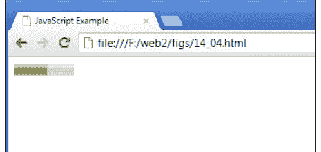

**图 14-4** 显示了一个测量条（meter bar）。

对于不支持该元素的浏览器，您可以在起始标签和结束标签之间插入文本来提供显示的默认文本，如下代码所示：

```html
<meter min="0" max="100" value="55">55</meter>
```

这将会简单地在测量条应该出现的页面上显示 55。

它可以与 JavaScript 结合使用，向用户显示有用信息，例如在测验中正确回答了多少问题。例如，假设您有以下 HTML 代码：

```html
<h1>Math Quiz</h1>
<form id="qform">
  <label for="q1">1. 2 + 2 = </label>
  <input type="text" name="q1" id="q1"><br><br>
  <label for="q2">2. 255 x 5 = </label>
  <input type="text" name="q2" id="q2"><br><br>
  <label for="q3">3. 7436 - 2478 = </label>
  <input type="text" name="q3" id="q3"><br><br>
  <input type="submit" value="Check Answers">
<div id="grade"></div>
</form>
```

这里创建了一个用于快速数学测验的表单，允许查看者在文本框中输入答案并提交答案进行检查。一个 id 为 `grade` 的空 `div` 将通过 JavaScript 显示答案。以下代码显示了如何使用 `meter` 标签作为视觉辅助来显示正确答案的数量：

将元素赋值给变量：

```javascript
var qform = document.getElementById("qform");
qs = [document.getElementById("q1"), document.getElementById("q2"), document.getElementById("q3")];
ans = [4, 2550, 4958];
```

创建了一个包含每个文本框输入元素的数组。每个测验问题的答案存放在 `ans` 数组中，顺序与其在 `qs` 数组中相应的文本框顺序一致。

## 第 14 章：JavaScript 与表单 401

将 `grade` `div` 赋值给变量。为表单元素的 `submit` 事件创建一个事件监听器。

```javascript
grade = document.getElementById("grade");
qform.addEventListener("submit", function(event) {
  var num_correct = 0;
  num_questions = qs.length;
  grade_HTML = "";
  event.preventDefault();
  for (var i = 0; i<num_questions; i++) {
    if(qs[i].value === ans[i]) {
      num_correct += 1;
    }
  }
  grade_HTML += "<meter min=\"0\" max=\"" + num_questions + "\"";
  grade_HTML += "value=\"" + num_correct + "\"></meter>";
  grade_HTML += " " + num_correct + "/3 Correct";
  grade.innerHTML = grade_HTML;
}, false);
```

创建变量来保存正确答案的数量、问题的数量以及一个在测验评分时将放入 `grade` `div` 内部的字符串。防止默认操作（这会将表单提交到服务器）。如果用户答案的值等于数组中的正确答案，则 `num_correct` 变量加 1。将 `grade` `div` 的 `innerHTML` 更改为 `grade_HTML` 的内容。

使用初始值为零进行评分测试，名为 `num_correct` 的变量通过获取 `qs` 数组的长度获取测验中的问题数量（该数组包含每个文本框输入），一个名为 `grade_HTML` 的变量包含一个空字符串，该字符串将用 `meter` 标签填充以显示结果。

创建了一个循环来遍历 `qs` 数组，获取每个值，并判断它是否等于数组中相应的正确答案。注意，这里使用了一元 `+` 运算符来尝试在与正确答案比较之前将用户输入强制转换为数字，因为每个文本框默认返回字符串。如果答案正确，则将其加到 `num_correct` 变量中。

接下来几行代码创建了将放入 `grade` 变量中的 HTML 字符串，以及如何将 `value` 属性赋值为 `num_correct` 变量的值。在 `meter` 元素之后显示一条额外消息，向用户显示测量条的结果类型（例如，如果两个答案正确，消息显示为“2/3 Correct”）。

在这种情况下，如果用户没有获得所有正确答案，可以不断编辑并提交，直到获得 3/3。图 14-5 显示了该脚本在两个答案正确时的结果。

## progress 元素

`progress` 元素与 `meter` 类似，但它显示的是百分比而不是标量值。例如，要在进度条上显示 100 中的 25%，您可以使用以下代码：

```html
<progress max="100" value="25%"></progress>
```

## 402 JavaScript：入门指南

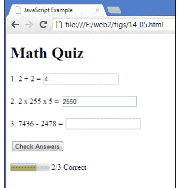

图 14-5 测量条显示正确回答了多少问题。

通过 `meter`，你可以使用 `max` 属性设置最大值，使用 `value` 属性设置 0 到最大值之间的百分比值。你可以修改之前的 JavaScript 代码，使用进度条来显示测验的百分比，代码如下：

```javascript
var qform = document.getElementById("qform");
qs = [document.getElementById("q1"), document.getElementById("q2"), document.getElementById("q3")];
ans = [4, 2550, 4958];
grade = document.getElementById("grade");
qform.addEventListener("submit", function(event) {
  var num_correct = 0;
  num_questions = qs.length;
  grade_HTML = "";
  event.preventDefault();
  for (var i = 0; i<num_questions; i++) {
    if (qs[i].value === ans[i]) {
      num_correct += 1;
    }
  }
  grade_HTML = "<progress min=\"0\" max=\"" + num_questions + "\"";
  grade_HTML += "value=\"" + num_correct + "\"></progress>";
  grade_HTML += " " + num_correct + "/3 Correct";
  grade.innerHTML = grade_HTML;
}, false);
```

## 输入类型

除了字段外，HTML5 还增加了新类型。

| 类型 | 描述 |
| :--- | :--- |
| `color` | 允许用户使用工具选择颜色。 |
| `date` | 可以使用日历工具输入日期。 |
| `datetime` | 可以使用日历工具输入日期/时间。 |
| `datetime-local` | 可以输入不带时区的日期/时间。 |
| `email` | 用于输入一个或多个电子邮件地址。 |
| `month` | 可以输入年份和月份。 |
| `number` | 设计用于数值输入。 |
| `range` | 允许在范围内选择值。 |
| `search` | 设计用于输入搜索值。 |
| `tel` | 设计用于输入电话号码。 |
| `time` | 允许用户输入带有小时、分、秒和毫秒的时间。 |
| `url` | 设计用于输入 URL。 |
| `week` | 用于输入周。 |

## 新属性

HTML5 还带来了许多新属性。

| 属性 | 描述 |
| :--- | :--- |
| `autocomplete` | 可以设置表单标签（影响所有字段）或任何特定输入标签（影响单个字段）。如果设置为 `off`，字段将不再使用浏览器的自动完成功能建议。 |
| `autofocus` | 告诉浏览器在页面加载时自动聚焦该元素。 |
| `dirname` | 提交输入的方向。 |
| `form` | 用于指定元素所属的表单。 |
| `action` | 允许提交元素覆盖表单的 `action` 属性。 |
| `forctype` | 允许提交元素覆盖表单的 `enctype` 属性。 |
| `method` | 允许提交元素覆盖表单的 `method` 属性。 |
| `novalidate` | 允许提交元素覆盖表单的 `novalidate` 属性。 |
| `formtarget` | 允许提交元素覆盖表单的 `target` 属性。 |
| `pattern` | 允许使用正则表达式验证表单字段。 |
| `placeholder` | 允许为表单字段指定占位符（让用户更好地了解预期输入类型的浅色文本）。 |
| `required` | 表明表单字段是必填的。 |

这些中的许多项允许你通过 `submit` 元素来覆盖主表单元素中的属性。还有一些属性如 `required`、`novalidate` 和 `pattern`，它们有助于表单验证，我们将在下一节中进行讨论。

## HTML5 表单验证

HTML5 允许浏览器自动验证各种输入类型。可以通过在 `form` 标签中使用 `novalidate` 属性来禁用表单中所有字段的浏览器验证，也可以在单个表单字段中使用它以使其不被验证。

如果你决定允许浏览器验证字段，新的 `input` 类型具有某些它们所使用的验证方法，以确保输入了预期的信息类型。默认情况下，每个字段都是可选的，但你可以通过在每个需要完成的字段上添加 `required` 属性来将其变为必填。例如，浏览器将验证以下表单，并且当 URL 字段为空时：

```html
<form id="signup_form" method="post" action="send.php">
  <label for="name">Name: </label>
  <input type="text" name="name" id="name"><br>
  <label for="url">URL: </label>
  <input type="url" name="url" id="url" required><br><br>
  <input type="submit" value="Submit">
</form>
```

图 14-7 显示了在支持的浏览器中未填写必填字段时发生的情况。图 14-8 显示了在支持的浏览器的 URL 字段中输入无效 URL 的结果。

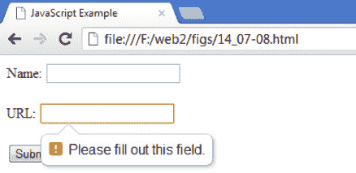

图 14-7 必须填写该字段才能验证。

## 406 JavaScript：初学者

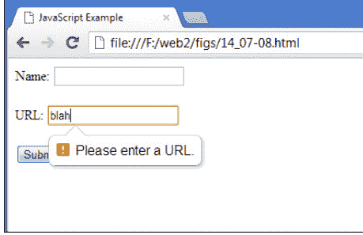

图 14-8 字段必须包含有效的 URL 才能验证。

你还可以使用 `pattern` 字段，以便浏览器根据正则表达式来验证字段。例如，如果你想让上一个表单中的名称字段仅包含字母和空格，可以使用以下代码：

```html
<label for="name">Name:</label>
<input type="text" name="name" id="name" pattern="[A-Za-z]+"><br><br>
```

缺点是浏览器支持问题。如果你需要在不支持 HTML5 中使用的特定输入类型或验证的浏览器中进行客户端输入验证，那么你需要编写一些 JavaScript 作为备份。例如，你可能有以下内容：

```html
<form id="signup_form" method="post" action="send.php">
<label for="name">Name:</label>
<input type="text" name="name" id="name" pattern="[A-Za-z]+"><br>
<input type="submit" value="Submit">
</form>
```

如果浏览器不支持 `pattern` 属性，而你仍然想确保字段仅包含字母和空格，那么你需要编写一个脚本来确保该字段仍然有效。在这种情况下，你可以简单地使用以下代码在点击按钮时验证名称字段：

```javascript
var sform = document.getElementById("signup_form");
sform.addEventListener("submit", function(event) {
  var name = document.getElementById("name").value,
  pattern = /[A-Za-z]+/;
  event.preventDefault();
  if (!pattern.test(name)) {
    alert("Name must contain only letters and spaces");
  }
}, false);
```

这在 JavaScript 中使用了所需的模式作为正则表达式，并运行 `test` 方法查看它是否匹配该模式。如果不匹配，将向观众发送警报，以便修正名称。

HTML5 为表单提供了许多新且实用的功能。在本文写作期间，客户端验证可能需要 JavaScript 备份。随着更多的用户转向更新浏览器，并且对所有新功能的支持增加，这些新工具对你作为开发者来说将变得更有帮助。

### 注意

关于任何 HTML5 表单改进的更多细节（包括哪些浏览器支持每项改进），请参见 woofoo.com/html5/。

## 14-2 使用 HTML5 或 JavaScript 验证电话号码

| prjs14_2.html | prjs14_2.js |
| :--- | :--- |

在这个项目中，你将在之前的项目的基础上，创建一个表单，使用新的 HTML5 `pattern` 属性来验证电话号码。如果浏览器不支持 HTML5，则将运行备份的 JavaScript 验证。

## 步骤说明

1. 创建一个 HTML 文档并添加 `script` 标签，以便 HTML 文件调用名为 `prjs14_2.js` 的外部 JavaScript 文件。创建一个 `id="getphone"` 的表单，并添加一个 `id="phone"` 的文本框以获取电话号码。该文本框应使用带有正则表达式的 `pattern` 属性，如果格式为 XXX-XXX-XXXX，则将验证电话号码。它也是一个必填字段。确保表单包含一个提交按钮。将 HTML 文件保存为 `prjs14_2.html`。完成后，HTML 代码应该像这样：

```html
<body>
<form id="getphone">
  <label for="phone">Phone Number (XXX-XXX-XXXX):</label>
  <input type="text" id="phone" pattern="\d{3}-\d{3}-\d{4}" required>
  <input type="submit" value="Submit">
</form>
</body>
```

2. 创建一个外部 JavaScript 文件并保存为 `prjs14_2.js`。使用 JavaScript 代码作为备份验证，检查电话号码格式是否为 XXX-XXX-XXXX。如果格式正确，显示“电话号码已验证。”；否则，显示“电话号码无效。格式为 XXX-XXX-XXXX。”JavaScript 代码如下：

```javascript
var phone = document.getElementById("phone");
phone.addEventListener("submit", function(event) {
  var value = phone.value;
  var match = /^\d{3}-\d{3}-\d{4}$/;
  if (match.test(value)) {
    alert("电话号码已验证。");
  } else {
    alert("电话号码无效。");
  }
}, false);
```

3. 保存 JavaScript 文件并在浏览器中打开 HTML 文件。通过在框中输入各种值并提交表单来测试是否有效。

## 总结

在这个项目中，你使用了 JavaScript 和 HTML5 创建了一个验证系统。

## 第14章测试

1. 每当你向 HTML 文档添加 `<form>` 和 `</form>` 标签，就会创建一个对象。
2. `forms` 数组允许使用索引访问表单。
3. 下列哪项可以访问第四个表单？
   A. `document.forms[4]`
   B. `document.forms[3]`
   C. `document.forms(3)`
   D. `document.forms(3)`
4. 下列哪项可以找到第三个表单的元素数量？
   A. `document.forms[2].length`
   B. `document.forms[3].length`
   C. `document.forms.length`
   D. `document.forms(3)`
5. 下列哪项持有表单的数量？
   A. `document.forms[0].length`
   B. `document.form.length`
   C. `document.forms.length`
   D. `document.forms[1].length`
6. 使用表单名称或 ________ 允许命名你想以后访问的表单。
7. 下列哪项访问名为 `e1` 的元素的值？
   A. `document.f1.e1.value`
   B. `document.e1.f1.value`
   C. `document.f1.e2.value`
   D. `document.forms1.e1.value`
8. ________ 属性允许访问起始表单标签中的 `action="url"` 属性。
9. ________ 属性是一个数组，允许访问特定表单中的每个元素。
10. HTML5 中的 ________ 属性允许为表单提供一个必须验证的正则表达式。
11. ________ 方法允许使用脚本重置表单。
12. 下列哪项可以在文档中添加有效的 `meter` 标签，以便在 10 的刻度上显示 8？
    A. `<meter min="0" max="10" value="7"></meter>`
    B. `<meter min="4" max="8"></meter>`
    C. `<meter min="0" max="10" value="8"></meter>`
    D. `<meter min="0" max="100" value="8"></meter>`
13. 帮助表单可访问性的方法之一是使用 ________ 标签来标识一段文本描述哪个字段。
14. ________ 方法允许在观众点击提交按钮之前提交表单。
15. 下列哪种 HTML5 表单属性用于用户必须填充的验证字段？
    A. `obligatory`
    B. `needed`
    C. `required`
    D. `compulsory`

# 第 15 章：高级技术简介

## JavaScript：初学者指南

## 关键技能与概念

- 处理图像
- JavaScript 与 JavaScript 框架（Frames）
- 调试脚本
- JavaScript 与辅助功能
- JavaScript 安全
- AJAX 与 JSON

## 处理图像

JavaScript 使用图像对象（image object）来预加载图像、创建滚动效果（rollover），甚至创建幻灯片或动画。当你想要创建此类脚本时，图像对象的属性将非常有帮助。表 15-1 列出并描述了图像对象的属性。

| 属性 | 用途 |
| :--- | :--- |
| `name` | 存储 `name` 属性的图像名称值 |
| `src` | 存储 `src` 属性的 URL 值 |
| `width` | 存储 `width` 属性的宽度 |
| `height` | 存储 `height` 属性的高度值 |
| `border` | 存储 `border` 属性的边框数值值 |
| `hspace` | 存储 `hspace` 属性的数值值 |
| `vspace` | 存储 `vspace` 属性的数值值 |
| `lowsrc` | 存储 `lowsrc` 属性的 URL 值 |
| `complete` | 表示图像是否加载完成 |

**表 15-1** 图像对象的属性

### 滚动效果（Rollovers）

图像*滚动*（也称为鼠标悬停按钮、图像翻转等类似名称）可以为你的导航图像增添趣味。随着浏览器和 CSS 的最新进展，现在滚动通常通过 CSS 而不是 JavaScript 实现。你可以在 www.netmagazine.com/tutorials/create-progressively-enhanced-3d-css-rollovers 看到相关示例。

### 简单的 JavaScript 滚动效果

简单的滚动效果只是在鼠标移动到初始图像上时，将一张图像更改为另一张。首先，你创建两个图像，并让第二张图像在某些方面有所不同。例如，查看这里显示的两个图像：

鞋子页面 鞋子页面

**注意**

对于你创建的每个 JavaScript 元素，你需要两个独立的图像。

一旦有了两个图像，就可以开始编写图像滚动的代码了。你可以将初始图像编写到 HTML 文档中，并给它指定一个 id：

```html
<h1>下方的图像会变化！将鼠标移动到上面！</h1>

```

在你的 JavaScript 中，你只需要通过 id 获取元素，并在鼠标事件上为属性分配一个新值。然后你只需在鼠标事件上改回来。以下是 JavaScript 代码：

```javascript
var im = document.getElementById("pic1");
im.addEventListener("mouseover", function() {
  im.src = "image2.gif";
}, false);
im.addEventListener("mouseout", function() {
  im.src = "image1.gif";
}, false);
```

在这里最接近看到结果的方法是查看一组变化前后的图像。图 15-1 显示了初始图像，而图 15-2 显示了鼠标移动到图像上的结果。

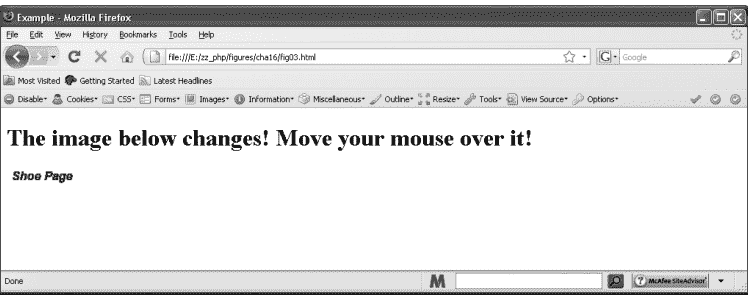

图 15-1 初始图像

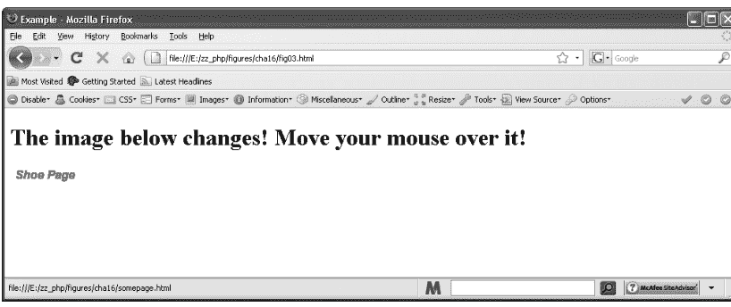

**图 15-2** 当发生 `mouseover` 事件时，会出现新图像。

**注意** 为了让没有鼠标的用户也能获得良好的辅助功能，你可以使用代码在 `<a>` 元素的 `focus`（聚焦）和 `blur`（模糊）事件上执行更改。你将在本章的项目中这样做。

### 更具辅助性的滚动效果

为了让 JavaScript 滚动效果更具辅助性，你将使用相同的图像，并且除了 `mouseout` 事件外，代码还会在 `<a>` 元素的 `focus` 和 `blur` 事件上更改图像。

## 步骤详解

1. 创建一个名为 `page1.html` 的 HTML 文档，并使用以下 HTML 代码作为 body：

```html
<body>
  <h1>下方的图像会变化！将鼠标移动到上面！</h1>
  <a href="page.html" id="imlink"></a>
  <script type="text/javascript" src="page1.js"></script>
</body>
```

2. 创建一个名为 `page1.js` 的 JavaScript 文件。在该文件中，以以下代码开始：

```javascript
var im = document.getElementById("pic1");
im.addEventListener("mouseover", function() {
  im.src = "image2.gif";
}, false);
im.addEventListener("mouseout", function() {
  im.src = "image1.gif";
}, false);
```

3. 修改代码使得当 `<a>` 元素发生 `focus` 和 `blur` 事件时，图像也会发生变化。你可以通过将部分代码移动到单独的函数，或者简单地粘贴事件监听器的代码（即 `mouseover` 和 `focus` 将使用相同的代码）。如果你将事件监听器移动到单独的函数，它看起来像这样：

```javascript
var im = document.getElementById("pic1");
var imlink = document.getElementById("imlink");
function on_image() {
  im.src = "image2.gif";
}
function off_image() {
  im.src = "image1.gif";
}
im.addEventListener("mouseover", on_image, false);
imlink.addEventListener("focus", on_image, false);
im.addEventListener("mouseout", off_image, false);
imlink.addEventListener("blur", off_image, false);
```

4. 保存文件并在浏览器中查看结果。

## 总结

在本章中，你学习了如何处理图像、JavaScript 与框架、调试脚本、JavaScript 与辅助功能、JavaScript 安全以及 AJAX 和 JSON。

### JavaScript 框架（Frames）

框架允许将浏览器窗口划分为多个部分，每个部分可以加载不同的 HTML 文档。

### 框架的用途

Frames 常用于网页布局。但在现代 HTML5 中，`<frameset>` 元素已不再推荐，取而代之的是使用 `<iframe>` 元素。

### 框架数组（Frames Array）

JavaScript 数组可以用于访问框架中的元素。

## 418 JavaScript：初学者指南

### 使用框架名称

另一种从另一个框架访问框架的方法是使用框架的名称（类似于你在上一节中使用表单名称的方式）。例如，这段代码通过在 `frame` 标签中添加 `name` 属性为每个框架命名（将其命名为 frameset.3.html）：

```html
<html>
<frameset cols="50%,50%">
<frame src="frame1.html" name="left_side"></frame>
<frame src="frame2.html" name="right_side"></frame>
</frameset>
<noframes>
使用下方的链接进入网站的无框架版本。<br />
<a href="noframes.html">无框架站点</a>
</noframes>
</html>
```

你现在可以使用另一个框架的名称访问其中一个框架，而不是使用 `frames` 数组。因此，如果你想从第一个框架访问第二个框架（`right_side`），可以使用这种语法：

```javascript
top.right_side
```

同样地，你可以使用这种语法从第二个框架内部访问第一个框架：

```javascript
top.left_side
```

你可以通过在每个框架中使用短的 `document.write()` 语句编写代码，让每个框架告诉观众另一个框架的位置。第一个框架（frame1.html）的文档可以这样编写：

```html
<body>
第二个（右侧）框架来自：<br />
<script type="text/javascript">
document.write(top.right_side.location);
</script>
</body>
```

右侧框架的名称用于在左侧框架中打印信息。

之后，frame2.html 的代码如下：

```html
<body>
第一个（左侧）框架来自：<br />
<script type="text/javascript">
document.write(top.left_side.location);
</script>
</body>
```

左侧框架的名称用于在右侧框架中打印它的信息。

现在每个框架都提供了关于另一个框架的信息。

## 第 15 章：高级技术简介 419

**注意**

框架（Frames）和 iframes 在使用时存在潜在的安全风险。有关这些风险的更多信息，请参阅 appliedlife.blogspot.com/2011/02/html-frames-and-security.html。

## 跳出框架

有时，另一个网站编写的链接在到达你的网站之前，并不会让用户跳出该网站的框架。这会导致用户被留在浏览器窗口的较小部分，并且另一个网站的导航在框架中显示。当这种情况发生时，你可能想为观众提供一种跳出其他网站框架的方法。

你可以在页面上放置一个链接，让观众点击以跳出框架。你需要在 `<a>` 标签中添加一个特殊标记，如下：

```html
<a href="http://yoursite.com" target="_top">跳出框架</a>
```

`target="_top"` 告诉浏览器在打开链接中的 URL 时查看完整窗口，而不是在框架内打开链接。你只需要将标签中的 URL 替换为你自己的即可。

## 调试脚本

尽管 JavaScript 很有趣，但有时它也可能令人沮丧。代码中的一个错误就可能导致整个脚本运行异常或完全不运行。调试脚本可能是一个耗时且艰辛的过程，但有几种技术可以帮助你在检查代码时节省一些时间。调试脚本的第一步是确定可能是哪种类型的错误导致了问题。

## 错误类型

主要的错误类型是语法错误和逻辑错误。当代码忘记添加分号、漏掉引号、拼错单词等时，就会发生语法错误。当代码实现不正确时，就会发生逻辑错误。

例如，如果执行循环的条件从未变为 `false`，那么 `while` 循环可能会无限循环下去。虽然它的代码语法可能是正确的，但结果可能不是程序员预期的那样。

## 查找语法错误

语法错误可能仅仅是漏掉了一个必要的分号。例如，以下代码在语句之间缺少一个分号：

```javascript
var greet = function() { say_hi(); say_welcome(); };
```

在这种情况下，分号非常重要，因为两个语句在同一行上。要修复这个问题，你只需要添加所需的分号，如下所示：

```javascript
var greet = function() { say_hi(); say_welcome(); };
```

## 420 JavaScript：初学者指南

**图 15-5** 一个 JavaScript 错误消息

语法错误通常会导致浏览器显示错误消息，以便你调试脚本。例如，你可能会看到类似图 15-5 中的消息。

> **注意** 大多数现代浏览器默认隐藏这些错误消息，但如果你愿意，可以启用它们。

这些消息可以帮助你找出导致问题的原因。错误消息中显示的行号告诉你是错误所在的位置。例如，如果消息说错误在第 15 行，你将从文档顶部的第 15 行开始，查看那里有什么。消息的其他部分可能会告诉你缺少了什么或什么放置得不当。

然而，有时消息中指出的行号并不是实际问题所在的行。

## 第 15 章：高级技术简介 423

注意

在调试完成后，最好移除你的测试代码，因为在用户运行时可能会导致脚本出现错误或其他问题。

通常可以通过查看浏览器中的“工具”菜单并寻找“Web 开发者”或“开发者工具”等选项来显示控制台。例如，在 Firefox 中，你可以通过打开“工具”菜单，进入“Web 开发者”，然后选择“控制台”来显示控制台。

之前使用的脚本现在可以更改为在控制台中显示消息，如下所示：

```javascript
var x = 2;
var y = 0;
// 其他代码
console.log("Calculation will be: " + x + "/" + y);
var z = x/y;
```

消息现在显示在控制台中，而不是在 `alert`（警告框）中。

脚本将在控制台中记录消息，而不会弹出警告框。当你需要在脚本的各个点放置多个消息来检查值时，这是获取必要信息的好方法，可以避免被连续的弹出警告消息淹没。

## 使用 Lint 工具

得益于专业的 Web 开发人员，现在有很多工具可以帮助你发现 JavaScript 错误，同时鼓励在 JavaScript 代码中使用最佳实践。Lint 工具（一种检查代码中任何不正确之处的工具）对于追踪代码中的问题（或潜在问题）非常有用。

这里列出了两种流行的 JavaScript Lint 工具：

- JSLint (jsllint.com)
- JSHint (jshint.com)

这两个工具都允许你将 JavaScript 代码粘贴到文本区域进行检查。这些工具会检查各种问题，例如：

- 未使用 `var` 语句定义变量（使其成为全局变量）
- 缺少分号
- 使用 `eval()`
- `=` 与 `===`
- 其他问题

## 424 JavaScript：入门指南

例如，假设你有以下代码：

```javascript
var x = 1;
var y = "1"
function isEqual() {
  if (x == y) {
    alert("Equal");
  } else {
    alert("Not Equal");
  }
}
isEqual();
```

这段代码存在问题，在代码运行时会产生意料之外的结果。例如，通过 JSLint 运行代码，你会得到许多错误。列表中包含了一些帮助你修复代码的重要注释：

- 第 1 行：期望 `;` 却看到了 `var`

  第 1 行末尾缺少分号来完成第一个 `var` 语句。由于这些可以合并，最佳实践是在两个变量之间使用逗号并移除第二个关键字，如下所示：

```javascript
var x = 1,
y = 0;
```

- 第 4 行：期望 `==` 却看到了 `var`

  由于执行了类型转换，比较 `(x == y)` 将产生意想不到的结果。当 `x = 1` 且 `y = "1"` 时，JavaScript 将判断为 `x == y` 为真。如果你希望确保两个值都是数值 1，你就不希望出现这种情况。使用 `===` 更安全，并可以避免任何可能的异常结果：

```javascript
if (x === y) {
```

- 第 5 行：期望 `{` 却看到了 `alert`

  为了避免潜在的陷阱并使代码更易读，最好在 `if` 和 `else` 语句周围加上括号，即使它们只包含一行代码（虽然允许不加括号的快捷写法）。此错误同时出现在 `if` 和 `else` 语句中，可以通过为两者都加上括号来修复：

```javascript
if (x === y) {
  alert("Equal");
} else {
  alert("Not Equal");
}
```

如你所见，Lint 工具可以在你运行代码之前发现潜在问题，将剩余的调试任务降至最低。通过遵循该工具对这段代码的建议，你可以避免数字 1 等于字符串 1 的情况。

## 第 15 章：高级技术简介 425

## JavaScript 与可访问性

你在书中看到很多次的一个话题是 JavaScript 如何与可访问性（Accessibility）相关。在某些情况下，例如政府机构、州法律或联邦法律（如《美国残疾人法案》）的网站可能要求该网站具有可访问性。即使对于你的网站来说这不是法律问题，你也希望尽可能多的访问者可以使用它。

可访问性的通用主题是内容需要对所有浏览器和其他软件可访问。这意味着你的内容应该能够被辅助技术（如阅读软件，例如来自 Freedom Scientific 的 JAWS）或便携设备上的浏览软件读取。

## 浏览器工具

大多数现代浏览器都内置了有助于调试的工具。一些包括：

- Chrome
- Firefox
- Internet Explorer

这些工具允许你检查页面的 HTML、监控网络请求并调试 JavaScript 代码。

## 分离内容与呈现

通常，使内容可访问的第一步是在你的 HTML/XHTML 代码中构建可访问性，你还需要调整你的 JavaScript 代码。你可能已经知道，在编写 HTML 时，可以使用层叠样式表（CSS）来呈现内容（显示多少列、字体样式、分区域的宽度等），同时使用 HTML 标记内容本身（通过将其分为 `<div>` 标签或插入图像等对象）。这处理了纯文本的问题，因为对于不同类型的浏览器或不使用具备功能的浏览器的用户，样式表仍然获得结构化标记（例如，没有列或字体颜色等），这允许他们查看页面内容。

对于 JavaScript 而言，使内容可访问通常意味着确保你在脚本中使用的内容显示在页面上，或者通过链接或其他方式可用。一种帮助的方法是将所有的 JavaScript 代码（或尽可能多）移动到外部 JavaScript 文件，同时在 HTML 代码中尽可能保留 JavaScript 代码。

例如，你可能有一个使用以下代码的 Web 页面：

```html
<body>
<script type="text/javascript">
function send_alert() {
window.alert("Hi，今天有促销！所有商品打 8 折！");
return false;
}
</script>
<a href="#" onclick="send_alert();">Hi</a>
</body>
```

这段代码对于有 JavaScript 的用户来说运行正常。但是，将脚本放在 HTML 代码中会导致在需要更新文件时进行大量的额外滚动。

## 第 15 章：高级技术简介

HTML 代码（特别是当你有一个很长的脚本时）。因此，你可能想采取的第一步是将脚本移动到外部文件，如下所示代码示例所示。首先是新的 HTML 代码：

```html
<body>
<a href="#" onclick="send_alert();">Hi</a>
<script type="text/javascript" src="myscript.js"></script>
</body>
```

接下来是 `myscript.js` 文件：

```javascript
function send_alert() {
  window.alert("Hi, there is a sale today! 20% off everything!");
  return false;
}
```

这使得 HTML 文件更短且更容易阅读，因为 JavaScript 功能被放置在它独立的文件中，不再干扰 HTML 代码。

接下来你可能想做的是更改 HTML 标签中 `onclick` 事件处理程序的用法。虽然这种做法是有效的，但如果你决定使用不同名称的函数，或者决定将其作为一个不带 JavaScript 的普通链接，就会变得很麻烦，因为你需要更新每个 HTML 文件以适应函数名的更改，或者仅在调用时进行更改，但这对于可能需要更新代码的人来说可能会引起困惑。为了将此 `onclick` 事件处理器移出 HTML 代码，你可以稍微重写 JavaScript 并给锚点标签赋予一个 `id`（就像你之前在书中做的那样）。首先是更新后的 HTML 代码：

```html
<body>
<a href="#" id="sale">Hi</a>
<script type="text/javascript" src="myscript.js"></script>
</body>
```

接下来是 `myscript.js` 文件：

```javascript
function send_alert() {
  window.alert("Hi, there is a sale today! 20% off everything!");
  return false;
}
var s_alert = document.getElementById("sale");
s_alert.addEventListener("click", send_alert, false);
```

现在 HTML 代码中没有散落的 JavaScript 代码，只有结尾处对外部脚本的调用。锚点标签被赋予了 `sale` 的 ID，JavaScript 代码可以使用它来捕获元素上的点击事件。JavaScript 代码现在使用 `document.getElementById()` 来获取锚点元素，然后为其分配一个在点击时运行的函数。

最后一点是，对于没有 JavaScript 的人来说，该链接什么都不会做。警告框的内容是你需要访问者知道的（这样他们就会知道有促销），你希望确保即使是没有 JavaScript 的访问者也能获得此消息。你可以将其显示在页面上，使用一组 `<script>` 标签内联显示消息，或者编写链接使其指向一个包含该消息的 HTML 页面，如下代码所示：

```html
<body>
<a href="sale_alert.html" id="sale">Hi</a>
<script type="text/javascript" src="myscript.js"></script>
</body>
```

然后，你可以将促销信息放在一个名为 `sale_alert.html` 的文件中。

```html
<body>
Hi, there is a sale today! 20% off everything!
</body>
```

这确保了所有用户无论是否有 JavaScript 都能访问该消息。

## 增强内容

确保广泛可访问性的一种被广泛使用的技术是：为第一个查看者提供内容，然后使用 JavaScript 为那些运行它的用户提供更具吸引力的体验。这通常被称为“渐进增强”（progressive enhancement），它允许所有查看者看到初始内容，同时网站为现代浏览器提供更丰富的体验。

这就是你在上一节中通过脚本（小规模地）所做的事情。通过在点击链接时提供“促销”消息，你让所有查看者都能看到。然而，那些拥有 JavaScript 的用户可以在不离开页面的情况下查看警告框，增强了他们的体验。

这个过程可以像上一个例子一样简单，也可以复杂到为各种浏览器添加大量 JavaScript 代码和/或服务器端脚本来帮助没有 JavaScript 的用户。你可以在 http://developer.yahoo.com/yi/articles/gbs#progressive-enhancement 了解更多关于渐进增强的知识。Yahoo 有一套非常详细且组织的渐进增强系统，允许 JavaScript 代码在尽可能多的浏览器中运行，同时也为没有 JavaScript 的用户提供服务器端脚本或 HTML 内容。

## 提示

关于 JavaScript 和表单的访问性信息，请参考第 14 章，该章节讨论了这一主题以及 JavaScript 使用表单。

## 第 15 章：高级技术简介

## 尝试 15_2 让此代码具有访问性

| pr15_2.html | sales.html |
| :--- | :--- |
| prjs15_2.js | |

为了练习让 JavaScript 更具访问性，你将获取一个 HTML 页面并对其进行处理，尽可能分离 JavaScript 和 HTML 代码。你还将使用代码确保没有 JavaScript 的人也能获取任何额外内容。

## 逐步步骤

1. 创建名为 `pr15_2.html` 的 HTML 文档，并使用以下 HTML 代码作为 body 部分：

```html
<body>
<script type="text/javascript">
function new_win() {
  window.open('sales.html', 'newwin', 'width=300,height=200');
}
</script>
<div>
<h1>Sales</h1>
</div>
<div>
<a href="#" onclick="new_win();">Click here</a>
</div>
</body>
```

2. 创建一个名为 `sales.html` 的 HTML 文档，并使用以下内容：

```html
<body>
<h1>Sales</h1>
<p>20% off</p>
<p>10% off</p>
</body>
```

3. 在 `pr15_2.html` 中，在 `</body>` 标签之前添加以下代码：

```html
<script type="text/javascript">
if (!window.open) {
  alert("您的浏览器不支持 JavaScript.");
}
</script>
```

4. 在 `pr15_2.html` 中，在 `</body>` 标签之前添加以下代码：

```html
<script type="text/javascript">
var slink = document.getElementById("sale");
if (slink) {
  slink.addEventListener("click", function(event) {
    event.preventDefault();
    window.open('sales.html', 'newwin', 'width=300,height=200');
  }, false);
}
</script>
```

5. 在 `pr15_2.html` 中，将 `<a>` 标签改为：

```html
<a href="#" id="sale">Click here</a>
```

## 432 JavaScript：初学者指南

虽然 JavaScript 是执行此类攻击的方法之一，但受漏洞影响的应用程序通常是那些在页面上显示用户输入的服务端程序。如果服务器端应用程序没有对用户输入进行清理（验证），则可能会输入任何可能的恶意脚本，而不是预期的输入。

例如，你可能有一个表单，它使用服务器端脚本允许人们发送命令。该脚本会将用户提交的内容返回给用户作为确认。如果输入未经过清理，则可能在内容字段中输入类似的内容：`<script>alert('You’ve been hacked!');</script>`。如果有人提交了这些内容并在响应页面上看到警告框，此人就会知道存在潜在漏洞，并可以简单地引导后续用户访问一个恶意 URL，从而获取用户的 cookie 或会话信息。图 15-6 显示了受漏洞影响的应用程序将如何显示此类警告框（其中包含了一些注释文本以帮助隐藏提交表单者的意图）。

跨站脚本（XSS）多年来一直在演变。最初，恶意网站可以在框架（或弹出窗口）中加载良好的网站，并使用 JavaScript 访问文本框、cookie 和其他数据（用户 ID 和密码）——因此得名“跨站”。需要注意的是，现代浏览器在过去五年中，不再允许这种类型的跨站脚本访问不同域的内容。大多数跨站脚本攻击都是像此处示例这样的注入攻击（尽管通常更复杂）。

**图 15-6** 噢不！这对于该网站的用户来说可不好！这段介绍仅仅触及此类安全问题的一角。要记住的一点是，当你使用服务端应用程序时，必须对任何输入进行清理，以确保接收到你预期的类型。关于此主题的更多信息，请访问 owasp.org/Cross_scripting。

# AJAX

AJAX 代表异步 JavaScript 和 XML（Asynchronous JavaScript and XML），它是 JavaScript 在无需重新加载页面的情况下从服务端文件或应用程序获取数据的方法。例如，同步请求需要重新加载当前页面。异步请求允许在不需要重新加载整个页面的情况下获取并使用信息。

这种脚本在渐进式增强中非常有用，因为它允许为在现代浏览器中启用 JavaScript 的用户增强用户体验。无需等待页面加载，就可以实时获取并使用信息。从服务器获取的数据可以是任何种类的内容（例如，文本文件、XML 文件、运行服务端脚本的结果）。尽管术语中是 AJAX，但返回的值实际上并不需要是 XML 格式。这在如何检索所需数据方面提供了很大的灵活性。

# XMLHttpRequest 对象

在 JavaScript 中，会创建一个 `XMLHttpRequest` 对象，用于在后台向服务器发送 HTTP 请求，并允许用户不中断地继续。该对象通常简称为 XHR，作为全称（`XMLHttpRequest`）的缩写。

要创建一个 XHR 对象，你只需要使用其构造函数，如下代码所示：

```javascript
var xhr = new XMLHttpRequest();
```

该对象在现代浏览器中可用。在 Internet Explorer 7 之前的版本中，你需要创建一个 ActiveX 对象。早期版本 Internet Explorer 的变通方法可以在网上找到。如果你不需要旧版浏览器中的该功能，可以使用标准构造函数。

# open() 和 send() 方法

`open()` 方法允许你准备要发送到服务器的请求。它接受三个参数：请求方法（例如，`get` 或 `post`）、要打开的 URL 以及一个布尔值（如果请求是异步的则为 `true`，如果是同步则为 `false`）。因此，要使用 `get` 方法将脚本 `get_info.php` 作为异步请求打开，可以使用以下代码：

```javascript
var xhr = new XMLHttpRequest();
xhr.open("get", "get_info.php", true);
```

现在请求已准备就绪，你可以使用 `send()` 方法发送它。`send()` 方法接受一个参数，即作为请求一部分发送的数据。如果你在使用 `get` 请求，可以简单地使用 `null` 作为参数，如下代码所示：

```javascript
var xhr = new XMLHttpRequest();
xhr.open("get", "get_info.php", true);
xhr.send(null);
```

这将把请求发送到服务器。一旦发送请求，你需要等待返回状态码并接收数据以完成传输。

### status 属性、readyState 事件和 responseText 属性

当你尝试从服务器检索数据时，你首先需要知道的是请求是否收到了服务器的有效响应。这可以通过 `status` 属性来确定。基本上，200 范围内的任何状态码都是成功的响应。此外，状态码 304 也是成功的，因为数据可以从浏览器缓存获取。

要查看数据，你可以使用 `responseText` 属性（如果使用 MIME 类型 `text/xml` 或 `application/xml`，则可以使用 `responseXML` 属性）。`get_info.php` PHP 脚本预计返回一个字符串数据，然后该数据将可以在 `responseText` 属性中可用。

对于异步请求，你将希望能够确定正尝试检索的数据何时可用。这是通过 `onreadystatechange` 事件实现的。每当 XHR 对象的 `readyState` 属性发生更新时，该事件就会触发。`readyState` 属性具有以下值：

- 0 – 未初始化。尚未调用 `open()`。
- 1 – 已打开。已调用 `open()`。
- 2 – 已发送。已调用 `send()`。
- 3 – 接收中。数据已接收，但尚未完全处理。
- 4 – 已完成。数据已接收。

# AJAX 和 JSON

AJAX 提供了一种使用 `XMLHttpRequest` 从服务器获取数据的方法。获取的数据可以使用 JSON 返回为可用的值，例如数组或对象。这些内容将在随后的章节中详细介绍。

## 第15章：高级技术

`readyState` 变为 4。通过以下代码实现此名为 `xhr` 的 `XMLHttpRequest` 实例：

```javascript
var xhr = new XMLHttpRequest();
xhr.onreadystatechange = function() {
  if (xhr.readyState == 4) {
    if ((xhr.status >= 200 && xhr.status < 300) || (xhr.status == 304)) {
      alert(xhr.responseText);
    }
  }
};
```

如果状态码落在接受范围内，则 `responseText` 将传递给查看者。检查请求是否已完成。这就是将它们整合在一起的方式。对于大多数应用程序，你只需要关注 `readyState` 是否为 4。

## 436 JavaScript：初学者指南

在这种情况下，表单的 `action` 将是一个独立的 PHP 脚本，当 JavaScript 不可用时将运行。如果 JavaScript 可用，你将在 AJAX 代码中调用名为 `get_winner.php` 的脚本。

`get_winner.php` 是一个返回数据的服务器端应用程序。这可能是数据库查询、计算或任何服务器端应用程序可以执行的操作的结果。在这种情况下，脚本将你的投票添加到数据库中，并查询数据库获得票数最多的人，从而宣布投票的当前获胜者。由于服务器端编程超出了本书的讨论范围，`get_winner.php` 脚本将被简化以描述其目的。以下是该脚本：

```php
<?php
function get_winner() {
// 添加新投票并从数据库中获取当前获胜者的代码
$winner = get_winner();
echo "<p>The current winner is $winner!</p>";
}
?>
```

在这里，使用一个函数来确定数据库中 `$winner` 变量的值。`echo` 命令将文本字符串作为响应。如果这是一个独立脚本，字符串将直接写入浏览器窗口。在响应 XHR 请求时，此字符串将返回到 `responseText` 属性的值中。你现在可以在 JavaScript 中利用从服务器端应用程序返回的数据了！

### 注意

当你使用服务器端应用程序返回数据时，它不需要用 PHP 编写。根据你的背景和服务器设置，可以使用任何服务器端语言（例如 Perl、ASP、Python、Java）。

考虑到这一点，剩余的大部分工作将在你的 JavaScript 代码中完成。由于你想显示当前获胜者，`responseText` 属性返回的值将提供你所需的数据。用于检索和使用来自 `get_winner.php` 脚本信息的 JavaScript 代码如下：

```javascript
var poll = document.getElementById("poll1");
if (typeof XMLHttpRequest == "undefined") {
  poll.addEventListener("submit", function(event) {
    var winner_fields = document.getElementsByName("winner");
    res_field = document.getElementById("results");
    vote = "";
    count = 0;
    xr = new XMLHttpRequest();
    ustring = "";
    event.preventDefault();
    for (var i = 0; i < vote_fields.length; i++) {
      if (vote_fields[i].checked) {
        vote = vote_fields[i].value;
        break;
      } else {
        count++;
      }
    }
    if (count == vote_fields.length) {
      alert("You must make a selection to vote!");
      return;
    }
    ustring = "get_winner.php?vote=" + encodeURIComponent(vote);
    xr.onreadystatechange = function() {
      if ((xr.readyState == 4 && xr.status >= 200 && xr.status < 300) || (xr.status == 304)) {
        res_field.innerHTML = xr.responseText;
      }
    };
    xr.open("get", ustring, true);
    xr.send(null);
  });
}
```

| 在开始之前检查 `XMLHttpRequest` 支持该对象 | 为表单的 `submit` 事件添加事件监听器 |
|---|---|
| 获取表单元素 | 单选按钮被放置在数组中，并获取结果元素，以便稍后动态更改其 `innerHTML` 以显示来自服务器的结果 |

## 第 15 章：高级技术介绍 437

定义了 `count` 变量，稍后将用于帮助验证是否已选择单选按钮；创建了 `xhr` 对象。定义了投票变量 `vote`，它将用于构建作为请求一部分发送的 URL。阻止了默认操作（提交表单）。对单选按钮元素进行循环，以判断是否被选中；如果是，则获取该值；如果不是，向查看者显示警告。调用了 `open` 和 `send` 方法以从服务器端应用程序获取响应。当 `readyState` 改变时运行的函数；它获取 `responseText` 并将其显示在 `div` 中。调用 URL 字符串以获取 `get_winner.php` 脚本，并带有包含用户投票值的查询字符串；变量 URL 的值使用 `encodeURIComponent` 方法进行编码，以便在请求中被正确接收。

这看起来像是一个很长的过程，但大部分工作是处理用户的投票（在提交之前检查是否进行了选择等）。这更新了用户的投票，该投票存储在 `vote` 变量中。该变量将作为查询字符串的一部分，在调用 `get_winner.php` 时被添加到 URL 中。如果用户使用了 "Paul"，在这种情况下发送到服务器的 URL 将是 `get_winner.php?vote=Paul`。注意在 `vote` 变量上使用了 `encodeURIComponent` 方法，这确保了该值可以作为有效 URL 的一部分。这将为 PHP 脚本提供所需的数据以将该投票添加到数据库。脚本的剩余部分使用了在本章中学到的知识来获取数据（投票的当前获胜者）。由于数据已经是所需的格式，更新了 `div` 的 `innerHTML` 以显示当前投票结果。图 15-7 显示了 HTML 页面的初始状态，而图 15-8 显示了显示结果时页面的状态。

## 438 JavaScript：初学者指南

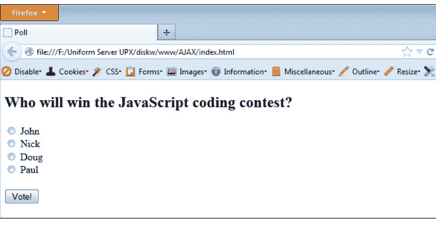

## 第 15 章：高级技术介绍 439

JSON 代表 JavaScript 对象表示法。它是一种用于存储和传输数据的轻量级格式。它易于读写，易于解析和生成。JSON 通常用于数据从服务器发送到页面。

## 扩展阅读

- https://developer.mozilla.org/en-US/docs/Web/JavaScript/Reference/Global_Objects/JSON
- https://www.w3schools.com/js/js_json.asp
- https://www.crockford.com/json.js

## 第 15 章：高级技术简介 441

```php
$loopcount = 0;
$Results_array = get_winner();
echo "{";
foreach ($Results_array as $Skey => $value) {
    $loopcount++;
    if ($Count === $loopcount) {
        echo "\"$Skey\": $value";
    } else {
        echo "\"$Skey\": $value, ";
    }
}
echo "}";
?>
```

总而言之，这将向你的 JavaScript 应用返回一个 JSON 数据字符串（此处构建了 JSON 字符串，但 PHP 也有用于将 PHP 对象转换为 JSON 的方法），其可能如下：

```json
{"John": 35, "Nick": 35, "Doug": 32, "Paul": 25}
```

你现在可以修改 JavaScript 代码来显示投票中每个人的姓名和票数。以下是更新后的 JavaScript 代码：

```javascript
var poll = document.getElementById("poll");
if (typeof poll !== "undefined") {
    poll.addEventListener("submit", function(event) {
        var vote_fields = document.getElementsByName("winner");
        res_field = document.getElementById("results");
        res_HTML = "";
        vote = "";
        count = 0;
        xr = new XMLHttpRequest();
        qstring = "";
        event.preventDefault();
        for (var i = 0; i < vote_fields.length; i++) {
            if (vote_fields[i].checked) {
                vote = vote_fields[i].value;
                break;
            } else {
                count++;
            }
        }
        if (count === vote_fields.length) {
            alert("You must make a selection to vote!");
            return;
        }
        qstring += "get_results.php?vote=" + encodeURIComponent(vote);
        xr.onreadystatechange = function() {
          var results;
          if (xr.readyState == 4 && ((xr.status >= 200 && xr.status < 300) || (xr.status == 304))) {
            results = JSON.parse(xr.responseText);
            res_HTML += '<h3>';
            for (var prop in results) {
              if (results.hasOwnProperty(prop)) {
                res_HTML += '<p>' + results[prop] + '<br>';
              }
            }
            res_field.innerHTML = res_HTML;
          }
          return false;
        };
        xr.open("get", qstring, true);
        xr.send(null);
    });
}
```

## 442 JavaScript：初学者指南

一旦 `res_HTML` 变量包含了所有必要数据，它就会被赋值给 `div` 的 `innerHTML`，从而在页面上显示结果。

解析后的数据是一个名为 `results` 的对象，它现在允许你使用 `for-in` 循环遍历它的属性。

你可以简单地解析 `responseText` 以获取名为 `results` 的 JavaScript 对象。通过 `for-in` 遍历对象的每个属性（即列表中每个人的姓名），将属性名和值添加到名为 `res_HTML` 的变量中，并作为 `innerHTML` 显示在 HTML 页面上。

能够轻松使用从服务器端应用程序获取的数据，你可以增强脚本为用户提供更多选项，而无需重新加载整个页面即可获取结果。

### 延伸阅读

关于 JSON 的信息可以参考以下网站：

- www.json.org/
- developer.mozilla.org/en-US/docs/JSON

## 第 15 章自测

1. 将窗口分为两个或多个独立的区域，每个区域都包含内容。
2. 表格中的框架使帧集中的划分包含独立的文档。
3. ________ 标签用于创建帧集（frame set）。
4. 使用 ________ 标签创建单个帧（frame）。
5. `` 元素的 ________ 属性允许你更改图像。
6. 用于访问框架的是哪两种方法？
   A. `frames` 数组或帧名称
   B. `frame` 数组或帧名称
   C. `frames` 数组或特殊代码
   D. 只有一种方法可以
7. 使用 JavaScript，你可以从服务器获取信息。
   A. 正确
   B. 错误
8. 下列哪项是有效的 JavaScript Lint 工具？
   A. jsChecker
   B. JavaScript Linter
   C. jsLinter
   D. JSLint
9. 调试时可以使用哪两种方法测试 JavaScript 值？
   A. `test()` 和 `show()`
   B. `alert()` 和 `console.log()`
   C. `print()` 和 `show()`
   D. 以上均不是。
10. 使用什么来访问主窗口，以便你可以访问另一个帧？
    A. `top`
    B. `self`
    C. `window`
    D. `this`
11. 哪个对象允许你在 JavaScript 中从服务器获取数据？
    A. `XMLHTTPRequest`
    B. `XMLHttpRequest`
    C. `JSONRequest`
    D. `XMLFileGet`
12. ________ 代表 Asynchronous JavaScript and XML。
13. JavaScript 可以从 XML 文档以外的服务器检索数据。
    A. 正确
    B. 错误
14. ________ 是 JavaScript 对象表示法的缩写。

## 第 16 章：JavaScript 库、HTML5 和 Harmony

## JavaScript：初学者指南

## 核心概念

- 使用 jQuery
- JavaScript
- HTML5
- ECMAScript

# JavaScript: 初学者指南

类似于 JSON 语法。通过这种方式，你不需要为想要制作的每个 CSS 属性编写单独的语句。

要查看此示例的运行效果，你将按照下面的代码创建一个包含 `story` div 的 HTML 页面：

```html
<body>
<div id="story">
This is my story. It is full of interesting stuff for you to read
when you have time. I can keep going and going and going...
</div>
<script src="http://ajax.googleapis.com/ajax/libs/jquery/1.8.2/jquery.min.js"></script>
<script src="example.js" type="text/javascript"></script>
</body>
```

如果你使用的是本地 jQuery，可以在此处调用它来替换 Google 代码。你可以将此 HTML 页面保存为 `example.html`。接下来，你将创建一个 JavaScript 文件，并将其保存为 `example.js`。以下是代码：

```javascript
$(document).ready(function () {
  $("#story").click(function() {
    $("#story").css({"color":"#009", "font-size":"2em"});
  });
});
```

`story` div 上的某些 CSS 属性发生了变化。调用函数来处理 `story` div 的点击事件。

一旦代码就绪，在浏览器中打开 `example.html` 并点击该 div 元素。文本应该变大并变成蓝色。图 16-1 显示了更改之前的页面，而图 16-2 显示了更改后的页面：

jQuery 中提供了许多可用选择器，可以帮助你在脚本中选择所需的元素。最常用的包括：

- `*` 选择文档中的所有元素
- `.class_name` 选择所有具有提供类名的元素

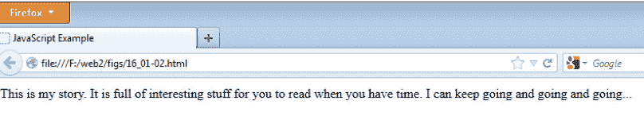

图 16-1 原始页面

# 第 16 章：JavaScript 库、HTML5 和 Harmony 449

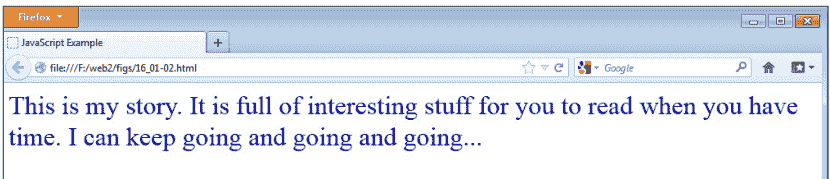

This is my story. It is full of interesting stuff for you to read

when you have time. I can keep going and going and going...

**图 16-2** 点击 div 元素后的页面

- `#id` 选择具有提供 id 的元素
- `element_name` 选择所有 `element_name` 元素
- `element_name.class_name` 选择所有具有 `class_name` 类的 `element_name` 元素
- `element_name[attribute="value"]` 选择所有具有提供属性和提供值的 `element_name` 元素

如果需要，可以在 api.jquery.com/category/selectors 找到更多选择选项。

# 修改类

`addClass()` 和 `removeClass()` 函数让更改 jQuery 中元素的样式变得非常简单。如果你已经在 CSS 中编写了类，那么你随时可以使用这些方法来添加或删除它们。例如，假设你有一个相同的 HTML 页面（`example.html`），并将其修改为包含一个名为 `example.css` 的 CSS 文件。你可以编写可以从 `story` div 中添加或删除的 CSS 类。以下是更新后的代码：

```html
<head>
<link rel="stylesheet" type="text/css" href="example.css">
</head>
<body>
<div id="story">
This is my story. It is full of interesting stuff for you to read
when you have time. I can keep going and going and going...
</div>
<script src="http://ajax.googleapis.com/ajax/libs/jquery/1.8.2/jquery.min.js"></script>
<script src="example.js" type="text/javascript"></script>
</body>
```

# JavaScript: 初学者指南

下一步是创建 `example.css` 并包含 CSS 声明：

```css
.style1 { font-weight:bold; }
.style2 { color:#009; font-family:Arial; font-size:2em; }
.style3 { font-style:italic; }
```

这提供了三种可能的样式。每种样式都可以根据需要轻松应用到元素或将其移除。要添加一个类，只需调用 `addClass()` 并将类名作为参数，如下代码所示：

```javascript
$("#story").addClass("style2");
```

如果你以后决定移除它，可以使用 `removeClass()` 执行相同的操作：

```javascript
$("#story").removeClass("style2");
```

你可以通过用空格分隔类名来一次向元素添加多个类，如下代码所示：

```javascript
$("#story").addClass("style2 style3");
```

这不仅会让文本变大并变蓝，还会让它变成斜体。你可以利用此点结合现有代码，以便在点击时添加或删除类。

如果你想切换一个或多个类，可以使用 `toggleClass` 方法。如果元素没有该类，则会添加它；如果元素已经有了该类，则会移除。在这里，你将更新 `example.js` 代码，在点击 div 时切换 `style2` 和 `style3` 类。更新后的脚本是：

```javascript
$("#story").toggleClass("style2 style3");
```

# 第16章：JavaScript 库、HTML5 与 Harmony

如果你需要让脚本在更多浏览器中（例如旧版本的 Internet Explorer）运行，jQuery 库被证明是一个非常有用的工具。它能对元素选择、事件处理以及显示/动画方法提供帮助，并让你在需要编写跨浏览器代码时少做一些工作。如果你想进一步研究 jQuery 库，下一节将为你提供可以查看的资源。

## 进阶阅读

你可以在以下网站上阅读更多关于 jQuery 以及如何使用它的信息：

- docs.jquery.com/Main_Page
- webdesignerwall.com/tutorials/jquery-tutorials-for-designers

## 尝试一下 16-1：使用 jQuery 创建效果

| pr16_1.html | prjs16_1.js |
| :--- | :--- |

你有一个链接和一个 `div` 元素，其中包含一些文本，你希望这些文本在初始状态是隐藏的，但在点击链接时显示。一旦它显示，你就希望该 `div` 元素缓慢淡出。你想使用 jQuery 来完成这个任务。

## 步骤说明

1. 创建一个 HTML 文档 `pr16_1.html`，并在 `body` 部分使用以下 HTML 代码：

```html
<body>
<h1>读一个短故事</h1>
<p>
<a href="page.html" id="changelink">查看故事</a>
</p>
<div id="story">
我正走在街上，我看到了这个哥们儿。他正<br>坐在街上，然后他说：“嘿！”
</div>
<script src="http://ajax.googleapis.com/ajax/libs/jquery/1.8.2/jquery.min.js"></script>
<script type="text/javascript" src="prjs16_1.js"></script>
</body>
```

2. 创建一个名为 `prjs16_1.js` 的 JavaScript 文件。在这个文件中，等待文档（`document`）准备好就绪（`ready`），并立即隐藏 `story` 元素。接下来，为 `changelink` 链接注册点击事件，阻止其默认行为，然后使用耗时 3000 毫秒的“滑下”动画显示 `story` 元素。随后，`story` 元素应该在 10,000 毫秒内淡出。完成后，你的 JavaScript 代码应该像这样：

```javascript
$(document).ready(function() {
  $("#story").hide();
  $("#changelink").click(function(event) {
    event.preventDefault();
    $("#story").slideDown(3000, function() {
      $("#story").fadeOut(10000);
    });
  });
});
```

3. 保存 HTML 和 JavaScript 文件，并在浏览器中打开 HTML 文件。点击链接查看故事。它应该滑下来，并随着时间的推移淡出。

## 尝试一下总结

在这个项目中，你利用对 JavaScript 和 jQuery 的知识，创建了响应事件的动画。jQuery 让编写代码变得更容易，并且能够同时实现跨浏览器运行。

## 其他 JavaScript 库

有许多可用的 JavaScript 库可以帮助你编写更高级别的脚本，这比从头开始编写所有代码要省力。如果你想进一步研究，这里列出了其中一些：

### jQuery Mobile

jQuery Mobile 库是 jQuery Mobile 框架的一部分。它是一个基于 HTML5 的框架，使用了渐进增强技术，因此你可以在最流行的手持设备或浏览器中创建应用程序或网站。关于 jQuery Mobile 的更多信息可以在 jquerymobile.com 找到。

### php.js

如果你在使用 PHP 进行编程，并希望使用你熟悉的 PHP 函数（例如 `in_array()`、`array_key_exists()` 等），那么 `php.js` 库就是非常有用的。这些函数的设置使其像与其 PHP 对应的函数一样工作，接收相同的参数并返回相同的结果。你可以找到关于 php.js 的信息。

### node.js

node.js 是一个基于 HTML5 的框架，使用了渐进增强技术，因此你可以在最流行的手持设备或浏览器中创建应用程序或网站。关于 node.js 的更多信息可以在 nodejs.org 找到。

### MooTools

MooTools 是一个基于 HTML5 的框架，使用了渐进增强技术，因此你可以在最流行的手持设备或浏览器中创建应用程序或网站。关于 MooTools 的更多信息可以在 mootools.net 找到。

### Three.js

Three.js 是一个用于创建 3D 图形的库。它是一个基于 HTML5 的框架，使用了渐进增强技术，因此你可以在最流行的手持设备或浏览器中创建应用程序或网站。关于 Three.js 的更多信息可以在 threejs.org 找到。

### 专家提问

**Q:** jQuery 可以做更多事情吗？

**A:** 是的，它提供了许多强大的插件。

**Q:** HTML5 是什么？

**A:** HTML5 是 Web 开发的最新标准，引入了许多新功能。

**Q:** Canvas 元素是什么？

**A:** `canvas` 元素是 HTML5 的一个元素，用于通过 JavaScript 绘制图形。

## 第 16 章：JavaScript 库、HTML5 与 Harmony 457

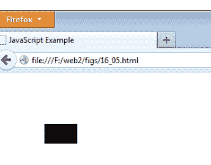

图 16-5 带有填充矩形的画布

画布上的原点位于左上角，x 坐标越大，点就越靠右移动；而 y 坐标越大，点就越靠下移动。图 16-6 显示了在绘制示例矩形时，画布网格是如何布局的。

如果你希望得到一个没有填充颜色的轮廓矩形，可以使用 `strokeRect()` 代替，如下代码所示：

```javascript
var graphic = document.getElementById("graphic");
ctx = graphic.getContext("2d");
ctx.strokeRect(70, 70, 50, 30);
```

如果你需要清除画布上的某个矩形区域，可以使用 `clearRect()` 方法。它使用与 `fillRect()` 相同的四个参数，但会清除（变为透明）它所影响的区域。例如，你可以使用以下代码在填充矩形内部清除出一个矩形：

```javascript
var graphic = document.getElementById("graphic");
ctx = graphic.getContext("2d");
ctx.fillRect(70, 50, 50, 30);
ctx.clearRect(80, 20, 20, 10);
```

图 16-7 显示了你代码的执行结果。注意看填充矩形现在有一个区域被清除了。

### 使用 fillStyle 和 strokeStyle

形状或轮廓的默认颜色是黑色 (`#000000`)。要使用不同的颜色，你可以通过 `fillStyle` 属性设置填充颜色，通过 `strokeStyle` 属性设置描边（轮廓或线条）的颜色。例如，请考虑以下内容：

```javascript
var graphic = document.getElementById("graphic");
ctx = graphic.getContext("2d");
ctx.fillStyle = "#FF0000"; // 形状的填充颜色设置为 #FF0000（红色）
ctx.fillRect(70, 50, 50, 30); // 绘制了一个矩形，并将使用新的填充颜色
```

在这里，`fillStyle` 被设置为 `#FF0000`（红色），在此赋值之后的任何形状都将使用红色作为填充颜色。你可以在过程中更改它以便使用不同颜色的形状，如下代码所示：

```javascript
var graphic = document.getElementById("graphic");
ctx = graphic.getContext("2d");
ctx.fillStyle = "#FF0000"; // fillStyle 设置为红色
ctx.fillRect(70, 50, 50, 30); // 这个矩形将是红色的
ctx.fillStyle = "#00FF00"; // fillStyle 设置为绿色
ctx.fillRect(10, 10, 50, 30); // 这个矩形将是绿色的
ctx.fillStyle = "#FF0000"; // fillStyle 再次设置为红色
ctx.fillRect(120, 10, 50, 30); // 这个矩形将是红色的
```

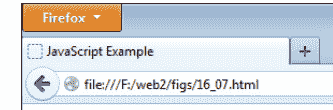

图 16-7 矩形内部现在有一个空空的矩形区域。

如果你有类似于 `fillStyle` 和 `strokeStyle` 的这种特定设置并想要稍后保存，可以使用 `save()` 方法。然后你可以使用 `restore()` 方法恢复这些设置，如下代码所示：

```javascript
var graphic = document.getElementById("graphic");
ctx = graphic.getContext("2d");
ctx.fillStyle = "#FF0000"; // fillStyle 设置为红色
ctx.save(); // 保存当前属性（此处为 fillStyle）
ctx.fillRect(70, 70, 50, 30); // 这个矩形将是红色的
ctx.fillStyle = "#00FF00"; // fillStyle 设置为绿色
ctx.fillRect(120, 50, 30, 30); // 这个矩形将是绿色的
ctx.restore(); // 使用 restore() 恢复保存的属性（此处为 fillStyle）
```

你可以像 `fillStyle` 一样使用 `strokeStyle` 来设置形状轮廓或绘制线条（路径）的颜色。例如，以下代码将创建一个带有轮廓的矩形：

```javascript
var graphic = document.getElementById("graphic");
ctx = graphic.getContext("2d");
ctx.strokeStyle = "#FF0000";
ctx.strokeRect(70, 70, 50, 30);
```

### 使用路径

画布还允许你绘制线条和曲线（路径），这让你有机会创建复杂的图画。你通过调用 `beginPath()` 方法来绘制路径，在中间，你可以使用多种方法来绘制线条、曲线等。表 16-2 列出了可以使用的方法：

| 方法 | 描述 |
| :--- | :--- |
| `arc(x, y, radius, start_angle, end_angle, clockwise)` | 绘制以 `(x,y)` 为中心的圆弧，使用弧度。`clockwise` 参数为顺时针为 `true`，逆时针为 `false` |
| `bezierCurveTo(cpx, cpy, cp2x, cp2y, x, y)` | 从当前点到 `(x,y)` 绘制三次贝塞尔曲线，使用两个控制点 `(cpx, cpy)` 和 `(cp2x, cp2y)` |
| `quadraticCurveTo(cpx, cpy, x, y)` | 从当前点到 `(x,y)` 绘制二次贝塞尔曲线，使用一个控制点 `(cpx, cpy)` |
| `lineTo(x, y)` | 从当前点到 `(x,y)` 绘制一条线 |
| `moveTo(x, y)` | 将光标移动到 `(x,y)` |
| `rect(x, y, width, height)` | 从 `(x,y)` 开始绘制矩形，具有指定的宽度和高度 |

## JavaScript：初学者指南

进阶阅读

本文涵盖了使用 canvas 的基础知识，但你还可以进行更多操作。你可以在以下网站学习更多关于使用 canvas 的知识：

- developer.mozilla.org/en-US/Canvas_tutorial/Drawing_shapes
- www.html5canvastutorials.com/

# 拖放

HTML5 在 JavaScript 的帮助下为浏览器提供了原生的拖放能力。由于某些元素（如链接、图像和选中的文本）默认是可拖放的。如果你想让另一个元素变为可拖放，或者想确保某个元素不可拖放，可以在其 HTML 标签中使用 `draggable` 属性，例如所示：

> 通过将 `draggable` 属性设置为 `true`，使元素变为可拖放

```html
<div id="story" draggable="true">Some div content...</div>

```

> 尽管 `draggable` 默认为 `true`，但将其设置为 `false` 将使图像变为不可拖放

接下来你需要的是一个放置目标。要设置它，你需要在 JavaScript 中获取该元素，并确保它的 `dragover` 和 `drop` 事件阻止默认操作（即不允许放置项目）。要做到这一点，你可以简单地为该元素的每个事件添加事件监听器，如下代码所示：

```javascript
var dropdiv = document.getElementById("dropdiv");
dropdiv.addEventListener("dragover", function(event) {
  event.preventDefault();
  }, false);
dropdiv.addEventListener("dragenter", function(event) {
  event.preventDefault();
  }, false);
dropdiv.addEventListener("drop", function(event) {
  event.preventDefault();
  }, false);
```

这样做将允许项目放置到 `dropdiv` 元素中。

# 拖放事件

拖放过程涉及七个事件，每个事件在表 16-4 中都有描述。

这些每个事件都可以添加事件监听器以执行进一步的脚本。根据你的需求，在创建拖放脚本时，可以使用这些事件中的任意数量。

# 第 16 章：JavaScript 库、HTML5 和 Harmony 463

| 事件 | 事件目标 | 描述 |
|---|---|---|
| `dragstart` | 被拖动的项目 | 当按住鼠标按钮并开始拖拽时发生 |
| `drag` | 被拖动的项目 | 在 `dragstart` 之后立即发生，并在拖拽期间持续触发 |
| `dragend` | 被拖动的项目 | 当释放鼠标按钮并释放项目结束拖拽时发生，无论放置是否为有效目标 |
| `dragenter` | 放置目标 | 当项目首次被拖到放置目标时发生 |
| `dragover` | 放置目标 | 在 `dragenter` 之后立即发生，只要项目在放置目标内拖拽就会持续触发 |
| `dragleave` | 放置目标 | 当项目拖出放置目标时发生 |
| `drop` | 放置目标 | 当项目放置到放置目标内时发生 |

表 16-4 拖放事件

## dataTransfer 对象

虽然你现在可以使用已有的方法拖动并放置项目，但你可能希望访问存储在被拖动项目中的数据，以便在放置时使用。这个 `dataTransfer` 对象也是事件的一部分，并有两个方法用于从拖动的项目中设置和检索数据：`setData()` 和 `getData()`。

`setData()` 方法可用于设置自定义数据，当拖动选中的文本、图像或链接时默认也会调用该方法。对于选中的文本，它将存储文本；对于图像，它将存储图像 URL；对于链接，它将存储链接 URL。如果你需要使用这些默认值存储自定义数据（或你正在拖动不同类型的元素），可以使用以下代码存储文本或 URL：

```javascript
event.dataTransfer.setData("text", "String of text...")
event.dataTransfer.setData("URL", "http://www.mysite.com");
```

注意，你可以在单个 `dataTransfer` 对象中存储 `text` 和 `URL`，但每种类型不能超过一个。HTML5 扩展了这一点，通过使用 `text/plain` 和 `text/uri-list`（分别）允许任何 MIME 类型。请记住，`dataTransfer` 对象中每种 MIME 类型只能存储一个数据。

`getData()` 方法用于检索存储在 `dataTransfer` 对象中的任何数据。由于浏览器兼容性问题，从 `dataTransfer` 对象检索文本或 URL 时，最好使用以下示例：

```javascript
var droptext = event.dataTransfer.getData("Text");
var dropURL = event.dataTransfer.getData("URL") ||
event.dataTransfer.getData("text/uri-list");
```

检索文本时使用大写 `T`，这允许旧版本的 Firefox 能够获取文本值，同时在其他浏览器中正常工作。此外，注意获取 URL 的方法先测试 `URL`，然后测试 MIME 类型 `text/uri-list`，以帮助旧版本的 Internet Explorer。

# 快速拖放脚本

作为一个将所有内容整合在一起的示例，你将创建一个脚本，将链接拖入 `div` 元素中以显示链接 URL。首先，从以下 HTML 代码开始：

```html
<h1>快速拖放</h1>
<p>将链接拖到下方的框中查看 URL</p>
<p>
<a href="http://www.mysite.com" id="mylink">My Web Site</a>
</p>
<div id="dropdiv" style="border:1px solid #000;"></div>
```

由于链接默认是可拖放的，这里不需要 `draggable="true"` 属性。接下来，你需要 JavaScript：

```javascript
var dropdiv = document.getElementById("dropdiv");
dropdiv.addEventListener("dragover", function(event) {
  event.preventDefault();
  }, false);
dropdiv.addEventListener("dragenter", function(event) {
  event.preventDefault();
  }, false);
dropdiv.addEventListener("drop", function(event) {
  event.preventDefault();
  var dropURL = event.dataTransfer.getData("URL") ||
  event.dataTransfer.getData("text/uri-list");
  dropdiv.innerHTML = dropURL;
  }, false);
```

这样做将允许项目放置到 `dropdiv` 元素中，并显示链接的 URL。

## JavaScript：初学者指南

# 尝试 16-2 拖放

此项目将更新拖放示例，使其存储关于链接的描述文本，并在放置链接时显示。

## 步骤说明

1. 创建名为 `pr16_2.html` 的 HTML 文档，并在 body 部分使用以下代码：

```html
<body>
<h1>快速拖放</h1>
<p>将链接拖到下方的框中查看链接的描述。</p>
<p>
<a href="http://www.mysite.com" id="mylink">My Web Site</a>
</p>
<div id="dropdiv" style="border:1px solid #000; padding:5px;"></div>
<script type="text/javascript" src="pr16_2.js"></script>
</body>
```

2. 创建名为 `pr16_2.js` 的 JavaScript 文件，并从本章的拖放示例代码开始。修改代码，以便在拖动链接时将 "This links goes to My Web!" 存储在 `dataTransfer` 对象中，并在链接放置到目标 `div` 中时显示。完成后，代码应如下：

```javascript
var dragdiv = document.getElementById("mylink");
var dropdiv = document.getElementById("dropdiv");
dragdiv.addEventListener("dragstart", function(event) {
  event.dataTransfer.setData("text", "This links goes to My Web!");
  }, false);
dropdiv.addEventListener("dragover", function(event) {
  event.preventDefault();
  }, false);
dropdiv.addEventListener("dragenter", function(event) {
  event.preventDefault();
  }, false);
dropdiv.addEventListener("drop", function(event) {
  event.preventDefault();
  var divtext = event.dataTransfer.getData("text");
  dropdiv.innerHTML = divtext;
}, false);
```

3. 保存 JavaScript 文件，并在支持 HTML5 拖放的浏览器中打开 HTML 文件（最新的 Firefox 或 Chrome 浏览器均可运行）。将链接拖入 `div` 中以显示链接的描述。

## 练习总结

在这个项目中，你更新了拖放脚本，使其能够从 `dataTransfer` 对象中存储和检索文本。当链接被拖动并释放到目标 `div` 元素时，这些文本就会显示出来。

## ECMAScript Harmony

ECMAScript Harmony 将是 JavaScript 语言的下一次更新，它将为语言添加一些新功能，并更新现有的功能。本节涵盖了一些亮点，以便让你预见 JavaScript 的未来。

## const 和 let 关键字

目前，JavaScript 还没有正式的方法来定义常量，并且没有使用块级作用域（仅有函数作用域）。`const` 和 `let` 关键字将提供使用这两种特性的手段。

## 使用 const

常量是一个一旦定义后就无法改变值的变量。常量命名的典型标准是使用全大写字母，例如 `TEXT`、`MAGIC_NUMBER`、`MONEY`。例如，要定义一个名为 `MAGIC_NUMBER` 值为 7 的常量，可以使用以下代码：

```javascript
const MAGIC_NUMBER = 7;
```

在此处之后，`MAGIC_NUMBER` 的值将无法被更改；如果代码尝试更改它，它将保持不变。下面的代码展示了此示例：

```javascript
const MAGIC_NUMBER = 7;
alert("The magic number is " + MAGIC_NUMBER);
MAGIC_NUMBER = 42;
alert("Now the magic number is " + MAGIC_NUMBER);
```

图 16-12 显示了第一个 `alert`，图 16-13 显示了第二个 `alert`。注意，尽管代码尝试将其更改为 42，但值仍然保持为 7。

## JavaScript: 初学者指南

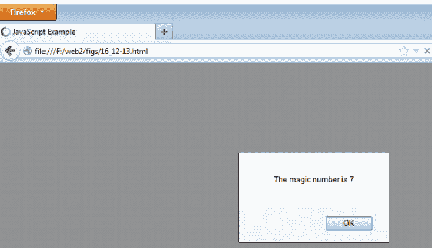

**图 16-12** 值为 7。

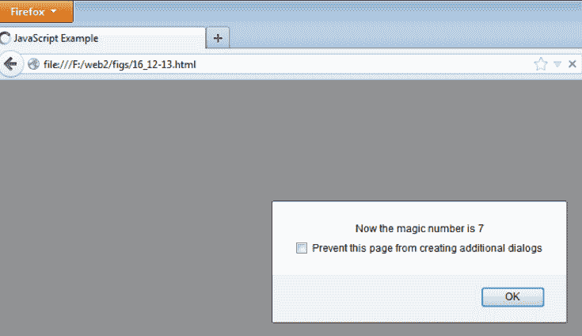

**图 16-13** 值仍然是 7。

## 使用 let

`let` 关键字允许你定义一个仅存在于其定义的块作用域内的变量。通过使用它，你可以将变量局部化到块中，而不仅仅是函数。例如，以下代码使用 `let` 定义了一个仅在 `while` 循环内有效的变量：

```javascript
var i = 0;
while (i < 5) {
  let name = "John";
  if (i === 2) {
    alert(name);
  }
  i++;
}
alert(name);
```

在这些代码中，`name` 变量仅在 `while` 循环内部。在外部尝试 `alert` 该值会导致 `name` 为未定义（`undefined`）。图 16-14 显示了循环内发生的 `alert`，图 16-15 显示了循环外发生的 `alert`。

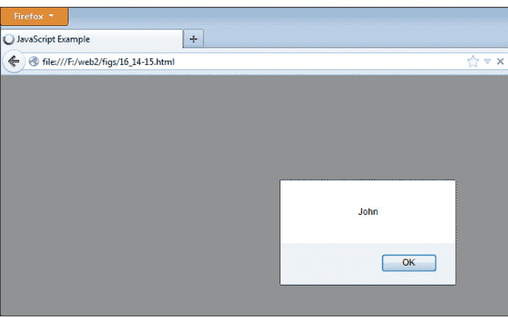

**图 16-14** `name` 变量在循环块内部有值。

## JavaScript: 初学者指南


**图 16-15** `name` 变量在块外部是未定义的（`undefined`）。

你也可以使用 `let` 关键字创建一个块级语句，其中一个或多个变量仅在相应块内定义。例如，考虑以下代码：

```javascript
let (name = "John", money = 30) { 
  alert(name);
}
alert(name);
```

在这里，创建了一个 `let` 语句块，在括号内定义的任何变量在该块内都具有块级作用域。`name` 变量在第一个 `alert` 中值为 "John"，但在块外部的第二个 `alert` 中将是未定义的。如你所见，当你需要在不定义新函数的情况下创建一个块级作用域时，这会非常有用。

## 默认参数值

由于传递的参数是可选的，因此当这些值没有被传递给函数时，能够为特定参数设置默认值是有帮助的。在 Harmony 中，可以通过在参数后添加等号和默认值来实现，如下代码所示：

```javascript
function multiply_by_five(num=0) {
  return num * 5;
}

var my_num = multiply_by_five(3);
default_num = multiply_by_five();
```

## 第 16 章：JavaScript 库、HTML5 和 Harmony

在这里，变量 `my_num` 的值为 15 (3*5)。由于向函数传递了值 3，因此没有使用默认值 0。`default_num` 变量的值将为 0 (0*5)，因为没有向函数传递任何参数，它需要使用 0 作为数字的默认值。通过这种方式，你可以避免使用额外的代码来检查是否传递了值给 `num` 变量。

## 类

Harmony 将增加使用 `class` 关键字的能力，它将为语言添加一些新功能，并更新现有功能。这里，使用 `class` 关键字的能力是类似于 Java 的。

```javascript
class Car {
  constructor(seats, engine) {
    this.seats = seats;
    this.engine = engine;
  }
  show_engine() {
    alert("The engine is " + this.engine);
  }
}
```

你还会注意到使用 `public` 关键字定义的属性。这允许从类外部访问属性（例如，`Car.seats` 可以工作）。你也可以使用 `private` 关键字来创建一个无法从类外部访问的属性。

## 关于 Harmony 的更多

Harmony 还有其他新增或更改的功能，某些列出的功能在实现之前可能会发生变化。

## JavaScript: 初学者指南

## 需要帮助吗？

如果你发现自己遇到了困难并需要帮助，请随时访问 webpertz.net 网站上的 JavaScript 论坛。我或其他程序员可能可以帮助你解决问题。

如果你想联系我，可以在我的网站（www.scriptweb.com/about/contact.html）给我发消息，或者你可以在 Twitter 上找到我（@ScripttheWeb）。

## 问专家

**Q: 可以在哪里找到免费的复制粘贴的 JavaScript 代码？**

- http://javascript.internet.com
- http://webdeveloper.earthweb.com/webjs
- www.javascript.com

**Q: 在哪里可以学习更多 JavaScript？**

- developer.mozilla.org/en/JavaScript
- www.javascriptkit.com
- www.quirksmode.com/js/contents.html
- www.scriptweb.com/js

**Q: 在哪里可以学习更多层级样式表（CSS）？**

- www.scriptweb.com/css
- www.csszengarden.com

**Q: 在哪里可以学习更多 HTML5？**

- www.scriptweb.com/html
- www.html5doctor.com
- www.html5rocks.com

## 第 16 章自测

1. 在 jQuery 中使用哪种方法查看文档是否就绪？
   A. `docReadyState()`
   B. `$documentReady()`
   C. `$(document).ready()`
   D. `$(document).done()`

2. 下列哪行代码可以使用 jQuery 隐藏 id 为 `story` 的元素？
   A. `$(getElementById("story")).hide();`
   B. `$("#story").hide();`
   C. `#story.hide();`
   D. `$("story")).hide();`

3. ________ 用于 jQuery 中选择元素。
4. jQuery 库使得编写 ________ 的代码变得更加容易。
5. 你在 JavaScript 中使用的 ________ 元素用于在页面的定义区域上绘图。
6. 在画布（canvas）上绘图时，可以使用 `fillCircle()` 方法来画一个圆。
   A. 正确
   B. 错误
7. 元素的 ________ 属性定义了该元素是否可以被拖动。
8. JavaScript ________ 通过让代码更容易编写，让一些高级编码任务变得更容易。
9. 默认情况下，所有元素都是可拖拽的。
   A. 正确
   B. 错误
10. 当元素开始被拖动时，会发生 ________ 事件。
11. 哪个对象可以在拖放过程中存储或检索数据？
    A. `event.dataStorage`
    B. `event.dataTransfer`
    C. `event.data`
    D. `event.dataMove`
12. 哪个方法用于获取在拖放期间存储的数据？
    A. `getData()`
    B. `getInfo()`
    C. `getItems()`
    D. `getData()`
13. 在 Harmony 中可以使用哪个关键字来声明常量？
    A. `constant`
    B. `const`
    C. `let`
    D. `var`
14. 在 Harmony 中可以使用哪个关键字给变量提供块级作用域？
    A. `block`
    B. `blockScope`
    C. `let`
    D. `secret`
15. JavaScript 有趣吗？
    A. 有趣！
    B. 对你来说也许吧！
    C. 我是被老板逼着学这个，所以它永远不会好玩！
    D. 我想知道第 10 章中的编程比赛是不是真的，如果是的话，为什么 John 会输得那么惨？这听起来没那么有趣！

# 附录

自测答案

## 第 1 章：JavaScript 简介

1. C. HTML
2. A. Web 浏览器
3. C. JavaScript
4. B. 错误
5. C. ECMAScript
6. A. 正确
7. C. LiveScript
8. A. 基于原型的
9. B. 客户端
10. B. 它可以在发送到服务器之前验证信息。
11. C. 脚本
12. A. 正确
13. D. 客户端/Web 浏览器
14. D. 被添加到 HTML 文档中。
15. A. `<script>` 和 `</script>` HTML 标签

## 第 2 章：将 JavaScript 放入 HTML 文件

1. D. 以上全部
2. B. 为了确保在使用 XHTML 时网页通过验证
3. A. 是
4. `noscript` 标签为那些没有 JavaScript 的用户提供内容。
5. A. js
6. B. `<script type="text/javascript" src="yourfile.js"></script>`
7. 在 HTML 中，`script` 标签不区分大小写。但在 XHTML 中，`script` 标签必须是小写。
8. D. 分号
9. A. `document.write()`
10. C. 当脚本很长或需要放在多个 HTML 文档中时
11. JavaScript 注释对于记录或调试你的代码非常有用。
12. C. `//`
13. A. `/*`
14. D. `*/`
15. A. `close`

## 第 3 章：使用变量

1. 变量**代表**或**持有**一个值。
2. 它们可以节省编写和更新脚本的时间，并让你的代码意图更清晰。
3. 要声明变量，你使用 `var` 关键字。
4. D. `=`
5. C. `var pagenumber = 240;`
6. B. 错误
7. 变量名必须以**字母**、**美元符号**或**下划线**字符开头。
8. A. 正确
9. B. `var my_house;`
10. 在 JavaScript 中，数据类型包括数字、字符串、布尔值、`null` 和 `undefined`。
11. 要在 JavaScript 中表示指数，你需要在基数数字之后、指数之前紧跟字母 **e**。
12. C. `mytext = "Here is some text!"`
13. D. `document.write("John said, \"Hi!\"");`
14. **特殊**字符允许你向字符串中添加其他情况下无法添加的内容。
15. B. `document.write("like to " + myhobby + " every week");`

## 第 4 章：使用函数

1. 一般而言，函数是较大**脚本**内部的一个微型**脚本**，用于执行单一的**任务**。
2. 它们提供了一种将脚本各个部分组织成必须完成的不同任务的方法，并且它们可以被重用。
3. 在函数的第一行，使用 **function** 关键字。
4. D. `function myFunction() { }`
5. C. `return`
6. B. 错误
7. 函数参数在函数名后的**括号**内。
8. A. 正确
9. B. 错误
10. 函数表达式将函数赋值给一个**变量**。
11. 函数声明会被**提升**到其作用域的顶部。
12. C. `var myFunc = function() { };`
13. D. 以上全部
14. **匿名**函数没有名称。
15. B. 错误

## 第 9 章：文档对象

1. **document**（文档）对象是浏览器为每个查看的 HTML 页面创建的对象。
2. 文档对象的 **referrer**（引用页）属性返回引导用户访问当前文档的文档 URL。
3. A. 正确
4. D. `getElementById()`
5. B. 错误（它是作为列表子节点添加的，而不是第一个）
6. B. 错误
7. 文档对象的 **anchors**（锚点）属性是一个数组，包含了页面上所有的锚点（`<a>`）标签。
8. **innerHTML** DOM 节点属性允许你更改元素的 HTML 内容。
9. **lastModified**（最后修改时间）属性持有当前文档修改的日期时间值。
10. A. 正确
11. A. 正确
12. C. URL
13. C. 它在行尾添加一个 JavaScript 换行符。
14. C. 所有 `name` 属性具有相同值的元素（最常见的是单选按钮）。
15. B. `document.write()` 和 `document.writeln()` 语句

## 第 10 章：事件处理器

1. A. 正确
2. 事件处理器非常有用，因为它们允许你**访问**页面上可能发生的**事件**。
3. 若要使用事件处理器，你可以将其放置在 **HTML** 或 **JavaScript** 代码中。
4. C. `<input type="button" onclick="alert('Hey there!');">`
5. **load**（加载）事件在 Web 页面完成加载时发生。
6. D. 用户将鼠标光标移动到页面上的元素上。
7. B. 错误
8. **unload**（卸载）事件在用户离开当前 Web 页面时发生。
9. **blur**（失去焦点）事件是 **focus**（聚焦）事件的相反面。
10. 事件对象包含了用于事件的属性和方法。
11. 事件的 **type**（类型）属性包含发生事件的类型。
12. **submit**（提交）事件在用户提交 Web 页面上的表单时发生。
13. A. 正确
14. 在版本 9 之前的 Internet Explorer 中，可以通过 `window.event` 访问事件对象。
15. `addEventListener` 方法和 `attachEvent` 方法是注册事件的两种新方式。

## 第 11 章：Window 对象

1. 屏幕上显示的每个窗口都会创建一个 `window` 对象。
2. A. 正确
3. **length**（长度）属性持有窗口内帧的数量值。
4. A. 正确
5. **name**（名称）属性持有当前窗口的名称，并允许你为窗口命名。
6. `window` 对象是 Web 浏览器中 JavaScript 的全局对象。
7. **self** 属性是“当前窗口”的另一种说法。
8. 较新的浏览器默认不允许更改窗口状态，因此你需要更改安全设置才能生效。
9. **parent**（父级）属性跳转到当前帧的顶部，而 **top**（顶部）属性跳转到页面上所有帧的顶部。
10. `alert()` 方法向用户弹出一个消息，用户必须点击 OK 按钮才能继续。
11. A. `true`
12. `print()` 方法允许用户打印当前窗口。
13. `prompt()` 方法用于提示用户输入信息。
14. D. `yes, no, 1, and 0`
15. `setInterval` 方法用于按设定间隔重复执行函数，而 `setTimeout` 则在设定延迟后执行一次函数。

## 第 12 章：Math, Number 和 Date 对象

1. A. 取字符串的平方根和其他值并返回其长度。
2. **E** 属性持有欧拉数的值。
3. **LN10** 属性持有 10 的自然对数值。
4. B. 错误
5. C. `document.write(Math.PI);`
6. **SQRT2** 属性持有 2 的平方根值。
7. C. absolute（绝对值）
8. `asin()` 方法返回作为参数传递的数字的反正弦值。
9. `pow()` 方法返回第一个参数的第二个参数幂的数值值。
10. C. `var int=Math.floor(Math.random())*8;`
11. `sqrt()` 方法返回作为参数传递的数字的平方根。
12. D. `Date` 对象的实例
13. `getDate()` 方法返回月份中的第几天数。
14. B. 错误
15. B. `var weekday=now.getDay();`

## 第 13 章：处理字符串

1. **String**（字符串）对象提供了获取字符串信息或修改它们的属性和方法。
2. 创建 String 对象实例会创建一个字符串**对象**。
3. 你可以通过给变量分配字符串值来创建字符串**字面量**。
4. JavaScript 获取字符串字面量并将其转换为**临时 String 对象**。
5. **length** 属性返回字符串的长度。
6. `var text = "Look at me!";`
7. `charAt()`
8. `big()` 方法在字符串周围添加 `<big>` 标签。
9. **concat** 方法将两个或多个字符串合并并返回新字符串。
10. D. `indexOf()` 返回作为参数传递的字符的位置。
11. Cookie 信息存储在 `document.cookie` 属性中。
12. `toString()` 方法返回字符串值。
13. 使用正则表达式和对象的 `replace()` 方法替换字符串。
14. `match()` 方法比较正则表达式和字符串是否匹配。

## 第 14 章：JavaScript 与表单

1. 每向 HTML 文档添加一组 `<form>` 和 `</form>` 标签就会创建一个表单对象。
2. `forms` 数组允许通过索引访问表单。
3. B. `document.forms[3]`
4. A. `document.forms[2].length`
5. C. `document.forms.length`
6. 使用表单名称或 **id** 允许你访问需要的表单。
7. A. `document.f1.e1.value`
8. **action** 属性允许访问起始表单标签中的 `action` 值。
9. **elements** 属性是特定表单中元素的数组。
10. HTML5 中的 **pattern** 属性允许为表单字段提供一个必须通过的正则表达式。
11. `reset()` 方法允许使用脚本重置表单。
12. C. `<meter min="0" max="10" value="8"></meter>`
13. 帮助表单可访问性的方法之一是使用 `<label>` 标签标识文本字段。
14. `submit()` 方法允许不点击按钮的情况下提交表单。
15. C. `required`

## 第 15 章：高级技术简介

1. 帧将窗口分为两个或多个独立的区域，每个区域包含不同的内容。
2. 帧与表格的区别在于帧集中的划分包含独立的 HTML 文档。
3. 使用 `<frameset></frameset>` 标签创建帧集。
4. 使用 `<frame></frame>` 标签创建单个帧。
5. **cols** 属性将帧集分为列。
6. `` 元素的 **src** 属性允许你更改图像。
7. A. `frames` 数组或帧名称
8. A. 正确
9. C. jsLint
10. B. `alert()` 和 `console.log`
11. A. `top`
12. B. `XMLHttpRequest`
13. AJAX 代表异步 JavaScript 和 XML。
14. A. 正确
15. JSON 是 JavaScript 对象表示法的缩写。

## 第 16 章：JavaScript 库、HTML5 和 Harmony

1. C. `$(document).ready()`
2. B. `$("#story").hide();`
3. **选择器** 用于 jQuery 中选择元素。
4. jQuery 库使得编写 **跨浏览器** 的代码变得更加容易。
5. 你在 JavaScript 中使用的 **canvas** 元素用于在页面的定义区域上绘图。
6. B. 错误
7. 元素的 **draggable** 属性定义了该元素是否可以被拖动。
8. JavaScript **库** 通过让代码更容易编写，让一些高级编码任务变得更容易。
9. B. 错误
10. 当元素开始被拖动时，会发生 **dragstart** 事件。
11. B. `event.dataTransfer`
12. A. `getData()`
13. B. `const`
14. C. `let`
15. 任何答案都是正确的！

# 索引

# 符号

- `"` (引号), 42, 45–46, 420
- `>=` (大于或等于运算符), 107–108
- `<=` (小于等于运算符), 107–108
- `!=` (不等于运算符), 104–105
- `*=` (乘法赋值运算符), 100
- `~` (一元取反运算符), 97–98
- `.` (点符号), 访问属性值, 185–186, 188
- `/=` (除法赋值运算符), 100
- `/` (除法运算符), 100
- `/*` (斜杠/星号), 多行注释, 28–30
- `//` (双斜杠), 注释, 28
- `;` (分号); 参见分号
- `\` (反斜杠) 定义, 转义字符, 45–46, 特殊字符, 43–45
- `_` (下划线), 变量开头, 39
- `||` (逻辑或运算符), 108–109, 125
- `+` (加法运算符), 90–93
- `++` (自增运算符), 95–96
- `+` (一元加运算符), 96–97
- `=` (赋值运算符), 37, 99, 121
- `==` (等于运算符), 37
- `==` (相等运算符), 102–104, 121
- `===` (严格相等运算符) 避免误写, 121
- `!==` (严格不等于运算符), 105
- `!` (逻辑非运算符), 109
- `&&` (逻辑与运算符), 108, 125
- `$` (美元符号), 变量开头, 39
- `%=` (取模赋值运算符), 100–101
- `%` (取模运算符), 95
- `*` (乘法运算符), 92–94
- `[]` (中括号表示法), 对象属性值, 187–188
- `{}` (大括号); 参见大括号
- `<` (小于运算符), 106–107

# A

- `abs()` 方法, Math 对象, 309–311
- 可访问性 (accessibility)
  - 创建悬停效果 (rollovers), 414–415
  - 增强内容, 428
  - 确保表单可用, 390–392
  - 概述, 426
  - 练习题, 429–430
  - 内容/演示分离, 426–428
- `acos()` 方法, Math 对象, 309–311
- `action` 属性, 对象, 368–387
- 加法赋值运算符 (`+=`), 99–100
- `addClass()` 方法, jQuery, 449–451
- `addEventListener()` 方法
  - 事件注册, 260–261
  - 练习题, 265
  - 简单表单验证, 393
  - 现代事件注册的使用, 高级技巧
- 加运算符 (`+`), 90–93
- 可访问性, 426–433
- AJAX, 433–439
- 调试脚本, 419–425
- 帧, 415–419
- JSON, 439–444
- 自测, 422–444
- 安全性, 430–433
- 处理图像, 412–415
- AJAX (异步 JavaScript 和 XML)
  - 示例脚本, 435–438
  - 带有 JSON 的示例脚本, 440–442
  - 扩展阅读, 439
  - `open()` 和 `send()` 方法, 433–434
  - `readyState`, 433–434
  - `responseText` 属性, 433–434
  - `status` 属性, 433
  - `XMLHttpRequest` 对象, 433
- `alert()` 方法, window 对象, 68–69, 282
- 创建 JavaScript, 67–68
- 使用 jQuery 调试脚本, 422–423
- 在 HTML 元素中使用事件处理程序, 245–246
- 函数的使用, 68–69
- `anchor()` 方法, String 对象, 348–349
- 与运算符 (`&&`), 108, 125
- 匿名函数, 78
- `appendChild()` DOM 节点方法
  - 编写动态脚本, 238
  - 定义, 228
  - 使用, 230–231
- `appName` 属性, navigator 对象, 203
- 参数 (arguments)
  - 在函数中添加, 63–65
  - 在脚本中调用函数, 71–75
  - ECMAScript Harmony 中的默认值, 470–471
  - 定义, 61
  - `fillRect()` 和 `strokeRect()`, 456–457
  - 使用单个参数的 Math 方法, 309–311
  - 使用两个参数的 Math 方法, 311–314
  - 打开新窗口, 293
  - 使用多个, 64–65
- 算术运算符
  - 加法 (`+`), 90–93
  - 自减 (`--`), 96
  - 定义, 88
  - 除 (`/`), 94
  - 自增 (`++`), 95–96
  - 取模 (`%`), 95
  - 乘法 (`*`), 93–94
  - 概述, 89–90
  - 项目，调整变量值, 101–102
  - 减法 (`-`), 93
  - 一元取反 (`-`), 97–98
  - 一元加 (`+`), 96–97
- 数组构造函数
  - 数组字面量 vs., 176
  - 定义数组, 155–156
- 数组字面量表示
  - 数组构造函数 vs., 176
  - 定义数组, 156–167
  - 定义嵌套数组, 177
- 数组方法
  - `concat()`, 169–170
  - `every()`, 173–174
  - `filter()`, 173–174
  - `forEach()`, 174
  - `indexOf()`, 172–173
  - `join()`, 164–165
  - `lastIndexOf()`, 172–173
  - `map()`, 174
  - 概述, 163–164
  - `pop()`, 165–166
  - `push()`, 166–167
  - 问答, 175–176
  - `reduce()`, 175
  - `reduceRight()`, 175
  - `reverse()`, 168
  - `shift()`, 167
  - `slice()`, 171
  - `some()`, 173–174
  - `sort()`, 168–169
  - `splice()`, 171–172
  - `toLocaleString()`, 175
  - `unshift()`, 167

# B

- `back()` 方法, history 对象, 205
- 背景颜色, 样式, 235–237
- 反斜杠 (`\`)
  - 使用数组访问表单, 380–381
  - 修改值/长度, 159–161
  - 定义, 155–157
  - 表单对象元素, 386–388
  - 命名, 155
  - 嵌套, 176–181
  - 属性, 162–175
  - 自测, 181–182
  - 理解, 155
  - 使用长度和循环, 158–159
  - 定义, 48
  - 转义字符, 45–46
  - 特殊字符, 43–45
- 按位运算符, 109–110
- 块级语句, ECMAScript Harmony, 470
- 嵌套, `if/else` 语句, 119–123
- `asin()` 方法, Math 对象, 309–311
- 赋值运算符 `=`, 37
- 赋值给变量, 37
- 修改, 121
- 视图, 99
- `blur` 事件
  - 创建更多活动悬停, 414–415
  - 视图, 251–253
  - 练习题, 258
- 加法赋值 (`+=`), 99–100
- 赋值 (`=`), 99
- 定义, 88
- 除法赋值 (`/=`), 100
- 取模赋值 (`%=`), 100–101
- body 部分
  - 在脚本中调用函数, 67–69
  - 在 HTML 文档中编写脚本, 21–23
- 布尔变量, 46–47
- 颜色
  - 更改字体, 349
  - 背景样式, 235–237
  - 使用样式和描边样式, 458–459
  - 颜色调试脚本, 425
- 构造函数/原型模式, 200–201
- 逗号
  - 在数组字面量中, 156
  - 将元素合并为单个字符串, 174
  - 声明变量, 36
  - 嵌套数组, 186
  - 对象字面量表示法, 186
  - 分离参数, 65, 71
  - 分离变量赋值, 37–38
  - 打开窗口时使用属性, 293–294
- 逗号运算符 (`,`), 110, 112
- 比较函数, `sort()` 的参数, 169
- 比较运算符
  - 定义, 28–30
  - 等于 (`==`), 102–104
  - 大于 (`>`), 106
  - 大于或等于 (`>=`), 107
  - 小于 (`<`), 106–107
  - 小于或等于 (`<=`), 107
  - 不等于 (`!=`), 104–105
  - 概述, 102
  - 项目使用, 113–114
  - 严格相等 (`===`), 105
  - 严格不等于 (`!==`), 105
  - 使用 `if/else` 语句
- 比较
  - 使用 `do while`, 143–145
  - 使用 `if/else` 语句
  - 使用逻辑运算符, 108–110
  - 使用 `for`, 138–139
  - 使用 `while` 进行测试, 143
- `concat()` 方法, 数组, 163, 169–170
- `concat()` 方法, String 对象, 351
- 条件运算符 (`?`), 110
- 条件语句
  - 定义, 118–119
  - `if/else` 语句
  - 问答, 132
  - `switch`, 127–129
  - 语法, 119
  - 有用性, 119

# C

- CDATA 部分, 与 XML 使用, 19–20
- `ceil()` 方法, Math 对象, 315–316
- `if/else` 语句链, 127
- `charAt()` 和 `charCodeAt()` 字符串, 349–350
- `charCodeAt()` 字符串, 352
- `indexOf()` 和 `lastIndexOf()` 字符串, 353–354
- cookie 最大大小, 359
- 字符串转义, 45–46
- 变量名, 39
- `charAt()` 方法, String 对象, 349–350
- `charCodeAt()` 方法, String 对象, 349–350
- 检查可访问性, 392
- 检查 `checked`, 395–396
- `checkValidity()` 方法, 表单对象, 389–390
- 调试器 (Debugger), 425
- `class` 关键字, ECMAScript Harmony, 471–472
- 类名, 文档, 221
- 在 jQuery 中, 451
- 实现 ECMAScript Harmony, 200, 471–472
- `clearRect()` 方法, window 对象, 288–289
- `clearRect()` 方法, 矩形, 457–458
- `setTimeout()` 方法, window 对象, 289–290
- 执行 `click()`, 229
- 概述, 250–251
- 简单 DOM 事件处理, 236
- 客户端脚本
  - 确保表单的可访问性, 392
  - JavaScript, 8–9
  - 服务端, 8
- 客户端表单提交, 372
- 问答, 397
- 时钟，方法, 290, 337–339
- `close()` 方法
  - 关闭新窗口, 295–297
  - document 对象, 223–224
  - 安全功能，窗口, 430
- `closed` 属性, window 对象, 278–281
- 代码澄清符，变量作为, 36
- 定义函数, 62
- 集合, 文档, 211–214
- 颜色
  - 更改字体, 349
  - 背景样式, 235–237
  - 使用样式和描边样式, 458–459
  - 颜色调试脚本, 425
- 构造函数/原型模式, 200–201
- 逗号
  - 在数组字面量中, 156
  - 将元素合并为单个字符串, 174
  - 声明变量, 36
  - 嵌套数组, 186
  - 对象字面量表示法, 186
  - 分离参数, 65, 71
  - 分离变量赋值, 37–38
  - 打开窗口时使用属性, 293–294
- 逗号运算符 (`,`), 110, 112
- 比较函数, `sort()` 的参数, 169
- 比较运算符
  - 定义, 28–30
  - 等于 (`==`), 102–104
  - 大于 (`>`), 106
  - 大于或等于 (`>=`), 107
  - 小于 (`<`), 106–107
  - 小于或等于 (`<=`), 107
  - 不等于 (`!=`), 104–105
  - 概述, 102
  - 项目使用, 113–114
  - 严格相等 (`===`), 105
  - 严格不等于 (`!==`), 105
  - 使用 `if/else` 语句
- 比较
  - 使用 `do while`, 143–145
  - 使用 `if/else` 语句
  - 使用逻辑运算符, 108–110
  - 使用 `for`, 138–139
  - 使用 `while` 进行测试, 143
- `concat()` 方法, 数组, 163, 169–170
- `concat()` 方法, String 对象, 351
- 条件运算符 (`?`), 110
- 条件语句
  - 定义, 118–119
  - `if/else` 语句
  - 问答, 132
  - `switch`, 127–129
  - 语法, 119
  - 有用性, 119

# 索引 493

## D

- 来自 `prompt` 的用户输入, 130–131, 133–134
- 使用条件运算符, 129–132
- 条件（三元）运算符, 129–130, 132
- `confirm()` 方法, window 对象, 284–285, 291
- console, 调试脚本, 422–423
- `const` 关键字, ECMAScript Harmony, 467–468
- 常量值, 命名规范, 306
- 构造函数
  - 添加方法, 193–194
  - ECMAScript Harmony 中的类, 471–472
  - 为对象创建可复用代码, 189–190
  - 属性值, 192–193
  - 将各个组合在一起, 192
- 构造函数属性, 数组, 162
- 可访问性
  - 增强, 428
  - 概述, 426
  - 练习题, 429–430
  - 与表现分离, 426–428
- 上下文基础, 81–83
- `continue` 语句, 停止循环, 145–146
- `cookie` 属性, document, 214
- `cookieEnabled` 属性, navigator 对象, 203
- cookie
  - 读取, 364
  - 设置, 361–362
  - 使用, 记住名称, 364–365
- `cos()` 方法, Math 对象, 309–311
- 计数器, 嵌套循环以及, 139–141
- `createElement()` DOM 节点方法, 228, 230
- 跨站脚本 (XSS), 431–433
- CSS (层叠样式表)
  - 在 jQuery 中修改类, 449–451
  - 定义的资源, 用于, 3
  - 学习, 473
  - 通过 jQuery 选择元素, 447–449
  - JavaScript 中的样式, 234
- `css()` 方法, jQuery, 447–448
- 大括号 `{}`
  - 用于条件语句, 119
  - 为函数定义代码, 62
  - 闭合循环的内容。见 循环
  - 用于函数表达式, 76
  - 用于对象字面量符号, 186
  - 扫描脚本中的方法, 420–421
  - `if/else` 语句的快捷方式, 126, 132
- 数据类型
  - 布尔值 (Boolean), 46–47
  - 数字 (number), 41
  - 问答, 47–48
  - 字符串 (string), 42–46
  - 理解, 41
- `dataTransfer` 对象, 拖放, 463–464
- Date 对象
  - 概述, 328
  - 自测回顾, 340–341
  - 脚本, 335–339
- Date 对象, 方法
  - 其他, 334–335
  - 概述, 328–330
  - 获取值的, 333–334
  - 设置值的, 333
- 调试脚本
  - `alert` 和 `console`, 422–423
  - 浏览器开发者工具用于, 425
  - 寻找逻辑错误, 421–422
  - 寻找语法错误, 419–421
  - 用于 lint 工具, 423–425
  - 概述, 419
- 问答, 425
- 声明
  - 函数, 61, 76
  - 变量, 36–37, 48
  - 声明提升 (declaration hoisting), 函数表达式, 76–77
- `decodeURI()` 方法, 读取代码, 362
- 递减运算符 (`--`), 96
- 默认操作, 在 DOM Level 0 注册, 264
- `defaultStatus` 属性, window 对象, 281
- `defer` 属性, 118
- `delete` 运算符, 110
- 数字签名, 签名脚本, 431
- `dir` 属性, document 对象, 214
- 残疾, 有残疾的。见 可访问性 (accessibility)
- 除法赋值运算符 (`/=`), 100
- 除以零, 94
- 除法运算符 (`/`), 94
- `do while` 循环, 143–145, 147
- document 对象
  - 使用数组访问表单, 380–381
  - 创建动态脚本, 234–238
  - 定义, 210
  - DOM 节点, 225–234
  - 属性更改, 238–239
  - 测试回顾, 239–241
  - 使用 DOM, 210–211
  - 与 window, 276
- document 对象, 方法
  - `close()`, 223–224
  - `getElementById`, 221
  - `getElementsByClassName`, 221
  - `getElementsByTagName`, 222
  - 获取更具体的, 222
  - `open()`, 223–224
  - 视图, 218
  - `write()` 和 `writeln()`, 225
- 文档对象模型 (DOM)
  - 问答, 218
  - 使用, 210–211
- 文档对象模型 (DOM) 节点
  - 添加文本, 233
  - 从 DOM 中删除, 231–232
  - 方法, 223–238
  - 视图, 225
  - 属性, 226–228
- document 对象, 属性
  - 集合, 211–214
  - `cookie` 属性, 214
  - `dir` 属性, 214–215
  - 最后一个对象, 关于 214–215
  - 问答, 218
  - `referrer` 属性, 215–216
  - `title` 属性, 216
  - `URL` 属性, 217
- 美元 (`$`), 变量名, 39
- DOM Level 0 事件处理
  - 定义, 259
  - Internet Explorer 注册, 262
  - 简单事件处理, 236–237
  - 简单表单验证, 393–394
- DOM Level 2 事件处理, 259–261
- 书中的 DOM Level 2 事件注册, 264
- 向构造函数添加方法, 193
- 使用数组, 164
- 数组, 使用长度属性, 185
- 在 `document.write()` 方法中, 222
- 使用构造函数, 185
- 使用正则表达式, 365
- 点符号 (`.`), 185, 186
- 双引号 (`"`)
  - 文本删除, 260
  - 用于 HTML 代码的转义, 45–56
  - 内部转义, 42
  - 缺失脚本, 420
  - 使用随机脚本, 317–320
- 拖放
  - 创建快速脚本, 464–465
  - `dataTransfer` 对象, 463–464
  - 事件, 462–463
  - 深入阅读, 465
  - 概述, 462
  - 练习题, 466–467
  - 测试回顾, 474–475
  - `draggable` 属性, 462
- 动态效果：见 jQuery
- 动态 HTML (DHTML), 方法, 290
- 动态脚本
  - 编码, 237–238
  - 定义, 234
  - 简单事件处理, 236–237

## E

- ECMAScript, 5–6
- ECMAScript Harmony
  - 类, 471–472
  - `const` 关键字, 467–468
  - 默认值, 470–471
  - 定义, 467
  - 深入阅读, 472
  - `let` 关键字, 469–470
  - 测试回顾, 473–475
- 效果。见 jQuery
- 元素
  - 访问数组, 157
  - 在 document 中访问, 218
  - document 方法, 218, 221–222
  - 在 HTML5 中, 399–403
  - 表单的可访问性, 391
  - 数组 (array), 表单对象, 386–388
- `else if` 语句, 127
- `encodeURIComponent()`, 设置 cookie, 361
- 编码属性, 表单对象, 388
- `enctype` 属性, 表单对象, 388
- 等于 (`==`) 运算符, 37
- 错误处理, JavaScript, 9
  - 见 调试脚本
  - 在浏览器中启用, 420
  - 问答, 425
  - 语法错误, 420
- `escape()` 方法, cookies, 361
- 转义字符, 字符串, 45
- `eval()` 方法, 执行上下文, 83
- 事件处理程序
  - 向页面添加 JavaScript, 19
  - 使用脚本, 246–247, 265–272
  - 动态脚本, 236–237
  - 位置和用途, 245–246
  - 问答, 248
  - 测试回顾集, 272–273
  - 在脚本代码中, 246–247
  - 理解, 244–245
- 事件处理程序, 事件
  - `addEventListener()` 方法, 265
  - `blur` 事件, 251–253, 258
  - `click` 事件, 250–251
  - 事件对象, 261–265
  - `focus` 事件, 251–253, 258
  - 键盘事件, 257
  - 列表, 248–249
  - `load` 事件, 253–255
  - 鼠标事件, 256–257
  - 其他注册方式, 259–261
  - `reset` 事件, 255–256
  - `submit` 事件, 255–256
  - `unload` 事件, 253–255
- `every()` 方法, 数组, 163–174
- 执行上下文, 81–83
- `exp()` 方法, Math 对象, 309–311
- 过期日期, cookie, 361–362
- 异常, 长变量名, 41
- 表达式, `switch` 语句, 127–129
- 外部 JavaScript 文件
  - 调用, 17
  - 从 HTML 文档调用, 27
  - 定义, 17
  - 使内容可访问, 426
  - 将脚本置于 head 还是 body, 22
  - 使用, 24–27
- 事件监听器
  - `addEventListener()` 方法, 265
  - 拖放, 462–466
  - DOM 和 Internet Explorer 中的事件对象, 262
  - 事件信息, 264
  - 现代事件注册, 262–263
  - 概述, 261
  - 属性和方法, 263–264
  - `addEventListener()`, 260
  - `attachEvent()`, 261
  - 事件对象, 262–263
  - jQuery 效果, 452
  - `removeEventListener()`, 260

## G

- `g` 标志, 正则表达式, 368
- 游戏开发, 库, 455
- `getData()` 方法, `dataTransfer` 对象, 463
- `getDate()` 方法, Date 对象, 331–336
- `getDay()` 方法, Date 对象, 331–335

# 索引 497

- `getElementById()` 方法，document 对象
  - 访问元素, 218
  - 使用 id 属性访问表单, 385
  - 定义, 211
  - DOM 节点, 228, 230
  - 获取更具体的, 222
  - 概述, 221
  - 样式, 235
  - 使用事件处理程序脚本代码, 247
  - 使用 `open` 和 `close()`, 224
- `getElementsByClassName()` 方法，document 对象, 211, 222
- `getElementsByName()` 方法，document 对象, 222, 227
- `getElementsByTagName()` 方法，document 对象, 211, 225
- `getFullYear()` 方法，Date 对象, 335–336
- `getHours()` 方法，Date 对象, 322–339
- `getMilliseconds()` 方法，Date 对象, 332
- `getMinutes()` 方法，Date 对象, 322–339
- `getSeconds()` 方法，Date 对象, 322–339
- `getTime()` 方法，Date 对象, 332
- `getTimezoneOffset()` 方法，Date 对象, 332
- `getYear()` 方法，Date 对象, 335–336
- 全局上下文, 81–82
- 全局函数, 276
- 全局对象，window 对象，作为, 276
- 全局变量, 71–72
- `go()` 方法，history, 205
- Google Chrome 20.0 或更高版本, 4
- 图形，使用 `<canvas>` 元素创建, 255
- 分组结构, 372
- 历史, 204–205
- `home()` 方法，window 对象, 451–453

## HTML

- 基础知识, 3
- 使用函数创建页面, 79–80
- 使用变量创建页面, 55–56
- JavaScript 如何在浏览器中运行, 9–10
- String 对象的方法, 346–338
- script。参见 script 标签, HTML
- 页面的 `title` 属性, 216
- 在其中使用事件处理器, 245–246
- 为页面编写自己的函数, 83–84
- 使用 JavaScript 编写, 10–11
- HTML 初学者指南，第四版 (Willard), 3
- HTML 文件，将 JavaScript 放置其中
  - 添加多行注释, 28–30
  - 创建第一个脚本, 16–52
  - 插入单行注释, 28
  - 将脚本插入 HTML 文档, 23–24
  - 复习测试软件, 30–32
  - 运行外部 JavaScript 文件, 24–27

## HTML5

- `<canvas>` 元素, 456, 462
- 拖放, 466–467
- `fillStyle` 和 `strokeStyle`, 458–459
- 更多学习, 473
- 概述, 456
- 路径, 459–460
- 矩形, 456–458
- 自复习, 473–475
- 文本, 460–461

## H

- Harmony。参见 ECMAScript Harmony
- `hasClass()` 方法，jQuery, 450
- 哈希表, 184
- `hasOwnProperty()` 方法，对象, 196
- head 头部部分
  - 在脚本中调用函数, 67–69
  - 使用 JavaScript 创建页面, 51–52, 55
  - 在 HTML 文档中插入脚本, 21–23
- `height` 属性，新窗口, 293–295
- `height`，window 对象, 278–279
- “Hello World”脚本, 20–22
- 帮助, 472
- `hide()`, jQuery 效果, 451–453

## I

- `i` 标记，正则表达式, 368
- `id` 属性
  - 访问表单, 385
  - 创建滚轮器, 413
  - 在脚本中使用事件处理器, 247
- `if/else` 语句
  - 块嵌套, 121–123
  - 循环的块级嵌套, 141
  - 块结构, 119–121
  - 链式, 127
  - 复杂比较, 124–125
  - 大括号快捷方式, 126
  - 从 `prompt` 获取用户输入, 131
  - 语法, 119
  - 处理用户输入, 133
- iframes (内联框架), 415, 419
- 图像
  - 创建更具无性的悬停效果, 414–415
  - 拖动选中的, 462–467
  - 属性, 412
  - 悬停效果, 412–414
  - 使用随机图像脚本, 319–321
- 递增运算符 (`++`), 95–96
- 缩进，一致性, 122
- index
  - 访问数组元素, 157
  - 修改数组长度, 160–161
- `index` 属性，数组, 162
- `indexOf()` 方法，数组, 162–173
- `indexOf()` 方法，String 对象, 353, 358–359
- 无限循环, 141–442
- iframes (内联框架), 415, 419
- `innerHeight` 属性，window, 278–279
- `innerHTML` DOM 节点, 237–239
- `innerWidth` 属性，window, 278–282
- 输入，数组, 162
- 输入类型，HTML5, 403–404
- 输入验证, 397
- `insertBefore()` DOM 节点, 228
- `instanceof` 运算符, 110
- 实例
  - 添加属性, 195–196
  - 使用构造函数, 199
  - 定义, 184
  - 不建议使用, 198–199
  - 单个对象, 199
- Java, 6
- `javaEnabled()` 方法，navigator 对象, 203–204
- JavaScript
  - CSS, 3
  - HTML, 3
  - 基于原型的语言, 8
  - 识别, 5–6
  - 其他语言, vs 6
  - 概述, 2
  - 复习测试, 11–13
  - 文本, 5, 6
  - Web 浏览器, 3–5
  - 复习测试, 10–11
- JavaScript Object Notation。参见 JSON
- 修改类, 449–451
- 使用 `document.ready()` 开始, 447
- 方法, 451–453
- 获取, 446–447
- 概述, 446
- 练习, 453–454
- 复习测试, 473–475
- 使用选择器, 447–449
- jQuery 库, 454
- js 文件扩展，外部 JavaScript 文件, 17
- JSON
  - AJAX 和 JSON 示例, 440–442
  - 格式化, 339
  - JSON 对象或 JSON 解析器, 339
  - 概述, 339
  - 使用 JSON 对象, 440
- JSON 对象, 339–440
- Internet Explorer
  - DOM Level 2 事件注册, 264
  - 在其中注册事件, 261
  - window 的 `innerWidth`/`innerHeight` 属性, 278–279
  - 在其中使用对象, 262
  - 9 或更高版本, 4
- Internet Explorer 调试器, 425
- 等于运算符 (`==`), 102–104, 121
- 大于运算符 (`>`), 106
- 大于等于运算符 (`>=`), 107
- 小于运算符 (`<`), 106–107
- 小于等于运算符 (`<=`), 107
- 不等于运算符 (`!=`), 104–105
- 键码，事件, 264
- 键盘事件, 257
- 关键字 `function`, 61

# 索引 499

- 关键字
  - 在函数名中避免, 63
  - 在变量名中避免, 40
- 逻辑运算符
  - 与 (`&&`), 108
  - 在 `if/else` 中添加复杂比较, 124–125
  - 位运算符, 109–110
  - 定义, 88
  - 非 (`!`), 109
  - 或 (`||`), 108–109
  - 概述, 108
- 循环
  - `<label>` 和 `</label>` 标签，表单可用性, 391
  - `language` 属性，已弃用, 19
  - 语言，显示不同的 Web 页面, 214–215
  - `lastIndexOf()` 方法, 数组, 162–173
  - `lastIndexOf()` 方法, String 对象, 353–354
  - `lastModified` 属性，document 对象, 214–215
  - 布局，使用变量修改 JavaScript 页面, 54
  - `left` 属性，新窗口, 294–295
  - `length` 属性
    - 数组, 158–160, 175
    - 表单对象, 388
    - 数组可能, 381–389
    - history 对象, 204
    - String 对象, 346, 357
    - window 对象, 279
  - 带有 `break`/`continue` 语句, 145–146
  - 定义, 134–135
  - `do while`, 143–145
  - `for in`/`for each in`, 145
  - 嵌套数组和, 177–181
  - 问答, 146–147
  - 复习, 149–151
  - 有用的, 135–136
  - 使用数组, 161–162
  - `while`, 137–149
- `let` 关键字，ECMAScript, 469–470
- 字母变量名, 39
- 库，JavaScript
  - jQuery, 451
  - 列表, 454–456
- 小写字母，返回字符串, 356
- `ltr` (left to right) 属性，document 对象, 214
- 行号，错误消息, 420
- `link()` 方法, String 对象, 349
- 从框架中取出, 419
- 可拖拽的, 462–467
- 鼠标事件带文本, 255–260
- 新窗口, 297–300
- 修改类, 449–451
- 使用 `document.ready()` 开始, 447
- 方法, 451–453
- 获取, 446–447
- 概述, 446
- 练习, 453–454
- 复习测试, 473–475
- 使用选择器, 447–449
- `map()` 方法, 数组, 164, 174
- `match()` 方法, String 对象, 355, 374
- Math 对象
  - 定义, 306
  - 属性, 306–308
  - 复习, 309–311
  - 基础, 309–311
  - `ceil()`, 315–316
  - `floor()`, 316
  - 列表, 309
  - 问答, 321
  - `random()`, 316–322, 333
  - 双参数, 311–314
  - 用于 JavaScript 调试脚本, 423–425
- 列表。参见 arrays
- `load` 事件, 253–255
- `load`，当应该时, 18
- 局部变量, 72–73
- `localeCompare()` 方法, String 对象, 352–353
- `location` 属性，新窗口, 294–295
- `location` 移动到, 297–300
- `location` 属性，window 对象, 279, 281–282
- `location` 事件, 245–248
- `log()` 方法, Math 对象, 309–311
- `max()` 方法, Math 对象, 312–313
- `MAX_VALUE` 属性，Number 对象, 323–324
- 有意义的变量名, 40–41

# 500 JavaScript：初学者指南

- 菜单，新窗口, 294–295
- 条，HTML5, 399–400
- `meter` 元素，HTML5, 399–401
- `method` 属性，表单对象, 388
- 数组。参见 array methods
- 构造函数, 193–194
- Date 对象。参见 Date 对象，方法
- document。参见 document，方法
- DOM 节点, 228–233
- 绘制/结束路径, 459–460
- jQuery 效果, 451–453
- 事件对象, 263
- 表单对象, 388–390
- 使用 window 的框架, 416–417
- history 对象, 205
- Math 对象。参见 Math 对象，方法
- navigator 对象, 203–204
- Number 对象, 325–328
- 函数, 63
- 对象, 183
- 变量, 38–41, 49–55
- window 对象, 280
- `NaN` (Not a Number) 加运算符 (`+`) 规则, 92–93
- 除法运算符 (`/`) 规则, 94
- 乘法运算符 (`*`) 规则, 94
- 减法运算符 (`-`) 规则, 91–92
- 一元运算符 (`+`)，96
- `NaN` 属性，Number 对象, 323–324
- 导航，图像悬停效果, 412–415
- navigator 对象, 201–204
- `NEGATIVE_INFINITY` 属性，Number 对象, 323–324
- 对象, 185
- 原型, 196–197
- window 对象。参见 window 对象，方法
- `min()` 方法, Math 对象, 312–313
- `MIN_VALUE` 属性，Number 对象, 323–324
- MooTools 库, 455
- 鼠标事件
  - 创建极好的, 414–415
  - 创建滚轮器, 413–414
  - 使用 `addEventListener()` 注册, 265
- `moveBy()` window 对象, 297–300
- `moveTo()` window 对象, 297–300
- 嵌套, 176–181
- 块/`if` 语句, 119–123, 133
- `for` 循环, 139–141
- `while` 循环, 114
- `new` 运算符, 110
- window
  - 浏览器控制方法, 292
  - 关闭, 295–297
  - `closed` 属性, 278
  - 移动, 297–300
  - 打开, 293–295
  - 调整大小, 300–302
  - 滚动, 303
- Firefox, 425
- 版本 1.0，或, 424
- 多条语句，`for`, 142–143
- 乘法赋值运算符 (`*=`), 100

# 索引 501

从外部站点获取 JavaScript, 447

对象构造函数, 184, 200–201

获取 jQuery, 446

对象字面量表示, 创建对象, 186

获取浏览器, 7

面向对象的编程语言, JavaScript, 8

对象

用对话框覆盖当前窗口, 293

渐进式增强, 428

- 构造函数, 189–194

读取/写入多个 cookie, 364

- 创建单个, 185–188

正则表达式, 375

Date 对象, 见 Date

滚动示例, 412

定义, 183

iframe 的安全风险, 419

document. 见 document 对象

`slice()` 与方法, 352

作为 `.styles` 预定义属性的事件处理器, 236

- 见 handlers

`onload` 事件, 252–255

Math 对象, 见 Math 对象

`onload` 事件处理程序, 253–254

命名, 183

`onload` 事件处理程序, 255

Number 对象, 323–328

`open()` 方法, 433–435

definedJavaScript, 201–205

`open()` 方法, 222–224

项目, 188–189

`open()` 方法, 对象, 280–291

问与答, 199–220

window 的 `opener` 属性, 280–281

复习测试, 206–207

Opera 12.0 或更高版本, 4

用于这些语句, 197–199

运算符. 见运算符, 91

使用组合构造函数/原型

算术. 见算术运算符

模式, 200–201

赋值, 98–102

使用原型, 194–197

比较. 见比较运算符

window. 见 window 对象

逻辑, 108–110

`unload` 事件处理程序, 255

运算顺序 (优先级), 111–112

`onclick` 事件, 动态脚本, 236–237

使用的项目, 113–114

`onclick` 处理程序, 427

问与答, 111

在线资源

复习测试, 114–115

AJAX, 439

特殊的, 110

JavaScript 版本的浏览器支持, 5

类型, 88–89

window 属性/方法的浏览器支持, 278

OR 运算符 (逻辑), 108–109, 125

# P

跨站脚本, 433

`<p>` 标签. HTML 文档, 21, 23–27

document 属性, 211

window 对象的 `parent` 属性, 281

拖放脚本, 465

括号 `()`

ECMAScript Harmony, 472

用 `if/else` 构建复杂的示例, 124

事件键, 264

`for` 循环, 136

免费粘贴的 JavaScript, 473

为了语句的可读性, 110

获取辅助器, 472

函数需要的, 20, 61, 66

隐藏网页代码, 431

扫描脚本的方法, 420–421

HTML 和 CSS, 3

设置运算符优先级, 112

Java, 6

`parse()` 方法. Date 对象, 334

JavaScript, 472–473

`parse()` 方法, JSON 对象, 440

JavaScript 表单, 10

`parseFloat()` 方法. Number 对象, 327–328

JavaScript 库, 454–455

`parseInt()` 函数, 174

JavaScript 教程, 10

`pass_grade()`, 为页面锁定安全性, 431

jQuery, 453

JSON, 442

列出工具, 423

HTML5 和 JavaScript 路径, 459–460

模式匹配

- String 对象的方法, 354–355

强大的正则表达式代码, 367–372

用于正则表达式的: 见正则表达式

百分比, HTML 中的 `progress` 元素, 400–403

- 创建验证的脚本, 398–399

用 HTML5 验证, 407–408

php.js 库, 454

- 作为未知值的占位符, 35

navigator 对象的入口, 203

`pop()` 方法, 数组, 163–166

窗口, 安全问题, 292

`POSITIVE_INFINITY`, Number 对象, 323, 325

`pow()` 方法, Math 对象, 313–315

优先级, 顺序, 111–112

history 对象, 204–205

navigator 对象, 201–205

内容的呈现 vs., 426–428

`preventDefault()` 方法, 事件对象, 264

`print()` 方法, window 对象, 287

`private` 关键字, ECMAScript 类, 472

编程语言

- 开始 JavaScript, 8–10

与其他的相似之处, 6

主动增强和, 428

用于 AJAX 的 AJAX, 433

`prompt()` 方法, window 对象, 130–134, 284

属性

- DOM 节点, 226–228

- 事件对象, 263–265

form 对象, 386–389

使用 window 的 frames, 416–417

image, 412

navigator 对象, 202–203

Number 对象, 323–324

文本样式, 461

window 对象, 277–282

基于原型的 JavaScript, 作为, 8

原型数组, 162

`hasOwnProperty()`, 196

`for` 方法, 196–197

与构造函数使用, 200–201

处理, 194–196

公有类, ECMAScript Harmony, 471–472

`push()` 方法, 数组, 163–167

引号

- 双引号. 双引号 (`"`)

- 单引号. 见单引号 (`'`)

单选按钮, 表单, 392–396

image 脚本, 319–321

`random()` 方法, Math 对象

概述, 316–317

练习题, 322–323

随机整数, 脚本, 319–322

quote 脚本, 317–320

有用性, 321

`read()`, 函数, cookies, 351–352, 362–365

`readystatechange` 事件, AJAX, 433–434

矩形, HTML 和 JavaScript, 456–458

归约规则, 搜索引擎, 279

`reduce()` 方法, 数组, 164, 175

`reduceRight()` 方法, 数组, 164

`referrer` 属性, document 对象, 215–216

RegExp 字面量, 365–366

RegExp 对象, 365–366

注册. 见事件注册

正则表达式

- 添加标记, 368

创建, 365–366

创建强大的函数, 368–372

表单验证, HTML5, 406–407

简单的表单验证, 393

表达式分组, 372

关于学习, 375

`match()`, 374

概述, 365

`replace()`, 373–374

`search()`, 375

针对字符串测试, 366–368

call 练习题, 398

关系, DOM 节点, 232–233

遥控器, 288

远程拷贝, 通过获取 jQuery 获得, 446

`removeChild()` DOM 方法, 231–232

`removeClass()` 方法, jQuery, 449–450

`removeEventListener()`, 事件注册, 260

`replace()` 方法, String 对象 355

在正则表达式中, 373–374

保留字

- 在函数名中避免, 63

在变量名中避免, 40

`reset` 事件, 255–256

`reset()` 方法

form 对象, 390

与 `reset` 事件, 255

`resizeBy()` 方法, window 对象, 300–302

`resizeTo()` 方法, window 对象, 300–302

`responseText` 方法, AJAX, 433–334

`responseXML` 方法, AJAX, 433–334

返回语句

- 添加到函数, 65–66

调用函数, 75

定义的, 61

`returnValue` 方法, Internet Explorer, 264

`reverse()` 方法, 数组, 163

右点击, 隐藏网页代码, 331

`round()` 方法, Math 对象, 316

`rtl` 属性, document 对象, 214–215

script 标签

添加 JavaScript, 16

创建, 22

定义的, 17

head 部分, 67

插入 HTML, 39

脚本, 266–270

扫描脚本, 420–421

强大的, 362–372

用于正则表达式的, 367–372

错误, 420–421

用于 JavaScript, 372–373

使用的项目, 113–114

使用的项目, 113–114

计算, 315–315

在脚本, 320–322

的, 321

的, 348–50

的, 49–54

`status` 属性, 新窗口, 294–295

`status` 属性, AJAX, 433–334

`status` 属性, 281

严格相等运算符 (`===`)

- 避免误用, 121

与相等运算符比较, 102

提供的, 344

严格不相等运算符 (`!==`), 105

字符串字面量, 344–345

String 对象

- cookies, 355–369

创建字符串字面量, 344–345

`length` 属性的, 346

提供的, 346

Q & A, 357–358

正则表达式. *见正则表达式*

查看测试架, 375–367

字符串字面量 vs., 345

- 通过 `indexOf()` 测试地址, 358–359

# 索引 505

- `slice()`, 351–352
- `split()`, 355–356
- `substr()`, 351
- `substring()`, 351–352
- `toLowerCase()`, 356
- `toString()`, 356
- `toUpperCase()`, 356
- `trim()`, 356–357

## 字符串变量

- 大写敏感性, 43
- 转义字符, 45–46
- 引号的匹配, 42
- 概述, 42
- 特殊字符, 43–45
- `stringify()`, JSON 方法, 440
- 字符串
  - 在文本中添加变量, 50–52
  - 与加法结合, 90–93
  - 比较运算符规则, 106–108
  - 使用引号表示, 20, 48
- `strokeRect()`, 方法, 456–457
- `strokeStyle()`, 方法, 456–459
- `strokeText()`, HTML 和 JavaScript, 460–461

## 结构

- `if/else` 语句, 119–121
- `for` 循环, 135–138

## 样式

- 在 JavaScript 中, 234–236
- 简单事件处理, 236–237
- 使用, 238–239
- 提交事件 (`submit` event), 225–256
- `submit()` 方法, form 对象, 390
- `substr()`, 方法, String, 351, 358
- 减法赋值运算符 (`-=`), 100
- 减法运算符 (`-`), 93

## switch 语句

- 穿透, 128–129
- 节省时间/优化代码, 132
- 使用表达式, 129
- 使用, 127–128
- 处理用户输入, 133
- 语法错误，调试脚本, 419–421

# T

- 标签 (tags). HTML。另参 script 标签, HTML, 3
- `tan()` 方法, Math 对象, 309–311
- `target` 属性, form 对象, 389
- `test()`, 方法, RegExp 对象, 366–368
- 测试 (testing)
  - 在正则表达式中添加标记, 368
  - 使用 `indexOf()` 查找, 358–359
  - 使用脚本语言快速编码, 9
  - 调试完成后代码, 423
  - 与比较运算符配合, 102, 104, 113
  - 与 `while` 循环比较, 143
  - 瞬时重定向, 279
  - 浏览器中的 Java, 204
  - Web 浏览器中的 JavaScript 代码, 3–5
  - 多个 cookie, 364
  - 正则表达式, 366
  - 字符串与正则表达式对比, 366–368
  - 使用 `with` 语句, 131

## 文本

- 在文本中添加变量, 50–51
- 在字符串中使用引号表示, 48
- 拖动选中内容, 462–467
- HTML 和 JavaScript, 460–461
- 输入框, 255–252
- 使用字符串表示, 42–46
- 使用 `find()` 在页面上搜索, 286
- 使用 JavaScript 写入, 10–11

# 文本编辑器

- 基础知识, 3
- 使用, 6
- 使用 JavaScript 写入文本, 10–11
- 文本属性 (`text` property), 461
- `textBaseline` 属性, 461
- `this` 运算符, 110
- Three.js 库, 455
- 时间变量，作为变量, 35
- 标题属性 (`title` property), document 对象, 216, 231
- `toDateString()` 方法, Date 对象, 334
- `toLocaleString()` 方法, Number 对象, 316
- `toFixed()` 方法, Number 对象, 325–326
- `toGMTString()` 方法, Date 对象, 334
- `toLocaleString()` 方法, Date 对象, 334
- `toString()` 方法, 数组, 164, 176
- `toLocaleString()` 方法, Date 对象, 335
- `toLowerCase()` 方法, Date 对象, 334
- `toLowerCase()` 方法, String 对象, 356
- 工具栏属性 (`toolbar` attribute), 新窗口, 294–295
- `top` 属性, 新窗口, 294–295
- `top` 属性, window 对象, 281, 417–488
- `toPrecision()` 方法, Number 对象, 325–326
- `toSource()` 方法, Number 对象, 325–326

# 506

- `toString()` 方法
  - 数组 (arrays), 164, 175
  - Date 对象, 334
  - Number 对象, 325–326
  - String 对象, 356
- `toTimeString()` 方法, String 对象, 356
- `toUpperCase()` 方法, String 对象, 356–357
- `type` 属性，识别脚本语言, 17
- 类型转换 (type coercion)
  - 算术运算符, 91–92
  - 等于 (`==`) 规则, 102
  - 大于运算符 (`>`) 规则, 106
  - 不等于运算符 (`!=`) 规则, 104
- `typeof`, 110 常用运算符
- 验证 (validation)
  - 使用 XHTML 添加 JavaScript, 19–20
  - 外部 JavaScript 文件, 17
  - 正则表达式, 371–372
  - 服务器端, 9
- `valueOf()` 方法
  - 数组, 164, 175
  - Number 对象, 325, 327
- 值 (values)
  - 访问属性 (accessing property), 186, 188–189
  - 添加参数, 63–65
  - 赋值给变量, 37–38
  - 改变数组, 160
  - 对象属性 (object property), 192–193
  - 比较，比较运算符
  - 瞬时重定向到窗口, 279
  - 命名常量, 306
  - 在...中指定, 156
  - 布尔 (`true` or `false`), 46–47
  - 使用参数, 71–73
  - 使用对象传递多个, 184
  - 作为未知值的占位符, 35
  - 变量表示或持有, 34
- 一元取反运算符 (`-`), 97–98
- 加法运算符 (`+`), 96–97
- `undefined`, 布尔变量, 47
- 下划线 (`_`), 名称开头, 39
- 卸载事件 (`unload` event), 253–258
- `unshift()` 方法, 数组, 163, 167
- `update()` 函数, 70
- 大写字母，全部返回, 356
- `action` 属性 (`action` property), 386
- `link()` 方法, 字符串, 349
- `location` 属性, 窗口, 279
- 打开窗口, 293
- `referrer` 属性, document 对象, 215–216
- `URL` 属性, document 对象, 217
- 编码属性 (`encoded` property), document 对象, 217
- 从 `prompt` 获取用户输入, 130–134
- 用户输入设置 cookie, 361
- UTC 日期, 337
- 变量 (variables)
  - 在文本中添加, 50–52
  - 加法运算符 (`+`), 90–91
  - 赋值给值, 37–38
  - 代码, 35
  - 比较，见运算符
  - 使用 JavaScript 创建 HTML, 55–56
  - 声明, 36, 48–49
  - 全局 (global), 71–72
  - 本地 (local), 72–73
  - 调用, 49–50
  - 命名, 38–41
  - 概述 (overview of), 34
  - 作为未知值的占位符, 35
  - 自测 (review self-test), 57–58
  - 理解, 34–35
  - 数据类型 (data types), 见数据类型
  - 作用 (usefulness of), 47
  - 使用参数, 71
  - 使用函数参数, 73
  - JavaScript 页面, 51–54
- 版本，识别 JavaScript, 5–6
- `void` 运算符, 110
- 表单验证 (validation form)
  - 复选框和单选按钮, 395–396
  - `undefined`, 393
  - 在 HTML5 中, 405–408
  - 不假设客户端脚本, 392
  - 练习题 (practice exercise), 398–399
  - 问答 (Q & A), 397
  - 简单验证, 393–394
  - 技术 (techniques), 394–395

# 索引 507

# W

- Web 浏览器 (Web browsers)
  - JavaScript 调试工具, 425
  - 仅在...中工作, 248
  - JavaScript 在...运行, 9–10
  - 如何使用, 7
  - 识别 JavaScript 版本, 5–6
  - 链接到, 7
  - 域名接受 cookie 数量, 359
  - 脚本崩溃, 425
  - 服务器端 vs 客户端语言, 8–9
  - 支持 jQuery, 446
  - 在...中测试 JavaScript 代码, 3–5
  - 在...中查看外部 JavaScript 文件, 26
  - 窗口作为全局对象, 276
  - 支持 window 对象属性/方法, 278
  - 使用 JavaScript 写入文本, 10–11
- Web 页面 (Web page)
  - 分为框架。见框架 (frames)
  - 安全措施, 431–433
  - 所见即所得 (WYSIWYG) 编辑器的问题, 3
- `while` 循环, 143–149
- 删除空白, 356–357
- 宽度属性 (`width` attribute), 新, 293–295
- 宽度对象 (`width` object), 278–279
- 窗口对象 (window object)
  - 关闭新窗口, 295–297
  - 分为框架。见框架 (frames)
  - Web 浏览器中的全局对象, 276
  - 主窗口, 292
  - 移动新窗口, 297–300
  - 新窗口, 292
  - 打开窗口, 293–295
  - 弹出窗口 (pop-up windows), 292–293
  - 属性 (properties of), 277–282
  - 问答 (Q & A), 290
  - 调整新窗口大小, 300–302
  - 自测, 303–304
  - 滚动窗口, 303
- 窗口对象，方法
  - `alert`, 282
  - `clearInterval`, 288–289
  - `setTimeout()`, 289
  - `close()`, 295–297
  - `confirm()`, 284–285
  - `find()`, 280
  - `home`, 286
  - 列表, 283
  - `moveBy()` 和 `moveTo()`, 297–300
  - `print()`, 287
  - `open()`, 293
  - `prompt()`, 130–134
  - `resizeBy()` 和 `resizeTo()`, 300–302
  - `setInterval`, 288–289
  - `setTimeout()`, 289
- `with` 语句, 198–199
- `write()` 方法, document 对象, 225
- `writeln()` 方法, document 对象, 225
- JavaScript 页面, 51–54
- WYSIWYG (所见即所得) 编辑器的问题, 3

# X

- XHTML 脚本标签，页面验证, 19–20
- XML。见 AJAX (异步 JavaScript 和 XML)


- `XMLHttpRequest`对象，AJAX，433

- XSS（跨站脚本），431–433
