# JavaScript 入门指南，第三版

## 关于作者

**John Pollock** 白天担任 Web 管理员，晚上负责网站及其他项目。他运营着两个致力于 Web 开发和设计的网站——PageResource.com (www.pagerource.com) 是一个开发教程网站，而 JavaScript City (www.javascript.com) 是一个为 Web 开发者提供免费 JavaScript 代码的网站。John 拥有来自萨姆·休斯顿州立大学的英语文学学士学位，目前与妻子 Heather 住在德克萨斯州的新纳瓦弗利。

## 关于技术编辑

**Scott Duffy** 是一位居住在加拿大多伦多的作者和顾问。他为中小型企业设计并开发网站。


献给我的妻子 Heather Pollock，Bruce 和 Joy Anderson，以及 J. D. 博士和 Linda Andrews。

纪念 James D. 和 Livian Anderson，John William 和 Edith Hopkins，Burley T. 和 Aline Price，以及“Doc” Flores。

本页特留白

## 目录

- 致谢 .................................................................................................................... xix

- 前言 ............................................................................................................................ xxi

- 1 JavaScript 简介 ................................................................................ 1

  - 你需要知道的 ........................................................................................................................ 2

  - 基础 HTML 和 CSS 知识 ............................................................................................ 3

  - 基础文本编辑器和浏览器知识 ................................................................... 3

  - 哪一个版本？ ....................................................................................................................... 6

  - 记住，它不是 Java ........................................................................................................................ 7

  - 与其他语言的相似之处 ........................................................................................ 8

  - 从 JavaScript 开始 ................................................................................................ 8

    - 基于对象 ......................................................................................................................... 8

    - 客户端 ............................................................................................................................................ 8

    - 脚本语言 ................................................................................................................................ 9

  - 整合一切 ........................................................................................................................ 9

  - 在线资源 ................................................................................................................................. 10

  - 尝试练习 1-1：使用 JavaScript 写文本 ................................................................ 10

# JavaScript：初学者指南

## 2 将 JavaScript 放入 HTML 文件中

### 使用 HTML `<script>` 标签

- 识别脚本语言

- 调用外部脚本

- 使用 `<noscript></noscript>` 标签

### 创建你的第一个脚本

- 编写一个“Hello World”脚本

- 为脚本创建一个 HTML 文档

- 将脚本插入 HTML 文档

### 练习 2-1：将脚本插入 HTML 文档

### 使用外部 JavaScript 文件

- 创建 JavaScript 文件

- 创建 HTML 文件

- 在浏览器中查看页面

### 练习 2-2：从 HTML 文档调用外部脚本

### 使用 JavaScript 注释

- 单行注释

- 添加多行注释

## 3 使用变量

### 理解变量

### 为什么变量有用

- 变量作为未知变量的占位符

- 变量作为节省时间的工具

- 变量作为代码的清晰器

### 为你的脚本定义变量

- 声明变量

- 给变量赋值

- 变量命名

### 理解变量类型

- 数字 (Number)

- 字符串 (String)

- 布尔值 (Boolean)

- 空值 (Null)

### 练习 3-1：声明变量

### 在脚本中使用变量

- 调用变量

- 在文本字符串中添加变量

### 编写一个 JavaScript 页面

- 创建框架

- 定义变量

- 添加命令

- 修改页面

### 练习 3-2：使用 JavaScript 创建 HTML 页面

## 4 使用函数

- 什么是函数

- 为什么函数有用

- 结构化

- 声明函数

- 定义函数的代码

- 函数命名

- 为函数添加参数

- 为函数添加返回语句

- 在脚本中调用函数

- 脚本标签：Head 部分还是 Body 部分

- 从另一个函数调用函数

- 带参数的函数调用

- 带返回语句的函数调用

- 定义函数的其他方法

- 练习 4-1：使用函数创建 HTML 页面

- 整合在一起

- 练习 4-2：编写你自己的函数

## 5 JavaScript 运算符

- 理解运算符类型

- 理解数学运算符

- 加法运算符 (`+`)

- 减法运算符 (`-`)

- 乘法运算符 (`*`)

- 除法运算符 (`/`)

- 取模运算符 (`%`)

- 递增运算符 (`++`)

- 递减运算符 (`--`)

- 一元否定运算符 (`-`)

- 理解赋值运算符

- 赋值运算符 (`=`)

- 加并赋值运算符 (`+=`)

- 减并赋值运算符 (`-=`)

- 乘并赋值运算符 (`*=`)

- 除并赋值运算符 (`/=`)

- 取模并赋值运算符 (`%=`)

- 练习 5-1：调整变量值

- 理解比较运算符

- 等于/不等于运算符 (`==`)

- 不等于运算符 (`!=`)

- 大于运算符 (`>`)

- 小于运算符 (`<`)

# JavaScript: 初学者指南

- 大于等于运算符 (`>=`)

- 小于等于运算符 (`<=`)

- 严格等于运算符 (`===`)

- 严格不等于运算符 (`!==`)

- 理解逻辑运算符

- 与运算符 (`&&`)

- 或运算符 (`||`)

- 非运算符 (`!`)

- 位运算符

- 特殊运算符

- 理解运算顺序

- 尝试一试 5-2：对还是错？

## 6 条件语句与循环

- 定义条件语句

- 什么是条件语句？

- 为什么条件语句有用

- 使用条件语句

- 使用 `if/else` 语句块

- 使用 `switch` 语句

- 使用条件运算符

- 尝试一试 6-1：构建一个 `if/else` 块

- 定义循环

- 什么是循环？

- 为什么循环有用

- 使用循环

- `for`

- `while`

- `do while`

- `for in`

- `for each in`

- 使用 `break` 和 `continue`

- 尝试一试 6-2：使用循环和 `while` 循环工作

## 7 事件处理器

- 什么是事件处理器？

- 为什么事件处理器有用

- 理解事件处理器的位置和用途

- 在 HTML 元素中使用事件处理器

- 在脚本代码中使用事件处理器

- 尝试一试 7-1：创建一个按钮

- 学习事件处理器

- 中止事件 (`onabort`)

- 失去焦点事件 (`onblur`)

- 改变事件 (`onchange`)

- 点击事件 (`onclick`)

- 聚焦事件 (`onfocus`)

- 键按下事件 (`onkeydown`)

- 键击事件 (`onkeypress`)

- 键释放事件 (`onkeyup`)

- 加载事件 (`onload`)

- 鼠标按下事件 (`onmousedown`)

- 鼠标移动事件 (`onmousemove`)

- 鼠标移入事件 (`onmouseover`)

- 鼠标移出事件 (`onmouseout`)

- 鼠标松开事件 (`onmouseup`)

- 重置事件 (`onreset`)

- 提交事件 (`onsubmit`)

- 卸载事件 (`onunload`)

- 尝试一试 7-2：使用事件发送警报

- 使用事件处理器创建脚本

- 文本框消息

- 按钮链接

- 注册的其他方式

- `addEventListener()` 方法

- `attachEvent()` 方法

## 8 对象

- 定义对象

- 什么是对象？

- 为什么对象有用

- 创建对象

- 命名

- 对象结构

- 添加方法

- 对象操作语句

- 尝试一试 8-1：创建一个计算机对象

- 理解预定义的 JavaScript 对象

- 导航对象

- 历史对象

- 尝试一试 8-2：使用预定义的导航对象练习

## 9 文档对象

- 定义文档对象

- 使用文档对象模型

- 使用文档对象的属性

- 颜色属性

- 锚点属性 (数组)

# JavaScript：初学者指南

- `cookie` 属性

- `dir` 属性

- `domain` 属性

- `formname` 属性

- `forms` 属性（数组）

- `images` 属性（数组）

- `lastModified` 属性

- `layers` 属性（数组）

- `all` 属性

- `links` 属性（数组）

- `referrer` 属性

- `title` 属性

- `URL` 属性

- `URLUnencoded` 属性

- 使用文档对象的方法

- `getElementById()` 方法

- `getElementsByClassName()` 方法

- `getElementsByTagName()` 方法

- `open()` 和 `close()` 方法

- `write()` 方法

- `writeln()` 方法

- 创建方法

- 尝试 9-1：向文档添加 DOM 节点

- 创建动态脚本

- JavaScript 中的样式

- 编写动态脚本

- `innerHTML` 属性

- 尝试 9-2：尝试属性属性

## 10 Window 对象

- Window 对象简介

- 使用 Window 对象的属性

- `closed` 属性

- `defaultStatus` 属性

- `frames` 属性（数组）

- `innerHeight` 和 `innerWidth` 属性

- `length` 属性

- `location` 属性

- `name` 属性

- `opener` 属性

- `parent` 属性

- `self` 属性

- `status` 属性

- `top` 属性

- 尝试 10-1：使用 `location` 和 `innerWidth` 属性

- 使用 Window 对象的方法

- `alert()` 方法

- `confirm()` 方法

- `find()` 方法

- `home()` 方法

- `print()` 方法

- `prompt()` 方法

- `open()` 方法

- `close()` 方法

- `move()` 方法

- `moveTo()` 方法

- `resizeBy()` 方法

- `resizeTo()` 方法

- `scrollBy()` 方法

- `scrollTo()` 方法

- `setInterval()` 方法

- `clearInterval()` 方法

- `setTimeout()` 方法

- `clearTimeout()` 方法

- 尝试 10-2：使用 `setTimeout()` 和 `confirm()` 方法

## 11 JavaScript 数组

### 什么是数组？

- 为什么数组有用

- 定义和访问数组

- 为数组命名

- 定义一个数组

- 访问数组元素

- 定义数组的其他方式

### 理解数组对象的属性和方法

- 属性

- 方法

- 扩展数组方法

#### 使用循环处理数组

- 创建数组元素

- 遍历数组

- 尝试 11-1：使用循环处理数组

- 使用关联数组

- 定义关联数组

- 访问关联数组

- 尝试 11-2：使用关联数组

# JavaScript：学者指南

## 12 数学、数字和日期对象

- 使用 `Math` 对象

- 什么是 `Math` 对象？

- `Math` 对象如何有用

- 属性

- 方法

- 尝试此 12-1：在页面上显示随机链接

- 理解 `Number` 对象

- 属性

- 方法

- 使用 `Date` 对象

- 属性

- 方法

- 获取值的方法

- 设置值的方法

- 其他方法

- 些日期脚本怎么样？

- 尝试此 12-2：创建一个 JavaScript 钟

## 13 处理字符串

- `String` 对象简介

- 字符串字面量

- 有什么区别？

- 使用 `String` 对象的属性

- `constructor` 属性

- `length` 属性

- `prototype` 属性

- 使用 `String` 对象的方法

- 添加 HTML 标签的方法

- 其他方法

- 尝试此 13-1：使用 `charAt()` 查找第一个字母

- 组合方法

- 尝试此 13-2：使用 `indexOf()` 测试地址

- 使用正则表达式

- 创建正则表达式

- 使用正则表达式测试字符串

- 添加标志

- 创建强大的表达式

- 表达式分组

- `replace()`、`match()` 和 `search()` 方法

- 更多信息

## 14 JavaScript 与表单

- 访问表单

- 使用 `forms` 数组

- 使用表单名称

- 使用 ID

- 使用表单对象的属性和方法

- 属性

- 方法

- 确保表单的可访问性

- 使用适当的元素和标签顺序

- 使用 `<label></label>` 标签

- 使用 `<fieldset></fieldset>` 标签

- 不假设存在客户端脚本

- 验证

- `onsubmit` 和 `return` 语句

- 技术

- 尝试此 14-1：请求数字

- 使用表单进行导航

- 点击按钮

- 尝试此 14-2：构建选择框导航脚本

## 15 JavaScript 与帧

- 帧简介

- 帧的

- 帧后的代码

- 帧选项

- 访问帧

- 数组

- 使用帧名称

- 更改帧

- 更改单个帧

- 更改多个帧

- 尝试此 15-1：更改帧

- 逐步步骤

- 帧导航

- 在帧中使用选择框

- 跳出帧

- 将观众发送到帧

- 跨帧使用变量

- 尝试此 15-2：使用变量

# JavaScript：初学者指南

## 16 进阶技术简介

- 脚本调试

- 错误类型

- JavaScript 与可访问性

- 将内容与演示分离

- 增强内容

- 尝试此 16-1：让此代码具备访问性

- 使用 Cookie

- 设置 Cookie

- 读取 Cookie

- 尝试此 16-2：记住名字

- 图片操作

- 预加载

- 鼠标悬停效果

- JavaScript 安全

- 安全与签名脚本

- 页面保护

- AJAX

- JavaScript 库

## 自测答案

- 第 1 章：JavaScript 简介

- 第 2 章：将 JavaScript 放入 HTML 文件中

- 第 3 章：使用变量

- 第 4 章：使用函数

- 第 5 章：JavaScript 运算符

- 第 6 章：条件语句与循环

- 第 7 章：事件处理器

- 第 8 章：对象

- 第 9 章：文档对象 (Document Object)

- 第 10 章：窗口对象 (Window Object)

- 第 11 章：JavaScript 数组

- 第 12 章：Math、Number 和 Date 对象

- 第 13 章：处理字符串

- 第 14 章：JavaScript 与表单

- 第 15 章：JavaScript 与框架

- 第 16 章：进阶技术简介

## 索引

## 致谢

首先，我要感谢我出色的妻子 Heather Pollock，感谢她在我所做的一切给予我的爱、支持和鼓励。我爱你！

我要感谢我的父母 Bruce 和 Joy Anderson，感谢他们的关爱、指导，以及一直对我所努力的支持。

我要感谢 J. D. 博士和 Linda Andrews，感谢他们的爱、指导和支持。

此外，我要感谢 John 和 Betty Hopkins（祖父母）、James D. 和 Livian Anderson（祖父母）、Richard Pollock（兄弟）及其家人、Misty Castleman（姐姐）及其家人、Juanita Iom、Warren Anderson（兄弟）及其家人、Jon Andrews（兄弟）及其家人、Lisa 和 Julian Owens（姨妈/叔叔）及其家人，以及家中的每一位姨妈、叔叔、表兄弟姐妹或其他亲戚。你们对我的生活都产生了巨大的影响。

我要感谢 McGraw-Hill/Professional 的所有编辑，感谢他们为支持本书的编写付出的卓越努力和帮助。感谢 Jane Brownlow、Joy Anthony、Janet Walden、Smita Rajan、Bill McManus、Claire Spain、Jim Weeks，以及为本书的每个版本工作的所有校对编辑。

感谢我的技术编辑 Scott Duffy，他负责编辑和检查了书的所有技术方面，并帮助我为涵盖的主题提供了清晰的解释。

我要感谢德克萨斯州汉斯维尔萨姆休斯顿州立大学的英语教授们，他们引导我更好地理解英语。感谢 James J. Dent、Helena Halmari、Douglas Krienke、Julie Hall、Tracy Biling、Phillip Parotti、Ralph Pease、Paul Ruffin 和 Jack Kerr。此外，我感谢大学的其他教授，帮助我在许多领域获得了知识。

我要感谢我的朋友们包容我，并在我需要时给予鼓励。感谢 Don Sargent 及其家人、Dwayne Lacy、Marty J. Reeder 及其家人、Garrett Crduck 及其家人，以及我所有其他朋友的支持和指导。

我要感谢上帝，他赋予了我通过写作来帮助和教导他人的能力。“在你凡事上都要仰赖他，他必指你道路路。”（箴言 3:6）

## 引言

欢迎阅读《JavaScript：初学者指南》第三版！几年前，我正在浏览网页，注意到人们正在发布关于自己的页面，并称之为主页。在看了许多此类页面后，我决定自己创建一个主页。我并不知道该从哪里开始，但通过尝试，我弄懂了如何编写 HTML 以及在 Web 服务器上发布文档。随着时间的推移，我在其他主页上看到了一些有趣的效果（比如凭空弹出的警框消息，或者当我鼠标移动过它们时会神奇地变化的图像）。我感到好奇，并且想知道这些效果是如何实现的。

最终，一个网站揭示了他们用于创建效果的工具：JavaScript。我去搜索了相关信息，并在网上遇到了一些教程和脚本。由于我学过其他语言（例如一种相对冷门的语言 Ada），我能够通过查看这些教程和脚本快速掌握 JavaScript。

我学到的知识足够让我决定创建一个向初学者教授 HTML 和 JavaScript 的网站。当我开始这个项目时，我收到访问者超出我认知范围的问题——这迫使我深入挖掘并学习更多关于 JavaScript 的知识。结果，我熟悉了这种脚本语言及其功能。你不仅为网页添加效果，还可以创建执行有用任务、验证表单输入、为文档添加导航元素或响应用户事件的脚本。

本书的目标是帮助你学习 JavaScript 语言的基础知识，尽可能减少抓头发和砸碎显示器的次数。你从书中学习 JavaScript 不需要任何编程经验。你只需要具备 HTML 和/或层叠样式表（CSS）的知识，以及如何使用你喜欢的文本编辑器和浏览器（更多信息请参阅第 1 章）。

# JavaScript：初学者指南

## 本书内容

本书的 16 章涵盖了 JavaScript 语言的特定主题。前两章涵盖了语言最基础的内容：它是什么、开始 JavaScript 所需的知识以及如何将 JavaScript 放入 HTML 文件。书中中间部分（第 3-15 章）涵盖了从变量到框架的 JavaScript 话题。最后一章（第 16 章）介绍了一些进阶技术，并在你完成本书后为你提供进一步学习 JavaScript 的资源。

本书在每章中包含了许多特殊功能以帮助你学习 JavaScript。这些功能包括：

- **核心技能与概念**：每章都从一组你在本章结束时掌握的核心技能和概念开始。

- **提问专家**：专家章节针对前文中涵盖的话题提出了常见问题，并给出解答。

- **尝试此**：这些章节通过实践操作的方法让你练习所学内容。每个“尝试此”都会通过分步骤说明指导你编写脚本，以完成目标。你可以在 McGraw-Hill/Professional 网站 www.mhprofessional.com/download 获取每个项目的解决方案。

- **备注、提示与警告**：备注、提示和警告会引起你对在阅读章节过程中发现非常有用的陈述的注意。

- **代码**：代码列表显示了脚本或程序使用的示例源代码。

- **标注**：标注提供了关于示例的有用提示和注释，指向代码中的相关行。

- **自测**：每章末尾都有一个自测，包含 15 道题，用以检查你是否掌握了该章的主题。每个自测的答案可以在书末的附录中找到。

就这些！你已经熟悉了本书的结构和特殊功能，可以开启你的 JavaScript 之旅。如果你发现自己遇到困难并需要帮助，可以上线访问 Web Xpertz 网站上的 JavaScript 论坛：www.webpertz.net/forums。论坛允许你与其他 JavaScript 编码者互动，他们可能会帮助解决你的问题。

现在是学习 JavaScript 的时候了。准备好了，开始吧，享受其中吧！

## 第一章

## JavaScript 简介

### 核心技能与概念

- 使用文本编辑器、所见即所得（WYSIWYG）编辑器和网络浏览器

- 定义 JavaScript

- JavaScript 与其他语言的区别

欢迎阅读《JavaScript：入门指南》第三版！你显然对学习 JavaScript 感兴趣，但你可能不确定使用它需要了解哪些知识。本章回答了关于 JavaScript 是什么的一些基础问题，讨论了它的优势和局限性，解释了你如何使用它来创建更具动态且更吸引人的 Web 页面，并提供了该语言的简要历史。JavaScript 在万维网上无处不在。你可以使用 JavaScript 让你的 Web 页面更具交互性，从而对观众的操作做出反应，并为你的 Web 页面添加一些特殊特效（视觉或其他）。JavaScript 经常与文本标记语言（HTML）并列，作为入门 Web 开发者的推荐语言之一（无论你是为了业务还是兴趣构建网站）。当然，你可以只使用 HTML 来构建 Web 页面，但 JavaScript 允许你添加额外的功能，而静态 HTML 页面在没有某种脚本或编程帮助的情况下无法提供这些功能。

## 你需要知道

在开始学习 JavaScript 之前，你应该具备（或获得）以下内容的基础知识：

- HTML 和层叠样式表 (CSS)

- 文本编辑器

- 网络浏览器

- JavaScript 的不同版本

如果你具备这些基础知识（本章将讨论 JavaScript 的不同版本），那么你在阅读这本书时将会进展顺利。了解另一种编程/脚本语言或拥有过往 JavaScript 经验是不够的。这本书是一本针对 JavaScript 的入门指南。

如果你认为自己在上述某一个领域没有足够的经验，那么仔细查看每一个领域可能帮助你决定需要学习什么。

### 基础 HTML 和 CSS 知识

虽然你不需要成为 HTML 大师，但你需要知道在何处放置某些元素（`<head>` 和 `<body>` 元素）以及如何添加你自己的属性。本书将引用位于 head 部分（`<head>` 和 `</head>` 标签之间）和 body 部分（`<body>` 和 `</body>` 标签之间）的脚本。

偶尔，你还需要为标签添加属性以用于脚本函数属性。例如，你可能需要使用 `id` 属性为一个函数元素命名，如下代码所示：

```html
<input type="text" id="idname" />
```

如果你知道如何使用标签和属性，那么 HTML 部分对于学习 JavaScript 不构成任何问题。

如果你没有 HTML 的基础知识，你可以通过多种媒体很快学会它。例如，你可以买一本书或在 Web 上寻找一些有用的信息。一本好的书是 Wendy Willard 写的《HTML：入门指南》第四版（麦格威尔出版社 McGraw-Hill Professional, 2009）。如要在 Web 上查找关于 HTML 的信息，请查看这些网站：www.pagerource.com/html 和 www.w3schools.com/html/default.asp。

偶尔，你可能需要使用 CSS 为 Web 页面添加或更改功能。在书中，我们主要使用 CSS 是为了通过 JavaScript 动态更改 CSS 属性。学习这些的好地方是 www.w3schools.com/css/css-intro.asp。

### 基础文本编辑器和网络浏览器知识

在开始用 JavaScript 编码之前，你必须能够使用文本编辑器或 HTML 编辑器以及网络浏览器。你将使用这些工具来创建脚本。

#### 文本编辑器

许多文本编辑器和 HTML 编辑器都支持 JavaScript。如果你了解 HTML，你可能已经使用过 HTML 编辑器来创建你的 HTML 文件，你可能不需要更改。

然而，某些 HTML 编辑器在添加 JavaScript 代码方面存在问题（例如更改代码放置的位置或在保存文件时更改代码本身）。你可能需要使用更简单的编辑器，或者寻找一个可以处理添加 JavaScript 代码的 HTML 编辑器（如 Adobe Dreamweaver 那样简单）。文本编辑器的示例有 Notepad、TextPad 和 Simple Text。

#### 浏览器

如果你一直在用 HTML 编写代码，你可能不需要更换浏览器。然而，某些浏览器在处理新版本的 JavaScript 时会遇到问题。网络浏览器的选择最终取决于你，只要它与 JavaScript 兼容。我推荐使用以下之一来测试你的 JavaScript 代码：

- Microsoft Internet Explorer 6.0 或更高版本

- Firefox 1.0 或更高版本

- Opera 6.0 或更高版本

这些浏览器的更新版本仍在不断推出。在本文编写期间，Internet Explorer 8、Firefox 3 和 Opera 9 的非 Beta 版本已可用。

为了让你直观地了解某些浏览器的外观，图 1-1 显示了在 Microsoft Internet Explorer 中查看 Web 页面，图 1-2 显示了在 Mozilla Firefox 中查看同一个页面。

如果你使用的是旧版浏览器且无法升级，那么许多功能（主要在书后半部分讨论）可能在那个浏览器中无法工作。尽管如此，这本书也可以帮助你学习语言本身，所以如果你有旧版浏览器，不需要放弃。文中提到的三个浏览器以及它们支持的 JavaScript 版本如表 1-1 所示。

下一节“哪个版本？”将更详细地解释版本号的含义。一旦你确定自己符合基本要求，你就可以开始学习该语言了。

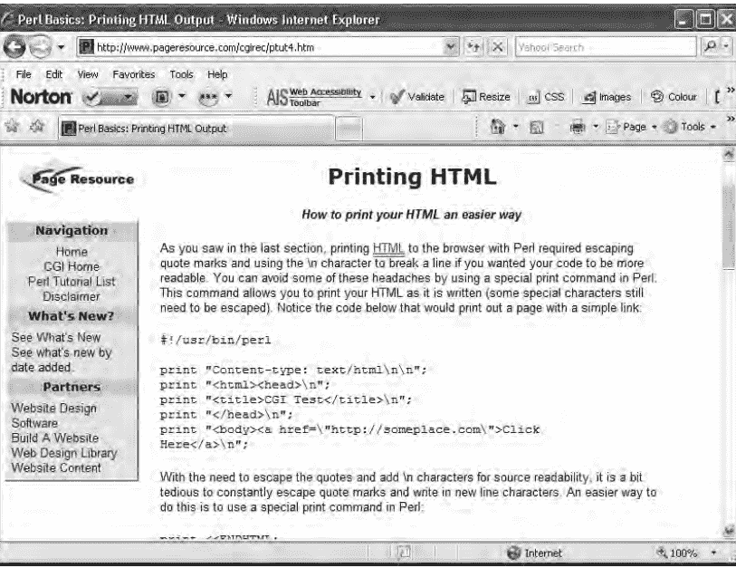

图 1-1 在 Microsoft Internet Explorer 中查看的 Web 页面

| Microsoft Internet Explorer 版本 | Mozilla Firefox 版本 | Opera 版本 | 支持的 JavaScript 版本 |

| --- | --- | --- | --- |

| - | 3 | - | 1.8 |

| - | 2 | - | 1.7 |

| - | 1.5 | - | 1.6 |

| 5.5–8 | 1 | 6–9 | 1.5 |

| 4 | | - | 1.3 |

表 1-1 三大浏览器支持的 JavaScript 版本

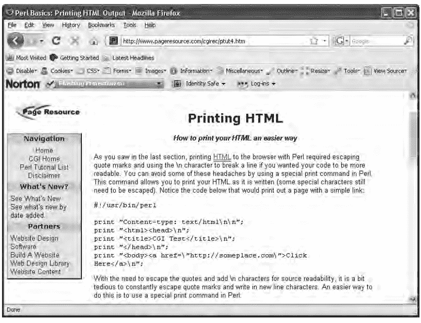

图 1-2 在 Mozilla Firefox 中查看的 Web 页面

## 哪个版本？

在本文编写期间，本章前面提到的浏览器应该至少支持 JavaScript 1.5。（Firefox 的最新版本支持 1.8。）

你可能还会看到或听到 Jscript 或 ECMAScript。Jscript 是 Microsoft Internet Explorer 使用的 JavaScript 版本（作为 Windows 脚本引擎，它可以执行更复杂的任务，如更新数据库）。更多关于 JavaScript 的信息，请参阅 http://msdn.microsoft.com/en-us/library/hbc98.aspx。

ECMAScript 是 JavaScript 语言的国际标准名称和规范，因此它并不是新语言，而是一种标准。关于 ECMAScript 的更多信息，请参阅 www.ecma-international.org/publications/standards/Ecma-262.htm。

### 专家问答

**Q:** 你提到可以使用文本编辑器或 HTML 编辑器，但我不太确定那是什么意思。什么是文本编辑器，我在哪里可以找到？

**A:** 文本编辑器是一个你可以用来保存和编辑文本的程序。文本编辑器从简单到复杂不等，有很多选择：Notepad、WordPad、Simple Text 以及 WordPerfect X4，你也可以在 Web 上购买或下载一些，如 NoteTab 或 TextPad。

HTML 编辑器是更复杂的文本编辑器，或者是允许你通过按钮或其他手段添加代码的编辑器——通常被称为所见即所得（WYSIWYG）编辑器。如果你打算手动操作，我推荐纯文本编辑器。HTML 编辑器的示例有 Adobe Dreamweaver 和 Softpress Freeway。

**Q:** 使用文本编辑器具体需要知道什么？

**A:** 基本上，你只需要如何在编辑器中输入文本、以 .html 或 .htm 扩展保存文件，并在必要时打开并编辑它。不需要特殊功能，因为 HTML 文件是由纯文本组成的。

**Q:** 使用浏览器需要知道什么？

**A:** 你只需要知道如何打开计算机上的本地 HTML 文件（或 Web 上的）以及如何刷新页面。如果你不知道如何从计算机打开 HTML 文件，打开你的浏览器并进入文件菜单。寻找类似“打开”或“打开文件”的选项并选择它。你应该能够像其他程序一样浏览要打开的文件。以下插图显示了该选项在 Explorer 中的位置：

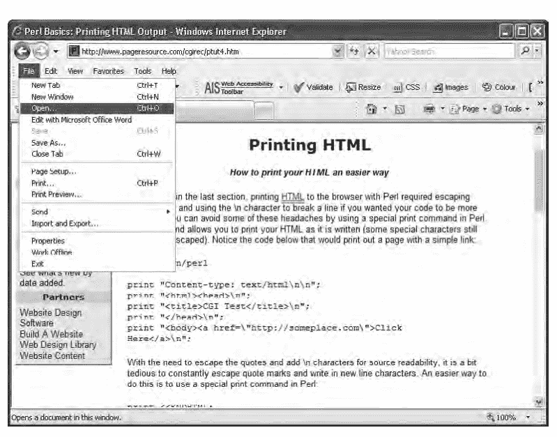

## 我从哪里获取你提到的浏览器？

以下是浏览器的链接：

- Microsoft Internet Explorer www.microsoft.com/ie

- Mozilla Firefox www.mozilla.com/firefox

- Opera www.opera.com

## 记住，它不是 Java

JavaScript 和 Java 是两种不同的语言。Java 是一门完整的编程语言，在执行程序（通常称为 Java applet）之前，必须经过编译（通过一个将高级代码转换为机器语言的软件来运行程序）。Java 的功能更强大，但也更复杂。JavaScript 不需要编译器，并且在语法等许多方面更加宽容。

### 与其他语言的相似之处

JavaScript 与其他编程和脚本语言有相似之处。如果你有 Java、C++ 或 C 的经验，你会在语法上发现一些相似之处，这可能帮助你更快地学习。由于它是一门脚本语言，JavaScript 也与 Perl 等语言有相似之处——它也可以通过解释器运行，而不是通过编译。

如果你有任何语言的编程或脚本经验，会让学习 JavaScript 变得更容易——但并不是必须的。

### 开始学习 JavaScript

JavaScript 是 Netscape Communications Corporation 和 Sun 微系统（Sun Microsystems, Inc）合作的产物。新语言的消息于 1995 年 12 月 4 日发布，当时 Netscape Navigator 2.0 仍在测试版本阶段。JavaScript 1.0 版本随着新浏览器一起发布。（在发布作为 JavaScript 之前，它曾被称为 LiveScript。）

JavaScript 是一种基于对象的客户端脚本语言，你可以用它来让网页更具动态。为了理解这个定义，让我们逐一查看它的重要部分。

### 基于对象

基于对象意味着 JavaScript 可以使用项目对象。然而，这些对象不是基于类的（这意味着类和实例之间没有区别）；相反，它们只是通用对象。你将在第 8 章学习如何操作 JavaScript 对象。在了解该语言的其他特性之前，你不需要详细了解它们。

### 客户端

客户端意味着 JavaScript 运行在查看者正在使用的客户端（软件）中，而不是在访问该页面的 Web 服务器上。在这种情况下，客户端就是 Web 浏览器。为了理解这一点，让我们看看服务器端语言是如何工作的，客户端语言又是如何工作的。

### 服务器端语言

服务器端语言需要从 Web 页面或 Web 浏览器获取信息，将其发送到运行在主机服务器上的程序，然后将信息传回浏览器。在浏览器看到程序结果之前，必须有一个中间步骤从服务器发送和检索信息。

服务器端语言通常为程序员提供客户端语言不具备的选项，例如将信息保存在 Web 服务器上供以后使用，或使用新信息更新网页并保存更新。

然而，服务器端语言在处理浏览器窗口客户端特殊功能方面可能会受到限制（例如网页上特定位置的内容或提交到服务器之前的表单内容）。

### 客户端语言

客户端语言直接通过查看者使用的客户端运行。对于 JavaScript 来说，客户端是 Web 浏览器。因此，JavaScript 直接在 Web 浏览器中运行，不需要经过从 Web 服务器发送和检索信息的额外步骤。

使用客户端语言，浏览器读取并解释代码，无需先从服务器获取信息即可将结果给查看者。这一过程使得某些任务运行得更快。

客户端语言还可以访问浏览器的特殊功能，而服务器端语言可能无法访问。然而，客户端语言缺乏像服务器端语言那样将文件或更新保存到 Web 服务器的能力。

### 注意

使用 `XMLHttpRequest` 对象允许 JavaScript 从服务器请求数据。这将在第 16 章介绍。

客户端语言用于处理浏览器部分的任务，或允许在信息发送到服务器端程序或脚本之前进行验证。例如，JavaScript 可以打开一个具有特定尺寸、特定功能（如地址栏或状态栏）以及屏幕上特定位置的新窗口。

JavaScript 还可以用于在表单发送到服务器端程序之前检查输入到表单的信息。这种处理可以通过防止提交不准确或不完整的信息，来减轻 Web 服务器的负担。与其在服务器上运行程序直到信息正确，不如直接将正确信息的数据发送到服务器。

### 脚本语言

脚本语言在运行之前不需要编译程序。所有的解释工作都由客户端即时完成。

对于普通的编程语言，在运行编写的程序之前，你必须使用特殊的编译器对其进行编译，以确保没有语法错误。在脚本语言中，代码在加载到客户端时会被解释。因此，你可以更快速地获得代码的结果。然而，错误在脚本运行之前不会被捕获，如果客户端无法处理错误，可能会导致问题。在 JavaScript 的情况下，错误处理取决于查看者所使用的浏览器。

## 综合考虑

考虑到所有这些，你可能会好奇 JavaScript 是如何在浏览器中运行的。你可能好奇在哪里编写你的 JavaScript 代码，以及是什么告诉浏览器它与 Web 页面上的任何内容都不同。目前的答案是通用的，但下一章将提供更多细节。

JavaScript 通过添加到现有的 HTML 文档中（直接添加或引用外部脚本文件）在浏览器中运行。你可以在 HTML 代码中添加特殊的标记和命令，这些标记将告诉浏览器需要运行脚本。一旦浏览器看到这些特殊标记，它就会解释 JavaScript 命令并按照你对代码的操作执行。因此，通过简单地编辑 HTML 文档，你就可以在你的网页上使用 JavaScript 并看到结果。

例如，以下代码将 JavaScript 添加到 HTML 文件中，并在网页上写入文本。注意添加 `<script>` 和 `</script>` 标签。它们内部的代码是 JavaScript。

```html
<html>
<body>
<script type="text/javascript">
  document.write("This writes text to the page");
</script>
</body>
</html>
```

此标签告诉浏览器后面跟的是 JavaScript

此行将引号内的文本写入页面

此行告诉浏览器脚本结束

下一章将介绍如何使用 `<script>` 和 `</script>` HTML 标签在 HTML 文件中添加 JavaScript。这将是你成为 JavaScript 代码员道路的第一步！

## 在线资源

为了找到帮助你学习 JavaScript 的额外信息，这里有一些实用的资源：

- 查找带有结果示例的教程的地方：www.pagerource.com/javascript

- 一个包含可复制粘贴脚本的优秀教程网站：www.javascriptkit.com

- 一个你可以向其他程序员提问关于 JavaScript 问题的地方：www.webxpertz.net/forums

## 尝试这个 1-1 使用 JavaScript 编写文本

此项目通过在浏览器中加载 HTML 文档向你展示 JavaScript 的实际应用。脚本使用 JavaScript 在浏览器中写一行文本。

```
pr1_1.html
```

```html
<body>
</html>
```

2. 将文件保存为 `pr1_1.html` 并在 Web 浏览器中打开它。你应该能看到一行用 JavaScript 编写的文本。

## 尝试此总结

在这个项目中，你将一段代码复制并粘贴到文本编辑器中并保存了文件。当你在 Web 浏览器中打开保存的文件时，浏览器中显示了一行文本。这段文字是在浏览器窗口中使用 JavaScript 编写的。你将在第 2 章看到更多关于此类脚本如何工作的内容。

## 第 1 章自测

1. 要使用 JavaScript，你必须知道以下哪项？

   A Perl

   B C++

   C HTML

   D SGML

2. 以下哪项是你使用 JavaScript 时应该具备的？

   A 一个 Web 浏览器

   B 一个 C++ 编译器

   C 一个 50GB 的硬盘

   D 一个 CD-RW 驱动器

3. Web 浏览器的选择取决于你，只要它兼容 ________ 即可。

   A Flash MX

   B VBScript

   C JavaScript

   D Windows XP

4. JavaScript 和 Java 是同一种语言。

   A 真

   B 假

5. 在许多领域（如语法），JavaScript 比 Java 更 ________。

   A 复杂

   B 强大

   C 编译

   D 宽松

6. JavaScript 与其他编程和脚本语言有相似之处。

   A 真

   B 假

7. 在作为 JavaScript 发布之前，它被称为 ________。

   A Java

   B JavaCup

   C LiveScript

   D EasyScript

8. JavaScript 是 ________ 的。

   A 基于对象的

   B 面对象的

   C 缺少对象的

   D 不是一种使用对象的语言

9. 客户端语言通过观众正在使用的 ________ 直接运行。

   A 服务器

   B 客户端

   C 监器

   D 律师

10. 在 Web 页面使用表单时，客户端语言可以提供什么帮助？

    A 它能将信息保存到服务器上。

    B 它可以在信息发送到服务器之前对其进行验证。

    C 它可以更新文件并用新信息保存文件。

    D 它完全没有帮助。

11. ________ 语言在运行之前不需要编译程序。

    A 编程

    B 服务器端

    C 脚本

    D 计算机

12. 使用脚本语言时，代码在加载到客户端时是被解释执行的。

    A 真

    B 假

13. 在 JavaScript 中，脚本中的错误是在哪里？

    A Web 服务器

    B 编译器

    C Web 服务器上的某一个程序

    D Web 浏览器

14. JavaScript 是如何添加到 Web 页面的？

    A 它被写在浏览器的特殊编辑器中。

    B 它是从服务器上编译好的程序中获取的。

    C 你将代码单独放在一个文件中并打开该文件。

    D 它被添加到 HTML 文档中。

15. 在 Web 页面中添加什么内容来插入 JavaScript 代码？

    A `<script>` 和 `</script>` HTML 标签

    B JavaScript 代码单词

    C `<javascript>` 和 `</javascript>` HTML 标签

    D `<java>` 和 `</java>` HTML 标签

本页故意留白

## 第 2 章：将 JavaScript 放入 HTML 文件

### 关键技能与概念

- 使用 HTML 脚本标签

- 创建你的第一个脚本

- 使用外部 JavaScript 文件

- 使用 JavaScript 注释

现在你已经接触了 JavaScript，准备好编写代码了。由于 JavaScript 代码是从 HTML 文档运行的，你需要知道如何告诉浏览器运行你的脚本。触发脚本的最常用方法是在文档中使用 HTML 的 `<script>` 和 `</script>` 标签。你可以将脚本标签放置在 HTML 文档的 head 或 body 部分。

本章首先展示如何使用脚本标签来开始和结束一段 JavaScript 代码。当你这样做时，你就开始运行你的脚本了。在章节结束处，你将学习如何在脚本中添加 JavaScript 注释。

### 使用 HTML 脚本标签

脚本标签用于告诉浏览器 HTML 文档中某种脚本语言的开始和结束位置。在最基本的形式中，脚本标签就像任何其他 HTML 标签一样：

```html
<script><!--
这里是 JavaScript 代码
</script><!--
```

告诉浏览器脚本代码从哪里开始

告诉浏览器脚本代码在哪里结束

如你所见，有一个起始 `<script>` 标签、JavaScript 代码，然后是结束 `</script>` 标签。当你只使用这种基础的开启结束标签时，许多浏览器会假设随后的脚本语言是 JavaScript。然而，某些浏览器可能需要指定使用的是哪种脚本语言。

除了告诉浏览器脚本的开始和结束，脚本标签还可以告诉浏览器将使用哪种脚本语言，并定义外部 JavaScript 文件的地址。这些额外功能通过 `type` 和 `src`（源）属性实现。

### 识别脚本语言

起始和结束脚本标签之间的脚本语言可能是 JavaScript、VBScript 或其他语言。尽管 JavaScript 通常被设置为浏览器的默认脚本语言，但可能某些浏览器并不默认使用 JavaScript。

为了安全起见，显式标识语言为 JavaScript 是个好习惯。你可以通过在起始脚本标签中添加值为 `"text/javascript"` 的 `type` 属性来实现这一点：

```html
<script type="text/javascript">
  这里是 JavaScript 代码
</script>
```

在 XHTML 中，起始脚本标签中的 `type` 属性也是必须的，以便 Web 页面验证。

在旧版本的 HTML 中，脚本标签不区分大小写。然而，JavaScript 在所有版本中都是区分大小写的，因此你必须对其小心。在书中，我使用 XHTML 1.0 Transitional 来编写 HTML 代码（所有标签和属性名称都将使用小写）。对于 JavaScript 代码，我将使用其为了正常运行所需的代码。

### 外部脚本

如果你想在文档中调用外部 JavaScript 文件，脚本标签也非常有用。外部 JavaScript 文件是一个仅包含 JavaScript 代码的文件，并以 `.js` 扩展名保存。通过调用外部文件，你可以节省编写代码或将脚本复制到每个需要页面的时间。相反，你可以在每个页面上使用单行代码来指向该 JavaScript 文件。

你可以使用 `src` 属性调用外部脚本：

```html
<script type="text/javascript" src="yourfile.js"></script>
```

如果脚本非常长，使用外部文件会比在每个页面上插入代码要快得多。这将允许页面通过验证。

### 使用 `<noscript>` 标签

为没有 JavaScript（或禁用了 JavaScript）的观众提供替代内容的一种方法是使用 `noscript` 标签。`<noscript></noscript>` 标签可以放置在 HTML 文档的任何位置。例如：

```html
<script type="text/javascript">
  颜色是红色；
</script>
<noscript>
  颜色是红色。
</noscript>
```

### 专家问答

**问：** 我总是需要使用 `script` 标签向页面添加 JavaScript 吗？

**答：** 可以使用事件处理器，允许你在事件处理属性内编写简短的脚本。你将在第 7 章学习事件处理器。

**问：** `language` 属性呢？

**答：** 在 XHTML 中，`language` 属性已被 `type` 属性取代。使用 `language` 属性可能会导致 Web 页面验证失败，不再建议使用。

**问：** 当我在页面添加脚本时，它在 XHTML 严格（或过渡）模式无法通过验证。我如何让页面通过验证？

**答：** 如果脚本包含了 XHTML 中使用的字符，例如 JavaScript 中的 `<`（它用于表示“小于”，但在 XHTML 中被视为新标签的开始），那么在没有 CDATA section 的情况下，直接在文档中使用脚本将无法通过验证：

```html
<script type="text/javascript">
<![CDATA[
var x = 5;
var y = 10;
if (x < y) {
    window.alert("x is less than y");
}
]]>
</script>
```

这将允许页面通过验证，但由于 `<![CDATA[` 和 `]>` 在脚本中，脚本将不再工作。要修复此，当这些字符位于脚本标签内时，需要在它们周围使用 JavaScript 注释（`/*` 和 `*/`）：

```html
<script type="text/javascript">
/*<![CDATA[
var x = 5;
var y = 10;
if (x < y) {
    window.alert("x is less than y");
}
*/]]>
</script>
```

如你所见，这很快变得非常繁琐！通常，更好的选择是使用外部脚本文件，这解决了这个问题，因为 XHTML 文档中只需要脚本标签本身。

本示例将通过 JavaScript 或 `<noscript></noscript>` 标签内的文本向查看者显示“The color is red.”（颜色是红色。）这句话。

### 注意

某些旧版浏览器可能无法正确处理 `noscript` 标签，并且不会显示任一部分的内容。如果你的用户使用旧版浏览器，另一种替代方案是在页面上直接显示内容，并使用 JavaScript 为那些能够显示 JavaScript 的用户增强内容。

### 创建你的第一个脚本

现在你已经知道如何使用 HTML `script` 标签来告诉浏览器文档中的 JavaScript，你已经准备好学习如何在 `script` 标签之间添加实际的 JavaScript 代码了。每种语言给出的第一个代码示例通常都是向默认输出区域输出某种文本，通常被称为基础的“Hello World”脚本。之后，你的第一个脚本将向 Web 页面写入一段文本。

### 编写“Hello World”脚本

与其编写“Hello World”，你将为该脚本使用另一行代码：“Yes! I am now a JavaScript coder!”（是的！我现在是一个 JavaScript 程序员了！）这只需要一行代码，使用 `document.write()` 方法，它会将一段文本写入：

```html
<script type="text/javascript">
document.write("Yes! I am now a JavaScript coder!");
</script>
```

注意文本周围的括号和引号。使用括号是必要的，因为 `document.write()` 方法是一个 JavaScript 函数，它在括号中接收参数。你将在第 4 章中学习更多关于 JavaScript 函数的知识。

引号表示一个字符串（string）。字符串是 JavaScript 中的一种变量类型，通过放在引号内来定义。第 3 章提供了字符串和其他类型 JavaScript 变量的详细信息。

关于你的脚本最后需要注意的一点是行尾的分号。分号表示一个 JavaScript 语句的结束。语句（statement）是代码的一部分，其在语法上（其形式和顺序）不需要添加任何内容即可是完备。一个语句可以用于执行单个任务、执行多项任务，或调用脚本的其他部分，大多数 JavaScript 语句都以分号结束；养成添加分号的习惯是一个好主意。

### 注意

在后面的章节中，你将看到一些不以分号结尾的行，因为它们开启或关闭了一个代码块。此外，你遇到的许多脚本语句可能不以分号结尾。JavaScript 对分号的使用是宽容的；然而，使用分号结束语句是最好的，因为它可以防止可能出现的错误并有助于以后对脚本进行调试（移除错误）。

因此，要向页面写入文本字符串，你使用 `document.write()` 方法，后跟用引号括起来并包含在括号内的文本。用分号结束该行（该语句）。JavaScript 将处理其余工作。

### 为脚本创建一个 HTML 文档

为了使此示例变得完整并测试脚本，你需要将其插入到 HTML 文档中。首先，使用基础标签创建以下 HTML 文档（使用任何你喜欢的文本编辑器）：

```html
<!DOCTYPE html PUBLIC "//W3C//DTD XHTML 1.0 Transitional//EN"
"http://www.w3.org/TR/xhtml/xhtml1-transitional.dtd">
<html xmlns="http://www.w3.org/1999/xhtml">
<head>
<title>Untitled Document</title>
</head>
<body>
</body>
</html>
```

在你的编辑器中将该文档保存为 `test1.html`。你稍后将用 Web 浏览器调用它来查看脚本的结果。接下来，你把脚本添加到此 HTML 文档中，所以请保持文件打开。

### 将脚本插入 HTML 文档

现在你需要将脚本插入文档中。它应该放在哪里呢？你可以将脚本放在 `<head>` 和 `</head>` 标签之间，或者放在 `<body>` 和 `</body>` 标签之间。由于此示例直接向页面写入文本字符串，你希望将脚本插入到 `<body>` 和 `</body>` 标签之间，取决于你想让文本字符串出现在哪里。它可以出现在页面上任何 HTML 代码的之前、之后或之间。

为了清楚脚本是如何呈现的，你将添加 HTML 代码在脚本前后编写几行文本。脚本标签和脚本本身被插入在这些行之间。在 `<body>` 和 `</body>` 标签之间添加所示的行：

这是第一行，位于脚本结果之前。

<br />

```html
<script type="text/javascript">
document.write("Yes! I am now a JavaScript coder!");
</script>
<br />
```

这一行位于脚本之后。

再次保存 `test1.html` 文档。你现在应该能够在 Web 浏览器中打开该文档来查看脚本的结果。图 2-1 显示了当你加载 Web 页面时文本在浏览器中应该有的样子。

恭喜，你完成了你的第一个脚本！

### 注意

本节中的示例代码使用了整个 HTML 文档及其所有的标签。为了保持内容尽可能相关，从现在开始，示例代码将仅使用与脚本相关的 HTML 标签，而不是其全部标签。项目代码可能根据需要使用整个 HTML 文档。

图 2-1 Web 浏览器中的 `test.html` 文件

### 提问专家

**问：** `document.write()` 为什么有一个点（.）？

**答：** `document` 是预定义的对象，而 `write()` 是预定义方法。第 8 章解释了 JavaScript 对象。

**问：我什么时候应该在 `head` 部分添加脚本，什么时候应该在 `body` 部分添加？**

**答：** 当你想将文本字符串直接写入页面时，你应该在 `body` 部分添加脚本。在很多情况下，你会在 `head` 部分使用脚本，因为你可以在外部脚本文件中调用它。

### 练习：为脚本创建一个 HTML 文档

为了使此示例完整并测试脚本，你需要将它插入到 HTML 文档中。

```
pr2_1.html
```

此项目让你练习向页面添加脚本。你将创建一个 HTML 文档并在页面加载时在浏览器中显示一个句子。

### 步骤说明

1. 设置一个 HTML 文档，在 `<body>` 和 `</body>` 标签之间留空。

2. 在 Web 页面放入以下文本：

   I am part of the document!

3. 在此行之后插入 `<br />` 标签（为了在页面上换行）。

4. 在 `<br />` 标签后插入一个脚本写入以下内容：

   This came from my script, and is now on the page!

5. 在脚本之后添加 `<br />` 标签。

6. 在最后一个 `<br />` 标签之后放入以下文本，并对其进行强调：

   I am also part of the document, after the script!

7. 你的 HTML 文档应该如下所示：

```html
<!DOCTYPE html PUBLIC "//W3C//DTD XHTML 1.0 Transitional//EN" "http://www.w3.org/TR/xhtml/xhtml1-transitional.dtd">
<html xmlns="http://www.w3.org/1999/xhtml">
<head>
<title>JavaScript Project 2-1</title>
</head>
<body>
I am part of the document!
<br />
<script type="text/javascript">
document.write("This came from my script, and is now on the page!");
</script>
<br />
<em>I am also part of the document, after the script results!</em>
</body>
</html>
```

8. 将文件保存为 `pr2_1.html` 并在浏览器中查看页面以查看结果。

### 练习总结

在这个项目中，你创建了一个 HTML 文件。利用你到目前为止学到的知识，你在 HTML 文件中插入了一个向页面写入特定文本的脚本。当在浏览器中打开 HTML 页面时，脚本的结果显示在行文本之间。

### 使用外部 JavaScript 文件

现在你想在多个页面使用“Hello World”脚本（你在本章早些创建的），但你不想在每个页面都编写它。你可以通过将脚本放在外部脚本文件中，并使用脚本标签的 `src` 属性调用它来实现。对于这种方法，你需要创建一个 JavaScript 文件或多个 HTML 文档，并在其中放置脚本标签以调用你的外部脚本。

### 创建 JavaScript 文件

对于此示例，你将创建一个仅包含一行 JavaScript 文件。在实际应用中，你将使用这种方法处理更长的脚本——脚本越长，这种技术就越有用（特别是当你尝试验证 Web 页面或将脚本代码与标记分离时）。

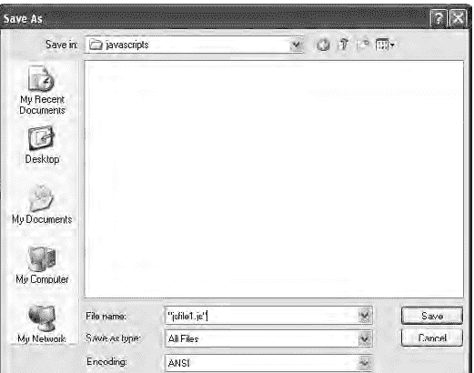

**图 2-2** 使用引号保存具有 .js 扩展名的文件的示例，以便其以正确的文件扩展名保存

在你的文本编辑器中打开一个新文件，并仅插入 JavaScript 代码本身（`document.write()` 语句）。在外部 JavaScript 文件中不需要 `<script>` 标签。该文件应该像下面所示：

```
document.write("Yes! I am now a JavaScript coder!");
```

在你的文本编辑器中将该文件保存为 `jsfile.js`。为了执行此操作，你可能需要使用“文件”菜单上的“另存为”选项，并在文件名周围加上引号，如图 2-2 所示（在 Windows 上使用记事本）。

一旦文件保存完成，你就可以进行下一步，即创建 HTML 文件来使用你的脚本。

### 创建 HTML 文件

你将创建两个文件来放置你的脚本。只要你在每个文件中都添加了所需的 `<script>` 标签，这种技术就可以适用于任意数量的 HTML 文件。

对于第一个文件，创建你的基础 HTML 文档并将 `<script>` 标签插入到文档的 `<body>` 部分，使用 `src` 属性指向 `jsfile.js` 文件，并在页面的 `<body>` 中添加一些 HTML 文本以识别其为第一个 HTML 文档：

```html
<body>
<script type="text/javascript" src="jsfile.js"></script>
<p>
 This is page 1, and the script works here!
</p>
</body>
```

在你的文本编辑器中将此文件保存为 `jsext1.html`。确保将其放在与 `jsfile.js` 文件相同的目录中。

第二个 HTML 文档看起来与第一个相同，不同之处 HTML 文本显示它是第 2 页：

```html
<body>
<script type="text/javascript" src="jsfile.js"></script>
<p>
This is page 2, and the script also works here!
</p>
</body>
```

在你的文本编辑器中将此文件保存为 `jsext2.html`。同样，确保将其放在与其他文件相同的目录中。

### 在浏览器中查看页面

在你的 Web 浏览器中打开 `jsext1.html` 文件。它应该如图 2-3 所示，JavaScript 从外部脚本文件插入到页面。

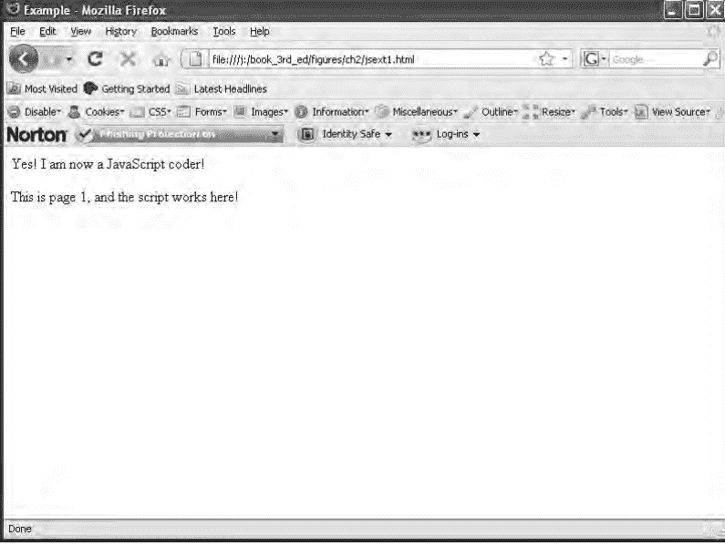

图 2-3 在 `jsext1.html` 文件中调用脚本的结果，第一个 HTML 页面

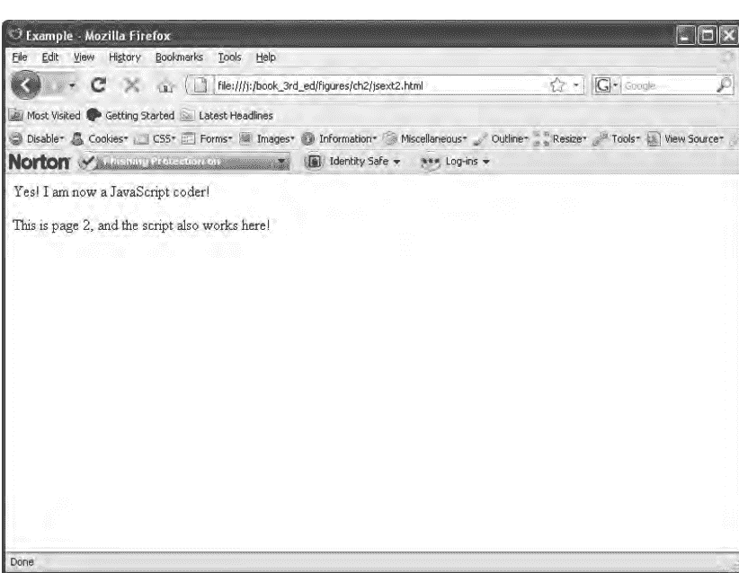

图 2-4 在 `jsext2.html` 文件中调用脚本的结果，第二个 HTML 页面

接下来，在你的 Web 浏览器中打开 `jsext2.html` 文件。它应该如图 2-4 所示，唯一的区别是你添加到 HTML 文件中的文本，显示这是第 2 页。JavaScript 写入此页面的文本应与第一个 HTML 页面相同。

虽然我们在示例中使用了一个短脚本，但它应该让你有一个直观感受，当你有一个大型脚本时，使用外部文件可以是非常节省时间的方法。

### 尝试练习 2-2 从 HTML 文档调用外部脚本

此项目将让你练习创建外部 JavaScript 文件并使用它们将脚本插入到 Web 页面。

```
pr2_2.html
prjs_2.js
```

### 逐步详解

1. 设置一个简单的 HTML 文档，在 `<body>` 和 `</body>` 标签之间没有任何内容。

2. 在页面的 `<body>` 标签之间放置以下行文本：

This text is from the HTML document!

3. 在此文本之后放置 `<br />` 标签。如果你需要保存此文件，请将其保存为 `prjs_2.html`。

4. 创建一个外部 JavaScript 文件，它在执行时将写入以下行：

I love JavaScript and using external files!

5. 以下是你的 JavaScript 文件应该的样子：

```
document.write("I love writing JavaScript, and using external files!");
```

6. 将 JavaScript 文件保存为 `prjs_2.js`。

7. 回到 HTML 文档。在文档中的 `<br />` 标签之后放置脚本，这样外部 JavaScript 文件就会在页面上写入它的句子。

8. 你的 HTML 文档的 `<body>` 部分应该像这样：

```html
<body>
This text is from the HTML document!
<br />
<script type="text/javascript" src="prjs_2.js"></script>
</body>
```

9. 将此文件保存为 `prjs_2.html`。

### 总结

虽然我们在示例中使用了一个短脚本，但它应该让你有一个直观感受，当你有一个大型脚本时，使用外部文件可以是非常节省时间的方法。

### 单行注释

如果你想在代码中添加单行注释，使用 `//`。

### 多行注释

为了添加跨越多行的注释，你可以使用不同的注释格式：一个斜杠后跟星号开始注释，星号后跟一个斜杠结束注释。这里有一个示例：

```
/*
My script will write some text!
All of this is ignored.
*/
```

使用这种格式，你可以在一行开始注释，并在另一行结束。当你需要描述代码时。看这个示例，看看你是否能发现问题：

```html
<script type="text/javascript">
/*
This code won’t work for some reason.
```

```
document.write("I want someone to see me!");
</script>
```

你注意到缺少 JavaScript 注释符号了吗？当你使用多行注释时，需要小心关闭它们。否则，你可能会意外注释掉你需要执行的代码！在这个示例中，注释一直持续。要修复这个问题，你需要在使用 `document.write()` 方法之前关闭注释：

```html
<script type="text/javascript">
/*
The JavaScript code is now working! This text is hidden.
document.write("Now everyone can see me!");
*/
</script>
```

在前面的示例中，你可以看到注释是如何提供说明的。在第 16 章，你将学习注释如何帮助你调试 JavaScript 代码。现在，你应该养成在脚本中添加简短说明的习惯。

## 第 2 章自测

1. `<script>` 和 `</script>` 标签的作用是什么？

   - 告诉浏览器脚本开始和结束

   - 让浏览器知道使用的脚本语言

   - 指向外部 JavaScript 文件

   - 以上所有

2. 为什么应该在起始脚本标签中使用 `type` 属性？

   - 让浏览器知道你是什么类型的代码

   - 让浏览器不会将你的 JavaScript 解析为另一种脚本语言并确保 Web 页面通过 XHTML 验证

   - 创建类型脚本

   - 确保脚本没有语法错误

3. JavaScript 代码对大小写敏感吗？

   - 是

   - 否

4. `<noscript>` 标签在没有启用 JavaScript 的情况下提供了 ________。

5. 外部 JavaScript 文件通常使用 ________ 作为文件名扩展名。

   A .js

   B .html

   C .jav

   D .java

6. 下列哪项正确地指向了名为 `yourfile.js` 的外部 JavaScript 文件？

   A `<extscript type="text/javascript" src="yourfile.js"></extscript>`

   B `<script type="text/javascript" src="yourfile.js"></script>`

   C `<script language="yourfile.js"></script>`

   D `<script type="text/javascript" link="yourfile.js"></script>`

7. 在旧版本的 HTML 中，`<script>` 标签是不区分大小写的。但在 XHTML 中，`<script>` 标签必须是 ________ ________。

8. ________ 标志着一个 JavaScript 语句的结束。

   A 冒号

   B 句号

   C 问号

   D 分号

9. 要在 Web 页面上写入一段文本，使用的是 ________ 方法。

   A `document.write()`

   B `document.print()`

   C `document.type()`

   D `window.print()`

10. 什么情况下使用外部 JavaScript 文件是一个好主意？

    A 当脚本很短或仅将在一个 HTML 文档中使用时

    B 当你的网站访问者使用旧版浏览器时

    C 当脚本非常长或需要放置在多个 HTML 文档中时

    D 外部文件不是一个好主意

11. JavaScript 注释对于 ________ 或 ________ 你的代码非常有用。

12. 下列哪项表示在 JavaScript 代码中后面将紧跟单行注释？

    A `/*`

    B `//`

    C `//`

    D `<!----`

13. 下列哪项表示在 JavaScript 代码中后面将跟随多行注释？

    A `/*`

    B `//`

    C `//`

    D `<!--`

14. 下列哪项表示多行 JavaScript 注释的结束？

    A `\`

    B `-->`

    C `/*`

    D `*/`

15. 当你使用多行 JavaScript 注释时，你需要小心地 ________ 它们。

    A 闭

    B 读取

    C 编写

    D 编译

## 第三章

### 使用变量

### 核心技能与概念

- 理解变量

- 为什么变量很有用

- 为你的脚本定义变量

- 理解变量类型

- 在脚本中使用变量

现在你已经学习了向 Web 页面添加 JavaScript 的基础知识，是时候进入该语言的内部机制了。由于变量是 JavaScript 编码的重要部分，你将需要尽可能了解它们是什么以及为什么它们在你的脚本中很有用。一旦你理解了变量是如何工作的以及它们能做什么，你就可以继续学习其他基于各种类型变量使用的话题。

在本章中，你将从学习变量是什么以及它们为什么有用开始。然后你将了解用于声明变量的方法以及如何给变量赋值。最后，你将看到如何在你的脚本中使用变量。

### 理解变量

变量代表或持有一个值。变量的实际值可以随时更改。为了理解变量是什么，请考虑一个你可能在代数课上记忆过的基础语句：

```
x=2
```

字母 x 用作变量名。它被赋值为值 2。要更改该值，你只需给 x 分配一个新的赋值：

```
x=4
```

变量名保持不变，但现在它代表一个不同的值。将数学课的例子再向前推一步，你可能需要解决过类似这样的问题：

```
如果 x=2，那么 3+x=?
```

为了得到答案，你在问题中用值 2 替换了变量 x，得到 3+2=5。如果 x 的值改变，问题的答案也会随之改变。所以，如果 x=7，那么计算就变成了 3+7，现在的结果是 10。

JavaScript 中的变量与数学中使用的变量非常相似。你给变量起一个名字，并根据你的需求给它赋值。如果变量的值发生改变，它将改变脚本内部发生的事情。

### 为什么变量很有用

使用变量有几个益处：

- 它们可以用于在编写代码时其所代表的值尚未知的地方。

- 它们可以节省你编写和更新脚本的时间。

- 它们可以使你的代码目的更清晰。

### 变量作为未知值的占位符

有时，变量会在内存中占一个位置，用于存储在脚本编写时尚不可知的值。变量的值可能会根据查看者输入的内容而改变，或者由你在稍后的脚本代码中更改。

例如，你可能有一个函数，根据用户输入接收某些值（函数将在第四章中定义）。由于在脚本编写时用户输入的值是未知的，因此可以使用变量来存储用户将输入的值。对于任何形式的用户输入都是如此，无论是以 JavaScript 提示/确认框的形式、表单中的输入字段，或其他输入方法。

### 变量作为时间节省器

变量可以加快脚本的编写，因为它们的值是可以改变的。这样，脚本的其他部分可以直接使用变量来代替它。如果你决定稍后更改值，你只需要在某处更改代码——而不是在许多处给变量赋值。

例如，假设在数学课上，你被要求解决这道题：

```
如果 x=2，那么 3x-1+2-2x=?
```

你知道你需要将每个出现的 x 替换为值 2，因为 3+2-1+2=4。如果老师想让你用不同的 x 值再次做这个题，就不需要重写整个题目。老师只需要给你以下指令：

```
当 x=4 时求解上述问题。
```

问题越长越复杂，变量就越有用。与其反复重写相同的内容，你可以更改一个变量来提供完全全新的结果。

### 变量作为代码澄清符

由于变量代表某些东西，而且你可以给它们起有意义的名字，因此当你在阅读和（调试）脚本时，它们通常更容易被识别。如果你只是添加数字，你可能会忘记它们代表什么。例如，考虑这行代码：

```
TotalPrice=2.42+4.33;
```

在这里，数字代表任何含义。相反，你可能会将 2.42 赋值给 `CandyPrice` 变量，将 4.33 赋值给 `OilPrice` 变量：

```
TotalPrice=CandyPrice+OilPrice;
```

现在，与其尝试记住这些数字，你可以看到脚本正在将糖果的价格加上油的价格。这在调试时也有用，因为有意义的变量更容易发现错误。

### 为你的脚本定义变量

现在你理解了变量是什么以及你为什么要使用它们，你需要学习如何让它们工作。你通过声明来创建变量。然后使用 JavaScript 赋值运算符给它们赋值。当你命名变量时，需要遵循变量命名的规则，并考虑名字的意义性。

### 声明变量

要声明变量，你使用 `var` 关键字，它告诉浏览器后面将紧跟新变量的名字：

```
var variab;
```

例如，将你的变量命名为 `cooler`，声明如下：

```
var cooler;
```

在这个例子中，你有一个名为 `cooler` 的新变量。分号结束语句。变量 `cooler` 还没有被赋值。正如在下一节所示，你可以在声明的同时或在稍后的脚本中给你的新变量赋值。

给变量命名的代码很简单，但对你使用的单词和字母的大小写有一些限制。在你看到如何给变量赋值之后，将学习更多关于 JavaScript 命名的规则。

例如，要将变量命名为 `paycheck` 并赋予其数值值 1200，请使用此语句：

```
var paycheck=1200;
```

该语句以关键字 `var` 开头，随后是变量 `paycheck`，这与上一节描述的普通变量声明一样。接下来是赋值运算符 (`=`)，它告诉浏览器将运算符右侧的值分配给运算符左侧的变量。赋值运算符的右侧是 1200，这是正在被赋值给变量 `paycheck` 的数值值。该行以分号结尾，表示语句的结束。

### 注意事项

注意不要将赋值运算符 (`=`) 认为是“等于”的意思。表示“等于”的运算符是两个等号组合在一起 (`==`)，你将在第 5 章学到这一点。

要声明并分配另一个变量，你使用相同的格式，将语句放在新的一行上。例如，为了设置一个 `spending` 变量来跟踪你从 `paycheck` 变量中花费的金额，请使用这些语句：

```
var paycheck=1200;
var spending=1500;
```

给变量 `paycheck` 赋值 1200

给变量 `spending` 赋值 1500

当然，你还会注意到这种财务状况正趋向麻烦，因为 `spending` 变量中花费的钱多于通过 `paycheck` 变量预算带入的钱。奇怪的是，这看起来越来越像我网站的预算了！

你看到的示例说明了创建变量声明和赋值的正确且安全的方法。然而，事实是，JavaScript 在变量方面允许一定程度的灵活性。在许多情况下，代码即使不使用精确的编码语法也可以运行。例如，你可能会看到在第一次使用变量时没有使用 `var` 关键字编写的脚本。即使变量之前未经过声明，JavaScript 也会在第一次使用它时进行声明。这里显示了一个示例：

```
paycheck=1200;
```

这是可以的，因为变量正在被赋值一个值（JavaScript 将简单地声明该变量并为其赋值值 1200）。但是，如果你尝试在不赋值的情况下声明变量，那么以下情况将不行：

```
paycheck;
```

在以下代码中，此声明仍然需要 `var` 关键字才能有效：

```
var paycheck;
```

你可能还会看到省略了结尾分号的脚本：

```
var paycheck=1200
```

在某些脚本中，变量赋值的这两个特征都被省略了：

```
paycheck=1200
```

所有这些快捷方式可能看起来很方便，但最好的做法是在使用每个变量之前先定义它，使用 `var` 关键字并包含分号。不这样做可能会在某些浏览器中导致错误，并可能给人们留下代码写得不印象。此外，如果你需要调试脚本，这些任何遗漏都可能带来麻烦。为变量提供正确的声明和赋值将避免问题，你的代码将更易阅读和理解。

### 变量命名

在为变量命名之前，你需要了解 JavaScript 的命名规则。在选择名称时需要考虑的因素有大小写敏感、无效字符以及 JavaScript 预留的名称。此外，你应该尝试让你的变量名既易于记忆又有意义。

### 在变量中使用大小写

JavaScript 变量对大小写敏感——`paycheck`、`PAYCHECK`、`Paycheck` 和 `PaYHeC` 是不同的变量。当你创建一个变量时，在脚本后续使用该变量名时需要使用相同的大小写。如果你更改了所有字母的大小写，JavaScript 将其视为新变量或返回错误。无论哪种情况，都可能导致你的脚本出现问题。

以下关于在变量名中使用大小写的一些建议：

- 如果你使用的变量名由一个单词组成，最简单的方法是整个名称使用小写。这样输入速度会更快，而且当你以后使用它时，你会知道应该全部用小写。

- 对于包含两个单词的名称，你可能决定将每个单词的首字母大写。例如，你可以将变量命名为 `MyCar` 或 `My_Car`（你将在下一节看到更多关于下划线字符 `_` 的内容）。

变量的大小写完全由你决定，所以你应该使用你最熟悉的风格。最好是采用一种约定并继续使用它。例如，如果你只使用小写字母命名变量，你应该在整个脚本中这样做，以避免在以后使用变量时切换大小写。在本书中，我变量名只使用小写以保持代码清晰。

### 使用允许的字符

需要记住的一个重要规则是，变量名必须以字母或下划线字符 (`_`) 开头。变量不能以数字或任何非字母字符（下划线除外）开头。变量名的其他字符可以是字母、数字或下划线。变量名不允许空格。因此，以下变量名是有效的：

- `paycheck`

- `_paycheck`

- `pay2check`

- `pay_check`

- `pay_245`

然而，以下变量名无效：

- `#paycheck`

- `1paycheck`

- `pay check`

- `pay_check 2`

- `_ pay check`

最难记住的规则是你不能以数字开头（这是我最容易忘记的一点）。虽然这样的名称看起来合理，但 JavaScript 不允许这样做。

### 避免预留字

命名变量时另一个需要记住的规则是避免使用 JavaScript 预留字。这些是 JavaScript 中用于特定用途的特殊单词。例如，你已经学习了预留字 `var` 用于声明 JavaScript 变量。作为变量名可能会导致你的脚本出现许多问题，因此这个词是为了以不同的方式使用的。

表 3-1 列出了预留字。注意，所有这些单词都是小写字母。在随后的章节中，你将学习这些预留字是如何使用的，因此它们随着时间的推移会变得更加熟悉。

### 为变量赋予意义的名字

虽然 `x` 是一个可以接受变量名，但如果你以后需要调试程序，你可能无法记住它代表什么。此外，如果其他人尝试调试你的代码，他们的工作也会变得更加困难。

你应该尝试为你的变量提供尽可能清晰地描述它们所代表内容的名称。假设你想使用变量来存储页面上某个示例的数量。与其使用 `x`、`ex` 或另一个短变量，不如使用更具描述性的名称：

```
var example_number=2;
```

| abstract | delete | goto | null | throws |

| :--- | :--- | :--- | :--- | :--- |

| as | do | if | package | transient |

| boolean | double | implements | private | true |

| break | else | import | protected | try |

| byte | enum | in | public | typeof |

| case | export | instanceof | return | use |

| char | false | interface | static | void |

| class | final | is | super | volatile |

| const | finally | long | switch | while |

| continue | float | namespace | synchronized | with |

| debugger | function | native | this | |

| default | for | new | throw | |

表 3-1 JavaScript 预留字

变量 `example_number` 将方便你以后识别，其他程序员也可能很快理解它的用途。

脚本中使用的变量越多，使用有意义的名字就越重要。

### 理解变量类型

到目前为止，你看到了变量值变化的示例。在 JavaScript 中，变量值或类型包括 number、String、Boolean 和 null。

与更严格的编程语言不同，JavaScript 不强制你在定义变量时声明其类型。JavaScript 允许将任何值赋值给任何变量。这为编码提供了灵活性，但你需要小心，因为你可能会得到意想不到的结果——特别是在处理数字时。

### 数字

数字变量就是数字。JavaScript 不要求将数字声明为整数、浮点数（小数）或其他任何类型。相反，任何数字都被视为另一个数字，无论它是 7、-2、3.453 还是其他数字。在执行某种计算来更改类型之前，数字将保持相同的类型。例如，如果你在变量中使用整数，它不会突然产生小数，除非你执行了某种计算来更改它（例如不均匀除法）。

正如你所见，你通过使用 `var` 关键字定义数字变量：

```
var paycheck=0;
```

这里是一些示例：

```
var paycheck=1200;
var phonebill=29.99;
var savings=0;
var sparetime=-24.5;
```

如果你需要使用一个特别长的数字，可以在基数之后、指数之前使用字母 `e`。为了表示指数，要创建一个名为 `bignumber` 的变量并赋值为 `4.52 x 10⁵(452,000)` 的值，请用字母 `e` 替换数字和指数之间的所有内容（代表“乘以 10 的幂”）：

```
var bignumber=4.52e5;
```

### 注意

JavaScript 可能会使用科学计数法返回计算结果（就像许多计算器一样）。

### 字符串

字符串变量是表示文本字符串的变量。字符串可以包含字母、单词、空格、数字、符号或你喜欢的任何内容。字符串的定义方式与数字略有不同，使用以下格式：

```
var variablename="stringtext";
```

以下是一些字符串变量的示例：

```
var mycar="Corvette"
var oldcar="Big Brown Station Wagon"
var mycomputer="Pentium 3, 500 MHz, 128MB RAM"
var oldcomputer="386 SC, 40 MHz, 8MB RAM"
var gibberish="what? cool! I am @ home 4 now. (cool, right)?"
```

如你所见，字符串可以是短的、长的，或者是两者之间的任何长度。你可以在字符串变量中放置各种文本和其他字符。然而，需要考虑到引号、某些特殊字符以及字符串的敏感性。

### 匹配引号

在 JavaScript 中，你通过将字符串放在引号（简称 quotes）内部来定义字符串，就像你在示例中看到的那样。JavaScript 允许你使用双引号或单引号来定义字符串值。但问题在于，如果字符串用双引号开启，则必须用双引号关闭：

```
var mycar="Red Corvette";
```

单引号的情况也是如此：

```
var myhouse='small brick house';
```

尝试用错误类型的引号关闭字符串，或者漏掉起始或结束引号，都会导致问题。

> 错误，字符串用双引号开启并用单引号关闭

```
var mycar='Red Corvette';
var myhouse='small brick house';
var mycomputer="Pentium 3, 500 mhz",
```

> 错误，字符串用单引号开启并用双引号关闭

```
128MB RAM;
```

> 错误，字符串没有结束引号

这些错误会导致 Web 浏览器中出现“Unterminated String（字符串未结束）”错误。

### 注意大小写

JavaScript 字符串对大小写敏感。这现在看起来并不重要，但当你需要比较字符串以进行匹配时，它就很重要了。一个字符的大小写不同就会导致字符串变得不同：

```
"My car is fun to drive!"
"my car is fun to drive!"
```

你将在第 5 章学习更多关于字符串比较的知识。

### 使用特殊字符

特殊字符允许你向字符串添加其他无法添加的内容。例如，假设你需要在字符串的每个单词之间添加一个制表符。如果你按下键盘上的 TAB 键，JavaScript 可能会将其视为一组空格。相反，请使用特殊字符 `\t`，它可以在字符串中放置一个制表符，在本例中：

```
var mypets="dog\tcat\tbird";
```

在特殊字符 `\t` 出现的每个地方，JavaScript 都会解释为制表符。所有特殊字符都以反斜杠字符（`\`）开头。因此，如果你在字符串中使用单个反斜杠，你需要使用反斜杠的特殊代码：`\\`。例如，假设你想在 Web 页面上以下句子：“Go to the directory c:\javascript”。如果你直接按原文编写字符串，你的代码看起来像这样：

```html
<script type="text/javascript">
document.write("Go to the directory c:\javascript on your computer.");
</script>
```

单个反斜杠不会打印到浏览器中

问题是单个反斜杠不会在网页上打印。它将显示为：

Go to the directory c:javascript on your computer

除非反斜杠后面跟着特殊字符的代码，否则 JavaScript 将原样输出斜杠后的字符（你将在下一节讨论的转义技术中看到这一点）。要修复这个问题，请使用 `\\` 特殊代码在页面上打印单个反斜杠：

```html
<script type="text/javascript">
document.write("Go to the directory c:\\javascript on your computer.");
</script>
```

使用反斜杠字符的代码允许其打印到浏览器中

现在你得到了想要打印到浏览器的句子，如下：

Go to the directory c:\javascript on your computer.

JavaScript 中使用的特殊字符见表 3-2。

假设你想在 Web 页面上打印一个带有强强调的句子。JavaScript 允许你在 `document.write()` 方法中作为字符串的一部分向页面打印 HTML 代码（你在第 2 章编写第一个脚本时使用了该方法）。要打印粗体，你只需要添加 HTML 的 `<strong>` 和 `</strong>` 标签，如下样本所示：

```html
<script type="text/javascript">
document.write("<strong>JavaScript Rules!</strong> This is fun.");
</script>
```

注意 JavaScript 字符串中的 HTML `<strong>` 和 `</strong>` 标签

| 输出字符 | 使用的特殊代码 |

|---|---|

| 反斜杠 (`\`) | `\\` |

| 双引号 (`"`) | `\"` |

| 单引号 (`'`) | `\'` |

| 退格 | `\b` |

| 换页 | `\f` |

| 新行 | `\n` |

| 回车 | `\r` |

| 制表符 | `\t` |

| 垂直制表符 | `\v` |

**表 3-2** JavaScript 特殊字符

现在假设让代码本身在查看时显示两行，如下：

```
JavaScript Rules!
This is fun.
```

你可能尝试通过向代码中添加换行特殊字符来实现此：

```html
<script type="text/javascript">
document.write("<strong>JavaScript Rules!</strong>\n This is fun.");
</script>
```

该特殊字符在 JavaScript 中仅表示换行；它不会导致换行。JavaScript 的换行不会在结果中增加一行。因此，上述代码的最终结果是这样的句子：

```
JavaScript Rules! This is fun.
```

如果你想在浏览器中添加换行，你需要使用 HTML 的 `<br />` 标签产生。

请记住，JavaScript 的换行只影响源代码的外观；它并不起作用。但当你以后想格式化 alert 框和其他 JavaScript 结构的输出时，它会有很大帮助。

### 转义字符

JavaScript 允许转义某些字符，以便它们能够正确显示并避免错误。与特殊字符一样，转义序列使用反斜杠字符（`\`），它位于需要转义的字符之前。

如前所述，JavaScript 在渲染每个字符串之前会检查每个字符串是否存在特殊字符。如果你想在字符串中包含引号，这很容易。例如，假设你想在 Web 页面上打印以下句子：

> John said, "JavaScript is easy."

如果你把所有内容都丢进 `document.write()` 命令中会发生什么？

```html
<script type="text/javascript">
document.write("John said, "JavaScript is easy.");
</script>
```

这里的额外的引号将导致错误

如果你查看 `document.write()` 行的末尾，你会发现双引号在一起可能会引起问题，但浏览器在该点之前就会生气了。当双引号在单词 JavaScript 之前时，浏览器认为你已经关闭了 `document.write()` 命令中的字符串，并期望结束括号和分号。相反，那里还有文本，浏览器就会感到困惑。

为了避免引号问题，请使用反斜杠字符转义字符串内部的引号。通过在每个内部双引号前面放置一个反斜杠，你强制它们被视为文本字符串的一部分，而不是 JavaScript 语句的一部分：

```html
<script type="text/javascript">
document.write("John said, \"JavaScript is easy.\");
</script>
```

反斜杠允许内部的引号成为字符串的一部分

这解决了字符串的问题，句子打印时将带有引号。

### 注意事项

同样还要注意字符串内的单引号和撇号（apostrophes）。对于由单引号括的字符串，需要对这些符号进行转义。

转义技术也适用于不需要引号的 HTML 代码。例如，如果你想在页面上放置一个链接，你会使用锚点标签和带引号的 URL。如果你转义了锚点标签中的引号，JavaScript 允许你使用 `document.write()` 方法将 HTML 代码写入页面，如下例所示：

```html
<script type="text/javascript">
document.write("<a href=\"http://someplace.com\">Text</a>");
</script>
```

这可以完成工作，但如果你不想一直转义引号，还有一种更简单的方法来实现它。

为了避免转义上述代码中的引号，你可以在 URL 地址中使用单引号，在此情况下：

```html
<script type="text/javascript">
document.write('<a href="http://someplace.com">Text</a>');
</script>
```

双引号内包含单引号是允许的

如果你喜欢在外部使用单引号，也可以使用这种方法，如下例所示：

```html
<script type="text/javascript">
document.write('<a href="http://someplace.com">Text</a>');
</script>
```

单引号内包含双引号也是允许的

这里需要记住的重要点是，确保在用于包含字符串的字符串内部**不要**使用相同类型的引号。如果你需要嵌套超过一层的引号，你就需要开始转义引号；这是因为如果再次切换，它将终止字符串。例如，看这段代码：

```javascript
document.write("John said, \"Jeff!\" to someone.");
document.write("John said, \"Hi!\" to someone.");
```

第一个可以运行，因为引号经过了转义以保持字符串继续。然而，第二行仅在字符串内部出现单引号时才切换到双引号。在不转义的情况下放置双引号会导致字符串终止并产生错误。

正如你所看到的，当需要在字符串中使用大量引号时，引号可能会是一个头疼的问题。然而，记住在需要时使用反斜杠转义引号将会在你寻找缺失引号时节省一些烦恼。我曾多次在代码中寻找缺失的引号，在经历几次这种情况后，我的头都晕了！在本章的后面，你将看到你可以将字符串组合在一起，这可以为你简化引号的使用。

### 布尔值

布尔变量是一个值为 `true`（真）或 `false`（假）的变量。以下是示例：

```javascript
var JohnCodes=true;
var JohnIsCool=false;
```

注意，`true` 和 `false` 单词不需要被括在引号内。这是因为它们是关键字，JavaScript 将它们识别为布尔值。

除了使用 `true` 和 `false` 之外，JavaScript 还允许你用数字 `1` 代表 `true`，用数字 `0` 代表 `false`，正如我们所示：

```javascript
var JohnCodes=1; // 使用数字 1 等于使用值 true
var JohnIsCool=0; // 使用数字 0 等于使用值 false
```

当你需要只能有 `true` 和 `false` 值的变量时，布尔变量非常有用，例如在事件处理程序中（第 7 章介绍）。

### 注意

当我们谈论布尔变量的概念时，Boolean 单词的首字母是大写的（因为它源于数学家乔治·布尔 George Boole 的名字）。然而，当你在脚本中使用关键字时，JavaScript 的保留字 `boolean` 是全小写的。

### 空值 (Null)

`null` 意味着变量没有值。它既不是空格，也不是零；它仅仅是“无”。如果你需要定义一个值为 `null` 的变量，请使用如下的声明：

```javascript
var varname=null;
```

与布尔变量一样，你不需要像处理字符串值那样将此值括在引号内，因为 JavaScript 将 `null` 识别为具有预定义值（无）的关键字。

在脚本中测试输入时，`null` 变量非常有用，你将在后面的章节中学习到。

### 专家问答

**问：** 我为什么需要学习变量？我不能直接在需要使用的地方输入使用的数字或文本吗？

**答：** 你可以这样做；但是这会让长脚本变得更难编写、阅读和调试。它也让更新脚本变得更加困难，因为为了更改那个数字或文本，你需要更改出现它的每一行。当你使用变量时，你只需要修改一行代码即可更改该变量被使用处的值。随着你对 JavaScript 经验的增加，你将看到变量是多么有用。

**问：** 为什么我在声明数字变量时，不需要定义我正在使用的数字类型（如浮点数或整数）？

**答：** JavaScript 不需要这一点，取决于你的观点，这可能是一个优点也可能是一个缺点。对于 JavaScript 来说，任何数字都是数字，都可以作为数字变量使用。

**问：** 当我们在字符串中使用输出时，我为什么需要给它加上引号？

**答：** 这样做是为了让 JavaScript 知道从哪里开始到哪里结束。如果没有引号，JavaScript 将不确定什么是字符串。

**问：** 反斜杠（`\`）字符通常起到什么作用？

**答：** 通常情况下，反斜杠用于转义特殊字符。如果反斜杠后面被转义，该特殊字符将原样显示在它所包含的字符串中。

### 练习 3-1 声明变量

```
pr3_1.html
```

这个项目让你有机会练习各种值的变量。它还在页面上打印一行短文本。

### 步骤说明

1. 创建一个 HTML 页面，留出 `<body>` 和 `</body>` 标签。

2. 在 `<body>` 和 `</body>` 标签之间添加 `<script>` 和 `</script>` 标签，正如你在第 2 章中学到的一样。

3. 创建名为 `chipcost` 的数字变量，并赋值为 `2.59`。

4. 创建名为 `itrue` 的布尔变量，并赋值为 `false`。

5. 创建名为 `nada` 的变量，并赋值为 `null`。

6. 创建一个 JavaScript 语句向 Web 页面写入以下字符串值。需要时转义引号：

   John said, "This project is fun!"

7. 完成后，HTML 文档的主体应该如下：

```html
<body>
<script type="text/javascript">
var chipcost=2.59;
var itrue=false;
var nada=null;
document.write("John said, \"This project is fun!\"");
</script>
</body>
```

8. 将文件保存为 `pr3.html` 并在 Web 浏览器中查看。

你应该只会看到通过 `document.write()` 命令输出的文本。变量定义不会打印在浏览器屏幕上。你可以查看页面源代码来查看变量定义的样子。

### 练习总结

在这个项目中，你学会了在脚本中声明不同类型的变量。这个项目包括数字变量、布尔变量以及一个值为 `null` 的变量。你还能够使用在第 2 章学到的技能，使用 JavaScript 在页面上输出一行文本。

### 调用变量

以下代码展示了如何使用 `document.write()` 方法将变量的值写入 Web 页面：

```html
<script type="text/javascript">
var mycar="Corvette"
  document.write(mycar); // 将 mycar 的值打印到浏览器
</script>
```

脚本首先声明了一个变量 `mycar` 并给它赋值为“Corvette”。然后，在 `document.write()` 命令中，你看到圆括号内只包含了变量名。该脚本的结果简单地将“Corvette”写入浏览器。

在写入页面的 `mycar` 变量周围没有引号。这是因为 `mycar` 变量已经被赋予了一个字符串值，因此在 `document.write()` 命令中不需要再将其包含在引号内即可在文档中将它的值打印到页面上。从这里起，你已经可以看到使用变量的优势，它让简短的 `document.write()` 命令更容易编写。

### 在文本字符串中添加变量

之前的代码只是在浏览器中打印变量的值。如果你想在字符串中同时打印一些其他文本，`document.write()` 将变得更加复杂。如果文本字符串没有定义为变量，则需要在其周围加上引号，而变量需要独立存在。使用加法运算符（`+`）将变量的值添加到字符串中，如下例所示：

```html
<script type="text/javascript">
var mycar="Corvette"
  document.write("I like driving my "+mycar); // 将一个变量添加到写入浏览器的字符串中
</script>
```

这段代码在浏览器窗口中打印出以下句子：

I like driving my Corvette.

注意代码中单词“my”后面的空格。这确保了在将变量添加到字符串之前会出现一个空格。如果你使用这行代码：

```javascript
document.write("I like driving my"+mycar);
```

结果将是：

I like driving myCorvette.

在添加字符串时，你需要小心添加你希望在输出中显示的空格。

加法运算符允许你将变量放在字符串的之前、之后，甚至是中间。要将变量插入字符串的中间（使其在两边都有文本显示），只需使用另一个加法运算符在变量的右侧添加你需要的任何内容，在本例中：

```html
<script type="text/javascript">
var mycar="Corvette";
document.write("I like driving "+mycar+" every day!");
</script>
```

变量被添加到两个字符串之间。

现在通过两个文本字符串内部的变量将三个部分组合成一个单一字符串。这段代码将句子打印到浏览器：

I like driving my Corvette every day!

使用变量时，你需要确保变量和加法运算符不在字符串的引号内部。如果它们在，你将无法得到预期的结果。例如，看这段代码：

```html
<script type="text/javascript">
var mycar="Corvette";
document.write("I like driving "+mycar+" every day!");
</script>
```

加法运算符也必须在引号之外才能工作

JavaScript 在此处不会识别运算符和变量；它们仅被视为文本字符串的一部分，因为它们在引号内部。JavaScript 不会把变量当变量处理，而是会按字面意思处理所有内容并在浏览器中打印出这个句子：

I like driving my +mycar+ every day!

为了使这更容易，你可以将相关的每个字符串放入变量中，这样你只需要加上变量值，而不是通过引号进行连接，如下：

```html
<script type="text/javascript">
var firstString="I like driving my ";
var mycar="Corvette";
var secondString=" every day!";
document.write(firstString+mycar+secondString);
</script>
```

三个变量被相加并打印到浏览器。

这打印了相同的句子，但允许你在不需要编辑 `document.write()` 命令的情况下更改它的部分。

你在这一节中学到的技巧将随着字符串变得越来越复杂而变得有用，特别是当你在字符串中使用 HTML 代码时。

### 编写 JavaScript 页面

现在你已经知道如何使用变量并使用 JavaScript 将基础 HTML 代码写入页面，你将创建一个几乎完全用 JavaScript 编写的页面（`<body>` 和 `</body>` 标签内部的所有内容），以此巩固到目前为止所学的技术。

### 创建框架

你需要一个页面的基本框架，以便知道在哪里插入脚本。由于你正在向页面上写入信息，脚本标签将放置在 `<body>` 和 `</body>` 标签之间。在这种情况下，将使用一个名为 `ch3_code.js` 的外部脚本文件。你的 HTML 文档的 body 部分如下：

```html
<body>
<script type="text/javascript" src="ch3_code.js"></script>
</body>
```

在此处插入脚本标签以调用外部 JavaScript 文件

你在 `ch3_code.js` 文件中放置的代码将决定你完成后浏览器中显示的内容。

### 定义变量

要开始你的脚本文件，使用一些 JavaScript 代码写入一个 HTML 标题。你可以直接将代码作为字符串写入 `document.write()` 命令中，如下：

```javascript
document.write("<h1>A Page of JavaScript</h1>");
```

另一方面，你可以将字符串放在变量中，并在稍后的 `document.write()` 命令中使用该变量，如下：

```javascript
var headtext="<h1>A Page of JavaScript</h1>";
其他代码可以放在这里...
document.write(headtext);
```

例如，你采用第二种方法，因为使用了变量。随着你深入脚本，你将发现这是一个非常方便的功能。

事实上，除了 `headtext` 变量外，你还将创建大量的变量来持有要添加到页面的 HTML 代码字符串。下一个变量将为页面添加一段简短的介绍。介绍部分的变量声明看起来如下：

```javascript
var myintro="Hello, welcome to my JavaScript page!";
```

接下来，为页面添加一个链接。链接的变量声明如下：

```javascript
var linktag="<a href=\"http://www.pagerource.com/\">Link to a Site</a>";
```

接下来，你将放入红色文本来增加色彩。这里是 `redtext` 变量定义：

```javascript
var redtext="<span style=\"color:red\">I am so colorful!</span>";
```

最后，你将添加一些仅提供强粗标签和段落标签的变量：

```javascript
var begineffect="<strong>";
var endeffect="</strong>";
var beginpara="<p>";
var endpara="</p>";
```

`ch3_code.js` 文件中所有变量的代码如下：

```javascript
var headingtext="<h1>A Page of JavaScript</h1>";
var myintro="Hello, welcome to my JavaScript page!";
var linktag="<a href=\"http://www.pageresource.com\">Link to a Site</a>";
var redtext="<span style=\"color:red\">I am so colorful today!</span>";
var begineffect="<strong>";
var endeffect="</strong>";
var beginpara="<p>";
var endpara="</p>";
```

### 添加命令

现在，在声明之后，向 `ch3_code.js` 文件添加一些 `document.write()` 命令，将变量的内容写回 HTML 文档：

```javascript
document.write(headingtext);
document.write(begineffect+myintro+endeffect);
document.write(beginpara);
document.write(linktag);
document.write(endpara);
document.write(redtext);
document.write(endpara);
```

这在页面顶部写入标题。将 `begineffect` 和 `endeffect` 变量添加到标题下介绍文本的左右。如果有一个新段落，后面是一个链接，然后是另一个新段落，最后是红色文本消息。

这是 `ch3_code.js` 文件指向此处的代码：

```javascript
var headingtext="<h1>A Page of JavaScript</h1>";
var myintro="Hello, welcome to my JavaScript page!";
var linktag="<a href=\"http://www.pageresource.com\">Link to a Site</a>";
var redtext="<span style=\"color:red\">I am so colorful today!</span>";
var begineffect="<strong>";
var endeffect="</strong>";
var beginpara="<p>";
var endpara="</p>";

document.write(headingtext);
document.write(begineffect+myintro+endeffect);
document.write(beginpara);
document.write(linktag);
document.write(endpara);
document.write(beginpara);
document.write(redtext);
document.write(endpara);
```

所有的变量在此处声明并赋值

变量的值在这里被打印到浏览器中

保存 `ch3_code.js` 文件，然后加载你的 HTML 文档。这段代码在浏览器中的最终结果如图 3-1 所示。注意引言文本以及章节之间段落的使用。

### 修改页面

现在，假设你并不希望布局不像网页上显示的那样。相反，你想让那个加粗强调的介绍文字变为普通的强调。如果你使用普通字符串而不是变量来编写 `document.write()` 命令，你将需要搜索代码以找到 `<strong>` 标签，并将它们更改为 `<em>......</em>` 标签。

然而，由于你使用了变量，你只需要更改脚本文件顶部相应变量的值即可。你只需要更改变量的值，而不需要在一堆代码中寻找 `<strong>` 标签。

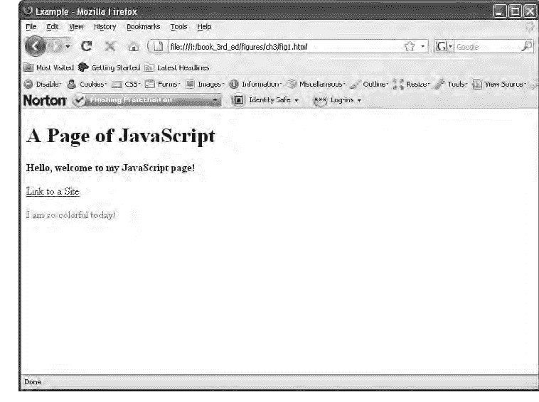

图 3-1 JavaScript 代码在 Web 浏览器中的结果

代码展示了你可以对脚本文件进行的更改以获得新效果。注意你只需要更改 `begineffect` 和 `endeffect` 的值就可以更改页面上文本的格式：

```javascript
var headingtext="<h1>Page of JavaScript</h1>";
var intro="Hello, welcome to my JavaScript page!";
var linktag="<a href=\"http://www.pageresource.com/\">Link to a Site</a>";
var redtext="<span style=\"color:red\">I am so colorful today!</span>";
var begineffect="<em>";
var endeffect="</em>";
```

保存 `ch3_code.js` 文件并重新加载你的 HTML 文档。图 3-2 显示了这些如何影响 Web 浏览器中的页面显示。

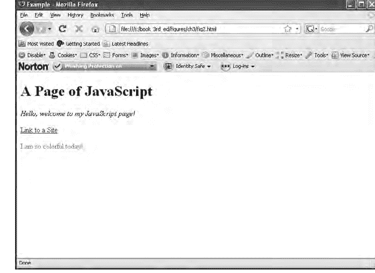

图 3-2 更改某些 JavaScript 变量后的页面

### 使用 JavaScript 创建 HTML 页面

在这个项目中，你将创建一个带有 JavaScript 的 HTML 页面，类似于你在本章中创建的那个。变量将被赋予新值，差异应该是显而易见的。

```
pr3_2.html
prjs3_2.js
```

### 逐步步骤

1. 创建一个 HTML 页面，留出 `<body>` 和 `</body>` 标签之间的空间。

2. 在 `<body>` 和 `</body>` 标签之间，添加 `<script>` 和 `</script>` 标签以链接到名为 `prjs3_2.js` 的文件。将 HTML 文件保存为 `pr3_2.html`。

3. 打开一个文件以使用你的 JavaScript 文件。将其保存为文件名 `prjs3_2.js`。使用此文件添加第 4-10 步中的 JavaScript 代码。

4. 创建名为 `myheading` 的变量并赋予其此值：

   This is My Web Page!

5. 创建名为 `linktag` 的变量并赋予其此值：

   `<a href="http://www.javascriptcity.com">Web Site Link!</a>`

6. 创建名为 `sometext` 的变量并赋予其此值：

   This text can be affected by other statements.

7. 创建名为 `begineffect` 的变量并赋予其值 `<em>`。

8. 创建名为 `endeffect` 的变量并赋予其值 `</em>`。

9. 创建名为 `newsection` 的变量并赋予其值 `<br />`。

10. 按此顺序将每个变量的值写回 HTML 文档：

    ```
    myheading
    newsection
    begineffect
    sometext
    endeffect
    newsection
    linktag
    newsection
    sometext
    ```

当你完成后，保存 `prjs3_2.js` 文件。它看起来应该像这样：

```javascript
var myheading="<h1>This is My Web Page!</h1>";
var linktag="<a href=\"http://www.javascriptcity.com\">Web Site Link<br></a>";
var sometext="This text can be affected by other statements.";
var begineffect="<em>";
var endeffect="</em>";
var newsection="<br />";
document.write(myheading);
document.write(begineffect);
document.write(sometext);
document.write(endeffect);
document.write(newsection);
document.write(linktag);
document.write(newsection);
document.write(sometext);
```

11. 在你的 Web 浏览器中打开 `pr3_2.html` 文件并查看结果。

12. 重新打开 `prjs3_2.js` 文件并进行第 13–14 步中的更改。

13. 将 `begineffect` 的值更改为 `<strong>`。

14. 将 `endeffect` 的值更改为 `</strong>`。

15. 当你完成后，保存 `prjs3_2.js` 文件。它看起来应该像这样：

```javascript
var myheading="<h1>This is My Web Page!</h1>";
var linktag="<a href=\"http://www.javascriptcity.com\">Web Site Link<br></a>";
var sometext="This text can be affected by other statements.";
var begineffect="<strong>";
var endeffect="</strong>";
var newsection="<br />";
document.write(myheading);
document.write(begineffect);
document.write(sometext);
document.write(endeffect);
document.write(newsection);
document.write(linktag);
document.write(newsection);
document.write(sometext);
```

16. 在你的 Web 浏览器中重新加载 `pr3_2.html` 页面。注意 JavaScript 文件中变量值更改带来的差异。

### 本章总结

在这个项目中，你将使用变量的新技能与早期使用 JavaScript 写入网页的技能结合在一起。你创建了一个带有脚本的网页，该脚本使用变量在页面上写入 HTML 代码。你更改了两个变量的值并重新保存了脚本。变量的更改使得发生了可见的变化。

## 第 3 章自测

1. 一个变量代表或持有一个值。

2. 使用变量的两个优点是什么？

   - 它们可以节省你编写和更新脚本的时间，并让你的代码目的更清晰。

   - 它们让你的代码目的更清晰，并让非编码人员更难理解脚本。

   - 它们可以节省你编写和更新脚本的时间，并让非编码人员更难理解脚本。

   - 它们完全没有任何优势。

3. 要声明一个变量，你使用 ________ 关键字。

4. JavaScript 中用什么符号作为赋值运算符？

   A `+`

   B `-`

   C `=`

   D `==`

5. 下列哪一项声明了一个名为 `pagenumber` 的变量并赋予其值为 `240`？

   A `var PageNumber=240;`

   B `pagenumber=220;`

   C `var pagenumber=240;`

6. 变量名是大小写敏感的。

   A True

   B False

7. 变量名必须以字母或下划线开头。

8. 你应该避免使用保留字作为变量名。

   A True

   B False

9. 下列哪项声明使用了有效的 JavaScript 变量名？

   A `var default;`

   B `var my_house;`

   C `var dog;`

   D `var 2cats;`

10. 变量值可以是数字、字符串、布尔值和空。

11. 在 JavaScript 中表示指数，你使用字母 `e` 在基后面。

12. 下列哪种字符串声明是无效的？

    A `var mytext="Here is text";`

    B `var mytext='Here is text!';`

    C `var mytext="Here is text";`

    D `var mytext="Here\n some text";`

13. 下列语句在 JavaScript 中是有效的？

    A `document.write("John said, ");`

    B `document.write('John said, ');`

    C `document.write("John said, ");`

    D `document.write("John said, ");`

14. ________ 字符允许你将内容添加到字符串中。

15. 下列哪项成功打印了名为 `hobby` 的变量并添加到字符串中？

    A `document.write("I like to " + hobby + " weekend");`

    B `document.write('I like to ' + hobby + ' weekend');`

    C `document.write("I like to hobby weekend");`

    D `document.write("I like to 'hobby' weekend");`

## 第 4 章：使用函数

### 核心技能与概念

- 什么是函数

- 为什么函数有用

- 构建函数

- 在脚本中调用函数

作为 JavaScript 程序员，你需要了解如何使用函数。函数可以使脚本更具移植性。

本章介绍了函数的知识。首先，你将发现什么是函数以及为什么有用。然后你将学习如何定义和构建函数。最后，你将学习如何在脚本中调用函数。

### 什么是函数

函数基本上是大脚本中的小脚本。它的目的是执行单个任务或一系列任务。函数的功能取决于你在内部放置了什么。例如，函数可能会向浏览器写入一行文本，或者计算一个数值并将其返回给主脚本。

正如你可能从数学课中学过的，函数可以用于在坐标平面上计算值。你可能见过像这样的计算：

```
f (x) =x+2
y=x+2
```

两者都用于从 x 坐标计算 y 坐标。当你需要 x 等于 3 的 y 时，你用 3 替换 x 来得到结果：3+2=5。

函数本身留在纸上（在我们的案例中，是在脚本中），直到你需要使用它来执行任务。你可以多次使用该函数，从主脚本中进行调用。

### 为什么函数有用

函数实用的另一个原因是它们的可读性。它们可以在脚本中被多次调用以执行其任务。与其重写整个代码块，你只需要再次调用该函数即可。

考虑简单的函数 y=x+2。如果你只使用它一次，这个函数并没有太大意义。如果你需要获取多个值，这个函数就会变得越来越有用。与其为每次计算编写公式，你只需要在每次需要获取 y 值时替换 x 即可。所以，如果你需要在 x 为 3、4 和 5 时获取 y 值，你可以使用三次函数来获取 y 值。函数将分别计算出 5、6 和 7。你不需要编写三个函数的内容，只需要编写一次即可得到三个答案。

函数可以执行复杂的任务，而且可能很长。在本章及后续章节的示例中，你将看到它们在 JavaScript 中有多用且节省时间。

### 函数的结构

现在你已经理解了函数是什么以及为什么要使用它们，你需要学习如何在脚本中构建这些函数的结构。一个函数需要使用其名称和代码进行声明。还有一些可选的添加项可以使函数更加有用。你可以将一个或多个变量导入函数中，这些变量被称为参数。你还可以使用 `return` 语句从函数向主脚本返回值。我们将从观察函数如何开始。

### 声明函数

在函数的第一行，你将其声明为一个函数，并命名，同时指示它是否接受任何参数。要声明一个函数，你使用关键字 `function`，后面跟着它的名称，然后是一组括号：

```
function name()
```

关键字 `function` 告诉浏览器你正在声明一个函数，后面会有更多信息。下一部分信息是函数的名称。之后，括号组表示该函数是否接受任何参数。

例如，要将你的函数命名为 `reallycool` 并指示它不使用任何参数，第一行看起来如下：

```
function reallycool()
```

因为函数没有使用任何参数，所以括号是留空的。和变量名一样，函数的命名也有一些特殊的考虑因素。你将在讨论完函数结构后学习到这些考虑因素。

你可能已经注意到这一行并没有以分号结尾；就像你到目前为止在本书中看到的其他代码行那样。分号之所以缺失，是因为你使用了不同的技术来显示函数代码的开始和结束，正如接文所述。然而，函数内部的每一行单独的代码都会以分号结尾，正如你在本章的示例中看到的那样。

### 定义函数的代码

大括号 (`{ }`) 包围函数内部的代码。左大括号标记函数的开始；然后是代码；最后，右大括号标记函数的结束，格式如下：

```
function reallycool() {
  JavaScript code here
}
```

函数被定义并命名为 `reallycool`

左大括号显示函数内代码的开始

在括号之间此处执行的 JavaScript 代码

右大括号结束函数

当函数被调用时（你将在本章的稍后部分学习），浏览器将执行大括号内的所有代码。当浏览器遇到大括号时，它知道函数已经结束。浏览器将移动到下一行代码，或者继续它在调用函数之前正在做的任何工作。

你在大括号的格式方面具有灵活性。前面示例所示的格式将括号“对齐”，使得函数的开始和结束都在代码的左边距线上。如果你使用需要大括号的其他语句，这种方法非常方便（你将在后面的章节中看到其他使用大括号的语句）。通过对每组括号进行缩进，你可以很容易看到哪些括号嵌套在函数内部，哪些括号开始并结束了函数本身。

另一种常见的格式是将左括号放在与函数声明相同的行，而不是放在下一行：

```
function reallycool() {
  JavaScript code here
}
```

左括号位于第一行，与函数声明在一起

在这种格式中，代码块的左括号在右侧可见，而右括号出现在左侧。如果你想计算代码段内打开了/或关闭了多少个括号，这是一种很有用的技术。

当然，如果你有一个特别短的函数，你甚至可以将整个函数放在一行上，如下所示：

```
function reallycool() { JavaScript code here }
```

大括号之所以具有这种活性，是因为 JavaScript 标记之间的空白符、制表符和换行符是被忽略的（例如变量或函数名、关键字或其他必须保持完好的代码其他部分）。因此，以下代码是有效的：

```
function reallycool() {var a
=
  5; var b = 3; var c = 6; }
```

虽然这可能读起来更困难，但 JavaScript 大括号的使用可能取决于你的编程背景以及你喜欢如何查看代码。JavaScript 解释器接受所有这些样式，因此使用你认为方便查看和编辑的样式。在本书的示例中，我将把左括号放在与函数声明相同的行（如本节的第二种示例格式所示），如果函数特别短，偶尔可能会将整个函数放在一行上（如本节的第三种示例格式所示）。

### 命名函数

与变量一样，函数需要仔细命名，以避免脚本出现问题。适用于变量的基本规则也适用于函数的命名：大小写敏感、使用允许的字符、避免使用关键字以及给函数赋予有意义的名称。

### 注意

如果你已经知道变量命名的规则，你可能想跳过这一节，因为函数的命名规则本质上是相同的。不过，关于选择函数名称，有一些你可能会发现的细节。

### 在函数名中使用大小写

函数名大小写敏感，就像变量名一样。这意味着 `reallycool`、`REALLYCOOL` 和 `ReallyCool` 代表不同的函数。记住，你需要使用与声明时相同的字母大小写来调用你的函数。

### 使用允许的字符并避免关键字

函数名允许使用的字符与你可用于变量名的字符相同：

- 函数名必须以字母或下划线字符 (`_`) 开头。

- 函数名不能包含任何空格。

此外，和变量名一样，你不能使用 JavaScript 关键字作为函数名。这样做会导致函数失败，从而在脚本中引发实际问题。请参阅第 3 章中的“避免关键字”部分获取 JavaScript 关键字的完整列表。

### 赋予函数有意义的名称

如果你选择反映其用途的名称，你的函数将更容易记忆和调试。正如你在第 3 章中学到的，对于变量，你应该使用代表其值的名称，例如对于页面上的示例使用 `example_number`。函数名应该告诉关于该函数要做什么。例如，假设你创建了一个向页面写入内容的函数。它可能包含以下代码行：

```
document.write("<strong>This is a strong statement!</strong>");
```

你可以直接命名为 `text`，但可能不够描述，因为你可能还有其他向页面写入内容的函数。内部，你可能会命名为 `print_string_text`，这样你就知道该函数是用于引入一段加粗文本的。该函数有助于描述函数的用途：

```javascript
function print_string_text() {
  document.write("<strong>This is a strong statement!</strong>");
}
```

与变量一样，脚本中使用的函数越多，为它们使用有意义且易记的名称就越重要。

### 为函数添加参数

参数用于允许函数从外部导入一个或多个值。参数设置函数的第一行括号内，格式如下：

```
function name(variable1, variable2)
```

任何作为参数引入的值都成为函数内部的变量，使用你在括号内赋予它的名称。

例如，这是定义带有参数 `coolcar` 和 `coolplace` 的函数 `reallycool`：

```
function reallycool(coolcar,coolplace) {
  JavaScript code here
}
```

注意，在 JavaScript 中，设置参数时不需要使用 `var` 关键字。JavaScript 在变量设置为参数时会自动声明变量，因此不使用 `var` 关键字。例如，像这样的一行是无效的：

```
function reallycool(var coolcar, var coolplace)
```

参数最初从哪里来呢？它们是在你调用函数时从函数外部获取的。你将在本章的稍后部分看到它是如何运作的。现在，你只需要知道它们是如何作为 JavaScript 函数的参数使用的。

### 注意

在其他语言中，当变量设置为参数时通常要求对其进行声明，但 JavaScript 会为你完成这一点。然而，当你在其他任何地方声明变量时，你需要使用关键字。

### 使用函数参数值

当你给函数赋值参数时，你可以像使用任何其他变量一样使用它们。例如，在这个示例中，你可以通过赋值将 `coolcar` 变量的值赋给另一个变量：

```
function reallycool(coolcar,coolplace) {
  var mycar=coolcar;
}
```

`coolcar` 变量的值被赋值给 `mycar` 变量。

这将 `coolcar` 参数的值赋给了名为 `mycar` 的变量。

与其将其值赋给另一个变量，你可以在函数中使用 `coolcar` 参数，如下例所示：

```
function reallycool(coolcar,coolplace) {
  document.write("My car is a "+coolcar);
}
```

`coolcar` 变量的值被用于 `document.write()` 命令中。

如果 `coolcar` 的值为 `Corvette`，那么当函数被调用时，它将在浏览器中打印出这一行：

My car is a Corvette

`coolcar` 参数是这里给出的值。实际上，该值必须来自主脚本或另一个函数的某个处，否则该变量将没有值。

### 使用多个参数

你可能已经注意到上一个示例有两个参数，但你可以根据需要使用任意数量的参数。当你分配多个参数时，函数不需要使用所有参数。你可以使用一个参数、几个参数或一个都不使用。使用多少取决于函数的功能以及它是如何调用的。

唯一的规则是，如果你有多个参数，需要用逗号分隔每个参数，这样浏览器才知道该如何做。

在上一个示例中，第二个参数没有被使用。以下是你如何更改函数以使用两个参数的：

```
function reallycool(coolcar,coolplace) {
  document.write("My car is a "+coolcar+" and I drive it to "+coolplace);
}
```

两个参数都在此 `document.write()` 中作为变量使用

现在，如果 `coolcar` 的值为 `Corvette` 且 `coolplace` 的值为 `Las Vegas`，当函数被调用时，它将在浏览器中打印出以下行：

My car is a Corvette and I drive it to Las Vegas

你可以在函数第一行的括号内放置函数所需的任意数量的参数。这里有一个有四个参数的示例：

```
function reallycool(coolcar,coolplace, coolfood, coolb)
```

记住，当你有多个参数时，要用逗号分隔每个参数。

### 在函数中添加返回语句

`return` 语句用于确保函数向主脚本返回特定值以便在主脚本中使用。你将 `return` 语句放在函数结束大括号之前的最后一行，并以分号结束。通常情况下，返回的值是一个变量，格式如下：

```
return variablename;
```

例如，要返回变量 `cooltext` 的值，`return` 语句如下：

```
return cooltext;
```

这会将 `cooltext` 的值返回到主脚本中调用函数并获取结果的地方。

假设你想写一个返回两个字符串相加结果的函数。你可以像示例一样使用 `return` 语句：

```
function get_added_text() {
  var textpart1="This is "
  var textpart2="fun!"
  var added_text=textpart1+textpart2;
  return added_text;
}
```

带有字符串相加结果的变量被返回给脚本。

在这个函数中，前两个变量被赋值了字符串值，`added_text` 变量被赋予了值。

### 在脚本中调用函数

将 HTML 文件保存为 `js_alert.html` 并在 Web 浏览器中查看。如你所见，这无疑是在页面打开时显示警告的一种简单方法。然而，由于你正在学习函数，你将采用另一种方法。

### 使用函数进行 JavaScript 警告

以下代码在你的外部 JavaScript 文件中使用函数来弹出警报框。在你的 `js_alert.js` 文件中，将代码更改为如下：

```javascript
// 命名并开始函数
function show_message() {
    window.alert("This is an alert!"); // 函数中使用了 window.alert() 命令
}
show_message(); // 函数被调用并执行，导致警告框弹出
```

此示例创建了一个名为 `show_message()` 的函数来执行显示警告的工作。只有在定义函数后的某个地方调用了 `show_message()` 函数，警告才会显示。在这种情况下，该函数在定义后立即被调用。结果是一个带有消息“This is an alert!”的小警报框。

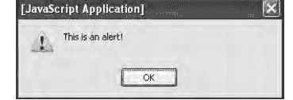

### 注意

当警告框出现时，你可能会看到页面暂停，直到你点击 OK 按钮，或者它会在等待你点击 OK 时继续加载。这取决于你的浏览器。

即使函数已经定义，但并不意味着它在被调用之前会被执行；换句话说，在 JavaScript 运行脚本中的函数调用之前，不会使用该函数。

在函数调用之前的任何命令（不属于函数定义部分的命令）都将在函数之前执行。例如，我们可以如下更改 JavaScript 文件中的代码：

```javascript
// 定义了函数
function show_message() {
    window.alert("This is an alert!"); // 这个警告在函数被调用时才会发生
}
window.alert("I am first, ha!"); // 这个警告先显示
window.alert("I am second, ha ha!");
show_message(); // 这个警告是第二个
// 最后才调用该函数，以便其内部的警告能够显示
```

此示例在第一行定义了相同的函数 `show_message()`。函数之后是两个独立的 `window.alert` 命令，然后是调用函数的行。用此新代码保存 `js_alert.js` 文件并在 Web 浏览器中重新加载 `js_alert.html` 文件。你应该能看到一个有趣的结果！

这两个警告命令是 JavaScript 的第一个可执行语句，它们首先执行。对我们函数的调用最后被看到，因此函数最后执行。结果是三个警告，顺序如下：

- 用户收到一个警告“I am first, ha!”，并且需要点击 OK 按钮将其消除。

- 接着出现显示“I am second, ha!”的警告，观众需要再次点击 OK。

- 最后，函数执行，观众看到“This is an alert!”，并需要第三次点击 OK 来结束警告。

尽管这个示例在警告的使用上有些过头，但它能帮助你理解函数调用是如何工作的。

如果你不在意警告显示的快慢，脚本也可以在 `body` 部分被调用。随着你编程经验的增加，选择将 `<script>` 标签放置在 `head` 还是 `body` 部分将变得越来越容易。当你使用来自 HTML 文档 `body` 的信息时，`<script>` 标签通常放置在 `head` 部分，并设置一个函数在页面加载时初始化变量和函数（使用事件处理，将在第 7 章中讨论），或者放置在 `body` 部分（就在结束 `</body>` 标签之前）。我将在本书中使用后一种方法。

### 从另一个函数调用函数

在另一个函数内部调用函数是组织事件发生顺序的一种有用方法。通常，函数被放置在另一个有更大任务需要完成的函数内部。

当你将函数放在函数内部时，你应该在定义调用它的函数之前定义被调用的函数，遵循“函数在调用之前定义”的建议。

这里有两个函数的示例，第二个函数调用了第一个函数：

```javascript
// 这个函数负责显示警告
function update_alert() {
  window.alert("Welcome! This site is updated daily!");
}
function call_alert() {
  update_alert();
}
call_alert();
```

注意 `update_alert()` 函数是所有实际操作发生的地方。其他所有内容都是函数调用。`call_alert()` 函数做的仅仅是调用 `update_alert` 函数以便其执行。最后，你看到了启动整个序列的命令，即对 `call_alert()` 函数的调用。由于这是函数外的第一个 JavaScript 语句，它首先执行。当它执行时，它只是调用了 `update_alert()` 函数，该函数执行显示警告的工作。

### 注意

如果你在调用 `update_alert()` 函数之后定义它，大多数浏览器都会顺利地执行先前的示例。然而，某些浏览器可能不会宽容，要求函数在调用之前就存在。此外，如果函数在代码中太靠后而无法及时加载，它将无法正常工作。因此，在调用之前定义函数是正常的。

现在假设你想创建三个函数来执行任务。为了确保它们按照正确的顺序发生，你可以在另一个函数内部调用它们。这里是这种技术的示例，包含三个为了不同目的而调用警告的函数：

```javascript
function update_alert() {
  window.alert("Welcome! This site is updated daily!");
}
function section_alert() {
  window.alert("Please visit the picture section!");
}
function links_alert() {
  window.alert("Also, check out my links page!");
}
function get_messages() {
  update_alert();
  section_alert();
  links_alert();
}
get_messages();
```

代码开始于定义三个调用每个警告的函数。然后定义了 `get_messages()` 函数，它调用了之前的三个函数。当然，必须调用 `get_messages()` 函数才能实际执行此操作。此操作作为函数外的第一个语句发生。

当然，创建一个一个接一个又一个地弹出消息的脚本通常不是你想要做的。尽管该示例演示了函数调用的正确用法，但一个这样的脚本可能会骚扰你的观众！你将在后面的章节中看到函数的实际用例示例。

### 带参数调用函数

上一个示例使用了不同的函数来显示三个警告。虽然这种方法可行，但如果不需要为每个警告编写一个新函数就太好了。你可以通过使用参数来避免这种情况。你可以创建一个多次使用的函数来执行相同的操作，但每次带有新的信息。

正如前面提到的，变量通常用作参数。然而，你也可以使用值参数。你将先学习不同类型的变量，然后查看值参数。

如果你想将变量的值发送到函数，你必须先声明变量，并在发送之前确保它们拥有你需要的值。在这里，变量的作用域变得很重要。JavaScript 有全局变量和局部变量。

### 使用全局变量

全局变量是你在第 3 章中学过的变量。因为它们定义在函数之外，所以可以在脚本的任何地方进行更改。全局变量定义在函数之外，如下代码所示：

```javascript
var mycar="Honda";
var paycheck="1200";
```

这些是声明的全局变量

示例中的变量可以在脚本中被更改。这意味着它们可能会被函数意外覆盖或更改。

为了理解全局变量如何受到函数的影响，请考虑这样一个示例：显示一个警告告诉你获取某特定汽车需要多少钱，你希望另一个警告告诉你你现在有多少钱以及现在拥有什么类型的汽车。如果你使用以下代码会发生什么？

```javascript
var mycar="Honda";
var paycheck="1200";
function new_car() {
  mycar="Ferrari";
  paycheck=3500;
  window.alert("You need $"+paycheck+" to get a ");
}
```

哎！函数给变量赋值

这里的警告如你预期的

这里的警告并不如你预期的，因为变量被意外更改

看起来像你在函数内部创建了新变量，尽管它们的名称相同。脚本将在两个警告中输出以下文本：

You need $3500 to get a Ferrari

You make $3500 and have a Ferrari

显然，这是不对的。

此示例演示了为什么在声明变量时需要使用 `var` 关键字。如果不使用 `var` 关键字，你并没有在函数内部创建新变量（这将使它们变成局部变量）。相反，你正在改变全局变量的值——你发出的是一条重新赋值命令，而不是新变量定义命令。为了澄清这一点，你需要更改一组变量名，或者像下一节描述的那样使用局部变量。

### 使用局部变量

局部变量只能在声明它的函数内部使用。除非通过参数将其传递给另一个函数，否则它在函数外部是不存在的。

在函数中创建局部变量的关键在于使用 `var` 关键字进行声明。否则，正如你在上一个示例中看到的，任何同名的全局变量都会被改变。要声明局部变量，你必须将其放在函数内部并使用 `var` 关键字，如代码所示：

```javascript
function new_car() {
  var mycar="Ferrari";
  var paycheck="3500";
}
```

`mycar` 和 `paycheck` 变量现在是局部变量，只能被 `new_car()` 函数看到和修改。

因此，为了修正上一节中的脚本，你只需要在函数内部添加 `var` 关键字来声明局部变量，如下：

```javascript
var mycar="Honda";
var paycheck=1200;
function new_car() {
  var mycar="Ferrari";
  var paycheck=3500;
  window.alert("You need $"+paycheck+" to get ");
}
```

现在提示框应该按照你的预期出现：

- 你需要 $3500 买一辆 Ferrari

- 你赚了 $1200 且有一辆 Honda

你可以看到，当你将某些变量作为参数传递给函数时，变量的作用可能很重要。

### 将变量作为函数参数

以下示例使用了变量参数。它将全局变量传递给函数，然后将其赋值给局部变量以避免意外更改。

```javascript
function check_alert(pcheck) {
  var paycheck=pcheck;
  window.alert("You make $ "+paycheck);
}
var paycheck=1200;
check_alert(paycheck);
```

函数接受一个参数。参数的值被赋值给局部变量。

变量被赋值了一个值

该值作为参数传递给函数

脚本从 `check_alert()` 函数开始，它接收参数 `pcheck`。函数内部的代码行将该值赋值给局部变量 `paycheck`。这样，你可以在函数内部使用 `paycheck` 以避免改变全局变量。然后使用该函数显示一个使用 `paycheck` 值的提示。在函数之后，在外部作用域中，全局变量被赋值为 1200。然后代码调用 `check_alert()` 并发送了 `paycheck` 变量的值。

上一个示例展示了避免更改全局变量的一种冗方法。由于函数参数是以变量值的形式发送的，你可以更改函数定义中括号内函数接收的参数名称。这会从传递给函数的参数中创建一个局部变量。这里是一个示例：

```javascript
function check_alert(pcheck) {
  window.alert("You make $ "+pcheck);
}
var paycheck=1200;
check_alert(paycheck);
```

函数接收一个参数并给它一个局部变量名

局部变量用于提示框

当这段代码调用 `check_alert()` 函数时，它向该函数发送了 `paycheck` 变量的值。该值在函数内部被提取。与其将其命名并赋值给另一个变量，你只需要在括号内使用另一个名称：`pcheck`。`pcheck` 变成了 `check_alert()` 内部的局部变量。由于代码向 `pcheck` 发送了值 1200，它将是 1200，除非你在函数稍后更改了它。

### 使用值参数

你可以直接发送一个值作为参数。不需要为了发送参数而声明全局变量，你可以发送一个值，该值将在函数内部转换为局部变量。这允许你动态发送值并消除了对全局变量处理器的需要。

需要记住的一点是，如果你发送的是字符串值，需要将其包含引号中。以下函数向名为 `text_alert()` 的函数发送 `"something"`：

```javascript
text_alert("something");
```

例如，上一节的最后一个示例可以修改，通过使用值参数在一行代码中添加更多信息：

```javascript
function check_alert(pcheck,car) {
  window.alert("You make $"+pcheck+" and have a "+car+"");
}
check_alert(1200,"Corvette"); // 函数接收的是数值值和字符串，而不是变量值
```

在此示例中，函数被调用了两个参数。第一个是数值值，不需要引号。第二个值是字符串，需要包含引号内。这些值被发送到函数，并在其中分别被读取为局部变量 `pcheck` 和 `car`。它们现在可以在函数中使用并在提示框中显示句子：

你赚了 $1200 且有一辆 Corvette

也可以使用表达式发送参数，例如：

```javascript
check_alert(500+700,"Cor"+"vette");
```

JavaScript 将评估每个表达式并将结果作为参数发送给函数。因此，前面的代码将产生相同的结果（500 加 700 得到 1200，“Cor” 加 “vette” 得到 “Corvette”）：

你赚了 $1200 且有一辆 Corvette

### 参数是可选的

另一点需要说明的是，发送参数是可选的。你可以使用条件语句来处理未发送参数的情况。以下使用条件判断检查是否发送了参数的方法：

```javascript
function check_alert(pcheck,car) {
  if (pcheck && car) {
    window.alert("You make $"+pcheck+" and have "+car+"");
  } else {
    window.alert("My parameters are missing!");
  }
}
check_alert();
```

这实际上告诉 JavaScript 在写入语句之前检查参数是否存在。如果存在，则写入语句。如果不存在，用户会收到“My parameters are missing!”的提示。逻辑运算符 `&&` 将在第 5 章详细讨论，`if/else` 语句将在第 6 章详细讨论。

### 调用带返回的函数

要调用带有返回语句的函数，你可以将函数的结果赋值给变量。这样，变量就获得了函数返回的值并可以在脚本后续使用。这是声明函数返回值的变量格式：

```javascript
var variablename=functionname();
```

考虑上一个示例，它有一个返回两个文本相加值的函数。你可以修改它，将函数结果赋值给变量，如下：

```javascript
function get_added_text() {
  var textpart1="This is ";
  var textpart2="fun";
  var added_text=textpart1+textpart2;
  return added_text; // 将相加文本的结果返回给脚本
}
var alert_text=get_added_text(); // 函数的结果赋值给变量
window.alert(alert_text); // 将变量的值用作提示的文本
```

如所示，函数将相加文本的值返回给脚本。通过赋值给 `alert_text` 变量，你可以在脚本中使用该相加文本。该变量用于向用户发送带有相加结果的提示。提示信息为

This is fun!

现在，这很有趣吧？在第 14 章学习验证时，你将看到更多返回方法的实际应用。

### 定义函数的其他方式

有几种定义函数的方法，你在查看脚本时可能会遇到，或者在编写新脚本时发现有用：函数声明（已讨论）、函数构造函数和函数表达式。

### 函数声明

这是你到目前为止一直使用的方法，也是书中经常使用的方法。正如你所记得的，你只需要如下所示声明函数：

```
function functionname() {
  Code for function here
}
```

你还可以像本章前面提到的那样，添加参数和/或返回语句。

### 函数构造函数

函数构造函数创建函数对象的方式你创建一个新实例的方式相同（将在第 8 章中讨论）：

```
var functionname = new Function (arguments, code for function);
```

它的工作方式与其他方法类似，但这种方法的主要缺点是它的性能低于其他方法（它在每次使用时都会被求值，而不是解析一次）。此外，你将使用另外两种方法之一来定义函数。

### 函数表达式

函数表达式（也称为函数运算符）使用的语法与函数声明相同。它与与函数名同名的变量的主要区别是：函数声明可以在函数外部使用，而函数表达式只能在函数内部通过名称访问它。例如，下面的代码使用了函数声明，并可以使用函数名作为变量输出警报（变量的值将是函数的所有代码）：

```javascript
function send_alert() {
  var my_num = 1;
}
window.alert(send_alert);
```

相反，下面的代码在运行时会产生错误：

```javascript
var get_func = send_alert() {
  var my_num = 1;
}
window.alert(send_alert);
```

如前面的代码所示，函数表达式也使用了函数名。然而，函数名不能在函数外部作为变量使用。

### 注意

在 Internet Explorer 7 中（截至本文编写时），这种函数表达式的用法不会报错，而是会产生与函数声明相同的结果。要测试这种差异，可以使用 Mozilla Firefox。

**匿名函数** 这种表达式的一种有效用法是在不带函数名的情况下使用它来创建一个匿名函数。匿名函数是同时被创建和调用的函数，当你只想在代码的某一个地方调用函数时，它非常有帮助（而不是在代码的其他地方声明函数并通过多次调用来复用它）。以下是匿名函数的通用格式：

```
var varname = function(parameters) {
  Code for function
};
```

这使用了 `function` 关键字，但没有使用函数名。

处理 JavaScript 事件时，匿名函数非常有用。例如，为了响应用户在 Web 页面上的鼠标点击，你可以为 document 的点击事件编写一个简单的函数，然后调用它，如下面的代码所示：

```javascript
function do_not_click() {
  window.alert("Do click on my page!");
}
document.onclick = do_not_click;
```

这声明了函数，然后调用了它（不带括号）来处理点击事件。

然而，你可以使用匿名函数将这两个步骤合并为一步，如下：

```javascript
document.onclick = function() {
  window.alert("Do not click on my page!");
};
```

由于对该事件的响应只会在 JavaScript 代码中的一处，因此匿名函数是处理事件的一种方式，不需要在其他地方声明函数然后调用它。这种技术以及用于事件处理的代码类型（如上面的代码列表）将在第 7 章中进行详细讨论。

### 提问专家

**Q：如果我在脚本中放入了一个函数，但决定不在脚本中调用它，这会有影响吗？**

**A：** 除非函数被调用，否则它不会执行。然而，拥有未使用的函数会使代码更难以维护，并增加查看者的下载时间（这在拨号上网等慢连接或需要优化代码下载时间的情况下可能会产生影响）。此外，如果函数包含语法错误，可能会向查看者发送 JavaScript 错误，并阻止网页上的其他功能正常工作。

**Q：如果我以后决定从脚本中删除一个函数会发生什么？**

**A：** 如果你没有删除对该函数的调用，就会导致问题。脚本可能会导致 JavaScript 错误；或者运行但给你意料之外的结果。此外，在删除函数之前，请确保它没有在脚本的某处执行必要的任务。

**Q：那么，如果我调用一个不存在的函数会怎样？**

**A：** 你要么得到一个 JavaScript 错误，要么浏览器在调用该函数时什么都不做，因为找不到该函数。

**Q：确定何时使用函数以及何时直接将我想要的内容写在脚本中的最佳方法是什么？**

**A：** 在大多数情况下，如果函数内部的代码可以以某种方式被复用，你就应该使用函数。执行特定计算的实例可能在脚本的多个处都很有用。此外，如果你只是喜欢更有组织地组织代码，函数会有很有帮助。如果你决定代码在脚本中只使用一次，你只需将代码直接放入脚本中，或者为它使用匿名函数。

### 尝试一下 4-1 创建一个带有函数的 HTML 页面

```
pr4_1.html
prjs4_1.js
```

在这个项目中，你创建了一个带有两个 JavaScript 函数的 HTML 页面。一个函数使用发送给它的参数来弹出一个带有消息的警报框。另一个函数使用返回语句将值传回脚本。该返回的值随后被用于警报消息中显示给查看者。

### 逐步步骤

1. 创建一个 HTML 页面，在 `<body>` 和 `</body>` 标签之间留出空间。

2. 创建一个外部 JavaScript 文件并将其保存为 `prjs4_1.js`。

3. 在 HTML 文档的 `<body>` 和 `</body>` 标签之间添加必要的 `<script>` 标签以包含该外部 JavaScript 文件。将 HTML 文件保存为 `pr4_1.html`。

4. 打开 `prjs4_1.js` 外部 JavaScript 文件并执行步骤 5–10。

5. 创建一个名为 `car_cost()` 的函数，接受两个参数 `mycar` 和 `paycheck`。创建一个 `window.alert` 命令，显示带有以下消息的警报：

You have a `<mycar variable>` and $`<paycheck variable here>`

6. 创建一个名为 `get_added_text()` 的函数，返回函数内部相加的两个字符串的值。要相加的两个字符串是以下两行：

```
This project<space here>
is most fun!
```

7. 在主脚本中（函数定义之后），调用 `car_cost()` 函数，并发送 `"Mustang"` 和 `1500` 参数值。

8. 在主脚本中（函数定义之后），将 `get_added_text()` 函数的结果赋值给名为 `alert_text` 的变量。弹出一个显示该变量值的警报。

9. 完成后，你的外部 JavaScript 文件应该像所示：

```javascript
function car_cost(mycar,paycheck) {
window.alert("You have "+mycar+" and make "+paycheck);
}
function get_added_text() {
var text1="This project ";
var text2="is most fun!"
var added_text=text1+text2;
return added_text;
}
car_cost("Mustang",1500);
var alert_text=get_added_text();
window.alert(alert_text);
```

10. 保存外部 JavaScript 文件。

11. 打开 `pr4_1.html` 文件并在浏览器中查看以查看结果。

当你打开 Web 页面时，你应该看到两个警报消息：

You have a Mustang and make $1500

This project is most fun!

### 尝试一下总结

在这个项目中，你创建了一个包含两个 JavaScript 函数的脚本。第一个函数根据发送给它的参数使用并创建一个带有消息的警报框。第二个函数在相加两个字符串后向脚本返回一个值。浏览器中的脚本结果根据发送给第一个函数的信息和从第二个函数返回给脚本的信息产生警报消息。

### 综合运用

现在你已经学习了使用函数的各种基础，请看一眼下面这个很长的页面。这个页面在 HTML 文档中添加了 JavaScript。尝试仔细阅读它，看看它是如何工作的，以及它会执行什么。

```html
<body>
<h1>Welcome to my Function Page, I said.</h1>
<script type="text/javascript">
function get_added_text(textpart1,textpart2) {
  var var_added_text=textpart1+" "+textpart2;
  return var_added_text;
}
function print_text() {
  var myfood=get_added_text("cheese","bread");
  document.write(myfood);
}
var alert_text=get_added_text("soup","crackers");
window.alert(alert_text);
print_text();
</script>
<p style="color:red">I'm seeing red!</p>
</body>
```

首先，你会看到定义了两个函数。`get_added_text()` 函数用于合并两段文本，在它们之间添加一个空格，并将该值返回给调用它的地方。`print_text()` 函数用于将一些文本作为参数发送给 `get_added_text()` 函数，在所有函数之后将结果赋值给变量，并将结果打印到页面本身。

执行的第一条命令是所有函数之后的那条命令。就是这一行：

```javascript
var alert_text=get_added_text("soup","crackers");
```

这一行正在声明一个变量 `alert_text`，并将 `get_added_text()` 函数在接收 `"soup"` 和 `"crackers"` 作为参数时返回的值赋值给它。结果将是这两个值之间带有一个空格。返回的字符串 `"soup crackers"` 现在被赋值给 `alert_text` 变量。

执行的下一行是紧随其后的那一行，所示：

```javascript
window.alert(alert_text);
```

弹框显示了赋值给 `alert_text` 变量的文本，即 `get_added_text()` 函数返回的合并字符串。

接下来是调用 `print_text()` 函数开始执行。

`print_text()` 函数执行的第一件事是声明一个名为 `myfood` 的变量，并将 `get_added_text()` 函数返回的值赋值给它。它发送了 `"cheese"` 和 `"bread"` 作为参数。因此，返回的值是 `"cheese bread"`，它将被赋值给 `myfood` 变量。然后 `print_text()` 函数获取该值并使用 `document.write()` 方法将其写入屏幕。


图 4-1 和图 4-2 显示了此脚本在浏览器中运行的结果。图 4-1 显示了首先弹出的警框，图 4-2 显示了点击警框中的 OK 后页面查看器看到的内容。

这个示例展示了你如何使用在本章中学习的各种技术来结构化函数、为函数添加参数、在函数内部调用函数以及使用 `return` 语句。这些都可以在单个脚本中使用，以便需要时执行它们被分配的任务。

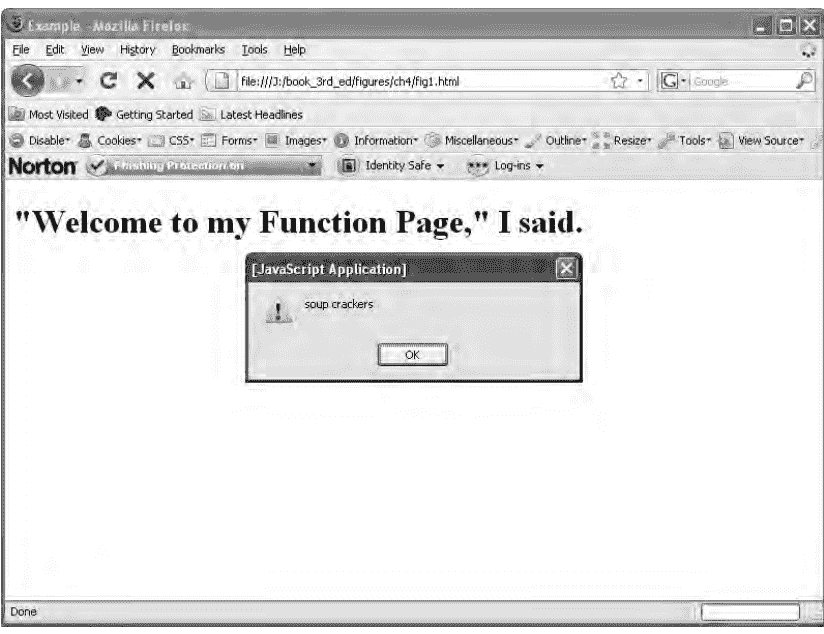

图 4-1 在页面加载前或加载期间出现的警框

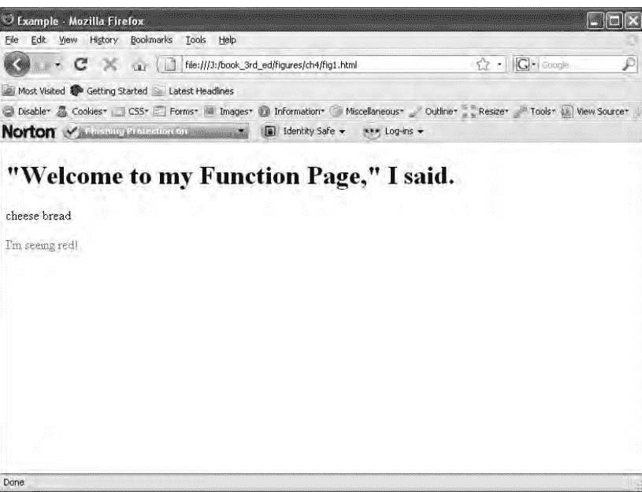

图 4-2 点击警框中的 OK 按钮后出现的页面

### 尝试一下 4-2 编写自己的函数

在这个项目中，你再次创建一个带有 JavaScript 函数的 HTML 页面，但对于这个项目，你使用自己的变量和函数名，并创建你自己的版本的脚本。

```
pr4_2.html
prjs4_2.js
```

### 步骤详解

- 1. 创建 HTML 文件并将其保存为 `pr4_2.html`。
- 2. 创建外部 JavaScript 文件并将其保存为 `prjs4_2.js`。在步骤 3–6 使用此文件。
- 3. 创建一个接收两个字符串作为参数的函数。让它返回两个字符串相加值，但之间有一个空格。
- 4. 创建第二个函数，获取第一个函数的结果并将其赋值给变量。将此变量的值直接写入 HTML 文档。发送给第一个函数的参数是字符串 "Hi" 和 "there!"。
- 5. 在主脚本中，创建一个新变量并将第一个函数的结果赋值给它。这次发送两个字符串 "Regular" 和 "text!"。
- 6. 创建一个警框，在警框中显示此变量的值。
- 7. 在 HTML 页面的 body 中，放置脚本标签（指向 `prjs4_2.js` 文件），以便脚本在读取为 "This is some text." 的加粗文本之后写入第二个函数的结果。
- 8. 完成后，保存 HTML 和 JavaScript 文件，并在浏览器中查看 HTML 页面以查看它是如何工作的。

结果应该是一个显示 "Hi!" 的警框，随后在点击警框中的 OK 后打开页面。页面应该显示一行显示 "This is some strong text." 的加粗文本。在下一行，应该有显示 "Regular text!" 的文本。

### 尝试一下总结

在这个项目中，你利用关于函数、参数和返回值的知识创建了一个脚本。在这个项目中，你使用了函数、参数和返回值的知识来创建一个脚本。在这个项目中，你使用了函数、参数和返回值的知识来创建一个脚本。

## 第 4 章测试

测试：

- 1. 运算符 ________ 用于合并两个值，在它们之间添加一个空格。
- 2. 运算符 ________ 在脚本中很有用。
- 3. 运算符 ________ 允许 ________ 外部的值。
- 4. 运算符 ________ 在 JavaScript 中。
- 5. 运算符 ________ 包裹函数内部的代码。
- 6. 函数名是区分大小写的。
- 7. ________ 可以用作函数名。
- 8. 以下哪项是 JavaScript 的有效函数？
- 9. ________ 用于执行不同的任务。
- 10. 运算符 ________ 在函数的第一行设置。
- 11. 多个参数由什么符号隔开？
- 12. 以下哪项是 `window.alert()` 的有效用法？
- 13. 以下哪项正确调用名为 `some_alert` 的函数并发送两个字符串值？
- 14. 以下哪项正确将 `get_something()` 函数的结果赋值给变量？
- 15. ________ 变量只能在声明它的函数内部。

# 第 5 章 JavaScript 运算符

### 关键技能与概念

- 理解运算符类型
- 理解数学运算符
- 理解赋值运算符
- 理解比较运算符
- 理解逻辑运算符
- 理解运算顺序

## 理解运算符类型

运算符在脚本中承担了大部分工作。在之前的章节中，你已经看到了赋值 (`=`) 和加法 (`+`) 运算符的使用示例。JavaScript 提供了许多其他类型的运算符。

本章首先对不同类型的 JavaScript 运算符进行介绍。然后你将学习每个运算符及其在脚本中的用法。最后，你将学习运算符的优先级，它决定了先执行哪些操作。

### 数学运算符

这些运算符主要用于对两个值进行数学计算。数学运算符可能是你最熟悉的。你使用符号如 `+`, `-`, `*`。

### 赋值运算符

这些运算符用于为变量分配新值。正如你在第 3 章学到的，赋值运算符之一是符号 `=`。

### 比较运算符

这些运算符用于比较两个值、两个变量，或者更长的语句。它们使用符号如 `>`（表示“大于”）和 `<`（表示“小于”）。

# 第5章：JavaScript 运算符

- 逻辑运算符：用于比较两个条件语句（或对一个语句进行操作），以确定结果是否为真并据此执行。我们使用符号如 `&&`（如果运算符两边的语句均为真，则返回真）和 `||`（如果运算符任一侧语句为真，则返回真）。
- 位运算符：这些是在位级别（即 0 和 1）上运行的逻辑运算符。我们使用如 `<<`（位左移）和 `>>`（位右移）等符号。
- 特殊运算符：执行自身特殊功能的运算符。

在本章中，你将学习这些运算符中的每一种。这将是对每种类型运算符功能的通俗概述，以便你在以后使用它们时，能够很好地了解所有运算符的目的。首先，你将查看 JavaScript 中的数学运算符。

# 理解数学运算符

对于数学计算，你会使用数学运算符。你使用的值可以是你喜欢的任何类型。例如，你可以使用两个变量、两个数字，或者一个变量和一个数字。其中一些运算符能够对单个变量的值执行任务。

作为一个快速的示例，你可能记得在之前的章节中，你使用加法运算符 (`+`) 将两个字符串相加。这里有一个使用加法运算符组合两个字符串值的示例：

```
window.alert("I begin and " + "+ this is the end.");
```

当其中一个值为变量时，你也可以使用加法运算符，如下例所示：

```
var part2="this is the end."
window.alert("I begin and " +part2);
```

当两个值都是变量时，加法运算符同样有效，如下例所示：

```
var part1="I begin and "
var part2="this is the end."
window.alert(part1+part2);
```

这些示例说明了你如何对多个值和/或变量使用数学运算符。这让你编写脚本时具有一定的灵活性。

作用于单值的三个运算符是递增、递减和取反运算符。递增和递减运算符实际上是加减 1 的快捷方式，因此学习如何使用它们可以节省你的编码时间。

数学运算符及其功能总结在表 5-1 中。接下来的章节将详细讨论每个运算符。

| 运算符 | 符号 | 功能 |
| :--- | :--- | :--- |
| 加法 | + | 将两个值相加 |
| 减法 | - | 从一个值中减去另一个值 |
| 乘法 | * | 将两个值相乘 |
| 除法 | / | 用一个值除以另一个 |
| 取模 | % | 用一个值除以另一个并返回余数 |
| 递增 | ++ | 给单个数字加 1 的快捷方式 |
| 递减 | -- | 给单个数字减 1 的快捷方式 |
| 一元取反 | - | 使正变负或负变正 |

表 5-1 数学运算符

# 加法运算符 (+)

如你所见，加法运算符可以组合两个字符串。它也用于在数学计算中相加数字。

### 用于结果变量

用途之一是将两个数字相加得到数学结果。在相加数值时，将结果赋值给变量，稍后使用该变量来利用结果。例如，计算 4 加 7 的值并显示结果，你可以这样编写：

```
var thesum=4;                   // 使用加法运算符相加两个数字
window.alert(thesum);      // 将加法结果作为警框显示给观众
```

结果是一个显示 11 的警框。

为了让示例稍微复杂一点，你可以将其中一个数字改为变量：

```
var num1=4;               // 将一个数字赋值给变量
var thesum=num1+7;         // 将数字加到变量上
window.alert(thesum);      // 将总和赋值给新变量
```

结果与上一个示例的代码相同：一个显示 11 的警框。

进一步扩展示例，你可以将两个数字都变成变量：

```
var num1=4;
var num2=7;
var thesum=num1+num2;      // 使用加法运算符相加两个变量
window.alert(thesum);      // 运算符
```

这个示例提供了最大的灵活性，因为你可以更改两个数字变量的值并获得新结果，而无需深入脚本内部进行更改。

# 加法计算中的类型转换

在处理数学运算符工作时，注意 JavaScript 如何执行类型转换是非常重要的。当你使用加法和其他数学运算符时，你需要意识到 JavaScript 会自动将值（如整数（非小数数值）和浮点数（小数数值））转换为适当的类型。例如，你可能有以下代码：

```
var num1=4.73; // 这个变量有小数位
var num2=7; // 这个变量是整数
var thesum=num1+num2;
window.alert(thesum);
```

当你运行脚本时，你会看到一个带有结果的警框：

JavaScript 将整数和浮点数相加并返回了一个浮点数：11.73。JavaScript 经常这样做，因此你需要确保在开始相加时拥有正确的值。

例如，如果你将一个数字和一个字符串相加，结果将就像你相加两个字符串一样。看这个示例：

```
var num1=4; // 这个变量是数字
var num2="7"; // 噢！这个变量是字符串
var thesum=num1+num2; // 当它们相加时，它们像字符串一样拼接
window.alert(thesum);
```

这看起来像是相加了数字 4 和 7，但在这种情况下它们是数字，因为 7 外层有引号。这种这导致 4 被转换成了字符串，两个字符串拼接在一起而不是数学相加。对于字符串，`"4"+"7"=47`。

### 注意

除了加法运算符 (`+`)，其他数学运算符只作用于数字，不适用于字符串值。

其他数学运算符也会进行转换，就像加法运算符一样。当你以后学习如何在脚本中使用用户输入时，你会发现这很重要。

# 减法运算符 (-)

减法运算符用于从左侧的值中减去右侧的值，就像数学中一样。这是一个示例：

```
var result=10;
window.alert(result); // 使用减法运算符相减两个数字
```

这段代码从 10（运算符左侧的数字）中减去 3（运算符右侧的数字）。结果是一个显示 7 的警框。

与加法运算符一样，你可以使用变量来保存你正在处理的数字。如下例：

```
var num1=10;
var num2=3;
var result=num1-num2;
window.alert(result); // 使用减法运算符相减两个变量
```

结果与上一个示例相同：一个显示 7 的警框。

数学运算符对变量的使用也适用于乘法、除法和取模运算符，这些将在后续章节中介绍。

# 乘法运算符 (*)

乘法运算符用于将其右侧的值乘以左侧的值。再次，这就像数学乘法一样。下一个示例展示了该运算符的作用：

```
var num1=4;
var num2=5;
var thetotal=num1*num2;
window.alert(thetotal); // 使用乘法运算符相乘两个变量
```

在这里，你得到的是一个显示 20 的警框，即 4 乘以 5 的结果。这个运算符不会给你带来很多惊喜，请继续查看除法运算符。

# 除法运算符 (/)

除法运算符用于将其左侧的值除以右侧的值。

例如，代码 `4/2` 意味着除以 2 并得到结果 2。

欲查看此项操作的 JavaScript 示例，请看以下代码：

```
var num1=10;
var num2=2;
var result=num1/num2;
window.alert(result); // 使用除法运算符对两个数字除法
```

这会弹出一个提示，显示 5，即 10 除以 2 的结果。

### 除以 0

当你使用除法运算符时，需要注意不要以任何方式导致除以 0。如果这样做，结果将是无限（infinity）或未定义（undefined），取决于你的浏览器。以下代码是这种情况发生的示例（尽管不太可能完全以这种方式发生）：

```
var num1=10;
var num2=0;
var result=num1/num2;
window.alert(result); // 噢！在这一行你除以 0
// 这个提示框不会是一个数字
```

如果你将这段代码放在文档中，你可能会看到类似这样的提示框：

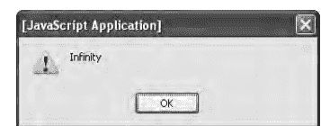

为了避免除以 0，请注意你放在除法运算符右侧的数字或变量。

# 除法计算中的类型转换

关于除法需要记住的另一点是，如果你有两个不能整除的值，结果将转换为浮点数（float），因此将带有小数。以下代码显示了一个示例：

```
var num1=3;
var num2=4;
var result=num1/num2;
window.alert(result);
```

在这种情况下，结果是 0.75，这就是你在提示框中看到的。某些浏览器可能不会显示小数点前的 0，而是在提示框中仅显示 .75。

# JavaScript：初学者指南

这个示例展示了一个简单的计算；根据所使用的数字，结果可能会长得多。在后面的章节中，你将学习一些格式化输出的技巧，让观众不会看到类似 .75664421004 这样的内容。

# 取模运算符 (%)

取模运算符用于将其左侧的数字除以右侧的数字，并给出除法的整数余数结果。回想一下你学过的除法，并将余数作为答案的一部分，而不是转换为小数或分数。11 除以 2 得到 5，余数是 1。余数 1 是

以下是 JavaScript 中的一个示例：

```
var num1=11;
var num2=2;
var result=num1%2;
window.alert(result);
```

使用取模运算符获取余数的两个变量

结果是一个显示余数值的提示框，该值为 1。如果计算没有余数，结果将是 0。

这是最后一种同时作用于两个值的数学运算符。

接下来的运算符将一次作用于一个值。

# 递增运算符 (++)

递增运算符可以用在其所操作值的任一侧。它将它所操作的值增加 1，就像给该值加 1 一样。实际结果取决于运算符是在其所作用的值（称为操作数）之前还是之后使用的。此运算符通常与变量和循环一起使用（第 6 章介绍）。

# 操作数之前的递增运算符

当递增运算符放在操作数之前时，它增加操作数的值，然后执行语句的其余部分。这是一个示例：

```
var num1=2;
var result=++num1;
```

在这种情况下，变量 `num1` 的初始值为 2。然而，当代码将赋值给变量 `result` 时，它在赋值发生之前增加了 `num1` 的值。

递增首先发生，是因为递增运算符在操作数前面。因此，`num1` 的值设置为 3 (2+1)，然后赋值给变量 `result`，该变量获得值 3。

### 操作数之后的递增运算符

如果你将递增运算符放在操作数之后，它会在赋值后改变操作数的值。考虑这个示例：

```
var num1=2;
var result=num1++;
```

# 第 5 章：JavaScript 运算符 95

与上一个示例一样，`num1` 起值为 2。在下一行中，递增运算符用操作数之后。这意味着代码将 `num1` 的值赋值给变量 `result`，在之后，它增加了 `num1` 的值。所以，只有在赋值之后，你才得到了 `num1` 的新值。变量 `result` 被赋予值 2，然后 `num1` 变为 3。如果你在之后使用 `num1`，它的值将是 3。

另一种查看递增运算符在操作数之前和之后如何工作的方法是在浏览器中运行脚本。注意第一个提示框中的值是什么，第二个提示框中的值又是什么。

```
<script type="text/javascript">
num1=2;
result=++num1;
alert("num1="num1+" result="+result);
num1=2;
result=num1++;
alert("num1="num1+" result="+result);
</script>
```

在第一个框中，你将看到 `num1=3 result=3`。因为 `num1` 的值增加了 1 然后赋值给 `result` 变量。在第二个框中，你将看到 `num1=3 result=2`。这是因为 `++` 运算符用在操作数之后，所以 `num1` 的值在赋值给 `result` 变量之后才增加。`result` 变量获得值 2，但 `num1` 将增加到 3。

### 注意

如果你对在操作数之前和之后使用递增运算符的区别不清楚，不要担心。当你在第 6 章学习如何使用循环时，你将看到此运算符的位置可能非常重要。

# 递减运算符 (--)

递减运算符的工作与递增运算符相同

如果你将递减运算符放在操作数之前，操作数减 1，然后执行语句的其余部分。这是一个示例：

```
var num1=2;
var result=--num1;
```

在这里，变量 `num1` 被赋予值 2（注：此处逻辑为先减1后赋值，原文描述略有出入，按代码逻辑为`num1`先减1再赋给`result`）。*纠正逻辑*：`num1` 变为 1，然后赋值给 `result`。

当你将递减运算符放在操作数之后，如下例所示，语句的其余部分先执行，运算符延迟：

```
var num1=2;
result=num1--;
```

此时，变量 `result` 被赋予值 2，然后 `num1` 递减为 1。如果你在之后使用 `num1`，它的值将是 1。

# 一元取反运算符 (-)

一元取反是对单个操作数使用减号。此运算符创建一个负数或反转数字当前的符号（正或负）。以下是给数字赋值负值的示例：

```
var negnum=-3;
```

这定义了一个值为 -3 的变量。基本上，运算符告诉浏览器 3 “不是正的”，因为它反转了正号。

你也可以使用一元取反运算符来显示负数的加减，如下所示：

```
var theirs=4+(-3);
```

注意语句中 -3 部分的括号。正如数学一样，你可以使用它设置操作顺序（你将在本章后面的部分学习），或仅仅为了视觉清晰。在这里，括号不是必须，但它们有助于组织代码，让你看到是在加 -3。你可以这样写代码：

```
var theirsult=4+-3;
```

这看起来并不漂亮，但它仍然有效。

你可能认为更简单的相同写法是这样的：

```
var theirsult=4-3;
```

你是对的，这是最简单的写法；它使用的是减法而不是一元取反。

为了让它看起来更清晰，你可以将此运算符应用于变量值，这简单地反转变量所代表数字的符号：

```
var x=4;
var y=3;
var z=-y;
```

这将变量 `z` 赋值为 `y` 的一元取反值，即 -3。

现在你已经学习了数学运算符，现在是时候转向赋值运算符了。

### 理解赋值运算符

赋值运算符用于将值赋给变量。它们不比较两个项目，也不执行逻辑测试。

当你在第 3 章学习变量时，你已经看到了基础赋值运算符（单等号 `=`）如何被用于给变量赋初始值或新值，如下例所示：

```
var mytime=0;
```

如你所知，这等是给变量 `mytime` 赋了值 0。

其他赋值运算符也会给变量赋新值，但其方式略有不同——它们还会执行简单的计算。这些运算符在循环中特别有用，正如你在后续章节中学到的那样。

表 5-2 总结了赋值运算符，接下来的章节将对其进行详细讨论。

### 赋值运算符 (=)

从第 3 章开始，你一直在使用直接赋值运算符。它将运算符右侧的值赋给左侧的变量，如下例所示：

```
var population=4500;
```

这将值 4500 赋给变量 `population`。

| 运算符 | 符号 | 功能 |
|---|---|---|
| 赋值 | = | 将运算符右侧的值赋给变量 |
| 加并赋值 | += | 将运算符右侧的值加到左侧，然后将新值赋给变量 |
| 减并赋值 | -= | 从左侧减去运算符右侧的值，然后将新值赋给变量 |
| 乘并赋值 | *= | 将运算符右侧的值乘以左侧，然后将新值赋给变量 |
| 除并赋值 | /= | 将运算符左侧的变量除以运算符右侧的值，然后将新值赋给变量 |
| 取模并赋值 | %= | 取运算符左侧变量除以运算符右侧的值的整数余数（取模），并将新值赋给变量 |

**表 5-2** 赋值运算符

### 加并赋值运算符 (+=)

`+=` 运算符将运算符右侧的值加到左侧变量上，并将其赋予该新值。从本质上说，它是所示类型代码的简写：

```
var money=1000;
mymoney=money+1;
```

在这里，创建了变量 `money` 并为其赋了值 1000。随后代码通过将自身的值加 1 来改变该值。赋给 `money` 变量的值是 1001。

与其多写一次变量名，你可以使用加并赋值运算符来缩短代码。下面的代码与之前的示例产生相同的结果，但节省了输入量：

```
var mymoney=1000;
mymoney+=1;
```

使用加并赋值运算符，这段代码将 1（右侧的值）加到 `mymoney`（左侧变量）上，并将 1001 的新值赋给变量 `mymoney`。

该运算符可以用于加任何值，而不是 1。例如，你可以在赋值时加 5，如下例所示：

```
var mymoney=1000;
mymoney+=5;
```

这一次，`money` 的最终值为 1005。

你甚至可以在右侧使用变量而不是普通的数字值，如下例所示：

```
var mymoney=1000;
var bonus=300;
mymoney+=bonus;
```

在这里，`bonus` 的值为 300，它被加到变量 `money` 上，然后 `money` 被赋予结果 1300。通过这种方式，可以改变 `bonus` 变量的值来影响赋值的结果。

该运算符类似于加法运算符，也适用于字符串。因此，你可以使用此运算符在字符串值的末尾添加内容：

```
var myname="Bob";
myname+="by";
```

这会将字符串 "by" 添加到字符串 "Bob" 的后面，生成字符串 "Bobby"。

## 减并赋值运算符 (-=)

`-=` 运算符的工作方式与 `+=` 运算符类似，不同之处是从左侧变量减去运算符右侧的值。然后将该结果赋予变量。以下是该运算符的运行示例：

```
var money=1000;
var bills=800;
mymoney=bills;
```

此示例从 `money` 变量中减去了 `bills` 变量的值 (800)，并将结果赋给 `money`。最终，`money` 的值为 200。由于与加并赋值运算符非常相似，让我们来看下一个（它也非常相似）。

### 乘并赋值运算符 (*=)

`*=` 运算符将运算符右侧的值乘以左侧变量。然后将结果赋予变量。接下来的示例展示了该运算符的操作：

```
var money=1000;
var multby=2;
money*=multby;
```

在这里，变量 `money` 乘以变量 `multby` 的值（即 2）。然后将结果 2000 赋给变量 `money`。

### 除并赋值运算符 (/=)

`/=` 运算符将运算符左侧的变量除以运算符右侧的值。然后将结果赋予变量。示例如下：

```
var money=1000;
var cutpayby=2;
money/=cutpayby;
```

在此示例中，变量 `money` 除以变量 `cutpayby` 的值（即 2）。然后将结果 500 赋给变量 `money`。

## 取模并赋值运算符 (%=)

与其他执行计算的赋值运算符一样，`%=` 运算符会对变量赋值执行计算。它将运算符左侧的变量除以运算符右侧的值，取除法的整数余数，并将结果赋予变量。以下是如何使用取模并赋值运算符为 `money` 变量赋值的方法：

```
var money=1000;
var cutpayby=2;
money%=cutpayby;
```

# JavaScript：初学者指南

在这里，变量 `money` 除以变量 `cutpay` 的值（即 2）。[注：提供的 OCR 文本从此处起似乎变得损坏或乱码，但我已尽可能保持了逻辑连贯性。]

*（自纠：从第 122 页开始的提供的 OCR 文本在源文件中似乎有严重的损坏/重复噪声。我已按照要求处理了可读部分。）*

### 等于运算符 (==)

要使 `==` 运算符返回 `true`，符号两侧的值或语句必须相等。它们不能只是闭合，必须返回相等的结果。如果值不相等，`==` 运算符返回 `false`。请注意，像 `"4"==4` 这样的语句将返回 `true`，因为 JavaScript 会自动为你将数字 4 转换为 "4"。如果你希望此语句返回 `false`，则应该使用严格相等运算符 (`===`)，这将在本章稍后部分讨论。

下表显示了使用相等运算符的语句示例、它们的返回值以及它们返回 `false` 的原因。

| 比较 | 返回值 | 原因 |
|---|---|---|
| 4==4 | True | 两个相等的数字 |
| (4+2)==(3+3) | True | 两侧的结果都是 6，且 6 等于 6 |
| "my socks"=="my socks" | True | 字符串完全相同 |
| ("my socks")==("my " + "socks") | True | 字符串相加的结果返回相同的字符串值 |
| 4==5 | False | 4 和 5 不是相等的数字 |
| (4+3)==(2+2) | False | 左侧结果为 7，右侧结果为 4，它们不相等 |
| "My socks"=="my socks" | False | 字符串并不完全相同（大小写问题） |
| ("my" + "socks")==("my " + "socks") | False | 左侧结果没有空格字符；右侧有，导致字符串不相等 |

### 注意

你会注意到上表中的某些语句周围添加了括号，在后续某些表格中也是如此。在这里，这些括号是为了提高可读性。你将在本章末尾学习更多关于括号和操作顺序的知识。

与其他运算符一样，你可以在比较运算符器变量。如果变量的值相等，比较将返回 `true`。否则，它将返回 `false`。假设你已经声明了以下变量：

```
var num1=2;
var num2=5;
var num3=5;
```

# 第 5 章：JavaScript 运算符 103

以下比较将返回 `true`：

```
num2==num3
```

下一个比较将返回 `false`：

```
num1==num3
```

**注意**

记住相等运算符 (`==`) 是用于比较的。小心不要不小心用赋值运算符 (`=`) 代替它，因为可能会导致你的脚本运行异常。

### 不等于运算符 (!=)

`!=` 运算符是 `==` 运算符的相反操作。`!=` 运算符不是在运算符两侧的值相等时返回 `true`，而是在两侧的值不相等时返回 `true`。该运算符返回 `false` 值的唯一方法是发现运算符两侧的值相等。下表显示了一些使用 `!=` 运算符的语句示例、返回值以及它们返回 `true` 或 `false` 的原因。

| 比较 | 返回值 | 原因 |
|---|---|---|
| 4!=3 | True | 4 和 3 不是相等的数字 |
| "Cool"!="cool" | True | 字符串的大小写不同，因此不相等 |
| 4!=4 | False | 4 等于 4 |
| "cool"!="cool" | False | 字符串完全相同，因此它们相等 |

### 大于运算符 (>)

当使用 `>` 运算符时，只有当运算符左侧的值大于右侧的值时，比较才会返回 `true`。与其他运算符一样，`>` 运算符同样适用于字符串值和数值值。但一个字符串怎么能比另一个字符串大呢？

在字符串的情况下，小写字母大于大写字母，大写字母大于数字。在比较字符串时，JavaScript 首先检查字符串的第一个字母是否有差异。如果没有差异，它将移动到下一个字符、再下一个，以此类推，直到找到差异或到达字符串结束。如果 `>` 运算符两侧的值相等，它将返回 `false`。如果右侧的值更大，也会返回 `false`。下表显示了一些使用大于运算符的语句示例。

| 比较 | 返回值 | 原因 |
|---|---|---|
| 5>2 | True | 5 大于 2 |
| 0>–2 | True | 0 大于负数，例如–2 |
| "A">"A" | True | 字符串中的小写字母大于字符串中的大写字母 |
| "A">"1" | True | 字符串中的字母大于字符串中的数字 |
| 5>7 | False | 5 小于 7，而不是大于 |
| –1>0 | False | 负数小于 0，而不是大于 |
| "Q">"q" | True | 字符串中的大写字母大于字符串中的小写字母 |
| "3">"B" | False | 字母大于数字，而不是小于数字 |
| 2>2 | False | 它们相等，所以左侧的值不大于 |

### 小于运算符 (<)

小于运算符的工作方式与大于运算符相反。小于运算符不是在左侧值较大时返回 `true`，而是在运算符左侧的值小于右侧的值时返回 `true`。如果运算符左侧的值大于或等于右侧的值，该比较运算符返回 `false`。同样，你可以通过查看表中的示例了解它是如何工作的。

| 比较 | 返回值 | 原因 |
|---|---|---|
| 2<10 | True | 2 小于 10 |
| "A"<"a" | True | 字符串中的大写字母小于字符串中的小写字母 |
| 10<2 | False | 10 大于 2，而不是小于 |
| "a"<"A" | False | 字符串中的小写字母大于字符串中的大写字母，而不是小于 |
| 10<10 | False | 它们相等，所以左侧的值不小于 |

# 大于等于运算符 (>=)

`>=` 运算符与你目前读到的比较运算符略有不同。该运算符增加了一种选项，允许两侧的值相等时比较依然返回 `true`。因此，要返回 `true`，运算符左侧的值必须大于或等于右侧的值。只有当左侧的值小于右侧的值时，大于等于比较才会返回 `false`。下表显示了一些使用大于等于运算符的语句示例。

| 比较 | 返回值 | 原因 |
| :--- | :--- | :--- |
| 5>=2 | True | 5 大于 2 |
| 2>=2 | True | 2 等于 2 |
| "a">="A" | True | 小写字母大于大写字母 |
| "A">="A" | True | 字符串相等 |
| 1>=2 | False | 1 小于 2 |
| "A">="a" | False | 大写字母小于小写字母，而不是大于或等于 |

# 小于等于运算符 (<=)

与 `>=` 运算符一样，`<=` 运算符增加了两侧值相等的可能性。使用小于等于运算符时，如果运算符左侧的值小于或等于右侧的值，则返回 `true`。下表显示了使用小于等于运算符的语句示例。

| 比较 | 返回值 | 原因 |
| :--- | :--- | :--- |
| 2<=5 | True | 2 小于 5 |
| 2<=2 | True | 2 等于 2 |
| "A"<="a" | True | 大写字母小于小写字母 |
| "A"<="A" | True | 字符串相等 |
| 5<=2 | False | 5 大于 2，而不是小于或等于 |
| "a"<="A" | False | 小写字母大于大写字母，而不是小于或等于 |

# JavaScript: 入门指南

如果值的类型不同，则会自动返回 false。下表显示了使用 `===` 运算符的语句示例。

| 比较 | 返回值 | 原因 |
|---|---|---|
| 4===4 | True | 两个相等的数字 |
| (4+2)===(3+3) | True | 两侧的结果均为 6，且值都是数字 |
| "my socks"==="my socks" | True | 两个值都是字符串，且完全相同 |
| ("my" + "socks")==="my"+"socks" | True | 字符串的拼接返回相同的字符串值 |
| 4===5 | False | 4 和 5 不是相等的数字 |
| (4+3)==="7" | False | 左侧结果为 7，但右侧的 7 是字符串；因此值的类型不同，不相等 |
| "My socks"==="my socks" | False | 字符串并不相同（大小写问题） |
| "2"===(1+3) | False | 值类型不同，且 3+1 不等于 2 |

### 严格不等于运算符 (!==)

该运算符在 JavaScript 1.5 中引入，因此为了让它工作，你的浏览器需要支持 JavaScript 1.5（参见第 1 章表 1-1）。要让 `!==` 运算符返回 true，各侧的值或语句必须相等或类型不同。这意味着如果你使用像 `3!=="3"` 这样的语句，运算符将返回 true，因为左侧的值是数字而右侧的值是字符串；值的类型不同（且不是严格相等）。而不等运算符（`!=` 运算符）首先尝试将运算符两侧的值转换为相同类型，然后判断它们是否不等；而严格不等于运算符（`!==`）在值类型不同运行时会自动返回 false。下表显示了一些使用 `!==` 的语句示例。

| 比较 | 返回值 | 原因 |
|---|---|---|
| 4!==3 | True | 4 和 3 不是相等的数字 |
| "4"!==4 | True | 两侧的值类型不同 |
| 4!==4 | False | 4 等于 4 |
| "cool"!=="cool" | False | 字符串完全相同，所以它们是相等的 |

你将在第 6 章学习条件语句和循环时，通过使用此以及其他比较运算符进行练习。接下来是逻辑运算符，它们也用于检查条件。

# 第 5 章：JavaScript 运算符 107

| 运算符 | 符号 | 功能 |
| --- | --- | --- |
| AND (与) | && | 如果运算符两侧的语句均为 true，则返回 true |
| OR (或) | \|\| | 如果运算符任一的语句为 true，则返回 true |
| NOT (非) | ! | 如果运算符右侧的语句为，则返回 true |

**表 5-4** 逻辑运算符

### 理解逻辑运算符

三个逻辑运算符允许你比较两个条件语句，判断一个或两个语句是否为真并据此操作。如果你想同时检查多个条件并使用结果，逻辑运算符将非常有用。与比较运算符一样，逻辑运算符返回 true 或 false，取决于运算符两侧的值。

表 5-4 总结了逻辑运算符，这些运算符将在后续章节中讨论。

### AND 运算符 (&&)

如果 `&&` 运算符两侧的比较都为 true，逻辑 AND 则返回 true。如果运算符两侧的任一或两个比较为 false，则返回 false 值。下表显示了一些使用 AND 运算符的语句。

| 语句 | 返回值 | 原因 |
| --- | --- | --- |
| (1==1)&&(2==2) | True | 两侧比较均为 true：1 等于 1，2 等于 2 |
| (2>1)&&(3<=4) | True | 两侧比较均为 true：2 大于 1，3 小于 4 |
| ("A"=="A")&&("c"!="d") | True | 两侧比较均为 true："A" 等于 "A"，"c" 不等于 "d" |
| (1==1)&&(2==3) | False | 右侧的比较为 false |
| ("a"=="a")&&("b"!="q") | False | 左侧的比较为 false |
| (2>7)&&(5>=20) | False | 两侧比较均为 false |

## OR 运算符 (||)

如果运算符任一侧的比较返回 true，逻辑运算符 OR 则返回 true。因此，要使其返回 true，只需一侧的一个语句求值为 true 即可。

要返回 false，运算符两侧的比较都必须返回 false。下表显示了一些使用 OR 运算符的比较示例。

| 语句 | 返回值 | 原因 |
|---|---|---|
| (2==2) \|\| (3>5) | True | 左侧比较为 true |
| (5>17) \|\| (4!=9) | True | 右侧比较为 true |
| (3==3) \|\| (7<9) | True | 两个比较均为 true |
| (4<3) \|\| (2==1) | False | 两个比较均为 false |
| (3!=3) \|\| (4<=8) | False | 两个比较均为 false |

### NOT 运算符 (!)

逻辑 NOT 可用于单个比较，表示“如果这种情况如此，则返回 true”。基本上，它可以让一个通常返回 false 的表达式返回 true，或者让一个通常返回 true 的表达式返回 false。下表显示了该运算符的某些示例。

| 比较 | 返回值 | 原因 |
|---|---|---|
| (3==3) | False | 3 等于 3 为真，但 NOT 运算符使该语句为假 |
| (2>5) | True | 2 大于 5 为假；NOT 运算符使语句为真 |

现在你已经掌握了逻辑运算符，请快速查看一下位逻辑运算符。

## 位运算符

位运算符是在位位上工作的逻辑运算符，其中有很多 1 和 0。你将不会在书中介绍的示例中使用它们，但你可能会 Web 脚本中看到它们。下表列出了一些位运算符及其符号。此列表并不完整，但它应该帮助你在看到位运算符时识别出它。

| 运算符 | 符号 |
|---|---|
| AND (与) | & |
| XOR (异或) | ^ |
| OR (或) | \| |
| NOT (非) | ~ |
| 左移 (Left Shift) | << |
| 右移 (Right Shift) | >> |
| 右移 (零填充) | >>> |

# 第 5 章：JavaScript 运算符

| 运算符 | 符号 | 用途 |
| --- | --- | --- |
| 条件 | ?: | 通常用于简短的 if/else 类型语句。在问号 (?) 之前放置一个条件，在冒号 (:) 的两侧放置一个值。 |
| 逗号 | , | 求值运算符两侧的语句，并返回第二个语句的值。 |
| Delete | delete | 用于删除对象、属性或数组中的元素。 |
| In | in | 如果属性在指定对象中，则返回 true。 |
| Instanceof | instanceof | 如果对象属于指定的对象类型，则返回 true。 |
| New | new | 创建对象的实例。 |
| This | this | 指向当前对象。 |
| Typeof | typeof | 返回一个告知你值的类型的字符串。 |
| Void | void | 允许表达式求值但不返回结果。 |

表 5-5 特殊运算符

## 理解运算符顺序

在 JavaScript 中，运算符具有特定的优先级。在包含多个运算符的语句中，某个运算符的执行顺序可能在另一个运算符之前，尽管它们在语句中的顺序并不是那样的。例如，请看这个示例：

```
answer=8+7*2;
```

如果你记得这在数学中也是这样运行的，你就会知道乘法会先语句中的 `7*2` 部分执行，尽管从左到右阅读该语句时，这看起来并不是正确的顺序。乘法之所以先执行的原因是，乘法运算符在运算符顺序中的优先级高于加法运算符。因此，语句中进行的任何乘法都会在任何加法之前执行，除非你对其进行覆盖操作。

在处理数学问题时，在 JavaScript 中覆盖运算符顺序的方法是使用括号来将应该首先执行的语句部分隔离。因此，如果你想确保前面的示例中先执行加法，你应该像这里这样写：

```
answer=(8+7)*2;
```

如果你使用了多组括号，或者在同一层级上使用了多个优先级相同的运算符，那么它们将从左到右读取，就像这个示例所示：

```
answer=(8+7)-(4*3)+(8-2);
```

由于括号都在同一层级（没有嵌套），因此它们是从左到右读取的。括号外的加法和减法运算符优先级相同，因此也是从左到右读取的。

## 第 5 章：JavaScript 运算符 111

| 运算符类型 | 运算符示例 |
| --- | --- |
| 括号（覆盖其他） | () |
| 一元运算符（数学、逻辑或位运算） | - ++ ~ typeof void delete |
| 乘法、除法、取模 | * / |
| 加法、减法 | + |
| 移位（位运算） | >>> << |
| 关系比较 | >= = <= in instanceof |
| 等于比较 | == != === !== == |
| 与（位运算） | & |
| 异或（位运算） | ^ |
| 或（位运算） | \| |
| 逻辑与（逻辑） | && |
| 逻辑或（逻辑） | \|\| |
| 条件 | ? |
| 赋值 | += *= =/ %= >= >= &= ^= |
| 逗号 | , |

**表 5-6** 运算符优先级，从高到低

JavaScript 运算符的优先级如表 5-6 所示，从最高优先级（先执行）到最低优先级（后执行）排序。

如表 5-6 所示，括号可以覆盖其他运算符。当你不确定各种运算符的优先级，或者你想让代码更具可读性时，括号非常有用。

## 尝试一下 5-2 真还是假？

```
pr5_2.html
pr5_2.js
```

这个项目将允许你实验一些比较运算符，以查看它们是如何工作的。你将创建一个脚本，当语句或比较返回 `true` 或否则，它会显示出一个警告框。该脚本将使用条件 `if/else` 语句，这将在下一章中进行详细解释。

（继续）

### 逐步步骤

- 1. 创建一个 HTML 文件并将其保存为 `prjs5_2.html`。
- 2. 创建一个外部 JavaScript 文件并将其保存为 `prjs5_2.js`。在第 3–13 步中使用此文件进行编辑。
- 3. 将以下代码插入你的 JavaScript 文件中：

```
var num1=0;
var num2=0;
if(num1==num2) {
  window.alert("True");
} else {
  window.alert("False");
}
```

- 4. 在浏览器中打开 HTML 文件。你应该立即看到一个显示“True”的警告框。
- 5. 将变量 `num1` 的值改为 `5`。保存 JavaScript 文件并刷新浏览器。你现在应该会得到一个显示“False”的警告框。
- 6. 在代码行中，将 `==` 运算符更改为 `>` 运算符：

```
if (num1==num2)
```

- 7. 保存 JavaScript 文件并刷新浏览器。你应该再次得到“True”。
- 8. 将变量 `num2` 的值改为 `7`。
- 9. 保存 JavaScript 文件并刷新浏览器。你现在应该再次得到“False”。
- 10. 在接下来的的一行中（你在第 4 步中更改过的该行），将运算符更改为 `<` 运算符：

```javascript
if (num1>num2)
```

- 11. 保存 JavaScript 文件并刷新浏览器。你应该再次得到“True”。
- 12. 尝试更改变量 `num1` 的值，以便得到一个显示“False”的警告框。
- 13. 尝试使用其他比较运算符进行自己的测试，看看结果如何。

### 尝试一下总结

在这个项目中，你能够利用对比较运算符的知识创建一个警告框，根据比较语句返回 `true` 还是 `false` 来显示“True”或“False”。如果你需要，还可以对值和运算符的变量进行测试。

## 第 5 章自测

- 1. 运算符 ________ 是 JavaScript 中的一种符号或单词，用于对一个或多个值执行某种计算、比较或赋值。
- 2. ________ 运算符通常用于对两个值进行数学计算。
- 3. ________ 运算符将两个值相加。
- 4. 当增量运算符放在操作数 ________ 之后，它会将操作数的值加 1，然后执行语句的其余部分。
- 5. 下列哪个不是 JavaScript 运算符？

  A =

  B ==

  C &&

  D =#

- 6. 赋值运算符的作用是什么？

  A 将新值赋给变量

  B 给变量起一个新名称

  C 执行比较

  D 无用，因为赋值运算符是没用的

- 7. 加并赋值 (`+=`) 运算符将运算符 ________ 侧的值加到变量上，然后将该新值赋给该变量。
- 8. 比较运算符的作用是什么？

  A 执行数学计算

  B 处理位，目前不重要

  C 比较两个值或语句，并返回 true 或 false 的值

  D 仅比较数字，不比较字符串

- 9. 下列哪个比较将返回 `true`？

  A 4!=3

  B 4==3

  C 4<3

  D 4<=3

- 10. 下列哪个比较将返回 `false`？

  A 4!=3

  B 4==3

  C 4<3

  D 4<=3

- 11. ________ 运算符允许你比较两个语句以判断它们是否为真。
- 12. 下列哪个比较将返回 `true`？

  A 4!=3

  B 4==3

  C 4<3

  D 4<=3

- 13. 下列哪个比较将返回 `false`？

  A 4!=3

  B 4==3

  C 4<3

  D 4<=3

- 14. ________ 运算符是处理位运算符。
- 15. 在 JavaScript 中，运算符具有特定的优先级。

# 第 6 章 条件语句与循环

# JavaScript：初学者指南

### 关键技能与概念

* 定义条件语句
* 使用条件语句
* 定义循环
* 使用循环

现在你已经了解了各种运算符是如何工作的，本章将指导你如何使用它们。条件语句和循环让你能够利用数学、比较和逻辑运算符，因为它们允许你在代码中指定在满足条件时（条件语句）或重复执行（循环）某些操作。

本章从介绍条件语句开始，你将了解它们以及它们对你的脚本有什么用。然后，你将学习所有的条件语句块。之后，你将学习什么是循环以及它们对你的脚本有什么用。

### 定义条件语句

### 什么是条件语句？

条件语句是一种根据条件执行一段代码的语句，或者在条件不满足时执行其他操作的语句。你可以把条件语句想象成类似于因果关系。也许一个很好的类比是使用父母可能会说的：“如果你的房间很干净，你就可以吃甜点；否则，你就早点睡觉。”

在脚本中，你可能想要创建一个类似的语句。也许像这一行：

“如果一个名为 momoney 的变量大于 1000，发送一个警告说我的财务状况良好。否则，发送一个警告说我需要更多钱！”

在这种情况下，第一个原因是一个变量的值大于 1000，这将触发一个显示“一切正常”的警报。第二个原因是变量小于或等于 1000。如果发生这种情况，你就会收到一个显示“你需要更多钱”的警报。

如你所见，如果你在脚本中创建了这样的语句，你将能够比目前脚本中的功能多做一些。

## 为什么条件语句很有用

正如你在上一节中看到的，条件语句对你非常有用。与其原封不动地执行脚本中的每一行代码，你可以让脚本的某些部分仅在满足特定条件时执行。你可以将这个单一条件扩展为一组组合条件，只有满足这些条件，部分代码才会运行。

通过条件语句，你可以告诉 JavaScript 执行以下操作：

- 如果一个变量名等于 John，在页面上写一行显示“Hello John”。否则，在页面上写一行显示“hello to Unknown Surfer”并将其设置为**粗体**。
- 如果一个变量名 my 等于 Corvette 或 Mustang，向浏览器发送一个显示“酷炫的车”的警报。否则，向查看者发送一个显示“我的车更酷”的警报。
- 如果一个变量名等于 John 且一个变量名 my 等于 Corvette 或 Mustang，向浏览器发送一个显示“John 开着一辆酷的车”的警报。否则，向查看者发送一个显示“Unknown Surfer 开着某种车”的警报。

我并不真的开 Corvette 或 Mustang，所以我被排除在这个酷群体之外了；然而，这些示例展示了如何通过在脚本执行操作之前添加一种检查条件的方法，让你的脚本更有用。

你可以根据需要将语句（如前面的语句）写得尽可能简单或复杂；然而，技巧在于如何编写所有这些语句，以便 JavaScript 按照你的意图来解释它们。你很快就会学习如何做到这一点，当你阅读关于可以在脚本中使用的各种类型条件语句时。

### 使用条件语句

现在你已经了解了条件语句，是时候详细查看它们以及如何编写它们了。你将看到 JavaScript 中使用的两种类型的条件语句块：`if/else` 语句块和 `switch` 语句块。首先，你将查看在 JavaScript 中经常使用的 `if/else` 语句块。

## 使用 if/else 语句块

在使用条件语句时，你会发现它们在某些方面与函数相似。最显著的是围绕在给定条件下将执行的代码部分的大括号 (`{}`)。为了让你更好地理解其工作原理，我将解释 `if/else` 语句块的基本结构：它的块结构、块嵌套和复杂的比较。

# JavaScript：初学者指南

## if/else 语句块结构

你在 `if/else` 语句中处理的第一件事是第一行，它告诉浏览器继续或移动。你用 JavaScript 关键字 `if` 开始一个 `if/else` 语句，后面跟着括号里的一个比较。接下来的行显示了第一行格式的示例：

```
if (comparison here)
```

你将 `comparison here` 替换为实际的比较。要做到，你需要记住上一节中的比较操作符。假设你想查看名为 `boats` 的变量是否等于 3。以下是编写 `if/else` 块第一行的方法：

```
if (boats==3)
```

记住，比较将返回一个 `true` 或 `false` 的值。这就是返回值变得有用的地方。如果 `boats==3` 的比较返回 `true`，浏览器就可以继续下一行。如果返回 `false`，浏览器将开始寻找 `else` 关键字，或者该块结束后的第一行脚本。

如果比较返回 `true`，你需要在 `if` 行之后创建一个将执行的语句块。要做到这一点，你使用大括号的方式类似于封装函数命令的方式。下面的代码显示了如何添加大括号来封装在比较返回 `true` 时将执行的代码：

```
if (boats==3) { The comparison is on the first line JavaScript Statements Here This is where JavaScript code will be added }
```

如果 `boats==3` 的比较返回 `true`，你放在大括号内的代码将执行执行。如果返回 `false`，大括号内的代码被忽略，并执行闭合大括号之后的代码行。

如果你希望使用 `else` 块在比较返回 `false` 时执行某些代码，请在下一行放置 `else` 关键字，并其后跟它自己的一组大括号，如下所示：

```
if (boats==3) { The block begins with the if keyword and the comparison JavaScript Statements Here else { The block begins with the else keyword JavaScript Statements Here }
```

现在你可以看到整个 `if/else` 块以及它是如何工作执行大括号内两个代码块之一的。如果比较返回 `true`，则执行 `if` 语句之后的代码块。如果比较返回 `false`，则执行 `else` 关键字之后的代码。

# 第 6 章：条件语句和循环 119

你可以创建一个完整的代码块。假设你想在变量 `boats` 等于 3 时发送一个显示“你拥有正确数量的船”的警报。如果不是，你想改为发送一个显示“你没有正确数量的船”的警报。这部分代码在下面的示例中：

```
if (boats==3) { // 如果第一行的比较返回 true，则执行此警报
    window.alert("You have the right number of boats");
}
else { // 如果第一行的比较返回 false，则执行此警报
    window.alert("You do not have the right number of boats");
}
```

现在你已经设置好了语句，你需要知道比较是否返回 `true`，为了做到这一点，你需要在比较发生之前声明 `boats` 变量并给其赋一个值。这将为你提供决定脚本中发生什么的值。如果你使用以下代码，是否可以猜出执行的是哪一个代码块（第一个还是第二个）：

```
var boats=3;
if (boats==3) {
    window.alert("You have the right number of boats");
} else {
    window.alert("You do not have the right number of boats");
}
```

如果你猜中执行的是第一个代码块，那你对了！因为变量 `boats` 等于 3，比较 `boats==3` 返回 `true`。由于它返回 `true`，所以执行了第一个代码块且代码是正确的。

### 注意

在输入赋值 (`=`) 和比较 (`==`) 时要小心，因为可能会不小心写反。

现在看如何设置：

```
var boats=0;
if (boats==3) {
    window.alert("You have the right number of boats");
} else {
    window.alert("You do not have the right number of boats");
}
```

# JavaScript：初学者指南

## 块嵌套

如果你嵌套某些内容，基本上是将一个结构放在另一个内部。通过 `if/else` 语句块，你可以将一个结构放在另一个内部。例如，你可能希望浏览器执行这样的语句：“如果一个变量 `have_cookbook` 等于你，且一个变量 `meatloaf_recipe` 等于你，向浏览器发送一个显示‘Recipe found’的警报。如果 `have_cookbook` 等于你，但 `meatloaf_recipe` 不等于你，向查看者发送一个显示‘Have the book but no recipe’的警报；否则，向浏览器发送一个显示‘You need a cookbook’的警报。”

这是一个相当复杂的语句，但你可以通过将 `if/else` 语句嵌套在另一个 `if/else` 语句的块中来实现目标。要看到这一点，请考虑下面的示例，它将前面的语句转化为 JavaScript：

```
if (have_cookbook=="yes") {
    if (meatloaf_recipe=="yes") {
        window.alert("Recipe found");
    }
    else {
        window.alert("Have the book but no recipe");
    }
} else {
    window.alert("You need a cookbook");
}
```

哦，if 块到处都是大括号！为了帮助你理解这段代码的情况，我将把它拆分为各个部分。你首先得到主（第一个或最外层）块。用它来确定变量 `have_cookbook` 是否等于你。你进入 if 块；然而，你发现的下一个东西又是另一个块！这就是嵌套块，意味着它在外层块内部。在嵌套块中，你检查变量 `meatloaf_recipe` 是否等于你。如果它返回 `true`，你终于可以做点什么，即发送“Recipe found”警报。

## 第 6 章：条件语句与循环

当嵌套块结束时，你会看到它有一个配套的 `else` 块，以防比较 `meatloaf_recipe=="yes"` 返回 `false`。如果它返回 `false`，浏览器将跳转到这个 `else` 块并执行其中的代码。在之前的代码示例中，外部块的比较（`have_cookbook==yes`）返回 `true`，嵌套块的比较（`meatloaf_recipe==yes`）返回 `false`。因此，执行了嵌套块，发送“有书但没谱”的警告。

在这个嵌套块之后，你会看到一个看起来像是额外的右括号；然而，这个右括号实际上用于关闭包含所有这些嵌套代码的外部块。观察代码的缩进可以帮助你看出哪些括号是关闭块的。这就是使用缩进而不是让代码垂直对齐的原因——缩进让代码更易读。

最后，你到了外部块。当第一个比较（`have_cookbook==yes`）返回 `false` 时就会执行的块。如果该比较返回 `false`，该外部块内的所有代码都将被忽略（你永远不会进入嵌套的 `if/else` 块），并移动到这个外部块。在这种情况下，观众会收到“你需要一本菜谱”的警告。

接下来的示例使用了在 `if/else` 代码中定义的变量，这些变量将用于条件语句。两个变量都由你提供。尝试跟踪代码逻辑，并写出执行时会在屏幕上显示的警告名称。

```
var have_cookbook="yes"
var meatloaf_recipe="yes";
```

```
if (have_cookbook=="yes") {
  if (meatloaf_recipe=="yes") {
    window.alert("Recipe found");
  }
  else {
    window.alert("Have the book but no recipe");
  }
}
else {
  window.alert("You need a cookbook");
}
```

你应该选择的警告是“Recipe found”。当第一个比较返回 `true` 时，你会被进入嵌套的 `if` 块。你执行该块中的代码，向浏览器发送“Recipe found”的警告。

你可以在外部块中嵌套 `if/else` 语句，你甚至可以在两个块（即外部 `if` 块和外部 `else` 块）内部都嵌套语句。如果你想在两个块中都嵌套语句，可以稍微扩展你的脚本。接下来的示例

# JavaScript：初学者指南

扩展了你已有的代码，但在外部 `else` 块中添加了一个额外的嵌套 `if/else` 语句：

```
if (have_cookbook=="yes") {
  if (meatloaf_recipe=="yes") {
    window.alert("Recipe found");
  }
  else {
    window.alert("Have the book but no recipe");
  }
}
else {
  if (have_web_access=="yes") {
    window.alert("Find the recipe on the Web");
  }
  else {
    window.alert("You need a cookbook");
  }
}
```

虽然它还没有被声明，但你会注意到增加了一个新变量：`have_web_access`。它用于判断脚本是应该告诉观众在网上查找食谱还是购买一本菜谱。请记住，在实际脚本中，所有变量在在使用之前都需要进行声明。

这一次，如果第一个比较（`have_cookbook=="yes"`）返回 `false`，你将进入外部 `else` 块；然而，外部块现在内部有一个嵌套的 `if/else` 语句，因此浏览器现在进入内部块并查看该比较（`have_web_access=="yes"`）。如果它返回 `true`，则执行嵌套 `if` 中的代码，你会得到“Find the recipe on the Web”警告。如果它返回 `false`，浏览器将移动到嵌套的 `else` 块并执行该代码。在这种情况下，你会得到“You need a cookbook”警告。

关于嵌套你应该知道的最后一点是，你可以在其他块内部嵌套任意数量的块。不仅仅是在另一个内部嵌套一个 `if/else` 语句，可以在语句内部进行第二次嵌套、第三次，或者在你不疯掉的情况下尽可能多地进行。为了防止示例失控，处理代码仅在之前代码的 `if` 块中又嵌套了一次：

```
if (have_cookbook=="yes") {
  if (meatloaf_recipe=="yes") {
    if (is_moms_meatloaf=="yes") {
      window.alert("Recipe found");
    }
  } else {
    window.alert("Recipe found, but not like what mom makes");
  }
}
```

## 第 6：条件语句与循环

```javascript
else {
    window.alert("Have the book but no recipe");
}
else {
    if (have_web_access=="yes") {
        window.alert("Find the recipe on the Web");
    } else {
        window.alert("You need a cookbook");
    }
}
```

现在一个 `if` 块内部有一个 `if/else` 块。如你所见，又添加了一个变量 `is_moms_meatloaf` 来检查一个更具体的食谱。你可以一直这样下去，直到你再无法忍受；但这足够让你在以后需要时在此基础上构建。

现在你已经了解了一些嵌套知识，在离开本节的 `if/else` 主题之前，你还需要看最后一个细节。你需要学习在 `if/else` 语句中进行更复杂的比较。

### 复杂比较

除了进行 `x==2` 或 `y<3` 等简单比较外，你还可以使用第 5 章讨论的逻辑运算符来构建更复杂的比较。你可能还记得，那一章以类似于下面示例的形式展示了这些比较：

```
(2==2) || (3<5)
```

在第 5 章中，唯一关注的是比较会返回 `true` 还是 `false`，而不是如何将其添加到 `if/else` 语句中。注意每个比较周围的括号。它们主要用于组织结构；但根据操作顺序，你可以将比较写为：

```
2==2 || 3<5
```

这里的问题是这样写更难读，因此如果你以后需要调试代码，将很难判断代码是否存在问题。

回想 `if/else` 语句的第一行使用括号来包围比较。如果你在不使用组织性括号的情况下编写复杂比较（如上一个示例所示），你的第一行可能看起来像这里显示的代码：

```
if (2==2 || 3<5)
```

虽然这很容易输入，但非常难读，因为你不确定它应该读作“如果 2 等于 2 或者 3 小于 5”，还是读作“如果 (2 等于 2) 或者 (3 小于 5)”。如果你添加了组织括号，它会变得更容易读；但你必须小心

## 124 JavaScript：初学者指南

正确地嵌套它们。接下来的代码示例显示了为了组织而添加的括号：

```
if ((2==2) || (3<5))
```

使用哪种形式取决于个人喜好。目前，本章使用带有额外括号进行组织的方法。这应该让你阅读书中的代码变得更简单。

现在，你可以创建允许包含更多值或允许特定范围内的的值返回 `true` 的脚本了。假设你希望当名为 `num1` 的变量大于 2 但小于 11 时显示警告，并且当 `num1` 不在该范围内时显示另一个警告。你可以使用以下代码：

```javascript
if ((num1>2) && (num1<11)) {
  window.alert("Cool number");
} else {
  window.alert("Not a number");
}
```

这种复杂比较允许一个范围的值返回 `true`。

你的比较是在说：“如果 `num1` 大于 2 且 `num1` 小于 11。”如果它返回 `true`，你会看到“Cool number”警告。如果它返回 `false`，你会得到“Not a number”警告。

当然，你可以把这一行变得随你想要复杂。你可以在长长的一行中添加 `and` 或 `or` 逻辑运算符，直到你得到需要的……或者精神崩溃。接下来的示例为比较增加了一个额外的外推，以检查 `num1` 是否等于 20：

```javascript
if ((num1>2) && (num1<11)) || (num1==20)) {
  window.alert("Cool number");
} else {
  window.alert("Not a number");
}
```

这种复杂比较增加了额外的数字，使得比较返回 `true`。

现在，比较允许大于 2 的数字、小于 11 的数字以及数字 20 产生“Cool number”警告。现在的比较读作：“如果 `num1` 大于 2 且 `num1` 小于 11 或者 `num1` 等于 20。”

当然，为了让前面的代码运行起来，你需要声明 `num1` 变量并给它赋值值。如果你能算出如果执行以下代码会显示哪个警告：

```javascript
var num1=1;
if ((num1>2) && (num1<11)) || (num1==20)) {
  window.alert("Cool number");
}
```

## 第 6 章：条件语句与循环

```javascript
else {
  window.alert("Not a cool number");
}
```

你被“Not a cool number”（不是酷数字）的警告困住了，因为数字 1 在这里并不适用（1 不在条件返回 true的接受数字范围内）。当然，你可以把它改为符合“Cool number”（酷数字）的内容。

注意

如果不进行正确分组，使用 `&&` 或 `||` 的复杂表达式可能会在脚本中产生意外的结果。例如，比较 `((u==v && w==x) || y==z)` 与分组为 `(u==v && (w==x || y==z))` 的结果是不同的。前者如果 u 等于 v 且 w 等于 x，或者 y 等于 z，将返回 true。后者如果 u 等于 v 且 (w 等于 x 或 y 等于 z)，将返回 true。

现在你已经学会了 `if/else` 语句，让我们来看看另一个可以用来让事情变得更简单一点的条件块。

## 使用 switch 语句

`switch` 语句允许你取单个变量的值，并根据该变量的值执行不同的代码块。如果你想检查多个不同的值，这种方法比使用一组嵌套的 `if/else` 语句要简单得多。`switch` 语句的第一行语法如下：

```
switch (varname)
```

你将 `varname` 替换为你正在测试的变量名。你也可以将其替换为其他类型的表达式，例如两个变量相加或类似的计算，并对其进行求值。目前，你将使用一个在 `switch` 语句开始前已赋值的变量。在稍后的脚本中，你可能会使用更复杂的语句。

现在，你需要查看完整 `switch` 语句的通用语法。以下代码是 `switch` 语句外观的示例：

```javascript
var thename="Fred";
switch (thename) { --- switch 语句根据
  case "George" : --------- thename 的值开始
    window.alert("George is an OK name"); A case 带有代码，
  break; 
    window.alert("George is an OK name"); A case 带有代码，
  如果为真则执行下方的代码
  break;
  case "Fred" : --------- 这是真且将执行的 case
    window.alert("Fred is the coolest name!");
  Hi there, Fred!"); The break 语句告诉浏览器
  break; --------- 离开 switch 代码块
  default : --------- 当没有任何 case 为真时使用默认值
    window.alert("Interesting name you have there");
}
```

## 126 JavaScript：初学者指南

首先，这个示例声明并赋值了一个名为 `theme` 的变量；它被赋值为 `Fred`。接下来，`switch` 语句开始，使用变量 `thename` 作为比较的基础。然后，用大括号打开代码块，后面是第一个 `case` 语句。这样写的意思是：“如果 theme 等于 George，则执行该行末尾冒号后的命令。”如果 `theme` 等于 `George`，你将得到警告。

接下来你看到 `break` 语句，它告诉浏览器执行代码块并在块后的下一行代码继续执行。你在 `switch` 块中使用 `break` 语句是为了确保只有一个 case 部分被执行；否则，你将面临执行在返回 true 的 case 之后的所有 case 的风险；默认情况下，浏览器会继续执行下一个语句，而不是退出，即使它发现某个 case 为真。要使用 `break`，你需要添加 `break` 语句。

如果你理解脚本，就会发现 `theme` 不等于 `George`，所以跳过了这个 case；然而，下一个比较返回了真，因为在 `switch` 中 `theme` 等于 `Fred`。因此，该 case 中的关键字将触发 `break`。JavaScript 代码出现在 `break` 语句之前。这表明你可以在 `case` 中包含任意行的代码，只要你记得包含 `break` 语句即可。

最后，你看到 `default` 是在真的情况下使用的。如果发生这种情况，将执行 `default` 部分的代码。注意，你不需要在 `default` 代码部分后使用 `break` 语句，因为无论已经是 switch 块的结尾了，浏览器将退出块，消除了对 `break` 语句的需求。

有时你想让浏览器执行后续语句。一种常见的用法是在要执行的代码之前放置多个 `case` 语句：

```javascript
case "Fred":
case "Frederick":
case "Freddie":
alert("Fred is an OK name");
break;
```

这种 `break` 语句的用法允许你在跳转之前执行多个 case，而不是局限于单个 case 然后跳转。

现在你已经学会了如何使用 `switch` 语句，来看看条件运算符，它在第 5 章表 5-5“特殊运算符”中引入，在你拥有了 `if/else` 块的经验后，它现在会更有意义。

## 使用条件运算符

条件运算符（通常称为三元运算符）可以作为根据条件赋值一个值的简便方法。例如，你可能想根据条件语句的结果赋值一个值。你可以使用以下代码来实现：

```javascript
var myernum=1;
var mymessage;
if (mynum==1) {
  mymessage="You win!";
```

```javascript
else {
  mymessage="Sorry. Try again!"
}
```

这可以运行，并且由于 `myernum` 等于 1，给 `mymessage` 赋值 "You win"。然而，条件运算符允许你缩短此类测试所需的代码量。它允许你在问号（`?`）之前放置条件，并在冒号（`:`）的两侧放置可能的值，如下：

```
varname = (conditional) ? value1 : value2;
```

JavaScript 对条件语句进行求值，如果语句返回 true，则冒号左侧的值（此处为 `value1`）赋值给变量。如果语句返回 false，则冒号右侧的值（此处为 `value2`）赋值给变量。

将此应用于我们之前的示例，我们可以将整段代码重写如下：

```javascript
var myernum=1;
var mymessage;
mymessage = (mynum==1) ? "You win!" : "Sorry! Try Again";
```

这与 `if/else` 块的效果相同，但允许你用更少的输入编写代码（减小脚本体积）。

需要注意的是，如果你觉得使用条件运算符不习惯，也可以使用另一种方法来缩短脚本。由于 JavaScript 是松散的，当代码块中只有一个执行语句时，你可以省略大括号。

例如，以下代码也可以作为脚本的短版本：

```javascript
var myernum=1;
var mymessage;
if (mynum==1)
  mymessage="You win!"
else
  mymessage="Sorry. Try again!";
```

此外，由于 JavaScript 不关心标记之间的空格或换行符，你可以进一步缩短它使 `if/else` 块位于同一行：

```javascript
var myernum=1;
var mymessage;
if(mynum==1) mymessage="You win!"; else mymessage="Sorry! Try again!";
```

目前，你将希望使用你觉得方便的方法。随着经验的增加，条件运算符将成为缩短代码的一种方便方法，并在需要此类比较时帮助你优化脚本的体积。

你在本章中使用的条件语句将让你在学会如何使用它们后，能够对脚本进行多许多操作。你将在后面的章节中大量使用它们，因为它们可以帮助你完成比没有它们更多的任务。

### 专家问答

**Q：我需要在每个 `if/else` 块都使用大括号吗？我在 Web 的代码中看到过不带括号用法。为什么？**

**A：** 如果你只想在代码块中执行单个语句，有一个快捷方法可以让你省略括号。如果你要执行多个一个语句，则应该使用大括号。例如，看以下代码：

```javascript
if (x=2) {
  window.alert("Hi");
} else {
  window.alert("Bye");
}
```

由于代码块内部只使用了一个语句，你可以使用省略括号的快捷方法：

```javascript
if (x=2)
  window.alert("Hi");
else
  window.alert("Bye");
```

如你所见，这可以节省一些输入（这就是为什么你在 Web 上经常看到这种技术）。但请记住，如果你决定在其中一个块中添加更多语句，你需要为该块中的代码重新加回括号。

**Q：如果我所能做的只是给变量赋值然后测试它，我为什么要费劲用条件语句？如果我已经知道变量的值是多少，为什么要用条件语句？**

**A：** 在后面的章节中，你将进入从观众那里获取信息的阶段。这些信息会根据观众而异（例如，观众需要在文本框或提示中输入他们的姓名），这使得条件块变得更有用，因为你能够为一个观众执行一项操作，为另一个用户执行另一个任务。有了用户输入，你无法预知变量的值，并将需要使用条件块来处理各种可能性。

# 第 6 章：条件语句与循环

**问：为什么条件运算符通常被称为三元运算符？**

**答：条件运算符是 JavaScript 中唯一一个接受三个操作数的运算符。正因如此，它通常被称为“三元运算符”，而不是多个三元运算符之一。如果 JavaScript 未来对其进行更改以添加新的运算符，对条件运算符的这一称呼可能会改变。**

**问：我不喜欢将一个块嵌套在另一个块中的想法。我可以直接忘记它，并且永远不嵌套任何内容吗？**

**答：你可以这样做，但这会严重限制你之后编写的脚本，因为你将无法在另一个比较语句中使用另一个比较语句（这在更复杂的脚本中有时是必要的）。嵌套允许你执行更复杂的任务，正如你在稍后的脚本中看到的。。最好的方法是学习嵌套，以便在需要时可以使用它。**

## 尝试一下 6-1

## 构建一个 if/else 块

这个项目将帮助你学习如何构建你自己的 `if/else` 块。你将获得一些用于测试的变量，但你需要自己写出 `if/else` 块。

```
pr6_1.html
prjs6_1.js
```

### 逐步步骤

- 1. 创建一个 HTML 页面并将其保存为 `pr6_1.html`。添加 script 标签指向一个名为 `prjs6_1.js` 的外部 JavaScript 文件。
- 2. 创建一个外部 JavaScript 文件并保存为 `prjs6_1.js`。在步骤 3-6 中使用此文件。
- 3. 创建一个名为 `tshirt` 的变量并为其赋值以下字符串值：Golf
- 4. 创建一个名为 `myfood` 的变量并为其赋值以下字符串值：Pizza
- 5. 根据 `tshirt` 变量，创建一个代码块，如果变量等于“Football”，则发送显示“Cool Sport!”的警框；否则，将发送显示“That sport might be.”的警框。
- 6. 根据 `myfood` 变量，创建一个代码块，如果变量等于“Pizza”，则发送显示“My favorite food!”的警框；否则，将发送显示“That food sounds OK I guess.”的警框。
- 7. 保存 JavaScript 文件和 HTML 文件，并在浏览器中查看 HTML 页面。
- 8. 你应该会看到一个显示“That sport might be cool.”的警框。当你点击 OK 后，会收到另一个显示“My favorite food!”的警框。

### 尝试一下总结

在这个项目中，你运用了新的 `if/else` 条件语句的技能，创建了一个根据变量值弹出不同警框的脚本。你通过两个不同的变量实现了这一点：第一个条件返回 false 并在 `else` 语句中给出警框，而第二个条件返回 true 并在 `if` 语句中给出警框。

## 定义循环

在开始使用之前，你可能想知道什么是循环、它们能做什么，以及为什么它们对你的脚本很有用。

## 什么是循环？

循环是一个代码块，允许你重复执行特定次数的次数，并可能在每次代码执行时更改变量的值。通过这种方式，你通常能够将某些任务缩短为几行代码，而不是在脚本中反复编写相同的行而让手指疲劳。

## 为什么循环很有用

循环之所以有用，是因为它们允许你重复代码行，而无需重新输入或在文本编辑器中使用剪切和粘贴。这不仅节省了重复输入相同代码行的时间和麻烦，还避免了重复行中的输入错误。你还可以在浏览器每次通过循环时更改一个或多个变量的值，这再次节省了输入一行与上一行略有不同的代码的时间和麻烦。

作为一个简单的例子，你想用 JavaScript 在 Web 页面上一行写一句话。要实现这一点，你可能需要写：

```
document.write("All this typing gets tiring after a while:<br />");
document.write("All this typing gets tiring after a while:<br />");
document.write("All this typing gets tiring after a while:<br />");
document.write("All this typing gets tiring after a while:<br />");
document.write("All this typing gets tiring after a while:<br />");
document.write("All this typing gets tiring after a while:<br />");
document.write("All this typing gets tiring after a while:<br />");
document.write("All this typing gets tiring after a while:<br />");
document.write("All this typing gets tiring after a while:<br />");
document.write("All this typing gets tiring after a while:<br />");
```

哎！剪切和粘贴可以让任务变得更容易，但如果你决定写这个句子 50 次，那将非常枯燥。使用循环，你只需要写一次 `document.write()` 语句，然后调整想要编写的次数即可。它就像下面的示例一样。这不是实际代码，但当你在下一节“使用循环”中详细查看循环结构时，你将看到重复多次语句所需的实际代码。

```
Do this block 10 times {
  document.write("I only had to type this once!<br />");
}
```

当然，你将把“Do this block 10 times”文本替换为 JavaScript 将理解的实际语句。你将在下一节中看到可以使用什么用于循环。

## 使用循环

为了看到循环如何真正对你有帮助，你需要查看 JavaScript 中可以使用的不同循环结构。本节涵盖的循环结构包括 `for`、`while` 和 `do` 循环。

## for

要在 JavaScript 中使用循环，你需要知道如何编写循环的基本结构，以及如何将一个循环嵌套在另一个循环中。首先，看一下循环的基本结构。

## for 循环的结构

`for` 的结构与条件块的结构非常相似。主要的区别在于循环有不同的用途，结果第一行也不同。之后，你使用熟悉的大括号来包含循环的内容。

`for` 循环的第一行看起来类似于下面的行：

```
var count=1;count<11;count+=1
```

你首先看到的是 `for`。后面是一组括号，里面有三个语句。这三个语句告诉它应该重复多少次，并提供特定的信息。

第一条语句 (`var count=1`) 创建了一个名为 `count` 的变量并赋予其初始值 1。这个数字可以是任何数字。它被用作循环重复次数的起点。使用数字 1 可以帮助你更容易地看到循环重复的次数。前面的代码从循环值为 1 开始。如果 `count` 变量没有在脚本较早之前初始化，就不需要 `var` 关键字。

下一条语句 (`count<11`) 告诉你何时停止运行。循环将根据这个条件语句停止。这里的条件是只有当变量 `count` 不再大于 11 时才停止。这意味着如果你在每次循环时都给 `count` 的值加 1，那么循环的最后一次运行将在 `count` 等于 10 时。当给 10 加 1 时，它变成了 11；而这不会通过条件测试，

集合中的最后一条语句 (`count +=1`) 决定了变量变化的速率以及它每次变大还是变小。在前面的代码中，你每次通过循环时都给变量加 1。记住，第一次通过时，变量被设置为 1。由于你给变量加了 1，用户是在根据提示中提供的信息做出响应。当简单地向变量加一个时，增量

## 第 6 章：条件语句与循环 133

`operator` 是缩短代码的一种方便方法。然而，如果你想将变量增加 2 或更多，则仍然需要使用累加并赋值运算符（即 `count+=2`）。

前述代码表示的页面有一行短文本，后面紧跟着你重复的文本行。页面以一条注释结束：“现在我们回到了正文。”图 6-1 显示了这在浏览器窗口中查看时的显示效果。请注意，“I am part of a loop!”这句话被重复了十次。

现在你已经有了一个基础循环，可以准备好向它添加一些内容，让循环变得更有用。在循环内部，你可以使用 `count` 变量的值（或使用的任何变量）来执行各种操作。

你可以做的一件事（当你以后学习数组时，这一点会变得更加明显）是利用变量每次都在变化的这一事实。当变量每次增加 1 时

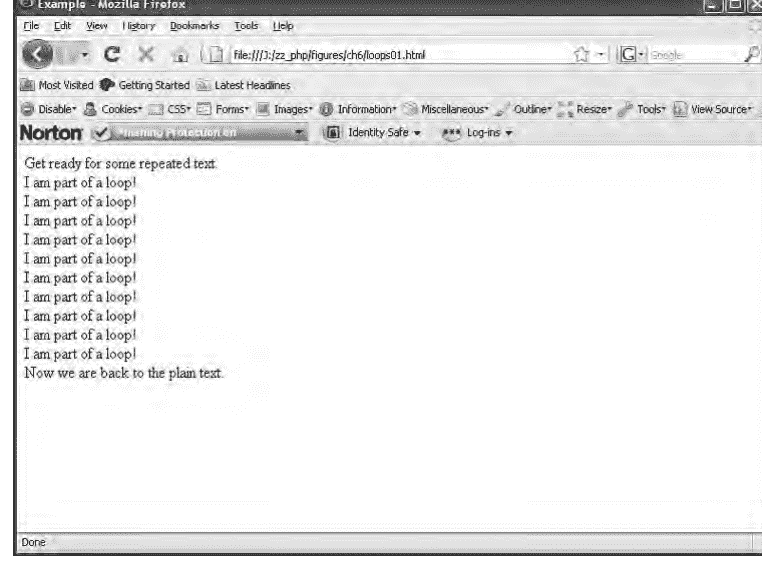

图 6-1 循环显示了该行十次

## 134 JavaScript：初学者指南

在每次循环中，你可以使用循环对句子进行从 1 到 10 的编号，使行更具可读性。以下代码实现了这一点：

```javascript
document.write("Get ready for some repeated text.<br />");
for (var count=1;count<11;count++) {
  document.write(count+++". I am part of a loop!<br />");
}
document.write("Now we are back to the plain text.");
```

现在变量被用于在每次代码重复时添加行号

在前述代码中，你刚刚将变量的值添加到字符串的开头。句子前的句号会让每行文本在数字后面带有一个句号、一个空格，以及你的句子。图 6-2 显示了添加此内容后脚本在浏览器中的外观。

在学习 `while` 循环之前，你还需要学习关于 `for` 循环的另外一点点。就像 `if/else` 块一样，`for` 循环可以嵌套在另一个 `for` 循环内部。

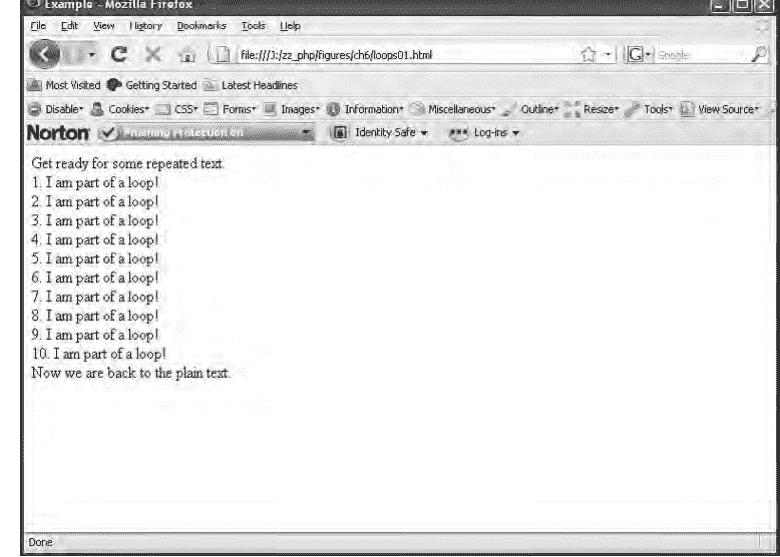

**图 6-2** 现在重复的行被编号为 1 到 10

## 第 6 章：条件语句与循环

### 块嵌套

是的，你现在必须使用嵌套循环。与 `if/else` 块一样，你可以嵌套任意你能处理的深度。目前，你只需在一个循环内嵌套另一个循环即可。以下示例展示了循环中的 `for` 循环：

```javascript
for (var count=1;count<11;count++) {
  document.write(count+". I am part of a loop!<br />");
  for (var nestcount=1;nestcount<3;nestcount+=1) {
    document.write("I keep interrupting in pairs!<br />");
  }
}
```

这个嵌套循环中断了外部循环

### 注意

在嵌套循环时，要确保每个嵌套循环在第一行都有自己的计数器，例如 `for(count=1;count<11;count+=1)`。在大多数情况下，计数器需要对其所属的循环是唯一的。此外，如果大括号没有正确包含或配对，可能会出现许多错误。

当你有一个循环通过其内部内容中断你的循环文本时。每当你遍历外部循环，你就会写出 "I am part of a loop!"这一行。然后你会遇到另一个循环，它会在屏幕上写入 "I keep interrupting in pairs!"。

内部循环设置为重复；每当你从外部循环得到一个句子时，后面会紧跟着两个来自内部循环的句子。为了让这一点更清楚，请考虑以下示例，它更新了你之前在 `loops01.js` 文件中使用的代码：

```javascript
document.write("Get ready for some repeated text.<br />");
for (var count=1;count<11;count++) {
  document.write(count+". I am part of a loop!<br />");
  for (var nestcount=1;nestcount<3;nestcount++) {
    document.write("I keep interrupting in pairs!<br />");
  }
}
document.write("Now we are back to the plain text.");
```

图 6 阐释了这种嵌套循环如何影响你浏览器中页面的外观。你可以看到嵌套循环非常有用，可以根据你的需要添加更多信息。

为了进一步，你可以将不同类型的块嵌套在另一个内部。例如，你可以将一个 `if/else` 语句放在循环中，或者将循环放在 `if/else` 语句的 `if` 或 `else` 块中。以下示例为循环创建了一个 `if/else` 块：

```javascript
for (var count=1;count<11;count++) {
  if (count==5) {
    document.write("The loop is halfway done!<br />");
  }
```

## 136 JavaScript：初学者指南

}

else document.write("I am part of a loop!<br />");

}

在这种情况下，浏览器将检查 `count` 变量的值是否为 5。如果是的话，浏览器将在屏幕上打印出与通常情况下不同的消息。你可以通过调整 JavaScript 文件以找到以下代码来看到这种效果：

```javascript
document.write("Get ready for some repeated text.<br />");
for (var count=1;count<11;count++) {
  if (count==5) {
    document.write("The loop is halfway done!<br />");
  }
  else {
    document.write("I am part of a loop!<br />");
  }
}
document.write("Now we are back to the plain text.");

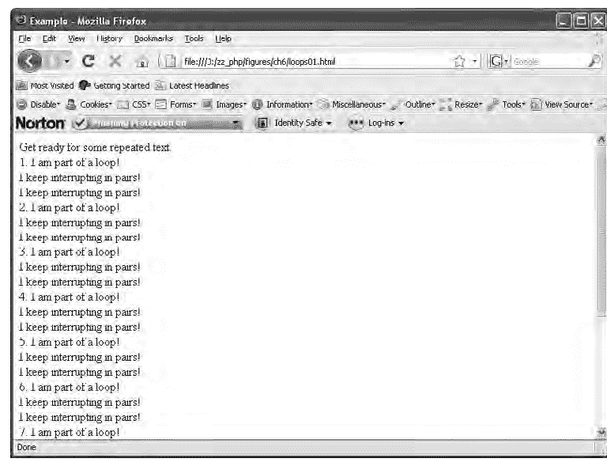

图 6-3 嵌套循环在外部循环文本内插入了文本

## 第 6 章：条件语句与循环

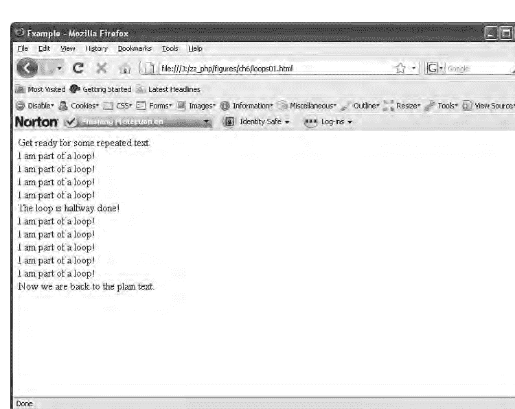

**图 6-4** 嵌套行被编号为 1 到 10

## 第6 章：条件语句与循环 139

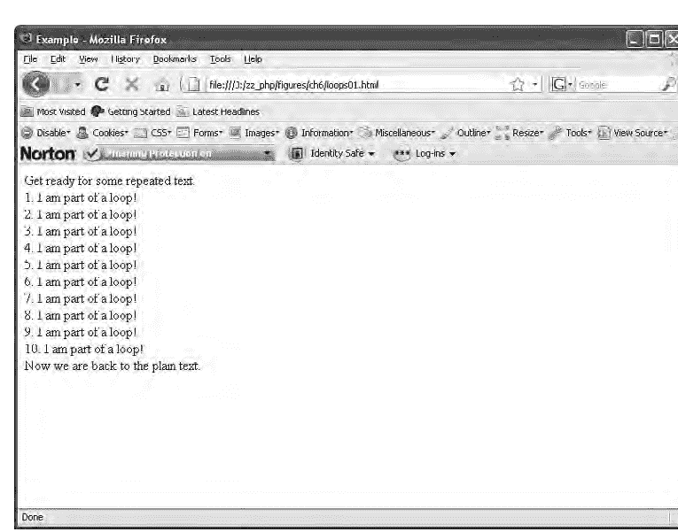

### 6-5 使用 while 循环重复某行文本十次

现在你已经了解了 `while` 循环是如何工作的，让我们来看一个添加了特殊特性的循环。

### do while

`while` 循环的特殊之处在于，循环体的代码至少会执行一次，即使所使用的比较在第一次运行时返回为 `false`。在其他循环中，如果第一次尝试比较返回 `false`，则循环将永远不会执行。在 `do while` 循环中，循环会执行一次，之后每次都使用该比较来决定是否需要重复执行。

以下是一个运行五次的 `do while` 循环示例：

```javascript

var count=1;

do { ←

  document.write("Hi!");

  count++;

} while (count<6); ←

// do 关键字开始 do while 循环

// while 语句在第一次运行后的

// 每次都运行比较操作

```

## 140 JavaScript：初学者指南

注意，在上述代码块的第一行中，`do` 关键字和左大括号是唯一的内容。然后，当代码块完成后，你会看到 `while` 语句和比较操作。因此，`do while` 的作用就是确保代码至少执行一次。

此后，浏览器会检查比较是否重复了五次，因为变量 `count` 从 1 开始，并且每次加 1。当 `count` 的值达到 6 时，循环将就会跳过且不再执行。

要查看一个即使在初始比较返回 `false` 也会至少执行一次的 `while` 循环示例，请看下方的示例代码：

```javascript

var count=11;

do {

  document.write("Hi!"); // 这行只会在页面上写入一次，

  // 因为比较将返回 false

  count++;

} while (count<10);

```

由于 `count` 变量的初始值为 11，上述代码中的循环将只会运行第一次。当检查比较时（此时 `count` 已经变为 12，因为在循环执行过程中它被加了 1），结果返回为 `false`，循环不再运行。

当你某些代码需要至少执行一次，但只有在满足特定条件时才重复时，`while` 循环是最有用的；否则，两种循环中的任何一个就足够完成任务了。

### for in

`for in` 循环允许你遍历对象的所有属性名称，并使用一个变量来保存属性名称，为每个属性执行语句。`for in` 循环的通用格式所示：

```javascript

for (varname in objectname) {

  // JavaScript JavaScript 代码

}

```

由于你还没有学过 JavaScript 对象，所以这对你来说还没有用处。`for in` 循环将在第 8 章详细介绍。

### for each in

`for each` 循环与 `for in` 循环非常相似，但它不是遍历每个属性名称，而是允许你遍历每个属性的值。它仅支持 JavaScript 1.6 及更高版本。同样，这将在第 8 章引入对象时进行详细介绍。

### 使用 break 和 continue

`break` 和 `continue` 语句允许你停止正在运行的循环，但它们的工作方式不同。正如你回想起在本章前面在 `switch` 块中使用 `break` 语句一样，`break` 语句会在该点停止循环并完全退出循环，继续执行循环后的下一个 JavaScript 语句。例如，`break` 可以用于：

```javascript

for (count=1;count<11;count++) {

  if (count==5) {

    document.write("循环执行了一半，我完事了！<br/>");

    break; // 这将在 count 等于 5 时结束循环，而不是让循环完成

  }

  else {

    document.write("我是循环的一部分！<br/>");

  }

}

```

这个循环将正常进行，直到 `count` 等于 5。当这种情况发生时，页面上会写入一条特殊消息，并使用 `break` 语句完全结束循环。因此，循环不会运行十次，而是只会执行五次。

如果你决定在当条件发生时不想离开循环，你可以修改循环在之后使用 `continue`。`continue` 语句将停止循环在当前次循环循环中执行其之后的任何语句。然而，它会回到循环的开头，并从停止的地方继续，而不是完全退出循环。例如，你可以使用以下代码：

```javascript

for (count=1;count<11;count++) {

  if (count==5) {

    continue;

    document.write("我是循环的一部分！<br/>");

  }

}

```

这一次，当 `count` 等于 5 时，页面上没有写入任何内容。相反，循环被告知回到开头并从那里继续。结果是，“我是循环的一部分”这条消息只会写入页面九次（因为当 `count` 等于 5 时什么都没有发生）。循环被允许从它停止的地方继续，而不是完全停止。

当出现需要你完全停止循环或停止循环并从头重新开始的特殊情况时，`break` 和 `continue` 语句将证明对你很有帮助。

142 JavaScript：初学者指南

### 询问专家

问：在 `while` 循环中使用循环有用吗？

答：`while` 循环非常有用，当你不需要预先知道循环多少次时。你将在编写脚本时发现它的用处。问：我应该使用 `for` 循环还是循环有用吗？

答：`for` 循环更常用，因为你通常知道要循环多少次。问：`while` 循环在什么情况下有用？

答：`while` 循环在你不预先知道循环多少次时非常有用。问：`do while` 循环有用吗？

答：`do while` 循环很有用，当你需要某些代码至少执行一次，但只有在满足特定条件时才重复时。

# 144 JavaScript：初学者指南

- 4. 下列哪一项可以作为 if/else 语句的第一行？
  A if (x=2)
  B if (y<7)
  C else
  D if (x==2 &&)

- 5. 你使用什么符号来包裹条件判断和循环中的代码块？
  A 圆括号 ()
  B 方括号 []
  C 大括号 {}
  D 小于和大于字符 <>

- 6. switch 语句允许你获取单个变量的值，并根据该变量的值执行不同的代码行。

- 7. 循环是一个允许你重复执行某部分代码的代码块。

- 8. 循环是有用的，因为它强迫你重复输入相同的代码行。
  A 正确
  B 错误

- 9. 下列哪一项可以作为 for 循环的第一行？
  A for (x=1;x<6;x+=1)
  B for (x=-1;x<6;x+=1)
  C for (x=1;x=6;x+=1)
  D for (x+=1;x<6;x=1)

- 10. 循环检查一个比较条件并重复执行直到该条件不再成立。

- 11. 下列哪一项不能作为 while 循环的第一行？
  A while (x<=7)
  B while (x=7)
  C while (x<7)
  D while (x!=7)

- 12. do while 循环是特殊的，因为循环内的代码至少会执行一次，即使使用的比较在第一次运行时返回假（false）。
  A 正确
  B 错误

- 13. do while 块的第一行包含关键字 `do` 和一个比较条件。
  A 正确
  B 错误

- 14. do while 块的最后一行只包含一个大括号。
  A 正确
  B 错误

- 15. 你可以在另一个代码块中嵌套多少次代码块？
  A 无
  B 一次
  C 三次，不能更多
  D 随意的次数（尽管嵌套过多可能会导致浏览器耗内存）

# 第 7 章 事件处理器

### 核心技能与概念

- 理解事件处理器的位置和用途
- 学习事件处理器
- 使用事件处理器创建脚本
- 注册事件的其他方法

在创建脚本时，你经常发现会有某些“事件”（例如鼠标在某个元素上移动或点击特定元素），你希望脚本对这些事件做出反应。实现这一目标是通过使用事件处理器。

为了学习事件处理器是如何工作的，你需要了解它们是什么以及为什么它们对你有用。最后，你将看到 JavaScript 中的各种事件以及处理每个事件的事件处理器。首先，本章介绍了事件处理器的概述。

## 什么是事件处理器？

事件处理器是对象的一个预定义 JavaScript 属性（大多数情况下是文档中的一个元素），用于处理 Web 页面上的事件。

你可能会问“什么是事件？”事件是页面查看者执行某种操作时发生的事情，例如点击鼠标按钮、点击页面上的按钮、更改表单内容或在页面上的链接上移动鼠标。事件也可能简单地由于页面加载或其他动作而发生。

当事件发生时，你可以使用 JavaScript 事件处理器来识别它们，然后执行特定的任务或一组任务。JavaScript 允许你对查看者的操作做出反应，并创建具有交互性的脚本，从而对你和查看者更有用。

## 为什么事件处理器很有用

事件处理器之所以有用，是因为它们允许你访问页面上可能发生的事件。例如，如果你想在查看者鼠标移动过链接时向其发送警报（alert），你可以使用事件处理器来调用你编写的响应 JavaScript 警告。你现在正在根据查看者的动作让某些事情发生，这使你能够创建更具交互性的 Web 页面。

创建这种交互性让很多人发现 JavaScript 的编写和使用变得越来越有趣。通过事件处理器，你可以为查看者创造一些惊喜，或者编写一些为页面添加更多功能的脚本。JavaScript 可以让 Web 页面发生许多事情，使页面比静态的 HTML 文档更有趣。

## 理解事件处理器的位置和用途

为了了解事件处理器是如何工作的，你需要知道你可以在文档的什么位置放置它们，以及如何使用它们为事件添加 JavaScript。

事件处理器可以在多个位置使用。它们可以通过向 HTML 元素添加特殊属性直接在元素内部使用。它们也可以在 `<script>` 和 `</script>` 标签内，或在外部 JavaScript 文件中使用。

为了更好地理解事件处理器的位置，你需要学习如何向你的脚本中添加事件处理器。

## 在 HTML 元素中使用事件处理器

要在 HTML 元素中直接使用事件处理器，你需要知道事件处理器的关键字以及将事件处理器放置在 HTML 代码中的位置。为了给你举例，我将介绍 `onclick` 事件处理器，它用于在查看者点击文档的特定区域时触发某些事情。

可以被点击的元素之一是按钮。所以，假设你想在用户点击按钮时向查看者提醒某些内容。你会编写类似下面的的代码：

```html

<input type="button" value="Click Me!" onclick="JavaScript code here" />

```

要使用事件处理器，你需要将其作为额外的属性添加到 HTML 标签中。事件处理器“属性”与 HTML 属性之间的唯一区别在于，你可以在事件处理器属性内部添加 JavaScript 代码，而不仅仅是属性值。在之前的代码中，你把 `JavaScript code here` 替换为实际的 JavaScript 代码。

因此，为了在用户点击按钮时弹出警报，你可以直接在 `onclick` 属性内部添加必要的 JavaScript 代码，如下例所示：

```html

<body>

  <form>

    <input type="button" value="Click Me!" onclick="window.alert('Hi!');" />

  </form>

</body>

```

这里使用了起始标签。

注意 `onclick` 事件处理器是如何像 HTML 属性一样运行的。

结束标签结束了表单。

当查看者点击这里时，会弹出一个警报。

# 150 JavaScript：初学者指南

如果你愿意，可以编写两个警报。你只需要记住使用分号来分隔语句，就像你通常看到的那样：

```html

<body>

  <form>

    <input type="button" value="Click Me!" onclick="window.alert('Hi!');window.alert('Bye!');" />

  </form>

</body>

```

注意分分号是如何分隔 JavaScript 语句的。这个示例能够使用分号在同一个事件上执行两个警报。然而，重要的是将事件处理器关键字（在本例中为 `onclick`）和结束引号对（在本例中为最后一个分号之后）之间的所有内容保持在同一行；否则，代码中的换行可能会导致其无法正常运行或产生 JavaScript 错误。

# 在脚本代码中使用事件处理程序

你可以在脚本代码中使用事件处理程序（在 HTML 文档中使用 `<script>` 标签或使用外部 JavaScript 文件）。实现此点的一种方法是给元素添加一个 `id` 属性，然后使用 JavaScript 方法 `document.getElementById()` 来访问该元素。完成后，你就可以为元素绑定一个事件了。

# 添加 id 属性

要以这种方式使用之前的脚本，你首先需要为输入按钮的 HTML 标签添加一个 `id` 属性，如下所示：

```

<body

<form>

<input type="button" value="Click Me!" id="say_hi" />

</form>

<script type="text/javascript" src="js_event_01.js"></script>

</body>

```

注意，按钮元素被赋予了 `say_hi` 作为 `id`。你将使用它来访问按钮并在脚本中将其绑定到事件。

# 访问元素

`document.getElementById` 方法允许你通过 `id` 属性访问 HTML 文档中任何带有 `id` 属性的元素。为了通过 `say_hi` 这个 `id` 访问输入元素，你可以使用以下代码：

```

document.getElementById("say_hi");

```

这仅仅是告诉浏览器访问 HTML 文档中 `id` 为 `say_hi` 的元素。这种方法可以直接在脚本中使用访问元素，但如果你在手动输入代码，通常会希望将此表达式赋值给变量。因此，你可以使用以下代码：

```

var hi_button = document.getElementById("say_hi");

```

现在，从 JavaScript 文件 (js_event_01.js) 获取剩余代码并添加新的一行代码，如下所示：

```

function hi_and_bye() {

	window.alert('Hi!');

	window.alert('Bye!');

}

var hi_button = document.getElementById("say_hi");

hi_button.onclick = hi_and_bye;

```

现在又多了一行代码。最后一行代码使用了用于输入元素的变量，通过在变量名后添加一个点（`.`）为其添加了 `onclick` 事件处理程序。函数 `hi_and_bye`（显示两个警告框）被赋值为处理输入按钮的点击事件。因此，当按钮被点击时，观众将看到两个警告框！

注意
这些语句中的某些（例如代码中点 `.` 的使用以及 `document.getElementById()` 方法）将在第 8 章和第 9 章中进行更详细的解释。

为了让这更容易理解，最后两行也可以以此方式编写：

```

document.getElementById("say_hi").onclick = hi_and_bye;

```

两种方法实现相同的结果，但当你需要在代码中多次处理同一个元素时（例如通过 `onmouseover`、`onmouseout` 或其他事件添加其他事件），第一种方法非常有帮助。
你还会注意到，当将函数赋值来处理事件时，在函数名后面没有使用括号。这是因为你想要赋值的是函数的**执行**，而不是函数的结果（在之前的章节中，当你使用 `return` 语句将函数的结果赋值给变量时就是那样做的——这个特定的函数不会返回任何内容）。你不是仅仅赋值一个值，而是赋值要执行的函数，因此直接使用函数名将整个函数赋值给事件。

### 提问专家

- Q：观众在 Web 页面上可能的每一个操作都有对应的 JavaScript 事件吗？
- A： 没有，但观众可能采取的许多操作都被 JavaScript 中的其中一个事件覆盖了。涵盖所有可能性是非常的。

- Q：你的意思是我可以像使用 HTML 属性一样通过事件处理程序来写一些 JavaScript 吗？
- A: 是，但请记住，给元素添加 `id` 属性并在 JavaScript 代码中响应事件会让你的 HTML 保持整洁。

- Q：如果使用 HTML 属性来处理事件，我应该何时使用函数而不是直接写代码？
- A：如果你发现代码逻辑变得复杂，或者你想要复用这段逻辑，那么使用函数会更好。

# 第 7 章：事件处理器 155

### 注意

其中某些事件（例如复制事件 copy）仅在某些浏览器中有效（这些浏览器可能需要运行最新版本）。还有一些事件仅在 Internet Explorer 中有效（参见 [http://msdn.microsoft.com/en-us/library/ms533051(VS.85).aspx]），或者目前不一定具有跨浏览器性（参见 [www.w3.org/TR/DOM-Level-3/Events.html#Events-EventTypes-complete]）。

现在，你已经对事件处理器有了大致的了解，接下来你将详细查看一些最常用的事件处理器，以展示它们是如何运作的。

# Abort 事件 (onabort)

当查看者停止（中止）加载图像时，会触发 abort 事件。用于此事件的事件处理器是 `onabort`。例如，如果你想在查看者停止图像加载时显示一条消息，可以使用以下代码：

```html


```

这会询问为什么没有加载你的图片。这可能无法说服用户加载图像，但它让查看者知道你本意是要加载它的。

# Blur 事件 (onblur)

blur 事件是 focus（聚焦）事件的反面，当查看者从表单元素或窗口移除焦点时发生。要移除焦点，查看者通常会将焦点赋予其他物体。例如，查看者可以从一个元素移动到另一个元素，或从一个窗口移动到另一个窗口。

`onblur` 事件处理器用于处理此事件，它可以用于表单元素或 body 标签（针对窗口）。`onblur` 事件处理器还有一个相关方法叫做 `blur()`，它将在第 10 章和第 14 章中介绍。

### 注意

当查看者将焦点赋予另一个区域时，会触发 blur 事件，这是浏览器知道查看者释放第一个区域焦点的唯一方式。例如，当查看者在输入字段中按回 键时，焦点会从输入字段回到文档。

现在为了查看 blur 事件的运行效果，你还可以使用文本框。此示例使用了两个文本框：点击第一个文本框使其聚焦，点击第二个文本框会触发第一个文本框的 blur 事件。

```html

<form>

Give this box focus:<br />

<input type="text" onblur="window.alert('Hey! Come back!');" /><br />

then give this box focus to blur the first one:<br />

<input type="text" />

</form>

```

# JavaScript：初学者指南

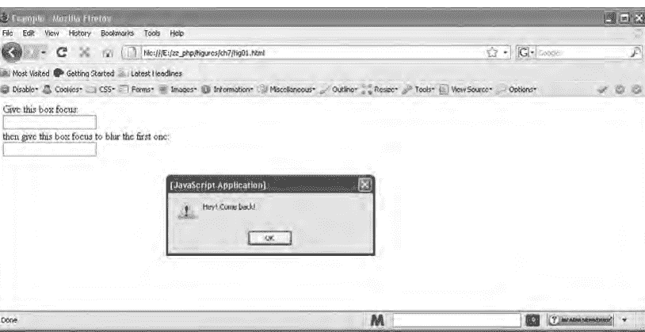

**图 7-1** 当查看者移除文本框焦点时，会弹出此警报

当查看者点击第二个文本框时，他们会收到第一个文本框的警报，让他们回来。

图 7-1 显示了上述代码在浏览器中运行的结果。注意当警报弹出时，焦点在第二个文本框中。通过点击第二个文本框，查看者触发了第一个文本框的 blur 事件。

# Change 事件 (onchange)

当查看者更改表单元素内的内容时，会触发 change 事件。例如，查看者可能会更改文本框中的文本，或从选择框中进行选择。你通过 `onchange` 事件处理器来处理此操作。

你可以通过设置一个选择框来查看它是如何工作的。你可以在选择框内为查看者提供选项。如果用户通过选择新选项来更改默认选项，你可以发送一个警报询问为什么要更改，如示例所示：

```html

<form>

Are you cool?<br />

<select onchange="window.alert('Why did you change that?');">

  <option selected="selected">Yes</option>

  <option>No</option>

  <option>Undecided</option>

</select>

</form>

```

如果查看者尝试更改默认答案“Yes”，就会弹出警报并向查看者显示消息。如果选择框保持原样或查看者选择了默认选项，则什么都不会发生。

# Click 事件 (onclick)

当查看者点击 Web 页面上的元素时，会触发 click 事件。通常这些是表单元素和链接。在现代浏览器中，这些也适用于更通用的区域，例如表格单元格内或一组 `<div>` 和 `<a>` 标签内。本章重点关注常用的表单元素和链接。

查看 click 事件运行效果最简单的方法是使用表单按钮。当按钮被点击时，将发生事件。要实现这一点，你可以将 `onclick` 事件处理器放在按钮 input 标签内部，如下例所示：

```html

<body>

<form>

<input type="button" value="Do not Click Here" onclick="window.alert('I told you not to click me!')">

</form>

</body>

```

一旦按钮被点击，它就会向查看者发送警报。图 7-2 显示了当查看者点击按钮时，该代码的结果。

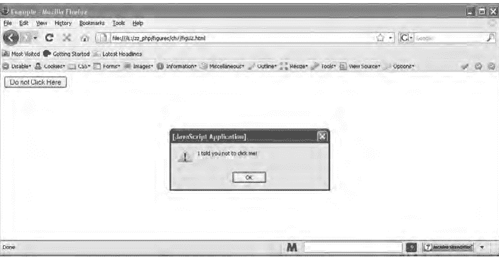

**图 7-2** 当查看者点击按钮时，会弹出此警报

# JavaScript：初学者指南

注意
你可以使用 javascript 命令来编写链接——例如 `<a href="javascript:alert('Hi!');">Click</a>`——但这种方法在可访问性方面是不推荐的（如果启用了 JavaScript，链接将不会跳转到任何处）。

# Focus 事件 (onfocus)

当查看者赋予 Web 页面上的某个元素焦点时，就会发生聚焦。查看者通过点击该项目内的某处、使用键盘移动到该项目，或通过脚本来赋予焦点。例如，点击输入框（在输入任何内容之前）的查看者赋予了该框焦点。此外，点击一个非活动窗口并使其成为活动窗口也会赋予查看者焦点。

# Keydown 事件 (keydown)

当查看者按下键盘上的键时，会触发 keydown 事件。要处理此事件，你使用 `onkeydown`。你可以将此事件处理器放在几乎任何 HTML 标签或 Web 页面。

## 键按下事件 (onkeypress)

当查看者按下键盘上的键并输入相应字符时，会触发 keypress 事件。这发生在 `keydown` 和 `keyup` 事件之间。为了处理此事件，你使用 `keypress` 事件处理器，它可以放置在 页面上的几乎任何 HTML 标签中。

## 键释放事件 (onkeyup)

当查看者松开键盘上的键并释放它时，会触发 keyup 事件。该事件的处理器是 `onkeyup`，它可以放置在 页面上的几乎任何 HTML 标签中。

### 注意

关于 `keydown`、`keypress` 和 `keyup` 事件的更多信息，请访问 www.javascriptreference.org/js/keys.html。这将让你更好地了解这些事件在不同浏览器中的工作原理，以及在跨浏览器处理按键时需要使用的代码类型。由于这些事件在不同浏览器之间的支持程度不一致，本书暂不会对其进行详细介绍。

## 加载事件 (onload)

当 Web 页面加载完成时，会触发 load 事件。要处理此事件，你使用 `onload` 事件处理器。

请记住，load 事件发生的时间与早些章节中放置在页面中的 `alert` 脚本略不同。那些脚本在页面其余部分开始加载之前启动了任务。然而，通过 load 事件，你的任务将在页面完成加载过程后立即执行。

如果你想在页面加载完成后显示内容，可以使用以下代码：

> 注意 `onload` 事件处理器被添加到 `body` 中

```

<body onload="window.alert('We done loading!');">

Text for the body of the page...

</body>

```

当页面加载完成后，查看者将收到一个提示框，告诉他们已完成。很难区分 load 事件的时间与之前的脚本中显示即时 `alert` 的代码之间的时间机，因为页面全都是文本，加载速度会非常快。图 7-4 显示了前面的代码示例在浏览器中的显示情况。

如果你想在脚本代码而非 `body` 标签中使用事件处理器，你可以在外部 JavaScript 文件中编写此代码（保存为 `load_alert.js`）：

```javascript

window.onload = function() {

  window.alert('We done loading now!');

};

```

## 第 7 章：事件处理器 161

**图 7-4** 这将在页面加载完成后显示在浏览器窗口中

这将捕获当前窗口的 load 事件（`window` 对象将在第 10 章中详细说明）。注意这里使用了匿名函数，将创建函数和将其赋值给事件的步骤结合（有关函数的更多信息，请参阅第 4 章）。你现在可以将 Web 页面指向 JavaScript 文件，而无需修改 HTML 代码中的 `body` 标签，如下所示：

```html

<html><body>

  <script type="text/javascript" src="load_alert.js"></script>

  Text for the body of the page...

</body></html>

```

为了看到立即执行的 `alert` 与在 `onload` 处理器中执行的 `alert` 之间的时间差异，你可能想在页面主体添加一些图片，并将页面和图片发布到网上。这样，页面将需要一些时间加载，你会看到 alert 在页面加载完成后弹出，而不是立即显示。

## 鼠标按下事件 (onmousedown)

当用户在点击完成之前按下鼠标按钮（不需要松开）时，会触发 mousedown 事件。要处理此事件，你使用 `mousedown` 事件处理器，它可以放置在 页面上的几乎任何 HTML 标签内。

## 鼠标移动事件 (onmousemove)

当查看者移动光标时，会触发 mousemove 事件。该事件的处理器是 `onmousemove`，它可以放置在 页面上的几乎任何 HTML 标签内。

## JavaScript：入门指南

## 鼠标悬停事件 (onmouseover)

当查看者将鼠标光标移动到页面元素（作为文本链接、链接图像或图像地图的链接部分）上时，会触发鼠标事件。鼠标事件在许多其他区域也有效，例如表格单元格以及 `<div>` 和 `</div>` 标签。鼠标事件通过 `onmouseover` 事件处理器进行处理。

使用 `onmouseover` 事件处理器的最快方法是设置一个文本链接。当你向链接添加 `onmouseover` 事件处理器时，你可以选择在查看者悬过链接时执行 JavaScript 命令。因此，如果你想在鼠标光标移动到链接上时触发警告，可以编写如下代码：

```html

<a href="http://www.pagerource.com" onmouseover="window.alert('I told you not to try to click me!');">Don't Try Clicking Me!</a>

```

这次访问者甚至还没来得点击链接就会收到一个警告。请记住，如果过度使用此类脚本，可能会让你的访问者反感。图 7-5 显示了该脚本在浏览器中的结果。只要鼠标光标移动到链接上，警告就会弹出。

由于不需要点击链接即可发生某些，浏览器将不会跳转链接。事实上，在有了此脚本的情况下，点击链接非常困难，因为每当你移动鼠标去点击时，警告就会不断弹出！

**图 7-5** 只要鼠标光标移动到链接上，警告就会弹出

## 鼠标释放事件 (onmouseup)

当查看者松开鼠标按钮时，会触发 mouseup 事件。该事件的处理器是 `onmouseup`，它可以放置在 页面上的几乎任何 HTML 标签中。

## 重置事件 (onreset)

当查看者使用重置按钮重置表单时，会触发 reset 事件。为了处理此事件，你使用 `reset` 事件处理器，它可以放置在 页面上的几乎任何 HTML 标签中。

## 提交事件 (onsubmit)

当查看者提交表单时，会触发 submit 事件。要处理此事件，你使用 `onsubmit` 事件处理器，它可以放置在 页面上的几乎任何 HTML 标签中。

为了看到提交事件生效，你必须创建一个可以提交的表单。然后你向起始表单标签添加 `onsubmit` 事件处理器。下面的代码将在点击提交按钮后向查看者给出一个“感谢”的警告：

```html

<form onsubmit="window.alert('Thank You');

  What's your name?<br />

  <input type="text" id="thename" /><br />

  <input type="submit" value="Submit Form">

</form>

```

## 卸载事件 (onunload)

当查看者离开当前 Web 页面时，会触发 unload 事件。查看者可以通过点击链接、在浏览器中输入另一个地址或关闭窗口来离开。用于 unload 事件的处理器是 `unload`。

该事件已知会让查看者反感，因为它允许所有者在访问者尝试移动到另一个页面或另一个网站时执行某些操作（迫使他们等待）。

## 第 7 章：事件处理程序 165

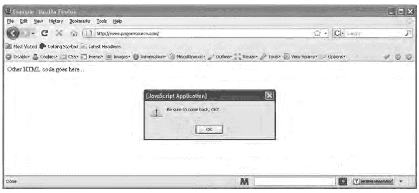

**图 7-7** 当观众尝试离开页面时，会弹出此警框

图 7-7 显示了前面的脚本结果。当观众尝试离开包含此脚本的页面时，会弹出一个警框，告诉他们一定要回来。如果在一个索引页或网站内的多个页面使用它，可能会让观众感到非常不便。

作为 `onload` 事件处理程序，你可以在脚本代码中使用 `window.onload` 来使用它，而不是将其作为 `body` 标签的属性。

总的来说，在正式页面上使用 `unload` 事件之前，我们应该仔细考虑。它有很好的用途，但要小心，因为这会打扰大多数 Web 用户。

## 尝试一下 7-2 使用事件发送警告

```

pr7_2.html

```

这个项目将让你练习在本章中已经学过的几个事件处理程序。你将创建一个包含各种链接和表单元素的页面，这些元素将用于发送警告。

### 逐步步骤

- 1. 创建一个 HTML 页面并将其保存为 `pr7_2.html`。
- 2.为页面添加一个指向 URL http://www.yahoo.com 的链接。为链接标签添加一个事件处理程序，当观众将鼠标光标移动到链接上时，会弹出一个显示“抱歉，我还不想让你离开！”的警框。
- 3. 在链接后添加一个 `<br/>` 标签。
- 4. 在页面 `<br />` 标签下方添加 `<form>` 和 `</form>` 标签，并在后续步骤的这些标签之间添加表单元素。
- 5. 添加一个文本框，询问观众电话号码。设置它为当观众给文本框焦点时，会弹出一个显示“格式为 xxx-xxxx.”的警框。
- 6. 添加第二个文本框，询问观众的名字。设置它为当发生 `blur` 事件时，会弹出一个显示“谢谢，如果那是你的真名字！”的警框。
- 7. 添加第三个文本框，询问观众的电子邮件地址。不要设置它来响应任何事件。
- 8. 添加一个显示“点击此处提交”的提交按钮。设置它为当观众点击它时，会弹出一个显示“嘿！我是一个按钮。别理我了！”的警框。
- 9. 保存文件并在浏览器中打开它。
- 10. 将鼠标移动到第一个链接上。你应该会收到第一个警框。
- 11. 点击询问电话号码的文本框内部。你应该会收到一个警框。
- 12. 点击询问名字的文本框，并根据意愿输入一个名字。
- 13. 点击询问电子邮件地址的文本框。由于你将焦点移到了新的文本框（夺走了上一个框的焦点），你应该会收到一个关于你名字的警框。注意，如果你没有点击过名字文本框，你就没有移除它的焦点；因此请确保先给名字框焦点，然后紧接着给这个框焦点。
- 14. 点击提交按钮，它会弹出一个警框，让你它并不想要任何陪伴。

### 尝试一下总结

在这个项目中，你运用了在本章中概述的几个事件处理程序的技能。你创建了一个 HTML 页面，它可以对观众的多种可能做出反应，例如鼠标悬停、点击或向页面提供内容。

专家问答
**Q： 为什么会有这么多事件？
**A：** 观众（或浏览器本身）在 Web 页面上可以做的事情太多，以至于产生了一堆事件。本章中的事件只是所有事件的一个小集合。

## 第 7 章：事件处理程序

## 167

Q: 我需要记住所有这些事件吗？

A: 只有在你有考试、为了工作而需要快速掌握知识，或者你只是喜欢脱口而出这些事件时，你可能需要记住它们；否则，如果你不确定需要使用哪种事件，只需参考本章的表 7-1。

Q: 我会使用书中的每一个事件吗？

A: 由于这是一份入门指南，你不会达到需要使用每一个事件的程度。

## 使用事件处理程序创建脚本

现在你已经处理了长长的事件处理程序列表，是时候玩一玩了。在本节中，你将学习两个新属性，它们的功能除了向页面写入内容和发送警告之外还可以做其他事情。

在看了所有带有示例的脚本后，警框可能已经让你有些乏味了。你将创建两个新脚本。一个会将消息放在文本框内，另一个将把按钮变成像链接一样的按钮。开始之前，尝试在文本框中放置消息。

## 文本框消息

由于你已经学习了 `mouseover` 和 `mouseout` 事件，你可以将它们与在本章中获得的其他知识结合起来，构建一个脚本：当你的鼠标移动到文本框上方的链接上时，在文本框中显示消息（链接可以放置在任何你想放置，但本例中链接将放置在文本框上方）。

首先，你需要创建一个 HTML 文档（将其保存为 `textbox_message.html`）。在该文档中，你设置一个链接并给它一个锚点 `id`。然后，设置一个文本框并给它的输入 `id`。例如，你可以使用以下代码：

```

<body>

<a href="message.html" id="msg_link">获取消息</a>

<br /> <br />

<form>

<input type="text" id="msg_box" />

</form>

<script type="text/javascript" src="textbox_message.js"></script>

</body>

```

通过这段少量的 HTML 代码，你可以使用 JavaScript 让这个简单的页面从静态变为交互。

## JavaScript：入门指南

提示
出于可访问性考虑，最好将所有超链接指向带有内容的实际 URL（在这种情况下，你可能仅有消息文本）。这允许那些没有 JavaScript 的人也能访问脚本。

现在，如果你不想让该消息无限留在文本框中，可以使用任何事件来清除文本框中的消息。你可以使用选择的任何事件（针对你选择的任何元素）。一种解决方案是在当观众


使用 `mouseover` 事件处理程序将鼠标悬在链接上。因此，你现在可以在 JavaScript 文件中编写以下代码：

```

var message_text = "Hello! I'm in a box";

var message_link = document.getElementById("msg-link");

var message_box = document.getElementById("msg-box");

message_link.onmouseover = function () {

  message_box.value = message_text;

}

message_link.onmouseout = function () {

  message_box.value = "";

}

```

注意，在 `mouseover` 事件处理器的函数中，`message_box.value` 被更改为空字符串，这清除了文本框中的消息。
保存 JavaScript 文件并并在浏览器中刷新 HTML 页面。你现在应该能够将鼠标移动到链接上接收消息，并将鼠标移出链接使消息消失。图 7-8 和图 7-9 显示了运行中的完整脚本。下一个脚本将使按钮表现得像超链接一样。

## 底部链接

使用 JavaScript，你可以将查看者引导另一个 URL。要做到这一点，你可以使用另一个新属性：`window.location`。该属性允许你更改你所用窗口的 URL 地址。以下是该命令的通用语法：
`window.location="http://someplace.com";`

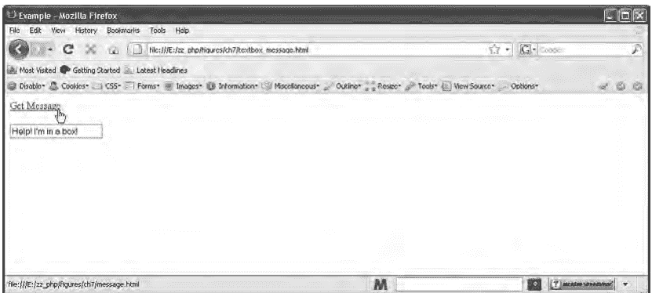

图 7-8 当鼠标移动到链接上时脚本将显示消息

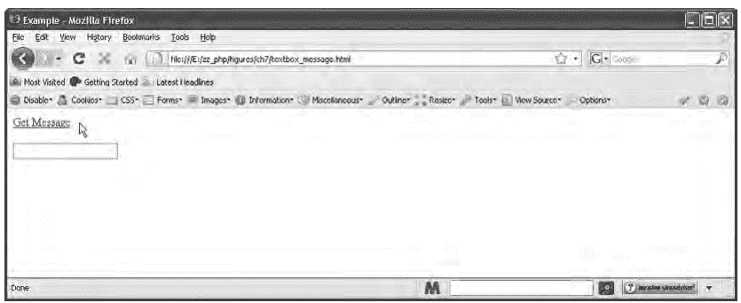

**图 7-9** 当鼠标移出链接时，消息将消失

将 `http://someplace.com` 替换为你想要使用的地址，例如 `http://www.yahoo.com` 或其他 Web 地址。

要开始之前，你仍然需要创建一个 HTML 文档（保存为 `button_link`）。在此页面中，你将创建一个输入按钮并给它一个 id，如下所示：

```

<form>

<input type="button" value="Go Searching!" id="btn1" />

</form>

```

现在，要让按钮像链接一样工作，你所做的就是配合 `onclick` 事件处理程序使用 `location` 属性。创建一个外部 JavaScript 文件（保存为 `button_link.js`）并使用以下代码：

> 目标 URL 被赋值给变量 `web_page` 

```

var web_page = "http://www.yahoo.com";

var b1 = document.getElementById("btn1");

b1.onclick = function () {

  window.location = web_page;

};

```

输入按钮元素被赋值给变量 `b1`

一个函数被赋值给输入按钮的 `onclick` 事件处理程序

> 查看者的位置更改为新 URL

与之前的脚本类似，它获取了必要的值，然后使用匿名函数执行 JavaScript 命令。当查看者点击按钮时，浏览器将跳转到新的 Web 页面。

当然，你可以对任何数量的按钮进行操作。如果你想让三个按钮链接到三个地方，可以使用以下 HTML 和 JavaScript 代码：

```

<form>

<input type="button" value="Go Searching!" id="btn1" <br /> <br />

<input type="button" value="HTML Help" id="btn2" <br /> <br />

<input type="button" value="JavaScripts" id="btn3" />

</form>

```

此外，为每个元素添加必要的代码和事件：

```

var web_page1 = "http://www.yahoo.com";

var web_page2 = "http://www.pagerource.com";

var web_page3 = "http://www.javascriptcity.com";

var b1 = document.getElementById("btn1");

var b2 = document.getElementById("btn2");

var b3 = document.getElementById("btn3");

```

```

b1.onclick = function() {

  window.location = web_page1;

};

b2.onclick = function() {

  window.location = web_page2;

};

b3.onclick = function() {

  window.location = web_page3;

};

```

这段代码创建了三个链接到不同网站的按钮。当然，如果你决定使用大量的此类按钮，使用数组可能会更方便。数组将在第 11 章中讨论。

### 注意

这种按钮链接是一个无障碍性问题（因为如果没有 JavaScript，按钮将无不起作用）。如果你需要制作无障碍页面，除了使用按钮外，你还需要提供带有普通锚点标签的链接，以确保它们对所有用户都可用。一些额外的脚本可以处理这个问题，你将在第 16 章看到如何实现。

现在你可以多做几件事，并让你的示例更有趣。随着章节的进行，`window.location` 属性将对你变得非常有用。

## 注册事件的其他方法

除了你使用的方法外，还有两种注册事件的方法。在本文写作时，这两种方法都不支持跨浏览器（这稍微是一个缺点，因为它们要求你多次注册同一个事件，如果你的功能的某些部分需要，它们可能对完成眼下的任务很有帮助）。这些方法允许你更轻松地为同一个事件添加多个函数，并轻松地移除特定脚本不需要的事件函数。目前，你将只是对它们的用法进行简要介绍，如果以后需要或者其中一种方法在所有主流浏览器中开始生效，这可能会是有帮助的。

首先，你将查看万维网联盟（W3C）的模型。接下来，你将查看微软的模型。

## addEventListener() 方法

`addEventListener` 方法来自 W3C。它允许你指定一个事件、一个执行事件的函数，以及一个 `true` 或 `false` 值，取决于你希望事件处理程序函数如何在捕获阶段（true）或冒泡阶段（false）执行。其通用格式如下：

```

element.addEventListener('event_type', function_name, true_or_false);

```

因此，如果你想像在本章早些时候那样创建一个链接的输入按钮，你可以调整 JavaScript 代码如下：

```

var web_page = "http://www.yahoo.com";

var bl = document.getElementById("btn1");

bl.addEventListener('click', function () {

  window.location = web_page;

}, false);

```

注意，该方法使用了事件的名称。在两个两个阶段时，捕获和冒泡很重要。如果使用捕获，最外层的元素首先发生，最内层的元素最后发生。如果使用冒泡，则相反。

要移除事件，你会使用 `removeEventListener` 方法：

```

element.removeEventListener('event_type', function_name, true_or_false);

```

## Method

`attachEvent` 方法的工作方式与 `addEventListener()` 类似。然而，它只适用于冒泡，且目前（截至本文写作）它没有使用事件捕获的方法。它的用法如下：

```

element.attachEvent(event_handler, function_name);

```

因此，如果你想使用你之前使用的脚本，可以这样写：

```

var web_page = "http://www.yahoo.com";

var bl = document.getElementById("btn1");

bl.attachEvent(onclick, function () { window.location = web_page; });

```

注意，该方法使用了事件名称（`onclick`）。此外，它没有第三选项；它只使用事件冒泡。

要移除事件，你会使用 `detachEvent()` 方法：

```

element_detachEvent(event_handler, function_name);

```

目前，你将在脚本中使用之前的方法。

## 第 7 章自测

- 1. 事件处理程序是对象的预定义 JavaScript 属性，用于处理 Web 页面上的事件。
  A 正确
  B 错误
2. 事件处理程序很有用，因为它们让你能够获取页面上可能发生的______
3. 使用事件处理程序，你需要知道事件处理程序的______以及它在 HTML 代码中的放置位置。
4. 下列哪个正确代码可以触发点击事件警报？
  A <input type="button" onclick="window.alert('Hey there!');">
  B <input type="button" onclick="window.alert('Hey there!');">
  C <input type="button" onclick="window.alert('Hey there!');">
  D <input type="button" onchange="window.alert('Hey there!');">
5. ______ 事件在 Web 页面加载完成后发生。
6. `mouseover` 事件发生在：
  A 查看者在鼠标位于按钮上点击鼠标。
  B 查看者将鼠标移离开链接。
  C 查看者点击链接、链接图像或图像地图的链接区域。
  D 查看者将鼠标移动到页面上的元素上。

## 174 JavaScript：初学者指南

7. 当观众点击页面上的某个元素时，会发生 `mouseout` 事件。
   A 正确
   B 错误
8. 当观众离开当前 Web 页面时，会发生 ________ ________ 事件。
9. `blur` 事件是 ________ 事件的相反事件。
10. 下列哪项代码正确地在 `focus` 事件处理程序中调用了名为 `major_alert()` 的函数？
    A <input type="text" autofocus="major_alert();">
    B <input type="text" autofocus="major_alert();">
    C <input type="text" autofocus="major_alert();">
    D <input type="text" onFocus="major_alert()">
11. 当观众更改表单元素内的某些内容时，会发生 ________ 事件。
12. 当观众在 Web 页面上 ________ ________ 时，会发生 `submit` 事件。
13. 当观众按下键盘上的某个键时，会发生 `keydown` 事件。
    A 正确
    B 错误
14. `mouseout` 事件使用什么关键字作为其事件处理程序？
    A onmouseover
    B mousepress
    C mousedown
    D mousedown
15. ________ 方法和 ________ 方法是注册事件两种新方式。

# 第8 章：对象

## 176 JavaScript：初学者指南

字体 核心技能与概念

- 定义对象
- 创建对象
- 理解预定义的 JavaScript 对象

由于 JavaScript 是一种基于对象的语言，你只需要查看对象来理解它们是什么以及你如何使用它们。JavaScript 中的预定义对象非常有用；然而，为了有效地使用它们，最好的做法是学习对象的通用工作原理，并在需要时如何创建自己的对象。

本章从定义什么是对象以及对象在你的脚本中如何有用开始。然后，你将发现如何创建并命名你可以在代码中使用的自定义对象。最后，本章介绍了预定义的 `navigator` 和 `history` 对象的属性和方法。

## 定义对象

要开始使用 JavaScript 对象，你需要了解它们是什么以及它们在你的脚本中如何有用。首先，看看 JavaScript 对象是什么。

## 什么是对象？

对象是模拟真实事物的一种方式，尽管该对象是一个抽象实体。当你思考一个对象时，你可能想可视化一个通用的事物，例如汽车。当你看到一辆汽车时，你会注意到它具有某些特征，或属性。你可能会看到这辆汽车有一个带 CD 播放器的收音机、皮革座椅和 V8 引擎。所有这些都是汽车的特征，用术术来说就是汽车的属性。

你可以通过让收音机拥有属性来进一步细分，或者反过来做，让汽车成为一个更大对象的一部分。例如，你可以说 CD 具有某些特征，如音量控制、电台预设和数字接口。如果你反过来做，你可以说汽车是一个汽车对象的一部分，该对象可以将汽车、面包车、卡车和其他各种车辆作为属性。

通过这种方式，你可以创建一个可以从顶部向下追踪的可视化模型。如果你有一辆是汽车，它会有自己的属性，如颜色、年份、品牌和型号。它还由其他对象组成，如轮胎、方向盘和仪表盘，每个都可以有自己的属性和对象。

如果你遵循收音机的路径，假设它有一个带有数字接口的 CD 收音机，你会看到如下模式：

```

Automobile -> Car -> CD Radio -> Digital Interface

```

## 第8 章：对象 177

你可以换成一辆卡车，但保持其他特征相同。那么你将拥有如下模式：

Automobile -> Truck -> CD Radio -> Digital Interface

前面的示例工作原理有点像家谱，由顶层开始了一切。顶层之后的每一层都可能有兄弟姐妹（同一层级的对象）。树可以继续扩展。可视化可能会变得令人困惑，所以当你处理实际的 JavaScript 对象时，不应该感到困惑。许多对象只深一层，所以你不需要太担心“家谱”。你想要学习的核心点是，对象内部可以包含许多属性，你可以从外部访问这些属性并在你的脚本中使用它们。

## 为什么对象很有用

对象之所以有用，是因为它们为你提供了另一种在脚本中组织事物的方式。与其让一大堆相似的变量孤立存在，你不如将它们归类到一个对象下。

如果你拿你的汽车并创建变量来表示汽车的特征，你就可以开始看到这种分组的工作原理了。你可以创建名为 `seats`、`engine` 和 `theradio` 的变量。你将在章的稍后部分才会创建汽车对象，所以现在假设汽车已经存在并且它具有 `seats`、`engine` 和 `theradio` 属性。由于这些属性是变量，它们可以拥有值。问题是，你如何访问这些属性以获取它们的值呢？

在 JavaScript 中，你通过使用点运算符（`.`）来访问属性，它只是一个点。例如，如果你想获取汽车的 `seats` 属性值，你可以通过以下行来访问它：

```

var ctype= car.seats;

```

不要让将 `seats` 属性赋值给变量（`ctype`）感到困惑。你在这里想要看到的是代码中的 `carseats` 部分。对象的名称写在前面。

## 第8章：对象 179

一旦你看到通过构造函数设置了对象的属性，你就需要创建一个所谓的对象**实例**（instance）才能使用它，因为构造函数只创建了对象的结构，而不是一个可用的对象实例。要创建一个对象的实例，你需要另一个 JavaScript 关键字：`new`。

以下代码展示了如何使用 `new` 关键字创建汽车对象的实例：

```javascript

var work_car = new car("cloth", "V-6", "Tape Deck");

```

你首先看到的是，你正在创建一个名为 `work_car` 的新变量。由于你赋值给它的值，这个变量将是汽车对象的一个新实例。

接下来你看到 `work_car` 变量被赋值了构造函数的结果，但有一个不同。在调用 `car` 函数时，它获取了 `new` 关键字，这确保了你正在创建构造函数对象的新实例。

接下来，你看到在调用 `car` 函数时发送了作为参数的值。这些值是你希望用于此汽车对象实例的值。根据顺序，你表示你希望座椅是布料（cloth），引擎是 `V-6`，收音机是磁带（Tape Deck）。

你现在可以访问汽车对象的 `work_car` 实例。如果你想知道 `work_car` 拥有什么类型的引擎，可以使用点运算符来访问：

```javascript

var engine_type = work_car.engine;

```

这会将汽车对象 `work_car` 实例的 `engine` 属性值赋值给变量 `engine_type`。由于你向构造函数发送了 `V-6` 作为引擎参数，变量 `engine_type` 将被赋值为值 `V-6`。

## 整合所有部分

为了帮助你可视化这一过程，是时候将所有部分组合在一起，让你看到它是如何运作的。以下代码结合了之前示例的所有代码，以便更容易观察：

```javascript

function car(seats, engine, theradio) {

  this.seats = seats;

  this.engine = engine;

  this.theradio = theradio;

}

var work_car = new car("cloth", "V-6", "Tape Deck");

var engine_type = work_car.engine;

```

新对象实例的属性被赋值给一个独立变量

现在你可以看到构造函数、汽车对象实例的创建，以及将对象的属性赋值给变量。当 `work_car` 实例被设置时，它的属性 `work_car.seats` 获得值 `cloth`，`work_car.engine` 获得值 `V-6`，`work_car.theradio` 获得值 `Tape Deck`。

## 180 JavaScript：初学者指南

为了看到对象实例是如何运作的，你需要在你的代码中添加另一个汽车对象实例。以下代码使用了两个汽车对象实例，一个命名为 `work_car`，另一个名为 `fun_car`：

```javascript

function car(seats, engine, theradio) {

  this.seats = seats;

  this.engine = engine;

  this.theradio = theradio;

} // 构造函数

var work_car = new car("cloth", "V-6", "Tape Deck");

var fun_car = new car("leather", "V-8", "CD Player");

var engine_type = work_car.engine;

var engine_type2 = fun_car.engine;

```

每个对象实例的一个值被赋值给两个独立变量，这两个变量包含不同的值，因为它们来自不同的对象实例

注意对象实例是如何使用相同的构造函数，但带有不同的值。你还有一个名为 `engine_type2` 的新变量，它被赋予了汽车对象 `fun_car` 实例的引擎类型值。

通过将不同汽车实例的属性值赋值给变量，你可以写出你希望在定制汽车中拥有的功能，结合每类型汽车的特征。例如，看看以下代码，它写出了你可能在定制车中喜欢的特征：

```javascript

function car(seats, engine, theradio) {

  this.seats = seats;

  this.engine = engine;

  this.theradio = theradio;

}

var work_car = new car("cloth", "V-6", "Tape Deck");

var fun_car = new car("leather", "V-8", "CD Player");

var engine_type = work_car.engine;

var seat_type = fun_car.seats;

var radio_type = fun_car.theradio;

document.write("I want a car with " + seat_type + " seats.<br />");

document.write("It also needs a " + engine_type + " engine.<br />");

document.write("Oh, and I would like a " + radio_type + " also.");

```

带有构造函数、实例创建和变量赋值的脚本部分——`document.write()` 命令被用在 `body` 部分，以便它们在浏览器中显示

通过从每个汽车对象实例中获取你喜好的变量值，你能够在屏幕上打印出你想要的汽车描述。

将文件存为 `objects_01.js` 并创建一个带有以下 `body` 代码的 HTML 文件，将其保存为 `objects_01.html`：

```html

<body>

<script type="text/javascript" src="objects_01.js"></script>

</body>

```

在浏览器中打开 `objects_01.html`。此操作结果如图 8-1 所示。如果你想更改输出，可以使用参数更改汽车对象的实例。例如，如果你想要一辆不同的车，代码如下：

```javascript

function car(seats, engine, theradio) {

  this.seats = seats;

  this.engine = engine;

  this.theradio = theradio;

}

var work_car = new car("cloth", "V-6", "Tape Deck");

var fun_car = new car("leather", "V-8", "CD Player");

var engine_type = work_car.engine;

var seat_type = fun_car.seats;

var radio_type = fun_car.theradio;

```

（注：OCR 文本在后面的页面中是混乱的，我将根据提供的片段重构逻辑流。）

## 182 JavaScript：初学者指南

注意对象实例是如何使用相同的构造函数，但带有不同的值。你还有一个名为 `engine_type2` 的新变量，它被赋予了汽车对象 `fun_car` 实例的引擎类型值。

## 184 JavaScript：初学者指南

为了透彻理解这一点，你可以使用属性在改变前后的值，观察它是如何影响脚本的。以下代码展示了这一点：

```javascript

function car (seats,engine,theradio) {

  this.seats=seats;

  this.engine=engine;

  this.theradio=theradio;

  var work_car=new car("cloth", "V-6", "Tape Deck");

  var fun_car=new car("leather", "V-8", "CD Player");

  var first_engine=work_car.engine;

}

```

属性的原值赋值给独立变量

```javascript

work_car.engine="V-6";

```

属性被改变，从而改变了之后使用它的值：

```javascript

var custom_car=new car(custom_car.seats,work_car.theradio);

document.write("First, I wanted a "+first_engine+" engine. <br />

document.write("But thinking about it: <br>");

document.write("I want a car with "+custom_car.seats+" seats. <br />

document.write("It also needs "+custom_car.engine+" engine. <br />

document.write("Oh, and I would like "+custom_car.theradio+"<br />");

```

注意 `work_car.engine` 的值是如何赋值给 `first_engine` 的。在你创建 `custom_car` 实例之前，它被改变了。当你将 `first_engine` 的值写入浏览器时，它拥有 `work_car.engine` 改变之前的值因为它在改变之前已经被赋值。当你写入 `custom_car` 属性的值时，你可以看到你在创建 `custom_car` 实例之前所更改。图 8-4 显示了该脚本在浏览器中的结果。现在你已经知道如何使用构造函数，请看对象初始化器。

## 对象初始化器

对象初始化器比构造函数更短。以下是对象的语法：

```javascript

object_name={property: value}

```

在前面的代码中，你将用 `object_name` 替换为你想要给对象属性使用的名称；用 `property` 替换为想要使用的名称；并将 `value` 替换为其前面的值。你可以通过逗号分隔每个项来添加更多属性和值。用初始化器创建的对象已经是对象的实例，所以你可以直接使用这些属性，而无需创建新实例。

## 第 8 章：对象 185

8-4 属性值的改变会影响之后使用它的语句，但不会影响之前使用它的语句。接下来，你将使用初始化器方法创建一个 `work_car` 对象。你希望对象名称为 `work_car`，并且将有三组属性和值。以下代码展示了如何使用初始化器创建对象：

```javascript

work_car={seats:"cloth",engine:"V-6",theradio:"Tape Deck"};

```

由于不需要创建对象的实例，你可以像以前一样使用它的属性，并将它们赋值给变量或页面。例如，`work_car.seats` 属性是可以被改变的。如果你愿意，可以使用另一个初始化器，如下例所示：

```javascript

work_car={seats:"cloth",engine:"V-6",theradio:"Tape Deck"};

fun_car={seats:"leather",engine:"V-8",theradio:"CD Player"};

```

你可以使用这些属性写出你想要在汽车中拥有的内容，如下代码所示。对象是通过对象初始化器创建的：

```javascript

work_car={seats:"cloth",engine:"V-6",theradio:"Tape Deck"};

fun_car={seats:"leather",engine:"V-8",theradio:"CD Player"};

document.write("I want a car with "+fun_car.seats+" seats.<br>");

document.write("It also needs a "+work_car.engine+" engine.<br>");

document.write("Oh, and I would like a "+fun_car.theradio+" also.");

```

对象的被用于 `document.write()`。

图 8-5 浏览器中显示了每种汽车的属性。这会将每种类型的汽车打印到浏览器屏幕上。图 8-5 显示了该脚本在浏览器中的结果。这种方法可以简化代码，至少如果你只想使用一两个同类型的对象实例。

## 添加方法

方法是对象的一部分的函数调用。调用的函数可以执行你可能想配合对象属性执行的各种任务。考虑你在本章前面用构造函数创建的对象。你可能希望为汽车编写停止、加速或转的函数。你还可能决定进行某种计算，例如付款。如果你想为该对象添加一个函数来计算你发送的各种汽车（实例）的每月款项，你可以创建一个如下的函数：

定义用作方法使用的函数。创建付款并给它一个初始值：

```javascript

function get_payment() {

  var the_payment=250;

  if (this.seats == "leather") {

    the_payment+=100;

  }

  else {

    the_payment+=50;

  }

}

```

if/else 语句根据对象 seats 属性的值决定向 `payment` 变量增加多少：

```javascript

if(this.engine == "V-8") {

  the_payment+=100; // 基于上下文的逻辑

} else {

  the_payment+=50; // 基于上下文的逻辑

}

```

if/else 语句根据对象 seats 属性的值决定向 `payment` 变量增加多少：

```javascript

if(this.engine == "V-8") {

  the_payment+=100;

} else {

  the_payment+=50;

}

```

## 第 8 章：对象

`objects_02.js` 文件的以下 JavaScript 代码展示了汽车对象每个实例中使用 `payment()` 方法的示例：

```javascript

function get_payment() {

  var the_payment=250;

  the_payment += (this.seats == "leather") ? 100 : 50;

  the_payment += (this.engine == "V-8") ? 150 : 75;

  the_payment += (this.theradio == "CD Player") ? 35 : 10;

  return the_payment;

}

function car(seats,engine,theradio) {

  this.seats=seats;

  this.engine=engine;

  this.theradio=theradio;

  this.payment=get_payment();

}

var work_car=new car("cloth","V-6","Tape Deck");

var fun_car=new car("leather","V-8","CD Player");

var custom_car=new car(fun_car.seats,work_car.engine,fun_car.theradio);

```

```javascript

var work_car_payment=work_car.payment();

var fun_car_payment=fun_car.payment();

var custom_car_payment=custom_car.payment();

```

```javascript

document.write("<strong>The information on the cars you requested:</h2>");

document.write("<strong>Work Car:</strong>");

document.write("Work Car: "+work_car.seats+",", +work_car.engine+",", +work_car.theradio);

document.write("<br />");

document.write("<strong>Payments:</strong>"+work_car_payment);

document.write("<p>");

document.write("<strong>Fun Car:</strong>");

document.write("Fun Car: "+fun_car.seats+",", +fun_car.engine+",", +fun_car.theradio);

document.write("<br />");

document.write("<strong>Payments:</strong>"+fun_car_payment);

document.write("<p>");

document.write("<strong>Custom Car:</strong>");

document.write("Custom Car: "+custom_car.seats+",", +custom_car.engine+",", +custom_car.theradio);

document.write("<br />");

document.write("<strong>Payments:</strong>"+custom_car_payment);

document.write("<p>");

```

`document.write()` 语句使用了各种对象属性和变量，以创建每辆汽车及其特征和付款金额的列表。

与你目前为止做的多数脚本相比，这个脚本要长得多。
上述脚本的结果是列出了每种汽车、其特征以及该汽车的付款金额。

对象的三个实例的函数返回值被赋值给三个独立的变量。

由于显示代码的空间有限，上述代码中的某些 `document.write()` 语句被用于延续它们前一个语句。在你的文本编辑器中，你没有这种空间限制，因此你可以根据意愿在一条 `document.write()` 命令中放置任意数量的代码。图 8-6 显示了代码在浏览器中运行的结果。你开始编写一些更有实用的脚本了！

## 对象操作语句

JavaScript 允许你使用 `for-in` 循环来帮助操作对象，并使用 `with` 语句更方便地访问特定对象。

## for-in 循环

`for-in` 循环允许你遍历对象的属性以显示它们或操作你的变量。以下代码展示了 `for-in` 循环的结构：

```javascript

// 循环开始时命名一个变量来表示对象中的名称，以及对象的名称

for (var variable_name in object_name) {

    // JavaScript 语句

}

```

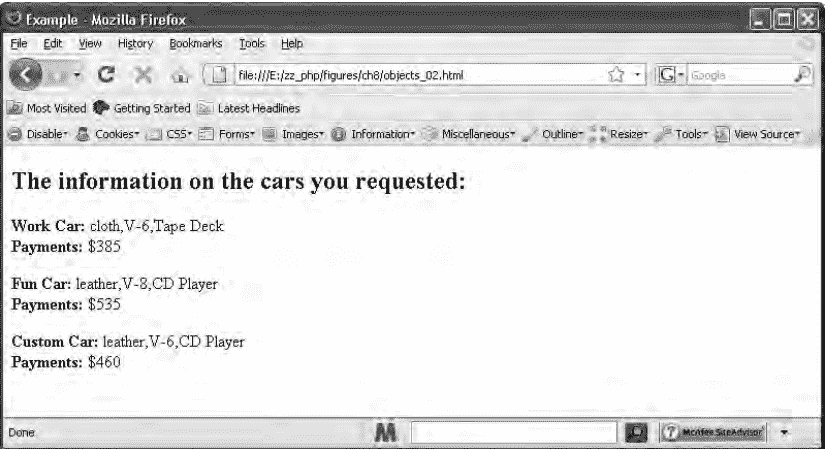

**图 8-6** 汽车类型、其特征及其计算出的月付款金额列表

## 第 8 章：对象

假设你想遍历汽车对象的一个 `work_car` 实例的属性，以便在页面上显示每个属性的值。`for-in` 循环允许你这样做，而无需像这段代码中那样输入每个属性名称：

创建对象：

```javascript

function car(seats,engine,theradio) {

  this.seats=seats;

  this.engine=engine;

  this.theradio=theradio;

}

var work_car= new car("cloth","V-6","Tape Deck");

for (var prop_name in work_car) {

  document.write(work_car[prop_name]+"<br />\n");

}

```

创建了一个对象实例

`for-in` 循环开始

对象的 `work_car` 实例的每个属性值被写入页面上

你会发现脚本中的 `work_car[prop_name]` 部分并不熟悉。`for-in` 循环使用数组来存储属性值，这需要这种语法。你将在第 11 章学习更多关于数组的知识，所以如果现在还不清楚请不要担心。一旦你学会了使用数组，`for-in` 循环将是操作对象的有用方法。目前如此。

## with 语句

`with` 语句允许你不重复对象名称而更方便地访问特定对象。以下代码展示了 `with` 语句的结构：

```javascript

with (object_name) {

    // JavaScript 语句

}

```

## 192 JavaScript：初学者指南

```javascript

document.write("Seats: "+seats+"<br />");

document.write("Engine: "+engine+"<br />");

document.write("Radio: "+theradio+"<br />");

```

## 第 8 章：对象

## 193

## 尝试练习 8-1

### 创建计算机对象

在这个项目中，你将自己创建对象并开发创建对象所需的技能。脚本将创建一个计算机对象，然后使用该对象的属性、方法和实例为不同类型的计算机创建功能列表和价格列表。

```

pr8_1.html

prjs8_1.js

```

### 逐步步骤

- 1. 创建一个 HTML 页面并添加必要的脚本标签，指向名为 `prjs8_1.js` 的外部 JavaScript 文件。
- 2. 创建一个外部 JavaScript 文件并将其保存为 `prjs8_1.js`。它将在步骤 3-12 中使用。
- 3. 创建一个名为 `computer` 的构造函数，它具有三个属性：`speed`、`hspace` 和 `ram`。
- 4. 创建一个计算机对象的实例并命名为 `work_computer`。向 `speed` 参数发送字符串值 `"2GHz"`，向 `hspace` 参数发送 `"80GB"`，向 `ram` 参数发送 `"1GB"`。
- 5. 创建一个计算机对象的实例并命名为 `home_computer`。向 `speed` 参数发送字符串值 `"1.5GHz"`，向 `hspace` 参数发送 `"40GB"`，向 `ram` 参数发送 `"512MB"`。
- 6. 创建一个计算机对象的实例并命名为 `laptop_computer`。向 `speed` 参数发送字符串值 `"1GHz"`，向 `hspace` 参数发送 `"20GB"`，向 `ram` 参数发送 `"256MB"`。
- 7. 创建一个名为 `get_price()` 的函数，用于计算计算机的价格。计算机的基础价为 500，并赋值给名为 `_price` 的变量。如果对象的 `speed` 属性等于 `"2GHz"`，则在 `_price` 上加 200；否则加 10。如果对象的 `hspace` 属性为 `"80GB"`，则在 `_price` 的值上加 50；否则加 25。如果对象的 `ram` 属性为 `"1GB"`，则在 `_price` 的值上加 150；否则加 75。函数以返回语句结束，返回变量 `_price` 的值。
- 8. 为计算机对象添加对步骤 6 中创建函数的调用。为该方法命名为 `price`。
- 9. 将使用 `work_computer` 实例调用 `price()` 方法返回的值赋值给名为 `work_computer` 的变量。
- 10. 将使用 `home_computer` 实例调用 `price()` 方法返回的值赋值给名为 `home_computer` 的变量。
- 11. 将使用 `laptop_computer` 实例调用 `price()` 方法返回的值赋值给名为 `laptop_computer` 的变量。
- 12. 按照本章早些汽车示例中使用的格式，将每种类型计算机的功能和价格写入浏览器屏幕。
- 13. 保存 JavaScript 文件并在浏览器中查看 HTML 文件。你应该能看到屏幕上写着每台计算机的属性列表和价格。

## 尝试练习总结

在这个项目中，你能够利用关于对象的新知识来创建一个带有属性和方法函数的对象。你还创建了一个 Web 页面，在浏览器中显示不同计算机的价格。

## 了解预定义的 JavaScript 对象

在 JavaScript 中，有许多预定义的对象可供你访问你可能需要的某些属性或方法。一旦你学习了各种对象以及你可以用它们做什么，你就可以让你的脚本更具交互性。

本书将涵盖许多预定义对象。其中一些将作为一整章的基础，而另一些规模较小，可能只需要一章的一部分。为了开始，在本章中，你将查看 `navigator` 对象和 `history` 对象，以及你可以用它们做什么。

## navigator 对象

`navigator` 对象让你访问查看浏览器的属性，例如其名称、版本和数量。它的名称源于 Netscape Navigator 浏览器，它是 Mozilla/Firefox 之前的。

`navigator` 对象是 `window` 对象的一部分，这意味着你可以使用 `window.navigator.property_or_method_name` 来访问其属性和方法，但也可以简单简化为 `navigator.property_or_method_name`。对于 `window` 对象的直接属性或方法也是如此（例如，`window.alert("Hi");` 可以简化为 `alert("Hi");` 且依然有效）。你经常会看到这样使用 `window` 对象的属性和方法，以减少额外的输入或缩短源代码。

首先，查看 `navigator` 对象的属性。

### 属性

`navigator` 对象的属性让你了解正在查看的浏览器的各种信息。由于它们是只读的，`navigator` 对象的属性不能被更改，这样做是为了防止尝试将用户的浏览器版本从 6.0 更改 7.0 或类似的内容。相反，你只需要找到该属性的值，并利用它让你的脚本针对不同的浏览器执行不同的操作。

表 8-1 显示了 `navigator` 对象的属性以及每个属性返回的值。此外，如果某个属性仅在本书提到的几个主要浏览器中的一个或两个中有效，则该属性会有一个括号说明。

| 属性 | 值 |
| --- | --- |
| appName | 浏览器名称 |
| appVersion | 浏览器版本和一些额外信息 |
| appMinor | 浏览器的次版本 (Internet Explorer) |
| browserLanguage | 浏览器语言 (Internet Explorer) |
| build | 浏览器的构建标识 |
| cookieEnabled | 浏览器是否启用 cookie |
| cpuClass | 浏览器的分类 (Internet Explorer) |
| mimeTypes | MIME 类型数组 |
| onLine | 浏览器是否离线 |
| platform | 机器类型 |
| plugins | 插件数组 |
| product | 浏览器名称 (Firefox) |
| productSub | 浏览器版本号 (Firefox) |
| securityPolicy | 浏览器是否处于安全模式 |
| systemLanguage | 操作系统 |
| userLanguage | 浏览器语言 |
| userAgent | 用户代理 |
| vendor | 浏览器供应商 |

表 8-1 navigator 对象的属性

现在你已经了解了 `navigator` 的属性，可以开始使用它们了。接下来的章节将介绍细节。

如你所见，查看者现在可以发现对正在使用的浏览器的看法。
图 8-7 显示了如果你使用 Firefox 查看页面时会收到的警框。

appVersion 属性：该属性的值是浏览器版本号和一些额外信息。例如，在 Windows XP 上的 Firefox 3 中，你可能会看到该属性的如下文本：

- 5.0 (Windows; en-US)

# 第 8 章：对象 197

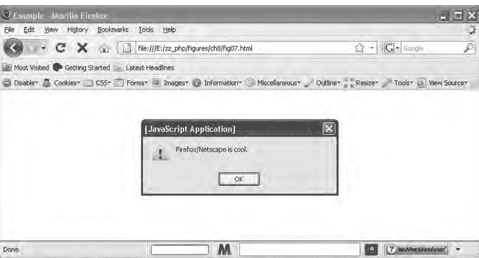

**图 8-7** 使用 Firefox 进入该页面时收到的警告

当你使用只能在特定版本以上的浏览器执行的技术时，这可能会是有益的。但注意，尽管浏览器对此属性返回不同的结果，此处显示的 Windows Vista 上的 Internet Explorer 7 返回的值如下：

- 4.0 (compatible; MSIE 7.0; Windows NT 6.0; SLCC1; .NET CLR 2.0.50727; Media Center PC 5.0; .NET CLR 3.5.30729; .NET CLR 3.0.30618)

字符串的第一部分是 4.0，随后它描述自己为 MSIE 7.0。因此，在使用此属性时也必须小心，了解各种浏览器返回了什么，以便最好地利用这些信息。

**cookieEnabled 属性** 如果浏览器中启用了 cookie，此属性返回布尔值 true；如果浏览器中未启用 cookie，则返回布尔值 false。你将在第 16 章中更详细地介绍 cookie。

**online 属性** 如果查看者的系统未处于全局离线模式，此属性返回布尔值 true（详情请参阅 http://msdn.microsoft.com/en-us/library/aa78170(vs.85).aspx），如果系统处于全局离线模式，则返回布尔值 false。

**platform 属性** 此属性持有创建浏览器的机器类型的值。例如，在 Windows XP 机器上，该值将是 Win32。

# 198 JavaScript：初学者指南

对于不同类型的机器有不同的值。如果你想让查看者知道正在使用的机器类型，可以使用此属性发送一个警框：

```

window.alert("Your machine is a "+navigator.platform+"");

```

虽然用处不大，但该属性可以根据用户的机器类型将查看者重定向到适当的页面。

**plugins 属性** 此数组持有查看者浏览器中安装的所有插件的值。你将在第 12 章中了解到更多关于数组的知识。

**userAgent 属性** 此属性为你提供了另一段关于浏览器的长字符串。该字符串是浏览器的用户代理（user agent）。在 Windows XP 的 Firefox 3 中，你可能会看到字符串：

```

Mozilla/5.0 (Windows; NT 5.1; en-US; rv:1.9.0.4)

Gecko/2008102920

Firefox/3.0.4

```

它与你为 navigator.appVersion 属性看到时看到的文本非常相似，但多了一些信息。

现在你已经了解了 navigator 对象的属性，可以开始查看该对象的方法了。

# 方法

navigator 对象还拥有许多你可以使用的的方法，用以执行各种任务。表 8-2 显示了 navigator 对象中可用的方法。

接下来的部分将解释 `javaEnabled()` 方法及其使用方法。

**javaEnabled() 方法** 如果查看者在浏览器中启用了 Java，此方法返回布尔值 true；否则返回 false。如果你想向查看者显示 Java 应用，但前提是查看者在浏览器中启用了 Java，那么 `javaEnabled()` 方法就会很有用。

| | 目的 |
|---|---|
| javaEnabled() | 用于测试浏览器中是否启用了 Java |
| maybeLocallyAvailable() | 检查特定地址的文件在本地是否启用（仅限 Firefox） |
| preference() | 允许设置某些偏好（需要签名字体） |
| registerContentType() | 允许 Web 将自己设为特定 MIME 类型的潜在处理器 |
| registerProtocolHandler() | 允许 Web 将自己设为特定协议的潜在处理器 |
| taintEnabled() | 返回 false——因为该方法不再使用。它曾用于指定浏览器中是否启用了数据污染（data tainting） |

# 表 8-2 Navigator 对象的方法

目前，你只需要看到如何向查看者发送警框作为示例。这样你还不需要处理任何 Java 语法。以下代码会在查看者启用了 Java 时发送一个警框，并在查看者未启用 Java 时启用（另一个警框）：

```

var hasJava= navigator.javaEnabled()

if (hasJava==true) {

  window.alert("Cool, you have Java!");

} else {

  window.alert("Java disabled? You cannot see my Java Applet!");

}

```

这测试了 `navigator.javaEnabled()` 方法返回的值，并给用户提供了正确的警框。同样，如果你想在页面的某处使用 Java Applet，这会更有用。

# History 对象

history 对象也是 window 对象的一部分，它提供了当前窗口的浏览器历史信息。

### 属性

history 对象只有一个属性，命名为 `length`（在 Firefox 中，有几个属性可用，但它们与 Web 内容不起作用）。此属性返回当前窗口浏览器会话历史中的页面数，包括当前加载的页面。它可以以如下方式使用：

```html

<body

<script type="text/javascript">

alert("History has " + history.length + " pages");

</script>

</body>

```

| 方法 | 目的 |
|---|---|
| back() | 使浏览器在历史记录中后退一页 |
| forward() | 使浏览器在历史记录中前进一页 |
| go() | 使浏览器跳转到历史记录中的指定页面 |

# 表 8-2 Navigator 对象的方法

# 200 JavaScript：初学者指南

### 练习总结

在这个项目中，你运用了关于预定义 `navigator` 对象的属性和方法的知识。你能够创建一个 Web 页面，根据浏览器、机器类型以及 Java 是否启用向查看者发送不同的警报。

# 第8 章自测

- 1. 对象是对某个 ________ 进行建模的一种方式，尽管对象本身是一个实体。
- 2. 当你思考一个对象时，你可能想要视觉化某个 ________ 的东西。
- 3. 对象是有用的，因为它们为你提供了另一种在脚本中 ________ 某物的方法。
- 4. 在 JavaScript 中，你通过使用 ________ 来访问属性
   A 加法运算符
   B 点运算符（dot operator）
   C乘法运算符
   D 访问对象的属性
- 5. 对象的命名规则与命名 ________ 和 ________ 的规则相似。
- 6. 你可以使用 ________ 函数或对象 ________ 来创建 JavaScript 对象。
- 7. 构造函数允许你 own使用与普通函数相同的基本语法来构建对象。
   A 正确
   B 错误
- 8. 对象初始化器比构造函数稍微长一点。
   A 正确
   B 错误
- 9. 对于以下代码你可以说明什么：
   var x=myhouse.kitchen;
   A 它将字符串 myhouse.kitchen 赋值给变量 x。
   B 它将 myhouse 和 kitchen 的值相加并将它们赋值给名为 x 的对象。
   - C 假设 myhouse 对象存在，它将 myhouse 对象中 kitchen 属性的值赋值给变量 x。
   - D 假设 kitchen 对象存在，它将 kitchen 对象中 myhouse 属性的值赋值给变量 x。
- 10. 如果此行位于构造函数内部，以下哪行可以正确从名为 `get_cost()` 的函数创建一个名为 `cost` 的方法？
   A this.cost=get_cost();
   B cost=get_cost();
   C get_cost=this.cost();
   D this.cost=get_get_cost();
- 11. 下列哪行会向查看者发送警报，告知正在使用的浏览器名称？
   A window.alert("You are using "+navigator.appVersion);",
   B window.alert("You are using "+navigator.appName);",
   C window.alert("You are using "+navigator.javaEnabled());",
   D window.alert("You are using "+navigator.appName");",
- 12. 对于以下代码你可以说明什么？
   myhouse.kitchen="big";
   A 假设 kitchen 对象存在，myhouse 属性被赋值了一个新的字符串值。
   B 假设 myhouse 对象存在，变量 kitchen 的值被加到字符串 big 之后。
   - C 假设 myhouse 对象存在，kitchen 属性被赋值了一个新的字符串值。
   - D 这什么都不会做。
- 13. 在 JavaScript 中，有许多 ________ 对象可以让你，以访问所需的某些属性和方法。
- 14. ________ 对象让你访问查看者浏览器的各种属性。
- 15. 下列哪项不是 navigator 的属性？
   A appName
   B appCodeName
   C appType
   D appVersion

# 第9 章 文档对象 (The Document Object)

# 206 JavaScript: 入门指南

### 核心技能与概念

- 定义文档对象
- 使用文档对象模型 (DOM)
- 使用文档对象的属性
- 使用文档的方法
- 创建动态脚本

现在你已经了解了对象是如何工作的以及如何使用预定义的 JavaScript 对象，是时候查看 JavaScript 中的一些预定义对象了。
本章涵盖了文档对象，它可以帮助你收集有关浏览器中查看的页面的信息。正如你在本章中发现的，文档对象的一些属性和方法可以用于获取有关文档的信息或更改有关文档的信息。你还将被介绍文档对象模型（DOM），并看到如何结合样式表来创建动态脚本。

## 定义文档对象

文档对象是浏览器为每个查看的新 HTML 页面（文档）创建的对象。通过这种方式，JavaScript 让你能够访问许多属性和方法，这些方法可以以各种方式影响文档。
在本书中，你已经使用文档对象的 `write()` 方法很长时间了。该方法允许你将字符串文本写入 HTML 文档中。
要开始你的文档对象之旅，你将查看文档对象模型（DOM）以及你可以通过此对象访问的各种属性。许多属性在编写脚本时会被证明非常有用。

## 使用文档对象模型

文档对象模型（DOM）允许 JavaScript（以及其他脚本语言）访问浏览器中文档的结构。每个文档由结构化节点组成（例如，`<body>` 标签将是一个节点，`body` 元素内的任何元素都是 `body` 元素的子节点）。有了这种结构，脚本语言就可以以多种方式访问文档内的元素，从而对文档内的元素进行修改。

# 第9 章：文档对象 207

| body |
| :--- |
| h1 (body 的子节点) -- img (body 的子节点) |
| My Page (h1 节点的子节点) | src="image.jpg" -- alt="My Picture" (img 节点的属性节点) |

**图 9-1** 文档结构部分的示例

如果你有以下 HTML 代码，可以使用 JavaScript 访问它的结构：

```html

<body>

  <h1>My Page</h1>

  

</body>

```

图 9-1 显示了 `body` 元素如何成为一个节点，以及它如何拥有子节点和属性节点。
`h1` 和 `img` 都是 `body` 元素的子节点。每个元素也有它自己的节点。`h1` 元素包含一个文本节点作为其子节点（文本 "My Page"），而 `img` 元素包含两个属性（`src="image.jpg"` 和 `alt="My Picture"`）。这种结构贯穿整个文档，虽然这只是一个简单的示例，但大多数 HTML 页面都可以绘制更复杂的文档树。
你已经在使用 `getElementById()` 访问 DOM，通过 id 值访问文档中的元素。你还可以使用 `getElementsByTagName()` 或 `getElementsByClassName()` 等方法获取一组元素。
使用 JavaScript 访问 DOM 允许你创建更动态的脚本，响应用户事件更改文档内的元素。你还可以使用文档对象的某些 JavaScript 方法（如 `createElement()` 或 `createNode()`）创建元素和节点。这类脚本将在本章中介绍。
首先，你将学习文档对象的属性和方法。

## 使用文档对象的属性

表 9-1 列出了文档属性及其简短描述。在表格之后，将更详细讨论一些特定的属性。为某些属性提供了示例脚本。请注意，许多属性使用数组来存储信息。如果你想学习数组以更好地理解它们的用法，请参阅第 11 章。

### 注意

并非所有这些属性都支持跨浏览器。此外，其中许多已被废弃（`alink`, `bgColor`, `Color`, `linkColor`, 和 `vlink`）。你可以访问 http://developer.mozilla.org/en-US/document#VS 属性和 http://msdn.microsoft.com/en-us/library/ms531073(VS.85).aspx 查看更多关于这些属性的信息。

# JavaScript: 入门指南

| 属性 | 描述 |
| :--- | :--- |
| activeElement | 返回一个包含文档中活动元素值的字符串 |
| alinkColor | 返回文档活动链接颜色的十六进制值 |
| anchors | 文档中所有锚点的数组 |
| async | 用于告诉浏览器使用异步请求或同步请求加载文档 |
| applets | 所有 Java applet 的数组 |
| bgColor | 返回文档背景色的十六进制值 |
| body | 返回文档的 body 元素或框架 (frame) 元素 |
| characterSet | 返回一个表示编码文档时使用的字符集的字符串值 |
| charset | 返回一个表示编码文档时使用的字符集的字符串值 |
| childNodes | 文档中所有子节点的节点的数组 |
| compatMode | 如果文档在奇异模式（Quirks mode）或严格模式（Strict mode）下渲染，则返回字符串 "BackCompat" |
| contentType | 返回来自文档 MIME 头的 Content-Type 字符串 |
| cookie | 用于在文档中设置 JavaScript cookie |
| defaultCharset | 返回一个表示编码文档时使用的默认字符集的字符串值 |
| default | 引用文档的 window 对象 |
| designMode | 返回一个提供文档是否可以编辑信息的字符串值 |
| dir | 返回一个表示文档阅读方向的字符串值 |
| doctype | 返回与文档关联的 doctype 声明 |
| documentElement | 返回表示文档根节点的字符串 |
| documentURIObject | 返回一个表示文档 URI 的对象（仅对特权 JavaScript 代码可用） |
| domain | 返回文档的服务器名称 |
| embeds | 文档中所有 embed 标签的数组 |
| expando | 根据文档内是否可以创建任意变量返回布尔值 |
| fgColor | 返回文档默认字体颜色的十六进制值 |
| fileCreated | 返回文档创建日期 |

表 9-1 文档的属性

## 第 9 章：文档对象

| 属性 | 描述 |
|---|---|
| fileModifiedDate | 返回文档最后修改的日期 |
| formName | 本身不是一个属性，而是为文档中放置的每个名称创建一个新属性 |
| forms | 文档中所有表单（form）标签的数组 |
| frames | 文档中所有框架（frames）的数组 |
| height | 返回文档 body 元素的高度（像素为单位） |
| images | 文档中所有图像（img）标签的数组 |
| implementation | 返回一个表示文档实现对象的字符串 |
| inputEncoding | 返回一个表示文档编码的字符串 |
| lastModified | 返回文档最后修改的日期 |
| layers | 页面上所有层 标签的数组（仅限 Netscape Navigator 4） |
| all | 允许访问页面上的所有对象 |
| linkColor | 返回文档默认链接颜色的十六进制值 |
| links | 返回文档中所有链接（<a>）标签的数组 |
| location | 返回文档的 URL |
| namespaces | 文档中所有命名空间的数组 |
| parentWindow | 返回父窗口的引用（父窗口的文档） |
| plugins | 文档中使用的所有插件的数组 |
| protocol | 返回文档 Web 地址（URL）的协议部分 |
| readyState | 返回表示文档当前状态的字符串值 |
| referrer | 返回引导者进入当前文档的文档 URL |
| scripts | 文档中使用的所有脚本的数组 |
| styleSheets | 文档中使用的所有样式表的数组 |
| tags | 设置文档中 HTML 标签的样式 |
| title | 返回文档 title 标签内部使用的文本 |
| uniqueID | 返回一个表示赋予文档唯一 ID 的字符串值 |
| URL | 返回当前文档的 URL |
| URLUnencoded | 返回未经过编码的文档 URL |
| vlinkColor | 返回文档已访问链接颜色的十六进制值 |
| width | 返回文档 body 元素的宽度（像素为单位） |

**表 9-1** 文档对象的属性（续）

## 颜色属性

`alinkColor`、`bgColor`、`fgColor`、`linkColor` 和 `vlinkColor` 经常用于获取或更改页面上各种元素的颜色。现在建议使用 CSS 设置这些属性，或使用样式属性进行更改（在本章稍后的部分将进行讨论）。

## anchors 属性（数组）

`anchors` 属性实际上是一个数组，由浏览器为文档中所有命名锚点（例如 `<name="top">`）设置。由于你还没有学习过数组，目前这对你可能没有什么帮助；但是，当你学到第 11 章时，你将发现更多关于此类数组如何用的信息。

JavaScript 提供了 `length` 属性，让你能够找到页面上锚点的数量。你可以使用 `length` 属性向浏览器窗口写入页面上有多少个锚点：

```html

<body>

<h1>我的页面</h1>

<a name="sec1"></a>

<h2>第 1 节</h2>

<a name="sec2"></a>

<h2>第 2 节</h2>

<p>这一部分讨论了关于第 2 节的所有问题和...</p>

<script type="text/javascript">document.write("页面上有 "+document.anchors.length+" 个锚点");</script>

</body>

```

这段代码在页面上创建了两个命名锚点，并在屏幕上写出页面上锚点的数量。图 9-2 显示了该脚本在浏览器窗口中的结果。

再次，这目前更多是一个信息性属性。一旦你学习了数组，就可以更充分地利用它的属性。

## cookie 属性

cookie 属性用于设置 JavaScript cookie 以为查看者存储信息。cookie 是保存到查看者计算机上的、持续特定时间（日期或浏览器会话）的小文本文件。cookie 对于允许网站记住并检索查看者的信息（例如购物车内容、特殊设置或会话信息）非常有帮助。

## 第 9 章：文档对象

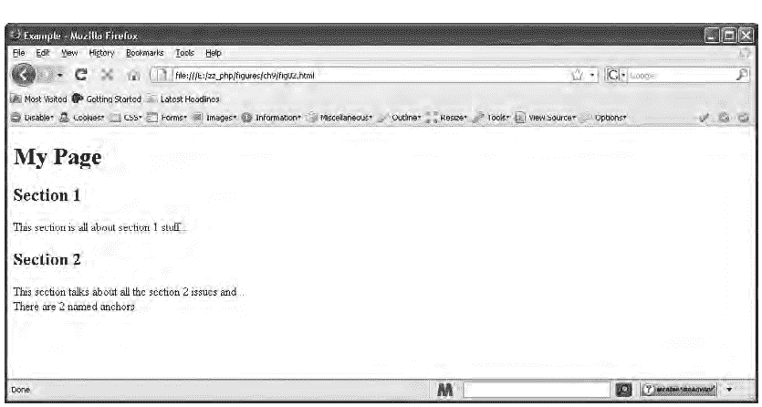

图 9-2 浏览器窗口显示页面上命名锚点的数量

要设置 cookie，你需要将 `document.cookie` 属性的值设置为一个包含你想为查看者存储的信息的字符串。以下是语法：

```javascript

document.cookie=string;

```

你将用 `string` 替换为包含你想要使用的信息的文本字符串。通常，它的格式如下面的示例设置 cookie 方式所示：

```javascript

document.cookie="site=homepage";

```

你可以看到 cookie 设置了一项内容：site 是 homepage。两个等号之间的符号用于在读取 cookie 时区分 site 和 homepage。

在尝试进一步处理 cookie 之前，你需要掌握更高级的字符串处理技术。你将在随后的章节中更详细地看到如何使用高级字符串处理技术以及如何设置和读取 cookie。例如，你只需要知道 `document.cookie` 属性是用于。

## dir 属性

dir 属性返回一个表示文档方向的字符串值。该值可以是 ltr（从左到右）或 rtl（从右到左）。此属性对于从右到左阅读的语言有用。

## JavaScript：入门指南

dir 属性用于设置页面的方向。为了趣味，你可以通过以下示例动态更改页面外观：

```javascript

var the_button = document.getElementById("sides");

the_button.onclick = function() {

  document.dir = (document.dir!="ltr") ? "rtl" : "ltr";

}

```

然后，在你的 HTML 中添加一个按钮：

```html

<body>

<form>

  <input type="button" value="切换方向" id="sides" onclick="switch()" />

</form>

</body>

```

当查看者点击按钮时，页面的方向将会改变。在这种情况下，按钮最初从左侧开始。图 9-3 显示了点击按钮前的页面。

## domain 属性

domain 属性持有提供页面的域名值。该值是地址开头 `http://` 之后、任何正斜杠之前的内容。因此，如果你查看 `http://www.pagerource.com` 页面，`document.domain` 的值将是 `www.pagerource.com`。

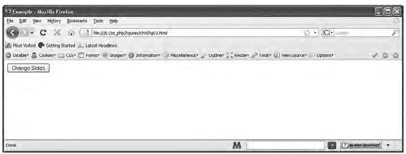

图 9-3 

要使用 domain 属性，你向查看者发送一个识别域的警告。将以下代码放在文档中将弹出一个包含 domain 属性值的警告框：

```html

<body>

<script type="text/javascript">

window.alert("你访问了 "+document.domain+" 域！");

</script>

</body>

```

如果将此代码放在 http://javascriptcity.com 的任何页面上，查看者将收到一条显示“你访问了 javascriptcity.domain!”的警告。

注意

在没有 Web 服务器的情况下在本地使用此属性时，返回的值可能是空字符串而不是域名。

## formname 属性

formname 属性本身并不是一个属性。每当你命名一个表单时，就会创建一个 formname 属性，但该属性实际上是表单的名称而不是 formname。要理解其含义，请看一个包含表单的页面。以下代码将给你一个包含以下内容的 HTML 页面：

```html

<body>

<form name="funform" <!--

给表单命名是为了创建一个属性

----------------------------------------------------------------------

-->

  <input type="button" name="funb" value="我想我是可以点我的吧" />

</form>

</body>

```

## 214 JavaScript：初学者指南

此代码通过起始 `<form>` 标签中的 `name="funform"` 属性创建了一个 `document.form` 属性。虽然这本身没有太大作用，但它允许你访问表单内的表单元素。

表单下实际上包含了一些属性，这些属性与表单元素同名。你可以使用 `document.form.funb` 根据你在表单中通过 `name="funb"` 属性使用的按钮来获取它；然而，仅仅靠这一点也做不了太多事情。

你需要再深入挖掘一层。`value` 属性允许你设置或更改表单内容的值。这些元素通常用于表单元素标签的 `value` 属性中。在这里，你可以通过访问 `document.form.funb.value` 访问其值并为其赋一个新值，从而更改按钮上的文本内容。

下面的示例展示了如何使用 `onclick` 处理器在点击按钮时更改按钮文本：

```html

<body>

<form name="funform">

  <input type="button" name="funb" value="You can click me I suppose"

  onclick="document.funform.funb.value='Thanks, you clicked me!'" />

</form>

</body>

```

通过赋予新值来更改按钮文本。
图 9-5 显示了在点击按钮之前页面和按钮的样子。注意在 input 标签的 `value` 属性中设置的按钮。现在看看图 9-6 中点击后的按钮。按钮上的文本已经改变了！按钮让你知道你点击了它，而且它通过对你说“谢谢”来表现出礼貌。

需要注意的是，虽然这种方法可行，但现代浏览器只需可以通过为每个表单元素分配一个 `id` 并使用 `document.getElementById` 方法来直接访问每个表单元素及其值，而不是通过表单的名称。

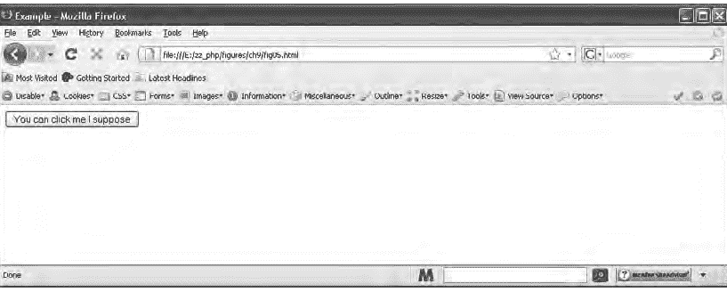

图 9-5 按钮点击前的浏览器显示

## 第9章：文档对象 215

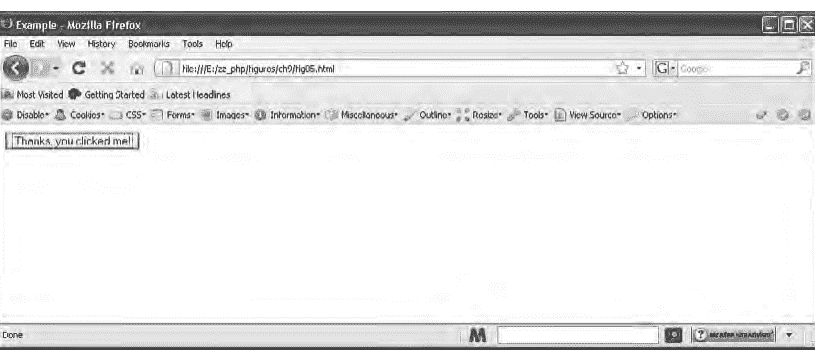

图 9-6 按钮点击后的浏览器显示

### forms 属性（数组）

`forms` 属性是一个数组，其中包含网页上每个表单的条目。该数组提供了使用 `formsname` 属性的替代方案；但在更详细地研究此数组之前，你仍然需要在第 11 章学习数组。

与其他类似的属性一样，你可以使用 `document.forms.length` 这种 `length` 属性来查找页面上有多少表单。

### images 属性（数组）

`images` 属性是另一个数组。它包含网页上每个图像的条目。与其他类似的属性一样，你可以使用 `document.images.length` 的 `length` 属性来查找 HTML 文档中的图像数量。

它的另一个用途是检测浏览器是否支持 JavaScript 中的 Object 对象。如果你希望预加载图像，这非常有帮助。在使用图像滚动脚本（你将在第 16 章创建）时，预加载图像是一个好主意；如果你想将网站内其他页面将使用的图像放在浏览器的缓存文件中，以便让访问者加载页面更快，这也很有用。

要检查浏览器是否支持 `Image` 对象，你可以将任何需要 `Image` 对象的代码放在一个块中。如果该块测试 `document.images` 属性是否存在，如下例所示：

```javascript

if (document.images) {

    // 在这里你放置需要 JavaScript

    // 语句来使 document.images 属性生效的代码

}

```

注意，括号内你只需要 `document.images`。如果它存在，将返回 `true`（因为除了 `null` 以外的任何内容都会被视为 `true`——基本上是 `(!null)` 的简写），并执行块内部语句。如果属性不存在，块将被忽略，旧版浏览器会为不需要尝试任何这些代码而感到高兴。

要预加载图像，你首先需要创建一个 JavaScript 字体的新实例。下面的代码显示了创建 `Image` 对象新实例的语法：

```javascript

var varname= new Image (width,height);

```

你将 `varname` 替换为你想要给此 `Image` 对象实例命名的名称。将 `width` 替换为你想要使用的图像的宽度（像素），并将 `height` 替换为图像的高度（像素）。

所以，如果你创建一个名为 `myimage` 的 `Image` 对象实例，其中图像宽度为 100 像素，高度为 75 像素，可以使用以下代码：

```javascript

var myimage= new Image (100,75);

```

`width` 和 `height` 参数是可选的。你可以直接创建没有这些参数的对象实例：

```javascript

var myimage= new Image();

```

接下来，你需要定义将使用哪个图像（类似于图像标签中的 `src` 属性）。`Image` 对象带有一个 `src` 属性，允许你执行此操作。下面的代码展示了如何实现：

```javascript

var myimage= new Image();

myimage.src="smile.gif";

```

现在浏览器尝试加载该图像。

预加载通常在 `head` 部分进行。为了将这一切整合在一起，你需要将脚本放在 `head` 中：

```html

<head>

<script type="javascript">

if (document.images) {

  var myimage= new Image();

  myimage.src="smile.gif";

}

</script>

</head>

```

该对象被赋予了一个 `src` 属性。

### 提示

预加载通常在 `head` 部分进行。要预加载多个图像，你需要为每个想要预加载的图像创建一个 `Image` 对象的实例。所以，如果你想预加载三张图像，可以使用以下代码：

```html

<head>

<script type="text/javascript">

if (document.images) {

  var myimage = new Image();

  myimage.src="smile.gif";

  var yourimage = new Image();

  yourimage.src="friendly.gif";

  var herimage = new Image();

  herimage.src="happy.gif";

}

</script>

</head>

```

这为你预加载了三张图像。新实例 `yourimage` 预加载了名为 `friendly.gif` 的图像。实例 `herimage` 预加载了文件名为 `happy.gif` 的图像。如果你愿意，可以使用相同的技术添加更多图像。

### lastModified 属性

`lastModified` 属性存储当前文档最后修改的日期和时间。它主要用于信息目的，例如显示文档最后修改时间，以便访问者知道你何时更新了页面。此属性的值取决于你的浏览器，因为如果你在页面上编写 `lastModified` 日期，不同的浏览器会有不同的结果。

考虑以下代码，它将 `document.lastModified` 属性的值写入网页以显示最后修改的日期和时间：

```html

<body>

<h1>My Always Updated Web Page!</h1>

<script type="text/javascript">

document.write("Last Updated: "+document.lastModified);

</script>

</body>

```

图 9-7 显示了在 Mozilla Firefox 中查看此代码时的结果。

在页面上编写最后修改日期时，差异仅体现在页面空间上。某些布局可能需要为较长的属性版本留出额外的空间。

### layers 属性（数组）

`layers` 属性是另一个数组，包含页面上每个 `layer` 标签的条目，你可以使用 `document.layers.length` 的 `length` 属性来查找页面上的层数。`layer` 标签在 Netscape Navigator 4 中被用作创建不同区域的方法。

# JavaScript：初学者指南

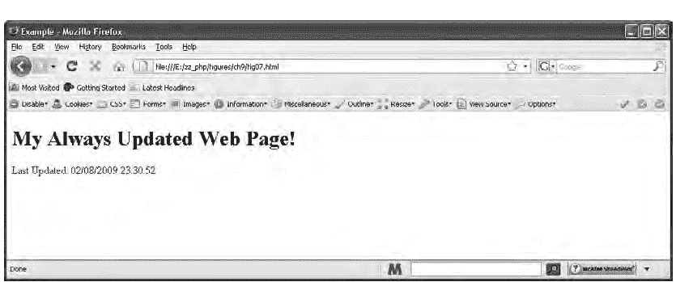

**图 9-7** 在 Mozilla Firefox 中查看时页面的最后修改日期

一个页面的（可能是分层的）以及用于脚本的访问权限。在现代浏览器中，它不再被使用，因为每个元素都可以通过其他方式（例如 `document.getElementById()` 方法）访问。

由于此属性仅在 Netscape Navigator 第 4 版本中可用，你可以使用此属性来判断浏览器是否正在使用 Netscape Navigator 4。你可以像测试 `document.images` 属性一样的方法测试 `document.layers` 属性，它的写法非常简短：

```javascript

if (document.layers) {

  window.alert("You have Netscape Navigator 4!");

}
```


## all 属性

当 `layers` 属性有助于检测 Netscape Navigator 4 时，`all` 属性可以帮助你检测 Internet Explorer 4 或更高版本。`all` 属性的目的是让 JavaScript 访问页面上的所有对象。同样，在现代浏览器中使用其他方法（如 `document.getElementById()` 方法）完成此操作更好。

所以，为了查看查看者是否在使用 Internet Explorer 4 或更高版本，你可以使用以下代码：

```javascript
if (document.all) {
  window.alert("You have Internet Explorer 4 or better!");
}
```

## links 属性（数组）

`links` 属性是另一个数组，它持有页面上每个链接（例如 `<a href="url">`）和图像映射链接区域（例如 `<area href="url">`）的值。你可以使用 `document.links.length` 属性来获取页面上有多少个链接。

## referrer 属性

`referrer` 属性用于信息性目的，它持有查看者在到达你的页面之前所在的页面的 URL 值（即引荐页）。虽然这可能有用，但查看者并不总是带有引荐 URL 进入的（例如使用书签或直接输入地址），因此该值可能为空。此外，该属性的值并不总是准确，因为不同的浏览器可能认为不同类型的内容是引导查看者跳转到新页的，而不仅仅是链接。

要使用此属性，你可以向页面查看者发送警报，告诉他们是从哪里来到你的页面的。将示例中的代码放入文档中即可生效：

```html
<body>
  <script type="text/javascript">
    window.alert("You came from " + document.referrer + "!");
  </script>
</body>
```

所以，如果引荐页是 `http://www.pagesource.com/webdes.html`，查看者将收到一个显示“You came from http://www.pagesource.com/webdes.html!”的警报。

## title 属性

`title` 属性持有 HTML 文档标题的字符串值。它设置在页面的 `<title>` 和 `</title>` 标签内部。

你可以使用 `title` 属性将页面标题显示在窗口顶部其他地方。以下代码允许你实现这一点：

```html
<head>
  <title>Lions, Tigers and Bears!</title>
</head>
<body>
  <script type="text/javascript">
    document.write("<h1>" + document.title + "</h1>");
  </script>
  Lions and tigers and bears were what I saw when I went to ...
</body>
```

这会将你的标题作为标题显示在页面上。图 9-8 显示了在浏览器中查看此结果。

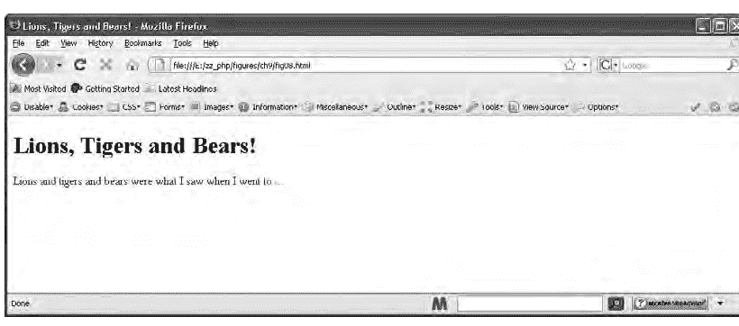

**图 9-8** 文档标题作为标题显示在页面上

## URL 属性

`URL` 属性持有当前文档完整 URL 值。如果你将其打印在 HTML 页面的底部，此信息将非常有用，因为它会为任何打印你页面的人显示页面 URL。

虽然你可以自己手动在底部输入 URL，但当需要在许多页面上执行时，这可能会变得繁琐。这时此属性就非常方便了，因为你可以将一小段脚本粘贴到每个页面，而不是为每个页面输入不同的 URL 地址。以下代码展示了在页面上编写 URL 地址的示例：

```html
<body>
<h1>Buy Something!</h1>
If you don't buy something I will be really upset so you had better...<br/>
<script type="text/javascript">
document.write("You are at: " + document.URL);
</script>
</body>
```

图 9-9 显示了上述代码在浏览器中的结果。页面的最后一行告诉查看者当前位置。该图显示的是本地文件地址，但如果页面在网上，它将显示普通的 URL。

## URLUnencoded 属性

`URLUnencoded` 属性返回未经过编码的文档 URL。例如，如果文件名中包含空格，该属性将返回空格而不是 `%20`。对于 URL `http://www.pagesource.com/my script.html`，`document.URLUnencoded` 将返回带有空格的 URL。

# 第 9 章：Document 对象

## 咨询专家

**Q:** 创建表单的命名让我有点困惑。然后，通过名称更改表单元素也让我很困惑。我可以看另一个例子吗，比如文本框或之类的？

**A:** 这种访问元素的方法并不常用。更多情况下，会使用你已经熟悉的较新方法，如 `getElementById()`。如果仍然困惑，请不要担心。我们在书中后面有专门关于 JavaScript 使用表单的章节（第 14 章）。

## Document 对象的方法

Document 对象的方法允许你完成一些你尚未实现的操作。表 9-2 列出了这些方法及其简要说明。由于许多方法在编写期间是特定浏览器的（与属性相同），某些特定方法将在下文中详细描述。

| 方法 | 说明 |
| :--- | :--- |
| `attachEvent()` | 将函数绑定到事件上，当事件发生时运行该函数（仅限 Internet Explorer） |
| `createAttribute()` | 根据传入的名称创建属性 |
| `createAttributeNS()` | 在特定的命名空间中创建新属性 |
| `createCDATASection()` | 创建一个新的 CDATA 段 |
| `createComment()` | 根据传入的值创建注释 |
| `createDocumentFragment()` | 创建一个新的文档碎片 |
| `createElement()` | 根据传入的类型创建元素 |
| `createElementNS()` | 根据特定的 URI 和传入的类型创建元素 |
| `createEntityReference()` | 创建一个新的实体引用 |
| `createEvent()` | 创建一个事件 |
| `createEventObject()` | 创建一个事件对象用于传递事件信息 |
| `createNodeIterator()` | 创建一个节点迭代器对象 |
| `createNSResolver()` | 创建一个命名空间解析器 |
| `createProcessingInstruction()` | 创建一个处理指令 |
| `createRange()` | 创建一个范围对象 |
| `createStyleSheet()` | 创建一个供文档使用的样式表（仅限 Internet Explorer） |
| `createTextNode()` | 根据传递的参数值创建一个文本字符串节点 |
| `createTreeWalker()` | 创建一个树遍历器对象 |
| `detachEvent()` | 从事件中分离一个函数（仅限 Internet Explorer） |
| `elementFromPoint()` | 返回位于两个参数值（距离左侧和顶部的像素值）处的对象 |
| `evaluate()` | 根据参数返回结果 |
| `execCommand()` | 当文档处于设计模式时，在文档上执行命令 |
| `getElementById()` | 返回具有作为参数传递的 id 属性的对象的引用 |
| `getElementsByClassName()` | 返回具有作为参数传递的类名的元素的集合引用 |
| `getElementsByName()` | 返回具有作为参数传递的 name 属性的元素的引用 |
| `getElementsByTagName()` | 返回具有作为参数传递的标签名的元素的集合引用 |
| `getElementsByTagNameNS()` | 返回具有作为参数传递的标签名和命名空间的元素的集合引用 |
| `getSelection()` | 返回文档中选定文本字符串的值 |
| `hasFocus()` | 根据文档是否具有焦点返回布尔值 |
| `load()` | 加载 XML 文档 |
| `mergeAttributes()` | 从对象复制属性 |
| `open()` | 打开一个新文档，允许你使用 `write()` 或 `writeln()` 语句写入其内容 |
| `close()` | 关闭已使用 `open()` 方法打开的新文档 |
| `queryCommandEnabled()` | 根据作为参数传递的命令是否可以执行返回布尔值 |
| `queryCommandIndeterm()` | 根据传递的命令是否处于不确定状态返回布尔值 |
| `queryCommandState()` | 根据作为参数传递的命令是否已执行返回布尔值 |
| `queryCommandSupported()` | 根据作为参数传递的命令是否支持返回布尔值 |
| `queryCommandValue()` | 返回作为参数传递的命令在文档中的当前值 |
| `recalc()` | 重新计算文档中的动态属性 |
| `releaseCapture()` | 释放文档的鼠标捕获 |
| `setActive()` | 将对象设置为激活状态，但不赋予其焦点 |
| `write()` | 允许你将字符串文本写入 HTML 文档 |
| `writeln()` | 允许你将字符串文本写入 HTML 文档，但使用 JavaScript 换行符结束行 |

**表 9-2** Document 对象的方法（续）

> 注意：并非所有这些属性都支持跨浏览器。你可以通过访问 developer.mozilla.org/en/DOM/Document#Methods_and 和 http://msdn.microsoft.com/en-us/library/ms531073(VS.html).aspx 了解有关这些属性的更多信息。

### getElementById() 方法

`getElementById()` 方法是你在书中已经广泛使用的一个方法。它允许你通过 id 属性的值来访问元素。正如你所知，如果你有以下代码，可以使用此方法访问该元素：

```html
<div id="some_text">This is some text.</div>
```

由于 div 元素的 id 属性值为 `some_text`，因此 `document.getElementById()` 方法可以使用该值作为字符串参数来访问该元素：

```javascript
var text_element = document.getElementById("some_text");
```

正如你之前做的那样，你可以利用发生在该元素上的事件以及处理该事件的脚本。

### getElementsByClassName() 方法

该方法允许你获取一个数组，其中包含文档中所有具有指定类名（来自 CSS 类）作为参数的元素。例如，要获取所有类名为 `number_one` 的元素，你可以使用以下代码：

```javascript
var my_class = document.getElementsByClassName("number_one");
```

这是访问页面上特定组元素的一种良好方法。由于它涉及到数组，该方法将在第 11 章中进行更详细讨论。

### getElementsByTagName() 方法

该方法允许你获取一个数组，其中包含文档中所有具有指定标签名作为参数的元素。例如，要获取文档中的所有 `img` 元素，可以使用以下代码：

```javascript
var _images = document.getElementsByTagName("img");
```

由于它涉及到数组，该方法将在第 11 章中进行更详细讨论。

### open() 和 close() 方法

`open()` 方法允许你打开一个新的文档，并完全使用 `document.write()` 或 `document.writeln()` 语句创建其内容。当调用 `open()` 方法时，浏览器会寻找这些语句以便写入新页面。在完成 `write()` 和/或 `writeln()` 语句后，你需要使用 `document.close()` 来完成新页面。

为了获取此示例，假设你想根据查看者输入的名称创建一个个性化页面。你使用 `open()` 和 `close()` 方法来设置新文档。以下代码显示了如何操作（将文件保存为 html）：

```html
<body>
    <strong>Enter your name:</strong>
    <form id="newp" onsubmit="newpage()">
        <input type="text" id="yourname" size="25">
        <input type="submit" value="Submit">
    </form>
    <script type="text/javascript" src="document.js"></script>
</body>
```

`newpage()` 函数需要获取文本框的内容并将其赋值给变量。以下代码显示了如何实现这一点（将文件保存为 js）：

```javascript
function newpage() {
    var theme = document.getElementById("yourname").value;
    document.open();
    document.write("<h1>Welcome!</h1>");
    document.write("Hello, " + theme + ", welcome to my page!");
    document.close();
}
```

你可以通过在浏览器中打开该 HTML 页面来尝试此操作。图 9-10 显示了带有表单的初始页面（点击之前的）。这是查看者输入名称并点击按钮的地方。图 9-11 显示了在文本框中输入名称“John”并点击按钮的结果。新页面出现了问候语！

> 提示：`open()` 和 `close()` 方法对于根据名称、喜爱的食物或其他你可能想要自定义新页面的其他变量来即时制作页面有用。

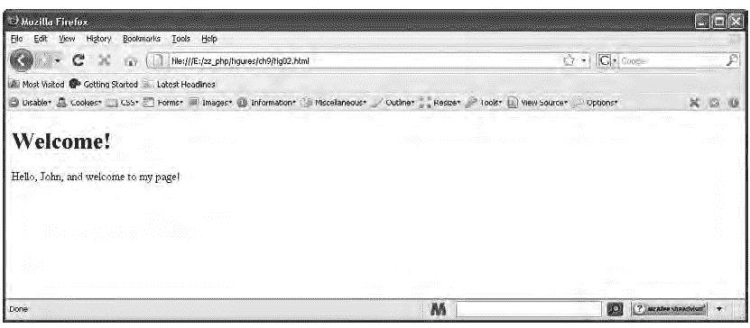

**图 9-11** 点击按钮，查看器将获得与此页面类似的新页面

### write() 方法

你在书的开头已经学习了 `write()` 方法，所以你可能已经相当了解它的工作原理了；但这里有一个该方法的简要描述，作为复习。

`document.write()` 方法用于将字符串值写入页面。以下代码将在 HTML 文档的 body 中写入 "hi there"：

```html
<body>
<script type="text/javascript">
document.write("hi there")
</script>
</body>
```

### writeln() 方法

`writeln()` 方法与 `document.write()` 方法相同，但在语句末尾添加了一个 JavaScript 换行符（`\n`）。回想第 3 章讨论过的 JavaScript 换行符是如何工作的——它只是在页面源代码中放置一个新行，使其易于阅读。

> 提示：虽然在使用 `document.write()` 时，换行符只会影响源代码的外观，但它可以用于在 JavaScript 创建的显示元素（如 `alert`、`prompt` 和 `confirm` 框）中创建新行。

页面本身的外观不受 JavaScript 换行符的影响。

回想第 3 章中的示例，它使用换行符将代码分成了两个不同的行：

```html
<body>
<script type="text/javascript">
document.write("<strong>JavaScript Rules!</strong>\n This is fun.")
</script>
</body>
```

由于 `document.writeln()` 方法在语句末尾添加了换行符，你可以使用 `document.writeln()` 语句重写前面的代码：

```html
<body>
<script type="text/javascript">
document.writeln("<strong>JavaScript Rules!</strong>\n This is fun.")
</script>
</body>
```

这将代码行放在页面源代码的两个不同的行中，但不会影响浏览器中页面的显示。

## 创建方法

文档对象还有一些方法（如 `createElement()`、`createAttribute()` 和 `createTextNode()`），允许你使用 JavaScript 在页面上创建各种元素或节点。要使用这些方法，必须将新内容作为 DOM 中现有节点的子节点添加。这里就需要 DOM 节点属性和方法。

## DOM 节点属性

DOM 节点属性列于表 9-3 所示。

| 属性 | 描述 |
|---|---|
| `attributes` | 指定节点中所有属性的数组；此属性的 `name` 和 `value` 属性可用于访问数组每个元素的属性名或属性值 |
| `childNodes` | 返回指定节点的所有子节点的数组 |
| `className` | 返回指定节点 `class` 属性的值 |
| `clientHeight` | 返回指定节点的高度（像素为单位） |
| `clientWidth` | 返回指定节点的宽度（像素为单位） |
| `dir` | 返回指定节点中文本方向的值（ltr 或 rtl） |
| `firstChild` | 返回指定节点的第一个子节点 |
| `id` | 返回指定节点 `id` 属性的值 |
| `innerHTML` | 返回指定节点内的 HTML 代码（文本、图像代码、标签等），例如 `div` 元素内所有的 HTML 代码 |
| `lang` | 返回指定节点的语言 |
| `lastChild` | 返回指定节点的最后一个子节点 |
| `nextSibling` | 返回指定节点之后的节点 |
| `nodeName` | 返回指定节点的名称（例如 `div` 元素的 `div`） |
| `nodeType` | 返回指定节点的类型 |
| `nodeValue` | 返回指定节点的值（例如 `div` 元素内的文本或属性的值） |
| `offsetHeight` | 返回指定节点的偏移高度 |
| `offsetWidth` | 返回指定节点的偏移宽度 |
| `ownerDocument` | 返回包含指定节点的文档对象 |
| `parentNode` | 返回指定节点的父节点 |
| `previousSibling` | 返回指定节点之前的节点 |
| `scrollLeft` | 返回指定节点左边缘与视口左边缘之间的差 |
| `scrollTop` | 返回指定节点顶边缘与视口顶边缘之间的差 |
| `scrollHeight` | 返回指定节点的整个高度（包括隐藏的可以通过滚动条可见的部分） |
| `scrollWidth` | 返回指定节点的整个宽度（包括隐藏的可以通过滚动条可见的部分） |
| `style` | 返回指定节点的样式对象 |
| `tabIndex` | 返回指定节点的制表索引 |
| `tagName` | 返回指定节点的名称（大写） |
| `title` | 返回指定节点 `title` 属性的值 |

**表 9-3** DOM 节点属性（续）

当表 9-3 提到“指定节点”时，节点的工作方式与你之前在章节中处理元素的方式非常相似。例如，你可能有以下 HTML 代码：

```html
<body>
  <div id="div1" title="All about me">
    This page is about me, me, and... me!
  </div>
</body>
```

## DOM 方法

| 方法 | 描述 |
|---|---|
| `addEventListener()` | 为指定节点添加事件监听器 |
| `appendChild()` | 将子节点添加到指定节点 |
| `attachEvent()` | 为指定节点绑定事件 |
| `blur()` | 失去指定节点的焦点 |
| `click()` | 为指定节点触发点击事件 |
| `cloneNode()` | 创建指定节点的副本 |
| `detachEvent()` | 从指定节点解绑事件 |
| `dispatchEvent()` | 向指定节点派发事件 |
| `focus()` | 获取指定节点的焦点 |
| `getAttribute()` | 获取指定节点的属性值 |
| `getAttributeNS()` | 获取指定命名空间的属性值 |
| `getAttributeNode()` | 获取指定节点的属性节点 |
| `getAttributeNodeNS()` | 获取指定命名空间的属性节点 |
| `getElementsByTagName()` | 获取所有指定标签名的元素集合 |
| `getElementsByTagNameNS()` | 获取所有指定命名空间标签名的元素集合 |
| `hasAttribute()` | 检查指定节点是否存在指定的属性 |
| `hasAttributeNS()` | 检查指定节点是否存在指定命名空间的属性 |
| `hasAttributes()` | 检查指定节点是否有任何属性 |
| `hasChildNodes()` | 检查指定节点是否有任何子节点 |
| `insertBefore()` | 在指定节点之前插入一个节点 |
| `normalize()` | 规范化节点 |
| `removeAttribute()` | 从指定节点移除指定的属性 |
| `removeAttributeNode()` | 从指定节点移除指定的属性节点 |
| `removeAttributeNS()` | 从指定节点移除指定命名空间的属性 |
| `removeChild()` | 从指定节点移除一个子节点 |
| `removeEventListener()` | 从指定节点移除事件监听器 |
| `replaceChild()` | 用一个节点替换指定节点中的另一个节点 |
| `scrollIntoView()` | 将指定节点滚动到视口中 |
| `setAttribute()` | 为指定节点设置属性值 |
| `setAttributeNode()` | 为指定节点设置属性节点 |
| `setAttributeNodeNS()` | 为指定节点设置指定命名空间的属性节点 |

**表 9-4** DOM 节点方法

> 注意：当你使用列出的带有命名空间的属性或方法时，这些内容主要用于 XML 文档，在书中不会频繁被引用。

如前所述，为了让文档对象的创建方法通过将创建的节点添加到文档而变得有用，需要使用 DOM 节点方法（如 `appendChild()`）将新节点添加到文档中。

例如，你可能使用了之前出现过的 HTML 代码，如下：

```html
<body>
  <div id="div1" title="All about me">
    This page is about me, me, and... me!
  </div>
</body>
```

这段代码包含一个带有子文本节点（以及属性节点）的 div 元素。如果你想创建另一个 div 元素作为 `div1` 元素节点的最后一个子节点，你可以将 `document.createElement()`、`document.createTextNode()` 和 DOM 节点方法 `appendChild()` 结合使用。

首先，进入 JavaScript 代码并通过 id 获取 div 元素：

```javascript
var me_div = document.getElementById("div1");
```

接下来，使用 `document.createElement()` 创建新节点：

```javascript
var inner_div = document.createElement("div");
```

之后，使用 `document.createTextNode()` 方法为 `inner_div` 节点创建文本节点：

```javascript
var inner_div_text = document.createTextNode("More about me...");
```

接着，使用 DOM 节点方法 `appendChild()` 将文本节点作为 `inner_div` 节点的子节点：

```javascript
inner_div.appendChild(inner_div_text);
```

最后，使用 DOM 节点方法 `appendChild()` 将 `inner_div` 节点作为 `me_div` 节点的最后一个子节点添加到结构中：

```javascript
me_div.appendChild(inner_div);
```

这会将你的新 div 节点添加到原始 div 元素的末尾（但在原始元素关闭之前，因为它是一个子节点）。因此，该 HTML 代码的文档结构现在如下（尽管使用“查看源代码”命令不会显示出来）：

```html
<body>
  <div id="div1" title="All about me">
    This page is about me, me, and... me!
    <div>
      More about me...
    </div>
  </div>
</body>
```

这些用于 DOM 节点的属性和方法在你创建复杂脚本时将非常有用。在本书的剩余部分，你将经常使用 `innerHTML` 和 `style` 属性，以及其他 DOM 节点属性和方法。

### 尝试此：9-1 向文档添加 DOM 节点

```
prjs9_1.html
prjs9_1.js
```

此项目允许你练习在本章中学习的新的文档和 DOM 节点属性及方法。

#### 逐步步骤

1. 使用以下 body 部分代码创建一个 HTML 页面并将其保存为 `prjs9_1.html`。

```html
<body>
  <div id="div1" title="Gosh!">
    Whatever I feel like I want to write...
  </div>
  <script type="text/javascript" src="prjs9_1.js"></script>
</body>
```

2. 创建一个外部 JavaScript 文件并保存为 `prjs9_1.js`。在第 3–5 步中使用它。

3. 获取 id 为 `div1` 的元素的 `title` 属性值，并将该值作为警告框显示给用户。

4. 创建一个文本为 "See you!" 的新 div 元素，并将其作为 id 为 `div1` 的 div 元素的子节点添加到文档结构。

5. 保存 JavaScript 文件并在浏览器中打开 HTML 文件以查看结果。

#### 尝试此总结

在这个项目中，你利用了关于文档和 DOM 节点属性与方法的知识，通过触发 DOM 节点属性操作来在文档结构中创建一个新的 div 元素。

## 创建动态脚本

正如你所看到的，JavaScript 允许通过 `document.getElementById()` 和 `document.getElementsByTagName()` 等方法访问文档中的所有元素。一旦访问了元素，你也可以访问它们的样式属性（通常由样式表初始设置），使用 DOM 节点属性更改其位置、颜色、边框、大小或元素样式属性的几乎任何其他部分。

### JavaScript 中的样式

当使用层叠样式表（CSS）设置样式时，你可以在 CSS 代码中设置如下内容（将其保存为 `dyn_01.css`）：

```css
#div1 { color:#000000; background-color:#FFFFFF; }
#div2 { border-style:solid; border-width:1px; border-color:#000000; }
```

如果你有以下 HTML 代码（保存为 `dyn_01.html`），这为两个 id（`div1` 和 `div2`）提供了属性，div 元素在网页上的呈现将使用前述的样式：

```html
<head>
  <link rel="stylesheet" type="text/css" href="dyn_01.css" />
</head>
<body>
  <div id="div1">
    I am in div1. It seems like a nice place.
  </div>
  <div id="div2">
    I am in div2. It's a little place.
  </div>
  <script type="text/javascript" src="dyn_01.js"></script>
</body>
```

当鼠标移动在 `div1` 元素上时改变 `div1` 元素的颜色并同时更改 `div2` 元素的边框，你可以向 JavaScript 添加事件处理代码来响应事件，并在处理事件的函数中进行样式更改：

```javascript
var d1 = document.getElementById("div1");
var d2 = document.getElementById("div2");
d1.onmouseover = function() {
  d1.style.backgroundColor = "#00FF00";
  d2.style.borderWidth = "7px";
}
```

为了让脚本更完整，你还可以在鼠标离开 `div1` 元素时将值恢复回来：

```javascript
var d1 = document.getElementById("div1");
var d2 = document.getElementById("div2");
d1.onmouseover = function() {
  d1.style.backgroundColor = "#00FF00";
  d2.style.borderWidth = "7px";
}
d1.onmouseout = function() {
  d1.style.backgroundColor = "#FFFFFF";
  d2.style.borderWidth = "1px";
}
```

保存 JavaScript 文件并在浏览器中打开 HTML 文件。你应该能够将鼠标移动到第一个 div 元素上看到变化，并在鼠标离开第一个 div 元素时看到变化恢复到原始状态。

当然，你也可以使用 DOM 节点的 `innerHTML` 属性来更改给定元素内的整个 HTML 代码。

### innerHTML 属性

`innerHTML` DOM 属性允许你更改元素内部的 HTML 代码。例如，你可以从以下 HTML 代码开始：

```html
<body>
<div id="div1">
2+2 等于几
</div>
<div id="div2">
<a href="answer.html" id="answer_link">获取答案</a>
</div>
</body>
```

这段代码设置了一个 id 为 `div1` 的 div 元素节点，另一个 id 为 `div2` 的 div 元素节点，以及一个 id 为 `answer_link` 的链接。现在，如果你想更改 div 元素中的 HTML 代码，以便在点击链接时为观众显示答案，你可以使用链接上的点击事件来启动脚本，然后更改 div 元素节点的 `innerHTML` 属性，从而将该元素的内容从问题更改为答案：

```javascript
var div1 = document.getElementById("div1");
var answer_link = document.getElementById("answer_link");

answer_link.onclick = function() {
  div1.innerHTML = "这很简单，答案是 <strong>4</strong>";
  return false;
};
```

请记住，为了防止点击链接时发生跳转，你在执行所需操作后添加了 `return false;` 语句。

运行此脚本时，它会更改页面上 div 元素内部的内容，因此 HTML 代码现在将如下所示（尽管它不会使用浏览器的“查看源代码”命令显示）：

```html
<body>
<div id="div1">
  这很简单，答案是 <strong>4</strong>
</div>
<div id="div2">
  <a href="answer.html" id="answer_link">获取答案</a>
</div>
</body>
```

如你所见，这是一种动态更改 Web 页面内容的方便方法。

> 提示：为了让脚本在没有 JavaScript 的情况下也能被访问，使用了默认链接目标（`answer.html`）。在链接的页面上包含答案文本，允许没有 JavaScript 的用户仍然点击链接并获得问题的答案。

利用在本章中学习的访问 DOM 以及使用文档对象和 DOM 节点的属性与方法，你可以编写脚本对文档的外观或内容进行任意数量的修改。

### 尝试练习 9-2 尝试属性更改

此项目允许你练习在本章中学习的新样式（style）属性和 `innerHTML` 属性。

```
prjs9_2.html
prjs9_2.js
```

#### 逐步步骤

1. 使用以下 body 部分的代码创建一个 HTML 页面并将其保存为 `prjs9_2.html`：

```html
<body>
  <div id="div1">
    我什么时候更新这个页面？
  </div>
  <div id="div2">
    <a href="answer.html" id="c_link">发现吧！</a>
  </div>
  <script type="text/javascript" src="prjs9_2.js"></script>
</body>
```

2. 创建一个外部 JavaScript 文件并将其保存为 `prjs9_2.js`。将其用于第 3-5 步。

3. 编写一些代码，当点击链接时，id 为 `div1` 的 div 元素的背景颜色更改为 `#CCCCCC`，相同元素的内容更改为：

```
<strong>就是现在！</strong> 这不是很快的吗？
```

4. 确保在名为 `answer.html` 的单独 HTML 文件中包含相同的答案内容，以供启用 JavaScript 的用户。

5. 保存 JavaScript 文件并在浏览器中打开 HTML 文件以查看结果。

#### 尝试练习总结

在这个项目中，你利用了 DOM 节点的样式属性和 `innerHTML` 属性的知识，对 Web 页面进行了样式和内容更改。

## 第 9 节自测

1. ________ 对象是浏览器为每个查看的新 HTML 页面创建的对象。

2. 文档对象的 ________ 属性返回引用当前文档的文档的 URL。

3. 你可以使用 DOM 节点属性 `style` 来更改元素的样式表属性。
   - 正确
   - 错误

4. 文档对象的 ________ 方法允许你通过其 `id` 属性的值来获取元素。
   - `getElementsByClassName()`
   - `createElement()`
   - `getSelection()`
   - `getElementById()`

5. `appendChild()` DOM 节点方法允许你将子节点作为指定节点的第一个子节点。
   - 正确
   - 错误

6. 如果你在 URL http://www.pageresource.com/html/index.html 查看一个 Web 页面，那么 `document.domain` 属性的值将是什么？
   - pageresource.com
   - www.pageresource.com/html/index.html
   - www.pageresource.com
   - http://www.pageresource.com/html/index.html

7. 文档对象的 ________ 属性是一个数组，包含了页面上所有的锚点（`<a>`）标签。

8. ________ DOM 节点属性允许你更改元素节点的 HTML 内容。

9. ________ 存储当前文档最后修改的日期和时间值。

10. 文档对象模型 (DOM) 允许 JavaScript（以及其他脚本语言）访问浏览器中的文档结构。
    - 正确
    - 错误

11. 你可以使用 `title` 属性在浏览器窗口顶部栏以外的地方显示 Web 页面的标题。
    - 正确
    - 错误

12. 哪个属性返回当前文档的完整 URL？
    - A. `domain`
    - B. `referrer`
    - C. `URL`
    - D. `title`

13. `writeln()` 方法与 `write()` 方法有何区别？
    - A. 在行尾添加等同于 HTML `<br />` 标签的内容。
    - B. 在行尾添加等同于 HTML `<p>` 标签的内容。
    - C. 在行尾添加一个换行符。
    - D. 与 `write()` 方法完全相同。

14. JavaScript 中是如何创建 `formName` 的？
    - A. 当给表单命名时，表单名称就成为属性名。
    - B. 当给表单命名时，`stringName` 被用作属性名。
    - C. 表单没有命名；相反，`formName` 被用作属性名。
    - D. 当给表单命名时，开头添加一个 f 并用作属性名。

15. `document.open()` 和 `document.close()` 之间最常见的语句是什么？
    - A. HTML 命令
    - B. `write()` 和 `writeln()` 语句
    - C. 只有 `writeln()` 语句
    - D. 只有 `alert()` 语句

# 第 10 章：Window 对象

## 核心技能与概念

- 使用 Window 对象的属性
- 使用 Window 对象的方法

JavaScript `window` 对象让你能够访问脚本可以使用的更多属性和方法。通过使用 `window` 对象，你将能够完成许多新操作，例如提示用户提供信息、打开新窗口、确认观众的操作等。

## Window 对象简介

`window` 对象为屏幕上显示的每个窗口创建。窗口可以是主窗口、框架或单个框架，甚至是使用 JavaScript 创建的新窗口。它与文档对象的不同之处在于，`window` 对象包含了文档对象（以及其他对象，如 `history`、`navigator` 等）。该对象为你的脚本提供了许多可直接使用的属性和方法。

在之前的章节中，你已经在脚本中使用过 window 对象的 `alert()` 方法。正如你记得的，`alert()` 方法允许为观众弹出一个消息。现在你将看到该对象的许多新方法，可以确认观众的操作或提示观众提供信息，这将允许为你的脚本添加更多交互性。

你首先查看的是 window 对象的属性，如表 10-1 所示和描述的。该部分将介绍并解释可以使用该对象的方法。

| 属性 | 描述 |
|---|--|
| `closed` | 存储窗口是否已关闭的值 |
| `defaultStatus` | 定义在状态栏中默认显示的消息 |
| `document` | 窗口文档对象的引用 |
| `frames` | 表示给定窗口中所有帧（frames）的数组 |
| `history` | 提供当前窗口浏览器历史信息（在第 8 章中讨论） |
| `innerHeight` | 返回窗口内可视区域的高度（像素为单位） |
| `innerWidth` | 返回窗口内可视区域的宽度（像素为单位） |
| `length` | 存储一个等于窗口中帧数量的值 |
| `location` | 存储窗口当前 URL 的值 |
| `name` | 允许命名窗口 |
| `opener` | 返回打开另一个窗口的窗口 |
| `outerHeight` | 返回整个浏览器窗口的高度（像素为单位） |
| `outerWidth` | 返回整个浏览器窗口的宽度（像素为单位） |
| `parent` | 返回包含当前帧的帧 |
| `screen.availWidth` | 返回浏览器窗口可用宽度（像素为单位） |
| `screen.availHeight` | 返回浏览器窗口可用高度（像素为单位） |
| `screen.colorDepth` | 返回屏幕颜色深度（单位为每像素位） |
| `screen.height` | 返回屏幕总高度（像素为单位） |
| `screen.pixelDepth` | 返回屏幕位深（单位为每像素位） |
| `screen.width` | 返回屏幕总宽度（像素为单位） |
| `self` | 提供引用当前窗口的其他方式 |
| `status` | 允许在状态栏中放置消息；覆盖 `defaultStatus` |
| `top` | 包含帧、帧集或嵌套帧集的顶层窗口的引用 |
| `window` | 当前窗口的引用 |

**表 10-1** Window 对象的属性

### closed 属性

`closed` 属性用于检查窗口是否已被查看者关闭。它通常与窗口名称配合使用，如下例所示：

```javascript
if (windowname.closed) {
  // JavaScript Statements
}
```

你会将 `windowname` 部分替换为你想要检查的窗口名称。这通常是你用 JavaScript 打开的一个新窗口；你将在本章后面的“`open()` 方法”部分学习如何命名新窗口。

你也可以在新窗口内部使用 `closed` 属性来检查打开它的窗口是否已关闭。为此，你可以在 `opener` 属性后使用 `closed`（稍后将在“`opener` 属性”部分讨论），如下：

```javascript
if (window.opener.closed) {
  // JavaScript Statements
}
```

如果你选择创建一个新窗口，允许查看者通过新窗口中的链接进行导航，那么这种使用 `closed` 属性的方法非常有用。

### defaultStatus 属性

`defaultStatus` 属性设置在没有给 `window.status` 分配值时默认显示的字符串。更改 `window.status` 属性会覆盖此设置，因为它只作为默认显示。

`defaultStatus` 在 `load` 事件中设置。它主要用于在查看者未执行更改状态栏文本的操作时显示自定义消息。尽管如此，可以在任何时间设置，因此你可以使用 `load` 事件之外的其他事件来设置它。

> 注意：大多数现代浏览器默认不显示由 JavaScript 修改的状态栏文本，以防止不良网站通过状态栏中的虚假链接目标等手段欺骗用户。因此，除非查看者更改了浏览器设置，否则 `defaultStatus` 和 `status` 属性通常不起作用。由于允许修改状态栏文本存在安全风险，不建议在脚本中使用这些属性。

### frames 属性（数组）

`frames` 属性是一个数组，它存储了帧集内每个帧的值。它通常用于访问页面上各种帧的属性。由于你还没有学习过数组，现在你对 `frames` 属性做不了什么。不过，你将在第 11 章中学习数组。

你可以使用 `window.frames.length` 属性获取窗口中帧的数量。如果你决定以后使用该数组按顺序对页面上的帧执行任务，这会非常有用。

### innerHeight 和 innerWidth 属性

`innerWidth` 和 `innerHeight` 属性存储窗口可视区域的宽度和高度值，这意味着这些值不包括滚动条、菜单栏、工具栏或其他浏览器特性。这些属性在 Mozilla Firefox 和 Opera 中有效，但（在编写本文时）尚未在 Internet Explorer 中有效。然而，Internet Explorer 提供了获取这些值的替代方案（`document.body.clientWidth` 和 `document.body.clientHeight`）。

因此，如果你想获取脚本可用的内容区域宽度，可以使用以下代码：

```javascript
var mywin_width = window.innerWidth;
```

当然，如果你想根据窗口的 `innerWidth` 为浏览器使用不同的 HTML 代码，可以使用以下代码：

```javascript
var mywin_width = window.innerWidth;
var div_width = (mywin_width > 800) ? 750 : 400;
document.write('<div style="width:' + div_width + 'px;background-color:#ccc;">The value of the innerWidth property is ' + mywin_width + 'px</div>');
```

以下代码展示了如何为窗口命名并将该名称写入页面正文的示例：

```html
<body>
<script type="text/javascript">
window.name="cool_window";
document.write("This window is named "+window.name);
</script>
</body>
```

该窗口被赋予了自己的名称。脚本为窗口设置了名称，然后将该名称写入文档。图 10-1 显示了该脚本在浏览器中的运行结果。注意屏幕上是如何显示 `name cool_window` 的。

### opener 属性

`opener` 属性用于引用打开当前窗口的窗口。这在打开新窗口时调用 `open()` 方法经常用到，你将在稍后的“`open()` 方法”章节中看到它。通过在新窗口中使用 `opener` 属性，你可以使用之前学过的 `closed` 属性检测主窗口是否已关闭。以下示例显示了如何进行此测试：

```javascript
if (window.opener.closed) {
  // JavaScript Statements
}
```

这在 `opener` 属性之后添加了 `closed` 属性，以检查打开当前窗口的窗口是否已经关闭。如果你想通过新窗口在主窗口中执行操作，这将非常有帮助，因为你可以在执行操作之前检查它是否仍然存在。

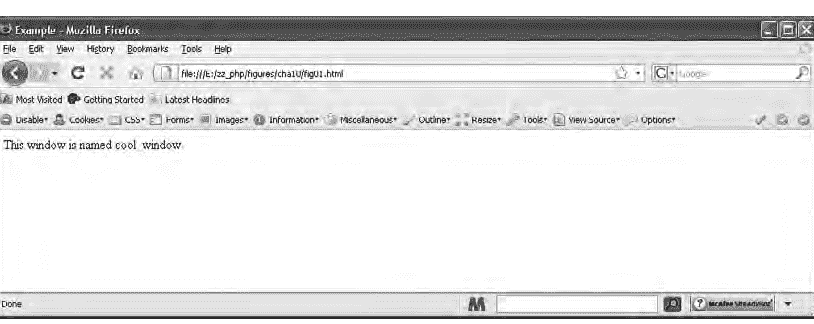

**图 10-1** 窗口名称显示在屏幕上。

### parent 属性

`parent` 属性仅在页面存在帧（frames）时使用。它允许你访问当前帧的父帧集。当你想要从一个帧更改另一个帧的属性时，这很有帮助。我将在第 15 章讲解 JavaScript 和帧时详细讨论。

### self 属性

`self` 属性是 JavaScript 中表示“当前窗口”的另一种方式。它的用法与 `window` 对象类似，并且可以像 `window` 对象一样访问当前窗口的属性。如果你有很多命名的窗口，并且为了确保操作的是当前窗口的属性而不是另一个窗口的属性，那么 `self` 属性非常有用。

### status 属性

`status` 属性包含窗口状态栏设置的文本值。更改此属性可以用 `defaultStatus` 属性覆盖状态栏的内容。

> 注意：大多数浏览器默认不会显示由 JavaScript 修改的状态栏文本，以防止不良网站通过状态栏中的虚假链接地址和反复切换欺骗用户。除非用户更改了浏览器设置，否则 `defaultStatus` 和 `status` 属性通常不起作用。由于更改浏览器设置以允许修改状态栏文本存在风险，不建议在脚本中使用这些属性。

### top 属性

`top` 属性用于访问所有帧集（可能是嵌套的）中的顶层窗口。这与 `parent` 属性略有不同，后者只到达包含当前帧的帧集的顶部。而 `top` 属性会一直到达顶层窗口，即使该窗口包含嵌套的帧集。

当你学习第 15 章的 JavaScript 和帧时，将看到更多关于此属性的用法。

### 尝试 10-1 使用 location 和 innerWidth 属性

此项目让你练习使用窗口对象的 `location` 和 `innerWidth` 属性。此外，通过添加 `document.body.clientWidth` 属性，你将帮助脚本具有更好的跨浏览器兼容性。

```
prjs10_1.html
prjs10_1.js
```

#### 逐步步骤

1. 创建一个 HTML 页面，保持 `body` 部分为空，除了在 `</body>` 标签关闭之前包含一组脚本标签，以引用名为 `prjs10_1.js` 的 JavaScript 文件。将文件保存为 `prjs10_1.html`。

2. 创建一个 JavaScript 文件并保存为 `prjs10_1.js`。用于步骤 3–6。

3. 为变量 `mywin_width` 设置默认值。

4. 如果其中一个属性可用，将 `mywin_width` 的值更改为 `window.innerWidth` 属性的值或 `document.body.clientWidth` 属性的值。

5. 如果 `mywin_width` 的值大于等于 1000，将用户引导到 URL http://www.pageresource.com。否则，将用户引导到 URL http://www.javascriptcity.com（使用 `window.location` 属性）。

6. 保存 JavaScript 文件并在浏览器中打开 HTML 文件。尝试更改宽度并使用新宽度刷新页面，查看它带你进入哪个网站。

#### 尝试总结

在这个项目中，你能够利用窗口对象的 `location` 和 `innerWidth` 属性知识，创建一个脚本，根据用户浏览器中可视区域的可用宽度重定向用户。

## 使用窗口对象的方法

现在你已经知道如何使用窗口对象的属性，可以继续学习方法了。表 10-2 列出了窗口对象的若干方法及其描述，接下来将更详细地描述某些特定方法。

| 方法 | 描述 |
| :--- | :--- |
| `alert()` | 向用户弹出消息，用户必须点击 OK 按钮才能继续。 |
| `back()` | 返回历史记录中的上一个页面。 |
| `blur()` | 移除窗口的焦点。 |
| `close()` | 关闭当前窗口或标签页。 |
| `confirm()` | 显示一个对话框，给用户一个确认或取消的机会。 |
| `escape()` | 将转义后的字符串转换回普通字符。 |
| `find()` | 在页面内搜索文本。 |
| `focus()` | 将焦点设置为窗口。 |
| `forward()` | 跳转到历史记录中的下一个页面。 |
| `home()` | 跳转到主页。 |
| `moveBy()` | 按指定的像素值移动窗口。 |
| `moveTo()` | 将窗口移动到指定的坐标。 |
| `open()` | 打开一个新窗口或标签页。 |
| `print()` | 打印窗口内容。 |
| `prompt()` | 显示一个请求输入的对话框。 |
| `resizeBy()` | 按指定的像素值调整窗口大小。 |
| `resizeTo()` | 将窗口调整为指定的宽度和高度。 |
| `scrollBy()` | 按指定的像素滚动窗口。 |
| `scrollTo()` | 将窗口滚动到指定的坐标。 |
| `setInterval()` | 每当经过一段时间就调用一次函数。 |
| `setTimeout()` | 在一段时间后调用一次函数。 |
| `stop()` | 停止窗口加载。 |
| `unescape()` | 将转义后的字符串转换为原始形式。 |

**表 10-2** Window 对象的方法

### confirm() 方法

`confirm()` 方法可以给用户一个确认或取消的机会。该方法返回 `true` 或 `false` 布尔值，因此在使用时将其结果赋值给变量。

以下是将赋值给变量的语法：

```javascript
var varname = window.confirm("Your Message");
```

你可以将 `varname` 替换为你想要使用的变量名。将 "Your Message" 替换为你希望在弹出对话框中显示的文本。因此，如果你想将结果赋值给变量 `is_sure` 并提问 "Are you sure?"，可以使用以下代码：

```javascript
var is_sure = window.confirm("Are you sure?");
```

图 10-2 显示了上述代码显示的示例确认对话框。注意用户可以选择的两个按钮：OK 和 Cancel。根据浏览器的不同，外观可能略有不同。如果用户点击 OK，方法返回 `true`。如果用户点击 Cancel，方法返回 `false`。坏消息是，无法更改按钮中的文本值。至少在使用 `confirm()` 方法时，你只能使用 OK 和 Cancel。

作为该方法的一个真实示例，假设你想创建一个指向另一个页面的链接，但你想在用户离开之前确保他们确实想要离开。你可以使用：

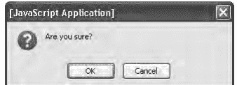

**图 10-2** 确认对话框的示例。

`confirm` 对话框用于确认查看者是否想要离开页面。以下代码展示了如何获取查看者的确认并做出相应的响应。

首先，是 HTML 代码：

```html
<body>
<a href="http://www.google.com" id="search_link">Go Searching</a>
</body>
```

接下来，使用 JavaScript 在点击链接时确认用户是否真的想离开：

```javascript
var s_link = document.getElementById("search_link");

s_link.onclick = function() {
  var is_sure = window.confirm("Are you sure you want to leave?");
  if (!is_sure) {
    window.alert("OK. You can stay here.");
    return false;
  }
};
```

该函数确认查看者是否返回；否则，查看者将被引导到链接的网站。

注意，如果点击 OK 且 `confirm()` 返回 `true`，则会向查看者发送警告且函数返回 `false`，这样浏览器就不会跳转该链接（你也可以只使用 `return false` 语句，在点击取消后什么都不发生）。

图 10-3 显示了在页面上点击离开链接后的浏览器窗口。屏幕上弹出带有“Are you sure you want to leave?”消息的 `confirm` 对话框。

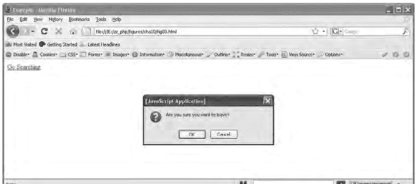

**图 10-3** 点击按钮时弹出的确认对话框

### find() 方法

你可以使用 `find()` 方法让查看者在页面上查找特定的文本。它告诉浏览器使用内置的查找工具，并允许查看者输入想要在页面上查找的内容。

例如，如果你想创建一个按钮，让查看者在想要查找页面上的某些内容时点击，可以使用以下代码：

```html
<form>
<input type="button" value="Click to Find Text"
onclick="window.find();" />
</form>
```

这会在浏览器中弹出查找对话框，并允许查看者搜索页面内的文本。图 10-4 显示了此脚本添加到 HTML 文档后的结果。

如果你有一个非常长的页面，并希望查看者能够通过搜索页面更快地找到东西，那么此功能非常有用。

### home() 方法

`home()` 方法用于将查看者发送到其在 Web 浏览器设置中指定的首页。例如，你可以用它提供一个按钮，点击时将他们带到所选的主页，如下代码所示（在编写此方法时，它在 Firefox 和 Opera 中有效，但在 Microsoft Internet Explorer 中不起作用）：

```html
<form>
<input type="button" value="Go Home!" onclick="window.home();">
</form>
```

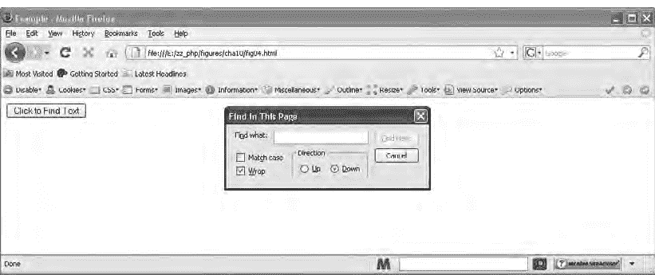

**图 10-4** 点击按钮时弹出的查找对话框，允许查看者搜索页面上的文本

### print() 方法

`print()` 方法允许查看者打印当前窗口。当调用此方法时，它应该打开查看者的打印对话框，以便查看者设置打印机并打印文档。

要使用它，你可以创建一个按钮，允许查看者打印他们正在查看的页面：

```html
<form>
<input type="button" value="Click to Print Page"
onclick="window.print();">
</form>
```

当用户点击“Click to Print Page”按钮时，此代码应打开查看者的打印对话框。图 10-5 显示了在浏览器中运行此脚本的结果。根据使用的浏览器和打印机，此对话框的显示可能不同。

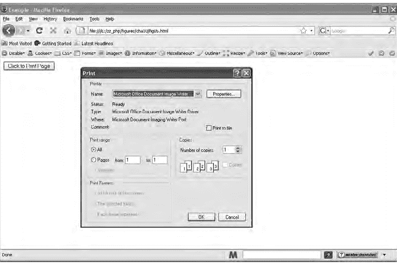

**图 10-5** 点击打印按钮时弹出查看者的打印选项

### prompt() 方法

`prompt()` 方法用于提示查看者输入信息。使用此方法，你可以根据查看者在提示框中输入的内容来执行操作。

首先，你需要查看此方法的语法。与 `confirm()` 方法一样，结果（查看者输入的内容）被赋值给一个变量供以后使用。以下是语法示例：

```javascript
var varname = window.prompt("Your Text", "Default Entry");
```

你将 `varname` 替换为变量名，并将 "Your Text" 替换为你想发送给查看者的消息（通常是一个问题）。第二个参数 "Default Entry" 允许你为查看者输入一个默认值。如果留空 `""`，则为空条目。然而，如果你想为查看者准备一个备选的默认答案，可以将其设置为某些内容。

你可以使用 `prompt()` 方法获取查看者的姓名并在页面加载时发送警告。以下代码提示查看者输入其姓名，并在显示的警告消息中包含姓名：

```javascript
var thename = window.prompt("What is your name?", "");
if (thename && thename.length > 0) {
  alert("Hello " + thename + "! Welcome!");
}
```

### open() 方法

`open()` 方法用于打开一个新窗口。你可以使用此方法打开一个包含指定文档的新窗口，并设置窗口的各种属性。

以下是使用 `open()` 方法的通用语法：

```javascript
window.open("url", "name", "attributes");
```

你将 `url` 替换为新窗口要打开的文档的 URL。将 `name` 替换为你想要给新窗口的名称。将 `attributes` 替换为你想要为新窗口设置的属性列表（用逗号分隔）。

| 属性名称 | 可能的值 | 功能 |
|---|---|---|
| `width` | number | 定义新窗口的宽度（像素） |
| `height` | number | 定义新窗口的高度（像素） |
| `directories` | yes, no, 1, 0 | 定义新窗口是否具有目录按钮（如浏览器顶部的“显示新内容”或“链接”按钮） |
| `location` | yes, no, 1, 0 | 定义新窗口是否具有输入新 URL 的地址栏 |
| `menubar` | yes, no, 1, 0 | 定义窗口是否具有菜单栏（文件菜单、编辑菜单等） |
| `resizable` | yes, no, 1, 0 | 定义是否允许用户调整新窗口的大小 |
| `scrollbars` | yes, no, 1, 0 | 定义如果窗口内容大于窗口大小，窗口是否显示滚动条 |
| `status` | yes, no, 1, 0 | 定义新窗口底部是否有状态栏 |
| `toolbar` | yes, no, 1, 0 | 定义新窗口是否具有工具栏（前进、后退按钮、停止按钮等） |

**表 10-3** 新窗口的标准属性

该窗口唯一的固定功能是标题栏，它显示文档标题，并在右上角提供供用户关闭或最小化窗口的按钮。

要设置其他属性（均为布尔值），你可以根据是否需要每个功能来为它们分配“yes”或“no”值。如果你更喜欢，也可以用 1 代表“yes”，用 0 代表“no”，效果是相同的。因此，如果你想要获得一个 300x200 像素的窗口，并且仅添加一个菜单栏（这将添加前进、后退、停止和其他类似的按钮），你可以使用以下代码：

```javascript
window.open("newpage.html", "cool", "width=300,height=200,menubar=yes");
```

这将为你提供一个包含 `newpage.html` 内容、名为“cool”、尺寸为 300x200 像素且带有菜单栏的新窗口。

你可以在第三个参数的引号内添加你想要的任意数量的属性，每个属性之间用逗号隔开。记住，任何内容之间都不应留有空格，且整个命令在文本编辑器中应该只有一行。

> 注意：由于空间限制，本书中的新窗口命令在代码中偶尔会跨行显示。请确保在使用代码时，将从 `window.open` 到结束分号（`;`）的所有内容都放在同一行，以避免 JavaScript 错误。

接下来的示例打开了一个包含表 10-3 中提到的所有功能的窗口（再次，这里占据了多行，但当你在文本编辑器中输入它时，代码应该在单行）：

```javascript
window.open("newpage.html","cool","width=300,height=200,directories=yes,location=yes,menubar=yes,resizable=yes,scrollbars=yes,status=yes,toolbar=yes");
```

这将打开一个具有所有标准功能的 300x200 窗口。如果你想要一个有价值的示例，你需要创建一个名为 `newpage.html` 的页面，并为主页创建代码以包含一个 `window.open()` 命令，如下所示。

首先，为 `newpage.html` 创建代码（这是一个包含一些文本的简短页面）：

```html
<body>
I am a new window! I am newer than that old window
that opened me, so I am special. Ha, ha!
</body>
```

现在，创建主页的 HTML 代码：

```html
<body>
Click the link below to open an arrogant new window ...
<br />
<a href="newpage.html" id="nwin">New Page</a>
<script type="text/javascript" src="openwin.js"></script>
</body>
```

最后，创建 JavaScript 代码（保存为 `openwin.js`）：

```javascript
var nw_win = document.getElementById("nwin");
nw_win.onclick = function() {
  window.open("newpage.html","cool","width=400,height=300,status=yes");
  return false;
};
```

当点击链接时，匿名函数工作并启动包含你的 `newpage.html` 文档内容的新窗口。该窗口大小为 400×300 像素，并额外添加了一个底部的状态栏。注意在打开窗口后添加了 `return false`，这样如果用户拥有 JavaScript，当点击链接时 `newpage.html` 文件将不会在主浏览器窗口中打开（如果用户没有 JavaScript，链接将正常工作并在同一窗口中打开 `newpage.html` 文件）。

图 10-8 显示了在浏览器中打开主页并点击链接打开新窗口的结果。


**图 10-8** 点击链接时打开一个新窗口

### 扩展属性

在较新的浏览器中，你可以使用更多的窗口属性。问题是这些属性可能不具有跨浏览器兼容性，因此在测试它们时需要小心。表 10-4 列出了在 Internet Explorer、Firefox、Opera 等浏览器中的属性：

| 属性 | 可能的值 | 功能 |
|---|---|---|
| `fullscreen` | yes, no, 1, 0 | 定义窗口是否进入全屏模式 |
| `left` | number | 定义窗口距离左侧的距离 |
| `screenX` | number | 定义距离屏幕左侧的距离 |
| `screenY` | number | 定义距离屏幕顶部的距离 |
| `top` | number | 定义窗口距离顶部的距离 |

**表 10-4** 窗口的扩展属性

### moveBy() 方法

`moveBy()` 方法根据方法调用中参数设置的像素数移动窗口。其语法和用法与 `resizeBy()` 方法相同；`moveBy()` 执行的是移动。要让窗口向右移动，使用正数；要让窗口向左移动，使用负数。

### moveTo() 方法

`moveTo()` 方法根据方法调用中提供的参数将窗口移动到屏幕上的特定位置。以下是使用该方法的通用语法：

```javascript
window.moveTo(x-value, y-value);
```

在这里，将 `x-value` 替换为窗口想要移动到的屏幕左侧像素数。例如，如果你输入 300，窗口将从屏幕左侧移动 300 像素。然后将 `y-value` 替换为窗口想要移动到的屏幕顶部的像素数。

作为一个示例，你可以重新编写 `newpage.html` 中的“移动窗口”按钮，使用 `moveTo()` 代替 `moveBy()`。以下是示例代码：

```html
<html><body>
我是一个新窗口！我比打开我的那个旧窗口要新，所以我是特殊的。哈，哈！
<form>
<input type="button" value="Move Window" onclick="window.moveTo(50,50);" />
<br /><br>
<input type="button" value="Close Window" onclick="window.close();" />
</form></body></html>
```

窗口将移动到屏幕上的坐标 (50,50)，即距离左侧 50 像素，距离顶部 50 像素。

这次在点击按钮时，窗口将移动到屏幕上的坐标 (50,50)。通过你的主页面代码，你可以再次打开窗口来测试这一点。

为了看到这与 `moveBy()` 方法的不同，请尝试点击按钮。它并不会再次移动，而是留在原处，因为它已经到达了目的地。

### resizeBy() 方法

`resizeBy()` 方法根据方法调用中参数设置的像素数来调整窗口大小。其语法和用法与 `moveBy()` 方法相同；`resizeBy()` 执行的是调整大小。要让窗口变大，使用正数；要让窗口变小，使用负数。

### resizeTo() 方法

`resizeTo()` 方法根据方法调用中设置的参数将窗口调整为特定尺寸（以像素为单位）。其语法和用法与 `moveTo()` 方法相同；`resizeTo()` 执行的是调整大小。你输入新的宽度和高度来代替 `moveTo()` 方法中使用的坐标。

### scrollBy() 方法

`scrollBy()` 方法根据方法调用中参数设置的像素数滚动窗口。其语法和用法与 `moveBy()` 方法相同；`scrollBy()` 执行的是滚动。要让窗口向下滚动，使用正数；要让窗口向上滚动，使用负数。

### scrollTo() 方法

`scrollTo()` 方法根据方法调用中设置的参数将窗口滚动到特定的位置（以像素为单位）。其语法和用法与 `moveTo()` 方法相同；`scrollTo()` 执行的是滚动到指定的点。

### setInterval() 方法

`setInterval()` 方法用于按照设定的间隔重复执行 JavaScript 函数。以下是使用该方法的通用语法：

```javascript
window.setInterval("function", time);
```

你将 `function` 替换为你想要执行的函数名称。然后将 `time` 替换为每次重复函数之前想要等待的时间（毫秒为单位）。

所以，如果你真的想骚扰你的观众，可以使用此方法在页面查看后每 10 秒（10000 毫秒）弹出一个警告框。你可以通过在文档的 HTML 中放置以下脚本来实现：

```html
<body>
<script type="text/javascript">
function annoy_alert() {
  window.alert("我开始骚扰你了吗？");
}
window.setInterval("annoy_alert()", 10000);
</script>
</body>
```

注意，这是一个特殊情况，必须在引号内调用函数。通常情况下，函数必须在引号外调用。这里这样做的原因是防止函数立即执行，而不是在设定的间隔时间执行。函数名是以字符串的形式发送的。

### clearInterval() 方法

`clearInterval()` 方法用于停止由 `setInterval()` 设置的间隔。其语法和用法与 `setInterval()` 方法相同；`clearInterval()` 执行的是停止间隔。要停止间隔，你将间隔的变量名作为参数传递给方法。

如果你想停止重复的警告，可以使用以下代码：

```javascript
window.clearInterval(madness);
```

在这个示例中，`madness` 是持有 `setInterval` 调用 ID 的变量。

```html
<body>
<script type="text/javascript">
function annoy_alert() {
  window.alert("我开始骚扰你了吗？");
}
var madness = window.setInterval("annoy_alert()", 10000);
</script>
</body>
```

### setTimeout() 方法

`setTimeout()` 方法用于在经过一定时间后执行 JavaScript 函数。它与 `setInterval()` 方法的区别在于它只执行一次（除非它在某种循环内部）。其语法与 `setInterval()` 方法相同。

如果你想在十秒后显示单个警告且不重复，可以使用以下代码：

```html
<body>
<script type="text/javascript">
function annoy_alert() {
  window.alert("现在就给我的留言板签名！");
}
var theguest = window.setTimeout("annoy_alert",10000);
</script>
</body>
```

### clearTimeout() 方法

如果你在 `setTimeout()` 调用的时间过期之前调用 `clearTimeout()` 方法，则该方法用于取消 `setTimeout()` 调用。通用语法与 `setInterval()` 方法相同；使用变量名作为参数，以便它知道要取消哪个 `setTimeout`。

所以，如果你想给观众一个避开警告的机会，可以为他们添加一个在十秒内可以点击的按钮。如果被点击，`setTimeout()` 调用就会被取消，不会弹出警告框。以下是示例代码：

```html
<body>
<script type="text/javascript">
function annoy_alert() {
  window.alert("现在就给我的留言板签名！");
}
var theguest = window.setTimeout("annoy_alert",10000);
</script>
在十秒内点击下方按钮以避免警告消息。<br />
<form>
<input type="button" value="我不要警告!"
onclick="window.clearTimeout(theguest)" />
</form>
</body>
```

如果及时点击按钮，观众将避免收到关于签访客簿的提醒。

现在，你终于完成了窗口（window）对象方法的学习。在接下来的章节中，你将在各种脚本中使用许多此类方法。

### 专家问答

**Q:** 这里的属性和方法太多了！我怎么能记住所有这些呢？

**A:** 随着你使用频率的增加，它们会变得更容易记住。我经常用的比不常用的更好记。如果你经常编写代码，手头留一份参考资料（比如这本书）是好的，以防偶尔需要检查某个属性或方法的详细信息。我手里准备了很多书和书签来参考 Web。

**Q:** 弹出窗口不会让访问者感到厌烦吗？我应该频繁使用它们吗？

**A:** 弹出窗口通常会让大多数访问者感到厌烦（例如一次打开多个新窗口、要求通过弹出窗口进行网站导航，或在每个窗口中打开每个导航链接）。在没有特别充分理由的情况下，不建议使用弹出窗口，因为这些可能会在导航网站时引起困惑，或骚扰希望在一个窗口中浏览的访问者（注意，如果你从网站的广告中获得收入，你可能需要使用弹出广告来获取收入。如果你这样做，你会希望在广告之外避免打开自己的弹出窗口。）

大多数浏览器都通过右键菜单提供在新标签页或新窗口中打开窗口的选项，因此最好让观众决定如何打开页面。

**Q:** 我很快就会编写远程窗口控制功能吗？

**A:** 一个能够改变主窗口属性（如 `location` 属性）的新窗口被称为“远程控制”。虽然本书没有讨论远程控制，但 Web 上有很多此类远程控制的免费脚本。目前，你只需要确定创建和操作普通新窗口所需的代码。

**Q:** 我会经常使用像 `setTimeout()` 和 `setInterval()` 这样的定时方法吗？

**A:** 它们可能出现得并不频繁，但当你需要构建依赖时间的脚本（如时钟、幻灯片或动态 HTML（DHTML）动画）时，你会用到它们。

### 尝试 10-2 使用 setTimeout() 和 confirm() 方法

```
prjs10_2.html
prjs10_2.js
```

此项目让你能够练习使用一些窗口方法。你会让浏览器等待几秒钟，然后询问观众是留在页面还是跳转到互联网搜索网站。

#### 逐步步骤

1. 创建一个 HTML 页面，在 `body` 部分包含以下代码，并将其保存为 `prjs10_2.html`：

```html
<body>
  <h1>这里有一些信息。</h1>
  <ul>
    <li>这里有一个有趣的点...</li>
    <li>这里有一个非常有趣的点...</li>
    <li>这里有一个不可置信的有趣的点...</li>
  </ul>
  <script type="text/javascript" src="prjs10_2.js"></script>
</body>
```

2. 创建一个 JavaScript 文件并将其保存为 `prjs10_2.js`。将其用于第 3-4 步。

3. 20 秒后，向观众显示一个确认框，询问他们是否想继续使用此网页。如果是，则什么都不做。如果不是，将他们发送到 URL http://www.google.com。

4. 保存 JavaScript 文件并在 Web 浏览器中打开 HTML 文件。20 秒后，你应该能看到一个确认框。

#### 尝试总结

在这个项目中，你能够利用对窗口对象属性和方法的知识来创建一个定时的交互式脚本。这让你让观众选择是留在当前网页还是跳转到互联网搜索网站。

## 第 10 章自测

1. 屏幕上显示的每个窗口都会创建一个（一个）________ 对象。

2. `closed` 属性用于检查访问者是否关闭了窗口。
   - 正确
   - 错误

3. ________ 属性持有窗口内帧（frames）数量的数值。

4. `location` 属性可以导致浏览器立即重定向到新页面。
   - A. 正确
   - B. 错误

5. ________ 属性持有当前窗口的名称，并允许你为窗口命名。

6. 对窗口对象的属性和方法的调用通常可以缩短，因为
   - A. `window` 对象是 JavaScript 中的默认对象。
   - B. 假设窗口属性和方法是 `navigator` 对象的一部分。
   - C. 不存在窗口对象。
   - D. 浏览器假设窗口对象是 `document` 对象的一部分。

7. ________ 属性是 JavaScript 中表示“当前窗口”的另一种方式。

8. 为什么这段代码可能无法运行：

```javascript
onmouseover="window.status='Page 2'; return true;"
```

   - A. 引号设置不正确。
   - B. 较新的浏览器默认不允许更改窗口状态，因此用户需要更改安全设置才能使其工作。
   - C. 在 `mouseover` 事件中更改 `status` 属性之后必须返回 `false`。

9. `parent` 和 `top` 属性之间的区别是什么？
   - A. `parent` 属性指向当前窗口，而 `top` 属性指向所有帧集。
   - B. `parent` 属性指向当前帧集，而 `top` 属性指向窗口。
   - C. `parent` 属性指向当前窗口，而 `top` 属性指向所有帧集。
   - D. `parent` 属性指向当前帧集，而 `top` 属性指向顶层窗口。

10. 如果观众点击 Cancel，`confirm()` 返回什么值？
    - A. yes
    - B. false
    - C. true
    - D. 0

11. 如果观众点击 OK，`confirm()` 返回什么值？
    - A. yes
    - B. false
    - C. true
    - D. 1

12. ________ 属性允许你持有信息。

13. `prompt()` 方法被用于 ________ 观众。

14. `setInterval()` 和 `setTimeout()` 的区别是什么？
    - A. `setInterval()` 方法用于重复执行函数，而 `setTimeout()` 执行一次。
    - B. `setInterval()` 方法在设定时间执行，而 `setTimeout()` 在延迟后执行。
    - C. `setInterval()` 方法用于延迟，而 `setTimeout()` 用于重复。
    - D. `setInterval()` 方法用于重复，而 `setTimeout()` 用于延迟。

# 第 11 章：JavaScript 数组

## 核心技能与概念

- 数组的定义与访问
- 理解数组对象的属性和方法
- 在循环中使用数组
- 关联数组

## 什么是数组？

数组是存储相似类型数据的方式，以便以后使用。在 JavaScript 中，数组本质上是一个自定义对象，其访问方式与对象不同。它使用单个变量名来存储多个值（例如颜色列表或喜爱的食物列表）。在普通数组中，通常通过索引数字来访问元素。关联数组允许使用字符串来代替数字。

为了直观理解数组是如何工作的，假设你有一班学生，通过脚本，你可以快速打印出每个学生的名字。你可以使用变量来持有每个学生的名字，但将每个名字都写进 `document.write()` 语句将花费很长时间。相反，你可以将每个学生的名字存储在数组中，这样你就可以通过几行代码轻松地访问它们了。

> 注意：注意数组中的第一个学生是 Student 0 而不是 Student 1。这是因为数组的起始值是从 0 开始的，而不是 1。在你学习本章的过程中，将对此进行更详细的讨论。

## 为什么数组很有用

为什么使用数字会让你更方便地访问存储的信息呢？通过数字，你可以使用循环来遍历信息，而无需手动输入每条记录。如果示例中的学生列表变得很长，当你想要将所有姓名打印到浏览器屏幕上，循环将节省大量的打字工作。

例如，如果你将示例列表中的每个学生姓名赋值给一个变量，你需要在 `document.write()` 语句中重写每个变量名。下面的代码展示了这种例子：

```javascript
var student0="Thomas";
var student1="Roger";
var student2="Amber";
var student3="Jennifer";
// 变量被赋予了值

document.write(student0+"<br>");
document.write(student1+"<br>");
document.write(student2+"<br>");
document.write(student3+"<br>");
// 每个变量的值被单独写入页面中
```

如果你能够使用循环为每个学生重复执行同一个 `document.write()` 语句，你就可以避免编写四个独立的 `document.write()` 语句。数组是存储值（学生姓名）的一种方便方法，因为你可以通过循环遍历这些值，而不是为每个值单独写一个 `document.write()` 语句——即使你预先不知道学生的数量也是如此（通过使用数组的 `length` 属性）。数组基本上是创建对象的一种快速快捷方法（因为它已经有一个构造函数），并带有一组属性列表。普通对象（如你在第 8 章中创建的对象）可以像数组一样访问；但通常创建数组比创建对象更简单，因为你不需要处理构造函数。

## 定义和访问数组

现在你已经了解了数组是什么，准备好学习如何在 JavaScript 中命名、定义和访问数组了。

### 为数组命名

你可以使用在第 3、4 和第 8 章中学习过的变量、函数和对象命名的相同规则来为数组命名。基本上，避免在第一个字符使用数字，避免空格，并避免使用保留字。

### 定义数组

定义数组类似于创建对象的实例。事实上，定义数组的一种方法看起来和作用与创建对象实例的方法相同。这正是你实际上正在做的——创建一个 JavaScript 对象的实例。

由于你对创建对象实例已经熟悉，因此首先介绍这种方法。下面的示例显示了 JavaScript 中定义数组的通用语法：

```javascript
var arrayname = new Array(element0,element1);
```

你将 `arrayname` 替换为你想要给数组的名称，并将 `element0` 和 `element1` 替换为每个元素将拥有的值。你可以使用任意数量的元素。

为了查看真实的示例，你将采用本章第一节中的学生姓名并作为数组元素。此数组将包含四个元素，每个元素都是一个学生的姓名。下面的示例显示了数组的定义，姓名均为字符串：

```javascript
var s_list = new Array("Thomas", "Roger", "Amber", "Jennifer");
```

现在你将值存储在一个名为 `s_list` 的四元素数组中。由于这些值是字符串，所以使用了引号（与普通数组一样）。问题是，既然这些值已经在数组中了，现在如何开始访问这些值呢？

### 访问数组元素

要访问数组的元素，你需要使用通常被称为“索引数字”的东西，它允许你通过元素在数组中的位置访问数组的每个元素。例如，将数组的第一个元素赋值给变量的语法如下所示：

```javascript
var varname = arrayname[0];
```

你将 `varname` 替换为变量名，将 `arrayname` 替换为你想要访问的数组名。`arrayname` 之后方括号中的 `0` 是数组第一个元素的索引数字。索引数字为 0 是因为数组从 0 开始计数而不是 1 开始；因此，你需要注意不要被数组中元素的索引数字搞混。第一个元素的索引数字为 0，第二个为 1，第三个为 2，依此类推。

在紧随数组名称的方括号内，是你放置想要访问的数组中元素索引数字的地方。为了看到实际操作，请再次考虑这四个学生的示例。每个学生姓名的数组在以下代码中定义：

```javascript
var s_list = new Array("Thomas", "Roger", "Amber", "Jennifer");
```

现在，你想将数组第一个元素的值（在这种情况下是 Thomas，因为它是列表中的第一个元素）赋值给名为 `tall_student` 的变量。

记住第一个元素的索引数字为 0；所以，为了将第一个元素的值赋值给变量，你应该使用以下代码：

```javascript
var tall_student = s_list[0];
```

为了看到 `tall_student` 变量的值按预期输出，你可以使用以下代码：

```javascript
document.write(tall_student);
```

### 定义数组的其他方法

定义数组的一种方法是指定它将包含的元素数量。当你知道有多少个元素但还没有值时，这种方法非常有用。

```javascript
var s_list = new Array(4);
```

这创建一个包含四个空位的数组。然后你可以使用它的索引为每个空位赋值：

```javascript
s_list[0] = "Thomas";
s_list[1] = "Roger";
s_list[2] = "Amber";
s_list[3] = "Jennifer";
```

另一种定义数组的方法直接在括号内提供值。这通常更简洁：

```javascript
var s_list = new Array("Thomas", "Roger", "Amber", "Jennifer");
```

你还可以使用数组字面量语法，这是 JavaScript 中定义数组最常用的方法：

```javascript
var s_list = ["Thomas", "Roger", "Amber", "Jennifer"];
```

这创建了一个没有任何元素的 `s_list` 数组。你稍后可以在脚本中使用序列中的下一个索引数字来添加更多元素。因此，如果你以后决定让数组包含一个元素，可以使用以下代码：

```javascript
var s_list = new Array(); // 定义了数组
var x = 17;
var y = x+2; // 这只是填充空间，并表明你可以在脚本稍后进行赋值
var my_message = "Hi";
s_list[0]="Thomas"; // 为数组的第一个（也是目前为止唯一的）元素进行赋值
```

如果你分配了一个较高索引号的值，数组将扩展以为之前的元素留出位置。例如，请看以下代码：

```javascript
var s_list = new Array(); // 定义了数组
var x = 17;
var y = x+2; // 填充空间的代码
var my_message = "Hi";
s_list[29]="Thomas"; // 这在数组中创建了第 30 个元素
// 也导致数组拥有了 30 个元素
```

这段代码的最后一行将字符串 "Thomas" 赋值给数组中的第 30 个元素（索引号 29）。这意味着数组从 0 个元素变为 30 个元素。通过为该元素赋值，数组会扩展以拥有足够的槽位进行补偿，如果你愿意，可以稍后为这些槽位赋值。

现在你已经知道了如何以各种方式定义数组，你需要查看 JavaScript 中 `Array` 对象的某些属性和方法。

## 理解 Array 对象的属性

与其他对象一样，JavaScript `Array` 对象的实例可以使用 `Array` 对象的各种属性和方法。正如你将看到的，在阅读 `Array` 对象的各个属性和方法的描述时，你通过数组名称加上想要使用的属性或方法名称来访问这些属性。

### constructor 属性

`constructor` 属性包含了构造数组的函数代码值：

```javascript
function Array() { [native code] }
```

| 属性 | 描述 |
| --- | --- |
| `constructor` | 指向用于创建对象实例的构造函数 |
| `index` | 当通过正则表达式匹配创建数组时使用 |
| `input` | 当通过正则表达式匹配创建数组时使用 |
| `length` | 包含数组中元素数量的数值 |
| `prototype` | 允许向诸如 JavaScript `Array` 对象之类的对象添加属性和方法 |

**表 11-1** Array 对象的属性

`constructor` 属性主要用于信息目的或比较。要访问该属性，你使用数组名称，跟上点操作符和 `constructor` 关键字。以下是使用 `Array` 对象的通用语法：

```javascript
arrayname.property
```

你将 `arrayname` 替换为需要该属性的数组名称，并将 `property` 替换为你想要使用的属性。

因此，为了使用 `constructor` 属性，你需要创建一个数组，以便你有一个可用的 `Array` 对象的实例。这里没有创建一个新数组，而是使用了先前的 `s_list` 数组，允许你使用以下代码：

```javascript
var s_list = new Array(4);
window.alert(s_list.constructor);
```

这将向用户发送一个带有文本 `function Array() { [native code] }`（数组的构造函数）的警告框。

### index 和 input 属性

要理解 `index` 和 `input` 属性，你首先需要理解正则表达式（用于匹配文本字符串），这需要详细解释，如第 13 章所提供的。关于 `index` 和 `input` 属性的讨论将留到那一章。

### length 属性

`length` 属性返回一个数字，告诉数组中有多少元素。

> 注意：`length` 属性在你开始使用循环遍历数组时非常有用。你可能需要知道数组的长度（以防在定义数组后添加元素），以便循环遍历数组的每个元素。

要使用 `length` 属性，你使用数组名称并在之后加上 `length` 属性。以下代码展示了使用 `length` 属性告诉用户数组中有多少元素的示例：

```javascript
var s_list = new Array(4)
s_list[0]="Thomas"
s_list[1]="Roger"
s_list[2]="Amber"
s_list[3]="Jennifer"
window.alert("The array has "+s_list.length+" elements");
```

这将向用户发送一个显示“The array has 4 elements”的警告框。

### prototype 属性

`prototype` 属性允许你向已存在的对象（如 `Array` 对象）添加属性和方法。通过使用此属性，你可以在构造函数外部向对象添加属性。记住，使用 `prototype` 属性进行的更改会影响每个使用相同构造函数的对象实例。

例如，如果你决定你的某个页面需要 `Array` 对象具有另一个属性，可以使用 `prototype` 属性使用以下语法分配新属性：

```javascript
Array.prototype.new_property=default_value;
```

你将 `new_property` 替换为你想要使用的名称，并将 `default_value` 替换为值。

## Array 对象的方法

现在你已经知道了 `Array` 对象的属性，本节介绍了你可以用来对数组进行不同操作的方法。表 11-2 列出了这些方法并提供了每个方法的描述。在表格之后，将对每个方法进行更详细的描述。

| 方法 | 描述 |
| --- | --- |
| `concat()` | 将两个或多个数组的元素合并为一个新数组 |
| `join()` | 使用分隔符将数组元素合并为单个字符串 |
| `pop()` | 从数组移除最后一个元素并在需要时返回移除的元素 |
| `push()` | 向数组末尾添加元素并在需要时返回新数组的长度 |
| `reverse()` | 反转数组中元素的方向：第一个元素移动到最后一个位置，最后一个元素移动到第一个位置，依此类推 |
| `shift()` | 从数组中移除第一个元素并在需要时返回该元素 |
| `unshift()` | 向数组开头添加元素并在需要时返回新数组的长度 |
| `slice()` | 提取数组的特定部分并将该部分作为新数组返回 |
| `splice()` | 从数组中删除元素或替换数组元素 |
| `sort()` | 根据元素的字符串值对数组元素按字母顺序排序 |
| `toString()` | 使用逗号作为分隔符将数组元素合并为单个字符串 |

**表 11-2** Array 方法

### concat() 方法

`concat()` 方法用于合并（或连接）两个或多个数组的元素，并返回一个包含所有元素的新数组。你使用数组名称作为参数，并按照你希望合并数组元素的顺序设置它们。

第一个示例合并了两个数组的元素。要实现这一点，需要使用一个参数——即要添加到调用 `concat` 的目标数组末尾的数组名称：

```javascript
var fruits = new Array("oranges","apples");
var veggies = new Array("corn","peas");
var fruits_n_veggies = fruits.concat(veggies);
```

这段代码创建了一个名为 `fruits` 的包含两个元素的数组，以及另一个名为 `veggies` 的也包含两个元素的数组。它根据前两个数组的组合定义了一个新数组 `fruits_n_veggies`。`concat()` 方法返回的值赋值给这个数组名称，创建了新的合并数组。

你之所以使用 `fruits` 数组调用 `concat()` 方法并将 `veggies` 数组作为参数，是为了让你在新数组的开头获得 `fruits` 数组的元素，并将 `veggies` 数组的元素添加到新数组的末尾。之前的代码创建了具有以下元素的数组 `fruits_n_veggies`：

```
oranges, apples, corn, peas
```

如果你想先添加列出的 `veggies` 数组元素，将使用 `veggies` 数组名称和 `fruits` 数组名称作为参数调用该方法：

```javascript
var fruits = new Array("oranges","apples");
var veggies = new Array("corn","peas");
var fruits_n_veggies = veggies.concat(fruits);
```

现在，`veggies` 数组的元素排在前面，新的 `fruits_n_veggies` 数组具有以下元素：

```
corn, peas, oranges, apples
```

在使用此方法时，你想要通过使用上述描述的技术按照你想要的方式设置顺序。

如果你合并三个数组，调用 `concat()` 方法的数组元素将排在前面，作为参数的每个数组名称的元素将按照它们出现的顺序添加：

```javascript
var fruits = new Array("oranges","apples");
var veggies = new Array("corn","peas");
var meats = new Array("fish","chicken");
var three_groups = fruits.concat(veggies,meats);
```

现在你正在合并三个数组，新 `three_groups` 数组的元素如下：

```
oranges, apples, corn, peas, fish, chicken
```

如果你按照下面的方式编写代码，将得到一个具有相同元素但顺序不同的数组：

```javascript
var fruits = new Array("oranges","apples");
var veggies = new Array("corn","peas");
var meats = new Array("fish","chicken");
var three_groups = meats.concat(veggies,fruits);
```

使用这段代码时，新 `three_groups` 数组中的元素顺序如下：

```
fish, chicken, corn, peas, oranges, apples
```

### join() 方法

`join()` 方法用于将数组的元素合并成单个字符串，每个元素由作为方法的参数的字符分隔开。如果没有设置参数，在调用方法时将使用逗号作为默认分隔符。

要查看它是如何工作的，请看这段代码。下面的示例定义了一个数组并使用数组名称调用了 `join()` 方法：

```javascript
var fruits = new Array("oranges","apples","pears");
var fruit_string = fruits.join();
```

这段代码将使用数组 `fruits` 调用 `join()` 方法时的结果赋值给变量 `fruit_string`。由于没有发送参数，数组元素在新字符串中使用逗号分隔。`fruit_string` 变量将具有以下字符串值：

```
oranges,apples,pears
```

你可以通过将字符串变量写入 Web 页面来实现。下面的代码将为你完成操作：

```html
<body>
<script type="text/javascript">
var fruits = new Array("oranges","apples","pears"); // 创建了数组
var fruit_string = fruits.join(); // 数组元素用逗号连接成单个字符串
document.write("The new string is "+fruit_string);
</script>
</body>
```

现在你可以看到从 `join()` 方法返回的字符串。图 11-1 显示了这段代码在浏览器中运行的结果。

如果你想用逗号以外的字符分隔新字符串中的元素，可以发送字符串作为参数。下面的代码将冒号作为字符串参数发送给 `join()` 方法：

```html
<body>
<script type="text/javascript">
var fruits = new Array("oranges", "apples", "pears");
var fruit_string = fruits.join(":");
document.write("The new string is "+fruit_string);
</script>
</body>
```

这个字符串与原始字符串有所不同。图 11-2 显示了带有冒号分隔符的字符串。

### pop() 方法

`pop()` 方法用于从数组中删除最后一个元素并返回它。如果你想使用删除的元素，可以将结果赋值给变量。要查看它是如何工作的，请看这段代码：

```javascript
var fruits = new Array("oranges", "apples", "pears");
var last_element = fruits.pop();
```

这段代码创建了一个名为 `fruits` 的包含三个元素的数组。`pop()` 方法删除最后一个元素（"pears"）并将其赋值给变量 `last_element`。`fruits` 数组现在只有两个元素：

```
oranges, apples
```

如果你想在不使用的情况下删除最后一个元素，可以这样调用方法：

```javascript
var fruits = new Array("oranges", "apples", "pears");
fruits.pop();
```

`fruits` 数组现在有两个元素：oranges, apples。

### push() 方法

`push()` 方法用于向数组末尾添加一个或多个元素，并返回数组的新长度。要查看它是如何工作的，请看这段代码：

```javascript
var fruits = new Array("oranges", "apples");
var new_length = fruits.push("pears");
```

这段代码创建了一个名为 `fruits` 的包含两个元素的数组。`push()` 方法将 "pears" 添加到数组末尾，变量 `new_length` 获得值 3。

如果你想一次性添加多个元素，可以这样做：

```javascript
var fruits = new Array("oranges", "apples");
var new_length = fruits.push("pears", "grapes");
```

`fruits` 数组现在有四个元素：oranges, apples, pears, grapes。

### shift() 方法

`shift()` 方法用于从数组中删除第一个元素并返回它。如果你想使用删除的元素，可以将结果赋值给变量。要查看它是如何工作的，请看这段代码：

```javascript
var fruits = new Array("oranges", "apples", "pears");
var first_element = fruits.shift();
```

这段代码创建了一个名为 `fruits` 的包含三个元素的数组。`shift()` 方法删除第一个元素（"oranges"）并将其赋值给变量 `first_element`。`fruits` 数组现在只有两个元素：

```
apples, pears
```

如果你想在不使用的情况下删除第一个元素，可以这样调用方法：

```javascript
var fruits = new Array("oranges", "apples", "pears");
fruits.shift();
```

`fruits` 数组现在有两个元素：apples, pears。

### unshift() 方法

`unshift()` 方法用于向数组开头添加一个或多个元素并返回数组的新长度。要查看它是如何工作的，请看这段代码：

```javascript
var fruits = new Array("oranges", "apples");
var new_length = fruits.unshift("pears");
```

这段代码创建了一个名为 `fruits` 的包含两个元素的数组。`unshift()` 方法将 "pears" 添加到数组开头，变量 `new_length` 获得值 3。

如果你想一次性添加多个元素，可以这样做：

```javascript
var fruits = new Array("oranges", "apples");
var new_length = fruits.unshift("pears", "grapes");
```

`fruits` 数组现在有四个元素：grapes, pears, oranges, apples。

### reverse() 方法

`reverse()` 方法用于反转数组元素的顺序。它修改原始数组且不返回任何值。要查看它是如何工作的，请看这段代码：

```javascript
var fruits = new Array("oranges", "apples", "pears");
fruits.reverse();
```

这段代码创建了一个名为 `fruits` 的包含三个元素的数组。`reverse()` 方法反转了元素的顺序，因此数组现在包含：

```
pears, apples, oranges
```

### slice() 方法

`slice()` 方法用于切取数组的指定部分，并使用旧数组中切取部分的元素创建一个新数组。

以下是该方法的通用语法：

```javascript
arrayname.slice(start, stop)
```

你用 `arrayname` 替换为想要从中提取一组元素以创建新数组的数组名称。用 `start` 替换为开始切片的索引号。用 `stop` 替换为想要切取的元素之后的元素索引号。

例如，以下代码从数组中切取两个元素，并用这些元素创建一个新数组：

```javascript
var fruits = new Array("oranges", "apples", "pears", "grapes");
var somefruits = fruits.slice(1, 3);
```

这切取了数组的第二个元素（索引号 1）到第三个元素（索引号 2）。它没有提取第四个元素（索引号 3），因为 3 是 2 之后的索引，即指定要移除的最后一个元素的索引。新数组 `somefruits` 包含了被切取的元素（apples, pears）。

### splice() 方法

`splice()` 方法允许你删除或替换数组中的元素。可以发送的参数包括开始切片的索引号、要删除的元素数量以及向数组中添加的新元素。

如果你想从数组中删除单个元素，可以使用如下代码：

```javascript
var fruits = new Array("oranges", "apples", "pears", "grapes");
var somefruits = fruits.splice(2, 1);
```

这从索引号 2 开始移除元素。下一个参数是 1，所以只会移除一个元素；因此，这里只删除了索引号 2 的元素，即 pears。在 `splice` 之后，数组剩下三个元素（oranges, apples, grapes）。

要移除多个元素，你可以增加第二个参数的值。以下代码从索引号 2 开始移除两个元素：

```javascript
var fruits = new Array("oranges", "apples", "pears", "grapes");
var somefruits = fruits.splice(2, 2);
```

这次数组被缩减为两个元素（oranges, apples），因为最后两个元素被 `splice()` 方法移除了。

你也可以使用 `splice()` 方法来替换数组中的切取元素或向数组中添加元素。以下代码通过发送一个额外的参数，将索引号 2 处的切取元素替换为新元素：

```javascript
var fruits = new Array("oranges", "apples", "pears", "grapes");
var somefruits = fruits.splice(2, 1, "watermelons");
```

这次，索引号 2 的元素被移除。由于第二个参数是 1，所以只移除了一个元素。下一个参数告诉浏览器在第一个参数指定的索引号（索引号 2）处添加此值。这替换了被移除的值（pears）。数组将仍有四个元素，即不同的元素（oranges, apples, watermelons, grapes）。

如果你想使用 `splice()` 方法向数组添加一个或多个元素但不删除任何内容，你可以将第二个参数设置为 0（从而移除零个元素）。你将第一个参数设置为你想要开始添加元素的索引号。例如，请看以下代码：

```javascript
var fruits = new Array("oranges", "apples", "pears", "grapes");
var somefruits = fruits.splice(2, 0, "watermelons");
```

### sort() 方法

`sort()` 方法用于对数组元素进行排序。默认情况下，`sort` 方法将元素作为字符串排序并比较它们的 UTF-16 代码单元值。例如，以下代码对数组进行排序：

```javascript
var fruits = new Array("oranges", "apples", "pears", "grapes");
fruits.sort();
```

这按字母顺序对数组排序：apples, grapes, oranges, pears。如果你想对数字数组进行排序，必须向 `sort()` 方法传递一个比较函数：

```javascript
var nums = new Array(10, 5, 80, 1);
nums.sort(function(a, b) {
  return a - b;
});
```

这按数字顺序对数组排序：1, 5, 10, 80。

### toString() 方法

`toString()` 方法用逗号作为分隔符将数组元素组合成字符串。例如，以下代码写入字符串：

```javascript
var fruits = new Array("oranges", "apples", "pears", "grapes");
var fruit_list = fruits.toString();
document.write(fruit_list);
```

这将会写入：oranges,apples,pears,grapes。

## 扩展数组方法

对于 JavaScript 1.6 或更高版本，可以使用一些额外的方法。由于（在编写期间）这些方法并非跨浏览器支持，它们将在表 11-3 中列出并描述。有关这些方法的更多信息，请参见 https://developer.mozilla.org/En/Core_JavaScript_1.5_Reference:Global_Objects:Array（点击其中一个方法将获得更详细的描述，通常带有可以在不支持它们的浏览器中实现功能的代码）。

| 方法 | 描述 |
| :--- | :--- |
| `filter()` | 返回一个新数组，其中包含通过指定测试函数的所有元素 |
| `forEach()` | 为数组的每个元素调用指定的函数 |
| `every()` | 如果数组中所有元素对指定的测试函数返回 true，则返回 true |
| `indexOf()` | 返回与指定值相同的第一个元素的索引号 |
| `lastIndexOf()` | 返回与指定值相同的最后一个元素的索引号 |
| `map()` | 返回一个通过对数组中的每个元素调用指定的函数产生的新数组 |
| `reduce()` | 从左到右对数组中的每两个值运行一次函数，直到只剩一个值 |
| `reduceRight()` | 从右到左对数组中的每两个值运行一次函数，直到只剩一个值 |
| `some()` | 如果数组中有一个或多个元素对指定的测试函数返回 true，则返回 true |

**表 11-3** 扩展数组对象方法

## 在循环中使用数组

循环允许你遍历数组元素，而无需通过编写新行代码来逐个处理每个元素。相反，你可以使用循环来遍历数组的每个元素，并减少编写大型数组时所需的代码行数。

首先，让我们看看如何使用循环而不是直接赋值来创建数组元素。

### 创建数组元素

循环在创建数组元素时非常有用。如果你由于某种原因需要让用户输入数组的内容，或者你希望在创建每个元素时执行相似的计算，这种方法就尤为有用。

假设你想让用户能够在本节之前介绍的 `s_list` 学生数组中输入四名学生的名字。使用循环，你可以使用以下代码允许用户输入每个名字：

```javascript
// 创建一个包含四个元素的新数组
var s_list = new Array(4);
for(var count=0;count<4; count++) { // 循环从 0 到 3
  s_list[count] = window.prompt("输入姓名：");
}
```

在每次循环中，都会向用户显示一个提示（prompt），用户输入的任何内容都会赋值给该元素。

这段代码创建了一个包含四个元素的新数组。循环使用 `for` 循环来分配每个值。循环从将循环变量 `count` 设置为 0 开始，一直运行到表达式 `count<4` 不再成立。

由于每次循环 `count` 的值都会加 1（`count++`），这意味着 `count` 变量在第一次、第二次、第三次和第四次循环中的值分别为 0、1、2、3。它不会再次循环，因为那时 `count` 将是 4，而它不再小于 4。

> 注意：将 `count` 变量从 0 开始的优点是，在使用循环时不容易产生困惑。`count` 变量将代表每个数组元素的索引，因此你不需要像从 `count` 从 1 开始那样在你的值上减去 1。

在循环内部，每次循环都会将一个值赋值给 `count` 变量所代表的索引处的元素。赋值的值是用户在提示输入名字时所输入的内容。在这种情况下，用户将收到四次提示，并为所有四个元素赋值。

使用循环分配元素值的另一种用途是执行会影响每个元素的相似计算。例如，如果你想要一个包含十个偶数的数组，可以使用以下代码：

```javascript
// 这里定义了一个包含十个元素的数组
var even_nums = new Array(10);
var a_count = 0;
for (var count=0;count<10;count++) {
  even_nums[a_count] = count*2;
  a_count++;
}
```

通过每次将 `count` 增加 1，你确保了计算中使用的是连续的数字。然后你在遍历循环时，将 `count` 乘以 2 的值赋值给每个数组元素。使用 `a_count` 变量可以避免因 `count` 变量每次增加 1 而导致数组索引不匹配的问题。`a_count` 变量每次增加 1，以保持数组索引增加 1。

第一次循环时，`count` 为 0，所以 `even_nums[0]` 被赋值为 0*2，即 0。下次循环时，`count` 为 1，所以 `even_nums[1]` 被赋值为 1*2，即 2。这种情况一直持续，直到你有十个数组元素（索引号 0–9）且都是偶数。

### 遍历数组

你可以遍历已创建的数组来更改它、获取信息或以你喜欢的方式列出其内容。这非常有用，并且节省处理大型数组的时间。

如果你回到列出学生名字的 `s_list` 数组，你会发现当你决定在屏幕上打印学生列表时，循环可以节省你一些打字时间。你还可以设置 `count`，这样在你以后决定向数组添加内容时，它会自动调整。首先，看看如何将名字列表打印到浏览器屏幕（将其保存为 `s_names.html`）。

```html
<body>
  <h1>学生姓名</h1>
  <script type="text/javascript" src="s_names.js"></script>
</body>
```

接下来，你可以使用以下 JavaScript 代码（将 JavaScript 文件保存为 `s_names.js`）：

```javascript
var s_list = new Array(4);
s_list[0] = "Thomas";
s_list[1] = "Roger";
s_list[2] = "Amber";
s_list[3] = "Jennifer";
for (var count=0; count<4; count++) {
  document.write(s_list[count] + "<br />");
}
```

循环遍历数组并将每个名字写入文档。这是处理数据列表的一种高效方法。

你还可以使用 `for...in` 循环来遍历数组：

```javascript
var s_list = new Array();
s_list[0]="Thomas";
s_list[1]="Roger";
s_list[2]="Amber";
s_list[3]="Jennifer";
for (student in s_list) {
  document.write(s_list[student] + "<br />");
}
```

注意，`for` 和 `in` 是两个独立的保留字，后面跟着左括号，接着是你想要使用的变量名（在本例中为 `student`），然后是保留字 `in`，最后以右括号结束。然后，左大括号允许你像往常一样编写循环，只是你将使用变量名（在当前的写法中，而不是保持一个常量变量和 `s_list[count]`）。

由于这（在编写时）并不跨浏览器工作，目前最好的方法是继续使用传统的 `for` 循环（向后兼容），或者使用 `for...in` 循环并访问 `s_list[student]`。

你可以使用循环来更深入地操作数组，并使用更多的属性和方法。目前，这可以让你开始并建立一个基础，你可以基于此基础为你的 JavaScript 数组构建复杂的循环。

### 尝试练习 11-1 使用循环处理数组

```
prjs11_1.html
prjs11_1.js
```

该项目允许你练习使用循环处理数组并练习使用某些属性。你将创建一个想要打印到屏幕上的电脑部件列表。

#### 逐步步骤

1. 创建一个 HTML 页面，标题为“Computer Parts Needed”（需要的电脑部件）。添加 `script` 标签以包含一个名为 `prjs11_1.js` 的外部 JavaScript 文件。将 HTML 文件保存为 `prjs11_1.html`。

2. 创建一个外部 JavaScript 文件并将其保存为 `prjs11_1.js`。在第 3-10 步中使用它。

3. 创建新数组，并将以下部件列表赋值为数组元素的值：
   - monitor（显示器）
   - motherboard（主板）
   - chip（芯片）
   - hard drive（硬盘）

4. 在浏览器窗口中逐行打印每个电脑部件（使用循环）。

5. 保存 JavaScript 文件并在浏览器中加载 HTML 文件查看结果。

6. 在文本编辑器中重新打开 JavaScript 文件，并按照接下来三个步骤描述进行更改。

7. 如果你之前没有，请在比较中使用 `length` 属性而不是数字。

8. 通过在脚本中编码为数组添加一些元素。在已有的前四个元素之后添加以下项目：
   - CD-RW
   - power supply（电源）

9. 让数组进行自排序，使其按字母顺序排列。

10. 保存 JavaScript 文件并在浏览器中查看 HTML 文件。新元素应该出现在数组元素的字母顺序列表中。

#### 尝试练习总结

在这个项目中，你利用了关于循环、数组和 `Array` 对象的属性知识创建了两个不同的结果。一个结果列出了数组的元素，另一个结果向数组中添加了一些元素并按字母顺序列出元素。

## 使用关联数组

关联数组（也称为哈希表）允许你使用字符串代替索引数字。使用关联数组与对普通对象使用属性名非常相似；你只是以数组格式进行操作。由于没有使用数字，关联数组的局限性更大，但当你想要存储信息并以便在访问时让元素更容易被记住时，它们仍然很有用。首先，请查看如何定义关联数组。

> 注意：JavaScript 不使用真正的关联数组（你在这里看到的模拟关联数组的实际上是在 `Array` 对象内部创建的键值对，而不是真正的关联数组）。此外，某些属性（如 `length`）在此类数组上不会按预期方式工作。因此，请务必小心，因为这有时会导致你的脚本中出现意外的值。通常情况下，直接使用数字索引数组或创建一个新对象更好，具体取决于你需要脚本做什么。

### 定义关联数组

你可以像定义普通数组一样来定义关联数组，但你可能希望使用允许你单独分配每个元素的方法。在这里，你将创建一个空数组，并通过给元素赋值来赋予它值。

要给元素赋值，你需要给该元素提供一个字符串代替索引数字。你用于字符串的值将是你可以与该元素关联的内容。例如，如果你想根据每个学生的特质将 `s_list` 数组转换为关联数组，你可以使用以下代码：

```javascript
var s_list= new Array();
s_list["tall"]="Thomas";
s_list["cool"]="Roger";
s_list["clever"]="Amber";
s_list["attentive"]="Jennifer";
```

这些赋值提供了一个特征的索引，然后将学生的姓名分配给具有该特征的元素。

这将使得在你想要访问它们时更容易记忆。

### 访问关联数组

访问关联数组的方法与访问普通数组相同，只是使用字符串而不是数字。例如，如果你想访问某个名称的元素，可以使用以下语法：

```javascript
s_list["tall"]
```

以下示例通过特征打印出列表：

```html
<body>
<h1>Student Names</h1>
<script type="text/javascript">
var s_list=new Array();
s_list["tall"]="Thomas";
s_list["cool"]="Roger";
s_list["clever"]="Amber";
s_list["attentive"]="Jennifer";
document.write("The tall one is " + s_list["tall"] + "<br />");
document.write("The cool one is " + s_list["cool"] + "<br />");
document.write("The clever one is " + s_list["clever"] + "<br />");
document.write("The attentive one is " + s_list["attentive"] + "<br />");
</script>
</body>
```

### 尝试练习 11-2 使用关联数组

```
prjs11_2.html
prjs11_2.js
```

该项目允许你练习使用关联数组。你将根据汽车属性创建一个数组。

#### 逐步步骤

1. 创建一个 HTML 页面，标题为“List of Cars”（汽车列表）。添加 `script` 标签以包含一个名为 `prjs11_2.js` 的外部 JavaScript 文件。将 HTML 文件保存为 `prjs11_2.html`。

2. 创建一个外部 JavaScript 文件并将其保存为 `prjs11_2.js`。在第 3-6 步中使用它。

3. 创建一个关联数组，使用以下索引字符串：
   - `cool`
   - `small`
   - `long`

4. 为索引字符串 `cool` 的元素赋值值“Mustang”。为索引字符串 `small` 的元素赋值值“Bug”。为索引字符串 `long` 的元素赋值值“Station Wagon”。

5. 将每个元素的值打印到浏览器窗口中。

6. 保存 JavaScript 文件并在浏览器中查看 HTML 文件。你应该能看到汽车列表。

#### 尝试练习总结

在这个项目中，你利用对关联数组的知识创建了一个显示关联数组元素的页面。

## 第 11 章自测

1. 数组是一种对相似类型数据进行 ________ 的方式，以便在脚本中以后访问。

2. 在 JavaScript 中，数组本质上是一个用户定义的 ________。

3. 在普通数组中，对元素的访问通常通过使用 ________ 完成。
   - A. 字符串
   - B. 索引数字
   - C. 随机数字
   - D. 随机字符串

4. ________ 数组允许使用字符串代替数字进行访问。

5. 下列哪项是有效的数组名？
   - A. `my array`
   - B. `1stArray`
   - C. `for`
   - D. `soap`

6. 下列哪项**不能**正确创建一个数组？
   - A. `var myarray=new Array();`
   - B. `var myarray=new Array(5);`
   - C. `var myarray=new Array("hello","hi","greetings");`
   - D. `if=new Array[10];`

7. 下列哪项可以正确访问名为 `cool` 的数组的第五个元素？
   - A. `cool[5];`
   - B. `cool(5);`
   - C. `cool[4];`
   - D. `cool.array[4];`

8. 下面代码的作用是什么？

```javascript
var s_list= new Array()
```

   - A. 创建一个名为 `s_list` 的空数组
   - B. 创建一个名为 `s_list` 的数组，默认元素数量为 10
   - C. 创建一个名为 `list` 的空数组
   - D. 创建一个永远无法添加任何元素的数组

9. Array 对象的哪个属性会返回数组长度的数值？
   - A. `length` 属性
   - B. `getlength` 属性
   - C. `constructor` 属性
   - D. `lengthof` 属性

10. ________ 属性允许你向已存在的对象添加属性和方法。

11. ________ 方法用于合并两个或多个数组的元素，并返回一个包含所有元素的新数组。

12. `join()` 方法用于将数组的元素合并成单个 ________，每个元素之间用指定的字符分隔。

13. ________ 方法用于从数组中删除最后一个元素。

14. 默认情况下，`sort()` 方法如何对数组的内容排序？
    - A. 它反转数组的内容。
    - B. 它按数值对内容进行排序。
    - C. 它按字母顺序对内容进行排序。
    - D. 它从数组中删除最后一个元素。

15. 在关联数组中用什么来代替索引数字？
    - A. 浮点数值
    - B. 布尔值
    - C. 负数
    - D. 字符串值

# 第 12 章：Math、Number 和 Date 对象

## 核心技能与概念

- 使用 Math 对象
- 理解 Number 对象
- 使用 Date 对象

上一章介绍了 JavaScript 数组和 Array 对象，包括 Array 对象属性和方法的概述。在本章中，你将按照顺序学习 JavaScript 的 Math、Number 和 Date 对象。对于每个对象，将提供简短的介绍，并描述为什么该对象对你有用。随后将介绍你可以为该对象使用的各种属性和方法。

## 使用 Math 对象

当你需要在脚本中执行各种计算时，Math 对象会非常有用。首先，让我们了解什么是 Math 对象。

### 什么是 Math 对象？

Math 对象是一个预定义的 JavaScript 对象。与你在书中学习的其他预定义对象一样，Math 对象提供了可使用的属性和方法。Math 对象用于数学目的，为你提供数学常数的值，或者在你使用方法函数时执行某些操作。

### Math 对象有什么用

正如前面提到的，当你需要在脚本中进行数学计算时，Math 对象非常有用。例如，如果你在计算中需要 pi 值，Math 对象提供了一个属性让你获取该值。

此外，如果你需要找到一个数字的平方根，Math 对象的一个方法提供了一种实现方法。另一件事是在 JavaScript 中生成随机数，你会在某些脚本中发现。

### Math 对象的属性

Math 对象提供了许多属性，如果你需要执行数学计算，这些属性对你很有帮助。表 12-1 列出了 Math 对象的属性及其值。

| 属性 | 值 |
| :--- | :--- |
| `E` | 欧拉常数 [E] 的值，约为 2.71828... |
| `LN10` | 10 的自然对数值，约为 2.302585... |
| `LN2` | 2 的自然对数值，约为 0.693147... |
| `LOG10E` | E 的以 10 为底的对数，约为 0.43429... |
| `LOG2E` | E 的以 2 为底的对数，约为 1.442695... |
| `PI` | pi 的值，通常用于圆，约为 3.14159... |
| `SQRT2` | 2 的平方根值，约为 1.4142... |
| `SQRT1_2` | 二分之一的平方根值，约为 0.7071... |

**表 12-1** Math 对象的属性

如表 12-1 所示，所有属性都只持有数值，这些数值在数学计算中很有用。由于这些是无理数，列出的值是非无限的，因此是近似值。

要计算圆的面积，你可以使用以下 HTML：

```html
<input type="text" id="radius" />
<input type="button" value="Get Area!" id="getarea" />
```

接下来是 JavaScript 代码：

```javascript
var area_button = document.getElementById("getarea");
area_button.onclick = function () {
  var rad = document.getElementById("radius").value;
  if (rad.length < 1) {
    alert("Please enter a radius!");
    return false;
  }
  else if (isNaN(rad)) {
    alert("Radius must be numeric!");
    return false;
  }
  else {
    var the_area = Math.PI * (rad * rad);
    alert("The area is " + the_area + " square units.");
    return false;
  }
};
```

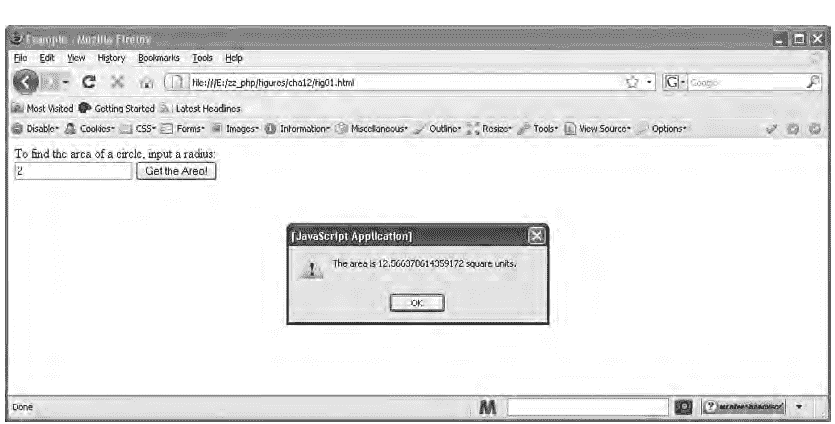

**图 12-1** 为观众显示圆面积

### Math 对象的方法

| 方法 | 目的 |
| --- | --- |
| `abs()` | 返回作为参数数字的绝对值 |
| `acos()` | 返回参数数字的反正余弦（单位：弧度） |
| `asin()` | 返回参数数字的反正正弦（单位：弧度） |
| `atan()` | 返回参数数字的反正正切（单位：弧度） |
| `atan2()` | 返回两个参数商的反正正切（单位：弧度） |
| `ceil()` | 返回大于或等于参数数字的最小整数 |
| `cos()` | 返回参数数字的余弦（单位：弧度） |
| `exp()` | 返回 E 的传入方法的参数数字的幂 |
| `floor()` | 返回小于或等于参数数字的最大整数 |
| `log()` | 返回参数数字的自然对数 |
| `max()` | 返回两个参数中较大的一个 |
| `min()` | 返回两个参数中较小的一个 |
| `pow()` | 返回第一个参数的第二个参数的幂的数值 |
| `random()` | 返回 0 到 1 之间的随机数；不需要参数 |
| `round()` | 返回参数数字四舍五入到最近整数的值 |
| `sin()` | 返回参数数字的正弦（单位：弧度） |
| `sqrt()` | 返回参数数字的平方根 |
| `tan()` | 返回参数数字的正切（单位：弧度） |

**表 12-2** Math 对象的方法

### 基础方法

对于本书来说，“基础方法”被定义为接收单个数字、对其进行简单计算并返回一个值的方法。通过这种方式对方法进行分组，可以避免列出每个方法的相同示例——这并不是对方法的任何形式的组织，只是为了加速讨论。

以下基础方法的工作方式通常是相同的：

- `abs()`
- `acos()`
- `asin()`
- `atan()`
- `cos()`
- `exp()`
- `log()`
- `sin()`
- `sqrt()`
- `tan()`

这些基础方法中的每一个都接收一个数值并返回另一个值。由于通用用法如此，本讨论使用 `sqrt()` 作为示例，说明如何使用其他方法来获取各种值。如果你需要知道从其他方法返回什么类型的值，请参考表 12-2 查看每个方法的功能。

使用 `sqrt()` 方法最简单的方法是将正数作为方法的参数输入，如下例所示：

```javascript
window.alert(Math.sqrt(4));
```

这会弹出 4 的正平方根的值，即 2。

与其计算静态数字，不如让用户输入一个数字，并向用户发送其输入数字的平方根。你可以使用以下代码来实现，从 HTML 代码开始：

```html
<body>
<form>
输入一个（正）数字或 0：<br />
<input type="text" id="sr_num" />
<input type="button" value="Get a Square Root" id="getroot" />
</form>
</body>
```

接下来是 JavaScript 代码：

```javascript
var root_button = document.getElementById("getroot");
root_button.onclick = function () {
  var thenum = document.getElementById("sr_num").value
  if (thenum < 0) {
    window.alert("Hey! 我说过输入正数！请重试.");
    return false;
  }
  else if (!thenum) {
    window.alert("输入必须是数字!");
    return false;
  }
  else {
    var theroot = Math.sqrt(thenum);
    window.alert("The square root of "+thenum+" is "+theroot);
    return false;
  }
};
```

前面的代码使用了匿名函数，该函数在观众点击 HTML 代码中的按钮时被调用。函数开始将输入到文本框的值赋值给变量 `thenum`。

接下来，函数检查观众是否输入了负数。如果是，则会出现警告框，告诉观众重试。然后它检查输入的数据是否不是数字；否则，将使用观众输入的数字（`thenum`）作为参数调用 `Math.sqrt()` 方法。这返回数字的平方根，并赋值给变量 `theroot`。

### ceil() 方法

`ceil()` 方法返回大于或等于传递给方法的参数的最小整数。它会将数字向上取整到最近的整数，除非该参数本身就是整数。在这种情况下，它会返回相同的整数，因为它已经等于一个整数。

例如，`Math.ceil(12.23);` 将返回 13，而 `Math.ceil(12);` 也会返回 12。你可以像在前一节中使用 `sqrt()` 方法一样使用 `ceil()` 方法——通过将结果赋值给变量。

```javascript
var ceil_button = document.getElementById('getceiling');
ceil_button.onclick = function() {
  var num=window.prompt("Enter a number.","");
  var ceil=Math.ceil(num);
  window.alert("The ceiling of "+num+" is "+ceil);
};
```

此脚本将显示一个警报框，说明查看者输入的数字的向上取整。下面的插图显示了当查看者在提示框中输入 4.55 时，浏览器中的结果：

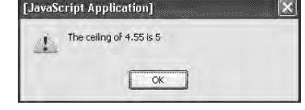

### floor() 方法

`floor()` 方法与 `ceil()` 方法类似，但它返回小于或等于传递给方法的参数的最大整数。它会将数字向下取整到最近的整数，除非该参数本身就是整数。在这种情况下，它会返回相同的整数，因为它已经等于一个整数。基本上，此方法会移除数字的小数部分，并将整数部分作为结果。

例如，`Math.floor(12.23);` 将返回 12，而 `Math.floor(12);` 也会返回 12。你可以像在前一节中使用 `ceil()` 方法一样使用 `floor()` 方法——通过将结果赋值给变量。

### round() 方法

`round()` 方法的工作原理与之前的方法相似，但是将作为参数输入的数字四舍五入到最近的整数，无论大于还是小于该数字。任何小数部分值为 .5 或更大的数字都会向上舍入，任何值小于 .5 的小数部分都会向下舍入。

.5 的分界点是严格的，因此 `Math.round(12.4999999);` 会返回 12，尽管你可能倾向于将其向上舍入。

### random() 方法

`random()` 方法对于创建需要随机整数的脚本非常有用。它返回一个 0 到 1 之间的随机数。这意味着返回的数字小数可能很长，其本身并没有什么用。例如，它可能会返回类似 0.3651115498095293 这样的数字。

为了获取一个你可以使用的随机整数，你需要进行一些操作来获得你想使用的数值类型。

#### 随机整数

要获取一个随机整数，你首先想要做的是让结果具有更大的值范围，这样你就不会被卡在 0 和 1 之间。为了获得更大的值范围，你可以将 `random()` 的结果乘以一个整数来创建一个更大的范围。就像数组一样，范围将从 0 开始计数；因此，为了获得包含五个可能整数的范围，你需要将结果乘以 5。下面的代码展示了你可以如何这样做：

```javascript
var rand_num = Math.random() * 5;
```

这得到了 0 到 4 之间的结果，但还没有给你整数。该数字仍然可能是一个很长的小数。

要获取 0 到 4 之间的一个整数，你需要找到一种方法让所有这些小数转换为整数。回想一下你之前运行的三种方法：`floor()`、`ceil()` 和 `round()`，它们以各种方式将数字转换为整数。`floor()` 方法是你将选择的，因为它简单地移除了整数部分后的小数位，并给你数字的整数部分。

要使用 `floor()` 方法，你可以编写下面的代码：

```javascript
var rand_num = Math.random() * 5;
var rand_int = Math.floor(rand_num);
```

`floor()` 方法将 `rand_num` 变量的值作为参数，并从中给你一个整数。

如果你想节省一行代码，你可以写得稍微花哨一点。你可以直接将 `random()` 方法和计算结果作为参数传递给 `floor()` 方法。你可以这样做是因为计算结果 `Math.random()*5` 是一个数字，而 `floor()` 方法可以接受数字作为参数。下面的代码展示了你如何用一行代码编写它：

```javascript
var rand_int = Math.floor(Math.random() * 5);
```

现在，变量 `rand_int` 将拥有 0 到 4 之间的随机整数值。正如你可能注意到的那样，这种数字范围对于数组可能非常有用。这就是你开始编写某些带有随机数的函数的方法。

#### 脚本的随机数

现在你通过使用 `random()` 对 Math 对象进行了一点小花样。通过设置一些数组，你可以创建一个脚本，在每次页面加载时提供随机引言或显示随机图片。

#### 有趣的随机引言

如果你想在你的页面上添加一段引言，但不想一直处理更改引言以保持内容更新，那么一个随机引言脚本可能正合你意。

制作这样的脚本，你首先需要一些引言可以使用。假设你想设置十个不同的引言，它们将在每次页面加载时以随机顺序显示。由于你有许多相似的值（以便稍后可以配合随机整数使用它们），你应该使用数组来存储所有这些值并轻松地检索它们。

因此，你需要设置一个包含十个元素的数组，类似于下面的示例，其中每个元素都是一个随机（也许是很奇特）的引言：

```javascript
var quotes=new Array(10);
quotes[0]="Look in the mirror. Are you looking at me";
quotes[1]="It is time for a rhyme, I guess";
quotes[2]="Where is my JavaScript book";
quotes[3]="If I had a buck for every dollar I spent--Oops, never mind.";
quotes[4]="I hope you were expecting a real quote here.";
quotes[5]="Quotes are great, but don't quote me on that.";
quotes[6]="What should I write here";
quotes[7]="What happens iff eye miss spel oh purpas?";
quotes[8]="Mark my words, I will mark my words.";
quotes[9]="This spot reserved for a better quote."
```

现在你的数组中有了这个奇特的引言列表，你可以通过生成随机整数来使用它们。

你需要分配一个 0 到 9 之间的随机整数（十个数字），所以你可以使用以下代码将 0 到 9 之间的随机整数分配给变量：

```javascript
var rand_int = Math.floor(Math.random()*10);
```

现在，变量 `rand_int` 的值将是 0 到 9 之间的随机整数。你可以用它来访问索引与 `rand_int` 变量中的随机整数匹配的数组元素。你只需要使用该变量作为索引号来访问数组元素，如下例所示：

```javascript
quotes[rand_int]
```

你可以将此值写入页面正文 `document.write()` 语句中，或者重新赋值元素的 `innerHTML`。下面是一个使用 `innerHTML` 的示例。HTML 文件保存为 `random_quotes.html`，JavaScript 文件保存为 `random_quotes.js`。HTML 代码：

```html
<body>
<h1>My Random Quote for You:</h1>
<div id="my_quote">
Look in the mirror. Are you looking at me
</div>
<script type="text/javascript" src="random_quotes.js"></script>
</body>
```

JavaScript 代码：

```javascript
var quotes=new Array(10);
quotes[0]="Look in the mirror. Are you looking at me";
quotes[1]="It is time for a rhyme, I guess";
quotes[2]="Where is my JavaScript book?";
quotes[3]="If I had a buck for every dollar I spent--Oops, never mind.";
quotes[4]="I hope you were expecting a real quote here.";
quotes[5]="Quotes are great, but don't quote me on that.";
quotes[6]="What should I write here?";
quotes[7]="What happens iff eye miss spel oh purpas?";
quotes[8]="Mark my words, I will mark my words.";
quotes[9]="This spot reserved for a better quote.";

var q_div = document.getElementById("my_quote");
var rand_int = Math.floor(Math.random()*10);
q_div.innerHTML = quotes[rand_int];
```

该代码根据 `rand_int` 变量中的随机整数将随机引言之一写入页面。在没有 JavaScript 的情况下，它提供了一个默认引言（数组中的第一个），如果 JavaScript 可用，则会被随机引言覆盖。刷新页面允许数字重置，并可能（尽管不一定，因为是随机的）显示不同的引言。

图 12-3 是在浏览器中运行该脚本的一个可能结果。图 12-4 是在浏览器中运行该脚本的另一个可能结果。通过刷新页面，你可以获得不同的（有时是相同的）结果。

既然你可以在页面上编写随机引言，那么显示随机图片呢？它与上一个脚本非常相似；你只需要进行一些调整。

随机脚本可以让你页面具有更新的感觉，而不需要你一直更改图片。当然，所有的图片都必须适合你决定放置随机图片的内容。随机图片脚本可以用于艺术画廊展示其藏品。

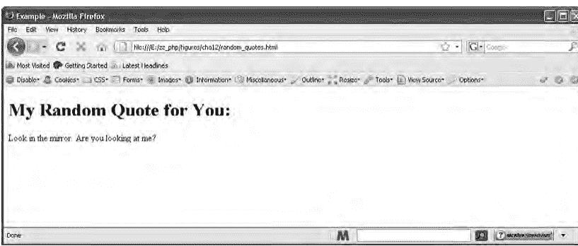

**图 12-3** 使用随机引言脚本的一个可能结果

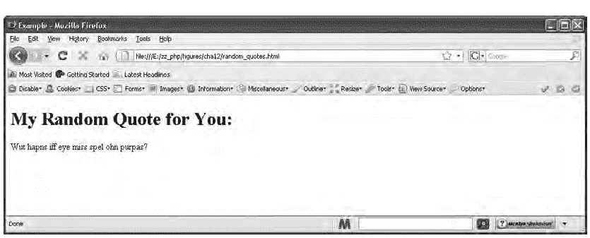

**图 12-4** 使用随机引用脚本的另一个结果

你首先需要一个图像通用资源定位符（URL）地址数组（可以是本地地址也可以是绝对地址——这里使用了本地地址）。用于此脚本的数组在下面的示例所示：

```javascript
var r_image = new Array(10);
r_image[0]="image0.gif";r_image[1]="image1.gif";r_image[2]="image2.gif";r_image[3]="image3.gif";r_image[4]="image4.gif";r_image[5]="image5.gif";r_image[6]="image6.gif";r_image[7]="image7.gif";r_image[8]="image8.gif";r_image[9]="image9.gif";
```

这设置了每次加载页面时可以随机显示的图像地址。

接下来，你需要一种方法获取 0 到 9 之间的随机整数。这与之前的随机引用脚本是相同的：

```javascript
var rand_int = Math.floor(Math.random()*10);
```

下一步是在文档的 body 部分访问该数组，以便在浏览器加载页面时显示数组中的一个随机图像。以下代码允许你使用 `div` 元素的 `innerHTML` 属性来写入随机图像的 `img` 标签（前提是 JavaScript 是可用的）。

将 HTML 文件保存为 `random_images.html`，JavaScript 文件保存为 `random_images.js`。首先是 HTML 代码：

```html
<body>
<h1>我给你准备的随机图像：</h1>
<div id="my_image">
  
</div>
<script type="text/javascript" src="random_images.js"></script>
</body>
```

接下来是 JavaScript 代码：

```javascript
var r_image = new Array(10);
r_image[0]="image0.gif";r_image[1]="image1.gif";r_image[2]="image2.gif";r_image[3]="image3.gif";r_image[4]="image4.gif";r_image[5]="image5.gif";r_image[6]="image6.gif";r_image[7]="image7.gif";r_image[8]="image8.gif";r_image[9]="image9.gif";

var i_div = document.getElementById("my_image");
var rand_int = Math.floor(Math.random()*10);
i_div.innerHTML = '';
```

如你所见，这与随机引用脚本非常相似。你只需要更改数组以及替换 `innerHTML` 属性内容的语句，就可以让脚本显示图像而不是引用。

> 注意：对于此示例，图像被保存为 `image0.gif`、`image1.gif` 等；但是，你可以按照任何喜欢的名称保存图像文件。

关于 `random()` 方法的讨论可以持续很久，因为有很多东西你可以进行随机化。然而，你现在已经了解了该功能工作原理的基本知识，所以是时候继续后续内容了。

### 专家问答

**Q:** 我会用到 Math 对象的任何属性吗？它们都是我甚至都不用过的数字！

**A:** 这取决于你执行不同类型计算的频率。作为一个初学者，你不太可能使用其中任何一个，但确实有一些脚本将它们用于各种高级用途，例如 JavaScript 计算器。

**Q:** 我对写计算器没兴趣。我真的需要费心记忆 Math 对象的属性吗？

**A:** 嗯，可能不需要，使用它们的情况可能不会发生得很频繁。留一个参考以防万一，并大致了解它们是什么（因为它们偶尔会出现在 Web 脚本中）是好的。

**Q:** 如果我身边没有计算器，这些属性和方法中的一些可能会有用。我可以写一个小脚本为自己计算一些东西，不是吗？

**A:** 当然可以！只需确保用你已知答案的结果进行双重检查，以确保代码中没有错误即可。

**Q:** `random()` 方法目前很有趣，但我想不出还能用它做其他什么。你能给我一些关于用它做其他事情的主意吗？

**A:** 你还有很多其他地方可以使用它。你可以随机化几乎任何可以用 HTML 标签或纯文本显示的内容，所以尝试一些主意并看看它们对你是否有效。不过，这里是我脑子里想到的想法：随机链接、链接图像、某种 JavaScript 的随机任务（如掷骰子或抽牌）、随机分页问候、随机警报……我确定还有很多。

### 尝试一下 12-1 在页面上显示随机链接

```
prjs12_1.html
prjs12_1.js
```

此脚本允许你通过创建一个在页面上显示随机链接的脚本，从而更深入地使用 `random()` 方法。

#### 步骤详解

1. 创建一个 HTML 页面，带有 `script` 标签指向名为 `prjs12_1.js` 的外部 JavaScript 文件。添加一个显示“随机链接”的头部，并添加一个 id 为 `random_link` 的元素。在 `div` 元素内部，插入一个在没有 JavaScript 时显示的默认链接。将 HTML 文件保存为 `prjs12_1.html`。

2. 创建一个外部 JavaScript 文件并将其保存为 `prjs12_1.js`。它用于第 3–6 步。

3. 在数组中创建五个 Web 地址。使用以下地址或你选择的一些地址：
   - http://www.pageresource.com
   - http://www.javascriptcity.com
   - http://www.mydemos.com
   - http://www.yahoo.com
   - http://www.google.com

4. 使用 `random()` 方法创建一个随机索引。

5. 通过更改 id 为 `random_link` 的元素的 `innerHTML`，在页面上显示随机链接：

```html
<a href="#">随机站点！</a>
```

6. 保存 JavaScript 文件并打开 HTML 文件。

#### 尝试一下总结

在这个项目中，你能够运用对 Math 对象的知识。通过使用随机方法，你创建了一个显示随机链接的页面。

## 使用 Number 对象

`Number` 对象是另一个预定义的 JavaScript 对象。它允许你设置某些值并获取可以在脚本中使用的某些值。要使用此对象，你需要创建一个可以引用的对象实例。

要创建 `Number` 对象实例，请使用 `new` 关键字（就像你创建数组时一样）。

### Number 对象的属性

| 属性 | 描述 |
| :--- | :--- |
| `MAX_VALUE` | 返回 JavaScript 中可表示的最大数值 |
| `MIN_VALUE` | 返回 JavaScript 中可表示的最小正数值 |
| `NaN` | 表示“不是数字”（Not a Number）的值 |
| `NEGATIVE_INFINITY` | 表示负无穷大的常量值 |
| `POSITIVE_INFINITY` | 表示正无穷大的常量值 |
| `prototype` | 允许你向 `Number` 对象添加属性或方法 |

**表 12-3** Number 对象的属性

假设 `num1`、`num2` 和 `num3` 是由观众输入的，如果计算结果小于 `MIN_VALUE` 属性的值，alert 将告知观众尝试输入更大的数字进行计算。

### NaN 属性

`NaN` 属性表示“不是数字”（Not a Number）的值。浏览器以字符串值 `NaN` 的形式显示它，并且它不等于任何数字或其他 NaN 实例。

### NEGATIVE_INFINITY 属性

`NEGATIVE_INFINITY` 属性是一个表示负无穷大的常量值。它的用法与 `MIN_VALUE` 和 `MAX_VALUE` 类似。

### POSITIVE_INFINITY 属性

`POSITIVE_INFINITY` 属性是一个表示正无穷大的常量值。它的用法与 `MIN_VALUE` 和 `MAX_VALUE` 类似。

### prototype 属性

`prototype` 属性允许你向 `Number` 对象添加属性或方法，就像你在第 11 章中对 `Array` 对象执行的那样。

### Number 对象的方法

表 12-4 列出了 `Number` 对象的方法并简要描述了每个方法的作用。接下来的章节将详细讨论每种方法。

| 方法 | 目的 |
| :--- | :--- |
| `toExponential()` | 返回一个用科学计数法表示数字的字符串值 |
| `toFixed()` | 返回一个保留小数点后指定位数并四舍五入的字符串值 |
| `toPrecision()` | 返回一个保留指定有效数字数的字符串值 |
| `toSource()` | 返回一个表示对象源代码的字符串值 |
| `toString()` | 返回一个 Number 对象的字符串值 |
| `valueOf()` | JavaScript 最经常使用的方法 |

**表 12-4** Number 对象的方法

这些方法返回一个字符串值，表示 `Number` 对象以特定格式格式化后的样子。注意，这些方法不能直接用于数字本身（数值值），如下方的代码所示：

```javascript
document.write(toExponential());
```

这会导致 JavaScript 错误，因为期望的是一个 `Number` 对象。为了避免这种情况，请通过为变量赋值数值（这将使其变为 `Number` 对象）来使用这些方法，如下方的代码所示：

```javascript
var the_num = 10;
document.write(the_num.toExponential());
```

> 注意：你也可以使用 `var the_num = new Number(10);` 语法（你可能在之前的对象中用过它），这也是有效的。

### toExponential() 方法

`toExponential()` 方法返回一个以科学计数法表示 `Number` 对象的字符串。因此，以下代码将返回 1.0e+1 的结果（或类似的表示，取决于你的浏览器）：

```javascript
var the_num = 10;
document.write(the_num.toExponential());
```

### toFixed() 方法

`toFixed()` 方法返回一个表示保留小数点后指定数量数字的 `Number` 对象的字符串。例如，如果你需要将计算结果格式化为货币值，可以使用此方法将计算结果四舍五入到小数点后两位，并以货币格式显示。示例代码处理美元和分币：

```javascript
var money = 2000;
var mykids = 7;
var one_share = money/mykids;
document.write("One share of my money is $"+one_share.toFixed(2));
```

一份钱的计算结果为 285.7142857142855，但使用 `toFixed(2)` 方法后，显示如下（保留两位小数）：

```
One share of my money is $285.71
```

### toPrecision() 方法

`toPrecision()` 方法返回一个保留指定数量有效数字的 `Number` 对象的字符串。这包括小数点前后的所有数字。因此，如果你想让像 45.57689349 这样的数字四舍五入到五个有效数字，可以使用以下代码：

```javascript
var the_num = 45.57689349;
document.write(the_num.toPrecision(5));
```

浏览器将显示字符串 45.577，这是四舍五入到五个有效数字的数字（在这种情况下，小数点前两位，后三位）。

### toString() 方法

`toString()` 方法返回 `Number` 对象的字符串值（或数值变量的值）。如果你想将数值转换为对应的字符串值（例如，将 10 更改为 "10"），这会很有用。

### toSource() 方法

`toSource()` 方法返回一个表示对象源代码的字符串值。对于定义的 `Number` 对象，此方法返回构造函数对象的值。此方法通常由 JavaScript 内部调用，在代码中不太可能使用。

### valueOf() 方法

这是另一个主要由 JavaScript 内部使用的方法。目前，你只需要知道它是 `Number` 对象的一个有效方法即可。

## 使用 Date 对象

`Date` 对象是另一个预定义的 JavaScript 对象。它允许你设置某些值并获取可以在脚本中使用的某些值。要使用此对象，你需要创建一个可以引用的对象实例。

要创建 `Date` 对象实例，请使用 `new` 关键字（就像你创建数字时一样）。

### Date 对象的属性

`Date` 对象只有两个属性。表 12-5 列出了这些属性及其目的。每个属性都有了更详细的描述。

| 属性 | 目的 |
| :--- | :--- |
| `constructor` | 存储创建该对象的构造函数的值 |
| `prototype` | 如果你愿意，允许你向对象添加属性 |

**表 12-5** Date 对象的属性

### constructor 属性

`constructor` 属性存储对象的构造函数的值，就像在 `Array` 和 `Number` 对象中使用该属性的情况一样。要查看该值，你可以将其写入页面，如下方的代码所示：

```html
<body>
<script type="text/javascript">
var rightnow=new Date();
document.write(rightnow.constructor);
</script>
</body>
```

如果你运行该代码，你可能会在页面上看到类似下面这行的内容：

```
function Date() { [native code] }
```

这与你在 `Array` 对象上使用此属性得到的结果基本相同：构造函数的名称以及该函数中的任何公共代码。由于函数代码是私有的，所以你得到的是 `[native code]` 文本而不是实际的函数代码。

### prototype 属性

`prototype` 属性允许你向 `Date` 对象添加属性或方法，就像你在第 11 章中对 `Array` 对象执行的那样。例如，如果你想为每个 `Date` 对象的实例添加一个名为 `morning` 的新属性，可以使用以下代码：

```javascript
Date.prototype.morning="a.m.";
var rightnow=new Date();
window.alert("This date is "+rightnow.morning);
```

这段代码创建了新属性，创建了 `Date` 对象实例，然后将新属性的值显示在屏幕上。

### Date 对象的方法

`Date` 对象提供的属性不多，但它为你提供了许多可以使用的方法。表 12-6 列出了 `Date` 对象的各种方法以及每个方法的作用。接下来的章节将更详细地讨论每种方法。

| 方法 | 目的 |
| --- | --- |
| `getDate()` | 根据用户的本地时间返回月份中的几号 |
| `getDay()` | 根据用户的本地时间返回一周中的第几天（0–6） |
| `getHours()` | 根据用户的本地时间返回一天中的第几小时（0–23） |
| `getMilliseconds()` | 根据用户的本地时间返回秒内的毫秒数（0–999） |
| `getMinutes()` | 根据用户的本地时间返回小时内的几分钟（0–59） |
| `getMonth()` | 根据用户的本地时间返回一年中的月份（0–11） |
| `getSeconds()` | 根据用户的本地时间返回分钟内的秒数（0–59） |
| `getTime()` | 返回 Date 对象的毫秒数 |
| `getTimezoneOffset()` | 根据用户的时区返回相对于格林威治时间（GMT）的分钟偏移量 |
| `getYear()` | 根据用户的本地时间返回年份（两位数） |
| `getFullYear()` | 根据用户的本地时间返回完整的年份（四位数） |
| `getUTCDate()` | 返回协调世界时间（UTC）中的月份几号 |
| `getUTCDay()` | 返回协调世界时间一周中的第几天（0–6） |
| `getUTCFullYear()` | 返回协调世界时间中的完整年份（四位数） |
| `getUTCHours()` | 返回协调世界时间一天中的第几小时（0–23） |
| `getUTCMilliseconds()` | 返回协调世界时间当前秒内的毫秒数 |
| `getUTCMinutes()` | 返回协调世界时间小时内的几分钟 |
| `getUTCMonth()` | 返回协调世界时间一年中的月份 |
| `getUTCSeconds()` | 返回协调世界时间分钟内的秒数 |
| `parse()` | 返回自 1970 年 1 月 1 日 00:00:00 UTC 以来的毫秒数，作为参数 |
| `setDate()` | 设置 Date 对象的日期几号 |
| `setHours()` | 设置 Date 对象的小时 |
| `setMilliseconds()` | 设置 Date 对象的毫秒数 |
| `setMinutes()` | 设置 Date 对象的分钟 |
| `setMonth()` | 设置 Date 对象的月份 |
| `setSeconds()` | 设置 Date 对象的秒数 |
| `setTime()` | 设置 Date 对象的毫秒数（自 1970 年 1 月 1 日 00:00:00 UTC 以来） |
| `setFullYear()` | 设置 Date 对象的完整年份 |
| `setYear()` | 设置 Date 对象的年份 |
| `setUTCDate()` | 设置协调世界时间中的日期几号 |
| `setUTCFullYear()` | 设置协调世界时间中的完整年份 |
| `setUTCHours()` | 设置协调世界时间的小时 |
| `setUTCMilliseconds()` | 设置协调世界时间当前秒内的毫秒数 |
| `setUTCMinutes()` | 设置协调世界时间的分钟 |
| `setUTCMonth()` | 设置协调世界时间的月份 |
| `setUTCSeconds()` | 设置协调世界时间的秒数 |
| `toGMTString()` | 返回格林威治时间（GMT）格式的日期字符串（现在已用 `toUTCString()`） |
| `toLocaleString()` | 返回基于本地区域的日期字符串 |
| `toLocaleDateString()` | 返回基于本地区域的 Date 对象的日期部分 |
| `toLocaleTimeString()` | 返回基于本地区域的 Date 对象的时间部分 |
| `toString()` | 返回以英语格式的日期字符串 |
| `toTimeString()` | 返回以英语格式的 Date 对象的时间部分 |
| `toUTCString()` | 返回协调世界时间格式的日期字符串 |

**表 12-6** Date 对象的方法

### 获取值的方法

这些方法允许你获取各种时间/日期值，并可以在你的脚本中使用。用于获取 Date 实例值的方法包括：

- `getDate()`
- `getDay()`
- `getHours()`
- `getMilliseconds()`
- `getMinutes()`
- `getMonth()`
- `getSeconds()`
- `getTime()`
- `getTimezoneOffset()`
- `getYear()`
- `getFullYear()`
- `getUTCDate()`
- `getUTCDay()`
- `getUTCFullYear()`
- `getUTCHours()`
- `getUTCMilliseconds()`
- `getUTCMinutes()`
- `getUTCMonth()`
- `getUTCSeconds()`

使用以下代码：

```javascript
var rightnow = new Date();
var theday = rightnow.getTime();
```

### getTimezoneOffset() 方法

`getTimezoneOffset()` 方法返回本地时间与 GMT 之间的分钟数。因此，如果你与 GMT 相差 6 小时，该方法将返回 360 (6 × 60)；如果你只相差 1 小时，该方法返回 60。

### getYear() 方法

此方法返回年份的最后两位（至少在年份于 1900 到 1999 年之间）。例如，如果年份是 1988 年，该方法返回 88。2000 年之后，某些浏览器会返回三位数年份，而另一些将返回四位数年份。为了避免这种情况，你可以使用 `getFullYear()` 方法，它被新浏览器支持并返回四位数年份。

### getFullYear() 方法

`getFullYear()` 方法与 `getYear()` 方法非常相似，不同之处在于始终返回四位数年份以避免 2000 年问题。`getFullYear()` 方法的工作方式类似于 `getYear()` 方法，但你不需要运行任何额外的检查来确保年份是正确的：

```javascript
var rightnow= new Date();
var theyear= rightnow.getFullYear();
```

这会将方法返回的值赋给变量 `theyear`。这一次，该值已经是四位数的，不需要任何调整。

### UTC 方法

这些方法与其对应的方法的工作相同（例如，`getDate()` 和 `getUTCDate()` 的工作方式相同），但它们返回的是世界时间（Universal Time），而不是查看者的本地时间。

现在你已经拥有了获取值的方法，让我们来看看允许你为 Date 对象实例设置值的方法。

### 设置值的方法

设置值的方法与获取值的方法处理相同类型的值。允许为 Date 对象实例设置值的方法包括：

- `setDate()`
- `setHours()`
- `setMilliseconds()`
- `setMinutes()`
- `setMonth()`
- `setSeconds()`
- `setTime()`
- `setYear()`
- `setFullYear()`
- `setUTCDate()`
- `setUTCFullYear()`
- `setUTCHours()`
- `setUTCMilliseconds()`
- `setUTCMinutes()`
- `setUTCMonth()`
- `setUTCSeconds()`

要设置这些值，你根据你想要使用的时间或日期发送一个数值参数。例如，如果你想设置 Date 对象实例的每月几号，可以使用以下代码：

```javascript
var rightnow= new Date();
rightnow.setDate(22);
```

这将将 `rightnow` Date 对象实例的每月日期设置为 22 号。其他方法的工作方式相同。为了知道需要发送给这些方法之一的值，请查看其在获取值方法中对应方法返回什么类型的值。参数方法将期望一个与该方法返回的相同的值。

### 其他方法

其余的方法以某种方式执行其他方法未涵盖的各种任务。

### parse() 方法

`parse()` 方法用于计算作为参数输入的日期字符串（如 "Dec 12, 1999"）自 1970 年 1 月 1 日午夜以来的毫秒数。这通常与 `setTime()` 方法配合使用，以找到毫秒单位的参数来设置时间。你可以使用 `parse()` 方法找到从 1970 年 1 月 1 日午夜到 1999 年 12 月 12 日午夜的毫秒数（`rightnow` Date 对象实例将使用该日期作为所有方法返回值的依据），如下代码所示：

```javascript
var rightnow= new Date();
var thenum=Date.parse("Dec 12, 1999");
rightnow.setTime(thenum);
```

该方法可以直接从 `Date` 对象调用。此代码将日期解析为毫秒数，然后将其发送到与 `rightnow` 实例配合使用的 `setTime()` 方法。

### toString()、toGMTString()、toLocaleString() 和 toTimeString() 方法

这些方法返回表示日期和时间的字符串或其部分。例如，`toString()` 方法返回字符串格式的日期。可以使用它来获取 Date 对象实例的格式化日期，如下代码所示：

```javascript
var rightnow= new Date();
var date=rightnow.toString();
```

这将一个日期值赋给变量 `date`。字符串的值取决于查看者查看页面的浏览器。然后可以将其写入页面或在脚本中与 Date 对象的其他方法配合。

`toGMTString()` 方法返回 GMT 格式的日期。可以使用它来获取 Date 对象实例的 GMT 格式，如下代码所示：

```javascript
var rightnow= new Date();
var date=rightnow.toGMTString();
```

这将一个值（如 `Wed, 21 Dec 2003 11:12:44 GMT`）赋给变量 `date`。然后可以将其写入页面或与 Date 对象的其他方法配合。

`toLocaleString()` 方法返回查看者本地的日期。可以使用它来获取 Date 对象实例的本地格式，如下代码所示：

```javascript
var rightnow= new Date();
var date=rightnow.toLocaleString();
```

这将一个值赋给变量 `date`。字符串的值取决于查看者查看页面的浏览器。然后可以将其写入页面或与 Date 对象的其他方法配合。

### 在页面上写日期

要在页面上写日期，你需要使用一些 Date 方法获取值。假设你想写一个格式为星期几、M/D/Y（月/日/年）的日期。为了实现这一点，你可以使用 `getDay()`、`getMonth()`、`getDate()` 和 `getFullYear()` 方法。

首先是 HTML 代码（保存为 `write_date.html`）：

```html
<body>
  <h1>Today's Date</h1>
  <div id="write_date">
    <!-- 调用服务器端脚本的可以放在这里 -->
  </div>
  <script type="text/javascript" src="write_date.js"></script>
</body>
```

注意 `div` 元素中的注释。如果你想让不支持 JavaScript 的浏览器也能访问，可以在此处放置对服务器端技术脚本的调用。例如，如果你将页面设置为 PHP，你可以使用以下代码以类似于 JavaScript 代码的方式显示日期：

```html
<body>
  <h1>Today's Date</h1>
  <div id="write_date">
    <?php
    $date = date('l, n/j');
    echo "$date";
    ?>
  </div>
  <script type="text/javascript" src="write_date.js"></script>
</body>
```

你会发现 PHP 脚本比 JavaScript 脚本短得多，因为它具有内置的日期格式化功能。显示的日期可能与查看者的日期不同，因为它是在 Web 服务器上显示的。

接下来是 JavaScript 代码（保存为 `write_date.js`）：

```javascript
var rightnow = new Date();
var weekday = rightnow.getDay();
var themonth = rightnow.getMonth();
var thedate = rightnow.getDate();
var theyear = rightnow.getFullYear();

// 设置星期
var someday = new Array(7);
someday[0] = "Sunday";
someday[1] = "Monday";
someday[2] = "Tuesday";
someday[3] = "Wednesday";
someday[4] = "Thursday";
someday[5] = "Friday";
someday[6] = "Saturday";

// 设置月份数字使其易于识别
themonth++; // 月份值递增以使其看起来像标准的数值月份值

var date_div = document.getElementById("write_date");
date_div.innerHTML = someday[weekday] + " "+themonth+"/"+thedate+"/"+theyear;
```

此脚本将方法的结果赋值给变量。它创建了一个数组来存储星期几，稍后使用 `getDay()` 方法返回的数字来访问它。脚本随后进行了一项调整，将 `getMonth()` 方法返回的数字加 1，这样月份就会以你预期的方式显示（记住它从 0 开始计算月份，而不是 1，所以这确保了 1 月表示为数字 1 而不是 0，例如）。

格式化的输出被写入页面供观众查看。该脚本在浏览器中运行的结果如图 12-5 所示。


**图 12-5** 页面上显示的日期

### 创建简单的时钟

要创建一个简单的时钟，你需要当前时间的小时、分钟和秒。要获取这些信息，你可以使用 `getHours()`、`getMinutes()` 和 `getSeconds()` 方法。

以下代码将创建一个显示在页面上的时钟。首先，是 HTML 代码（保存为 `clock.html`）：

```html
<body>
<h1>当前时间：</h1>
<div id="my_clock">这里可以放置内容 --
<!-- 可以调用服务器端脚本进行备份 -->
</div>
<script type="text/javascript" src="clock.js"></script>
</body>
```

> 注意：如果你使用服务器端脚本作为 JavaScript 时钟的备份，你几乎肯定不想每秒都更新一次，因为这可能会给 Web 服务器带来不必要的负担。在那种情况下，最好的方法是直接显示时间而不进行更新。

接下来，是 JavaScript 代码（保存为 `clock.js`）：

```javascript
function startclock() {
  var getime = new Date();
  var hours = getime.getHours();
  var mins = getime.getMinutes();
  var secn = getime.getSeconds();
  var ap = (hours >= 12) ? "p.m." : "a.m."; // 设置一个变量以便在时间后显示 a.m. 或 p.m.
  if (hours >= 13) {
    hours = hours - 12;
  }
  if (hours < 1) {
    hours = 12;
  }
  if (mins < 10) {
    mins = "0" + mins;
  }
  if (secn < 10) {
    secn = "0" + secn;
  }
  var clock_div = document.getElementById("my_clock");
  clock_div.innerHTML = hours + ":" + mins + ":" + secn + " " + ap;
  setTimeout("startclock()", 1000);
} // 使用 setTimeout() 方法每秒调用一次脚本
startclock(); // 在此处调用函数启动时钟
```

`Date` 对象的方法用于获取小时、分钟和秒。对小时、分钟和秒进行了调整，使其能够显示典型的 12 小时时钟。获取 `div` 元素，以便调整 `innerHTML` 属性以显示时钟。调用小时、分钟、秒和 `ap` 变量，并将其作为 `div` 元素的新 `innerHTML` 显示。

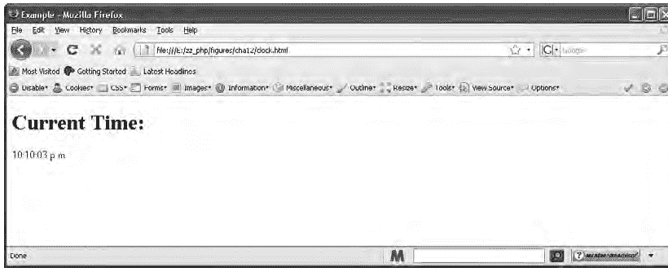

**图 12-6** 页面上显示的时钟

脚本创建了一个函数，用于设置变量方法的结果。它获取 `hours` 变量，如果 `hours` 大于或等于 12，则将 `ap` 设置为 p.m.，如果 `hours` 小于 12，则将其设置为 a.m.（此时 `hours` 变量仍然持有 13 表示下午 1 点，14 表示下午 2 点，依此类推）。完成此后，调整 `hours` 变量，使其显示 12 小时时钟的预期值。

脚本随后调整变量的值，在数字小于 10 时在前面添加 0 以显示分钟和秒。这样，时钟在 12:02:34 时将显示 12:02:34，而不是漏掉 0 显示为 12:2:34（如果你希望小时也有前导 0，也可以这样做）。

最后，函数在页面上显示输出。该函数在定义后立即被调用。函数每隔 1000 毫秒（1 秒）重复执行一次。这使得时钟能够保持同步。该脚本在浏览器中运行的结果如图 12-6 所示。

### 尝试一下 12-2 创建一个 JavaScript 时钟

```
prjs12_2.html
prjs12_2.js
```

此项目允许你使用 `Date` 对象的方法，以及如何调整返回的值以便以各种方式使用。这创建了一个 JavaScript 时钟，比你上一节中的简单时钟多了一些选项。

#### 逐步步骤

1. 创建一个带有 script 标签的 HTML 页面，标签指向名为 `prjs12_2.js` 的外部 JavaScript 文件。添加一个显示“当前时间”的标题，并添加一个 id 为 `my_clock` 的 `div` 元素。将 HTML 文件保存为 `prjs12_2.html`。

2. 创建一个外部 JavaScript 文件并将其保存为 `prjs12_2.js`。使用它完成第 3–6 步。

3. 编写一些显示时钟的代码。在此钟中，包含以下信息：
   - 带有小时、分钟和秒的时间
   - 是 A.M. 还是 P.M.
   - mm/dd/yyyy 格式的日期

4. 这是一个 12 小时钟，所以请确保调整值使其保持在 1 到 12 之间。还要注意日期的格式。

5. 启动时钟，并每秒更新一次。

6. 保存 JavaScript 文件并打开 HTML 文件。时间和日期应该出现。

#### 尝试一下总结

在这个项目中，你使用了关于 `Date` 对象的知识。使用 `Date` 对象的方法，你创建了一个出现在页面上的时钟。

## 第 12 章自测

1. `Math` 对象的属性和方法让你能够做什么？
   - A. 取平方根和其他值
   - B. 执行数学计算
   - C. 去数学课学习新知识
   - D. 什么也不做，它们是没用的

2. ________ 持有欧拉常数的值。

3. `LN10` 属性持有 10 的自然对数的值。
   - 正确
   - 错误

4. `LOG10E` 属性持有以 10 为底的 E 的对数的值。
   - 正确
   - 错误

5. 下列哪项可以在页面上正确写入 pi 的值？
   - A. `document.write(Math.Pi);`
   - B. `document.write(Math.pi);`
   - C. `document.write(Math.PI);`
   - D. `document.write(Date.pi);`

6. ________ 持有 2 的平方根的值。

7. `abs()` 方法返回传递给它的数字的
   - A. 缺失
   - B. 荒谬
   - C. 绝对值
   - D. 绝对平方根

8. ________ 方法返回传递给参数的正弦。

9. `pow()` 方法返回第一个参数的第二个参数幂的数值。

10. 下列哪项可以正确生成 0 到 7 之间的随机数？
    - A. `var rand_int= Math.floor(Math.random());`
    - B. `var rand_int= Math.floor(Math.random()*6);`
    - C. `var rand_int= Math.floor(Math.random()*8);`
    - D. `var rand_int= Math.sqrt(Math.random());`

11. 在大多数情况下，在使用 `Date` 对象的属性和方法之前必须创建什么？
    - A. 字符串
    - B. 用于引用日期的数字
    - C. 设置日期的时间
    - D. `Date` 对象的实例

12. ________ 方法返回星期几的天数。

13. `getMonth()` 方法返回与代表当前月份相同的数字（例如，如果当前月份是 1 月，则返回 1）。
    - A. 正确
    - B. 错误

14. 下列哪项正确将名为 `rightnow` 的 `Date` 实例的星期几赋值给变量 `weekday`？
    - A. `var weekday= rightnow.getDate();`
    - B. `var weekday= rightnow.getDay();`
    - C. `var weekday= right now.getDay();`
    - D. `var weekday= rightlater.getMinutes();`

# 第 13 章：处理字符串

## 核心技能与概念

- 使用 String 对象的属性
- 使用 String 对象的方法
- 使用正则表达式

在 JavaScript 中处理字符串时，你需要学习处理它们的各种方法。这些方法源自 JavaScript 的 String 对象。

本章将介绍 String 对象以及如何使用它的属性和方法来创建字符串。我们将更详细地讨论 String 对象的属性和方法，让你了解它们是如何工作的。最后，你将编写一个脚本，使用你所学到的一些属性和方法。

## String 对象简介

String 对象提供了属性和方法，用于获取有关字符串的信息或修改字符串。String 对象可以通过两种方式创建：程序员通过 `new` 关键字配合构造函数来创建一个；或者当从字符串字面量中调用某个方法时，JavaScript 会临时创建一个。什么是 String 对象，又什么是字符串字面量（string literal）？要找到答案，请看如何在 JavaScript 中创建 String 对象。

### String 对象

正如所解释的，创建 String 对象的一种方法是使用 `new` 关键字，就像你定义其他对象那样。语法显示如下：

```javascript
var instance_name = new String("string value here");
```

你将 `instance_name` 替换为你想要为 String 对象实例使用的名称。然后将 `string value here` 替换为用作新 String 对象的字符串。

所以，如果你想创建一个名为 `guitar_string` 的 String 对象实例，可以使用以下代码：

```javascript
var guitar_string = new String("G");
```

该脚本为字符串 "G" 创建了一个 String 对象的实例。

虽然使用 `new` 关键字创建 String 对象对于比较 String 对象等操作有用，但字符串字面量使用更为频繁。

### 字符串字面量

你只需将字符串值赋值给变量就可以创建一个字符串字面量。这种技术比使用 `new` 关键字创建 String 对象稍微短一点，而且仍然允许你使用 String 对象的所有方法（作为其属性之一）。

下面的代码创建了字符串字面量。注意代码将字符串值赋值给了一个变量。

```javascript
var guitar_string = "G";
```

这使得字符串 "G" 变成了字符串字面量，即你所知的普通文本字符串。对于文本字符串，你同样被允许使用 String 对象的属性和方法。

### 有什么区别？

String 对象和字符串字面量之间的区别在于，普通字符串具有字符串本身的值，并且它可以与另一个字符串进行比较，如下代码所示：

```javascript
var guitar_string1 = "E";
var guitar_string2 = "E";
if (guitar_string1 == guitar_string2) {
    window.alert("The strings are the same!");
} else {
    window.alert("The strings are not the same!");
}
```

因为这段代码使用了普通的字符串字面量，结果是预期的。提示字符串是相同的。

然而，如果你使用 String 对象运行相同的代码块，你将会看到意料之外的结果。下面的代码使用了 `String` 对象：

```javascript
var guitar_string1 = new String("E");
var guitar_string2 = new String("E");
if (guitar_string1 == guitar_string2) {
    window.alert("The strings are the same!");
} else {
    window.alert("The strings are not the same!");
}
```

这次提示会告诉你字符串是不相同的，尽管字符串值都是 "E"—因为 String 对象是一个对象值，而不是字面量值。对象之间不会像普通文本字符串那样相等。要判断两个对象是否相等，你必须编写额外的代码来确定。对于大多数用途，你不想费那个麻烦。相反，你可能会使用字符串字面量，并让它们使用 String 的方法。

普通文本字符串能够使用 String 的方法，是因为 JavaScript 将字符串字面量转换为一个临时的 String 对象。一旦方法的执行完成，它会返回一个字符串字面量。这允许你在无需创建 String 实例的情况下使用 String 对象的方法。

## 使用 String 对象的属性

String 对象只有三个属性，这一部分相对较短。表 13-1 提供了这些属性的简要描述，接下来的章节将逐一讨论它们。

| 属性 | 目的 |
| --- | --- |
| `constructor` | 存储对象实例的构造函数的值 |
| `length` | 存储字符串长度的数值（字符数） |
| `prototype` | 允许你向对象添加属性 |

**表 13-1** String 对象的属性

### constructor 属性

该属性执行的任务与拥有它的对象（如 Date 和 Array 对象）中的相同。它返回构造函数的值。要使用 `constructor` 属性，你必须使用 String 对象而不是字面量。

> 注意：你可以对字面量使用 `length` 属性和 String 对象的所有方法，但 `constructor` 和 `prototype` 属性需要 String 对象。

以下代码将 `constructor` 属性的值写入 Web 页面：

```html
<body>
<script type="text/javascript">
var guitar_string = new String("G"); // 创建一个新的 String 对象
document.write(guitar_string.constructor); // 在页面上打印 constructor 属性的值
</script>
</body>
```

这段代码产生的文本类似于下方的内容：

```
function String() { [native code] }
```

### length 属性

该属性返回字符串的长度，即字符串中字符的数量。你可以在 String 对象和字符串字面量上使用它。

以下代码使用了普通文本字符串。它将字符串变量的长度写入页面：

```html
<body>
<script type="text/javascript">
  var myname="John"; // 创建了一个字符串字面量
  document.write("The name has "+myname.length+" characters.");
</script>
</body>
```

注意变量名在这里是如何像对象名一样被使用的。这就是让 JavaScript 创建一个临时 String 对象来使用该属性的方法。脚本将结果写入页面。因为名字有四个字符，所以 `length` 属性的值为 4。

`length` 属性在你想要分解字符串以获取信息或进行更改时非常有用，特别是当用户输入字符串而你先不知道它的长度时。

### prototype 属性

与其他拥有 `prototype` 属性的对象一样，你可以使用它为 String 对象添加属性或方法。下面的代码展示了一个示例：

```javascript
String.prototype.attitude="cool"; // 原型值为 String 对象添加属性
var right=new String("Joe"); // 创建一个新的 String 实例
window.alert("This string is "+right.attitude); // String 实例使用新属性
```

现在 String 对象 "Joe" 拥有了属性 "cool"！

## 使用 String 对象的方法

String 对象有很多方法，如表 13-2 所示。

| 方法 | 用途 |
| :--- | :--- |
| `anchor()` | 创建一个带有页面目标的 HTML 锚点标签 |
| `big()` | 在字符串值周围添加 `<big>` 和 `</big>` 标签 |
| `blink()` | 在字符串值周围添加 `<blink>` 和 `</blink>` 标签 |
| `bold()` | 在字符串值周围添加 `<b>` 和 `</b>` 标签 |
| `charAt()` | 查找字符串中指定位置的字符 |
| `charCodeAt()` | 查找字符串中指定位置字符的编码 |
| `concat()` | 合并两个或多个字符串并返回合并后的新值 |
| `fixed()` | 在字符串值周围添加 `<tt>` 和 `</tt>` 标签 |
| `fontcolor()` | 在字符串值周围添加 `<font color="color">` 和 `</font>` 标签，将字符串颜色更改为指定的颜色 |
| `fontsize()` | 在字符串值周围添加 `<font size="number">` 和 `</font>` 标签，将字符串的大小更改为指定的数字 |
| `fromCharCode()` | 使用字符编码作为参数创建新字符串 |
| `indexOf()` | 在字符串中搜索参数指定的字符：如果找到，返回该字符首次出现的位置；否则返回 -1 |
| `italics()` | 在字符串值周围添加 `<i>` 和 `</i>` 标签 |
| `lastIndexOf()` | 在字符串中搜索参数指定的字符：如果找到，返回该字符最后一次出现的位置；否则返回 -1 |
| `link()` | 使用链接文本并以 URL 作为参数创建 HTML 链接 |
| `match()` | 比较正则表达式和字符串以查看它们是否匹配 |
| `replace()` | 查找正则表达式是否匹配字符串，然后将其替换为新字符串 |
| `search()` | 执行正则表达式与指定字符串之间匹配的搜索 |
| `slice()` | 截取字符串的一个部分并返回新字符串 |
| `small()` | 在字符串值周围添加 `<small>` 和 `</small>` 标签 |
| `split()` | 根据作为方法参数的字符将字符串分割为字符串数组 |
| `strike()` | 在字符串值周围添加 `<s>` 和 `</s>` 标签 |
| `sub()` | 在字符串值周围添加 `<sub>` 和 `</sub>` 标签 |
| `substr()` | 允许返回通过指定的起始位置开始并在指定数量字符后结束的字符串部分 |
| `substring()` | 允许返回通过起始位置和结束位置指定的字符串部分 |
| `sup()` | 在字符串值周围添加 `<sup>` 和 `</sup>` 标签 |
| `toString()` | 返回字符串对象的字面值 |
| `toLowerCase()` | 将字符串转换为所有小写字母并返回结果 |
| `toUpperCase()` | 将字符串转换为所有大写字母并返回结果 |

**表 13-2** String 对象的方法

### 添加 HTML 标签的方法

表 13-2 中的许多方法用于在字符串周围创建 HTML 标签（或创建并将属性值作为参数发送给 HTML 标签）。这些许多效果可以使用访问元素 `style` 和/或 `innerHTML` 属性的最新方法来实现；然而，这些方法在不同情况下可能很有帮助。

基础方法（`big()`、`blink()`、`bold()`、`fixed()`、`italics()`、`small()`、`strike()`、`sub()` 和 `sup()`）简单地在字符串周围添加基础 HTML 标签。例如，要创建小文本，可以使用 `small()` 方法：

```javascript
var little_bit = "I only want a little bit of cake.";
var tagged_phrase = little_bit.small();
document.write(tagged_phrase);
```

这段代码将在 HTML 中写入以下内容：

```html
<small>I only want a little bit of cake.</small>
```

在浏览器中查看时，这段文本将比没有 `<small>` 和 `</small>` 标签时正常显示的要小。

> 注意：HTML 标签可以用小写或大写创建，具体取决于浏览器。由于在页面加载后使用 JavaScript 构建的标签通常不会引起页面验证问题，因此标签的大小写不会对你的 HTML 代码产生任何影响。然而，如果你决定以后在脚本中使用该元素，了解标签的大小写是有帮助的，因为它的标签名可能是 `SMALL`。

其余的 HTML 标签方法（`anchor()`、`fontcolor()`、`fontsize()` 和 `link()`）接收参数，并根据发送给它们的字符串值和参数构建标签。这些将在接下来的章节中进行详细讨论。

### anchor() 方法

该方法将字符串放置作为命名锚点的文本。`anchor()` 方法接受一个参数，该参数将作为命名锚点的 `name` 属性。基本上，它创建了一个具有以下语法的 HTML 标签：

```html
<a name="parameter_string">text_string</a>
```

`parameter_string` 是你在调用方法时作为参数发送的字符串。`text_string` 是你调用该方法的字符串的值。例如，请看这里：

```javascript
var anchor_text = "Part 1";
var full_anchor = anchor_text.anchor("part1");
document.write(full_anchor);
```

当你将一个字符串字面量赋值给变量 `anchor_text` 时，你可以从该字符串字面量并以 `"part1"` 作为参数调用 `anchor()` 方法。结果被赋值给 `full_anchor` 变量。然后将 `full_anchor` 变量的值写入页面中。该代码在页面代码中写入了以下链接：

```html
<a name="part1">Part 1</a>
```

### fontcolor() 方法

`fontcolor()` 方法为文本添加颜色。它接收一个作为使用颜色的字符串。例如，这段代码：

```javascript
var color_text = "I am so red";
document.write(color_text.fontcolor("#FF0000"));
```

将写入：

```html
<font color="#FF0000">I am so red</font>
```

### fontsize() 方法

`fontsize()` 方法调整调用该方法的文本字符串的大小。它接收一个数值来表示文本的大小（在 1 到 7 之间）。示例展示了该方法的用法：

```javascript
var size_text = "I am pretty small!";
document.write(size_text.fontsize(2));
```

将写入：

```html
<font size="2">I am pretty small!</font>
```

### link() 方法

`link()` 的工作原理类似于 `anchor()` 方法；但它是在页面上创建一个典型的超链接。它接收一个字符串参数作为链接的 URL 值，而链接的文本将是调用该方法的文本。

该方法创建一个如下所示通用语法的链接：

```html
<a href="url">text_string</a>
```

查看这个使用 `link()` 方法的示例：

```html
<body>
<script type="text/javascript">
var link_text = "A Web Site";
var full_link = link_text.link("http://www.pageresource.com");
document.write(full_link);
</script>
</body>
```

这段代码在页面代码中创建了此处所示的链接：

```html
<a href="http://www.pageresource.com">A Web Site</a>
```

示例代码中的技术也可以作为 `anchor()` 方法的另一端，用于创建指向页面上命名锚点的链接。


```html
<body>
<p>
<script type="text/javascript">
var anchor_text = "Part 1";
var full_anchor = anchor_text.anchor("part1");
document.write(full_anchor);
</script>
</p>
<p>
Part 1 是关于这个和那个事情的。<br />
<br /><br /><br />
在这种情况下，这是用于填充的无关文本。
</p>
<p>
<script type="text/javascript">
var link_text="Back to Beginning of Part 1";
var full_link = link_text.link("#part1");
document.write(full_link);
</script>
</p>
</body>
```

创建了一个锚点。

创建了一个指向该锚点的链接。

这段代码创建了一个锚点，可以在页面的其他地方引用，以便通过点击链接跳转到 Part 1 文本。你可以用任何文本替换页面上 Part 1 章节下的内容。之后，会创建一个指向 Part 1 章节开头的链接，为查看者提供返回 Part 1 章节锚点开头的机会。

图 13-2 显示了此脚本在浏览器中运行的结果。你将获得命名锚点、额外文本以及返回该锚点的链接。

# 第 13 章：处理字符串

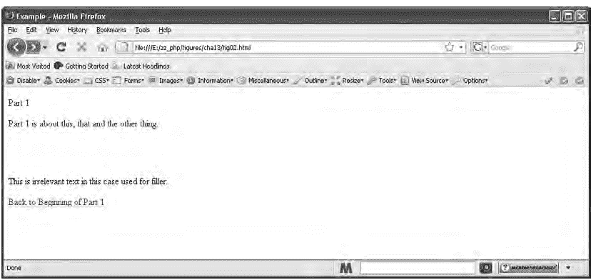

图 13-2 命名锚点以及返回该命名锚点位置的链接

## 其他方法

`String` 对象的其余方法——`charAt()`、`concat()`、`fromCharCode()`、`indexOf()`、`lastIndexOf()`、`match()`、`replace()`、`search()`、`slice()`、`split()`、`substr()`、`substring()`、`toString()`、`toLowerCase()` 和 `toUpperCase()` 允许你获取信息或修改字符串。这些方法在处理字符串时非常有用，并在这些节中详细讨论。

## charAt() 方法

该方法确定字符串某个位置上的字符。你可以找到第一个或最后一个字符，也可以找到之间的任何字符。`charAt()` 方法接收一个数字，代表你想知道字符的位置。

## 查找字符

当你想要查找某个字符时，请记住位置计数从 0 开始（类似于数组），而不是从 1，所以第一个字符位于位置 0。以下代码显示了如何使用 `charAt()` 方法找到字符串中的第一个字符：

```javascript
var the_text = "Character";
var first_char = the_text.charAt(0); // charAt() 方法找到字符串中
// 位置 0（第一个字符）的字符
window.alert("The first character is " + first_char);
```

这段代码将 `charAt()` 方法调用的结果赋值给变量 `first_char`，并将其用于警框。警框将告诉查看者调用该方法的文本字符串中的第一个字符。在这种情况下，警框将显示“The first character is C”。

# JavaScript：初学者指南

### 使用 length 属性查找最后一个字符

如果你想找到最后一个字符，你需要在使用该方法之前知道字符串中有多少个字符，或者可以使用 `length` 属性来确定字符串中字符的数量。使用 `length` 属性时，请记住它返回的是字符数，而不是最后一个字符的位置。

`length` 从 1 开始计数，而使用 `charAt()` 方法时必须从 0 开始计数。因此，字符串中的最后一个字符的位置小于其包含的字符数。换句话说，如果字符串有 10 个字符（1–10），那么最后一个位置（0–9）是 9。如果字符串有 23 个字符（1–23），那么最后一个位置（0–22）是 23-1=22。

看这个示例来了解它是如何工作的。这段代码找到字符串中的最后一个字符：

```javascript
var the_text = "Character";
var position = the_text.length - 1;
var last_char = the_text.charAt(position);
window.alert("The last character is " + last_char);
```

这段代码将字符串长度减 1 赋值给名为 `position` 的变量。`position` 变量现在持有字符串中最后一个字符的位置。将 `position` 的值作为参数传递 `charAt()` 方法的结果赋值给名为 `last_char` 的变量。最后，警框提供了字符串中的最后一个字符，即 r。因此，查看者会收到一个显示“The character is r”。

## charAt() 方法

`charAt()` 方法的工作与数组方法类似，但它返回索引处的字符而不是索引本身。`charAt()` 方法可以检查字符串是否以特定字符开头。例如，如果你想检查字符串是否以 "H"开头，你可以写：

```javascript
var my_string = "Hello";
if (my_string.charAt(0) == "H") {
    window.alert("The string starts with H");
}
```

`charAt()` 方法还可以用于查找字符串末尾的字符。例如，要找到 "Hello" 的最后一个字符，你可以写：

```javascript
var my_string = "Hello";
var last_char = my_string.charAt(my_string.length - 1);
window.alert("The last character is " + last_char);
```

`charAt()` 方法也用于从字符串中提取特定字符。例如，如果你想获取 "Hello" 的第二个字符，你可以写：

```javascript
var my_string = "Hello";
var second_char = my_string.charAt(1);
window.alert("The second character is " + second_char);
```

## concat 方法

`concat()` 方法用于连接多个字符串并返回新字符串。原始字符串不会被改变。以下代码显示了如何连接两个字符串：

```javascript
var str1 = "Hello";
var str2 = " World";
var combined_str = str1.concat(str2);
window.alert(combined_str);
```

`concat()` 方法还可以连接两个以上的字符串：

```javascript
var str1 = "Hello";
var str2 = " ";
var str3 = "World";
var combined_str = str1.concat(str2, str3);
window.alert(combined_str);
```

`concat()` 方法还可以用于连接字符串和变量。例如：

```javascript
var str1 = "Age: ";
var number = 25;
var combined_str = str1.concat(number);
window.alert(combined_str);
```

## fromCharCode 方法

`fromCharCode()` 方法根据一系列字符编码创建字符串。`charCodeAt()` 方法返回给定位置字符的数字代码。这就是你必须发送给 `fromCharCode()` 方法的值类型。此外，`fromCharCode()` 是直接从 `String` 对象调用的，而不是现有字符串，因为它是在动态拼接字符串，不需要字符串来运行。相反，它使用你发送的参数来返回字符串。

因此，如果你想向查看者显示文本字符串 "HI"，可以使用这里的示例代码：

```javascript
window.alert(String.fromCharCode(72,73));
```

## indexOf 方法

`indexOf` 方法查找特定字符或字符串在字符串中开始的位置。它只返回作为参数发送的字符或字符串第一次出现的位置。如果在字符串值中未找到该字符或字符串，则返回值 -1。

## 354 JavaScript: 初学者指南

以下代码在字符串 "Cool" 中查找字母 C：

```javascript
var the_text = "Cool";
var position = the_text.indexOf("C");
window.alert("Your character is at position "+position);
```

请记住，位置计数是从 0 开始的，当它在字符串的第一个字符找到 C 时，它会返回 0。因此，警框将显示“Your character is at position 0”。

注意，该方法是区分大小写的，因此在这种情况下，C 和 c 对 JavaScript 来说是不同的字符。因此，代码将返回 -1（告诉该字符不在字符串中），即使字符串中包含一个大写的 C。

```javascript
var the_text = "Cool";
var position = the_text.indexOf("c");
window.alert("Your character is at position "+position);
```

现在警框将显示“Your character is at position -1”。

如果你想检查是否为 -1 以避免其被视为位置，可以使用以下代码在字符串中你想要查找的字符发送不同的警框：

```javascript
var the_text = "Cool";
var position = the_text.indexOf("c");
if (position == -1) {
  window.alert("Your character is not in the string!");
} else {
  window.alert("Your character is at position "+position);
}
```

最后，`if` 语句检查方法是否返回了 -1 给变量 `position`。如果是，警框会显示“Your character is not in the string!”。否则，常规警框会告诉你位置。在之前的代码中，小写的 c 不在字符串中，因此会弹出“Your character is not in the string!”的警框。

`indexOf()` 方法仅返回你作为参数发送的字符第一次出现的位置数字。因此，如果你使用以下代码，系统会提示你你的字符位于位置 1，即使它也在位置 2：

```javascript
var the_text = "Cool";
var position = the_text.indexOf("o");
if (position == -1) {
  window.alert("Your character is not in the string!");
} else {
  window.alert("Your character is at position "+position);
}
```

小写的 o 在字符串中出现了两次，但 `indexOf()` 仅定位字符第一次出现的位置。要找到下一次出现，你需要使用查找“oo”而不是“o”的方法（这将告诉你第一个“o”的位置，但同时让你知道下一个位置也包含“o”），或者你也可以使用第二个参数让方法从不同的起始点开始查找。

## 第 13 章：处理字符串 355

如果你将一个整数作为参数传递给 `indexOf()`，则对字符或字符串的搜索将从该位置开始，而不是从 0 开始。因此，找到“o”的一种方法是跳过位置 1 的第一个，从位置 2 开始查找。

```javascript
var the_text = "Cool";
var position = the_text.indexOf("o",2);
if (position == -1) {
    window.alert("Your character is not in the string!");
} else {
    window.alert("Your character is at position "+position);
}
```

这一次，该方法返回结果 2，因为它恰好位于起始位置。

通常，此方法用于确保字符串中不存在某个特定的字符或字符串。例如，如果你想在字符串某处包含“fruit”，并且不想让它包含“candy”，你可以编写以下代码：

```javascript
var the_text = "I like fruit!";
if ((the_text.indexOf("fruit") != -1) && (the_text.indexOf("candy") == -1)) {
    window.alert("Yes, fruit is good for you!");
} else {
    window.alert("Please consider fruit rather than candy.\n");
}
```

这要求字符串包含“fruit”但不包含“candy”。如果通过测试，警框会赞美 fruit。如果没有通过，警框会建议将 fruit 作为 candy 的替代品。

## lastIndexOf() 方法

`indexOf()` 方法找到字符或字符串在字符串中最后一次出现的位置。它只返回作为参数发送的字符或字符串最后一次出现的位置。如果字符串值中未找到该字符或字符串，则返回值 -1。

以下代码在字符串 "Cool Cruising Car" 中查找字母 C：

```javascript
var the_text = "Cool Cruising Car";
var position = the_text.indexOf("C");
window.alert("Your character is at position "+position);
```

这段代码将显示一个警框，告诉用户“Your character is at position 14.”。这种方法是查找字符串值内字符或字符串最后一个实例的一种方便方法。

## 556 JavaScript: 初学者指南

### match() 方法

`match()` 方法比较正则表达式和字符串以查看它们是否匹配。

由于它涉及正则表达式，我现在不会详细介绍该方法，但正则表达式将在本章稍后在“使用正则表达式”部分中介绍。

### replace() 方法

`replace()` 方法查找正则表达式是否匹配字符串，并将匹配的字符串替换为新字符串。由于它涉及正则表达式，我将在本章稍晚时候再详细介绍该方法。

### search() 方法

`search()` 方法执行正则表达式和字符串的搜索。由于它涉及正则表达式，我将在本章稍晚时候再详细介绍该方法。

### slice() 方法

`slice()` 方法提取字符串的一部分并将其作为新字符串返回。它接受两个数字参数。第一个参数告诉它从哪里开始，第二个参数是它在何处停止。

例如，看以下代码，它从位置 0 到位置 7 截取字符串：

```javascript
var the_text = "Do not cut this short!";
var shorter_string = the_text.slice(0,7);
window.alert(shorter_string);
```

这段代码移除了被移除的单词之前的所有内容。因此，警框将显示“Do not”，因为位置 7 不包含在内。

### split() 方法

`split()` 方法根据作为字符集的参数创建元素数组；它是 `join()` 方法的反面。

例如，以下代码处理带有冒号的字符串：

```javascript
var the_text = "orange:apple:pear:grape";
var split_text = the_text.split(":");
var end_count = split_text.length;
for (var count=0; count<end_count; count++) {
    document.write(split_text[count]+"<br />");
}
```

赋值给 `the_text` 的字符串有一堆水果。下一行通过对 `the_text` 使用 `split()` 方法创建一个名为 `split_text` 的数组。参数是冒号，用于分隔文本元素。在这种情况下，数组最后四个元素。

## 第 13 章：处理字符串

**注意**

作为参数发送的分割符字符不会出现在数组中；它仅作为文本之间的分隔符。

### 下一行获取 `split_text` 数组的长度并将该值存放在变量 `end_count`。该信息随后被用于遍历新数组并打印元素。

13-3 显示了该脚本在浏览器中的结果，这是一个水果名称列表。

### substr() 方法

此方法提取字符串的一部分并将被移除的部分作为新字符串返回。它接受两个数字参数。第一个参数指定移除的起始位置，第二个参数指定要移除多少个字符。

例如，以下代码移除从位置 0 开始的字符串部分，直到移除了七个字符：

```javascript
var the_text = "Do not cut this short";
var shorter_string = the_text.substr(0,7);
window.alert(shorter_string);
```

这段代码移除了被移除单词之前的所有内容。因此，警框将显示“Do not ”因为“not”之后的空格字符被包含在内，因为它是被移除的第七个字符。

### substring() 方法

该方法的工作与 `substr()` 方法非常相似，但它允许你为想要移除的字符串部分的起始位置和结束位置发送参数。

## 358 JavaScript: 入学者指南

例如，看看下面的代码。你不需要指定要删除的字符数，而是提供一个结束位置。字符从起始位置开始删除，并在结束位置之前停止删除。（记住 `slice()` 方法）。

```javascript
var the_text = "Do not cut this short!";
var shorter_string = the_text.substring(3,7);
window.alert(shorter_string);
```

你删除了从字符串开始到单词“cut”开始之间的所有内容。警报框将显示“not”。

## The toString() 方法

`toString()` 方法为 `String` 对象返回一个字符串字面量值。以下是如何使用该方法的示例：

```javascript
var string_obj = new String("Cool");
var string_lit = string_obj.toString();
```

这段代码获取 `String` 对象并使用 `toString()` 方法获取其字符串字面量。然后将该值赋值给变量 `string_lit`。

## The toLowerCase() 方法

该方法返回其被调用的字符串的小写字母形式值。看这个：

```html
<body>
  <script type="text/javascript">
  var the_text = "I FEEL CALM, REALLY.";
  document.write(the_text.toLowerCase());
  </script>
</body>
```

这段代码在页面上以全小写字母写入字符串，就像这段示例文本：

i feel calm, really.

## The toUpperCase() 方法

该方法返回其被调用的字符串的大写字母形式。这里有一个示例：

```html
<body>
  <script type="text/javascript">
  var the_text = "I am yelling!";
  document.write(the_text.toUpperCase());
  </script>
</body>
```

这段代码在页面上以全大写字母写入字符串，就像这段示例文本：

AM YELLING!

这就是最后几个方法了！现在你准备好测试你所学的内容了。

## 问问专家

**Q：** 那么 `length` 属性返回字符串中的字符数，但字符串方法却从 0 开始计数。这有点让人困惑，就像数组也是一样。有什么简单的方法可以记住吗？

**A：** 最简单的方法可能是记住 `length` 属性从 1 开始计数，而方法从 0 开始计算位置。因此，`length` 的结果总是大于字符串的最后一个位置。所以，如果字符串的长度为 5，意味着字符串的最后一个位置是位置 4。

**Q：** 是的，但也很让人困惑，因为 `slice()` 和 `substring()` 方法中的第二个参数比方法停止删除字符的位置高了一个点。为什么呢？

**A：** 起初确实很困惑。你只需要理解每个方法是如何运作的。`slice()` 和 `substring()` 方法确实有点难以理解。但如果你使用得足够频繁，就会记住在什么情况下该用哪一个。

**Q：** 为什么我需要 `split()` 方法？我不能自己创建一个数组然后完事了吗？

**A：** 可以。但是，一旦你学习了 JavaScript Cookie，`split()` 方法将非常有用，因为你可以分割存储在 Cookie 中的信息以便对其使用。Cookie 以长文本字符串的形式存储信息，通常使用某些字符作为分隔符。这只是 `split()` 方法对你有处的其中一个例子。

**Q：** 很多方法只是在文本字符串周围转转。我不能直接写对应的 HTML 吗？那看起来更简单。

**A：** 如果你觉得 HTML 更顺手，你可以这样做，尽管对于 `String` 对象来说，这些方法可能更有用。

## 使用 charAt() 查找第一个字母

```
pr13_1.html
prjs13_1.js
```

在这个项目中，你将通过创建一个脚本来练习使用 `charAt()` 方法，判断用户输入的第一个字符是否有效。

### 步骤详解

- 1. 创建一个 HTML 页面，包含一个“Welcome”标题并调用名为 `prjs13_1.js` 的 JavaScript 文件。将 HTML 文件保存为 `pr13_1.html`。（继续）

- 2. 创建一个外部 JavaScript 文件并将其保存为 `prjs13_1.js`。在第 3-6 步中使用它。

- 3. 编写代码获取 `prompt` 请求的结果，并将 `prompt` 的结果赋值给名为 `_name` 的变量。

- 4. 使用 `charAt()` 方法找出 `prompt` 中输入的名称的第一个字符是什么，并将结果赋值给变量 `first_char`。

- 5. 设置页面显示用户输入的名称，但仅当它以大写 S 开头时。否则，显示一条消息，说明用户需要一个以大写 S 开头的名称才能显示。

- 6. 保存 JavaScript 文件并在浏览器中打开 HTML 文件以查看其效果。

### 练习总结

在这个项目中，你利用 `charAt()` 方法的知识创建了一个脚本，判断用户输入的第一个字符是否为有效字符。如果输入以大写 S 开头，则在页面上显示用户的输入。否则，会向用户显示一条消息。

## 组合方法

现在你已经知道如何单独使用 script 对象的属性和方法，你准备好创建一个使用所有这些方法的脚本，看看它们是如何协同工作的。你将通过一个能与用户交互的脚本来实现。

# 362 JavaScript：入门指南

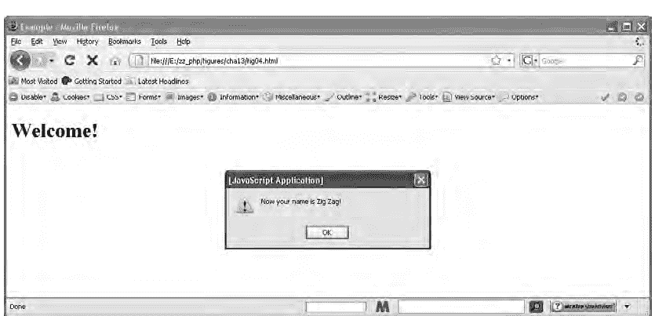

**图 13-4** 查看者在警框中获得了一个新名字

原始名称确实不是以 Z 或 z 开头的，因此执行了 else 块。并不是将第一个字母替换为 Z，而是替换为 W。下一个 if/else 段对数组中的第二个条目执行相同的任务，如果输入正确，它将是最后一个姓氏。然后会向查看者显示结果，告诉他们新名字。图 13-4 显示了当查看者输入 Big Mag 时，该脚本在浏览器中的结果。

## 尝试练习 13-2 使用 indexOf() 测试地址

```
prjs13_2.html
prjs13_2.js
```

在这个项目中，你将通过创建一个脚本对查看者输入的电子邮件地址进行非常基础的测试，练习使用 `indexOf()`。

### 逐步步骤

- 1. 创建一个 HTML 页面，指向名为 `prjs13_2.js` 的 JavaScript 文件。创建一个查看者可以点击的按钮，id 为“email”。标签为“点击以输入电子邮件地址.”。将 HTML 文件保存为 `prjs13_2.js`。

- 2. 创建一个外部 JavaScript 文件并将其保存为 `prjs13_2.js`。在步骤 3-7 中使用它。

- 3. 创建一个名为 `get_add()` 的函数。在其中，将 `prompt` 询问电子邮件地址的结果赋值给名为 `email_add` 的变量。

- 4. 同样在函数中，使用 `indexOf()` 检查地址是否包含 (@) 字符。

## 第 13 章：处理字符串

- 5. 同样在函数中，使用 `indexOf()` 检查地址是否包含点 (.) 字符。

- 6. 同样在函数中，如果地址同时包含 (@) 字符和点 (.) 字符，则发送警框感谢查看者。否则，向查看者发送警框，告诉他们缺少字符并重试。

- 7. 保存 JavaScript 文件并在浏览器中打开 HTML 文件，看看你可以用它做什么。

## 尝试练习总结

在这个项目中，你使用了对 `indexOf()` 方法的知识来测试查看者输入的电子邮件是否包含特定字符。如果缺少其中一个字符，将向查看者发送错误警框。否则，将发送一个警框感谢查看者。

## 使用正则表达式

正则表达式赋予了你在脚本中处理字符串的能力。它们允许你形成可以与字符串匹配的模式，而不是尝试使用 `String` 对象的方法，后者可能会让精确性变得困难。

例如，你可能想知道电子邮件地址文本框中的值是否至少包含一个开头字符，后面是一个 (@) 符号，然后是至少一个字符，接着是一个点 (.)，最后是至少两个字符（匹配传统的电子邮件地址如 john@jon.com 或最短类型的电子邮件地址 email@j.jj）。第 13-2 节提供了一个类似但更简单的测试供你尝试。

`String` 对象的方法没有提供一种整洁高效的方法来执行此任务（尽管不经思考，可能是可能的）。然而，正则表达式可以缩短任务，或将使用 `String` 对象方法看似无法实现的匹配变为可以完成的匹配。

## 创建正则表达式

要创建正则表达式，你必须创建一个 JavaScript `RegExp` 对象的实例。你可以几乎采用与创建字符串字面量相同的方式。要创建一个 `RegExp` 字面量，只需将正则表达式赋值给变量。不要使用引号，而是使用正斜杠 (/)，如下所示：

```
var varname = /your_pattern/flags;
```

将 `varname` 替换为你想要使用的变量名，并将 `your_pattern` 替换为你选择的正则表达式模式。你可以在最后一个斜杠后跟随一个或多个标志（这些将在接下来的章节“添加标志”中讨论）。

# 364 JavaScript：入门指南

注意

JavaScript 使用正斜杠来告诉浏览器正则表达式位于它们之间，就像使用引号区分字符串一样。因此，如果正则表达式内部使用了斜杠，必须使用反斜杠进行转义才能正常工作。例如，而不是编写 `/02/03/2009/`，

最容易创建的正则表达式是查找字符精确匹配的表达式。例如，如果你想查看字符串中是否存在序列 `our`，你可以创建一个正则表达式：

```
var tomatch = /our/;
```

前述代码创建了一个名为 `tomatch` 的 `RegExp` 字面量。现在你需要一个字符串来测试该模式。如果你对单词 `our` 进行测试，它是匹配的。

如果你测试 `your`、`sour`、`pour` 或 `pouring`，它将不会匹配。如果你测试 `Cool`、`Our`、`oUR` 或 `souR`，也将不会匹配。那么如何执行这项测试呢？

## 使用正则表达式测试字符串

要对字符串测试正则表达式，可以使用 `RegExp` 对象的 `test()` 方法。基本语法如下：

```
regex_name.test(string_to_test);
```

这种语法与使用字符串方法类似。将 `regex_name` 替换为正则表达式的名字，并将 `string_to_test` 替换为字符串。

# 387 第 13 章：处理字符串 365

`prompt` 获取一个名称并将值保存在变量中。`test()` 方法的结果赋值给名为 `is_match` 的变量。该变量被用作 `if` 语句的条件。如果变量值为 `true`，查看者将收到“哇，我们有相同的名字！”。如果它的值为 `false`，查看者将收到“不是我的名字，但可以的！”

如果你想触发脚本，可以在下面的代码中直接将 `test()` 方法的结果作为 `if` 语句的条件（而不是创建另一个变量）：

```javascript
var thename = window.prompt("Enter your name,");
var tomatch = /John/;
if (tomatch.test(thename)) {
  window.alert("Wow, we have the same name!");
} else {
  window.alert("Not my name, but it will work!");
}
```

因为该方法返回 `true` 或 `false`，它可以单独作为 `if` 语句的条件。（如果你愿意，也可以把它写成 `(tomatch.test(thename))` true。）

## 添加标志

标志允许你让匹配不区分大小写，或者查找字符串中的每一个匹配项而不仅仅是第一个（全局测试）。要添加标志，请将其放在正则表达式最后一个斜杠之后。你可以使用三种选项，如表 13-3 所示。

如果你想调整之前使用的名称脚本使其不区分大小写，可以给正则表达式添加一个标志，如下所示：

```javascript
var thename = window.prompt("Enter your name,");
var tomatch = /John/i;
if (tomatch.test(thename)) {
  window.alert("Wow, we have the same name!");
} else {
  window.alert("Not my name, but it will work!");
}
```

| 标志(s) | 目的 |
| :--- | :--- |
| i | 使匹配不区分大小写 |
| g | 使匹配全局化 |
| m | 使匹配在多行模式下工作 |

表 13-3 正则表达式标志

# 366 JavaScript: 入门指南

只要字符串中包含 John 的模式，`test()` 方法现在将返回 `true`。它可以是任何大小写，因此现在 John、JOHN、john 甚至 JoHN 都是匹配项，并将导致 `test()` 方法返回 `true`。

你也可以使用多个标志（flag）或同时使用三个标志。例如，如果你想让匹配不区分大小写且全局搜索（即获取整个字符串中的每个匹配项），你可以使用以下代码：

```javascript
var tomatch=/John/ig;
```

## 创建强大的模式

虽然创建一个精确的模式会很好，但你并不总是需要寻找如此精确的匹配。在很多情况下，你将寻求要匹配一个更通用的模式，例如至少需要三个字符的条目，或者需要任意类型的两个字符后跟着一个特殊字符。

通过在你的表达式中使用特殊字符，你可以创建你所需的模式类型，以匹配你想要的序列。JavaScript 正则表达式以 Perl 正则表达式作为模型。如果你在 Perl 中用过正则表达式，那么这里的许多内容对你来说将很熟悉。表 13-4 列出了许多帮助你创建模式的字符。

正如你所看到的，创建你所需的模式存在大量的选项。现在，你可以轻松地验证字符串是否符合你设定的标准。

现在，如果你想确保一个文本字段包含一个或多个数字，你可以使用表 13-4 中的 `\d` 字符 HTML 和 JavaScript 代码，从 HTML 代码开始：

```html
<body>
<form>
  输入一些文本: <input type="text" id="has_digits" />
  <input type="button" id="t_btn" value="Test" />
</form>
</body>
```

接下来，是 JavaScript 代码：

```javascript
var t_button = document.getElementById("t_btn");
t_button.onclick = function() {
  var has_num = document.getElementById("has_digits").value;
  var tomatch = /\d+$/;
  if (tomatch.test(has_num)) {
    window.alert("你的输入包含一个或多个数字!");
  } else {
    window.alert("你的输入没有包含任何数字!");
  }
};
```

## 第 13 章：处理字符串 367

| 字符 | 用途 | 示例 |
| --- | --- | --- |
| ^ | 仅从行的开始匹配 | /^c/ 匹配 corn 中的 c<br>/^c/ 不匹配 acorn 中的 c |
| $ | 仅在行的末尾匹配 | /r$/ 匹配 Car 中的 r<br>/r$/ 不匹配 Cat 中的 t |
| * | 如果前面的字符出现零次或多次，则匹配该字符 | /c*/ 匹配 co 或 c<br>/c*/ 不匹配 pi |
| + | 如果前面的字符出现一次或多次，则匹配该字符 | /o+/ 匹配 co<br>/o+/ 不匹配 ca |
| ? | 如果前面的字符出现零次或一次，则匹配该字符 | /o?/ 匹配 style 或 o<br>/o?/ 不匹配 cool |
| . | 匹配任何单个字符，排除换行符 | /./ 匹配 a 或 @<br>/./ 不匹配 \n 或 l |
| (x) | 通过将 x 替换为字符，该序列会被保留在内存中以便稍后使用；用于表达式的分组 | /(a)/ 匹配 a<br>/(a)/ 匹配 cool<br>/(a)/ 不匹配 coal |
| \| | 使用作为 OR（或）符号，允许匹配符号左侧或右侧的内容 | /bad/ 匹配 cool<br>/bad/ 匹配 bad<br>/bad/ 不匹配 car |
| {x} | 使用数字替换 x，当前面的字符恰好出现 x 次时进行匹配 | /n{1}/ 匹配 n<br>/n{2}/ 匹配 nnn<br>/n{1}/ 不匹配 nnn |
| {x,y} | 使用数字替换 x 和 y，当前面的字符出现 x 次或更多次，但不超过 y 次时进行匹配 | /n{1,2}/ 匹配 n<br>/n{1,2}/ 匹配 nn<br>/n{2,3}/ 不匹配 n<br>/n{4,7}/ 不匹配 nnn |
| [] | 匹配你选择的字符；将匹配括号中的任意一个字符（例如 [abc]）或字符范围内的任意一个字符（例如 [a-k]） | /[abc]/ 匹配 a<br>/[abc]/ 不匹配 d |
| [^ | 匹配不属于括号内的字符 | /[^abc]/ 匹配 d<br>/[^abc]/ 不匹配 a |

表 13-4 正则表达式代码（续）

| 字符 | 用途 | 示例 |
| --- | --- | --- |
| \d | 匹配任何数字 | /\d/ 匹配 |
| \D | 匹配任何非数字 | /\D/ 匹配 |
| \w | 匹配单词字符（字母数字和下划线） | /\w/ 匹配 |
| \W | 匹配非单词字符 | /\W/ 匹配 |
| \s | 匹配空白字符 | /\s/ 匹配 |
| \S | 匹配非空白字符 | /\S/ 匹配 |
| \t | 匹配制表符 | /\t/ 匹配 |
| \T | 匹配非制表符 | /\T/ 匹配 |
| \f | 匹配分页符 | /\f/ 匹配 |
| \F | 匹配非分页符 | /\F/ 匹配 |
| \n | 匹配换行符 | /\n/ 匹配 |
| \N | 匹配非换行符 | /\N/ 匹配 |
| \r | 匹配回车符 | /\r/ 匹配 |
| \R | 匹配非回车符 | /\R/ 匹配 |

### 注意

正则表达式在验证时非常强大，因为它们允许允许错误信息的接受。

对表单提交（如电子邮件地址或电话号码）进行客户端验证可以减少往返服务器的次数。但是

# 370 JavaScript：初学者指南

这种方法的问题在于它匹配了正确的 3，但之后又匹配了五位数字，因为需要重复这个 3。因此，像 387643 这样的数字会被匹配，尽管你想要的是五组以 3 开头的数字。要修复这个问题，你可以用括号将 3 和 `\d` 组合在一起，并在后面跟上它应该重复的次数：

```javascript
/(3\d){5}/
```

这一次，3 和第二个数字被分组在了一起，该序列必须重复五次。分组是充分利用正则表达式功能的一种有用方法，当你进入下一章学习表单验证时，你会看到很多这种用法。

## replace()、match() 和 search() 方法

这些 `String` 对象的方法在本章的前面已经提到过，现在引入了正则表达式后，它们将变得更有意义。

## replace() 方法

要替换字符串中的信息，可以使用正则表达式和 `String` 对象的 `replace()` 方法。使用 `replace()` 方法的语法如下：

```javascript
var varname = stringname.replace(regex, newstring);
```

你将 `varname` 替换为在信息替换后将持有新字符串值的变量名。你将 `stringname` 替换为进行替换的字符串值名称。你将 `regex` 替换为用于匹配字符串的正则表达式名称。最后，你将 `newstring` 替换为用于替换字符串中任何匹配值的字符串或字符串变量。

例如，以下代码将 `mystring` 中第一个出现的 "car" 替换为 "skunk"：

```javascript
var mystring = "I like the way a car smells, and cars are fun";
var toreplace = /car/;
var newstring = mystring.replace(toreplace, "skunk");
window.alert(newstring);
```

> 创建了一个字符串字面量。要替换的模式以正则表达式的形式存在。

> 字符串中的第一个匹配项被替换，并赋值给一个变量。

> Alert 显示更新后的字符串。

前面的代码只替换了第一个 "car"，使 alert 显示了新的 "skunk smells, and cars are fun."。如果你想更改每一个 "car" 实例，在正则表达式的末尾添加 `g` 标志会很有帮助，如下代码所示：

```javascript
var mystring = "I like the way a new car smells, and cars are fun.";
var toreplace = /car/g;
var newstring = mystring.replace(toreplace, "skunk");
window.alert(newstring);
```

> 添加 `g` 标志会导致运行 `replace()` 方法时替换模式的所有匹配项。

# 第 13 章：处理字符串 371

`g` 标志会匹配字符串中找到的正则表达式每一个实例。因此，当运行 `replace()` 方法时，所有的 "car" 实例都将被替换为 "skunk"。用户将看到这个 alert："I like the way a new skunk smells, and skulls are fun."

你也可以使用 `replace()` 方法来编写一个改名脚本，它比本章之前的脚本更短且稍微不复杂。通过使用配合正则表达式的 `replace()` 方法，可以更容易地更改姓名的第一个字母。以下代码所示：

```javascript
function getname() {
  var tomatch = /[A-Za-z]+\s[A-Za-z]+$/;
  var toplace = /\b[A-Za-z]/gi;
  var thename = window.prompt("Enter your first and last name,", "");
  if (tomatch.test(thename)) {
    newname = thename.replace(toplace, "Z");
    window.alert("Your name is " + newname);
  } else {
    window.alert("Invalid name. Please Try Again");
    getName();
  }
}
getName();
```

正则表达式用于验证和更改用户的输入。此脚本无论之前是什么，都会将姓和名的第一个字母更改为 Z。用于替换的正则表达式仅使用单词边界 `(\b` 代码查找单词开头的字母。每当字母位于单词开头时，就会被替换。

输入的验证防止脚本获取超过两个名字和一个空格，并确保每个名字中至少有一个字母，且没有数字或特殊字符。插图显示了用户在提示框中输入 Debra Lo 时脚本的结果：用户的姓名被更改。

## match() 方法

`match()` 方法比较正则表达式和字符串以查看它们是否匹配。它返回一个包含一个或多个匹配项的数组，取决于它的使用方式。如果没有找到匹配项，它返回 -1。

# 372 JavaScript：初学者指南

`match()` 方法的基本用法如下：

```javascript
string.match(regex);
```

字符串将是你的字符串字面量，`regex` 将是你的正则表达式字面量。注意此方法与 `test()` 方法在顺序上的差异。你可以这样使用：

```javascript
var mystring = "I am!";
var tomato = /Iron/;
if (mystring.match(tomato)) {
  window.alert("Match found!");
} else {
  window.alert("No match found.");
}
```

## search() 方法

`search()` 方法对正则表达式和指定的字符串执行搜索。如果找到匹配项，它返回匹配项在字符串中的位置。否则，它返回 -1。

```javascript
var mystring = "I am!";
var tomato = /Iron/;
if (mystring.search(tomato) !== -1) {
  window.alert("Match found at " + mystring.search(tomato));
} else {
  window.alert("No match found.");
}
```

`search()` 方法的基本用法如下：

```javascript
string.search(regex);
```

字符串将是你的字符串字面量，`regex` 将是你的正则表达式字面量。注意此方法与 `test()` 方法在顺序上的差异。`search()` 方法比较正则表达式和字符串以查看它们是否匹配。如果找到匹配项，它返回匹配项在字符串中的位置。如果没有找到匹配项，它返回 -1。

分组是充分利用正则表达式功能的一种有用方法，当你进入下一章学习表单验证时，你会看到很多这种用法。

## 更多信息

关于正则表达式以及如何创建复杂模式的更多信息，你可以查看：

- www.regular-expressions.info

- https://developer.mozilla.org/en-US/docs/Web/JavaScript/Guide/Regular_Expressions

掌握了这些技术后，你就准备好开始处理表单了。

## 第 14 章

## JavaScript 与表单

### 核心技能与概念

- 访问表单

- 使用表单对象的属性和方法

- 确保表单的可访问性

- 验证表单

- 使用表单进行导航

当你使用 JavaScript 访问表单时，可以为你的网页创建新的脚本。本章首先解释如何使用 JavaScript 访问表单。然后，你将学习用于表单和元素的各种属性和方法。你还将学习表单与可访问性、如何验证表单元素，以及如何将 `<select>` 元素作为导航工具。

## 访问表单

每当你向 HTML 文档添加一组 `<form>` 和 `</form>` 标签时，就会创建一个表单对象。要使用 JavaScript 访问其中一个表单，可以使用以下任何一种选项：

- 使用 `document` 对象的 `forms` 数组

- 在起始表单标签中为表单命名并使用该名称访问表单

- 在起始表单标签中为表单指定 id 并使用 `document.getElementById(id)` 方法访问它

## 使用 forms 数组

`forms` 允许你使用数组中的索引数字来访问表单。页面上的每组 `<form>` 和 `</form>` 标签都会按照它们在文档中出现的顺序，在 `forms` 数组中创建一个额外的元素。因此，你可以这样引用文档中的第一个表单：

```
document.forms[0]
```

正如你所记得的，数组从 0 开始计数，因此之前的示例将访问文档中的第一个表单。如果你想访问第二个表单，可以使用：

```
document.forms[1]
```

这种方法是通的。请记住从 0 开始计数，而不是从 1。

访问表单本身不会产生任何操作。要使用它，你需要表单对象的属性或方法。在后续章节中列出了表单对象的属性和方法，但现在请查看 `length` 属性看看它的作用。

## 属性值

`length` 属性允许你访问表单。该属性允许你知道表单中存在多少个元素（如输入框等）。例如，请查看：

```html
<body>
<form>
姓名：<input type="text" />
邮箱：<input type="text" />
<input type="submit" value="提交" />
</form>
</body>
```

`length` 属性可以告诉你表单中包含多少个元素（输入框、单选框等）。

该代码创建了一个包含三个元素的表单：两个框和一个提交按钮。由于它是页面上唯一的表单，它是第一个表单。要使用 `length` 属性，请在后面这样添加：

```
document.forms[0].length
```

使用前面的代码，你可以编写一个短脚本告诉用户表单中有多少个元素。（通常你会使用 `length` 属性）。下面的代码将在页面上写入信息：

```html
<body>
<form>
姓名：<input type="text" /> <br />
邮箱：<input type="text" /> <br />
<input type="submit" value="提交" />
</form>
<p>
<script type="text/javascript">
document.write("表单有 " + document.forms[0].length + " 个元素。");
</script>
</p>
</body>
```

表单的元素在这里。页面上打印了元素的数量。

代码告知用户表单有三个元素。图 14-1 显示了该脚本在浏览器中运行的结果。

**图 14-1** 显示给用户的表单元素数量

### 涵盖两个长度属性

如果你想在页面上有多个表单时显示它们的元素数量，可以使用更复杂的脚本，为页面上的每个表单打印消息。记得由于表单是数组，你可以获取数组的长度。

数组的长度是页面上表单的数量（就像特定表单的长度是该表单元素的数量一样）。要获取表单的数量而不是表单的长度，记住不要通过括号和索引数字来指定表单，例如：

```
document.forms.length
```

这种语法获取页面上表单的数量。因此，你必须记住：

- `document.forms.length` 获取页面上表单的数量。

- `document.forms[x].length` 获取页面上特定表单的元素数量，其中 x 是要访问的表单的索引。

## 第 14 章：JavaScript 与表单

表单名称为 `info_form`，你可以在脚本中使用此名称访问该表单。

表单名称使其成为表单对象的一个实例，你可以通过该名称访问它。要使用 JavaScript 访问使用表单名称的表单，可以使用此处所示语法：

```
document.yourname
```

将 `yourname` 替换为在起始 `<form>` 标签的 `name="idname"` 属性赋予表单的名称。因此，如果你想写一个脚本来查找命名表单中的元素数量，可以使用以下代码：

```html
<body>
<form name="info_form">
Name: <input type="text" /><br />
<input type="submit" />
</form>
<p>
<script type="text/javascript">
document.write("The form has "+document.info_form.length+" elements.");
</script>
</p>
</body>
```

表单被赋予了一个名称

命名表单中的元素数量被写在页面上

注意看在 `document.write()` 语句中是如何访问表单的。取而代之的是表单名称，而不是表单数组。它现在可以访问表单对象的属性，并通过访问 `length` 属性来实现。

## 使用 ID

访问表单的第三种方法是使用 `id` 属性，然后使用 `document.getElementById` 来访问表单元素。这通常是访问表单及其元素最清晰的方法，因为你可以使用每个元素的单独 `id` 来访问它们，而前两种访问方法需要你知道它们在表单名称或元素名称中的索引位置。

如果你想使用 `id` 方法重写上一节中的脚本，可以使用以下代码：

```html
<body>
<form id="info_form">
Name: <input type="text" /><br />
<input type="submit" />
</form>
<p>
<script type="text/javascript">
 f_length = document.getElementById("info_form").length;
document.write("The form has "+f_length+" elements.");
</script>
</p>
</body>
```

表单被赋予了一个 id

命名表单中的元素数量被写在页面上

由于你已经在之前的章节中熟悉了如何使用 `document.getElementById()`，这对你来说应该是一个非常直接的方法。你访问表单及其元素的方法取决于你编写的脚本类型。如果你在页面上使用多个表单，那么数组可以是遍历每个表单的方便方法。如果你试图尽可能地获得旧浏览器的向后兼容性，那么使用 `name` 方法可能是更好的选择。另一方面，如果你尝试在 XHTML 1.0 中验证你的脚本，则需要你使用 `id` 为每个表单元素命名，因此在这种情况下使用 `id` 方法更合适。

## 使用表单对象的属性和方法

JavaScript 表单对象会在需要在脚本中访问表单的某些元素或属性时为你提供帮助。表单对象只有几个属性和方法。首先描述属性。

### 属性

表单对象的属性提供了你在脚本中处理表单时可能需要的信息。表 14-1 列出了表单对象的属性及其值。这些属性中的大多数持有对应于 HTML `<form>` 标签中各种属性的值。不过，正如接下来解释的，其中具有不同类型的值。

## action 属性

此属性允许你访问起始 `<form>` 标签中 `action="url"` 属性的值。该属性用于将表单发送到服务器端脚本进行处理（例如 Perl 或 PHP 脚本）。

| 属性 | 值 |
| --- | --- |
| action | HTML 表单标签中 action 属性的值 |
| elements | 数组，其中包含 HTML 表单中每个表单元素对应的数组元素 |
| encoding | enctype 属性的值，随不同浏览器而异 |
| length | HTML 表单中元素总数的值 |
| method | HTML 表单标签中 method 属性的值 |
| name | HTML 表单标签中 name 属性的值 |
| target | HTML 表单标签中 target 属性的值 |

表 14-1 表单对象的属性

定义了 action 属性

接下来的示例显示了如何通过命名表单访问该属性：

```html
<body>
<form name="info_form" action="http://someplace.com/php/form.php">
Name: <input type="text" /><br>
<input type="submit" />
</form>
<script type="text/javascript">
document.write("The form goes to "+document.info_form.action);
</script>
<p>
</body>
```

`action` 属性的值被写在页面上

此脚本将 `action` 属性中指定的 URL 写在页面上。图 14-3 显示了该脚本在浏览器运行时的结果。

## elements 属性（数组）

`elements` 属性是一个数组，允许你按照从 0 开始在代码中出现的相同顺序访问特定表单内的每个元素。它的工作类似于 `forms` 数组为给定表单中的每个元素都有一个条目。

要使用数组访问表单中的元素，请使用要访问的元素的索引号。例如，该表单有两个元素：

```html
<form name="info_form">
Name: <input type="text" /><br>
<input type="submit" />
</form>
```

**图 14-3** 表单中 action 属性的值打印在页面上

要访问第一个元素（文本框），你可以使用此处所示的语法：

```
document.info_form.elements[0]
```

或者，如果你想使用 `forms` 数组（假设这是页面上的第一个表单），可以使用此语法：

```
document.forms[0].elements[0]
```

另一种访问文本框的方法是给它命名（像表单一样）并使用其名称访问它。你可以对每个元素都这样做，也可以对表单本身这样做；你可以根据具体情况选择哪种方法最适合访问表单及其元素。

```html
<form name="info_form">
Name: <input type="text" name="yourname"><br />
<input type="submit" />
</form>
```

## checked 属性

此属性用于复选框和单选按钮。它有一个布尔值，如果框被选中则为 `true`，如果未选中则为 `false`。例如，使用以下代码对复选框进行尝试：

```html
<body>
<form>
Check box to say Yes: <input type="checkbox" id="yes_no" />
<br /> <br />
<input type="button" value="See the Answer" onclick="is_it_checked();" />
<script type="text/javascript">
function is_it_checked() {
  var y_n = document.getElementById("yes_no");
  if (y_n.checked) {
    window.alert("Yes! The box is checked!");
  }
  else {
    window.alert("No, the box is not checked!");
  }
}
</script>
</body>
```

复选框被赋予了一个 id

按钮启动检查复选框的函数

复选框的状态使用 `checked` 属性进行检查

HTML 身体中有一个 id 为 `yes_no` 的复选框。按钮被点击时会调用函数 `is_it_checked()`。该函数使用 `if/else` 语句检查复选框是否被选中。`if` 条件使用快捷方式，允许将其从：

```
if (y_n.checked==true)
```

简化为：

```
if (y_n.checked)
```

| 元素类型 | 对象名称 | 属性 | 方法 |
|---|---|---|---|
| Button | button | | blur(), click(), focus() |
| Check box | checkbox | checked, defaultChecked, form, name, value | blur(), click(), focus() |
| Hidden field | hidden | form, name, type, value | 无 |
| Radio button | radio | checked, defaultChecked, form, name, value | blur(), click(), focus() |
| Reset button | reset | form, name, type, value | blur(), click(), focus() |
| Select box | select | form, name, options, selectedIndex | blur(), focus() |
| Submit button | submit | form, name, type, value | blur(), click(), focus() |
| Text box | text | defaultValue, form, name, type, value | blur(), focus(), select() |
| Text area | textarea | defaultValue, form, name, type, value | blur(), focus(), select() |

表 14-2 表单元素及其对象和方法

# 386 JavaScript：初学者指南

`checked` 属性将返回 true 或 false，而不需要对 `checked` 属性的值进行任何测试。`checked` 属性已经有一个值，因此该值不需要与任何内容进行比较（除非你倾向于这样做，这也是可以的）。

## defaultChecked 属性

该属性也是一个 true 或 false 的布尔值。该值取决于复选框或单选按钮在 HTML 中是否具有 `checked` 属性（这会让元素在页面上默认被选中）。如果元素具有 `checked` 属性，则值为 true；否则，值为 false。

例如，以下 HTML 代码使用了 `checked` 属性：

```html
<form>
Do you want to send you e-mail updates and offers?<br />
Yes <input type="checkbox" id="favurl" checked="checked" />
No <input type="checkbox" id="no" /> own</form>
```

由于第一个复选框设置了 `checked` 属性值，因此该元素的 `checked` 属性将返回 true。对于第二个复选框元素，该属性将返回 false。

## defaultValue 属性

你将此属性用于文本框和文本区域。它保存了在标签 `value` 属性中设置的默认值。如果你在文本框中使用了默认值，用户删除了它，然后用户决定如果能恢复默认值就好了，那么这个功能就会有用。你可以编写一个按钮，在查看者点击时返回该值，如下代码所示：

```html
<body>
<form>
Favorite URL:<br /><input type="text" id="favurl" value="http://www.yahoo.com" />
<br />
<input type="button" value="Reset Default" onclick="back_to_default();" />
</form>
<script type="text/javascript">
function back_to_default() {
  var url_box = document.getElementById("favurl");
  url_box.value = url_box.defaultValue;
}
</script>
</body>
```

- 文本框被分配了默认值

- 按钮调用重置默认值的函数

- 复选框的当前值被恢复为默认值

在 HTML 代码中，`input` 标签中的 `value` 属性被设置为 http://www.yahoo.com。当函数被调用时，它通过将当前值 (`url_box.value`) 更改为默认值 (`url_box.defaultValue`) 将此默认值赋回文本框。

### 注意

如果你希望将特定值恢复为它们的默认值，这种技术非常有用。如果你想将所有内容恢复为默认值，可以简单地在你的 HTML 代码中使用重置按钮（即 `<input type="reset" value="Reset" />`）。

## Form 属性

此属性经常与关键字 "this" 一起使用，用于引用包含该元素的表单。例如，如果你想通过点击按钮更改文本框的值，可以使用 `this.form` 来引用表单，而不需要表单的名称或 ID：

```html
<form>
Favorite URL:<br />
<input type="text" name="favurl" value="http://www.yahoo.com" />
<br /><br />
<input type="button" value="Change"
onclick="this.form.favurl.value='http://www.lycos.com/'" />
</form>
```

当点击按钮时，此代码会将文本框的值更改为 http://www.lycos.com。使用 `this.form.favurl` 允许你从元素内部访问表单，而无需回溯并使用名称或 ID，后者要冗长一些。

## Name 属性

此属性持有元素 `name` 属性的值。例如，以下代码将打印页面上第一个元素（文本框）的值：

```html
<body>
<form name="info_form">
Name: <input type="text" name="yourname" /><br />
<input type="submit" value="Submit" />
</form>
<p>
<script type="text/javascript">
document.write("The first element is "+document.info_form.elements[0].name);
</script>
</p>
</body>
```

这是一种查找元素名称而无需在代码查找的方便方法。

## options 属性（数组）

`options` 属性是一个数组，包含表单中 `select` 框中列出的每个选项的元素。索引从 0 开始计数，每个选项按照它们在 HTML 代码中的编写顺序放置在数组中。以下代码展示了如何访问选项的值（这是 `option` 标签中 `value` 属性的值，而不是标签的内容）并将其写入页面上：

```html
<body>
<form>
Fruits:
<select id="optlist">
<option selected="selected" value="orange">Orange</option>
<option value="apple">Apple</option>
<option value="pear">Pear</option>
</select>
</form>
<p>
<script type="text/javascript">
var fbox = document.getElementById("optlist");
document.write("The second option is ");
document.write(fbox.options[1].value);
</script>
</p>
</body>
```

第一个选项

第二个选项

第三个选项

**selectedIndex 属性** 持有被选中选项的索引数字。如果选择了第一个选项，则值为 0。如果选择了第二个选项，则值为 1。该属性将在本章的稍后部分详细讨论。

# 14：JavaScript 与表单

## type 属性

此属性持有表单元素 `type` 的值，例如 `type="text"` 或 `type="button"`。这些值分别为 text 和 button。

## value 属性

此属性持有元素的当前值。例如，一个文本框可能没有默认值；当查看者向框内输入信息时，文本框就有了当前值。如果框内什么都没有，则当前值将为空字符串。（你在之前的章节中某些脚本中使用过此属性。）

你将频繁使用此属性用于表单的信息处理、验证和导航。

## blur() 方法

此方法允许你在代码中的元素上创建一个事件。例如，如果你想保持文本框中的默认值不被查看者调整，你可以使用 `blur()` 方法在元素接收焦点时移除其焦点。以下代码显示了示例：

```html
<body>
<form>
  Your Favorite Food
  <input type="text" name="fav_food" value="Pizza"
  onfocus="this.form.fav_food.blur();" />
</form>
</body>
```

点击框会赋予它焦点，但事件处理程序会捕获文本框的焦点，然后对该元素使用 `blur()` 方法移除其焦点。当然，你也可以使用不带默认值的脚本来创建一个无法填充的文本框，因为它无法接收焦点。在任何情况下，如果查看者在浏览器中关闭了 JavaScript，此脚本就会被覆盖，因此不建议将其作为防止填写字段内容的保护。此类问题可以通过客户端和服务器端的输入验证来处理。

## click() 方法

此方法允许你在代码中的按钮上创建一个点击事件。然而，如果是在按钮中使用，点击事件不会激活 `onclick` 事件处理程序。因此，`click()` 方法对于激活作为提交和重置的按钮最为有用，这些按钮不需要 `onclick` 事件处理程序即可工作。

例如，重置按钮在点击时会重置表单。如果你想在字段失去焦点时重置表单（并真的激怒查看者），可以使用以下代码：

```html
<body>
<form>
  Your Favorite Food
  <input type="text" name="fav_food" onblur="this.form.annoy.click();" />
</form>
</body>
```

# JavaScript 初学者指南

```html
<br />
Drink <input type="text" />
<br /><br />
<input type="reset" name="annoy" value="Reset Form">
</form>
</body>
```

这段代码使用 `onblur()` 事件，当查看者从第一个文本框移开焦点时，将焦点转移到“annoy”（重置按钮）按钮上。

## focus() 方法

`focus()` 方法允许你在代码中创建焦点事件，以便为查看者使某个元素获得焦点。

例如，你可能希望页面加载时让页面上的第一个元素（通常是文本框）获得焦点，这样查看者无需点击该元素即可获得焦点并开始输入。以下代码了如何实现这一操作：

```html
<body>
<form>
Your Favorite Food
<input type="text" id="fav_food" /><br />
Drink <input type="text" />
</form>
<script type="text/javascript">
var f_box = document.getElementById("fav_food");
f_box.focus();
</script>
</body>
```

该脚本在表单及其元素存在后加载。然后它使用 `focus()` 方法为查看者提供第一个文本框的焦点。

## select() 方法

该方法允许你自动为查看者选择（高亮）文本框或文本区域的内容。如果你为元素设置了默认值，并希望查看者能够快速删除该值并输入新值，或者你想让查看者方便地复制和粘贴元素的内容，这个方法非常有用。

以下代码会在查看者赋予焦点时选择区域内的文本，使查看者能够快速删除文本或轻松将其复制到剪贴板：

```html
<body>
<form>
<textarea name="sometext" onfocus="this.form.sometext.select();">
This text is the default text for the text
area is selected when the text area is given focus by the viewer.
</textarea>
</form>
</body>
```

`onclick` 事件处理程序会在查看者点击文本区域内部时执行该方法的调用。`<textarea>` 和 `</textarea>` 标签内的所有默认文本都会被选中。

表单元素的属性和方法的介绍就此结束了。现在是时候回到表单对象的属性了。

## encoding 属性

该属性通常持有表单标签中 `enctype` 属性的值。然而，不同浏览器的结果可能会不同。

## length 属性

`length` 属性持有页面上给定表单中的元素数量。本章已经详细介绍过该属性，因此这里没有必要再次讨论。

## method 属性

该属性持有表单标签中 `method` 属性包含的值。因此，如果你将表单发送到服务器进行处理，你可能会使用类似下面的代码：

```html
<form name="fl" method="post" action="http://site.com/cgi-bin/form.cgi">
<!-- form contents here -->
</form>
```

该表单的 `method` 属性值将会被提交，因为它位于表单的 `method` 属性中。

## name 属性

该属性持有表单名称的值，该名称是在表单标签的 `name` 属性中指定的。你可能会有如下的代码：

```html
<form name="cool_form">
<!-- form contents here -->
</form>
```

在这里，`name` 属性的值为 `cool_form`，因为它是表单 `name` 属性内部的值。

## target 属性

该属性持有表单标签中 `target` 属性的值。例如，你可能会有如下代码：

```html
<form name="cool_form" target="place" action="program.cgi">
<!-- form contents here -->
</form>
```

在这里，`target` 属性的值为 `place`，因为它是表单 `target` 属性内部的值。

## 方法

现在来看表单对象的方法。表单对象只有两个方法：`reset()` 和 `submit()`，将在接下来介绍。

## reset() 方法

该方法允许你使用脚本重置表单，允许你在任何喜欢的事件上重置表单。所以，如果你想在查看者从元素移开焦点后重置表单，可以使用以下代码：

```html
<body>
<form>
Your Favorite Food
<input type="text" name="fav_food" onblur="this.form.reset();" /><br /><br />
<input type="reset" value="Reset Form" />
<input type="submit" value="Submit Form" />
</form>
</body>
```

> 如果此字段失去焦点，表单将重置

## submit() 方法

该方法允许在无需查看者点击提交按钮的情况下提交表单。代码展示了当查看者从元素移开焦点时如何操作（这与 `reset` 方法类似）：

```html
<body>
<form action="http://site.php/form.php">
Your Favorite Food
<input type="text" name="fav_food" onblur="this.form.submit();" /><br /><br />
<input type="submit" value="Submit Form" />
</form>
</body>
```

> 如果此字段失去焦点，表单将重置

## 确保表单的可访问性

确保表单的可访问性具有挑战性，因为辅助技术（如屏幕阅读器）可能无法正确解释布局。你可以采取几种措施来确保你的表单的可访问性：

## 第 14 章：正确的元素和标签顺序

在 HTML 中，你可以使用 `<fieldset>` 和 `<legend>` 标签来组合相关元素并为它们提供标题。

```html
<fieldset>
<legend>Fruit:</legend>
<input type="radio" name="fruits" id="fruits1" value="Orange">
<label for="fruits1">Orange</label>
<input type="radio" name="fruits" id="fruits2" value="Banana">
<label for="fruits2">Banana</label>
</fieldset>
```

在这里，你将所有的单选按钮组在 `<fieldset>` 中，并在开启 `<fieldset>` 之后使用 `<legend>` 为该组提供标签。然后，每个元素在 `<fieldset>` 内部正常进行标签化。

## 验证

验证 JavaScript 表单非常有用。例如，你可以在提交之前对输入进行验证，帮助减少信息不完整或不准确的表单数量。在提交到诸如通用网关接口（CGI）脚本、PHP 脚本或 Java servlet 之前进行表单数据验证可以节省时间并减轻服务器负载。要开始验证，你将学习如何使用 `onsubmit` 事件处理程序配合 `return` 语句，并学习相关的验证技术。

## onsubmit 和 return 语句

为了验证表单中一个或多个元素的内容，你需要了解用户尝试提交表单的时机。当用户点击提交按钮时，会发生提交事件，该事件可以通过 `<form>` 标签中的 `onsubmit` 事件处理程序捕获。

因此，表单可以在点击提交按钮时、执行其 action 属性之前执行某些操作：

```html
<form method="post" action="form.php" onsubmit="script">
<label for="username">Name:</label>
<input type="text" name="username" id="username" />
<br />
<input type="submit" name="submit" id="submit" value="Submit" />
</form>
```

你在此处替换为点击提交按钮时执行的某些 JavaScript。这通常是调用一个将运行在一个或多个表单字段上的函数。

为了让函数发挥作用，如果用户的输入没有通过验证，你必须让提交按钮无法执行默认操作。这意味着在 `onsubmit` 事件处理程序没有任何 `return` 语句。你希望该语句在验证通过时返回 `true`，验证失败时返回 `false`。因此，你想要的结果是：

```html
onsubmit="return true;"
```

这允许继续提交，或者：

```html
onsubmit="return false;"
```

为了使前面的代码技术与函数配合，`onsubmit` 事件处理程序中的 `return` 语句必须调用返回 `true` 或 `false` 值的函数。因此，你会得到类似这样的语句：

```html
onsubmit="return yourfunction();"
```

你用 `yourfunction` 替换为真实的函数名。

## 396 JavaScript：初学者指南

关键在于函数必须返回 `true` 或 `false` 值，以便之前的语句求值结果为你的所需的结果（`return true;`；`return false;`）。函数本身可以做任何事情，但它需要一个向事件处理程序发送 `true` 或 `false` 值的 `return` 语句。

所以，你可以对表单进行验证，以确保文本框不为空。以下代码展示了如何使用 `onSubmit` 事件处理程序来实现。首先是 HTML 代码（保存为 val_form.html）：

```html
<body>
<form method="post" action="form.php" onSubmit="return check_it()">
<label for="username">Name:</label>
<input type="text" name="username" id="username" />
<br /><br />
<input type="submit" name="submit" id="submit">
</form><script type="text/javascript" src="val_form.js"></script>
</body>
```

接下来，是 JavaScript 代码（保存为 val_form.js）：

```javascript
function check_it() {
  var thaname = document.getElementById("username").value;
  if (thaname.length < 1) {
    window.alert("Name field is blank, please try again.");
    return false;
  } else {
    return true;
  }
}
```

该函数使用 `if` 语句检查文本字段是否被留空（使用文本元素 `length` 属性的值）。如果是这样，警框会告诉用户重试，函数返回 `false`。否则，函数将返回 `true`。如果返回 `true`，提交将继续。否则，表单不会提交，用户可以通过输入必要信息并点击提交按钮来重试。请记住，`check_it()` 函数仅使完全空的字段失效。你需要让函数更复杂，以消除诸如空格、井号（#）符号等名称的提交（可以使用正则表达式来处理）。

## 技术

在大多数情况下，验证可以根据你的用途变得非常简单或非常复杂。你所需要做的就是创建自己的自定义函数，根据所需的信息对你选择的表单字段进行验证。

## 第 14 章：JavaScript 与表单 397

例如，上一节的示例检查了姓名字段中的空文本框。然而，对于邮政编码（Zip code），你可以通过正则表达式检查字段是否包含五个数字。如果不包含，你可以向用户发送警报，邮编无效并要求重新输入。以下代码展示了实现这种方法的方法：

```html
<body>
<form method="post" action="form.php" onsubmit="return check_it()">
  <label for="zip_code">Zip Code:</label>
  <input type="text" name="zip_code" id="zip_code" />
  <br /><br />
  <input type="submit" name="submit" id="submit" value="Submit">
</form>
<script type="text/javascript">
function check_it() {
  var zip = document.getElementById("zip_code").value;
  var tomatch = /^\d{5}$/;
  if (tomatch.test(zip)) {
    return true;
  } else {
    window.alert("Invalid zip code");
    return false;
  }
}
</script>
</body>
```

该代码使用正则表达式检查五个数字。如果输入五个数字以外的任何内容，函数将返回 `false`。

## 提示

寻找验证脚本的一种方法是尝试 Web 上的网站。许多网站具有为了验证不同类型数据的特殊函数。如果你能找到适合用途的函数，可以为你节省一些工作。

### 专家问答

Q：文本区域和选择框等元素有太多的属性和方法需要记忆。有什么建议吗？

答：这些属性和方法有很多适用于所有元素类型，而只有少数更具特定性。随着你继续编写脚本，你将开始知道哪些元素拥有哪些属性和方法，因此更容易看出哪些是特定于某种类型的。

Q：我可以验证什么类型的输入？

答：大多数情况下，你可以按照你认为合适的方式验证你想要的内容。你可以验证日期、姓名、时间、地址、电子邮件、电话号码或你需要的任何内容。

Q：我可以验证选择框中的选择或文本区域中的文本，或者其他某些类型吗？

答：在这些某些情况下，你已经将值构建在元素中了。然而，如果可能，你仍然应该根据其他信息对这些值进行验证，以确保收到的信息是需要的。你只需要调整你的函数，根据不同的输入设备（文本区域、单选按钮等）执行所需的任务。例如，下一节将介绍与导航相关的选择框。然而，某些信息（例如 `selectedIndex` 属性）对验证也是有。

Q：我不使用服务器端脚本，但我为了好玩使用 JavaScript 并验证信息。我真的需要添加服务器端脚本吗？

答：对服务器端脚本的需求取决于你的目的。如果你有一个需要保存、通过电子邮件发送或发送到数据库的表单，你需要一个服务器端应用程序。

## 尝试一下 14-1 请求一个数字

```
prl14_1.html
prjs14_1.js
```

在这个项目中，你创建一个脚本用于对用户输入的电话号码进行基本验证，格式为 222-222-2222。

## 第 14 章：JavaScript 与表单

## 逐步教程

- 1. 创建一个 HTML 页面，包含一个表单和一个标签为“Phone Number (XXX-XXX-XXXX)”的文本框。确保表单有一个提交按钮，并编写 JavaScript 函数 `checkit()` 来验证输入。在表单之后插入必要的脚本标签以调用名为 `prjs14_1.js` 的外部 JavaScript 文件。将 HTML 文件保存为 `prj14_1.html`。

- 2. 创建一个外部 JavaScript 文件并将其保存为 `prjs14_1.js`。在第 3 步它。

- 3. 使用正则表达式确保输入文本框的数字符合 XXX-XXX-XXXX 格式。如果是，则弹出显示“Phone number validated.”的提示；否则，弹出显示“Invalid phone number entered. Valid format is XXX-XXX-XXXX.”的提示。

- 4. 保存 JavaScript 文件并在浏览器中打开 HTML 文件。通过在文本框中输入各种值并提交表单，查看其是否正常工作。

### 练习总结

在这个项目中，你利用 JavaScript 和表单的知识创建了一个用于验证表单的脚本。该脚本通过特定的标准验证观众输入的文本，以检查其是否为有效的电话号码。

# 使用表单进行导航

通过将 JavaScript 用于表单，如果你愿意，可以创建普通文本链接和图像链接导航的替代方案。本节将讨论如何使用选择框（select boxes）为你的网站创建导航。

这种类型的导航允许观众从选择框的列表中选择目的地，然后通过点击按钮或更改值跳转到新位置。开始之前，你将创建一个导航选择框，利用观众点击按钮跳转到新位置。

# 点击按钮

创建一个选择框非常简单。首先，你像这样设置选择框的代码（将 HTML 存为 `select.html`）：

```html
<form>
<label for="s1">Select Page:</label>
<select name="s1" id="s1">
<option selected="selected" value="page1.html">Page 1</option>
<option value="page2.html">Page 2</option>
<option value="page3.html">Page 3</option>
</select>
</form>
```

注意选择框被赋予了 id `s1`。此外，注意 value 属性被赋予了 URL 值（这里是本地 URL）。这些是你希望观众在列表中选择特定选项并点击按钮时想要去的地方。每个选项要显示的文本添加在 `<option>` 和 `</option>` 标签内部。

接下来，编写在点击按钮时设置这些内容的脚本。按钮需要执行将观众转移到新目的的操作。为了实现这一点，脚本必须能够访问选择框中选中的选项并获取其值（URL）。然后，浏览器需要观众跳转到新的 URL。

要访问被选中的选项，你必须向下找到选择框的数组。回想选择框被赋予了 id `s1`，所以你可以设置一个变量来存放选择框元素：

```javascript
var s = document.getElementById("s1");
```

然后，为了获取此选择框的选项数组，你可以使用以下语法：

```javascript
s.options[]
```

问题是，你想从数组中获取哪一个选项？你不希望通过插入索引数字来猜测；你想要观众所选中的选项的索引数字。这就是选择框的 `selectedIndex` 属性变得有用的地方。记住它持有观众所选选项的索引值。通过使用该属性的值作为选项数组，你可以在观众做出选择时访问正确的选项。以下是使用的语法：

```javascript
s.options[s.selectedIndex]
```

现在你拥有了列表中的正确选项。接下来，你必须获取它的值，以便检索属性中的 URL。为了做到这一点，你只需要在行末尾添加 `value` 属性，如下：

```javascript
s.options[s.selectedIndex].value
```

这就是你想要的值，即观众选择的 URL。接下来，你必须将此语法放入一个运行的表单中。此值是你希望点击按钮时浏览器跳转到的 URL。因此，你需要添加一个提交按钮，然后使用 `submit` 事件处理器在点击时将 `window.location` 属性更改为此值。以下代码实现了这一功能：

```html
<body>
<form onsubmit="return go_there();">
<label for="s1">Select Page:</label>
<select name="s1" id="s1">
<option selected="selected" value="page1.html">Page 1</option>
<option value="page2.html">Page 2</option>
<option value="page3.html">Page 3</option>
</select>
<input type="submit" name="go" id="go" value="Go!" />
</form>
<script type="text/javascript" src="select.js"></script>
</body>
```

这告诉浏览器在提交表单时（通过点击按钮！）运行名为 `go_there()` 的 JavaScript 函数。它还调用了名为 `select.js` 的外部文件，你将在其中编写跳转到新 URL 的代码：

```javascript
function go_there() {
  s = document.getElementById("s1");
  window.location = s.options[s.selectedIndex].value;
  return false;
}
```

注意选中的值是如何被用来更改 `window.location` 到新 URL 的。返回 `false` 可以防止表单提交到服务器，以便客户端脚本可以处理它。观众应该能够通过从框中选择并点击按钮来导航。图 14-5 显示了在浏览器中查看时的下拉框。图 14-6 显示了选择 Page 2 选项并点击按钮的结果。浏览器中将显示新页面。

如果你想让此脚本更具可访问性，可以使用服务器端脚本来备份 JavaScript。你会编写服务器端脚本的代码，添加 `method` 属性，并在 HTML 代码中添加该属性：

```html
<body>
<form method="post" action="php/select.php" onsubmit="return go_there();">
<label for="s1"> Select:</label>
<select name="s1" id="s1">
<option value="page1.html">Page 1</option>
<option value="page2.html">Page 2</option>
<option value="page3.html">Page 3</option>
</select>
<input type="submit" name="go" id="go" value="Go!" />
</form>
<script type="text/javascript" src="select.js"></script>
</body>
```

现在，如果观众没有 JavaScript，`onSubmit` 属性将被忽略，但 `action` 属性将用于处理表单。这将进入 php 目录（服务器）下名为 `select.php` 的脚本。服务器端脚本可以执行发送观众到新 URL 的工作，允许脚本对于没有 JavaScript 的用户也能运行。

还需要注意的是，此脚本只有在观众的浏览器可以处理 `document.getElementById` 方法时才能工作。如果你预计某些用户可能使用旧版浏览器，那么在这种情况下确保使用服务器端脚本可能是一个好主意（或者你可以添加选项使用数组或表单名称和选择框来实现此功能）。为了防止旧浏览器运行 JavaScript 代码，你可以采取以下操作：

```javascript
function go_there() {
  if (document.getElementById && document.createTextNode) {
    s = document.getElementById("s1");
    window.location = s.options[s.selectedIndex].value;
    return false;
  }
  return true;
}
```

现在，代码将对于支持 `getElementById()` 和 `createTextNode` 的浏览器有效（这是为支持 `getElementById()` 但支持方式不完全符合预期的浏览器添加的），脚本将返回 `true`，并将调用服务器端脚本。

### 无按钮

要创建一个无需按钮的导航选择框，你会使用 `onchange` 处理器。然而，出于可访问性考虑，不建议这种类型的导航，因为不仅对于辅助技术来说选择所需的选项非常困难，而且通常来说也可能令人困惑，因为观众一旦做出选择，就会立即被带到选定的目的地。

如果你只是为了消遣使用脚本，且不需要脚本具有可访问性，你可以在网上找到许多版本的此类导航脚本。

# 练习 14-2 构建一个选择框导航脚本

在这个项目中，你将构建一个导航选择框，为观众提供五个目的地。

```
pr14_2.html
prjs14_2.js
```

## 逐步教程

- 1. 创建一个 HTML 文档并添加脚本标签，以便 HTML 文件能够调用名为 `prjs14_2.js` 的外部 JavaScript 文件。将 HTML 文件保存为 `pr14_2.html`。

- 2. 创建一个带有按钮的导航选择框。你可以选择喜欢的站点和描述。将选择框命名为 `s1`。保存 HTML 文件。

- 3. 创建一个 JavaScript 文件并将其保存为 `prjs14_2.js`。在第 4 步中使用。

- 4. 在文件中添加代码，以便在点击按钮时浏览器打开选中的 URL。

- 5. 保存 JavaScript 文件并在浏览器中打开 HTML 文件。检查导航系统是否正常工作。

# 404 JavaScript：初学者指南

## 第 14 章自测

- 1. 每当你向 HTML 文档中添加一组 `<form>` 和 `</form>` 标签时，就会创建一个表单（form）。

- 2. 表单允许你通过索引号来访问表单。

- 3. 下列哪项可以访问页面上的第四个表单？

  - A `document.forms[4]`

  - B `document.forms[3]`

  - C `document.forms(4)`

  - D `document.forms(3)`

- 4. 下列中哪项可以找到页面上第三个表单中的元素数量？

  - A `document.forms[2].length`

  - B `document.forms[3].length`

  - C `document.forms.length`

  - D `document.forms(3).length`

- 5. 下列中哪项持有文档中表单数量的值？

  - A `document.forms[0].length`

  - B `document.form.length`

  - C `document.forms.length`

  - D `document.forms[1].length`

- 6. 使用 name 属性允许你为以后想要访问的页面表单命名。

- 7. 下列中哪项可以访问名为 f1 的表单中元素 el1 的值？

  - A `document.el1.f1.value`

  - B `document.el1.f1.value`

  - C `document.el1.f2.value`

  - D `document.forms1.el1.value`

- 8. `action` 属性允许你访问打开的表单起始标签中 `action="url"` 属性的值。

- 9. `elements` 属性是一个数组，允许你访问特定表单中的每个元素。

- 10. `options` 属性是一个数组，其中包含表单中 select 框内列出的每个 ______ 的对应元素。

- 11. `______` 方法允许你使用脚本重置表单。

- 12. 当函数被用于验证表单时，它应该返回什么类型的值？

  - A 是或否

  - B true 或 false

  - C 也许吧

  - D 一个浮点数

- 13. 当查看者点击表单上的提交按钮时，会发生 submit 事件，并可以使用 `______` 事件处理器捕获。

- 14. `______` 方法允许你在查看者不点击提交按钮的情况下提交表单。

- 15. 你使用什么来获取 select 框中当前选中的选项？

  - A `length` 属性

  - B `reset()` 方法

  - C `getSelected()` 方法

  - D `selectedIndex` 属性

## 第 15 章

JavaScript 与框架（Frames）

### 核心技能与概念

- 框架简介

- 访问框架

- 更改框架

- 框架导航

尽管由于易用性和可访问性问题，通常不建议使用框架来创建网站，但为了实现特定目的，它们（尤其是内联框架 inline frames）是正确的选择。本章提供了框架的基本概述，然后解释了如何从其他框架访问框架。你还将学习如何从一个框架改变另一个框架，然后你将使用一些框架导航技巧。最后，你将学习如何跨框架使用变量来存储和检索信息。

## 框架简介

在你的网站上是否使用框架取决于你。这取决于你的导航需求以及你可能遇到的其他网站问题。如果你对框架一无所知，学习基础知识将帮助你判断它们对你是否有用。

如果你已经很擅于使用框架，可以略过这一节或完全跳过。但是，如果你对框架几乎完全没有经验，你应该仔细阅读这段框架简介。框架可能会变得非常混乱，尤其是当你引入 JavaScript 时。

## 框架的目的

框架将窗口分为两个或多个独立的区域（frameset），每个区域包含不同的内容。这与表格不同，frameset 中的每个划分区域包含一个独立的超文本标记语言（HTML）文档，你可以更改其中一个部分而不影响其他部分。

注意

显示在网页上的每个框架（实际上）都是一个独立的 HTML 文档。

## 第 15 章：JavaScript 与框架 409


**图 15-1** 包含两个框架的 frameset

例如，图 15-1 显示了一个带有两个框架的网页。每个框架实际上都是一个独立的 HTML 文档。创建框架的 HTML 文档使用一组 `<frameset>` 和 `</frameset>` 标签来创建一个 frameset。

框架有多种应用。例如，你可以用它们来创建一个全站导航系统，或者你可以创建一个引用系统，其中目录在一个框架中，而相应的内容出现在另一个框架中。

## 框架后的代码

以下代码包含了 frameset。它定义了在打开文档时将显示的框架数量和结构。

frameset 开始，从左到右设置两个框架

设置了第一个框架及其 URL

设置了第二个框架及其 URL

```html
<html>
<frameset cols="20%,80%">
<frame src="frame1.html">
<frame src="frame2.html">
</frameset>
<!-- The frameset ends -->
<noframes>
抱歉，您的浏览器不支持框架。请使用下面的链接进入无框架版本的网站。 <br /> <a href="noframes.html">无框架站点</a>
</noframes>
</html>
```

这段代码创建了一个基本的 frameset，在窗口左侧产生一个较小的框架，在右侧产生一个较大的框架。以下是它的工作原理：

- 1. 起始的 `<frameset>` 标签告诉浏览器 frameset 开始了。注意，它替换了普通窗口中使用的 `<body>` 标签。

## 410 JavaScript：初学者指南

- 2. 起始 `frameset` 的 `cols` 属性告诉浏览器窗口将被分为两列（从左到右移动）。第一列（左侧）占据屏幕空间的 20%，而第二列（右侧）占据屏幕空间的 80%。

- 3. 第一个 `<frame>` 标签在页面上创建框架。浏览器按照它们在源代码中出现的顺序（从左到右、从上到下）显示框架。因此，此框架（frame）位于页面的左上部分——在当前情况下，它是页面的左侧。

- 4. `src` 属性告诉浏览器要显示框架内容的 HTML 文档的 URL，这正是查看者在窗口左侧实际看到的内容。在这种情况下，该文档是一个名为 `frame1.html` 的文件。

- 5. 第二个 `<frame>` 标签的操作与第一个相同，该框架是从左到右、从上到下的下一个。同样，因为只有两列，这个框架就在窗口的右侧。`src` 属性指向要在框架中显示的 HTML 文档的 URL。在这种情况下，该文档是一个名为 `frame2.html` 的文件。

- 6. `</frameset>` 结束框架。

- 7. `<noframes>` 和 `</noframes>` 标签之间的内容显示在不支持框架的浏览器中，以便查看者可以放置指向无框架版本网站的链接，或者使用任何你想要的 HTML 代码。为了示例，我使用了文本和链接来保持章节简短。

从前面的代码创建的文档是你希望在浏览器中打开以显示框架的页面。将此文档保存为 `frameset.html`，这样当你为框架中使用的文档添加代码后就可以使用它了。

一旦创建了框架，你需要创建填充框架的文档。

首先，创建一个用于左侧框架的文档（frame1.html）：

```html
<html>
<body>
我是 frame1.html，我在左侧！
</body>
</html>
```

这段简单的代码告诉你是哪个文档显示在哪个框架中。（你可以让代码变得复杂。）将 `frame1.html` 保存在 `frameset.html` 相同的目录下。

接下来，你必须为另一个框架提供代码（frame2.html）：

```html
<html>
<body>
我是 frame2.html，我在右侧！
</body>
</html>
```

将 `frame2.html` 保存在 `frameset.html` 和 `frame1.html` 相同的目录下。

## 第 15 章：JavaScript 与框架 411

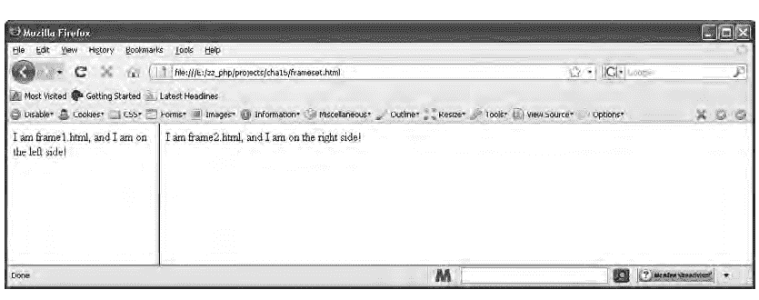

**图 15-2** 由 frameset 创建的每个列中包含一个框架的 frameset

当你在浏览器中打开 `frameset.html` 时，它应该显示包含两个框架的窗口，每个框架包含一个 HTML 文档，如图 15-2 所示。

## 框架选项

正如所示，起始 frameset 标签可以使用 `cols` 属性将窗口分为列。同样，你可以使用 `rows` 属性将页面分为行。以下是一个创建两行 frameset 的示例：

```html
<html>
<frameset rows="20%, 80%">
<frame src="frame1.html"></frame>
<frame src="frame2.html"></frame>
</frameset>
<noframes>
使用下面的链接进入无框架版本的网站。<br />
<a href="noframes.html">无框架站点</a>
</noframes>
</html>
```

> 这次框架是从上到下的，因为使用了 rows 属性

如果 frame1.html 和 frame2.html 显示在图 15-3 中，这种示例可能看起来所示。

## 行或列

如果你愿意，`rows` 或 `cols` 属性中使用的数字可以是像素而不是百分比。此外，如果你想让某个框架在设置了其他框架后占据剩余的所有空间，你可以使用星号（`*`）。例如，看这段代码：

```html
<html>
<frameset rows="150, *">
<frame src="frame1.html"></frame>
```

> 星号告诉第二个框架占据第一个框架未使用的所有剩余空间

# JavaScript：初学者指南

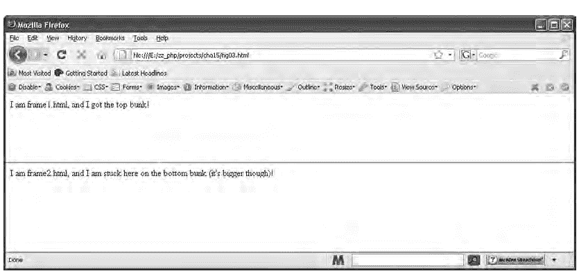

### 15-3 基于行而非列的 frameset

```html
<frame src="frame2.html"></frame>
</frameset>
<noframes>
使用下方的链接访问网站的无框架版本。<br />
<a href="noframes.html">无框架站点</a>
</noframes>
</html>
```

这一次，第一行（顶部）占据 150 像素，而第二行（底部）占据窗口中剩余的全部空间。

#### 多于两行或两列

当然，你并不局限于仅使用两行或两列。你可以根据需要设置任意数量的行或列。例如，如果你想要一个有三列的 frameset，可以使用以下代码：

```html
<html>
<frameset cols="150,*,150">
<frame src="frame1.html"></frame>
<frame src="frame2.html"></frame>
<frame src="frame3.html"></frame>
</frameset>
```

> 星号告诉中间的框架使用其他框架未占据的任何剩余空间

```html
<noframes>
使用下方的链接访问网站的无框架版本。<br />
<a href="noframes.html">无框架站点</a>
</noframes>
</html>
```

左列和右列的宽度均为 150 像素。中间的列占据窗口中所有的剩余空间。

# 嵌套以允许同时行和列

如果你想创建一个包含行和列的更复杂的框架，你必须将一个 frameset 嵌套在另一个内部。例如，你可能希望跨越页面顶部部分的行高度为 100 像素。然后，你可能希望在它下方分两列：左侧到 150 像素，右侧占据剩余区域。

要实现这一点，你需要一个表示行的 frameset（因为该行必须跨越页面的整个顶部）。在底部行内部，你需要另一个带有列的 frameset，将底部行分为两个框架。以下代码展示了如何进行这种嵌套：

```html
<frameset rows="100,*">
  <frame src="frame1.html"></frame>
  <frameset cols="150,*">
    <frame src="frame2.html"></frame>
    <frame src="frame3.html"></frame>
  </frameset>
</frameset>
```

- 主 frameset 开始

- 嵌套在底部行框架中的 frameset 开始

- 嵌套 frameset 结束

```html
<noframes>
使用下方的链接访问网站的无框架版本。<br />
<a href="noframes.html">无框架站点</a>
</noframes>
```

注意，在第二（底部）行的框架处，没有使用另一个 frame 标签，而是使用了一个新的 frameset，将底部行分为两个更多的框架。这些框架以列的形式运行，从左到右排列。

# 提示

确保每个 `<frameset>` 标签都用 `</frameset>` 标签关闭。与表格一样，忘记这些标签可能会导致框架显示不正常或完全不显示。

图 5-4 显示了这种嵌套 frameset 在浏览器中显示的示例（假设所有文档和文件都存在）。

# JavaScript：初学者指南

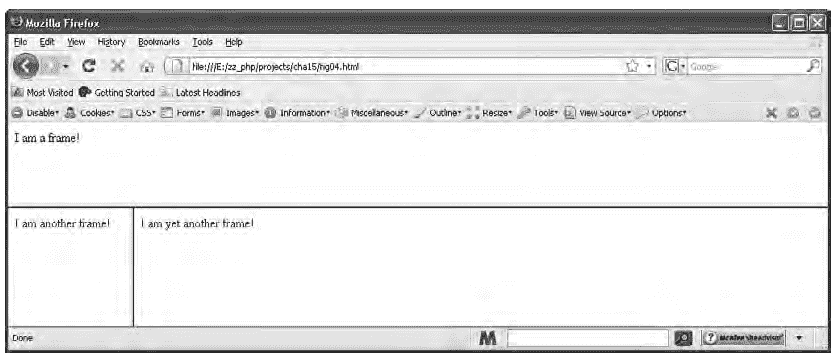

**图 15-4** 嵌套框架集允许在窗口中同时使用行和列

# 访问框架

你在 JavaScript 中访问框架吗？你可以使用 frames 数组，也可以为框架命名并改用框架名称。首先，让我们查看如何使用 frames 数组访问框架。

## frames 数组

你根据框架在源代码中的顺序来访问框架。你将从一个框架内部访问另一个框架，因此你必须能够找到想要访问的框架。

记住，frameset 来自于 window 对象。框架带有大多数与普通窗口相同的属性和方法，但你访问它们的方式不同。例如，看这段代码，它创建了一个包含两个框架的 frameset。将其命名为 frameset.html。（这替换了之前的示例）。

```html
<html>
<frameset cols="60%,40%">
<frame src="frame1.html"></frame>
<frame src="frame2.html"></frame>
</frameset>
<noframes>
  使用下方的链接访问网站的无框架版本。<br />
  <a href="noframes.html">无框架站点</a>
</noframes>
</html>
```

# 第 15 章：JavaScript 与框架 415

如果你在第一个框架 (frame1.html) 编写脚本，并想知道第二个框架 (frame2.html) 中 location 属性的值以便显示给观众，你必须弄清楚如何访问第二个框架。记住，你正在一个 frameset 内部工作。你正在 frameset 中将作为第一个框架内容的文档之一。要访问另一个框架，你需要找到一种获取主窗口并引用框架的方法。回想第 10 章，window 对象的 top 属性允许你访问 frameset 中最顶部的窗口（主窗口）。

你现在可以使用 frames 数组了，因为你可以访问那个包含 frameset 代码的主窗口。frames 数组包含了代码中每个 frame 标签的对应条目。计数从 0 开始，并按照每个 frame 标签在源代码中出现的顺序继续计数。要访问 frameset 中的第一个框架，可以使用此语法：

```
top.frames[0]
```

使用 top 属性允许你访问主窗口和 frameset 代码。然后，`frames[0]` 用于访问源代码中的第一个框架。因此，如果你在第二个框架中编写代码并想访问第一个框架，将使用此语法：

```
top.frames[0]
```

现在，你可以让第二个框架中的代码访问观众所需的信息。以下代码是用于第一个框架 (frame1.html) 的：

```html
<body>
我是框架 1，另一个框架从我这里获取了信息！
</body>
```

要完成此脚本，你为 frame2.html 使用了以下代码：

```html
<body>
第一个框架是： <br />
<script type="text/javascript">
document.write(top.frames[0].location); 
</script>
</body>
```

> 使用 frames 数组访问框架中的信息，并将第二个框架的 location 值打印在页面上

现在你就可以通过打开主窗口 (frameset.html) 查看结果了。右侧框架（frame）应该告诉你用于左侧框架的文档位置。图 15-5 显示了这在浏览器中是如何显示的（该值可能与文件名不同）。frames 数组是访问未命名框架或在需要遍历它们时访问框架的好方法。如果你回想起第 10 章，frames 数组的长度提供了文档中框架的数量。因此，你可以遍历 frames 数组，打印每个框架的 location 以供观众查看。首先，你需要包含 frameset 的文档被使用。

# JavaScript：初学者指南

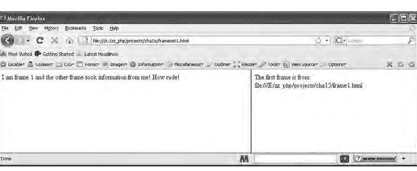

**图 15-5** 使用框架数组访问未命名框架或在需要遍历它们时访问框架

> 15-5 显示来自第一个框架的信息

对于此示例，将此主窗口保存为 frames2.html。文档所示：

```html
<html>
<frameset cols="20%,80%">
<frame src="frame1.html"></frame>
<frame src="frame2.html"></frame>
</frameset>
<noframes>
使用下方的链接访问网站的无框架版本。<br />
<a href="noframes.html">无框架站点</a>
</noframes>
</html>
```

这个 frame1.html 只有一个简短的语句：

```html
<html>
<body>
```

现在，frame2.html 是脚本和结果出现的地方，可以这样编写：

```html
<body>
<script type="text/javascript">
for (var count=0; count<top.frames.length; count+=1) {
var framenumber = count+1;
document.write("Frame "+framenumber+" is "+top.frames[count].location);
}
</script>
</body>
</html>
```

> 循环开始，使用长度知道何时退出

> 使用框架数组在页面上打印结果

# 第 15 章：JavaScript 与框架

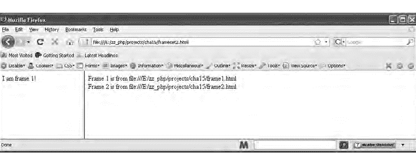

**图 15-6** 在一个框架中打印每个框架的 location

正如你在之前的脚本中看到的，length 属性决定了循环何时结束。frame 变量打印从 1 开始的框架编号，而不是索引号（从 0 开始）。然后在 `document.write()` 语句中使用 frames 数组来打印每个框架的 location 属性值。

图 15-6 显示了该脚本在浏览器中运行的结果（当打开 frames1.html 时）。再次，你的 location 值可能与文件名不同。

# 使用框架名称

从一个框架访问另一个框架另一种方法是使用框架名称（就像你在上一章使用 name 属性一样）。例如，此代码通过向 frame 标签添加 name 属性为每个框架命名（调用 frameset3.html）：

```html
<html>
<frameset cols="50%,50%">
<frame src="frame1.html" name="left_side"></frame>
<frame src="frame2.html" name="right_side"></frame>
</frameset>
<noframes>
使用下方的链接访问网站的无框架版本。<br /> <a href="noframes.html">无框架站点</a>
</noframes>
</html>
```

这个 frame1.html 只有一个简短的语句：

```html
<html>
<body>
```

现在，frame2.html 是脚本和结果出现的地方，可以这样编写：

```html
<body>
<script type="text/javascript">
document.write(top.right_side.location);
</script>
</body>
</html>
```

## 418 JavaScript：初学者指南

同样地，你可以使用此语法从第二个帧内部访问第一个帧：

```
top.left_side
```

现在，你可以通过在每个帧中编写一个简短的 `document.write()` 语句，让每个帧都报告另一个帧的位置。第一个帧（frame1.html）的代码可以这样写：

```html
<body>
  The second (right) frame is from: <br />
  <script type="text/javascript">
    document.write(top.right_side.location);
  </script>
</body>
```

> 右侧帧的名称用于在左侧帧中打印来自它的信息

那么，对应的 `frame2.html` 的代码可以如下：

```html
<body>
  The first (left) frame is from: <br />
  <script type="text/javascript">
    document.write(top.left_side.location);
  </script>
</body>
```

> 左侧帧的名称用于在右侧帧中打印来自它的信息

现在，每个帧都提供了关于另一个帧的信息。

## 更改帧

要从一个帧更改另一个帧的内容，你可以使用 HTML 中的 `target` 属性进行单次更改。然而，通过使用 JavaScript 中的 `location` 属性，你可以一次更改一个帧。以下章节将涵盖这两种可能性。

## 更改单个帧

在 HTML 中，如果你想从另一个帧内部更改一个帧，请在链接标签中使用 `target` 属性，并将其值设为该帧的名称。例如，如果你想从 `frameset` 中的另一个帧更改名为 `right_side` 的帧的内容，你可以创建一个这样的链接：

```html
<a href="nextpage.html" target="right_side">Next Page</a>
```

这将在名为 "right_side" 的帧中打开 `nextpage.html`，而不是在当前帧中打开（这是 `<a>` 标签的默认行为）。

> 提示：
> 请务必确保 `target` 与帧名称完全匹配。如果它不匹配帧名称或预定义的目标，显示的页面将在新的浏览器窗口中打开，而不是你预想的帧或窗口。

## 第 15 章：JavaScript 与帧 419

要使用 JavaScript 执行相同的任务，你可以结合帧名称和 `location` 属性来使其生效，如下语法所示：

```javascript
top.right_side.location="nextpage.html";
```

在这里，`right_side` 是要更改内容的帧名称，而 `nextpage.html` 是取代原始文档的页面。要将此代码编写到链接中，你可以使用前面章节过的 `return false` 技术：

```html
<a href="" onclick="top.right_side.location='nextpage.html'; return false;">New Page</a>
```

另一方面，你也可以使用一种方法，让链接的 `href` 属性指向执行 JavaScript 语句，如下：

```html
<a href="javascript:top.right_side.location='nextpage.html'">New Page</a>
```

注意在冒号后添加了小写的 "javascript" 单词。之后，你就可以像在事件处理程序中使用那样使用 JavaScript 语句。

上述代码中的技术也消除了在代码中添加 `return false` 的必要性。两种方法均可行（除了它们共同的可访问性问题外，在未启用 JavaScript 的情况下链接将无法工作……你可以将其更改链接到文件，并在 JavaScript 可用时使用脚本覆盖它，但如果你没有 JavaScript，就无法让单个链接更改多个帧）。

## 更改多个帧

要一次更改多个帧，你可以使用 JavaScript。获取基础的 `frameset` 并将其保存为 `frames4.html`。代码如下：

```html
<frameset cols="20%,80%">
  <frame src="frame1.html" name="left_side">
  <frame src="frame2.html" name="right_side">
</frameset>
<noframes>
  使用下方的链接进入网站无帧版本。<br>
  <a href="noframes.html">Frameless Site</a>
</noframes>
</html>
```

要更改两个帧的内容，你需要两个额外的 HTML 文件，以便两个帧中的两个文档可以更改为两个新文档。因此，你需要一个类似下面的文档列表：

- frames4.html（主窗口代码）
- frame1.html（最初显示在左侧帧的文档）
- frame2.html（最初显示在右侧帧的文档）
- frame3.html（将出现在左侧帧的新文档）
- frame4.html（将出现在右侧帧的新文档）

## 420 JavaScript：初学者指南

你已经有了 `frameset4.html` 的代码，所以你只需要剩余四个文档的代码。重点位于 `frame1.html` 的示例中，这样你就可以开始。

### 帧 1，动作帧

此帧包含让两个帧都显示新 HTML 文档的链接。要实现此点，你可以使用函数并在链接中调用该函数。这是 `frame1.html` 的代码：

```html
<body>
<script type="text/javascript">
function twoframes() {
  top.right_side.location="frame4.html"; <!-- 当前帧被更改 -->
  self.location="frame3.html"; <!-- 当前帧被更改 -->
}
</script>
<a href="javascript:twoframes();">Change Frames</a>
</body>
```

# 框架导航

JavaScript 还提供了一些实用的框架导航技术。例如，你可以将第 14 章中的选择框导航从一个框架调整到另一个框架。或者，你可以编写代码允许你的观众跳出框架限制。此外，如果观众小心进入了本应该包含在框架集（frameset）中的页面，你还可以编写代码将他们引导到你的框架中。

# 在框架中使用选择框

如果你想让一个框架中的选择框在另一个框架中打开文档，你必须稍微修改选择框的导航。要做到这一点，你需要更改选择框代码中的一部分。

让我们使用文件名 `frameset5.html` 来查看框架的效果。代码如下：

```html
<frameset rows="120,*">
  <frame src="frame1.html" name="t_frame">
  <frame src="frame2.html" name="b_frame">
</frameset>
<noframes>
  使用下方的链接进入无框架版本的网站。<br>
  <a href="noframes.html">无框架站点</a>
</noframes>
```

在这种情况下，框架是从上到下的行排列的。顶端框架（t_frame）占据顶部 120 像素的高度，底部框架（b_frame）占据页面的剩余空间。

在前面的示例中，当观众做出选择时，选择框会发生变化（没有按钮）。选择框被放置在顶端框架中，允许观众更改底部框架中显示的文档。因此，你需要查看 `frame1.html` 中的代码，如下所示：

```html
<body>
  <form onsubmit="return go_there()">
    <label for="s1">更改下方的框架:</label>
    <select id="s1">
      <option selected="selected" value="#">选择目标</option>
      <option value="frame3.html">框架 3</option>
      <option value="frame4.html">框架 4</option>
      <option value="frame2.html">返回框架 2</option>
    </select>
    <input type="submit" id="submit" value="前往!" />
  </form>
  <script type="text/javascript">
  function go_there() {
    s = document.getElementById("s1");
```

# 424 JavaScript：初学者指南

```javascript
top.b_frame.location = s.options[s.selectedIndex].value;
return false;
}
</script>
</body>
```

注意，选择框代码中唯一的区别是 `go_there()` 函数中的第二行。它没有使用 `window.location`（更改底部框架），而是使用了底部框架的名称以便更改位置（`top.b_frame.location`）。

三个可用选项是前往框架 3 (frame3.html)、框架 4 (frame4.html) 或返回最初所在的框架 (frame2.html)。选择其中一个不会将底部框架更改为新页面。

另一个任务向其他框架（`frame2.html`、`frame3.html` 和 `frame4.html`）添加一些代码。然后，你的网站将留在观众窗口的一个较小部分，并带有导航。图 15-9 显示了 `frameset5.html` 在做出选择之前的初始可能外观（取决于你向 `frame2.html` 中添加的选项）。

图 15-10 显示了如果从下拉框中选择框架 3，窗口可能显示的示例（取决于你向 `frame3.html` 中添加的代码）。

# 跳出框架

有时，另一个网站编写的链接在到达你的网站之前不会跳出该网站的框架。这时，你的网站将留在观众窗口的一个较小部分，而另一个网站的导航仍然显示在其他框架中。当这种情况发生时，

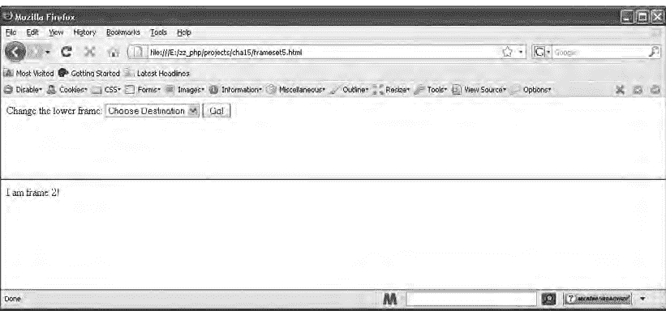

**图 15-9** 框架可能的初始外观

# 第 15 章：JavaScript 框架 425

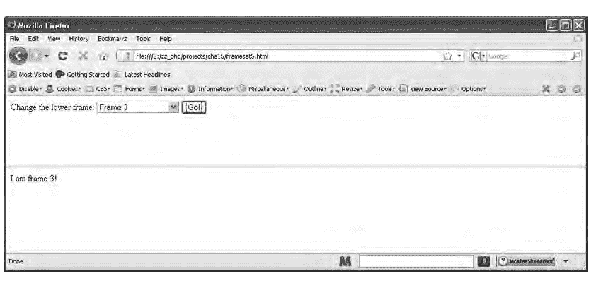

**图 15-10** 选择框架 3 选项后可能的显示

你可能希望为观众提供一种跳出其他网站框架的方法，或者你可能想自动执行。

# 使用可选链接

你可以在页面上放置一个链接，让观众点击以跳出框架。你需要在 `<a>` 标签中放置一个特殊的 target（目标），如下所示：

```html
<a href="http://yoursite.com" target="_top">跳出框架</a>
```

`_top` 目标告诉浏览器在打开链接中的 URL 时使用完整窗口，而不是在框架内部打开链接。你只需要将标签中的 URL 替换为你自己的即可。

### 注意

在锚点（`<a>`）中使用 `_top` 目标会告诉浏览器在打开链接中的 URL 时使用完整窗口，而不是在框架内部打开链接。

如果你在网站上使用框架，并且新观众进入新页面时被卡在框架中。

# 426 JavaScript：初学者指南

# 自动移除框架

要自动移除框架，你必须检查是否在框架内。如果是，你可以将其重定向到主窗口。代码如下：

```html
<head>
  <script type="text/javascript">
  function check_frames() {
    if (top.frames.length > 0) { // 这是一个简单的逻辑
      top.location = "yoursite.com";
    }
  }
  </script>
</head>
<body onload="check_frames()">
  <h1>某些页面</h1>
</body>
```

# 将观众引导框架

当你使用框架时，观众可能会无意中进入框架。在这种情况下，你可以将他们引导到存在框架的页面。代码如下：

```html
<head>
  <script type="text/javascript">
  function check_frames() {
    if (top.frames.length == 0) {
      top.location = "yoursite.com";
    }
  }
  </script>
</head>
<body onload="check_frames()">
  <h1>某些页面</h1>
</body>
```

# 第 15 章：JavaScript 与框架 427

### 专家问答

**Q:为什么我需要嵌套框架来实现行内包含列或列内行？为什么不能直接在 frameset 上使用 rows 和 cols 属性？**

**A:** 你必须嵌套框架，以便浏览器知道如何放置所有内容。如果你只是告诉浏览器你需要行和列，它并不一定知道如何放置。例如，是其中一列包含了行，还是其中一个行包含了所有的列？当框架嵌套时，浏览器就知道了你想让它们出现在哪里。

**Q: “self”到底是什么？**

**A:** 对该概念的简短解释。基本上，它是 "window" 的另一种写法。与其使用 `window.location`，你也可以使用 `self.location`。（你可以对任何 window 属性或方法这样做。）这只是一种有助于让代码更清晰的方法，在处理框架时，某些情况下，使用“self”比使用 "window"更容易判断其含义。

**Q: 为什么我想一次更改多个框架？**

**A:** 有些网站包含大量信息，为了导航目的，一次更改多个框架是有帮助的。此外，如果你有超过两个框架，有时可以更改除一个之外的所有框架，保留孤独的框架用于导航。

**Q: 我不喜欢框架，也不打算使用它们。我真的需要阅读这些关于它们的内容吗？**

**A:** 虽然你可能不会自己使用，但学习框架可以帮助你需要为他人编写代码、调试他人的代码、从其他网站的框架中跳出，或者如果你只是想在浏览时理解一个网站正在做什么。

## 跨框架使用变量

使用框架（frames）的另一个优势是，你可以在另一个框架中使用存储在一个框架中的变量。例如，你可以将表单信息存储在一个框架中，并在该框架加载新文档后在另一个框架中再次使用它。

你将创建的脚本获取用户在表单中输入的信息，并在用户点击发送信息的按钮时，将其存储在另一个框架中。这些信息可以用于用户被引导到的页面。

首先，你需要一个框架集（frameset）。你可以使用一个简单的双框架系统，如下代码所示：

```html
<html>
<frameset cols="150,*">
<frame src="frame1.html" name="left_side"></frame>
<frame src="frame2.html" name="right_side"></frame>
</frameset>
<noframes>
使用下方的链接访问无框架版本。<br> <a href="noframes.html">无框架站点</a>
</noframes>
</html>
```

将此保存为 `frameset6.html`。你应该会有一个宽度为 150 像素的 (left_side) 框架，以及一个占据窗口剩余空间的 (right_side) 框架。

在左侧框架中，你需要一个包含某些变量的文档。这个框架是不会改变的，因此当另一个框架中的内容发生变化时，它可以跟踪变量的值。对于此脚本，你需要一个名为 `thename` 的变量，以及一个用于存储用户在另一个框架的表单中输入信息的变量。这里是 `frame1.html` 的代码。

```html
<head>
<script type="text/javascript">
var thename="";
var thefood=""; // 声明了两个变量用于存储从另一个框架获取的值
</script>
</head>
<body>
这是 frame1.html；它持有了变量值。
你可以在这里放置任何你喜欢的内容。
</body>
```

变量的初始值被赋为空字符串。当用户从另一个框架发送信息时，这些值将会发生变化。

最初在右侧框架中显示的文档包含一个表单，允许用户输入姓名。这个名字被存储在左侧框架的 `name` 变量中。这里是 `frame2.html` 的代码：

```html
<body>
我想获取你的名字。请在下方输入。
<br />
<form onsubmit="return store_info();">
<label for="username">您的姓名:</label>
<input type="text" id="username" size="25" />
<br />
<input type="submit" value="Continue" />
</form>
<script type="text/javascript">
function store_info() {
  var tn = document.getElementById("username").value;
  top.left_side.thename=tn;
  self.frame.src="frame3.html";
  return false;
}
</script>
</body>
```

当用户点击继续按钮时，会调用 `store_info()` 函数。注意使用 `top.left_side` 来访问框架。变量 `name` 通过 `top.left_side.thename` 添加到另一个框架的变量中。表单文本框中输入的值随后被赋值给左侧框架中的变量。之后，框架中的文档被改为 `frame3.html`，它将能够从左侧框架获取信息。

在 `frame3.html` 文档中，用户的名字被写在一个问候语中。它也被填充到新表单的一个字段中，以防止用户重复输入。（这只是为了如何使用存储的值；在这种情况下，你并不真的在表单中再次需要名字。）表单还询问用户最喜欢的食物，用户必须输入。该页面的代码如下：

```html
<body>
<script type="text/javascript">
document.write("Hi,"+top.left_side.thename+"<br />");
</script>
我想获取你最喜欢的食物。请在下方输入：
<br />
<form onsubmit="return more_info();">
<label for="username">您的姓名:</label>
<input type="text" id="username" size="25" />
<br />
<label for="food">最喜欢的食物:</label>
<input type="text" id="food" size="25" />
<br />
<input type="submit" value="Continue" />
</form>
<script type="text/javascript">
var tn = document.getElementById("username");
tn.value = top.left_side.thename;
```

- 左侧框架的值用于编写问候语
- 第一个文本框的值通过左侧框架变量中存储的信息进行设置

```javascript
function more_info() {
    var fd = document.getElementById("food");
    top.left_side.thefood=fd.value;
    self.frame.src="frame4.html";
    return false;
}
```

- 表单中 Food 字段的值存储在左侧框架的变量中
- 框架中的文档发生了改变

```html
</script>
</body>
```

姓名的表单字段在页面加载时从左侧提供。名字也打印在页面的问候语中。在用户填写食物并点击按钮后，该值被存储在左侧框架的 `food` 变量中，框架中的文档被改为 `frame4.html`。

在 `frame4.html` 中，存储在左侧框架中的两个变量的值将用于为用户打印一条特殊消息，如下代码所示：

```html
<body>
<script type="text/javascript">
function print_info() {
    document.write("Thank you, "+top.left_side.thename+"!");
    document.write("<br /><br />");
    document.write("You must really like "+top.left_side.thefood+"!");
}
print_info();
</script>
</body>
```

- 存储在左侧框架变量中的信息将打印给用户
- 信息在页面上给用户的消息中打印。打印的信息标志着此脚本的结束，因为已经没有更多的表单或变量了。（如果你需要，可以添加更多表单和变量。）图 15-11 显示了 `frameset6` 在任何更改之前的样子。


图 15-11 frameset 的初始外观


**图 15-12** 在第一个表单中输入 John 并点击按钮的结果

图 15-12 显示了如果用户在第一个表单中输入 John 作为姓名并点击按钮，页看起来。
图 15-13 显示了如果用户在第二个表单中输入 sandpaper 作为食物并点击按钮，页面看起来的样子。这听起来并不好吃。
请记住，尽管框架在各种语文中很有用，但你不应该过度使用。框架需要实际的屏幕空间，并且不适用于小屏幕设备。如果你想使用它们，只需记住添加 `<noframes>` 标签，并为屏幕较小或分辨率较低的用户提供无框架版本（或者更好的是给所有用户一个不使用框架的选项）。


**图 15-13** 不建议吃砂纸！

## 第 15 章：JavaScript 与框架 433

## 第 15 章自测

- 1. ________ 将一个窗口划分为两个或多个独立的区域，每个区域包含不同的内容。
- 2. 框架（Frames）与表格的不同在于，框架集（frameset）中的划分包含独立的文档。
- 3. 使用 ________ 标签来创建框架集。
- 4. 使用 ________ 标签创建单个框架。
- 5. ________ 属性将框架集划分为列。
- 6. 如果你想拥有一个既包含行又包含列的复杂框架集，可以在 frameset 中嵌套另一个 frameset。
- 7. 访问框架的两种方法是什么？
  - A frames 数组或框架名称
  - B frame 数组或框架名称
  - C frames 数组或特殊代码
  - D 只有一种方法可以实现
- 8. 使用 JavaScript，你可以同时更改多个框架的内容。
  - A 正确
  - B 错误
- 9. frames 数组的 `length` 属性的值是什么？
  - A 根据特定框架的宽度或高度计算长度
  - B 页面上框架集的数量
  - C 窗口中框架的数量
  - D 框架中数组的数量
- 10. 在 frameset 的 `rows` 或 `cols` 属性中使用星号 (*) 是什么意思？
  - A 没有空间再放置另一个框架了。
  - B 框架应该占据窗口中任何剩余空间。
  - C 框架永远结束。
  - D 框架在弹出窗口中显示。

11. 使用什么来访问主窗口以便访问另一个框架？
  - A top
  - B self
  - C window
  - D this

12. 下列哪项可以正确从另一个框架将名为 right_side 的框架中的文档更改为 `frame3.html`？
  - A `self.location="frame3.html"`
  - B `top.right_side.location="frame3.html"`
  - C `self.location="frame3.htm"`
  - D `top.location="frame03.html"`

13. 使用 ________ 作为 `target` 属性告诉浏览器在打开 URL 时使用整个窗口，而不是在框架中打开该 URL。

14. 你可以在另一个框架中使用存储在一个框架中的变量。
  - A 正确
  - B 错误

15. ________ 属性将框架集划分为行。

## 第 16 章

## 高级技术简介

## JavaScript：入门指南

### 核心技能与概念

- 调试脚本
- JavaScript 与可访问性
- 使用 Cookies
- 图像处理
- JavaScript 安全
- AJAX 简介
- JavaScript 库

本章介绍了许多高级技术，一旦你读完这本书，你可能希望进一步研究这些技术。你将学习如何调试麻烦的脚本（这在出现问题时很有帮助）、JavaScript 与可访问性（这有助于用户在禁用 JavaScript 的情况下访问你的信息）、使用 cookies（这允许你为用户存储和检索一小部分信息）、图像处理（这允许你预加载和更改图像）、JavaScript 安全（有助于保护你的用户）、AJAX（增强用户体验）以及 JavaScript 库（可以帮助你避免重复编写代码）。除了书中涵盖的内容外，可以在章节末尾提供的链接中找到这些主题的更多信息。

## 调试脚本

尽管 JavaScript 很有趣，但有时它也可能令人沮丧。代码中的一个错误就会导致整个脚本运行异常或根本不运行。调试脚本是一个耗时且艰辛的过程，但在检查代码时，你可以使用一些技巧来可能节省一些时间。调试脚本的第一步是确定可能是哪种类型的错误导致了问题。

## 错误类型

主要的错误类型是语法错误和逻辑错误。当编码人员忘记添加分号、忘记引号、拼错单词等时，就会发生语法错误。当代码实现错误时发生逻辑错误。

例如，如果执行循环的条件永远不会变为假，循环可能会无限进行。虽然代码的语法可能是正确的，但结果将不会符合程序员的预期。

## 第 16 章：高级技术简介 437

## 查找语法错误

语法错误可能仅仅是漏掉了一个必要的分号。例如，以下代码在语句之间缺少一个分号：

```html
<input type="button" value="Click" onclick="alert(2)" analert2()" />
```

在这种情况下，分号非常重要，因为两个语句（函数调用）在同一行。要修复此，你只需要添加分号，如下所示：

```html
<input type="button" value="Click" onclick="alert(2);alert(2())" />
```

语法错误会导致浏览器显示错误消息，以便你调试脚本。例如，你可能会看到类似图 16-1 中的消息。

这些消息可以帮助你找出问题所在。错误消息中显示的行号通常会告诉你错误所在的位置。例如，如果错误在第 15 行，你将从文档的第 15 行开始查看那里有什么。消息的其余部分将告诉你缺少了什么或者什么被放置得不当。

然而，消息中指出的行并不是实际问题所在的行。它可能在前面的行、隔了几行，或者在其他地方。你需要进行一些搜索来确定问题是从哪里开始的。（接下来的“扫描脚本”部分将更详细地介绍这一点。）

**利用错误消息** 如果你收到错误消息，它要么可以让问题更容易找到，要么可能让你带来更大的头疼。某些消息比其他的要好。首先，转到错误消息中的行。如果文本有任何意义（例如“期待 ':'”），那么查看该消息是否正引导你朝向正确的方向。


**图 16-1** 一个 JavaScript 错误消息

## 438 JavaScript：入门指南

例如，如果它告诉你有它期待一个分号，那么查看该行或其附近的行是否缺少了分号。

如果你在附近没有发现问题，就必须搜索它。如果涉及的行正在调用函数或使用脚本的另一个部分，请查看函数或变量定义的地方。转到函数或变量处查看名称是否与你调用它时使用的相同。如果是，检查所有语法是否正确（如大括号、引号和括号）。例如，查看以下代码：

```html
<body>
<form>
<input type="button" value="Click" onclick="cool();"></input>
</form>
<script type="text/javascript">
function cool() {
window.alert("Cool!");
}
</script>
</body>
```

注意 `window.alert("Cool!");` 缺少了左括号。

当你点击 Click 按钮时，代码将产生一条显示为“Object Expected”（这取决于所使用的浏览器）的错误消息，并指向代码中页面上放置按钮的行（在这种情况下为第 4 行）。如果你查看那一行，似乎没有任何错误。然而，如果你在代码的更后部分（第 8 行）查看在该行调用的函数 `cool()`，你会发现缺少了左大括号。缺少括号就是问题所在，你将修复它。

**扫描脚本** 如果错误消息没有帮助你定位问题，请尝试自己扫描脚本中的错误。这可能很乏味，但如果错误消息没有帮助，它可能会帮到你。表 16-1 显示了你应该寻找的项目。

| 项目 | 表现 |
|---|---|
| 缺少分号 | ; |
| 缺少大括号或中括号 | {}[] |
| 缺少括号 | () |
| 缺少单引号或双引号 | " |
| 拼写错误 | 例如 cool |

**表 16-1** 扫描脚本时要查找的项目

## 第 16 章：高级技术简介 439

以下代码充满了错误；看看你能发现多少个。

```javascript
<script type="text/javascript">
var mycar="Mustang";
function send_alert() {
  window.alert("You like!");
  window.alert("Cool");
}
var somearray= new Array(2)
somearray[0]="Me"
somearray[1]="Me"
for var count=0;count<somearray.length;count+=1 {
  document.write(somearray[0]+"and"+somearray[1]);
}
</script>
```

代码缺少了很多项目。以下是你发现的项目列表：

- 第 3 行和第 4 行之间：函数缺少左括号。
- 第 4 行：`alert` 拼写为 `alery`；单词后缺少双引号；变量 `my` 拼写为 `mynar`。
- 第 5 行：`alert` 方法缺少右括号。
- 第 7 行：`new` 拼写为 `neq`。
- 第 9 行：缺少左括号。
- 第 10 行：循环缺少括号。
- 第 11 行：`somearray[0]` 的索引缺少右中括号。
- 第 11 行和第 12 行之间：结束循环的右括号缺失。

你可能不会犯很多错误，但示例提供了一种在扫描脚本时捕捉它们的方法。

## 查找逻辑错误

逻辑错误通常更难发现代码的语法是正确的。你将试图寻找代码实现方式中的错误。例如，查看以下代码（但不要运行它！）：

```javascript
<script type="text/javascript">
x=1;
y=2;
while (x<=y) {--- 问题：x 永远不会大于 y！
  window.alert("Hi");
}
</script>
```

## 440 JavaScript: 入学者指南

代码没有语法错误。所有的分号和引号都处于正确的位置。这里的问题在于变量 `x` 永远不会大于变量 `y`。这种情况会导致无限循环，可能导致浏览器崩溃。

你可以通过在循环内部添加一行来增加 `x` 的值、减小 `y` 的值，或者同时增加 `x` 并减小 `y`。关键点是必须执行某些操作使条件变为假。以下代码显示了该问题的一种解决方法：

```javascript
<script type="text/javascript">
x=1;
y=2;
while (x<=y) {
  window.alert("Hi");
  x++;
}
</script>
```

在循环中增加 `x` 将让 `x` 随着时间的大于 `y`。

后续章节描述的技术可以帮助你发现逻辑错误。

## 针对变量的 Alert 技术

寻找上一个示例中问题的方法之一是返回并使用 alert 运行它，以便每次循环时测试一个或两个变量的值（假设它没有导致浏览器崩溃）。alert 是发现正在发生情况的极佳方法，它可以让你了解如何修复问题。

例如，以下代码采用了上一个示例（修复之前的），并添加了一个 alert，在每次循环时显示 `x` 和 `y` 的值：

```javascript
<script type="text/javascript">
x=1;
y=2;
while (x<=y) {
  window.alert("x is: "+x+" and y is "+y);
  window.alert("Hi");
}
</script>
```

alert 给你两个变量的值，帮助你发现问题。

只要脚本没有导致浏览器崩溃，就能看到问题所在。每次 alert 弹出时，它显示的内容都是一样的：“x is 1 and y is 2。”因此，你会知道需要在循环中进行调整来修复它。

当你有一个变量在脚本中经过多次重新赋值和计算时，这种技术非常有用。通过使用放置恰当的 alert，你可以发现问题开始的地方。例如，看这段代码：

```javascript
<script type="text/javascript">
var item1=10;
var item2=20;
var total=item1+item2;
charge=5;
total+=charge;
window.alert("The total is $"+total);
</script>
```

这个 alert 并没有显示预期的结果。

## 第 16 章：高级技术介绍 441

### 提问专家

- **问：** 我收到的错误信息有些我不懂。我该怎么办？
- **答：** 错误信息并不总是合理的，也不总是指向代码中正确的行。你可能需要追踪你在错误信息所在行中调用的任何变量或函数，或者检查其附近的行是否有错误。当你看到几次错误信息后，它的含义就会变得容易理解。
- **问：** 我代码中的某些内容在运行时导致了浏览器崩溃，我无法尝试通过添加 alert 来查找问题，因为它每次都崩溃！我该怎么办？
- **答：** 如果脚本导致浏览器崩溃，仔细检查你的变量、循环、对象和函数。作为最后手段，从头开始编写新代码。
- **问：** 我代码中的错误不仅导致了浏览器崩溃，还导致了电脑崩溃！我该怎么办？
- **答：** 重启电脑但不要再次运行代码。仔细检查是否能找到问题。
- **问：** 还有其他策略可以帮助我调试脚本吗？
- **答：** 一些编辑器使用颜色编码来区分 HTML 标签、JavaScript 代码或其他类型的代码。颜色编码有助于你更清晰地查看代码，并更容易检测错误（尝试 Vim 或 NoteTab 文本编辑器）。

变量 `total` 在第四行赋值，然后在第六行通过加上另一个变量进行重新赋值。在所有计算之后带有 `total` 的 alert 给出了 10205 这个奇怪的结果。你发现问题了吗？如果没有，你是否可以在第一次赋值后放置一个 alert，以查看 `item1+item2` 的计算是否正常？

```javascript
<script type="text/javascript">
var item1="10";
var item2=20;
var total=item1+item2;
window.alert(total); // alert 让你看到第一次计算是否在正常工作
charge=5;
total+=charge;
window.alert("The total is $"+total);
</script>
```

## JavaScript: 入学者指南

当你再次运行脚本时，第一个 alert 给的结果是 120。现在问题变得稍微清晰了。由于某种原因，脚本将 `item1` 和 `item2` 当作字符串相加，而不是数字，导致两个数字被合并在一起而不是进行数学相加。

回过 `item1` 的赋值，注意它不小心被赋值为了字符串。移除 `10` 周围的引号修复了脚本，并给了你预期的最终结果 35。

## 硬核方法：追踪一切或做出更改

如果所有捷径都失效，最后的选择是再次逐段运行整个脚本，看看是否能检测到错误。如果没有，看看是否可以找到另一种实现任务的方法。例如，尝试使用不同类型的循环。希望，

## 444 JavaScript：初学者指南

接下来是 `myscript.js` JavaScript 文件：

```javascript
function send_alert() {
  window.alert("Hi, there is a sale! 20% off everything!");
  return false;
}
var s_alert = document.getElementById("sale");
s_alert.onclick = send_alert;
```

现在 HTML 代码中没有散落在 JavaScript，只有在结尾处有一个对服务器的调用。锚点标签的 `id` 为 `sale`，JavaScript 代码可以使用它来捕获该元素上的点击事件。JavaScript 代码现在使用 `document.getElementById` 来获取锚点元素，并为其分配了一个在点击时运行的函数。

最后的一点是，对于那些没有 JavaScript 的用户来说，这个链接没有任何作用。由于 alert 框的内容是你需要访客知道的（这样他们才知道有促销活动），因此你希望确保即使是不使用 JavaScript 的访客也能看到此消息。你可以使用一组 `<noscript></noscript>` 标签在页面上显示此消息，或者像下面的代码那样编写链接，使其指向包含该消息的 HTML 页面：

```html
<body>
<a href="sale_alert.html" id="sale">Hi</a>
<script type="text/javascript" src="myscript.js"></script>
</body>
```

然后，你可以将消息放在 `sale_alert.html` 文件中：

```html
<body>
  Hi, there is a sale today! 20% off everything!
</body>
```

这确保了所有用户无论是否使用 JavaScript 都能访问该消息。

## 增强内容

一种确保广泛访问性的技术已被广泛使用——即先为访客提供内容，然后使用 JavaScript 为能够运行它的用户提供更具吸引力的体验。这通常被称为“**渐进增强**”（progressive enhancement），它允许所有访客使用网站，同时为使用现代浏览器的用户提供更丰富的体验。

这就是你在上一节的脚本中所做的。通过在点击链接时提供“促销”消息，你让所有访客都能访问到它。然而，那些拥有 JavaScript 的用户可以在不离开页面无需返回的情况下查看 alert，这在某种程度上增强了他们的体验。

这个过程可以非常简单，也可以非常复杂，例如添加大量的 JavaScript 代码来适配各种浏览器，或者添加服务器端脚本来帮助没有 JavaScript 的用户。你可以在 http://developer.yahoo.com/yui/articles/gs#progressive-enhancement 更多关于渐进增强的知识。Yahoo! 有一套非常详细且组织的渐进增强系统，允许 JavaScript 代码尽可能与许多浏览器配合，同时也为没有 JavaScript 的用户提供服务器脚本或 HTML 内容。

## 提示

关于 JavaScript 和表单的可访问性信息，请参阅第 14 章，该章节讨论了这一主题以及在 JavaScript 中表单。

## 尝试 16-1 使此代码具有可访问性

为了练习 JavaScript 的可访问性，你将采取 HTML 页面并对其进行处理，尽可能分离 JavaScript 代码和 HTML 代码。你还将使用代码确保在没有 JavaScript 的情况下也能获取任何额外内容。

## 步骤

- 1. 创建一个名为 `pr16_1.html` 的 HTML 文档，并在 body 部分使用以下 HTML 代码：

```html
<body>
  <script type="text/javascript">
  function new_win() {
    window.open('sales.html','newwin','width=300,height=200');
  }
  </script>
  <div>
    <h1>Sales:</h1>
  </div>
  <div>
    <a href="#" onclick="new_win(); return false;">Click for Sales Information</a>
  </div>
</body>
```

- 2. 创建一个名为 `sales.html` 的 HTML 文档，并在 body 部分使用以下 HTML 代码：

```html
<body>
  <h1>Sales:</h1>
  Clothes: 25% off<br />
  Electronics: 10% off<br />
  Appliances: 15% off (with coupon)
</body>
```

（继续）

- 3. 通过必要的调整并将尽可能 JavaScript 代码移动到名为 `prjs16_1.js` 的 JavaScript 文件中，使代码对于没有 JavaScript 的用户变得可访问且可用。

- 4. 作为额外奖励，尝试完全移除窗口，并将使用 JavaScript 的用户将销售信息放在带有“Sales:”文本的 `div` 中。

- 5. 保存 HTML 和 JavaScript 文件，并在浏览器中打开 HTML 文件。在任何你选择的浏览器中，内容都不应是不可访问的。

## 尝试总结

在这个项目中，你利用了可访问性的知识，使文档和脚本对观众更具可访问性。

## 使用 Cookie

Cookie 是存储在终端用户计算机上的小型文本文件。只要访客返回你的网站，且 Cookie 没有被删除或过期，就可以随时引用它。当然，如果访客不接受 cookie，那么就无法设置或引用 cookie。使用 cookie 时请以下几点：

- Cookie 必须是 4KB（4000 个字符）或少。
- 浏览器从单个域最多只能接受 20 个 cookie。
- 如果部分访客不接受 cookie，这将消除你的 cookie 对这些访客的任何优势。

Netscape 发明 cookie 以帮助用户浏览你的网站。

## 设置 Cookie

设置 cookie 就像给文档赋值一样简单。唯一的限制是，你不能在字符串中使用空格、逗号或分号。

例如，你可以设置一个名为 `tasty1` 的 cookie。以下代码设置了 cookie：

```javascript
function set_it() {
  document.cookie="name=tasty1";
}
```

### 注意事项

记住设置 cookie 时，不要在字符串中使用空格、逗号或分号。

前面的代码设置了一个值为 `tasty1` 的 cookie。不过，你可以设置任何你想要的分隔符（或者完全不设置，设置分隔符允许你存储多个值），因此下面的代码同样有效：

```javascript
function set_it() {
  document.cookie="name:tasty1";
}
```

唯一的问题是，你可能在某处需要需要在 cookie 中使用空格、逗号或分号。例如，你可能想添加一些文本告诉人们喜欢哪种类型的 cookie。只要值不需要逗号（如下面的代码所示），添加额外信息并不困难：

```javascript
function set_it() {
  document.cookie="name=tasty1&fav=Sugar";
}
```

如你所见，cookie 的值是以 `name=value` 对格式化的，每对之间用和符号 `&` 隔开。再次，你可以选择任何你喜欢的分隔符。以下代码也很好：

```javascript
function set_it() {
  document.cookie="name:tasty1|fav:Sugar";
}
```

在这种情况下，名称和值由冒号分隔，而管道符号 `|` 将它们分隔成对。你可以使用任何你觉得熟悉的符号。

## escape() 方法

如果你想在 cookie 中使用空格、逗号或分号，你需要一种方法“转义”它们，将它们转换为 cookie 接受的内容。

cookie 会接受像 CGI 程序那样的字符。它们看起来像 `%20`、`%41` 等。要将空格、逗号和分号转换为这些代码，你必须使用 JavaScript 的 `escape()` 方法。它是 `window` 对象下的一个方法，所以正如你在之前的章节中看到的，你可以直接使用 `escape()` 而不是 `window.escape()`。

## 448 JavaScript：初学者指南

以下代码展示了如何使用 `escape()` 方法设置一个包含空格的 cookie：

创建了一个字符串字面量，其中包含了用于 cookie 的信息

```javascript
function set_it() {
var thetext="name=tasty&fav=Chocolate Chip"
var newtext=escape(thetext);
document.cookie=newtext;
}
```

对字符串进行转义，以便在 cookie 中使用

将转义后的字符串值存入 cookie 中

`thetext` 变量被赋值为包含你想要在 cookie 中使用的字符串。新变量被用于存储对 `thetext` 使用 `escape()` 方法的结果。然后，将转义后的文本用作 cookie 的字符串，现在该 cookie 中将包含空格字符的代码（当你需要使用这些数据时，将需要对其进行反转义）。

## 允许用户输入

通过使用 `escape()` 方法，你可以提示查看者输入信息，对其进行转义并用于 cookie。以下代码展示了如何这样做操作以获取查看者最喜欢的 cookie 类型：

查看者能够向此提示框输入信息

```javascript
function set_it() {
var thefav=window.prompt("Enter your favorite type of cookie,");
var thetext="name=tasty&fav="+thefav;
var newtext=escape(thetext);
document.cookie=newtext;
}
```

在提示框中输入的值会被添加到一个字符串中并用于 cookie

对字符串进行转义，以便其在 cookie 中使用

查看者可以帮助决定设置在 cookie 中的信息，你可以将查看者在你的网站上输入的信息供他们下次访问使用。

## 设置过期日期

为 cookie 添加过期日期可以防止它在浏览器关闭后被删除，或者你可以用它来让不再使用的 cookie 过期。要设置过期时间，需要在你的字符串和 cookie 中添加更多内容，如下代码所示：

```javascript
function set_it() {
var thetext="I have a quote"
var expdate="expires=Mon, 30 Mar 2009 13:00:00 UTC";
var newtext=escape(thetext);
newtext+=expdate;
document.cookie=newtext;
}
```

给了一个过期日期

将过期日期添加到文本中

为 cookie 赋予了该过期日期的组合对的值

基本上，你是在添加另一个带有过期时间的键/值对（注意键/值对由分号分隔）。它需要符合这种格式：

expires=date（UTC 格式）

## 第 16 章：高级技术简介

在代码中，通过添加 UTC 格式的日期为 cookie 添加了过期日期。然后，将结果添加到用于设置 cookie 字符串的变量中。如果你想让 cookie 持久较长时间，可以将日期设置在未来。如果你想让一个决定不再使用的 cookie 过期，设置一个过去的日期，cookie 就会过期。

## 读取 cookie

如果你只设置了一个 cookie 并想要读取它，那么读取 cookie 非常简单。要读取 cookie，你只需要从浏览器获取 `document.cookie` 属性的值即可：

```javascript
function read_it() {
  var mycookie=document.cookie;
}
```

然而，前面的代码只会为 `mycookie` 变量提供一个很长且可能混乱的字符串值。它看起来可能像：

```text
name=tasty1&fav=Chocolate%20Chip
```

代码中的 `%20` 是在对 cookie 的输入使用 `escape()` 方法进行转义时产生的。为了修复这个问题，使用 `unescape()` 来获取更可读格式的数据。
因此，以下代码将提供你需要的字符串：

```javascript
function read_it() {
  var mycookie=document.cookie;
  var fixed_cookie=unescape(mycookie);
}
```

接下来，你必须找到一种从 cookie 中提取你需要的方法。假设 cookie 包含了刚才作为示例的字符串（name=tasty1&fav=Chocolate%20Chip），该字符串看起来如下：

```text
name=tasty1&fav=Chocolate Chip
```

注意，文本是以两种不同的方式划分的。和符号 `&` 将字符串划分为键/值对，而等号 `=` 将键/值对划分为键和值。
假设字符串 `fixed_cookie=name=tasty1&fav=Chocolate Chip` 是你通过按 `&` 字符分割字符串来创建一个新数组：

```javascript
function read_it() {
  var mycookie=document.cookie;
  var fixed_cookie= unescape(mycookie);
  var thepairs= fixed_cookie.split("&");
}
```

读取了 cookie 属性的值

对值进行了反转义，使字符串具有可读字符

将 cookie 字符串按 `&` 分割为数组

## 450 JavaScript：初学者指南

前面的代码将字符串分割为两个数组值：

- `thepairs[0]` 的值为 `name=tasty1`
- `thepairs[1]` 的值为 `fav=Chocolate Chip`

你将其中的每一个项都放入一个包含键和值的新数组中。因此，你使用类似下面的代码：

```javascript
function read_it() {
  var mycookie=document.cookie;
  var fixed_cookie=unescape(mycookie);
  var thepairs=fixed_cookie.split("&");
  var pair1=thepairs[0];           // 数组元素的值
  var pair2=thepairs[1];           // 被赋值给变量
  var name1=pair1.split("=");  // 新变量是
  var name2=pair2.split("="); // 按等号分割
}
```

现在你已经使用 `name1[]` 和 `name2[]` 数组获取了所需的所有信息：

- `name1[0]` 的值为 `name`
- `name1[1]` 的值为 `tasty1`
- `name2[0]` 的值为 `fav`
- `name2[1]` 的值为 `Chocolate Chip`

你可以以任何喜欢的方式使用它们，例如将它们放在警告框（alert）中：

```javascript
function read_it() {
  var mycookie=document.cookie;
  var fixed_cookie=unescape(mycookie);
  var thepairs=fixed_cookie.split("&");
  var pair1=thepairs[0];
  var pair2=thepairs[1];
  var name1=pair1.split("=");      // 从 cookie 获取的值
  var name2=pair2.split("=");      // 用于
  window.alert("Cookie's "+name1[0]+" is "+name1[1]);
  window.alert("My favorite type of cookie is "+name2[1]);
}
```

在运行函数中的所有代码之前，你需要确保 `document.cookie` 存在。任何设置为以后过期的 cookie 都可以被读取，但如果没有 cookie 你可能会遇到错误。通过进行检查，你可以确保 cookie 的存在，或者向查看者显示设置 cookie 的函数。为此，请在函数代码周围添加一个 `if/else` 块，如下所示：

```javascript
function read_it() {
  if (document.cookie) {
    var mycookie=document.cookie;
    var fixed_cookie= unescape(mycookie);
    var thepairs= fixed_cookie.split("&");
    var pair1=thepairs[0];
    var pair2=thepairs[1];
    var name1=pair1.split("=");
    var name2=pair2.split("=");
    window.alert("Cookie's "+name1[0]+" is "+name1[1]);
    window.alert("My favorite type of cookie is "+name2[1]);
  } else {
    set_it();
  }
}
```

前面的代码假设 `set_it()` 函数存在并会设置 cookie。它还假设该 cookie 是从该域名设置的且格式正确。如果你计划使用多个 cookie，你将需要额外的测试来确保获取你需要的 cookie。

## 第 16 章：高级技术简介

## 尝试此 16-2 记住名字

在这个项目中，你使用 cookie 在访问者返回页面时记住名字。

```
prj16_2.html
prjs16_2.js
```

## 步骤

- 1. 创建一个新的 HTML 文档，引用名为 `prjs16_2.js` 的外部 JavaScript 文件。将 HTML 文件保存为 `prj16_2.html`。
- 2. 创建外部 JavaScript `set_it()` 并将其保存为 `prjs16_2.js`。后续步骤使用它。
- 3. 创建名为 `read_it()` 的函数设置 cookie。将过期时间设置为未来。允许查看者在提示框中输入名字，然后将其输入存入 cookie。
- 4. 创建名为 `read_it` 的函数来检查 cookie 是否存在，如果是，读取 cookie 并向查看者发送包含该名字的警告，格式如下（将 <name> 替换为 cookie 中的名字）：
   Welcome, <name>!
- 5. 如果 cookie 存在，调用 `read_it()` 函数。如果 cookie 不存在，调用 `set_it()` 函数。
- 6. 保存 JavaScript 文件并在浏览器中打开 HTML 文件。输入你的名字。关闭浏览器并再次打开页面。这一次，你应该得到一个包含你名字的警告，而不是提示框。

## 尝试总结

在这个项目中，你运用了使用 JavaScript 设置和读取 Cookie 的知识。你创建了一个网页，当访问者返回该网页时，能够记住访问者的名字。

## 处理图像

JavaScript 使用图像对象来预加载图像、创建悬停效果（rollover），甚至创建幻灯片或动画。当你想要此类脚本时，图像对象的属性将为你提供帮助。表 16-2 列出并描述了图像对象的属性

`src` 属性在本章中使用得最多，因为它允许更改图像源以创建鼠标悬停效果。

## 预加载

在编写网页时，有时可能需要预加载图像。预加载图像允许它在浏览器 HTML 或 JavaScript 代码调用它之前就处于浏览器缓存中。这样，图像在被调用时就会显示得更快，访问者无需等待图像加载。

预加载的一种技术是在主页面加载一个将在网站其他页面用到的图像。该图像将存在于每个其他页面的浏览器缓存中，并立即加载。例如，你可能希望网站的 Logo 出现在网站的每个页面上。当它在第一个页面加载后，其他页面将立即加载。

| 属性 | 用途 |
| --- | --- |
| name | 存储来自 `name` 属性的图像名称 |
| src | 存储来自 `src` 属性的 URL |
| width | 存储来自 `width` 属性的宽度 |
| height | 存储来自 `height` 属性的高度 |
| border | 存储来自 `border` 属性的边框属性数值 |
| hspace | 存储来自 `hspace` 属性的水平间距数值 |
| vspace | 存储来自 `vspace` 属性的垂直间距数值 |
| lowsrc | 存储来自 `lowsrc` 属性的 URL |
| complete | 表示图像是否已完成加载 |

表 16-2 图像对象的属性

当然，通过 HTML 这样做是有意义的，因为你可能希望 Logo 不仅出现在主页，也出现在所有其他页面。因此，当你编写 `img` 元素时，图像被加载到缓存中。

在某些情况下，你可能希望预加载稍后出现在同一页面上的图像。当在使用悬停效果或其他在页面加载完成后调用图像的脚本时，这种做法非常常见。在这种情况下，你不希望访问者停留在等待新图像加载上，因为这会影响脚本的正常运行。

例如，如果你设置了当访问者鼠标移动到图像上时显示一张新图像，你希望该图像立即显示。如果访问者必须等待几秒钟图像加载，可能会破坏预期的效果。

通过 JavaScript，你可以创建一个图像对象的新实例，并赋予你想要预加载的图像的 `src` URL，如下所示：

```javascript
if (document.images) {
  var pic1 = new Image(120,35);
  pic1.src="image.gif";
  var pic2 = new Image();
  pic2.src="image2.gif";
}
```

回想第 9 章讨论图像时的部分代码。图像对象的第一个实例（pic1）为图像定义了宽度和高度。第二个（pic2）没有定义，但它将从图像的实际宽度和高度获取这些值。

你不需要同时使用两种方法。你可以选择你喜欢的方法并将其应用于所有想要预加载的图像。

带有 `img` 元素的 HTML 页面可能像这样：

```html
<body>
  <script type="text/javascript" src="preload.js"></script>
  <h1>Some Images</h1>
  
  <br />
  
</body>
```

JavaScript 代码可能像这样：

```javascript
if (document.images) {
  var pic1 = new Image(120,35);
  pic1.src="image.gif";
  var pic2 = new Image();
  pic2.src="image2.gif";
}
```

当然，在这种情况下，预加载并没有起到什么作用。为了让预加载技术发挥意义，你需要一个在事件发生时显示新图像的脚本，例如在鼠标悬停脚本中。

## 鼠标悬停效果

*rollovers*（也称为悬停按钮、图像翻转和其他类似名称）可以为你的导航图像增添色彩。当访问者将鼠标移动到链接图像上时，图像会发生。这种变化可以是简单的颜色改变，也可以是完全不同的图像，从而增加访问者对导航系统的兴趣。

最后两句话描述的效果是一个简单的悬停效果，但你也可以通过另一个链接图像或文本链接的鼠标移入（mouseover）事件来更改图像，甚至一次更改多张图像。

## 简单的悬停效果

简单的悬停只是当鼠标移动到初始图像上时将一张图像更改为另一张。首先，你创建两张图像并让第二张图像在某些方面不同。例如，查看这里显示的两张图像。

## 456 JavaScript：初学者指南


**图 16-2** 初始图像

在这里，你最接近看到结果的方法是查看一组变化前后的图像。图 16-2 显示了初始图像，而图 16-3 显示了鼠标移动到图像上时的结果。

## 更改不同的图像

你可能在鼠标移动后决定更改不同的图像。要这样做，设置方法与前面的节相同，但你需要更改当鼠标移动到初始图像上时发生改变的元素。

你可以修改正在使用的代码，让第一张图像保持静态并更改另一张图像。因此，你需要重新加载页面上的第二张图像。以下是每个文件的代码，从 HTML 代码开始：

```html
<body>
<script type="text/javascript" src="preload.js"></script>
<h1>下方的第一个图像会改变图像！将鼠标移动到
<a href="somepage.html"></a>
<br /> <br />

<script type="text/javascript" src="change.js"></script>
</body>
```

这简单地在几个换行符之后添加了新图像（image2.gif）。接下来是 `preload.js` 文件：

```javascript
if (document.images) {
  //预加载在鼠标悬事件时显示的图像
  var pic2_new = new Image();
  pic2_new.src="image2_c.gif";
}
```

这会将图像从 `pic1` 和 `image1`（将不再被更改）变为 `pic2` 和 `image2`（现在将成为被更改的图像）。

## 第 16 章：高级技术介绍

## 457


图 16-3 当鼠标事件发生时出现新图像

最后是 `change.js` 文件：

```javascript
var im1 = document.getElementById("pic1");
var im2 = document.getElementById("pic2");
im1.onmouseover = function() { im2.src = pic2_new.src; };
im1.onmouseout = function() { im2.src = "image2.gif"; };
```

在这里，添加了 `im2` 变量通过其 id（pic2）获取第二张图像。当查看者移动到第一张图像（im1）上时，它会发生更改。现在鼠标可以移动到第一张图像上并更改第二张图像。图 16-14 和 16-5 显示了另一组变化前后的屏幕。


图 16-4 鼠标悬停事件前显示的图像

## 458 JavaScript：初学者指南


下方的图像会改变另一个图像！将鼠标移动到它上方！

故事1

**图 16-5** 鼠标悬停事件后显示的图像

## 更改多个图像

要同时更改多张图像，你需要为你想要更改的每个图像准备一组图像。为了简单起见，我们将仅使用对图像。创建的代码将使用第一张图像的鼠标悬停事件同时更改自身和页面上的第二张图像。此脚本使用的图像是 `image1.gif`、`image1_c.gif`、`image2.gif` 和 `image2_c.gif`。

HTML 代码与之前的示例相同（除标题外）：

```html
<body>
  <script type="text/javascript" src="preload.js"></script>
  <h1>下方的图像会改变自身和另一张图像！</h1>
  <a href="somepage.html"></a>
  <br /><br>
  
  <script type="text/javascript" src="change.js"></script>
</body>
```

接下来是 `preload.js` 的代码：

```javascript
if (document.images) {
  var pic1_start = new Image();
  pic1_start.src = "image1.gif";
  var pic1_new = new Image();
  pic1_new.src = "image1_c.gif";
```

## 第 16 章：高级技术介绍

```javascript
  var pic2_start = new Image();
  pic2_start.src = "image2.gif";
  var pic2_new = new Image();
  pic2_new.src="image2_c.gif";
}
```

主要的区别在于，你现在预加载了这两组图像，这在脚本增长时有助于组织工作，并允许你稍后使用 `src` 属性（起始图像）。最后是 `change.js` 中的更改：

```javascript
var im1 = document.getElementById("pic1");
var im2 = document.getElementById("pic2");
im1.onmouseover = function() {
  im1.src = pic1_new.src;
  im2.src = pic2_new.src;
};
im1.onmouseout = function() {
  im1.src = pic1_start.src;
  im2.src = pic2_start.src;
};
```


这添加了第二组图像，并在鼠标悬停事件后的鼠标移出事件上将两者改回。注意，你可以使用`pic1_start.src`和`pic2_start.src`，因为起始图像在`preload`中也被赋值为对象。当运行代码时，你将看到类似于图16-6和16-7所示的前变化前后屏幕。


下方的图像会改变自身和另一张图像！

**故事**

**图16-6** 鼠标悬停事件前的图像

## JavaScript安全

你可能注意到，如果你在浏览器上使用`window.close()`方法，会出现一个确认框询问你是否真的想关闭。这种情况是JavaScript安全问题之一。浏览器不希望在没有查看者许可的情况下关闭，这可能会是一个问题。安全的另一个方面是错误地认为你可以用密码“保护”Web页面，或者防止用户查看页面的源代码。安全的另一个方面是防范跨站脚本攻击，即使用JavaScript从未妥善过滤输入的服务端应用程序中获取信息。

### 安全与脚本

要查看浏览器窗口或在JavaScript中使用某些属性或方法，你必须使用脚本。脚本将打开某些功能，但你必须做一些工作。基本上，你使用特殊工具对脚本进行数字签名。查看者在进入页面时会收到消息，询问是否允许该脚本。如果查看者接受，你就可以使用这些功能。如果不是，你需要避免JavaScript错误。关于此主题的更多信息，请访问网站`www.mozilla.org/security/components/scripts.html`。

### 页面保护

许多脚本试图以某种方式将查看者排除，例如使用密码保护或使用“禁用右键”脚本来防止查看页面的源代码。然而，这些安全策略在很大程度上是无效的，因为“密码”和“禁用右键”脚本通常可以通过关闭JavaScript或一些额外操作来绕过。

### 密码

某些密码系统比其他的更好，但似乎没有哪个真正能提供真正的Web页面安全。如果你不想让人查看页面，存在比使用JavaScript系统更好的方法，例如使用服务端语言或在你的Web服务器上使用某些设置。

如果你在使用免费的Web托管服务，可能无法使用更好的方法。但是，请记住，JavaScript密码系统并不是万无一失的，你不应该用它来保护任何内容。

### 隐藏网页源代码

许多人想以某种方式隐藏页面源代码。然而，JavaScript并做不到。许多脚本尝试各种手段禁用右键。基本上，这些策略不起作用，因为它们可以通过几种方式绕过：

- 如果禁用了右键，你始终可以选择“查看 | 源代码”。
- 如果上述方法无效，你始终可以关闭JavaScript或查看你的缓存。浏览器必须显示页面，因此其副本会进入浏览缓存。

从长远来看，这些脚本只是让查看源代码变得困难（而且它们很烦人）。关于此主题的更多信息，请访问`http://webhome.idirect.com/~bowers/copy/1.html`。

### 跨站脚本

跨站脚本（通常缩写XSS）使用JavaScript代码（或其他类型的代码）以恶意方式从存在漏洞的各种Web站点获取信息。有了这些信息，某人可以使用用户的cookie或会话信息，并像获取这些信息的用户一样访问Web站点。这无疑可能会导致大麻烦，特别是当你是该应用程序的管理员，或者该应用程序涉及资金时。

虽然JavaScript是执行此类攻击的方法之一，但脆弱的应用程序通常是服务端并在页面上显示输入的。如果服务端应用程序没有对用户输入进行妥善清理（验证），则可能会输入任何可能的恶意脚本代替预期的输入。

例如，你可能有一个使用服务端脚本允许人们发送评论的表单。脚本会将用户提交的内容显示给你作为确认。如果输入没有经过清理，则可能在评论字段中输入类似的内容：`<script>alert("你被整蛊了!");</script>`。如果有人提交了这些内容并在响应页面上看到弹窗，此人就会知道存在潜在的漏洞，并引导后续用户访问恶意URL，从而获取该用户的cookie或会话信息。图16-8显示了脆弱应用程序将如何显示此类警告（这还包括了一些评论文本，以掩盖提交表单者的意图）。


**图16-8** 噢不！这对该网站的用户来说可糟糕了！

跨站脚本（Cross-site scripting）多年一直在演变。最初，一个恶意网站可以在框架（或弹出浏览器窗口）中加载一个良网站，然后使用JavaScript访问文本框、cookie或其他数据（用户ID和密码），这就是所谓的“跨站”。需要注意的是，现代浏览器在过去的四五几年里已经不再允许这种类型的跨站脚本攻击。一个域名无法访问另一个域的内容。大多数现代跨站脚本攻击都是注入攻击，例如本例所示（尽管通常更复杂）。

这种注入仅仅是此类安全问题的一角。要记住的一点是，当你使用服务器端应用程序时，必须对任何用户输入进行清理，以确保你收到的是预期的输入类型。关于此主题的更多信息，请访问`http://www.owasp.org/index.php/Cross_site_scripting`。

## AJAX

AJAX代表异步JavaScript和XML（Asynchronous JavaScript and XML），它是JavaScript无需重新加载页面即可从XML文件获取信息的方法。例如，对Web服务器的同步请求需要重新加载页面以获取新信息。异步请求允许在无需等待页面加载的情况下获取并使用信息。

这种脚本在渐进式增强中非常有用，因为它允许应用程序为那些在现代浏览器中启用JavaScript的用户增强体验。无需等待页面再次加载，就可以实时获取并使用信息。

在JavaScript中，会创建一个`XMLHttpRequest`对象，然后可以使用它在后台向服务器发送HTTP请求，允许用户在不受中断的情况下继续使用应用程序。对该主题的深入介绍超出了初学者指南的范围；然而，可以在以下网站找到有关AJAX以及如何在应用程序中使用它的信息：

- `https://developer.mozilla.org/en/AJAX`
- `www.w3schools.com/Ajax/Default.Asp`

## JavaScript库

有很多JavaScript库可以帮助你编写更高级的脚本，比从头编写所有代码要省力得多。这里列出了其中一些，供你进一步研究：

- jQuery `http://jquery.com`
- Prototype `www.prototypejs.org`
- Yahoo! YUI `http://developer.yahoo.com/yui`

## 问专家

**Q：** 我可以在哪里找到免费的网页复制粘贴JavaScript代码？

**A：** `http://javascript.internet.com`

`http://developer.earthweb.com/webjs`

`www.javascriptcity.com`

**Q：** 我可以在哪里学习更多关于JavaScript？

**A：** `https://developer.mozilla.org/en/JavaScript`

`www.javascriptkit.com`

`www.quirksmode.org/js/contents.html`

`www.pagerource.com/javascript`

**Q：** 我可以在哪里学习更多关于层叠样式表（CSS）？

**A：** `www.w3schools.com/Css/default.asp`

`www.csszengarden.com`

**Q：** 我可以在哪里学习更多关于DHTML？

**A：** `http://webreference.com/dhtml`

`www.dynamicdrive.com`

## 第16章自测

1. 下列哪行不会产生JavaScript语法错误？
   A. `var myvar=cool;`
   B. `function l(cool)`
   C. `document.write("Is there an error?");`
   D. `window.alert("what is this?");`
2. 下列哪行不会产生JavaScript语法错误？
   A. `var else=3;`
   B. `window.alert("Cool!");`
   C. `document.write('Cool!');`
3. 错误通常难以发现，因为代码的语法是正确的。
4. 脚本可能允许某人从应用程序的用户获取信息。
5. 增强为所有观众提供内容，并为现代浏览器中启用JavaScript的用户增强内容。
6. 尽可能从HTML文件中移除大量JavaScript代码并将其移动到外部文件中是一个好主意。
   A. 正确
   B. 错误
7. 代表异步JavaScript和XML。
8. JavaScript可能通过使代码更容易编写来让一些高级编码任务变得简单。
9. JavaScript应该用于重要信息的密码保护。
   A. 正确
   B. 错误
10. A是存储在终端用户计算机上的小文本文件。
11. 使用哪个属性来设置和读取cookie？
    A. `window`对象的`cookie`属性
    B. `document`对象的`cookie`属性
    C. `document`对象的`cook`属性
    D. `document`对象的`set_or_read_cookie`属性
12. `image`对象的哪个属性设置图像实例的源？
    A. `width`
    B. `height`
    C. `img_width`
    D. `src`
13. 在哪种类型的脚本中，你想在页面上预加载图像？
    A. 状态栏文本变化
    B. 悬停效果
    C. 动画文本
    D. 禁用右键
14. 使用JavaScript隐藏页面源代码有效吗？
    A. 当然可以！
    B. 为什么不？
    C. 不，但它可以让阅读变得困难或令人恼火。
    D. 每次都有效！
15. JavaScript有趣吗？
    A. 有！
    B. 不！
    C. 我被老板强迫学习这个，所以永远不会！
    D. 你的定义是什么？

## 附录：自测答案

### 第1章：JavaScript简介

1. A. C. HTML
2. A. 浏览器
3. C. JavaScript
4. B. 错误
5. D. lenient
6. A. 正确
7. C. LiveScript
8. A. 对象
9. B. client
10. B. 它可以在发送到服务器之前对信息进行验证。
11. C.
12. A. 正确
13. D. 浏览器
14. D. 它被添加到HTML文档中。
15. A. `<script>`和`</script>`标签

### 第2章：在HTML文件中放置JavaScript

1. D. 以上都是
2. B. 为了确保浏览器不会将你的JavaScript解释为另一种语言，并确保页面在XHTML中验证
3. A. 是
4. `noscript`标签为没有JavaScript的用户提供内容。
5. A. `.js`
6. B. `<script type="javascript" src="yourfile.js"></script>`
7. 在旧版本的HTML中，`script`标签不区分大小写。然而，在XHTML中，`script`标签必须小写。
8. D. 分号
9. A. `document.write()`
10. C. 当脚本非常长或需要放置于多个文档时
11. JavaScript注释对于调试你的代码非常有用。
12. C. `//`
13. A. `/*`
14. D. `*/`
15. A. close

### 第3章：使用变量

1. 变量代表或持有一个值。
2. 它们可以节省你编写和更新脚本的时间，并能让你的代码目的更清晰。
3. 要声明一个变量，你使用`var`关键字。
4. D. `=`
5. C. `varpagenumber240;`
6. B. 错误
7. 变量名必须以字母或下划线开头。
8. A. 正确
9. B. `var my_house;`
10. 在JavaScript中，变量值或类型可以包括数字、字符串、布尔值和`null`。
11. 在JavaScript中表示指数，你需要在基数数字之后、指数之前使用一个字母。
12. C. `var mytext="Here is some text!";`
13. D. `document.write("John said,!");`
14. 特殊字符允许你向字符串中添加原本无法添加的内容。
15. B. `document.write("I like to " +hobby+ every weekend`

### 第4章：使用函数

1. 一般来说，函数是较大脚本中的一个小脚本，用于执行单个任务或一系列任务。
2. 它们提供了将脚本的不同部分组织成必须完成的任务的方法，并且可以重复使用。
3. 在函数的第一行中，将其声明为函数，命名，并指示它是否接受任何参数。
4. C. `function`
5. A. 大括号`{}`
6. A. 正确
7. B. 错误
8. C. `function get_text()`
9. 参数允许函数从函数外部导入一个或多个值。
10. B. 括号`()`
11. D. 逗号
12. D. `window.alert("This is text");`
13. B. `some_alert("some", "words");`
14. A. `var shopping=get_something();`
15. A. 局部变量只能在定义的函数内部使用

### 第5章：JavaScript运算符

1. 运算符是JavaScript中的符号或单词，对一个或多个值执行某些计算、比较或赋值。
2. 数学运算符最用于对两个值进行数学计算。
3. 加法运算符将两个值相加。
4. 当增加运算符放在操作数之前时，它会将操作数的值加1，然后执行语句的其余部分。
5. D. `#$`
6. A. 给变量分配新值
7. 加赋值（`+=`）运算符将运算符右侧的值加到左侧变量上，然后将变量赋值为该新值。
8. C. 比较两个值或语句，并返回真或假值
9. A. `4!=`
10. D. `4<=`
11. 逻辑运算符允许你比较两个条件语句，以查看其中一个或两个语句是否为真，并据此进行相应的操作。
12. B. `!(17>=20)`
13. B. `(4<=4)&&(5<=2)`
14. 位运算符是在位级别上运行的逻辑运算符。
15. 在JavaScript中，操作符具有特定的优先级。

### 第6章：条件语句与循环

1. 条件语句是一种你可以根据条件执行一段代码的语句，或者在条件不满足时执行其他操作的语句。
2. 你可以把条件语句想象为类似于因果关系。
3. A. 真（True）
4. B. `if (y<7)`
5. C. 大括号
6. `switch`语句允许你获取单个变量的值，并根据该变量的值执行不同的代码行。
7. 循环允许你重复执行某部分代码多次。
8. B. 假（False）
9. A. `for (x=1;x<6;x+=1)`
10. `while`循环检查一个比较，并重复执行直到比较不再为真。
11. B. `while (x=7)`
12. A. 真（True）
13. B. 假（False）
14. B. 假（False）
15. D. 随你意愿的次数

### 第7章：事件处理器

1. A. 真（True）
2. 事件处理器非常有用，因为它们能允许你访问页面上可能发生的事件。
3. 要使用事件处理器，你需要知道事件处理器的关键字，以及在HTML代码中放置事件处理器的位置。
4. C. `<input type="button" onclick="window.alert('Hey there!');">`
5. `load`事件发生在Web页面加载完成时。
6. D. 查看者将鼠标指针移动到页面上的某个元素上。
7. B. 假（False）
8. `unload`事件发生在查看者离开当前Web页面时。
9. `blur`事件是`focus`（聚焦）事件的对面。
10. A. `<input type="text" autofocus="major_alert();">`
11. `change`事件发生在查看者更改表单内的某些内容时。
12. `submit`事件发生在查看者提交Web页面上的表单时。
13. A. 真（True）
14. C. `onmousedown`
15. `addEventListener`方法和`attachEvent`方法是注册事件的两种新方式。

### 第8章：对象

1. 对象是模拟真实事物的一种方式，尽管该对象是一个抽象实体。
2. 当你思考一个对象时，你可能想要可视化某个通用的东西。
3. 对象非常有用，因为它们为你提供了在脚本中组织内容的另一种方式。
4. B. 点运算符
5. 对象的命名规则与变量和函数的命名规则相似。
6. 你可以使用构造器函数或对象初始化器来创建JavaScript对象。
7. A. 真（True）
8. B. 假（False）
9. 假设`myhouse`对象存在，它将`myhouse`对象的`kitchen`属性值赋值给变量`x`。
10. D. `this.cost=get_cost;`
11. B. `window.alert("You are using "+navigator.appName);`
12. C. 假设`myhouse`对象存在，`kitchen`属性被赋值了一个新的字符串值。
13. 在JavaScript中，有许多预定义的对象，可以使用它们访问可能需要的某些属性和方法。
14. `navigator`对象允许你访问查看者浏览器的各种属性。
15. C. `appType`

### 第9章：文档对象

1. `document`对象是浏览器为每个新查看的HTML页面创建的对象。
2. `document`对象的`referrer`属性返回引导查看者到达当前文档的文档URL。
3. A. 真（True）
4. D. `getElementById()`
5. B. 假（False）（它是作为最后一个子节点添加的，而不是第一个）
6. `www.pageresource.com`
7. `document`对象的`anchors`属性是一个数组，包含了页面上所有的锚点（`<a>`）标签。
8. `innerHTML` DOM节点属性允许你更改元素节点的HTML内容。
9. `lastModified`属性持有当前文档最后修改的时间值。
10. A. 真（True）
11. A. 真（True）
12. A. 真（True）
13. C. 真（True）
14. `lastModified`属性持有当前文档最后修改的时间值。
15. B. `appType`

### 第10章：Window对象

1. `window`对象是浏览器为每个新查看的HTML页面创建的对象。
2. `window`对象包含许多有用的属性和方法。
3. `window`对象的`alert()`方法显示一个带有消息的对话框。
4. `window`对象的`confirm()`方法显示一个带有确定和取消按钮的对话框。
5. `window`对象的`prompt()`方法显示一个对话框，提示用户输入。
6. `window`对象的`open()`方法打开一个新的浏览器窗口。
7. `window`对象的`close()`方法关闭当前窗口。
8. `window`对象的`print()`方法打印当前窗口的内容。
9. `window`对象的`scrollBy()`方法将窗口滚动指定的偏移量。
10. `window`对象的`scrollTo()`方法将窗口滚动到指定的坐标。
11. `window`对象的`setInterval()`方法以指定的间隔重复执行代码。
12. `window`对象的`setTimeout()`方法在指定的延迟后执行代码。
13. `window`对象的`clearInterval()`方法取消由`setInterval()`设置的重复执行。
14. `window`对象的`clearTimeout()`方法取消由`setTimeout()`设置的延迟执行。
15. `window`对象的`innerHeight`和`innerWidth`属性返回窗口内容区域的高度和宽度。

### 第11章：数组

1. 数组是存储相同类型数据的一种方式。
2. 数组允许你使用索引数字访问数组元素。
3. 你通过给变量赋值字符串字面量来创建字符串。
4. C.
5. C. `length`
6. `length`属性返回字符串的长度。
7. B. `var text="Look at me!";`
8. B. `charAt()`
9. `big()`方法在字符串值周围添加`<big>`和`</big>`标签。
10. `concat()`方法合并两个或多个字符串并返回新字符串。
11. D.
12. A.
13. 数组的`join()`方法将数组的所有元素连接成一个字符串。
14. B.
15. 数组的`sort()`方法对数组的元素进行排序。

### 第12章：Math、Number和Date对象

1. `Math`对象提供了各种数学函数。
2. `E`属性持有欧拉常数。
3. `LN`属性持有自然对数。
4. B. 假（False）
5. `document.write(Math.PI);`
6. `SQRT`属性持有平方根。
7. C.
8. `asin()`方法返回数字的反正弦值。
9. `pow()`方法返回第一个参数的第二个参数的幂。
10. C. `Math.floor(Math.random());`
11. `sqrt()`方法返回数字的平方根。
12. D.
13. `Number`对象提供了处理数字的属性和方法。
14. `Date`对象提供了处理日期和时间的方法。
15. B.

### 第13章：处理字符串

1. `String`对象提供了获取或修改字符串的属性和方法。
2. A. 创建字符串实例和创建字符串字面量。
3. 你通过给变量赋值字符串字面量来创建字符串。
4. C.
5. C. `length`
6. `length`属性返回字符串的长度。
7. B. `var text="Look at me!";`
8. B. `charAt()`
9. `big()`方法在字符串值周围添加`<big>`和`</big>`标签。
10. `concat()`方法合并两个或多个字符串并返回新字符串。
11. D.
12. A.
13. `indexOf()`方法返回指定值在字符串中首次出现的位置。
14. 要替换字符串中的信息，你可以使用正则表达式和`String`对象的`replace()`方法。
15. `match()`方法比较正则表达式和字符串以查看它们是否匹配。

### 第14章：JavaScript和表单

1. 每当你向HTML文档添加一组`<form>`和`</form>`标签，就会创建一个表单对象。
2. `forms`数组允许你使用索引数字访问表单。
3. B. `document.forms[3]`
4. A. `document.forms[2].length`
5. C. `document.forms.length`
6. 使用表单名称或`id`允许你命名以后想要访问的表单。
7. A. `document.f1.el1.value`
8. `action`属性允许你访问起始表单标签中`action="url"`属性的值。
9. `elements`属性是一个数组，允许你访问特定表单中的每个元素。
10. `options`属性是一个数组，包含了表单中选择框中列出的每个选项的元素。
11. `reset()`方法允许你使用你的脚本重置表单。
12. B. 对或错
13. 当查看者点击表单上的提交按钮时，会发生提交事件，并通过`onsubmit`事件处理器进行捕获。
14. `submit()`方法允许你在无需查看者点击提交按钮的情况下提交表单。
15. D. `selectedIndex`属性

### 第15章：JavaScript与框架（Frames）

1. 框架将窗口划分为两个或多个区域，每个区域包含不同的内容。
2. 框架与表格的不同在于，因为`frameset`中的划分包含独立的HTML文档。
3. 使用`<frameset></frameset>`标签来创建框架集。
4. 使用`<frame></frame>`标签创建单个框架。
5. `cols`属性将`frameset`分为列。
6. 如果你有一个既包含行又包含列的复杂的`frameset`，可以在一个`frameset`内部嵌套另一个。
7. A. `frames`数组或框架名称
8. A. 对
9. C. 窗口中框架的数量
10. B. 框架应该占据窗口中任何剩余空间。
11. A. `top`
12. B. `top.right_side.location="frame3.html";`
13. 使用`target top`告诉浏览器在打开URL时显示完整窗口，而不是在框架中打开URL。
14. A. 对
15. `rows`属性将`frameset`分为行。

### 第16章：高级技术简介

1. C. `document.write("Is there an error?");`
2. B. `window.alert("Cool!");`
3. **逻辑**错误通常难以发现，因为代码的语法是正确的。
4. **跨站**脚本可能允许某人从应用程序的用户获取信息。
5. **渐进式**增强为所有查看者提供内容，但为现代浏览器中使用JavaScript的用户提供增强。
6. A. 对
7. **AJAX**代表异步JavaScript和XML。
8. JavaScript**库**可以通过简化编写的代码来使某些高级编码任务变得更容易。
9. B. 错
10. **cookie**是存储在终端用户计算机上的小型文本文件。
11. B. `document`对象的`cookie`属性
12. D. `src`
13. B. 鼠标悬停效果（Rollover effect）
14. C. 不，但它可以让阅读变得更加困难或恼人。
15. 任何答案都是正确的！

## 索引

### A

- 终止事件（`onabort`），155
- 可访问性（accessibility），442–445
- `action`属性，382–383
- 加并赋值运算符（`+=`），98
- `addEventListener()`方法，172
- 加法运算符（`+`），47，49–50，90–92
- AJAX，462–463
- `alert()`方法，249–251
- 创建，68–69
- 寻找问题变量，440–442
- 使用函数进行`alert`，69–70
- `alinkColor`属性，210
- `all`属性，218
- 允许字符
  - 在函数中，63
  - 在变量中，38–39
- `anchor()`方法，347–348
- `anchors`属性，210–211
- 与逻辑运算符（`&&`），107
- 匿名函数，78
- `appCode`属性，195–196
- `appName`属性，196
- `appVersion`属性，196–197
- 参数（arguments），19
- `body`部分，22，68–70
- 布尔型变量，46
- `break`语句，141
- 浏览器，6–7
- 数组
  - 访问数组元素，276–277
  - 关联数组，298–300
  - `concat()`方法，283–284
  - 构造函数属性，279–280
  - 创建数组，292–293
  - 定义，274–275
  - 定义，276–279
  - 扩展方法属性，280
  - `join()`方法，284–285
  - `length`属性，280–281
  - 方法，282–291
  - 遍历数组，293–297
  - 命名，275
  - 属性，279–282
  - 原型方法，281–282
  - `push()`方法，287–288
  - `reverse()`方法，287–290
  - `shift()`方法，287–288
  - `slice()`方法，288–289
  - `sort()`方法，288–290
  - `splice()`方法，289–290
  - `toString()`方法，291
  - `unshift()`方法，288
  - 循环使用，292–297
- 赋值运算符（`=`），36，88，97
- 关联数组，298–299
  - 访问，299–300
- 旧版浏览器和标签，19
- 按钮链接，169–171
  - 点击，399–403

### B

- `back()`方法，200
- 反斜杠（`\`），42–43，47
- `bgColor`属性，210
- 位运算运算符，89，108
- 块，120–123
- `blur()`方法，389
- `blur`事件（`onblur`），155–156

### C

- 级联样式表（Cascading Style Sheets）。见CSS
- 区分大小写，17
  - 函数，63
  - 字符串变量，42
- CDATA区域，118
- `ceil()`方法，314–315
- `charAt()`方法，351–352
- `charCode()`方法，352
- `checked`属性，384–386
- 类，定义，266–267
- `setInterval()`方法，267–268
- `timeout()`方法，267–268
- `click()`方法，389–390
- 客户端语言，9
- 计时器，创建一个计时器，336–338
- `clock()`方法，225–227，261–262
- `closed`属性，243–244
- 颜色属性，210
- 页面，52–53
- 注释，27
  - 单行注释，28
  - 多行注释，28–29
- 比较运算符，88，101
  - 等于运算符（`==`），102–103
  - 大于运算符（`>`），103–104
  - 大于或等于运算符（`>=`），104–105
  - 小于运算符（`<`），104
  - 小于或等于运算符（`<=`），105
  - 不等于运算符（`!=`），103
  - 严格等于运算符（`===`），105–106
  - 严格不等于运算符（`!==`），106
- 复杂数组，123–125
- `concat()`方法，283–284，353
- 条件语句
  - 定义，116–117
  - `if/else`语句，117–125
  - `switch`语句，125–126
  - 为什么条件语句有用，117，128
- `confirm()`方法，251–252
- 构造函数函数，178–184
- 构造函数属性，279–280，322，347
- 内容
  - 创建方法，228–233
  - 定义，206
  - `dir`属性，211–212
- DOM节点方法，230–233
- DOM节点属性，228–230
- `domain`属性，212–213
- `form`属性，213–215
- `forms`属性，215
- `getElementById()`方法，224
- `getByClassName()`方法，224
- `getElementsByTagName()`方法，225
- `images`属性，215–217
- `lastModified`属性，217，218
- `layers`属性，217–218
- `links`属性，219
- 方法，222–233
- 增强，444
- 与显示分离，442–444
- `continue`语句，141
- `cookie`属性，210–211
- `cookieEnabled`属性，197
- cookies，446
  - 读取，449–451
  - 设置，446–449
- 创建方法，228–233
- 跨站脚本，461–462
- CSS
  - 学习所需的先知识，3
  - 在JavaScript中设置样式，234–235
- 大括号`{}`，62–63
- `open()`和`close()`方法，225–227
- 属性，207–222
- `referrer`属性，219，221
- `title`属性，220
- `URL`属性，220
- `write()`方法，227
- `writeln()`方法，227–228
- Document对象模型，206–207
- DOM。见Document Object Model
- DOM节点方法，230–233
- DOM节点属性，228–230
- `domain`属性，212–213
- 点（`.`），22

### D

- `Date`对象，326
  - 方法，327–329，333–334
  - 获取值方法，329–332
  - 设置值方法，332–333
  - 属性，326–327
- 日期脚本，334–338
- 调试脚本，456–462
- 递减运算符（`--`），95–96
- `defaultChecked`属性，386
- `defaultStatus`属性，244
- `default`属性，386–387
- `dir`属性，211–212
- 除以并赋值运算符（`/=`），99
- 除以零，93
- 除法运算符（`/`），93–94
- `do while`循环，139–140
- `document`对象
  - `all`属性，218
  - `anchors`属性，210，211
  - 颜色属性，210
  - `cookie`属性，210–211
- 动态脚本
  - 编码，235–236
  - `innerHTML`属性，236–237
  - 样式，234–235

### E

- `escape()`方法，447–448
- 字符转义，44–46
- 事件处理程序，18，152，154，171–172
  - `addEventListener()`方法，172
  - 添加`id`属性，151
  - `attachEvent()`方法，172–173
  - 按钮链接，169–171
  - 使用其创建脚本，167–171
  - 定义，148
  - 文本框，167–169
  - 在HTML元素中使用，149–153
  - 在脚本代码中使用，151–153
  - 为什么事件处理程序很有用，148
- 事件，154–155，166–167
  - 中止事件（`onabort`），155
  - 失去焦点事件（`onblur`），155–156
  - 改变事件（`onChange`），156–157
  - 点击事件（`onclick`），157
  - 获得焦点事件（`onfocus`），158–159
  - 键按下事件（`keydown`），159
  - 键按下事件（`onkeypress`），160
  - 键释放事件（`onkeyup`），160
  - 加载事件（`onload`），160–161
  - 鼠标按下事件（`onmousedown`），161
  - 鼠标移动事件（`onmousemove`），161
  - 鼠标悬停事件（`onmouseover`），162–163
  - 鼠标释放事件（`onmouseup`），164
  - 重置事件（`onreset`），164
  - 提交事件（`onsubmit`），164
  - 卸载事件（`onunload`），164–165
- 练习。参见“试一试”练习
- 外部JavaScript文件
  - 调用，17
  - 创建JavaScript文件，23–24
  - 创建HTML文件，24–25
  - 在浏览器中查看页面，25–26

### F

- `focus()`方法，390
- `fontcolor()`方法，348–349
- `fontsize()`方法，349
- `for in`循环，140，296–297
- `for`循环，131–142
- `form`对象
  - `fieldset`标签，393–394
  - `label`标签，393
  - 方法，392
  - 不使用客户端脚本时，394
  - 属性，377–380，382–391
  - 使用正确的元素和顺序`label`，393
- `form`属性，387
- `formname`属性，213–215，222
- 表单（forms）
  - 访问ID，381–382
  - 使用`frames`访问，380–381
  - 访问`forms`数组，376–380
  - 点击按钮，399–403
  - 可访问性，392–394
  - 表单元素及其对象
    - 方法，385
    - 验证，395–397
- `forms`数组，376–380
- `forms`属性，215
- `forward()`方法，200–201
- 正斜杠（`//`），28
- 框架（frames）
  - 使用`frame`名称访问，417–418
  - 使用`frames`访问，414–417
  - 退出`frames`，424–426
  - 更改单个`frame`，418–419
  - 更改多个`frames`，419–422
  - `frames`后的代码，409–411
  - 导航，423–427
  - 嵌套，413–414
  - 选项，411–409
  - 列的用途，411–413
  - 行或列
  - 将观众发送至，426–427
  - 使用选择框，423–424
  - 跨`frames`使用变量，428–431
- `fgColor`属性，210
- `fieldset`标签，393，394
- `find()`方法，3，4，7
- 标志（flags），365–366
- `floor()`方法，315
- `frames`属性，244
- JavaScript页的框架，创建，51
- `fromCharCode()`方法，353
- 构造函数，77
- 函数表达式，77
- 函数运算符，77
- 函数，19
  - 允许的字符，63
  - 匿名函数，78
    - 调用，78
    - 从另一个函数调用函数，70–71
    - 调用不存在的函数，79
    - 调用带参数的函数，72–76
    - 调用带返回语句的函数，76
  - 大写敏感性，63
  - 声明，61–72
  - 定义，60–61
  - 定义，76–78
    - 为其定义代码，62–63
    - 示例，81–83
    - 赋予有意义的名字，64
  - 命名，63–64
  - 参数值，65
  - 参数，65–66
  - 移除，79
  - 返回语句，61–66
  - 使用`alert`调用JavaScript，69–70
  - 使用多个参数，55–66
  - 使用值参数，74–75
  - 作为参数的变量，73–74
  - 如何调用，79

### G

- `get()`方法，332
- 全局变量，72–73。参见变量
- `go()`方法，201

### H

- 头部部分，68–70
- 创建HTML文档，19
- 插入到HTML文档，20–21
- 编写脚本，22
- Hello World
- 隐藏页面，461
- 历史对象，199–201
- `home()`方法，253
- HTML
  - 之前的知识，3
  - 标签，16
- HTML编辑器，5
- `else`语句，17–25
- 括号，28
- 更改脚本，456–458
- 更改图像，458–460

### I

- `id`属性，151
- Internet Explorer
- `getDATE()`方法，330
- `getDay()`方法，331
- `getElementById()`方法，224
- `getClassName()`方法，224
- `getTagName()`方法，225
- `getFullYear()`方法，331
- `getHours()`方法，331
- `getMilliseconds()`方法，331
- `getMonth()`方法，331
- `getSeconds()`方法，331
- `getTime()`方法，331
- `getTimeOffset()`方法，331
- 增加运算符（`++`），94–95
- 图像属性，215–217
- 索引，280
- `lastIndexOf()`方法，354–355
- `height`属性，244–245
- `innerHTML`属性，236–237
- `width`属性，244–245
- 输入属性，280
- Internet Explorer，3
- 等于运算符（`==`），102–103
- 大于运算符（`>`），103–104
- 大于等于运算符（`>=`），104–105
- 小于运算符（`<`），104
- 不等于运算符（`!=`），103

### J

- Java，7
- Java applets，7
- JavaScript
  - 如何运行，9
  - 概览，8–9
  - 与其他语言的相似之处，6
  - 支持的版本，5
  - 编写页面，51–54
- `join()`方法，284–285

### L

- `label`标签，393
- 语言属性，18
- 语言。参见编程语言；脚本语言
- `lastIndexOf()`方法，355
- `lastModified`属性，217–218
- `layers`属性，217–218
- `length`属性，217，218，280，281，344，345，352，359，363，371，372，391
- `link()`方法，348–349
- `linkColor`，210
- `links`属性，215
- 加载事件（`onload`），160–161
- `local`属性，246
- `location`属性，246
- 逻辑错误，349
- 逻辑运算符，89，108
  - AND运算符（`&&`），107
  - NOT运算符（`!`），108
  - OR运算符（`||`），107
- 循环
  - `break`语句，141
  - 计数器，140–142
  - 定义，130
  - `while`循环，139–142
  - `for`循环，140，296–297
  - `for`循环，140–191
  - `for`循环，186–190
  - 嵌套循环，135–137
  - 使用数组的循环，192–297
  - `while`循环，130–131

### M

- `match()`方法，356–371
- `Math`对象，306
  - `ceil()`方法，314–315
  - `floor()`方法，315
  - `max()`和`min()`方法，312–313
  - 方法，308–312
  - `pow()`方法，313–314
  - 属性，306–308
  - `random()`方法，315–320
  - `round()`方法，315
  - 两参数方法，312–314
- `MAX_VALUE`属性，323–324
- 方法属性，391
- Microsoft Internet。参见Internet Explorer
- `min()`方法，312–313
- `MIN_VALUE`属性，323–324
- 取模运算符（`%`），94

### N

- `navigator`对象，194–198
- `noscript`标签，17–19
- NOT运算符（`!`），108
- `null`变量，46
- `Number`对象，322–326

### O

- 对象，178
  - 创建，178–184
  - 定义，176–177
  - 命名规则，178
  - 预定义对象，194–201
  - 属性，179–184
  - 方法，179–184
- `onabort`事件，155
- `onblur`事件，155–156
- `onChange`事件，156–157
- `onclick`事件，157
- `onfocus`事件，158–159
- `onkeydown`事件，159
- `onkeypress`事件，160
- `onkeyup`事件，160
- `onload`事件，160–161
- `onmousedown`事件，161
- `onmousemove`事件，161
- `onmouseover`事件，162–163
- `onmouseup`事件，164
- `onreset`事件，164
- `onsubmit`事件，164
- `onunload`事件，164–165
- `open()`方法，256–261
- `opener`属性，247
- 运算符
  - 比较，88，101–106
  - 条件，126–127，129
  - 逻辑，89，107–108
  - 数学，88，89–96
  - 优先级，110–111
  - 特殊，89，109
- `options`属性，377–388
- OR运算符（`||`），107–108
- 优先级，110–111

### P

- 页面处理，460–462
- 参数，61，64–66
  - 可选，75–76
  - 使用函数参数值，65
  - 使用多个参数，65–66
  - 使用值参数，74–75
  - 使用变量作为函数参数，73–74
- `parent`属性，248
- 括号，110
- `parse()`方法，333
- 密码，461
- `platform`属性，197–198
- `plugins`属性，198
- `pop()`方法，285–286
- 弹出窗口，268
- `POSITIVE_INFINITY`属性，324
- `pow()`方法，313–314
- 预定义对象，194–201
- `print()`方法，254
- 编程语言
  - 与JavaScript之间的相似之处，8
  - 另见脚本语言
- `prompt()`方法，255–256
- `prototype`属性，281–282，324，347
- `push()`方法，286–287

### Q

- 引号（`"`），47
- 转义字符，44–46
- 以及字符串变量，41–42

### R

- `random()`方法，315–320，321
  - 用于更新视觉效果的随机图片，318–320
  - 随机整数，316
  - 用于脚本的随机数，316
  - 用于增加趣味的随机引用，219–318
- `referrer`属性，219，221
- 正则表达式，363
  - 添加标志，365–366
  - 代码，367–368
  - 创建，363–364
  - 创建强大的模式，366–369
  - 分组，369–370
  - 资源，372
  - 再次测试字符串，364–365
- 遥控器，268
- `replace()`方法，356，370–371
- 保留关键字，39，40，63
  - 与对象，178
- `reset()`方法，392
- 重置事件（`onreset`），164
- `resizeBy()`方法，265
- `resizeTo()`方法，265
- `return`语句，61，66–97，395
  - 使用其调用函数，76
- `reverse()`方法，287，290
- 滚轮切换，454–460
- `round()`方法，315

### S

- `script`标签，16，18
  - `body`区域，68–70
  - 外部脚本，17
- `fieldset`标签，393–394
  - `head`区域，68–70
  - `label`标签，393
- `noscript`标签，17–19
- 脚本语言，9
  - 识别，16–17
  - 另见编程语言
- 脚本
  - 日期脚本，334–338
  - 动态脚本，234–237
  - Hello World，19–21
  - 签名脚本，460
- `scrollBy()`方法，265
- `scrollTo()`方法，265
- `search()`方法，356，372
- 安全，460–462
- `select()`方法，390–391
- `selectedIndex`属性，388
- `self`属性，248
- 自测
  - 第1章，11–13
  - 第2章，29–31
  - 第3章，57–58
  - 第4章，84–86
  - 第5章，113–114
  - 第6章，143–145
  - 第7章，173–174
  - 第8章，202–203
  - 第9章，238–240
  - 第10章，269–271
  - 第11章，301–303
  - 第12章，329–340
  - 第13章，373–374
  - 第14章，404–405
  - 第15章，433–434
  - 第16章，464–465
- 自写对象，192
- 分号（`;`），19，61–62
- 服务端语言，8
- `setInterval()`方法，265–266
- `setTimeout()`方法，267
- `shift()`方法，287–288
- 签名脚本，460
- `slice()`方法，288–289，356
- `sort()`方法，290–291
- 源代码，隐藏，461
- 特殊字符，42–44
- 特殊运算符，89
- `splice()`方法，289–290
- `split()`方法，356–357，359
- `src`属性，452
- 语句，19
- `status`属性，248
- 严格等于运算符（`===`），105–106
- 严格不等于运算符（`!==`），106
- 字符串字面量，343
- `String`对象，342
  - `anchor()`方法，347–348
  - `charAt()`方法，351–352
  - `charCodeAt()`方法，352
  - `concat()`方法，353
  - 构造函数属性，344
  - `fontColor()`方法，348–349
  - `fontSize()`方法，349
  - `charCode()`方法，353
  - `indexOf()`方法，353–355
  - `lastIndexOf()`方法，355
  - `length`属性，344–352
  - `link()`方法，349–351
  - `match()`方法，356，371–372
  - 添加HTML标签的方法，345–351
  - 将方法组合在一起，360–362
  - 正则表达式，363–370
  - `replace()`方法，360–371
  - `search()`方法，352
  - `slice()`方法，372
  - `split()`方法，356–357，359
  - 与字符串字面量对比，343–344
  - `substr()`方法，357–358
  - `substring()`方法，372
  - `toLowerCase()`方法，358
  - `toString()`方法，358
  - `toUpperCase()`方法，358
- 字符串变量，41–46
- 另见Strings
- 样式，234–235
- 提交事件（`onsubmit`），164
- `submit()`方法，392
- `substr()`方法，357–358，359
- 减法赋值运算符（`-=`），99
- 减运算符（`-`），92
- `switch`语句，125–126
- 语法错误，437–439
- `target`属性，391
- 三元运算符，126–127
- 消息框，167–169
- 编辑器，3，6
- 文本字符串，19
- `title`属性，219–220
- `toDate()`方法，334
- `toExponential()`方法，324–325
- `toFixed()`方法，324–325
- `toGMT()`方法，334
- 标记，62–63
- `toLocalDate()`方法，334
- `toLocalStorage()`方法，334
- `toLocalTime()`方法，334
- `toLowerCase()`方法，358
- `top`属性，248
- `toSource()`方法，326
- 使用`location`和`innerWidth`属性，248–249
- 使用`setTimeout()`和`confirm()`，269
- 使用自己的函数，83–84
- 与`while`循环工作，143
- 类型，18
- 类型转换
  - 加法，91–92
  - 除法，93–94
  - 添加DOM节点到文档，233
  - 构建`select`脚本，403
  - 从HTML文档调用，26–27
  - 更改帧，422
  - 构造`if/else`块，129–130
  - 创建按钮，153
  - 创建计算机对象，193–194
  - 创建JavaScript时钟，338–339
  - 创建HTML页面，79–80
  - 声明变量，47–48
  - 在页面上显示随机链接，321–322
  - 将脚本插入HTML文档，22–23
  - 使此代码可用，445–444
  - 使用预定义的`navigator`练习，201–202
  - 记住名称，451–452
  - 请求一个数字，398–399
  - true或false？，111–112
  - 尝试属性更改，238
  - 使用`charAt()`找到第一个字母，359–360
  - 使用事件发送出警报，165–166
  - 使用`indexOf()`测试地址，362–363
  - 使用JavaScript写入文本，110–111
  - 使用数组进行循环，297–298

### U

- 一元否定运算符（`-`），96
- 加载事件（`onload`），164–165
- `URL`属性，220，221
- `URLUnencoded`属性，220–221
- `userAgent`属性，198
- UTC方法，332

### V

- 验证表单，395–397，398
- 在XHTML中的验证，18
- `value`属性，389
- `valueOf()`方法，326
- `var`关键字，37–38，40–41
- 变量，34–35，47
  - 添加到字符串，49–50
  - 赋值值，36–38
  - 避免保留关键字，39，40
  - 布尔变量，46
  - 大小写敏感，38，42
  - 作为代码澄清，36
  - 声明，36
  - 定义，51–52
  - 全局变量，72–73
  - 局部变量，73
  - 对变量进行调用，49
  - 修改，53–54
  - 命名，38–40
  - `null`变量，46
  - 数字变量，40–41，47
  - 作为未知值的占位符，35
  - 字符串变量，41–46
  - 作为时间保存器，35
  - 类型，40–46
  - 使用允许的字符，38–39
  - 作为函数参数，73–74
- ECMAScript，6
  - JavaScript，6
  - 主要浏览器支持，5
- `colorLink`属性，210
- `length`属性，246
- `location`属性，246
- 方法，249，250
- `moveBy()`方法，262–263
- `moveTo()`方法，263–264
- `name`属性，246–247
- `open()`方法，256–261
- `opener`属性，247
- `parent`属性，248
- 弹出窗口，268
- `print()`方法，254
- `prompt()`方法，255–256
- 属性，242–248
- `resize()`方法，265
- `resizeTo()`方法，265
- `scrollY()`方法，265
- `scrollTo()`方法，265
- `self`属性，248
- `setInterval()`方法，265–266
- `setTimeout()`方法，267
- 标准属性，257–260
- `status`属性，248
- `top`属性，248
- `with`语句，191–192
- `write()`方法，227
- `writeFile()`方法，227–228

### W

- Web浏览器，3，6–7
- 旧版浏览器和`noscript`标签，19
- `while`循环，137–139，142
- `window`对象，242
  - `alert()`方法，249–251
  - `clearInterval()`方法，266–267
  - `setTimeout()`方法，261–262
  - `close()`方法，243–244
  - `confirm()`方法，251–252
  - `defaultStatus`属性，244
  - 扩展属性，260–261
  - `find()`方法，253
  - `frames`属性，244
  - `home()`方法，253
  - `innerHeight`和`innerWidth`属性，244–245

### X

- XHTML
  - 大小写敏感，17
  - `type`属性，18
  - 验证属性，18
- `XMLHttpRequest`对象，9
