# JavaScript 入门指南

使用 JavaScript 学习编程基础

- 编写脚本，处理表单、框架和动画
- 遵循分步教程进行学习
- 测试和调试代码

John Pollock

JavaScript 专家及 Web 开发者

http://archive.org/details/javascriptbeginn00poll

John Pollock

致 Bruce 和 Joy Anderson

纪念 James D. Anderson；

纪念 John William 和 Edith Hopkins

## 使用变量

- 什么是变量？
- 为什么变量很有用？
  - 变量作为节省时间的工具
  - 变量作为代码说明器
- 为你的脚本定义变量
  - 声明变量
  - 为变量赋值
  - 变量命名
- 理解变量类型
  - 数字
  - 字符串
  - 布尔值
  - 空 (Null)
- 项目 3-1：声明变量
- 在脚本中使用变量
  - 调用变量
  - 将变量添加到文本字符串
- 编写一个 JavaScript 页面
  - 创建框架
  - 定义变量
  - 添加命令
  - 修改页面
- 项目 3-2：使用 JavaScript 创建 HTML 页面
- 掌握检查

## 使用函数

- 什么是函数？
- 为什么函数很有用？
- 结构化
  - 声明函数
  - 定义函数的代码
  - 函数命名
  - 为函数添加参数
  - 为函数添加返回语句
- 在脚本中调用函数
  - 在 HEAD 部分中调用函数
  - 在 BODY 部分中调用函数
  - 从另一个函数调用函数
  - 调用带参数的函数
  - 调用带返回语句的函数
- 项目 4-1：使用函数创建 HTML 页面
- 将所有内容整合
- 项目 4-2：编写你自己的函数
- 掌握检查

## JavaScript 运算符

- 理解运算符类型
- 数学运算符
  - 加法运算符 (`+`)
  - 减法运算符 (`-`)
  - 乘法运算符 (`*`)
  - 除法运算符 (`/`)
  - 取模运算符 (`%`)
  - 增增运算符 (`++`)
  - 减减运算符 (`--`)
  - 一元负运算符 (`-`)
- 赋值运算符
  - 赋值运算符 (`=`)
  - 加并赋值运算符 (`+=`)
  - 减并赋值运算符 (`-=`)
  - 乘并赋值运算符 (`*`)
  - 除并赋值运算符 (`/=`)
  - 取模并赋值运算符 (`%=`)
- 项目 5-1：调整变量值
- 比较运算符
  - 等于运算符 (`==`)
  - 不等于运算符 (`!=`)
  - 大于运算符 (`>`)
  - 小于运算符 (`<`)
  - 大于等于运算符 (`>=`)
  - 小于等于运算符 (`<=`)
- 逻辑运算符
  - 与运算符 (`&&`)
  - 或运算符 (`||`)
  - 非运算符 (`!`)
  - 位运算符
- 运算符优先级顺序
- 项目 5-2：真还是假？
- 掌握检查

## 条件语句与循环

- 定义条件语句
  - 什么是条件语句？
  - 为什么条件很有用
- 条件语句
  - 使用 If/Else 语句块
  - 使用 switch 语句
- 项目 6-1：构建 if/else 块
- 定义循环
  - 什么是循环？
  - 为什么循环很有用
  - 循环
    - for
    - while
    - do while
- 项目 6-2：循环与 while 循环的使用
- 掌握检查

## 事件处理器

- 什么是事件处理器？
- 为什么事件处理器很有用
- 事件处理器的位置与用途
  - 事件处理器的位置
  - 使用事件处理器
- 项目 7-1：创建一个按钮
- 事件处理器
  - 点击事件 (`onClick`)
  - 鼠标悬入事件 (`onMouseOver`)
  - 鼠标移出事件 (`onMouseout`)
  - 载入事件 (`onLoad`)
  - 卸载事件 (`onUnload`)
  - 聚焦事件 (`onFocus`)
  - 失去焦点事件 (`onBlur`)
  - 改变事件 (`onChange`)
  - 提交事件 (`onSubmit`)
- 项目 7-2：使用事件发送警报
- 更多事件
  - 中止事件 (`onAbort`)
  - 拖放事件 (`onDragDrop`)
  - 错误事件 (`onError`)
  - 键按下事件 (`onKeyDown`)
  - 键击事件 (`onKeyPress`)
  - 键释放事件 (`onKeyUp`)
  - 鼠标按下事件 (`onMouseDown`)
  - 鼠标释放事件 (`onMouseUp`)
  - 鼠标移动事件 (`onMouseMove`)
  - 移动事件 (`onMove`)
  - 重置事件 (`onReset`)
  - 调整大小事件 (`onResize`)
  - 选择事件 (`onSelect`)

## 对象

- 定义对象
  - 什么是对象？
  - 为什么对象很有用
- 创建对象
  - 命名
  - 对象结构
  - 添加方法
- 项目 8-1：创建一个计算机对象
- 定义的 JavaScript 对象
  - Navigator（导航）对象
- 项目 8-2：使用预定义的 Navigator 对象练习
- 掌握检查

## Document 对象

- 文档对象简介
- 属性
  - `alinkColor` 属性
  - `anchors` 属性（数组）
  - `applets` 属性（数组）
  - `bgColor` 属性
  - `cookie` 属性
  - `domain` 属性
  - `embeds` 属性（数组）
  - `fgColor` 属性
  - `formsName` 属性
  - `forms` 属性（数组）
  - `images` 属性（数组）
  - `lastModified` 属性
  - `layers` 属性（数组）
  - `all` 属性
  - `linkColor` 属性
  - `links` 属性（数组）
  - `plugins` 属性（数组）
  - `referrer` 属性
  - `title` 属性
  - `URL` 属性
  - `vlinkColor` 属性
- 项目 9-1：使用属性创建页面
- 方法
  - `open()` 和 `close()` 方法
  - `write()` 方法
  - `writeln()` 方法
- 项目 9-2：扩展基础脚本
- 掌握检查

## Window 对象

- Window 对象简介
- 属性
  - `closed` 属性
  - `defaultStatus` 属性
  - `frames` 属性（数组）
  - `length` 属性
  - `location` 属性
  - `name` 属性
  - `opener` 属性
  - `parent` 属性
  - `self` 属性
  - `status` 属性
  - `top` 属性
- 项目 10-1：使用 Window 对象的 location 属性
- 方法
  - `alert()` 方法
  - `confirm()` 方法
  - `find()` 方法
  - `print()` 方法
  - `prompt()` 方法
  - `open()` 方法
  - `close()` 方法
  - `blur()` 方法
  - `focus()` 方法
  - `moveBy()` 方法
  - `moveTo()` 方法
  - `resize()` 方法
  - `resizeTo()` 方法
  - `scrollY()` 方法
  - `scrollTo()` 方法
  - `setInterval()` 方法
  - `clearInterval()` 方法
  - `setTimeout()` 方法
  - `clearTimeout()` 方法
- 项目 10-2：创建一个新窗口
- 掌握检查

## Math 对象

- 什么是 Math 对象？
- Math 对象的用途
- 属性
  - `E` 属性
  - `LN10` 属性
  - `LN2` 属性
  - `LOG10E` 属性
  - `LOG2E` 属性
  - `PI` 属性
  - `SQRT2` 属性
  - `SQRT1_2` 属性
- 方法
  - 基础方法
  - 双参数方法
  - 其他方法
  - `random()` 方法
- 项目 12-1：在页面上显示随机链接

## Date 对象

- 属性
- 方法
  - 获取值的方法
  - 设置值的方法
  - 其他方法
- 一些日期脚本怎么样？
- 项目 12-2：创建一个 JavaScript 时钟
- 掌握检查

## 处理字符串

- String 对象简介
  - String 对象
  - 字符串字面量
  - 它们有什么区别？
- String 对象的属性
  - `constructor` 属性
  - `length` 属性
  - `prototype` 属性
- String 对象的方法
  - `anchor()` 方法
  - `big()` 方法
  - `blink()` 方法
  - `bold()` 方法
  - `charAt()` 方法
  - `charCode()` 方法
  - `concat()` 方法
  - `fixed()` 方法
  - `fontcolor()` 方法
  - `fontSize()` 方法
  - `fromCharCode()` 方法
  - `indexOf()` 方法
  - `italics()` 方法
  - `lastIndex()` 方法
  - `link()` 方法
  - `match()` 方法
  - `replace()` 方法
  - `search()` 方法
  - `slice()` 方法
  - `small()` 方法
  - `split()` 方法
  - `strike()` 方法
  - `sub()` 方法
  - `substr()` 方法
  - `substring()` 方法
  - `sup()` 方法
  - `tstring()` 方法
- 掌握检查

## JavaScript 与表单

- 访问表单
  - 使用 `forms` 数组
  - 使用表单名称
- `form` 对象的属性与方法
  - 属性
  - 方法
- 验证
  - `onsubmit` 与 `return` 语句
  - 技术
- 项目 14-1：现在几点？
- 用于导航的表单
  - 选择按钮导航
  - 单选按钮导航
- 项目 14-2：选择按钮导航脚本
- 掌握检查

## 框架

- 框架简介
  - 框架的用途
  - 框架背后的代码
  - 框架选项
- 访问框架
  - `frames` 数组
  - 使用框架名称
- 切换框架
  - 切换单个框架
  - 切换多个框架
- 项目 15-1：框架切换
- 框架导航
  - 在框架中使用选择框
  - 跳出框架
  - 将访问者导至框架
- 跨框架使用变量
- 项目 15-2：再次使用变量
- 掌握检查

## 高级技术简介

- XML 与 XHTML
  - XML 如何影响代码
  - 在哪里学习更多关于 XML 和 XHTML 的知识
- 脚本调试
  - 错误类型
- 正则表达式
  - 创建正则表达式
  - 使用正则表达式测试字符串
  - 添加标记
  - 创建强大的模式
  - 替换信息
- 项目 16-1：验证网页地址
- Cookie
  - 设置 Cookie
  - 读取 Cookie
- 项目 16-2：记住名字
- 掌握检查

## 图片

- 预加载
- 鼠标悬停效果
- 项目 17-1：创建一个图像导航系统

## DHTML 简介

- 级联样式表
- 移动元素
- 动画
- JavaScript 安全
  - 安全与签名脚本
  - 页面保护
- 项目 17-2：使用 DHTML 动画
- 掌握检查

## 掌握检查答案

- 模块 1：JavaScript 简介
- 模块 2：在 HTML 文件中放置 JavaScript
- 模块 3：使用变量
- 模块 4：使用函数
- 模块 5：JavaScript 运算符
- 模块 6：条件语句与循环
- 模块 7：事件处理器
- 模块 8：对象
- 模块 9：Document 对象

# 致谢

首先，我要感谢我的父母 Bruce 和 Joy Anderson，他们一直守护在我身边，并支持我所有的努力。

此外，我还想感谢 John 和 Betty Hopkins（祖父母）、James D. 和 Livian Anderson（祖父母）、Richard Pollock（兄弟）及家人、Misty Castleman（姐姐）和 Warren Anderson（兄弟）及家人、Lisa 和 Julian Owens（姨妈/叔舅）及家人，以及每一位姨妈、叔舅、表兄弟姐妹以及所有对我生活产生过巨大影响的人。

我要感谢 McGraw-Hill 的所有编辑，他们在本书编写过程中提供了卓越的帮助和支持。感谢 Rebekah Young、Elizabeth Seymour（以及她的团队——遗憾的是没能认识你们所有人）以及 Paulina Poboch。感谢我的两位技术编辑 Pankaj Kamthan（负责第 1 模块和第 8-17 模块）和 Vincent Pugh（负责 2-7 模块），他们对书的技术方面进行了编辑和检查，并帮助我对涵盖的主题提供了清晰的解释。

我要感谢亨斯维尔萨姆斯斯顿大学的英语教授，他们引导我更好地理解英语。感谢 James J. Dent、Helena Halmari、Douglas Krike、Julie Hall、Tracy Bising、Philip Parotti、Ralph Pease、Paul Ruffin 和 Jack Kerr。此外，我感谢大学的其他所有教授，帮助我在许多领域获得了知识。

我想感谢我的朋友们在我需要时包容我，并给予我鼓励。感谢 Don Sargent（当然，在其他条件相同的情况下！）、家人、Sammy Delgado（Super Sam!）、Cammie Flanagan、Brenda Gallardo、Lane Arnold、Lisa Cisneros（来自 GP 和 Friday Night Live）、Caislanders、Gazjim、Voicebox 以及我所有的朋友的支持和指导。

我要感谢上帝赋予我通过写作来帮助和教人的能力。“在你凡事上都要认他，他必指你路路。”（箴言 3:6）

# 引言

欢迎阅读《JavaScript：入门指南》！年前，当我在浏览网页时，注意到人们正在发布关于自己的页面，并称之为主页。在查看了许多页面后，我决定自己也创建一个主页。我不知道该从何开始，但通过尝试，学会了如何编写 HTML 代码并将我的文档发布到 Web 服务器上。随着时间的推移，我在其他页面上看到了一些有趣的效果（比如凭空弹出的警告消息，或者当我移动鼠标到它们上时会神奇变化的图像）。我感到好奇，只想知道是如何创建这些效果的。这些页面是使用我不知道的 HTML 标签创建的。

最终，我揭示了他们用来创建这些效果的东西：JavaScript。我去搜索了关于它的信息，并在网上发现了几个教程和脚本。由于我用过其他语言（我记得有一种语言叫 Ada），通过查看这些教程和脚本，我能够很快地掌握 JavaScript。

我学到了足够的知识，于是决定创建一个向初学者教授 HTML 和 JavaScript 的网站。项目一一开始，我就收到了访问者提出的超出我理解范围的问题——这迫使我深入挖掘并学习更多关于 JavaScript 的知识。结果，我完全熟悉了这种编程语言以及它可以做什么。你不仅可以在 Web 页面上添加效果，还可以创建执行有用任务的脚本，例如验证表单输入或在文档中添加导航元素。

本书的目标是帮助你学习 JavaScript 语言的基础知识，并尽可能减少“抓头发”和“砸显示器”。通过本书学习 JavaScript 不需要任何先前的编程经验。你只需要 HTML 知识，以及如何使用你喜爱的文本编辑器和 Web 浏览器（更多信息请参见第 1 模块）。

本书分为 17 章（或模块），涵盖了 JavaScript 语言的特定主题。前两个模块涵盖了语言最基础的内容：它是什么、你需要什么，以及如何将 JavaScript 放入 HTML 文件中。书的中间部分（模块 3-15）涵盖了从变量到在框架中使用 JavaScript 的初级 JavaScript 主题。最后两个（模块 16-17）介绍了一些高级技术，并如果你在完成本书后想学习更多关于 JavaScript 的知识，将为你提供相关资源。

本书每个模块中都包含了一些特殊功能，以帮助你学习 JavaScript。这些功能包括：

- 目标（Goals）：每个模块的开头有一组目标，概述了你在完成该模块时想要理解的主题。
- 备注和提示（Notes and Hints）：备注会引起你对学习模块过程中发现的、有用的陈述的注意。
- 1 分钟演练（1-Minute Drill）：该演练通过对刚刚讨论的内容提几个问题来让你练习相关主题。问题很简短，以便你快速回答并继续学习模块。
- 提问专家（Ask the Expert）：提问专家部分让你看到某些主题的常见问题，以及作者的解答。
- 项目（Projects）：项目让你通过实践来应用所学知识。每个项目都可以在 Osborne 网站 www.osborne.com 查看解决方案。
- 掌握情况（Mastery Check）：每个模块结束时都有一个掌握情况，通过几个问题来判断你是否掌握了模块内容。掌握情况的答案可以在附录 A 中找到。

就是这些！你现在已经熟悉本书的结构和特色，可以开始你的 JavaScript 之旅了。如果你遇到困难并需要帮助，请随时访问我们的论坛 http://www.javascriptcity.com/forums。论坛可以让你与其他可能提供帮助的 JavaScript 代码编写者互动。

现在是学习 JavaScript 的时间了。准备好了！

## JavaScript 简介

### 本模块的目标

- 理解文本编辑器在使用 JavaScript 中的作用
- 理解 Web 浏览器在使用 JavaScript 中的作用
- 回顾推荐用于 JavaScript 代码的文本编辑器和 Web 浏览器
- 介绍 JavaScript 语言
- 理解如何将 HTML 与 JavaScript 结合

欢迎！你显然对学习 JavaScript 感兴趣，但可能不确定需要什么。本模块回答了关于 JavaScript 的基本问题，讨论了它的优点和局限性，解释了你如何使用它创建更动态、更吸引人的 Web 页面，并提供了该语言的简史。

JavaScript 在全球范围内无处不在。它可以让你的页面更具交互性，允许它们对观众的操作做出反应，或者允许你在页面上实现一些特殊效果（视觉或其他）。

在学习 JavaScript 之前，你应该具备以下内容的基础知识：

- HTML
- 文本编辑器
- Web 浏览器
- JavaScript 的不同版本

如果你拥有这些基础知识（通常都有），那么在学习本书时会进展顺利。不需要其他编程/脚本语言的知识或之前的 JavaScript 经验。本书是 JavaScript 的入门指南。

如果你在上述某个领域没有足够的经验，深入了解该领域可能帮助你决定如何做。

虽然你不需要成为 HTML 专家，但你需要知道在何放置某些元素（如 `head` 和 `body` 元素）以及如何添加你的属性。本书将仅引用 `head` 部分（`<HEAD>` 和 `</HEAD>` 标签之间）和 `body` 部分（`<BODY>` 和 `</BODY>` 标签之间）中的脚本。

有时，你可能还需要为标签添加属性以使其正常工作。例如，你可能需要使用 `name` 属性为表单元素命名，如下代码所示：

```
<INPUT type="text" name="thename">
```

如果你了解使用标签和属性的基础知识，那么 HTML 部分将不会给学习 JavaScript 带来任何困难。

如果你没有 HTML 的基础知识，可以通过多种媒介快速学习。例如，你可以买一本书，或者在 Web 网上查找一些有用信息。一本好书是 Wendy Willard 编写的 *HTML: A Beginner's Guide* (Osborne, 2000)。想在网络上查找有关 HTML 的信息，请查看这些网站：http://www.pagerresources.com/html/ 和 http://htmlgoodies.earthweb.com。

在开始用 JavaScript 编写代码之前，你必须能够使用文本编辑器或 HTML 编辑器以及网络浏览器。你将使用这些工具来编写脚本。

许多文本编辑器和 HTML 编辑器支持 JavaScript。如果你熟悉 HTML，你可能已经使用过 HTML 编辑器创建过 HTML 文件，所以你可能不需要更改。

然而，某些 HTML 编辑器在添加 JavaScript 代码方面存在问题（例如更改代码放置的位置或在保存文件时更改代码本身）。你可能需要使用更简单的编辑器，或者寻找能够轻松处理添加自定义 JavaScript 代码的 HTML 编辑器。文本编辑器的示例有记事本、TextPad 和 Simple Text。

再次，如果你一直在编写 HTML 代码，你可能不需要更改你的浏览器。然而，某些浏览器在处理较新版本的 JavaScript 方面会遇到问题。网络浏览器的选择最终取决于你，只要它能兼容 JavaScript 即可。我建议使用以下浏览器之一来测试你的 JavaScript 代码：

- Microsoft Internet Explorer 4.0 或更高版本
- Netscape Navigator 4.0 或更高版本

这些浏览器的新版本仍在持续更新。在本文写作时，非测试版的 Internet Explorer 5.5 和 Netscape Navigator 4.7 已经可用。

如果你使用的是旧浏览器且无法升级，那么许多功能（主要在书的后部分讨论）可能无法在该浏览器中正常工作。尽管如此，这本书仍然可以帮助你学习 JavaScript 语言本身，所以如果你有旧浏览器，也不需要放弃。

文中提到的两个主要浏览器及其支持的 JavaScript 版本如表 1-1 所示。下一节“版本”更详细地解释了版本号的含义。要查看完整列表（包括许多流行浏览器，并解决平台问题，如同一浏览器在 Windows 或 Macintosh 中使用的版本），请参此优秀的在线参考：http://www.webview.com/browsers/browsers.html。

一旦你确定自己符合基本要求，就可以开始学习这种语言了。

在本文写作时，本模块之前推荐的浏览器至少应支持 JavaScript 1.2。（较新的版本将支持 JavaScript 1.3）。

3.0 或更早版本的浏览器可能只支持 JavaScript 1.0 或 1.1，这就是为什么我建议推荐的浏览器使用 4.0 或更高版本。JavaScript 1.4 目前正在开发中，Netscape 已经提供了一些文档，地址为 http://developer.netscape.com/docs/manuals/js/jsguide/index.htm。

你可能还会看到或听到关于 JavaScript 或 ECMAScript。JavaScript 是 Microsoft Internet Explorer 使用的 JavaScript 版本（它具有额外功能，因为可以使用服务器端语言来执行更复杂的任务，如更新数据库）。有关 JavaScript 的更多信息，请参阅：http://msdn.microsoft.com/scripting/default.htm。

ECMAScript 是 JavaScript 语言的国际标准名称和规范，因此它不是一种新语言，而是为 JavaScript 和 JavaScript 制定的标准。有关 ECMAScript 的更多信息，请参阅：http://www.javascript.com/ecmascript。

JavaScript 和 Java 是两种不同的语言。Java 是一种全程序语言，在执行程序（通常称为 Java applet）之前必须经过编译。Java 更强大，但也更复杂。JavaScript 不需要编译器，在语法等许多方面更加宽松。

### 与其他语言的相似之处

JavaScript 确实与其他编程和脚本语言有相似之处。如果你有 Java、C++ 或 C 的经验，你会发现语法上有一些相似之处，这可能帮助你更快地学习。因为它是一种脚本语言，JavaScript 也与 Perl 等语言有相似之处——它也可以通过解释器运行而不是通过编译。

如果你有任何语言的编程或脚本经验，将使学习 JavaScript 变得更容易——但并非强制要求。

**问题：** 你提到可以使用我选择的文本编辑器或 HTML 编辑器，但我不太确定这意味着什么。什么是文本编辑器，我在哪里可以找到？

**回答：** 文本编辑器是你用于保存和编辑文本的程序。文本编辑器从简单到复杂不等，有很多选择：记事本、Wordpad、Simple Text、Microsoft Word 以及 Corel WordPerfect Edition 等。你也可以从网上下载，如 NoteTab 或 TextPad。

HTML 编辑器是复杂的文本编辑器，或者是允许你通过按钮或其他方式添加代码的编辑器——通常称为所见所得（WYSIWYG）编辑器。我建议使用不会手动更改你添加代码的纯文本编辑器。HTML 编辑器的示例有 Microsoft FrontPage、Allaire HomeSite 和 Macromedia Dreamweaver。

**问题：** 我到底需要知道如何使用文本编辑器？

**回答：** 基本上，你只需要知道如何在编辑器中输入纯文本，以 .html 或 .htm 扩展保存文件，并在需要时再次打开并编辑它。不需要特殊功能，因为 HTML 文件是由纯文本组成的。

**问题：** 关于使用浏览器我需要知道什么？

**回答：** 你绝对需要知道如何打开计算机上的本地 HTML 文件（或 Web 文件）以及如何刷新页面。如果你不知道如何从自己的电脑打开 HTML 文件，打开你的浏览器并进入文件菜单。寻找类似 Open 或 Open File 的选项并选择它。你应该像使用其他程序一样浏览要打开的文件。

**问题：** 我可以在哪里获取你提到的那些浏览器？

**回答：** Microsoft Internet Explorer：http://www.microsoft.com/ie Netscape Navigator：http://home.netscape.com/download

JavaScript 是 Netscape Communications Corporation 和 Sun Microsystems, Inc. 合作的成果。这种新语言的新版本发布于 1995 年 12 月 4 日，当时正是 Netscape Navigator 2.0。

当时仍处于测试版本。（请参阅 http://home.netscape.com/newsref/pr/newsrelease67 获取新闻稿。）JavaScript 1.0 版本随着新浏览器的发布而可用。（在作为 JavaScript 发行之前，它被称为 LiveScript。）

JavaScript 是一种基于对象的客户端脚本语言，你可以用它来让 Web 页面更具动态性。为了理解这一定义，让我们逐一查看它的重要部分。

基于对象意味着 JavaScript 可以使用称为“对象”的项。然而，这些对象不是基于类的（这意味着类和实例之间没有区别）；相反地，它们是通用的对象。你将在模块 8 中学习如何操作 JavaScript 对象。在了解该语言的一些特性之前，你不需要详细理解它们。

客户端意味着 JavaScript 运行在查看者正在使用的客户端（软件）中，而不是在提供页面的站点 Web 服务器上。在这种情况下，客户端就是 Web 浏览器。为了更好地理解这一点，让我们来看看服务器端语言是如何工作的，以及客户端语言是如何工作的。

服务器端语言需要从 Web 页面或 Web 浏览器获取信息，将其发送到在主机服务器上运行的程序，然后将信息传回浏览器。因此，在程序结果出现在浏览器之前，必须有一个中间步骤发送并检索这些信息。

服务器端语言通常为程序员提供客户端语言不具备的选项，例如将信息保存在 Web 服务器上供以后使用，或使用新信息更新 Web 页面并保存更新。

然而，服务器端语言在处理客户端语言可以访问的浏览器窗口特殊特性可能会受到限制（例如浏览器窗口状态栏中的内容，或提交到服务器之前的表单内容）。

客户端语言直接通过查看者正在使用的客户端运行。在 JavaScript 的情况下，客户端是 Web 浏览器。因此，JavaScript 直接在 Web 浏览器中运行，不需要通过从服务器发送和检索信息的额外步骤。

使用客户端语言时，浏览器读取并解释代码，可以在无需先从服务器获取信息的情况下将结果给给查看者。这个过程可以使某些任务运行得更快。

客户端语言还可以访问浏览器窗口的特殊特性，这在使用服务器端语言可能是无法实现的。然而，客户端语言缺乏像服务器端语言那样在 Web 服务器上保存文件或更新文件的能力。

客户端语言最适用于处理浏览器部分的任务，或允许在信息发送到服务器端程序或脚本之前进行验证的任务。例如，JavaScript 可以打开一个具有特定尺寸、特定功能（如工具栏或状态栏）以及在屏幕上特定位置的新窗口。

JavaScript 还可以用于在信息发送到服务器端程序处理之前，检查输入表单的信息。通过防止提交不准确或不完整的信息，可以防止 Web 服务器的压力。与其在服务器上运行程序直到信息正确，不如将正确的信息一次性发送到服务器。

脚本语言在运行之前不需要编译程序。所有的解释都由客户端实时完成。

对于普通的编程语言，你必须编写代码；使用特殊的编译器进行编译以确保没有语法错误；之后就可以运行程序。而使用脚本语言，代码在加载到客户端时就会被解释。因此，你可以更快地测试代码的结果。

然而，错误在脚本运行之前不会被捕获，如果客户端不能良好处理错误，可能会导致问题。在 JavaScript 的情况下，错误处理取决于查看者所使用的浏览器。

考虑到这一切，你可能想知道 JavaScript 是如何在浏览器中运行的。你可能想在哪里编写 JavaScript 代码，以及浏览器告诉它的内容与 Web 页面上的其他内容有什么不同。目前的答案是通用的，但下一个模块将提供更多细节。

JavaScript 通过直接添加到现有的 HTML 文档中并在浏览器中运行。你可以在 HTML 代码中添加特殊的标签和命令，告诉浏览器需要运行脚本。一旦浏览器看到这些内容，它就会解释 JavaScript 命令并按照你对代码的操作执行。因此，通过简单编辑 HTML 文档，你就可以在 Web 页面上使用 JavaScript 并看到结果。

例如，以下代码向 HTML 文件中添加了一些 JavaScript，在 Web 页面上写入一些文本。注意添加 `<SCRIPT>` 和 `</SCRIPT>`。它们内部的代码是 JavaScript：

```
<HTML>
<body>
document.write("This writes text to the page");
</script>
This line tells the browser that this is the end of the script
</body>
</HTML>
```

下一个模块将介绍如何使用 `<SCRIPT>` 和 `</SCRIPT>` HTML 标签在 HTML 文件中添加 JavaScript。这将是你通往 JavaScript 编码员道路上的第一步！

要在网上查找额外信息来帮助学习 JavaScript，这里有一些实用的资源：

- 查找带有运行结果示例教程的地方：http://www.pagerource.com/javascript
- 一个包含可复制粘贴脚本的优秀教程网站：http://www.wsabstract.com
- 你可以向同行程序员提问 JavaScript 问题的地方：http://www.javascriptcity.com/forums

### 项目 1-1

此项目通过在浏览器中加载 HTML 文档向你展示 JavaScript 的用法。脚本使用 JavaScript 在浏览器中写一行文本。

1. 将此处显示的代码复制并粘贴到你的文本编辑器中：

```
<!--
document.write("This text was written with JavaScript!");
-->
</SCRIPT>
</body>
</HTML>
```

2. 将文件保存为 `pr1_1.html` 并在 Web 浏览器中打开它。你应该看到一行用 JavaScript 编写的文本。

## 将 JavaScript 放入 HTML 文件中

### 本模块的目标

- 理解 SCRIPT 标签的作用
- 将脚本插入 HTML 文档中
- 从 HTML 文档运行外部 JavaScript 文件

本模块将学习使用 `SCRIPT` 标签来开始和结束一段 JavaScript 代码。然后，你将开始创建并运行你的第一个脚本。在模块结束时，你将学习如何添加 JavaScript 注释来对你的脚本进行记录。

SCRIPT 标签用于告诉浏览器在 HTML 文档中某种类型的脚本语言何时开始和结束。在最基础的形式下，SCRIPT 标签与其他任何 HTML 标签看起来完全一样：

```
JavaScript code here
</SCRIPT>
```

你可以看到起始 `<SCRIPT>` 标签、JavaScript 代码以及结束的 `</SCRIPT>` 标签。当你只使用这种基础的起始和结束标签时，许多浏览器会假设后面的脚本语言是 JavaScript。然而，某些浏览器可能需要告知使用的是哪种脚本语言。

除了为浏览器区分脚本的开始和结束，SCRIPT 标签还可以告诉浏览器将使用哪种脚本语言并定义外部 JavaScript 文件的地址。这些额外功能通过 `language` 和 `src`（源）属性实现。

起始和结束 SCRIPT 标签之间的脚本语言可能是 JavaScript、VBScript 或其他语言。尽管 JavaScript 通常被设置为浏览器的默认脚本语言，但可能存在某些浏览器并不以 JavaScript 为默认值。为了安全起见，显式标识语言为 JavaScript 是一个好主意。你可以通过在起始 SCRIPT 标签中添加值为 "JavaScript" 的 `language` 属性来实现这一点：

```
<SCRIPT language="JavaScript">
```

由于 SCRIPT 标签是 HTML 标签，它是不区分大小写的。你可以将包括语言名称在内的输入全部小写、大写或混合大小写——随你喜欢。以下格式与之前的示例相同：

```
<script language="javascript">JavaScript code here</script>
```

然而，与 HTML 不同，JavaScript 是区分大小写的，并且你需要对它更加小心。在我们稍后的模块中查看 XHTML 之前，我将使用大写 HTML 标签名和小写属性名。JavaScript 代码将使用其为了能够正确运行而需要的大小写。

```
<SCRIPT language="JavaScript1.2">JavaScript code here</script>
```

这意味着支持 JavaScript 1.2 或更高版本的浏览器将运行该脚本；其他浏览器应该忽略它。如果你编写的脚本使用了仅在最新版本 JavaScript 中可用的选项，你就需要指定版本。

如果你希望在文档中调用外部 JavaScript 文件，SCRIPT 标签也很有用。外部 JavaScript 文件是一个仅包含 JavaScript 代码的文本文件，并以 .js 扩展名保存。通过调用外部文件，你可以节省在每个需要脚本的页面中编写长行脚本的时间。相反，你可以使用单行代码指向包含所有代码的 JavaScript 文件。

你可以通过向起始 SCRIPT 标签中添加 `src`（源）属性来调用外部脚本：

```
<SCRIPT language="JavaScript" src="yourfile.js"></SCRIPT>
```

此示例将从你放置该行的任何页面上调用名为 `yourfile.js` 的 JavaScript 文件。

如果脚本非常长，使用 `src` 属性比在每个页面上插入整个代码要快得多。然而，这种方法最好用于版本 4 或更高版本的 Netscape Navigator 或 Microsoft Internet Explorer，因为其他浏览器通常不支持外部文件或仅部分支持（导致 JavaScript 错误或显示错误）。

当有人使用不支持 JavaScript 的旧版浏览器访问你的页面时会发生什么？如果你不小心，JavaScript 代码的所有内容可能会以纯文本的形式显示在页面上。为了防止这种情况发生，你可以通过在起始和结束 SCRIPT 标签之间放置 HTML 注释来告诉浏览器忽略后续内容。

在起始 SCRIPT 标签之后，你插入 HTML 注释 `<!--`。在结束 SCRIPT 标签之前，插入带有双斜杠的 JavaScript 注释 `//`。

```
<!-- //
</SCRIPT>
```

双斜杠是 JavaScript 注释的结束标记，为了让 JavaScript 忽略后续内容，你将在本模块的“JavaScript 注释”部分学习更多。

### 创建你的第一个脚本

现在你已经知道如何使用 HTML 标签告知浏览器 JavaScript，准备好学习如何在脚本标签之间添加实际代码了。教学任何语言的第一个示例都是向默认输出区域写入某些文本，称为“Hello World”脚本。按照惯例，你的第一个脚本将向 Web 页面写入字符串。

而不是 "Hello World"，我们将脚本使用另一行文本：“Yes! I am now a coder!”这只需要一行代码，使用 `document.write` 方法，将字符串写入文档：

```
<!--
document.write("Yes! I am now a coder!");
//>
</script>
```

注意括号和文本周围的引号。括号是必要的，因为 `document.write` 方法是一个 JavaScript 函数，它接收括号内的参数。你将在模块 4 中学习更多 JavaScript 函数。

引号表示字符串。字符串是 JavaScript 中放在引号内定义的变量类型。模块 3 提供了字符串和其他 JavaScript 变量的详细信息。

关于你的脚本的最后一点是行尾的分号。分号标志着 JavaScript 语句的结束。语句是一段不需要添加任何内容即可在语法上完整的代码。语句可以执行单个任务、多个任务，或调用执行多个语句的脚本部分。大多数 JavaScript 语句都以分号结束，因此养成添加分号的习惯是一个好主意。

### 为脚本创建一个 HTML 文档

为了使此示例完整并测试该脚本，你需要将其插入到 HTML 文档中。首先，使用你喜欢的任何文本编辑器创建以下带有基本标签的 HTML 文档：

```html
<HTML>
<HEAD>
<TITLE>My First JavaScript</TITLE>
</HEAD>
<body>
</BODY>
</HTML>
```

在你的文本编辑器中将该文档保存为 `test.html`。你稍后将用网络浏览器调用它来查看脚本的结果。接下来，你把脚本添加到此 HTML 文档中，因此请保持文件打开。

### 将脚本插入 HTML 文档中

现在你需要将脚本插入到文档中。它应该放在哪里？你可以将脚本放在 `<HEAD>` 和 `</HEAD>` 标签之间，或者放在 `<BODY>` 和 `</BODY>` 标签之间。如果脚本要直接向页面写入内容，通常将其放在文档的 `BODY` 部分，即你希望结果出现的地方。不直接写入页面的脚本（例如更改元素或定义变量的脚本）通常放在 `HEAD` 部分。

由于此示例直接向页面写入文本字符串，你希望将脚本插入 `<BODY>` 和 `</BODY>` 标签之间，取决于你希望文本出现在任何地方。它可以位于页面上任何 HTML 代码的之前、之后或之间。

为了清楚脚本结果是如何呈现的，你将在脚本前后添加写入行加粗文本的 HTML 代码。`<SCRIPT>` 标签和脚本本身被插入在这些行之间。在 `BODY` 标签之间添加下所示行：

```html
<HTML>
<HEAD>
<TITLE>My First JavaScript</TITLE>
</HEAD>
<BODY>
<B>This is the first line, before the script results.</B>
<BR>
<SCRIPT language="JavaScript">
<!--
document.write("Yes! I am now a JavaScript coder!");
-->
</SCRIPT>
<BR>
<B>This line comes after the script.</B>
</BODY>
</HTML>
```

再次保存 `test.html` 文档。你现在应该能够在网络浏览器中打开文档以查看脚本的结果。

恭喜，你现在完成了你的第一个脚本！

**问题：** 我是否总是需要使用 `SCRIPT` 标签向页面添加 JavaScript？

**答案：** 当你刚开始时，你需要在 HTML 文档中使用 `SCRIPT` 标签。然而，可以使用事件处理程序，它允许你在 `SCRIPT` 标签之外使用短小的脚本片段，或者调用 `SCRIPT` 标签内部的脚本部分。你将在模块 7 中学习事件处理程序。

**问题：** 在使用 `SCRIPT` 标签时，属性和注释真的是必要的吗？为什么不直接使用 `<SCRIPT>` 和 `</SCRIPT>`？

**答案：** 虽然使用基本的 `SCRIPT` 标签通常运行良好，但某些旧版本的浏览器可能会对此出现问题。通过使用 `language` 属性和注释，你可以确保旧版浏览器的用户不会在页面上看到错误或代码本身。

**问题：** 为什么在 `document.write()` 命令中有一个点 (`.`)？

**答案：** `Document` 是 JavaScript 的预定义对象之一，而 `write()` 是 `document` 对象的预定义方法。点将对象和方法结合起来使函数工作。模块 8 解释了 JavaScript 对象，模块 9 专门介绍 `document` 对象。

**问题：** 我如何知道何时在 `HEAD` 部分内添加脚本，何时在 `BODY` 部分添加脚本？

**答案：** 将脚本添加到文档的 `BODY` 部分的主要原因是当你使用 `document.write()` 命令直接向页面写入内容时。正如你将在后的模块中学到的，在很多情况下，大部分脚本可以在 `HEAD` 部分完成，因为你可以使用函数调用 `BODY` 部分的代码。随着你创建更多脚本，这将变得更加清晰。

### 项目 2-1：向 HTML 文档中插入脚本

以下项目将让你练习向页面添加脚本。你将创建一个 HTML 文档并插入一个脚本，当页面加载时会在浏览器窗口中显示一个短句。

#### 步骤

1. 设置一个 HTML 文档，使你有一个简单的文件，目前在 `<BODY>` 和 `</BODY>` 标签之间没有任何内容。
2. 将以下行文本放入网页，并将其加粗。

   I am part of the HTML document!

3. 在此行之后插入一个 `<P>`（段落）标签。
4. 在 `<P>` 标签之后，插入一个将在页面上写入以下内容的脚本。

   This came from my script, and it is now on the page!

5. 在脚本代码之后放置 `<P>` 标签。
6. 在最后一个 `<P>` 标签之后将以下行文本放入网页，并将其加粗。

   I am part of the HTML document, after the script results!

7. 以下是你的 HTML 文档应该有的样子：

```html
<HTML>
<body>
<B>I am part of the HTML document!</B>
<P>
<SCRIPT language="JavaScript">
<!--
document.write("This came from my script, and it is now on the page!");
-->
</SCRIPT>
<P>
<B>I am part of the HTML document, after the script results!</B>
</BODY>
</HTML>
```

8. 将文件保存为 `pr2_1.html` 并在浏览器中查看该文件。

### 再次使用“Hello World”

现在假设你想在多个页面使用你的“Hello World”脚本（你在本模块中创建的），但不想在每个页面都写一遍。你可以通过将脚本放在外部文件中来实现。

#### 创建 JavaScript 文件

对于此示例，你将创建一个仅包含一行的 JavaScript 文件。在实际应用中，你会将这种方法用于较大的脚本——脚本越长，这种方法就越有用。

在编辑器中打开一个新文件并插入 JavaScript 代码（`document.write` 语句本身）。外部文件不需要 `<SCRIPT>` 标签和 HTML 注释。文件应该是这样的：

```javascript
document.write("Yes! I am now a JavaScript coder!");
```

在编辑器中将其保存为 `jsfile.js`。为了实现这一点，你可能需要使用文件菜单上的“另存为”并在文件名周围加上引号。

#### 创建 HTML 文件

你将创建两个文件来放置你的脚本。该技术适用于任何数量的 HTML 文件，只要你在每个文件中都添加所需的 `<SCRIPT>` 标签。

对于第一个文件，将 `<SCRIPT>` 标签插入文档的 `BODY` 部分，使用 `src` 属性指向 `jsfile.js` 文件，并在页面主体添加一些 HTML 文本以识别为第一个 HTML 文档：

```html
<HTML>
<HEAD>
<TITLE>External .js File- Page 1</TITLE>
</HEAD>
<BODY>
<SCRIPT language="JavaScript" src="jsfile.js"></SCRIPT>
<P>
<B>This is page 1, and the script works here!</B>
</BODY>
</HTML>
```

将此文件在你的文本编辑器中保存为 `jsext1.html`。请确保将其保存在与 `jsfile.js` 文件相同的目录下。

第二个 HTML 文档看起来与第一个相同，区别在于 HTML 文本显示它是第 2 页：

```html
<HTML>
<HEAD>
<TITLE>External .js File- Page 2</TITLE>
</HEAD>
<body>
<SCRIPT language="JavaScript" src="jsfile.js"></SCRIPT>
<P>
<B>This is page 2, and the script also works here!</B>
</BODY>
</HTML>
```

将此文件在你的文本编辑器中保存为 `jsext2.html`。同样，请确保将其放在与其他文件相同的目录下。

#### 在浏览器中查看页面

在你的 Web 浏览器中打开 `jsext1.html` 文件。页面中从外部脚本插入了 JavaScript。

接下来，在 Web 浏览器中打开 `jsext2.html` 文件。唯一的区别是你在 HTML 文件中添加的文本显示这是第 2 页。JavaScript 写入的内容与在第一个 HTML 页面上的完全相同。

虽然我们在示例中使用了简短的脚本，但它应该让你领会到，当你有一个大型脚本时，使用外部文件可以极大节省时间。

### 项目 2-2：从 HTML 文档调用外部脚本

此项目将让你练习创建 JavaScript 文件并使用它们将脚本插入 Web 页面中。

#### 步骤详解

1. 创建一个简单的 HTML 文档，在 `<BODY>` 和 `</body>` 标签之间不留任何内容。
2. 在页面的 `BODY` 标签之间放置以下文本。

   这段文本来自 HTML 文档！

3. 在此文本之后放置一个 `<P>` 标签。如果你现在需要保存此文件，请将其保存为 `pr2.html`。
4. 创建一个外部 `.js` 文件，它在执行时将写入以下行。

   我喜欢编写 JavaScript 并使用外部文件！

5. 以下是你的 `.js` 文件应有的：

```javascript
document.write("I love writing JavaScript, and using external files!");
```

6. 将 `.js` 文件保存为 `prjs2_2.js`。
7. 返回 HTML 文档。在文档中的 `<P>` 标签之后放置 `SCRIPT` 标签，这样 `external.js` 文件就会在页面上写入它的句子。
8. 你的 HTML 文档应该像这样：

```html
<HTML>
<body>
This text is from the HTML document!
<P>
<SCRIPT language="JavaScript" SRC="prjs2_2.js"></SCRIPT>
</BODY>
</HTML>
```

9. 将此文件保存为 `pr2_2.html` 并在浏览器中查看结果。

### 使用 JavaScript 注释

你可能需要在你的 JavaScript 代码中做笔记，例如描述某行代码的作用。你也可能因为某些原因想要禁用脚本中的某行。例如，如果你正在某个脚本中寻找错误，你可能想要禁用引起错误的那行代码。你可以通过 JavaScript 注释来完成这些任务。你可以插入单行注释，也可以插入跨越多行的注释。

#### 插入单行注释

如果你想在代码的单行中添加注释，请在注释文本之前放置一对正斜杠：

```
// 在此处输入你的注释
```

在这种格式下，该行中两个斜杠之前的任何内容都是“活”代码——即会被执行的代码——而该行中斜杠之后的任何内容都会被忽略。例如，假设你在代码中写了这一行：

```
document.write("This is cool!"); // 写出我的观点
```

`document.write` 方法将由浏览器运行，因此文本 "This is cool!" 将写入页面。然而，斜杠后的注释将被浏览器忽略。

如果你将正斜杠放置在行的开头，浏览器将忽略整行。假设你将上一个示例中的斜杠移动位置，使其成为该行的首个条目：

```
// document.write("This is cool!");
```

在这种格式下，整行都会被忽略，因为它以代表 JavaScript 注释的两个斜杠开头。文本不会被写入页面，因为代码不会被浏览器执行。你可能想要禁用 `document.write` 语句。如果包含该行的脚本有错误，且你想知道这一行是否导致了问题，你可能希望这样做。

#### 添加多行注释

用一对正斜杠表示的注释仅适用于它们出现的那行；其效果在行尾截止。要添加跨越任意行数的注释，你使用不同的注释格式：在注释开头使用一个正斜杠加一个星号，然后是注释文本，最后在注释结束处使用星号加一个正斜杠。这是一个示例：

```
/* 我的脚本将向我的 HTML 文档写入一些文本；
所有这些文本都被浏览器忽略。
*/
document.write("You can see me!");
```

使用这种格式，你可以在某行开始注释并在另一行结束它。当你想要插入较长的描述或其他文本时，多行注释会非常方便，但你使用它们时需要小心。看这个示例，看看你是否能发现其中的一个问题：

```
<SCRIPT language="JavaScript">
<!--
/*
这段代码由于某些原因无法工作。
document.write("I want someone to see me!");
-->
</SCRIPT>
```

你注意到缺少了 JavaScript 注释结束符号吗？当你使用多行注释时，需要小心关闭它们。否则，你可能会意外地注释掉你需要执行的代码！在这个示例中，注释似乎无休止地持续下去。要修复此，你需要在使用 `document.write` 方法之前关闭 JavaScript 注释：

```
<SCRIPT language="JavaScript">
<!--
/*
JavaScript 代码现在可以工作了！这段文本是隐藏的。
*/
document.write("Now everyone can see me!");
-->
</SCRIPT>
```

在前面的示例中，你看到了如何使用注释来为每个脚本的预期功能提供说明。在模块 16 中，你将学习如何使用注释来帮助你调试 JavaScript 代码。现在，你应该养成在脚本中添加短说明或指令的习惯。

### 掌握检查

1. `<SCRIPT>` 和 `</SCRIPT>` 标签的作用是什么？

   A. 告诉浏览器脚本的开始和结束

   B. 让浏览器知道使用的脚本语言

   C. 指向外部 JavaScript 文件

   D. 以上所有

2. 为什么要在 `<SCRIPT>` 和 `</SCRIPT>` 标签内使用 HTML 注释？

   A. 告诉浏览器你的 JavaScript 中有 HTML

   B. 防止标签内的 JavaScript 代码在旧版浏览器中渲染为纯文本

   C. 帮助你在脚本中制作特殊笔记

   D. 没有理由使用 HTML 注释

3. 什么情况下使用外部 JavaScript 文件是一个好主意？

   A. 当脚本很短或仅用于一个 HTML 文档时

   B. 当你的网站访问者使用旧浏览器时

   C. 当脚本非常长或需要放在多个 HTML 文档中时

   D. 外部文件不是好主意

4. JavaScript 注释对于 ________ 你的代码非常有用。

## 使用变量

### 本模块的目标

- 理解变量的用途
- 声明变量并为变量赋值
- 理解不同的 JavaScript 变量类型
- 在脚本中使用变量

现在你已经学习了在页面中添加 JavaScript 的基础知识，是时候进入该语言的内部机制了。由于变量是 JavaScript 编码的重要组成部分，你需要尽可能地了解它们是什么以及为什么在你的脚本中很有用。一旦你理解了变量是如何工作的以及它们能做什么，你就可以转向其他基于各种类型变量的使用的话题。

在本模块中，你将开始学习变量是什么以及它们为什么有用。然后，我们将学习声明变量的方法以及如何给变量赋值。最后，你将看到如何在你的脚本中使用变量。

### 什么是变量？

变量代表或持有一个值。变量的实际值可以随时更改。为了理解什么是变量，请回想你在代数课上记得的一个基础语句：

```
x=2
```

字母 x 被用作变量名。它被赋值为 2。要更改该值，你只需给 x 赋一个新值：

```
x=4
```

变量名保持不变，但现在它代表一个不同的值。

将数学课的例子再进一步，你可能需要解决过类似这样的问题：

```
如果 x=2，那么 3+x=
```

为了得到答案，你将值 2 代替问题中的变量 x，得到 3+2=5。如果 x 的值发生变化，问题的答案也会随之变化。所以，如果 x=7，那么计算就变成了 3+7，现在的结果是 10。

JavaScript 中的变量与数学中使用的变量非常相似。你给变量起一个名字，然后根据你的需要对其赋值。如果变量的值发生变化，它将改变脚本内部发生的某些情况。

### 为什么变量很有用？

使用变量有两个好处：

- 它们可以节省你编写和更新脚本的时间。
- 它们可以让你的代码目的更清晰。

#### 作为时间节省者的变量

变量可以加快脚本的编写，因为它们的值是可以改变的。当你在脚本开始时给变量赋值时，脚本的其余部分就可以直接使用该变量。如果你决定以后更改该值，你只需要在代码地方修改代码——即你给变量赋值的地方——而不是在许多地方修改。

例如，假设在数学课上，你被要求解决这个题：

```
如果 x=2，那么 3x-1+2-x=?
```

你知道你需要用值 2 代替每个出现的 x，得到 3×2-1+2-2 = 4。现在，如果老师想让你用不同的 x 值再做一遍这个问题，就不需要重写整个问题。老师只需要给你以下指令：

当 x=4 时求解上面的问题。

问题越长、越复杂，变量就越有用。与其反复不断地重写相同的内容，你只需更改一个变量即可提供完全不同的结果。

#### 作为代码澄清者的变量

由于变量代表某些事物，而且你可以给它们起一个有意义的名字，因此在阅读（以及调试）脚本时，它们通常更容易识别。如果你只是添加数字，你可能会忘记它们代表什么。例如，考虑这行代码：

```
TotalPrice=2.42+4.33;
```

在这里，这些数字几乎可以代表任何。相反，你可能会将 2.42 赋值为名为 `CandyPrice` 的变量值，并将 4.33 赋值为名为 `OilPrice` 的变量值：

```
TotalPrice=CandyPrice+OilPrice;
```

现在，与其试图记住数字的含义，你可以看到脚本正在将某些糖果的价格与油的价格相加。这在调试中也有用，因为有意义的名字更容易发现错误。

### 为你的脚本定义变量

现在你理解了变量是什么以及你为什么要使用它们，你需要学习如何让它们在你的脚本中工作。

通过声明来创建变量。然后，使用 JavaScript 赋值运算符为它们赋值。当你为变量命名时，需要遵循 JavaScript 的变量命名规则，并考虑名字的意义。

#### 声明变量

要将文本声明为变量，你使用 `var` 关键字，它告诉浏览器随后的文本将是一个新变量的名字：

```
var variablename;
```

例如，将你的变量命名为 "coolcar"，声明如下：

```
var coolcar;
```

在这个示例中，分号结束了语句。变量 "coolcar" 还没有值。正如下一节描述的，你可以在声明变量的同时给它赋值，也可以在稍后赋值。

给变量命名的代码很简单，但对你可以使用的单词进行了一些限制。

#### 给变量赋值

要给变量赋值，你使用赋值运算符，即等号 (`=`)。如果你想在同一行上声明变量并为其赋值，请使用此格式：

```
var variablename=variablevalue;
```

例如，将你的变量命名为 "paycheck" 并给它数值 1200，请使用此语句：

```
var paycheck=1200;
```

语句以关键字 `var` 开头，后面跟着变量 "paycheck"，与声明时完全相同。接下来是赋值运算符 (`=`)，它告诉浏览器将运算符右侧的值赋值给左侧的变量。赋值运算符的右侧是 1200，这是被赋值给变量 "paycheck" 的数值。该行以分号结尾，以标记语句的结束。

要声明并赋值另一个变量，你使用相同的格式，将语句放在新的一行。例如，设置一个名为 "spending" 的变量来跟踪你从 paycheck 变量花费的金额，使用这些语句：

```
var paycheck=1200;
var spending=1500;
```

- 将值 1200 赋予变量 paycheck
- 将值 1500 赋予变量 spending

当然，你还会注意到这种财务状况正面临麻烦，因为 spending 变量中花费的钱多于 paycheck 变量收入的钱。奇怪的是，这看起来越来越像我网站的预算了！

你看到的示例说明了变量声明和赋值的正确且安全的方法。然而，事实是，JavaScript 在变量方面允许一定程度的灵活。在许多情况下，声明语句即使不在行首使用 `var` 关键字或不在行尾使用分号也可以工作。例如，你可能会看到某些没有使用 `var` 关键字的脚本：

```
paycheck=1200;
```

你可能也会看到省略了结尾分号的脚本：

```javascript
var paycheck=1200
```

在某些脚本中，变量赋值甚至同时遗漏了这两个特性：

```javascript
paycheck=1200
```

事实上，JavaScript 变量有时可以在完全不声明为变量的情况下直接使用！

这些快捷方法可能看起来很方便，但最好的做法是在使用每个变量之前先定义它，使用 `var` 关键字并包含分号。这样做可能会在某些浏览器中导致错误，并给人们留下代码写得不好的印象。此外，如果你需要调试脚本，这些遗漏中的任何一个都可能非常麻烦。给变量正确的赋值可以避免问题，并让你的代码更易读和理解。

#### 变量命名

在开始创建自己的变量之前，你需要了解 JavaScript 的命名规则。在选择名称时，你需要考虑的因素有大小写敏感、非法字符以及 JavaScript 预留的名称。此外，你应该尝试为变量起一个既区分大小写又易于记忆又有意义的名字。

##### 在变量中使用大小写

JavaScript 变量是区分大小写的——`paycheck`、`PAYCHECK`、`Paycheck` 和 `PyTcHeCk` 是四个不同的变量。当你创建一个变量时，需要确保在脚本后续编写该变量名时使用相同的大小写。如果你更改了大小写，JavaScript 将其视为一个新变量或返回错误。无论哪种情况，都会导致你的脚本出现问题。

以下是关于在变量中使用大小写的一些建议：

- 如果你使用的变量只有一个单词，最简单的方法可能是让它保持全小写。这样在输入时速度更快，而且当你以后使用它时也知道要全部输入小写。
- 对于包含两个单词的变量名，你可能决定每个单词的首字母大写。例如，你可以将变量命名为 `MyCar` 或 `My_Car`（我们将在下一节介绍下划线 `_` 字符）。

变量的大小写完全取决于你，所以你应该使用自己最习惯的任何风格。最好的做法是采用一种约定并坚持使用它。例如，如果你只用小写字母命名变量，那么在整个脚本中都应该这样做，以避免以后在使用变量时不小心切换了大小写。在书中，我将使用全小写的变量名以保持代码清晰。

##### 使用允许的字符

需要记住的一个重要规则是，变量名必须以字母或下划线 `_` 开头。变量名不能以数字或任何非字母字符（下划线除外）开头。变量名中的其他字符可以是字母、数字或下划线。变量名中不允许有空格。因此，以下变量名是有效的：

- `paycheck`
- `_paycheck`
- `pay2check`
- `pay_check`
- `pay_245`

然而，以下变量名是无效的：

- `#paycheck`
- `1paycheck`
- `pay check`
- `pay_check 2`
- `_pay check`

最难记住的规则可能是不能以数字开头（这是我最容易忘记的）。虽然这种名称看起来是合理的，但 JavaScript 不允许这样做。

##### 避免预留字

在命名变量时，另一个需要记住的规则是避免使用 JavaScript 预留字。这些是 JavaScript 中用于特定用途的特殊单词。例如，你已经学过预留字 `var` 是用于声明 JavaScript 变量的。将其用作变量名会在你的脚本中引起许多问题，因为这个词的设计初衷是以不同的方式使用的。

下表列出了 JavaScript 中的预留字。注意所有这些单词都是全小写的。在随后的模块中，你将学习这些预留字的用法，它们会随着时间的推移变得更加熟悉。

| abstract | delete | function | null | throw |
| boolean | goto | package | throws | |
| break | double | if | private | transient |
| byte | else | implements | protected | true |
| case | enum | import | public | try |
| catch | export | instanceof | return | typeof |
| char | extends | short | var | |
| class | false | int | static | void |
| const | final | interface | super | volatile |
| continue | finally | long | switch | while |
| debugger | float | native | synchronized | with |
| default | for | new | this | |

##### 给变量赋予有意义的名字

虽然 `x` 是可以接受的变量名，但如果你以后需要调试程序，它可能无法帮助你记住它代表什么。如果你让别人帮你调试代码，这也会变得更加困难。

你应该尝试为变量起一个尽可能清晰描述它们所代表含义的名字。假设你想用一个变量来存储页面上某个示例的数字。与其使用 `x`、`ex` 或其他短变量，不如使用更具描述性的名称：

```javascript
var example_number=2;
```

变量 `example_number` 以后将易于识别，其他程序员也可能更快地理解它的用途。

你在脚本中使用的变量越多，使用有意义且易记忆的名字就越变得重要。

### 理解变量类型

到目前为止，你已经看到了数字变量值的示例。在 JavaScript 中，变量值（或类型）包括数字、字符串、布尔值（Booleans）和空值（nulls）。

#### 数字

数字变量是表示数值的。JavaScript 不强制使用双引号或单引号来定义数字、整数、浮点数或任何类型。正如你所看到的，使用这种格式来定义数字：

```javascript
var variablename=value;
```

这里有一些例子：

```javascript
var paycheck=1200;
var phonebill=29.99;
var savings=0;
var playtime=-24.5;
```

如果你需要使用科学计数法，在基数后面使用字母 `e`。例如，表示乘以 10 的次方。

```javascript
var bignumber=4.52e5;
```

#### 字符串

字符串变量是表示文本的变量。字符串可以包含字母、单词、空格、数字、符号或任何以不同方式定义的内容：

```javascript
var variablename="stringtext";
```

字符串变量的一些示例：

- `mycar="Corvette"`
- `oldcar="Big Station Wagon"`
- `mycomputer="Pentium 3, 500 MHz, 128MB RAM"`
- `oldcomputer="386 SW, 40 mhz, 8MB RAM"`
- `gibberish="what? cool! I @ home 4 now. (cool, right)?"`

你可以看到，字符串可以是短的、长的或介于之间。你可以在字符串变量中放置各种文本和其他字符。然而，还需要考虑引号、特殊字符以及字符串的大小写敏感性。

##### 引号

在 JavaScript 中，你通过将字符串放在引号内来定义字符串，正如示例所示。JavaScript 允许使用双引号或单引号来定义字符串值。问题是，如果字符串用双引号开启，则必须用双引号结束：

```javascript
var mycar="Red Corvette";
```

单引号也是如此：

```javascript
var myhouse='small';
```

尝试用错误的引号类型结束字符串、遗漏开启或结束引号，都会导致问题。

这些错误会导致网络浏览器中出现“未终止的字符串”（Unterminated String）错误。

##### 注意大小写

JavaScript 字符串是大小写敏感的。这现在看起来可能并不重要，但当你需要比较字符串以进行匹配时，它就变得了。仅仅一个字符的大小写不同，就会导致字符串不同：

```
"My car is fun to drive!"
"my car is fun to drive!"
```

你将在第 5 模块学习更多关于字符串比较的内容。

##### 使用特殊字符

特殊字符允许你向字符串中添加其他无法添加的内容。例如，假设你需要在字符串的每个单词之间添加一个制表符（tab）。如果你按下键盘上的 TAB 键，JavaScript 可能会将其视为一组空格。相反，请使用特殊字符代码 `\t`，它会在字符串中放置一个制表符，如下：

```javascript
var mypets="dog\tcat\tbird";
```

在每个特殊字符代码 `\t` 出现的地方，JavaScript 都会解释为制表符。

所有的特殊代码都以反斜杠字符（`\`）开头。因此，如果你想在字符串中使用单个反斜杠字符，你需要使用反斜杠的特殊代码：`\\`。例如，假设你想在网页上写以下句子：“Go to the directory c:\javascript on your computer.” 如果你直接按原文写该字符串，你的代码看起来像这样：

```html
<SCRIPT language="JavaScript">
<!--
document.write("Go to the directory c:\javascript on your computer.");
-->
</SCRIPT>
```

问题在于，单个反斜杠不会打印在网页上。它会显示为：

Go to the directory c:javascript on your computer

除非反斜杠后面紧跟着特殊字符的代码，否则 JavaScript 将按其原样打印斜杠随后的字符（你将在下一节讨论的转义技术中看到这一点）。要修复这个问题，请使用 `\\` 特殊代码在页面上打印单个反斜杠：

```javascript
<script language="JavaScript">
<!--
document.write("Go to the directory c:\\javascript on your computer.");
-->
</script>
```

现在你得到了想要打印到浏览器的句子，如下：

Go to the directory c:\javascript on your computer.

JavaScript 中使用的特殊字符见表 3-1。最常用的特殊代码可能是换行符（`\n`）。例如，如果你希望在从浏览器查看 JavaScript 代码时，HTML 代码显示在不同的行，换行代码（`\n`）就会非常有用。

假设你想在网页上以粗体打印一个句子，JavaScript 允许你在 `document.write` 方法中作为字符串的一部分将 HTML 代码打印到页面（你在第 2 模块编写第一个脚本时用过它）。要打印粗体，只需添加 HTML 的 `<B>` 和 `</B>` 标签，如示例代码所示：

```html
<SCRIPT language="JavaScript">
<!--
document.write("<B>JavaScript Rules!</B> This is fun.");
-->
</SCRIPT>
```

现在假设你想让代码本身在作为源代码查看时显示在两行，如下：

```html
<B>JavaScript Rules!</B>
This is fun.
```

你可以通过在代码中添加换行特殊字符来实现：

```javascript
<SCRIPT language="JavaScript">
<!--
document.write("<B>JavaScript Rules!</B>\n This is fun.");
-->
</SCRIPT>
```

`\n` 特殊代码在 JavaScript 中仅换行；它不会导致 HTML 换行。JavaScript 换行代码只向 HTML 源代码添加新行，而不是浏览器显示中代码执行的结果。因此，上述代码的最终结果如下所示：

JavaScript Rules! This is fun.

如果你想在浏览器显示中添加换行，需要使用 HTML 的 `BR` 标签来生成。

记住，JavaScript 换行只影响源代码的显示；它不影响最终结果。但是当你以后想要格式化 JavaScript alert 框和其他各种 JavaScript 结构的输出时，它会有帮助。

##### 转义字符

JavaScript 允许转义某些字符，以便它们能够正确显示并避免错误。与特殊字符代码一样，使用反斜杠字符（`\`）的转义序列位于需要转义的字符之前。

如前所述，如果 JavaScript 在字符串内部看到反斜杠字符，它将忽略反斜杠并打印随后的字符。如果你想在字符串中打印引号，这非常有用。例如，假设你想在网页上打印以下句子：

John said, "JavaScript is easy."

如果直接把这些内容都丢进 `document.write` 命令会发生什么？

```html
<SCRIPT language="JavaScript">
<!--
document.write("John said, "JavaScript is easy."");
-->
</SCRIPT>
```

当双引号用在 JavaScript 单词之前时，浏览器认为你已经关闭了 `document.write` 命令中使用的字符串，并期望结束括号。然而这里还有更多文本，浏览器会感到困惑。

为了避免引号问题，请使用反斜杠字符转义字符串内部的引号。通过在每个内部双引号前面放置反斜杠，你强制它们被视为文本字符串的一部分，而不是 JavaScript 语句的一部分。

```html
<SCRIPT language="JavaScript">
<!--
document.write("John said, \"JavaScript is easy.\"");
-->
</SCRIPT>
```

这修复了字符串的问题，句子将带有引号打印。

转义技术也适用于需要引号的 HTML 代码。例如，如果你想在页面上放置链接，你会使用锚点标签（anchor tag）并将 URL 放在引号中。如果你转义锚点标签中的引号，JavaScript 允许你在 `document.write` 方法中将 HTML 代码写入页面，如示例所示：

```javascript
<script language="JavaScript">
<!--
document.write("<A HREF=\"http://someplace.com\">Text</A>");
-->
</script>
```

这可以达到作用，但如果你不想一直转义引号，还有更简单的方法让其生效。

为了避免转义上述代码中的引号，你可以改在 URL 地址周围使用单引号，如代码所示：

```javascript
<script language="JavaScript">
<!--
document.write("<A HREF='http://someplace.com'>Text</A>");
-->
</script>
```

如果你喜欢在外部使用单引号，也可以采用另一种方法，如示例所示：

```javascript
<script language="JavaScript">
<!--
document.write('<A HREF="http://someplace.com">Text</A>');
-->
</script>
```

这里要记住的重要点是，确保你不要在字符串内部使用的引号类型与封装字符串的引号类型相同。如果你需要嵌套更深一层引号，你需要开始转义引号；这是因为如果你再次切换，它将终止字符串。例如，看这段代码：

```javascript
document.write("John said, 'Jeff says, \"Hi\"' to someone.");
```

第一行有效，因为引号经过了转义以保持字符串继续。然而，第二行在字符串的单引号内切换回双引号。在没有进行转义的情况下放置双引号会导致字符串终止。

| 输出字符 | 使用的特殊代码 |
|---|---|
| 反斜杠 (`\`) | `\\` |
| 退格 | `\b` |
| 分页符 | `\f` |
| 换行符 | `\n` |
| 回车 | `\r` |
| 制表符 | `\t` |

#### 布尔

布尔变量是值为 true 或 false 的变量。示例如下：

```javascript
var JohnCodes=true;
var JohnIsCool=false;
```

注意 true 和 false 单词不需要封装在引号中。这是因为它们是保留字，JavaScript 将它们识别为布尔值。

除了使用 true 和 false 单词，JavaScript 还允许你使用数字 1 代表 true，数字 0（零）代表 false，如下所示：

```javascript
var JohnCodes=1;
var JohnIsCool=0;
```

当你需要只能取 `true` 和 `false` 值的变量时，布尔变量非常有用，例如在事件处理器中（将在模块 7 中介绍）。

#### Null

Null 意味着变量没有值。它既不是空格，也不是零；它仅仅是无。如果你需要定义一个值为 `null` 的变量，请使用如下声明：

```
var varname=null;
```

与布尔变量一样，在脚本中测试输入时，它们非常有用，因为 JavaScript 将 `null` 识别为具有预定义值（无）的关键字。正如你将在后续模块中学到的，当你在脚本放入输入时，Null 变量非常有用。

### 项目 3-1：声明变量

这将为你提供一个练习使用各种值声明变量的机会。它还会在页面上打印一行短文本。

#### 逐步步骤

1. 创建一个 HTML 页面，在 `<BODY>` 和 `</BODY>` 标签之间留空空间。
2. 在 `<BODY>` 和 `</BODY>` 标签之间添加 `<SCRIPT>` 和 `</SCRIPT>` 标签，并在之间添加 HTML 注释，就像你在模块 2 中学的那样。
3. 创建一个名为 `chipcost` 的数值变量并给它赋值 `2.59`。
4. 创建一个名为 `itrue` 的布尔变量并给它赋值 `false`。
5. 创建一个名为 `nada` 的变量并给它赋值 `null`。
6. 创建一个 JavaScript 语句，将接下来的字符串值显示在浏览器中。记住在需要时转义引号：

   John said, "This project is fun!"

7. 完成后，HTML 文档应该如下：

```html
<HTML>
<BODY>
<SCRIPT language="JavaScript">
<!--
var chipcost=2.59;
var itrue=false;
var nada=null;
document.write("John said, \"This project is fun!\"");
-->
</SCRIPT>
</BODY>
</HTML>
```

8. 将文件保存为 `pr3_1.html` 并在 Web 浏览器中查看。

你应该只看到通过 `document.write` 命令输出的文本。变量定义不会打印在浏览器屏幕上。你可以查看页面源代码以查看变量定义在代码中的样子。

### 在脚本中使用变量

要让变量有用，你需要的不仅仅是在脚本中声明它。你需要在脚本的之后以某种方式使用它，也许是为了打印它的值，甚至只是为了改变它的值。要使用变量，你可以在变量声明后对其进行调用。

#### 调用变量

以下代码显示了如何使用 `document.write` 方法向页面写入变量的值：

```html
<SCRIPT language="JavaScript">
<!--
var mycar="Corvette";
document.write(mycar);
-->
</SCRIPT>
```

脚本首先声明一个变量 "mycar" 并给它赋值为 "Corvette"。然后，在 `document.write` 命令中，你看到只有变量名被包含在括号内。此脚本的结果是简单地向浏览器写入 "Corvette"。

写入页面的内容周围没有引号。之所以这样做是因为 `mycar` 变量已经赋予了一个字符串值，因此在 `document.write` 命令中将它的值打印到页面时，不需要在引号内。你已经可以看到使用变量的优势是让简短的 `document.write` 命令更易编码。

#### 将变量添加到文本字符串中

前面的代码只是在浏览器中打印变量的值。如果你想让它与字符串中的其他文本一起打印，`document.write` 命令就会变得更复杂。如果文本没有被定义为变量，则它周围的字符串需要引号，且变量需要独立存在。你使用加运算符 (`+`) 将变量的值添加到字符串中，如示例所示：

```html
<SCRIPT language="JavaScript">
<!--
var mycar="Corvette";
document.write("I like driving my "+mycar);
-->
</SCRIPT>
```

此代码在浏览器窗口中打印以下句子：

I like driving my Corvette.

注意代码中 "my" 单词后的空格。这确保了在变量添加到字符串之前会出现一个空格。如果你使用了这一行：

```javascript
document.write("I like driving my"+mycar);
```

结果将是：

I like driving myCorvette.

在添加字符串时，你需要小心添加你希望在输出中显示的空格。加运算符允许你将变量放在字符串的开头、结尾、甚至是中间。要将变量插入字符串的中间（以便它两边都有文本），只需使用另一个加运算符连接变量，如下例所示：

```javascript
<script language="JavaScript">
<!--
var mycar="Corvette";
document.write("I like driving my "+mycar+" every day!");
-->
</script>
```

变量位于两个文本字符串之间，将三个部分组合在一起。此代码向浏览器打印以下句子：

I like driving my Corvette every day!

使用变量时，你需要确保变量和加运算符不在字符串的引号内。如果是，你无法获得预期的结果。例如，看这段代码：

```html
<SCRIPT language="JavaScript">
<!--
var mycar="Corvette";
document.write("I like driving my +mycar+ every day!");
-->
</SCRIPT>
```

JavaScript 在此不会识别运算符和变量；由于它们在引号内，它们仅被视为字符串的一部分。而不是使用变量，JavaScript 会字面地处理并在浏览器中打印：

I like driving my +mycar+ every day!

为了让这段代码更易编写，你可以将涉及的每个字符串都放入变量中，这样你只需要添加变量值而不是处理引号，如下：

```html
<SCRIPT language="JavaScript">
<!--
var firstString="I like driving my ";
var mycar="Corvette";
var secondString=" every day!";
document.write(firstString+mycar+secondString);
-->
</SCRIPT>
```

这打印相同的句子，但允许你稍后更改它的部分，而无需修改 `document.write` 命令。

### 编写一个 JavaScript 页面

现在你已经学会了如何使用变量以及使用 JavaScript 为页面编写基础的 HTML 代码，你将创建一个几乎完全由 JavaScript 编写的页面（`<BODY>` 和 `</BODY>` 标签内的所有内容），以此巩固到目前为止学的技巧。

#### 创建框架

你首先需要一个页面的基础框架，以便知道在哪里插入脚本。由于你将使用 JavaScript 在 `<BODY>` 和 `</BODY>` 标签内创建所有内容，你的 HTML 页面应该像这样：

```html
<HTML>
<HEAD>
<TITLE>A Page of JavaScript</TITLE>
</HEAD>
<BODY>
<SCRIPT language="JavaScript">
<!--
Script 将在这里
-->
</SCRIPT>
</BODY>
</HTML>
```

你放置在 SCRIPT 标签之间的代码将决定你完成后浏览器中显示的内容。

#### 定义变量

要开始你的脚本，先在页面上添加一个标题。你可以直接将代码作为字符串写入 `document.write` 命令中，如下所示：

```javascript
document.write("<h1>A Page of JavaScript</h1>");
```

另一方面，你可以将字符串放在变量中，并在 `document.write` 命令中使用该变量：

```javascript
var headingtext = "<h1>A Page of JavaScript</h1>";
document.write(headingtext);
```

对于这个示例，你将采用第二种方法，因为它使用了变量。随着你深入学习脚本编写，你将发现这是一个非常实用的功能。

事实上，除了标题变量外，你还将创建一系列变量来存储要添加到页面的 HTML 代码字符串。下一个变量将为页面添加一句简短的介绍语句。介绍部分的变量声明看起来如下所示：

```javascript
var myintro="Hello, welcome to my JavaScript page!";
```

接下来，你将在页面上添加一个链接。链接的变量声明如下：

```javascript
var linktag="<A HREF='http://www.pagerource.com'>Link to a Site</A>";
```

然后，你将放入一些红色文字来增加色彩。这里是 `redtext` 变量的定义：

```javascript
var redtext="<FONT COLOR='red'>I am so colorful today!</FONT>";
```

最后，你将添加一些提供加粗开始和结束标签以及段落标签的变量：

```javascript
var begineffect="<B>";
var endeffect="</B>";
var beginpara="<P>";
```

所有变量的代码如下：

```javascript
var headingtext="<H1> A Page of JavaScript</H1>";
var myintro="Hello, welcome to my JavaScript page!";
var linktag="<A HREF='http://www.pagerource.com'>Link to a Site</A>";
var redtext="<FONT COLOR='red'>I am so colorful today!</FONT>";
var begineffect="<B>";
var endeffect="</B>";
var newsection="<P>";
```

#### 添加命令

现在你可以添加一些 `document.write` 命令，用你已有的项目创建一个小页面：

```javascript
document.write(headingtext);
document.write(begineffect+myintro+endeffect);
document.write(newsection);
document.write(linktag);
document.write(newsection);
document.write(redtext);
```

这在页面顶部写入了标题。在 `myintro` 左右添加 `begineffect` 和 `endeffect` 变量，会在标题下方加粗形式写入介绍文本。之后是一个新段落，后面是一个链接，然后是另一个新段落，最后是红色文本消息。

以下是目前为止该页面的完整代码：

```html
<HTML>
<HEAD>
<TITLE>A Page of JavaScript</TITLE>
</HEAD>
<BODY>
<script language="JavaScript">
<!--
  var headingtext="<h1> Page of JavaScript</h1>";
  var myintro="Hello, welcome to my JavaScript page!";
  var linktag="<A HREF='http://www.pagerource.com/'>Link to a Site</A>";
  var redtext="<FONT COLOR='red'>I am so colorful today!</FONT>";
  var begineffect="<b>";
  var endeffect="</b>";
  var newsection="<br>";
  document.write(headingtext);
  document.write(begineffect+myintro+endeffect);
  document.write(newsection);
  document.write(linktag);
  document.write(newsection);
  document.write(redtext);
-->
</script>
</body>
</html>
```

该代码在浏览器中的最终结果：加粗介绍和段落的使用。

#### 修改页面

假设你不喜欢现在的布局。相反，你希望将介绍部分变为斜体，并将段落变为换行。

如果你在 `document.write` 命令中使用普通字符串而不是变量，你将需要代码以找到加粗标签并将它们改为斜体标签。

然而，由于你使用了变量，你只需要更改脚本顶部的变量值即可。代码如下：

```html
<HTML>
<HEAD>
<TITLE>A Page of JavaScript</TITLE>
</HEAD>
<BODY>
<SCRIPT language="JavaScript">
<!--
var headingtext="<h1>A Page of JavaScript</h1>";
var myintro="Hello, welcome to my JavaScript page!";
var linktag="<A HREF='http://www.pagerource.com/'>Link to a Site</A>";
var redtext="<FONT COLOR='red'>I am so colorful today!</FONT>";
var begineffect="<I>";
var endeffect="</I>";
var newsection="<BR>";
document.write(headingtext);
document.write(begineffect+myintro+endeffect);
document.write(newsection);
document.write(linktag);
document.write(newsection);
document.write(redtext);
-->
</SCRIPT>
</BODY>
</HTML>
```

### 项目 3-2：使用 JavaScript 创建 HTML 页面

在这个项目中，你将创建一个使用 JavaScript 的 HTML 页面，类似于你在本模块中创建的。变量将是新的值，差异应该是明显的。

#### 步骤说明

1. 创建一个 HTML 页面，留出 `<BODY>` 和 `</BODY>` 标签之间的空间。
2. 在 `<BODY>` 和 `</BODY>` 标签之间添加 `<SCRIPT>` 和 `</SCRIPT>` 标签，并带有 HTML 注释，就像你在第 2 模块学的那样。
3. 创建一个名为 `myheading` 的变量，并赋予值：This is My Web Page!
4. 创建一个名为 `linktag` 的变量，并赋予值：`<A HREF="http://www.javascriptcity.com/">Web Site Link!</A>`。
5. 创建一个名为 `sometext` 的变量，并赋予值：此文本可以受到其他语句的影响。
6. 创建名为 `begineffect` 的变量并将其赋值为 `<U>`。
7. 创建名为 `endeffect` 的变量并将其赋值为 `</U>`。
8. 创建名为 `newsection` 的变量并将其赋值为 `<BR>`。
9. 按照以下顺序将每个变量的值写入 Web 浏览器：

```
myheading
newsection
begineffect
sometext
endeffect
newsection
linktag
newsection
sometext
```

完成后，HTML 文档应该看起来像这样：

```html
<HTML>
<BODY>
<SCRIPT language="JavaScript">
<!--
var myheading="This is My Web Page!";
var linktag="<A HREF='http://www.javascriptcity.com'>Web Site Link</A>";
var sometext="This text can be affected by other statements.";
var begineffect="<b>";
var endeffect="</b>";
var newsection="<BR>";
document.write(myheading);
document.write(newsection);
document.write(begineffect);
document.write(sometext);
document.write(endeffect);
document.write(newsection);
document.write(linktag);
document.write(newsection);
document.write(sometext);
-->
</SCRIPT>
</BODY>
</HTML>
```

10. 将文件保存为 `pr3_2.html` 并在 Web 浏览器中查看页面。
11. 将 `begineffect` 的值改为 `<B>`。
12. 将 `endeffect` 的值改为 `</B>`。
13. 将 `newsection` 的值改为 `<P>`。完成后，HTML 文档应该看起来像这样：

```html
<body>
<SCRIPT language="JavaScript">
var myheading="This is My Web Page!";
var linktag="<A HREF='http://www.javascriptcity.com'>web Site Link!</A>";
var sometext="This text can be affected by other statements.";
var begineffect="<B>";
var endeffect="</B>";
var newsection="<P>";
document.write(myheading);
document.write(newsection);
document.write(begineffect);
document.write(sometext);
document.write(endeffect);
document.write(newsection);
document.write(linktag);
document.write(newsection);
document.write(sometext);
</script>
</body>
```

14. 将文件保存为 `pr3_2_1.html` 并在 Web 浏览器中查看页面。注意由于变量值改变带来的差异。

### 掌握检查

1. 下列哪项声明了一个名为 `pagenumber` 的变量并将其赋值为 240？

   A. `var PageNumber=240;`

   B. `pagenumber=220;`

   C. `var pagenumber=240;`

   D. `var integer named Pagenumber=240;`

2. 下列哪项变量声明在 JavaScript 中使用了有效变量名的变量？

   A. `var default;`

   B. `var my_house;`

   C. `var my dog;`

   D. `var 2cats;`

3. 下列哪个字符串声明是无效的？

   A. `var mytext="Here is some text!";`

   B. `var mytext='Here is some text!';`

   C. `var mytext='Here is some text!';`

   D. `var mytext="Here is \n some text!";`

4. 下列哪个语句在 JavaScript 中是有效的？

   A. `document.write("John said, "Hi!");`

   B. `document.write('John said, 'Hi!');`

   C. `document.write("John said, \"Hi!\"");`

   D. `document.write("John said, "Hi!"");`

5. 下列哪项通过将变量添加到字符串集合中，成功打印了名为 `myhobby` 的变量？

   A. `document.write("I like to +myhobby+ every weekend")`

   B. `document.write("I like to "+myhobby+" every weekend")`

   C. `document.write("I like to hobby every weekend")`

   D. `document.write("I like to 'myhobby' every weekend")`

## 使用函数

### 本模块目标

- 理解函数的用途
- 声明并正确结构化一个 JavaScript 函数
- 在函数中使用参数和返回语句
- 在脚本中调用函数

作为一名 JavaScript 编码员，你需要知道如何在脚本中使用函数。函数可以让你的脚本更具可移植性且更容易调试。本模块涵盖了使用函数的基础知识。它从解释函数是什么以及为什么有用开始。然后你将学习如何定义和结构化函数。最后，你将学习如何在脚本中调用函数。

### 什么是函数？

函数基本上是大型脚本内部的一个小脚本。它的目的是执行单个任务或一系列任务。函数执行的操作取决于你放在它内部的代码。例如，函数可以向浏览器写入一行文本，或者计算一个数值并将该值返回给主脚本。

正如你可能记得，函数可以用于在坐标平面上计算值。你可能看到过这样的计算：

```
f(x)=x+2
y=x+2
```

两者通常用于根据 x 坐标的值计算 y 坐标。如果你在 x 等于 3 时需要 y 坐标，只需用 3 代替 x 得到 y 值：3+2=5。使用函数，你发现 x=3, y=5。

函数本身一直停留在纸上（或者在你的脚本中），直到你需要使用它来执行任务。你可以通过从主脚本中调用它，根据需要多次使用该函数。

### 为什么函数很有用？

函数有助于将脚本的各个部分组织成必须完成的不同任务。通过使用一个函数写入文本，另一个函数进行计算，你可以让自己和其他人更容易看到脚本每个部分的目的，从而更容易进行调试。

函数有用的另一个原因是它们的可移植性。它们可以在脚本中被多次使用以执行其任务。与其重写整个代码块，你只需要再次调用函数即可。考虑简单的函数 y=x+2。如果你只使用它一次，该函数并没有太大意义。然而，如果你需要获取多个值，函数就会变得越来越有用。与其为每次计算编写公式，你只需要每次代入 x 值来获取当 x 为 3、4 和 5 时的值，你可以使用三次函数来获取 y 值。函数将分别计算 5、6 和 7。不需要编写三次函数的内容，只需要编写一次即可得到三个答案。

函数可以执行复杂任务，并且可能很长。在本模块和后面的模块的示例中，你将看到它们在 JavaScript 中节省时间是有多用。

### 结构化函数

现在你已经理解函数是什么以及你为什么想要使用它们，你需要学习如何在脚本中结构化它们。函数需要通过其名称和代码进行声明。还有一些可选的添加可以让函数更有用。你可以将一个或多个变量导入函数，这些被称为参数。你还可以从函数向主脚本返回值。

让我们从查看如何开始开始。

#### 声明函数

在函数的第一行，你将其声明为一个函数，对其命名，并指示它是否接受任何参数。声明函数时，你使用保留字 `function` 加上其名称，然后是一组括号。

```
function functionname()
```

保留字 `function` 告诉浏览器你正在声明一个函数，后面会有更多信息。下一部分信息是函数的名称。之后，括号组指示它是否接受任何参数。

#### 定义函数的代码

大括号 `{ }` 包围着函数内部的代码。左大括号标记函数代码的开始；接着是代码；最后，右大括号标记函数的结束，格式如下：

```
function reallycool() {
  JavaScript code here
}
```

- 定义了一个名为 reallycool 的函数
- 左大括号显示函数内代码的开始
- 将要执行的 JavaScript 代码放置在此，即大括号之间

当函数被调用时，浏览器将执行大括号内的所有代码（你将在本模块稍后的部分学到）。当浏览器运行到右大括号时，它知道函数已经结束。浏览器将移动到下一行代码，或者继续它在调用函数之前正在执行的操作。

在大括号的格式上，你有一定的灵活性。将大括号放入脚本中有两种常见方法。前一个示例所示的格式使大括号“对齐”，使得函数的开始和结束在代码的左侧边缘可见。如果你使用了其他需要大括号的语句（你将在稍后的模块中看到一些其他使用大括号的语句），这种方法非常方便。通过对每组括号进行缩进，你可以轻松地看到哪些括号嵌套在函数内部，哪些括号开始并结束了函数本身。

```
function reallycool() {
  JavaScript code here
}
```

在另一种格式下，代码块的左大括号位于右侧，而右括号出现在左侧。如果你想统计一段代码内打开和/或关闭了多少个括号，这可能是一个实用的技巧。

你选择的格式可能取决于你的编程背景以及你喜欢如何查看代码。两种风格都是接受的，所以请使用你觉得最方便查看和编辑的一种。在本书的示例中，我将把大括号单独放在一行（如本节中的第一种示例格式所示）。

#### 命名函数

与变量一样，函数也需要仔细命名，以避免脚本出现问题。适用于变量的基本规则同样适用于函数命名：大小写敏感、使用允许的字符、避免使用保留字以及给函数赋予易记且有意义的名字。

##### 在函数名中使用大小写

函数名是对大小写敏感的，就像变量名一样。这意味着 `reallycool`、`REALLYCOOL` 和 `ReallyCool` 代表不同的函数。记住，调用函数时必须使用与声明时相同的字母大小写。

##### 使用允许的字符并避免保留字

函数名允许使用的字符与变量名允许使用的字符相同：

- 函数名必须以字母或下划线 (`_`) 开始
- 函数名不能包含任何空格

同样对于变量名，你不能使用 JavaScript 保留字作为函数名。这样做会导致函数失败，从而在脚本中引发实际问题。请参阅模块 3 中的表 3-1 获取 JavaScript 保留字的完整列表。

##### 给函数赋予有意义的名字

如果你选择能反映其用途的名字，你的函数将更容易被记忆和调试。正如你在模块 3 中学到的，对于变量，你应该使用一个代表其值的名称，例如用 `example_number` 代表页面上某个示例的名称。函数名应该告诉你一些关于该函数将要做什么的信息。

例如，假设你创建了一个向页面写入某些文本的函数。它可能包含以下行代码：

```
document.write("<B>This is a bold statement!</B>");
```

你可以直接将函数命名为 `text`，但这可能不够具体，因为你可能还有其他函数也向页面写入文本。相反，你可能会将其命名为 `print_bold_text`，这样你就知道该函数是用于向浏览器打印一段加粗文本的。完整函数如下所示：

```
function print_bold_text() {
document.write("<B>This is a bold statement!</B>");
}
```

对于变量来说，脚本中使用的函数越多，为它们赋予有意义且易记的名字就越重要。

#### 为函数添加参数

参数用于允许函数从函数外部的地方导入一个或多个值。参数设置在函数内部第一行的圆括号内，格式如下：

```
function functionname(variable1,variable2)
```

任何作为参数引入的值都将成为函数内部的一个变量，并使用你在括号内给它指定的名称。

例如，以下是如何定义一个带有参数 `coolcar` 和 `coolplace`（变量）的函数 `reallycool` 的：

```
function reallycool(coolcar,coolplace) {
  JavaScript code here
}
```

注意，在 JavaScript 中，当你为函数设置参数时不需要使用 `var` 关键字。当变量被设置为函数的参数时，JavaScript 会自动声明它们，因此这里不使用 `var` 关键字。例如，像这样的一行在函数执行时可能会产生问题：

```
function reallycool(var coolcar, var coolplace)
```

参数来自哪里？它们是在调用时从函数外部获取的。目前，你只需要知道它们是如何作为参数使用的。

#### 使用函数参数值

当你给函数分配参数时，你可以像其他变量一样使用它们。例如，你可以使用赋值运算符将 `coolcar` 参数的值赋予另一个变量，例如所示：

```
function reallycool(coolcar,coolplace) {
  var mycar=coolcar;
}
```

这把 `coolcar` 参数的值赋值给名为 "mycar" 的变量。

与其将其值赋值给另一个变量，你也可以直接在函数中使用 `coolcar` 参数，如下所示：

```
function reallycool(coolcar,coolplace){
document.write("My car is a "+coolcar);
}
```

`coolcar` 变量的值被用于 `document.write()` 命令中。

如果 `coolcar` 的值为 Corvette，那么当调用函数时，它将向浏览器打印这一行：

My car is a Corvette

注意，我们在这里凭空给 `coolcar` 参数赋了一个值。在实际使用中，该值必须来自主脚本或另一个函数的地方，否则变量将没有值。

#### 使用多个参数

你可能已经注意到上一个示例有两个参数，但只使用了一个。函数可以根据你的意愿拥有尽可能少或尽可能多的参数。当你分配多个函数参数时，函数不需要使用所有它们。它可以使用一个参数、几个，或者一个都不用。

使用多少取决于函数的功能以及它是如何调用的。规则是，如果你有多个参数，需要用逗号分隔每个参数，以便浏览器知道该做什么。

在上一个示例中，第二个参数没有被使用。以下是你如何更改函数以使用两个参数的：

```
function reallycool(coolcar,coolplace){
document.write("My car is a "+coolcar+" and I drive it to "+coolplace);
}
```

两个参数都在这个 `document.write()` 命令中作为变量使用。

现在，如果 `coolcar` 的值为 Corvette 且 `coolplace` 的值为 Las Vegas，当该函数被调用时，会在浏览器中打印出以下行内容：

My car is a Corvette and I drive it to Las Vegas

你可以在函数第一行的括号内放置函数所需的任意数量参数。这里有一个三个参数的示例：

```
function reallycool(coolcar,coolplace,coolfood,coolbreeze)
```

请记住，当你有多个参数时，要用逗号分隔开每个参数。

#### 在函数中添加返回语句

`return` 语句用于确保函数向主脚本返回一个特定的值，以便在主脚本中使用。你将 `return` 语句放在函数结束大括号之前的最后一行，并以分号结尾。大多数情况下，返回的值是一个变量，其格式如下：

```
return variablename;
```

例如，要返回变量 `cooltext` 的值，`return` 语句如下：

```
return cooltext;
```

这将 `cooltext` 的值返回到主脚本中调用函数的地方。

假设你想写一个函数来返回两个字符串相加的结果。你可以像这个示例一样使用 `return` 语句：

```
function get_added_text()
{
  var textpart1="This is";
  var textpart2="fun";
  var added_text=textpart1+textpart2;
  return added_text;
}
```

- 将第一个待加字符串赋值给变量
- 将第二个待加字符串赋值给变量
- 将字符串相加、合并并赋值给变量
- 将包含字符串相加结果的变量返回给脚本

在这个函数中，前两个变量被赋值了字符串值，`added_text` 变量被赋予这两个字符串相加的值。新值被发送回调用它的脚本。返回此字符串：

This is fun!

这个返回的值被用在主脚本中。就目前而言，这个函数并不是很有用，因为字符串是在函数内部定义的，而不是作为参数引入的。

你将在下一节中看到更多使用参数和返回语句的更有用的函数示例。

### 在你的脚本中调用函数

现在你已经知道函数本身是可以运行的了，你需要学习如何在脚本中调用函数。在 JavaScript 中调用函数非常简单：函数名加上一组括号（左括号和右括号之间可以或不包含参数），以分号结尾，就像普通的 JavaScript 语句一样：

```
functionname();
```

你可以在页面的 `HEAD` 部分调用函数，也可以在页面的 `BODY` 部分调用它们。你甚至可以在另一个函数内部调用函数。

一个良好的规则是让函数定义位于脚本中函数调用之前。确保你的函数定义在函数调用之前的最简单方法是将所有的函数定义都放在页面的 `<HEAD>` 和 `</HEAD>` 标签之间，尽可能靠近脚本的开头。

在调用之前定义函数是一个良好的代码实践建议，而不是严格的规则。函数可以在 JavaScript 的任何地方被调用，但函数代码必须在函数工作之前由浏览器加载。这就是为什么建议在调用之前先定义函数的原因。如果你调用了一个定义在文档底部的函数，很有可能它无法来得及加载以进行执行。因此，通常最好的做法是在函数被调用之前定义它。

#### 在 HEAD 部分中调用函数

当你构建一个可以在文档的头部（`HEAD`）内部调用的函数时，你只需要一组 `SCRIPT` 标签即可完成任务。例如，你将创建一个脚本，在浏览器一打开页面时立即向查看者发送一条警报消息。要让消息在小消息框中弹出，你需要使用一个名为 `window.alert` 的 JavaScript 方法。

首先，你将学习如何创建一个 JavaScript 警报，然后你将看到如何构建一个使用该方法的函数并在脚本中调用它。

##### 创建 JavaScript 警报

与其使用 `document.write` 方法向屏幕写入内容，你可以使用 `window.alert` 方法创建一个在消息框中弹出的 JavaScript 警报。与 `document.write` 方法一样，`window.alert` 方法将警报字符串作为参数，使用以下格式：

```
window.alert("alert_text");
```

文本字符串将显示在警报弹出框中。例如，假设你想在弹出框中显示“This is an alert!”。你可以这样写命令：

```
window.alert("This is an alert!");
```

现在你知道如何让警报弹出了，但如何让它在页面打开时立即出现呢？你可以通过确保在加载 Web 页面主体之前调用 `window.alert` 方法来实现。通过如下所示地将脚本放在文档的 `<HEAD>` 和 `</HEAD>` 标签内，你可以确保它会在页面其他部分加载之前执行。

```html
<HTML>
<HEAD>
<TITLE>Functions</TITLE>
<SCRIPT language="JavaScript">
<!--
window.alert("This is an alert!");
-->
</SCRIPT>
</HEAD>
<BODY>
HTML code here
</BODY>
</HTML>
```

如你所见，这是页面打开时显示警报的一种简单方法。但是，由于你正在学习函数，你将采取另一种方法。

##### 使用函数处理 JavaScript 警报

以下代码使用函数在页面打开时立即弹出一个警报：

```html
<HTML>
<HEAD>
<TITLE>Functions</TITLE>
<SCRIPT language="JavaScript">
<!--
function show_message() {
  window.alert("This is an alert!");
}
show_message();
-->
</SCRIPT>
</HEAD>
<BODY>
HTML code here
</BODY>
</HTML>
```

这个示例创建了一个名为 `show_message()` 的函数来完成显示警报的工作。只有在你调用函数时，警报才会显示。在这种情况下，函数在定义之后立即被调用。结果是一个带有“This is an alert!”消息的小警报框。

即使函数是先定义的，也不意味着它会被执行。函数在被调用之前不会执行的；换句话说，JavaScript 在运行脚本中的函数调用之前不会使用该函数。

任何在函数调用之前的命令（且不是函数定义的一部分）都将在函数之前执行。例如，查看这段代码：

```html
<HTML>
<HEAD>
<TITLE>Functions</TITLE>
<SCRIPT language="JavaScript">
<!--
function show_message(){
window.alert("This is an alert!");
}
window.alert("I am first, ha!");
window.alert("I am second, ha!");
show_message();
-->
</SCRIPT>
</HEAD>
<BODY>
HTML code here
</BODY>
</HTML>
```

这两个孤立的 `alert` 命令是 JavaScript 看到的第一个可执行语句，它们会先执行。对我们函数的调用最后才看到，因此函数会被执行。结果是三个提示框，顺序如下：

- 用户将收到一个显示为“I am first!”的提示框，并需要点击 OK 按钮将其消除。
- 接着会出现显示“I am second!”的提示框，观众需要再次点击 OK 按钮。
- 最后，函数被执行，观众看到“This is an alert!”的提示框，并需要第三次点击 OK 来结束这段疯狂。

尽管这个示例过度使用了 `alert`，但它可以帮助你理解函数调用在 `HEAD` 部分中是如何工作的，因为函数可以在那里执行。接下来，你将学习如何在函数定义在 `HEAD` 部分的情况下，在文档的 `BODY` 部分进行函数调用。

#### 在 BODY 部分调用函数

当整个脚本被放置在 `HEAD` 部分时，函数调用就在那里进行。然而，你可能需要在页面的 `BODY` 部分内调用函数。这通常在你的脚本在页面上写入某些文本时完成。

例如，你将创建一个名为 `print_text` 的短函数，在页面上写入文本“I come from a function!”。尽管你会在 `BODY` 部分调用该函数，但函数的定义放在文档的 `HEAD` 部分，如下所示：

```html
<HEAD>
<TITLE>Function Fun</TITLE>
<script language="JavaScript">
<!--
function print_text() { // 函数在此定义
document.write("I came from a function!");
// 这只在我们以后调用该函数时才会执行
}
--></script>
</HEAD>
```

这段代码创建了函数 `print_text()`，它在被调用时会在页面上打印消息。由于在 `HEAD` 部分调用可能会导致显示问题（它可能只是出现在页面顶部，但可能不是你希望它出现的地方），因此你想将函数放在页面的 `<BODY>` 和 `</BODY>` 标签之间。

但如何在脚本的另一个部分调用该函数呢？你已经在 `HEAD` 部分使用了 `SCRIPT` 标签。你可以再次使用它们吗？答案是，你可以在页面上根据需要使用多组 `SCRIPT` 标签。你只需要确保脚本之间没有相互冲突。在这种情况下，这两个部分可以被视为同一个脚本的一部分，它们在 HTML 的不同部分执行：`HEAD` 部分和 `BODY` 部分。

为了让这个示例更有趣，你将在脚本的两侧添加一些代码。你将脚本放在页面上的一个链接下方、一些正文上方。以下是页面的代码：

```html
<BODY>
<A HREF="http://www.pagerource.com">Some Link</A>
<BR>
<SCRIPT language="JavaScript">
<!--
print_text();
//-->
</SCRIPT>
<BR>
<B>This is the bold text!</B>
</BODY>
```

`BODY` 部分以链接代码开始，随后是一个换行标签。这就是你顺序插入 `SCRIPT` 标签以调用函数的地方，因为这是你希望文本打印在页面上的位置。然后，在 `SCRIPT` 部分你唯一需要做的就是调用函数。函数能够处理其余工作，并在此时被执行。

在脚本之后，你看到另一个换行标签，然后是粗体文本。这就是从你的脚本写入文本之后出现的内容。

让我们这两个部分结合起来形成整个页面。代码看起来应该是这样的：

```html
<HTML>
<HEAD>
<TITLE>Function Fun</TITLE>
<SCRIPT language="JavaScript">
<!--
function print_text() {
document.write("I came from a function!");
}
-->
</SCRIPT>
</HEAD>
<BODY>
<BR>
<A href="http://www.pagerource.com">Some Link</A>
<BR>
<SCRIPT language="JavaScript">
<!--
print_text();
-->
</SCRIPT>
<BR>
<B>This is the bold text!</B>
</BODY>
</HTML>
```

将所有这些结合在一起，结果就是链接、函数结果和 HTML 文本按该顺序出现。

现在你已经知道如何在 `BODY` 部分调用函数，让我们看看如何从另一个函数内部调用函数。

#### 从另一个函数调用函数

在另一个函数内部调用函数是组织将发生的事件序列的有用方法。通常，函数被放在另一个有更大任务需要完成的函数内部。

这是一个示例：

```html
<HEAD>
<TITLE>Function Fun</TITLE>
<script language="JavaScript">
<!--
function print_text() {
  document.write("I came from a function!");
}

function another_function() {
  document.write("This is another function. ");
  print_text();
}
--></script>
</HEAD>
```

#### 调用带参数的函数

你想买某辆特定的车需要多少钱，并且你想让程序告诉你你现在有多少钱，以及你现在拥有什么类型的汽车。如果你使用以下代码会发生什么？

```javascript
<SCRIPT language="JavaScript">
<!--
var mycar="Honda";
var paycheck=2500; // 这些被声明为全局变量
function new_car() {
  var mycar="Ferrari"; // 哎呀！函数将
  paycheck=3500; // 变量赋值新值
  window.alert("You need $"+paycheck+" to get a "+mycar);
}
new_car();
window.alert("You make $"+paycheck+" and have a "+mycar);
-->
</SCRIPT>
```

看起来就像你在函数内部创建了新变量，尽管它们的名称相同。然而，脚本会在两个框中输出以下文本：

你需要 $3500 来买一辆法拉利

你赚了 $3500 并拥有一辆法拉利

这显然不对。

这说明了为什么在声明变量时需要使用 `var` 关键字。如果不使用 `var` 关键字，你并没有在函数内部创建新变量（那应该是局部变量）。相反，你正在改变我们全局变量的值——你发出的是重新赋值命令，而不是新变量命令。为了澄清这一点，你需要更改其中一个变量名，或者使用下一节中描述的局部变量。

#### 使用局部变量

局部变量可以在声明它的函数内部使用。它不存在于函数外部，除非你通过参数将其传递给另一个函数。

在函数中创建局部变量的关键是确保你使用 `var` 关键字来声明它。否则，任何同名的全局变量都可能被改变，正如你在上一个示例中看到的。要声明一个局部变量，必须将其放在函数内部并使用 `var` 关键字，如代码所示：

```javascript
<script language="JavaScript">
<!--
function new_car() {
  var mycar="Honda";
  var paycheck="1200";
}
-->
</script>
```

`mycar` 和 `paycheck` 变量现在是局部变量，只能被 `new_car()` 函数看到和修改。

因此，为了纠正上一节中的脚本，你只需要在函数内部添加 `var` 关键字来声明局部变量，如下：

```javascript
<script language="JavaScript">
<!--
var mycar="Honda";
var paycheck="1200";
function new_car() {
  var mycar="Ferrari";
  var paycheck=3500;
  window.alert("You need $"+paycheck+" to get a "+mycar);
}
new_car();
window.alert("You make $"+paycheck+" and have a "+mycar);
-->
</script>
```

你需要 $3500 来买一辆法拉利

你赚了 $1200 并拥有一辆本田

如你所示，当你可以将某些变量作为参数发送给函数时，变量的作用范围是非常重要的。

#### 使用变量作为函数参数

以下示例使用了变量参数。它将全局变量传递给函数。它将其赋值给局部变量以避免任何意外更改。

```javascript
<SCRIPT language="JavaScript">
<!--
function check_alert(paycheck) {
  var pcheck=paycheck;
  window.alert("You make $"+pcheck);
}
var paycheck=1200;
check_alert(paycheck);
-->
</SCRIPT>
```

脚本从 `check_alert()` 函数开始，它接收参数 `paycheck`。函数中的代码行将 `paycheck` 的值赋值给局部变量 `pcheck`。这样，你就可以在函数内部使用 `pcheck` 来避免改变全局 `paycheck` 变量。然后使用该函数显示使用 `pcheck` 值的警报框。在函数之后的外部脚本中，全局变量 `paycheck` 被赋值为 1200。然后代码调用 `check_alert()` 函数并向它发送 `paycheck` 变量的值。

上一个示例展示了避免改变全局变量的一种相当长的方法。由于函数参数是以变量的值发送的，你可以在括号内更改函数接受的变量名。

在函数定义中进行。这会从发送到函数的参数创建一个局部变量。这里有一个示例：

```javascript
<SCRIPT language="JavaScript">
<!--
function check_alert(pcheck) {
  window.alert("You make $"+pcheck);
}
var paycheck=1200;
check_alert(paycheck);
-->
</SCRIPT>
```

当这段代码调用 `check_alert()` 函数时，它发送了 `paycheck` 变量的值。该值是从函数本身提取的。与其在这里将该值命名为 "paycheck" 并将其赋值给另一个变量，你只需要在括号内使用另一个名称：`pcheck`。`pcheck` 变量变成了 `check_alert()` 函数内部的局部变量。由于代码发送了 `paycheck` 值为 1200，除非你稍后在函数中更改它，否则 `pcheck` 将是 1200。

#### 使用值参数

你也可以直接发送一个值作为参数。不再需要声明全局变量，而是直接发送一个值作为参数，该值在函数内部转换为局部变量。这允许你直接发送一个值，而不需要准备好一个全局变量。

需要记住的一点是，如果你发送的是字符串值，需要将其括起来。以下函数调用发送了 "something" 字符串值：

```javascript
text_alert("something");
```

例如，上一节的示例可以修改以添加更多信息，同时通过值参数减少一行代码：

```javascript
<script language="JavaScript">
<!--
function check_alert(pcheck,car) {
  window.alert("Make $"+pcheck+" and have "+car);
}
check_alert(1200,"Corvette");
-->
</script>
```

如你所示，脚本少了一行。多余的行用于声明全局变量；但由于你发送的是值，所以不需要额外的变量。通过使用参数，你将能够创建更有用的函数。

#### 使用返回语句调用函数

要调用函数并利用函数中的返回语句，你可以将函数的结果赋值给变量。这样，变量就获得了函数返回的值并可以在脚本后面使用。这是声明函数返回值的变量的格式：

```javascript
var variableName=functionName();
```

考虑上一个示例，它有一个返回两个拼接后的字符串之值的函数。你可以修改它，将函数结果赋值给变量，如下：

```javascript
<SCRIPT language="JavaScript">
<!--
function get_added_text()
{
  var textpart1="This is ";
  var textpart2="fun!";
  var added_text=textpart1+textpart2;
  return added_text;
}
var alert_text=get_added_text();
window.alert(alert_text);
-->
</SCRIPT>
```

可以看出，函数将 `added_text` 变量的值返回给脚本。通过将 `get_added_text()` 函数的结果赋值给 `alert_text` 变量，你可以在脚本后面使用该添加文本。该变量用于向用户发送包含添加文本的警报框。警报框消息显示为：

这很有趣！

现在，这很有趣吗？当你在模块 14 中学习表单验证时，你会看到返回方法的更多实际应用。

### 项目 4-1：创建一个带有函数的 HTML 页面

此项目将创建一个包含两个 JavaScript 函数的 HTML 页面。其中一个函数将使用传递它的参数来弹出一个带有消息的警告框。另一个函数将使用 `return` 语句将一个值返回给脚本。该返回值随后将在警告消息中显示给查看者。

#### 步骤

1. 创建一个 HTML 页面，在 `<HEAD>` 和 `</HEAD>` 标签之间的空间留空。
2. 在 `<HEAD>` 和 `</HEAD>` 标签之间添加 `<SCRIPT>` 和 `</SCRIPT>` 标签。
3. 创建一个名为 `car_cost()` 的函数，接收两个参数 `mycar` 和 `paycheck`。创建一个 `window.alert` 命令，向警告框发送类似下面的一行内容：

   You have a mycar variable here and make $paycheck variable here

4. 创建一个名为 `get_added_text()` 的函数，返回函数内部两个字符串相加的值。要相加的两个字符串是两个独立的行：

   This project

   is almost fun!

5. 在主脚本中，调用 `car_cost()` 函数，并将 "Mustang" 和 1500 作为参数值传递给它。
6. 在主脚本中，将 `get_added_text()` 函数的结果赋值给名为 `alert_text` 的变量。创建一个警告框，弹出显示该变量的值。
7. 当你完成后，你的 HTML 文档应该看起来如下所示：

```html
<HTML>
<HEAD>
<SCRIPT language="JavaScript">
<!--
  function car_cost(mycar,paycheck) {
    window.alert("You have a "+mycar+" and make $"+paycheck);
  }
  function get_added_text() {
    var textpart1="This project ";
    var textpart2="is almost fun!";
    var added_text=textpart1+textpart2;
    return added_text;
  }
  car_cost("Mustang",1500);
  var alert_text=get_added_text();
  window.alert(alert_text);
-->
</SCRIPT>
<BODY>
</BODY>
</HTML>
```

8. 将文件保存为 `pr4_1.html` 并在浏览器中查看以查看结果。

当你运行此脚本时，你应该看到两个警告消息：

You have a Mustang and make $1500

This project is almost fun!

### 整合一切

现在你已经学习了使用函数的基础知识，请看下面这个相当长的页面。这个页面在 HTML 文档中添加了一些 JavaScript。尝试跟踪阅读它，看看它是如何工作的以及它会做什么。

```html
<HTML>
<HEAD>
<TITLE>Function Frenzy</TITLE>
<SCRIPT language="JavaScript">
<!--
function get_added_text(textpart1,textpart2)
{
 var added_text=textpart1+" "+textpart2;
 return added_text;
}
function print_text()
{
 myfood=get_added_text("cheese","bread");
document.write(myfood);
}
var alert_text=get_added_text("soup","crackers");
window.alert(alert_text);
//-->
</SCRIPT>
</HEAD>
<BODY>
<h1>Welcome to my Function Page," I said.</h1>
<P>
<SCRIPT language="JavaScript">
<!--
print_text();
//-->
</SCRIPT>
<P>
<FONT COLOR="red">I'm seeing red!</FONT>
</BODY>
</HTML>
```

首先，你看到定义了两个函数。`get_added_text()` 函数用于合并两段文本，在它们之间添加一个空格，并将值返回到调用它的地方。`print_text()` 函数用于将文本作为参数发送给 `get_added_text()` 函数，将结果赋值给名为 "myfood" 的变量，并将结果打印到页面本身。

执行的第一条命令是紧跟在 HEAD 部分函数定义之后的那条。它是这一条：

```javascript
alert_text=get_added_text("soup","crackers");
```

这一行声明了一个变量 `alert_text`，并在当 `get_added_text()` 函数接收 "soup" 和 "crackers" 作为参数时将返回的值赋值给它。结果将是两个参数值之间有一个空格。返回的字符串 "soup crackers" 现在被赋值给 `alert_text` 变量。

下一行执行紧随其后的行，显示在此处：

```javascript
window.alert(alert_text);
```

这一行位于 HEAD 部分，因此它在页面其余部分加载之前向查看者发送一条警告消息。警告包含 `alert_text` 变量，即从 `get_added_text()` 函数返回的合并字符串。

在此之后，在 BODY 部分打开之前没有更多操作了。在这里，你看到用于标题和新段落的 HTML 代码。接下来，是另一组 SCRIPT 标签，用于调用 `print_text()` 函数。

第一个 `print_text()` 函数声明了一个名为 "myfood" 的变量，并将 `get_added_text()` 函数返回的值赋值给它。它接收了 "cheese" 和 "bread" 作为参数。因此，返回的值是字符串 "cheese bread"，将被赋值给 myfood 变量。然后 `print_text()` 函数获取该值并使用 `document.write()` 方法将其写入屏幕。

### 项目 4-2：编写你自己的函数

这将创建一个包含两个 JavaScript 函数的 HTML 页面。在这个项目中，你可以使用自己的变量和函数名并创建你自己的版本的脚本。

#### 步骤

1. 创建一个接收两个字符串作为参数的函数。让返回两个字符串相加的值，中间有一个空格。
2. 创建第二个函数，它将获取第一个函数的结果并将其赋值给变量。将此变量的值直接写入 HTML 文档。发送给第一个函数的参数是字符串 “Hi” 和 “there!”
3. 在主脚本中，创建一个新变量并将第一个函数的结果赋值给它。这次，向函数发送两个字符串 “Regular” 和 “text!”
4. 创建一个警告，在警告框中显示该变量的值。
5. 在 HTML 页面的 BODY 部分，在一行显示“This is some bold text”的粗体文本和一个新段落之后写入第二个函数的结果。
6. 当你完成后，将页面保存为 `pr4_2.html` 并在浏览器中查看以查看它是如何工作的。

结果应该是显示“Hi!”的警告，随后在警告框中点击 OK 后页面打开。页面应该显示一行“This is some bold text”的粗体文本。在下一行，应该有显示“regular text!”的文本。

### 掌握检查

1. 通常而言，函数是较大 ________ 内部的一个微小的 ________，用于执行对 ________ 的单次 ________ 或一系列 ________ 的操作。

2. 下面哪一个在 JavaScript 中是有效的函数名？

   A. `function my function()`

   B. `function if()`

   C. `function get_text()`

   D. `function 24hours()`

3. 下面哪一个是 `window.alert()` 方法的有效用法？

   A. `win.alt("This is text")`

   B. `window.alert("This is text")`

   C. `window.alert("This is text")`

   D. `window.alert("This is text")`

4. 下面哪一个正确调用了名为 `some_alert` 的函数并发送两个字符串值作为参数？

   A. `some_alert();`

   B. `some_alert("some", "words")`

   C. `some_alert("some", "words")`

   D. `SOME_alert("some", "words")`

5. 下面哪一个正确将函数 `get_something()` 的结果赋值给名为 `shopping` 的变量？

   A. `var shopping=get_something();`

   B. `var shopping="get_something";`

   C. `var Shopping=get_Something();`

   D. `shopping=get_something;`

## JavaScript 运算符

### 本模块的目标

- 理解 JavaScript 运算符的作用
- 探索数学运算符
- 了解赋值运算符
- 理解比较运算符
- 学习逻辑运算符
- 识别位运算符

运算符在脚本中承担了大部分工作。在之前的模块中，你已经见过赋值 (`=`) 和加法 (`+`) 运算符的使用示例。JavaScript 有许多类型的运算符来执行各种操作。

本模块将从介绍不同类型的 JavaScript 运算符开始。然后你将学习每个运算符及其在脚本中的用法。最后，你将学习运算符的优先级，它决定了哪些操作先于其他操作执行。

### 理解运算符类型

运算符是 JavaScript 中的短符号，用于对一个或多个值执行某种计算、比较或赋值。在某些情况下，运算符提供了一种快捷方式来缩短代码，让你输入更少。

常见的计算包括求两个数字之和、合并两个字符串或除法两个数字。常见的比较可能是检查两个值是否相等，或查看一个值是否大于另一个值。快捷赋值运算符可能用于为变量分配新值，而无需输入变量名。

JavaScript 使用几种不同类型的运算符：

- **数学 (Mathematical)**：这些运算符主要用于对两个或多个值执行数学计算。数学运算符可能是你最熟悉的。它们使用的符号为 `+`、`-` 和 `*`。
- **赋值 (Assignment)**：这些运算符用于为变量新赋值。正如你在第 3 模块中学到的，赋值运算符是符号 `=`。
- **比较 (Comparison)**：这些运算符用于比较两个值、两个变量或两个长语句。它们使用的符号如 `>`（大于）和 `<`（小于）。
- **逻辑 (Logical)**：这些运算符用于比较两个条件语句，以判断一个或多个语句是否真并据此进行。它们使用的符号如 `&&`（如果运算符两侧的语句均为真则返回真）和 `||`（如果运算符任一侧语句为真则返回真）。
- **位 (Bitwise)**：这些是在位层级（1 和 0）运行的逻辑运算符。它们使用的符号如 `<<`（左移位）和 `>>`（右移位）。

在本模块中，你将学习这些运算符的每一种。这将是对每种运算符类型广泛的概述，以便你在日后使用它们时更好地了解它们的用途。首先，你将查看 JavaScript 中的数学运算符。

### 数学运算符

#### 加法运算符 (`+`)

加法运算符用于将数字相加。例如：

```javascript
var sum = 5 + 5;
alert(sum);
```

#### 减法运算符 (`-`)

减法运算符用于从一个数字中减去另一个数字。例如：

```javascript
var difference = 10 - 5;
alert(difference);
```

#### 乘法运算符 (`*`)

乘法运算符用于将两个数字相乘。例如：

```javascript
var product = 4 * 3;
alert(product);
```

#### 除法运算符 (`/`)

除法运算符用于将一个数字除以另一个。例如：

```javascript
var quotient = 20 / 4;
alert(quotient);
```

#### 取模运算符 (`%`)

模运算符用于求除法后的余数。例如：

```javascript
var remainder = 10 % 3;
alert(remainder);
```

#### 增增运算符 (`++`)

递增运算符将变量加 1。例如：

```javascript
var x = 5;
x++; // x 现在是 6
```

#### 减减运算符 (`--`)

递减运算符将变量减去 1。例如：

```javascript
var x = 5;
x--; // x 现在是 4
```

#### 一元负运算符 (`-`)

一元负运算符用于将数值取反。例如：

```javascript
var x = 5;
var y = -x; // y 现在是 -5
```

### 赋值运算符

#### 赋值运算符 (`=`)

赋值运算符 (`=`) 用于为变量赋值。例如：

```javascript
var x = 10;
```

#### 加并赋值运算符 (`+=`)

加并赋值运算符用于将右侧的值加到左侧变量上并赋值。例如：

```javascript
var x = 10;
x += 5; // x 现在是 15
```

#### 减并赋值运算符 (`-=`)

减并赋值运算符用于从左侧变量中减去右侧的值并赋值。例如：

```javascript
var x = 10;
x -= 5; // x 现在是 5
```

#### 乘并赋值运算符 (`*=`)

乘并赋值运算符用于将左侧变量乘以右侧的值并赋值。例如：

```javascript
var x = 10;
x *= 5; // x 现在是 50
```

#### 除并赋值运算符 (`/=`)

除并赋值运算符用于将左侧变量除以右侧的值并赋值。例如：

```javascript
var x = 10;
x /= 5; // x 现在是 2
```

#### 取模并赋值运算符 (`%=`)

取模并赋值运算符用于将左侧变量对右侧的值取模并赋值。例如：

```javascript
var x = 10;
x %= 3; // x 现在是 1
```

### 比较运算符

比较运算符用于比较两个值并返回布尔值（true 或 false）。

| 运算符 | 描述 |
| :--- | :--- |
| `==` | 等于 |
| `!=` | 不等于 |
| `>` | 大于 |
| `<` | 小于 |
| `>=` | 大于等于 |
| `<=` | 小于等于 |

### 逻辑运算符

逻辑运算符用于组合多个条件语句。

| 运算符 | 描述 |
| :--- | :--- |
| `&&` | 逻辑与：如果两个操作均为真则返回真 |
| `\|\|` | 逻辑或：如果至少有一个操作数为真则返回真 |
| `!` | 逻辑非：反转布尔值 |

例如，如果你将一个数字和一个字符串相加，结果将就像你相加两个字符串一样。看这个例子：

```html
<SCRIPT language="JavaScript">
<!--
var num1=4;
var num2="7";
var the=num1+num2;
window.alert(the);
-->
</SCRIPT>
```

这看起来像是在相加数字 4 和 7，因为它们看起来都是数字。问题在于，在这种情况下 7 是一个字符串，而不是数字，因为它周围有引号。这导致 4 被转换成字符串，然后两个字符串被相加（拼接）。在警报框中显示的结果可能会让你感到惊讶。

你得到的不是预料中的答案 11，而是 47。当两个值作为字符串相加时，它们是拼接在一起的，而不是进行数学相加。对于字符串来说，"4"+"7"=47。其他的数学运算符也会进行转换，例如加法运算符。稍后当你学习如何在脚本中使用输入时，你将看到这是多么重要。

#### 减法运算符 (`-`)

减法运算符用于从其左侧的值中减去其右侧的值，就像数学中一样。这里有一个例子：

```javascript
var theresult=10-3;
window.alert(theresult);
```


这段代码简单地从 10（运算符左侧的数字）减去 3（运算符右侧的数字）。结果是一个显示为“7”的警报。

与加法运算符一样，你可以使用变量来保存你正在处理的数字，如下例所示：

```
var num1=10;
var num2=3;
var result=num1-num2;
window.alert(result);
```

> 使用减法运算符减去两个变量

结果与上一个例子相同：一个显示为“7”的警报。

数学运算符配合变量也适用于乘法、除法和模运算，这些将在后续章节中描述。

## 乘法运算符 (*)

乘法运算符将运算符两边的两个值相互相乘。同样，这就像数学乘法一样。下一个例子展示了该运算符的用法：

```
var num1=4;
var num2=5;
var hetotal=num1*num2;
window.alert(htotal);
```

> 使用乘法运算符乘以两个变量

在这里，你得到一个显示为“20”的警报，4 乘以 5 的结果。这个运算符不会带给你太多的惊喜，让我们进入除法运算符。

## 除法运算符 ( / )

除法运算符用于将其左侧的值除以其右侧的值。例如，代码`4/2`意味着 4 除以 2，结果为 2。

关于此操作的 JavaScript 示例，请看这段代码：

```
var num1=10;
var num2=2;
var theresult=num1/num2;
window.alert(theresult);
```

> 使用除法运算符除以两个数字

这将得到一个显示为“5”的警报，10 除以 2 的结果。

## 除以零

当你使用除法运算符时，需要小心不要以某种方式除以零。如果你这样做了，结果将是无限（infinity）或未定义（undefined），取决于你的浏览器。以下代码展示了这种情况发生的例子（尽管不太可能完全像这样发生）：

```
<SCRIPT language="JavaScript">
<!--
var num1=10;
var num2=0;
var theresult=num1/num2;
window.alert(theresult);
-->
</SCRIPT>
```

> 噢不！我们在这一行正在除以零！

> 这个警报不是一个数字

如果你将这段代码放在文档的 HEAD 部分，你可能会看到像这样的警报框。

为了避免除以零，请小心放置在除法运算符右侧的数字或变量。

## 除法计算中的类型转换

需要记住的另一点是，如果你有两个不能整除的值，结果将转换为浮点数，因此将会有小数位。以下代码展示了一个例子：

```
var num1=3;
var num2=4;
var result=num1/num2;
window.alert(result);
```

在这种情况下，结果是 0.75，这就是你在警报框中看到的。某些浏览器可能不会显示小数点前的零，而只是在警报框中显示“.75”。

这个例子展示了一个简单的计算；但根据所使用的数字，结果可能会长得多。

## 模运算符 (%)

模运算符用于找到将其左侧的值除以其右侧的值后的余数。例如，`10%3`意味着 10 除以 3 余数为 1。

```
var num1=10;
var num2=3;
var result=num1%num2;
window.alert(result);
```

> 使用模运算符处理两个变量

结果是一个显示为“1”的警报。

---

## 自增运算符 (++)

自增运算符的工作方式与自减运算符相同，但是在操作数上加 1 而不是减 1。与自减运算符一样，在操作数之前或之后的位置很重要。

### 操作数前自增

当自增运算符放在操作数之前时，值先增加，然后赋值。这里有一个例子：

```
var num1=2;
result=++num1;
```

在这种情况下，`num1`变为 3，结果也是 3。

### 操作数后自增

如果你将自增运算符放在操作数之后时，当前值先赋值给结果，然后操作数再增加。考虑这个例子：

```javascript
var num1=2;
result=num1++;
```

在这个例子中，结果是 2，但`num1`后变为 3。

## 自减运算符 (--)

自减运算符的工作方式与自增运算符相同，但它是在操作数上减 1 而不是加 1。与自增运算符一样，在操作数之前或之后的位置很重要。

### 操作数前自减

当自减运算符放在操作数之前时，值先减小，然后赋值。这里有一个例子：

```javascript
var num1=5;
result=--num1;
```

在这种情况下，`num1`变为 4，结果也是 4。

### 操作数后自减

如果你将自减运算符放在操作数之后时，当前值先赋值给结果，然后操作数再减小。考虑这个例子：

```javascript
var num1=5;
result=num1--;
```

在这个例子中，结果是 5，但`num1`后变为 4。

## 注意

如果你仍然不清楚在操作数之前或之后使用自增或自减运算符的区别，不要担心。在后续模块中学习如何使用循环时，你将看到这个运算符的位置是多么重要。

如果你将递减运算符放在操作数之前，则操作数会减 1，然后执行语句的剩余部分。这是一个示例：

```
var num1=2;
theresult=--num1;
```

在这里，变量`num1`被赋值为 2。在下一行中，代码从`num1`中减去 1，然后将结果赋值给变量`theresult`。因此，变量`theresult`的值为 1 (2–1)。

在下一个示例中，当你将运算符放在操作数之后，会先执行语句的剩余部分，然后对操作数进行减。

```
var num1=2;
theresult=num1--;
```

这一次，变量`theresult`被赋值为 2，然后`num1`减到 1。如果你在这一行之后使用`num1`，它的值将是 1。

与递增运算符一样，当你处理循环时，递减运算符会变得重要，你将在后面的模块中学习到这一点。

## 一元取反运算符 (−)

一元取反是指仅在单个操作数上使用减号。该运算符会创建一个负数，或者反转数字当前的符号（正或负）。

这里是一个给数字赋值负值的示例：

```
var negnum=-3;
```

这定义了一个值为 -3 的变量。基本上，该运算符告诉浏览器 3 是“非正数”，因为它通过在数字前放置取反运算符，反转了默认的正数符号。

你也可以使用一元取反运算符来显示负数的加法或减法，如此示例所示：

```
var theresult=4+(-3);
```

注意语句中 -3 部分周围的括号。与在数学中一样，你可以使用括号来设定运算顺序（你将在本模块稍后的部分学习），或者仅仅是为了在视觉上明确顺序。在这里，括号并不是必须的，但它们有助于组织代码，让你看到它正在给 4 加上 -3。你可以这样写这段代码：

```
var result=4+-3;
```

这看起来并不漂亮，但它仍然有效。

你可能在想编写相同内容的另一种更简单的方法是这样：

```
var result=4-3;
```

你是对的，这是编写它最简单的方法；但它使用的是减法而不是一元取反。

现在你已经学习了数学运算符，让我们转向赋值运算符。

## 赋值运算符

赋值运算符为变量赋值。它们不比较两个项目，也不执行逻辑测试。

当你在第 3 模块中学习变量时，你看到了基本的赋值运算符（单个等号`=`）如何用于给变量赋予初始值或新值，在此示例中：

```
var mytime=0;
```

如你所知，这为变量`mytime`赋值为 0。

赋值运算符也为变量赋予新值，但它们的方式略有不同，因为它们还执行了简单的计算。这些运算符在循环内部特别有用，你将在后面的模块中学习。

表 5-2 总结了赋值运算符，接下来的章节将详细讨论每一个。

| 运算符 | 符号 | 功能 |
| --- | --- | --- |
| 赋值 | `=` | 将运算符右侧的值赋值给变量 |
| 相加并赋值 | `+=` | 将运算符右侧的值加到左侧变量上，并将新值赋值给该变量 |
| 减法并赋值 | `-=` | 将运算符右侧的值从左侧变量中减去，然后将新值赋值给该变量 |
| 相乘并赋值 | `*=` | 将运算符右侧的值乘以左侧变量，然后将新值赋值给该变量 |
| 除法并赋值 | `/=` | 将运算符左侧的变量除以右侧的值，然后将新值赋值给该变量 |
| 取模并赋值 | `%=` | 取左侧变量除以右侧计算的整数余数，并将新值赋值给该变量 |

表 5-2 赋值运算符

## 赋值运算符 (=)

从第 3 模块开始，你一直在使用直接赋值运算符。它将运算符右侧的值赋值给左侧的变量，如示例所示：

```
var population=4500;
```

这将值 4500 赋值给变量`population`。接下来是更复杂的赋值运算符，让我们从用于向变量加法并赋予其新值的运算符开始。

## 相加并赋值运算符 (+=)

`+=`运算符将运算符右侧的值加到左侧变量上，然后将该变量赋予新值。本质上，它是编写此处所示代码的简写形式：

```
var mymoney=1000;
mymoney=mymoney+1;
```

在这里，变量`mymoney`被赋值为 1000。

## 减法并赋值运算符 (-=)

`-=`运算符将运算符右侧的值从左侧变量中减去，然后将新值赋值给该变量。它的工作方式与`+=`运算符类似，只是减去了值。

```
var pymoney=1000;
money-=bills;
```

## 相乘并赋值运算符 (*=)

`*=`运算符将运算符右侧的值乘以左侧变量，然后将新值赋值给该变量。

```
var pymoney=1000;
mymoney*=multby;
```

## 除法并赋值运算符 (/=)

`/=`运算符将运算符左侧的变量除以右侧的值，然后将新值赋值给该变量。

```
var ymoney=1000;
mymoney/=payby;
```

## 取模并赋值运算符 (%=)

`%=`运算符取左侧变量除以右侧计算的整数余数，并将新值赋值给该变量。

```
var moneym=1000;
moneym%=payby;
```

## 项目 5-1: 调整变量值

此项目将创建一个页面，使用一些数学运算符和赋值运算符，并将结果写入 HTML 页面。

对于这些步骤中的许多部分，有多种解决方案可以使用，请尽管使用你喜欢的方法。你也可以尝试看看哪种方法需要的打字最少。务必使用`document.write`命令将每次更改的结果写入页面。

### 逐步步骤

1. 创建一个 HTML 页面，在`<BODY>`和`</BODY>`标签之间留出空白。这里是你将插入脚本`<script>`标签以及`SCRIPT`标签内容的地方。
2. 创建一个名为`paycheck`的变量，并给它一个初始值 2000。
3. 仅使用赋值运算符，将`paycheck`的值增加到 4000。
4. 使用数学运算符，将`paycheck`的值减少到 3500。
5. 使用数学运算符，将`paycheck`的值减少到 0（零）。
6. 使用数学运算符，将`paycheck`的值增加到 500。
7. 最后，使用赋值运算符，将`paycheck`的值减少到 420。
8. 在执行每个操作后，在页面上写`paycheck`变量的值。
9. 下面的代码显示了一种可能的解决方案，但请记住，有多种方法可以得到相同的结果：

```
<HTML>
<BODY>
<SCRIPT language="JavaScript">
--
var paycheck=2000;
document.write(paycheck+"<BR>");
paycheck+=2000;
document.write(paycheck+"<BR>");
paycheck-=500;
document.write(paycheck+"<BR>");
paycheck=0;
document.write(paycheck+"<BR>");
paycheck+=500;
document.write(paycheck+"<BR>");
paycheck-=80;
document.write(paycheck+"<BR>");
//--
</SCRIPT>
</BODY>
</HTML>
```

## 比较运算符

比较运算符通常与条件语句和循环一起使用，以便在满足特定条件时执行操作。由于这些运算符比较两个值，因此它们会返回`true`或`false`值，具体取决于运算符两侧的值。在随后的模块中，你将学习如何创建一个代码块，仅在比较返回`true`时执行。

表 5-3 总结了比较运算符，并在后续章节中进行详细讨论。

| 运算符 | 符号 | 功能 |
| --- | --- | --- |
| 等于 | `==` | 如果运算符两边的值相等，则返回`true` |
| 不等于 | `!=` | 如果运算符两边的值不相等，则返回`true` |
| 大于 | `>` | 如果运算符左侧的值大于右侧的值，则返回`true` |
| 小于 | `<` | 如果运算符左侧的值小于右侧的值，则返回`true` |
| 大于等于 | `>=` | 如果运算符左侧的值大于或等于右侧的值，则返回`true` |
| 小于等于 | `<=` | 如果运算符左侧的值小于或等于右侧的值，则返回`true` |

表 5-3 比较运算符

## 等于运算符 (==)

为了让`==`运算符返回`true`，每侧的值或语句必须相等。它们不能仅仅是接近，必须完全相同。如果它们不完全相等，`==`运算符返回`false`。表 5-4 显示了使用等于运算符的语句示例、它们的返回值以及返回`true`或`false`的原因。

| 比较 | 返回值 | 原因 |
| --- | --- | --- |
| `4==4` | True | 两个相等的数字 |
| `(4+2)==(3+3)` | True | 两侧的结果都是 6，且 6 等于 6 |
| `"my socks"=="my socks"` | True | 两个字符串完全相同 |
| `("my" + "socks")==("my"+"socks")` | True | 字符串相加的结果等于字符串值 |
| `4==5` | False | 4 和 5 不是相等的数字 |
| `(4+3)==(2+2)` | False | 左侧结果是 7，右侧结果是 4，这些不相等 |
| `"My socks"=="my socks"` | False | 字符串并不完全相同（大小写问题） |
| `("my"+"socks")==("my"+"socks")` | False | 左侧结果没有空格字符；右侧有，导致字符串不相等 |

表 5-4 `==`语句示例

## 备注

你会注意到表 5-4 中的某些语句周围添加了括号，随后的某些表格中也是如此。在这里，它们主要用于可读性。你将在本模块结束时学习更多关于括号和操作顺序的知识。

通过其他运算符，你可以在比较运算符中使用变量。如果变量的值相等，比较将返回`true`。否则，将返回`false`。假设你声明了`num1=2`：

```
var num1=2;
var num2=5;
var num3=5;
```

以下比较将返回`true`：

```
num2==num3
```

下一个比较将返回`false`：

```
num1==num3
```

记住，等于运算符 (`==`) 用于比较。小心不要在对应位置误用赋值运算符 (`=`)，因为这可能会导致你的脚本运行错误。

## 不等于运算符 (!=)

`!=`运算符是`==`运算符的相反数。运算符两侧的值相等时不返回`true`，而是在两侧值不相等时返回`true`。返回`false`的唯一方法是值相等。表 5-5 显示了使用`!=`运算符的语句示例、它们的返回值以及返回`true`或`false`的原因。

| 比较 | 返回值 | 原因 |
| --- | --- | --- |
| `10<2` | False | 10 大于 2，而不是小于 |
| `"a"<"A"` | False | 在字符串中，小写字母大于大写字母，而不是小于 |
| `10<10` | False | 它们是相等的，所以左侧的值不小于 |

表 5-7 `<`语句的示例（续）

## 大于或等于运算符 (>=)

`>=`与你目前为止读过的比较运算符略有不同。该运算符允许两侧的值相等，且比较仍然返回`true`。因此，要返回`true`，运算符左侧的值必须大于或等于右侧的值。只有当左侧的值小于右侧的值时，大于或等于比较才会返回`false`。表 5-8 显示了一些使用大于或等于运算符的语句。

| 比较 | 返回值 | 原因 |
| --- | --- | --- |
| `5>=2` | True | 5 是比 2 大的数字 |
| `2>=2` | True | 2 等于 2 |
| `"a">="A"` | True | 小写字母大于大写字母 |
| `"A">="A"` | True | 字符串相等 |
| `1>=2` | False | 1 小于 2 |
| `"A">="a"` | False | 大写字母小于小写字母，而不是大于或等于 |

表 5-8 `>=`语句的示例

## 小于或等于运算符 (<=)

与`>=`运算符类似，`<=`运算符也增加了两侧值相等的可能性。使用小于等于运算符，如果运算符左侧的值小于或等于运算符右侧的值，则返回值为`true`。表 5-9 显示了使用小于等于运算符的语句示例。

| 比较 | 返回值 | 原因 |
|---|---|---|
| `2<=5` | True | 2 是比 5 小的数字 |
| `2<=2` | True | 2 等于 2 |
| `"A"<="a"` | True | 大写字母小于小写字母 |
| `"A"<="A"` | True | 字符串相等 |
| `5<=2` | False | 5 大于 2，而不是小于等于 |
| `"a"<="A"` | False | 小写字母大于大写字母，而不是小于等于 |

表 5-9 `<=`语句的示例

在模块 6 中学习条件语句和循环时，你将练习使用这个以及其他比较运算符。接下来是逻辑运算符，它们也用于检查条件。

## 逻辑运算符

三个逻辑运算符允许你比较两个条件语句，以查看一个或多个语句是否为`true`并据此操作。如果你想同时检查多个条件并利用结果，它们将非常有用。与比较运算符一样，逻辑运算符根据运算符两侧的值返回`true`或`false`。

表 5-10 总结了在后续章节中讨论的逻辑运算符。

| 运算符 | 符号 | 功能 |
|---|---|---|
| AND (与) | `&&` | 如果运算符两侧的语句都为`true`，则返回`true` |
| OR (或) | `||` | 如果运算符两侧任一侧语句为`true`，则返回`true` |
| NOT (非) | `!` | 如果运算符右侧的语句不是`true`，则返回`true` |

表 5-10 逻辑运算符

## AND 运算符 (&&)

如果`&&`运算符两侧的比较都为`true`，则逻辑 AND 返回`true`。如果运算符一侧的一个或两个比较为`false`，则返回`false`值。表 5-11 显示了一些使用 AND 运算符的语句。

| 语句 | 返回值 | 原因 |
|---|---|---|
| `(1==1)&&(2==2)` | True | 两侧比较都为`true`：1 等于 1，且 2 等于 2 |
| `(2>1)&&(3<4)` | True | 两侧比较都为`true`：2 大于 1，且 3 小于 4 |
| `("A"=="A")&&("c"!="d")` | True | 两侧比较都为`true`："A" 等于 "A"，且 "c" 不等于 "d" |
| `(1==1)&&(2==3)` | False | 右侧比较为`false` |
| `("a"!="a")&&("b"!="q")` | False | 左侧比较为`false` |
| `(2>7)&&(5>=20)` | False | 两侧比较都为`false` |

表 5-11 `&&`语句的示例

## OR 运算符 (||)

如果运算符任一的比较返回`true`，逻辑运算符 OR 将返回`true`。因此，要返回`true`，只需要一侧的一个语句求值为`true`即可。要返回`false`，运算符两侧的比较都必须返回`false`。表 5-12 显示了一些 OR 运算符的示例。

| 比较 | 返回值 | 原因 |
| --- | --- | --- |
| `!(3==3)` | False | 3 不等于 3 |
| `!(2>5)` | True | 2 不大于 5 |

表 5-12 `||`语句的示例

## NOT 运算符 (!)

逻辑运算符 NOT 可用于单个语句，表示“如果这个不是`true`”。表 5-13 显示了一些 NOT 运算符的示例。

| 语句 | 返回值 | 原因 |
|---|---|---|
| `!true` | False | 语句不是`true` |
| `!false` | True | 语句不是`false` |
| `!(5==5)` | False | 5 不等于 5 |
| `!(2>3)` | True | 2 不大于 3 |

表 5-13 `!`语句的示例

## 位运算符

位运算符是在位位上运行的运算符，那里有很多 0。表 5-14 列出了一些位运算符。

| 运算符 | 符号 |
| --- | --- |
| AND (与) | `&` |
| XOR (异或) | `^` |
| OR (或) | `|` |
| NOT (非) | `~` |
| Left Shift (左移) | `<<` |
| Right Shift (右移) | `>>` |
| Right Shift (零填充右) | `>>>` |

表 5-14 位运算符

## 运算符顺序

在 JavaScript 中，运算符具有特定的优先级。在一个包含多个运算符的语句中，某个运算符的执行顺序可能在另一个之前，尽管它们在语句中的顺序并不是那样的。例如，看这个示例：

```javascript
var answer=8+7*2;
```

如果你记得在数学中这是如何运作的，你就会知道语句中的`7*2`部分会先执行乘法，尽管从左到右阅读时，这看起来并不是正确的顺序。乘法运算符在运算符顺序中的优先级更高，因此，语句中的任何乘法都会在任何加法之前执行，除非你通过某种方式覆盖了它。

在 JavaScript 中，处理数学问题时，覆盖运算符顺序的方法是使用括号来标出应该先执行的语句部分。因此，如果你想确保上述示例中的加法先执行，你应该这样写：

```javascript
var answer=(8+7)*2;
```

如果你在同一层级使用多了一组括号或具有相同优先级的运算符，那么它们将从左到右读取，如例所示：

```javascript
var answer=(8+7)-(4*3)+(8-2);
```

由于括号都在同一层级（嵌套），它们是从左到右读取的。括号外的加法和减法运算符具有相同的优先级，因此也从左到右读取。

JavaScript 运算符的优先级如表 5-15 所示，按最高优先级（先执行）到最低优先级（后执行）进行排序。

| 运算符类型 | 运算符示例 |
| :--- | :--- |
| 括号（覆盖其他运算符） | `()` |
| 一元运算符（数学、逻辑或位运算） | `++ --` |
| 乘、除、取模 | `* / %` |
| 加法、减法 | `+ -` |
| 移位（位运算） | `>> <<` |
| 关系比较 | `> >= < <=` |
| 等于比较 | `== !=` |
| 与（位运算） | `&` |
| 异或（位运算） | `^` |
| 或（位运算） | `|` |
| 与（逻辑） | `&&` |
| 或（逻辑） | `||` |
| 赋值 | `+= -= *= /= %=` |

表 5-15 运算符优先级，从高到低

如表 5-15 所示，括号可以覆盖其他运算符。当你不确定各种运算符的优先级或想让代码更具可读性时，括号非常有用。

## 项目 5-2：对还是错？

此项目将允许你实验一些比较运算符，查看它们是如何工作的。你将创建一个脚本，显示警框说明语句或比较是否返回`true`。该脚本将使用条件`if/else`语句，这将在下一个模块中解释。

### 步骤说明

1. 将以下代码插入页面的`<HEAD>`和`</HEAD>`标签之间。

```html
<SCRIPT language="JavaScript">
<!---
var num1=0;
var num2=0;
if(num1==num2) {
  window.alert("True");
}
else {
  window.alert("False");
}
<!---->
</SCRIPT>
```

2. 将页面保存为`pr5_2.html`并在浏览器中打开它。你应该立即看到一个显示 "True" 的警框。
3. 将变量`num1`的值改为 5。保存文件并刷新浏览器。你现在应该得到一个显示 "False" 的警框。
4. 在接下来的代码行中，将`==`运算符更改为`>`运算符：

```javascript
if(num1==num2) {
```

5. 保存文件并刷新浏览器。你应该再次得到 "True"。
6. 将变量`num2`的值改为 7。
7. 保存文件并刷新浏览器。你现在应该再次得到 "False"。
8. 在下行行（你在第 4 步中更改过的行），将运算符更改为`<`。

```javascript
if(num1>num2) {
```

9. 保存文件并刷新浏览器。你应该再次得到 "True"。
10. 尝试更改`num1`变量的值，以便得到一个显示 "False" 的警框。
11. 尝试使用其他比较运算符进行自己的测试，查看结果将会。

## 掌握检查

1. 下列哪个不是 JavaScript 运算符？
   A. `=`
   B. `==`
   C. `&&`
   D. `#=$`

2. 赋值运算符的作用是什么？
   A. 给变量分配新值
   B. 给变量起新名字
   C. 执行比较
   D. 赋值运算符无所事，因为它们没用

3. 比较运算符的作用是什么？
   A. 执行数学计算
   B. 处理位，现在不重要
   C. 比较两个值或语句，并返回`true`或`false`值
   D. 仅比较数字，不比较字符串

4. 下列哪个语句将返回`true`？
   A. `(3==3)&&(5<1)`
   B. `!(17>=20)`
   C. `(3!=3) || (3!=3)`
   D. `(3==3)`

5. 下列哪个语句将返回`false`？
   A. `(3!=3)`
   B. `(3==3)&&(5<1)`
   C. `(3!=3)`
   D. `(3==3)`

## 条件语句与循环

### 本模块目标

- 学习条件语句
- 学习循环
- 识别条件语句的类型
- 学习它们的结构

### 1 分钟训练

- 什么是条件语句？
- 条件语句可以认为类似于什么？
- 为什么条件语句很有用？

- 条件语句是一种我们可以根据条件执行一段代码，或者在条件不满足时执行其他操作的语句
- 条件语句类似于因果关系
- 与原封不动地执行脚本中的每一行代码不同，脚本的某些部分只在满足特定条件时才被执行

## 条件语句

现在我们已经知道了什么是条件语句，是时候更详细地查看它们并学习如何编写它们了。我们将查看 JavaScript 中使用的两种条件语句块：`if/else`语句块和`switch`语句块。首先，我们将查看`if/else`语句块，它们通常会给出一个条件。

## 使用 If/Else 语句块

在使用条件语句时，我们会发现它们在某些方面与函数相似。最显著的特征是包围在给定条件下将执行的代码段周围的大括号 (`{}`)。为了了解更多关于其如何工作的信息，让我们来看`if/else`语句块的基本结构。

### If/Else 语句块结构

我们在`if/else`语句中处理的第一的是第一行，它告诉浏览器继续或移动。我们用 JavaScript 关键字`if`开始一个`if/else`语句，后面跟着括号中的比较表达式。下一行显示了第一行的格式示例：

```
if (comparison here)
```

我们将把`comparison here`文本替换为实际的比较。为了做到这一点，我们需要记住上一个模块中的比较运算符。假设我们想查看一个名为“boats”的变量是否等于 3。以下是写`if/else`块第一行的方式：

```
if (boats==3)
```

记住，比较将返回一个`true`或`false`值。这就是返回值变得实用的地方。如果`boats==3`的比较返回`true`，浏览器将开始寻找`else`关键字，或者在`if`行后的代码块完成后，继续执行脚本的第一行。

如果比较返回`true`，我们需要在要执行的行之后创建一个将要执行的语句块。要做到这一点，请使用大括号，就像我们封装函数命令的方式一样。以下代码显示了如何在比较返回`true`时向将执行的代码中添加大括号：

```
if (boats==3)
{
  JavaScript Statements Here
}
```

如果`boats==3`的比较返回`true`，我们放置在大括号内的代码将被执行，并执行闭括号之后的代码行。

如果我们希望使用`else`块在比较返回`false`时执行某些代码，我们将`else`关键字放在下一行，然后紧随其后它的一组大括号，如下代码所示：

```
if (boats==3)
{
  JavaScript Statements Here
}
else
{
  JavaScript Statements Here
}
```

现在我们看到了整个`if/else`块，我们可以看到它是如何工作以执行大括号内两个代码块之一的。如果比较返回`true`，则执行`if`语句之后的代码块。如果比较返回`false`，则执行`else`关键字之后的代码块。

现在我们创建一个包含代码的完整块。假设如果变量`boats`等于 3，我们就发送一个显示“你的船的数量是正确的”的警报。如果不是，我们则想发送一个显示“你的船的数量是不正确的”的警报。相应的代码如下例所示：

```
if (boats==3)
{
    window.alert("You have the right number of boats");
}
else
{
    window.alert("You do not have the right number of boats");
}
```

> 如果第一行的比较返回`true`，则执行此警报

现在我们已经有了这些语句，我们需要知道比较是否返回`true`，这样我们就能确定执行哪一个代码块。

为了这样做，让我们在比较发生之前声明`boats`变量并为其赋值一个值。这将为我们提供脚本中发生什么的值。如果我们使用以下代码，你能猜出执行的是哪一个代码块（第一个还是第二个）吗：

```
var boats=3;
if (boats==3)
{
    window.alert("You have the right number of boats");
}
else
{
    window.alert("You do not have the right number of boats");
}
```

> 如果第一行的比较返回`false`，则执行此警报

如果你猜执行的是第一个代码块，那么你对了！因为变量`boats`等于 3，比较`boats==3`返回`true`。

由于它返回`true`，第一个代码块被执行，`else`关键字之后的代码块被忽略。我们得到了显示“你的船的数量是正确的”的警报，其他别无内容。

> 提示

> 在输入变量赋值 (`=`) 和相等比较 (`==`) 时要小心，它们很容易不小心写反，并导致你的脚本出现问题。

现在我们将设置成相反的结果。以下代码将导致比较返回`false`：

```
var boats=0;
if (boats==3) {
  window.alert("You have the right number of boats");
} else {
  window.alert("You do not have the right number of boats");
}
```

由于变量的值为 0，比较`boats==3`将返回`false`；因此，第一个代码块被忽略，而改为执行的是`else`语句之后的代码块。这次我们得到了显示“你的船的数量是不正确的”的警报，而第一个块中的警报被忽略了。

现在我们已经了解了`if/else`语句块的基本结构，我们需要查看将一个块嵌套在另一个块中的技术。

### 块嵌套

如果我们决定嵌套某些内容，我们基本上是将一个结构放在相同或类似的性质内部。在`if/else`语句块中，我们能够在比较之后的第一个块（我们称之为“if” 块）中，或者在`else`之后的第二个块（我们称之为“else” 块）中嵌套其他的`if/else`语句。

例如，我们可能希望浏览器执行一条如下所示的语句：“如果一个名为‘have_cookbook’的变量等于 yes，且如果一个名为‘meatloaf_recipe’的变量等于 yes，则向浏览器发送一个显示‘找到菜谱’的警报。如果`have_cookbook`等于 yes，但`meatloaf_recipe`不等于 yes，则发送一个显示‘没有菜谱’的警报。”

这是一个复杂的语句，但通过在`if/else`语句的`if`块中嵌套另一个`if/else`语句来实现我们的目标。

为了查看它是如何工作的，让我们将之前的语句转换为 JavaScript 形式。示例代码如下：

```
if (have_cookbook=="yes") {
  if (meatloaf_recipe=="yes") {
    window.alert("Recipe found");
  } else {
    window.alert("Have the book but no recipe");
  }
} else {
  window.alert("You need a cookbook");
}
```

哦不，使用嵌套会导致到处都是大量的大括号！让我们看看是否可以将其拆解以弄清楚这段代码是怎么回事。

我们首先得到的是主要的（第一个或最外层的）`if`块。我们发现变量`have_cookbook`是否等于 yes。如果这个比较返回`true`，我们就沿着`if`块继续；然而，我们发现的下一个是另一个块！如果这是嵌套块，意味着它在外层块内部。在嵌套块中，我们检查变量`meatloaf_recipe`是否等于 yes。如果这返回`true`，我们终于能够做一些事情，即发送“Recipe found”警报。

当嵌套块执行完毕，我们看到它有一个`else`块，当`meatloaf_recipe=="yes"`的比较返回`false`时进入其中。如果它返回了`false`，浏览器将进入这个`else`块并执行其中的代码。在之前的代码示例中，外部块的比较（`have_cookbook=="yes"`）返回了`true`，但嵌套块（`meatloaf_recipe=="yes"`）的比较返回`false`。

因此，执行了嵌套块，发送了“有书但没有食谱”的警告。

在这个嵌套的`else`块之后，我们看到了一个看起来像是多出来的右大括号；然而，这个右括号实际上用于关闭包含所有这些代码的外部`if`块。观察代码的缩进情况将帮助你看出哪些括号是关闭块的。这就是为什么在代码中使用缩进或制表符很有帮助——与将代码全部写成一行垂直排列相比，缩进可以让代码更易读。

最后，我们进入了外部的`else`块。这个块只有在第一个比较（`have_cookbook=="yes"`）返回`false`时才会执行。如果该比较返回`false`，则该外部`else`块内的所有代码都会被忽略（我们永远不会进入嵌套的`if/else`块），浏览器将移动到这个外部`else`块。在这种情况下，我们将向查看者发送“你需要一本食谱”的警告。

让我们尝试定义一下将要用于条件语句的变量。在之前的代码示例中，我们将给两个变量都赋值为 yes。如果你能理解代码，并说在执行时屏幕上会显示的警告名称：

```javascript
var have_cookbook="yes";
var meatloaf_recipe="yes";

if (have_cookbook=="yes") {
  if (meatloaf_recipe=="yes") {
    window.alert("Recipe found");
  } else {
    window.alert("Have the book but no recipe");
  }
}
else {
  window.alert("You need a cookbook");
}
```

你应该选择的警告是“Recipe found”。当第一个比较返回`true`时，我们进入了嵌套的`if`块。由于嵌套`if`块的比较也返回`true`，我们执行了该块内的代码，即向浏览器发送“Recipe found”警告。

我们可以在外部`else`块中嵌套`if/else`语句，甚至还可以在外部`if`块和外部`else`块内部都嵌套语句。如果我们想在两个块内部都包含语句，可以稍微扩展一下我们的脚本。以下示例代码在现有代码的基础上进行了扩展，但在外部`else`块中添加了一个额外的嵌套`if/else`语句：

```javascript
if (have_cookbook=="yes") {
  if (meatloaf_recipe=="yes") {
    window.alert("Recipe found");
  }
  else {
    window.alert("Have the book but no recipe");
  }
}
else {
  if (have_web_access=="yes") {
    window.alert("Find the recipe on the web");
  }
  else {
    window.alert("You need a cookbook");
  }
}
```

尽管它还没有被声明，但你会注意到增加了一个变量：`have_web_access`。这被用于判断脚本是告诉查看者在网上查找食谱还是购买一本食谱。请记住，在实际脚本中，所有变量在使用之前都需要被声明。

这次，如果第一个比较（`have_cookbook=="yes"`）返回`false`，我们将进入外部`else`块；然而，外部`else`块现在内部包含了一个嵌套的`if/else`语句，因此浏览器现在会进入内部`if`块并查看该比较（`have_web_access=="yes"`）。如果它返回`true`，则执行嵌套`if`块内的代码，我们得到“Find the recipe on the Web”警告。如果比较返回`false`，浏览器将移动到嵌套`else`块并执行该代码。在这种情况下，我们将得到“You need a cookbook”警告。

关于嵌套，我们应该知道最后一点是，我们可以在其他块内部嵌套任意数量的块。而不只是嵌套一个，我们可以在彼此内部嵌套多个。为了让代码更易读，我们可以使用缩进：

```javascript
if (have_cookbook=="yes") {
  if (meatloaf_recipe=="yes") {
    window.alert("Recipe found");
  } else {
    window.alert("Have the book but no recipe");
  }
}
else {
  if (have_web_access=="yes") {
    window.alert("Find the recipe on the web");
  } else {
    window.alert("You need a cookbook");
  }
}
```

## 复杂比较

关于嵌套，我们应该知道最后一点是，我们可以在其他块内部嵌套任意数量的块。而不只是嵌套一个，我们可以在彼此内部嵌套多个。为了让代码更易读，我们可以使用缩进：

```javascript
if ((2==2) || (3<5))
```

更多可以返回`true`的数字，甚至是其他可以返回`true`的数字范围。

当然，为了看到前面的代码实际运行，我们需要声明`num1`变量并给它赋值。试着看看，如果使用以下代码，会弹出哪个 alert 框：

```javascript
num1=1;

if ((num1>2)&&(num1<11)) || (num1==20)
{
  window.alert("Cool number");
}
else
{
  window.alert("Not a cool number");
}
```

是的，我们只能得到“Not a cool number”的提示，因为数字 1 并不符合要求（这里不在条件返回`true`的所接受的数字范围内）。当然，我们可以将其更改为符合条件的值，以获得“Cool number”的提示。

现在我们已经掌握了`if/else`语句，让我们来看看另一个可以让某些事情变得简单的条件语句。

## 使用 switch 语句

`switch`语句允许我们取单个变量的值，并根据该变量的值执行不同的代码。如果我们想要检查多个不同的值，这种方法比使用一组嵌套的`if/else`语句要简单。

`switch`语句的第一行具有以下语法：

```javascript
switch (varname)
```

我们将`varname`替换为正在测试的变量名。我们也可以将其替换为其他类型的表达式，例如两个变量相加或类似的计算，并对其进行求值。目前，我们仅使用在`switch`语句开始之前已经赋值的变量。在稍后的脚本中，我们可能会使用更复杂的`switch`语句。

现在，我们需要查看完整`switch`语句的通用语法。以下代码是`switch`语句的示例：

```javascript
var thename="Fred";
switch (thename) {
  case "George": 
    window.alert("George is an OK name");
    break;
  case "Fred": 
    window.alert("Fred is the coolest name");
    window.alert("Hi there, Fred!");
    break;
  default :
    window.alert("Interesting name you have there");
}
```

- `switch`语句根据`thename`的值开始
- 如果为真，则给出一个`case`并在下方提供要执行的代码
- 这是为真并将被执行的 case
- `break`语句告诉浏览器离开`switch`块
- 当没有任何`case`为真时使用`default`

首先，我们声明并赋值了一个名为`thename`的变量。我们给它赋值为 Fred。现在`switch`语句开始，使用变量`thename`作为比较的基础。然后我们用大括号打开块，并看到了我们的第一个`case`语句。

这样写，它的意思是：“如果`thename`等于 George，则执行该行末尾冒号后面的命令。”如果`thename`等于 George，我们将得到一个 alert。然后我们看到了`break`语句。

`break`语句告诉浏览器退出代码块，并继续执行块之后的下一行代码。我们在`switch`块中使用`break`语句是为了确保只有一个`case`部分被执行；否则，我们面临执行所有位于返回`true`的 case 之后的 case 的风险。这是因为在默认情况下，一旦其中一个`case`为真，浏览器将直接移动到该`case`部分语句后的下一行。为了确保浏览器退出代码块，我们添加了`break`语句。

如果回到脚本，我们看到`thename`不等于 George，所以跳过了这个`case`；然而，下一个比较结果为真，因为在脚本中`thename`等于 Fred。因此，该`case`块中的语句集将被执行。

你会发现在这里`break`语句之前我们有两行 JavaScript 代码。这表明在`case`中可以有任意数量的行，只要我们记得以`break`语句结束即可。

最后，我们使用了关键字`default`。这用于在没有任何`case`语句返回`true`的情况下。如果发生这种情况，将执行`default`部分的代码。注意，我们不需要在`default`块之后添加`break`语句，因为位于代码的末尾，浏览器之后会退出该块，从而消除了对`break`语句的需求。

记住，`switch`语句是在 JavaScript 1.2 中添加的，因此在使用时你可能想向你的起始`<SCRIPT>`标签中添加条件，以防止它在旧浏览器中运行。记得我们通过使用起始`<SCRIPT>`标签来实现这一点，如下所示：

```html
<script language="JavaScript1.2">
```

这会阻止脚本在不支持它的浏览器中运行。既然我们现在知道了如何使用条件语句，它们将允许我们对脚本进行更多操作。我们将在稍后的模块中进行大量学习，因为它们可以帮助我们编写比没有它们时执行更多任务的复杂脚本。

## 专家问答

> **问题：** 我需要在每个`if/else`块上使用大括号吗？我在网络上的代码中见过不带括号的用法。为什么？

> **回答：** 如果你要在`if`块和`else`块中只执行单个 JavaScript 语句，有一种快捷方法可以省略大括号。如果你要执行多个一个语句，则应该使用大括号。例如，看这个：

```javascript
if (x==2)
  window.alert("Hi");
else
  window.alert("Bye");
```

由于代码内部只使用了一个语句，它可以节省一些打字时间。但是，如果你决定添加更多语句，你需要在周围加上括号。

- 如果我们能做的只是给变量赋值然后测试它，我们为什么要费劲用条件语句呢？
- 在稍后的模块中，我们将进入从观众那里获取信息的阶段（例如，如果观众需要将名字输入文本框或提示框中），这使得条件块变得更有用，因为我们预先不知道值。
- `switch`语句似乎对我不起作用。为什么呢？
- `switch`语句是 JavaScript 语言的一个新增功能。如果你在使用旧版浏览器，它可能无法工作，因为在当时它不是该语言的一部分。比如 Navigator 4。

> **问题：** 我不喜欢将一个块嵌套在另一个块中的主意。我可以直接忘记它并永远不嵌套任何东西吗？

> **回答：** 你可以这样做，但这会严重限制你以后编写的脚本，因为你无法在另一个比较语句中使用另一个比较语句（这在更复杂的脚本中有时是必要的）。嵌套允许你执行更复杂的任务，正如我们在稍后的脚本中看到的。最好是现在学习它，以便在需要时可以使用它。

## 项目 6-1：构建 if/else 块

这个项目将帮助你学习如何构建自己的`if/else`块。你将获得用于测试的变量，但你需要自己编写`if/else`块。

### 步骤说明

1. 创建一个 HTML 页面，在页面的`<HEAD>`和`</HEAD>`标签之间留一些空间。
2. 在页面的`<HEAD>`和`</HEAD>`标签内部添加`<SCRIPT>`和`</SCRIPT>`标签。你将在该区域放置代码。
3. 创建一个名为`thesport`的变量，并将其赋值为字符串：Golf
4. 创建一个名为`myfood`的变量，并将其赋值为字符串：Pizza
5. 根据`thesport`变量，编写一个代码块，如果变量等于 Football，则弹出“Cool Sport!”的 alert；否则，将弹出“That sport might be cool.”的 alert。
6. 根据`myfood`变量，编写一个代码块，如果变量等于 Pizza，则弹出“My favorite food!”的 alert；否则，将弹出“That food sounds OK I guess.”的 alert。
7. 将文件保存为`pr6_1.html`并在浏览器中查看该页面。
8. 你应该会看到一个提示框，显示“这项运动可能很酷。”当你点击确定后，你应该会看到另一个提示框，显示“我最喜欢的食物！”

## 循环定义

在开始使用循环之前，我们需要了解什么是循环、它们能做什么，以及为什么它们对我们的脚本是有帮助的。

### 什么是循环？

循环是一个代码块，允许我们重复执行某部分代码指定的次数，并可能在每次执行代码时更改变量的值。通过这种方式，我们通常能够将某些任务缩短为几行代码，而不是在脚本中反复编写相同的行而让手指疲累。

### 为什么循环很有用

循环之所以有用，是因为它们允许我们重复某些代码行，否则这些代码需要我们重复输入，或者在文本编辑器中比我们愿意的更多地复制和粘贴。我们每次还可以更改一个或多个变量的值，这再次节省了我们编写与前一行仅略微不同代码的麻烦。

举个简单的例子，假设我们想用 JavaScript 在网页上连续写入一个句子。要实现这一点，我们可能需要写出类似下面的代码：

```javascript
document.write("All this typing gets tiring after a while!<BR>");
document.write("All this typing gets tiring after a while!<BR>");
document.write("All this typing gets tiring after a while!<BR>");
document.write("All this typing gets tiring after a while!<BR>");
document.write("All this typing gets tiring after a while!<BR>");
document.write("All this typing gets tiring after a while!<BR>");
document.write("All this typing gets tiring after a while!<BR>");
document.write("All this typing gets tiring after a while!<BR>");
document.write("All this typing gets tiring after a while!<BR>");
```

哎！复制和粘贴可以变得简单一些，但仍然有点枯燥，特别是当我们决定要写这个句子 50 次时。使用循环，我们只需要写一次`document.write`语句，并调整我们希望它显示的次数即可。

它看起来像下面的示例（这并不是实际代码），当我们在下一节“循环”中更详细查看循环结构时，我们将看到重复多次某个语句所需的实际代码：

```javascript
Do this block 10 times {
  document.write('I only had to type this once!<BR>');
}
```

当然，我们将把“Do this block 10 times text”替换为 JavaScript 能够理解的实际语句。在完成接下来的“1 分钟训练”后，我们将看到可以使用哪些语句来构建循环。

### 1 分钟训练

- 什么是循环？
- 为什么循环在我们的脚本中是有用的？
- 为什么使用循环比反复编写代码更好？

- 循环是一个代码块，允许我们重复执行某部分代码指定的次数
- 循环是有用的，因为它们允许我们重复某些代码行，否则这些代码需要我们重复输入
- 你可以使用循环更容易地更改代码编写的次数，而不需要反复复制粘贴来调整代码

## 循环

为了看到循环如何真正对我们有帮助，我们需要查看 JavaScript 中可以使用的不同循环结构。我们将涵盖的循环结构是`for`、`while`和`do while`循环。首先，让我们看看如何在脚本中使用循环。

### for 循环的结构

`for`循环的结构与条件块非常相似。主要的区别在于循环的用途不同，因此第一行也不同。此之后，我们使用熟悉的大括号`{}`来包含循环的内容。

`for`循环的第一行看起来类似于下面这一：

```javascript
for(varname=1;varname<11;varname+=1)
```

我们首先看到的是`for`关键字。后面跟着一组圆括号，里面有三个语句。这三个语句通过提供特殊信息来告诉循环它应该重复多少次。文本`varname`将替换为变量名，如果我们需要，可以在循环中使用该变量。

第一个语句`(varname=1)`创建了一个名为`varname`的变量（如果脚本中尚未创建该变量），并为其分配一个初始值 1。这个初始值可以是任何数字。这个数字被用作循环重复次数的起点。使用数字 1 将帮助我们更容易看到循环重复的次数。在前面的代码中，我们从`varname`值为 1 时开始循环。

下一个语句告诉循环何时停止。这里的条件是`varname<11`，这意味着当`varname`小于 11 时，循环将继续。最后一部分是`varname+=1`，每次循环执行后`varname`增加 1。当`varname`不再满足条件时，循环就会停止。

```javascript
for(varname=1;varname<11;varname+=1) {
  document.write("This is a test!<BR>");
}
```

当然，我们将把 "This is a test!" 替换为 JavaScript 能够理解的实际语句。在完成接下来的“1 分钟训练”后，我们将看到可以使用哪些语句来构建循环。

### 块嵌套

是的，我们现在必须处理嵌套循环了。与`if/else`块一样，我们可以嵌套到我们能处理的任意深度。目前，我们将只在一个循环内嵌套另一个循环。以下示例展示了`for`循环内部的`for`循环：

```
for (count=1;count<11;count+=1)
  document.write(count+". I am part of a loop!<BR>");
  for (nextcount=1;nextcount<3;nextcount+=1)
    document.write("I keep interrupting in pairs!<BR>");
```

> 此嵌套循环中断了外部循环

> 提示

> 嵌套循环时要小心，确保每个嵌套循环在第一行都有自己的计数器，例如`for(count=1;count<11;count+=1)`。

> 在大多数情况下，计数器需要对其自己的循环是唯一的。此外，如果没有正确包含或配对大括号，可能会发生许多错误。

现在我们看到循环是如何用自己的文本来中断外部循环的。每当我们通过外部循环时，都会写出“I am part of a loop!”这一行。然后，我们遇到另一个循环，它会在屏幕上写出“I keep interrupting in pairs!”。内部循环设置为重复两次；因此，每当我们从外部循环得到一个句子时，紧接着跟着两个来自内部循环的句子。为了更清楚地看到这一点，让我们把脚本插入 HTML 页面中，然后查看结果：

```html
<HTML>
<HEAD>
<TITLE>嵌套与循环</TITLE>
</HEAD>
<body>
Get ready for some repeated text.
<P>
<SCRIPT language="JavaScript">
<!--
for (count=1;count<11;count+=1) {
document.write("I am part of loop!<BR>");
for (nestcount=1;nestcount<3;nestcount+=1) {
document.write("I keep interrupting in pairs!<BR>");
}
}
//-->
</SCRIPT>
<P>
现在我们回到了原始的 HTML 代码。
</body>
</HTML>
```

为了进一步增加复杂性，我们还可以在另一个内部嵌套不同类型的块。例如，我们可以在循环内部放置`if/else`语句，或者在`if/else`语句的`else`块内部放置循环。以下示例在`for`循环中创建了`if/else`块：

```javascript
for (count=1;count<11;count+=1) {
  if (count==5) {
    document.write("The loop is halfway done!");
  }
  else {
    document.write("I am part of a loop!");
  }
}
```

在这种情况下，我们将检查`count`变量是否为 5。如果是，我们在屏幕上打印一个不同的消息。同样，通过添加前面的脚本可以最好地看到这种效果：

```html
<HTML>
<HEAD>
<TITLE>更多的嵌套与循环</TITLE>
</HEAD>
<BODY>
Get ready for some repeated text.
<P>
<SCRIPT language="JavaScript">
<!--
for (count=1;count<11;count+=1) {
  if (count==5) {
    document.write("The loop is halfway done!");
  }
  else {
    document.write("I am part of a loop!");
  }
}
-->
</SCRIPT>
<P>
现在我们回到了 HTML 代码。
</BODY>
</HTML>
```

现在我们已经见过如何使用`for`循环，让我们看看如何使用`while`循环进行稍微不同的循环。

### while

`while`循环只是查看一个简单的比较，直到比较不再成立。开始，让我们看看`while`循环第一行的通用语法：

```javascript
while (varname==11)
```

我们将`varname`替换为实际变量名；但是，`while`语句不像`for`语句那样创建变量。使用`while`循环时，我们必须在将其插入`while`循环之前声明要使用的变量并为其赋值。

虽然小于比较可能是常见的，但我们可以使用任何我们想要的其他类型的比较。这包括与逻辑运算符的复杂的比较。因此，我们可以拥有像下面示例这样的第一行：

```javascript
while ((variable>4)&&(variable<=11))
```

这一次，循环只有在变量大于 4 且小于 11 时才运行。为了让循环运行，变量的初始值必须在该范围内；否则，循环将完全跳过。

现在，让我们组合一个`while`循环结构来看看它是什么样子。以下代码显示了完整循环的通用结构：

```javascript
count=1; 
while (count<6) {
  JavaScript Code Here
  count++;
}
```

> 调整`count`变量是为了使我们没有无限循环

首先，注意在我们在开始循环之前将值 1 赋值给变量`count`。这样做很重要，这样循环就会按照我们预期的方式运行。给定变量的初始值和每次通过时变量值的增加（`count+=1`），此循环被设置为重复 5 次。

在`while`循环中，我们还必须更改所用变量的值，以免陷入永久循环中。如果我们在之前的示例循环中没有放入`count+=1`代码，循环将无限重复，我们不希望那样。所以，我们在`while`循环时必须记住的主要点是在循环之前给变量一个初始值，并在循环内部调整变量的值。

作为`while`循环动作的示例，我们可以重写句子重复脚本以与`while`循环工作：

```html
<html>
<HEAD>
<TITLE>循环</TITLE>
</HEAD>
<BODY>
<P>
<SCRIPT language="JavaScript">
<!--
var count=1;
while (count<11)
{
  document.write(count+". I am part of a loop!<BR>");
count+=1;
}
-->
</SCRIPT>
<P>
Now we are back to the plain HTML code.
</BODY>
</html>
```

前面的代码将产生与我们的`for`循环相同的结果，只是循环类型不同。在许多情况下，我们可以根据个人喜好选择使用`for`循环或`while`循环，因为它们执行许多相同的任务。

关于`while`循环的嵌套，它的工作方式与`for`循环相同。我们可以在`while`循环内部插入另一个`while`循环、`for`循环或`if/else`块。如果我们愿意，也可以在其他语句块内部插入`while`循环。

现在我们已经知道了`while`循环是如何工作的，让我们来看一个添加了特殊功能的循环。

### do while

`do while`循环至少有一个特殊之处，即使使用的比较在第一次运行时会返回`false`。在其他循环中，第一次尝试就返回`false`的比较会导致循环永远不会执行。在`do while`循环的情况下，循环会执行一次，然后之后每次都使用比较来决定是否重复。

以下是一个运行五次的`do while`循环示例：

```javascript
var count=1;
do {
  document.write("Hi!");
  count+=1;
} while (count<6);
```

> `do`关键字开始 do 循环

> `while`语句在第一次运行后的每次运行都会执行比较

注意，在前面的代码中，块的第一行只有代码。然后，当块完成后，我们看到了`while`语句和比较。`while`语句是我们确保代码块至少执行一次的方法。

之后，它会检查比较是否返回`true`以进行重复。在这种情况下，它会重复五次，变量`count`从 1 开始，每次通过时增加 1。当`count`的值达到 6 时，循环被跳过且不再执行。

要查看一个即使初始比较返回`false`也会至少执行一次的`do while`循环示例，请查看以下示例代码：

```javascript
var count=11;
do {
  document.write("Hi!");
  count+=1;
} while (count<10);
```

> 这只写入页面一次，因为比较将返回`false`

由于`count`变量的初始值为 11，前面代码中的循环将只会运行第一次。当检查比较时（此时`count`将变为 12，因为在循环的执行过程中对其加了 1），它返回`false`且循环停止运行。

当你需要某些代码至少执行一次，但只有在满足某些条件时才重复时，`do while`循环最有用；否则，另外两个循环中的一个就足够完成任务。

## 专家问答

> **问题：** 循环除了在页面上重复写入一行文本外，还有其他用途吗？

> **回答：** 是的，随着模块的进行，我们将看到它们更多的用途。我们将发现，它们在处理数组以及重复各种反过来会在页面上产生特定效果的动作时是很有用的。

> **问题：** 在循环内部使用我们正在计数的变量真的可以吗？这不会导致问题吗？

> **回答：** 在循环内部使用变量是可以的，只要在使用时不以某种方式给它赋予新值。如果你担心自己可能会这样做，可以将它的值赋值给另一个变量并在代码中使用该变量。例如，看下面的代码：

```javascript
for (count=1; count<11; count+=1)
{
  var thenum=count;
  document.write(thenum+"<BR>");
}
```

在这里，我们将`count`变量的值赋值给名为`thenum`的变量。然后我们在代码中使用`thenum`变量而不是`count`变量。

> **问题：** 当我想要使用循环时，我应该使用`for`循环还是`while`循环？哪一个更好？

> **回答：** 使用你个人喜好的循环类型。通常，使用的循环类型取决于当前面临的情况。在不同的情况下，一种类型的循环可能比另一种类型看起来更有意义。但在大多数情况下，你可以使用任何你觉得编写起来更顺手的循环。

> **问题：** `do while`循环对我们会有用吗？

> **回答：** 虽然`do while`循环有它的用途，但我们不太可能在书中经常使用它，因为我们不会使用那些需要在检查之前至少运行一次循环的脚本。然而，如果你在 Web 或其他地方遇到它的脚本，你在本模块中获得的关于`do while`循环的知识将对帮助。

## 项目 6-2：操作 for 循环和 while 循环

此项目将允许你操作`for`循环和`while`循环，以观察它们如何执行相似的任务。

### 步骤

1. 创建一个 HTML 页面，在`<BODY></BODY>`标签之间留出空间以插入你的代码。
2. 在`<BODY></BODY>`标签内部插入`<SCRIPT>`和`</SCRIPT>`标签，然后插入你的脚本代码。
3. 使用`for`循环，创建一些在页面上写入 15 次以下句子的代码。确保每行都从 1–15 编号。
4. 将文件保存为`pr6_2.html`并在浏览器中查看结果。你应该看到编号的句子。
5. 使用`while`循环，创建一些在页面上写入 15 次以下句子的代码。确保每行都从 1–15 编号。
6. 将文件保存为`pr6_2.html`并在浏览器中查看结果。你应该看到编号的句子。

## 掌握检查

1. 下列哪项作为`if/else`的第一行是有效的？
   A. the
   B. we
   C. else
   D. if

2. 我们用什么来包含代码块？
   A. 圆括号
   B. 方括号
   C. 大括号
   D. and

3. 下列哪项作为`for`循环的第一行是有效的？
   A. the
   B. we
   C. for
   D. if

4. 下列哪项作为`while`循环的第一行是有效的？
   A. the
   B. we
   C. for
   D. if

5. 你可以嵌套多少次循环？
   A. 无
   B. 三次
   C. as
   D. as more

## 事件处理器

### 本模块目标

- 学习事件处理器
- 确定事件是如何有用的
- 发现事件处理器可以放置在哪里
- 发现 JavaScript 中有哪些事件
- 确定处理每个事件的事件处理器
- 能够编写使用事件处理器的脚本

正如我们在第 2 模块中提到的，有一种可以在`<SCRIPT>`和`</SCRIPT>`标签之外编写 JavaScript 代码。我们实现这一点的方法是通过使用事件处理器。

为了学习事件处理器如何工作，我们需要了解它们是什么以及它们为什么对我们有用。然后我们将学习事件处理器放置在文档的哪里以及如何使用它们。最后，我们查看 JavaScript 中的各种事件以及处理每个事件的事件处理器。让我们从事件处理器的概览开始。

### 什么是事件处理器？

事件处理器是预定义的 JavaScript 关键字，用于处理 Web 页面上的事件。通常，事件是页面查看者执行某种动作时发生的。这种动作可能是鼠标点击、点击页面上的按钮、更改表单元素的内容或将鼠标移动到链接上。

当这些发生时，我们能够使用 JavaScript 事件处理器来识别它们，然后执行特定的任务或一系列任务。

### 一分钟快速测验

- 什么是事件处理器？
- 在 JavaScript 中，将鼠标悬在链接上被认为是一个事件吗？
- 为什么事件处理器很有用？

- 事件处理器是一个预定义的 JavaScript 关键字，用于处理 Web 页面上的事件
- 是的
- 它们允许我们能够访问页面上可能发生的事件

### 事件处理器的位置和用途

为了了解事件处理器是如何工作的，我们需要知道可以将它们放置在文档的什么位置，以及如何使用它们为事件添加 JavaScript。首先，让我们看看 HTML 文档中事件处理器的可能位置。

#### 事件处理器的位置

事件处理器可以在多个位置使用。它们最常被用在表单元素、链接标签和`<body>`开放标签中；然而，我们将看到，在较新的浏览器中，它们也可以被用在其他区域。目前，我们将集中在上一句话中提到的三个主要区域，因为它们得到了大多数浏览器的支持。

为了更好地理解事件处理器的位置，我们需要学习如何将它们添加到 HTML 代码中。因此，让我们来看看如何使用事件处理器来向 HTML 页面添加 JavaScript。

#### 使用事件处理器

要使用事件处理器，我们需要知道事件处理器的关键字以及将事件处理器放置在 HTML 代码中的位置。为了获取一个示例，我们将介绍`onClick`事件处理器。`onClick`事件处理器用于在查看者点击文档的特定区域时触发某些操作。

可以点击的有效位置之一是表单按钮。所以，假设我们想在他/她点击按钮时向查看者显示内容。我们将编写类似下面的代码：

```html
<INPUT type="button" onClick="JavaScript Code Here">
```

要使用事件处理器，我们将其作为一个额外的 HTML 标签添加。事件处理器“属性”与 HTML 属性之间的唯一区别是，我们可以在事件处理器属性内部添加 JavaScript 代码，而不仅仅是属性值。在之前的代码中，我们将把`JavaScript Code Here`替换为实际的 JavaScript 代码。

因此，为了在用户点击按钮时弹出警框，我们可以直接在`onClick`属性内部添加必要的 JavaScript 代码，如下例所示：

```html
<HTML><BODY><FORM><INPUT type="button" onClick="window.alert('Hi!');"></FORM></BODY></HTML>
```

当查看者点击此普通按钮时，会弹出一个带有问候语的警框。注意引号的规则在这里同样适用。将`onClick`事件处理器作为属性使用要求我们对所有的 JavaScript 代码使用双引号，因此当我们在`alert`中需要引号时，我们使用单引号以避免可能的错误。

同样请注意，我们的`alert`命令以分号结尾。这允许我们在`alert`之后添加额外的 JavaScript 代码，从而使我们能够在点击事件上执行多个操作，而不仅仅是一个条 JavaScript 语句。

如果我们愿意，可以编写两个`alert`。我们只需要记住用分号来分隔`alert`命令即可。这会略有不同，因为所有代码将位于同一行，而不是我们通常看到的分行显示：

```html
<HTML>
<BODY>
<FORM>
<INPUT type="button"
OnClick="window.alert('Hi!');window.alert('Bye!');" >
</FORM>
</BODY>
</HTML>
```

> 注意分号是如何分隔 JavaScript 语句的

我们能够通过使用分号分隔它们，在同一个事件上执行两个 JavaScript 语句。在使用事件处理器时，我们可以这样执行多个命令。然而，重要的是要将事件处理器关键字（在本例中为`onClick`）和结束引号（在本例中为代码中最后一个分号之后）之间的所有内容在文本编辑器中保持同一行；否则，代码中的换行可能会导致无法正常运行或产生 JavaScript 错误。

如果使用的代码变得非常长，你可能希望将代码放在函数中。事件处理器可以用于任何 JavaScript 代码，因此你可以用它调用之前在页面中定义的函数。例如，我们可以在 HTML 文档的`head`部分的函数内放置两个`alert`，并在`BODY`部分的事件处理器中调用该函数。以下代码显示了如何操作：

```html
<HTML>
<HEAD>
<TITLE>Events & Functions</TITLE>
<SCRIPT language="JavaScript">
function hi_and_bye() {
  window.alert('Hi!');
  window.alert('Bye!');
}
</SCRIPT>
</HEAD>
<BODY>
<FORM>
<INPUT type="button" onclick="hi_and_bye();">
</FORM>
</body>
</html>
```

此函数向屏幕发送了两个`alert`。注意如何使用事件处理器调用函数，就像在脚本中调用普通函数一样。这允许我们缩短事件处理器内的代码，此外我们稍后可以在页面的其他按钮点击或事件中重用该函数，而无需再次编写两个`alert`。再次，使用函数可以很有帮助，特别是当我们想要使用的代码变得非常长时。

如你所见，使用事件处理器并没有像在我们查看之前想象的那么糟糕。困难的部分在于知道何时使用何种事件处理器。

## 专家问答

> **问：** 是否存在针对 Web 页面所有内容的 JavaScript 事件？

> **答：** 没有，但我们涵盖了查看者可以采取的许多操作。例如，我们还没有介绍用户在滚动页面时的事件。

> **问：** 你说新浏览器在旧浏览器中会有更多位置，这会产生问题吗？

> **答：** 在我们开始编写动态 (HTML) 脚本之前，在旧浏览器中可能会出现问题。

> **问：** 你的意思是我可以像 HTML 属性一样通过事件处理器编写一些 JavaScript 吗？

> **答：** 是的，请记住对于哪些标签可以使用事件处理器是有限制的。我们将在稍后的模块中详细介绍每个事件处理器。

> **问：** 我如何决定何时使用函数，何时直接将代码添加到事件处理器中？

> **答：** 如果你的 JavaScript 代码很短，并且你不会在其他标签或事件中重复它，那么你可能希望将代码直接添加到事件处理器中。如果代码很长，或者你将多次重复它，你可能希望使用函数。

## 项目 7-1：创建一个按钮

此项目将创建一个按钮，点击它时将向查看者发送三个`alert`。它将帮助你掌握在事件处理器中使用函数。

### 步骤

1. 创建一个 HTML 页面，并在`HEAD`部分留出脚本空间，在`BODY`部分留出按钮。
2. 在`HEAD`部分编写一个名为`send_alerts()`的函数，它将向查看者发送三个`alert`。以下是三个`alert`：
   - Alert 1: 你好，欢迎来到我的页面！
   - Alert 2: 离开之前请在留言板上签名！
   - Alert 3: 这些警框现在让你觉得烦了吗？哈，哈！
3. 在`BODY`部分创建一个按钮，使用`onClick`处理器调用`send_alerts()`函数。为按钮标签添加`value='Click Me'`属性，使其有一个标签。
4. 将文件保存为`pr7.html`并在浏览器中加载该页面。你应该能看到一个写着“Click Me”的按钮。点击按钮，你应该一个一个收到三个`alert`。

| 事件 | 事件处理器 | 事件触发 |
| --- | --- | --- |
| 点击 (Click) | `onClick` | 用户点击某个区域（如按钮或输入区域） |
| 鼠标悬停 (Mouseover) | `onMouseEnter` | 用户将鼠标移动到链接上 |
| 鼠标移出 (Mouseout) | `onMouseOut` | 用户将鼠标离开链接 |
| 加载 (Load) | `onLoad` | 网页加载完成 |
| 卸载 (Unload) | `onUnload` | 用户离开当前页面 |
| 聚焦 (Focus) | `onFocus` | 用户对某个对象赋予焦点 |
| 失去焦点 (Blur) | `onBlur` | 用户移除对某个对象的焦点 |
| 改变 (Change) | `onChange` | 用户更改表单元素的内容 |
| 提交 (Submit) | `onSubmit` | 用户提交页面上的表单 |
| 中止 (Abort) | `onAbort` | 用户停止加载图像 |
| 拖放 (Dragdrop) | `onDragDrop` | 用户使用系统的拖放功能并将某物拖入窗口 |
| 错误 (Error) | `onError` | 页面或图像加载时发生错误 |
| 键按下 (Keydown) | `onKeyDown` | 用户在键盘上按下一个键 |
| 键按下 (Keypress) | `onKeyPress` | 用户在键盘上按下一个键并释放或按住 |
| 键释放 (KeyUp) | `onKeyUp` | 用户释放键盘上的键 |
| 鼠标按下 (Mousedown) | `onMouseDown` | 用户按下鼠标按钮 |
| 鼠标释放 (Mouseup) | `onMouseUp` | 用户释放鼠标按钮 |
| 鼠标移动 (MouseMove) | `onMouseMove` | 用户移动鼠标（移动光标） |
| 移动 (Move) | `onMove` | 窗口移动 |
| 重置 (Reset) | `onReset` | 用户重置页面上的表单 |
| 调整大小 (Resize) | `onResize` | 调整窗口大小 |
| 选择 (Select) | `onSelect` | 用户在表单字段中进行选择 |

表 7-1 事件与事件处理器

当事件发生时，我们需要将`onClick`事件处理器放置在按钮输入标签内，如下例所示：

```html
<HTML>
<HEAD>
<TITLE>onClick</TITLE>
</HEAD>
<BODY>
<FORM>
<INPUT TYPE="button" value="Do not Click Here"
onclick="window.alert('I told you not to click me!');">
</FORM>
</BODY>
</HTML>
```

`onClick`事件处理器用于按钮。一旦按钮被点击，它将向用户发送一个警报框。

如果想使用此事件处理器对链接执行相同的操作，我们可能会尝试编写类似下面的代码：

```html
<HTML>
<BODY>
<a HREF="http://none" onclick="window.alert('Hey! You clicked me!');">Don't Click Me</a>
</BODY>
</HTML>
```

噢不不！这将给我们带来问题，因为浏览器会尝试访问链接 none。这可能会导致浏览器中出现“未找到服务器”的错误。

这段代码的问题在于，警报框会生效，但浏览器会继续执行链接标签的原有操作并尝试跳转。

避免“未找到服务器”错误的一种方法是链接到实际页面；然而，如果警报框出现后用户仍留在同一页面，这并没有帮助。为了防止链接被跟随，我们需要在点击事件的 JavaScript 中添加额外的语句。我们需要告诉浏览器在向用户显示警报后不要继续执行。为了做到这一点，我们添加一个`return`语句。

回想模块 4 中关于函数的知识，我们曾使用`return`语句将需要的值返回给脚本。在这里，我们本质上要执行相同的操作。我们将返回布尔值`false`，这会告诉浏览器事件已处理，不需要对该事件执行后续操作。这将阻止浏览器在显示警报框后跳转链接。以下代码显示了如何添加`return`语句：

```html
<HTML>
<body>
<A HREF="http://none" onclick="window.alert('Hey! You clicked me!');return false;">Don't click Me</A>
</body>
</HTML>
```

> `return false`语句阻止了浏览器尝试跟随链接

有了这段代码后，点击事件将由`onClick`事件处理器处理，浏览器无需担心尝试跟随超文本引用（HREF）属性中的链接。

在模块 15 中，我们将看到另一种在点击链接时执行 JavaScript 任务的方法。

## 鼠标悬停事件 (onMouseEnter)

当用户将鼠标光标移动到文本链接、链接图像或图像地图的链接部分上时，会发生 mouseover 事件。在较后的浏览器中，mouseover 事件也适用于其他区域，如表格单元格和`<DIV></DIV>`标签。mouseover 事件通过`onMouseEnter`事件处理器处理。

使用事件处理器最快的方法是设置一个文本链接。当我们在链接上添加`mouseover`事件处理器时，我们可以选择在用户悬过链接时执行 JavaScript 命令。因此，如果我们想在用户将鼠标移动到链接上时弹出警报框，可以编写如下代码：

```html
<A href="http://www.pageresource.com" onmouseover="window.alert('I told you not to try to click me!');">Don't Try Clicking Me!</A>
```

这一次我们甚至不需要点击，在鼠标移动到链接上时就会弹出警报框。请记住，如果滥用这种脚本，可能会让访问者感到困扰。

## 鼠标移出事件 (onMouseOut)

当用户将鼠标光标离开链接、链接图像或图像地图的链接区域时，会发生 mouseout 事件。与 mouseover 事件一样，一些后期浏览器支持其他区域的 mouseout 事件。为了处理这一点，我们使用`onMouseOut`处理器。

再次，通过设置链接并对其添加`onMouseOut`处理器，我们可以最容易地看到 mouseout 事件。这一次，当用户离开链接时，我们可以显示一个警报框。为了做到这一点，可以使用以下代码：

```html
<A HREF="http://www.pageresource.com" onMouseOut="window.alert('What, you didn\'t like me?');">Click Me!</A>
```

当鼠标离开链接时弹出。注意转义引号 (`\'`)，它防止了我们出现字符串错误。

## 加载事件 (onLoad)

加载事件发生在网页加载完成时。为了处理这一点，我们使用`onLoad`处理器并将其放置页面的`<BODY>`标签中。

请记住，load 事件发生的时间与我们在早期模块中放在页面头部区域的警报脚本略有不同。那些脚本在页面加载之前就开始执行了我们的任务。

如果我们想在页面加载完成后显示警报框，可以使用以下代码：

```html
<BODY onload="window.alert('I am done loading now!');"><B>Text for the body of the page</B>
</BODY>
```

当页面加载完成后，我们将得到一个告诉我们已完成的警报框。很难将 load 事件的时间与早期脚本中即时警报的时间区分开来，因为页面全是文本，加载速度非常快。

为了看到头部区域警报与`onload`事件处理器中警报之间的时间差异，你可能需要在页面主体中添加一些图像，并将页面和图像发布到网上。这样，页面将需要一些时间加载，你就会看到当页面加载完成后，会弹出警告框，而不是立即显示。

## 卸载事件 (onUnload)

当访问者离开当前 Web 页面时，会触发卸载事件。访问者可以通过点击链接、在浏览器中输入另一个地址或关闭窗口来离开。用于卸载事件的事件处理器是`onUnload`，它放置在 Web 页面起始的`<BODY>`标签中。

这个事件通常会让访问者感到恼，因为它允许网站所有者在访问者尝试跳转到另一个页面或另一个网站时执行某些操作（强迫他们等待）。为了在访问者离开页面时弹出警告框，我们可以编写以下代码：

```html
<BODY onunload="window.alert('Be sure to come back, OK?');">
<B>Other HTML code goes here</B>
</BODY>
```

当我们尝试离开包含此脚本的页面时，会弹出一个警告框告诉我们务必回来。当然，如果在一个索引页或 Web 站点内的多个页面使用它，可能会让访问者感到非常不便。

总而言之，在上线页面上使用`unload`事件之前，请务必三思。它可能有很好的用途，但要小心，因为它确实会骚扰一些 Web 用户。

## 焦点事件 (onFocus)

当访问者赋予 Web 页面上的窗口或表单元素焦点时，会触发焦点事件。访问者通过点击项目某处来赋予焦点。例如，访问者点击文本输入框（在输入任何内容之前）会赋予该框焦点。此外，点击一个非活动窗口使其成为活动窗口也将赋予访问者焦点。

与此事件配合的处理器是`onFocus`，它可以用于表单元素或 Web 页面起始的`<BODY>`标签中（用于聚焦窗口）。`onFocus`事件处理器还有一个相关方法叫做`focus()`，我们将在第 14 节中介绍。

为了看到焦点事件的作用，我们可以创建一个文本输入框，它是表单元素之一，允许我们赋予它焦点。我们将编写一个提醒警告框，当访问者赋予文本框焦点时弹出。我们可以通过使用下文所示的代码来实现这一点：

```html
<FORM>
  Enter Your Name:
  <INPUT type="text" onfocus="window.alert('Don't forget to capitalize!');">
</FORM>
```

这段代码将在访问者开始输入之前给他们一个警告框。该警告框将作为提醒姓名大写的提示。

## 失去焦点事件 (onBlur)

失去焦点事件是`onFocus`事件的反面，当访问者从表单元素或窗口移开焦点时发生。要移开某物的焦点，访问者通常会赋予其他东西焦点。例如，访问者可以从表单元素移动到另一个，或从一个窗口移动到另一个。

`onBlur`事件处理器用于处理此事件，它可以用于表单元素的标签或起始的`<BODY>`标签中（针对窗口）。`onBlur`事件处理器还有一个方法叫做`blur()`，我们将在第 14 节中介绍。

> 提示

> 失去焦点事件只有在你赋予另一个区域焦点时才会被触发，这是浏览器知道你已释放对第一个区域焦点的唯一方式。例如，当你在输入字段中按回车键时，焦点从输入字段转移到文档窗口。

为了看到失去焦点事件的作用，我们还可以使用文本框作为`onBlur`事件处理器。在接下来的示例中，我们将使用两个文本框。我们将点击第一个文本框赋予它焦点，然后点击第二个文本框以触发第一个文本框的失去焦点事件：

```html
<FORM>
Give this focus:<BR> 
<INPUT type="text" onBlur="window.alert('Hey! Come back!');">
<BR>
Then give this text box to blur the first one:<BR>
<INPUT type="text">
</FORM>
```

当我们点击第二个文本框时，我们收到了第一个框的警告，告诉我们回来。当我们把焦点交给其他东西时，第一个文本框感到孤独了！

## 改变事件 (onChange)

当访问者更改表单元素内的内容时，触发更改事件。例如，访问者可能会更改文本框中的文本，或从选择框中进行选择。我们用`onChange`处理器处理此。

我们可以通过设置一个选择框来查看它是如何工作的。我们可以在选择框内为访问者提供选项。如果用户通过选择新选项更改默认选项，我们就发送一个警告询问原因，如下所示：

```html
<HTML>
<body>
<FORM>
Are you cool?<BR>
<SELECT onchange="window.alert('Why did you change that?')">
<option>Yes</option>
<option>No</option>
<option>Undecided</option>
</SELECT>
</FORM>
</body>
</HTML>
```

| 动作 | 结果 |
| :--- | :--- |
| 从列表中做出新选择 | 触发`onChange`处理器 |
| 用户通过选择新选项更改默认选项 | 弹出警告 |
| 如果访问者尝试更改内容 | 弹出警告 |
| 如果选择框保持原样 | 不发生任何事情 |

更改事件在创建 Web 页面时非常有用。我们将使用它。

## 提交事件 (onSubmit)

提交事件在访问者提交表单元素时发生。例如，访问者在点击按钮时提交它。我们将用`onSubmit`处理器处理此。

提交事件只有在访问者提交表单时才会发生。例如，当你在输入字段中按回车键时，它会提交。

为了看到提交事件的作用，我们还可以使用文本框作为`onSubmit`事件处理器。在接下来的示例中，我们将使用两个文本框。我们将点击第一个文本框赋予它焦点，然后点击第二个文本框以触发第一个文本框的提交事件：

```html
<HTML>
<body>
<FORM onSubmit="window.alert('Thank You')">
What's your name?<BR>
<INPUT type="text">
</FORM>
</body>
</HTML>
```

## 1 分钟练习

- 什么动作可能会触发鼠标悬停事件？
- 访问者如何给表框焦点？
- 如何使用处理器来处理提交事件？

## 项目 7-2：使用事件发送警告

此项目将让你能够练习我们在本模块中学习的事件处理器。你将创建一个带有各种链接和表单元素的页面，它们将使用事件发送警告。

### 步骤

1. 创建一个 HTML 页面，在 BODY 部分留出我们将添加的代码。
2. 在页面上添加一个指向 http://www.yahoo.com 的链接。为标签添加事件处理器，当访问者将鼠标移动到链接上时，弹出警告框显示：“对不起，我不让你离开！”
3. 在链接后添加一个`<P>`标签。
4. 在`<P>`标签下方添加`<FORM>`和`</FORM>`标签，并在这些标签之间按照步骤添加表单元素。
5. 添加一个询问访问者电话号码的文本框。设置它，当访问者赋予文本框焦点时，弹出一个警告框显示：“格式为 xxx-xxxx。”
6. 添加第二个文本框。设置它，当失去焦点事件发生时，弹出一个警告框显示：“谢谢，那是你的真实名字！”
7. 添加第三个询问访问者电子邮箱地址的文本框。不要设置它对任何事件做出响应。
8. 添加一个显示“点击此处”的按钮。当访问者点击时，弹出一个警告框显示：“嘿！我只是一个按钮。离我远点！”
9. 将文件保存为`pr7_2.html`并在浏览器中打开。
10. 将鼠标移动到第一个链接上。你应该得到第一个警告。
11. 点击询问电话号码的文本框内部。你应该得到一个警告。
12. 点击询问名字的文本框，如果愿意的话，可以输入一个名字。
13. 点击要求电子邮件地址的文本框。你应该会收到一个关于你名字的提示，因为你将焦点赋予了这个新的文本框，从上一个文本框中移开了。请注意，如果你没有点击名称文本框，你就不会移除它的焦点；因此请确保先给名称框焦点，然后立即给此文本框焦点。
14. 点击按钮，它会给你弹出一个提示，告诉你它不需要任何公司。

## 更多事件

到目前为止，我们已经看到了在大多数浏览器中有效的、因此更频繁使用的事件。我们接下来查看的下一组事件在某些旧浏览器中可能无法工作，但随着网络用户获得新浏览器，这些事件将变得更加常用。

为了避免为这些每个事件都提供示例代码而导致枯燥，我们只需说明它们的工作方式与其他事件相同。事件处理器被放置在页面上的特定标签内，并在事件发生时执行操作。我们将简要描述每个事件、其事件处理器以及它们在文档中的用处。

### Abort 事件 (onAbort)

当查看者停止（中止）加载图像时，会触发此事件。用于此事件的事件处理器是`onAbort`，它可以放置在 HTML 文档的图像标签中。

### Dragdrop 事件 (onDragDrop)

当查看者使用操作系统的拖放功能将文件拖入浏览器窗口时，会发生`dragdrop`。我们对此事件使用`onDragDrop`事件处理器，它放置在文档的起始`<BODY>`标签中。

使用`onDragDrop`事件处理器时需要记住的一点是，你的代码执行后需要返回`false`，否则窗口将打开被拖入的文件（如果可以打开）。以下是一个使用`onDragDrop`事件处理器的示例`<BODY>`标签：

```html
<BODY onDragDrop="window.alert('Hi!'); return false;">
```

> 注意这里的`return false`语句，它防止了浏览器尝试打开拖入的文件

`return false`语句阻止了浏览器尝试打开拖入窗口的文件，因此我们得到了提示。

### Error 事件 (onError)

当在加载页面或图像过程中发生错误时，会触发`error`事件。此事件的事件处理器是`onError`，它可以用于图像标签或页面上的起始`<BODY>`标签。

### Keydown 事件 (onKeyDown)

当查看者按下键盘上的按键时，会触发`keydown`事件。为了处理此事件，我们使用`onKeyDown`。我们可以将此事件处理器放在文本区域标签或页面上的起始`<BODY>`标签中。

### Keypress 事件 (onKeyPress)

当查看者按住键盘上的按键时，会触发`keypress`事件。为了处理此事件，我们使用`onKeyPress`事件处理器，它可以放置在文本区域标签或页面上的起始`<BODY>`标签中。

### KeyUp 事件 (onKeyUp)

当查看者松开键盘上的按键时，会触发按键事件。此事件的事件处理器是`onKeyUp`，它可以放置在文本区域标签或页面上的起始`<BODY>`标签中。

### Mousedown 事件 (onMouseDown)

当查看者按下鼠标按钮但点击完成（无需释放）时，会触发`mousedown`事件。为了处理此事件，我们使用`onMouseDown`事件处理器，它可以放置在网页的链接（锚点）中，或某些较新浏览器的其他区域（如 DIV 标签）中。

### Mouseup 事件 (onMouseUp)

当查看者在按下鼠标按钮后释放它时，会触发`mouseup`事件。此事件使用`onMouseUp`事件处理器，它可以放置在页面的链接（锚点）或某些较新浏览器的其他区域（如`<DIV>`标签）中。

### Mousemove 事件 (onMouseMove)

当查看者移动鼠标光标时，会触发`mousemove`事件。此事件的事件处理器是`onMouseMove`，通常用于页面的起始`<BODY>`标签。它也可以用于页面上的许多其他标签（如`<DIV>`标签）。

### Move 事件 (onMove)

当查看者移动浏览器窗口或通过脚本移动窗口时，会触发`move`事件。我们为此事件使用的事件处理器是`onMove`，它放置在页面上的起始`<BODY>`标签中。

### Reset 事件 (onReset)

当查看者使用重置按钮重置表单中的字段时，会触发此事件。为了处理这一点，我们使用`onReset`事件处理器，它被添加到表单的起始`<FORM>`标签中。`onReset`事件处理器还有一个相关方法`reset()`，我们将在稍后的模块中介绍。

### Resize 事件 (onResize)

当查看者调整窗口大小或通过脚本调整窗口大小时，会触发`resize`事件。我们为此事件使用的事件处理器是`onResize`，它用于文档的起始`<BODY>`标签中。

### Select 事件 (onSelect)

当用户选择页面上文本框或文本区域内的某些文本（用鼠标高亮显示）时，会触发`select`事件。为了处理此事件，我们使用`onSelect`事件处理器，它可以放置在 HTML 文档的文本输入标签或文本区域标签内部。

## 事件处理器的脚本

现在我们已经处理了长长的事件处理器列表，是时候玩点什么了。在本节中，我们将学习两个新属性，它们的功能除了向页面写入内容和发送提示之外。

> 专家解答

> **问题：** 即使这些事件只在后期浏览器中有效，我们为什么要学习它们？

> **回答：** 越来越多的网络用户开始使用最新浏览器，因此从长远来看是有帮助的。此外，网页上已经有很多使用这些事件的脚本，因此你可能会看到其中的一些。

> **问题：** 为什么会有这么多事件？

> **回答：** 查看者（或浏览器本身）在网页上可以做很多事情。随着 JavaScript 语言的扩展，列表中可能会添加更多事件。

> **问题：** 我需要记忆所有这些吗？

> **回答：** 如果你有考试的话，你可能需要记忆它们。

如果我们想确保在光标移开链接时状态栏被清空，我们还需要在链接标签上添加一个`onMouseOut`事件处理器。下面的示例展示了如何实现：

```html
<A HREF="pr7_2.html"
onmouseover="window.status='My last project'; return true;"
onmouseout="window.status='';"
Events=""></A>
```

> `onMouseOut`事件处理器会在鼠标移开链接时清空状态栏

注意看我们在`mouseout`事件中是如何为状态栏的值使用一个空字符串的。这就是在鼠标移开时清空状态栏的方法。

> 提示

> 尽管本模块中的示例代码有换行符，但最好将整个起始链接（锚点）标签的所有内容保持在一行内。

通过使用`window.status`属性，我们将能够利用更多事件，并且像我们刚刚做的那样，同时使用多个事件。它还将为我们在示例中使用提供另一种技术。既然我们已经知道了如何更改浏览器中的状态栏文字，让我们看看如何创建一个表现像链接的按钮。

## 按钮链接

使用 JavaScript，我们可以将普通的表单按钮转换为链接。要实现这一点，我们需要使用另一个新属性：`window.location`属性。该属性允许我们更改使用它的所在窗口的 URL 地址。以下是该命令的通用语法：

```javascript
window.location="http://someplace.com";
```

我们将 URL `http://someplace.com`替换为我们想要使用的地址，例如`http://www.yahoo.com`或其他 Web 地址。

现在，为了让按钮像链接一样工作，我们所做的就是在按钮输入标签`<input>`标签内结合`onClick`事件处理器使用`location`属性。以下是一个示例：

```html
<FORM>
<INPUT TYPE="button" value="Go Searching!"
onclick="window.location='http://www.yahoo.com';">
</FORM>
```

> 注意这里 URL 周围使用的单引号

同样，我们需要在内部使用单引号，因为命令外部已经有了双引号。点击此按钮将带你进入一个流行的 Web 目录，从而像普通链接一样工作。

当然，我们可以对任何数量的按钮执行操作。如果我们想让三个按钮链接到三个地方，可以使用以下代码：

```html
<FORM>
<INPUT TYPE="button" value="Go Searching"
onclick="window.location='http://www.yahoo.com';">
<P>
<INPUT TYPE="button" value="HTML Help!"
onclick="window.location='http://www.pageresource.com';">
<P>
<INPUT TYPE="button" value="Some JavaScripts!"
onclick="window.location='http://www.javascriptcity.com';">
</FORM>
```

- 第一个按钮用作链接
- 下一个按钮链接到新的 URL
- 最后一个按钮是另一个链接

这段代码创建了三个链接到不同网站的按钮。当然，如果你决定使用大量的此类按钮，调用一个并将 URL 作为参数发送的函数可能会更容易，如下面的代码所示：

```html
<HTML>
<HEAD>
<TITLE>Button Links</TITLE>
<SCRIPT language="JavaScript">
<!--
function go_to(place) {
  window.location=place;
}
-->
</SCRIPT>
</HEAD>
<body>
<FORM>
<INPUT TYPE="button" value="Go Searching!" onclick="go_to('http://www.yahoo.com')">
<P>
<INPUT TYPE="button" value="HTML Help!" onclick="go_to('http://www.pageresource.com')">
<P>
<INPUT TYPE="button" value="Some Scripts!" onclick="go_to('http://www.javascriptcity.com');">
</FORM>
</body>
</HTML>
```

通过使用前面的代码，你可以避免在每个按钮上重复编写`window.location`。此外，如果你决定通过另一个事件更改窗口位置，你可以在页面的其他地方使用该函数。

现在我们可以多做几件事，并让你的示例更有趣性。随着我们进入后续模块，`window.location`属性将对我们变得非常有用。

## 项目 7-3：练习 Window Status 和 Location 属性

此项目将帮助你继续练习`window.status`和`window.location`属性的使用。你将创建一个可以更改状态窗口的按钮，并将创建一个无需点击即可更改文档位置的文本链接。

### 逐步步骤

1. 创建一个 HTML 文档，在`BODY`部分留出一些空间以添加将使用的代码。
2. 创建一个表单按钮，当观众点击时将状态栏中的文字更改为“Hey there！”在按钮输入标签中使用`value="Change Status!"`属性来赋予它标签。
3. 在按钮代码后添加`<p>`标签。
4. 创建第二个按钮，当观众点击它时将清空状态栏。
5. 创建一个文本链接，当鼠标悬停在上面时会更改状态栏。使用`value="Clear Status!"`属性来赋予它标签。
6. 在链接代码后添加`<p>`标签。
7. 创建第三个按钮，当观众点击它时将更改文档位置。使用`value="Go Searching!"`属性来赋予它标签。
8. 在按钮代码后添加`<p>`标签。
9. 创建第四个按钮，当观众点击它时将更改状态栏。使用`value="HTML Help!"`属性来赋予它标签。
10. 在按钮代码后添加`<p>`标签。
11. 创建第五个按钮，当观众点击它时将更改文档位置。使用`value="Some Scripts!"`属性来赋予它标签。
12. 在按钮代码后添加`<p>`标签。

## 知识检查

1. 事件处理器是很有用的，因为它们允许 ________。
2. 以下哪项可以正确在页面上触发一个`alert`警告框？
3. `onload`事件处理器被放置在`_`标签内。
4. `mouseover`事件发生在 ________
   A. 观众点击它。
   B. 鼠标移开它。
   C. 鼠标悬停在链接上。
   D. 鼠标悬停在链接上时。
5. 以下哪项正确调用了`go_to`？
   A. `go_to('http://www.yahoo.com')`
   B. `go_to('http://www.pageresource.com')`
   C. `go_to('http://www.javascriptcity.com')`
   D. `go_to('http://www.google.com')`
6. `window.status`属性用于 ________。
7. `window.location`属性允许 ________。
8. 在下面的代码中，`window.location`的值发生了什么变化？

```javascript
function go_to(place) {
  window.location=place;
}
```

对于带有数字接口的 CD 收音机，我们会看到如下模式：

```
汽车 -> 汽车 -> CD 收音机 -> 数字接口
```

我们可以将其替换为卡车，但保持其他功能不变。这样我们就有如下模式：

```
汽车 -> 卡车 -> CD 收音机 -> 数字接口
```

上一个例子有点像家谱树，由顶层开始了一切。顶层之后的每一层都可能有兄弟和姐妹（同一层级的对象）。然后它可以继续扩展。这种可视化可能会变得混乱，当我们在处理实际的 JavaScript 对象时，主要问题对我们来说不是问题。对象只有一层深，所以可能不需要太担心“家谱树”。我们想要学习的核心是，对象内部可以包含多个属性，我们可以从外部访问这些属性，并在脚本中使用它们。

## 为什么对象很有用

对象之所以有用，是因为它们为我们在脚本内组织内容提供了另一种方式。与其让一堆相似变量孤立地存在，我们不如将它们分组到一个对象下。

如果我们取汽车对象，并将汽车的特征变为“变量”，我们就可以开始看到这种分组的工作方式了。我们可以将变量命名为“seats”（座椅）、“engine”（引擎）和“theradio”（收音机），目前我们假设它们是汽车对象的属性。为了实现实际情况，我们需要创建一个汽车对象。

我们将在模块的稍后部分进行，但目前我们假设汽车存在并具有`seats`、`engine`和`theradio`属性。由于这些属性是变量，它们可以拥有值。问题是，我们如何访问这些属性来获取它们的值呢？

在 JavaScript 中，我们通过使用点运算符（dot operator）来访问属性，它就是一个点或句号。例如，如果我们想要汽车的`seats`属性的值，可以通过以下代码来访问：

```javascript
var chtype= car.seats;
```

不要让将`seats`属性赋值给变量（`chtype`）让你感到困惑。我们在这里想要看到的是代码中的`car.seats`部分。先写出对象的名称，然后将我们想要访问的属性通过点运算符连接在它的右侧。

`seats`属性目前还没有值（因为我们还没有创建 car 对象）。在不久的未来，即下一节中，当我们开始创建对象时，我们将看到如何给它以及其他属性赋值。

### 1 分钟演练

- 当你思考对象时，你应该考虑通用的东西还是具体的某个东西？
- 为什么对象很有用？
- 使用什么运算符来访问对象的属性？

- 你想要可视化一个通用的东西
- 它们为我们在脚本内组织内容提供了另一种方式
- 点运算符 (`.`)

## 创建对象

现在我们理解了什么是对象以及它们的用处，就可以开始创建自己的 JavaScript 对象了。为了做到这一点，我们将学习命名规范、对象的结构以及如何在我们的对象中包含方法。

### 命名

与变量和函数一样，在 JavaScript 中为对象命名时，我们必须遵循某些规则。这些规则本质上与我们命名变量和函数时遵循的规则相同，由于我们已经学过两次了，所以在这里简要讨论一下即可。

#### 大小写敏感

与之前的命名一样，对象名称对大小写是敏感。因此，一个名为`car`的对象与`Car`、`CAR`或`caR`是不同的。为了访问正确的对象，我们必须确保在脚本中使用时使用正确的大小写；否则，当我们尝试运行脚本时，会收到类似“Car is not an object”的错误。

#### 避免使用关键字/对象

命名对象时需要记住的另一点是，我们不能使用 JavaScript 保留字（参见模块 2，表 2-1）；因此，尝试创建一个名为`switch`的对象可能会给我们带来麻烦，因为该词被用于 JavaScript 的`switch`语句。

### 对象结构

在 JavaScript 中创建对象有两种方法。我们可以通过使用构造函数（constructor function）或使用对象初始化器（object initializer）。注意，对象初始化器选项是在 JavaScript 1.2 中引入的，因此在旧版浏览器中无法工作。我们将在创建对象时讨论如何使用构造函数，并在本节中简要讨论对象初始化器。

#### 构造函数

构造函数允许我们使用与普通函数相同的基本语法来构建对象。唯一的区别在于我们放在函数内部的代码以及我们访问内容的方式。

例如，为了创建我们的对象，我们会创建一个名为`car`的构造函数，然后在函数内部添加我们的属性。以下示例显示了`car`函数的轮廓：

```javascript
function car()
{
  // Properties Go Here.
}
```

为了完成上述函数，我们需要将属性添加到函数中。回想一下我们想要创建一个名为`car`且具有`seats`、`engine`和`theradio`属性的对象。以下代码显示了如何实现：

```javascript
function car(seats, engine, theradio) {
  this.seats=seats;
  this.engine=engine;
  this.theradio=theradio;
}
```

在这段代码中，第一行你会看到函数接收三个参数。这些参数恰好匹配我们希望汽车拥有的属性数量。我们接下来看到的是参数的值被赋值给我们希望汽车拥有的属性；这里有一个名为`this`的新关键字。JavaScript 中的`this`关键字是一个用于表示当前对象的关键字。

在 JavaScript 中，`this`关键字用于表示当前正在创建的对象实例。

使用`new`关键字来创建对象的实例如下代码所示：

```javascript
work_car = new car("cloth", "V-6", "Tape Deck");
```

在这段代码中，第一行你会看到函数接收三个参数。这些参数恰好匹配我们希望汽车拥有的属性数量。我们接下来看到的是参数的值被赋值给我们希望汽车拥有的属性；这里有一个名为`this`的新关键字。在 JavaScript 中，`this`关键字是一个用于表示当前对象的关键字。

一旦我们设置了这些对象的属性，我们需要使用`new`关键字来创建一个实例。这是因为构造函数只创建对象的结构，而不是可用的实例。

接下来，我们看到带有值的调用的`car`函数。这些是我们希望用于该实例的值。根据顺序，我们希望`seats`为 cloth，`engine`为 V-6，`theradio`为 Tape Deck。

现在我们可以访问`work_car`实例。如果我们想知道`work_car`有什么类型的引擎，可以通过点运算符来访问它：

```javascript
var engine_type= work_car.engine;
```

这将`work_car`实例的引擎属性值赋值给变量`engine_type`。由于我们将 V-6 作为引擎参数传递给构造函数，`engine_type`变量被赋值为 V-6。

#### 整合部分

为了帮助我们可视化这一过程，让我们把所有部分组合在一起，以便查看它是如何工作的。下面的代码结合了我们之前示例的所有独立代码，以便更容易观察：

```javascript
function car(seats, engine, theradio) {
  this.seats=seats;
  this.engine=engine;
  this.theradio=theradio;
}
var work_car=new car("cloth","V-6","Tape Deck");
var engine_type=work_car.engine;
```

> 构造函数

> 创建对象的实例，发送参数作为属性值使用

> 将新实例的属性赋值给一个独立变量

现在我们看到了构造函数、对象实例的创建以及将对象的一个属性赋值给变量。当`work_car`实例被设置时，它获得了`work_car.seats`属性的值 cloth、`work_car.engine`属性的值 V-6 以及`work_car.theradio`属性的值 Tape Deck。为了对象实例是如何工作的，让我们在代码中添加另一个汽车对象实例。以下代码使用了两个`car`对象的实例，其中一个名为`work_car`，一个新的名为`fun_car`：

```javascript
function car(seats,engine,theradio) {
  this.seats=seats;
  this.engine=engine;
  this.theradio=theradio;
}
var work_car=new car("cloth","V-6","Tape Deck");
var fun_car=new car("leather","V-8","CD Player");
var engine_type=work_car.engine;
var seat_type=fun_car.seats;
```

注意对象的新实例使用了相同的构造函数，但赋予了不同的值。我们还有一个名为`seat_type`的新变量，它被赋予了`car`对象实例`fun_car`的`seats`属性的值。

通过这种方式，我们现在可以写出希望在自定义汽车中实现的功能特性，结合每种汽车的特性。例如，看看以下代码，它列出了我们可能喜欢的自定义汽车特性：

```html
<HTML>
<HEAD>
<SCRIPT language="JavaScript">
function car(seats,engine,theradio) {
  this.seats=seats;
  this.engine=engine;
  this.theradio=theradio;
}
var work_car=new car("cloth","V-6","Tape Deck");
var fun_car=new car("leather","V-8","CD Player");
var engine_type=work_car.engine;
var seat_type=fun_car.seats;
var radio_type=fun_car.theradio;
</SCRIPT>
</HEAD>
<body>
<SCRIPT language="JavaScript">
document.write("I want a car with "+seat_type+" seats.<BR>");
document.write("It also needs a "+engine_type+" engine.<BR>");
document.write("Oh, and I would like a "+radio_type+" also.");
</SCRIPT>
</body>
</html>
```

`document.write()`命令用于 BODY 部分，以便它们在浏览器中显示。

使用从`car`对象的每个实例中获取所需内容的变量值，我们能够将我们想要的汽车描述打印到屏幕上。

我们也可以像上一个示例那样做，通过创建一个包含我们选择的`car`对象新实例，然后将它们打印到屏幕上。如果我们创建一个实例`custom_car`，可以使用以下代码：

```html
<HTML>
<HEAD>
<SCRIPT language="JavaScript">
function car(seats,engine,theradio) {
this.seats=seats;
this.engine=engine;
this.theradio=theradio;
}
var work_car=new car("cloth","V-6","Tape Deck");
var fun_car=new car("leather","V-8","CD Player");
var custom_car=new car(fun_car.seats,work_car.engine,fun_car.theradio);
</SCRIPT>
</HEAD>
<body>
<SCRIPT language="JavaScript">
document.write("I want a car with "+custom_car.seats+" seats.<BR>");
document.write("It also needs a "+custom_car.engine+" engine.<BR>");
document.write("Oh, and I would like a "+custom_car.theradio+" also.");
</SCRIPT>
</body>
</html>
```

对象新实例的属性像变量一样在`document.write()`语句中使用。

注意`car`对象`custom_car`实例的创建是如何发送恰好是`car`对象其他实例属性的参数。在许多情况下，我们能够像变量一样使用对象属性，这减少了我们需要编写的代码量。此外，我们更改了`document.write()`命令，使用`custom_car`的属性而不是旧变量。脚本的输出是相同的。

## 属性值

虽然这不是房地产，但我们可以更改属性值。在我们的脚本中，我们可以通过赋值新值（像变量一样）来动态更改对象属性的值。例如，如果我们想更改之前示例中`work_car.engine`属性的值，只需为其分配一个我们选择的新值。下面的示例显示了给`work_car.engine`属性分配新值：

```javascript
work_car.engine="V-4";
```

虽然这可能不是一个好的改变，但它可以为我们节省保险费！重要的是，之前的赋值将改变更改后对`work_car.engine`属性进行的任何调用的值。在更改之前对其值进行的任何操作都不会受到影响。因此，为了对脚本的结果产生影响，我们必须在创建使用该属性的`car`对象`custom_car`实例之前更改`work_car.engine`属性的值。以下代码在创建对象新实例之前对属性给了新赋值：

```html
<HTML>
<HEAD>
<SCRIPT language="JavaScript">
function car(seats,engine,theradio) {
this.seats=seats;
this.engine=engine;
this.theradio=theradio;
}
var work_car=new car("cloth","V-6","Tape Deck");
var fun_car=new car("leather","V-8","CD Player");
work_car.engine="V-4";
var custom_car=new car(fun_car.seats,work_car.engine,fun_car.theradio);
</SCRIPT>
</HEAD>
<body>
<SCRIPT language="JavaScript">
document.write("I want a car with "+custom_car.seats+" seats.<BR>");
document.write("It also needs a "+custom_car.engine+" engine.<BR>");
document.write("Oh, and I would like a "+custom_car.theradio+" also.");
</SCRIPT>
</body>
</HTML>
```

`work_car.engine`值被赋值给一个独立变量。在我们创建`car`对象`custom_car`实例之前，它没有更改。当我们将`first_engine`变量写入浏览器时，它具有`work_car.engine`属性的旧值，因为它是在更改之前赋值的。

## 对象初始化器

对象初始化器比构造函数短一点，但它只支持 JavaScript 1.2 及更高版本。因此，如果你决定使用这种方法，你可能希望在开启`<SCRIPT>`标签中添加`language="JavaScript1.2"`属性，这样使用旧浏览器的访问就不会收到错误。

以下是对象初始化器的语法：

```javascript
object_name={property:value}
```

在前面的代码中，我们将`object_name`替换为想要给对象起的名称。我们将`property`替换为想要用于对象属性的名称。然后，我们将`value`替换为在该属性之前的属性值。我们可以通过逗号分隔每一项来添加更多属性和值。

使用初始化函数创建的对象已经是该对象的实例，因此我们可以直接使用这些属性，而无需创建对象的新实例。

让我们使用初始化方法创建一个`work_car`对象。我们希望对象名称为：

```javascript
work_car={seats:"cloth",engine:"V-6",theradio:"Tape Deck"}
```

由于不需要创建对象的实例，我们可以像以前一样使用它的属性，并将它们赋值给变量或写入到页面中。例如，`work_car.seats`的属性值为 cloth（布料）。

如果我们也想要原来的`fun_car`对象，可以使用另一个初始化器，如下面的示例代码所示：

```javascript
work_car={seats:"cloth",engine:"V-6",theradio:"Tape Deck"}
fun_car={seats:"leather",engine:"V-8",theradio:"CD Player"}
```

然后我们可以使用这些属性来写出汽车需要的各项配置，如下代码所示：

```html
<HTML>
<HEAD>
<SCRIPT language="JavaScript">
<!--
work_car={seats:"cloth",engine:"V-6",theradio:"Tape Deck"}
fun_car={seats:"leather",engine:"V-8",theradio:"CD Player"}
-->
</SCRIPT>
</HEAD>
<BODY>
<SCRIPT language="JavaScript">
<!--
document.write("I want a car with "+fun_car.seats+"<BR>");
document.write("It also needs a "+work_car.engine+" engine.<BR>");
document.write("Oh, and I would like a "+fun_car.theradio+" also.<BR>");
-->
</SCRIPT>
</BODY>
</HTML>
```

对象的属性被用于`document.write()`语句。

这种方法可以减少代码编写量，至少当你只想使用一或两个同类型的对象实例时。

## 添加方法

方法是对象的一部分函数调用。被调用的函数可以执行我们可能想要通过各种对象的属性执行的任务。

考虑我们在模块早些使用构造函数创建的汽车对象。如果我们想为该对象添加一个函数，用于计算发送给它的各种汽车（实例）的每月付款额，我们可以创建一个如下函数：

```javascript
function get_payment() {
  var the_payment=250;
  if(this.seats == "leather") {
    the_payment+=100;
  } else {
    the_payment+=50;
  }
  if(this.engine == "V-8") {
    the_payment+=150;
  } else {
    the_payment+=75;
  }
  if(this.theradio == "CD Player") {
    the_payment+=35;
  } else {
    the_payment+=10;
  }
  return the_payment;
}
```

> 创建了 payment 变量并赋予了一个初始值

> `if/else`语句根据对象`seats`属性的值决定向 payment 变量增加多少金额

> `if/else`语句根据对象`engine`属性的值决定向 payment 变量增加多少金额

> `if/else`语句根据对象`theradio`属性的值决定向 payment 变量增加多少金额

好了，之前的函数非常长。可以通过消除`if/else`块的括号来缩短它，因为我们在任何一个块中都没有超过一条语句。我们可以让它更短：

```javascript
function get_payment()
{
    var the_payment=250;
    if(this.seats == "leather")
        the_payment+=100;
    else
        the_payment+=50;
    if(this.engine == "V-8")
        the_payment+=150;
    else
        the_payment+=75;
    if(this.theradio == "CD Player")
        the_payment+=35;
    else
        the_payment+=10;
    return the_payment;
}
```

> 从`if/else`语句中删除了括号使代码更短，因为每个块只有一条语句

> 注意

> 在删除括号以减少代码列表时要记小心，因为在以后决定扩展的任何块中，你都需要将括号加回来。

定义函数后，我们需要在对象构造函数内部对其进行调用。使用我们可靠的汽车对象构造函数，我们将按照下面的代码添加调用：

```javascript
function car(seats,engine,theradio)
{
  this.seats=seats;
  this.engine=engine;
  this.theradio=theradio;
  this.payment=get_payment();
}
```

> `get_payment()`函数被赋值了一个属性。注意我们将方法定义为方法。

> 构造函数创建了对象的实例并可以使用

```javascript
var work_car= new car("cloth", "V-6", "Tape Deck")
var fun_car=new car("leather", "V-8", "CD Player")
```

现在我们有了创建对象方法的函数、汽车构造函数内部的创建以及三个汽车实例。

要找到`work_car`的每月付款额，我们将使用以下语法调用`payment`方法：

```javascript
work_car_payments= work_car.payment();
```

变量`work_car_payments`将是`payment`方法返回的值，即`get_payment()`函数在`work_car`实例运行时返回的值。

由于座椅是布料，金额增加了 50（如果是皮革则增加 100）。由于引擎是 V-6，金额增加了 75。最后，由于`theradio`属性的值是 Tape Deck，金额增加了 10。这让我们得到了金额 250（初始值）+ 50（非皮革座椅）+ 75（非 V-8 引擎）+ 10（无 CD 播放器的广播），结果为 385。

使用`payment`方法，我们可以编写脚本在浏览器中显示每种汽车的付款金额，以便观众购买购买类型的汽车。我们将扩展之前的代码，在页面主体包含一些`document.write()`命令，使用`payment`方法返回的值。

以下代码给出了在每个汽车实例上使用`payment`方法的示例：

```html
<HTML>
<HEAD>
<SCRIPT language="JavaScript">
<!--
function get_payment() {
  var the_payment=250;
  if(this.seats == "leather") {
    the_payment+=100;
  }else {
    the_payment+=50;
  }
  if(this.engine == "V-8") {
    the_payment+=150;
  }else {
    the_payment+=75;
  }
  if(this.theradio == "CD Player") {
    the_payment+=35;
  }else
    the_payment+=10;
  return the_payment;
}

function car(seats,engine,theradio)
{
  this.seats=seats;
  this.engine=engine;
  this.theradio=theradio;
  this.payment=get_payment;
}

var work_car=new car("cloth","V-6", "Tape Deck");
var fun_car=new car("leather","V-8", "CD Player");
var custom_car=new car(fun_car.seats,work_car.engine,fun_car.theradio);
var work_car_payment=work_car.payment();
var fun_car_payment=fun_car.payment();
var custom_car_payment=custom_car.payment();
-->
</SCRIPT>
</HEAD>
<BODY>
<SCRIPT language="JavaScript">
<!--
document.write("<H2>The information on the cars you requested:</H2>");
document.write("<B>Work Car:</B>");
document.write(work_car.seats+","+work_car.engine+","+work_car.theradio);
document.write("<BR>");
document.write("<B>Payments:</B> $"+work_car_payment);
document.write("<BR>");
document.write("<B>Fun Car:</B>");
document.write(fun_car.seats+","+fun_car.engine+","+fun_car.theradio);
document.write("<BR>");
document.write("<B>Payments:</B> $"+fun_car_payment);
document.write("<BR>");
document.write("<B>Custom Car:</B>");
document.write(custom_car.seats+","+custom_car.engine+",");
document.write(custom_car.theradio);
document.write("<BR>");
document.write("<B>Payments:</B> $"+custom_car_payment);
document.write("<BR>");
-->
</SCRIPT>
</BODY>
</HTML>
```

> 对象的三个实例中每个方法的返回值被赋值给三个独立的变量

`document.write()`语句中使用了各种对象属性和变量，创建一个汽车列表、其特征以及支付金额的列表。

与我们目前为止编写的大多数脚本相比，这个脚本相当长。前一个脚本的结果是每种汽车的列表、其特征以及汽车的支付金额。

前一个代码中的某些`document.write()`语句被用于继续它们之前的脚本。这是由于显示代码的空间限制，因此我们在文本编辑器中可以如意地在一个`document.write()`命令中放置尽可能多的代码。

现在我们已经学习了如何创建自己的对象、属性和方法，我们可以更好地理解预定义的 JavaScript 对象是如何工作的。在我们学习本模块的其余部分以及后续几个模块的过程中，我们将讨论许多预定义的 JavaScript 对象。

## 专家问答

> **问题：** 当我每次使用构造函数时，真的都必须创建一个对象的实例吗？

> **回答：** 是的。构造函数只是给浏览器提供了对象的结构。我们需要创建该对象的实例。我们将在模块 12 中看到，我们也需要为一些预定义的 JavaScript 对象创建实例。

> **问题：** 那么对象初始化器呢？我们不需要用它们来创建实例吗？

> **回答：** 对象初始化器创建的是一个对象，而不仅仅像构造函数那样仅提供一个结构。因此，创建的对象不需要再创建实例。

> **问题：** 我们需要经常使用自写对象吗？

> **回答：** 可能不需要，但取决于你的脚本以及你想做什么。我们的许多脚本将使用预定义的 JavaScript 对象；但是，如果一个自写对象有助于我们后的脚本，我们可能会使用它。

> **问题：** 一个对象可以有多个方法吗？

> **回答：** 你可以通过重复我们在模块早些时候对方法进行的操作，在对象中包含任意数量的方法。例如，我们可以根据为汽车类型拥有的属性，添加另一个方法来计算每种汽车的保险费用。

## 项目 8-1：创建一个计算机对象

此项目将允许你自己创建对象并开发对象创建所需的技能。脚本将创建一个计算机对象，然后利用该对象的属性、方法和实例为不同类型的计算机创建特征列表和价格列表。

### 步骤说明

1. 创建一个 HTML 页面，并在`<HEAD>`和`<BODY>`中留出空间。
2. 创建一个名为`computer`的对象，并包含属性“speed”、“hspace”和“ram”。
3. 创建该对象的实例并命名为`work_car`，属性值为 500MHz、15GB、128MB。
4. 创建该对象的实例并命名为`home_car`，属性值为 450MHz、10GB、64MB。
5. 创建该对象的实例并命名为`laptop_car`，属性值为 350MHz、7GB、32MB。
6. 创建一个名为`get_price()`的函数来计算价格。计算机的基础价格为 1000，并赋值给变量`the_price`。如果`speed`属性为 500MHz，则给`the_price`加 200；否则，如果`hspace`属性为 15GB，则给`the_price`加 100；否则，如果`ram`属性为 128MB，则给`the_price`加 50。最后使用`return`语句返回`the_price`的值。
7. 将第 6 步创建的方法添加到对象中。将该方法命名为`price`。
8. 将`price`方法在`work_car`实例上的返回值赋值给变量`work_car_payment`。
9. 将`price`方法在`home_car`实例上的返回值赋值给变量`home_car_payment`。
10. 将`price`方法在`laptop_car`实例上的返回值赋值给变量`laptop_car_payment`。
11. 将每种计算机的特征和价格写入浏览器屏幕，格式与我们在模块早些时候使用的示例相同。
12. 将文件保存为`pr8.html`，并在浏览器中查看该文件。

表 8-1 显示了`navigator`对象的属性以及每个属性返回的值。

| 属性 | 值 |
|---|---|
| `appCodeName` | 浏览器的代码名称（例如 Mozilla） |
| `appName` | 浏览器的名称（例如 Microsoft Internet Explorer） |
| `appVersion` | 浏览器的版本及其他信息 |
| `language` | 正在使用的浏览器的语言 |
| `mimeTypes` | 浏览器支持的 mime 类型数组 |
| `platform` | 创建该浏览器的机器类型 |
| `plugins` | 浏览器已安装的插件数组 |
| `userAgent` | 浏览器的用户代理头 |

表 8-1 Navigator 对象的属性

现在我们已经了解了`navigator`对象的属性，可以开始在脚本中使用它们了。让我们详细查看每个属性。

### appCodeName 属性

该属性持有浏览器的应用程序代码名称，通常是类似于`Mozilla`这样的内容。在将其写入屏幕或向查看者发送警告之后，我们目前对它没有太大用途。以下代码显示了如何向查看者发送警告，告诉他们用于查看页面的浏览器的`appCodeName`：

```javascript
window.alert("You are using "+navigator.appCodeName);
```

注意我们是如何使用对象名后跟点运算符`.`和属性名称的，就像我们创建自己的对象时做一样。这就是我们访问`navigator`对象属性的方法。

### appName 属性

该属性允许我们发现查看者正在使用哪种浏览器浏览页面。如果浏览器是 Netscape，该属性的值将是 Netscape。如果浏览器是 Internet Explorer，那么该属性的值将是 Microsoft Internet Explorer。其他浏览器将具有相应的值。

如果你需要知道特定浏览器的值，可以创建一个脚本来警告该属性的值，将脚本放置在 Web 页面的`SCRIPT`标签内，然后查看该页面，随后你将收到关于该浏览器属性值的警告。以下代码显示了如何编写该警告：

```javascript
window.alert("You have "+navigator.appName);
```

由于我们可以通过这种方式找到正在使用的浏览器类型，因此能够创建一个简单的浏览器检测脚本。

假设我们想根据对所用浏览器的看法发送警告。我们可以使用`navigator.appName`属性创建一个`if/else`块，并根据浏览器类型向查看者发送适当的注释。

以下代码显示了我们如何执行此任务的示例：

```html
<HTML>
<HEAD>
<SCRIPT language="JavaScript">
<!--
if (navigator.appName == "Netscape") {
  window.alert("Netscape is a cool browser. You Rule!");
} else if (navigator.appName == "Microsoft Internet Explorer") {
  window.alert("Internet Explorer is cool. You Rule!");
} else {
  window.alert("What browser is this? You have to kidding!");
}
-->
</SCRIPT>
</HEAD>
<BODY>
Hi, and welcome!
</BODY>
</HTML>
```

- 如果匹配成功，则执行此块代码
- 如果匹配成功，此块中的代码将执行
- 如果没有任何字符串匹配成功，则执行此项

如你所见，查看者现在可以发现你对所用浏览器的真实看法。在稍后的模块中，`appName`属性将更加有用，因为我们将看到如何使用该属性将查看者重定向到为不同浏览器制作页面。

### appVersion 属性

该属性的值为版本号及其他信息。在稍后的模块中，`appName`属性将更加有用，因为我们将看到如何使用该属性将查看者重定向到为不同浏览器制作页面。

### language 属性

该属性的值为正在使用的浏览器的语言。在稍后的模块中，`appName`属性将更加有用，因为我们将看到如何使用该属性将查看者重定向到为不同浏览器制作页面。

### mimeTypes 属性

这是一个浏览器支持的 mime 类型数组。在稍后的模块中，`appName`属性将更加有用，因为我们将看到如何使用该属性将查看者重定向到为不同浏览器制作页面。

### platform 属性

该属性持有创建该浏览器的机器类型。在稍后的模块中，`appName`属性将更加有用，因为我们将看到如何使用该属性将查看者重定向到为不同浏览器制作页面。

### plugins 属性

这是一个浏览器已安装的插件数组。在稍后的模块中，`appName`属性将更加有用，因为我们将看到如何使用该属性将查看者重定向到为不同浏览器制作页面。

### userAgent 属性

该属性是浏览器的用户代理头。在稍后的模块中，`appName`属性将更加有用，因为我们将看到如何使用该属性将查看者重定向到为不同浏览器制作页面。

此部分测试`navigator.javaEnabled()`方法的返回值，并向用户提供正确的提示。同样，如果我们想在页面的某个地方使用 Java 应用程序程序，这种方法会更有用。

### plugins.refresh() 方法

此方法可用于刷新浏览器在显示页面时所可用的插件。例如，如果查看器需要下载插件才能查看页面上的内容，我们希望刷新关于该插件可以使用的信息。

我们可以通过传入布尔值`true`或`false`作为参数来调用它。如果我们传入`true`作为参数，插件信息和当前网页将重新加载。以下代码显示了带有`true`参数的调用：

```javascript
navigator.plugins.refresh(true);
```

如果我们将参数设置为`false`并调用，插件信息将刷新，但网页不会重新加载。以下是带有`false`参数的调用示例：

```javascript
navigator.plugins.refresh(false);
```

现在插件信息已重新加载，但页面本身没有加载。

### preference() 方法

此方法允许我们在查看器的浏览器中设置某些偏好。它要求使用签名脚本，这涉及到 JavaScript 安全性。我们将在后的模块中介绍 JavaScript 安全性。

### savePreferences() 方法

此方法允许我们将偏好保存到本地文件中。它同样要求使用签名脚本，因此我们目前也无法使用此方法。

## 项目 8-2：练习使用预定义的 Navigator 对象

这个预定义对象将允许你练习预定义`navigator`对象的一些属性和方法。将创建一个页面，根据所使用的浏览器向查看器显示各种类型的信息。

### 步骤

1. 创建一个 HTML 页面，并在页面的 HEAD 部分留出空间添加脚本代码。
2. 编写一个查看器进入页面时弹出的警告框。警告应显示“Hi! You are viewing my page with . . .”，后面跟着查看器所使用的浏览器名称。
3. 如果用户启用了 Java，向查看器发送一个显示“You have Java enabled, that is cool!”的新警告。如果查看器未启用 Java，则发送一个显示“No Java? Well, no fun stuff here.”的警告。
4. 发送一个新的警告，告诉查看器正在使用什么类型的机器。警告应显示“You are using . . .”，后面跟着查看器查看页面时使用的机器类型。
5. 将文件保存为`pr8_2.html`并在一个或多个浏览器（如果可以，也可以其他计算机）中查看。观察结果如何根据查看网页时使用的工具而变化。

## 掌握检查

1. 在 JavaScript 中，我们通过以下方式访问对象属性：
   A. 加法运算符
   B. 点操作符
   C. 乘法运算符
   D. 我们无法访问对象的属性

2. 对于以下代码，你可以说明什么：
   `var x=myhouse.kitchen;`
   A. 它将字符串`myhouse.kitchen`赋值给变量`x`。
   B. 它将`myhouse`和`kitchen`的值相加并赋值给名为`x`的对象。
   C. 假设`myhouse`对象存在，它将`myhouse`对象中`kitchen`属性的值赋值给变量`x`。
   D. 假设`kitchen`对象存在，它将`kitchen`对象中`myhouse`属性的值赋值给变量`x`。

3. 如果此行位于构造函数内部，以下哪行代码正确从一个名为`get_cost()`的函数创建一个名为`cost`的方法？
   A. `cost=get_cost();`
   B. `cost=get_cost();`
   C. `cost_cost=this.cost();`
   D. `this.cost=get_cost();`

4. 以下哪项将向查看器发送警告，告知正在使用的浏览器名称？
   A. `window.alert("You are using "+navigator.appVersion);`
   B. `window.alert("You are using "+navigator.appName);`
   C. `window.alert("You are using "+navigator.javaEnabled());`
   D. `window.alert("You are using navigator.appName");`

5. 对于以下代码，我们可以说明什么：
   `myhouse.kitchen="big";`
   A. 假设`kitchen`对象存在，`myhouse`属性被赋值了一个新的字符串值。
   B. 假设`myhouse`对象存在，变量`kitchen`的值被添加到字符串`big`中。
   C. 假设`myhouse`对象存在，`kitchen`属性被赋值了一个新的字符串值。
   D. 这没有任何作用。

## document 对象

### 本模块的目标

- 学习什么是 document 对象
- 学习如何使用 document 对象的属性
- 学习如何使用 document 对象的方法
- 发现如何将这些属性和方法结合用于不同的用途

既然知道了对象是如何工作的以及如何使用预定义的 JavaScript 对象，是时候查看 JavaScript 中一些主要的预定义对象了。

在本章中，我们将介绍 document 对象。该对象将帮助我们收集关于浏览器中查看的页面的信息。某些属性将用于向查看器显示信息，而另一些将动态更改并使文档对用户事件做出反应。此外，document 对象的方法允许我们执行一些新的 JavaScript 技巧。

### document 对象简介

document 对象是浏览器为每个查看的 HTML 页面（文档）创建的对象。通过这种方式，JavaScript 为我们提供了许多可以以多种方式影响文档的属性和方法。

如你所知，在本书中我们一直在使用 document 对象的`write()`方法。该方法允许我们将一个文本字符串写入 HTML 文档中。

为了开始 document 对象的之旅，让我们看看通过此对象可以访问的各种属性。许多属性在编写脚本时会被证明是有用的。不过，我们将先进行 1 分钟检查。

### 1 分钟检查

- 什么创建了 document 对象？
- document 对象允许我们访问什么？
- 你已经熟悉 document 对象的哪个方法？

- document 对象是在查看 HTML 页面时创建的
- 我们获得了许多可以以多种方式影响文档的属性和方法
- `write()`方法

## 属性

表 9-1 列出了 document 对象的属性及其简要描述。在表格之后，我们将详细讨论每个属性并查看示例脚本。

| 属性 | 描述 |
| --- | --- |
| `alinkColor` | 返回文档活动链接色的十六进制值 |
| `anchors` | 文档中所有命名锚点的数组 |
| `applets` | 文档中所有 Java 程序的数组 |
| `bgColor` | 返回文档背景色的十六进制值 |
| `cookie` | 用于在文档中设置 JavaScript Cookie |
| `domain` | 返回服务器的域名 |
| `embeds` | 文档中所有 EMBED 标签的数组 |
| `fgColor` | 返回文档默认文本色的十六进制值 |
| `formName` | 本身不是属性，但会为文档中的每个名称创建一个新属性 |
| `forms` | 文档中所有表单标签的数组 |
| `images` | 文档中所有图像标签的数组 |
| `lastModified` | 返回文档最后修改的日期 |
| `layers` | 页面上所有层标签的数组（仅限 Netscape Navigator） |
| `all` | 旨在访问页面所有对象的属性（仅限 Internet Explorer） |
| `linkColor` | 返回文档默认链接色的十六进制值 |
| `links` | 文档中所有链接标签的数组 |
| `plugins` | 文档中使用的所有插件的数组 |
| `referrer` | 返回引导查看器进入当前文档的 Web 地址 (URL) |
| `title` | 返回文档中 TITLE 标签内部的文本 |
| `URL` | 返回当前文档的 URL |
| `vlinkColor` | 返回文档访问链接色的十六进制值 |

表 9-1 document 对象的属性

如表 9-1 所示，属性列表相当长。属性返回的值也有许多不同类型。现在，让我们详细讨论每个属性。

### linkColor 属性

`linkColor`属性存储 HTML 文档中激活链接颜色的颜色值。激活链接颜色设置在起始的`<BODY>`标签的`link`属性中。如果没有设置，浏览器将使用其自身的默认颜色，而这就是`alinkColor`属性的值。

使用 JavaScript，我们可以在文档的`HEAD`部分通过脚本来设置此值。我们只需要在字符串中放置正确的颜色名称或十六进制红-绿-蓝（RGB）值即可，如下代码所示：

```html
<HEAD>
<SCRIPT language="JavaScript">
<!--
document.linkColor="#FF0000";
-->
</SCRIPT>
</HEAD>
```

> 激活链接颜色使用 JavaScript 通过 RGB 代码进行设置

`#FF0000`代码是红色的十六进制 RGB 代码。各种颜色的 RGB 代码可以在许多 HTML 参考资料中找到，因此我们不将详述它们是如何创建的。

设置激活链接颜色的另一种方法是使用你所需的颜色的正确字符串。例如，如果你想使用浅蓝色（light blue），可以使用文本字符串 "lightblue" 而不是 `#ADD8E6` RGB 代码。示例如下：

```html
<HEAD>
<SCRIPT language="JavaScript">
<!--
document.linkColor="lightblue";
-->
</SCRIPT>
</HEAD>
```

> 激活链接颜色使用 JavaScript 通过颜色名称进行设置

大多数此类字符串将是颜色名称本身，例如红、绿、蓝、黑等。如果名称包含多个单词，通常会将它们放在一个长字符串中，如`lightblue`、`darkblue`、`steelblue`等其他字符串。如果你需要使用其中一个，HTML 参考资料通常会为你列出许多此类内容；然而，最好是使用 RGB 代码，因为颜色名称在某些平台上可能不起作用。

遗憾的是，此属性似乎无法动态更改。换句话说，我们无法在文档的后期使用事件处理程序来更改页面上激活链接的颜色。对于这个属性，你可能对这样做并没有真的感兴趣；我们稍后会看到一些我们希望能够这种方式更改的属性。

我们对`alinkColor`可能的另一个用途是出于信息目的。如果我们想向观众展示我们已经在页面上设置了激活链接颜色，可以将它的值写入浏览器。当我们访问该属性的值时，我们将得到一个字符串形式的 RGB 代码，而不是颜色名称文本（尽管我们可能使用颜色名称设置激活链接）。例如，看以下内容：

```html
<BODY alink="red">
<H1>我的超级无网页</H1>
<SCRIPT language="JavaScript">
<!--
document.write("激活链接颜色是 " +document.alinkColor);
-->
</SCRIPT>
<P>
<A HREF="#">尝试一个链接</a>
</BODY>
```

> 颜色的 RGB 代码通过`document.write`命令显示

使用此代码将的页面。请注意，`document.alinkColor`属性的值显示为其 RGB 代码 `#ff0000`，尽管我们在起始的`<BODY>`标签中使用颜色名称 red（红色）定义了颜色。当我们设置该属性的值时，可以使用我们喜欢的任何方法（名称或 RGB）；然而，当我们获取该属性的值时，它将返回 RGB 代码。

如果你愿意，可以通过点击页面来测试激活链接的颜色。当你在链接上按下鼠标按钮时，按住一下以查看激活链接颜色。链接标签链接到地址`#`，这应该会防止你在点击链接时跳转到任何地方。

### anchors 属性（数组）

`anchors`属性实际上是浏览器为文档中所有命名锚点（例如`<A NAME="top">`）设置的数组。由于我们还没有接触到数组，这现在对我们没有太大帮助；然而，当我们学习到第 11 节数组时，我们将看到更多像这样的数组可以有多大用。

JavaScript 提供了`length`属性，允许我们找到页面上命名锚点的数量。我们可以使用`length`属性向浏览器写入页面上有多少个命名锚点：

```html
<BODY>
<A NAME="Sec1"></A>
<h2>第 1 节</h2>
这一部分完全是关于第 1 节内容的内容……
<P>
<A NAME="Sec2"></A>
<h2>第 2 节</h2>
这一部分讨论了所有关于第 2 节的问题和……
<P>
<SCRIPT language="JavaScript">
<!--
document.write("有 " + document.anchors.length + " 个命名锚点");
-->
</SCRIPT>
</body>
```

请注意，我们在页面上创建了两个命名锚点，然后将页面上命名锚点的数量写入屏幕，稍后不再显示它们。

再次，这目前更多是一个信息性属性。一旦我们学习了数组，就可以更充分地利用`length`属性。

### applets 属性（数组）

`applets`属性是另一个数组。它为页面上使用`APPLET`标签的每个 Java applet 有一个条目（注意这些标签正在被`OBJECT`标签取代）。与 applet 一样，我们可以使用`document.applets.length`属性查找页面上`APPLET`标签的数量。目前，此属性主要出于信息目的。

### bgColor 属性

`bgColor`属性存储页面背景颜色的值。背景颜色设置在起始`<BODY>`标签的`bgColor`属性中，或者使用浏览器默认值。它也可以在`HEAD`部分通过脚本设置，就像我们处理`linkColor`属性时一样。

在`head`部分通过脚本设置此值，我们再次使用颜色名称字符串或 RGB 值。以下示例代码显示了使用颜色名称设置：

```html
<HEAD>
<SCRIPT language="JavaScript">
<!--
document.bgColor="lightblue";
-->
</SCRIPT>
</HEAD>
```

这将页面的背景颜色设置为浅蓝色。

与`linkColor`属性一样，我们可以将`bgColor`属性用于信息目的，让观众知道背景颜色的 RGB 代码。以下代码显示了此方法：

```html
<BODY bgColor="red" text="white">
<h1>我的超级无网页</h1>
<SCRIPT language="JavaScript">
<!--
document.write("这里的背景颜色是 " +document.bgColor);
-->
</SCRIPT>
</BODY>
```

这告诉观众所使用的背景颜色 RGB 代码。我们在起始的`<BODY>`标签中使用`bgColor`属性将其设置为红色。

虽然识别 RGB 颜色很好，但通过此属性我们还能做更多事情。与`linkColor`属性不同，我们可以在观众进行操作时动态更改`bgColor`。这使得此属性对我们更有用，因为我们可以根据我们的需求或观众的需求进行调整。

假设我们允许观众通过点击按钮来更改背景颜色。使用以下代码，观众可以通过点击按钮将背景颜色设置为浅色：

```html
<BODY bgColor="yellow">
<B>想要新的背景颜色吗？点击下方按钮将其改为浅色！</B>
<P>
<FORM>
<INPUT TYPE="button" value="点击" onclick="document.bgColor='lightblue';">
</FORM>
</BODY>
```

> 背景颜色设置在起始的 BODY 标签中

由于原始背景颜色是黄色，观众可能想更改它。通过为按钮设置`onClick`处理程序，我们可以通过给`document.bgColor`属性赋予新值来更改背景颜色。

点击此按钮将背景颜色变为浅蓝色。

如果我们想给查看者提供多个选项，可以编写一个函数，将颜色名称或 RGB 代码作为参数。然后我们只需要在每个按钮中调用该函数即可，如下例所示：

```html
<HTML>
<HEAD>
<TITLE>背景颜色</TITLE>
<SCRIPT language="JavaScript">
<!--
function newbg(thecolor) {
  document.body.backgroundColor=thecolor;
}
-->
</script>
</HEAD>
<BODY bgColor="yellow">
<B>添加新的背景颜色，点击按钮更改颜色</B><br>
<FORM>
<INPUT TYPE="button" value="Light Blue" onclick="newbg('lightblue');">&nbsp;&nbsp;
<INPUT TYPE="button" value="Orange" onclick="newbg('orange');">&nbsp;&nbsp;
<INPUT TYPE="button" value="Beige" onclick="newbg('beige');">&nbsp;&nbsp;
<INPUT TYPE="button" value="Yellow" onclick="newbg('yellow');">&nbsp;&nbsp;
</FORM>
</BODY>
</HTML>
```

原始背景是黄色。按钮允许查看者将颜色从黄色改为浅蓝色、橙色或米色，再次变回黄色。

当然，我们可以将此属性与多个事件配合。如果我们想在查看者将鼠标悬停在链接上时提供此功能，我们可以在链接标签的`onMouseOver`事件处理程序中使用我们的函数。以下是该示例代码。请注意它与之前的脚本的相似之处，但也要注意页面上使用的事件和标签发生了变化：

```html
<HTML>
<HEAD>
<TITLE>又是背景颜色！</TITLE>
<SCRIPT language="JavaScript">
<!--
function newbg(thecolor) {
  document.body.backgroundColor=thecolor;
}
-->
</SCRIPT>
</HEAD>
<BODY bgcolor="">
<P>
新的背景颜色，将鼠标悬停在下方任意一个链接上来更改它！</P>
<P>
<A href="#" onmouseover="newbg('lightblue');">Light Blue&nbsp;&nbsp;</A>
<A href="#" onmouseover="newbg('orange');">Orange&nbsp;&nbsp;</A>
<A href="#" onmouseover="newbg('beige');">Beige&nbsp;&nbsp;</A>
<A href="#" onmouseover="newbg('yellow');">Yellow</A>
</P>
</BODY>
</HTML>
```

这一次，将鼠标悬停在带有喜欢颜色的链接上会改变背景颜色。

正如你所看到的，能够动态更改颜色为提供了更多选择。我们可以为查看者提供多种背景颜色，或者在鼠标悬停在链接上时惊喜地更改背景颜色。这允许我们在想要玩玩页面背景颜色时编写一些有趣的脚本。

### cookie 属性

cookie 属性用于设置 JavaScript cookie 以为查看者存储信息。要设置 cookie，我们需要将`document.cookie`属性的值设置为包含我们想要为查看者存储的信息的字符串。以下是语法：

```javascript
document.cookie=string;
```

我们将`string`替换为包含我们想要使用的信息的文本字符串。通常，它的格式如示例中设置 cookie 的方式所示：

```javascript
document.cookie="site:homepage;food=cheeseburgers";
```

你可以看到通过 cookie 设置了两个内容。`site`是`homepage`，`food`是`cheeseburgers`。在两者之间有一个冒号（实际上，这可以是你喜欢的任何字符），用于在读取 cookie 时帮助分隔字符串。

在尝试进一步处理 cookie 之前，我们需要掌握更高级的字符串处理技术。我们将在后面的章节中详细介绍如何使用这些高级字符串处理技术，以及如何详细设置和读取 cookie。现在，我们只需要知道`document.cookie`属性用于设置 cookie。

### domain 属性

`domain`属性持有向查看者提供页面的域名值。该值是 Web 地址开头`http://`之后且任何正斜杠之前的任何内容。因此，如果你正在查看`http://www.pageresource.com`页面，`document.domain`的值就是`www.pageresource.com`。

要使用`domain`属性，我们将向查看者发送一个告知域名的警框。将以下代码放在文档的 HEAD 部分，将弹出`domain`属性的值：

```html
<script language="JavaScript">
<!--
window.alert("You have reached the "+document.domain+" domain!");
-->
</script>
```

如果将此代码放在 http://javascriptcity.com 的任何页面上，将向查看者发送显示“You have reached the javascriptcity.com domain!”的警框。

### embeds 属性（数组）

`embeds`属性是一个数组，其中包含页面上使用的每组`EMBED`标签的条目。与其他数组一样，我们目前对其还没有做什么；但我们可以使用`document.embeds.length`属性来获取页面上`EMBED`标签的数量，就像我们之前处理锚点那样。

### fgColor 属性

`fgColor`属性等同于网页上的普通文本颜色。该属性中的 "fg" 代表前景。这种颜色通过起始`<BODY>`标签中的`text`属性设置（浏览器的默认值），或者像我们处理其他类似属性那样通过 JavaScript 设置。

例如，我们可以在页面 HEAD 部分的脚本中设置此属性，如下示例代码所示：

```html
<HEAD>
<SCRIPT language="JavaScript">
<!--
document.fgColor="#000000";
-->
</SCRIPT>
</HEAD>
```

再次，这与`alinkColor`和`bgColor`属性相似，因为我们可以在 HEAD 部分设置它们。

与类似属性一样，我们可以将`fgColor`属性添加到脚本中显示它包含的信息。以下代码将使用`document.fgColor`属性写出页面的文本颜色：

```html
<BODY text="black">
<h1>My Super Duper Text Color</h1>
<SCRIPT language="JavaScript">
<!--
document.write("The text color is "+document.fgColor);
-->
</SCRIPT>
</BODY>
```

将在浏览器窗口中显示文本颜色的 RGB 代码。注意，这里的颜色是在起始`<BODY>`标签的`text`属性中设置的。

### name 属性

`name`属性本身并不是一个属性。每当你命名表单时，就会创建一个`name`属性，但该属性实际上是表单的名字。为了理解它的含义，让我们来看一个带有表单的页面：

```html
<HTML>
<HEAD>
<TITLE>Forms and Names</TITLE>
</HEAD>
<BODY>
<FORM name="funm">
<INPUT TYPE="button" name="funb" value="You can click me">
</FORM>
</BODY>
</HTML>
```

这段代码通过起始`<FORM>`标签中的`name="funm"`属性创建了`document.funm`属性。虽然它本身没做什么，但它允许我们访问表单元素。元素命名为`funb`。

我们需要深入。`value`属性允许我们设置或更改表单元素的内容。这些内容通常设置在表单元素的`value`属性中。在我们表单中，我们可以通过访问`document.funm.funb.value`并赋予一个新值来更改按钮上的文本。

示例代码了我们如何使用`onClick`事件来处理点击按钮时的文本更改：

```html
<HTML>
<HEAD>
<TITLE>Forms and Names</TITLE>
</HEAD>
<BODY>
<FORM name="funm">
<INPUT TYPE="button" name="funb" value="You can click me suppose" onclick="document.funm.funb.value='Thanks, you clicked me!';">
</FORM>
</BODY>
</HTML>
```

> 按钮文本通过赋予它新值来更改

### forms 属性（数组）

`forms`属性是另一个数组，它为页面上的每个表单提供条目。该数组为我们提供了`formName`属性的替代方案；然而，在详细研究此数组之前，我们仍然需要学习数组。

与其他类似的属性一样，你可以使用`document.forms.length`形式的`length`属性来查找页面上有多少表单。

### images 属性（数组）

`images`属性是另一个数组。它为页面上的每个图像提供条目。与其他类似的属性一样，我们可以使用`document.images.length`形式的`length`属性来查找 HTML 文档中图像的数量。

该属性还可以用于检测浏览器是否支持 JavaScript 中的`Image`对象。如果你希望预加载图像，这将非常有帮助。在使用图像鼠标悬停脚本（我们将在第 17 模块创建）时，预加载图像是一个好主意；如果你想将网站中其他页面使用的图像放在浏览器的缓存文件中，以便该页面加载更快，这同样有用。

要检查浏览器是否支持图像对象，我们可以将任何需要`Image`对象的代码放置在`if`块中。如果该块测试`document.images`属性是否存在，如下例代码所示：

```javascript
if (document.images)
{
  // JavaScript Statements
}
```

注意，括号内我们只需要`document.images`。如果该属性存在，它返回`true`，并执行块内部语句。如果该属性不存在，则忽略该块，旧版浏览器会很高兴，因为它们不需要尝试任何此类代码。

要预加载图像，我们首先需要创建一个 JavaScript`Image`对象的新实例。以下代码显示了创建`Image`对象新实例的语法：

```javascript
var myimage = new Image(width,height);
```

我们将`myimage`替换为我们想要给这个`Image`对象实例起的名称。我们将`width`替换为我们想要使用的图像的像素宽度，然后将`height`替换为图像的像素高度。

所以，如果我们想创建一个名为`myimage`的`Image`对象实例，其中图像宽度为 100 像素，高度为 75 像素，我们可以使用以下代码：

```javascript
var myimage= new Image(100,75);
```

一旦我们得到了这个，我们需要一种方法来定义使用哪一个图像（类似于图像标签中的`src`属性）。`Image`对象带有一个`src`属性，允许我们这样做。我们只需要通过给它赋值来设置它即可。以下代码显示了如何操作：

```javascript
var myimage= new Image(100,75);
myimage.src="smile.gif";
```

现在，浏览器将尝试从 smile.gif 的本地地址加载图像。如果需要，我们也可以使用完整 URL。由于图像在这里不需要显示即可尝试加载，因此它正在被预加载。

> 提示

> 预加载通常在文档的`HEAD`部分进行，以便图像能够尽早开始加载。

为了将这一切整合在一起，我们需要将此代码放置在我们的块中，这样它就不会被不支持`Image`对象的浏览器运行。以下代码将两部分结合起来并将脚本放置在文档的`HEAD`部分。这将重新加载图像以备后用：

```html
<HEAD>
<SCRIPT language="JavaScript">
<!--
if (document.images) {
var myimage= new Image(100,75);
myimage.src="smile.gif";
}
//-->
</SCRIPT>
</HEAD>
```

这完成了预加载图像的工作，以便我们以后可以使用它。

要预加载多一个图像，我们需要为每个想要预加载的图像创建一个`Image`对象实例。所以，如果我们想预加载三张图像，可以使用以下代码：

```html
<HEAD>
<SCRIPT language="JavaScript">
<!--
if (document.images)
{
  var myimage=new Image(100,75);
  myimage.src="smile.gif";
  var yourimage=new Image(150,65);
  yourimage.src="friendly.gif";
  var herimage=new Image(120,120);
  herimage.src="happy.gif";
}
<!---->
</SCRIPT>
</HEAD>
```

- 第一张图像被预加载
- 第二张图像被预加载
- 第三张图像被预加载

这为我们预加载了三张图像。新实例`yourimage`预加载了 friendly.gif 地址的图像，宽度为 150，高度为 65。实例`herimage`预加载了 happy.gif 地址的图像，宽度为 120，高度为 120。如果我们愿意，仍然可以使用相同的技术添加更多。

`document.images`属性为我们提供了一个检查 JavaScript`Image`对象的方便方法。我们将在第 17 模块中看到关于`Image`对象的更多。

### lastModified 属性

`lastModified`属性保存当前文档最后修改的日期和时间。这主要用于信息目的，即显示文档最后修改的日期，让观众知道你上一次更新页面的时间。该属性的值取决于你的浏览器，因为如果你在页面上写最后修改日期，不同的浏览器会有不同的结果。

为了查看在这一点上 Internet Explorer 和 Netscape Navigator 的区别，让我们将`document.lastModified`属性的值写入 Web 页面，并查看两个浏览器中的结果。以下代码将显示最后修改日期和时间：

```html
<BODY>
<H1>My Always Updated Web Page!</H1>
<script language="JavaScript">
<!--
document.write("Last Updated: "+document.lastModified);
-->
</script>
</BODY>
```

### layers 属性（数组）

`layers`属性是另一个数组，但它在检测正在使用的浏览器方面有用。该数组为页面上的每个`<LAYER>`标签提供条目，我们可以使用`document.layers.length`形式的`length`属性来查找页面上的层数。

由于该属性在 Netscape Navigator 的 4 或更高版本中可用，我们可以将其作为通过`navigator.appName`属性检测浏览器的快捷径。通过测试`document.layers`属性，我们可以查看正在使用的浏览器是否是 Netscape 4 或更高版本，而无需拆解`navigator.appVersion`属性。

我们可以以与测试`document.images`属性相同的方式测试`document.layers`属性，这非常简洁：

```javascript
if (document.layers)
{
  window.alert("You have Netscape Navigator 4 or better!");
}
```

这比使用`navigator`对象的属性要短一点，后者需要我们使用两个属性才能从它们获取信息。请记住 Netscape Navigator 6 可能没有该属性，因此它可能仅用于检测版本 4 的 Netscape Navigator。

### all 属性

虽然`layers`属性帮助我们检测 Netscape Navigator 4 或更高版本，但`all`属性可以帮助我们检测 Internet Explorer 4 或更高版本。`all`属性的创建是为了让 JavaScript 访问页面上的所有对象。我们将在模块 17 处理动态 HTML (HTML) 时更深入地讨论。现在，我们只需像使用`layers`属性一样使用它来检测浏览器。

因此，为了查看访问者是否正在使用 Internet Explorer 4 或更高版本，可以使用以下代码：

```javascript
if (document.all) {
window.alert("You have Internet Explorer 4 or better!");
}
```

如果我们愿意，可以将此与我们的代码结合，检测 Netscape Navigator 4 或更高版本。我们甚至为剩余的浏览器添加一些内容，如下代码所示：

```html
<script language="JavaScript">
<!--
if (document.layers) {
window.alert("You have Netscape Navigator 4 or better!");
} else {
if (document.all) {
window.alert("You have Internet Explorer 4 or better!");
} else {
window.alert("Your browser is something, but I am not sure what!");
}
}
-->
</script>
```

- 这检查为 Netscape Navigator 4 或更高版本
- 这检查为 Internet Explorer 4 或更高版本
- 为任何其他浏览器显示内容

这次测试的是`document.layers`属性。如果它存在，访问者将收到提示，显示浏览器是 Netscape Navigator 4 或更高版本。如果不存在，它将检查`document.all`属性。如果存在，访问者将收到显示正在使用 Internet Explorer 4 或更高版本的提示。如果不存在，访问者将收到一个通用提示。

需要记住的一是，Netscape Navigator 6 可能支持`document.all`属性，从而消除了基于`all`和`layers`属性查找正在使用什么浏览器的快捷方法。然而，如果我们使用仅在`document.all`属性可用时运行的 HTML 脚本，检测`all`属性可能仍然有用。

### linkColor 属性

`linkColor`属性持有文档链接颜色的值。链接颜色在起始`<BODY>`标签的`link`属性中设置、通过浏览器的默认设置或通过脚本设置。

与其他类似的属性一样，如果我们愿意，我们可以在`<HEAD>`部分使用 JavaScript 来设置它，如下代码所示：

```html
<HEAD>
<SCRIPT language="JavaScript">
<!--
document.linkColor="#0000FF";
-->
</SCRIPT>
</HEAD>
```

这会将文档中的链接颜色设置为蓝色。

我们可以使用此属性向访问者显示信息，例如链接颜色的 RGB 代码。

```html
<BODY link="blue">
<h1>My Super Duper Link Color</h1>
<SCRIPT language="JavaScript">
<!--
document.write("The link color here is "+document.linkColor);
-->
</SCRIPT>
</BODY>
```

注意，颜色是在起始`<BODY>`标签中通过`link`属性定义的。

这无法动态更改，因此我们无法对其进行更多趣味操作。

### links 属性（数组）

`links`属性是另一个数组，它持有页面上每个链接（例如`<A HREF="url">`）和图像映射中链接区域（例如`<AREA HREF="url">`）的值。我们可以使用`document.links.length`属性找出页面上有多少个链接。

### plugins 属性（数组）

`plugins`属性是一个数组，它持有页面上每个插件对象的值。与其他类似的属性一样，我们可以通过`document.plugins.length`形式的`length`属性找到页面上的插件对象数量，并用于信息目的。

### referrer 属性

`referrer`属性用于信息目的，持有访问者在到达你的页面之前所在的页面 URL 值（引用页面）。虽然这很有用，但访问者并不总是带有引用 URL 来的（例如使用书签或直接输入地址），因此该值可能为空。此外，此属性的值并不总是准确的，因为不同的浏览器认为不同类型的内容是引导访问者进入新页面的来源，而不仅仅是链接。

要使用此功能，我们可以向页面的访问者发送提示，告诉他们在进入我们的页面之前在哪里。将以下示例中的代码放置在文档的`<HEAD>`部分即可实现效果：

```html
<script language="JavaScript">
<!--
document.write("You came from "+document.referrer+"!");
-->
</script>
```

因此，如果引用页面是`http://www.pageresource.com/webdes.htm`，访问者将收到一条显示“You came from http://www.pageresource.com/webdes.htm!”的提示。

### title 属性

`title`属性持有 HTML 文档标题的字符串值。标题设置在页面的`<TITLE>`和`</TITLE>`标签内部。

我们可以用它向访问者显示页面标题，除了窗口顶栏之外。以下代码允许我们这样做：

```html
<HTML>
<HEAD>
<TITLE>Lions, Tigers and Bears!</TITLE>
</HEAD>
<BODY>
<SCRIPT language="JavaScript">
<!--
document.write("<H1>"+document.title+"</H1>");
-->
</SCRIPT>
and bears were what I saw when I went to ...
</BODY>
</HTML>
```

在页面上作为标题显示了我们的标题。

### URL 属性

`URL`属性持有当前文档的完整 URL 值。如果你将其打印在 HTML 页面的底部，此信息将非常有用，因为它会为任何打印你页面的人显示 URL。

虽然你可以直接在自己的页面底部输入 URL，但当需要在许多页面上这样做时，可能会变得繁琐。这时此属性就会非常方便，因为你可以向每个页面剪粘贴一小段脚本，而不是每次输入各种 URL 地址。一个在页面上编写 URL 地址的示例见以下代码：

```html
<HTML>
<HEAD>
<TITLE>Buy!</TITLE>
</HEAD>
<body>
<h1>Buy Something!</h1>
<script language="JavaScript">
document.write("You are at: "+document.URL);
//</script>
</body>
</html>
```

页面的最后一行告诉访问者当前位置。图中显示的是本地文件地址，但如果页面在线，它将显示 URL。

### vlinkColor 属性

`vlinkColor`属性持有 Web 页面访问链接颜色的 RGB 代码。该颜色在起始`<BODY>`标签的`vlink`属性中设置、通过浏览器默认设置或通过脚本设置。

与其他类似的属性一样，我们可以在页面的`<HEAD>`和`</HEAD>`标签中使用 JavaScript 设置此属性，如下代码所示：

```html
<HEAD>
<SCRIPT language="JavaScript">
<!--
document.vlinkColor="#00FF00";
-->
</SCRIPT>
</HEAD>
```

这会将文档的访问链接设置为绿色。

为了向访问者显示 RGB 代码信息，可以使用以下代码：

```html
<BODY vlink="green">
<h1>My Super Duper Visited Link Color</h1>
<SCRIPT language="JavaScript">
<!--
document.write("The visited link color here is "+document.vlinkColor);
-->
</SCRIPT>
</BODY>
```

注意颜色是在`<BODY>`标签中通过`vlink`属性设置的。

再次，与大多数此类属性一样，它无法动态更改，因此目前我们无法对其进行更多趣味操作。

最后，我们完成了列表中的最后一个属性，现在可以进入模块中的其他内容。在休息进行一些练习后，我们将查看文档对象的方法。

## 问答

> **问题：** 很多属性都是数组，我们目前还无法真正使用。我们以后会用它们做什么吗？

> **回答：** 我们没有详细查看数组的原因是因为我们还没有讨论过数组是如何运作的。当我们讨论这些时，我们将能够更好地利用创建数组的属性，因为那时我们将知道如何访问数组，以及在访问它们时可以对数组做什么。

> **问题：** 层（layers）和所有属性都很有趣，但我们说可能无法通过这些属性来检测浏览器。这是为什么呢？

> **回答：** Netscape 6 可能正在转向`all`属性并放弃`layers`属性。这意味着为了检测特定的浏览器，我们可能需要使用`navigator.appName`和`navigator.appVersion`属性。然而，如果我们只需要知道浏览器是否支持我们运行脚本所需的属性，那么检测`all`和`layers`属性仍然是有用的。

> **问题：** `referrer`属性很酷！有没有什么方法可以在每次访客进入时将信息写入文件，这样我就能知道访客来自哪里了？

> **回答：** 遗憾的是，客户端 JavaScript 无法将信息保存到文件中（cookie 除外，cookie 只对单个访问者有效）；我们无法使用该属性在个人文件中跟踪引用页的 URL 地址。要实现这一点，我们需要使用服务器端语言来获取信息并将其存在服务器的文件中。

> **问题：** 通过命名表单来创建`formName`属性有点让人困惑。然后尝试使用表单名称和`value`属性来更改表单元素的值让它更加困惑。我可以看另一个例子吗，也许是文本框或其他按钮以外的东西？

> **回答：** 当我们在下一节中讨论`open()`和`close()`方法时，我们将再次使用它。届时，我们将使用一个文本框，这应该有助于消除一些困惑。如果之后仍然困惑，不要担心。在书的后面，我们有一个专门关于 JavaScript 与表单使用的模块。

## 项目 9-1：使用属性创建页面

此项目将允许你练习观察我们讨论过的某些属性。将创建一个页面，显示文档标题、构建页面使用的颜色代码、页面最后修改日期以及文档的 URL。

### 逐步步骤

1. 创建一个 HTML 文档，在 BODY 部分为我们的脚本留出空间。
2. 在 HEAD 部分的`<TITLE>`和`</TITLE>`标签中放置文本，将页面标题命名为“This is Project 9-1”。
3. 在起始`<BODY>`标签中添加以下属性：
   `bgColor="beige"`
   `text="black"`
   `link="darkblue"`
   `vlink="honeydew"`
4. 为页面添加一组 SCRIPT 标签，然后按照以下步骤中的信息开始创建页面。
5. 使用一级标题（h1）开始页面，显示文档标题。
6. 之后，显示页面上使用的颜色列表，列表看起来如下：

```
The background color is [RGB code]
The text color is [RGB code]
The link color is [RGB code]
The visited link color is [RGB code]
The active link color is [RGB code]
```


注意，活动链接颜色将是浏览器对该颜色的默认值，因为我们没有为它分配值。

- 7. 在页面末尾，显示文档修改日期和文档的 URL。
- 8. 将文件保存为`pr9_1.html`并在浏览器中查看页面。注意出现的各种 RGB 代码以及页面底部的信息。

# 方法

文档对象的方法将允许我们做一些目前还无法做的新工作。表格 9-2 列出了这些方法及其简短描述。在表格之后，我们将详细讨论每种方法。

## `open()` 和 `close()` 方法

`open()` 方法允许你打开一个新文档，并完全使用`document.write()`或`document.writeln()`语句创建其内容。

| 方法 |  |
| :--- | :--- |
| `open()` | 打开一个新文档，允许你使用`write()`或`writeln()`语句写入其内容 |
| `close()` | 关闭一个使用`open()`方法打开的新文档 |
| `write()` | 允许将文本字符串写入 HTML 文档 |
| `writeln()` | 允许将文本字符串写入 HTML 文档，但在行末尾使用 JavaScript 换行符结束行 |

| 表格 9-2 | 文档对象的方法 |

当调用`open()`方法时，浏览器会寻找这些语句以便写入新页面。一旦`write()`和/或`writeln()`语句完成，我们需要使用`document.close()`来完成新页面。

为了获取`open()`方法的示例，假设我们想根据访问者的名称编写一个新页面。为了实现这一点，我们不仅需要`open()`和`close()`方法，还需要创建一个`formName`属性，以便我们可以获取访问者在文本框中输入的名称。

让我们从初始页面 BODY 部分的代码开始。我们在这里需要一个带有文本框的表单，以及一种调用函数来创建新文档的方法。以下代码显示了我们可以实现的方法：

```
<BODY>

<B>在下方的框中输入您的姓名，然后点击按钮查看个性化页面！</B>

<P>

<FORM name="myform">

<INPUT type="text" name="username" size="25">

<P>

<INPUT type="button" value="Click" onclick="newPage()">

</FORM>

<BODY>
```

按钮对函数调用响应

> 表单被赋予了名称，创建了一个属性
> 文本框被赋予了名称，创建了表单的属性

注意我们在起始`<FORM>`标签中是如何命名表单的，然后在其`INPUT`标签中为文本框命名。我们需要在函数中使用这些内容来获取访问者输入的文本。在按钮输入标签中，我们通过`onClick`事件处理器调用了函数`newPage()`。现在我们需要在该表单运行的文档的 HEAD 部分创建`newPage()`函数。

`newPage()`函数需要获取文本框的内容并将其赋值给变量。然后，它需要在浏览器窗口中打开我们新的自定义页面。以下代码显示了如何实现这一点：

```
<HEAD>

<SCRIPT language="JavaScript">

<!--

function newpage() {

  var thename=document.myform.yourname.value;

  document.open();

  document.write("<h1>Welcome!</h1>");

  document.write("Hello, "+thename+", and welcome to my page!");

  document.close();

}

-->

</SCRIPT>

</HEAD>
```

新文档的设置被打开

文本框的值被赋值给变量

新文档的设置被关闭，允许其显示

新文档使用这些语句来知道要显示什么

## 第 9 节：文档对象 273

```html
<HTML>

<HEAD>

<TITLE>新页面制作</TITLE>

<SCRIPT language="JavaScript">

<!--

function new() {

  var thename=document.myform.yourname.value;

  document.open();

  document.write("<h1>Welcome!</h1>");

  document.write("Hello, 
```

图 9-15 显示了带有表单的初始页面（点击表单按钮之前的页面）。观众在此输入名称并点击按钮。图 9-16 显示了在文本框中输入名称“John”并点击按钮的结果。新页面出现并显示了问候语！

请注意，此脚本没有检查是否输入了任何内容。如果文本框中没有输入任何内容，你将看到一个空白处或`null`（空）而不是名称。如果你想对此添加一个检查，可以在创建`thename`变量之后、`document.open()`命令之前放置以下代码：

```javascript
if ((thename=="") || (thename==null))

window.alert("Enter something, try again!");
```

这将确保文本框中输入了内容，但观众仍然可以在文本框中输入一个或多个空格，从而导致仍然什么都不显示。然而，在使用先前的代码时，至少需要输入一些内容。


## JavaScript：入门指南

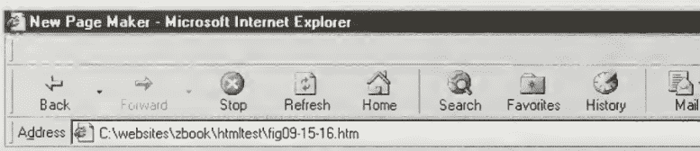

在下方的框中输入你的名称，然后点击按钮查看个性化页面！

名称：[         ]

点击

图 9-15 这是一个允许观众输入信息的页面

> 提示
> `open()`和`close()`方法可以用于根据名称、喜爱的食物或其他你可能想要自定义新页面的其他变量来动态创建页面。

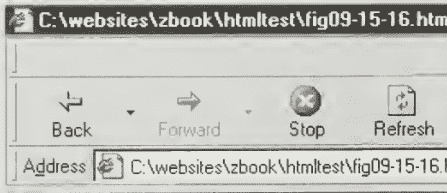

## 欢迎！

你好，John，欢迎来到我的页面！

图 9-16 一旦点击按钮，观众将获得一个类似此的新页面

## 第 9 节：文档对象 275

## `write()` 方法

我们在书的早期就开始使用`write()`方法，因此我们已经对它的工作原理相当了解了；但让我们来看看对该方法的简要描述。

`document.write()`方法用于将字符串值写入页面。以下代码将在 HTML 文档的正文部分写入 "hi there"：

```html
<BODY>

<SCRIPT language="JavaScript">

<!--

document.write("hi there");

-->

</SCRIPT>

</BODY>
```

## `writeln()` 方法

`writeln()`方法的工作方式与`document.write()`方法相同，但在语句末尾添加了一个 JavaScript 换行符（`\n`）。回想一下我们在第 3 节中讨论过 JavaScript 字符是如何工作的——它只在页面源代码中放置一个新行，以便于阅读。

页面本身的显示不受 JavaScript 换行符的影响。回想我们在第 3 节中的示例，我们使用换行符将代码分成了两个不同的行：

```html
<SCRIPT language="JavaScript">

<!--

document.write("<B>JavaScript Rules!</B>\nThis is fun.")

-->

</SCRIPT>
```

由于`document.writeln()`方法在语句末尾添加了换行符，我们可以使用以下`document.writeln()`语句重写先前的代码：

```html
<SCRIPT language="JavaScript">

<!--

document.writeln("<B>JavaScript Rules!</B>");
```

## 276 JavaScript：入门指南

```javascript
document.writ("This is fun.");

-->

<SCRIPT>
```

这会将代码行放置在页面源代码的两个不同行中，但不会影响浏览器中页面的显示。

好了，文档对象的方法就此结束。如你所见，这些方法在未来的脚本中可能非常有用。


## 项目 9-2：扩展基础脚本

此项目将允许你练习在本节中学到的新方法。这将是我们使用`open()`和`close()`方法时脚本的基础扩展，但应该帮助你完成我们之前使用的表单命名和元素命名。

## 步骤详解

- 1. 创建一个 HTML 页面，在文档的`HEAD`和`BODY`部分留出空间。
- 2. 在`BODY`部分创建一个名为`myform`的表单。创建两个文本框。将第一个命名为`username`，第二个命名为`yourfood`。确保在第一个文本框中要求观众名称，在第二个文本框中要求观众喜爱的食物。创建一个按钮，点击时调用函数`newpage()`。按钮的标签文本为 "Click Here for a New"。
- 3. 进入`HEAD`部分并设置一组`SCRIPT`标签，以便我们创建函数。
- 4. 创建`newpage()`函数。确保它将第一个框的值赋值给名为`thename`的变量，并将第二个文本框的值赋值给名为`thefood`的变量。然后让浏览器窗口中打开一个新文档，显示一个带有观众名称和喜爱的食物的页面。它看起来应该像这样：
  Your name is [name]
  Your food is [food]!
- 5. 将文件保存为`pr9_2.html`并在浏览器中打开它。输入要求的信息并点击按钮。你应该得到一个根据你输入的内容自定义的新页面。

## 掌握检查

- 1. 哪种颜色属性允许我们动态更改其值？
  A. `fgColor`
  B. `bgColor`
  C. `linkColor`
  D. `alinkColor`

- 2. 哪个属性返回当前文档的完整 URL？
  A. `domain`
  B. `referrer`
  C. `URL`
  D. `title`

- 3. `writeln()`方法与`write()`方法有何不同？
  A. 它在末尾添加一个`<BR>`标签。
  B. 它在末尾添加一个`<P>`标签。
  C. 它在末尾添加 JavaScript 换行符。
  D. 它与`write()`方法完全相同。

- 4. 如何在 JavaScript 中创建窗口属性？
  A. 当表单被命名时。
  B. 当表单被命名时。
  C. 当表单被命名时。
  D. 当表单被命名时。

## 掌握检查

- 5. 在`document.open()`和`document.close()`之间允许哪些语句？
  A. HTML
  B. `document.write()`和`document.writeln()`
  C. 仅`document.writeln()`
  D. 仅`window.alert()`

# 第 10 节：窗口对象

本节的目标是

- 学习什么是窗口对象
- 使用窗口属性
- 使用窗口方法
- 发现如何提示信息
- 使用 JavaScript 打开新窗口

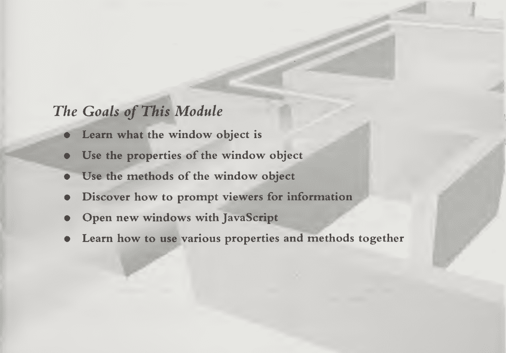

## JavaScript：入门指南

现在转向 JavaScript 窗口的使用提供了比文档对象更多的属性和方法。我们将执行许多新操作，例如提示用户信息、打开新窗口、确认操作等。由于它提供的属性和方法，我们将经常使用这个对象。

## 窗口简介

窗口对象为屏幕上显示的每个窗口创建。窗口可以是主窗口、框架或单个框架，甚至是使用 JavaScript 创建的新窗口。这为我们开启了许多属性和方法，其中一些让我们在之前的节中能够更多交互。

在之前的节中，我们在脚本中使用了窗口对象的`alert()`方法和`status()`属性。`alert()`方法允许我们为观众弹出消息，而`status()`属性允许我们更改浏览器底部状态栏中文本字符串的值。我们现在将查看该对象的许多新方法，这些方法可以确认观众的操作或提示观众信息。

我们将首先查看窗口对象的属性。在下一节中，我们将介绍并解释可以使用该对象的属性。但是，我们将先进行 1 分钟练习。

## 1 分钟练习

- 哪些类型的文档可能会创建窗口？在之前的节中？
- 我们在之前的节中使用哪些窗口属性和方法？
- 确认观众的操作或提示观众信息有什么好处？


## 属性

在开始学习窗口（window）对象之前，我们想要查看一下可以使用的属性。表 10-1 列出了窗口对象的若干个属性以及对每个属性的描述。在表格之后，我们将详细讨论每个属性。

现在我们已经看到了可以使用 window 对象的属性列表，让我们逐一更仔细地观察每个属性。

## `closed` 属性

`closed`属性用于检查窗口是否被查看者关闭。它的正常用法是配合窗口名称使用，后跟`closed`属性，如下例所示：

```
if (windowname.closed)
```

`windowname`部分将被替换为我们想要检查的窗口名称。这通常是一个用 JavaScript 打开的新窗口，我们将在模块的后部分介绍`open()`方法时，学习如何命名一个新窗口。

| 属性 | 描述 |
|---|---|
| `closed` | 根据窗口是否已关闭来存储值 |
| `defaultStatus` | 定义在状态栏数组中显示的默认消息，该数组代表给定窗口中的所有帧（frames） |
| `length` | 存储一个等于窗口中帧数量的值 |
| `location` | 窗口的当前 URL |
| `name` | 允许为窗口命名 |
| `opener` | 指向打开了另一个窗口的窗口 |
| `parent` | 指向包含当前帧的帧集 |
| `self` | 引用当前窗口的另一种方式 |
| `status` | 允许在状态栏中放置消息；覆盖`defaultStatus` |
| `top` | 包含帧、帧集或嵌套帧集的顶层窗口的引用 |

表 10-1 窗口对象的属性

它也可以用于新窗口内部，以检查它打开的窗口是否已关闭。要做到这一点，我们会在`opener`属性（我们很快就会遇到）之后使用它，如下例：

```
if (window.opener.closed)
```

如果你选择创建一个新窗口，允许查看者通过新窗口中的链接导航到主窗口，那么这种属性用法非常方便。

## `defaultStatus` 属性

`defaultStatus`属性类似于我们在之前的模块使用过的`window.status`属性，但它有一个不同点：`defaultStatus`设置了在没有分配其他内容时显示的状态栏文本字符串（`window.status`没有），这意味着它改变了状态栏中显示的内容。`window.status`属性的变化会覆盖此设置，因为它只显示默认值。

`defaultStatus`属性通常在打开的`<body>`标签的`onload`事件处理器中设置：

```html
<body onload="window.defaultStatus='Welcome!';">
```

这主要用于在查看者未执行会更改状态栏文本的操作时显示一个自定义消息。不过，它可以在任何时间设置，你可以在`onload`事件之前使用其他事件设置此值。

## `frames` 属性（数组）

`frames`属性是一个数组，包含了窗口中的所有帧。该属性允许你访问窗口中的每一个帧。你可以通过`frames[0]`、`frames[1]`等索引来访问特定的帧。如果窗口中没有帧，该属性将是空的。我们将在模块 12 中学习如何使用`frames`属性。

我们也可以通过`frames.length`来获取窗口中帧的数量。

## `length` 属性

`length`属性返回窗口中帧的数量。这与前面所述的逻辑相同。在某些页面中，`length`属性告诉我们窗口中有多少个帧。

## `location` 属性

`location`属性包含了窗口的当前 URL。通过更改此属性可以重定向到新页面，这非常有用。例如，你可以通过`window.location = "http://www.example.com"`将页面跳转到另一个网站。

## `opener` 属性

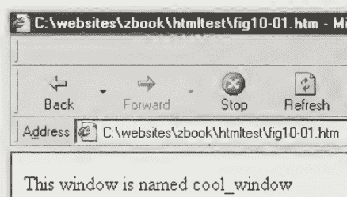

**图 10-1** 屏幕上显示窗口名称

`opener`属性用于引用打开当前窗口的窗口。这通常用于使用`open()`方法打开的新窗口，我们将在模块的稍后部分看到。通过在新窗口中使用`opener`属性，我们可以使用之前学过的`closed`属性来检测主窗口是否已关闭。下面的示例展示了如何操作：

```
if (window.opener.closed)
```

在`opener`属性之后增加了`closed`属性，以检查打开当前窗口的窗口是否已经关闭。如果我们想通过新窗口在主窗口中执行操作，这非常有帮助，因为我们可以在执行任何操作之前检查它仍然存在。

## `parent` 属性

`parent`属性仅在页面上有帧（frames）时使用。它允许我们访问当前帧的父帧集。当我们想要从一个帧更改另一个帧的属性时，这非常有帮助。我们将在第 15 模块介绍 JavaScript 和帧时详细讨论这一点。

## `self` 属性

`self`属性是 JavaScript 中表示“当前窗口”的另一种方式。它的用法与`window`对象类似，并可以像`window`对象一样访问当前窗口的属性。因此，如果我们愿意，我们也可以使用`self.location`更改当前窗口的地址，如下例所示：

```
<FORM>

<INPUT type="button" value="Click to Search the Web"

Click="self.location='http://www.yahoo.com';">

</FORM>
```

这与我们在模块中的第一个`window.location`示例的作用相同。当点击按钮时，新的 URL 将在当前窗口中打开。

如果你有许多命名的窗口，并想要确保你使用的是当前窗口的属性而不是另一个窗口的属性，那么`self`属性非常有用。

## `status` 属性

`status`属性包含窗口状态栏中设置的文本值。更改此属性将用`defaultStatus`属性覆盖状态栏的内容。由于我们已经使用过此属性，因此这个示例可以保持简短。要更改状态栏中的内容，我们为其分配一个新值，如下例代码所示：

```
<FORM>

<INPUT type="button" value="Click for Status Message"

OnClick="window.status='Hello!';">

</FORM>
```

这在点击按钮时更改状态栏的内容。此外，请记住，我们使用`onMouseOver`和`onMouseOut`事件更改了此属性，此后我们需要返回一个`true`语句以确保它生效。这引导我们进入一个新的脚本。

由于`status`命令覆盖了`defaultStatus`属性，我们可以使用`onMouseEvent`事件将状态栏的内容更改为其他内容。鼠标移开时，状态栏会自动恢复为`defaultStatus`属性的值，除非我们使用`mouseout`事件并更改了它。

下面的代码展示了在设置默认状态值后更改状态的示例：

```
<HTML>

<HEAD>

<TITLE>Status Bar Sequence</TITLE>

</HEAD>

<BODY onload="window.defaultStatus='Welcome!';">

  <A href="page2.html" onmouseover="window.status='Page 2'; return true;">

Click for Page 2</A>

</BODY>

</HTML>
```

首先，我们在打开的`<BODY>`标签中使用`onload`事件设置了默认状态。在`mouseover`事件上，我们将状态栏的内容更改为“Page 2”，让查看者知道链接去向哪里。当鼠标移开时，浏览器会恢复默认状态消息。

## `top` 属性

`top`属性用于访问包含当前帧的所有帧集（可以是嵌套的）中的顶级窗口。这与`parent`属性略有不同，`parent`仅到达包含当前帧的帧集的顶端。而`top`属性一直到达顶层窗口，即使该窗口包含嵌套的帧集。

当我们到达书中后面的第 15 模块学习 JavaScript 和帧时，将看到更多关于此属性的用法。


## 1 分钟练习

- 我们可以用`closed`属性做什么？
- `name`属性让我们能够做什么？
- `parent`属性和`top`属性有什么区别？

- `closed`属性允许我们测试窗口是否已关闭
- `name`属性允许我们为窗口命名
- `parent`属性到达当前帧集的顶端，而`top`属性到达页面上所有帧集的顶层窗口

## 项目 10-1：使用窗口对象的`location`属性

此项目将让你练习使用`window`对象的`location`属性。将创建一个带有按钮导航的页面。

## 逐步步骤

- 1. 创建一个超文本标记语言（HTML）页面，在`BODY`部分留出空间放入一些代码。
- 2. 在页面上创建一个带有五个按钮的表单。
- 3. 使用`<P>`标签将五个按钮分别放在单独的行。
- 4. 让每个按钮链接到这些 URL 地址之一：

```
http://www.pageresource.com

http://www.javascriptcity.com

http://www.yahoo.com

http://www.netscape.com

http://www.microsoft.com
```

- 5. 使用`value`属性为按钮赋予以下标签：
  Page Resource
  JavaScript City
  Yahoo! Web Site
  Netscape Web Site
  Microsoft Web Site
- 6. 将文件保存为`pr10-1.html`并在浏览器中打开。尝试点击一些按钮，看看它们是否带你进入了新的 URL。

## 方法

现在我们已经知道如何使用`window`对象的属性，可以继续学习`window`方法了。表 5-2 列出了`window`对象的若干方法以及每个方法的描述。表格之后，我们将更详细地讨论每种方法。

## JavaScript：入门指南

| 方法 | 描述 |
| --- | --- |
| `alert()` | 向查看者弹出一个警告框，查看者必须点击 OK 按钮才能继续 |
| `confirm()` | 向查看者显示一个确认框，查看者必须点击 OK 或取消按钮才能继续 |
| `find()` | 允许查看者在浏览器中启动查找工具来查找页面上的文本 |
| `print()` | 打印窗口内容 |
| `prompt()` | 弹出一个提示框，要求查看者输入信息 |
| `open()` | 打开一个新的浏览器窗口 |
| `close()` | 关闭浏览器窗口 |
| `blur()` | 从窗口移除焦点 |
| `focus()` | 给窗口赋予焦点 |
| `moveBy()` | 通过作为参数的特定像素值移动窗口 |
| `moveTo()` | 将窗口左上角移动到作为参数的坐标 |
| `resizeBy()` | 通过作为参数的特定像素值移动右下角来调整窗口大小 |
| `resizeTo()` | 将整个窗口调整为指定的参数的高度和宽度 |
| `scrollBy()` | 通过作为参数的特定像素值滚动窗口区域 |
| `scrollTo()` | 将窗口区域滚动到指定的参数指定的坐标 |
| `setInterval()` | 每经过一段时间就调用一次函数 |
| `clearInterval()` | 取消`setInterval()`方法调用的操作 |
| `setTimeout()` | 在一段时间后调用一次函数 |
| `clearTimeout()` | 取消`setTimeout()`方法调用的操作 |

## 表 10-2 窗口对象的方法

## `alert()` 方法

`alert()`方法是我们早期模块示例中广泛使用的方法。它向查看者弹出一个消息，查看者必须点击 OK 按钮才能继续。回想语法如下：

```
window.alert("Hi there!");
```

这会在屏幕上显示我们提供的“Hi there!”消息。

当`alert()`方法首次引入时，我们注意到这种方法在脚本中经常被如下简化：

```
alert("Hi there!");
```

我们为什么可以这样做？记住 JavaScript 是非常宽容的，所以在某些情况下允许我们采取快捷方式。在这种情况下，是因为浏览器假设窗口对象存在。

由于假设存在，我们不需要调用它。相反，我们可以直接调用该方法，JavaScript 将知道这是一个窗口方法。

我们需要更具体的情况通常与新窗口和`location`属性有关。目前，我们不使用这种快捷方式。

## `confirm()` 方法

`confirm()`方法可以给查看者一个确认或取消操作的机会。此方法返回一个布尔值`true`或`false`，因此在使用时通常将其结果赋值给变量。

以下是将赋值给变量的语法：

```
var varname=window.confirm("Your Message");
```

我们将`varname`替换为我们想要使用的变量名。然后我们将“Your Message”文本替换为我们想要在弹出框中显示的文本。因此，如果我们想将结果赋值给一个名为`is_sure`的变量并提问“你确定吗？”，我们可以使用以下代码：

```
var is_sure=window.confirm("Are you sure?");
```

图 10-2 显示了上述代码将显示的确认框示例。请注意观众可以选择点击的两个按钮：OK（确定）和 Cancel（取消）。根据浏览器的不同，它们看起来可能略有不同。如果观众点击 OK 按钮，方法将返回`true`。如果用户点击 Cancel 按钮，方法将返回`false`。坏消息是我们无法更改按钮上文本的值。至少在使用`confirm`方法时，我们只能受限于 OK 和 Cancel 选项。

作为该方法的真实示例，假设我们想创建一个链接到另一个页面的按钮，但我们想在用户被发送之前确定他们是否想要离开。我们可以使用确认框来确定观众是否希望离开页面。以下代码显示了我们如何使用`confirm`方法和`if`块获取观众的确认：

```html
<HTML>
<HEAD>
<SCRIPT language="JavaScript"> 
// 该函数确认观众是否想要离开
function gothere() {
var is_sure=window.confirm("Are you sure you want to leave?");
if (is_sure==true) {
window.location="http://www.yahoo.com";
}
}
</SCRIPT>
</HEAD>
<BODY>
<FORM>
<INPUT type="button" value="Click to Search the Web" OnClick="gothere();"> <!--确认过程 -->
</FORM>
</BODY>
</HTML>
```

## 第 10 模块：Window 对象 293


图 10-2 确认框示例

首先，查看 BODY 部分，看到我们在点击按钮时调用了`gothere()`函数。在`gothere()`函数内部，我们首先将确认框返回的值赋值给变量名`is_sure`。如果`is_sure`的值为`true`（观众点击了 OK），观众将进入新站点。如果`is_sure`的值为`false`（观众点击了 Cancel），则什么都不会发生（因为我们省略了`if`块，除非`is_sure`的值为`true`，否则什么都不会发生），观众将留在我们的页面。

图 10-3 显示了在页面上点击按钮时的浏览器窗口。屏幕上弹出带有“Are you sure?”消息的确认框。

```
C:\websites\zbook\htmltest\fig10-03.htm - Microsoft Internet Explorer - [Working Offline]
```

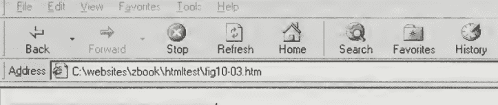

## 10


图 10-3 点击按钮时弹出的确认框

## `find()` 方法

`find()`方法可以让观众在页面上查找某些文本。它告诉浏览器使用内置的查找工具，并允许观众输入想在页面上查找的内容。（它似乎只在 Netscape Navigator 4 或更高版本中有效。）

例如，如果我们想为观众创建一个按钮，让他们在想在页面上查找某些内容时点击，我们可以使用以下代码：

```
<FORM>

<INPUT type="button" value="Click to Find Text" onclick="window.find();">

</FORM>
```

这会在浏览器中弹出查找对话框，允许观众搜索页面内的文本。图 10-4 显示了当此脚本添加到 HTML 文档的 BODY 部分时的运行结果。

如果你有一个非常长的页面，并希望观众能够通过搜索更快地找到东西，那么这就很有用。记住，该方法是在 JavaScript 1.2 中引入的，可能在旧版浏览器中无法工作。

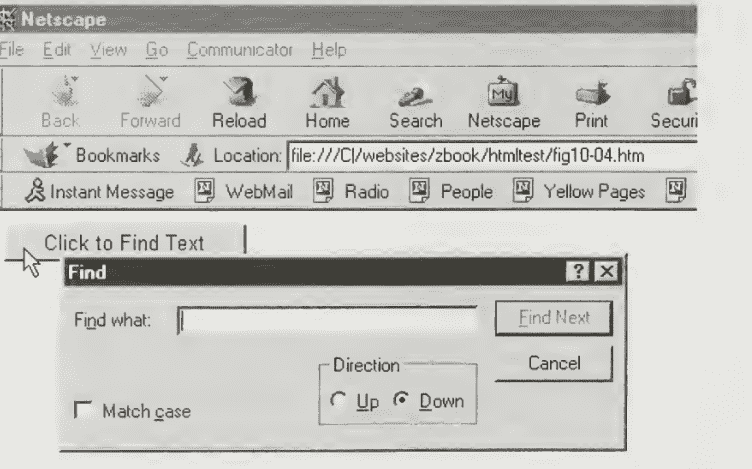

图 10-4 弹出的对话框，允许观众搜索页面上的文本

## `print()` 方法

`print()`方法允许观众打印当前窗口。当调用此方法时，它应该弹出观众的打印对话框，以便观众设置打印机设置来打印文档。要使用它，我们可以创建一个按钮，允许观众打印正在查看的页面。以下代码创建了按钮：

```
<FORM>

<INPUT type="button" value="Click to Print Page" onClick="window.print();">

</FORM>
```

这段代码应该显示用户的打印选项框。图 10-5 显示了在浏览器中运行此脚本的结果。根据所使用的浏览器和打印机，此屏幕显示可能会不同。对于信息类网站来说，打印按钮是一个很有用的功能。但记住，该方法是在 JavaScript 1.2 中引入的，可能在其他浏览器中无法工作。

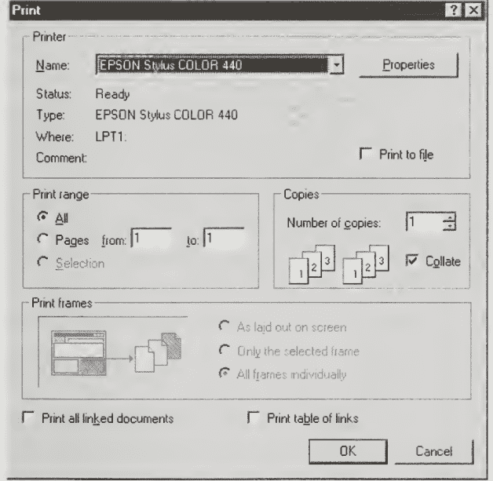

图 10-5 点击按钮时弹出观众的打印选项

## `prompt()` 方法

`prompt()`方法用于提示观众输入信息。使用此方法，我们可以根据观众在提示文本框中输入的内容来执行某些操作。这允许我们为页面添加更多交互性，甚至可以自定义观众的名字。

首先，我们需要查看该方法的语法。在`confirm`中，结果（观众输入的内容）被赋值给一个变量供以后使用。以下是语法的示例：

```
var varname=window.prompt("Your Text", "Default Entry");
```

我们将`varname`替换为变量名，并将 "Your Text" 替换为我们发送给观众的消息（通常是一个问题）。第二个参数`Default Entry`允许我们为观众输入一个默认值。这通常是`""`，即为空。但是，如果你想为观众准备好一个默认答案，也可以将其设置为其他内容。

我们可以利用此获取观众的名字，并在页面加载时发送一个警报。以下代码从提示框中获取观众的名字，然后向观众显示警报：

```html
<HEAD>

<SCRIPT language="JavaScript">

var name=window.prompt("What's Your name?", "");

if (name="" || (name==null))

name="Anonymous Visitor";

window.alert("Hello "+name+");");

</SCRIPT>

</HEAD>
```

| 描述 | |
|---|---|
| 观众在这里收到请求名字的提示 | 这测试了输入框是否留空 |
| 观众输入的姓名将在警报中发送 | |

这将提示观众输入名字。如果观众留空，则观众将被命名为“Anonymous Visitor”（匿名访问者）；否则`name`将保留观众输入的值。然后观众将收到一个带有变量值的问候警报。

图 10-6 显示了当观众在提示框中未输入任何内容时，此脚本的结果。我们在警报中看到了“Anonymous Visitor”这个名字。

## 第 10 模块：Window 对象 297


**图 10-6** 警报显示问候观众

而不是将名字放在警报中，我们可以将其写在页面上。通过这样，观众就不会被警报打扰，名字看起来是页面的一部分。以下代码显示了如何实现：

```html
<HTML>

<HEAD>

<SCRIPT language="JavaScript">

var thename=window.prompt("What's your name?");

if (thename="" || (thename==null))

thename="Anonymous Visitor";

</SCRIPT>

</HEAD>

<BODY>

<SCRIPT language="JavaScript">

document.write("<h1>");

document.write("Hello "+thename+", and welcome to my site!");

document.write("</h1>");

</SCRIPT>

<P>

</BODY>

</HTML>
```

此脚本以相同的方式使用提示和`if`块设置了变量`thename`。在 BODY 部分，我们通过`document.write`命令将变量写入标题。图 10-7 显示了当观众在提示中输入名字“John”时浏览器的结果。

## 10

## Hello John, and welcome to my site!

其他文本等..

> 图 10-7 观众在提示框中输入名字后，名字被写在页面上

`prompt()`方法在我们未来的脚本需要获取各种目的输入时非常有用。与其自己创建变量值，不如让观众为我们决定变量的值。

## `open()` 方法

`open()`方法是允许我们使用 JavaScript 打开窗口的方法。该方法接受三个参数，第三个参数设置窗口可能需要的选项。

`open()`方法的通用语法如下例所示：

```
window.open("URL","name","attribute1=value,attribute2=value");
```

第一个参数`URL`替换为要在新窗口中打开的 HTML 文档 URL。`name`参数替换为我们想要给窗口的名字。最后一个参数允许我们为新窗口添加属性。

这些属性使用等号右侧的“yes”或“no”进行设置。注意每当为属性设置值时，下一个属性之前都有一个逗号，且之间没有空格。

如果我们想打开一个具有当前窗口特征的窗口，可以通过省略属性中的最后一个参数来实现。下面的示例将打开一个本地 URL 为`newpage.htm`且名称为`my_window`的新窗口：

```
window.open("newpage.htm", "my_window");
```

这将打开一个包含 HTML 文档`newpage.htm`内容并命名为`my_window`的窗口；它将具有与打开它的窗口相同的特征。

## 标准属性

如果我们想包含窗口特征，将需要学习一些可以在窗口上使用的属性。表 10-3 列出了我们可以作为`open()`方法最后一个参数部分的标准属性。

| 属性名称 (Attribute Name) | 可能的值 | 功能 |
|---|---|---|
| `width` | number | 定义新窗口的宽度（像素） |
| `height` | number | 定义新窗口的高度（像素） |
| `directories` | yes, no, 1, 0 | 定义新窗口是否具有目录按钮（例如浏览器顶部的“有新内容”或“链接”按钮） |
| `location` | yes, no, 1, 0 | 定义新窗口是否有一个用于输入新 URL 的地址框 |
| `menubar` | yes, no, 1, 0 | 定义窗口是否具有菜单栏（文件菜单、编辑菜单等） |
| `resizable` | yes, no, 1, 0 | 定义是否允许调整新窗口的大小 |
| `scrollbars` | yes, no, 1, 0 | 定义如果窗口内容大于窗口大小时，新窗口是否具有滚动条 |

**表 10-3** 新窗口的标准属性

## 300 JavaScript：初学者指南

| 属性名称 (Attribute Name) | 可能的值 | 功能 |
|---|---|---|
| `status` | yes, no, 1, 0 | 定义新窗口底部是否具有状态栏 |
| `toolbar` | yes, no, 1, 0 | 定义新窗口是否具有工具栏（前进按钮、后退按钮、停止按钮等） |

**表 10-3** 新窗口的标准属性（续）

如果开始使用属性参数，我们应该注意，一旦我们在属性参数中放置了内容，任何属性现在都将默认为 "no"，而不是复制主窗口的设置。因此，如果我们想打开一个宽度为 400、高度为 300 的基础窗口，我们可以使用以下代码：

```
window.open("newpage.html","my_window","width=400,height=300");
```

此窗口将是 400x300 像素，它拥有的唯一特征是标题栏，显示文档标题以及右上角供查看者关闭或最小化的按钮。

要设置其他属性（它们都是布尔值），我们可以根据是否需要每个特征来为它们分配 "yes" 或 "no" 的值。如果你愿意，也可以用 1 代替 0，因为它们的效果是相同的。因此，如果我们想要得到一个 300x200 的窗口，并仅添加一个菜单栏（这会添加前进、后退、停止以及其他类似的按钮），我们可以使用以下代码：

```
window.open("newpage.html","cool","width=300,height=200,menubar=yes");
```

这将为我们提供一个包含`newpage.html`内容、名称为`cool`、尺寸为 300x200 且带有菜单栏的新窗口。

我们可以在第三个参数的引号内添加任意数量的属性，每个属性之间用逗号分隔。请记住，这里任何地方都没有空格，并且整个命令在你的文本编辑器中应该在同一行。

## 模块 10：窗口对象

## 提示

由于空间限制，本书中的新窗口命令在代码可能会跨多行显示。请务必将从`window.open`到结束分号（`;`）的所有内容放在同一行，以避免 JavaScript 错误。

下面的示例将打开一个包含表 10-3 中提到的所有特征的窗口（注意，这在这里占据了多行，但在实际生活中，代码应该写在单行上）：

```
window.open("newpage.html","cool",width=300,height=200,directories=yes,location=yes,menubar=yes,resizable=yes,scrollbars=yes,status=yes,toolbar=yes);
```

这将打开一个具有所有标准特征的 300x200 窗口。如果我们需要一个可见的示例，我们需要创建一个名为`newpage.html`的页面代码，并创建主页代码以包含一个`window.open()`命令。

首先，让我们为`newpage.html`创建代码。我们将制作这个包含一些文本的短页面。以下是该页的代码：

```html
<HTML>

<BODY>

I am a new window! I am newer than that old window that opened me, so I am special. Ha, ha!

</BODY>

</HTML>
```

现在，让我们创建主页。以下是主窗口的代码：

```html
<HTML>

<HEAD>

<TITLE>New Window</TITLE>

<script language="JavaScript">

function launchwin() {

window.open("newpage.html","cool","width=300,height=200,directories=yes,location=yes,menubar=yes,resizable=yes,scrollbars=yes,status=yes,toolbar=yes");

}

</script>

</HEAD>

<BODY>

<FORM>

<input type="button" value="New Window" onclick="launchwin()">

</FORM>

</HTML>
```

这将打开一个具有所有标准特征的 300x200 窗口。如果我们需要一个可见的示例，我们需要创建一个名为`newpage.html`的页面代码，并创建主页代码以包含一个`window.open()`命令。

## 301 JavaScript：初学者指南

## 302 JavaScript：初学者指南

```html
<BODY>

<FORM>

<input type="button" value="New Window" onclick="launchwin()">

</FORM>

</HTML>
```

## 扩展属性

通过 JavaScript 1.2，我们能够使用更多的属性。表 10-4 中属性的问题在于它们都是特定于浏览器的，且其中许多属性需要签名脚本。我们将只处理四个用于设置窗口位置的属性——`screenX`、`screenY`、`left`和`top`，因为它们在两种浏览器中均可有效。

为了让屏幕位置在 Internet Explorer 和 Netscape Navigator 中都能生效，我们需要将所有四个属性添加到`open()`方法的最后一个参数中。每个浏览器将直接忽略它不识别的属性。下面的示例打开了我们的

当点击按钮时，在屏幕左上角（距离左侧0像素，距离顶部0像素）在一个新的300x200窗口中打开`newpage.html`文档：

```html
<HTML>

<HEAD>

<TITLE>我是一个窗口战士</TITLE>

<SCRIPT language="JavaScript">

function launchwin() {

window.open("newpage.html", "cool", "width=400,height=300,status=yes,screenX=0,left=0,screenY=0,top=0");

}

</SCRIPT>

</HEAD>

<BODY>

点击下方按钮打开一个傲慢的新窗口 ...

<P>

<FORM>

<INPUT type="button" value="New Window" onclick="launchwin();">

</FORM>

</BODY>

</HTML>
```

再次注意，在实际使用中，`window.open()`的内容应全部在同一行，因为这里由于空间限制而换行了。在这个版本中，我们添加了新属性，将新窗口设置在屏幕坐标 (0,0)。

图 10-9 显示了点击按钮后在浏览器中显示的结果。注意新窗口现在是如何打开在屏幕左上角的。

其他属性在此时并不好用；但随着浏览器的进一步发展，某些属性可能会以某种形式被两个浏览器支持。

回到方法的检查。

## `close()` 方法

`close()`方法用于关闭窗口；然而，除非你使用签名脚本（signed scripts），否则它只能关闭由 JavaScript 打开的窗口。

## 306 JavaScript：初教程

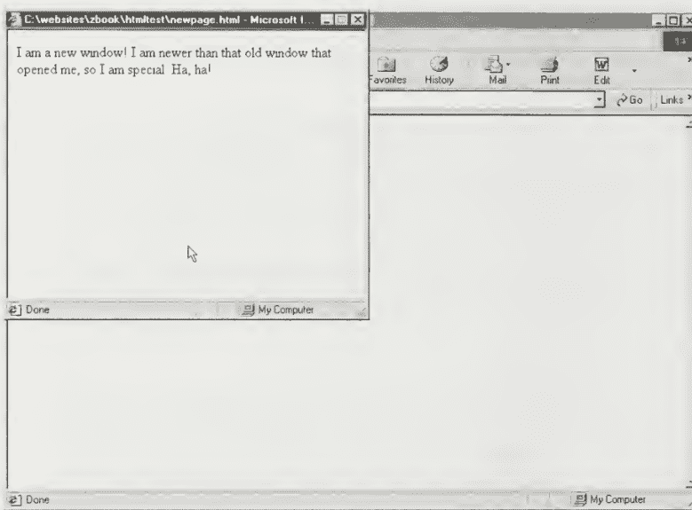

**图 10-9** 新窗口在我们在屏幕上预想要的位置打开，即左上角。

要使用`close()`方法，我们可以修改`newpage.html`代码，在文本末尾提供一个按钮，让查看者可以通过点击它来关闭窗口。因此，我们可以将`newpage.html`的代码修改如下：

```html
<HTML>

<BODY>

我是一个新窗口！我比打开我的那个旧窗口要新，所以我是特殊的。哈，哈！

<FORM>

<INPUT type="button" value="Close Window" onclick="window.close();">

</BODY>

</HTML>
```

> 点击按钮时，窗口会被关闭

现在点击按钮时，`window.close()`方法被调用，并像窗口右上角的关闭按钮一样关闭窗口。如果你想尝试一下，请使用我们在上一节中使用的主页面并点击按钮打开新窗口。它应该提供一个带有关闭窗口选项的新窗口，如果你点击按钮，它就会关闭窗口。

## `blur()` 方法

`blur()`方法允许我们将窗口置于主窗口背后的背景中。一个很好的用途可能是创建一个按钮，让查看者将窗口移出视线但不关闭它，这样以后就可以再次使用。

要做到这一点，我们再次需要修改`webpage.html`代码。以下是该页的新代码：

```html
<HTML>

<body>

新窗口！我比打开我的那个旧窗口要新，所以我是特殊的。哈，哈！

<FORM>

<INPUT type="button" value="Hide Window" onclick="window.blur();">

<P>

<INPUT type="button" value="Close Window" onclick="window.close();">

</BODY>

</HTML>
```

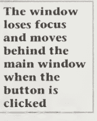

现在当此窗口打开时，有隐藏或关闭它的选项。点击 Hide Window 按钮会让新窗口失去焦点并移动到主窗口后面。查看者可以使用操作系统将其带回，或者我们可以通过主窗口调用其名称并使用`focus`方法（将讨论）将其带回来。

## `focus()` 方法

`focus()`方法允许我们将窗口置于焦点（位于其他窗口之上）。假设我们允许查看者在点击 Hide Window 按钮后将我们的`webpage.html`窗口带回来。我们需要以某种方式将其重新获得焦点。

## 308 JavaScript：初教程

我们可以决定，即使查看者点击了 Hide Window 按钮，也要让新窗口保持在上方。为了实现这一点，我们再次修改`newpage.html`代码：

```html
<HTML>

<BODY onblur="window.focus();">

我是一个新窗口！我比打开我的那个旧窗口要新，所以我是

特殊的。哈，哈！

<FORM>

<INPUT type="button" value="Hide Window" onclick="window.blur();">

<P>

<INPUT type="button" value="Close Window" onclick="window.close();">

</P>

</HTML>
```

> 添加的事件强制窗口在查看者尝试移除焦点时仍保持在焦点状态

注意在打开的`<body>`标签中添加了`onblur`事件处理器。现在，当焦点移出窗口时，焦点会被强制回到窗口！然而，这让我们的 Hide window 功能变得毫无用处，但 Close Window 按钮仍然可以起作用移除窗口。

## `moveBy()` 方法

`moveBy()`方法可以将新窗口移动到屏幕上的新位置。它通过方法调用中给定的像素数来移动窗口。以下是使用该方法的语法：

```javascript
window.moveBy(x-pixels, y-pixels);
```

我们将`x-pixels`替换为我们想要从左向右移动窗口的像素数。因此，如果我们想让窗口向右移动，就输入一个正数。如果我们想让它向左移动，就输入一个负数。

我们将`y-pixels`替换为我们想要从顶到底移动窗口的像素数，正数将窗口向下推，负数将窗口向上拉。

例如，`newpage.html`窗口在打开时被设置在 (0,0)。如果我们想给查看者将窗口移动到我们选择的新位置的选择，我们可以添加一个按钮，在查看者点击时执行操作。以下代码提供了一个新版本的`newpage.html`（删除了`focus`和`blur`部分）：

## 模块 10：窗口对象 309

```html
<HTML>

<BODY>

<P>我是一个新窗口！我比打开我的那个旧窗口要新，所以我是特殊的。哈，哈！</P>

<FORM>

<INPUT type="button" value="Move Window" onclick="window.moveTo(50,50);">

<P>

<INPUT type="button" value="Close Window" onclick="window.close();"></P>

</FORM>

</BODY>

</HTML>
```

点击按钮时，窗口向右移动 50 像素并向下移动 50 像素。如果我们在模块中之前编写的主窗口中打开它，就可以看到运行效果。图 10-10 显示了从主页面上的按钮打开新窗口时的初始位置。

图 10-11 显示了在新窗口中点击 Move Window 按钮后的窗口。注意它每个方向向右和向下移动了 50 像素。

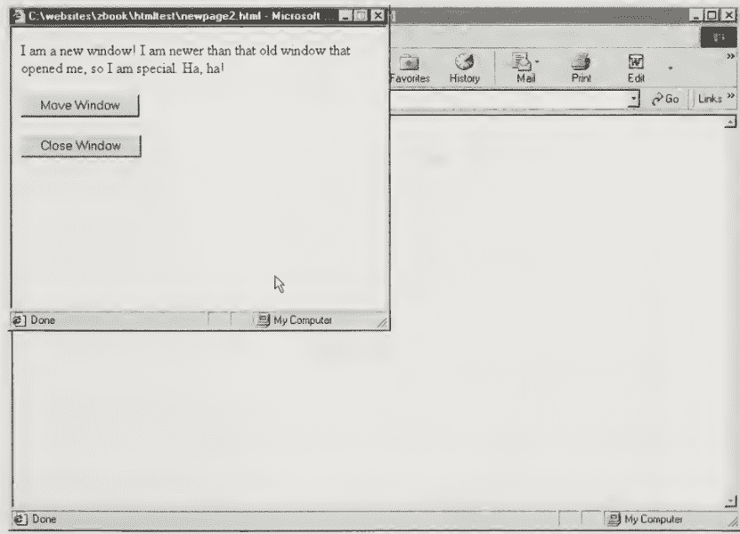

图 10-10 窗口从主页面打开时的初始位置

## 310 JavaScript：初教程

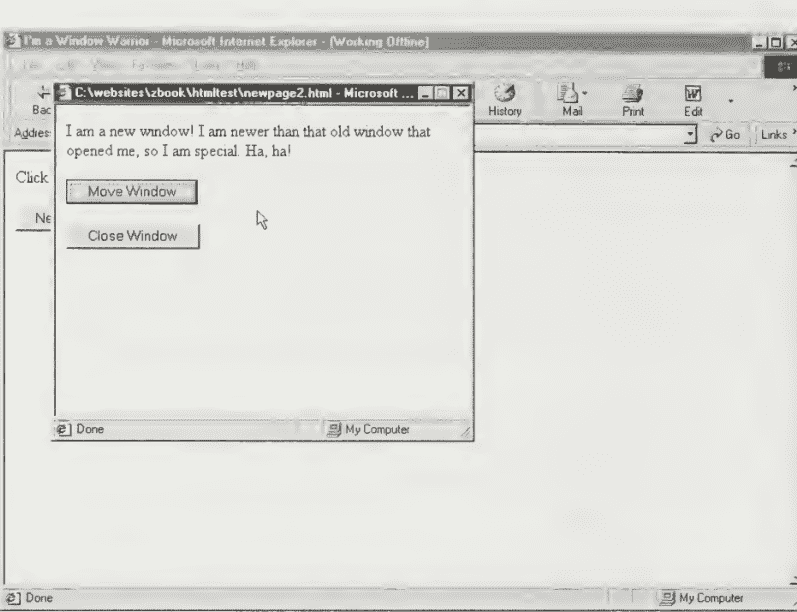

**图 10-11** 移动后的窗口

通过这种方式，只要按钮可见，查看者就可以继续点击按钮并在两个方向上移动 50 像素。窗口将按照脚本设置的像素数继续移动。我们的下一个方法将窗口移动到特定位置，因此它不会像这样连续移动。

## `moveTo()` 方法

`moveTo()`方法用于根据方法调用中给出的参数将窗口移动到屏幕上的特定目标。以下是使用该方法的通用语法：

```javascript
window.moveTo(x-value,y-value);
```

我们将`x-value`替换为我们想要从左侧移动窗口的像素数。例如，如果我们输入 300，窗口将从屏幕左侧移动 300 像素。

## 模块 10：窗口对象

我们将`y-value`替换为我们想要从顶部移动窗口的像素数。

作为一个示例，我们可以重新编写`webpage.html`页面中的 Move Window 按钮，使用`moveTo()`而不是`moveBy()`。以下是代码：

```html
<HTML>

<body>

我是一个新窗口！我比打开我的那个旧窗口要新，所以我是特殊的。哈，哈！

<FORM>

<INPUT type="button" value="Move Window" onclick="window.moveTo(50,50);">

<P>

<INPUT type="button" value="Close window" onclick="window.close();">

</BODY>

</HTML>
```

这次点击按钮时，窗口将移动到屏幕上的坐标 (50,50)。通过使用我们的主页面代码，我们可以打开窗口进行测试。图 10-12 显示了窗口打开时的初始位置。

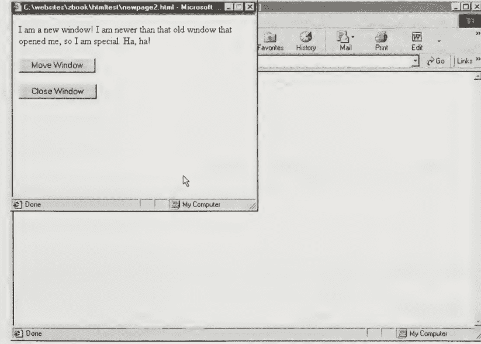

图 10-12 窗口打开时的初始位置

## JavaScript：入门指南

点击按钮后，窗口将移动到屏幕上的 (50,50) 位置。图 10–13 显示了点击按钮后新窗口的位置。

为了看到这种方法的工作方式与`moveBy()`方法不同，请尝试再次点击按钮。它不会再次移动，而是停留在原地，因为它已经到达了目的地。

## `resizeBy()` 方法

`resizeBy()`方法用于根据方法调用中传递的参数中指定的像素数来调整窗口大小。其语法和用法与`moveBy()`方法相同，只是执行的是调整大小。要让窗口变大，请使用正数；要让窗口变小，请使用负数。

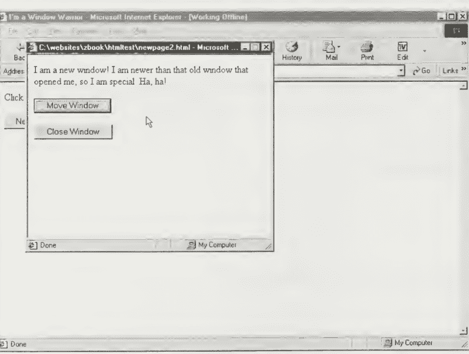

图 10–13 窗口移动后的新位置

## `resizeTo()` 方法

`resizeTo()`方法用于根据方法调用中传递的参数，将窗口调整为特定的像素尺寸。其语法和用法与`moveTo()`方法相同，只是执行的是调整大小。你输入新的宽度和高度，以代替`moveTo()`方法中的坐标。

## `scrollBy()` 方法

`scrollBy()`方法用于根据方法调用中传递的参数中指定的像素数来滚动窗口。其语法和用法与`moveBy()`方法相同，只是执行的是滚动。要让窗口变大，请使用正数；要让窗口变小，请使用负数。

## `scrollTo()` 方法

`scrollTo()`方法用于根据方法调用中传递的参数，将窗口滚动到特定的像素位置。其语法和用法与`moveTo()`方法相同，只是执行到指定点的滚动。

## `setInterval()` 方法

`setInterval()`方法用于在指定的间隔内重复执行 JavaScript 函数。以下是使用该方法的通用语法：

```
window.setInterval("function()", time);
```

我们用`function()`替换为想要重复的函数名。然后我们用`time`替换为在每次重复函数之前想要等待的时间（毫秒为单位）。

因此，如果我们真的想骚扰观众，可以使用此方法在页面加载后每隔 10 秒（10,000 毫秒）弹出一个警告框。我们可以通过在文档的 HEAD 部分中放置以下脚本来实现：

```
<HEAD>

<SCRIPT language="JavaScript">

//

function annoy_alert() {

  window.alert("我打扰你了吗？");

}

window.setInterval("annoy_alert()", 10000);

//

</SCRIPT>

</HEAD>
```

注意，这是一个特殊情况，函数必须在引号内被调用。通常情况下，函数必须在引号外调用。这里这样做的原因是为了防止函数立即执行，而不是在设置的间隔执行。函数名被作为字符串参数发送给`setInterval()`方法，在正确的时间流逝后它才会被调用。

当然，这可能会变得非常烦人。间隔时间越短，就越烦人。幸运的是，十秒的间隔让我们留了足够的时间在另一个警告框弹出之前离开页面。

## `clearInterval()` 方法

为了停止上一个脚本接连不断的警告框，我们可以使用`clearInterval()`方法。以下是使用该方法的通用语法：

```
window.clearInterval(name);
```

我们必须将`name`替换为赋值给要清除的`setInterval()`方法的变量名。问题是，在之前的示例中，我们没有将`setInterval()`调用赋值给变量名。为了清除它，我们需要调整代码。以下是更新后的代码，并将`setInterval()`调用赋值给一个变量名：

```
<HEAD>

<SCRIPT language="JavaScript">

//

function annoy_alert()

{

  window.alert("我打扰你了吗？");

}

var madness=window.setInterval("annoy_alert()", 10000);

//

</SCRIPT>

</HEAD>
```

| 说明 |
| :--- |
| 方法调用被赋值给一个变量以便稍后引用 |
| 方法通过变量名引用第一个方法以取消其操作 |

现在我们有了方法通过将`madness`变量作为参数调用来使用`clearInterval()`方法。因此，让我们给访问者提供一个按钮，让他或她停止这种疯狂行为。只要在间隔期间点击，它就会停止继续运行。以下代码为我们提供了一个带有按钮的完整页面供观众点击：

```
<HTML>

<HEAD>

<SCRIPT language="JavaScript">

<!--

function annoy_alert()

{

  window.alert("我打扰你了吗？");

}

var madness=window.setInterval("annoy_alert()", 10000);

//

</SCRIPT>

</HEAD>

<BODY>

点击按钮结束无休止的警告框。

<P>

<FORM>

<INPUT type="button" value="停止疯狂！"

onClick="window.clearInterval(madness);">

</FORM>

</BODY>

</HTML>
```

观众可以通过点击“停止疯狂”按钮来停止警告框。当然，这个方法还有更好的用途。我们将在后面的模块中看到，它对于时钟以及在页面上需要定期更新的其他内容非常有用。

## `setTimeout()` 方法

`setTimeout()`方法用于在经过一段特定时间后执行 JavaScript 函数。它与`setInterval()`方法的区别在于，它只执行一次（除非放在某种循环中）。其通用语法与`setInterval()`方法相同。

如果我们想在十秒后只弹出一个警告框而不重复，我们可以在页面的 HEAD 部分使用以下代码：

```
<HEAD>

<SCRIPT language="JavaScript">

<!--

function annoy_alert() {

  window.alert("我打扰你了吗？");

}

setTimeout("annoy_alert()",10000);

}

//

</SCRIPT>

</HEAD>
```

这会在十秒后向观众发送警告。

我们将方法赋值给一个变量，以便在需要时调用`clearTimeout()`方法。

## `clearTimeout()` 方法

`clearTimeout()`方法允许我们在`setTimeout()`到期前取消`setTimeout()`调用。其通用语法与`clearInterval()`方法相同：使用变量名作为参数，以便它知道取消哪个`setTimeout()`。

因此，如果我们想让观众有机会避免接收警告，我们可以添加一个按钮让他们在十秒内点击。如果在此期间点击，`setTimeout()`调用就会被取消。这是一个示例：

```
<HTML>

<HEAD>

<SCRIPT language="JavaScript">

<!--

function annoy_alert()

{

  window.alert("请签签！");

}

var theguest=setTimeout("annoy_alert()",10000); 

-->

<SCRIPT>

<HEAD>

<BODY>

在 10 秒内点击下方按钮以避免警告消息。

<P>

<FORM>

<INPUT type="button" value="不要打扰我！" onclick="window.clearTimeout(theguest);">

</FORM>

</BODY>

</HTML>
```

如果在此时点击，观众将避免收到关于签名的警告。到目前，我们完成了对窗口方法的学习。在随后的模块中，我们将在各种脚本中使用其中许多方法。

## 专家问答

**问**：这里的属性和方法也太多了！我怎么能记住所有这些？
**答**：随着你使用得越频繁，它们就越容易记住。我常用的部分比不常用的部分记得更深。如果你编写大量代码，手头有一个参考资料是好事，以便随时需要检查某个属性或方法的细节。

**问**：我们很快会制作窗口遥控器吗？
**答**：能够改变主窗口属性（如位置属性）的新窗口就是“遥控器”。在免费的脚本网站上有很多这类脚本。现在，我们想要掌握创建和操作普通新窗口所需的代码。

**问**：为什么这么多这些扩展的新窗口属性都需要签名的脚本？更改某些功能时为什么需要这样做？

**答**：这些属性中的某些可能允许你创建一个不可见或不具备基本控件（最小化、关闭）的窗口。这可能带来安全风险，因此需要签名的脚本。此外，打开一个小于 100x100 像素的窗口也是一种安全风险（因为窗口变得太小而无法看到），并且需要签名的脚本。我们将在第 17 节讨论安全性时，详细介绍签名的脚本。

**问**：我们会经常使用像`setTimeout()`和`setInterval()`定时方法吗？

**答**：它们可能出现并不频繁，但当我们需要构建与时间相关的脚本（如时钟、幻灯片或动态 HTML (HTML) 动画）时，我们会用到它们。


## 项目 10-2：创建一个新窗口

此项目将让你练习一些窗口方法。它将创建一个新窗口并为其添加一些功能。

### 步骤说明

- 1. 创建一个 HTML 页面，在 HEAD 和 BODY 部分留出空间编写代码。
- 2. 在此页面，在 HEAD 部分创建一个名为`new_win()`的函数，打开一个 URL 为`pr10_2_1.html`的新窗口。将其尺寸设置为 400x300，并将其屏幕上的初始位置设置为 (50,50)。此外，为它提供状态栏和菜单栏。
- 3. 在页面的主体中创建一个按钮，点击时调用`new_win()`函数以打开新窗口。使用`value`属性为按钮设置标签为“Open New Window”（打开新窗口）。
- 4. 将文件保存为`pr10_2.html`，但先不要在浏览器中打开。首先，我们需要为在新窗口中打开的`pr10_2_1.html`页面创建 HTML 代码。
- 5. 在`pr10_2_1.html`页面中，首先创建一个显示“Welcome to the New Window!”（欢迎新窗口！）的 h2 标题，然后进入下一步。
- 6. 创建一个按钮，允许用户将窗口从当前位置向右移动 10 像素并向下 10 像素。使用`value`属性将按钮标记为“Move Window”（移动窗口）。
- 7. 创建一个按钮，允许用户将窗口移动到屏幕上的 (240,200) 位置。将按钮标记为“Set a Position”（设置位置）。
- 8. 创建一个按钮让用户关闭窗口。将其标记为“Close Window”（关闭窗口）。
- 9. 将此文件保存为`pr10_2.html`。
- 10. 在浏览器中打开`pr10_2.html`文件，并点击按钮打开新窗口。尝试点击新窗口中的各种按钮，以查看它们对窗口产生了什么影响。

## 掌握检查

- 1. 对窗口对象的属性和方法的调用通常可以缩短，因为
  A. 浏览器通常假设窗口对象存在。
  B. 假设窗口属性和方法是`navigator`对象的一部分。
  C. 实际上并没有窗口对象。
  D. 浏览器假设窗口对象是`document`对象的一部分。

- 2. 为什么这段代码无法工作：
  `onMouseOver="window.status='Page 2 ' ; "`
  A. 它应该可以正常工作。
  B. 引号设置不正确。
  C. `onMouseOver`事件中状态属性的更改在之后返回 true。
  D. `onMouseOver`事件中状态属性的更改在之后返回 true。

- 3. 如果用户点击 OK 按钮，`confirm()`方法会返回什么值？
  A. `true`
  B. `false`
  C. OK
  D. 25

- 4. 在设置`open()`方法的第三参数作为`toolbar`属性时，该属性可能有哪些值？
  A. 仅有 yes 和 no
  B. 仅有 1 和 0
  C. yes, no, true, 和 untrue
  D. yes, no, 1, 和 0

- 5. `setInterval()`方法和`setTimeout()`方法的区别是什么？
  A. 当用户需要休息阅读时使用`setTimeout()`方法，而当用户不需要休息时使用`setInterval()`方法。
  B. `setInterval()`方法用于在设定的时间间隔内重复执行函数，而`setTimeout()`只在设定的时间延迟后执行一次函数。
  C. `setInterval()`方法默认以固定的间隔在屏幕上闪烁广告，而`setTimeout()`是无广告的。
  D. 它们执行相同的功能。

# 第 11 节

## JavaScript 数组

### 本节目标

- 学习什么是数组
- 了解为什么数组很有用
- 定义和访问数组
- 学习`Array`对象的属性和方法
- 发现如何用循环使用数组
- 学习如何使用关联数组

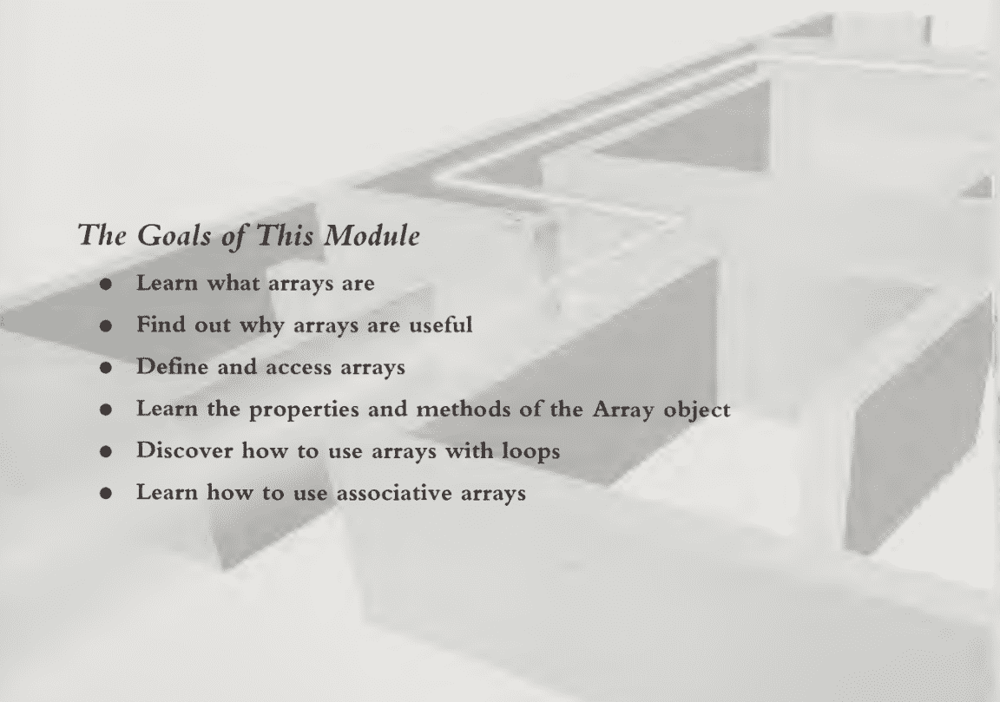

## 322 JavaScript 入门

在之前的章节中，我们讨论了对象的属性，为了使用这些属性，我们需要数组的知识。在本节中，我们将学习 JavaScript 数组以及它们如何帮助我们改进脚本。

我们将首先对数组是什么以及为什么使用它们很有用进行基本概述。然后，我们将学习如何在 JavaScript 中定义和访问数组。之后，我们将学习如何使用循环以便在脚本执行过程中访问数组的所有元素。最后，我们将查看关联数组以及如何使用它们。

## 什么是数组？

数组是存储相似类型的方法，以便在脚本后部分部分地访问。在 JavaScript 中，数组本质上是一个用户定义的对象，其访问方式通常与其他对象不同。在普通数组中，对元素的访问通常通过使用索引数字来实现。

关联数组允许使用字符串代替数字进行访问。我们将在本节的后半部分学习如何使用这两种方法。

为了直观理解普通数组的工作原理，假设我们有一个学生级，我们想通过脚本快速打印出每个学生的信息，但要在`document.write()`语句中编写每个变量名将花费大量时间（要打很多字！）。相反，我们将每个学生的姓名存储在数组中，这将允许我们使用循环通过几行代码更轻松地访问它。

数组允许我们把数字和名称组合在一起，如下例所示：

- 学生 0: Thomas
- 学生 1: Roger
- 学生 2: Amber
- 学生 3: Jennifer

通过这种方式进行存储，我们可以使用数字来获取每个学生的姓名。这就是数组作为存储信息和以后访问信息的方式变得有用的地方。

## 第 11 节：JavaScript 数组

## 提示

我们会注意到我们将第一个学生设为 Student 0 而不是 Student 1。原因是数组从 0 开始而不是 1。这种编号方式是为了避免混淆，因为我们希望数组中索引为 1 的学生对应学生 1 而不是学生 0。

## 为什么数组很有用

为什么使用数字会让我们更容易访问存储的信息？因为使用数字，我们可以使用循环处理信息，而不是手动编写。如果我们的示例学生列表很长，当我们想要打印名称时，循环可以节省我们。

例如，如果我们为示例中的每个学生赋值一个变量，然后将名称打印到屏幕，以下代码显示了这种情况：

```html
<HTML>

<HEAD>

<SCRIPT language="JavaScript">

<!---

var student0="Thomas";

var student1="Roger";

var student2="Amber";

var student3="Jennifer";

---

</SCRIPT>

</HEAD>

<BODY>

document.write(student0+"<BR>");

document.write(student1+"<BR>");

document.write(student2+"<BR>");

document.write(student3+"<BR>");

</BODY>

</HTML>
```

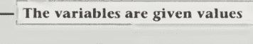
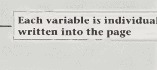

如果我们能够使用循环为每个学生重复同一个`document.write()`语句，就可以避免编写四个`document.write()`语句。数组本质上是创建一个具有属性列表对象的快速方法（因为它已经有了一个构造函数）。普通对象（如我们在第 8 节中创建的对象）可以像数组一样访问；但创建数组通常比创建对象更容易，因为你不需要处理构造函数。


## 一分钟练习

- 我们想在数组中存储什么？
- 使用什么来访问数组元素？
- 为什么使用数字会让我们更容易访问存储的信息？

- 我们会存储相似类型的数据
- 使用索引数字（关联数组使用字符串）来访问数组元素

## 定义和访问数组

现在我们已经知道了什么是数组，我们需要学习如何在 JavaScript 中定义和访问数组。首先，让我们看看 JavaScript 数组的命名规范。

## 命名

我们可以使用在前面的模块中学习的命名变量、函数和对象的相同规则来为数组命名。基本上，避免第一个字符使用数字，避免空格，并避免使用关键字。

## 定义数组

定义数组与创建对象实例相似。事实上，定义数组的一种方法在外观和行为上与创建对象实例完全相同。这正是我们正在做的——创建一个 JavaScript `Array`对象的实例。

由于我们对创建对象实例已经很熟悉，我们将首先使用这种方法。接下来的示例显示了 JavaScript 中定义数组的通用语法：

```
var arrayname= new Array(element0,element1);
```

我们将`arrayname`替换为我们想要给数组起的名称，并将`element0`和`element1`替换为每个元素将具有的值。我们可以根据需要使用任意数量的元素。

为了查看真实示例，让我们取本模块第一部分的学生姓名，并将它们作为数组元素。此数组将有四个元素，每个元素都是学生姓名的值。以下示例显示了数组的定义，名称值为字符串值：

```
var s_list= new Array("Thomas","Roger","Amber","Jennifer");
```

现在，我们有一个名为`s_list`的四元素数组，其中存储了这些值。注意，由于值是字符串，所以使用了引号（就像普通对象一样）。问题是，既然值已经在数组中了，我们现在如何访问它们呢？

## 访问数组

要访问数组的元素，我们使用所谓的“索引数字”（index number），它允许我们通过元素在数组中的位置访问数组的每个元素。例如，将数组第一个元素赋值给变量的语法如下所示：

```
var varname=arrayname[0];
```

我们将`varname`替换为变量名，将`arrayname`替换为我们想要访问的数组名。注意，`arrayname`之后的括号中有一个 0。这个 0 就是数组第一个元素的索引数字。

索引数字为 0 是因为数组从 0 开始计数而不是从 1 开始；因此，我们需要小心不要混淆数组中元素的索引数字。第一个元素的索引数字为 0，第二个为 1，第三个为 2，以此类推。

在紧随数组名称的方括号内，我们放置想要在数组中访问的元素的索引数字。每个学生的数组定义如下代码所示：

```
var s_list= new Array("Thomas", "Roger", "Amber", "Jennifer");
```

现在，假设我们想数组中第一个元素的值（在本例中是 Thomas，因为它是列表中的第一个元素）赋值给名为`tall_student`的变量。记住第一个元素的索引数字是 0；所以，为了将第一个元素的值赋值给变量，我们将使用以下代码：

```
var tall_student=s_list[0];
```

为了检查`tall_student`变量的值是否如我们预期那样输出，我们可以编写一个短脚本将其写在页面上。以下示例作为句子的一部分在页面上显示值：

```html
<HTML>

<HEAD>

<SCRIPT language="JavaScript">

<!--

var s_list = new Array("Thomas","Roger","Amber","Jennifer");

var tall_student = s_list[0];

-->

<SCRIPT>

</HEAD>

<body>

<SCRIPT language="JavaScript">

<!---->

document.write("The tallest student in class is "+tall_student);\n<!---->

</SCRIPT>

</body>

</html>
```

- 数组由四个元素定义
- 第一个数组元素的值被赋值给变量

在这种情况下，我们不需要将数组元素赋值给变量（这会让我们多输入代码）。我们可以直接将数组元素写入`document.write()`语句中以节省额外的一行代码：

```html
<HTML>

<HEAD>

<SCRIPT language="JavaScript">

<!--

var s_list = new Array("Thomas","Roger","Amber","Jennifer");

-->

</SCRIPT>

</HEAD>

<body>

<SCRIPT language="JavaScript">

<!---->

document.write("The tallest student in class is "+s_list[0]);\n<!---->

</SCRIPT>

</body>

</html>
```

- 变量的值打印在页面上
- 数组由四个元素定义
- 第一个元素的值被写入页面

我们直接访问数组元素，并在此过程中减少了一些输入工作。

## 定义数组的其他方法

我们已经看到了定义数组的最快方法，但还有其他（虽然较长）方法，这些方法在模块的以后将派上用场。这将允许你使用最适合各种情况的方法。


## 328 JavaScript：入门指南

## 先占留空间，后赋值

定义数组的一种方法是为数组分配一定的空间（元素），然后允许在脚本后期赋值值。这是通过在定义数组时括号内使用单个数字完成：

```
var s_list= new Array(4);
```

这创建了一个名为`s_list`的数组，它初始将有四个元素（如果我们需要，以后可以添加元素）。记住索引数字将是 0, 1, 2 和 3，而不是 1, 2, 3 和 4。在这种情况下，我们将在脚本稍后给数组的四个元素赋值。

要给元素赋值，我们只需使用数组名和想要赋值的索引数字对其进行赋值即可。所以，如果我们想给数组的第三个位置（索引数字 2）赋值 Amber 的值，我们将使用以下代码：

```
s_list[2]="Amber";
```

在数组定义后的任何地方都可以使用这样的一行代码。前面的代码使用的技术也允许在我们决定在脚本后期需要更多元素时向数组添加元素。我们还可以使用循环为数组的所有元素赋值，但我们将在处理数组和循环的模块中看到更多。

所以，假设我们想为`s_list`数组添加第五个元素。通过为其赋值值（索引数字 4），可以在数组的第五位置添加一个新名称，如下代码所示：

```
s_list[4]="Pat";
```

这为我们的`s_list`数组添加了一个值为 Pat 的第五个元素。

## 先占留空间，后数值赋值

另一种定义数组的方法与我们刚刚涵盖的非常相似。唯一的区别是数组的部分或全部元素在新数组创建后立即被赋值。

## 模块 11：JavaScript 数组 329

为了查看示例，让我们再次使用`s_list`数组。以下代码显示了如果我们想在创建数组空间的行之后立即，如何为数组元素赋值。

```
var s_list=new Array(4)

s_list[0]="Thomas"

s_list[1]="Roger"

s_list[2]="Amber"

s_list[3]="Jennifer";
```

这一次，在数组创建时就分配了四个元素。这是通过在创建新数组的行末尾省略分号实现的。如果你想为每个元素赋值但不想在同一行使用一组参数列表，这种方法是有优势的。它也更容易回溯并快速查看哪个值被分配给了哪个元素，因为不需要在很长的元素列表中横向计数。

使用其他方法，我们仍然可以通过序列中的下一个索引数字在脚本中添加更多元素。

## 数组名，无参数

我们定义数组的另一种选项是不带任何参数地定义它。这将创建一个没有元素的数组，但我们能够像之前定义数组的其他选项一样在以后添加元素。

要创建一个没有元素的数组，我们创建一个不带参数的数组，如下示例代码所示：

```
var s_list=new Array();
```

这创建了一个名为`s_list`的没有元素的数组。我们仍然可以通过使用序列中的下一个索引数字在脚本后期添加更多元素。所以，如果我们以后决定让数组包含一个元素，我们可以使用以下代码：

```
var s_list=new Array();

var x=17;

var y=x+2;

s_list[0]="Thomas";
```

- 数组被定义
- 这只是填充空间，显示我们可以在脚本后期赋值
- 为第一个（也是目前为止唯一的）元素进行了赋值

## JavaScript：初学者指南

这会将单个元素放入数组中。如果我们为索引号较高的元素赋值，数组将扩展，并为其之前的所有元素留出槽位。例如，请看以下代码：

```javascript
var s_list=new Array();

var x=17;

var y=x+2;

s_list[29]="Thomas";
```

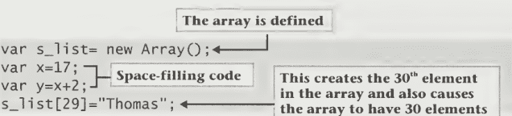

这段代码的最后一行将字符串“Thomas”赋值给数组中的第 30 个元素（索引号 29）。这意味着数组从 0 个元素变为了 30 个元素。通过给这个元素赋值，数组会扩展以提供足够的槽位进行补偿，并且我们可以在以后需要时为这些槽位分配值。

现在我们已经知道了如何以各种方式定义数组，我们需要查看 JavaScript 中`Array`对象的属性和方法。


## 1分钟演练

- 当我们创建一个新数组时，实际上创建了什么？
- 使用什么来访问数组的元素？
- 在创建新数组时使用一个数字作为参数会发生什么？

- 创建了一个 JavaScript `Array`对象的实例
- 使用元素的索引号来访问数组的元素
- 创建了一个具有相应数量元素的数组，并为每个元素留了空间，但值是在脚本之后赋值的

## `Array`对象属性和方法

与其他对象一样，JavaScript 对象的实例可以使用`Array`对象的各种属性和方法。我们将看到：

我们通过在数组名称后加上想要使用的属性或方法名称来访问属性。我们将在学习属性和方法的过程中进行解释；但首先，让我们看看`Array`对象的属性。

## 属性

表 11-1 列出了`Array`对象的属性以及每个属性的简短描述。在表格之后，我们将详细地讨论每个属性。

## `constructor` 属性

`constructor`属性包含了构造数组的函数代码值：

```javascript
function Array() { [native code] }
```

它主要用于信息提示或比较。要访问该属性，我们使用数组名称、点运算符和`constructor`关键字。以下是使用`Array`对象的通用语法：

```javascript
arrayname.property
```

我们将`arrayname`替换为需要使用属性的数组名称，并将`property`替换为想要使用的属性。因此，为了使用`constructor`属性，我们需要创建一个数组，以便拥有`Array`对象的实例。我们可以回到：

| 属性 | 描述 |
| --- | --- |
| `constructor` | 指向构造函数，当数组通过正则表达式匹配创建时，用于创建对象的实例 |
| `index` | 当数组通过正则表达式匹配创建时使用的另一个属性 |
| `input` | 包含一个数值等于数组中元素个数的数值 |
| `length` | 允许向对象（如 JavaScript `Array`对象）添加属性和方法 |
| `prototype` | |

表 11-1 `Array`对象的属性

## JavaScript：初学者指南

使用之前的`s_list`数组来提供一个可以使用的数组。这将允许我们使用以下代码：

```javascript
var s_list= new Array(4);

window.alert(s_list.constructor);
```

这将向用户发送一个带有文本`function Array() { [native code] }`的警告（这与在本节之前看到的属性返回的文本相同）。

## `index` 和 `input` 属性

`index`和`input`属性涉及正则表达式（一种匹配文本字符串的方法），因此我们在这里不会详细讨论它们，因为正则表达式需要很长的解释。我们将在第 16 模块中接触正则表达式。

## `length` 属性

`length`属性返回一个数字，告诉我们数组中有多少元素。

> 注意
> `length`属性在之后我们开始循环遍历数组时非常有用。我们可能需要知道数组的长度（以防在定义数组后添加元素），以便循环遍历数组的每个元素。

要使用`length`属性，我们使用数组名称，然后加上`length`属性。以下代码展示了使用`length`属性告诉用户数组中有多少元素的示例：

```javascript
var s_list= new Array(4)

s_list[0]="Thomas"

s_list[1]="Roger"

s_list[2]="Amber"

s_list[3]="Jennifer"

window.alert("The array has "+s_list.length);
```

## 第 11 模块：JavaScript 数组 | 333

这将向用户发送一个显示“The array has 4 elements”的警告。

## `prototype` 属性

`prototype`属性允许我们向已存在的对象（如`Array`对象）添加属性和方法。通过这种方法，我们可以在构造函数外部向对象添加属性。但记住，使用`prototype`属性进行的更改会影响该对象的每个实例。

## JavaScript：初学者指南

现在我们已经知道了`Array`对象的属性，我们需要查看可以对数组执行不同操作的方法。表 11-2 列出了这些方法以及每个方法的描述。在表格之后，我们将详细地讨论每个方法。

| 方法 | 描述 |
| --- | --- |
| `concat()` | 合并两个或多个数组的元素并返回新数组 |
| `join()` | 使用分隔符将数组元素合并为单个字符串 |
| `pop()` | 从数组移除最后一个元素并返回被移除的元素 |
| `push()` | 在数组末尾添加元素，如果需要，返回数组新长度的数值 |
| `reverse()` | 反转数组中元素方向：第一个元素移动到最后一个槽位，最后一个元素移动到第一个槽位，依此类推 |
| `shift()` | 从数组移除第一个元素并返回该元素 |
| `unshift()` | 在数组开头添加元素，如果需要，返回数组新长度的数值 |
| `slice()` | 提取数组的指定部分并将该部分作为新数组返回 |
| `splice()` | 从数组中删除元素或替换数组中的元素 |
| `sort()` | 根据元素的字符串值将数组元素按字母顺序进行排序 |

表 11-2 `Array`对象的方法

## `concat()` 方法

`concat()`方法用于合并（或连接）两个或多个数组的元素，并返回一个包含所有元素的新数组。我们使用数组名称作为参数，并按照我们想要组合数组元素的顺序设置它们。

在我们的第一个示例中，让我们合并两个数组。为了做到这一点，我们只需要使用一个参数。该参数是我们要添加到调用方法的数组末尾的数组名称。以下代码合并了两个数组的元素：

```javascript
var fruits=new Array("oranges", "apples");

var veggies=new Array("corn", "peas");

var fruits_n_veggies=fruits.concat(veggies);
```

## 336 JavaScript：初指南

这段代码创建了一个名为`fruits`的包含两个元素的数组，以及一个名为`veggies`的包含两个元素的数组。接下来，我们根据之前数组的组合定义了一个新数组。新数组的名称将是`fruits_n_veggies`。我们将`concat()`方法返回的值赋值给此数组，创建一个新的组合数组。

我们使用`fruits`数组调用`concat()`方法并将`veggies`数组名作为参数，是为了在新数组的开头获得`fruits`数组的元素，而`veggies`数组的元素会被添加到新数组的末尾。之前的代码创建了具有以下元素的新数组`fruits_n_veggies`：

橙子、苹果、玉米、豌豆

如果我们希望`veggies`数组的元素列在前面，我们将使用`veggies`数组名调用该方法并将`fruits`数组名作为参数。下面的示例展示了如何这样做：

```
var fruits= new Array("oranges","apples");

var veggies= new Array("corn","peas");

var fruits_n_veggies=veggies.concat(fruits);
```

`veggies`数组的元素首先列出，新的`fruits_n_veggies`数组具有以下元素：

玉米、豌豆、橙子、苹果

在使用此方法时，我们希望通过使用刚刚描述的技巧，按照我们想要的方式设置顺序。

如果我们合并三个数组，调用`concat()`方法的数组元素将排在前面，然后作为参数发送的每个数组的元素将按照它们发送的顺序添加：

```
var fruits= new Array("oranges","apples");

var veggies= new Array("corn","peas");

var meats= new Array("fish","chicken");

var three_groups=fruit.concat(veggies,meat);
```

## 第 11 节：JavaScript 数组 337

现在我们正在合并三个数组，以下是新的数组`three_groups`的元素：

橙子、苹果、玉米、豌豆、鱼、鸡肉

如果我们按照下面的方式编写代码，我们将得到一个具有相同元素但顺序不同的数组：

```
var fruits= new Array("oranges","apples");

var veggies= new Array("corn","peas");

var meats= new Array("fish","chicken");

var three_groups=meat.concat(veggies,fruit);
```

使用此代码，新数组`three_groups`中的元素顺序如下：

鱼、鸡肉、玉米、豌豆、橙子、苹果

### `join()` 方法

`join()`方法用于将数组的元素组合成单个字符串，每个元素之间由作为参数传递给方法的字符分隔。如果没有设置参数，则在调用方法时将使用逗号作为默认分隔符。

为了查看此方法如何工作，让我们来看一下代码。先定义一个数组，然后使用数组名调用`join()`方法。以下是示例代码：

```
var fruits= new Array("oranges","apples","pears");

var fruit_string=fruits.join();
```

这段代码将带有`fruits`数组时调用`join()`方法的结果赋值给变量`fruit_string`。由于我们没有发送参数，数组的元素在新字符串中将用逗号分隔。`fruit_string`变量具有以下字符串值：

橙子、苹果、梨

## 338 JavaScript：初指南

我们可以通过将字符串变量写入 Web 页面来看到此结果。下面的代码将为我们完成此操作：

```
<HTML>

<HEAD>

<SCRIPT language="JavaScript">

<!--

var fruits = new Array("oranges","apples","pears");

var fruit_string=fruits.join("");

-->

</SCRIPT>

</HEAD>

<body>

<SCRIPT language="JavaScript">

<!--

document.write("The new string is "+fruit_string);

-->

</SCRIPT>

</BODY>

</HTML>
```

我们可以看到从`join()`方法返回的字符串。图 11-1 显示了此代码在浏览器中运行时产生的结果。如果我们想用逗号以外的字符分隔新字符串中的元素，我们可以将想要使用的字符作为参数发送。

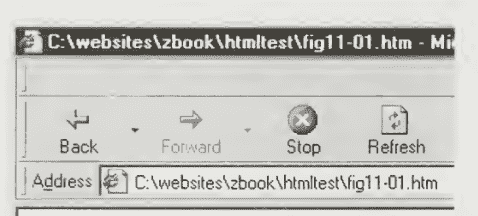

图 11-1 新字符串写在页面上

下面的代码将冒号作为字符串参数发送给`join()`方法：

```
<HTML>

<HEAD>

<SCRIPT language="JavaScript">

<!--

var fruits=new Array("oranges","apples","pears");

var fruit_string=fruits.join(":");

-->

</SCRIPT>

</HEAD>

<body>

<SCRIPT language="JavaScript">

<!--

document.write("The new string is "+fruit_string);

-->

</SCRIPT>

</body>

</HTML>
```

创建了一个具有三个元素的数组

数组的元素用冒号分隔连接成单个字符串

字符串打印到屏幕上

这次的字符串与之前的略有不同，因为冒号代替了我们在上一个示例中的逗号。图 11-2 显示了该字符串在浏览器窗口中的打印情况。

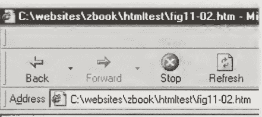

图 11-2 新字符串写在页面上，以冒号作为分隔符

## JavaScript：初指南

### `pop()` 方法

`pop()`方法用于从数组中删除最后一个元素。如果我们将方法的结果赋值给变量，则被弹出的元素将被返回并赋值给该变量。

对于`pop()`方法，让我们来看一些代码，它创建一个数组，然后使用`pop()`方法从数组中删除最后一个元素：

```
var fruits= new Array("oranges","apples","pears");

fruits.pop();
```

这创建了一个名为`fruits`的包含三个元素（橙子、苹果、梨）的数组。然后使用`pop()`方法删除了最后一个元素，将数组缩短为仅剩两个（橙子、苹果）。

如果我们想删除一个元素但仍以某种方式使用它，可以将方法的结果赋值给变量。该变量将是被删除的元素。下面的示例删除了数组的最后一个元素并将其发送给观众：

```
var fruits= new Array("oranges","apples","pears");

var picked_fruit=fruits.pop();

document.write("You picked "+picked_fruit);
```

### `push()` 方法

`push()`方法用于向数组末尾添加元素。发送给方法的参数是元素希望添加到数组的新元素或多个元素。

## 注意事项

`push()`方法返回的值取决于浏览器使用的 JavaScript 版本。在 JavaScript 1.2 中，该值是添加到数组的最后一个元素。在较后的版本中，它返回数组新长度的数值。

## 第 11 节：JavaScript 数组 341

作为一个数组，让我们来看向数组添加一个元素的代码：

```
var fruits= new Array("oranges","apples");

fruits.push("pears");
```

这段代码创建了一个名为`fruits`的包含两个元素（橙子、苹果）的数组，然后使用`push()`方法添加第三个元素，梨。现在包含三个元素（橙子、苹果、梨）。

我们可以通过发送多个参数来添加多个。元素将按照它们在参数列表中的顺序添加。下面的代码向`fruits`数组添加两个元素：

```
var fruits= new Array("oranges","apples");

fruits.push("pears","grapes");
```

这段代码取包含两个元素（橙子、苹果）的数组并向其添加两个元素。最后，数组包含了四个元素（橙子、苹果、梨、葡萄）。

如果我们想要方法返回的值，可以将结果赋值给变量。下面的代码执行了此操作并向用户显示返回的值：

```
var fruits= new Array("oranges","apples");

var who_knows=fruits.push("pears","grapes");

window.alert("The method returned "+who_knows);
```

`who_knows`变量的值取决于你的浏览器。如果浏览器是 JavaScript 1.2，该值应该是字符串 "grapes"（添加到数组的最后一个元素）。如果浏览器是 JavaScript 1.3 或更高版本，变量的值应该是数值 4（数组的新长度）。

### `reverse()` 方法

`reverse()`方法用于反转数组中元素的顺序。由于该方法只做这些工作，因此不需要发送任何参数或返回数值。

## 342 JavaScript：初学者指南

为了使用此方法，让我们创建一个示例。以下代码将创建一个数组并反转数组中元素的顺序：

```
var fruits= new Array("oranges","apples","pears");

fruits.reverse();
```

数组的初始顺序是 oranges（橙子）、apples（苹果）、pears（梨）。当对此数组调用`reverse()`方法时，元素的顺序会被反转，数组现在的顺序变成了 pears、apples、oranges。

## `shift()` 方法

`shift()`方法用于删除数组的第一个元素。它会返回被删除元素的值，以便我们在脚本稍后需要时使用它。

因此，如果我们想删除数组中的第一个元素，可以使用类似于下面的代码：

```
var fruits= new Array("oranges","apples","pears");

fruits.shift();
```

这创建了一个包含三个元素（oranges, apples, pears）的数组，并使用`shift()`方法删除第一个元素。这导致数组只剩下两个元素（apples, pears）。

要使用被删除元素的值，我们可以将方法的赋值赋值一个变量。以下代码将被删除的元素赋值给变量，并向查看者展示删除了什么内容：

```
var fruits= new Array("oranges","apples","pears");

var picked_fruit=fruits.shift();

window.alert("You picked "+picked_fruit);
```

这段代码会在浏览器窗口中显示警告“You picked my oranges”（你挑了我的橙子）。

## `unshift()` 方法

`unshift()`方法用于向数组开头添加元素。我们希望添加到数组中的元素将作为参数传递给方法。方法返回的值是数组新长度的数值。

## 模块 11：JavaScript 数组

对于我们的示例，我们将在数组开头添加一个新元素：

```
var fruits= new Array("apples","pears");

fruits.unshift("oranges");
```

这创建了一个名为`fruits`的包含两个元素（apples, pears）的数组，然后使用`unshift()`方法在数组开头添加一个元素。该数组随后包含三个元素（oranges, apples, pears）。

如果我们想一次添加多个元素，我们将按照希望添加的顺序将它们全部作为参数发送。以下示例向数组开头添加了两个元素：

```
var fruits= new Array("apples","pears")

fruits.unshift("oranges","grapes");
```

这取了包含两个元素（apples, pears）的初始数组，并在开头添加了两个元素。调用`unshift()`方法后，数组最终包含四个元素（oranges, grapes, apples, pears）。

## `slice()` 方法

`slice()`方法用于删除数组的指定部分，然后使用旧数组中切片部分的元素创建一个新数组。

这是该方法的通用语法：

```
arrayname.slice(start,stop)
```

我们将`arrayname`替换为我们想要从中提取某组元素以创建新数组的数组名称。我们将`start`替换为从哪里开始切片的索引数字。我们将`stop`替换为我们想要切片的最后一个元素之后的索引数字。

例如，以下代码将从数组中切取两个元素，并创建一个包含这些元素的新数组：

```
var fruits= new Array("oranges","apples","pears","grapes")

somefruits=fruits.slice(1,3);
```

这删除了数组从第二个元素（索引 1）到第三个元素（索引 2）的内容。它没有提取第四个元素（索引 3），因为 3 是索引 2 之后的数字，而 2 是我们要删除的最后一个元素的索引。名为`somefruits`的新数组包含了我们删除的元素（apples, pears）。

## `splice()` 方法

`splice()`方法允许我们删除或替换数组中的元素。可以发送的参数包括开始切片的索引数字、要删除的元素数量，以及向数组中添加新元素的选项。

如果我们想从数组中删除单个元素，可以使用如下代码：

```
var fruits= new Array("oranges","apples","pears","grapes");

var somefruits=fruits.splice(2,1);
```

这开始从索引 2 开始删除元素。下一个参数是 1，所以只会删除一个元素；因此，我们在此处删除了索引 2 的元素，即 pears。执行`splice`后的数组只包含三个元素（oranges, apples, grapes）。

要删除多个元素，我们增加第二个参数的值。以下代码从索引 2 开始删除两个元素：

```
var fruits= new Array("oranges","apples","pears","grapes");

var somefruits=fruits.splice(2,2);
```

这一次，数组被削减为两个元素（oranges, apples），因为最后两个元素被`splice()`方法删除了。

我们还可以使用该方法替换数组中的切片元素，或向数组中添加元素。以下代码通过发送额外的参数，将索引 2 切片元素替换为新元素：

```
var fruits= new Array("oranges","apples","pears","grapes");

var somefruits=fruits.splice(2,1,"watermelons");
```

这一次，索引 2 的元素被删除了。由于第二个参数是 1，所以只删除了一个元素。下一个参数告诉浏览器在第一个参数指定的索引（索引 2）处添加此值。

此值替换了被删除的值（pears）。数组仍将有四个元素，只是元素不同（oranges, apples, watermelons, grapes）。

如果我们想使用该方法向数组添加一个或多个元素但不删除任何内容，我们将第二个参数设置为 0（从而删除 0 个元素）。我们将第一个参数设置为我们希望开始添加元素的索引数字。例如，看以下代码：

```
var fruits=new Array("oranges","apples","pears","grapes");

var somefruits=fruits.splice(2,0,"watermelons","plums");
```

这一次，我们从第一个参数指定的索引 2 开始。我们看到没有元素被删除，但从索引 2 开始添加了两个元素。数组将会有六元素（oranges, apples, watermelons, plums, pears, grapes）。

## `sort()` 方法

`sort()`方法按字母顺序对数组进行排序（类似于目录列表）。然而，这并不是数值顺序。例如，让我们再次查看水果数组。如果我们想更改元素的顺序，使其按字母顺序排列，可以使用以下代码：

```
var fruits=new Array("oranges","apples","pears","grapes");

fruits.sort();
```

这会重新排列数组，使元素按字母顺序排列，从 oranges, apples, pears 变为 grapes, apples, oranges, pears。

当我们想在页面上显示数组的内容时，可能会发现这有用。在“专家问”之后，我们将看到如何使用循环来方便我们显示数组的内容。

## 专家问

**问题：** 在所有属性中，是否有是特别有用的？

**答案：** `length`属性在很多情况下都会很有用。其他属性在这里不太可能频繁使用，但随着你学习的深入，你可能会发现其中的一些在你的脚本中很有用。

首先，让我们来看看如何使用循环来创建数组元素，而不是直接赋值值。

## 创建数组元素

循环在创建数组元素时非常有用。如果我们由于某种原因需要用户输入数组的内容，或者我们希望在创建每个元素时执行类似的计算，这种方法就尤为有用。

假设我们希望用户能够从我们旧的`s_list`学生姓名数组中输入四个学生的名字。使用`for`循环，我们可以以下代码允许用户输入每个名字：

```javascript
var s_list=new Array(4);

for(count=0;count<4;count++) {

  s_list[count]=window.prompt("Enter a name,");

}
```

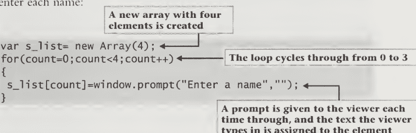

这段代码创建了一个包含四个类型的新数组。然后我们使用`for`循环为每个值赋值。循环从将循环变量`count`设置为 0 开始，一直运行到表达式`count<4`不再为真为止。

由于我们每次循环都将`count`的值加 1（`count++`），这意味着`count`变量在第一次循环时为 0，第二次为 1，第三次为2，第四次为3。它不会再次运行，因为此时`count`将等于 4，而它不再小于 4。

## 提示

将`count`变量从 0 开始有一个优势，即我们在使用循环时不容易感到困惑。`count`变量将代表每个数组元素的索引号，因此我们不需要像从 1 开始计数时那样，对它的值减去 1。

在循环内部，我们每次循环都为`count`变量所代表的索引号对应的元素赋值。赋值的值是用户在提示输入名字时所输入的内容。在这种情况下，用户将收到四次提示，并为所有四个元素赋值。

使用循环为元素赋值另一种方法是执行会影响每个元素的类似计算。例如，如果我们想要一个包含十个数字的数组，可以使用以下代码：

```javascript
var even_nums= new Array(10);

for (count=0;count<20;count+=2) {

  var a_count=0;

  even_nums[a_count]=count+2;

  a_count++;

}
```

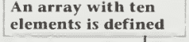


通过每次循环将`count`增加 2，我们确保在计算中使用偶数。然后我们在遍历循环时，将`count`的值加 2 的结果赋值给每个元素。使用`a_count`变量允许我们避免由于`count`变量每次增加 2 而导致数组缺失元素。`a_count`变量每次加 1，以保持数组索引号只增加 1（而不是像`even_nums[0]`和`even_nums[2]`那样跳过`even_nums[1]`——如果我们直接用`count`变量作为索引槽位，而不是每次只增加 1 的`a_count`，就会发生这种情况）。

第一次循环时，`count`为 0，因此`even_nums[0]`被赋值为 0+2，即 2。下一次循环时`count`等于 2，因此`even_nums[1]`被赋值为 2+2，即 4。这种情况会一直持续，直到我们拥有十个数组元素（索引号 0–9），且它们都是偶数。

## 遍历数组

我们还可以遍历已创建的数组来更改它、获取信息或以我们喜欢的方式列出其内容。这非常有用，并且可以为处理较大的数组节省时间。

如果我们回到列出班级学生姓名的`s_list`数组，可以看到当我们决定在屏幕上打印学生列表时，循环可以节省我们一些打字时间。我们还可以设置循环，以便在我们以后决定向数组添加内容时，它会自动调整。首先，让我们如何使用循环将名字列表打印到浏览器屏幕：

```html
<HTML>

<HEAD>

<SCRIPT language="JavaScript">

<!--

var s_list=new Array(4);

s_list[0]="Thomas";

s_list[1]="Roger";

s_list[2]="Amber";

s_list[3]="Jennifer";

-->

</SCRIPT>

</HEAD>

<body>

<h2>Student Names</h2>

<SCRIPT language="JavaScript">

<!--

for(count=0;count<4;count++) {

  document.write(s_list[count] + "<BR>");

}

-->

</SCRIPT>

</body>

</HTML>
```

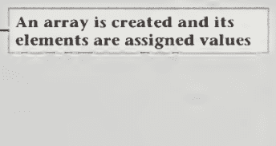
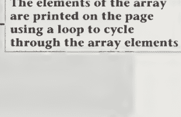

我们基本上在循环中使用了与创建数组时相同的方法。然而，这次我们使用循环将数组的内容打印到屏幕上。图 11–3 显示了该脚本在浏览器中运行时的样子。

## JavaScript：初学者指南

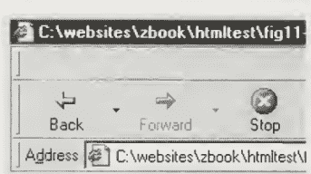

我们基本上在循环中使用了与创建数组时相同的方法。然而，这次我们使用循环将数组的内容打印到屏幕上。图 11–3 显示了该脚本在浏览器中运行时的样子。

这将帮助我们开始，并建立一个基础，我们可以此为 JavaScript 数组构建更复杂的循环。

## 1 分钟演练

- 使用循环为数组元素赋值可能的两种用途是什么？
- 为什么使用循环打印数组元素对我们有帮助？
- `length`属性如何帮助我们完成循环？

- 录入数组内容的两种可能用途（或者当我们希望在创建每个元素时执行类似的计算时）是：我们需要查看数组的内容。
- 如果数组很长，使用循环打印数组元素将对我们帮助，因为它通过遍历数组并写入每个元素，省去了我们手动输入每个元素的麻烦。
- 如果我们在循环的比较中使用`length`属性，它将帮助我们完成循环，因为我们能够更改数组中元素的数量，而循环仍能遍历每个元素，无需更改循环代码。

## 项目 11-1：在数组上使用循环

此项目将允许你练习在数组上使用循环，并练习使用数组的一些属性。它将创建一个计算机部件列表，我们希望将其打印到屏幕上。

## 逐步步骤

- 1. 创建一个 HTML 页面，在 HEAD 和 BODY 部分为你的 JavaScript 代码留出空间。
- 2. 在 HEAD 部分，创建一个新数组，并将以下部件作为数组中元素的值：

```
monitor

motherboard

chip

hard drive
```

- 3. 在 BODY 部分，创建一个显示“Computer Parts Needed”的 h2 标题，作为列表标题。
- 4. 标题之后，在浏览器窗口中单独行打印每个计算机部件（使用循环）。
- 5. 将文件保存为`pr1_1.html`，并在浏览器中查看结果。
- 6. 在文本编辑器中重新打开该文件，并按照后续步骤中的描述进行更改。
- 7. 如果你之前没有这样做，请在比较中使用`length`属性代替数字。
- 8. 通过在 HEAD 部分编写代码，为数组添加一些元素。在已有的前四个元素之后添加以下项目：
  - disk drive
  - power supply
- 9. 让数组自行排序，使其按字母顺序排列。
- 10. 将此版本的文件保存为`pr1_1_2.html`，并在浏览器中查看。新元素应该显示在数组元素的字母列表中。

## 关联数组

关联数组允许我们使用字符串代替索引数字。使用关联数组与使用普通对象的属性名非常相似，我们只是以数组格式来操作。由于没有使用数字，它们的用途更为有限，但它们仍然可以用于存储信息，并在我们访问元素时让这些元素更容易被记住。首先，让我们看看如何定义关联数组。

## 定义关联数组

我们可以以与普通数组非常相同的方式来实现，但我们希望使用允许我们单独分配每个元素的方法。在这里，我们将创建一个空数组，并通过给元素赋值来赋予它值。


## 356 JavaScript：初学者指南

要给元素赋值，我们需要提供字符串代替其索引数字。我们用于字符串的值应该是我们能与要赋值给元素的值相关联的内容。例如，如果我们想根据每个学生的特质将`s_list`数组转换为关联数组，可以使用以下代码：

```
var s_list=new Array();

s_list["tall"]="Thomas";

s_list["cool"]="Roger";

s_list["clever"]="Amber";

s_list["attentive"]="Jennifer";
```

这里的赋值提供了一个特质的索引，然后将学生的姓名赋值给具有该特质的元素。这将使得我们以后想要访问数组元素时更容易记住，而不是在需要元素时使用数字。这使得数组的声明在语义上更丰富，如果我们想查询或以其他方式引用特定元素，这可能也很有用。

## 访问关联数组

访问关联数组的方法与访问普通数组相同，不同在于我们使用索引字符串而不是索引数字。

例如，如果我们想访问名为“tall（高子）”的学生的元素，可以使用以下语法访问它：

```
s_list["tall"]
```

因此，我们可以通过以下示例代码根据特质打印学生列表：

```html
<HTML>

<HEAD>

<SCRIPT language="JavaScript">

<!--

var s_list=new Array();

s_list["tall"]="Thomas";

s_list["cool"]="Roger";

s_list["clever"]="Amber";

s_list["attentive"]="Jennifer";

-->

</SCRIPT>

</HEAD>

<H2>Student Names</H2>

<SCRIPT language="JavaScript">

<!--

document.write("The tall one is " + s_list["tall"] + "<BR>");

document.write("The cool one is " + s_list["cool"] + "<BR>");

document.write("The clever one is " + s_list["clever"] + "<BR>");

document.write("The attentive one is " + s_list["attentive"] + "<BR>");

-->

</SCRIPT>

</BODY>

</html>
```

数组元素被打印在页面上。

这将根据特质打印列表。图 11-6 显示了脚本在浏览器中运行的结果。

我们将在下一个模块中使用数组，以帮助我们创建使用随机数的脚本。

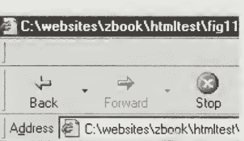

## Student Names

The tall one is Thomas
The cool one is Roger
The clever one is Amber
The attentive one is Jennifer

图 11-6 名字是根据每个学生的特质列出的

## 358 JavaScript：初学者指南

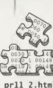

## 项目 11-2：使用关联数组

此项目将允许你练习使用关联数组。它让你根据各种汽车的特性创建一个数组。

## 逐步步骤

- 1. 创建一个 HTML 页面，在 HEAD 和 BODY 部分为我们的代码留空间。
- 2. 在 HEAD 部分，创建一个具有以下索引字符串的关联数组：

```
cool

small

long
```

- 3. 为索引为`cool`的元素赋值“Mustang”。为索引字符串为`small`的元素赋值“Bug”。为索引字符串为`long`的元素赋值“Station Wagon”。
- 4. 在 BODY 部分，创建一个显示“List of Cars”的 h2 标题。
- 5. 标题之后，在浏览器窗口中打印每个元素的值。
- 6. 将文件保存为`pr1_2.html`，并在浏览器中打开。你应该看到汽车列表！

## 掌握情况

- 1. 下列哪项不能正确创建数组？
  A. `var myarray=new Array();`
  B. `var myarray=new Array(5);`
  C. `var myarray=new Array("hello","hi","greetings");`
  D. `var if=new Array[10];`

- 2. 下列哪项可以正确访问名为`cool`的数组的五个元素？
  A. `cool[5];`
  B. `cool(5);`
  C. `cool[4];`
  D. `cool.array[4];`

- 3. `Array`对象的哪个属性返回数组长度的数值？
  A. `length`属性
  B. `getlength`属性
  C. `constructor`属性
  D. `lengthOf`属性

- 4. 默认情况下，`sort()`方法如何排序数组的内容？
  A. 它反转数组的内容。
  B. 它按数字排序。
  C. 它按字母顺序排序。
  D. 它从数组中删除最后一个元素。

- 5. 在关联数组中，什么被代替索引数字？
  A. 浮点值
  B. 布尔值
  C. 负数
  D. 字符串值

## JavaScript：初学者指南

在之前的模块中，我们查看了 JavaScript 数组和`Array`对象。在本模块中，我们将学习 JavaScript 的`Math`对象和`Date`对象。

我们将从对`Math`对象进行简要介绍，并看看它为什么对我们有用。然后，我们将查看可以从`Math`对象使用的各种属性和方法。接下来，我们将介绍`Date`对象，并看看它如何对我们有用。随后，我们将研究`Date`对象的属性和方法，看看我们可以用它做什么。

# `Math` 对象

当我们需要脚本中执行各种计算时，`Math`对象对我们非常有用。首先，让我们看看`Math`对象是什么。

## 什么是`Math`对象？

`Math`对象是一个预定义的 JavaScript 对象。它提供了属性和方法供我们使用，就像我们在书中学习过的其他预定义对象一样。`Math`对象用于数学目的，提供某些数学常数的值，或者在我们使用方法函数时执行某些操作。

## `Math`对象的用途

正如我们所提到的，当我们在脚本中进行数学计算时，`Math`对象非常有用。例如，如果我们在计算中需要 pi 的值，`Math`对象提供了一个属性供我们使用，以便获取该值。

此外，如果我们需要找到数字的平方根，`Math`对象使我们能够做到这一点。该对象提供的另一个功能是在 JavaScript 中生成随机数，我们将在某些脚本中发现它有用。

## 第 12 模块：`Math`和`Date`对象


- 什么是`Math`对象？
- pi 的值是作为`Math`对象的属性还是方法给我们的？
- `Math`对象在什么时候有用？

- `Math`是另一个预定义的 JavaScript 对象。它提供了用于计算的属性和方法。
- 它是以属性的形式提供的。
- 当我们在脚本中进行数学计算时，`Math`对象非常有用。

## 属性

`Math`对象提供了许多属性，当我们需要执行数学计算时，这些属性可以提供帮助。表 21-1 列出了`Math`对象的属性及其每个的值。在表格之后，我们将更详细地讨论每个属性。

| 属性 | 值 |
| :--- | :--- |
| `E` | 欧勒常数 (E) 的值，约为 2.71828 ... |
| `LN10` | 10 的自然对数的值，约为 2.302585 ... |
| `LN2` | 2 的自然对数的值，约为 0.693147 ... |
| `LOG10E` | E 的以 10 为底的对数，约为 0.43429 ... |
| `LOG2E` | E 的以 2 为底的对数，约为 1.442695 ... |
| `PI` | pi 的值，通常用于圆，约为 3.14159 ... |
| `SQRT2` | 2 的平方根的值，约为 1.4142 ... |
| `SQRT1_2` | 二分之一平方根的值，约为 0.7071 ... |

**表 12-1 | `Math`对象属性**


## JavaScript：初学者指南

正如你在表 12-1 中所示，所有属性都简单地持有数值，这些数值在数学计算中非常有用。

## `E` 属性

`E`属性持有欧勒常数的值，约为 2.71828 ...（这只是一个近似值，由于它是无理数，实际值是无限的）。

要查看`E`属性的值，我们可以在 alert 中使用它。以下代码向查看者显示`E`属性的值：

```
window.alert(Math.E);
```

这将显示图 12-1 所示的 alert 框。

## `LN10` 属性

`LN10`属性持有 10 的自然对数的值，约为 2.302585 ...（再次，这只是一个近似值）。

要查看此属性的值，我们可以在 alert 中使用它。以下代码将弹出一个带有该属性值的 alert 框：

```
window.alert(Math.LN10);
```

这将显示一个与图 12-2 类似的 alert 框。


**图 12-1** 显示`E`属性值的 alert 框

## 第 12 模块：`Math`和`Date`对象

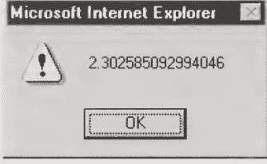
**图 12-2** 显示`LN10`属性值的 alert 框

## `LN2` 属性

`LN2`属性持有 2 的自然对数的值，约为 0.693147 ...

要查看此属性的值，我们可以使用一个 alert。以下代码显示了带有此属性值的 alert：

```
window.alert(Math.LN2);
```

这将显示一个与图 12-3 类似的 alert 框。

## `LOG10E` 属性

`LOG10E`属性持有 E 的以 10 为底的对数的值，约为 0.43429 ...

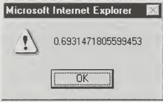
**图 12-3** 显示`LN2`属性值的 alert 框

## JavaScript：初学者指南

正如我们看到的，我们可以通过使用 alert 查看此属性的值。以下代码显示了带有该属性值的 alert：

```
window.alert(Math.LOG10E);
```

这将显示一个与图 12-4 类似的 alert 框。

## `LOG2E` 属性

`LOG2E`属性持有 E 的以 2 为底的对数的值，约为 1.442695 ...

再次，我们可以使用 alert 来查看该属性的值。以下代码显示了带有此属性值的 alert：

```
window.alert(Math.LOG2E);
```

这将显示一个与图 12-5 类似的 alert 框。

## `PI` 属性

`PI`属性持有 pi 的数值值，约为 3.14159 ...

我们可以通过使用 alert 查看`PI`属性的值。以下代码显示了带有此属性值的 alert：

```
window.alert(Math.PI);
```

这将显示一个与图 12-6 类似的 alert 框。

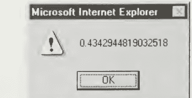
**图 12-4** 显示`LOG10E`属性值的 alert 框

## 第 12 模块：`Math`和`Date`对象

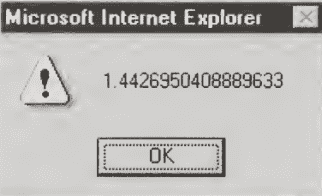
**图 12-5** 显示`LOG2E`属性值的 alert 框

## `SQRT2` 属性

`SQRT2`属性持有 2 的平方根的值，约为 1.4142 ...

要查看此属性的值，我们可以使用 alert 将其显示在屏幕上。以下代码显示了带有此属性值的 alert：

```
window.alert(Math.SQRT2);
```

这将显示一个与图 12-7 类似的 alert 框。

## `SQRT1_2` 属性

`SQRT1_2`属性持有二分之一平方根的值，约为 0.7071 ...

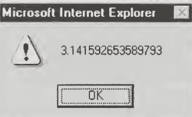
**图 12-6** 显示`PI`属性值的 alert 框

## JavaScript：初学者指南

正如我们所看到的，我们可以通过使用 alert 查看此属性的值。以下代码显示了带有此属性值的 alert：

```
window.alert(Math.SQRT1_2);
```

这将显示一个与图 12-7 类似的 alert 框。

**图 12-7** 显示`SQRT2`属性值的 alert 框

## 1 分钟训练

- 哪个属性提供了 pi 的值？
- 哪个属性提供了欧勒常数的值？
- 哪个代码显示了带有二分之一平方值的 alert？


**图 12-8** 显示`SQRT1_2`属性值的 alert 框

- 提供 pi 值的属性是`PI`属性
- 提供欧勒常数值的属性是`E`属性
- `window.alert(Math.SQRT1_2);`

## 方法

`Math`方法使我们能够执行对脚本有帮助的计算。表 12-2 列出了`Math`对象的各种方法及其目的。在表格之后，我们将更详细地讨论每个方法。

| 方法 | 目的 |
| :--- | :--- |
| `abs()` | 返回参数的绝对值 |
| `acos()` | 返回参数的反余弦值（弧度制） |
| `asin()` | 返回参数的反正弦值（弧度制） |
| `atan()` | 返回参数的反正切值（弧度制） |
| `ceil()` | 返回大于或等于参数的最小整数 |
| `cos()` | 返回参数的余弦值（弧度制） |
| `exp()` | 返回 E 的参数幂 |
| `floor()` | 返回小于或等于参数的最大整数 |
| `log()` | 返回参数的自然对数 |
| `max()` | 返回两个参数中较大的值 |
| `min()` | 返回两个参数中较小的值 |
| `pow()` | 返回第一个参数的第二个参数幂的数值值 |
| `random()` | 返回 0 到 1 之间的随机数；不需要参数 |
| `round()` | 将参数的值四舍五入最近的整数 |
| `sin()` | 返回参数的正弦值（弧度制） |
| `sqrt()` | 返回参数的平方根 |
| `tan()` | 返回参数的正切值（弧度制） |

**表 12-2** `Math`对象的方法

## 基础方法

在本书中，我们将基础方法定义为接收单个数字、对其进行简单计算并返回一个值的方法。对这些方法进行分组只是为了让我们处理得更快，而不需要为每个方法都列出相同类型的示例——这并不是对方法的任何正式分类。

以下基础方法的工作原理通常相同（都接收并返回数值）：

- `abs()`
- `acos()`
- `asin()`
- `atan()`
- `cos()`
- `exp()`
- `log()`
- `sin()`
- `sqrt()`
- `tan()`

这些基础方法接收一个数值并返回另一个值。由于通用用法相同，我们将仅取其中一个作为示例，展示其他方法如何使用它们来获取各种不同的值。如果你需要知道另一个方法返回的是什么类型的值，请参阅表 12-2 以查看每个方法的功能。

我们将使用`sqrt()`方法作为示例。使用该方法最简单的方法是将正数作为参数输入到方法中，如下所示：

```
window.alert(Math.sqrt(4));
```

这将弹出 4 的正平方根的值，即 2。

## 第 12 模块：`Math`和`Date`对象

与其计算一个静态数字，不如让用户输入一个数字，然后向用户发送该用户输入的数字的平方根提醒。我们可以使用以下代码来实现：

```html
<HTML>

<HEAD>

<SCRIPT language="JavaScript">

<!--

function get_a_root() {

  var thenum = window.prompt("Enter a (positive) number or zero.");

  var theroot = Math.sqrt(thenum);

  if (thenum < 0) {

    window.alert("I said to enter a positive number! Try again.");

  } else {

    window.alert("The square root of "+thenum+" is "+theroot);

  }

}

-->

</SCRIPT>

</HEAD>

<BODY>

<FORM>

<INPUT type="button" value="Get a Square Root" onclick="get_a_root();">

</FORM>

</BODY>

</HTML>
```

如果数字是负数，观众必须重试：

前面的代码位于文档 HEAD 部分的`get_a_root()`函数，当观众点击 BODY 部分的按钮时会调用该函数。函数首先提示观众输入一个正数，并将其赋值给变量`thenum`。

接下来，使用观众输入的数字（`thenum`）作为参数调用`Math.sqrt(thenum)`方法。这会返回数字的平方根，并将其赋值给变量`theroot`。一旦完成操作，我们会检查观众是否输入了负数；否则，会弹出一个提醒告诉观众重试；显示平方根信息。当观众输入数字 16 时，该脚本的结果如图 12-9 所示。

这里唯一的特殊之处是，如果观众输入了如 a、jquery、#$ 或其他字符，提醒将告诉观众输入内容的平方根：

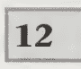

**图 12-9** 向观众显示 16 的平方根

结果是 NaN，这是 JavaScript 返回的，表示“不是数字”（Not a Number）。当然，正则表达式（参见第 16 模块）可以修复这个问题，但那些我们暂时还不会涉及。当观众输入 **round tree** 时，该脚本的结果如图 12-10 所示。

本节中的其他方法工作方式非常相似，只是返回不同的结果，如绝对值、正切值或对数。让我们进入稍微复杂且接收两个参数的方法。

## 双参数方法

我们将使用本节来讨论接收两个参数而不是单个参数的方法。这些方法包括：

- `max()`
- `min()`
- `pow()`

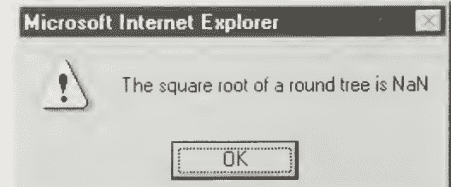

**图 12-10** "a round tree" 的平方根不是一个数字

## 第 12 模块：`Math`和`Date`对象

`max()`和`min()`方法非常相似，而`pow()`的作用稍有不同。让我们更详细地查看这些方法。

### `max()` 和 `min()` 方法

`max()`方法接收两个数字并返回较大的数字。`min()`方法也接收两个参数，但返回较小的数字。我们可以在脚本中使用这些方法，允许观众输入两个数字，然后提醒用户哪个数字较大。

下面的示例代码使用了这两种方法，并在提醒中给出结果：

```html
<HTML>

<HEAD>

<SCRIPT language="JavaScript">

function the_max() {

var num1=window.prompt("Enter a number,");

var num2=window.prompt("Enter another number.");

var largenum=Math.max(num1,num2);

var smallnum=Math.min(num1,num2);

if (largenum>=smallnum) {

window.alert("Those two numbers are equal");

} else {

window.alert(largenum+" is larger than "+smallnum);

}

}

//

</SCRIPT>

</HEAD>

<BODY>

<FORM>

<INPUT type="button" value="Which is Bigger?" onclick="the_max();">

</FORM>

</BODY>

</HTML>
```

| 提示从观众处获取两个数字 | 最大和最小的结果赋值给 | 以防数字相等的检查 | 如果数字不等则显示的提醒 |
| :--- | :--- | :--- | :--- |

该脚本提示观众输入两个数字并赋值给变量。然后它从两个数字中获取最大值和最小值，并将返回的值赋值给变量。然后使用这些变量检查它们是否相等。如果是，会弹出一个提醒；否则，会弹出一个带有 12 的提醒。

## 第 12 模块：`Math`和`Date`对象

使用此方法，我们在要求第一个数字时输入 2，要求幂时输入 3，脚本将计算 2 的 3 次方。我们得到一个显示答案的提醒。BODY 部分中的按钮是观众启动函数的方式。当我们输入数字 2 和 3 时，该脚本的结果如图 12-1 所示。

### `pow()` 方法

`pow()`方法接收两个参数，并计算第一个参数的第二个参数的幂。例如，以下代码将返回 2 的 3 次方：

```
Math.pow(2,3);
```

```html
<HTML>

<HEAD>

<SCRIPT language="JavaScript">

<!--

function the_pow() {

var num1=window.prompt("Enter a base number.");

var num2=window.prompt("What power should we set it to (a number)?");

var result=Math.pow(num1,num2);

window.alert(num1+" to the power of "+num2+" is "+result);

}

-->

</SCRIPT>

</HEAD>

<BODY>

<FORM>

<INPUT type="button" value="Find a Power" onclick="the_pow();">

</FORM>

</BODY>

</HTML>
```


**图 12-11** 提醒给了我们哪个数字更大的判决

## 其他方法

这些方法是接收单个参数的方法，但每一个都值得更仔细地观察。单个方法包括：

- `ceil()`
- `floor()`
- `random()`
- `round()`

我们将先查看前三个，然后单独检查`random`方法，它使我们能够编写几个新脚本。

### `ceil()` 方法

`ceil()`方法代表 ceiling（天花板），返回大于或等于作为参数发送的数字的最小整数。这主要用于小数后可能有数字的情况。

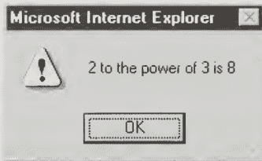

**图 12-12** 2 的 3 次方的结果以提醒形式显示

## 376 JavaScript: 初学者指南

它将该数字向上舍入到下一个最大的整数，除非该数字已经是整数。在这种情况下，将返回相同的数字（因为它可以相等）。例如，`Math.ceil(12.23);`将返回 13，但`Math.ceil(12);`将返回 12。

作为一个示例，我们将使用以下脚本来观察不同值返回的结果：

```html
<HTML>

<HEAD>

<script language="JavaScript">

<!--

function get_ceil() {

  var num = window.prompt("Enter a number.");

  var theceil = Math.ceil(num);

  window.alert("The ceiling of "+num+" is "+theceil);

}

-->

</script>

</HEAD>

<body>

<FORM>

<input type="button" value="Find the ceiling!" onclick="get_ceil();">

</FORM>

</BODY>

</HTML>
```

此脚本会在屏幕上显示观众输入的数字的向上取整结果。图 12–13 显示当观众在提示框中输入 4.55 时，浏览器中显示的结果。

## `floor()` 方法

`floor()`方法与`ceil()`方法类似，但它的方向相反。`floor()`方法返回小于或等于方法设置参数的最大整数。它将数字向下舍入到下一个最小的整数，除非参数是整数。在这种情况下，它会返回相同的整数，因为已经等于一个整数了。基本上，这个方法只是去掉了数字的小数部分，并将整数部分作为结果。

例如，`Math.floor(12.23);`将返回 12，而`Math.floor(12);`也会返回 12。我们可以像使用`ceil()`方法一样使用`floor()`方法——即通过将结果赋值给变量。


**图 12-13** 观众收到数字 4.55 的向上取整结果提示。

## `round()` 方法

`round()`方法的工作原理与前两个方法相似，但它是作为参数输入的数字四舍五入到最近的整数，无论它是大于还是小于该数字。任何小数部分值为 .5 或更大的数字都将向上舍五入，而小数部分值小于 .5 的数字将向下舍入。.5 的截断点是严格的，因此`Math.round(12.49999999);`将返回 12，尽管我们的倾向是向上舍五入。

## `random()` 方法

`random()`方法对于创建需要随机整数的脚本非常有用。它返回一个 0 到 1 之间的随机数。这意味着我们得到一个带有很长小数的，这本身并没有什么用。例如，它可能会返回类似 0.36511165498095293 的数字。为了得到我们可以使用的随机整数，我们需要进行一些操作来获取想要使用的数值类型。

## 随机整数

为了获取随机整数，我们首先想做的是让结果具有更大的范围，这样我们就不会被卡在 0 和 1 之间。为了获得更大的范围，我们可以将`random()`方法的结果乘以一个整数来创建一个更大的范围。就像数组，范围从 0 开始计数；因此，为了获得 5 个可能的整数范围，我们将结果乘以 5。下面的代码显示了我们如何做到这一点：

```javascript
var rand_num= Math.random()*5;
```

这得到了 0 到 4 之间的结果，但还没有给我们整数。这个数字仍然可能是一个很长的小数。

为了在 0 到 4 之间获得整数，我们需要找到一种方法让所有小数转换为整数。回想我们之前运行过的三个方法（`floor()`、`ceil()`和`round()`），它们可以将数字转换为各种整数。我们在这里选择`floor()`方法，因为它简单地删除了整数部分后的小数位，并给我们数字的整数部分。

要使用`floor()`方法，我们可以写以下代码：

```javascript
var rand_num= Math.random()*5;

var rand_int= Math.floor(rand_num);
```

`floor`方法将`rand_num`变量的值作为参数，然后给我们一个整数。如果我们想节省一行代码，可以写得花哨一点。我们可以直接将`random()`方法和计算作为传递给`floor()`方法的参数。

我们可以这样做，是因为计算结果`Math.random*5`是一个数字，而`floor()`方法可以接受数字作为参数。下面的代码显示了我们如何用一行代码编写它：

```javascript
var rand_int= Math.floor(Math.random()*5);
```

现在，变量`rand_int`将拥有 0 到 4 之间的随机整数值。正如你可能注意到的，这种数字范围对于数组非常有用。这就是我们如何开始编写带有随机数的趣味脚本。

## 脚本中的随机数

现在我们通过利用`random()`方法来玩玩`Math`对象。通过设置一些数组，我们可以创建一个脚本，在每次页面加载时提供随机引言或显示随机图片。

## 趣味随机引言

如果你想过在页面上添加引言，但又不想一直更改引言以保持新鲜，那么一个随机引言脚本可能正合适。

要制作这样的脚本，我们首先需要一些引言可以使用。假设我们要设置十句引言，每次页面加载时随机显示。由于我们有很多相似的值（稍后可以使用随机整数处理它们），使用数组是合适的，这样我们可以存储所有内容并轻松地检索它们。

所以，让我们创建一个包含十个元素的数组。每个元素都是我加入其中的一句（不那么）著名的引言。我们可以在下面的示例中使用这个引言数组：

```javascript
var quotes= new Array(10)

quotes[0]="Like JavaScript (for now)"

quotes[1]="It is time for a rhyme, I guess."

quotes[2]="Where is my JavaScript book?"

quotes[3]="If I had a buck for every dollar I spent--Oops, never mind."

quotes[4]="If I suppose you are expecting a real quote here."

quotes[5]="Quotes are great, but don't quote me on."

quotes[6]="What should I write here?"

quotes[7]="What happens if we miss spell or purpose?"

quotes[8]="Mark my words, I will mark my words."

quotes[9]="This spot reserved for a better quote.";
```

现在我们已经在数组中有了这组奇奇怪的引言列表，我们可以通过生成随机整数来使用它们。

我们需要一个 0 到 9 之间的随机整数（共十个数字），所以我们可以使用以下代码将 0 到 9 之间的随机整数分配给变量：

```javascript
var rand_int= Math.floor(Math.random()*10);
```

现在，`rand_int`的值将是0 到 9 之间的随机整数。我们现在可以使用它来访问索引与随机整数匹配的数组元素。我们需要使用变量作为索引数字来访问数组元素，如下例所示：

```javascript
quotes[rand_int]
```

我们希望在页面的主体部分通过`document.write()`语句写入这个值。为了实现这一点，我们现在来看随机引言脚本的完整代码：

```html
<HTML>

<HEAD>

<SCRIPT language="JavaScript">

<!--

var quotes = new Array(10);

quotes[0]="Like JavaScript (for now)";

quotes[1]="It is time for a rhyme, I guess.";

quotes[2]="Where is my JavaScript quote?";

quotes[3]="If I had a buck for every dollar I spent--Oops, never mind.";

quotes[4]="I suppose you are expecting a real quote here.";

quotes[5]="Quotes are great, but don't quote me on that.";

quotes[6]="What should I write here?";

quotes[7]="What happens if we miss spell or purpose?";

quotes[8]="Mark my words, I will mark my words.";

quotes[9]="This spot reserved for a better quote.";

var rand_int=Math.floor(Math.random()*10);

//

</SCRIPT>

</HEAD>

<body>

<h1>Random Thought: </h1>

<SCRIPT language="JavaScript">

<!--

document.write(quotes[rand_int]);

//

</SCRIPT>

</BODY>

</HTML>
```

创建一个包含十句引言的数组

生成一个随机整数

使用随机整数作为索引访问数组元素，并将随机引言写入页面

完整代码只是添加了 BODY 部分，根据`rand_int`变量的随机值在页面上写入其中一个随机引言。刷新页面将使数字重置，并可能（但不一定，因为是随机的）显示不同的引言。

现在我们已经向页面写入随机引言，那么随机图片呢？它和上一个脚本非常相似，我们只需要做一些调整。

## 第 12 ：`Math`和`Date`对象 381

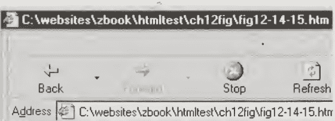

## 随机随想：

引言很棒，但这句话请不要引用我的话。

**图 12-14** 使用随机引言脚本的可能结果

**用于更新外观的随机图片** 随机图片脚本可以给你的带来一种一直在更新的感觉，而不需要一直运行并更改图片。当然，所有的图片都需要

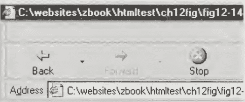

## 随机随想：

如果我故意写错拼写单词会发生什么？

**图 12-15** 使用随机引言脚本的另一个可能结果

## 382 JavaScript：入门指南

我们需要在决定放置随机选择图片的地方留出内容。随机图片脚本可能很有用，例如，美术馆可以用来展示其藏品。我们首先需要一个图片通用资源定位符（URL）地址数组（可以是本地的或绝对的——我们在这里使用本地地址）。我们此脚本使用的数组在下面的示例代码所示：

```
var r_image=new Array(10)

r_image[0]="image0.gif"

r_image[1]="image1.gif"

r_image[2]="image2.gif"

r_image[3]="image3.gif"

r_image[4]="image4.gif"

r_image[5]="image5.gif"

r_image[6]="image6.gif"

r_image[7]="image7.gif"

r_image[8]="image8.gif"

r_image[9]="image9.gif";
```

此数组设置了页面加载时可以随机显示的图片地址。接下来，我们需要一种方法获取 0 到 9 之间的随机整数。这与我们之前的脚本是相同的：

```
var rand_int=Math.floor(Math.random()*10);
```

得到它之后，下一步是在文档的 BODY 部分访问该数组，以便在浏览器加载页面时显示数组中的一张随机图片。以下代码是完整的页面，增加了 BODY 部分，这使我们能够使用`document.write()`语句打印图片标签来显示随机图片：

```
<HTML>

<HEAD>

<SCRIPT language="JavaScript">

<!--

var r_image= new Array(10);

r_image[0]="image0.gif"

r_image[1]="image1.gif"

r_image[2]="image2.gif"

r_image[3]="image3.gif"

r_image[4]="image4.gif"

r_image[5]="image5.gif"

r_image[6]="image6.gif"

r_image[7]="image7.gif"

r_image[8]="image8.gif"

r_image[9]="image9.gif"

var rand_int= Math.floor(Math.random()*10);

//

<SCRIPT>

<HEAD>

<BODY>

<H1>Random Image:</H1>

<SCRIPT language="JavaScript">

<!--

document.write("");

//-->

</SCRIPT>

</BODY>

</HTML>
```

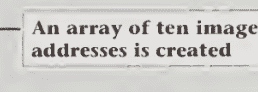

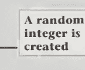


如你所示，这与引言脚本非常相似。我们只需要更改数组的内容以及`document.write()`语句的内容，就可以让脚本显示图片而不是引言。

通过`random()`方法，我们可以研究很一段时间，因为有很多东西可以被随机化。但目前，我们将将过“提问专家”部分，然后学习`Date`对象。

## 提示

对于这个例子，我们将假装把图片保存为`image0.gif`、`image1.gif`等；然而，它们可以用你喜欢的任何名称保存。

## 384 JavaScript：入门指南

## 提问专家

**问题：** 我以后会用到`Math`对象的任何属性吗？它们都是我甚至没用过的数字！

**回答：** 这取决于你执行不同类型计算的频率。作为一个初学者，你可能不太可能使用其中任何一个，但确实有一些脚本在利用它们来实现各种高级目的，例如 JavaScript 计算器。

**问题：** 我对写一个计算器没感兴趣。我真的需要费心记忆`Math`对象的所有属性吗？

**回答：** 嗯，可能不需要，因为使用它们的情况可能不会发生得频繁。不过，手留一份参考以防万一是好的，并且大致了解它们是什么，因为它们偶尔会出现在 Web 上的脚本中。

**问题：** 你知道吗，如果我身边没有计算器，这些属性和方法中的可能很有用。我可以写一个小脚本来为自己计算一些东西，不是吗？

**回答：** 当然可以！只需务必先用你已知答案的东西对数字进行双检，以确保你的代码中没有错误。

**问题：** `random()`方法到目前很有趣，但我想不出其他我可以用它来些什么。你能给我一些用它来做其他事情的主意吗？

**回答：** 还有很多其他你可以用它的地方。你可以随机化几乎任何可以用超文本标记语言（HTML）标签或纯文本显示的内容，所以尝试一些主意看看它们是否有效。不过，这里是我脑子里立刻想的一些想法：随机链接、随机链接图片、用于某种 JavaScript 游戏的随机任务（如掷骰子或抽牌）、随机背景音乐、随机页面问候、随机警报，我确信还有很多。

## 第 12 ：`Math`和`Date`对象 385

## 项目 12-1：在页面上显示随机链接

此脚本将让你更深入地学习`random()`方法，因为它让你能够创建一个在页面上显示随机链接的脚本。

## 步骤

- 1. 创建一个 HTML 页面，在 HEAD 和 BODY 部分为我们的代码留出空间。
- 2. 在数组中创建一组五个 Web 地址。使用以下地址：

```
http://www.pagerource.com

http://www.javascriptcity.com

http://www.ad-help.com

http://www.yahoo.com

http://www.excite.com
```

- 3. 使用`random()`方法创建一个随机整数，你可以用它索引访问数组。
- 4. 在 BODY 中使用`document.write()`语句按接下来所示格式在页面上显示随机链接：
  `<A HREF="random address">随机站点!</A>`
- 5. 将文件保存为`pr12_1.html`，并在 Web 浏览器中打开它。尝试加载几次看看随机地址是如何显示的。

## 386 JavaScript：入门指南

## `Date` 对象

`Date`对象是另一个预定义的 JavaScript 对象。它允许我们处理时间以获取我们可以使用的某些时间值。为了使用此对象，我们需要创建一个该对象的实例以便我们可以引用它。

要创建一个`Date`对象的实例，像使用其他对象一样使用`new`关键字，如下例所示：

```
var instance_name= new Date();
```

我们将`instance_name`替换为我们希望用于该对象实例的名称。所以，如果我们想要一个名为`rightnow`的实例，我们可以使用下例所示的代码：

```
var rightnow=new Date();
```

现在我们有一个名为`rightnow`的对象实例。一旦我们有了对象的实例，就可以使用`Date`对象的属性和方法来执行各种任务（例如创建 JavaScript 钟）。所以，让我们深入研究它，从属性开始。

## 属性

`Date`对象只有两个属性。表 12-3 列出了这些属性及其目的。在表格之后，我们将详细讨论每个属性（这些看起来很熟悉，因为`Array`对象也具有这些属性）。

## `constructor` 属性

`constructor`属性持有对象的构造函数的值，就像在`Array`对象中使用此属性一样。为了查看它的值，我们可以将其写入到页面上，如下代码所示：

```
<BODY>

<SCRIPT language="JavaScript">

<!--

var rightnow= new Date();

document.write(rightnow.constructor);

-->

</SCRIPT>

</BODY>
```

| 属性 | 目的 |
| --- | --- |
| `constructor` | 持有创建对象的构造函数的值 |
| `prototype` | 允许我们在需要时向对象添加属性 |

表 12-3 `Date`对象的属性

## 第 12 节：数学和日期对象 387

如果你运行代码，可能会在页面上看到类似下面行的内容：

```
function Date() { [native code] }
```

这与我们对`Array`对象使用此方法得到的结果基本相同：我们得到了构造函数的名称以及函数中的任何公共代码。由于函数代码是私有的，我们用`[native code]`文本代替了实际的函数代码。

## `prototype` 属性

`prototype`属性允许我们向`Date`对象添加属性或方法，就就像我们在第 11 节中对`Array`对象所做的那样。例如，如果我们想添加一个名为“attitude”的新属性，可以使用以下代码：

```
Date.prototype.attitude="cool";

var rightnow=new Date();

window.alert("This date is "+rightnow.attitude);
```

这段代码创建了新属性，创建了一个`Date`对象的实例，然后在屏幕上弹出该新属性的值。现在我们已经了解了`Date`对象的属性，让我们来看看可以使用哪些方法吧。

## 方法

`Date`对象没有提供很多属性，但它确实有许多我们可以使用的方法。表 12–4 列出了`Date`对象的各种方法以及每个方法的作用。在表格之后，我们将更详细地讨论每个方法。

现在我们有了一长长的方法列表，让我们详细地查看它们，从用于获取`Date`对象实例中日期值的方法开始。

## 388 JavaScript：初学者指南

| 方法 | 目的 |
| --- | --- |
| `getDate()` | 根据查看者的本地时间返回月份中的第几 |
| `getDay()` | 根据查看者的本地时间返回星期几（0–6） |
| `getHours()` | 根据查看者的本地时间返回当天的小时数（0–23） |
| `getMinutes()` | 根据查看者的本地时间返回小时内的分钟数（0–59） |
| `getMonth()` | 根据查看者的本地时间返回一年中的月份（0–11） |
| `getSeconds()` | 根据查看者的本地时间返回分钟内的秒数（0–59） |
| `getTime()` | 根据查看者的本地时间返回时间的数值 |
| `getTimezoneOffset()` | 根据查看者的本地时间返回时区偏移量（分钟） |
| `getYear()` | 根据查看者的本地时间返回年份（两位数） |
| `getFullYear()` | 根据查看者的本地时间返回完整年份（四位数） |
| `parse()` | 根据查看者的本地时间，返回参数传递的日期自 1970 年 1 月 1 日午夜以来的毫秒数 |
| `setDate()` | 设置`Date`对象实例的月份中的日期 |
| `setHours()` | 设置`Date`对象实例的小时 |
| `setMinutes()` | 设置`Date`对象实例的分钟 |
| `setMonth()` | 设置`Date`对象实例的月份 |
| `setSeconds()` | 设置`Date`对象实例的秒 |
| `setTime()` | 设置`Date`对象实例的时间（自 1970 年 1 月 1 日午夜以来的毫秒） |
| `setYear()` | 设置`Date`对象实例的年份（两位数） |
| `setFullYear()` | 设置`Date`对象实例的完整年份（四位数） |
| `toGMTString()` | 返回格林威治标准时间 (GMT) 格式的日期字符串 |
| `toLocaleString()` | 返回基于区域设置格式的日期字符串 |

**表 12-4** `Date`对象的方法

## 获取值的方法

获取值的方法允许我们获取脚本中使用的各种时间及日期值。允许我们获取`Date`对象实例值的方法包括：

- `getDate()`
- `getDay()`
- `getHours()`
- `getMinutes()`
- `getMonth()`
- `getSeconds()`
- `getTime()`
- `getTimezoneOffset()`
- `getYear()`
- `getFullYear()`

要使用这些方法，我们需要一个`Date`对象的实例。一旦有了实例，我们就可以通过实例名调用任何方法。以下是此操作的语法：

```
instance_name.method();
```

我们将`instance_name`替换为对象实例的名称，并将`method`替换为想要使用的方法函数。

所以，如果我们想对名为`rightnow`的`Date`对象实例使用`getDate()`方法，可以使用以下代码：

```
var rightnow= new Date();

var theday= rightnow.getDate();
```

这会将`getDate()`方法返回的值赋值给名为`theday`的变量。

`Date`方法返回的值通常是数值，需要稍微解释一下，因此让我们仔细查看这些方法。

### `getDate()` 方法

`getDate()`方法允许我们获取月份中的第几。所以，如果是该月的 5 号，该方法返回 5。如果是 22 号，方法返回 22。

### `getDay()` 方法

`getDay()`方法允许我们获取星期几。所以，如果是星期日，方法返回 0；如果是星期三，方法返回 3。

### `getHours()` 方法

`getHours()`方法允许我们获取当天的小时数。所以，如果是午夜，方法返回 0；如果是下午 2 点，方法返回 14。

### `getMinutes()` 方法

`getMinutes()`方法允许我们获取小时内的分钟数。所以，如果是 23 分，方法返回 23。

### `getMonth()` 方法

`getMonth()`方法允许我们获取一年中的月份。这个方法也从 0 开始计数。所以，如果是 1 月，方法返回 0；如果是 10 月，它返回 9。

### `getSeconds()` 方法

`getSeconds()`方法允许我们获取分钟内的秒数。所以，如果时间是 42:23，方法返回 23。

### `getTime()` 方法

`getTime()`方法获取自 1970 年 1 月 1 日午夜以来的毫秒数。所以，如果我们想知道当前时间自该日期以来的毫秒数，可以使用以下代码：

```
var rightnow=new Date();

var theday= rightnow.getTime();
```

这把方法的结果赋值给变量，以便我们以后需要时可以使用它。

### `getTimezoneOffset()` 方法

`getTimezoneOffset()`方法给出本地时间与 GMT 之间的分钟数。所以，如果我们与 GMT 相差 6 小时（6*60）；如果我们只差 1 小时，方法返回 60。

> 提示
> `getTimezoneOffset()`方法并不显示我们的时间是领先还是落后（例如使用负值），它只显示偏移了多少分钟。

### `getYear()` 方法

该方法返回当前年份的最后两位（至少如果年份在 1900 到 1999 年之间）。例如，如果年份是 1988 年，方法返回 88。由于现在是 2000 年，我们需要进行调整，以免返回的年份为 100。

我们做的调整将使此在一段时间内有效（对于当前的千年而言），并给我们一个四位数的日期。我们需要检查的是

## 第 12 节：数学和日期对象 391

记得如果我们想使用日期（如 10/24/2000），要进行调整。

取决于浏览器是支持 2000 还是返回 100。以下是调整代码：

```
var rightnow= new Date();

var theyear= rightnow.getFullYear();

if (theyear<2000)

theyear+=1900;
```

> 增加了一个检查，判断浏览器是否对年份 1900 年使用小于 2000 的数字，通过在这些年份上加上 1900，得到一个适用于 2000 年的四位数年份。

这将给我们一个既适用于旧日期也适用于新日期的四位日期。这段代码一段时间内有效，但`getYear`方法可能会在 JavaScript 1.3 中被新方法取代，该方法通过从开始提供完整日期来解决这个问题。

## `getFullYear()` 方法

`getFullYear()`方法与`getYear()`方法非常相似，不同在于它一致地返回四位数年份，以避免 2000 年问题。缺点是它是在 JavaScript 1.3 中实现的，因此它只在较新的浏览器中有效（下一节中提到的`setFullYear()`方法也是如此）。由于情况如此，我们将在书中更多地使用旧的`getYear()`；然而，随着浏览器的升级，`getFullYear()`方法的使用将会增加。

`getFullYear()`方法的工作原理类似于`getYear()`方法，但你不需要任何额外的检查来确保年份是正确的：

```
var rightnow= new Date();

var theyear= rightnow.getFullYear();
```

这会将方法返回的值赋值给`rightnow`变量。这次，值已经是四位数的，不需要任何调整。

现在我们已经了解了获取（get）方法，让我们来看看允许为`Date`对象实例设置值的方法。

## 设置值的方法

设置值的方法与获取值的方法处理相同类型的值。允许为`Date`对象实例设置值的方法包括：

- `set()`
- `setHours()`
- `setMinutes()`
- `setMonth()`
- `setSeconds()`
- `setTime()`
- `setYear()`
- `setFullYear()`

要设置这些值，请根据我们想要使用的时间或日期向它们发送数值参数。例如，如果我们想设置`Date`对象实例的每月几号，可以使用以下代码：

```
var rightnow = new Date();

rightnow.setDate(22);
```

这将将`rightnow` `Date`对象实例的日期设置为 22 号。其他方法的工作方式相同。为了知道需要发送给这些方法之一的值，请查看其在获取值方法中对应方法返回什么类型的值。该方法期望的参数将是与方法返回相似的值。

## 其他方法

其余的方法以某种方式执行其他方法未涵盖的各种任务。让我们来看每一个方法。

## `parse()` 方法

`parse()`方法用于根据日期字符串（例如 Dec 12, 1999）作为参数，找到自 1970 年 1 月 1 日午夜来的毫秒数。这通常与`setTime()`方法配合使用，后者需要一个毫秒参数来设置时间。我们可以使用`parse`方法找到 1999 年 12 月 12 日自 1970 年 1 月 1 日午夜来的毫秒数，如下代码所示：

```
var rightnow = new Date();

var thenum = Date.parse("Dec 12, 1999") 

rightnow.setTime(thenum);
```

> 该方法可以直接从日期对象调用

此代码将日期解析为毫秒数，然后将其发送到用于`rightnow` `Date`对象实例的`setTime()`方法。

## `toGMTString()` 方法

`toGMTString()`方法返回 GMT 格式的日期字符串。我们可以使用它获取`Date`对象实例的 GMT 格式，如下代码所示：

```
var rightnow= new Date();

var righthedate= rightnow.toGMTString();
```

这将将一个值（例如 Wed, 21 Dec 1998 11:12:44 GMT）赋值给变量`righthedate`。然后它可以写入页面，或在脚本中使用`Date`对象的其他方法。

## `toLocaleString()` 方法

`toLocaleString()`方法返回查看者本地格式的日期字符串。我们可以使用它获取`Date`对象实例的本地化格式，如下代码所示：

```
var rightnow= new Date();

var righthedate= rightnow.toLocaleString();
```

这将一个日期值赋值给变量`righthedate`。字符串的值取决于查看者查看页面的浏览器。然后它可以写入页面，或在脚本中使用`Date`对象的其他方法。

现在我们已经掌握了这些方法，让我们看看能否用`Date`对象玩点花。

## 来写一些日期脚本怎么样？

在完成技术概述之后，让我们创建一些利用`Date`对象方法的脚本。目前，我们将编写一个在页面上显示日期的脚本，然后创建一个简单的状态栏时钟脚本。

## 在页面上写入日期

要在页面上写入日期，我们希望使用一些`Date`对象方法来获取我们需要的值。假设我们想写一个格式为 Tuesday, 11/21/2000 的日期。为了做到这一点，我们需要找到星期几、月份、几以及年份。可以使用`getDay()`、`getMonth()`、`getDate()`和`getYear()`方法来实现。以下脚本将日期写入页面：

```html
<HTML>

<SCRIPT language="JavaScript">

<!--

var right=new Date();

var weekday=right.getDay();

var month=right.getMonth();

var date=right.getDate();

var year=right.getFullYear();

// 设置星期几

var someday=new Array(7);

someday[0]="Sunday";

someday[1]="Monday";

someday[2]="Tuesday";

someday[3]="Wednesday";

someday[4]="Thursday";

someday[5]="Friday";

someday[6]="Saturday";

// 设置年份为四位数

if (year<2000)

year+=1900;

// 将日期写入页面

document.write(someday[weekday]+", "+(month+1)+"/"+date+"/"+year);

//

</SCRIPT>

</BODY>

</HTML>
```

## 创建简单的状态栏时钟

要创建一个简单的时钟，我们需要小时、分钟和秒。为了获取这些值，可以使用`getHours()`、`getMinutes()`和`getSeconds()`方法。以下代码将在状态栏创建一个时钟：

```html
<HTML>

<HEAD>

<SCRIPT language="JavaScript">

<!--

function clock() {

var rightnow = new Date();

var thehours = rightnow.getHours();

var themins = rightnow.getMinutes();

var theseconds = rightnow.getSeconds();

// 为小时、分钟和秒进行前零格式化

if (thehours<10)

thehours="0"+thehours;

if (themins<10)

themins="0"+themins;

if (theseconds<10)

theseconds="0"+theseconds;

// 将时间写入状态栏

window.status=thehours+":"+themins+":"+theseconds;

}

// 加载时调用一次函数

clock();

// 设置每秒调用一次函数

setInterval(clock, 1000);

//

</SCRIPT>

</HEAD>

<BODY>

</BODY>

</HTML>
```

## 398 JavaScript：初学者指南

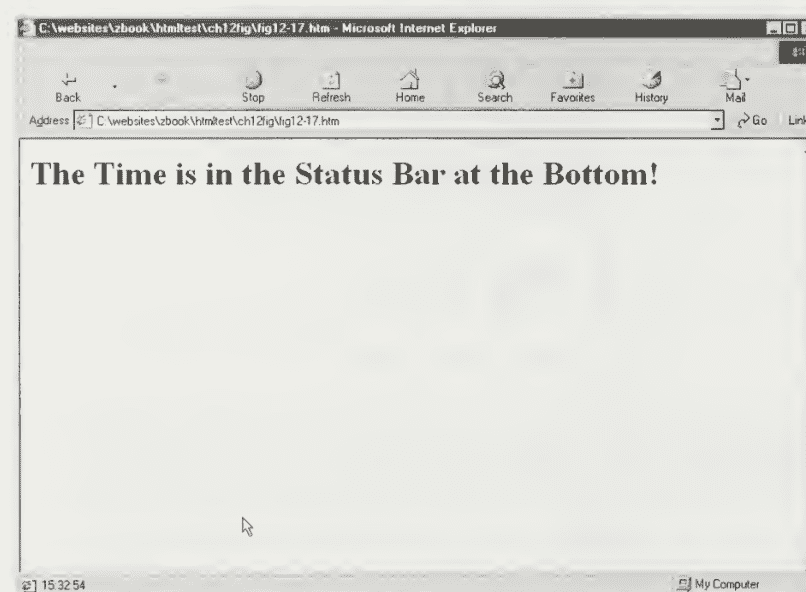

**图 12-17** 窗口状态栏中显示了一个时钟

因此它们可以以各种方式使用。这创建了一个 JavaScript 钟，比我们在上一节中的简单钟多了一些选项。

## 步骤

- 1. 创建一个 HTML 页面，在文档的 HEAD 部分为 JavaScript 代码留出空间。
- 2. 编写一些代码来创建一个状态栏时钟。在这个钟中，包含以下信息：
   - mm/dd/yyyy 格式的日期
   - 包含小时、分钟和秒的时间
   - 是 A.M. 还是 P.M.
- 3. 这是一个 12 小时钟而不是我们之前的 24 小时钟，因此务必调整小时的值使其保持在 1 到 12 之间。
- 4. 使用`setInterval`语句启动计时，并让它每秒更新一次。
- 5. 将文件保存为`pr12_2.html`并在浏览器中打开它。日期和时间应该出现在状态栏中。

## 检查

- 1. `Math`对象的属性和方法允许我们做什么？
  A. 获取字符串的平方根或其他此类值并返回数字
  B. 执行数学计算
  C. 去数学课学习新定理
  D. 什么用，它们是没用的

- 2. 下列哪个可以正确在网页上写出 pi 的值？
  A. `document.write(Math.Pi);`
  B. `document.write(Math.pi);`
  C. `document.write(Math.PI);`
  D. `document.write(Date.PI);`

- 3. 下列哪个可以正确生成 0 到 7 之间的随机数？
  A. `var rand_int= Math.floor(Math.random()*7);`
  B. `var rand_int= Math.floor(Math.random()*6);`
  C. `var rand_int= Math.floor(Math.random()*8);`
  D. `var rand_int= Math.sqrt(Math.random());`

## 400 JavaScript：初学者指南

## 检查

- 4. 在大多数情况下，在使用`Date`对象的属性和方法之前必须创建什么？
  A. 观众必须在周五晚上有一个日期
  B. 一个用于引用日期的数字
  C. 为日期设置的时间
  D. `Date`对象的实例

- 5. 下列哪个正确地将名为`rightnow`的`Date`对象实例的星期几赋值给名为`weekday`的变量？
  A. `var weekday= rightnow.getDate();`
  B. `var weekday= rightnow.getDay();`
  C. `var weekday= right now.getDay();`
  D. `var weekly= rightlater.getMinutes();`

# 模块 13

## 处理字符串

### 本模块的目标

- 学习什么是字符串对象
- 了解如何创建字符串对象的实例
- 发现如何创建字符串字面量
- 学习如何使用字符串对象的属性
- 学习如何使用字符串对象的方法
- 创建使用字符串对象属性和方法的脚本

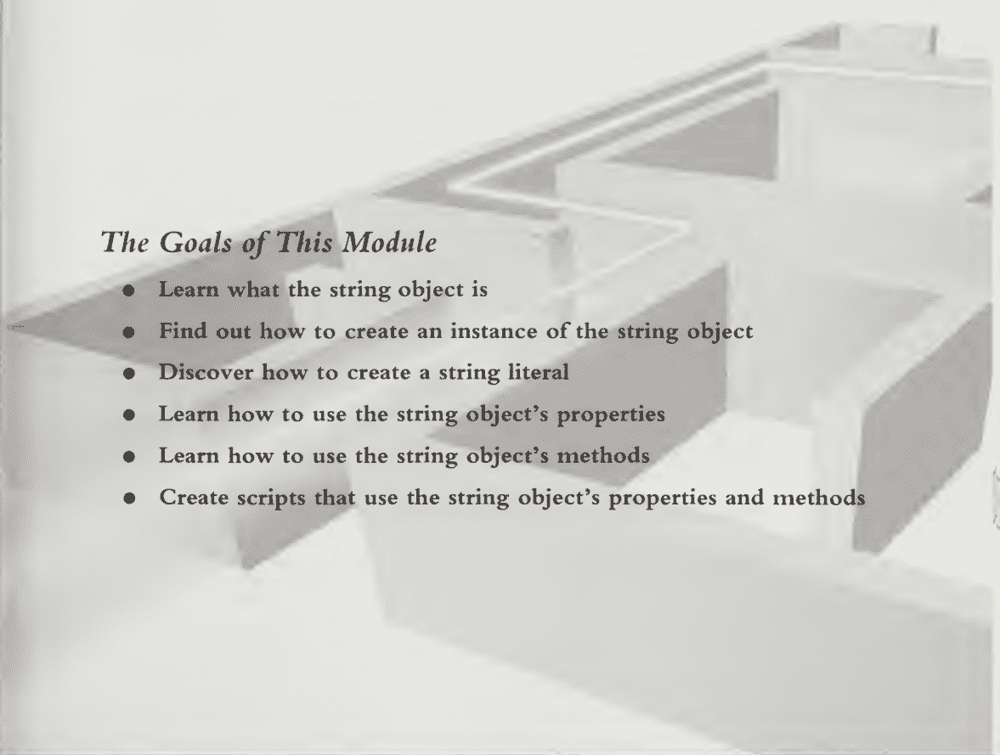

## 402 JavaScript：初学者指南

要在 JavaScript 中处理字符串，你需要学习处理它们的各种方法。这些方法来自 JavaScript 字符串对象。

本模块将解释什么是字符串对象，以及如何创建使用其属性和方法的字符串。然后，将更详细地讨论字符串对象的属性和方法，让你看到它们是如何工作的。最后，你将编写一个使用你所学的属性和方法的脚本。但首先，来看字符串对象的介绍。

## 字符串对象简介

字符串对象提供了属性和方法来获取字符串信息或修改字符串。你可以通过使用`new`关键字配合构造函数来创建字符串对象，或者当从字符串字面量调用其中一个方法时，JavaScript 会临时创建一个。什么是字符串对象，什么又是字符串字面量？让我们通过查看如何在 JavaScript 中创建字符串对象来发现。

## 字符串对象

正如刚才解释的，创建字符串对象的方法之一是使用`new`关键字，就像你之前对其他对象所做。语法如下：

```
var instance_name= new String("string value here");
```

你用`instance_name`替换为你想要用于字符串对象实例的名称。然后用`string value here`替换为用于创建新字符串对象的字符字符串。

所以，如果你想创建一个名为`guitar_string`的字符串对象实例，可以使用以下代码：

```
var guitar_string= new String("G");
```

该脚本为字符串 "G" 创建了一个字符串对象的实例。

## 字符串字面量

虽然使用`new`关键字创建字符串对象在某些方面很有用，但字符串字面量更常用。

你只需要通过将字符串值赋值给变量就可以创建一个字符串字面量。这种技术比使用`new`关键字创建字符串对象要短一点，仍然允许你使用字符串对象的所有方法（以及其中一个属性）。

下面的代码创建了字符串字面量。注意代码将字符串值赋值给了一个变量。

```
var guitar_string="G";
```

这使得字符串 "G" 了一个字符串字面量，你知道它是普通的文本字符串。对于文本字符串，你也被允许使用字符串对象的属性和方法。

## 有什么区别？

字符串对象和字符串字面量之间的区别在于普通文本字符串具有字符串本身的值，并且可以很容易地与其他字符串进行比较，如下代码所示：

```
var guitar_string1="E"

var guitar_string2="E";

if (guitar_string1==guitar_string2) {

  window.alert("The strings are the same!");

} else {

  window.alert("The strings are not the same!");

}
```

由于这段代码使用了普通的字符串字面量，结果如你所期的。提示显示字符串是相同的。

## JavaScript：初学者指南

然而，如果你使用字符串对象运行相同的块，你将看到意想不到的结果。接下来的代码使用了字符串对象：

```
var guitar_string1= new String("E");

var guitar_string2= new String("E");

if (guitar_string1==guitar_string2) {

  window.alert("The strings are the same!");

} else {

  window.alert("The strings are not the same!");

}
```

这次提示会告诉你是字符串是不相同的，尽管两个字符串都是 E——因为字符串对象是一个对象值而不是字面量。对象之间不会像普通文本字符串那样相互相等。要判断两个对象是否相等，你必须编写额外的代码来确定。对于大多数用途，你可能不想花那个麻烦。相反，你可能会使用字符串对象并让它们使用字符串对象的方法。

普通字符串能够使用字符串对象的方法，是因为 JavaScript 获取字符串字面量并将其转换为临时的字符串对象。一旦方法的执行完成，它会返回一个字符串字面量。这允许你使用短的字符串字面量，而不是强制你创建字符串对象来使用方法。你可能需要的字符串对象方法。


## 1分钟训练

- 创建字符串对象的两种方法。
- 在本模块之前，你熟悉哪种字符串？字符串对象还是字符串字面量？
- 为什么字符串字面量可以使用字符串对象的方法？

- 因为 JavaScript 将字符串字面量转换为临时的字符串对象

## 406 JavaScript: 入门指南

| 属性 | 用途 |
| --- | --- |
| `constructor` | 存储对象实例的构造函数的值 |
| `length` | 存储字符串长度的数值（其字符数） |
| `prototype` | 允许你向对象添加属性 |

**表 13-1** 字符串对象的属性

## `length` 属性

该属性返回字符串的长度，即字符串中包含的字符数。你可以对字符串对象和字符串字面量同时使用它。你在其他对象中也见过这个属性，例如数组对象。（在那种情况下，值是数组中元素的数量。）

下面的代码使用普通文本字符串。它将字符串变量的长度写入到页面上。

```
<HTML>

<HEAD>

<script language="JavaScript">

<!--

var myname="John";

-->

</script>

<BODY>

<script language="JavaScript">

<!--

document.write("The name has "+myName.length+" characters.");

-->

</script>

</BODY>

</HTML>
```

> 创建了一个字符串字面量。页面上显示了名称的字符数

注意这里是如何像使用对象名一样使用变量的。这就是让 JavaScript 创建临时字符串对象以使用该属性的方法。脚本将结果写入页面。因为名称有四个字符，所以这里`length`属性的值为 4。`length`属性在本书的后续部分非常有用（参见第 14 节），当你想要拆分字符串以获取信息或对其进行更改时，特别是当用户输入字符串而你事先不知道长度时。

## `prototype` 属性

与其他具有`prototype`属性的其他对象一样，可以使用它向页面上的字符串对象添加属性或方法。下面的代码显示了一个示例：

> `prototype`值为字符串对象添加了一个属性

```
String.prototype.attitude="cool";

var rightnow=new String("Joe");

window.alert("This string is "+rightnow.attitude);
```

> 创建了字符串对象的新实例

> 新属性与字符串对象的实例 "cool" 使用！

字符串对象 "Joe" 拥有一个属性为 "cool" 的 attitude 属性！

## 1 分钟演练

- 在刚才讨论的属性中，你在其他用过的对象见过哪些？
- 哪些属性可以与字符串字面量一起使用？
- `length`属性持有什么值？

- 所有的，以某种方式如此
- `length`属性
- 字符串中的字符数

## 字符串对象的方法

字符串对象有很多方法，如表 13–2 所示。

| 方法 | 用途 |
| --- | --- |
| `anchor()` | 创建一个带有页面目标的 HTML 锚点标签 |
| `big()` | 在字符串周围添加`<BIG>`和`</BIG>`标签 |
| `blink()` | 在字符串周围添加`<BLINK>`和`</BLINK>`标签（可能仅在 Netscape Navigator 中有效） |
| `bold()` | 在字符串周围添加`<b>`和`</b>`标签 |
| `charAt()` | 查找字符串中指定位置上的字符 |
| `charCodeAt()` | 查找字符串中指定位置字符的字符编码 |
| `concat()` | 将两个或多个字符串相加并返回新的组合值 |
| `fixed()` | 在字符串值周围添加`<TT>`和`</TT>`标签 |
| `fontcolor()` | 在字符串值周围添加`<FONT color="color">`和`</FONT>`标签，将字符串颜色更改为指定的颜色 |
| `fontsize()` | 在字符串值周围添加`<FONT size="number">`和`</FONT>`标签，将字符串大小更改为给定的数字大小 |
| `fromCharCode()` | 使用作为参数发送的字符来创建一个新字符串 |
| `indexOf()` | 在字符串中搜索作为参数发送的字符。如果找到，则返回该字符第一次出现的位置；否则返回 –1 |
| `italics()` | 在字符串周围添加`<i>`和`</i>`标签 |
| `lastIndexOf()` | 在字符串中搜索作为参数发送的字符：如果找到，则返回该字符最后一次出现的位置；否则返回 –1 |
| `link()` | 使用链接文本并链接到发送的 URL 创建 HTML 链接 |
| `match()` | 比较正则表达式和字符串以查看它们是否匹配 |
| `replace()` | 查找正则表达式是否匹配字符串，然后将匹配的字符串替换为新字符串 |
| `search()` | 使用正则表达式和指定的字符串执行匹配搜索 |
| `slice()` | 提取字符串值的某个部分并返回新字符串 |
| `small()` | 在字符串值周围添加`<SMALL>`和`</SMALL>`标签 |

**表 13-2** 字符串对象的方法

是的，这个列表很长！让我们按照它们在表中出现的顺序查看字符串对象的方法。

| 方法 | 用途 |
|---|---|
| `split()` | 根据作为方法参数发送的字符将字符串分为字符串数组 |
| `strike()` | 在字符串值周围添加`<STRIKE>`和`</STRIKE>`标签 |
| `sub()` | 在字符串值周围添加`<SUB>`和`</SUB>`标签 |
| `substr()` | 允许返回指定起始位置并在指定数量字符后结束的字符串部分 |
| `substring()` | 允许返回指定起始位置和结束位置的字符串部分 |
| `sup()` | 在字符串字面量周围添加`<SUP>`和`</SUP>`标签 |
| `toString()` | 返回字符串对象的字符串值 |
| `toLowerCase()` | 将字符串转换为全小写字母并返回结果 |
| `toUpperCase()` | 将字符串转换为全大写字母并返回结果 |

表 13-2 字符串对象的方法（续）

## `anchor()` 方法

该方法将文本字符串作为命名锚点的文本。`anchor()`方法接收一个参数，该参数将作为命名锚点的`name`属性。基本上，它创建一个具有以下语法的 HTML 标签：

```
<A NAME="parameter_string">text_string</A>
```

`parameter_string`是你在调用方法时作为参数发送的字符串。`text_string`是你调用该方法的源字符串的值。例如，看这段代码：

```
<BODY>

<SCRIPT language="JavaScript">

<!--

var anchor_text="Part 1";

var full_anchor=anchor_text.anchor("part1");

document.write(full_anchor);

-->

</SCRIPT>

</BODY>
```

创建了一个字符串字面量

将`anchor()`方法的结果赋值给一个变量

将变量的值写入页面上

在这里，你将一个字符串字面量赋值给变量`link_text`。然后你使用来自字符串字面量的`part1`作为参数调用`anchor()`方法。结果被赋值给`full_link`变量。`full_link`变量的值被写入页面。该代码在页面代码中写入了以下链接：

```
<A NAME="part1">Part 1</A>
```

图 13-1 显示了此代码在浏览器中查看时的样子。注意用户只看到该部分的锚点文本。

## `big()` 方法

`big()`方法在调用方法的文本字符串周围添加`<BIG>`和`</BIG>`标签。例如，看这个：

```
<BODY>

<SCRIPT language="JavaScript">

<!--

var the_text="I am text!";

var big_text=the_text.big();

document.write(the_text+"<BR>");

document.write(big_text);

<!---->

</SCRIPT>

</BODY>
```

这段代码在页面上写入普通文本，然后在页面上写入大文本。图 13-2 显示了该脚本在浏览器中的结果。

## `blink()` 方法

该方法在调用方法的文本字符串周围添加`<BLINK>`和`</BLINK>`标签。Netscape Navigator 支持 blink 标签，但其他浏览器可能无法使其工作。如果浏览器支持该标签，标签内的文字将在屏幕上闪烁。

## 412 JavaScript：初学者指南

上一个脚本将此代码写入页面源代码：

```
<BLINK>I am blinking, maybe!</BLINK>
```

如果浏览器支持`blink()`方法和`blink`标签，那么在查看页面时，文本将会闪烁。

## `bold()` 方法

该方法在调用它的字符串周围添加`<B>`和`</B>`标签。这里是显示`bold()`方法作用的代码：

```
<BODY>

<SCRIPT language="JavaScript">

<!--

var the_text="I am making a bold statement now.";

document.write(the_text.bold());

//-->

</SCRIPT>

</BODY>
```

注意，你可以通过在`document.write()`语句中直接调用方法来缩短代码。上述代码的工作原理与使用变量时相同，但通过这种方式可以在代码中减少了一行。此脚本将以下代码写入页面源代码：

```
<B>I am making a bold statement now.</B>
```

当用户在浏览器中看到它时，文本将是加粗的。

## `charAt()` 方法

该方法确定字符串中特定位置的字符。你可以找到第一个或最后一个字符，也可以找到中间的任何字符。`charAt()`方法接收一个数字，代表你想要获取字符的位置。

## 查找字符

当你想要查找字符时，请记住位置计数是从 0 开始（类似于数组），而不是从 1，因此第一个字符位于位置 0。以下代码显示了如何使用`charAt()`方法获取字符串中的第一个字符：

```
var the_text="Character";

var first_char=the_text.charAt(0);

window.alert("The first character is "+first_char);
```

这段代码将`charAt()`方法的结果赋值给名为`first_char`的变量，并将其用于告警框（alert）。警告框将告诉用户调用该方法的文本字符串中的第一个字符。在这种情况下，警告框将显示“The first character is C.”

## 使用`length`属性查找最后一个字符

如果你想找到最后一个字符，你需要在使用方法之前知道字符串中有多少个字符，或者你可以使用`length`属性来确定字符串中的字符数量。使用`length`属性时，请记住它返回的是字符的数量，而不是最后一个字符的位置。

`length`属性的计数从 1 开始，而你使用`charAt()`方法时必须从 0 开始计数。因此，字符串中的最后一个字符的位置将小于其包含的字符数。换句话说，如果字符串有 10 个字符（1–10），那么最后一个位置（0–9）就是 9。如果字符串有 23 个字符（1–23），最后一个位置（0–22）就是 23-1=22。

让我们来看这个例子看看它是如何工作的。该代码找到字符串中的最后一个字符：

| 你使用的`length`属性。对其减去 1 以找到字符串中可用的最后一个位置 | `charAt()`方法使用该值来找到字符串最后一个位置是哪个字符 |
| :--- | :--- |

```javascript
var the_text="Character";

var position=the_text.length-1;

var last_char=the_text.charAt(position);

window.alert("The last character is "+last_char);
```

这段代码将字符串长度减一的值赋值给名为`position`的变量。`position`变量现在持有字符串中最后一个字符的位置。将`position`的值作为参数传递给`charAt()`方法的结果被赋值给名为`last_char`的变量。最后，告框提供了字符串中的最后一个字符，即 "r."。因此，用户收到一个显示“The last character is r.”的警告。

## `charCodeAt()` 方法

`charCodeAt()`方法的工作原理与`charAt()`方法相同，但它返回作为参数传递的位置处字符的字符编码（character code）。

字符编码是一个数字代码，可以替换 HTML 中的字符。在 HTML 中，你可以使用特殊的字符代码在 Web 页面上显示角括号（<），而无需将其转换为 HTML 本身。例如，你可以使用`&#60`代替普通的角括号。`charCodeAt()`方法返回该代码的数字部分，即 60。

如果你想找到某个字符的字符编码，`charCodeAt()`方法就会非常有用。此脚本允许你执行以下操作：

```javascript
var var_text="Hello";

var char_code=var_text.charCodeAt(0); 

window.alert("The character is &#"+char_code+"");
```

警告框将告诉你字符串中位置 0 处的字符编码（H），即 72。警告框会在字符编码的前后自动为你加上字符串 "#"，并显示“The character code is &#72.”

## `concat()` 方法

该方法的工作方式与数组对象的`concat()`方法非常相似。它将调用方法的文本字符串与作为参数传递的任意其他文本字符串合并，并返回合并后的值。调用方法的文本字符串在顺序上优先，而作为参数传递的字符串在之后按顺序添加。

以下代码显示了使用`concat()`方法组合三个字符串的示例：

```javascript
var string1= "I went to the store";

var string2= "then";

var string3="I played a video game";

window.alert(string1.concat(string2,string3));
```

三个字符串从左到右顺序组合。

这段代码按照`string1`、`string2`然后是`string3`的顺序组合字符串。结果是一个显示“I went to the store then I played a video game.”的警告框。如果你希望换顺序，可以调整哪个字符串调用方法以及参数的顺序，如下代码所示：

```javascript
var string1= "I went to the store";

var string2= "then";

var string3="I played a video game";

window.alert(string3.concat(string2,string1));
```

三个字符串再次从左到右顺序组合。

这次，是`string3`调用方法，所以它出现在新字符串的最前面。`string2`和`string3`的值在其之后顺序添加。在这种情况下，结果是一个显示“I played a video game then I went to the store.”的警告框。

## `fixed()` 方法

`fixed()`方法在调用它的字符串周围添加`<TT>`和`</TT>`标签。以下代码显示了如何使用此方法：

```html
<BODY>

<SCRIPT language="JavaScript">

<!--

var the_text="I am typewriter text, on a computer!";

document.write(the_text.fixed());

-->

</SCRIPT>

</BODY>
```

此脚本将以下代码写入页面源代码：

```
<TT>I am typewriter text, on a computer!</TT>
```

## `fontcolor()` 方法

`fontcolor()`方法为调用它的字符串添加字体颜色。它接收一个字符串参数，指示文本应该是什么颜色。可以使用颜色名称或其红绿蓝（RGB）值发送颜色。

这就像示例语法一样对文本周围的代码进行格式化：

```
<FONT COLOR="color_value">text_string</FONT>
```

在这里，`color_value`将被作为传递给方法的颜色名称或 RGB 值替换。`text_string`部分将用用于调用方法的文本字符串替换。

例如，这会在页面上创建一些红色文本：

```
<BODY>

<SCRIPT language="JavaScript">

<!--

var the_text="I am so mad I am red";

document.write(the_text.fontcolor("red"));

-->

</SCRIPT>

</BODY>
```

根据传递参数的颜色名称为文本赋予字体颜色

此脚本将以下代码放入页面源代码：

```
<FONT COLOR="red">I am so mad I am red!</FONT>
```

你也可以使用 RGB 值来替颜色名称。在这段代码中，使用了 RGB 值：

```html
<BODY>

<SCRIPT language="JavaScript">

<!--

var the_text="I am so mad I am red";

document.write(the_text.fontcolor("FF0000"));

-->

</SCRIPT>

</BODY>
```

> 根据传递参数的 RGB 代码为文本赋予字体颜色

这次，产生的代码将更改为包含上一个示例中的 RGB 值来替颜色名称，如下：

```
<FONT COLOR="FF0000">I am so mad I am red!</FONT>
```

## `fontsize()` 方法

`fontsize()`方法调整调用它的字符串的大小。它接收一个数值来表示文本的大小（1 到 7 之间）。

该方法对代码进行格式化，使用类似于示例的语法：

```
<FONT SIZE=number>text_string</FONT>
```

`number`被作为参数传递的数字替换，`text_string`被用于调用方法的文本字符串替换。

以下示例显示了此方法的作用：

```html
<BODY>

<SCRIPT language="JavaScript">

<!--

var the_text="I am pretty small";

document.write(the_text.fontsize(2));

-->

</SCRIPT>

</BODY>
```

> 根据传递参数的数字为文本赋予字体大小

此脚本提供了页面中的以下代码：

```
<FONT SIZE=2>I am pretty small!</FONT>
```

## `fromCharCode()` 方法

`fromCharCode()`方法根据一系列作为参数传递给方法的字符编码来创建一个字符串。`charCodeAt()`方法返回给定位置处字符的数字代码。这就是你必须发送给`fromCharCode()`方法的值类型。此外，`fromCharCode()`是直接从字符串对象调用的，而不是从现有字符串，因为它是动态拼接字符串，不需要预先存在的字符串。相反，你使用传递给它的参数来返回一个字符串。

因此，如果你想向查看者显示文本字符串 "HI"，可以使用这里的示例代码：

```
window.alert(String.fromCharCode(72,73));
```

这段代码接收第一个参数（字符 72）并将其转换为 H。然后它接收第二个参数（字符代码 73）并将其转换为 I。两者按照它们发送的顺序组合形成字符串 "HI"，然后作为警框发送给查看者。

## `indexOf()` 方法

`indexOf()`方法查找某个字符或字符串在字符串中开始起始位置。它只返回作为参数传递的字符或字符串第一次出现的位置。如果在此字符串值中没有找到该字符或字符串，则返回值 -1。

以下代码在字符串 "Cool" 中查找字母 C：

```
var the_text="Cool";

var position=the_text.indexOf("C");

window.alert("Your character is at position "+position);
```

这段代码查找字符 C。记住位置计数从 0 开始；所以当它找到字符串中的第一个字符时，它返回 0。因此，警框将显示 "Your character is at position 0。"

请注意该方法是区分大小写的，因此在这种情况下，JavaScript 认为 C 和 c 是两个不同的字符。因此，接下来的代码会告诉你该字符不在字符串中，尽管字符串中有一个大写的 C。

```
var the_text="Cool";

var position=the_text.indexOf("c");

window.alert("Your character is at position "+position);
```

现在警框会显示 "Your character is at position -1。"

如果你想检查 -1 是否会一直被作为位置返回，你可以使用这段代码，在要查找的字符不在字符串中时发送一个不同的警框：

```
var the_text="Cool";

var position=the_text.indexOf("c");

if (position == -1)

window.alert("Your character is not in the string!");

else

window.alert("Your character is at position "+position);
```

这一次，`if`语句检查方法是否返回 -1 给位置变量`position`。如果是，警框会显示 "Your character is not in the string!"。否则，普通的警框将告诉你位置。在之前的代码中，小写的 c 不在字符串中，所以弹出 "Your character is not in the string!" 警框。

`indexOf()`方法只返回你发送的字符第一次出现的位置，所以，如果你使用接下来的代码，你会收到提示，你的字符位于位置 1，尽管它位于位置 2。

```
var the_text="Cool";

var position=the_text.indexOf("o");

if (position == -1)

window.alert("Your character is not in the string!");

else

window.alert("Your character is at position "+position);
```

小写的 o 在字符串中出现了两次，但`indexOf()`只定位字符的第一次出现。

## `italics()` 方法

`italics()`方法在调用它的文本字符串周围添加`<I>`和`</I>`标签。这段代码显示了如何在网页上创建一些斜体文本。

```html
<BODY>

<SCRIPT language="JavaScript">

var the_text="I am leaning for some reason!";

document.write(the_text.italics());

</SCRIPT>

</BODY>
```

该脚本将以下代码放入页面源代码：

```
<I>I am leaning for some reason</I>
```

## `lastIndexOf()` 方法

`lastIndexOf()`方法的工作方式与`indexOf`方法相同，但它返回你传递给方法的参数最后一次出现，而不是第一次。如果作为参数传递的值不在字符串中，该方法会像`indexOf()`方法一样返回 -1。

因此，如果你使用之前在`indexOf()`方法节中的代码来查找字符串 "Cool" 中的小写 o，但将`indexOf()`替换为`lastIndexOf()`，返回的值将是：

```
var the_text="Cool";

var position=the_text.lastIndexOf('o');

if (position == -1)

window.alert("Your character is not in the string!")

else

window.alert("Your character is at position "+position);
```

这一次，警框显示字符位于位置 2，尽管它在字符串中也位于位置 1。因为位置 2 是 o 最后一次出现的位置，`lastIndexOf()`方法返回数字 2。

## `link()` 方法

`link()`方法的工作与`anchor()`方法类似，但它在页面上创建了一个活动链接。它接收一个字符串参数作为链接的 URL 值，而链接的文本将是调用方法的文本字符串。

该方法按照所示通用语法创建链接：

```html
<A HREF="url">text_string</A>
```

`url`被方法调用中的参数 URL 替换，而`text_string`被调用方法的文本字符串替换。

看使用`link()`方法的示例：

```html
<BODY>

<SCRIPT language="JavaScript">

var link_text="A Web Site";

var full_link=link_text.link("http://www.pageresource.com");

document.write(full_link);

</SCRIPT>

</BODY>
```

这段代码在页面源代码中创建了所示链接：

```html
<A HREF="http://www.pageresource.com">A Web Site</A>
```

上述代码示例中的技术也可以用于`anchor()`方法的另一侧，创建指向页面上命名锚点的链接。例如，看这段代码：

```html
<BODY>

<SCRIPT language="JavaScript">

var anchor_text="Part 1";

var full_anchor=anchor_text.anchor("part1");

document.write(full_anchor);

</SCRIPT>

</BODY>
```

## 422 JavaScript: 初学者指南

```html
<P>

<SCRIPT language="JavaScript">

var link_text="Back to Beginning";

var full_link=link_text.link("#top");

document.write(full_link);

</SCRIPT>

</P>
```

这段代码在页面源代码中创建了所示链接：

```html
<A HREF="#top">Back to Beginning</A>
```

## `match()` 方法

`match()`方法比较正则表达式和字符串以查看它们是否匹配。由于它涉及到正则表达式，我将不会详细介绍该方法。

## `replace()` 方法

`replace()`方法查找正则表达式是否匹配字符串，然后将匹配的字符串替换为新字符串。由于它涉及到正则表达式，我将不会详细介绍该方法。

## `search()` 方法

`search()`方法执行正则表达式与字符串之间的匹配搜索。由于它涉及到正则表达式，我将不会详细介绍该方法。

## `slice()` 方法

该方法提取字符串的一部分并返回新字符串，该新字符串是原始字符串减去被切片的部分。`slice()`方法接收两个数字参数，告诉它提取字符串部分的起始和结束位置。

该方法的工作方式类似于数组的`slice()`方法。第一个参数告诉它开始的位置，而第二个参数比停止的位置大一。例如，看下面的代码：

```
var the_text="Do not cut this short";

var shorter_string=the_text.slice(0,7);

window.alert(shorter_string);
```

这段代码从位置 0 到位置 6 切片字符串。位置 7 是 "cut" 中 c 的位置；它没有被切片是因为结束参数不包含在切片范围内，而是大一。因此，警框将显示 "Cut this short!"

## `small()` 方法

`small()`方法在调用它的文本字符串周围放置`<SMALL>`和`</SMALL>`标签。例如，下面的代码显示了如何使用它在页面上创建小字体文本。

## 424 JavaScript: 初学者指南

```html
<BODY>

<SCRIPT language="JavaScript">

<!--

  var the_text="I am feeling small today";

  document.write(the_text.small());

-->

</SCRIPT>

</BODY>
```

这段代码会在页面源代码中创建以下代码：

```
<SMALL>I am feeling small today.</SMALL>
```

## `split()` 方法

`split()`方法根据它所分割的字符串创建一个字符串元素数组。该字符串根据作为参数发送的字符（该字符充当分隔符）进行分割。

例如，下面的代码包含一个有许多列的字符串：

```html
<BODY>

<H2>今天吃的水果:</H2>

<SCRIPT language="JavaScript">

<!--

  var the_text="orange:apple:pear:grape";

  var split_text=the_text.split(":");

  var end_count=split_text.length;

  for (count=0; count<end_count; count+=1) {

    document.write(split_text[count]+"<BR>");

  }

-->

</SCRIPT>

</BODY>
```

首先，你想查看赋值给`text`变量的字符串。它包含许多用冒号（:）分隔的水果。下一行使用`split()`方法对字符串`the_text`进行处理，创建一个名为`split_text`的数组。参数是冒号，它用于将字符串分割为数组元素。在这种情况下，数组最终包含四个元素。

## 提示

作为参数发送的分隔符字符不会出现在数组中：它仅作为文本之间的分隔符，以便方法知道每个元素的开始和结束位置。

下一行获取`split_text`数组的长度，并将该值存变量`end_count`中。然后，该信息被用于遍历新数组并在页面上打印元素。

图 13–4 显示了该脚本在浏览器中的结果，这是一份水果名称列表。

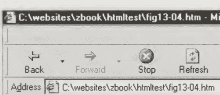

今天吃的水果：

orange
apple
pear
grape

图 13-4 使用`split()`方法创建的数组元素打印在页面上

## `strike()` 方法

`strike()`方法在它调用的文本字符串周围添加`<STRIKE>`和`</STRIKE>`标签，以创建删除效果。代码展示了该方法的用法：

```html
<BODY>

<SCRIPT language="JavaScript">

<!--

var the_text="I shouldn't wear stripes!";

document.write(the_text.strike());

-->

</SCRIPT>

</BODY>
```

这段代码将以下代码放入页面源代码中：

```
<STRIKE>I shouldn't wear stripes!</STRIKE>
```

## `sub()` 方法

`sub()`方法在它调用的文本字符串周围添加`<SUB>`和`</SUB>`标签，创建下标效果。这段代码展示了在脚本中使用该方法：

```html
<BODY>

<SCRIPT language="JavaScript">

<!--

var sub_text="2";

document.write("Water is "+sub_text.sub()+"O");

-->

</SCRIPT>

</BODY>
```

这段代码将 2 作为下标放在 H 和 O 之间，给出水的化学式。此代码将被放置在页面源代码中：

```
Water is H<SUB>2</SUB>O
```

## 模块13：处理字符串 427

## `substr()` 方法

该方法提取字符串的一部分，并将被移除的部分作为新字符串返回。它接受两个数值参数。第一个参数指定移除开始的位置，第二个参数指定要移除的字符数。

例如，下面的代码移除了从位置 0 开始的字符串部分，直到移除七个字符为止：

```javascript
var the_text="Do not cut this short!";

var shorter_string=the_text.substr(0,7);

window.alert(shorter_string);
```

这段代码删除了字符串中单词 "cut" 之前的所有内容。然而，这次返回的字符串是被移除的部分。因此，告警框将显示 "Do not."。注意 "not" 之后的空格字符包含在内，因为它是第七个被移除的字符。

## `substring()` 方法

该方法的工作与`substr()`方法非常相似，但它允许你发送要移除字符串的起始位置和结束位置参数。它将被移除的部分作为新字符串返回。

例如，看看下面的代码。你不是告诉它移除多少个字符，而是提供一个结束位置。字符从起始位置开始移除，到比结束位置减1的地方结束。（记得`slice()`方法。）

```javascript
var the_text="Do not cut this short!";

var shorter_string=the_text.substring(0,7);

window.alert(shorter_string);
```

再次，你移除了直到单词 "cut" 之前的所有内容。告警框将与`substr()`方法示例一样显示 "Do not"。

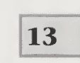

## `sup()` 方法

`sup()`方法在它调用的文本字符串周围添加`<SUP>`和`</SUP>`标签，创建上标效果。以下代码展示了脚本中使用该方法：

```html
<BODY>

<SCRIPT language="JavaScript">

<!--

var sub_text="2";

document.write("Water is "+sub_text.sub()+"O");

-->

</SCRIPT>

</BODY>
```

这段代码将 2 作为下标放在 H 和 O 之间，给出水的化学式。

## `toString()` 方法

`toString()`方法返回它调用的对象的字符串值。这是一个示例：

```html
<BODY>

<SCRIPT language="JavaScript">

<!--

  var the_text="I am feeling small today";

  document.write(the_text.small());

-->

</SCRIPT>

</BODY>
```

## `toLowerCase()` 方法

`toLowerCase()`方法返回它调用的字符串的小写值。这是一个示例：

```html
<BODY>

<SCRIPT language="JavaScript">

<!--

  var the_text="I FEELM,.";

  document.write(the_text.toLowerCase());

-->

</SCRIPT>

</BODY>
```

## `toUpperCase()` 方法

`toUpperCase()`方法返回它调用的字符串的大写值。这是一个示例：

```html
<BODY>

<SCRIPT language="JavaScript">

<!--

  var the_text="I am yelling";

  document.write(the_text.toUpperCase());

-->

</SCRIPT>

</BODY>
```

## 模块13：处理字符串 450

2. 在`HEAD`部分中，编写一个脚本来获取提示框询问名称的结果，并将该提示的结果赋值给名为`the_name`的变量。

3. 使用`charAt()`方法找到提示框中输入的名称的第一个字符，并将该结果赋值给名为`first_char`的变量。

4. 在`BODY`部分中，添加一些脚本，使页面将显示名称查看器，但前提是名称必须以大写 **S** 开头。否则，显示一条消息，说明查看器需要一个以大写 **S** 开头的名称才能显示。

5. 将文件保存为`pr13.html`，并在浏览器中尝试运行查看效果。

## 整合在一起

现在你已经知道如何单独使用这些属性和方法了，让我们来创建一个使用了其中几个属性的脚本，看看它们是如何协同工作的。你将通过创建一个脚本来戏弄查看者的名字（当然，是出于幽默的考虑）。

你希望脚本能够获取查看者的姓和名，更改每个名字的首字母，然后将结果提示给查看者。以下函数执行了此操作：

如果查看者需要重新尝试，函数将重新开始

```html
<HTML>

<HEAD>

<SCRIPT language="JavaScript">

function getname() {

var the_text=window.prompt("Enter your first and last name,");

if (the_text.indexOf(" ") == -1) {

window.alert("Put a space between your first and last name. Try again.");

getname();

}

var split_text=the_text.split(" ");

if ((split_text[0].charAt(0) != "Z" || (split_text[0].charAt(0) == "z")) {

alert("如果没有空格，提示将告诉查看者重试")

}

```

提示框允许查看者输入名称

这一行代码测试查看者的输入中是否包含空格

查看者的输入通过空格字符进行拆分

这是一个测试第一个名字是否以 **Z** 或 **z** 开头的测试


如果第一个名字不是以 Z 开头，则取出首字母并将名字的剩余部分赋值给一个变量

```
var shorter_fn_string=split_text[0].substring(1,split_text[0].length);

new_fn_name="Z"+shorter_fn_string;

else {

  var shorter_fn_string=split_text[0].substring(1,split_text[0].length);

  new_fn_name="W"+shorter_fn_string;

  if ((split_text[1].charAt(0) == "Z" || (split_text[1].charAt(0) == "Z")) {

    var shorter_fn_string=split_text[1].substring(1,split_text[1].length);

    new_fn_name="Z"+shorter_fn_string;

  } else {

    var shorter_fn_string=split_text[1].substring(1,split_text[1].length);

    new_fn_name="W"+shorter_fn_string;

  }

  window.alert("Now your name is "+new_fn_name+" "+new_fn_name+"");

}

getname();

//

</script>

<body>

<h1>Welcome!</h1>

</body>

</html>
```

更改名称的结果将提示给查看者

在变量前添加一个 **Z** 使第一个名字以 **Z** 开头，并将结果赋值给一个变量

如果名字以 **Z** 或 **z** 开头，则将首字母改为 **W**

此代码完全放在文档的`HEAD`部分并随着页面运行。注意一个名为`getname()`的函数开始。函数执行的第一个任务是提示查看者输入姓和名。想法是查看者将输入一个名、一个空格和一个姓（尽管其他输入也是可能的）。

一旦获取了名称，脚本将使用`indexOf()`查看输入中是否包含空格。如果没有空格，则只有一个名字，这并不是你所想要的。因此，如果没有空格，脚本将提示查看者重试并从头重新启动函数。如果有空格，脚本将继续执行代码块后的下一行。

## 模块 13：处理字符串

脚本使用`split()`方法创建一个任何由空格分隔的数据的数组。理论上，在名和姓之间应该有一个空格。如果查看者使用了多个空格，则结果数组的前两个元素将被使用（它们在脚本稍后部分被具体提到）。因此，尽管查看者输入了`John Doe`，但如果输入`John J Doe`，前两个元素是`John J`，`Doe`将不会被使用。（通过更高级的验证，这个问题可以提示查看者重试。）

一旦字符串被拆分为数组，脚本使用`charAt`测试数组中元素（第一个名字）的首字母。如果它不是 **Z** 或 **z**，则执行代码块中的代码。该块使用`substring()`方法获取名字中除第一个字母以外的所有字母，并将其赋值给`shorter_fi_string`。

如果名字以 **Z** 或 **z** 开头，则首字母改为 **W**

此代码完全放在文档的`HEAD`部分并随着页面运行。注意一个名为`getname()`的函数开始。函数执行的第一个任务是提示查看者输入姓和名。想法是查看者将输入一个名、一个空格和一个姓（尽管其他输入也是可能的）。

一旦获取了名称，脚本将使用`indexOf()`查看输入中是否包含空格。如果没有空格，则只有一个名字，这并不是你所想要的。因此，如果没有空格，脚本将提示查看者重试并从头重新启动函数。如果有空格，脚本将继续执行代码块后的下一行。

## 项目 13-2：使用`indexOf()`测试地址

在这个项目中，你将通过创建一个测试查看者输入的电子邮件地址的脚本来练习`indexOf()`方法。


### 步骤说明

1. 创建一个 HTML 页面，为脚本留出`HEAD`和`BODY`部分。

2. 在`HEAD`部分，创建一个名为`get_add()`的函数。在其中，将询问电子邮件地址的提示结果赋值给变量`email_add`。

3. 同样在函数中，使用`indexOf()`查看地址中是否包含`@`字符。如果没有，向查看者发送一个提示，说明需要该字符并重试。

4. 同样在函数中，使用`indexOf()`查看地址中是否包含点`.`字符。如果没有，向查看者发送一个提示，说明需要该字符并重试。

5. 同样在函数中，如果地址同时包含`@`字符和点`.`字符，则向查看者发送提示。

6. 在`BODY`部分中，创建一个查看者可以点击启动函数的按钮。标签为“Click to enter e-mail address.”

7. 将文件保存为`pr13_2.html`并在浏览器中尝试运行查看你可以做什么。

## 掌握检查

1. 我们通过哪两种方式创建字符串对象？

A. 创建字符串对象的实例和创建字符串字面量

B. 创建数组对象的实例和创建字符串字面量

C. 创建数值变量并创建一个对象

D. 创建字符串并加上数字

2. 字符串对象的哪些属性可以用于字符串对象和字符串字面量？

A. `prototype`

B. `constructor`

C. `length`

D. `color`

3. 下列哪项正确创建了字符串字面量？

A. `var the_text= "Look at me!"`

B. `var the_text= 'Look at me!'`

C. `var the_text= Look at me!`

D. `var the_text= new String("Look at me!")`

4. 字符串对象的哪种方法可以用来找到字符串中给定位置的字符？

A. `indexOf()`

B. `charAt()`

C. `index()`

D.

5. 下述哪个述述是正确的？

A. `charAt()`方法返回一个数值，该值是作为参数发送的字符的位置。

B. `split()`方法通过移除字符串的一部分并返回减去该部分的字符串来创建一个新字符串。

C. `length`属性允许为字符串对象添加更长的属性和方法。

D. `indexOf()`方法返回一个数值，该值是作为参数发送的字符的位置，但仅为该字符首次出现的位置。

# 第 14


# JavaScript 与表单

## 本模块的目标

- 使用 JavaScript 访问表单
- 学习表单对象的属性和方法
- 访问并使用各种表单元素中的值
- 验证表单元素
- 使用表单进行导航

当你使用 JavaScript 访问表单时，可以为 Web 页面创建新的脚本。本模块首先将解释如何使用 JavaScript 访问表单。然后，你将学习用于表单和表单元素的各种属性和方法。你还将学习如何验证表单元素。最后，你将学习如何使用表单元素创建导航设备。

## 访问表单

每当你在 HTML 文档中添加一组 `<FORM>` 和 `</FORM>` 标签时，就会创建一个表单对象。要使用 JavaScript 访问其中一个表单，可以使用 `document` 对象的 `forms` 数组，或者在起始 `<FORM>` 标签中为表单命名并使用该名称来访问表单。

### 使用 forms 数组

`forms` 数组允许你使用数组索引号访问表单。页面上的每组 `<FORM>` 和 `</FORM>` 标签都会在 `forms` 数组中创建一个额外的元素，按照它们在文档中出现的顺序。因此，你可以像这样引用文档中的第一个表单：

```
document.forms[0]
```

正如你所记得，数组从 0 开始计数，因此上一个示例将访问文档中的第一个表单。如果你想访问第二个表单，可以使用以下代码：

```
document.forms[1]
```

这对于同一页面上的其余表单同样有效。只需记住从 0 开始计数而不是 1，以便访问正确的表单。

访问表单本身并不会产生任何操作。你访问的表单是一个对象。要使用它，你需要该对象的某个属性或方法。表单对象的属性和方法列在稍后的章节“表单对象的属性和方法”中，位于表 14–1 和 14–2 中；但现在，让我们来看看 `length` 属性是起什么作用的。

### 属性值

本节中的示例使用了表单对象的 `length` 属性。该属性允许你发现 HTML 表单中存在多少元素（如输入框、选择框、单选按钮等）。例如，请看这段代码：

```
<HTML>
<BODY>
<FORM>
Name: <INPUT type="text">
E-mail: <INPUT type="text">
<INPUT type="submit" value="Submit">
</FORM>
</BODY>
</HTML>
```

该代码创建了一个包含三个元素的短脚本：两个文本框和一个提交按钮。因为它是页面上唯一的表单，它将是第一个表单，允许你使用 `document.forms[0]` 访问它。要使用 `length` 属性，请将其添加到此末尾：

```
document.forms[0].length
```

使用前面的代码，你可以创建一个短脚本，告诉观众表单中有多少个元素。（你通常不会这样使用 `length` 属性，但作为一个示例它很好。）接下来的代码将在表单后的页面上写下信息：

```
<HTML>
<BODY>
<FORM>
Name: <INPUT type="text">
E-mail: <INPUT type="text">
<INPUT type="submit" value="Submit">
</FORM>
<P>
<SCRIPT language="JavaScript">
<!--
document.write("The form has "+document.forms[0].length+" elements.");
//-->
</SCRIPT>
</BODY>
</HTML>
```

这段代码告知观众表单有三个元素。图 14-1 显示了该脚本在浏览器中运行的结果。

### 涵盖两个 length 属性

如果你想在页面上有多个表单时显示页面上每个表单的元素数量，可以使用一个更复杂的脚本，为页面上的每个表单打印一条消息。记住，由于 `forms` 是一个数组，你可以找到数组的长度。

数组的长度是页面上表单的数量（类似于特定表单的 `length` 属性是该表单中元素的数量）。要找到页面上表单的数量而不是单个表单的长度，请记住通过省略括号和索引号来指定表单，如下例所示：

```
document.forms.length
```

此语法用于查找页面上的表单。因此，你必须记住这一点：

- `document.forms.length` 查找页面上表单的数量
- `document.forms[x].length` 查找页面上特定表单中的元素数量，其中 `x` 是要访问表单的索引号

这种语法看起来可能有点混乱，但只需记住一个 `length` 属性用于整个数组，而另一个 `length` 属性用于特定的表单。

接下来的脚本使用了两个 `length` 属性并使用循环遍历每个表单。代码显示了页面上每个表单的元素数量：

```
<HTML>
<BODY>
<B>Form 1</B>
<P>
<FORM>
Name: <INPUT type="text"><BR>
E-mail: <INPUT type="text"><BR>
<INPUT type="submit" value="Submit">
</FORM>
<HR>
<B>Form 2</B>
<P>
<FORM>
Favorite Color: <INPUT type="text"><BR>
Favorite Food: <INPUT type="text"><BR>
<INPUT type="reset" value="Reset">&nbsp;
<INPUT type="submit" value="Submit">
</FORM>
<HR>
<P>
<SCRIPT language="JavaScript">
<!--
for(count=0;count<document.forms.length;count+=1) {
var formnum=count+1;
document.write("Form "+formnum+" has "+document.forms[count].length);
document.write(" elements.<BR>");
}
//-->
</SCRIPT>
</BODY>
</HTML>
```

图 14-2 向观众显示表单中的元素数量。

### 使用表单名称

使用表单名称允许你为页面上想要访问的表单命名。此选项有助于消除 `document.forms.length` 和 `document.forms[x].length` 之间的任何混淆，因为除非你要遍历页面上的每个表单，否则你不需要使用索引号。

要使用表单名称，必须在你想要访问的表单的起始 `<FORM>` 标签中添加 `name="yourname"` 属性。将 `yourname` 替换为你想使用的名称，如下所示：

```
<form name="info_form">
Name:<INPUT type="text">
<INPUT type="submit">
</form>
```

表单的名称现在是 `info_form`，你可以使用此名称在脚本中访问该表单。

表单名称允许它成为对象的实例，你可以通过其名称访问它。要使用 JavaScript 访问使用表单名称的表单，可以使用此处语法：

```
document.yourname
```

将 `yourname` 替换为在 `name="yourname"` 属性的起始 `<FORM>` 标签中给出的名称。因此，如果你想写一个脚本来查找命名表单的元素数量，可以使用以下代码：

```
<HTML>
<BODY>
<FORM name="info_form">
Name:<INPUT type="text">
<INPUT type="submit">
</FORM>
<P>
<SCRIPT language="JavaScript">
<!--
document.write("The form has "+document.info_form.length+" elements.");
//-->
</SCRIPT>
</BODY>
</HTML>
```

注意 `document.write()` 语句是如何访问表单的。这里没有使用表单数组，而是使用了表单的名称。现在它可以访问表单对象的属性，并通过访问 `length` 属性来实现。图 14-3 显示了该脚本在浏览器中的运行结果。

这种技术对于访问表单非常有用。它允许你直接访问，而无需查看 HTML 代码来根据代码中的顺序确定每个表单应该拥有的索引号。相反，你可以为表单命名并使用其名称进行访问。

## 1 分钟演练

- `document.forms[1]` 访问的是哪个表单元素？
- `document.forms.length` 和 `document.forms[x].length` 之间有什么区别？
- 在 HTML 代码的哪个位置添加属性，可以给表单命名一个可以在脚本中使用的名称？

**答案：**

- 文档中的第二个表单
- 前者查找页面上表单的数量，而后者查找特定表单中的元素数量（通过将 `x` 替换为数字）
- 在表单的起始 `<FORM>` 标签中

## form 对象的属性和方法

当你需要在脚本中访问表单的某些元素或属性时，JavaScript 对象将为你提供帮助。表单对象只有几个属性和方法。让我们从属性开始。

### 属性

表单对象的属性提供了你在脚本中处理表单时可能需要的信息。表 14-1 列出了表单对象的属性及其值。

这些属性中的大多数持有对应于 HTML `<FORM>` 标签中各种属性的值。不过，其中少数属性具有不同类型的值。

### action 属性

此属性允许你访问起始 `<FORM>` 标签中 `action="url"` 属性的值。该属性用于将表单发送到服务器端处理脚本（例如 Perl 脚本）。以下示例展示了如何通过命名表单访问该属性：

```
<HTML>
<BODY>
<FORM name="info_form" action="http://someplace.com/cgi-bin/form.cgi">
Name: <INPUT type="text"><BR>
<INPUT type="submit">
</FORM>
<P>
<SCRIPT language="JavaScript">
<!--
document.write("The form goes to "+document.info_form.action);
//-->
</SCRIPT>
</BODY>
</HTML>
```

该脚本在页面上写入了 `action` 属性中指定的 URL。图 14-4 显示了该脚本在浏览器中运行时的结果。

### elements 属性（数组）

`elements` 属性是一个数组，允许你按照元素在代码中出现的顺序访问每个元素，从 0 开始。它的工作方式与 `forms` 数组非常相似，但它为给定表单中的每个元素提供了一个条目。

要使用 `elements` 数组访问表单中的元素，请使用你想要访问的元素的索引号。例如，以下表单有两个元素：

```
<FORM name="info_form">
Name: <INPUT type="text"><BR>
<INPUT type="submit">
</FORM>
```

要访问第一个元素（文本框），你可以使用此处所示语法：

```
document.info_form.elements[0]
```

或者，如果你想使用 `forms` 数组（假设这是页面上的第一个表单），你可以使用这种语法：

```
document.forms[0].elements[0]
```

访问文本框的另一种选择是为它命名（像命名表单一样）并通过其名称访问。你可以对每个元素这样做，也可以对表单本身这样做；你可以根据具体情况选择哪种方法最适合访问表单及其元素。

### 表单元素属性

表单元素都有自己的属性和方法，但许多与复选框相关。让我们详细查看它们。

#### checked 属性

此属性用于复选框和单选按钮。它具有布尔值 `true` 或 `false`，如果复选框被选中则为 `true`，如果未选中则为 `false`。例如，以下代码使用复选框进行测试：

```
<HTML>
<HEAD>
<SCRIPT language="JavaScript">
<!--
function is_it_checked() {
  if (document.info_form.yes_no.checked) 
    window.alert('Yes! The box is checked');
  } else
    window.alert('No, the box is not checked!');
}
//-->
</SCRIPT>
</HEAD>
<BODY>
<FORM name="info_form">
<P>
<INPUT type="checkbox" name="yes_no"> Check here for yes
<P>
<INPUT type="button" value="See the Answer" onclick="is_it_checked()">
</P>
</FORM>
</BODY>
</HTML>
```

HTML 体有一个名为 `info_form` 的表单和一个复选框 `yes_no`。点击按钮将调用 `is_it_checked()` 函数。该函数使用 `if/else` 语句检查复选框当前是否被选中。`if` 条件使用了一种快捷方式，允许你将其从：

```
if (document.info_form.yes_no.checked==true)
```

简化为：

```
if (document.info_form.yes_no.checked)
```

`checked` 属性将返回 `true` 或 `false`，无需对 `checked` 属性的值进行任何测试（除非你喜欢这样做，那样也可以）。

图 14-5 显示了当观众选中复选框以获取“Yes”警告时该脚本的结果。

#### defaultChecked 属性

此属性也是一个布尔值 `true` 或 `false`。值取决于复选框或单选按钮是否具有 `checked` 属性（该属性设置元素在页面加载时默认选中）。如果元素具有 `checked` 属性，则值为 `true`。如果没有，则值为 `false`。例如，以下代码会提示该框是默认选中的：

```
<HTML>
<HEAD>
<SCRIPT language="JavaScript">
<!--
function was_it_checked() {
  if (document.info_form.yes_no.defaultChecked)
    window.alert("Yes! The box was checked by default!");
  else
    window.alert("No, the box was not checked by default!");
}
//-->
</SCRIPT>
</HEAD>
<BODY>
<form name="info_form">
勾选框表示是： <INPUT type="checkbox" name="yes_no" checked>
<P>
<INPUT type="button" value="See the Answer" onclick="was_it_checked();">
</form>
</BODY>
</HTML>
```

由于复选框具有 `checked` 属性，点击按钮将提醒查看者它默认是被勾选的。

#### defaultValue 属性

你可以在文本框和文本区域中使用此属性。它存储了表单元素标签属性中设置的默认值。如果你在文本框中设置了一个值，然后将其删除，紧接着他或她决定如果能恢复默认值就很好，那么这个功能就会非常有用。你可以编写一个按钮，在用户点击时返回该值，如下面的代码所示：

```
<HTML>
<HEAD>
<SCRIPT language="JavaScript">
<!--
function back_to_default()
{
document.info_form.favurl.value=document.info_form.favurl.defaultValue;
}
//-->
</SCRIPT>
</HEAD>
<BODY>
<FORM name="info_form">
收藏 URL:<BR>
<INPUT type="text" name="favurl" value="http://www.yahoo.com">
<P>
<INPUT type="button" value="Reset Default" onclick="back_to_default();">
</FORM>
</BODY>
</HTML>
```

在 HTML 代码中，文本框的 `<INPUT>` 标签中的 `value` 属性被设置为 `http://www.yahoo.com`。这给它了一个默认值。当函数被调用时，它通过将其当前值（`document.info_form.favurl.value`）设置为默认值（`document.info_form.favurl.defaultValue`），将此默认值重新分配给文本框。

#### form 属性

`this.form` 指向使用该元素的表单。例如，如果你想通过点击按钮来更改文本框的值，你可以使用 `this.form` 来引用表单，而不是使用表单名称：

```
<form name="info_form">
收藏 URL:<BR>
<INPUT type="text" name="favurl" value="http://www.yahoo.com">
<INPUT type="button" value="Change"
onclick="this.form.favurl.value='http://www.lycos.com';">
</form>
```

这段代码在点击按钮时会将文本框的当前值更改为 `http://www.lycos.com`。使用 `this.form.favurl.value` 允许你从元素内部访问同一个表单，而无需返回并使用 `document.info_form.favurl.value`，后者的代码要长一些。

#### name 属性

此属性存储元素 `name` 属性的值。例如，以下代码打印页面上第一个元素（文本框）的 `name` 值：

```
<HTML>
<BODY>
<form name="info_form">
姓名:<INPUT type="text" name="yourname"><BR>
<INPUT type="submit">
</form>
<script language="JavaScript">
<!--
document.write("The first element is "+document.info_form.elements[0].name);
//-->
</script>
</BODY>
</HTML>
```

这是一种无需搜索代码即可找到元素名称的方法。

#### options 属性（数组）

`options` 属性是一个数组，其中包含 `select` 框或表单中列出的每个选项的元素。索引数字从 0 开始计数，每个选项按照它们在 HTML 代码中的编写顺序放置在数组中。以下代码显示了如何访问任何选项的值（这是 `<OPTION>` 标签的 `value` 属性，而不是标签的内容）并写在页面上：

```
<HTML>
<BODY>
<FORM name="info_form">
水果:
<SELECT name="optlist">
<OPTION selected value="orange">Orange</OPTION> 
<OPTION value="apple">Apple</OPTION> 
<OPTION value="pear">Pear</OPTION>
</SELECT>
</FORM>
<P>
<SCRIPT language="JavaScript">
<!--
document.write("The second option is ");
document.write(document.info_form.optlist.options[1].value);
//-->
</SCRIPT>
</BODY>
</HTML>
```

图 14-6 显示了此脚本在浏览器中运行的结果。注意打印的值位于 `<OPTION>` 标签的 `value` 属性中（全小写），而不是标签的内容（首字母大写）。

#### selectedIndex 属性

此属性存储查看者选择的选项（在上述的 `options` 数组中）的索引值。如果选择了第一个选项，值为 0。如果选择了第二个选项，值为 1。

#### type 属性

此属性存储元素 `type` 属性的值。例如，以下代码打印页面上第一个元素（文本框）的 `type` 值：

```
<HTML>
<BODY>
<form name="info_form">
姓名:<INPUT type="text" name="yourname"><BR>
<INPUT type="submit">
</form>
<script language="JavaScript">
<!--
document.write("The first element is "+document.info_form.elements[0].type);
//-->
</script>
</BODY>
</HTML>
```

这是一种无需搜索代码即可找到元素类型的方法。

#### value 属性

此属性存储元素 `value` 属性的值。例如，以下代码打印页面上第一个元素（文本框）的 `value` 值：

```
<HTML>
<BODY>
<form name="info_form">
姓名:<INPUT type="text" name="yourname" value="John Doe"><BR>
<INPUT type="submit">
</form>
<script language="JavaScript">
<!--
document.write("The first element is "+document.info_form.elements[0].value);
//-->
</script>
</BODY>
</HTML>
```

这是一种无需搜索代码即可找到元素值的方法。

### 表单对象方法

现在让我们来看表单对象的方法。下表列出了这些方法。

| 方法 | 功能 |
| --- | --- |
| `reset()` | 重置表单内容，类似于点击重置按钮 |
| `submit()` | 提交表单，类似于点击提交按钮 |

#### reset() 方法

该方法允许你使用脚本重置表单，允许你在任何喜欢的事件上重置表单。所以，如果你想在观众从元素移除焦点后重置表单，可以使用以下代码：

```
<HTML>
<BODY>
<FORM name="info_form">
Your Favorite Food
<INPUT type="text" name="fav_food" onblur="this.form.reset();"><BR>
Drink <INPUT type="text">
<P>
<INPUT type="reset" value="Reset Form">
</FORM>
</BODY>
</HTML>
```

#### submit() 方法

该方法允许你在观众不点击提交按钮的情况下提交表单。以下代码显示了当观众从元素移除焦点时如何操作（与 `reset()` 方法类似）：

```
<HTML>
<BODY>
<FORM name="info_form" action="http://site.com/cgi-bin/form.cgi">
Your Favorite Food
<INPUT type="text" name="fav_food" onblur="this.form.submit();"><BR>
Drink <INPUT type="text">
<P>
<INPUT type="submit" value="Submit Form">
</FORM>
</BODY>
</HTML>
```

### encoding 属性

该属性通常持有 `<FORM>` 标签中 `enctype` 属性的值。然而，不同浏览器的结果可能不同。

### length 属性

`length` 属性持有页面给定表单中的元素数量。本模块已经对其进行了相当的介绍，因此这里没有再次讨论。

### method 属性

该属性包含 `<FORM>` 标签中 `method` 属性的值。因此，如果你将表单发送到服务器进行处理，可能会使用类似下面的代码：

```
<form name="f1" method="post" action="http://site.com/cgi-bin/form.cgi">
<!-- contents here -->
</form>
```

该表单的 `method` 属性的值为 `post`，因为它位于表单的 `method` 属性内部。

### name 属性

该属性持有表单名称，该名称是在 `<FORM>` 标签的 `name` 属性中赋予的。你可能有像这样的代码：

```
<form name="cool_form">
<!-- contents here -->
</form>
```

在这里，`name` 属性的值是 `cool_form`，因为它是表单 `name` 属性内部的值。

### target 属性

该属性持有 `<FORM>` 标签中 `target` 属性给出的值。例如，你可能会有以下代码：

```
<form name="cool_form" target="place">
<!-- contents here -->
</form>
```

`target` 属性的值将是 `place`，因为它是表单 `target` 属性内部的值。

## 1 分钟演练

- `elements` 数组包含什么？
- `focus()` 方法的作用是什么？
- 使用哪个属性来确定 `method` 属性的值？

**答案：**

- 它包含表单中每个元素的条目
- 它允许你通过脚本为表单元素聚焦
- 起始 `<FORM>` 标签的 `method` 属性

## 验证

验证 JavaScript 表单非常有用。例如，你可以在提交之前验证输入内容，帮助减少信息不完整或不准确的表单数量。然而，仅用 JavaScript 验证表单并不总是明智的，因为用户可能在客户端禁用了 JavaScript。尽管如此，在提交到通用网关接口（CGI）脚本或 Java Servlet 之前验证表单数据可以节省时间并减轻服务器负载。

### onSubmit 和 return 语句

为了验证表单中一个或多个元素的内容，你需要知道观众何时尝试提交表单。当观众点击提交按钮时，会发生 `submit` 事件，该事件可以通过起始 `<FORM>` 标签中的 `onSubmit` 事件处理器来捕获。因此，以下表单代码可以在点击提交按钮时、执行其 `action` 属性之前执行某些操作：

```
<form name="f1" action="http://site.com/cgi-bin/form.cgi" onSubmit="script">
  <INPUT type="text" name="username">
  <INPUT type="submit" value="Submit">
</form>
```

你在此处将 `script` 替换为点击提交按钮时执行的某些 JavaScript。这通常是调用一个运行测试一个或多个表单字段的函数。

然而，为了让函数发挥作用，你必须确保如果观众输入没有通过验证，提交按钮无法执行其默认操作。这意味着在 `onSubmit` 事件处理器中需要一个 `return` 语句。你希望该语句在验证通过时返回 `true`，在验证失败时返回 `false`。因此，你希望最终结果为：

```
onSubmit="return true";
```

这允许提交继续进行，或者：

```
onSubmit="return false";
```

这会导致提交无效且什么都不做。（回想一下模块 7 中如何向链接标签中添加 `return false;` 以防止链接在被点击时不改变页面位置）。

要让前述代码中的技术与函数配合工作，`onSubmit` 事件处理器中的 `return` 语句必须调用一个返回 `true` 或 `false` 值的函数。因此，你将得到这样的语句：

```
onSubmit="return yourfunction()";
```

你将把 `yourfunction()` 替换为真实的函数名。关键在于该函数必须返回 `true` 或 `false` 值，以便之前的语句求值结果符合你需要（`return true;` 或 `return false;`）。函数本身可以执行任何操作，但它需要一个 `return` 语句向事件处理器发送 `true` 或 `false` 值。所以，你可以对表单进行验证，以确保文本框没有完全留空。以下代码显示了如何使用 `onSubmit` 事件处理器配合函数来实现此点：

```
<HTML>
<HEAD>
<SCRIPT language="JavaScript">
<!--
function check_it() {
  var complete=true;
  var thename=document.f1.yourname.value;
  if ((thename == "") || (thename == null)) {
    alert("Name field is blank, please try again.");
    complete=false;
  }
  return complete;
}
//-->
</SCRIPT>
</HEAD>
<BODY>
<form name="f1" action="http://site.com/cgi-bin/form.cgi" onSubmit="return check_it()">
Name: <input type="text" name="yourname">
<input type="submit" value="Submit">
</form>
</BODY>
</HTML>
```

该函数将一个名为 `complete` 的变量赋值为布尔值 `true`。然后，它通过 `if` 语句检查文本字段是否留空。如果是这样，会弹出一个警告框告诉用户重试，并将 `complete` 的值改为 `false`。随后，该函数将 `complete` 变量的值返回给 `onSubmit` 事件处理程序。

如果返回 `true`，则继续提交。否则，则什么都不会发生，用户可以通过输入必要信息并再次点击提交按钮来重试。请记住，`check_it()` 函数仅会判定完全空的字段。我们需要让函数变得更复杂，以排除空格、井号（`#`）符号等名称。

在大多数情况下，验证的简单或复杂程度完全取决于你的需求而定。你需要做的只是根据所需的信息创建你自己的函数来验证所选的表单字段。

例如，上一节中的示例检查了姓名字段中的一个示例文本框。然而，对于电子邮件地址，你可以更进一步检查该字段是否包含 `@` 字符和点（`.`）。如果没有，你就可以发送一个警告框告诉用户地址无效，并要求重新输入。以下代码展示了实现此点的方法：

```
<HTML>
<HEAD>
<SCRIPT language="JavaScript">
<!--
function check_it()
{
var complete=true;
var email_ad=document.f1.em.value;
if ((email_ad.indexOf("@")==-1) || (email_ad.indexOf(".")==-1)) {
alert("Email Address not Valid, please type it.");
complete=false;
}
return complete;
}
//-->
</SCRIPT>
</HEAD>
<BODY>
<FORM name="f1" action="http://site.com/cgi-bin/form.cgi" onSubmit="return check_it();">
Email:<INPUT TYPE="text" name="em">
<P>
<INPUT type="submit" value="Submit">
</FORM>
</BODY>
</HTML>
```

代码使用字符串方法 `indexOf()` 来检查表单字段中是否存在正确的字符。（记住，如果未找到所需的字符，它将返回 `-1`）。如果这些字符不存在，则会显示警告框且函数返回 `false`。否则，它返回 `true`。

请记住，这种验证也非常基础。像 `a@a.a` 这样的地址在这里是可以通过的。当然，你可以根据自己的需要调整前面的代码，或编写你自己的自定义函数。

就像电子邮件地址一样，其他类型的输入将需要不同类型的验证来检查。只需记住你需要检查什么以确保字段是有效的即可。

## 1 分钟训练

- 使用哪个事件处理程序来响应用户点击提交按钮？
- 为什么用于验证的函数需要返回 `true` 或 `false` 值？
- 当 `indexOf()` 方法没有找到你需要的字符时，它会返回什么？

**答案：**

- `onSubmit`
- 让浏览器知道它是否应该继续提交
- `-1`

## 用于导航的表单

在表单中使用 JavaScript 允许用户选择目的地。本节讨论如何创建选择框和单选按钮。

### 选择框

创建选择框非常简单。首先，你这样设置代码：

```
<FORM name="f1">
<SELECT name="s1">
  <OPTION value="page1.html">Page 1</OPTION>
  <OPTION value="page2.html">Page 2</OPTION>
</SELECT>
</FORM>
```

注意，表单和选择框已经命名。表单是 `f1`，而选择框是 `s1`。在创建按钮代码时，这些名称非常重要。

### 按钮

接下来，编写启动此脚本的按钮。该按钮需要执行将用户传输到新目的地的操作。为了做到这一点，你必须能够访问选择框中选中的选项并获取其值。然后，浏览器需要将用户带到新的 URL。

要访问选中的选项，你必须向下处理选择框的数组。记得表单名称是 `f1`，选择框名称是 `s1`。因此，要获取此选择框的选项，你可以使用以下语法：

```
document.f1.s1.options[]
```

问题是，你想从数组中获取哪个选项？你不想通过插入选择的索引号来猜测；你想要用户所选选项的索引号。

这正是选择框的 `selectedIndex` 属性有用的地方。记住，它保存了用户所选选项的索引值。通过使用此属性的值作为 `options` 数组中的索引，你可以在用户做出选择时访问正确的选项。这将得到这种语法：

```
document.f1.s1.options[document.f1.s1.selectedIndex]
```

你现在已经从列表中获取了正确的选项。现在你必须获取它的值，以便检索值中的 URL。要做到这一点，你只需要在行末尾添加 `value` 属性，如下：

```
document.f1.s1.options[document.f1.s1.selectedIndex].value
```

这现在是你想要的值，即查看者所选选项的 URL。

接下来，你必须将此语法转换为可运行的形式。这个值是当你点击按钮时，浏览器要跳转的 URL。因此，你需要一个按钮，在点击时将 `window.location` 属性更改为此值。以下代码创建了这样一个按钮：

```
<input type="button" name="Go" value="Go!" onclick="window.location=document.f1.s1.options[document.f1.s1.selectedIndex].value;">
```

注意，`onclick` 事件设置了点击按钮时执行的代码。`window.location` 属性被更改为从选择框中获取的新值。

请确保此标签在你的文本编辑器中占据单行。这里显示两行是因为它太长了。页面上没有足够的空间跨越整页来写成单行，所以务必在你的文本编辑器中这样做。

接下来，组合代码，以便你拥有导航下拉框的完整脚本。完整代码如下所示：

```
<HTML>
<BODY>
<FORM name="f1">
<SELECT name="s1">
<OPTION SELECTED value="page1.html">Page 1</OPTION>
<OPTION value="page2.html">Page 2</OPTION>
</SELECT>
&nbsp;&nbsp;
<input type="button" name="go" value="Go!" onclick="window.location=document.f1.s1.options[document.f1.s1.selectedIndex].value;">
</FORM>
</BODY>
</HTML>
```

查看者应该能够通过从框中进行选择并点击 Go! 按钮来导航。图 14–8 显示了在浏览器中查看时的初始下拉框。

### 无按钮

要创建一个没有按钮的导航选择框，你可以使用 `onChange` 事件处理器。当表单字段的内容以某种方式发生变化时（输入文本、做出选择等），就会发生此种变化事件。因此，为了消除按钮，你可以让浏览器在查看者选择目标后立即跳转到新页面。

你想捕获选择框的变化，因此必须在起始的 `<SELECT>` 标签上添加事件处理器，如下语法所示：

```
<SELECT name="s1" onChange="script">
```

你用 `script` 替换为在变化事件上要执行的操作。如果你想制作与之前类似的下拉框，只需要移除按钮，并将你之前在按钮的 `onClick` 事件处理器中的代码放置到选择框的 `onChange` 事件处理器中。以下代码显示了如何为这个新的下拉框编写脚本：

```
<HTML>
<BODY>
<FORM name="f1">
<SELECT name="s1" onChange="window.location=document.f1.s1.options[document.f1.s1.selectedIndex].value;">
<OPTION value="#">选择目标</OPTION>
<OPTION value="page1.html">Page 1</OPTION>
<OPTION value="page2.html">Page 2</OPTION>
</SELECT>
</FORM>
</BODY>
</HTML>
```

注意更改 `window.location` 属性的代码是在 `onChange` 事件处理器内部的，而且不需要按钮。此外，第一个选项不是激活状态，因为在不先选定其他内容的情况下是无法选择它的（在这种情况下，这反正会发生变化）。它被赋予了一个 `#` 值以防万一，这基本上创建了一个死链接。

### 单选按钮导航

单选按钮导航有点复杂，因为你只想让一个单选按钮被选中，所以你必须给每个单选按钮相同的名称，以避免查看者多次选择。这阻止了你通过名称引用元素，增加了编写导航代码的难度。然而，你可以使用 `elements` 数组来查找哪个单选按钮被选中，而不是使用它的名称。

以下代码创建了一组目的地。通过选择单选按钮并点击 Go! 按钮，查看者将被带到所选页面：

```
<HTML>
<BODY>
<SCRIPT language="JavaScript">
<!--
function gothere() {
  if (document.f1.elements[0].checked)
    window.location = document.f1.elements[0].value;
  if (document.f1.elements[1].checked)
    window.location = document.f1.elements[1].value;
}
//-->
</SCRIPT>
<FORM name="f1">
Page Source: <INPUT TYPE="radio" name="r1" value="http://www.pageresource.com">
JavaScript City: <INPUT TYPE="radio" name="r1" value="http://www.javascriptcity.com">
<P>
<INPUT type="button" value="Go!" onclick="gothere();">
</FORM>
</BODY>
</HTML>
```

该函数检查表单前两个元素（单选按钮）的 `checked` 属性。如果按钮被选中，浏览器会将查看者带到单选按钮 `value` 属性中的新位置。表单末部的按钮触发该函数。如果选项列表变长，你可以使用循环遍历检查每个元素，直到有一个被选中为止。

你还可以围绕其他元素构建导航系统。只需记住根据各种元素类型调整你的代码。

## 掌握检查

1. 下述哪项可以访问第四个表单？
   A. `document.forms[4]`
   B. `document.forms[3]`
   C. `document.forms(4)`
   D. `document.forms(3)`

2. 下述哪项持有 document 中表单数量的值？
   A. `document.forms[0].length`
   B. `document.form.length`
   C. `document.forms.length`
   D. `document.forms[1].length`

3. 下述哪项可以访问名为 `f1` 的表单中名为 `e1` 的元素的值？
   A. `document.f1.e1.value`
   B. `document.e1.f1.value`
   C. `document.f1.e2.value`
   D. `document.forms1.e1.value`

4. 函数验证表单时应该返回什么类型的值？
   A. 是或否
   B. `true` 或 `false`
   C. 可能如此
   D. 浮点数

5. 使用什么获取选择框中当前选中的选项？
   A. `length` 属性
   B. `reset` 方法
   C. `getSelected` 方法
   D. `selectedIndex` 属性

# JavaScript 与框架

## 本模块的目标

- 理解框架基础
- 使用 JavaScript 访问框架
- 从其他框架加载文档
- 使用 JavaScript 改进框架导航
- 在框架间使用变量

在 JavaScript 中，你可以通过框架（frames）执行一些实用的任务。本模块将提供框架的基本概述，然后解释如何从一个框架访问另一个框架。你还将学到如何从一个框架改变另一个框架，然后你将使用一些框架导航技巧。最后，你将学习跨框架之间使用变量来存储和检索信息。

## 框架简介

在网站中使用框架（frames）是一个相当有争议的话题。是否使用框架取决于你。这取决于你的导航需求以及你可能遇到的其他网站问题。如果你对框架一无所知，那么学习一些基础信息将帮助你判断它们对你是否有用。

如果你已经在使用框架了，可以快速略过本节，或者完全跳过。然而，如果你对框架几乎没有或没有经验，你应该仔细阅读这段关于框架的介绍。框架可能会变得非常混乱，尤其是当你加入 JavaScript 的时候。

### 框架的用途

框架将窗口划分为两个或多个独立的区域（一个框架集 frameset，每个区域包含不同的内容）。这与表格（tables）的区别在于，框架集中的每个划分区域都包含一个独立的超文本标记语言（HTML）文档，而且你可以改变其中一个部分来影响其他部分。

网页上显示的每个框架实际上都是一个独立的 HTML 文档。

例如，图 15–1 显示了一个包含两个框架的网页。每个框架实际上都是一个独立的 HTML 文档。创建框架的 HTML 文档使用一组 `<FRAMESET>` 和 `</FRAMESET>` 标签创建一个框架集。

框架有多种用途。例如，你可以用它们创建一个全站导航系统，或者创建一个参考系统，其中目录在一个框架中，而相应的内容出现在另一个框架中。

### 框架后的代码

以下代码包含 `frameset` 元素。它规定了打开文档时将显示的框架数量和结构：

```
<HTML>
<FRAMESET cols="20%,80%">
<FRAME SRC="frame1.html">
<FRAME SRC="frame2.html">
</FRAMESET>
<NOFRAMES>
很抱歉，您的浏览器不支持框架。请使用下面的链接访问网站的无框架版本。<BR>
<A HREF="noframes.html">无框架站点</A><BR>
</NOFRAMES>
</HTML>
```

这段代码创建了一个基本的框架集，在窗口左侧产生一个较小的框架，在右侧产生一个较大的框架。以下是它的工作原理：

1. 起始 `<FRAMESET>` 标签告诉浏览器框架集开始。注意，它替换了普通窗口中使用的 `<BODY>` 标签。
2. 起始 `<FRAMESET>` 标签的 `cols` 属性告诉窗口将分为两列（从左到右移动）。第一列（左侧）占据屏幕空间的 20%，而第二列（右侧）占据屏幕空间的 80%。
3. 第一个 `<FRAME>` 标签在页面上创建了第一个框架。浏览器会按照它们在源代码中出现的顺序，从左到右、从上到下显示框架。因此，此框架位于页面的左上部分——在这种情况下，它是页面的左侧。
4. `src` 属性告诉浏览器要作为框架内容的 HTML 文档的 URL，这实际上是查看者在窗口左侧看到的内容。在这种情况下，该文档是一个名为 `frame1.html` 的文件。
5. 第二个 `<FRAME>` 标签执行相同的操作，但该框架是按左到右、从上到下顺序中的下一个框架。同样，由于只有两列，此框架就在窗口的右侧。`src` 属性指向要在该框架中显示的 HTML 文档的 URL。在这种情况下，该文档是一个名为 `frame2.html` 的文件。
6. `</FRAMESET>` 标签结束框架集。
7. `<NOFRAMES>` 和 `</NOFRAMES>` 标签之间的内容显示在不支持框架的浏览器中，以便查看者在屏幕上有内容显示。你可以放置一个指向无框架版本网站的链接，或者使用你喜欢的任何其他 HTML 代码。为了示例，我使用了文本和链接来保持该章节简短。

由前面的代码创建的文档是你希望在浏览器中打开以显示框架的页面。将此文档保存为 `frameset.html`，这样当你为框架中使用的文档添加一些代码后就可以使用它。

一旦创建了框架集，你就必须创建填充框架的文档。首先，创建一个用于左框架的文档（`frame1.html`）：

```
<HTML>
<BODY>
我是 frame1.html，我在左侧！
</BODY>
</HTML>
```

这段简单的代码告诉你在哪个框架中显示哪个文档。（你可以根据需要让代码变得复杂。）将其保存为与 `frameset.html` 相同的目录下的 `frame1.html`。

接下来，你必须为另一个框架（`frame2.html`）提供代码：

```
<HTML>
<BODY>
我是 frame2.html，我在右侧！
</BODY>
</HTML>
```

将此 `frame2.html` 保存到与 `frameset.html` 和 `frame1.html` 相同的目录下。

现在，当你在浏览器中打开 `frameset.html` 时，它应该显示包含两个框架的窗口，每个框架都包含相应的 HTML 文档，如图 15-2 所示。

### 框架选项

正如你所看到的，起始 `<FRAMESET>` 标签可以接受 `cols` 属性将窗口划分为列。同样，它可以使用 `rows` 属性将页面从上到下划分为行。

这是一个创建一个两行框架集的代码示例：

```
<HTML>
<FRAMESET rows="20%, 80%">
<FRAME src="frame1.html">
<FRAME src="frame2.html">
</FRAMESET>
<NOFRAMES>
使用下面的链接访问网站的无框架版本。<BR>
<A HREF="noframes.html">无框架站点</A>
</NOFRAMES>
</HTML>
```

这次框架是从上到下排列的，因为使用了 `rows` 属性。这次，页面被分为两个框架，一个在上面，另一个在下面。

### 行或列

如果你愿意，`rows` 或 `cols` 属性中使用的第一个值可以是像素而不是百分比。此外，如果你想让某个框架在设置其他框架后占据所有剩余空间，可以使用星号 (`*`)。例如，看这段代码：

```
<HTML>
<FRAMESET rows="150,*">
  <FRAME src="frame1.html">
  <FRAME src="frame2.html">
</FRAMESET>
<NOFRAMES>
</HTML>
```

这次，第一行（顶部）占据 150 像素，而第二行（底部）占据窗口中剩余的所有空间。

### 多于两行或两列

当然，你不限于只有两行或两列。你可以拥有任意数量的行或列。例如，如果你想要一个有三列的框架集，可以使用这段代码：

```
<HTML>
<FRAMESET cols="150,*,150">
  <FRAME src="frame1.html">
  <FRAME src="frame2.html">
  <FRAME src="frame3.html">
</FRAMESET>
<NOFRAMES>
</HTML>
```

在这里，左侧和右侧的宽度均为 150 像素。中间列占据窗口中所有的剩余空间。

### 嵌套允许同时行和列

最后，如果你想要一个包含行和列的更复杂的框架集，你必须将一个框架集嵌套在另一个框架集之中。

例如，你可能想要一个跨越页面顶部高度为 100 像素的行。然后，你可能希望在下方有两列：左侧列占据 150 像素，右侧列占据剩余区域。

要实现这一点，你需要一个表示行的 `frameset`（因为顶行必须跨越页面的顶部部分）。在底部的行内部，你需要另一个使用列来将底部行划分为两个区域的 `frameset`。以下代码展示了这种嵌套可以如何实现：

```
<FRAMESET rows="100,*">
  <FRAME src="frame1.html">
  <FRAMESET cols="150,*">
    <FRAME src="frame2.html">
    <FRAME src="frame3.html">
  </FRAMESET>
</FRAMESET>
<NOFRAMES>
使用下方的链接进入网站的无框架版本。<BR>
<A HREF="noframes.html">无框架站点</A>
</NOFRAMES>
```

注意，在第二（底部）行中没有使用另一个 `<FRAME>` 标签，而是使用了一个新的 `frameset`，将底部行划分为两个框架。这些框架以列的形式运行并从左到右排列。

确保每个 `<FRAMESET>` 标签都用 `</FRAMESET>` 标签关闭。与表格一样，忘记其中一个都会导致框架显示不正常或无法显示。

图 15–4 显示了嵌套框架集在浏览器中显示的示例（假设所有文档和文件都存在）。

## 1 分钟自测

- 框架的一般用途是什么？
- 什么作为单个框架的内容？
- `rows` 和 `cols` 属性接受什么类型的值？

**答案：**

- 将窗口划分为两个或多个独立的区域，每个区域包含内容
- 一个 HTML 文档
- 像素数字、百分比和星号 (`*`)（用于表示剩余的窗口空间）

## 访问框架

如何在 JavaScript 中访问框架？与表单一样，你可以使用框架数组，也可以为框架命名并使用框架名称。首先，让我们看看如何使用 `frames` 数组访问框架。

### frames 数组

你使用 `frames` 数组根据它们在源代码中的顺序来访问框架。你将在一个框架内部访问另一个框架，因此你必须能够找到想要访问的框架。

记住，`frames` 数组来自 `window` 对象。框架带有与普通窗口相同的属性和方法，但访问它们的方式不同。例如，看这段代码，它创建了一个包含两个框架的 `frameset`。我们将将其命名为 `frameset.html`：

```
<HTML>
<FRAMESET cols="60%,40%">
<FRAME src="frame1.html">
<FRAME src="frame2.html">
</FRAMESET>
<NOFRAMES>
使用下方的链接进入网站的无框架版本。<BR>
<A href="noframes.html">无框架站点</A>
</NOFRAMES>
</HTML>
```

如果你在第一个框架 (`frame1.html`) 中编写某些脚本，并想知道第二个框架 (`frame2.html`) 中 `location` 属性的值以便显示给观众，你必须弄清楚如何访问第二个框架。

记住，你正在一个 `frameset` 内部工作。你处于将作为 `frameset` 内框架内容的其中一个文档的代码中。因此，要访问另一个框架，你需要找到一种返回主窗口并引用框架的方法。如果你记得 `window` 对象的属性，你会想起 `top` 属性允许你访问 `frameset` 中最顶部的窗口（主窗口）。

你可以使用 `frames` 数组，因为你可以访问那个包含 `frameset` 代码的主窗口。`frames` 数组包含代码中每个 `<FRAME>` 标签，每个标签都对应一个条目。计数从 0 开始，并按照每个 `<FRAME>` 标签在源代码中出现的顺序继续。因此，要访问 `frameset` 中的第一个框架，可以使用以下语法：

```
top.frames[0]
```

`top` 属性允许你访问主窗口和 `frameset` 代码。然后，`frames[0]` 用于访问源代码中的第一个框架。所以，如果你在第一个框架中编写代码并想访问第二个框架，可以使用此语法：

```
top.frames[1]
```

现在，你可以让第一个框架中的代码访问第二个框架中观众所需的信息。以下代码用于第一个框架 (`frame1.html`)，它让第一个框架显示第二个框架 (`frame2.html`) 的 `location` 属性值：

```
<HTML>
<BODY>
第二个框架来自：<BR>
<SCRIPT language="JavaScript">
<!--
document.write(top.frames[1].location);
//-->
</SCRIPT>
</BODY>
</HTML>
```

所有的操作都在第一个框架中进行，但它获取了第二个框架的信息。要完成此脚本，请确保 `frame2.html` 存在。你可能希望它显示某些文本，以确认框架工作正常。你可以为 `frame2.html` 使用以下代码：

```
<HTML>
<BODY>
我是框架 2，另一个框架从我这里获取了信息！真无礼！
</BODY>
</HTML>
```

现在可以通过打开主窗口 (`frameset.html`) 看到结果。左侧框架应该告诉你用于右侧框架的文档的位置。图 15-5 显示了这在浏览器中可能出现的样子。（你的位置值可能与文件名不同。）

`frames` 数组是访问未命名框架或在需要循环时访问框架的好方法。如果你记得，`frames` 数组的 `length` 属性提供了文档中框架的数量。因此，你可以遍历框架，在一个框架中打印每个框架的 `location`，以便观众查看。首先，你需要使用包含 `frameset` 的文档。

再次，将此窗口保存为 `frameset.html`。该文档的代码显示在此：

```
<HTML>
<FRAMESET cols="20%,80%">
<FRAME src="frame1.html">
<FRAME src="frame2.html">
</FRAMESET>
<NOFRAMES>
使用下方的链接进入网站的无框架版本。<BR>
<A HREF="noframes.html">无框架站点</A>
</NOFRAMES>
</HTML>
```

现在，`frame1.html` 只有一个简短的声明：

```
<HTML>
<BODY>
我是框架 1！
</BODY>
</HTML>
```

现在，`frame2.html` 是脚本和结果出现的地方，代码如下：

```
<HTML>
<BODY>
<SCRIPT language="JavaScript">
<!--
for(count=0; count<top.frames.length; count++) {
  var framenum=count+1;
  document.write("Frame "+framenum+" is "+top.frames[count].location);
  document.write("<BR>");
}
//-->
</SCRIPT>
</BODY>
</HTML>
```

正如你从之前的脚本中看到的，`length` 属性决定了循环何时结束。`framenum` 变量打印框架编号从 1 开始，而不是它在数组中的索引号（从 0 开始）。在 `document.write()` 语句中使用 `frames` 数组来打印每个框架的 `location` 属性。

图 15-6 显示了此脚本在浏览器中运行的结果（打开了 `frameset.html`）。再次，你的位置值可能不同。

### 使用框架名称

从另一个框架访问框架的另一种方法是使用框架名称（就像你在上一个模块中使用名称一样）。

例如，此代码通过向 `<FRAME>` 标签添加 `name` 属性为每个框架命名（再次，此文件为 `frameset.html`）：

```
<HTML>
<FRAMESET cols="50%,50%">
<FRAME src="frame1.html" name="left_side">
<FRAME src="frame2.html" name="right_side">
</FRAMESET>
<NOFRAMES>
使用下面的链接进入网站的无框架版本。
<A href="noframes.html">无框架站点</A>
</NOFRAMES>
</HTML>
```

现在，你可以使用框架名称而不是框架数组从其中一个框架访问另一个框架。因此，如果你想从第一个框架访问第二个框架（`right_side`），你可以使用此语法：

```
top.right_side
```

同样，你也可以使用此语法从第二个框架内部访问第一个框架：

```
top.left_side
```

现在，你可以通过在每个框架中编写简短的 `document.write()` 语句对框架进行编码，让每个框架告诉观众另一个框架的位置。第一个框架（`frame1.html`）的代码可以如下：

```
<HTML>
<BODY>
第二个（右）框架来自：<BR>
<SCRIPT language="JavaScript">
<!--
document.write(top.right_side.location);
//-->
</SCRIPT>
</BODY>
</HTML>
```

在此之后，`frame2.html` 的代码可以如下：

```
<HTML>
<BODY>
第一个（左）框架来自：<BR>
<SCRIPT language="JavaScript">
<!--
document.write(top.left_side.location);
//-->
</SCRIPT>
</BODY>
</HTML>
```

现在每个框架都提供关于另一个框架的信息。图 15-7 显示了在浏览器中打开 `frameset.html` 时结果的样式。（再次，你的位置值可能会不同。）

## 1 分钟演练

- 从一个框架访问另一个框架的两种方法是什么？
- 框架数组 `length` 属性的值是多少？
- 如何给框架命名以便稍后访问它？

**答案：**

- 使用框架数组或使用框架名称
- 主窗口中存在的框架数量
- 通过在 `<FRAME>` 标签中使用 `name` 属性

## 更改框架

要从一个框架更改另一个框架的内容，你可以使用 HTML 中的 `target` 属性进行单次更改。然而，通过使用 JavaScript 中的 `location` 属性，你可以一次更改多个框架。接下来的章节将涵盖这两种可能性。

### 更改单个框架

在 HTML 中，如果你想从另一个框架内部更改一个框架，请在你的链接标签中使用 `target` 属性，并赋予其框架名称的值。例如，如果你想从 `frameset` 中的另一个框架更改名为 `right_side` 的框架的内容，你可以创建一个如下的链接：

```
<A HREF="nextpage.html" target="right_side">下一页</A>
```

这将在 `right_side` 框架中打开 `nextpage.html`，而不是在当前框架中打开（这是链接的默认行为）。

务必确保 `target` 与框架名称完全匹配。如果它与框架名称或预定义的 target 不匹配，则显示的页面将在新的浏览器窗口中打开，而不是预期的框架或窗口。

要使用 JavaScript 执行相同的任务，你可以将框架名称配合 `location` 属性来实现，如下文语法所示：

```
top.right_side.location="nextpage.html";
```

在这里，`right_side` 是要更改其内容的框架名称，而 `nextpage.html` 是出现在原文档位置的页面。

要将此代码编码到链接中，你可以使用前面章节中的 `return false` 技术：

```
<A HREF="#" onClick="top.right_side.location='newpage.html';return false;">
页面</A>
```

另一方面，你也可以使用一种方法，允许将链接标签的 `href` 属性指向执行 JavaScript 语句，如下所示：

```
<A HREF="javascript:top.right_side.location='newpage.html'">
页面</A>
```

注意添加了小写的 `javascript` 单词并在后跟一个冒号。之后，你就可以像在事件处理程序中使用那样使用 JavaScript 语句。

上述代码中的技术使你不需要在代码中添加 `return false` 语句。两种方法都有效，尽管后者最好仅用于较新的浏览器。

### 更改多个框架

要一次更改多个框架，你可以使用 JavaScript。让我们再次获取基础框架集并将其保存为 `frameset.html`。代码如下：

```
<HTML>
<FRAMESET cols="20%,80%">
<FRAME src="frame1.html" name="left_side">
<FRAME src="frame2.html" name="right_side">
</FRAMESET>
<NOFRAMES>
使用下面的链接进入网站的无框架版本。<BR>
<A HREF="noframes.html">无框架站点</A>
</NOFRAMES>
</HTML>
```

要更改两个框架的内容，你需要两个额外的 HTML 文件，以便两个框架中的两个文档可以更改为两个新文档。因此，你需要类似下面的文档列表：

- `frameset.html`（主窗口代码）
- `frame1.html`（最初显示在左框架中的文档）
- `frame2.html`（最初显示在右框架中的文档）
- `frame3.html`（将出现在左框架中的文档）
- `frame4.html`（将出现在右框架中的文档）

在剩余的框架中，你只需要添加一些代码让框架进行标识识别。以下是 `frame2.html` 的代码：

```
<HTML>
<BODY>
我是框架 2！
</BODY>
</HTML>
```

这里是 `frame3.html` 的代码：

```
<HTML>
<BODY>
我是框架 3！
</BODY>
</HTML>
```

最后，这里是 `frame4.html` 的代码：

```
<HTML>
<BODY>
我是框架 4！
</BODY>
</HTML>
```

一旦这些设置好，打开 `frameset.html` 查看链接如何更改两个框架。图 15-8 显示了在点击链接之前 `frameset.html` 的初始视图。

图 15-9 显示了点击链接后且两个框架的内容都已更改的页面。

如果你愿意，你完全可以使用更详尽的代码。你可以设置更多的框架，然后更改你喜欢的任意数量框架。你还可以编写其中一个新框架，使其包含一个让观众回到原始两个框架的链接。此外，你还可以使用 URL 或文件名作为函数的参数。

## 1 分钟演练

- 使用什么更改框架的内容？
- 如何使用 JavaScript 更改框架的内容？
- `self` 是什么？

**答案：**

- `location` 属性
- 通过将框架名称与 `location` 属性结合使用，例如 `top.right_side.location="newpage.html";`
- `self` 是编写 `window` 的另一种方式

## 框架导航

JavaScript 还提供了方便的导航技术。例如，你可以调整在模块 14 中创建的选择框导航，使其从一个框架工作到另一个框架。

或者，你可以编写代码允许你的观众跳出框架，或者当他们不小心进入本应在框架中的页面时，将他们发送到你的框架中的代码。

### 在框架中使用选择框

如果你想让一个框架中的选择框在另一个框架中打开文档，则你必须稍微修改选择框导航。要做到这一点，你只需要更改选择框代码中的部分内容。

让我们使用标准的 `frameset.html` 来查看框架将如何显示。代码如下所示：

```
<HTML>
<FRAMESET rows="120,*">
<FRAME src="frame1.html" name="t_frame">
<FRAME src="frame2.html" name="b_frame">
</FRAMESET>
<NOFRAMES>
使用下方的链接进入该站点的无框架版本。<a href="noframes.html">无框架站点</a>
</NOFRAMES>
</HTML>
```

在这种情况下，框架是从上到下排列的。顶部框架 (`t_frame`) 占据顶部的 120 像素，底部框架 (`b_frame`) 占据页面上的剩余空间。

在这种情况下，当观众做出选择时，选择框会发生变化（没有按钮）。选择框放置在顶部框架中，允许观众更改底部框架中的文档。因此，你需要显示 `frame1.html` 中的代码，如下：

```
<HTML>
<BODY>
<FORM name="f1">
更改底部框架：
<SELECT name="s1" onchange="top.b_frame.location=document.f1.s1.options[this.selectedIndex].value;">
<OPTION SELECTED value="#">选择目标</OPTION>
<OPTION value="frame3.html">框架 3</OPTION>
<OPTION value="frame4.html">框架 4</OPTION>
<OPTION value="frame2.html">返回</OPTION>
</SELECT>
</FORM>
</BODY>
</HTML>
```

注意选择框代码中唯一的主要区别是 `onChange` 事件处理器中代码的第一部分。它没有使用 `window.location`（更改同一个框架），而是使用底部框架的名称以便更改其位置 (`top.b_frame.location`)。

三个可用选项是前往框架 3 (`frame3.html`)、框架 4 (`frame4.html`) 或返回最初那里的框架 (`frame2.html`)。选择其中一个会将底部框架更改为新页面。

另一个任务是向其他框架文件（`frame2.html`、`frame3.html` 和 `frame4.html`）添加一些代码，这样底部框架中就有内容可看了。图 15-10 显示了框架集在做出选择之前的初始外观（取决于你添加到 `frame2.html` 中的代码）。

图 15-11 显示了如果从下拉框中选择框架 3，窗口可能呈现的示例（取决于你添加到 `frame3.html` 中的代码）。

### 跳出框架

有时，另一个网页编写的代码行在进入你的站点之前并没有让用户跳出该站点的框架。这时，你的站点将留在观众窗口的较小部分，而来自另一个站点的导航仍然显示在其他框架中。当这种情况发生时，你可能想为观众提供一种跳出其他站点框架的方法，或者你可能想自动执行。

#### 使用可选链接

你可以在页面上放置一个链接，让观众点击以跳出框架。你需要在 `<A>` 标签中添加一个特殊的 `target`，如下：

```
<A HREF="http://yoursite.com" target="_top">跳出框架</A>
```

`_top` 告诉浏览器在打开链接中的 URL 时使用全窗口，而不是在框架内打开链接。你只需要将标签中的 URL 替换为你自己的即可。

在锚点标签 (`<A>`) 中使用 `target="_top"` 告诉浏览器在打开链接中的 URL 时使用全窗口，而不是在框架内打开链接。

如果你在站点上使用框架，并想确保观众在访问新站点时不会被困在你的框架中，你可以使用此 `target` 来确保新 URL 在全窗口中打开，而不是框架中。以下代码显示了一个示例：

```
<A HREF="http://www.pageresource.com" target="_top">另一个站点</A>
```

这种技术甚至不需要 JavaScript（如果你真的想做的话，可以用 JavaScript 实现），但下一种技术需要。

#### 自动移除框架

要自动移除框架，你必须确定你的网页在加载时是否在框架集内部。如果你的页面没有使用框架，那么你可以通过 `length` 属性轻松判断它是否被在另一个站点的框架中。

如果你的页面在框架集内部，主窗口数组的 `length` 属性将大于 0。因此，你可以检查 `length` 属性是否大于 0，如果有框架，则在全窗口中重新加载页面。尝试这段代码：

```
<html>
<HEAD>
<SCRIPT language="JavaScript">
<!--
function check_frames()
{
if (top.frames.length > 0) {
top.location="http://yoursite.com";
}
}
//-->
</SCRIPT>
</HEAD>
<BODY onload="check_frames()">
<H2>欢迎访问我的页面</H2>
</BODY>
</html>
```

`check_frames()` 函数在页面加载时被调用。该函数检查主窗口中任何框架。如果是，则将顶部窗口的位置更改为你的页面的 URL，使你的页面在主窗口中打开，而不是框架内。你应当将代码显示的 URL 替换为你自己的。

#### 将观众发送到框架

当你使用框架时，访问者可能会通过你旨在放在框架内的页面之一进入你的站点，而不是全窗口。这可能发生在使用搜索引擎时，它可能会索引文档并列出它。观众可以看到它，但可能无法导航到网站的其他部分，因为框架不存在。

以下代码检查页面是否在没有框架的情况下加载，如果框架没有加载，则将观众重定向到站点的主页。

```
<HTML>
<HEAD>
<SCRIPT language="JavaScript">
<!--
function check_frames() {
  if (top.frames.length==0) 
  top.location="http://www.mysite.com";
}
//-->
</SCRIPT>
</HEAD>
<BODY onload="check_frames()">
<h2>某个内部页面</h2>
</BODY>
</HTML>
```

`check_frames()` 函数检查 `length` 属性是否为 0。如果是，你的框架集尚未加载。在这种情况下，观众将被带到你的主页，在那里可以加载框架集。你应当将代码中的 URL 替换为包含框架集的文档。

## 在框架之间使用变量

使用框架的另一个优势是，你可以在一个框架中使用存储在另一个框架中的变量。例如，你可以在一个框架中存储信息，在该框架加载文档后在另一个框架中使用它。

你现在创建的脚本将获取观众在表单中输入的信息以及当观众点击按钮发送信息时来自另一个框架的信息。然后这些信息就可以用于观众发送到的页面上。

首先，你需要 `frameset`。你可以使用一个简单的双框架系统，代码如下：

```
<HTML>
<FRAMESET cols="150,*">
<FRAME src="frame1.html" name="left_side">
<FRAME src="frame2.html" name="right_side">
</FRAMESET>
<NOFRAMES>
使用下方的链接进入网站的无框架版本。<BR>
<A HREF="noframes.html">无框架站点</A>
</NOFRAMES>
</HTML>
```

将此保存为 `frameset.html`。你应该会在左侧（`left_side`）有一个占据 150 像素的框架，在右侧（`right_side`）有一个占据剩余窗口空间的框架。

在左侧框架中，你需要一个包含某些变量的文档。这个框架是不会改变的框架，所以当另一个框架中的内容被更改时，它可以跟踪变量的值。对于这个脚本，你想要有一个名为 `thename` 的变量和一个名为 `food` 的变量，用于存储观众在另一个框架的表单中输入的信息。以下是 `frame1.html` 的代码：

```
<HTML>
<HEAD>
<SCRIPT language="JavaScript">
<!--
var thename="";
var food="";
//-->
</SCRIPT>
</HEAD>
<BODY>
这是 frame1.html，它持有变量值。你可以在这里放置任何喜欢的内容。
</BODY>
</HTML>
```

变量最初被赋予一个空字符串的值。当观众看到来自另一个框架的信息时，这些值将被改变。

最初在右侧框架中显示的文档包含一个表单，允许观众输入姓名。这个名字被存储在左侧框架的 `thename` 变量中。`frame2.html` 的代码如下所示：

```
<HTML>
<HEAD>
<SCRIPT language="JavaScript">
<!--
function store_info() {
top.left_side.thename= document.f1.yourname.value;
self.location="frame3.html";
}
//-->
</SCRIPT>
</HEAD>
<BODY>
我想获取你的名字。请在下方输入。
<P>
<FORM name="f1">
你的名字：
<INPUT type="text" name="yourname" size="25">
<P>
<INPUT type="button" value="Continue" onclick="store_info();">
</FORM>
</BODY>
</HTML>
```

当观众点击按钮继续时，会调用 `store_info()` 函数。注意使用 `top.left_side` 来访问左侧框架。然后添加变量名（`top.left_side.thename`）来访问另一个框架中的 `thename` 变量。随后，表单文本框中输入的值被赋值给左侧框架中的 `thename` 变量。之后，框架中的文档被更改为 `frame3.html`，它将能够从左侧框架获取信息。

## 掌握程度检查

1. 访问框架可以使用的两种方法是什么？
   A. `frames` 数组或框架名称
   B. `frame` 数组或框架名称
   C. `frames` 数组或特殊代码
   D. 只有一种方法

2. `frames` 数组的 `length` 属性值是什么？
   A. 基于宽度或高度的特定框架的长度
   B. 页面上框架集的数量
   C. 窗口中框架的数量
   D. 框架中数组的数量

3. 在 `frameset` 的 `rows` 或 `cols` 属性中使用星号 (`*`) 表示什么？
   A. 没有空间容纳另一个框架。
   B. 框架应该占据窗口中的任何剩余空间。
   C. 框架永远结束。
   D. 框架在弹出窗口中显示。

4. 使用什么访问主窗口以便访问另一个框架？
   A. `top`
   B. `self`
   C. `window`
   D. `this`

5. 下列哪项操作可以正确将命名为 `right_side` 的框架中的文档从另一个框架更改为 `frame3.html`？
   A. `self.location="frame3.html";`
   B. `top.right_side.location="frame3.html";`
   C. `self.location="frame3.htm";`
   D. `top.location="frame03.html";`

# 高级技术简介

## 本模块的目标

- 学习 XML 和 XHTML 如何影响你的代码
- 调试棘手的脚本
- 使用正则表达式
- 使用 JavaScript Cookie

本模块涵盖了可能影响你 JavaScript 的几种高级技术。你将看到 XML 和 XHTML 如何影响你的 JavaScript 代码，将学习如何调试棘手的脚本，并学习如何使用正则表达式和 Cookie。

## XML 和 XHTML

在本书中，你一直使用超文本标记语言（HTML）来编写文档。然而，随着你成为一名经验丰富的程序员，你会想要了解可能影响你编码的其他语言和技术。扩展标记语言（XML）是处理 HTML 的地方；最终，XML 将影响你的文档。但在短期内，你不需要担心。HTML 几乎可以在未来很长一段时间内一直正常工作。但如果你想保持在前沿，至少应该学习关于 XML 的基础知识。

XML 是一种元语言（用于描述另一种语言的语言），它提供了一种将文档结构与其呈现分离的方法。回想 HTML 中，你可以使用表格和其他标签来展示网页的布局。XML 提供了具有意义的标签以便更好地搜索，并允许更轻松地提取页面中的数据。样式表管理布局，而 XML 管理数据。

### XML 如何影响代码

XHTML 1.0 正在用于从 HTML 到 XHTML 的过渡。若要看到 XHTML 如何影响你的代码，你需要了解一些关于 XML 工作方式的规则：

- 所有标签必须关闭
- 元素对大小写敏感
- 所有属性都需要引号
- 所有元素必须正确嵌套
- `name` 属性被 `id` 属性取代

### 所有标签必须关闭

此规则适用于 HTML 中不需要关闭标签的空元素，因为它们没有内容（即没有要在两个标签之间放置某些数据）。例如，`img` 元素是空的，在 HTML 中不需要关闭标签，代码如下：

```

```

然而，在 XHTML 中，它需要被关闭。好消息是 XHTML 提供了一个快捷方式，允许你打开和关闭空标签而不编写关闭标签。以下代码显示：

```

```

在标签的末尾，你可以在大于符号（`>`）之前添加一个空格，然后是斜杠（`/`），以使用快捷方式关闭标签。

### 元素对大小写敏感

在 HTML 中，你可以使用任何大小写组合。然而，在 XHTML 中，元素是大小写敏感的。这意味着标签和属性名必须是小写。例如，在 HTML 中，你可以使用：

```
<SCRIPT>
var x=1;
</SCRIPT>
```

但在 XHTML 中，你必须使用小写。为了符合规范，你必须使用小写，如下所示：

```
<script language="javascript">
var x=1;
</script>
```

### 所有的属性都需要引号

在 HTML 中，属性值可以不引号。然而，在 XHTML 中，所有属性值都需要引号。例如，在 HTML 中，你可以写：

```

```

但在 XHTML 中，它们必须包含在引号内。为了修复上述代码，你需要为宽度和高度加上引号，如下：

```

```

### 所有的元素必须正确嵌套

另一个规则是你必须正确地嵌套所有的元素。这意味着先打开的元素必须最后关闭，而最后打开的元素必须先关闭。例如，在 HTML 中，你可以使用以下代码而没有问题：

```
<anelement>
<anotherelement>
请给我一个嵌套！
</anelement>
</anotherelement>
```

注意第一个元素是第一个打开的，也是第一个关闭的。在 XHTML 中，以错误的顺序关闭元素是不允许的。要修复上述代码中的问题，你需要确保内部元素先关闭，外部元素后关闭，如下：

```
<anelement>
<anotherelement>
请给我一个良好的嵌套！
</anotherelement>
</anelement>
```

### name 属性被 id 属性取代

因此，以下代码不适用于 XHTML：

```
<form name="f1">
<input type="text" name="t1">
</form>
```

相反，XHTML 要求代码看起来如下：

```
<form id="f1">
<input type="text" id="t1">
</form>
```

使用 `id` 实际上让代码变得更短，所以这是一个积极的改变。这条规则的唯一麻烦在于，某些浏览器不识别 `id` 属性并忽略它。

在你觉得可以完全安全切换之前，你可能会决定同时使用这两个属性。某些浏览器会忽略 `name` 属性，而另一些会忽略 `id` 属性。因此，你可以使用以下代码：

```
<form name="f1" id="f1">
<input type="text" name="t1" id="t1">
</form>
```

虽然同时使用 `name` 和 `id` 属性看起来有些冗余，但如果你的网站有很多使用旧版浏览器的访问者，而你正在使用引用这些元素的脚本，这将对你有帮助。访问者至少会感谢没有遇到 JavaScript 错误。

### 学习更多关于 XML 和 XHTML

关于 XML 和 XHTML 的深入讨论超出了本书的范围。如果你对这个主题感兴趣，可以通过访问万维网联盟（World Wide Web Consortium）网站找到更多信息和规范。对于 XML，使用此 URL：`http://www.w3.org/XML/`

对于 XHTML，使用此 URL：`http://www.w3.org/TR/xhtml1/`

此外，其他网站也有该主题的教程，包括：`http://tech.irt.org/articles/js192/index.htm` 和 `http://www.webmonkey.com`。

## 1 分钟演练

- XHTML 对大小写敏感吗？
- XHTML 允许你像 HTML 那样使用空标签而不关闭它们吗？
- 哪个属性取代了 `name` 属性来通过脚本引用元素？

**答案：**

- 是
- 否
- `id` 属性

## 调试脚本

尽管 JavaScript 很有趣，但有时它也会非常令人沮丧。代码中的一个错误就会导致整个脚本运行异常或根本不运行。调试脚本可能非常烦人，但只要具备一点知识，过程就会变得简单。调试脚本的第一步是弄清楚可能是什么类型的错误导致了问题。

### 错误类型

两种主要的错误类型是语法错误和逻辑错误。当编码人员忘记添加分号、忘记引号、拼错单词等时，就会发生语法错误。逻辑错误发生在代码实现不正确时。

例如，如果循环条件永远不会变为假，循环可能会无限进行下去。虽然代码的语法可能是正确的，但结果不会符合程序员的预期。

### 寻找语法错误

语法错误可能只是遗漏了必要的分号。例如，以下代码在语句之间缺少分号：

```
<INPUT type="button" value="Click" onClick="alert(); alert2()">
```

在这些调用中，分号非常重要，因为两个语句（函数调用）在同一行。要修复这个问题，你只需要添加所需的分号，如下所示：

```
<INPUT type="button" value="Click" onclick="alert();alert2();">
```

语法错误通常会导致浏览器显示错误消息，以便你调试脚本。例如，你可能会看到类似图 16-1 中的消息。

这些消息可以帮助你找出导致问题的原因。错误消息中的行号通常会告诉你错误所在。

例如，如果消息说错误在第 15 行，你将从顶部的第 15 行开始查看，看看那里有什么。错误消息的其他部分可能会告诉你遗漏了什么或放置不当的。

然而，有时消息中提到的行号并不是实际问题所在的地方。它可能在前一行，在几行之外，或者完全在其他地方。你需要进行一些搜索来确定问题从哪里开始。

如果你收到错误消息，它可以让问题更容易找到，也可能让你头疼。消息总比没有好。转到错误消息中指定的行，如果消息的内容有意义（例如“Expected ;”），请查看该行或附近是否缺少了分号。如果你在附近没有看到问题，就必须搜索它。如果该行是调用函数或使用脚本另一部分的变量，请查看定义函数或变量的地方，语法是否正确。例如，查看以下代码：

```
<HTML>
<SCRIPT language="JavaScript">
<!--
function cool() {
window.alert("Cool!");
}
//-->
</SCRIPT>
<BODY>
<INPUT type="button" value="Click" onclick="cool();">
</BODY>
</HTML>
```

点击按钮时，Internet Explorer 会产生“Object Expected”的错误消息，指向放置按钮的代码（在这种情况下是第 12 行）。如果你查看那里，似乎没有问题。

然而，如果你回到该行调用的 `cool()` 函数，你会发现缺少左大括号。缺少括号就是问题所在，加上它可以修复代码。

### 扫描脚本

如果错误消息没有帮助你定位问题，尝试自己扫描脚本中的错误。这种方法可能比较乏味，但如果错误消息没用，它可能帮助你找到问题。表 16-1 显示了你应该尝试寻找的项目。以下代码充满了错误；看看你能找到几个。

```
<SCRIPT language="JavaScript">
<!--
 var mycar="Mustang";
 function sed_alert() {
window.alery("You like+mybar!");
 window.alert("Cool";
 }
 var somearray new(2)
 somearray[0]="Me"; somearray[1]="Me2";
 for count=0;count<somearray.length;count+=1) {
 document.write(somearray[0]+
//-->
</SCRIPT>
```

代码缺少许多必要项目。以下是你应该发现的项目列表：

- 第 4 行和第 5 行之间：函数缺少左大括号。
- 第 5 行：`alert` 单词拼成了 `alery`；`like` 单词缺少引号；`mycar` 变量拼成了 `mybar`。
- 第 6 行：`alert` 方法缺少右括号。
- 第 8 行：`new` 单词拼成了 `neq`。
- 第 10 行：数组索引数字缺少左中括号。
- 第 11 行：循环缺少左括号。
- 第 13 行：`somearray[0]` 的索引数字缺少括号。
- 第 13 行和第 14 行之间：缺少结束循环的右大括号。

| 项目 | 表现 |
| --- | --- |
| 缺少分号 | `;` |
| 缺少大括号或中括号 | `{}` |
| 缺少括号 | `()` |
| 缺少单双引号 | `"` |
| 拼写错误 | 例如用 `coool` 代替 `cool` |

你可能不会犯很多错误，但示例提供了一种在扫描脚本时捕捉它们的好方法。当你定位这些小错误更有经验后，当脚本出现问题时，你就能很快找到它们。

### 寻找逻辑错误

逻辑错误通常很难发现，因为代码的语法是正确的。你将在寻找代码实现方式中的错误。例如，查看以下代码（但不要运行它！）：

```
<SCRIPT language="JavaScript">
<!--
x=1;
y=2;
while (x<=y) {
  window.alert("Hi");
}
//-->
</SCRIPT>
```

代码没有语法错误。所有分号和引号都处于它们应该的位置。这里的问题是变量 `x` 永远不会大于变量 `y`。这种情况会导致无限循环，可能导致浏览器崩溃。

你可以通过在循环内部添加一行来增加 `x` 的值、减少 `y` 的值，或者同时增加 `x` 并减少 `y` 来修复代码。

重要点是，必须采取某些操作使条件为假。以下代码显示了针对此问题的 JavaScript 可能修复：

```
<script language="JavaScript">
<!--
x=1;
y=2;
while (x<=y)
{
  window.alert("Hi");
  x+=1;
}
//-->
</script>
```

后续章节中描述的技术可以帮助你发现逻辑错误。

### 问题变量的 Alert 技术

找到上一个示例中问题的一种方法是返回并重新运行它，同时使用 `alert` 在每次循环时测试一个或两个变量的值（假设它没有导致浏览器崩溃）。`alert` 是发现发生情况的极佳方法，它可以让你对如何修复问题产生头绪。

例如，让我们取之前的示例（修复之前），并添加一个 `alert`，在每次循环时都显示 `x` 和 `y` 的值：

```
<script language="JavaScript">
<!--
x=1;
y=2;
while (x<=y)
{
  window.alert("x is: "+x+" and y is "+y);
  window.alert("Hi");
}
//-->
</script>
```

只要脚本没有导致浏览器崩溃，你就能看到问题所在。每次 `alert` 弹出，它都会显示相同的内容：“x is 1 and y is 2。”因此，你会知道需要在循环中进行调整来修复它。

当脚本中的一个变量经过多次重新赋值和计算时，这种技术非常有用。通过使用放置恰当的 `alert`，你可以发现问题从哪里开始。例如，看看这段代码：

```
<SCRIPT language="JavaScript">
<!--
var item1="10";
var item2="20";
var total=item1+item2;
upcharge=5;
total+=upcharge;
window.alert("The total is $"+total);
//-->
</SCRIPT>
```

变量 `total` 在第五行被赋值，然后在第 7 行通过添加另一个变量对其进行重新赋值。所有计算后显示 `total` 的 `alert` 给了一个奇怪的数字 10205。你看到问题了吗？如果没有，请在第一次赋值后放置一个 `alert`，查看 `item1+item2` 的计算是否正常工作：

```
<SCRIPT language="JavaScript">
<!--
var item1="10";
var item2="20";
var total=item1+item2;
window.alert(total);
upcharge=5;
total+=upcharge;
window.alert("The total is $"+total);
//-->
</SCRIPT>
```

当你再次运行脚本时，第一个 `alert` 给出的结果是 1020。现在问题变得稍微清晰了。由于某种原因，脚本将 `item1` 和 `item2` 作为字符串相加而不是数字，导致两个数字组合在一起，而不是在数学上相加。

回看对 `item1` 的赋值，注意它被不小心赋值为了字符串。移除 10 周围的引号即可修复脚本，并带给你预期的最终结果 35。

### 硬方法：跟踪所有内容或进行更改

如果所有快捷方法都失败了，那么最后的选择是尝试逐部分运行整个脚本，看你是否能检测到错误。如果没有，看是否能找到另一种编写该任务的方法。例如，尝试使用不同类型的循环。希望新策略能帮助你解决问题并完成脚本。

## 正则表达式

正则表达式让你在脚本中处理字符串时拥有更大的力量。它们允许你形成可以与字符串匹配的模式，而不是尝试使用字符串对象的方法，后者使得很难保持精确。

例如，你可能想知道文本框中输入的值是否开头至少包含三个字符，后面是一个 (`@`) 符号，然后是三个字符和一个点 (`.`)，最后是另外至少三个字符（匹配传统的电子邮件地址，如 `jon@jon.com`）。

### 创建正则表达式

要创建正则表达式，你需要使用 `RegExp` 对象。创建正则表达式的语法如下：

```
var match = /pattern/;
```

你将 `pattern` 替换为要匹配的模式。例如，以下代码创建了一个匹配字符串 `John` 的正则表达式：

```
var match = /John/;
```

### 测试匹配

要测试字符串是否与正则表达式匹配，你可以使用 `RegExp` 对象的 `test()` 方法。该方法返回 `true` 或 `false`。以下代码展示了如何使用它：

```
<SCRIPT language="JavaScript">
<!--
var thename = window.prompt("Enter your name","");
var match=/John/;
if (match.test(thename))
  window.alert("Wow, we have the same name!");
else
  window.alert("Not my name, but it will work!");
//-->
</SCRIPT>
```

因为该方法返回 `true` 或 `false`，所以它可以独立作为 `if` 语句的条件。不过，如果你愿意，也可以将其写成 `match.test(thename)==true`。

### 添加标志

标志（Flags）允许你使匹配不区分大小写，或者在字符串中查找每一个匹配项而不仅仅是第一个（全局测试）。要添加标志，请将其放在正则表达式中斜杠之后。你可以使用三种选项，如表 16-2 所示：

| 标志(s) | 目的 |
| --- | --- |
| `i` | 使匹配不区分大小写 |
| `g` | 使匹配全局化 |
| `ig` | 使匹配不区分大小写且全局化 |

如果你想调整之前使用的名称脚本使其不区分大小写，你可以在正则表达式中添加 `i` 标志，如下面代码所示：

```
<SCRIPT language="JavaScript">
<!--
var thename = window.prompt("Enter your name","");
var match=/John/i; 
if (match.test(thename))
  window.alert("Wow, we have the same name!");
else
  window.alert("Not my name, but it will work!");
//-->
</SCRIPT>
```

只要字符串中包含 John 的模式，`test()` 方法现在就会返回 `true`。它可以是任何大小写形式，现在 John、JOHN、john 甚至 JoHn 都是匹配项，并将导致 `test()` 方法返回 `true`。

`g` 标志在匹配出现多次时，还能够替换字符串的部分内容。

### 创建强大的模式

虽然创建如此精确的模式很不错，但你并不总是要寻找精确的匹配。在很多情况下，你想要匹配更通用的模式，例如至少需要三个字符的条目，或者需要两个任意类型的字符后跟一个特殊字符。

通过在表达式中使用特殊字符，你可以创建你所需的模式来匹配你想要的特定序列。JavaScript 正则表达式使用 Perl 正则表达式作为模型。因此，如果你在 Perl 中用过正则表达式，大部分材料对你来说都会熟悉。表 16-3 列出了一些帮助你创建模式的字符。

| 字符 | 目的 | 示例 |
| --- | --- | --- |
| `^` | 仅从行开始匹配 | `/^c/` 匹配 corn 中的 c；`/^c/` 不匹配 acorn 中的 c |
| `$` | 仅在行尾匹配 | `/r$/` 匹配 Car 中的 r；`/r$/` 不匹配 Cat 中的 t |
| `*` | 如果前面的字符出现零次或多次，则匹配该字符 | `/co*/` 匹配 co 或 cooo；`/co*/` 不匹配 pi |
| `+` | 如果前面的字符出现一次或多次，则匹配该字符 | `/co+/` 匹配 co 或 coooooo；`/co+/` 不匹配 ca |
| `?` | 如果前面的字符出现零次或一次，则匹配该字符 | `/col?/` 匹配 col 或 co；`/col?/` 不匹配 cool |
| `.` | 匹配任意单个字符，排除换行符 | `/a.l/` 匹配 all 或 aol；`/a.l/` 不匹配 `\n` 或 l |
| `(x)` | 通过用字符替换 x，匹配该序列并将其保留在内存中以供以后使用 | `/(a)/` 匹配 a；`/(cool)/` 匹配 cool |
| `x\|y` | 用作 OR 符号，允许匹配符号左侧的内容或符号右侧的内容 | `/cool\|bad/` 匹配 cool；`/cool\|bad/` 匹配 bad；`/cool\|bad/` 不匹配 car |
| `{x}` | 使用数字替换 x，当前面的字符恰好出现 x 次时匹配 | `/n{1}/` 匹配 n；`/n{2}/` 匹配 nn；`/n{3}/` 不匹配 n |
| `{x,y}` | 使用数字替换 x 和 y，当前面的字符出现至少 x 次且不超过 y 次时匹配 | `/n{1,2}/` 匹配 n；`/n{1,2}/` 匹配 nn；`/n{1,3}/` 不匹配 nnnn |
| `[]` | 匹配你选择的字符；将匹配括号内的任意一个字符（例如 `[abc]`）或范围内的任意一个（例如 `[a-k]`） | `/[abc]/` 匹配 a；`/[abc]/` 匹配 b；`/[abc]/` 匹配 c；`/[a-k]/` 匹配 j；`/[a-k]/` 不匹配 n |
| `[^]` | 当字符集中的字符不存在时匹配；可能是一个集合（如 `[^abc]`）或一个范围（如 `[^a-k]`） | `/[^abc]/` 匹配 d；`/[^abc]/` 不匹配 b；`/[^a-k]/` 匹配 z；`/[^a-k]/` 不匹配 j |
| `\` | 用于转义特殊字符或匹配普通字符 | `\@` 转义 @；`\n` 代表换行符 |
| `\b` | 匹配位于单词边界之前或之后的字符，例如位于空格字符之前或之后；要匹配单词开头，将字符放在符号右侧 (`\bc`)；要匹配单词结尾，将字符放在符号左侧 (`c\b`) | `/\bc/` 匹配 my car 中的 c；`/\bm/` 匹配 my car 中的 m；`/\bc/` 不匹配 ice；`/\bm/` 不匹配 Sam 中的 m；`/m\b/` 匹配 Sam 中的 m；`/c\b/` 匹配 Moc 中的 c；`/\bm/` 不匹配 emu 中的 m；`/\bc/` 不匹配 my car 中的 c |
| `\B` | 匹配不位于单词边界的字符 | `/\Ba/` 匹配 car 中的 a；`/\Bc/` 不匹配 car 中的 c |
| `\cX` | 使用字母替换 X，当用户通过输入字母 X 按 CTRL 键时匹配 | `/\cX/` 匹配 Ctrl+X；`/\cV/` 匹配 Ctrl+V；`/\cS/` 不匹配 Ctrl+Z |
| `\d` | 如果字符是单个数字，则匹配 | `/\d/` 匹配 4；`/\d/` 不匹配 s |
| `\D` | 如果单个字符不是数字，则匹配 | `/\D/` 匹配 s；`/\D/` 不匹配 4 |
| `\f` | 如果存在分页符，则匹配 | `/\f/` 匹配分页符 |
| `\n` | 如果存在新行，则匹配 | `/\n/` 匹配新行 |
| `\r` | 如果存在回车符，则匹配 | `/\r/` 匹配回车符 |
| `\s` | 如果单个字符代表空白字符（如空格或新行），则匹配 | `/\s/` 匹配 bc 中的空格；`/\s/` 不匹配 bc |
| `\S` | 如果单个字符不代表空白字符，则匹配 | `/\S/` 匹配 d；`/\S/` 不匹配 bc 中的空格 |
| `\t` | 如果存在制表符，则匹配 | `/\t/` 匹配 bc 中的制表符 |
| `\v` | 如果存在垂直制表符，则匹配 | `/\v/` 匹配垂直制表符 |
| `\w` | 匹配字母、数字或下划线的单个字符 | `/\w/` 匹配 4；`/\w/` 不匹配 @ |
| `\W` | 匹配不是字母、数字或下划线的单个字符 | `/\W/` 匹配 @；`/\W/` 不匹配 g |

如你所见，有许多选项可以创建你需要的模式。现在，你可以根据你设定的标准轻松地验证电子邮件地址。

因此，如果你想在表单中接受包含至少三个字符的电子邮件地址，后面是一个 (`@`) 字符，然后是至少三个字符，最后以另外三个字符结尾，你可以使用正则表达式来验证这些信息。“三”是一个任意的数字：某些地址以两个字符的扩展名结尾，或者在其他某个区域少于三个字符，所以请使用你认为合适的数字。

你可以使用以下代码：

```
<HTML>
<HEAD>
<SCRIPT language="JavaScript">
<!--
function check_it() {
  var match=/^[A-Za-z0-9]\w{2,}@[A-Za-z0-9-]{3,}\.[A-Za-z]{3}$/;
  var emadd=document.f1.t1.value;
  if (match.test(emadd)) {
    window.alert("E-mail Address OK");
    return true;
  } else {
    window.alert("E-mail Address invalid. Please Try Again!");
    return false;
  }
}
//-->
</SCRIPT>
</HEAD>
<BODY>
<FORM name="f1" id="f1" action="http://yoursite.com/cgi-bin/form.cgi" onSubmit="return check_it()">
  Enter your e-mail address:<br>
  <INPUT type="text" name="t1" id="t1" /><br>
  <INPUT type="submit" />
</FORM>
</BODY>
</HTML>
```

由于你知道验证是如何工作的，你会想要更仔细地查看正则表达式模式。使用表 16-3 中的信息来解释以下代码的含义：

```
var match=/^[A-Za-z0-9]\w{2,}@[A-Za-z0-9-]{3,}\.[A-Za-z]{3}$/;
```

第一个字符应该是字母或数字，使用了一组范围。注意每个范围之间没有东西将它与下一个范围分开；它们一个接一个排列。第一个字符允许的字符包括这些范围内的字母和数字。

接下来，地址的第一段剩余部分可以是字母、数字和下划线（尽管有时允许更多类型的字符，但通常使用 `\w`）。后面紧跟 `{2,}` 以确保这种类型的字符至少出现两次。（对于第一个字符来说，这确保了地址的第一部分至少包含三个字符。）

接下来，`@` 符号要求存在一个字符。（在 Perl 中，该符号是特殊字符，必须写成 `\@`。）接下来是另一个范围，这次允许字母、数字和连字符 (`-`)。后面紧跟 `{3,}`，以确保该范围内至少有三个字符。

最后，最后一个范围只包含字母，并且在该范围内必须恰好有三个字符。因此，以下任何条目都是接受的：

- `efg@efg.com`
- `efghij@efghijklm.com`
- `e2bd_f443@fg45-cool.com`

以下条目是不接受的：

- `$@ghi.org`
- `gbs#ghi.com`
- `rad@bad`
- `rad@bad.2om`
- `rad@cool.ij`

正则表达式对于验证来说非常强大，因为它们允许接受较少错误。

示例中使用的模式相当严格。你可以更改它以接受仅两个字母的域名扩展名，或者允许比下划线更多特殊字符的账户。在创建要匹配的模式时，你可以决定你想要多严格或多宽松。

对电子邮件地址或电话号码等数据进行表单提交的客户端验证可以减少不必要的服务器访问。JavaScript 验证方案对于验证敏感情况（如信用卡号）并不理想。

此外，用户通常可以禁用 JavaScript 支持并可能直接提交表单。因此，客户端验证可以支持服务器端验证（例如通过 CGI 脚本或 Java Servlet），但不应取代它。

### 替换信息

要替换字符串中的信息，你可以使用正则表达式和字符串对象的 `replace()` 方法（该方法在第 13 节中没有介绍，因为它需要正则表达式）。`replace()` 方法的语法如下：

```
varname = stringname.replace(regex, newstring);
```

你用 `varname` 替换为信息替换后将持有新字符串值的变量名。你用 `stringname` 替换为将进行替换的字符串变量名。你用 `regex` 替换为用于字符串的正则表达式名称。最后，你用 `newstring` 替换字符串中任何匹配项的字符串或变量。

例如，以下代码替换了字符串 `mystring` 中第一个“car”：

```
<script language="JavaScript">
<!--
var mystring = "I like the new car smells, and cars are fun.";
var toreplace=/car/;
var newstring=mystring.replace(toreplace,"bar");
alert(newstring);
//-->
</script>
```

前面的代码只替换了第一个 `car`，弹出的提示为“I like the new bar smells, and cars are fun.”如果你想更改每一个“car”，则在正则表达式的末尾使用 `g` 标志会很有帮助，如下代码所示：

```
<SCRIPT language="JavaScript">
<!--
var mystring = "I like the way a new car smells, and cars are fun.";
var toreplace=/car/g;
var newstring=mystring.replace(toreplace,"bar");
window.alert(newstring);
//-->
</SCRIPT>
```

`g` 标志将匹配字符串中找到的正则表达式每一个实例。因此，当运行 `replace()` 方法时，所有的“car”都将被替换为“bar”。用户将看到这个提示：“I like the way a new bar smells, and bars are fun.”

你还可以使用 `replace()` 方法创建一个更名脚本，它比第 13 节中的要短且稍微不复杂。通过使用正则表达式配合 `replace()` 方法，可以更容易地更改姓名的首字母。以下代码所示：

```
<SCRIPT language="JavaScript">
<!--
function getName() {
var match=/\b[A-Za-z]{2,}\s[A-Za-z]{2,}/;
var toreplace=/\b[A-Za-z]/gi;
var thename=window.prompt("Enter your first and last name.","");
if (match.test(thename)) {
newname=thename.replace(toreplace,"Z");
window.alert("Now your name is "+newname);
} else {
window.alert("Name invalid. Please Try Again");
getName();
}
}
getName();
//-->
</SCRIPT>
```

此脚本无论原来的字母是什么，都会将姓名的首字母更改为 Z。正则表达式简单地使用单词边界 (`\b`) 代码查找单词开头的字母。每个位于单词开头的字母都会被替换。

对输入的验证防止了脚本获取超过两个名字和一个空格，它还确保每个名字中至少有两个字母，且没有数字或特殊字符。插图显示了用户在提示中输入 Debra Loo 时脚本的结果：用户的姓名被更改了。

## 1 分钟演练

- 用于正则表达式的对象名称是什么？
- 使用哪种方法测试字符串是否符合正则表达式？
- 你可以使用哪种字符串方法根据正则表达式匹配项来替换信息？

**答案：**

- `RegExp` 对象
- `test()` 方法
- `replace()` 方法

## Cookies

Cookie 是存储在终端计算机上的小型文本文件。当查看者返回你的网站时，可以随时引用它。

- Cookie 必须是 4K 或更小
- 浏览器可以接受来自单个域的最多 20 个 Cookie
- 如果许多查看者不接受 Cookie，你的 Cookie 对这些查看者的优势就消失了

Netscape 发明 Cookie 以帮助用户更有效地浏览你的网站。例如，如果你在主页上使用脚本在页面加载时发送一个或多个提示，那么你不希望在查看者每次访问你网站的另一个页面并返回首页时都发生这种情况。这可能会非常恼人，以至于发生几次后你就没有访客了。

页面每次加载时都会弹出提示是因为 HTTP 缺乏状态持久化。Cookie 填补了这个空白。通过 Cookie，你可以为任何启用 Cookie 的用户解决这些问题。

### 设置 Cookie

设置基础 Cookie 就像给 `document` 对象的 `cookie` 属性赋值一样简单。唯一的限制是字符串内部不能有空格、逗号或分号。例如，你可以设置一个存储名称的 Cookie，这样当你设置了多个 Cookie 时，就可以识别它。以下代码设置了一个基础 Cookie：

```
function set_it()
{
document.cookie="name=tasty1";
}
```

设置 Cookie 时，记住不要在设置 Cookie 数据的字符串内部使用空格、逗号或分号。

前面的代码在调用时设置了一个值为 `name=tasty1` 的 Cookie。你可以设置任何想要的分隔符，因此以下代码同样有效：

```
function set_it()
{
document.cookie="name:tasty1";
}
```

如你所见，cookie 的值是以 name=value 对的形式格式化的，每对之间用 ampersand (`&`) 分隔。同样，你可以选择任何你需要的分隔符。以下代码也可以的：

```
function set_it() {
  document.cookie="name=tasty1|fav=Sugar";
}
```

在这种情况下，名称和值之间是用冒号分隔的；管道符号 (`|`) 则将它们分隔开来。你可以使用任何让你觉得舒服的符号。

### escape() 方法

如果你想在 cookie 中使用空格、逗号、分号，你需要一种方法来“转义”（escape）它们，以便它们被转换为 cookie 接受的内容。

cookie 会接受像 CGI 程序那样的字符代码。它们看起来可能像 `%20`、`%41` 类似的内容。要将空格、逗号、分号转换为这些代码，你必须使用 JavaScript 的 `escape()` 方法。这是一个顶级方法，因此你不需要指定对象。

以下代码展示了如何使用 `escape()` 方法设置一个包含空格的 cookie：

```
function set_it() {
  var thetext="name=tasty1&fav=Chocolate Chip";
  var newtext=escape(thetext);
  document.cookie=newtext;
}
```

`thetext` 变量被包含你想在 cookie 中使用的字符串。`newtext` 变量用于存储对 `thetext` 使用 `escape()` 方法的结果。然后将转义后的文本用作 cookie 的字符串，它现在将包含空格字符的代码。

### 允许用户输入

通过使用 `escape()` 方法，你可以提示观众输入信息，对其进行转义，然后在 cookie 中使用。以下代码展示了如何对观众最喜欢的 cookie 类型进行操作：

```
function set_it() {
  var textfav=window.prompt("输入你最喜欢的 cookie 类型","");
  var thetext="name=tasty1&fav="+textfav;
  var newtext=escape(thetext);
  document.cookie=newtext;
}
```

现在，观众可以决定设置在 cookie 中的信息，而你可以在观众下次访问你的网站时使用他们输入的信息。

### 设置过期日期

为 cookie 添加过期日期可以防止它在浏览器关闭后仍被删除，也可以用于让你不再使用的 cookie 过期。要设置过期日期，请在 cookie 字符串中添加更多内容，如下代码所示：

```
function set_it() {
  var thetext="quote=I have a quote";
  var toexpire=new Date("March 15, 2008");
  var expdate="expires="+toexpire.toGMTString();
  thetext+=";"+expdate;
  var newtext=escape(thetext);
  document.cookie=newtext;
}
```

基本上，你是在添加另一个带有过期日期的 name/value 对。它需要是这种形式：

```
expires=date（GMT 格式）
```

在代码中，通过创建一个新的日期对象并将该日期设置为用作过期日期，为 cookie 添加了过期日期。一个新变量用于将字符串 `expires=` 添加到将日期转换为 `toGMTString()` 方法的结果上。

`toGMTString()` 方法将普通日期转换为 GMT 格式日期，因此你不需要手动进行转换。然后将结果添加到将用于设置 cookie 字符串的变量中。

如果你想让 cookie 留存很久，可以将日期设置在遥远未来。如果你想让一个你决定不再使用的 cookie 过期，请设置一个过去的日期，cookie 就会过期。

### 读取 Cookie

如果你只设置了一个 cookie 并想要读取它，那么读取 cookie 非常简单。要读取 cookie，你只需要从浏览器中获取 `document.cookie` 属性的值即可：

```
function read_it()
{
var mycookie=document.cookie;
}
```

然而，前面的代码只会为 `mycookie` 变量提供一个长且可能混乱的字符串值。它看起来可能像这样：

```
name=tasty1&fav=Chocolate%20Chip
```

`%20` 是在 cookie 的输入使用 `escape()` 方法转义时进入代码的。要修复这个问题，使用 `unescape()` 方法获取更易读格式的数据。

因此，以下代码将提供该字符串：

```
function read_it()
{
var mycookie=document.cookie;
var fixed_cookie=unescape(mycookie);
}
```

接下来，你需要一种方法从 cookie 中提取你需要的信息。假设 cookie 包含了字符串 `name=tasty1&fav=Chocolate`，它现在看起来像这样：

```
name=tasty1&fav=Chocolate
```

注意，`&` 将字符串分为 name/value 对，而等号将 name/value 对分为名称和值。假设 `name=tasty1&fav=Chocolate` 是在 `fixed_cookie` 变量中的，你可以通过 ampersand 字符来创建一个数组：

```
function read_it() {
  var mycookie=document.cookie;
  var fixed_cookie= unescape(mycookie);
  var thepairs=fixed_cookie.split('&');
}
```

前面的代码将字符串分为两个数组：

- `thepairs[0]` 的值为 `name=tasty1`
- `thepairs[1]` 的值为 `fav=Chocolate`

因此，你需要类似这样的代码：

```
function read_it() {
  var mycookie=document.cookie;
  var fixed_cookie= unescape(mycookie);
  var thepairs=fixed_cookie.split('&');
  var pair1=thepairs[0];
  var pair2=thepairs[1];
  var namevalue1=pair1.split('=');
  var namevalue2=pair2.split('=');
}
```

现在你使用 `namevalue1` 和 `namevalue2` 数组获得了所有信息：

- `namevalue1[0]` 的值为 `name`
- `namevalue1[1]` 的值为 `tasty1`
- `namevalue2[0]` 的值为 `fav`
- `namevalue2[1]` 的值为 `Chocolate`

你可以以任何喜欢的方式使用它们，例如将它们放在提示框中：

```
function read_it() {
  var mycookie=document.cookie;
  var fixed_cookie= unescape(mycookie);
  var thepairs=fixed_cookie.split("&");
  var pair1=thepairs[0];
  var pair2=thepairs[1];
  var namevalue1=pair1.split("=");
  var namevalue2=pair2.split("=");
  window.alert("The cookie's "+namevalue1[0]+" is "+namevalue1[1]);
  window.alert("My "+namevalue2[0]+" type of cookie is "+namevalue2[1]);
}
```

你可能想在尝试函数中的所有代码之前查看 `document.cookie`。任何设置以后过期的 cookie 都可以被读取，但如果没有 cookie 你可能会遇到错误。通过检查，你可以确保 cookie 的存在，或者引导观众到设置 cookie 的函数。为了这样做，在函数代码周围添加一个 `if/else` 块，如下：

```
function read_it() {
  if (document.cookie) {
    var mycookie=document.cookie;
    var fixed_cookie= unescape(mycookie);
    var thepairs=fixed_cookie.split("&");
    var pair1=thepairs[0];
    var pair2=thepairs[1];
    var namevalue1=pair1.split("=");
    var namevalue2=pair2.split("=");
    window.alert("The cookie's "+namevalue1[0]+" is "+namevalue1[1]);
    window.alert("My "+namevalue2[0]+" type of cookie is "+namevalue2[1]);
  } else {
    set_it();
  }
}
```

前面的代码假设 `set_it()` 函数存在并会设置 cookie 以供使用。

## 掌握检查

1. 哪个属性替换了 XHTML 中的 `name` 属性？
   A. `nickname` 属性
   B. `ref` 属性
   C. `id` 属性
   D. `callit` 属性

2. 下列哪项在 XHTML 中是有效的？
   A. `<INPUT TYPE="text">`
   B. `<input type="text">`
   C. `<input type=text>`
   D. `<input type="text" />`

3. 下列哪行代码不会创建 JavaScript 语法错误？
   A. `var myvar="cool";`
   B. `function cool()`
   C. `document.write("Is there an error?");`
   D. `window.alert "what is this?");`

4. 下列哪项在正则表达式 `/pep/` 测试下通过？
   A. Peep
   B. pepper
   C. pop
   D. Pep

5. 使用哪个属性来设置和读取 cookie？
   A. `window` 对象的 `cookie` 属性
   B. `document` 对象的 `cookie` 属性
   C. `document` 对象的 `cook` 属性
   D. `document` 对象的 `set_or_read_cookie` 属性

# 更高级的技术

## 本模块的目标

- 使用带有图像对象的脚本创建图像翻滚（rollover）效果
- 使用层级样式表（CSS）
- 创建移动页面上元素的 DHTML 脚本
- 学习 JavaScript 安全

本模块介绍了一些更高级且有趣的 JavaScript 能力。首先，你将学习图像对象并使用它来创建翻滚效果。你还将学习层级样式表以及如何将其与 JavaScript 结合以创建动态 HTML (DHTML) 元素。最后，你将学习 JavaScript 安全。如果你想自己进一步探索这些主题，本模块还提供了一些可以在那里找到额外信息的来源。

## 图像

JavaScript 使用图像对象来预加载图像、创建翻滚效果，甚至创建幻灯片或动画。当你想要创建此类脚本时，图像对象的属性将会有帮助。表 17-1 列出了图像对象的属性。

| 属性 | 目的 |
| --- | --- |
| `src` | 存储来自 `name` 属性的图像名称的值或来自 `src` 属性的 URL 值 |
| `width` | 存储来自 `width` 属性的值 |
| `height` | 存储来自 `height` 属性的值 |
| `border` | 存储来自 `border` 属性的数值值 |
| `hspace` | 存储来自 `hspace` 属性的数值值 |
| `vspace` | 存储来自 `vspace` 属性的数值值 |
| `lowsrc` | 存储来自 `lowsrc` 属性的 URL 值 |
| `complete` | 表示图像是否已加载 |

`src` 属性在本模块中使用得最多，因为它允许更改图像源以创建翻滚效果。

### 预加载

当调用它时，图像将快得多，并防止查看者不得不等待图像加载。

预加载的一种技术是在主页面上加载一个将在你网站其他页面使用的图像。该图像将位于每个其他页面的浏览器缓存中，并会立即加载。例如，你可能希望网站的 Logo 出现在网站的每个页面上。当它在第一个页面上加载时，其他页面将立即加载。

当然，你可以通过 HTML 实现这一点，因为你可能希望 Logo 出现在主页以及所有其他页面上。因此，当你编写 `img` 元素时，图像被加载到缓存中。

在某些情况下，你可能想要预加载稍后出现在同一页面上的图像。这种做法在使用翻滚效果或其他在页面加载完成后调用的脚本时很常见。在这种情况下，你不希望查看者卡在等待新图像加载上，因为这会导致脚本无法按预期工作。

例如，你设置了当查看者移动到图像上时显示一张新图像，你希望新图像立即显示。如果查看者必须等待几秒钟图像加载，可能会破坏预期的效果。

通过 JavaScript，你可以在 HEAD 部分创建图像对象的新实例，然后给其 `src` 属性赋予要预加载的图像的 URL，如下代码所示：

```
<HEAD>
<SCRIPT language="JavaScript">
<!--
if (document.images)
{
var pic1=new Image(120,35);
pic1.src="image1.gif";
var pic2=new Image();
pic2.src="image2.gif";
}
//-->
</SCRIPT>
</HEAD>
```

回想模块 9 中讨论图像数组时类似的段代码。图像对象的第一个实例 (`pic1`) 定义了图像的宽度和高度。第二个实例 (`pic2`) 没有定义，但它将从图像的实际宽度和高度中获取这些值。你不需要同时使用这两种方法。你可以选择你偏爱的方法并将其用于所有想要预加载的图像。

带有 `img` 元素的完整页面可能像这样：

```
<HTML>
<HEAD>
<SCRIPT language="JavaScript">
<!--
if (document.images) {
  var pic1=new Image(120,35);
  pic1.src="image1.gif";
  var pic2=new Image();
  pic2.src="image2.gif";
}
//-->
</SCRIPT>
</HEAD>
<BODY>
<h1>Some Images</h1>
<P>


</BODY>
</HTML>
```

当然，在这种情况下，预加载并没有发挥作用。

### 翻滚 (Rollovers)

图像翻滚（也称为悬停按钮、图像翻转和其他类似名称）可以为你的导航图像增添一些趣味。查看者将鼠标移动到链接图像上，图像就会发生变化。这种变化可以是从简单的颜色到相同尺寸完全不同的图像，这可以为导航系统产生更多兴趣。可以是图像或文本链接，甚至可以同时更改多张图像。

#### 简单的翻滚

简单的翻滚只是在鼠标移动到初始图像上时将一张图像更改为另一张。首先，你创建两个大小相同的图像，并让第二张图像在某些方面不同。例如，检查所示的两张图像，将第一张图像命名为 `image1.gif`，第二张命名为 `image1_c.gif`。

对于你创建的每个翻滚效果，你都需要两个独立的图像。

一旦你有了两张图像，就可以开始编写图像翻滚的代码。首先，你预加载图像，这样你的翻滚在查看者移动到第一张图像上时不需要调用第二张图像。从技术上说，你（很快就会看到）只需要预加载第二张图像作为图像对象的实例，但这很有用。你可以使用以下代码预加载这两张图像：

```
<HEAD>
<SCRIPT language="JavaScript">
<!--
if (document.images) {
  // 预加载原始图像（页面加载时显示）
  var pic1_init = new Image();
  pic1_init.src="image1.gif";
  // 预加载在鼠标悬停事件显示的图像
  var pic1_new = new Image();
  pic1_new.src="image1_c.gif";
}
//-->
</SCRIPT>
</HEAD>
```

注意这两个图像对象的名称都以 `pic1` 开头，它们都包含一个下划线字符 (`_`)，并且使用了 `init`（初始化）或 `new`。使用上文描述的图像命名规范，你之后可以向脚本中添加更多图像，并通过系统让你知道哪些图像是成对的。此外，当编写实际鼠标切换（rollover）函数时，这种命名规范也会很有帮助。

与其现在就编写函数，让我们将图像切换效果的 HTML 代码插入到 BODY 部分。对于简单的切换效果，可以使用以下代码：

```
<BODY>
<H1>下方的图片会移动！将鼠标悬停在它上方！</H1>
<a href="homepage.html" onmouseover="change_it('pic1')"
onmouseout="change_back('pic1')">
</a>
</BODY>
```

`a` 元素通过链接完成了大部分工作，并调用了必要的函数。注意 `img` 元素具有 `name` 和 `id` 属性。

`a` 被包裹在图像元素周围，以便可以作为导航链接使用，并且还可以用于 `mouseover` 事件处理程序。不过，一些较新的浏览器已经开始在 `img` 元素中支持这些事件处理程序，如果你需要链接，这可能会非常有用。

这两个事件处理程序都会调用函数（你很快就会创建这些函数），以实现在 `mouseover` 事件时更改图像，然后在 `mouseout` 事件时恢复到初始图像。每个函数都会发送一个参数，该参数将要更改图像的名称 (`id`)。`` 标签提供了初始图像的源 (`image1.gif`) 并为图像指定了名称 (`pic1`)。回想 `pic1` 被方便地用作两个图像对象名称的一部分。

这些函数将有助于理清所有的命名。以下代码显示了你应该添加到 HEAD 部分的函数，以创建切换效果：

```
function change_it(the_name) {
  if (document.images) {
    document.images[the_name].src= eval(the_name + "_new.src");
  }
}

function change_back(the_name)
{
  if (document.images) {
    document.images[the_name].src=eval(the_name + "_init.src");
  }
}
```

每个函数接收的参数将是在 HTML 代码的事件处理程序中调用函数时，发送给它的图像名称。函数内部对 `images` 数组进行了检查，以确保浏览器可以执行该任务。

在 `change_it()` 函数中，你将看到这一行：

```
document.images[the_name].src=eval(the_name + "_new.src");
```

为了理解它的全部含义，让我们将其拆解成部分。

等号 (`=`) 左侧的部分使用了 `document` 对象的 `images` 数组。你可以通过在方括号中放置图像的名称 (`id`) 来作为关联数组使用。回想 `the_name` 将具有作为参数发送给函数的图像名称的值。

在这种情况下，`pic1` 作为图像名称发送（因为它是唯一的图像），`the_name` 的值将为 `pic1`。因此，该语句的这部分将求值结果为：

```
document.images['pic1'].src
```

因此，名为 `pic1` 的图像的源 URL 将根据等号 (`=`) 右侧的内容分配一个新值。

右侧引入了一个新的顶层函数 `eval()`。`eval` 将作为字符串值发送其参数的表达式进行求值。换句话说，如果你输入 `eval("1+1")`，表达式将返回 2 而不是 1+1。（如果你想返回字符串本身，则必须使用字符串对象的构造函数。）`eval()` 函数还可以评估一个字符串值并将其作为 JavaScript 语句使用。这意味着你可以使用类似下面的代码：

```
todo="alert";
eval("window."+todo+"('Hey!');");
```

最终结果是屏幕上弹出一个警告框。虽然看起来很凌乱，但这段代码能够运行意味着你可以将未知变量的值与普通的 JavaScript 语句结合，并且该语句将会执行。如果你将所有值都作为普通的字符串添加，它们将不会执行，而是被组合成一个普通的字符串值。

这有什么帮助呢？再次查看 `eval()` 调用：

```
eval(the_name + "_new.src");
```

之前的代码将 `the_name` 变量的值与字符串 `_new` 结合，并允许结果成为一个 JavaScript 语句。图像对象的 `src` 属性是一个可以使用 JavaScript 访问和使用的值。本质上，整行代码等同于进行如下赋值：

```
document.images['pic1'].src = pic1_new.src;
```

眼熟吗？是的，`pic1_new` 是用于替换初始图像的图像对象的实例名称。其 `src` 属性的值 (`image1_c.gif`) 被赋值给名为 `pic1` 的图像（初始图像），从而改变页面上显示的图像。

`change_back()` 函数在鼠标离开图像时反转该过程。它将图像的 `src` 属性赋值为初始图像使用的那个。页面完整代码如下所示：

```
<HTML>
<HEAD>
<SCRIPT language="JavaScript">
<!--
if (document.images) {
  // 预加载原始图像（在页面加载时显示）
  var pic1_init = new Image();
  pic1_init.src="image1.gif";
  // 预加载在 mouseover 事件上显示的图像
  var pic1_new = new Image();
  pic1_new.src="image1_c.gif";
}

function change_it(the_name)
{
if (document.images)
{
  document.images[the_name].src= eval(the_name + "_new.src");
}
}
function change_back(the_name)
{
if (document.images)
{
  document.images[the_name].src= eval(the_name + "_init.src");
}
}
//-->
</SCRIPT>
</HEAD>
<BODY>
<H1>下方的图片会移动！将鼠标悬停在它上方！</H1>
<a href="homepage.html" onmouseover="change_it('pic1')"
onmouseout="change_back('pic1')">
</a>
</BODY>
</HTML>
```

#### 通过文本链接或链接图像来启动其他所有操作

例如，你可以在 BODY 部分使用以下 HTML 代码：

```
<BODY>
<h1>Place your mouse over the image link to change the image!</h1>
<a href="somepage.html" onmouseover="change_it('pic2')"
onmouseout="change_back('pic2')">
  
</a>
<p>

</p>
</BODY>
```

注意，这里不是在包裹要更改图像的 `<A>` 标签中调用函数，而是从另一个静态链接图像中调用函数。

该调用向每个函数发送名称 `pic2`，告诉每个函数去更改名为 `pic2` 的图像（即第二张图像）。

通过发送第二张图像的名称，当在第一张图像上发生鼠标悬停（`mouseover`）事件时，第一张图像保持不变，而第二张图像发生变化。因此，你需要第三张图像，即代码所示的 `static_image.gif`。

在这种情况下，你不需要更改 HEAD 部分的代码，因为它的工作方式与之前相同。你只是告诉它实现之前相同的效果。如果你将所有代码整合在一起，它看起来像这样：

```
<HTML>
<HEAD>
<script language="JavaScript">
<!--
if (document.images)
{
// 预加载原始图像（在页面加载时显示）
var pic2_init = new Image();
pic2_init.src="image2.gif";
// 预加载在鼠标悬停事件时显示的图像
var pic2_new = new Image();
pic2_new.src="image2_c.gif";
}

function change_it(the_name)
{
  if (document.images) {
    document.images[the_name].src= eval(the_name + "_new.src");
  }
}
function change_back(the_name)
{
  if (document.images) {
    document.images[the_name].src= eval(the_name + "_init.src");
  }
}
//-->
</script>
</head>
<body>
<h1>Place your mouse over the Image link to change the image!</h1>
<a href="somepage.html" onmouseover="change_it('pic2')" onmouseout="change_back('pic2')">
</a>
<P>

</P>
</body>
</HTML>
```

鼠标可以移动到静态链接图像上，并改变另一个图像。图 17-3 和 17-4 显示了另一组前后的屏幕。

#### 更改多张图像

要同时更改多张图像，你需要更多的图像。你还需要更改发送给函数的参数数量，以及函数内部的某些代码。

为了简单起见，让我们只使用两对图像。我们创建的代码将导致第一张图像上发生鼠标悬停事件，从而同时更改自身和页面上的第二张图像。用于此脚本的图像在接下来的四幅插图中所示，我们分别称它们为 `image1.gif`、`image1_c.gif`、`image2.gif` 和 `image2_c.gif`。

HTML 代码的添加在 BODY 部分产生了以下代码：

```
<BODY>
<H1>Place your mouse over the image link to change the image!</H1>
<a href="somepage.html" onmouseover="change_it('pic1','pic2')"
onmouseout="change_back('pic1','pic2')">
</a>
<P>

</P>
</BODY>
```

主要区别在于函数调用。它们现在有两个参数，即将要更改的两张图像的名称。现在你还需要对函数进行一些添加。

HEAD 部分的新代码如下所示。注意函数如何接收一个额外的参数，然后进行两次图像更改：

```
<HEAD>
<SCRIPT language="JavaScript">
<!--
if (document.images) {
  // 预加载原始图像（在页面加载时显示）
  var pic1_init= new Image();
  pic1_init.src="image1.gif";
  var pic2_init= new Image();
  pic2_init.src="image2.gif";
  // 预加载在鼠标悬停事件时显示的图像
  var pic1_new= new Image();
  pic1_new.src="image1_c.gif";
  var pic2_new= new Image();
  pic2_new.src="image2_c.gif";
}

function change_it(the_name,the_name2) {
  if (document.images) {
    document.images[the_name].src=eval(the_name + "_new.src");
    document.images[the_name2].src=eval(the_name2 + "_new.src");
  }
}
function change_back(the_name,the_name2) {
  if (document.images) {
    document.images[the_name].src= eval(the_name + "_init.src");
    document.images[the_name2].src= eval(the_name2 + "_init.src");
  }
}
//-->
</SCRIPT>
</HEAD>
```

你只需要接收一个额外的参数，然后在每个函数中重复第二个参数而不是第一个。这允许两张图像同时更改。通过将 HEAD 和 BODY 部分放在一起，你得到了以下代码：

```
<HTML>
<HEAD>
<SCRIPT language="JavaScript">
<!--
if (document.images)
{
  // 预加载原始图像（在页面加载时显示）
  var pic1_init=new Image();
  pic1_init.src="image1.gif";
  var pic2_init=new Image();
  pic2_init.src="image2.gif";
  // 预加载在鼠标悬停事件时显示的图像
  var pic1_new=new Image();
  pic1_new.src="image1_c.gif";
  var pic2_new=new Image();
  pic2_new.src="image2_c.gif";
}
function change_it(the_name,the_name2) {
  if (document.images)
  {
    document.images[the_name].src= eval(the_name + "_new.src");
    document.images[the_name2].src= eval(the_name2 + "_new.src");
  }
}
function change_back(the_name,the_name2) {
  if (document.images)
  {
    document.images[the_name].src= eval(the_name + "_init.src");
    document.images[the_name2].src= eval(the_name2 + "_init.src");
  }
}
//-->
</SCRIPT>
</HEAD>
<BODY>
<H1>Place your mouse over the image link to change the image!</H1>
<a href="somepage.html" onmouseover="change_it('pic1','pic2')"
onmouseout="change_back('pic1','pic2')">
</a>
<P>

</P>
</BODY>
</HTML>
```

当代码运行时，你将看到类似于图 17-5 和 17-6 所示的前后屏幕。

## 1 分钟训练

- 图像对象的 `src` 属性的值是什么？
- 在创建脚本时预加载图像是一个好主意吗？
- 如何将 `images` 数组作为关联数组？

**答案：**

- `` 标签中 `src` 属性的 URL 值，或者使用 JavaScript 设置此属性的 URL 值
- 是
- 将 `` 标签中 `name` 或 `id` 属性的图像名称作为字符串放在方括号内

## DHTML 简介

一旦你学习了 JavaScript，DHTML 就是一个非常值得探索的话题。然而，你还需要具备层级样式表的基础知识。通过将层级样式表的布局能力与 JavaScript 结合，允许元素移动和调整大小，DHTML 让网页变得比仅使用 HTML 和 JavaScript 时更加动态。

通过 DHTML，你还可以创建仅用 JavaScript 和 HTML 无法实现的新导航选项。但注意，层级样式表以及你使用的脚本仅在 4 或更高版本的主流浏览器（Microsoft Internet Explorer 和 Netscape Navigator）中运行。你还可以在 `http://www.webview.com/style/css1/charts/mastergrid.html` 访问一个显示层级样式表（CSS）1 级和 2 级浏览器支持的表格。

### 层级样式表

使用层级样式表让你对页面布局、颜色、字体和网页的其他方面有更多控制。使用层级样式表还允许你为整个页面、一组页面或整个网站的元素指定特定属性。

#### 设置内联样式

最易的样式类型是通过添加 `style` 属性在单个元素上设置样式。以下代码显示了其语法：

```
<div style="color:red">This is red</div>
```

`style` 属性允许向 `div` 元素内部的任何内容添加一个或多个属性。注意 `style` 属性的语法：

```
property:value
```

该语法使用冒号（`:`）而不是等号（`=`）来分配颜色。`color` 属性用于分配颜色。你可以给 `color` 属性赋予颜色名称或红绿蓝（RGB）代码的值。

本模块仅涵盖创建在本节创建 DHTML 脚本时使用的样式属性。

#### 必要的属性

表 17-2 显示了创建本模块脚本时必须掌握的属性。

| 属性 | 可能的值 |
| --- | --- |
| `color` | 颜色名称或 RGB 代码 |
| `font-family` | 使用的字体名称 |
| `position` | `absolute`、`relative`、`static` 的值 |
| `left` | 浏览器窗口左侧的像素数 |
| `top` | 浏览器窗口顶部的像素数 |
| `z-index` | 一个数字，表示当多个元素占据页面上的相同空间时，哪个元素具有更高的优先级。数字最大的元素显示在上方，而数字最小的元素显示在下方。 |

你也可以使用许多其他属性。要了解更多关于层级样式表的知识，请参见本模块后部分的“专家提问”部分。

#### 在 HEAD 部分设置样式

除了设置内联属性外，你还可以在文档的 HEAD 部分设置属性，它们将适用于文档中元素的每一个实例。

**元素样式：** 要在 HEAD 部分中设置样式，你首先需要添加一组 `<STYLE>` 和 `</STYLE>` 标签。这些标签与 `<SCRIPT>` 和 `</SCRIPT>` 标签分开，但它们也位于 HEAD 部分。以下代码显示了一个示例：

```
<STYLE type="text/css">
H1 { color:red }
</STYLE>
```

注意 `type` 属性被设置为 `text/css`，以告知浏览器将使用层级样式表。同样注意也使用了 HTML 注释标签，以防旧版浏览器遇到该脚本。

设置的样式属性是 `color` 属性。该属性正在为页面上所有的 `H1` 元素设置。因此，页面上的每个 1 级标题都将是红色字体。注意前述代码中使用的样式表的语法：

```
element { property:value }
```

列出元素（如 `H1`），然后在两个大括号内设置任何属性。

如果你想一次设置多个属性，可以使用分号分隔每个 `property:value` 对。因此，如果你想让页面上所有的 `H1` 元素都变成红色并使用 Verdana 字体，可以使用以下代码：

```
<STYLE type="text/css">
H1 { color:red; font-family:Verdana}
</STYLE>
```

将上述代码添加到带有 `H1` 元素的页面中会更改所有这些元素。例如，接下来的 HTML 文档将两个 `H1` 元素都以灰色的 Verdana 字体显示：

```
<HTML>
<HEAD>
<STYLE type="text/css">
H1 { color:gray; font-family:Verdana}
</STYLE>
</HEAD>
<BODY>
<h1>My Stamp Collection</h1>
OK, I lied, I don't have any stamps!
<h1>My Book Collection</h1>
No time to write all of them, so let's just say I have a lot!
</body>
</HTML>
```

图 17-7 显示了此脚本在浏览器中运行的结果。注意两个标题都具有相同的属性。

**使用类（Classes）：** 有时你并不希望所有相同类型的元素具有相同的属性。例如，你可能希望某些 `div` 元素使用 Verdana 字体，而另一些则使用 Arial 字体。在这种情况下，将样式分配给页面上所有的 `div` 元素是不够的。为了增加这种灵活性，你可以使用类。类的设置方式如下所示：

```
.classname { property:value }
```

注意类以点（`.`）字符开头。你将 `classname` 替换为为分配的类的唯一名称。然后你为它赋予你想要在该类中使用的属性和值。因此，为不同的元素设置两个类，可以使用此处的代码：

```
<STYLE type="text/css">
.mytext1 { font-family:Verdana }
.mytext2 { font-family:Arial }
</STYLE>
```

接下来，在 HTML 代码中的任何元素上添加 `class` 属性，以便在内部使用类：

```
<BODY>
<DIV class="mytext1">
This is in a Verdana font!
</DIV>
<DIV class="mytext2">
This is in an Arial font!
</DIV>
</BODY>
```

现在当你将所有内容组合在一起时，你有两个使用不同样式的 `div` 元素：

```
<HTML>
<HEAD>
<STYLE type="text/css">
.mytext1 { font-family:Verdana }
.mytext2 { font-family:Arial }
</STYLE>
</HEAD>
<BODY>
<DIV class="mytext1">
This is in a Verdana font!
</DIV>
<DIV class="mytext2">
This is in an Arial font!
</DIV>
</BODY>
</HTML>
```

下面的插图显示了上述代码在浏览器中运行的结果。注意页面上出现的两种不同的字体，因为类允许相同类型使用不同的样式。

### 移动元素

对于你的第一个 DHTML 脚本，你将只需使用样式表将图像放在某些文本上方，然后使用 JavaScript 访问图像的属性将其移开以显示文本。

首先，在 HEAD 部分设置一个样式表，将两个图像放在同一个位置。我们使用两个类，如下所示：

```
<STYLE type="text/css">
.theimage { position:absolute; left:200px; top:10px; z-index: 2 }
.thetext { position:absolute; left:200px; top:10px; z-index: 1 }
</STYLE>
```

设置属性使得这些类的元素在相同位置显示，但一个在另一个上面。

注意上述代码中的类使用了 `position` 属性并设置为 `absolute`。因此，你可以使用像素值给元素指定页面上的精确位置。

你通过使用 `left` 和 `top` 属性（注意像素的 `px`）执行此任务。两个类都从页面的相同位置开始，距离浏览器窗口左侧 200 像素，顶部 10 像素。`z-index` 属性决定哪个元素将显示，哪个元素将在下方。因为 `theimage` 类在该属性上设置了更高的数字，因此它显示在 `thetext` 类之上，无论使用该类的元素包含什么内容。

接下来，为 BODY 部分设置代码，以便看到元素将使用此类：

```
<BODY>
<a href="javascript:move_image()">Click to move image</a>
<div name="pic1" id="pic1" class="theimage">

</div>
<div class="thetext">
Hi Glad to see you!
</div>
</BODY>
```

接下来是包含图片的 DIV 元素。注意它使用了 `theimage` 类进行定位。因此，它将显示在距离浏览器窗口左侧 200 像素、顶部 10 像素处。同时注意，它被命名为 `pic1`，这样你就可以使用 JavaScript 来访问它的样式属性。

`<div>` 和 `</div>` 标签内部是图片的代码。你可以使用任何喜欢的图片，只要它足够大以覆盖文本即可。最后，放置了包含文本的 DIV 元素。注意它使用了类本身，因此它将与另一个 DIV 元素处于相同的位置，但在下方。

现在，你需要一个脚本可以将图片移开文本，并显示隐藏在图片下的内容。以下代码显示：

```
<SCRIPT language="JavaScript">
<!--
function move_image() 
{
  if (document.layers) 
  {
    if (document.pic1.left<400) 
      document.pic1.left=400;
  }
  if (document.all) 
  {
    if (document.all.pic1.style.left<400) 
      document.all.pic1.style.left=400;
  }
}
//-->
</SCRIPT>
```

注意，有两个测试用于确保浏览器可以处理该脚本。如果浏览器拥有 `layers` 数组，那么它很可能是 Netscape Navigator 4 或更高版本。如果浏览器拥有 `all` 属性，那么它很可能是 Microsoft Internet Explorer 4 或更高版本。唯一的问题是，在特定浏览器中使用上述数组的方法可能会随着新浏览器的发布而发生变化，因此你可能需要调整代码来检查不同的对象，或者检查浏览器版本和类型。

在第一个块中，你只需要从 `document` 对象跳转到 `style` 属性名即可访问 `left` 属性。如果它小于 400，则会被更改为 400。因此，包含图片的 DIV 元素从其左侧 200 像素的原始位置移动到左侧 400 像素的新位置。

在第二个块中，你需要遵循更长的路径来获取 `style` 属性。否则，它将执行与前面的 `if` 块相同的任务，将 DIV 元素移动到新目标。出现的差异是因为每个浏览器处理文档对象模型（DOM）的方式不同。

虽然对文档对象模型的详细讨论超出了本书的范围，但“专家提问”在本模块的后面提供了更多资源。

接下来，你只需要将所有代码整合在一起，如下所示：

```
<HTML>
<HEAD>
<STYLE type="text/css">
<!--
.theimage { position:absolute; left:200px; top:10px; z-index: 2 }
.thetext { position:absolute; left:200px; top:10px; z-index: 1 }
-->
</STYLE>
<SCRIPT language="JavaScript">
<!--
function move_image() {
if (document.layers) {
if (document.pic1.left<400)
document.pic1.left=400;
}
if (document.all) {
if (document.all.pic1.style.left<400)
document.all.pic1.style.left=400;
}
}
//-->
</SCRIPT>
</HEAD>
<BODY>
<a href="javascript:move_image()">点击移动图片</a>
<div name="pic1" id="pic1" class="theimage">

</div>
<div class="thetext">
你好，很高兴见到你！
</div>
</BODY>
</HTML>
```

一旦完成，你可以通过点击链接进行测试。以下两幅图显示了点击链接前后页面的样子。

### 对象的动画

如果你想让图片逐渐移动，而不是直接在新位置重新出现，请编辑代码，使用参数和定时间隔使其产生动画效果。以下代码显示了调整：

```
<HTML>
<HEAD>
<STYLE type="text/css">
<!--
.theimage { position:absolute; left:200px; top:10px; z-index: 2 }
.thetext { position:absolute; left:200px; top:10px; z-index: 1 }
-->
</STYLE>
<SCRIPT language="JavaScript">
<!--
  function move_image(theplace) {
    if (document.layers) {
      if (theplace<400) {
        document.pic1.left= theplace;
        theplace+=5;
        setTimeout('move_image('+theplace+')',100);
      }
    } if (document.all) {
      if (theplace<400) {
        document.all.pic1.style.left= theplace;
        theplace+=5;
        setTimeout('move_image('+theplace+')',100);
      }
    }
  }
//-->
</SCRIPT>
</HEAD>
<BODY>
<a href="javascript:move_image(200)">点击移动图片</a>
<div name="pic1" id="pic1" class="theimage">
  
</div>
<div class="thetext">
  你好，很高兴见到你！
</div>
</BODY>
</HTML>
```


该函数现在接收一个名为`place`的参数（调用时，它初始设置为200，即`left`属性的值）。该值增加5，并在设定的时间后再次运行函数。当`place`的值达到400时，移动停止，动画完成。

# 模块 17：更高级技巧

## 1 分演练

- 在样式表中使用什么语法来分隔属性名和值？
- 当你有多个属性值对时，使用什么语法来分隔属性/值对？
- 在定义类时，类名前前面使用什么语法？

# JavaScript 安全

你可能已经注意到，当你尝试在主浏览器窗口上使用`window.close()`方法时，会出现一个确认框，询问你是否真的想关闭窗口。这种情况是JavaScript安全问题之一。

浏览器不希望某个网站在未经观众许可的情况下关闭其打开的窗口。如果允许这样做，程序员将控制观众的计算机，这可能会成为一个问题。

安全的另一个方面是，认为你可以用密码“保护”Web页面，或者防止用户查看页面的源代码。

# 安全与签名脚本

要获得关闭主浏览器窗口或在JavaScript中使用某些属性或方法的权限，你必须使用签名脚本（signed scripts）。签名脚本将开启一些额外的JavaScript功能，但你必须完成额外的工作。

基本上，如果你使用特殊工具对脚本进行数字签名，观众在进入页面时会收到一条消息，询问是否允许签名脚本，并带有一些关于签名脚本的信息。如果观众接受，你就可以使用这些额外功能。如果没有，你需要准备好备用代码以避免JavaScript错误。

- 冒号（`:`）字符
- 分号（`;`）字符
- 点（`.`）字符

## JavaScript：入门指南

关于此主题的更多信息，请访问网站：
`http://developer.netscape.com/docs/manuals/communicator/jsguide4/sec.htm`。

# 页面保护

许多脚本尝试以某种方式将观众隔在外，例如使用密码保护或使用“禁用右键”脚本来防止查看页面的源代码。我在我的网站上甚至有一些这类脚本示例。

然而，这些安全策略在很大程度上是无效的，因为这些“禁用右键”脚本通常可以通过关闭JavaScript或稍作努力来绕过。

# 密码

某些系统比其他系统好，但似乎没有一个真正提供Web页面安全。如果你不想让某查看页面，比使用JavaScript系统有更好的方法，例如使用服务器端语言或在Web服务器上进行某些设置。

如果你使用的是免费的Web托管服务，可能有更好的方法。但是，请记住，JavaScript密码系统可能无懈可击，你应该用此类系统保护重要内容。

# 隐藏 Web 页面源代码

许多人希望隐藏Web页面的源代码。然而，JavaScript并不起作用。许多脚本尝试各种方法禁用右键。基本上，这些策略不起作用，因为它们可以通过两种方式绕过：

- 如果右键被禁用，你始终可以尝试“查看”菜单并选择“源代码”。
- 如果上述方法不起作用，你始终可以关闭JavaScript或在电脑上的缓存目录中查找。浏览器必须拥有代码来显示页面，因此它的副本会进入浏览器的缓存。

从长远来看，这些脚本会让查看源代码变得困难（而且可能会让人心烦）。关于此主题的更多信息，请访问`http://webhome.idirect.com/~bowers/copy/copy1.htm`。

## 专家问答

**问题：** 我可以在哪里找到免费的复制粘贴的JavaScript代码？
**答案：**
`http://www.javascriptsource.com`
`http://www.javascript.com`
`http://www.javascriptcity.com`

**问题：** 我可以在哪里学习更多关于JavaScript的知识？
**答案：**
`http://www.wsabstract.com`
`http://tech.irt.org/articles/script.htm`
`http://www.pageresource.com/javascript/`

**问题：** 我可以在哪里学习更多关于级联样式表（CSS）的知识？
**答案：**
`http://home.cnet.com/webbuilding/0-7258.html?tag=st.bl.3880.dir.7258`
`http://hotwired.lycos.com/webmonkey/authoring/stylesheets/`
`http://www.devshed.com/Client_Side/CSS/`

**问题：** 我可以在哪里学习更多关于DHTML的知识？
**答案：**
`http://www.webreference.com/dhtml/`
`http://www.dynamicdrive.com`
`http://hotwired.lycos.com/webmonkey/authoring/dynamic_html/`

# 项目 17-2：使用 DHTML 动画

在这个项目中，你将使用DHTML动画来移动屏幕上的某些文本。

## 逐步步骤

- 1. 设置一个名为`mytext`的类样式表，该类将距离浏览器窗口左侧100像素，距离顶部10像素。
- 2. 设置BODY代码，使有一个名为`cool`的DIV元素，并在`<DIV>`和`</DIV>`标签之间使用以下文本：“I’m moving over”
- 3. 创建一个链接，点击时调用名为`move_text()`的函数。
- 4. 在HEAD部分添加一个脚本，该脚本将使用`move_text()`函数移动文本，直到它距离浏览器窗口左侧500像素。
- 5. 将文件保存为`pr17_2.html`并在浏览器中打开。尝试点击链接查看文本移动。

# 掌握情况检查

- 1. 图像对象的哪个属性设置了图像对象实例的宽度？
A. `width`
B. `height`
C. `img_width`
D. `src`

- 2. 在哪种类型的脚本中，你可能需要在页面上预加载图像？
A. 状态栏文本变化
B. 鼠标悬停效果
C. 动画文本
D. 禁用右键点击

# 模块 17：高级技术

# 掌握情况检查

- 3. 哪个样式表属性用于定义元素的字体颜色？
- A. `font-face`
- B. `font-family`
- C. `fontcolor`
- D. `color`

- 4. 尝试使用JavaScript隐藏页面源代码有效吗？
- A. 当然有效！
- B. 为什么不呢？
- C. 不，但可以让它变得更困难或更烦人。
- D. 每次都有效！

- 5. JavaScript有趣吗？
- A. 有趣！
- B. 不趣！
- C. 我是被老板强迫学习这个，所以它永远不会有趣！
- D. 在我读这个之前它很糟糕，但现在非常有趣！

# 附录 A

# 掌握情况检查答案

# 模块 1：JavaScript 简介

- 1. 要使用JavaScript，你必须知道以下哪项？
C. HTML
- 2. 下列哪项是你使用JavaScript时应该拥有的？
A. Web浏览器
- 3. 在网页上使用表单时，客户端语言可以提供什么帮助？
B. 可以在发送到服务器之前对信息进行验证。
- 4. JavaScript是如何添加到网页的？
D. 它被添加到HTML文档中。

# 模块 2：将 JavaScript 放在文件中

- 1. `<SCRIPT>`标签的目的是什么？
D. 以上所有
- 2. 为什么要在`<SCRIPT>`标签内使用HTML注释？
B. 为了防止标签内的JavaScript代码在旧版浏览器中以纯文本形式渲染
- 3. 什么情况下使用外部文件是一个好主意？
C. 当脚本很长或需要放置在多个文档中时
- 4. JavaScript注释对于代码记录非常有用。

## 模块 3：使用变量

- 1. 下列哪项声明了一个名为`pagenumber`的变量并赋予其值240？
C. `var pagenumber=240;`
- 2. 下列哪种变量声明使用了JavaScript中有效的变量名？
B. `var myhouse;`
- 3. 下列哪项字符串声明是无效的？
C. `var mytext="Here is some text!":`
- 4. 下列哪个语句在JavaScript中是有效的？
D. `document.write("John said, \"Hi!");`
- 5. 下列哪项通过添加一组字符串成功打印了名为`myhobby`的变量？
B. `document.write("I like to " +myhobby);`

## 模块 4：使用函数

- 1. 一般而言，函数是较大脚本内部的一个小脚本，用于执行某项任务或一系列任务。
- 2. 下列哪项在JavaScript中是有效的函数名？
C. `function get_text()`
- 3. 下列哪项是`window.alert()`方法的有效用法？
D. `window.alert("This is text");`
- 4. 下列哪项正确调用了函数`some_alert()`并发送两个字符串值作为参数？
B. `some_alert("some","words");`
- 5. 下列哪项正确将函数名`get_something()`的结果赋值给变量？
A. `var shopping=get_something();`

# 模块 5：JavaScript 运算符

- 1. 下列哪项不是JavaScript运算符？
D. `$$`
- 2. 赋值运算符的作用是什么？
A. 给变量分配新值
- 3. 比较运算符的作用是什么？
C. 比较两个值或语句，并返回`true`或`false`
- 4. 下列哪个语句将返回`true`？
B. `!(17>=20)`
- 5. 下列哪个语句将返回`false`？
B. `(4>=4)&&(5<=2)`

# 模块 6：条件语句和循环

- 1. 下列哪项作为`if/else`语句的第一行是有效的？
B. `if (y<7)`
- 2. 我们使用什么来封装条件和循环中的代码块？
C. 大括号
- 3. 下列哪项作为`for`循环的第一行是有效的？
A. `for (x=1;x<6;x+1)`
- 4. 下列哪项作为`while`循环的第一行是无效的？
B. `while (x=7)`
- 5. 你可以在另一个代码块中嵌套多少次代码块？
D. 随你

# 模块 7：事件处理器

- 1. 事件处理器非常有用，因为它们允许我们访问页面上可能发生的事件。
- 2. 下列哪项正确编写了点击事件的警报？
C. `<INPUT type="button" onclick="window.alert('Hey there!');">`
- 3. `onload`事件处理器放置在起始`<BODY>`标签内部。
- 4. 鼠标事件发生在：
D. 查看者将鼠标指针移动到链接、链接图像或图像映射上。
- 5. 下列哪项在`onFocus`事件中正确调用了名为`major_alert()`的函数？
E. `<INPUT type="text" onFocus="major_alert();">`

## 模块 8：对象

- 1. 在JavaScript中，我们通过使用点运算符（Dot operator）访问对象属性。
- 2. 关于以下代码`var x=myhouse.kitchen`，我们可以说什么：
C. 假设`myhouse`对象存在，它将`myhouse`对象的`kitchen`属性赋值给变量`x`。
- 3. 如果此行位于构造函数内部，下列哪行正确从函数`get_cost()`创建了名为`cost`的方法？
D. `this.cost=get_cost;`

# 模块 A：掌握情况检查答案 583

- 4. 下列哪项会向查看者发送警报，告知正在使用的浏览器名称？
B. `window.alert("You are using "+navigator.appName");`
- 5. 关于以下代码`myhouse.kitchen="big"`，我们可以说什么：
C. 假设`myhouse`对象存在，赋值了`kitchen`属性。

# 模块 9：文档

- 1. 哪个颜色属性允许我们随时更改其值？
B. `bgColor`
- 2. 哪个属性返回当前文档的完整URL？
C. `URL`
- 3. `writeln()`方法与`write()`方法有何区别？
C. 它在行尾添加一个JavaScript换行符。
- 4. JavaScript如何创建`formName`类型？
A. 当表单被命名时，表单的名称成为属性名。
- 5. `document.open()`和`document.close()`语句之间允许哪些语句？
B. `document.write()`和`document.writeln()`语句

# 模块 10：窗口对象

- 1. 对象属性和方法的调用通常可以简化
A. 浏览器通常假设`window`对象存在。
- 2. 为什么这段代码不起作用？
C. `mouseOver`事件中`status`属性的变化随后必须返回。
- 3. 如果查看者点击OK按钮，`confirm()`方法返回什么值？
A. `true`
- 4. 当作为`open`方法第三个参数的一部分设置`toolbar`属性时，该属性可以有哪些值？
D. `yes`, `no`, `1`, and `0`

## JavaScript：初学者指南

- 5. `setInterval()`方法和`setTimeout()`方法之间有什么区别？
- B. `setInterval()`方法用于在固定的时间间隔重复执行函数，而`setTimeout()`则在设定的时间延迟后执行一次函数。

# 第 11 节：数组

- 1. 下列哪个不能正确创建数组？
- D. `var it= new Array[10];`
- 2. 下列哪项可以正确访问名为`cool`的数组的第五个元素？
- D. `cool[4];`
- 3. `Array`对象的哪个属性会返回数组长度的数值？
- A. `length`属性
- 4. 默认情况下，`sort()`方法如何排序数组的内容？
- C. 它按字母顺序排序内容
- 5. 在关联数组中，用什么来代替`.index number`？
- D. 字符串值

# 第 12 节：Math 和 Date 对象

- 1. `Math`对象的属性和方法让我们能够做什么？
- B. 执行数学计算
- 2. 下列哪项可以在网页上正确写入圆周率的值？
- C. `document.write(Math.PI);`
- 3. 下列哪项可以正确生成0到10之间的随机数？
- C. `var rand_int= Math.floor(Math.random()*8);`
- 4. 在使用`Date`对象的属性和方法之前，大多数情况下必须创建什么？
- D. `Date`对象的实例
- 5. 下列哪项可以正确将名为`rightnow`的`Date`对象实例的星期几赋值给名为`weekday`的变量？
- B. `var weekday= rightnow.getDay();`

# 第 13 节：处理字符串

- 1. 我们创建字符串对象的两种方式是什么？
- A. 创建字符串对象的实例和创建字符串字面量（string literal）

# 第 A 节：掌握检查答案

- 2. 字符串对象的哪些属性可以同时用于字符串对象和字符串字面量？
- C. `length`
- 3. 下列哪项可以正确创建一个字符串字面量？
- B. `var_text= "Look at me!";`
- 4. 你可以使用字符串对象的哪个方法来查找字符串中指定位置的字符？
- B. `charAt()`
- 5. 下列哪个陈述是正确的？
- D. `indexOf()`返回一个数值，该数值是作为参数传递的字符的位置，但仅是该字符首次出现的位置。

# 第 14 节：JavaScript 与表单

- 1. 下列哪项可以访问页面上的第四个表单？
- B. `document.forms[3]`
- 2. 下列哪项持有文档中表单的数量？
- C. `document.forms.length`
- 3. 下列哪项可以访问名为`f1`的表单中名为`e1`的元素的值？
- A. `document.fl.e1.value`
- 4. 函数在用于验证表单时应该返回什么类型的值？
- B. `true`或`false`
- 5. 用什么来获取选择框（select box）中当前选选项？
- D. `selectedIndex`属性

# 第 15 节：JavaScript 与框架（Frames）

- 1. 有哪两种方法可以访问框架（frames）？
- A. `frames`数组或框架名称
- 2. `frames`数组的`length`属性值是多少？
- C. 窗口中框架的数量
- 3. 在`frameset`的`rows`或`cols`属性中，星号（`*`）代表什么？
- B. 框架应该占据窗口中剩余的空间。
- 4. 用什么访问主窗口以便访问另一个框架？
- A. `top`
- 5. 下列哪项可以正确从另一个框架将名为`right_side`的框架中的文档更改为`frame3.html`？
- `top.right_side.location="frame3.html";`

# 第 16 节：高级技术简介

- 1. 在XHTML中，哪个属性取代了`name`属性？
  C. `id`属性
- 2. 下列哪项在HTML中是有效的？
  D. `<input type="text" />`
- 3. 下列哪行不会产生JavaScript语法错误？
  C. `document.write("Is there an error?");`
- 4. 下列哪项在通过正则表达式`/pap/`的测试时会通过？
  B. `pepper`
- 5. 哪个属性用于设置和读取cookie？
  B. `document`对象的`cookie`属性

# 第 17 节：更多高级技术

- 1. 图像对象的哪个属性设置图像实例的宽度？
  A. `width`
- 2. 你会在哪种类型的脚本环境中预加载页面上的图像？
  B. 鼠标悬停效果（Rollover effect）
- 3. 使用哪个样式表属性来定义元素的字体颜色？
  D. `color`
- 4. 使用JavaScript隐藏页面源代码有效吗？
  C. 不有效，但可以使其变得更困难或更烦人
- 5. JavaScript有趣吗？开放性问题；所有答案都是可以的！

# 索引

## 符号 用于, 82-84, 88, 100
- 嵌套块（nested blocks）, 145-146
- 提示（prompt）, 296-298
- 颜色（Color）, `document`对象, 242-244
- 所有（all）, `document`对象, 261-268

## 允许的字符
- `&`（ampersand character）, 540
- `*`（asterisk character）, 481
- （圆括号）（parentheses）, 20, 72, 142, 154-155, 223
- 大括号（curly brackets）, 56-58, 109-111
- 加号（plus symbol）, 39-40, 119
- `++`（自增运算符）, 115-116
- `/`（正斜杠）, 112-114, 523
- `//`（双斜杠）, 19-30, 302
- `.`（点字符）, 563
- `:`（冒号）, 563
- 分号（semicolon）, 20-21, 39, 565
- `=`（赋值运算符）, 47-48, 50, 54
- `==`（等号运算符）, 125-127
- `\`（反斜杠）, 47-48, 50, 54
- `_`（下划线）, 42, 74, 550

## 锚点（anchors）
- 变量, 42-43
- 始终（always）属性, 303
- 命名（named）属性, 303
- `&`, 540
- `<>`, 244, 498
- `anchor()`方法, `string`对象, 409-410, 411
- 创建（creating）, 421-422
- 命名的（named）, 245, 409-410, 411
- 文本字符串（text strings）, 409-410, 411
- `anchor`属性, `document`对象, 245
- 事件（event）, 196
- `action`属性, 460
- `action`属性, 对象, 445-446
- 赋值（assignment）, 119-120
- 用于（used for）, 119
- 运算符（operator）, 109-111
- 增加数字（adding numbers with）, 109-110
- 执行（performed by）, 110-111
- 用于（used for）, 109
- 动画（animating）对象, 571-572, 576
- `appCode`属性, `navigator`对象, 231
- `<APPLE>`标签, 245-256
- applets, Java, 6
- `applets`属性, `document`对象, 245-256
- `appName`属性, `navigator`对象, 231-233
- `appVersion`属性, `navigator`对象, 233

## 数组元素（array elements）
- 添加到字符串（added to strings with）, 56-58
- `alert()`方法, `window`对象, 290-291
- alerts, 290-291
- 创建（creating）, 81-82
- 事件处理器（event handlers）, 178-180, 195-196
- 查找变量（finding variables with）, 520-522
- 增加（adding）, 340-341, 342-343
- 赋值（assigning）, 328-330, 347-348, 355-356
- 创建（creating）, 347-348, 424-425
- 打印（printing）, 351-352, 356-357
- 移除（removing）, 340, 342, 344-345
- 排序（sorting）, 345

- `Array`对象, 330-346
- 合并（concat）, 335-337
- 构造函数属性（constructor property）, 331-332
- 索引属性（index property）, 332
- `input`属性, 332
- `join()`, 337-339
- `length`属性, 332-333, 346, 350
- 列表方法（methods for list）, 335
- `pop()`, 340
- 列表属性（properties for list）, 331
- 原型属性（prototype property）, 333-334
- `push()`, 340-341
- `reverse()`, 341-342
- `shift()`, 342
- `slice()`, 343-344
- `sort()`, 335, 346
- `splice()`, 344-345
- `unshift()`, 342-343

- arrays, 322-360
- 访问（accessing）, 326-327, 356
- 关联（associative）, 355-358
- 组合（combining）, 335-337
- 循环（cycling through）, 394-354
- 定义（defining）, 325-327, 330-356
- 解释（explained）, 322-344
- 表单（form）, 338-442
- 索引数字（index numbers in）, 322-360
- 循环（loops used for）, 355-356
- 命名（naming）, 325
- 移除（removing sections）, 344-345
- 排序（sorting）, 345
- 分步骤项目（step-by-step project）, 350
- 分步骤过程（step-by-step process）, 350-354
- 效用（utility of）, 354-358
- 窗口, 299-305
- 用于（used for）, 354-358
- 星号（`*`）, 481

## 允许的字符
- `&`（ampersand character）, 540
- `*`（asterisk character）, 481
- （圆括号）, 20, 72, 142, 154-155, 223
- 大括号（curly brackets）, 56-58, 109-111
- 加号（plus symbol）, 39-40, 119
- `++`（自增运算符）, 115-116
- `/`（正斜杠）, 112-114, 523
- `//`（双斜杠）, 19-30, 302
- `.`（点字符）, 563
- `:`（冒号）, 563
- 分号（semicolon）, 20-21, 39, 565
- `=`（赋值运算符）, 47-48, 50, 54
- `==`（等号运算符）, 125-127
- `\`（反斜杠）, 47-48, 50, 54
- `_`（下划线）, 42, 74, 550

## 锚点（anchors）
- 变量, 42-43
- 始终（always）属性, 303
- 命名（named）属性, 303
- `&`, 540
- `<>`, 244, 498
- `anchor()`方法, `string`对象, 409-410, 411
- 创建（creating）, 421-422
- 命名的（named）, 245, 409-410, 411
- 文本字符串（text strings）, 409-410, 411
- `anchor`属性, `document`对象, 245
- 事件（event）, 196
- `action`属性, 460
- `action`属性, 对象, 445-446
- 赋值（assignment）, 119-120
- 用于（used for）, 119
- 运算符（operator）, 109-111
- 增加数字（adding numbers with）, 109-110
- 执行（performed by）, 110-111
- 用于（used for）, 109
- 动画（animating）对象, 571-572, 576
- `appCode`属性, `navigator`对象, 231
- `<APPLE>`标签, 245-256
- applets, Java, 6
- `applets`属性, `document`对象, 245-256
- `appName`属性, `navigator`对象, 231-233
- `appVersion`属性, `navigator`对象, 233

# 索引 589

## C
- `close()`方法
- 计算器，384
- `document`对象, 270–274
- 调用
  - `window`对象, 305–307, 573
  - 将外部脚本导入HTML文档, 20–30
  - `closed`属性，避免对象, 281–282
  - 脚本中的函数, 80–95, 180
  - 关闭窗口, 305–307
- 级联样式表, 563–572
- 字符, 414, 418
- 字符，动画对象, 571–572
- 查找函数, 73–74
- 在代码中使用, 566–563
- 在Web上查找, 464, 575
- 元素样式, 364–566
- framyset, 477–479
- 掌握检查, 577
- 对Web浏览器隐藏, 19–574–575
- 移动对象, 568–571
- 属性列表, 564
- 重复的行, 157–158
- 内联设置样式, 563
- 冒号（`:`）, 563
- Web资源, 575
- 颜色
  - 大写敏感, 17
  - 激活链接, 242–244
  - 函数的颜色, 74
  - 背景, 246–250
  - 对象的颜色, 211
  - 前景, 416–417
  - 字符串的颜色, 47, 252–253
  - 变量的颜色, 41–42
  - 链接, 267–268
  - XML的颜色, 511–512
  - 访问过的链接, 267–268
- `ceil()`方法，`Math`对象, 375–376, 314–315
- `color`属性，级联样式表, 564, 665
- `change`事件, 193–194
- 颜色编码脚本, 523
- `change_back()`函数, 552
- 列框架, 481
- code code, 414, 418
- 向Web页面添加命令, 61–62
- 字符
  - 注释
    - 允许, 42–43, 74
    - HTML, 18–19
    - 转义, 50–52
    - JavaScript, 19, 30–52
    - 查找, 413–414
  - 比较运算符, 120–140
  - 特殊, 413–445
    - 等于运算符, 125–127
    - 大于运算符, 127–128
    - `charAt()`方法，字符串对象, 412–414
    - 大于或等于运算符, 128–129
    - 逐步项目, 430–431
    - 小于运算符, 128–129
    - `charCodeAt()`方法，字符串对象, 414–414
    - 小于或等于运算符, 129–130
    - 不等于运算符, 127
    - 用作的符号, 125
  - 复选框, 448–450
  - `checked`属性, 451
  - 逐步项目, 136–137
  - `checked`属性，元素, 448–450
- `check_frames()`, 499
- 复杂的, 150–152
- `class`属性, 567
- `do while`循环, 170–171
- 基于类的对象, 9
- `if/else`语句块, 142–152
- HTML类, 566–567
- `text_content`: `match`方法, 422
- `clearInterval()`方法，`window`对象, 314–315
- `setTimeout()`方法, `window`对象, 316–317
- `complete`属性，图像对象, 546
- `complete`变量, 462
- 复杂比较, 150–155
- `click`事件, 182–185
- `click()`方法，表元素, 456
- `concat()`方法
  - `Array`对象, 335–337
  - 客户端语言, 9, 10
  - 字符串对象, 414–415
- 创建时钟, 396–399

# JavaScript: 初学者指南
- 条件条件语句, 140-157
  - `else`, 140-141
  - `if/else`语句, 142-152
  - 掌握检查, 173
  - n, 150-160, 166-167
  - 逐步项目, 156
  - `switch`语句块, 152-154
  - 用用, 141-142, 155
- 确认框, 293
- `confirm()`方法，`window`对象, 291-293
- 确认操作, 291-293
- 构造函数
  - 创建对象, 211-219
  - 对象实例, 和, 213-216, 228
  - 属性值和, 217-219
- `constructor`属性
  - `Array`对象, 331–332
  - `Date`对象, 386–387
  - 字符串对象, 405
- 转换
  - 加法中, 110–111
  - 除法计算器, 114
  - 除以零和, 113
- `cookie`产品，对象, 250–251, 536
  - cookies, 535–536
  - 过期日期, 538–539
  - 读取, 539–542
  - 设置, 536–539
  - `split()`方法和, 430
  - 逐步项目, 542
  - 用户输入, 538
- 日期
  - 文档最后修改, 258–260
  - 获取值, 389–392
  - 在页面上写入, 395–396
- `Date`对象, 385–399
  - 使用创建的时钟, 396–399
  - 创建一个实例, 385–386
  - 使用获取值, 389–392
  - 掌握检查, 399–400
- 方法列表, 388
- 属性列表, 386
- 使用其的脚本示例, 394–397
- 逐步项目, 397–399
- `toLocal()`方法, 394, 539
- 调试脚本, 515–523
- 逻辑错误, 519–552
- 语法错误, 515–519
- 声明
  - 函数, 72
  - 变量, 39, 54–55
  - 递减运算符, 116–117
  - 默认关键字, 154
  - 依赖属性, 303
  - 默认属性，元素, 550–451
  - 默认值，元素, 451–452
- DHTML（动态HTML）, 563–573
  - 使用动画对象, 571–572
  - 级联样式表, 562–573
  - `document`的`all`属性, 261–262
  - 事件处理器, 181
  - 使用移动元素, 568–571
  - 覆盖层, 363
  - 逐步项目, 576
  - Web资源, 175
  - 直接赋值运算符, 119
  - 分割并赋值运算符, 121
  - `div`运算符, 112
  - 执行转换, 114
  - `do while`循环, 170–171
  - 结构, 170
  - 用用, 171, 172

## 索引 591
- `document`对象, 240–278
- `alinkColor`属性, 242–244
- `all`属性, 261–262, 268
- `anch`属性（数组）, 244–245
- `applets`属性（数组）, 245–246
- `bColor`属性, 246–250
- `close()`方法, 270–274
- `cookie`属性, 250–251, 536
- `domain`属性, 251
- `embeds`属性（数组）, 258–260
- 解释, 240
- `fgColor`属性, 252–253
- `formName`属性（数组）, 253–255, 269
- `forms`属性（数组）, 255–256
- `images`属性（数组）, 256–258
- `lastModified`属性, 258–260, 261
- `layers`属性（数组）, 260–261
- `colorColor`属性, 262–263
- `links`属性（数组）, 263
- 掌握检查, 277–204
- 方法列表, 271–274
- 等号（`=`）, 39–40
- is-equal-of运算符（`=`）, 125–178
- 错误, 197
- 错误消息, 516, 572
- 逻辑错误, 519–522
- 语法字符, 50–52
- 转义字符, 177
- `escape()`方法, 537–538, 539
- euler的常量, 364
- `eval()`函数, 551–552
- 事件处理器, 23, 176–206
- 使用其, 178–180, 195–196
- 属性创建的, 181–182–203–204
- 函数和, 180, 181
- 怎么使用, 178–180
- 位置, 177
- 掌握检查, 206
- 创建的, 550
- 状态栏和, 200–202
- 逐步属性, 181–182, 195–196, 253
- 总结列表, 183
- 类型, 182–194, 196–199
- 完整, 176
- Web浏览器和, 181, 199
- 事件, 182–199
- 发出, 195–196
- 蓝色, 192–193
- 修改, 182–194
- 点击, 182–185
- 拖放, 196–197
- 错误, 175

## E
- 属性，方法, 364
- ECMAS, 6
- 元素样式，级联样式表, 364–566
- 属性（数组），表对象, 446–458
- 焦点, 190–191
- `keydown`, 197
- `keypress`, 197
- `keyup`, 197
- `load`, 187–189
- `mousedown`, 198
- `mouseover`, 198
- `mouseout`, 187
- `mouseenter`, 185–187
- `mouseup`, 198
- `move`, 198
- `reset`, 198
- `resize`, 199
- `select`, 199
- `submit`, 194
- 总结列表, 183
- 触发器, 183
- 未绑定的, 199
- 过期日期，设置cookie设置, 538–539
- 可扩展标记语言。外部请参阅 *XML*
- XHTML
- 扩展JavaScript文件，调用到HTML文档, 26–30
- 创建和保存, 26–27
- 逐步项目, 29–30

# 索引 593

`forms`属性（数组）, `document`对象, 255-256, 438-442
正斜杠（forward slashes）
- 解释, 70
- 内部函数调用, 87-89
- 全局变量和, 89-90
- HEAD部分和, 80-84
- 局部变量和, 90-92
- 掌握检查, 103
- 命名, 74-75

除法运算符用（`/`）表示, 112-114
JavaScript注释用（`/`）表示, 19, 30-32
- 其中的参数, 75-78, 89-94, 从脚本中移除
- 使用`return`语句, 78-79, 94-95
- 分步骤项目, 97-98, 102
- 结构化 72-79
- 有用性, 70-71
- 作为参数的值, 93-94
- 作为参数的变量, 92-93
- 编写一个, 102

正则表达式用（`/`）表示, 523

`<FRAME>`标签, 478
`framenum`变量, 487
frames, 476-508
- 访问, 483-489
- 自动移除, 499
- 跳出, 477-499
- 更改内容, 489-501
- 创建的代码, 477-479
- 解释和目的, 476-477
- 掌握检查, 308
- 命名, 478-489
- 导航技术, 495-500
- 创建选项, 479-483
- 与select box配合, 496-497
- 将观众发送至, 500
- 分步骤跨页面项目, 494-495
- 跨页面使用的变量, 502-507
`frames`（数组）, `window`对象, 282, 484-488

# G

`g`标记, 正表达式, 526, 527, 533
`get_add_text()`函数, 100
`getDate()`方法, `Date`, 390
`getAnimationStyle()`, `Date`, 390
`getFullMethod()`, `Date`, 392
`getHours()`方法, `Date`, 390
`getMinutes()`方法, `Date`, 390
`getMonth()`方法, `Date`, 390-391
`getSeconds()`方法, `Date`, 391
`getTime()`方法, `Date`, 391
`setTimeOffset()`方法, `Date`, 391
`getYear()`方法, `Date`, 391-392
全局变量, 89-90
大于（`>`）符号, 125-128

# H

`<FRAMESET>`标签, 476, 478, 479, 482
frames, 476
- 创建, 477-479
- 内部HTML文档, 476, 479
- 修改多个变量, 491-501
- 嵌套, 481-483, 501
- 行和列选项, 471-483
- 内部使用的变量, 502-507

`<HEAD>`标签, 21-22, 59
- `bgColor`属性和, 246
- 内部调用函数, 80-84
- `fgColor`属性和, 252
- `vlinkColor`属性和, 267
- `height`属性, 299
- `height`属性, `image`对象, 546
隐藏
`fromCharCode()`方法, `string`对象, 418
- 全屏属性, 304
- 函数, 70-173
- 添加到对象, 222-223
- 警告和, 82-84
- 分析, 99-101
- BODY部分和, 84-86
- 引入, 80-95, 96, 180
- 大写敏感性, 74
- 声明代码, 73-74
- 事件处理器和, 180, 181
旧浏览器的JavaScript代码, 18-19
网页源码, 574-575
`hotkeys`属性, 303

# JavaScript: 初学者指南

悬停按钮。服务器端悬停
`HREF`属性, 185, 491
`hspace`属性, `image`对象
HTML - A Beginner's Guide (Willard), 3
HTML（超文本标记语言）
- 必备知识, 3
- 特殊JavaScript字符和 48-49
还有DHTML（动态HTML）
HTML文档
- 分步骤项目, 562
`images`属性（数组）, `document`对象, 256-258
``标签, 550
递增运算符, 115-116
- 操作数之后, 115-116
- 操作数之前, 109
- 符号数字, 322–323
- `index`属性, `Array`对象, 332
`indexOf()`方法, `string`对象, 418-419, 463
- 引入外部脚本, 18, 26-30
- 内部注释, 18-19
- 创建, 64-66
- 事件处理器中的, 178-180, 181
- 与frames和, 476-479
- 用于函数, 97-98
- 内部识别脚本语言, 16-17
- 插入脚本到, 21, 22-45
- 操作的掌握检查, 33
- 在循环中运行, 161-162
使用的`<SCRIPT>`标签, 59-64
- 分步骤项目, 434
`innerHeight`属性, 303
`innerHeight`属性, 303
`input`属性, `Array`对象, 332
- 将注释引入JavaScript, 30-31
- 将脚本插入到HTML文档, 21-22, 24-25
还有网页
HTML编辑器
- 必备知识, 7
超链接（`HREF`）属性, 185
- 重定向, 213-216, 228
Internet Explorer, 4, 8, 259, 569
Internet资源
- 等于, 125-127
- 使用示例, 125-126
- 大于运算符, 127
- 使用示例, 128
- 大于等于运算符, 129
- 使用示例, 129
- 小于运算符, 128
- 使用示例, 128-129
- 大于等于运算符, 129
- 使用示例, 130
- 不等于运算符, 127
- 使用示例, 127
斜体文本, 420
`italics()`方法, `string`对象, 420
`<i>`标签, 420
- 正表达式标记, 526
- 属性, 513-514
`if`关键字, 142
`/else`语句, 142-152
复杂构造, 150-152
结构化, 156-157
在大括号括号中使用, 154-155
嵌套, 145-150, 165-166
- 分步骤项目, 156-157
结构, 142-145
`if`标记, 正则表达式, 526
`image`对象, 256-358
属性列表, 546
images, 446-562
掌握检查, 576
导航系统, 202
预加载, 256-258, 546-448
随机对象, 381-383
滚动效果, 348-562
Java编程语言, 6
`Enabled()`方法, `navigator`对象, 235-236

# JavaScript

描述性概述, 8–10
与Java的区别, 6
使用知识, 2–6
存入HTML文件, 16–32
安全问题, 573-575
与其他语言相似, 7
Web资源, 11–12, 575
`join()`方法, `Array`对象, 337–339
`log10`属性, `Math`对象, 364, 365
`load`事件, 187–189
局部变量, 90–92
`location`属性, 299
`location`属性, `window`对象, 203–204, 205, 283–285
`log2e`属性, `Math`对象, 366, 367
`log10`属性, `Math`对象, 365–366
脚本中的逻辑错误, 519–522
查找alerts, 520–522
追踪和记录, 522
逻辑运算符, 107, 130–133
AND运算符, 131
位运算符
- 复杂比较, 150–151
NOT运算符, 132
OR运算符, 132
- 用于符号, 131
循环, 157–172
`keydown`事件, 197
`keypress`事件, 197
`keyup`事件, 197
`language`属性, 17
`language`属性, `navigator`对象, 223–234
`lastIndexOf()`方法, `string`对象, 420
`lastModified`属性, `document`对象, 258–260
`layer`属性（数组）, `document`对象, 260–261, 268, 569
`left`属性, 304
`left`属性, 联style, 564
`length`属性, `Array`对象, 322–333, 350
`form`对象, 439–452
`frames`数组, 486–487
`string`对象, 406–407, 413–429
`window`对象, 283
小于（`<`）符号, 125, 128–129
`link()`方法, `string`对象, 421–422
`linkColor`属性, `document`对象, 262–263
links button, 203–204
frame, 498
random, 385
`string`对象, 421–422
text, 186, 421–422
visited, 267–268
`links`属性（数组）, `document`对象, 263
选择类型, 171–172
掌握检查, 173
嵌套, 分步骤项目, 172
有用性, 157–158, 171
`while`循环, 167–170
小写字母, 428–429
`src`属性, `image`对象, 546
`match()`方法, `string`对象, 422
`Math`对象, 362–385
基础方法, 370–372
`floor()`方法, 376
property, 362
`log10`属性, `Math`对象, 364, 365
`log2e`属性, `Math`对象, 366, 367
`log10e`属性, `Math`对象, 365–366
掌握检查, 399–400

# 596 JavaScript: 初学者指南

`max()`和`min()`方法, 373–374
方法列表, 369
`PI`属性, 366
`pow()`方法, 374–375
属性列表, 363
`random()`方法, 377–383, 384, 385
`round()`方法, 377
`sqrt2`属性, 367–368
`sqrt2`属性, 367–368
`sqrt()`方法, 370–372
分步骤项目, 385
双参数方法, 372–375
有用性, 362
数学运算符, 106–118
加法运算符, 109
116 递增运算符, 115–116
除法运算符, 112–114
乘法运算符, 112
减法运算符, 111–112
用于符号, 109
取反运算符, 117–118
`max()`方法, `Math`对象, 373–374
`menubar`属性, 299
language, 510
`method`属性, 458
`method`属性, `form`对象, 458
取模运算符, 114
用于符号, 109
取模赋值运算符, 122
用于符号, 119
`mousedown`事件, 198
`mouseover`事件, 198
`mouseout`事件, 187
`mouseover`事件, 185, 554, 558–562
`mouseup`事件, 198
`move`事件, 198
`moveBy()`方法, `window`对象, 308–310
`moveTo()`方法, `window`对象, 310–312
移动到HTML, 568–571
窗口, 308–312
乘法运算符, 112
用于符号, 109
乘法赋值运算符, 121
用于符号, 119

# 索引 597

- `javaEnabled()`方法, 235-236
- `language`属性, 233-234
- 方法列表用于, 235
- `types`属性, 234
- `platform`属性, 234
- `pug-ins`属性, 234
- `pug-ins.refresh()`方法, 236
- `preference()`方法, 236
- 属性列表用于, 231
- `savePreferences()`方法, 236
- 逐步实施项目关于, 236-237
- `userAgent`属性, 234-235
- 嵌套
    - 逐步实施项目关于, 228-230
    - 结构的, 211-221
    - 用处, 209

- 另见特定对象
- `onAbort`事件处理器, 196
- `onBlur`事件处理器, 192-193
- `onChange`事件处理器, 193-194, 469
- `onClick`事件处理器, 178, 182-185, 283, 468
- `onDragDrop`事件处理器, 196-197
- `onError`事件处理器, 197
- `onFocus`事件处理器, 190-191
- `onKeyDown`事件处理器, 197
- `onKeyPress`事件处理器, 197
- `onKeyUp`事件处理器, 189
- `onLoad`事件处理器, 188
- `MouseDown`事件处理器, 198
- `MouseMove`事件处理器, 198
- `MouseOut`事件处理器, 187, 202, 550
- `MouseOver`事件处理器, 185-187, 550
- `MouseUp`事件处理器, 198
- `onMove`事件处理器, 198
- `onReset`事件处理器, 198
- `onSelect`事件处理器, 199
- `onSubmit`事件处理器, 194, 460
- `onUnload`事件处理器, 189-190

- `open()`
    - framesets, 481-503
    - `if/else`语句, 145-150
    - 165-167
    - 循环, 163-170
    - 元素的用处, 513

- TestCase Navigator, 4, 5, 8, 260, 410, 569
- 新代码（vn）, 48, 275-276
- `newcode()`函数, 271-272
- `<NOFRAMES>`标签, 478, 506
- NOT运算符, 132
    - 示例, 133
    - 用的符号, 131
- `null`变量, 53
- 数字变量, 45, 54

- `document`对象, 270-274
- `window`对象, 298-305, 306
- 打开窗口, 286
- 运算符, 106-138

- 对象
    - 对象初始化, 219-221
    - 使用示例, 221
    - 对象实例和, 228
    - 语法, 219-220
- 对象, 208-230
    - 使用DHT动画处理, 571-572, 576
    - 大小敏感, 211
    - 构造函数和, 211-219
    - 创建, 210-230
    - 解释, 208-209
    - 对象中的函数, 222-223
    - 实例, 213-216, 228
    - 掌握检查, 237-238
    - 添加到的方法, 221-227, 228
    - 命名, 210-214

- 运算符
    - 赋值, 106, 118-122
    - 位运算, 107, 133
    - 比较, 124-130
    - 解释, 106
    - 逻辑, 107-130
    - 掌握检查, 138
    - 数学, 106, 108-118
    - 优先级, 135-136
    - 逐步实施项目关于, 123, 136-137
    - 用的符号, 109, 125, 131, 135
    - 类型, 106-107
    - 另见特定对象
    - 对象初始化和, 219-221
    - 预定义的vs.自写的, 228

- `<OPTION>`标签, 467
- `options`属性（数组）, 表单元素, 453, 454

# JavaScript: 初学者指南

- `Date`对象, 386–387
- `document`对象, 241–268
- `form`对象, 445–459
- `image`对象, 546
- `Math`对象, 363–368
- `navigator`对象, 230–235
- `string`对象, 217–219
- `window`对象, 281–288
- 另见特定属性
- `prototype`属性

- OR对象, 132
    - 用的符号, 131
- `outerHeight`属性, 300

- 页面保护, 574–575
    - 隐藏代码, 574–575
    - 密码, 574
- 参数, 72

- `+`
    - 添加到函数, 75–78
    - 调用函数, 89–94
    - 多次, 77–78
    - 作为值, 76–97
    - 作为变量, 92–93
    - `parent`属性, `window`对象, 286
- 括号
    - `Array`对象, 333–334
    - `Date`对象, 387
    - `string`对象, 407
    - `push()`方法, `Array`对象, 340–371

- 函数
    - 函数和用法, 20, 72
    - 运算符和用法, 135–136
    - 语句的可读性, 134
    - `parse()`方法, `Date`对象, 393–394
    - 密码, 574
- Perl正则表达式, 527

- 引号
    - 转义序列, 50–52
    - 字符串变量中的, 46–47
    - 定义的字符串, 20, 46, 54
    - 引号, 脚本, 379–381

- 个人属性, 304
- `PI`对象, `Math`对象, 366
- `platform`属性, `navigator`对象, 234
- `plugins`属性
    - 单选按钮, 470–471
    - 整数, 377–378
    - `random()`方法, `Math`对象, 377–383, 384
    - 图像, 381–383
    - 整数, 377–378

- `document`对象, 263
- `navigator`对象, 234
- `refresh()`方法, `navigator`对象, 236
- 符号加（`+`和`++n`）, 109–111
- 自增运算符（`+`）, 115–116
- `pop()`方法, `Array`对象, 340
- `position`属性, 叠样式表, 564
- `position`变量, 414
    - 链接, 378–381
    - 引号, 379–381
    - 逐步实施对象, 385
- 读取cookies, 539–542
- 重定向到web, 284–285
- `referrer`属性, `document`对象, 264, 269
- RegExp
    - `pow()`方法, `Math`对象, 374–375
    - `preference`方法, `navigator`对象, 236
    - 预加载图像, 256–258, 546–549
- 框, 295
    - 创建一个实例, 523–524
    - `test()`方法, 524–526
    - 正则表达式, 523–535
    - 字符和代码, 527–529
    - 创建, 523
    - 解释, 523
    - 添加到的标志, 526–527
- `print()`方法, `window`对象, 295
    - 打印数组元素, 351–352, 356–357
    - 窗口内容, 295
    - 表单验证和, 465, 592, 532, 535–535
    - 掌握检查, 543
    - 使用创建的模式, 527–532
- `print_text()`函数, 100
- `prop()`方法, `window`对象, 296–298
- 属性
    - `Array`对象, 331–334
    - 叠样式表, 564

# 索引 599

- 使用替换字符串信息, 532–534
- 逐步实施项目关于, 534–535
- 测试对比, 524–526
- 远程控制, 317
- 移除
    - 数组元素, 340, 342
    - 从脚本中函数, 96
- `replace()`方法, `string`对象, 523–534
- 留关键字, 43, 74, 211
- `reset`事件, 196
- `reset()`方法, 从对象, 459
- 可调整大小属性, 299
- `resize`事件, 199
- `resizeBy()`方法, `window`对象, 312
- `resizeTo()`方法, `window`对象, 513
- 调整窗口大小, 312–313
- 资源
    - 返回语句, 72
    - 添加到函数, 78–79
    - 使用函数调用, 94–95
    - 使用验证, 461–462
- `reverse()`方法, `Array`对象, 341–342, 346
- RGB颜色代码, 242–243, 252–253, 268
- 滚动条, 548–562
- 更改图像, 555–558
- 多次更改, 558–561
- 导航系统使用, 362
- 预加载图像, 549
- 逐步实施项目关于, 562
- `round()`方法, `Math`对象, 377
- 基于行的框架, 377–480
- `rows`属性, 479–480
    - 脚本
    - 在函数中, 80, 95
    - 颜色编码, 523
    - 日期, 394–397
    - 调试, 515–523
    - 事件处理器, 199–204
- 事件, 18, 26
- 插入到HTML, 21–22, 24–25
- 逻辑错误, 519–522
- 数字, 378–383, 385
- 从...移除函数, 96
- 签名的, 318, 573–574
- `string`对象和, 431–433
- 时间依赖, 318
- 使用变量, 55–59
- 验证, 464
- 滚动条属性, 299
- `scrollBy()`方法, `window`对象, 313
- `scrollTo()`方法, `window`对象, 313
- `search()`方法, `Array`对象, 423
- 安全性, 573–575
- 隐藏代码, 574–575
- 页面投影, 574–575
- 密码, 574
- 签名的脚本, 573–574
- 选择框
    - `savePreferences()`方法, `navigator`对象, 236
    - 保存元素, 26–27
    - 语法扫描, 518–519
    - `screenX`属性, 304
    - `screenY`属性, 304
    - `<SCRIPT>`标签, 16–19, 23
    - 使用函数调用, 85
    - 设计JavaScript, 154
    - 脚本语言, 10
    - 在HTML中识别, 16–17
    - Web浏览器, 154
    - `<SELECT>`标签, 470
    - 创建脚本, 471–472
    - 基于表单的导航, 466–470
    - 带按钮, 466–469
    - 不带按钮, 470
    - 选择事件, 199
    - `select()`方法, 表单元素, 457
    - `selectedIndex`属性, 表单元素, 453, 467
    - `self`属性, `window`对象, 287, 492, 501
    - 分号字符（`;`）, 20–21, 39, 565
    - “未找到”错误, 185
    - 服务端语言, 9
    - `setInterval`方法, `window`对象, 313–314, 318
    - `setTime()`方法, `window`对象, 316, 318
    - `shift()`方法, `Array`对象, 342

# JavaScript: 初学者指南

- 签名的脚本, 318, 573–574
- 单行注释, 30–31
- 字体大小, 47
- `slice()`方法
    - `Array`对象, 343–344
    - `string`对象, 423, 430
    - `<SMALL>`标签, 423–424
    - `small()`方法, `string`对象, 423–424
    - `sort()`方法, `Array`对象, 345–346
    - 数组排序, 345, 353
    - 源代码, HTML, 49
    - `src`（源）属性, 18, 26, 25
    - 空格赋值, 328–330
    - 特殊字符, 47
    - `slice()`方法, `Array`对象, 344–345
    - `split()`方法, `Array`, 425–430
    - `SQRT1_2`属性, `Math`对象, 367–368
    - `SQRT2`属性, `Math`对象, 367, 368
    - `sqrt()`方法, `Math`对象, 370–372
    - 平方根计算, 370–372
    - `src`属性, `image`对象, 546, 552
- 条件语句, 140–157
- `status`属性, 300
- 状态栏, 200
- 更改文本, 200–202
- `status`属性, `window`对象, 202, 205, 287–288
- `<STRIKE>`标签, 426
- `strike()`方法, `string`对象, 426
- 划线效果, 426
- 字符串字量, 403
- 来自字符串对象, 403–404
- 使用的属性, 404–405
- `string`对象, 402–436
- `anchor()`方法, 409, 410
- `big()`方法, 410
- `blink()`方法, 410–412
- `bold()`方法, 412
- `charAt()`方法, 412–430
- `charCode()`方法, 414–415
- `concat()`方法, 405
- 构造函数, 405
- 创建一个实例, 402–403
- 解释, 402
- `fixed()`方法, 415–416
- `fontcolor()`方法, 416–417
- `fontSize()`方法, 417
- `fromCharCode()`方法, 418
- `index()`方法, 418–419, 463
- `italics()`方法, 420
- `IndexOf`方法, 420
- `length`属性, 406–407
- `link()`方法, 413–429
- 掌握检查, 435–436
- `match()`方法, 408–409
- 方法列表用于, 410
- 属性列表用于, 406
- `prototype`属性, 407
- `replace()`方法, 523–534
- 脚本创建方法, 431–433
- `search()`方法, 423
- `sleed()`方法, 423, 430
- `small()`方法, 423–424
- `split()`方法, 424–435
- 逐步实施项目关于, 430–431, 434
- `strike()`方法, 426
- 字符串字量对比, 403–404
- `uject()`方法, 426
- `subtr()`方法, 427
- `substring()`方法, 427, 430
- `toLowerCase()`方法, 428
- `tostring()`方法, 428
- `toUpperCase()`方法, 429
- 字符串变量, 45–52
- 大小写敏感, 47
- 转义字符和, 50–52
- 示例, 46
- 引号用在, 67-46
- 特殊字符在脚本, 57–59
- 使用在, 56–58
- `<Style>`标签, 564
- 叠样式表.她的叠样式表

减法运算符, 111-112
用于的符号, 109
`<SUP>`标签, 428
`sup()`方法，字符串对象, 428
上标效果, 428
`switch`语句块, 152-154
结构, 153
Web浏览器和，155

获取值, 389-392
依赖的脚本, 318
设置值, 392-393
验证, 465-466
另请参

`<TITLE>`标签, 264
`title`属性，文档对象, 264-265
`titlebar`对象, 304
`toGMTString()`方法，`Date`对象, 394, 539
`toLocalString()`方法，`Date`对象, 394
`toLowerCase()`方法，字符串对象, 428-429
`toolbar`属性, 300

用于赋值运算符, 119
用于比较运算符, 125
用于逻辑运算符, 131
用于数学运算符, 109
脚本中的语法错误, 515-519
错误消息及, 516, 517
扫描, 118-519
另请参阅脚本中的逻辑错误

`top`属性
tproperty
层样式表, 564
`window`对象, 288, 484-485
`toString()`方法，字符串对象, 428
`toUpperCase()`方法，字符串对象, 429
触发器，事件, 183
故障排除。见调试脚本
`<TT>`标签, 415-416
在线教程, 11-12
`rowspan()`函数, 492

# T

标签（tags）
在XML中闭合, 511
另请参阅特定标签
`target`属性, 459, 489, 490
`target`属性，表单对象, 458-459

`test()`方法，`RegExp`对象, 524-527
测试
`type`属性, 365
`type`属性，表单元素, 453

# U

电子邮箱地址, 434
针对正则表达式的字符串,
524-526
另请参阅调试脚本

一元运算符方法, 117-118
用于的符号, 109
下划线字符（`\`）, 42, 74, 550
`escape()`方法, 539
`unload`事件, 189-190
`unshift()`方法，`Array`对象, 342-343
大写字母, 429

文本编辑器
解释, 7
所需的知识储备, 3, 7
文本链接, 186, 421-422
文本字符串

大写字母, 429
URL地址
改变状态栏显示的, 201
随机图像脚本和, 382
select box导航和, 467-468
文本链接, 421-422

向其添加变量, 56-558
使用引号定义, 20, 46
54
替换其中的信息, 532-534
针对正则表达式的测试,
524-526
变量及, 45-53, 56-58
使用JavaScript编写, 12
另请参阅字符串对象

`URL`属性，文档对象, 265-266
`userAgent`属性，`navigator`, 234-253

时间
创建简单的时钟, 396-399
文档最后修改时间, 258-260

# V

验证表单, 460-464, 465
`onSubmit`事件处理程序, 460-462

# JavaScript: 初学者指南

用于的正则表达式, 465,
529-532, 535-535

查看HTML文档, 28-29
未访问链接颜色, 267-268
`vLink`属性，文档对象,
267-268
`vspace`属性，图像对象, 546

分步实施项目对象, 465-466
技术, 462-464
验证脚本

寻找Web, 464
其中的正则表达式, 529-531
`value`属性, 451-452, 453, 471
`value`参数, 93-94
`value`属性，表单元素, 455-458
值

# W

Web浏览器
崩溃问题与, 522
HTML脚本及和, 569
事件处理程序和, 181, 196, 199
从其隐藏JavaScript代码, 18-19,
574-575
支持的JavaScript版本, 6-
所需的知识储备, 4, 5
在其中运行JavaScript, 11,
`switch`语句和, 155
在其中查看HTML文档, 28-
调整变量, 123-124
赋值给属性, 217-219, 220
赋值给变量, 39-41
参数, 76-77, 93-94
使用`Date`对象获取, 389-392
使用`Date`对象设置, 394-393
Web页面
向其添加注释, 61
其中的, 315-392
创建框架, 59
在其中运行, 314-315
Web浏览器
崩溃问题与, 522
HTML脚本及和, 569
事件处理程序和, 181, 196, 199
从其隐藏JavaScript代码, 18-19,
574-575
支持的JavaScript版本, 6-
所需的知识储备, 4, 5
在其中运行JavaScript, 11,
`switch`语句和, 155
在其中查看HTML文档, 28-
调整变量, 123-124
赋值给属性, 217-219, 220
赋值给变量, 39-41
参数, 76-77, 93-94
使用`Date`对象获取, 389-392
使用`Date`对象设置, 394-393
Web页面
向其添加注释, 61
其中的, 315-392
创建框架, 59
在其中运行, 314-315
Web浏览器
崩溃问题与, 522
HTML脚本及和, 569
事件处理程序和, 181, 196, 199
从其隐藏JavaScript代码, 18-19,
574-575
支持的JavaScript版本, 6-
所需的知识储备, 4, 5
在其中运行JavaScript, 11,
`switch`语句和, 155
在其中查看HTML文档, 28-
调整变量, 123-124
赋值给属性, 217-219, 220
赋值给变量, 39-41
参数, 76-77, 93-94
