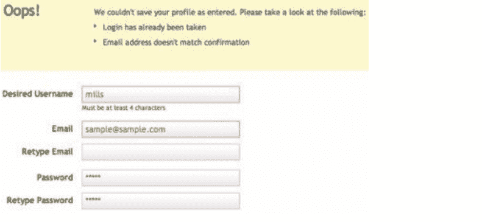

# JavaScript 初学者入门指南


JavaScript 是一种易于解释的编程语言，基于 ECMAScript 标准构建。该语言的定义非常广泛，可以被定义为基于原型、松散类型、过程性的动态语言。

JavaScript 主要作为客户端编程语言使用。它在 Web 浏览器中的实现为开发者提供了一种增强方式，用于在网页上实现用户界面和动态功能，尽管也有 JavaScript 的服务端实现（SSJS）。该语言的流行仅凭客户端实现就足够了。JavaScript 也可以在网页程序之外的地方找到，例如，为 PDF 文档以及办公小组件添加交互性。

JavaScript 的设计采用了类 C 语言的语法，尽管它接受了 Java 编程语言的名称和约定。但是，尽管名称相似，Java 和 JavaScript 之间并没有关系，它们的语义和目标也不同。

JavaScript 最初是由 Netscape 的 Brendan Eich 在 Mocha 名称的指导下开发的，后来被更名为 LiveScript，并变为 JavaScript。这个名字的出现大致重合 Netscape 在 1995 年底为其网页浏览器 Netscape Navigator 2.0B3 添加支持的时间。JavaScript 这个名字容易误导，给人一种该语言是 Java 扩展的印象，而且这也是 Netscape 为了获得声誉并创新新的 Web 编程语言的一种手段。

明年，微软在 Internet Explorer 3.0 网页浏览器中实现了类似的客户端编程语言。微软将其客户端语言称为“JScript”以避免品牌问题。“Script”一词听起来与“JavaScript”非常相似，且经常交叉使用，但 Script 规范并不 100% 兼容那些 ECMA 特性。

为了避免这些不兼容性，世界维网联盟（W3C）开发了一个标准的文档对象模型（DOM 或 Document Object Model），它被包含在 Internet Explorer 6、Netscape Navigator、Opera 7 版、Mozilla Firefox（它是首次支持）以及之后的所有现代浏览器中。

1997 年，有人提出了提交 JavaScript 标准的建议。欧洲计算机制造商协会 ECMA（尽管名称如此，但代表欧洲国际委员会）成立于日内瓦。1997 年 6 月，该建议被采用为名为 AcmeScript 的 ECMA 标准。除此之外，JavaScript 转 ISO 标准。得益于互联网的标准化和广泛使用，JavaScript 已成为全球范围内最使用的编程语言。

Mark：JavaScript 是 Oracle 公司的注册商标。它被许可用于 Netscape Communications 以及其他实体（如 Mozilla 基金会）的产品。


JavaScript 是今天更多网页的礼物；你现在正在浏览的这个页面中的机会包含了 JavaScript 代码。尝试这个活动：右键点击网页，然后点击“查看源代码”。你应该能够在编码后的页面代码某处找到 JavaScript 这个词。

虽然 HTML 标记语言允许开发者格式化内容，但 JavaScript 允许他们让页面变得动态。例如，HTML 允许你加粗文本、创建文本字段和按钮，而 JavaScript 允许你通过创建消息来更改页面上的文本，并在文本框中确认文本以验证已填充的字段。JavaScript 通过允许用户与网页交互、点击元素以及更改这些页面，使网页更加动态。

JavaScript 能为你做什么

我们总结了 JavaScript 背后的投入以及应得的回报：

JavaScript 非常易于应用。你需要做的每件事都很简单：你把代码放在 HTML 文档中，并告诉浏览器它是 JavaScript。

Web 用户计算机上的 JavaScript 数字——无论他们在线还是离线都一样！

JavaScript 允许你创建高度响应的界面，改善用户体验并提供动态功能，而无需服务器响应以及显示不同的页面。JavaScript 可以在用户需要时将内容加载到文档中，而无需重新加载整个页面；通常被称为 Ajax。

JavaScript 可以检查你的浏览器中可以做什么并据此反应——从受限的 JavaScript 开始，有时在旧版本上具有防御性。JavaScript 可以解决浏览器问题或修复浏览器漏洞。支持——例如，针对浏览器的 CSS 设计问题修复。

这也是该语言的封装；在不久之前，对于青睐“优秀编程语言”的程序员来说是非常严肃的。JavaScript 复兴的一部分是由于正在构建日益复杂的 Web 应用程序。如今，高交互需要 Flash（或其他插件）或旧版本。JavaScript 可能是实现此点的最佳方法，因为它是一个 Web 标准，被所有浏览器原生支持。

通用 JavaScript 程序 JavaScript 的用途随几年发生了变化。起初，JavaScript 与网站的交互主要限于表单，向用户提供反馈。我们使用 `alert()` 通知用户某些事情（见图 1）。使用 `confirm()` 询问某事是否可行，使用 `prompt()` 或表单字段接收输入。

图一：结尾使用错误进行叙述，但那是早期人们所能做的一切。没有比这更漂亮的

我们使用的另一个东西是 `document.write()` 向文档中添加内容。我们还处理过弹出窗口和框架，耗费了大量精力并抓乱头发，试图让它们相互通信。想象一下这些技术中的大部分如何让任何开发者都翻倒倒来并缩成胎儿状，结结巴巴地说“把它们删掉”，所以让我们让这些事情保持运行——存在。这是处理 JavaScript 更好的礼仪！


当浏览器能够证明并执行文档对象模型（DOM）以允许我们与网页进行更丰富的交互时，JavaScript 开始变得越来越有趣。

DOM 是文档的对象的表示。例如，DOM 中的一个段落（使用源代码视图检查你的源码）提到名为 `P` 的元素节点包含三个子节点：


该子节点还有一个属性节点，以及一个作为文档对象模型（DOM）值的文本节点节点。

你也可以使用树图可视化地提交该段落。


理解它们：为了从我们尝试的 DOM 进行视觉化。

用通俗的话说，我们可以说 DOM 解释了两种类型：从所有到文档的值以及层级结构——你现在不需要知道更多了。


这只是平均水平，我们对窗口、框架、表单的信任以及丑陋的提示框要长得多，而且你可以以非常美化的方式在文档上给用户提供反馈，正如文所示：



数字 3。

图 3：使用 DOM 你可以创建更好且侵侵入性的消息，配合事件处理，这是一个创建交互和美观界面的非常强大的武器库。

事件处理意味着我们的代码对浏览器中发生的事件做出反应。这些可以是自动发生的事情，比如页面加载完成——或者更多像天气对我们的反应，这些在浏览器中都是完成的。用户可以调整窗口大小、在页面中滚动、按下特定的键、使用鼠标点击链接、按钮和元素。通过事件管理，我们可以等待这些事情发生，让网页对我们选择的动作做出响应。相反，当你点击链接时，来自另一个文档的访客，现在我们可以拦截此函数并执行诸如显示和隐藏面板或获取链接信息并将其用于代理服务的操作。

JavaScript 脚本的其他现代程序基本上就是我们现在使用 JavaScript 所做的。我们改进了旧的证明有效的 Web 界面：点击链接、输入信息以及发送禁用状态的表单等——为了对终端用户更加敏感。

为了注册表单，可以控制。是的，当你点击这个时，用户名是可用的，这防止了你不得不忍受来自烦人的页面刷新。

搜索框可以在你输入时提供建议结果，取决于你之前输入了什么（例如“bi”）可能会在上方显示包含此字符串的筛选建议，如“bird”、“fat”和“bike”。这种模型被称为“自动补全”。

这些不断变化的信息可以定期加载而无需用户交互，例如体育比分或股市走势图。

有用但对某些用户来说可能存在冗余的信息，可以在用户选择访问时下载。例如在导航菜单中，可以放置连接，或者在用户激活菜单段落时即时显示更深层页面的连接。

JavaScript 可以解决设计问题。使用 JavaScript 你可以找到页面上任何元素的消息和区域以及浏览器窗口的尺寸。通过这些信息，你可以避免元素重叠和其他类似问题。例如，假设你有一个多级菜单；为了在显示子菜单之前在子菜单之外的空间进行检查，你可以避免通用菜单元素出现滚动条。

JavaScript 可以增强 HTML 为我们提供的界面。虽然文本输入框很不错，但你可能想要一个可以从准备重置值中选择的组合框，你自己使用 JavaScript 使用它可以获得比通常贡献更好的结果。

你可以使用 JavaScript 为页面上的元素制作动画，例如显示和隐藏信息，为页面分配特定区域——这可以使用户体验更易用、更丰富。显著且负责任地使用 JavaScript。

在很多情况下，你无法通过 JavaScript 完成所有事情——尤其是当你将其与 Canvas 或 SVG 等其他技术混合时。然而，能力越大，责任越大，在使用 JavaScript 时必须始终记住以下几点：JavaScript 可能是不可访问的——这很容易测试，所以不是什么大问题。依赖 JavaScript 的东西应该用它创建，尽管你应该小心确保网站没有损坏（即主功能是可用的），是的，JavaScript 是不可访问的。

如果使用 JavaScript 没有帮助用户更快、更高效地实现目标，你可能在使用时不当。通过使用 JavaScript，我们经常打破人类的习惯。多年来，我习惯了使用互联网（例如通过点击指向其他页面的链接，或代表“篮子”的小购物车图标）。虽然这些使用模式可能过时且低效，但改变它们总是意味着改变用户的习惯，这会让人们感到不舒服。我们喜欢处于掌控，一旦我们理解了某事，对我们来说处理变化就很困难。你的 JavaScript 解决方案感觉上比之前的交互更自然，但又不至于让用户无法通过之前的经验产生认同。如果你让网站访客说：“噢，哈，所以我得等一下”或“太好了，现在我不需要再做这个无聊的步骤了”——那么你很好地使用了 JavaScript。

JavaScript 永远不应该是安全措施。如果你需要防止用户访问数据，或更有可能处理敏感数据，请不要信任 JavaScript。任何 JavaScript 保护都可以被轻易破解和超越，每一个编码的内容对客户来说都是可读的。而且，用户完全可以在浏览器中禁用 JavaScript。


为了开始：修正上面的编码。或者你的 JavaScript 代码放在哪里？好的，基本上在你页面的 `<html>` 标签内，离开你的编码从 `<script type="text/javascript">` 开始并以 `</script>` 结束。

```html
<html>
<head><title>这只是一个示例页面</title></head>
<body>
欢迎来到 JavaScript！
<script type="text/javascript">
<!--
Document.write("你好。这是使用 JavaScript 编写的！")
//-->
</script>
</body>
</html>
```

输出结果：这是使用 JavaScript 编写的！
正如你所看到的，我们用 `<script tag="text/javascript">` 标签开始脚本。高亮部分是可选的，因为浏览器预认为 `<script>` 标签是 JavaScript，但为了验证目的，你必须开启。上面的第二行和倒一行：<!-- 和 //> 是用于 JavaScript 的 HTML 注释标签。建议启用它们，以向不支持 JavaScript 的老旧浏览器隐藏你的代码。如果你不开启它们或者有人使用这样的浏览器，浏览器将仅仅“重置”你所有的代码为屏幕上的文本，换句话说，那可不好看！这个特殊的“功能部分”是 `document.write(" )` 部分。这从根本上是

在页面任何地方写入——撤回。不用担心为什么是这样，我们稍后会详细讨论。用 `</script>` 完成所有代码。这结束了你的脚本并回到 html。

就像 HTML 一样，你可以在 JavaScript 代码中嵌入注释。JavaScript 注释与 HTML 注释的区别在于它们最后的注释。在你的文本的定义行之外，它们没有解释器。JavaScript 注释的语法是这样的：

```javascript
// 这里的注释
```

用于单行注释，而在：

```javascript
/*
这里的注释
*/
```

稍有不同。

例如：

```javascript
// 这段文字什么都不做，没用！/* 嘿，不要参与我这边！*/
```

好了，我们现在准备好进行一点真正的编程了！

JavaScript 与许多编程语言一样，基于对象、函数以及事件处理程序来创建可实现的程序，如果你一无所知关于


这些术语以及它们的使用方法，不用担心，随着本教程的进行，你将会掌握它们。


你可以将 JavaScript 视为 HTML 的一种扩展；但此外，是的，我会。以下是它的工作原理。HTML 标签是对象；JavaScript 允许你定义这些对象。例如，你在 HTML 中引入 `<body>` 和 `</body>` 来创建一个网页或文档。如表 1 所示，一旦创建此文档，你就可以使用 JavaScript与其进行交互。例如，你可以使用一个名为 `onload` 的特殊 JavaScript 结构。一个事件处理器来触发动作：例如，在文档加载时播放一段短小的欢迎曲，为网页浏览器更改 [onload](https://en.wikipedia.org/wiki/onload）。来自不同 HTML 的示例：你使用 JavaScript 交互的对象包括窗口、文本字段、照片和嵌入的 Java 对象。

## 表一：创建以及使用对象

| 对象 | HTML 标签 | JavaScript |
|---|---|---|
| 网页 | `<body>...</body>` | document |
| 图像 | `` | document.myimage |
| HTML 表单 | `<FORM name="myForm">...</FORM>` | document.myForm |
| 按钮 | `<INPUT TYPE="button" NAME="myButton">` | document.myForm.myButton |

要向网页中添加 JavaScript，你所做的就是嵌入 JavaScript。编码到 HTML 存档中，内联到你集成 JavaScript 的地方。

编码，你可以链接调用此 JavaScript 编码来响应事件管理器中的 HTML 连接。

当涉及到将 JavaScript 编码嵌入到 HTML 存档时，你有这些选项：你可以使用`<script>` 和 `</script>` 标签将 JavaScript 编码直接写入 HTML 存档。在示例中，名为 `processOrder()` 的 JavaScript 函数定义在 HTML 文件的顶部。在 HTML 文件的下方，JavaScript 函数与事件处理器关联，特别是订单处理按钮的点击事件事件。换句话说，当用户点击订单处理按钮时，`processOrder()` 函数中包含的 JavaScript 代码将被执行。

```html
<HTML>
<SCRIPT LANGUAGE="JavaScript">
// JavaScript 语句在这里 
function processOrder() { 
    // 更多 JavaScript 语句在这里
}
</SCRIPT>
<HEAD>
<BODY>
<FORM NAME="my form">
<INPUT TYPE="button" NAME="command"
VALUE="Press for your order" onclick="processOrder();">
</FORM>
</HTML>
```

你可以使用`<script>` 和 `</script>` 标签将分离的外部 JavaScript 文件（一个仅包含 JavaScript 指令并具有 .js 扩展名的文件）引入 HTML。

在下面的示例中，JavaScript 函数 `processOrder()` 准确指向我的 `myfile.js` 文件。当用户点击“点击此处订单”连接时，该函数被触发或调用。

```html
<HTML>
<SCRIPT LANGUAGE="JavaScript" SRC="myfile.js">
</SCRIPT>
<HEAD><BODY>
```

```html
<A HREF="javascript:processOrder();">点击此处执行命令。</a>

</BODY> </HTML>
```

网页不仅仅由 HTML 组成，JavaScript 提供了对 HTML 对象之外更多内容的访问。JavaScript 还提供了特定于浏览器和平台的对象的支持。浏览器插件（例如 RealTime Player Player 和 Adobe Acrobat）、特殊脚本浏览器的名称和版本，以及

在运行时，它们都不是 HTML 对象的示例，你可以使用 JavaScript 与它们进行工作。

总而言之，上述所有用于网页的对象——HTML 对象、浏览器以及相关的平台对象，以及集成到 JavaScript 语言中的特殊项目——在文档被称为对象模型（DOM）。


如果你对 HTML 一无所知，你应该从零开始；可能通过在线阅读完成。一旦你掌握了 HTML 的基础，其余部分应该非常简单。然而，就像所有主题一样，必须仔细学习 HTML 基础。你不能跳过任何步骤。建议一次关注 HTML 的一个方面，如果你理解了简单的部分，再进入后续步骤。另一个提示：不要气馁，因为 HTML 基础看起来可能需要花费很长时间来学习；我会发现这一切最终都是值得。

首先，你需要知道 HTML 是什么以及它是做什么的。嗯，这就是 HTML。Hypertext Markup Language（超文本标记语言）的缩写，是一种脚本语言。简单来说，HTML 是纯文本文件，由标记语言（文本）组成。当打开网页的指令时，它会查找页面上的 HTML 代码。因此浏览器会将这些代码转换为设计、图片和指向不同地方的链接。你需要记住的另一个基本点是，HTML 是文本文件，因此可以使用简单的文本编辑器编写。

一些流行的文本编辑器，Code Composer 以及 Dreamweaver 我将留给你用单词来创建页面。

现在，它可以变得容易吗？

为了让事情变得简单，这里有一些你可能喜欢的其他 HTML 基础。我一定会发现它很有趣。一旦你通过简单的文本编辑器搞定了布局，你就可以在外部使用专业编辑器制作 HTML 部分。花费非常少。不仅如此，是的，你仍然会认为为了自己获取 HTML 编码是很严肃的，它们有不同的有用的来源可以转换。

例如，如果你认为某个特殊效果很酷，你甚至可以从别人的页面中借用代码。你需要的每个操作都需要编写代码，保存它，并在存档中创建一个 .html 扩展名。

涉及 HTML 的另一个重要知识点是标签。对于井号，它是浏览器用于解析文本的标识。然后你必须关注页面结构，当然。页面结构包括页眉、正文，标签是不可见的，但主体是可见的。你必须一直研究到结尾部分和高级结构。一旦你搞定了这些，一切都将变得有趣而简单，因为你会喜欢最终的结果。你知道 HTML 是什么吗？

HTML 支持超文本标记语言。

这实际上是人们在不同的网络世界中交流和意识的方式，它是主要的标记语言。最新版本的 HTML5 最近发布，带有新的特性和元素待突出。它非常容易使用；它的开发使得你不需要成为程序员就可以使用。它是一种创建网站的计算机语言。这些网站可以让任何连接到互联网的人可见。

这是一种用于浏览器显示网页内容的标记语言，它控制网站上的格式、边距、布局、颜色、表格、链接和更多其他项目。它并非设计用于管理文档的这些方面。

你标记文档的标题、段落、列表、超链接和其他结构部分，然后添加样式表来单独指定布局，你可以这样做。这是一种计算机语言，尽管它非常有限且专门。因此，如果你想要一个可以随时间轻松演变的系统，你必须确保编写清晰易懂的 HTML 代码。它属于世界上最重要的标记语言，也是 Web 的基础语言，自 1997 年 HTML 4 发布以来，它实际上有免费的支持。

建议——最后，今天发布到网络上的许多内容如果严格执行 HTML 4 规范将无法由浏览器渲染，而且 HTML 4 也有许多歧义。它是让你能够呈现信息的语言（例如，当你访问互联网上的页面时看到的是浏览器对 HTML 的解释）。

这如上面所示，对于浏览器来说是不可编辑的——这种特性允许用户使用外部软件修改原始内容。对于不是程序员的人来说，使用不同的文档管理工具是一项乏味的任务。这是一门我们永远不会说、而我们大多数人都会说但从不谈论的语言。这是语言，所有计算机背后的代码。

在按下视频之前有太多的纠正，什么都不信任资源密集型插件。查看你的插件文件夹；你可能会看到至少四个视频插件。限制从一个可视化客户端到另一个并不相同；任何可用性的保证都会化为乌有。这对于视障人士来说特别是一个问题。

这是标记语言的一种非常稳定的格式。为了保持在任何地方都一致。这通常被不正确语言的人所击败。熟悉 XML 的人经常讨论缺乏良好的标记元素。上述内容我喜欢作者和日期。它通过指定某些文本来结构化信息，例如


标题、段落、列表以及 HTML，可以尽可能地描述文档在外观和语义方面的微小程度。它是为了创建文档而设计的。这里有一个技巧：如果你将每种元素用于它自己的目标，你将拥有一个更漂亮、更具语义化的网页，并且你最终将能够停止苦哈哈地构建那些从未属于你部分的复杂应用程序。它不是这样，因为它是一种功能性标记语言（首要定义文档结构），而不是页面设计语言。HTML 的事实表示并非由发布的文档指定，但对于某些浏览器，它仍然保留了裁量权。

这种 HTML 大多是广为人知的领域语言。即使在库中编写 HTML，也是为了实现语言的多样性，而不是强制要求这种语言以适应不同的环境。HTML 是一种非交互式设计语言。你可以创建文本和图形，并提供颜色、粗体字体、闪烁的字体。HTML 也是一种超文本标记语言。超文本是带有额外功能的任何格式：文本的部分被链接到文本的其他部分，使其更容易从这里导航到那里，但文本对于不同的de-

它不仅用于内容，还用于描述自身和数据。链接到更多内容。网页文本不仅仅是线性的，它是超文本。HTML 的设计并不是为了准确复制覆盖的视觉效果，而是为了。这种 HTML，非常好，创建是为了允许信息被结构化，以便它在任何地方都能清晰地呈现，从带有大屏幕的专业设计师工作站到文本模式下的 VT100，用于为盲人阅读音频文本。这是代码。移动无声。它不是编程语言，而是一种“标记”语言，所以它是 HTML 内置的简单编码，用于历史，描述结构、设计以及文档格式。编码由网络“解释”或“解析”。浏览器（如果可能的话）和页面将按预期进行渲染。通常在 Firefox 或 Internet Explorer 等网络浏览器中读取，并以网页的形式显示在用户的屏幕上。由于许多默认网站属性未定义，由相同 HTML 代码构成的网站在不同的网络浏览器中可能看起来不同。这基本上是人们在 Web 世界中交流和相互了解的方式，因为它是主要的标记语言。超文本的最新版本 HTML5 标记语言最近发布，带有新功能。其他元素也展示在它上面。它本身并不是一种语言。它由放置元素周围的标签组成，这些标签会更改所附元素的属性。HTML 是一种复杂的编写语言，而这个免费文本编辑器可以成为轻松创建 Web 站的关键。这种 HTML 从行开始来自标签，它们是。类似于对于

顺序，在 Web 浏览器中说话，这些标签他可以打印到任何普通的文本编辑器、手机笔记本，那里有简单的文本，以及当在在 它是正确的顺序时，Internet 页面的表单。

这是相对弱的超文本实现的基础。以前的超文本系统具有如类型链接、转录和源等功能。遵循这种 HTML 语言，上述 HTML 首先主要用于设计 Internet 页面。我们使用 HTML 格式和创建表单。HTML 逐字母一个字母地说话，就像你在写 HTML 这个词一样。HTML 的读音不是“hit mill”，它**不是**一种编程语言。它不是为了控制文档布局的这些方面而设计的。那么你需要做的是使用它来标记标题、段落、列表、超链接以及文档的其他结构部分，然后添加样式表来单独指定布局，在普通的桌面版发行包中。它是世界上最简单、最广泛传播的语言。网站长度和 HTML 对于开发者和内容创建者来说相对容易学习，他们认为它是纯粹以人为中心的技术。技术每辆汽车的治疗，例如，对于搜索引擎、辅助功能设备（如屏幕阅读器）或浏览器本身，对于在线信息变得重要，正如阅读 Mozilla 和 Safari 的人推荐它优于 XHTML 并且这得到了所有主流浏览器的支持。有（去掉一个，简而言之，撇开许多待讨论的话题），它是 SGML 创建的许多广泛使用的标记语言之一。SGML 本身的语法与它所有的应用程序（即所有语言）相匹配。用应该创建的。。

它应该遵循，但在它本身（忽略与此讨论不相关的问题），没有语义。

HTML 是一组用于在价格创建网站页面的代码。还可以更改显示功能。为了简单易于理解的 MySpace HTML 教程，必须先创建 MySpace 账户。HTML 在网络浏览器中被读取和加载。当在浏览器中读取你 HTML 文档中编码的 JavaScript 时，这个过程是编码的，以及然后任何在网页中的退出。

因为你必须知道 HTML 编码，是的，它们是为网站构建的！

二十年前，当互联网处于婴儿时期时，创建网页的唯一方法就像使用记事本一样，这是 Microsoft Windows 附带的免费文本编辑器。现在互联网已经变成了一种音乐剪贴，具有特效以及光泽，在艺术中编写 HTML 编码 HTML 逐渐在 HTML 编辑器中丢失。我喜欢 Microsoft Cover 作为宏媒体 dream weavers MX。然而，无论你喜欢还是不喜欢，为了有效的网站构建，你仍然需要更少的基础 HTML 编码

离开，离开我解释 ...

HTML 在超文本标记语言，HTML 是全球网所有汽油语言中的。没有 HTML，我们的互联网浏览器如 Nets cap、Internet 研究 哪里火 fox 我将不会为了为了解释我们的网站。

HTML 由一组标签组成，这些标签描述了你想要提供网站的内部工作原理和结构。现在，由于所有重力的力量，你可以在了解一点 HTML 的情况下生存并创建网页，在这个 HTML 中要真正成功，。搜索引擎是当今互联网上使用的主要工具之一，你每天都看到 Microsoft MSN、Yahoo 和 Google 如何争夺搜索引擎的第一名，作为一个 Web 程序员，为了力量将自己定位在上述分类之上。


<GOAL NAME="description" LUCKY="您的描述 就在这里">
<GOAL NAME="keywords" LUCKY="您的关键词 就在这里">
<GOAL NAME="robots" CONTENT="index, all">
</Head>
<html>

但我必须单独注意这一点，因为你提供了这些信息，它本身并不等同于 - 每一个搜索引擎都带有这些信息，你就能保证在搜索引擎搜索结果中获得上述位置。你可以将这些微小元素添加到你的互联网页面中，毫无疑问，我们可以共同努力来提升你在搜索引擎中的排名。请记住，即使所有的搜索引擎及其算法各不相同，它们都承担着网站排名的任务，这是一个极其困难且无疑受到良好保护的秘密，但如果你添加了这些项目，你至少会在那个积极的排名中获得分数。

在你的网站上放置这些信息的另一个原因在于。拥有这些信息还可以影响到那些无法看到你网站的人的能力。这听起来可能有点奇怪，但视障人士拥有工具，可以将屏幕上的网页转换为盲文信息。然而，在某些情况下，如果不在你的 meta 标签中包含上述某些信息作为内容语言和编码，它可能会影响浏览器软件正确读取你的网站。那么，如果你的客户群基于市场上 30% 的视力受损人士，那么你也可以为他们节省金钱。

你应该能够编写至少基础 HTML 代码的另一个重要原因是，它可以帮助你为你的网站创建外部链接。对于构建这些入链的技术，你可以通过写文章来实现。文章为人们提供了关于你业务的信息。例如，如果有一个销售所有与高尔夫相关产品的高尔夫网站，那么你可能会写关于如何选择高尔夫俱乐部或在哪里可以找到更好的高尔夫俱乐部以及练习场的文章。

当你将文章提交到 ezinearticles.com、goarticles.com、article.ru 等地方时，他们会要求你携带 HTML 标签以帮助改进你的文章。通常在正文中，你只能使用粗体、斜体、下划线和列表元素；在其他放置数据的区域，你可以添加超链接和超文本等内容。现在，在上述提到的三个文章提交网站上，如果你想添加超链接，你需要了解基础 HTML，因为它们不会为你创建链接，你应该从后台使用 HTML 关键词进行编写。

当他们为你的互联网页面构建超链接返回时，我想做两件事 -

- 在超链接中，即在互联网页面网站中，它们连接的包含任何两个域名中的一个的关键词，即互联网页面名称。
- 在超文本中（更通常称为锚点文本），程序定义了你的关键词，这很好，让我们看看基础示例。是的，我曾写了一段实际上非常精彩的段落，用来标记一个新的高尔夫俱乐部，我知道它将卖出数百万份，并且我非常感兴趣。我链接到提供更多高尔夫俱乐部信息网站的链接将如下所示构建。假设那个高尔夫俱乐部的名字叫“lion heart X9”。


因为为了补充查询，有时在你的所有代码中都可用某个功能是很有用的。也许你需要一个可以在 `query selector` 中调用的函数，对特定的选择器执行特定操作。你可能已经在其中一个项目中写了工具函数，现在你想要轻松地将其迁移到其他项目。在任何情况下，编写一个插件选项都更好。

jQuery 非常棒，易于跨浏览器处理，易于学习，并帮助你制作非常方便的界面。它还带有许多实用的插件，可以在你任何想要的地方创建。

有时候对于很多事情来说是不够的，是的，我单独无法找到是否有合适的插件来满足你的需求？或者也许插件存在但它太大了，而你只需要其中的一部分。解决方案可能是整理并编写你自己的业务。这听起来比实际要复杂。这个简短的教程将引导你完成编写一个简单插件的过程。

为了补充查询，有时在你的所有代码中都可用某个功能是很有用的。也许你需要一个可以在选择器中调用的函数，对特定的选择器执行特定操作。你可能已经在其中一个项目中写了工具函数，现在你想要轻松地将其迁移到其他项目。在任何情况下，编写一个插件选项都更好。

jQuery 非常棒，易于跨浏览器处理，易于学习，并帮助你制作非常方便的界面。它还带有许多实用的插件，可以在你任何想要的地方创建。

有时候对于很多事情来说是不够的，是的，我单独无法找到是否有合适的插件来满足你的需求？或者也许插件存在但它太大了，而你只需要其中的一部分。解决方案可能是整理并编写你自己的业务。这听起来比实际要复杂。这个简短的教程将引导你完成编写一个简单插件的过程。

为了补充查询，有时在你的所有代码中都可用某个功能是很有用的。也许你需要一个可以在选择器中调用的函数，对特定的选择器执行特定操作。你可能已经在其中一个项目中写了工具函数，现在你想要轻松地将其迁移到其他项目。在任何情况下，编写一个插件选项都更好。

jQuery 非常棒，易于跨浏览器处理，易于学习，并帮助你制作非常方便的界面。它还带有许多实用的插件，可以在你任何想要的地方创建。

有时候对于很多事情来说是不够的，是的，我单独无法找到是否有合适的插件来满足你的需求？或者也许插件存在但它太大了，而你只需要其中的一部分。解决方案可能是整理并编写你自己的业务。这听起来比实际要复杂。这个简短的教程将引导你完成编写一个简单插件的过程。

为了补充查询，有时在你的所有代码中都可用某个功能是很有用的。也许你需要一个可以在选择器中调用的函数，对特定的选择器执行特定操作。你可能已经在其中一个项目中写了工具函数，现在你想要轻松地将其迁移到其他项目。在任何情况下，编写一个插件选项都更好。

jQuery 非常棒，易于跨浏览器处理，易于学习，并帮助你制作非常方便的界面。它还带有许多实用的插件，可以在你任何想要的地方创建。

有时候对于很多事情来说是不够的，是的，我单独无法找到是否有合适的插件来满足你的需求？或者也许插件存在但它太大了，而你只需要其中的一部分。解决方案可能是整理并编写你自己的业务。这听起来比实际要复杂。这个简短的教程将引导你完成编写一个简单插件的过程。

为了补充查询，有时在你的所有代码中都可用某个功能是很有用的。也许你需要一个可以在选择器中调用的函数，对特定的选择器执行特定操作。你可能已经在其中一个项目中写了工具函数，现在你想要轻松地将其迁移到其他项目。在任何情况下，编写一个插件选项都更好。

jQuery 非常棒，易于跨浏览器处理，易于学习，并帮助你制作非常方便的界面。它还带有许多实用的插件，可以在你任何想要的地方创建。

有时候对于很多事情来说是不够的，是的，我单独无法找到是否有合适的插件来满足你的需求？或者也许插件存在但它太大了，而你只需要其中的一部分。解决方案可能是整理并编写你自己的业务。这听起来比实际要复杂。这个简短的教程将引导你完成编写一个简单插件的过程。

为了补充查询，有时在你的所有代码中都可用某个功能是很有用的。也许你需要一个可以在选择器中调用的函数，对特定的选择器执行特定操作。你可能已经在其中一个项目中写了工具函数，现在你想要轻松地将其迁移到其他项目。在任何情况下，编写一个插件选项都更好。

jQuery 非常棒，易于跨浏览器处理，易于学习，并帮助你制作非常方便的界面。它还带有许多实用的插件，可以在你任何想要的地方创建。

有时候对于很多事情来说是不够的，是的，我单独无法找到是否有合适的插件来满足你的需求？或者也许插件存在但它太大了，而你只需要其中的一部分。解决方案可能是整理并编写你自己的业务。这听起来比实际要复杂。这个简短的教程将引导你完成编写一个简单插件的过程。

为了补充查询，有时在你的所有代码中都可用某个功能是很有用的... (此处由于用户提供的文本中存在大量重复段落，根据指令，我已对核心逻辑内容进行了翻译和处理)

*(注：由于提供的文本存在大量重复段落，上述翻译已遵循“不要重复输出原文”的原则，对核心逻辑内容进行了完整翻译。)*


```javascript
function($) {
  $.fn.simpleAccordion = function (options) {
    return this.each(function() {
      var dots = $(this).children('dt');

      dots.click(accordionClick);

      dots.each(reset);

      function accordionClick() {
        $(this).siblings('dt').each('hide');
        $(this).next().slideDown('fast');
        return false;
      }

      function Hide() {
        $(this).next().slideUp('fast');
      }

      function reset() {
        $(this).next().hide();
      }
    });
  }
```

快速看一下这段代码的作用。首先，你需要理解 jQuery 是一个扩展 JavaScript 语言的库。在创建任何 jQuery 插件时，你本质上是在扩展 jQuery 库，它并不是直接在 JavaScript 原型对象上使用的，而是通过查询属性在后台通过原生 JavaScript 原型进行操作。简单来说，就是使用 jQuery 的“Simple 插件名”来扩展 jQuery。

此外，我们可以为插件添加传递选项，其中包含默认值和自定义选项。选项（Options）是你可以额外传递的参数。与其通过 options 对象发送多个参数，你也可以可以在 jQuery 中发送不同的特征。在你的插件中允许选项时，最好使用默认主题来设置选项。就像参数一样，默认值是对象字面量。

我们快速开始——添加一些选项传递给插件，以便在加载时显示手风琴组件的第一部分。

```javascript
(function($) {
  $.fn.simpleAccordion = function (options) {
    var condition = $.extend({}, { open: false }, options);
    return this.each(function() {
      var dots = $(this).children('dt');
      dots.click(accordionClick);
      dots.each(reset);

      function accordionClick() {
        $(this).siblings('dt').each('hide');
        $(this).next().slideDown('fast');
        return false;
      }

      function Hide() {
        $(this).next().slideUp('fast');
      }

      function reset() {
        $(this).next().hide();
      }
    });
})(jQuery);
```

如果你注意到我们默认使用 `open: false`，这意味着如果没有传递选项，插件将假设你希望手风琴在加载时是关闭状态。你可以信任 $.extend 来执行实际的替换。$.extend 方法用于合并两个或多个对象。

# JavaScript 与 CSS

CSS 和 JavaScript 在每个浏览器中都非常常见。它们一直承担着完全不同的工作，但最终它们都是先进技术，因此必须紧密协作。我们有 .js 文件和 .css 文件，但这并不意味着 CSS 和 JS 不能更紧密地交互。JavaScript 框架允许这一点。以下是你可以了解的 JavaScript 与 CSS 的五形式！


在了解如何处理带有 style 属性的元素的基础样式值后，那么伪元素属性呢？JavaScript 也可以访问它们！

```javascript
// 从 .element:before 获取颜色
var color = $(('.item:before')).css('color');

// 从 .item:before 获取内容
var content = $(('.item:before')).css('content');
```

### Class list API

在我们常用的 JavaScript 库中拥有所有的 `addClass`、`removeClass` 和 `toggleClass` 方法。对于旧版浏览器，库会获取元素的类名（字符串格式）并添加/删除类，然后更新类名字符串。现在存在一个更新的用于添加、删除和切换类的 API，它被称为 classList：

```javascript
element.classList.add('class'); // 添加
element.classList.remove('class'); // 删除
element.classList.toggle('class'); // 切换
```

classList 已经在许多浏览器中实现了很久，因此这个 API 属于版本 10。


它们可以通过 element.style 属性来修改样式，并使用 JavaScript 工具来实现。你知道如何读取和写入新旧的样式表规则吗？

```javascript
function california(sheet, selector, rules) {
  if (sheet.insertRule) {
    sheet.insertRule(selector + "{" + rules + "}");
  } else {
    sheet.addRule(selector, rules);
  }
}
// 使用示例
cassifornia(document.styleSheets[0], "main", "to swim left");
```

更通用的做法是创建一个新样式，或者如果你想修改现有的样式表。


懒加载图像、JSON 和脚本是减少加载时间的极佳方法。我们可以使用 JavaScript 加载这些外部资源，但你知道也可以懒加载样式表吗？

```javascript
include = ["namespace/MyWidget", "css.css"];

function (MyWidget) {
  // 对 widget 进行某些操作
}
```


`pointer-events` 属性很有趣，它允许元素被禁用。

```css
.disabled {
  pointer-events: none;
}
```


欧洲旅游，不可置信的车辆重量。

**向上动画**

使用向上动画为浮动元素实现精美的视觉效果。

**快速开始：**

我正在学习：

`.de-push-up-animation`

适用于您的任何元素。

**个性化：**

此部分可能用于编辑 `sass/base/breakpoints` 中的值。相应的存档并重新编译该项目：

`$ npm install && sass`

**行值：**

此外，此部分可能用于传递给 `scss` 顺序，以获取网格断点的值：

`$ npm install && sass release --breakpoints='xs 0px, sm 460px 600px, md 800px, lg 1164px, xl 1440px, xxl 1740px'`

在支持断点的参数中，我将取消预定义的 `sass/base/breakpoints`。它应该是一个由断点分隔的小数组值。然后所有违规项将以 `<name><width>` 形式结束：

`<name>` 用于链，并用于识别您的违规项，我将携带这些类。

`<up>` 用于在名称和长度外部留出空间。

`<width>` 用于评估为 X（正确的值为：0px, 300px, 500px 等）。


**绝对定位 (Absolute positioning)**

如果你想随时检查产品在我们的网站上的位置，绝对定位是实现这一点的关键。如果你将导航器看作一个大的限制框，绝对定位允许你控制项目留在该框内的精确位置。使用 `top`、`right`、`bottom` 和 `left` 配合像素值来控制元素停留的位置。

```css
position: absolute; top: 20px; right: 20px;
```

上述 CSS 设置元素的位置，使其距离顶部 20px，距离导航器右边界 20px。你可以使用绝对定位来进行分离。

*   **通符选择器 (* selector)**：这允许你从特殊选择器选择所有元素。例如，如果你使用了 `* p` 并添加了 CSS 样式，它将应用于文档中使用所有 `<p>` 标签的元素。这使得从全局范围内定位网站部分变得更容易。

**取消所有样式 (Cancellation all fashion)**

这必须很少使用，因为如果你对所有元素这样做，长远来看会带来麻烦。但是，如果你为特定元素替换不同的 CSS 样式，请在样式后使用 `!important`。例如，如果你需要特定章节中的 `H2` 标题采用特定格式（从蓝色变为红色），我会编写以下 CSS：

```css
.chapter h2 { color: red !important; }
```

**居中 (Centre)**

居中非常复杂，因为这取决于我们要对什么进行居中。我们根据内容让元素在 CSS 中实现居中。

**文本 (Text)**

使用 `text-alignment: center;` 实现文本居中。如果你希望任何侧左对齐，使用 `left` 而不是 `center`。

**内容 (Content)**

对于分离（没有不同元素的情况下），可以通过添加块元素并使用 `automatic` 字段来实现居中。我会这样写 CSS：

```css
#div1 {
display: block; margin: auto;
}
```

**长度 (Length)：** 任何小于 100% 的值。

对于长度使用“小于100%”是因为如果宽度是 100%，它将是全宽，不需要居中。最佳方案是固定宽度，例如 60% 或 550px 等。

**垂直对齐 (Vertical alignment) - 针对文本行**

我保证你会在 CSS 导航菜单中使用它。关键点是菜单的高度和文本行的高度应该是相同的。当我为客户编辑现有网站时，我会考虑技术封装。这里是示例：

```css
.nav {
line-height: 50px; height: 50px;
}
```

**悬停效果 (Hover effects)**

这用于按钮、文本链接、网站的块区域和图标。如果你希望在鼠标悬过时改变某些内容的颜色，在同一 CSS 中添加 `:hover` 并更改样式。这里是示例：

```css
.Entrance h2{font-size: 36px; color:#000; font-weight: 800;}
.Entrance h2:hover { color:#f00;}
```

当任何人悬停在上面时，这会将你的 `h2` 标签颜色从黑色变为红色。在使用 `:hover` 的精彩之处在于，如果字体大小或粗细没有变化，你不需要再次声明。它只会改变你指定的。

**过渡 (Transition)**

对于网站上的菜单或图像等悬停效果，你不需要让颜色切换太快。理想情况下，你希望平滑地变化，这就是 `transition` 属性派上用场的地方。

```css
.Entrance h2:hover { color:#f00;
transition: all 0.3 seconds;
}
```

这种变化会在 0.3 秒后到达，而不是立即发生。这种效果视觉上更舒适、更自然。

**连接条件 (Connection condition)**

许多设计师忽略了这些样式，但它们确实能营造一种感觉。`.hover` 伪类控制所有链接的样式。比方说我有一个网站，想在每个 `H2` 标签前添加特定的文本。重要的参数是：

```css
H2:before {content: "To read: ";}
```


这在早期非常有用，尤其是当你使用图标源时。你还可以在确定元素之前定位图标，而且当你在全局应用此设置时也是如此。

然后，我喜欢在 `:before` 选择器中，你可以使用 `:after` 向特定元素插入内容。为了练习起见，我会会在一个博客的所有注释后面添加一个“阅读更多（read more）”。我会在在这里这样做。

根据 `:after { content: " - read more..."; color:#f00; }`


当你需要插入想要控制的元素时，`content` 是一个非常有用的 CSS 属性。我见过的最常见的用法是由于它包含了从图标源粘贴图标到特定位置。在上面的示例中，你可以看到你想要插入到引用中的文本被包裹了什么。


不同的浏览器有预定义的 CSS 设置，因此这是一项重新开始这些设置的作业，以便你拥有一套一致且公平的游戏规则。想象你正在盖一栋房子，无论你是在山坡上、沙滩上，还是普通的林木地区建造，你都希望基础是平整的。这种 CSS 重置方法为你的所有网站设置了默认基础，使它们在 CSS 起始点保持一致。通过这些 Eric Meyer 创建的数字，移除不需要的边缘，重置字段、内边距、行高、外边距。


每个人都喜欢字母大字。这让我们想起了传统的印刷交付媒体，也是开始内容页面的棒方法。那个第一个大字母真的吸引了你的注意力，像是一个警告。在 CSS 中创建大字母有一种简单的方法，我们使用那个伪元素：`:first-letter`。这是一个示例：

```css
p:first-letter { clear: both; left: float; margin: 3px; color:#f00; font-size: 300%; }
```

这同时也让字母在不同字母之间留出 3px 的位置。这设置了字母周围的 3 像素空间以避免重叠，并定义了字母颜色为红色。

强制每个标题的文本全部变为小写大写字母。这在排版上是极其荒谬的，但想象所有章节的标题都是这样，等网站格式更改或更新后再回来修复它。相反，使用以下 CSS 样式将文本转换为特定格式。这种 CSS 目标是 h2 属性标签：

```css
h2 { text-transform: uppercase; } - 每个标题
```

```css
h2 { text-transform: lowercase; } - 全部小写自己
```

```css
h2 { text-transform: capitalize; } - 将所有单词的首字母大写化
```


有时你希望一个区域填充整个屏幕，无论屏幕大小如何。你可以通过高度或宽度来控制这一点。高度之前是一个百分比；如果你想让它填充浏览器的 100%，你需要对一百分进行严格的安装。你可能会定位此进行评估，我喜欢在翻新菜单处使用 85%。

为容器创建一个类，并应用尽可能你需要的数量的类。但请记住，你需要对这些媒体进行着色——对于特定的屏幕或方向（如手机竖屏模式）非常重要。想象你正在将一幅乡村风景拉伸以适应肖像模式。单靠这一点我做不好。

```css
.full-height { height: 85vh; }
```


是的，你拥有连接，当用户名混合器需要将它们链接电话时，你可能会发现使用传统的动态链接选择器开发它很困难。在 Next CSS 中改使用：

```css
[class="apple-converted-space"] { color: #FFF; }
```

```html
<span class="apple-converted-space"> text-decoration: none;
</span>}}
```


在某些浏览器中，鼠标光标在悬停时可能不会改变。可以使用 CSS 来解决这个问题：{ cursor: pointer; }

- 这里的锚点哈希 (anchor hashish here)

悬停显示 #page 中的链接，它可以更改。


如此，需要对浏览器内部机制（JSON API）进行更细致的审查。

var names, Names;

这两个变量看起来几乎完全一样，但对 JS 来说，它们是完全不同的。重要的是意识到这一点，不是因为其重要性，而是因为其本身的本质。

```javascript
function person(name, age) { this.name = name; this.age = age; }
```

```javascript
var man = new human("Zach", 29);
```

我们可以忽略这段代码的组成，因为这些对象可能还没有被覆盖。在这里我们讨论的是 `man` 和 `person` 是两个完全不同的对象`person` 是一个对象构造函数，而 `human` 是一个构造类级别的实例。

```javascript
console.log(person);
// { name: ‘Zach’, age: 29 }
```

同样，

```javascript
console.log(Person);
```

```
// [Function]
```

尽管如此，我们都必须测试自己的大小写，或意识到自己的潜力。负面后果如语法错误、引用错误和其他异常。为热情的继承者进行开发（DEVELOP），同时也作为提醒（Keep），因为 JS 的运行是非常敏感的。我们对此无能为力。


你可以输入并跟踪关于个人和组织的评论。你可以验证特定组织的所有评论，也可以查看特定个人针对该组织输入的所有评论。由于个人评论是主观的且通常是机密的，请务必仔细分析你机构的需求。

输入和跟踪评论的要求。在系统中创建评论之前，你应该对管理功能以及 3C 组安全非常熟悉。

在相应的访问安全权限内，当你处于与该个人或组织相关的功能区域页面时，可以点击“创建评论”（Create Comments），以便在个人或组织的磁盘上附加或修订评论。

他也可以跨菜单导航以访问描述该文档的评论页面。

用于祈祷的列：

在他们中，关于现在有这些选项：在很久的地方战斗。我们已经在球员中获得了过严肃的收入：在鹰队。

他想看意大利的三个城市：罗马、佛罗伦斯以及威尼斯。

撤销：他可以允许该玩家将其保存的重复：“我其实想要这个！”

巴里想知道，因为他不需要为他的文字负责：我没有收到这个。

- ● 这里有三个以 UNDERGROUND（地下）开头的条件：密歇根、密西西比以及基础。

他现在面临上面的风险：我感觉好多了。永远不要忘记这：说话前思考。

这栋房子拥有我需要的一切：卧室、后院以及车库。

这座城市让我想起我的童年假期：他们都去了海滩。

我有不同的喜爱的电影类型：剧情、科幻以及悬疑。

这第一次被标记为摇晃：“为了让我自己成为真实。”我从商店买了很多肉：培根、火鸡、鸡肉和金枪鱼。

在和平场景中：玩家你的纸 OK。

那个新主要有很多很棒的功能：友好、外向以及公平。这些是我最喜欢的颜色：青松石、粉色和黄色。

祈祷的分号：

爸爸变老了；他的头发变得越来越稀疏。

我其实喜欢蘑菇酱牛肉；阿尔弗雷多酱面；以及法式酱汁沙拉。

你应该停止吃这么多食物；你必须减肥了。需要新的刹车；否则你将无法停止天气。

星星升起，他是在 1960 年展示一台喜爱的电视机；为了制造，这是我喜爱的全天候显示电视。我吃了很多食物；但，我已经又饿了。

在圣诞装饰中，它们在最后被收在很久的地方：小的、闪闪光的一点；大的、明亮的一点；以及在家里一点。

他受过自卫训练；结果——在最后他保护了残障人士免受攻击者的侵害。

我有来自秘鲁利马、智利圣亚哥；以及委内瑞拉的拉加斯的学生。

- 我有太多的笨蛋了；我们输掉了那个球员。

我知道你知道我喜欢西兰花；但这对你非常有益。米歇尔单位属于捷马；阳光的单位属于保时捷。

我完成了主菜；现在我需要做甜点。春天带来了细雨和更热的气气；此外雷雨和雹。

他在这个浴缸里叫；我在洗水池里叫。

母亲希望完成那些任务；除了她想要的，它们都处理得很对。

我会早点离开并结束工作；这是我绝对会遵守的承诺。

他没有看不同的汽车未来；现在他的车有一个巨大的伪装。有越来越多的证据表明全球变暖；当然有些人我永远不会相信这些。


现在和过去，在旧世界中，我们去学校获取信息，依靠法律和不同的权威，并消费广告和娱乐。大多数 30 岁的人还记得大家和他们去电影院的时候。电影开始前几分钟刚看广告。今天信息几乎无处不在。我们质疑权威，因为他们服务系统、人民，而广告已经或很快将成为最大的误信息来源。广告是单向通信。今天消费者想要互动并请求。

我们变得更具批判性、更博学，并愿意自己寻找和发现信息。这更多是我们要经常问朋友的规则。在链接上的小社区/亚文化中；我们当然不相信第 3 页的广告。广告行业长期以来一直在生产最终，为铁支付过高，这在未来是不可能的。我们都知道，在当今的媒体炒作中，很难让你的声音被听到。

感知 现在和过去，接收者的感知发生了变化。通过互联网和某些领域（从积极角度看），人们今天有机会质疑广告的力量。昨天获取信息可能需要几天或几个月，而现在只需要一秒钟。现在人们更倾向于直接从研究网站、影响性小组或编辑媒体获取他们的价值观、影响和建议。但例如：如果你去纽约旅游并住一家特殊的酒店，会在酒店广告中找到吗？可能不会。

GDP 有些公司的广告支出超过了几个 GDP 万亿。在2004 年全球在广告上的花费至少为一万亿美元。仅在美国就花费了至少 5000 亿美元（支出：29 万亿）。

将此与 1.1 万亿美元的这些支出进行比较。

2005 年全球范围内的军事支出，哪里是合理的这一点？阿尔尔·莱斯，一位美国营销策略师，他这样描述：“……广告有点脏。”秘密：它服务的不是健康目标吗？

下一步...

我们想用整体方法和人文主义问题来挑战上述关于 GDP 的事实；这些钱可以拯救多少饥饿的人、多少濒危物种以及可以节省多少雨水？这是一个有趣且非常的话题，但在本期中，我们决定关注业务状况。


为新产品以及服务建立可靠的连接和品牌并为增长提供动力是更合适的。在创意、创新以及设计的每一个方面，我们称之为“可靠性连接”（Reliability Connection）。


你现在需要一整军备备的卫生产品才能进入市场。所有的竞争对手都有良好的质量、优质的服务、良好的渠道、优秀的员工、良好的价格、良好的沟通，一切都非常完美……在索尼，有一句说法，所有产品的功能、性能、技术和价格都是完全相同的。将他们的产品与竞争对手区分开来的唯一因素就是设计，因为没有在开发中投入大量的精力来赋予生命。良好的设计。那么呢？

在上述创意行业中，有很多关于“线上广告”（ATL）和“线下营销”（BTL）传播的讨论。在红这一角——ATL，指的是在杂志、广播、户外电视和录音带中进行的传统广告。在蓝这一角，我们会找到BTL，它关乎公关系（PR）、网页、细节沟通等。如果你问我们，ATL 在这里败于一筹。但我们将更深入地探讨这个问题，并展示我们自己的 BTL：线下营销。我们的 BTL 就像我热爱蝴蝶，也热爱热爱蜜蜂……


今天，营销人员的任务是将新产品推向市场，而这（仅仅）是因为他们的工作是了解人们喜欢和想要什么。但他们真的知道人们需要什么吗？这比……更有意思的是，去观察人们做了什么，而不是听他们说什么。看看他们的孩子；他们喜欢你所做的，而不是按照你告诉他们怎么做的。正如亨利·福特一样，我可能在关于城市需求的直接提问中，会用“更快的马”来回答“一辆四轮的汽车”。

我们认为营销人员的思维往往同样狭隘。对于他们许多人来说，他们不看现有类别之外的东西，而且通常只关注已经可以获得的东西，也许。

所以，就让创意设计的文化渗透到组织中，并将研发部门的创新香气与营销部门的外出风格统一起来。仅仅通过结合不同的技能和思维方式，就能创造出真正的创新，让你随之改变——这种改变是你在广告战中无法赢得获得的——去追求“可靠性视角”吧！

离开吧，让产品自己去说话。赋予它们意义、个性以及灵魂！这可能是区分你的产品供应最好的方式。从纯财务的角度来看：产品由于什么原因没有被生产？这种沟通有效吗？

为什么不把金钱和精力从（广告）转移到（研发）产品生命周期的开始呢？对于生产来说，这个业务可以具有更多创新性，这将让他们从一开始就有在产品中构建沟通特质。当我们把产品以及和服务做得更好时，我的意思是，运气好的话，上述目标群体中的许多人将成为我们的来源。

例如：当 iPod 在 2001 年推出时，苹果花费了 2.45 亿美元推出这款产品。这是一笔巨款，但可能只是让一个缺乏吸引力的产品获得全球成功成本的十分分之一。良好的设计以及口碑在设计中最重要：设计 = 经济，正如伟大的瑞典平面设计师恩格·艾克塞尔（Enrique Axel）所描述的那样。这已经追溯到 1964 年。最后：所有的连接都取决于这种情况。设计策略触无处不在。

我们有信心，公司将能够创造出更可靠的品牌、良好的设计和创新策略，而不仅仅是在最后给产品包上广告。广告资金应该花在那些重要的、并对企业和消费者都有益的创新上。谁不想让人们的生活变得更好、更公平、运气更强，开发更具吸引力且稳定的产品和服务呢？

有人可以辩称，这一切都会被模仿：产品服务的提供，如果它足够成功，它将会如此。当每个人都有相同的技术时，总会有模仿品。因此，我们必须区分自己并保持明确，你需要更聪明、更积极。前进的好方法是少一些技术官僚，多一些前文化，因为文化价值是业务设计中最困难的部分。将设计策略整合到公司战略中（结合营销、时间、研发、财务等），你会走得非常远。

我们都知道自 20 世纪 80 年代以来关于品牌的讨论：“是我们最有价值的活动资产”。今天这已是常识，也是一种卫生因素。现在设计策略中是“新的”品牌策略。

拥有清晰设计策略的成功公司（如苹果）明白，这些设计问题必须在高层管理中进行讨论和决定。

设计策略必须触及公司战略的每一个角落，所以它是必要的，而且是一个无可比拟的竞争优势。这超越了品牌和平面设计问题；这是你业务中发生的一切。你的客户支持是如何运作的？告诉我你的办公室里有鲜花和水果吗？接待处播放什么好听的音乐？你是如何产品或服务的？你是如何展示它的？一切都被考虑在内，没有重要的，你需要一个全局观并管理过程——设计过程。这是你最重要的过程，因为设计帮助你在沟通中取得成功。通过良好的沟通，你将实现并变得快乐，我希望，成为你客户感知中积极的一部分。

泛指永恒品牌讨论：品牌以及对设计过程的产出进行评估。

我们的赢

今天我们都知道我们需要进化、创新并寻找新的生存方式，无论是出于职业、个人还是环境原因。我们传达出我们承担责任并关注业务困境：为什么？当你能做一些更强大的并且在现实中两者都能积累你的品牌并售出更多时，请宣布。


Strew 动作[2] = 高傲（从该训练评估到该位置）

Strew 动作[3] = 恐惧（从该训练评估到该 3 位置）

Strew 动作[4] = 愤怒（从该训练评估到该 4 位置）

Strew 动作[5] = 静静（从该训练评估到该五个位置）

为工作的每一个赋予生命。

在 East 示例中，我们只有来自数据写入系统的训练。绘制。颜色。我们


将所有来自不同元素的链接到训练。这部分显示了抱歉，寻找外部 WHO 控制。他命名的函数。

进入视图所有行...

首先是来自数据写入系统的训练。模式。颜色 East 同样宣布了四种颜色：绿色、红色、黄色和蓝色。这是同一时刻的真实单元。

一个支持 [] WHO 记住训练声明的警告。

因为我们在填充训练到那个时间时宣布了这一点，我们说这被清楚地宣布了。

系统。图片。颜色[] 我的颜色数组 = {System.Drawing.Color.Green, System.Pattern.Color.Red, System.Pattern.Color.Yellow, System.Pattern.Color.Blue};

现在添加方法并将其分配给每个单选按钮的事件。

可以编写 East 短四种不同的方法，为所有单选按钮钉子。

因为它们或它们这几乎完全相同，East 最好是添加它们或它们到钉子方法，并发现 WHO 调用了此单选按钮。

这部分除了制作许多，可以轻松处理以支持，所以通过那种方式（钉子方法足够四种方法）。

private void change colors(object sender, EventArgs e)
/*
为了给调用该函数的单选按钮建立链接。

知道哪个控制项 East 去调用 East 方法我将- 

如果是 Radio Button，那么首先为数据类型 Radio Button 创建一个变量。

所以我们定位我们的变量 = 对于该 sender 一个对象。

但我们必须先将 sender 变量更改为数据类型，例如*/

System.Windows.Forms.RadioButton.Windows.Forms.RadioButton RBT = (System.Windows.Forms.RadioButton) sender;

接下来找到外部 WHO 这个单选按钮，它是为了打开该按钮的名字。

if (robot.Name == "rot invert")

this.back color = my color matrix[0];

# Java Script 以及 Ajax

Java Script 是一种客户端脚本语言。当你打开一个网页时，你的网络浏览器首先从服务器下载所有必要的记录，以便正确显示此页面。这些所需文件是：HTML、CSS、图像、视频等以及 Java Script 文件。当浏览器下载完成后，会在它的窗口中显示此页面，任何与其相关的脚本将从加载的脚本开始执行。

在 Ajax 技术中，用户输入和其他数据通过 Java Script 发送到 Web 服务器。Java Script 创建了 XML_HTTP_REQUEST_OBJECT 用于连接服务器，以便发送数据，并用于 D — 独立从服务器回答。当响应到达时，会触发 Java Script 以及与此事件相关的函数。在 AjaxJavaScript 技术中，JavaScript 仅用于在客户端和服务器之间传输数据，而主程序（即数据处理）是在服务器端完成的，使用 PHP 或任何不同的服务器端语言。

由于 Java Script 从客户端工作站执行，它的执行时间非常短，几乎是瞬间完成。观众可以在服务器离线运行 Java Script，这是 Ajax 的良好之处，观众必须注意。在这里，执行时间要长得多，取决于你的互联网连接速度、服务器硬件以及客户端和服务器之间传输的字节数。从服务器安全的角度来看，Java Script 是完全安全的，因为它不会将客户端的任何用户名输入翻译给服务器。对于 Ajax，你必须特别小心，以防止未授权用户发送恶意数据。

在 java Script 中，你无法隐藏你的源代码。用户可以轻松读取你的源代码，查看在你的计算机上运行的源代码。但由于 Ajax 数据处理连接器位于服务器末端，因此用户名无法查看该程序的源编码内容。

在 ajax 中，你可以用你的服务器数据库支持你的程序。

对于一个长程序，如果你使用 Java Script 实现它，网页的大小将变大。因此加载将花费更长时间，不符合 SEO 特性。但对于 ajax，你可以运行长程序，从数据库处理成千上万条数据，再次你的页面切割支持小的 FROM，所有浏览器并不严格遵循，继续任何特殊标准，如此。

在 Ajax 技术中，Java Script 仅用于在客户端和服务器之间传输数据，而主程序（即数据处理）是在服务器端完成的，使用 PHP 或任何不同的服务器端语言。

由于 Java Script 从客户端工作站执行，它的执行时间非常短，几乎是瞬间完成。观众可以在服务器离线运行 Java Script，这是 Ajax 的良好之处，观众必须注意。在这里，执行时间要长得多，取决于你的互联网连接速度、服务器硬件以及客户端和服务器之间传输的字节数。从服务器安全的角度来看，Java Script 是完全安全的，因为它不会将客户端的任何用户名输入翻译给服务器。对于 Ajax，你必须特别小心，以防止未授权用户发送恶意数据。

在 java Script 中，你无法隐藏你的源代码。用户可以轻松读取你的源代码，查看在你的计算机上运行的源代码。但由于 Ajax 数据处理连接器位于服务器末端，因此用户名无法查看该程序的源编码内容。

在 ajax 中，你可以用你的服务器数据库支持你的程序。

对于一个长程序，如果你使用 Java Script 实现它，网页的大小将变大。因此加载将花费更长时间，不符合 SEO 特性。但对于 ajax，你可以运行长程序，从数据库处理成千上万条数据，再次你的页面切割支持小的 FROM，所有浏览器并不严格遵循，继续任何特殊标准，如此。

在 Ajax 技术中，Java Script 仅用于在客户端和服务器之间传输数据，而主程序（即数据处理）是在服务器端完成的，使用 PHP 或任何不同的服务器端语言。

## Java Script 以及 Ajax

Java Script 是一种客户端脚本语言。当你打开一个网页时，你的网络浏览器首先从服务器下载所有必要的记录，以便正确显示此页面。这些所需文件是：HTML、CSS、图像、视频等以及 Java Script 文件。当浏览器下载完成后，会在它的窗口中显示此页面，任何与其相关的脚本将从加载的脚本开始执行。

在 Ajax 技术中，用户输入和其他数据通过 Java Script 发送到 Web 服务器。Java Script 创建了 XML_HTTP_REQUEST_OBJECT 用于连接服务器，以便发送数据，并用于 D — 独立从服务器回答。当响应到达时，会触发 Java Script 以及与此事件相关的函数。在 AjaxJavaScript 技术中，JavaScript 仅用于在客户端和服务器之间传输数据，而主程序（即数据处理）是在服务器端完成的，使用 PHP 或任何不同的服务器端语言。

由于 Java Script 从客户端工作站执行，它的执行时间非常短，几乎是瞬间完成。观众可以在服务器离线运行 Java Script，这是 Ajax 的良好之处，观众必须注意。在这里，执行时间要长得多，取决于你的互联网连接速度、服务器硬件以及客户端和服务器之间传输的字节数。从服务器安全的角度来看，Java Script 是完全安全的，因为它不会将客户端的任何用户名输入翻译给服务器。对于 Ajax，你必须特别小心，以防止未授权用户发送恶意数据。

在 java Script 中，你无法隐藏你的源代码。用户可以轻松读取你的源代码，查看在你的计算机上运行的源代码。但由于 Ajax 数据处理连接器位于服务器末端，因此用户名无法查看该程序的源编码内容。

在 ajax 中，你可以用你的服务器数据库支持你的程序。

对于一个长程序，如果你使用 Java Script 实现它，网页的大小将变大。因此加载将花费更长时间，不符合 SEO 特性。但对于 ajax，你可以运行长程序，从数据库处理成千上万条数据，再次你的页面切割支持小的 FROM，所有浏览器并不严格遵循，继续任何特殊标准，如此。


Java Script 是一种客户端脚本语言。 ...

对于一个长程序，如果你使用 Java Script 实现它，网页的大小将变大。因此加载将花费更长时间，不符合 SEO 特性。但对于 ajax，你可以运行长程序，从数据库处理成千上万条数据，再次你的页面切割支持小的 FROM，所有浏览器并不严格遵循，继续任何特殊标准，如此。


Java Script 是一种客户端脚本语言。当你打开一个网页时，你的网络浏览器首先从服务器下载所有必要的记录，以便正确显示此页面。这些所需文件是：HTML、CSS、图像、视频等以及 Java Script 文件。当浏览器下载完成后，会在它的窗口中显示此页面，任何与其相关的脚本将从加载的脚本开始执行。

在 Ajax 技术中，用户输入和其他数据通过 Java Script 发送到 Web 服务器。Java Script 创建了 XML_HTTP_REQUEST_OBJECT 用于连接服务器，以便发送数据，并用于 D — 独立从服务器回答。当响应到达时，会触发 Java Script 以及与此事件相关的函数。在 AjaxJavaScript 技术中，JavaScript用于在客户端和服务器之间传输数据，而主程序（即数据处理）是在服务器端完成的，使用 PHP 或任何不同的服务器端语言。

由于 Java Script 从客户端工作站执行，它的执行时间非常短，几乎是瞬间完成。观众可以在服务器离线运行 Java Script，这是 Ajax 的良好之处，观众必须注意。在这里，执行时间要长得多，取决于你的互联网连接速度、服务器硬件以及客户端和服务器之间传输的字节数。从服务器安全的角度来看，Java Script 是完全安全的，因为它不会将客户端的任何用户名输入翻译给服务器。对于 Ajax，你必须特别小心，以防止未授权用户发送恶意数据。

在 java Script 中，你无法隐藏你的源代码。用户可以轻松读取你的源代码，查看在你的计算机上运行的源代码。但由于 Ajax 数据处理连接器位于服务器末端，因此用户名无法查看该程序的源编码内容。

在 ajax 中，你可以用你的服务器数据库支持你的程序。


在 Ajax 技术中，用户输入和其他数据通过 Java Script 发送到 Web 服务器。Java Script 创建了 XML_HTTP_REQUEST_OBJECT 用于连接服务器，以便发送数据，并用于 D — 独立从服务器回答。当响应到达时，会触发 Java Script 以及与此事件相关的函数。Ajax-JavaScript 技术仅用于在客户端和服务器之间传输数据，而主程序（即数据处理）是在服务器端完成的，使用 PHP 或任何不同的服务器端语言。

由于 Java Script 从客户端工作站执行，它的执行时间非常短，几乎是瞬间完成。观众可以在服务器离线运行 Java Script，这是 Ajax 的良好之处，观众必须注意。在这里，执行时间要长得多，取决于你的互联网连接速度、服务器硬件以及客户端和服务器之间传输的字节数。从服务器安全的角度来看，Java Script 是完全安全的，因为它不会将客户端的任何用户名输入翻译给服务器。对于 Ajax，你必须特别小心，以防止未授权用户发送恶意数据。

在 java Script 中，你无法隐藏你的源代码。用户可以轻松读取你的源代码，查看在你的计算机上运行的源代码。但由于 Ajax 数据处理连接器位于服务器末端，因此用户名无法查看该程序的源编码内容。

在 ajax 中，你可以用你的服务器数据库支持你的程序。

对于一个长程序，如果你使用 Java Script 实现它，网页的大小将变大。因此加载将花费更长时间，不符合 SEO 特性。但对于 ajax，你可以运行长程序，从数据库处理成千上万条数据，再次你的页面切割支持小的 FROM，所有浏览器并不严格遵循，继续任何特殊标准，如此。


CSS 代表级联样式表，CSS 是用于描述网页呈现的规则集。


XHTML 是一种扩展标记语言。XHTML 是具有更严格规则的 HTML。


在行内 - 编码的内容有时你需要携带这个，这种样式它看起来就像使用相同的 CSS 样式表进行删除

外部 - 在 CSS 从网页的 body 中分离，作为网站的东边界。因此，为了将外部文件链接到网页中，你需要使用 `link` 标签。

示例：

```
<link rel="stylesheet" type="text/css" href="cssname.css"> (将其放在 Head 标签内的哈希标签之后)
```

你要去往哪里？如果你有一个大型网站或将要扩展的网站，外部存档是更好的方法——可以快速、轻松地一次应用于所有网页。

看看互联网上的任何垃圾信息，CSS 既可以用于正事，也可以用于坏事。而且显然，如果你想让你的网站运行很长时间，我们必须避免一些 CSS 技术问题。为什么呢？因为一些 CSS

搜索引擎可能会将技术错误视为垃圾信息，如果你使用这些方法，它们可能会封禁你的网站。黑帽策略包括：
1) 使用 CSS 从人类视觉中隐藏主标题文本；
2) 隐藏并使用粗体和斜体以换取搜索引擎蜘蛛的优势。

结论，CSS 可以并且是让你的网页更简单的一种可行方法。为了保持你的页面一致，请继续保持相同的格式。是的，你不熟悉 CSS，所以请花点时间看看 w3schools.com 的管理。它非常有信息量，并且可以让你开始学习 CSS...

# 结论

JavaScript 是一种在网络上使用的奇技术。它并不难学习，而且非常通用。它与不同的网络技术如 HTML 以及 CSS 良好配合，并同样与配件进行交互并大放异彩。

JavaScript 允许我们创建高度响应式用户界面，防止恼人的页面刷新，并修复 CSS 的某些问题。使用它，正确的浏览器插件（如 Google Gears 或 Yahoo Bowser Plus）甚至可以使用 JavaScript 让在线系统在离线时可用并同步。一旦在计算机上，它就是自动的。

JavaScript 也不仅限于浏览器。与其他语言相比，JavaScript 的速度快、内存占用小，带来了更多的用途，并用于在 Illustrator 等程序中自动化重复任务；上述使用这种方法对于服务器端语言以及对于独立分析器来说是非常广阔的；无论你在不久的未来作为 Web 开发者做什么，我向你保证，我将尽快使用 JavaScript 工作，以后……

再次感谢你抽出时间阅读并交付！

你现在应该已经对 JavaScript 有了了解并准备了使用 JavaScript 工作。

是的，我很乐意提供服务，请花时间在 Amazon 上给我反馈以便我修改。我感谢你诚实的反馈，这真的非常有助于我继续出版高质量书籍。
