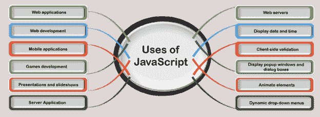

# JavaScript：创建动态响应式网站与应用的全面手册


## 读者群体

本教程为有志的 Web 设计师和开发者设计，他们需要详细了解 JavaScript，同时也需要其简单概述和实践示例。本教程将为你提供足够的素材，让你从 JavaScript 开始，并达到更高水平的专家水平。

## 准备工作

在继续本教程之前，你应该具备 Windows 或 Linux 操作系统的基础工作知识，此外，你必须熟悉以下内容：

1. 使用任何文本编辑器的经验，如 `notepad`、`notepad++` 或 `Edit plus` 等。
2. 具备 `HTML` 的基础和高级知识。
3. 如何在计算机上创建目录和文件。
4. 如何在不同的目录之间导航。
5. 如何在文件中输入内容并保存到计算机上。
6. 理解不同格式的图像，如 `JPEG`、`PNG` 格式。
7. 如何使用 Google Sheets（Excel 表格）。

# JavaScript if, else 和 else if

## 条件语句

### if 语句

### 示例

### else 语句

### 示例

### else if 语句

### 示例

# JavaScript Switch 语句

### 示例

## break 关键字

## default 关键字

## JavaScript 数组

# JavaScript Array

## JavaScript 数组方法

# JavaScript 对象

### 运算符类型

# 第七章

## JavaScript 函数

### 函数语法

### 函数声明

### 函数调用

### 调用 JavaScript 函数

### JavaScript 中的“this”术语

## 注意事项

### 全局对象

### 将函数作为方法调用

### 使用函数构造函数调用函数

### 函数返回

### ( ) 运算符

### 作为变量值的函数

### 局部变量

# 第八章

# JavaScript 对象

## 现实中的对象、属性和方法

### 对象定义

### 对象属性

### 访问对象属性

### 对象方法

### this 关键字

### 访问对象方法

### 不要将字符串、数字和布尔值声明为对象！

# 第九章

# JavaScript 事件

## HTML 事件

### 鼠标事件

### onclick 类型

### onsubmit 类型

### onmouseover 和 onmouseout

### 键盘事件

### 表单事件

### 窗口/文档事件

## HTML DOM 事件

### JavaScript 事件处理器

# 第十章

# JavaScript 循环

### for 循环

### do...while 语句

### 示例

### do… While 循环的区别

### while 语句

### 示例

### while 循环与 for 循环的比较

### 示例：JavaScript for 循环

### for-in 循环

### for Of 循环

### document 对象属性

### document 对象的方法

### 通过 document 对象访问字段值

### JavaScript - `document.getElementById()` 方法

### JavaScript - `document.getElementsByName()` 方法

### JavaScript - `document.getElementsByTagName()` 方法

### `document.getElementsByTagName()` 方法的另一个示例

# JavaScript - innerHTML

### innerHTML 属性示例

### 使用 innerHTML 显示/隐藏注释的示例

# JavaScript - innerText

### JavaScript innerText 示例

## 理解浏览器环境

### 用户界面

### 加载器

### HTML 解析

### CSS 解析

### JavaScript 解析

### 布局与渲染

# 激活 BOM

## Navigator 对象

## Window 对象

### window 对象的方法

### JavaScript 中 `alert()` 的示例

### JavaScript 中 `confirm()` 的示例

### JavaScript 中 `prompt()` 的示例

### JavaScript 中 `open()` 的示例

### JavaScript 中 `setTimeout()` 的示例

# JavaScript history 对象

### JavaScript history 对象的属性

### JavaScript history 对象的方法

### history 对象示例

# JavaScript navigator 对象

### JavaScript navigator 对象属性

### JavaScript navigator 对象的方法

### navigator 对象示例

# JavaScript Screen 对象

### JavaScript Screen 对象属性

### JavaScript Screen 对象示例

# JavaScript 表单验证方法

### JavaScript 表单验证示例

### JavaScript 重输密码验证

### JavaScript 数字验证

### 图像的 JavaScript 验证

### JavaScript 邮箱验证

# JavaScript 类

## 类声明

### 类声明示例

### 类声明示例：变量提升

### 类声明示例：重复声明类

# 类表达式

## 无名类表达式

## 类表达式示例：重新声明类

## 命名类表达式示例

# JavaScript 对象

## 在 JavaScript 中创建对象

### 1) 通过对象字面量创建 JavaScript 对象

### 2) 通过创建 Object 实例

### 3) 使用 Object 构造函数

## 在 JavaScript 对象中定义方法

## JavaScript 对象方法

## JavaScript 原型对象

## 语法：

## 原型链

## JavaScript 原型对象

## JavaScript 构造方法

## 注意事项

## 构造方法示例

# JavaScript 静态方法

## JavaScript 静态方法示例

### 示例 4

# JavaScript 封装

## JavaScript 封装示例

## JavaScript 封装示例：验证

## JavaScript 封装示例：基于原型的方法

# JavaScript 继承

## JavaScript extends 示例：内置对象

## JavaScript extends 示例：自定义类

## JavaScript extends 示例：基于原型的方法

# JavaScript 多态

## JavaScript 抽象

# 第十五章

# JavaScript Cookie

## Cookie 是如何运作的？

## 如何在 JavaScript 中创建 Cookie？

## JavaScript Cookie 示例

## Cookie 属性

### Cookie expires 属性

### Cookie max-age 属性

### Cookie path 属性

### Cookie path 属性示例

### Cookie domain 属性

### 带有多个键值对的 Cookie

### 在 Cookie 中存储键值对的示例

## 在 JavaScript 中删除 Cookie

## 删除 Cookie 的示例

### 示例 3

# 第十六章

# 将 JavaScript 与 Google Apps Script 应用

## Apps Script 能做什么？

## Google Workspace 中的自定义菜单

## Google Sheets 中的可点击图像和图形

## Google Workspace 文档中的对话框和侧边栏

### 警告对话框

### 提示对话框

### 自定义对话框

### 自定义侧边栏

### 文件打开对话框

## Google Sheets 中的自定义函数

## 开发自定义函数

## 通过 Google Marketplace 获取个性化功能

## 使用自定义函数

## 自定义函数指南

## 命名

## 参数

## 返回值

## 数据类型

## 自动补全

## 使用 Google Apps Script 服务

## 共享

## 优化

## Google Sheets

## 在 Apps Script 中创建宏

## 编辑宏

## 将函数导入宏

## 宏的 manifest 结构

## 最佳实践

## 你不能做的事情

# 第十七章

## 在 Apps Script 中开发 Web 应用

## Web 应用的要求

## 请求参数

## 将脚本部署为 Web 应用

## 测试 Web 应用部署

## 权限

## 将你的 Web 应用嵌入到 Google Sites 或你的任何站点中。

## Web 应用与浏览器历史

## 如何使用 Google 表格数据创建登录和注册表单

## 如何在网页上显示 Google Sheet 数据

## 如何将 HTML 表单数据提交到 Google 表格

## 如何将 HTML 表单提交到 Gmail

## 如何从 HTML 网站搜索 Google 表格内容

## 结论

## 参考文献

# 第一章 JavaScript 简介


许多网站利用 `JavaScript`（`js`）这种轻量级面向对象的编程语言来编写网页脚本。当它应用于 `HTML` 文档时，这种功能完备的解释型编程语言允许动态的网页交互。

1995 年，`JavaScript` 发布，允许 `Netscape Navigator` 器的用户在网页上添加应用程序。从那时起，所有其他主要的图形化浏览器都实现了这种语言。它使得现代在线应用程序的发展成为可能，允许用户在无需刷新页面的情况下进行即时交互。传统网站也采用 `JavaScript` 提供各种创新的功能和交互元素（Netscape, 2007）。

Brendan Eich 在 1995 年 5 月用十天时间编写了 `JavaScript`。Eich 就职于 Netscape，在那里为公司的网络浏览器 `Netscape Navigator` 开发了 `JavaScript`。当时的计划是使用 `Java` 来创建客户端网页的主要交互组件。`JavaScript` 旨在作为这些元素之间的连接语言，并为 `HTML` 提供一点交互性。由于在 `Java` 中的支持功能，`JavaScript` 看起来像 `Java`。这排除了 `TCL`、`Python`、`Perl` 等其他选项（W3C, 2021）。

`JavaScript` 是一种能够改进 Web 的语言。当在客户端计算机上使用时，这种语言可以帮助将静态文本页面转换为智能、动态且吸引人的体验。`JavaScript` 应用可以非常微妙，例如当客户端计算机所在的时区是早晨时，向网站访问者问候“早上好！”其他应用程序可能简单得多，例如在一个页面中下载幻灯片内容，并使用 `JavaScript` 管理演示的隐藏、显示和“飞幻幻灯片”切换。

JavaScript 最初被称为 `Mocha`。当 `Netscape Navigator` 首次发布测试版时，它被称为 `LiveScript`。1995 年当 `Netscape 2` 发布时，它被重命名为 `JavaScript`。为了避免商标困难，微软迅速对 `JavaScript` 进行了反向工程，并在 `Internet Explorer` 中发布了完全相同的克隆版本，他们将其称为 `Jscript`。

1997 年 `Netscape` 将其提交给标准机构 `Ecma International` 后，`JavaScript` 被接受并标准化为 `ECMAScript`。尽管如此，`JavaScript` 和 `Java` 是无关编程语言。在 `Java` 在市场上变得日益突出的期间，这个名字被提出并建议。除了网络浏览器外，`CouchDB` 和 `MongoDB` 等数据库也使用 `JavaScript` 作为它们的脚本和查询语言。JavaScript 创始人 `Brandon Eich` 以反对标准化语言名称的言论而闻名，他将 `ECMAScript`（`Ecma International`）称为“听起来像皮肤疾病的不受欢迎的商标”。

`ECMAScript` 不仅对编程语言来说是一个糟糕的名字，而且还是 `Netscape` 给该语言的名字，也是大多数人用来指代它的名字。如果你熟悉 `Java` 编程或将来想学习它，那么最好记住，尽管这两种语言之间有一些相似之处，但它们是完全不同的东西。当 `JavaScript` 首次出现时，它被广泛用于为网站添加动态元素。

`JavaScript` 集成到网络浏览器中的早期成果之一是所谓的“动态 HTML”（`DHTML`）的创建，它允许实现各种趣味效果，例如落落雪花效果、弹出窗口和网页角卷曲，以及更实用的功能，如下拉菜单和表单验证。

## JavaScript 的特性

以下是 `JavaScript` 的特性：

1. 所有流行的网络浏览器都支持 `JavaScript`，因为它们提供了内置的执行环境。
2. `JavaScript` 遵循 `C` 语言的语法和结构。因此，它是一种结构化编程语言。
3. `JavaScript` 是一种弱类型语言，某些类型会进行隐式转换（取决于操作）。
4. `JavaScript` 是一种面向对象的编程语言，它使用原型而不是使用类来进行继承。
5. 它是一种轻量级且解释型的语言。
6. `JavaScript` 是一种大小敏感的语言。
7. `JavaScript` 支持多个操作系统，包括 `Windows`、`macOS` 等。
8. 它为用户提供了对网络浏览器的良好控制。

## JavaScript 的用途

`JavaScript` 是一种编程语言，能够在网站上实现复杂的功能。你可以确定，每当网站执行任何不仅仅是为你显示静态内容供你查看的函数时，`JavaScript` 就会被使用。此类功能的示例包括交互式地图、滚动视频点唱机、动画化的 2D/3D 图形以及实时的内容更新。它是常见 Web 技术堆栈中的第三层，前两层（`CSS` 和 `HTML`）我们已经在其他“学习领域”章节中彻底讨论过了。

许多网站利用 `JavaScript` 这种轻量级面向对象编程语言为它们的网页编写脚本。它是一种完整的解释型编程语言。当将 `JavaScript` 添加到 `HTML` 页面时，网站可能会具有动态交互性。

`JavaScript` 使用户无需不断刷新页面即可创建交互式的现代 Web 应用。`JavaScript` 经常与 `DOM API` 一起使用，通过动态修改 `HTML` 和 `CSS` 来刷新用户界面。

它主要用于在线程序。让我们谈谈 `JavaScript` 的应用。`JavaScript` 使用的一个示例在下图所示。



### 1. Web 应用程序

由于浏览器每天都在变得更好，`JavaScript` 作为创建可靠在线应用程序的工具变得越来越流行。我们可以通过使用 `Google Maps` 作为示例来理解它。通过 `Maps`，用户只需要点击并拖动鼠标即可查看信息。这些想法都受到了 `JavaScript` 使用的支持。

### 2. Web 开发

创建网页是 `JavaScript` 的一个典型用途。它允许我们为网页添加特殊特效和动态行为。它主要用于网站上的验证工作。`JavaScript` 促进了复杂任务的执行，并允许网站与其用户通信。另一种在不刷新网页的情况下向文档中加载内容的方法是使用 `JavaScript`。

### 3. 移动应用程序

现在，许多人利用移动设备访问互联网。我们也可以使用 `JavaScript` 为非 Web 环境创建应用程序。由于其能力和应用，`JavaScript` 是开发移动应用程序的极佳技术。用于制作移动应用的流行的 `JavaScript` 框架被称为 `React Native`。我们可以使用 `React Native` 为多个操作系统创建移动应用程序。没有必要为 `iOS` 和 `Android` 操作系统编写单独的代码。只需编写一次，即可在多个系统上运行。

### 4. 游戏

游戏也可以用 `JavaScript` 制作。它提供了许多用于制作游戏的框架和库。可以玩 2D 或 3D 游戏。一些 `JavaScript` 游戏引擎如 `Pixi.js` 和 `PhysicsJS` 帮助我们制作在线游戏。此外，我们可以通过名为 `WebGL`（网络图形库）的 `JavaScript API` 在浏览器上渲染 2D 和 3D 图片。

### 5. 演示文稿

此外，`JavaScript` 促进了网站和演示文稿的创建。你可以利用 `BespokeJs` 和 `RevealJs` 等库来制作在线幻灯片。因为它们更简单，我们可以快速简单地创建惊人的内容。

通过 `HTML`，`Reveal.js` 用于构建演示幻灯片。平板电脑和移动设备非常适合这些演示。它支持所有的 `CSS` 格式。`BespokeJS` 包含了动画列表、响应式缩放和广泛的功能集。

### 6. 服务端应用程序

许多 Web 应用程序具有服务器端组件。`HTTP` 请求通过 `JavaScript` 处理和生成。`Node.js` 允许 `JavaScript` 在服务器上运行。`Node.js` 的环境提供了 `JavaScript` 在服务器上执行所需工具。

### 7. Web 服务器

可以使用 `Node.js` 开发 Web 服务器。由于 `Node.js` 是事件驱动的，它不需要等待调用的响应。`Node.js` 服务器快速处理大量数据。可以使用 `HTTP` 模块中的 `createServer()` 函数创建服务器。每当尝试访问 `8080` 端口时，该函数就会被调用。`HTTP` 服务器应该响应 `HTML`，并在 `HTTP` 头部中提供它。

## JavaScript 的应用

交互式网站是通过 `JavaScript` 构建的。许多其他应用可以提高网页速度。以下是 `JavaScript` 的其他用途：

1. 客户端验证。
2. 动态下拉菜单。
3. 显示弹出窗口和对话框（如警告对话框、确认对话框和提示对话框）。
4. 显示时钟。
5. 显示日期和时间。
6. 在提交表单之前验证用户输入。
7. 打开和关闭新窗口。
8. 显示对话框和弹出窗口。
9. 修改 HTML 文档的外观。
10. 创建无需访问服务器即可响应用户输入的表单。

# 编写第一个 JavaScript 程序的前提条件

## 在开始构建第一个 JavaScript 之前

请确保你已经集齐并准备好了所有的工具。巧合的是，我们在书中使用的工具也正是我们推荐你下载并安装的工具。我们将引导你完成整个过程。请随时使用你可能拥有的任何类似或更偏好的工具。

为了理解我们为什么选择这些工具，并帮助你决定是否使用它们，我们仍然建议你阅读书的这部分。我们将为你提供一些关于如何在安装每个工具时最大化利用其功能方面的提示。

## 下载和安装 Chrome

Google Chrome 是处理 JavaScript 的首选网页浏览器。当然，如果你日常更倾向于使用不同的浏览器也是可以的。每个浏览器都能准确、快速地执行 JavaScript。但由于书中将详细介绍 Google Chrome，我们建议你至少按照本章中概述的步骤在你的电脑上安装它。由于 Google Chrome 现在是互联网上最流行的网页浏览器，并为简化 JavaScript 编写者的任务提供了极佳的功能，我们决定在书中使用它。（是的，它的人气超过了 Internet Explorer。）

如果你还没有安装 Chrome，请按照以下步骤进行安装：

1. 访问 `www.google.com/chrome`。
2. 将鼠标悬停在“下载”标签页上，并为你的电脑选择合适的版本。
3. 打开下载的文件并按照说明安装 Chrome。

Google Chrome 使用 Google 的 V8 JavaScript 引擎来解析、编译和执行 JavaScript 代码。Chrome 在运行 JavaScript 方面是最快的浏览器，或者是最快之一，这取决于你信任谁的基准测试结果。主要的浏览器制造商总是试图相互超越。近年来，竞争加速了每个浏览器 JavaScript 引擎的发展速度，因此在任何特定时刻谁最快其实并不重要。你可以访问 `http://arewefastyet.com` 查看多个浏览器在 JavaScript 测试中性能的实时对比。

最流行的浏览器的 JavaScript 性能会在该网站上自动检查并生成图表，该网站由创建 Firefox 浏览器的 Mozilla 公司每天更新。

## 下载和安装代码编辑器

源代码编辑器（有时称为代码编辑器）本质上是一个带有额外功能的文本编辑器，这些功能使得创建和修改计算机代码变得更容易。我们使用的是 Sublime Text。市有多种代码编辑器可用，如果你已经知道如何使用并且觉得好用，请尽管选择你偏好的一个。代码编辑器是非常具个性化的工具，许多程序员会发现某个特定的编辑器对他们效果更好，仅仅是因为它对他们来说看起来更自然。如果你发现 Sublime Text 并不是你的菜：

| 名称 | 位置 | 兼容性 |
| :--- | :--- | :--- |
| Coda | `http://panic.com/coda` | 仅限 Mac |
| Aptana | `www.aptana.com` | Mac 或 Windows |
| Komodo Edit | `www.activestate.com/komodo‐edit/downloads` | Mac 或 Windows |
| Dreamweaver | `http://adobe.com/products/dreamweaver.html` | Mac 或 Windows |
| Eclipse | `www.eclipse.org` | Mac 或 Windows |
| Notepad++ | `http://notepad‐plusplus.org` | 仅限 Windows |
| TextMate | `http://macromates.com` | 仅限 Mac |
| BBEdit | `www.barebones.com/products/bbedit` | 仅限 Mac |
| EMacs | `www.gnu.org/software/emacs` | Mac 或 Windows |
| TextPad | `www.textpad.com` | 仅限 Windows |
| vim | `www.vim.org` | Mac 或 Windows |
| Netbeans | `https://netbeans.org` | Mac 或 Windows |
| Bracket | `https://brackets.io/` | Mac 或 Windows |
| Visual Studio Code | `https://code.visualstudio.com/` | Mac 或 Windows |

## 阅读 JavaScript 代码

在开始编写 JavaScript 程序之前，你需要了解 JavaScript 的几条规则：

1. JavaScript 是区分大小写的。我们在书中反复强调了这一点，因为这是 JavaScript 初学者非常经常会犯的错误。对于 JavaScript 来说，`pants` 和 `Pants` 是完全不同的单词。
2. JavaScript 并不在乎空白。空白包括空格、制表符和换行符——任何没有视觉表示的字符。当你编写 JavaScript 代码时，在代码中使用一个空格、两个空格、一个制表符，甚至一个换行符（在大多数情况下）都没有关系。JavaScript 会忽略空白。唯一的例外是你编写想要让 JavaScript 打印到屏幕上的文本时。在这种情况下，你使用的空白将显示在最终结果。关于代码中的空白，最佳实践是使用足够的空间让你的代码易于阅读，并且与你使用这些空间的方式保持一致。
3. 注意保留字。JavaScript 有一组对语言有特殊含义的单词。我们在第 3 章中列出了这些单词。现在，只需意识到某些如 `function`、`while`、`break` 和 `with` 等单词具有特殊含义即可。
4. JavaScript 喜欢分号：JavaScript 代码由语句组成。你可以将语句比作句子。它们是 JavaScript 程序的基础构建块，就像句子是段落的构建块一样。在 JavaScript 中，语句以分号结束。如果你不在语句末尾使用分号，JavaScript 会为你补上。然而，这可能会导致意外的结果，因此始终使用分号被认为是最佳实践。

## 在浏览器窗口中运行 JavaScript

虽然 JavaScript 用于许多场景，但浏览器是观察它最流行的地方。JavaScript 的创建是为了处理如点击等典型的浏览器操作。

要在浏览器中运行 JavaScript，你有三种选择，将在下文中显示：

1. 直接放在 HTML 事件属性中
2. 放在开启和关闭脚本标签之间
3. 放在单独的文档并在 HTML 中引用

很多时候，你会在网页中结合使用这三种技术。然而，何时使用每种方法是重要的，这是一种你通过练习可以掌握的技能。

### 在事件属性中使用 JavaScript

HTML 有许多独特的属性，旨在让 JavaScript 在响应浏览器中发生的事件或用户操作时运行。一个具有响应点击事件属性的 HTML 按钮所示：

```html
<button id="bigButton" onclick="alert('Hello World!');">点击这里</button>
```

在这种情况下，用户点击此 HTML 元素创建的按钮时，会弹出一个显示“Hello World!”的窗口。HTML 有超过 70 种不同的事件属性。表 2-3 显示了常用的。

| 常用的 HTML 事件属性 | 描述 |
| :--- | :--- |
| `onload` | 在页面加载完成后运行脚本 |
| `onfocus` | 当元素获得焦点时运行脚本（例如文本框激活时） |
| `onblur` | 当元素失去焦点时运行脚本（例如点击表单中的新文本框时） |
| `onchange` | 当元素的值改变时运行脚本 |
| `onselect` | 当文本提交时运行脚本 |
| `onsubmit` | 当表单提交时运行脚本 |
| `onkeydown` | 当用户按下键时运行脚本 |
| `onkeypress` | 当用户按下键时运行脚本 |
| `onkeyup` | 当用户松开键时运行脚本 |
| `onclick` | 当用户鼠标点击元素时运行脚本 |
| `ondrag` | 当元素被拖动时运行脚本 |
| `ondrop` | 当被拖动的元素被释放时运行脚本 |

# 在 script 元素中使用 JavaScript

HTML `script` 元素允许你将 JavaScript 嵌入到 HTML 文档中。通常 `script` 元素被放置在 `head` 元素中，事实上，这种放置方式以前被认为是一项要求。然而，今天，`script` 元素既用于网页的 `head` 元素，也用于 `body` 元素。`script` 元素的格式非常简单：

```html
<script>(在此处插入你的 JavaScript)</script>
```

但在这种情况下，我们将 `script` 元素放置在 `body` 元素的底部。

## 在 Script 元素中嵌入 JavaScript

```html
<!DOCTYPE html><html><head><title>Hello, HTML!</title></head><body><h1>Let's Count to 20 with JavaScript!</h1><p id="theCount"></p><script>var count = 0;while (count < 20) {count++;document.getElementById("theCount").innerHTML +=count + "<br>";}</script></body></html>
```

### 脚本位置与 JavaScript 执行

脚本通常由网络浏览器加载并在加载时运行。浏览器从上到下读取网页，就像读取文本页面一样。有时，你应该等待脚本执行，直到浏览器完成页面内容的加载。我们使用 `body` 元素的 `onload` 事件属性来实现这一点。将必须在最后运行的代码放置在代码的末尾是另一种推迟执行的常用技术。

### `<script>` 元素中 JavaScript 的局限性

尽管将 JavaScript 嵌入 `script` 元素中比内联脚本（将 JavaScript 放入事件属性中）更流行且被广泛接受，但它仍然具有一些明显的缺点。主要的缺点是这些脚本仅在它们所所在的网页上可用。换句话说，如果你在 `script` 元素中包含 JavaScript，你必须精确地复制并粘贴该 `script` 元素到每个包含它的页面上。考虑到某些网站有数百甚至数千个网页，你可以想象这可能如何变成一场维护的噩梦。

## 何时在 `<script>` 元素中使用 JavaScript

这种 JavaScript 嵌入技术有其应用场景。这样做是可以的，而且通过减少 Web 服务器为那些仅仅是调用其他 JavaScript 元素的元素而需进行的请求数量，甚至可以加快你网页的加载和显示。

正如名称所示，单页应用程序只有一个 HTML 页面，这使其成为这种嵌入的极佳候选，因为脚本只需要在一个地方更新。尽管通常情况下，你想尽量避免直接向 HTML 页面添加过多的 JavaScript。结果是你的代码将变得更有组织，所需的维护更少。

## 引入外部 JavaScript 文件

`script` 元素的 `src` 属性是在 HTML 文本中包含 JavaScript 的第三也是最常用的方法。带有标签 JavaScript 的 `script` 元素与带有 `src` 属性的元素之间的唯一区别是 JavaScript 是从不同的文件加载到 HTML 文档的。

当相同代码用在许多不同的网页时，外部脚本是非常实用的。

JavaScript 文件的扩展名为 `.js`。

要使用外部脚本，将脚本文件名放在 `<script>` 标签的 `src`（源）属性中：

这是一个带有 `src` 属性的脚本元素示例：

```html
<script src="myScript.js"></script>
```

在这种情况下，你将有一个名为 `myScript.js` 的单独文件，它位于与你的 HTML 文档相同的文件夹中。

```html
<!DOCTYPE html><html><body><h2>Demo External JavaScript</h2><p id="demo">A Paragraph.</p><button type="button" onclick="myFunction()">Try it</button><p>This example links to "myScript.js".</p><p>(myFunction is stored in "myScript.js")</p><script src="myScript.js"></script></body></html>
```

**注意：**

1. 你可以根据意愿在 `<head>` 或 `<body>` 中放置外部脚本引用。
2. 脚本的行为将就像它正好位于 `<script>` 标签所在的位置。
3. 外部脚本不能包含 `<script>` 标签。

**使用外部 JavaScript 文件的用处是，使用它们：**

1. 保持你的 HTML 文件更整洁、不杂乱。
2. 让你的生活更轻松，因为当发生变化或修复 bug 时，你只需要在一个地方修改 JavaScript。
3. 它分离了 HTML 和代码。
4. 它让 HTML 和 JavaScript 更易于阅读和维护。
5. 缓存的 JavaScript 文件可以加快页面加载。

要向一个页面添加多个脚本文件 - 使用多个脚本标签：

```html
<script src="myScript1.js"></script> <script src="myScript2.js"></script>
```

### 创建 .js 文件

创建一个外部 JavaScript 文件与创建一个 HTML 文件或其他类型的文件相似。要创建一个外部 JavaScript 文件，请按照以下步骤操作：

1. 在 Sublime Text 或你的任何文本编辑器中，选择 `File` ➪ `New File`。
2. 从 `MyFirstProgram.html` 复制 `<script>` 和 `</script>` 之间的所有内容并粘贴到新的 `.js` 文件中。

注意：注意外部 JavaScript 文件不包含 `<script>` 元素，只有 JavaScript。

3. 将你的新文件保存为 `countToTwenty.js`，并放在 `MyFirstProgram.html` 相同的文件夹中。
4. 在 `MyFirstProgram.html` 中，修改你的脚本元素以添加 `src` 属性，如下：

```html
<script src="countToTwenty.js"></script>
```

你的 `MyFirstProgram.html` 副本现在应该像这样：

```html
<!DOCTYPE html><html><head><title>Hello, HTML!</title></head><body><h1>Let's Count to 20 with JavaScript!</h1><p id="theCount"></p><script>var count = 0;while (count < 20) {count++;document.getElementById("theCount").innerHTML +=count + "<br>";}</script></body></html>
```

你的新文件 `countToTwenty.js` 应该像这样：

```javascript
var count = 0;while (count < 20) {count++;document.getElementById("theCount").innerHTML +=count + "<br>";}
```

### 外部引用

外部脚本可以通过 3 种方式引用：

1. 使用完整 URL（完整的网络地址）
2. 使用文件路径（例如 `/js/`）
3. 不使用任何路径

示例 1：此示例使用完整 URL 链接到 myScript.js：

```html
<!DOCTYPE html><html><body><h2>External JavaScript</h2><p id="demo">A Paragraph.</p><button type="button" onclick="myFunction()">Click Me</button><p>This example links to "myScript.js".</p><p>(myFunction is stored in "myScript.js")</p><script src="https://www.wschools.com/js/myScript.js"></script></body></html>
```

示例 2：此示例使用文件路径链接到 myScript.js：

```html
<!DOCTYPE html><html><body><h2>External JavaScript</h2><p id="demo">A Paragraph.</p><button type="button" onclick="myFunction()">Try it</button><p>This example links to "myScript.js".</p><p>(myFunction is stored in "myScript.js")</p><script src="/js/myScript.js"></script></body></html>
```

示例 3：此示例不使用路径链接到 myScript.js：

```html
<!DOCTYPE html><html><body><h2>Demo External JavaScript</h2><p id="demo">A Paragraph.</p><button type="button" onclick="myFunction()">Try it</button><p>This example links to "myScript.js".</p><p>(myFunction is stored in "myScript.js")</p><script src="myScript.js"></script></body></html>
```

## 使用 JavaScript 开发者控制台

有时，能够在不创建 HTML 页面、不包含单独脚本或不创建 `<script>` 块的情况下运行 JavaScript 命令是非常有帮助的。对于这些时候，你可以使用 Chrome 浏览器的 JavaScript 控制台。要访问 JavaScript 控制台，找到浏览器右上角的 Chrome 菜单。它看起来像三条水平线。点击 Chrome 菜单，然后在下拉菜单中找到更多工具。在更多工具下，从下拉菜单中选择 JavaScript 控制台。

而且是的，有一种更快的方法可以打开 JavaScript 控制台。只需按下 `Alt+Command+J`（Mac）或 `Control+Shift+J`（Windows）即可。

JavaScript 控制台（JavaScript Console）可能是 JavaScript 开发者最好的朋友。除了允许你快速方便地测试和运行 JavaScript 代码外，它还是报告代码错误的地方，并具备许多帮助你追踪和解决代码中问题的功能。

一旦打开了 JavaScript 控制台，你就可以向其中输入命令，这些命令会在你按下 `Enter` 时立即运行。要尝试一下，请打开 JavaScript 控制台，然后输入以下命令，并在每个命令后按 `Enter`：

# 第二章

## JavaScript 基础


本节旨在让你快速接触 JavaScript 的基础知识，以便你开始编写程序。这部分将教你 JavaScript 的核心构建模块，避免对所有理论和概念进行全面覆盖。将涵盖如运算符、`if` 语句、`循环`、`变量`、`数据类型`、`switch`、`函数`、`对象`、`数组`和`类`等主题。此外，你还将发现如何将它们结合在一起，创建一个紧凑且可靠的软件。

正如你可能意识到的，JavaScript 现在被广泛应用于软件开发领域。它是前端网页开发的基石，对于 `Angular`、`Vue` 和 `ReactJS` 等框架至关重要。此外，它还可以用于使用 `Node.js` 平台构建健壮的后端，运行 `Slack`、`Atom` 和 `Spotify` 等桌面程序，并在移动设备上作为渐进式 Web 应用（PWAs）运行。

简而言之，它无处不在——这是有的。首先，与 C 和 Java 等语言相比，JavaScript 通常更容易学习。当我们说“更容易”时，是指从一个 JavaScript 初学者变成能够真正编写专业、高质量 JavaScript 代码的人的速度更快。因此，从这个意义上来说，它比 `C` 和 `Java` 等其他语言更容易上手。

JavaScript 也是一种有趣且有回报的语言，这在你刚开始学习软件开发时尤为重要。社区支持非常好，所以如果你遇到困难，很有可能该问题及其解决方案已经存在于网络上了。

## JavaScript 可以更改 HTML 内容

许多 JavaScript HTML 方法之一是 `getElementById()`。

下面的示例将“找到”一个 HTML 元素（带有 `id="demo"`），并将元素的内容（`innerHTML`）更改为“Hello JavaScript”：

示例：

```html
<!DOCTYPE html><html><body><h2>JavaScript 能做什么？</h2><p id="demo">JavaScript 可以更改 HTML 内容。</p><button type="button" onclick='document.getElementById("demo").innerHTML = "Hello JavaScript!"'>点击我!</button></body></html>
```

JavaScript 同时接受双引号和单引号：

```html
<!DOCTYPE html><html><body><h2>JavaScript 能做什么？</h2><p id="demo">JavaScript 可以更改 HTML 内容。</p><button type="button" onclick="document.getElementById('demo').innerHTML = 'Hello JavaScript!'">点击我!</button></body></html>
```

## JavaScript 可以更改 HTML 属性值

在这个示例中，JavaScript 更改了 `` 标签的 `src`（源）属性的值：

```html
<!DOCTYPE html><html><body><h2>JavaScript 能做什么？</h2><p>JavaScript 可以更改 HTML 属性值。</p><p>在这种情况下，JavaScript 更改了图像 src（源）属性的值。</p><button onclick="document.getElementById('myImage').src='pic_bulbon.gif'">开灯</button><button onclick="document.getElementById('myImage').src='pic_bulboff.gif'">关灯</button></body></html>
```

## JavaScript 可以更改 HTML 样式 (CSS)

更改 HTML 元素的样式是更改 HTML 属性的一种变体：

```html
<!DOCTYPE html><html><body><h2>JavaScript 能做什么？ </h2><p id="demo">JavaScript 可以更改 HTML 元素的样式。</p><button type="button" onclick="document.getElementById('demo').style.fontSize='35px'">点击我!</button></body></html>
```

## JavaScript 可以隐藏 HTML 元素

通过更改 `display` 样式可以隐藏 HTML 元素：

```html
<!DOCTYPE html><html><body><h2>JavaScript 能做什么？</h2><p id="demo">JavaScript 可以隐藏 HTML 元素。</p><button type="button" onclick="document.getElementById('demo').style.display='none'">点击我!</button></body></html>
```

## JavaScript 可以显示 HTML 元素

通过更改 `display` 样式也可以显示 HTML 元素：

```html
<!DOCTYPE html><html><body><h2>JavaScript 能做什么？</h2><p id="demo" style="display:none">JavaScript 可以显示 HTML 元素。</p><button type="button" onclick="document.getElementById('demo').style.display='block'">点击我!</button></body></html>
```

## `<script>` 标签

在 HTML 中，JavaScript 代码插入在 `<script>` 和 `</script>` 标签之间。

```html
<!DOCTYPE html><html><body><h2>JavaScript</h2><p id="demo"></p><script>document.getElementById("demo").innerHTML = "My JavaScript";</script></body></html>
```

## JavaScript 函数和事件

当用户点击按钮时，可以调用函数。

```javascript
function myFunction() {
document.getElementById("demo").innerHTML = "已更改.";
}
```

## `<head>` 或 `<body>`

你可以将脚本放置在 `<head>`、`<body>` 中或两者都包含。

```html
<!DOCTYPE html><html><body><h2>JavaScript 能做什么？</h2><p id="demo">JavaScript 可以更改 HTML 内容。</p><button type="button" onclick="myFunction()">点击我!</button><script>function myFunction() {document.getElementById("demo").innerHTML = "已更改.";}</script></body></html>
```

## `<head>`

在这个示例中，JavaScript 函数放置在 HTML 页的 `<head>` 部分中。

```html
<!DOCTYPE html><html><head><script>function myFunction() {document.getElementById("demo").innerHTML = "已更改.";}</script></head><body><h2>JavaScript 能做什么？</h2><p id="demo">JavaScript 可以更改 HTML 内容。</p><button type="button" onclick="myFunction()">点击我!</button></body></html>
```

## `<body>`

在这个示例中，JavaScript 函数放置在 HTML 页面的 `<body>` 部分中。

```html
<!DOCTYPE html><html><body><h2>JavaScript 能做什么？</h2><p id="demo">JavaScript 可以更改 HTML 内容。</p><button type="button" onclick="myFunction()">点击我!</button><script>function myFunction() {document.getElementById("demo").innerHTML = "已更改.";}</script></body></html>
```

## JavaScript 表达式

表达式是值、变量和运算符的组合，计算出一个值。这种计算被称为求值。

例如，`5 * 10` 的求值为 50：

```html
<!DOCTYPE html><html><body><h2>JavaScript 表达式</h2><p>表达式计算出一个值。</p><p id="demo"></p><script>document.getElementById("demo").innerHTML = 5 * 10;</script></body></html>
```

表达式也可以包含变量值：

```html
<!DOCTYPE html><html><body><h2>JavaScript 表达式</h2><p>表达式计算出一个值。</p><p id="demo"></p><script>var x;x = 5;document.getElementById("demo").innerHTML = x * 10;</script></body></html>
```

值可以是不同的类型，例如数字和字符串。例如，`"John" + " " + "Doe"` 的求值为 `"John Doe"`：

```html
<!DOCTYPE html><html><body><h2>JavaScript 表达式</h2><p>表达式计算出一个值。</p><p id="demo"></p><script>document.getElementById("demo").innerHTML = "John" + " " + "Doe";</script></body></html>
```

JavaScript 可以以不同的方式“显示”数据：

1. 使用 `innerHTML` 写入 HTML 元素中。
2. 使用 `document.write()` 写入 HTML 输出中。
3. 使用 `window.alert()` 写入警告框（alert box）中。
4. 使用 `console.log()` 写入浏览器控制台。

## 使用 innerHTML

要访问 HTML 元素，JavaScript 可以使用 `document.getElementById(id)` 方法。

`id` 属性定义 HTML 元素。`innerHTML` 属性定义了 HTML 内容：

```html
<!DOCTYPE html>
<html><body><h2>我的第一个网页</h2><p>我的第一个段落。</p><p id="demo"></p>
<script>
document.getElementById("demo").innerHTML = 5 + 6;
</script></body>
</html>
```

> 备注：在 HTML 中，更改 HTML 元素的 `innerHTML` 属性是在 HTML 中显示数据的一种常用方法。

## 使用 document.write()

出于测试目的，使用 `document.write()` 是方便的：

```html
<!DOCTYPE html>
<html><body><h2>我的第一个网页</h2><p>我的第一个段落。</p><p>在文档加载完成后不要调用 `document.write()`。它将重写整个文档。</p>
<script>
document.write(5 + 6);
</script></body>
</html>
```

> 备注：在 HTML 文档加载后使用 `document.write()` 将删除所有现有的 HTML：

```html
<!DOCTYPE html>
<html><body><h2>我的第一个网页</h2><p>我的第一个段落。</p>
<button type="button" onclick="document.write(5 + 6)">尝试一下</button></body>
</html>
```

## 使用 window.alert()

你可以使用警告框来显示数据：

```html
<!DOCTYPE html>
<html><body><h2>我的第一个网页</h2><p>我的第一个段落。</p>
<script>
window.alert(5 + 6);
</script></body>
</html>
```

你可以省略 `window` 关键字。在 JavaScript 中，`window` 对象是全局作用域对象。这意味着变量、属性和方法默认属于 `window` 对象。这也意味着指定 `window` 关键字是可选的：

```html
<!DOCTYPE html>
<html><body><h2>我的第一个网页</h2><p>我的第一个段落。</p>
<script>
alert(5 + 6);
</script></body>
</html>
```

## 使用 console.log()

为了调试，你可以在浏览器中调用 `console.log()` 方法来显示数据。

```html
<!DOCTYPE html>
<html><body><h2>激活调试</h2><p>在键盘上按 F12 将激活调试。</p><p>然后在调试器菜单中选择“Console”。</p><p>再次点击运行。</p>
<script>
console.log(5 + 6);
</script></body>
</html>
```

## JavaScript 打印 (Print)

JavaScript 没有任何打印对象或打印方法。你无法从 JavaScript 访问输出设备。唯一的例外你可以调用浏览器中的 `window.print()` 方法来打印当前窗口的内容。

```html
<!DOCTYPE html>
<html><body><h2>`window.print()` 方法</h2><p>点击按钮打印当前页面。</p>
<button onclick="window.print()">打印此页面</button></body>
</html>
```

# JavaScript 语句 (Statements)

```html
<!DOCTYPE html>
<html><body><h2>JavaScript 语句</h2><p>`JavaScript 程序` 是供计算机执行的`语句`列表。</p><p id="demo"></p>
<script>
let x, y, z; // 语句 1
x = 5; // 语句 2
y = 6; // 语句 3
z = x + y; // 语句 4
document.getElementById("demo").innerHTML ="z 的值是 " + z + ".";
</script></body>
</html>
```

## JavaScript 程序

`计算机程序` 是一组供计算机“执行”的“指令”列表。在编程语言中，这些编程指令被称为 `语句`。`JavaScript 程序` 是一个编程 `语句` 列表。

> 备注：在 HTML 中，JavaScript 程序是由网络浏览器执行的。

## JavaScript 语句

JavaScript 语句由以下组成：

值、运算符、表达式、`关键字` 和注释。

这条语句告诉浏览器在 `id="demo"` 的 HTML 元素内部写入“Hello Dolly.”：

```html
<!DOCTYPE html>
<html><body><h2>JavaScript 语句</h2><p>在 HTML 中，JavaScript 语句是由浏览器执行的。</p><p id="demo"></p>
<script>
document.getElementById("demo").innerHTML = "Hello Dolly.";
</script></body>
</html>
```

大多数 JavaScript 程序包含许多 JavaScript 语句。

语句按照编写时的顺序一个一个地执行。

JavaScript 代码经常用于指代 JavaScript 应用和语句。

### 分号 (Semicolons)

分号分隔 JavaScript 语句。

在每个可执行语句的末尾添加分号：

```html
<!DOCTYPE html>
<html><body><h2>JavaScript 语句</h2><p>JavaScript 语句通过分号隔开。</p><p id="demo1"></p>
<script>
let a, b, c;
a = 5;
b = 6;
c = a + b;
document.getElementById("demo1").innerHTML = c;
</script></body>
</html>
```

当用分号分隔时，允许在一行内有多个语句：

```html
<!DOCTYPE html>
<html><body><h2>JavaScript 语句</h2><p>允许在一行内有多个语句。</p><p id="demo1"></p>
<script>
let a, b, c;
a = 5;b = 6;c = a + b;
document.getElementById("demo1").innerHTML = c;
</script></body>
</html>
```

> 备注：在 HTML 中，JavaScript 程序是由网络浏览器执行的。

### 空格 (White Space)

JavaScript 忽略多个空格。你可以在脚本中添加空格来提高其可读性。

以下行是等价的：

```javascript
let person = "Hege" ;
```

### 行长度 (Line Length)

一种良好的做法是在运算符（`=`、`+`）周围放置空格：

```javascript
let x = y;
```

为了可读性，程序员经常避免代码行超过 80 个字符。如果 JavaScript 语句不适合单行，最佳位置是在运算符：

```html
<!DOCTYPE html>
<html><body><h2>JavaScript 语句</h2><p>这不是要求的。</p><p id="demo"></p>
<script>
document.getElementById("demo").innerHTML = "Hello Dolly.";
</script></body>
</html>
```

### 代码块 (Code Blocks)

JavaScript 语句可以组合在块中，在大括号。

代码块的目的是定义要一起执行的语句。

你会发现语句组合在一起的地方是 JavaScript 函数：

```html
<!DOCTYPE html>
<html><body><h2>JavaScript 语句</h2><p>JavaScript 代码块写在 { 和 } 之间。</p>
<button type="button" onclick="myFunction()">点击我</button><p id="demo1"></p><p id="demo2"></p>
<script>
function myFunction() {
document.getElementById("demo1").innerHTML = "Hello Dolly!";
document.getElementById("demo2").innerHTML = "How are you?";
}
</script></body>
</html>
```

> 备注：在本教程中，我们使用 2 个空格缩进代码块。你将在本教程后面学习更多函数。

## JavaScript 关键字

JavaScript 语句通常以 `关键字`开头，以识别要执行的 JavaScript 操作。

以下是你将在本教程中学习的一些关键字：

| 关键字 | 描述 |
| :--- | :--- |
| `var` | 声明变量 |
| `let` | 声明块变量 |
| `const` | 声明块常量 |
| `if` | 标记一个根据条件执行的语句块 |
| `switch` | 标记一个在不同情况下执行的语句块 |
| `for` | 标记一个在循环中执行的语句块 |
| `function` | 声明函数 |
| `return` | 退出函数 |
| `try` | 对语句块实现错误处理 |

JavaScript 关键字是保留字。保留字不能用作变量名。

JavaScript 语法是构建 JavaScript 程序的一套规则：

```javascript
// 如何创建变量：var x; let y;
// 如何使用变量：x = 5; y = 6; let z = x + y;
```

## JavaScript 值 (Values)

JavaScript 语法定义了两种值：

1. 固定值
2. 变量值

固定值被称为 `字面量 (Literals)`。

变量值被称为 `变量 (Variables)`。

## JavaScript 字面量 (Literals)

固定值的最重要的语法规则是：

1. 数字可以带小数也可以不带小数写：

# JavaScript 数字

数字可以带有小数，也可以不带小数编写。

```javascript
document.getElementById("demo").innerHTML = 10.50;
```

## 字符串

字符串是文本，写在双引号或单引号内：

```javascript
document.getElementById("demo").innerHTML = 'John Doe';
```

# 第三章

## JavaScript 注释


尽管 JavaScript 设计初衷是简单且易用的，但仍然可以编写出难以一目理解的复杂代码。JavaScript 标准在某些情况下提供了两种方法来创建代码注释，以便开发人员用通俗易懂的语言描述正在发生的情况。

虽然浏览器无法执行 JavaScript 注释，但对于软件开发者来说，包含注释仍然是一项推荐的做法。提供帮助的注释来解释代码的工作原理是高质量代码的标志，几乎所有的代码都可以使用注释。

本节将讨论编写极具影响力的 JavaScript 注释的推荐实践，以及如何在程序中创建和使用它们。

JavaScript 注释是传递信息的重要方法。为了让最终用户更容易理解代码，它被用于包含关于代码的注释、警告或其他信息。集成在浏览器中的 JavaScript 引擎会忽略 JavaScript 注释。

使用注释可以让 JavaScript 代码变得更易理解和易解释。在测试替代代码时，也可以使用 JavaScript 注释停止代码运行。

随着网站和系统的变化，开发者总是会生成复杂的代码。以这种方式编写代码时，原始作者或开发者可能完全理解它，但对于团队的新成员，甚至是作者未来的自己，起初可能无法理解。在这些情况下，注释是极其有用的工具，用于概述产生某块代码所做的决策和思维方式。

Web 开发人员可以在 JavaScript 中编写注释——包括用于快速说明的单行注释，以及用于详细说明或正式文档的多行注释。

### JavaScript 注释的优势

JavaScript 注释主要有两个优势。

1. 使代码易于理解：它可以详细说明代码，让最终用户能够轻松理解代码。
2. 避免不必要的代码：它也可以用于避免代码被执行。有时，我们会添加代码来执行某些操作。但过段时间后可能需要禁用这些代码。在这种情况下，使用注释更好。

## JavaScript 注释的类型

JavaScript 中有两种类型的注释。

1. 单行注释
2. 多行注释

## JavaScript 单行注释

单行注释对于在某行代码上方添加快速注释或说明非常有用。单行注释以 `//` 开始。`//` 和行尾之间的任何文本都会被 JavaScript 忽略（不会执行）。它由双斜杠（`//`）表示。它可以用于语句的前后。让我们来看单行注释的示例，即在语句之前添加注释。

```javascript
// 修改标题
document.getElementById("myH").innerHTML = "JavaScript Comments";
// 修改段落
document.getElementById("myP").innerHTML = "My first paragraph.";
```

此示例在每行的末尾使用单行注释来解释代码：

```javascript
var a=10;
var b=20;
var c=a+b;
//加上了变量 a 和 b 的值
document.write(c);
//打印 10 和 20 的和
```

## JavaScript 多行注释

有时，单行不足以记录或解释为什么以特定方式编写某些代码，或者它的作用是什么。这时，JavaScript 开发者会选择编写跨行的注释（JavaScript 多行注释也可以称为块注释）。多行注释以 `/*` 开始，以 `*/` 结束。`/*` 和 `*/` 之间的任何文本都会被 JavaScript 忽略。它可以添加单行以及多行注释，因此更方便。它由斜杠加星号、星号加斜杠表示。例如：

```javascript
/*下面的代码将更改 id 为 "myH" 的标题和 id 为 "myP" 的段落*/
document.getElementById("myH").innerHTML = "JavaScript Comments";
document.getElementById("myP").innerHTML = "My first paragraph.";
```

它可以用于语句之前、之后和中间。

```javascript
/* 这是一个多行注释。它不会被显示 */
document.write("example of JavaScript multiline comment");
```

## 使用 JavaScript 注释防止代码执行

由于 JavaScript 注释不会执行，因此它们是在测试新功能时防止代码执行的好方法。这种策略允许您定位错误，逐步移除注释，直到找到有问题的代码。

使用注释防止代码执行适用于代码测试。

在代码行前添加 `//` 会将该代码行从可执行行变为注释。

此示例使用 `//` 来防止其中一行代码的执行：

```javascript
//document.getElementById("myH").innerHTML = "My First Page";
document.getElementById("myP").innerHTML = "My first paragraph.";
// 以 // 开头的行不会被执行。
```

此示例使用注释块防止多行代码的执行：

```javascript
/*document.getElementById("myH").innerHTML = "Welcome to my Homepage";
document.getElementById("myP").innerHTML = "This is my first paragraph.";*/
document.getElementById("myP").innerHTML = "The comment-block is not executed.";
```

### 注释函数调用

创建新函数时，确保该函数不对任何其他代码产生负面或意外的影响通常很有帮助。一种常见的测试策略是注释掉新函数，然后确保程序的其余部分在没有它的情况下仍按预期运行。

此示例注释掉了对新实现方法的调用，以便在测试方法本身之前确保它没有影响程序的其余部分。尽管代码中存在更改“X”值的函数，但被注释掉的方法调用阻止了该函数的执行。

```javascript
function doSomething(x) {
  let val = x / 2;
  return val;
}
let x = 1;
let y = 4;
// x = doSomething(y); // 调用被注释掉，“x" 发生改变
```

### 注释函数体 — 无返回值

在测试时，并不总是需要注释掉整个函数。如果函数不返回返回值，你可以使用 JavaScript 多行注释注释掉函数体。在这种情况下，函数本身会被调用，但“X” 的值仍然不会改变，因为函数内部的任何内容都不会执行。

```javascript
let x = 1;
function doSomething(z) {
  /*
  let a = z * z;
  x = a / 2;
  */
}
doSomething(12);
```

### 注释函数体 — 有返回值

如果函数立即将其结果赋值给变量，则之前的技术将无法生效；注释掉函数体会导致函数返回 `undefined` 值。然后该 `undefined` 值会改变“X”的值，这可能会误导测试结果。

```javascript
function doSomething(z) {/*let val = z / 2;return val;*/}let x = 1;let y = 4;x = doSomething(y); // "X" 将是 undefined；可能不是所想要的
```

仔细的注释允许开发者定位 bug 并跟踪代码的运行方式，但正如前面的示例所示，在注释时很容易在无意中引入意外的行为。请务必考虑到你的注释可能为测试带来的任何歧义。

## 编写有效的 JavaScript 注释

在过多的注释和过少的注释之间找到正确的平衡，或者决定哪种注释风格最适合某些代码，是开发者之间持续争论的话题，且在短期内不太可能解决。某些代码库遵循正式的注释方案，而另一些则没有。

开发者对于何时使用单行注释或多行注释有不同的偏好，但在编写代码注释时保持一致的策略可以确保注释无论采用什么形式都是清晰的。有些程序员对所有内容使用单行注释，而另一些则随处使用多行注释；有些程序员只对正式文档使用块注释，而另一些则将其用于任何超过特定行数的长注释。

有效的 JavaScript 注释的关键（无论你使用何种风格）在于一致。只要你的注释是清晰的，并为开发者提供了代码如何运行的说明，这些注释的具体外观并不重要。

# 第四章

## JavaScript 变量


数以百万计的网站和应用程序通过 JavaScript 得以实现。在投入此类网站时，保存数据和管理信息至关重要。JavaScript 变量是在内存中命名和存储数据或信息的手段，以便更容易记住它们存储在何处。

在程序中，变量被命名为代表符号。变量在编程中用于代表其他事物，就像 `x` 可能指示海盗地图上宝藏的位置，或者代表数学中一个尚未知的值一样。

变量可以被视为包含数据的容器。这些容器可以命名，这样在以后你可以使用容器的名称来记住并修改其内部的数据。

考虑创建一个在线商店，你必须跟踪产品详情。每个产品都需要记录产品名称、制造商、发布日期、可用数量和价格。由于计算机上的内存地址是长长的字符和数字字符串，人类无法记忆，作为开发者，你会发现记住每条信息存储在内存中的位置变得越来越具有挑战性。

这些内存区域使用 JavaScript 变量命名，这使得人们在再次需要信息时，只需使用变量名即可获取。

变量是值的容器，由于变量需要修改值，因此对于在 JavaScript 语言中创建任何交互或动态的内容至关重要。在使用 `let` 或 `var` 关键字声明变量后，你对其赋值一个值。简单来说，JavaScript 变量是一个存储位置名称。在 JavaScript 中，变量可以分类为局部或全局。

变量是用于存储信息的良好术语。考虑你通过名称称呼一个人，而不是使用“人类”、“一个头两眼一鼻子”等术语。所有变量都只是数据点的描述性的、人类友好的标题。变量可以在以下几种数据中存储值：

1. 字符串 (String)
2. 数字 (Number)
3. 布尔值 (Boolean)
4. 数组 (Array)
5. 对象和符号 (Objects and symbols)

## JavaScript 关键字

JavaScript 关键字用于识别要执行的操作。`let` 关键字告诉浏览器创建变量：

```html
<!DOCTYPE html><html><body><h2>使用 <b>let</b> 关键字创建变量</h2><p id="demo"></p><script>let x, y;x = 5 + 6;y = x * 10;document.getElementById("demo").innerHTML = y;</script></body></html>
```

`var` 关键字也告诉浏览器创建变量：

```html
<!DOCTYPE html><html><body><h2>使用 <b>var</b> 关键字创建变量</h2><p id="demo"></p><script>var x, y;x = 5 + 6;y = x * 10;document.getElementById("demo").innerHTML = y;</script></body></html>
```

JavaScript 可以使用关键字 `var`、`let` 和 `const` 以三种不同的方式创建。起初，变量仅使用 `var` 关键字创建。但由于使用 `var` 具有一些历史性缺陷，因此引入了 `let` 和 `const` 来创建变量。建议开发者不再使用 `var` 关键字来声明变量。无论你使用哪个关键字来声明你的变量，语法仍然保持不变。

```
<keyword> <variable_name> = <value_to_be_stored>
```

如上所示，可以通过指定关键字、后跟一个用于存储该值并在稍后检索该值的变量名、一个用于分配变量值的简单赋值运算符（等号）以及要存储的值本身来创建变量。

你可以选择创建局部变量或全局变量。全局变量可以在程序的任何地方访问。局部变量是在函数内部声明的变量，这避免了与同名变量的冲突。

你还可以在 JavaScript 的一条语句中声明多个变量。变量声明也可以跨多行。

## JavaScript 变量命名规范

JavaScript 变量是强大的构造结构。然而，在 JavaScript 中创建变量遵循一种约定。

以下是开发者正确声明变量应遵循的规则：

1. 变量名应包含字母、数字、`$` 和 `_`
2. 变量名不能以数字开头
3. 变量名是区分大小写的，即 `result` 和 `Result` 是两个不同的变量
4. 变量不能命名为 `let`、`return`、`const` 等保留关键字
5. 变量应使用驼峰命名法 (camelCase)，即 `numOne` 优于 `NumOne` 或 `numone`
6. 变量名中不能有连字符 `-`
7. 使用易于理解的名称来表示变量存储的值。例如，与其调用变量 `phNum`，开发者可以使用 `phoneNumber`。
8. 不要使用单字母变量名如 `x`、`a`、`z` 等。

## var 关键字

可以使用 `var` 关键字创建变量。唯一需要记住的是在使用 `var` 关键字声明之前使用变量时，JavaScript 不会抱怨报错。在现代 JavaScript 代码编程中，不建议使用 `var` 关键字，应该将其替换为 `let` 或 `const`。

使用 `var` 关键字创建的变量也是函数作用域或全局作用域的，这意味着很难限制变量在大代码块中的范围。因此，使用 `var` 关键字编写的代码难以维护。

```javascript
var numOne = 20;var numTwo = 30;var result = numOne + numTwo;console.log('Result is: ', result);
```

### 使用 var 的示例

```html
<!DOCTYPE html><html><body><h1>JavaScript 变量</h1><p>在这个示例中，x、y 和 z 是变量。</p><p id="demo"></p><script>var x = 5;var y = 6;var z = x + y;document.getElementById("demo").innerHTML ="The value of z is: " + z;</script></body></html>
```

> 注意：`var` 关键字用于 1995 年到 2015 年间所有的 JavaScript 代码。`let` 和 `const` 关键字在 2015 年被添加到 JavaScript 中。`var` 关键字应适用于为旧版浏览器编写的代码。

# JavaScript Let 关键字

`let` 关键字的引入是为了解决 `var` 关键字存在的提升问题。`let` 变量具有块级作用域，并且仅在声明它们的地方可以访问。这限制了变量在代码其他地方被覆盖的问题。此外，使用 `let` 关键字创建的变量与使用 `var` 关键字创建的变量语法相同。使用 `let` 和 `var` 关键字创建的变量可以重新赋值不同类型的值。因此它们是可变的。

```javascript
let numOne = 20;let numTwo = 30;var result = numOne + numTwo;console.log('Result is: ', result); // 应打印 50
numThree = 60;result = numOne + numThree; // 重新赋值新值
console.log('Result is: ', result); // 应打印 80
```

### 使用 let 的示例

```html
<!DOCTYPE html>
<html>
<body>
<h1>JavaScript Variables</h1>
<p>在这个示例中，x, y, 和 z 是变量。</p>
<p id="demo"></p>
<script>
let x = 5;
let y = 6;
let z = x + y;
document.getElementById("demo").innerHTML ="The value of z is: " + z;
</script>
</body>
</html>
```

# JavaScript Const 关键字

有时候，创建的变量不应该改变赋值给它的值。如果使用 `let` 和 `var` 关键字声明变量，是无法实现这一点的。在这种情况下，应该使用 `const` 关键字创建变量。使用 `const` 创建的变量不能改变赋值给它的值。它象征着常量。

```javascript
let numOne = 20;let numTwo = 30;const result = numOne + numTwo;console.log('Result is: ', result); // 应打印 50
numThree = 60;result = numOne + numThree; // 这是不允许的，因为 result 是常量变量
console.log('Result is: ', result); // 这行不会被执行，因为上一行有错误
```

### 使用 Const 的示例

```html
<!DOCTYPE html>
<html>
<body>
<h1>JavaScript Variables</h1>
<p>在这个示例中，x, y, 和 z 是变量。</p>
<p id="demo"></p>
<script>
const x = 5;
const y = 6;
const z = x + y;
document.getElementById("demo").innerHTML ="The value of z is: " + z;
</script>
</body>
</html>
```

`const` 变量有时在存储原本难以记忆或存储的值时，命名也有所不同。例如，私钥、颜色、字体等通常具有复杂的值，因此 `const` 对它们是合适的。

```javascript
const LIGHT_GRAY = '#ccc';
const DARK_GRAY = '#eee';
```

## 什么时候使用 JavaScript const？

如果你想要一个通用规则：始终用 `const` 声明变量。如果你认为变量的值可以改变，使用 `let`。在这个示例中，`price1`、`price2` 和 `total` 是变量：

```html
<!DOCTYPE html>
<html>
<body>
<h1>JavaScript Variables</h1>
<p>在这个示例中，price1, price2, 和 total 是变量。</p>
<p id="demo"></p>
<script>
const price1 = 5;
const price2 = 6;
let total = price1 + price2;
document.getElementById("demo").innerHTML ="The total is: " + total;
</script>
</body>
</html>
```

两个变量 `price1` 和 `price2` 使用 `const` 关键字声明。这些是常量值且不能更改。变量 `total` 使用 `let` 关键字声明。这是一个可以改变的值。

# JavaScript 局部变量

JavaScript 局部变量在块或函数内部声明。它仅在函数或块内部可访问的。在 JavaScript 函数内部声明的变量对于该函数是**局部 (LOCAL)** 的：例如：

```html
<!DOCTYPE html>
<html>
<body>
<h2>JavaScript Scope</h2>
<p><b>carName</b> 在 myFunction() 外部是未定义的：</p>
<p id="demo1"></p>
<p id="demo2"></p>
<script>
myFunction();
function myFunction() {
let carName = "Volvo";
document.getElementById("demo1").innerHTML = typeof carName + " " + carName;
}
document.getElementById("demo2").innerHTML = typeof carName;
</script>
</body>
</html>
```

当你使用 JavaScript 时，局部变量是定义在函数内部的变量。它们具有局部作用域，这意味着它们只能在定义它们的函数内部。在函数外部访问它们将抛出错误。

```javascript
function abc(){
  var x=10;//局部变量
}
```

或者

```javascript
if(10<13){
  var y=20;//JavaScript 局部变量
}
```

局部变量具有函数作用域 (Function Scope)。它们只能从函数内部访问。由于局部变量只在它们的函数内部被识别，因此可以在不同的函数中使用相同名的变量。

局部变量在函数开始时创建，在函数完成时删除。

# 函数作用域

JavaScript 有函数作用域：每个函数创建一个新的作用域。定义在函数内部的变量在外部不可见。使用 `var`、`let` 和 `const` 声明的变量在函数内部时是非常相似的：

```javascript
function myFunction() { var carName = "xxx"; }
```

```javascript
function myFunction() { let carName = "xxx"; }
```

```javascript
function myFunction() { const carName = "xxx"; }
```

# JavaScript 全局变量

这些是在全局作用域内（即函数外部）定义的变量。这些变量具有全局作用域，因此可以从任何函数访问。不带关键字声明的变量也被认为是全局的。例如：

```html
<!DOCTYPE html>
<html>
<body>
<h2>JavaScript Scope</h2>
<p>全局变量可以从任何函数访问。</p>
<p id="demo"></p>
<script>
let carName = "Volvo";
myFunction();
function myFunction() {
document.getElementById("demo").innerHTML = "I can display " + carName;
}
</script>
</body>
</html>
```

```html
<!DOCTYPE html>
<html>
<body>
<script>
var value=50;//全局变量
function a(){alert(value);}
function b(){alert(value);}
</script>
</body>
</html>
```

另一个示例

```javascript
let petName = 'Rocky' // 全局变量
myFunction()
function myFunction() {
fruit = 'apple'; // 被视为全局
console.log(typeof petName + '- ' + 'My pet name is ' + petName);
}
console.log(typeof fruit + '- ' + 'Fruit name is ' + fruit);
```

在上面的示例中，我们可以看到变量 `petName` 在全局作用域内声明，并在函数内部轻松访问。同样，`fruit` 在函数内部声明时没有任何关键字，因此它被视为全局并可以在另一个函数内部访问。

### 在函数内部声明 JavaScript 全局变量

要在函数内部声明 JavaScript 全局变量，你需要使用 `window` 对象。

现在它可以在任何函数内部声明，并可以从任何函数访问。例如：

```javascript
function m(){window.value=100;//通过 window 对象声明全局变量}
function n(){alert(window.value);//从其他函数访问全局变量}
m();n();
```

## 自动全局

如果你给未声明的变量赋值，它将自动变成一个全局变量。

这个代码示例将声明一个全局变量 `carName`，即使是在函数内部赋值的。

# JavaScript 全局变量

如果你给一个未声明的变量赋值，它将自动成为一个 `GLOBAL`（全局）变量：

```javascript
myFunction();
// 这里可以使用 carName 作为全局变量
document.getElementById("demo").innerHTML = "I can display " + carName;
function myFunction() {
  carName = "Volvo";
}
```

## HTML 中的全局变量

在 JavaScript 中，全局作用域是 JavaScript 环境。

在 HTML 中，全局作用域是 `window` 对象。

使用 `var` 关键字定义的全局变量属于 `window` 对象：

```javascript
// 在 HTML 中，用 `var` 定义的全局变量将成为 window 变量。
var carName = "Toyota ";
// 这里可以使用 window.carName
document.getElementById("demo").innerHTML = "I can display " + window.carName;
```

使用 `let` 关键字定义的全局变量不属于 `window` 对象：

```javascript
// 在 HTML 中，用 `let` 定义的全局变量不会成为 window 变量。
let carName = "Toyota ";
// 这里不能使用 window.carName
document.getElementById("demo").innerHTML = "I can not display " + window.carName;
```

## 如何使用变量

1. 变量或函数的作用域决定了哪些代码可以访问它。
2. 在函数内部创建的变量是局部变量，局部变量只能在函数内部引用。
3. 在函数外部创建的变量是全局变量，所有函数中的代码都可以访问所有全局变量。
4. 如果在声明变量时忘记写 `var` 关键字，JavaScript 引擎会假设该变量是全局的。这可能会导致调试问题。
5. 通常情况下，将局部变量作为参数从一个函数传递到另一个函数比使用全局变量更好。这会让你的代码更容易理解，并减少错误的概率。

## 在何处使用何种变量

1. 虽然使用全局变量似乎比向函数传递数据并从中返回数据更简单，但全局变量经常引发问题。这是因为任何函数都可以修改全局变量，而且很容易拼错变量名或修改错误的变量，特别是在大型应用程序中。这反过来会产生调试问题。
2. 相比之下，使用局部变量减少了命名冲突的概率。例如，两个不同的函数可以使用相同的名称作为局部变量而不会引起冲突。这自然意味着更少的错误和调试问题。除少数例外外，你应用程序中的所有代码都应该在函数中，这样所有变量都是局部的。
3. 如果你拼错了已经声明的变量名，它将被视为一个新的全局变量。考虑到这一点，请务必在声明新变量时包含关键字，并在代码中引用变量之前始终先声明该变量。

> 注意：尽可能使用局部变量。在变量被其他语句引用之前，务必使用 `var` 关键字声明新变量。

# 第五章

## JavaScript 运算符


在 JavaScript 中，运算符是用于对操作数（值和变量）执行操作的特殊符号。JavaScript 运算符、表达式和语句是程序的构建块。它们帮助你操纵和更改值、执行数学运算、比较两个或多个值以及更多功能。

示例：`var sum=10+20;`

在这里，`+` 是算术运算符，`=` 是赋值运算符。

从高层面上来说，`expression`（表达式）是一个解析为值的有效代码单元。表达式有两种类型：具有副作用的表达式（如赋值）和纯粹求值的表达式。

表达式 `x = 7` 是第一种类型的示例。该表达式使用 `=` 运算符将值七赋给变量 `x`。该表达式本身求值为 `7`。

表达式 `3 + 4` 是第二种类型的示例。该表达式使用 `+` 运算符将 `3` 和 `4` 相加并产生一个值 `7`。然而，如果它最终不是更大结构的一部分（例如，像 `const z = 3 + 4` 这样的变量声明），它的结果将被立即丢弃——这通常是程序员的错误，因为求值没有产生任何影响。

如上面的示例所示，所有复杂的表达式都是由`operators`（如 `=` 和 `+`）连接的。在本节中，我们将介绍以下运算符：

1. 赋值运算符
2. 比较运算符
3. 算术运算符
4. 位运算符
5. 逻辑运算符
6. BigInt 运算符
7. 字符串运算符
8. 条件（三元）运算符
9. 逗号运算符
10. 一元运算符
11. 关系运算符

这些运算符连接由更高优先级运算符形成的操作数或其中一个基础表达式。参考资料中提供了运算符的完整列表。

运算符的`precedence`（优先级）决定了它们在求值表达式时的应用顺序。例如：

```javascript
const x = 1 + 2 * 3;
const y = 2 * 3 + 1;
```

尽管 `*` 和 `+` 的顺序不同，但两个表达式的结果都为 `7`，因为 `*` 的优先级高于 `+`，所以由 `*` 连接的表达式始终会被求值。你可以通过括号（创建一个分组表达式）来覆盖运算符的优先级。

## JavaScript 赋值

赋值运算符将右侧操作数的值赋予左侧操作数。

赋值运算符（`=`）为变量赋值：

JavaScript 提供了赋值运算符以便用更少的按键次数为变量赋值。赋值运算符根据右侧操作数的值为左侧操作数赋值。简单的赋值运算符是等号 (`=`)，它将右侧操作数的值赋给左侧操作数。也就是说，`x = f()` 是一个赋值表达式，将 `f()` 的值赋给 `x`。

还有复合赋值运算符，它们是下表列操作的简写：

| 名称 | 简写运算符 | 含义 |
| :--- | :--- | :--- |
| 赋值 | `x = f()` | `x = f()` |
| 加法赋值 | `x += f()` | `x = x + f()` |
| 减法赋值 | `x -= f()` | `x = x - f()` |
| 乘法赋值 | `x *= f()` | `x = x * f()` |
| 除法赋值 | `x /= f()` | `x = x / f()` |
| 取余赋值 | `x %= f()` | `x = x % f()` |
| 幂赋值 | `x **= f()` | `x = x ** f()` |
| 左移赋值 | `x <<= f()` | `x = x << f()` |
| 右移赋值 | `x >>= f()` | `x = x >> f()` |
| 无符号右移赋值 | `x >>>= f()` | `x = x >>> f()` |
| 位与赋值 | `x &= f()` | `x = x & f()` |
| 位异或赋值 | `x ^= f()` | `x = x ^ f()` |
| 位或赋值 | `x |= f()` | `x = x | f()` |
| 逻辑与赋值 | `x &&= f()` | `x && (x = f())` |
| 逻辑或赋值 | `x ||= f()` | `x || (x = f())` |
| 空值合并赋值 | `x ??= f()` | `x ?? (x = f())` |

### 赋值示例

```javascript
let x = 10;
document.getElementById("demo").innerHTML = x;
```

赋值示例 2：

```javascript
// 将值 5 赋值给 x
let x = 5;
// 将值 2 赋值给 y
let y = 2;
// 将值 x + y 赋值给 z
let z = x + y;
// 显示 z
document.getElementById("demo").innerHTML = "The sum of x + y is: " + z;
```

示例：JavaScript 赋值运算符

```javascript
let x = 5, y = 10;
x = y;
document.getElementById("p1").innerHTML = x;
x += 1;
document.getElementById("p2").innerHTML = x;
x -= 1;
document.getElementById("p3").innerHTML = x;
x *= 5;
document.getElementById("p4").innerHTML = x;
x /= 5;
document.getElementById("p5").innerHTML = x;
x %= 2;
document.getElementById("p6").innerHTML = x;
```

## JavaScript 算术运算符

算术运算符用于对数字进行操作。对应的包括：

| 运算符 | 描述 |
| :--- | :--- |
| `+` | 加法 |
| `-` | 减法 |
| `*` | 乘法 |
| `/` | 除法 |
| `%` | 取余 |
| `**` | 幂 |
| `++` | 递增 |
| `--` | 递减 |

赋值运算符将值赋予变量。下表所示：

| 运算符 | 示例 | 等于 |
| :--- | :--- | :--- |
| `=` | `x = y` | `x = y` |
| `+=` | `x += y` | `x = x + y` |
| `-=` | `x -= y` | `x = x - y` |
| `*=` | `x *= y` | `x = x * y` |
| `/=` | `x /= y` | `x = x / y` |
| `%=` | `x %= y` | `x = x % y` |
| `**=` | `x **= y` | `x = x ** y` |

## JavaScript 比较运算符

JavaScript 提供了比较两个操作数并返回布尔值 `true` 或 `false` 的比较运算符。

| 运算符 | 描述 |
| :--- | :--- |
| `==` | 不考虑类型比较操作数的相等性。 |
| `===` | 考虑类型比较操作数的相等性。 |
| `!=` | 操作不等性。 |
| `>` | 如果左侧值大于右侧，返回 `true`，否则返回 `false`。 |
| `<` | 如果左侧值小于右侧，返回 `true`，否则返回 `false`。 |
| `>=` | 如果左侧值大于或等于右侧，返回 `true`，否则返回 `false`。 |
| `<=` | 如果左侧值小于或等于右侧，返回 `true`，否则返回 `false`。 |

比较运算符比较两个值并返回布尔值，`true` 或 `false`。例如：

```javascript
const a=3, b=2;
console.log(a>b); //true
```

| 运算符 | 描述 | 示例 |
| :--- | :--- | :--- |
| `!==` | 严格不等于：如果操作数相等但类型不同或完全不等，则返回 true | `x !== y` |
| `>` | 大于：如果左操作数大于右操作数，返回 true | `x > y` |
| `>=` | 大于等于：如果左操作数大于或等于右操作数，返回 true | `x >= y` |
| `<` | 小于：如果左操作数小于右操作数，返回 true | `x < y` |
| `<=` | 小于等于：如果左操作数小于或等于右操作数，返回 true | `x <= y` |

### 示例

```javascript
let text1 = "A";
let text2 = "B";
let result = text1 < text2;
document.getElementById("demo").innerHTML = "Is A less than B? " + result;
```

注意，字符串是按字母顺序比较的：

```javascript
let text1 = "20";
let text2 = "5";
let result = text1 < text2;
document.getElementById("demo").innerHTML = "Is 20 less than 5? " + result;
```

## JavaScript 字符串相加

`+` 也可以用于相（拼接）字符串：

```javascript
let text1 = "Jeremiah";
let text2 = "Timothy";
let text3 = "Mathew";
let text4 = text1 + " " + text2 + " " + text3;
document.getElementById("demo").innerHTML = text4;
```

`+=` 赋值运算符也可以用于相（拼接）字符串：

### 示例

```javascript
let text1 = "How are You Doing Today?";
text1 += "I am Fine Thank You";
// text1 的结果将是: "How are You Doing Today?I am Fine Thank You"
```

## 注意事项

当用于字符串时，`+` 运算符被称为拼接运算符。

## 字符串与数字相加

两个数字相加将返回和，但数字和字符串相加将返回字符串：

### 示例

```javascript
let x = 5 + 5;
let y = "5" + 5;
let z = "Hello" + 5;
// 输出: 10, 55, Hello5
```

## JavaScript 逻辑运算符

逻辑运算符通常用于布尔（逻辑）值；当使用时，它们返回一个布尔值。然而，`&&` 和 `||` 运算符实际上返回指定操作数之一的值，因此如果将这些运算符与非布尔值一起，它们可能会返回非布尔值。逻辑运算符描述如下表所示。逻辑运算符执行逻辑操作并返回一个布尔值（`true` 或 `false`）。

| 运算符 | 描述 |
| :--- | :--- |
| `&&` | `&&` 称为与（AND）运算符。它检查两个操作数是否非零（0, false, undefined, null 或 "" 被视为零）。如果它们非零，则返回 1；否则返回 0。 |
| `||` | `||` 称为或（OR）运算符。它检查两个操作数中的任意一个是否非零（0, false, undefined, null 或 "" 被视为零）。如果其中任何一个非零，返回 1；否则返回 0。 |
| `!` | `!` 称为非（NOT）运算符。它反转操作数（或条件）的布尔结果。`!false` 返回 `true`，而 `!true` 返回 `false`。 |

### Demo：JavaScript 逻辑运算符

```javascript
let a = 5, b = 10;
document.getElementById("p1").innerHTML = (a != b) && (a < b);
document.getElementById("p2").innerHTML = (a > b) || (a == b);
document.getElementById("p3").innerHTML = (a < b) || (a == b);
document.getElementById("p4").innerHTML = !(a < b);
document.getElementById("p5").innerHTML = !(a > b);
```

## JavaScript 位运算符

位运算符将操作数视为一组 32 位（0 和 1）的集合，而不是十进制、十六进制或八进制数。例如，十进制数字九的二进制表示为 1001。位运算符在这些二进制表示上执行操作，但它们返回标准的 JavaScript 数值。

位运算符对数字的二进制表示进行操作。

下表总结了 JavaScript 的位运算符。

| 运算符 | 用法 | 描述 |
| :--- | :--- | :--- |
| 位与 (Bitwise AND) | `a & b` | 在两个位均为 1 的位上返回 1。 |
| 位或 (Bitwise OR) | `a \| b` | 在两个位中至少有一个为 1 的位上返回 1。 |
| 位异或 (Bitwise XOR) | `a ^ b` | 在对应位不同的位上返回 1。 |
| 位非 (Bitwise NOT) | `~a` | 反转其操作数的所有位。 |
| 左移 (Left shift) | `a << b` | 通过向右推送 0 来左移。 |
| 符号位右移 (Sign-propagating right shift) | `a >> b` | 通过从左侧推入最左侧位的副本来右移。 |
| 零填充右移 (Zero-fill right shift) | `a >>> b` | 通过从左侧推入 0 来右移。 |

### 位运算符（概念性）

从概念上说，位运算符的工作如下：

操作中的任何数值操作数都被转换为 32 位数。结果被转换回 JavaScript 数字。

| 运算符 | 名称 | 描述 |
| :--- | :--- | :--- |
| `&` | 与 | 当两个位均为 1 时，将位置为 1。 |
| `\|` | 或 | 当两个位中有一个为 1 时，将位置为 1。 |
| `^` | 异或 | 当两个位中仅有一个为 1 时，将位置为 1。 |
| `~` | 非 | 反转所有位。 |
| `<<` | 左移 | 通过向右推送 0 来左移。 |
| `>>` | 符号位右移 | 通过从左侧推入最左侧位的副本来右移。 |
| `>>>` | 零填充右移 | 通过从左侧推入 0 来右移。 |

第一个操作数中的每个位与第二个操作数中的对应位配对：第一位对第一位，第二位对第二位，以此类推。

运算符被应用于每一对位，并按位构建结果。

例如，九的二进制表示是 1001，而十五的二进制表示是 1111。因此，当位运算符应用于这些值时，其结果如下：

| 表达式 | 结果 | 二进制描述 |
| :--- | :--- | :--- |
| `15 & 9` | `9` | `1111 & 1001 = 1001` |
| `15 \| 9` | `15` | `1111 \| 1001 = 1111` |
| `15 ^ 9` | `6` | `1111 ^ 1001 = 0110` |
| `~15` | `-16` | `~ 0000 0000 … 0000 1111 = 1111 1111 … 1111 0000` |
| `~9` | `-10` | `~ 0000 0000 … 0000 1001 = 1111 1111 … 1111 0110` |

请注意，所有 32 位都使用按位取反运算符进行了取反处理，且最高位（最左侧位）设置为 1 的值表示负数（补码表示）。`~x` 的求值与 `-x - 1` 的求值相同。

## JavaScript 位按与 (AND)

当对一对位进行位按与操作时，如果两个位都为 1，则返回 1。

| 单比特示例： | 4 位示例： |
| :--- | :--- |
| 操作 | 结果 | 操作 | 结果 |
| `0 & 0` | `0` | `1111 & 0000` | `0000` |
| `0 & 1` | `0` | `1111 & 0001` | `0001` |
| `1 & 0` | `0` | `1111 & 0010` | `0010` |
| `1 & 1` | `1` | `1111 & 0100` | `0100` |

### 示例

```html
<!DOCTYPE html><html><body><h1>JavaScript Bitwise AND</h1><h2>The & Operator</h2><p id="demo"></p><script>document.getElementById("demo").innerHTML = 5 & 1;</script></body></html>
```

## JavaScript 位按或 (OR)

当对一对位进行位按或操作时，如果其中一个位为 1，则返回 1：

| 单比特示例： | 4 位示例： |
| :--- | :--- |
| 操作 | 结果 | 操作 | 结果 |
| `0 \| 0` | `0` | `1111 \| 0000` | `1111` |
| `0 \| 1` | `1` | `1111 \| 0001` | `1111` |
| `1 \| 0` | `1` | `1111 \| 0010` | `1111` |
| `1 \| 1` | `1` | `1111 \| 0100` | `1111` |

### 示例：

```html
<!DOCTYPE html><html><body><h1>JavaScript Bitwise OR</h1><h2>The | Operator</h2><p id="demo"></p><script>document.getElementById("demo").innerHTML = 5 | 1;</script></body></html>
```

## JavaScript 位按异或 (XOR)

当对一对位进行位按异或操作时，如果位不同，则返回 1：

| 单比特示例： | 4 位示例： |
| :--- | :--- |
| 操作 | 结果 | 操作 | 结果 |
| `0 ^ 0` | `0` | `1111 ^ 0000` | `1111` |
| `0 ^ 1` | `1` | `1111 ^ 0001` | `1110` |
| `1 ^ 0` | `1` | `1111 ^ 0010` | `1101` |
| `1 ^ 1` | `0` | `1111 ^ 0100` | `1011` |

示例：

```html
<!DOCTYPE html><html><body><h1>JavaScript Bitwise XOR</h1><h2>The ^ Operator</h2><p id="demo"></p><script>document.getElementById("demo").innerHTML = 5 ^ 1;</script></body></html>
```

## JavaScript 位按取反 (~)

```html
<!DOCTYPE html><html><body><h1>JavaScript Bitwise NOT</h1><h2>The ~ Operator</h2><p id="demo"></p><script>document.getElementById("demo").innerHTML = ~ 5;</script></body></html>
```

## JavaScript（零填充）位左移 (<<)

左移运算符（`<<`）返回一个数字或 `BigInt`，其二进制表示是第一个操作数向左移动指定的比特数。向左移出的额外比特会被丢弃，并从右侧补零。

`<<` 运算符对两种类型的操作数进行了重载：`number` 和 `BigInt`。对于数字，该运算符返回一个 32 位整数。对于 `BigInt`，该运算符返回一个 `BigInt`。

## JavaScript（符号传播）位右移 (>>)

右移运算符（`>>`）返回一个数字或 `BigInt`，其二进制表示是第一个操作数向右移动指定的比特数。向右移出的额外比特会被丢弃，并从右侧补符号位。

`>>` 运算符对两种类型的操作数进行了重载：`number` 和 `BigInt`。对于数字，该运算符返回一个 32 位整数。对于 `BigInt`，该运算符返回一个 `BigInt`。

## JavaScript（零填充）右移 (>>>)

零填充右移运算符（`>>>`）：这是一个二进制运算符，第一个操作数指定数字，第二个操作数指定移动的比特数。

```html
<!DOCTYPE html><html><body><h1>JavaScript Bitwise Left Shift</h1><h2>The << Operator</h2><p id="demo"></p><script>document.getElementById("demo").innerHTML = 5 << 1;</script></body></html>
```

变量的数据类型是该变量可以包含的数据类型，以及对变量值可以执行的操作。句子中使用的数字 `10` 与等式中使用的数字 `10` 不同。

数据类型是 JavaScript 区分表示单词的值和旨在视为数学表达式的值的方式。

所有编程语言都拥有内置的数据结构，但这些结构在不同语言之间通常有所不同。如果你考虑你每天处理的所有类型数据——饼图、食谱、短篇故事、报纸文章等——你会发现当涉及到数据时，事情变得非常复杂的潜力是巨大的。JavaScript 慷慨的创造者们决定让事情变得非常简单。它只有五种基本数据类型。

本节尝试列出 JavaScript 中可用的内置数据结构及其属性。这些结构可以用于构建其他数据结构。JavaScript 中的值始终属于某个特定类型。例如，`string`（字符串）或 `number`（数字）。

此外，JavaScript 是一种所谓的弱类型语言（loosely typed language）。弱类型意味着你甚至不需要告诉 JavaScript，甚至不需要知道你创建的变量将包含一个单词、段落、一个数字还是不同类型的数据。

弱类型并不意味着 JavaScript 不区分单词和数字。JavaScript 只是在这方面非常友好，并在很大程度上在后台处理确定存储在变量中的数据类型的工作。

JavaScript 中有八种基本数据类型。我们可以将任何类型放入变量中。例如，变量在某一时刻可以是 `string`，然后存储一个 `number`：

JavaScript 提供了不同的数据类型来存储不同类型的值。JavaScript 中有两种类型的数据类型：

1. 原始数据类型（Primitive data type）
2. 非原始（引用）数据类型（Non-primitive (reference) data type）

JavaScript 是一种动态类型语言；意味着不需要指定变量类型，因为它由 JavaScript 引擎动态使用。

在这里你需要使用 `var` 来指定数据类型。它可以包含任何类型的值，如数字、字符串等。

JavaScript 中有八种基本数据类型。它们是：

| 数据类型 | 说明 | 示例 |
| :--- | :--- | :--- |
| `String` | 表示文本数据 | `'hello'`, `"hello world!"` 等 |
| `Number` | 整数或浮点数 | `3`, `3.234`, `3e-2` 等 |
| `BigInt` | 任意精度的整数 | `900719925124740999n`, `1n` 等 |
| `Boolean` | 两个值中的一个：true 或 false | `true` 和 `false` |
| `undefined` | 变量未初始化的数据类型 | `let a;` |
| `null` | 表示空值 | `let a = null;` |
| `Symbol` | 实例唯一且不可变的数据类型 | `let value = Symbol('hello');` |
| `Object` | 数据集合的键值对 | `let student = { };` |

在这里，除 `Object` 之外的所有数据类型都是原始数据类型，而 `Object`是非原始的。

## JavaScript 原始数据类型

JavaScript 有五种原始数据类型。它们如下：

| 数据类型 | 说明 |
| :--- | :--- |
| `String` | 表示字符序列，例如 "hello" |
| `Number` | 表示数值，例如 100 |
| `Boolean` | 表示布尔值，false 或 true |
| `Undefined` | 表示未定义值 |
| `Null` | 表示空，即完全没有值 |

## JavaScript 非原始数据类型

非原始数据类型如下：

| 数据类型 | 说明 |
| :--- | :--- |
| `Object` | 表示通过其我们可以访问成员的实例 |
| `Array` | 表示一组相似的值 |
| `RegExp` | 表示正则表达式 |

### 示例

```javascript
// Numbers: let length = 16; let weight = 7.5;
// Strings: let color = "Yellow" ; let lastName = "Johnson" ;
// Booleans let x = true ; let y = false ;
// Object: const person = {firstName: "John" , lastName: "Doe" };
// Array object: const cars = [ "Saab" , "Volvo" , "BMW" ];
// Date object: const date = new Date( "2022-03-25" );
```

## 数据类型的概念

在编程中，数据类型是一个重要的概念。为了能够操作变量，了解关于类型的一些信息是非常重要的。

没有数据类型，计算机无法安全地解决这个问题：

```javascript
let x = 16 + "Volvo";
```

将 "Volvo" 加到十六上有意义吗？它会产生错误还是产生结果？

JavaScript 将上述示例处理为：

```javascript
let x = "16" + "Volvo";
```

**注意**

当将数字和字符串相加时，JavaScript 将数字视为字符串。

```html
<!DOCTYPE html><html><body><h2>JavaScript</h2><p>当将数字和字符串相加时，JavaScript 将数字视为字符串。</p><p id="demo"></p><script>let x = 16 + "Volvo";document.getElementById("demo").innerHTML = x;</script></body></html>
```

## JavaScript 是动态的

JavaScript 具有动态类型。这意味着同一个变量可以包含不同的数据类型：

```html
<!DOCTYPE html><html><body><h2>JavaScript 类型</h2><p>JavaScript 具有动态类型。这意味着同一个变量可以包含不同的数据类型：</p><p id="demo"></p><script>let x; // 现在 x 是 undefinedx = 5; // 现在 x 是 Numberx = "John"; // 现在 x 是 Stringdocument.getElementById("demo").innerHTML = x;</script></body></html>
```

## JavaScript 字符串

`String` 类型表示文本并编码为一系列 16 位无符号整数值。字符串中的每个元素占据一个位置。第一个元素位于 `0`，下一个位于 `1`，依此类推。字符串的长度是 UTF-16 单元的数量，这可能并不对应 Unicode 字符的数量。JavaScript 字符串是不可变的。这意味着一旦创建字符串，就无法修改。字符串方法根据字符串的内容创建新字符串例如：

1. 使用 `substring()` 获取子字符串。
2. 使用 `+` 拼接字符串。

`String` 用于存储文本。在 JavaScript 中，字符串由引号包围：

单引号：`'Hello'`

双引号：`"Hello"`

反引号：`` `Hello` ``

示例：

```javascript
//strings example
const name ='ram';
const name1 ="cow";
const result =`the names are ${name} and ${name1}`;
```

单引号和双引号实际上是相同的，你可以使用任何一种。

当需要在字符串中包含变量或表达式时，通常使用反引号。这是通过将变量或表达式封装在 `${variable or expression}` 中实现的，如上所示。

```html
<!DOCTYPE html><html><body><h2>JavaScript 字符串</h2><p>字符串内部可以使用引号，只要它们与包围字符串的引号不同：</p><p id="demo"></p><script>let answer1 = "It's alright";let answer2 = "He is called 'Johnny'";let answer3 = 'He is called "Johnny"';document.getElementById("demo").innerHTML =answer1 + "<br>" +answer2 + "<br>" +answer3;</script></body></html>
```

# JavaScript 方法

在 JavaScript 中，字符串用于表示和处理字符序列。字符串也可以表示对象以及原始数据类型。JavaScript 会自动将原始字符串转换为 `String` 对象，以便对原始字符串使用 `String` 方法并访问属性。

```text
length
slice()
substring()
substr()
replace()
replaceAll()
toUpperCase()
toLowerCase()
concat()
trim()
trimStart()
trimEnd()
padStart()
padEnd()
String charAt()
String charCodeAt()
String split()
```

## JavaScript 字符串长度

`length` 属性返回字符串的长度：

```javascript
let text = "ABCDEFGHIJKLMNOPQRSTUVWXYZ";
document.getElementById("demo").innerHTML = text.length;
```

## 提取字符串部分

有 3 种方法提取字符串的一部分：

1. `slice(start, end)`
2. `substring(start, end)`
3. `substr(start, length)`

## JavaScript String slice()

`slice()` 提取字符串并将提取的部分返回一个新的字符串中。该方法接受 2 个参数：起始位置和结束位置（不包含结束位置）。

```javascript
let text = "Apple, JUMP, Kiwi";let part = text.slice(7,13);
document.getElementById("demo").innerHTML = part;
```

### 注意

JavaScript 从零开始计算位置。第一个位置是 0，第二个位置是 1。

### 示例

如果你省略第二个参数，该方法将切出字符串的剩余部分：

```javascript
let text = "Apple, Banana, Kiwi";let part = text.slice(7)
document.getElementById("demo").innerHTML = part;
```

如果参数为负数，则从字符串的末尾开始计数：

```javascript
let text = "Apple, Banana, Kiwi";let part = text.slice(-12);
document.getElementById("demo").innerHTML = part;
```

## JavaScript String substring()

`substring()` 与 `slice()` 相似。区别在于，在 `substring()` 中，小于 0 的起始和结束值会被视为 0。

```javascript
let str = "Apple, Banana, Kiwi";
document.getElementById("demo").innerHTML = str.substring(7,13);
```

## 替换字符串内容

`replace()` 方法将字符串中的指定值替换为另一个值：

```javascript
function myFunction() {
  let text = document.getElementById("demo").innerHTML;
  document.getElementById("demo").innerHTML = text.replace("Testing","Trying it ");
}
```

### 注意

`replace()` 方法不会改变它所调用的字符串。`replace()` 方法返回一个新的字符串。`replace()` 方法只替换第一个匹配项。

## JavaScript String ReplaceAll

2021 年，JavaScript 引入了字符串方法 `replaceAll()`：

```javascript
let text = "I love cats. Cats are easy to love. Cats are popular.";
text = text.replaceAll("Cats","dogs");
document.getElementById("demo").innerHTML = text;
```

`replaceAll()` 方法允许你指定一个正则表达式而不是字符串。如果参数是正则表达式，则必须设置全局标志 (`g`)，否则会抛出 `TypeError`。

```javascript
let text = "I love cats. Cats are easy to love. Cats are popular.";
text = text.replaceAll(/Cats/g,"dogs");
document.getElementById("demo").innerHTML = text;
```

## 转换为大写和小写

使用 `toUpperCase()` 将字符串转换为大写。使用 `toLowerCase()` 将字符串转换为小写。

```javascript
function myFunction() {
  let text = document.getElementById("demo").innerHTML;
  document.getElementById("demo").innerHTML = text.toUpperCase();
}
```

```javascript
function myFunction() {
  let text = document.getElementById("demo").innerHTML;
  document.getElementById("demo").innerHTML = text.toLowerCase();
}
```

## JavaScript String concat()

`concat()` 连接两个或多个字符串：

```javascript
let text1 = "Hello";
let text2 = "World!";
let text3 = text1.concat(" ",text2);
document.getElementById("demo").innerHTML = text3;
```

## JavaScript String trim()

`trim()` 方法移除字符串两端的空白字符：

```javascript
let text1 = " Hello World! ";
let text2 = text1.trim();
document.getElementById("demo").innerHTML ="Length text1 = " + text1.length + "<br>Length text2 = " + text2.length;
```

# JavaScript 数字

JavaScript 中的数字存储为 64 位浮点数。用英文来说，这意味着数字的范围可以从 `5e-324`（即 -5 后面跟 324 个零）到 `1.7976931348623157e+308`（将小数点向右移动 308 位即可看到这个巨大的数字）。任何数字都可以有小数点，也可以没有。与大多数编程语言不同，JavaScript 没有为整数（没有小数部分的正数或负数）和浮点数（小数）设置独立的数据类型。

`Number` 类型是一种双精度 64 位二进制格式 IEEE 754 值。它能够存储于 `2^-1074` (`Number.MIN_VALUE`) 和 `2^1024` (`Number.MAX_VALUE`) 之间的正浮点数，以及 `-2^-1074` 到 `-2^1024` 之间的负浮点数，但它只能安全地存储 `-(2^53 - 1)` (`Number.MIN_SAFE_INTEGER`) 到 `2^53 - 1` (`Number.MAX_SAFE_INTEGER`) 范围内的整数。在此范围之外，JavaScript 无法安全地表示整数；它们将由双精度浮点近似值表示。你可以使用 `Number.isSafeInteger()` 检查数字是否在安全整数范围内。

`± (2^-1074 到 2^1024)` 范围之外的值会自动转换：

1. 大于 `Number.MAX_VALUE` 的正值被转换为 `+Infinity`。
2. 小于 `Number.MIN_VALUE` 的正值被转换为 `+0`。
3. 小于 `-Number.MAX_VALUE` 的负值被转换为 `-Infinity`。
4. 大于 `-Number.MIN_VALUE` 的负值被转换为 `-0`。

`+Infinity` 和 `-Infinity` 的行为与数学无穷大相似，但有细微差异。

`Number` 类型只有一个值，但有多种表示方式：`0` 可以被表示为 `-0` 和 `+0`（其中 `0` 是 `+0` 的别名）。在实践中，这些表示方式之间几乎没有区别；例如，`+0 === -0` 为 `true`。然而，当你在除以零时可以注意到这一点：

`NaN` ("Not a Number") 是一种特殊的数字值，通常在算术运算的结果无法表示为数字时遇到。它也是 JavaScript 中唯一一个不等于自身的值。

尽管数字在概念上是一个“数学值”并且始终隐式地以浮点形式编码，但 JavaScript 提供了位运算符。在应用位运算符时，数字会首先转换为 32 位整数。

所有 JavaScript 数字都以十进制（浮点数）存储。

数字可以带有小数，也可以不带小数：

```javascript
let x1 = 34.00;
let x2 = 34;
let x3 = 3.14;
document.getElementById("demo").innerHTML = x1 + "<br>" + x2 + "<br>" + x3;
```

# JavaScript 随机数

`Math.random()` 静态方法返回一个浮点伪随机数，该数大于等于 0 且小于 1，在该范围内呈近似均匀分布，你可以将其缩放到你所需的范围。

该实现选择了随机数生成算法的初始种子；用户无法选择或重置它。

| 语法：`Math.random()` | 返回值：`Math.random()` 方法返回一个小于 1 的值。 |

```javascript
function getRndInteger(min, max) {
  return Math.floor(Math.random() * (max - min)) + min;
}
```

从上面的示例中可以看出，创建一个适当的随机函数用于所有的随机整数用途可能是一个好主意。这个 JavaScript 函数始终返回一个 `min`（包含）和 `max`（排除）之间的随机数：

```javascript
function getRndInteger(min, max) {
  return Math.floor(Math.random() * (max - min + 1) ) + min;
}
```

## 指数计数法

极大或极小的数字可以使用科学（指数）计数法编写：

```javascript
let y = 123e5;
let z = 123e-5;
document.getElementById("demo").innerHTML = y + "<br>" + z;
```

注意：大多数编程语言都有许多数字类型：

- 整数（integers）：`byte`（8 位）、`short`（16 位）、`int`（32 位）、`long`（64 位）
- 实数（浮点数）：`float`（32 位）、`double`（64 位）。

JavaScript 数字始终只有一种类型：`double`（64 位浮点数）。

## JavaScript BigInt

`BigInt` 类型是 JavaScript 中的一种数值原始类型，可以表示任意大小的整数。通过 `BigInts`，你可以安全地存储和操作甚至超过 `Number` 安全整数限制（`Number.MAX_SAFE_INTEGER`）的大整数。

`BigInt` 是通过在整数末尾附加 `n` 或调用 `BigInt()` 函数来创建的。

在 JavaScript 中，`Number` 类型只能表示小于 `(2^53 - 1)` 且大于 `-(2^53 - 1)` 的数字。然而，如果你需要比这更大的数字，可以使用 `BigInt` 数据类型。

`BigInt` 数字通过在整数末尾附加 `n` 来创建。

所有 JavaScript 数字都存储在 64 位浮点格式中。

JavaScript `BigInt` 是一种新的数据类型 (ES2020)，用于存储普通 JavaScript `Number` 无法表示的大整数。

`BigInt` 不能有小数。

```javascript
let x = BigInt("9007199254740991");
document.getElementById("demo").innerHTML = x;
```

## JavaScript 精度

所有 JavaScript 数字都存储在 64 位浮点格式中。

JavaScript 整数在 `9007199254740991` (`2^53 - 1`) 范围内是精确的。在此范围之外，它们可能会丢失精度。

```javascript
let x = 9007199254740991;
document.getElementById("demo").innerHTML = x;
```

## 如何创建 BigInt

`BigInt` 值（有时也称为 `bigint`）是一种数值原始类型，通过在整数末尾附加 `n` 创建，或者通过调用 `BigInt()` 函数（不使用 `new` 运算符）并给它一个字符串值创建。

```javascript
let x = 9007199254740991n;
let y = BigInt("9007199254740991");
document.getElementById("demo").innerHTML = x + "<br>" + y;
```

## JavaScript 布尔

布尔变量存储两个可能值之一：`true` 或 `false`。`Boolean` 一词是以乔治·布尔（George Boole，1815–1864）命名的，他创建了一个代数逻辑系统。因为它是以人命名的，所以你通常首字母大写。

`Boolean` 类型表示一个逻辑实体，并包含两个值：`true` 和 `false`。

布尔值通常用于条件操作，包括三元运算符、`if...else`、`while` 等。

在编程中，你经常需要一种只能取两个值之一的数据类型，例如：

1. 是 / 否
2. 开 / 关
3. 真 / 假

为此，JavaScript 有 `Boolean` 数据类型。它只能取 `true` 或 `false` 值。

```javascript
let x = 5;
let y = 5;
let z = 6;
document.getElementById("demo").innerHTML = (x == y) + "<br>" + (x == z);
```

## Boolean() 函数

布尔变量经常用于存储比较的结果。你可以通过使用 `Boolean()` 函数获取比较的布尔值，或将 JavaScript 中的任何值转换为布尔值。

```javascript
var isItGreater = Boolean(3 > 20);
alert(isItGreater); // 返回 false
var areTheySame = Boolean("tiger" === "Tiger");
alert(areTheySame); // 返回 false
```

使用 `Boolean()` 函数将 JavaScript 中的值转换为布尔值的结果取决于该值：

在 JavaScript 中，以下值始终会被求值为布尔值 `false`：

- `NaN`
- `undefined`
- `0`（数值零）
- `-0`
- `""`（空字符串）
- `false`

任何不属于上述值之一的内容都会被求值为布尔值 `true`。例如：

- `74`
- `"Eva"`
- `"10"`
- `"NaN"`

数字字符 `"0"` 与数值 `0`（零）不同。虽然 `0` 总是会产生布尔值 `false`，但字符串 `"0"` 总是会产生布尔值 `true`。

布尔值主要用于条件表达式。以下程序创建了一个布尔变量，然后使用 `if/then` 语句测试其取值。

```javascript
var b = true;if (b == true) {alert ("It is true!");} else {alert ("It is false.");}
```

布尔值的编写时周围不加引号，如下：

```javascript
var myVar = true
```

另一方面，`var myVar = "true"` 创建的是字符串变量。

你可以使用 `Boolean()` 函数来判断一个表达式（或变量）是否为真：

```html
<!DOCTYPE html><html><body><h1>JavaScript Booleans</h1><p>显示 Boolean(10 > 9) 的值:</p><p id="demo"></p><script>document.getElementById("demo").innerHTML = Boolean(10 > 9);</script></body></html>
```

或者更简单：

```html
<!DOCTYPE html><html><body><h1>JavaScript Booleans</h1><p>显示 10 > 9 的值:</p><p id="demo"></p><script>document.getElementById("demo").innerHTML = 10 > 9;</script></body></html>
```

## NaN 数据类型

`NaN` 代表 Not a Number（不是数字）。当你尝试对字符串进行数学运算，或者当计算失败或无法执行时，就会得到这个结果。例如，计算负数的平方根是不可能的。尝试这样做将导致 `NaN`。

更常见的产生 `NaN` 的情况是尝试使用无法转换为数字的字符串执行数学运算。

## undefined 数据类型

即使你在 JavaScript 中创建了一个变量但没有专门地给它赋值，它仍然有一个默认值。该值是 `"undefined"`。

## 比较与条件

JavaScript Comparisons 提供了比较运算符的完整概述。

JavaScript Conditions 提供了条件语句的完整概述。

以下是一些示例：

| 运算符 | 说明 | 示例 |
| :--- | :--- | :--- |
| `==` | 等于 | `if (day == "Monday")` |
| `>` | 大于 | `if (salary > 9000)` |
| `<` | 小于 | `if (age < 18)` |

表达式的布尔值是所有 JavaScript 比较和条件的基础。

# JavaScript 比较与逻辑运算符

比较逻辑运算符用于测试 `true` 或 `false`。

## 比较运算符

比较运算符用于逻辑语句，确定变量或值之间的相等或差异。

假设 `x = 5`，下表解释了比较运算符：

| 运算符 | 说明 | 比较内容 | 返回 |
| :--- | :--- | :--- | :--- |
| `==` | 等于 | `x == 8` | `false` |
| | | `x == 5` | `true` |
| | | `x == "5"` | `true` |
| `===` | 值相等且类型相同 | `x === 5` | `true` |
| | | `x === "5"` | `false` |
| `!=` | 不等于 | `x != 8` | `true` |
| `!==` | 值不相等或类型不同 | `x !== 5` | `false` |
| | | `x !== "5"` | `true` |
| | | `x !== 8` | `true` |
| `>` | 大于 | `x > 8` | `false` |
| `<` | 小于 | `x < 8` | `true` |
| `>=` | 大于或等于 | `x >= 8` | `false` |
| `<=` | 小于等于 | `x <= 8` | `true` |

## 如何使用

比较运算符可以用于条件语句来比较值，并根据结果采取行动：

```javascript
if (age < 18) text = "Too young to buy alcohol";
```

## 条件（三元）运算符

JavaScript 还包含一种条件运算符，根据某些条件为变量赋值。

### 语法

`variablename = (condition) ? value1:value2`

示例：

```html
<!DOCTYPE html><html><body><h1>JavaScript Comparison</h1><h2>The () ? : Ternary Operator</h2><p>输入你的年龄并点击按钮:</p><input id="age" value="18" /><button onclick="myFunction()">Try it</button><p id="demo"></p><script>function myFunction() {let age = document.getElementById("age").value;let voteable = (age < 18) ? "Too young":"Old enough";document.getElementById("demo").innerHTML = voteable + " to vote.";}</script></body></html>
```

如果 `age < 18` 为真，`voteable` 被赋值为 `"Too young"`，否则赋值为 `"Old enough"`。

## 不同类型的比较

比较不同类型时可能会产生意外的结果。比较字符串 `"0"` 与数字 `0` 时，字符串 `"0"` 总是会产生布尔值 `true`，而 `0` 总是会产生布尔值 `false`。

## JavaScript if .. else

基于时间的问候：

```javascript
const time = new Date().getHours();
let greeting;
if (time < 10) {
    greeting = "Good morning";
} else if (time < 20) {
    greeting = "Good day";
} else {
    greeting = "Good evening";
}
document.getElementById("demo").innerHTML = greeting;
```

请注意，JavaScript 中没有 `elseif` 语法。但是，你可以在 `else` 和 `if` 之间加上一个空格来编写：

```javascript
if (x > 50) {/* do something */} else if (x > 5) {/* do something */} else {/* do something */}
```

# JavaScript Switch 语句

`switch` 语句评估一个 `expression`，将表达式的值与一系列 `case` 子句进行匹配，并在遇到第一个具有匹配值的 `case` 子句后执行 `statements`，直到遇到 `break` 语句。如果没有 `case` 匹配表达式的值，则将跳转到 `switch` 语句的 `default` 子句。

JavaScript 的 `switch` 语句用于决策。

`switch` 语句评估一个表达式并执行与表达式结果相对应的体。

1. `switch` 语句用于根据不同的条件执行不同的操作。`switch` 语句评估括号 `()` 内部的变量/表达式。
2. 如果表达式的结果等于 `value1`，则执行其体部分。
3. 如果表达式的结果等于 `value2`，则执行其体部分。
4. 此过程持续进行。如果没有匹配的 `case`，则执行 `default` 体部分。

### 语法

```javascript
switch( expression ) {
  case x : // code block break;
  case y : // code block break;
  default:
    // code block
}
```

它的工作原理如下：

1. `switch` 表达式被评估一次。
2. 将表达式的值与每个 `case` 的值进行比较。
3. 如果匹配成功，则执行相关的代码块。
4. 如果没有匹配，则执行 `default` 代码块。

### 示例

`getDay()` 方法返回 0 到 6 之间的数字表示星期几（星期日=0，星期一=1，星期二=2 ..）。

此示例使用星期几数字计算星期几名称：

```javascript
let day;
switch (new Date().getDay()) {
  case 0:day = "Sunday";break;
  case 1:day = "Monday";break;
  case 2:day = "Tuesday";break;
  case 3:day = "Wednesday";break;
  case 4:day = "Thursday";break;
  case 5:day = "Friday";break;
  case 6:day = "Saturday";
}
document.getElementById("demo").innerHTML = "Today is " + day;
```

## break 关键字

当 JavaScript 遇到 `break` 关键字时，它会跳出 `switch` 块。

这将停止 `switch` 块内部的执行。

在 `switch` 块中没有必要对最后一个 `case` 使用 break。该块在那里都会跳出（结束）。

注意：

1. `break` 语句是可选的。如果遇到 `break` 语句，`switch` 语句将结束。
2. 如果未使用 `break` 语句，则匹配的 `case` 之后的 cases 也会执行。
3. `default` 子句也是可选的。
4. 如果省略了 `break` 语句，即使评估结果不匹配 `case`，下一个 `case` 也会被执行。

## default 关键字

`default` 关键字指定了在没有 `case` 匹配时运行的代码：

### 示例

`getDay()` 方法返回 0 到 6 之间的数字表示星期几。

如果今天既不是星期六（6）也不是星期日（0），则写一条默认消息：

```javascript
let text;
switch (new Date().getDay()) {
  case 6:text = "Today is Saturday";break;
  case 0:text = "Today is Sunday";break;
  default:text = "Looking forward to the Weekend";
}
document.getElementById("demo").innerHTML = text;
```

## JavaScript 数组

数组由数组元素组成。数组元素由数组名称以及方括号中的索引数字组成。数组中的单个值被称为数组元素。数组使用数字（称为索引数字）来访问这些元素。下面的示例说明了数组如何使用索引数字访问元素：JavaScript 数组用方括号编写。

```javascript
myArray[0] = "yellow balloon";
myArray[1] = "red balloon";
myArray[2] = "blue balloon";
myArray[3] = "pink balloon";
```

在这个示例中，索引数字为 0 的元素值为 "yellow balloon"。索引数字为 3 的元素值为 "pink balloon"。就像任何变量一样，你可以为数组命名任何符合 JavaScript 变量命名规则的名称。通过在数组中分配索引数字，JavaScript 赋予你让单个变量名持有近乎无限值列表的能力。

数组项用逗号分隔。

以下代码声明（创建）了一个名为 `cars` 的数组，包含三个项目（汽车名称）：

```javascript
const cars = ["Saab", "BMW", "Fiat"];
document.getElementById("demo").innerHTML = cars[0];
```

`.length` 属性返回数组的长度。

## JavaScript 数组

数组是一个表示相同类型集合的对象。有 3 种构造数组的方法：

### 1. 数组字面量

使用数组字面量创建数组的语法如下：

```javascript
var arrayname=[value1,value2.....valueN];
```

你可以看到，值包含在 `[]` 中并用逗号分隔。

```javascript
var emp = ["Sonoo", "Vimal", "Ratan"];
for (i=0; i<emp.length; i++) {
    document.write(emp[i] + "<br>");
}
```

### 2. 直接创建 (new 关键字)

直接创建数组的语法如下：

```javascript
var arrayname=new Array();
```

在这里使用 `new` 关键字来创建数组实例。让我们直接创建数组的示例：

```javascript
var i;
var emp = new Array();
emp[0] = "Arun";
emp[1] = "Varun";
emp[2] = "John";
for (i=0; i<emp.length; i++) {
    document.write(emp[i] + "<br>");
}
```

### 3. 数组构造函数 (new 关键字)

在这里，你需要通过向构造函数传递参数来创建实例，这样我们就不需要显式提供值。通过数组构造函数创建对象的示例如下：

```javascript
var emp = new Array("Jai", "Vijay", "Smith");
for (i=0; i<emp.length; i++) {
    document.write(emp[i] + "<br>");
}
```

上述示例的输出：

Jai

Vijay

Smith

## JavaScript 数组方法

让我们看看 JavaScript 数组方法及其描述。

| 方法 | 描述 |
| :--- | :--- |
| `concat()` | 返回一个包含两个或多个合并数组的新数组对象。 |
| `copywithin()` | 将给定数组的一部分与其自身的元素复制并返回修改后的数组。 |
| `entries()` | 创建一个迭代器对象和一个遍历每个键/值对的循环。 |
| `every()` | 确定数组中的所有元素是否满足提供的函数条件。 |
| `flat()` | 创建一个新的数组，并按照指定的深度递归地连接子数组元素。 |
| `flatMap()` | 通过映射函数对所有数组元素进行映射，然后将结果展平为新数组。 |
| `fill()` | 它用静态值填充数组中的元素。 |
| `from()` | 它创建一个新数组，其中包含另一个数组元素的精确拷贝。 |
| `filter()` | 它返回一个新数组，其中包含通过提供的函数条件的元素。 |
| `find()` | 它返回给定数组中第一个满足指定条件的元素。 |
| `findIndex()` | 它返回给定数组中第一个满足指定条件的元素的索引值。 |
| `forEach()` | 它为数组的每个元素调用一次提供的函数。 |
| `includes()` | 它检查给定数组是否包含指定的元素。 |
| `indexOf()` | 它在给定数组中搜索指定的元素，并返回第一个匹配项的索引。 |
| `isArray()` | 它测试传递的值是否为数组。 |
| `join()` | 它将数组的元素连接成字符串。 |
| `keys()` | 它创建一个仅包含数组键的迭代器对象，然后遍历这些键名。 |
| `lastIndexOf()` | 它在给定数组中搜索指定的元素，并返回最后一个匹配项的索引。 |
| `map()` | 它为每个数组元素调用指定的函数并返回新数组。 |
| `of()` | 它从数量变化的参数创建一个新数组，可以持有任何类型的参数。 |
| `pop()` | 它移除并返回数组的最后一个元素。 |
| `push()` | 它向数组末尾添加一个或多个元素。 |
| `reverse()` | 它反转给定数组元素。 |
| `reduce(function, initial)` | 它从左到右对每个值执行提供的函数，并将数组还原为单个值。 |
| `reduceRight()` | 它从右到左对每个值执行提供的函数，并将数组还原为单个值。 |
| `some()` | 它确定数组中的元素是否通过了实现的函数的测试。 |
| `shift()` | 它移除并返回数组的第一个元素。 |
| `slice()` | 它返回一个新数组，其中包含给定数组部分内容的拷贝。 |
| `sort()` | 它按排序顺序返回给定数组的元素。 |
| `splice()` | 它在给定数组中添加/删除元素。 |
| `toLocaleString()` | 它返回一个包含指定数组所有元素的字符串。 |
| `toString()` | 它将指定数组的元素转换为字符串形式，而不影响原始数组。 |
| `unshift()` | 它在给定数组开头添加一个或多个元素。 |
| `values()` | 它创建一个新的迭代器对象，携带数组中每个索引对应的值。 |

# JavaScript 对象

在计算机科学中，对象是内存中的一个值，可能被标识符引用。在 JavaScript 中，对象是唯一的可变值。函数实际上也是对象，具有额外的可调用能力。JavaScript 对象用大括号 `{}` 编写。对象的属性以 `name:value` 对的形式编写，并用逗号分隔。

对象是一个复杂的数据类型，允许我们存储数据集合。例如，

```javascript
const student ={firstName:'ram',lastName:null,class:10};
```

```html
<!DOCTYPE html>
<html><body><h2>JavaScript Objects</h2><p id="demo"></p><script>
const person = {firstName : "John",lastName : "Doe",age : 50,eyeColor : "blue"};
document.getElementById("demo").innerHTML =person.firstName + " is " + person.age + " years old.";
</script></body>
</html>
```

## 运算符的类型

你可以使用 JavaScript 的 `typeof` 运算符来查找 JavaScript 变量的类型。

`typeof` 运算符返回变量或表达式的类型：

```html
<!DOCTYPE html>
<html><body><h1>JavaScript Operators</h1><h2>The typeof Operator</h2><p>typeof 运算符返回变量或表达式的类型。</p><p id="demo"></p><script>
document.getElementById("demo").innerHTML =typeof "" + "<br>" +typeof 50 + "<br>" +typeof "John Doe";
</script></body>
</html>
```

# 第七章

## JavaScript 函数


函数是 JavaScript 中基础的构建块之一。JavaScript 中的函数类似于过程，即一组执行任务或计算值的语句，但要使一个过程有资格成为一个函数，它应该接收一些输入并返回一个输出，且输入和输出之间存在某种明显的关系。要使用函数，你必须在想要调用它的作用域内的某处定义它。

我们经常需要在脚本的许多地方执行相似的操作。

例如，当访问者登录、注销以及可能在其他地方时，我们需要显示一条漂亮的消息。

函数是程序主要的“构建块”。它们允许代码被多次调用而无需重复。

### 函数语法

函数是一个执行特定任务的代码块。JavaScript 函数基本上用于封装逻辑，使代码更具可重用性且更容易理解。

在 JavaScript 中创建函数的语法非常简单。函数可以以参数的形式接收输入，并返回值或输出。

函数帮助你组织和构建代码。它们允许代码重用并使大型代码库更容易维护。函数用 `function` 关键字定义，后面跟着名称，然后是括号 `()`。函数名可以包含字母、数字、下划线和美元符号（与变量相同）。

括号可以包含逗号分隔的参数名：

`(parameter1, parameter2)`

执行的代码放在大括号 `{}` 中：

```javascript
function name ( parameter1, parameter2 ) { // 执行的代码 }
```

函数参数在函数定义中列出。函数参数是在被调用时接收的值。在函数内部，参数表现为局部变量。

### 函数声明

函数定义（称为函数声明或函数语句）由 `function` 关键字组成，随后是：

1. 函数名。
2. 括号内并用逗号分隔的参数列表。
3. 定义函数的 JavaScript 语句，位于大括号 `{/* */}` 中。

```javascript
function showMessage() {alert('Hello everyone!');}
```

`function` 关键字首先，然后是函数名，是参数列表（上面的示例为空，我们稍后会看到），最后是大括号之间的函数代码，也称为“函数体”。

```html
<!DOCTYPE html>
<html><body><h1>JavaScript Functions</h1><p>调用执行计算并返回结果的函数：</p><p id="demo"></p><script>
function myFunction(p1, p2) {return p1 * p2;}
let result = myFunction(4, 3);
document.getElementById("demo").innerHTML = result;
</script></body>
</html>
```

### 函数调用

JavaScript 函数调用用于执行函数代码，我们通常使用“调用函数”而不是“唤起函数”。函数内部的代码在函数被调用时执行。

函数内部的代码会在当“某物” `invokes`（调用）该函数时执行：

1. 当事件发生时（当用户点击按钮时）
2. 从 JavaScript 代码中被调用（调用）时
3. 自动（自执行）

函数调用用于在函数定义后通过在函数名后添加 `()` 来执行函数定义中花括号内的代码。

### 调用 JavaScript 函数

函数内部的代码在函数定义时不会执行。函数内部的代码在函数被调用时才会执行。通常使用“调用函数”（call a function）这个术语，而不是“调用函数”（invoke a function）。说“请求函数”（call upon a function）、“启动函数”或“执行函数”也很常见。

下面的示例将使用 invoke（调用），因为 JavaScript 函数可以在不被“调用”（call）的情况下被调用（invoke）。

```html
<!DOCTYPE html><html><body><h2>JavaScript Functions</h2><p>全局函数 (`myFunction`) 返回参数（`a` ,`b`）的乘积：</p><p id="demo"></p><script>function myFunction(a, b) {return a * b;}document.getElementById("demo").innerHTML = myFunction(10, 2);</script></body></html>
```

## Note

这是调用 JavaScript 函数的一种常用方法，但不是一种好的做法。全局变量、方法或函数很容易在全局对象中创建命名冲突和错误。`myFunction()` 和 `window.myFunction()` 是同一个函数：

```html
<!DOCTYPE html><html><body><h2>JavaScript Functions</h2><p>全局函数会自动成为 window 方法。调用 `myFunction()` 与调用 `window.myFunction()` 是一样的。</p><p id="demo"></p><script>function myFunction(a, b) {return a * b;}document.getElementById("demo").innerHTML = window.myFunction(10, 2);</script></body></html>
```

上面的函数不属于任何对象。但在 JavaScript 中始终有一个默认的全局对象。

在 HTML 中，默认的全局对象是 HTML 页面本身，因此上面的函数“属于” HTML 页面。

在浏览器中，页面对象是浏览器窗口。上面的函数会自动变成窗口函数。

## JavaScript 中的 “this”

在 JavaScript 中，`this` 关键字指向一个 `object`（对象）。哪个 `object` 取决于 `this` 如何被调用（使用或执行）。

`this` 关键字根据其使用方式指向不同的对象：

| 在对象方法中，`this` 指向该 `object`。 |
| 单独使用，`this` 指向 `global object`（全局对象）。 |
| 在函数中，`this` 指向 `global object`。 |
| 在函数中，在严格模式下，`this` 是 `undefined`。 |
| 在事件中，`this` 指向接收事件的 `element`（元素）。 |
| 像 `call()`、`apply()` 和 `bind()` 这样的方法可以将 `this` 指向任何对象。 |

## Note

这不是一个变量。它是一个关键字。你不能改变 `this` 的值。

### 全局对象

当函数在没有所有者对象的情况下被调用时，`this` 的值将变为全局对象。

在网页浏览器中，全局对象是浏览器窗口。

此示例将窗口对象作为 `this` 的值：

```html
<!DOCTYPE html><html><body><h2>JavaScript Functions</h2><p>在 HTML 中，全局函数中 <b>this</b> 的值是窗口对象。</p><p id="demo"></p><script>let x = myFunction();function myFunction() {return this;}document.getElementById("demo").innerHTML = x;</script></body></html>
```

### 将函数作为方法调用

在 JavaScript 中，你可以将函数定义为对象方法。

下面的示例创建了一个对象（`myObject`），带有两个属性（`firstName` 和 `lastName`）以及一个方法（`fullName`）：

```html
<!DOCTYPE html><html><body><h2>JavaScript Functions</h2><p>myObject.fullName() 将返回 John Doe:</p><p id="demo"></p><script>const myObject = {firstName:"John",lastName: "Doe",fullName: function() {return this.firstName + " " + this.lastName;}}document.getElementById("demo").innerHTML = myObject.fullName();</script></body></html>
```

`fullName` 方法是一个函数。该函数属于该对象。`myObject` 是函数的所有者。被称为 `this` 的东西是“拥有” JavaScript 代码的对象。在这种情况下，`this` 的值是 `myObject`。

测试一下！将 `fullName` 方法改为返回 `this` 的值：

```html
<!DOCTYPE html><html><body><h2>JavaScript Functions</h2><p>在对象方法中，<b>this</b> 的值是所有者对象。</p><p id="demo"></p><script>const myObject = {firstName:"John",lastName: "Doe",fullName: function() {return this;}}document.getElementById("demo").innerHTML = myObject.fullName();</script></body></html>
```

### 使用函数构造函数调用函数

如果函数调用前面带有 `new` 关键字，则它是一个构造调用。

看起来像是你创建了一个新函数，但由于 JavaScript 函数是对象，实际上你创建了一个新对象：

```html
<!DOCTYPE html><html><body><h2>JavaScript Functions</h2><p>在这个示例中，myFunction 是一个函数构造函数：</p><p id="demo"></p><script>function myFunction(arg1, arg2) {this.firstName = arg1;this.lastName = arg2;}const myObj = new myFunction("John","Doe")document.getElementById("demo").innerHTML = myObj;</script></body></html>
```

### 函数返回

`return` 语句结束执行并指定要返回的值。

当函数遇到 `return` 语句时，函数将停止执行。

如果函数是从语句调用的，函数将返回一个值。`return` 值返回给“调用者”：

```html
<!DOCTYPE html><html><body><h2>JavaScript Functions</h2><p>调用执行计算并返回结果的函数：</p><p id="demo"></p><script>let x = myFunction(4, 3);document.getElementById("demo").innerHTML = x;function myFunction(a, b) {return a * b;}</script></body></html>
```

### ( ) 运算符

`()` 运算符调用（calls）函数：

```html
<!DOCTYPE html><html><body><h2>JavaScript Functions</h2><p>调用将华氏度转换为摄氏度的函数：</p><p id="demo"></p><script>function toCelsius(f) {return (5/9) * (f-32);}let value = toCelsius(77);document.getElementById("demo").innerHTML = value;</script></body></html>
```

使用错误的参数访问可能会返回错误的答案：

```html
<!DOCTYPE html><html><body><h2>JavaScript Functions</h2><p>调用将华氏度转换为摄氏度的函数：</p><p id="demo"></p><script>function toCelsius(f) {return (5/9) * (f-32);}let value = toCelsius();document.getElementById("demo").innerHTML = value;</script></body></html>
```

不带 () 访问函数返回的是函数而不是函数结果：

```html
<!DOCTYPE html><html><body><h2>JavaScript Functions</h2><p>不带 () 访问函数返回的是函数而不是函数结果：</p><p id="demo"></p><script>function toCelsius(f) {return (5/9) * (f-32);}let value = toCelsius;document.getElementById("demo").innerHTML = value;</script></body></html>
```

## 作为变量值的函数

函数可以像使用变量一样，在所有类型的公式、赋值和计算中。

示例

与其使用变量来存储函数的返回值：

```javascript
let x = toCelsius(77); let text = "The temperature is " + x + " Celsius";
```

```html
<!DOCTYPE html><html><body><h1>JavaScript Functions</h1><p>将函数作为变量：</p><p id="demo"></p><script>let text = "The temperature is " + toCelsius(77) + " Celsius.";document.getElementById("demo").innerHTML = text;function toCelsius(fahrenheit) {return (5/9) * (fahrenheit-32);}</script></body></html>
```

### 局部变量

在 JavaScript 函数内部声明的变量将成为函数的 `LOCAL`（局部）。局部变量只能在函数内部访问。

```html
<!DOCTYPE html><html><body><h1>JavaScript Functions</h1><p>Outside myFunction() carName is undefined.</p><p id="demo1"></p><p id="demo2"></p><script>let text = "Outside: " + typeof carName;document.getElementById("demo1").innerHTML = text;function myFunction() {let carName = "Volvo";let text = "Inside: " + typeof carName + " " + carName;document.getElementById("demo2").innerHTML = text;}myFunction();</script></body></html>
```

由于局部变量仅在它们的函数内部被识别，因此可以在不同函数中使用相同变量。

局部变量在函数开始时创建，在函数完成时删除。

# 第八章

# JavaScript 对象


JavaScript 设计基于一种简单的对象范式。对象是属性的集合，而属性是名称（或 `key`）与值之间的关联。属性的值可以是一个函数，在这种情况下，该属性被称为方法。

JavaScript 中的对象就像许多其他编程语言一样，可以与现实中的对象相比。在 JavaScript 中，对象是一个独立的实体，具有属性和类型。例如与杯子比较。杯子是一个对象，具有属性。杯子有颜色、设计、重量、材质等。同样，JavaScript 对象也可以拥有属性，这些属性定义了它们的特征。

除了浏览器预定义的对象外，还可以定义自己的对象。本章描述了如何使用对象、属性和方法，以及如何创建你自己的对象。

JavaScript 对象是一种非原始数据类型，允许你存储多个数据集合。

在 JavaScript 中有八种不同形式的数据，正如我们在数据类型章节中学到的那样。由于其中七种类型只有一个值——字符串、数字或其他任何内容——因此它们被称为“原始类型”（primitive）。

相反，更复杂的实体和多样化数据的键值集合以对象的形式存储。对象存在于 JavaScript 的几乎每个领域。因此，在深入研究其他任何内容之前，我们需要理解它们。

可以使用花括号 `{ … }` 创建对象，并附带一个可选的 `properties` 列表。属性是一个“key: value”对，其中 `key` 是字符串（也称为“属性名”），`value` 可以是任何内容。

我们可以将对象想象成一个带标签文件的柜子。每条数据都通过键存储在自己的文件中。通过名称查找文件或添加/删除文件非常容易。

## 现实中的对象、属性和方法

汽车是现实中的一种物品。汽车包括颜色和重量等特征，以及启动和停止等功能：尽管所有汽车的属性是相同的，但每辆车的每个属性都有不同的值。每辆汽车的程序都是相同的，尽管它们是在不同的时期执行的。

```html
<!DOCTYPE html><html><body><h2>JavaScript Objects</h2><p id="demo"></p><script>// 创建一个对象:const car = {type:"Toyota", model:"Camry", color:"white"};// 从对象显示一些数据:document.getElementById("demo").innerHTML = "The car type is " + car.type;</script></body></html>
```

这段代码将许多值（Toyota, Camry, white）赋值给名为 `car` 的变量。这些值以 `name:value` 对的形式写入（名称和值之间用冒号隔开）。

### 对象定义

你通过对象字面量定义（并创建）JavaScript 对象：

```html
<!DOCTYPE html><html><body><h2>JavaScript Objects</h2><p id="demo"></p><script>// 创建一个对象:const person = {firstName: "John",lastName: "Doe",age: 50,eyeColor: "blue"};// 从对象显示一些数据:document.getElementById("demo").innerHTML =person.firstName + " is " + person.age + " years old.";</script></body></html>
```

### 对象属性

JavaScript 对象中的 `name:values` 对被称为属性：

| 属性 | 属性值 |
| :--- | :--- |
| firstName | John |
| lastName | Doe |
| age | 50 |
| eyeColor | blue |

### 访问对象属性

你可以通过两种方式访问对象属性：

`objectName.propertyName` 或 `objectName["propertyName"]`

```html
<!DOCTYPE html><html><body><h2>JavaScript Objects</h2><p>访问对象属性有两种不同的方法。</p><p>你可以使用 person.property 或 person["property"].</p><p id="demo"></p><script>// 创建一个对象:const person = {firstName: "John",lastName : "Doe",id : 5566};// 从对象显示一些数据:document.getElementById("demo").innerHTML =person.firstName + " " + person.lastName;</script></body></html>
```

示例 2：

```html
<!DOCTYPE html><html><body><h2>JavaScript Objects</h2><p>访问对象属性有两种不同的方法。</p><p>你可以使用 person.property 或 person["property"].</p><p id="demo"></p><script>// 创建一个对象:const person = {firstName: "John",lastName : "Doe",id : 5566};// 从对象显示一些数据:document.getElementById("demo").innerHTML =person["firstName"] + " " + person["lastName"];</script></body></html>
```

### 对象方法

键值对集合构成了 JavaScript 中的对象。除了所有标准的 JavaScript 数据类型（包括字符串、整数和布尔值之外），值还可以具有方法和属性。当值是一个函数时，属性就变成了一个方法。为了解释对象的活动，你通常会使用方法。

在 JavaScript 中，每个对象都继承自一个名为 `Object` 的父构造函数。`Object` 提供的许多有用内置方法使单个对象的操作变得简单。虽然 `Object` 方法直接在 `Object` 构造函数上使用并将对象实例作为参数，但 `Array` 原型方法（如 `sort()` 和 `reverse()`）是在数组实例上使用的。我们称之为静态方法。此外，对象可以拥有方法。可以在对象上执行的操作被称为方法。属性以函数定义的形式持有方法。

| 属性 | 属性值 |
| :--- | :--- |
| firstName | John |
| lastName | Doe |
| age | 50 |
| eyeColor | blue |
| fullName | `function() {return this.firstName + " " + this.lastName}` |

### 示例

```javascript
const person = {
  firstName: "John",
  lastName: "Doe",
  id: 5566,
  fullName: function() {
    return this.firstName + " " + this.lastName;
  }
};
```

在上面的示例中，`this` 指向 `person` 对象。也就是说，`this.firstName` 意味着 `this` 的 `firstName` 属性。也就是说，`this.firstName` 意味着 `person` 的 `firstName` 属性。

## 理解术语：“THIS”

在 JavaScript 中，`this` 关键字指向一个对象。哪个对象取决于 `this` 如何被调用（使用或执行）。

`this` 关键字根据其使用方式指向不同的对象：

- 在对象方法中，`this` 指向该对象。
- 单独使用时，`this` 指向全局对象。
- 在函数中，`this` 指向全局对象。
- 在严格模式的函数下，`this` 是 `undefined`。
- 在事件中，`this` 指向接收事件的元素。
- 像 `call()`、`apply()` 和 `bind()` 这样的方法可以将 `this` 指向任何对象。

### 访问对象方法

你通过以下语法访问对象方法：

使用方法：`objectName.methodName()` 示例：

```html
<!DOCTYPE html>
<html>
<body>
<h2>JavaScript 对象</h2>
<p>对象方法是一个函数定义，以属性值的形式存储。</p>
<p id="demo"></p>
<script>
// 创建一个对象：
const person = {
  firstName: "John",
  lastName: "Doe",
  id: 5566,
  fullName: function() {
    return this.firstName + " " + this.lastName;
  }
};
// 从对象中显示数据：
document.getElementById("demo").innerHTML = person.fullName();
</script>
</body>
</html>
```

如果你在不带 `()` 括号的情况下访问方法，它将返回函数的定义：

```html
<!DOCTYPE html>
<html>
<body>
<h2>JavaScript 对象</h2>
<p>如果你在不带括号 () 的情况下访问对象方法，它将返回函数的定义：</p>
<p id="demo"></p>
<script>
// 创建一个对象：
const person = {
  firstName: "John",
  lastName : "Doe",
  id : 5566,
  fullName : function() {
    return this.firstName + " " + this.lastName;
  }
};
// 从对象中显示数据：
document.getElementById("demo").innerHTML = person.fullName;
</script>
</body>
</html>
```

### 不要将字符串、数字和布尔值声明为对象！

当使用 `new` 关键字声明 JavaScript 变量时，该变量被创建为一个对象：

```javascript
x = new String();      // 将 x 声明为字符串对象
y = new Number();      // 将 y 声明为数字对象
z = new Boolean();     // 将 z 声明为布尔对象
```

避免使用 `String`、`Number` 和 `Boolean` 对象。它们会让你的代码变得复杂并减慢执行速度。

# 第九章

# JavaScript 事件


事件是你正在编程的系统中发生的事情——当事件发生时，系统会产生（或“触发”）某种信号，并提供一种机制，使得在事件发生时可以自动采取操作（即运行某些代码）。事件在浏览器窗口内部触发，并倾向于附加到其中的某个特定项目上。这可能是单个元素、一组元素、当前标签页中加载的 HTML 文档，或整个浏览器窗口。有很多不同类型的事件可以发生。

例如，如果用户点击网页上的按钮，你可能想通过显示信息框来对该操作做出反应。在本文中，我们将围绕事件的一些重要概念，并查看它们在浏览器中是如何工作的。这不会是一个详尽的研究；只是你现阶段需要了解的知识。

例如：

1. 用户选择、点击或将光标悬停在某个元素上。
2. 用户选择了键盘上的某个键。
3. 用户调整了浏览器窗口的大小或关闭窗口。
4. 网页加载完成。
5. 提交了表单。
6. 视频播放、暂停或结束。
7. 发生错误。

你可以通过这些（以及快速浏览 MDN 事件参考）得知，有很多事件可以被触发。

要对事件做出反应，你为其附加一个 `事件处理器`（event handler）。这是一段代码（通常是你作为程序员创建的 JavaScript 函数），当事件触发时运行。当定义这样一段代码块来响应事件而运行时，我们说我们正在注册一个事件处理器。注意：事件处理器有时被称为 `事件监听器`（event listeners）——对于我们的目的来说，它们几乎是可以互换的，尽管严格来说，它们是协同工作的。监听器监听事件的发生，而处理器是响应事件发生而运行的代码。

JavaScript 与 HTML 的交互是通过用户或浏览器操作页面时发生的事件来处理的。

当页面加载时，它被称为一个事件。当用户点击按钮时，该点击也是一个事件。其他示例还包括按下任何键、关闭窗口、调整窗口大小等事件。

开发者可以使用这些事件来执行 JavaScript 代码编写的响应，这些响应会导致按钮关闭窗口、向用户显示消息、验证数据以及几乎可以想象的任何类型的响应。

事件是文档对象模型 (DOM) Level 3 的一部分，每个 HTML 元素都包含一组可以触发 JavaScript 代码的事件。

## HTML 事件

对象状态的变化被称为 `事件`（Event）。在 html 中，有各种事件代表用户或浏览器执行了某些活动。当 javascript 代码被包含在 HTML 中时，js 对这些事件做出反应并允许执行。这种对事件反应的过程被称为事件处理（Event Handling）。因此，js 通过 `事件处理器`（Event Handlers）处理 HTML 事件。

例如，当用户点击浏览器时，添加 js 代码，它将执行事件上要执行的任务。

一些 HTML 事件及其事件处理器包括：

### 鼠标事件：

| 执行的事件 | 事件处理器 | 描述 |
| :--- | :--- | :--- |
| click | `onclick` | 当鼠标点击元素上时 |
| mouseover | `onmouseover` | 当鼠标移入元素时 |
| mouseout | `onmouseout` | 当鼠标离开元素时 |
| mousedown | `onmousedown` | 当按下鼠标键时 |
| mouseup | `onmouseup` | 当松开鼠标键时 |
| mousemove | `onmousemove` | 当鼠标移动时 |

## onclick 事件

当鼠标点击元素上时触发。这是最常用的事件类型，你可以在此事件类型上放置。示例：

```html
<html>
<head>
JavaScript 事件 </head>
<body>
<script language="JavaScript" type="text/javascript">
/*function clickevent(){
  document.write ("Tutorial on Events");
}
*/
</script>
<form>
  <input type="button" onclick="clickevent()" value="Hello How You?"/>
</form>
</body>
</html>
```

## onsubmit 事件

onsubmit 是尝试提交表单时发生的事件。你可以在此事件类型上放置验证。下面的示例显示了如何使用 `onsubmit`。我们在提交数据到 Web 服务器之前调用 `validate()` 函数。如果 `validate()` 函数返回 true，则提交表单；否则不会。

```html
<html>
<head>
<script type="text/javascript">
/*function validation() {
  在这里放置所有的验证逻辑
  返回 true 或 false
}
*/
</script>
</head>
<body>
<form method="POST" action="t.cgi" onsubmit="return validate()">
```

### onmouseover 和 onmouseout

这两个事件类型将帮助你为图像甚至是文本创建漂亮的效果。`onmouseover` 事件在你将鼠标移入任何元素时触发，`onmouseout` 事件在你移出该元素时触发。尝试以下示例。

```html
<html>
<head>
<script type="text/javascript">
function over() {
  document.write ("Mouse Over");
}
function out() {
  document.write ("Mouse Out");
}
</script>
</head>
<body>
<p>将鼠标移入 div 内部查看结果：</p>
<div onmouseover="over()" onmouseout="out()">
  <h2> 这是内部的内容</h2>
</div>
</body>
</html>
```

### 键盘事件：

| 执行的事件 | 事件处理器 | 描述 |
| :--- | :--- | :--- |
| Keydown & Keyup | `onkeydown` & `onkeyup` | 当用户按下然后释放键时 |

### 表单事件：

| 执行的事件 | 事件处理器 | 描述 |
| :--- | :--- | :--- |
| focus | `onfocus` | 当用户聚焦元素时 |
| submit | `onsubmit` | 当用户提交表单时 |
| blur | `onblur` | 当焦点离开表单元素时 |
| change | `onchange` | 当用户修改或更改表单元素的值时 |

### 窗口/文档事件

| 执行的事件 | 事件处理器 | 描述 |
| :--- | :--- | :--- |
| load | `onload` | 当浏览器完成页面加载时 |
| unload | `onunload` | 当访问者离开当前网页时，浏览器卸载它 |
| resize | `onresize` | 当访问者调整浏览器窗口大小时 |

HTML 事件可以是浏览器执行的操作，也可以是用户执行的操作。

以下是 HTML 事件的一些示例：

1. 一个 HTML 网页已加载完成
2. 一个 HTML 输入字段发生了变化
3. 一个 HTML 按钮被点击了

通常，当事件发生时，你可能想要执行某些操作。

JavaScript 允许你在检测到事件时执行代码。

HTML 允许通过事件处理程序属性将 JavaScript 代码添加到 HTML 元素中。

使用单引号：

`<element event='some JavaScript'>`

使用双引号：

`<element event="some JavaScript">`

在下面的示例中，一个 `onclick` 属性（带有代码）被添加到 `<button>` 元素中：

```html
<!DOCTYPE html><html><body><button onclick="document.getElementById('demo').innerHTML=Date()">The time is?</button><p id="demo"></p></body></html>
```

在上面的示例中，JavaScript 代码更改了 `id="demo"` 元素的内容。

在下一个示例中，代码更改了自身元素的内容（使用 `this.innerHTML`）：

示例 1:

```html
<!DOCTYPE html><html><body><h2>JavaScript HTML Events</h2><button onclick="this.innerHTML=Date()">The time is?</button></body></html>
```

示例 2:

```html
<!DOCTYPE html><html><body><h2>JavaScript HTML Events</h2><p>Click the button to display the date.</p><button onclick="displayDate()">The time is?</button><script>function displayDate() {document.getElementById("demo").innerHTML = Date();}</script><p id="demo"></p></body></html>
```

## HTML DOM 事件

HTML 或 DOM 事件在 JavaScript 代码中广泛使用。JavaScript 代码随着 `HTML`/`DOM` 事件执行。因此，在学习 JavaScript 之前，让我们先对事件有一定的了解。

`DOM Events` 允许 JavaScript 在 HTML 元素上添加 `event listener`（事件监听器）或 `event handlers`（事件处理程序）。

### 示例

在 HTML 中，`onclick` 是事件监听器，`myFunction` 是事件处理程序：

```html
<button onclick="myFunction()">Click me</button>
```

在 JavaScript 中，`click` 是事件，`myFunction` 是事件处理程序：

```javascript
button.addEventListener("click" , myFunction);
```

你可能在好奇什么时候使用触摸事件而不是鼠标事件，因为它们非常相似。

触摸事件仅在智能手机和触摸屏笔记本电脑等支持触摸的设备上触发。`click` 和 `mousemove` 等鼠标事件在大多数浏览器和设备上触发。然而，在大多数智能手机上，`mouseover` 事件完全不会触发，因为它们无法检测手指悬停在手机上方。不过某些智能手机正在添加传感器，因此未来将更多手机检测到 `mouseover`。

在大多数情况下，你希望监听鼠标事件而不是触摸事件，因为它们是最通用的。

| 事件 | 发生时 | 属于 |
| :--- | :--- | :--- |
| `abort` | 媒体加载被中止 | `UiEvent`, `Event` |
| `afterprint` | 页面开始打印 | `Event` |
| `animationend` | CSS 动画完成 | `AnimationEvent` |
| `animationiteration` | CSS 动画重复 | `AnimationEvent` |
| `animationstart` | CSS 动画开始 | `AnimationEvent` |
| `beforeprint` | 页面即将打印 | `Event` |
| `beforeunload` | 文档即将卸载之前 | `UiEvent`, `Event` |
| `blur` | 元素失去焦点 | `FocusEvent` |
| `canplay` | 浏览器可以开始播放媒体（已缓冲足够以开始） | `Event` |
| `canplaythrough` | 浏览器可以连续播放媒体而无需停止缓冲 | `Event` |
| `change` | 表单元素的内容发生了变化 | `Event` |
| `click` | 元素被点击 | `MouseEvent` |
| `contextmenu` | 元素被右击以打开上下文菜单 | `MouseEvent` |
| `copy` | 元素的内容被复制 | `ClipboardEvent` |
| `cut` | 元素的内容被剪切 | `ClipboardEvent` |
| `dblclick` | 元素被双击 | `MouseEvent` |
| `drag` | 元素正在被拖拽 | `DragEvent` |
| `dragend` | 元素的拖拽结束 | `DragEvent` |
| `dragenter` | 被拖拽的元素进入目标区域 | `DragEvent` |
| `dragleave` | 被拖拽的元素离开目标区域 | `DragEvent` |
| `dragover` | 被拖拽的元素位于目标上方 | `DragEvent` |
| `dragstart` | 元素的拖拽开始 | `DragEvent` |
| `drop` | 被拖拽的元素落在目标上 | `DragEvent` |
| `durationchange` | 媒体的持续时间改变 | `Event` |
| `ended` | 媒体到达结束（“感谢收听”） | `Event` |
| `error` | 加载文件时发生错误 | `ProgressEvent`, `UiEvent`, `Event` |
| `focus` | 元素获得焦点 | `FocusEvent` |
| `focusin` | 元素即将获得焦点 | `FocusEvent` |
| `focusout` | 元素即将失去焦点 | `FocusEvent` |
| `fullscreenchange` | 元素以全屏模式显示 | `Event` |
| `fullscreenerror` | 元素无法以全屏模式显示 | `Event` |
| `hashchange` | URL 的锚点部分发生了变化 | `HashChangeEvent` |
| `input` | 元素获得用户输入 | `InputEvent`, `Event` |
| `invalid` | 元素无效 | `Event` |
| `keydown` | 键按下 | `KeyboardEvent` |
| `keypress` | 键被按下 | `KeyboardEvent` |
| `keyup` | 键被释放 | `KeyboardEvent` |
| `load` | 一个对象已加载 | `UiEvent`, `Event` |
| `loadeddata` | 媒体数据加载 | `Event` |
| `loadedmetadata` | 元数据（如尺寸和持续时间）加载 | `Event` |
| `loadstart` | 浏览器开始寻找指定的媒体 | `ProgressEvent` |
| `message` | 接收到消息 | `Event` |
| `mousedown` | 鼠标键在元素上按下 | `MouseEvent` |
| `mouseenter` | 指针进入元素 | `MouseEvent` |
| `mouseleave` | 指针离开元素 | `MouseEvent` |
| `mousemove` | 鼠标在元素上移动 | `MouseEvent` |
| `mouseover` | 指针在元素上方 | `MouseEvent` |
| `mouseout` | 指针离开元素 | `MouseEvent` |
| `mouseup` | 鼠标键在元素上释放 | `MouseEvent` |
| `mousewheel` | 已弃用。用 `wheel` 事件代替 | `WheelEvent` |
| `offline` | 浏览器离线工作 | `Event` |
| `online` | 浏览器在线工作 | `Event` |
| `open` | 事件源打开 | `Event` |
| `pagehide` | 用户离开网页 | `PageTransitionEvent` |
| `pageshow` | 用户进入网页 | `PageTransitionEvent` |
| `paste` | 元素中粘贴内容 | `ClipboardEvent` |
| `pause` | 媒体暂停 | `Event` |
| `play` | 媒体开始或不再暂停 | `Event` |
| `playing` | 媒体在暂停或缓冲后播放 | `Event` |
| `popstate` | 窗口历史记录发生变化 | `PopStateEvent` |
| `progress` | 浏览器正在下载媒体数据 | `Event` |
| `ratechange` | 媒体播放速度改变 | `Event` |
| `resize` | 文档视图调整大小 | `UiEvent`, `Event` |
| `reset` | 表单重置 | `Event` |
| `scroll` | 滚动条正在滚动 | `UiEvent`, `Event` |
| `search` | 搜索字段中写入了内容 | `Event` |
| `seeked` | 移动到媒体位置完成 | `Event` |
| `seeking` | 开始移动到媒体位置 | `Event` |
| `select` | 用户选择了某些文本 | `UiEvent`, `Event` |
| `show` | `<menu>` 元素作为上下文菜单显示 | `Event` |
| `stalled` | 浏览器尝试获取不可用的媒体数据 | `Event` |
| `storage` | 存储区域更新 | `StorageEvent` |
| `submit` | 表单提交 | `Event` |
| `suspend` | 浏览器故意不获取媒体数据 | `Event` |
| `timeupdate` | 播放位置发生变化（用户移动到媒体的不同点） | `Event` |
| `toggle` | 用户打开或关闭了 `<details>` 元素 | `Event` |
| `touchcancel` | 触摸被中断 | `TouchEvent` |
| `touchend` | 手指从触摸屏移除 | `TouchEvent` |
| `touchmove` | 手指在屏幕上移动 | `TouchEvent` |
| `touchstart` | 手指放在触摸屏上 | `TouchEvent` |
| `transitionend` | CSS 过渡已完成 | `TransitionEvent` |
| `unload` | 页面已卸载 | `UiEvent`, `Event` |
| `volumechange` | 媒体音量已更改（包括静音） | `Event` |
| `waiting` | 媒体已暂停但预计将恢复（例如缓冲中） | `Event` |
| `wheel` | 鼠标轮在元素上向上或向下滚动 | `WheelEvent` |

### JavaScript 事件处理器

事件处理程序可以用于处理和验证用户输入、用户操作以及浏览器操作：

1. 每次页面加载时都应该执行的操作
2. 页面关闭时应该执行的操作
3. 用户点击按钮时应该执行的动作
4. 用户输入数据时应该验证的内容
5. 以及更多 ...

可以使用许多不同的方法来让 JavaScript 与事件交互工作：

1. HTML 事件属性可以直接执行 JavaScript 代码
2. HTML 事件属性可以调用 JavaScript 函数
3. 你可以为 HTML 元素分配自定义的事件处理函数
4. 你可以防止事件被发送或被处理
5. 以及更多 ...

# 第十章

# JavaScript 循环


JavaScript 循环是高效执行重复任务的强大工具。JavaScript 中的循环在条件为真时会反复执行一个代码块。

例如，假设我们想打印 5 次“Hello World”。这可以通过 JS 循环轻松实现。在循环中，语句只需要编写一次，循环将执行 5 次，如下所示：

```javascript
for (let i = 0; i < 5; i++) {console.log("Hello World!");}
```

输出：
Hello world!Hello world!Hello world!Hello world!Hello world!

编程语言中的循环是一种特性，它允许重复执行代码块，直到某些条件变为假。

例如，如果你想显示 100 次消息，就可以使用循环。这只是一个简单的例子；你可以通过循环实现更多功能。

JavaScript 循环使用 `for`、`while`、`do while` 或 `for-in` 循环来迭代代码段。它使得代码更加紧凑。它主要用于数组。

JavaScript 中有四种循环：

1. for 循环
2. while 循环
3. do-while 循环
4. for-in 循环

如果你想反复运行相同的代码，且每次使用不同的值，那么循环就是非常有用的。

在处理数组时，通常是这种情况：

### 与其写入：

```javascript
text += cars[0] + "<br>";
text += cars[1] + "<br>";
text += cars[2] + "<br>";
text += cars[3] + "<br>";
text += cars[4] + "<br>";
text += cars[5] + "<br>";
```

### 你可以这样写：

```html
<!DOCTYPE html><html><body><h2>JavaScript For Loop</h2><p id="demo"></p><script>
const cars = ["BMW", "Volvo", "Saab", "Ford", "Fiat", "Audi"];
let text = "";
for (let i = 0; i < cars.length; i++) {text += cars[i] + "<br>";}document.getElementById("demo").innerHTML = text;</script></body></html>
```

## For 循环

`for` 语句通过 3 个可选表达式创建一个循环：

当 `for` 循环执行时，会发生以下情况：

1. 执行初始化表达式 `initialization`（如果有的话）。该表达式通常初始化一个或多个循环计数器，但语法允许任何复杂程度的表达式。该表达式也可以声明变量。
2. 求值条件表达式 `condition`。如果 `condition` 的值为真，则执行循环语句。否则，`for` 循环终止。（如果完全省略了 `condition` 表达式，则假设条件为真。）
3. 执行语句 `statement`。要执行多条语句，使用块语句（`{ }`）来组合这些语句。
4. 如果存在，则执行更新表达式 `afterthought`。
5. 回到第 2 步。

```javascript
for ( expression 1 ; expression 2 ; expression 3 ) { // 要执行的代码块 }
```

- `Expression 1` 在执行代码块之前执行（执行一次）。
- `Expression 2` 定义了执行代码块的条件。
- `Expression 3` 在代码块执行后执行（每次都执行）。

```html
<!DOCTYPE html><html><body><h2>JavaScript For Loop</h2><p id="demo"></p><script>
let text = "";
for (let i = 0; i < 5; i++) {text += "The number is " + i + "<br>";}document.getElementById("demo").innerHTML = text;</script></body></html>
```

从上面的示例中，你可以看到：

- `Expression 1` 在循环开始前设置变量（`let i = 0`）。
- `Expression 2` 定义了循环运行的条件（`i` 必须小于 5）。
- `Expression 3` 在循环中的代码块每次执行后增加值（`i++`）。

1. `initialExpression` 初始化和/声明变量并仅执行一次。
2. 求值 `condition`。
3. 如果 `condition` 为假，循环终止。
4. 如果 `condition` 为真，则执行循环语句。
5. 如果存在，则执行 `update expression`。
6. 回到第 2 步。

```javascript
// JavaScript program to illustrate for
// loop begins when x=2
// and runs till x <=4
for (x = 2; x <= 4; x++) {console.log("Value of x:" + x);}
```

输出：
Value of x:2
Value of x:3
Value of x:4

## 流程图

下面的流程图显示了 for 循环的工作。你可以看到 for 循环中的控制流。


示例：

在下面的示例中，函数包含一个 for 语句，用于计算滚动列表（允许多选的 `<select>` 元素）中已选选项的数量。

```html
<form name="selectForm"><label for="musicTypes">选择一些音乐类型，然后点击下面的按钮：</label><select id="musicTypes" name="musicTypes" multiple><option selected>R&B</option><option>Jazz</option><option>Blues</option><option>New Age</option><option>Classical</option><option>Opera</option></select><button id="btn" type="button">选择了几个?</button></form>
```

#### JavaScript

在这里，`for` 语句声明变量 `i` 并将其初始化为 `0`。它检查 `i` 是否小于 `<select>` 元素中选项的数量，执行随后的 `if` 语句，并在每次循环后将 `i` 增 1。

```javascript
function countSelected(selectObject) {
  let numberSelected = 0;
  for (let i = 0; i < selectObject.options.length; i++) {
    if (selectObject.options[i].selected) {
      numberSelected++;
    }
  }
  return numberSelected;
}

const btn = document.getElementById("btn");

btn.addEventListener("click", () => {
  const musicTypes = document.selectForm.musicTypes;
  console.log(`You have selected ${countSelected(musicTypes)} option(s).`);
});
```

### do...while 语句

do ... while 循环的工作方式与 while 循环非常相似，不同之处它在测试表达式之前执行语句。其效果是 do ... while 循环内的语句至少会执行一次。

示例：Listing 6-6: Using a do . . while Loop

在 JavaScript 中，`do while` 循环是一种控制语句，允许代码根据指定的布尔条件反复运行。它类似于一个迭代的 `if` 语句。你可以使用 `do…while` 循环来确保某个代码块至少运行一次。

循环主要分为两类：

1. **入口控制循环**：这类循环在进入循环体之前会先检查测试条件。入口控制循环就是我们在 `while` 和 `for` 循环中看到的循环。
2. **退出控制循环**：这类循环中，在循环体结束后会检查或测试测试条件。因此，无论测试条件是真是假，循环体都会至少运行一次。退出控制循环就是 `do-while` 循环。

`do...while` 语句会重复执行，直到指定的条件评估为 `false`。

`do...while` 语句的格式如下：

```javascript
do { // Statements
} while(conditions)
```

`statement` 在检查条件之前总是执行一次。（如果需要执行多个语句，请使用块语句（`{ }`）将这些语句组合。）

如果 `condition` 为 `true`，则再次执行语句。在每次执行结束时，都会检查条件。当条件为 `false` 时，执行停止，控制权传递到 `do...while` 语句之后的语句。

### 示例：

在以下示例中，`do` 循环至少迭代一次，直到 `i` 不再小于 `5` 为止。

```javascript
let i = 0;do {i += 1;console.log(i);} while (i < 5);
```

下面的示例将展示 `do…while` 循环的使用：

```javascript
let test = 1;do {console.log(test);test++;} while(test<=5)
```

`do … while` 和 `while` 循环的主要区别在于，`do … while` 循环保证至少运行一次。而如果给定的条件不满足，`while` 循环甚至一次都不会运行。

下面的示例将尝试理解两种循环之间的区别：

```javascript
let test = 1;do {console.log(test)} while(test<1)

while(test<1){console.log(test)}
```

输出：1

**解释**：我们可以看到，即使 `do…while` 循环中的条件不满足，代码仍然运行一次；但在 `while` 循环的情况下，在进入循环之前会先检查条件。由于条件不匹配，因此 `while` 循环没有执行。

## do … while 与 While 循环的区别

| Do….While 循环 | While 循环 |
| :--- | :--- |
| 它是一个退出控制循环 | 它是一个入口控制循环。 |
| 无论条件如何，迭代次数至少为一次 | 迭代次数取决于指定的条件 |
| 代码块在末尾控制 | 代码块在开始处控制 |

> 注意：在为循环编写条件时，我们应该始终添加能够终止代码执行的代码，否则循环将始终为真并导致浏览器崩溃。

支持的浏览器：1. Chrome, 2. Edge, 3. Safari, 4. Firefox, 5. Internet Explorer

## While 语句

`while` 语句创建一个只要条件评估为 `true` 就会运行的循环。列表 6-5 显示了一个包含 `while` 循环示例的网页。

```html
<html><head><title>猜单词</title></head><body><script>var guessedWord = prompt("我在想哪个单词？");while (guessedWord != "sandwich") { // 只要猜的单词不是 sandwichprompt("不对，不是这个。再试一次.");}alert("恭喜你！完全正确!"); //在退出循环后执行此操作</script></body></html>
```

`while` 语句只要指定的条件评估为 `true`，就会执行其语句。`while` 语句的格式如下：

```javascript
while (condition) { 要执行的代码块
}
```

如果 `condition` 变为 `false`，循环内的 `statement` 停止执行，控制权传递到循环之后的语句。

这是一个从 1 数到 5 的 `while` 循环示例：

```javascript
let count = 1;while (count <= 5) {console.log(count);count++;}
```


## For 循环

输出：`12345`

**解释**：

1. `Count`初始化为`1`。
2. 只要`count`小于或等于`5`，循环就会运行。
3. 在循环内部，`console.log(count)`输出`count`的当前值。
4. 每次迭代后，`count`增加1（`count++`）。

条件测试在循环内的`statement`执行之前发生。如果条件返回`true`，则执行`statement`并再次测试`condition`。如果条件返回`false`，执行停止，控制权传递到循环之后的语句。

## For...in 循环

`for...in`循环遍历对象的属性。对于每个属性，代码块中的代码都会被执行。

### 语法

```javascript
for (let i in obj1) {
  // 在控制台打印 obj1 中所有的键
  console.log(i);
}
```

### 示例：JavaScript For In 循环

`for in`语句循环遍历对象的属性：

```javascript
const person = {fname:"John", lname:"Doe", age:25};
let txt = "";
for (let x in person) {
  txt += person[x] + " ";
}
document.getElementById("demo").innerHTML = txt;
```

### 示例说明

1. `for in`循环遍历`person`对象。
2. 每次迭代都会返回一个键（`x`）。
3. 使用该`key`来访问该`key`的值。
4. `key`的值是`person[x]`。

### for-in 循环重要点

1. 使用`for-in`循环遍历非数组对象。虽然我们可以对数组使用`for-in`循环，但通常不建议这样做。相反，请使用`for`循环对数组进行遍历。
2. 使用`for-in`循环遍历的属性还包括`Prototype`（原型）链中上层对象的属性。
3. 属性遍历的顺序可能与对象中定义的属性顺序不匹配。

### for-in 循环示例

**示例：** 一个说明对数组使用`for-in`循环的简单示例（注：示例代码为 for of）。

```javascript
const array = [1, 2, 3, 4, 5];
for (const element of array) {
  console.log(element);
}
```

**输出：**

`12345`

**示例：** For-in 循环遍历对象的属性及其原型链的属性。如果我们想同时显示`student1`对象的属性（仅属于该对象的属性）和原型链的属性，我们可以通过`for in`循环来实现。

```javascript
const courses = {
  // 声明一个 courses 对象
  firstCourse: "C++ STL",
  secondCourse: "DSA Self Paced",
  thirdCourse: "CS Core Subjects"
};
// 创建一个新的空对象，
// 其原型被设置为 courses 对象
const student1 = Object.create(courses);
// 定义 student1 的属性和方法
student1.id = 123;
student1.firstName = "Prakhar";
student1.showEnrolledCourses = function () {
  console.log(courses);
};
// 遍历
// student1 对象的所有属性
for (let prop in student1) {
  console.log(prop + " -> " + student1[prop]);
}
```

**输出：**

`id -> 123`

`firstName -> Prakhar`

`showEnrolledCourses -> function () {console.log(courses);}`

`firstCourse -> C++ STL`

`secondCourse -> DSA Self Paced`

`thirdCourse -> CS Core Subjects`

**支持的浏览器：**

下方列出了支持的浏览器：

1. Google Chrome
2. Edge
3. Firefox
4. Opera
5. Safari

## For Of 循环

JavaScript`for of`语句遍历可迭代对象的值，例如数组、字符串、map、set、NodeLists 等。与传统的`for`循环相比，它提供了更简单的语法。

### 语法

```javascript
for (variable of iterableObjectName) {
  // 要执行的代码块
}
```

#### 参数：

1. **Variable (变量)**：代表可迭代对象每次迭代的当前值。对于每次迭代，下一个属性的值会被赋值给`variable`。`Variable`可以用`const`、`let`或`var`声明。
2. **Iterable (可迭代对象)**：任何可以被遍历的对象（例如数组、字符串、map）。

### 示例：

**遍历数组：**

```javascript
const arr = [ "Fred", "Tom", "Bob" ];
for (let i of arr) {
  console.log(i);
}
// 输出:
// Fred
// Tom
// Bob
```

```javascript
const array = [1, 2, 3, 4, 5];
for (const item of array) {
  console.log(item);
}
// 输出: 12345
```

**解释：**

代码初始化了一个包含 1 到 5 值的数组。然后使用`for…of`循环遍历数组的每个元素，并将每个元素打印到控制台。

**遍历 Map：**

```javascript
const m = new Map();
m.set(1, "black");
m.set(2, "red");
for (let n of m) {
  console.log(n);
}
// 输出:
// [1, black]
// [2, red]
```

```javascript
const map = new Map([['key1', 'value1'],['key2', 'value2'],['key3', 'value3']]);
for (const [key, value] of map) {
  console.log(`Key: ${key}, Value: ${value}`);
}
// 输出:
// Key: key1, Value: value1
// Key: key2, Value: value2
// Key: key3, Value: value3
```

**解释：**

在这里，

1. `map`是你想要遍历的对象。
2. `for (const [key, value] of map)`启动了循环，`key, value`代表 map 中的键值对。
3. `console.log(`Key: ${key}, Value: ${value}`)`打印了键值对。

**遍历 Set：**

```javascript
const s = new Set();
s.add(1);
s.add("red");
for (let n of s) {
  console.log(n);
}
// 输出:
// 1
// red
```

```javascript
const str = "Hello";
for (const char of str) {
  console.log(char);
}
```

**解释：**

在这里，

1. `str`是你想要遍历的字符串。
2. `for (const char of str)`启动了循环，`char`代表字符串中的每个字符。
3. `console.log(char)`打印了字符。

## 第十一章：利用 DOM

网页包含一个名为文档对象模型的编程接口。程序可以更改网页的结构、设计和样式。HTML 在加载时变为 DOM 对象。`document`是 HTML 根元素。

根据 W3C 的定义：“W3C 文档对象模型（DOM）是一个与语言无关的接口，允许程序动态地访问和更新内容、结构和样式。”

### 文档对象的属性

下面是可以访问的文档属性。

### 文档的方法

我们可以通过方法访问并更改文档的内容。重要的方法如下：

| 方法 | 说明 |
| :--- | :--- |
| `write("string")` | 在文档上写入指定的字符串。 |
| `writeln("string")` | 在文档上写入指定的字符串并在末尾换行符。 |
| `getElementById()` | 返回指定 id 的元素。 |
| `getElementsByName()` | 返回具有指定名称的元素。 |
| `getElementsByTagName()` | 返回具有指定标签名的元素。 |
| `getElementsByClassName()` | 返回具有指定类名的元素。 |

### 通过文档对象访问字段值

在下面的示例中，它通过用户获取输入框的值。在这里，我们使用`document.form1.name.value`来获取 name 字段的值。

```html
<script type="text/javascript" >
  function printvalue(){
    var name=document.form1.name.value;
    alert("Welcome: "+name);
  }
</script>
<form name="form1" >
  Enter Name: <input type="text" name="name" />
  <input type="button" onclick="printvalue()" value="print name" />
</form>
```

`form1`是表单的名称。`name`是输入框的属性名称。`value`是属性，它返回输入框的值。

## JavaScript - document.getElementById() 方法

`document.getElementById()`方法返回指定 id 的元素。

上面的示例使用了`document.form1.name.value`。

为了获取输入的值。与此不同，我们可以使用`document.getElementById()`方法来获取输入文本的值。但我们需要为输入字段定义`id`。让我们来看`document.getElementById()`方法的一个简单示例，该方法可以打印给定数字的立方。

```html
<script type="text/javascript">
  function getcube(){
  var number=document.getElementById("number").value;
  alert(number*number*number);
  }
</script>
<form>
  输入数字:<input type="text" id="number" name="number"/><br/>
  <input type="button" value="cube" onclick="getcube()"/>
</form>
```

## JavaScript - document.getElementsByName() 方法

`document.getElementsByName()`方法返回所有指定名称的元素。

`getElementsByName()`方法的语法如下：

`document.getElementsByName("name")`

### document.getElementsByName() 方法示例

在这个例中中，我们将统计性别的总数。在这里，我们正在使用`getElementsByName()`方法来获取所有的性别。

```html
<script type="text/javascript">
  function totalelements() {
  var allgenders=document.getElementsByName("gender");
  alert("Total Genders:"+allgenders.length);
  }
</script>
<form>
  男:<input type="radio" name="gender" value="male">
  女:<input type="radio" name="gender" value="female">
    <input type="button" onclick="totalelements()" value="Total Genders">
</form>
```

## JavaScript - document.getElementsByTagName() 方法

`document.getElementsByTagName()`方法返回所有指定标签名称的元素。

`getElementsByTagName()`方法的语法如下：

`document.getElementsByTagName("name")`

### document.getElementsByTagName() 方法示例

在这个例中，我们将统计文档中使用的段落总数。为了做到这一点，我们调用了`document.getElementsByTagName("p")`方法，它返回了段落的总数。

```html
<script type="text/javascript">
  function countpara(){
  var totalpara=document.getElementsByTagName("p");
  alert("total p tags are: "+totalpara.length);
  }
</script>
<p>这是一个段落</p>
<p>在这里，我们将通过`getElementByTagName()`方法来统计段落的总数。</p>
<p>让我们来看一个简单的示例</p>
<button onclick="countpara()">计数段落</button>
```

### document.getElementsByTagName() 方法的另一个示例

在这个例中，我们将统计文档中使用的`h2`和`h3`标签的总数。

```html
<script type="text/javascript">
  function counth2(){
  var totalh2=document.getElementsByTagName("h2");
  alert("total h2 tags are: "+totalh2.length);
  }
  function counth3(){
  var totalh3=document.getElementsByTagName("h3");
  alert("total h3 tags are: "+totalh3.length);
  }
</script>
<h2>这是 h2 标签</h2>
<h2>这是 h2 标签</h2>
<h3>这是 h3 标签</h3>
<h3>这是 h3 标签</h3>
<h3>这是 h3 标签</h3>
<button onclick="counth2()">计数 h2</button>
<button onclick="counth3()">计数 h3</button>
```

## JavaScript - innerHTML

`innerHTML`属性可以用于在 html 文档写入动态 html。

它主要用于网页中生成动态 html，例如注册表单、评论表单、链接等。

### innerHTML 属性示例

在这个例中，我们将在用户点击按钮时创建 html 表单。在这个例中，我们动态地在 id 为`mylocation`的 div 内部写入 html 表单。我们正通过调用`document.getElementById()`方法来识别此位置。

```html
<script type="text/javascript" >
  function showcommentform() {
  var data="Name:<input type='text' name='name'><br>Comment:<br><textarea rows='5' cols='80'></textarea><br><input type='submit' value='Post Comment'>";
  document.getElementById('mylocation').innerHTML=data;
  }
</script>
<form name="myForm">
  <input type="button" value="comment" onclick="showcommentform()">
  <div id="mylocation"></div>
</form>
```

### 使用 innerHTML 显示/隐藏评论表单

```html
<!DOCTYPE html >
<html>
<head>
  <title> 第一 JS </title>
  <script>
  var flag=true;
  function commentform(){
  var cform="<form action='Comment' > Name: <br><input type='text' name='name' /><br/>Email: <br><input type='email' name='email' /><br> Comment: <br/><textarea rows='5' cols='70' ></textarea><br><input type='submit' value='Post Comment' /></form>";
  if(flag){
  document.getElementById("mylocation").innerHTML=cform;
  flag=false;
  }else{
  document.getElementById("mylocation").innerHTML="";
  }
  }
  </script>
</head>
<body>
  <button onclick="commentform()" > 评论</button>
  <div id="mylocation"></div>
</body>
</html>
```

## 第十二章 JavaScript 浏览器对象模型

一种与浏览器交互的 JavaScript 编程工具被称为浏览器对象模型 (BOM)。这使得 JavaScript 代码能够访问并操作浏览器。

JavaScript 可以通过浏览器对象模型与浏览器功能交互。你可以使用 BOM 构建窗口、显示警报消息并更改当前显示的页面。

浏览器的默认对象是`window`，这意味着你可以通过指定`window`或直接调用来使用窗口函数：

`window.alert(" Hey Friend");` // 等同于`alert(" Hey Friend ")`

你可以使用定义在 window 下的许多属性（其他对象），如`document`、`history`、`screen`、`navigator`、`location`、`innerHeight`、`innerWidth`。

### 理解浏览器环境

浏览器是复杂的软件。当它们运行良好时，会将所有功能整合到流畅且简单的浏览体验中。我们都知道浏览器有时会出现小故障，有时还会崩溃。为了理解为什么发生这些情况，并更好地使用浏览器，了解浏览器的各个部分是重要的。

#### 用户界面

当你输入 URL、点击主页、创建或使用书签以及更改浏览器设置时，与浏览器交互的部分被称为用户界面，或浏览器架构（不要与 Google 的 Chrome 浏览器混淆）。

浏览器架构包括浏览菜单、窗口框架、工具栏和按钮，它们位于加载网页的主窗口之外。

#### 加载器

加载器是浏览器中与网络服务器通信并下载网页、脚本、CSS、图形以及网页的所有组件的部分。通常，加载是显示网页时产生用户等待时间最长的部分。

它显示了网页加载过程中发生的所有事件的图形化视图，并带有一个显示每个部分加载所需的时间轴。

一旦下载了 HTML 文档，浏览器将向服务器打开多个连接，以便尽可能快地下载网页的其他部分。通常，HTML 文档中链接的网页部分（也称为资源）是按照它们在 HTML 文档中出现的顺序进行加载的。

例如，在页面`head`元素中链接的脚本将比在页面底部链接的脚本之前加载。资源的加载顺序对于页面显示给用户的效率和速度至关重要。为了让网页能够正确显示，需要加载并解析适用于该页面的 CSS 样式。因此，CSS 应该始终加载在网页顶部的`head`元素中。

JavaScript 有时也会影响网页的显示，但更多时候，它只影响功能。当脚本会影响网页的显示时，它应该加载在文档的`head`中（在 CSS 之后）。

对于网页外观不是至关重要的脚本应该链接在`body`元素的最后末尾（即`</body>`之前），这样就不会产生阻塞场景，即浏览器在等待脚本加载之前不向用户显示任何内容。

#### HTML 解析

网页下载后，浏览器的 HTML 解析组件将开始解析 HTML 以创建网页的模型（称为文档对象模型或 DOM）。第 11 章将详细介绍 DOM，它好比你网页的一张地图。JavaScript 程序员使用这幅地图来操作和访问网页的所有不同部分。

HTML 解析完成后，浏览器开始下载网页的其他组件。

#### CSS 解析

一旦完全下载了网页的 CSS，Web 浏览器将解析这些样式并确定哪些样式适用于该 HTML 文档。CSS 解析是一个复杂的过程，涉及对文档进行多次扫描，以便正确应用每种样式，并考虑样式之间如何相互影响。

#### JavaScript 解析

显示网页的下一步是 JavaScript 解析。JavaScript 解析器会按照脚本在文档中出现的顺序编译并运行你网页中的每个脚本。如果你的 JavaScript 代码在 HTML DOM 内部添加或删除了元素、文本或样式，浏览器将根据此更新 HTML 和 CSS 渲染结果。

#### 布局与渲染

最后，一旦网页的所有资源都已加载并解析完成，浏览器将确定如何显示页面然后进行显示。除非你指定了文档早之前包含的脚本应等待到最后再执行，否则脚本的布局和渲染将按照它们包含在文档中的顺序发生。

通常情况下，尽可能快地向用户显示网页更好，即使页面在首次出现时可能尚未完全功能。现代网站经常专门采用这种策略（称为延迟加载）来提高页面的感知性能。

如果你曾经打开过网页，并且必须等待一会儿才能使用表单或交互元素，那么你就见证了延迟加载的运行。

### 启动 BOM

JavaScript 程序员可以通过名为“浏览器对象模型”（Browser Object Model）的 API 获取有关用户浏览器的信息并控制用户体验的方面。

浏览器对象模型没有官方标准。不同的浏览器以不同的方式实现它。然而，关于 JavaScript 如何与浏览器交互，有一些普遍接受的标准。

### Navigator 对象

`Navigator`对象为 JavaScript 提供了访问用户浏览器信息的权限。`Navigator`对象的命名于第一个实现它的浏览器 Netscape Navigator。`Navigator`对象并不是内置于 JavaScript 的。相反，它是浏览器的一种功能，可以使用 JavaScript 访问。几乎每个浏览器（以及每个现代浏览器）都采用了相同的术语来指代这个最高级别的浏览器对象。

`Navigator`对象访问的有用信息，如：

1. 浏览器的名称
2. 浏览器的版本
3. 浏览器运行的计算机物理位置（如果用户允许浏览器访问地理位置数据）。
4. 浏览器的语言
5. 浏览器运行的计算机类型。

### Window 对象

在 JavaScript 中，`Window`对象代表包含文档对象模型文档的窗口。`window`对象代表浏览器中的一个窗口。`window`对象由浏览器自动创建。`Window`是浏览器的对象，它不是 JavaScript 的对象。JavaScript 对象是字符串、数组、日期等。

`Window`对象提供了对各种属性和方法的访问，使其能够与浏览器环境进行交互，包括操作文档、处理事件、管理计时器、显示对话框等。

#### window 对象的方法

`window`对象的重要方法如下：

| 方法 | 描述 |
| :--- | :--- |
| `alert()` | 显示包含消息和 ok 按钮的警报框。 |
| `confirm()` | 显示包含消息以及 ok 和取消按钮的确认对话框框。 |
| `prompt()` | 显示对话框以从用户处获取输入。 |
| `open()` | 打开新窗口。 |
| `close()` | 关闭当前窗口。 |
| `setTimeout()` | 在指定时间后执行操作，如调用函数、计算表达式等。 |

#### javascript 中 alert() 的示例

它显示警告对话框。它有消息和 ok 按钮。

```html
<script type="text/javascript">
  function msg(){
    alert("Hello Alert")
  }
</script>
<input type="button" onclick="msg()" value="点击">
```

#### javascript 中 confirm() 的示例

它显示确认框。它带有消息、ok 和取消按钮。

```html
<script type="text/javascript">
  function msg(){
    var v=confirm("Are sure?");
    if(v==true){
      alert("ok");
    } else{
      alert("cancel");
    }
  }
</script>
<input type="button" onclick="msg()" value="删除记录">
```

#### javascript 中 prompt() 的示例

它显示用于输入的提示框。它有消息和文本框。

```html
<script type="text/javascript">
  function msg(){
    var v=prompt("Who are you?");
    alert("I am "+v);
  }
</script>
<input type="button" onclick="msg()" value="点击">
```

#### javascript 中 open() 的示例

它在新窗口中显示内容。

```html
<script type="text/javascript">
  function msg(){
    open("http://www.google.com");
  }
</script>
<input type="button" onclick="msg()" value="javatpoint">
```

#### javascript 中 setTimeout() 的示例

它在指定的毫秒后执行其任务。

```html
<script type="text/javascript">
  function msg(){
    setTimeout(function(){
      alert("Welcome to Javatpoint after 2 seconds")
    },2000);
  }
</script>
<input type="button" onclick="msg()" value="点击">
```

### JavaScript History 对象

JavaScript`history`对象代表用户访问的 URL 数组。通过此对象，你可以加载之前的、之后的或特定的页面。

`history`对象是`window`的属性，因此可以通过以下访问：

`window.history`或`history`

#### JavaScript history 对象的属性

history 对象只有 1 个属性。

| 序号 | 属性 | 描述 |
| :--- | :--- | :--- |
| 1 | `length` | 返回历史 URL 的长度。 |

#### JavaScript history 对象的方法

history 对象有 3 个方法。

| 序号 | 方法 | 描述 |
| :--- | :--- | :--- |
| 1 | `forward()` | 加载下一个页面。 |
| 2 | `back()` | 加载上一个页面。 |
| 3 | `go()` | 加载指定的页码。 |

#### history 对象示例

让我们看看 history 对象的不同用法。

1. `history.back();`返回上一个页面。
2. `history.forward();`返回下一页。
3. `history.go(2);`返回后第 2 个页面。
4. `history.go(-2);`返回上第 2 个页面。

### JavaScript Navigator 对象

JavaScript`navigator`对象用于浏览器检测。它可以用于获取浏览器信息，如`appName`、`appCodeName`、`userAgent`等。

`navigator`对象是`window`的属性，因此可以通过以下访问：

`window.navigator`或`navigator`

#### JavaScript navigator 对象属性

`navigator`对象有许多属性可以返回浏览器信息。

| 序号 | 属性 | 描述 |
| :--- | :--- | :--- |
| 1 | `appName` | 返回名称 |
| 2 | `appVersion` | 返回版本 |
| 3 | `appCodeName` | 返回代码名 |
| 4 | `cookieEnabled` | 如果 cookie 已启用则返回 true，否则返回 false |
| 5 | `userAgent` | 返回用户代理 |
| 6 | `language` | 返回语言。仅在 Netscape 和 Firefox 中支持。 |
| 7 | `userLanguage` | 返回用户语言。仅在 IE 中支持。 |
| 8 | `plugins` | 返回插件。仅在 Netscape 和 Firefox 中支持。 |
| 9 | `systemLanguage` | 返回系统语言。仅在 IE 中支持。 |
| 10 | `mimeTypes[]` | 返回 mime 类型数组。仅在 Netscape 和 Firefox 中支持。 |
| 11 | `platform` | 返回平台，例如 Win32。 |
| 12 | `online` | 如果浏览器在线则返回 true，否则返回 false。 |

#### JavaScript navigator 对象方法

navigator 对象的方法下所示。

| 序号 | 方法 | 描述 |
| :--- | :--- | :--- |
| 1 | `javaEnabled()` | 检查 java 是否启用。 |
| 2 | `taintEnabled()` | 检查 taint 是否启用。自 JavaScript 1.2 起已弃用。 |

#### navigator 对象示例

让我们看看 navigator 对象的不同用法。

```javascript
<script>
  document.writeln(" <br/> navigator.appCodeName: "+navigator.appCodeName);
  document.writeln(" <br/> navigator.appName: "+navigator.appName);
  document.writeln(" <br/> navigator.appVersion: "+navigator.appVersion);
  document.writeln(" <br/> navigator.cookieEnabled: "+navigator.cookieEnabled);
  document.writeln(" <br/> navigator.language: "+navigator.language);
  document.writeln(" <br/> navigator.userAgent: "+navigator.userAgent);
  document.writeln(" <br/> navigator.platform: "+navigator.platform);
  document.writeln(" <br/> navigator.onLine: "+navigator.onLine);
</script>
```

### JavaScript Screen 对象

JavaScript`screen`对象包含浏览器屏幕信息。它可以用于显示屏幕宽度、高度、`colorDepth`、`pixelDepth`等。

`screen`对象是`window`的属性，因此可以通过以下访问：

`window.screen`或`screen`

#### JavaScript Screen 对象属性

`screen`对象有许多属性返回浏览器信息。

| 序号 | 属性 | 描述 |
| :--- | :--- | :--- |
| 1 | `width` | 返回屏幕宽度 |
| 2 | `height` | 返回屏幕高度 |
| 3 | `availWidth` | 返回可用宽度 |
| 4 | `availHeight` | 返回可用高度 |
| 5 | `colorDepth` | 返回颜色深度 |
| 6 | `pixelDepth` | 返回像素深度。 |

#### JavaScript Screen 对象示例

让我们看看 screen 对象的不同用法。

```javascript
<script>
  document.writeln(" <br/> screen.width: "+screen.width);
  document.writeln(" <br/> screen.height: "+screen.height);
  document.writeln(" <br/> screen.availWidth: "+screen.availWidth);
  document.writeln(" <br/> screen.availHeight: "+screen.availHeight);
  document.writeln(" <br/> screen.colorDepth: "+screen.colorDepth);
  document.writeln(" <br/> screen.pixelDepth: "+screen.pixelDepth);
</script>
```

## 第十三章 JavaScript 表单验证

JavaScript 表单验证通过在提交前验证用户输入来确保数据完整性。它会验证密码、电子邮件和选择等字段，为无效数据提供警报，并增强用户体验和数据准确性。

验证用户提交的表单是非常重要的，因为它可能包含不适当的值。因此，验证是验证用户的必经之路。

JavaScript 提供了在客户端验证表单的功能，因此数据处理将比服务器端验证更快。大多数 Web 开发者倾向于使用 JavaScript 表单验证。

### JavaScript 中表单验证的方法

在 JavaScript 中，我们遵循以下步骤：

1. **数据获取**：使用`forms`获取`name`、`email`、`password`等各种字段的值。
2. **数据验证**：
   - `Name`: 检查`name`是否为空。
   - `Address`: 检查`address`是否为空或包含数字。
   - `Email`: 验证`email`字段为空且包含`@`符号。
   - `Password`: 验证`password`字段不为空且至少有 6 个字符。
   - `Course Selection`: 确保从下拉菜单中选择了课程。
3. **错误处理**：如果任何验证失败，将使用`window.alert`显示警报消息，确保用户关注。
4. **提交控制**：如果所有验证通过，则返回`true`，表单可以提交；否则返回`false`阻止表单提交。
5. **焦点调整**：将焦点置于失败的字段，确保用户关注。

### JavaScript 表单验证示例

在此示例中，我们将验证`name`和`password`。name 不能空，password 不能少于 6 个字符。在这里我们在提交表单时进行验证。在给定值正确之前，用户不会跳转到下一个页面。

```html
<script>
  function validateform(){
    var name=document.myform.name.value;
    var password=document.myform.password.value;
    if(name==null || name==""){
      alert("名称不能为空");
      return false;
    }else if(password.length <6){
      alert("密码至少需要 6 个字符。");
      return false;
    }
  }
</script>
<body>
  <form name="myform" method="post" action="abc.jsp" onsubmit="return validateform()">
    名称: <input type="text" name="name"><br/>
    密码: <input type="password" name="password"><br/>
    <input type="submit" value="注册">
  </form>
</body>
```

### JavaScript 重输密码验证

```html
<script type="text/javascript">
  function matchpass(){
    var firstpassword=document.f1.password.value;
    var secondpassword=document.f1.password2.value;
    if(firstpassword==secondpassword){
      return true;
    }
    else{
      alert("密码必须一致!");
      return false;
    }
  }
</script>
<form name="f1" action="register.jsp" onsubmit="return matchpass()">
  密码: <input type="password" name="password"/><br/>
  重新输入密码: <input type="password" name="password2"/><br/>
  <input type="submit">
</form>
```

### JavaScript 数字验证

让我们验证文本框仅限数值值。在这里，我们使用了`isNaN()`函数。

```html
<script>
  function validate(){
  var num=document.myform.num.value;
  if (isNaN(num)){
    document.getElementById("numloc").innerHTML="仅限输入数字";
    return false;
  }else{
    return true;
    }
  }
</script>
<form name="myform" onsubmit="return validate()" >
  数字: <input type="text" name="num" ><span id="numloc" ></span><br/>
  <input type="submit" value="提交" >
</form>
```

### 带有图片的 JavaScript 验证

让我们来看一个交互式的 JavaScript 表单验证示例，如果输入正确或错误，它将显示对应的错误的图片。

```html
<script>
  function validate(){
  var name=document.f1.name.value;
  var password=document.f1.password.value;
  var status=false;
  if(name.length <1 ){
  document.getElementById("nameloc").innerHTML=
  " 请输入您的姓名";
  status=false;
  }else{
  document.getElementById("nameloc").innerHTML=" ";
  status=true;
  }
  if(password.length <6 ){
  document.getElementById("passwordloc").innerHTML=
  " 密码至少需要 6 个字符";
  status=false;
  }else{
  document.getElementById("passwordloc").innerHTML=" ";
  }
  return status;
  }
</script>
<form name="f1" action="#" onsubmit="return validate()" >
  <table>
    <tr><td> 输入姓名: </td><td><input type="text" name="name" />
  <span id="nameloc" ></span></td></tr>
    <tr><td> 输入密码: </td><td><input type="password" name="password" />
  <span id="passwordloc" ></span></td></tr>
    <tr><td colspan="2" ><input type="submit" value="注册" /></td></tr>
  </table>
</form>
```

### JavaScript 邮箱验证

我们可以借助 JavaScript 来验证电子邮件。验证邮箱 ID 需要遵循许多准则，例如：

1. 邮箱 ID 必须包含 @ 符号字符。
2. @ 之前和之后至少要有一个字符。
3. 点（dot）之后必须至少有两个字符。

让我们来看一个简单的示例来验证邮箱字段。

```html
<script>
  function validateemail()  {
  var x=document.myform.email.value;
  var atposition=x.indexOf("@");
  var dotposition=x.lastIndexOf(".");
  if (atposition <1 || dotposition <atposition +2 || dotposition+2 >x.length){
    alert("请输入有效的邮箱地址 \n 符号位置:"+atposition+"\n 点位置:"+dotposition);
    return false;
    }
  }
</script>
<body>
  <form name="myform" method="post" action="#" onsubmit="return validateemail();" >
  邮箱: <input type="text" name="email" ><br/>
  <input type="submit" value="注册" >
</form>
</body>
```

## 第十四章 JavaScript 面向对象编程

面向对象编程是一种基于类和对象的编程风格。这些类将数据（属性）和方法（动作）封装在一个盒子内部。开发 OOP 的目的是让代码更具活性且更容易维护。JavaScript 是一种基于原型的过程化语言，这意味着它同时支持函数式编程和面向对象编程。

### JavaScript 类

在 JavaScript 中，类是特殊的函数类型。我们可以像定义函数一样定义类。JavaScript 类体内包含包括`constructor`在内的各种类成员。类在严格模式下执行。因此，包含静默错误的代码会抛出错误。

类语法包含：

1. 类声明
2. 类表达式

#### 声明

可以使用`class`声明来定义类。使用`class`关键字用于声明具有任何名称的类。根据 JavaScript 约定，类名以大写字母开头。

##### 声明示例

让我们来看一个声明类的简单示例。

```javascript
// 声明类
class Employee {
  // 初始化对象
  constructor(id,name) {
    this.id=id;
    this.name=name;
  }
  // 声明方法
  detail() {
    document.writeln(this.id+" "+this.name+" <br>")
  }
}
// 将对象传递给变量
var e1=new Employee(101,"Martin Roy");
var e2=new Employee(102,"Duke William");
e1.detail(); // 调用方法
e2.detail();
```

##### 声明示例：提升

与函数声明不同，类声明不是 JavaScript 提升的一部分。因此，在调用类之前必须声明该类。让我们来看一个示例。

```javascript
// 这里我们在声明类之前调用了类
var e1=new Employee(101,"Martin Roy");
var e2=new Employee(102,"Duke William");
e1.detail(); // 调用方法
e2.detail();
// 声明类
class Employee {
  // 初始化对象
  constructor(id,name) {
    this.id=id;
    this.name=name;
  }
  detail() {
    document.writeln(this.id+" "+this.name+" <br>")
  }
}
```

##### 声明示例：重复声明

类只能声明一次。如果尝试多次声明类，会抛出错误。

```javascript
// 声明类
class Employee {
  // 初始化对象
  constructor(id,name) {
    this.id=id;
    this.name=name;
  }
  detail() {
    document.writeln(this.id+" "+this.name+" <br>")
  }
}
// 将对象传递给变量
var e1=new Employee(101,"Martin Roy");
var e2=new Employee(102,"Duke William");
e1.detail(); // 调用方法
e2.detail();
```

### 类表达式

使用类表达式是定义类的另一种方法。在这里，并不强制为类命名。类表达式可以是命名的也可以是未命名的。

#### 无名类表达式

可以在不分配名称的情况下表示类。

```javascript
var emp=class {
  constructor(id,name) {
    this.id=id;
    this.name=name;
  }
};
```

#### 命名类表达式示例

我们可以用特定的名称表示类。在这里，类名的范围一直延伸到类体。可以使用`class.name`属性获取类。

```javascript
var emp=class Employee {
  constructor(id,name) {
    this.id=id;
    this.name=name;
  }
};
document.writeln(emp.name);
/*document.writeln(Employee.name); 在控制台发生错误：“ReferenceError: Employee is not defined” */
```

JavaScript 是基于模板的而不是基于类的。在这里，我们不通过创建类来获取对象，而是直接创建对象。

### 在 JavaScript 中创建对象

有 3 种创建的方法。

1. 通过对象字面量
2. 直接创建`Object`的实例（使用`new`关键字）
3. 使用对象构造函数（使用`new`关键字）

#### 1) 通过对象字面量创建 JavaScript 对象

使用对象字面量创建对象的语法如下：

`object={property1:value1,property2:value2.....propertyN:valueN}`

如你所见，属性和值之间通过`:`（冒号）隔开。让我们来看 JavaScript 中创建对象的简单示例。

```html
<script>
  emp={id:102,name:"Shyam Kumar",salary:40000}
  document.write(emp.id+" "+emp.name+" "+emp.salary);
</script>
```

#### 2) 通过创建 Object 实例

直接创建对象的语法如下：

`var objectname=new Object();`

这里，使用`new`关键字来创建对象。

```html
<script>
  var emp=new Object();
  emp.id=101;
  emp.name="Ravi Malik";
  emp.salary=50000;
  document.write(emp.id+" "+emp.name+" "+emp.salary);
</script>
```

#### 3) 使用对象构造函数

在这里，你需要创建一个带有参数的函数。每个参数的值都可以通过使用`this`关键字赋值给当前对象。`this`关键字指向当前对象。

通过对象构造函数创建对象的示例下文。

```html
<script>
  function emp(id,name,salary){
  this.id=id;
  this.name=name;
  this.salary=salary;
  }
  e=new emp(103,"Vimal Jaiswal",30000);
  document.write(e.id+" "+e.name+" "+e.salary);
</script>
```

### 在 JavaScript 对象中定义方法

我们可以在 JavaScript 对象中定义方法。但在定义方法之前，我们需要在函数中添加一个与方法同名的属性。

在对象中定义方法的示例下文。

```html
<script>
  function emp(id,name,salary){
  this.id=id;
  this.name=name;
  this.salary=salary;
  this.changeSalary=changeSalary;
  function changeSalary(otherSalary){
  this.salary=otherSalary;
  }
  }
  e=new emp(103,"Sonoo Jaiswal",30000);
  document.write(e.id+" "+e.name+" "+e.salary);
  e.changeSalary(45000);
  document.write(" <br> "+e.id+" "+e.name+" "+e.salary);
</script>
```

### JavaScript 对象方法

`Object`的各种方法如下：

| 序号 | 方法 | 描述 |
| :--- | :--- | :--- |
| 1 | `Object.assign()` | 该方法用于从源对象向目标对象复制可枚举属性和自有属性 |
| 2 | `Object.create()` | 该方法用于创建一个具有指定原型对象和属性的新对象。 |
| 3 | `Object.defineProperty()` | 该方法用于描述属性的某些行为属性 |
| 4 | `Object.defineProperties()` | 该方法用于创建或配置多个对象属性 |
| 5 | `Object.entries()` | 该方法返回一个包含键值对数组的数组 |
| 6 | `Object.freeze()` | 该方法防止现有属性被删除。 |
| 7 | `Object.getOwnPropertyDescriptor()` | 该方法返回指定对象的指定属性的属性描述符。 |
| 8 | `Object.getOwnPropertyDescriptors()` | 该方法返回给定对象的所有自有属性描述符 |
| 9 | `Object.getOwnPropertyNames()` | 该方法返回找到的所有属性（无论可枚举与不可枚举）的数组 |
| 10 | `Object.getOwnPropertySymbols()` | 该方法返回所有自有的 symbol 键属性的数组 |
| 11 | `Object.getPrototypeOf()` | 该方法返回指定对象的原型 |
| 12 | `Object.is()` | 该方法判断两个值是否为相同值 |
| 13 | `Object.isExtensible()` | 该方法判断一个对象是否是扩展的 |
| 14 | `Object.isFrozen()` | 该方法判断一个对象是否被冻结。 |
| 15 | `Object.isSealed()` | 该方法判断一个对象是否被密封。 |
| 16 | `Object.keys()` | 该方法返回给定对象的自有属性名称的数组 |
| 17 | `Object.preventExtensions()` | 该方法用于防止对象的任何扩展。 |
| 18 | `Object.seal()` | 该方法防止添加新属性，并将所有现有属性标记为不可配置。 |
| 19 | `Object.setPrototypeOf()` | 该方法将指定对象的原型设置为另一个对象。 |
| 20 | `Object.values()` | 该方法返回给定对象的自有属性值的数组 |

### JavaScript 构造方法

JavaScript 是基于模板的而不是基于类的。在这里，我们不通过创建类来获取对象，而是直接创建对象。

JavaScript 构造方法是一种特殊的方法，用于初始化并创建对象。它在对象分配内存时调用。

#### 需要记住的点

1. 使用`constructor`关键字来声明构造方法。
2. 类只能包含一个构造方法。
3. JavaScript 允许我们通过`super`关键字使用父类构造方法。

#### 构造方法示例

让我们来看一个构造方法的简单示例。

```html
<script>
  class Employee {
    constructor() {
      this.id=101;
      this.name = "Martin Roy";
    }
  }
  var emp=new Employee();
  document.write(emp.id+" "+emp.name);
</script>
```

输出：`101 Martin Roy`

#### 构造方法示例：super 关键字

`super`关键字用于调用父类构造方法。让我们来看一个示例。

```html
<script>
  class CompanyName {
    constructor() {
      this.company="Javatpoint";
    }
  }
  class Employee extends CompanyName {
    constructor(id,name) {
      super();
      this.id=id;
      this.name=name;
    }
  }
  var emp=new Employee(1,"John");
  document.write(emp.id+" "+emp.name+" "+emp.company);
</script>
```

输出：`1 John Javatpoint`

注意：如果我们没有指定任何构造方法，JavaScript 将使用默认构造方法。

### JavaScript 静态方法

JavaScript 提供了静态方法，这些方法属于类本身而不是该类的实例。因此，调用静态方法时不需要实例化。这些方法直接在类本身上调用。

#### 需要记忆的点

1. 使用`static`关键字来声明静态方法。
2. `static`方法可以是任何名称。
3. 一个`class`可以包含多个静态方法。
4. 如果我们声明了多个名称相似的静态方法，JavaScript 始终会调用最后一个。
5. `static`方法可以用于创建工具函数。
6. 我们可以使用`this`关键字在另一个静态方法内部调用静态方法。
7. 我们不能在非静态方法中直接使用`this`关键字来调用静态方法。在这种情况下，我们可以使用类名或将其作为构造函数的属性来调用静态方法。

#### JavaScript 静态方法示例

让我们来看一个静态方法的简单示例。

```html
<script>
  class Test {
    static display() {
      return "static method is invoked"
    }
  }
  document.writeln(Test.display());
</script>
```

输出：`static method is invoked`

##### 示例 2

让我们来看一个调用多个静态方法的示例。

```html
<script>
  class Test {
    static display1() {
      return "static method is invoked"
    }
    static display2() {
      return "static method is invoked again"
    }
  }
  document.writeln(Test.display1()+" <br> ");
  document.writeln(Test.display2());
</script>
```

输出：`static method is invokedstatic method is invoked again`

##### 示例 3

让我们来看一个调用多个名称相似静态方法的示例。

```html
<script>
  class Test {
    static display() {
      return "static method is invoked"
    }
    static display() {
      return "static method is invoked again"
    }
  }
  document.writeln(Test.display());
</script>
```

输出：`static method is invoked again`

##### 示例 4

让我们来看一个在构造函数内部调用静态方法的示例。

```html
<script>
  class Test {
    constructor() {
      document.writeln(Test.display()+" <br> ");
      document.writeln(this.constructor.display());
    }
    static display() {
      return "static method is invoked"
    }
  }
  var t=new Test();
</script>
```

输出：`static method is invokedstatic method is invoked`

##### 示例 5

让我们来看一个在非静态方法内部调用静态方法的示例。

```html
<script>
  class Test {
    static display() {
      return "static method is invoked"
    }
    show() {
      document.writeln(Test.display()+" <br> ");
    }
  }
  var t=new Test();
  t.show();
</script>
```

输出：`static method is invoked`

### JavaScript 封装

JavaScript 封装是一个将数据（即变量）与作用于该数据的函数绑定的过程。它允许我们控制数据并对其验证。在 JavaScript 中实现封装：

1. 使用`var`关键字使数据成员私有化。
2. 使用 setter 方法设置数据，使用 getter 方法获取这些数据。

封装允许我们通过以下属性处理对象：

- **读/写**：在这里，我们使用 setter 方法写入数据，使用 getter 方法读取数据。
- **只读**：在这种情况下，我们只使用 getter 方法。
- **只写**：在这种情况下，我们只使用 setter 方法。

#### JavaScript 封装示例

让我们来看一个简单的封装示例，包含两个数据成员及其对应的 setter 和 getter 方法。

```html
<script>
  class Student {
    constructor() {
      var name;
      var marks;
    }
    getName() {
      return this.name;
    }
    setName(name) {
      this.name=name;
    }
    getMarks() {
      return this.marks;
    }
    setMarks(marks) {
      if(marks<0||marks>100){
        alert("Invalid Marks");
      }else{
        this.marks=marks;
      }
    }
  }
  var stud=new Student();
  stud.setName("John");
  stud.setMarks(80);
  document.writeln(stud.getName()+" "+stud.getMarks());
</script>
```

输出：`John 80`

#### JavaScript 封装示例：验证

在这个示例中，我们验证了学生的成绩。

```html
<!DOCTYPE html>
<html>
<body>
<script>
class Student{
  constructor(){
    var name;
    var marks;
  }
  getName(){
    return this.name;
  }
  setName(name){
    this.name=name;
  }
  getMarks(){
    return this.marks;
  }
  setMarks(marks){
    if(marks<0||marks>100){
      alert("Invalid Marks");
    }else{
      this.marks=marks;
    }
  }
}
var stud=new Student();
stud.setName("John");
stud.setMarks(110);
//alert()
document.writeln(stud.getName()+" "+stud.getMarks());
</script>
</body>
</html>
```

输出：`John undefined`

#### JavaScript 封装示例：基于原型的方法

在这里，我们执行基于原型的封装。

```html
<!DOCTYPE html>
<html>
<body>
<script>
function Student(name,marks){
  var s_name=name;
  var s_marks=marks;
  Object.defineProperty(this,"name",{
    get:function(){
      return s_name;
    },
    set:function(s_name){
      this.s_name=s_name;
    }
  });
  Object.defineProperty(this,"marks",{
    get:function(){
      return s_marks;
    },
    set:function(s_marks){
      this.s_marks=s_marks;
    }
  });
}
var stud=new Student("John",80);
document.writeln(stud.name+" "+stud.marks);
</script>
</body>
</html>
```

### JavaScript 继承

JavaScript 继承是一种允许我们基于现有类创建新类的机制。它允许子类继承父类的属性和方法。

需要记忆的点：

- 它建立了 IS-A 关系。
- `extends`关键字用于类表达式或类声明。
- 使用`extends`关键字，我们可以获取父类的属性。
- 我们也可以通过原型来实现继承。

#### JavaScript extends 示例：内置对象

在这个示例中，我们继承`Date`对象来显示今天的日期。

```html
<!DOCTYPE html>
<html>
<body>
<script>
class Moment extends Date {
  constructor() {
    super();
  }
}
var m=new Moment();
document.writeln("当前日期:");
document.writeln(m.getDate()+1)+"-"+m.getFullYear());
</script>
</body>
</html>
```

让我们来看另一个从给定日期显示年份的示例。

```html
<!DOCTYPE html>
<html>
<body>
<script>
class Moment extends Date {
  constructor(year) {
    super(year);
  }
}
var m=new Moment("August 15, 1947 20:22:10");
document.writeln("年份:");
document.writeln(m.getFullYear());
</script>
</body>
</html>
```

#### JavaScript extends 示例：自定义类

在这个示例中，我们声明了一个继承父类属性的子类。

```html
<!DOCTYPE html>
<html>
<body>
<script>
class Bike{
  constructor(){
    this.company="Honda";
  }
}
class Vehicle extends Bike {
  constructor(name,price) {
    super();
    this.name=name;
    this.price=price;
  }
}
var v = new Vehicle("Shine",70000);
document.writeln(v.company+" "+v.name+" "+v.price);
</script>
</body>
</html>
```

#### JavaScript extends 示例：原型方法

在这里，我们执行基于原型的继承。在这种方法中，不需要使用`class`和`extends`关键字。

```html
<script>
//构造函数
function Bike(company) {
  this.company=company;
}
Bike.prototype.getCompany=function() {
  return this.company;
}
//另一个构造函数
function Vehicle(name,price) {
  this.name=name;
  this.price=price;
}
var bike=new Bike("Honda");
Vehicle.prototype=bike;
//现在 Bike 被视为 Vehicle 的父类
var vehicle=new Vehicle("Shine",70000);
document.writeln(vehicle.getCompany()+" "+vehicle.name+" "+vehicle.price);
</script>
```

### JavaScript 多态

多态是面向对象范式的核心概念，它提供了一种以不同形式执行单一操作的方法。它允许在不同的 JavaScript 对象上调用相同的方法。由于 JavaScript 不是一种类型安全的语言，我们可以向方法传递任何类型的数据成员。

#### JavaScript 多态示例

##### 示例 1

让我们看一个子类类对象调用父类方法的示例。

```html
<!DOCTYPE html>
<html>
<body>
<script>
class A{
  display() {
    document.writeln("A is invoked");
  }
}
class B extends A{}
var b=new B();
b.display();
</script>
</body>
</html>
```

##### 示例 2

让我们看一个子类和父类包含相同方法的示例。在这里，子类对象的分别调用了两个类的方法。

```html
<script>
  class A {
    display() {
      document.writeln("A is invoked <br> ");
    }
  }
  class B extends A {
    display() {
      document.writeln("B is invoked");
    }
  }
  var a=[new A(), new B()]
  a.forEach(function(msg) {
    msg.display();
  });
</script>
```

**输出：**

A is invoked

B is invoked

##### 示例 3

让我们看一个基于原型方法的相同示例。

```html
<!DOCTYPE html>
<html>
<body>
<script>
function A(){}
A.prototype.display=function(){
  return "A is invoked"
}
function B(){}
B.prototype=Object.create(A.prototype);
var a=[new A(), new B()]
a.forEach(function(msg){
  document.writeln(msg.display()+"<br>");
});
</script>
</body>
</html>
```

### JavaScript 抽象

抽象是一种隐藏实现细节并仅向用户显示功能的方法。换句话说，它忽略了无关紧要的细节，只显示所需的。

#### 注意事项

1. 我们不能创建抽象类的实例。
2. 它减少了代码的重复。

#### JavaScript 抽象示例

##### 示例 1

让我们检查是否可以创建抽象类的实例。

```html
<script>
  // 创建一个构造函数
  function Vehicle() {
    this.vehicleName= vehicleName;
    throw new Error("You cannot create an instance of Abstract class");
  }
  Vehicle.prototype.display=function() {
    return this.vehicleName;
  }
  var vehicle=new Vehicle();
</script>
```

##### 示例 2

让我们看一个实现抽象的示例。

```html
<!DOCTYPE html>
<html>
<body>
<script>
// 创建一个构造函数
function Vehicle(){
  this.vehicleName="vehicleName";
  throw new Error("You cannot create an instance of Abstract Class");
}
Vehicle.prototype.display=function(){
  return "Vehicle is: "+this.vehicleName;
}
// 创建一个构造函数
function Bike(vehicleName){
  this.vehicleName=vehicleName;
}
// 不使用函数构造函数创建对象
Bike.prototype=Object.create(Vehicle.prototype);
var bike=new Bike("Honda");
document.writeln(bike.display());
</script>
</body>
</html>
```

##### 示例 3

在这个示例中，我们使用`instanceof`运算符来测试对象是否引用了相应的类。

```html
<script>
  // 创建一个构造函数
  function Vehicle() {
    this.vehicleName=vehicleName;
    throw new Error("You cannot create an instance of Abstract class");
  }
  // 创建一个构造函数
  function Bike(vehicleName) {
    this.vehicleName=vehicleName;
  }
  Bike.prototype=Object.create(Vehicle.prototype);
  var bike=new Bike("Honda");
  document.writeln(bike instanceof Vehicle);
  document.writeln(bike instanceof Bike);
</script>
```

## 第十五章 JavaScript Cookies

Cookie 是在服务器端和客户端之间持久化的信息。网络浏览器在浏览时存储这些信息。Cookie 包含以分号分隔的键值对形式的字符串形式的信息。它维护了用户状态，并在所有页面中记住用户的信息。

### Cookie 是如何工作的？

1. 当用户向服务器发送请求时，每个该请求都会被视为由不同用户发送的新请求。
2. 因此，为了识别旧用户，我们需要在客户端从服务器的响应中添加 cookie。
3. 现在，每当用户向服务器发送请求时，该请求都会带上 cookie。由于 cookie，服务器可以识别用户。

### 如何在 JavaScript 中创建 Cookie？

在 JavaScript 中，我们可以使用`document.cookie`属性创建、读取和删除 cookie。使用以下语法创建 cookie：

`document.cookie="name=value"`

#### JavaScript 示例

##### 示例 1

让我们看一个设置和获取 cookie 的示例。

```html
<!DOCTYPE html>
<html>
<head></head>
<body>
  <input type="button" value="setCookie" onclick="setCookie()">
  <input type="button" value="getCookie" onclick="getCookie()">
  <script>
    function setCookie() {
      document.cookie="username=Duke Martin";
    }
    function getCookie() {
      if(document.cookie.length!=0) {
        alert(document.cookie);
      } else {
        alert("Cookie not available");
      }
    }
  </script>
</body>
</html>
```

##### 示例 2

在这里，我们单独显示 cookie 的键值对。

```html
<!DOCTYPE html>
<html>
<head></head>
<body>
  <input type="button" value="setCookie" onclick="setCookie()">
  <input type="button" value="getCookie" onclick="getCookie()">
  <script>
    function setCookie() {
      document.cookie="username=Duke Martin";
    }
    function getCookie() {
      if(document.cookie.length!=0) {
        var array=document.cookie.split("=");
        alert("Name="+array[0]+"Value="+array[1]);
      } else {
        alert("Cookie not available");
      }
    }
  </script>
</body>
</html>
```

##### 示例 3

在这个示例中，我们提供了颜色选择并将选的颜色值传递给 cookie。现在，cookie 在浏览器中存储了用户的最后选择。因此，在重新加载网页时，用户的最后选择将显示在屏幕上。

```html
<!DOCTYPE html>
<html>
<head></head>
<body>
  <select id="color" onchange="display()">
    <option value="Select Color"> Select Color</option>
    <option value="yellow"> Yellow </option>
    <option value="green"> Green </option>
    <option value="red"> Red </option>
  </select>
  <script type="text/javascript">
    function display() {
      var value=document.getElementById("color").value;
      if (value != "Select Color") {
        document.bgColor=value;
        document.cookie="color="+value;
      }
    }
    window.onload=function () {
      if (document.cookie.length != 0) {
        var array=document.cookie.split("=");
        document.getElementById("color").value=array[1];
        document.bgColor=array[1];
      }
    }
  </script>
</body>
</html>
```

### Cookie 属性

JavaScript 提供了一些增强 cookie 功能的可选属性。这里是一些属性及其描述。

| 属性 | 描述 |
| :--- | :--- |
| expires | 它在指定的日期和时间维护 cookie 的状态。 |
| max-age | 它在指定的时间维护 cookie 的状态。在这里，时间以秒为单位。 |
| path | 它将 cookie 的范围扩展到网站的所有页面。 |
| domain | 用于指定 cookie 有效的域。 |

#### Cookie expires 属性

`expires`属性提供了创建持久性 cookie 的方法之一。在这里，声明了一个日期和时间，代表 cookie 的有效期限。一旦超过声明的时间，cookie 将被自动删除。

让我们来看 cookie`expires`属性的示例。

```html
<!DOCTYPE html>
<html>
<head></head>
<body>
  <input type="button" value="setCookie" onclick="setCookie()">
  <input type="button" value="getCookie" onclick="getCookie()">
  <script>
    function setCookie() {
      document.cookie="username=Duke Martin;expires=Sun, 20 Aug 2030 12:00:00 UTC";
    }
    function getCookie() {
      if(document.cookie.length!=0) {
        var array=document.cookie.split("=");
        alert("Name="+array[0]+" "+"Value="+array[1]);
      }
      else {
        alert("Cookie not available");
      }
    }
  </script>
</body>
</html>
```

#### Cookie max-age 属性

`max-age`属性提供了另一种创建持久性 cookie 方法。在这里，时间以秒为单位声明。cookie 仅在声明的时间之前有效。

让我们来看 cookie`max-age`属性的示例。

```html
<!DOCTYPE html>
<html>
<head></head>
<body>
  <input type="button" value="setCookie" onclick="setCookie()">
  <input type="button" value="getCookie" onclick="getCookie()">
  <script>
    function setCookie() {
      document.cookie="username=Duke Martin;max-age=" + (60 * 60 * 24 * 365) + ";";
    }
    function getCookie() {
      if(document.cookie.length!=0) {
        var array=document.cookie.split("=");
        alert("Name="+array[0]+" +"Value="+array[1]);
      }
      else {
        alert("Cookie not available");
      }
    }
  </script>
</body>
</html>
```

#### Cookie path 属性

如果为网页创建 cookie，默认情况下，它只对当前目录和子目录有效。JavaScript 提供了`path`属性来将 cookie 的范围扩展到网站的所有页面。

##### Cookie path 属性示例

让我们通过一个示例来理解`path`属性。

在这里，如果我们为`webpage2.html`创建一个 cookie，它仅对自身及其子目录（即`webpage3.html`）有效。它对`webpage1.html`无效。

在例示例中，我们使用`path`属性来增强 cookie 在所有页面上的可见性。在这里您需要做的是维护上述目录结构，并将下面的程序放在所有网页中。现在，cookie 对每个网页都有效了。

```html
<!DOCTYPE html>
<html>
<head></head>
<body>
  <input type="button" value="setCookie" onclick="setCookie()">
  <input type="button" value="getCookie" onclick="getCookie()">
  <script>
    function setCookie() {
      document.cookie="username=Duke Martin;max-age=" + (60 * 60 * 24 * 365) + ";path=/";
    }
    function getCookie() {
      if(document.cookie.length!=0) {
        var array=document.cookie.split("=");
        alert("Name="+array[0]+"Value="+array[1]);
      }
      else {
        alert("Cookie not available");
      }
    }
  </script>
</body>
</html>
```

#### Cookie domain 属性

JavaScript 的`domain`属性指定了 cookie 有效的域名。假设我们向属性提供任何域名，例如：`domain=example.com`。

在这里，cookie 对给定域名及其所有子域名有效。

然而，如果我们向属性提供任何子域名，例如：`domain=training.example.com`。

在这里，cookie 仅对给定的子域名有效。因此，提供域名而不是子域名是更好的方法。

### 带有多个键值对的 Cookie

在 JavaScript 中，一个 cookie 只能包含一个键值对。然而，为了存储多个键值对，我们可以使用以下方法：

- 将自定义对象序列化为 JSON 字符串，解析它然后存储在 cookie 中。
- 为每个键值对使用单独的 cookie。

#### 在 Cookie 中存储键值对的示例

##### 示例 1

让我们来看一个示例，检查 cookie 是否包含多个键值对。

```html
<!DOCTYPE html>
<html>
<head></head>
<body>
  Name: <input type="text" id="name"><br>
  Email: <input type="email" id="email"><br>
  Course: <input type="text" id="course"><br>
  <input type="button" value="Set Cookie" onclick="setCookie()">
  <input type="button" value="Get Cookie" onclick="getCookie()">
  <script>
    function setCookie() {
      // 声明 3 个键值对
      var info="Name="+document.getElementById("name").value+";Email="+document.getElementById("email").value+";Course="+document.getElementById("course").value;
      // 将所有 3 个键值对提供给单个 cookie
      document.cookie=info;
    }
    function getCookie() {
      if(document.cookie.length!=0) {
        // 调用存储在 cookie 中的键值对
        alert(document.cookie);
      }
      else {
        alert("Cookie not available");
      }
    }
  </script>
</body>
</html>
```

##### 示例 2

让我们来看一个使用 JSON 在 cookie 中存储不同键值对的示例。

```html
<!DOCTYPE html>
<html>
<head></head>
<body>
  Name: <input type="text" id="name"><br>
  Email: <input type="email" id="email"><br>
  Course: <input type="text" id="course"><br>
  <input type="button" value="Set Cookie" onclick="setCookie()">
  <input type="button" value="Get Cookie" onclick="getCookie()">
  <script>
    function setCookie() {
      var obj={}; // 创建自定义对象
      obj.name=document.getElementById("name").value;
      obj.email=document.getElementById("email").value;
      obj.course=document.getElementById("course").value;
      // 将 JavaScript 对象转换为 JSON 字符串
      var jsonString=JSON.stringify(obj);
      document.cookie=jsonString;
    }
    function getCookie() {
      if(document.cookie.length!=0) {
        // 解析 JSON 字符串为 JSON 对象
        var obj=JSON.parse(document.cookie);
        alert("Name="+obj.name+"Email="+obj.email+"Course="+obj.course);
      }
      else {
        alert("Cookie not available");
      }
    }
  </script>
</body>
</html>
```

##### 示例 3

让我们来看一个在不同的 cookie 中存储每个键值对的示例。

```html
<!DOCTYPE html>
<html>
<head></head>
<body>
  Name: <input type="text" id="name"><br>
  Email: <input type="email" id="email"><br>
  Course: <input type="text" id="course"><br>
  <input type="button" value="Set Cookie" onclick="setCookie()">
  <input type="button" value="Get Cookie" onclick="getCookie()">
  <script>
    function setCookie() {
      document.cookie = "name="+document.getElementById("name").value;
      document.cookie = "email="+document.getElementById("email").value;
      document.cookie = "course="+document.getElementById("course").value;
    }
    function getCookie() {
      if(document.cookie.length!=0) {
        alert(document.cookie);
      }
      else {
        alert("Cookie not available");
      }
    }
  </script>
</body>
</html>
```

### 删除 Cookie

#### 示例 1

在本示例中，我们使用`expires`属性通过向其提供一个过期日期（即任何过去的日期）来删除 cookie。

```html
<!DOCTYPE html >
<html>
  <head></head>
  <body>
    <input type="button" value="Set Cookie" onclick="setCookie()">
    <input type="button" value="Get Cookie" onclick="getCookie()">
    <script>
      function setCookie() {
        document.cookie="name=Martin Roy; expires=Sun, 20 Aug 2000 12:00:00 UTC";
      }
      function getCookie() {
        if(document.cookie.length!=0) {
          alert(document.cookie);
        }
        else {
          alert("Cookie not avaliable");
        }
      }
    </script>
  </body>
</html>
```

#### 示例 2

在本示例中，我们使用`max-age`属性通过向其提供零或负数（代表秒数）来删除 cookie。

```html
<!DOCTYPE html >
<html>
  <head></head>
  <body>
    <input type="button" value="Set Cookie" onclick="setCookie()">
    <input type="button" value="Get Cookie" onclick="getCookie()">
    <script>
      function setCookie() {
        document.cookie="name=Martin Roy;max-age=0";
      }
      function getCookie() {
        if(document.cookie.length!=0) {
          alert(document.cookie);
        }
        else {
          alert("Cookie not avaliable");
        }
      }
    </script>
  </body>
</html>
```

#### 示例 3

让我们来看一个设置、获取和删除多个 cookie 的示例。

```html
<!DOCTYPE html >
<html>
  <head></head>
  <body>
    <input type="button" value="Set Cookie1" onclick="setCookie1()">
    <input type="button" value="Get Cookie1" onclick="getCookie1()">
    <input type="button" value="Delete Cookie1" onclick="deleteCookie1()">
    <br>
    <input type="button" value="Set Cookie2" onclick="setCookie2()">
    <input type="button" value="Get Cookie2" onclick="getCookie2()">
    <input type="button" value="Delete Cookie2" onclick="deleteCookie2()">
    <br>
    <input type="button" value="Display all cookies" onclick="displayCookie()">
    <script>
      function setCookie1() {
        document.cookie="name=Bernice Johnson";
        cookie1= document.cookie;
      }
      function setCookie2() {
        document.cookie="name=Othniel Williams";
        cookie2= document.cookie;
      }
      function getCookie1() {
        if(cookie1.length!=0) {
          alert(cookie1);
        }
        else {
          alert("Cookie not available");
        }
      }
      function getCookie2() {
        if(cookie2.length!=0) {
          alert(cookie2);
        }
        else {
          alert("Cookie not available");
        }
      }
      function deleteCookie1() {
        document.cookie=cookie1+"max-age=0";
        cookie1=document.cookie;
        alert("Cookie1 is deleted");
      }
      function deleteCookie2() {
        document.cookie=cookie2+"max-age=0";
        cookie2=document.cookie;
        alert("Cookie2 is deleted");
      }
      function displayCookie() {
        if(cookie1!=0&&cookie2!=0) {
          alert(cookie1+" "+cookie2);
        }
        else if(cookie1!=0) {
          alert(cookie1);
        }
        else if(cookie2!=0) {
          alert(cookie2);
        }
        else {
          alert("Cookie not available");
        }
      }
    </script>
  </body>
</html>
```

#### 示例 4

让我们来看一个显式删除 cookie 的示例。

```html
<!DOCTYPE html >
<html>
  <head></head>
  <body>
    <input type="button" value="Set Cookie" onclick="setCookie()">
    <input type="button" value="Get Cookie" onclick="getCookie()">
    <script>
      function setCookie() {
        document.cookie="name=Martin Roy";
      }
      function getCookie() {
        if(document.cookie.length!=0) {
          alert(document.cookie);
        }
        else {
          alert("Cookie not avaliable");
        }
      }
    </script>
  </body>
</html>
```

## 第十六章 将 JavaScript 与 Google Apps Script 集成

一种名为 Google Apps Script 的快速应用程序框架使得构建与 Google Workspace 协作的业务应用程序变得简单快捷。开发者可以使用适用于他们喜爱的 Google Workspace 应用（如 Gmail、日历、Drive 等）的内置库，同时使用现代 JavaScript 语言编写代码。您的脚本运行在 Google 服务器上，并直接在浏览器中为您提供代码编辑器，因此无需安装任何内容。

### Apps Script 可以做什么？

Apps Script 有许多用途。您可以，但不限于：

1. 定制 Google Sheets、表单菜单、对话框和侧边栏。
2. 为 Google Sheets 创建自定义宏和函数。
3. 发布 Web 应用程序，无论是独立的还是与 Sites 集成的。
4. 与 AdSense、Analytics、日历、Drive、Gmail 和 Maps 等其他 Google 服务交互。
5. 创建插件并提交到 Google Workspace 市场。

### Google Workspace 中的自定义菜单

通过包含点击后可执行操作的组件，注意在 Google 文档、幻灯片和表单中的扩展。

电子表格、演示文稿、文档或表单只能有一个特定名称的菜单。同一脚本或其他脚本添加的相同名称菜单将替换之前的。虽然您可以在未来通过构建`onOpen()`代码来绕过菜单，但在文件打开时无法删除菜单。

下面的示例演示了添加包含一个项目、视觉分割符和子菜单的菜单。由于 Google Sheets 不支持子菜单，请使用`addMenu()`语法。

```javascript
function onOpen() {
  var ui = SpreadsheetApp.getUi(); // 或 DocumentApp, SlidesApp, FormApp.

  ui.createMenu('自定义菜单')
    .addItem('第一个项目', 'menuItem1')
    .addSeparator()
    .addSubMenu(ui.createMenu('子菜单')
      .addItem('第二个项目', 'menuItem2'))
    .addToUi();
}

function menuItem1() {
  SpreadsheetApp.getUi(); // 或 DocumentApp, SlidesApp, FormApp.
  alert('你点击了第一个项目！');
}

function menuItem2() {
  SpreadsheetApp.getUi(); // 或 DocumentApp, SlidesApp, FormApp.
  alert('你点击了第二个项目！');
}
```

### Google Sheets 中的可点击图像和图形

如果脚本链接到电子表格，您还可以将 Apps Script 函数分配到 Google Sheets 中的图像或图形。如何设置如下例所示。

1. 要构建与电子表格连接的脚本，请从 Google Sheets 菜单中选择`扩展 > Apps Script`。
2. 在脚本编辑器中，删除任何现有代码并插入以下代码。

```javascript
function showMessageBox() {
  Browser.msgBox('你点击了它！');
}
```

3. 重新点击图片或插图。此时，函数开始运行。

### Google Workspace 文档中的对话框和侧边栏

可以使用链接到 Google Docs、Sheets 或 Forms 的脚本将自定义 HTML 服务页面显示在对话框和侧边栏中，以及内置的警报和提示。这些组件通常通过菜单项访问。（注意，Google Forms 中的用户界面组件对于打开表单回答的用户是不可见的；相反，它们仅对打开表单进行修改的编辑器可见。）

#### 警报对话框 (Alert dialogs)

警报是一个出现在 Google Sheets、Docs、Slides 或 Forms 编辑器中的预制对话框。它显示一条消息和一个“确定”按钮；不需要备用按钮和标题。这类似于在网页浏览器中使用客户端 JavaScript 调用`window.alert()`。

当警报对话框处于激活状态时，服务器端脚本将挂起。当用户退出对话框时，脚本继续执行，但在挂起期间`JDBC`连接将会断开。

Google Docs、Forms、Slides 和 Sheets 均采用`Ui.alert()`方法，该方法有三种变体，如下例所示。你可以使用`Ui.ButtonSet`枚举中的值作为`buttons`参数来覆盖默认的“确定”按钮。应将`Ui.Button`枚举与`alert()`的返回值比较以判断用户点击了哪个按钮。

```javascript
function onOpen() { 
   SpreadsheetApp.getUi() // 或 DocumentApp 或 SlidesApp 或 FormApp.
      .createMenu('Custom Menu')
      .addItem('Show alert', 'showAlert')
      .addToUi();
}

function showAlert() {
  var ui = SpreadsheetApp.getUi(); // 相同的变体。
  var result = ui.alert(
      'Please confirm',
      'Are you sure you want to continue?',
      ui.ButtonSet.YES_NO);
  // 处理用户的响应。
  if (result == ui.Button.YES) {
    // 用户点击了“是”。
    ui.alert('Confirmation received.');
  } else {
    // 用户点击了“否”或标题栏中的 X。
    ui.alert('Permission denied.');
  }
}
```

#### 提示对话框 (Prompt dialogs)

一种名为提示（prompt）的预制对话框出现在 Google Documents、Sheets、Slides 或 Forms 的编辑器内部。它显示一个文本输入区域、消息和一个“确定”按钮；其他按钮和标题是可选的。这类似于在网页浏览器中使用客户端 JavaScript 使用`window.prompt()`。

请求在对话框激活期间挂起服务器端脚本。当用户退出对话框时，脚本继续执行，但在挂起期间`JDBC`连接将会断开。

Google Docs、Forms、Slides 和 Sheets 均采用`Ui.prompt()`函数，该函数有三种变体，如下例所示。你可以使用`Ui.ButtonSet`枚举中的值作为`buttons`参数来覆盖默认的“确定”按钮。在获取`prompt()`的返回值后，调用`PromptResponse`来评估用户的答案。使用`getResponseText()`获取用户的输入，然后使用`getSelectedButton()`通过`Ui.Button`枚举比较`PromptResponse`的响应值。

```javascript
function onOpen() { 
   SpreadsheetApp.getUi() // 或 DocumentApp 或 SlidesApp 或 FormApp.
      .createMenu('Custom Menu')
      .addItem('Show prompt', 'showPrompt')
      .addToUi();
}

function showPrompt() {
  var ui = SpreadsheetApp.getUi(); // 相同的变体。
  var result = ui.prompt(
      'Let's get to know each other!',
      'Please enter your name:',
      ui.ButtonSet.OK_CANCEL);
  // 处理用户的响应。
  var button = result.getSelectedButton();
  var text = result.getResponseText();
  if (button == ui.Button.OK) {
    // 用户点击了“确定”。
    ui.alert('Your name is ' + text + '.');
  } else if (button == ui.Button.CANCEL) {
    // 用户点击了“取消”。
    ui.alert('I didn't get your name.');
  } else if (button == ui.Button.CLOSE) {
    // 用户点击了标题栏中的 X。
    ui.alert('You closed the dialog.');
  }
}
```

#### 自定义对话框 (Custom dialogs)

可以使用自定义对话框在 Google Docs、Sheets、Slides 或 Forms 编辑器内部显示 HTML 服务用户界面。

当自定义对话框处于激活状态时，服务器端脚本不会挂起。用于 HTML 服务界面的`google.script` API 允许客户端组件异步调用服务器端脚本。

通过在 HTML 服务界面的客户端上使用`google.script.host.close()`，客户端组件可以异步调用服务器端脚本。Google Docs、Forms、Slides 和 Sheets 均利用示例所示的`showModalDialog()`。

**Code.gs**

```javascript
function onOpen() { 
   SpreadsheetApp.getUi() // 或 DocumentApp 或 SlidesApp 或 FormApp.
      .createMenu('Custom Menu')
      .addItem('Show alert', 'showAlert')
      .addToUi();
}
```

**Page.html**

```html
<!-- 使用 google.script.host.close() 关闭对话框 -->
```

#### 自定义侧边栏 (Custom sidebars)

在 Google Docs、Sheets、Slides 或 Forms 的编辑器内，侧边栏可以显示 HTML 服务界面。当对话框激活时，服务器端脚本不会挂起。用于 HTML 服务界面的`google.script` API 允许客户端组件异步调用服务器端脚本。

在 HTML 服务界面的客户端使用`google.script.host.close()`允许侧边栏自关闭。Google Docs、Forms、Slides 和 Sheets 均利用示例所示的`showSidebar()`。

**Code.gs**

```javascript
function onOpen() { 
   SpreadsheetApp.getUi() // 或 DocumentApp 或 SlidesApp 或 FormApp.
      .createMenu('Custom Menu')
      .addItem('Show prompt', 'showPrompt')
      .addToUi();
}
```

**Page.html**

```html
<!-- 使用 google.script.host.close() 关闭侧边栏 -->
```

#### 文件打开对话框 (File-open dialogs)

对于存储在 Google 服务器上的数据，“文件打开”对话框——Google Picker 提供了对 Google Drive、Google 图片搜索、Google 视频以及许多服务的访问。Picker 的客户端 JavaScript API 可用于 HTML 服务构建自定义对话框，允许用户上传新文件或选择现有文件，如下所示。选择结果将传回您的脚本供后续使用。

要获取 API 密钥并启用 Picker，请遵循以下指南：

1. 验证您的脚本项目正在使用标准的 GCP 项目。
2. 在 Google Cloud 项目中启用“Google Picker API”。
3. 当您的 Google Cloud 项目保持打开时，选择“API 和服务”，然后点击“凭据”。
4. 点击“创建凭据 > API 密钥”。此操作会创建密钥，但您应该编辑密钥以添加应用限制和 API 限制。
5. 在 API 密钥框中，点击“关闭”。
6. 在您创建的 API 密钥旁边，点击“更多 > 编辑 API 密钥”。
7. 在“应用限制”下，完成以下步骤：
   a. 选择 HTTP 引用来源（网站）。
   b. 在“网站限制”下，点击“添加项”。
   c. 点击“引用来源”并输入`*.google.com`。
   d. 添加另一项并将`*.googleusercontent.com`作为引用来源。
   e. 点击“完成”。
8. 在“API 限制”下，完成以下步骤：
   a. 选择“限制密钥”。
   b. 在 Select APIs 部分，选择`Google Picker API`并点击 OK。

注意：除非你已启用该 API，否则`Google Picker API`将不会出现，因为列表仅显示已为 Cloud 项目启用的 API。

9. 在`API key`下，点击`Copy to clipboard`。
10. 在底部，点击`Save`。

注：下例通过调用`ScriptApp.getOAuthToken()`来为`Picker`提供用户的 OAuth 2.0 访问令牌。此方法避免了`Picker`显示其自身的授权对话框，但它要求`Apps Script`拥有`Picker`所需的 OAuth 范围（scope）。如果没有，如此“你好世界”示例所示，你的`Picker`代码将需要定义自己的 OAuth 范围。

**Code.gs**

```javascript
/**
 * 当 Google Sheets 表格打开时在其中创建一个自定义菜单。
 */
function onOpen() {
  try {
    SpreadsheetApp.getUi().createMenu('Picker')
        .addItem('Start', 'showPicker')
        .addToUi();
  } catch (e) {
    // TODO (Developer) - 处理异常
    console.log('Failed with error: %s', e.error);
  }
}

/**
 * 在 Google Sheets 中显示一个 HTML 服务对话框，其中包含
 * 用于 Google Picker API 的客户端 JavaScript 代码。
 */
function showPicker() {
  try {
    const html = HtmlService.createHtmlOutputFromFile('dialog.html')
        .setWidth(600)
        .setHeight(425)
        .setSandboxMode(HtmlService.SandboxMode.IFRAME);
    SpreadsheetApp.getUi().showModalDialog(html, 'Select a file');
  } catch (e) {
    // TODO (Developer) - 处理异常
    console.log('Failed with error: %s', e.error);
  }
}

/**
 * 获取用户的 OAuth 2.0 访问令牌以便将其传递给 Picker。
 * 这种技术避免了 Picker 需要显示其自身的授权
 * 对话框，但只有当 Picker 所需的 OAuth 范围在 Apps Script 中
 * 可用时才可行。在这种情况下，函数包含一个对 DriveApp 方法
 * 的未使用的调用，以确保 Apps Script 请求访问用户 Drive 中的所有文件。
 *
 * @return {string} 用户的 OAuth 2.0 访问令牌。
 */
function getOAuthToken() {
  try {
    DriveApp.getRootFolder();
    return ScriptApp.getOAuthToken();
  } catch (e) {
    // TODO (Developer) - 处理异常
    console.log('Failed with error: %s', e.error);
  }
}
```

**Dialog.html**

```html
<!DOCTYPE html>
<html>
<head>
  <link rel="stylesheet" href="https://ssl.gstatic.com/docs/script/css/add-ons.css">
  <script>
    // 重要：将 DEVELOPER_KEY 的值替换为从 Google Developers Console
    // 获取的 API 密钥。
    var DEVELOPER_KEY = 'ABC123 ... ';
    var DIALOG_DIMENSIONS = {width: 600, height: 425};
    var pickerApiLoaded = false;
    /**
     * 加载 Google Picker API。
     */
    function onApiLoad() {
      gapi.load('picker', {'callback': function() {
        pickerApiLoaded = true;
      }});
     }
    /**
     * 从服务器端脚本获取用户的 OAuth 2.0 访问令牌，
     * 然后将其传递给 Picker。这种技术避免了 Picker 需要
     * 显示其自己的对话框，但只有当 Picker 需要的 OAuth 范围
     * 在 Apps Script 中可用时才可行。否则，你的 Picker 代码
     * 需要声明自己的范围。
     */
    function getOAuthToken() {
      google.script.run.withSuccessHandler(createPicker)
        .withFailureHandler(showError).getOAuthToken();
    }
    /**
     * 创建一个可以访问用户电子表格 Picker。此函数
     * 使用高级选项来隐藏 Picker 的左侧面板
     * 和默认栏。
     *
     * @param {string} token 一个 OAuth 2.0 访问令牌，允许 Picker 访问
     * addView 调用中指定的文件。
     */
    function createPicker(token) {
      if (pickerApiLoaded && token) {
        var picker = new google.picker.Builder()
            // 指示 Picker 仅显示 Drive 中的电子表格。对于其他
            // 视图请访问 https://developers.google.com/picker/docs/#views
            .addView(google.picker.ViewId.SPREADSHEETS)
            // 隐藏导航以便 Picker 填充更多对话框。
            .enableFeature(google.picker.Feature.NAV_HIDDEN)
            // 隐藏标题栏，因为 Script 对话框已经有了标题。
            .hideTitleBar()
            .setOAuthToken(token)
            .setDeveloperKey(DEVELOPER_KEY)
            .setCallback(pickerCallback)
            .setOrigin(google.script.host.origin)
            // 指示 Picker 填充对话框，留出 2 像素边框。
            .setSize(DIALOG_DIMENSIONS.width - 2,
                DIALOG_DIMENSIONS.height - 2)
            .build();
        picker.setVisible(true);
      } else {
        showError('Unable to load the picker.');
      }
    }
    /**
     * 回调函数，从响应对象中提取所选文档的元数据。
     * 有关响应对象的详细信息，请访问
     * https://developers.google.com/picker/docs/result
     *
     * @param {object} data 响应对象。
     */
    function pickerCallback(data) {
      var action = data[google.picker.Response.ACTION];
      if (action == google.picker.Action.PICKED) {
        var doc = data[google.picker.Response.DOCUMENTS][0];
        var id = doc[google.picker.Document.ID];
        var url = doc[google.picker.Document.URL];
        var title = doc[google.picker.Document.NAME];
        document.getElementById('result').innerHTML =
            '<b>You chose:</b><br>Name: <a href="' + url + '">' + title +
            '</a><br>ID: ' + id;
      } else if (action == google.picker.Action.CANCEL) {
        document.getElementById('result').innerHTML = 'Picker canceled.';
      }
    }
    /**
     * 在 #result 元素中显示错误消息。
     *
     * @param {string} message 要显示的错误消息。
     */
    function showError(message) {
      document.getElementById('result').innerHTML = 'Error: ' + message;
    }
  </script>
</head>
<body>
  <div>
    <button onclick="getOAuthToken()">Select a file</button>
    <p id="result"></p>
  </div>
  <script src="https://apis.google.com/js/api.js?onload=onApiLoad"></script>
</body>
</html>
```

### Google Sheets 中的自定义函数

`Google Sheets`提供了许多内置函数，如`AVERAGE`、`SUM`和`VLOOKUP`。如果它们不能满足你的需求，你可以使用`Apps Script`创建自定义函数，例如将米转换为英里，或从互联网获取实时材料。

使用传统的 JavaScript 来构建自定义函数。本书的前面的章节已详细解释了你关于 JavaScript 所需的所有知识。

下例展示了一个名为`DOUBLE`的简单自定义函数，它可以将输入值乘以 2：

```javascript
/**
 * 将输入值乘以 2。
 * @param {number} input 要倍增的数字。
 * @return 乘以 2 的输入。
 * @customfunction
 */
function DOUBLE(input) {
  return input * 2;
}
```

#### 开发自定义函数

编写自定义函数：

1. 在`Google Sheets`中，创建或打开一个表格。
2. 从菜单选择`Extensions` > `Apps Script`。
3. 打开脚本编辑器并删除任何代码。复制并粘贴上述`DOUBLE`函数的代码到脚本编辑器中。
4. 点击顶部的`Save`。

#### 通过 Google Workspace Marketplace 获取个性化功能

许多自定义功能作为`Google Sheets`插件通过`Google Workspace Marketplace`提供。要使用或探索这些扩展：

1. 在`Google Sheets`中，创建或打开一个表格。
2. 点击顶部的`Add-ons` > `Get Add-ons`。
3. 在`Google Workspace Marketplace`打开后，点击右上角的搜索框。
4. 输入“custom function”后按回车。
5. 点击`Install`安装任何你认为感兴趣的自定义函数插件。
6. 你可能会看到一个对话框，提示该插件需要权限。如果是这样，请在点击“允许”之前仔细阅读信息。
7. 电子表格将开始显示该插件。
8. 打开另一个电子表格，并在顶部选择`Add-ons` > `Manage Add-ons`来使用该插件。
9. 在选择了要使用的插件后，点击`Options` > `Use in this document`。

#### 使用自定义函数

一旦开发了自定义函数，或者从 Google Workspace Marketplace 安装了自定义函数，使用它的方法就和使用预安装的函数一样简单：

1. 要使用该函数，请点击相应的单元格。
2. 在输入等号（`=`）、函数名和任何输入值（例如，`=DOUBLE(A1)`）后按`Enter`。
3. 单元格会短暂地显示`Loading...`，然后返回结果。

#### 自定义函数指南

在创建自己的自定义函数之前，需要遵循几条规则。

##### 命名

除了指定 JavaScript 函数的习惯做法外，请注意以下点：

1. 自定义函数的名称必须与内置函数的名称（如`SUM()`）不重复。
2. 自定义函数的名称不能以下划线（`_`）结尾，因为在 Apps Script 中这表示私有函数。
3. 声明自定义函数名称时，需要使用`function myFunction()`语法，而不是`var myFunction = new Function()`。
4. 虽然电子表格函数的名称通常是大写的，但大小写其实并不重要。

##### 参数

自定义函数可以像内置函数一样接受参数作为输入值：

1. 如果你使用单个单元格引用作为参数调用函数，则该单元格的值将是参数（例如，`=DOUBLE(A1)`）。
2. 如果你使用单元格范围引用作为参数调用函数，则你的函数参数将是一个包含这些单元格值的二维数组（例如，`=DOUBLE(A1:B10)`）。例如，在下图中，Apps Script 将`=DOUBLE(A1:B2)`中的参数解释为`double([[1,3],[2,4]])`。请记住，为了接受数组作为输入，上述的`DOUBLE`示例代码需要更新。
3. 自定义函数的参数必须是确定性的。也就是说，你不能将`NOW()`或`RAND()`等内置电子表格函数作为参数传递给自定义函数，因为它们每次计算时都会产生不同的答案。如果自定义函数尝试根据其中一个不稳定的内置函数返回值，它将始终显示`Loading...`。

##### 返回值

每个自定义函数必须以以下方式返回一个值进行显示：

1. 如果函数返回了值，则调用该自定义函数的单元格将显示该值。
2. 当自定义函数生成二维值数组时，只要相邻的单元格是空的，值就会溢出到这些单元格中。如果此操作会导致数组覆盖任何现有单元格的内容，则自定义方法将产生异常。
3. 自定义函数只能影响它返回值所指向的单元格。换句话说，只有调用该函数的单元格及其相邻单元格可以被自定义函数修改。它不能修改任何其他单元格。相反，请使用自定义菜单启动函数来更改任何单元格。
4. 自定义函数的调用需要在 30 秒或更短时间内返回。如果没有返回，单元格将显示以下错误：`The custom function is executing with an internal error.`。

##### 数据类型

根据数据的类型，Google Sheets 以几种形式保存数据。当在自定义方法中使用时，Apps Script 会将这些值视为相应的 JavaScript 数据类型。这些是最容易被误解的领域：

1. Apps Script 中的`Date`对象是从 Sheets 中的时间和日期创建的。如果电子表格和脚本之间存在时差，自定义函数将需要调整，这是一个不常见的问题。
2. 虽然在 Sheets 中处理持续时间值是可能的，但它们也会变成`Date`对象。
3. 在 Apps Script 中，Sheets 中的百分比值会被转换为小数。例如，在 Apps Script 中，值为`10%`的单元格变为`0.1`。

##### 自动补全

与内置函数类似，Google Sheets 中的自定义函数也可以使用自动补全。你将获得与你在单元格中输入的函数名匹配的预构建和自定义函数列表。

如果自定义函数的脚本具有`JsDoc @customfunction`标签，如下所示`DOUBLE()`示例：

```javascript
/**
 * 将输入值乘以 2。
 *
 * @param {number} input 要乘以的值。
 * @return 输入乘以 2 的结果。
 * @customfunction
 */
function DOUBLE(input) {
  return input * 2;
}
```

#### 使用 Google Apps Script 服务

可以通过调用某些 Google Apps Script 服务使用自定义函数执行更复杂的操作。例如，为了将西班牙语翻译成英语，自定义函数可以调用 Language 服务。

与大多数其他类型的 Apps Scripts 不同，自定义函数从不请求用户权限来访问个人数据。因此，它们限于调用以下服务，这些服务不具备访问个人数据的权限：

| 支持的服务 | 注意事项 |
| :--- | :--- |
| Cache | 可用，但在自定义函数中并不特别有用 |
| HTML | 可以生成 HTML，但无法显示它（很少用） |
| JDBC | |
| Language | |
| Lock | 可用，但在自定义函数中并不特别有用 |
| Maps | 可以计算路线，但不显示地图 |
| Properties | `getUserProperties()`仅获取电子表格所有者的属性。电子表格编辑者无法在自定义函数中设置用户属性。 |
| Spreadsheet | 只读（可以使用大多数`get*()`方法，但不能使用`set*()`）。无法打开其他电子表格（`SpreadsheetApp.openById()`或`SpreadsheetApp.openByUrl()`）。 |
| URL Fetch | |
| Utilities | |
| XML | |

如果你的自定义函数提供了错误信息`The service requires user authorization and hence cannot be utilized in a custom function; you do not have permission to use it.`。

与其构建新函数，不如构建一个自定义菜单来调用 Apps Script 函数以使用上述列表之外的服务。当从菜单调用函数时，它可以利用所有的 Apps Script 服务并在需要时提示用户获取权限。

#### 分享

最初，自定义函数被限制在开发它的电子表中。这意味着，除非采用以下技术，否则在一个电子表格中创建的自定义函数无法在另一个电子表格中使用：

1. 要访问脚本编辑器，点击`Extensions` > `Apps Script`。打开脚本编辑器后，将第一个电子表格的脚本复制并粘贴到另一个电子表格的脚本编辑器中。
2. 点击`File` > `Make a copy`创建包含自定义函数的电子表格副本。连接到电子表格的脚本随之复制。任何可以访问电子表格的人都可以复制脚本。（具有只读权限的合作伙伴无法访问电子表格内的脚本编辑器。但当他们复制内容时，他们将获得副本的所有权并能够查看脚本。）
3. 将脚本发布为 Google Sheets 编辑器的插件。

#### 优化

每当使用带有自定义函数的电子表格时，Google Sheets 会再次调用 Apps Script 服务器。如果你的电子表格有数千次（甚至数百次！）对自定义函数的调用，此过程可能会非常慢。

因此，如果你想在大范围数据上再次使用自定义函数，可以考虑修改它，使其以二维数组的形式接收输入，并返回一个二维数组，这样该数组就可以溢出到正确的单元格中。

例如，上述的`DOUBLE()`函数可以修改为如下方式接收单个单元格或单元格范围：

```javascript
/**
 * 将输入值乘以 2。
 *
 * @param {number|Array<Array<number>>} input 需要相乘的值或单元格范围
 * @return 输入值乘以 2 的结果。
 * @customfunction
 */
function DOUBLE(input) {
  return Array.isArray(input) ?
      input.map(row => row.map(cell => cell * 2)) :
      input * 2;
}
```

上述技术通过使用 JavaScript`Array`对象的`map`函数，对二维单元格数组中的每个值递归地调用`DOUBLE`。结果将以二维数组的形式返回。如下所示，你只需使用一次`DOUBLE`，让它一次性为大量单元格计算。（或者，你也可以使用嵌套的`if`语句代替`map`调用来获得相同的结果。）

与此类似，下面的自定义代码利用二维数组高效地从互联网检索实时素材，并仅通过一次函数调用即可显示两列结果。如果每个单元格都需要调用不同的函数，该过程将耗长得多，因为 Apps Script 服务器每次都需要下载并处理 XML 馈送。

```javascript
/**
 * 显示开发者博客第一页文章的标题和日期。
 *
 * @return 代表开发者博客文章的两列数据。
 * @customfunction
 */
function getBlogPosts() {
  var array = [];
  var url = 'https://gsuite-developers.googleblog.com/atom.xml';
  var xml = UrlFetchApp.fetch(url).getContentText();
  var document = XmlService.parse(xml);
  var root = document.getRootElement();
  var atom = XmlService.getNamespace('http://www.w3.org/2005/Atom');
  var entries = document.getRootElement().getChildren('entry', atom);
  for (var i = 0; i < entries.length; i++) {
    var title = entries[i].getChild('title', atom).getText();
    var date = entries[i].getChild('published', atom).getValue();
    array.push([title, date]);
  }
  return array;
}
```

几乎每个在电子表格中常用的自定义函数都能从这些策略中获益，而具体的实现细节将取决于函数的行为。

### Google Sheets 宏

Google Sheets 宏是一组录制的操作。一旦录制，你就可以使用菜单项或快捷键通过激活宏来重复执行这些活动。

你可以在 Google Sheets 中录制复制定义用户界面交互序列的宏。录制宏后，你可以将其与`Ctrl+Alt+Shift+数字`键盘快捷键关联。

该快捷键允许你轻松再次运行相同的宏步骤，通常是针对新数据或在不同的位置。此外，Google 的`扩展程序 > 宏`菜单允许你启动宏。

当你录制宏时，Google Sheets 会自动生成一个 Apps Script 函数（即宏函数），用于复制宏步骤。宏函数会被引入到名为`macros.gs`的文件中，并带到与表格绑定的 Apps Script 项目中。如果该项目已存在且与该名称的表格绑定，则宏函数会被插入到项目文件中。此外，Google Sheets 会立即修改脚本项目清单（manifest），记录宏的名称和键盘快捷键。

你可以直接在 Apps Script 编辑器中编辑录制的宏，因为它们都在 Apps Script 中被完全定义。通过 Apps Script，你甚至可以从头创建宏，或者将已编写的函数转换为宏。

#### 在 Apps Script 中创建宏

Apps Script 函数可以作为宏函数使用。从 Google Sheets 编辑器导入现有函数是实现此点的最简单方法。

或者，你可以按照这些指令在 Apps Script 编辑器中创建宏：

1. 在 Google Sheets 用户界面中选择`扩展程序 > Apps Script`，以访问与表格绑定的脚本。
2. 编写宏函数。宏函数应该是空的——即它们不应返回任何内容。
3. 要构造宏并附加到宏函数，请编辑你的脚本清单。为它指定一个特殊的名称和快捷键。
4. 应保存脚本项目。之后即可在表格中使用该宏。
5. 为了确保其运行符合预期，请在表格中测试宏函数。

#### 编辑宏

可以使用以下步骤编辑与表格关联的宏：

1. 在 Google Sheets 用户界面中，转到`扩展程序 > 宏`。
2. 找到需要编辑的宏，然后选择`more_vert > 编辑宏`。将在 Apps Script 编辑器中启动包含宏函数的项目文件。
3. 要更改宏的行为，请编辑宏函数。
4. 应保存脚本项目。之后即可在表格中使用该宏。
5. 为了确保其运行符合预期，请在表格中测试宏函数。

#### 导入函数

你可以通过为函数指定快捷键将其作为新宏导入到现有脚本中。或者，使用以下步骤从 Sheets UI 导入函数：

1. 在 Google Sheets UI 中，选择`扩展程序 > 宏 > 导入`。
2. 从列表中选择一个函数，然后点击添加函数。
3. 选择`完成`关闭对话框。
4. 选择`扩展程序 > 宏 > 管理宏`。
5. 找到你刚刚导入的函数。为该宏分配一个唯一的快捷键。
6. 点击更新以保存宏配置。

#### 宏的清单结构

清单中定义 Google Sheets 宏的部分显示在下方的清单示例代码中。宏函数的名称及其对应的键盘快捷键在`sheets`部分中定义。

```json
{
  ...
  "sheets": {
    "macros": [
      {
        "menuName": "QuickRowSum",
        "functionName": "calculateRowSum",
        "defaultShortcut": "Ctrl+Alt+Shift+1"
      },
      {
        "menuName": "Headerfy",
        "functionName": "updateToHeaderStyle",
        "defaultShortcut": "Ctrl+Alt+Shift+2"
      }
    ]
  }
}
```

#### 最佳实践

在 Apps Script 中创建或管理宏时，应遵循以下原则：

1. 宏越轻量化，运行效果越好。尽量将宏的操作数量减少到最少。
2. 当需要以最小或无设置反复执行重复过程时，宏是理想选择。相反，请考虑使用自定义菜单项执行附加操作。
3. 永远不要忘记，特定表格上同时可能只有十个带有快捷键的宏，且每个宏的快捷键必须是唯一的。`扩展程序 > 宏`菜单是运行任何新宏的唯一方式。
4. 如果你在执行宏之前选择了整个范围，那么你可以将更改单个单元格的宏应用到整个单元格范围。这意味着编写在预设单元格范围上执行相同操作的宏通常是多余的。
5. 在脚本范围外使用宏：附加到某些 Google Sheets 的脚本定义了宏。如果在独立脚本或 Web 应用程序中找到宏定义，则会被忽略。
6. 在 Sheets 扩展程序中设置宏：无法通过 Sheets 扩展程序来传播宏定义。Sheets 扩展程序项目的用户会忽略该扩展程序中的任何宏定义。
7. 在脚本库中提供宏：无法通过 Apps Script 库来分发宏定义。
8. 在 Google Sheets 之外使用宏：Google Docs、Forms 或 Slides 中没有宏；宏是 Google Sheets 专有的。

## 第十七章 在 Apps Script 中开发 Web 应用程序

可以使用网络浏览器访问的程序被称为 Web 应用程序。当通过移动设备的浏览器访问时，Web 应用程序类似于移动端应用（App），但它们并不是同一物。

如果开发了脚本的用户界面，就可以将其转换为 Web 应用程序并发布到网上。例如，将一个允许客户与支持团队成员预约会议的脚本作为 Web 应用程序是非常理想的，这让消费者可以直接从浏览器访问它。

只要脚本满足下方列出的规范，独立或与 Google Workspace 应用集成的脚本都可以开发成 Web 应用程序。

### Web 应用程序的要求

如果脚本满足某些标准，就可以作为 Web 应用程序发布：

1. 存在`doGet(e)`或`doPost(e)`函数。
2. 该函数返回来自`Content`服务的`TextOutput`对象或来自`HTML`服务的`HtmlOutput`对象。

### 请求参数

当用户访问应用或程序向应用提交 HTTP GET 请求时，Apps Script 会执行`doGet(e)`函数。与其向应用发送 HTTP POST 请求相比，Apps Script 会执行`doPost(e)`。在所有情况下，`e`参数均表示事件参数，可能包含有关任何请求参数的详情。下表显示了事件对象的结构：

| 字段 | 描述 |
| :--- | :--- |
| `e.queryString` | URL 中查询字符串部分的值，如果没有指定查询字符串则返回`null`，例如`name=alice&n=1&n=2` |
| `e.parameter` | 对应于请求参数的键值对对象。对于具有多个值的参数，仅返回第一个值。例如`{"name": "alice", "n": "1"}` |
| `e.parameters` | 与`e.parameter`类似的对象，但每个键对应一个值数组，例如`{"name": ["alice"], "n": ["1", "2"]}` |
| `e.pathInfo` | `/exec`或`/dev`之后的 URL 路径。例如，如果 URL 路径以`/exec/hello`结尾，则路径信息为`hello`。 |
| `e.contextPath` | 未使用，始终为空字符串。 |
| `e.contentLength` | POST 请求体的长度，或 GET 请求为`-1`，例如`332` |
| `e.postData.length` | 与`e.contentLength`相同，例如`332` |
| `e.postData.type` | POST 体的 MIME 类型，例如`text/csv` |
| `e.postData.contents` | POST 体的文本内容，例如`Alice,21` |
| `e.postData.name` | 始终为值`postData` |

例如，你可以像下面所示将`username`和`age`等参数传递给 URL：

`https://script.google.com/.../exec?username=jsmith&age=21`

然后，你可以像这样显示这些参数：

```javascript
function doGet(e) {
  var params = JSON.stringify(e);
  return ContentService.createTextOutput(params).setMimeType(ContentService.MimeType.JSON);
}
```

在上面的示例中，`doGet(e)`返回以下输出：

```json
{
  "queryString": "username=jsmith&age=21",
  "parameter": {
    "username": "jsmith",
    "age": "21"
  }
}
```

下面的示例演示了如何使用 Google 表格数据创建登录和注册表单。你可以访问[`youtu.be/2qRti1S9rK8`](https://youtu.be/2qRti1S9rK8)上的视频教程。代码显示在下方：

### 示例 1

#### Code.gs

```javascript
function doGet(e) {
  var x = HtmlService.createTemplateFromFile("");
  var y = x.evaluate();
  var z = y.setXFrameOptionsMode(HtmlService.XFrameOptionsMode.ALLOWALL);
  return z;
}
function checkLogin(username, password) {
  var url = '';
  var ss= SpreadsheetApp.openByUrl(url);
  var webAppSheet = ss.getSheetByName("DATA");
  var getLastRow = webAppSheet.getLastRow();
  var found_record = '';
  for(var i = 1; i <= getLastRow; i++){
    if(webAppSheet.getRange(i, 1).getValue().toUpperCase() == username.toUpperCase() && webAppSheet.getRange(i, 2).getValue().toUpperCase() == password.toUpperCase()){
      found_record = 'TRUE';
    }
  }
  if(found_record == ''){
    found_record = 'FALSE';
  }
  return found_record;
}
function AddRecord(usernamee, passwordd, email, phone) {
  var url = '';
  var ss= SpreadsheetApp.openByUrl(url);
  var webAppSheet = ss.getSheetByName("DATA");
  webAppSheet.appendRow([usernamee,passwordd,email,phone]);
}
```

#### Index.html

```html
<!DOCTYPE html>
<html>
<head>
  <base target="_top">
  <script>
    function AddRow(){
      var usernamee = document.getElementById("usernamee").value;
      var passwordd = document.getElementById("passwordd").value;
      var email = document.getElementById("email").value;
      var phone = document.getElementById("phone").value;
      if (usernamee==""||passwordd==""||email==""||phone=="") {
        return false;
      } else {
        google.script.run.AddRecord(usernamee,passwordd,email,phone);
        document.getElementById("page2_id1").className = "page2_id1-off";
        document.getElementById("page3_id1").className = "page3_id1";
      }
    }
    function LoginUser(){
      var username = document.getElementById("username").value;
      var password = document.getElementById("password").value;
      google.script.run.withSuccessHandler(function(output){
        if(output == 'TRUE'){
          document.getElementById("displayusername").innerHTML = username;
          document.getElementById("page1_id1").className = "page1_class1-off";
          document.getElementById("page4_id1").className = "page4_id1";
        } else if(output == 'FALSE'){
          document.getElementById("errorMessage").innerHTML = "Invalid data";
        }
      }).checkLogin(username, password);
    }
    function function1(){
      document.getElementById("page1_id1").className = "page1_class1-off";
      document.getElementById("page2_id1").className = "page2_id1";
    }
    function function3(){
      document.getElementById("page3_id1").className = "page3_id1-off";
      document.getElementById("page1_id1").className = "page1_id1";
    }
  </script>
  <style>
    /*page1*/.page1_class1-off{display: none;}
    /*page2*/.page2_class1{display: none;}.page2_id1-off{display:none;}
    /*page3*/.page3_class1{display:none;}.page3_id1-off{display:none;}
    /*page4*/.page4_class1{display: none;}.page4_id1-off{display:none;}
    input[type=text]:hover{border-bottom:2px solid black;}
    input[type=number]:hover{border-bottom:2px solid black;}
    input[type=password]:hover{border-bottom:2px solid black;}
    .user{display: inline-block;width: 75px;height: 75px;border: 8px solid black;border-radius: 50%;position: relative;overflow: hidden;box-sizing: border-box;}
    /*the head*/.user::before{content: '';display: inline-block;width: 24px;height: 24px;background: black;border-radius: 50%;position: absolute;left: calc(50% - 11px);top: 10px;}
    /*the body*/.user::after{content: '';display: inline-block;width:50px;height:40px;background: black;border-radius: 50%;position: absolute;left: calc(50% - 24px);top: 39px;}
  </style>
  <meta name="viewport" content="width=device-width, initial-scale=1.0">
</head>
<body>
  <br><br>
  <!--page1-->
  <center>
    <div class="page1_class1" id="page1_id1" style="background:none;border:2px solid gray;border-radius: 20px;width: 250px;padding-top: 10px;padding-bottom: 20px;padding-left: 20px;padding-right: 20px;">
      <h1>登录表单</h1>
      <br>
      <input type="text" id="username" placeholder="用户名" style="border-top: none;border-right: none;border-left: none;outline: none; text-align: center;font-size:0.9em;width: 50%;font-weight:bold;">
      <br>
      <input type="password" id="password" placeholder="密码" style="border-top: none;border-right: none;border-left: none;outline: none; text-align: center;font-size:0.9em;width: 50%;font-weight:bold;">
      <br>
      <span id="errorMessage" style="color: red"></span>
      <br>
      <input type="submit" value="登录" onclick="LoginUser()" style="float: right;padding-top: 1px;padding-bottom: 1px;padding-left: 10px;padding-right: 10px;font-size: 0.9em;font-weight:bold;">
      <br>
      <b>如果你还没有账户，</b><input type="button" onClick="function1()" value="创建新" style="margin-top: 5px;font-weight:bold;">
    </div>
    <!--page2-->
    <div class="page2_class1" id="page2_id1" style="background:none;border:2px solid gray;border-radius: 20px;width: 250px;padding-top: 10px;padding-bottom: 20px;padding-left: 20px;padding-right: 20px;">
      <h1>创建账户</h1>
      <input type="text" id="usernamee" placeholder="用户名" style="border-top: none;border-right: none;border-left: none;outline: none; text-align: center;font-size:0.9em;width: 50%;font-weight:bold;">
      <br>
      <input type="password" id="passwordd" placeholder="密码" style="border-top: none;border-right: none;border-left: none;outline: none; text-align: center;font-size:0.9em;width: 50%;font-weight:bold;">
      <br>
      <input type="text" id="email" placeholder="邮箱" style="border-top: none;border-right: none;border-left: none;outline: none; text-align: center;font-size:0.9em;width: 50%;font-weight:bold;">
      <br>
      <input type="number" id="phone" placeholder="电话" style="border-top: none;border-right: none;border-left: none;outline: none; text-align: center;font-size:0.9em;width: 50%;font-weight:bold;">
    </div>
  </center>
</body>
</html>
```

```html
<!DOCTYPE html>
<html>
<head>
  <base target="_top">
  <script>
    function AddRow() {
      var usernamee = document.getElementById("usernamee").value;
      var passwordd = document.getElementById("passwordd").value;
      var email = document.getElementById("email").value;
      var phone = document.getElementById("phone").value;
      if (usernamee == "" || passwordd == "" || email == "" || phone == "") {
        return false;
      }
      else {
        google.script.run.AddRecord(usernamee, passwordd, email, phone);
        document.getElementById("page2_id1").className = "page2_id1-off";
        document.getElementById("page3_id1").className = "page3_id1";
      }
    }
    function LoginUser() {
      var username = document.getElementById("username").value;
      var password = document.getElementById("password").value;
      google.script.run.withSuccessHandler(function(output) {
        if (output == 'TRUE') {
          var url1 = '在此输入重定向 URL 地址';
          var winRef = window.open(url1);
          winRef ? google.script.host.close() : window.onload = function() { document.getElementById('url').href = url1; }
        }
        else if (output == 'FALSE') {
          document.getElementById("errorMessage").innerHTML = "数据无效";
        }
      }).checkLogin(username, password);
    }
    function function1() {
      document.getElementById("page1_id1").className = "page1_class1-off";
      document.getElementById("page2_id1").className = "page2_id1";
    }
    function function3() {
      document.getElementById("page3_id1").className = "page3_id1-off";
      document.getElementById("page1_id1").className = "page1_id1";
    }
  </script>
  <style>
    /*page1*/
    .page1_class1-off { display: none; }
    /*page2*/
    .page2_class1 { display: none; }
    .page2_id1-off { display:none; }
    /*page3*/
    .page3_class1 { display: none; }
    .page3_id1-off { display: none; }
    /*page4*/
    .page4_class1 { display: none; }
    .page4_id1-off { display: none; }
    input[type=text]:hover { border-bottom: 2px solid black; }
    input[type=number]:hover { border-bottom: 2px solid black; }
    input[type=password]:hover { border-bottom: 2px solid black; }
    .user { display: inline-block; width: 75px; height: 75px; border: 8px solid black; border-radius: 50%; position: relative; overflow: hidden; box-sizing: border-box; }
    /*the head*/
    .user::before { content: ''; display: inline-block; width: 24px; height: 24px; background: black; border-radius: 50%; position: absolute; left: calc(50% - 11px); top: 10px; }
    /*the body*/
    .user::after { content: ''; display: inline-block; width: 50px; height: 40px; background: black; border-radius: 50%; position: absolute; left: calc(50% - 24px); top: 39px; }
  </style>
  <meta name="viewport" content="width=device-width, initial-scale=1.0">
</head>
<body>
  <br><br>
  <!--page1-->
  <center>
    <div class="page1_class1" id="page1_id1" style="width: 80%; color: black; padding: 14px 20px; margin: 14px 0; border-radius: 20px; width: 250px; border-radius: 4px; cursor: pointer;">
      <div class="header"></div>
      <br>
      <input type="text" id="username" placeholder="用户名" style="width: 80%; color: black; padding: 14px 20px; margin: 8px 0; border-radius: 20px; width: 250px; border-radius: 4px; cursor: pointer;">
      <br>
      <input type="password" id="password" placeholder="密码" style="width: 80%; color: black; padding: 14px 20px; margin: 8px 0; border-radius: 20px; width: 250px; border-radius: 4px; cursor: pointer;">
      <br>
      <span id="errorMessage" style="color: red"></span>
      <input type="submit" value="登录" onclick="LoginUser()" style="width: 80%; background-color: dodgerblue; color: white; padding: 15px 20px; border: none; cursor: pointer; width: 100%; opacity: 0.9;">
      <br>
      <b>如果您还没有账户，</b>
      <input type="button" onClick="function1()" value="创建新账户" style="margin-top: 5px; font-weight: bold;">
    </div>
    <!--page2-->
    <div class="page2_class1" id="page2_id1" style="width: 50%; color: black; padding: 14px 20px; margin: 8px 0; border-radius: 20px; width: 250px; border-radius: 4px; cursor: pointer;">
      <h1>创建账户</h1>
      <input type="text" id="usernamee" placeholder="用户名" style="width: 80%; color: black; padding: 14px 20px; margin: 8px 0; border-radius: 20px; width: 250px; border-radius: 4px; cursor: pointer;">
      <br>
      <input type="password" id="passwordd" placeholder="创建密码" style="width: 80%; color: black; padding: 14px 20px; margin: 8px 0; border-radius: 20px; width: 250px; border-radius: 4px; cursor: pointer;">
      <br>
      <input type="text" id="email" placeholder="电子邮箱" style="width: 80%; color: black; padding: 14px 20px; margin: 8px 0; border-radius: 20px; width: 250px; border-radius: 4px; cursor: pointer;">
      <br>
      <input type="number" id="phone" placeholder="电话号码" style="width: 80%; color: black; padding: 14px 20px; margin: 8px 0; border-radius: 20px; width: 250px; border-radius: 4px; cursor: pointer;">
      <br>
      <b style="color:red;">密码必须包含字母和数字。没有字母和数字将无法工作。</b>
      <br>
      <input type="submit" value="创建" onclick="AddRow()" style="width: 80%; background-color: dodgerblue; color: white; padding: 15px 20px; border: none; cursor: pointer; width: 100%; opacity: 0.9;">
    </div>
    <!--page3-->
    <div class="page3_class1" id="page3_id1" style="background:none;border:2px solid gray;border-radius:20px; width:250px;padding-top:10px;padding-bottom:20px;padding-left:20px;padding-right:20px;">
      <center><h2>您的账户已成功创建。登录您的账户</h2>
      <input type="submit" onClick="function3()" value="登录" style="font-weight:bold;">
      </center>
    </div>
    <!--page4-->
    <div class="page4_class1" id="page4_id1" style="width: 50%; background-color: #FFFAF0; color: Green; padding: 14px 20px; padding: 14px 20px;">
    </div>
  </center>
</body>
</html>
```

以下示例[`youtu.be/7Vn3ycGS04I`](https://youtu.be/7Vn3ycGS04I)将填充好的 HTML 表单数据详细提交到 Google 表格中。在当今数字时代，高效的数据收集和管理对于个人和企业都至关重要。HTML 表单是数据收集常用的工具，而 Google 表格是存储这些数据的绝佳之处。我们将引导你如何在你的网站上设置数据输入表单，并轻松将数据移动到 Google 表格中。在本课程结束时，你将拥有一个有效的工具来加速你的数据收集流程。

### 理解 HTML 表单与 Google 表格集成的价值

在进入技术细节之前，让我们快速回顾 HTML 表单与 Google 表格集成的优势。这种策略具有几个优点：

1. **高效的数据收集**：由于 HTML 表单广泛可用且易于使用，收集数据轻而易举。
2. **实时更新**：输入到表单的信息可能会立即反映在 Google 表格中，让你能够获取最新的信息。
3. **单一数据存储**：Google 表格通过提供一个组织和存储数据的单一区域，消除了分散文件和手动录入数据的需要。

### 示例 1

#### Code.gs

```javascript
var sheetName = 'Sheet1'
var scriptProp = PropertiesService.getScriptProperties()
function intialSetup () {
  var activeSpreadsheet = SpreadsheetApp.getActiveSpreadsheet()
  scriptProp.setProperty('key', activeSpreadsheet.getId())
}
function doPost (e) {
  var lock = LockService.getScriptLock()
  lock.tryLock(10000)
  try {
    var doc = SpreadsheetApp.openById(scriptProp.getProperty('key'))
    var sheet = doc.getSheetByName(sheetName)
    var headers = sheet.getRange(1, 1, 1, sheet.getLastColumn()).getValues()[0]
    var nextRow = sheet.getLastRow() + 1
    var newRow = headers.map(function(header) {
      return header === 'timestamp' ? new Date() : e.parameter[header]
    })
    sheet.getRange(nextRow, 1, 1, newRow.length).setValues([newRow])
    return ContentService
    .createTextOutput(JSON.stringify({ 'result': 'success', 'row': nextRow }))
    .setMimeType(ContentService.MimeType.JSON)
  } catch (e) {
    return ContentService
    .createTextOutput(JSON.stringify({ 'result': 'error', 'error': e }))
    .setMimeType(ContentService.MimeType.JSON)
  } finally {
    lock.releaseLock()
  }
}
```

#### Form.html

```html
<!DOCTYPE html>
<html>
<head>
  <title>database</title>
  <style>
    input[type=text], select {width: 80%;padding: 12px 20px;margin: 8px 0;display: inline-block;border: 1px solid #ccc;border-radius: 4px;box-sizing: border-box;}
    input[type=email], select {width: 80%;padding: 12px 20px;margin: 8px 0;display: inline-block;border: 1px solid #ccc;border-radius: 4px;box-sizing: border-box;}
    textarea {width: 80%;height: 250px;padding: 12px 20px;box-sizing: border-box;border: 2px solid #ccc;border-radius: 4px;background-color: #f8f8f8;font-size: 16px;resize: none;}
    input[type=submit] {width: 80%;background-color: #4CAF50;color: white;padding: 14px 20px;margin: 8px 0;border: none;border-radius: 4px;cursor: pointer;}
    input[type=submit]:hover {background-color: #45a049;}
    div {border-radius: 5px;background-color: #f2f2f2;padding: 20px;}
    body {font-family: Arial, Helvetica, sans-serif;}
    * {box-sizing: border-box;}
  </style>
</head>
<body>
  <form method="post" autocomplete="off" name="google-sheet">
    <center>
      <br><br>
      <h1>注册表单</h1>
      <br>
      <table style="width: 80%;padding: 12px 20px;margin: 8px 0;display: inline-block;border: 1px solid #ccc;border-radius: 4px;box-sizing: border-box;">
        <tr>
          <td></td>
          <td>
            <h3>全名：</h3>
            <input type="text" name="Name" placeholder="输入全名" required />
          </td>
        </tr>
        <tr>
          <td></td>
          <td>
            <h3>电子邮箱：</h3>
            <input type="email" name="email" autocomplete="off" placeholder="输入正确的地址" required />
          </td>
        </tr>
        <tr>
          <td></td>
          <td>
            <h3>职称：</h3>
            <input type="text" name="Title" placeholder="请输入职称" required />
          </td>
        </tr>
        <tr>
          <td></td>
          <td>
            <h3>副标题：</h3>
            <input type="text" name="Sub-Title" placeholder="输入副标题（可选）" />
          </td>
        </tr>
        <tr>
          <td></td>
          <td>
            <h3>受益人姓名：</h3>
            <input type="text" name="Beneficiary" placeholder="输入受益人姓名" required />
          </td>
        </tr>
        <tr>
          <td></td>
          <td>
            <h3>国家：</h3>
            <input type="text" name="Country" placeholder="输入国家" required />
          </td>
        </tr>
        <tr>
          <td></td>
          <td>
            <h3>账号：</h3>
            <input type="text" name="Account" placeholder="输入账号" required />
          </td>
        </tr>
        <tr>
          <td></td>
          <td>
            <h3>姓名：</h3>
            <input type="text" name="Name" placeholder="输入姓名" />
          </td>
        </tr>
        <tr>
          <td></td>
          <td>
            <h3>分支：</h3>
            <input type="text" name="Branch" placeholder="输入分支" />
          </td>
        </tr>
        <tr>
          <td></td>
          <td>
            <h3>Swift 代码：</h3>
            <input type="text" name="SwiftCode" placeholder="输入 Swift 代码" />
          </td>
        </tr>
        <tr>
          <td></td>
          <td>
            <h3>ID：</h3>
            <input type="text" name="ID" placeholder="输入 ID（可选）" />
          </td>
        </tr>
        <tr>
          <td></td>
          <td>
            <h3>付款信息：</h3>
            <input type="text" name="Payment" placeholder="输入付款信息" />
          </td>
        </tr>
        <tr>
          <td></td>
          <td>
            <h3>发送到：</h3>
            <input type="email" name="Email" placeholder="输入电子邮箱" />
          </td>
        </tr>
        <tr>
          <td></td>
          <td>
            <h3>同意：</h3>
            <input type="checkbox" id="Consent" name="Consent" value="Consent"><label for="Consent">同意接收邮件和其他通知</label>
          </td>
        </tr>
      </table>
      <input type="submit" name="submit" value="提交"/>
    </center>
  </form>
  <script type="text/javascript">
    const scriptURL = '提交内容的脚本 URL'
    const form = document.forms['google-sheet']
    form.addEventListener('submit', e => {
      e.preventDefault()
      fetch(scriptURL, {
        method: 'POST',
        body: new FormData(form)
      }).then(response => {
        alert("已提交。")
      }).catch(error => {
        console.error('错误！', error.message)
      })
    })
  </script>
</body>
</html>
```

### 示例 2：带有 CSS 的 HTML 表单提交到 google 表格

#### Code.gs

```javascript
var sheetName = 'Publish'
var scriptProp = PropertiesService.getScriptProperties()
function intialSetup () {
  var activeSpreadsheet = SpreadsheetApp.getActiveSpreadsheet()
  scriptProp.setProperty('key', activeSpreadsheet.getId())
}
function doPost (e) {
  var lock = LockService.getScriptLock()
  lock.tryLock(10000)
  try {
    var doc = SpreadsheetApp.openById(scriptProp.getProperty('key'))
    var sheet = doc.getSheetByName(sheetName)
    var headers = sheet.getRange(1, 1, 1, sheet.getLastColumn()).getValues()[0]
    var nextRow = sheet.getLastRow() + 1
    var newRow = headers.map(function(header) {
      return header === 'timestamp' ? new Date() : e.parameter[header]
    })
    sheet.getRange(nextRow, 1, 1, newRow.length).setValues([newRow])
    return ContentService
    .createTextOutput(JSON.stringify({ 'result': 'success', 'row': nextRow }))
    .setMimeType(ContentService.MimeType.JSON)
  } catch (e) {
    return ContentService
    .createTextOutput(JSON.stringify({ 'result': 'error', 'error': e }))
    .setMimeType(ContentService.MimeType.JSON)
  } finally {
    lock.releaseLock()
  }
}
```

#### Publish.html

此文本包含一个主要用于收集书籍或内容元数据的 HTML 表单结构。以下是格式化后的核心内容：

##### 一般表单信息

- **全名**：输入作者的全名。
- **电子邮箱**：输入有效的邮箱地址。
- **标题**：输入内容的标题。
- **副标题**：输入内容的副标题（可选）。
- **类别**：选择一个类别（例如，艺术与摄影、商业与经济、传记与回忆录、儿童、漫画与图画小说、计算机与技术、宗教与灵性、科学与医学、社会科学、心理学、体育、旅行与冒险、青少年）。
- **贡献者（可选）**：指定合作者、编辑或插画师的姓名，用逗号分隔。

##### 项目详情

- **项目详情（概要）**：提供所有重要的元数据，以帮助读者找到这本书。
- **关键词**：添加关键词。
- **语言**：选择一种语言（支持：英语、德语、西班牙语、中文、法语、波斯语、豪萨语、伊博语、约鲁巴语、阿哈拉迪语、科卡尼语、孟加拉语、马拉地语、萨波特克语系等）。
- **其他语言**：指定其他语言（可选）。
- **受众**：选择受众（例如，一般、成人小说、儿童、青少年、学校教育）。

##### 规格与目标

- **目录**：提供目录（可选）。
- **选择一个目标**：
    - `Global Distribution`：通过超过 40,000 家全球零售商销售；需要扉页、版权页和 ISBN。
    - `Print Your Book`：将文件上传到您的账户并打印。
- **书籍规格**：
    - `5.5 x 8.25 inch`：适用于小说、诗歌和短篇小说（少于 50,000 字）。
    - `6 x 9 inch`：适用于自助、传记、商业和学术（少于 75,000 字）。
    - `6.625 x 10.25 inch`：168.3 x 260.4 mm，0.75 英寸书脊，适用于图画小说或合集。
    - `8.5 x 11 inch`：学术书籍（超过 75,000 字）。
    - `11 x 8.5 inch`：280 x 216 mm，0.75 英寸书脊，适用于相册、目录或系列书籍。

##### 装订、纸张与版权

- **装订类型**：选择内页颜色和封面装订。
- **纸张类型**：
    - `80# White-Coated Paper`：推荐用于重油墨。
    - `60# Cream Paper`：经济实惠的选择。
- **书籍封面覆膜**：
    - `Glossy Finish`：光面（适用于深色封面和详细的空间设计）。
    - `Matte Finish`：哑面（适用于浅色封面，尤其是平面设计）。
- **版权**：
    - `All Rights Reserved`：标准保留所有权利（禁止分发）。
    - `Creative Commons`：知识共享许可（允许分发、修改或使用）。

##### 技术实现

该表单使用 JavaScript 的`fetch` API 将表单数据提交到指定的 Apps Script：

```javascript
const scriptURL = 'Enter the Appscript URL where filled contents will be submitted to';
const form = document.forms['google-sheet']
form.addEventListener('submit', e => {
  e.preventDefault()
  fetch(scriptURL, {
    method: 'POST',
    body: new FormData(form)
  })
  .then(response => alert("You have successfully submitted."))
  .catch(error => console.error('Error!', error.message))
})
```

### 如何将 HTML 表单提交到 Gmail

下面的示例提供了如何将 HTML 表单提交到 Gmail 或您选择的任何电子邮件提供者的详细模板。

#### Code.gs

```javascript
function formatMailBody(obj,order) {
  var result = "";
  for (var idx in order) {
    var key = order[idx];
    result += "<h4 style='text-transform: capitalize; margin-bottom: 0'>" + key + "</h4><div>" + sanitizeInput(obj[key]) + "</div>";
  }
  return result;
}
function sanitizeInput(rawInput) {
  var placeholder = HtmlService.createHtmlOutput(" ");
  placeholder.appendUntrusted(rawInput);
  return placeholder.getContent();
}
function doPost(e) {
  try {
    Logger.log(e);
    record_data(e);
    var mailData = e.parameters;
    var orderParameter = e.parameters.formDataNameOrder;
    var dataOrder;
    if (orderParameter) {
      dataOrder = JSON.parse(orderParameter);
    }
    var sendEmailTo = (typeof TO_ADDRESS !== "undefined") ? TO_ADDRESS : mailData.formGoogleSendEmail;
    if (sendEmailTo) {
      MailApp.sendEmail({to: String(sendEmailTo),subject: "Contact form submitted",htmlBody: formatMailBody(mailData, dataOrder)});
    }
    return ContentService // return json success results.
    .createTextOutput(JSON.stringify({"result":"success","data": JSON.stringify(e.parameters) })).setMimeType(ContentService.MimeType.JSON);
  } catch(error) {
    // if error return this
    Logger.log(error);
    return ContentService.createTextOutput(JSON.stringify({"result":"error", "error": error})).setMimeType(ContentService.MimeType.JSON);
  }
}
function record_data(e) {
  var lock = LockService.getDocumentLock();
  lock.waitLock(30000); // hold off up to 30 sec to avoid concurrent writing
  try {
    Logger.log(JSON.stringify(e)); // log the POST data in case we need to debug it
    var doc = SpreadsheetApp.getActiveSpreadsheet();
    var sheetName = e.parameters.formGoogleSheetName || "sheetname";
    var sheet = doc.getSheetByName(sheetName);
    var oldHeader = sheet.getRange(1, 1, 1, sheet.getLastColumn()).getValues()[0];
    var newHeader = oldHeader.slice();
    var fieldsFromForm = getDataColumns(e.parameters);
    var row = [new Date()]; // first element in the row should always be a timestamp
    for (var i = 1; i < oldHeader.length; i++) { // start at 1 to avoid Timestamp column
      var field = oldHeader[i];
      var output = getFieldFromData(field, e.parameters);
      row.push(output);
      var formIndex = fieldsFromForm.indexOf(field);
      if (formIndex > -1) {
        fieldsFromForm.splice(formIndex, 1);
      }
    }
    for (var i = 0; i < fieldsFromForm.length; i++) {
      var field = fieldsFromForm[i];
      var output = getFieldFromData(field, e.parameters);
      row.push(output);
      newHeader.push(field);
    }
    var nextRow = sheet.getLastRow() + 1; // get next row
    sheet.getRange(nextRow, 1, 1, row.length).setValues([row]);
    if (newHeader.length > oldHeader.length) {
      sheet.getRange(1, 1, 1, newHeader.length).setValues([newHeader]);
    }
  } catch(error) {
    Logger.log(error);
  } finally {
    lock.releaseLock();
    return;
  }
}
function getDataColumns(data) {
  return Object.keys(data).filter(function(column) {
    return !(column === 'formDataNameOrder' || column === 'formGoogleSheetName' || column === 'formGoogleSendEmail' || column === 'honeypot');
  });
}
function getFieldFromData(field, data) {
  var values = data[field] || '';
  var output = values.join ? values.join(', ') : values;
  return output;
}
```

#### Contactus.html

```html
<!doctype html>
<html>
<head>
  <meta charset="utf-8">
  <meta name="viewport" content="width=device-width, initial-scale=1.0">
  <title>联系我们</title>
</head>
<body>
  <br><center>
    <form class="gform pure-form pure-form-stacked" method="POST" data-email="" action="">
      <div class="form-elements">
        <br>
        <div style="background:none;border:8px solid gray;border-radius: 30px;width: 400px;padding-top: 15px;padding-bottom: 40px;padding-left: 20px;padding-right: 20px;">
          <br>
          <b class="content-head" style="font-size: 2.3em;">联系我们！</b>
          <br><br>
          <b style="margin-left: -255px;font-size: 1.3em;">姓名</b>
          <br>
          <input type="text" name="name" required="" style="font-size: 1em;width: 300px;"/>
          <br><br>
          <b style="margin-left: -255px;font-size: 1.3em;">邮箱</b>
          <br>
          <input type="email" name="email" required="" style="font-size: 1em;width: 300px;"/>
          <br><br>
          <b style="margin-left: -255px;font-size: 1.3em;">电话</b>
          <br>
          <input type="number" name="phone" required="" style="font-size: 1em;width: 300px;"/>
          <br><br>
          <b style="margin-left: -110px;font-size: 1.3em;">我们可以如何帮助您？</b>
          <br>
          <textarea name="message" rows="5" cols="22" required="" style="font-size: 1.3em;width: 300px;"></textarea>
          <br><br>
          <button style="float: right;width: 100px;height: 27px;font-size: 1.1em;margin-right: 48px;">发送</button>
          <br>
        </div>
      </div>
      <!-- 感谢消息 -->
      <br>
      <div class="thankyou_message" style="display:none;background:none;border:8px solid gray;border-radius: 40px;width: 400px;padding-top: 15px;padding-bottom: 40px;padding-left: 20px;padding-right: 20px;">
        <br><br>
        <h1>感谢联系我们！</h1>
      </div>
    </form>
  </center>
</body>
</html>
```

### 示例 2：带有 CSS 属性的联系表单

```html
<!DOCTYPE html>
<html>
<head>
<style>
* {box-sizing: border-box;}
input[type=text], select, textarea {width: 100%;padding: 12px;border: 1px solid #ccc;border-radius: 4px;resize: vertical;}
label {padding: 12px 12px 12px 0;display: inline-block;}
input[type=submit] {background-color: #04AA6D;color: white;padding: 12px 20px;border: none;border-radius: 4px;cursor: pointer;float: right;}
input[type=submit]:hover {background-color: #45a049;}
.container {border-radius: 5px;background-color: #f2f2f2;padding: 20px;}
.col-25 {float: left;width: 25%;margin-top: 6px;}
.col-75 {float: left;width: 75%;margin-top: 6px;}
/* Clear floats after the columns */
.row::after {content: "";display: table;clear: both;}
/* Responsive layout - when the screen is less than 600px wide, make the two columns stack on top of each other instead of next to each other */
@media screen and (max-width: 600px) {.col-25, .col-75, input[type=submit] {width: 100%;margin-top: 0;}}
</style>
</head>
<body>
<h2>响应式表单</h2>
<p>调整浏览器窗口以查看效果。当屏幕宽度小于 600px 时，两列将堆叠在一起，而不是并排排列。</p>
<div class="container">
<form action="/action_page.php">
<div class="row">
<div class="col-25"><label for="fname">名字</label></div>
<div class="col-75"><input type="text" id="fname" name="firstname" placeholder="您的名字.."></div>
</div>
<div class="row">
<div class="col-25"><label for="lname">姓</label></div>
<div class="col-75"><input type="text" id="lname" name="lastname" placeholder="您的姓氏.."></div>
</div>
<div class="row">
<div class="col-25"><label for="country">国家</label></div>
<div class="col-75"><select id="country" name="country">
<option value="australia">澳大利亚</option>
<option value="canada">加拿大</option>
<option value="usa">美国</option>
</select></div>
</div>
<div class="row">
<div class="col-25"><label for="subject">主题</label></div>
<div class="col-75"><textarea id="subject" name="subject" placeholder="写些什么.." style="height:200px"></textarea></div>
</div>
<br>
<div class="row"><input type="submit" value="提交"></div>
</form>
</div>
</body>
</html>
```

### 如何从 HTML 网站搜索 Google 表格内容

此示例展示了 Google 表格的内容。

#### Code.gs

```javascript
function doGet() { 
  return HtmlService.createTemplateFromFile("Index").evaluate().setXFrameOptionsMode(HtmlService.XFrameOptionsMode.ALLOWALL); 
}
/* 处理表单 */
function processForm(formObject){ 
  var result = "";
  if(formObject.searchtext){
    // 如果表单通过了搜索文本则执行
    result = search(formObject.searchtext); 
  }
  return result;
}
// 搜索匹配的内容
function search(searchtext){
  var spreadsheetId = '输入您的表格 ID'; // 修改 !!!
  var dataRage = 'Data!A2:Y'; // 修改 !!!
  var data = Sheets.Spreadsheets.Values.get(spreadsheetId, dataRage).values;
  var ar = [];
  data.forEach(function(f) {
    if (~f.indexOf(searchtext)) {
      ar.push(f);
    }
  });
  return ar;
}
```

#### Page.html

```html
<!DOCTYPE html>
<html>
<head>
    <base target="_top">
    <script src="https://stackpath.bootstrapcdn.com/bootstrap/4.3.1/js/bootstrap.min.js" integrity="sha384-JjSmVgyd0p3pXB1rRibZUAYoIIy6OrQ6VrjIEaFf/nJGzIxFDsf4x0xIM+B07jRM" crossorigin="anonymous"></script>
    <script src="https://stackpath.bootstrapcdn.com/bootstrap/4.3.1/js/bootstrap.bundle.min.js" integrity="sha384-xrRywqdh3PHs8keKZN+8zzc5TX0GRTLCcmivcbNJWm2rs5C8PRhcEn3czEjhAO9o" crossorigin="anonymous"></script>
    <!--## JAVASCRIPT FUNCTIONS ---------------------------------------------------- -->
    <script>
        //PREVENT FORMS FROM SUBMITTING / PREVENT DEFAULT BEHAVIOUR
        function preventFormSubmit() {
            var forms = document.querySelectorAll('form');
            for (var i = 0; i < forms.length; i++) {
                forms[i].addEventListener('submit', function(event) {
                    event.preventDefault();
                });
            }
        }
        window.addEventListener("load", preventFormSubmit, true);
        //HANDLE FORM SUBMISSION
        function handleFormSubmit(formObject) {
            google.script.run.withSuccessHandler(createTable).processForm(formObject);
            document.getElementById("search-form").reset();
        }
    </script>
</head>
<body>
</body>
</html>
```


### 创建数据表

```javascript
//CREATE THE DATA TABLE

function createTable(dataArray) {

    if(dataArray && dataArray !== undefined && dataArray.length != 0){

        var result = "<table class='table table-sm table-striped' id='dtable' style='font-size:0.8em'>"+

                    "<thead style='white-space: nowrap'>"+

                    "<tr"+

                     //Change table headings to match witht he Google Sheet

                    "<th scope='col'>邮箱</th>"+

                    "<th scope='col'>项目标题</th>"+

                    "<th scope='col'>作者</th>"+

                    "<th scope='col'>价格</th>"+

                    "<th scope='col'>数量</th>"+

                    "<th scope='col'>总额</th>"+

                    "<th scope='col'>预计收入</th>"+

                    "<th scope='col'>受益人</th>"+

                    "<th scope='col'>银行</th>"+

                    "<th scope='col'>账号无</th>"+

                    "<th scope='col'>SWIFT 代码</th>"+

                    "<th scope='col'>国家</th>"+

                    "<th scope='col'>付款状态</th>"+

                    "</tr>"+

                    "</thead>";

    for(var i=0; i<dataArray.length; i++) {

        result += "<tr>";

        for(var j=0; j<dataArray[i].length; j++){

            result += "<td>"+dataArray[i][j]+"</td>";

        }

        result += "</tr>";

    }

    result += "</table";

    var div = document.getElementById('search-results');

    div.innerHTML = result;

}else{

    var div = document.getElementById('search-results');

    //div.empty()

    div.innerHTML = "未找到数据!";

}

}
```

### 页面结构

```html
</script>

<!--## JAVCRIPT FUNCTIONS ~ END ------------------------------------ -->

</head>

<body>

    <div class="container">

        <br>

        <div class="row">

            <div class="col">

                <!-- ## SEARCH FORM ------------------------------------------------ -->

                <form id="search-form" class="form-inline" onsubmit="handleFormSubmit(this)">

                    <div class="form-group mb-2">

                        <label for="searchtext"style="font-size:30px;">销售与付款</label>

                    </div>

                    <div class="form-group mx-sm-3 mb-2">

                        <input type="text" class="form-control" id="searchtext" name="searchtext" placeholder="输入地址"style="width: 50%; color: black; padding: 14px 20px; margin: 8px 0; border-radius: 20px;width: 250px; border-radius: 4px; cursor: pointer;" >

                    </div>

                    <button type="submit"style="width: 50%; background-color: #4CAF50; color: #FFFFFF; padding: 14px 20px; margin: 8px 0; border: none; border-radius: 4px; cursor: pointer;" class="btn btn-primary mb-2">销售概览</button>

                </form>

                <!-- ## SEARCH FORM ~ END ------------------------------------------- -->

            </div>

        </div>

        <div class="row">

            <div class="col">

                <!-- ## TABLE OF SEARCH RESULTS ------------------------------------------------ -->

                <div id="search-results" class="table-responsive">

                    <!-- 数据表将由 JavaScript 插入此处 -->

                </div>

                <!-- ## TABLE OF SEARCH RESULTS ~ END ------------------------------------------------ -->

            </div>

        </div>

    </div>

</body>

</html>
```

## 结论

JavaScript 是一种用于计算机的动态编程语言。它最常用作网页的轻量级组件，其实现使客户端脚本能够创建动态页面并与用户交互。它是一种解释型的面向对象编程语言。

JavaScript 不需要昂贵的开发工具，这是其主要优势之一。可以使用简单的文本编辑器（如`Notepad`）作为起点。你甚至不需要购买编译器，因为它在浏览器中运行。

数百万个网页使用 JavaScript 来增强其外观、验证表单、识别浏览器、设置 Cookie 以及许多其他功能。作为互联网上应用最广泛的编程语言，JavaScript 支持所有浏览器，包括 Internet Explorer、Mozilla Firefox 和`Opera`。

## 参考文献

- Ecma International. (2024). "ECMAScript® 2025 语言规范"。2024 年 3 月 27 日。
- Google Workspace. (2024). Google Apps Script 概述。检索于 2024 年 5 月 23 日，来自 Apps Script。
- Netscape, S. (2007). "Netscape 和 Sun 宣布 JavaScript，一种用于企业网络和互联网的开放跨平台对象脚本语言"。
- W3C. (2021, 5 31). 世界网联盟 "如何编写代码：2021 年学习编程的最佳方法"。检索于 2022 年 12 月 1 日。
