# Javascript：初学者掌握 Javascript 编程分步指南

## 引言

Javascript 是一种卓越且成熟的编程语言，遵循 ECMAScript 规范。该语言由强类型系统、大括号语法、高质量的函数以及基于原型的面向对象机制组成。配合 HTML 和 CSS，Javascript 是全球网的重要技术之一。Javascript 促进了交互式网页的实现，是 Web 应用程序的重要部分。几乎每个网站都使用了 Javascript，所有主要的网页浏览器都包含 Javascript 引擎以正常运行。Brend Eich 在 1995 年任职 Netscape Communications 时开发了 Javascript。Javascript 支持函数式、事件驱动、基于原型和面向对象的编程风格。Javascript 通过确认用户在客户端执行的操作来提升 Web 用户界面。你可以将 Javascript 引擎插入到不同类型的主机软件中，包括数据库、Web 服务器以及文字处理器等非网页相关程序。

本书进一步解释了 Javascript 的概念，旨在帮助您在没有压力的情况下学习和理解 Javascript 语言。学习 Javascript 只需要 HTML、文本编辑器、网页浏览器和 CSS 知识。要开始学习过程，必备工具之一是文本编辑器（编写代码必需），你还需要一个浏览器来查看开发的页面。有不同类型的文本编辑器，如 Sublime，以及浏览器如 Firefox、Chrome。

# 第 1 章：什么是 javascript

Javascript（简称为 js）是一种高级语言，最初用于为页面添加特定功能，并已被所有主流浏览器采用。Javascript 可用于无需重新加载页面即可构建交互式应用程序。Javascript 是 Web 的核心组成部分，其他是 HTML（文本标记语言）和 CSS（级联样式表）。Javascript 通过添加客户端脚本让页面变得活跃。

客户端 Javascript 是 Javascript 的常见形式。脚本必须插入到 HTML 文档中，以便浏览器可以解释代码。它允许网页包含动态内容，用户需要浏览器来查看开发的页面，有不同类型的文本编辑器，如 Sublime、记事本（notepad）。

### 客户端 Javascript 放置

```html
<head>
<script>
// 代码写在这里
</script>
</head>
```

### Javascript 的优点

* 通过 Javascript，用户可以在将页面发送到服务器之前对输入进行整理，这自动减轻了服务器负载。
* Javascript 能够对页面访问者做出快速响应。访问者无需刷新页面即可看到是否存在输入错误。
* Javascript 用于构建响应式界面，当鼠标悬停在元素上时会产生反应。

### Javascript 的局限性

Javascript 语言缺少以下要素。它们是：

* 出于安全考虑，客户端 Javascript 不读取或写入文件
* 用于网络应用程序的 Javascript
* Javascript 不具备多处理器能力

`<body>` 部分内部的脚本。

`<body>` 和 `<head>` 部分的脚本。

在`<head>...</head>` 部分引入外部文件脚本。

### `<head>...</head>` 区域中的 Javascript

在某些情况下，当你想让脚本在特定事件发生运行时（例如点击按钮时的操作）时，可以将脚本按如下放在 `head` 区域：

```html
<html>
<head>
<script type="text/javascript">
<!--
Function sayhi() {
  Alert("hello world")
}
//-->
</script>
</head>
<body>
点击此处获取结果
<input type="button" onclick="sayhi()" value="say hi" />
</body>
</html>
```

### `<body></body>` 区域中的 Javascript

有时你希望脚本立即运行并在内容页面上创建脚本，这时，请将脚本插入到 `<body>` 部分。代码看起来应该是这样的：

```html
<html>
<head>
</head>
<body>
<script type="text/javascript">
<!--
Document.write("hello world")
//-->
</script>
<p>this is web page body</p>
</body>
</html>
```

### `<body>` 和 `<head>` 区域中的 Javascript

将你的 javascript 代码按如下所示插入 `<head>` 和 `<body>` 部分：

```html
<html>
<head>
<script type="text/javascript">
<!--
Function sayhi() {
  Alert("hello world")
}
//-->
</script>
</head>
<body>
<script type="text/javascript">
<!--
Document.write("hello world")
//-->
</script>
<input type="button" onclick="sayhi()" value="say hi" />
</body>
</html>
```

### 外部文件中的 Javascript

为了避免重复使用相同的 javascript 代码，该语言允许你创建一个外部文件并存储 javascript 代码，然后将该外部文件集成到 html 文件中。下面的示例显示了如何利用 `script` 标签和 `src` 属性在 html 代码中集成外部 javascript 文件。

```html
<html>
<head>
<script type="text/javascript" src="filename.js"></script>
</head>
<body>
.......
</body>
</html>
```

外部文件源文件应以 `.js` 扩展名保存。

## 总结

在第一章中，我们解释了 javascript 的起源及其如何放入内部和外部文件中。我们讨论了使用 javascript 构建交互式 Web 应用程序，使其能够适当执行，而无需每次操作后都重新加载页面。

### 练习

你如何在 html 文档中将 javascript 代码插入到 head、body 并包含外部文件脚本？

#### 答案

head 部分的脚本是 `<head></head>`。

body 部分的脚本是 `<body></body>`。

在 body 内部的脚本是 `<body>` 和 `<head></head>`。

在 `<head>...</head>` 中包含外部文件的脚本是。

## 第二章：值、类型和操作符

在计算机世界中，数据是核心。你可以创建新数据并更改数据，这些数据都存储为相似的位序列（bits）。将位定义为 0 和 1，它们代表来自计算机强、弱、高或低电荷。所有信息数据都被描述为 0 和 1 的序列，并用位表示。

### 值

深呼吸，想象一片比特的海洋。最新的设备在其数据存储中包含超过 300 亿个位。我们使用位来创建值。计算机能够正常工作是因为每一位信息都被拆分成了值。每个值由一个影响其角色的类型组成，值可以是数字、文本等。要生成值，你需要调用它的名称，它会出现在它被存储的地方。

### 算术

算术是处理数字的主要方式。对一个数字进行乘法和减法以产生另一个数字是算术运算。这是它们在 javascript 中看起来像样的示例：

```javascript
100 + 4 * 11
```

`+` 和 `*` 符号被称为操作符，第一个表示加法，另一个表示乘法。在两个值之间插入的操作符将产生另一个值。`-` 操作符用于减法，`/` 操作符用于除法。如果操作符在没有括号的情况下一起，操作符的优先级决定了它们的应用方式。如果几个具有相同优先级的操作符相邻显示（例如 `1 - 2 + 1`），则从左到右应用：`(1 - 2) + 1`。

### 特殊数字

Javascript 包含三个独特的值，它们的行为不像数字，但被视为数字。`infinity` 和 `-infinity` 是前两个，意味着正无穷和负无穷，最后一个值是 `nan`。`nan` 意为“不是数字”，尽管它是一个数字类型的值。

### 字符串

字符串是数字的序列。字符串是下一个数据类型，它们代表文本。字符串将其内容限制在引号中。

`down the walkway path.`

"on top of the roof."

'I am at home.'

使用不同类型的引号（如双引号、单引号或反引号）来标记字符串。这是一种匹配的类型。你不能使用 `+` 操作符，因为它不会相加字符串，而是拼接字符串。

### 一元操作符

符号并不代表所有的操作符。你可以用单词写某些操作符。一个清晰的例子是附加值的类型：

```javascript
console.log(type of 4.5) // -> number
console.log(type of "x") // -> string
```

第二个的操作符被称为二元操作符，因为它们使用两个值，而使用一个值的操作符是一元操作符。

```javascript
console.log(- (10 - 2)) // -> -8
```

### 布尔值

布尔值仅在两种可能性之间区别的值，例如“开启”和“关闭”等。布尔值只包含 `true` 和 `false`。

### 比较

比较是创建布尔值的方法：

```javascript
console.log(3 > 2) // -> true
console.log(3 < 2) // -> false
```

`>` 和 `<` 字符分别是代表“大于”和“小于”的符号。你可以在布尔值中使用二元操作符，以确定匹配为真还是假。你可以以同样的方式比较字符串。

```javascript
console.log("aardvark" < "zoroaster") // -> true
```

你可以按照字母顺序对字符串进行指令，大写字母通常“小于”小写字母，因此 "z" < "a"，且非字母字符（`!`、`-`、`,` 等）也存在于排序中。当 javascript 想要比较字符串时，它会从左到右识别字符，逐个区分 unicode 编码。

这里是其他相关的运算符 `<=`（小于等于）、`>=`（大于等于）、`==`（等于）和 `!=`（不等于）。

```javascript
Console.log("itchy" != "scratchy")
// → true
```

```javascript
Console.log("apple" == "orange")
// → false
```

在 javascript 中，只有一个值不等于它自己，那就是 `nan`（不是数字）。

```javascript
Console.log(nan == nan)
// → false
```

### 逻辑运算符

Javascript 仅支持三种可以应用于布尔值的运算符，它们是 `and`、`or` 和 `not`。`&&` 运算符表示逻辑与，其结果取决于输入的值是 `true` 还是 `false`。

```javascript
Console.log(true && false)
// → false
Console.log(true && true)
// → true
```

`||` 运算符表示逻辑或。如果给定的值为 `true`，则该运算符输出 `true`。

```javascript
Console.log(false || true)
// → true
Console.log(false || false)
// → false
```

感叹号 `!` 表示“非”。它是一个翻转设定值的运算符，它将 `true` 变为 `false`，将 `false` 变为 `true`。

`||` 具有所有运算符中最低的优先级，然后是 `&&`、比较运算符（`>`、`==` 等）等等。下面的示例说明括号是必要的：

```javascript
1 + 1 == 2 && 10 * 10 > 50
```

### 空值

`null` 和 `undefined` 是仅两个用于表示重要值缺失的特殊值类型。它们不包含任何数据。

### 自动类型转换

之前我提到过 javascript 接受几乎所有给定的程序，包括行为异常的程序。自动类型转换在以下表达式中得到了体现：

```javascript
Console.log(8 * null)
// → 0
Console.log("5" - 1)
// → 4
Console.log("5" + 1)
// → 51
Console.log("five" * 2)
// → nan
Console.log(false == 0)
// → true
```

当你给运算符分配错误的值时，javascript 会使用类型转换规则静默地将该值转换为其所需的精确类型。在第一个表达式中，`null` 变为 `0`，第二个中的 `5` 保持为 `5`（从字符串转换为数字）。在第三个表达式中，在数值相加之前存在字符串拼接，这会将 `1` 转换为 `"1"`（从数字转换为字符串）。当像 "five" 这样的奇数转换为数字时，得到的值是 `nan`。如果你想使用 `==` 区分两个相同类型的值，如果值相似，输出应为 `true`。如果你想测试一个值是否包含真实值，请使用 `!=` 运算符或比较运算符进行比较。

### 逻辑运算符的短路

`&&` 和 `||` 被称为逻辑运算符。它们用于以特定方式持有多种类型的值。它们将左侧包含的值转换为布尔类型以决定，尽管这取决于运算符和生成结果的类型，但始终会返回左侧或右侧的值。`||` 运算符可以在转换为 `true` 时返回左侧的值，并将返回右侧的值。

```javascript
Console.log(null || "user")
// → user
Console.log("kate" || "user")
// → kate
```

此函数用于将值返回到默认值，并作为空值的替换放置。字符串和数字的布尔转换规则规定，`0`、`nan` 和空字符串 `""` 视为 `false`，而其他值均为 `true`。因此 `0 || -1` 输出 `-1`，`"" || "!?"` 产生 `!?`。`&&` 运算符的操作方式相同但方向相反。当左侧的值可以转换为 `false` 时，返回该值，或者将其发送到右侧。两个运算符只在需要时评估右侧的值。例如，我们有如下设定值 `true || x`，`x` 的值将是 `true` 而不会考虑它。同样的规则也适用于 `false && x`，`x` 为 `false` 会被忽略。你可以将此过程称为短路求值。

## 总结

本章介绍了 javascript 值的四类：字符串、数字、`undefined` 值和布尔值。这些值通过将它们的名称插入 `true`、`null` 或值（13, "abc"）来生成。运算符可以整合并改变值。我们查看了算术二进制运算符（`+`、`-`、`*`、`/` 和 `%`）、字符串拼接（`+`）、比较（`==`、`!=`、`===`、`!==`、`<`、`>=`）、逻辑（`&&`、`||`），以及用于根据第三个值选择一个值的单元运算符（`-`）和三元运算符（`?:`）。

通过定义的名称创建一个变量。

解答


## 第 3 章：程序结构

我们将开始 javascript 语言在句子和名词之外的扩展。

### 表达式与状态

一个产生值的代码块被称为表达式。一个值精确写为 `22` 或 `psychoanalysis` 是一个表达式。二进制运算符内部的表达式也是一个表达式。一个表达式像人类语言一样容纳其他表达式。它允许我们开发描述任意复杂的表达式。当一个表达式可以比作句子时，javascript 状态将完成该句子。

### 绑定

Javascript 使用变量绑定来持有值，例如：

```javascript
Get money = 5 * 5;
```

`let` 是该语句中的关键字，它意味着句子将指定一个绑定与绑定名称在一起，并可以使用 `=` 运算符和表达式来附加值。使用已定义的绑定作为表达式，即包含该绑定值的表达式。下面是一个示例：

```javascript
let ten = 10;
Console.log(ten * ten);
// → 100
```

`=` 运算符用于现有绑定，将绑定从一组值中移除并将其指向新值。

```javascript
let mood = "light";
Console.log(mood);
// → light

mood = "dark";
Console.log(mood);
// → dark
```

在定义绑定时不赋值值将导致没有内容可持有。因此，请求绑定的值会产生 `undefined` 值。你可以通过一个由逗号分隔的单一语句定义多个绑定。

```javascript
let one = 1, two = 2;
Console.log(one + two);
// → 3
```

使用 `var` 和 `const` 单词来熟悉地开发绑定：

```javascript
var name = "ayad";
const greeting = "hello ";
Console.log(greeting + name);
// → hello ayad
```

`const` 单词意味着常量。它描述了一个坚定的绑定，在其生命周期内始终指向其设置的值。这些单词通常用于将一个名称声明为一个值，以便以后轻松引用。

### 绑定名称

尽管有一些像 `const`、`class`、`default`、`break`、`continue`、`delete`、`do`、`else`、`yet` 这样的保留字，但任何单词都可以作为绑定名称，它可以包含数字但不能以数字开头语句。绑定名称也可以包含美元符号（`$`）或下划线（`_`），但不包含任何其他特殊字符或标点符号。

特定时间存在的绑定和值的组被称为环境。当你启动程序时，环境持有语言标准绑定，并通常包含与系统环境创建交互的绑定。例如，浏览器携带了与启动的网站通信的函数，以及读取键盘和鼠标输入。

### 函数

封装在值中的部分程序被称为函数，这些值被添加以启动被封装的程序。例如，一个为用户输入显示小对话框的函数。

```javascript
Prompt ("enter passcode");
```

实现函数的过程被描述为调用、触发或应用。通过在提供函数值的表达式后插入括号来调用函数。将括号的值设置为函数内部的程序。将值定义为参数。

### console.log

在上面的示例中，我们使用 `console.log` 来输出值。所有主流浏览器都利用 `console.log` 将其参数状态到输出文本的设备。在现代浏览器中，输出通常在默认不可见的控制台中；你可以点击键盘上的 F12 或 Mac 上的 `command-option` 键。名称不包含点，但 `console.log` 包含，因为它是一个从 `console` 值中申取属性的表达式。

### 返回值

函数被用于产生副作用。它们也可以提供不需要副作用的值。例如，`calculate.max` 函数将取一组数字参数之和并返回最大的值。

```javascript
Console.log(calculate.max(2, 4));
// → 4
```

Javascript 将任何提供值的视为表达式，这使得函数调用能够附加到实质表达式中。让我们调用 `calculate.min`，它是 `calculate.max` 的直接相反面：

```javascript
Console.log(math.min(2, 4) + 100);
// → 102
```

### 控制流

当程序中包含多个语句时，它们以故事的形式从代码开始到结束执行。这种类型的程序由两种语句组成；第一种向用户请求数字，而第二个显示数字的平方并在第一个之后立即执行。

```javascript
let number = number(prompt("select a digit "));
Console.log("your digit is the square root of " + number * number);
```

一个值通过 `number` 函数转换为数字并输出一个字符串值。

### 条件执行

键盘被用于在 javascript 中开发条件执行。你可能希望某些代码仅当特定条件为真时才执行。让我们在输入仅为数字时才显示其平方。

```javascript
let number = number(prompt("select a digit "));
If (! number.isnan(number)) {
Console.log("your digit is the square root of " + number * number);
}
```

`if` 关键字执行或规避由布尔表达式值决定的语句。在关键字后的括号内输入确定表达式，并伴随要完成的语句。`if` 关键字执行或规避由布尔表达式值决定的语句。

```javascript
If (1 + 1 == 2)
Console.log("it's true,");
else
Console.log("y. why didn't you give me a number?");
```

如果有两个以上的路径可以选择，你可以“链式”多个 `if/else` 对。下面是一个示例：

```javascript
let num = number(prompt("pick a number"));
If (num < 10) {
  Console.log("small");
} else if (num < 100) {
  Console.log("medium");
} else {
  Console.log("large");
}
```

程序确认 `num` 是否小于 10，如果是，则选择该分支并显示 "small"。`isnan` 函数在输入不是数字时返回 `nan`。

### While and do 循环

这是编写一个显示从 0 到 12 所有偶数程序的方法。

```javascript
let i = 0;
while (i <= 12) {
  Console.log(i);
  i = i + 2;
}
```

```javascript
let i = 0;
do {
  Console.log(i);
  i = i + 2;
} while (i <= 12);
```

多次运行代码块的方式被描述为循环。

循环控制流允许用户返回编写程序中的某些点，并根据程序的当前状态重新执行。将其与如下所示枚举的绑定相结合：

```javascript
let number = 0;

While (number <= 12) {
Console.log(number);
Number = number + 2;
}
// → 0
// → 2
// … 等
```

一个以关键字开头并同时产生循环的语句。关键字 `while` 跟着一个括号内的表达式，然后跟一个类似于 `if` 语句的语句。循环将持续进行，直到表达式在转换为布尔值时为真（true）。循环每次重复，数值都会变为其之前值的两倍。让我们写一个程序来计算并显示 2¹⁰（2 的 10 次方）的值。我们将使用两个绑定：一个用于监控我们的结果，另一个用于计算 2 乘以结果的次数。它会一直相乘，直到第二个绑定达到 10：

```javascript
let result = 1;
let counter = 0;
While (counter < 10) {
Result = result * 2;
Counter = counter + 1;
}
Console.log(result);
// → 1024
```

`do` 循环是一个与 `while` 循环相关的命令结构。`do` 循环在语句中至少会发生一次，然后在第一次执行后开始检查是否应该结束。请遵循以下步骤：

```javascript
let yourname;
Do {
Yourname = prompt("who are you?");
} while (! yourname);
Console.log(yourname);
```

### For 循环

许多循环遵循 `while` 循环模式，创建一个计数器绑定来跟踪循环的进度。然后使用带有测试表达式的 `while` 循环来检查计数器是否达到了设定值。

```javascript
For (let number = 0; number <= 10; number = number + 4) {
Console.log(number);
}
// → 0
// → 4
// 等
```

括号必须在关键字后包含两个分号，第一个分号之前的部分通过描述绑定来分隔循环。另一部分是决定循环是否应该继续的语句。这里是使用 `for` 代替 `while` 计算 2¹⁰ 的代码：

```javascript
let result = 1;
For (let counter = 0; counter < 10; counter = counter + 1) {
Result = result * 2;
}
Console.log(result);
// → 1024
```

### 跳出循环

除了让循环条件为假之外，还有其他方法结束循环。`break` 可以影响跳出限制循环。如果第一个数字既大于等于 20 且能被 7 整除，`break` 语句执行此程序。

```javascript
For (let current = 20; current = current + 1) {
If (current % 7 == 0) {
Console.log(current);
break;
}
// → 21
```

`%` 运算符用于检查一个数字是否能被另一个数字除。如果它可以被除除，那么余数为零。例如 for 不会在循环结束时进行检查，这意味着在内部的 `break` 语句之前，循环将是无限的且永远不会停止。

### 简洁更新

当你在循环中时，程序会定期更新绑定以根据其之前的值存储一个值。

```javascript
counter = counter + 1;
```

Javascript 提供了快捷方式。

```javascript
counter += 1;
```

对于 `counter += 1` 和 `counter -= 1`，这里有更短的等价写法：`counter++` 和 `counter--`。这使我们能够减少计数。

```javascript
For (let number = 0; number <= 12; number += 2) {
Console.log(number);
}
```

### 使用 switch 进行值分发

使用 `switch` 对值进行分发如下：

```javascript
If (x == "value1") action1();
Else if (x == "value2") action2();
Else if (x == "value3") action3();
Else defaultaction();
```

`switch` 用于直接地表达上述形式的分发。下面是一个很好的例子：

```javascript
Switch (prompt("what is the atmosphere like?")) {
Case "rainy":
Console.log("do not forget to come with an umbrella.");
break;
Case "sunny":
Console.log("be light with your dressing.");
Case "cloudy":
Console.log("move out.");
break;
Default:
Console.log("weather type unknown!");
break;
}
```

### 大写规范

绑定名称不允许空格，但它支持使用多个单词来定义绑定值。这里是当用不同单词命名绑定时可以利用的类型：

- `Fuzzylittle`
- `Fuzzy_little`
- `Fuzzy_little`

### 注释

某些原始注释不会传输你希望程序处理的文本 `//` 注释只出现在行尾。

```javascript
let result = calculate(); // comment
```

```javascript
let result = calculate();
/*
  注释是一个
  块结构
*/
它是否包含多行没有关系。
```

```javascript
/*

  多行

  注释

*/
```

## 总结

现在你理解了可以通过语句来开发程序，而语句本身包含表达式。语句由表达式组成，你可以通过较小的表达式创建表达式。将语句一个接一个设置提供了从上到下的执行程序。也可以通过条件（if, else 和 switch）和循环（while, do 和 for）语句向流引入干扰。我们还提到了绑定，它们将数据位分类到名称下，并且也可以在程序中跟踪状态。

### 练习

编写一个显示较大整数并接收两个整数的 javascript 程序。

### 解决方案

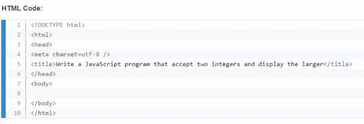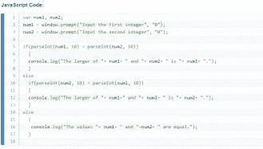

需要重要的是，可以在字符串后面编写 `.length` 来查找它的长度。

```javascript
let abc = "abc";
Console.log(abc.length); // → 3
```

## 第 4 章：函数

函数是 JavaScript 编程语言的起点和终，将部分程序封装在值中的概念具有许多优势。它提供了一种组织更重要程序的方法，以尽量减少重复，将名称与子程序相关联，并将程序与自身分离。函数被用于描述新的词汇。

### 定义函数

函数是一种系统性的绑定，其中函数定义了绑定值。下面的代码指示了一个提供给定数字平方的函数：

```javascript
const square = function(x) {
  return x * x;
};
Console.log(square(12)); // → 144
```

使用以 `function` 关键字开头的表达式创建一个函数。函数由函数体和一组参数组成，当你调用函数时，参数会适应待执行的语句。函数体应该始终包含在大括号中，即使它只是单条语句。函数可以包含多个参数或零参数。在下面的示例中，`make_noise` 不包含参数名，而 `power` 包含两个：

```javascript
const make_noise = function() {
  Console.log("pling!");
};
Make_noise(); // → pling!

const power = function(base, exponent) {
  let result = 1;
  for (let count = 0; count < exponent; count++) {
    result *= base;
  }
  return result;
};
Console.log(power(2, 10)); // → 1024
```

某些函数可以创建值（如 `square` 和 `power`），而某些结果只产生副作用。结尾不包含表达式的 `return` 关键字将返回 `undefined`。

### 绑定与作用域

每个绑定包含一个作用域，使得绑定可见。每当你调用函数时，都会产生绑定的新实例。这在函数之间创建了分离，每个函数调用都在自己的世界中运行，易于理解。在 2015 年之前的 JavaScript 中，用 `var` 关键字声明的函数可以在全局作用域范围内可见。它们在函数内部是不存在的。

```javascript
let x = 10;
if (true) {
  let y = 20;
  var z = 30;
  Console.log(x + y + z); // → 60
} // y 在这里不可

Console.log(x + z); // → 40
```

### 嵌套作用域

JavaScript 区分全局绑定和局部绑定。你可以在其他函数和块内部创建块和函数，从而不同程度的局部性。例如，这个函数产生了嵌套组件，使得 `hummus` 内部包含另一个函数：

```javascript
const hummus = function(factor) {
  const inner = function(amount, unit) {
    let amount = amount * factor;
    if (amount > 1) {
      unit += "s";
    }
    Console.log(`${amount} ${unit}`);
  };
  inner(1, "chickpeas");
  inner(0.25, "tahini");
  inner(0.25, "lemon juice");
  inner(1, "garlic");
  inner(2, "tablespoon olive oil");
  inner(0.5, "teaspoon");
};
```

组件函数内部的代码可以访问外部函数的 `factor` 绑定。块内可访问的绑定集由块在文本中的位置决定。每个局部作用域都可以访问其包含的作用域，每个作用域也可以访问全局作用域。这个概念被称为词法作用域。

### 作为值的函数

函数绑定通常为特定的程序块有一个名称。这种类型的绑定在定义后就不会改变。函数可以用于任意表达式，也可以用于将函数值保存到新的绑定中。存储存储函数的绑定是一种系统性绑定，可以分配新值，如：

```javascript
let launchmissiles = function() {
  Missilesystem.launch("now");
};
if (safe_mode) {
  Launchmissiles = function() { /* 什么都不做 */ };
}
```

### 声明语法

生成函数绑定的方法有一种。当你在语句开头使用 `function` 关键字时，它的功能会有不同。

```javascript
function square(x) {
  return x * x;
}
```

这条语句描述了绑定 `square` 并将其指向一个特定的函数。这种类型的函数定义由一个声明组成。

```javascript
Console.log("my mind tells me every time:", future());
function future() {
  return "ill surpass bill gates";
}
```

### 箭头函数

函数包含第三种表示法，与其他并不相同。你可以使用箭头 `=>` 作为 `function` 关键字的替代。箭头 `=>` 包含一个等号和一个大于字符。

```javascript
const power = (base, exponent) => {
  let result = 1;
  for (let count = 0; count < exponent; count++) {
    result *= base;
  }
  return result;
};
```

如果你只有一个参数，函数体是一个单一表达式而不是块，执行相同的任务。

```javascript
const square1 = (x) => {
  return x * x;
};
const square2 = x => x * x;
```

当箭头函数没有参数时，参数列表变为为空的括号。当只有一个参数时，括号可以省略。

```javascript
const horn = () => {
  Console.log("toot");
};
```

### 调用栈

让我们花点时间看看控制是如何通过函数的。下面是一个包含少量函数调用的简单程序：

```javascript
function greet(who) {
  Console.log("hello " + who);
}
greet("harry");
Console.log("bye");
```

`greet` 调用影响跳转到函数的开头。函数调用 `Console.log` 完成其工作并获取控制权，然后将控制权传回函数。函数周期结束并传回调用它的地方。控制流如下：

计算机必须收集调用序列发生的上下文，因为函数会返回到被调用的地方。当 `console.log` 完成时，它必须返回到程序的末尾。调用栈（call stack）是计算机存储这些上下文的地方。每当你调用一个函数时，当前的上下文就会保存在该栈的顶端。当函数返回时，它会移除顶部的上下文并利用该内容继续执行。

栈需要在计算机内存中要有空间来保存。下面的代码通过查询计算机解释了两个函数之间往返调用没有零限制。

```javascript
function chicken() {
  return egg();
}
function egg() {
  return chicken();
}
console.log(chicken() + " came first.");
// → ??
```

### 可选参数

下面的代码可以正常运行且互干扰：

```javascript
function square(x) {return x * x;}
console.log(square(4, true, "hedgehog"));
// → 16
```

`square` 被描述为一个参数，但我们调用它时传入了 `three`。这是因为编程语言忽略了多余的参数，并识别第一个参数的平方。JavaScript 对传递给函数的参数数量非常宽容。这种特性的优点是它允许用不同数量的参数调用函数：

```javascript
function minus(a, b) {
  if (b === undefined) return -a;
  else return a - b;
}
console.log(minus(10));
// → -10
```

```javascript
console.log(minus(10, 5));
// → 5
```

当在参数和表达式后编写 `=` 运算符时，该表达式的值将存储未指定的参数。如果你想传递但不产生第二个参数，那么默认值就变为二，函数表现得像 `square` 一样。

```javascript
function power(base, exponent = 2) {
  let result = 1;
  for (let count = 0; count < exponent; count++) {
    result *= base;
  }
  return result;
}
console.log(power(4));
// → 16
```

```javascript
console.log(power(2, 6));
// → 64
```

### 闭包 (Closure)

将函数作为值使用的能力，与每当你调用函数时都会重新创建局部绑定的事实密切相关。下面的代码展示了这个例子；它描述了一个包装值，该函数创建一个局部绑定，然后返回一个进入并返回局部绑定的函数。

```javascript
function wrap(n) {
  let local = n;
  return () => local;
}
let wrap1 = wrap(1);
let wrap2 = wrap(2);
console.log(wrap1()); // → 1
console.log(wrap2()); // → 2
```

这个概念被称为闭包。它赋予用户在限制性作用范围内引用局部绑定特定实例的能力。对我们之前的示例进行一些修改，可以变成一种开发可以任意数量累积函数的方法。

```javascript
function multiply(factor) {
  return number * factor;
}
let twice = multiply(2);
console.log(twice); // → 1010
```

### 递归

函数可以调用自己，但不应该经常地调用自己，以避免栈溢出。递归函数是调用它自身的函数。递归允许以不同的风格编写函数。例如，下面的代码是 `power` 的执行实现。

```javascript
function power(base, exponent) {
  if (exponent == 0) {
    return 1;
  } else {
    return base * power(base, exponent - 1);
  }
}
console.log(power(2, 3));
// → 8
```

这种执行存在一个问题：与其他循环版本相比，它更慢。使用单个循环被认为比多次调用函数成本更低。尽管这并没有让递归成为一种无效的循环方案，但某些问题用递归比用循环更容易解决。需要检查或处理多个分支的问题证明了这一点：我们从数字 1 开始，不断加 5 或乘以 3。例如，数字 13 可以通过乘以 3 和两次加 5 得到，但我们无法获得 15。代码是递归解决方案：

```javascript
function findsolution(target) {
  function find(current, history) {
    if (current == target) {
      return history;
    } else if (current > target) {
      return null;
    } else {
      return find(current + 5, `${history} + 5`) || find(current * 3, `${history} * 3`);
    }
  }
  return find(1, "1");
}
console.log(findsolution(24));
// → (((1 * 3) + 5) * 3)
```

内部函数 `find` 接受两个参数：当前数字 `current` 和一个记录获取该数字过程的字符串。如果找到了解决方案，它会返回一个显示通往 `target` 路径的字符串；如果没有解决方案，返回的值将是 `null`。为了实现这一点，函数执行三个动作之一。如果你的 `target` 等于 `current`，你就可以通过 `current` 得到该 `target`。

缩进指定调用栈的深度。

在字符串表达式后写入长度决定了该特定字符串的长度。循环继续在数字字符串的开头添加 0，直到它们包含三个字符。

这里有一个更好的尝试：

```javascript
function printzeraddedwithlabel(number, label) {
  let numberstring = string(number);
  while (numberstring.length < 3) {
    numberstring = "0" + numberstring;
  }
  Console.log(`${numberstring} ${label}`);
}
function printfarminventory(cows, chickens, pigs) {
  printzeraddedwithlabel(cows, "cows");
  printzeraddedwithlabel(chickens, "chickens");
  printzeraddedwithlabel(pigs, "pigs");
}
printfarminventory(7, 11, 3);
```

与其提取程序中重复的部分，不如通过以下步骤提取单个概念：

```javascript
function zeropad(number, width) {
  let string = string(number);
  while (string.length < width) {
    String = "0" + string;
  }
  return string;
}
function printfarminventory(cows, chickens, pigs) {
  Console.log(`${zeropad(cows, 3)} cows`);
  Console.log(`${zeropad(chickens, 3)} chickens`);
  Console.log(`${zeropad(pigs, 3)} pigs`);
}
printfarminventory(7, 16, 3);
```

函数也可以用于打印对齐的数字表格。

### 函数与副作用

函数可以包含副作用并返回值。与产生副作用的函数相比，它们产生的值可以更容易以新的方式进行整合。纯函数是一个唯一的值制造函数，它不依赖于任何代码副作用。例如，它不会识别具有可变值的全局绑定。它还由由一个可调用属性组成，具有相同的参数并产生相等的值。

## 总结

在本章中，你现在理解了如何编写函数。通过了如何编写 `function` 关键字以及何时使用表达式，你现在可以构建一个函数值。当你将函数作为状态时，它可以设置一个绑定并将函数命名为它的值。你还可以使用箭头函数来构建函数。

```javascript
// 定义 f 以持有函数值，
const f = function(a) {
  Console.log(a + 2);
};
// 声明 g 为函数
function g(a, b) {
  return a * b * 3.5;
}
// 一个更简洁的函数值，
let h = a => a % 3;
```

理解函数的主要视角是了解作用域。每个块都会创建一个新的作用域。在特定作用域设置的参数和绑定是局部的，从外部不可见。使用 `var` 设置的绑定作用不同，它们会导致全局作用域。将程序执行的任务区分不同的函数是很重要的。你不需要经常重复自己，函数可以通过将代码分类为执行特定操作的片段来安排程序。

### 练习

编写一个 javascript 程序来判断一个数字是否为偶数。

### 解决方案

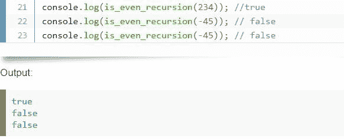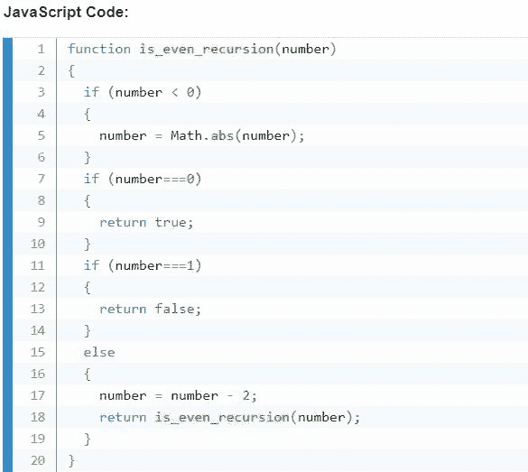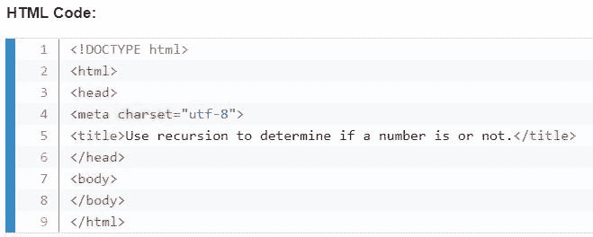

## 第 5 章：数据结构：对象和数组

数据布局从布尔值、字符串和数字片段发展而来。若干类型的信息使用多个块。对象允许用户将值与其他对象放在一起以开发更复杂的布局。在本章中，你将理解解决手头实际问题的概念。

### 数据集

如果你想处理大量的数字数据，你必须在机器内存中表示数字数据。例如，你需要表示一组数字，如 2, 3, 5, 7 和 11。现在让我们充分利用字符串，因为字符串可以包含大量数据。我们将使用 2 3 5 7 11 作为表示。javascript 编程语言提供了一种用于保存值序列唯一数据类型，称为数组。在括号内将数组写为值的列表。

```javascript
let numbers = [2, 3, 5, 7, 11];
Console.log(numbers[2]); // 5
Console.log(numbers[0]); // 2
Console.log(numbers[2 - 1]); // 7
```

用于获取数组内元素的符号也使用中括号。当你开始计算数组中的元素时，是从 0 开始而不是 1。

之前的章节具有如 `length`（计算数组长度）和 `max`（最大值）等属性。所有不包含值的属性都是 `undefined`。如果你访问不存在的属性，结果将是 `undefined`。

### 数组属性

评估属性的两种主要方法是 `.` 和 `[]`。如果你想评估如 `2` 或 `john doe` 的属性名，请使用括号：`value[2]` 或 `value["john doe"]`。

点符号法适用于有效的属性名。

```javascript
let array = "doh";
Console.log(array.length); // 3
```

每个字符串包含一个 `toUpperCase` 属性。当你调用此属性时，它会返回字符串的副本，其中所有的包含字母都转换成大写字母。尽管 `toUpperCase` 不接受参数，但该函数可以评估字符串 "doh"，这正是我们上面调用的值的属性。由函数组成的属性被称为方法。下面的示例说明了两个可以影响数组的方法。

```javascript
let sequence = [1, 2, 3];
sequence.push(4);
sequence.push(5);
console.log(sequence);
// → [1, 2, 3, 4, 5]
console.log(sequence.pop());
// → 5
console.log(sequence);
// → [1, 2, 3, 4]
```

`push` 方法用于将一个值添加到数组的末尾，而 `pop` 方法的操作则完全相反。它移除数组中的最后一个值并将其返回。这些是栈（stack）操作的通用术语。栈是一种数据结构，允许用户按顺序推入值并在相反的方向弹出值，以便添加的值最先移除。

### 对象

你可以将一组日志条目表示为数组，尽管每个字符串条目都需要保存一个活动列表，以及一个指定 jacques 是否变成了松鼠的布尔值。我们将这些分组为一个单个值，并将分组后的值放置在日志条目的数组中。属性的任意集合是类型 `object` 的值。我们将使用大括号作为表达式来开发一个对象。

```javascript
let day1 = {
  squirrel: false,
  events: ["work", "touched tree,", "pizza", "running"]
};
console.log(day1.squirrel);
// → false
console.log(day1.wolf);
// → undefined
day1.wolf = false;
console.log(day1.wolf);
// → false
```

大括号包含一个由逗号分隔的属性列表。每个属性包含一个名称、一个值和一个冒号。当你跨行编写对象时，请确保缩进良好，因为这可以提高可读性。无效的绑定名称属性或有效的数字应该加上引号。

```javascript
let descriptions = {
  Work: "went to work,",
  "touched tree,": "touched a tree."
};
```

你可以在 JavaScript 中以两种不同的方式使用大括号。它用于语句的开头，也可以用于开始一个语句块。你可以使用 `=` 运算符为属性指定值。它会占据属性值的位置，如果不存在，则会创建一个新的。`delete` 运算符是一个元运算符，用于删除对象的属性名。下面是一个示例：

```javascript
let object = {left: 1, right: 2};
console.log(object.left);
// → 1
delete object.left;
console.log(object.left);
// → undefined
console.log("left" in object);
// → false
console.log("right" in object);
// → true
```

二元操作判断对象或字符串是否包含某个属性。指定属性和删除属性之间的主要区别在于，对象包含属性，而删除后不再拥有该属性，因此返回 false。要确定对象中包含的属性，并返回一个包含对象属性名的字符串数组。

```javascript
console.log(object.key({x: 0, y: 0, c: 2}));
// → ["x", "y", "c"]
```

`object.assign` 函数用于将属性从一个对象复制到另一个对象。

```javascript
let cta = {a: 1, b: 2};
object.assign(cta, {b: 3, c: 4});
console.log(cta);
// {a: 1, b: 3, c: 4}
```

数组是一种用于保存连续事物的唯一对象。当你访问 `[]` 的类型时，它提供 "object."。下面的示例代表 jacques 存储为对象数组的日志。

```javascript
let journal = [
  {events: ["work", "touched tree,", "pizza", "running", "television"], squirrel: false},
  {events: ["work", "ice cream", "caiflower", "lasagna", "touched tree,", "brushed teeth"], squirrel: false},
  {events: ["weekend", "cycling", "break", "peanuts", "beer"], squirrel: true},
];
/* 等此类推... */
```

### 可变性

我们讨论了不同的值，如布尔值、字符串和数字，它们的值很难改变，尽管可以通过组合来从它们中获取新值。对象与值不同，它允许更改属性；它们可以在不同的时间为单个对象值创建不同的内容。当有两个数字 120 和 120 时，它们是相同的，区别在于两个独立的对象可以拥有相同的属性。检查以下代码：

```javascript
let object1 = {value: 10};
let object2 = object1;
let object3 = {value: 10};
console.log(object1 === object2);
// → true
console.log(object1 === object3);
// → false
object1.value = 15;
console.log(object2.value);
// → 15
console.log(object3.value);
// → 10
```

object1 的属性是相同的，但常量绑定不能更改。常量绑定指向同一个对象，但对象可以改变。

```javascript
const score = {visitors: 0};
console.log(score.visitors);
// → 0
score.visitors = 1;
console.log(score.visitors);
// → 1
```

`==` 运算符用于区分对象；如果对象包含相同的值，则返回 true，但引用多个对象将返回 false，即使它们的属性相似的。

相关性是对分析变量之间脆弱性的一种评估。它们的值范围从 -1 到 1。不相关的变量被称为零相关。相关性为 1 表示两者相关。负相关意味着变量之间相关，但方向相反；其中一个为真，另一个即为假。要计算两个布尔值之间相关性的评估，请使用 Phi 系数（phi coefficient，φ）。该公式的输入是一个频率表，记录了若干种变量组合出现的次数。公式的输出将是 -1 到 1 之间的数字。这是对相关性的最佳定义。

让我们以“吃披萨”这一事件为例，并将其插入频率表中，其中每个数字代表总次数，即我们在测量中使用的组合数。我们将表格命名为 `n`，并使用以下公式计算 `φ`：

```
Φ = N11n00 − n10n01 / √(N1•n0•n•1n•0)
```

符号 `n01` 表示第一个变量变为假（`0`）、第二个变量变为真（`1`）的测量次数。在披萨表中，`n01` 为 9。

值 `n1•` 表示所有第一个变量变为真的测量总和，在示例表中为 5。同样，`n•0` 表示第二个变量变为假的测量数量。

在披萨表中，除法线上方为 `1×76−4×9 = 40`，下方部分将是 `5×85×10×80` 的平方根，即 `√340000`。结果将是 `φ ≈ 0.069`，非常微小。因此，吃披萨对转换没有影响。

### 计算相关性

Javascript 允许表示一个二阶表格，使用四元素数组 `[76, 9, 4, 1]`。其他表示形式还包括包含两个双元素的数组 `[[76, 9], [4, 1]]`，或者包含如 "11" 和 "01" 等属性名称的对象，以及扁平数组，这些都会产生访问椅子短语的表达式。我们将数组的索引解释为二位二进制数，其中高位代表松鼠变量，而低位代表事件表。例如，二进制数 10 指的是“雅克变成松鼠”但事件未出现的情况。它发生了四次，二进制在十进制中是 2，该数字存储在数组的索引 2。此函数从数组计算 φ：

```javascript
function phi(chair) {
  return (chair[3] * chair[0] - chair[2] * chair[1]) / Math.sqrt((chair[2] + chair[3]) * (chair[1] + chair[3]) * (chair[0] + chair[2]));
}
```

表格需要两个字段来获取如 `n1•` 的字段，因为总行数和列数间接存储在我们的布局中。如果你想为特定事件提取二阶表格，必须遍历所有条目，并计算事件发生在松鼠转换的次数。

```javascript
function table_for(event, journal) {
  let table = [0, 0, 0, 0];
  for (let i = 0; i < journal.length; i++) {
    let entry = journal[i], index = 0;
    if (entry.events.includes(event)) index += 1;
    if (entry.squirrel) index += 2;
    table[index] += 1;
  }
  return table;
}
```

`console.log(table_for("pizza", journal)); // → [76, 9, 4, 1]` 数组包含一个 `include` 方法，用于检查数组中是否存在某个值。该函数使用此方法来判断事件名称是否插入了特定日的事件列表中。

### 数组循环

`table_for` 函数包含如下的循环：

```javascript
for (let i = 0; i < journal.length; i++) {
  let entry = journal[i];
  // 对 entry 执行某些操作
}
```

这种类型的循环用于高级 javascript。在现代 javascript 中编写这种循环的方式如下：

```javascript
for (let entry of journal) {
  console.log(`${entry.events.length} events.`);
}
```

使用这样的循环，循环将跨越 `of` 之后指定的值的元素进行。这种循环用于字符串和其他数据布局。

### 最终分析

为数据集中发生的每种类型的事件都计算相关性。如果你想实现这一点，请搜索每种类型的事件。

```javascript
function journalevents(journal) {
  let events = [];
  for (let entry of journal) {
    for (let event of entry.events) {
      if (!events.includes(event)) {
        events.push(event);
      }
    }
  }
  return events;
}
```

`console.log(journalevents(journal)); // → ["carrot", "exercise", "bread"]` 通过遍历每个事件并对不在数组中的事件进行加法，此函数收集了所有类型的事件。许多相关性似乎接近于零。吃胡萝卜或布丁并没有激活松鼠熵。它在周三（wends）发生。使用以下代码所有相关性。

```javascript
for (let event of journalevents(journal)) {
  console.log(event + ":", table_for(event, journal));
}
// → carrot: 0.01409709
// → exercise: 0.06859943
// → wend: 0.13719868
// → bread: -0.07575419
// → pudding: -0.06482037
// 等此类推...
```

让我们过滤结果，只显示大于 0.1 或小于 -0.1 的相关性。

```javascript
for (let event of journalevents(journal)) {
  let correlation = table_for(event, journal);
  if (correlation > 0.1 || correlation < -0.1) {
    console.log(event + ":", correlation);
  }
}
// → wend: 0.13719868
// → brushed teeth: -0.380521953
// → candy: 0.129640747
// → work: -0.13719868
// → spaghetti: 0.24253525
// → reading: 0.11062805
// → peanuts: 0.590267982
```

在相关性因子中，一个比另一个强。吃花生有很大概率变成松鼠，因此刷牙有显著的负面影响。这里有一点发现：

```javascript
for (let entry of journal) {
  if (entry.events.includes("peanuts") &&
!entry.events.includes("brushed teeth")) {
    entry.events.push("peanut teeth");
  }
}
console.log(table_for("peanut teeth", journal)); // → 1
```

### 进一步的数组学

这里有你应该了解的更多与相关的概念。我们从使用数组的一些实用方法开始。在数组开头添加和移除的方法被称为 `unshift` 和 `shift`。

```javascript
let todolist = [];
function remember(task) {
  todolist.push(task);
}
function getTask() {
  return todolist.shift();
}
function rememberUrgent(task) {
  Todolist.unshift(task);
}
```

上述程序组织了一个任务链。你可以通过调用 `remember("grieves")` 将任务添加到队列的末尾，当你想完成某项任务时，调用 `getttask()` 从队列中获取（并移除）项。如果你想搜索特定的值，数组提供了 `indexOf` 方法。`find` 方法从从头到尾遍历数组，并返回所请求值的索引（`index`），如果找到了，则返回该索引；如果没有找到，则返回 -1。若要从头到尾搜索，请使用 `lastindex` 方法。

```javascript
Console.log([1, 2, 3, 2, 4].indexOf(3));
// → 1
Console.log([1, 2, 3, 2, 4].lastindex(3));
// → 3
```

`indexOf` 和 `lastindex` 接受一个可选参数，指定搜索开始的位置。另一个很好的方法是 `slice`，该方法指定索引的起始和结束，并返回包含三个元素的数组。起始位置是包含的，而结束位置是不包含的。

```javascript
Console.log([0, 1, 2, 3, 5].slice(2, 4));
// → [2, 3]
Console.log([0, 1, 2, 3, 5].slice(2));
// → [2, 3, 5]
```

如果未指定结束索引，`slice` 将取起始索引之后的所有元素。你可以使用 `concat` 方法将数组拼接在一起以生成新数组。下面的示例展示了 `concat` 和 `slice` 的用法。

```javascript
function remove(arrays, index) {
  return array.slice(0, index).concat(arrays.slice(index + 1));
}
Console.log(remove(["a", "k", "c", "f", "e"], 2));
// → ["a", "k", "f", "e"]
```

### 字符串及其属性

在字符串值章节中，我们讨论了 `length` 和 `toupper`，但如果你想添加新属性，它是不会持久的。

```javascript
let kim = "kim";
Kim.age = 88;
Console.log(kim.age);
// → undefined
```

所有字符串值都包含一些方法。其中一些 `slice` 和 `indexOf` 方法在外观和名称上与数组方法相似。

```javascript
Console.log("coconuts".slice(4, 7));
// → nut
Console.log("coconut".indexOf("u"));
// → 5
```

字符串的 `indexOf` 可以查找包含多个字符的字符串，而对应的数组方法搜索的是单个元素。

```javascript
Console.log("one, two three,".indexOf("ee"));
// → 11
```

`trim` 方法可以消除字符串开头和结尾的空白字符。

```javascript
Console.log("  okay  \n  ".trim());
// → okay
```

`zeropad` 函数也可以称为 `padstart`，它接受首选的填充字符和长度作为参数。

```javascript
Console.log(string(6).padstart(3, "0"));
// → 006
```

你可以使用 `split` 在另一个字符串出现的地方将字符串拆分，然后使用 `join` 将它们连接在一起。

```javascript
let sentence = "secretarybirds specialize in stomping";
let words = sentence.split("  ");
Console.log(words);
// → ["secretarybirds", "specialize,", "in", "stomping"]
Console.log(words.join(".  "));
// → secretarybirds. specialize,. in. stomping
```

你可以使用 `repeat` 方法重复字符串，它会生成一个包含多个原始字符串副本的新字符串。

```javascript
Console.log("la".repeat(3));
// → lalala
```

如果你想访问字符串中的单个字符，请看下文：

```javascript
let string = "abc";
Console.log(string.length);
// → 3
Console.log(string[1]);
// → b
```

### 剩余参数

函数接收任意数量参数很重要。如果你想写这样的函数，在函数的最后一个参数之前添加三个点。

```javascript
function max (...numbers) {
  let result = -infinity;
  for (let number of numbers) {
    if (number > result) result = number;
  }
  return result;
}
Console.log(max(4, 1, 9, -2));
// → 9
```

当你调用函数时，剩余的参数属于一个包含剩余参数的数组。你也可以利用三个点来在数组内调用函数。

```javascript
let numbers = [5, 7];
Console.log(max(...numbers));
// → 7
```

扩展运算符可以将数组转换为新数组。

```javascript
let words = ["will", "fully"];
Console.log(...words);
// → will fully
```

`math` 对象用于整理大量值，它返回一个不带全局绑定的值。

```javascript
function point(radius) {
  let angle = math.random() * 2 * math.pi;
  return {
    x: radius * math.cos(angle),
    y: radius * math.sin(angle)
  };
}
Console.log(point(2));
// → {x: -0.67, y: 0.96}
```

`random` 方法返回一个零到一之间的值。

```javascript
Console.log(math.random());
// → 0.3699...
```

`floor` 方法将值向下取整到最近的整数。

```javascript
Console.log(floor(math.random() * 10));
// → 3
```

`ceil` 方法将值向上取整到最近的整数。

```javascript
Console.log(ceil(math.random() * 10));
// → 7
```

`round` 方法将值四舍五入到最近的整数。

```javascript
Console.log(round(math.random() * 10));
// → 5
```

`pow` 方法返回第一个参数的第二个参数幂。

```javascript
Console.log(pow(2, 3));
// → 8
```

`sqrt` 方法返回数字的平方根。

```javascript
Console.log(sqrt(16));
// → 4
```

`abs` 方法返回数字的绝对值。

```javascript
Console.log(abs(-5));
// → 5
```

`min` 方法返回多个数值中的最小值。

```javascript
Console.log(min(10, 5, 8));
// → 5
```

`max` 方法返回多个数值中的最大值。

```javascript
Console.log(max(10, 5, 8));
// → 10
```

`PI` 常量提供圆周率的值。

```javascript
Console.log(PI);
// → 3.14159...
```

`E` 常量提供自然数的值。

```javascript
Console.log(E);
// → 2.71828...
```

`log` 方法返回数字的自然对数。

```javascript
Console.log(log(10));
// → 2.302...
```

`log10` 方法返回以 10 为底的对数。

```javascript
Console.log(log10(100));
// → 2
```

`log2` 方法返回以 2 为底的对数。

```javascript
Console.log(log2(8));
// → 3
```

`tan` 方法返回弧角的正切值。

```javascript
Console.log(tan(PI/4));
// → 1
```

`sin` 方法返回弧角的正弦值。

```javascript
Console.log(sin(0));
// → 0
```

`cos` 方法返回弧角的余弦值。

```javascript
Console.log(cos(0));
// → 1
```

`atan` 方法返回弧角的正切值。

```javascript
Console.log(tan(PI/4));
// → 1
```

JSON 代表 JavaScript 对象表示法，它用于 Web 的通信格式和数据存储。JSON 在编写风格（数组和对象）上与 JavaScript 非常相似，尽管存在一些限制。它的属性名必须包含在双引号内，并且它只允许简单的数据表达式、绑定等。JSON 不允许注释。

这是一个用 JSON 数据表示的日志条示例：

```json
{
  "squirrel": false,
  "events": ["work", "touched tree,", "pizza", "running"]
}
```

JavaScript 包含 `json.stringify` 和 `json.parse` 两个函数，用于在该格式之间转换数据。`json.stringify` 接收一个 JavaScript 值并返回一个 JSON 编码的字符串，而 `json.parse` 接收一个字符串并将其转换为编码的值。

```javascript
let string = json.stringify({
  squirrel: false,
  Events: ["weekend"]
});
Console.log(string);
// → {"squirrel":false,"events":["weekend"]}
Console.log(json.parse(string).events);
// → ["weekend"]
```

### 反转数组

数组包含 `reverse` 方法，用于通过反转元素显示顺序来改变数组。

## 总结

我们在本章中涵盖了对象和数组，它们创建了在单个值中对各种值分类的方法。想象一下，这让你能够将几个关联项放入袋中并提着袋子移动，而不是用手臂抱住每一个单独的物品并试图将它们分开。JavaScript 中的许多值包含属性，其中不一致的情况是 `undefined` 和 `null`。你可以使用 `value.prop` 或 `value["prop"]` 访问属性。你可以为对象属性命名并保存一组定义的属性。数组也包含不同数量的相似虚拟值，并使用数字（从 0 开始）作为属性名。数组包含少数几个属性，即 `length` 和几个方法。方法是存储在属性中的函数，并对其作为属性的值执行操作。你可以通过一种特殊的 for 循环遍历数组——`for (the let element of an array)`。

### 练习

编写一个 JavaScript 函数来获取数组中的第一个项。设置参数 'n' 将返回数组的前 'n' 个元素。

数据：

```javascript
Console.log(array_clone([1, 2, 4, 0]));
Console.log(array_clone([1, 2, [4, 0]]));
// [1, 2, 4, 0]
// [1, 2, [4, 0]]
```

### 解决方案


## 第 6 章：高阶函数

大型程序的开发需要时间，并且产生很多漏洞，这反过来使得它们难以找到。这里有两个程序的示例：第一个是自包含的，状态有六行代码。

```javascript
let total = 0, count = 1;
While (count <= 10) {
  Total += count;
  Count += 1;
}
Console.log(total);
```

第二个依赖于外部函数，状态只有一行。

```javascript
Console.log(sum(range(1, 10)));
```

### 抽象

在涉及 JavaScript 语言时，词汇使用了“抽象”（abstraction）一词。抽象用于隐藏细节，并提供在更高层次讨论问题的能力。让我们区分两种汤的配方：第一：在容器内放入 1 杯干豌豆。加入足够的水没豌豆，浸泡 12 小时。从水中取出放入烹饪锅中，加入四杯水。煮沸约 2 小时，取半个洋葱，用刀切片并倒入豌豆中，准备 10 分钟。第二种配方：半个洋葱、一根芹菜、1 杯碎豆和一个胡萝卜。将豌豆浸在水中约 12 小时。在水（4 杯）中煮约 2 小时，加入并切蔬菜煮 10 分钟。计算机逐个执行任务，从盲目到高层概念。

### 抽象重复

普通函数用于创建抽象。程序重复指定次数的某个函数是一种习惯。你可以通过这样的循环来实现它：

```javascript
for (let i = 0; i < 10; i++) {
  Console.log(i);
}
```

在这里我们写了一个调用 `console.log` n 次的函数。

```javascript
function repeatlog(n) {
  for (let i = 0; i < n; i++) {
    Console.log(i);
  }
}
```

如果你想执行与记录数字不同的任务，可以将操作作为函数值传入。

```javascript
function repeat(n, action) {
  for (let i = 0; i < n; i++) {
    Action(i);
  }
}
repeat(3, console.log);
// → 0
// → 1
// → 2
```

有时你不需要传入操作，可以使用定义的函数作为重复循环的替代：

```javascript
let ls = [];
repeat(5, i => {
  ls.push(i + 1);
});
Console.log(ls);
// → ["1", "2", "3", "4", "5"]
```

这种方法看起来类似于循环；尽管循环体在函数内部。高阶函数是通过返回其他函数来作用作用函数。这种函数用于隐藏细节。例如，你有一个返回函数的函数：

```javascript
function greater(n) {
  return m => m > n;
}
let greater10 = greater(10);
Console.log(greater10(11));
// → true
Console.log(greater10(5));
// → false
```

高阶函数也可以接受函数作为参数。

```javascript
function filter(array, f) {
```

### 过滤数组

你也可以拥有转换其他函数的。

```javascript
function noisy(f) {
  return (...args) => {
    Console.log("calling with", args);
    let result = f(...args);
    Console.log("returned", result);
    return result;
  };
}
noisy(math.min)(3, 2, 1);
// → calling with [3, 2, 1]
// → returned 1
```

你还可以编写产生新控制流的函数。

```javascript
function unless(test, action) {
  if (!test) action();
}
repeat(3, n => {
  unless(n % 2 == 1, () => {
    Console.log(n, "is even");
  });
});
// → 0 is even
// → 2 is even
```

这种方法是一种内置数组方法 `foreach`，它作为高阶函数产生一个类似于 `for/of` 循环的循环。

```javascript
["a", "b"].forEach(l => Console.log(l));
// → a
// → b
```

```javascript
Console.log(filter(scripts, script => script.living));
// → [{name: "adlam", ...}, ...]
```

该函数利用名为 `test` 的参数（一个函数值）来填补计算过程中的空白。它决定了由哪个 `element` 来接收。

### 使用 map 进行转换

`map` 方法通过为数组的每一个元素设置一个函数来更改数组，并根据返回值创建一个新数组。新数组的长度与输入数组相同，但会通过函数将其内容映射为重命名的形式。

```javascript
Function map(array, transform) {
  let mapped = [];
  For (let element of array) {
    mapped.push(transform(element));
  }
  return mapped;
}
```

```javascript
let rtlscripts = scripts.filter(s => s.direction == "rtl");
Console.log(map(rtlscripts, s => s.name));
// → ["adlam", "arabic", "imperial aramaic", ...]
```

类似于 `foreach` 和 `filter`。

### 使用 reduce 进行汇总

当你累加数字时，从零开始并将每个 foreach 元素加到总和上。`reduce` 的参数是 `map` 函数组合和初始值。这个函数比 `filter` 和 `map` 更容易理解，如下：

```javascript
Function reduce(array, combine, begin) {
  let current = begin;
  For (let items of arrays) {
    existing = combine(existing, element);
  }
  return existing;
}
```

```javascript
Console.log(reduce([0,1, 2, 3, 4], (a, b) => a + b, 0));
// → 10
```

此函数与标准数组方法 `reduce`，并提供了更多的舒适性。

```javascript
Console.log([1, 2, 3, 4].reduce((a, b) => a + b));
// → 10
```

如果你想利用 `reduce` 来搜索字符更多的脚本，可以这样写：

```javascript
Function charactercount(script) {
  return script.ranges.reduce((count, [from, to]) => {
    return count + (to - from);
  }, 0);
}
```

```javascript
Console.log(scripts.reduce((a, b) => {
  return charactercount(a) < charactercount(b) ? b : a;
}));
// → {name: "han", ...}
```

### 可组合性

花点时间思考，如果没有高阶函数，我们的代码列表将会有多长。

```javascript
let biggest = null;
For (let script of scripts) {
  If (biggest == null ||
  charactercount(biggest) < charactercount(script)) {
    biggest = script;
  }
}
Console.log(biggest);
// → {name: "han", ...}
```

当你想组合操作时，可以使用高阶函数。例如，这里有一行代码用于搜索数据集中活体和死脚本的平均值。

```javascript
Function average(array) {
  return array.reduce((a, b) => a + b) / array.length;
}
Console.log(math.round(average(scripts.filter(s => s.living).map(s => s.length))));
// → 165
```

```javascript
Console.log(math.round(average(scripts.filter(s => !s.living).map(s => s.length))));
// → 204
```

这段代码显示死脚本比活脚本更老。让我们从过滤掉死脚本（或活脚本）开始，计算它们的平均值。你也可以将计算写在一个大循环中：

```javascript
let total = 0, count = 0;
For (let script of scripts) {
  If (script.living) {
    total += script.length;
    Count += 1;
  }
}
Console.log(math.round(total / count));
// → 165
```

我们的两个示例并不相同，第一个在执行 map 和 filter 时创建了新数组，而第二个计算数字。

### 字符串与字符编码

数据集的重要用途之一是找出文本块使用的脚本。以下是一个执行该任务的程序。每个脚本都包含与其相关的字符编码数组。因此，如果你有一个字符编码，可以使用此函数搜索对应的脚本（如果可用）：

```javascript
Function characterscript(code) {
  For (let script of scripts) {
    If (script.ranges.some(([from, to]) => {
      return code >= from && code < to;
    })) {
      return script;
    }
  }
  return null;
}
```

```javascript
Console.log(charactersscript(121));
// → {name: "latin", ...}
```

另一个高阶函数是相同的方法。此方法获取一个测试函数，并判断该函数是否对数组中的任何组件返回 true。javascript 字符串上有一些操作，例如使用 `length` 属性获取其长度，以及通过方括号评估其内容。

```javascript
// 两个 emoji 字符，马和鞋子
let horse_shoe = "🐴👟";
Console.log(horse_shoe.length);
// → 4
```

```javascript
Console.log(horse_shoe[0]);
// → (无效的半字符)
```

```javascript
Console.log(horse_shoe.charCodeAt(0));
// → 55357 (半字符的编码)
```

```javascript
Console.log(horse_shoe.codePointAt(0));
// → 128052 (马 emoji 的实际编码)
```

Javascript 的 `charCodeAt` 方法提供一个完整的 unicode 字符。此方法用于从字符串中提取字符。尽管发送给 `codePointAt` 的参数仍然是代码单元序列中的索引。如果你在跨字符串中使用 `codePointAt`，它会产生龙。

```javascript
let dragon = "🐉";
For (let char of dragon) {
  Console.log(char);
}
// → 🐉
```

`countby` 函数预期一个集合（一组）并返回一个对象列表。每个对象命名一个组，并确定该组中包含的元素数量。

```javascript
Function countby(items, groupname) {
  let counts = [];
  For (let item of items) {
    let name = groupname(item);
    let known = counts.find(c => c.name == name);
    if (known == -1) {
      counts.push({name, count: 0});
    } else {
      known.count++;
    }
  }
  return counts;
}
```

```javascript
Console.log(countby([0,1, 2, 3, 4, 5], n => n > 2));
// → [{name: false, count: 2}, {name: true, count: 3}]
```

`countby` 函数预期一个集合（一组）并正确确定文本块中哪种脚本。

```javascript
Function textscripts(text) {
  let scripts = countby(text, char => {
    let script = characterscript(char.codePointAt(0));
    return script ? script.name : "none";
  }).filter(({name}) => name != "none");
  let total = scripts.reduce((n, {count}) => n + count, 0);
  if (total == 0) return "no scripts found";
  return scripts.map(({name, count}) => {
    return `${math.round(count * 100 / total)}% ${name}`;
  }).join(", ");
}
```

```javascript
Console.log(textscripts('英国的狗说"woof", 俄罗斯的狗说"тяв"'));
```

`calculate` 函数通过使用 `characterscript` 绑定名称来按名称计算字符，对于没有任何脚本的字符，它返回字符串 "none"。如果你想计算百分比，你需要确定属于 `reduce` 方法可以还原的脚本字符总数。如果找到零个字符，该函数将返回 "none" 字符串。

## 总结

将函数值传递给多个函数的能力是 JavaScript 的一个至关重要的方面。它允许编写在之间存在“间隙”的模拟计算函数。声明这些函数的代码可以通过提供函数值来包含这些间隙。数组提供了几个重要的高阶方法。使用 `foreach` 遍历数组内的元素。使用 `filter` 方法返回一个包含符合谓词函数元素的新数组。使用 `map` 通过函数设置每个项来更改数组。使用 `reduce` 将数组的每个组件合并为一个单独值。

### 练习

阐述一个 JavaScript 函数，该函数接收一个保存的数字数组，并搜索第二低和第二高的数字。

### 解决方案

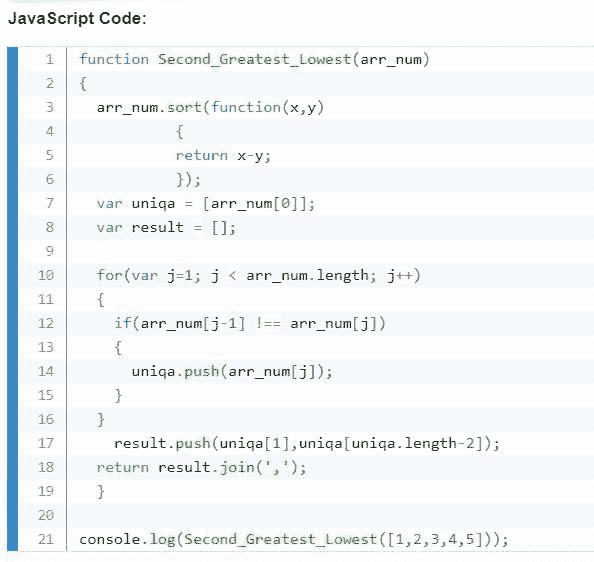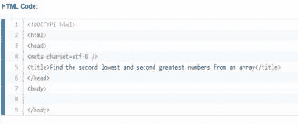

## 第 7 章：对象的秘密生活

在编程语言方面，有一组技术将对象作为程序组织的基本思想，它们被称为面向对象编程。这一概念在本章中进一步解释。

### 封装

面向对象编程的主要意义是将程序拆成小部分，并确保每个部分都管理自己的区域。几个类似的程序片段通过接口相互通信，接口是一组受限制的函数或绑定，在更高层次产生基本功能，同时隐藏特定的执行细节。通过对象说明这种类型的程序片段，它们的布局包含特定的属性和方法。布局中的属性是公共的，而外部代码是私有的。在注释或文档中定义可访问的布局。通常在属性名称开头使用下划线（`_`）字符表示私有属性。同时，将布局与执行分离被称为封装。

### 方法

方法是获取函数值的属性。

```javascript
let rabbit = {};
Rabbit.speak = function(line) {
  Console.log(`the rabbit says '${line}'`);
};
Rabbit.speak("i'm alive.");
// → the rabbit says 'i'm alive.'
```

当你将函数作为方法调用时，绑定会在其体内部调用它，并指向调用它的对象。

```javascript
function speak(line) {
  Console.log(`the ${this.type} rabbit says '${line}'`);
}
let white_rabbit = {type: "white", speak};
let hungryrabbit = {type: "hungry", speak};
White_rabbit.speak("oh my whiskers," + "how late it's getting!");
// → the white rabbit says 'oh my whiskers, how late it's getting!'
Hungryrabbit.speak("i could use a carrot right now.");
// → the hungry rabbit says 'i could use a carrot right now.'
```

箭头函数不绑定自己的 `this`。你可以编写以下代码：

```javascript
Function normal() {
  Console.log(this.coords.map(n => n / this.length));
}
Normal.call({coords: [0, 2, 3], length: 5});
// → [0, 0.4, 0.6]
```

### 原型

留意此点。

```javascript
let empty = {};
Console.log(empty.toString);
// → function toString() {}
Console.log(empty.toString());
// → [object Object]
```

属性是从对象中提取的。许多对象包含一个原型。这是属性的另一种来源。许多对象并不包含该属性，它们继承自原型。

```javascript
Console.log(Object.getPrototypeOf({}));
// Object.prototype
Console.log(Object.getPrototypeOf(null));
// → null
```

对象的原型是一个将对象转换为字符串的方法。许多对象并不包含该属性，它们继承自原型；函数继承自数组。

类的原型包含了通过它构建的实例中可用的方法。

```javascript
Console.log(Object.getPrototypeOf(Object.create({})) === Object.prototype);
// → true
Console.log(Object.getPrototypeOf([]));
// Array.prototype
```

对象的原型是一个返回对象原型的方法。

```javascript
let empty = {};
Console.log(Object.getPrototypeOf(empty));
// Object.prototype
```

对象的原型是一个返回对象原型的方法。

```javascript
let proto = {
  speak(line) {
    Console.log(`the ${this.type} rabbit says '${line}'`);
  }
};
let rabbit = Object.create(proto);
rabbit.type = "rabbit";
rabbit.speak("hello!");
// → the rabbit says 'hello!'
```

Javascript 类是带有原型和属性的构造函数。以下是一个示例：

```javascript
Class rabbit {
  Constructor(type) {
    this.type = type;
  }
  Speak(line) {
    console.log(`the ${this.type} rabbit says '${line}'`);
  }
}
let killerabbit = new rabbit("killer");
let blackrabbit = new rabbit("black");
```

`class` 关键字以 `class` 声明开始，它允许你在特定位置描述一个构造函数和一组方法。`class` 声明允许将包含函数的方法和属性捕获并包含在原型中。当你使用一个表达式时，它并不是描述一个绑定，而是将构造函数作为一个值。你可以在表达式中省略类名。

```javascript
let object = new class {getword() { return "hello"; } };
console.log(object.getword());
// → hello
```

### 覆盖派生属性

当一个属性被添加到对象时（无论在原型中是否可用），该属性都会被加到对象中。如果原型中存在一个同名的已赋值属性，它不会影响该对象。

```javascript
Rabbit.prototype.teeth = "small";
console.log(killerabbit.teeth);
// → small
killerabbit.teeth = "long, sharp, and bloody";
console.log(killerabbit.teeth);
// → long, sharp, and bloody
console.log(blackrabbit.teeth);
// → small
console.log(rabbit.prototype.teeth);
// → small
```

覆盖属性用于改进标准函数和数组原型提供一个独立的 `toString` 方法。

```javascript
console.log(array.prototype.toString == Object.prototype.toString);
// → false
console.log([1, 3].toString());
// → 1,3
```

在数组上调用 `toString` 存储的结果的结果类似于对它调用 `join(",")` 的结果。它会在数组包含的值之间放置一个逗号。如果你对数组调用 `object.prototype.toString`，它会提供一个独立的字符串。

```javascript
console.log(object.prototype.toString.call([1, 3]));
// → [object array]
```

### 映射 (Maps)

Map 是一种将值与其他值连接的数据布局。如果你想将名称映射到年龄，可以这样写代码：

```javascript
let ages = {
  Boris: 39,
  Liang: 22,
  Júlia: 62
};
console.log(`julia is ${ages["julia"]}`);
// → julia is 62
console.log("is jack's age, known?", "jack" in ages);
// → is jack's age, known? false
console.log("is tostring's age, known?", "tstring" in ages);
// → is tostring's age, known? true
```

对象的属性名应该是字符串。如果你想要一个键不会被转换为字符串的映射，不要使用 `object` 作为映射。Javascript 包含一个名为 `map` 的类。它保存映射关系并允许不同类型的键。

```javascript
let ages = new map();
ages.set("boris", 39);
ages.set("liang", 22);
ages.set("júlia", 62);
console.log(`jlia is ${ages.get("júlia")}`);
// → julia is 62
console.log("is jack's age, known?", ages.has("jack"));
// → is jack's age, known? false
console.log(ages.has("tstring"));
// → false
```

`get`、`set` 和 `has` 方法是 map 对象布局体。`object.keys` 只返回对象的键。你可以使用 `has` 方法作为选项。

```javascript
console.log({x: 1}.has("x")); // → true
console.log({x: 1}.has("toString")); // false
```

### 多态

当在对象上调用字符串函数时，会调用该对象上的 `toString` 方法来构建一个有意义的字符串。你可以定义自己的 `toString` 版本，以便它们可以构建包含比 "[object object]"更多数据的字符串。以下是一个插图：

```javascript
Rabbit.prototype.toString = function() {
  return `a ${this.type} rabbit`;
};
console.log(blackrabbit);
// → a black rabbit
```

Symbol 是通过 `symbol` 函数构建的唯一值，无法构建两次。

```javascript
let sym = symbol("name");
console.log(sym == symbol("name")); // false
Rabbit.prototype[sym] = 55;
console.log(blackrabbit[sym]); // → 55
```

传递给 `symbol` 的字符串在将其转换为字符串时会被附加。它们是作为属性名的函数。

```javascript
const toString = symbol("toString");
Array.prototype[toString] = function() {
  return `${this.length} cm of yarn`;
};
console.log([1, 2].toString()); // 1,2
console.log([1, 2][toString]()); // 2 cm of yarn
```

### 迭代器接口

传递给 `for/of` 循环的状态对象是迭代的。这意味着当属性被调用时，它包含一个带有 `symbol.iterator` 的命名方法。该方法返回一个产生第二个布局的对象，它包含一个 `next` 方法，用于发送下一个结果。结果是一个带有 `value` 属性的对象。查看这个布局：

```javascript
let iterator = "ok"[symbol.iterator]();
console.log(iterator.next()); // {value: "o", done: false}
console.log(iterator.next()); // {value: "k", done: false}
console.log(iterator.next()); // {value: undefined, done: true}
```

让我们实现一个迭代数据结构，我们将构建一个 `matrix` 类，作为一个二维数组：

```javascript
class matrix {
  Constructor(width, height, element = (x, y) => undefined) {
    this.width = width;
    this.height = height;
    this.content = [];
    for (let y = 0; y < height; y++) {
      for (let x = 0; x < width; x++) {
        this.content[y * width + x] = element(x, y);
      }
    }
  }
  get(x, y) {
    return this.content[y * width + x];
  }
  set(x, y, value) {
    this.content[y * width + x] = value;
  }
}
```

类的内容保在一个包含宽度 × 高度元素的独立数组中。这些元素按行保存。构造函数获取宽度、高度以及一个额外的元素函数，用于设置初始值。使用 `get` 方法和 `set` 方法来恢复和更新矩阵内的元素。以下是带有 x、y 和 value 属性的对象布局：

```javascript
class matrixiterator {
  Constructor(matrix) {
    this.x = 0;
    this.y = 0;
    this.matrix = matrix;
  }
  next() {
    if (this.y === this.matrix.height) {
      return {done: true};
    }
    let value = {
      x: this.x,
      y: this.y,
      value: this.matrix.get(this.x, this.y)
    };
    this.x++;
    if (this.x === this.matrix.width) {
      this.x = 0;
      this.y++;
    }
    return {value, done: false};
  }
}
```

下面是一个可迭代矩阵类的示例：

```javascript
Matrix.prototype[iterator] = function() {
  return new matrixiterator(this);
};
```

现在我们可以使用 `for/of` 来遍历矩阵了。

```javascript
let matrix = new matrix(2, 2, (x, y) => `value, ${x},${y}`);
for (let {x, y, value} of matrix) {
  Console.log(x, y, value);
}
// → 0 0 value, 0,0
// → 1 0 value, 1,0
// → 0 1 value, 0,1
// → 1 1 value, 1,1
```

### 静态 getter 和 setter

布局由方法组成，但你也可以附加存储值的非函数属性，就像一个 map 对象，包含一个 `size` 属性，该属性决定了保存了多少个键。被赋值的属性可以隐藏方法调用。这些方法被称为 getter（访问器），你可以通过在类声明或对象表达式的方法名开头编写 "get" 来描述它们。

```javascript
let varyingsize = {
  get size() {
    return math.floor(math.random() * 100);
  }
};
Console.log(varyingsize.size);
// → 73
Console.log(varyingsize.size);
// → 49
```

当你想要使用对象的 `size` 属性时，你会调用关联的方法。当你使用 setter 使用属性时，也可以执行类似的任务。

```javascript
Class temperature {
  Constructor(celsius) {
    this.celsius = celsius;
  }
  get fahrenheit() {
    return this.celsius * 1.8 + 32;
  }
  set fahrenheit(value) {
    this.celsius = (value - 32) / 1.8;
  }
  Static fromfahrenheit(value) {
    return new temperature((value - 32) / 1.8);
  }
}
```

```javascript
let temp = new temperature(22);
Console.log(temp.fahrenheit);
// → 71.6
temp.fahrenheit = 86;
Console.log(temp.celsius);
// → 30
```

`temperature` 类允许你读取和写入摄氏度或华氏度的温度，但它只保存摄氏度并在华氏度的 getter 和 setter 中与摄氏度转换。在类声明内部，写在名称之前的静态方法会被保存在构造函数上。因此，你可以编写 `temperature.fromfahrenheit(100)` 来通过华氏度构建温度。

### 继承

某些矩阵是对称的。当你通过左上到右下的对角线反射一个对称矩阵时，它不会改变。设置的值 x 与 y 保持相同。使用 JavaScript 的原型系统来构建新类，新类的元的从旧类继承，但为方法设置了新的定义。这被称为面向对象编程中的继承。下面是一个示例：

```javascript
Class symmetricmatrix extends matrix {
  Constructor(size, element = (x, y) => undefined) {
    Super(size, size, element);
  }
  get(x, y) {
    if (x < y) return Super(y, x);
    else return Super(x, y);
  }
  set(x, y, value) {
    Super(x, y, value);
    if (x != y) {
      Super(y, x, value);
    }
  }
}
let matrix = new symmetricmatrix(5, (x, y) => `${x},${y}`);
Console.log(matrix.get(2, 3));
// → 3,2
```

### instanceof 运算符

了解一个对象是否源自某个特定的实例是重要的。

```javascript
Console.log(new symmetricmatrix(2) instanceof symmetricmatrix);
// → true
Console.log(new symmetricmatrix(2) instanceof matrix);
// → true
Console.log(new matrix(2, 2) instanceof symmetricmatrix);
// → false
Console.log([1] instanceof array);
// → true
```

该运算符将扫描我们编写的类型。一个标准构造函数。

## 总结

在本章中，我们意识到对象不仅可以持有它们的属性。它们还由同样是对象的原型组成。只要原型拥有该属性，它们的行为就像它们包含了自身并不提供的属性一样。简单对象使用 `object.prototype` 来表示它们的原型。我们也讨论了构造函数，它们是函数，名称通常以大写字母开头，并配合 `new` 运算符来构建新对象。新对象的原型将是构造函数 `prototype` 属性中的对象。类语法提供了一种描述构造函数及其原型的方法。我们还接触了 getter、setter、静态方法以及 `instanceof` 运算符。

### 练习

编写一个 JavaScript 程序，通过迭代函数和一个主种子值创建一个数组。

### 解决方案


## 第 8 章：机器人

在本章中，将处理一个机器人程序，这是一个在虚拟世界中执行任务的短程序。我们将使用一个邮件快递机器人，接收并递送包裹。草地（the meadow）是一个由 4 个地方组成的小村。下面是一个带有数组的示例：

```javascript
Const roads = [
  "alice's house-bob's house",
  "bob's house-daria's house",
  "daria's house-rnie's house",
  "rnie's house-fahrenheit's house",
  "fahrenheit's house-shop",
  "shop-town hall"
];
```

草地场（the meadow field）是一个连接机器人行走的节点的图。

```javascript
Function buildgraph(roads) {
  let graph = {};
  function addge(from, to) {
    if (graph[from] == null) {
      graph[from] = [to];
    } else {
      graph[from].push(to);
    }
  }
  for (let [from, to] of roads.map(r => r.split("-"))) {
    addge(from, to);
    addge(to, from);
  }
  return graph;
}
Const roadgraph = buildgraph(roads);
```

```javascript
Move(destination) {
  if (!Roadgraph[this.place].includes(destination)) {
    return this;
  } else {
    let parcels = this.parcels.map(p => {
      if (p.place != this.place) return p;
      return {place: destination, address: p.address};
    }).filter(p => p.place != p.address);
    return new villagestate(destination, parcels);
  }
}
```

`move` 方法是动作中心。它检查是否存在从一个地方到另一个地方的路径，如果没有，则返回旧状态，因为该移动是无效的。然后它构建一个新状态，将目的地设置为机器人的新位置，并构建一组新的包裹。对 `map` 的调用处理了移动，对 `filter` 的调用处理了送递。

```javascript
let first = new villagestate(
  "post office",
  [{place: "post office", address: "alice's house"}]
);
let next = first.move("alice's house");
Console.log(next.place);
// → alice's house
Console.log(next.parcels);
// → []
Console.log(first.place);
// → post office
```

### 持久数据

不可更改的数据布局被称为不可变的（immutable）或持久的（persistent）。它们的作用就像字符串和数字。在 javascript 中，你可以改变几乎所有内容。有一个名为 `object.freeze` 的函数可以转换一个对象，使其忽略对其属性的写入。

```javascript
let object = object.freeze({value: 5});
object.value = 10;
Console.log(object.value);
// → 5
```

### 模拟

送货机器人会观察世界并决定它移动的方向。因此，机器人是一个函数，它接收一个 `villagestate` 对象并返回附近地方的名称。机器人返回一个包含其意图方向和记忆值的对象，当你下次调用它时会返回该记忆值。

```javascript
Function runrobot(state, robot, memory) {
  for (let turn = 0;; turn++) {
    if (state.parcels.length == 0) {
      Console.log(`done in ${turn} turns`);
      break;
    }
    let action = robot(state, memory);
    state = state.move(action.direction);
    memory = action.memory;
    Console.log(`moved to ${action.direction}`);
  }
}
```

机器人在每一都可以向不同的方向行走。它可以遇到所有包裹然后到达送货点。以下是一个示例：

```javascript
Function randompick(array) {
  let choice = math.floor(math.random() * array.length);
  return array[choice];
}
Function randomrobot(state) {
  return {direction: randompick(roadgraph[state.place])};
}
```

如果你想测试这个独特的机器人，请创建一个包含少量包裹的新状态。

```javascript
Villagestate.random = function(parcelcount = 5) {
  let parcels = [];
  for (let i = 0; i < parcelcount; i++) {
    let address = randompick(object.keys(roadgraph));
    let place;
    do {
      place = randompick(object.keys(roadgraph));
    } while (place == address);
    parcels.push({place, address});
  }
  return new villagestate("post office", parcels);
};
```

`do` 循环在获取正确地址时继续选择新地方。让我们启动一个虚拟世界吧。

```javascript
Runrobot(villagestate.random(), randomrobot);
// → 走到 mark
// → 走到 town hall
// → 在 63 个回合后运行
```

机器人运输包裹花费了太多回合，因为没有计划。如果你搜索一条经过村庄中所有地方的路线，邮件车的路线可能会机器人运行两次，但可以保证它会运行。以下是一个示例（从邮局开始）：

```javascript
Const mailroute = [
  "alice's house", "cabin", "alice's house", "bob's house",
  "town hall", "aria's house", "ernnie's house", "greete's house",
  "shop", "greete's house", "farm", "market", "post office"
];
```

要使用这条路线，你需要利用机器人记忆。机器人路线的其余部分存储在它的记忆中，并在每回合分发第一个。

```javascript
Function route(state, memory) {
  if (memory.length == 0) {
    memory = mailroute;
  }
  return {direction: memory[0], memory: memory.slice(1)};
}
```

机器人现在变快了。它最多需要 26 个回合（13 步路线的两倍），但通常更少。

### 路径查找

一种有趣的方法是从起点开始开发路线，并检查每个未访问过的可用地方，直到达到目标。下面的插解释了这一点：

```javascript
Function findroute(graph, from, to) {
  let work = [{at: from, route: []}];
  for (let i = 0; i < work.length; i++) {
    let {at, route} = work[i];
    for (let location of graph[at]) {
      if (location == to) return route.concat(location);
      if (!Work.some(w => w.at == location)) {
        Work.push({at: location, route: route.concat(location)});
      }
    }
  }
}
```

该函数保存了一个工作列表。这是一个将与路线一起检查的地点数组。它从空路线和起始位置开始。每个地方都可以从每个地方到达，在两个点之间也可以找到一条不会失败的路线。

```javascript
Function goalrobot({location, parcel}, routes) {
  if (route.length == 0) {
    let parcel = parcel[0];
    if (parcel.location != place) {
      route = findroute(roadgraph, location, parcel.place);
    } else {
      route = findroute(roadgraph, location, parcel.address);
    }
  }
  return {direction: routes[0], memory: route.slice(1)};
}
```

## 总结

在本章中，我们接触使用 javascript 的机器人。我们来到了草地村庄，在那里我们讨论了一个拥有 11 个地方和 14 条道路的村庄，然后我们到了持久数据，那里数据结构的行为类似于字符串且不会改变。模拟允许你将记忆传递给机器人并让它们返回新的记忆。

### 练习

编写一个简单的 javascript 程序，将下面数组中的每个元素连接成一个字符串。

"red, green, white, black"

"red, green, white, black"

"red+green+white+black"

### 答案


## 第 9 章：bug 和错误

计算机程序的缺陷被称为 bug，即计算机程序所犯的错误。

### 严格模式

你可以在严格模式下使用 javascript。这可以通过在文件最顶部添加字符串 "use strict" 来。下面是一个示例：

```javascript
Function canyousetheproblem() {
  "use strict";
  for (counter = 0; counter < 10; counter++) {
    Console.log("happy happy");
  }
}
```

`canyousetheproblem();` // → 引用错误：counter 未定义

当你想要调用构造函数而省略 `new` 关键字以免引入新创建的对象时，请使用下面的代码：

```javascript
Function person(name) {this.name = name;}
let ferdinand = person("ferdininand"); // 哎呀
Console.log(name); // → ferdininand
```

对 `person` 的伪调用执行成功，但返回一个未定义的值并创建了全局绑定名称。在严格模式下，使用 `"use strict";`。

```javascript
function person(name) {
  this.name = name;
}
let ferdininand = person("ferdininand"); // 忘记了 new
// → error: cannot set property 'name' of undefined
```

错误信息提示我们出问题了。这是好事。使用 class 语法构建的构造函数在你不带 `new` 运行它们时通常会报错。严格模式不允许设置名称相似的多个函数，并消除了某些语言问题。

### 测试

你可以使用这个函数来查找程序中的错误。这是通过反复运行来实现的。计算机在重复性任务中表现出色。这个过程被称为自动化测试。它涉及到编写一个测试另一个程序的程序。测试通常会通过一些带有标签的小程序来确定你代码的某部分是否正确。例如，让我们为 `toUpperCase` 方法创建一组测试。下面是一个示例：

```javascript
function test(label, body) {
  If (!Body()) console.log(`failed: ${label}`);
}
test("convert latin text to uppercase", () => {
  Return "hello".toUpperCase() == "hello";
});
test("convert greek text to uppercase", () => {
  Return "χαίρετε".toUpperCase() == "χαίρετε";
});
test("don't convert case-less characters", () => {
  Return "ࢎ࠶߈ఆ௷".toUpperCase() == "ࢎ࠶߈ఆ௷";
});
```

### 调试

当程序显示错误时，下一步是确定问题并修复。错误信息会直接指向你代码块中的某一行。查看错误描述，你就会发现问题所在。这个示例程序尝试通过不断提取最后一位并除以以消除该数字，在指定的进制（十进制、二进制等）内将整数转换为字符串。

```javascript
function numberToString(n, base = 10) {
  let result = "", sign = "";
  If (n < 0) {
    Sign = "-";
    N = -n;
  }
  Do {
    Result = string(n % base) + result;
    N /= base;
  } while (n > 0);
  Return sign + result;
}
console.log(numberToString(13, 10));
// → 1.5e-3231.3e-3221.3e-3211.3e-3201.3e-3191.3e-3181.3
```

如果你想获取有关执行的额外信息，在程序中添加一些 `console.log` 调用是非常佳的方法。我们想要获取值 13、1 和 0。我们应该在循环开始时记录值：

13
1.3
0.13
0.013…
1.5e-323

13 除以不会得到整数。与其使用 `n /= base`，我们需要的是 `n = math.floor(n / base)`，这样数字就可以向右“移动”。

指定断点的另一种极好的方法是在程序中插入调试状态（关键字）。如果你的浏览器处于激活状态，开发者工具将捕捉它并在执行到该语句时暂停程序。

### 异常

当一个函数无法继续执行时，异常处理是理解如何修复该问题的地方。异常是一种工具，允许遇到困难的代码块抛出异常，而异常可以是任何值。你可以刻意在你的代码行中创建问题，以便在调试过程中捕获异常，从而你可以使用它来解决问题并继续工作。这里有一个例子：

```javascript
function direction(question) {
  let result = prompt(question);
  If (result.toLowerCase() == "left") return "l";
  If (result.toLowerCase() == "right") return "r";
  Throw error("invalid direction: " + result);
}
function look() {
  If (prompt("which way?") == "l") {
    Return "a house";
  } else {
    Return "two bears";
  }
}
Try {
  console.log("you see", look());
} catch (e) {
  console.log("something went wrong: " + e);
}
```

使用 `throw` 关键字抛出异常。

### 异常后的清理

异常的影响是一种不同的控制流类型。这意味着你的代码可能有不同的影响，但异常可以阻止这些影响的发生。下面是一些糟糕的银行代码：

```javascript
Const accounts = {
  A: 100,
  B: 0,
  C: 20
};
function getaccount() {
  let account = prompt("enter an account");
  If (!Accounts.property(account)) {
    Throw error(`no such account: ${account}`);
  }
  return account;
}
function transfer(from, amount) {
  If (accounts[from] < amount) return;
  Accounts[from] -= amount;
  Accounts[getaccount()] += amount;
}
```

`transfer` 函数用于将特定金额从一个状态发送到另一个状态，同时要求另一个名称。如果你输入错误的账户名称，`getaccount` 会输出异常。如果钱已经从第一个账户发出，但在程序将钱转入另一个账户之前输出了异常，钱就会消失。利用 `finally` 块可以解决这个问题，如下：

```javascript
function transfer(from, amount) {
  If (accounts[from] < amount) return;
  let progress = 0;
  Try {
    Accounts[from] -= amount;
    progress = 1;
    Accounts[getaccount()] += amount;
    progress = 2;
  } finally {
    If (progress == 1) {
      Accounts[from] += amount;
    }
  }
}
```

### 选择性捕获

当异常到达代码块底部且没有错误时，它将由环境处理。无效的用法，例如在 null 上检查属性、引用不存在的绑定或调用非函数，将导致抛出异常。这些异常是可以捕获的。JavaScript 不支持对异常的选择性捕获。下面是一个示例尝试继续调用 `direction` 直到它提供有效答案：

```javascript
For (;;) {
  Try {
    let dir = promtdirection("where?"); // ← 拼写错误！
    console.log("you select ", dir);
    Break;
  } catch (e) {
    console.log("invalid direction. try again.");
  }
}
```

`for (;;)` 结构用于构建无法自行终止的循环。当你有一个有效方向时可以跳出循环，但写错误的 `promptdirection` 会输出未定义变量错误。如果你想捕获特定类型的异常，请在 catch 块中检查该异常是否是你想要的，并重新抛出它。让我们描述一种新错误并利用 `instanceof` 来识别它。

```javascript
Class inputerror extends error {}
function direction(question) {
  let result = prompt(question);
  If (result.toLowerCase() == "left") return "l";
  If (result.toLowerCase() == "right") return "r";
  throw new Error("invalid direction: " + result);
}
```

新的 `Error` 类扩展了错误。它没有描述自己的构造函数，而是继承了 `error` 构造函数，该构造函数预期一个我们可以识别的字符串消息。

现在循环可以更仔细地捕获这些错误。

```javascript
for (;;) {
  try {
    let dir = promptdirection("where?");
    console.log("you chose ", dir);
    break;
  } catch (e) {
    if (e instanceof inputerror) {
      console.log("invalid direction. try again.");
    } else {
      throw e;
    }
  }
}
```

## 总结

本章介绍了调试。编程中一个重要的部分是识别和修复错误。有时，你可以在本地解决问题。你可以通过特殊的返回值或使用异常来跟踪它们。

### 练习

修复下面的错误的代码并指出问题：

```javascript
for(var i=0; i > 5; i++){
console.log(i)
}
```

### 答案

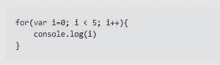

问题——循环内部条件错误。

## 第 10 章：正则表达式

编程概念和工具的发展是以一种无组织的方式进行的方式，但它的成功标志着一项卓越的技术。在本章中，我们将讨论正则表达式。它们用于在字符串数据中定义模式。它们创建了一种微小的、不同的语言，由 javascript 以及其他语言组成。

### 创建正则表达式

正则表达式通过 `regexp` 构造函数构建，或者被写为一个严格值，通过用正斜杠（`/`）字符包围模式来实现。

```javascript
let re1 = new RegExp("abc");
let re2 = /abc/;
```

这两个正则表达式对象代表相同的模式。当使用 `regexp` 构造函数时，将模式写为普通字符串，这样规则就会适用于反斜杠。

第二种表示法对反斜杠的影响不同，首先在任何正斜杠之前放一个反斜杠，因为模式显示在正斜杠字符之间。

#### 测试匹配

正则表达式对象包含几个方法，其中之一是 `test`。当你传递一个字符串时，它会返回一个布尔值，确定字符串是否包含表达式中模式的匹配项。

```javascript
console.log(/abc/.test("abcde"));
// → true
console.log(/abc/.test("abxde"));
// → false
```

正则表达式仅包含代表字符连续的非特殊字符。如果 abc 出现在字符串的任何地方，我们就在运行一个测试，测试将返回 true。

#### 字符集

正则表达式允许我们指示复杂的模式。如果你想在正则表达式中等于任何数字，请在方括号之间放置字符集。以下表达式等于数字内的每个字符串：

```javascript
console.log(/[0123456789]/.test("in 1992"));
// → true
console.log(/[0-9]/.test("in 1992"));
// → true
```

方括号内两个字符之间的连字符（`-`）用于指定字符范围，该字符的数字决定了从 0 到 9 紧邻相邻的字符（在这条命令中，代码为 48 到 57），因此 `[0-9]` 包裹了所有字符并等于任何数字。常用字符包含内置快捷方式。数字是以下部分的：`\d` 意味着与 `[0-9]` 完全相同。`\d` 数字，`\w` 字母数字字符（“单词”），`\s` 任何空白字符（空格、制表符、换行和类似的字符），`\D` 非数字，`\W` 非字母数字字符，`\S` 非空白字符。

使用下面的表达式匹配像 01-30-2003 15:20 的日期时间格式：

```javascript
let dateTime = /\d\d-\d\d-\d\d\d \d\d:\d\d/;
console.log(dateTime.test("01-30-2003 8:45"));
// → false
```

这些反斜杠也用于方括号内。例如，`[\d.]` 表示任何数字或句，但句与其他特殊字符（如 `+`）一样没有特殊意义。

```javascript
let not = /[⁰¹]/;
console.log(not.test("1101000100110"));
// → false
console.log(not.test("11010001020110"));
// → true
```

#### 重复模式部分

现在你已经完美理解了如何等于单个数字。如果你想匹配一个整数或多个数字的连续，请在正则表达式的输入后紧跟一个加号（`+`）。这表示该元素可以重复多次，`\d+` 等于一个或多个数字字符。

```javascript
console.log(/\d+/.test("123"));
// → true
console.log(/\d+/.test(""));
// → false
console.log(/\d*/.test("123"));
// → true
console.log(/\d*/.test(""));
// → true
```

星号（`*`）允许模式等于零。在下面的示例中，允许字符出现，但在未找到模式时模式也相等。

```javascript
let neighbour = /neighbour/;
console.log(neighbour.test("neighbour"));
// → true
console.log(neighbour.test("neighbour"));
// → true
```

要确定模式应该执行多少次，使用大括号，在元素后插入 `{4}`。如果你想让它精确执行四次，定义一个范围如下：

`{2,4}` 表示元素必须执行两次且最多四次。下面是另一个日期时间模式，它允许单位和双位的日期、月份和小时。

```javascript
let dateTime = /\d{0,2}-\d{1,2}-\d{4} \d{1,2}:\d{2}/;
console.log(dateTime.test("01-30-2003 8:45"));
// → true
```

### 分组表达式

如果你想对一个或多个元素使用运算符如 `*` 或 `+`，请使用括号。正则表达式的一部分（引用在括号内）只要涉及到运算符，就被视为一个整体。

```javascript
let cartoonrying = /boo+(hoo)+/i;
console.log(cartoonrying.test("booooohooo"));
// → true
```

第一个和第二个 `+` 字符分别适用于 `boo` 和 `hoo`。第三个 `+` 指向整个组 `(hoo+)`，多次。示例中第一个表达式结尾的 `i` 用于区分大小写，使其能够匹配输入字符串中的大写 `B`，尽管模式完全是小写。

#### 匹配与分组

`test` 方法是等于正则表达式的最佳方式，它仅确定是否匹配。正则表达式包含 `exec` 方法，如果找不到匹配项，它将输出 `null`，并返回一个包含匹配数据的对象。

```javascript
let match = /\d+/.exec("one two 100");
console.log(match);
// → ["100"]
console.log(match.index);
// → 8
```

来自正则的 `exec` 对象包含一个 `index` 属性，它决定了匹配项在字符串中的起始位置。以下是所需的数字序列：

`String` 类型值包含一个 `match` 方法，其行为类似。

```javascript
Console.log("one, two 100".match(/\d+/));
// → ["100"]
```

当正则表达式包含用括号括起来的子表达式时，匹配到的文本将显示在数组中。整个匹配项是第一个，下一个是第一个分组匹配的部分，然后是后续分组，以此此类推。

```javascript
let quoteText = /([^']*)'/;
Console.log(quoteText.exec("she said 'hello'"));
// → ["'hello'", "hello"]
```

当一个组没有完成匹配时（如果它包含问号），它会输出 `undefined`。当你多次匹配一个组时，只有最后一次匹配的结果会出现在数组中。

```javascript
Console.log(/bad(ly)?/.exec("bad"));
// → ["bad", undefined]
Console.log(/(\d)+/.exec("123"));
// → ["123", "3"]
```

### Date 类

Javascript 包含一个表示日期的标准类，称为 `Date`。如果你想利用 new 构建日期对象，首先获取当前的时间和日期。

```javascript
Console.log(new Date());
// → mon nov 11 2023 16:19:11 gmt+0100 (cet)
```

你也可以为特定时间构建对象。

```javascript
Console.log(new Date(2008, 11, 8));
// → wed dec 08 2008 00:00:00 gmt+0100 (cet)
Console.log(new Date(2008, 11, 9, 12, 59, 59, 999));
// → wed dec 08 2009 12:59:59 gmt+0100 (cet)
```

你应当遵循 javascript 的命名规范，其中月份数字从 0 开始（因此，12 月是 11），日期数字从 1 开始。

小时、分钟、秒和毫秒参数是可选的，在未指定时识别为零。时间戳以 UTC 时区的毫秒数保存，并遵循“Unix 时间”设定的约定。

```javascript
Console.log(new Date(2016, 11, 14).getTime());
// → 1445677600000
Console.log(new Date(1445677600000));
// → mon dec 11 2008 00:01:00 gmt+0100 (cet)
```

当日期构造函数设置单个参数时，该参数被识别为毫秒数。通过构建一个新的日期对象并在其上调用 `getTime`，或使用 `date.now` 函数来确定当前的毫秒数。`date` 对象产生如 `getDate`、`getHours`、`getFullYear`、`getMonth`、`getMinutes` 和 `getSeconds` 等方法来获取其组件。

```javascript
function getdate(strings) {
  let [_, month, day, year] =
    /(\d{01,2})-(\d{01,2})-(\d{4})/.exec(strings);
  return new Date(year, month - 1, day);
}
Console.log(getDate("1-30-2003"));
// → thursday jan 30 2003 00:00:00 gmt+0100 (cet)
```

### 字符串和单词边界

你可以通过添加标记 `^` 和 `$` 来确保匹配跨越整个字符串。脱符号表示输入字符串的开头，而美元符号表示结尾。因此，`/^\d+$/` 匹配包含一个或多个数字的字符串，`/^/` 匹配任何以叹号开头的字符串，而 `/x^/` 不匹配任何字符串。如果你想让日期在单词边界开始和结束，请利用 `\b`。单词边界可以是包含单词字符（`\w`）的字符串的一侧，而另一侧是非单词字符。

```javascript
Console.log(/cat/.test("concatenate"));
// → true
Console.log(/\cat\b/.test("concatenate"));
// → false
```

### 选择模式

如果你想知道一段文本是否由数字后跟如 pig 或 cow 这样的单词组成，让我们写三个正则表达式并测试它们。利用管道符（`|`）来标记左右侧之间的选择：

```javascript
let animalCount = /\b\d+ (pig|cows)?\b/;
Console.log(animalCount.test("15 pigs")); // true
Console.log(animalCount.test("15 cows")); // false
```

### replace 方法

字符串值包含一个 `replace` 方法，用于将字符串的一部分替换为另一个。第一个参数同样可以是正则表达式。如果你在表达式中添加 `g` 选项，字符串中的每个匹配项都将被替换，而不仅仅是第一个。

```javascript
Console.log("borudar".replace(/[ou]/, "a"));
// → barudar
Console.log("borudar".replace(/[ou]/g, "a"));
// → badadar
```

在 `replace` 中利用正则表达式的主要意义是因为它可以引用字符串中的匹配组。例如，你有一个包含人名的大字符串，使用 `format` 行，你也可以使用 `replace` 方法来更改和删除姓名。

利用以下代码：

```javascript
Console.log("liskov, barthy john".replace(/(\w+), (\w+)/g, "$2 $1"));
// → barthy john liskov
```

`$1` 和 `$2` 包含在文中，对应从第一个分组到 `$9`。每个匹配项都可以替换为 `$&`。你可以将函数而不是字符串作为第二个参数传递给 `replace`。对于每次替换，函数都会以匹配组作为参数调用，并将返回值包含在新字符串中。下面是一个示例：

```javascript
let s = "the cia and fbi";
Console.log(s.replace(/\b(fbi|cia)\b/g, str => str.toUpperCase()));
// → the CIA and FBI
```

这里更有趣的：

```javascript
let stock = "1 lemon, 2 cabbages, and 101 eggs";
function minusone(match, units) {
  let amount = Number(match) - 1;
  if (amount == 1) { // 只剩一个，移除 's'
    let unit = units.slice(0, units.length - 1);
  } else if (amount == 0) {
    amount = "no";
  }
  return amount + " " + units;
}
Console.log(stock.replace(/(\d+) (\w+)/g, minusone));
// → no lemon, 1 cabbage, and 100 eggs
```

### 贪婪模式

你可以使用 `replace` 写一个函数来消除 javascript 代码块中的所有注释。见下方：

```javascript
function stripComments(code) {
  return code.replace(/\/\/.*|\/\*[^]*\*\//g, "");
}
Console.log(stripComments("1 + /* 2 */3")); // → 1 + 3
Console.log(stripComments("x = 10;// ten!")); // → x = 10;
Console.log(stripComments("1 /* a */+/* b */ 1")); // → 1 1
```

或运算符之前的部分匹配两个斜杠字符，后面带有任何非换行符的字符。使用 `[^]` 匹配任何字符。

重复操作符（`+`、`*` 和 `{}`）是贪婪的，这意味着它们会尽可能多地匹配，也可以进行回溯。如果在它们后面放置一个问号（`+?`、`*?`、`??`、`{}?`），贪婪性就会消失，并开始尽可能少地匹配。带来 `*/` 的最小字符范围是星号匹配。它只吸收一个块注释。

```javascript
function stripcomments(code) {
  return code.replace(/\/\/.*|\/\*[^]*?\*\//g, "");
}
Console.log(stripcomments("1  /* a */+/* b */  1"));
// → 1 + 1
```

### 动态创建正则对象

在编写代码时，在某些情况下，你可能无法确定应该匹配的具体模式。如果你想在一段文本中搜索用户名，并将其包裹在下划线字符中以使其唯一，但你可以创建一个字符串并利用 `RegExp` 构造函数。下面是一个示例：

```javascript
let name = "harry";
let text = "harry is a suspicious character.";
let regex = new RegExp("\\b(" + name + ")\\b", "gi");
Console.log(text.replace(regex, "_$1_"));
// → _harry_ is a suspicious character.
```

如果你想构建 `\b` 边界标记，请使用双反斜杠，因为你在普通字符串中编写它们。`RegExp` 构造函数的第二个参数由正则表达式所需的选项组成。`"gi"` 代表全局匹配和不区分大小写。下面是一个示例：

```javascript
let name = "dea+hl[]rd";
let text = "this dea+hl[]rd guy is super annoying.";
let escaped = name.replace(/[\.+.+?(){|^$]/g, "\\$&");
let regex = new RegExp("\\b" + escaped + "\\b", "gi");
Console.log(text.replace(regex, "_$&_"));
// → this _dea+hl[]rd_ guy is very annoying.
```

### search 方法

你不能直接在正则表达式上调用字符串的 `indexOf` 方法。你可以使用另一个方法 `search`，你可以在其中对正则表达式调用 `indexOf` 方法，它会返回第一次看到该表达式的索引，如果没有看到，则返回 -1。

```javascript
Console.log("  word".search(/\s/));
// → 2
Console.log("  ".search(/\s/));
// → -1
```

### lastIndex 属性

`exec` 方法并没有提供一种更好的方法从字符串的指定位置开始搜索。正则表达式对象包含属性。其中一个属性是 `source`，它由构建表达式的字符串组成。`lastIndex` 是另一个属性，它影响下一次匹配开始的某些细微情况。正则表达式必须包含全局 (`g`) 或粘性 (`y`) 选项，并且将使用 `exec` 方法进行匹配。下例所示：

```javascript
let pattern = /y/g;
pattern.lastIndex = 3;
let match = pattern.exec("xyz");
Console.log(match.index); // → 4
Console.log(pattern.lastIndex); // → 5
```

全局选项和粘性选项之间的区别在于：如果你启用了粘性，如果匹配从 `lastIndex` 开始，则匹配成功；而在全局模式下，它会找到一个可以开始匹配的位置。

```javascript
let global = /abc/g;
Console.log(global.exec("abc")); // ["abc"]
let sticky = /abc/y;
Console.log(sticky.exec("abc")); // null
```

如果你在多次调用中共享一个正则表达式值，那么 `lastIndex` 属性的自动更新将会出现问题。

```javascript
let digit = /\d/g;
Console.log(digit.exec("it is here: 1")); // ["1"]
Console.log(digit.exec("and now: 1")); // null
```

最好的做法是遍历字符串中模式的所有事件，并在循环体中访问匹配对象。使用 `lastIndex` 来实现这一点。

```javascript
let input = "a string with three numbers...42 and 88.";
let number = /\d+\b/g;
let match;
while (match = number.exec(input)) {
  Console.log(match[0], "at", match.index);
}
// found 42 at 14
// found 88 at 33
```

赋值值 (`=`) 是指定的值，因此在 `while` 状态中使用 `match = number.exec(input)` 作为条件，匹配会在每次迭代开始时执行匹配，将结果存储在绑定中，并在无法找到更多匹配时停止循环。

### 解析 ini 文件

```ini
engine=https://duckduckgo.com/?Q=$1
fullness=9.7; comments are preceded by a semicolon; each section concerns an individual

[larry]
Name=lar doe
Type=kinder bully
Website=http://www.google.com/google/

[dea]
Name=dea
Type=evil witch
OutputDir=/home/margin/dea
```

这种格式（一种通用格式，通常称为 ini 文件）的规则是：

- 忽略空行和以分号开头的行。
- `[]` 包裹的行开始一个新节。
- 由字母数字标识符配合 `=` 字符组成的行将设置附加到当前节。
- 其他所有内容都是无效的。

我们这里的任务是将这样的字符串转换为对象，其中属性使用字符串存储在节对象之前的之前的设置。子对象持有该节的设置。使用回车符加换行符 (`\r\n`) 而不是单纯的换行符来区分行。这将使得 `split` 方法能够接受正则表达式作为参数，你可以利用正则表达式 `/\r?\n/` 来划分行之间的 `\n` 和 `\r\n`。

```javascript
function ini(string) {
  // 开始一个对象来持有顶层字段
  let result = {};
  let section = result;
  String.split(/\r?\n/).forEach(line => {
    let match;
    if (match = line.match(/^(\w+)=(.*)$/)) {
      section[match[1]] = match[2];
    } else if (match = line.match(/^\[(.*)\]$/)) {
      section = result[match[1]] = {};
    } else if (!/^\s*(;)?$/.test(line)) {
      throw new Error("line '" + line + "' invalid.");
    }
  });
  return result;
}
Console.log(parseini(`
engine=https://duckduckgo.com/?Q=$1
fullness=9.7; comments are preceded by a semicolon; each section concerns an individual

[larry]
Name=lar doe
Type=kinder bully
Website=http://www.google.com/google/

[dea]
Name=dea
Type=evil witch
OutputDir=/home/margin/dea`));
// → {engine: "https://duckduckgo.com/?Q=$1", fullness: "9.7", larry: {Name: "lar doe", Type: "kinder bully", Website: "http://www.google.com/google/"}, dea: {Name: "dea", Type: "evil witch", OutputDir: "/home/margin/dea"}}
```

代码进会跨文件行保存并创建对象。顶部的属性直接保存到该对象中，而位于章节中的属性则保存在不同的章节对象中。章节绑定（section binding）指向现有章节的对象。重要的行有两种类型——章节头或属性行。如果某行始终是属性，则将其保存在现有的章节中；如果它是一个章节头，则构建一个新的章节对象，并将 `section` 设置它。

模式 `if (match = string.match())` 与利用赋值作为 `while` 循环条件的技巧是完全相同的。

### 国际字符

由于 JavaScript 初始实现非常简单，且这种方法已被确立为标准行为，JavaScript 的正则表达式在处理英语语言中未显示的字符时显得有些“愚笨”。例如，在 JavaScript 中，正则表达式中的“单词字符”（word character）仅仅是拉丁字母表中的 26 个字符之一（小写或大写）、进制数字和下划线字符。像 `é` 或 `ß` 这样的字符也是单词字符，但它们不会匹配 `\w`，而是会匹配大写的 `\W`（非单词字符）。这表示这些字符是由两个代码单元组成的。

```javascript
Console.log(/🍎{3}/.test("🍎🍎🍎"));
// → false
Console.log(/<.>/.test("<🌹>"));
// → false
Console.log(/<.>/u.test("<🌹>"));
// → true
```

这里识别出的问题是，第一行中的 `🍎` 被视为两个代码单元，而 `{3}` 部分仅作用于第二个单元。点号 `.` 也只匹配单个代码单元。在你的正则表达式中添加 `u` 选项（代表 Unicode），以便它能正确处理这些字符。遗憾的是，这种错误的行为仍被设置为默认值，因为更改它可能会为依赖于它的现有代码创建问题。

你可以在正则表达式中使用 `\p` 来匹配 Unicode 标准赋予任何集合属性的每一个字符。

```javascript
Console.log(/\p{script=greek}/u.test("α"));
// → true
Console.log(/\p{script=arabic}/u.test("α"));
// → false
Console.log(/\p{alphabetic}/u.test("α"));
// → true
Console.log(/\p{alphabetic}/u.test("!"));
// → false
```

Unicode 描述了许多重要的属性，尽管寻找你需要的属性并不总是易的。

## 总结

我们在本章中关注了正则表达式。代表字符串中模式的对象就是正则表达式。它们由语言组成并利用它来展示模式。

- `/abc/` 字符序列
- `[abc]` 范围内的字符
- `[^abc]` 范围外的任何字符
- `[0-9]` 字符集内的任何字符
- `+` 模式一次或多次出现
- `+?` 一次或多次（非贪婪）
- `*` 零或多次出现
- `?` 零或一次出现
- `{2,4}` 二到四次
- `(abc)` 分组
- `a|b|c` 各种模式中的任意一个
- `\d` 任意数字字符
- `\w` 单词字符
- `\s` 任意空格字符
- `.` 除换行外的任何字符
- `\b` 单词边界
- `^` 输入开始
- `$` 输入结束

正则表达式包含一个 `test` 方法来检查字符串是否匹配它。它还包含一个 `exec` 方法，用于查找匹配并返回一个包含每个分组的数组。这种类型的数组包含一个 `index` 属性，指定匹配开始的位置。字符串使用匹配方法来与正则表达式进行匹配，并使用搜索方法来查找，后者仅返回匹配的起始位置。

### 练习

编写一个利用正则表达式实现 `trim(string)` 的 JavaScript 程序。

### 解答

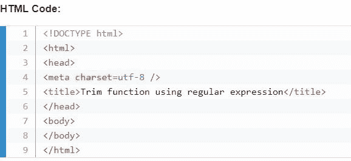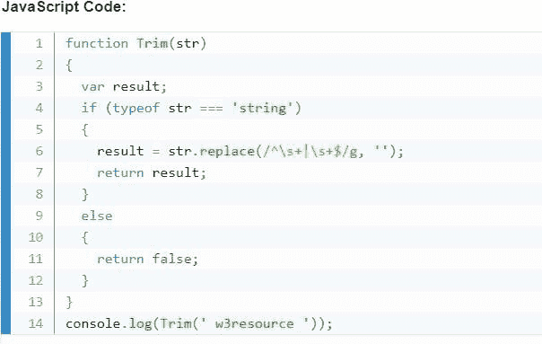

## 第 11 章：模块 (modules)

这个特定的程序布局简单。解释它的概念很容易，每个部分都起着精确的作用。布局的组织和维护可能会花费更多工作，但最终在未来某人使用该程序时会回报。因此，你可能会倾向于忽略它并让程序部分变得交织在一起，这将产生两个实际问题：首先，当所有事物都相互接触时，很难单独观察任何部分。你必须对整个程序有一个全面的理解。其次，在不同情况下使用程序中的任何功能时，你可以重写它，而不是将其从上下解耦。

### 模块

模块是一种程序类型，它决定了应该依赖哪些部分，以及它应该产生哪些功能供其他部分利用。通过对模块设置限制，系统等同于模块如何通信依赖。当一个模块想要另一个模块的部分时，它就依赖于该模块。模块说明了这一点，并且每个模块都需要自己的作用域将自己与其他模块隔离开。

在 2015 年之前，javascript 语言并不包含内置的模块系统，但人们已经使用 javascript 构建了十多年的大型系统，它们需要模块。他们开发了自己的模块系统并将其集成到语言中。你可以利用 javascript 函数来构建局部作用域和对象来代表模块布局。使用此模块可以在星期名称和数字之间进行转换。它的布局包含星期几名称和星期几数字，并将局部绑定名称隐藏在函数作用域内。

该表达式会被立即调用。

```javascript
const weekday = function() {
  const names = ["sunday", "monday", "tuesday", "wednesday", "thursday", "friday", "saturday"];
  return {
    name(number) {return names[number];},
    number(name) {return names.indexOf(name);}
  };
}();
Console.log(weekday.name(weekday.number("sunday")));
// → sunday
```

这种风格的模块并不声明依赖。它们将布局放在全局作用域中。这种模块在一定程度上提供了隔离，但它并没有声明依赖。相反，它只是将自己的接口放入全局作用域，并等待它的依赖（如果有的话）也执行同样的操作。

### 将数据作为代码评估

有不同的方法可以获取数据并作为现有程序的一部分启动。最好的方法是利用唯一的运算符 `eval`，它会影响现有作用域中的字符串。

```javascript
const x = 1;
function evalandreturnx(code) {
  eval(code);
  return x;
}
Console.log(evalandreturnx("var x = 2"));
// → 2
Console.log(x);
// → 1
```

另一种解释解释数据为代码的方法是使用函数构造函数。它接受两种类型的参数：一个带有逗号分隔的参数名列表的字符串，以及一个包含函数体的字符串。它将代码封装在一个函数值中，使其能够获得它自己的作用域。

```javascript
let plusone = function("n", "return n + 1;");
Console.log(plusone(4));
// → 5
```

你可以将模块代码封装在一个函数中，并利用该函数作用域作为模块作用域。

### Commonjs

处理 javascript 模块常用的方法是 Commonjs 模块。node.js 使用这种方法，npm 上的许多包也是如此。Commonjs 模块的核心思想是名为 `require` 的函数。如果你调用此函数并传入依赖的模块名称，它会加载该模块并返回其接口。加载器将模块代码封装在一个函数中，模块自动拥有它们的局部作用域。你可以调用 `require` 来查看它们的依赖，并将它们的布局放在导出它们的对象中。

这个示例模块提供了一个日期格式化函数。它利用了 npm 的两个包：`ordinal` 用于将数字转换为如 "1st" 和 "2nd" 的字符串，`date-names` 用于获取月份和星期的英文名称。它导出一个单一函数 `format`，该函数接受一个模板字符串和一个日期对象。模板字符串可以包含控制格式的代码，例如 yyyy（完整年份）和用于月份的序数日。你可以给它设置一个字符串如 `mmmm yyyy` 以得到类似 `2nd 2013` 的输出。

```javascript
const ordinal = require("ordinal");
const {days} = require("date-names");
exports.format = function(date, format) {
  return format.replace(/yyyy|m|mmmm|d|dd/g, tag => {
    if (tag == "yyyy") return date.getFullYear();
    if (tag == "m") return date.getMonth();
    if (tag == "mmmm") return months[date.getMonth()];
    if (tag == "d") return date.getDate();
    if (tag == "dd") return days[date.getDate()];
  });
};
```

ordinal 的布局是一个单一函数，而 date-names 导出一个包含多个其他内容的对象，months 和 days 是名称数组。构建导入的布局结构非常简单。模块将它的布局函数附加到 `exports` 上，以便依赖它的模块可以访问它。像这样使用该模块：

```javascript
const {format} = require("./format-date");
Console.log(format(new date(2017, 9, 13), "dd"));
// → friday the 13
```

我们可以像这样定义最简单形式的 `require`：

```javascript
require.cache = object.create(null);
function require(name) {
  if (!(name in require.cache)) {
    let code = readfile(name);
    let module = {exports: {}};
    require.cache[name] = module;
    let wrapper = function(require, exports, module) {};
    wrapper(require, module.exports, module);
  }
  return require.cache[name].exports;
}
```

在此代码中，`readFile` 是一个读取文件并将其内容作为字符串返回的强大函数。标准 javascript 不提供此类功能，但 node.js 等其他环境提供了访问文件的独特方式。上面的示例证明了 `readFile` 的存在。为了避免重复加载同一个模块，你需要一个已加载模块的存储（缓存）。如果被调用，它会检查请求的模块是否加载，如果没有，则加载它。它需要读取模块代码，将其封装在函数内部并调用它。之前的 `ordinal` 包布局是一个函数而不是对象。Commonjs 模块使用模块系统为你创建一个空的布局对象供你导出，通过重写 `module.exports` 用值来存储它。模块这样做是为了导出单个值而不是布局对象。通过将 `exports`、`require` 和 `module` 描述为创建的封装函数的参数（并在调用时设置正确的值），加载器确保了这些绑定在模块作用域内是可用的。传递给 `require` 的字符串在不同的系统中会被解释为文件名或 Web 网络地址。当它以 "./" 或 "/" 开头时，通常被翻译为相对于现有模块的文件名的路径。所以 "./format-date" 将是同目录下的 `format-date.js` 文件。

### ES modules

Commonjs 模块在与 `npm` 结合时表现良好，它们让 JavaScript 社区能够开始大规模地共享代码。这种语法非常奇怪。添加到 `exports` 中的内容在局部作用域内是不可见的。在不运行模块代码的情况下，在传入任何参数之前很难确定它的依赖关系。这就是 JavaScript 标准建立自己的独立模块系统的原因。它被称为 `es modules`，其中 `es` 代表 `ecmascript`。依赖和接口的初始想法不变，但细节有所不同。这种语法集成到了语言中。你现在可以使用一个唯一的 `import` 关键字来访问依赖，而不是调用函数。

```javascript
Import ordinal from "ordinal";
Import {days, months} from "date-names";
Export function formatdate(date, format) { /* ... */ }
```

使用 `export` 关键字来导出内容。它可以显示在类、函数或绑定定义（如 `const` 或 `var`）的前面。`es` 模块的布局表示的单个值，而是一组命名绑定。上一个模块将 `formatdate` 附加到函数上。如果你从不同的模块导入，该绑定会随之而来，而不是值，这意味着导出模块的值可以随时更改绑定，而导入模块将识别出它的新值。如果绑定命名为 `default`，则会被识别为模块的主要导出值。如果一个模块（如示例中的 `ordinal` 导入）省略了绑定名称两侧的大括号，你将找到它的默认绑定。要开发默认导出，在表达式、类或函数声明之前编写 `export default`。

```javascript
Export default ["winter", "spring", "summer", "autumn"];
```

你可以使用如下单词来重命名导入的绑定。

```javascript
Import {days as daynames} from "date-names";
Console.log(daynames.length);
// → 7
```

另一个主要区别是 `es` 模块的导入发生在模块脚本开始运行之前。`import` 声明可能不会显示在函数或块内部，且依赖项名称应该是引用字符串，而不是任意表达式。许多项目是通过 `es modules` 编写的，并在发布时更改为其他格式。在过渡期间，请并排使用两个独立的模块系统。

### 模块设计

程序结构化是编程的优秀特性之一。任何功能都可以以不同的方式建模。良好的设计是个性化的，这取决于喜好。要理解组织良好的设计的价值，你需要阅读并处理几个程序，并注意性能良好和不佳的函数。模块设计直观易用。`ini` 包遵循标准 `object` 规范，通过提供 `stringify` 和 `parse`（用于写入文件）并像 `json` 一样在对象和字符串之间转换。许多文件解析模块提供了一个函数，可以从硬盘读取该类型的文件并进行解析。计算值的集中模块在很大范围的程序中比执行具有副作用的操作的模块更合适。如果文件内容来自另一个源，则文件读取器没有用处。同样，有状态的对象有时是必要且实用的，但如果你可以使用它们的话。各种文件读取器提供了一种布局样式，需要你将文件构建到对象中，并使用特定方法实现所需的结果。这是面向对象的风格和传统。在 JavaScript 中，没有表示图的特殊方法。npm 上有各种路径查找包，但没有一个利用了图的格式。它们通常允许边包含一个权重，即与此相关的距离或成本。例如，我们有 `dijkstrajs` 包。一种公认的与 `findroute` 函数相关的路径查找方法是先使用 `dijkstra` 包后使用 dijkstra 算法。`js` 后缀通常附加在包名上，以指定你可以用 JavaScript。所以，如果你想使用该包，请确保图以其预期的格式保存。

```javascript
Const {find_path} = require("dijkstrajs");
let graph = {};
for (let node of object.keys(roadgraph)) {
  let edges = graph[node] = {};
  for (let dest of roadgraph[node]) {
    edges[dest] = 1;
  }
}
Console.log(find_path(graph, "post office", "cabin"));
// → ["post office", "alice's house", "cabin"]
```

当多个包使用独立的数据结构来定义相关内容时，组合可能会成为障碍，并且很难将它们。因此，当你设计时，要确切知道他人正在使用的数据结构并遵循它们。

## 总结

在本章中，我们涵盖了模块。模块通过界定依赖和接口为更多内容提供了结构。接口是你从他人那里看到的模块。

### 练习题

编写一个 JavaScript 程序来显示当前的日期和时间。

今天是星期二。

当前时间：10 pm: 38

## 第 12 章：异步编程

在异步编程模型中，一切都是按顺序执行的。如果你调用了一个执行耗时操作的函数，结果只有在操作完成后才会返回。在执行期间，任何其他操作都无法进行。异步模型允许许多许多事情同时发生。当一个操作开始时，程序不会停止运行。当任务完成时，它会通知程序，程序可以访问结果（例如，从磁盘读取的信息）。你可以通过一个简单的示例来区分同步和异步编程：一个从网络获取两个资源然后统一处理结果的程序。

在异步环境中，请求在工作完成时返回。执行此任务最简单的方法是一个接一个调用请求。这种方法的缺点是，只有在第一个任务完成后才会开始第二个请求。两个响应时间之和将是总的消耗时间。要解决同步系统中的这个问题，可以开始引入控制线程。线程是一个正在运行的程序，它的执行可以通过操作系统与其他程序进行交替渲染，因为现代计算机有多个处理器，不同的线程可以同时在单独的处理器上运行。第二个线程可以开始第二个请求，然后两个线程都等待它们的结果返回，之后，它们进行重新同步以合并两个结果。在异步模型中，网络时间是指定控制线程时间线的一部分。在异步模型中，启动网络操作的概念在时间线上产生了一个划分。启动操作的程序不会停止运行，操作随之发生，并在完成后通知程序。

确定相似性的另一种方法是：在同步模型中，等待任务完成是间接的，而在我们的异步模型中，它是直接受我们控制的。

### 回调

异步编程的一种方法是让执行缓慢操作的函数获得一个额外的参数，该参数被称为回调函数。当操作开始和结束时，你应该通过回调函数调用结果。例如，在浏览器和 node.js 中都可以使用的 `setTimeout` 函数会等待指定的毫秒数然后调用一个函数。

```javascript
setTimeout(() => console.log("tick"), 500);
```

等待并不是理想的工作类型，但当你运行像动画更新之类的程序，或者检查某个函数的执行时间是否超过了指定时间，它可以适用。通过回调连续运行多个异步任务意味着你必须不断设置新函数来控制操作之后计算的持续。

许多乌鸦巢计算机由长期的存储灯泡组成，数据存储在树枝中，以便以后访问和恢复。存储或搜索某条数据花费的时间很少，因此到长期存储的布局是异步的，并利用回调函数。存储灯泡在名称下保存了可 json 编码的数据位。乌鸦可以将关于它隐藏食物的地方的数据保存在“food caches”（食物缓存）名称下，它包含一个指向其他数据片段的名称数组，定义了缓存。要在大橡树巢的存储灯泡中搜索食物缓存，乌鸦可以按如下方式运行代码：

```javascript
Import {bigoak} from "./crow-tech";
bigoak.readstorage("food caches", caches => {
  let firstcache = caches[0];
  bigoak.readstorage(firstcache, info => {
    Console.log(info);
  });
});
```

这种编程风格是行的，但缩进层会随着每一个异步操作而扩大，因为它会导致另一个函数。执行某些困难任务（例如并发运行多个操作）可能会变得奇怪。乌鸦巢计算机的创建是为了通过请求交互。这意味着请求将消息发送到另一个巢，巢返回一个附带回复的消息巢。回复决定了它如何控制。巢返回的请求返回一个消息，这是对巢的回复。巢返回的句柄返回一个请求。句柄是一个在请求到达时调用的回调。为了处理该请求，你必须提供一个回调 `done` 作为其最后一个参数。

```javascript
bigoak.readstorage("food caches", () => {
  console.log("note");
});
```

但为了确保请求可以返回，让我们注意。如果你将句柄的返回值作为响应的值，这意味着请求句柄本身不能执行操作。在某种意义上，异步性是传染的。调用执行异步操作的函数的函数本身必须是异步的。

```javascript
Import {requesttype} from "./crow-tech";
requesttype("note", (done) => {
  console.log(`note: ${done}`);
});
```

`requesttype` 函数描述了一种新类型。示例添加了对向巢发送消息的请求的支持。巢返回的句柄返回一个请求，这是一个回调。传递给句柄的第四个参数 `done` 是在完成后调用的回调函数。巢返回的句柄返回一个请求，句柄是巢返回的回调。

```javascript
requesttype("note", (done) => {
  done();
});
```

### Promises

当值代表方法时，处理抽象方法非常简单。在异步操作的情况下，与其为一个在未来某点被调用的函数做准备工作，不如返回一个代表未来事件的对象。promise（承诺）是一种异步操作，它可以在某个点完成并提供值。它可以在值可用时通知任何感兴趣的人。构建 promise 最简单的方法是调用 `promise.resolve`。该函数保证了你设置在 promise 中的值被正确处理。如果它已经是一个 promise，则会直接返回；否则，将立即创建一个新的 promise，并将你的值作为结果。

```javascript
let fifteen = promise.resolve(15);
fifteen.then(value => console.log(`got ${value}`));
// → got 15
```

为了实现 promise 的结果，请使用它的 `then` 方法。它指示当 promise 解决并提供值时要调用的回调函数。你可以为单个 promise 挂载多个回调函数，即使这些回调是在 promise 完成后才挂载的，它们也会被相应的调用。`then` 方法还会返回另一个 promise，该 promise 将解析处理函数返回的值。重要的是，要将 promise 视为一种将值转换为异步现实的设备。一个承诺的值是一个在未来某点可能存在或可能显示的值。以 promise 形式描述的计算在封装的值上运行，并在值可用时异步执行。要构建一个 promise，请将 promise 作为构造函数使用。它的布局特殊，构造函数期望一个函数作为参数，它会立即调用该函数并传递一个可以用于解决 promise 的函数。以下是为 `readstorage` 函数构建基于 promise 的布局的方法：

```javascript
Function storage(nest, name) {
  return new promise(resolve => {
    nest.readstorage(name, result => resolve(result));
  });
}
Storage(bigoak, "enemies")
  .then(value => console.log("got", value));
```

这个异步函数返回一个重要的值。

### 失败

Javascript 计算可能会通过输出异常而失败。网络请求可能会失败，或者某些异步代码、计算可能会带来异常。作为异步编程的回调风格，最常见的问题是它非常难以确保失败能正确地暴露给回调函数。一种通用的方法是：回调函数的第一个参数用于指定失败的操作，第二个参数是操作完成时提供的值。此类回调函数总是检查它们是否获取了异常，并确保任何出现的问题（包括它们调用的函数输出的异常）都被传递给正确的函数。它们可以在成功完成时减少，或在失败时拒绝。`catch` 仅在任务成功完成时处理它，并在失败时自动拒绝生成的返回的新 promise。而当处理函数输出异常时，这会自动触发其 `reject` 提供的 promise。当异步操作链中的某个元素失败时，整个链的输出都会被拒绝，失败点之后的任何成功处理器都不会执行。就像解决一个 promise 会产生一个值一样，拒绝一个也会产生一个值，通常称为原因（reason）。如果处理函数中的异常导致了拒绝，类似于处理函数返回一个被拒绝的 promise，它将进入下一个 promise。promise 的 `reject` 函数会立即创建一个新的。如果 `catch` 处理器输出错误，新的 promise 同样会被拒绝。简而言之，它也接受一个拒绝处理器作为第二个参数，因此你应该在单个调用中安装两种类型的处理器。发送到 promise 构造函数的函数接受第二个参数，即 `resolve` 函数，它可以使用它来拒绝新的 promise。通过调用 `then` 和 `catch` 开发的 promise 值链被视为异步值或失败的流水线。因为通过注册处理器构建的链由相关的成功处理器或拒绝处理器组成。这些处理器与输出类型不匹配的处理器无关。但那些匹配的处理器会被获取，它们的输出决定了在返回非 promise 值时返回什么类型的值：在返回非 promise 值时返回值，在输出异常时返回拒绝，在返回其中一个 promise 时返回该 promise 的结果：

```javascript
((_, reject) => reject("fail"))
  .then(value => console.log("handler 1"))
  .catch(reason => {
    console.log("caught failure, " + reason);
    return "nothing";
  })
  .then(value => console.log("handler 2", value));
// → caught failure: fail
// → handler 2 nothing
```

### 网络是困难的

有时，乌鸦镜子系统传递信号所需的微弱光线阻挡了信号的路径。信号可以传输但可能被拒绝。通常，传输失败是意料之外的事故，例如汽车大灯挡住了光信号，而发送请求可能会使其成功。所以，让我们创建我们的请求函数，并在停止之前多次重试发送请求。而且，既然我们已经确定 promise 是好的，我们还将确保我们的请求函数返回一个 promise。当涉及到它们可以指示什么时，promise 和回调是平等的。基于回调的函数被封装以揭示基于 promise 的布局，反之亦然。即使请求及其回复成功传达，回复也可能指定失败，例如，如果请求尝试使用未描述的请求类型，或者处理器输了错误。为了帮助这一点，发送并定义请求类型，请遵循之前声明的约定：发送到回调的第一个参数是失败的原因（如果有），第二个参数是确定的结果。它们被我们的包装器解释为 promise 的解决和拒绝。

```javascript
Class timeout extends error {}
Function request(nest, target, type, content) {
  return new promise((resolve, reject) => {
    let done = false;
    function attempt(n) {
      if (done) return;
      done = true;
      nest.send(target, type, content, (failed, value) => {
        if (failed) {
          reject(failed);
        } else {
          resolve(value);
        }
      });
    }
    attempt(0);
    setTimeout(() => {
      if (!done) reject(new timeout("fail"));
    }, 5000);
  });
}
```

```javascript
function request(nest, target, type, content) {
  return new promise((resolve, reject) => {
    let done = false;
    function attempt(n) {
      if (done) return;
      done = true;
      nest.send(target, type, content, (failed, value) => {
        if (failed) {
          reject(failed);
        } else {
          resolve(value);
        }
      });
      setTimeout(() => {
        if (done) return;
        else if (n < 3) attempt(n + 1);
        else reject(new Error("time out"));
      }, 250);
    }
    attempt(1);
  });
}
```

因为 `promises` 只能被接受或拒绝一次，所以它能够正常工作。第一个 `resolve` 或 `reject` 调用将决定 `promise` 的结果，任何其他调用都将被忽略。若要创建一个用于重试的异步循环，请使用递归函数；高效的循环不允许我们停止并等待异步操作。`attempt` 函数创建了单次请求传输尝试。它还指定了一个 `timeout`，如果在 250 毫秒后没有返回响应，它将开始下一次尝试；如果是第四次尝试，则以 `timeout` 实例为原因拒绝 promise。如果请求出现，每隔四分之一秒重试一次并在秒后无响应时停止，这显然是任意的，但处理器在传输多次请求时需要更长的时间。在考虑这个问题问题时创建你的处理器，耦合的消息并无害。为了完全脱离回调，为 `requesttype` 定义一个包装器，使处理器函数能够返回一个 promise 或简单值，并由接线为我们完成回调。

```javascript
function requesttype(name, handler) {
  define requesttype(name, (nest, content, source, Callback) => {
    try {
      Promise.resolve(handler(nest, content, source))
        .then(response => callback(null, response),
        failure => callback(failure));
    } catch (exception) {
      Callback(exception);
    }
  });
}
```

`Promise.resolve` 用于在处理器返回的值尚未准备就绪时将其转换为 promise。

### Promise 集合

每个 `nest compute` 都会在其邻居的属性中存储一个传输距离内的其他 nest 数组。要检查哪些节点是可达的，请编写一个函数向所有节点尝试发送 "ping" 请求（一种要求响应的请求），并检查哪些返回了响应。如果你正在处理一组同时运行的 promise，`promise.all` 函数非常重要。它返回一个 promise，等待数组中的所有 promise 协调，然后解析为这些 promise 提供的值数组。如果任何 promise 被拒绝，`promise.all` 的结果也会被拒绝。

```javascript
requesttype("ping", () => "pong");
function availableneighbors(nest) {
  let requests = nest.neighbors.map(neighbor =>
    request(nest, neighbor, "ping").then(() => true, () => false)
  );
  return promise.all(requests).then(result => nest.neighbors.filter((_, i) => result[i]));
}
```

### 网络泛洪

Nest 只能与其邻居通信，这极大地影响了该网络的意义。要向整个网络广播信息，解决方案是创建一种自动发送给邻居的请求类型。这些邻居将其发送给自己的邻居，直到整个网络都收集到消息。

```javascript
import {every} from "crow";
every(nest => {
  nest.state.gossip = [];
});
function sendgossip(nest, message, exception = null) {
  nest.state.gossip.push(message);
  for (let neighbor of nest.neighbors) {
    if (neighbor == exception) continue;
    request(nest, neighbor, "gossip", message);
  }
}
requesttype("gossip", (nest, message, source) => {
  if (nest.state.gossip.includes(message)) return;
  console.log(`${nest.name} received gossip '${message}' from ${source}`);
  sendgossip(nest, message, source);
});
```

你可以避免在网络中永远传输相似的消息，因为每个 nest 都保存了它见过的 gossip 字符串数组。要描述此数组，请使用在每个 nest 上运行的 `every` 函数来为 nest 的状态附加一个属性。

### 消息路由

如果一个节点想要与另一个单个节点通信，最好的方法是构建一条路径，让消息在节点之间跳跃，直到到达目的地。你需要理解网络的接口。要向远处的 nest 发送请求，知道哪个邻居 nest 可以完成任务非常重要。每个 nest 只知道它的直接邻居；它无法计算路由，因为它缺乏信息。你必须理解如何将关于这些连接的信息传播到每个 nest，以便在创建新 nest 时能够随时间推移进行转换。现在你可以使用泛洪，但不是检查消息是否已被收集，而是检查两个字符串是否相同。

```javascript
requesttype("connections", (nest, neighbors) => {
  let connections = nest.state.connections;
  if (JSON.stringify(connections) === JSON.stringify(neighbors)) return;
  nest.state.connections = neighbors;
});
function broadcastgossip(nest, message, exception = null) {
  for (let neighbor of nest.neighbors) {
    if (neighbor == exception) continue;
    request(nest, neighbor, "gossip", message);
  }
}
```

比较使用 `JSON.stringify` 是因为对对象或数组使用 `==` 只在它们是同一个实例时才会返回 true。区分字符串是比较内容的有效方法。

```javascript
function findroute(from, to, connections) {
  let work = [{at: from, via: null}];
  for (let i = 0; i < work.length; i++) {
    let {at, via} = work[i];
    for (let next of connections.get(at) || []) {
      if (next == to) return via;
      if (!work.some(w => w.at == next)) {
        work.push({at: next, via: via || next});
      }
    }
  }
  return null;
}
```

你现在可以创建一个可以发送远距离消息的函数。如果消息发送给直接邻居，它将像照常一样传递。否则，它将被封装在一个对象中，并通过“route”请求类型传输到靠近目标的邻居，该类型会让该邻居重复相同的字符。

```javascript
function route_request(nest, target, type, content) {
  if (nest.neighbors.includes(target)) {
    return request(nest, target, type, content);
  } else {
    let via = findroute(nest.name, target, nest.state.connections);
    if (!via) throw new error(`no routes to ${target}`);
    return route_request(nest, via, "route", {target, type, content});
  }
}
requesttype("route", (nest, {target, type, content}) => {
  return route_request(nest, target, type, content);
});
```

我们在主通信系统的顶部创建了不同层的功能的功能以便方便使用。这是计算机网络工作原理的一个简化模型。

### 异步函数

为了保存大量信息，乌鸦使用复制法，它们在不同的巢穴之间进行复制。这样，当鸟类拆除巢穴时，信息就不会丢失。为了恢复某个没有存储球的特定信息，巢穴计算机将与网络中的巢穴通信，直到找到拥有该信息的巢穴。

```javascript
requesttype("storage", (nest, name) => storage(nest, name));
function findstorage(nest, name) {
  return storage(nest, name).then(found => {
    if (found != null) return found;
    else return findstorage(nest, name);
  });
}
function network(nest) {
  return array.from(nest.state.keys());
}
function findremote(nest, name) {
  let sources = network(nest).filter(n => n != nest.name);
  function next() {
    if (sources.length == 0) {
      return promise.reject("not found");
    } else {
      let source = sources[math.floor(math.random() * sources.length)];
      sources = sources.filter(n => n != source);
      return route_request(nest, source, "storage", name).then(value => value != null ? value : next());
    }
  }
  return next();
}
```

`Object.keys` 无法作用于连接，因为它是一个 map。它包含一个 key 方法，但该方法返回的是迭代器而不是数组。迭代器可以使用 `array.from` 函数转换为数组。各种异步操作以不透明的方式结合在一起。现在你需要一个跨越各个巢穴循环的递归函数模型。在同步模型中，这很容易表达。Javascript 还允许你编写伪同步代码来定义异步计算。一个 `async` 函数是一个完全返回一个 promise 的函数，并且可以以同步的方式等待其他 promise。像如下所示重写 `findstorage`：

```javascript
async function findstorage(nest, name) {
  let local = await storage(nest, name);
  if (local != null) return local;
  let sources = network(nest).filter(n => n != nest.name);
  while (sources.length > 0) {
    let source = sources[math.floor(math.random() * sources.length)];
    sources = sources.filter(n => n != source);
    try {
      let found = await route_request(nest, source, "storage", name);
      if (found != null) return found;
    } catch (_) {}
  }
  throw new error("not found");
}
```

`async` 函数用 `async` 单词和 `function` 关键字标记。方法也可以通过在名称前编写 `async` 变为异步。当函数或方法被调用时，它会返回一个 promise。当体返回内容时，该 promise 变为就绪。如果它输出异常，promise 将被拒绝。在 `async` 函数内部，在表达式前设置 `await` 单词来等待 promise，直到它状态完成后才执行函数。此类函数无法一次性从头运行到尾，但它们可以在某些点冻结并在稍后开始。对于复杂的异步代码，这种表示法比直接通过 promise 更简单。异步函数不需要暂停并再次产生。Javascript 包含一种名为生成器（generators）的特性。它们与异步函数相同但不包含 promise。当你调用一个带有 `*` 的函数时，它会变成一个生成器。当你调用一个生成器时，它会返回一个迭代器。

```javascript
function* powers(n) {
  let current = n;
  while (current *= n) {
    yield current;
  }
}
for (let power of powers(3)) {
  if (power > 50) break;
  console.log(power);
}
```

通常，如果你调用 `powers`，函数会在开始处冻结。每当你对迭代器调用 `next` 时，函数将运行直到遇到一个 `yield` 表达式，该表达式会暂停它并产生由迭代器提供的 yield 值。当函数返回时，迭代器即完成。利用生成器编写迭代器非常简单。使用这个生成器为 `Group` 类编写迭代器：

```javascript
Group.prototype[symbol.iterator] = function* {
  for (let i = 0; i < this.members.length; i++) {
    yield this.members[i];
  }
};
```

生成器不需要构建一个对象来持有迭代状态，而生成器会立即存储其局部状态并在每次运行时 yield。这种 `yield` 表达式只能直接发生在生成器函数内部，而不能发生在它内部设置的内部函数中。生成器在 yield 时保存。这就是它的局部环境和它 yield 的位置。async 函数是一种特殊的生成器。它在被调用时创建一个 promise，该 promise 在它完成时解析，在输出异常时拒绝。每当它 yield 一个 promise 时，该 promise 的结果将是 `await` 表达式的结果。

### 事件循环

异步程序一个接一个执行。每个部分可能开始几个操作，并安排代码在操作完成或失败时执行。在这些部分之间，程序无所事事地等待下一个操作。因此你无法通过安排它们的代码来调用回调。如果你在函数内部调用 `setTimeout`，在回调函数被调用之前，该函数已经返回。异步特性发生在空调用栈上。由于每个回调都从空栈开始，因此当异常运行时，你的 catch 处理器不在栈上。

```javascript
try {
  setTimeout(() => {
    throw new error("woosh");
  }, 20);
} catch (_) {
  // 这段不会运行
  console.log("caught!");
}
```

无论超时或传入请求等事件如何发生，javascript 环境每次一次只运行一个程序。当无事可做时，循环就会停止。但随着事件到来，它们会被附加到队列中，它们的代码会一个接一个地执行。因为两件事不会同时运行，运行缓慢的代码可能会阻塞其他事件的处理。下面的示例设置了一个超时，但它一直持续到超时固定的时间点之后，导致超时推后。

```javascript
let start = date.now();
setTimeout(() => {
  console.log("timeout ran at", date.now() - start);
}, 20);
while (date.now() < start + 50) {}
console.log("wasted time until", date.now() - start);
// → wasted time until 50
// → timeout ran at 55
```

Promises 的解析或拒绝被视为新事件。即使一个 promise 已经解析完成，等待它也会让你的回调函数在现有脚本完成后运行，而不是立即执行。

```javascript
Promise.resolve("done").then(console.log);
console.log("me first!");
// → me first!
// → done
```

### 异步错误

当你同步运行程序时，除了程序本身解决的问题之外，没有发生特定的转换。但当你运行异步程序时，这是另一种情况。它们在执行期间可能包含其他代码可以利用的间隔。下面是一个示例。我们乌鸦最喜欢的活动之一是统计每年村子里孵化的幼鸟数量。巢会将这些计数存储在它们的存储球中。下面的代码尝试统计特定年份每个巢的计数：

```javascript
function anystorage(nest, source, name) {
  if (source == nest.names) return storage(nest, name);
  else return route.request(nest, source, "storage", name);
}
async function chicks(nest, year) {
  let list = "";
  await promise.all(network(nest).map(async name => {
    list += `${name}: ${
await anystorage(nest, names, `chicks in ${year}`)
    }\n`;
  }));
  return list;
}
```

`async name =>` 显示通过在它们前面加上 `async` 单词，箭头函数也变成了异步的。该代码跨越巢的集合绘制异步箭头函数，构建一个 promise 数组，并利用 `promise.all` 在返回它们创建的列表之前等待。但它是坏的。它只会返回单行输出，列出响应最慢的巢。你知道为什么吗？

问题出在 `+=` 运算符上，它在语句开始执行时获取 list 的当前值，并在等待结束时将 list 绑定设置为加上字符串后的值。但在语句的开始和结束之间存在一个异步间隔。`map` 表达式是在你向列表添加任何内容之前第一个运行的，因此每个 `+=` 运算符都从空字符串开始，并在检索完成时结束。通常计算新值是一个错误过程，而不是对现有值的转换。

```javascript
async function chicks(nest, year) {
  let lines = network(nest).map(async name => {
    return name + ": " +
await anystorage(nest, names, `chicks in ${year}`);
  });
  return (await promise.all(lines)).join("\n");
}
```

在使用 `await` 时出错是是不可避免的，你应该知道代码中哪些地方存在间隔。

## 总结

我们在这一章中学习了关于异步编程的所有知识。异步编程允许等待长时间运行的操作，而不会给程序带来问题。环境通常通过回调调用操作来使用这种编程风格。我们还提到了事件循环。事件循环为这些回调创建了一个计划，让它们一个接一个地调用以避免重叠。

### 练习

编写一个 javascript 程序将异步函数转换为返回 promise 的函数。

### 答案

```javascript
Define(x, 10),
If(>(x, 5),
Print("large"))
```

## 第 13 章：解析

开发自己的编程语言相对容易且非常有趣。这一章将教你如何构建自己的语言。我们将创建一个名为 `egg` 的编程语言。一个很小的语言仍然强大到可以表达任何计算。它允许确定函数。

#### 解析

编程语言中显著的部分是记法或语法。解析器是一个读取文本并提供反映文本中程序布局的数据结构布局的程序。如果文本无法创建有效程序，解析器将指示错误。我们的语言将包含精确且统一的语法。`egg` 中包含的所有内容都是表达式。表达式可以是绑定名、数字或应用。利用应用进行函数调用，以及像 `if` 或 `while` 这样的结构。

为了保持解析器的简单，`egg` 内部字符串不支持反斜线转义。字符串是双引号包围的非引号字符序列。名称绑定可以包含任何非空格且在语法中没有特殊含义的字符。通过在表达式后放置括号并在括号内放入逗号隔开的任意数量参数，在 javascript 中编写应用。

```javascript
Define(x, 10),
If(>(x, 5),
Print("large"))
```

`egg` 语言的一致性意味着 javascript 中的运算符（如 `>`）在该语言中被称为绑定，其用法与其他函数类似。而且语法不包含块的概念，因此需要一种结构来表示连续运行几件事。解析器利用的数据布局来定义一个包含表达式对象的程序。每个对象都包含一个表示其表达式类型的属性，以及若干个确定其内容的属性。

```json
{
  "type": "value",
  "value": 5
}
```

我们描述了一个函数 `parse_expression`，它识别一个字符串作为输入并返回一个对象。该对象由字符串开头表达式的数据布局，以及解析该表达式后剩余的字符串部分组成。当你解析子表达式时，你可以再次调用此函数，将剩余文本作为参数表达式传递给它。这段文本可能包含更多参数或结束参数列表的右括号。

以下是解析器的第一部分：

```javascript
Function parse_expression(program) {
  Program = skipspace(program);
  let match, expr;
  if (match = /^"([^"]*)"/.exec(program)) {
    expr = {type: "value", value: match[1]};
  } else if (match = /^\d+\b/.exec(program)) {
    expr = {type: "value", value: number(match[0])};
  } else if (match = /^[^\s(),#"]+/.exec(program)) {
    expr = {type: "word", name: match[0]};
  } else {
    throw new syntaxerror("unexpected syntax: " + programs);
  }
  return parse_apply(expr, programs.slice(match[0].length));
}
Function skipspace(string) {
  let first = string.search(/\s/);
  if (first == -1) return "";
  return string.slice(first);
}
```

### 求值器

求值器用于运行程序的语法树。给它一个语法树和一个将名称与值关联的作用域对象，它将访问树所代表的表达式并返回它所提供的值。

```javascript
Const specialforms = object.create(null);
Function evaluate(expr, scope) {
  if (expr.type == "value") {
    return expr.value;
  } else if (expr.type == "word") {
    if (expr.name in scope) {
      return scope[expr.name];
    } else {
      throw new referenceerror(`undefined binding: ${expr.name}`);
    }
  } else if (expr.type == "apply") {
    let {operator, args} = expr;
    if (operator.type == "word" && operator.name in specialforms) {
      return specialforms[operator.name](args, scope);
    } else {
      let op = evaluate(operator, scope);
      if (typeof op == "function") {
        return op(...args.map(arg => evaluate(arg, scope)));
      } else {
        throw new typeerror("applying a non-function.");
      }
    }
  }
}
```

求值器包含了每种表达式类型的代码。字面量值表达式提供其值。绑定检查它是否在作用域中被描述并获取绑定的值。如果它包含一个不访问任何内容的特殊形式，它会将参数表达式和作用域传递给影响该形式的函数。如果调用访问了操作符，则判断它是否为函数并使用可用的参数调用它。利用公共函数值来代表 egg 函数的值。求值的递归布局与解析器的布局相似，两者镜像了语言的结构。你可以在解析时结合使用求值器和求值，将它们分离可以使程序结构更加清晰。这就是组合 egg 所需的一切。

#### 特殊形式

`specialforms` 对象描述了 egg 中独特的语法。它将单词与访问此类形式的函数关联起来。它目前是空的。让我们插入：

```javascript
specialforms.if = (args, scope) => {
  if (args.length != 3) {
    throw new syntaxerror("number of args to if");
  } else if (evaluate(args[0], scope) !== false) {
    return evaluate(args[1], scope);
  } else {
    return evaluate(args[2], scope);
  }
};
```

egg 的 `if` 期望三个参数。它会访问第一个，如果值不是 false，它移动到访问第二个。如果不是，它就访问第三个。`if` 形式看起来更像 JavaScript 的三元运算符 own JavaScript 的 `if`。它是一个表达式而不是语句，并提供一个值，即第二个或第三个参数的结果。egg 在处理条件值时也与 JavaScript 不同，它不会将零或空字符串视为 false，只有精确的值 false 才是。函数的所有参数在调用函数之前都会被访问。

```javascript
specialforms.while = (args, scope) => {
  if (args.length != 2) {
    throw new syntaxerror("number of args to while");
  }
  while (evaluate(args[0], scope) !== false) {
    evaluate(args[1], scope);
  }
  // 因为 egg 中没有 undefined，我们返回 false，
  // 表示缺乏显性结果。
  return false;
};
```

另一个构建块是 `do`，它从上到下执行它的参数。它的值由最后一个参数提供。

```javascript
specialforms.do = (args, scope) => {
  let value = false;
  for (let arg of args) {
    value = evaluate(arg, scope);
  }
  return value;
};
```

为了构建绑定并设置新值，你应该构建一个名为 `define` 的形式。它等待一个单词作为第一个参数，并将带有作用域传递给影响该形式的函数。如果调用的是单词，则返回绑定的值。利用公共函数操作符。

```javascript
specialforms.define = (args, scope) => {
  if (args.length != 2 || args[0].type != "word") {
    throw new syntaxerror("incorrect use of define");
  }
  let value = evaluate(args[1], scope);
  scope[args[0].name] = value;
  return value;
};
```

环境作用域是一个包含具有名称属性的对象。下面是一个绑定两个值 true 和 false 并利用对象的示例。

```javascript
Const topscope = object.create(null);
topscope.true = true;
topscope.false = false;
```

我们现在可以检查一个消除布尔值的简单表达式。

```javascript
let prog = parse(`if(true, false, true)`);
console.log(evaluate(prog, topscope));
// → false
```

```javascript
function run(program) {
  return evaluate(parse(program), object.create(topscope));
}
```

对象的原型链将代表嵌套作用域，以便在不改变高层作用域的情况下添加绑定。

```javascript
Run(`
Do(define(total, 0),
Define(count, 1),
While(<(count, 11),
Do(define(total, +(total, count)),
Define(count, +(count, 1)))),
Print(total))`);
// → 55
```

这个概念解释了 egg 中所示的从 1 到 10 的数字总和。

### 函数

一个没有函数的编程语言是极其糟糕的语言，尽管很容易插入一个使用其最后一个参数作为函数体的函数。它还会将此之前的每个参数用作函数的参数名。

```javascript
Specialforms.fun = (args, scope) => {
  If (!Args.length) {
    Throw new syntaxerror("functions need a body");
  }
  Let body = args[args.length - 1];
  Let param = args.slice(0, args.length - 1).map(expr => {
    If (expr.type != "word") {
      Throw new syntaxerror("parameter names must be words");
    }
    return expr.name;
  });
  return function() {
    If (arguments.length != params.length) {
      Throw new typeerror("wrong number of arguments");
    }
    Let localscope = object.create(scope);
    For (let i = 0; i < arguments.length; i++) {
      Localscope[params[i]] = arguments[i];
    }
    return evaluate(body, localscope);
  };
};
```

egg 函数有自己的局部作用域。由 `fun` 形式提供的函数构建了这个局部作用域，并将参数绑定到其上。它在这个作用域内访问函数体并返回结果。

```javascript
Run(`
Do(define(plusone, fun(a, +(a, 1))),
Print(plusone(10)))`);
// → 11
```

```javascript
Run(`
Do(define(pow, fun(base, exp,
If(==(exp, 0),
1,
*(base, pow(base, -(exp, 1)))))),
Print(pow(2, 10)))`);
// → 1024
```

## 总结

我们在本章中涵盖了解析函数、特殊形式和评估器。记法或语法是编程中非常重要的方面。解析器读取文本并提供一种显示文本中程序布局的数据布局。如果文本创建了无效的程序，解析器将指示错误。

### 练习

编写一个 JavaScript 函数来计算正整数的因数。

### 答案

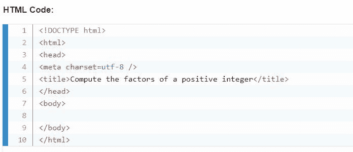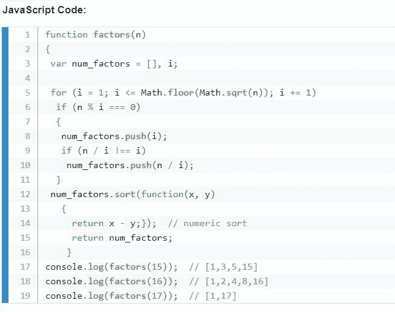

## 结

本书包含了与 JavaScript 编程语言相关的重要信息。书中的信息将帮助你理解和实践各种 JavaScript 运算符、循环和条件语句、函数、变量作用域、类型等。随着课程接近尾，你将对 JavaScript 语言有极好的理解，因为你学习了 JavaScript 和各种形式，你将理解 jQuery、框架（frames）和调试脚本的基础。给程序员的最好建议就是坚持练习，因为那是掌握所学内容的唯一途径。
