# JavaScript 入门指南 [2020]

## 总编辑

Mark L. Taub

## 执行编辑

Kim Spenceley

## 开发编辑

Chris Zahn

## 技术编辑

Trent McCauley

## 主编

Sandra Schroeder

## 高级项目编辑

Lori Lyons

## 制作经理

Gayathri Umashankan/codeMantra

## 索引员

Cheryl Lenz

## 校对

Abigail Mannheim

## 封面设计设计

Chuti Prestanchi

## 编排师

codeMantra

在 informit.com 注册您的《JavaScript零基础学者指南》第二版，以便在更新和修正出现时方便地下载。要开始注册过程，请访问 www.informit.com/register 并登录或创建账户。输入产品 ISBN 9780136502890，并点击提交。过程完成后，您将在“注册产品”下找到任何可用的奖励内容。

请务必勾选希望收到我们消息的复选框，以获得该产品未来版本的独家折扣。

## 11 控制台日志基础

## 18 深入观察对象

### 它确实是 CSS 选择器语法

### 进一步探索

### 非常像点击的鼠标按下和鼠标释放事件

### 处理鼠标轮

### 认识键盘事件

### 使用这些事件

### 一些示例

### 检查特定键是否被按下

### 按下方向键时执行操作

### 检测多次按键

### 页面加载期间发生的事情

- 脚本元素——异步 (Async) 与延迟 (Defer)
- async
- defer
- 如何实现这一切
- 一个糟糕的解决方案
- 一个良好的解决方案
- 整合一切

## 献辞

给 Meena！

（尽管读了无数遍，依然会对这些页里的笑话大大笑！）

## 致谢

正如我所发现的，出版这样本书绝非易事。它涉及了镜头前（和幕后）的许多人，他们不懈地工作，将我的胡言乱语变成你即将看到的精美页面。感谢 Pearson 所有让这一切成为可能的同仁！

尽管如此，我还有几个人想要特别点名感谢。首先，我想感谢 Mark Taber 给我这次机会，感谢 Kim Spenceley 在第二版中延续 Mark 的工作，感谢 Chris Zahn 细致地确保一切内容易读，以及感谢 Loretta Yates 帮助促成了这一切的发生。这本书的技术内容由我的老朋友兼在线合作伙伴 Kyle Murray（第一版）和 Trevor McCauley（第一版和第二版）进行了详细评审。对于他们提供的详尽（经常是幽默的！）反馈，我不胜感激。

最后，我想感谢我的父母，他们一直鼓励我追求绘画、写作、玩游戏和编写代码等创意爱好。没有他们的支持，我不会是今天这个半个硬核宅男。😊

## 关于作者

Kirupa Chinnathambi 职业的大部分时间都在试图教其他人像他一样热爱 Web 开发。

在 1999 年，在“博客”这个词还没出现之前，他就开始在 kirupa.com 上发布教程了。从后的几年里，他撰写了数百篇文章，写了几本书（当然，没有一本比这本好的！），并录制了一系列可以在 YouTube 上找到的视频。当他没有写作或谈论 Web 开发时，他作为 Salesforce Lightning 设计系统的产品经理，利用清醒时间帮助 Web 变得更加出色。在不休息的时候，他可能在睡觉，或者和 Meena 一起追着他们的幼女儿 Akira 跑，保护自己免受 Pixel（也就是披着平庸猫体里的霸龙）的侵害……或者用第三人称描写自己的故事。

你可以在 Twitter、Facebook、LinkedIn 以及整个互联网上找到他。只需在你最喜欢的搜索引擎中搜索他的名字即可。

| 图片 | 归属 |
| --- | --- |
| FIG01-04 | Google Chrome 截图 © 2019 Google |
| UNFIG16-01 | DebbiSmirnov/iStock/Getty images |
| FIG26-05 | Google Chrome 截图 © 2019 Google |
| UNFIG29-01 | Google Chrome 截图 © 2019 Google |
| UNFIG29-02 | Google Chrome 截图 © 2019 Google |
| UNFIG29-03 | Kirupa.com 截图 © 'My Unconfigured Forum List |
| FIG30-01 | Internet explorer 截图 © 'Microsoft 2019 |
| UNFIG30-02 | Internet explorer 截图 © 'Microsoft 2019 |
| UNFIG30-03 | Google Chrome 截图 © 2019 Google |
| UNFIG30-04 to UNFIG30-15 | Excel 表格截图 © Microsoft 2019 |
| UNFIG31-01 | Google Chrome 截图 © 2019 Google |
| FIG31-01 | Google Chrome 截图 © 2019 Google |
| FIG31-02 | Audrius Merfeldas/123RF |
| FIG33-01 | Dmitry Ruklenko/Shutterstock |
| FIG34-01 | |

## 引言

你是否曾尝试过学习一种与你母语不同的语言来读、说或写？如果你和我一样，你早期的尝试可能看起来像这样：

> Sono qui per uccidere il grande drago rosso?

## JAVASCRIPT 绝对初学者指南

除非你是杰森·伯恩（或罗杰·费德勒勒），否则你在学习第一门语言时几乎是勉强生存。这是因为学习语言是很困难的。无论你学的是第一门、第二门还是第三门语言都是如此。想要精通一门语言到能在非易事领域发挥作用的程度，需要花费大量的时间和精力。它要求从基础开始。需要大量的练习和耐心。它是通往精通之路没有捷径的领域之一。

成功学习一门语言与你处理现实世界非常相似。你从基础开始。一旦你掌握了基础，就会转向更高级的内容。这整个过程不断重复，永无真正的终点。我们没有人真正停止过学习。为了帮助你解决“从何开始”的问题，这本书派上了用场。这本书从头到尾充满了各种有趣（而且幽默！）的内容，帮助你学习 JavaScript。现在，我不喜欢在背后说编程坏话，但 JavaScript 确实挺无聊的：

> 为什么不接我的电话？

```javascript
var count = 0;

function doingSomething() {
  count++;

  if (count > 10) {
    alert("aaaaaaaaann!");
  } else {
    alert("This one time, at camp...");
  }
}
```

没有其他词可以描述它了。尽管 JavaScript 可能确实如此，但并不意味着学习它也同样无聊（供参考）：所有的挑战都是经过精心且刻意的安排——大多数时候如此！当你阅读这本书时，希望你会发现这门语言既有启发性又有趣味。所有这些奇点和乐趣通过对为了变得更优秀而需要了解的所有趣事的深度覆盖得到了平衡。当你读到最后一章时，你已经准备好面对任何与 JavaScript 相关的挑战，而毫不费力。

## 联系我/获取帮助

如果你在任何时候遇到困难，或者只是想联系我，可以在 kirupa.com 发帖。对于非技术性问题，你也可以推特 @kirupa，或者在 Facebook 上给我发消息（我喜欢听取读者的反馈，我会回复每一条消息）。现在，翻页吧——我们要开始了！

## 你好，世界！

HTML 主要是关于展示内容的。CSS 主要是关于让内容好看。通过这两者，你可以创建像 http://bit.ly/kirupaWeather 这样的漂亮示例。图 1 显示了该天气示例的样子。

尽管仅使用 CSS 和 HTML 构建的网站很漂亮，但它们是静态的。它们不会根据你的操作做出适应或反应。使用这两个，就像一遍又一遍看精彩的《老友记》剧集。一开始很有趣，但最终会变得无聊。今天的 Web 并不是静态的。你常用的网站（如图 1.2 所示）具有某种程度的交互性和个性化，这远超 HTML 和 CSS 本身提供的范围。

| 图 | 描述 |
| --- | --- |
| FIG1.1 | 一个完全使用 CSS 设计的彩色天气示例。 |
| FIG1.2 | |

## 什么是 JavaScript？

JavaScript 是一种现代编程语言，与 HTML 和 CSS 平级。简单来说，它允许你为文档添加交互性。

- 监听点击等事件并执行操作。
- 在页面加载后修改 HTML 和 CSS。
- 让元素以有趣的方式在屏幕上移动。
- 创建可以在浏览器中运行的酷炫游戏。
- 在服务器和浏览器之间传输数据。
- 允许你与摄像头、麦克风和其他设备进行交互。

……还有更多！编写 JavaScript 的方式非常简单——某种程度上。你组合类似于日常英语的单词来告诉浏览器要做什么。以下示例展示了一些新鲜出炉的传统 JavaScript：

```javascript
var defaultName = "JavaScript";

function sayHello(name) {
  if (name == null) {
    alert("Hello, " + defaultName + "!");
  } else {
    alert("Hello, " + name + "!");
  }
}
```

无论如何，到目前为止背景信息已经足够了。你可能希望我现在为你介绍 JavaScript 的历史以及其背后的人物和公司，但我不会用这类内容让你感到无聊。相反，我想让你通过编写一些 JavaScript 来亲身实践。在教程结束时，我希望你创建一个既酷又简单的东西，在浏览器中显示一些文本。

现在，你可能觉得还没有准备好开始写代码，尤其是如果你对通用的编程并不熟悉的话。正如你很快会发现的，JavaScript 并没有它经常装出来的那么令人讨厌和复杂。让我们开始吧。

> **提示** 需要基础的 Web 开发知识
>
> 要开始编写 JavaScript，你需要对构建网页、使用代码编辑器以及添加一些 HTML 和 CSS 有基本的了解。如果你对这些基础知识不太熟悉，我鼓励你先阅读**构建你的第一个网页**这一章。这将为你接下来的学习做好很好的准备。

你首先需要一个 HTML 文档。这个文档将托管你将编写的 JavaScript。启动你喜欢的代码编辑器。如果你还没有，我鼓励你使用 Visual Studio Code。启动你喜欢的编辑器后，创建一个新文件。在 Visual Studio Code 中，你会看到一个显示为 **Untitled**（未命名）的标签，类似于图 1.3 所示。

Visual Studio Code 中的 Untitled-1 标签。

通过“文件 | 保存”来保存这个新创建的文件。系统会要求你给文件命名并指定保存位置。将文件命名为 `hello_world.htm` 并将其保存到你的**桌面**。保存文件后，将以下 HTML 添加到其中：

```html
<!DOCTYPE html>
<html>

<head>
<meta charset="utf-8">
<title>这里有一个有趣的标题</title>

<style>

</style>
</head>

<body>
<script>

</script>

</body>
</html>
```

添加 HTML 后，保存文档以确认这些更改。现在是时候看看我们的页面在浏览器中是什么样子了。

在文件资源管理器（File Explorer）或访达（Finder）中，导航到你的桌面文件夹并双击 `hello_world.htm`。你会看到你的默认浏览器出现并显示该文件的名称。你应该能看到类似于图 1.4 所示。

Visual Studio Code 中带标题的标签。

如果一切运行正常，你应该会看到一个空白页面！不，这里并没有出现任何错误。虽然我们的页面有内容，但没有任何可见的显示。没关系，我们很快就会修复它。修复这个问题的关键是回到代码编辑器，关注 HTML 底部的 `<script>` 标签：

```html
<script>
</script>
```

`<script>` 标签充当容器，你可以在其中放置任何你想运行的 JavaScript。我们想要做的是在加载 HTML 页面时，弹出一个对话框并显示 hello, world! 单词。为了实现这一点，在你的脚本区域内添加以下行代码：

```html
<script>
alert("hello, world!");
</script>
```

保存你的 HTML 文件并在浏览器中运行它。注意一旦页面加载，你会看到什么。你应该会看到一个类似于图 1.5 的对话框。

如果这是你第一次尝试编写 JavaScript，恭喜你！现在，让我们来看看你刚才做了什么。

你写了一个非常简单的 JavaScript 语句。语句（Statement）是一组逻辑指令，告诉浏览器应该做什么。一个典型的应用程序会有**非常许多**语句。在我们的案例中，我们有一个：

```javascript
alert("hello, world!");
```

你可以通过观察它的最后一个字符来判断它是否是一个语句。它通常是一个分号（`;`），就像你在这里看到的一样。

语句内部，你会看到各种奇奇怪的 JavaScript 术语。我们的代码尽管只有一行，但也不例外。你看到了这个名为 `alert` 的奇怪东西。这是一个普通英语单词在 JavaScript 世界中行为相似的例子。它的作用是通过显示一些文本来引起你的注意。

更准确地说，`alert` 这个词被称为**函数**（Function）的东西。你将一直使用函数；函数基本上是一个可重用的……

在 JavaScript 中，我们提供的或使用的的每份数据都被认为包含一个**值**（Value）。在我们在介绍中看到的示例中，**hello, world!** 可能只是传递给 `alert` 函数的一些单词：

```javascript
alert("hello, world!");
```

在 JavaScript 中，这些单词有特定的表示。它们被视为**值**。我们在输入这些单词时可能没有想太多，但在 JavaScript 世界中，你接触到的每份数据都被视为一个值。

现在，为什么知道这很重要？这很重要是因为我们将频繁处理值。以一种不会让我们发疯的方式处理它们是件好事。我们需要两件事来简化我们的生活：

- 轻松地识别它们
- 在整个应用程序中重用它们

这两件事将让我们把剩下的时间花在**变量**（Variables）上。让我们学习关于它们的知识。

在这个教程中，你创建了一个简单的示例来帮助熟悉 JavaScript。在熟悉它的过程中，我向你抛出了大量的概念和术语。我并不要求你现在就记住所有它们。在未来的教程中，我们将挑选你所看到的有趣部分并进行更详细的阐述。最后，我很确定你最终会在 JavaScript 中做一些超出对话框显示的内容。

以后，在每一章的结束时，你可能会看到一组由我或其他人提供的外部资源。这些资源将为你提供关于所学内容的不同视角，并提供让你实践的机会。

如果你对内容有任何问题，请在 https://forum.kirupa.com 论坛发布，以便从我以及一些酷的开发者那里获得快速帮助。

变量是值的标识符。你不需要每次想在应用程序中使用该短语时都输入 **hello, world!**，你可以将该短语赋值给变量，并在以后需要再次使用 **hello, world!** 时使用该变量。稍后你就会发现这很有意义——保证！

使用变量有多种方法。对于大多数情况，最好的方法是依靠 `let` 关键字，后面跟着你想要给变量起的名字：

```javascript
let myText
```

在这行代码中，我们声明了一个名为 `myText` 的变量。现在，我们的变量仅仅被**声明**了。它不包含任何值。它仅仅是一个**空壳**。

让我们通过将变量**初始化**为某个值来修复这个问题，比如……让我们说……**hello, world!**：

```javascript
let myText = "hello, world!";
```

此时，当这段代码运行时，我们的 `myText` 变量将关联上 **hello, world!** 的值。让我们把这些内容整合到一个完整的示例中。如果你仍然打开着之前的 `hello_world.htm`，请用以下内容替换你的 `<script>` 标签的内容……或者创建一个新的 HTML 文件并添加以下内容：

```html
<!DOCTYPE html>
<html>
<head>
<meta charset="utf-8">
<title>这里放一个有趣的标题</title>
<style>
</style>
</head>
<body>
<script>
let myText = "hello, world";
alert (myText);
</script>
</body>
</html>
```

注意，我们现在不再直接将 **hello, world!** 文本传递给 `alert` 函数了。相反，我们现在传递的是变量 `myText`。最终结果是相同的。当此脚本运行时，将会显示一个带有 **hello, world!** 的警报框。这种变化允许我们在代码中只在某一个地方来指定 **hello, world!**。如果我们想把 **hello, world!** 改为 **The dog ate my homework**，我们只需要通过 `myText` 变量对该短语进行一次更改即可：

```javascript
let myText = "The dog ate my homework";
alert(myText);
```

在我们的整个代码中，任何我们引用 `myText` 变量的地方，现在都会看到新文本出现。虽然对于像我们现在这样简单的东西来说这很难想象，但对于较大的应用程序来说，这种只需在一个位置进行更改即可反映到所有地方的便利性可以节省大量时间。在随后的示例中，你将看到变量值提供的更多非平庸无常的案例。

## 更多关于变量的内容

我们在上一节中学到的知识将让我们生活中受益匪浅。至少在涉及熟悉 JavaScript 的生活部分是如此。我们不会在这里深入探讨变量，因为我们将在未来的章节中完成这些内容，到时代码会更复杂，变量的重要性也会显而易见。尽管如此，在结束今天的工作之前，还有一些零碎的知识我们需要涵盖。

我们可以自由地按照自己的意愿为变量命名。忽略基于哲学/文化/风格偏好的应该给事物命名的问题，从技术角度来看，JavaScript 对变量名中可以使用的字符是非常宽松的。

这种宽松并不是无限的，因此在命名变量时应该记住以下几点：

- 变量可以短到一个字符，也可以随你想要有多长——想象成千上万个字符。
- 变量可以以字母、下划线或 `$` 字符开头。它们不能以数字开头。
- 除了第一个字符外，我们的变量由字母、下划线、数字和 `$` 字符的任何组合组成。我们还可以随心所欲地混合使用大小写字母。
- 不允许空格。

以下是一些有效变量名的示例：

```javascript
let myText;
let $;
let r8;
let _counter;
let $field;
let thisIsAlongVariableNameButItCouldBeLonger;
let __Abc;
let OldSchoolNamingScheme;
```

要检查变量名是否有效，请查看非常棒且简单的 JavaScript 变量名校验器。

除了有效名称之外，还有其他需要关注的内容，例如命名规范，以及人们通常为变量和其他你识别为名称的事物命名的方式。我们将在其他章节中涉及这些内容。

你学到的 JavaScript 知识之一是它非常宽容且易于处理的语言。

例如，我们不需要使用 `let` 关键字来声明变量。我们只需进行如下操作：

```javascript
myText = "hello, world!";
alert(myText);
```

注意，`myText` 变量在没有正式使用 `let` 关键字声明的情况下被使用了。虽然不推荐，但这是完全没问题的。最终结果是我们有一个名为 `myText` 的变量。唯一的是，通过这种方式声明变量，我们是在全局声明它。如果你觉得最后句话听起来没错，请担心。稍后在讨论变量作用域时，我们会查看“全局”意味着什么。

还有一点需要说明，即声明和初始化不必是同一个语句的一部分。我们可以将它们拆分开：

```javascript
let myText;
myText = "hello, world!";
alert(myText);
```

最后，我们可以随时通过 `let` 修改变量的值：

```javascript
let myText;
myText = "hello, world!";
myText = 99;
myText = true;
myText = undefined;
alert(myText);
```

如果你有处理更严格语言的经验，那么这种宽松是人们既爱又恨的特性之一。尽管如此，JavaScript 提供了一种在初始化初始化变量后限制其值的方法。这种限制以 `const` 关键字的形式出现：

```javascript
const siteURL = "https://world.com";
alert(siteURL);
```

依靠 `const`，我们无法将值更改为 https://world.com 以外的任何内容。如果我们尝试这样做，JavaScript 会报错。使用 `const` 有一些陷阱，但总体而言在防止意外修改方面做得很好。那些讨厌的陷阱我们将在合适的时候分部分介绍。

现在你已经知道如何声明和初始化变量，一个非常重要的话题是可见性。你需要知道你声明的变量何时以及何地可以被实际使用。这种现象的统称为*变量作用域*。如果你想了解更多信息，可以跳过去阅读第 8 章“变量作用域”。

值存储数据，而变量是引用这些数据的简单方式。关于值有很多有趣的细节，但那些是你现在不需要学习的细节。只需要知道 JavaScript 允许你轻松地表示文本和数字等各种值。

为了让你的值更易记忆且可重用，你声明变量。你使用 `let` 关键字和变量名来声明变量。如果你想将变量初始化为默认值，就在那之后跟一个等号（`=`）和你想要初始化变量的值。

到目前为止，我们写的所有代码实际上都不包含结构。它们只是……在那儿：

```javascript
alert("hello, world!");
```

拥有这样的代码并没有问题。如果我们的代码由单一语句组成，情况尤其如此。但绝大多数情况下，情况绝非如此。当我们在现实世界中使用 JavaScript 处理现实事务时，我们的代码很少会这么简单。

为了突出这一点，假设我们想要显示某个物体移动的距离（图 3.1）。

行驶距离。

如果你还记得学校里学过的话，距离是通过物体行驶的速度乘以所需的时间计算的（图 3.2）。

计算距离。

这种逻辑在 JavaScript 中的版本所示：

```javascript
let speed = 10;
let time = 5;
alert(speed * time);
```

我们有两个命名为 `speed` 和 `time` 的变量，它们各存储一个数字。`alert` 函数显示 `speed` 和 `time` 变量所存储的值相乘的结果。这是我们刚刚看到的距离公式的非常直译的翻译。

假设我们想要计算更多数值的距离。仅使用我们目前看到的，我们的代码看起来如下：

```javascript
let speed = 10;
let time = 5;
alert(speed * time);
```

```javascript
let speed1 = 85;
let time1 = 1.5;
alert(speed1 * time1);
```

```javascript
let speed2 = 12;
let time2 = 9;
alert(speed2 * time2);
```

```javascript
let speed3 = 42;
let time3 = 21;
alert(speed3 * time3);
```

我不知道你怎么想，但这看起来太糟糕了。我们的代码是不必要的冗长且重复的。正如我们之前在学习变量时看到的，重复会让我们的代码更难维护，而且会浪费你的时间。

整个问题可以使用我们在这里会经常到的东西——函数，非常容易地解决：

```javascript
function showDistance(speed, time) {
  alert(speed * time);
}
```

```javascript
showDistance(10, 5);
showDistance(85, 1.5);
showDistance(12, 9);
showDistance(42, 21);
```

现在不要太担心这段代码的作用。只需要知道这块较小的代码在没有所有负面副作用的情况下完成了所有工作。我们将从……现在……开始学习关于函数以及它们如何实现所有奇妙事情的知识。

前进！

### 什么是函数？

在最基础的层，函数无非是某些代码的包装器。函数基本上：

- 将语句组合在一起
- 让你的代码可复用

你很少会编写或使用不涉及函数的代码，因此熟悉它们并学习它们工作得有多良好是非常重要的。

### 简单函数

学习函数的最好方法就是直接投入并开始使用它们，让我们从创建一个非常简单的函数开始。创建一个函数并不非常有趣。它只需要理解一些语法上的特殊之处，比如使用奇怪的括号和中括号。

下面是一个简单函数的示例：

```javascript
function sayHello() {
  alert("hello!");
}
```

但是，仅仅定义函数是不够的。我们需要调用我们的函数，可以通过在后面添加以下行来实现：

```javascript
function sayHello() {
  alert("hello!");
}

sayHello();
```

为了亲眼看到这一切，创建一个新的 HTML 文档 `functions_sayhello.htm` 并将其添加以下内容：

```html
<!DOCTYPE html>
<html>

<head>
  <meta charset="utf-8">
  <title>Say Hello!</title>
  <style>
</style>
</head>
<body>
<script>
  function sayHello() {
    alert("hello!");
  }
  sayHello();
</script>
</body>
</html>
```

如果你输入了所有内容并在浏览器中预览你的页面，你将看到显示 **hello**。你现在只需要知道我们的代码可以工作。让我们接下来看看代码为什么能工作，通过将 `sayHello` 函数拆分成单独的块并更详细地查看每一个部分。

首先，我们看到 `function` 关键字开头，如图 3.3 所示。

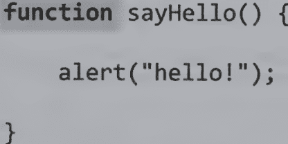

图 3.3

function 关键字。

这个关键字告诉运行在你浏览器深处的 JavaScript 引擎，将此代码块视为与函数相关的东西。

在 `function` 关键字之后，我们指定函数的实际名称，后面跟着一对左、右括号 `( )`，如图 3.4 所示。

```javascript
function sayHello() {
  alert("hello!");
}
```

图 3.4

函数名和括号。

完成我们的函数声明的是左括号和右括号，它们包裹了我们内部可能存在的任何语句（图 3.5）。

```javascript
function sayHello() {
  alert("hello!");
}
```

图 3.5

左括号和右括号。

最后一样是我们的函数的内容——让我们的函数真正起作用的语句（图 3.6）。

```javascript
function sayHello() {
  alert("hello!");
}
```

图 3.6

函数内容。

### 传递参数

使用函数最强大的方法是向它们传递数据。这些数据被称为参数。看下面的示例：

```javascript
function showDistance(speed, time) {
  alert(speed * time);
}
```

```javascript
showDistance(10, 5);
showDistance(85, 1.5);
showDistance(12, 9);
showDistance(42, 21);
```

在上面的示例中，`speed` 和 `time` 是参数。它们像变量，但定义在函数内部。当你调用函数时，你传递值。这些值也称为参数。

看另一个例子：

```javascript
function greet(name) {
  alert("Hello, " + name + "!");
}
```

```javascript
greet("Alice");
greet("Bob");
greet("Charlie");
```

在这种情况下，`name` 是参数，"Alice"、"Bob" 和 "Charlie" 是参数。

参数是函数定义中变量，而参数是在函数被调用时传递的实际值。

### 多个参数

你可以传递任意数量的参数。只需用逗号分隔它们即可。

```javascript
function introduceUser(firstName, lastName, city) {
  alert(firstName + " " + lastName + " lives from " + city);
}
```

```javascript
introduceUser("John", "Doe", "New York");
introduceUser("Jane", "Smith", "London");
```

在这个示例中，`firstName`、`lastName` 和 `city` 是参数。当我们调用函数时，传递了三个字符串作为参数。

### 默认参数

有时，如果调用者没有提供，你想为参数提供一个默认值。JavaScript 支持这种语法：

```javascript
function greet(name = "Guest") {
  alert("Hello, " + name + "!");
}
```

```javascript
greet("Alice");
greet();
```

当调用 `greet("Alice")` 时，它使用 "Alice"。当无参数调用 `greet()` 时，它使用默认值 "Guest"。

### 返回值

通常，函数应该向调用者返回一个值。为了做到这一点，我们使用 `return` 关键字。

```javascript
function calculateDistance(speed, time) {
  return speed * time;
}
```

```javascript
let result = calculateDistance(10, 5);
alert(result);
```

在这个示例中，`calculateDistance` 返回 `speed` 和 `time` 的乘积。结果存储在变量 `result` 中。

当遇到 `return` 语句时，函数立即停止。`return` 语句后的任何代码都不会被执行。

```javascript
function testReturn() {
  return "I am done";
  console.log("This will never run");
}
```

### 返回多个值

函数只能返回一个值。为了返回多个值，你可以改为返回一个对象或数组。

```javascript
function getCoordinates() {
  return {
    x: 10,
    y: 20
  };
}

let coords = getCoordinates();
console.log(coords.x);
console.log(coords.y);
```

```javascript
function getNumbers() {
  return [10, 20, 30];
}

let numbers = getNumbers();
console.log(numbers[0]);
```

```javascript
call showDistance(10, 5);
function showDistance(speed, time) {
  alert(speed * time);
}
```

FIGURE 3.11

参数名的用法就像变量一样。

> **注意** 参数数量不匹配
>
> 如果一个函数恰好需要参数，而你在调用函数时没有提供任何参数、提供的参数太少或提供的参数过多，程序仍然可以正常运行。你可以针对这些情况编写防御性代码来处理这些情况，在将来，我们会涉及到这部分。
>
> 通常情况下，为了让你正在编写的代码更清晰，你应该为你正在调用的函数提供所需数量的参数。

### 创建返回数据的函数

我们将查看的最后一种函数变体是将某些数据返回给调用它的任何地方。这是我们要做的内容：我们有 `showDistance` 函数，并且知道它的形式如下：

```javascript
function showDistance(speed, time) {
  alert(speed * time);
}
```

我们不想让 `showDistance` 函数计算距离并以弹框形式显示，而是想存储该值以便以后使用。我们想这样做：

```javascript
let myDistance = showDistance(10, 5);
```

`myDistance` 变量将存储 `showDistance` 函数计算的结果。

### Return 关键字

从函数返回数据的方法是使用 `return` 关键字。让我们创建一个名为 `getDistance` 的新函数，它看起来与 `showDistance` 完全相同，区别在于函数运行完成后发生了什么：

```javascript
function getDistance(speed, time) {
  let distance = speed * time;
  return distance;
}
```

注意，我们仍然通过将速度乘以时间来计算距离。我们没有显示弹框，而是返回距离（由 `distance` 变量存储）。

要调用 `getDistance` 函数，我们可以直接在初始化变量时调用它：

```javascript
let myDistance = getDistance(10, 5);
```

当 `getDistance` 函数被调用时，它会被求值并返回一个数值，然后该数值会被赋值给 `myDistance` 变量。操作就此结束。

## 提前退出函数

一旦我们的函数遇到了 `return` 关键字，它就会停止在该处正在做的工作，将你指定的任何值返回给调用者，并退出：

```javascript
function getDistance(speed, time) {
    let distance = speed * time;
    return distance;

    if (speed < 0) {
        distance *= -1;
    }
}
```

任何位于 `return` 语句之后的代码都无法被执行。就好像那些代码从未存在过一样。

实践中，我们将使用 `return` 语句在函数完成我们想要的操作后终止它。该函数可以像你在之前的示例看到的那样向调用者返回值，或者该函数可以直接退出：

```javascript
function doSomething() {
    let foo = "Nothing interesting";
    return;
}
```

使用 `return` 关键字返回值是可选的。可以像这里这样单独使用它可以直接退出函数。如果函数没有指定要返回的内容，则会返回一个默认值 `undefined`。

## 极简概念

函数是你几乎在每一个 JavaScript 应用程序中使用的少数东西之一。它们提供了梦寐以求的能力，帮助让你的代码可重用。无论你是创建自己的函数，还是使用 JavaScript 语言内置的许多函数，你都将无法离开它们。

你目前为止看到的都是函数如何通用的示例。函数还拥有一些我在这里没有涵盖的高级特性。那些用法将在将来涵盖……一个遥远的未来。现在，你所学的所有内容在理解函数如何在现实世界中被使用方面已经将带你走很远。

如果你对这里的内容有任何问题，不要担心！在 https://forum.kirupa.com 论坛发帖，可以获得我以及网络上一些聪明开发者的快速帮助。


## 条件语句：IF, ELSE 和 SWITCH

从你醒来的那一刻起，无论你是否意识到，你开始做决定了。关掉闹钟。开灯。向窗外看天气如何。刷牙。穿上睡袍和巫师帽。检查你的日历。基本上……你明白我的意思。当你走出家门外时，你已经有意识或无意识地做出了数百个决定，每个决定都对你最终采取的行为产生了特定的影响。

- 使用流行的 `if/else` 语句来帮助在代码中决策
- 学习 `switch` 语句以及何时使用它们

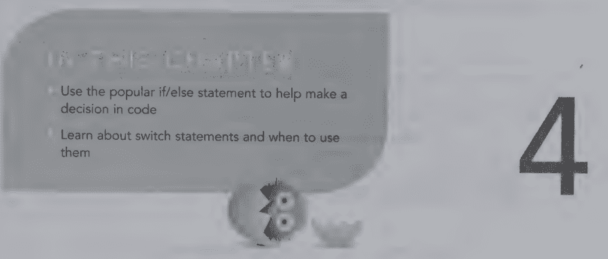

例如，如果外面天气看起来很冷，你可能会决定穿一件连帽衫或外套。你可以像图 4.1 所示对这个决策进行建模。

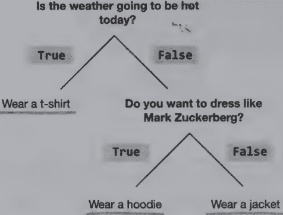

图 4.1

决策建模。

在做出的每个阶段，你都会问自己一个可以用真或假回答的问题。该问题的答案决定了你的下一步，并最终决定了你是穿 T 恤、连帽衫还是外套。更广泛地说，你所做的每个决定都可以建模为一系列真和假陈述。这听起来可能有点“冷冰冰”（哈哈），但这通常就是我们、他人以及几乎所有生物做出选择的方式。

这种泛化特别适用于你计算机所做的一切。这从我们目前编写的代码中可能并不明显，但我们将修复这个问题。在在本教程中，我们将涵盖所谓的条件语句。这些是我们所做决定的数字等价物，我们的代码根据某些事情是真是假执行不同的操作。

继续前进！

### If / Else 语句

我们在代码中最常用的条件语句是 **if / else 语句**或简称为 **if 语句**。它的工作方式如图 4.2 所示。

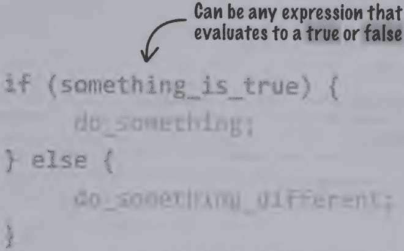

**图 4.2**

语句如何工作。

为了理解它，让我们来看一个 `if / else` 语句作用的简单示例。创建一个新的 HTML 文档并向其中添加以下标记：

```html
<!DOCTYPE html>
<html>
<head>
  <meta charset="utf-8">
  <title>If / Else Statements</title>
</head>
<body>
  <script>
  let safeToProceed = true;
  if (safeToProceed) {
    alert("You shall pass!");
  } else {
    alert("You shall not pass!");
  }
  </script>
</body>
</html>
```

将此文档保存为 `if_else.htm` 并在浏览器中预览它。如果一切运行如预期，你将看到一个带有文本 **You shall pass** 的警弹框（图 4.3）。

| You shall pass! |
| --- |
| Close |

图 4.3

你将看到这个弹框。

负责实现此功能的代码是示例中的以下几行：

```javascript
let safeToProceed = true;

if (safeToProceed) {
    alert("You shall pass!");
} else {
    alert("You shall not pass!");
}
```

**我们的表达式**（`if` 关键字之后最终求值为真或假的内容）是变量 `safeToProceed`。该变量被初始化为 **true**，所以触发了 `if` 语句的真部分。

现在，将 `safeToProceed` 变量的值从 `true` 改为 `false`：

```javascript
let safeToProceed = false;

if (safeToProceed) {
  alert("You shall pass!");
} else {
  alert("You shall not pass!");
}
```

这次当你运行这段代码时，你将看到一个带有文本 **You shall not pass!** 的弹框，因为我们的表达式现在求值为 **false**（图 4.4）。

| You shall not pass! |
| --- |
| Close |

**图 4.4**

当表达式求值为假时得到的弹框。

到目前为止，这一切可能看起来非常无聊。很大一部分原因是我们还没有增加复杂度旋钮来关注更现实的场景。我们将通过深入研究条件来解决这个问题。

### 认识条件运算符

在大多数情况下，我们的表达式很少是像我们之前的示例那样是一个被设置为 **true** 或 **false** 的简单变量。我们的表达式将涉及所谓的**条件运算符**，它们帮助我们比较两个或多个表达式，以建立 **true** 或 **false** 的结果。

此类表达式的通用格式如图 4.5 所示。

```
if (expression operator expression) {
  // something
} else {
  // something else
}
```

图 4.5：条件运算符表达式的通用格式。

**运算符**（也称为**条件运算符**）定义了表达式之间的关系。最终目标是返回 **true**（真）或 **false**（假），以便我们的 if 语句知道应该执行哪块代码。让这一切能够运行的关键在于条件运算符本身。它们列如表 4.1 所示。

### 表 4.1 运算符

| 运算符 | 何种情况下为真 |
|---|---|
| `==` | 如果第一个表达式评估的值与第二个表达式的值相等。 |
| `>=` | 如果第一个表达式评估的值大于或等于第二个表达式的值。 |
| `>` | 如果第一个表达式评估的值大于第二个表达式的值。 |
| `<=` | 如果第一个表达式评估的值小于或等于第二个表达式的值。 |
| `<` | 如果第一个表达式评估的值小于第二个表达式的值。 |
| `!=` | 如果第一个表达式评估的值不等于第二个表达式的值。 |
| `&&` | 如果第一个表达式和第二个表达式都评估为真。 |
| `\|\|` | 如果第一个表达式或第二个表达式中有一个评估为真。 |

让我们根据对条件运算符的通用理解，通过查看另一个示例来使其更具体……例如下面的代码，我们高亮了相关的 if 相关代码：

```html
<!DOCTYPE html>
<html>

<head>
  <meta charset="utf-8">
  <title>你正在超速吗？</title>
</head>

<body>
<script>
  let speedLimit = 55;

  function amSpeeding(speed) {
    if (speed >= speedLimit) {
      alert("Yes. You are speeding.");
    } else {
      alert("No. You are not speeding. What's wrong with you?");
    }
  }

  amSpeeding(53);
  amSpeeding(72);
</script>
</body>
</html>
```

让我们花点时间理解到底发生了什么。我们有一个初始化为 55 的变量 `speedLimit`。然后我们有一个名为 `amSpeeding` 的函数，它接受一个名为 `speed` 的参数。在这个函数内部，我们有一个 if 语句，其表达式检查传入的 `speed` 值是否大于或等于 `speedLimit` 变量存储的值（你好， `>=` 条件运算符！）：

```javascript
function amSpeeding(speed) {
  if (speed >= speedLimit) {
    alert("Yes. You are speeding.");
  } else {
    alert("No. You are not speeding. What's wrong with you?");
  }
}
```

你的代码执行的最后一步实际上是通过传递几个 `speed` 值来调用 `amSpeeding` 函数：

```javascript
amSpeeding(53);
amSpeeding(72);
```

当我们用 53 的速度调用此函数时，`speed >= speedLimit` 表达式评估为 `false`。原因为 53 不大于或等于 `speedLimit` 的存储值 55。这导致弹出一个警报框，显示你没有超速。

当我们用 72 的速度调用 `amSpeeding` 时，情况恰恰相反。在这种情况下，我们正在超速，条件被评估为 `true`。还会弹出一个告诉我们正在超速的警报框。

### 创建更复杂的表达式

关于这些表达式，你需要了解的是，它们可以根据你的需要变得简单，也可以变得复杂。它们由变量、函数调用或原始值组成。它们可以由变量、函数调用或原始值的组合组成，并使用你之前看到过的任何运算符进行分隔。你只需要确保你的表达式最终评估为 `true` 或 `false`。

这里有一个稍微复杂一点的示例：

```javascript
let xPos = 300;
let yPos = 150;

function sendWarning(x, y) {
  if ((x < xPos) && (y < yPos)) {
    alert("Adjust the position");
  } else {
    alert("Things are fine!");
  }
}

sendWarning(500, 160);
sendWarning(100, 100);
sendWarning(201, 149);
```

注意我们在 `sendWarning` 的 if 语句内部的条件看起来如下：

```javascript
function sendWarning(x, y) {
  if ((x < xPos) && (y < yPos)) {
    alert("Adjust the position!");
  } else {
    alert("Things are fine!");
  }
}
```

这里进行了三次比较。第一个是 `x` 是否小于 `xPos`。第二个是 `y` 是否小于 `yPos`。第三次比较是检查第一个语句和第二个语句是否都评估为真。除了学习所有运算符外，你需要做的是通过将多个 if 语句串联起来，直到其中一个表达式评估为真。这里描述的所有内容属于布尔逻辑的伞下。你需要使用括号来正确包裹每个条件。对于那些情况，你可以使用 `else` 关键字来链联 if 语句。

### if / else 的变体

并不是所有情况都能完美地放入单个 if 语句中。

### 只有 if 的语句

第一个 else 伴侣：

```javascript
if (weight > 5000) {
  alert("Free shipping for you!");
}
```

在这种情况下，如果第一个语句评估为 `true`，则会进入第一个 alert。如果第一个语句为 `false`，代码将评估 `else` 语句以查看其表达式是否评估为 `true`。这一过程会持续到代码结束。换句话说，我们的代码只需向下遍历每个 `if` 和 `else` 语句，直到其中一个表达式评估为真：

```javascript
if (condition) {

} else if (condition) {

} else if (condition) {

} else if (condition) {

} else if (condition) {

} else {
}
```

如果没有任何语句的表达式评估为 `true`，则执行 `else` 块（如果存在）的代码。如果没有 `else` 块，代码将直接进入位于这些 if 语句之外的代码集。在更复杂的表达式和 if/else 语句之间，你可以表示代码可能需要评估的任何决策。

### 使用 switch 语句

我们将直奔主题，先看代码。switch 语句的基本结构如下：

```javascript
switch (expression) {
    case value1:
      statement;
      break;
    case value2:
      statement;
      break;
    case value3:
      statement;
      break;
    default:
      statement;
      break;
}
```

永远不要忘记，`switch` 语句无非是一个测试某个值为真或假的条件语句。这个“某个值”是表达式求值是否等于某个 case 值的的一种变体。让我们通过一个更好的例子让这个解释变得通俗易懂：

```javascript
let color = "green";

switch (color) {
  case "yellow":
    alert("yellow color");
    break;
  case "red":
    alert("red color");
    break;
  case "blue":
    alert("blue color");
    break;
  case "green":
    alert("green color");
    break;
  case "black":
    alert("black color");
    break;
  default:
    alert("no known color specified");
    break;
}
```

在这个简单的示例中，我们有一个名为 `color` 的变量，其值设置为绿色：

```javascript
let color = "green";
```

`color` 变量就是我们指定为 `switch` 语句的表达式：

```javascript
switch (color) {
  case "yellow":
    alert("yellow color");
    break;
  case "red":
    alert("red color");
    break;
  case "blue":
    alert("blue color");
    break;
  case "green":
    alert("green color");
    break;
  case "black":
    alert("black color");
    break;
  default:
    alert("no known color specified");
    break;
}
```

我们的 `switch` 语句包含一组 `case` 块。这些块中只有一个块会被命中并执行其代码。被选中的块是通过匹配块的 `case` 值与表达式求值结果来确定的。在我们的案例中，因为我们的表达式求值为 `green`，所以 `case` 值同样为 `green` 的 `switch` 块内部的代码会被执行：

```javascript
switch (color) {
    case "yellow":
        alert("yellow color");
        break;
    case "red":
        alert("red color");
        break;
    case "blue":
        alert("blue color");
        break;
    case "green":
        alert("green color");
        break;
    case "black":
        alert("black color");
        break;
    default:
        alert("no known color specified");
        break;
}
```

注意，**只有** **green** `case` 内部的代码会被执行。这意味着该块结束了该块。当你的代码遇到 `break` 时，它会退出整个 `switch` 块并继续执行下方的代码。如果你没有指定 `break` 关键字，你仍然会执行 **green** `case` 块内部的代码。区别在于，你将移动到下一个 `case` 块（我们示例中的 **black** 块）并执行那里的任何代码。除非你遇到另一个 `break` 关键字，否则你的代码将一直遍历每一个 `case` 块直到结束。

综上所述，如果你运行这段代码，将看到一个类似于图 4.6 所示的警告窗口。


图 4.6

警告窗口。

你可以将 `color` 变量的值更改为其他有效值，以查看其他 `case` 块的执行。有时，没有任何 `case` 块的值会匹配表达式求值的结果。在这种情况下，你的 `switch` 语句将什么都不做。如果你想指定默认行为，请添加一个 `default` 块：

```javascript
switch (color) {
  case "yellow":
    alert("yellow color");
    break;
  case "red":
    alert("red color");
    break;
  case "blue":
    alert("blue color");
    break;
  case "green":
    alert("green color");
    break;
  case "black":
    alert("black color");
    break;
  default:
    alert("no known color specified");
    break;
}
```

注意，`default` 块看起来与你的其他 `case` 语句略有不同。它实际上不包含 `case` 单词。

### 与 If/Else 语句的相似性

在开始时，我们看到 `switch` 语句用于评估条件——就像我们在这里花费大量时间研究的 `if / else` 语句一样。既然这是一个重要的结论，让我们通过先观察如果 `if` 语句被字面翻译成 `switch` 语句会是什么样，来进一步详细探讨。

假设我们有如下的 `if` 语句：

```javascript
let number = 20;

if (number > 10) {
  alert("yes");
} else {
  alert("nope");
}
```

因为我们的 `number` 变量值是 20，所以我们的 `if` 语句将求值为 `true`。看起来非常直观。现在，让我们将其转换为 `switch` 语句：

```javascript
switch (number > 10) {
  case true:
    alert("yes");
    break;
  case false:
    alert("nope");
    break;
}
```

注意，我们的表达式是 `number > 10`。`case` 块的 `case` 值设置为 `true` 或 `false`。因为 `number > 10` 求值为 `true`，所以 `true` `case` 块内部的代码会被执行。虽然在这种情况下，你的表达式并没有读取颜色那么简单。

### 绝对最小值

虽然创建真正的智能超出了本书的范围，但你可以编写代码来帮助你的应用程序做出选择。这些代码几乎总是以 `if/else` 语句的形式出现，为浏览器提供它需要的选择：

```javascript
let loginStatus = false;

if (name == "Admin") {
  loginStatus = true;
}
```

## 使用 FOR、WHILE 和 DO...WHILE 进行循环！

当你编写代码时，有时会想要重复执行某个操作或多次运行某些代码。例如，假设我们有一个名为 `saySomething` 的函数，我们想要重复调用它 10 次。

我们可以实现此目标的一种方法是简单的通过复制和粘贴调用函数 10 次：

```
saySomething();
saySomething();
saySomething();
saySomething();
saySomething();
saySomething();
saySomething();
saySomething();
saySomething();
```

这种方法有效并实现了我们的目标，但是……我们不应该这样做。毕竟，**重复代码永远不是一个好主意。如果你每读到这里一次，我就给你一个尼分币，我们就能有四五个尼分币了。**#干得漂亮**

现在，即使我们决定手动复制几次代码，这种方法在实践中也并不适用。我们需要复制代码的次数将取决于某些外部因素，例如数据中的项目数量、某些网络服务的结果、单词中的字母数量以及其他不断变化的各种因素。它不会总是像 **10** 这样固定的数字。通常，我们想要重复某些代码的次数可能是**巨大的**。我们不想为了重复某些内容而复制粘贴数百或数千次。那样太糟糕了。

我们需要一种通用的解决方案来重复代码，并控制代码重复的次数。在 JavaScript 中，这种解决方案以被称为**循环**的形式提供。我们有三种用于重复某些代码的循环：

- for 循环
- while 循环
- do...while 循环

这三种循环变体都允许我们指定想要重复的代码（即循环体）以及在满足条件时停止重复的方法。在接下来的章节中，我们将学习它们的所有知识。

前进吧！

> **注意**：超越 alert 函数！
>
> 在过去的几章节中，我们一直使用 `alert` 函数来让代码在屏幕上显示内容。在本章中，我们将查看另一种侵入性略小的屏幕显示内容的方法。我们将使用 `document.write` 函数：
>
> ```
> document.write("Show this on screen!");
> ```
>
> 此函数会将你提供的文本打印到浏览器显示的页面上，而不会显示一个每次出现都要求你关闭的对话框。当你学习更多关于循环以及我们可能想要在屏幕上打印很多内容时，你就会明白为什么我们需要一种更轻量级的东西。

### for 循环

创建循环的最常用方法之一是使用 `for` 语句创建 for 循环。循环允许我们反复运行某些代码直到我们指定的表达式返回 `false`。为了帮助澄清这个定义，让我们来看一个例子。

如果我们必须使用 `for` 来翻译之前的 `saySomething` 示例，它看起来如下：

```
for (let i = 0; i < 10; i++) {
  saySomething();
}
```

```
function saySomething() {
  document.writeln("hello!");
}
```

如果你想更积极地跟随并亲眼看到这段代码，请在 HTML 文档的 `<script>` 标签内输入这段代码：

```
<!DOCTYPE html>
<html>
<head>
<meta charset="utf-8">
<title>循环！</title>
<style>

</style>
</head>
<body>
<script>
for (let i = 0; i < 10; i++) {
  saySomething();
}

function saySomething() {
  document.writeln("hello!");
}
</script>
</body>
</html>
```

一旦你的文档准备就绪，保存并在浏览器中预览。页面加载后，你看到的内容如图 5.1 所示。


图 5.1

hello! 在页面上重复。

**hello!** 这个单词将重复十次。这得益于 for 循环，让我们通过学习它是如何工作的来感谢。首先：

```
for (let i = 0; i < 10; i++) {
  saySomething();
}
```

这是一个 for 循环。它看起来与我们目前看到的其他语句非常不同，这是因为……好吧，为了理解差异，让我们将 for 循环推广为图 5.2 所示的形式。

```
for (start_point; condition; step) {
  // 执行代码
}
```

图 5.2 通用的 for 循环。这种高层视图对应于示例中的实际值（图 5.3）。

```
for (let i = 0; i < 10; i++) {
  // 执行代码
}
```

图 5.3 实际值。

三个不同颜色的区域在循环中起着非常重要的作用。为了用用 for 循环，必须知道每个区域的作用，所以我们将花几分钟深入研究每个部分。

#### 起点

在第一个区域，我们定义循环的起点。在这里常见的做法是声明并初始化变量的代码，类似于我们在图 5.4 中所做的。

```
for (let i = 0; i < 10; i++) {
  // 执行代码
}
```

图 5.4 并初始化变量 i。

我们告诉 JavaScript 以变量 `i` 初始化为 0 开始我们的循环。

#### 步骤

接下来我们将跳转到步骤区域（图 5.5）。

```
for (let i = 0; i < 10; i++) {
  // 执行代码
}
```

图 5.5 步骤。

#### 条件（即如何停止）

在第二个区域，我们定义了循环继续的条件。如果条件为 `true`，循环将运行。如果条件为 `false`，循环将停止。在我们的示例中，条件是 `i < 10`。

```
for (let i = 0; i < 10; i++) {
  // 执行代码
}
```

图 5.6 条件。

#### 整合

好了，现在我们已经看了循环的每个部分，让我们利用新获得的知识一次性运行它们。在我们的示例中，如下：

```
for (let i = 0; i < 10; i++) {
  saySomething();
}
```

```
function saySomething() {
  document.writeln("hello!");
}
```

当我们的 for 循环最初在起点处遇到时，变量 `i` 被创建并初始化为 0。接下来，我们进入循环的条件部分，判断循环是否继续运行。条件检查 `i` 的值是否小于 10。小于 10 吗？是的，所以条件为 `true`，循环内部的代码运行。一旦完成，循环的步骤部分就会生效。在这个阶段，变量 `i` 增加 1 得到值 1。此时，我们的循环运行了一个周期，通常称为迭代。该开始下次迭代了。

对于下次迭代，循环再次开始，但变量 `i` 没有初始化。它的值是上一次迭代的 1，所以它保留了下来。条件，我们重新检查新值 1 是否小于 10……确实小于。循环内部的代码（基本上是 `saySomething` 函数）以及循环中 `i` 增加 1 的步骤发生。然后 `i` 的值增加 1 变为 2，这次迭代完成。

这个过程一个接一个地重复，直到条件 `i < 10` 返回 `false`。由于我们从 `i` 为 0 开始循环，循环被设置为当 `i` 小于 10 时终止，并且每次迭代增加 1，此循环（以及包含的任何代码）将在运行 10 次后停止。呼！

### 一些 for 循环示例

在上一节中，我们剖析了一个简单的 for 循环并标记了它所有的内部机制。for 循环以及 JavaScript 中的大多数事情一样，简单的示例并不总是涵盖我们可能需要的所有内容。最好的解决方案是查看更多 for 循环示例，这就是我们将在接下来几节中要做的。

### 跳出循环

有时，我们可能在循环完成之前结束它。结束循环的方法是使用 `break` 关键字。下面是一个示例：

```
for (let i = 0; i < 100; i++) {
  document.writeln(i);

  if (i == 45) {
    break;
  }
}
```

当 `i` 的值等于 **45** 时，`break` 关键字会停止循环继续。虽然这个例子有点显生硬，但当我们现实世界中遇到需要结束循环的情况时，我们现在知道该怎么做了。

### 跳过迭代

在某些时刻，我们希望循环跳过当前的迭代并进入下一次迭代。这通过 `continue` 关键字可以巧妙地处理：

```javascript
let floors = 28;

for (let i = 1; i <= floors; i++) {
  if (i == 13) {
    // 这里没有楼层
    continue;
  }
  document.writeln("At floor: " + i + "<br>");
}
```

与 `break` 这种循环直接停止并“回家”不同，`continue` 告诉循环停止并进入下一次迭代。在处理错误时，我们经常会使用 `continue`，因为我们只想循环移动到下一个项目。

### 反向循环

没有任何理由要求起点**必须**初始化一个变量为 0，然后向向上递增变量：

```javascript
for (let i = 25; i > 0; i--) {
  document.writeln("hello");
}
```

你可以轻松地从高位开始，然后递减直到循环条件返回假。

你可能听说过这样做可以提高循环的性能。关于递减是否真的比递增更快，目前尚无定论，但尽管去尝试，看看你是否注意到任何性能差异。

### 你不必非使用数字

在填充 `for` 循环时，你不一定需要使用数字：

```javascript
for (let i = "a"; i != "aaaaaaaa"; i += "a") {
  document.writeln("hmm...");
}
```

只要你的循环最终能达到可以结束的点，你可以使用任何东西。注意，在这个例子中，我们使用字母 `a` 作为运行此循环的货币。在每次迭代中，`i` 的值都会增加字母 `a`，当 `i` 等于 `aaaaaaaa` 时，循环停止。

### 噢，他居然这么做！

噢，是的！是的！我确实那样做了，拍了照，发到了 Facebook 上，然后回来了：

```javascript
let i = 0;
let yay = true;

for (; yay; yay;) {
  if (i == 10) {
    yay = false;
  } else {
    i++;
    document.writeln("weirdo");
  }
}
```

你不必按顺序填充 `for` 循环的三个部分来让它工作。只要最后设法满足了循环的终止条件，你可以做任何你想做的事……就像上面的示例所示。

### 其他循环

在深受爱的 `for` 循环的光影下，还有 `while` 和 `do...while` 循环变体。为了完整起见，让我们快速看看两者。

### while 循环

`while` 循环重复某些代码，直到其条件（另一个表达式）返回假。看下面这个例子：

```javascript
let count = 0;

while (count < 10) {
  document.writeln("looping away!");

  count++;
}
```

在这个例子中，条件由 `count < 10` 表达式表示。在每次迭代中，我们的循环将 `count` 值加 1：

```javascript
let count = 0;

while (count < 10) {
  document.writeln("looping away!");
  count++;
}
```

一旦 `count` 的值变为 10，循环就会停止，因为 `count < 10` 表达式将返回假。如果你观察 `while` 循环所做的一切，它看起来确实是 `for` 循环的极佳模仿。`for` 循环正式要求你定义起始、条件和步进阶段，而 `while` 循环期望你按照自己的方式自行定义这些阶段。

### do...while 循环

现在，我们遇到了循环变体中的“梅格·格里芬”。`do...while` 循环的用途比 `while` 更加模糊。`while` 循环在执行之前先有条件表达式，而 `do...while` 循环的条件表达式在末尾。

这是一个示例：

```javascript
let count = 0;

do {
  document.writeln("I don't know what I am doing here! <br>");
  count++;
} while (count < 10);
```

`while` 循环和 `do...while` 循环的主要区别在于，如果条件表达式从一开始就是假的，`while` 循环的内容永远不会被执行：

```javascript
while (false) {
  document.writeln("Can't touch this!");
}
```

使用 `do...while` 循环，由于条件表达式只在迭代一次后才评估，你的循环内容保证至少运行一次：

```javascript
do {
  document.writeln("This code will run once!");
} while (false);
```

这在某些情况下非常有用。现在，在我们结束之前，在继续之前，我最后一点信息需要告诉你们。我们之前在强大的 `for` 循环中看到的 `break` 和 `continue` 语句，在用于 `while` 和 `do...while` 循环变体时原理也类似。

### 极简内容

所以，就是这样——介绍了 `for` 循环以及我们如何使用它们，以及对 `while` 和 `do...while` 循环的简单介绍。现在，我们可能觉得还不会经常使用循环。随着我们开始处理涉及数据集合、DOM 元素、文本处理和其他内容的更复杂情况，我们将更多地使用循环。基本上……把我们在这里看到的所有信息都记在身边！

如果你对这里的内容有任何问题，不要卡住！在 https://forum.kirupa.com 论坛上发帖，可以从我以及网络上最聪明、最友好的开发者那里获得真正的快速帮助。

## 为代码编写注释……太棒了！

我们在代码编辑器中编写的每一行代码似乎都是为了给我们的浏览器看：

```javascript
let xPos = -500;

function boringComputerStuff() {
  xPos += 5;

  if (xPos > 1000) {
    xPos = -500;
  }
}

boringComputerStuff();
```

我们很快就会发现，事实并非如此。我们的代码还有另一个观众。那个受众是由人类组成的。

我们的代码经常被他人使用或审查。如果我和和其他 JavaScript 开发者在一个团队中工作，这一点尤为真实。我们经常会查看他们的代码，而他们经常也会查看我们的代码。为了让所有代码尽可能高效，我们需要确保当不是我们的人在看时，我们的代码是有意义的。即使你是单兵作战，这也适用于你。今天你觉得有意义的妙函数，下周再看可能就是胡言乱语。

解决这个问题有很多方法。最好的方法之一是使用被称为注释的工具。在这篇短文中，我们将学习注释是什么，在 JavaScript 中如何指定它们，并学习一些关于如何使用它们的良好实践。

前进吧！

### 什么是注释？

注释是我们在代码中编写的用于向人类传递信息的内容：

```javascript
// 这是因为你不邀请我去参加生日派！
let blah = true;

function sweetRevenge() {
  while (blah) {
    // 无限的对话框！哈哈哈哈！！！！
    alert("Hahahaaha!");
  }
}

sweetRevenge();
```

在这个例子中，注释由 `//` 字符标记，它们提供了关于所描述代码的一些值得怀疑的有用信息。

关于注释需要记住的是是，它们不像你编写的所有其他代码那样运行和执行。JavaScript 会忽略你的注释。它不在乎你想说什么，所以你不需要担心正确的语法、标点、拼写以及在编写普通代码时需要考虑的一切。注释仅存在是为了帮助我们理解某段代码在做什么。

注释还有另一个用途。我们可以使用注释来标记我们不想执行的行代码：

```javascript
function insecureLogin(input) {
  if (input == "password") {
    // let key = Math.random() * 10000;
    // processLogin(key);
  }
  return false;
}
```

在这个例子中，接下来的两行可以在我们的代码编辑器中看到，但它们不会运行：

```javascript
// let key = Math.random() * 10000;
// processLogin(key);
```

我们经常发现自己把代码编辑器当作草稿板，而注释是记录我们尝试过但不影响应用程序最终运行情况的好方法。

### 单行注释

有多种方法可以在代码中指定注释。一种方法是 `//` 标记加上我们想要的内容的单行注释。这是我们已经见过几次的注释变体。

我们可以在专用行上指定这些注释：

```javascript
// 返回两个参数中较大的一个
function max(a, b) {
  if (a > b) {
    return a;
  } else {
    return b;
  }
}
```

我们也可以在语句的同一行指定这些注释：

```javascript
let zorb = "Alien"; // 骚扰行星公民
```

在何处指定注释完全取决于你。选择一个看起来你所写注释的位置。

由于我喜欢听起来像坏唱片一样，再次强调一次，我们的注释不会作为应用程序的一部分运行。只有你、我以及可能这里的 Dupree 能看到它们。

不要错过了我们这一代最伟大的喜剧之一。我强烈建议你放下这本书或这个教程，花几个小时来弥补这一遗憾。

### 多行注释

单行注释的问题在于，你必须在每一行想要注释的行前面指定 `//` 字符。这会让你非常疲惫——尤其是当你编写一段长注释或注释掉一段代码时。

对于这些情况，你还有另一种指定注释的方法。你可以使用 `/*` 和 `*/` 字符来指定**多行注释**的开始和结束：

```javascript
/*
let mouseX = 0;
let mouseY = 0;

canvas.addEventListener("mousemove", setMousePosition, false);

function setMousePosition(e) {
  mouseX = e.clientX;
  mouseY = e.clientY;
}
*/
```

与其像动物一样在每行前面添加 `//`，我们可以使用 `/*` 和 `*/` 字符来节省大量时间并减少挫败感。

在大多数应用程序中，我们会根据尝试记录的内容结合使用单行注释和多行注释。这意味着我们需要熟悉这两种注释方法。

> **提示** JSDoc 风格注释
>
> 当我们编写供他人使用的代码时，你可能希望有一种*更简单*的方法来传达代码的功能，而不是让人们去翻阅源代码。这种*更简单*的方法是存在的，它是通过一个名为 JSDoc 的工具实现的！通过 JSDoc，你只需稍微修改编写注释的方式：
>
> ```javascript
> /**
>  * 洗乱你的数组内容。
>  * @param {Array}
>  * @returns {Array} 内容完全洗乱后的当前数组。
>  */
> Array.prototype.shuffle = function () {
>   let input = this;
>
>   for (let i = input.length - 1; i >= 0; i--) {
>     let randomIndex = Math.floor(Math.random() * (i + 1));
>     let itemAtIndex = input[randomIndex];
>
>     input[randomIndex] = input[i];
>     input[i] = itemAtIndex;
>   }
>
>   return input;
> }
> ```
>
> 一旦你对文件进行了注释，就可以使用 JSDoc 工具将注释的相关部分导出到一个易于浏览的 HTML 页面站点中。这允许你花费更多时间编写 JavaScript，同时为你的用户提供一种简单的方法来理解你的代码功能以及如何使用它的各个部分。
>
> 如果你想学习更多关于使用 JSDoc 的知识，请查看他们优秀的入门页面获取详情。

### 注释最佳实践

现在我们已经很好地了解了注释以及在 JavaScript 中编写注释的几种方式，让我们聊聊如何正确使用注释来帮助我们的代码更易读：

- 在编写代码时始终编写注释。编写注释是非常无聊的，但它是代码编写的重要部分。对你（以及他人）来说，通过阅读注释来理解代码的功能，比逐行阅读那些无聊的 JavaScript 要高效得多。
- 不要推迟到以后写。将编写注释推迟到以后等同于成年人拖延家务。如果你在编写代码时不进行注释，你可能就会完全跳过注释。那不是一件好事。
- 多用英语，少用 JavaScript。注释是编写 JavaScript 时少数几个你可以自由使用英语（或你任何偏好用于交流的语言）的地方。不要用代码不必要地复杂你的注释。保持清晰。简洁地使用词汇。
- 拥抱空白。在扫描大块代码时，你希望确保注释脱颖而出且易于遵循。这需要慷慨地使用空格键和回车/换键。看看下面的示例：

```javascript
function selectInitialState(state) {
  let selectContent = document.querySelector("#stateList");
  let stateIndex = null;

  /*
    对于返回的状态，我们希望确保
    在 UI 中选中它。这意味着我们将遍历
    下拉菜单中的每一个状态，直到找到匹配项。
    当找到匹配项时，我们确保它被选中。
  */

  for (let i = 0; i < selectContent.length; i++) {
    let stateInSelect = selectContent.options[i].innerText;

    if (stateInSelect == state) {
      stateIndex = i;
    }

    selectContent.selectedIndex = stateIndex;
  }
}
```

注意，我们的注释间距恰当，使其与其余代码区分开来。如果你的注释散落在任意位置，导致难以识别，那会不必要地减慢你以及阅读你代码的人的速度。

- **不要注释显而易见的内容。** 如果某行代码自而易懂，请不要浪费时间解释*它在做什么*，除非有某些需要作为警告指出的微妙行为。相反，要投入精力注释代码中不显而易见的部分。

你在这里看到的最佳实践将帮助你在编写注释良好的代码方面走得更远。如果你正在与其他人合作一个更大的项目，我可以向你保证，你的团队已经有一些关于正确注释应该什么样子的既定指南。花些时间理解这些指南并遵循它们。你会很开心的。你的团队也会很开心。

### 绝对原则

注释通常被视为一种必要的恶。毕竟，我们需要指定它的功能以及在代码执行前需要等待多少毫秒。我们使用它的方式非常棒。默认情况下，代码立即运行。关于这一点没有*而且*、*如果*或*但是*。我们在创建定时器后引用它的唯一理由就是取消它。对于 `setTimeout`，可以方便地使用 `clearTimeout` 函数并将超时 ID 作为参数传递来完成：

```javascript
clearTimeout(timeoutID);
```

如果你从未计划取消你的定时器，可以直接使用 `setTimeout`，而不需要将其作为变量初始化的一部分。

### 使用 setTimeout 延迟

`setTimeout` 函数允许我们延迟执行某些代码。该函数允许我们指定要执行哪些代码以及在代码执行前要等待多少毫秒。放在 JavaScript 中，它看起来像这样：

```javascript
let timeoutID = setTimeout(someFunction, delayInMilliseconds);
```

再举一个具体的例子，如果我们想在 5 秒后调用一个名为 `showAlert` 的函数，`setTimeout` 的声明如下：

```javascript
function showAlert() {
  alert("moo!");
}

let timeoutID = setTimeout(showAlert, 5000);
```

让我们聊聊现实世界中何时经常使用它。UI 开发。当我们进行 UI 开发时，将某些操作推迟到以后是非常常见的。这里是过去一个月内运行的一些示例：

- 菜单滑入，在用户不再操作菜单几秒钟后，菜单滑出。
- 你有一个无法完成的长运行操作，一个 `setTimeout` 函数中断该操作，并将控制权返回给用户。
- 我最喜欢的（我也为此写过教程）是，使用 `setTimeout` 函数来检测用户是否不活跃或闲置！

### 使用 setInterval 进行循环

我们将查看的下一个定时器函数是 `setInterval`。`setInterval` 函数与 `setTimeout` 类似，它们都允许你在指定的时间后执行代码。它的不同之处在于它不会只执行一次代码，而是在循环中持续执行代码。

以下是使用 `setInterval` 函数的方法：

```javascript
let intervalID = setInterval(someFunction, delayInMilliseconds);
```

除了函数名外，使用 `setInterval` 的方式与 `setTimeout` 完全相同。第一个参数指定了你想执行的内联代码或函数。第二个参数指定了代码再次循环之前等待多长时间。你可以选择地将 `setInterval` 函数初始化为一个变量，以存储一个间隔 ID——你稍后可以使用它来执行取消循环等酷炫的操作。耶！！！

好了！现在我们已经了解了这些，这里有一个代码示例，用于循环调用一个名为 `drawText` 的函数，每次循环之间的延迟为 2 秒：

```html
<!DOCTYPE html>
<head>
  <meta charset="utf-8">
  <title>Show me some text!</title>
</head>
<body>
  <script>
    let thingToPrint = "";

    function drawText() {
      thingToPrint += "#";
      document.writeln(thingToPrint);
    }

    setInterval(drawText, 2000);
  </script>
</body>
</html>
```

如果我们想取消订单，可以使用命名恰当的 `clearInterval` 函数：

```javascript
clearInterval(intervalID)
```

它的用法与其对应的 `clearTimeout` 类似。我们传入在最初设置 `setInterval` 时可选获取的 `setInterval` 定时器实例的 ID。

在现实生活中，`setInterval` 是你长期一段时间内创建 JavaScript 动画的主要函数。要实现每秒 30 或 60 帧，你可以通过延迟时间值进行如下操作：

```javascript
// 1000 除以 60 是 60fps 的毫秒值
setInterval(moveCircles, 1000 / 60);
```

如果想在本网站的其他其他真实示例中查看 `setInterval` 的用法，请查看[创建一个酷炫的内容滑块](https://www.kirupa.com/html5/creating_a_sweet_content_slider.html) 以及[创建一个模拟钟](https://www.kirupa.com/html5/create_an_analog_clock_using_the_canvas.html) 文章。这两篇文章都非常显著地展示了 `setInterval`！

### 使用 requestAnimationFrame 实现平滑动画

现在，我们到了我最喜欢的函数之一：`requestAnimationFrame`。`requestAnimationFrame` 函数的核心是让你的代码与浏览器事件同步。这意味着：你的浏览器在任何时候都在忙于处理数以亿计的事情。这些事情包括调整布局、响应页面滚动、监听鼠标点击、显示键盘击键结果、执行 JavaScript、加载资源等。在浏览器执行所有这一切的同时，它还在以每秒 60 帧的速度重绘屏幕……或者说正在尽力去这样做。

当你有旨在将某些内容动画到屏幕上的代码时，你希望确保动画代码能够正常运行，而不会在浏览器正在执行的所有杂乱任务中迷失。使用之前提到的 `setInterval` 技术不能保证当浏览器忙于优化其他事情时帧不会掉帧。为了避免你的动画代码被像其他普通 JavaScript 一样对待，有了 `requestAnimationFrame` 函数。这个特殊函数允许它完美地安排执行时间，以避免掉帧、避免不必要的工作，并避开困扰其他循环解决方案的副作用。

我们使用这个函数的方法开头与 `setTimeout` 和 `setInterval` 相似：

```javascript
let requestID = requestAnimationFrame(someFunction);
```

唯一的真实区别在于我们没有指定持续时间值。持续时间是根据当前帧率自动计算的，取决于当前标签是否激活、你的设备是否在使用电池运行，以及许多超出我们控制或理解范围的因素。

无论如何，这种对 `requestAnimationFrame` 函数的用法仅仅是教科书式的版本。在现实生活中，你很少像这样调用 `requestAnimationFrame`。在 JavaScript 中创建的所有动画的关键都是动画循环，而我们希望将 `requestAnimationFrame` 放入这个循环中。这种放入的结果如下：

```javascript
function animationLoop() {
  // 动画相关的代码
  requestAnimationFrame(animationLoop)
}

// 开始我们的动画循环！
animationLoop();
```

注意，我们的 `requestAnimationFrame` 指定了 `animationLoop` 函数将在浏览器下一次决定重绘时被调用。看起来像是 `requestAnimationFrame` 函数直接调用了 `animationLoop`，但事实并非如此。这不是代码 Bug。虽然这种循环引用几乎会导致浏览器冻结/挂起，但 `requestAnimationFrame` 的实现避免了这一点。相反，它确保 `animationLoop` 函数被调用的次数恰好足以确保内容被绘制到屏幕上，从而创建出流畅的动画。这样做不会冻结你应用程序的其他功能。

要学习更多关于 `requestAnimationFrame` 及其在创建精彩动画中的主要用途，你应该查看“JavaScript 中的动画”部分的所有内容。在那个部分中，我比这里我们看到的亮点更深入地探讨了 `requestAnimationFrame`。

### 核心基础

如果你认为定时器与我们之前看过的 `if/else` 语句和循环等其他本质内容属于更小众的类别，那么你的想法可能是正确的。你可以在不需要依赖 `setTimeout`、`setInterval` 或 `requestAnimationFrame` 的情况下构建出许多很棒的应用。但这并不意味着了解它们并不重要。总会有某刻，你需要延迟代码的执行、持续循环你的代码或使用 JavaScript 创建酷炫的动画。当那一刻到来时，你已经准备好了……或者至少知道找什么。

要查看这些定时器函数在实际场景中的用法，请查看这些可能对你有帮助的文章和示例：

- 使用 requestAnimationFrame 创建动画 http://bit.ly/kirupaAnimationsJS
- 创建一个酷炫的内容滑块 http://bit.ly/sliderTutorial
- 创建模拟钟 http://bit.ly/kirupaAnalogClock
- 癫痫发生器 http://bit.ly/kirupaSeizureGenerator（癫痫警告：此网站上的动画有剧烈闪烁。）

到目前为止我提到了这些内容，但 JavaScript 可能会让人沮丧。定时器更是如此。如果你遇到任何问题，我和其他战斗了很久的开发者在此处为你提供帮助！在 https://forum.kirupa.com 论坛上发帖来消除沮丧感吧！

## 变量作用域

让我们回顾一下几章节前看到的关于变量的内容。我们声明的每个变量都有某种程度的可见性，这决定了我们何时实际上可以使用它。用人类能理解的语言来说，仅仅因为我们声明了一个变量，并不意味着可以从代码的任何地方访问它。我们由于理解一些基础知识，而这整个领域属于被称为“变量作用域”的话题。

在本教程中，我将通过查看我们已经（大部分）见过的常见案例来解释变量作用域。这是一个非常深入的话题，但我们在这里只是接触皮毛。在随后的许多教程中，我们将看到变量作用域，并在那里我们将扩展在这里所学的内容。

前进！

### 全局作用域

我们将从最顶层开始探索作用域，即所谓的“全局作用域”（global scope）。在现实生活中，当我们说某件事可以在全球范围内被听到时，意味着我们可以在世界的任何地方并仍然听到那个……东西。


在 JavaScript 中，情况也是如此。例如，如果我们说一个变量是全局可用的，意味着页面上的任何代码都可以访问并修改该变量。我们让某个内容在全局生效的方法，是在代码中完全在函数之外声明它。

为了说明这一点，让我们来看下面的示例：

```html
<!DOCTYPE html>
<html>
<head>
<meta charset="utf-8">
<title>变量作用域</title>
</head>
<body>
<script>
  let counter = 0;
  alert(counter);
</script>
</body>
</html>
```

在这里，我们仅仅是声明了一个名为 `counter` 的变量并将其初始化为 **0**。由于该变量直接声明在 `script` 标签内部而没有放在函数内部，`counter` 变量被认为是**全局的**。这种区别意味着，我们的 `counter` 变量可以被存在文档中的任何代码访问。

下方的代码强调了这一点：

```html
<!DOCTYPE html>
<html>
<head>
  <meta charset="utf-8">
  <title>变量作用域</title>
</head>
<body>
  <script>
    let counter = 0;

    function returnCount() {
      return counter;
    }

    alert(returnCount());
  </script>
</body>
</html>
```

在这个示例中，`counter` 变量声明在 `returnCount` 函数之外。尽管如此，`returnCount` 函数完全拥有访问 `counter` 变量的权限。当代码运行时，`alert` 函数调用 `returnCount` 函数，该函数返回了 `counter` 变量的值。

到此时，你可能在疑惑我为什么要指出这一点。从过去以来我们一直在使用全局变量，但并没有真正注意到。我在这里所做的只是向你介绍一位已经在你的派对中待了一段时间的客。

### 局部作用域

现在，当我们看那些不是全局声明的内容时，事情变得有点有趣了。这正是理解作用域真正开始产生回报的地方。正如我们之前看到的，全局声明的变量在函数内部是可以访问的：

```javascript
let counter = 0;

function setCount() {
  return counter;
}
```

相反的情况并不成立。在函数内部声明的变量在函数外部访问将无法运行：

```javascript
function setState() {
  let state = "on";
}

setState();

alert(state) // undefined
```

在这个示例中，`state` 变量声明在 `setState` 函数内部，而在函数外部访问 `state` 变量是无效的。原因是我们的 `state` 变量的作用域局限于 `setState` 函数本身。更通用的描述方式是，你的 `state` 变量只是**局部的**。


> **注意**：在不声明的情况下使用变量
>
> 如果我们在没有正式声明的情况下初始化 `state` 变量，其作用域行为会有巨大的不同：
>
> ```javascript
> function setState() {
>   state = "on";
> }
>
> setState();
>
> alert(state) // "on"
> ```
>
> 在这种情况下，尽管我们的 `state` 变量首先在 `setState` 函数内部出现，但由于没有先用 `let`（或 `var`，这是一种旧的变量声明方式）进行声明，导致该变量变成了全局变量。通常情况下，你不希望这样声明变量。始终为它加上 `let` 或 `const` 前缀。

### 各种杂的作用域花招

既然我们在这里讨论的是 JavaScript，如果只是让变量作用域保持现状，事情就太简单了。在接下来的章节中，我将强调一些你需要熟悉的特殊特性。

### 块作用域

我们的代码是由“块”（blocks）组成的……大量的大量的块。到底什么是块？块是一组几乎总是被大括号包裹的 JavaScript 语句。例如，让我们来看下面的代码：

```javascript
let safeToProceed = false;

function isSafe() {
  if (safeToProceed) {
    alert("You shall pass!");
  } else {
    alert("You shall not pass!");
  }
}

isSafe();
```

数一下大括号对，这里有三个块。一个块是 `isSafe` 函数本身包含的区域：

```javascript
let safeToProceed = false;

function isSafe() {
  if (safeToProceed) {
    alert("You shall pass!");
  } else {
    alert("You shall not pass!");
  }
}

isSafe();
```

第二个块是 `if` 语句区域：

```javascript
let safeToProceed = false;

function isSafe() {
  if (safeToProceed) {
    alert("You shall pass!");
  } else {
    alert("You shall not pass!");
  }
}
```

第三个块是 `else` 语句覆盖的区域：

```javascript
let safeToProceed = false;

function isSafe() {
  if (safeToProceed) {
    alert("You shall pass!");
  } else {
    alert("You shall not pass!");
  }
}
```

在块中使用 `let` 或 `const` 声明的任何变量对于该块以及包含在其中的任何子块都是局部的。为了更好地理解这一点，请看下面这段 `isSafe` 函数的变体代码：

```javascript
function isThePriceRight(cost) {
  let total = cost + 1;

  if (total > 3) {
    alert(total);
  } else {
    alert("Not enough!");
  }
}

isThePriceRight(4);
```

我们将 `total` 变量声明为函数块的一部分。我们在 `if` 块内部访问了这个变量。你认为会发生什么？`total` 变量在这里完全（哈哈）是可以访问的，因为 `if` 块是函数块的子块。用我们时代的术语来说，`total` 变量被认为在 `alert` 函数的**作用范围内**（in-scope）。

那么以下情况呢？

```javascript
function isThePriceRight(cost) {
  let total = cost + 1;

  if (total > 3) {
    let warning = true;
    alert(total);
  } else {
    alert("Not enough!");
  }

  alert(warning);
}

isThePriceRight(4);
```

我们在 `if` 块内部声明了一个名为 `warning` 的变量，并且我们有一个尝试打印 `warning` 值的 `alert` 函数。在这种情况下，由于我们尝试在变量原始声明之外的块中访问 `warning` 变量，我们的 `alert` 函数实际上不会显示 `true` 的值。考虑到我们的 `alert` 函数，`warning` 变量被认为是**超出作用域的**（out-of-scope）。

> **注意**：使用 `var` 关键字声明变量！
>
> 几个段落之前，我随口提到变量曾用 `var` 关键字声明。`let`（以及 `const`）关键字是帮助你声明变量的新增项，过去你任何使用过 `var` 的地方现在都应该使用 `let` 代替。我们从没有讨论过 `let` 更好，并说会在查看变量作用域时进一步讨论。好吧……我们现在在这里了！
>
> 用 `var` 声明的变量作用于函数。它们不作用于像 `if/else` 这样的块。如果我们修改之前的示例，使用 `var` 代替 `let` 来声明 `warning` 变量，我们的代码看起来像这样：
>
> ```javascript
> function isThePriceRight(cost) {
>   let total = cost + 1;
>
>   if (total > 3) {
>     var warning = true;
>     alert(total);
>   } else {
>     alert("Not enough!");
>   }
>
>   alert(warning);
> }
>
> isThePriceRight(4);
> ```
>
> `var` 在作用域方面提供的宽容度有点太过了，这种宽容使得很容易犯与变量相关的错误。因此，我们所有人**声明变量时都倾向于使用 `let`。

### JavaScript 如何处理变量

如果你觉得之前的块作用域逻辑很奇怪，那等你看到这个吧。看下面的代码：

```javascript
let foo = "Hello!";
alert(foo);
```

当这段代码运行时，我们可以合理推断将显示 **Hello!** 的值。我们的推断是正确的。如果我们进行如下修改，将变量的声明和初始化移动到末尾会怎样呢？

```javascript
alert(foo);
let foo = "Hello!";
```

在这种情况下，我们的代码将会报错。`foo` 变量在没有被引用之前就被访问了。如果我们将 `let` 替换为 `var`，我们的代码将会是这样：

```javascript
alert(foo);
var foo = "Hello!";
```

当这段代码运行时，其行为与我们之前看到的不同。你将看到显示 **undefined**。这里到底发生了什么？

当 JavaScript 遇到作用域（全局、函数等）时，它扫描的首要之一是扫描整个代码体以查找任何声明的变量。当它遇到任何变量时，它会默认用 `undefined` 对 `var` 进行初始化。对于 `let` 和 `const`，它会让变量保持**完全未初始化**状态。最后，它会将遇到的任何变量移动到作用域的顶部——对于 `let` 和 `const` 是最近的块，对于 `var` 则是最近的函数。

让我们深入研究一下这意味着什么。我们的代码最初看起来是：

```javascript
alert(foo);
let foo = "Hello!";
```

当 JavaScript 对此代码进行第一次处理时，这段代码被转换成了以下内容：

```javascript
let foo;
alert(foo);
foo = "Hello!";
```

`foo` 变量尽管声明在代码的底部，但它被提到了顶部。这在正式上被称为**变量提升（hoisting）**。`let`（以及 `const`）的特点是，当它们被提升时，处于未初始化状态。如果你尝试访问一个未初始化的变量，我们的代码将抛出错误并停止。如果我们修改之前的示例来使用 `var`，JavaScript 查看结果的方式将如下：

```javascript
var foo = undefined;
alert(foo);
foo = "Hello!";
```

变量仍然会被提升，但它被初始化为 `undefined`。这确保了我们的代码仍然可以运行。

所有这一切的核心要点是：请在实际使用变量之前对其进行声明和初始化。虽然 JavaScript 提供了一些处理我们未这样做情况的机制，但这些机制简直让人困惑。

### 闭包 (Closures)

任何关于变量作用域的对话如果不讨论闭包，都是不完整的。至少在目前为止。我不会在这里解释闭包，因为它是一个稍微进阶的话题，我们将在第 9 章中单独介绍。

在进入下一章之前，如果你对此处的内容有任何问题，请在 https://forum.kirupa.com 论坛上发布，我和其他开发者将乐意为你提供帮助。

### 极简总结

变量所在的位置对它们可以在哪里被使用有重大影响。全局声明的变量可以在整个应用程序中访问。局部声明的变量只在它们所在的作用域内可访问。在全局和局部变量的范围内，JavaScript 还有许多箱底功夫。

本章向你介绍了变量作用域如何影响你的代码的概述，你将在不久的将来看到这些概念在核心位置被展示。

## 闭包

到目前，你可能已经了解了函数以及它们能实现的所有有趣功能。在 JavaScript 中工作（以及可能在日常生活中）的一个重要部分是理解被称为闭包的主题。闭包涉及了函数和变量作用域交汇的灰色地带（图 9.1）。

图 9.1
闭包。

现在，我不再多说关于闭包了，因为这是通过查看代码来解释最好的。我现在添加的任何定义或描述闭包是什么的文字只会让事情变得复杂。在接下来的章节中，我们将从熟悉的领域开始，然后慢慢进入可以发现闭包的区域。

前进吧！

### 函数内部函数

我们要做的第一件事是深入研究当你有嵌套函数……并且内部函数被返回时会发生什么。作为开始，让我们对函数进行快速回顾。

看下面的代码：

```javascript
function calculateRectangleArea(length, width) {
  return length * width;
}

let roomArea = calculateRectangleArea(10, 10);
alert(roomArea);
```

`calculateRectangleArea` 函数接收两个参数，并将这些参数的乘积返回给调用它的任何部分。在这个示例中，**调用它的任何部分**由 `roomArea` 变量承担。

这段代码运行后，`roomArea` 变量包含了 10 乘以 10 的结果……结果就是 100（图 9.2）。

图 9.2
roomArea 的结果。

有趣的部分是 `youSayGoodbye` 被调用时返回了什么。它返回了 `andIsHello` 函数：

```javascript
function youSayGoodbye() {
  alert("Good Bye!");

  function andIsHello() {
    alert("Hello!");
  }

  return andIsHello;
}
```

让我们运行这个示例。要调用这个函数，初始化一个指向 `youSayGoodbye` 的变量：

```javascript
let something = youSayGoodbye();
```

这一行代码运行时，`youSayGoodbye` 函数内部的所有代码都会运行。这意味着你将看到一个（多亏 alert）显示 **Good Bye!** 的对话框（图 9.4）。

图 9.4
Good Bye! 对话框。

作为执行的一部分，`andIsHello` 函数将被创建并随后返回。此时，我们的 `something` 变量眼里只有一件事，那件事 `andIsHello` 函数（见图 9.5）。

图 9.5
Something 和 andIsHello 函数。

从 `something` 变量的角度来看，外部函数 `youSayGoodbye` 直接消失了。因为 `something` 变量现在指向一个函数，你可以像往常通过使用圆括号来调用它：

```javascript
something();
```

当你这样做时，返回的内部函数（即 `andIsHello`）将会执行。和之前一样，你将看到一个对话框出现，但这个对话框会显示 Hello!（图 9.6）——这是该函数内部 alert 指定的内容。

图 9.6
Hello!

这一切可能都只是复习。你可能发现的新新点是意识到一旦函数返回了一个值，它就不再存在了。剩下的只有返回的值。

好了，我们正在接近承诺中的敌对领域。在接下来的部分中，我们将通过查看另一个略有不同的示例来扩展我们刚刚所看到的内容。

### 当内部函数不是自包含时

在上一个示例中，我们的 `andSayHello` 内部函数是自包含的，不依赖于外部函数的任何变量或状态：

```javascript
function youSayGoodbye() {
  alert("Good Bye!");

  function andSayHello() {
    alert("Hello!");
  }

  return andSayHello();
}
```

在许多真实场景中，我们很少遇到这种情况。我们通常会在外部函数和内部函数之间共享某些变量和数据。为了强调这一点，请看以下代码：

```javascript
function stopWatch() {
  let startTime = Date.now();

  function getDelay() {
    let elapsedTime = Date.now() - startTime;
    alert(elapsedTime);
  }

  return getDelay();
}
```

这个示例展示了测量某操作耗时的简单方法。在内部，我们有一个 `stopWatch` 函数，有一个设置为 `Date.now()` 值的 `startTime` 变量：

```javascript
function stopWatch() {
  let startTime = Date.now();

  function getDelay() {
    let elapsedTime = Date.now() - startTime;
    alert(elapsedTime);
  }

  return getDelay;
}
```

我们还有一个名为 `getDelay` 的内部函数：

```javascript
function stopWatch() {
  let startTime = Date.now();

  function getDelay() {
    let elapsedTime = Date.now() - startTime;
    alert(elapsedTime);
  }

  return getDelay;
}
```

`getDelay` 函数显示一个对话框，其中包含新调用 `Date.now()` 与早先声明的 `startTime` 变量之间的时间差。

回到外部的 `stopWatch` 函数，最后发生的事情是它退出之前返回了 `getDelay` 函数。我们可以看到，这里的代码与之前的示例非常相似。我们有一个外部函数，一个内部函数，并且外部函数返回了内部函数。

现在，为了停止 `stopWatch` 函数运行，请添加以下代码行：

```javascript
let timer = stopWatch();

// 执行一些耗时操作
for (let i = 0; i < 1000000; i++) {
  let foo = Math.random() * 10000;
}

// 调用返回的函数
timer();
```

此示例的完整标记和代码如下：

```html
<!DOCTYPE html>
<html>
<head>
<meta charset="utf-8">
<title>Closures</title>
<style>
</style>
</head>
<body>
<script>
function stopwatch() {
  var startTime = Date.now();

  function getDelay() {
    var elapsedTime = Date.now() - startTime;
    alert(elapsedTime);
  }

  return getDelay;
}

let timer = stopwatch();

// 执行一些耗时操作
for (let i = 0; i < 1000000; i++) {
  let foo = Math.random() * 10000;
}

// 调用返回的函数
timer();
</script>
</body>
</html>
```

如果你运行这个示例，我们将看到一个对话框显示从你的 `timer` 变量初始化、`for` 循环运行完成到 `timer` 变量作为函数调用之间所花的毫秒数（图 9.7）。

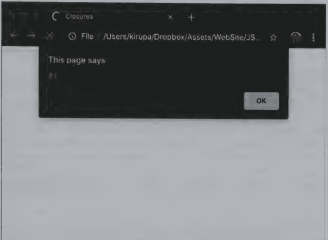

图 9.7

作为函数调用的 `timer` 变量。

换一种方式解释，我们有一个秒表，调用它，运行一些耗时操作，然后再次调用以查看该耗时操作花了多久。

现在我们已经看到小秒表在工作了，让我们看看究竟发生了什么。正如我几行前提到的，我们看到的很多内容与 `youSayGoodBye / andSayHello` 示例相似。但有一个让这个示例不同的转折，需要注意的重要部分是当 `getDelay` 函数返回给 `timer` 变量时发生了什么。

图 9.8 是这种情况的一个不完整可视化。


图 9.8

`stopwatch` 外部函数不再处于活动状态，且 `timer` 变量绑定到了 `getDelay` 函数。

`stopwatch` 外部函数不再起作用，`timer` 变量绑定到了 `getDelay` 函数。现在，转折点来了：`getDelay` 函数依赖存在于外部 `stopwatch` 函数上下文中的 `startTime` 变量：

```javascript
function stopwatch() {
  let startTime = Date.now();

  function getDelay() {
    let elapsedTime = Date.now() - startTime;
    alert(elapsedTime);
  }

  return getDelay;
}
```

当 `stopwatch` 函数消失时，`getDelay` 被返回给 `timer` 变量。

```javascript
function getDelay() {
  let elapsedTime = Date.now() - startTime;
  alert(elapsedTime);
}
```

回到外部的 `stopWatch` 函数，最后发生的事情是它退出之前返回了 `getDelay` 函数。我们可以看到，这里的代码与之前的示例非常相似。我们有一个外部函数，一个内部函数，并且外部函数返回了内部函数。

换一种方式解释，我们有一个秒表，调用它，运行一些耗时操作，然后再次调用以查看该耗时操作花了多久。

现在我们已经看到小秒表在工作了，让我们看看究竟发生了什么。正如我几行前提到的，我们看到的很多内容与 `youSayGoodBye / andSayHello` 示例相似。但有一个让这个示例不同的转折，需要注意的重要部分是当 `getDelay` 函数返回给 `timer` 变量时发生了什么。

图 9.8 是这种情况的一个不完整可视化。

`stopwatch` 外部函数不再处于活动状态，且 `timer` 变量绑定到了 `getDelay` 函数。

## 你的代码应该住在哪里？

```html
<!DOCTYPE html>
<html>
<head>
  <meta charset="utf-8">
  <title>这里有一个有趣的标题</title>
  <style>
  body {
    background-color: #EEE;
  }
  h1 {
    font-family: sans-serif;
    font-size: 36px;
  }
  p {
    font-family: sans-serif;
  }
  </style>
</head>
<body>
  <h1>你准备好面对这个了吗？</h1>
  <p>你准备好看到（或已经看到！）有以来最惊叹的对话了吗？</p>
  <script>
    alert("hello, world!");
  </script>
</body>
</html>
```

我们将后退一步，重新审视在同一个文档中将 HTML、CSS 和 JS 放在一起的这种安排是否在所有情况下都是都是合理的。为了简化我们对文档结构的描述，让我们把代码视图替换为更具……嗯，艺术感的视图……涉及到一些设计得非常精美的方框（图 10.1）。

### HTML + CSS

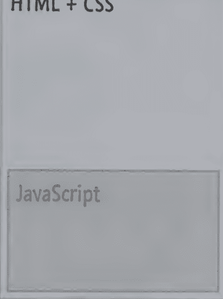

图 10.1

我们对网页的表示。

在这个世界里，唯一保护我们的 HTML 文档免受 JavaScript 影响的是几个 script 标签。现在，你的 JavaScript 不必住在我们的 HTML 文档内部。我们还有另一种方法，这种方法涉及一个独立的文件，我们所有的 JavaScript 将存在那里（图 10.2）。

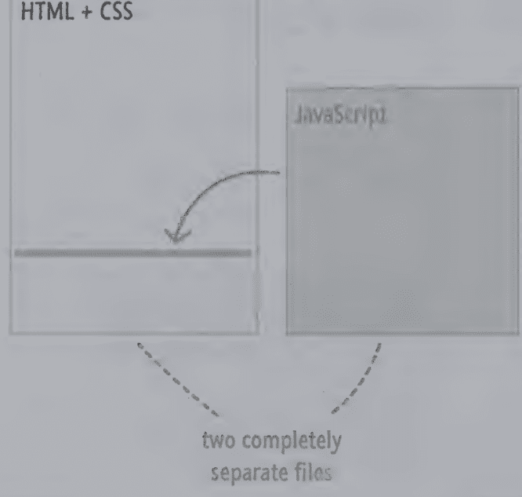

图 10.2
我们的 JS 住在它自己独立的文件中！

在这种方法中，我们的 HTML 文档内部没有任何实际的 JavaScript。我们仍然保留了 script 标签，但这个标签只是指向 JavaScript 文件，而不是包含一行又行的实际 JavaScript 代码。

需要注意的是，这些方法并不是互斥的。我们可以将这两种方法混合到同一个 HTML 文档中，采用一种混合方法，即既有外部 JavaScript 文件，也有完全包含在文档内部的 JavaScript 代码（图 10.3）。

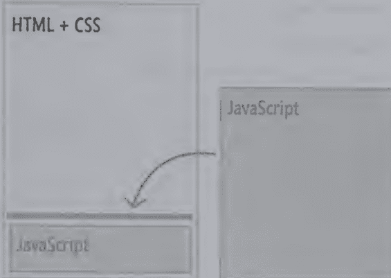

图 10.3

一种混合方法，我们的 JS 内容存在于几个不同的地方。

为了让事情更有趣，我们对这两种方法也有不同的变体，例如在 HTML 文档中拥有多个 script 部分、拥有多个 JS 文件等。在接下来的章节中，我们将更详细地查看这两种方法，并讨论在什么情况下你会选择其中一种而不是另一种。

等完成完这一切之后，你将对每种方法的优缺点有良好的理解，这样你就可以在网页和应用程序中对 JavaScript 做出正确的处理。

继续！

### 方法 #1：所有代码都住在你的 HTML 文档中

我们将查看的第一种方法是我们到目前为止一直使用的方法。这种方法是我们所有的 JavaScript 都住在 script 标签内，与你的 HTML 文档的其他部分一起：

```html
<!DOCTYPE html>
<html>
<body>
<h1>示例/</h1>
<script>
function showDistance(speed, time) {
  alert(speed * time);
}

showDistance(10, 5);
showDistance(85, 1.5);
showDistance(12, 9);
showDistance(42, 21);
</script>
</body>
</html>
```

当浏览器加载页面时，它会从上到下解析每一行 HTML。当它遇到 script 标签时，它将继续执行所有的 JavaScript 行。一旦完成对我们代码的执行，它将继续解析我们文档的其余部分。这意味着 script 标签在页面页面中的位置非常重要。我们将在以后查看“在正确的时间运行你的代码”章节时讨论这一点。

### 方法 #2：代码住在独立文件中

第二种方法是我们的主 HTML 文档不包含任何 JavaScript 内容。相反，我们所有的 JavaScript 都住在一个独立的文档中。这种方法包含两个部分：第一部分处理 JavaScript 文件；第二部分处理在 HTML 中引用这个 JavaScript 文件。让我们更详细地查看这两个部分。

#### JavaScript 文件

使这种方法生效的关键是包含我们 JavaScript 代码的独立文件。你给这个文件起什么名字并不重要，但它的扩展通常是 `.js`。例如，我的 JavaScript 文件叫做 `example.js`。


#### example.js

在这个文件中，你拥有的只有 JavaScript：

```javascript
function showDistance(speed, time) {
  alert(speed * time);
}
```

#### 引用 JavaScript 文件

一旦我们有了 JavaScript 文件，第二步（也是最后一步）是在 HTML 中引用它。

```html
<!DOCTYPE html>
<html>
<body>
<h1>示例/</h1>
<script src="example.js"></script>
</body>
</html>
```

如果我们的 JavaScript 文件在同一个目录下，我们可以使用相对路径：

```html
<!DOCTYPE html>
<html>
<body>
<h1>示例/</h1>
<script src="example.js"></script>
</body>
</html>
```

如果我们的 JavaScript 文件在另一个文件夹中，我们将修改路径：

```html
<!DOCTYPE html>
<html>
<body>
<h1>示例/</h1>
<script src="some/folder/example.js"></script>
</body>
</html>
```

如果我们的 JavaScript 文件嵌套在三个文件夹内部，我们可以使用绝对路径：

```html
<!DOCTYPE html>
<html>
<body>
<h1>示例/</h1>
<script src="https://www.kirupa.com/js/example.js"></script>
</body>
</html>
```

无论是相对路径还是绝对路径都可以正常工作。对于我们的 HTML 页面和脚本路径会变化的情况（例如在模板内部、服务端包含、第三方库等），我们使用绝对路径会更安全。

### 脚本、解析以及在文档中的位置

在之前的章节中，我简要描述了脚本是如何执行的。你的浏览器从顶部开始解析 HTML 页面。当遇到 script 标签时，它开始执行标签内部的代码。这种执行也是从上到下逐行完成的。如果 script 标签引用了外部 JavaScript 文件，浏览器会在执行其内容之前先下载该文件。

浏览器线性解析文档的行为有一些副作用，影响了你希望在文档中放置 script 标签的位置。从技术上说，你的 script 标签可以位于文档的任何地方。然而，你有一个首选的位置。由于浏览器解析页面并在执行脚本时会产生阻塞，所以你希望将 script 标签放在 HTML 文档的底部，即所有 HTML 元素之后。

如果你的 script 标签位于文档顶部，浏览器将在脚本运行时阻塞所有操作……如果你正在下载大型脚本文件或执行一个耗时较长的脚本，HTML 页面将无响应。除非你有很好的理由强制你的 JavaScript 在完整文档解析之前运行，否则请确保你的 script 标签像之前所有的示例所示出现在文档的末尾。将脚本放在页面底部还有另一个优势，但我将在以后讨论 DOM 和页面加载期间发生什么时解释它。


### 所以……应该使用哪种方法？

关于代码应该放在哪里，我们有两种主要方法（见图 10.4）。

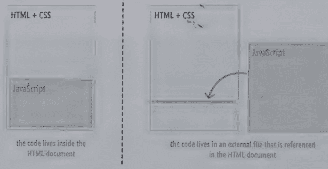

图 10.4
我们处理 JS 内容的两种主要方法。

你最终选择的方法取决于取决于你对以下问题的回答：**相同的代码是否会在多个 HTML 文档中使用？**

### 是的，我的代码将在多个文档中使用！

如果答案是**是**，那么你可能想将代码放在一个外部文件中，然后在所有希望执行该代码的 HTML 页面中引用它。你想要这么做的第一个理由是为了避免在多个页面中重复代码（图 10.5）。


图 10.5

拥有重复代码是一个问题！

重复代码会让维护变成一场噩梦，因为对脚本的任何更改都要求你对每一个 HTML 文档进行完全相同的更改。如果你在使用某种模板或 SSI 逻辑，即只有一个包含你脚本的 HTML 片段，那么维护问题就没那么严重了。

第二个原因与文件大小有关。当你的脚本在许多 HTML 页面中重复时，用户每当加载其中一个 HTML 页面，他们都会重新下载一遍你的脚本。对于较小的脚本来说，这不是什么问题，但一旦你的代码超过几百行，体积就会累积。

当你将所有代码合并到一个文件中时，你就不会遇到我刚才概述的那些了（图 10.6）。

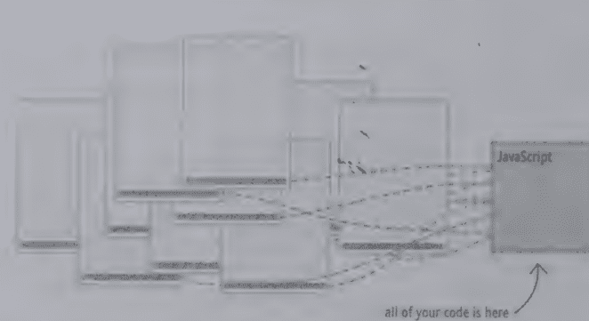

图 10.6

代码中的代码只有一个地方。

你的代码易于维护，因为你只需要在一个文件中更新代码。任何引用此 JavaScript 文件的 HTML 文档在加载时都会自动获得最新版本。通过将所有代码放在一个文件中，你的浏览器只会下载一次代码，并在后续访问时提供文件的缓存版本。

### 不，我的代码只在单个 HTML 文档中使用一次！

如果你对之前关于代码是否会在多个 HTML 文档中使用的问题回答是**否**，那么你可以随心所欲。你仍然可以选择将代码放在一个单独的文件中并在 HTML 文档中引用它，但这样做的好处远没有你之前在涉及多个文档的示例中看到的那么多。

在这种情况下，将代码完全放在你的 HTML 文档内部也可以的。你在网站上看到的大多数示例代码都在 HTML 文档本身中。我们的示例并不会在多个页面之间使用，它们也不会大到需要通过将所有代码放在单独位置来提高可读性。

### 极简要求

正如你所看到的，确定代码的去向这样一个看似简单的问题也需要很多页的解释和讨论。欢迎来到 HTML 和 JavaScript 的世界，在这里没有什么是非黑即白的。总之，回到本文的主题，典型的 HTML 文档将包含从外部位置加载的许多脚本文件。其中一些文件是你自己的；但另一些是由第三方创建并包含在你的文档中的。

此外，还记得我在最开始展示的混合方法吗？你的 HTML 文档既包含对单独 JavaScript 文件的引用，又包含文档内的实际代码。嗯，那种方法也很常见。最终，你使用什么方法完全取决于你。希望这一章为你提供了做出正确选择所需的信息。在第 36 章“页面加载事件和其他内容”中，我们将通过查看与页面加载相关的事件以及某些使事情复杂的特殊属性，进一步深入思考你在这里看到的内容。现在不要担心它们。

如果你有任何问题，请随时在 https://forum.kirupa.com 论坛上发布。我和其他人将乐意提供帮助！


## 控制台日志基础

当你编写代码时，经常会发现自己处于两种情况之一。一种情况是你怀疑你刚刚写的代码是否会运行。在另一种情况下，你知道代码在运行，但它运行得不对。有些地方出了问题……*某处*

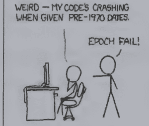

在这两种情况下，你需要的都是对代码正在的操作获得额外的可视性。一种提供这种可视性的持久方法是使用 alert 方法：

```javascript
let myButton = document.querySelector("#myButton");
myButton.addEventListener("click", doSomething, false);

function doSomething(e) {
  alert("Is this working?");
}
```

使用 alert 方法并不坏。它在简单情况下运行良好，但随着你的代码变得复杂，依赖它就不那么好了。起初，你可能会被不断弹出的对话框搞疯。在代码运行期间，你需要一种更方便的方式来查看信息。在教程中，我们将学习一种被称为控制台（console）的东西，它能帮助我们代码在做什么。

前进！

### 认识控制台

即使你认为自己写了完美的 JavaScript，也会花费大量时间在所谓的**控制台**。如果你以前没用过控制台，它是浏览器开发工具的一部分，可以让你看到并（偶尔）与之交互。它看起来有点像图 11.1 所示

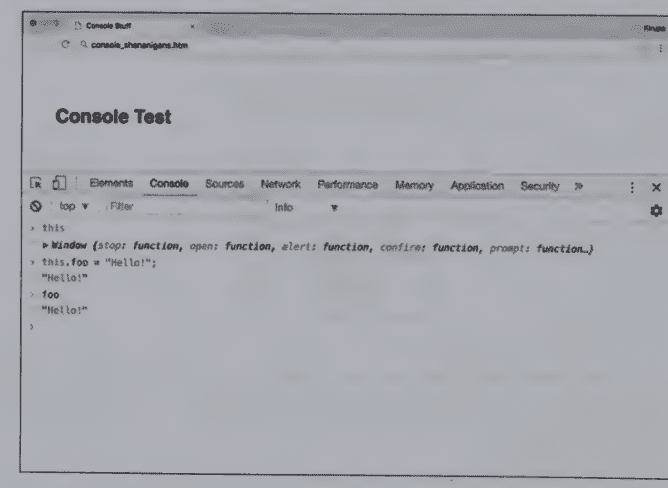

图 11.1

控制台。

从高层次来说，控制台可以帮助很多事情：

- 你可以读取代码记录并显示的消息
- 你可以通过设置或覆盖变量和值来修改应用程序状态
- 你可以检查任何 DOM 元素、应用样式或作用域代码
- 你可以将其作为虚拟代码编辑器并执行代码

在本文中，我们不会关注控制台能够完成的所有事情。相反，我们将采取简单的方法，让你逐渐使用控制台显示消息。我们最终会涵盖所有疯狂的控制台相关内容，所以不用担心。

### 显示控制台

我们首先要做的是让你的控制台出来。控制台是浏览器开发工具的一部分。你调出开发工具的方法是通过浏览器菜单或使用方便的快捷键。在浏览器内部，在 Windows 上按 Ctrl + Shift + I 或在 Mac 上按 Cmd + Alt + I 来调出开发工具。

根据你的浏览器和平台，你的每个开发工具看起来会有所不同。重要的是找到 Console（控制台）标签并确保控制台已显示。

当你在 Chrome 中调出控制台时，你会看到像图 11.2 所示的内容。

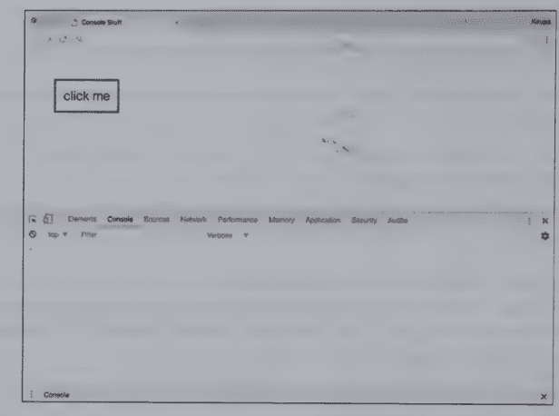

图 11.2

Chrome 控制台。

在 Safari 上，控制台看起来有点像图 11.3。


图 11.3

Safari 控制台。

Firefox 的控制台看起来如图 11.4 所示。

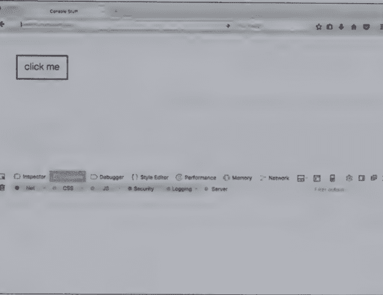

图 11.4
Firefox 控制台。

在 Microsoft Edge 中打开控制台看起来就像图 11.5 所示。


图 11.5
Edge 控制台。

我想强调的一点是，使用哪种浏览器并不重要。控制台在所有浏览器中的外观和功能几乎完全相同。只需在你喜爱的浏览器中打开控制台，准备在接下来的章节中开始实际使用它即可。

### 如果你想跟随学习

现在，你只需要阅读以下章节，就可以不费吹灰地学习大量与控制台相关的知识。如果你想这样做，请跳过所有内容并直接跳转到下一节。

另一方面，如果你想亲自动手并在屏幕上看到一些控制台的奇妙操作，请创建一个新的 HTML 文档并将以下 HTML、CSS 和 JavaScript 添加到其中：

```html
<!DOCTYPE html>
<html>
<head>
<title>Console Stuff</title>
<style>
#container {
  padding: 50px;
}
myButton {
  font-family: sans-serif;
  font-size: 24px;
  font-weight: lighter;
  background-color: #FFF;
  border: 3px #333 solid;
  padding: 15px;
}
myButton:hover {
  background-color: aliceblue;
}
</style>
</head>
<body>
<div id="container">
  <button id="myItem">click me</button>
</div>
<script>
  let myButton = document.querySelector("#myItem");
  myButton.addEventListener("click", doSomething, false);

  function doSomething(e) {
    alert("Is this working?");
  }
</script>
</body>
</html>
```

我们在这里拥有一个非常简单的 HTML 页面，带有一个可以点击的按钮。当你点击按钮时，会弹出一个警告框（就是我们之前描述的那个）。在接下来的章节中，我们将修改这个示例，帮助让一些控制台相关的内容活跃起来！

### 控制台日志 101

我们要做的第一件事是告诉控制台在屏幕上显示内容。这与我们之前使用的 `alert` 语句没有区别，而且几乎一样简单。这一切的关键在于 Console API。该 API 包含许多属性和方法，允许你以各种方式向控制台显示内容。在这些属性和方法中，第一个可能也是最流行的就是 `log` 方法。

### 认识 log 方法

在最基础的层面，使用 `log` 方法的方式如下：

```javascript
console.log("Look, ma! I'm logging stuff.")
```

你通过 `console` 对象调用它，并传递你想要显示的文本。为了看到效果，我们可以将示例中的 `alert` 替换为以下内容：

```javascript
function doSomething(e) {
  console.log("Is this working?");
}
```

当你运行这段代码时，点击 **click me** 按钮后查看你的控制台。如果一切运行正常，你将看到如图 11.6 所示，在内部显示了“Is this working?”文本。

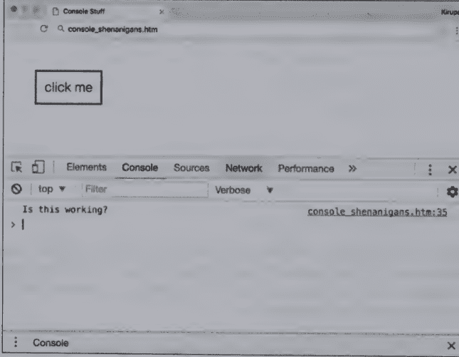

图 11.6
***click me** 按钮显示了！*

如果你继续点击按钮，你将看到更多的“Is this working?”被记录，如图 11.7 所示。

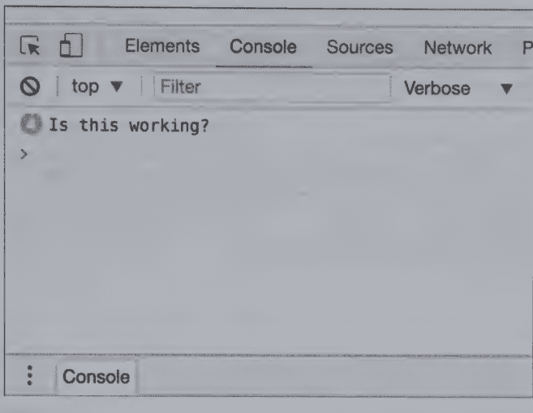

每次点击按钮最终都会在我们的控制台中得到体现。

### 超越预定义文本

现在你已经了解了基础知识，让我们深入浅一点。在使用控制台时，你并不局限于打印某些预定义的文本。例如，你可能会做的一种常见操作是打印通过评估表达式或访问值而产生的值。为了理解我们的意思，请对你的 `doSomething` 函数进行如下更改：

```javascript
function doSomething() {
  console.log("We clicked on: " + e.target.id);
}
```

我们在这里做的是告诉控制台在显示“We clicked on”文本的同时，还显示我们点击的元素的 id 值。如果你在浏览器中预览这些更改，点击 click me 按钮，并在图 11.8 中查看结果。

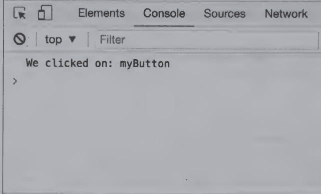

图 11.8
*id 值显示了！*

### 显示警告和错误

现在，警告和错误有一些酷酷的地方。与 `log` 方法不同，它们在控制台中的外观不同。例如：

```javascript
let counter = 0;

function doSomething(e) {
  counter++;

  if (counter == 3) {
    console.warn("This is a warning!");
  } else if (counter == 5) {
    console.error("This is an error!");
  }
}
```

运行这段代码时，你将在图 11.9 中看到警告和错误的样子。

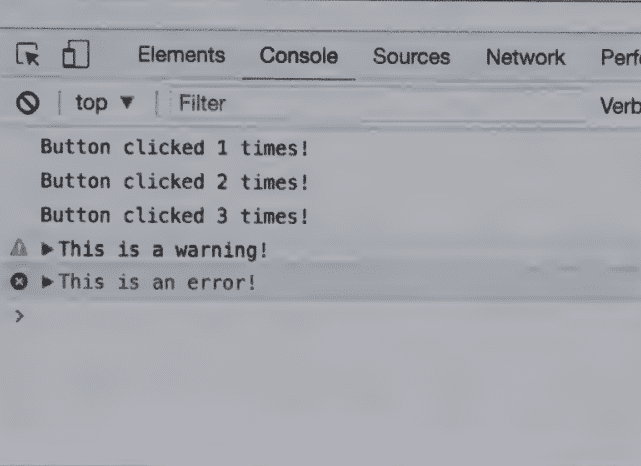

图 11.9
*显示了警告和错误！*

### 核心内容

控制台为你提供了理解代码正在做什么的最佳工具之一。显示消息只是控制台允许你的操作的一部分之一。在我们对消息的狭窄关注范围内，还有很多内容可以涵盖。我们稍后会介绍更多控制台的功能，但你在这里看到的这几项技术将对你发现和修复 bug 有很大帮助。

如果你有任何问题，请随时在 https://forum.kirupa.com 论坛上发布。我和其他人将非常乐意提供帮助！


## 关于披萨、类型、原始类型和对象

是时候认真的了。说认真的！在过去的几个章节中，我们一直在处理各种值。我们处理过字符串（文本）、数字、布尔值（又称 true 和 false）、函数以及 JavaScript 语言中其他各种内置内容。

以下是一些示例，借此唤醒我们的记忆：

```javascript
let someText = "hello, world!";
let count = 50;
let isActive = true;
```

与其他语言不同，JavaScript 使得指定和使用这些内置内容变得非常容易。我们甚至不需要思考或提前计划来使用其中任何一个。尽管使用这些不同类型的内置内容如此简单，但有很多细节是向我们隐藏的。了解这些细节很重要，因为它们不仅有助于我们更轻松地理解代码，还可能帮助我们在事情没有按预期工作运行时，更快地定位问题所在。

现在，正如你可能猜到的，**内置项**（built-in-things）并不是描述 JavaScript 中可以使用的各种值的准确方式。对于你在代码中使用的各种值有一个更正式的名称，那个名字就是**类型**（types）。在本章中，你将对它们是什么有一个浅显的介绍。

前进吧！

### 我们先聊聊披萨

不，我没有完全疯。因为我总是在吃某种东西（或者在想吃东西），所以我将尝试通过先解释披萨这个简单得多的，来解释类型这个神秘的世界。

如果你已经有一段时间没吃披萨了，这就是典型的披萨看起来的样子：

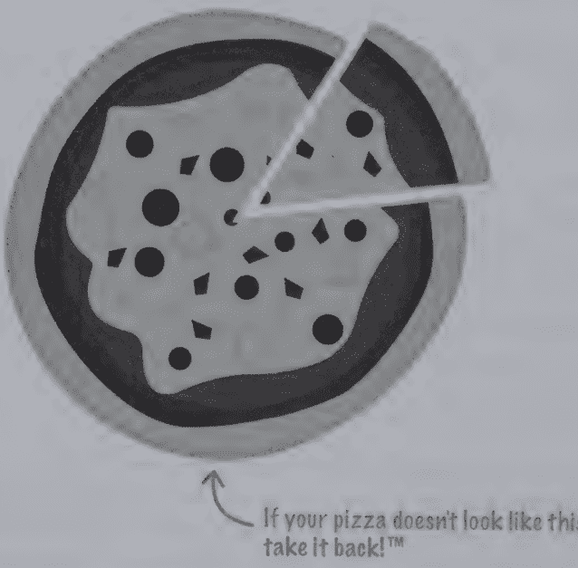

如果你的披萨看起来不像这样，就把它退回去！™

披萨并不会凭空变成这样。它是由其他的成分制成的——有些是简单的，有些则不简单：


简单的成分很容易识别。这些将是你的**蘑菇和墨西哥辣椒**。这些之所以之所以简单，是因为你无法进一步拆分这些成分：


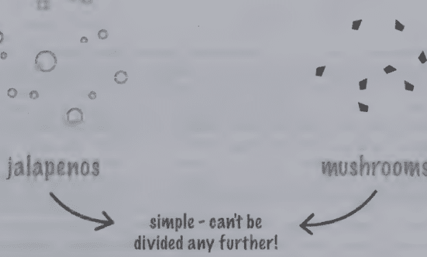

它们不需要经过加工。它们不是由其他简单成分组成的。就像那个哥汉一样，它们只是保持现状。

不那么简单、复杂的成分就是你的**奶士、酱料、饼底**以及**意大利肠**。由于各种原因，这些比简单的……嗯……简单的东西更复杂。这些复杂的成分是由**其他成分**组成的：


饼底


酱料


意大利肠


类奶酪物质

对我们所有人来说不幸的是，世界上并没有一种叫做奶酪或意大利肠的简单成分。我们需要组合、加工并添加更多成分，来制作我们在这里看到的某些复杂成分。在讨论复杂成分时有一个微妙的细节：它们的组成不仅限于简单成分。复杂成分也可以由其他复杂成分组成。太令人惊叹了！！！

### 从披萨到 JavaScript！

虽然这可能难以置信，但上一节课我们中学关于披萨的所有知识都是有目的的。对简单复杂成分的描述非常完美地适用于 JavaScript 中的类型。每一个单独的成分都可以被视为你可以使用的类型的对应物（图 12.1）。

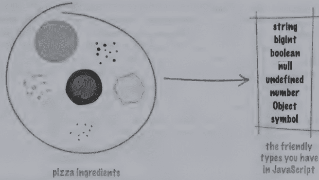

```
string
bigint
boolean
null
undefined
number
Object
symbol
```

图 12.1

JavaScript 中拥有的简单类型列表。

就像我们披萨里的奶酪、酱料、意大利肠、蘑菇和培根一样，JavaScript 中的类型有 string、boolean、null、undefined、bigint、symbol 和 Object。这些类型中的某些你可能已经非常熟悉，而有些可能并不熟悉。虽然我们将在未来的章节中详细详细查看所有这些类型，但表 12.1 提供了它们用途的简要总结。

### 表 12.1 类型

| 类型 | 作用 |
| :--- | :--- |
| string | 处理文本的基本结构 |
| number | 如你所猜的，它允许你处理数字 |
| boolean | 当你使用 true 和 false 时变得活跃起来 |
| null | 代表数字世界的“无”……或者哞：P |
| undefined | 虽然与 null 类似，但当一个值应该存在但不存在时返回……例如当你声明一个变量但没有给它分配任何值 |
| bigint | 允许你处理非常大或非常小的数字，这些数字超过了典型“number”支持的范围 |
| symbol | 唯一且不可变的（不能更改），你可以可选作为对象属性的标识符 |
| Object | 作为其他类型（包括其他对象）的外壳 |

现在，虽然每个类型在功能上都是相当独特的，但它们有一个共同所属的简单分组。就像你披萨的简单和复杂成分一样，我们的类型也可以是简单或复杂的。在，涉及涉及 JavaScript 术语中，简单和复杂更正式地被称为**原始值**（primitive）和**对象**（object）。另一种说法是，JavaScript 中的类型要么被称为**原始类型**（或 *primitives*），被称为**对象类型**（或直接称为 *objects*）。

我们的原始类型是 string、number、boolean、null、bigint、symbol 和 undefined 类型。任何属于它们范畴的值都无法进一步拆分。它们是 JavaScript 世界中的墨西哥辣椒和蘑菇。原始值非常容易定义并归类到可以理解的东西中。它们没有深度，当我们遇到它们时，基本上就能看到它们所呈现的样子。

我们的对象类型（在表中由 `Object` 表示）要稍微神秘一些，因此在向你介绍所有这些类型的细节之前，我们最后想要涵盖的内容是 JavaScript 中的对象到底是什么。

### 什么是对象？

在像 JavaScript 这样的编程语言中，对象的概念很好地映射到现实世界的对应物。在现实世界中，你确实被对象包围着。你的电脑是一个对象。书架上的书是一个对象。土豆（可以争论地）是一个对象。你的闹钟是一个对象。你在 eBay 上买的一张海报也是一个对象。我可以一直说下去，但（为了大家好），我在此此结束。有些像镇纸纸之类的对象没做什么：


它们只是呆在那儿。其他对象，比如电视机，则超越了仅仅存在的召唤，做了很多事情：


一台典型的电视接收输入，允许你开启或关闭、切换频道、调整音量，并执行各种电视功能。

需要意识到的是对象具有不同的形状、大小和用途。尽管存在差异，但在高层面上，所有对象都是相同的。它们是一种**抽象**（abstraction）。它们为你提供了一种易于使用的方法，而无需担心盖子下面是什么。即使是最简单的对象也隐藏着某种你完全不需要担心的复杂性。

例如，你的电视里装了什么或者使用了什么种胶水将一切固定在一起并不重要。这些是不必要的细节。你关心的只是电视执行了它的指令。当你想让它切换频道时，频道就应该切换。当你调整音量时，音量就应该调整。其他一切都是噪音。

基本上，把对象想象成一个黑盒。它有一些预定义的/文档说明的功能。它是如何做的是你无法轻易看到的。它是如何施魔的只要它能运行，你也不真正在乎。当我们以后学习实际创建对象的内部时会改变这种观念，但让我们现在沉浸在这个简单而快乐的世界吧。

### JavaScript 中漫游的预定义对象

除了你之前看到的内置类型外，在 JavaScript 中还有一些预定义对象是可以开箱即用的。这些对象允许你处理从数据集合到日期再到文本和数字的一切。表 12.2 列出了这些对象，并像之前一样，提供了关于它们用途的简短描述：

### 12.2 对象

| 类型 | 作用 |
| :--- | :--- |
| Array | 帮助存储、检索和操作数据集 |
| Boolean | 作为布尔原始值的包装；仍然非常 true true 和 false |
| Date | 允许更方便地表示和处理日期 |
| Function | 允许你调用代码以及其他深奥的东西 |
| Math | 组中的书呆蛋，帮助你更好地处理数字 |
| Number | 作为数字原始值的包装 |
| RegExp | 为文本中的模式匹配提供大量功能 |
| String | 作为字符串原始值的包装 |

```javascript
// 一个布尔对象
let booleanObject = new Boolean(true);
```

```javascript
// 无穷
let unquantifiablyBigNumber = Number.POSITIVE_INFINITY;
```

```javascript
// 一个字符串对象
let hello = new String("Hello!");
```

你可能会对字符串、布尔、符号、大Int 和数字这些原始类型的存在感到困惑。从表面上看，这些类型的对象形式和原始形式看起来非常相似。这里有一个例子：

```javascript
let movie = "Pulp Fiction";
let movieObj = new String("Pulp Fiction");

console.log(movie);
console.log(movieObj);
```

你将看到输出的内容是完全相同的。但在表面之下，`movie` 和 `movieObj` 是完全不同的。一个确实是字符串类型的原始类型，而另一个是 Object 类型。这导致了一些有趣（可能难以理解）的行为，我将在探索目前为止我们过的几种内置类型时，逐步涉及到这些问题。

### 核心概念

如果你觉得这像是一部电影在事情变得有趣时突然结束了，我不怪你这么想。主要的结论是：你的**原始类型（primitives）**构成了代码中最基础的类型。你的**对象（objects）**要复杂得多，由其他的原始类型或对象组成。稍后当我们深入学习时会看到更多内容。除此之外，我们学习了常见内置类型的名称以及关于它们的所有基础知识。

在随后的章节中，你将对所有这些类型进行更深入的观察，以及处理它们时的细微差别。把这一章看作平和的入匝道，它会突然把你带到疯狂过山车的轨道上。


## 数组 (ARRAYS)

想象你正在纸上写下一个列表。我们把这张纸称为“购物清单（groceries）”。现在，你在纸上写了一个从零开始的编号列表，列出了所有属于那物品，如图 13.1 所示。

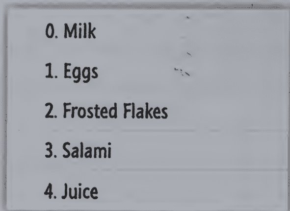

> 这种字迹真工整！

图 13.1
一个类似于购物清单的物品列表。

通过简单创建一个列表，你现在拥有的就是数组的现实示例！名为“购物清单”的纸就是你的**数组**。你需要购买的物品被称为**数组值（array values）**。

在教程中，你将学习关于我喜欢去买菜的所有知识。你可能会间接接触到非常常见的内置类型：数组。

继续前进！

### 创建数组

如今酷孩子们创建数组的流行方式是使用一对中括号。下面是我们初始化为空数组的 `groceries` 变量：

```javascript
let groceries = [];
```

你在左侧有变量名，右侧有一对中括号，将该变量初始化为空数组。这种使用括号创建数组的方法通常被称为**数组字面量表示法（array literal notation）**。

现在，你通常想在最开始时创建一个包含某些物品的数组。要创建这些非空数组，将你想要的物品放在括号内，并用逗号隔开：

```javascript
let groceries = ["Milk", "Eggs", "Frosted Flakes", "Salami", "Juice"];
```

注意，我的 `groceries` 数组现在包含了牛奶、鸡蛋、冷冻玉米片、萨拉米香肠和果汁。我必须再次强调逗号有多重要。如果没有逗号，你将只会得到一个巨大的项目。好了，现在你已经学会了如何声明数组，让我们看看如何实际使用它来存储和处理数据。

### 访问数组值

数组的优点之一是你是你不仅可以轻松地访问数组，还可以轻松地访问数组的值……就像在你的购物清单上高亮某一项（图 13.2）。

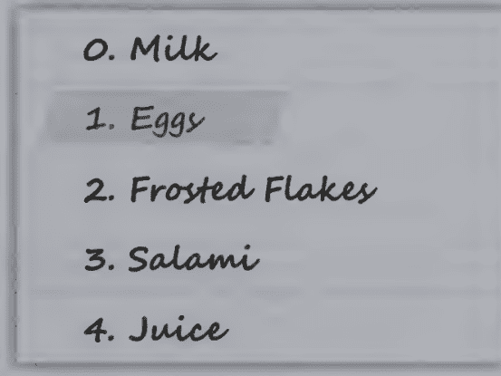

图 13.2
数组允许你选择性地访问单个项目。

你只需要知道访问某个项目的程序是什么。

在数组内部，每个项目都被分配了一个从零开始的数字。在图 3.2 中，牛奶被赋予值 0，鸡蛋被值 1，玉米片被赋予值 2，以此此类推。这些数字的正式术称为**索引值（index value）**。

假设我们的 `groceries` 数组声明如下：

```javascript
let groceries = ["Milk", "Eggs", "Frosted Flakes", "Salami", "Juice"];
```

如果我想从数组中访问一个项目，我只需要传入我感兴趣的项目的索引值即可：

```javascript
groceries[1]
```

索引值通过方括号传递给你的数组。

### 向数组中添加项目

注意，当使用 `unshift` 和 `push` 向数组中添加项时，该方法调用的返回值是数组的新长度。然而，当你调用 `pop` 和 `shift` 方法时情况并非如此！当你使用 `shift` 和 `pop` 移除项时，方法调用返回的是被移除的项本身。

### 在数组中查找项

要在数组内部查找项，你有几个内置方法：`indexOf`、`lastIndexOf`、`includes`、`find`、`findIndex` 和 `filter`。为了简单起见，我们主要关注 `indexOf` 和 `lastIndexOf`。这两个方法通过扫描数组并返回匹配元素的索引位置来工作。

`indexOf` 方法返回你搜索的项第一次出现的位置：

```javascript
let groceries = ["Milk", "Egs", "Frosted Flakes", "Salami", "Juice"];
let result = groceries.indexOf("Egs");
console.log(result); // 1
```

注意 `result` 变量存储了对 `groceries` 数组调用 `indexOf` 的结果。要使用 `indexOf`，我传入了正在查找的元素以及开始查找的索引位置：

```javascript
groceries.indexOf("Egs", 0);
```

在这种情况下，`indexOf` 返回的值为 1。

`lastIndexOf` 方法在用法上与 `indexOf` 类似，但在找到元素时的返回值略有不同。`indexOf` 找到你搜索的元素的第一次出现，而 `lastIndexOf` 找到你搜索的元素的最后一次并返回该元素的索引位置。

当你搜索一个数组中不存在的元素时，`indexOf` 和 `lastIndexOf` 都会返回 -1。

### 合并数组

我们要做的最后一件事是查看如何由两个独立数组组成的新数组。假设你有两个名为 `good` 和 `bad` 的数组：

```javascript
let good = ["Mario", "Luigi", "Kirby", "Yoshi"];
let bad = ["Bowser", "Koopa Troopa", "Goomba"];
```

要将这两个数组合并为一个数组，在你想扩大的数组上使用 `concat` 方法，并将你想合并的数组作为参数传递进去。返回将是一个包含 `good` 和 `bad` 内容的新数组：

```javascript
let goodAndBad = good.concat(bad);
console.log(goodAndBad);
```

在这个示例中，因为 `concat` 方法返回一个新数组，`goodAndBad` 变量最终变成了一个存储拼接结果的数组。`goodAndBad` 内部元素的顺序是 `good` 在先，`bad` 在后。

### 映射、过滤和减少数组

到为止，我们查看了添加项、移除项和其他基础计数任务的方法。数组提供的其他特性之一是非常简单的方法来操作其中的数据。这些简单的方法通过 `map`、`reduce` 和 `filter` 方法提供。

### 传统方法

在讨论 `map`、`reduce` 和 `filter` 以及它们如何让访问和操作数组内部数据变得异常简单之前，让我们先看看这种不轻松的方法。这种方法通常涉及 `for` 循环、跟踪你在数组中的位置，并流下若干的泪水。

为了看到实际效果，假设我们有一个名称数组：

```javascript
let names = ["marge", "homer", "bart", "lisa", "maggie"];
```

这个 `names` 数组包含一组目前全小写的名称列表。我们要做的是将每个单词的首字母大写，让这些名字看起来更规范。使用 `for` 循环方法可以这样实现：

```javascript
let names = ["marge", "homer", "bart", "lisa", "maggie"];
let newNames = [];

for (let i = 0; i < names.length; i++) {
  let name = names[i];
  let firstLetter = name.charAt(0).toUpperCase();
  newNames.push(firstLetter + name.slice(1));
  console.log(newNames);
}
```

注意，我们遍历了每一个项，将首字母大写，并将正确大写后的名称添加到名为 `newNames` 的新数组中。这里并没有魔法或复杂的事情，但你经常会发现自己在获取数组中的项，为了某些目的处理（或访问）这些项，并返回一个带有处理后数据的新数组。这是一个非常常见的任务，包含大量的样板代码，而你会不断重复地复制它们。在大型代码库中，理解循环中发生了什么会增加不必要的开销。这就是为什么引入 `map`、`filter` 和 `reduce` 的原因。你获得了使用 `for` 循环的所有灵活性，而没有了不想要的副作用和额外代码。谁会想要这个呢？

### 使用 Map 修改每个数组项

我们将查看的用于操作数组数据的第一个数组方法是 `map`。我们将使用 `map` 方法获取数组中的所有项，并将它们修改为另一个完全独立的新数组（图 13.6）。

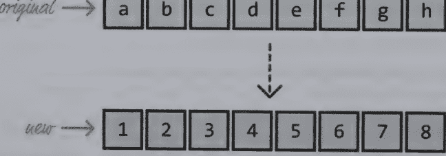

图 13.6
原始数组和新数组！

它的用法如下：

```javascript
let newArray = originalArray.map(someFunction);
```

这一行代码看起来很漂亮友好，但它隐藏了许多复杂性。让我们揭秘一下。`map` 的工作原理是：你调用想要影响的数组（`originalArray`），它接收一个函数（`someFunction`）作为参数。该函数会在数组的每个项上运行——允许你编写代码按需修改每个项。结果是一个新数组，其内容是 `someFunction` 运行原始数组中每个项并可能修改的结果。听起来挺简单的对吧？

使用 `map`，让我们回到之前的问题：从数组中提取小写名称并将其正确地大写。我们先看完整代码，接下关注有趣的细节。完整代码如下：

```javascript
let names = ["marge", "homer", "bart", "lisa", "maggie"];

function capitalizeIt(item) {
  let firstLetter = item.charAt(0).toUpperCase();
  return firstLetter + item.slice(1);
}

let newNames = names.map(capitalizeIt);
console.log(newNames);
```

花点时间看看它是如何工作的。有趣的部分是作为参数的 `capitalizeIt` 函数。该函数在每个项上运行，注意原始数组从未被修改过。在函数内部，我们可以编写任何代码来操作该项：

```javascript
function capitalizeIt(item) {
  let firstLetter = item.charAt(0).toUpperCase();
  return firstLetter + item.slice(1);
}
```

就是这样。在所有代码运行之后，`map` 返回一个包含所有大写项的新数组。原始数组保持不变，请记住这一点。

### 认识回调函数

我们的 `capitalizeIt` 函数也有更通用的名称。那个名字是**回调函数**（callback function）。回调函数是一个执行两件事的函数：

- 它作为参数传递给另一个函数
- 它在另一个函数的内部被调用

你会经常看到回调函数的引用——例如我们等会儿看 `filter` 和 `reduce` 的时候。如果你是第一次听到它们，你现在对它们是什么有了更好的了解。如果你以前听过，那么……祝你真棒。

### 过滤项

对于数组，你经常会发现自己在根据给定的标准来过滤（即移除）项（图 13.7）。

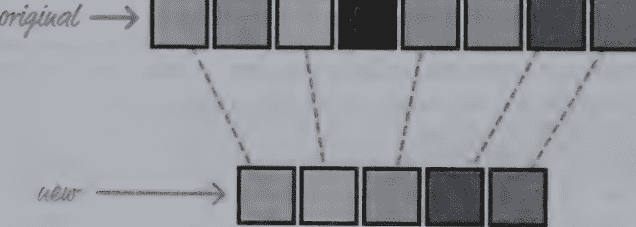

图 13.7
我们从许多项开始，最后剩下的项更少。

例如，假设我们有一个数字数组：

```javascript
let numbers = [1, 2, 3, 4, 5, 6, 7, 8, 9, 10, 11, 12];
```

现在，我们的 `numbers` 数组既有偶数也有奇数。假设我们想忽略所有奇数，只看偶数。我们可以这样做的方法是使用数组的 `filter` 方法并过滤掉所有奇数，只留下偶数。

我们使用 `filter` 方法的方法与使用 `map` 类似。它接受一个参数，即回调函数，这个函数将决定每个数组项是否会被过滤掉。当我们看某些代码时，这会变得更有意义。看看下面的代码：

```javascript
let numbers = [1, 2, 3, 4, 5, 6, 7, 8, 9, 10, 11, 12];

let evenNumbers = numbers.filter(function (item) {
  return (item % 2 == 0);
});

console.log(evenNumbers);
```

我们创建了一个名为 `evenNumbers` 的新数组，用于存储在 `numbers` 数组上运行 `filter` 的结果。得益于我们的回调函数检查每个项，该数组的内容将只有偶数，它检查 `item % 2`（即检查除以 2 的余数）是否为 0。如果回调函数返回 `true`，该项就会带入过滤后的数组；如果回调函数返回 `false`，该项将被忽略。

这里需要注意的一点是，我们的回调函数并不是像我们之前看到的 `capitalizeIt` 函数那样一个显式命名的函数。它仅仅是一个匿名函数，但仍然完成了任务。你会在经常需要指定回调函数的地方看到这种匿名形式，因此请熟悉这种定义函数的风格。

### 从项数组中获取单个值

我们将要查看的最后一个数组方法是 `reduce`。这是一个奇特的新方法。通过 `map` 和 `filter`，我们从一个包含初始值集合的数组变成了另一个包含不同值集合的数组。使用 `reduce` 方法，我们仍然从数组开始，但我们最终得到的将是一个单个值（图 13.8）。

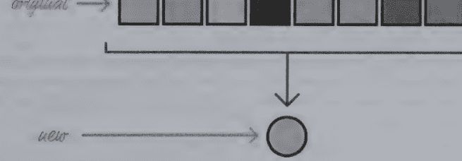

图 13.8
从多到……一！

这绝对是我们需要一个示例来解释发生了的情况的情况。

让我们复用之前的 `numbers` 数组：

```javascript
let numbers = [1, 2, 3, 4, 5, 6, 7, 8, 9, 10, 11, 12];
```

我们想做的是把这里所有的值加起来。这正是 `reduce` 方法的设计初衷，即我们将数组中的所有值归约为单个项。

```javascript
let total = numbers.reduce(function(total, current) {
  return total + current;
}, 0);

console.log(total);
```

我们可以对 `numbers` 数组使用 `reduce`，并向它传递了两个参数：

- 回调函数
- 初始值

我们从 0 这个初始值开始累加，我们的回调函数负责累加数组中的每一项。与之前回调函数只接受当前数组项作为参数不同，`reduce` 的回调函数稍微复杂一些。你在这里也需要处理两个参数：

- 第一个参数包含你目前为止所做的所有操作的总值
- 第二个参数是熟悉的当前数组项

通过使用这两个参数，你可以轻松地构建各种需要跟踪某物的场景。在我们的示例中，由于我们想要的只是数组中所有项的和，因此我们将 `total` 与 `current` 的值相加。最终结果将是 78。

### 关于回调函数参数的更多说明

对于 `map` 和 `filter`，我们只指定了一个代表当前数组项的参数。而对于 `reduce`，我们指定了两个参数，分别代表总值和当前项。我们的回调函数有两个可以指定的可选参数：

- 当前数组项的当前索引位置
- 你调用 `map`、`filter` 或 `reduce` 的数组

对于 `map` 和 `filter`，这些将是你指定的第二个和第三个参数。对于 `reduce`，它们将是第三和第四个参数。你可能一辈子都不需要指定这些可选参数，但如果你遇到了需要它们的情况，现在知道去哪里找它们了。

我们这里快结束了。让我们看一个显示 `reduce` 输出不是数字的示例。看看下面的代码：

```javascript
let words = ["Where", "do", "you", "want", "to", "go", "today?"];

let phrase = words.reduce(function(total, current, index) {
  if (index == 0) {
    return current;
  } else {
    return total + " " + current;
  }
}, "");

console.log(phrase);
```

在这个示例中，我们组合 `words` 数组的文本内容创建一个单个值，最终显示为 "Where do you want to go today?"。注意我们的回调函数中正在发生什么。除了将每个项组合成单词的工作外，我们还指定了代表当前项索引的可选第三参数。我们使用这个索引对第一个单词进行特殊处理，以决定是否在开头插入空格字符。

### 初探函数式编程

正如最后几个章节所强调的，`map`、`filter` 和 `reduce` 方法大大简化了我们处理数组的方式。这三个方法还触及了另一个巨大的领域。那个东西被称为函数式编程。函数式编程是一种编写函数的方式：

- 可以在内部工作
- 避免改变状态
- 返回相同的结果

函数式编程是一种编写代码的方式。更多细节我们现在先留以后，我们以后会看到。

无论如何，这些目前并不特别重要……目前唯一需要记住的一点是，你需要将字符串字面量封装在引号（`"`）或单引号（`'`）中，以将它们指定为文本区域。如果你不这样做，就会发生糟糕的事情，你的代码可能无法运行。

基础部分就这些了。有趣的内容来自于使用 JavaScript 提供的所有处理字符串的功能。我们将在后续章节中介绍这些更多内容。

### 字符串属性和方法

当我们处理字符串时，底层的 String 对象实现包含了许多属性，这些属性（通常）让处理文本变得更加简单。在接下来的章节中，我不会一个一个介绍所有的属性以免让我们两个无聊，我将只关注你将要执行的任务背景下重要的属性。

### 访问单个字符

虽然字符串看起来像一个整体的单元，但它实际上是由一系列字符组成的。我们可以通过几种方式访问每个字符。最常用的方法是使用数组/中括号表示法，并传入一个与字符索引位置相对应的数字：

```javascript
let vowels = "aeiou";
console.log(vowels[2]);
```

在这个例示例中，我们将看到字符 `i`，因为它是位于第二个索引位置的项。为了更好地可视化刚刚发生了什么，图 14.2 中的图将会有帮助。

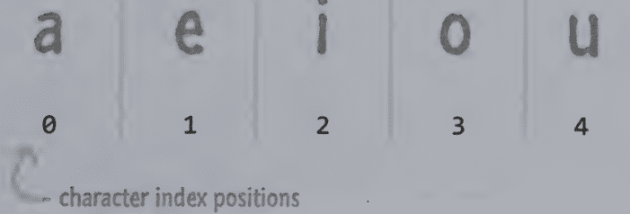

图 14.2
映射到索引位置的元音。

当提到“索引（index）”这个词时，我们应该记住这一点。JavaScript 中的索引位置从 0 开始并向上递增。这就是为什么我们的索引位置是 2，但该位置的元素计数实际上是 3。你越熟悉 JavaScript 以及其他不包含 Visual 和 Basic（它们的索引从 1 开始）的语言，这就会越不觉得奇怪。

进一步，我们可以通过循环索引位置来访问字符串中的所有字符。循环的开始将是 0，循环的结束将由字符串的长度决定。字符串的长度（即字符数）由 `length` 属性返回。

以下是上述段文字的执行示例：

```javascript
let vowels = "aeiou";

for (let i = 0; i < vowels.length; i++) {
  console.log(vowels[i]);
}
```

虽然我们可能并不总是遍历字符串，但使用 `length` 属性获取字符串中字符的计数是非常常见的。

如果我们不习惯数组/中括号表示法，我们也有 `charAt` 方法，它可以返回指定索引位置的字符：

```javascript
let vowels = "aeiou";
console.log(vowels.charAt(2));
```

结果与我们使用数组表示法看到的结果相同。除非你在乎像 Internet Explorer 7 这样非常老的浏览器，否则我不会使用这种方法。是的，我也认为你不在乎。

### 等等……什么？

如果你在好奇字符串原始类型（primitives）是否具有访问仅 String 对象才有的属性的能力，请收起你的好奇心，直到下一章，届时我们将更详细地讨论这个问题。

### 合并（又称拼接）字符串

要将两个字符串结合，我们可以直接使用 `+` 或 `+=` 运算符，就像相加一系列数字一样添加它们：

```javascript
let stringA = "I am a simple string.";
let stringB = "I am a simple string, too!";

console.log(stringA + " " + stringB);
```

注意在第三行中，我们同时相加 `stringA` 和 `stringB`。在它们之间，我们指定了一个空格字符（`" "`）以确保每个单独字符串之间有一个空格。你可以混合字符串字面量、原始类型和字符串对象，并仍然得到合并后的文本。

例如，这些全都是有效的：

```javascript
let textA = "Please";
let textB = new String("stop!");
let combined = textA + " make it " + textB;

console.log(combined);
```

尽管发生了所有的混合，合并变量的类型仅仅是字符串原始类型。

对于合并字符串，我们还有 `concat` 方法。我们可以从任何字符串调用此方法，并指定我们想要合并成一个……超大字符串的字符串原始类型、字面量和对象的序列：

```javascript
let foo = "I really";
let blah = "why anybody would";
let blarg = "do this";

let result = foo.concat("don't know", " ", blah, " ", blarg);

console.log(result);
```

在大多数情况下，直接使用 `+` 和 `+=` 方法来合并字符串。它比 `concat` 方法更快。在其他条件相同的情况下，谁不想让自己的代码获得额外的速度呢？

### 从字符串中提取子字符串

有时，我们感兴趣的是字符串中间某处的字符序列。帮助满足这一需求的两个属性是 `slice` 和 `substr`。假设我们有以下字符串：

```javascript
let theBigString = "Pulp Fiction is an awesome movie!";
```

让我们玩玩这个字符串。

### slice 方法！

`slice` 方法允许我们指定字符串的起始和结束位置。在这个示例中，我们提取了索引 5 到 12 之间的字符。结果将返回 `Fiction`。

```javascript
let theBigString = "Pulp Fiction is an awesome movie!";
console.log(theBigString.slice(5, 12));
```

结束位置不需要是正数。如果你为结束位置指定一个负值，则结束位置将从结尾开始计数：

```javascript
let theBigString = "Pulp Fiction is an awesome movie!";
console.log(theBigString.slice(0, -6));
```

如果我们指定一个负起始位置，则起始位置将从结尾开始计数：

```javascript
let theBigString = "Pulp Fiction is an awesome movie!";
console.log(theBigString.slice(-14, -7));
```

我们刚刚看到了 `slice` 方法的三种用法变。我从未使用过第一种版本。

### substr 方法！

我们将查看的另一种分割字符串的方法是 `substr` 方法。该方法同样接受两个参数：

```javascript
let newString = substr(start, length);
```

第一个参数是指定起始位置的数字，第二个参数是指定子字符串长度的数字。当我们看一些示例时，这就会更有意义：

```javascript
let theBigString = "Pulp Fiction is an awesome movie!";
console.log(theBigString.substr(0, 4)); // Pulp
```

我们从零位开始提取子字符串并数四个字符。这样就会返回 `Pulp`。如果只想提取单词 `Fiction`，我们的代码看起来应该是这样的：

```javascript
let theBigString = "Pulp Fiction is an awesome movie!"
console.log(theBigString.substr(5, 7)); // Fiction
```

如果我们不指定长度，返回的子字符串将是从起始位置到结束的字符串：

```javascript
let theBigString = "Pulp Fiction is an awesome movie!"
console.log(theBigString.substr(5)); // Fiction is an awesome movie!
```

我们可以传递给 `substr` 的值还有其他几种变体，但这些是主要的。

### 分割字符串/split

可以合并的东西，也可以被拆分。我我很确定某位智者曾这样说过。另一种拆分字符串的方法是使用 `split` 方法。在字符串上调用此方法会返回一个子字符串数组。这些子字符串由一个字符或正则表达式（简称 RegEx）分隔，我们用它来决定从哪里分割字符串。

让我们来看一个简单的示例，这更有意义：

```javascript
let inspirationalQuote = "That which you can concatenate, you can also split apart."
let splitWords = inspirationalQuote.split(" ");
```

在这个示例中，我们根据空格字符对这段富有启发性的文本进行了拆分。每遇到一个空格字符，该字符之前的剩余字符串就会被移除，并作为该方法返回的数组中的一项。

这是另一个示例：

```javascript
let days = "Monday,Tuesday,Wednesday,Thursday,Friday,Saturday,Sunday";
let splitWords = days.split(",");

console.log(splitWords[6]); // Sunday
```

我们有一个变量，它存储了一个仅由逗号分隔的日期字符串。如果我们想分离每一天，可以使用 `split` 方法，并将分隔符设置为逗号。最终结果是一个包含七个项的数组，每个项都是原始字符串中的星期。

你可能会惊讶地发现，自己会频繁地使用 `split` 方法来拆分字符序列，这些序列可能只是简单的句子，也可能是像从网络服务返回的数据那样复杂的内容。

### 在字符串内部查找内容

如果我们我们需要在字符串内部查找某个字符或多个字符，可以使用 `indexOf`、`lastIndexOf` 和 `match` 方法。让我们先来看 `indexOf` 方法。

`indexOf` 方法的作用是将我们要查找的字符作为参数。如果找到了我们要找，它会返回该字符在字符串中首次出现的索引位置。如果没有找到匹配项，该方法将返回 -1。让我们来看一个示例：

```javascript
let question = "I wonder what the pigs did to make these birds so angry";
console.log(question.indexOf("pigs")); // 18
```

我们正在尝试查看字符串中是否存在“pigs”。因为我们要找的内容存在，`indexOf` 方法告诉我们这个单词第一次出现于第 18 个索引位置。如果我们查找一个不存在的内容，比如这个例子中的字母 z，则会返回 -1：

```javascript
let question = "I wonder what the pigs did to make these birds so angry";
console.log(question.indexOf("z")); // -1
```

`lastIndexOf` 方法与 `indexOf` 非常相似。正如你可能从名称中猜的那样，`lastIndexOf` 返回的是你查找的内容最后一次出现的位置：

```javascript
let question = "How much wood could a woodchuck chuck if a woodchuck chuck wood?";
console.log(question.lastIndexOf("wood")); // 65
```

你还可以指定另一个参数来同时指定 `indexOf` 和 `lastIndexOf`。除了提供要查找的字符外，你还可以指定字符串上的一个索引位置作为搜索的起点：

```javascript
let question = "How much wood could a woodchuck-chuck if a woodchuck chuck wood?";
console.log(question.indexOf("wood", 30)); // 43
```

关于 `indexOf` 和 `lastIndexOf` 方法最后需要提到的是，你可以匹配字符串中出现的这些字符的任何实例。这些函数不会区分整个单词，也不会区分你所查找的内容是否是较大字符集的子字符串。请务必考虑到这一点。

在结束这些内容之前，让我们来看 `match` 方法。通过 `match` 方法，你拥有更多的控制权。该方法接受正则表达式（Regex）作为参数：

```javascript
let phrase = "There are 3 little pigs.";
let regexp = /[0-9]/;
let numbers = phrase.match(regexp);
console.log(numbers[0]); // 3
```

返回的结果也是一个匹配子字符串的数组，因此你可以利用数组的忍者技巧让处理结果变得轻而易举。学习如何使用正则表达式是我们以后会详细介绍的内容。

### 字符串的大写和小写

最后，让我们用一些不需要复杂操作简单内容来结束对字符串的介绍。要将字符串转换为大写或小写，我们可以使用命名适当的 `toUpperCase` 和 `toLowerCase` 方法。让我们来看这个示例：

```javascript
let phrase = "My name is Bond. James Bond.";
console.log(phrase.toUpperCase()); // MY NAME IS BOND. JAMES BOND.
console.log(phrase.toLowerCase()); // my name is bond. james bond.
```

看，我告诉过你这很简单！

### 极简内容

字符串是 JavaScript 中可用的少数基本数据类型之一，你刚刚看到了一个关于使用它们可以做的许多事情的良好概述。我一直回避的一个问题是，你的字符串原始类型似乎神秘地拥有所有这些仅属于对象（Objects）的属性。我们将在下一章讨论这个问题！

额外的资源和示例：

- *The Devovowelizer*: http://bit.ly/kiripaDeVowelize
- 字符串首字母大写化：http://bit.ly/kiripaCapLetter
- 反转字符串 10 种方法：http://bit.ly/kiripaWaysToReverseString

如果你有任何关于字符串的问题……或者只是对生活和通用 JavaScript 有任何问题，请前往 https://forum.kirupa.com 获取答案。

## 当原始类型表现得像对象时

正如我们之前在表中看到的，字符串也可以作为对象使用。创建对象有多种方法，但为字符串等内置类型创建对象的最常用方法是使用 `new` 关键字后跟 `String` 字：

```javascript
let name = new String("Batman");
```

当我们详细研究“对象”（Objects）时，你将对此图的具体含义有一个全面的概述，所以不用太担心在这里看到的内容。只需要知道任何原始类型（primitives）的对象形式都带有大量的功能。

### 为什么这很重要

让我们回到之前的那个困惑点。字符串是一个原始类型。原始类型如何能让你访问它的属性呢？答案在于 JavaScript 非常奇异。假设我们有以下字符串：

```javascript
let game = "Dragon Age: Origins";
```

`game` 变量显然是一个赋值给某些字面量文本的原始类型。如果我想访问这段文本的长度，我们会如下操作：

```javascript
let game = "Dragon Age: Origins";
console.log(game.length);
```

在评估 `game.length` 的过程中，JavaScript 会将原始字符串转换为一个对象。在短暂的时刻，你那低微的原始类型将变成一个漂亮的对象，以确定实际长度是多少。需要记住的是，这一切都是暂时的。因为这个临时对象在完成任务后没有根基也没有绑定到任何东西上，它就会消失，你留下了长度评估的结果（一个数字），而 `game` 变量仍然是一个字符串原始类型。

这种转换只发生在原始类型上。如果我们显式地创建一个 `String` 对象，我们创建的将作为对象永久保留。假设我们有：

```javascript
let gameObject = new String("Dragon Age: Origins");
```

在这种情况下，我们的 `gameObject` 变量显然指向一个类型为 `Object` 的东西。除非你修改字符串或其他其他原因导致引用改变，否则该变量将继续指向一个 `Object`。原始类型变为对象再变回原始类型是原始类型特有的现象。你的对象不会参与这种胡戏。

你可以通过检查数据类型来轻松验证我所说的一切。这是通过使用 `typeof` 关键字完成的。这里有一个使用它来确认我刚才告诉你的内容的例子：

```javascript
let game = "Dragon Age: Origins";
console.log("Length is: " + game.length);

let gameObject = new String("Dragon Age:Origins");
console.log(typeof game); // string
console.log(typeof game.length); // number
console.log(typeof gameObject); // object
```

现在，你不是很高兴学了这一切吗？

### 最基本的原理

希望这段简短的解释能帮你理解为什么我们的原始类型在需要时表现得像对象。在此时，你可能会有另一个问题，即为什么会有人设计出这种奇怪的语言。毕竟，如果一个原始类型在需要执行有用操作时变成对象，为什么不一直作为对象呢？答案与内存消耗有关。

正如我们之前讨论的，与简单的原始类型相比，原始类型的对象形式带有更多的包袱，所有指向额外功能的指针都会消耗资源。JavaScript 是一种折中。所有的字面量值如文本、数字和布尔值如果这样声明和/使用使用就会作为原始类型保留。只有在需要时，它们才会转换为各自的对象形式。为了确保我们的应用程序继续保持低内存占用，这些转换的对象在完成任务后会被迅速丢弃（如垃圾回收）。

有问题吗？前往 https://forum.kirupa.com 提问并从一群酷且友好的开发者同行那里获得答案。

## 数字

在 JavaScript 中，你大部分的时间将花在处理数字上。即使你没有直接处理数字，在执行最基础的任务（如计数、处理数组等）时，你也会间接遇到它们。

在本章中，我将通过观察如何使用数字来完成许多常见任务，来介绍 JavaScript 中的数字。在此过程中，我们将深入基础知识，广泛探索一些你可能会发现有用的有趣数字相关内容。

继续前进！

### 使用数字

为了使用数字，你所做的就是……好吧，使用它就好。下面是一个声明名为 `stooges` 的变量初始化为数字 3 的简单示例：

```javascript
let stooges = 3;
```

就这样。没有需要跨越的门槛。如果你想使用更复杂的数字，就像什么都没一样直接使用它们即可：

```javascript
let pi = 3.14159
let color = 0xFF
let massOfEarth = 5.9742e+24;
```

在上面的示例中，我使用了一个小数、一个十六进制和一个使用指数的非常大的值。最后，你的浏览器会自动处理好。注意，“正确处理”并不存在于正空间中。你也可以轻松地使用负数。要使用负数，只需在你想要转换为负值的数字前放置一个减号（`-`）字符：

```javascript
let temperature = -42;
```

你在这一节看到的内容构成了你实际使用数字的大部分。在接下来的几节中，让我们深入一点，看看你可以用数字完成的其他一些事情。

> **小贴士趣：JavaScript 中的数字**
>
> 如果你好奇为什么处理数字如此简单，原因是 JavaScript 并不看重数值类型。你不需要像在其他语言中可能需要的那样将数字声明为 `int`、`double`、`byte`、`float` 等类型。唯一的例外是你需要一个非常大或非常小的数字，那是 `BigInt` 派上用场的时候。以后我们会讨论 BigInt……某一天。
>
> 噢，还有……在 JavaScript 中，所有数字都会被转换为 64 位浮点数。

### 运算符

对数字的介绍是不完整的（……或者说是不开始），如果没有向你展示如何在代码中使用数学运算符来实现所学的内容。

### 执行简单的数学运算

在 JavaScript 中，你可以使用 `+`、`-`、`*`、`/` 和 `%` 分别进行加法、减法、乘法、除法和求余数。以下是这些运算符的示例：

```javascript
let total = 4 + 2;
let average = total / 2;
let doublePi = 3.14159;
let subtract = total - 5;
```

JavaScript 按照以下顺序评估表达式：

1. 括号
2. 幂
3. 乘
4. 除
5. 加
6. 减

有各种记忆法可以帮助你记住这个顺序。我小学时用的是“Please Excuse My Sally”（先乘除后加减）。

### 递减

你对数字常用的操作之一将按特定量增加或减少变量。下面是 i 增加 1 的示例：

```javascript
let i = 4;
i += 1;
```

你不必增减 1。你可以使用任何数字：

```javascript
let i = 100;
i -= 2;
```

这些不仅仅是加法或减法。你可以执行其他操作：

```javascript
let i = 100;
i /= 2;
```

你应该开始看到这里的模式。无论你使用什么运算符，你会注意到你正在累积地修改变量 `i`。由于你会频繁使用这种模式，你有一些运算符可以简化它（表 16.1）。

### 16.1 简化递增递减的运算符

| 表达式 | 功能 |
|---|---|
| `i++` | i 增加 1 (`i = i + 1`) |
| `i--` | i 减少 1 (`i = i - 1`) |
| `i += n` | i 增加 n (`i = i + n`) |
| `i -= n` | i 减少 n (`i = i - n`) |
| `i *= n` | 乘以 n (`i = i * n`) |
| `i /= n` | 除以 n (`i = i / n`) |
| `i %= n` | 求 i 除以 n 的余数 (`i = i % n`) |
| `i **= n` | 幂运算符，将 i 次 n次方 |

如果我在之前看到的三个示例中使用这些运算符，代码将如下：

```javascript
i++;
i -= 2;
i /= 2;
```

在我们结束之前，有一个你应该注意的怪癖。这关于增加或减少值为 1 的 `--` 和 `++` 运算符。`--` 和 `++` 出现在它们增加的变量之前还是之后是重要的。

让我们来看这个例子：

```javascript
let i = 4;
let j = i++;
```

执行这两行代码后，`i` 的值将是 5……正如你预期的那样。`j` 的值将是 4。注意在这个例子中，运算符出现在变量之后。

如果在变量前面使用运算符，结果就会有些不同：

```javascript
let i = 4;
let j = ++i;
```

`i` 的值将是 5。关键点在这里……`j` 的值也将是 5。这两个例子之间的区别在于运算符的位置。运算符的位置决定了返回的是自增后的值还是自增前的值。现在，学到这些你不很高开心吗？

### 十六进制和八进制值

除了十进制值外，你还可以使用十六进制（16进制）和八进制（8进制）值。在处理八进制值时，请确保你的数字以 0 开头：

```javascript
let leet = 002471;
```

对于十六进制值，你需要用 0x 开头数字：

```javascript
let leet = 0x539;
```

在很多情况下，你会发现自己在以字符串形式处理八进制和十六进制值。如果它们是字符串，你就不能像处理普通数字那样操作它们。你需要先将字符串转换为数字。

实现方法是使用 `parseInt` 函数：

```javascript
let hexValue = parseInt('FFFFFFFF', 16);
let octalValue = parseInt('011', 8);
```

`parseInt` 函数接收你的十六进制或八进制值，后面跟着你从中转换的基数。

### 特殊值—Infinity 和 NaN

我们将最后查看两个你会遇到的不是数值的全局属性。这两个值是 Infinity 和 NaN。

#### Infinity

你可以使用 `Infinity` 和 `-Infinity` 值来定义无限大或无限小的数字：

```javascript
let myLoveForYou = Infinity * 2;
```

你需要使用 `Infinity` 的概率非常小。相反，你可能会看到它作为代码执行的其他操作的一部分返回。例如，如果你除以 0，将返回 `Infinity`。

#### NaN

`NaN` 关键字代表“不是数字”（Not a Number），当你进行某些无效的数值操作时，就会返回它。例如，在以下情况下会返回 `NaN`：

```javascript
let nope = 1920 / "blah";
```

原因是你不能用一个数字除以一个字符串。在某些非人为的情况下也会看到这个值的返回，我们稍后会讨论。

### 从字符串转换为数字

有时，你的数字会埋在字符串内部。要获取关于这的所有信息，请阅读“从字符串到数字”教程。

### Math 对象

数字被用于各种数学表达式，而且它们往往超越了简单的加、减、乘、除。如果数学课只有这些，你当年的数学课会容易得多。为了帮助你更轻松地处理复杂的数值运算，你有了 `Math` 对象。这个对象为你提供了很多实用的函数和常量，我们将简要地查看该对象执行的一些功能。

### 这太无聊了！

我不骗你。光看 `Math` 对象提供的所有内容相当无聊。除非你现在真的想知道这一切，否则我更希望你只是快速浏览以下章节，并在需要时再查阅。`Math` 对象不会去任何地方（它没有朋友），所以它会在以后等着你。

### 常量

为了避免你必须显式地定义像 pi、欧拉常数、自然对数等数学常量，`Math` 对象为你定义了许多常用常量（表 16.2）。

### 表 16.2 常量

| 用法 | 代表含义 |
| :--- | :--- |
| `Math.E` | 欧拉常数 |
| `Math.LN2` | 2 的自然对数 |
| `Math.LN10` | 10 的自然对数 |
| `Math.LOG2E` | E 以 2 为底的对数 |
| `Math.LOG10E` | E 以 10 为底的对数 |
| `Math.PI` | 3.14159（我只记得这些，我懒得去查剩下的！） |

### 极简内容

关于 JavaScript 中的数字和 `Math` 对象的介绍章节就到此了。如你所见，没有比这更简单的了。JavaScript 提供了一种非常简单直接的方法来处理它们，而这一章让你简要了解了边缘情况，以防你以后需要用到。

这里是一些额外的资源和示例，可以帮助你更好地理解如何在 JavaScript 中使用数字：

- 从字符串转换为数字：http://bit.ly/kirupaStrToNum
- JS 中的随机数：http://bit.ly/kirupaRandom
- JS 中的高级随机数：http://bit.ly/AdvRNG
- 为什么我的数字相加结果不对：http://bit.ly/kirupaFPG
- JS 中的随机颜色：http://bit.ly/kirupaRandomColors

JavaScript 中的数字是一个有趣的话题，但有时也会让人困惑。如果你发现自己卡住了或感到困惑，可以在 https://forum.kirupa.com 上发帖寻求解答。

## 获取器 (GETTERS) 和赋值器 (SETTERS)

我们目前为止处理的属性被称为**数据属性**（data properties）。这些属性是我们给它们命名并分配一个值的属性：

```javascript
let foo = {
  a: "Hello",
  b: "Monday";
}
```

要读取该值，我们只需要直接访问它：

```javascript
console.log(foo.a);
```

给这个属性写入一个值也是我们预期的操作：

```javascript
foo.a = "Manic";
```

除了设置和读取值之外，遗憾的是我们实际上做不了更多事情了。现在，作为读取和写入属性的一部分，如果我们拥有以下能力将会：

- 保持我们现有的读写属性值的语法
- 获得在后台运行某些自定义代码的能力

那将很酷，对吧？事实证明，我们有能力做到这一切。这由另一种友好且勤奋的属性变体提供，它被称为**访问器属性**（accessor property）！在接下来的章节中，我们将学习它们，并遇到这场戏的真正主角——神秘的获取器和赋值器。

前进！

### 两个属性的故事

在表面上看，访问器属性和数据属性看起来非常相似。对于数据属性，你可以对属性进行读写：

```javascript
theObj.storedValue = "Unique snowflake!"; // 设置
console.log(theObj.storedValue); // 读取
```

对于访问器属性，你几乎可以完全相同的操作：

```javascript
myObj.storedValue = "Also a unique snowflake!"; // 设置
console.log(myObj.storedValue); // 读取
```

我们无法通过观察属性的使用方式来判断它是数据属性还是访问器属性。要区分它们，我们必须去属性实际定义的地方。看看下面的代码，我们在 `zorb` 对象内部定义了几个属性：

```javascript
zorb = {
  message: "Blah",
  get greeting() {
    return this.message;
  },
  set greeting(value) {
    this.message = value;
  }
}
```

首先是 `message`，一个普通的旧数据属性：

```javascript
zorb = {
  message: "Blah",
  get greeting() {
    return this.message;
  },
  set greeting(value) {
    this.message = value;
  }
};
```

我们知道这是一个数据属性，因为它只是一个属性名和一个值。没有其他操作。现在，有趣的事情发生了。我们的下一个属性是 `greeting`，它看起来不像我们以前见过的任何属性：

```javascript
let zorb = {
  message: "Blah",
  get greeting() {
    return this.message;
  },
  set greeting(value) {
    this.message = value;
  }
};
```

与我们在 `message` 中看到的简单名称和值对齐不同，`greeting` 属性被分为两个函数，前面分别跟有 `get` 或 `set` 关键字：

```javascript
let zorb = {
  message: "Blah",
  get greeting() {
    return this.message;
  },
  set greeting(value) {
    this.message = value;
  }
};
```

这些关键字和函数对分别被称为**获取器**（getters）和**赋值器**（setters）。特殊之处在于，我们不是作为函数来访问 `greeting`。我们像访问任何普通属性一样访问它：

```javascript
zorb.greeting = "Hola!";
console.log(zorb.greeting);
```

真正有趣的内容发生在获取器和赋值器层面，所以接下来我们将深入探讨它们。

### 认识获取器和赋值器

根据我们目前所知，获取器和赋值器只是行为像属性的函数的华丽名称。当我们尝试读取访问器属性（`zorb.greeting`）时，获取函数会被调用：

```javascript
let zorb = {
  message: "Blah",
  get greeting() {
    return this.message;
  },
  set greeting(value) {
    this.message = value;
  }
};
```

同样，当我们设置一个值（`zorb.greeting = "Hola!"`）时，赋值器会被调用：

```javascript
let zorb = {
  message: "Blah",
  get greeting() {
    return this.message;
  },
  set greeting(value) {
    this.message = value;
  }
};
```

### 属性值验证

我们最后一个查看的示例是我们的赋值器对发送的值进行验证：

```javascript
let person = {
  _name: "",
  _age: "",

  get name() {
    return this._name;
  },
  set name(value) {
    if (value.length > 2) {
      this._name = value;
    } else {
      console.log("名字太短了！");
    }
  },

  get age() {
    return this._age;
  },
  set age(value) {
    if (value < 5) {
      console.log("太小了！");
    } else {
      this._age = value;
    }
  },

  get details() {
    return "姓名: " + this.name + ", 年龄: " + this.age;
  }
}
```

### 极简指南

我们应该停止创建普通数据属性（data properties）并改用更高级的访问器属性（accessor properties）吗？并非如此。这取决于你当前的需求以及未来的潜在需求。如果你知道某个属性永远永远需要 getter 和 setter 提供的额外灵活性，你就可以继续将其保持为数据属性。如果你以后需要重新考虑这一点，从数据属性转换为访问器属性是完全在后台完成的。你我有能力改变这种状态，而无需改变属性本身的使用方式。很酷，对吧？

如果你发现自己在这部分的任何地方感到困惑或卡住了，可以在 https://forum.kirupa.com 发帖寻求解答。

## 深入观察对象

在第 11 章“关于披萨、类型、原始值和对象”介绍中，我们对 JavaScript 对象是什么以及如何思考它们有了一个非常高层次的概述。对于涵盖基础知识和一些内置类型来说，那已经足够了，但我们需要再深入一点。在本章中，我们将让之前的那个章节看起来像是一座巨大冰山的一角：

> 你对 JavaScript 对象一无所知……——Jon Snow！

我们在这里要做的是更详细地重新审视对象，并涉及一些更高级的话题，例如使用 `Object` 对象、创建我们自己的自定义对象、继承、原型以及 `this` 关键字。如果我为止列出的所有内容都没有意义，那么在我们读完本章之后，它们都会变得清晰……我保证。

继续吧！

### 认识 Object

在食物链的最底层，我们有一个内置类型，它为自定义对象以及 `Function`、`Array` 和 `RegExp` 等内置类型奠基础。除了 `null` 和 `undefined` 之外，几乎所有内容与 `Object` 直接相关，或者可以在需要时变成对象。

正如我们以前在对象介绍中所看到的，`Object` 带来的功能是非常有限的。它允许我们指定一组命名的键值对，我们亲切地称之为属性。这与其他语言中看到的哈希表（hashtables）、关联数组（associative arrays）和字典（dictionaries）等数据结构并没有太大区别。

总之，这些都非常无聊。我们将通过直接动手操作对象来学习更多关于对象的知识。

### 创建对象

我们首先看的是如何创建一个对象。有几种方法可以实现这一点，但现在的酷孩子们都在使用这种看起来很奇怪（但很紧凑）的对象字面量语法（object literal syntax）来创建对象：

```javascript
let funnyGuy = {};
```

没错。我们不需要像我们的老祖父辈那样输入 `new Object()`，而是通过说 `{}` 来初始化我们的对象。在这一行执行完毕后，我们创建了一个名为 `funnyGuy` 的对象，其类型为 `Object`。

创建对象的内容比我们刚刚看到的对象字面量语法要多，但我们会在适当的时候涵盖所有这些。适当的时候。

### 添加属性

一旦我们有了了对象，就有几种路径可以在其上添加属性。我们将采用的是简单且高效的路径，它使用类数组的括号符号（array-like bracket notation），并将新属性名称作为索引。

让我们从之前的 `funnyGuy` 对象处继续下去：

```javascript
let funnyGuy = {};
```

假设我们想添加一个名为 `firstName` 的新属性，并给它赋值 `Conan`。我们添加此属性的方法是使用如下的点符号语法（dot notation syntax）：

```javascript
funnyGuy.firstName = "Conan";
```

就只有这些了。一旦我们添加了这个属性，就可以使用相同的语法来访问它：

```javascript
let firstName = funnyGuy.firstName;
```

现在，在继续之前，既然我们已经在这里了（而且可能已经付了好几个小时的停车费），让我们添加另一个名为 `lastName` 的属性，并给它赋值 `O'Brien`：

```javascript
funnyGuy.lastName = "O'Brien";
```

### 还有括号符号

在设置和读取属性时，我们都使用了所谓的点表示法（dot notation）。存在另一种设置和读取属性的方法，它使用括号而不是点符号：

```javascript
let funnyGuy = {};

funnyGuy["firstName"] = "Conan";
funnyGuy["lastName"] = "O'Brien";
```

你喜欢用点还是括号取决于你（或者如果你和很多人一起工作，取决于团队），但有一个领域是括号具有独有优势的。那个领域就是当我们处理需要动态生成的属性名时。在 `firstName` 和 `lastName` 的情况下，这些属性名是硬编码的。看下下面的代码：

```javascript
for (let i = 0; i < 5; i++) {
  let propertyName = "prop" + i;
  funnyGuy[propertyName] = i;
}
```

我们想要移除 `footer` 属性。有两种方法，取决于我们是想使用括号表示法还是点符号（dot notation）来访问 `footer` 属性：

```javascript
delete colors.footer;
```

// 或者

```javascript
delete colors["footer"];
```

让这一切生效的关键在于 `delete` 关键字。只需使用 `delete` 关键字并在其后跟随你想要移除的属性即可。就是这么简单。

现在，如果我不提到一个注意事项，那可就不叫 JavaScript 了。这与性能有关。如果你在大量对象上频繁删除大量属性，`delete` 的速度要比直接将属性值设置为类似 `undefined` 要慢得多：

```javascript
colors.footer = undefined;
```

// 或者

```javascript
colors["footer"] = undefined;
```

反面结果是，将属性设置为 `undefined` 意味着该属性仍然存在于内存中。你需要根据自己的情况权衡（速度 vs. 内存），并针对最符合你需求的方案进行优化。

### 幕后发生了什么？

我们看到了如何创建对象并对它们进行一些典型的修改。因为对象确实是 JavaScript 执行所有功能的核心，因此对我们来说，深入理解正在发生的事情非常重要。这不仅仅是为了那些琐碎的知识，尽管在晚餐饭时用你学到的知识惊艳你的家人会很有趣。使用 JavaScript 的很大一部分基于其他对象构建对象，并进行其他传统的面向对象的操作。当我们对操作对象时到底发生了什么有了更好的了解，所有这些都会变得更有意义。

让我们再次从 `funnyGuy` 对象开始：

```javascript
let funnyGuy = {};
```

那么，一个空对象能做什么呢？我们没有在上面定义任何属性。我们的 `funnyGuy` 对象真的就孤立无援、一无所有吗？事实证明，答案是肯定的不是。原因在于我们在 JavaScript 中创建的对象会自动与更大的 `Object` 及其提供的所有功能相互关联。理解这种关联的最好方法是将其视觉化。深吸气，看图 18.1。

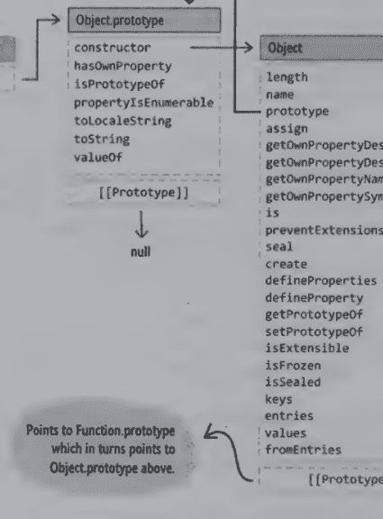

图 18.1

我们看似简单的 `funnyGuy` 对象实际上在发生着什么！

在这张图中，我们描出了当我们创建一个空的 `funnyGuy` 对象时幕后真实发生的状况。在这个视图中，我们仍然从 `funnyGuy` 对象开始。那部分是相同的。不同的是其他一切。看，我们的 `funnyGuy` 是一个空对象。它没有我们定义的属性。但它确实拥有一些开箱即用的属性，这些属性将我们的 `funnyGuy` 对象连接到底层的 `Object` 类型，而无需我们付出任何工作。这种链接允许我们在 `funnyGuy` 上调用传统的 `Object` 属性，如下：

```javascript
let funnyGuy = {};
funnyGuy.toString(); // [object Object]
```

为了强调这一点，正是这种链接使得在看似空的 `funnyGuy` 对象上调用 `toString` 能够正常工作。现在，称其为“链接”并不完全准确。我们的链接实际上被称为原型（**prototype**，通常表示为 [[Prototype]]），它最终指向另一个对象。另一个对象也可以有自己的 [[Prototype]] 指向另一个对象，以此类推。所有这些链接被称为原型链（**prototype chain**）。当 JavaScript 尝试查找你调用的属性时，跨越原型链是其执行的操作大部分部分。对于我们在 `funnyGuy` 对象上的 `toString`，图 18.2 显示了实际上正在发生什么。

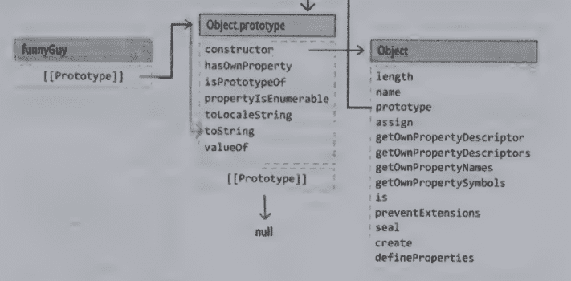

图 18.2

沿着原型链寻找我们正在寻找的属性。

通过原型链，即使我们的对象没有定义我们正在寻找的特定属性，JavaScript 也会遍历链，并查看沿途中每一个定义了属性的站点。现在，我们的 `funnyGuy` 对象的原型链只是它本身和 `Object.prototype`。这并不是一个复杂的链。随着我们处理更复杂的对象，原型链会变得非常长且复杂。我们很快就会接触这种复杂性。

> **注意**：Object 不是原型链的一部分
>
> 在我们之前的视觉化图中，我们看到 `Object` 有一个专门的条目，在它与 `Object` 原型之间有线条连接。需要注意的是，`Object` 并不是原型链的一部分。它在对象如何实现构造函数与一个命名糟糕的原型属性之间的关系（与我们的 [[Prototype]] 无关）中起作用，稍后我们会提到 `Object` 的作用。为了完整起见，我将在未来的对象视觉化继续显示 `Object` 的作用，但请注意它在我们的原型链遍历中并不参与。

接下来，正如我们所见，现在的 `funnyGuy` 对象非常基础。让我们加上之前的 `firstName` 和 `lastName` 属性，让事情变得有趣一点：

```javascript
let funnyGuy = {
  firstName: "Conan",
  lastName: "O'Brien"
};
```


## 创建自定义对象

操作`firstName`和`lastName`属性很有用，但每个对象需要一个唯一的值。快速看这里：

```javascript
let funnyGuy = {
  firstName: "Conan",
  lastName: "O'Brien",
  getName: function () {
    return "The name is " + this.firstName + " " + this.lastName;
  }
};

let theDude = {
  firstName: "Jeffrey",
  lastName: "Lebowowski",
  getName: function () {
    return "The name is " + this.firstName + " " + this.lastName;
  }
};

let detective = {
  firstName: "Adrian",
  lastName: "Monk",
  getName: function () {
    return "The name is " + this.firstName + " " + this.lastName;
  }
};
```

乍一看，似乎存在大量的重复。每个新对象都携带了自己的`firstName`、`lastName`和`getName`属性副本。现在，并不是所有的重复都是坏的，但我们应该考虑如何在不重复的情况下让`getName`更具可用性。我们如何做到这一点？

嗯……事实有一种很干净的方法，通过创建一个包含通用属性的中间父对象。我们的子对象可以从这个父对象继承，而不是直接继承自`Object`。更具体地说，我们将创建一个新的`person`对象，包含`getName()`。我们的`funnyGuy`、`theDude`和`detective`对象将继承自`person`。这种安排将确保我们需要复制的属性被复制，我们需要共享的属性被共享。为了帮助这些晦涩的文字变得理解，图 18.5 突出了我们正在尝试做的。

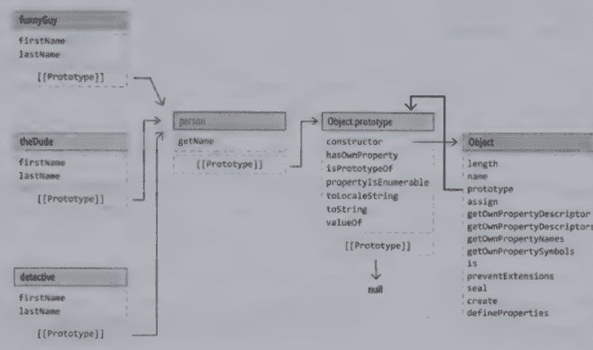

图 18.5

添加一个中间`person`对象，带有我们的（现在是共享的）`getName`属性。

注意，`person`现在是原型链的一部分，快乐地嵌套在`.prototype`和我们的子对象之间。我们如何做到这一点呢？我们之前看到的一种方法是依赖`Object.create`。使用`Object.create`时，我们可以指定一个对象来创建我们的对象，例如：`let myObject = Object.create(fooObject);`

当我们这样做时，幕后发生的情况如下：我们的`myObject`的原型将是`fooObject`。它成了原型链的一部分。现在，我们已经绕了小路，并根据本章所学扩展了对`Object.create`的理解，让我们回到最初的问题，让`funnyGuy`、`theDude`和`detective`继承我们的`person`对象。

所有这些代码如下：

```javascript
let person = {
  getName: function () {
    return "The name is " + this.firstName + " " + this.lastName;
  }
}
```

```javascript
let funnyGuy = Object.create(person);
funnyGuy.firstName = "Conan"
funnyGuy.lastName = "O'Brien";
```

```javascript
let theDude = Object.create(person);
theDude.firstName = "Jeffrey"
theDude.lastName = "Lebowski";
```

```javascript
let detective = Object.create(person);
detective.firstName = "Adrian"
detective.lastName = "Monk";
```

由于原型链的存在，我们可以在任何`funnyGuy`、`theDude`或`detective`对象上调用`getName`，并且会发生正确的结果：

```javascript
detective.getName(); // The name is Adrian Monk
```

如果我们决定增强我们的`person`对象，我们可以操作一次，让任何继承自它的对象都从我们的增强中受益，而无需任何重复。假设我们添加了一个`getInitials`方法，返回姓和名的首字母：

```javascript
let person = {
  getName: function () {
    return "The name is " + this.firstName + " " + this.lastName;
  },
  getInitials: function () {
    if (this.firstName && this.lastName) {
      return this.firstName[0] + this.lastName[0];
    }
  }
}
```

我们在`person`对象上添加了此`getInitials`方法。要使用此方法，我们可以在任何扩展`person`的对象上调用它，例如我们的`funnyGuy`：

```javascript
funnyGuy.getInitials(); // CO
```

这种创建中间对象来帮助划分代码功能的能力是非常强大的。它允许我们在创建对象以及为每个对象提供功能方面更加高效。很酷，对吧？

## this 关键字

你在之前的代码段中注意到的一点是`this`关键字的使用，特别是当我们在`person`对象中使用它来引用在其子对象中创建的属性时。让我们回到`person`对象，更具体说是`getName`属性：

```javascript
let person = {
  getName: function () {
    return "The name is " + this.firstName + " " + this.lastName;
  },
  getInitials: function () {
    if (this.firstName && this.lastName) {
      return this.firstName[0] + this.lastName[0];
    }
  }
};
```

当我们调用`getName`时，取决于从哪个对象调用它，我们将看到返回相应的名称。例如，假设我们执行如下：

```javascript
let spaceGuy = Object.create(person);
spaceGuy.firstName = "Buzz";
spaceGuy.lastName = "Lightyear";
```

```javascript
console.log(spaceGuy.getName()); // Buzz Lightyear
```

当我们运行这段代码时，将在控制台上看到打印出的 Buzz Lightyear。如果我们再次查看`getName`属性，`person`对象上完全不存在`firstName`或`lastName`属性。我们之前所见，当属性不存在时，我们会从父对象到父对象沿着原型链向下，如图 18.6 所示。

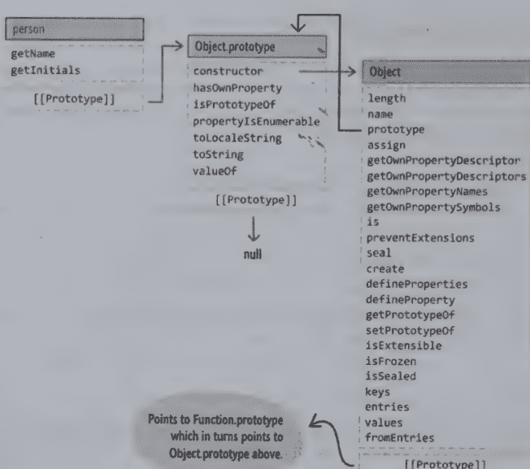

图 18.6

我们`person`对象的原型链。

在我们的情况下，链上的唯一停靠点是`Object.prototype`。`Object.prototype`上同样不存在`firstName`或`lastName`属性。为什么这个`getName`方法恰好有效并返回正确的值呢？

答案与`getName`返回语句中位于`firstName`和`lastName`之前的`this`关键字有关：

```javascript
let person = {
  getName: function () {
    return "The name is " + this.firstName + " " + this.lastName;
  },
  getInitials: function () {
    if (this.firstName && this.lastName) {
      return this.firstName[0] + this.lastName[0];
    }
  }
};
```

`this`关键字指的是我们的`getName`方法所绑定的对象。在这种情况下，该对象是`spaceGuy`，它是我们用作所有这些原型导航妙处的入口的对象，如图 18.7 所示。

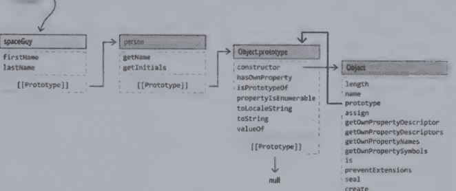

图 18.7 指的是`spaceGuy`！

在评估`getName`方法并且必须解析`firstName`和`lastName`属性的点，查找将从`this`关键字指向的对象开始。这意味着我们的查找从`spaceGuy`对象开始——结果证明该对象包含`firstName`和`lastName`属性！这就是为什么当调用`getName`（以及`getInitials`）的代码时，我们得到了正确的结果。

## 极简内容

由于 JavaScript 的面向对象特性备受关注，涵盖它的话题像你在这里看到的这样宽而深也是自然而然。你在这里看到的大部分内容直接或间接地处理了对象是如何派生并基于其他对象的。关于这已经花费了很多墨水，完全涵盖它超出了我们想要讨论的范围。好消息是，你现在看到的内容已经让你能够应对得不错了。

## 第 19 章 扩展内置对象

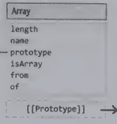
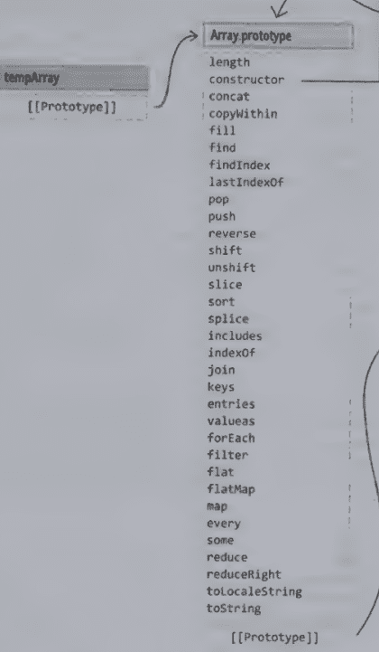
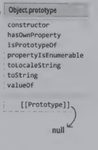

图 19.1 存在于表面之下复杂的对象网络（可能还有谎言！）

在左侧，我们有一个`tempArray`对象，它是`Array.prototype`的实例……而它本身又是基础`Object.prototype`的实例。现在，我们想要通过我们的`shuffle`函数来扩展数组的功能。这意味着我们需要找到一种方法，将`shuffle`函数插入到`Array.prototype`中，如图 19.2 所示。

我们的`shuffle`函数需要存放的地方！

| Array.prototype |
| :--- |
| length | constructor | concat | copyWithin | fill | find | indexOf | lastIndexOf | pop | push | reverse | shift | unshift | slice | splice | includes | indexOf | join | keys | entries | values | forEach | filter | flat | flatMap | map | every | some | reduce | reduceRight | localeString | toString |
| [[Prototype]] |

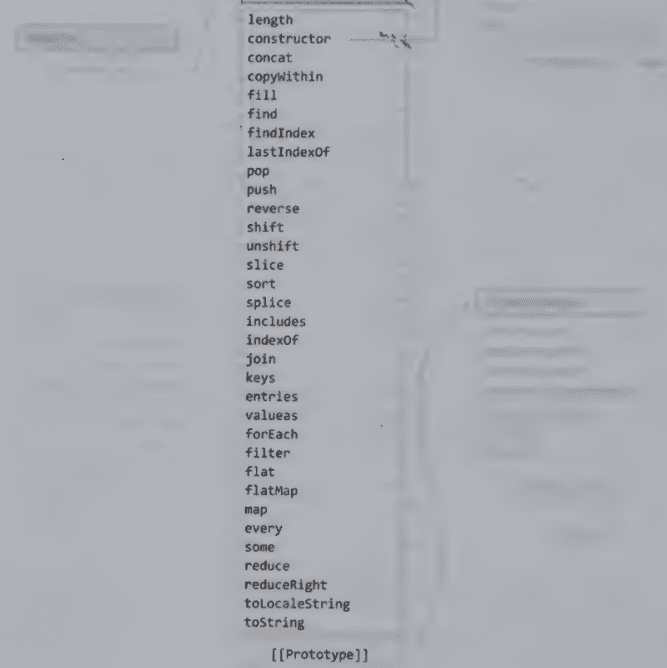

图 19.2
我们希望`shuffle`函数所在的位置！

这里就是 JavaScript 的奇特之处显现出来的地方。我们无法访问构成所有数组功能的代码。我们无法找到构成`Array`的函数或对象，并像处理自定义的自定义对象那样将我们的`shuffle`函数插入其中。我们的内置对象（如`Array`）定义在浏览器深处火山般地底腹处，那里人类无法到达。我们需要采取另一种方法。

**另一种方法**涉及到悄悄地溜入并将功能挂载到`Array`对象的`prototype`属性上。它看起来像这样：

```javascript
Array.prototype.shuffle = function () {
  let input = this;

  for (let i = input.length - 1; i >= 0; i--) {
    let randomIndex = Math.floor(Math.random() * (i + 1));
    let itemAtIndex = input[randomIndex];

    input[randomIndex] = input[i];
    input[i] = itemAtIndex;
  }

  return input;
}
```

注意，我们的`shuffle`函数是在`Array.prototype`上声明的！作为挂载的一部分，我们对函数的工作方式进行了微小的调整。该函数不再接受一个参数来引用你需要洗牌的数组：

```javascript
function shuffle(input) {
  .
  .
  .
}
```

相反，因为这个函数现在是`Array`的一部分，函数体内部的关键字指向了需要洗牌的数组：

```javascript
Array.prototype.shuffle = function () {
  let input = this;
  .
  .
}
```

退后一步考虑，一旦运行了这段代码，我们的`shuffle`函数就会发现自己与`Array`对象通过`Array.prototype`暴露的所有其他内置方法并肩，如图 19.3 所示。

| Array.prototype |
| :--- |
| length |
| constructor |
| concat |
| copyWithin |
| fill |
| find |
| indexOf |
| lastIndexOf |
| pop |
| push |
| reverse |
| shift |
| shuffle |
| shift |
| slice |
| sort |
| splice |
| includes |
| indexOf |
| join |
| keys |
| entries |
| values |
| each |
| filter |
| flat |
| flatMap |
| map |
| every |
| some |
| reduce |
| reduceRight |
| toLocaleString |
| toString |
| [[Prototype]] |

图 19.3

大成功！`shuffle`函数现在处于它该在的位置。

如果我们想访问洗牌功能，现在可以使用我们最初想要的方法来实现：

```javascript
let numbers = [1, 2, 3, 4, 5, 6, 7, 8, 9, 10];
numbers.shuffle();
```

最棒的是，由于原型继承的工作机制，我们创建的任何新数组默认都将访问`shuffle`功能。

## 扩展内置对象具有争议

鉴于通过`prototype`属性声明方法和属性来扩展内置对象功能如此简单，人们很容易认为每个人都喜欢这种能力。事实证明，扩展内置对象具有相当的争议性。这种争议的原因在于……

## 你无法控制内置对象的未来

没有什么可以阻止未来的 JavaScript 实现包含它自己的适用于`Array`对象的原生`shuffle`版本。在此时，当你的`shuffle`版本与原生版本冲突时，就会发生碰撞。

## 某些功能不应该被覆盖

没有什么可以阻止你修改现有的方法。例如，这是：

```javascript
Array.prototype.slice = function () {
  let input = this;
  // ... logic
}
```

## 第 20 章 使用类

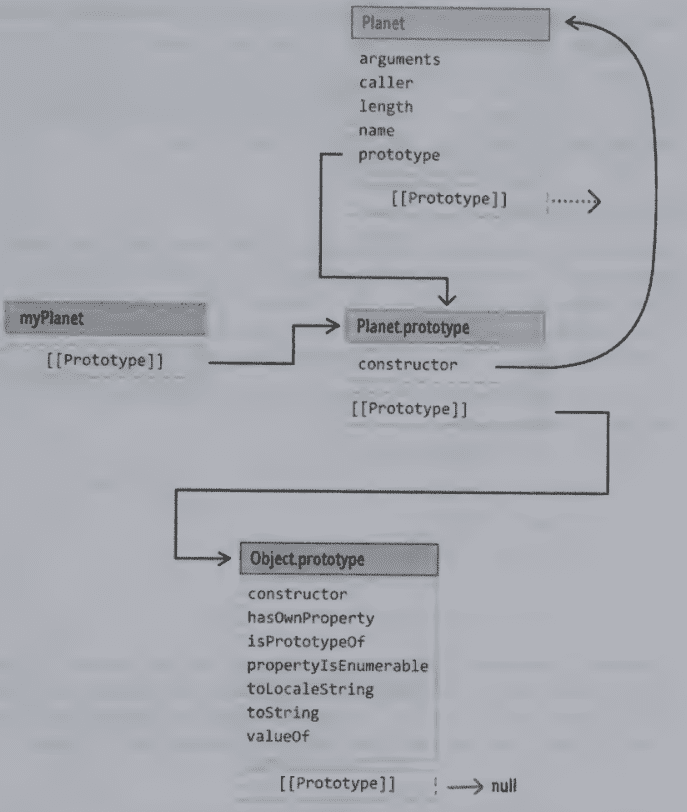

图 20.1 显示了背后的机制。

这看起来与我们使用`Object.create()`创建对象时看到的内容有些不同。区别在于我们通过`new`关键字创建了我们的`myPlanet`对象。当我们使用`new`关键字创建对象时，会发生以下情况：

1. 我们的新对象类型仅为 **Planet**。
2. 我们新对象的`[[Prototype]]`是我们新函数或类的`prototype`属性。
3. 构造函数的执行处理了我们新创建的对象的初始化

我不会用过多的细节让你感到无聊，但有一件重要的事情我们将进一步深入探讨。这件事涉及到我们在上面第 3 点中提到的构造函数。

## 认识构造函数

构造函数是一个存在于类体内部的函数（或方法）。它负责初始化新创建的对象，并通过在创建过程中运行其中包含的任何代码来实现。这不是一个可选的细节。所有类必须包含一个构造函数。如果你的类没有包含构造函数（类似于我们现在的`Planet`），JavaScript 将自动为你创建一个空构造函数。

让我们为我们的`Planet`类定义一个构造函数。看看下面的修改：

```javascript
class Planet {
  constructor(name, radius) {
    this.name = name;
    this.radius = radius;
  }
}
```

要定义构造函数，我们使用一个特殊的`constructor`关键字来创建一个本质上是的东西。就像函数一样，你也可以指定任何我们想要使用的参数。在这种情况下，我们指定`name`和`radius`值作为参数，并使用它们来设置对象上的`name`和`radius`属性：

```javascript
class Planet {
  constructor(name, radius) {
    this.name = name;
    this.radius = radius;
  }
}
```

你完全可以在构造函数内部做更多（或更少！）有趣的事情，但要记住，每当我们使用`Planet`类创建一个新对象时，这段代码都会运行。说到这里，这是我们调用`Planet`类来创建对象的方法：

```javascript
let myPlanet = new Planet("Earth", 6378);
console.log(myPlanet.name); // Earth
```

注意，我们在构造函数上设置的两个参数实际上直接设置在`Planet`类本身上。当`myPlanet`对象被创建时，构造函数会运行，我们传递的`name`和`radius`值会被设置到我们的对象上。图 20.2 显示了它的样子。

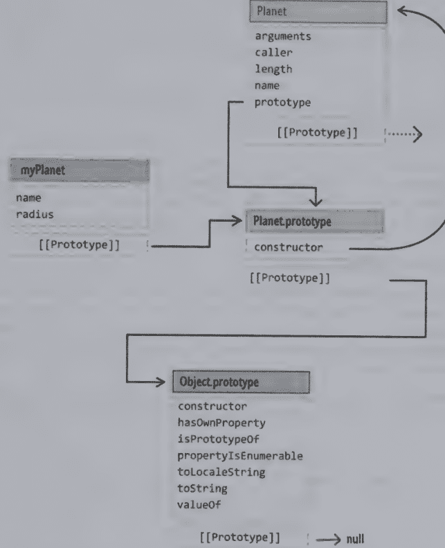

图 20.2

我们可以看到我们的`myPlanet`对象包含了`name`和`radius`属性。

在我们学习类语法及其周围的细节时，永远不要忘记这一切只是装饰——为了让你的生活更轻松而设计的精美语法糖。如果我们不使用类语法，也可以像这样做：

```javascript
function Planet(name, radius) {
  this.name = name;
  this.radius = radius;
}

let myPlanet = new Planet("Earth", 6378);
console.log(myPlanet.name); // Earth
```

结果与我们通过类语法获得的结果几乎相同。我们得到的东西是唯一不同的。不过，不要让这种比较给你留下错误的印象。类语法的其他有用用法将无法通过我们在这里看到的更传统的方法轻松转换。

## 类内部包含什么

我们的类对象看起来很像函数，但它们有一些特殊之处。我们看到进入类体的内容之一就是这个特殊的构造函数。可以进入你类的其他内容只有其他函数/方法、getters 和 setters。仅此而已。不欢迎变量声明和初始化。

为了看到这一切是如何起作用的，让我们添加一个`getSurfaceArea`函数，将我们行星的表面积打印到控制台。请进行以下更改：

```javascript
class Planet {
  constructor(name, radius) {
    this.name = name;
    this.radius = radius;
  }

  getSurfaceArea() {
    let surfaceArea = 4 * Math.PI * Math.pow(this.radius, 2);
    console.log(surfaceArea + " square km!");
    return surfaceArea;
  }
}
```

你从创建的对象上调用`getSurfaceArea`来查看它的作用：

```javascript
let earth = new Planet("Earth", 6378);
earth.getSurfaceArea();
```

当这段代码运行时，你会看到类似 5.11 亿平方公里的输出。这很好。既然我们提到了可以进入类体的其他内容是 getters 和 setters，让我们也将它们加进来。我们将使用它们来帮助表示我们行星的重力：

```javascript
class Planet {
  constructor(name, radius) {
    this.name = name;
    this.radius = radius;
  }

  getSurfaceArea() {
    let surfaceArea = 4 * Math.PI * Math.pow(this.radius, 2);
    console.log(surfaceArea + " square km!");
    return surfaceArea;
  }

  get gravity() {
    return this._gravity;
  }

  set gravity(value) {
    this._gravity = value;
  }
}
```

```javascript
let earth = new Planet("Earth", 6378);
earth.getSurfaceArea();
earth.gravity = 9.8;
console.log(earth.gravity); // 9.8
```

我们有一个`PotatoPlanet`类，它不仅包含了新的与土豆相关的内容，还包含了我们`Planet`类拥有的所有功能。这种方法并不理想，因为我们在重复代码。现在，与其重复代码，如果我们有一种方法，既可以扩展`Planet`类提供的功能，又能添加`PotatoPlanet`所需的少量额外功能呢？那难道不是一种更好的方法吗？嗯……幸运的是，我们通过`extends`关键字拥有这种方法。通过让我们的`PotatoPlanet`类扩展`Planet`类，我们可以执行如下操作：

```javascript
class Planet {
    constructor(name, radius) {
        this.name = name;
        this.radius = radius;
    }

    getSurfaceArea() {
        let surfaceArea = 4 * Math.PI * Math.pow(this.radius, 2);
        console.log(surfaceArea + " square km!");
        return surfaceArea;
    }

    set gravity(value) {
      console.log("Setting value!");
      this._gravity = value;
    }

    get gravity() {
      return this._gravity;
    }
}
```

```javascript
class PotatoPlanet extends Planet {
  constructor(name, width, potatoType) {
    super(name, width);
    this.potatoType = potatoType;
  }

  getPotatoType() {
    let thePotato = this.potatoType.toUpperCase() + "!!!!!!";
    console.log(thePotato);
    return thePotato;
  }
}
```

注意我们是如何声明`PotatoPlanet`类的。我们使用了`extends`关键字，并指定了我们要扩展的类，即`Planet`：

```javascript
class PotatoPlanet extends Planet {
}
```

从那里开始，另一个需要记住的是与构造函数（constructor）有关。如果我们扩展一个类而不需要修改构造函数，我们完全可以跳过在类内部指定构造函数：

```javascript
class PotatoPlanet extends Planet {
  sayHello() {
    console.log("Hello!");
  }
}
```

在我们的情况下，由于我们通过添加土豆类型属性来修改了构造函数的行为，我们再次定义了构造函数，并增加了一个重要的部分：

```javascript
class PotatoPlanet extends Planet {
  constructor(name, width, potatoType) {
    super(name, width);
    this.potatoType = potatoType;
  }

  getPotato() {
    var thePotato = this.potatoType.toUpperCase() + "!!1!!!";
    console.log(thePotato);
    return thePotato;
  }
}
```

我们通过使用`super`关键字并传递所需的相应参数，显式地调用了父类（`Planet`）的构造函数。这个`super`调用确保了对象中`Planet`部分作为其功能运行所需的任何内容都会被触发。

要使用我们的`PotatoPlanet`，我们会像处理任何普通、非扩展对象一样，创建对象并填充其属性或在其上面调用方法。这里有一个恰当创建一个名为`spudnik`的类型为`PotatoPlanet`对象的示例：

```javascript
let spudnik = new PotatoPlanet("Spudnik", 12411, "Russet");
spudnik.gravity = 42.1;
spudnik.getPotatoType();
```

酷的一点是，`spudnik`不仅可以访问我们在`PotatoPlanet`类中定义的功能，我们扩展的`Planet`类提供的所有功能也可用。我们可以通过查看图 20.4 所示的更复杂的原型/对象关系图来了解为什么会这样。

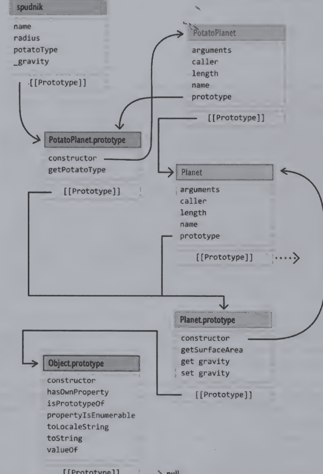

图 20.4
扩展对象的视觉形式。

如果我们遵循原型链（prototype chain），我们会从我们的`spudnik`对象到`PotatoPlanet.prototype`，再到`Planet.prototype`，最后到达`Object.prototype`。我们的`spudnik`对象可以访问在这些原型停靠点定义的任何属性或方法，这就是为什么它可以流畅地调用`Object`或`Planet`上的某些内容，尽管`PotatoPlanet`本身并没有定义很多内容。这就是扩展对象的强大之处所在。

## 极简主义

类语法让处理对象变得非常简单。你可能在这里已经窥见了一些端倪，但稍后你会看到更多。类语法的特点在于，它允许我们更多地关注想**做什么**，而不是纠结具体怎么做。虽然使用`Object.create`和原型属性带给了我们大量的控制权，但对于大多数情况来说，这种控制往往是不必要的。通过使用类，我们用复杂性换取简单性。当简单的解决方案同样有效时，这并不是一件坏事。

在这些示例中，`bool`变量将返回`true`。如果某些语句是这样，这看起来可能很奇怪，让我们来看看这里面涉及的微妙之处。如果我们正在评估一个对象，例如`new Boolean(new Boolean())`，评估结果将为`true`。原因是对象的仅仅存在就会触发`true`分支，而调用`new Boolean()`会产生一个新的对象。稍微扩展一下逻辑，这意味着下面的`if`语句实际上也会导致`true`：

```javascript
let boolObject = new Boolean(false);
if (boolObject) {
  console.log("Bool, you so crazy!!!");
}
```

我们正在评估的对象实际上其实是一个伪装的`false`……或者是一个字符串（String）或数组（Array）等等，这并不重要。原始类型的规则简单得多。如果我们传入一个原始类型（或评估为原始类型的内容），除了`null`、`undefined`、`0`、空字符串、`NaN`或`false`之外的任何内容都会导致结果为`true`。

## 严格相等和不等运算符

我们要查看的最后一点是将对类型和布尔值的知识结合起来，为我们之前使用的各种条件运算符增加一点转折。我们知道`==`和`!=`，可能已经见过它们几次。这些是相等和不等运算符，让我们知道两个事物是相等还是不相等。这里有一个转折：存在一种我们可能没有意识到的微妙且偏离的行为。

这是一个示例：

```javascript
function solution(answer) {
  if (answer == 42) {
    console.log("You have nothing more to learn!");
  }
}

solution("42"); // 传入字符串 "42"
```

在这个示例中，表达式`answer == 42`的结果将为`true`。尽管传入的 42 是字符串，而我们要检查的 42 是数字，这仍然成立了。这里发生了什么？在什么样的世界上字符串和数字是相等的？对于`==`和`!=`运算符，这是预期行为。你比较的两个值都是 **42**。为了实现这种功能，JavaScript 强制让这两个不同但相似的值处于相同的机制下。这在形式上被称为**类型转换（type coercion）**。

问题在于这种行为可能是不受希望的——尤其是当它在我们不知情的情况下发生时。为了避免这种情况，我们有更严格版本的相等和不等运算符，它们分别是`===`和`!==`。这些运算符的作用是同时检查**值和类型**，并且不执行任何类型转换。它们基本上是迫使我们编写代码，让确保真正相等或不相等的责任完全落在我们身上。这是一件好事。

让我们通过将`==`运算符替换为`===`运算符来修复我们之前的示例：

```javascript
function theSolution(answer) {
  if (answer === 42) {
    console.log("You have nothing more to learn!");
  }
}

theSolution("42"); // 传入字符串 "42"
```

这一次，条件表达式的评估结果将为 **false**。在这个更严格的世界里，尽管值相似，但字符串和数字是不同的类型。由于没有发生类型转换，最终结果是 **false**。

通用的准则是始终使用*相等和不等运算符的更严格的形式*。如果非要有什么的话，使用它们将帮助我们发现代码中的错误——这些错误在其他情况下可能会变得非常难以识别。

> **注意** 如果我们正在比较两个*不同的*对象，严格相等运算符（以及不严格的相等运算符）将不会像我们预期的那样工作。例如，以下所有情况都为`false`：
> `console.log(new String("A") == new String("A"));`
> `console.log([1, 2, 3] == [1, 2, 3]);`
> `console.log({ a: 1 } == { a: 1 });`

在比较两个独立对象的相等性或不等性时，请记住这一点。

## 最基础

布尔值构成了代码中最频繁使用的类型之一。尽管它们在表面上表现简单，但它们在允许我们的代码分支到不同方向方面起着关键作用。虽然我可以用手数出我使用`Boolean`函数甚至更严格的相等和不等运算符的次数，但我的手足够的手指来数清我在现实世界中遇到这些奇怪事情的次数。

如果你有任何问题，请前往 https://forum.kirupa.com 提问吧！

## NULL 和 UNDEFINED

世界上巨大的谜团之一就是围绕理解`null`和`undefined`展开的。你看到大部分代码充斥着它们，你可能自己遇到过几次。作为谜题，理解`null`和`undefined`并不特别奇怪。它只是极其无聊……

## Null

让我们从`null`开始。`null`关键字是一个在 JavaScript 中充当特殊角色的原始类型。它是表示“无值”的显式赋值。你会在几种情况下看到`null`。最常见的情况是你初始化一个变量使其不存在。`null`的优势在于它的确定性。你经常会看到它是变量声明的一部分或作为函数调用的参数传递。它清楚地表示你想让某些不存在。

这是一个示例：

```javascript
let name = null;

if (name === null) {
    name = "Peter Griffin";
} else {
    name = "No name";
}
```

唯一需要注意的是，你应该使用`===`而不是低级的那个。在处理`null`时，同时检查类型和值是一个良好的习惯。

## Undefined

这里情况变得有点棘手了。为了表示未定义的内容，你有`undefined`原始类型。你会在几种情况下看到`undefined`。最常见的情况是你尝试访问一个未初始化的变量，或者访问一个没有`return`值的返回值。

这段代码片段指出了`undefined`的自然栖息地：

```javascript
let myVariable;
console.log(myVariable); // undefined

function doNothing() {
  // 看油漆干燥
  return;
}

let weekendPlans = doNothing();
console.log(weekendPlans); // undefined

let person = {
  firstName: "Isaac",
  lastName: "Newton"
}

console.log(person.title); // undefined
```

在你的代码中，你可能不会将`undefined`赋值给任何。相反，你会花时间检查某个值是否为`undefined`。你有几种方法来执行这种检查。第一种是通常总是有效的简单方法：

```javascript
if (myVariable === undefined) {
  // 执行某些操作
}
```

这种方法的缺点在于`undefined`到底是什么。做好准备——`undefined`是一个自动定义的全局变量，这意味着我们完全可以将其重写为`true`或我们想要的任何值。如果`undefined`真的被重写，如果我们只用`===`或`==`来检查，就会破坏我们的代码。为了避免任何此类猫腻，检查`undefined`的最安全方法涉及`typeof`和`===`运算符：

```javascript
let myVariable;

if (typeof myVariable === "undefined") {
  console.log("Define me!!!");
}
```

这确保了你将对`undefined`进行检查，并始终返回正确的答案。

## NULL == UNDEFINED，但 NULL != UNDEFINED

延续`==`和`===`的奇特性，如果你检查`null == undefined`，答案将是`true`。如果你使用`===`且对象为`null === undefined`，那么在这种情况下答案将是`false`。

原因是`==`会进行类型转换，强行扭转类型以符合 JavaScript 认为该值应该有的样子。使用`===`，你会同时检查类型和值。这是一种更全面的检查，可以检测出`undefined`和`null`确实是两个不同的东西。

感谢参议员（又 Trevor McCauley）指出了这一点！

## 极简核心

我之所以保存这些内置类型是有原因的。`null`和`undefined`是这一组中最不无趣的，但它们往往也是最容易被误解的。知道如何使用`null`并对它以及`undefined`进行检测是非常重要的正确技能。处理不当将导致非常微妙且难以定位的错误。

如果你对`null`和`undefined`有任何问题，或者只是想和地球上最友好的开发者聊聊以解决困境，请在 https://forum.kirupa.com 发布。

## 关于 JSON 的一切（又称 JavaScript 对象表示法）

在涉及存储、检索或传输数据时，有很多文件格式和数据结构供你使用。你可能已经使用过文本文件、Word 文档、Excel 表格、zip 文件等来处理你处理的各种数据。在网页前端，有一种格式凌于所有格式之上。它运行得更快。它跳得更高。它有一层更闪亮（且更毛茸茸）的皮毛。这种格式被称为 JSON——JavaScript Object Notation（JavaScript 对象表示法）的缩写。

在本文中，我们将学习所有关于让 JSON 对象变得如此强大的知识。我们将详细查看它们内部的内容，以及你如何在你自己的实现中从中读取值。

前进吧！

## 什么是 JSON？

在 JavaScript 中，你有一种方法使用对象字面量语法来定义对象：

```javascript
let funnyGuy = {
  firstName: "Conan",
  lastName: "O'Brien",
  getName: function () {
    return "Name is: " + this.firstName + " " + this.lastName;
  }
};
```

```javascript
let theDude = {
  firstName: "Jeffrey",
  lastName: "Lebowski",
  getName: function () {
    return "Name is: " + this.firstName + " " + this.lastName;
  }
};
```

```javascript
let detective = {
  firstName: "Adrian",
  lastName: "Monk",
  getName: function () {
    return "Name is: " + this.firstName + " " + this.lastName;
  }
};
```

如果你不熟悉这种语法，我强烈建议你在 **Deeper Look at Objects**（深入观察对象）文章中阅读更多关于它的内容。这将让理解和处理 JSON 对象变得容易得多！

从表面上看，对象字面量语法看起来像是一堆括号、冒号和奇奇怪怪的大括号，它们定义了你对象的属性和值。尽管看起来很奇怪，但在底层，它是非常具有描述性的。许多你想要使用的常用数据类型都是可用的。你可以将你的属性和值整齐地表示为用冒号分隔的键值对。与我提到的其他内容同样重要的是，这种语法允许你拥有结构和嵌套值。总的来说，它是表示 JavaScript 对象的非常非常棒的方法……以字面量形式表示！

JSON 格式大量借鉴了这种对象字面量语法。以下是 WeatherUnder API 返回的、用于在你家乡西雅图显示天气的某些真实 JSON 数据示例：

```json
{
  "response": {
    "version": "0.1",
    "termsofService": "http://www.wunderground.com/weather/api/d/terms.html",
    "features": {
      "conditions": 1
    },
    "current_observation": {
      "image": {
        "url": "http://icons.wxug.com/graphics/wu2/logo_130x80.png",
        "title": "Weather Underground",
        "link": "http://www.wunderground.com"
      },
      "display_location": {
        "full": "Seattle, WA",
        "city": "Seattle",
        "state": "WA",
        "state_name": "Washington",
        "country": "US",
        "country_iso3166": "US",
        "zip": "98101",
        "magic": "1",
        "wmo": "99999",
        "latitude": "-47.61167908",
        "longitude": "-122.33325958",
        "elevation": "63.00000000"
      }
    }
  }
}
```

```json
"observation_location": {
  "full": "Herrera, Inc., Seattle, Washington",
  "city": "Herrera, Inc., Seattle",
  "state": "Washington",
  "country": "US",
  "country_iso3166": "US",
  "latitude": "-47.616558",
  "longitude": "-122.341240",
  "elevation": "121 ft",
  "estimated": {
    "station_id": "KWASEATT187",
    "observation_time": "Last Updated on August 28, 2015, 9:28 PM PDT",
    "observation_time_rfc822": "Fri, 28 Aug 2015 21:28:12-0700",
    "observation_epoch": "1440822492",
    "local_time_rfc822": "Fri, 28 Aug 2015 21:28:45-0700",
    "local_epoch": "1440822525",
    "local_tz_short": "PDT",
    "local_tz_long": "America/Los_Angeles",
    "local_tz_offset": "-0700",
  },
  "weather": "Overcast",
  "temperature_string": "68.0 F (20.0 C)",
  "temp_f": 68.0,
  "temp_c": 20.0,
  "relative_humidity": "71%",
  "wind_string": "Calm",
  "wind_dir": "NNW",
  "wind_degrees": 331,
  "wind_mph": 0.0,
  "wind_gust_mph": "10.0",
  "wind_kph": 0,
  "wind_gust_kph": "16.1",
  "pressure_mb": "1008",
  "pressure_in": "29.78",
  "pressure_trend": "-",
  "dewpoint_string": "58 F (15 C)",
  "dewpoint_f": 58,
  "dewpoint_c": 15,
  "heat_index_string": "NA",
  "heat_index_f": "NA",
  "heat_index_c": "NA",
  "windchill_string": "NA",
  "windchill_f": "NA",
  "windchill_c": "NA",
  "feelsike_string": "68.0 F (20.0 C)",
  "feelsike_f": 68.0,
  "feelsike_c": 20.0,
}
```

## 深入查看 JSON 对象

JSON 对象仅仅是属性名和值的组合。这看起来很简单，但在这一节中我们需要过的细节。

### 属性名

属性名是你用于访问值的标识符。视觉上，它们是冒号左侧的内容：

```json
{
  "firstName": "Kirupa",
  "lastName": "Chinnathambi",
  "special": {
    "admin": true,
    "userID": 203
  },
  "devices": [
    {
      "type": "laptop",
      "model": "Macbook Pro 2015"
    },
    {
      "type": "phone",
      "model": "iPhone 6"
    }
  ]
}
```

在这个 JSON 代码段中，属性名为 **firstName, lastName, special, admin, userID, devices, type 和 model**。注意这些属性名是如何定义的。它们是被双引号包裹的字符串值。双引号是一个重要的细节，在对象字面量情况下不需要指定属性名，因此在 JSON 世界工作时不要忘记包含它们。

### 值

每个属性名映射到一个值，你可以拥有的值类型有：

- 数字
- 字符串
- 布尔（true 或 false）
- 对象
- 数组
- Null

让我们将这些类型映射到我们之前看到的示例。

### 字符串

字符串值是以下高亮行：

```json
{
  "firstName": "Kirupa",
  "lastName": "Chinnathambi",
  "special": {
    "admin": true,
    "userID": 203
  },
  "devices": [
    {
      "type": "laptop",
      "model": "Macbook Pro"
    },
    {
      "type": "phone",
      "model": "iPhone XS"
    }
  ]
}
```

双引号是这些值是字符串的明显证据。除了你通常使用的字母、数字和符号外，你还可以包含转义字符（如`\`、`\\`、`/`等），以定义字符串中会被解析为 JSON 操作的字符。

## 数字

我们数字家族中唯一的代表是`userID`属性的值：

```json
{
  "firstName": "Kirupa",
  "lastName": "Chinnathambi",
  "special": {
    "admin": true,
    "userID": 203
  },
  "devices": [
    {
      "type": "laptop",
      "model": "Macbook Pro"
    },
    {
      "type": "phone",
      "model": "iPhone XS"
    }
  ]
}
```

你可以指定十进制值（例如：**0.204, 1200.23, 45**），也可以指定指数值（**2e16, 3e+4, 1.5e-2**）。不过，有一些你能够注意的细节。你不能用 0 跟另一个数字作为数字的前缀。例如，**0.314** 这样的值是不允许的。

## 布尔值

布尔值非常简单：

```json
{
  "firstName": "Kirupa",
  "lastName": "Chinnathambi",
  "special": {
    "admin": true,
    "userID": 203
  },
  "devices": [
    {
      "type": "laptop",
      "model": "Macbook Pro"
    },
    {
      "type": "phone",
      "model": "iPhone XS"
    }
  ]
}
```

值可以是`true`或`false`。需要注意的是的一点是——大小写非常重要。`true`和`false`必须全小写。禁止使用句首大写（True False）或全大写（TRUE 或 FALSE）。

这里事情变得有点有趣了：

```json
{
  "firstName": "Kirupa",
  "lastName": "Chinnathambi",
  "special": {
    "admin": true,
    "userID": 203
  },
  "devices": [
    {
      "type": "laptop",
      "model": "Macbook Pro"
    },
    {
      "type": "phone",
      "model": "iPhone XS"
    }
  ]
}
```

对象包含一组属性名和值，它们通过大括号与你的其他内容隔离开。看到了吗？这难道有点趣吗？

## 数组

我们的`devices`属性代表一个数组：

```json
{
  "firstName": "Kirupa",
  "lastName": "Chinnathambi",
  "special": {
    "admin": true,
    "userID": 203
  },
  "devices": [
    {
      "type": "laptop",
      "model": "Macbook Pro"
    },
    {
      "type": "phone",
      "model": "iPhone XS"
    }
  ]
}
```

数组存储一个零或多个值的有序集合，你可以对它们进行迭代，并且它们通过括号表示法隔开。在数组内部，你可以使用我们目前见过的任何 JSON 类型……包括其他数组！

## Null

最后一种数据类型也是无无的一个：

```json
{
  "foo": null
}
```

你的 JSON 值可以为`null`。这代表一个空值。

## 读取 JSON 数据

我承认。上一个章节非常枯燥，但有一个好消息！鉴于你刚刚看到的内容有多无聊，这一节相比之下似乎比实际情况要有趣得多。耶！

无论如何，你与 JSON 的几乎交互都将围绕读取数据展开。在读取 JSON 数据时，主要需要记住的一点是，它与读取存储在典型 JavaScript 对象中的值非常相似。你可以使用点符号来获取值（`property.propertyFoo`），或者使用数组方法（`property["propertyFoo"]`）并通过这种方式访问值。

为了帮助解释这一切，让我们使用以下示例：

```javascript
let exampleJSON = {
  "firstName": "Kirupa",
  "lastName": "Chinnathambi",
  "special": {
    "admin": true,
    "userID": 203
  },
  "devices": [
    {
      "type": "laptop",
      "model": "Macbook Pro"
    },
    {
      "type": "phone",
      "model": "iPhone XS"
    }
  ]
};
```

要读取存储在`firstName`中的值，你可以执行以下任一操作：

```javascript
exampleJSON.firstName;
exampleJSON["firstName"];
```

这两行代码都会返回 **Kirupa** 的值。对于你是想使用点符号方法还是数组方法来访问你感兴趣的值，没有对错之分。使用任何你觉得舒服的方法即可，但我个人的偏好是使用点符号法。将属性名作为字符串传入让我感到不舒服，所以我只会在你将看到的代码段中高亮点符号法。

与你之前看到的类似，要访问存储在`lastName`中的值，你可以这样做：

```javascript
exampleJSON.lastName;
```

对于存储简单值的属性，生活非常简单。你唯一遇到的极、非常、微小的复杂情况，就是当你处理由对象和数组组成的更复杂的值时。要读取对象内部存储的值，只需继续点入每个属性，直到到达存储你感兴趣的值的属性。

这里是尝试访问存储在`userID`属性的值的方式：

```javascript
exampleJSON.special.userID;
```

数组是不同的，要访问存储在`devices`中的第一个 JSON 对象，你可以这样做：

```javascript
exampleJSON.devices[0];
```

因为`devices`属性指的是一个数组，你可以对它进行如下操作：

```javascript
for (let i = 0; i < exampleJSON.devices.length; i++) {
  let type = exampleJSON.devices[i].type;
  let model = exampleJSON.devices[i].model;
  // 对这些数据做些事情！
}
```

## JS、浏览器与 DOM

到目前为止，我们都是孤立地观察 JavaScript。我们学习了许多它的基本功能，但这样做几乎没有将它与现实世界联系起来——这个现实世界是由浏览器表示的，并充斥着 HTML 标签和 CSS 样式。本章将作为这个世界的介绍，随后的章节将进行更深入的探讨。

在接下来的章节中，你将学习被称为文档对象模型（DOM）的神秘数据结构和编程接口。你将学习它是什么、为什么有用，以及它是如何与你未来将要做的一切工作联系的。

前进吧！

## HTML、CSS 和 JavaScript 的作用

在我们深入并开始回答生命的意义……呃，DOM 的意义之前，让我们快速回顾一些你可能已经知道的内容。首先，你放入 HTML 文档中的内容围绕着 HTML、CSS 和 JavaScript 展开。我们将这三者视为构建平等的伙伴，共同构建你在浏览器中所看到的内容（图 24.1）。

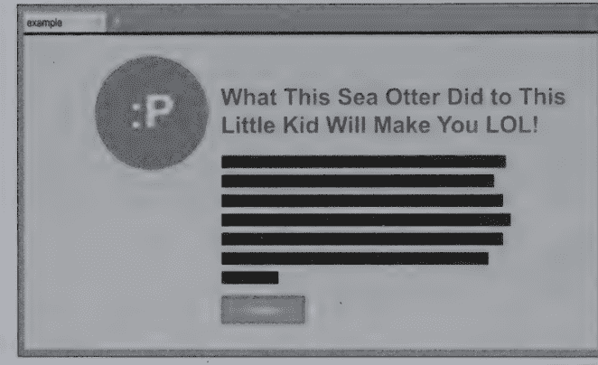

图 24.1
一个典型的网页由 HTML、CSS 和 JavaScript 组成。

每个伙伴都扮演着重要的角色，而且它们各自扮演的角色非常不同。

## HTML 定义结构

你的 HTML 定义了页面的结构，并且通常包含了你看到的内容：

```html
<!DOCTYPE html>
<head>
<meta content="sea otter, kid, stuff" name="keywords">
<meta content="Sometimes, sea otters are awesome!" name="description">
<title>Example</title>
<link href="foo.css" rel="stylesheet" />
</head>
<body>
<div id="container">
  
  <h1>What This Sea Otter Did To This Little Kid Will Make You LOL!</h1>
  <p class="bodyText">
    Nulla tristique, justo et semper vivera,
    massa arcu congue tortor, ut vehicula urna mi
    in lorem.isque aliquam molest dui, at
    turpis porttitor nec. Aenean id idum urna.
    Curabitur mi ligula, hendrerit at semper sed,
    feugiat a nisi.
  </p>
  <div class="pushButton">
    more
  </div>
</div>
<script src="stuff.js"></script>
</body>
</html>
```

HTML 本身就像《家庭动画》中的梅格·格里芬（Meg Griffin）一样，非常无聊。如果你不知道梅格是谁，又懒得去 Google 搜她，那么图 24.2 就是她形象的近似。


> 对梅格·格里芬的非侵权诠释！

图 24.2
梅格·格里芬的艺术化解读。

总之，你不希望你的 HTML 文档是无聊的。为了让你的内容从平淡枯燥变得具有吸引力，你有 CSS。

## 让我的世界变漂亮，CSS！

CSS 是你的主要样式语言，允许你为 HTML 元素赋予一些急需的美感和布局吸引力：

```css
body {
  font-family: "Arial";
  background-color: #CCCFFF;
}
#container {
  margin-left: 30%;
}
#container img {
  padding: 20px;
}
#container h1 {
  font-size: 56px;
  font-weight: 500;
}
#container p.bodyText {
  font-size: 16px;
  line-height: 24px;
}
.submitButton {
  display: inline-block;
  border: 5px solid #669900;
  background-color: #7BB700;
  padding: 10px;
  width: 150px;
  font-weight: 800px;
}
```

在很一段时间里，在 HTML 和 CSS 之间，你已经拥有创建一个精美且功能完备的页面所需的一切。你拥有结构和布局。你拥有导航。你甚至还有像鼠标悬停这样的简单交互。生活很美好。

## 该是 JavaScript 时间了！

尽管 HTML 和 CSS 有许多优点，但它们在提供的交互性方面都是有限的。人们希望在网页文档上做的不仅仅是被动地坐着观察发生的事情。他们希望他们的网页文档能做更多。他们希望文档能帮助他们玩媒体；记住离开的地方；通过鼠标点击、键盘敲击和手指按下进行操作；使用华丽的导航菜单；看到酷炫（是的，我用了 spiffy 这个词）程序化动画；与他们的摄像头/麦克风交互；执行任何操作都不需要刷新页面/导航；以及许多其他功能。

这确实让网页开发者和设计师（也就是你和我）也渴望找到一种方法来帮助创建这类东西。

为了填补 HTML 和 CSS 提供的与人们需求之间的空白，你曾拥有过 Java 和 Flash 等第三方组件，它们繁荣了多年。直到最近，这种趋势才发生了变化。这种转变有很多技术和政治原因，但其中一个原因是 JavaScript 在许多年里并没有准备好。无论是在核心语言中还是在浏览器的支持方面，它都不具备生效的条件。

今天的情况不再如此了。JavaScript 现在是一门完全胜任的语言，允许你添加人们寻找的那些交互内容。所有这些能力都是通过这一切中真正的主角——DOM 来实现的。

## 认识文档对象模型

你的浏览器显示的是一个网页文档。更具体地说，总结之前所有的章节，你看到的是 HTML、CSS 和 JavaScript 共同工作以创建所显示的内容。再深挖一步，在底层，有一个层级结构，浏览器使用该结构来理解正在发生的一切事情。

这种结构（再次）被称为文档对象模型。朋友们直接称它为 DOM。图 24.3 显示了 DOM 一个非常简化的视图：

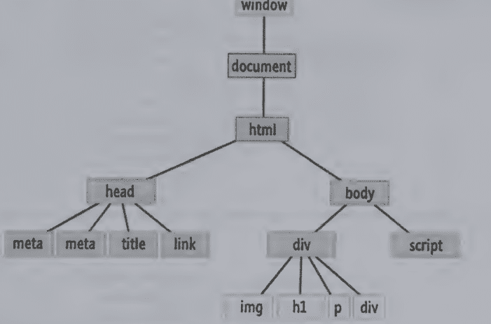

图 24.3
我们之前示例的 DOM 大致是这样的：

尽管看起来简单，但有几点通适用于所有 DOM 结构需要关注。你的 DOM 实际上由 HTML 元素之外的许多类型组成。构成你 DOM 的所有东西统被称为节点（nodes）。

这些节点可以是元素（这不会让你感到惊讶）、属性、文本内容、注释、文档相关内容以及各种你提到的东西。这些细节对某些人很重要，但那个“某些人”不应该是你我。几乎总是，我们关心的节点类型是元素，因为那是我们 99% 时间里要处理的对象。

你访问的每个 HTML 元素都关联有一个特定类型，所有这些类型都扩展自图 24.4 所示构成所有节点的 Node 基类。

## Node


图 24.4
我们通常看到的元素位于链末端的结构化方式。

你的 HTML 元素位于链的末端，该链从 Node 开始，经过 Element 和 HTMLElement，最后结束与 HTML 元素本身匹配的类型（HTMLDivElement、HTMLHeadingElement 等）。你用于操作 HTML 元素的属性和方法是在该链的某个部分引入的。

## 文档对象

现在，我们到了图 24.6 中高亮的文档对象。这里是事情变得有趣的地方，也是我们投入大量时间的地方。


图 24.6

文档对象（document object）也相当大不了。

文档对象是通往构成显示内容的 HTML 元素的门径。需要记住的一点（在我们查看后续章节时，这一点会更有意义）是：文档对象并不简单代表 HTML 文档的只读版本。它是一条双向道，你可以随心所欲地读取也可以操作你的文档。

你通过 JavaScript 对 DOM 进行的任何更改都会反映在浏览器的显示上。这意味着你可以动态地添加元素、删除元素、移动它们、修改它们的属性、设置内联 CSS 样式，并进行各种花活。除了在 HTML 文档中运行 JavaScript 所需的`<script>`标签的最基础 HTML 之外，如果你愿意，完全可以使用仅凭 JavaScript 构建出一个功能完备的页面。使用得当，这是一个非常强大的功能。

文档对象的另一个重要方面与事件有关。我稍后会详细介绍，但如果你想对鼠标点击/悬停、勾选框、检测按键按下等操作做出反应，你将依赖文档对象提供的监听和响应事件的功能。

DOM 还提供了其他几大功能块，但我会在涉及它们时重点介绍。

## 极简核心

DOM 是你处理 HTML 文档时最重要的功能之一。它提供了将你的 HTML、CSS 与 JavaScript 结合起来的缺失环节。它还提供了对浏览器更深层的访问权限。

现在，了解 DOM 只是乐趣的一部分。实际上，使用它的功能与你的网页文档交互是另一个更大且**更有趣**的部分。当你准备好了，请翻（或切换）到下一章，我们将深入探讨。

如果你对此或任何其他主题有疑问，请在 **https://forum.kirupa.com** 论坛上发布。


## 在 DOM 中查找元素

正如我们在上一节中看到的，我们的 DOM 不过是一个由 HTML 文档中所有元素组成的树形结构（见图 25.1）。

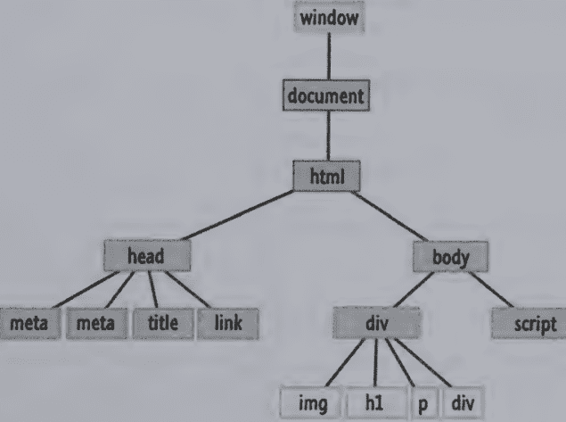

图 25.1
没错。看起来确实像一个树形结构！

这个细节只是部分重要。重要的是，你有所有这些 HTML 元素悬浮在那里，你想访问它们、从中读取数据或修改它们。有很多方法可以找到这些 HTML 元素。毕竟，这些元素是以树形结构排列的，如果说计算机科学家喜欢做一件事，那就是研究如何在树上疯狂爬爬寻找某个东西。

我不会让你忍受那种折磨…………至少。在本章中，你将学习如何使用两个名为`querySelector`和`querySelectorAll`的内置函数来解决大部分的 DOM 搜索需求。

继续前进！

## 认识 querySelector 家族

为了帮助解释`querySelector`和`querySelectorAll`带来的强大之处，请看以下 HTML：

```html
<div id="main">
  <div class="pictureContainer">
    
  </div>
  <div class="pictureContainer">
    
  </div>
  <div class="pictureContainer">
    
  </div>
  <div class="pictureContainer">
    
  </div>
</div>
```

在这个示例中，你有一个 id 为`main`的`div`，然后有四个`div`和`img`元素，它们分别具有类名`pictureContainer`和`theImage`值。在接下来的几秒钟内，我们将`querySelector`和`querySelectorAll`函数释放到这段 HTML 上，看看会发生什么。

## querySelector

`querySelector`函数的基本工作原理如下：

```javascript
let element = document.querySelector("CSS selector");
```

`querySelector`接收一个参数，这个参数是一个代表你想要查找的元素的 CSS 选择器的字符串。`querySelector`返回的是它找到的**第一个**元素——即使存在其他被该选择器命中的元素。这个函数在这方面非常固执。

以我们之前的示例 HTML 为例，如果我们想访问 id 为`main`的`div`，你会这样写：

```javascript
let element = document.querySelector("#main");
```

因为`main`是 id，所以目标它的选择器语法是`#main`。同样，让我们指定`pictureContainer`类的选择器：

```javascript
let element = document.querySelector(".pictureContainer");
```

返回的是第一个类名为`pictureContainer`的`div`。其他类名为`pictureContainer`的`div`元素将被忽略。

因为你使用的是 JavaScript，选择器语法不会被修改或特殊化。你在样式表或样式区域使用的精确语法可以使用。

## querySelectorAll

`querySelectorAll`函数返回所有匹配你提供的选择器的元素：

```javascript
let elements = document.querySelectorAll("CSS selector");
```

除了返回元素的数量外，上面关于`querySelector`的描述都适用于`querySelectorAll`。这一重要细节改变了你实际使用`querySelectorAll`函数的方式。返回的不是单个元素，而是一个类数组的容器！

你提供的选择器可以多“疯狂”，取决于浏览器的 CSS 支持情况。Internet Explorer 8 支持`querySelector`和`querySelectorAll`。它不支持 CSS3。考虑到这种情况，在 IE8 上使用`querySelector`和`querySelectorAll`时，无法使用比 CSS2 定义更新的内容。可能你不适用，因为你可能在支持现代浏览器，这个 IE8 的问题根本不在考虑范围内。

你指定的选择器仅适用于起始元素的后代。起始元素本身不包含内。并不是所有的`querySelector`和`querySelectorAll`调用都需要从`document`发起。

## 极简核心

在复杂的文档中，定位特定元素往往并不简单，此时，这两个函数非常有用。通过依赖成熟的 CSS 选择器语法，我们可以对想要的元素撒下尽可能小或尽可能宽的网。如果我想要所有图像元素，我只需说`querySelectorAll("img")`。如果我只想要父级`div`内部的`img`元素，我可以说`querySelector("div + img")`。现在这太棒了。

在结束之前，还有另一个元素查找元素我想和你聊聊。在这些函数中缺少了`getElementById`、`getElementsByTagName`和`getElementsByClassName`函数。在过去，这些是你用于在 DOM 中查找元素的函数。`querySelector`和`querySelectorAll`是查找元素的现在和未来解决方案，所以不用担心`getElement*`函数。目前，`querySelector`的唯一缺点是性能。`getElementById`函数仍然很快，你可以在这里查看对比：https://javascript.com/getelementbyid-vs-queryselector/11。

## 修改 DOM 元素

到目前为止，你已经大概知道 DOM 是什么了。你还看到了如何使用`querySelector`和`querySelectorAll`来查找元素。接下来我们要学习如何修改你找到的 DOM 元素：

1. 对 DOM 有一个大致的
2. 学习查找元素
3. 修改元素
4. ???
5. 大功告成!!!


我们到这里了！

我不知道为什么这里有一块披萨。

毕竟，如果我们不能亲手揉捏一大块粘土（或饼干面团）并弄得一团糟，那它的乐趣何在呢？无论如何，除了好玩之外，我们会发现自己一直在修改 DOM。无论我们是使用 JavaScript 更改某些元素的文本、用不同的图片替换旧图片、将元素从文档的一个部分移动到另一个部分、设置内联样式，还是执行我们想要做的其他无数种更改中的任何一种，**我们都会修改 DOM**。本教程将教你如何进行这些的基础知识。

继续前进！

## DOM 元素是对象——某种程度上是！

我们之所以能够使用 JavaScript 修改浏览器显示的内容，是因为一个重要的细节。那个细节就是：每个 HTML 标签、样式规则以及构建到你页面中的其他内容，在 DOM 中都有某种形式的表示。

为了直观地理解我刚才说的话，让我们假设在标记中定义了一个图像元素：

```html

```

当我们的浏览器解析文档并遇到这个图像元素时，它会在 DOM 中创建一个表示它的节点，如图 26.1 所示。

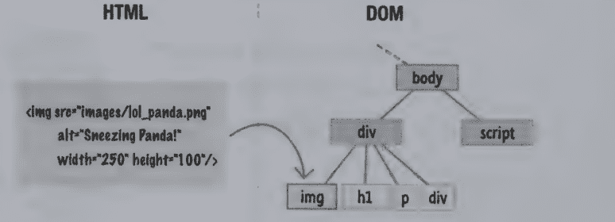

图 26.1

我们所有的 HTML 元素最终都会拥有一个 DOM 表示。

这种 DOM 表示赋予了我们执行所有在标记中可以做到的操作的能力。事实证明，这种 DOM 表示实际上**允许我们对 HTML 元素进行更多操作**，这比使用旧的标记本身所能做的多。这一点我们在这里看到一点，在未来会看到很多。我们的 HTML 元素之所以通过 DOM 视图时如此灵活，是因为它们与普通的 JavaScript 对象有许多相似之处。我们的 DOM 元素包含了允许我们获取/设置值并调用方法的属性。它们具有某种形式的继承，我们在之前稍微了解过这种关系，即每个 DOM 元素提供的功能分布在`Node`、`Element`和`HTMLElement`基础类型中，如图 26.2 所示。

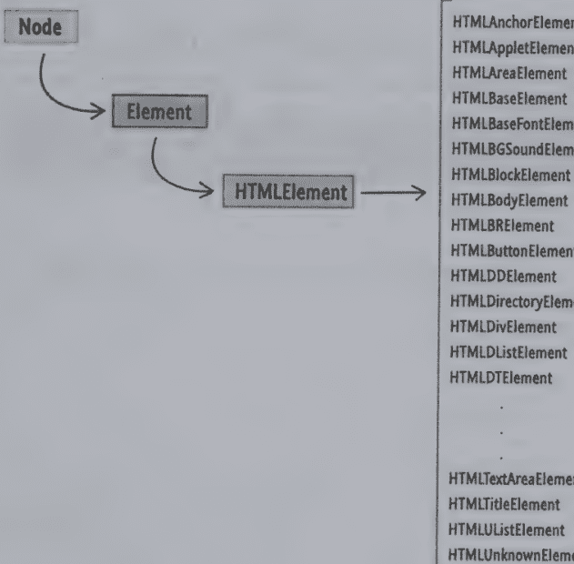

图 26.2
我们在 HTML 中通常会遇到的视觉元素的层级结构。

当 DOM 元素在雨里滚了一会儿后回到房子运行时，它们可能闻起来甚至像一个对象。

尽管有所有这些相似之处，但出于法律和……可能的健康考虑，我需要提供以下免责声明：DOM 从未被设计为模拟对象的工作方式。我们用对象做的很多事情确实可以在 DOM 中完成，但那是因为浏览器厂商帮助确保了这一点。W3C 规范并没有规定 DOM 的行为应该与我们对普通对象的行为预期完全一致。虽然我不会因为担心这个而失眠，但如果你决定扩展 DOM 元素或执行更高级的对象相关操作，请务必在所有浏览器中进行测试，以确保一切都按照你的预期方式运行。

现在我们已经过了这段尴尬的话，让我们开始实际修改 DOM 吧。

## 让我们实际修改 DOM 元素

虽然我们完全可以退后被动地学习如何修改 DOM 中的元素，但这种情况下跟着一个简单的示例可能会更有趣。如果你感兴趣跟着操作，我们将使用以下 HTML 作为我们将涵盖的技术的沙盒：

```html
<!DOCTYPE html>
<html>
<head>
<title>Hello...</title>
<style>
.highlight {
  font-family: "Arial";
  padding: 30px;
}
.summer {
  font-size: 64px;
  color: #0099FF;
}
</style>
</head>
<body>
```

```html
<h1 id="bigMessage" class="highlight summer">What's happening?</h1>
<script>
</script>
</body>
</html>
```

只需将此 HTML 放入你的文档中。如果你预览它，你会看到一个类似于图 26.3 的内容。


图 26.3

发生了什么？

h1 的主要内容是我们想要改变的内容。这里是代码：

```html
<h1 id="bigMessage" class="highlight summer">What's happening?</h1>
```

现在当我们在浏览器中预览这个时，你将看到图 26.4。

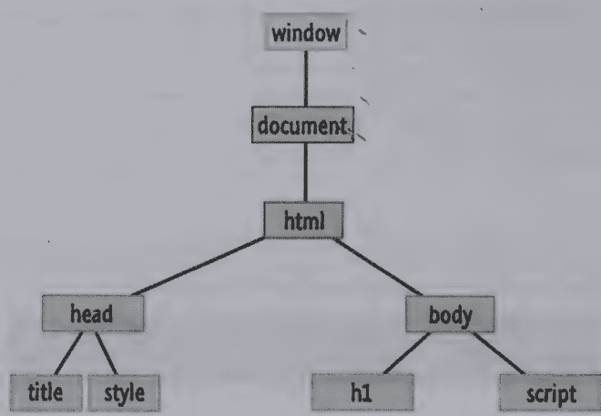

图 26.4

发生了什么？

## 属性值

我们的 HTML 元素区分彼此的主要方式之一是通过它们的属性。例如，`src`和`alt`属性定义了这些元素：

```html


```

每个 HTML 属性（包括`data-*`）都可以通过 DOM 提供的属性访问。为了帮助我们处理属性，我们的元素暴露了直观易懂的`getAttribute`和`setAttribute`方法。

`getAttribute`方法允许我们指定元素上属性的名称。如果找到了该属性，此方法将返回与该属性关联的值。下面是一个示例：

```html
<body>
<h1 id="bigMessage" class="highlight summer">What's happening?</h1>
<script>
  let headingElement = document.querySelector("h1");
  console.log(headingElement.getAttribute("id")); // bigMessage
</script>
</body>
```

```javascript
headingElement.setAttribute("class", "bar foo");
```

我们正在将 h1 元素的`class`属性设置为`bar foo`（嗯……实际上实际上是覆盖！）。`setAttribute`函数不会进行任何验证来确保我们正在设置的属性对于我们设置的元素是有效的。没有什么能阻止我们执行如下所示的操作：

```html
<body>
<h1 id="bigMessage" class="highlight summer">What's happening?</h1>
```

```javascript
<script>
let headingElement = document.querySelector("h1");
headingElement.setAttribute("src", "http://www.kirupa.com");
</script>
</body>
```

我们的`h1`元素并不包含`src`属性，但我们可以强行指定它。当代码运行时，我们的`h1`元素甚至会带有`src`属性……这可能会看起来非常奇怪。

在继续下去之前，我需要说明一点。在关于使用`setAttribute`和`getAttribute`的示例中，我挑选了`id`和`class`。对于这两个属性，我们有另一种设置方法。因为设置`id`和`class`属性非常常见，我们的 HTML 元素直接暴露了`id`和`className`属性：

```html
<body>
<h1 id="bigMessage" class="highlight summer">What's happening?</h1>
```

```javascript
<script>
let headingElement = document.querySelector("h1");
console.log(headingElement.id); // bigMessage
headingElement.className = "bar foo";
</script>
</body>
```

回到我们的示例，注意我从使用`getAttribute`和`setAttribute`切换到使用`id`和`className`属性，效果是完全相同的。唯一的区别在于，你有一种直接设置这些属性值的方法，而无需使用`getAttribute`或`setAttribute`。现在，在我们进一步学习之前，我必须指出这个奇怪的…………在 JavaScript 中不能使用`class`来引用`class`属性，因为`class`有一个完全不同的与处理对象相关的名称。这就是为什么我们使用`className`的原因。

> 提示 除了使用`className`之外，还有一种更好的设置类值的方法。那种方法是通过你将在下一章中详细学习的非常强大的`classList`属性。


## 核心内容

在此时结束我们关于修改 DOM 元素的讨论似乎有点奇怪。虽然更改元素的文本和属性值非常流行，但它们绝不是你将执行的唯一主要类型修改。之所以在这个悬念处结束，是因为操作 DOM 以及使用元素的属性和方法来完成我们的任务，是我们将之后要看到的所有内容的核心。在随后的章节中，你将看到更多这里见过的内容。

这一章的最主要收获是，你执行的 DOM 更改几乎总是采取以下形式之一：

- 设置属性
- 调用方法

你在这里看到的`textContent`、`setAttribute`和`getAttribute`方法涵盖了这两种方法，你很快就会看到更多它们以及它们的同类。

这是一个非常重的话题！如果你有任何问题，不要延迟获取答案。请尽快在 https://forum.kirupa.com 论坛上发帖。


## 为我们的内容设置样式

在上一章中，我们查看了如何使用 JavaScript 修改 DOM 的内容。我们的 HTML 元素脱颖而出的另一个部分是它们的外观，它们的样式。当涉及某些内容的样式时，最常用的方法创建一个样式规则并让其选择器指向一个或多个元素。样式规则如下：

```css
.batman {
width: 100px;
height: 100px;
background-color: #333;
}
```

受此样式规则影响的元素看起来像这样：

```html
<div class="batman"></div>
```

在任何网页上，我们都会看到从几个到多个样式规则，它们优美地交织在一起为我们看到的一切进行样式化。不过，这并不是我们使用 CSS 样式化内容的唯一方法。如果没有多种方法可以完成相同任务，那它就不是 HTML 了！

忽略内联样式，我们可以使用的另一种将元素引入 CSS 样式化这种美妙世界的方法涉及了 JavaScript。我们可以使用 JavaScript 直接为元素设置样式，也可以使用 JavaScript 在元素上添加或删除类值，这将改变哪些样式规则被应用。

在本教程中，我们将学习这两种方法。

继续前行！

## 为什么我们要使用 JavaScript 设置样式？

在继续之前，解释一下我们起初为什么想要使用 JavaScript 来影响元素的样式可能是很有用的。在那些使用样式规则或内联样式来影响元素外观的常见情况下，样式是在页面加载时生效的。这太棒了，可能也是我们大多数时候最想要的。

在很多情况下，特别是当我们的内容变得更有交互性时，我们希望样式能够根据用户输入、后台运行某些代码等动态生效。在这些情况下，涉及样式规则或内联样式的 CSS 模型无法为我们提供帮助。虽然像`hover`这样的伪选择器提供了一些支持，但我们能做的仍然受到很大限制。

我们需要对所有这些情况采用的解决方案是涉及 JavaScript 的。JavaScript 不仅让我们对正在交互的元素设置样式，更重要的是，它允许我们对整个页面的元素设置样式。这种自由是非常强大的，远远超过了 CSS 对其内部（或非常接近自身）内容的有限样式能力。

## 两种样式方法的故事

正如我们在引言中看到的，我们有两种方法使用 JavaScript 更改元素的样式。一种方法是直接在元素上设置 CSS 属性。另一种方法是从元素中添加或删除类值，这可能会导致某些样式规则被应用。让我们详细查看这两种情况。

## 直接设置样式

通过 JavaScript 访问的每个 HTML 元素都有一个`style`对象。该对象允许你指定 CSS 属性并设置其值。例如，为 id 为`super`的 HTML 元素设置背景颜色看起来如下：

```javascript
let myElement = document.querySelector("#super");
myElement.style.backgroundColor = "#D3600";
```

要影响许多元素，你可以执行如下操作：

```javascript
let myElements = document.querySelectorAll(".bar");

for (let i = 0; i < myElements.length; i++) {
  myElements[i].style.opacity = 0;
}
```

最后，某些 CSS 属性需要提供更复杂的值，即一堆随机文本后面紧跟着你关心的值。这一类中较流行的之一是`transform`属性。设置复杂值的一种方法是使用旧式的字符串拼接。这可能变得非常恼人，因为跟踪引号等内容是一件枯燥且容易出错的事情。一个不那么恼人的解决方案是使用模板字量语法：

```javascript
myElement.style.transform = `translate3d(${xPos}, ${yPos}px, 0)`;
```

注意，这种方法允许你在仍然提供自定义值的同时，避免了所有字符串的复杂性。


> 提示某些 CSS 属性名称的特殊命名

JavaScript 对什么构成有效的属性名称非常挑剔。CSS 中的大多数名字都能获得 JavaScript 的认可，所以你可以直接从源头上使用它们。不过，有几点需要记住。

在 JavaScript 中指定包含连字符的 CSS 属性，只需删除连字符即可。例如，`background-color`变为`backgroundColor`属性，`border-radius`变为`borderRadius`，以此类推。

此外，JavaScript 中的某些单词是保留的，不能直接使用。CSS 属性中属于这一特殊类别的一个就是`float`。在 CSS 中它是一个布局属性；但在 JavaScript 中，它代表其他含义。要使用名称完全被保留的属性，请在属性名前加上`css`前缀，使`float`变为`cssFloat`。

## 使用 JavaScript 添加和移除类

第二种方法涉及添加和移除类值，从而改变应用哪些样式规则。例如，假设我们有如下的样式规则：

```css
.disableMenu {
  display: none;
}
```

在 HTML 中，我们有一个 id 为`dropDown`的菜单：

```html
<ul id="dropDown">
  <li>One</li>
  <li>Two</li>
  <li>Three</li>
  <li>Four</li>
  <li>Five</li>
  <li>Six</li>
</ul>
```

现在，如果我们想对该元素应用`.disableMenu`样式规则，我们只需要将`disableMenu`作为类值添加到`dropDown`元素中：

```html
<ul class="disableMenu" id="dropDown">
  <li>One</li>
  <li>Two</li>
  <li>Three</li>
  <li>Four</li>
  <li>Five</li>
  <li>Six</li>
</ul>
```

实现这一点的方法之一是设置元素的`className`属性，`className`的问题在于我们需要负责维护当前应用的类值列表。糟糕的是，返回给我们的类值列表是一个字符串。如果我们有多个想要添加、移除或仅仅切换开启/关闭的类值，我们必须进行大量易出错的字符串相关操作，这可并不有趣。

为了缓解一些不便之处，我们现在有了一个更好用的 API，让从元素中添加和移除类值变得异常简单。这个新 API 被亲切地称为`classList`，它提供了几个方法，让处理类值的工作变得如菜碟简单：

- `add`
- `remove`
- `toggle`
- `contains`

这四个方法从它们的名称来看可能非常自而易懂，但让我们进一步详细查看它们。

## 添加类值

要向元素添加类值，请获取元素的引用，并通过`classList`调用其`add`方法：

```javascript
let divElement = document.querySelector("#myDiv");
divElement.classList.add("bar");
divElement.classList.add("foo");
divElement.classList.add("zorb");
divElement.classList.add("baz");
console.log(divElement.classList);
```

这段代码运行后，我们的 div 元素将具有以下类值：bar, foo, zorb, baz。`classList` API 会确保类值之间添加空格。如果我们指定了一个无效的类值，`classList` API 将报错且不添加。如果我们告诉`add`方法添加一个元素上已经存在的类，我们的代码仍运行，但重复的类值不会被添加。

## 移除类值

要移除类值，我们可以调用`classList`的`remove`方法：

```javascript
let divElement = document.querySelector("#myDiv");
divElement.classList.remove("foo");
console.log(divElement.classList);
```

在这段代码执行后，**foo** 类值将被移除。我们将只剩下 **bar** 和 **zorb**。非常简单，对吧？

## 切换类值

对于许多样式场景，有一个*常见的工作流*。首先，我们检查元素上是否存在某个类值。如果该值不存在，则将该值添加到元素。为了简化这种常见的切换模式，`classList` API 为你提供了`toggle`：

```javascript
let divElement = document.querySelector("#myDiv");
divElement.classList.toggle("foo"); // 移除 foo
divElement.classList.toggle("foo"); // 添加 foo
divElement.classList.toggle("foo"); // 移除 foo
console.log(divElement.classList);
```

`toggle`方法顾其名所示，每次调用时都会在元素上添加或移除指定的类值。在我们的情况下，第一次调用`toggle`方法时，**foo** 类被移除。第二次，**foo** 类被添加。第三次，**foo** 类被移除。你懂意思的。

## 检查类值是否存在

我们将最后看的是`contains`方法：

```javascript
let divElement = document.querySelector("#myDiv");

if (divElement.classList.contains("bar") == true) {
  // 执行某些操作
}
```

该方法检查指定的类值是否存在于元素上。如果该值存在，你得到 **true**。如果不存在，你得到 **false**。

## 进阶

如你所见，`classList` API 提供了几乎你需要的一切，可以非常方便地添加、移除和检查元素的类值。重点在于“*几乎*”这个词。对于 API 默认未提供的少数功能，你可以去网上阅读我关于使用`classList`可以做的更多事情的完整文章：`http://bit.ly/kclassList`。

## 极简方案

所以，就是这样——你有两种非常好的基于 JavaScript 的方法可以为你的元素设置样式。在这两个选择中，如果你有修改 CSS 的能力，我倾向于让你通过添加和移除类来设置样式。简单的原因是这种方法更具可维护性。与添加和移除 JavaScript 代码相比，在 CSS 样式规则中添加和移除样式属性要容易得多。

有疑问吗？论坛上的友好朋友们可能有答案。前往 https://forum.kirupa.com 提问吧！

## 遍历 DOM

正如你现在可能已经意识到的，我们的 DOM 看起来像一棵巨大的树——一棵元素危险地挂在分支上的巨树。这就是我们需要学习如何遍历这棵树的地方。为此，我们需要理解如何从一个元素移动到另一个元素。有很多方法可以实现，但我们将从最常用的开始。

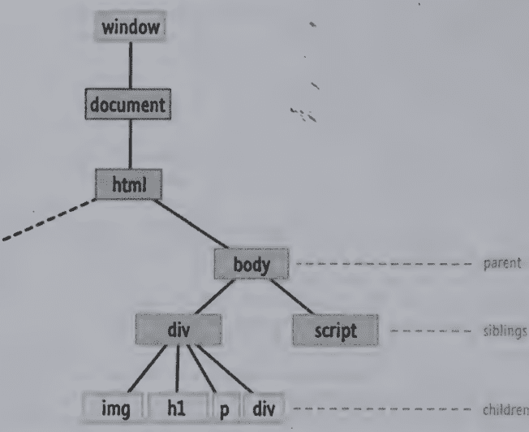

图 28.3

我们树的一个示例，包含一些父元素、兄弟和子元素。

`div`和`script`元素是兄弟关系。它们之所以是兄弟是因为它们共享`body`元素作为父元素。`script`元素没有孩子，但`div`元素有。`img`、`h1`、`p`和`div`都是`div`元素的儿子，而同一个父元素的所有儿子也是兄弟关系。就像现实生活一样，父、子、兄弟关系取决于我们在关注树的哪个位置。几乎每个元素根据我们观察它们的角度不同，都可以扮演多个家族角色。

为了帮助我们完成这些操作，我们有一些可以依赖的属性。这些属性分别是`firstChild`、`lastChild`、`parentNode`、`children`、`previousSibling`和`nextSibling`。仅从它们的名称，你就能够推断出这些属性的作用。那个拿着尖头叉叉的红色家伙就在细节里，所以我们将在将详细讨论这一点。

## 处理兄弟和父元素

在这些属性中，最容易处理的是父元素和兄弟元素。相关的属性是`parentNode`、`previousSibling`和`nextSibling`。图 28.4 所示的图可以让你了解这三个属性是如何工作的。

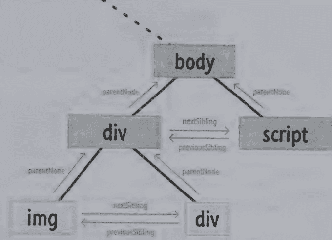

图 28.4

从我们 DOM 的视角看兄弟元素和父元素之间的关系。

这张图有点复杂，但你大致可以看出这里发生了什么。`parentNode`属性指向元素的父元素。`previousSibling`和`nextSibling`属性允许元素找到它的上一个或下一个兄弟元素。你只需沿着箭头的方向移动就能在图中看到这种可视化。在最后一行，我们`img`的`nextSibling`是`div`。我们`div`的`previousSibling`是`img`。在其中任何一个元素上访问`parentNode`都会带你进入第二行的父级`div`。这一切都非常直观。

## 让我们拥有孩子吧！

稍微没那么直观的是孩子是如何融入这一切的，所以让我们来看看图 28.5 所示的`firstChild`、`lastChild`和`children`属性。

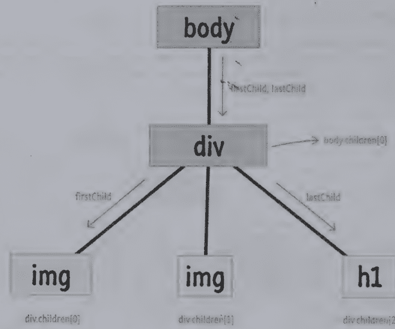

图 28.5

子元素以及更多元素的视图！

`firstChild`和`lastChild`属性指向父元素的第一个和最后一个子元素。如果父元素只有一个孩子（如我们示例中的`body`元素），那么`firstChild`和`lastChild`都指向同一个东西。如果一个元素没有孩子，这些属性将返回`null`。

与我们看过的其他属性相比，棘手的是`children`属性。当你从父元素上访问`children`属性时，你基本上得到了该父元素拥有的子元素集合。这个集合不是一个数组（Array），但它确实具有一些类数组的功能。就像数组一样，你可以遍历这个集合或单独访问每个孩子，正如你在图中看到的那样。这个集合还有一个`length`属性，可以告诉你父元素正在处理多少个孩子。如果这让你感到头晕，请不要担心。下一节中的代码片段将帮助澄清我解释中的模糊之处。

## 将所有内容整合在一起

现在我们已经对遍历 DOM 的所有重要属性有了良好的了解，让我们来看一些代码片段，将所有的图表和文字整合成几行美妙的 JavaScript 代码。

## 检查是否存在孩子

要检查一个元素是否具有孩子，我们可以执行如下操作：

```javascript
let bodyElement = document.querySelector("body");

if (bodyElement.firstChild) {
  // 执行一些有趣的事情
}
```

如果没有孩子，这个`if`语句将返回`null`。如果你喜欢打字，也可以使用`bodyElement.lastChild`或`bodyElement.children.length`，但我倾向于保持简单。

## 访问所有子元素

如果我们想访问父元素的所有孩子，始终可以依靠老的`for`循环：

```javascript
let bodyElement = document.body;

for (let i = 0; i < bodyElement.children.length; i++) {
  let childElement = bodyElement.children[i];

  document.write(childElement.tagName);
}
```

注意，我们像使用数组一样使用了`children`和`length`属性。需要注意的是，这个集合实际上并不是数组。我们可能想要使用的几乎所有数组方法在`children`属性返回的这个集合中都是不可用的。

## 遍历 DOM

我们的最后一个代码片段涉及了我们目前所见的一切内容。这段代码片段递归地遍历 DOM 并接触它能找到每一个 HTML 元素：

```javascript
function theDOMElementWalker(node) {
  if (node.nodeType == Node.ELEMENT_NODE) {
    console.log(node.tagName);
  }

  node = node.firstChild;

  while (node) {
    theDOMElementWalker(node);
    node = node.nextSibling;
  }
}
```

为了看到这个函数的运行效果，我们只需通过传递一个想要从开始遍历的节点来调用它：

```javascript
let texasRange = document.querySelector("#texas");
theDOMElementWalker(texasRange);
```

在这个示例中，我们对`texasRange`变量引用的元素调用了`theDOMElementWalker`函数。如果你想在该脚本找到的元素上运行某些代码，请将被注释掉的行替换为你想做的任何操作。

## 最基础

在 DOM 中寻找路径是每个 JavaScript 开发者都应该熟悉的技能之一。本教程为你提供了技术上可能性的概述。将其应用于更实用的方法完全取决于你……或者一个帮助你处理这些事情的酷朋友。话虽如此，在随后的教程中，我们将扩展看到的内容，作为继续对 DOM 能做的一切进行深度研究的一部分。

## 创建和删除 DOM 元素

这部分可能会让你大开眼界。对于接下来的句子，我建议你抓紧稳固的东西：

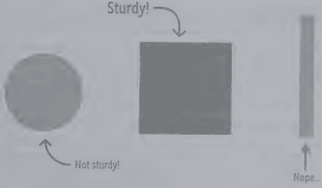

尽管我们之前关于 DOM 的讨论可能不包含标记中实际存在的 HTML 元素，但我们有能力凭空创建 HTML 元素，并仅用几行 JavaScript 就将它们添加到我们的 DOM 中。我们还有能力移动元素、删除它们并进行各种如神般的事情。让我们停一下，让这一切在大脑中消化一下。这非常重大。

在本章中，我们将涵盖让这一切运行的基础知识。我们将查看如何创建元素、删除元素、重新设置父元素以及克隆元素。有问题吗？前往 forum.com 获取像你一样友好的开发者提供的答案！

前进吧！

## 创建元素

交互式网站和应用动态创建 HTML 元素并让它们存在于 DOM 中是非常常见的。如果你是第一次听到这种可能是可能的，你将会喜欢这一节的！

我们创建元素的方法是使用`createElement`方法。`createElement`的工作原理非常简单。我们通过`document`对象调用它，并传入我们想要创建的元素的 HTML 标签名。在以下代码片段中，我们正在创建一个由`p`表示的落元素：

```javascript
let myElement = document.createElement("p");
```

`myElement`变量持有我们新创建的元素的引用。

如果我们在一个较大的应用程序中运行这行代码，它将执行并创建一个`p`元素。创建元素是简单的部分。实际上将其提升为 DOM 中一个有趣且负责的成员才需要一些额外的努力。我们需要实际上将此元素放置在 DOM 的某个地方，因为我们动态创建的这个`p`元素目前只是在无目的地漂浮着。

这种无力感的原因是因为我们的 DOM 并不真正知道这个元素已经存在。为了让一个元素成为 DOM 的一部分，我们还需要做一些其他操作：

1. 找到一个将作为父元素的元素
2. 使用`appendChild`将我们想要的元素添加到该父元素中

理解这一切的最好方法是看一个将所有内容结合在一起的示例。如果你想跟着操作，请创建一个新的 HTML 文档并将以下 HTML、CSS 和 JS 添加到其中：

```html
<!DOCTYPE html>
<html>
<head>
<title>Creating Elements</title>
<style>
body {
  background-color: #0E454C;
  padding: 30px;
}
```

```css
h1 {
  color: #14FFF7;
  font-size: 72px;
  font-family: sans-serif;
  text-decoration: underline;
}
```

```css
p {
  color: #14FFF7;
  font-family: sans-serif;
  font-size: 36px;
  font-weight: bold;
}
</style>
</head>
```

```html
<body>
<h1>Am I real?</h1>
<script>
```

```javascript
let newElement = document.createElement("p");
let bodyElement = document.querySelector("body");

newElement.textContent = "Or do I exist entirely in your imagination?";

bodyElement.appendChild(newElement);
</script>
</body>
</html>
```

保存此文件并在浏览器中预览它。如果一切都运行正常，你应该能看到类似于下方截图的内容：

现在，我们将后退一步，看看我们的示例中到底发生了什么。如果我们查看 JavaScript 代码，创建元素并将其添加到 DOM 中需的所有内容都位于`script`标签之间：

```javascript
let newElement = document.createElement("p");
let bodyElement = document.querySelector("body");
```

```javascript
newElement.textContent = "Or do I exist entirely in your imagination";
```

```javascript
bodyElement.appendChild(newElement);
```

通过`newElement`，我们存储了新创建的`p`标签的引用。通过`bodyElement`，我们存储了对`body`元素的引用。在我们新创建的元素 (`newElement`) 上，我们将`textContent`属性设置为我们最终要显示的内容。我们做的最后一件事是获取那个无故浮动的`newElement`，并依靠经典的`appendChild`将其作为`body`元素的子元素。

图 29.1 是我们简单示例 DOM 结构的视化图。

图 29.1

代码运行后 DOM 的样子。

现在，关于`append`函数的一个细节是，它总是将元素添加到父元素可能有的任何子元素的末尾。在我们的情况下，`body`元素已经有了`h1`和`script`元素作为它的子元素。`p`元素作为最小元素被追加在它们之后。尽管如此，我们确实可以控制特定元素在父元素下的确切位置。

如果我们想直接在`h1`标签之后插入`createElement`元素，可以通过在父元素上调用`insertBefore`函数来实现。`insertBefore`函数接受两个参数。第一个参数是你想要插入的元素。第二个参数是你想要先于的同级元素（即父元素的子元素）的引用。这里是修改后的示例，让`newElement`位于`h1`元素之后（在`script`元素之前）：

```javascript
let newElement = document.createElement("p");
let bodyElement = document.querySelector("body");
let scriptElement = document.querySelector("script");
```

```javascript
newElement.textContent = "I exist entirely in your imagination.";
```

```javascript
bodyElement.insertBefore(newElement, scriptElement);
```

注意，我们在`bodyElement`上调用了`insertBefore`，并指定`newElement`应该插入在`script`元素之前。在这种情况下，我们的 DOM 看起来如图 29.2 所示。

图 29.2

新插入的元素位于`h1`和`script`元素之间。

你可能会认为，如果有`insertBefore`方法，那么一定也有`insertAfter`方法。事实证明，情况并非如此。目前没有广泛支持的内置方法可以将元素插入到某个元素**之后**而不是之前。我们可以做的是通过告诉`insertBefore`将元素多向前插入一个元素来“欺骗”它。这可能听起来有些说不通，所以让我先给你看代码，稍后解释：

```javascript
let newElement = document.createElement("p");
let bodyElement = document.querySelector("body");
let h1Element = document.querySelector("h1");
```

```javascript
newElement.textContent = "I exist entirely in your imagination.";
```

```javascript
bodyElement.insertBefore(newElement, h1Element.nextSibling);
```

注意高亮显示的行，然后看看图 29.3，它说明了在我们代码运行之前和之后发生了什么。

图 29.3

我们的技巧模拟了`insertAfter`行为。

`h1Element.nextSibling`找到了`script`元素。

如果你发现自己总是要在某个元素之后添加元素，那么你可以使用这个函数来简化生活：

```javascript
function insertAfter(target, element) {
  target.parentNode.insertBefore(element, target.nextSibling);
}
```

**是的，我意识到我是在绕圈子，但这种方法有效。** 这种方法是通用的。下面是该函数的工作示例：

```javascript
let newElement = document.createElement("p");
let bodyElement = document.querySelector("body");
let h1Element = document.querySelector("h1");

newElement.textContent = "I exist entirely in your imagination.";

function insertAfter(target, element) {
  target.parentNode.insertBefore(element, target.nextSibling);
}

insertAfter(bodyElement, newElement);
```

你甚至可以利用这种方法对`HTMLElement`进行扩展。**第 19 章，“扩展内置对象”**将更详细地介绍如何操作。

## 删除元素

我想某个聪明人曾说过：具有创建的能力，也具有删除的能力。在前一节中，我们看到了如何使用`createElement`方法来创建元素。在这一节中，我们将查看`removeChild`，尽管它的名字不太好听，但它是关于删除元素的。

看看下面的代码片段，它可以应用于我们观察了一段时间的示例：

```javascript
let newElement = document.createElement("p");
let bodyElement = document.querySelector("body");
let h1Element = document.querySelector("h1");

newElement.textContent = "I exist entirely in your imagination.";

bodyElement.appendChild(newElement);
```

```javascript
bodyElement.removeChild(newElement);
```

存储的`p`元素正通过`appendChild`方法添加到我们的`body`元素中。我们之前见过。要删除这个元素，我们在`body`元素上调用`removeChild`并传递要删除的元素的指针。该元素当然是`newElement`。一旦`removeChild`运行，就好像你从未知道`newElement`的存在。

主要的注意的是，我们需要在父元素上调用`removeChild`。该方法不会遍历我们的 DOM 来寻找我们要删除的元素。现在，假设我们没有直接访问元素的父元素，并且不想浪费时间去寻找它。我们可以通过如下使用`parentNode`属性非常轻松地删除该元素：

```javascript
newElement.parentNode.removeChild(newElement);
```

在这种变体中，我们通过指定`newElement.parentNode`并在其父元素上调用`removeChild`来移除`newElement`。这看起来有点迂回，但确实达到了效果。

现在，有一种更新、更漂亮、更好的方法来移除元素。通过这种方法，我们只需要直接在想要移除的元素上调用`remove`方法。示例如下：

```javascript
let newElement = document.createElement("p");
let bodyElement = document.querySelector("body");
let h1Element = document.querySelector("h1");

newElement.textContent = "我完全存在于你的想象中。";

bodyElement.appendChild(newElement);

newElement.remove();
```

现在，为什么我没有从开始到结束都围绕使用`remove`方法来移除元素呢？这与浏览器的支持有关。这种方法仍然相当新，所以像 Internet Explorer 这样的旧浏览器并不支持它。如果支持 Internet Explorer 对你来说很重要，那么我们看过的其他方法将会有效。

如果你在寻找一种通用的移除元素的方法（尽管有一些细微的缺陷），`removeChild`函数在效率上是非常毫不留情的。如果你想要更直接的方法，`remove`是你的朋友。这两种方法都有移除任何 DOM 元素的能力——包括最初在标记中创建的元素。我们并不局限于移除动态添加的 DOM 元素。如果我们正在移除的 DOM 元素具有许多级子元素和孙元素，它们都将被移除。

## 克隆元素

这一章随着我们深入的不断变得变得越来越诡异，但幸运的是我们已经到了最后一个小节。我们需要注意的最后一个 DOM 操作技术是关于元素克隆的，我们从一个元素开始，并创建它的完全相同的副本：


我们克隆元素的方法是在我们想要克隆的元素上调用`cloneNode`函数，并提供一个 **true** 或 **false** 参数，以指定我们是只想克隆元素本身还是克隆它的所有子元素。以下是克隆元素（并将其添加到 DOM 中）的代码片段：

```javascript
let bodyElement = document.querySelector("body");
let item = document.querySelector("h1");
```

```javascript
let clonedItem = item.cloneNode(false);

// 将克隆项添加到 DOM
bodyElement.appendChild(clonedItem);
```

一旦我们的克隆元素被添加到 DOM，我们就可以使用学过的所有技巧来修改它们。克隆元素对我们来说是非常重要的事情，让我们超出这个代码片段，来看一个更完整的示例：

```html
<!DOCTYPE html>
<html>
<head>
<title>克隆元素</title>

<style>
body {
  background-color: #60543A;
```

```css
padding: 30px;
}
```

```css
h1 {
  color: #F2D492;
  font-size: 72px;
  font-family: sans-serif;
  text-decoration: underline;
}
```

```css
p {
  color: #F2D492;
  font-family: sans-serif;
  font-size: 36px;
  font-weight: bold;
}
```

```html
</style>
</head>
```

```html
<body>
<h1>我是真实的吗？</h1>
<p class="message">我完全存在于你的想象中。</p>
```

```javascript
<script>
  let bodyElement = document.querySelector("body");
  let textElement = document.querySelector(".message");
```

```javascript
setInterval(sayWhat, 1000);

function sayWhat() {
  let clonedText = textElement.cloneNode(true);
  bodyElement.appendChild(clonedText);
}
```

```html
</script>
</body>
</html>
```

如果你将所有这些代码放入一个 HTML 文档并在浏览器中预览它，你将看到类似于我们之前示例的内容：


但是，几秒钟后，你会发现这个示例非常不同。消息在不断重复：


这里发生的事情的秘密在于我们的代码。让我们回到脚本标签部分，花点时间理解一下发生了什么：

```javascript
let bodyElement = document.querySelector("body");
let createElement = document.querySelector(".message");
```

在顶部，我们有`bodyElement`变量，它引用了我们 HTML 中的`body`元素。同样，我们有`createElement`变量，它引用了类值为`message`的`p`元素。这里没什么特别的。

现在，事情变得有点有趣了。我们有一个`setInterval`定时函数，它每隔 1000 毫秒（1 秒）调用一次`sayWhat`函数：

```javascript
setInterval(sayWhat, 1000);
```

实际的克隆发生在这个`sayWhat`函数内部：

```javascript
function sayWhat() {
  let clonedText = createElement.cloneNode(true);
  bodyElement.appendChild(clonedText);
}
```

我们对`textElement`调用了`cloneNode`。这样做的结果是创建`textElement`的副本并将其存储为`clonedText`变量的一部分。最后一步是将新克隆的元素添加到 DOM 中使其显示出来。得益于我们的`setInterval`，`sayWhat`下的所有代码都会重复，不断向页面添加我们的克隆元素。

你可能注意到的一点是，我们克隆的是以下元素：

```html
<p class="message">我完全存在于你的想象中。</p>
```

我们在代码中指定的是以下：

```javascript
let clonedText = createElement.cloneNode(true);
```

我们带有`true`标志调用`cloneNode`，表示我们也想克隆所有的子元素。为什么呢？我们的段元素似乎没有子元素（等一下，它有一个文本节点！）。这就是元素和节点之间区别产生的地方。

等等，我在这里看到了一些 OCR 文字……这就是我们第一次亲眼看到使用`createElement`、`remove`和`cloneNode`等方法可以进行的更改的深度和广度。

有了你所学的一切，没有任何能阻止你从一个完全空白的页面开始，使用几行 JavaScript 来填充它：

```html
<!DOCTYPE html>
<html>
<head>
  <title>妈，看我做了什么！</title>
</head>
<body>
  <script>
    let bodyElement = document.querySelector("body");

    let h1Element = document.createElement("h1");
    h1Element.textContent = "它们在“什么？”里说英语吗？";
    bodyElement.appendChild(h1Element);

    let pElement = document.createElement("p");
    pElement.textContent = "我正在这里添加一些文本……像牛一样！";
    bodyElement.appendChild(pElement);
  </script>
</body>
</html>
```

## 我将使用 GOOGLE CHROME

对于你接下来将看到的所有示例，我将一直使用 Google 的 Chrome 浏览器。虽然每个浏览器对于我将描述的功能提供了类似的服务，但具体的 UI 界面和获取步骤会有很大不同。请留意这一点，同时也请注意你可能使用的 Chrome 版本比本章中使用的版本更新。

## 认识开发者工具

让我们从最开始开始。当你导航到一个网页时，你的浏览器会加载它被告知加载的任何文档：

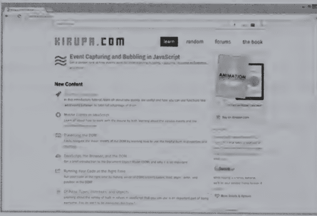

这部分你来说应该非常熟悉，因为浏览器的这部分功能自 19 世纪（左右）发布第一个浏览器以来，并没有发生太大变化……在使用 Chrome 时，请在 Mac 上按下 (Cmd-Opt-I)，或者在 Windows 上按下 F12 键 [或 Ctrl+Shift+I]。

一旦你按了这些键，请观察发生了什么。虽然你可能听不到沉重的音乐、伴随着地球的震动以及激光束划过天空，但你会看到浏览器的布局发生了变化，如图 30.1 所示，在屏幕底部或右侧通常显示出某些神秘的内容。


图 30.1

你的浏览器下方正显示着开发者工具。

你的浏览器将分为两部分。一部分是浏览器处理显示网页的地方。我们喜欢这个家伙，而且已经认识他很长时间了。另一部分是我们在从远处怀疑地打量的新人，它为你提供了关于当前页面信息的访问，这些信息只有像你这样的开发者才会欣赏。这个家伙广为人知的“开发者工具”（Developer Tools）。

开发者工具赋予你以下能力：

- 检查 DOM
- 调试 JavaScript
- 检查对象并通过控制台查看消息
- 解决性能和内存问题
- 查看网络流量
- ……以及更多功能！

出于时间考虑（**《权力的游戏》**快要开始了，我相信这是奈德·史塔复活变成影狼的一集），我将重点关注与你在书中所学习的内容直接相关的前三项。

## 检查开发者工具

我们将查看的第一个开发者工具功能是你可以如何检查甚至操纵你的 DOM 内容。启动 Chrome 后，导航到 http://bit.ly/kirupaDevTool。

## 没有浏览器？没问题！

现在，如果你手头没有方便的浏览器，或者简单无法访问该链接，不要担心。我会解释每一步发生了什么，这样你就不会错过所有的乐趣了。

当你加载此页面时，你将看到一个彩色的背景，上面显示着一些文本：


如果你刷新此页面，你将看到页面以不同的背景颜色出现。正如你所猜的，每次重新加载页面都会生成不同的背景颜色：


我们对这个示例做的第一件事是检查 DOM 以查看发生了什么。确保你的开发者工具可见，并确保选中了“Elements”（元素）标签页：


你将看到当前显示页面的实时标记语言视图。更具体地说，这是你的 DOM 视图。这种区别的重要性在于，该视图为你提供了页面外观的实时版本。任何 JavaScript 或你的浏览器对 DOM 所做的任何“小花招”都会显示在这里。

使用我们的示例作为一个……嗯……示例，使用“查看源代码”（View Source）将得到如下内容：

```html
<!DOCTYPE html>
<head>
<title>Random Color Generator!</title>
<style>
h2 {
  font-family: Arial, Helvetica;
  font-size: 100px;
  color: #FFF;
  text-shadow: 0px 0px 11px #333333;
  margin: 0;
  padding: 30px;
}
</style>
```

```html
</style>
</head>
<body>
<h2>Random
<br />/Color
<br />/Generator</h2>
<script src="js/randomColor.js"></script>
<script>
  let bodyElement = document.querySelector("body");
  bodyElement.style.backgroundColor = getRandomColor();
</script>
</body>
</html>
```

“查看源代码”命令仅仅是给你提供一个存储在 HTML 页面中的标记语言视图。另一种说法是，“查看源代码”给你提供的是保存在于服务器上的（过时的）标记语言版本，而不是 DOM 版本。

如果你使用开发者工具的 DOM 视图，你将看到一个基于页面实时版本的文档 DOM 表示：

```html
<!DOCTYPE html>
<html>
<head>
<title>Random Color Generator!</title>
<style>
h2 {
  font-family: Arial, Helvetica;
  font-size: 100px;
  color: #FFF;
  text-shadow: 0px 0px 11px #333333;
  margin: 0;
  padding: 30px;
}
</style>
```

```html
<body style="background-color: rgb(75, 63, 101);">
<h2>Random<br>Color<br>Generator</h2>
<script src="js/randomColor.js"></script>
<script>
  let bodyElement = document.querySelector("body");
  bodyElement.style.backgroundColor = getRandomColor();
</script>
</body></body></html>
```

如果你仔细观察，你会注意到某些元素外观上存在细微的差异。最大的区别是`body`元素上高亮的内联`background-color`样式，它只存在于 DOM 视图，而不存在于传统的“查看源代码”视图中。原因是我们有一些 JavaScript 代码动态地为`body`元素设置了内联样式。下面的注释将说明为什么会发生这种情况！

## DOM 视图与查看源代码之间的区别

这两个代码视图之间差异的原因追溯到 DOM 所代表的内容。再次重复一遍，你的 DOM 是你的浏览器和 JavaScript 运行完毕的结果。它为你提供了一个“新鲜出炉”的视图，模拟了浏览器所看到的内容。

“查看源代码”仅仅是服务器上标记语言的静态表示。

当这段代码运行时，它会修改`body`。为了看到 DOM 的用处，你应该检查：

```javascript
let bodyElement = document.querySelector("body");
bodyElement.style.backgroundColor = getRandomColor();
```

“Sources”（源代码）标签页让你访问当前正在使用的所有文件。正如名称所暗示，你查看的是这些文件的原始内容——而不是之前由 DOM 生成的版本。

从左侧的树形视图中，确保选中了`randomGenerator.htm`文件。这将确保该文件的内容显示在右侧。在显示的文件中，一直向下滚动直到看到之前看到的带有两行代码的脚本。根据左侧行栏的行数，我们的 JavaScript 代码应该是第 20 行和第 21 行。我们要做的是检查当第 21 行执行时会发生什么。为了做到，我们需要告诉浏览器在执行第 21 行之前停止。你实现这一点的方法是设置一个所谓的“断点”（breakpoint）。要设置断点，直接点击左侧行栏上的 21 标签。

一旦你这样做之后，你会看到 21 行被高亮：


此时，断点已经设置好。下一步是让你的浏览器实际上运行到这个断点。这有一个更温和的说法是“命中断点”。命中断点的方法是确保你的代码运行到它。在我们案例中，我们只需要按 F5 刷新页面，因为第 21 行将作为页面加载并执行`script`标签内所有内容的一部分而执行。

如果一切如预期运行，你会看到页面加载并突然停在第 21 行高亮处。


你目前正处于**调试模式**。你在第 21 行设置的断点已被触发。这意味着当浏览器运行到这一行时，你的整个页面就瞬间停滞了。在此时，由于你的浏览器处于悬挂状态，你有能力对页面上发生的一切进行各种操作。想象一下这段时间停止了，唯有你拥有移动、检查和改变周围环境的能力。如果还没有关于这个场景的电影，真该有人来拍一部了！

在此模式下，回到第 21 行，并将鼠标悬停在`bodyElement`变量上。当你悬停在上面时，你会看到一个工具提示，显示该特定对象包含的各种属性和值：

| Elements | Network | Sources | Timeline | |
|---|---|---|---|---|
| 来源: Content | Shipments | | | |

```javascript
body {
  id: "element-id"
  attributes: NamedNodeMap
  baseURI: "http://kirupa.com/html15.ex"
  color: null
  childCount: 3
  childNodes: NodeList[3]
  children: HTMLCollection[3]
}

bodyElement = document.querySelector("body");
bodyElement.style.backgroundColor = getRandomColor();
```

然后你可以与工具提示进行交互，滚动查看所有对象，甚至深入研究内部包含更多对象的复杂对象。因为`bodyElement`基本上是`body`元素的 JavaScript/DOM 表示，你将看到许多在几章之前通过查看`HTMLElement`时间接接触过的属性。

在源代码视图的右侧，你还有更多角度可以检查你的代码：


我不会解释所有这些类别的作用，但我指出这些点是为了让你知道，如果你愿意，你有能力以更详尽细节检查你所有 JavaScript 变量和对象的当前状态。

断点提供的另一个大优势是你可以像浏览器运行那样单步执行你的代码。现在，我们停在了第 21 行。要单步执行，点击右侧的“进入函数调用”（Step into function call）按钮：


记住，这是你当前断断的代码行：

```javascript
bodyElement.style.backgroundColor = getRandomColor();
```

一旦你点击了该按钮，注意发生了什么。你会发现自己进入了`randomColor.js`，那里定义了`getRandomColor`函数。持续点击“进入函数调用”以继续单步执行代码，并逐通过`getRandomColor`函数的每一行。注意，你现在可以看到随着你逐行执行，浏览器内存中的对象是如何更新的。如果你厌倦了这样做，可以点击“跳出当前函数”（Step out of current function）按钮（位于 Step 按钮右侧）来回退并退出此函数。在我们的情况下，那就是回到了`randomColorGenerator.htm`中的第 21 行。

如果你只想运行你的应用而不继续单步执行代码，请点击 Step into 左侧几个像素位置的 Play（播放）按钮：


当你按下 Play 时，你的代码将执行。如果你恰好在代码路径的某处设置了另一个断点，该断点也会被触发。在任何断点处停下时，你可以选择进入、跳出，或直接用 Play 恢复执行。由于我们只设置了一个断点，点击 Play 将一直运行到结束，并让你的随机颜色出现在`body`元素的背景中：


要移除断点，只需点击你设置断点的行号。如果你再次点击第 21 行标签，断点将切换关闭，你就可以直接运行应用程序而无需进入调试模式。

好了，就是这样。这是一个关于如何使用你可用调试功能的快速之旅。重申我在本章开头提到的一点，我仅仅触及了可能性的一角。我在末尾提供的资源将帮助你进一步学习。

## 认识控制台 (Console)

我们将看到的另一个强大的调试工具功能是使用所谓的控制台。控制台让你能够执行几项操作。它允许你查看代码打印的消息。它还允许你传递命令并检查当前作用域内的任何对象。

要显示控制台，点击（或触摸）它进入 Console 标签页：


控制台提供了你执行几项操作的能力。它允许你看到代码记录的消息。它还允许你传递命令并检查当前作用域内的任何对象。

## 检查对象

在控制台状态下，你可以看到控制台输出的。当你处于这种模式时，你有能力对你页面上发生的一切。


## 作用域 (Scope) 复习

在某些情况下，我们提到了你的控制台允许你查看你当前所处的。

让我们，假设你在以下代码设置了断点：

```javascript
let oddNumber = false;
```

```javascript
function calculateOdd(num) {
  if (num % 2 == 0) {
    oddNumber = false;
  } else {
    oddNumber = true;
  }
}

calculateOdd(3);
```

当你运行代码并触发断点时，`oddNumber`的值仍为`false`。你的断点行尚未执行。你可以通过在控制台测试`oddNumber`来验证这一点。接下来，假设你运行这段代码，触发断点，并执行到下一行。

此时，`oddNumber`的值变为`true`。控制台将反映这个新值。主要的要点是，你的控制台视图直接取决于你处于代码中的位置。这当你频繁执行代码并查看所在的作用域时尤为明显。

## 日志消息 (Logging Messages)

我们几乎完成了所有这些开发者工具的工作。我们将看到的最后一个功能是使用控制台记录消息。还记得我们以前做过类似的事情吗？

```javascript
function doesThisWork() {
  console.log("It works!!!");
}
```

这里的“这”指的是使用`alert`语句来打印某些值或证明代码正在执行。嗯，现在我们可以停止这样做了。通过控制台，你有一种更不烦的方式来打印消息，而不需要模态框中断一切。你可以使用`console.log`函数将你想打印的内容传递到控制台：

```javascript
function doesThisWork() {
  console.log("It works!!!");
}
```

当这段代码执行时，当你打开控制台，你会看到你记录的内容被打印在其中。

## 极简入门

如果你从未用过开发者工具，我真的**真的**觉得你应该花点时间熟悉一个。JavaScript 就是这样一种语言，即使一切看起来都很正常，问题也可能发生。在本书中你会遇到的非常简单的例子中，错误很容易发现。但当你开始处理更大、更复杂的应用程序时，拥有正确的工具来诊断问题将为你节省大量小时的工作。

为了比我这里涵盖的内容更详尽地了解开发者工具（或者用酷酷的孩子们称其为 Dev Tools），请查看以下资源：

- Chrome 开发者工具概述：http://bit.ly/kirupaChromeTools
- IE/Edge F12 开发者工具概述：http://bit.ly/kirupaIEDevTools
- Firefox 开发者工具概述：http://bit.ly/kirupaFFDevTools
- Safari Web 检查器概述：http://bit.ly/kirupaSafariDevTools

## 事件

如果你还没注意到的话，大多数应用程序和网站如果任置在那里是非常无聊的。它们带着隆重的仪式感和热情启动，但如果我们不开始与它们交互，它们带来的兴奋感很快就会消失：

> 天哪！做点什么吧……随便什么！

## 什么是事件？

其原因很简单。我们的应用程序存在是为了对我们对它们做的事情做出反应。当我们启动它们时，它们有一些内在动力让自己下床并准备好新的一天。之后它们所做的一切很大程度上取决于我们告诉它们做什么。这正是事情变得非常有趣的地方。

我们告诉应用程序要做什么的方法是让它们对所谓的“事件”做出反应。在本章中，我们将初步介绍什么是事件以及我们如何使用它们。

继续前进！

从高层来说，我们创建的所有内容都可以通过以下语句进行建模：

> 当 ________ 发生时，执行 ________。

我们可以用无数种不同的方式填充这个语句中的空格。第一个空格指的是某个发生的事情。第二个空格描述了对该事件的反应。以下是填充该语句的一些示例：

- 当页面加载发生时，播放猫滑进纸箱的视频
- 当点击发生时，提交我的在线订单
- 当鼠标松开时，拖动那只巨大的/不开心的鸟
- 当按下删除键时，将此文件发送到回收站
- 当触摸手势发生时，给这张照片应用这种复古滤镜
- 当文件下载发生时，更新进度条

这个通用模型适用于我们今天编写的所有代码。这个模型也适用于我们喜爱的设计师/朋友们为他们的应用程序编写的所有代码。没有办法逃避这个模型，所以……抵抗是没有意义的。相反，我们需要学会拥抱这个模型的主角——那个被称为“事件”的才华横溢的作家。

事件无非是一个信号。它通信某些事情刚刚发生了。这件事可能是鼠标点击。可能是键盘上的按键。可能是我们的窗口缩放。也可能只是我们的文档正在加载。我们要记住的是，我们的信号可以是 JavaScript 语言内置的数百种东西之一……或者是我们专门为应用程序创建的自定义内容。

回到我们的模型，事件构成了第一部分：

事件定义了发生的事情。它触发信号。模型的第二部分由对事件的反应定义：

毕竟，如果某处没有人在等待它并采取适当的行动，信号有什么用呢？！好了——现在我们已经对事件是什么有了高层概述，让我们深入了解事件是如何在名为 JavaScript 的自然保护区中生存的。

## 事件与 JavaScript

考虑到事件的重要性，你可能不会意外 JavaScript 为我们处理事件提供了很多极佳的支持。要处理事件，我们需要做两件事：

1. 监听事件
2. 对事件做出反应

这两个步骤看起来非常简单，但永远不要忘记我们在这里处理的是 JavaScript。这种简单只是掩盖在我们走错一步时，JavaScript 将带给我们的深层创伤的烟雾弹。也许我太戏剧化了，但我们很快就会发现。

## 监听事件

直白地说，我刚才在绕圈子，我们在应用程序内部执行几乎所有操作都会导致事件的触发。有时……例如加载时。有时，我们的应用程序会作为我们实际与其交互的反应而触发事件。需要注意的是，无论我们是否打算让它们触发，我们的应用程序都会不断被事件轰炸。我们的任务是告诉应用程序只监听我们关心的事件。

监听正确事件这项不受感谢的工作完全由一个名为`addEventListener`的函数处理。该函数负责保持永远警惕，以便在触发有趣的事件时，通知我们应用程序的其他部分。

我们使用该函数的方法如下：

```javascript
source.addEventListener(eventName, eventHandler, false);
```

这可能没什么帮助，所以让我们剖析该函数每个部分的含义。

## 源 (The Source)

我们通过想要监听事件的元素或对象调用`addEventListener`。通常是一个 DOM 元素，但也可以是我们的文档、窗口或任何专门设计用于触发事件的对象。

## 事件名称 (The Event Name)

传递给`addEventListener`函数的第一个参数是我们感兴趣要监听的事件名称。我们可以使用的完整事件列表大到无法在此列出（请点击此处），但你将遇到的一些常见事件如表 31.1 所示。

| 事件 | 事件触发的时机... |
|---|---|
| Click | ...当你按下并释放主鼠标按钮、触控板等时 |
| Mousemove | ...每当你移动鼠标光标时 |
| Mouseover | ...当你将鼠标指针移动到元素上方时。这是你用于检测悬停的事件！ |
| Mouseout | ...当你的鼠标指针移动到元素边界之外时 |
| Dclick | ...当你快速双击两次时 |
| DOMContentLoaded | ...当你的文档的 DOM 完全加载时。你可以在下一章学习更多关于此事件的知识。 |
| Load | ...当你的整个文档（DOM、外部内容如图像、脚本等）完全加载时 |
| Keydown | ...当你按下键盘上的某个按键时 |
| Keyup | ...当你停止按下键盘上的某个按键时 |
| Scroll | ...当元素被滚动时 |
| wheel and DOMMouseScroll | ...每当你使用鼠标轮向上或向下滚动时 |

在随后的章节中，我们将更详细地查看这些事件。现在，只需扫一眼点击事件。我们稍后就会使用它。

## 事件处理器

第二个参数要求我们指定一个在事件被监听到时会被调用的函数。我们稍后将学习更多关于这个函数（有时是一个对象）的知识。

## 捕获还是不捕获，这是一个问题！

最后一个参数由 **true** 或 **false** 组成。为了完全帮助我们理解指定这两个值的含义，我们必须等到 **JavaScript 中的事件冒泡与捕获**章节。这一章恰好是本系列的下一章，所以我们不需要等太久。

## 整合在一起

现在我们已经了解了`addEventListener`函数以及它的样子，让我们通过一个功能完备的函数示例来收尾吧：

```javascript
document.addEventListener("click", changeColor, false);
```

在这个示例中，`addEventListener`被挂载到`document`对象上。当监听到一次点击事件时，它会调用`changeColor`函数（又名事件处理器）。这为下一部分做好了准备，下一部分将完全关于如何对事件做出响应。

## 响应事件

正如我们在上一节中看到的，监听事件是由`addEventListener`处理的。在监听到事件后要做什么则由事件处理器处理。当我之前提到事件处理器无非仅仅是一个函数或对象时，我并不是在开玩笑：

```javascript
function normalAndBoring() {
  // 我喜欢喜欢小狗和其他东西！
}
```

普通函数与被指定为事件处理器的函数之间的唯一区别在于，我们的事件处理器函数是在`addEventListener`调用中通过名称显式地指定的（并接收一个`Event`对象作为参数）：

```javascript
document.addEventListener("click", changeColor, false);
```

```javascript
function changeColor(event) {
  // 我很重要！！！
}
```

我们放置在事件处理器内部的任何代码，将在`addEventListener`函数关注的事件被监听到时执行。

## 简单示例

理解我们到为止所学内容的最佳方法是看到这一切完整运行。为了参与练习，请将以下标记和代码添加到一个 HTML 文档中：

```html
<!DOCTYPE html>
<html>
<head>
  <title>点击任何地方！</title>
</head>
<body>
  <script>
    document.addEventListener("click", changeColor, false);
    function changeColor() {
      document.body.style.backgroundColor = "FFC926";
    }
  </script>
</body>
</html>
```

如果我们在浏览器中预览文档，最初我们只会看到一个如图 31.1 所示的空白页面。


图 31.1
我们看到的只是一个空白页！

但是，当你点击页面上的任何地方时，情况就会发生变化。一旦你完成点击（即释放鼠标按键），你页面的背景将从白色变为如图 31.2 所示的黄色。


图 31.2

当点击时，我们的空白页变黄了！

这个示例之所以能起这种作用的原因在于我们的代码：

```javascript
document.addEventListener("click", changeColor, false);
```

```javascript
function getColor() {
  document.body.style.backgroundColor = "#FFC926";
}
```

`addEventListener`调用与我们之前看到的完全相同，所以我们跳过它。相反，让我们关注`changeColor`处理器。

```javascript
document.addEventListener("click", changeColor, false);
```

```javascript
function getColor() {
  document.body.style.backgroundColor = "#FFC926";
}
```

当监听到`document`上的点击事件时，该函数就会被调用。当此函数被调用时，它将`body`元素的背景颜色设置为浅黄色。回到最开始我们概括应用程序工作方式的地方，这个示例看起来是这样的：


如果你完全理解了这一切，那就太棒了！你刚刚学习了你将遇到的最重要概念之一。我们还没有结束。我们过早地放过了事件处理器，所以让我们再回过头来看它一次。

## 事件参数和事件类型

我们的事件处理器不仅仅是在事件被事件监听器听到时被调用。它还作为参数的一部分提供了对底层事件对象的访问。为了方便访问此事件对象，我们需要修改事件处理器的签名以支持此参数。

这里有一个示例，我们指定了事件名称来引用我们的事件参数：

```javascript
function myEventHandler(event) {
  // 事件处理相关内容
}
```

此时，我们的事件处理器仍然是一个普通的、无聊的函数。它恰好是一个接收一个参数的函数……事件参数！我们可以使用任何有效的标识符作为参数，我倾向于使用`event`或直接用`e`，因为那些酷的孩子都这么做。在技术上，按照如下方式标识我们的事件并没有任何错误：

```javascript
function myEventHandler(isNyanCatReal) {
  // 事件处理相关内容
}
```

重要的细节是，事件参数指向一个事件对象，而这个对象作为事件触发的一部分传递进来。我们之所以关注这种看似典型且无聊的现象是有原因的。这个事件对象包含了与触发的事件相关的属性。由鼠标点击触发的事件与由键盘按键、页面加载、动画以及更多时候触发的事件相比，具有不同的属性。大多数事件都有我们将会依赖的特定行为，而事件对象就是我们通往所有这些独特性的窗口。

尽管有各种事件和产生的事件对象，但某些属性是共有的。这种共性是因为所有事件对象都派自一个基类（接口）。我们将使用的一些常用属性是：

1. `currentTarget`
2. `target`
3. `preventDefault`
4. `stopPropagation`
5. `type`

为了完全理解这些属性的作用，我们需要深入了解。我们还没到那里，只需知道它们存在即可。我们将在后续章节中看到它们。

## 移除事件监听器

有时，我们需要从元素中移除事件监听器。这样做的方法是使用`addEventListener`的宿敌——`removeEventListener`函数：

```javascript
something.removeEventListener(eventName, eventHandler, false);
```

正如我们所见，该函数接收与`addEventListener`相同的参数。这是一个示例：

```javascript
document.addEventListener("click", changeColor, false);
document.removeEventListener("click", changeColor, false);
```

```javascript
function changeColor() {
  document.body.style.backgroundColor = "FFC926";
}
```

我们在第一行添加的事件监听器被第二行的调用完全消除了。如果`removeEventListener`使用了任何与之前不同的参数，那么它的影响将被忽略，事件监听将继续。


## 绝对概要

好了，关于事件的介绍就到这里。只需记住你有一个`addEventListener`函数，它可以让你注册事件处理器函数。当事件监听器监听到时，该事件处理器函数就会被调用。虽然我们提到了其他主题，但在后续章节看到更多相关示例时，它们将会更容易理解。


## 事件冒泡与捕获

在上一节中，你学习了如何使用添加函数来监听你想响应的事件。该节介绍了基础知识，但忽略了事件如何实际触发的重要细节。事件并不是孤立的干扰。就像蝴蝶扇动翅膀、地震、陨石袭击或哥斯拉来临一样，许多事件会波动并影响它们路径上的大量元素。

在本文，我将戴上我的调查眼镜、礼帽，并用严肃的英国口音来解释当事件被触发时到底发生了什么。

## 事件向下。事件向上。

为了帮助我们更好地理解事件及其生命周期，让我们在一个简单的示例语境下来构建这些内容。以下是我们将引用到的一些 HTML。

```html
<!DOCTYPE html>
<html>
<head>
  <title>Events!</title>
</head>
<body id="theBody" class="item">
  <div id="one_a" class="item">
    <div id="two" class="item">
      <div id="three_a" class="item">
        <button id="buttonOne">one</button>
      </div>
    </div>
    <div id="three_b" class="item">
      <button id="buttonTwo" class="item">two</button>
      <button id="buttonThree" class="item">three</button>
    </div>
  </div>
  <div id="one_b" class="item">
  </div>
</div>
<script>
</script>
</body>
</html>
```

正如我们所看到的，这里并没有发生什么有趣的事情。HTML 看起来非常直观（而不是那种在不断移动或不停盯着手机的状态），而它的 DOM 表示如图 32.1 所示。


图 32.1  
我们看到的标记语言对应的 DOM 结构。

这将是我们调查开始的地方。假设我们点击了 **buttonOne** 元素。根据我们之前看到的，你知道一个点击事件将被触发。我之前遗漏的有趣部分是：点击事件究竟在哪里被触发的。你的点击事件（就像几乎所有其他 JavaScript 事件一样）实际上并不是源于你交互的元素。那样太简单了，而且太符合逻辑了。

相反，事件从文档的根节点开始：


从根节点开始，事件穿过 DOM 的狭窄路径，并在触发事件的元素 buttonOne（也更正式地称为事件目标 event target）处停止：


如图所示，你的事件采取的路径是直接的，但它会讨厌地通知该路径上的每一个元素。这意味着如果你在 body、one_a、two 或 three_a 上监听点击事件，相关的事件处理器都将被触发。这是一个重要的细节，我们稍后会再次回顾。

现在，一旦我们的事件到达了目标，它并不会停止。就像某个电池公司那种充满活力的兔子形象（我可能无法在这里提到它的商标名）一样，事件通过回溯步骤并返回根节点来继续进行：


和之前一样，事件在向上移动的过程中，其路径上的每个元素都会被通知它的存在。

## 认识阶段

需要注意的主要事项之一是，你在 DOM 的任何位置启动事件并不重要。事件总是从根节点开始，向下移动直到遇到目标，然后向上返回根节点。整个旅程都有明确定义，所以让我们来看看所有的正式流程。

你启动事件且事件从根节点向下冲 DOM 的部分被称为**事件捕获阶段（Event Capturing Phase）**：


外外初学者可能仅仅将其称之为**阶段 1**，请注意，在现实生活中遇到的事件相关内容中，你会看到正式名称和阶段名称交替使用。接下来是**阶段 2**，我们的事件将冒泡回根节点：


这个阶段也被称为事件冒泡阶段（Event Bubbling Phase）。事件“冒泡”回了顶部！

总之，事件路径上的所有元素都非常幸运。当事件被触发时，它们有幸能被通知两次。这在某种程度上可能会影响你编写的代码，因为每当我们监听事件时，我们都要对想在哪个阶段监听你的事件做出选择。我们是在事件在捕获阶段跌跌撞撞向下运行时监听它？还是在它在冒泡阶段向上爬回时监听它？

选择阶段是一个非常微妙的细节，你通过在`addEventListener`调用中指定`true`或`false`来确定它：

```javascript
item.addEventListener("click", something, true);
```

如果你还记得，我在上一章中简略提过了`addEventListener`的第三参数。这个第三参数指定了你是否想在捕获阶段监听此事件。参数为`true`意味着你想在捕获阶段监听事件。如果你指定为`false`，则意味着你想在冒泡阶段监听事件。

若要在跨越捕获和冒泡两个阶段监听事件，你只需简单执行以下操作：

```javascript
item.addEventListener("click", doSomething, true);
item.addEventListener("click", doSomething, false);
```

我不知道你为什么想这样做，但如果你真的这样做了，你现在知道需要怎么做了。

## 未指定阶段

现在，你可以反叛一下，选择完全不指定这个阶段的第三参数：

```javascript
item.addEventListener("click", doSomething);
```

当你不指定第三参数时，默认行为是在冒泡阶段监听。

## 谁在乎呢？

此时，你可能在想为什么这一切这么重要。如果你已经处理了很长时间事件，而这是你第一次听说，那么这一点倍为如此。你很少发现自己抓耳挠腮，因为你的选择大多是无关紧要的。多年来，这些情况是我必须意识地注意到的：

- 在屏幕上拖动元素，并确保即使元素离开了光标拖拽仍然进行。
- 悬停时显示子菜单的嵌套菜单。
- 你在两个阶段都有多个处理器，但你只想关注捕获或冒泡阶段的处理器。
- 第三方组件/控件库有自己的事件逻辑，而你想为了自己的自定义行为绕过它。
- 你想覆盖内置/默认浏览器行为，例如当你点击滚动条或文本输入框时。

## 事件中断

在重新开始之前，我要说的最后一点是防止事件传播。事件并不保证能过上从根节点开始并结束的充实生活。有时，你实际上希望事件不要老而健康。

要结束一个事件的生命，你的事件对象上有一个`stopPropagation`方法：

```javascript
function handleClick(e) {
  e.stopPropagation();
  // 执行某些操作
}
```

正如其名，`stopPropagation`防止事件继续通过阶段。继续之前的示例，假设你在`three_a`元素上监听点击事件，并希望阻止事件传播。阻止传播的代码如下：

```javascript
let theElement = document.querySelector("#three_a");
theElement.addEventListener("click", doSomething, true);
```

```javascript
function doSomething(e) {
  e.stopPropagation();
}
```

当你点击`buttonOne`时，我们的事件路径看起来如下：


我们的点击事件将坚定地向下移动 DOM，通知通往`buttonOne`路径上的每一个元素。由于`three_a`元素在捕获阶段正在监听点击事件，与其关联的事件处理器将被调用：

```javascript
function doSomething(e) {
  e.stopPropagation();
}
```

通常情况下，在事件处理器被激活并完全处理完毕之前，事件不会继续传播（传播）。由于`three_a`有一个事件监听器来响应点击事件，因此`doSomething`事件处理器被调用。此时，你的事件处于等待状态，直到`doSomething`事件处理器执行并返回。

在这种情况下，事件将不再继续传播。得益于隐藏在阴影中就地终结事件的`stopPropagation`函数，`doSomething`事件处理器是它的最后一个客户端。点击事件永远不会到达`buttonOne`元素，也没有机会冒泡回来。真是太悲哀、太遗憾了。

> 提示：你的事件对象上还有另一个你可能会尴尬地碰到的函数是`preventDefault`：

```javascript
function overrideScrollbehavior(e) {
  e.preventDefault();
}
// 执行某些操作
```

这个函数的作用有点神秘色彩。许多 HTML 元素在你与它们交互时会表现出一种默认行为。例如，点击文本框会使该文本框获得焦点，并出现一个微小的闪烁文本光标。在可滚动区域使用鼠标滚轮会朝着你滚动的方向滚动。点击复选框将切换选中状态的开启或关闭。所有这些都是浏览器直观知道如何处理的事件的内置反应的示例。

如果你想关闭这种默认行为，可以调用`preventDefault`函数。当你在你想要忽略其默认反应的元素上响应事件时，就需要调用此函数。你可以在线上的“平滑视差滚动”（`Smooth Parallax Scrolling`）教程中看到使用此函数的示例：http://bit.ly/kirupaParallax。

## 终极总结

所以……行吧！这些事件以及它们的冒泡和捕获阶段怎么样？学习更多关于事件捕获和冒泡工作的最好方法之一就是写写代码，看看你的事件是如何在 DOM 中穿行的。

我们已经完成了这些内容的技术部分，但如果你还有几分钟空闲，我鼓励你去看看《Comedians Getting Coffee》中一个有些相关的剧集，标题为《It's Bubble Time, Jerry!》。在可能可能是他们最棒的一集中，Michael Richards 和 Jerry Seinfeld 一边喝咖啡边聊着事件、冒泡阶段以及其他非常的话题。我想是。

## 鼠标事件

人们（可能也包括猫）与电脑交互最常见的方式之一是使用称为鼠标的指向设备（图 33.1）。


噢！看起来好可爱。我们可以留住它吗？！

图 33.1
猫可能也喜欢它们。

这个神奇设备允许你通过用手移动以及用手指点击来完成伟大的事情。把它们当作，嗯……用户使用是一回事。作为一个开发者，尝试让你的代码与鼠标配合则是另一回事。这就是本章大显身场的地方

## 认识鼠标事件

在 JavaScript 中，我们处理鼠标的主要方式是通过事件。有无数个处理鼠标的事件，但我们在这里不会查看所有的事件。相反，我们将专注于一些酷炫且流行的，例如以下：

- `click`
- `dblclick`
- `mouseover`
- `mouseout`
- `mouseenter`
- `mouseleave`
- `mousedown`
- `mouseup`
- `mousemove`
- `contextmenu`
- `mousewheel` `DOMMouseScroll`

这些事件的名称应该让你对它们的作用有一个大致的了解，但我们不会认为所当然，将在接下来的章节中以更详细的程度查看这些每一个事件。我应该警告你，有些事件的学习起来简直极其无聊。

## 点击一次和点击两次

让我们从你将要使用的最流行的鼠标事件——**click**（点击）事件开始。当你**点击**一个元素时，就会触发此事件。用一种不涉及提及你正在描述的事物的方式换种说法：当你用鼠标按下一个元素，并在仍在该元素上方松开按下时，`click`事件就会触发。

你已经看过好几次处理`click`事件的代码了，但永远看都不够。这里是另一个例子：

```javascript
let button = document.querySelector("button");
button.addEventListener("click", function() {
  console.log("Button clicked!");
});
```

`dblclick`（双击）事件在你非常快速点击两次鼠标时触发。

```javascript
let button = document.querySelector("button");
button.addEventListener("dblclick", function() {
  console.log("Button double-clicked!");
});
```

`mouseover`（鼠标悬停）事件在鼠标移动到元素上方时触发。

```javascript
let button = document.querySelector("button");
button.addEventListener("mouseover", function() {
  console.log("Mouse is over button!");
});
```

`mouseout`（鼠标离开）事件在鼠标离开元素时触发。

```javascript
let button = document.querySelector("button");
button.addEventListener("mouseout", function() {
  console.log("Mouse left button!");
});
```

`mouseenter`（鼠标进入）事件在鼠标进入元素时触发。

```javascript
let button = document.querySelector("button");
button.addEventListener("mouseenter", function() {
  console.log("Mouse entered button!");
});
```

`mouseleave`（鼠标离开）事件在鼠标离开元素时触发。

```javascript
let button = document.querySelector("button");
button.addEventListener("mouseleave", function() {
  console.log("Mouse left button!");
});
```

`mousemove`（鼠标移动）事件在鼠标在元素上移动时触发。

```javascript
let button = document.querySelector("button");
button.addEventListener("mousemove", function() {
  console.log("Mouse is over button!");
});
```

`contextmenu`（右键菜单）事件在右键点击元素时触发。

```javascript
let button = document.querySelector("button");
button.addEventListener("contextmenu", function() {
  console.log("Context menu opened!");
});
```

`wheel`（鼠标滚轮）事件在使用鼠标滚轮时触发。

```javascript
let button = document.querySelector("button");
button.addEventListener("wheel", function() {
  console.log("Mouse wheel used!");
});
```

## 不要过度使用

如果你恰好监听了`mouseover`和`mouseenter`，你会发现两个事件处理器都被调用了。

## 鼠标悬停与离开

经典的悬停和离开场景分别由`mouseover`和`mouseout`事件处理：

| 1. 普通 | 2. 悬停上方 | 3. 离开 |
| --- | --- | --- |
| button | button | button |
| mouseover | mouseout |

这里是这两个事件运行的代码片段：

```javascript
let button = document.querySelector("button");
button.addEventListener("mouseover", function() {
  console.log("Hovered!");
});
button.addEventListener("mouseout", function() {
  console.log("Hovered Away!");
});
```

这就是这两个事件的全部内容。总的来说它们非常无聊……正如你现在发现的，这在编程概念上其实是件好事。

## 其他相似的事件怎么办？

我们刚刚看了两个事件（`mouseover`和`mouseout`），它们都是关于悬停某处和离开某处。事实证明，你还有两个非常类似的事件。这些是`mouseenter`和`mouseleave`事件。关于这些事件有一个重要的细节使它们与众不同：`mouseenter`和`mouseleave`不冒泡。

这个细节只有在你感兴趣的悬停或离开的元素具有子元素时才重要。在没有子元素的情况下，这四个事件的行为完全相同。

- `mouseover`和`mouseout`在你移动过或离开子元素时每次都会触发。这意味着即使你只是在一个区域内移动，也可能看到许多不必要的事件触发。
- `mouseenter`和`mouseleave`只触发一次。无论你的鼠标穿过了多少个子元素。

对于你工作的 90% 的情况，`mouseover`和`mouseout`就足够了。对于其他时间，涉及稍微复杂的 UI 场景，你会庆幸有不冒泡的`mouseenter`和`mouseleave`事件。

## 极其像点击的鼠标按下与释放事件

两个几乎是点击事件子组件的事件是`mousedown`和`mouseup`。从下面的图表中，你可以看到原因：


当你按下鼠标时，会触发`mousedown`事件。当你松开按下状态时，会触发`mouseup`事件。如果你按下和释放鼠标的元素是同一个元素，那么`click`事件也会触发。

你可以从以下代码段中看到这一切：

```javascript
let button = document.querySelector("#myButton");
button.addEventListener("mousedown", mousePressed, false);
button.addEventListener("mouseup", mouseReleased, false);
button.addEventListener("click", mouseClicked, false);

function mousePressed(e) {
  console.log("Mouse is down!");
}

function mouseReleased(e) {
  console.log("Mouse is up!");
}

function mouseClicked(e) {
  console.log("Mouse is clicked!");
}
```

你可能会想：“为什么要费心处理这两个事件？”对于大多数你想要使用`mousedown`和`mouseup`的情况，`click`事件似乎已经完美胜任了。如果你正为此彻夜难眠，那么答案是……是的！（而且是合理的）答案是，`mousedown`和`mouseup`事件只是在你可能需要时为你提供更多控制权。某些交互（例如拖拽……或者视频游戏中酷炫的动作，你需要通过按住来蓄力释放闪电！）需要你会在`mousedown`事件已发生但`mouseup`尚未发生时采取行动。

## 再次、再次、再次触发的事件……

你可能遇到的最“话痨”的事件之一是非常友好的`mousemove`事件。当你的鼠标在你正在监听`mousemove`事件的元素上移动时，该事件会触发非常多次：


下面是`mousemove`事件的代码示例：

```javascript
let button = document.querySelector("#myButton");
button.addEventListener("mousemove", mouseIsMoving, false);
```

```javascript
function mouseIsMoving(e) {
  console.log("Mouse is on the run!");
}
```

你的浏览器控制`mousemove`事件触发的频率，只要你的鼠标只移动了一个像素，该事件就会触发。这个事件对于许多交互场景非常有用，例如当鼠标的当前位置需要被跟踪时。

## 上文菜单

我们要查看的最后一个鼠标相关事件被亲切地称为`contextmenu`。正如你可能非常熟悉的，当你在各种应用程序中点击右键时，你会看到一个菜单：


这个菜单被称为上下文菜单。`contextmenu`事件在器菜单出现之前触发。

现在，你可能在想为什么有人会想要这种情况的事件。老实地对你（跟其他时候我撒谎的情况不同），监听这个事件只有一个主要原因。这个原因与在你点击右键或使用上下文菜单键盘或快捷键时防止此菜单的出现有关。

以下是你如何防止上下文菜单出现的默认行为的示例：

```javascript
document.addEventListener("contextmenu", hideMenu, false);
```

```javascript
function hideMenu(e) {
  e.preventDefault();
}
```

任何类型事件的`preventDefault`方法都会停止实际正在发生的任何默认行为。因为`contextmenu`事件在菜单出现之前触发，调用`preventDefault`可以确保上下文菜单永远不会显示。默认行为已被阻止运行。是的，这是我第二次提到这个属性了。如你所知，我是按字计费的（哈哈）。

说了这么多，我可以想到成千上万种其他方法可以在不使用事件来处理这一切的情况下防止上下文菜单的出现，但事实就是这样……至少目前为止是如此<插入一个事件，狂态的笑声>！

## MouseEvent 属性

让我们更具体一点。到目前为止看到的所有鼠标事件都是基于`MouseEvent`的。通常，这种事实是你留在心里备在问答之夜并忽略掉的冷知识。但这一次，这个细节很重要，因为`MouseEvent`带来了许多让鼠标操作变得更容易的属性。让我们来看看其中一些。

## 全局鼠标位置

`screenX`和`screenY`属性返回鼠标光标距离你主显示器左上角的距离：


这里是`screenX`和`screenY`属性的一个简单示例：

```javascript
document.addEventListener("mousemove", mouseMoving, false);
```

```javascript
function mouseMoving(e) {
  console.log(e.screenX + " " + e.screenY);
}
```

无论你的页面上有其他外边距/内边距/偏移/布局的疯狂设置，返回的值始终将是鼠标现在所在位置与主显示器左上角之间的距离。

## 浏览器内部的鼠标位置

`clientX`和`clientY`属性返回相对于你的浏览器（技术来说是浏览器视口）左上角的 x 和 y 位置：


这段代码没什么特别的：

```javascript
let button = document.querySelector("#myButton");
document.addEventListener("mousemove", mouseMoving, false);
```

```javascript
function mouseMoving(e) {
  console.log(e.clientX + " " + e.clientY);
}
```

你只需要调用传递给事件处理程序的事件对象的`clientX`和`clientY`属性即可获取值。

## 检测点击了哪个按钮

你的鼠标通常有多个按钮或模拟多个按钮的方法。常见的按钮配置涉及左键、右键和中键。

| 按钮 |  |
| :--- | :--- |
| 0 | 左键 |
| 1 | 中键 |
| 2 | 右键 |

要确定按了哪个按钮，你有`button`属性：

```javascript
0: Left
1: Middle
2: Right
```


使用`button`属性的代码正如你预期的一样：

```javascript
document.addEventListener("mousedown", buttonPress, false);

function buttonPress(e) {
  if (e.button == 0) {
    console.log("Left button pressed!");
  } else if (e.button == 1) {
    console.log("Middle button pressed!");
  } else if (e.button == 2) {
    console.log("Right button pressed!");
  } else {
    console.log("Things be crazy up here!!!");
  }
}
```

处理这种`wheelDelta`和`detail`的不一致性非常简单……如下代码所示：

```javascript
function mouseWheeling(e) {
  let scrollDirection;
  let wheelData = e.wheelDelta;

  if (wheelData) {
    scrollDirection = wheelData;
  } else {
    scrollDirection = -1 * e.detail;
  }

  if (scrollDirection > 0) {
    console.log("Scrolling up! " + scrollDirection);
  } else {
    console.log("Scrolling down! " + scrollDirection);
  }
}
```

`scrollDirection`变量存储了`wheelData`属性或`detail`属性所包含的值。根据该值的正负，你可以对对行为进行特殊处理。

## 极简入门指南

通常情况下，如果你知道如何处理一种事件，你基本上就知道如何处理所有其他事件。你唯一需要知道的是哪个事件对应你正在尝试的操作。鼠标事件是学习事件的一个很好的入门点，因为它们非常容易上手。它们并不复杂，你从它们中学到的知识将应用于你构建的几乎所有应用中。

这里是你可能想要查看的额外资源和示例：

- 将元素移动到点击位置：http://bit.ly/kirupaElementClickPosition
- 你是否在触控设备上：http://bit.ly/kirupaTouchEnabled

如果你有任何进一步的问题，请花时间在 https://forum.kirupa.com 上提问。


## 键盘事件

我们在各种应用程序中花费了大量时间在键盘上敲击。如果你在好奇键盘长什么样，图 34.1 展示了一个我记忆大约一百年前的精美键盘。


图 34.1
键盘可能的样子……可能是在博物馆里吧。

无论如何，我们的电脑（更具体地说，运行在上面的应用程序）只知道如何处理我们的塑料按键。你从未真正考虑过它。有时，取决于你正在做什么，你必须考虑它们。事实上，你必须处理它们并让它们正常工作。最好取消你所有的计划，因为这一章将会非常紧张！

在本章结束时，你将学习关于如何监听键盘事件的所有知识、这些事件分别的作用，并看到一些示例，这些示例突出了一些可能……嗯……很有用的小技巧。

继续前进！

### 认识键盘事件

要在 HTML 文档中操作键盘，你需要熟悉以下三个事件。这些事件是：

- `keydown`
- `keypress`
- `keyup`

鉴于这些事件被调用，你可能已经对每个事件的作用有了大致的了解。`keydown`事件在你按下键盘上的某个按键时触发。`keyup`事件在你释放刚刚按下的按键时触发。这两个事件都适用于你交互的任何按键。

`keypress`事件是一个特殊的物种。初看之下，这个事件似乎在你按下任何按键时都会触发。尽管其名称所言，`keypress`事件仅在你按下显示字符的按键（字母、数字等）时触发。这种说明听起来有些困惑，但它以其独特的扭曲方式是有道理的。

如果你按下并释放一个字母为`y`的字符键，你会看到`keydown`、`keypress`和`keyup`事件按顺序触发。`keydown`和`keyup`事件触发是因为对它们来说`y`仅仅是一个键。`keypress`事件被触发是因为`y`是一个字符键。如果你按下并释放一个在屏幕上不显示任何内容的按键（如空格键、方向键或功能键），你只会看到`keydown`和`keyup`事件触发。

这种区别虽然细微，但当你想要确保你的按键输入确实被应用程序捕获时，它是非常重要的。

## 什么？

一个名为`keypress`的事件在按下任何按键时都不触发，这很奇怪。也许这个事件应该叫别的名字，比如`characterkeykeypress`，但这可能是一个无关紧要的问题（mo point）（什么是“moo point”？嗯……http://bit.ly/kiruraMoo）


## 使用这些事件

监听`keydown`、`keypress`和`keyup`事件的方式与你可能想要监听并响应的任何其他事件相似。你在处理这些事件的元素上调用`addEventListener`，指定你想要监听的事件，指定在捕获事件时调用的事件处理函数，以及一个真/假尔值，指示你是否想让此事件冒泡。

这里有一个监听`keydown`、`keypress`和`keyup`事件的示例：

```javascript
window.addEventListener("keydown", handleKey, false);
window.addEventListener("keypress", handleKey, false);
window.addEventListener("keyup", handleKey, false);

function handleKey(e) {
  // 处理事件
}
```

## 事件属性

当事件被触发时，它包含了几个对键盘处理很有帮助的属性。

| 属性 | 描述 |
| :--- | :--- |
| keyCode | 按下按键的数字代码。（已弃用） |
| charCode | 按下按键的 ASCII 字符编码。（已弃用） |
| key | 键的字符串值（例如 "a", "Enter"）。 |
| code | 按下按键的 Unicode 值。 |

## 一些示例

现在你已经看到了处理键盘事件的极其基础的内容，让我们来看一些示例，清楚（或者可能让你困惑！）你为止看到的所有内容。

## 检查是否按下了特定键

以下示例展示了如何使用`keyCode`属性来检查是否按下了特定的键：

```javascript
window.addEventListener("keydown", checkKeyPressed, false);

function checkKeyPressed(e) {
  if (e.keyCode == 65) {
    console.log("The 'a' key is pressed.");
  }
}
```

我检查的特定键是`a`。在内部，这个键被映射到`keyCode`值 65。万一你在学校里没有背过所有的代码，你可以在以下链接找到所有按键和字符编码的方便列表：http://bit.ly/kirupaKeyCode 请不要背下列表中的每一个代码。有更有趣的东西值得记忆。

需要注意的几点：特定键的`charCode`和`keyCode`值是不相同的。此外，只有当触发你的事件处理程序的事件是`keypress`时，才会返回`charCode`。在我们的示例中，`keydown`事件不会包含`charCode`属性的任何有用信息。

如果你想检查`charCode`并使用`keypress`事件，上面的示例看起来如下：

```javascript
window.addEventListener("keypress", checkKeyPressed, false);

function checkKeyPressed(e) {
  if (e.charCode == 97) {
    console.log("The 'a' key is pressed.");
  }
}
```

`a`键的字符是 97。再次，请参考我之前列出的按键和字符编码表获取此类细节。

## 当按下方向键时执行操作

我们在游戏中经常看到这种情况，即按下方向键会触发某些有趣的操作。下面的代码段展示了如何实现：

```javascript
window.addEventListener("keydown", moveSomething, false);

function moveSomething(e) {
  switch (e.keyCode) {
    case 37:
      // 左方向键按下
      break;
    case 38:
      // 上方向键按下
      break;
    case 39:
      // 右方向键按下
      break;
    case 40:
      // 下方向键按下
      break;
  }
}
```

同样，这应该非常直观。而且你敢相信吗——你在第4章“条件语句：if, else, and switch”中学到的`switch`语句，在这里有了实际的用场。

## 检测多个按键按下

现在，这非常精彩了！有一个有趣的案例涉及检测何时需要对多个按键按下做出反应。以下是实现该功能的示例：

```javascript
window.addEventListener("keydown", keysPressed, false);
window.addEventListener("keyup", keysReleased, false);
```

```javascript
let keys = [];

function keysPressed(e) {
  // 为每个按下的键存储条目
  keys[e.keyCode] = true;

  // Ctrl + Shift + 5
  if (keys[17] && keys[16] && keys[53]) {
    // 执行某些操作
  }

  // Ctrl + f
  if (keys[17] && keys[70]) {
    // 执行某些操作
    // 阻止浏览器默认行为
    e.preventDefault();
  }
}

function keysReleased(e) {
  // 标记已释放的按键
  keys[e.keyCode] = false;
}
```

详细介绍这一点需要单独开一章，但让我们简要了解一下它的工作原理。

首先，我们有一个`keys`数组，存储了你按下的每一个键：

```javascript
let keys = [];
```

当按键被按下时，`keysPressed`事件处理器被调用：

```javascript
function keysPressed(e) {
  // 为每个按下的键存储条目
  keys[e.keyCode] = true;

  // Ctrl + Shift + 5
  if (keys[17] && keys[16] && keys[53]) {
    // 执行某些操作
  }

  // Ctrl + f
  if (keys[17] && keys[70]) {
    // 执行某些操作
    // 阻止浏览器默认行为
    e.preventDefault();
  }
}
```

当按键被释放时，`keysReleased`事件处理器被调用：

```javascript
function keysReleased(e) {
  // 标记已释放的按键
  keys[e.keyCode] = false;
}
```

注意这两个事件处理器是如何协同工作的。当按键被按下时，`keys`数组中会为它们创建一个值为`true`的条目。当按键被释放时，同样的键会被标记为值`false`。按键在数组中的存在是表浅的，真正它们存储的值。

只要没有像`alert`窗口那样的东西中断了你的事件处理器的正常调用，你就能从通过`keys`数组的角度，获得按下按键与释放按键之间的一一对应关系。通过这一切，检查哪些按键组合被按下的逻辑，都在`keysPressed`事件处理器中处理。以下高亮的行展示了它是如何工作的：

```javascript
function keysPressed(e) {
  // 为每个按下的键存储条目
  keys[e.keyCode] = true;

  // Ctrl + Shift + 5
  if (keys[17] && keys[16] && keys[53]) {
    // 执行某些操作
  }

  // Ctrl + f
  if (keys[17] && keys[70]) {
    // 执行某些操作
    // 阻止浏览器默认行为
    e.preventDefault();
  }
}
```

有一点你需要记住。某些按键组合会导致你的浏览器执行某些操作。为了避免浏览器执行它自己的操作，在检查是否在使用 **Ctrl + F** 时，请使用高亮显示的`preventDefault`方法：

```javascript
function keysPressed(e) {
  // 为每个按下的键存储条目
  keys[e.keyCode] = true;

  // Ctrl + Shift + 5
  if (keys[17] && keys[16] && keys[53]) {
    // 执行某些操作
  }

  // Ctrl + f
  if (keys[17] && keys[70]) {
    // 执行某些操作
    // 阻止浏览器默认行为
    e.preventDefault();
  }
}
```

`preventDefault`方法防止事件触发默认行为。在这种情况下，它是为了防止浏览器显示“查找”对话框。不同的按键组合会触发浏览器不同的反应，所以请留好这个方法以停止这些反应。

总之，从整体代码来看，你已经有了一个关于如何轻松检查多个按键按下的基本蓝图。

## 极简内容

在人们与类计算机设备交互时，键盘非常重要。尽管它如此重要，但你通常不需要直接处理它们。你的浏览器、各种文本相关的控件/元素以及之间的一切，都会按照你预期的默认方式处理它们。不过，在某些应用程序中，你可能想要处理它们，这就是为什么会有这一章。

本章以一种最无聊的方式开头，解释了如何处理键盘事件及其事件参数。在此过程中，事情（希望）变得越来越有趣，因为你看到了几个示例，解决了你在代码中处理键盘时经常会做的事情。如果你对处理键盘或其他任何事情有任何问题，请尽管在 https://forum.kirupa.com 论坛发帖。

## 页面事件及其他内容

使用 JavaScript 的重要部分之一是确保你的代码在正确的时间运行。事情并不总是像将代码放在页面底部那么简单。是的，我们将回顾在第 10 章“你的代码应该放在哪里？”中看过的内容。有时，你可能需要添加额外的代码来确保你的代码不会在页面准备好之前运行。

## 页面加载期间发生的事情

让我们从最开始。你点击链接或在 URL 中按回车键，如果一切顺利，你的页面就开始加载了。这一切看起来非常简单，而且从开始到结束只占用极小的一部分时间：

## 第一阶段 (Stage Numero Uno)

第一阶段是你的浏览器准备开始加载新页面时：

第 1 阶段：没什么特别的 (Nothing Much Going On)

在这个阶段，没有发生有趣的事情。已经发出了加载页面请求，但还没有下载任何内容。

## 第二阶段 (Stage Numero Dos)

在第二阶段事情变得有点有趣了，此时页面的原始标记 DOM 已经被加载并解析。

## #2 阶段：DOM 已就绪


这一阶段需要注意的是，外部资源（如图像和链接样式表）尚未被解析。你只能看到页面/文档标记指定的原始内容。

## 第三阶段

最后一个阶段是你的页面完全加载，任何图像、样式表、脚本和其他外部资源都进入了你看到的内容中：

## #3 阶段：页面已完全加载


在这个阶段，浏览器的加载指示器停止动画，而且这也是你几乎总是处于与 HTML 文档进行交互的阶段。尽管如此，有时你会发现自己处于一种中间状态，页面 99% 的内容已加载，但只有某个随机的东西加载得极慢。如果你去过那些病毒式/热点/Feedly 类网站，你完全明白我在说什么。

现在你已经对文档加载内容的这三个阶段有了基本的了解，让我们进入更有趣的内容。请记住这三个阶段（如果你在阅读时戴着帽子，就把它们记在心里），因为在接下来的章节中，我们会多次提到这些阶段。

## DOMContentLoaded 和 load 事件

有两个事件代表了页面加载时的两个重要里程碑：DOMContentLoaded 和 load。`DOMContentLoaded`事件在 #2 阶段结束时触发，此时你页面的 DOM 已完全解析。`load`事件在 #3 阶段结束时触发，此时页面已完全加载。你可以在编写代码时使用这些事件。

以下是这些事件的运行片段：

```javascript
document.addEventListener("DOMContentLoaded", theDomHasLoaded, false);
window.addEventListener("load", pageFullyLoaded, false);

function theDomHasLoaded(e) {
  // 执行一些事情
}

function pageFullyLoaded(e) {
  // 执行一些事情
}
```

你可以像使用任何其他事件一样使用这些事件，但主要的注意的是，你需要从`document`元素监听`DOMContentLoaded`，从`window`元素监听`load`。

现在我们已经处理了无聊的技术细节，为什么这些事件如此重要？很简单。如果你有任何依赖于操作 DOM 的代码，例如使用`querySelector`或`querySelectorAll`等函数，你想要确保你的代码只在 DOM 完全加载后才运行。如果你尝试在 DOM 完全加载之前就访问它，你可能会得到不完整的结果，或者根本没有结果。

这里有一个来自 Kyle Murray 的极佳极端例子，应该有助于解释这一点：

```html
<!DOCTYPE html>
<html>
<head>
<script>
  // 在此处尝试分析书的含义
</script>
</head>
<body>
[在此处插入《战争与和平》的完整副本]
</body>
</html>
```

一种确保你的代码永远不会在 DOM 准备好监听`DOMContentLoaded`事件之前运行的万无一失的方法是：让所有依赖于 DOM 的代码只在在该事件被捕获后才运行：

```javascript
document.addEventListener("DOMContentLoaded", theDomHasLoaded, false);
```

```javascript
function theDomHasLoaded(e) {
  let headings = document.querySelectorAll("h2");
  // 对图像执行一些操作
}
```

对于你希望代码只在页面完全加载后才运行的情况，请使用`load`事件。在我多年 JavaScript 开发经验中，我很少在文档级别使用`load`事件，除非是为了检查已加载图像的最终尺寸，或者创建一个粗略的进度条来指示进度。你的情况可能不同，但……我深表怀疑。

## 脚本及其在 DOM 中的位置

在第 8 章“变量作用域”中，我们查看了让脚本出现在文档中的各种方式。你看到`script`元素在 DOM 中的位置会影响它们运行的时机。在本节中，我们将再次强调这个简单的真理并更进一步。

回顾一下，一个简单的`script`元素可以是内联在某处的代码：

```html
<script>
let number = Math.random() * 100;
console.log("一个随机数是: " + number);
</script>
```

一个简单的`script`元素也可以是引用外部文件的代码：

```html
<script src="foo/something.js"></script>
```

现在，这里关于所有这些元素的一个重要细节：你的浏览器从上到下顺序解析 DOM。在此途中发现任何`script`元素将按照它们在 DOM 中出现的顺序进行解析。

下面是一个非常简单的示例，其中有许多`script`元素：

```html
<!DOCTYPE html>
<html>
<body>
  <h1>示例</h1>
  <script>
    console.log("inline 1");
  </script>
  <script src="external1.js"></script>
  <script>
    console.log("inline 2");
  </script>
  <script src="external2.js"></script>
  <script>
    console.log("inline 3");
  </script>
</body>
</html>
```

无论脚本包含内联代码还是引用外部内容，这并不重要。所有脚本被同等对待，并按照它们在文档中出现的顺序运行。使用上面的示例，脚本运行的顺序如下：inline 1, external 1, inline 2, external 2，以及 inline 3。

现在，有一个**非常重要**需要注意的细节。因为你的 DOM 是上到下解析的，所以你的`script`元素可以访问所有已经解析的 DOM 元素。你的脚本无法访问任何尚未解析的 DOM 元素。你说什么？！

假设你有一个`script`元素位于页面底部，紧接`body`结束标签上方：

```html
<!DOCTYPE html>
<html>
<body>
<h1>示例</h1>
<p>
Quisque faucibus, quam sollicitudin pulvinar, nunc
elit sodales leo, vel vehicula odio lectus vitae
mauris. Sed sed magna augueue. Vestibulum tristique cursus orci,
accums posuere nunc congue sed. Ut pretium sit amet
eros non consectetur. Quisque tincidunt eleifend justo, quis
molestie tellus venenatis non. Vivamus interdum urna ut
augue rhoncus, eu scelerisque orci dignissim. In commodo purus
id purus tempus commodo.
</p>
<button>点击我</button>
<script src="something.js"></script>
</body>
</html>
```

当`something.js`运行时，它能够访问紧接在它上方的所有 DOM 元素，例如`h1`、`p`和`button`元素。如果你的脚本元素位于文档的最顶端，它将无法感知下方出现的任何 DOM 元素：

```html
<!DOCTYPE html>
<html>
<body>
<script src="something.js"></script>
<h1>示例</h1>
<p>
Queisque faucibus, quam sollicitudin dignissim, nunc
elit sodales leo, vel vehicula eleod lectus vitae
mauris. Sed magna augue. Vestibulus tristique cursus orci,
accums posuere nunc congue sed. Ut pretium sit amet
eros non consectetur. Quisque tincidunt eleifend quis
molestie tellus venenenat. Vivam interdum urna ut
augue rhoncus, eu scelerisque orci dignissim. In commodo purus
id purus tempus commodo.
</p>
<button>点击我</button>
</body>
</html>
```

通过如上文所示将你的`script`元素放在页面底部，其最终行为与你编写显式监听`DOMContentLoaded`事件的代码是完全相同的。如果你能保证脚本出现在文档末尾 DOM 元素之后，你就可以避免遵循上一节描述的整个`DOMContentLoaded`方法。现在，如果你真的想让你的`script`元素位于 DOM 顶部，请确保所有依赖于 DOM 的代码都在`DOMContentLoaded`事件触发后才运行。事实是，我非常推崇将`script`元素放在 DOM 的底部。除了方便访问 DOM 之外，还有另一个我建议将脚本放在页面底部的原因。当一个`script`元素是

## 脚本元素—Async 和 Defer

在解析时，你的浏览器会停止所有其他操作——当你的长时间运行的脚本或外部脚本花费时间下载时，你的 HTML 页面将处于冻结状态。如果此时你的 DOM 仅被部分解析，那么你的页面除了冻结之外，看起来也会不完整。除非你是 Facebook，否则你可能希望避免页面无缘无地看起来冻结。

在上一节中，我解释了脚本元素在 DOM 中的位置如何决定它的运行时间。并不是所有这些内容只适用于我所谓的“简单脚本元素”。为了成为非简单世界的一部分，指向外部脚本的元素可以设置`defer`和`async`属性：

```html
<script src="MyScript.js"></script>
```

```html
<script defer src="somethingSomethingDarkSide.js"></script>
```

这些属性改变了脚本运行的时间，而与它们在 DOM 中实际出现的位置无关。所以，让我们来看看它们是如何改变你的脚本的。

## async

当`<script async src="someRandomScript.js"></script>`正在解析时，它可能会阻塞浏览器的响应和使用。通过在脚本上设置`async`属性，你完全避免了这个问题。你的脚本将在任何可以的时候运行，但它不会阻塞浏览器执行其他任务。

```html
<script async src="someRandomScript.js"></script>
```

这种运行代码的随性性非常棒，但你必须意识到，标记为`async`的脚本并不总是按顺序运行。你可能会遇到一种情况：多个标记为`async`的脚本的运行顺序与你在标记中指定的顺序不同。你唯一获得的保证是，标记为`async`的脚本将在`load`事件触发之前的某个神秘时间点开始运行。

## defer

`defer`属性与`async`有些不同：

```html
<script defer src="someRandomScript.js"></script>
```

标记为`defer`的脚本按照它们定义的顺序运行，但它们只在`DOMContentLoaded`事件触发前几刻才执行。看下面的示例：

```html
<!DOCTYPE html>
<html>
<body>
<h1>Example</h1>
<script defer src="external1.js"></script>
<script>
  console.log("inline 1");
</script>
<script src="external2.js"></script>
<script>
  console.log("inline 2");
</script>
<script defer src="external3.js"></script>
<script>
  console.log("inline 3");
</script>
</body>
</html>
```


花几秒钟，告诉你附近的人或宠物这些脚本的运行顺序。即使你不给他们提供任何背景信息也没关系。如果他们爱你，他们会理解的。

总之，你的脚本将按照以下顺序执行：`inline 1, external 1, inline 2, inline 3, external 3,` 以及 `external 2`。`external 3` 和 `external 2` 脚本被标记为 `defer`，这就是为什么尽管它们在标记中声明在不同的位置，它们却出现在了最后。

## 极简要求

在之前的几节中，我们查看了影响代码执行时间的各种因素。下面的图将你看到的所有内容总结为一系列彩色线条和矩形：


现在，这可能是你正在寻找的。什么时候是加载 JavaScript 的时候？答案是……

1. 将引用脚本放置在 DOM 下方，直接位于闭合的 `body` 元素上方。
2. 除非你正在创建一个他人使用的库，否则不要通过监听 `DOMContentLoaded` 或 `load` 事件来增加代码复杂度。相反，参考上一点。
3. 为引用外部文件的脚本标记 `defer` 属性。
4. 如果你的代码不依赖于 DOM 加载，并且作为文档中其他脚本触发的一部分运行，你可以将此脚本放在页面顶部，并对其设置 `async` 属性。

就这样。我认为这四个步骤将涵盖你几乎 90% 的情况，确保你的代码在正确的时间运行。对于更高级的场景，你绝对应该看一眼像 `require.js` 这样的第三方库，它可以让你对代码的运行时间有更大的控制。如果你在加载内容时遇到任何问题，请在 https://forum.kirupa.com 发布。

一些额外的资源和示例：

- 使用 RequireJS 加载模块：http://bit.ly/kirupaRequireJS
- 预加载图像：http://bit.ly/kirupaPreloadImages


## 本章内容

学习高效地响应多个事件

最后一次回顾事件的工作原理

# 多个元素的事件处理

在最基本的情况下，事件监听器处理从单个元素发出的事件：


随着你构建更复杂的程序，“一个事件处理器对应一个元素”的映射开始显示出它的局限性。最常见的原因是你使用 JavaScript 动态创建元素。你创建的这些元素可以触发你想要监听并响应的事件，你可能拥有从几个需要事件支持的元素到许多许多需要处理事件的元素任意数量。

你不想做的是：


如果所有元素的事件监听器都是相同的，你就不想为每个元素创建一个事件监听器。其原因是因为你父母是这么告诉你的。另一个原因是它效率低下。这些元素中的每一个都带有关于同一个事件监听器及其属性的数据，当你有大量内容时，这真的会开始增加内存占用。相反，你想要一种简洁且快速的方法，以最少的重复和不必要的负担处理多个元素上的事件。你想要的方式看起来有点像：


这一切听起来可能有点疯狂，对吧？嗯，在本章中，你将学习关于这有多不疯狂，以及如何仅用几行 JavaScript 实现它。

继续吧！

# 如何实现这一切

好了——到此为止，你已经知道当只有一个元素、一个元素时，简单的事件处理是如何工作的。为了解决事件问题，让我们来看一个糟糕的解决方案，以及一个良好的解决方案。

假设我们有这样一种情况：你想监听任何元素的 `click` 事件。它们共享一个 `id` 为 `theDude` 的公共父元素。让我们设 DOM 如下：


# 一个糟糕的解决方案

这是我们不想做的。我们不想为这些元素中的每一个都设置五个个事件监听器：

```javascript
let oneElement = document.querySelector("#one");
let twoElement = document.querySelector("#two");
let threeElement = document.querySelector("#three");
let fourElement = document.querySelector("#four");
let fiveElement = document.querySelector("#five");
```

```javascript
oneElement.addEventListener("click", doSomething, false);
twoElement.addEventListener("click", doSomething, false);
threeElement.addEventListener("click", doSomething, false);
fourElement.addEventListener("click", doSomething, false);
fiveElement.addEventListener("click", doSomething, false);
```

```javascript
function doSomething(e) {
  let clickedItem = e.target.id;
  console.log("Hello " + clickedItem);
}
```

# 一个良好的解决方案

这种良好的解决方案模仿了我们早之前看到的图，我们只有一个事件监听器。我将先通过描述它的工作原理来让你困惑。然后我可能会通过展示代码并详细解释到底发生了什么来消除你的困惑。这种简单而困惑的解决方案是：

1. 在父元素 `theDude` 上创建一个单个事件监听器。
2. 当一、二、三、四或五中的任何一个元素被点击时，依靠事件的冒泡行为，并在它们到达父元素 `theDude` 时拦截它们。
3. （可选）在父元素上停止事件传播，以避免极其烦烦地在 DOM 树上反复运行。

我不知道你们如何，读完那三个步骤后我确实很困惑！让我们从一个能更直观解释这些步骤的图表开始，消除这种困惑：


在我们追求完全理解的道路上，最后一步是用来翻译图表和那三个步骤所代表含义的代码：

```javascript
let theParent = document.querySelector("#theDude");
theParent.addEventListener("click", doSomething, false);
```

```javascript
function doSomething(e) {
  if (e.target !== e.currentTarget) {
    let clickedItem = e.target.id;
    console.log("Hello " + clickedItem);
  }
  e.stopPropagation();
}
```

花点时间阅读并理解这里的代码。在看到我们的初始目标和图表之后，我们将在父元素 `theDude` 上监听事件：

```javascript
let theParent = document.querySelector("#theDude");
theParent.addEventListener("click", doSomething, false);
```

只有一个事件监听器处理此事件，而那个孤单的生物被称为 `doSomething(e)`：

```javascript
function doSomething(e) {
  if (e.target !== e.currentTarget) {
    let clickedItem = e.target.id;
    console.log("Hello " + clickedItem);
  }
  e.stopPropagation();
}
```

每当 `theDude` 元素及其任何子元素被点击时，这个事件监听器都会被调用。我们只关心与子元素点击事件，而忽略父元素点击的正确方法是：如果元素（即事件目标）与事件监听器（即 `theDude` 元素）相同，则避免运行任何代码：

```javascript
function doSomething(e) {
  if (e.target !== e.currentTarget) {
    let clickedItem = e.target.id;
    console.log("Hello " + clickedItem);
  }
  e.stopPropagation();
}
```

事件目标由 `e.target` 表示，事件监听器绑定的元素由 `e.currentTarget` 表示。通过简单检查这些值是否相等，你可以确保事件处理器不会对从你不在乎的父元素触发的事件做出反应。

要停止事件的传播，我们只需调用 `stopPropagation` 方法即可：

```javascript
function doSomething(e) {
  if (e.target != e.currentTarget) {
    let clickedItem = e.target.id;
    console.log("Hello " + clickedItem);
  }
  e.stopPropagation();
}
```

注意，这段代码实际上位于我的 `if` 语句之外。这是因为我希望事件一旦被捕获，在任何情况下都停止遍历 DOM。

# 整合一切

所有代码运行的最终结果是，你可以点击 "Dude" 的任何子元素，并在事件向上冒泡时对其进行监听：


由于所有的事件参数对于我们正在交互的元素（即事件源）来说仍然是唯一的，尽管 `addEventListener` 只在父元素上激活，但我们仍然能够在事件处理器内部识别并对点击的元素进行特殊处理。这个解决方案要强调的一点是，它解决了我们想要避免的问题。你只创建了一个事件监听器。无论 "Dude" 最终有多少个子元素都没有关系。这种方法足够通用，可以适应所有元素，而无需对代码进行任何额外修改。这意味着，如果你的元素最终拥有除了按钮和你关心的元素之外的子元素，你也可以进行严格过滤。

# 极简

一段时间以前，我实际上为我们的“多元素事件困境”（酷的孩子们称之为 MEEC！）提出了一个效率低下但不需要你重复编写许多行代码的解决方案。在许多人指出其低效之处之前，我认为这是一个有效的解决方案。

该解决方案的实现原理是使用 `for` 循环为父元素的所有子元素（或包含 HTML 元素的数组）绑定监听器。代码看起来如下：

```javascript
let theParent = document.querySelector("#theDude");

for (let i = 0; i < theParent.children.length; i++) {
  let childElement = theParent.children[i];
  childElement.addEventListener('click', doSomething, false);
}

function doSomething(e) {
  let clickedItem = e.target.id;
  console.log("Hello " + clickedItem);
}
```

最终结果是，这种方法允许我们直接在子元素上监听点击事件。我手动编写的代码只有这一个事件监听器调用，根据代码在循环中的位置参数化相应的子元素：

`childElement.addEventListener('click', doSomething, false);`

这种方法之所以不好，是因为每个子元素都关联了一个事件监听器。这回到了我们的效率论，即这种方法不必要地浪费内存。

现在，如果你确实面临元素分散在 DOM 中没有共同父元素的情况，那么在 HTML 元素数组上使用这种方法并不是解决 MEEEC 的坏办法。

总之，当你开始处理大量的游戏、数据可视化应用和其他富含 HTML 元素的 UI 元素时，你最终将至少使用一次这里看到的所有内容。我希望如此。如果一切失败了，这一章仍然具有重要意义。你之前看到的关于事件隧道和捕获的所有内容在这里显然派上用场了。这很不起！


- 为我们完成的工作给自己点个掌
- 仅仅为了好玩再给自己拍一次掌

# 结论

好了，现在你做到了！你就是无法停下来疯狂阅读，现在你已经接近结尾了。知道在下一季之前将没有更多新内容可以期待，感觉如何？

# G

**全局作用范围 (Global Scope)** 定义在函数之外、整个应用程序均可访问的内容。

**对象 (Object)** 一种灵活且无处不在的数据结构，你可以用它来存储属性及其值……甚至是其他对象。

# I

**运算符 (Operators)** 内置函数，例如你友好的 `+`, `-`, `*`, `/`, `for`, `while`, `if`, `do`, `=` 等单词。

**if 语句 (If Statement)** 一种当条件为真时执行代码的条件语句。

**if/else 语句 (If/Else Statement)** 一种根据条件的真或假来执行不同部分代码的条件语句。

# P

**基本类型 (Primitives)** 不由其他类型组合而成的基础类型。

**IIFE (立即执行表达式)** 一种编写 JavaScript 的方式，允许你在其自己的作用域内执行代码，而不会留下其存在的痕迹。

**调用 (Invoke)** 对“调用函数”的一种高级的说法。

# R

**返回 (Return)** 用于退出函数或块的关键字。在函数的情况下，它通常用于将某些数据返回给调用函数的任何地方。

# J

**JavaScript** 一种挑剔且（通常）不一致的脚本语言，令所有人惊讶的是，它在构建 Web 和服务器应用程序方面已变得非常流行。

# S

**作用范围 (Scope)** 表示某项内容可见性的术语。在现实世界中，它也是一个漱口水品牌。

**严格相等 (===) 比较** 检查两个东西的值和类型是否相等。

**严格不相等 (!==) 比较** 检查两个东西的值和类型是否不相等。

# L

**局部作用范围 (Local Scope)** 仅对包含它的闭包函数或块可见的内容。

**字符串 (String)** 构成我们所说的文本的字符序列。它也是 JavaScript 中处理文本的正式类型名称。

**循环 (Loop)** 一种允许你重复执行代码的控制语句。

**switch 语句 (Switch Statement)** 一种通过一组案例来检查特定条件的条件语句。如果其中一个案例匹配条件，则执行与该案例相关的代码。

# N

**节点 (Node)** DOM 项的通用名称。

# T

**定时器函数 (Timer Functions)** 按定期执行代码的函数。最常用的定时器函数是 `setTimeout`, `setInterval` 和 `requestAnimationFrame`。

**类型 (Type)** 一种帮助识别你的数据以及你可以使用的值的分类。

# V

**值 (Values)** 你会遇到的各种数据类型的正式名称。

**变量作用范围 (Variable Scope)** 描述变量在代码段中可见性的术语。

**变量 (Variables)** 用于存储某些数据的命名存储桶。

# W

**弱相等 (==) 比较** 仅检查两个东西的值是否相等。

**弱不相等 (!=) 比较** 仅检查两个东西的值是否不等。

**Web 浏览器 (Web Browser)** 一种复杂的应用程序，至少可以帮助你浏览互联网并显示网页。

**while 循环 (While Loop)** 一种持续执行某些代码直到你指定的条件返回假的控制语句。

# Index (索引)

# Symbols (符号)

- `+` 运算符, 178–179
- `""` (引号), 12, 160–161
- `//` 注释, 71–72
- `/*` 注释, 72
- `/=` 运算符, 178
- `;` (分号), 11
- `||` 运算符, 42
- `+` 运算符, 163
- `++` 运算符, 178–179
- `+=` 运算符, 163
- `=` 运算符, 42, 246
- `==` 运算符, 240–241, 245, 246
- `-=` 运算符, 178
- `!=` 运算符, 240–241
- `!=` 运算符, 42
- `%=` 运算符, 178
- `&&` 运算符, 42
- `()` (括号), 25–26
- `**=` 运算符, 178
- `*=` 运算符, 178
- `[]` (中括号), 144
- `{}` (大括号), 26
- `<` 运算符, 42
- `<=` 运算符, 42
- `>` 运算符, 42
- `>=` 运算符, 42
- `+` 绝对值, 185
- 抽象，作为对象, 138–303
- 访问数组值, 145–146
- 子对象, 303
- console (控制台), 337
- 开发者工具, 324–326
- 字符串字符, 161–162
- 访问器属性, 188
- 数据属性，比较, 188–190
- `addEventListener` 函数, 346–348, 362–363
- 添加数组值, 147–148
- 类值, 293
- 属性, 197–200
- `alert` 函数, 11–12, 119–120, 340
- `altKey` 属性, 384
- 使用 `requestAnimationFrame` 函数进行动画, 80–81
- `appendChild` 方法, 309–310
- 向父级添加子对象, 309–321
- 参数 (arguments), 28–32
- 回调函数 for, 156–157
- 事件处理器 for, 351–352
- 数组字面量表示法, 145
- `Array` 对象, 140, 170
- 数组, 143–158
- 创建, 144–145
- 在 JSON 中, 256
- 合并, 150–151
- 洗牌, 213–219
- 值
  - 访问, 145–146
  - 添加, 147–148
  - 组合, 155–157
  - 计数, 146
  - 过滤, 154–155
  - 查找, 150
  - 修改, 151–153
  - 移除, 149–150
- 浏览器
  - console. 见 console
  - 开发者工具. 查看
- 双击事件, 355–366
- 阶段, 361–364
- 停止传播, 364–366
- 使用示例, 356–360
- 按钮属性, 377–378
- 按钮属性, 378
- 箭头键按下, 386
- `async` 属性, 400
- 属性选择器, 276
- 属性值，在 DOM 中更改, 286–388

# C

- 回调函数, 154, 155
- 参数, 156–157
- 函数式编程, 157–158
- 调用函数, 24, 27
- 捕获事件, 355–366
- 阶段, 361–364
- 停止传播, 364–366
- 使用示例, 356–360
- case（字符串的），更改, 168, 191
- `case` 块, 48–51

# B

- 最佳实践, 73–75
- `bigint` 类型, 137
- 块级作用范围, 87–90
- `Boolean` 函数, 238–240
- 布尔逻辑, 45, 237–241
- `Boolean` 函数, 238–240
- `Boolean` 对象, 238
- `boolean` 类型, 137
- 在 JSON 中, 254–255
- 严格相等/不相等运算符, 240–451
- `Boolean` 对象, 140, 170, 238
- `boolean` 类型, 137, 170, 237
- 括号表示法, 199
- 括号 (`[]`), 144
- `break` 关键字, 50, 63–64
- 断点, 332, 337
- 浏览器位置, 376–357
- 在 DOM 中更改属性, 286–388
- case 字符串的, 168, 191
- DOM 中的文本值, 284–285
- 变量值, 19–20
- 字符串中的字符
  - 访问, 161–162
  - 查找, 166–167
  - `charAt` 方法, 162
  - `charCode` 属性, 384, 385
- 子对象, 206–207, 299–300
- 访问, 303
- 向父级添加, 309–313
- 检查是否存在, 303
- 事件处理, 409–416
- 属性, 301–302

# 将字符串转换为数字

- 从父级移除, 314–315
- `childNodes`, 313
- `children` 属性, 301–302
- 选择文档结构, 114–386
- `class` 关键字, 222
- JSDoc 注释, 72–73
- 多行注释, 72
- 目的, 70–71
- 单行注释, 71–72
- `concat` 方法, 150–151, 163
- 拼接字符串, 163
- `for` 循环, 62
- 条件语句, 37–54
- 复杂表达式, 44–45
- `else if` 语句, 46–47
- `if` 语句, 45–46
- 运算符, 41–44
- 严格相等/不相等运算符, 240–241
- `switch` 语句, 47–54
- 哪个, 53–54
- 类值
  - 添加, 293
  - 检查是否存在, 294
  - 移除, 293–294
  - 切换, 294
- 类, 221–235
- 构造构造函数, 224–226
- 创建, 222
- 元素, 226–235
- 扩展对象, 229–335
- 函数中的, 229
- `classList` API, 292–294
- `add` 方法, 293
- `contains` 方法, 294
- `remove` 方法, 293–294
- `toggle` 方法, 294
- `className` 属性, 287–288
- console, 119–130, 337–340
- Console API, 125
- 显示, 121–124
- 检查对象, 338
- `log` 方法
- 预定义文本, 125–127
- 值中的, 127–128
- 日志, 340
- 目的, 120–121
- 作用范围中的, 339
- 警告和错误, 128–130
- `clearInterval`, 80
- `clearTimeout`, 78
- `click` 事件, 347, 368–370
- `clientX` 属性, 376–377
- `clientY` 属性, 376–377
- `cloneNode` 方法, 315–319
- 克隆 HTML 元素, 315–319
- 闭包, 93–104
- Console API, 125
- `console.log` 函数, 340
- `const` 关键字, 19–20, 88
- 常量, 181–182
- 构造构造函数, 171, 224–226
- `constructor` 关键字, 224
- `contains` 方法, 294
- 嵌套函数, 94–97
- 通过共享变量, 98–104
- 组合数组值, 155–157
- 字符串, 163
- 注释, 69–75
- 最佳实践, 73–75
- `contextmenu` 事件, 374–375
- `continue` 关键字, 64
- 将字符串转换为数字, 197

# 计数数组值

- 计数数组值, 146
- `createElement` 方法, 306
- CSS, 5–6
- 属性
  - 命名, 291–292
  - 设置, 290–291
  - 目的, 264–265
  - 选择器语法, 276–377
- `ctrlKey` 属性, 384
- `document` 对象, 269–291
- Document Object Model. 见 DOM (Document Object Model)
- `document` 属性, 299
- 结构, 105–116, 262–266
- 选择, 114–116
- 层级中的 CSS, 264–265
- DOM 层级结构，比较, 297–298
- HTML 中的, 262–266
- JavaScript 中的, 265–266
- HTML 文档中的 JavaScript, 109–110
- JavaScript 文件中的 JavaScript, 110–113
- `document.documentElement`, 299
- `document.write` 函数, 57
- 数据属性, 187–188
- `Date` 对象, 140, 170
- `dblclick` 事件, 347, 368–370
- `dealWith` 事件处理器, 383–344
- 调试 JavaScript, 331–337
- 声明变量, 16–18, 20–86–90
- 递减 `for` 循环, 64–65
- 运算符 for, 177–179
- 默认动作，防止, 366
- 默认块, 50–51
- `defer` 属性, 400–401
- 定义函数, 24
- 使用 `setTimeout` 函数的延迟, 78
- `delete` 关键字, 201
- `detail` 属性, 378–379
- 开发者工具, 323–340
- 访问, 324–326
- console. 见 console
- 调试 JavaScript, 331–337
- DOM 视图，查看源代码, 326–331
- DOM (Document Object Model), 267–271
- 内部事件
  - 阶段, 361–364
  - 使用示例, 356–360
- HTML 元素
  - 克隆, 315–319
  - 创建, 306–312
  - 查找, 273–277
  - 修改, 279–288
  - 作为对象, 280–282
  - 移除, 314–315
  - 检查, 326–331
  - 遍历层级, 297–304
  - 访问子元素, 303
  - 检查子元素是否存在, 303
  - 子属性, 301–302
  - 文档结构，比较, 297–298
  - 父级/兄弟属性, 301
  - 用于的属性, 298–300
  - 递归遍历, 303–304
- 节点, 267–268
- 对象
  - `document` 对象, 269–271
  - `window` 对象, 269
  - 脚本放置位置, 397–400

# 表达式 427

- `DOMContentLoaded`, 347, 395–396
- `DOMMouseScroll`, 347, 378–379
- 点符号表示, 197–199
- `do...while` 循环, 66–67
- 捕获, 355–366
    - 阶段, 361–364
    - 停止传播, 364–366
    - 使用示例, 356–360
- 处理. 参见事件处理器
- 键盘事件, 381–389
    - 箭头键按键, 386
- 键盘事件属性, 384
    - 列表, 382
    - 监听, 383
    - 多次按键, 386–389
    - 特殊按键, 385

# E

- 元素 (HTML)
    - 克隆, 315–319
    - 创建, 306–312
    - 在 DOM 中查找, 273–277
    - `querySelector` 函数, 275–277
    - `querySelectorAll` 函数, 275–277
    - 在 DOM 中修改, 279–288
        - 属性值, 286–288
        - 文本值, 284–285
    - 节点，比较, 319
    - 作为对象, 280–282
    - 父级/兄弟/子, 299–303
    - 移除, 314–315
    - 样式. 参见样式
- `else if` 关键字, 46–47
- `error` 方法, 128–130
- 事件
    - 列表, 347
    - 监听, 346–348, 363–364
    - 鼠标事件, 367–379
        - 点击事件, 368–380
        - 右键菜单, 374–375
        - 双击, 368–380
        - `DOMMouseScroll` 事件, 378–379
        - 列表, 368
        - `mousedown`, 372–373
        - `mouseenter`, 371
        - `MouseEvent` 属性, 375–378
        - `mouseleave` 事件, 371–375
        - `mousemove` 事件, 370–371
        - `mouseout`, 370–371
        - `mouseover`, 370–371
        - `mouseup`, 372–373
        - `mousewheel` 事件, 378–389
    - 页面加载事件, 391–396
        - `DOMContentLoaded` 事件, 395–396
        - `load` 事件, 395–396
        - 页面加载阶段, 392–395
    - 阻止默认行为, 366
        - 目的, 344–345
    - 移除监听器, 352–353
    - 使用示例, 348–351
- 提前退出函数, 343
- 指数, 184–185
- 表达式, 460
    - 复杂的, 44–55
    - 运算符
- 事件冒泡阶段, 362
- 事件捕获阶段, 361
- 事件处理器, 347–348
    - 参数, 351–352
    - 针对多个元素, 405–413
    - 具有父子关系时, 409–442
    - 不应做的事, 408–409
    - 使用示例, 348–351
    - 事件目标, 359, 411
- 事件类型, 352
- 事件, 343–353
    - 冒泡, 355–366
    - 阶段, 351–364
    - 停止传播, 364–366
    - 使用示例, 356–360
- 条件的, 41–44
- 递增/递减, 177–179
- 运算顺序, 177
- 扩展对象, 213–220
    - 使用类, 229–235
    - 相关争议, 219–220
    - 数组洗牌示例, 213–219
- `extends` 关键字, 231–232
- 提取子字符串, 164–165
- 回调函数, 155–155
- 参数, 156–157
- 函数式编程, 157–158
- 调用, 24, 27
- 在类中, 226–229
- 构造函数, 171, 224–226
- 定义, 24
- 事件处理器. 参见事件处理器
- 提前退出, 34
- getters/setters, 187–193
    - 基础用法, 190–191
    - 日志示例, 191–192
    - 大写生成器示例, 191
    - 验证示例, 192–193
- 局部作用, 86
- 嵌套函数, 94–97
    - 目的, 23
- 返回数据, 33
- 在...中共享变量, 98–104
- 三角函数, 183–184

# F

- `filter` 方法, 150, 154–155
- 过滤数组值, 154–155
- `find` 方法, 150
- `findIndex` 方法, 150
- 查找
    - 数组值, 150
    - DOM 中的 HTML 元素, 273–277
    - `querySelector` 函数, 275–278
    - `querySelectorAll` 函数, 275–277
    - 字符串字符, 166–167

# G

- `firstChild` 属性, 301–302
- `for` 循环, 57–65
    - `break` 关键字, 63–64
    - 条件, 62
    - `continue` 关键字, 64
    - 递减, 64–65
    - 迭代, 63
    - 中的非数值值, 65
    - 起点, 61
    - 步长区域, 61–62
- `function` 关键字, 25
- `Function` 对象, 140, 170
- 函数式编程, 157–158
- 函数, 11–12, 21–34
- `getAttribute` 函数, 276, 286
- getters, 187–193
    - 基础用法, 190–191
    - 在类中, 226–229
    - 日志示例, 191–192
    - 大写生成器示例, 191
    - 验证示例, 192–193
    - 全局模块位置, 375–376
- 全局作用, 84–86

# H

- 处理事件. 参见事件处理器
- Hello World! 8–12
- 十进制数字, 179
- 变量提升, 91
- 参数, 28–32
- 布尔值函数, 238–240
- HTML, 5–6
- 克隆, 315–319
- 创建, 306–312
- 查找, 273–277
- 修改, 279–288
- 作为对象, 280–282
- 父级/兄弟/子, 299–303
- 移除, 314–315
- 样式. 参见样式
- 在 JavaScript 中, 109–110
- `script` 标签, 10–11
- `defer` 属性, 400–401
- 放置, 113, 397–400
- HTML 文档, 8–11
- `html` 元素, 298
- `id` 属性, 278–288
- `if` 语句, 45–46
- `if/else` 语句, 39–41
- `else` 关键字, 46–47
- 运算符, 41–44
- `switch` 语句, 51–54
- `includes` 方法, 150
- 递增, 177–179
- 索引位置, 162
- `indexOf` 方法, 150, 166–167
- `Infinity` 值, 180
- 继承, 212
- 初始化变量, 16, 18–20, 86–87
- 在作用域, 89
- `insertAfter` 函数, 312–313
- `insertBefore` 函数, 310–312
- DOM (文档对象模型), 226–331
- 对象, 338
- 迭代, `for` 循环, 63
- 跳过, 64
- 调试, 331–337
- 文档结构, 105–116
- 在 HTML 中, 109–110
- JavaScript 文件, 110–113
- Hello, World! 12
- 目的, 265–266
- 需求, 8
- `classList` API, 292–294
- CSS 属性, 291–292
- 设置 CSS 属性, 290–291
- 引用, 111–113
- 结构, 114–116
- JSON 注释, 72–73
- JSON (JavaScript 对象表示), 247–259
- 解析, 259
- 读取, 257–258
- 对象字面量, 248–251
- 属性名, 252
- 值, 253–256
- `JSON.parse` 方法, 259

# 键盘事件属性

- 键盘属性, 384
- 键盘事件, 381–389
- 箭头键按键, 386
- 列表, 382
- 监听, 383
- 多次按键, 386–389
- 特殊按键, 385
- `keydown` 事件, 347, 382–383
- `keypress` 事件, 382–383, 385
- `keyPressed` 处理器, 387–388
- `keyReleased` 处理器, 388
- `keyup` 事件, 347, 382–383
- `load` 事件, 347, 395–396

# J

- JavaScript
- 在 JavaScript 中, 109–110
- 目的, 262–264
- `script` 标签, 10–11
- `defer` 属性, 400–401
- 放置, 113, 397–400
- HTML 文档, 8–11
- `html` 元素, 298
- `id` 属性, 278–288
- `if` 语句, 45–46
- `if/else` 语句, 39–41
- `else` 关键字, 46–47
- 运算符, 41–44
- `switch` 语句, 51–54
- `includes` 方法, 150
- 递增, `for`, 177–179
- 索引位置, 162
- `indexOf` 方法, 150, 166–167
- `Infinity` 值, 180
- 继承, 212
- 初始化变量, 16, 18–20, 86–87
- 在作用域, 89
- `insertAfter` 函数, 312–313
- `insertBefore` 函数, 310–312
- DOM (文档对象模型), 226–331
- 对象, 338
- 迭代, `for` 循环, 63
- 跳过, 64
- 调试, 331–337
- 文档结构, 105–116
- 在 HTML 中, 109–110
- JavaScript 文件, 110–113
- Hello, World! 12
- 目的, 265–266
- 需求, 8
- `classList` API, 292–294
- CSS 属性, 291–292
- 设置 CSS 属性, 290–291
- 引用, 111–113
- 结构, 114–116
- JSON 注释, 72–73
- JSON (JavaScript 对象表示), 247–259
- 解析, 259
- 读取, 257–258
- 对象字面量, 248–251
- 属性名, 252
- 值, 253–256
- `JSON.parse` 方法, 259

# L

- `lastChild` 属性, 301–302
- `lastIndexOf` 方法, 150, 167
- `let` 关键字, 16, 18–19, 80
- 监听事件, 346–348, 363–364
- 鼠标事件, 367–379
    - 点击事件, 368–380
    - 右键菜单, 374–375
    - 双击, 368–380
    - `DOMMouseScroll` 事件, 378–379
    - 列表, 368
    - `mousedown`, 372–373
    - `mouseenter`, 371
    - `MouseEvent` 属性, 375–378
    - `mouseleave` 事件, 371–375
    - `mousemove` 事件, 370–371
    - `mouseout`, 370–371
    - `mouseover`, 370–371
    - `mouseup`, 372–373
    - `mousewheel` 事件, 378–389
- 页面加载事件, 391–396
    - `DOMContentLoaded` 事件, 395–396
    - `load` 事件, 395–396
    - 页面加载阶段, 392–395
    - 阻止默认行为, 366
    - 目的, 344–345
    - 移除监听器, 352–353
    - 使用示例, 348–351
- 提前退出函数, 343
- 指数, 184–185
- 表达式, 460
    - 复杂的, 44–55
    - 运算符
- 事件冒泡阶段, 362
- 事件捕获阶段, 361
- 事件处理器, 347–348
    - 参数, 351–352
    - 针对多个元素, 405–413
    - 具有父子关系时, 409–442
    - 不应做的事, 408–409
    - 使用示例, 348–351
    - 事件目标, 359, 411
- 事件类型, 352
- 事件, 343–353
    - 冒泡, 355–366
    - 阶段, 351–364
    - 停止传播, 364–366
    - 使用示例, 356–360
- 条件的, 41–44
- 递增/递减, 177–179
- 运算顺序, 177
- 扩展对象, 213–220
    - 使用类, 229–235
    - 相关争议, 219–220
    - 数组洗牌示例, 213–219
- `extends` 关键字, 231–232
- 提取子字符串, 164–165
- 回调函数, 155–155
- 参数, 156–157
- 函数式编程, 157–158
- 调用, 24, 27
- 在类中, 226–229
- 构造函数, 171, 224–226
- 定义, 24
- 事件处理器. 参见事件处理器
- 提前退出, 34
- getters/setters, 187–193
    - 基础用法, 190–191
    - 日志示例, 191–192
    - 大写生成器示例, 191
    - 验证示例, 192–193
- 局部作用, 86
- 嵌套函数, 94–97
    - 目的, 23
- 返回数据, 33
- 在...中共享变量, 98–104
- 三角函数, 183–184

# 嵌套函数

- 嵌套函数详解，94–97
- 在...共享变量，98–100
- 嵌套对象，199–200
- `new` 关键字，222–224
- `nextSibling` 属性，301
- 节点 (nodes)，267–268
- 元素 (HTML) 比较，319
- 循环中的非数值值，65
- `null` 类型，137, 244, 256
- `Number` 对象，140, 170
- `number` 类型，137, 170
- 数字，175–185
    - 视为 64 位浮点数，176
    - 绝对值，185
    - 基础用法，176
    - 常量，181–182
    - 将字符串转换为数字，179
    - 无穷值 (`Infinity`)，180
    - 在 JSON 中，254
    - `NaN` 关键字，180
    - 八进制/十六进制，179
- DOM
    - `document` 对象，269–271
    - `window` 对象，269
    - 元素的 DOM 元素，280–282
    - 扩展，213–220
    - 使用类，229–235
    - 围绕其争议，219–220
    - 数组洗牌示例，213–219
    - 检查，338
- JSON
    - 属性名，252
    - 值，253–256
    - 列表，140
    - 嵌套，199–200
- `Object` 类型，196
    - 父/子对象，206–207
    - 原始类型作为对象，141, 169–173
    - 原始类型 (primitives)，196
    - 添加，197–200
    - 移除，200–201
    - 原型链，201–204
    - 原型继承模型，212
    - `this` 关键字，209–211
- 运算符
    - 递增/减，177–179
    - 运算顺序，177
    - 幂/平方根，184–185
    - 随机，185
    - 四舍五入，182
    - 三角形函数，183–384
- 八进制数字，179
- 运算符
    - 条件判断，41–44
    - 递增/减，177–189
    - 运算顺序，177
    - 严格相等/不相等，240–241
    - 运算顺序，177

# 对象字面量语法，197, 248–251

- `Object` 类型，137, 196, 203
- 对象，138, 195–211。另参见类；特定对象的名称
    - 作为抽象，138–139
    - 构造函数，171
    - 创建，197, 205–208, 222–224

# P

- 页面加载事件，391–396
- `DOMContentLoaded` 事件，395–396
- `load` 事件，395–396
- 页面加载阶段，392–395
- 父对象，206–207, 299–330
- 附加子节点，309–313
- 事件处理，409–412
- 属性，301
- 移除子节点，314–351
- 括号 `()`，25–26
- `parentNode` 属性，301
- `parseInt`，179
- 解析 JSON 数据，259
- 事件阶段，261–364
- 披萨比喻，134–136
- `pop` 方法，149–150
- 测量位置，375–377
- 幂（用于数字），184–185
- `preventDefault`，336, 374–389
- `previousSibling` 属性，301
- 原始类型 (primitives)，138。另参见特定类型的名称
    - 对象形式的，141, 169–173
    - 属性，196
    - 添加，197–200
    - 在 CSS 中的
        - 命名，291–292
        - 设置，290–291
    - 在 DOM 层级结构中的，298–300
    - 子属性，301–302
    - 父级/兄弟属性，301
    - 对于 Event 类型，352
    - 在 JSON 中的
        - 属性，252
        - 读取值，257–258
    - 对于 Keyboard 事件，384
    - 对于 `MouseEvent`，375–378
        - 浏览器鼠标位置，376–377
        - 点击的按钮，377–378
        - 全局鼠标位置，375–376
    - 移除，200–201
    - 原型类型，201–204, 207–208, 214–219
    - 原型继承模型，212
    - `push` 方法，147–148

# Q

- `querySelector` 函数，275–277
- `querySelectorAll` 函数，275–277
- 引号 (`"`)，12, 160–161

# R

- 随机数，185
- 文本解析，259
- 读取 JSON 数据，257–258
- 递归遍历 DOM 层级结构，303–304
- `reduce` 方法，155–157
- 引用 JavaScript 文件，111–113
- `RegEx` 对象，140, 170
- `remove` 方法，315
- `removeChild` 方法，314–315
- `removeEventListener` 函数，352–353
- 移除
    - 数组值，149–250
    - 类值，293–294
    - 事件监听器，352–353
    - HTML 元素，314–355
    - 属性，200–201
- `requestAnimationFrame` 函数，80–81
- `return` 关键字，33–34
- 从函数返回数据，33
- 从嵌套函数返回，94–97
- 数字四舍五入，182

# S

- 作用域。另参见变量作用域
- `screenX` 属性，375–376
- `screenY` 属性，375–376
- `script` 标签，10–11
    - `async` 属性，400
    - `defer` 属性，400–401
    - 文档结构，105–116
        - 选择，114–116
        - HTML 文档中的 JavaScript，109–110
        - JavaScript 文件中的 JavaScript，110–113
        - 放置，113, 397–400
- `scroll` 事件，347
- 分号 (`;`)，11
- `setAttribute` 方法，286–287
- `setInterval` 函数，79–80
- set 方法 (setters)，187–193
    - 基础用法，190–191
    - 在类中，226–229
- 日志示例，191–192
- 大写生成器示例，191
- 验证示例，192–193
- `setTimeout` 函数，78
- 在函数中共享变量，98–104
- `shift` 方法，149–150
- `shiftKey` 属性，384
- 数组洗牌，213–219
- 兄弟节点，299–300
- 属性，301
- 单行注释，71–72
- `slice` 方法，164
- `split` 方法，165–166
- 分割字符串，165–166
- 平方根，184–185
- 起始点，循环，61
- 区域，循环，62
- 遍历代码，334–336
- `stopPropagation`（停止冒泡），364–384
- 严格相等/不相等运算符，240–241
- 字符串字面量，160–161
- `String` 对象，140, 170
- `string` 类型，137, 170
- 文本解析，159–160
    - 大写方法，168–179
    - 字符，161–162
    - 查找，167–168
    - 转换为数字，179
    - 在 JSON 中，253
    - 提取，164–165
    - 样式对象，290
    - 命名，291–292
    - 设置，290–291
    - 切片方法，164–165
    - 分割方法，165–166
    - 分割字符串，165–166
    - 样式，290
    - 命名，291–292
    - 设置，290–291
    - 切片方法，164–165
    - 分割方法，165–166
    - 字符串，122–133
    - 切换语句，47–54
    - `if/else` 语句，51–54

# T

- 文本内容，284–285
- 文本属性，284–285
- `this` 关键字，209–211
- 定时器，77–81
- `requestAnimationFrame` 函数，80–81
- `setInterval` 函数，79–80
- 移除类，293–294
- 大写方法，168–179
- 小写方法，168–179
- 三角形函数，183–384
- 严格相等/不相等运算符，240–241
- `string` 类型，137, 170
- `String` 对象，140, 170
- 文本解析，159–160
    - 大写方法，168–179
    - 字符，161–162
    - 查找，167–168
    - 转换为数字，179
    - 在 JSON 中，253
    - 提取，164–165
    - 样式对象，290
    - 命名，291–292
    - 设置，290–291
    - 切片方法，164–165
    - 分割方法，165–166
    - 分割字符串，165–166
    - 样式，290
    - 命名，291–292
    - 设置，290–291
    - 切片方法，164–165
    - 分割方法，165–166
    - 字符串，122–133
    - 切换语句，47–54
    - `if/else` 语句，51–54

# U

- 值，149–150
    - 访问，145–146
    - 添加，147–150
    - 组合，155–157
    - 计数，146
    - 过滤，154–155
    - 查找，150
    - 修改，151–153
    - 移除，149–150
    - 改变变量，19–20
    - 在 JSON 中，253–256
    - 数组，256
    - 布尔值，254–255
    - `null`，256
    - 数字，254
    - 对象，255–258
    - 读取，257–258
    - 字符串，253
    - 在 `log` 方法，127–128
    - `null`，244
    - `undefined`，244–246
    - 验证，192–193
    - `var` 关键字，90
    - 变量作用域，20, 83–92
    - 块作用域，87–90
    - 闭包，98–104

# V

变量作用域

- 在控制，339
- 全局作用域，84–86
- 作用域内，89
- 局部作用域，86
- 作用域外，89
- 变量，16–20
- 改变值，19–20
- 声明，16, 18–20, 86–87, 90
- 提升，91
- 初始化，16, 18–20, 86–87
- 命名，17–18
- 处理，90–92
- 在函数中共享，98–104
- `undefined`，90–92
- 遍历 DOM 层级结构，303–304
- 警告方法，128–130
- 网页。参见文档结构
- 滚事件，347, 378–379
- `wheelDelta` 属性，378–379
- `which` 属性，378
- `while` 循环，66
- 注释中的空白，74
- `window` 对象，269, 298
- `window` 属性，299
- 写入
    - HTML 文档，8–11
    - JSON 数据，259

查看源代码命令，DOM 视图，比较，326–331

# 在 informit.com/register 注册您的产品

获取额外福利并在下次购买时立省 35%

- 自动获得一张下次购买 65 折的优惠券，有效期为 30 天。请在您的 InformIT 账户或账户页面的“管理代码”（Manage Codes）部分查找您的代码。
- 下载可用的产品更新。
- 如果可用，可访问奖励材料。
- 勾选此框接收我们的消息，并获取新版本及相关产品的专属优惠。

*注册福利因产品而异。福利将列在您账户的“已注册产品”（Registered Products）下。*

# InformIT.com—值得信赖的技术学习源

InformIT 是全球领先教育公司 Pearson 旗下信息技术品牌的在线聚集平台。在 InformIT.com，您可以：

- 购买我们的书籍、电子书、软件和视频培训
- 享受我们的特别优惠和促销活动 (informit.com/promotions)
- 注册特别优惠和内容新闻邮件 (informit.com/newsletters)
- 访问数千免费章节和视频课程

与 InformIT 建立联系——访问 informit.com/community

Addison-Wesley Adobe Press Cisco Press Microsoft Press Pearson IT Certification Prentice Hall • Que • Sams • Peach Press

# 充分利用 JavaScript——即使你从未编写过任何程序。这本书是学习 JavaScript 并将其与 CSS3 和 HTML5 一起创建强大的网页和移动体验的最快方法。学习如何按照您想要的方式实现您的目标，一步一个地完成。JavaScript 从未如此简单！

# 谁能想到使用 JavaScript 可以这么简单？

这是最简单、最实用的 JavaScript 编程入门指南……为您真正想做的一切事情提供简单、可靠的指令！

以下是您将学到的内容：

- 使用变量组织代码
- 理解函数如何让您的代码具有复用性
- 使用流行的 `if/else` 语句帮助代码中做出决策
- 学习 `switch` 语句以及何时使用它们
- 使用 `for`、`while` 和 `do...while` 循环
- 学习如何使用全局和局部作用域
- 理解什么是闭包（closures）
- 学习您的代码可以存在的各种地方
- 理解如何编写注释以及使用良好的注释规范
- 学习 JavaScript 中会遇到的基础对象类型
- 发现披萨仅仅因为美味得惊人就具有教育价值
- 学习如何执行常见的字符串操作
- 使用数组处理数据列表
- 学习创建自定义对象
- 快速上手一些大的 ES6

Kirupa Chinnathambi 用一生的大部分时间试图教其他人像他一样热爱 Web 开发。1999 年，当博客还是一个新词时，就开始在 KIRUPA.com 发布教程。从那时起，他写了数百篇文章，编写了书籍，并录制了许多 YouTube 培训视频。

在 informit.com/register 注册您的书籍，以便方便地访问下载、更新和/或修正。

| 字段 | 详情 |
| :--- | :--- |
| 类别 | Web 开发 |
| 封面 | JavaScript |
| 用户级别 | 入门 |
| 封面插图 | rozdesign/Shutterstock |
| ISBN-13 | 978-0-13-650289-0 |
| ISBN-10 | 0-13-650289-X |

que
informit.com/que
