# JavaScript 绝对初学者指南，第2版


**主编**
Mark L. Taub

**执行编辑**
Kim Spenceley

**开发编辑**
Chris Zahn

**技术编辑**
Trevor McCauley

**管理编辑**
Sandra Schroeder

**高级项目编辑**
Lori Lyons

**制作经理**
Gayathri Umashankaran/codeMantra

**索引员**
Cheryl Lenser

**校对员**
Abigail Manheim

**封面设计师**
Chuti Prasersith

**排版师**
codeMantra


xiv

# 献词

献给 Meena！
（她尽管已经读过书中的笑话无数次，但依然会被逗笑！）

# 致谢

正如我所发现的，完成这样一本书绝非易事。它凝聚了许多人在镜头前（和镜头后）的不懈努力，他们将我的絮絮叨叨变成了你即将看到的精美页面。感谢 Pearson 公司每一位促成此事的人，谢谢你们！

在此，我想特别感谢一些人。首先，感谢 Mark Taber 给我这次机会，感谢 Kim Spenceley 在第二版中接续 Mark 的工作，感谢 Chris Zahn 一丝不苟地确保内容的可读性，感谢 Loretta Yates 帮忙牵线搭桥，促成了这一切。本书的技术内容由我的老朋友和在线合作者 Kyle Murray（第一版）和 Trevor McCauley（第一版和第二版）进行了非常细致的审阅。我对他们详尽（而且经常风趣幽默！）的反馈感激不尽。

最后，感谢我的父母一直以来鼓励我追求绘画、写作、玩游戏和写代码等创造性爱好。没有他们的支持，就不会有今天的我 🙂

# 关于作者

**Kirupa Chinnathambi** 大半生都在努力教别人像他一样热爱 Web 开发。

1999 年，在博客这个词出现之前，他就开始在 [kirupa.com](https://kirupa.com) 上发布教程。从那以后的多年里，他撰写了数百篇文章，写了几本书（当然没有一本比这本好！），还在 YouTube 上录制了大量视频。当他不写作或不谈论 Web 开发时，他醒着的时间都在 Salesforce 的 Lightning Design System 担任产品经理，帮助让 Web 变得更出色。在他不醒着的时间里，他大概在睡觉，和 Meena 一起追着他们的女儿 Akira 跑，防备着 Pixel（又名披着普通猫咪外衣的霸王龙）……或者以第三人称介绍自己。

你可以在 Twitter、Facebook、LinkedIn 以及整个互联网上找到他。只需在你喜欢的搜索引擎中搜索他的名字即可。


## 图片出处

| 图片 | 归属 |
|--------|-------------|
| 封面 | © rozdesign/Shutterstock.com |
| 小鸡图片 | © rozdesign/Shutterstock.com |
| 图01-02a | Google Play 截图 © 2019 Google |
| 图01-02b | Twitter 截图 © 2019 Twitter, Inc |
| 图01-02c | Instagram 截图 © 2019 Instagram, Inc |
| 图01-02d | Microsoft Edge 截图 © Microsoft 2019 |
| 图01-02e | Google 地图截图 © 2019 Google |
| 图01-03 | Visual Studio Code 截图 © Microsoft 2019 |
| 图01-04 | Google Chrome 截图 © 2019 Google |
| 图01-05 | HTML 弹出窗口截图 © 2018 WHATWG |
| 图01-06 | HTML 弹出窗口截图 © 2018 WHATWG |
| 图03-08 | HTML 弹出窗口截图 © 2018 WHATWG |
| 图04-03 | HTML 弹出窗口截图 © 2018 WHATWG |
| 图04-04 | HTML 弹出窗口截图 © 2018 WHATWG |
| 图04-06 | HTML 弹出窗口截图 © 2018 WHATWG |
| 图05-01 | Google Chrome 截图 © 2019 Google |
| 图09-04 | 对话框截图 © Microsoft 2019 |
| 图09-06 | 对话框截图 © Microsoft 2019 |
| 图09-07 | Google Chrome 截图 © 2019 Google |
| 图11-01（非正式） | Randall Munroe 卡通。经 xkcd 许可使用 |
| 图11-01 | Google Chrome 截图 © 2019 Google |
| 图11-02 | Google Chrome 截图 © 2019 Google |
| 图11-03 | Safari 截图 © 2019 Apple Inc. |
| 图11-04 | Firefox 截图 © 2019 Mozilla Foundation |
| 图11-05 | Microsoft Edge 截图 © Microsoft 2019 |
| 图11-06 至 图11-10 | Google Chrome 截图 © 2019 Google |
| 图11-02（非正式） | rozdesign/Shutterstock |
| 图16-01（非正式） | DebbiSmirnoff/iStock/Getty Images |
| 图26-05 | Google Chrome 截图 © 2019 Google |
| 图29-01（非正式） | Google Chrome 截图 © 2019 Google |
| 图29-02（非正式） | Google Chrome 截图 © 2019 Google |
| 图29-03（非正式） | Google Chrome 截图 © 2019 Google |
| 图30-01 | Kirupa.com 截图 © My Unconfigured Forum Ltd |
| 图30-02（非正式） | Internet Explorer 截图 © Microsoft 2019 |
| 图30-03（非正式） | Internet Explorer 截图 © Microsoft 2019 |
| 图30-04 至 图30-15（非正式） | Google Chrome 截图 © 2019 Google |
| 图31-01（非正式） | Excel 电子表格截图 © Microsoft 2019 |
| 图31-01 | Google Chrome 截图 © 2019 Google |
| 图31-02 | Google Chrome 截图 © 2019 Google |
| 图33-01 | Audrius Merfeldas/123RF |
| 图34-01 | Dmitry Rukhlenko/Shutterstock |

---

## 引言

你是否曾尝试学习阅读、口语或写作一门与你母语不同的语言？如果你和我差不多，你早期的尝试可能看起来像下面这样：

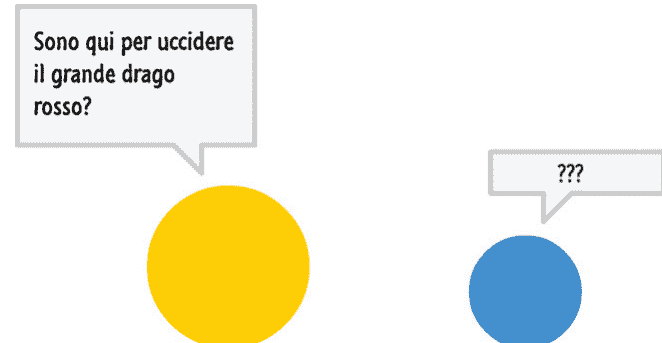

除非你是杰森·伯恩（或者罗杰·费德勒），否则你在学习第一语言时勉强及格。这是因为学习语言很难。无论你是学习第一语言，还是第二、第三语言，都一样。要精通一门语言，达到能非滑稽地有效使用的程度，需要投入大量的时间和精力。

这需要从基础开始。这需要大量的练习和耐心。这是少数几个在精通之路上确实没有任何捷径可走的领域之一。

## 你会说 JavaScript 吗？

成功学习一门*编程*语言，与学习一门*现实世界*语言的方法非常相似。你从基础开始。一旦你掌握了这些，就进入更高级的内容。这个过程不断重复，永无止境。我们中没有人真正停止学习。关键是从某处开始。为了帮助你解决"从某处开始"的问题，本书应运而生。本书自始至终充满了各种有益（且有趣——我希望如此！）的内容，帮助你学习 JavaScript。

现在，我不喜欢在背后说任何一门编程语言的坏话，但 JavaScript 确实相当沉闷无聊：

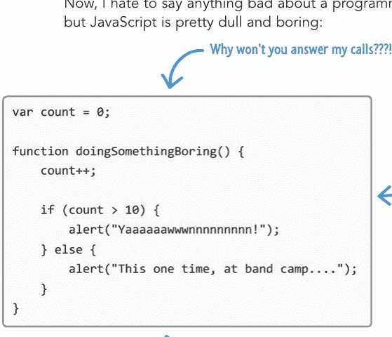

没有其他方式可以描述它。尽管 JavaScript 可能确实很无聊，但这并不意味着学习它也必须很无聊。（请注意：所有的语法错误都是刻意且精心放置的——大多数时候！）当你在书中探索时，希望你会发现这些非常随意的语言和插图既信息丰富，又引人入胜（寓教于乐！）。

所有这些随意性和趣味性，都与深入涵盖你需要了解的关于 JavaScript 的所有有趣知识相平衡，以便你能更好地使用它。

当你读到最后一章时，你将准备好毫不费力地直接面对几乎任何与 JavaScript 相关的挑战。

### 联系我/获取帮助

如果你在任何地方遇到困难，或者只是想联系我，请在论坛发布帖子：forum.kirupa.com。

对于非技术问题，你也可以发送电子邮件至 kirupa@kirupa.com，在 Twitter 上联系 @kirupa，或在 Facebook 上给我发消息 (facebook.com/kirupa)。我喜欢收到像你这样的读者的来信，我会亲自回复收到的每一条消息。

*那么，翻页吧——是时候开始了！*

---

## 本章内容

- 了解为什么 JavaScript 如此出色
- 通过创建一个简单示例，初步实践
- 预览后续章节的内容


## 你好，世界！

HTML 的核心是展示内容。CSS 的核心是美化外观。两者结合，你可以创建出一些非常漂亮的东西，就像你在 [http://bit.ly/kirupaWeather](http://bit.ly/kirupaWeather) 看到的天气示例。图 1.1 展示了这个天气示例的样子。

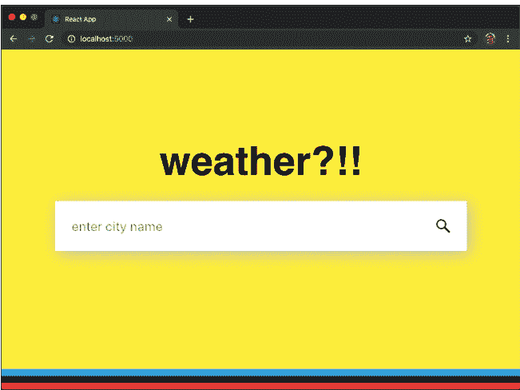

**图 1.1**

*一个多彩的天气示例，其布局完全仅使用 CSS 设计。*

尽管仅使用 CSS 和 HTML 构建的网站看起来很棒，但它们相当静态。它们不会适应或响应你的操作。使用这两种技术，就像一遍又一遍地重播精彩的《宋飞正传》剧集。一开始很有趣，但最终会变得乏味。当今的网站不是静态的。你经常使用的网站（如图 1.2 中的那些）具有一定程度的交互性和个性化，这远远超出了 HTML 和 CSS 单独所能提供的。


**图 1.2**

*各种网站示例，这些网站的正常运行严重依赖 JavaScript。*

要让你的内容活起来，你需要一些外部帮助。你需要的是 JavaScript！

## 什么是 JavaScript？

JavaScript 是一种现代编程语言，与 HTML 和 CSS 并驾齐驱。简而言之，它允许你为文档添加交互性。你可以用 JavaScript 做的事情包括：

- 响应诸如鼠标点击之类的事件并执行操作。
- 在页面加载后修改页面的 HTML 和 CSS。
- 以有趣的方式让元素在屏幕上移动。
- 创建在浏览器中运行的出色游戏，例如《割绳子》。
- 在服务器和浏览器之间进行数据通信。
- 允许你与摄像头、麦克风和其他设备进行交互

……以及更多！编写 JavaScript 的方式相当简单——算是吧。你将经常类似于日常英语的单词组合起来，告诉浏览器该做什么。下面的例子展示了一些老牌的、新鲜出炉的 JavaScript：

```
let defaultName = "JavaScript";

function sayHello(name) {
    if (name == null) {
        alert("Hello, " + defaultName + "!");
    } else {
        alert("Hello, " + name + "!");
    }
}
```

如果你不知道这些代码的含义，请不要担心。只需注意代码的样子。注意到你看到了很多英语单词，比如 function、if、else、alert、name。除了英语单词，你还会看到很多来自键盘上你可能从未注意过的部分的奇怪符号和字符。你很快就会注意到它们，并且你也会完全理解这段代码中的一切作用。


总之，目前的背景信息已经足够了。虽然你可能期望我现在讲解JavaScript的历史，以及背后的人物和公司，但我不会用这些枯燥的内容来烦你。相反，我希望你动手实践，编写一些JavaScript代码。在本教程结束时，我希望你能创建一个简单而实用的东西，在浏览器中显示一些文本。

## Hello, World!

现在，你可能对开始编写代码感到有些准备不足。如果你对编程本身不太熟悉，这种情况尤其明显。但你很快就会发现，JavaScript并不像它常常表现出来的那样烦人和复杂。让我们开始吧。

**提示** 需要基本的Web开发知识

要开始编写JavaScript，你需要对网页构建、代码编辑器使用以及添加一些HTML和CSS有基本的了解。如果你对这些基础知识不太熟悉，我建议你先阅读**构建你的第一个网页**章节。这将为你接下来的学习做好充分准备。

## HTML文档

你需要的第一样东西是一个HTML文档。这个文档将承载你将要编写的JavaScript代码。启动你喜欢的代码编辑器。如果你还没有，我建议你使用Visual Studio Code。启动代码编辑器后，创建一个新文件。在Visual Studio Code中，你会看到一个标有**未命名**的标签页，类似于图1.3中的截图。

**图1.3**

*Visual Studio Code中的未命名-1标签页。*

通过选择文件 | 保存来保存这个新创建的文件。系统会要求你给这个文件命名并指定保存位置。将文件命名为**hello_world.htm**，并保存到你的**桌面**。保存文件后，将以下HTML内容添加进去：

```
<!DOCTYPE html>
<html>

<head>
  <meta charset="utf-8">
  <title>An Interesting Title Goes Here</title>

  <style>

  </style>
</head>

<body>
  <script>

  </script>
</body>
</html>
```

添加完这段HTML后，保存文档以确认更改。现在让我们看看我们的页面在浏览器中是什么样子。

在文件资源管理器或访达中，导航到你的桌面文件夹，双击**hello_world.htm**。你会看到默认浏览器启动并显示该文件名。你应该能看到类似图1.4所示的内容。

**图1.4**

*Visual Studio Code中倾斜的标签页。*

如果一切正常，你会看到一个空白页面！不，这里并没有出错。虽然我们的页面有内容，但没有任何可见的部分。这没关系，我们很快就会修复。修复的关键是回到代码编辑器，关注HTML底部附近的`<script>`标签：

```
<script>
</script>
```

`script`标签充当容器，你可以在其中放置任何想要运行的JavaScript代码。我们要做的是在加载HTML页面时，通过一个对话框显示**hello, world!**这几个字。要实现这一点，在你的脚本区域添加以下代码：

```
<script>
  alert("hello, world!");
</script>
```

保存你的HTML文件并在浏览器中运行它。注意页面加载后你会看到什么。你应该会看到一个对话框出现，如图1.5所示。

如果这是你第一次尝试编写JavaScript，恭喜你！现在，让我们来看看你刚才做了什么。

## 分析代码：语句与函数

你刚刚写了一个非常简单的JavaScript**语句**。语句是一组逻辑指令，告诉浏览器该做什么。一个典型的应用程序会包含很多很多语句。在我们的例子中，我们只有一条：

```
alert("hello, world!");
```

你可以通过查看语句的最后一个字符来识别它。它通常是一个分号(`;`)，就像你在这里看到的那样。

在语句内部，你会看到各种各样的JavaScript术语。尽管我们的代码只有一行，也不例外。你看到了一个叫做`alert`的奇怪东西。这是一个常见的英语单词，在JavaScript世界中行为类似。它负责通过显示一些文本来引起你的注意。

更准确地说，`alert`这个词被称为**函数**。你会经常使用函数；函数基本上是一段可重用的代码，用于执行某个操作。它执行的“操作”可以由你定义，由你使用的第三方库定义，或者由JavaScript框架本身定义。在我们的例子中，赋予`alert`函数显示包含你传递消息的对话框这一神奇能力的代码，深藏在浏览器内部。你真正需要知道的是，如果你想使用`alert`函数，只需调用它并传入你想要显示的文本即可。其他一切都会为你处理好。

回到我们的例子，你想显示的文本是**hello, world!**，注意我是如何指定它的。我用引号将单词包裹起来：

```
<script>
    alert("hello, world!");
</script>
```

无论何时处理文本（更常见的说法是**字符串**），你总是要将它们包裹在单引号或双引号内。我知道这看起来很奇怪，但每种编程语言都有它自己的怪癖。这是你在深入探索JavaScript时会看到的众多怪癖之一。我们很快会更详细地探讨字符串；现在，先享受一下这个过程。

让我们再进一步。不是显示**hello, world!**，而是将你显示的文本改为你的名字。这是我使用我的名字时代码的示例：

```
<script>
    alert("Kirupa Chinnathambi!");
</script>
```

如果你运行你的应用程序，你会在对话框中看到你的名字出现（图1.6）。

**图1.6**

*对话框现在显示你的名字。*

非常简单，对吧？你可以用各种各样的东西替换字符串的内容：你宠物的名字、你最喜欢的电视节目，等等——JavaScript会显示它。

## 绝对基础

在本教程中，你创建了一个简单的示例，帮助你熟悉编写一些JavaScript代码。作为熟悉过程的一部分，我向你介绍了很多概念和术语。我当然不期望你现在就知道或记住所有内容。在未来的教程中，我们将选取到目前为止你所看到的每个有趣的部分，并更详细地阐述。毕竟，我相当确定你最终想用JavaScript做的事情，远不止用对话框以一种极其烦人的方式显示一些文本。

在接下来的每章末尾，你甚至可能会看到一系列指向我或其他人撰写的外部资源的链接。这些资源将为你提供关于所学内容的更多细节或不同视角，并有机会通过更复杂的示例将你的学习付诸实践。把你在本书中看到的内容当作通往更伟大、更精彩事物的跳板。

如果你对这里有任何问题，请在论坛 https://forum.kirupa.com 上发帖，你可以从我以及一些网络上最酷的开发者那里获得非常快速的帮助。

本页有意留白

## 本章内容

- 学习如何使用值来存储数据
- 使用变量组织代码
- 简要了解变量命名约定

## 2 值与变量

在JavaScript中，我们提供或使用的每一条数据都被认为包含一个值。在我们从介绍部分看到的例子中，**hello, world!**这几个词可能只是我们传给**alert**函数的一些文字：

`alert("hello, world!");`

对于JavaScript来说，这些词在底层有特定的表示。它们被视为**值**。当我们输入这些词时，可能没有想太多，但在JavaScript的世界里，你接触的每一条数据都被视为一个值。

那么，知道这一点为什么重要呢？这很重要，因为我们将大量处理值。以一种不会让你发疯的方式来处理它们是件好事。简化我们处理值的生活只需要两件事。我们需要：

- 轻松地识别它们
- 在整个应用程序中重复使用它们，而无需不必要地复制值本身

这两点将由我们接下来要花时间讨论的内容提供：**变量**。让我们在这里全面了解它们。


## 使用变量

变量是值的标识符。与其每次在应用程序中使用**你好，世界！**这个短语时都重新输入，你可以将它赋值给一个变量，然后在需要再次使用**你好，世界！**时引用该变量即可。稍后你会更明白这一点——我保证！

使用变量有几种方式。对于大多数情况，最佳方式是使用 `let` 关键字，后跟你为变量起的名字：

```
let myText
```

在这行代码中，我们声明了一个名为 `myText` 的变量。目前，该变量只是被**声明**了。它不包含任何有实际值的内容。它只是一个空壳。

让我们通过**初始化**变量来解决这个问题，给它赋一个值，比如……就叫**你好，世界！**吧：

```
let myText = "hello, world!";
```

此时，当这段代码运行时，我们的 `myText` 变量将关联到值**你好，世界！**。让我们把所有这些放在一起，作为一个完整示例的一部分。如果你之前打开了 **hello_world.htm**，请用以下内容替换你的 `script` 标签内容……或者创建一个新的 HTML 文件并将以下内容添加进去：

```
<!DOCTYPE html>
<html>

<head>
  <meta charset="utf-8">
  <title>An Interesting Title Goes Here</title>

  <style>

  </style>
</head>

<body>
  <script>
    let myText = "hello, world!";
    alert(myText);
  </script>
```

```
</body>
</html>
```

注意，我们不再直接将 **hello, world!** 文本传递给 `alert` 函数。相反，我们现在传递的是变量名 `myText`。最终结果是一样的。当这个脚本运行时，会显示一个包含 **hello, world!** 的警告框。这个改动让我们可以在代码中指定**你好，世界！**的地方只有一处。如果我们想把 **hello, world!** 改成 **狗狗吃了我的作业！**，我们只需要对 `myText` 变量指定的短语做一处修改：

```
let myText = "The dog ate my homework!";
alert(myText);
```

在整个代码中，无论我们哪里引用了 `myText` 变量，现在都会看到新的文本出现。虽然对于像我们现在这样简单的情况，这很难想象，但对于大型应用程序来说，这种只需在一个地方进行更改就能反映到所有地方的便利性是一个主要的省时之处。在后续示例中，你会看到更多关于变量价值的、不那么平凡的例子。

## 更多变量知识

我们在上一节学到的东西将让我们受益匪浅。至少，在我们生活中涉及熟悉 JavaScript 的部分是如此。我们不会在这里过多深入变量，因为我们将在未来的章节中做所有这些，那时代码会更复杂，变量的重要性也更明显。话虽如此，在结束今天之前，还有一些零星内容我们需要涵盖。

### 命名变量

我们在命名变量时有很大的自由。忽略那些基于哲学/文化/风格偏好我们应该给事物起什么名字，从技术角度来看，JavaScript 对变量名中可以使用哪些字符非常宽容。

这种宽容并不是无限的，因此在命名变量时，我们应该记住以下几点：

-   变量可以短至一个字符，也可以长到你想要的程度——想想成千上万个字符。
-   变量可以以字母、下划线或 $ 字符开头。它们不能以数字开头。
-   除了第一个字符，我们的变量可以由字母、下划线、数字和 $ 字符的任何组合构成。我们也可以随心所欲地混合使用小写和大写。
-   不允许使用空格。

以下是一些有效的变量名示例：

```
let myText;
let $;
let r8;
let _counter;
let $field;
let thisIsALongVariableName_butItCouldBeLonger;
let __$abc;
let OldSchoolNamingScheme;
```

要检查变量名是否有效，请查看非常棒且简单的 **JavaScript 变量名验证器**。

除了有效的名称，还有其他需要关注的事情，例如命名约定以及人们通常如何命名变量和其他用名称标识的东西。我们将在其他章节中讨论这些事情。

### 关于声明和初始化变量的更多内容

你将了解到关于 JavaScript 的一件事是，它是一种非常宽容且易于使用的语言。

#### 声明变量是可选的

例如，我们不必使用 `let` 关键字来声明变量。我们可以这样做：

```
myText = "hello, world!";
alert(myText);
```

注意 `myText` 变量在未使用 `let` 关键字正式声明的情况下就被使用了。虽然不推荐这样做，但这是完全没问题的。最终结果是我们有一个名为 `myText` 的变量。只是，通过这种方式声明变量，我们是将其声明为全局变量。如果最后一句话没有意义，别担心。我们稍后会在讨论变量作用域时再看 *全局* 是什么意思。

#### 分别声明和初始化变量是可以的

还有一点需要指出，那就是：变量的声明和初始化不必是同一条语句的一部分。我们可以将其拆分到多条语句中：

```
let myText;
myText = "hello, world!";
alert(myText);
```

在实践中，我们会发现自己经常将变量的声明和初始化分开。

#### 更改变量值和 `const` 关键字

最后，我们可以随时将通过 `let` 声明的变量值更改为任何我们想要的内容：

```
let myText;
myText = "hello, world!";
myText = 99;
myText = 4 * 10;
myText = true;
myText = undefined;
alert(myText);
```

如果你有使用更严格、不允许变量存储多种数据类型的语言的经验，那么这种宽容是人们既爱又恨 JavaScript 的特性之一。话虽如此，JavaScript 确实提供了一种方法来限制变量的值在初始化后不被更改。这种限制以 `const` 关键字的形式出现，我们可以用它来声明和初始化变量：

```
const siteURL = "https://www.google.com";
alert(siteURL);
```

通过使用 `const`，我们不能将 `siteURL` 的值更改为 **https://www.google.com** 以外的任何值。如果我们尝试这样做，JavaScript 会报错。使用 `const` 关键字有一些需要注意的地方，但总体上它在防止变量被意外修改方面做得很好。对于那些麻烦的注意事项，我们会在合适的时候逐步讲解。

#### **提示** 提前了解——变量作用域

现在你知道了如何声明和初始化变量，一个非常重要的话题是可见性。你需要知道你声明的变量何时以及在代码中的何处可以实际使用。对此的总括性短语称为**变量作用域**。如果你好奇想了解更多，可以提前阅读第 8 章“变量作用域”。


### 最低要求

值存储数据，变量是引用该数据的一种便捷方式。关于值有一些非常有趣的细节，但这些是你现在不需要学习的细节。只需知道 JavaScript 使你能够轻松表示各种值，如文本和数字，而无需太多麻烦。

为了让你的值更易于记忆和重用，你声明变量。你使用 `let` 关键字和一个**变量名**来声明变量。如果你想将变量初始化为一个默认值，你可以在所有这些之后加上一个等号（`=`）和你想要初始化变量的值。

lcd(100 700)

## 本章内容

-   了解函数如何帮助你更好地组织和分组代码
-   理解函数如何使你的代码可重用
-   发现函数参数的重要性以及如何使用它们


## 函数

到目前为止，我们编写的所有代码实际上都没有包含任何结构。它就是……在那里：

```
alert("hello, world!");
```

拥有这样的代码并没有什么问题。特别是当我们的代码由单条语句组成时。然而，大多数情况下，情况永远不会如此。当我们使用 JavaScript 来处理真实世界中的真实事物时，我们的代码很少会如此简单。

为了强调这一点，假设我们想显示某物移动的距离（图 3.1）。


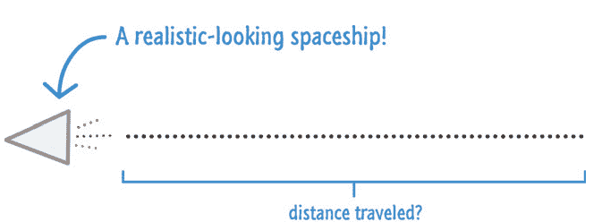

**图 3.1**
*行驶距离。*

如果你还记得学校里学的，距离是通过将物体行驶的速度乘以所花费的时间来计算的（图 3.2）。


**图 3.2**
*计算距离。*

JavaScript 版本的计算大致如下所示：

```
let speed = 10;
let time = 5;
alert(speed * time);
```

我们有两个名为 `speed` 和 `time` 的变量，它们各自存储一个数字。`alert` 函数显示 `speed` 和 `time` 变量中存储的值相乘的结果。这基本上是我们刚才看到的距离公式的直接翻译。

假设我们想计算更多数值的距离。仅使用我们目前所学的知识，我们的代码将如下所示：

```
let speed = 10;
let time = 5;
alert(speed * time);

let speed1 = 85;
let time1 = 1.5;
alert(speed1 * time1);
```

```
let speed2 = 12;
let time2 = 9;
alert(speed2 * time2);
```

```
let speed3 = 42;
let time3 = 21;
alert(speed3 * time3);
```

我不知道你怎么想，但这看起来**太糟糕了**。我们的代码不必要地冗长且重复。就像我们之前在学习[变量](https://google.com)时看到的那样，重复使我们的代码更难维护，也浪费了我们的时间。

使用我们将在本书中大量见到的**函数**，可以非常容易地解决整个问题：

```
function showDistance(speed, time) {
  alert(speed * time);
}
```

```
showDistance(10, 5);
showDistance(85, 1.5);
showDistance(12, 9);
showDistance(42, 21);
```

不要太担心这段代码具体做什么。只需知道，这段更小的代码完成了之前所有大段代码所做的所有事情，而没有所有那些负面的副作用。我们将从现在开始学习关于函数的所有内容，以及它们如何实现所有那些美妙的功能！

前进！

## 什么是函数？

在最基本的层面上，函数只不过是一些代码的包装器。

函数基本上：

-   将语句组合在一起
-   使你的代码可重用

你很少会编写或使用不涉及函数的代码，因此熟悉函数并了解它们如何良好工作非常重要。

## 一个简单的函数

学习函数的最佳方法就是直接投入并开始使用它们，所以我们首先来创建一个非常简单的函数。创建函数并不是一件非常令人兴奋的事情。它只需要理解一些小的语法怪癖，比如使用奇怪的括号。

下面是一个非常简单的函数示例：

```
function sayHello() {
  alert("hello!");
}
```

然而，仅仅定义一个函数是不够的。我们的函数需要被调用，我们可以在之后添加以下行来做到这一点：

```
function sayHello() {
  alert("hello!");
}
sayHello();
```

要亲自查看所有这些，请创建一个新的 HTML 文档（将其命名为 **functions_sayhello.htm**）并在其中添加以下内容：

```
<!DOCTYPE html>
<html>

<head>
  <meta charset="utf-8">
  <title>Say Hello!</title>

  <style>

  </style>
</head>

<body>
  <script>
    function sayHello() {
      alert("hello!");
    }

    sayHello();
  </script>
</body>
</html>
```

如果你输入了所有这些内容并在浏览器中预览页面，你将看到显示 **hello!**。你现在唯一需要知道的是我们的代码有效。接下来，让我们通过将 `sayHello` 函数分解为单独的部分并更详细地查看每个部分，来了解代码为什么有效。

首先，我们看到 `function` 关键字引领内容，如图 3.3 所示。

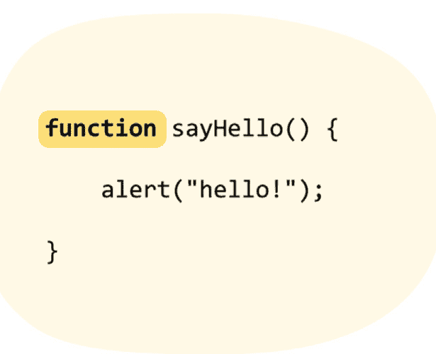

**图 3.3**
*`function` 关键字。*

这个关键字告诉深藏在浏览器中的 JavaScript 引擎，将整个代码块视为与函数相关的内容。

在 `function` 关键字之后，我们指定函数的实际名称，后跟一些开括号和闭括号 `( )`，如图 3.4 所示。

```
function sayHello() {
    alert("hello!");
}
```

**图 3.4**
*函数名和括号。*

完善我们函数声明的是开括号和闭括号，它们包围了我们可能拥有的任何内部语句（图 3.5）。

```
function sayHello() {
    alert("hello!");
}
```

**图 3.5**
*开括号和闭括号。*

最后是我们的函数内容——使我们函数实际起作用的语句（图 3.6）。

```
function sayHello() {

    alert("hello!");

}
```

**图 3.6**
*函数内容。*

在我们的例子中，内容是 `alert` 函数，它显示一个带有单词 **hello!** 的对话框。

最后要看的是函数调用（图 3.7）。

函数调用通常是我们要**调用**（也称为**调用**）的函数名称，后跟括号。没有我们的函数调用，我们创建的函数就什么也不做。正是函数调用唤醒了我们的函数并使其执行操作。

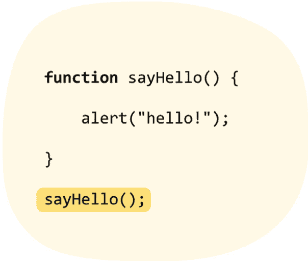

**图 3.7**
*函数调用。*

现在，我们刚刚看到的是一个非常简单的函数。在接下来的几节中，我们将基于刚刚学到的内容，探讨越来越现实的函数示例。

## 创建一个接受参数的函数

前面的 sayHello 示例相当简单：

```
function sayHello() {
  alert("hello!");
}

sayHello();
```

我们调用一个函数，然后函数做一些事情。这种简化本身并不稀奇。所有函数的工作方式都像这样。不同的是函数如何被调用、从哪里获取数据等细节。我们要看的第一个此类细节涉及接受**参数**的函数。

让我们从一个简单而熟悉的例子开始：

```
alert("my argument");
```

这里我们有 `alert` 函数。我们可能已经见过它几次（或几十次）了。这个函数的作用是接受一个所谓的**参数**，以便在被调用时确定实际显示什么。使用参数 **"my argument"** 调用 alert 函数会导致显示图 3.8 所示的内容。

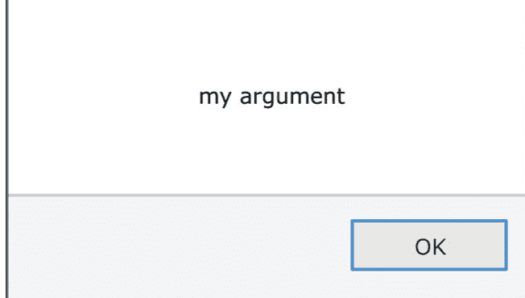

**图 3.8**
*显示参数。*

参数是调用 `alert` 函数时，括号之间的内容。`alert` 只是众多接受参数的可用函数之一，你创建的许多函数也将接受参数。

就本章本身而言，我们简要看到的另一个接受参数的函数是我们的 `showDistance` 函数：

```
function showDistance(speed, time) {
  alert(speed * time);
}
```

看，你可以通过查看函数声明本身来判断一个函数是否接受参数：

```
function showDistance(speed, time) {
    alert(speed * time);
}
```

函数名后面原本是空括号的地方，现在将包含有关函数所需参数数量以及参数可能取值的提示信息。

对于 `showDistance`，我们可以推断这个函数接受两个参数。第一个参数对应于速度，第二个参数对应于时间。

我们作为函数调用的一部分来指定函数的参数：

```
function showDistance(speed, time) {
    alert(speed * time);
}
```

```
showDistance(10, 5);
```

在我们的例子中，我们调用 `showDistance` 并在括号内指定要传递给函数的值（图 3.9）。

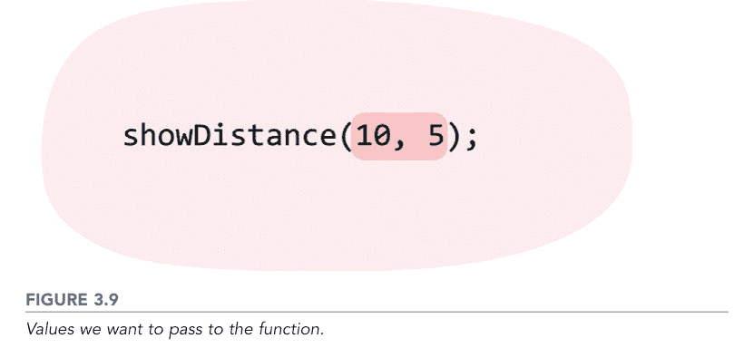

**图 3.9**
*我们要传递给函数的值。*

因为我们提供了多个参数，所以我们可以用逗号分隔各个参数。哦，在我忘记之前，请注意指定参数的顺序很重要。

让我们从图 3.10 的图表开始更详细地了解所有这些。

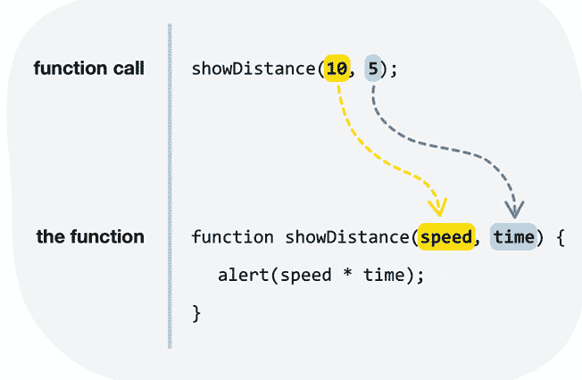

**图 3.10**
*函数调用的示意图。*

当调用 `showDistance` 函数时，它为 speed 参数传入 **10**，并为 distance 参数传入 **5**。如上图所示，这种映射完全基于顺序。

一旦你作为参数传递的值到达我们的函数，我们为参数指定的名称就被视为变量名，如图 3.11 所示。

我们可以使用这些变量名轻松地引用函数内部参数存储的值，而无需担心。


 **图 3.11**
参数名称的作用类似于变量。

## 注意 参数数量不匹配

如果某个函数恰好需要参数，而你在调用函数时没有提供任何参数、提供的参数过少或过多，程序仍然可以运行。你可以针对这些情况编写防御性代码，将来我们会稍微涉及这一点。

一般来说，为了让你编写的代码更清晰，应该为调用的函数提供所需数量的参数。

## 创建返回数据的函数

我们要看的最后一种函数变体是能够向调用者返回某些数据的函数。我们想实现的目标如下。我们有`showDistance`函数，它看起来像这样：

```
function showDistance(speed, time) {
  alert(speed * time);
}
```

我们不希望`showDistance`函数计算距离后以警告框显示结果，而是想将该值存储起来以便将来使用。我们希望这样做：

```
let myDistance = showDistance(10, 5);
```

`myDistance`变量将存储`showDistance`函数进行计算后的结果。

## return 关键字

从函数返回数据的方式是使用`return`关键字。让我们创建一个名为`getDistance`的新函数，它看起来与`showDistance`完全相同，唯一的区别是函数运行完成时发生的事情：

```
function getDistance(speed, time) {
  let distance = speed * time;
  return distance;
}
```

请注意，我们仍然通过速度乘以时间来计算距离。我们不显示警告框，而是返回距离（由`distance`变量存储）。

调用`getDistance`函数时，我们可以直接在初始化变量时调用它：

```
let myDistance = getDistance(10, 5);
```

当`getDistance`函数被调用时，它会被求值并返回一个数值，然后该值被赋给`myDistance`变量。就是这么简单。

## 提前退出函数

一旦我们的函数遇到`return`关键字，它就会立即停止当前正在做的所有事情，将指定的值返回给调用者，然后退出：

```
function getDistance(speed, time) {
  let distance = speed * time;
  return distance;

  if (speed < 0) {
    distance *= -1;
  }
}
```

`return`语句之后的任何代码都不会被执行。就好像那段代码根本不存在一样。

在实践中，我们会使用`return`语句在函数完成我们想要它做的事情后终止函数。该函数可以像你在前面的例子中看到的那样向调用者返回一个值，或者该函数也可以直接退出：

```
function doSomething() {
  let foo = "Nothing interesting";
  return;
}
```

使用`return`关键字返回值是可选的。`return`关键字可以像这里所示那样单独使用，仅用于退出函数。如果函数没有指定要返回的内容，则会返回默认值`undefined`。

## 核心要点

函数是你在几乎每个 JavaScript 应用程序中都会用到的少数几项功能之一。它们提供了备受追捧的能力来帮助你实现代码的重用。无论你是在创建自己的函数，还是使用 JavaScript 语言内置的众多函数，你都将无法离开它们。

到目前为止，你看到的是函数常见用法的示例。函数具有一些高级特性，我没有在这里涉及。这些用法将在未来……遥远的未来介绍。目前，你所学到的一切将让你在理解现实世界中函数的使用方式方面走得很远。

如果你对这里的内容有任何疑问，不要担心！请访问 [https://forum.kirupa.com](https://forum.kirupa.com) 发帖，可以快速获得我以及网络上一些最聪明开发者的帮助。

*本页有意留空*

## 本章内容

- 使用流行的 if/else 语句帮助在代码中做出决策
- 了解 switch 语句及其使用时机

## 4

## 条件语句：IF、ELSE 和 SWITCH

从你醒来的那一刻起，无论你是否意识到，你就开始做出决策。关掉闹钟。打开灯。看看外面天气如何。刷牙。穿上长袍和巫师帽。查看日历。基本上……你懂的。在你出门之前，你会有意识或下意识地做出数百个决定，每个决定都会对你最终的行为产生一定影响。

例如，如果外面看起来很冷，你可能会决定穿连帽衫或夹克。你可以如图 4.1 所示来建模这个决策。

**图 4.1**
决策建模。

在决策的每个阶段，你都会问自己一个可以回答**真**或**假**的问题。该问题的答案决定了你的下一步，最终决定你穿 T 恤、连帽衫还是夹克。更广泛地说，你和我的每个决定都可以建模为一系列**真**和**假**的陈述。这听起来可能有点冷漠（哈！），但这通常就是我们、他人以及几乎所有生物做出选择的方式。

这种概括尤其适用于计算机所做的一切。从我们目前写的代码中可能还看不出来，但我们会解决这个问题。在本教程中，我们将介绍所谓的**条件语句**。这些是我们所做决策的数字等价物，我们的代码根据某事是**真**还是**假**而执行不同的操作。

向前冲！

## If / Else 语句

我们在代码中最常用的条件语句是**if / else 语句**或简称**if 语句**。该语句的工作方式如图 4.2 所示。

**图 4.2**
*if 语句的工作原理。*

为了理解这一点，让我们看看一个**if / else 语句**的简单示例。创建一个新的 HTML 文档，并向其中添加以下标记和代码：

```
<!DOCTYPE html>
<html>
<head>
    <meta charset="utf-8">
    <title>If / Else Statements</title>
</head>
<body>
    <script>
        let safeToProceed = true;
```

```
if (safeToProceed) {
    alert("You shall pass!");
} else {
    alert("You shall not pass!");
}
</script>
</body>
</html>
```

将此文档保存为**if_else.htm**并在浏览器中预览。如果一切按预期工作，你将看到一个显示**You shall pass!**文本的警告框（图 4.3）。

**图 4.3**
你将看到这个警告框。

使这一功能生效的代码来自我们示例中的以下行：

```
let safeToProceed = true;
```

```
if (safeToProceed) {
    alert("You shall pass!");
} else {
    alert("You shall not pass!");
}
```

我们的**表达式**（`if`关键字后面的内容，最终求值为**真**或**假**）是变量`safeToProceed`。该变量初始化为**真**，因此我们`if`语句的**真**部分生效了。

现在，继续将 safeToProceed 变量的值从**真**改为**假**：

```
let safeToProceed = true;
```

```
if (safeToProceed) {
  alert("You shall pass!");
} else {
  alert("You shall not pass!");
}
```

这次运行此代码时，你将看到一个显示**You shall not pass!**的警告框，因为我们的表达式现在求值为**假**（图 4.4）。

**图 4.4**
当表达式求值为假时得到的警告框。

到目前为止，这一切可能看起来很无聊。很大一部分原因是我们还没有把复杂度调高，以关注更现实的场景。接下来我们将通过更深入地了解条件来解决这个问题。

## 认识条件运算符

在大多数情况下，我们的表达式很少会像前面的例子那样是简单设置为**真**或**假**的变量。我们的表达式将涉及所谓的**条件运算符**，它们帮助我们在两个或多个表达式之间进行比较，以确定**真**或**假**的结果。


此类表达式的通用格式如图4.5所示。

```
if (expression operator expression) {
    do_something;
} else {
    do_something_different;
}
```

## 图 4.5

条件运算符表达式的通用格式。

**运算符**（也称为**条件运算符**）定义了两个表达式之间的关系。其最终目标是返回一个**真（true）**或**假（false）**值，以便我们的 `if` 语句知道要执行哪个代码块。实现这一切的关键是条件运算符本身。它们如表4.1所示。

## 表 4.1 运算符

| 运算符 | 何时为真 |
|----------|-----------------|
| == | 如果第一个表达式求值结果与第二个表达式相等。 |
| >= | 如果第一个表达式求值结果大于或等于第二个表达式。 |
| > | 如果第一个表达式求值结果大于第二个表达式。 |
| <= | 如果第一个表达式求值结果小于或等于第二个表达式。 |
| < | 如果第一个表达式求值结果小于第二个表达式。 |
| != | 如果第一个表达式求值结果不等于第二个表达式。 |
| && | 如果第一个表达式和第二个表达式的求值结果都为真。 |
| \|\| | 如果第一个表达式或第二个表达式的求值结果为真。 |

让我们基于对条件运算符的普遍理解，通过另一个例子使其更具体……例如下面这段代码，其中与 `if` 相关的部分已高亮显示：

```html
<!DOCTYPE html>
<html>

<head>
  <meta charset="utf-8">
  <title>你超速了吗？</title>
</head>

<body>
  <script>
    let speedLimit = 55;

    function amISpeeding(speed) {
      if (speed >= speedLimit) {
        alert("是的。你超速了。");
      } else {
        alert("不。你没有超速。你怎么了？");
      }
    }

    amISpeeding(53);
    amISpeeding(72);
  </script>
</body>

</html>
```

让我们花点时间理解一下这里到底发生了什么。我们有一个名为 `speedLimit` 的变量，被初始化为 **55**。然后我们有一个名为 `amISpeeding` 的函数，它接收一个名为 `speed` 的参数。在这个函数内部，我们有一个 `if` 语句，其表达式检查传入的 `speed` 值是否大于或等于（看，>= 条件运算符！）由 speedLimit 变量存储的值：

```javascript
function amISpeeding(speed) {
  if (speed >= speedLimit) {
    alert("是的。你超速了。");
  } else {
    alert("不。你没有超速。你怎么了？");
  }
}
```

我们的代码最后一步是实际调用 amISpeeding 函数，并传入几个 speed 值：

```javascript
amISpeeding(53);
amISpeeding(72);
```

当我们用速度 **53** 调用此函数时，表达式 `speed >= speedLimit` 的求值结果为 **假（false）**。原因是 **53** 不大于或等于 speedLimit 存储的值 **55**。这将导致一个提示框显示你没有超速。

当我们用速度 **72** 调用 amISpeeding 时，情况正好相反。在这种情况下，我们超速了，条件求值结果为 **真（true）**。一个提示我们超速的警告框也会出现。

## 创建更复杂的表达式

你需要知道的是，这些表达式可以像你构造的那样简单或复杂。它们可以由变量、函数调用或原始值组成。它们甚至可以由变量、函数调用或原始值的组合构成，这些组合使用你之前看到的任何运算符进行分隔。唯一需要确保的是，你的表达式最终的求值结果是 **真（true）** 或 **假（false）**。

这是一个稍微复杂一点的例子：

```javascript
let xPos = 300;
let yPos = 150;

function sendWarning(x, y) {
  if ((x < xPos) && (y < yPos)) {
    alert("调整位置");
  } else {
    alert("情况良好！");
  }
}
sendWarning(500, 160);
sendWarning(100, 100);
sendWarning(201, 149);
```

注意 sendWarning 的 if 语句中的条件是什么样子的：

```javascript
function sendWarning(x, y) {
    if ((x < xPos) && (y < yPos)) {
        alert("调整位置");
    } else {
        alert("情况良好！");
    }
}
```

这里有三个比较。第一个是 x 是否小于 xPos。第二个是 y 是否小于 yPos。第三个比较是检查**第一个陈述和第二个陈述**是否都求值为**真（true）**，以便 && 运算符也能返回**真（true）**。根据我们的需求，我们可以将多个条件语句链接在一起。除了学习所有运算符的功能之外，棘手的事情是确保每个条件和子条件都使用括号正确地隔离。

我们在这里和上一节描述的所有内容都属于**布尔逻辑**的范畴。如果你不熟悉这个主题，我建议你浏览一下关于这个确切主题的[优秀的 quirksmode 文章](http://www.quirksmode.org/js/boolean.html)。

## If / Else 语句的变体

关于 if 语句我们快讲完了。最后我们要看的是它的一些相关语句。

### 独立的 If 语句

第一个是独立的 if 语句，它没有 else 伙伴：

```javascript
if (weight > 5000) {
    alert("您无法享受免费送货！");
}
```

在这种情况下，如果表达式求值为**真（true）**，那么很好。如果表达式求值为**假（false）**，那么你的代码只会跳过 alert，继续执行后续需要的步骤。在使用 `if` 语句时，`else` 块完全是可选的。为了对比独立的 if 语句，我们来看它的下一个亲戚...

### 令人畏惧的 If / Else-If / Else 语句

并非所有事情都能简单地归入单个 `if` 或 `if / else` 语句。对于这类情况，你可以使用 `else if` 关键字将多个 `if` 语句链接在一起。与其进一步解释，不如直接看一个例子：

```javascript
if (position < 100) {
    alert("做点什么！");
} else if ((position >= 200) && (position < 300)) {
    alert("做点别的事情！");
} else {
    alert("做点更不一样的事情！");
}
```

如果第一个 `if` 语句求值为**真（true）**，那么我们的代码就进入第一个 alert 分支。如果第一个 `if` 语句为**假（false）**，那么我们的代码将求值 `else if` 语句，以查看其中的表达式求值结果是**真（true）**还是**假（false）**。这个过程会一直重复，直到我们的代码到达末尾。换句话说，我们的代码只是依次通过每个 `if` 和 `else if` 语句，直到其中一个表达式求值为**真（true）**：

```javascript
if (条件) {
    ...
} else if (条件) {
    ...
} else if (条件) {
    ...
} else if (条件) {
    ...
} else if (条件) {
    ...
} else if (条件) {
    ...
} else {
    ...
}
```

如果没有任何语句的表达式求值为**真（true）**，那么 `else` 块（如果存在的话）内的代码将执行。如果没有 `else` 块，那么代码将继续执行所有这些 `if` 语句之后的下一段代码。结合更复杂的表达式和 `if` / `else if` 语句，你可以表示代码可能需要评估的几乎任何决策。

## 呼

至此，你已经了解了关于 `if` 语句的所有知识。是时候转向一个完全不同的条件语句类型了...

## Switch 语句

在一个充满美丽的 `if`、`else` 和 `else if` 语句的世界里，可能看似没有必要再需要另一种处理条件的方式。那些在房间大小的机器上写代码、可能还在雪地里上坡徒步（被狼追赶）的人们不同意这种看法，因此有了我们所说的 `switch` 语句。它们是什么？我们将一探究竟！

### 使用 Switch 语句

我们将直奔主题，先看代码。`switch` 语句的基本结构如下：

```javascript
switch (表达式) {
    case 值1:
        语句;
        break;
    case 值2:
        语句;
        break;
    case 值3:
        语句;
        break;
    default:
        语句;
        break;
}
```


需要牢记的是，`switch` 语句不过是一个条件语句，用于测试*某个内容*是否为真或为假。这个*某个内容*是**表达式的求值结果是否等于某个 case 值**的变体。让我们通过一个更好的例子来真正理解这个解释：

```
let color = "green";

switch (color) {
  case "yellow":
    alert("yellow color");
    break;
  case "red":
    alert("red color");
    break;
  case "blue":
    alert("blue color");
    break;
  case "green":
    alert("green color");
    break;
  case "black":
    alert("black color");
    break;
  default:
    alert("no known color specified");
    break;
}
```

在这个简单的例子中，我们有一个名为 `color` 的变量，其值被设置为 **green**：

```
let color = "green";
```

`color` 变量也是我们指定给 `switch` 语句的表达式：

```
switch (color) {
  case "yellow":
    alert("yellow color");
    break;
  case "red":
    alert("red color");
    break;
  case "blue":
    alert("blue color");
    break;
  case "green":
    alert("green color");
    break;
  case "black":
    alert("black color");
    break;
  default:
    alert("no known color specified");
    break;
}
```

我们的 switch 语句包含了一组 case 块。其中只有一个块会被命中并执行其代码。选中该块的方式是将某个块的 case 值与表达式的求值结果进行匹配。在我们的例子中，因为表达式的求值结果为 **green**，所以 case 值同样为 **green** 的 case 块内的代码会被执行：

```
switch (color) {
  case "yellow":
    alert("yellow color");
    break;
  case "red":
    alert("red color");
    break;
  case "blue":
    alert("blue color");
    break;
  case "green":
    alert("green color");
    break;
  case "black":
    alert("black color");
    break;
  default:
    alert("no known color specified");
    break;
}
```

请注意，**只有** **green** case 块内的代码被执行了。这要归功于结束该块的 `break` 关键字。当你的代码遇到 `break` 时，它会退出整个 `switch` 块并继续执行其下方的代码。如果你没有指定 `break` 关键字，你仍然会执行 **green** case 块内的代码。区别在于，随后你会进入下一个 case 块（在我们的例子中是 **black** 块）并执行其中的任何代码。除非你遇到另一个 `break` 关键字，否则你的代码将逐个经过每一个 case 块，直到到达末尾。

综上所述，如果你运行这段代码，你将看到一个如图 4.6 所示的警告窗口。

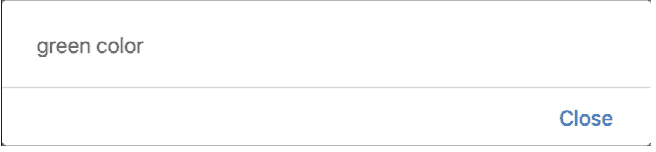

**图 4.6**

警告窗口。

你可以将 `color` 变量的值更改为其他有效值，以查看其他 case 块的执行。有时，没有任何 case 块的值会与表达式的求值结果匹配。在这种情况下，你的 switch 语句将什么也不做。如果你想指定默认行为，请添加一个 `default` 块：

```
switch (color) {
    case "yellow":
        alert("yellow color");
        break;
    case "red":
        alert("red color");
        break;
    case "blue":
        alert("blue color");
        break;
    case "green":
        alert("green color");
        break;
    case "black":
        alert("black color");
        break;
    default:
        alert("no known color specified");
        break;
}
```

请注意，default 块看起来与你的其他 case 语句略有不同。它实际上并不包含 case 这个词。

## 与 If/Else 语句的相似性

在开头部分，我们看到 switch 语句用于求值条件——就像我们花大量时间讲解的 if / else 语句一样。既然这是一个重要的论断，让我们更详细地探讨一下，首先看看 if 语句如果被直接转换成 switch 语句会是什么样子。

假设我们有如下 if 语句：

```
let number = 20;

if (number > 10) {
  alert("yes");
} else {
  alert("nope");
}
```

因为 number 变量的值是 20，我们的 if 语句将求值为 true。看起来相当直观。现在，让我们把它转换成 switch 语句：

```
switch (number > 10) {
  case true:
    alert("yes");
    break;
  case false:
    alert("nope");
    break;
}
```

注意我们的表达式是 **number > 10**。case 块的 case 值被设置为 true 或 false。因为 **number > 10** 的求值结果为 *true*，所以 *true* case 块内的代码被执行了。虽然你这里的表达式不像前一节中读取存储在变量中的颜色值那么简单，但我们对 switch 语句工作方式的理解仍然没有改变。我们的表达式可以像你希望的那样复杂。如果它们的求值结果可以与某个 case 值匹配，那么一切就完美了……就像羊毛一样！

现在，让我们看一个稍微复杂一点的例子。这次，我们将把之前涉及颜色的 switch 语句转换为等价的 if / else 语句。我们之前使用的 switch 语句如下：

```
let color = "green";
```

```
switch (color) {
  case "yellow":
    alert("yellow color");
    break;
  case "red":
    alert("red color");
    break;
  case "blue":
    alert("blue color");
    break;
  case "green":
    alert("green color");
    break;
  case "black":
    alert("black color");
    break;
  default:
    alert("no color specified");
    break;
}
```

这个 switch 语句转换为一系列 if / else 语句后如下：

```
let color = "green";

if (color == "yellow") {
    alert("yellow color");
} else if (color == "red") {
    alert("red color");
} else if (color == "blue") {
    alert("blue color");
} else if (color == "green") {
    alert("green color");
} else if (color == "black") {
    alert("black color");
} else {
    alert("no color specified");
}
```

我们可以看到，if / else 语句与 switch 语句非常相似，反之亦然。default case 块变成了 else 块。switch 语句中表达式与 case 值之间的关系，在 if / else 语句中被合并为 if / else 条件。

## 决定使用哪种方式

在上一节中，我们看到了 switch 语句和 if / else 语句是多么地可以互换。当我们有两种方式来做非常相似的事情时，自然会想知道什么时候适合用一种而不适合用另一种。简而言之，用你喜欢的那个就行。网上有很多关于何时使用 switch 与 if / else 的争论，而唯一确定的是它们都没有定论。

我个人的偏好是选择可读性更好的那个。如果你看看之前 switch 和 if / else 语句的对比，你会注意到如果你有很多条件，switch 语句往往看起来更简洁一些。它确实更精炼，可读性也更好。你决定何时切换（哈哈！）使用 switch 语句和 if / else 语句的分界线完全由你决定。我倾向于在大约四到五个条件时画这条线。

其次，当你在求值一个表达式并将结果与某个值匹配时，switch 语句效果最好。如果你在做涉及奇怪条件、值检查等更复杂的事情，你可能想用一些不同的东西。顺便说一下，那可能涉及甚至比 `if / else` 语句更不同的东西！我们将在后面介绍那些*不同的东西*。

总结一下，之前的指导原则仍然适用：用你喜欢的就行。如果你是一个有编码规范的团队的一员，那么请遵循规范。不管你做什么，保持一致性就好。这会让你以及任何将来在你的代码上工作的人的生活更轻松一些。就个人而言，我从未遇到过不得不使用 `switch` 语句的情况。你的情况可能会有所不同。

## 核心要点

虽然创建真正的人工智能超出了本书的范围，但你可以编写代码来帮助你的应用做出选择。这些代码几乎总是采取 if/else 语句的形式，你为浏览器提供一组它需要做出的选择：

```
let loginStatus = false;

if (name == "Admin") {
    loginStatus = true;
}
```

这些选择由需要求值为 `true` 或 `false` 的条件来驱动。

在本章中，我们学习了如何使用 if/else 语句及其（某种意义上的）近亲 switch 语句的机制。在未来的章节中，你会看到我们非常随意地使用这些语句，就好像我们认识它们很多年一样，所以到本书结束时你会非常熟悉如何编写这些语句。

如果你对这里的内容有任何疑问，别担心！开心一点。在 [https://forum.kirupa.com](https://forum.kirupa.com) 论坛上发帖，可以获得我以及一些网络上最好的开发者的快速帮助。


## 第五章：使用 `for`、`while` 和 `do...while` 循环！

在本章中，我们将学习：
- 如何让一段代码重复运行。
- 如何使用 `for`、`while` 和 `do...while` 循环。

在编码时，有时你需要重复执行一个操作或多次运行某些代码。例如，假设我们有一个名为 `saySomething` 的函数，我们想重复调用它 10 次。

一种方法是简单地通过复制和粘贴调用该函数 10 次：

```javascript
saySomething();
saySomething();
saySomething();
saySomething();
saySomething();
saySomething();
saySomething();
saySomething();
saySomething();
saySomething();
```

这可行并完成了我们的目标，但是……我们不应该这样做。毕竟，复制代码从来都不是个好主意。如果你在这里读到这样的句子，我们每次能赚五美分的话，我们现在大概有四五个五美分了。**#干得漂亮**

现在，即使我们决定手动复制代码几次，这种方法在实践中也行不通。我们需要复制代码的次数会根据一些外部因素而变化，比如一个数据集合中的项目数量、某个网络服务返回的结果、一个单词中的字母数量以及其他各种不断变化的情况。它并不总是像 **10** 这样的固定数字。通常，我们想要重复某些代码的次数可能非常非常大。我们不想通过复制粘贴几百或几千次来重复某件事。那会很糟糕。

我们需要一个通用的解决方案来重复代码，并能够控制代码重复的次数。在 JavaScript 中，这个解决方案以一种称为 **循环** 的形式提供。我们可以使用三种循环来重复某些代码：

- `for` 循环
- `while` 循环
- `do...while` 循环

这三种循环变体都允许我们指定要重复的代码（也称为循环体），以及在满足某个条件时停止重复的方法。在接下来的几节中，我们将全面学习它们。

继续前进！

### 注意：超越 alert！

在过去的几章中，我们一直在使用 `alert` 函数让代码在屏幕上显示内容。在本章中，我们将介绍另一种在屏幕上显示内容的方式，它不那么打扰人。我们将使用 `document.write` 函数：

```javascript
document.write("Show this on screen!");
```

此函数会将你提供的文本打印到浏览器显示的页面上，而不会显示一个需要每次出现都手动关闭的对话框。当你了解更多关于循环以及我们可能想要在屏幕上打印许多东西的情况时，你就会明白为什么我们想要一个更轻量级的方法。

### `for` 循环

创建循环最常用的方法之一是使用 `for` 语句创建一个 **for 循环**。for 循环允许我们重复运行某些代码，直到我们指定的表达式返回 **false**。为了帮助澄清这个定义，让我们看一个例子。

如果我们用 `for` 来改写之前的 `saySomething` 示例，它将如下所示：

```javascript
for (let i = 0; i < 10; i++) {
  saySomething();
}

function saySomething() {
  document.writeln("hello!");
}
```

如果你想更积极地跟随并自己看到这段代码，请在 HTML 文档的某个 `<script>` 标签内输入此代码：

```html
<!DOCTYPE html>
<html>
<head>
  <meta charset="utf-8">
  <title>Loops!</title>
  <style>
  </style>
</head>
<body>
  <script>
    for (let i = 0; i < 10; i++) {
      saySomething();
    }

    function saySomething() {
      document.writeln("hello!");
    }
  </script>
</body>
</html>
```

一旦你的文档准备就绪，保存文档并在浏览器中预览。页面加载后，你将看到如图 5.1 所示的内容。

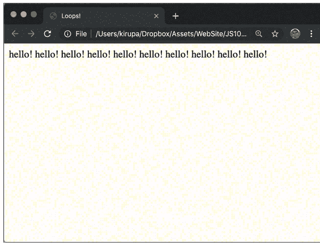

单词 **hello!** 将在页面上重复十次。这要归功于 for 循环，因此我们将通过全面学习它的工作原理来感谢它。首先，这是我们的主角：

```javascript
for (let i = 0; i < 10; i++) {
    saySomething();
}
```

这是一个 for 循环。它看起来可能与我们之前见过的其他语句非常不同，那是因为……嗯，它确实非常不同。为了理解这些差异，让我们将 for 循环概括为图 5.2 所示的形式。

```javascript
for (start_point; condition; step) {
    // 要执行的代码
}
```

**图 5.2** *通用的、高层次的 for 循环。*

这个高层次的视图对应于我们示例中的实际值（图 5.3）。

```javascript
for (let i = 0; i < 10; i++) {
    // 要执行的代码
}
```

**图 5.3** *实际值。*

这三个不同颜色的区域在循环功能中各自扮演着非常重要的角色。为了更好地使用 for 循环，我们必须知道每个区域的功能，因此接下来的几分钟我们将深入探讨每个部分。

### 起点

在第一个区域，我们定义了循环的 **起点**。这里常见的做法是放置一些声明和初始化变量的代码，类似于我们在图 5.4 中所做的。

```javascript
for (let i = 0; i < 10; i++) {
    // 要执行的代码
}
```

**图 5.4** *声明并初始化变量 `i`。*

我们是在告诉 JavaScript 从变量 `i` 初始化为 **0** 开始我们的循环。

### 步长

接下来，我们将跳到 **步长** 区域（图 5.5）。

```javascript
for (let i = 0; i < 10; i++) {
    // 要执行的代码
}
```

**图 5.5** *步长。*

在这个阶段，我们指定起点将如何变化。对于我们的例子，我们说的是每次循环运行时，`i` 的值将增加 1。这由看起来很神秘的 `i++` 表示。我们将在后面讨论 JavaScript 中数字和数学运算时介绍 `++` 的含义，但另一种表示方式是说 `i = i + 1`。

### 条件（即循环多久）

回到我们跳过的阶段，我们有循环的 **条件** 部分，它决定了循环何时停止运行（图 5.6）。

```javascript
for (let i = 0; i < 10; i++) {
    // 要执行的代码
}
```

**图 5.6** *循环的条件部分。*

在我们的例子中，条件是 `i` 变量小于 **10**：

- 如果 `i` 变量小于 10，此表达式求值为 **true**，我们的循环**继续运行**。
- 如果 `i` 变量变得等于或大于 10，条件为 **false**，我们的循环**终止**。

## 综合运用

好的，现在我们已经更详细地了解了 `for` 循环的每个部分，让我们运用新获得的知识一次性运行整个过程，看看发生了什么。我们之前的完整示例如下：

```javascript
for (let i = 0; i < 10; i++) {
    saySomething();
}

function saySomething() {
  document.writeln("hello!");
}
```

当 for 循环首次在起点处执行时，变量 `i` 被创建并初始化为 0。接下来，我们进入循环的条件部分，决定循环是否应该继续运行。条件检查 `i` 的值是否小于 10。0 小于 10 吗？是的，所以该条件求值为 **true**，循环内的代码开始运行。完成后，循环的步长部分开始工作。在这个阶段，变量 `i` 递增 1，值变为 1。此时，我们的循环已经完成了一次循环，通常称为一次 **迭代**。是时候开始下一次迭代了。

对于下一次迭代，循环完全重新开始，只是变量 `i` 不会被重新初始化。它的值是上一次迭代的 1，所以这个值被带入。对于条件，我们重新检查新值 1 是否小于 10……确实小于。循环内的代码（基本上是 `saySomething` 函数）和循环的步长部分（`i` 递增 1）发生。然后 `i` 的值递增 1，变为 2，这次迭代就完成了……为下一次迭代打开了大门！

这个过程一次又一次地重复，直到条件 `i < 10` 求值为 **false**。由于我们以 `i` 为 0 开始循环，循环被设定为在 `i` 的值小于 10 时终止，并且 `i` 在每次迭代中递增 1，因此这个循环（以及其中包含的任何代码）将在停止前运行 10 次。呼！

### 一些 for 循环示例

在上一节中，我们剖析了一个简单的 for 循环并标记了它所有的内部工作机制。关于 for 循环和 JavaScript 中大多数东西的一点是，一个简单的例子并不总是涵盖我们可能需要的所有内容。最好的解决方案是看更多 for 循环的例子，这就是我们接下来几节要做的。

### 终止循环

有时，我们可能希望在循环完成之前结束它。我们结束循环的方式是使用 `break` 关键字。下面是一个例子：

```javascript
for (let i = 0; i < 100; i++) {
  document.writeln(i);

  if (i == 45) {
```


当 `i` 的值等于 **45** 时，`break` 关键字会阻止循环继续执行。虽然这个例子有点刻意，但当我们遇到需要结束循环的实际场景时，我们就知道该怎么做了。

## 跳过迭代

有时候，我们希望循环跳过当前迭代，直接进入下一次迭代。这可以通过 `continue` 关键字巧妙地处理：

```
let floors = 28;

for (let i = 1; i <= floors; i++) {
  if (i == 13) {
    // 这里没有楼层
    continue;
  }

  document.writeln("At floor: " + i + "<br>");
}
```

与 `break` 直接停止循环不同，`continue` 告诉循环停止当前迭代并继续下一次迭代。我们通常会在处理错误时使用 `continue`，这时我们只想让循环继续处理下一个项目。

## 反向循环

我们的起始点**不必**总是初始化一个变量为 0，然后递增：

```
for (let i = 25; i > 0; i--) {
  document.writeln("hello");
}
```

你可以同样轻松地从一个较高的值开始，然后递减，直到循环条件返回 `false`。

你可能听说过这样做能提高循环性能。目前对于**递减**是否确实比递增更快，尚无定论，但你可以自己尝试一下，看看是否注意到性能上的差异。

## 不必只使用数字

在编写 `for` 循环时，你不必只使用数字：

```
for (let i = "a"; i != "aaaaaaaa"; i += "a") {
    document.writeln("hmm...");
}
```

你可以使用任何你想要的值，只要循环最终能达到终止条件即可。注意在这个例子中，我们使用字母 "a" 作为循环运行的“货币”。每次迭代时，`i` 的值都会增加一个字母 **a**，当 `i` 等于 **aaaaaaaa** 时，循环停止。

## 哦不，他没那么做吧！

哦，是的！是的，我做了。我去了那里，拍了照片，发到了 Facebook，然后回来了：

```
let i = 0;
let yay = true;

for (; yay;) {
    if (i == 10) {
        yay = false;
    } else {
        i++;
        document.writeln("weird");
    }
}
```

你不必填满 `for` 循环的所有三个部分才能让它工作。只要最终能满足循环的终止条件，你可以随心所欲...就像上面的例子所展示的那样。

## 其他循环

生活在广受欢迎的 `for` 循环阴影下的，还有 `while` 和 `do...while` 循环变体。为了完整性，让我们快速了解一下它们。

## while 循环

`while` 循环会重复执行某些代码，直到其条件（另一个表达式）返回 **false**。请看以下示例：

```
let count = 0;

while (count < 10) {
    document.writeln("looping away!");

    count++;
}
```

在这个例子中，条件由 `count < 10` 表达式表示。每次迭代时，我们的循环将 `count` 的值增加 **1**：

```
let count = 0;

while (count < 10) {
    document.writeln("looping away!");

    count++;
}
```

一旦 `count` 的值变为 **10**，循环就会停止，因为 `count < 10` 表达式将返回 **false**。如果你观察 `while` 循环所做的所有事情，它确实很像 `for` 循环的模仿。虽然 `for` 循环正式要求你定义起始、条件和步进阶段，但 `while` 循环则期望你以自己的方式定义这些阶段。

## do...while 循环

现在，我们来看看循环变体中的“梅格·格里芬”。那就是 `do...while` 循环，其目的甚至比 `while` 更不明确。`while` 循环在执行循环之前先有其条件表达式，而 `do...while` 循环则在末尾才有其条件表达式。

这是一个例子：

```
let count = 0;

do {
    document.writeln("I don't know what I am doing here! <br>");

    count++;
} while (count < 10);
```

`while` 循环和 `do...while` 循环的主要区别在于，如果 `while` 循环的条件表达式从一开始就是 `false`，那么它的内容就永远不会被执行：

```
while (false) {
    document.writeln("Can't touch this!");
}
```

而对于 `do...while` 循环，由于条件表达式仅在一次迭代后才被求值，因此你的循环内容保证至少会运行一次：

```
do {
    document.writeln("This code will run once!");
} while (false);
```

在某些情况下，这会很方便。现在，在结束之前，我需要告诉你最后一个信息点，然后我们再继续。我们之前在出色的 `for` 循环中看到的 `break` 和 `continue` 语句，在 `while` 和 `do...while` 循环变体中使用时，工作方式也类似。

## 绝对要点

所以，这就是关于 `for` 循环以及如何使用它们的全部内容，同时还对 `while` 和 `do...while` 循环进行了非常基础的介绍。现在，我们可能还不太会频繁使用循环。随着我们开始处理涉及数据集合、DOM 元素、文本操作等更复杂的情况时，我们将大量使用循环。基本上...请把我们这里看到的所有信息都牢记在心！

如果你对这里的内容有任何疑问，不要卡住！请在 [https://forum.kirupa.com](https://forum.kirupa.com) 论坛上发帖，以获得来自我以及一些网络上最聪明、最友好的开发者的快速帮助。

---

+   本章内容
- 学习如何为代码添加注释
- 了解注释的最佳实践

# # 6

# # 为你的代码添加注释...太棒了！

我们在代码编辑器中编写的所有内容，可能**看起来**只是为了浏览器的“眼睛”：

```
let xPos = -500;

function boringComputerStuff() {
  xPos += 5;

  if (xPos > 1000) {
    xPos = -500;
  }
}

boringComputerStuff();
```

但正如我们很快会发现的，情况并非如此。我们的代码还有另一个受众。这个受众就是人类。

我们的代码经常被其他人使用或审查。如果我和你在团队中与其他 JavaScript 开发者合作，情况尤其如此。我们经常会查看他们的代码，而他们也经常会查看我们的代码。为了使所有这些代码看起来尽可能高效，我们需要确保当其他人查看我们的代码时，它仍然是有意义的。即使你是独自工作，这一点也适用。对你来说今天很有意义的那个绝妙函数，下周再看时可能就是天书了。

解决这个问题的方法有很多。最好的方法之一是使用所谓的**注释**。在这篇简短的文章中，我们将了解什么是注释，如何在 JavaScript 中指定它们，并学习一些使用它们的良好实践。

继续前进！

## 什么是注释？

注释是我们作为代码的一部分编写的，用来与人类交流内容的东西：

```
// 这是因为你没邀请我参加你的生日派对！
let blah = true;

function sweetRevenge() {
  while (blah) {
    // 无限对话框！哈哈哈！！！
    alert("Hahahaha!");
  }
}
sweetRevenge();
```

在这个例子中，注释由 `//` 字符标记，它们提供了一些关于所描述代码的、有用性值得怀疑的信息。

关于注释需要记住的一点是，它们不会像你编写的其他所有代码那样运行和执行。**JavaScript 会忽略你的注释。**它不喜欢你，它不关心你要说什么，所以你不必担心语法、标点、拼写以及编写普通代码时需要记住的所有其他事情。注释的存在只是为了帮助我们理解一段代码在做什么。

注释还有一个用途。我们可以使用注释来标记我们不想执行的代码行：

```
function insecureLogin(input) {
  if (input == "password") {
    // let key = Math.random() * 100000;
    // processLogin(key);
  }
  return false;
}
```

在这个示例中，以下两行可以在我们的代码编辑器中看到，但它们不会运行：

```
// let key = Math.random() * 100000;
// processLogin(key);
```

我们经常会发现自己把代码编辑器当作草稿本来使用，而注释是一种很好的方式，可以记录我们在调试代码时所做的各种尝试，而不会影响应用程序的最终运行效果。

## 单行注释

在代码中指定注释有多种方式。一种方式是使用 `//` 符号，后跟我们想要表达的内容来指定**单行注释**。这种注释形式我们已经见过多次了。

我们可以在注释专属的独立行中指定这些注释：

```
// Return the larger of the two arguments
function max(a, b) {
  if (a > b) {
    return a;
  } else {
    return b;
  }
}
```

我们也可以在与语句同一行中指定这些注释：

```
let zorb = "Alien"; // Annoy the planetary citizens
```

注释放在哪里完全由你决定。请根据你所写的注释选择一个合适的位置。

由于我喜欢像复读机一样唠叨，再次提醒一下，我们的注释不会作为应用程序的一部分来运行。只有你、我，还有可能杜普里（Dupree）能看到它们。如果最后那句话你没看懂，说明你没有看过我们这个年代最伟大的喜剧之一。我强烈建议你放下这本书或教程，花几个小时去补上这一课。

## 多行注释

单行注释的问题在于，你必须在想要注释的每一行前面都加上 `//` 字符。这会让人非常疲惫——尤其是当你在写一段很长的注释或注释掉一大段代码的时候。

对于这些情况，你还有另一种指定注释的方式。你可以使用 `/*` 和 `*/` 字符来指定所谓的**多行注释**的开头和结尾：

```
/*
let mouseX = 0;
let mouseY = 0;

canvas.addEventListener("mousemove", setMousePosition, false);

function setMousePosition(e) {
  mouseX = e.clientX;
  mouseY = e.clientY;
}
*/
```

我们不必像野蛮人一样在每一行前面都加上 `//` 标记，而是可以使用 `/*` 和 `*/` 字符来节省大量时间和精力。

在大多数应用中，我们会根据需要记录的内容，组合使用单行注释和多行注释。这意味着我们需要熟练掌握这两种注释方式。

### 提示：JSDoc 风格注释

当我们编写一些希望他人使用的代码时，你可能希望有一种*更简单*的方式来传达你的代码功能，而不必让人们翻阅源代码。这种*更简单*的方式确实存在，它由一个名为 **JSDoc** 的工具实现！使用 JSDoc，你只需稍微修改编写注释的方式：

```
/**
 * Shuffles the contents of your Array.
 *
 * @this {Array}
 * @returns {Array} The current array with the contents fully shuffled.
 */
Array.prototype.shuffle = function () {
  let input = this;

  for (let i = input.length - 1; i >= 0; i--) {

    let randomIndex = Math.floor(Math.random() * (i + 1));
    let itemAtIndex = input[randomIndex];

    input[randomIndex] = input[i];
    input[i] = itemAtIndex;
  }
  return input;
}
```

一旦你为文件添加了注释，就可以使用 JSDoc 工具将注释中的相关部分导出为易于浏览的 HTML 页面。这样你就可以花更多时间编写 JavaScript，同时让你的用户能够轻松理解你的代码功能以及如何使用各个部分。

如果你想了解更多关于如何使用 JSDoc 的内容，请查看他们出色的[入门指南页面](link)了解详情。

## 注释最佳实践

现在我们已经了解了注释是什么以及在 JavaScript 中编写注释的几种方式，让我们来谈谈如何正确使用注释来帮助我们的代码更易于阅读：

- **编写代码时始终同步编写注释。** 编写注释是非常枯燥的事情，但它是编写代码的重要组成部分。对你（和其他人）来说，通过阅读注释来理解代码功能，比逐行阅读枯燥的 JavaScript 代码要高效得多。

- **不要把编写注释推迟到以后。** 把注释推迟到以后写，就像成年人的拖延症一样。如果你在编写代码时不写注释，你很可能会完全跳过注释环节。这可不是什么好事。

- **多用英语，少用 JavaScript。** 注释是编写 JavaScript 时为数不多的可以自由使用英语（或你偏好的任何语言）的地方之一。不要不必要地用代码来使你的注释变得复杂。要清晰。要简洁。用文字。

- **善用空白。** 当浏览大段代码时，你要确保注释醒目且易于跟随。这就需要慷慨地使用空格键和回车键。看看下面的例子：

```
function selectInitialState(state) {
  let selectContent = document.querySelector("#stateList");
  let stateIndex = null;

  /*
    For the returned state, we would like to ensure that
    we select it in our UI. This means we iterate through
    every state in the drop-down until we find a match.
    When a match is found, we ensure it gets selected.
  */

  for (let i = 0; i < selectContent.length; i++) {

    let stateInSelect = selectContent.options[i].innerText;

    if (stateInSelect == state) {
      stateIndex = i;
    }
  }

  selectContent.selectedIndex = stateIndex;
}
```

注意我们的注释适当地留有间距，使其与代码的其余部分区分开来。如果你的注释零散地分布在难以辨认的位置，那只会不必要地拖慢你和阅读你代码的人的速度。

- **不要注释显而易见的内容。** 如果一行代码不言自明，就不要浪费时间去解释它的功能，除非有一些微妙的行为你需要作为警告来指出。相反，应该把时间花在注释代码中不太明显的部分。

你在这里看到的最佳实践将在确保你编写规范注释的代码方面助你一臂之力。如果你正在与其他人一起参与一个较大的项目，我可以向你保证，你们团队已经建立了一些关于规范注释的指导原则。花些时间了解这些原则并遵循它们。你会很开心。你的团队也会很开心。

## 最低限度

注释常常被视为一种必要之恶。毕竟，你是愿意花几分钟来记录**你**已经清楚的内容，还是更愿意去实现下一个酷炫的功能？我喜欢这样来描述注释：*这是一项长期投资。* 注释的价值和好处通常不会立即显现出来。当开始有其他人查看你的代码时，它会变得显而易见；当你不得不在完全忘记代码及其工作原理之后重新审视自己的代码时，它也会变得显而易见。不要为了短期的快感而牺牲长期的时间节省。趁现在还来得及，投资于单行注释（`//`）和多行注释（`/*` 和 `*/`）吧。

一如既往，如果你对本文内容有任何疑问，我和其他热心开发者随时为你提供帮助！请在 https://forum.kirupa.com 论坛发帖，快速获得帮助。


*此页有意留白*

本章内容

- 学习如何延迟代码的执行时机
- 探索多种方法来重复运行代码，同时不阻塞整个应用程序


## 7. 定时器

默认情况下，我们的代码是同步运行的。这是一种花哨的说法，意思是当一个语句需要执行时，它会立即执行。没有**而且**、**如果**、**但是**可言。延迟执行或将工作推迟到以后执行的概念并不属于 JavaScript 的默认行为。我们在之前研究循环时就已经看到了这一点。循环以闪电般的速度运行，每次迭代之间没有任何延迟。这对于快速计算来说非常棒，但如果我们想以更从容（即更慢的）节奏进行更新，这就不太合适了。

所有这些并不意味着停止代码即时运行的能力不存在！如果我们稍微偏离主路，有三个函数可以让我们在很大程度上做到这一点（甚至更多）——`setTimeout`、`setInterval` 和 `requestAnimationFrame`。在本文中，我们将了解每个函数的功能。

开始吧！


## 使用 `setTimeout` 进行延迟

`setTimeout` 函数允许我们延迟执行某些代码。它的使用方式非常简洁。该函数允许我们指定要执行的代码以及等待多少毫秒后再执行我们指定的代码。用 JavaScript 实现的话，看起来像是这样：

```javascript
let timeoutID = setTimeout(someFunction, delayInMilliseconds);
```

举个更具体的例子，如果我们想在 5 秒后调用一个名为 `showAlert` 的函数，`setTimeout` 的声明如下所示：

```javascript
function showAlert() {
  alert("moo!");
}
```

```javascript
let timeoutID = setTimeout(showAlert, 5000);
```

很酷吧？现在，让我们聊点不那么有趣但为了完整性必须覆盖的内容。这与初始化为 `setTimeout` 函数的 `timeID` 变量有关。它的存在不是偶然的。如果我们想要再次访问这个 `setTimeout` 定时器，就需要一种方式来引用它。通过将变量与 `setTimeout` 声明关联起来，我们可以轻松实现这一点。

现在，你可能会想知道为什么我们创建定时器后还想引用它。理由不多。我能想到的唯一理由就是取消定时器。对于 `setTimeout`，可以方便地使用 `clearTimeout` 函数并传入超时 ID 作为参数来实现：

```javascript
clearTimeout(timeoutID);
```

如果你从不打算取消定时器，可以直接使用 `setTimeout`，无需将其作为变量初始化的一部分。

让我们聊聊在真实世界中常见的使用场景。**UI 开发**。当我们进行 UI 开发时，将某些操作推迟到稍后的时间是非常常见的。以下是我在过去一个月里遇到的一些例子：

菜单滑入，当用户几秒钟不再操作菜单后，菜单滑走。

你有一个长时间运行的操作无法完成，`setTimeout` 函数会中断该操作以将控制权交还给用户。

我最喜欢的一个（也是我写过教程的）是使用 `setTimeout` 函数来[**检测用户是否处于非活动或空闲状态**](https://www.kirupa.com/html5/detecting_if_user_is_idle.htm)！

如果你在本站或 Google 上搜索 `setTimeout`，你会看到更多 `setTimeout` 非常实用的真实案例。

## 使用 `setInterval` 进行循环

下一个我们要看的定时器函数是 `setInterval`。`setInterval` 函数与 `setTimeout` 相似，它也允许你在指定的时间后执行代码。不同之处在于它不会只执行一次代码，而是会无限循环地持续执行代码。

以下是你使用 `setInterval` 函数的方式：

```javascript
let intervalID = setInterval(someFunction, delayInMilliseconds);
```

除了函数名称之外，使用 `setInterval` 的方式甚至与 `setTimeout` 完全相同。第一个参数指定你要执行的内联代码或函数。第二个参数指定你的代码再次循环前要等待多长时间。你也可以选择将 `setInterval` 函数初始化为一个变量来存储间隔 ID——一个你可以稍后用来执行取消循环等激动人心的操作的 ID。耶！！！

好的！既然我们已经看完了这些，下面是一个实际运行中的代码示例，用于循环调用名为 `drawText` 的函数，每次循环之间延迟 2 秒：

```html
<!DOCTYPE html>
<html>

<head>
    <meta charset="utf-8">
    <title>给我显示些文字！</title>
</head>

<body>
    <script>
        let thingToPrint = "";

        function drawText() {
            thingToPrint += "#";
            document.writeln(thingToPrint);
        }

        setInterval(drawText, 2000);
    </script>
</body>

</html>
```

如果我们希望取消循环，可以使用恰当命名的 `clearInterval` 函数：

```javascript
clearInterval(intervalID);
```

其用法与 `clearTimeout` 的对应函数相似。我们传入在最初设置 `setInterval` 时可选获取的 `setInterval` 定时器实例的 ID。

在现实生活中，`setInterval` 长期以来一直是你在 JavaScript 中创建动画的主要函数。为了获得每秒 30 或 60 帧，你可以通过调整延迟时间值来实现，如下所示：

```javascript
// 1000 除以 60 是 60fps 对应的毫秒值
setInterval(moveCircles, 1000 / 60);
```

要在本站的其他一些实际示例中查看 `setInterval` 的实际应用，请查看**创建一个精美的内容滑块**（https://www.kirupa.com/html5/creating_a_sweet_content_slider.htm）文章的底部以及**创建一个模拟时钟**（https://www.kirupa.com/html5/create_an_analog_clock_using_the_canvas.htm）文章。它们都大量使用了 `setInterval`！

## 使用 `requestAnimationFrame` 实现流畅动画

现在，我们来谈谈我有史以来最喜欢的函数之一：`requestAnimationFrame`。`requestAnimationFrame` 函数的核心是将你的代码与浏览器的重绘事件同步。这意味着：你的浏览器在任何给定时间都在忙着处理数以亿计的不同事务。这些事务包括调整布局、响应页面滚动、监听鼠标点击、显示键盘敲击结果、执行 JavaScript、加载资源等等。在浏览器做所有这些的同时，它还在以每秒 60 帧的速度重新绘制屏幕……或者至少是在尽最大努力。

当你有旨在将某些内容动画显示到屏幕上的代码时，你希望确保你的动画代码能够正常运行，而不会被浏览器处理的其他事务所淹没。前面提到的 `setInterval` 技术不能保证当浏览器忙于优化其他事务时不会丢帧。为了避免你的动画代码被当作普通的 JavaScript 处理，你可以使用 `requestAnimationFrame` 函数。这个函数会获得浏览器的特殊对待。这种特殊对待使其能够精确地安排执行时间，以避免丢帧、避免不必要的工作，并普遍避开困扰其他循环解决方案的其他副作用。

我们使用这个函数的方式一开始与 `setTimeout` 和 `setInterval` 有些相似：

```javascript
let requestID = requestAnimationFrame(someFunction);
```

唯一真正的区别是我们不指定持续时间值。持续时间会根据当前帧率、当前标签页是否处于活动状态、设备是否在使用电池运行以及许多其他超出我们控制或理解范围的因素自动计算。

无论如何，这种 `requestAnimationFrame` 的使用方式仅仅是教科书版本。在现实生活中，你很少会像这样单次调用 `requestAnimationFrame`。所有 JavaScript 动画的关键是动画循环，而我们要将 `requestAnimationFrame` 应用于这个循环。该应用的结果看起来如下所示：

```javascript
function animationLoop() {
  // 与动画相关的代码

  requestAnimationFrame(animationLoop)
}

// 启动我们的动画循环！
animationLoop();
```

请注意，我们的 `requestAnimationFrame` 指定在浏览器决定下次重绘时调用 `animationLoop` 函数。看起来 `requestAnimationFrame` 函数直接调用了 `animationLoop`，但事实并非如此。这不是代码中的 bug。虽然这种循环引用几乎肯定会导致浏览器冻结/挂起，但 `requestAnimationFrame` 的实现避免了这一点。相反，它确保 `animationLoop` 函数被调用的次数恰到好处，以确保内容被绘制到屏幕上，从而创建流畅顺滑的动画。它这样做而不会冻结应用程序的其他功能。

要了解更多关于 `requestAnimationFrame` 及其在创建精彩动画中的主要用途，你应该查看 **JavaScript 中的动画**部分的所有内容。在该部分中，我还会更深入地探讨 **requestAnimationFrame**，超越我们在这里了解到的要点概述。


## 绝对基础

你可能认为，与我们之前探讨过的`if/else`语句和循环等更核心的概念相比，定时器属于一个相对小众的范畴。你的想法可能是对的——在不依赖`setTimeout`、`setInterval`或`requestAnimationFrame`的情况下，你完全可以构建出许多出色的应用程序。但这并不意味着了解它们不重要。总有一天，你会需要延迟代码的执行时间，或者让代码持续循环，又或者用JavaScript创建一个酷炫的动画。当那一刻来临时，你已有所准备……至少知道该搜索什么关键词了。

要查看这些定时器函数在实际中的应用，可以查阅以下可选文章和示例，它们可能会对你有所帮助：

- **使用 requestAnimationFrame 创建动画** http://bit.ly/kirupaAnimationsJS
- **创建一个精美的内容滑块** http://bit.ly/sliderTutorial
- **创建一个模拟时钟** http://bit.ly/kirupaAnalogClock
- **癫痫生成器** http://bit.ly/kirupaSeizureGenerator （癫痫警告：该网站上的动画有强烈频闪效果。）

我之前已经多次提到，JavaScript有时会让人感到沮丧。而定时器尤其如此。如果你遇到任何问题，我以及众多与定时器搏斗已久的开发者们都在这里提供帮助！请在 https://forum.kirupa.com 论坛发帖求助，以摆脱烦恼！

---

## 本章内容

- 理解全局作用域
- 熟悉可用于使用局部作用域的各种技巧
- 了解一些可能导致代码行为异常的特殊问题

---

## 变量作用域

让我们重新审视几章前见过的与变量相关的内容。我们声明的每个变量都具有一定程度的可见性，这决定了我们何时能够实际使用它。用人类能理解的话来说，仅仅声明一个变量并不意味着它可以从代码中的任何位置被访问。有一些基础知识我们需要理解，而这整个理解领域都属于一个被称为**变量作用域**的主题。

在本教程中，我将通过我们（大多）已经见过的常见案例来解释变量作用域。这是一个相当深入的话题，但我们在此只是浅尝辄止。我们将在后续的许多教程中不断遇到变量作用域的问题，并将在那里扩展我们在这里学到的内容。

继续前进！

## 全局作用域

我们将从最顶层开始探索作用域，也就是所谓的**全局作用域**。在现实生活中，当我们说某样东西能全球听到时，意味着我们身处世界任何地方都能听到它……某种东西。

在JavaScript中，情况也大致相同。例如，如果我们说一个变量是全局可用的，这意味着我们页面上的任何代码都可以读取和修改这个变量。我们让某些东西全局适用的方法是，在函数之外完全地在代码中声明它。

为了说明这一点，让我们看看以下示例：

```
<!DOCTYPE html>
<html>
<head>
    <meta charset="utf-8">
    <title>Variable Scope</title>
</head>
<body>
    <script>
        let counter = 0;
```

```
    alert(counter);
</script>
</body>
</html>
```

这里，我们只是声明了一个名为`counter`的变量，并将其初始化为**0**。由于这个变量是直接在`<script>`标签内声明的，而没有放在任何函数内部，因此`counter`变量被认为是**全局**的。这种区分意味着我们的`counter`变量可以被文档中的任何代码访问。

下面的代码突出了这一点：

```
<!DOCTYPE html>
<html>
<head>
    <meta charset="utf-8">
    <title>Variable Scope</title>
</head>
<body>
    <script>
        let counter = 0;

        function returnCount() {
            return counter;
        }

        alert(returnCount());
    </script>
</body>
</html>
```

在这个例子中，`counter`变量是在`returnCount`函数之外声明的。尽管如此，`returnCount`函数仍然可以完全访问`counter`变量。当代码运行时，`alert`函数调用`returnCount`函数，该函数返回`counter`变量的值。

此时，你可能想知道为什么我要指出这一点。我们一直都在使用全局变量，只是没有真正意识到而已。我在这里所做的，只是正式向你介绍一位已经在你的派对上逗留了一段时间的客人。

## 局部作用域

现在，当我们审视那些并非全局声明的东西时，事情变得有点意思了。理解作用域真正的价值开始显现。正如我们之前看到的，全局声明的变量可以在函数内部访问：

```
let counter = 0;

function returnCount() {
  return counter;
}
```

反过来却不成立。在函数内部声明的变量在函数外部访问时将无法工作：

```
function setState() {
  let state = "on";
}
setState();

alert(state) // undefined
```

在这个例子中，`state`变量是在`setState`函数内部声明的，在该函数外部访问`state`变量是无效的。原因在于，`state`变量的作用域仅限于`setState`函数本身。一个更通用的描述方式是，你的`state`变量仅仅是**局部**的。

**注意：使用未声明的变量**

如果我们初始化`state`变量而不正式声明它，作用域行为会截然不同：

```
function setState() {
  state = "on";
}
setState();

alert(state) // "on"
```

在这种情况下，即使我们的`state`变量首先出现在`setState`函数内部，但如果没有先用`let`或`const`（或者更老的声明变量方式`var`）来声明它，这个变量就会在全局范围内存活。通常情况下，你不希望这样声明变量。务必在前面加上`let`或`const`。

## 各种作用域怪事

既然我们讨论的是JavaScript，如果我们就让变量作用域停留在现状，那也未免太简单了。在以下几节中，我将重点介绍一些你需要熟悉的特殊问题。

### 块级作用域

我们的代码是由块组成的……大量大量块。到底什么是块？块几乎总是由花括号包裹的一组JavaScript语句的集合。例如，让我们看看以下代码：

```
let safeToProceed = false;

function isItSafe() {
  if (safeToProceed) {
    alert("You shall pass!");
  } else {
    alert("You shall not pass!");
  }
}

isItSafe();
```

算上成对的花括号，这里有三个块。一个块是`isItSafe`函数本身包含的区域：

```
let safeToProceed = false;

function isItSafe() {
  if (safeToProceed) {
    alert("You shall pass!");
  } else {
```

```
    alert("You shall not pass!");
    }
}
```

```
isItSafe();
```

第二个块是`if`语句区域：

```
let safeToProceed = false;
```

```
function isItSafe() {
  if (safeToProceed) {
    alert("You shall pass!");
  } else {
    alert("You shall not pass!");
  }
}
```

第三个块是`else`语句覆盖的区域：

```
let safeToProceed = false;
```

```
function isItSafe() {
  if (safeToProceed) {
    alert("You shall pass!");
  } else {
    alert("You shall not pass!");
  }
}
```

在块内部使用`let`或`const`声明的任何变量对于该块以及包含在其中的任何子块来说都是局部的。为了更好地理解这一点，请看看以下代码，它是之前`isItSafe`函数的一个变体：

```
function isThePriceRight(cost) {
  let total = cost + 1;

  if (total > 3) {
    alert(total);
  } else {
```


     alert("Not enough!");
  }
}
```

```
isThePriceRight(4);
```

我们将 `total` 变量声明为函数块的一部分。我们正在 `if` 代码块内部访问这个变量。你认为会发生什么？`total` 变量在这里完全（哈哈！）可以访问，因为 `if` 代码块是函数块的子级。用我们这个时代的行话来说，`total` 变量被认为在 `alert` 函数的**作用域内**。

那下面这种情况呢？

```
  function isThePriceRight(cost) {
    let total = cost + 1;

    if (total > 3) {
      let warning = true;
      alert(total);
    } else {
      alert("Not enough!");
    }

    alert(warning);
  }
```

```
isThePriceRight(4);
```

我们在 `if` 代码块内部声明了一个名为 `warning` 的变量，还有一个 `alert` 函数试图打印 `warning` 的值。在这种情况下，因为我们试图在一个变量最初声明的代码块之外访问 `warning` 变量，所以我们的 `alert` 函数实际上不会显示 **true** 这个值。鉴于我们的 `alert` 函数所在的位置，`warning` 变量被认为**不在作用域内**。

> **注意 使用 var 关键字声明变量！**
几段之前，我曾随口提到变量曾经是用 `var` 关键字声明的。`let`（和 `const`）关键字是新增的，用于帮助你声明变量，无论你过去在何处使用 `var`，现在都应该改用 `let`。我们从未讨论过为什么 `let` 更可取，并且说过在探讨变量作用域时会进一步讨论。嗯……我们现在就来讨论！

用 `var` 声明的变量其作用域是函数。它们不像我们的 `if/else` 代码块那样限定在块级作用域内。如果我们修改前面的例子，将 `warning` 变量的声明方式从 `let` 改为 `var`，我们的代码将如下所示：

```
function isThePriceRight(cost) {
  let total = cost + 1;

  if (total > 3) {
    var warning = true;
    alert(total);
  } else {
    alert("Not enough!");
  }

  alert(warning);
}

isThePriceRight(4);
```

之前，`alert` 函数不会显示任何内容，因为当使用 `let` 声明时，`warning` 变量不在作用域内。使用 `var` 时，情况就不同了。你将看到显示 **true**。其中的原因在于 `let` 和 `var` 之间的主要区别。使用 `var` 声明的变量作用域限定在函数级别，因此只要变量在函数内部的某处被声明，该变量就被认为在作用域内。正如我们之前所看到的，使用 `let` 声明的变量作用域限定在代码块级别。

`var` 在作用域控制方面提供的宽容度有点过大，而这种宽容度容易导致与变量相关的错误。因此，我建议大家在声明变量时都使用 `let`。

## JavaScript 如何处理变量

如果你觉得之前关于块级作用域的逻辑很奇怪，那就等着看看这个吧。看看以下代码：

```
let foo = "Hello!";
alert(foo);
```

当这段代码运行时，我们可以合理地推断出将显示 **Hello!** 的值。我们推断得没错。如果我们做如下修改，将变量声明和初始化移到末尾会怎样？

```
alert(foo);
let foo = "Hello!";
```

在这种情况下，我们的代码会出错。`foo` 变量在未被引用的情况下就被访问了。如果我们把 `let` 替换成 `var`，我们的代码看起来会是这样：

```
alert(foo);
var foo = "Hello!";
```

当这段代码运行时，其行为与我们之前看到的不同。你将看到显示 **undefined**。这到底是怎么回事？

当 JavaScript 遇到一个作用域（全局、函数等）时，它首先要做的一件事就是扫描整个代码体，查找所有已声明的变量。当遇到任何变量时，对于 `var`，它会默认用 **undefined** 初始化这些变量。对于 `let` 和 `const`，它会让变量保持**完全未初始化**状态。最后，它会将遇到的所有变量提升到作用域的顶部——对于 `let` 和 `const` 是最近的块，对于 `var` 是最近的函数。

让我们深入了解一下这意味着什么。我们的代码最初看起来是这样的：

```
alert(foo);
let foo = "Hello!";
```

当 JavaScript 处理这段代码时，它被转换成了以下形式：

```
let foo;
alert(foo);
foo = "Hello!";
```

`foo` 变量尽管是在代码底部声明的，却被提升到了顶部。这更正式的名称叫做**变量提升**。关于 `let`（和 `const`）的一点是，当它们被提升时，它们保持未初始化状态。如果你试图访问一个未初始化的变量，我们的代码将抛出错误并停止。如果我们修改前面的例子，使用 `var`，JavaScript 会将其视为如下形式：

```
var foo = undefined;
alert(foo);
foo = "Hello!";
```

变量仍然被提升，但它被初始化为 **undefined**。这确保了我们的代码仍然可以运行。

所有这一切的主要要点是：**请在实际使用变量之前声明并初始化它们**。虽然 JavaScript 对于不这样做的一些情况有一定的容错能力，但这些容错处理实在令人困惑。

## 闭包

关于变量作用域的讨论，不涉及闭包就不算完整。也就是说，直到现在。我不会在这里解释闭包，因为它是一个稍微高级一点的主题，我们将在第 9 章单独介绍。

在你进入下一章之前，如果你对这里的内容有任何问题，请在 https://forum.kirupa.com 论坛上发帖，我和其他开发者很乐意为你提供帮助。

**核心要点**

变量的位置对其可使用范围有重大影响。全局声明的变量可在整个应用程序中访问。局部声明的变量只能在其所在的作用域内访问。在全局和局部变量的范围内，JavaScript 有很多内在机制。

本章概述了变量作用域如何影响你的代码，在不久的将来，你将看到一些这些概念的直接体现。

---

## 本章内容

- 理解闭包是什么
- 将你所学的关于函数、变量和作用域的所有知识结合起来

## 闭包

到现在，你可能已经了解了所有关于函数以及它们所做的所有有趣的功能。在使用函数、JavaScript，以及（可能）整个生活的过程中，一个重要的部分就是理解被称为**闭包**的主题。闭包触及了函数和变量作用域交叉的灰色地带（图 9.1）。

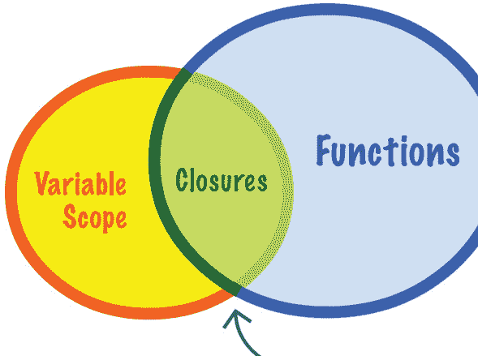

**图 9.1**
闭包。

现在，我不会再对闭包说更多，因为最好通过查看代码来解释。我现在添加的任何定义或描述闭包的词语都只会让事情更混乱。在接下来的章节中，我们将从熟悉的领域开始，然后慢慢探索闭包可能出现的未知领域。

继续吧！

## 函数内的函数

我们要做的第一件事是深入探讨当函数内嵌套函数……并且内部函数被返回时会发生什么。作为其中的一部分，让我们快速复习一下函数。

看看以下代码：

```
function calculateRectangleArea(length, width) {
  return length * width;
}

let roomArea = calculateRectangleArea(10, 10);
alert(roomArea);
```

`calculateRectangleArea` 函数接受两个参数，并将这两个参数的乘积返回给调用它的任何对象。在这个例子中，**调用它的任何对象**由 `roomArea` 变量扮演。

在这段代码运行之后，`roomArea` 变量包含 10 乘以 10 的结果……也就是 100（图 9.2）。


**图 9.2**
roomArea 的结果。

如你所知，函数返回的值几乎可以是任何东西。在这个例子中，我们返回了一个数字。你可以很容易地返回一些文本（也就是一个**字符串**）、`undefined` 值、一个**自定义对象**等等。只要调用函数的代码知道如何处理函数返回的内容，你几乎可以做任何你想做的事情。你甚至可以返回另一个函数。让我对此稍作展开。

下面是一个非常简单的例子来说明我正在谈论的内容：

```
function youSayGoodBye() {

  alert("Good Bye!");

  function andISayHello() {
    alert("Hello!");
  }

  return andISayHello;
}
```

我们可以有包含内部函数的函数。在这个例子中，我们有`youSayGoodBye`函数，它包含一个`alert`和另一个名为`andISayHello`的函数（图9.3）。

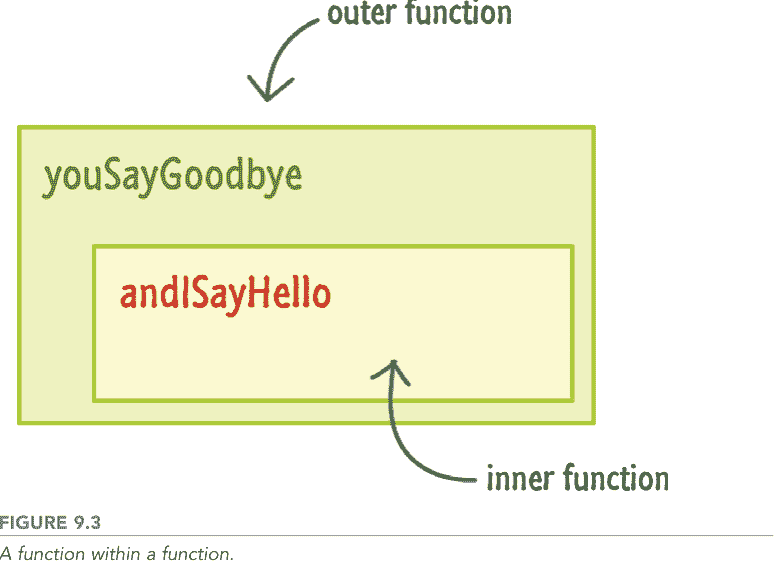

有趣的部分是`youSayGoodBye`函数在被调用时返回什么。它返回`andISayHello`函数：

```
function youSayGoodBye() {

  alert("Good Bye!");

  function andISayHello() {
    alert("Hello!");
  }

  return andISayHello;
}
```

让我们继续把这个例子演练一遍。要调用这个函数，初始化一个指向`youSayGoodBye`的变量：

```
let something = youSayGoodBye();
```

这行代码运行的那一刻，**你`youSayGoodBye`函数中的所有代码**也会被执行。这意味着，你会看到一个对话框（多亏了`alert`），显示**Good Bye!**（图9.4）。


## 图9.4

Good Bye! 对话框。

作为运行到完成的一部分，`andISayHello`函数也会被创建并返回。此时，我们的`something`变量只盯着一件事，而那件事就是`andISayHello`函数（见图9.5）。

## 图9.5

Something和`andISayHello`函数。

从`something`变量的角度来看，`youSayGoodBye`外部函数就简单地消失了。因为`something`变量现在指向一个函数，你可以像平常一样使用开括号和闭括号来调用这个函数：

```
let something = youSayGoodBye();
something();
```

当你这样做时，返回的内部函数（也就是`andISayHello`）将会执行。和之前一样，你会看到一个对话框出现，但这个对话框会显示Hello!（图9.6）——这正是这个函数内部`alert`所指定的。

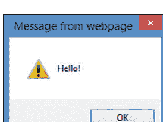

Hello!

所有这些应该都是复习。你可能唯一觉得新鲜的是，一旦函数返回一个值，它就不存在了。唯一留存下来的是返回的值。

好了，我们正接近承诺的危险地带。在下一节中，我们将通过看另一个稍有变化的例子来扩展我们刚刚看到的内容。

## 当内部函数不是自包含的时候

在之前的例子中，我们的`andISayHello`内部函数是自包含的，并不依赖外部函数的任何变量或状态：

```
function youSayGoodBye() {

  alert("Good Bye!");

  function andISayHello() {
    alert("Hello!");
  }

  return andISayHello;
}
```

在许多真实场景中，我们很少会遇到这样的情况。我们经常会遇到变量和数据在外部函数和内部函数之间共享的情况。为了突出这一点，请看下面的例子：

```
function stopWatch() {
  let startTime = Date.now();

  function getDelay() {
    let elapsedTime = Date.now() - startTime;
    alert(elapsedTime);
  }

  return getDelay;
}
```

这个例子展示了一种非常简单的测量做某事所需时间的方法。在`stopWatch`函数内部，我们有一个`startTime`变量，它被设置为`Date.now()`的值：

```
function stopWatch() {
  let startTime = Date.now();

  function getDelay() {
    let elapsedTime = Date.now() - startTime;
    alert(elapsedTime);
  }
```

}

return getDelay;

}

我们还有一个名为`getDelay`的内部函数：

```
function stopWatch() {
  let startTime = Date.now();

  function getDelay() {
    let elapsedTime = Date.now() - startTime;
    alert(elapsedTime);
  }

  return getDelay;
}
```

`getDelay`函数显示一个对话框，其中包含对新调用`Date.now()`的时间与之前声明的`startTime`变量之间差值。回到外部的`stopWatch`函数，最后一件事是它在退出前返回`getDelay`函数。正如我们所见，这里的代码与之前的例子非常相似。我们有一个外部函数，我们有一个内部函数，我们有外部函数返回内部函数。现在，要看到这个`stopWatch`函数在工作，请添加以下代码行：

```
let timer = stopWatch();

// do something that takes some time
for (let i = 0; i < 1000000; i++) {
  let foo = Math.random() * 10000;
}

// invoke the returned function
timer();
```

这个例子的完整标记和代码如下所示：

```
<!DOCTYPE html>
<html>
<head>
    <meta charset="utf-8">
    <title>Closures</title>

    <style>

    </style>
</head>

<body>
    <script>
        function stopWatch() {
            var startTime = Date.now();

            function getDelay() {
                var elapsedTime = Date.now() - startTime;
                alert(elapsedTime);
            }

            return getDelay;
        }

        let timer = stopWatch();

        // do something that takes some time
        for (let i = 0; i < 1000000; i++) {
            let foo = Math.random() * 10000;
        }

        // invoke the returned function
        timer();
    </script>
</body>

</html>
```

如果你运行这个例子，我们会看到一个对话框，显示从`timer`变量被初始化、你的`for`循环运行完成，到`timer`变量被作为函数调用之间所花费的毫秒数（图9.7）。

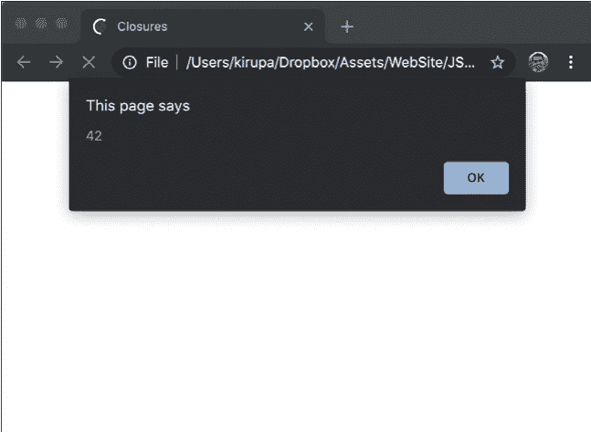

## 图9.7

*`timer`变量被作为函数调用。*

换一种方式解释，我们有一个秒表，我们调用它，运行一些耗时操作，然后再次调用它来查看这个耗时操作花了多长时间。

现在我们可以看到这个小小的秒表例子正常工作了，让我们回到`stopWatch`函数，看看究竟发生了什么。就像我在几行前提到的，我们所看到的大部分与`youSayGoodBye`/`andISayHello`的例子相似。有一个转折使这个例子不同，而需要注意的重要部分是当`getDelay`函数被返回到`timer`变量时发生了什么。

图9.8是这一现象的不完整可视化。

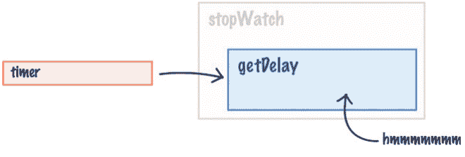

## 图9.8

*stopWatch*外部函数不再活跃，`timer`变量绑定到`getDelay`函数。

`stopWatch`外部函数不再起作用，`timer`变量绑定到`getDelay`函数。现在，这里是转折。`getDelay`函数依赖于存在于外部`stopWatch`函数上下文中的`startTime`变量：

```
function stopWatch() {
  let startTime = Date.now();

  function getDelay() {
    let elapsedTime = Date.now() - startTime;
    alert(elapsedTime);
  }

  return getDelay;
}
```

当外部`stopWatch`函数在`getDelay`被返回到`timer`变量时消失，下面这行代码会发生什么呢？

```
function getDelay() {
  let elapsedTime = Date.now() - startTime;
  alert(elapsedTime);
}
```

在这个上下文中，`startTime`变量实际上是未定义的，这说得通，对吧？但这个例子完全正常工作了，所以这里还有其他事情在发生。那其他事情就是羞怯而神秘的闭包。下面是发生的使`startTime`变量实际存储一个值而不是未定义的情况。

跟踪你所有变量、内存使用、引用等的JavaScript运行时机灵得很。在这个例子中，它检测到内部函数（`getDelay`）依赖于外部函数（`stopWatch`）的变量。当这种情况发生时，运行时会确保外部函数中所需的任何变量仍然可供内部函数使用**即使外部函数消失了**。

为了正确地可视化这一点，图9.9向你展示了`timer`变量看起来是什么样的。

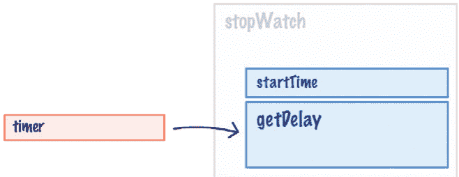

## 图9.9

*`timer`变量。*

它仍然引用着`getDelay`函数，但`getDelay`函数也可以访问存在于外部`stopWatch`函数中的`startTime`变量。这个内部函数，因为它将来自外部函数的相关变量**封闭**到它的气泡中（也就是作用域），被称为**闭包**（图9.10）。

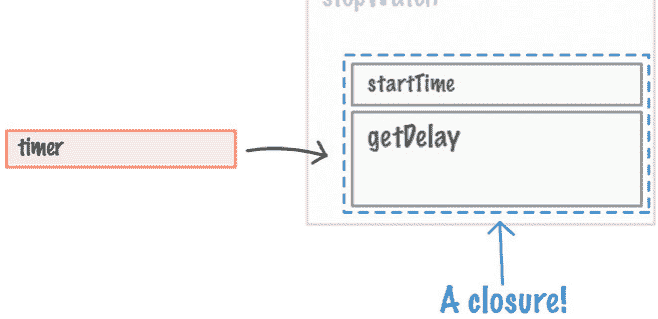

## 图9.10

*闭包的图示定义。*

更正式地定义闭包，它是一个**新创建的函数，同时也包含其变量上下文**（图9.11）。


104 JavaScript **绝对初学者指南**

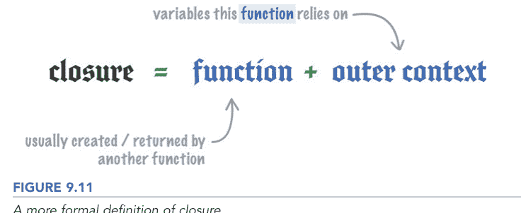

**图 9.11**
*闭包的更正式定义。*

让我们用现有的例子再回顾一下：当`timer`变量被初始化，`stopWatch`函数运行时，`startTime`变量就获得了`Date.now`的值。当`stopWatch`函数返回内部的`getDelay`函数时，`stopWatch`函数就消失了。但内部函数所依赖的`stopWatch`内的任何共享变量都不会消失。这些共享变量没有被销毁。相反，它们被内部函数，也就是闭包，所封装。

## 绝对要点

通过先看例子来理解闭包，你确实错过了许多枯燥的定义、理论和空谈。严肃地说，闭包在 JavaScript 中非常常见。你会以许多微妙或不那么微妙的方式遇到它们：

如果所有内容中你只能记住一件事，那就是：**闭包最重要的作用是让函数即使在其环境剧烈变化或消失后，仍能继续工作**。函数创建时在其作用域内的任何变量都被封装和保护起来，以确保函数仍然能工作。这种行为对于像 JavaScript 这样非常动态的语言至关重要，在这里你经常需要动态地创建、修改和销毁东西。开心点！

我们在这里涵盖了很多内容。如果你对看到的内容有任何问题，请在 [https://forum.kirupa.com](https://forum.kirupa.com) 论坛上发帖，以便快速获得答案。


## 本章内容

-   了解你的代码可以存放在哪些不同位置
-   理解各种方法的优缺点


10

## 你的代码应该放在哪里？

让我们从按计划进行的……编程中休息一下（哈！）。到目前为止，我们编写的所有代码都完全包含在一个 HTML 文档中：

106 JavaScript 绝对初学者指南

```html
<!DOCTYPE html>
<html>

<head>
  <meta charset="utf-8">
  <title>这里放一个有趣的标题</title>

  <style>
    body {
      background-color: #EEE;
    }

    h1 {
      font-family: sans-serif;
      font-size: 36px;
    }

    p {
      font-family: sans-serif;
    }
  </style>
</head>

<body>
  <h1>你准备好了吗？</h1>
  <p>你准备好看到（或者已经看到！）有史以来最惊人的对话框了吗？</p>

  <script>
    alert("hello, world!");
  </script>
</body>

</html>
```

我们将退一步，重新审视在 HTML、CSS 和 JS 全部放在同一个文档中的安排是否适用于所有情况。为了简化我们讨论文档结构的方式，让我们用一个更……嗯，艺术化的视图……涉及一些设计精良的盒子来替代代码视图（图 10.1）。

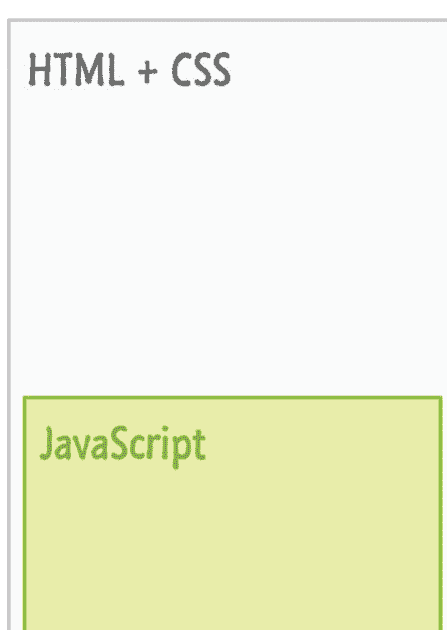

在这个世界里，保护我们的 HTML 文档免受 JavaScript 影响的只有几个 *script* 标签。现在，你的 JavaScript 不必非得放在我们的 HTML 文档里。我们还有另一种方式，这种方式涉及一个单独的文件，我们所有的 JavaScript 将存放在那里（图 10.2）。

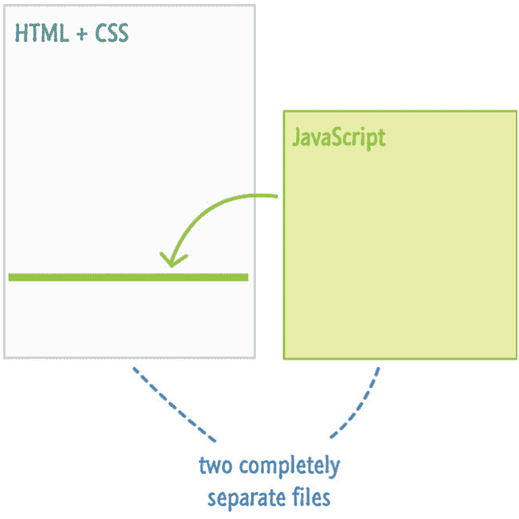

在这种方法中，我们的 HTML 文档里没有任何真正的 JavaScript。我们仍然有 *script* 标签，但这个标签**只是指向 JavaScript 文件**，而不是包含一行又一行的实际 JavaScript 代码。

需要注意的是，这些方法并非互相排斥。我们可以将两种方法混合到一个 HTML 文档中，形成一种混合方式，即同时拥有一个外部 JavaScript 文件和完全包含在文档内的 JavaScript 代码行（图 10.3）。

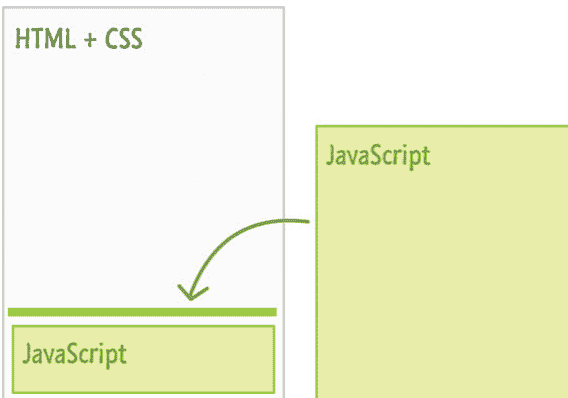

*一种混合方式，我们的 JS 内容存放在几个不同的地方。*

更有趣的是，我们还有两种方法的各种变体，例如在 HTML 文档中有多个 script 部分，有多个 JS 文件，等等。在接下来的章节中，我们将更详细地研究这两种方法，并讨论何时会选择使用一种方法而不是另一种。

最终，你将很好地理解每种方法的优缺点，从而在网页和应用程序中对 JavaScript 做出正确的选择。

继续前进！

## 方法 #1：所有代码都存放在你的 HTML 文档中

我们将要研究的第一种方法是我们迄今为止一直在使用的方法。这种方法是将我们所有的 JavaScript 都放在一个 `script` 标签内，与 HTML 文档的其余部分一起：

```html
<!DOCTYPE html>

<html>

<body>
<h1>示例</h1>

<script>
    function showDistance(speed, time) {
        alert(speed * time);
    }

    showDistance(10, 5);
    showDistance(85, 1.5);
    showDistance(12, 9);
    showDistance(42, 21);
</script>
</body>

</html>
```

当我们的浏览器加载页面时，它会从上到下解析 HTML 的每一行。当遇到 `script` 标签时，它将继续执行所有 JavaScript 代码行。一旦执行完我们的代码，它将继续解析文档的其余部分。这意味着 script 标签在页面中的位置很重要。我们将在讨论在适当时间运行代码的章节中稍后讨论这一点。

## 方法 #2：代码存放在单独的文件中

第二种方法是，我们的主 HTML 文档不包含任何 JavaScript 内容。相反，我们所有的 JavaScript 都存放在一个单独的文档中。这种方法有两个部分。第一部分涉及 JavaScript 文件。第二部分涉及在 HTML 中引用这个 JavaScript 文件。让我们更详细地看看这两个部分。

### JavaScript 文件

使这种方法生效的关键是包含我们 JavaScript 代码的单独文件。这个文件的名称不重要，但它的扩展名通常是 **.js**。例如，我的 JavaScript 文件叫做 **example.js**。

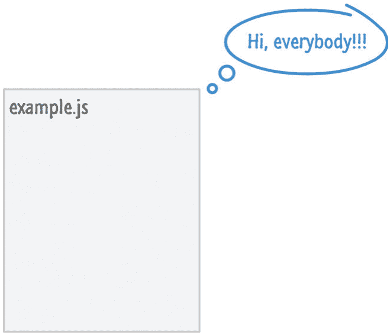

在这个文件中，你只会看到 JavaScript：

```javascript
function showDistance(speed, time) {
  alert(speed * time);
}

showDistance(10, 5);
showDistance(85, 1.5);
showDistance(12, 9);
showDistance(42, 21);
```

我们通常放在 HTML 中 `script` 标签内的所有内容都会放在这里。其他任何东西都不会放进这个文件。放入任何其他内容，比如任意的 HTML 和 CSS 片段是不允许的，我们的浏览器会报错。

### 引用 JavaScript 文件

一旦我们创建了 JavaScript 文件，第二步（也是最后一步）是在 HTML 页面中引用它。这由我们的 `script` 标签处理。更具体地说，

112 JavaScript 绝对初学者指南

由我们 `script` 标签的 `src` 属性处理，该属性指向我们的 JavaScript 文件的位置：

```html
<!DOCTYPE html>
<html>

<body>
  <h1>示例</h1>

  <script src="example.js"></script>
</body>

</html>
```

在这个例子中，如果我们的 JavaScript 文件与 HTML 位于同一目录中，我们可以使用相对路径，直接引用文件名。如果我们的 JavaScript 文件位于另一个文件夹中，我们将相应地修改路径：

```html
<!DOCTYPE html>
<html>

<body>
  <h1>示例</h1>

  <script src="some/other/folder/example.js"></script>
</body>

</html>
```

在这种情况下，我们的脚本文件嵌套在三个名为 **some**、**other** 和 **folder** 的文件夹内。我们也可以完全避免相对路径，使用绝对路径：

```html
<!DOCTYPE html>
<html>

<body>
  <h1>示例</h1>

  <script src="https://www.kirupa.com/js/example.js"></script>
</body>

</html>
```

相对路径和绝对路径都可以很好地工作。对于我们的 HTML 页面和我们引用的脚本之间的路径会变化的情况（例如在模板、服务器端包含、第三方库等内部），使用绝对路径会更安全。

## 脚本、解析和在文档中的位置

在几节之前，我简要描述了脚本是如何被执行的。你的浏览器从顶部开始解析你的 HTML 页面，然后逐行向下移动。当遇到 `script` 标签时，你的浏览器开始执行包含在 script 标签内的代码。这种执行也是逐行从顶部开始进行的。在执行过程中，你的页面可能正在进行的所有其他活动都要退居二线。如果 `script` 标签引用了一个外部 JavaScript 文件，你的浏览器会先下载外部文件，然后才开始执行其内容。

你的浏览器线性解析文档的这种行为有一些有趣的副作用，影响了你在文档中放置 `script` 标签的位置。从技术上讲，你的 `script` 标签可以放在 HTML 文档中的任何位置。不过，有一个首选位置应该指定你的脚本。由于浏览器解析页面的方式以及在脚本执行时会阻塞一切，**你应该将 script 标签放在 HTML 文档的底部，在所有 HTML 元素之后。**

如果你的 `script` 标签位于文档顶部附近，浏览器在脚本运行时会阻塞所有其他内容。如果你下载一个大的脚本文件或执行一个需要很长时间才能完成的脚本，这可能会导致用户看到部分加载且无响应的 HTML 页面。除非你确实有充分的理由需要在完全解析文档之前运行 JavaScript，否则请确保你的 `script` 标签出现在文档末尾附近，如前面几乎所有示例所示。将脚本放在页面底部还有另一个好处，但我会在讨论 DOM 和页面加载期间发生的事情时详细解释。


## 那么……该使用哪种方式？

关于代码应该放在哪里，我们有两种主要方式（图 10.4）。

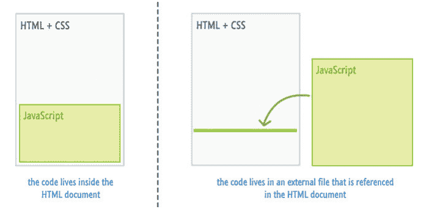

你最终选择哪种方式，取决于你对以下问题的回答：**相同的代码是否需要在多个 HTML 文档中使用？**

### 是的，我的代码需要在多个文档中使用！

如果答案是**是**，那么你可能需要将代码放入一个外部文件中，然后在所有需要执行该代码的 HTML 页面中引用它。你这样做的第一个原因是避免代码在多个页面中重复出现（图 10.5）。

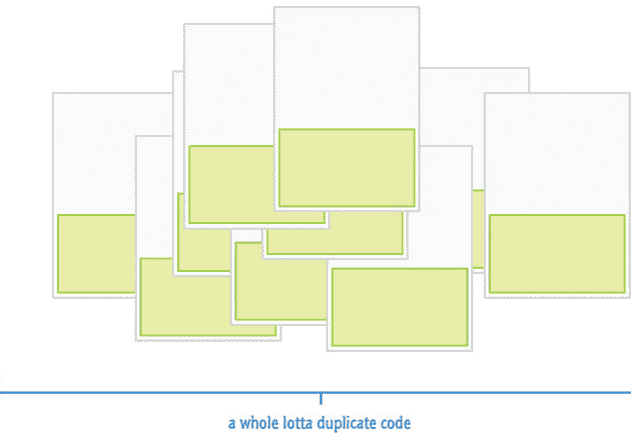

重复代码会使维护成为噩梦，因为你对脚本的修改需要你在每一个 HTML 文档中进行完全相同的更新。如果你使用某种模板或 SSI 逻辑，其中只有一段包含你脚本的 HTML 片段，那么维护问题就没那么严重了。

第二个原因与文件大小有关。当你的脚本在许多 HTML 页面中重复时，每次用户加载其中一个页面，他们都会重新下载你的脚本。对于较小的脚本来说这问题不大，但一旦代码超过几百行，大小就会不断累积。

当你将所有代码整合到一个文件中时，你就不会有上面提到的那些问题（图 10.6）。

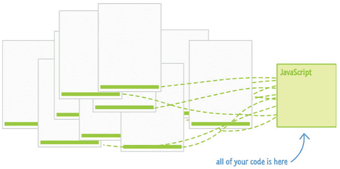

你的代码很容易维护，因为你只需要在一个文件中更新代码。任何引用了此 JavaScript 文件的 HTML 文档，在加载时都会自动获取最新版本。通过将所有代码放在一个文件中，你的浏览器只会下载一次代码，并且**在后续访问时提供缓存版本的文件**。

### 不，我的代码只在单个 HTML 文档中使用一次！

如果你之前关于代码是否会在多个 HTML 文档中使用的问题回答了**否**，那么你可以随心所欲。你仍然可以选择将代码放入一个单独的文件中并在 HTML 文档中引用它，但这样做的好处不如你之前看到的涉及多个文档的示例那么多。

将代码完全放在 HTML 文档内部对于这种情况也是可以的。你在这个网站上看到的大多数示例都将所有代码放在 HTML 文档本身中。我们的示例实际上不会在多个页面上使用，而且代码量也不会大到需要将所有代码放在单独的位置才能提高可读性。

## 最低限度

如你所见，即使是像确定代码应该放在哪里这样看似简单的事情，最终也需要大量的篇幅来解释和讨论。欢迎来到 HTML 和 JavaScript 的世界，在这里没有什么是绝对非黑即白的。回到本文的重点，一个典型的 HTML 文档会包含许多从外部位置加载的脚本文件。其中一些文件是你自己的；而另一些则是由第三方创建并包含在你的文档中的。

另外，你还记得我在最开始展示的混合方式吗？即你的 HTML 文档既包含对单独 JavaScript 文件的引用，又包含文档内的实际代码？嗯，这种方式也很常见。最终，你使用哪种方式完全取决于你自己。希望本章让你体验到了做出正确选择所需的信息。在第 36 章"页面加载事件及其他内容"中，我们将通过研究页面加载相关事件和某些使事情变得复杂的特殊属性，更深入地了解你在本章所看到的内容。现在不用担心它们。

如果你有任何问题，请随时在 https://forum.kirupa.com 的论坛上发布。我和其他人将非常乐意帮助你！


此页面有意留白

## 本章内容

- 学习如何超越 alert 来显示结果
- 理解控制台的工作原理
- 了解你触手可及的各种日志记录解决方案


## 控制台日志基础

当你编写代码时，你经常会发现自己处于以下两种情况之一。一种情况是你想知道你刚刚编写的代码是否根本不会运行。另一种情况是你知道代码会运行，但它运行得不正确。某个地方出了问题……**在某个地方**。

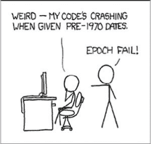

在这两种情况下，你需要的是对代码运行情况的额外可见性。一种经典的方法是使用 `alert` 方法来实现这种可见性：

```javascript
let myButton = document.querySelector("#myButton");
myButton.addEventListener("click", doSomething, false);

function doSomething(e) {
  alert("Is this working?");
}
```

使用 `alert` 方法并没有什么不好。它对于简单的情况运行良好，但随着你的代码开始做更多事情，依赖它们就不再那么有效了。首先，你可能会因为在代码运行时不断弹出大量对话框而疯狂！你还希望能够有一种简单的方式来持久化你看到的消息。`alert` 对话框转瞬即逝的特性使得任何形式的长期日志记录都变得困难。

在本教程中，我们将学习一项有史以来最伟大的发明之一，它可以帮助我们轻松了解代码的运行情况。我们将学习一种被称为**控制台**的东西。

继续吧！

## 认识控制台

即使你认为自己编写了最完美的 JavaScript，你也会花大量时间在所谓的**控制台**中。如果你以前从未使用过控制台，它是浏览器开发者工具的一部分，各种文本和内容都会被打印出来供你查看，并（偶尔）与之交互。

它看起来会有点像图 11.1 所示的样子

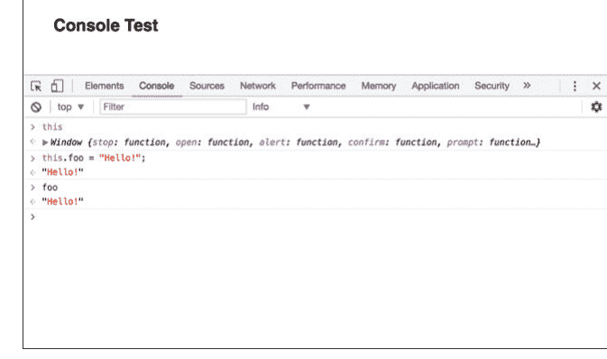

在非常高的层面上，你的控制台可以帮你处理一堆事情：

- 你可以阅读你告诉代码记录和显示的消息
- 你可以通过设置（或覆盖）变量和值来修改你的应用程序状态
- 你可以检查任何 DOM 元素、已应用的样式或可访问且在作用域内的代码的值
- 你可以把它当作一个虚拟代码编辑器，编写/执行一些代码来玩玩

在本文中，我们不会关注控制台能做的所有事情。相反，我们会轻松地逐步让你习惯使用控制台来显示消息。我们最终会涵盖所有疯狂的控制台相关功能，所以不用担心。

### 显示控制台

我们要做的第一件事是打开你的控制台。控制台是浏览器开发者工具的一部分。打开浏览器开发者工具的方式是通过浏览器的菜单或使用便捷的键盘快捷键。在浏览器中，在 Windows 上按 `Ctrl + Shift + I` 或在 Mac 上按 `Cmd + Alt + I` 来打开开发者工具。

根据你的浏览器和平台，你的开发者工具看起来会略有不同。重要的是找到 Console（控制台）选项卡并确保控制台显示出来。

当你在 Chrome 中打开控制台时，你会看到类似图 11.2 的内容。

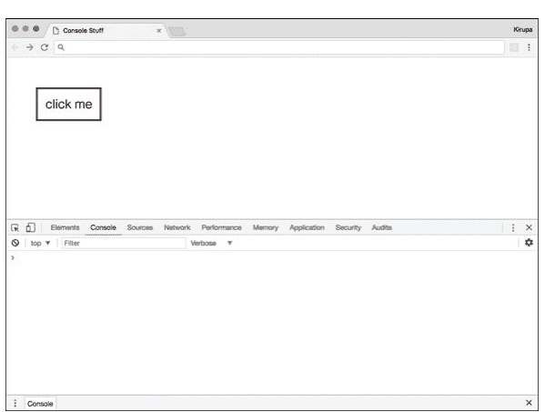

在 Safari 上，控制台看起来会有点像图 11.3。

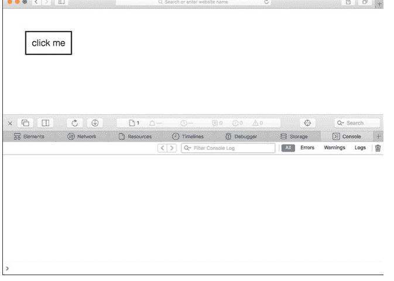

Firefox 的控制台看起来如图 11.4 所示。


**图 11.4**

*Firefox 控制台。*

在 Microsoft Edge 中调出控制台，界面将如图 11.5 所示。

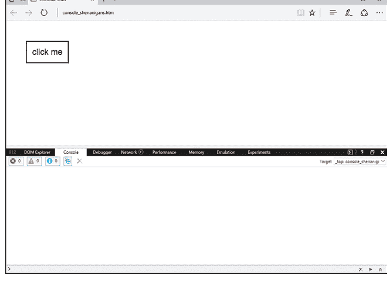

**图 11.5**

*Edge 控制台。*

我想强调的是，使用哪种浏览器并不重要。控制台在所有浏览器上的外观和功能都几乎一样。只需在你喜欢的浏览器中调出控制台，准备在接下来的章节中开始实际使用控制台即可。

## 如果你想跟着做

现在，你可以只阅读下面的章节，学习一大堆与控制台相关的内容，而无需动手操作。如果你希望这样做，请跳过这一部分，直接进入下一节。

另一方面，如果你想亲手实践，亲眼看看控制台的一些小把戏，请创建一个新的 HTML 文档，并将以下 HTML、CSS 和 JavaScript 代码添加其中：

```
<!DOCTYPE html>
<html>
<head>
    <title>Console Stuff</title>
    <style>
        #container {
            padding: 50px;
        }
        #myButton {
            font-family: sans-serif;
            font-size: 24px;
            font-weight: lighter;
            background-color: #FFF;
            border: 3px #333 solid;
            padding: 15px;
        }
        #myButton:hover {
            background-color: aliceblue;
        }
    </style>
</head>

<body>
  <div id="container">
    <button id="myButton">click me</button>
  </div>
  <script>

    let myButton = document.querySelector("#myButton");
    myButton.addEventListener("click", doSomething, false);

    function doSomething(e) {
      alert("Is this working?");
    }
  </script>
</body>

</html>
```

这里我们有一个非常简单的 HTML 页面，带有一个可点击的按钮。当你点击该按钮时，将出现一个警告对话框（就是我们之前描述过的那个）。在接下来的章节中，我们将修改这个示例，以帮助演示一些与控制台相关的知识！

## 控制台日志入门

我们要做的第一件事是告诉控制台在屏幕上显示内容。这与我们之前使用 `alert` 语句所做的没什么不同，而且几乎一样简单。这一切的关键在于 **Console API**。这个 API 包含一系列属性和方法，允许你以各种方式向控制台显示内容。其中最常用也可能是最受欢迎的属性和方法之一是 `log` 方法。

## 认识 Log 方法

最基本的使用方式如下：

```
console.log("Look, ma! I'm logging stuff.")
```

通过 `console` 对象调用它，并传入你想要显示的文本。要查看实际效果，我们可以将示例中的 `alert` 替换为以下代码：

```
function doSomething(e) {
    console.log("Is this working?");
}
```

运行此代码后，在点击 **click me** 按钮后查看你的控制台。如果一切正常，你将在控制台中看到显示的 “Is this working?” 文本，如图 11.6 所示。

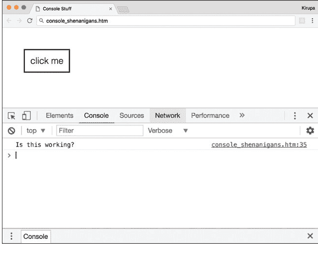

如果你持续点击该按钮，你会看到更多的 “Is this working?” 被记录下来，如图 11.7 所示。

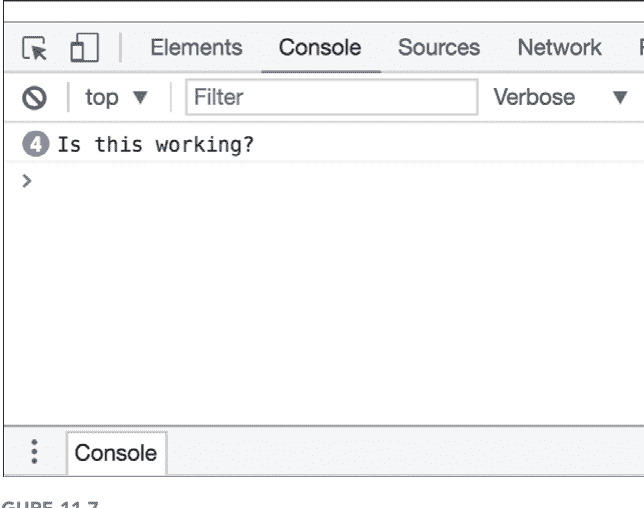

**图 11.7**

*每次点击按钮，都会在我们的控制台中得到体现。*

具体显示方式取决于你使用的开发者工具。你可能只会看到初始消息左侧的计数器在递增，如截图所示。你也可能看到文本 “Is this working?” 在每一行重复出现。如果你看到的界面与我的截图不完全一致，也不必惊慌。重要的是你的 `console.log` 调用正常工作，并将消息记录在控制台中供你查看。此外，这些消息不是只读的。你可以选择它们，复制它们，甚至可以将它们打印出来，装裱在你身后的墙上。

## 超越预定义文本

既然你已经了解了基础，让我们再深入一点。使用控制台时，你并不局限于只打印一些预定义的文本。例如，你可能会做的一件常见的事情是打印某个通过计算表达式或访问值得出的值。要理解我们的意思，请对你的 `doSomething` 函数进行如下修改：

```
function doSomething(e) {
    console.log("We clicked on: " + e.target.id);
}
```

这里我们做的是告诉控制台除了显示我们点击元素的 `id` 值之外，还要显示文本 “We clicked on”。如果你在浏览器中预览这些更改，再次点击 **click me** 按钮，并查看控制台中显示的内容，如图 11.8 所示。

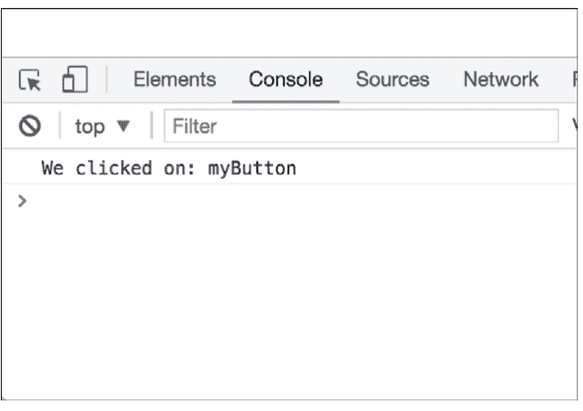

**图 11.8**

*显示了我们点击的按钮的 id！*

除了我们预定义的文本外，还显示了你点击的按钮的 `id` 值。当然，获取元素的 `id` 值可能不是你想打印的最令人兴奋的事情，但你可以打印任何以文本形式表示时看起来不错的内容。这很强大！

## 显示警告和错误

是时候超越 `log` 方法了！我们的 `console` 对象提供了 `warn` 和 `error` 方法，允许我们分别显示格式化为警告和错误的消息，如图 11.9 所示。

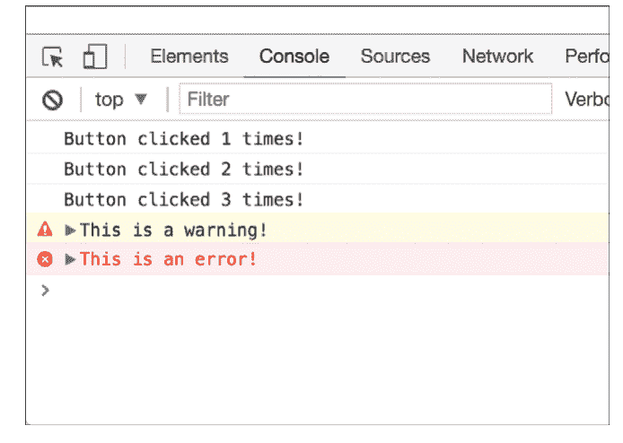

## 图 11.9

*我们可以像大佬一样显示错误和警告...！*

使用这两个方法的方式与使用 `log` 方法没什么不同。只需传入你想显示的内容即可。你可以在下面的代码片段中看到使用这些方法的示例：

```
let counter = 0;

function doSomething(e) {
  counter++;

  console.log("Button clicked " + counter + " times!");

  if (counter == 3) {
    showMore();
  }
}

function showMore() {
  console.warn("This is a warning!");
  console.error("This is an error!");
}
```

当此代码运行并且我们的按钮被点击三次后，`showMore` 函数被调用。在该函数内部，我们只有控制台警告和错误：

```
function showMore() {
  console.warn("This is a warning!");
  console.error("This is an error!");
}
```

现在，警告和错误有一些很酷的地方，这不仅仅是它们与更无聊的 `log` 对手相比在外观上的差异。你可以在控制台中展开它们，并查看代码在触发它们之前所经过的所有函数的完整堆栈跟踪，如图 11.10 所示。

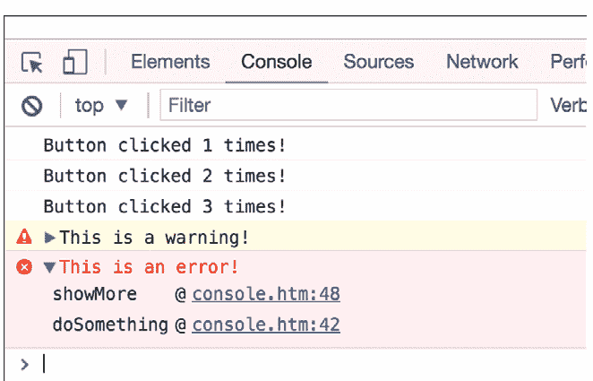

## 图 11.10

*查看我们错误的更多细节！*

对于具有大量分支的大型代码段，这非常有用。`warn` 和 `error` 方法为我们提供了一种极佳的方式，以更好地理解代码最终陷入某种状态时所经过的曲折路径！

## 最基础要点

控制台为你提供了理解代码行为的最佳工具之一。显示消息只是控制台允许你做的事情之一。在我们仅关注显示消息的狭小范围内，我们所能涵盖的内容远比目前看到的要多。我们将在后面介绍控制台的更多功能，但你在这里看到的几个 `console` 技巧将极大地帮助你查找并修复代码中的错误。

如果你有任何问题，请随时在论坛 [https://forum.kirupa.com](https://forum.kirupa.com) 上发布。我和其他人将非常乐意帮助你！


此页有意留白

## 12

- 理解所有关于**对象**的讨论是怎么回事
- 了解在 JavaScript 中会遇到的基本类型
- 发现披萨除了美味可口之外，还具有教育价值

## 关于披萨、类型、原始值和对象

是时候认真起来了。说真的！在过去的几章中，我们一直在处理各种各样的值。我们处理过字符串（文本）、数字、布尔值（又名 **true** 和 **false**）、函数，以及作为 JavaScript 语言一部分的其他各种内置内容。

以下是一些示例，以唤起我们的记忆：

```
let someText = "hello, world!";
let count = 50;
let isActive = true;
```

与其他语言不同，JavaScript 使指定和使用这些内置内容变得非常容易。我们甚至不需要提前思考或计划使用其中任何一种。尽管使用这些不同的内置内容如此简单，但其中隐藏了许多细节。了解这些细节很重要，因为它不仅能帮助我们更容易地理解代码，甚至可能帮助我们在代码无法按预期工作时更快地定位问题所在。


现在，你可能已经猜到了，**built-in-things** 并不是描述 JavaScript 中可用值种类的恰当方式。对于你可以在代码中使用的值种类，有一个更正式的名称，那就是 **types（类型）**。在本章中，你将获得一个关于它们是什么的温和介绍。

继续前进！

## 我们先来聊聊披萨

不，我没有完全疯掉。因为我总是在吃东西（或者在想吃东西），所以我将尝试通过先解释简单得多的披萨世界，来解释神秘的类型世界。

如果你已经有一段时间没吃过披萨了，这就是一块典型披萨的样子：

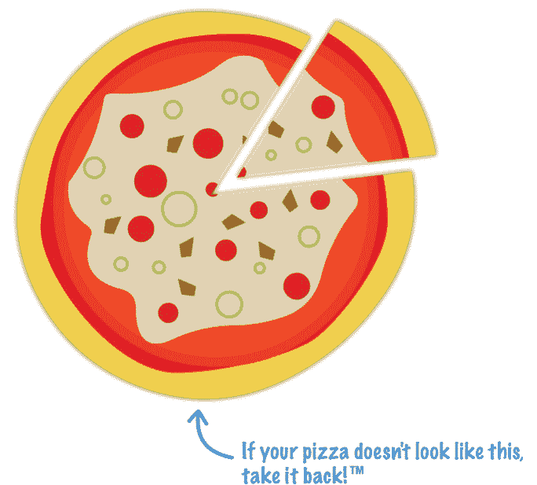

*如果你的披萨不长这样，把它退回去！*™

披萨不会神奇地就长成这样。它是由其他配料组成的——有些简单，有些不那么简单：

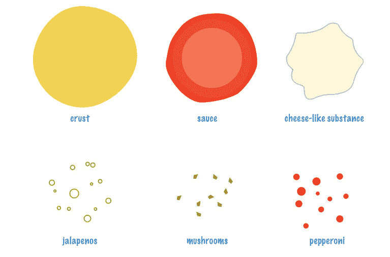

简单的配料很容易辨认。这些就是你的 **mushrooms（蘑菇）** 和 **jalapenos（墨西哥辣椒）**。这些配料之所以简单，是因为你无法再将它们进一步拆分：

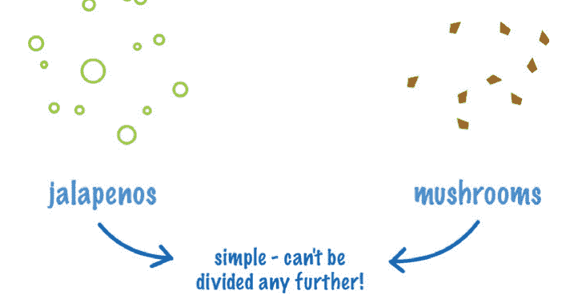

它们未经加工。它们不是由其他简单配料组成的。就像那位老兄一样，它们我行我素。

不那么简单的复杂配料则是你的 **cheese（奶酪）**、**sauce（酱料）**、**crust（饼底）** 和 **pepperoni（意大利辣香肠）**。这些之所以更复杂，原因正是简单配料之所以……嗯……简单的那些反面理由。这些复杂配料由 **其他配料** 组成：

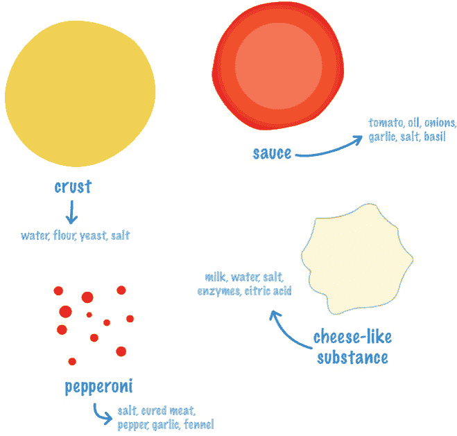

对我们所有人来说遗憾的是，世上并没有一种叫做奶酪或意大利辣香肠的简单配料。我们需要组合、加工并添加更多配料，才能制作出这里看到的一些复杂配料。关于复杂配料，有一个细微之处需要指出。它们的组成并不限于只有简单配料。复杂配料本身也可以由其他复杂配料组成。多么令人震惊？！

## 从披萨到 JavaScript！

虽然这可能令人难以置信，但我们在上一节中学到的关于披萨的一切都是有目的的。对简单和复杂配料的描述，非常贴切地适用于 JavaScript 中的类型。每种单独的配料都可以被视为你可以使用的类型的对应物（图 12.1）。

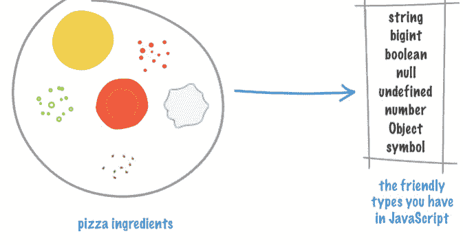

图 12.1
JavaScript 中的简单类型列表。

就像我们版本披萨中的奶酪、酱料、意大利辣香肠、蘑菇和培根一样，JavaScript 中的类型有 `string`、`number`、`boolean`、`null`、`undefined`、`bigint`、`symbol` 和 `Object`。其中一些类型你可能已经非常熟悉了，而另一些可能还不熟悉。虽然我们将在未来的章节中更详细地介绍所有这些类型，但表 12.1 提供了它们功能的简要概述。

表 12.1 类型

| 类型 | 功能 |
|---|---|
| string | 处理文本的基本结构 |
| number | 如你所料，它允许你处理数字 |
| boolean | 当你使用 `true` 和 `false` 时活跃起来 |
| null | 代表数字版的虚无……或者 `moo` :P |
| undefined | 虽然与 `null` 有些相似，但当一个值应该存在却不存在时返回……就像你声明了一个变量但没有给它赋值 |
| bigint | 允许你处理超出典型"数字"所能支持的范围的极大或极小的数字 |
| symbol | 某种独特且不可变（无法改变）的东西，你可以选择将其用作对象属性的标识符 |
| Object | 作为其他类型（包括其他对象）的容器 |

现在，虽然每种类型的功能都相当独特，但它们可以归入一个简单的分组。就像我们的披萨有简单和复杂配料一样，我们的类型也可以是简单的或复杂的。只不过，在 JavaScript 涉及类型的术语中，简单和复杂更正式的说法分别是 **primitive（原始的）** 和 **object（对象的）**。换句话说，JavaScript 中的类型被称为 **primitive types（原始类型）**（或简称 **primitives**）和 **object types（对象类型）**（或简称 **objects**）。

我们的原始类型是 `string`、`number`、`boolean`、`null`、`bigint`、`symbol` 和 `undefined` 类型。任何归入它们旗下的值都无法再进一步分割。它们是 JavaScript 世界中的墨西哥辣椒和蘑菇。原始类型很容易定义和归类到可理解的东西中。它们没有深度，当我们遇到其中一个时，我们基本上看到的就是我们得到的。

我们的对象类型，在表中用 `Object` 表示，则要神秘一些，所以在向你详细介绍所有这些类型之前，我们最后想要涵盖的是 JavaScript 中的对象实际上是什么。

## 什么是对象？

JavaScript 等编程语言中对象的概念，与现实世界中的对应物很好地对应。在现实世界中，你 literally 被对象包围。你的计算机是一个对象。书架上的书是一个对象。土豆（ arguably ）是一个对象。你的闹钟是一个对象。你在 eBay 上买的一张海报也是一个对象。我可以一直说下去，但（为了大家好）我就此打住。

有些对象，比如纸镇，做不了什么：

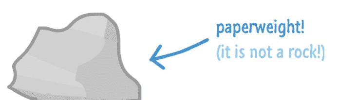

它们只是待在那里。其他对象，比如电视，则超越了单纯存在的召唤，做了很多很多事情：


一台典型的电视接收输入，允许你打开或关闭它、换台、调节音量，以及做各种电视相关的事情。

需要认识到的是，对象有不同的形状、大小和用途。尽管存在差异，但对象在高层都是相同的。它们是一种 **abstraction（抽象）**。它们提供了一种简单的方式让你使用它们，而无需担心底层发生了什么。即使是最简单的对象也隐藏着一定程度的复杂性，而你根本无需担心。

例如，你的电视内部发生了什么、电线如何连接、或者用什么类型的胶水将所有东西固定在一起，这些都无关紧要。那些是不必要的细节。你只关心电视按照吩咐行事。当你想让它换台时，频道应该改变。当你调节音量时，音量应该调整。其他一切都是噪音。

基本上，把对象想象成一个黑盒。有一些预定义/记录的功能。它是如何做到这些的，是你无法轻易看到的。它是如何施展魔法的，也是你不太关心的，只要它能工作就好。当我们学会实际创建对象的内部时，我们会改变这种观念，但现在让我们先享受这个简单而快乐的世界吧。

## JavaScript 中四处游荡的预定义对象

除了你之前看到的内置类型之外，JavaScript 中还有一些你可以开箱即用的预定义对象。这些对象允许你处理从数据集合到日期再到文本和数字的一切。表 12.2 列出了这些对象，以及和之前一样的简短说明：

表 12.2 对象

| 类型 | 功能 |
|------|-------------|
| Array | 帮助存储、检索和操作数据集合 |
| Boolean | 作为 `boolean` 原始类型的包装器；仍然非常热爱 `true` 和 `false` |
| Date | 让你更容易表示和处理日期 |
| Function | 允许你调用一些代码，以及其他玄妙的事情 |
| Math | 团队中的书呆子，帮助你更好地处理数字 |
| Number | 作为 `number` 原始类型的包装器 |
| RegExp | 提供大量在文本中匹配模式的功能 |
| String | 作为 `string` 原始类型的包装器 |

你使用这些内置对象的方式与使用原始类型略有不同。每个对象在使用方式上也有自己的特点。解释每个对象及其预期用途，我将留到后面再说，但这里有一个非常简短的带注释代码片段，向你展示什么是可能的：

```
// an array
let names = ["Jerry", "Elaine", "George", "Kramer"];
let alsoNames = new Array("Dennis", "Frank", "Dee", "Mac");

// a round number
let roundNumber = Math.round("3.14");

// today's date
let today = new Date();
```

// a boolean object
let booleanObject = new Boolean(true);

// infinity
let unquantifiablyBigNumber = Number.POSITIVE_INFINITY;

// a string object
let hello = new String("Hello!");

One thing that you may find puzzling is the existence of the Object-form of the string, boolean, symbol, bigint, and number primitives. On the surface, the Object-form and primitive-form of these types look very similar. Here is an example:

```javascript
let movie = "Pulp Fiction";
let movieObj = new String("Pulp Fiction");
```

```javascript
console.log(movie);
console.log(movieObj);
```

What you will see printed will be identical. Below the surface, though, both movie and movieObj are very different. One is literally a primitive of type string, and the other is of type Object. This leads to some interesting (and possibly incomprehensible) behavior that I will gradually touch upon as we explore the handful of built-in types that we've seen so far.

## 核心要点

如果这让你感觉像是一部电影，正看到精彩处却戛然而止，那你这么想也不无道理。本章的主要收获是：基本类型是你在代码中能够使用的最基础类型。对象则稍微复杂一些，由其他基本类型或对象组成。稍后当我们深入探讨时，你会看到更多相关内容。除此之外，我们还学习了常见内置类型的名称以及关于它们的一些基础知识。

在后续章节中，你将更深入地了解所有这些类型及其使用细节。把本章看作是一条平缓的匝道，它会突然将你带入疯狂过山车的轨道。


## 本章内容

- 使用数组来处理数据列表
- 学习如何使用数组的各种属性来完成常见任务


## 数组

想象你正在一张纸上列清单。我们把这张纸叫做**groceries**。现在，在这张纸上，你写一个从零开始的编号列表，列出所有属于这里的物品，如图 13.1 所示。

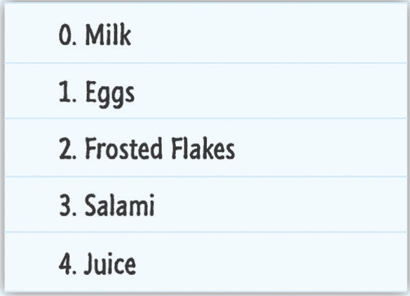

**图 13.1**

一个类似购物清单的物品列表。

仅仅通过创建一个物品列表，你现在就有了一个数组的真实世界例子！那张叫做**groceries**的纸就是你的数组。你需要购买的物品被称为数组值。

在本教程中，你将了解我喜欢去买哪些东西。你可能会间接地了解到一个非常常见的内置类型——数组。

让我们开始吧！

## 创建数组

如今所有酷小孩创建数组的流行方式是使用一对方括号。下面是我们初始化为空数组的`groceries`变量：

```javascript
let groceries = [];
```

左边是你的变量名，右边是一对括号，将变量初始化为空数组。这种用括号创建数组的方法更广为人知的名称是**数组字面量表示法**。

现在，你通常希望从一开始就创建包含一些项目的数组。要创建这些非空数组，将你想要的项目放在括号内，并用逗号分隔：

```javascript
let groceries = ["Milk", "Eggs", "Frosted Flakes", "Salami", "Juice"];
```

请注意，我的 groceries 数组现在包含**Milk**、**Eggs**、**Frosted Flakes**、**Salami**和**Juice**。我必须再次强调逗号的重要性。没有逗号，你只会得到一个巨大的项目。好了，现在你已经学会了如何声明数组，让我们看看如何使用它来存储和处理数据。

## 访问数组值

数组的一个优点是，你不仅可以轻松访问数组本身，还可以轻松访问数组中的值……类似于在购物清单上高亮某个项目（图 13.2）。

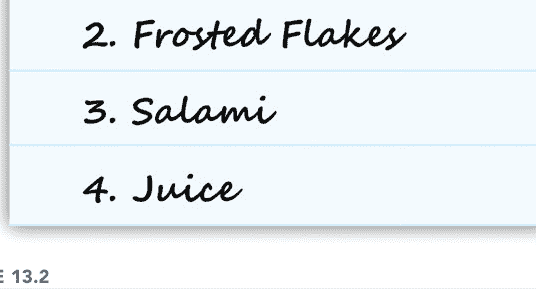

**图 13.2**

数组使你能够选择性地访问*单个项目*。

你只需要知道访问单个项目的步骤是什么。

在数组内部，每个项目都被分配一个从零开始的数字。在图 3.2 中，**Milk**被赋予值 0，**Eggs**为 1，**Frosted Flakes**为 2，依此类推。这些数字的正式术语叫做**索引值**。

假设我们的 groceries 数组声明如下：

```javascript
let groceries = ["Milk", "Eggs", "Frosted Flakes", "Salami",
"Juice"];
```

如果我想从数组中访问一个项目，我只需要传入我感兴趣项目的索引值：

```javascript
groceries[1]
```

索引值通过方括号传入数组。在这个例子中，你引用的是**Eggs**值，因为索引位置 1 指向它。如果你传入 2，则会返回**Frosted Flakes**。你可以继续传入索引值，直到没有更多值为止。

你可以用作索引值的数字范围比数组长度少一。原因是，如前面图表所示，你的索引值从 0 开始。如果你的数组只有 5 个项目，尝试显示`grocery[6]`或`grocery[5]`将会得到**undefined**的结果。

让我们更进一步。在大多数真实场景中，你会希望以编程方式遍历数组，而不是单独访问每个项目。

你可以采用我在上一段解释的方法，并使用`for`循环来实现：

```javascript
for (let i = 0; i < groceries.length; i++) {
    let item = groceries[i];
}
```

注意循环的范围从 0 开始，到数组完整长度（由`length`属性返回）的前一个值结束。这之所以有效，是因为正如我前面提到的，你的数组索引值从 0 到比数组长度返回值少一的范围内。是的，`length`属性返回的是数组中所有项目的总数！

## 向数组添加项目

你很少会让数组保持在最初初始化的状态。你会想要向其中添加项目。要向数组添加项目，你需要使用`push`方法：

```javascript
groceries.push("Cookies");
```

`push`方法直接在数组上调用，你传入想要添加的数据。通过使用`push`方法，你新添加的数据总是会出现在数组的末尾。

例如，在我们的初始数组上运行代码后，你会看到 Cookies 被添加到 groceries 数组的末尾（图 13.3）。

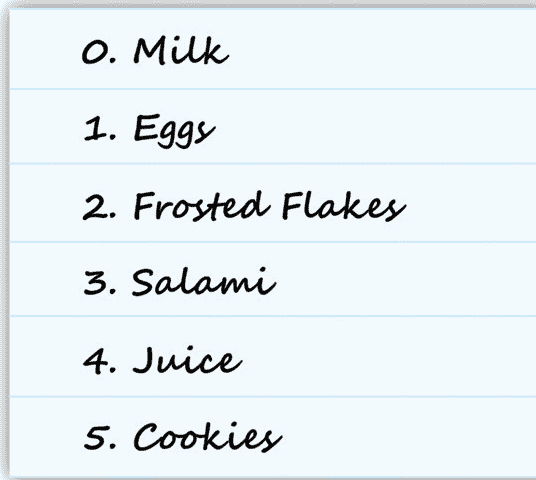

**图 13.3**

随着 Cookies 添加到末尾，我们的数组现在更大了。

如果你想在数组开头添加数据，可以使用`unshift`方法：

```javascript
groceries.unshift("Bananas");
```

当数据被添加到数组开头时，所有现有项目的索引值都会增加，以适应新插入的数据（图 13.4）。

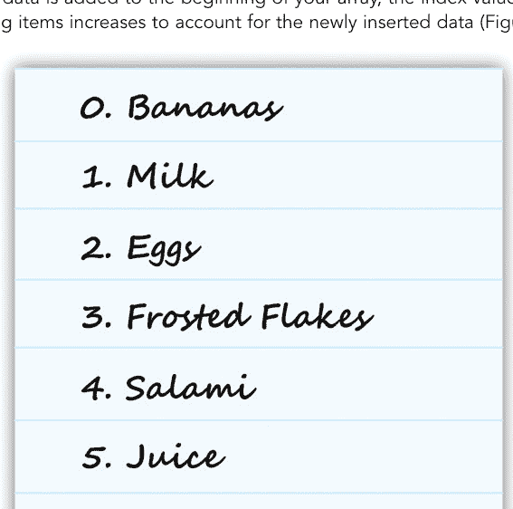

**图 13.4**

我们新添加的项目被插入到开头。

原因是数组中的第一个项目始终具有索引值 0。这意味着原本由第 0 项占据的空间需要将自己及其下方所有项目推出，为新数据腾出空间。

`push`和`unshift`方法除了在使用时将元素添加到数组中，还会返回数组的新长度：

```javascript
console.log(groceries.push("Cookies")); // returns 6
```

不确定这有什么用，但先记在心里，以防万一需要。

## 从数组中移除项目

要从数组中移除项目，可以使用 pop 或 shift 方法。pop 方法移除数组中的最后一项并返回它：

```javascript
let lastItem = groceries.pop();
```

shift 方法在数组的另一端执行相同的操作。与移除并返回最后一项不同，shift 方法移除并返回数组中的第一项：

```javascript
let firstItem = groceries.shift();
```

当从数组开头移除项目时，所有剩余元素的索引位置都会减 1，以填补空缺（图 13.5）。

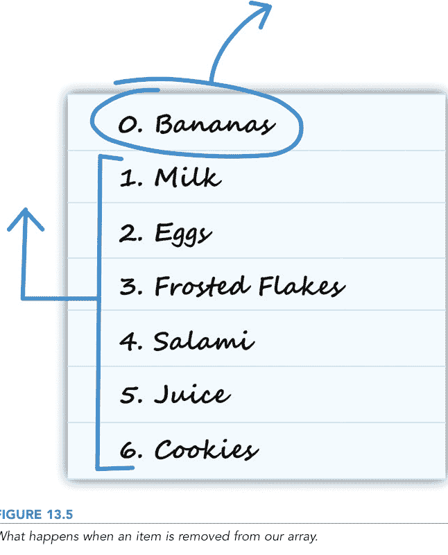


请注意，当你使用 `unshift` 或 `push` 向数组添加元素时，该方法调用返回的值是数组的**新长度**。然而，当你调用 `pop` 和 `shift` 方法时，情况则不同！当你使用 `shift` 和 `pop` 移除元素时，方法调用返回的值是**被移除的元素本身**！

## 在数组中查找元素

要查找数组中的元素，你有多种内置方法可用：`indexOf`、`lastIndexOf`、`includes`、`find`、`findIndex` 和 `filter`。为简单起见，我们目前将重点介绍 `indexOf` 和 `lastIndexOf`。这两种方法通过扫描数组并返回匹配元素的索引位置来工作。

`indexOf` 方法返回你搜索的元素**第一次出现**的位置：

```
let groceries = ["Milk", "Eggs", "Frosted Flakes", "Salami", "Juice"];
let resultIndex = groceries.indexOf("Eggs", 0);

console.log(resultIndex); // 1
```

请注意，`resultIndex` 变量存储了在 `groceries` 数组上调用 `indexOf` 的结果。要使用 `indexOf`，我传入要查找的元素以及开始搜索的索引位置：

```
groceries.indexOf("Eggs", 0);
```

在这种情况下，`indexOf` 返回的值将是 1。

`lastIndexOf` 方法的使用方式与 `indexOf` 类似，但它返回的值在找到元素时略有不同。`indexOf` 查找元素**第一次出现**的位置，而 `lastIndexOf` 查找元素**最后一次出现**的位置并返回该元素的索引位置。

当你搜索数组中不存在的元素时，`indexOf` 和 `lastIndexOf` 都会返回 -1。

## 合并数组

最后，我们来看看如何创建一个由两个独立数组组成的新数组。假设你有两个名为 `good` 和 `bad` 的数组：

```
let good = ["Mario", "Luigi", "Kirby", "Yoshi"];
let bad = ["Bowser", "Koopa Troopa", "Goomba"];
```

要将这两个数组合并为一个数组，请在你想变大的数组上使用 `concat` 方法，并将你想合并进去的数组作为参数传入。返回的将是一个新数组，其内容包含了 `good` 和 `bad` 的所有元素：

```
let goodAndBad = good.concat(bad);
console.log(goodAndBad);
```

在这个例子中，因为 `concat` 方法返回一个新数组，所以 `goodAndBad` 变量最终成为一个存储了我们合并操作结果的数组。`goodAndBad` 内部元素的顺序是 `good` 的元素在前，`bad` 的元素在后。

## 映射、过滤和归约数组

到目前为止，我们已经了解了几种添加元素、移除元素以及其他基本簿记任务的方法。数组提供的另一个强大功能是让你能够非常简单地操作其中包含的数据。这些简单的方法通过 `map`、`reduce` 和 `filter` 方法提供给你。

### 传统方式

在我们讨论 `map`、`reduce` 和 `filter` 以及它们如何让访问和操作数组中的数据变得轻而易举之前，让我们先看看那种不那么轻松的方式。这种方法通常涉及一个 `for` 循环，跟踪你在数组中的位置，并且会让你流下不少“眼泪”（指过程繁琐）。

为了实际演示，假设我们有一个名字数组：

```
let names = ["marge", "homer", "bart", "lisa", "maggie"];
```

这个恰如其名的 `names` 数组包含一个当前全为小写的名字列表。我们想要做的是将每个单词的首字母大写，使这些名字看起来更规范。使用 `for` 循环的方式可以这样做：

```
let names = ["marge", "homer", "bart", "lisa", "maggie"];

let newNames = [];

for (let i = 0; i < names.length; i++) {
  let name = names[i];
  let firstLetter = name.charAt(0).toUpperCase();
  newNames.push(firstLetter + name.slice(1));
}

console.log(newNames);
```

请注意，我们遍历每一项，将首字母大写，然后将正确大写的名字添加到一个名为 `newNames` 的新数组中。这里并没有什么神奇或复杂的地方，但你经常会发现自己需要处理数组中的元素，为了某种目的操作（或访问）这些元素，然后返回一个包含操作后数据的新数组。这是一个非常常见的任务，伴随着大量你会不断复制粘贴的模板代码。在大型代码库中，弄清楚循环中发生了什么会带来不必要的开销。这就是为什么引入了 `map`、`filter` 和 `reduce`。你可以获得使用 `for` 循环的所有灵活性，而没有不需要的副作用和额外的代码。谁不想要这个呢？！

### 使用 Map 修改每个数组元素

我们将要研究的第一个用于操作数组数据的方法是 `map`。我们将使用 `map` 方法获取数组中的所有元素，并将它们修改成其他内容，从而创建一个全新的数组（图 13.6）。

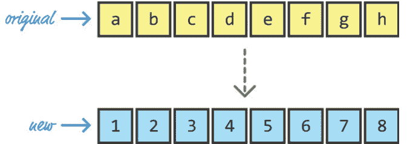

**图 13.6**

我们的原始数组和新数组！

它的使用方式如下：

```
let newArray = originalArray.map(someFunction);
```

这一行代码看起来简洁友好，但它隐藏了很多复杂性。让我们揭开它的神秘面纱。`map` 的工作原理如下：你在希望影响的数组（`originalArray`）上调用它，并传入一个函数（`someFunction`）作为参数。这个函数将运行在数组的每个元素上——允许你编写代码来按需修改每个元素。最终结果是一个新数组，其内容是 `someFunction` 运行并可能修改了原始数组中每个元素后的结果。听起来很简单，对吧？

使用 `map`，让我们重新审视之前的问题：从数组中取出小写的名字并正确地将它们大写。我们将首先查看完整的代码，然后关注有趣的细节。完整代码如下：

```
let names = ["marge", "homer", "bart", "lisa", "maggie"];

function capitalizeItUp(item) {
  let firstLetter = item.charAt(0).toUpperCase();
  return firstLetter + item.slice(1);
}

let newNames = names.map(capitalizeItUp);
console.log(newNames);
```

花点时间看看这段代码是如何工作的。有趣的部分是传递给 `map` 方法的 `capitalizeItUp` 函数。这个函数运行在每个元素上，并且注意，当前正在处理的数组元素会作为参数传递给这个函数。你可以通过你喜欢的任何名字来引用这个当前元素参数。我们使用了无聊的名字 `item` 来引用这个参数：

```
function capitalizeItUp(item) {
  let firstLetter = item.charAt(0).toUpperCase();
  return firstLetter + item.slice(1);
}
```

在这个函数内部，我们可以编写任何我们想要的代码来操作当前的数组元素。我们唯一需要做的就是返回新的数组元素值：

```
function capitalizeItUp(item) {
  let firstLetter = item.charAt(0).toUpperCase();
  return firstLetter + item.slice(1);
}
```

就是这样。所有这些代码运行后，`map` 返回一个新数组，其中所有大写的元素都位于正确的位置。原始数组永远不会被修改，所以请记住这一点。

### 提示：认识回调函数

我们的 `capitalizeItUp` 函数还有另一个更通用的名称。这个名字是**回调函数**。一个回调函数做两件事：

- 它被作为参数传递给另一个函数
- 它在另一个函数内部被调用

你会经常看到回调函数被引用……比如我们稍后查看 `filter` 和 `reduce` 时。如果这是你第一次听说它们，那么你现在对它们是什么有了更好的了解。如果你之前听说过，那么……很好！

### 过滤元素

对于数组，你经常会发现自己需要根据给定的标准来过滤（即移除）元素（图 13.7）。

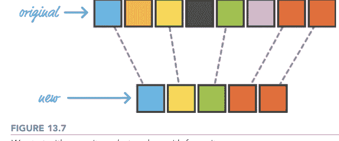

例如，假设我们有一个数字数组：

```
let numbers = [1, 2, 3, 4, 5, 6, 7, 8, 9, 10, 11, 12];
```

现在，我们的 `numbers` 数组既有偶数也有奇数。假设我们想忽略所有奇数，只看偶数。我们可以通过使用数组的 `filter` 方法来实现这一点，过滤掉所有奇数，只留下偶数。

我们使用 `filter` 方法的方式与使用 `map` 类似。它接受一个参数，一个回调函数，这个函数将决定数组中的每个元素是否应该被保留。


数组项是否会被过滤掉。当我们查看一些代码时，这会变得更清楚。看一下下面的代码：

```
let numbers = [1, 2, 3, 4, 5, 6, 7, 8, 9, 10, 11, 12];

let evenNumbers = numbers.filter(function (item) {
  return (item % 2 == 0);
});

console.log(evenNumbers);
```

我们创建了一个名为`evenNumbers`的新数组，它将存储`filter`在`numbers`数组上运行的结果。由于我们的回调函数检查每个项目，查看`item % 2`（即检查除以2的余数）的结果是否为0，因此该数组的内容将仅为偶数。如果回调函数返回**true**，则该项会被保留到过滤后的数组中。如果回调函数返回**false**，则该项会被忽略。

这里需要注意的一点是，我们的回调函数不像我们之前看到的`capitalizeItUp`函数那样是一个显式命名的函数。它只是一个匿名函数，但仍然能完成任务。你会经常看到这种匿名形式，当需要指定回调函数时，所以请熟悉这种定义函数的风格。

## 从项目数组中获取一个值

我们将要研究的最后一个数组方法是`reduce`。这是一个比较奇特的方法。对于`map`和`filter`，我们都是从一个具有起始值集合的数组，转换到另一个具有不同值集合的数组。使用`reduce`方法，我们仍然从一个数组开始。我们最终得到的将是一个单一的值（图13.8）。

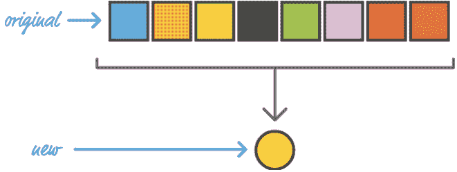

**图13.8**

从多个到……一个！

这绝对是我们需要一个例子来解释发生了什么的情况之一。

让我们重用之前的`numbers`数组：

```
let numbers = [1, 2, 3, 4, 5, 6, 7, 8, 9, 10, 11, 12];
```

我们想做的是将这里的所有值相加。这正是`reduce`方法被构建出来要处理的那种情况，我们将数组中的所有值“归约”为一个单独的项。看一下下面的代码：

```
let total = numbers.reduce(function(total, current) {
    return total + current;
}, 0);

console.log(total);
```

我们在`numbers`数组上调用`reduce`，并向其传递两个参数：

- 回调函数
- 初始值

我们从初始值0开始求和，我们的回调函数负责将数组中的每个项目相加。与之前回调函数仅接收当前数组项作为参数不同，`reduce`的回调函数稍微复杂一些。你需要处理**两个**参数：

- 第一个参数包含到目前为止所有操作的总和值
- 第二个参数是熟悉的当前数组项

使用这两个参数，你可以轻松构建各种涉及跟踪某些内容的场景。在我们的示例中，由于我们想要的只是数组中所有项的总和，所以我们正在将`total`与`current`的值相加。最终结果将是**31**。

## 关于回调函数参数的更多信息

对于我们的回调函数，我们只为`map`和`filter`指定了一个代表当前数组项的参数。对于`reduce`，我们指定了两个参数，分别代表总和值以及当前项。我们的回调函数还有两个可选参数可以指定：

- 当前数组项的当前索引位置
- 你正在调用`map`、`filter`或`reduce`的数组

对于`map`和`filter`，这些是你指定的第二个和第三个参数。对于`reduce`，则是第三个和第四个参数。你可能终其一生都不必指定这些可选参数，但如果你遇到需要它们的情况，你现在知道在哪里可以找到它们了。

我们差不多讲完了。让我们看一个例子，它展示了`reduce`的输出结果可以是一个非数字的值。看一下下面的代码：

```
let words = ["Where", "do", "you", "want", "to", "go", "today?"];

let phrase = words.reduce(function (total, current, index) {
  if (index == 0) {
    return current;
  } else {
    return total + " " + current;
  }
}, "");

console.log(phrase);
```

在这个例子中，我们正在组合`words`数组的基于文本的内容，以创建一个最终显示为**Where do you want to go today?**的单一值。注意我们的回调函数中发生了什么。除了完成将每个项组合成单个单词的工作外，我们还指定了可选的第三个参数，它代表当前项的索引位置。我们使用这个索引值来特殊处理第一个单词，以决定是否在开头插入空格字符。

## 简要涉足函数式编程

正如最后几节所强调的，`map`、`filter`和`reduce`方法极大地简化了我们处理数组的方式。这三样方法触及了另一个巨大的主题。那个东西被称为**函数式编程**。函数式编程是一种编写代码的方式，你使用这样的函数：

- 可以在其他函数内部工作
- 避免共享或改变状态
- 对于相同的输入返回相同的输出

这里我们可以列出更多细节，但这已经是个不错的开始了。无论如何，你可以看到函数式编程原则如何应用于我们到目前为止使用的各种回调函数。我们的回调函数完美地符合这三个标准，因为它们是可以被放入或取出任何情况的函数，只要参数仍然有效。它们绝对不修改任何状态，并且完全在`map`、`filter`或`reduce`方法内部工作。函数式编程是一个有趣的话题，需要比我们刚才几句所能涵盖的更多内容，所以我们现在就到此为止，将来会更详细地介绍它。

## 最基础的内容

关于数组，几乎所有需要知道的内容都涵盖了……好吧，至少是你最常使用的那些。你至少已经学会了如何用它们来创建一个购物清单！

一些额外的资源和示例：

- **打乱数组顺序**：http://bit.ly/kirupaArrayShuffle
- **从数组中随机选取一项**：http://bit.ly/kirupaRandomItemArray
- **从数组中移除重复项**：http://bit.ly/kirupaRemoveDuplicates
- **哈希表与数组**：http://bit.ly/kirupaHvA


## 本章内容

- 理解JavaScript如何处理文本
- 学习如何执行常见的字符串操作
- 了解各种字符串属性

## 14


## 字符串

我有一个直觉，你是一个人类。作为人类，你可能对文字非常熟悉。你说它，写它，你也倾向于在编程中大量使用它。事实证明，JavaScript也非常喜欢文字。构成你（和我）语言的字母和看起来有趣的符号有一个正式的名称。它们被称为**字符串**。JavaScript中的字符串只不过是一系列字符。尽管这听起来很无聊，但访问和操作这些字符是我们必须熟悉的技能。这就是本教程的由来。

继续前进！

## 基础知识

我们使用字符串的方式就是在代码中直接使用它们。我们只需要确保将它们用单引号或双引号括起来。下面是一些例子：

```
let text = "this is some text";
let moreText = 'I am in single quotes!';

console.log("this is some more text");
```

除了直接列出字符串，我们还经常将几个字符串组合在一起。我们可以轻松地使用`+`运算符来做到这一点：

```
let initial = "hello";
console.log(initial + " world!");

console.log("I can also " + "do this!");
```

在所有这些例子中，我们都能够看到字符串。我指出如此明显事情的唯一原因是，当我们能够如此直观地看到字符串的内容时，这些字符串更准确地被称为**字符串字面量**。这并不改变这样一个事实：最终的结构仍然是一个称为**字符串**的内置原始类型（你知道……就是上一章提到的那个简单的披萨原料）。

如果我们必须将`text`和`moreText`字符串可视化，它们看起来会像图14.1。


**图14.1**

*字符串的可视化。*

我们只是让两个变量指向一些文本块。没有其他事情发生。如果你想知道为什么我浪费空间来可视化这么明显的东西，那么当我们进入对象领域时，可视化将变得更加复杂。你将在本章本身看到这方面的暗示。


Anyway, all of this isn't particularly important...yet. The only important thing to keep in mind is that you need to wrap your string literals in either quotation marks (") or apostrophes (') to designate them as a region of text. If you don't do that, bad things happen, and your code probably won't run.

That's all there is to the basics. The fun stuff comes from using all of the functionality JavaScript provides for working with strings. We'll look at that and more in the following sections.

## 字符串的属性和方法

当我们处理字符串时，底层的 `String` 对象实现包含了许多属性，这些属性使文本处理（通常）变得更加容易。在接下来的章节中，我不会逐一介绍每个属性以免让我们双方都感到无聊致死，而是只关注在你实际工作中最重要的那些。

## 访问单个字符

虽然字符串看起来是一个统一的整体，但实际上它是由一系列字符组成的。我们可以通过几种方式访问每个字符。最常见的方式是使用数组/方括号表示法，并传入一个与字符索引位置相对应的数字：

```
let vowels = "aeiou";
console.log(vowels[2]);
```

在这个例子中，我们会看到 **i** 字符，因为它是第二个索引位置上的项。为了更好地理解刚才发生了什么，图 14.2 中的示意图会有所帮助。


当提到**索引**这个词时，有件事需要我们牢记。JavaScript 中的索引位置从 0 开始，并向上递增。这就是为什么我们的索引位置是 2，但该位置上元素的实际计数却是 3。随着你在 JavaScript 和其他不包含 **Visual** 和 **Basic** 这两个词的语言中工作得越多（这些语言中索引从 1 开始），这种感觉就会越不奇怪。

更进一步，我们可以通过循环遍历索引位置来访问字符串中的所有字符。循环的起点将是 0，终点则由字符串的长度决定。字符串的长度（即字符数量的计数）由 `length` 属性返回。

以下是前一段内容在实际中的示例：

```
let vowels = "aeiou";

for (let i = 0; i < vowels.length; i++) {
  console.log(vowels[i]);
}
```

虽然我们不总是需要遍历字符串，但使用 length 属性来获取字符串中字符数量是非常常见的。

如果我们不喜欢数组/方括号表示法，还可以使用 `charAt` 方法，该方法返回指定索引位置上的字符：

```
let vowels = "aeiou";
console.log(vowels.charAt(2));
```

最终结果与我们使用数组表示法时看到的相同。除非你真的在乎像 Internet Explorer 7 这样的古老浏览器，否则我不会使用这个方法。是啊，我也觉得你不会。

## 等等……什么？

如果你想知道字符串原始值究竟从哪里获得了访问只有 `String` 对象才有的属性的能力，请暂时搁置你的好奇心，等到下一章我们会更详细地探讨这个问题。

## 拼接（即连接）字符串

要将两个字符串合并在一起，我们可以直接使用 + 或 += 运算符，就像你对一系列数字进行加法运算一样：

```
let stringA = "I am a simple string.";
let stringB = "I am a simple string, too!";
```

```
console.log(stringA + " " + stringB);
```

注意，在第三行中，我们将 stringA 和 stringB 相加。在它们之间，我们指定了一个空白字符（" "），以确保每个独立字符串之间有一个空格。你可以混合使用字符串字面量、字符串原始值和字符串对象，仍然可以将你的文本全部组合在一起。

例如，以下这些都是有效的：

```
let textA = "Please";
let textB = new String("stop!");
let combined = textA + " make it " + textB;
```

```
console.log(combined);
```

尽管混合了各种类型，但 combined 变量的类型仍然只是字符串原始值。

对于字符串拼接，我们还有 concat 方法。我们可以从任意字符串调用此方法，并指定一系列字符串原始值、字面量和对象，将它们组合成一个……超级字符串：

```
let foo = "I really";
let blah = "why anybody would";
let blarg = "do this";
```

```
let result = foo.concat(" don't know", " ", blah, " ", blarg);
```

```
console.log(result);
```

在大多数情况下，只需使用 + 和 += 的方法来拼接字符串即可。它比 concat 方法更快。在其他条件相同的情况下，谁不想让自己的代码拥有更快的速度呢？

## 从字符串中提取子字符串

有时，我们感兴趣的是字符串中间某处的一连串字符。满足这一需求的有两个属性：`slice` 和 `substr`。假设我们有以下字符串：

```
let theBigString = "Pulp Fiction is an awesome movie!";
```

让我们来摆弄一下这个字符串。

### `slice` 方法！

`slice` 方法允许我们指定想要提取的字符串部分的起始和结束位置：

```
let theBigString = "Pulp Fiction is an awesome movie!";
console.log(theBigString.slice(5, 12));
```

在这个例子中，我们提取了索引位置 5 和 12 之间的字符。最终结果是单词 **Fiction** 将被返回。

起始和结束位置值不一定必须是正数。如果你为结束位置指定了一个负值，那么字符串的结束位置就是从末尾开始倒数你所指定的数值后的位置：

```
let theBigString = "Pulp Fiction is an awesome movie!";
console.log(theBigString.slice(0, -6));
```

如果我们指定一个负的起始位置，那么你的起始位置就是从字符串末尾开始倒数你所指定的数值后的位置：

```
let theBigString = "Pulp Fiction is an awesome movie!";
console.log(theBigString.slice(-14, -7));
```

我们刚刚看到了 `slice` 方法的三种使用变体。我自己从未使用过除第一种（正数起始和结束位置）以外的版本，你很可能也会是类似的情况。

### `substr` 方法！

接下来我们要看的字符串分割方法是 `substr` 方法。这个方法也接受两个参数：

```
let newString = substr(start, length);
```

第一个参数是指定起始位置的数字，第二个参数是指定子字符串长度的数字。当我们看一些示例时，这会更有意义：

```
let theBigString = "Pulp Fiction is an awesome movie!";
console.log(theBigString.substr(0, 4)); // Pulp
```

我们从第零个位置开始提取子字符串，并向上计数四个字符。这就是为什么返回 **Pulp**。如果我们只想提取单词 **Fiction**，我们的代码应该是这样的：

```
let theBigString = "Pulp Fiction is an awesome movie!";
console.log(theBigString.substr(5, 7)); // Fiction
```

如果我们不指定长度，那么返回的子字符串就是从起始位置到末尾的字符串：

```
let theBigString = "Pulp Fiction is an awesome movie!";
console.log(theBigString.substr(5)); // Fiction is an awesome movie!
```

对于 `substr`，我们还可以传入更多种变体的值，但以上这些是主要的。

## 分割字符串/split

你能拼接的东西，也能将其拆分。我很确定某位智者曾经这样说过。拆分字符串的另一种方法是使用 split 方法。在字符串上调用此方法会返回一个子字符串数组。这些子字符串由一个字符或正则表达式（即 RegEx）分隔，我们用它们来确定在哪里拆分字符串。

让我们看一个简单的例子，这样更容易理解：

```
let inspirationalQuote = "That which you can concatenate, you can also split apart.";
let splitWords = inspirationalQuote.split(" ");

console.log(splitWords.length); // 10
```


在这个例子中，我们对`inspirationalQuote`文本按空格字符进行分割。每当遇到空格字符时，其左侧的字符串部分会被移除，并成为该方法返回的数组中的一个元素。

下面是另一个例子：
```javascript
let days = "Monday,Tuesday,Wednesday,Thursday,Friday,Saturday,Sunday";
let splitWords = days.split(",");
```

```javascript
console.log(splitWords[6]); // Sunday
```

我们有`days`变量，它存储了一个仅由逗号分隔的日期字符串。如果我们想将每个日期分开，可以使用`split`方法，分隔符字符为逗号。最终结果是一个包含七个元素的数组，每个元素都是原始字符串中对应的星期几。

你会惊讶地发现自己会多么频繁地使用`split`方法来拆分字符序列——它们可以简单如一个句子，也可以复杂如从网络服务返回的数据。

## 在字符串中查找内容

如果我们需要在字符串中查找某个或多个字符，可以使用`indexOf`、`lastIndexOf`和`match`方法。让我们先看`indexOf`方法。

`indexOf`方法的作用是：将我们要玩伴的字符（串）作为参数传入。如果找到了目标内容，它会返回该内容在字符串中首次出现的索引位置；如果没有找到匹配项，这个方法会返回-1。让我们来看个例子：
```javascript
let question = "I wonder what the pigs did to make these birds so angry?";
console.log(question.indexOf("pigs")); // 18
```

我们试图查看`pigs`是否存在于我们的字符串中。由于我们要找的内容确实存在，`indexOf`方法告诉我们该单词首次出现在第18个索引位置。如果我们查找不存在的内容，比如本例中的字母`z`，则会返回-1：
```javascript
let question = "I wonder what the pigs did to make these birds so angry?";
console.log(question.indexOf("z")); // -1
```

`lastIndexOf`方法与`indexOf`非常相似。从名字你大概能猜到，`lastIndexOf`返回你要查找的内容最后一次出现的位置：
```javascript
let question = "How much wood could a woodchuck chuck if a woodchuck could chuck wood?";
console.log(question.lastIndexOf("wood")); // 65
```

对于`indexOf`和`lastIndexOf`，你还可以指定一个额外的参数。除了提供要搜索的字符外，你还可以指定字符串中的一个索引位置作为搜索起点：
```javascript
let question = "How much wood could a woodchuck chuck if a woodchuck could chuck wood?";
console.log(question.indexOf("wood", 30)); // 43
```

关于`indexOf`和`lastIndexOf`方法，最后需要提及的一点是：你可以匹配这些字符在字符串中出现的任何实例。这些函数不会区分完整单词与你查找的内容是否为更大字符集的子字符串。请务必注意这一点。

在结束之前，让我们看看`match`方法。使用`match`方法，你有更多的控制权。该方法接受一个正则表达式作为参数：
```javascript
let phrase = "There are 3 little pigs.";
let regexp = /[0-9]/;

let numbers = phrase.match(regexp);

console.log(numbers[0]); // 3
```

返回的内容是一个匹配子串的数组，因此你可以运用你的数组忍者技能来轻松处理结果。学习如何使用正则表达式是我们以后才会深入探讨的内容。

## 字符串的大小写转换

最后，让我们用简单轻松的内容来结束关于字符串的讲解，这不需要任何复杂的操作。要将字符串转为大写或小写，我们可以使用 aptly 命名的`toUpperCase`和`toLowerCase`方法。来看这个例子：
```javascript
let phrase = "My name is Bond. James Bond.";
```

```javascript
console.log(phrase.toUpperCase()); // MY NAME IS BOND. JAMES BOND.
console.log(phrase.toLowerCase()); // my name is bond. james bond.
```

看吧，我说了这很简单！

## 绝对要点

字符串是JavaScript中少数几种基本数据类型之一，你刚刚看到了关于它们的众多用途的很好概述。我避而不谈的一个问题是：你的字符串原始值似乎神秘地拥有了所有这些通常只属于对象的属性。我们将在下一章探讨这个问题！

一些额外的资源和示例：
- 去元音器：http://bit.ly/kirupaDeVowelize
- 将字符串首字母大写：http://bit.ly/kirupaCapLetter
- 反转字符串的10种方法：http://bit.ly/kirupaWaysToReverseString

如果你有任何与字符串相关的问题……或者关于生活和JavaScript的一般问题，请访问https://forum.kirupa.com获取答案。


## 本章内容

- 更深入地理解原始值和对象的工作原理
- 理解即使原始值也具有类似对象的特性
- 思考JavaScript是如何变得如此流行的


## 15

## 当原始值表现得像对象时

在之前的*字符串*章节以及较少涉及的*关于披萨、类型、原始值和对象*章节中，我们偷偷窥见了一些可能相当令人困惑的东西。我多次说过，原始值非常朴素简单。与`对象`不同，它们不包含允许你以有趣（或无聊）方式摆弄其值的属性。然而，正如我们可以通过字符串做很多事情所清楚展示的，我们的原始值似乎有着神秘的黑暗面：
```javascript
let greeting = "Hi, everybody!!!";
let shout = greeting.toUpperCase(); // toUpperCase是从哪里来的？
```

从这个简短的代码片段中我们可以看到，我们的`greeting`变量存储了一个文本形式的原始值，但它似乎可以访问`toUpperCase`方法。这怎么可能？这个方法从何而来？我们为何会在这里？这类令人困惑的存在主义问题的答案将构成你在本页看到的主要内容的主体。另外，我为前面那句使用被动语态表示歉意。不会再发生了，不会了。

继续！

## 字符串不是唯一的问题

由于它们的趣味和活泼（有点像金毛寻回犬！），我们很容易拿字符串作为这种原始值/对象混淆的主要肇事者来开涮。事实证明，许多内置的原始类型也参与了这个" racket "。表15.1显示了一些流行的内置对象类型，其中**大多数**有问题的当事方（`Symbol`和`BigInt`将缺席这次讨论）作为原始值存在，并用粗体标出：

**表 15.1** 对象类型，原始值类型以粗体标出

| 类型   | 功能说明                                                                     |
| :----- | :--------------------------------------------------------------------------- |
| Array  | 帮助存储、检索和操作数据集合                                                 |
| Boolean| 作为布尔原始值的包装器；仍然深爱着**true**和**false**                        |
| Date   | 让你更轻松地表示和处理日期                                                   |
| Function| 允许你执行代码以及其他一些深奥的操作                                        |
| Math   | 团队中的书呆子，帮助你更好地处理数字                                         |
| Number | 作为数字原始值的包装器                                                       |
| RegExp | 提供大量在文本中匹配模式的功能                                               |
| String | 作为字符串原始值的包装器                                                       |

每当我们使用布尔值、数字或字符串原始值时，我们都可以访问其对象等效类型暴露的属性。在接下来的章节中，你将看到具体发生了什么。

## 尽管如此，我们还是来刁难一下字符串吧

正如你从小到大父母教你的那样，我们通常以字面形式使用字符串：
```javascript
let primitiveText = "Homer Simpson";
```

正如我们在前面的表格中看到的，字符串也可以作为对象使用。创建新对象有多种方式，但对于字符串这类内置类型，最常见的方式是使用`new`关键字，后面跟`String`这个词：
```javascript
let name = new String("Batman");
```

这里的`String`不仅仅是普通的单词。它代表所谓的**构造函数**，其唯一目的是用于创建对象。就像创建对象有多种方式一样，创建`String`对象也有多种方式。在我看来，了解一种你**不应该**使用的方式就足够了。

无论如何，原始值形式和对象形式的字符串之间的主要区别在于，对象形式携带了大量额外的包袱。如果我们必须可视化名为`name`的`String`对象，图15.1展示了它的样子。


**图 15.1**
*深入查看我们的String对象的样子。*

我们的`name`变量包含一个指向文本**Homer Simpson**的指针。你还拥有随`String`对象而来的各种属性和方法——你可能使用过的如`indexOf`、`toUpperCase`等等。


## 为什么这很重要

让我们回到之前那个令人困惑的地方。我们的字符串是一个基本类型。基本类型怎么能够让你在它上面访问属性呢？答案与 JavaScript 的古怪行为有关。假设我们有以下字符串：

```
let game = "Dragon Age: Origins";
```

`game` 变量很明显是一个基本类型字符串，它被赋值为一段字面文本。如果我想访问这段文本的长度，我们会这样做：

```
let game = "Dragon Age: Origins";
console.log(game.length);
```

作为求值 `game.length` 的一部分，JavaScript 会将你的基本类型字符串转换为一个对象。在短暂的一瞬间，你那卑微的基本类型会变成一个漂亮的对象，以便找出实际的长度是多少。需要记住的是，所有这些都是临时的。因为这个临时对象在完成使命后并没有被锚定或绑定到任何东西上，所以它会消失，留给你的是长度求值的结果（一个数字），而 `game` 变量仍然是一个基本类型字符串。

这种转换只发生在基本类型上。如果我们显式地创建一个 String 对象，那么我们创建的内容会被永久保留为对象。假设我们有以下代码：

```
let gameObject = new String("Dragon Age: Origins");
```

在这种情况下，我们的 `gameObject` 变量很明显指向一个类型为 Object 的东西。这个变量将继续指向一个 Object 类型，除非你修改字符串或执行其他导致引用被更改的操作。基本类型变形为对象然后再变形回基本类型，这是基本类型独有的特性。你的对象不会参与这种花招。

你可以通过检查数据的类型来轻松验证我所说的这一切。这可以通过使用 `typeof` 关键字来完成。以下是我用它来确认刚才所讲内容的示例：

```
let game = "Dragon Age: Origins";
console.log("Length is: " + game.length);
let gameObject = new String("Dragon Age: Origins");
console.log(typeof game); // string
console.log(typeof game.length); // number
console.log(typeof gameObject); // object
```

现在，你是否很高兴学到了这些？

## 最精要的知识

希望这段简要的解释能帮助你理解为什么我们的基本类型在需要时会表现得像对象。此时，你可能还会有另一个疑问：为什么会有人设计一种语言来做如此古怪的事情？毕竟，如果基本类型在需要做有用的事情时会变成对象，为什么不能始终保持为对象呢？答案与内存消耗有关。

正如我们在之前关于基本类型与对象形式对比的讨论中所看到的，对象形式携带的额外负担要大得多，所有那些指向额外功能的指针都会消耗资源。JavaScript 中的解决方案是一种折中方案。所有字面值，如文本、数字和布尔值，如果它们被声明为基本类型和/或作为基本类型使用，则保持为基本类型。只有在需要时，它们才会被转换为相应的 Object 形式。为了确保我们的应用继续保持较低的内存占用，这些转换后的对象在完成使命后会很快被丢弃（即**垃圾回收**）。

有问题吗？前往 [https://forum.kirupa.com](https://forum.kirupa.com) 提问，获取一群友善且优秀的开发者的解答。

## 本章要点

- 理解数字
- 了解你将遇到的各种数值类型
- 认识 Math 对象以及你可以进行的各种数学运算

## 16

## 数字

你在 JavaScript 中的大部分时间将花在处理数字上。即使你不是直接使用数字，在执行最基本的任务时，如对某事进行计数、操作数组等，你也会间接地遇到它们。

在本章中，我将通过介绍如何使用数字来完成许多常见任务，从而引入 JavaScript 中的数字。在此过程中，我们将在基础知识之上深入一步，广泛探索一些你可能会觉得有用的与数字相关的有趣知识。

继续前进！

## 使用数字

要使用数字，你所要做的就是……嗯，使用它。以下是一个简单的示例，我声明了一个名为 `stooges` 的变量，并将其初始化为数字 3：

```
let stooges = 3;
```

就是这样。不需要绕任何弯子。如果你想使用更复杂的数字，只需像平常一样使用它们即可：

```
let pi = 3.14159;
let color = 0xFF;
let massOfEarth = 5.9742e+24;
```

在上面的示例中，我使用了十进制值、十六进制值，以及一个使用指数的非常大的值。最终，你的浏览器会自动做正确的事情。注意，"正确的事情"不仅存在于正数领域。你也可以轻松地使用负数。要使用负数，只需在你想转换为负值的数字前面加上一个减号（-）即可：

```
let temperature = -42;
```

你在本节中看到的内容构成了你实际使用数字的大部分方式。在接下来的几节中，让我们深入一点，看看你可以用数字做的其他有趣的事情。

> **小知识：JavaScript 中的数字**
> 如果你好奇为什么处理数字如此简单，原因在于 JavaScript 不太重视数值类型。你不需要像在其他语言中那样，将数字声明为 `int`、`double`、`byte`、`float` 等类型。唯一的例外是当你需要一个非常大或非常小的数字时，这时候就要用到 `BigInt`。我们将在以后……总有一天，讨论 `BigInt`。
> 哦，还有……在 JavaScript 中，所有数字都被转换为 64 位浮点数。

## 运算符

如果不展示如何在代码中使用数学运算符来实现你在一年级数学课上学到的内容，那么数字的介绍是不完整的（甚至可以说是无法开始的）。

让我们在本节中看看常用的运算符。

## 做简单的数学运算

在 JavaScript 中，你可以使用 `+`、`-`、`*`、`/` 和 `%` 运算符来创建简单的数学表达式，分别用于加、减、乘、除和求余数（取模）。如果你会使用计算器，你就可以在 JavaScript 中进行简单的数学运算。

以下是使用这些运算符的一些示例：

```
let total = 4 + 26;
let average = total / 2;
let doublePi = 2 * 3.14159;
let subtractItem = 50 - 25;
let remainder = total % 7;
let more = (1 + average * 10) / 5;
```

在上面示例的最后一行中，请注意我通过在想要作为一组求值的表达式周围使用括号来定义特定的运算顺序。再说一次，所有这些都只是计算器的东西。

JavaScript 按以下顺序求值表达式：

1. 括号
2. 指数
3. 乘法
4. 除法
5. 加法
6. 减法

有各种记忆法可以帮助你记住这个顺序。我从小学开始就用的是"Please Excuse My Dear Aunt Sally"（请原谅我亲爱的萨莉阿姨）。

## 递增和递减

你对数字做的一个常见操作是将变量递增或递减一定的量。以下是我将变量 `i` 递增 1 的示例：

```
let i = 4;
i = i + 1;
```

你不必只递增或递减 1。你可以使用任何任意数字：

```
let i = 100;
i = i - 2;
```

所有这些不一定只是加法或减法。你也可以执行其他操作：

```
let i = 100;
i = i / 2;
```

你应该开始看出这里的规律了。无论你使用什么运算符，你都会注意到你在累积地修改 `i` 变量。由于你将经常使用这种模式，所以有一些运算符可以简化这一点（表 16.1）。

### 表 16.1 简化递增和递减的运算符

| 表达式 | 作用 |
| :--- | :--- |
| `i++` | 将 i 递增 1（`i = i + 1`） |
| `i--` | 将 i 递减 1（`i = i - 1`） |
| `i += n` | 将 i 递增 n（`i = i + n`） |
| `i -= n` | 将 i 递减 n（`i = i - n`） |
| `i *= n` | 乘以 n（`i = i * n`） |
| `i /= n` | 将 i 除以 n（`i = i / n`） |
| `i %= n` | 求 i 除以 n 的余数（`i = i % n`） |
| `i **= n` | 指数运算符，其中 i 的 n 次幂 |

如果我对之前看到的三个示例使用这些运算符，代码将如下所示：

```
i++;
i -= 2;
i /= 2;
```

在我们结束之前，有一个你应该注意的特殊之处。它与 `--` 和 `++` 运算符用于将值递增或递减 1 有关。`++` 和 `--` 运算符出现在它们所递增的变量之前还是之后，这一点很重要。


让我们来看这个示例：

```
let i = 4;
let j = i++;
```

执行完这两行代码后，`i` 的值将是 5……和你预期的一样。而 `j` 的值将是 4。注意在这个示例中，运算符出现在变量之后。

如果我们把运算符放在变量前面，结果会有所不同：

```
let i = 4;
let j = ++i;
```

`i` 的值仍然是 5。关键在于……`j` 的值也将是 5。

这两个示例之间的区别在于运算符的位置。运算符的位置决定了**返回的是递增后的值还是递增前的值**。现在，你是不是很高兴学到了这个知识？

## 十六进制和八进制值

除了使用普通的十进制值外，你还可以使用十六进制（基数为 16）和八进制（基数为 8）值。使用八进制值时，请确保以数字 0 开头：

```
let leet = 0o2471;
```

对于十六进制值，你需要以 0x 开头：

```
let leet = 0x539;
```

在很多情况下，你会以字符串的形式遇到八进制和十六进制值。如果它们是字符串，你就不能像处理普通数字那样操作它们。你需要先将字符串转换为数字。

转换方法是使用 `parseInt` 函数：

```
let hexValue = parseInt('FFFFFF', 16);
let octalValue = parseInt('011', 8);
```

`parseInt` 函数接受你的十六进制或八进制值以及你要转换的基数。

## 特殊值——Infinity 和 NaN

最后，我们来看两个你将会遇到的全局属性，它们不是数值。这些值是 `Infinity` 和 `NaN`。

### Infinity

你可以使用 `Infinity` 和 `-Infinity` 值来定义无穷大或无穷小的数字：

```
let myLoveForYou = Infinity * 2;
```

你需要使用 `Infinity` 的场合通常非常少。相反，你更可能在代码执行的其他操作中看到它被返回。例如，当你除以 0 时会看到 `Infinity` 被返回。

### NaN

`NaN` 关键字代表 "Not a Number"（非数字），当你执行某些无效的数值运算时会返回该值。例如，`NaN` 会在以下情况中被返回：

```
let nope = 1920 / "blah";
```

原因是你不能将一个数字除以一个字符串。在一些实际场景中你也会看到这个值被返回，我们稍后会介绍。

### 从字符串转换为数字

有时，你需要处理隐藏在字符串中的数字。要了解更多相关内容，请阅读 **从字符串转换为数字** 教程。

## Math 对象

数字用于各种数学表达式，通常不仅限于简单的加法、减法、乘法和除法。如果只是这些，你在数学课上会轻松得多。为了帮助你更轻松地进行复杂的数值计算，你有 `Math` 对象。这个对象提供了许多实用的函数和常量，我们将非常简要地介绍其中一些功能。

## 这很无聊！

我不打算骗你。看 Math 对象提供的所有内容确实挺无聊的。除非你现在真的很想了解所有这些，否则我建议你快速浏览一下以下几个小节，需要时再回来查阅。Math 对象不会跑掉（它没有朋友），所以它会在将来等着你。

### 常量

为了避免你必须显式定义数学常量（如 pi、欧拉常数、自然对数等），Math 对象为你定义了许多常用常量（表 16.2）。

**表 16.2 常量**

| 用法 | 含义 |
| :--- | :--- |
| Math.E | 欧拉常数 |
| Math.LN2 | 2 的自然对数 |
| Math.LN10 | 10 的自然对数 |
| Math.LOG2E | 以 2 为底 E 的对数 |
| Math.LOG10E | 以 10 为底 E 的对数 |
| Math.PI | 3.14159（我就记住这些，剩下的懒得查了！） |
| Math.SQRT1_2 | 1/2 的平方根 |
| Math.SQRT2 | 2 的平方根 |

在所有这些常量中，我使用最多的是 Math.PI：

你会在各种场景中用到它，从在屏幕上绘制圆到指定三角函数表达式。事实上，我完全想不起来在 Math.PI 之外还用过其他任何常量。下面是一个根据半径计算圆周长的函数示例：

```
function getCircumference(radius) {
  return 2 * Math.PI * radius;
}

console.log(getCircumference(2));
```

你可以像使用任何命名变量一样使用 Math.PI 或其他常量。

### 数字取整

你的数字经常会包含大量不必要的精度：

```
let position = getPositionFromCursor(); // 159.3634493939
```

为了帮助你将这些数字四舍五入到合理的整数值，你有 Math.round()、Math.ceil() 和 Math.floor() 函数，它们接受一个数字作为参数（表 16.3）。

**表 16.3 取整函数**

| 函数 | 功能 |
| --- | --- |
| `Math.round()` | 返回四舍五入到最近整数的数字。如果参数大于或等于 0.5 则向上取整；如果参数小于 0.5 则保持当前整数不变。 |
| `Math.ceil()` | 返回大于或等于参数的数字 |
| `Math.floor()` | 返回小于或等于参数的数字 |

理解上表最简单的方法是看这三个函数的实际运行效果：

```
Math.floor(.5); // 0
Math.ceil(.5); // 1
Math.round(.5); // 1
```

```
Math.floor(3.14); // 3
Math.round(3.14); // 3
Math.ceil(3.14); // 4
```

```
Math.floor(5.9); // 5
Math.round(5.9); // 6
Math.ceil(5.9); // 6
```

这三个函数总是将数字取整为整数。如果你想四舍五入到特定的小数位数，请查看我的 [JavaScript 中的数字取整](javascript:void(0);) 教程的后半部分。

### 三角函数

我最喜欢的函数——`Math` 对象为你提供了几乎所有你需要的三角函数的便捷访问，如表 16.4 所示。

**表 16.4 三角函数**

| 函数 | 功能 |
|---|---|
| Math.cos() | 返回给定参数的余弦值 |
| Math.sin() | 返回给定参数的正弦值 |
| Math.tan() | 返回给定参数的正切值 |
| Math.acos() | 返回给定参数的反余弦值（这名字是不是很酷？） |
| Math.asin() | 返回给定参数的反正弦值 |
| Math.atan() | 返回给定参数的反正切值 |

要使用其中任何一个函数，只需传入一个数字作为参数：

```
Math.cos(0); // 1
Math.sin(0); // 0
Math.tan(Math.PI / 4); // 1
Math.cos(Math.PI); // 1
Math.cos(4 * Math.PI); // 1
```

这些三角函数接受弧度值作为参数。如果你的数字是角度值，请务必先将其转换为弧度。

### 幂运算和平方根

继续介绍 Math 对象的函数，你还有 Math.pow()、Math.exp() 和 Math.sqrt()，如表 16.5 所述。

**表 16.5 幂运算和平方根函数**

| 函数 | 功能 |
|---|---|
| Math.pow() | 将一个数字提升到指定的幂次 |
| Math.exp() | 将欧拉常数提升到指定的数字次幂 |
| Math.sqrt() | 返回给定参数的平方根 |

让我们看一些示例：

```
Math.pow(2, 4); // 等同于 2^4 (或 2 * 2 * 2 * 2)
Math.exp(3); // 等同于 Math.E^3
Math.sqrt(16); // 4
```

注意 Math.pow() 接受两个参数。这可能是我们看过的第一个接受两个参数的内置函数。这个小细节不知为何让人有点小兴奋。

### 获取绝对值

如果你想获取一个数字的绝对值，只需使用 Math.abs() 函数：

```
Math.abs(37); // 37
Math.abs(-6); // 6
```

关于这个就说这么多。

### 随机数

要生成一个介于 0 和略小于 1 之间的随机数，你有 Math.random() 函数。这个函数不接受任何参数，但你可以直接将它用在数学表达式中：

```
let randomNumber = Math.random() * 100;
```

每次调用 Math.random 函数时，你都会看到一个不同的返回值。要了解如何使用这个函数生成随机数的所有内容，请阅读 **JS 中的随机数** 教程。


## 绝对基础

这就是关于 JavaScript 中数字和 Math 对象这一入门章节的全部内容。如你所见，没有什么比这更简单的了。JavaScript 提供了一种非常简洁实用的方法来处理它们，而本章只是浅尝辄止地为你介绍了相关知识，以备不时之需。

以下是一些能帮助你更好地理解如何在 JavaScript 中使用数字的额外资源和示例：

-   从字符串到数字的转换：http://bit.ly/kirupaStrToNum
-   JavaScript 中的随机数：http://bit.ly/kirupaRandom
-   JavaScript 中的高级随机数：http://bit.ly/AdvRandom
-   为什么我的数字相加结果不对：http://bit.ly/kirupaFPG
-   JavaScript 中的随机颜色：http://bit.ly/kirupaRandomColors

JavaScript 中的数字是一个有趣但有时会令人困惑的主题。如果你感到困惑或陷入困境，可以在 https://forum.kirupa.com 上发帖寻求帮助以获得清晰的思路。

---

## 本章内容

-   了解数据属性和访问器属性的区别
-   了解 getter（获取器）和 setter（设置器）
-   识别何时使用访问器属性与数据属性

## GETTER 和 SETTER

我们目前为止一直在使用的属性被称为**数据属性**。这些属性是通过为其命名并赋值来定义的：

```
let foo = {
  a: "Hello",
  b: "Monday"
}
```

要读取回该值，我们只需直接访问它：

```
console.log(foo.a);
```

向该属性写入值也是我们通常预期的操作：

```
foo.a = "Manic";
```

除了设置和读取值之外，我们真的无法做更多事情。这就是数据属性的悲哀之处。那么，作为读写属性的一部分，如果我们具备以下能力会怎样：

-   保持现有的读写属性值语法不变
-   获得在幕后运行一些自定义代码的能力

这会很酷，对吧？事实证明，我们有能力做到这一切。它由另一种友好且勤勉的属性变体——**访问器属性**为你呈现！在接下来的部分中，我们将全面了解它们，并遇到本章真正的主角——神秘的 getter 和 setter。

继续前进吧！

## 两种属性的故事

表面上看，访问器属性和数据属性非常相似。使用数据属性时，你可以读取和写入属性：

```
theObj.storedValue = "Unique snowflake!"; // 写入
console.log(theObj.storedValue); // 读取
```

使用访问器属性时，你几乎可以做完全相同的事情：

```
myObj.storedValue = "Also a unique snowflake!"; // 写入
console.log(myObj.storedValue); // 读取
```

我们无法仅通过观察属性的使用方式来判断它是数据属性还是访问器属性。要区分它们，我们必须查看属性实际定义的地方。请看以下代码，其中我们在 `zorb` 对象内定义了几个属性：

```
let zorb = {
  message: "Blah",

  get greeting() {
    return this.message;
  },

  set greeting(value) {
    this.message = value;
  }
};
```

首先是 message，一个普通的数据属性：

```
let zorb = {
  message: "Blah",

  get greeting() {
    return this.message;
  },

  set greeting(value) {
    this.message = value;
  }
};
```

我们知道这是一个数据属性，因为它只是一个属性名和一个值。这里没有其他东西。现在，事情开始变得有点令人兴奋了。我们下一个属性是 `greeting`，它看起来不像我们过去见过的任何属性：

```
let zorb = {
  message: "Blah",

  get greeting() {
    return this.message;
  },

  set greeting(value) {
    this.message = value;
  }
};
```

不像我们看到的 message 那样是简单的名称和值排列，`greeting` 属性被分成了两个**函数**，前面分别带有 get 或 set 关键字：

```
let zorb = {
  message: "Blah",

  get greeting() {
    return this.message;
  },

  set greeting(value) {
    this.message = value;
  }
};
```

这些关键字-函数对通常分别被称为 **getter** 和 **setter**。它们的特别之处在于，我们并不像调用函数那样访问 `greeting`。我们像访问任何普通属性一样访问它：

```
zorb.greeting = "Hola!";
console.log(zorb.greeting);
```

真正有趣的事情发生在 getter 和 setter 层面，所以我们接下来将深入探讨它们。

## 认识 GETTER 和 SETTER

根据我们目前所知，getter 和 setter 只是行为类似属性的函数的花名。当我们尝试读取一个访问器属性（`zorb.greeting`）时，getter 函数会被调用：

```
let zorb = {
  message: "Blah",

  get greeting() {
    return this.message;
  },

  set greeting(value) {
    this.message = value;
  }
};
```

类似地，当我们为访问器属性设置新值（`zorb.greeting = "Hola!"`）时，setter 函数会被调用：

```
let zorb = {
  message: "Blah",

  get greeting() {
    return this.message;
  },

  set greeting(value) {
    this.message = value;
  }
};
```

getter 和 setter 的全部威力在于我们可以在读取或写入属性时执行的代码。**因为底层处理的是函数，所以我们可以运行任何想要的代码**。在我们的 `zorb` 示例中，我们使用 `greeting` getter 和 setter 来紧密模仿数据属性的行为。我们可以设置一个值，也可以读回刚刚设置的值。很无聊，对吧？事情不必非得如此，接下来的示例将把我们 getter 和 setter 的有趣程度提升好几个档次。

## 喊话生成器

这里有一个示例，无论我们指定什么消息，都会被转换为全大写：

```
var shout = {
  _message: "HELLO!",

  get message() {
    return this._message;
  },

  set message(value) {
    this._message = value.toUpperCase();
  }
};

shout.message = "This is sparta!";
console.log(shout.message);
```

请注意，在设置 `message` 属性的值时，我们使用了所有 `String` 对象都具备的 `toUpperCase` 方法，将输入值存储为全大写形式。这一切确保了当我们尝试读取存储的消息时，会看到我们输入内容的全大写版本。

## 记录活动

在我们的下一个示例中，我们有一个 `superSecureTerminal` 对象，它记录所有用户名：

```
var superSecureTerminal = {
  allUserNames: [],
  _username: "",

  showHistory() {
    console.log(this.allUserNames);
  },

  get username() {
    return this._username;
  },

  set username(name) {
    this._username = name;
    this.allUserNames.push(name);
  }
};
```

这种记录是在 username setter 内部处理的，其中我们提供的每个用户名都会存储在 allUserNames 数组中，而 showHistory 函数会将存储的用户名显示到屏幕上。在继续之前，让我们实际测试一下这段代码。我们将以不同于过去的方式访问 superSecureTerminal。我们将利用一些对象创建知识，并执行以下操作：

```
var myTerminal = Object.create(superSecureTerminal);
myTerminal.username = "Michael Gary Scott";
myTerminal.username = "Dwight K. Schrute";
myTerminal.username = "Creed Bratton";
myTerminal.username = "Pam Beasley";

myTerminal.showHistory();
```

我们正在创建一个名为 myTerminal 的新对象，它基于 superSecureTerminal 对象。然后，我们可以用 myTerminal 对象做任何事情，并像往常一样调用它。

## 属性值验证

我们要看的最后一个示例中，我们的 setter 会对发送给它们的值进行一些验证：

```
let person = {
  _name: "",
  _age: "",

  get name() {
    return this._name;
  },

  set name(value) {
    if (value.length > 2) {
      this._name = value;
    } else {
      console.log("Name is too short!");
    }
  },

  get age() {
    return this._age;
  },

  set age(value) {
    if (value < 5) {
      console.log("Too young!");
    } else {
      this._age = value;
    }
  },

  get details() {
    return "Name: " + this.name + ", Age: " + this.age;
  }
}
```

请注意，我们在 name 和 age 属性中都检查了可接受的输入。如果提供的名字少于 2 个字符，我们会显示一条提示。如果年龄小于 5，我们也会显示一条提示。能够检查分配给属性的值是否有效，可能是 getter 和 setter 带来的最佳特性之一。


## 最低限度

我们是否应该停止创建常规数据属性，转而使用更花哨的访问器属性？不一定。这取决于你当前的需求和未来的潜在需求。如果你知道某个属性永远不会需要 getter 和 setter 提供的额外灵活性，那么你可以继续将其保留为数据属性。如果你以后需要重新考虑这一点，从数据属性转换为访问器属性是完全在后台进行的事情。你我有能力改变这一点，而无需改变属性本身的使用方式。很酷，对吧？

如果你在任何部分感到困惑或卡住，请通过在 https://forum.kirupa.com 发帖来澄清。


## 本章内容

- 更深入地理解对象的工作原理
- 学习创建自定义对象
- 揭开原型属性的神秘面纱
- 进行一些继承操作

## 18


## 深入探究对象

在第 11 章"比萨、类型、原始值和对象"中的*对象入门*部分，我们对 JavaScript 中的对象是什么以及如何理解它们进行了非常高层次的概述。这对于涵盖基础知识和一些内置类型来说已经足够了，但我们需要再深入一点。在这一章中，我们将让前面那一章看起来只是巨大冰山的冰山一角：


在这里，我们将更详细地重新审视对象，并涉及更高级的主题，例如使用 `Object` 对象、创建我们自己的自定义对象、继承、原型以及 `this` 关键字。如果到目前为止我列出的所有内容都毫无意义，那么在读完本章后你就会明白……我保证。

前进！

### 认识 Object

在食物链的最底层，我们有 `Object` 类型，它为自定义对象以及 `Function`、`Array` 和 `RegExp` 等内置类型奠定了基础。除了 `null` 和 `undefined` 之外，几乎所有东西都与 `Object` 直接相关，或者可以根据需要变成 `Object`。

正如我们在很久以前的对象介绍中看到的那样，`Object` 提供的功能相当有限。它允许我们指定一堆命名的键值对，我们亲切地称之为**属性**。这与我们在其他语言中使用哈希表、关联数组和字典等数据结构时看到的情况并没有太大区别。

无论如何，所有这些都有点无聊。我们要做的是通过直接动手操作对象来更多地了解它们。

## 创建对象

我们要看的第一件事是创建对象。有几种方法可以做到这一点，但所有酷孩子这些天都在使用看起来很滑稽（但紧凑）的**对象字面量语法**来创建对象：

```
let funnyGuy = {};
```

没错。与其像我们的曾祖父母那样输入 `new Object()`，我们只需通过 `{}` 来初始化我们的对象。在这行代码执行完毕后，我们将创建一个名为 `funnyGuy` 的对象，其类型为 `Object`：


创建对象比我们在对象字面量语法中看到的要稍微复杂一点，但我们会在适当的时候涵盖所有这些内容。适当的时候。

## 添加属性

一旦我们有了一个对象，有几条路径可以为它添加属性。我们将要走的是一条简单且高性能的路径，它使用类似数组的括号表示法，我们的新属性名充当索引。

让我们继续我们之前的 `funnyGuy` 对象：

```
let funnyGuy = {};
```

假设我们想添加一个名为 `firstName` 的新属性，并赋予它 **Conan** 的值。我们添加这个属性的方式是使用点符号语法，如下所示：

```
funnyGuy.firstName = "Conan";
```

就是这样。一旦我们添加了这个属性，我们可以使用相同的语法来访问它：

```
let funnyFirstName = funnyGuy.firstName;
```

现在，在我们继续之前，既然我们已经在这里了（而且可能已经多付了几个小时的停车费），让我们再添加一个名为 `lastName` 的属性，并赋予它 O'Brien 的值：

```
funnyGuy.lastName = "O'Brien";
```

### 还有一种括号表示法

对于设置和读取属性，我们使用的是所谓的**点符号方法**。还有一种替代方法用于设置和读取属性，它使用括号而不是点：

```
let funnyGuy = {};
funnyGuy["firstName"] = "Conan";
funnyGuy["lastName"] = "O'Brien";
```

无论你是喜欢点还是括号，这取决于你（或者你的团队，如果你和一群人一起工作），但有一个领域是括号特有的优势所在。那就是当我们处理需要动态生成的属性名时。对于 `firstName` 和 `lastName`，我们有这些硬编码的属性名。看看下面的代码片段：

```
let myObject = {};
for (let i = 0; i < 5; i++) {
    let propertyName = "data" + i;
    myObject[propertyName] = Math.random() * 100;
}
```

我们有一个名为 `myObject` 的对象——注意我们是如何在其上设置属性的。我们没有硬编码的属性名列表。相反，我们通过依赖数组中的索引值来创建属性名。一旦我们确定了属性名，我们就使用这些数据在 `myObject` 上创建一个属性。我们将生成的属性名将是 **data0**、**data1**、**data2**、**data3** 和 **data4**。这种在设置或读取对象时动态指定属性名的能力，是括号语法可以轻松实现的。

此时，我们的状态良好。我们完整的 `funnyGuy` 代码如下所示：

```
let funnyGuy = {};
funnyGuy.firstName = "Conan";
funnyGuy.lastName = "O'Brien";
```

当这段代码运行时，我们将创建我们的 `funnyGuy` 对象，并在其上设置两个名为 `firstName` 和 `lastName` 的属性。

我们刚才看到的是如何在**分开**的步骤中创建对象并在其上设置属性。如果我们从一开始就知道要设置哪些属性，我们可以将一些步骤合并在一起：

```
let funnyGuy = {
  firstName: "Conan",
  lastName: "O'Brien"
};
```

这段代码的最终结果与我们之前看到的相同，那时候我们先创建 `funnyGuy` 对象，然后再设置属性。

关于添加属性，还有一个细节我们应该看一下。到目前为止，我们已经看过各种具有属性的对象，这些属性的值由数字、字符串等组成。你知道吗，属性值本身可以是另一个对象？没错！看看下面的 `colors` 对象，它的 `content` 属性存储了一个对象：

```
let colors = {
  header: "blue",
  footer: "gray",
  content: {
    title: "black",
    body: "darkgray",
    signature: "light blue"
  }
};
```

你在对象内部指定对象的方式与指定属性并使用括号语法将属性值设置为对象一样直接。如果我们想向嵌套对象添加属性，我们可以结合到目前为止看到的所有内容来做到这一点。

假设我们想向几秒钟前看到的嵌套 `content` 对象添加一个名为 **frame** 的属性。我们可以这样做，看起来像这样：

```
colors.content.frame = "yellow";
```

我们从 `colors` 对象开始，转到 `content` 对象，然后指定我们想要的属性和值。如果你更喜欢使用括号表示法来访问 `content` 属性，你可以这样做：

```
colors["content"]["frame"] = "yellow";
```

如果你想在点符号和括号表示法之间混合使用，这也有效：

```
colors.content["frame"] = "yellow";
```

在我们结束之前，我在开头提到，你有几条路径可以为对象添加属性。我们已经看了其中一条路径。你可以走的更复杂的路径可能涉及 `Object.defineProperty` 和 `Object.defineProperties` 方法。这些方法允许你设置属性及其值，但它们允许你做更多的事情……比如指定属性是否可以枚举，指定属性是否可以定制，等等。对于我们在开始时 99% 的时间想要做的事情来说，这绝对是过度了，但要知道这一点：如果你想要过度，那么这两个方法可以满足你。[MDN 文档](https://developer.mozilla.org/)很好地提供了如何使用它们向对象添加一个或多个属性的示例。

## 删除属性

如果你觉得向对象添加属性很有趣，那么从对象中删除属性就有点无聊了。它也变得更简单。让我们继续处理我们的 `colors` 对象：

```
let colors = {
    header: "blue",
    footer: "gray",
    content: {
        title: "black",
        body: "darkgray",
        signature: "light blue"
    }
};
```

我们想要做的是移除 `footer` 属性。根据我们是想使用**括号表示法**还是**点表示法**来访问该属性，有两种实现方式：

```
delete colors.footer;
```

```
// 或
```

```
delete colors["footer"];
```

实现这一切的关键是 `delete` 关键字。只需使用 `delete` 关键字，后跟你想移除的属性即可。就这么简单。

现在，如果不提一个注意事项，那就不像 JavaScript 了。这个注意事项与性能有关。如果你需要频繁地在大量对象上删除许多属性，`delete` 关键字的速度会比仅仅将属性的值设置为类似 **undefined** 慢得多：

```
colors.footer = undefined;
```

```
// 或
```

```
colors["footer"] = undefined;
```

另一方面，将属性设置为 **undefined** 意味着该属性在内存中仍然存在。你需要根据你的具体情况权衡（速度与内存）利弊，并针对对你最有意义的方面进行优化。

## 幕后发生了什么？

我们已经了解了如何创建对象并对其进行一些典型的修改。因为对象确实是让 JavaScript 执行其所有 JavaScript 特性功能的核心，所以深入理解其中发生的事情对我们很重要。这不仅仅是为了掌握一些琐碎的知识，尽管在餐桌上用你所学的知识给你的朋友和家人留下深刻印象会很有趣。使用 JavaScript 的很大一部分工作就是基于其他对象来构建对象，并进行其他传统的面向对象操作。当我们更清楚地了解在处理对象时实际发生的事情时，所有这些都会变得更有意义。

让我们再次从我们的 `funnyGuy` 对象开始：

```
let funnyGuy = {};
```

那么，对于一个空对象我们能做什么？我们没有在它上面定义任何属性。难道我们的 `funnyGuy` 对象真的是孤立无援、一无所有的吗？事实证明，答案是一个响亮的 **不是**。原因与我们在 JavaScript 中创建的对象如何自动与更大的 `Object` 及其带来的所有功能相互关联有关。理解这种关联的最好方法是将其可视化。请真正深吸一口气，然后看看图 18.1。


**图 18.1**
*我们看似简单的 `funnyGuy` 对象实际上拥有的一切！*

在此图中，我们描绘了当我们创建空的 `funnyGuy` 对象时，幕后真正发生的事情。

在此视图中，我们仍然从 `funnyGuy` 对象开始。这部分仍然相同。不同的是其他一切。看，我们的 `funnyGuy` 只是一个空对象。它没有我们定义在上面的属性。它确实拥有一些开箱即用的属性，这些属性无需我们做任何工作，就能将我们的 `funnyGuy` 对象链接到基础的 `Object` 类型。这种链接允许我们在 `funnyGuy` 上调用传统的 `Object` 属性，如下所示：

```
let funnyGuy = {};

funnyGuy.toString();  // [object Object]
```

为了强调这一点，正是这种链接使得 `toString` 在看似空的 `funnyGuy` 对象上被调用时能够工作。现在，将这种链接称为 **链接** 并不准确。我们的链接实际上被称为原型（通常表示为 `[[Prototype]]`），它最终指向另一个对象。另一个对象可以拥有自己的 `[[Prototype]]`，指向又一个对象，以此类推。所有这些链接被称为 **原型链**。遍历原型链是 JavaScript 在尝试找到你正在调用的属性时所做的重要工作。对于我们调用 `funnyGuy` 对象上的 `toString`，图 18.2 向我们展示了实际发生的情况。


**图 18.2**
遍历原型链以找到我们正在寻找的属性。

通过原型链，即使我们的对象没有定义我们正在寻找的特定属性，JavaScript 也会遍历该链，并查看沿途的每个节点是否定义了该属性。现在，我们的 `funnyGuy` 对象的原型链仅包含其自身和 `Object.prototype`。这根本不是一个复杂的链。随着我们使用更复杂的对象，原型链会变得非常长且更复杂。我们很快将开始涉足这种复杂性。

### **注意：Object 不是原型链的一部分**

在我们之前的可视化中，我们看到 Object 有一个专门的条目，其属性之间有连线连接到 `Object.prototype`。需要注意的是，Object **不是** 原型链的一部分。它在对象如何实现其 `constructor` 和一个命名不佳的 `prototype` 属性（与我们的 `[[Prototype]]` 无关）之间的关系中扮演着角色，我们稍后将探讨 Object 的作用。为了完整起见，我将在未来我们对象的可视化中继续展示 Object 的作用，但请记住它在我们的原型链遍历中不起作用。

接下来，正如我们所看到的，我们的 `funnyGuy` 对象目前非常基础。让我们添加之前的 `firstName` 和 `lastName` 属性，让事情变得更有趣一些：

```
let funnyGuy = {
  firstName: "Conan",
  lastName: "O'Brien"
};
```

将这两个属性加入其中后，我们之前的可视化现在将如图 18.3 所示。


**图 18.3**
认识一下 `firstName` 和 `lastName` 属性。

`firstName` 和 `lastName` 属性是 `funnyGuy` 对象的一部分，并以这种方式进行可视化。完成了对象的初步介绍后，是时候让我们更详细地了解一些了。

## 创建自定义对象

使用通用的 Object 并在其上放置属性有其用处，但当我们创建许多基本相同的东西时，它的魔力会迅速消失。看看下面的代码片段：

```
let funnyGuy = {
  firstName: "Conan",
  lastName: "O'Brien",

  getName: function () {
    return "Name is: " + this.firstName + " " + this.lastName;
  }
};

let theDude = {
  firstName: "Jeffrey",
  lastName: "Lebowski",

  getName: function () {
    return "Name is: " + this.firstName + " " + this.lastName;
  }
};

let detective = {
  firstName: "Adrian",
  lastName: "Monk",

  getName: function () {
    return "Name is: " + this.firstName + " " + this.lastName;
  }
};
```

这段代码片段在我们的 funnyGuy 对象基础上，引入了两个与之非常相似的新对象 theDude 和 detective。我们对此的可视化现在将如图 18.4 所示。


**图 18.4**
*我们创建的每个新对象都扩展自 Object.prototype。*

乍一看，似乎存在相当多的重复。我们的每个新对象都带有自己的 firstName、lastName 和 getName 属性副本。现在，并非所有的重复都是坏事。是的，这确实与我之前所说的相悖，但请听我说完。在对象的情况下，我们需要弄清楚哪些属性适合被复制，哪些不适合。从我们的例子来看，firstName 和 lastName 属性通常每个对象都有一个唯一的值。将这些属性保留在每个对象上是合理的。然而，getName 属性充当辅助函数，不包含任何需要特定对象进行独特自定义的内容：

```
getName: function () {
  return "Name is: " + this.firstName + " " + this.lastName;
}
```

复制这个属性没有意义，所以我们应该考虑如何让 getName 更通用，而无需重复。我们该如何做呢？

嗯……事实证明，有一种简洁的方法可以实现这一点，即创建一个包含通用属性的中间 **父** 对象。我们的 **子** 对象可以从这个

更具体地说，我们将创建一个新的`person`对象，它包含`getName`。我们的`funnyGuy`、`theDude`和`detective`对象将继承自`person`。这种安排将确保我们需要复制的属性被复制，我们需要共享的属性被共享。为了帮助所有这些晦涩的文字变得有意义，图18.5突出了我们试图做的事情。

## 图 18.5

添加一个中间的`person`对象，包含我们（现在共享的）`getName`属性。

注意，`person`现在是原型链的一部分，愉快地 nestled 在`Object.prototype`和我们的子对象之间。我们如何做到这一点呢？我们之前在早期看到的一种方法是依赖`Object.create`。使用`Object.create`时，我们可以指定一个对象来创建我们的对象，例如：

```javascript
let myObject = Object.create(fooObject);
```

当我们这样做时，幕后发生的是：我们的`myObject`对象的**原型**将是`fooObject`。它成为原型链的一部分。现在，我们已经绕道而行，并通过本章所学扩展了对`Object.create`的理解，让我们回到最初的问题：如何让`funnyGuy`、`theDude`和`detective`继承自我们的`person`对象。

执行所有这些操作的代码如下：

```javascript
let person = {
    getName: function () {
        return "The name is " + this.firstName + " " + this.lastName;
    }
};

let funnyGuy = Object.create(person);
funnyGuy.firstName = "Conan";
funnyGuy.lastName = "O'Brien";

let theDude = Object.create(person);
theDude.firstName = "Jeffrey";
theDude.lastName = "Lebowski";

let detective = Object.create(person);
detective.firstName = "Adrian";
detective.lastName = "Monk";
```

由于原型链的工作方式，我们可以在任何`funnyGuy`、`theDude`或`detective`对象上调用`getName`，正确的事情会发生：

```javascript
detective.getName(); // The name is Adrian Monk
```

如果我们决定增强我们的`person`对象，我们只需做一次，任何继承自它的对象都能从我们的增强中受益，无需任何重复。假设我们添加一个`getInitials`方法，返回名字和姓氏的首字母：

```javascript
let person = {
  getName: function () {
    return "The name is " + this.firstName + " " + this.lastName;
  },
  getInitials: function () {
    if (this.firstName && this.lastName) {
      return this.firstName[0] + this.lastName[0];
    }
  }
};
```

我们将这个`getInitials`方法添加在我们的`person`对象上。要使用这个方法，我们可以在任何继承`person`的对象上调用它，比如我们的`funnyGuy`：

```javascript
funnyGuy.getInitials(); // CO
```

这种创建中间对象来帮助划分代码功能的能力是非常强大的。它使我们能够更高效地创建对象，并在每个对象上提供相应的功能。很酷，对吧？

## `this` 关键字

你可能在前面的代码片段中注意到了`this`关键字的使用，尤其是在我们的`person`对象中使用它来引用在其子对象上创建的属性。让我们回到我们的`person`对象，更具体地说是`getName`属性：

```javascript
let person = {
    getName: function () {
        return "The name is " + this.firstName + " " + this.lastName;
    },
    getInitials: function () {
        if (this.firstName && this.lastName) {
            return this.firstName[0] + this.lastName[0];
        }
    }
};
```

当我们调用`getName`时，取决于我们从哪个对象调用它，我们会看到适当的名称被返回。例如，假设我们执行以下操作：

```javascript
let spaceGuy = Object.create(person);
spaceGuy.firstName = "Buzz";
spaceGuy.lastName = "Lightyear";
```

```javascript
console.log(spaceGuy.getName()); // Buzz Lightyear
```

当我们运行这个时，我们会看到**Buzz Lightyear**打印到控制台。如果我们再看一下`getName`属性，`person`对象上绝对没有`firstName`或`lastName`属性的存在。当属性不存在时，我们之前看到，我们从父对象到父对象沿原型链向下查找，如图18.6所示。

## 图 18.6

我们 person 对象的原型链。

在我们的例子中，链上唯一的停靠点将是`Object.prototype`。`Object.prototype`上也不存在`firstName`或`lastName`属性。这个`getName`方法是如何碰巧工作并返回正确的值的呢？

答案与`getName`中 return 语句里`firstName`和`lastName`前面的`this`关键字有关：

```javascript
let person = {
    getName: function () {
        return "The name is " + this.firstName + " " + this.lastName;
    },
    getInitials: function () {
        if (this.firstName && this.lastName) {
            return this.firstName[0] + this.lastName[0];
        }
    }
};
```

*this* 关键字引用的是我们的 *getName* 方法所绑定的对象。在这个例子中，那个对象是 *spaceGuy*，因为那是我们用作所有原型导航 goodness 的入口点的对象，如图18.7所示。

## 图 18.7

*this* 关键字引用的是 *spaceGuy*！

在 *getName* 方法被评估以及 *firstName* 和 *lastName* 属性需要被解析的点上，查找从 *this* 关键字指向的内容开始。这意味着我们的查找从 *spaceGuy* 对象开始——一个实际上包含 *firstName* 和 *lastName* 属性的对象！这就是为什么当 *getName*（以及 *getInitials*）的代码被调用时，我们会得到正确的结果。

了解 *this* 关键字指的是什么是一个已经花费了大量墨水的话题，全面覆盖它有点超出了我们想要谈论的范围。好消息是，你现在看到的将带你走得很远。

## 最低限度

因为关于 JavaScript 的面向对象特性有如此多的 fuss，所以涵盖它的主题会像你在这里看到的一样广泛和深入是很自然的。你在这里看到的大部分内容直接 or 间接地涉及继承，其中对象是从其他对象派生和基于其他对象的。与其他更经典的语言使用类作为对象的模板不同，JavaScript 严格来说没有这样的类的概念。JavaScript 使用的是所谓的**原型继承模型**。你不会从模板实例化对象。相反，你从头开始创建对象，或者更常见的是，通过复制/克隆另一个对象来创建对象。JavaScript 处于一个灰色地带，它不符合经典语言的模式，但它确实有许多类般的构造（其中一些你将在后面的章节中看到），这并不意味着它是其他经典语言聚集的桌子上的野兽。我不会在这里过于纠结于标签。

在这亿万页中，我试图强化 JavaScript 的新功能，用于处理对象并根据你自己的需求扩展它们。还有更多内容需要覆盖，所以休息一下，我们将在不久的将来触及一些更有趣的主题，以你在这里看到的为基础，以更有力、更有表现力和更棒的方式扩展。

- 一些额外的资源和示例：
- 理解 JS 中的"Prototypes"：http://bit.ly/kirupaJSPrototypes
- JS 原型通俗指南：http://bit.ly/kirupaPrototypesGuide
- JavaScript ".prototype" 是如何工作的？：http://bit.ly/kirupaPrototypeWork

这是一个大而奇怪的主题，所以如果你遇到任何问题，请在 https://forum.kirupa.com 上发帖。

## 本章内容

- 扩展对象的功能
- 了解更多关于原型链的知识

## 19

## 扩展内置对象

正如我们现在已经非常了解的，JavaScript 出厂时自带了丰富的内置对象供应。这些对象为处理文本、数字、数据集合、日期以及更多内容提供了一些核心功能。随着你对 JavaScript 越来越熟悉，开始做更有趣和更 clever 的事情时，你经常会发现你想要做的比内置对象允许的更多、更远。

让我们来看一个这种情况可能发生的例子。下面是一个如何打乱数组内容的例子：

```javascript
function shuffle(input) {
  for (let i = input.length - 1; i >= 0; i--) {
    let randomIndex = Math.floor(Math.random() * (i + 1));
    let itemAtIndex = input[randomIndex];
    input[randomIndex] = input[i];
    input[i] = itemAtIndex;
  }
  return input;
}
```


我们使用这个 `shuffle` 函数的方式是，只需调用它并传入我们希望打乱内容的数组：

```
let shuffleArray = [1, 2, 3, 4, 5, 6, 7, 8, 9, 10];
shuffle(shuffleArray);
```

```
// 结果是……
console.log(shuffleArray);
```

这段代码运行后，最终结果是我们数组的内容被重新排列了。这个功能非常实用。我会说它**太**实用了，以至于打乱功能应该成为 `Array` 对象的一部分，并能像 `push`、`pop`、`slice` 以及 `Array` 对象拥有的其他小部件一样容易访问。

如果 `shuffle` 函数是 `Array` 对象的一部分，我们可以简单地这样使用它：

```
let shuffleArray = [1, 2, 3, 4, 5, 6, 7, 8, 9, 10];
shuffleArray.shuffle();
```

这是我们用我们定义的某些功能（`shuffle`）来扩展一个内置对象（`Array`）的例子。在接下来的几节中，我们将具体研究如何实现这一点，为什么这一切都有效，以及为什么扩展内置对象是颇具争议的。

继续前进！

## 再次认识prototype……算是吧！

用新的功能扩展内置对象听起来很复杂，但一旦你理解了需要做什么，它就变得非常简单了。为了帮助理解，我们将结合示例代码和图表来研究这个非常友好的 `Array` 对象：

```
let tempArray = [1, 2, 3, 4, 5, 6, 7, 8, 9, 10];
```

如果我们绘制 `tempArray` 对象的完整层次结构图，它看起来会像图19.1所示。


### 图19.1

> 表面之下隐藏的、错综复杂的对象（可能还有谎言！）网络。

在左边，我们的 `tempArray` 对象是 `Array.prototype` 的一个实例……而 `Array.prototype` 本身又是基本 `Object.prototype` 的一个实例。现在，我们想要做的是用我们的 `shuffle` 函数扩展数组的能力。这意味着我们需要想个办法将我们的 `shuffle` 函数插入到 `Array.prototype` 中，如图19.2所示。


**图19.2**

我们希望我们的shuffle函数能存在于此！

这里展现了JavaScript的古怪之处。我们无法访问构成所有数组功能的代码。我们无法找到构成 `Array` 的函数或对象，然后像我们为自定义对象做的那样，将我们的shuffle函数插入其中。我们的内置对象，如 `Array`，是在浏览器内部深处定义的，那是人类无法涉足的。我们需要采取另一种方法。

这**另一种方法**涉及不经意地溜进去，将我们的功能附加到Array对象的原型属性上。它看起来会像这样：

```
Array.prototype.shuffle = function () {
    let input = this;

    for (let i = input.length - 1; i >= 0; i--) {

        let randomIndex = Math.floor(Math.random() * (i + 1));
        let itemAtIndex = input[randomIndex];

        input[randomIndex] = input[i];
        input[i] = itemAtIndex;
    }
    return input;
}
```

注意我们的shuffle函数是声明在 `Array.prototype` 上的！作为附加的一部分，我们对函数的工作方式做了一个微小的改变。该函数不再接受一个参数来引用你需要打乱的数组：

```
function shuffle(input) {


}
```

相反，因为这个函数现在是Array的一部分，函数体内的 `this` 关键字指向需要被打乱的数组：

```
Array.prototype.shuffle = function () {
    let input = this;


}
```

退一步说，一旦我们运行这段代码，我们的shuffle函数将与Array对象通过 `Array.prototype` 暴露的所有其他内置方法并肩而立，如图19.3中高亮所示。


### 图19.3

巨大的成功！shuffle函数现在位于它应有的位置。

如果我们想访问shuffle功能，我们现在可以使用我们最初期望的方式来实现：

```
let numbers = [1, 2, 3, 4, 5, 6, 7, 8, 9, 10];
numbers.shuffle();
```

最重要的是，多亏了原型继承的工作方式，我们创建的任何新数组也将默认能够访问shuffle功能。

## 扩展内置对象是有争议的

鉴于通过 `prototype` 属性声明方法和属性来扩展内置对象的功能如此容易，很容易让人觉得每个人都喜欢做所有这些事情。事实证明，扩展内置对象是有点争议的。这种争议的原因围绕着……

## 你无法控制内置对象的未来

没有什么能阻止JavaScript的未来版本实现自己的、适用于 `Array` 对象的shuffle版本。到那时，会出现一个冲突，你的 `shuffle` 版本和浏览器的 `shuffle` 版本会相互冲突——尤其是如果它们的行为或性能特征差异很大的话。哎呀！

## 某些功能不应该被扩展或覆盖

没有什么能阻止你运用在这里学到的知识来修改现有方法和属性的行为。例如，这是我改变 `slice` 行为工作方式的例子：

```
Array.prototype.slice = function () {
  let input = this;
  input[0] = "This is an awesome example!";

  return input;
}

let tempArray = [1, 2, 3, 4, 5, 6, 7, 8, 9, 10]
tempArray.slice();

// 结果是……
console.log(tempArray);
```

虽然这是一个糟糕的例子，但它确实表明了我破坏现有功能是多么容易。

## 延伸阅读

要了解关于这个争议的更全面讨论和进一步阅读，请查看这个StackOverflow讨论帖：http://stackoverflow.com/questions/8859828/。

## 绝对的底线：你应该怎么做？

我对你需要做什么的回答很简单：**做出你最好的判断！** 我概述的两种情况只是人们在讨论扩展内置对象时提出的众多问题中的一小部分。在大多数情况下，所有反对意见都是合理的。你需要问的问题是，“这些反对意见对我的特定场景有效吗？” 我猜它们可能不会有效。

根据个人经验，我在用我自己的功能扩展内置对象时从未遇到过任何问题。我在多年前写了这个shuffle函数，到目前为止，还没有任何浏览器暗示要实现他们自己的版本。我当然不会抱怨！其次，对于我添加的任何功能，我都会进行测试，以确保它在我当前目标的所有浏览器中都能正常工作。只要你进行的测试相当全面（可能是主要浏览器的一两个最新版本），你应该就没问题了。

如果你担心你的应用未来适应性，就以只有你的应用会使用的方式命名任何属性或方法。例如，未来任何浏览器版本引入 `Array.prototype.kirupaShuffle` 的几率几乎为零。:P

无论如何，既然我们已经在本章和前几章中充分讨论了对象的一些详细主题，让我们回到研究一些你将会遇到的其他类型，然后再继续学习一些非常令人兴奋的东西。如果你有任何关于扩展对象或任何关于生活的一般性问题，请在论坛上发帖，地址是 https://forum.kirupa.com。

## 本章内容

- 了解JavaScript世界中的类是什么
- 使用类语法更轻松地创建对象
- 理解构造函数和相关类构造扮演的角色


## 使用类

在处理对象方面，到目前为止我们已经涵盖了很多内容。我们看到了如何创建它们，我们学习了原型继承，我们甚至还研究了扩展对象的黑暗艺术。在做所有这些事情时，我们是在非常底层的层面工作，并且接触到了“对象风味香肠”是如何制作的。这对于真正理解正在发生的事情非常有益。但对于理清应用中复杂的对象事件，这就不那么好了。为了简化这一切，从ES6版本的JavaScript开始，你得到了对**类**这种东西的支持。


你们当中有其他面向对象编程语言背景的人，可能对这个术语很熟悉。如果你不了解，也无需担心。在JavaScript的世界里，类并不是什么特别的东西。它们只不过是一些新的关键字和约定，用于*简化我们处理对象时必须编写的代码*。在接下来的章节中，我们将初步了解这一切意味着什么。继续前进吧！

## 类语法与对象创建

我们将以我们的祖辈学习的方式来学习类语法——通过编写代码。由于内容很多，我们不会试图一次全部掌握。我们将从创建对象时如何使用类语法开始。如你所见，那里有很多内容，足以让我们忙上一阵子！

## 创建对象

你可以将类想象成一个模板——一个对象在创建时参考的模板。假设我们想要创建一个名为**Planet**的新类。该类最基本的版本如下所示：

```
class Planet {


}
```

我们使用一个名为`class`的关键字，后面跟着我们想要给类起的名字。类的代码体将位于花括号`{`和`}`之间。如你所见，我们目前的类是空的。这并不令人兴奋，但目前还可以。我们想要从简单的开始。

要基于这个类创建一个对象，你只需要做以下操作：

```
let myPlanet = new Planet();
```

我们声明对象的名称，并使用`new`关键字基于`Planet`类创建（也称为实例化）我们的对象。如果我们要可视化底层发生的情况，图20.1展示了你将看到的内容：


图20.1
*myPlanet*在幕后的组成。

这看起来与我们使用`Object.create()`创建对象时看到的情况有些不同。区别在于我们使用了`new`关键字来创建`myPlanet`对象。当我们使用`new`关键字创建对象时，会发生以下情况：

1.  我们的新对象属于**Planet**类型。
2.  我们新对象的`[[Prototype]]`是我们的*新*函数或类的`prototype`属性。
3.  一个构造函数被执行，用于处理初始化我们新创建的对象。

我不会用太多额外的细节来让你感到无聊，但有一件重要的事情我们将进一步深入探讨。那件事涉及我们上面第3项中提到的所谓的**构造函数**。

## 认识构造函数

构造函数是存在于你的类代码体内的一个函数（或方法）。它负责初始化新创建的对象，并通过在对象创建期间运行其内部包含的任何代码来实现这一点。这不是一个可选的细节。所有类都必须包含一个构造函数。如果你的类没有包含一个（有点像我们现在的Planet类），JavaScript会自动为你创建一个空的构造函数。

让我们为Planet类定义一个构造函数。看看以下修改：

```
class Planet {
    constructor(name, radius) {
        this.name = name;
        this.radius = radius;
    }
}
```

要定义构造函数，我们使用一个特殊的`constructor`关键字来创建一个本质上是函数的东西。就像函数一样，你也可以指定你想要使用的任何参数。在我们的例子中，我们指定**name**和**radius**作为参数，并使用它们来设置对象上的name和radius属性：

```
class Planet {
    constructor(name, radius) {
        this.name = name;
        this.radius = radius;
    }
}
```

你肯定可以在构造函数内部做更多（或更少！）有趣的事情，但要记住的主要事情是，每次我们使用Planet类创建一个新对象时，这段代码都会运行。说到这个，以下是你如何调用Planet类来创建对象：

```
let myPlanet = new Planet("Earth", 6378);
console.log(myPlanet.name); // Earth
```

注意，我们需要在构造函数上设置的两个参数实际上是直接设置在`Planet`类本身的。当我们的`myPlanet`对象被创建时，构造函数会运行，我们传入的**name**和**radius**值会被设置在我们的对象上。图20.2展示了这是什么样子。


图20.2

我们可以看到我们的`myPlanet`对象包含了`name`和`radius`属性。

在我们学习`class`语法及其相关细节时，永远不要忘记所有这些都只是点缀——是旨在让你的生活更轻松的*美味语法糖*。如果我们不使用`class`语法，我们也可以这样做：

```
function Planet(name, radius) {
  this.name = name;
  this.radius = radius;
};

let myPlanet = new Planet("Earth", 6378);
console.log(myPlanet.name); // Earth
```

最终结果与我们使用`class`语法获得的结果几乎相同。我们是如何到达那里的，是唯一不同的地方。不过，不要让这种比较给你留下错误的印象。`class`语法的其他有用用途不会像我们在这里看到的那样，能用更传统的方法轻松转换。

## 类内部是什么

我们的类对象看起来很像函数，但它们有一些特点。我们看到进入你的类代码体的东西之一是这个特殊的构造函数。唯一可以放在你的类中的其他东西是其他**函数/方法**、**getter**和**setter**。就是这样。不允许有变量声明和初始化。

为了看到这一切是如何工作的，让我们添加一个`getSurfaceArea`函数，将我们的行星表面积打印到控制台。请进行以下修改：

```
class Planet {
  constructor(name, radius) {
    this.name = name;
    this.radius = radius;
  }

  getSurfaceArea() {
    let surfaceArea = 4 * Math.PI * Math.pow(this.radius, 2);
    console.log(surfaceArea + " square km!");
    return surfaceArea;
  }
}
```

你从我们创建的对象调用getSurfaceArea来查看它的实际效果：

```
let earth = new Planet("Earth", 6378);
earth.getSurfaceArea();
```

当这段代码运行时，你会看到大约5.11亿平方公里的数字被打印出来。这很好。既然我们提到可以放入我们类代码体的其他东西是getter和setter，让我们也把它们加上。我们将使用它们来帮助我们表示行星的重力：

```
class Planet {
  constructor(name, radius) {
    this.name = name;
    this.radius = radius;
  }

  getSurfaceArea() {
    let surfaceArea = 4 * Math.PI * Math.pow(this.radius, 2);
    console.log(surfaceArea + " square km!");
    return surfaceArea;
  }

  set gravity(value) {
    console.log("Setting value!");
    this._gravity = value;
  }

  get gravity() {
    console.log("Getting value!");
    return this._gravity;
  }
}

let earth = new Planet("Earth", 6378);
earth.gravity = 9.81;
earth.getSurfaceArea();

console.log(earth.gravity) // 9.81
```

这就是全部内容。将这些东西添加到我们的类代码体中的一个很酷的地方是，它们都**不会存在于创建的对象上**。它们将存在于原型（Planet.prototype）上，如图20.3所示。


图20.3

我们不必做任何特殊的事情来瞄准原型对象。

这是一件好事，因为我们不希望每个对象都携带不必要的类内部副本，而一个共享实例就能很好地工作！鉴于此，你可以看到上图中表示的这一点。我们的`gravity` getter和setter以及我们的`getSurfaceArea`函数完全存在于我们的原型上！

## 为什么我的类内部的函数看起来很奇怪？

你可能注意到的一件事是，我们类代码体内的函数的外观看起来有点奇怪。例如，它们缺少`function`关键字。这种奇怪之处（这一次）实际上与类无关。在对象内部定义函数时，你可以使用一种简写语法。

与其写成这样：

```
let blah = {
  zorb: function() {
    // something interesting
  }
};
```

你可以将`zorb`函数定义缩写如下：

```
let blah = {
  zorb() {
    // something interesting
  }
};
```

这就是当你在类代码体内指定函数时，你将看到和使用的缩写形式。


## 扩展对象

我们将要研究的最后一件事是关于在这个基于类的世界中扩展对象。为了帮助理解这一点，我们将使用一种全新的行星类型，称为**土豆行星**。


## 土豆行星

一颗土豆行星具备普通行星的所有特征，但它完全由土豆构成……而非其他行星那种愚蠢的熔融岩石和气体。我们将把土豆行星定义为一个类。它的功能将大体上镜像 `Planet` 类，但我们会添加一些额外的小玩意儿，比如构造函数中的 `potatoType` 参数，以及在控制台打印 `potatoType` 值的 `getPotatoType` 方法。

一个不太好的方法可能是像下面这样定义我们的土豆行星类：

```
class PotatoPlanet {
  constructor(name, radius, potatoType) {
    this.name = name;
    this.radius = radius;
    this.potatoType = potatoType;
  }

  getSurfaceArea() {
    let surfaceArea = 4 * Math.PI * Math.pow(this.radius, 2);
    console.log(surfaceArea + " square km!");
    return surfaceArea;
  }

  getPotatoType() {
    var thePotato = this.potatoType.toUpperCase() + "!!!1!!!";
    console.log(thePotato);
    return thePotato;
  }

  set gravity(value) {
    console.log("Setting value!");
    this._gravity = value;
  }

  get gravity() {
    return this._gravity;
  }
}
```

我们有了 `PotatoPlanet` 类，它不仅包含了新的土豆相关的东西，还包含了 `Planet` 类的所有功能。这种方法不太好，因为我们重复了代码。现在，与其重复代码，如果我们有一种方法能够扩展 `Planet` 类提供的功能，只添加 `PotatoPlanet` 所需的那几项额外功能，那不是更好吗？嗯……运气好的是，我们确实可以通过 `extends` 关键字来实现这一点。通过让我们的 `PotatoPlanet` 类扩展 `Planet` 类，我们可以这样做：

```
class Planet {
  constructor(name, radius) {
    this.name = name;
    this.radius = radius;
  }

  getSurfaceArea() {
    let surfaceArea = 4 * Math.PI * Math.pow(this.radius, 2);
    console.log(surfaceArea + " square km!");
    return surfaceArea;
  }

  set gravity(value) {
    console.log("Setting value!");
    this._gravity = value;
  }

  get gravity() {
    return this._gravity;
  }
}
```

```
class PotatoPlanet extends Planet {
  constructor(name, width, potatoType) {
    super(name, width);
    this.potatoType = potatoType;
  }

  getPotatoType() {
    let thePotato = this.potatoType.toUpperCase() + "!!!1!!!";
    console.log(thePotato);
    return thePotato;
  }
}
```

注意我们是如何声明 `PotatoPlanet` 类的。我们使用了 `extends` 关键字，并指定了我们要扩展的类，即 `Planet`：

```
class PotatoPlanet extends Planet {
  .
  .
  .
}
```

从那里开始，另一件需要记住的事情与 `constructor` 有关。如果我们扩展一个类而不需要修改构造函数，我们完全可以在类中跳过指定构造函数：

```
class PotatoPlanet extends Planet {
    sayHello() {
        console.log("Hello!");
    }
}
```

在我们的情况下，由于我们通过添加一个土豆类型的属性来修改构造函数的行为，我们再次定义了构造函数，并添加了一个重要的内容：

```
class PotatoPlanet extends Planet {
    constructor(name, width, potatoType) {
        super(name, width);
        this.potatoType = potatoType;
    }

    getPotatoType() {
        var thePotato = this.potatoType.toUpperCase() + "!!!!!!";
        console.log(thePotato);
        return thePotato;
    }
}
```

我们使用 `super` 关键字并传入所需的参数，显式调用父类（`Planet`）的构造函数。这个 `super` 调用确保触发对象中 `Planet` 部分所需的功能。

要使用我们的 `PotatoPlanet`，我们会创建对象并填充其属性或调用其方法，就像处理任何普通的、未扩展的对象一样。这里有一个我们创建一个类型为 `PotatoPlanet` 的对象的例子，它恰当地被命名为 `spudnik`：

```
let spudnik = new PotatoPlanet("Spudnik", 12411, "Russet");
spudnik.gravity = 42.1;
spudnik.getPotatoType();
```

酷的是，`spudnik` 不仅可以访问我们定义为 `PotatoPlanet` 类一部分的功能，还可以访问我们扩展的 `Planet` 类提供的所有功能。我们可以通过重新审视图 20.4 中更复杂的原型/对象关系图来理解这一点。

### 图 20.4

扩展对象是什么样子的。

如果我们遵循原型链，我们会从 `spudnik` 对象到 `PotatoPlanet.prototype`，再到 `Planet.prototype`，最后到 `Object.prototype`。我们的 `spudnik` 对象可以访问在这些原型站点中定义的任何属性或方法，这就是为什么即使 `PotatoPlanet` 自身没有定义很多东西，它也能毫不犹豫地调用 `Object` 或 `Planet` 上的东西。这就是扩展对象的强大之处。

## 绝对要点

类语法使处理对象变得非常简单。你可能已经在这里看到了一些端倪，但稍后你会看到更多。类语法的妙处在于，它允许我们更专注于我们想做什么，而不是纠结于具体如何做。虽然使用 `Object.create` 和 `prototype` 属性给了我们很大的控制权，但对于大多数情况来说，这种控制往往是不必要的。通过使用类，我们用复杂性换取了简单性。当简单的解决方案也是正确的解决方案时，这并不是一件坏事……大多数时候！

有问题吗？别等了。发帖到 [https://forum.kirupa.com](https://forum.kirupa.com)。

本页有意留白

本章内容

-   了解更多关于 *true* 和 *false* 背后发生了什么
-   理解布尔对象和函数的作用
-   找出 *简单* 不等运算符和 *严格* 不等运算符之间的区别

21

## 布尔值与更严格的 === 和 !== 运算符

虽然说所有类型都很有趣并且相处愉快是很礼貌的，但你我都知道这是个谎言。有些类型就是无聊。布尔类型就是这样一个例子。原因如下。每当我们使用 **true** 或 **false** 初始化一个变量时，我们就在创建一个布尔值：

```
let sunny = false;
let traffic = true;
```

恭喜你。如果你只知道这些，你在完全理解布尔值运作方式的道路上已经走了80%。当然，当你仔细想想时，80%其实并不够。就像吃热狗不加任何调味品。就像观看现场音乐会却在安可曲之前离开。就像一句话说了一半就停住。

我们接下来要稍微展开讲讲另外的20%，它由各种布尔怪癖、`Boolean` 对象、`Boolean` 函数以及重要的 `===` 和 `!==` 运算符组成。

继续前进！

### Boolean 对象

布尔值本应作为原始类型使用。我将特别偷懒，直接重用你刚才看到的例子来向你展示一个布尔原始值的例子：

```
let sunny = false;
let traffic = true;
```

正如你已经多次看到的，每个原始值背后都隐藏着一个基于对象的表示。创建一个新的 Boolean 对象的方法是使用 `new` 关键字、Boolean 构造函数名称和一个初始值：

```
let boolObject = new Boolean(false);
let anotherBool = new Boolean(true);
```

你可以传给 Boolean 构造函数的初始值通常是 **true** 和 **false**，但你基本上可以传入任何能使最终结果为 **true** 或 **false** 的东西。我稍后会详细说明哪些值会可预测地导致 **true** 或 **false** 的结果，但这里有一个来自 Surgeon General 的关于此方法的强制性警告：*除非你真的真的想要一个 Boolean 对象，否则你应该坚持使用原始值*。

### Boolean 函数

Boolean 构造函数有一个主要优势，这个优势围绕着能够传入任意值或表达式来创建你的 Boolean 对象：

```
let boolObject = new Boolean(< arbitrary expression >);
```

这确实很有优势，因为你可能发现自己想要评估一个布尔表达式，而最终得到的数据不是一个干净的 **true** 或 **false**。当你处理外部数据或代码，并且你无法控制得到的是各种假值（false-y）还是真值（true-y）时，这种情况尤其常见。这里有一个刻意设计的例子：

```
let isMovieAvailable = getMovieData()[4];
```

`isMovieAvailable` 的值可能是一个 **true** 或 **false**。当涉及处理数据时，你通常无法保证某个时刻某些东西不会出错或改变返回的结果。就像在现实生活中一样，仅仅希望事情能顺利是永远不够的，你必须采取一些可操作的步骤。Boolean 函数就是这样一个步骤。

现在，自己创建一个函数来处理歧义可能有些小题大做，但使用 `Boolean` 构造函数的缺点是，你显然会得到一个布尔对象——这并不理想。幸运的是，有一种方法可以轻松结合 `Boolean` 构造函数的灵活性和 `Boolean` 原始值的轻量性。这种方法由 `Boolean` 函数引导：

```
let bool = Boolean(true);
```

`Boolean` 函数允许你传入任意值和表达式，同时仍然返回**原始的布尔值 true 或 false**。与构造函数方法相比，使用它的主要区别在于你不需要使用 `new` 关键字。太棒了！无论如何，让我们花点时间看看你可以传入 `Boolean` 函数的各种内容，并请注意，所有这些同样适用于你在前面章节中看到的 `Boolean` 构造函数可以接受的参数。

可以传入以返回 **false** 的值有 `null`、`undefined`、空值/无、**0**、空字符串，以及（当然）**false**：

```
let bool;

bool = Boolean(null);
bool = Boolean(undefined);
bool = Boolean();
bool = Boolean(0);
bool = Boolean("");
bool = Boolean(false);
```

在所有这些例子中，`bool` 变量将返回 **false**。要返回 **true**，我们可以传入 **true** 或任何会导致结果不同于我们之前看到的各种 **false** 值的值：

```
let bool;

bool = Boolean(true);
bool = Boolean("hello");
bool = Boolean(new Boolean()); // 套娃！！！
bool = Boolean("false"); // "false" 是一个字符串
bool = Boolean({});
bool = Boolean(3.14);
bool = Boolean(["a", "b", "c"]);
```

在这些例子中，bool 变量将返回 **true**。考虑到其中一些语句，这可能显得有些奇怪，所以我们来看一下这里的一些微妙之处。如果我们正在评估的是一个对象，比如 `new Boolean(new Boolean())`，其求值结果将始终为 **true**。原因是对象的单纯存在就会触发 **true** 开关，而调用 `new Boolean()` 会创建一个新对象。将这个逻辑延伸一点，这意味着下面的 `if` 语句实际上也会得到 **true** 的结果：

```
let boolObject = new Boolean(false);

if (boolObject) {
  console.log("Bool, you so crazy!!!");
}
```

无论我们正在评估的对象实际上是一个伪装成 **false** 的对象...还是一个 `String` 对象或一个 `Array` 等等，这都无关紧要。原始值的规则更简单。如果我们传入一个原始值（或一个求值为原始值的东西），只要不是 `null`、`undefined`、**0**、空字符串、`NaN` 或 **false**，结果都会是 **true**。

我们要看的最后一点，将结合我们关于类型和布尔值的知识，为我们之前看到的各种条件运算符增添一个转折。所以，我们知道 `==` 和 `!=`，可能也见过它们使用了几次。这些是相等和不等运算符，让我们知道两个东西是否相等或不等。情节反转了。它们表现出一种微妙而怪异的行为，我们可能没有意识到。

这里有一个例子：

```
function theSolution(answer) {
  if (answer == 42) {
    console.log("You have nothing more to learn!");
  }
}

theSolution("42"); //42 作为字符串传入
```

在这个例子中，表达式 `answer == 42` 的求值结果将是 `true`。尽管我们传入的 42 是一个字符串，而我们正在比较的 42 是一个数字，但这仍然有效。这是怎么回事？在什么样的世界里，一个字符串和一个数字是相等的？使用 == 和 != 运算符时，这是预期的行为。你比较的两个东西的值都是 **42**。为了实现这一点，JavaScript 在底层强制将两个不同但相似的值变得相同。这正式名称为**类型强制转换**。

问题是，这种行为可能是不可取的——尤其是在我们不知情的情况下发生时。为了避免这种情况，我们有更严格的相等和不等运算符，分别是 === 和 !==。这些运算符的作用是检查**值和类型两者**，并且不执行任何类型强制转换。它们基本上迫使我们编写代码，其中确保真正相等或不相等的责任完全落在我们自己身上。这是件好事。

让我们通过将 == 运算符替换为 === 运算符来修正我们之前的例子：

```
function theSolution(answer) {
  if (answer === 42) {
    console.log("You have nothing more to learn!");
  }
}

theSolution("42"); //42 作为字符串传入
```

这一次，条件表达式的结果将是 **false**。在这个更严格的世界里，尽管值相似，但字符串和数字是不同的类型。因为没有发生类型强制转换，最终结果是 **false**。

业内普遍认为，应始终*使用更严格的相等和不等运算符形式*。使用它们将有助于我们发现代码中的错误——这些错误如果用其他方式可能很难识别。

> **注意** 如果我们比较两个*不同的*对象，严格相等运算符（以及不那么严格的相等运算符）可能不会像我们预期的那样工作。例如，以下所有情况的结果都将为 false：

```
console.log(new String("A") == new String("A"));
console.log([1, 2, 3] == [1, 2, 3]);
console.log({ a: 1 } == { a: 1 });
```

在比较两个独立的、单独的对象的相等性或不等性时，请记住这一点。

## 绝对要点

布尔值构成了我们代码中最常用的类型之一。它们在让我们的代码能够向不同方向分支方面发挥着关键作用，尽管它们表面看起来很简单。虽然我一只手就能数清使用 `Boolean` 函数甚至更严格的相等和不等运算符的次数，但我在实际中遇到这些奇怪东西的次数却多得数不清。

如果你有任何问题，请访问 [https://forum.kirupa.com](https://forum.kirupa.com) 并提问！

## 本章内容

-   了解值不存在的情况
-   理解如何处理 *null* 和 *undefined*

## NULL 和 UNDEFINED

世界的伟大谜团之一围绕着理解 `null` 和 `undefined`。你看到的大多数代码中都充斥着它们，你自己可能也遇到过几次。作为谜团，理解 `null` 和 `undefined` 并不特别离奇。它只是极其枯燥……就像你必须学习的关于 JavaScript 最无聊（但重要）的东西。

继续前进！

## Null

让我们从 `null` 开始。`null` 关键字是一个原始值，在 JavaScript 世界中扮演着特殊的角色。它是一个明确的定义，代表**没有值**。如果你曾经浏览过别人写的代码，你可能会看到 `null` 出现很多次。它相当受欢迎，因为 `null` 的优势在于其明确性。与其让变量包含陈旧的值或神秘的未定义值，将其设置为 `null` 明确表明你**希望该值不存在**。

这个优势在你编写代码并想要初始化或清除一个变量以表示“无”时很重要。

这里有一个例子：

```
let name = null;

if (name === null) {
    name = "Peter Griffin";
} else {
    name = "No name";
}
```

`null` 原始值并非自然产生的资源。它是你有意识地赋值的东西，因此你经常会看到它用作变量声明的一部分或作为参数传递给函数调用。使用 `null` 很容易。检查它的存在也相当容易：

```
if (name === null) {
    // 做点有趣的事...或者不做
}
```

唯一需要注意的是，你应该使用 `===` 运算符而不是简陋的 `==`。虽然使用 `==` 世界末日不会来临，但在处理 `null` 时检查类型和值是一种好的实践。

### Undefined

事情在这里变得有点有趣。要表示未定义的东西，你有 `undefined` 原始值。你会在几种情况下看到 `undefined`。最常见的是当你尝试访问一个尚未初始化的变量时，或者访问一个实际上不返回任何内容的函数的值时。

这是一段代码片段，展示了`undefined`在它的一些自然栖息地中的样子：

```
let myVariable;
console.log(myVariable); // undefined
```

```
function doNothing() {
    // watch paint dry
    return;
}
```

```
let weekendPlans = doNothing();
console.log(weekendPlans); // undefined
```

```
let person = {
  firstName: "Isaac",
  lastName: "Newton"
}
console.log(person.title); // undefined
```

在你的代码中，你可能不会将`undefined`赋值给任何东西。相反，你会花时间去检查某个东西的值是否是`undefined`。你有几种方法来执行这个检查。第一种是简单直接的方法，通常几乎总是有效：

```
if (myVariable === undefined) {
  // do something
}
```

这种方法的缺点与`undefined`实际上是什么有关。请做好心理准备——`undefined`是一个全局变量，恰好被自动为我们定义，这意味着我们有可能将其覆盖为**true**或其他任何我们想设置的值。如果`undefined`曾经被覆盖，即使我们只使用`===`或`==`进行检查，也会破坏我们的代码。为了避免任何相关的诡计，执行`undefined`检查的最安全方法涉及使用`typeof`和`===`运算符：

```
let myVariable;

if (typeof myVariable === "undefined") {
    console.log("Define me!!!");
}
```

这确保你将执行对`undefined`的检查，并且总是返回正确的答案。

## NULL == UNDEFINED，但 NULL !== UNDEFINED

延续`==`和`===`的怪异之处，如果你检查`null == undefined`，答案将是**true**。如果你使用`===`并且是`null === undefined`，这种情况下的答案将是**false**。

原因是`==`会进行类型强制转换，它会强行让类型符合JavaScript认为值应该是什么的样子。使用`===`，你同时检查类型和值。这是一个更全面的检查，能检测出`undefined`和`null`确实是两件不同的事。

感谢 senocular (aka Trevor McCauley) 指出这一点！


## 绝对最小值

我把这些内置类型留到最后是有原因的。`Null`和`undefined`是这一批中最不令人兴奋的，但它们也常常是最被误解的。知道如何使用`null`以及如何检测它和`undefined`是需要掌握的非常重要的技能。搞错它们会导致非常微妙的错误，这些错误将很难定位。

如果你对`null`和`undefined`有任何疑问，或者只是想与地球上最友好的开发者们交谈以解决阻碍，请在[https://forum.kirupa.com](https://forum.kirupa.com)上发帖。


## 本章内容

-   理解匿名函数
-   学习如何立即调用一段代码
-   通过创建私有数据，进一步深入我们的作用域知识

## 第23章


## 关于JSON（即JavaScript对象表示法）的一切

当涉及到存储、检索或传输数据时，你可以使用多种文件格式和数据结构。你可能使用过文本文件、Word文档、Excel电子表格、zip文件等来处理你处理的各种数据。在网络前端，有一种格式凌驾于所有其他格式之上。它运行更快。它跳得更高。它拥有更闪亮（而且毛茸茸）的皮毛。这种格式被称为**JSON**——即**JavaScript Object Notation**（JavaScript对象表示法）的缩写。

在本文中，我们将学习关于是什么让JSON对象如此出色的一切。我们将详细查看它们内部包含什么，以及你如何将它们作为自己实现的一部分来读取其中的值。

前进吧！

## 什么是JSON？

在JavaScript中，你有一种使用对象字面量语法定义对象的方法：

```
let funnyGuy = {
    firstName: "Conan",
    lastName: "O'Brien",

    getName: function () {
        return "Name is: " + this.firstName + " " + this.lastName;
    }
};

let theDude = {
    firstName: "Jeffrey",
    lastName: "Lebowski",

    getName: function () {
        return "Name is: " + this.firstName + " " + this.lastName;
    }
};

let detective = {
    firstName: "Adrian",
    lastName: "Monk",

    getName: function () {
        return "Name is: " + this.firstName + " " + this.lastName;
    }
};
```

如果你不熟悉这种语法，我强烈建议你阅读[更深入地探讨对象的文章](#)来了解更多。它将使理解和使用JSON对象变得容易得多！

从表面上看，对象字面量语法看起来像是一堆括号、冒号和奇怪的花括号，它们定义了你对象的属性和值。尽管看起来很奇怪，但在表面之下，它是相当具有描述性的。许多你想使用的常见数据类型都是可用的。你可以整齐地将它们的属性和值表示为由冒号分隔的键值对。与我刚刚提到的所有其他东西同样重要的是，这种语法允许你拥有结构化的值和嵌套值。总的来说，这是一种相当不错的表示JavaScript对象的方式……字面量表示！

JSON格式大量借鉴了这种对象字面量语法。下面是一个真实的例子，展示了WeatherUnderground API返回的一些诚实可靠的JSON数据，用于显示我家乡西雅图的天气：

```
{
  "response": {
    "version": "0.1",
    "termsofService":
      "http://www.wunderground.com/weather/api/d/terms.html",
    "features": {
      "conditions": 1
    }
  },
  "current_observation": {
    "image": {
      "url": "http://icons.wxug.com/graphics/wu2/logo_130x80.png",
      "title": "Weather Underground",
      "link": "http://www.wunderground.com"
    },
    "display_location": {
      "full": "Seattle, WA",
      "city": "Seattle",
      "state": "WA",
      "state_name": "Washington",
      "country": "US",
      "country_iso3166": "US",
      "zip": "98101",
      "magic": "1",
      "wmo": "99999",
      "latitude": "47.61167908",
      "longitude": "-122.33325958",
      "elevation": "63.00000000"
    },
    "observation_location": {
      "full": "Herrera, Inc., Seattle, Washington",
      "city": "Herrera, Inc., Seattle",
      "state": "Washington",
      "country": "US",
      "country_iso3166": "US",
      "latitude": "47.616558",
      "longitude": "-122.341240",
      "elevation": "121 ft"
    },
    "estimated": {},
    "station_id": "KWASEATT187",
    "observation_time": "Last Updated on August 28, 9:28 PM PDT",
    "observation_time_rfc822": "Fri, 28 Aug 2015 21:28:12 -0700",
    "observation_epoch": "1440822492",
    "local_time_rfc822": "Fri, 28 Aug 2015 21:28:45 -0700",
    "local_epoch": "1440822525",
    "local_tz_short": "PDT",
    "local_tz_long": "America/Los_Angeles",
    "local_tz_offset": "-0700",
    "weather": "Overcast",
    "temperature_string": "68.0 F (20.0 C)",
    "temp_f": 68.0,
    "temp_c": 20.0,
    "relative_humidity": "71%",
    "wind_string": "Calm",
    "wind_dir": "NNW",
    "wind_degrees": 331,
    "wind_mph": 0.0,
    "wind_gust_mph": "10.0",
    "wind_kph": 0,
    "wind_gust_kph": "16.1",
    "pressure_mb": "1008",
    "pressure_in": "29.78",
    "pressure_trend": "-",
    "dewpoint_string": "58 F (15 C)",
    "dewpoint_f": 58,
    "dewpoint_c": 15,
    "heat_index_string": "NA",
    "heat_index_f": "NA",
    "heat_index_c": "NA",
    "windchill_string": "NA",
    "windchill_f": "NA",
    "windchill_c": "NA",
    "feelslike_string": "68.0 F (20.0 C)",
    "feelslike_f": "68.0",
    "feelslike_c": "20.0",
    "visibility_mi": "10.0",
    "visibility_km": "16.1",
    "solarradiation": "--",
    "UV": "0",
    "precip_1hr_string": "0.00 in ( 0 mm)",
    "precip_1hr_in": "0.00",
    "precip_1hr_metric": " 0",
    "precip_today_string": "0.00 in (0 mm)",
    "precip_today_in": "0.00",
    "precip_today_metric": "0",
    "icon": "cloudy",
    "icon_url": "http://icons.wxug.com/i/c/k/nt_cloudy.gif",
    "nowcast": ""
  }
}
```

忽略返回的数据大小，你看到的JSON数据与之前看到的对象字面量语法有许多相似之处。但也有一些你需要意识到的主要区别，我们稍后会看那些无聊的细节。首先，让我们更深入地了解JSON对象到底由什么组成。


深入解析 JSON 对象

JSON 对象不过是属性名及其值的组合。这看起来非常简单，但本节中我们需要讨论一些重要的细节。

属性名

属性名是你用来访问值的标识符。直观地说，它们是冒号字符左侧的内容：

```
{
    "firstName": "Kirupa",
    "lastName": "Chinnathambi",
    "special": {
        "admin": true,
        "userID": 203
    },
    "devices": [
        {
            "type": "laptop",
            "model": "Macbook Pro 2015"
        },
        {
            "type": "phone",
            "model": "iPhone 6"
        }
    ]
}
```

在这个 JSON 片段中，属性名是 **firstName**、**lastName**、**special**、**admin**、**userID**、**devices**、**type** 和 **model**。注意属性名是如何定义的。它们是用引号括起来的字符串值。引号是一个重要的细节，在对象字面量的情况下你不需要为属性名指定引号，所以在 JSON 世界中工作时不要忘记包含它们！

## 值

每个属性名映射到一个值，你可以拥有的值的类型有：

- 数字
- 字符串
- 布尔值（true 或 false）
- 对象
- 数组
- Null

让我们将这些不同的类型映射到我们之前看过的示例。

## 字符串

字符串值是以下高亮显示的行：

```
{
  "firstName": "Kirupa",
  "lastName": "Chinnathambi",
  "special": {
    "admin": true,
    "userID": 203
  },
  "devices": [
    {
      "type": "laptop",
      "model": "Macbook Pro"
    },
    {
      "type": "phone",
      "model": "iPhone XS"
    }
  ]
}
```

双引号是这些值为字符串的明显标志。除了通常的字母、数字和符号之外，你还可以在字符串中包含转义字符，如 \'、\"、\\、\/ 等，以定义那些在 JSON 操作中会被解析为其他含义的字符。

## 数字

我们数字家族的唯一代表是 `userID` 属性的值：

```
{
  "firstName": "Kirupa",
  "lastName": "Chinnathambi",
  "special": {
    "admin": true,
    "userID": 203
  },
  "devices": [
    {
      "type": "laptop",
      "model": "Macbook Pro"
    },
    {
      "type": "phone",
      "model": "iPhone XS"
    }
  ]
}
```

你可以指定十进制值（例如：**0.204**、**1200.23**、**45**）以及指数值（**2e16**、**3e+4**、**1.5e-2**）。不过，有一些需要注意的怪癖。你不能用 0 开头后跟另一个数字。例如，**03.14** 这样的值是不允许的。

## 布尔值

布尔值很简单：

```
{
  "firstName": "Kirupa",
  "lastName": "Chinnathambi",
  "special": {
    "admin": true,
    "userID": 203
  },
  "devices": [
    {
      "type": "laptop",
      "model": "Macbook Pro"
    },
    {
      "type": "phone",
      "model": "iPhone XS"
    }
  ]
}
```

值只能是 **true** 或 **false**。有一点需要注意——大小写很重要。**true** 和 **false** 必须是小写。使用句首大写（**True** 或 **False**）或全部大写（**TRUE** 或 **FALSE**）都是不允许的。

## 对象

这里开始变得*有点*意思了：

```
{
  "firstName": "Kirupa",
  "lastName": "Chinnathambi",
  "special": {
    "admin": true,
    "userID": 203
  },
  "devices": [
    {
      "type": "laptop",
      "model": "Macbook Pro"
    },
    {
      "type": "phone",
      "model": "iPhone XS"
    }
  ]
}
```

对象包含一组属性名和值，它们用花括号与其余内容分隔开。看到了吗？是不是*有点*意思？

## 数组

我们的 devices 属性代表一个数组：

```
{
  "firstName": "Kirupa",
  "lastName": "Chinnathambi",
  "special": {
    "admin": true,
    "userID": 203
  },
  "devices": [
    {
      "type": "laptop",
      "model": "Macbook Pro"
    },
    {
      "type": "phone",
      "model": "iPhone XS"
    }
  ]
}
```

数组存储零个或多个值的有序集合，你可以对其进行迭代，它们用方括号表示。在数组内部，你可以使用目前为止我们见过的任何 JSON 类型……包括其他数组！

## Null

最后一个数据类型也是其中最无趣的一个：

```
{
  "foo": null
}
```

你的 JSON 值可以是 **null**。这表示一个空值。

## 读取 JSON 数据

我承认。上一节极其枯燥，但有个好消息！鉴于你刚刚看到的内容有多么无聊，这一节相比之下会显得比它实际上*更加*令人兴奋。耶！

总之，你几乎所有与 JSON 的交互都将围绕读取数据展开。当涉及到读取 JSON 数据时，主要要记住的是，这与读取存储在典型 JavaScript 对象中的值非常相似。你可以通过点符号点入你想要的值（`property.propertyFoo`），或者你可以使用数组方法（`property["propertyFoo"]`）来访问该值。

为了帮助解释这些，我们使用以下示例：

```
let exampleJSON = {
  "firstName": "Kirupa",
  "lastName": "Chinnathambi",
  "special": {
    "admin": true,
    "userID": 203
  },
  "devices": [
    {
      "type": "laptop",
      "model": "Macbook Pro"
    },
    {
      "type": "phone",
      "model": "iPhone XS"
    }
  ]
};
```

要读取 `firstName` 存储的值，你可以执行以下任一操作：

```
exampleJSON.firstName;
exampleJSON["firstName"];
```

两行代码都会返回值 **Kirupa**。使用点符号方法还是数组方法来访问你感兴趣的值，没有对错之分。使用你觉得舒服的，但我个人偏好使用点符号。将属性名作为字符串传入会让我感到不适，所以我只会在你即将看到的代码片段中突出显示点符号方法。

与之前看到的类似，要访问 `lastName` 存储的值，你可以这样做：

```
exampleJSON.lastName;
```

对于存储简单值的简单属性，生活相当简单。你唯一会遇到的一点点小复杂是在处理由对象和数组组成的更复杂的值时。要读取对象内部存储的值，只需继续点入每个属性，直到到达存储你感兴趣的值的属性为止。

以下是尝试访问 `userID` 属性存储的值时的样子：

```
exampleJSON.special.userID;
```

数组也没有什么不同，但一旦你到达存储数组值的属性，你就必须切换到数组表示法。如果我们想访问 `devices` 数组中第一个设备的 `model` 值，我们可以输入如下内容：

```
exampleJSON.devices[0].model;
```

因为 `devices` 属性引用的是一个数组，你还可以执行典型的类数组操作，如下所示：

```
let devicesArray = exampleJSON.devices;

for (let i = 0; i < devicesArray.length; i++) {
    let type = devicesArray[i].type;
    let model = devicesArray[i].model;

    // 对这些数据做些有趣的事情！
}
```

重申一下你在上一节看到的内容，你的 JSON 值可以是字符串、数字、对象、数组、布尔值或 null。JavaScript 对你在 JSON 对象中遇到的任何给定数据类型所支持的一切，你都可以轻松利用。

## 将类 JSON 数据解析为真正的 JSON

在我们的示例中，我们将 JSON 数据整齐地定义在 `exampleJSON` 变量内部。毫无疑问，我们处理的是一个使用 JSON 语义表示的真正的 JS 对象。

在现实世界的场景中，情况并非总是如此。你的 JSON 数据可能来自各种不同的来源，并非所有来源都会返回我们看到的这种可操作的格式。许多来源会将 JSON 数据作为**原始文本**返回。你会得到一些看起来像 JSON 对象的东西，但你无法像处理真正的 JSON 对象那样与数据进行交互。

为了解决这个问题，你有 `JSON.parse` 方法，它将你的"假" JSON 数据作为参数：

```
function processRequest(e) {
    if (xhr.readyState == 4 && xhr.status == 200) {
        let response = JSON.parse(xhr.responseText);
        selectInitialState(response.region);
    }
}
```

从我们的高亮行可以看出，这个方法将你最终得到的任何类 JSON 数据转换为你可以更轻松地处理的真实 JSON 对象。每当我处理来自外部源的 JSON 数据时，我总是使用 `JSON.parse` 以确保安全。

## 写入 JSON 数据？

我们刚刚有一整节专门讨论从 JSON 数据中读取值。似乎也有必要有一节专注于写入 JSON 数据。事实证明，除非你将 JSON 数据保存到文件或进行与 Web 服务相关的操作，否则写入 JSON 数据并不那么流行。如果你在做这些任务中的任何一个，从统计学上讲，你很可能是在 Node 上做开发，或者在使用 JavaScript 以外的编程语言编写代码。

对于前端开发，我想不出太多写入 JSON 信息会有用的情况。如果你遇到需要做些读取 JSON 数据以外的事情的罕见情况，我的建议是使用 Google！


## 最低限度

曾几何时，这篇文章会聚焦于 XML。即便在今天，XML 作为一种存储或交换信息的文件格式仍然广受欢迎。只有在 Web 浏览器为王的世界（也就是我们身处的世界），JSON 才变得极其流行。在网站、Web 应用和基于 REST 的 Web 服务之外，以 JSON 格式处理数据并不那么普遍。当遇到较旧的、不那么以 Web 为中心的情况时，你应该牢记这一点！

如果你有任何关于 JSON 的问题，或者其他任何问题，请前往 [https://forum.kirupa.com](https://forum.kirupa.com) 的论坛发帖。


## 本章内容

-   了解 JavaScript 如何与页面的其他部分交互
-   理解文档对象模型（DOM）的热议点是什么
-   搞清 HTML、CSS 和 JavaScript 之间模糊的界限

## 24


## JavaScript、浏览器与 DOM

到目前为止，我们都是孤立地看待 JavaScript。我们学习了很多关于它的基本功能，但这样做时，与它如何与现实世界联系起来——一个由你的浏览器代表、充斥着小小的 HTML 标签和 CSS 样式的世界——几乎没有或根本没有关联。本章将作为进入这个世界的一个引子，后续章节将更深入地探讨。

在接下来的几节中，你将了解被称为 **文档对象模型（DOM）** 的神秘数据结构和编程接口。你将了解它是什么，为什么它很有用，以及它如何与你将来要做的一切联系起来。

继续前进吧！

## HTML、CSS 和 JavaScript 的作用

在我们深入开始回答生命的意义...呃，DOM 的意义之前，让我们快速回顾一些你可能已经知道的事情。首先，你放入 HTML 文档中的内容围绕着 HTML、CSS 和 JavaScript。我们将这三者视为构建你在浏览器中所见内容的平等伙伴（图 24.1）。


**图 24.1**

一个典型的网页由 HTML、CSS 和 JavaScript 组成。

每个伙伴都扮演着重要的角色，而每个角色扮演的内容都大不相同。

### HTML 定义结构

你的 HTML 定义了页面的结构，通常包含你所看到的内容：

```html
<!DOCTYPE html>
<html>

<head>
    <meta content="sea otter, kid, stuff" name="keywords">
    <meta content="Sometimes, sea otters are awesome!"
          name="description">
    <title>Example</title>
    <link href="foo.css" rel="stylesheet" />
</head>

<body>
  <div id="container">
    

    <h1>What This Sea Otter Did to This Little Kid Will Make You LOL!</h1>

    <p class="bodyText">
      Nulla tristique, justo eget semper viverra,
      massa arcu congue tortor, ut vehicula urna mi
      in lorem. Quisque aliquam molestie dui, at tempor
      turpis porttitor nec. Aenean id interdum urna.
      Curabitur mi ligula, hendrerit at semper sed,
      feugiat a nisi.
    </p>

    <div class="submitButton">
      more
    </div>
  </div>
  <script src="stuff.js"></script>
</body>

</html>
```

HTML 单独来看，有点像《盖酷家庭》里的梅格·格里芬，相当无聊。如果你不知道梅格是谁，又懒得去谷歌她，图 24.2 是她长相的一个大致描绘。

**图 24.2**

梅格·格里芬的艺术化诠释。

总之，你不想让你的 HTML 文档变得无聊。为了将你的内容从平淡无奇的东西转变为吸引人的东西，你需要 CSS。

### 用 CSS 美化我的世界！

CSS 是你的主要样式语言，允许你为你的 HTML 元素增添急需的美感和布局吸引力：

```css
body {
  font-family: "Arial";
  background-color: #CCCFFF;
}
#container {
  margin-left: 30%;
}
#container img {
  padding: 20px;
}
#container h1 {
    font-size: 56px;
    font-weight: 500;
}

#container p.bodyText {
    font-size: 16px;
    line-height: 24px;
}

.submitButton {
    display: inline-block;
    border: 5px solid #669900;
    background-color: #7BB700;
    padding: 10px;
    width: 150px;
    font-weight: 800;
}
```

在很长一段时间里，HTML 和 CSS 提供了你需要的一切来创建外观精美且功能齐全的页面。你有了结构和布局。你有了导航。你甚至有了像鼠标悬停这样的简单交互。生活很美好。

### JavaScript 时间到了！

尽管 HTML 和 CSS 有很多优点，但它们在提供的交互性方面都有限制。人们想在 Web 文档上做的不仅仅是被动地坐着观察正在发生的事情。他们希望他们的 Web 文档做更多的事情。他们希望他们的文档能帮助他们玩转媒体；记住他们离开的地方；通过鼠标点击、键盘敲击和手指按压来做事；使用花哨的导航菜单；看到时髦（是的，我用了时髦这个词）的程序化动画；与他们的网络摄像头/麦克风交互；任何动作都不需要页面重新加载/导航；以及更多的事情。


Web 开发人员和设计师（也就是你和我）渴望有一种方式来帮助创造这类东西，这当然有所帮助。

为了填补 HTML 和 CSS 所提供的东西与人们想要的东西之间的鸿沟，出现了像 Java 和 Flash 这样的第三方组件，它们繁荣了很多年。直到最近，这种趋势才发生了变化。这种转变有许多技术和政治上的原因，但其中一个原因是 JavaScript 在很多年里根本没有准备好。它在核心语言或浏览器支持方面都不足以有效工作。

今天情况已非如此。JavaScript 现在是一门完全有能力的语言，允许你添加人们正在寻找的那种交互功能。所有这些功能都通过这一切的真正主角——DOM 来访问。

### 认识文档对象模型

你的浏览器显示的是一个 Web 文档。更具体地说，总结前面所有章节的内容，你所看到的是 HTML、CSS 和 JavaScript 一起工作以创建所显示内容的碰撞。更深入一步，在底层，有一个层级结构，你的浏览器用它来理解发生的一切。

这个结构被称为（再次）文档对象模型。朋友们就叫它 DOM。图 24.3 展示了我们前面例子中 DOM 的一个非常简化的视图：


**图 24.3**

*我们为之前你看到的所有 HTML 构建的 DOM 大致是这个样子！*

尽管很简单，但有几个要点需要深入研究，这些要点普遍适用于所有 DOM 结构。你的 DOM 实际上由许多种东西组成，而不仅仅是 HTML 元素。所有这些构成你 DOM 的东西，更通用的名称是 **节点**。

这些节点可以是元素（这不会让你惊讶）、属性、文本内容、注释、与文档相关的东西，以及各种你根本不会去想的其他东西。这个细节对某些人很重要，但那个“某些人”不应该是你和我。几乎在所有情况下，我们唯一关心的节点类型是元素类型，因为这是我们 99% 的时间里要处理的东西。在枯燥/技术层面上，节点在我们以元素为中心的视角中仍然扮演着角色。

每个你想要访问的 HTML 元素都有一个与之关联的特定类型，所有这些类型都扩展自构成所有节点的 **Node** 基础，如图 24.4 所示。


**图 24.4**

*我们通常看到的元素的结构排列方式。*

你的 HTML 元素位于一个链条的末端，这个链条从 Node 开始，经过 Element 和 `HTMLElement`，最后以与 HTML 元素本身匹配的类型（`HTMLDivElement`、`HTMLHeadingElement` 等）结束。你将看到的用于操作 HTML 元素的属性和方法，都是在这一链条的某个部分引入的。

现在，在我们开始使用 DOM 修改 HTML 元素之前，先来谈谈两个特殊的对象，它们在我们通往目标的路上设下了一些障碍。

## Window 对象

在浏览器中，你的层次结构的根是 `window` 对象，它包含许多属性和方法，帮助你与浏览器进行交互；参见图 24.5。


**图 24.5**
`window` 在这些地方可是个举足轻重的角色。

借助 `window` 对象，你可以做的事情包括访问当前 URL、获取页面中任何框架的信息、使用本地存储、查看屏幕信息、操作滚动条、设置状态栏文本，以及各种适用于你的网页显示容器的功能。

## Document 对象

现在，我们来看看图 24.6 中高亮显示的 `document` 对象。这里才是真正变得有趣的地方，也是你我将投入大量时间的地方。


`document` 对象处理文档中的**所有内容**

**图 24.6**
*document 对象也算得上是个重要角色。*

`document` 对象是通往所有构成页面显示内容的 HTML 元素的门户。需要记住的一点（随着我们深入后续章节，你会理解得更透彻）是，`document` 对象并不只是 HTML 文档的只读版本。它是一条双向通道，你既可以读取文档，也可以随意操作文档。

你通过 JavaScript 对 DOM 所做的任何更改都会反映在浏览器的显示中。这意味着你可以动态添加元素、删除元素、移动元素、修改元素属性、设置内联 CSS 样式，以及执行各种其他操作。除了通过 `script` 标签引入一些基本 HTML 以在 HTML 文档中运行 JavaScript 之外，如果你愿意的话，完全可以仅用 JavaScript 构建一个功能完备的页面。正确使用的话，这是一个非常强大的功能。

`document` 对象的另一个重要方面与事件有关。我很快会更详细地介绍这一点，但如果你想响应鼠标点击/悬停、勾选复选框、检测按键按下等操作，你将依赖 `document` 提供的监听和响应事件的功能。

DOM 还提供了其他几大类功能，我们会在讲到时逐一介绍。

## 最小知识量

DOM 是你处理 HTML 文档时最重要的功能模块。它提供了将你的 HTML 和 CSS 与 JavaScript 联系起来的关键纽带。它还提供了向上一层访问浏览器的途径。

了解 DOM 只是乐趣的一部分。实际使用它的功能与你的网页文档交互，则是更大且***更有趣***的另一部分。当你准备好了，请翻到（或翻转到）下一章，我们将继续深入。

如果你对本章或任何其他主题有疑问，请在 [https://forum.kirupa.com](https://forum.kirupa.com) 的论坛上发帖。


---

## 本章内容

- 学习如何在 DOM 中查找元素
- 使用 CSS 选择器语法来更巧妙地发现元素

## 在 DOM 中查找元素

正如我们在上一章所看到的，我们的 DOM 不过是一个由 HTML 文档中存在的所有元素组成的树状结构（参见图 25.1）。


这个细节只算有一点点重要。重要的是，你有所有这些 HTML 元素散布其中，你想要访问它们、读取数据或进行修改。查找这些 HTML 元素有很多方法。毕竟，这些元素是以树状结构排列的，而如果有一件事计算机科学家喜欢做的，那就是想出各种巧妙的方法在树上上下穿梭来查找东西。

我暂时不会让你经受那种折磨……在本章中，你将学习如何使用两个内置函数——`querySelector` 和 `querySelectorAll` 来满足你大部分的 DOM 搜索需求。

继续前进！

## 认识 querySelector 家族

为了帮助解释 `querySelector` 和 `querySelectorAll` 带来的强大功能，请看以下 HTML：

```
<div id="main">
  <div class="pictureContainer">
    
  </div>
  <div class="pictureContainer">
    
  </div>
  <div class="pictureContainer">
    
  </div>
  <div class="pictureContainer">
    
  </div>
</div>
```

在这个示例中，你有一个 id 为 **main** 的 div，然后你有四个 div 和 img 元素，它们的 class 值分别为 **pictureContainer** 和 **theImage**。在接下来的几节中，我们将把 **querySelector** 和 **querySelectorAll** 函数应用到这段 HTML 上，看看会发生什么。

## querySelector

**querySelector** 函数的基本工作方式如下：

```
let element = document.querySelector("CSS selector");
```

**querySelector** 函数接受一个参数，这个参数是一个字符串，表示你希望找到的元素的 CSS 选择器。**querySelector** 返回的是它找到的第一个匹配元素——即使存在其他匹配元素——只要该元素能被选择器匹配到即可。这个函数就是这样固执。

以我们之前的 HTML 为例，如果你想访问 id 为 **main** 的 **div**，你会这样写：

```
let element = document.querySelector("#main");
```

因为 **main** 是 id，所以选择器语法应该是 **#main**。类似地，我们指定 **pictureContainer** 类的选择器：

```
let element = document.querySelector(".pictureContainer");
```

返回的是第一个 class 值为 **pictureContainer** 的 **div**。其他 class 值为 **pictureContainer** 的 **div** 元素将被忽略。

选择器语法不会因为你在 JavaScript 中使用而被修改或变得特殊。你在样式表或样式区域中使用的选择器语法完全可以照搬使用！

## querySelectorAll

**querySelectorAll** 函数返回所有匹配你所提供选择器的元素：

```
let elements = document.querySelectorAll("CSS selector");
```

除了返回的元素数量不同之外，我上面关于 **querySelector** 的所有描述同样适用于 **querySelectorAll**。这个重要的区别改变了你最终使用 **querySelectorAll** 函数的方式。返回的不是单个元素，而是一个类似数组的元素容器！

继续使用之前的 HTML，如果我们想用 querySelectorAll 来帮助我们显示所有 class 值为 **theImage** 的 img 元素的 src 属性，JavaScript 代码如下：

```
let images = document.querySelectorAll(".theImage");

for (let i = 0; i < images.length; i++) {
  let image = images[i];
  console.log(image.getAttribute("src"));
}
```

看到了吧？这非常直接。你需要做的主要事情是记住如何使用数组，到目前为止你应该已经是这方面的高手了。另一件（稍微奇怪一点的）事是神秘的 getAttribute 函数。如果你不熟悉 getAttribute 以及如何从元素中读取值，这完全没问题。我们很快就会讲到这些。现在，你只需要知道它允许你读取相关 HTML 元素可能拥有的任何 HTML 属性的值。

## 它确实是 CSS 选择器语法

我第一次使用 querySelector 和 querySelectorAll 时让我感到惊讶的是，它实际上接受完整的 CSS 选择器语法变体作为参数。你不必像我之前展示的那样保持简单。

如果你想定位所有 img 元素而无需指定 class 值，我们的 querySelectorAll 调用可以这样写：

```
let images = document.querySelectorAll("img");
```

如果你想仅定位 src 属性设置为 **meh.png** 的图片，可以这样做：

```
let images = document.querySelectorAll("img[src='meh.png']");
```

注意，我刚才只是指定了一个**属性选择器**[^1]作为 querySelectorAll 的参数。你在 CSS 文档中可以为选择器指定的几乎任何复杂表达式，都可以作为 querySelector 或 querySelectorAll 的参数。

有一些注意事项需要了解：

并非所有伪类选择器都被允许。由 :visited、:link、::before 和 ::after 组成的选择器会被忽略，不会找到任何元素。

[^1]: http://bit.ly/kirupaAttribute


## 最低限度须知

你在选择器上能玩出多少花样，取决于浏览器的 CSS 支持程度。Internet Explorer 8 支持 querySelector 和 querySelectorAll，但它不支持 CSS3。鉴于这种情况，在 IE8 上使用 querySelector 和 querySelectorAll 时，任何比 CSS2 更新的选择器都无法工作。不过，你大概率不用在意这个，因为你很可能在支持更新的浏览器版本，IE8 的问题根本不在考虑范围内。

你指定的选择器只适用于从起始元素开始搜索其子代元素。起始元素本身不被包含在内。并非所有的 querySelector 和 querySelectorAll 调用都需要从 document 发起。

querySelector 和 querySelectorAll 函数在复杂文档中极为有用，因为在这种情况下定位特定元素往往不那么直接。借助成熟的 CSS 选择器语法，我们可以针对目标元素撒网，可大可小。如果我想要所有图片元素，我只需说 querySelectorAll("img")。如果我只要包含在其父级 div 中的直接 img 元素，我可以说 querySelector("div + img")。这就很厉害了。

在结束之前，还有一件事想和你聊聊。在所有寻找元素的兴奋中，我们漏掉了 getElementById、getElementsByTagName 和 getElementsByClassName 函数。想当年，这些函数就是你在 DOM 中查找元素的工具。querySelector 和 querySelectorAll 函数才是现在和将来查找元素的解决方案，所以别再操心那些 getElement* 函数了。截至目前，querySelector 和 querySelectorAll 函数唯一的缺点是性能。getElementById 函数仍然相当快，你可以在这里自己看对比：https://jsperf.com/getelementbyid-vs-queryselector/11。

就像一位智者曾经说的，人生苦短，别把时间花在了解旧的 JavaScript 函数上……哪怕它们稍微快一点！


*本页故意留白*

## 修改 DOM 元素

本章内容

- 理解如何使用 JavaScript 修改 DOM
- 认识 HTML Element
- 学习如何修改属性

26


到目前为止，你多多少少知道 DOM 是什么了。你也看到了如何使用 `querySelector` 和 `querySelectorAll那些事)` 来查找元素。接下来我们要学习如何修改你找到的这些 DOM 元素：


- ✅ 1. 大致了解 DOM
- ✅ 2. 学习查找元素
- ✅ 3. 修改元素
- 4. ???
- 5. 赚钱！！！

我们在这里！

我不知道为什么这里有块披萨。

毕竟，如果有一大坨黏土（或饼干面团）却不能伸手去把它弄得一团糟，那还有什么乐趣可言？不管怎样，除了好玩之外，我们会发现自己一直在修改 DOM。无论是使用 JavaScript 更改某个元素的文本、把一张图片换成另一张、把元素从文档的一个位置移到另一个位置、设置内联样式，还是执行其他无数种我们想做的更改，**我们都是在修改 DOM**。本教程将教你如何进行这些操作的基础知识。

开始吧！

### DOM 元素是对象——算是吧！

我们能够使用 JavaScript 修改浏览器显示的内容，这归功于一个关键细节。这个细节就是，每一个 HTML 标签、样式规则以及页面中的其他东西，在 DOM 中都有某种形式的表示。

为了可视化我刚才说的话，假设我们在标记中定义了一个图片元素：

```

```

当浏览器解析文档并遇到这个图片元素时，它会在 DOM 中创建一个节点来表示它，如图 26.1 所示。


**图 26.1**

*我们所有的 HTML 元素最终都会在 DOM 中有对应的表示。*

这种 DOM 表示让我们能够做所有在标记中能做到的事情。事实证明，这种 DOM 表示实际上让我们能够**对 HTML 元素做更多事情**，比仅使用普通标记本身能做到的还要多。这里我们会稍微见识到一些，未来还会看到更多。我们的 HTML 元素通过 DOM 查看时之所以如此多功能，是因为它们与普通的 JavaScript 对象有很多相似之处。我们的 DOM 元素包含属性，允许我们获取/设置值和调用方法。它们有一种继承形式，我们之前稍微了解过，每个 DOM 元素提供的功能分布在 Node、Element 和 HTMLElement 这些基础类型中，如图 26.2 所示。


**图 26.2**
*我们在 HTML 中通常会遇到的视觉元素的层级结构。*

DOM 元素甚至可能在雨中打滚后跑进屋里时，闻起来都像个 `Object`。

尽管有这么多相似之处，出于法律和……可能还有健康方面的原因，我需要提供以下免责声明：**DOM 的设计初衷从来不是模仿 Object 的工作方式**。我们在对象上能做的许多事情当然也能在 DOM 上做，但那是因为浏览器厂商帮助确保了这一点。W3C 规范并没有说明我们的 DOM 应该与我们对普通对象的预期行为完全一致。虽然我不会为此失眠，但如果你决定扩展 DOM 元素或执行更高级的对象相关操作，请务必在所有浏览器中进行测试，以确保一切按预期工作。

既然这段尴尬的对话已经结束，让我们开始真正修改 DOM 吧。

### 让我们真正修改 DOM 元素

虽然我们可以 certainly 靠后坐着，被动地学习关于如何修改 DOM 中的一切，但这种情况可能是你跟着简单例子一起动手会更有乐趣。如果你有兴趣跟着做，我们将使用以下 HTML 作为沙盒来实践我们将要介绍的技术：

```
<!DOCTYPE html>
<html>

<head>
  <title>Hello...</title>

  <style>
    .highlight {
      font-family: "Arial";
      padding: 30px;
    }

    .summer {
      font-size: 64px;
      color: #0099FF;
    }
  </style>

</head>

<body>

<h1 id="bigMessage" class="highlight summer">What's happening?</h1>

<script>

</script>
</body>

</html>
```

把以上内容全部放到一个 HTML 文档中并跟着做。如果你在浏览器中预览这个 HTML，你会看到类似图 26.3 的内容。


**图 26.3**

What's happening?

这里其实没太多东西。主要的内容是显示 **What's happening?** 文本的 h1 标签：

```
<h1 id="bigMessage" class="highlight summer">What's happening?</h1>
```

现在，转到 DOM 这边，图 26.4 展示了这个例子中所有 HTML 元素以及 document 和 window 等节点映射后的样子。


**图 26.4**
我们示例的 DOM 结构看起来是这样的。

在以下章节中，我们将看看修改 DOM 元素时可以做的一些常见操作。

### 更改元素的文本值

让我们从简单的开始。许多 HTML 元素都有显示文本的能力。这类元素的例子包括我们的标题、段落、章节、输入框、按钮等等。它们都有一个共同点。修改文本值的方式是设置 textContent 属性。

假设我们想更改示例中 h1 元素显示的文本。以下代码片段展示了如何实现：

```
<body>
    <h1 id="bigMessage" class="highlight summer">What's happening?</h1>

    <script>
        let headingElement = document.querySelector("#bigMessage");
        headingElement.textContent = "Oppa Gangnam Style!";
    </script>
</body>
```


如果你做出这个改动并在浏览器中预览，你将看到如图 26.5 所示的效果。


**图 26.5**
*修改标题的文本值。*

让我们来看看我们具体做了什么导致了这个变化。在 JavaScript 中修改任何 HTML 元素的第一步是先获取对它的引用：

```javascript
let headingElement = document.querySelector("#bigMessage");
```

这就是我们的老朋友 `querySelector` 和 `querySelectorAll` 发挥作用的地方。正如我们稍后将看到的，我们还有间接引用元素的方式。不过，当你非常明确地知道要定位哪个或哪些元素时，这里展示的直接方法就是我们所使用的。

一旦我们获取了对元素的引用，只需在其上设置 `textContent` 属性即可：

```javascript
headingElement.textContent = "Oppa Gangnam Style!";
```

`textContent` 属性可以像任何变量一样被读取，以显示当前值。我们也可以像这里这样设置该属性，来更改当前存储的值。当这行代码运行后，我们的标记中原始的 **What's happening?** 值将在 DOM 中被我们指定在 JavaScript 中的内容所替换。

## 属性值

我们的 HTML 元素彼此区分的主要方式之一是通过它们的属性以及这些属性存储的值。例如，src 和 alt 属性正是区分以下三个图像元素的关键：

```html


```

每个 HTML 属性（包括自定义的 data-* 属性）都可以通过 DOM 提供的属性来访问。为了帮助我们处理属性，元素暴露了含义一目了然的 getAttribute 和 setAttribute 方法。

getAttribute 方法允许我们指定元素上的某个属性名。如果该属性存在，该方法将返回与该属性关联的值。下面是一个示例：

```html
<body>
  <h1 id="bigMessage" class="highlight summer">What's happening?</h1>

  <script>
    let headingElement = document.querySelector("h1");
    console.log(headingElement.getAttribute("id")); // bigMessage
  </script>
</body>
```

在此代码片段中，请注意我们获取了 h1 元素上 id 属性的值。如果我们指定一个不存在的属性名，将会得到一个友好的值 null。获取属性值的反面操作就是实际设置属性值。要设置值，我们需要使用名称恰当的 setAttribute 方法。我们通过在要影响的元素上调用 setAttribute 并指定属性名以及该属性要存储的值来使用此方法。

以下是 setAttribute 的实际应用示例：

```html
<body>
  <h1 id="bigMessage" class="highlight summer">What's happening?</h1>

  <script>
    let headingElement = document.querySelector("h1");
    headingElement.setAttribute("class", "bar foo");
  </script>
</body>
```

我们正在将 h1 元素上的 class 属性设置为（嗯……实际上是覆盖！）**bar foo**。setAttribute 函数不会进行任何验证来确保我们设置的属性对于目标元素是有效的。没有什么能阻止我们做如下这样的傻事：

```html
<body>
  <h1 id="bigMessage" class="highlight summer">What's happening?</h1>

  <script>
    let headingElement = document.querySelector("h1");
    headingElement.setAttribute("src", "http://www.kirupa.com");
  </script>
</body>
```

我们的 h1 元素并不包含 src 属性，但我们仍然可以指定它。当代码运行时，h1 元素甚至会带有 src 属性……可能非常不舒服。

在继续之前，我需要澄清一些事情。在关于如何使用 setAttribute 和 getAttribute 的示例中，我选择了 id 和 class。对于这两个属性，我们确实有另一种设置方式。由于设置 id 和 class 属性非常常见，我们的 HTML 元素直接暴露了 id 和 className 属性：

```html
<body>
  <h1 id="bigMessage" class="highlight summer">What's happening?</h1>

  <script>
    let headingElement = document.querySelector("h1");
    console.log(headingElement.id); // bigMessage

    headingElement.className = "bar foo";
  </script>
</body>
```

回到我们的示例，注意我从使用 `getAttribute` 和 `setAttribute` 切换到了使用 `id` 和 `className` 属性。最终结果是完全相同的。唯一的区别是你可以直接设置这些属性值，而不必使用 `getAttribute` 或 `setAttribute`。现在，在继续之前，我不得不指出这个奇怪的事情：是的……我们不能在 JavaScript 中使用 `class` 来引用 class 属性，因为 `class` 有完全不同的含义，与处理对象有关。这就是为什么我们使用 `className` 代替。

> **提示** 除了使用 `className` 之外，设置 class 值还有一个更好的方式。那就是通过更强大的 `classList` 属性，你将在下一章中全面了解它。

## 最低限度

在讨论修改 DOM 元素时，到这里就结束可能会显得有些奇怪。虽然更改元素的文本和属性值非常常见，但它们绝不是你将执行的唯一主要修改类型。在这个悬念处结束的原因是，操作 DOM 并使用元素的属性和方法来完成任务，是我们接下来要看到的一切的核心。在后续章节中，你将看到比这里多得多的内容。

本章的主要收获是，你执行的 DOM 更改几乎总是以下两种形式之一：

- 设置属性
- 调用方法

你在这里看到的 `textContent`、`setAttribute` 和 `getAttribute` 方法涵盖了这两种方式，你很快就会看到更多它们和它们的同类。

这是一个相当重要的主题！如果你有任何问题，请不要拖延获取答案。尽快在 [https://forum.kirupa.com](https://forum.kirupa.com) 论坛上发帖。

## 本章内容

- 学习如何使用 JavaScript 更改 CSS
- 了解直接设置样式与调整 class 值的利弊
- 使用 classList 让操作元素 class 值变得轻而易举


## 27 为内容设置样式

在上一章中，我们学习了如何使用 JavaScript 修改 DOM 的内容。使我们的 HTML 元素脱颖而出的另一个方面是它们的外观，即它们的样式。在为某些内容设置样式时，最常见的方式是创建一个样式规则，让其选择器定位一个或多个元素。样式规则大致如下：

```css
.batman {
  width: 100px;
  height: 100px;
  background-color: #333;
}
```

受此样式规则影响的元素可能如下所示：

```html
<div class="batman"></div>
```

在任何给定的网页上，我们会看到从只有几个到非常非常多的样式规则，每一条都精心地相互配合来为我们要看到的一切设置样式。然而，这并不是我们可以使用 CSS 为内容设置样式的唯一方式。如果不能以多种方式完成同一任务，那就不是 HTML 了！

除了内联样式之外，我们还可以使用另一种方式将元素引入 CSS 样式的世界，那就是通过 JavaScript。我们可以使用 JavaScript **直接在元素上设置样式**，也可以使用 JavaScript **在元素上添加或移除 class 值**，从而改变应用哪些样式规则。

在本教程中，我们将学习这两种方法。

出发吧！

### 为什么我们要使用 JavaScript 设置样式？

在继续之前，解释一下我们为什么想要使用 JavaScript 来影响元素的样式可能是有用的。在通常情况下，我们使用样式规则或内联样式来影响元素的外观，样式在页面加载时生效。这很棒，而且可能是我们大多数时候想要的。

在许多情况下，特别是当我们的内容变得更具交互性时，我们希望样式能够根据用户输入、后台运行的代码等动态生效。在这类场景中，涉及样式规则或内联样式的 CSS 模型将无法帮助我们。虽然像 hover 这样的伪选择器提供了一些支持，但我们能做的事情仍然受到很大限制。

我们需要采用的解决方案涉及 JavaScript。JavaScript 不仅让我们能够为正在交互的元素设置样式，更重要的是，它允许我们为页面上的所有元素设置样式。这种自由非常强大，远远超出了 CSS 在其自身内部（或非常接近自身）为内容设置样式的有限能力。

### 两种样式设置方式

正如我们在介绍中看到的，我们有两种方式通过 JavaScript 改变元素的样式。一种方式是直接在元素上设置 CSS 属性。另一种方式是通过在元素上添加或移除 class 值，从而导致某些样式规则被应用或忽略。让我们更详细地了解这两种方式。

### 直接设置样式

你通过 JavaScript 访问的每个 HTML 元素都有一个 `style` 对象。这个对象允许你指定一个 CSS 属性并设置其值。例如，这就是为 `id` 值为 **superman** 的 HTML 元素设置背景颜色的方式：

```javascript
let myElement = document.querySelector("#superman");
myElement.style.backgroundColor = "#D93600";
```

要同时影响多个元素，你可以这样做：

```javascript
let myElements = document.querySelectorAll(".bar");

for (let i = 0; i < myElements.length; i++) {
  myElements[i].style.opacity = 0;
}
```

简而言之，要使用 JavaScript 直接为元素设置样式，第一步是访问该元素。我们之前介绍的 `querySelector` 方法在这里非常有用。第二步就是找到你关心的 CSS 属性并为其赋值。记住，CSS 中的许多值实际上都是字符串。还要记住，许多值需要带上像 **px** 或 **em** 这样的计量单位才能被正确识别。还要记住……算了，我忘了。

最后，有些 CSS 属性需要更复杂的值，其中包含一堆随意的文本，后面跟着你关心的值。其中一个比较常用的复杂属性是 transform。设置复杂值的一种方式是使用老式的字符串拼接：

```javascript
myElement.style.transform = "translate3d(" + xPos + ", " + yPos +
"px, 0)";
```

这可能会让人非常抓狂，因为要跟踪引号之类的事情既繁琐又容易出错。一个不那么恼人的解决方案是使用模板字面量语法：

```javascript
myElement.style.transform = `translate3d(${xPos}px, ${yPos}px, 0)`;
```

注意这种方式如何让你在提供自定义值的同时，避免了所有字符串拼接的复杂性。

## 提示：CSS 属性名称的特殊大小写处理

JavaScript 对有效的属性名称非常挑剔。CSS 中的大多数名称都会得到 JavaScript 的认可，所以你可以直接拿来使用。不过，有几件事需要注意。

要在 JavaScript 中指定一个包含连字符的 CSS 属性，只需去掉连字符即可。例如，`background-color` 变为 `backgroundColor`，`border-radius` 属性变为 `borderRadius`，以此类推。

此外，JavaScript 中某些单词是保留字，不能直接使用。属于这种特殊类别的 CSS 属性之一是 `float`。在 CSS 中它是一个布局属性。在 JavaScript 中，它代表其他含义。要使用名称完全保留的属性，只需在属性前加上 `css` 前缀，例如 `float` 变为 `cssFloat`。

## 使用 JavaScript 添加和移除类

第二种方法涉及添加和移除类值，从而改变哪些样式规则被应用。例如，假设我们有如下样式规则：

```css
.disableMenu {
    display: none;
}
```

在 HTML 中，我们有一个 id 为 **dropDown** 的菜单：

```html
<ul id="dropDown">
    <li>One</li>
    <li>Two</li>
    <li>Three</li>
    <li>Four</li>
    <li>Five</li>
    <li>Six</li>
</ul>
```

现在，如果我们想将 `.disableMenu` 样式规则应用到该元素上，只需将 **disableMenu** 作为 *class* 值添加到 **dropDown** 元素上：

```html
<ul class="disableMenu" id="dropDown">
    <li>One</li>
    <li>Two</li>
    <li>Three</li>
    <li>Four</li>
    <li>Five</li>
    <li>Six</li>
</ul>
```

实现这一点的一种方式是设置元素的 `className` 属性，这是我们之前见过的方法。`className` 的问题在于我们需要自行维护当前应用的类值列表。更糟糕的是，类值列表是以字符串形式返回给我们的。如果我们需要添加、移除或切换多个类值，就必须进行一堆容易出错的字符串相关操作，这实在不是什么愉快的体验。

为了减轻这些不便，我们现在有了一个更好的 API，使得从元素上添加和移除类值变得极其简单。这个新 API 被亲切地称为 `classList`，它提供了一系列方法，让处理类值变得轻而易举：

-   add
-   remove
-   toggle
-   contains

这四个方法的功能从名称上可能已经不言自明，但让我们进一步详细了解。

### 添加类值

要向元素添加类值，获取元素的引用并通过 `classList` 调用 `add` 方法：

```javascript
let divElement = document.querySelector("#myDiv");
divElement.classList.add("bar");
divElement.classList.add("foo");
divElement.classList.add("zorb");
divElement.classList.add("baz");

console.log(divElement.classList);
```

这段代码运行后，我们的 `div` 元素将拥有以下类值：**bar**、**foo**、**zorb**、**baz**。`classList` API 会自动在类值之间添加空格。如果我们指定的类值无效，`classList` API 会报错并拒绝添加。如果我们告诉 `add` 方法添加一个元素上已经存在的类，代码仍然会正常运行，但重复的类值不会被添加。

### 移除类值

要移除类值，我们可以在 `classList` 上调用 `remove` 方法：

```javascript
let divElement = document.querySelector("#myDiv");
divElement.classList.remove("foo");

console.log(divElement.classList);
```

这段代码执行后，**foo** 类值将被移除，剩下的只有 **bar** 和 **zorb**。很简单，对吧？

### 切换类值

在许多样式场景中，有一个非常常见的工作流程：首先，我们检查元素上是否存在某个类值。如果存在，就将其移除；如果不存在，就将其添加到元素上。为了简化这个非常常见的切换模式，`classList` API 提供了 `toggle` 方法：

```javascript
let divElement = document.querySelector("#myDiv");

divElement.classList.toggle("foo"); // 移除 foo

divElement.classList.toggle("foo"); // 添加 foo

divElement.classList.toggle("foo"); // 移除 foo

console.log(divElement.classList);
```

`toggle` 方法，顾名思义，每次调用时都会在元素上添加或移除指定的类值。在我们的例子中，第一次调用 `toggle` 方法时 **foo** 类被移除，第二次 **foo** 类被添加，第三次 **foo** 类再次被移除。你明白了吧。

### 检查类值是否存在

我们要了解的最后一个方法是 `contains`：

```javascript
let divElement = document.querySelector("#myDiv");

if (divElement.classList.contains("bar") == true) {
  // 执行一些操作
}
```

此方法检查指定的类值是否存在于元素上。如果值存在，返回 **true**；如果值不存在，返回 **false**。

### 深入了解

如你所见，`classList` API 提供了几乎所有你需要的功能，可以非常轻松地添加、移除或检查元素上的类值。这里强调的是"几乎所有"。对于该 API 默认不提供的少数功能，你可以在线阅读我关于 `classList` 更多功能的完整文章：[http://bit.ly/kClassList](http://bit.ly/kclasslist)。

## 核心要点

以上就是全部内容——两种完全可行的基于 JavaScript 的元素样式设置方法。在这两种选择中，如果你有能力修改 CSS，我建议你采用添加和移除类的方式来设置元素样式。原因很简单，这种方法更具可维护性。在 CSS 的样式规则中添加和移除样式属性，远比添加和移除 JavaScript 代码行要容易得多。

有问题吗？论坛上的热心人也许有答案。前往 [https://forum.kirupa.com](https://forum.kirupa.com) 提问吧！


*此页有意留白*

本章内容
- 学习如何遍历 DOM 树
- 使用各种 API 来移动和重新指定元素的父节点
- 查找元素的兄弟节点、父节点、子节点等

28


### 遍历 DOM

你可能已经意识到，我们的 DOM 看起来像一棵巨大的树——一棵元素危险地挂在树枝上、试图避开遍地尖刺的大树。更技术性地说，DOM 中的元素按照层次结构排列，如图 28.1 所示，这定义了我们最终在浏览器中看到的内容。


浏览器（也就是你看到的）

DOM

图 28.1

DOM 和浏览器就像一个豆荚里的两颗豌豆。


这个层次结构用于帮助组织我们的 HTML 元素。它也用于帮助我们的 CSS 样式规则弄清楚哪些样式应该应用在哪些元素上。从 JavaScript 的角度来看，这个层次结构确实增加了一些复杂性。我们将花费相当多的时间来弄清楚我们当前在 DOM 中的位置以及我们需要到达的位置。当我们开始学习创建新元素或移动元素时，这种复杂性会变得更加明显。这种复杂性是我们需要适应的。

这就是本教程的意义所在。为了帮助你理解如何轻松地从一个分支导航到另一个分支（基本上，就像猴子一样），DOM 为你提供了一些属性，你可以将它们与你已经掌握的技术结合使用。本教程将为你提供所有这些内容的概览以及更多知识。

继续前进吧！

## 在 DOM 中游走

在我们能够找到元素并对它们执行各种操作之前，我们需要先到达元素所在的位置。解决这个话题最简单的方法就是从顶部开始，一路向下浏览。这正是我们要做的。

从 DOM 顶部看到的视图由 `window`、`document` 和 `html` 元素组成，如图 28.2 所示。


**图 28.2**

从这棵树顶部看到的视图永远不会改变。

由于这三个元素如此重要，DOM 通过 `window`、`document` 和 `document.documentElement` 为我们提供了便捷的访问方式：

```
let windowObject = window; // 嗯....
let documentObject = document; // 这大概没必要
let htmlElement = document.documentElement;
```

需要注意的是，`window` 和 `document` 都是全局属性。我们不需要像上面那样显式声明它们。直接拿来用就行了。

一旦我们深入到 HTML 元素级别以下，DOM 就会开始分叉，变得更加有趣。此时，我们有多种导航方式。我们已经见过很多次的一种方式是使用 `querySelector` 和 `querySelectorAll` 来精确获取我们感兴趣的元素。对于许多实际场景来说，这两个方法的限制性太强了。

有时候，我们不知道想要去哪里。`querySelector` 和 `querySelectorAll` 方法在这里帮不上忙。我们只想上车就走……然后希望能找到我们要找的东西。在导航 DOM 时，我们会经常遇到这种情况。这正是 DOM 提供的各种内置属性派上用场的时候，接下来我们将了解这些属性。

能帮到我们的是要了解，DOM 中的所有元素至少有一组**父节点**、**兄弟节点**和**子节点**的组合可以依赖。为了直观理解，看看图 28.3 中包含 `div` 和 `script` 元素的那一行。


**图 28.3**

*我们这棵树的示例，展示了一些父节点、兄弟节点和子节点。*

`div` 和 `script` 元素是兄弟节点。它们是兄弟节点的原因是它们共享 `body` 元素作为父节点。`script` 元素没有子节点，但 `div` 元素有。`img`、`h1`、`p` 和 `div` 是 `div` 元素的子节点，而同一个父节点的所有子节点之间也是兄弟节点。就像现实生活中一样，父、子、兄弟关系取决于我们关注的是树中的哪个位置。几乎每个元素，根据我们观察的角度不同，都可以扮演多种家庭角色。

为了帮助我们理解这一切，我们有一些属性可以依赖。这些属性是 `firstChild`、`lastChild`、`parentNode`、`children`、`previousSibling` 和 `nextSibling`。仅从它们的名称，你应该就能推断出这些属性的作用。至于那些穿着红色衣服、拿着尖叉的家伙，细节嘛，我们接下来会更详细地讲解。

## 处理兄弟节点和父节点

在这些属性中，最容易理解的是父节点和兄弟节点。相关的属性有 `parentNode`、`previousSibling` 和 `nextSibling`。图 28.4 中的示意图让你了解这三个属性的工作方式。


**图 28.4**

*从 DOM 的角度看兄弟节点和父节点之间的关系。*

这张图有点复杂，但你可以大致看出发生了什么。`parentNode` 属性指向元素的父节点。`previousSibling` 和 `nextSibling` 属性允许一个元素找到它的前一个或下一个兄弟节点。你可以在图中通过沿着箭头方向移动来直观地看到这一点。在最后一行中，`img` 的 `nextSibling` 是 `div`。`div` 的 `previousSibling` 是 `img`。在这两个元素中的任一个上访问 `parentNode` 会带你到第二行的父 `div`。这一切都相当直观。

## 来生几个孩子吧！

不太直观的是子节点如何融入这一切，所以让我们看看图 28.5 中展示的 `firstChild`、`lastChild` 和 `children` 属性。


**图 28.5**

*子节点以及更多子节点的视图！*

`firstChild` 和 `lastChild` 属性分别指向父节点的第一个和最后一个子元素。如果父节点只有一个子节点，就像我们示例中的 `body` 元素那样，那么 `firstChild` 和 `lastChild` 将指向同一个元素。如果一个元素没有子节点，那么这些属性返回 **null**。

与我们之前看过的其他属性相比，比较复杂的是 `children` 属性。当你在父节点上访问 `children` 属性时，你基本上会得到该父节点所有子元素的集合。这个集合不是 `Array`，但它确实有一些类似 `Array` 的能力。就像 `Array` 一样，你可以遍历这个集合或单独访问各个子元素，就像你在图中看到的那样。这个集合还有一个 `length` 属性，告诉你父节点有多少个子元素。如果这些内容让你晕头转向，别担心。下一节中的代码片段将帮助澄清我解释中的模糊之处。

## 综合运用

现在我们已经很好地了解了用于遍历 DOM 的所有重要属性，让我们看一些代码片段，将所有图表和文字整合成一些漂亮的 JavaScript 代码。

### 检查子节点是否存在

要检查一个元素是否有子节点，我们可以这样做：

```
let bodyElement = document.querySelector("body");

if (bodyElement.firstChild) {
    // 做点有趣的事情
}
```

这个 if 语句如果没有子节点会返回 **null**。如果你喜欢打字的话，也可以使用 `bodyElement.lastChild` 或 `bodyElement.children.count`，但我更喜欢保持简单。

### 访问所有子元素

如果我们想访问父节点的所有子元素，我们可以依靠老朋友 for 循环：

```
let bodyElement = document.body;

for (let i = 0; i < bodyElement.children.length; i++) {
    let childElement = bodyElement.children[i];

    document.writeln(childElement.tagName);
}
```

注意我们使用 `children` 和 `length` 属性的方式就像使用 `Array` 一样。需要注意的是，这个集合实际上并不是 `Array`。我们可能想使用的几乎所有 `Array` 方法在 `children` 属性返回的这个集合中都不可用。

### 遍历 DOM

我们最后一个代码片段涉及了到目前为止我们所看到的所有内容。这个代码片段递归地遍历 DOM，并访问它能找到的每一个 HTML 元素：

```
function theDOMEleMentWalker(node) {
    if (node.nodeType == Node.ELEMENT_NODE) {

        console.log(node.tagName);
    }
```


node = node.firstChild;

while (node) {
    theDOMElementWalker(node);
    node = node.nextSibling;
}
}

要查看此函数的实际运行效果，我们只需传入一个要开始遍历的节点来调用它：

```
let texasRanger = document.querySelector("#texas");
theDOMElementWalker(texasRanger);
```

在这个例子中，我们对 `texasRanger` 变量引用的元素调用了 `theDOMElementWalker` 函数。如果你想在这个脚本找到的元素上运行一些代码，只需将注释行替换为你想要执行的操作即可。

## 最基本的技能

在 DOM 中找到方向是每位 JavaScript 开发者都应该熟悉的技能之一。本教程为你概述了技术上可能实现的内容。如何将这些知识应用到更实际的场景中，完全取决于你自己……或者一个在这方面很厉害的朋友。话虽如此，在后续的教程中，我们将在此基础上扩展更多内容，作为我们深入探索 DOM 各种能力的一部分。听起来是不是很令人兴奋？

有问题？前往 [https://forum.kirupa.com](https://forum.kirupa.com) 向像你一样友好的开发者寻求答案！


## 本章要点

- 了解使用 JavaScript 从无到有创建 DOM 元素是多么简单
- 学习如何克隆现有的 DOM 元素，以及移除不再需要的 DOM 元素

## 29


## 创建和移除 DOM 元素

接下来的内容可能会让你大吃一惊。阅读以下内容时，我建议你抓好身边牢固的东西：


尽管我们之前关于 DOM 的讨论可能让你产生某种误解，但我们的 DOM 并不一定由标记中已有的 HTML 元素组成。我们有能力凭空创建 HTML 元素，只需几行 JavaScript 就能将它们添加到 DOM 中。我们还有能力移动元素、移除元素，以及执行各种神一般的操作。让我们稍作停顿，好好消化一下这些内容。这确实意义重大。

除了这一切最初的炫酷之外，动态创建和修改 DOM 元素的能力是一个重要的细节，它驱动着我们喜爱的许多网站和应用程序的运行。仔细想想，这很有道理。将所有内容预先定义在 HTML 中是非常受限的。我们希望当拉取新数据时、当与页面交互时、当进一步滚动时，或者在执行无数其他操作时，内容能够随之变化和调整。

在本章中，我们将介绍实现这一切的基础知识。我们将学习如何创建元素、移除元素、重新设置父元素以及克隆元素。这也是我们直接探讨 DOM 相关内容的最后一章，所以叫上你的朋友，准备好气球吧！

继续前进！

## 创建元素

交互式网站和应用程序动态创建 HTML 元素并将其置于 DOM 中是非常常见的做法。如果这是你第一次听说这种事情是可能的，你会爱上这一节的！

我们可以通过使用 `createElement` 方法来创建元素。`createElement` 的工作方式非常简单。我们通过 `document` 对象来调用它，并传入我们希望创建的元素的 HTML 标签名。在下面的代码片段中，我们创建了一个由字母 p 表示的段落元素：

```
let myElement = document.createElement("p");
```

`myElement` 变量持有对新创建元素的引用。

如果我们将这行代码作为更大应用程序的一部分来运行，它会执行并创建一个 `p` 元素。创建元素只是简单的部分。实际上将它培养成 DOM 中一个有趣且负责任的成员，才是我们需要额外努力的地方。我们需要实际将这个元素放置在 DOM 中的某个位置，因为我们动态创建的 `p` 元素目前只是漫无目的地漂浮着：


这种漫无目的的原因是 DOM 并不知道这个元素的存在。要使一个元素成为 DOM 的一部分，我们需要做两件事：

1. 找到一个将作为父元素的元素
2. 使用 `appendChild` 将我们想要添加的元素加入该父元素中

理解这一切的最佳方式是看一个将所有内容串联在一起的例子。如果你想跟着动手实践，创建一个新的 HTML 文档，并将以下 HTML、CSS 和 JS 添加进去：

```
<!DOCTYPE html>
<html>

<head>
  <title>Creating Elements</title>

  <style>
    body {
      background-color: #0E454C;
      padding: 30px;
    }
    h1 {
      color: #14FFF7;
      font-size: 72px;
      font-family: sans-serif;
      text-decoration: underline;
    }

    p {
      color: #14FFF7;
      font-family: sans-serif;
      font-size: 36px;
      font-weight: bold;
    }
  </style>
</head>

<body>
  <h1>Am I real?</h1>
  <script>
    let newElement = document.createElement("p");
    let bodyElement = document.querySelector("body");

    newElement.textContent = "Or do I exist entirely in your imagination?";

    bodyElement.appendChild(newElement);
  </script>
</body>

</html>
```

保存此文件并在浏览器中预览。如果一切正常，你应该会看到类似下面截图的内容：

## 第 29 章 创建和移除 DOM 元素 309


现在，让我们退一步，看看我们的示例中到底发生了什么。看一下我们的 JavaScript，创建元素并将其添加到 DOM 所需的一切都在 script 标签之间：

```
let newElement = document.createElement("p");
let bodyElement = document.querySelector("body");

newElement.textContent = "Or do I exist entirely in your imagination?";

bodyElement.appendChild(newElement);
```

通过 `newElement`，我们存储了对新创建的 p 标签的引用。通过 `bodyElement`，我们存储了对 body 元素的引用。在新创建的元素（`newElement`）上，我们将 `textContent` 属性设置为我们最终要显示的内容。我们最后做的就是将漫无目的漂浮的 `newElement` 通过经典的 `appendChild` 作为子元素挂载到 body 元素下。

图 29.1 展示了我们这个简单示例运行后的 DOM 结构。


## 图 29.1

代码运行后的 DOM 结构。

现在，关于 appendChild 函数的一个细节是，它总是将元素添加到父元素已有子元素的末尾。在我们的例子中，body 元素已经有了 h1 和 script 元素作为其子元素。p 元素作为最年轻的子元素被追加在它们之后。话虽如此，我们确实可以控制某个元素在父元素下的确切顺序。

如果我们想将 newElement 直接插入到 h1 标签之后，可以通过在父元素上调用 insertBefore 函数来实现。insertBefore 函数接受两个参数。第一个参数是你想要插入的元素。第二个参数是你想要在其前面插入的参考兄弟元素（即父元素的子元素）。下面是修改后的示例，让 newElement 位于 h1 元素之后（script 元素之前）：

```
let newElement = document.createElement("p");
let bodyElement = document.querySelector("body");
let scriptElement = document.querySelector("script");

newElement.textContent = "I exist entirely in your imagination.";

bodyElement.insertBefore(newElement, scriptElement);
```

注意，我们在 `bodyElement` 上调用了 `insertBefore`，并指定 `newElement` 应插入在 `script` 元素之前。此时我们的 DOM 结构如图 29.2 所示。


## 图 29.2

新插入的元素位于 `h1` 和 `script` 元素之间。

你可能会想，如果有 `insertBefore` 方法，那一定也有 `insertAfter` 方法吧。事实上，并非如此。并没有一种广泛支持的内置方法在某个元素之后插入元素。我们能做的是通过告诉 `insertBefore` 函数插入到**再往前一个元素**的位置来"欺骗"它。这听起来可能让人摸不着头脑，所以我先展示代码再解释：

```
let newElement = document.createElement("p");
let bodyElement = document.querySelector("body");
let h1Element = document.querySelector("h1");

newElement.textContent = "I exist entirely in your imagination.";

bodyElement.insertBefore(newElement, h1Element.nextSibling);
```


请注意高亮显示的代码行，然后看看图 29.3，它展示了在我们的代码运行之前和之后发生了什么。


## 图 29.3

我们可以用来模拟*insertAfter*行为的小技巧。

`h1Element.nextSibling` 调用找到了 `script` 元素。将我们的 `newElement` 插入到 `script` 元素之前，就实现了将我们的元素插入到 h1 元素之后的目标。如果没有可定位的兄弟元素怎么办？那么，在这种情况下，`insertBefore` 函数非常聪明，它会自动将你想要插入的元素追加到末尾。

## 方便顺手的好函数

如果由于某种原因，你发现自己经常需要在另一个兄弟元素之后插入元素，那么你可能需要使用这个函数来稍微简化一下你的生活：

```
function insertAfter(target, newElement) {
    target.parentNode.insertBefore(newElement, target.nextSibling);
}
```

是的，我确实意识到这是一种迂回的方式，但它非常有效……真的很好用。下面是这个函数在运行中的示例：

```
let newElement = document.createElement("p");
let bodyElement = document.querySelector("body");
let h1Element = document.querySelector("h1");
```

```
newElement.textContent = "I exist entirely in your imagination.";
```

```
function insertAfter(target, element) {
  target.parentNode.insertBefore(element, target.nextSibling);
}
```

```
insertAfter(bodyElement, newElement);
```

你甚至可以全力以赴，用这个方法来扩展 HTMLElement，从而更方便地为你所有的 HTML 元素提供这个功能。**第 19 章《扩展内置对象》**详细介绍了如何做到这一点。请注意，扩展 DOM 在某些人中是不被赞成的，所以如果你被这些"某些人"质问，一定要准备一些机智的玩笑来缓和气氛。

向父元素添加子元素的更通用方式是，认识到父元素将子元素视为数组中的条目。要访问这个子元素数组，我们有 `children` 和 `childNodes` 属性。`children` 属性只返回 HTML 元素，而 `childNodes` 属性返回更通用的节点，这些节点代表很多我们并不关心的事物。是的，我意识到我在重复自己，你可以查看前面的第 28 章《遍历 DOM》，了解更多精确定位元素的方法。

## 移除元素

我想某位聪明人曾经说过：**能够创造的事物，也有能力移除。** 在上一节中，我们看到了如何使用 `createElement` 方法来创建元素。在这一节中，我们来看看 `removeChild`，尽管它的名字略有不雅，但它完全是关于移除元素的。

看看下面的代码片段，它可以与我们一直在看的示例配合使用：

```
let newElement = document.createElement("p");
let bodyElement = document.querySelector("body");
let h1Element = document.querySelector("h1");

newElement.textContent = "I exist entirely in your imagination.";

bodyElement.appendChild(newElement);

bodyElement.removeChild(newElement);
```

`newElement` 存储的 `p` 元素通过 `appendChild` 方法被添加到我们的 `body` 元素中。我们之前已经看到过了。要移除这个元素，我们在 `body` 元素上调用 `removeChild`，并传入一个指向我们想要移除的元素指针。那个元素当然就是 `newElement`。一旦 `removeChild` 运行完毕，你的 DOM 就会像从来不知道 `newElement` 存在过一样。

主要需要注意的是，我们需要从要移除的子元素的父元素那里调用 `removeChild`。这个方法不会在我们的 DOM 中上下遍历试图找到我们想要移除的元素。现在，假设我们无法直接访问某个元素的父元素，也不想浪费时间去找它。我们仍然可以非常容易地使用 `parentNode` 属性来移除该元素，如下所示：

```
let newElement = document.createElement("p");
let bodyElement = document.querySelector("body");
let h1Element = document.querySelector("h1");

newElement.textContent = "I exist entirely in your imagination.";

bodyElement.appendChild(newElement);

newElement.parentNode.removeChild(newElement);
```

在这个变体中，我们通过在 `newElement` 的父元素上调用 `removeChild` 来移除它，具体是通过指定 `newElement.parentNode`。这看起来是绕了个弯，但它能完成任务。

现在，还有一种更新、更闪亮、更好的移除元素的方式。用这种方式，我们直接在想要移除的元素上调用 `remove` 方法。示例如下：

```
let newElement = document.createElement("p");
let bodyElement = document.querySelector("body");
let h1Element = document.querySelector("h1");

newElement.textContent = "I exist entirely in your imagination.";

bodyElement.appendChild(newElement);

newElement.remove();
```

那么，为什么我没有以 `remove` 方法开始和结束关于移除元素的讨论呢？这与浏览器支持有关。这种方法还比较新，所以像 Internet Explorer 这样的旧浏览器不支持它。如果支持 Internet Explorer 对你来说很重要，那么我们看过的其他方法将会有效。

如果你在寻找一种 universally accepted 的移除元素的方法，尽管有一些小怪癖，`removeChild` 函数在效率上毫不松开无情。如果你想要更直接的方式，`remove` 是你的朋友。这两种方法都有能力移除任何 DOM 元素——包括在标记中原本创建的元素。我们不局限于移除动态添加的 DOM 元素。如果我们要移除的 DOM 元素有很多层级的子代和孙代，它们也都会被一并移除。

## 克隆元素

这一章越往后越变得越来越奇怪，但幸运的是我们来到了最后一节。我们还需要了解的最后一个 DOM 操作技巧是关于克隆元素的，即从一个元素开始并创建它的完全相同的副本：

我们克隆元素的方式是在想要克隆的元素上调用 `cloneNode` 函数，同时提供一个 **true** 或 **false** 参数来指定我们是只想克隆元素本身，还是想克隆元素及其所有子元素。以下是克隆元素（并将其添加到 DOM）的代码片段：

```
let bodyElement = document.querySelector("body");
let item = document.querySelector("h1");

let clonedItem = item.cloneNode(false);

// add cloned element to the DOM
bodyElement.appendChild(clonedItem);
```

一旦我们的克隆元素被添加到 DOM 中，我们就可以使用我们学到的所有技巧来修改它们。克隆元素对我们来说是非常重要的一件事情，需要熟悉掌握，让我们超越这个片段，看看一个更完整的示例：

```
<!DOCTYPE html>
<html>

<head>
  <title>Cloning Elements</title>

  <style>
    body {
      background-color: #60543A;
      padding: 30px;
    }

    h1 {
      color: #F2D492;
      font-size: 72px;
      font-family: sans-serif;
      text-decoration: underline;
    }

    p {
      color: #F2D492;
      font-family: sans-serif;
      font-size: 36px;
      font-weight: bold;
    }
  </style>
</head>

<body>
  <h1>Am I real?</h1>
  <p class="message">I exist entirely in your imagination.</p>

  <script>
    let bodyElement = document.querySelector("body");
    let textElement = document.querySelector(".message");

    setInterval(sayWhat, 1000);

    function sayWhat() {
      let clonedText = textElement.cloneNode(true);
      bodyElement.appendChild(clonedText);
    }
  </script>
</body>

</html>
```

如果你将所有这些代码放入 HTML 文档中并在浏览器中预览，你会看到与我们之前的示例相似的东西：


不过，几秒钟后，你会注意到这个示例有很大不同。消息会不断重复复制：


## 第29章 创建和移除DOM元素

这里的奥秘就在我们的代码中。让我们回到`script`标签内的代码，花点时间理解一下发生了什么：

```
let bodyElement = document.querySelector("body");
let textElement = document.querySelector(".message");
```

首先，我们有一个`bodyElement`变量，它引用HTML中的`body`元素。同样，我们有一个`textElement`变量，它引用class值为**message**的`p`元素。这里没什么特别的。

接下来，事情变得有些有趣了。我们有一个`setInterval`定时器函数，每1000毫秒（1秒）调用一次`sayWhat`函数：

```
setInterval(sayWhat, 1000);
```

实际的克隆操作就在这个`sayWhat`函数内部进行：

```
function sayWhat() {
  let clonedText = textElement.cloneNode(true);
  bodyElement.appendChild(clonedText);
}
```

我们对`textElement`调用`cloneNode`。这样做的结果是，`textElement`的一个副本被创建并存储在`clonedText`变量中。最后一步是将新克隆的元素添加到DOM中，使其显示出来。得益于我们的`setInterval`，`sayWhat`下的所有代码会不断重复执行，持续将克隆的元素添加到页面上。

你可能已经注意到，我们克隆的是以下段落元素：

```
<p class="message">I exist entirely in your imagination.</p>
```

我们在代码中指定的是：

```
let clonedText = textElement.cloneNode(true);
```

我们调用`cloneNode`时传入了**true**标志，表示我们也想克隆所有的子节点。为什么？我们的段落元素看起来没有任何子元素，对吧？嗯……这就是*元素*和*节点*之间区别发挥作用的地方。我们的段落标签没有任何子*元素*，但被`p`标签包裹的文本是一个子*节点*。当你克隆某些东西时，如果你指定不克隆子节点，结果却不是你想要的，记住这个细节就很重要了。

## 要点总结

如果你读完所有这些之后只记住一件事，我希望你记住：我们的DOM是可以被操作和大幅修改的。我们之前大致谈到过DOM中的一切都可以被改变，但在这里我们亲身看到了使用createElement、removeElement、remove和cloneNode等方法所能轻松实现的修改的深度和广度。

凭借你在这里学到的一切，没有什么能阻止你从一个完全空白的页面开始，仅用几行JavaScript就填充其中的所有内容：

```
<!DOCTYPE html>
<html>

<head>
  <title>Look what I did, ma!</title>
</head>

<body>
  <script>
    let bodyElement = document.querySelector("body");

    let h1Element = document.createElement("h1");
    h1Element.textContent = "Do they speak English in 'What'?";

    bodyElement.appendChild(h1Element);

    let pElement = document.createElement("p");
    pElement.textContent = "I am adding some text here...like a boss!";

    bodyElement.appendChild(pElement);
  </script>
</body>

</html>
```

虽然你可以这样做，但这并不意味着你应该总是这样做。动态创建内容的主要问题是，搜索引擎、屏幕阅读器和其他辅助功能工具往往难以理解该怎么做。它们更熟悉在标记中指定的内容，而不是使用JavaScript创建的内容。如果你决定对动态修改DOM过于热衷，请注意这个限制。

一如既往，如果你有任何问题，请在[https://forum.kirupa.com](https://forum.kirupa.com)上提问。

---

- 本章要点
- 了解浏览器开发者工具如何为你节省大量时间
- 熟悉Chrome开发者工具提供的功能

## 浏览器内置开发者工具

所有主流浏览器——Google Chrome、Apple Safari、Mozilla Firefox和Microsoft Edge（前身为Internet Explorer）——不仅仅是显示网页。对开发者而言，它们提供了许多强大的功能，帮助你了解所显示网页的实际情况。我将统称这些功能为**开发者工具**。这些工具内置于浏览器中，让你能够以各种巧妙有趣的方式调试你的HTML、CSS和JavaScript。

在本章中，让我们来看看这些开发者工具，学习如何利用它们让我们的工作更轻松。

开始吧！

## 我将使用Google Chrome

在你即将看到的所有示例中，我将使用Google的Chrome浏览器。虽然每个浏览器在我将要描述的功能上大同小异，但具体的UI和操作步骤会有所不同。请注意这一点，并且你使用的Chrome版本可能比本章中使用的版本更新。

## 认识开发者工具

让我们从最开始说起。当你导航到一个网页时，浏览器会加载被告知要加载的文档：

这一切你应该非常熟悉，因为浏览器的这部分功能自19世纪发布的第一款浏览器以来……或差不多那个时候，就没有什么太大变化。在使用Chrome时，*在Mac上按（Cmd-Opt-I），在Windows上按F12键[或Ctrl+Shift+I]。*

按下这些键之后，注意发生了什么。虽然你可能不会听到天籁之音，紧接着大地震动、激光束划过天空，但你会看到浏览器的布局发生了变化，在屏幕底部或右侧（通常）显示出一些神秘的东西，如图30.1所示。

图30.1

浏览器下方显示的开发者工具。

你的浏览器将分为两部分。一部分是浏览器显示网页的地方。我们熟悉这位老朋友，认识他已经很久了。另一部分，这位我们从远处带着怀疑目光审视的新朋友，让你能够获取有关当前显示页面的信息，只有像你这样的开发者才会对此感兴趣。这位就是大名鼎鼎的开发者工具。

开发者工具为你提供了以下能力：

- 检查DOM
- 调试JavaScript
- 通过控制台检查对象和查看消息
- 排查性能和内存问题
- 查看网络流量
- ……以及更多！

出于时间考虑（**《权力的游戏》**马上就要开播了，我相信这一集是Ned Stark复活变成冰原狼），我将专注于与本书学习内容直接相关的前三项。

## 检查DOM

我们要看的第一个开发者工具功能是如何检查和操作DOM的内容。打开Chrome，导航到[http://bit.ly/kirupaDevTool](http://bit.ly/kirupaTool)。

## 没有浏览器？没问题！

如果你手边没有浏览器或者无法访问那个链接，别担心。我会在每一步解释发生了什么，这样你就不会错过所有有趣的内容。

当你加载这个页面时，你会看到一个彩色背景和一些显示的文本：

如果你重新加载这个页面，你会看到这个页面以不同的背景颜色出现。你可以猜到，每次重新加载页面都会生成不同的背景颜色：


针对这个示例，我们要做的第一件事是检查 DOM，看看发生了什么。确保你的开发者工具可见，并选择"Elements"选项卡：


你会看到当前页面的*实时*标记视图。更具体地说，这是一个 **DOM 视图**。这个区分之所以重要，是因为该视图为你提供了页面实际外观的实时版本。JavaScript 或浏览器对 DOM 所做的任何"小动作"都会在这个视图中显示出来。

以我们的示例为例……嗯……举个例子，使用**查看源代码**会得到如下所示的内容：

```
<!DOCTYPE html>
<html>

<head>
    <title>Random Color Generator!</title>
    <style>
        h2 {
            font-family: Arial, Helvetica;
            font-size: 100px;
            color: #FFF;
            text-shadow: 0px 0px 11px #333333;
            margin: 0;
            padding: 30px;
        }
    </style>
</head>
```

```
</style>
</head>
<body>
  <h2>Random<br />Color<br />Generator</h2>
  <script src="js/randomColor.js"> </script>
  <script>
    let bodyElement = document.querySelector("body");
    bodyElement.style.backgroundColor = getRandomColor();
  </script>
</body>
</html>
```

"查看源代码"命令仅提供存储在 HTML 页面中的标记视图。换言之，它给你的是标记在服务器上的（静态）版本，而非 DOM 的版本。

如果你使用开发者工具的 DOM 视图，你将看到基于*页面实时版本*的*基于 DOM 的文档表示*：

```
<!DOCTYPE html>
<html>
<head>
  <title>Random Color Generator!</title>
  <style>
    h2 {
      font-family: Arial, Helvetica;
      font-size: 100px;
      color: #FFF;
      text-shadow: 0px 0px 11px #333333;
      margin: 0;
      padding: 30px;
    }
  </style>
```

```
<body style="background-color: rgb(75, 63, 101);">
    <h2>Random
        <br>Color
        <br>Generator</h2>
    <script src="js/randomColor.js"> </script>
    <script>
        let bodyElement = document.querySelector("body");
        bodyElement.style.backgroundColor = getRandomColor();
    </script>

</body>

</html>
```

如果你仔细观察，会注意到一些元素的呈现存在细微差别。最大的区别在于 **body** 元素上高亮显示的内联 **background-color** 样式——它仅存在于 DOM 视图中，而在传统的"查看源代码"视图中不存在。原因在于我们有一些 JavaScript 代码动态地为 **body** 元素设置了内联样式。下面的说明将进一步解释为什么会这样！

## DOM 视图与查看源代码的区别

这两种代码视图之间的差异要从 DOM 所代表的含义说起。再次重申，你的 DOM 是浏览器和 JavaScript 运行完毕后的结果。它为你提供了最新的、与浏览器所见一致的页面状态。

**查看源代码**只是文档在服务器（或你的电脑）上的静态表示。它不包含 DOM 视图所突出显示的运行页面的任何动态特性。如果你看看我们的 JavaScript 代码，就会发现我指定了为 **body** 元素动态设置 **backgroundColor**：

```
let bodyElement = document.querySelector("body");
bodyElement.style.backgroundColor = getRandomColor();
```

当这段代码运行时，它会修改 DOM，为 **body** 元素设置 **backgroundColor** 属性。使用"查看源代码"你永远也看不到这一点，永远。这就是为什么开发者工具提供的 DOM 视图是你全世界最最要好的朋友。


作为展示源代码与 DOM 之间差异的例子，我们的示例相当简单。要想真正看到 DOM 视图的实际价值，你应该尝试一些元素的重新挂载、创建和删除操作，以真正观察查看源代码与检查 DOM 之间的差异。你在前面章节中看到的一些 DOM 操作示例也很适合拿来研究。

## 调试 JavaScript

继续往下，开发者工具带来的另一个重要功能是**可调试性**。我不知道这算不算一个真正的词，但开发者工具允许你深入探查代码，找出问题所在（或者没问题）。这个笼统的统称就是**调试**。

在你的开发者工具中，点击 **Sources**（源代码）选项卡：


Sources 选项卡让你访问当前文档正在使用的所有文件。顾名思义，你看到的是这些文件的原始内容——而不是之前那个你**最最**要好的朋友——DOM 生成的版本。

在左侧的树形视图中，确保选中了 **randomColorGenerator.htm** 文件。这样右侧就会显示该文件的内容供你检查。在显示的文件中，向下滚动直到你看到包含之前那两行代码的 `script` 标签。根据左侧边栏的行号显示，我们的 JavaScript 代码应该在第 20 行和第 21 行。

我们要做的是检查第 21 行代码即将执行时会发生什么。为此，我们需要告诉浏览器在第 21 行即将执行时停下来。实现方法是设置一个**断点**。要设置断点，直接点击左侧边栏的 21 行号标签。

完成后，你会看到 **21** 被高亮显示：


此时，断点已经设置好了。下一步是让你的浏览器实际运行到这个断点处。这更温和的说法是"命中断点"。命中断点的方式是确保你的代码运行到断点处。在我们的例子中，只需按 F5 刷新页面即可，因为第 21 行会在页面加载并执行 `script` 标签内所有代码时执行。

如果一切按预期进行，你会看到页面加载后突然暂停，第 21 行被高亮显示：


你当前处于**调试模式**。你在第 21 行设置的断点已被命中。这意味着当浏览器执行到该断点时，整个页面瞬间停止了运行。此时，浏览器处于暂停状态，你有能力检视页面中正在发生的一切。可以把它想象成时间停止了，只有你能够四处走动、检查和改变周围环境。如果还没有人拍过关于这种体验的电影，真应该有人来拍一部！

在此模式下，回到第 21 行，将鼠标悬停在 `bodyElement` 变量上。悬停时，你会看到一个工具提示，显示该对象包含的各种属性和值：


你可以与工具提示进行交互，滚动浏览所有对象，甚至深入探索包含更多对象的复杂对象。由于 `bodyElement` 基本上是 body 元素的 JavaScript/DOM 表示，你会看到很多在前几章我们查看 `HTMLElement` 时间接遇到过的属性。

在源代码视图的右侧，你可以通过更多角度来检查代码：


我不会解释所有这些类别的具体作用，但我指出这个区域是为了让你知道，如果你想的话，可以更详细地检查所有 JavaScript 变量和对象的当前状态。

断点的另一个重要优势是让你能够像浏览器一样单步执行代码。现在，我们停留在第 21 行。要单步执行代码，请点击右侧的"Step into function call"（步入函数调用）按钮：

记住，这就是你当前暂停所在的那行代码：
`bodyElement.style.backgroundColor = getRandomColor();`

点击该按钮后，请注意发生了什么。你会发现自己进入了**randomColor.js**，其中定义了`getRandomColor`函数。继续点击"Step into function call"（步入函数调用），逐步进入你的代码，逐行执行`getRandomColor`函数。注意，你现在可以看到浏览器内存中的对象如何随着你逐行顺序执行代码而更新。如果你厌倦了这样做，可以点击**Step out of current function**（跳出当前函数）按钮（位于**Step into**按钮右侧）来**Step back**（后退），这会退出当前函数。在本例中，就是返回到 randomColorGenerator.htm 的第 21 行。

如果你只是想运行应用程序，而不再逐步执行代码，请点击**Step into**左侧几个像素处的**Play**按钮：

当你点击** Thomson Reuters**时，你的代码将会执行。如果你在代码路径的其他地方设置了另一个断点，该断点也会被触发。在任何断点处停止时，你可以选择**Step into**（步入）、**Step out**（步出），或者使用**Play**继续执行。因为我们只设置了一个断点，点击**Play**将会直接把代码运行完毕，让你的随机颜色作为 body 元素的背景色显示出来：

要移除断点，只需点击你设置断点时的行号。如果你再次点击第 21 行的标签，断点就会关闭，然后你就可以直接运行应用程序，而不会进入调试模式。

好了，就是这样。这是对如何使用一些可用的调试功能的一个快速概览。重申一下我在本章开头提到的一点，我只是触及了可能的皮毛。我在末尾提供的资源应该能帮助你进一步了解。

## 认识控制台

我们要看的另一个**重要的调试工具**功能是使用所谓的**控制台**（Console）。控制台为你提供了多种能力。它允许你查看代码记录的消息。它还允许你传递命令并检查当前作用域中的任何对象。

要显示控制台，通过点击（或轻触）导航到控制台标签页：

不要害怕你面前看到的巨大空白。相反，拥抱自由和新鲜空气。

总之，控制台为你提供的是检查或调用你的应用程序当前运行所在的作用域中存在的任何对象的能力。在没有设置断点的情况下，启动控制台会让你处于全局状态。

### 检查对象

在你当前光标所在的位置，输入**window**并按回车：

你会看到 window 对象中所有内容的交互式列表。你可以开始输入任何有效的对象或属性，如果它在作用域内，你就能够访问它、检查它的值，甚至执行它：

这绝不是只读的游乐场。你可以造成各种混乱。例如，如果你输入**document.body.remove()**并按回车，你的整个文档就会消失。如果你确实删除了 body，只需刷新页面即可恢复到之前的状态。开发者工具主要处理页面的内存表示，不会写回源代码。你的实验将安全地停留在短暂的领域中。

### 作用域/状态回顾

在几个场合中，我提到你的控制台允许你检查当前所处作用域中的世界。这基本上只是将你学到的关于第 8 章"变量作用域"的知识应用到控制台的行为上。

假设你在以下高亮显示的行设置了断点：

```
let oddNumber = false;
```

```
function calculateOdd(num) {
  if (num % 2 == 0) {
    oddNumber = false;
  } else {
    oddNumber = true;
  }
}
calculateOdd(3);
```

当你运行代码并触发断点时，`oddNumber`的值仍然是**false**。你的断点所在行尚未执行，你可以在控制台中测试`oddNumber`的值来验证这一点。接下来，假设你运行这段代码，触发这个断点，然后单步执行到下一行。

此时，你的`oddNumber`值被设置为**true**。你的控制台现在将反映新值，因为这是`oddNumber`内存表示所显示的值。主要的要点是，你的控制台对世界的看法与你当前关注代码的位置直接相关。当你逐步执行代码并且所处的作甬域频繁变化时，这一点尤其明显。

### 记录消息

我们几乎完成了所有这些开发者工具的内容。我们要看的最后一件事是控制台从代码中记录消息的能力。还记得所有那些我们做了类似这样的事情的时候吗？

```
function doesThisWork() {
    console.log("It works!!!");
}
```

这里的"this"指的是我们使用 alert 语句来打印某些值或证明代码正在执行的时候。好了，我们现在可以停止这样做了。通过使用控制台，你有一种不那么烦人的方式来打印消息，而不会用模态对话框打断一切。你可以使用 console.log 函数来传入你想打印到控制台的任何内容：

```
function doesThisWork() {
    console.log("It works!!!")
}
```

当这段代码执行时，当你打开控制台时，你会看到你记录的内容被打印出来：

在几乎所有方面，使用控制台都比使用 alert 进行调试更优越。在未来的代码片段中，你会开始看到我在某些情况下使用 console.log 而不是 alert。

### 最低要求

如果你以前从未使用过开发者工具，我真的真的认为你应该花些时间来熟悉一下。JavaScript 是一种即使一切看起来都正确，事情也可能出错的语言。在本书中你会遇到的非常简单示例中，很容易发现错误。当你开始处理更大更复杂的应用程序时，拥有正确的工具来诊断问题将为你节省许多小时的努力。

要了解更多关于开发者工具的详细信息（潮人们称之为**Dev Tools**），比我这里涵盖的更详细，请查看以下资源：

- Chrome Dev Tools 概述：http://bit.ly/kirupaChromeDevTools
- IE/Edge F12 Dev Tools 概述：http://bit.ly/kirupaIEDevTools
- Firefox Dev Tools 概述：http://bit.ly/kirupaFFDevTools
- Safari Web Inspector 概述：http://bit.ly/kirupaSafariDevTools

## 31 事件

## 本章内容

- 了解你和应用程序之间的通信方式
- 了解事件
- 使用事件参数更好地处理与事件相关的场景

如果你还没有注意到，大多数应用程序和网站在无人操作时是相当无聊的。它们启动时大张旗鼓、意气风发，但如果我们不与它们互动，它们带来的兴奋感很快就会消失：

原因很简单。我们的应用程序存在是为了对我们所做的事做出反应。当我们启动它们时，它们有一些内置的动力来让自己起床并为一天做好准备。之后它们所做的一切都很大程度上取决于我们让它们做什么。这就是事情变得真正有趣的地方。

我们让应用程序知道该做什么的方式是让它们对所谓的**事件**做出反应。在本章中，我们将初步了解事件是什么以及如何使用它们。

前进！

### 什么是事件？

从高层次来看，我们创建的 everything 都可以用以下语句来建模：

**当** __________ **发生时，执行** __________。

我们可以用无数种方式来填充这个语句中的空白。第一个空白指出了发生的事情。第二个空白描述了对该事情的反应。以下是填充完整的语句示例：

当页面加载发生时，播放猫咪滑进纸箱的视频。

当点击发生时，提交我的在线购买。

当鼠标释放发生时，投掷那只巨大/不太高兴的鸟。

当按下删除键时，将此文件发送到回收站。

当触摸手势发生时，为这张照片应用这种复古滤镜。

当文件下载发生时，更新进度条。

这个通用模型适用于我们一起编写的所有代码。这个模型也适用于我们最喜欢的开发者/设计师朋友为他们的应用程序编写的所有代码。无法逃避这个模型，所以……抵抗是没有意义的。相反，我们需要学会拥抱这个模型的主角，那个非常有才华的小家伙，也就是**事件**。

事件不过是一个信号。它传达某事刚刚发生。这个某事可能是鼠标点击。它可能是键盘上的按键。它可能是我们的窗口被调整大小。它可能只是我们的文档被加载。需要记住的是，我们的信号可以是 JavaScript 语言内置的数百种某事之一……或者只是我们为应用程序单独创建的自定义某事。

回到我们的模型，事件构成了前半部分：


事件定义了发生的事情。**它触发了信号。** 模型的第二部分是对事件的响应：


毕竟，如果没有人等待信号并采取相应的行动，那信号又有什么意义呢？！好的——现在我们已经对事件有了一个高层次的概述，让我们深入了解事件在 JavaScript 这个自然保护区中是如何运作的。

## 事件与 JavaScript

鉴于事件的重要性，JavaScript 为我们提供了大量出色的支持来处理事件，你应该不会感到意外。要处理事件，我们需要做两件事：

1. 监听事件
2. 对事件作出响应

这两个步骤看起来非常简单，但永远不要忘记我们这里处理的是 JavaScript。这种简单性只是一个烟幕弹，掩盖了 JavaScript 在我们走错一步时将施加于我们的深深创伤。也许我在这里过于夸张了，但我们很快就会知道。

## 1. 监听事件

更直白地说一下我之前含糊带过的内容：我们在应用程序中做的几乎所有事情都会触发一个事件。有时候，我们的应用程序会自动触发事件……比如在加载的时候。有时候，我们的应用程序会在我们实际与它交互时触发事件作为响应。需要注意的是，无论我们是否有意让它们触发，我们的应用程序都会不断受到事件的"轰炸"。我们的任务是告诉应用程序只监听我们关心的事件。

监听正确事件这个吃力不讨好的工作完全由一个名为 `addEventListener` 的函数来完成。这个函数负责保持永远警惕，以便在有趣的事件被触发时通知我们应用程序的另一个部分。我们使用这个函数的方式如下：

`source.addEventListener(eventName, eventHandler, false);`

这可能不是很有帮助，所以让我们详细分析一下这个函数每个部分的含义。

## Source（源）

我们通过一个想要监听其事件的元素或对象来调用 `addEventListener`。通常，这将是一个 DOM 元素，但它也可以是我们的 document、window 或任何专门设计来触发事件的对象。

## Event Name（事件名称）

我们指定给 `addEventListener` 函数的第一个参数是我们感兴趣的事件名称。可供使用的事件完整列表太大了，无法在这里列出（请转到[这里](#)），但表 31.1 显示了你将遇到的一些最常见的事件。

## 表 31.1 常见事件

| 事件 | 触发时机... |
| --- | --- |
| Click（点击） | ...当你按下并释放鼠标主按钮、触控板等时触发。 |
| Mousemove（鼠标移动） | ...当你移动鼠标光标时触发。 |
| Mouseover（鼠标悬停） | ...当你将鼠标光标移动到某个元素上方时触发。这是你用于检测悬停的事件！ |
| Mouseout（鼠标移出） | ...当你的鼠标光标移动到元素边界之外时触发。 |
| Dblclick（双击） | ...当你快速点击两次时触发。 |
| DOMContentLoaded | ...当你的文档 DOM 完全加载完成时触发。你可以在下一章中了解更多关于此事件的内容。 |
| Load（加载） | ...当你的整个文档（DOM、外部资源如图片、脚本等）完全加载完成时触发。 |
| Keydown（按键按下） | ...当你按下键盘上的某个键时触发。 |
| Keyup（按键释放） | ...当你停止按下键盘上的某个键时触发。 |
| Scroll（滚动） | ...当某个元素被滚动时触发。 |
| wheel 和 DOMMouseScroll | ...每次你使用鼠标滚轮向上或向下滚动时触发。 |

在后续章节中，我们将更详细地探讨其中的许多事件。现在，只需快速浏览一下 `click` 事件。我们马上就会用到它。

## 事件处理函数（Event Handler）

第二个参数要求我们指定一个函数，该函数会在事件被监听到时被调用。这个函数被亲切地称为**事件处理函数**，由朋友和家人（指程序员们）这样称呼。我们稍后将对这个函数（有时是一个对象）了解更多。

## 捕获还是不捕获，这是一个问题！

最后一个参数由 **true** 或 **false** 组成。为了完全帮助我们理解指定任一值的含义，我们将不得不等到 **JavaScript 中的事件冒泡和捕获** 章节。这一章恰好是本系列中的下一章，所以我们不会等太久。

## 综合运用

现在我们已经看到了 `addEventListener` 函数及其样子，让我们用一个完整的示例来将所有内容串联起来：

```
document.addEventListener("click", changeColor, false);
```

在这个示例中，我们的 `addEventListener` 附加在 `document` 对象上。当监听到 `click` 事件时，它会调用 `changeColor` 函数（即事件处理函数）来响应事件。这为下一个关于如何对事件作出响应的部分做好了铺垫。

## 2. 对事件作出响应

正如我们在上一节中所看到的，监听事件由 `addEventListener` 处理。事件被监听后要做什么则由事件处理函数来处理。我之前提到事件处理函数只不过是一个函数或对象时，并不是在开玩笑：

```
function normalAndBoring() {
  // I like hiking and puppies and other stuff!
}
```

普通函数和被指定为事件处理函数之间的唯一区别是，我们的事件处理函数是在 `addEventListener` 调用中通过名称被专门指出的（并且接收一个 `Event` 对象作为其参数）：

```
document.addEventListener("click", changeColor, false);
```

```
function changeColor(event) {
  // I am important!!!
}
```

放置在事件处理函数内的任何代码都将在 `addEventListener` 函数所关心的事件被监听到时执行。

## 一个简单的示例

理解我们目前所学内容的最佳方式是看到所有这些完全运行起来。为了一起实践，请在 HTML 文档中添加以下标记和代码：

```
<!DOCTYPE html>
<html>
<head>
  <title>Click Anywhere!</title>
</head>

<body>
  <script>
    document.addEventListener("click", changeColor, false);

    function changeColor() {
      document.body.style.backgroundColor = "#FFC926";
    }
  </script>
</body>

</html>
```

如果我们在浏览器中预览文档，最初只会看到一个空白页面，如图 31.1 所示。


### 图 31.1

我们看到的只是一个空白页面！

不过，当你点击页面的任意位置时，情况就会改变。一旦你完成了点击（即释放鼠标按键），页面的背景将从白色变为黄色，如图 31.2 所示。


### 图 31.2

我们的空白页面在被点击后变成了黄色！

这个示例之所以能达到这个效果，原因就在我们的代码中：

```
document.addEventListener("click", changeColor, false);
```

```
function changeColor() {
    document.body.style.backgroundColor = "#FFC926";
}
```

`addEventListener` 调用与我们之前看到的完全相同，所以我们跳过它。相反，让我们关注 `changeColor` 事件处理函数。

```
document.addEventListener("click", changeColor, false);
```

```
function changeColor() {
    document.body.style.backgroundColor = "#FFC926";
}
```

当 `document` 上的 `click` 事件被监听到时，这个函数就会被调用。当这个函数被调用时，它将 body 元素的背景色设置为一种黄色。将此与我们在开头概括的应用程序工作原理联系起来，这个示例看起来是这样的：


如果这一切对你来说完全理解了，那太好了！你刚刚学习了你将遇到的最重要的概念之一。我们还没有结束。我们对事件处理函数放得太轻松了，所以让我们再回去看看它。

## 事件参数和事件类型

我们的事件处理函数不仅仅在事件被事件监听器监听到时被调用。它还通过参数提供了对底层事件对象的访问。为了方便地访问这个事件对象，我们需要修改事件处理函数的签名以支持这个参数。

下面是一个示例，我们指定 `event` 名称来引用事件参数：

```
function myEventHandler(event) {
    // event handlery stuff
}
```

此时，我们的事件处理函数仍然是一个普通而无聊的函数。它只是一个恰好接受一个参数的函数……即事件参数！我们可以使用任何有效的标识符作为参数名，但我倾向于使用 `event` 或简写 `e`，因为所有酷孩子都是这样做的。以下方式来标识我们的事件在技术上没有任何问题：

```
function myEventHandler(isNyanCatReal) {
    // event handlery stuff
}
```


重要的细节是，event 参数指向一个事件对象，该对象作为事件触发过程的一部分被传入。我们之所以关注这个看似典型而平淡的现象，是有原因的。这个事件对象包含了**与触发事件相关的属性**。鼠标点击触发的事件与键盘按键、页面加载、动画等其他事件相比，其属性会有所不同。大多数事件都有各自特有的行为，而事件对象就是我们了解这些独特性的窗口。

尽管我们可以获取各种各样的事件和对应的事件对象，但某些属性是通用的。这种通用性之所以可能，是因为所有事件对象都源自一个基础的 `Event` 类型（严格来说，是一个 `Interface`）。我们将使用的一些来自 `Event` 类型的常用属性包括：

- `currentTarget`
- `target`
- `preventDefault`
- `stopPropagation`
- `type`

要充分理解这些属性的作用，我们需要对事件有更深入的了解。目前我们还没有达到那个阶段，所以先知道这些属性存在即可。在后续章节中我们很快就会看到它们。

## 移除事件监听器

有时，我们需要从元素上移除事件监听器。实现这一点的方法是使用 `addEventListener` 的死对头——`removeEventListener` 函数：

```
something.removeEventListener(eventName, eventHandler, false);
```

可以看到，这个函数接受的参数类型与 `addEventListener` 函数完全相同。原因很简单：当我们在元素或对象上监听事件时，JavaScript 使用 `eventName`、`eventHandler` 和 `true/false` 值来唯一标识该事件监听器。要移除这个事件监听器，我们需要指定完全相同的参数。

下面是一个示例：

```
document.addEventListener("click", changeColor, false);
document.removeEventListener("click", changeColor, false);

function changeColor() {
  document.body.style.backgroundColor = "#FFC926";
}
```

第一行添加的事件监听器被第2行高亮显示的 `removeEventListener` 调用完全抵消了。如果 `removeEventListener` 调用使用了与相应 `addEventListener` 调用不同的参数，那么它的效果将被忽略，事件监听将继续生效。

## 绝对最小知识量

好了，以上就是事件入门的全部内容。只需记住，你有一个 `addEventListener` 函数可以用来注册事件处理函数。当你的事件监听器所监听的事件被触发时，该事件处理函数就会被调用。虽然我们还提到了其他一些主题，但当你在后续章节中看到更高级的事件相关示例时，它们会变得更加清晰易懂！

---

本章内容

- 了解事件如何在 DOM 中传播
- 理解事件捕获与事件冒泡的区别
- 中断事件

## 32

## 事件冒泡与捕获

在上一章中，你学习了如何使用 `addEventListener` 函数来监听你想要响应的事件。那一章涵盖了基础知识，但对事件实际如何触发的一个重要细节一笔带过。事件并非孤立发生的扰动。就像蝴蝶扇动翅膀、地震、陨石撞击或哥斯拉来访一样，许多事件会产生涟漪，影响其路径上的众多元素。

在本章中，我将戴上我的侦探眼镜、高顶礼帽，操着一口严肃的英国口音来解释当事件被触发时到底发生了什么。你将了解事件存在的两个阶段、为什么这些内容很重要，以及其他一些帮助你更好掌控事件的技巧。

## 事件向下传递，事件向上传递

为了更好地帮助我们理解事件及其生命周期，让我们用一个简单的例子来说明所有内容。以下是一些我们将要参考的 HTML。

```
<!DOCTYPE html>
<html>

<head>
  <title>Events!</title>
</head>

<body id="theBody" class="item">
  <div id="one_a" class="item">
    <div id="two" class="item">
      <div id="three_a" class="item">
        <button id="buttonOne" class="item">one</button>
      </div>
      <div id="three_b" class="item">
        <button id="buttonTwo" class="item">two</button>
        <button id="buttonThree" class="item">three</button>
      </div>
    </div>
  </div>
  <div id="one_b" class="item">

  </div>
  <script>

  </script>
</body>

</html>
```

可以看到，这里并没有什么特别令人兴奋的内容。这段 HTML 看起来相当直观明了（而不是鬼鬼祟祟地不停看手机），其 DOM 表示如图 32.1 所示。

**图 32.1**

*我们所看到的 DOM 结构。*

这就是我们探究的起点。假设我们点击了 **buttonOne** 元素。根据之前所学，你知道会触发一个点击事件。我之前省略的有趣部分是，点击事件到底从哪里触发。你的点击事件（就像几乎所有其他 JavaScript 事件一样）实际上并非源自你交互的那个元素。那样就太简单了，也太不合情理了。

相反，事件从文档的根节点开始：

从根节点出发，事件沿着 DOM 的狭窄路径向下移动，直到到达触发事件的元素——**buttonOne**（更正式的名称是**事件目标**）：

如图所示，事件的路径是直接的，但它会沿途逐一通知每个元素。这意味着如果你在 **body**、**one_a**、**two** 或 **three_a** 上监听点击事件，相应的事件处理函数都会被触发。这是一个重要的细节，我们稍后会再次讨论。

现在，一旦事件到达目标，它并不会停止。就像某家电池公司那个精力充沛的兔子吉祥物——我大概不能在这里提到它的注册商标名——事件会原路折返，一直回到根节点：

和之前一样，事件在向上移动的过程中，路径上的每个元素都会收到通知。

## 认识事件阶段

需要重点注意的是，无论你在 DOM 的哪个位置触发事件，事件总是从根节点开始，向下传递直到命中目标，然后再向上返回根节点。整个过程有非常正式的定义，让我们来了解这些正式术语。

你触发事件后，事件从根节点向下冲入 DOM 的过程被称为**事件捕获阶段**：

学识不那么渊博的人可能只称它为**阶段 1**，所以请注意，在你可能遇到的事件相关资料中，正式名称和阶段名称会被交替使用。接下来是**阶段 2**，事件从目标冒泡回根节点：

这个阶段也被称为**事件冒泡阶段**。事件像气泡一样"冒"回顶部！

总之，事件路径上的所有元素都相当幸运。它们有幸在事件触发时被通知两次。这可能会影响你编写的代码，因为每次我们监听事件时，都需要选择在哪个阶段监听。我们是在事件向下传递的捕获阶段监听，还是在事件向上返回的冒泡阶段监听？

选择阶段是一个非常微妙的细节，你可以通过 `addEventListener` 调用中的 **true** 或 **false** 来指定：

```
item.addEventListener("click", doSomething, true);
```

如果你还记得，我在上一章中略过了 `addEventListener` 的第三个参数。这个第三个参数指定你是否想在捕获阶段监听该事件。参数为 **true** 表示你想要


## 不指定捕获阶段

现在，你可以叛逆一些，完全省略这个表示阶段的第三参数：

```
item.addEventListener("click", doSomething);
```

当你不指定第三参数时，默认行为是在冒泡阶段监听事件。这相当于传递一个 **false** 值作为参数。


## 谁在乎呢？

到此时，你可能想知道这一切为何重要。如果你已经愉快地处理事件很长时间，并且这是你第一次听说这个，那这一点就加倍正确了。你选择在捕获阶段还是冒泡阶段监听事件，与你将要做的事情大多无关。你很少会因为事件监听和处理代码没有做正确的事情而抓耳挠腮，仅仅是因为你在 `addEventListener` 调用中意外地指定了 **true** 而不是 **false**。

尽管如此……在你生命的某个时刻，你将需要了解并处理捕获或冒泡的情况。这种时刻会悄无声息地潜入你的代码，让你痛苦地抓上好几个小时的头。多年来，以下是我曾不得不有意识地关注事件生命周期中处于哪个阶段的情况：

1.  在屏幕上拖动一个元素，并确保即使我拖动的元素从光标下滑开，拖动仍然继续
2.  嵌套菜单在悬停时显示子菜单
3.  你在两个阶段上都有多个事件处理器，并且只想专注于仅捕获阶段或仅冒泡阶段的事件处理器
4.  第三方组件/控件库有自己的事件逻辑，而你希望绕过它以实现自己的自定义行为
5.  你想覆盖一些内置/默认的浏览器行为，例如点击滚动条或让文本框获得焦点

在我使用 JavaScript 近105年的时间里，我只能想到这五点。这甚至有点偏向最近几年，因为各种浏览器以前在不同阶段的处理上表现并不好。

## 事件被中断

在我重看《哥斯拉》之前要谈的最后一件事是如何阻止事件传播。事件并不能保证会过上充实的一生，从根开始并结束于根。有时，阻止事件变得年老幸福其实是可取的。

要结束一个事件的生命，你可以在事件对象上使用 `stopPropagation` 方法：

```
function handleClick(e) {
  e.stopPropagation();

  // do something
}
```

顾名思义，`stopPropagation` 方法会阻止你的事件继续经历各个阶段。继续我们之前的例子，假设你正在 `three_a` 元素上监听 `click` 事件，并希望阻止事件传播。阻止传播的代码如下所示：

```
let theElement = document.querySelector("#three_a");
theElement.addEventListener("click", doSomething, true);

function doSomething(e) {
  e.stopPropagation();
}
```

当你点击 **buttonOne** 时，我们的事件路径将如下所示：


我们的点击事件将坚定地开始沿 DOM 树向下移动，通知路径上的每个元素到达 **buttonOne**。因为 **three_a** 元素在捕获阶段监听点击事件，所以与之关联的事件处理器将被调用：

```
function doSomething(e) {
  e.stopPropagation();
}
```

通常，事件在激活的事件处理器完全处理完毕之前不会继续传播。因为 **three_a** 指定了一个在点击事件上做出反应的事件监听器，所以 `doSomething` 事件处理器被调用。此时，你的事件处于等待模式，直到 `doSomething` 事件处理器执行并返回。

在这种情况下，事件将不会进一步传播。`doSomething` 事件处理器是它的最后一个客户，这要归功于隐藏在阴影中、准备当场杀死事件的 `stopPropagation` 函数。`click` 事件将永远不会到达 **buttonOne** 元素，也没有机会向上冒泡回来。真是悲剧性的悲哀。


**提示** 你可能在事件对象上遇到的另一个让你感到棘手的函数是 `preventDefault`：

```
function overrideScrollBehavior(e) {
  e.preventDefault();

  // do something
}
```

这个函数的作用有点神秘。许多 HTML 元素在与之交互时会表现出默认行为。例如，点击文本框会使该文本框获得焦点，并出现一个闪烁的文本光标。在可滚动区域使用鼠标滚轮会沿着滚动方向滚动。点击复选框会切换其选中状态的开或关。所有这些都是你的浏览器本能地知道如何处理的内置事件反应的例子。

如果你想关闭这种默认行为，可以调用 `preventDefault` 函数。此函数需要在你想要忽略其默认反应的元素上的事件被触发时调用。你可以在我在线的*平滑视差滚动*教程中看到我使用此函数的示例：
http://bit.ly/kirupaParallax。

## 最低限度

所以……是吧！这些事件以及它们的冒泡和捕获阶段怎么样？了解更多关于事件捕获和冒泡如何工作的方式之一，就是编写一些代码，看看你的事件如何在 DOM 中穿行。

我们已经完成了所有这些的技术部分，但如果你还有几分钟时间，那么我鼓励你看一集有点相关的 **Comedians Getting Coffee**，恰当地命名为*冒泡时间到了，杰瑞！* 在这可能是他们**最好**的一集中，迈克尔·理查德斯和杰瑞·辛菲尔德只是边喝咖啡边聊天，聊事件、冒泡阶段和其他非常重要的话题。我认为是的。


## 本章内容

- 学习如何使用各种鼠标事件来监听鼠标
- 理解 MouseEvent 对象
- 处理鼠标滚轮

## 33

## 鼠标事件

人们（可能还有猫）与计算机交互最常见的方式之一是使用一种叫做**鼠标**（图 33.1）的指向设备。


**图 33.1**
猫可能也喜欢它们。

这个神奇的设备允许你通过用手移动它并用手指点击来完成伟大的事情。将它们作为，嗯……用户使用是一回事。作为开发者，试图让你的代码与鼠标协同工作则是另一回事。这就是本章的由来。

## 认识鼠标事件

在 JavaScript 中，我们处理鼠标的主要方式是通过事件。有大量与鼠标相关的事件，但我们将不会在这里查看所有这些事件。相反，我们将只关注那些酷炫且流行的事件，例如以下这些：

- click
- dblclick
- mouseover
- mouseout
- mouseenter
- mouseleave
- mousedown
- mouseup
- mousemove
- contextmenu
- mousewheel 和 DOMMouseScroll

这些事件的名称应该能让你很好地了解它们的作用，但我们不会想当然，并将在以下各节中更详细地研究每个事件。我应该提醒你，有些事件学习起来非常无聊。

## 单击和双击

让我们从你可能使用的所有鼠标事件中最受欢迎的一个开始—— **click** 事件。当在元素上 `click` 时会触发此事件。换一种不涉及在描述中提及所描述事物的方式来陈述：当你使用鼠标在某个元素上按下并释放，而释放时仍在该元素上时，`click` 事件就会被触发。


这里有一个完全不必要的可视化来说明我在讲什么：


你已经多次看过处理 `click` 事件的代码了，但百看不厌。这里再举一个例子：

```javascript
let button = document.querySelector("#myButton");
button.addEventListener("click", doSomething, false);

function doSomething(e) {
    console.log("Mouse clicked on something!");
}
```

监听 `click` 事件的方式和你遇到的几乎其他所有事件一样，所以我不再用这个细节和我们的老朋友 `addEventListener` 来不必要地烦你了。相反，我要用一些相关的 `dblclick` 事件的细节来烦你。

当你快速连续点击两次时，`dblclick` 事件就会被触发，使用它的代码如下所示：

```javascript
let button = document.querySelector("#myButton");
button.addEventListener("dblclick", doSomething, false);

function doSomething(e) {
    console.log("Mouse clicked on something...twice!");
}
```

每次点击之间的时间间隔，从而触发 `dblclick` 事件，取决于你运行代码的操作系统。它既不是特定于浏览器的，也不是你可以用 JavaScript 定义（或读取）的。

## 不要做得太过火

如果你同时在一个元素上监听了 `click` 和 `dblclick` 事件，当你双击时，你的事件处理函数会被调用三次。每次点击都会触发两个 `click` 事件。第二次点击之后，你还会收到一个 `dblclick` 事件。

## 鼠标移入和移出

经典的鼠标悬停和移出场景分别由名称恰如其分的 `mouseover` 和 `mouseout` 事件来处理：


下面是这两个事件的实际应用代码片段：

```javascript
let button = document.querySelector("#myButton");
button.addEventListener("mouseover", hovered, false);
button.addEventListener("mouseout", hoveredOut, false);

function hovered(e) {
  console.log("Hovered!");
}

function hoveredOut(e) {
  console.log("Hovered Away!");
}
```

这两个事件就是这么简单。总的来说，它们相当无聊……正如你可能已经发现的那样，在编程概念方面，这其实是件好事。

## 那另外两个看起来相似的事件呢？

我们刚才看了两个事件（`mouseover` 和 `mouseout`），它们都是关于悬停在某物上和从某物上移开。事实上，你还有两个做着几乎完全相同事情的事件。它们就是 `mouseenter` 和 `mouseleave` 事件。关于这些事件有一个重要的细节使它们与众不同。`mouseenter` 和 `mouseleave` 事件不会冒泡。

这个细节只有在你感兴趣的元素有子元素时才有意义。当没有子元素参与时，这四个事件的行为完全相同。如果有子元素参与：

- `mouseover` 和 `mouseout` 会在你每次将鼠标移到子元素上并围绕其移动时触发。这意味着，即使你似乎只是在一个区域内移动鼠标，你也可能会看到许多不必要的事件触发。
- `mouseenter` 和 `mouseleave` 只会触发一次。无论你的鼠标经过多少个子元素都没有关系。

在你将要做的工作中，90% 的情况下 `mouseover` 和 `mouseout` 就足够了。而在其他时候，通常涉及稍微复杂一些的 UI 场景，你会很高兴有不冒泡的 `mouseenter` 和 `mouseleave` 事件可用。


## 非常类似点击的按下和释放事件

`mousedown` 和 `mouseup` 这两个事件几乎可以说是 `click` 事件的子组件。从下面的图表中你会明白原因：


当你按下鼠标时，`mousedown` 事件会被触发。当你松开按键时，`mouseup` 事件会被触发。如果你按下和释放的元素是同一个元素，`click` 事件也会被触发。

你可以从下面的代码片段中看到所有这些：

```javascript
let button = document.querySelector("#myButton");
button.addEventListener("mousedown", mousePressed, false);
button.addEventListener("mouseup", mouseReleased, false);
button.addEventListener("click", mouseClicked, false);

function mousePressed(e) {
  console.log("Mouse is down!");
}

function mouseReleased(e) {
  console.log("Mouse is up!");
}

function mouseClicked(e) {
  console.log("Mouse is clicked!");
}
```

你可能想知道，"为什么要费心用这两个事件呢？" `click` 事件似乎非常适合你可能想使用 `mousedown` 和 `mouseup` 的大多数情况。如果你为此辗转反侧，答案是……**是的！** 一个更有帮助（也更合理）的答案是，`mousedown` 和 `mouseup` 事件只是在你需要时给你更多的控制权。一些交互（比如拖拽……或者视频游戏中按下并按住以蓄力释放毁灭闪电的超赞操作！）需要你只在 `mousedown` 事件发生但 `mouseup` 事件尚未发生时采取行动。

## 不断被触发的事件！

你遇到的最"话唠"的事件之一就是非常友好的 `mousemove` 事件。当你的鼠标在你监听 `mousemove` 事件的元素上移动时，这个事件会被触发非常多次：


下面是 `mousemove` 事件的代码示例：

```javascript
let button = document.querySelector("#myButton");
button.addEventListener("mousemove", mouseIsMoving, false);

function mouseIsMoving(e) {
    console.log("Mouse is on the run!");
}
```

你的浏览器控制着 `mousemove` 事件的触发频率，即使你的鼠标只移动了一个像素，这个事件也会被触发。这个事件非常适合许多交互场景，例如，当你的鼠标当前位置与跟踪相关时。

## 上下文菜单

我们要看的最后一个与鼠标相关的事件亲切地被称为 `contextmenu`。你可能非常清楚，当你在各种应用程序中右键点击时，你会看到一个菜单：


这个菜单被称为**上下文菜单**。`contextmenu` 事件就在这个菜单出现之前触发。

现在，你可能想知道为什么有人会想要一个针对这种情况的事件。老实说（与我所有其他时候都在撒谎相反），监听这个事件只有一个主要原因。这个原因与阻止右键点击或使用上下文菜单键盘按键或快捷键时出现这个菜单有关。

下面是一个如何**阻止**上下文菜单出现的**默认**行为的示例：

```javascript
document.addEventListener("contextmenu", hideMenu, false);

function hideMenu(e) {
  e.preventDefault();
}
```

任何类型的 Event 上的 `preventDefault` 方法都会阻止默认行为真正发生。因为 `contextmenu` 事件在菜单出现之前触发，对它调用 `preventDefault` 可以确保上下文菜单永远不会显示。默认行为已被阻止运行。是的，这也是我第二次提到这个属性了。如你所知，我是按字数付费的（哈哈）。

说了这么多，我能想到十亿种不使用事件就能阻止上下文菜单出现的方法，但事情就是这样……至少目前是这样 <插入邪恶的、疯狂的笑声>！

## MouseEvent 的属性

让我们更具体一点。到目前为止我们看到的所有鼠标事件都是基于 `MouseEvent` 的。通常，这类冷知识你是藏起来在问答之夜用的，然后就忽略了。但这一次，这个细节很重要，因为 `MouseEvent` 带来了许多使鼠标操作更方便的属性。让我们来看其中的一些。

## 全局鼠标位置

`screenX` 和 `screenY` 属性返回你的鼠标光标距离主显示器左上角的距离：


以下是处理后的文本：

---

以下是 `screenX` 和 `screenY` 属性的一个非常简单的使用示例：

`document.addEventListener("mousemove", mouseMoving, false);`

```
function mouseMoving(e) {
    console.log(e.screenX + " " + e.screenY);
}
```

无论你的页面中存在什么其他的 margin/padding/offset/layout 方面的复杂情况，返回的值始终是鼠标当前位置与主显示器左上角之间的距离。

## 浏览器内部的鼠标位置

`clientX` 和 `clientY` 属性返回鼠标相对于浏览器（严格来说是浏览器视口）左上角的 x 和 y 位置：


相关代码并不复杂：

`let button = document.querySelector("#myButton");`

`document.addEventListener("mousemove", mouseMoving, false);`

```
function mouseMoving(e) {
    console.log(e.clientX + " " + e.clientY);
}
```

你只需调用传入事件处理程序的事件参数的 `clientX` 和 `clientY` 属性即可获取相应的值。

## 检测哪个按钮被点击

你的鼠标通常有多个按钮或模拟多按钮的方式。最常见的按钮配置包括左键、右键和中键（通常是点击鼠标滚轮）。要确定按下的是哪个鼠标按钮，你可以使用 `button` 属性。如果按下的是左键，该属性返回 **0**；如果按下的是中键，返回 **1**；如果按下的是右键，返回 **2**：


使用 `button` 属性来检查按下了哪个按钮的代码如你所预期的那样：

```
document.addEventListener("mousedown", buttonPress, false);

function buttonPress(e) {
  if (e.button == 0) {
    console.log("Left mouse button pressed!");
  } else if (e.button == 1) {
    console.log("Middle mouse button pressed!");
  } else if (e.button == 2) {
    console.log("Right mouse button pressed!");
  } else {
    console.log("Things be crazy up in here!!!");
  }
}
```

除了 `button` 属性之外，你还有 `buttons` 属性，其功能与 `button` 类似，可以帮助你确定按下了哪个按钮。我不会过多讨论这两个属性，但你要知道它们的存在。如果你想了解更多，可以搜索相关资料。

## 处理鼠标滚轮

与我们目前看到的其他内容相比，鼠标滚轮比较特殊。明显的区别在于我们处理的是滚轮而非按钮。不太明显但可能更相关的细节是，你需要处理两个事件。一个是 Internet Explorer 和 Chrome 使用的 `mousewheel` 事件，另一个是 Firefox 使用的 `DOMMouseScroll` 事件。

监听这些鼠标滚轮相关事件的方式与常规方式相同：

`document.addEventListener("mousewheel", mouseWheeling, false);`

`document.addEventListener("DOMMouseScroll", mouseWheeling, false);`

真正有趣的部分在于之后发生的事情。当你以任何方向滚动鼠标滚轮时，`mousewheel` 和 `DOMMouseScroll` 事件就会立即触发。在所有实际应用场景中，鼠标滚轮的滚动方向是很重要的。要获取该信息，我们需要深入事件处理程序中查找事件参数。

`mousewheel` 事件的事件参数包含一个名为 `wheelDelta` 的属性。对于 `DOMMouseScroll` 事件，事件参数上则有 `detail` 属性。这两个属性的相似之处在于，它们的值会根据你滚动鼠标滚轮的方向而变为正数或负数。需要注意的是，它们的正负符号并不一致。与 `mousewheel` 事件关联的 `wheelDelta` 属性在你向上滚动鼠标滚轮时为正值，向下滚动时为负值。而 `DOMMouseScroll` 的 `detail` 属性则完全相反——向上滚动时为负值，向下滚动时为正值。

处理这种 `wheelDelta` 和 `detail` 的不一致性非常简单……如下面的代码片段所示：

```
function mouseWheeling(e) {
    let scrollDirection;
    let wheelData = e.wheelDelta;

    if (wheelData) {
        scrollDirection = wheelData;
    } else {
        scrollDirection = -1 * e.detail;
    }

    if (scrollDirection > 0) {
        console.log("Scrolling up! " + scrollDirection);
    } else {
        console.log("Scrolling down! " + scrollDirection);
    }
}
```

`scrollDirection` 变量存储 `wheelData` 属性或 `detail` 属性中包含的值。根据该值是正数还是负数，你就可以针对不同情况做特殊处理。

## 绝对最低要求

一般来说，如果你知道如何使用一个事件，你基本上就知道如何使用所有其他事件。你唯一需要知道的是哪个事件对应于你想要完成的操作。鼠标事件是学习事件处理的一个很好的入门，因为它们非常容易上手。它们并不复杂，而你从中学到的知识将在你构建的几乎所有应用中派上用场。

你可能想查看的一些额外资源和示例：

- 将元素移动到点击位置：[http://bit.ly/kirupaElementClickPosition](http://bit.ly/kirupaElementClickPosition)
- 检测你是否在触摸设备上：[http://bit.ly/kirupaTouchEnabled](http://bit.ly/kirupaTouchEnabled)

如果你有任何其他问题，请花点时间在 [https://forum.kirupa.com](https://forum.kirupa.com) 上提问。


## 本章小结

- 监听并响应键盘事件
- 了解如何处理各种键盘相关事件
- 查看一些展示常见键盘交互场景的示例

## 34

## 键盘事件

我们在各种应用程序中花大量时间敲击键盘。如果你好奇键盘长什么样，图 34.1 展示了一款大约来自一百年前的经典键盘。


**这就是一个键盘！**

**图 34.1**

_键盘可能长这样……大概是在博物馆里。_

## 认识键盘事件

总之，我们的计算机（更准确地说，是运行在其上的应用程序）知道如何处理我们这块由塑料按键组成的面板。你平时根本不会去想这些。有时候，根据你在做什么，你不得不考虑它们。事实上，你必须处理它们并使它们正常工作。最好取消你所有的计划，因为这一章将会相当紧凑！

在本章结束时，你将全面了解如何监听键盘事件、每个事件的作用，并看到一些展示实用技巧的示例，这些技巧可能会派上……嗯……用场。

让我们开始吧！

要在 HTML 文档中使用键盘，有三个事件你需要熟悉。它们分别是：

- keydown
- keypress
- keyup

从这些事件的名称来看，你可能已经对每个事件的功能有了模糊的概念。当你按下键盘上的一个键时，`keydown` 事件会被触发。当你释放刚才按下的键时，`keyup` 事件会被触发。这两个事件适用于你交互的任何按键。

`keypress` 事件则比较特殊。乍一看，它似乎在你按下任何键时都会触发。尽管名称如此，`keypress` 事件实际上只在你按下显示字符的按键（字母、数字等）时才会触发。这一点有些令人困惑，但它的逻辑自有其道理。

如果你按下并释放一个字符键，例如字母 **y**，你会看到 `keydown`、`keypress` 和 `keyup` 事件按顺序触发。`keydown` 和 `keyup` 事件被触发是因为 **y** 键对他们来说只是一个按键。`keypress` 事件被触发则是因为 **y** 键是一个字符键。如果你按下并释放一个不在屏幕上显示任何内容的键（如空格键、方向键或功能键），你只会看到 `keydown` 和 `keyup` 事件被触发。

这种区别很细微，但当你想确保你的按键操作确实被应用程序接收到时，它非常重要。


 ## 你说什么？

一个叫做 `keypress` 的事件在按下任何键时都不会触发，这很奇怪。也许这个事件应该叫别的名字，比如 `characterkeypress`，但这也可能只是多此一举。（什么叫"moo point"？这个嘛…… http://bit.ly/kirupaMoo）

## 使用这些事件

监听 `keydown`、`keypress` 和 `keyup` 事件的方式与你监听和响应其他任何事件类似。你在要处理这些事件的元素上调用 `addEventListener`，指定你想要监听的事件，指定当事件被监听到时调用的处理函数，以及一个 **true/false** 值来指示你是否希望这个事件冒泡。

以下是我监听窗口对象上三个键盘事件的示例：

```
window.addEventListener("keydown", dealWithKeyboard, false);
window.addEventListener("keypress", dealWithKeyboard, false);
window.addEventListener("keyup", dealWithKeyboard, false);

function dealWithKeyboard(e) {
  // gets called when any of the keyboard events are overheard
}
```

如果这些事件中有任何一个被监听到，`dealWithKeyboard` 事件处理程序就会被调用。事实上，如果你按下一个字符键，这个事件处理程序会被调用三次。这都很简单明了，所以让我们将一切提升几个档次，在接下来的几节中超越基础。

## 键盘事件的属性

当响应键盘事件的事件处理程序被调用时，会传入一个 Keyboard 事件参数。让我们回顾一下你之前看到的 `dealWithKeyboard` 事件处理程序。在该事件处理程序中，键盘事件由传入的 e 参数表示：

```
function dealWithKeyboard(e) {
    // gets called when any of the keyboard events are overheard
}
```

这个参数包含若干属性：

- **KeyCode**

  你按下的每个键都有一个与之关联的数字。这个只读属性返回该数字。

- **CharCode**

  这个属性只存在于由 keypress 事件返回的事件参数中，它包含你按下的字符键的 ASCII 码。

- **ctrlKey, altKey, shiftKey**

  这三个属性在按下 Ctrl 键、Alt 键或 Shift 键时返回 **true**。

- **MetaKey**

  `metaKey` 属性与 `ctrlKey`、`altKey` 和 `shiftKey` 属性类似，在按下 Meta 键时返回 **true**。Meta 键在 Windows 键盘上是 Windows 键，在 Apple 键盘上是 Command 键。

Keyboard 事件还包含一些其他属性，但上面列出的这些是最有意思的。有了这些属性，你可以检查按下了哪个键并做出相应的响应。在接下来的几节中，你会看到一些这方面的例子。

> 注意 `charCode` 和 `keyCode` 属性目前被 W3C 的 Web 标准人员标记为已弃用。其替代方案可能是大多不受支持的 code 属性。请注意这一点，并做好在未来更新代码的准备，届时无论哪个 `charCode` 和 `keyCode` 的继任者已登上其正位。


## 一些示例

现在你已经看到了如何操作键盘事件的极其无聊的基础知识，让我们来看一些例子，以澄清（或可能混淆！）你迄今为止看到的所有内容。

### 检查特定键是否被按下

以下示例展示了如何使用 `keyCode` 属性来检查是否按下了特定键：

```
window.addEventListener("keydown", checkKeyPressed, false);

function checkKeyPressed(e) {
  if (e.keyCode == 65) {
    console.log("The 'a' key is pressed.");
  }
}
```

我检查的特定键是 **a** 键。在内部，这个键映射到 `keyCode Lesson_code` 值 **65**。如果你在学校时没能全部背下来，可以在以下链接找到所有键码和字符码的便捷列表：http://bit.ly/kirupaKeyCode 请不要记住该列表中的每一个代码。还有更多值得记住的有趣事物。

一些需要注意的事项。特定键的 `charCode` 和 `keyCode` 值并不相同。此外，`charCode` 只有在触发事件处理程序的事件是 `keypress` 时才会返回。在我们的示例中，`keydown` 事件对于 `charCode` 属性来说不会包含任何有用的信息。

如果你想检查 `charCode` 并使用 `keypress` 事件，上面的示例看起来会是这样的：

```
window.addEventListener("keypress", checkKeyPressed, false);

function checkKeyPressed(e) {
  if (e.charCode == 97) {
    console.log("The 'a' key is pressed.");
  }
}
```

**a** 键的 `charCode` 是 **97**。同样，有关此类详细信息，请参阅我之前列出的键码和字符码表。

### 在按下方向键时执行操作

我们在游戏中经常看到这种情况，按下方向键会做一些有趣的事情。以下代码片段展示了如何实现这一点：

```
window.addEventListener("keydown", moveSomething, false);
```

```
function moveSomething(e) {
  switch (e.keyCode) {
    case 37:
      // left key pressed
      break;
    case 38:
      // up key pressed
      break;
    case 39:
      // right key pressed
      break;
    case 40:
      // down key pressed
      break;
  }
}
```

同样，这也应该非常简单明了。而且，信不信由你——这竟然是你在 **第 4 章"条件语句：if、else 和 switch"** 中学到的 `switch` 语句的一个实际用途。

### 检测多键同时按下

现在，这将非常精彩！一个有趣的案例是关于检测何时需要对多键同时按下做出反应。以下是如何做到这一点的示例：

```
window.addEventListener("keydown", keysPressed, false);
window.addEventListener("keyup", keysReleased, false);

let keys = [];

function keysPressed(e) {
  // store an entry for every key pressed
  keys[e.keyCode] = true;

  // Ctrl + Shift + 5
  if (keys[17] && keys[16] && keys[53]) {
    // do something
  }

  // Ctrl + f
  if (keys[17] && keys[70]) {
    // do something

    // prevent default browser behavior
    e.preventDefault();
  }
}
```

```
function keysReleased(e) {
  // mark keys that were released
  keys[e.keyCode] = false;
}
```

要详细解释这一点需要再写一章，但让我们简要地看一下这是如何工作的。

首先，我们有一个 `keys` 数组，用于存储你按下的每一个键：

```
let keys = [];
```

当键被按下时，`keysPressed` 事件处理程序被调用：

```
function keysPressed(e) {
  // store an entry for every key pressed
  keys[e.keyCode] = true;

  // Ctrl + Shift + 5
  if (keys[17] && keys[16] && keys[53]) {
    // do something
  }
}
```

当键被释放时，`keysReleased` 事件处理程序被调用：

```
function keysReleased(e) {
    // mark keys that were released
    keys[e.keyCode] = false;
}
```

注意这两个事件处理程序是如何协同工作的。当键被按下时，会在 `keys` 数组中为它们创建一个值为 **true** 的条目。当键被释放时，这些相同的键被标记为 **false**。你按下的键在数组中的存在是表面的。实际重要的是它们存储的值。

只要没有什么干扰你的事件处理程序被正确调用（例如警告窗口），你将通过 `keys` 数组的视角获得按键与释放键之间的一对一映射。说了这么多，检查哪些组合键被按下的逻辑是在 `keysPressed` 事件处理程序中处理的。以下高亮行展示了这是如何工作的：

```
function keysPressed(e) {
    // store an entry for every key pressed
    keys[e.keyCode] = true;

    // Ctrl + Shift + 5
    if (keys[17] && keys[16] && keys[53]) {
        // do something
    }

    // Ctrl + f
    if (keys[17] && keys[70]) {
        // do something
    }
}
```


## 最基础的内容

键盘在人们与计算机类设备的交互中起着相当重要的作用。尽管它如此重要，你通常无需直接处理键盘事件。浏览器、各种文本相关的控件/元素以及所有中间环节都会按照你的预期默认处理好一切。不过，某些类型的应用程序可能需要你直接处理键盘事件，这就是本章存在的原因。

本章以最枯燥的方式开篇，讲解了如何使用 `Keyboard` 事件及其事件参数。在此过程中，情况（希望）变得越来越有趣，因为你会看到一些针对处理键盘时常见操作的示例。如果你对键盘操作或其他任何内容有疑问，请随时在 https://forum.kirupa.com 的论坛上发帖提问。

## 本章内容

- 了解页面加载过程中触发的所有事件
- 理解页面加载期间幕后发生的事情
- 探索控制代码运行时机的各种 `script` 元素属性

## 页面加载事件及其他内容

使用 JavaScript 的一个重要方面是确保代码在正确的时间运行。事情并不总是像你把代码放在页面底部，然后期望页面加载完成后一切都能正常工作那么简单。是的，我们要重新审视**第 10 章"你的代码应该放在哪里？"** 中讨论过的一些内容。有时你可能需要添加一些额外的代码，以确保代码不会在页面准备好之前运行。有时候，你甚至不得不把代码放在页面的顶部……就像一个野蛮人！

影响代码"正确运行时间"的因素有很多，在本章中，我们将探讨这些因素，并将你应该做的事情精简为几条准则。

继续前进吧！

## 页面加载期间发生的事情

让我们从最开始说起。你点击一个链接或在输入 URL 后按下回车键，如果一切顺利，你的页面就会加载完成。这一切看起来相当简单，从开始到结束只花了极短的时间：


在你想加载页面到页面完成加载之间的这段短暂时间内，发生了许多相关且有趣的事情，你需要进一步了解。其中之一就是页面上指定的任何代码将会运行。代码具体在什么时候运行取决于以下几个因素的组合，这些因素在页面加载过程中的某个时刻会被激活：

- `DOMContentLoaded` 事件
- `load` 事件
- script 元素的 async 属性
- script 元素的 defer 属性
- 脚本在 DOM 中的位置

不用担心你还不知道这些是什么。你很快就会学习（或重新学习）所有这些内容的作用以及它们对代码运行的影响。不过在我们深入之前，让我们先快速绕个弯，看看页面加载的三个阶段。

### 第一阶段

第一阶段是浏览器即将开始加载新页面的时候：

#### 阶段 #1：什么都没发生


你的浏览器正在等待新页面内容的下载。

在这个阶段，还没有什么有趣的事情发生。加载页面的请求已经发出，但还没有任何内容被下载。

### 第二阶段

第二阶段变得稍微有趣一些，此时页面的原始标记和 DOM 已经被加载和解析：

#### 阶段 #2：DOM 已就绪


需要注意的是，这个阶段尚未解析外部资源，如图片和链接的样式表。你只能看到页面/文档标记所指定的原始内容。

### 第三阶段

最后阶段是页面完全加载完毕，所有图片、样式表、脚本和其他外部资源都已呈现到你所看到的内容中：

#### 阶段 #3：页面完全加载


这个阶段浏览器的加载指示器会停止动画，这也是你在与 HTML 文档交互时几乎总是所处的阶段。不过，有时候你会处于一个中间状态——页面已经加载了 99%，只有某个随机的东西加载得特别慢。如果你访问过那些病毒式传播/热门/信息流网站，你就完全明白我在说什么了。

现在你已经对文档在加载内容时经历的三个阶段有了基本的了解，让我们继续深入更有趣的内容。请牢记这三个阶段（如果你正戴着帽子在阅读的话，也可以把它们记在帽子下面），因为我们在后面的章节中会多次回顾这些阶段。

## DOMContentLoaded 和 load 事件

有两个事件代表了页面加载过程中两个重要的里程碑：DOMContentLoaded 和 load。DOMContentLoaded 事件在阶段 #2 结束时触发，此时页面的 DOM 已被完全解析。load 事件在阶段 #3 结束时触发，此时页面已完全加载。你可以使用这些事件来精确控制代码的运行时机。

以下是这些事件的使用示例：

```javascript
document.addEventListener("DOMContentLoaded", theDomHasLoaded, false);
window.addEventListener("load", pageFullyLoaded, false);

function theDomHasLoaded(e) {
  // do something
}

function pageFullyLoaded(e) {
  // do something again
}
```

使用这些事件的方式与其他事件相同，但需要注意的关键点是：你需要从 document 元素监听 **DOMContentLoaded** 事件，从 window 元素监听 **load** 事件。

现在枯燥的技术细节已经讲完了，那么这些事件为什么重要？很简单。如果你有任何依赖 DOM 的代码，比如使用了 querySelector 或 querySelectorAll 函数的代码，你需要确保代码只在 DOM 完全加载后才运行。如果你在 DOM 完全加载之前尝试访问它，可能会得到不完整的结果，或者根本得不到任何结果。

以下是 **Kyle Murray** 提供的一个很好的极端例子，应该有助于解释这一点：

```html
<!DOCTYPE html>
<html>

<head>
  <script>
      // try to analyze the book's meaning here
  </script>
</head>

<body>
  [INSERT ENTIRE COPY OF /WAR AND PEACE/ HERE]
</body>

</html>
```

确保代码不会在 DOM 就绪之前运行的万无一失的方法是监听 `DOMContentLoaded` 事件，并让所有依赖 DOM 的代码仅在该事件触发后才运行：

```javascript
document.addEventListener("DOMContentLoaded", theDomHasLoaded, false);

function theDomHasLoaded(e) {
  let headings = document.querySelectorAll("h2");

  // do something with the images
}
```

对于希望代码仅在页面完全加载后才运行的情况，请使用 `load` 事件。在我使用 JavaScript 的这些年里，除了检查已加载图片的最终尺寸或创建一个简陋的进度条来显示进度之外，我几乎没有在文档级别使用过 `load` 事件。你的情况可能有所不同，不过……我表示怀疑。


## 脚本及其在DOM中的位置

在 **第8章“变量作用域”** 中，我们探讨了脚本在文档中出现的各种方式。你已经看到，脚本元素在DOM中的位置会影响它们的执行时机。在本节中，我们将重申这个简单的事实，并更进一步。

回顾一下，一个简单的脚本元素可以是一些内联代码：

```
<script>
    let number = Math.random() * 100;
    console.log("A random number is: " + number);
</script>
```

一个简单的脚本元素也可以引用外部文件中的代码：

```
<script src="/foo/something.js"></script>
```

现在，关于这些元素有一个重要的细节。浏览器从上到下顺序解析你的DOM。沿途发现的任何脚本元素都将按照它们在DOM中出现的顺序被解析。

下面是一个非常简单的例子，其中包含多个脚本元素：

```
<!DOCTYPE html>
<html>

<body>
    <h1>Example</h1>
    <script>
        console.log("inline 1");
    </script>
    <script src="external1.js"></script>
    <script>
        console.log("inline 2");
    </script>
    <script src="external2.js"></script>
    <script>
        console.log("inline 3");
    </script>
</body>

</html>
```

无论脚本包含内联代码还是引用外部文件，都没有关系。所有脚本都被一视同仁，并按照它们在文档中出现的顺序运行。使用上面的例子，脚本运行的顺序如下：inline 1、external 1、inline 2、external 2和inline 3。

现在，这里有一个真正非常重要的细节需要注意。因为你的DOM是从上到下解析的，所以你的脚本元素可以访问所有已经解析过的DOM元素。你的脚本无法访问任何尚未解析的DOM元素。什么？！

假设你有一个脚本元素位于页面底部，就在关闭 `body` 标签之前：

```
<!DOCTYPE html>
<html>

<body>
  <h1>Example</h1>

  <p>
    Quisque faucibus, quam sollicitudin pulvinar dignissim, nunc
    velit sodales leo, vel vehicula odio lectus vitae
    mauris. Sed sed magna augue. Vestibulum tristique cursus orci,
    accumsan posuere nunc congue sed. Ut pretium sit amet
    eros non consectetur. Quisque tincidunt eleifend justo, quis
    molestie tellus venenatis non. Vivamus interdum urna ut
    augue rhoncus, eu scelerisque orci dignissim. In commodo purus
    id purus tempus commodo.
  </p>

  <button>Click Me</button>

  <script src="something.js"></script>
</body>

</html>
```

当 **something.js** 运行时，它能够访问出现在它上方的所有DOM元素，例如h1、p和button元素。如果你的脚本元素位于文档的最顶部，它将无法获知出现在它下方的DOM元素：

```
<!DOCTYPE html>
<html>

<body>
    <script src="something.js"></script>

    <h1>Example</h1>

    <p>
        Quisque faucibus, quam sollicitudin pulvinar dignissim, nunc velit sodales leo, vel vehicula odio lectus vitae mauris. Sed sed magna augue. Vestibulum tristique cursus orci, accumsan posuere nunc congue sed. Ut pretium sit amet eros non consectetur. Quisque tincidunt eleifend justo, quis molestie tellus venenatis non. Vivamus interdum urna ut augue rhoncus, eu scelerisque orci dignissim. In commodo purus id purus tempus commodo.
    </p>

    <button>Click Me</button>

</body>

</html>
```

通过将脚本元素放在页面底部（如前所示），最终效果与显式监听 `DOMContentLoaded` 事件的代码相同。如果你能保证脚本出现在文档末尾的DOM元素之后，你就可以避免使用前一节描述的 `DOMContentLoaded` 方法。现在，如果你确实想将脚本元素放在DOM顶部，请确保所有依赖DOM的代码都在 `DOMContentLoaded` 事件触发后运行。

问题是，我非常提倡将脚本元素放在DOM底部。除了易于访问DOM之外，我建议将脚本放在页面底部还有另一个原因。当脚本元素被解析时，浏览器会停止页面上的其他所有操作，直到代码执行完毕。如果你有一个运行时间很长的脚本，或者你的外部脚本下载得很慢，你的HTML页面就会看起来冻结了。如果此时你的DOM只被部分解析，除了冻结之外，你的页面还会看起来不完整。除非你是Facebook，否则你可能希望避免你的页面无缘无故地看起来冻结。

## 脚本元素——Async和Defer

在上一节中，我解释了脚本元素在DOM中的位置如何决定其运行时间。所有这些只适用于我所谓的**简单**脚本元素。要进入非简单的世界，指向外部脚本的脚本元素可以设置 `defer` 和 `async` 属性：

```
<script async src="myScript.js"></script>
<script defer src="somethingSomethingDarkSide.js"></script>
```

这些属性会改变脚本运行的时间，独立于它们在DOM中的实际位置，所以让我们看看它们最终如何改变你的脚本。

## async

`async` 属性允许脚本异步运行：

```
<script async src="someRandomScript.js"></script>
```

如果你回想一下上一节，如果一个脚本元素被解析，它可能会阻止你的浏览器响应和可用。通过在脚本元素上设置 `async` 属性，你完全避免了这个问题。你的脚本将在它能够运行的时候运行，但它不会阻止浏览器的其余部分做它的事情。

这种运行代码的随意性非常棒，但你必须意识到，标记为 `async` 的脚本并不总是按顺序运行。你可能会遇到这样的情况：几个标记为 `async` 的脚本运行的顺序与标记中指定的顺序不同。你唯一能保证的是，标记为 `async` 的脚本将在 `load` 事件触发之前的某个神秘时刻开始运行。

## defer

`defer` 属性与 `async` 有些不同：

```
<script defer src="someRandomScript.js"></script>
```

标记为defer的脚本按照定义的顺序运行，但它们只在最后 `DOMContentLoaded` 事件触发前的片刻执行。看看下面的例子：

```
<!DOCTYPE html>
<html>
<body>
    <h1>Example</h1>
    <script defer src="external1.js"></script>
    <script>
        console.log("inline 1");
    </script>
    <script src="external2.js"></script>
    <script>
        console.log("inline 2");
    </script>
    <script defer src="external3.js"></script>
    <script>
        console.log("inline 3");
    </script>
</body>
</html>
```

花点时间，告诉最近的人类/宠物这些脚本运行的顺序。如果你不给他们任何上下文也没关系。如果他们爱你，他们会理解的。

总之，你的脚本将按以下顺序执行：**inline 1**、**external 1**、**inline 2**、**inline 3**、**external 3** 和 **external 2**。**external 3** 和 **external 2** 脚本被标记为defer，这就是为什么它们尽管在标记中声明的位置不同，却出现在最后。

## 绝对要点

在前面的章节中，我们探讨了影响代码执行时机的各种因素。下图将你所看到的一切总结为一系列彩色的线条和矩形：


现在，这可能是你正在寻找的。什么时候是加载JavaScript的正确时机？答案是...

1.  将你的脚本引用放在DOM下方，直接位于关闭的 `body` 标签之上。
2.  除非你正在创建其他人将使用的库，否则不要通过监听 `DOMContentLoaded` 或 `load` 事件来使你的代码复杂化。相反，请参阅上一点。
3.  将引用外部文件的脚本标记为 `defer` 属性。
4.  如果你的代码不依赖于DOM已加载，并且作为文档中其他脚本启动的一部分运行，你可以将此脚本放在页面顶部，并在其上设置 `async` 属性。


就到这里。我认为这四个步骤几乎涵盖了你 90% 的场景，足以确保你的代码在正确的时间运行。对于更高级的场景，你绝对应该看看像 **require.js** 这样的第三方库，它能让你更精细地控制代码的运行时机。如果你在加载资源时遇到任何问题，请在 [https://forum.kirupa.com](https://forum.kirupa.com) 上发帖。

一些额外的资源和示例：

- 使用 RequireJS 进行模块加载：[http://bit.ly/kirupaRequireJS](http://bit.ly/kirupaRequireJS)
- 预加载图片：[http://bit.ly/kirupaPreloadImages](http://bit.ly/kirupaPreloadImages)

---

## 本章内容

- 学习如何高效地响应多个事件
- 再次回顾事件的工作原理

---

## 为多个元素处理事件

在最基本的情况下，事件监听器处理的是从单个元素触发的事件：

随着你构建越来越复杂的东西，"一个事件处理器对应一个元素"的映射方式开始显现其局限性。最常见的原因与你使用 JavaScript 动态创建元素有关。你创建的这些元素可能会触发你想要监听和响应的事件，而你需要事件支持的元素可能从寥寥几个到非常非常多的元素不等，都需要处理它们的事件。

你不想做的事情是这样的：

你不希望为每个元素都创建事件监听器，**前提是这些事件监听器对所有元素都是相同的**。原因有二：第一，你爸妈告诉过你别这么干。第二，这样效率很低。每个元素都携带着关于同一个事件监听器及其属性的数据，当内容很多时，内存占用会开始急剧增加。相反，你需要的是一种干净且快速的方式来处理多个元素上的事件，同时尽量减少重复和不必要的东西。你需要的效果看起来有点像这样：

这一切听起来可能有点疯狂，对吧？好吧，在本章中，你将了解这一切其实没那么疯狂，以及如何只用几行 JavaScript 代码来实现它。

继续吧！

## 如何实现这一切

好了——到目前为止，你已经了解了简单事件处理的工作方式：一个元素、一个事件监听器、一个事件处理器。尽管涉及多个元素的情况看起来可能大不相同，但利用事件的冒泡特性，解决问题实际上相当容易。

假设我们需要监听 id 值为 one、two、three、four 和 five 的同级元素上的 click 事件。让我们把 DOM 想象成如下样子来完成我们的构想：

在最底部，是我们想要监听事件的元素。它们共享一个父元素，该父元素的 id 值为 theDude。为了解决事件处理问题，让我们先看一个糟糕的解决方案，再看一个好的解决方案。

## 糟糕的解决方案

以下是我们不想做的事情。我们不想为每个按钮创建五个事件监听器：

```
let oneElement = document.querySelector("#one");
let twoElement = document.querySelector("#two");
let threeElement = document.querySelector("#three");
let fourElement = document.querySelector("#four");
let fiveElement = document.querySelector("#five");

oneElement.addEventListener("click", doSomething, false);
twoElement.addEventListener("click", doSomething, false);
threeElement.addEventListener("click", doSomething, false);
fourElement.addEventListener("click", doSomething, false);
fiveElement.addEventListener("click", doSomething, false);

function doSomething(e) {
    let clickedItem = e.target.id;
    console.log("Hello " + clickedItem);
}
```

正如我在引言中提到的，显而易见的原因是你不想重复代码。另一个原因是，每个元素现在都设置了各自的 addEventListener 属性。对于五个元素来说这不算什么大事。但当你有数十甚至数百个元素，每个都占用一小部分内存时，这就开始成为大问题了。还有另一个原因，那就是你的元素数量可能会根据 UI 的适配性或动态性而变化。你的应用可能会根据用户的操作添加或删除元素，因此要跟踪每个对象可能需要或不需要的所有单独的事件监听器是很困难的。拥有一个统一的事件处理器会让这种情况变得简单得多。

## 好的解决方案

好的解决方案模仿了你早些时候看到的图表，其中我们只使用一个事件监听器。我先通过描述其工作原理来让你感到困惑，然后希望通过展示代码并详细解释其中的具体过程来让你豁然开朗。这个既简单又令人困惑的解决方案是：

1. 在父元素 **theDude** 上创建一个单独的事件监听器。
2. 当 **one**、**two**、**three**、**four** 或 **five** 中任何一个元素被点击时，利用事件所具有的冒泡传播特性，在它们到达父元素 **theDude** 时拦截它们。
3. （可选）在父元素处停止事件传播，以避免事件在 DOM 树中上下来回传播。

不知道你怎么想，但我读完这三个步骤后确实很困惑！让我们从一个更直观的图表开始来理清思路：

我们彻底理清思路的最后一步是将图表和三个步骤所代表的内容转化为代码：

```
let theParent = document.querySelector("#theDude");
theParent.addEventListener("click", doSomething, false);

function doSomething(e) {
    if (e.target != e.currentTarget) {
        let clickedItem = e.target.id;
        console.log("Hello " + clickedItem);
    }
    e.stopPropagation();
}
```

花点时间阅读并理解这里的代码。在了解了我们的初始目标和图表之后，我们将在父元素 **theDude** 上监听事件：

```
let theParent = document.querySelector("#theDude");
theParent.addEventListener("click", doSomething, false);
```

只有一个事件监听器来处理这个事件，这个孤独的家伙叫做 doSomething：

```
function doSomething(e) {
  if (e.target != e.currentTarget) {
    let clickedItem = e.target.id;
    console.log("Hello " + clickedItem);
  }
  e.stopPropagation();
}
```

每次 **theDude** 元素被点击时，以及任何被点击的子元素，这个事件监听器都会被调用。我们只关心与子元素相关的点击事件，忽略父元素点击事件的正确方式是：如果触发点击的元素（即事件目标）与事件监听器所绑定的目标元素（即 **theDude** 元素）相同，就简单地不执行任何代码：

```
function doSomething(e) {
  if (e.target != e.currentTarget) {
    let clickedItem = e.target.id;
    console.log("Hello " + clickedItem);
  }
  e.stopPropagation();
}
```

事件的目标由 e.target 表示，事件监听器所绑定的目标元素由 e.currentTarget 表示。通过简单地检查这两个值是否不相等，你可以确保事件处理器不会响应来自你不关心的父元素触发的事件。

要停止事件的传播，我们只需调用 stopPropagation 方法：

```
function doSomething(e) {
  if (e.target != e.currentTarget) {
    let clickedItem = e.target.id;
    console.log("Hello " + clickedItem);
  }

  e.stopPropagation();
}
```

注意这段代码实际上在我的 if 语句之外。这是因为一旦事件被截获，我希望它在所有情况下都停止遍历 DOM。

## 综合运用

所有这些代码运行的最终结果是，你可以点击 theDude 的任何子元素，并在其向上传播时监听事件：

Because all of the event arguments are still unique to the element that we are interacting with (aka the source of the event), we are able to identify and special case the clicked element from inside the event handler despite the `addEventListener` being active only on the parent. The main thing to call out about this solution is that it satisfies the problems we set out to avoid. You only created one event listener. It doesn't matter how many children **theDude** ends up having. This approach is generic enough to accommodate all of them without any extra modification to your code. This also means that you should do some strict filtering if your **theDude** element ends up having children besides buttons and other elements that you care about.

## 绝对最小化

有一段时间，我确实为多元素事件难题（**MEEC**，酷孩子们都这么叫！）提出过一个解决方案，虽然效率不高，但不需要你复制很多行代码。在许多人指出它的低效率之前，我还曾认为这是一个有效的解决方案。

这个解决方案的工作原理是使用 `for` 循环为父元素的所有子元素（或包含 HTML 元素的数组）附加事件监听器。代码看起来是这样的：

```
let theParent = document.querySelector("#theDude");

for (let i = 0; i < theParent.children.length; i++) {
  let childElement = theParent.children[i];
  childElement.addEventListener('click', doSomething, false);
}

function doSomething(e) {
  let clickedItem = e.target.id;
  console.log("Hello " + clickedItem);
}
```

最终结果是，这种方法让我们可以直接在子元素上监听点击事件。我唯一手动编写的代码就是这个单独的事件监听器调用，它根据循环中的位置参数化为适当的子元素：

```
childElement.addEventListener('click', doSomething, false);
```

这种方法不好的原因是每个子元素都有一个与之关联的事件监听器。这就回到了我们的效率论点，即这种方法不必要地浪费了内存。

现在，如果你确实遇到元素分散在整个 DOM 中，附近没有共同父元素的情况，那么对一组 HTML 元素使用这种方法来解决我们的 MEEC 问题并不是坏办法。

无论如何，当你开始处理游戏中、数据可视化应用以及其他大量 HTML 元素的更大数量 UI 元素时，你最终至少会用到一次这里看到的所有内容。我希望如此。如果都不行，本章仍然达到了一个重要的目的。你之前看到的关于事件冒泡和捕获的所有内容在这里显然派上了用场。这就对了！


## 本章要点

- 为自己的出色工作拍拍肩膀
- 再拍一次肩膀，纯属好玩

## 37


## 结语

好吧，现在你做到了！你就是停不下来 binge 阅读，现在你已经接近结尾了。知道在下个赛季之前不会再有新内容可以看，感觉如何？

无论如何，如果你从一开始就一路跟随，你会同意我们涵盖了很多内容。我们从这里开始：

```
<script>
  console.log("hello, world!");
</script>
```

我们以许多行更复杂、更有用、更酷的代码示例和片段结束。

你应该记住的是，写代码容易。写*优雅的*代码，真正能解决问题的代码，很难。这被我可不 Tol的**疤面煞星**中的一句台词最好地概括了，托尼·蒙大拿说了下面这句话（措辞可能有点偏差……有时候很难听懂他在说什么，如果你看过这部电影的话）：


这本书全是关于基础的。从基础到下一步的方法是继续写代码，尝试新事物，并在此过程中学习更多。这本书描述了各种工具，并提供了简短的示例，说明它们如何组合在一起帮助你构建小型项目。接下来就靠你运用这些知识来构建你经常看到的与 JavaScript 相关的更酷的非小型项目了。如果你有兴致，可以看看 [https://www.kirupa.com](https://www.kirupa.com) 上更复杂的教程和示例。

那么……回头见，欢迎随时给我发邮件到 [kirupa@kirupa.com](mailto:kirupa@kirupa.com)，或者在 Facebook 和 Twitter（**@kirupa**）上找到我。就像我在介绍中提到的，我喜欢收到像你这样的读者的来信 nave，所以不要 shy 于联系我。如果你有任何问题（大或小），请花点时间在 [https://forum.kirupa.com](https://forum.kirupa.com) 上发帖。

另外，我知道你在学习 JavaScript 的书籍方面有很多选择。感谢你选择了这本书，让我能通过你的代码编辑器间接地体验生活。

干杯，


 apostila

*此页故意留白*

## 术语表

非常随意地看看你在本书及之外会遇到的各种术语。

**Do...While Loop（do...while 循环）** 一种控制语句，执行某些代码直到你指定的条件返回 false。（如果你不知道要循环多少次，这很棒！

**Document Object Model (DOM)（文档对象模型）** JavaScript 对你的 HTML 页面及其内部所有内容的表示（通常是树状结构）。

**Arguments（参数/实参）** 你提供（或传递）给函数的值。

**Array（数组）** 一种数据结构，允许你存储和访问一系列值。

**Boolean（布尔值）** 一种数据结构，表示 true 或 false。

**Cascading Style Sheets (CSS)（层叠样式表）** 一种主要用于改变 HTML 页面内容外观的样式语言。

**Closure（闭包）** 一个内部函数，可以访问外部函数的变量（以及它自己的和任何全局变量）。

**Comments（注释）** 代码中人类可读的文本（通常由 // 或 /* 和 */ 字符分隔），完全被 JavaScript 忽略。

**Event Bubbling（事件冒泡）** 事件从发起事件的元素开始，沿着 DOM 向上爬到根节点的阶段。

**Event Capturing（事件捕获）** 事件从根节点开始，沿着 DOM 向下遍历直到到达发起事件的元素的阶段。

**Event Listener（事件监听器）** 一个监听事件并在该事件被"听到"时执行某些代码的函数。

**Event Target（事件目标）** 负责发起（即触发）事件的元素。

**Event（事件）** 通过你的 DOM 传递的信号，表明某事已经发生。

**Developer Tools（开发者工具）** 在浏览器的语境中，它们是帮助你检查、调试和诊断网页内部情况的扩展。

**For Loop（for  Composer）** 一种执行有限次数代码的控制语句。

**Function（函数）** 一个可重用的代码块，接受参数，将语句组合在一起，并可以被调用以执行其中包含的代码。

**Global Scope（全局作用域）** 在函数之外声明的、对整个应用可访问的东西。

**Object（对象）** 一种非常灵活且无处不在的数据结构，你可以用来存储属性及其值，甚至……其他对象。

**Operators（运算符）** 内置函数，如你友好的 +、-、*、/、**for**、**while**、**if**、**do**、**=** 等。

**If Statement（if 语句）** 一种条件语句，如果条件为 true 则执行某些代码。

**If/Else If/Else Statement（if/else if/else 语句）** 一种条件语句，根据条件为 true 或 false 执行不同的代码片段。

**Primitives（原始类型/基本类型）** 不是由其他类型组成的基本类型。

**IIFE (Immediately Invoked Function Expression)（立即执行函数表达式）** 一种编写 JavaScript 的方式，允许你在自己的作用域中执行某些代码，而不留下任何存在的痕迹。

**Return（返回）** 一个退出函数或代码块的关键字。对于函数，它通常用于向调用者返回一些数据。

**Invoke（调用/唤起）** 一种听起来更 fancy 的说法，意思和调用函数一样。

**JavaScript** 一种挑剔且（经常）不一致的脚本语言，出乎多年来所有人的意料，它已经变得非常流行，用于在网页和服务器上构建应用。

**Scope（作用域）** 表示某物可见性的术语。在现实世界中，它也是一个漱口水品牌。

**Strict Equality (===) Comparison（严格相等比较）** 检查两个东西的值和类型是否相等。

**Strict Inequality (!==) Comparison（严格不等比较）** 检查两个东西的值和类型是否不相等。

**Local Scope（局部作用域）** 只对封闭的函数或代码块可访问的东西。

**String（字符串）** 构成我们认为的文本的字符序列。它也是 JavaScript 中用于处理文本的正式类型名称。

**Loop（循环）** 一种允许你重复执行代码的控制语句。

**Switch Statement（switch 语句）** 一种条件语句，检查特定条件与一系列 case 的匹配情况。如果某个 case 匹配该条件，则执行与该 case 关联的代码。

**Node（节点）** DOM 中项目的通用名称。


## T

**Timer Functions** 以固定间隔执行代码的函数。最常见的定时器函数是 `setTimeout`、`setInterval` 和 `requestAnimationFrame`。

**Type** 一种分类，用于帮助你识别数据以及可以使用的值。

## V

**Values** 你将遇到的各种数据类型的正式名称。

**Variable Scope** 用于描述变量在代码某一部分中可见性的术语。

**Variables** 用于存储某些数据的命名容器。

## W

**Weak Equality (==) Comparison** 仅检查两个事物的值是否相等。

**Weak Inequality (!=) Comparison** 仅检查两个事物的值是否不相等。

**Web Browser** 一个复杂的应用程序，其最基本的功能是帮助你浏览互联网并显示网页。

**While Loop** 一种控制语句，持续执行某些代码，直到你指定的条件返回 false。

## 索引

## 符号

- -- 运算符，178–179
- ""（引号），12，160–161
- // 注释，71–72
- /\* \*/ 注释，72
- /= 运算符，178
- ;（分号），11
- || 运算符，42
- + 运算符，163
- ++ 运算符，178–179
- += 运算符，163，178
- == 运算符，42，246
- === 运算符，240–241，245，246
- -= 运算符，178
- !== 运算符，240–241
- != 运算符，42
- %= 运算符，178
- && 运算符，42
- ()（圆括号），25–26
- **= 运算符，178
- \*= 运算符，178
- []（方括号），144
- {}（花括号），26
- < 运算符，42
- <= 运算符，42
- > 运算符，42
- >= 运算符，42

## A

- absolute value，185
- abstraction，objects as，138–139
- accessing
  - array values，145–146
  - child objects，303
  - console，337
  - developer tools，324–326
  - string characters，161–162
- accessor properties，188
  - data properties，compared，188–190
- addEventListener function，346–348，362–363
- adding
  - array values，147–148
  - class values，293
  - properties，197–200
- alert function，11–12，119–120，340
- altKey property，384
- animation with requestAnimationFrame function，80–81
- appendChild method，309–310
- appending child objects to parent，309–313
- arguments，28–32
  - for callback functions，156–157
  - for event handlers，351–352
- array literal notation，145
- Array object，140，170
- arrays，143–158
  - creating，144–145
  - in JSON，256
  - merging，150–151
  - shuffling，213–219
  - values
    - accessing，145–146
    - adding，147–148
    - combining，155–157
    - counting，146
    - filtering，154–155
    - finding，150
    - modifying，151–153
    - removing，149–150
- arrow key presses，386
- async attribute，400
- attribute selectors，276
- attribute values，changing in DOM，286–288

## B

- best practices，73–75
- bigint type，137
- block scope，87–90
- Boolean function，238–240
- Boolean logic，45，237–241
- Boolean object，238
- boolean type，237
  - in JSON，254–255
  - strict equality/inequality operators，240–241
- Boolean object，140，170，238
- boolean type，137，170，237
- bracket notation，199
- brackets ([])，144
- brackets ({}), 26
- break keyword，50，63–64
- breakpoints，332，337
- browser mouse position，376–377
- browsers
  - console. See console
  - developer tools. See developer tools
- bubbling events，355–366
  - phases，361–364
  - stopping propagation，364–366
  - usage example，356–360
- button property，377–378
- buttons property，378

## C

- callback functions，154，155
  - arguments，156–157
  - functional programming，157–158
- calling functions，24，27
- capturing events，355–366
  - phases，361–364
  - stopping propagation，364–366
  - usage example，356–360
- case (of strings)，changing，168，191
- case blocks，48–51
- changing
  - attribute values in DOM，286–288
  - case of strings，168，191
  - text values in DOM，284–285
  - variable values，19–20
- characters in strings
  - accessing，161–162
  - finding，166–167
- charAt method，162
- charCode property，384，385
- child objects，206–207，299–300
  - accessing，303
  - appending to parent，309–313
  - checking existence，303
  - event handling，409–412
  - properties，301–302
  - removing from parent，314–315
- childNodes property，313
- children property，301–302，313
- choosing document structure，114–116
- class keyword，222
- class values
  - adding，293
  - checking existence，294
  - removing，293–294
  - toggling，294
- classes，221–235
  - constructor functions，224–226
  - creating，222
  - elements of，226–229
  - extending objects，229–235
  - functions in，229
- classList API，292–294
  - add method，293
  - contains method，294
  - remove method，293–294
  - toggle method，294
- className property，287–288
- clearInterval function，80
- clearTimeout function，78
- click event，347，368–370
- clientX property，376–377
- clientY property，376–377
- cloneNode method，315–319
- cloning HTML elements，315–319
- closures，93–104
  - nested functions，94–97
  - sharing variables via，98–104
- combining
  - array values，155–157
  - strings，163
- comments，69–75
  - best practices，73–75
  - JSDoc comments，72–73
  - multi-line comments，72
  - purpose of，70–71
  - single line comments，71–72
- concat method，150–151，163
- concatenating strings，163
- condition，for loops，62
- conditional statements，37–54
  - complex expressions，44–45
  - else if keyword，46–47
  - if statements，45–46
  - if/else statements，39–41
  - operators，41–44
  - strict equality/inequality operators，240–241
  - switch statements，47–54
  - which to use，53–54
- console，119–130，337–340
  - accessing，337
  - Console API，125
  - displaying，121–124
  - inspecting objects，338
  - log method
    - predefined text in，125–127
    - values in，127–128
  - logging messages，340
  - purpose of，120–121
  - scope in，339
  - warnings and errors，128–130
- Console API，125
- console.log function，340
- const keyword，19–20，88
- constants，181–182
- constructor functions，171，224–226
- constructor keyword，224
- contains method，294
- contextmenu event，374–375
- continue keyword，64
- converting strings to numbers，179
- counting array values，146
- createElement method，306
- CSS，5–6
  - properties
    - naming，291–292
    - setting，290–291
  - purpose of，264–265
  - selector syntax，276–277
- ctrlKey property，384

## D

- data properties，187–188
  - accessor properties，compared，188–190
- Date object，140，170
- dblclick event，347，368–370
- dealWithKeyboard event handler，383–384
- debugging JavaScript，331–337
- declaring variables，16，18–20，86–87，90
- decrementing
  - for loops，64–65
  - operators for，177–179
- default actions，preventing，366
- default blocks，50–51
- defer attribute，400–401
- defining functions，24
- delays with setTimeout function，78
- delete keyword，201
- detail property，378–379
- developer tools，323–340
  - accessing，324–326
  - console. See console
  - debugging JavaScript，331–337
  - DOM view，View Source，compared，326–331
- displaying
  - console，121–124
  - warnings and errors，128–130
- document object，269–271，298
- Document Object Model. See DOM (Document Object Model)
- document property，299
- document structure，105–116，262–266
  - choosing，114–116
  - CSS in，264–265
  - DOM hierarchy，compared，297–298
  - HTML in，262–264
  - JavaScript in，265–266
  - JavaScript within HTML document，109–110
  - JavaScript within JavaScript file，110–113
- document.documentElement property，299
- document.write function，57
- DOM (Document Object Model)，267–271
  - events within
    - phases，361–364
    - usage example，356–360
  - HTML elements
    - cloning，315–319
    - creating，306–312
    - finding，273–277
    - modifying，279–288
    - as objects，280–282
    - removing，314–315
  - inspecting，326–331
  - navigating hierarchy，297–304
    - accessing child elements，303
    - checking child existence，303
    - child properties，301–302
    - document structure，compared，297–298
    - parent/sibling properties，301
    - properties for，298–300
    - recursively walking，303–304
  - nodes，267–268
  - objects
    - document object，269–271
    - window object，269
  - script placement in，397–400
- DOM view，View Source，compared，326–331


 - DOMContentLoaded 事件, 347, 395–396
- DOMMouseScroll 事件, 347, 378–379
- 点符号, 197–199
- do.while 循环, 66–67

## E

- 元素 (HTML)
  - 克隆, 315–319
  - 创建, 306–312
  - 在 DOM 中查找, 273–277
    - querySelector 函数, 275–277
    - querySelectorAll 函数, 275–277
  - 在 DOM 中修改, 279–288
    - 属性值, 286–288
    - 文本值, 284–285
  - 与节点比较, 319
  - 作为对象, 280–282
  - 父元素/兄弟元素/子元素, 299–303
  - 移除, 314–315
  - 样式. 见 样式

- else if 关键字, 46–47
- error 方法, 128–130
- 事件冒泡阶段, 362
- 事件捕获阶段, 361
- 事件处理程序, 347–348
  - 参数, 351–352
  - 用于多个元素, 405–413
    - 具有父子关系, 409–412
    - 不应做的事, 408–409
  - 使用示例, 348–351
- 事件目标, 359, 411
- 事件类型, 352
- 事件, 343–353
  - 冒泡, 355–366
    - 阶段, 361–364
    - 阻止传播, 364–366
    - 使用示例, 356–360
  - 捕获, 355–366
    - 阶段, 361–364
    - 阻止传播, 364–366
    - 使用示例, 356–360
  - 处理. 见 事件处理程序
  - 键盘事件, 381–389
    - 方向键按下, 386
    - 键盘事件属性, 384
    - 列表, 382
    - 监听, 383
    - 多键按下, 386–389
    - 特定键按下, 385
  - 列表, 347
  - 监听, 346–348, 363–364
  - 鼠标事件, 367–379
    - click 事件, 368–370
    - contextmenu 事件, 374–375
    - dblclick 事件, 368–370
    - DOMMouseScroll 事件, 378–379
    - 列表, 368
    - mousedown 事件, 372–373
    - mouseenter 事件, 371
    - 鼠标事件属性, 375–378
    - mouseleave 事件, 371
    - mousemove 事件, 373
    - mouseout 事件, 370–371
    - mouseover 事件, 370–371
    - mouseup 事件, 372–373
    - mousewheel 事件, 378–379
  - 页面加载事件, 391–396
    - DOMContentLoaded 事件, 395–396
    - load 事件, 395–396
    - 页面加载阶段, 392–395
  - 阻止默认行为, 366
  - 目的, 344–345
  - 移除监听器, 352–353
  - 使用示例, 348–351
- 提前退出函数, 34
- 指数, 184–185
- 表达式, 40
  - 复杂, 44–45
  - 运算符

## 表达式

- 条件, 41–44
- 递增/递减, 177–179
- 运算顺序, 177
- 扩展对象, 213–220
  - 使用类, 229–235
  - 争议, 219–220
  - 数组洗牌示例, 213–219

- extends 关键字, 231–232

- 提取子字符串, 164–165

## F

- filter 方法, 150, 154–155
- 过滤数组值, 154–155
- find 方法, 150
- findIndex 方法, 150
- 查找
  - 数组值, 150
  - HTML 元素在 DOM 中, 273–277
    - querySelector 函数, 275–277
    - querySelectorAll 函数, 275–277
  - 字符串字符, 166–167
- firstChild 属性, 301–302
- for 循环, 57–65
  - break 关键字, 63–64
  - 条件, 62
  - continue 关键字, 64
  - 递减, 64–65
  - 迭代, 63
  - 非数值, 65
  - 起始点, 61
  - 步进区域, 61–62
- function 关键字, 25
- Function 对象, 140, 170
- 函数式编程, 157–158
- 函数, 11–12, 21–34
  - 参数, 28–32
  - 布尔函数, 238–240
  - 回调函数, 154–155
    - 参数, 156–157
    - 函数式编程, 157–158
  - 调用, 24, 27
  - 在类中, 226–229
  - 构造函数, 171, 224–226
  - 定义, 24
  - 事件处理程序. 见 事件处理程序
  - 提前退出, 34
  - 获取器/设置器, 187–193
    - 基本用法, 190–191
    - 日志记录示例, 191–192
    - 大写生成器示例, 191
    - 验证示例, 192–193
  - 局部作用域, 86
  - 嵌套函数, 94–97
  - 目的, 23
  - 返回数据, 33
  - 共享变量, 98–104
  - 三角函数, 183–184

## G

- getAttribute 函数, 276, 286
- 获取器, 187–193
  - 基本用法, 190–191
  - 在类中, 226–229
  - 日志记录示例, 191–192
  - 大写生成器示例, 191
  - 验证示例, 192–193
- 全局鼠标位置, 375–376
- 全局作用域, 84–86

## H

- 处理事件. 见 事件处理程序
- Hello, World! 8–12
- 十六进制数, 179
- 变量提升, 91

## HTML

- 元素
  - 克隆, 315–319
  - 创建, 306–312
  - 查找, 273–277
  - 修改, 279–288
  - 作为对象, 280–282
  - 父元素/兄弟元素/子元素, 299–303
  - 移除, 314–315
  - 样式. 见 样式
- 其中的 JavaScript, 109–110
- 目的, 262–264
- script 标签, 10–11
  - async 属性, 400
  - defer 属性, 400–401
  - 放置位置, 113, 397–400

## I

- id 属性, 287–288
- if 语句, 45–46
- if/else 语句, 39–41
  - else if 关键字, 46–47
  - 运算符, 41–44
  - 与 switch 语句比较, 51–54
- includes 方法, 150
- 递增, 运算符, 177–179
- 索引位置, 162
- indexOf 方法, 150, 166–167
- Infinity 值, 180
- 继承, 212
- 初始化变量, 16, 18–20, 86–87
- 作用域内, 89
- insertAfter 函数, 312–313
- insertBefore 函数, 310–312
- 检查
  - DOM (文档对象模型), 326–331
  - 对象, 338
- 迭代, for 循环, 63
  - 跳过, 64

## J

- JavaScript
  - 调试, 331–337
  - 文档结构, 105–116
    - 选择, 114–116
    - 在 HTML 文档中, 109–110
    - 在 JavaScript 文件中, 110–113
  - 说明, 7–8
  - Hello, World! 8–12
  - 目的, 265–266
  - 要求, 8
  - 样式和
    - classList API, 292–294
    - 命名 CSS 属性, 291–292
    - 目的, 290
    - 设置 CSS 属性, 290–291
- JavaScript 文件, 110–113
  - 引用, 111–113
  - 结构, 110–111
  - 何时使用, 114–116
- JSDoc 注释, 72–73
- JSON (JavaScript 对象表示法), 247–259
  - 数据
    - 解析, 259
    - 读取, 257–258
    - 写入, 259
  - 对象字面量语法, 248–毗邻
  - 对象
    - 属性名, 252
    - 值, 253–256
- JSON.parse 方法, 259

## K

- 键盘事件属性, 384
- 键盘事件, 381–389
  - 方向键按下, 386
  - 键盘事件属性, 384
  - 列表, 382
  - 监听, 383
  - 多键按下, 386–389
  - 特定键按下, 385
- keyCode 属性, 384–385
- keydown 事件, 347, 382–383
- keypress 事件, 382–383, 385
- keysPressed 事件处理程序, 387–388
- keysReleased 事件处理程序, 388
- keyup 事件, 347, 382–383

## L

- lastChild 属性, 301–302
- lastIndexOf 方法, 150, 167
- let 关键字, 16, 18–19, 88, 90
- 监听事件, 346–348, 363–364
  - click 事件, 368–370
  - contextmenu 事件, 374–375
  - dblclick 事件, 368–370
  - DOMMouseScroll 事件, 378–379
  - 键盘事件, 383, 385–389
  - mousedown 事件, 372–373
  - mouseenter 事件, 371
  - 鼠标事件属性, 375–378
  - mouseleave 事件, 371
  - mousemove 事件, 373
  - mouseout 事件, 370–371
  - mouseover 事件, 370–371
  - mouseup 事件, 372–373
  - mousewheel 事件, 378–379
  - 在多个元素上, 405–413
  - 页面加载事件, 395–396
- load 事件, 347, 395–396
- 局部作用域, 86
- log 方法
  - 预定义文本, 125–127
  - 值, 127–128
- 日志记录示例 (获取器/设置器), 191–192
- 在控制台日志记录, 340
- 循环, 55–67
  - do.while 循环, 66–67
  - for 循环, 57–65
    - break 关键字, 63–64
    - 条件, 62
    - continue 关键字, 64
    - 递减, 64–65
    - 迭代, 63
    - 非数值, 65
    - 起始点, 61
    - 步进区域, 61–62
  - setInterval 函数, 79–80
  - while 循环, 66

## M

- map 方法, 152–153
- match 方法, 167
- Math 对象, 140, 170, 180–185
  - 绝对值, 185
  - 常量, 181–182
  - 幂/平方根, 184–185
  - 随机数, 185
  - 数字取整, 182
  - 三角函数, 183–184
- Math.abs() 函数, 185
- Math.acos() 函数, 184
- Math.asin() 函数, 184
- Math.atan() 函数, 184
- Math.ceil() 函数, 183
- Math.cos() 函数, 184
- Math.E 常量, 181
- Math.exp() 函数, 184
- Math.floor() 函数, 183
- Math.LN2 常量, 181
- Math.LN10 常量, 181
- Math.LOG2E 常量, 181
- Math.LOG10E 常量, 181
- Math.PI 常量, 181, 182
- Math.pow() 函数, 184
- Math.random() 函数, 185
- Math.round() 函数, 183
- Math.sin() 函数, 184
- Math.sqrt() 函数, 184
- Math.SQRT1_2 常量, 181
- Math.SQRT2 常量, 181
- Math.tan() 函数, 184
- 合并数组, 150–151
- metaKey 属性, 384
- 修改
  - 数组值, 151–153
  - HTML 元素在 DOM 中, 279–288
    - 属性值, 286–288
    - 文本值, 284–285
- 鼠标事件, 367–379
  - click 事件, 368–370
  - contextmenu 事件, 374–375
  - dblclick 事件, 368–370
  - DOMMouseScroll 事件, 378–379
  - 列表, 368
  - mousedown 事件, 372–373
  - mouseenter 事件, 371
  - 鼠标事件属性, 375–378
    - 浏览器鼠标位置, 376–377
    - 点击的按钮, 377–378
    - 全局鼠标位置, 375–376
  - mouseleave 事件, 371
  - mousemove 事件, 373
  - mouseout 事件, 370–371
  - mouseover 事件, 370–371
  - mouseup 事件, 372–373
  - mousewheel 事件, 378–379
- mousedown 事件, 372–373
- mouseenter 事件, 371
- 鼠标事件属性, 375–378
  - 浏览器鼠标位置, 376–377
  - 点击的按钮, 377–378
  - 全局鼠标位置, 375–376
- mouseleave 事件, 371
- mousemove 事件, 347, 373
- mouseout 事件, 347, 370–371
- mouseover 事件, 347, 370–371
- mouseup 事件, 372–373
- mousewheel 事件, 378–379
- 多行注释, 72
- 多个元素, 事件处理程序, 405–413
  - 具有父子关系, 409–412
  - 不应做的事, 408–409
- 多键按下, 386–389

## N


## 432 嵌套函数

**nested functions（嵌套函数）**
- 讲解，94–97
- 在其中共享变量，98–104

**nesting objects（嵌套对象）**，199–200

**new 关键字**，222–224

**nextSibling 属性**，301

**nodes（节点）**，267–268
- 与元素（HTML）比较，319

**for 循环中的非数值**，65

**null 类型**，137，244，246，256

**Number 对象**，140，170

**number 类型**，137，170

**numbers（数字）**，175–185
- 作为 64 位浮点数，176
- 绝对值，185
- 基本用法，176
- 常量，181–182
- 将字符串转换为数字，179
- Infinity 值，180
- 在 JSON 中，254
- NaN 关键字，180
- 八进制/十六进制，179
- 运算符
  - 递增/递减，177–179
  - 运算顺序，177
- 幂运算/平方根，184–185
- 随机数，185
- 四舍五入，182
- 三角函数，183–184

## O

**object literal syntax（对象字面量语法）**，197，248–251

**Object 类型**，137，196，203

**objects（对象）**，138，195–211。另见 classes；各具体对象的名称
- 作为抽象，138–139
- 构造函数，171
- 创建，197，205–208，222–224
- DOM
  - document 对象，269–271
  - window 对象，269
- 作为 DOM 元素，280–282
- 扩展，213–220
  - 使用类，229–235
  - 相关争议，219–220
  - 数组洗牌示例，213–219
- 检查，338
- JSON
  - 属性名，252
  - 值，253–256
- 列表，140
- 嵌套，199–200
- Object 类型，196
- 父/子对象，206–207
- 原始类型作为对象，141，169–173
- 属性，196
  - 添加，197–200
  - 删除，200–201
- 原型链，201–204
- 原型继承模型，212
- this 关键字，209–211

**octal numbers（八进制数）**，179

**operators（运算符）**
- 条件运算符，41–44
- 递增/递减，177–179
- 运算顺序，177
- 严格相等/不相等，240–241

**order of operation（运算顺序）**，177

**out-of-scope（超出作用域）**，89

## P

**page load events（页面加载事件）**，391–396
- DOMContentLoaded 事件，395–396
- load 事件，395–396
- 页面加载阶段，392–395

**parent objects（父对象）**，206–207，299–300
- 追加子元素，309–313
- 事件处理，409–412
- 属性，301
- 删除子元素，314–315

**parentheses ()（圆括号）**，25–26

**parentNode 属性**，301

**parseInt 函数**，179

**parsing JSON data（解析 JSON 数据）**，259

**phases for events（事件阶段）**，361–364

**pizza analogy（比萨类比）**，134–136

**pop 方法**，149–150

**position of mouse（鼠标位置）**，375–377

**powers (for numbers)（数字的幂运算）**，184–185

**preventDefault 函数**，366，374–375，389

**previousSibling 属性**，301

**primitives（原始类型）**，138。另见各具体类型的名称
- 对象形式的原始类型，141，169–173

## ROUNDING NUMBERS 433

**properties（属性）**，196
- 添加，197–200
- 在 CSS 中
  - 命名，291–292
  - 设置，290–291
- 在 DOM 层级中，298–300
  - 子元素属性，301–302
  - 父/兄弟属性，301
- Event 类型的属性，352
- 在 JSON 中
  - 名称，252
  - 读取值，257–258
- Keyboard 事件的属性，384
- MouseEvent 的属性，375–378
  - 浏览器鼠标位置，376–377
  - 点击的按钮，377–378
  - 全局鼠标位置，375–376
- 删除，200–201

**prototype chain（原型链）**，201–204，207–208，214–219

**prototypical inheritance model（原型继承模型）**，212

**push 方法**，147–148

## Q

**querySelector 函数**，275–277

**querySelectorAll 函数**，275–277

**quotation marks ("")（引号）**，12，160–161

## R

**random numbers（随机数）**，185

**raw text, parsing（原始文本，解析）**，259

**reading JSON data（读取 JSON 数据）**，257–258

**recursively walking DOM hierarchy（递归遍历 DOM 层级）**，303–304

**reduce 方法**，155–157

**referencing JavaScript files（引用 JavaScript 文件）**，111–113

**RegExp 对象**，140，170

**remove 方法**，315

**removeChild 方法**，314–315

**removeEventListener 函数**，352–353

**removing（删除）**
- 数组值，149–150
- 类值，293–294
- 事件监听器，352–353
- HTML 元素，314–315
- 属性，200–201

**requestAnimationFrame 函数**，80–81

**return 关键字**，33–34

**returning data（返回数据）**
- 从函数中，33
- 从嵌套函数中，94–97

**rounding numbers（数字四舍五入）**，182

> 如何让此索引更有用？请发邮件至 indexes@quepublishing.com

## S

**scope（作用域）**。见 variable scope（变量作用域）

**screenX 属性**，375–376

**screenY 属性**，375–376

**script 标签**，10–11
- async 属性，400
- defer 属性，400–401
- 文档结构，105–116
  - 选择，114–116
  - HTML 文档中的 JavaScript，109–110
  - JavaScript 文件中的 JavaScript，110–113
- 放置位置，113，397–400

**scroll 事件**，347

**semicolon (;)（分号）**，11

**setAttribute 方法**，286–287

**setInterval 函数**，79–80

**setters（设置器）**，187–193
- 基本用法，190–191
- 在类中，226–229
- 日志记录示例，191–192
- 大写生成器示例，191
- 验证示例，192–193

**setTimeout 函数**，78

**sharing variables in functions（在函数中共享变量）**，98–104

**shift 方法**，149–150

**shiftKey 属性**，384

**shuffling arrays（数组洗牌）**，213–219

**sibling objects（兄弟对象）**，299–300
- 属性，301

**single line comments（单行注释）**，71–72

**slice 方法**，164

**split 方法**，165–166

**splitting strings（分割字符串）**，165–166

**square roots（平方根）**，184–185

**starting point, for loops（for 循环的起始点）**，61

**statements（语句）**，11

**step region, for loops（for 循环的步进区域）**，61–62

**stepping through code（逐步执行代码）**，334–336

**stopPropagation 方法**，364–366，412

**strict equality/inequality operators（严格相等/不相等运算符）**，240–241

**string literals（字符串字面量）**，160–161

**String 对象**，140，170–173

**string 类型**，137，170

**strings（字符串）**，12，159–168
- 大小写转换，168，191
- 字符
  - 访问，161–162
  - 查找，166–167
- 连接，163
- 转换为数字，179
- 在 JSON 中，253
- 分割，165–166
- 字符串字面量，160–161
- 子字符串，提取，164–165

**style 对象**，290

**styles（样式）**，289–294。另见 CSS
- JavaScript 和 classList API，292–294
- CSS 属性命名，291–292
- 用途，290
- 设置 CSS 属性，290–291
- 规则，289

**substr 方法**，164–165

**substrings, extracting（提取子字符串）**，164–165

**super 关键字**，233

**switch 语句**，47–54
- 与 if/else 语句比较，51–54

**symbol 类型**，137

## T

**text values, changing in DOM（更改 DOM 中的文本值）**，284–285

**textContent 属性**，284–285

**this 关键字**，209–211

**timers（定时器）**，77–81
- requestAnimationFrame 函数，80–81
- setInterval 函数，79–80
- setTimeout 函数，78

**toggling class values（切换类值）**，294

**toLowerCase 方法**，168

**toUpperCase 方法**，168

**trigonometric functions（三角函数）**，183–184

**type coercion（类型强制转换）**，240–241

**typeof 关键字**，172，245

## U

**UI development with setTimeout function（使用 setTimeout 函数进行 UI 开发）**，78

**undefined 类型**，137，201，244–246

**undefined variables（未定义变量）**，90–92

**unshift 方法**，147–148

**uppercase generator example (getters/setters)（大写生成器示例（获取器/设置器））**，191

## V

**validation example (getters/setters)（验证示例（获取器/设置器））**，192–193

**values（值）**，15。另见 types（类型）

**types（类型）**，133–141。另见各具体类型的名称
- 列表，137
- 对象，138，195–211
  - 作为抽象，138–139
  - 添加属性，197–200
  - 构造函数，171
  - 创建，197，205–208，222–224
  - 扩展，213–220
  - 列表，140
  - 嵌套，199–200
  - Object 类型，196
  - 父/子对象，206–207
  - IRON原始类型作为，141，169–173
  - 属性，196
  - 原型链，201–204
  - 原型继承模型，212
  - 删除属性，200–201
  - this 关键字，209–211
- 比萨类比，134–136
- 原始类型，138
  - 对象形式，141，169–173
- 在数组中
  - 访问，145–146
  - 添加，147–148
  - 合并，155–157
  - 计数，146
  - 过滤，154–155
  - 查找，150
  - 修改，151–153
  - 删除，149–150
- 在变量中更改值，19–20
- 在 JSON 中，253–256
  - 数组，256
  - 布尔值，254–255
  - null，256
  - 数字，254
  - 对象，255–256
  - 读取，257–258
  - 字符串，253
- 在 log 方法中，127–128
- null，244
- undefined，244–246
- 验证，192–193

**var 关键字**，90

**variable scope（变量作用域）**，20，83–92
- 块级作用域，87–90
- 闭包，98–104
- 在控制台中，339
- 全局作用域，84–86
- 在作用域内，89
- 局部作用域，86
- 超出作用域，89

## 436 VARIABLE SCOPE（变量作用域）

**variables（变量）**，16–20
- 更改值，19–20
- 声明，16，18–20，86–87，90
- 提升，91
- 初始化，16，18–20，86–87
- 命名，17–18
- 处理，90–92
- 在函数中共享，98–104
- 未定义，90–92

**View Source 命令，与 DOM 视图比较**，326–331

## W

**walking DOM hierarchy（遍历 DOM 层级）**，303–304

**warn 方法**，128–130

**web pages（网页）**。见 document structure（文档结构）

**wheel 事件**，347，378–379

**wheelDelta 属性**，378–379

**which 属性**，378

**while 循环**，66

**whitespace in comments（注释中的空白）**，74

**window 对象**，269，298

**window 属性**，299

**writing（编写）**
- HTML 文档，8–11
- JSON 数据，259


此页有意留白

## IT专业人员视频培训

## 快速学习

只需数小时即可学习一项新技术。视频培训能在更短时间内传授更多知识，且内容通常更易于吸收和记忆。

## 观看与学习

讲师会演示概念，让你亲眼看到技术的实际应用。

## 自我测试

我们的完整视频课程全程提供自我评估测验。

## 便捷高效

大多数视频支持在线流媒体播放，也可选择下载课程进行离线观看。

了解更多信息，浏览我们的商店，并观看免费示例课程，请访问 **informit.com/video**

使用优惠码 **VIDBOB**，即可享受视频课程标价 **5折优惠***

*优惠码 VIDBOO 可在 informit.com 购买符合条件的图书时，享受标价50%的折扣。符合条件的图书包括大多数完整课程视频。图书+电子书套装、图书/电子书+视频套装、单个视频课程、Rough Cuts、Safari Books Online、不可折扣商品、与零售合作伙伴联合促销的商品，以及任何作为当日电子书特惠或本周视频特惠的商品均不享受此折扣。折扣不可与其他优惠叠加使用，也不可兑换现金。此优惠如有变更，恕不另行通知。

---

在 informit.com/register 注册您的产品
获取更多权益，并在下次购买时**享受65折优惠**

- 自动获得下次购买65折优惠券，有效期30天。请在您的 InformIT 购物车或账户页面的"管理优惠码"部分查找您的优惠码。
- 下载可用的产品更新。
- 获取附加资料（如有提供）。
- 勾选复选框以接收我们的通知，并获取有关新版本和相关产品的独家优惠。

> *注册权益因产品而异。相关权益将在您账户页面的"已注册产品"下列出。

## InformIT.com——值得信赖的技术学习平台

InformIT 是 Pearson 旗下信息技术品牌的在线平台，Pearson 是全球领先的教育公司。在 InformIT.com，您可以：

- 购买我们的图书、电子书、软件和视频培训
- 享受我们的特别优惠和促销活动（informit.com/promotions）
- 订阅特别优惠和内容资讯（informit.com/newsletters）
- 获取数千个免费章节和视频课程

## 联系 InformIT——访问 informit.com/community

Addison-Wesley • Adobe Press • Cisco Press • Microsoft Press • Pearson IT Certification • Prentice Hall • Que • Sams • Peachpit Press
