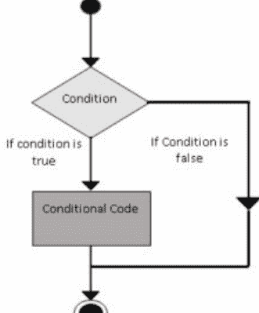
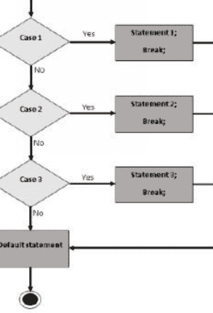
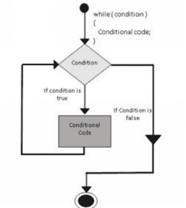
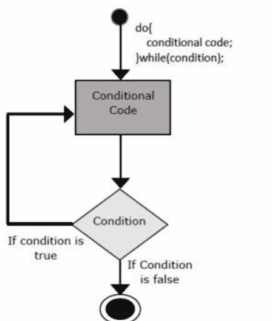
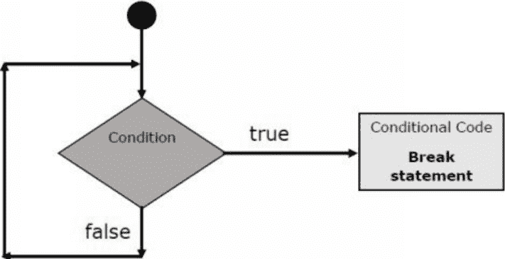
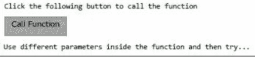

# Javascript 学院：从内到外的压力学习 Javascript 方法 -（免费书籍、Javascript 精华版、Javascript 权威指南）


## 序言


# 在 KindleSpot.com 获取更多免费和廉价书籍

## 序言


## 序言


## 序言

我想感谢你并祝贺你（下载了此书）。

感谢你下载本书，我希望你喜欢。

书中包含了你掌握 JavaScript 的各种技巧和策略。

本书是为想要快速学习 JavaScript 的人们编写的。

再次感谢下载本书，我希望你喜欢。

书中在几页内带你了解 JavaScript 的基础。

感谢你下载本书，我希望书中书中带你了解这些！

## 第一章：JavaScript 语言

### 基础信息

JavaScript 是目前最流行的语言之一。这种语言在现代网站的开发中起着重要作用。它的特性和功能可以帮助你创建交互式网站。

这种语言最初被称为“LiveScript”，但 Netscape（网景）为了利用 Java（另一种语言）的普及将其更名为 JavaScript。必须指出 JavaScript 与 Java 没有联系。

### JavaScript 的客户端形式

根据计算机专家的说法，最流行的变体是客户端 JavaScript。网站开发者在创建项目时使用这种变体。通常，你可以通过两种方式使用客户端 JavaScript：

- 将其包含在网页中
- 将其保存为外部文件

对于后者，你需要使用 HTML 文档引用外部文件并将其链接到你的网站。

基本上你不需要使用静态 HTML 创建网页。你可以包含允许浏览器控制、用户交互和动态创建 HTML 文件的程序。客户端 JavaScript 比典型的 CGI（即通用网关接口）服务器脚本具有许多优势。例如，你可以使用客户端 JavaScript 判断用户是否提供了有效信息。

JavaScript 代码在用户提交表单时运行。系统会分析提交的信息。这种机制确保了 Web 服务器不会处理无效请求。因此，客户端 JavaScript 为你的网站提供了更好的安全性能。

这种编程语言还允许收集用户发起的隐式或显式操作（例如链接导航、按钮点击等）。


## 第 2 章：JavaScript 语法

你可以通过将 JavaScript 语句放在网页的 <script> 标签内来实现这种语言。通常情况下，你可以将这些 <script> 标签放在网页的任何地方。然而，专业的网站开发人员通常会将这些标签放在页面的 <script> 内部。

基本上，<script> 标签指示浏览器将其包含的文本解释为脚本。以下是 JavaScript 的基本语法：

```html
<script ...>
JavaScript code
</script>
```

脚本标签接受以下属性：

- Language – 此属性表示正在使用的语言。然而，较新版本的 HTML 和 XHTML 已经不再支持此属性。
- Type – 这是现代网站和网页中正在使用的属性。你必须使用它来指明你正在使用的计算机语言。确保其值为 "text/javascript"。

考虑到这些属性，JavaScript 的语法如下：

```html
<script language="javascript" type="text/javascript">
JavaScript code
</script>
```

### 首次使用 JavaScript

在本节中，你将首次使用这种脚本编程语言。你将使用的代码设计用于在计算机屏幕上显示 Hello World!。如你所见，JavaScript 代码（见下截图）涉及一个可选的 HTML 元素。该 HTML 注释允许你防止不支持 JavaScript 语言的浏览器保存代码。

符号 "//" 终止了 HTML 注释。在 JavaScript 中，"//" 代表注释。这意味着你必须使用一对斜杠来防止浏览器将 HTML 注释解释为你的 JavaScript 语句的一部分。然后，你必须调用 document.write() 函数将字符串写入你的 HTML 文件。

重要说明：你可以使用 document.write() 函数写入 HTML 语句、文本内容或二者兼有。

以下是你必须在 JavaScript 编辑器中输入的代码：

```html
<html>
<body>
<script language="javascript" type="text/javascript">
<!--
document.write("Hello World!")
//-->
</script>
</body>
</html>
```

如果编写和执行得当，上述代码将向你显示：Hello World!

### 空格符与换行符

这种脚本语言会忽略你程序内部的制表符、空格和换行。这意味着你可以使用这些元素使你的 JavaScript 代码易于阅读和易于理解。

### 分号

与其他计算机语言（例如 C++）类似，JavaScript 要求你使用分号结束简单语句。然而，如果你的语句分行输入，则就不需要添加分号。例如，下面的代码即使没有任何分号也能正常工作：

```html
<script language="javascript" type="text/javascript">
<!--
var1 = 10
var2 = 20
//-->
</script>
```

### JavaScript 语句的大小写敏感性

这种编程语言是对大小写敏感的。例如，"WORD"、Word" 和 "word" 在 JavaScript 中被视为三个不同的实体。这意味着在处理函数、关键字、变量和其他标识符时，你必须保持字母大小写的一致。

### JavaScript 注释

在 JavaScript 中创建注释时，你必须记住以下规则：

- 该语言忽略放置在 "//" 符号和行尾之间的所有文本。
- 你可以使用 /** 和 */ 来创建注释。通常情况下，程序员在创建多行注释时会使用这些符号。
- JavaScript 还允许你在编写单行注释时使用 <!--（即 HTML 中用于开始注释的符号）。
- JavaScript 不识别 -->>（即 HTML 中用于结束注释的符号）。你必须使用 //-- >。

## 第 3 章：JavaScript 代码的放置

你可以将 JavaScript 代码放在 HTML 文件的任何部分。然而，在 HTML 文档内部保留 JavaScript 代码的推荐区域是：

- 在 <head> </head> 区域
- 在 <body> </body> 区域
- 在文档的 <head> </head> 和 <body> </body> 区域
- 在外部文档内部

本章将讨论这些每一个区域。

### 将你的代码放置在 <head> </head> 区域

如果你希望脚本在特定事件期间运行（例如，当用户点击按钮时），这是理想的区域。下面的示例代码将向你展示如何在此区域保存代码。

```html
<html>
<head>
<script type="text/javascript">
<!--
function sayHello() {
  alert("Hello World")
}
-->
</script>
</head>
<body>
点击此处获取结果

<input type="button" onclick="sayHello()" value="Say Hello" />
</body>
</html>
```

如果输入正确，代码将向你显示：

点击此处获取结果
Say Hello

### 将你的代码放置在 <body> </body> 区域

通常，如果你希望 JavaScript 代码在网页加载时产生内容，你应该将其放置在 <body> 部分。在这里，你不需要使用 JavaScript 定义任何函数。这里是一个示例：

```html
<html>
<head>
</head>
<body>
<script type="text/javascript">
<!--
document.write("Hello World")
//--
</script>
<p>This is web page body</p>
</body>
</html>
```

这种方法生成了：

| Hello World |
| This is web page body |

### 将你的代码放置在文档的 <head> </head> 和 <body> </body> 中

如果你希望脚本在特定事件期间运行（例如，当用户点击按钮时），这是理想的区域。下方的代码将向你展示如何保存代码。

```html
<html>
<head>
<script type="text/javascript">
<!--
function sayHello() {
  alert("Hello World")
}
-->
</script>
</head>
<body>
点击此处获取结果

<input type="button" onclick="sayHello()" value="Say Hello" />
</body>
</html>
```

如果输入正确，代码将向你显示：

点击此处获取结果
Say Hello

### 将你的代码放置在外部文件中

在使用 JavaScript 时，你肯定会遇到需要使用相同代码的情况。重复输入是无趣且耗时的。幸运的是，你可以只需使用脚本标签和 src 属性。

```html
<html>
<head>
<script type="text/javascript" src="filename.js"></script>
</head>
<body>
</body>
</html>
```

例如，让我们尝试：

```javascript
function sayHello() {
  alert("Hello World")
}
```

## 第 4 章：JavaScript语言中的变量

### JavaScript 中的不同数据类型

与其他语言类似，JavaScript 有自己支持的数据类型。因此，你可以使用 JavaScript 表示和操作某些值。

- 布尔值（即 true 或 false）
- 字符串（例如 "This book is awesome."）
- 数字（例如 1, 2, 3, 123 等）

JavaScript 还支持 null 和 undefined，这是描述单个值的类型。最后，这种语言使用名为“object”的复杂类型。

重要说明：JavaScript 将所有数字视为浮点数。

### 变量

作为 JavaScript 用户，你可以将变量视为容器：你可以将不同类型的信息放入变量中。要访问存储的数据，只需指定持有它的容器。

在运行变量之前必须声明它们。在 JavaScript 中，声明变量时应使用 var。查看下面的示例：

```html
<script type="text/javascript">
<!--
var money;
var name;
//-->
</script>
```

上述代码声明了两个变量：money 和 name。

将数据保存到变量的过程被称为变量初始化。大多数程序员在声明期间初始化。然而，你可以只需声明变量而不保存任何值：你可以在需要时将数据保存变量。例如：

```javascript
var profit;
```

```javascript
profit = 1,000,000.00;
```

JavaScript 被视为一种“无类型”计算机语言。这意味着 JavaScript 变量可以包含任何类型的数据。这与其他语言相比，是一个巨大的优势。


这要求用户在创建变量时指定数据类型。

### 变量的作用域

变量的“作用域”是你计算机程序中声明变量的区域。
JavaScript 支持以下作用域：

- 局部（Local） – 局部变量仅在定义它的函数内部可见。这意味着函数无法使用其他函数的局部变量。
- 全局（Global） – 全局变量在程序内部的所有函数中都可用。这意味着你可以在代码的任何地方定义它们。

如果局部变量和全局变量具有相同的名称，则局部变量将具有优先级。如果你使用已有的全局变量名称在局部声明一个变量，你将隐藏该全局变量。分析下面的示例代码：

```javascript
<script type="text/javascript">
<!---
var myVar = "global"; // 声明一个全局变量
function checkscope() {
  var myVar = "local"; // 声明一个局部变量
  document.write(myVar);
}
//-->
</script>
```

上述代码将向你显示此结果：Local。

### 变量命名

在为变量选择名称时，你应该记住以下规则：

- 你不能使用任何 JavaScript 关键字（例如 break、Boolean 等）作为变量名。你稍后会学习 JavaScript 关键字。
- 命名变量时，可以使用字母、数字和下划线。然而，你不能用数字开头命名。例如，sample1 是有效的，但 1sample 是无效。
- 变量名对大小写敏感。这意味着 JavaScript 将 SAMPLE、" Sample " 和 " sample " 视为三个不同的变量。

### JavaScript 中的保留关键字

与其他编程语言类似，JavaScript 有一组用作特殊用途的单词。你不能在命名对象、方法、函数、循环和变量时使用这些词。下表将显示 JavaScript 语言所有的关键字。

| if | do | in | int |
|---|---|---|---|
| new | try | for | var |
| else | enum | this | long |
| byte | case | true | null |
| char | goto | void | with |
| break | throw | false | final |
| catch | float | class | const |
| while | short | super | switch |
| export | throws | typeof | public |
| return | delete | static | double |
| import | Instanceof | abstract | synchronized |
| Boolean | interface | extends | transient |
| finally | package | private | protected |
| function | volatile | continue | debugger |
| implements | | | |

## 第 5 章：JavaScript 运算符

JavaScript 语言支持以下类型的运算符：

- 逻辑运算符
- 比较运算符
- 赋值运算符
- 算术运算符
- 位运算符
- 杂项运算符

让我们讨论每种运算符：

### 逻辑运算符

JavaScript 支持这些逻辑运算符：

注意：假设 x = 5 且 y = 10。

- "&&" – 这被称为逻辑与（AND）运算符。如果两个操作数都不等于零，条件为真。例如：(x && y) 为 true。
- "||" – 此运算符称为逻辑或（OR）。如果操作数中至少有一个不等于零，条件为真。例如：(x || y) 为 true。
- "!" – 程序员将此运算符称为逻辑非（NOT）。该运算符反转它所作用运算符的结果。例如：(x && y) 为 false。

### 比较运算符

以下是可以在 JavaScript 中使用的比较运算符：

注意：使用以下变量：x = 2; y = 4。

- "==" – 此运算符检查两个操作数的相等性。如果值相等，条件为真。例如：(x == y) 为 false。
- "!=" – 使用此运算符，你可以检查操作数的值是否不相等。如果值不相等，条件为真。例如：(x != y) 为 true。
- ">" – 在这里你将检查左侧操作数的值是否大于右侧操作数的值。如果是，条件为真。例如：(y > x) 为 true。
- "<" – 此运算符检查两个操作数的值。如果左侧操作数的值小于右侧操作数的值，条件为真。例如：(y < x) 为 true。
- ">=" – 此运算符检查左侧操作数的值是否大于或等于右侧操作数。如果是，条件为真。例如：(y >= x) 为 true。
- "<=" – 此运算符检查左侧操作数的值是否小于或等于右侧操作数。如果是，条件为真。例如：(x <= y) 为 true。

### 赋值运算符

这些是你用于赋值赋值的运算符：

- = – 这是一个简单运算符。它将右侧操作数的值赋给左侧操作数。
- += – JavaScript 用户称此为加赋值运算符。它将右侧操作数的值加到左侧操作数。例如：z += x。
- -= – 程序员称此为减赋值运算符。它从左侧操作数中减去右侧操作数的值。例如：z -= x。
- *= – 这被称为乘赋值运算符。它将两个操作数相乘并将结果赋给左侧操作数。例如：z *= x。
- /= – 此运算符是除赋值运算符。它将左侧操作数的值除以右侧操作数并赋值。例如：z /= x。
- %= – 这被称为取模运算符。它取左侧操作数的模并赋值结果。例如：z %= x。

### 算术运算符

列表显示了算术运算符。为了帮助你理解这些如何工作，让我们使用变量：x = 2; y = 4。

- + – 你应该使用此运算符对操作数进行加法。例如：x + y = 6。
- - – 使用此运算符从第一个操作数中减去第二个操作数的值。例如：y - x = 2。
- * – 如果你想相乘操作数，应使用星号。例如：x * y = 8。
- / – 使用此运算符将左侧操作数的值除以右侧操作数。例如：y / x = 2。
- ++ – 此运算符允许对其所连接的运算符加 1。例如：4++ = 5。
- -- – 此运算符从它所使用的运算符上减去 1。例如：x-- = 1。
- + – 你也可以使用 + 运算符组合数字和字符串元素。例如，“ " + 4。

### 位运算符

这种编程语言允许你在代码中执行位运算。你可以使用的运算符有：

注意：使用两个变量：x = 2; y = 3。

- & – 这被称为位与运算符。它对参数中的所有位进行布尔运算。例如：(x & y) 为 2。
- | – 程序员称此为位或。它对参数中的所有位进行布尔运算。例如：(x | y) 为 3。
- ^ – 这被称为位异或（XOR）运算符。它对参数中的所有位进行布尔异或运算。异或意味着仅有一个操作数为真。例如：(x ^ y) 为 1。
- ~ – 此运算符是一一元的（即它作用于单个操作数）。被称为位非运算符，它反转操作数的位。例如 (~y) 为 -4。
- << – 此运算符被称为左移。它根据右侧操作数指定的数字将左侧操作数的位向左移动。此外，它使用零填充新位。将值向左移动 1 位相当于乘以 2。因此，(x << 1) 得到 4。
- >> – 这被称为右移运算符。它根据右侧操作数给出的数字将左侧操作数的值向右移动。例如：(x >> 1) 得到 1。
- >>> – JavaScript 用户称此为“符号右移和零”。它的功能是


类似于“>>.”。唯一的区别是最左侧的位始终等于 0。

### 杂杂运算符

本书的这一部分将讨论两个不属于上述分类的实用用运算符。这些运算符是：

- “?:?” – 这被称为“条件运算符”。它检查一个表达式的值是真还是假。然后，它根据评估的结果执行分配的语句之一。

例如，如果条件为真，运算符将 1 赋值给表达式。然而，如果条件为假，运算符将赋值 2。

- typeof – 这是一个一元运算符，意味着你可以在单个操作数上使用它。你可以用它来确定操作数的数据类型。如果操作数是字符串、布尔值或数字，该运算符返回“string”、“boolean”或“number”。然后，它根据评估的结果返回 true 或 false。

下表 了关于 `typeof` 运算符的有用信息：

| 数据类型 | typeof 的结果 |
|---|---|
| Object | “ object ” |
| Number | “ number ” |
| Boolean | “ boolean ” |
| Undefined | “ undefined ” |
| Null | “ object ” |

| Function | " function " |
|---|---|
| String | " string " |

## 第 6 章：条件语句

在使用 JavaScript 时，会出现某些需要你从预定义的选项中选择一个。在这些情况下，你必须使用条件语句。条件语句允许你的程序做出合理的判断并执行正确的流程。

这种编程语言提供了你可以在代码中使用的条件语句。本章将讨论三个最重要的条件语句：(1) “if ”语句，(2) “if ... else ”语句，以及(3) “if ... else if ... ”语句。

让我们详细讨论一下这些语句：

### 条件语句的流程图

下图显示了条件语句的基本流程图。



### if 语句

该语句是 JavaScript 中基本的条件语句。它帮助程序做出决策并执行其他语句。

" if " 语句的语法为：

```
if (expression){
  如果 expression 为真则执行的语句
}
```

上面的代码评估 JavaScript 表达式。如果评估结果为真，将执行分配的语句。然而，如果结果为假，则没有任何分配的语句会被执行。在大多数情况下，你会在此语句中配合比较运算符。

### if ... else 语句

该语句比前一个更复杂。这是因为 “ if ... else ” 语句在条件执行语句方面提供了更好的控制。

“ if ... else ” 语句的语法如下：

```
if (expression){
  如果 expression 为真则执行的语句
}else{
  如果 expression 为假则执行的语句
}
```

你可以使用上述语法来评估 JavaScript 表达式。如果结果为真，将执行放置在 “ if ” 部分的语句。另一方面，如果结果为假，将执行位于 “ else ” 部分的语句。

## “ if ... else if ... 语句

基本上，这是 “ if ... else ” 语句的增强形式。通过提供多个条件，它帮助帮助你的程序做出正确的决策并执行正确的操作。

创建 “ if ... else if ... ” 语句时，你必须使用的语法如下：

```
if (expression 1){
  如果 expression 1 为真则执行的语句
}else if (expression 2){
  如果 expression 2 为真则执行的语句
}else if (expression 3){
  如果 expression 3 为真则执行的语句
}else{
  如果没有没有表达式为真则执行的语句
}
```

如果你仔细考虑，上述语法是一个基础语法。它是 “ if ” 语句的简单集合，其中每个 “ if ” 都作为前一个 else 语句的 else 子句的一部分。这种语法根据评估的结果执行语句。如果所有给定的条件都为假，系统将运行代码的 “ else ” 部分。

### Switch-Case 语句

你可能使用一系列 " if ... else if " 语句来执行多路径分支系统。你已经在本书的上一节中学习了这些。然而，这种方法并不总是理想的答案，特别是当所有分支都依赖于一个变量的值时。

幸运的是，JavaScript 提供了 switch 语句。在上述描述的情况下，单个 switch 语句比一组 " if ... else if " 语句更有效。

这里是基本 switch-case 语句的流程图：



### 语法

Switch 语句的设计用于完成两件事：

- 提供一个程序可以评估的表达式
- 提供各种将被的语句

分支依赖于一个变量的值。JavaScript 解释器会将每个 case 与语句比较，直到找到匹配。switch 语句的语法为：

```javascript
switch (expression) {
  case 1:
    语句;
    break;
  case 2:
    语句
    break;
  default:
    语句;
}
```

分支依赖于一个变量的值。JavaScript 解释器会将每个 case 与语句比较，直到找到匹配。switch 语句的语法为：

```javascript
switch (expression) {
  case 1:
    语句;
    break;
  case 2:
    语句
    break;
  default:
    语句;
}
```

分支依赖于一个变量的值。JavaScript 解释器会将每个 case 与语句比较，直到找到匹配。switch 语句的语法为：

```javascript
switch (expression) {
  case 1:
    语句;
    break;
  case 2:
    语句
    break;
  default:
    语句;
}
```

分支依赖于一个变量的值。JavaScript 解释器会将每个 case 与语句比较，直到找到匹配。switch 语句的语法为：

```javascript
switch (expression) {
  case 1:
    语句;
    break;
  case 2:
    语句
    break;
  default:
    语句;
}
```

分支依赖于一个变量的值。JavaScript 解释器会将每个 case 与语句比较，直到找到匹配。switch 语句的语法为：

```javascript
switch (expression) {
  case 1:
    语句;
    break;
  case 2:
    语句;
    break;
  default:
    语句;
}
```

分支依赖于一个变量的值。JavaScript 解释器会将每个 case 与语句比较，直到找到匹配。switch 语句的语法为：

```javascript
switch (expression) {
  case 1:
    语句;
    break;
  case 2:
    语句;
    break;
  default:
    语句;
}
```

分支依赖于一个变量的值。JavaScript 解释器会将每个 case 与语句比较，直到找到匹配。switch 语句的语法为：

```javascript
switch (expression) {
  case 1:
    语句;
    break;
  case 2:
    语句;
    break;
  default:
    语句;
}
```

分支依赖于一个变量的值。JavaScript 解释器会将每个 case 与语句比较，直到找到匹配。switch 语句的语法为：

```javascript
switch (expression) {
  case 1:
    语句;
    break;
  case 2:
    语句;
    break;
  default:
    语句;
}
```

分支依赖于一个变量的值。JavaScript 解释器会将每个 case 与语句比较，直到找到匹配。switch 语句的语法为：

```javascript
switch (expression) {
  case 1:
    语句;
    break;
  case 2:
    语句;
    break;
  default:
    语句;
}
```

分支依赖于一个变量的值。JavaScript 解释器会将每个 case 与语句比较，直到找到匹配。switch 语句的语法为：

```javascript
switch (expression) {
  case 1:
    语句;
    break;
  case 2:
    语句;
    break;
  default:
    语句;
}
```

分支依赖于一个变量的值。JavaScript 解释器会将每个 case 与语句比较，直到找到匹配。switch 语句的语法为：

```javascript
switch (expression) {
  case 1:
    语句;
    break;
  case 2:
    语句;
    break;
  default:
    语句;
}
```

分支依赖于一个变量的值。JavaScript 解释器会将每个 case 与语句比较，直到找到匹配。switch 语句的语法为：

```javascript
switch (expression) {
  case 1:
    语句;
    break;
  case 2:
    语句;
    break;
  default:
    语句;
}
```

分支依赖于一个变量的值。JavaScript 解释器会将每个 case 与语句比较，直到找到匹配。switch 语句的语法为：

```javascript
switch (expression) {
  case 1:
    语句;
    break;
  case 2:
    语句;
    break;
  default:
    语句;
}
```

## 第 6 章：循环的不同类型

在编写程序时，你会遇到需要重复操作的情况。这些工具被称为循环，是本章的主题。

### While 循环

程序员认为这是 JavaScript 中最常见的循环类型。基本上，`while` 循环在表达式为真时执行语句。

这里是 `while` 循环的流程图：



### 语法

这里是 `while` 循环的语法：

```
while (expression){
  如果 expression 为真则执行的语句
}
```

在执行任何语句之前，`while` 循环会评估条件。这意味着如果表达式为假，则没有任何语句会被执行执行。

### Do ... while 循环

 “do ... while ” 循环与 while 循环相似。唯一的区别是它在执行语句后才评估表达式。如果评估结果为真，循环将再次执行语句。只有当结果变为假时，过程才会停止。因为这个原因，即使评估结果为假，“do ... while ” 循环也会至少运行一次。

典型的 “do ... while ” 循环的流程图如下：



### 语法

这里是 “do ... while ” 循环的语法：

```
do{
  要执行的语句;
} while (expression);
```

重要：语法末尾的分号是强制性的。请确保你在所有的 “do ... while 循环中包含它。

### For 循环

这种循环以其紧凑性而闻名。通常，“for 循环”具有以下部分：

- 循环初始化 – 这是你从初始值开始计数器部分。JavaScript 解释器会在运行循环之前执行此部分。
- 测试语句 – 循环的这部分评估分配的条件。如果分配条件为真，解释器将执行 “ for ” 循环内的代码。然而，如果条件为假，系统控制权将交给 “ for ” 循环之后的语句。
- 迭代语句 – 你可以使用这部分来增加或减少循环计数器。

JavaScript 允许你将所有这些部分放在同一行中。你只需要使用分号分隔每个部分即可。


"for" 循环的语法如下：

```javascript
for (initialization; test condition; iteration statement){
    Statement(s) to be executed if test condition is true
}
```

##

### 如何控制你的循环

JavaScript 语言允许你操作所有的循环和 switch。在某些情况下，你必须在到达循环的最后部分之前退出循环语句。在某些情况下，你必须忽略代码的某部分并初始化下一个。

为了帮助你处理这些情况，这种编程语言提供了两个强大的工具：`break` 语句和 `continue` 语句。让我们详细讨论一下这两个语句。

### break 语句

该语句在上一章中介绍，允许你提前退出任何循环。下面的图片将向你展示基本 `break` 语句的流程图。



注意：在我们讨论 switch 语句时，你已经看到过 break 语句的工作原理。

### continue 语句

`continue` 语句指示 JavaScript 解释器开始循环的下一次迭代，并忽略剩余的代码块。一旦系统遇到 `continue` 语句，程序的流将跳转到表达式评估。如果条件仍然为真，`continue` 语句将开始下一次迭代。另一方面，如果条件变为假，程序控制将跳出循环。

##

## 第 7 章：JavaScript 语言中的函数

基本上，函数是可用代码的集合，可以在程序的任何部分调用。这意味着你不需要多次编写相同的代码。函数帮助程序员创建模块化代码。它们还允许程序员将一个大型程序拆分成较小的函数。

与任何其他编程语言一样，JavaScript 提供了通过函数帮助编写模块化代码的功能。你可能在本书提供的代码中见过如 **write()** 和 **alert()** 等函数。你可以反复使用这些函数，但它们在 JavaScript 中只写过一次。

这种语言还允许你编写自己的函数。本章将教你 JavaScript 函数的基础知识。

##

### 如何定义函数

在使用函数之前，你必须定义它们。定义函数最流行的方法是使用 `function`（即 JavaScript 关键字）。在输入 `function` 后，指定你想使用的名称和参数。然后，添加一个用大括号括起的 JavaScript 语句块。

注意：你可以创建一个不定义任何参数的函数。因此，参数列表可以是空的。

以下是你定义函数时必须使用的语法：

```html
<script type="text/javascript">
<!--
function functionname(parameter-list)
{
  statements
}
-->
</script>
```

##

### 如何调用函数

要在你的脚本中调用函数，你只需要指定函数的名称。你可以使用下面的代码作为示例：

```html
<html>
<head>
<script type="text/javascript">
function sayHello()
{
  document.write("Hello there!");
}
</script>
</head>
<body>
<p>点击下面的按钮调用函数</p>
<form>
<input type="button" onclick="sayHello()" value="Say Hello">
</form>
<p>在 write 方法中使用不同的文本，然后尝试...</p>
</body>
</html>
```

该代码将给你带来如下结果：

> 点击下面的按钮调用函数

Say Hello

##

### 函数的参数

你目前为止看到的函数没有任何任何参数。然而，你可以在用用/调用函数时轻松地分配各种参数。你可以在函数内部捕获这些参数。一旦捕获，你就可以根据需要修改这些参数。

### return 语句

JavaScript 允许你在函数中添加 `return` 语句。这个 `return` 语句是完全可选的，尽管如果你想从函数中获取值，就必须使用它。通常，你应该将 `return` 语句放在函数的最后部分。

例如，你可以向函数传递两个值。然后，你可以期望该函数将这些值相并在调用的程序中显示结果。

##

### 嵌套函数

JavaScript 允许将一个函数放在另一个函数内部。这个过程被称为“嵌套函数”。作为一个规则，你不能在循环或条件语句内部包含函数定义。

下面的代码将教你如何嵌套自己的函数：

```html
<head>
<script type="text/javascript">
<!--
function hypotenuse(a, b) {
  function square(x) { return x*x; }

  return Math.sqrt(square(a) + square(b));
}
function secondFunction(){
  var result;
  result = hypotenuse(1,2);
  document.write ( result );
}
-->
</script>
</head>

<body>
<p>点击下面的按钮调用函数</p>

<form>
<input type="button" onclick="secondFunction()" value="Call Function">
</form>

<p>在函数内部使用不同的参数，然后尝试...</p>
</body>
</html>
```

上面的代码给出结果：



##

# 如何使用 “Function() 创建函数

除了上面讨论的函数语句，你还可以通过 `Function()`（即 JavaScript 构造函数）和 `new`（即 JavaScript 运算符）来创建函数。

使用此构造函数，你必须使用以下语法：

```html
<script type="text/javascript">
<!--
 var variabelname = new Function(Arg1, Arg2..., "Function Body");
-->
</script>
```

该语法可以包含任意字符串参数。最后一个参数作为函数体——它可以包含由分号分隔的任意语句。

重要注意：`Function()` 不为其生成的函数指定名称。程序员将这些无名函数称为“匿名”函数。

##

# 结

再次感谢下载这本书！

我希望这本书能够帮助你学习 JavaScript 的基础知识。

下一步是使用 JavaScript 编程语言编写你自己的网页或程序。


最后，如果你喜欢这本书，我想向你请求一个请求，你是否愿意在 Amazon 上为这本书留评价？我们将不胜感激！

点击此处在 Amazon 上为这本书留评价！

感谢你并祝你好运！


未经许可使用的商标，以及在没有商标所有者许可或背书的情况下对商标的出版。本书中涉及的所有商标和品牌仅供说明之用，并归所有者所有，与本文档无关。

# 目录

## 引言

## 第一章：JavaScript 与代码

## 第二章：JavaScript 的不同方面

# 第三章：JavaScript 中的程序结构

# 第四章：关于 JavaScript 函数的更多信息

# 结

## 引言

感谢你的下载，并祝贺你下载了《两周掌握 JavaScript 编程基础》这本书。

本书包含了如何掌握这种强大语言基础的经过验证的步骤和策略。

本电子书将帮助你在两周内掌握 JavaScript 基础。为了实现这一目标，它专注于该编程语言中最重要的元素。在使用本书时，你不会读到任何无关的内容。这意味着你通过学习，可以在 14 天内成为精通的 JavaScript 用户。

在书中，你将学到：

- 什么是 JavaScript
- 如何使用 JavaScript
- 常见的 JavaScript 数据
- 以及更多！

再次感谢下载本书，希望你读得愉快！

## 第一章：JavaScript 与代码

### JavaScript – 通用信息

JavaScript 早于 1995 年推出，作为在网页中添加程序的方法。当时，它专门用于名为 Netscape Navigator（网景浏览器）的浏览器。由于 JavaScript 的成功，现在所有主流浏览器都支持它。这种语言允许程序员创建现代 Web 程序——你可以在无需为每个操作重新加载网页的情况下与程序交互。另一方面，传统的网站也使用 JavaScript 来提供不同的功能和交互性。

此时，你应该知道 JavaScript 与 Java（即当今领先的编程语言之一）没有关系。JavaScript 在诞生的第一年被称为“Mocha”和“LiveScript”。然而，由于 Java 编程语言非常流行，JavaScript 的所有者决定采用它的名称。这是一种利用 Java 流行度的营销手段。

### 代码 – 通信息

代码是构成计算机程序和 Web 应用程序的文本。本电子书包含大量代码，因此你应该熟悉它们。计算机专家认为，编写代码和阅读代码是成为程序员的重要方面。因此，你应该阅读并理解书中包含的代码。如果你只是简单扫一眼代码示例，将会剥夺自己良好的学习机会。

初学者在分析代码时可能会遇到困难。然而，如果他们仔细阅读说明，一定能理解 JavaScript 是如何工作的。最好的办法是用 JavaScript 解释器尝试代码示例。这样，你就可以立即获得代码在编译为程序后样子的信息。

## 第二章：JavaScript 的不同方面

### 数据与位

数据构成了数字世界。如果你“访问”计算机内部的世界，你将看到一件事：数据。你可以读取、编辑和生成数据。每当你保存新数据时，它都将以位（bits）序列的形式存储。这就是为什么存储的数据片段具有相似的外观和特征的原因。

在编程中，位（bit）是指任何具有两个值的单位（通常用 1 和 0 表示）。你可以将任何数据片段还原为一系列的 1 和 0。这个过程被称为数据到位的转换。

### 值

典型的计算机系统涉及数十亿个位。这意味着处理数据可能会极其混乱。如果你想处理如此惊人的信息，就必须将其分成更小的块。在 JavaScript 中，这些信息块被称为“值”（values）。尽管所有值都由位组成，但它们有不同的类型和功能。JavaScript 支持六种值，即：字符串、数字、函数、对象、undefined 值和布尔值。

要生成一个值，你只需指定它的名称。这个过程简单易行。你不需要收集材料或支付任何费用。只需指定一个值的名称，砰！你就拥有它了。

本章将介绍 JavaScript 语言的基本元素（即运算符和值类型）。这些元素可以与 JavaScript 中的值进行交互。

现在，让我们谈谈不同的值类型。

### 数字

属于这种类型的值……你猜得对：数值。在编写 JavaScript 应用时，你必须使用以下格式：

```
<number>
```

例如，假设你在 JavaScript 程序中输入了此值：99。这将在你的机器内存中为数字 99 创建一个位序列。

JavaScript 语言使用 64 位来存储每个数值。用 64 位可以创建的模式是有限的，因此用它们表示的数字也是有限的。对于 x 个十进制数字，你可以表示的数字等于 10⁰。同样地，由于你有 64 位数字，你最多可以表示 2⁶⁴ 个值。

以前，计算机内存非常小，人们必须使用一组8位或16位来表示数值。由于内存不足，用户在使用 JavaScript 时经常会遇到“数据溢出”。然而，现在即使是基础级桌面电脑也拥有大量内存。这意味着你可以轻松使用 64 位序列——你不再需要担心数据溢出了。

数值还可以存储负整数。在这里，其中一个位表示值的符号（可以是“+”或“−”）。此外，JavaScript 还支持非整数（即小数）。为了实现这一点，某些位存储了小数点的位置。

你可以使用句号编写小数和小数。这里有一个例子：

99.99

另一方面，对于极大或极小的数字，你可以添加“e”来使用科学计数法。只需在其后加上指数即可。例如：

9.999e9 = 9.999 x10

整数（也称为全数）的计算是 100% 准确的。然而，小数的计算并不是。例如，“π”的值无法通过有限的十进制数字精确表示。许多数值会因为位的限制而丢失精度。如果你想避免与小数的问题，必须记住这些数字只是估算值。不要将它们视为精确的值。

### 算术运算

这是你对数值的操作。通常，算术运算（如加法、除法、减法等）使用两个数值生成一个新值。这是一个用 JavaScript 语言编写的算术运算示例：

```
10 + 4 * 5
```

“*”和“+”符号被称为“运算符”。“+”表示加法，“*”表示乘法。你通过在两个数值之间放置运算符来生成数值。注意的是，JavaScript 中的算术运算遵循运算符优先级（也称为运算顺序）。在这里，你应该按照以下顺序执行操作：括号、指数、乘法/除法、加法/减法。如果你在上面的示例中使用运算符优先级，10 将加到 4 * 5 的积上。

你可以使用括号来修改运算顺序。例如：

```
(10 + 4) * 5
```

在 JavaScript 语言中，“–”符号表示减法，“/”表示除法。你不担心运算符优先级。如果你不确定，可以简单地在代码中添加括号。

### 特殊数字


在使用 JavaScript 时，你会遇到三个即使行为不像数字也被称为“数字”的值。这些特殊值是：Infinity、-Infinity 和 NaN。Infinity 和 -Infinity 分别表示正无穷负无穷。通常情况下，你不应该信任基于无穷的计算。这些计算在数学上是不可靠的。

另一方面，NaN 意味着“不是数字”（not a number）。当你执行产生不精确或无意义的算术运算时，就会得到这个特殊值。例如，如果你将零除以零（即 `0 / 0`），你将得到 NaN。

### 字符串

你应该使用字符串来表示基于文本的信息。你应该使用引号（即单引号或双引号）来包裹你的字符串。查看以下示例：

“五只小猴子”

“我正在骑自行车”

在创建字符串时，请确保你的引号保持一致。如果你使用双引号开始了一行，请务必使用相同的符号结束该行。

通常情况下，你可以使用引号包裹几乎任何内容。在对引号之间放置某些内容，JavaScript 语言就会将其转换为可用的字符串值。

### 如何“转义”字符

有时你必须在语句中添加特殊字符。例如，在编写文本字符串时，必须添加“换行”（即按下回车键后得到的字符）。目前，JavaScript 要求程序员在引号的文本中添加反斜杠。通过放置反斜杠，你是在告诉计算机下一个字符具有特殊功能或含义。这个过程被称为“字符转义”（escaping a character）。

反斜杠后面的引号将被视为行内容的一部分：它们不会终止字符串。如果你在反斜杠后放置“n”，语句中将添加一个换行字符。同样，通过反斜杠引入的“t”将导致一个“制表符”字符（即按下 Tab 键后得到的字符）。这是一个简单的示例：

“我是第一个\n你是最后一个”

如果你执行上述字符串，你将得到以下结果：

我是第一个
你是最后一个

在某些情况下，你可能想在代码中使用“普通的”反斜杠。你不希望它成为一个特殊工具。你可以通过在另一个反斜杠之前放置一个反斜杠来实现这一点。也就是说，你正在转义一个反斜杠，以便将其转换为普通字符。分析以下示例：

“你应该在语句中使用 \t 来添加制表符字符”

一旦编译并执行，该行将给你：

你应该在语句中使用 \t 来添加制表符字符

字符串不是数字，所以你不能对它们执行数学运算。然而，你可以对字符串使用“+”来连接（即组合）它们。这里有一个示例：

“Jav” + “aSc” + “ript”

由于使用了“+”符号，上述分段的行产生了：JavaScript。

### 一元运算符

在本节中，你将学习非符号运算符。为了开始讨论，让我们谈谈一个名为“typeof”的运算符。这个运算符可以帮助你识别任何值的类型。查看以下示例：

```
console.log(typeof 4.5)
// number
console.log(typeof "x")
// -> string
```

上面的示例代码使用了 `console.log` 来显示你通过 "typeof" 得到的结果。每当你运行此类代码时，你应该立即在计算机屏幕上看到该值。

上一节给出的运算符需要两个值，而 `typeof` 需要一个。需要两个值的运算符被称为二元运算符。然而，与单个值工作的运算符被称为一元运算符。

### 布尔值

通常，程序员需要能够区分两个选项的值，例如“开启”或“关闭”，以及“是”或“否”。为了此目的，JavaScript 语言支持一种名为 Boolean（逻辑）的值类型（只有两个值：true 和 false）。

### 比较

你可以使用以下方法创建布尔值：

```
console.log(3 > 2)
// -> true
console.log(3 < 2)
// -> false
```

`<` 和 `>` 字符是用于表示“小于”和“大于”的常用符号。这两个符号都属于“二元运算符”类别。如果你在代码中使用它们，你将得到一个显示它们是否为真的布尔值。你可以使用相同的方法比较字符串。

```
console.log("Aardvark" < "Zoroaster")
// -> true
```

字符串按字母顺序排序的。此外，小写字母比大写字母“更重要”。这意味着“a” > “b” 是真的。JavaScript 在排列字符串时还包含了特殊字符（例如 -, !, ? 等）。比较过程遵循 Unicode —— 它为你在编程中可能需要的每个字符分配一个数字。此功能非常有用，因为它允许你通过将字符串转换为数字序列来存储它们。在比较字符串值时，JavaScript 从左到右工作，逐个检查每个字符的数字序列。

你还可以使用类似的运算符，如 `<=`（小于等于）、`>=`（大于等于）、`!=`（不等于）和 `==`（等于）。查看以下示例：

```
console.log("Itchy") != "Zoroaster"
// -> true
```

如果你将运算符应用于错误的值类型，JavaScript 将自动将该值转换为正确的类型。JavaScript 使用一组规则执行此功能，这些规则有时是出乎意料或不受愿的。程序员将这种自动过程称为“类型转换”（type coercion）。正如此，第一行的 `null` 被转换为 0，而下一行的 “5” 被转换为 5（即从字符串到数字）。

（转换）。然而，第三行尝试使用“+”符号来连接这些值，因此 1 变成了“1”（数字到字符串的转换）。

如果你将一个非数字值（“six”或 undefined）转换为数字，你将得到 NaN 结果。在 NaN 值上进行数学运算将产生更多的 NaN，因此如果你在预料之外或不理想的情况下获得此值，请检查你的代码中是否存在不必要的多余的类型转换。

## 第 3 章：JavaScript 的程序结构

本章将教你进行“真正的编程”。你将使用超出你目前为止所用过的名词和短语的 JavaScript 命令。请仔细学习这些材料，因为它们将帮助你在两周内掌握 JavaScript 的基础。

### 语句与表达式

在上一章中，你通过在现有值上应用运算符来生成新值。看起来值的创建似乎是 JavaScript 程序中最重要的部分。然而，这只是这门强大语言的一小部分。

创建值的代码部分被称为“表达式”。因此，你以字面形式编写任何值（例如 99 或“ninety-nine”）都属于这一类。即使你将其括在括号中，表达式仍然被称为表达式。此外，即使你使用一元、二元或三元运算符，表达式仍然是表达式。

上面的段落强调了基于语言的编程接口的优势。表达式在任何人类语言中都充当子序列——它们可以包含其他表达式。这意味着你可以混合 JavaScript 表达式来描述复杂的计算。

如果说表达式等同于子序列，那么 JavaScript 语句等同于完整的句子。基本上，一个 JavaScript 程序只是语句的集合。

最基础的语句类型是一个值后跟一个分号。根据这一原则，我们可以创建这个简单的程序：

```
0;
false;
```

在 JavaScript 中，上述示例被认为是一个完整的程序。尽管如此，它是毫无的。语句只有当它们执行了某些影响其他事情的操作时才有用（例如，在屏幕上显示某些字符、改进编程环境等）。上面显示的两个语句仅仅创建了两个值（即 0 和 false）。它们没有改变或改进任何东西。如果你执行这个程序，将不会观察到任何显著的变化。

### 变量

JavaScript 程序如何维持自身？它们是如何存储事物的？你已经见过如何使用旧值创建新值。然而，该过程并不会修改已有的值。你还需要立即使用产生的值，否则它们将直接消失。为了捕获并保持值，JavaScript 提供了变量。

```
var example = 3 * 3;
```

在这个示例中，var（JavaScript 中的关键字之一）表示该行将创建一个变量。关键字后面是变量名，如果你想立即分配一个值，则通过“=”符号和你的所需的表达式。

该语句生成了一个名为“example”的变量，并使用它来存储 3 * 3 的积。

一旦你定义了变量，你就可以在未来的 JavaScript 语句中使用它的名称作为普通的表达式。你从“表达式”中得到的值与你在创建它时分配的值相同。查看以下示例：

```
var three = 3;
```

```
console.log(three * three);
```

```
// -> 9
```

在给变量命名时，你可以使用任何不是关键字（例如 var）的单词。你可以在变量名中包含数字，但你不能使用数字作为起始字符。

例如，programming1 是有效的，但 Iprogramming 不是有效的。此外，你不能在变量命名时使用空格。在特殊字符方面，你只能使用美元符号（即 $）和下划线（即 _）。JavaScript 不允许在变量名中使用标点符号。

你可以更改分配给变量的值。在 JavaScript 中，你可以简单地在任何变量上使用=”符号给它一个新值。

```
var taste = "bitter";

console.log(taste);

// -> bitter

taste = "sweet"

console.log(taste);
```

通常情况下，你应该将变量视为触角而不是容器。变量抓取值，而不是包含它们。这意味着多个变量可以指向同一个值。

让我们分析一个简单的示例。你需要生成一个变量来记住 Johnny 欠你的金额。当他支付 50 美元时，你必须给现有变量分配一个新值。查看下方的代码：

```
var JohnnysDebt = 200;

JohnnysDebt = JohnnysDebt – 50;

console.log(JohnnysDebt);

// -> 150
```

如果你创建一个不分配赋值的变量，它将被认为是空的。如果你询问它所包含的值，它将返回“undefined”。

JavaScript 允许你在一个 var 语句中包含多个变量。在使用此功能时，你应该用逗号分隔变量。这里有一个示例：

```
var three = 3, four = 4;
```

```
console.log(three + four);
```

```
// -> 7
```

### JavaScript 中的保留字

如之前讨论的，在命名变量时不能使用关键字。然而，还有其他单词是你不能作为变量名的，因为 JavaScript 已为未来的开发预留了它们。以下是该脚本语言中的一些保留字：

in, do, let, if, new, try, with, case, void, with, while, false, yield, extends, delete, default, const, debugger, class, break, finally, null, private, return, import, protected, switch, super, instanceof, throw, implements

记住在定义变量时不能使用上述词汇。如果你忘记了这个简单的规则，在处理 JavaScript 程序时可能会遇到问题。

### JavaScript 环境

“环境”一词指的是活动值和变量的集合。基本上，环境在启动 JavaScript 程序时不是空的。环境与语言本身有关，通常它们存在允许与系统交互的变量。例如，在浏览器环境中，存在各种函数和变量来检查并影响鼠标和键盘输入。

### 函数

默认的 JavaScript 环境涉及函数。函数是链接到值的程序段。你可以应用这些值来激活程序。例如，在浏览器环境中，alert（即一个变量）包含一个显示对话框的函数。这是一个示例：

```
alert("You are not authorized to access this page!");
```

你可以通过在生成函数表达式后放置括号来执行函数。通常，你会指定包含函数的变量名称。通过在括号内包含值，你是将这些值赋值给函数。对于上一个示例，“alert”使用分配的字符串在对话框中显示消息。

### “console.log”

你可以使用“alert”来测试新的字符串或语句。然而，它需要你关闭生成的窗口，你可能会觉得这样做这样做且耗时。因此，你可能想使用你在书中前面章节过的函数：console.log。几乎所有的 JavaScript 系统（例如 Node.js、浏览器等）都提供此函数来将参数传输到兼容文本的输出设备。

对于浏览器来说，代码的输出到 JavaScript 的控制台。虽然浏览器的这部分通常是隐藏的，但你可以通过按下某些键来访问它（例如对于 Windows 电脑，按 F12；对于 Mac 电脑，按 Command-Option-I）。如果你在查看此部分时遇到问题，可以运行设备内搜索“开发者工具”或“Web控制台”。分析以下示例：

```
var a = 99;
```

```javascript
console.log("one hundred minus one is", a);

// -> one hundred minus one is 99
```

如之前讨论过的，在命名变量时不能使用句号或逗号。然而，上面的示例中包含了它们。原因在于 `console.log` 不是一个普通的变量。它是一个 JavaScript 表达式，从存储在 `console`（这是一个变量）中的值中收集“log”信息。

### 返回值

在屏幕上写入信息和显示对话框被称为**副作用**（side effects）。正因为这些副作用，函数在 JavaScript 语言中至关重要。你也可以使用函数来生成值——在这种情况下，函数即使没有副作用也是有用的。例如，`Math.max`（一个 JavaScript 函数）接收无限数量的数值，并指示其中最大的一个。这里有一个示例：

```javascript
console.log(Math.max(1, 2, 3, 4, 5));

// -> 5
```

在 JavaScript 中，任何生成值的的内容都被视为表达式（expression）。这意味着你可以在大型表达式中执行函数调用。在下面的示例中，你将使用 `Math.min` 函数作为“+”运算符的输入：

```javascript
console.log(Math.min(1, 2) + 98);

// -> 99
```

## 第 4 章：关于 JavaScript 函数的更多信息

在上一节中，你已经学习了如何创建和调用函数值。本章将帮助你进一步理解这个重要主题。根据专家程序员的说法，在使用 JavaScript 时，函数是你的主要工具。函数是强大的工具，可以帮助你设计大型程序、减少冗余、命名子程序并为每个子程序提供安全隔离。这意味着，如果你想有效地使用 JavaScript，就必须掌握函数。本章将帮助你在短短两周内学会这种脚本语言。

许多人应用函数来定义新的词汇。这意味着你可以使用它们来创建单词并分配含义。

一个普通英语者的词汇量大约有 20,000 个单词。然而，编程语言通常没有那么多的内置命令。这意味着编程中的词汇比人类语言中词汇更精确。如果你想尽量减少冗余，就必须将自己的单词加入 JavaScript 并创建你自己的词汇。

### 如何定义函数

定义函数就像定义一个普通变量。唯一的区别在于你赋值的值是一个函数。例如，下面的代码定义了一个名为“square”的变量。该变量指向一个函数，该函数生成任何赋值数字的平方。

```javascript
var square = function(x) {
  return x * x;
}

console.log(square(12));
// 144
```

创建函数时，你应该以 `function` 关键字开始一个表达式。每个函数都有两个部分：(1) 函数体（body）和 (2) 参数（parameter）。函数体存储了你希望在函数调用（或触发）时执行的 JavaScript 语句。此外，你应该始终使用大括号包裹函数体（即使它只包含一条语句）。

另一方面，参数是函数中列出的名称。函数可以有一个或多个参数。实际上，你甚至可以创建一个不输入任何参数的函数。为了帮助你理解这个概念，让我们创建两个函数：`makeNoise` 和 `power`。

```javascript
var makeNoise = function() {
  console.log("Pling!");
}
makeNoise();
// -> Pling!

var power = function(base, exponent) {
  var result = 0;
  for (var count = 0; count < exponent; count++) {
    result += base;
  }
  return result;
}
console.log(power(2, 10));
// -> 1024
```

你可以看到，`makeNoise` 没有任何参数。同时，“power”有两个参数（即 `base` 和 `exponent`）。

### JavaScript 中的参数和作用域

函数的参数行为类似于普通变量，尽管它们的原始值来自程序员，而不是它们所关联的函数。

这是任何函数的一个重要属性：在函数内部创建的所有变量（参数）都是它的**局部的**（local）。这意味着，例如，`power` 语句中的“result”在每次函数被调用时都会刷新自身。这些独立的重复不会互相互影响。

注意的是，这种“局部性原则”（principle of locality）仅适用于使用 `var` 定义的变量和参数。此外，你应该在函数体内定义变量和参数。在函数外部定义的变量被称为全局（global），因为它们在整个 JavaScript 应用程序中可见并可访问。如果全局变量和参数没有“局部”对应项，你可能从函数内部访问它们。

下面的代码说明了这一概念。它声明并调用了两个给“x”赋值的函数。第一个函数将变量定义为局部的。而第二个函数没有。这意味着如果你在函数内部引用 `x`，你将指向全局的 `x`（如示例的第一行所示）。

```javascript
var x = "outside";

var f1 = function() {
  var x = "inside f1"
}
f1();
console.log(x);
// → outside

var f2 = function() {
  x = "inside f2"
}
f2();
console.log(x);
// → inside
```

此功能有助于防止不同函数之间意外的引用或交互。如果 JavaScript 你在整个程序中共享所有变量，你将花费大量精力来确保名称不重复。重用变量名会导致对名称及其所指函数产生混淆。


### 可选参数

JavaScript 语言接受以下代码。在调用它时，你不会遇到任何问题。

```
alert(“Hi”, “Good Morning”, “How are you?”);
```

从官方来说，“alert”函数只接受一个参数。然而，如果你使用上述示例代码调用它，它并不会报错。它只会接受第一个参数（即“Hi”）并忽略其余部分。

这门编程语言在处理分配给函数的参数数量方面是“开放心态”的。如果你分配了过多的参数，它会接受有效的参数并忽略其他的。然而，如果你的参数不足，JavaScript 将通过向适当的参数分配“undefined”来完成你的语句。

# Python 学院

# # 从内到外彻底学习 Python 的无压力方法

# 目录

- 引言
- 第 1 章：Python 简介简介
- 第 2 章：语法
- 第 3 章：数据类型
- 第 4 章：运算符
- 结论
- “JavaScript 学院”预览

## 引言

感谢你的下载，并祝贺你下载了《两周学会 Python 编程基础》这本书。

书中包含了关于如何在 Python 中编写和运行程序的经过验证的步骤和策略。书中还有你可以作为指南的示例代码和程序。

书中还包含了对该编程语言的介绍，包括 Python 的简史和基础知识。它还对 Python 中的各项功能进行了详细解释。

再次感谢下载本书，希望你喜欢！

本文档旨在就其涵盖的主题和问题提供准确且可靠的信息。本出版物的销售理念是，出版者不需要提供会计、官方许可或其他经过合规的服务。如果需要建议（无论是法律还是专业方面的），则应聘请该专业领域具有经验的人士。

- 摘自一份由美国律师协会委员会和出版商及相关协会委员会共同接受并批准的原则声明。

以任何电子手段或印刷格式复制、倍印或传输本文档的任何部分都是不法的。严禁录制本出版，除非获得出版者的书面许可否则否则对本文档进行任何存储。版权所有。

此处提供的信息声明是真实且一致的，这意味着对于由于疏忽或其他原因，使用或滥用书中包含的任何政策、流程或指令而产生的任何责任，完全由接收读者承担。在任何情况下，对于因书中信息直接或间接导致的任何赔偿、损害或资金损失，出版者均不承担法律责任或指责。

相应作者拥有出版者未持有的版权。

此处的信息仅供参考之用，且具有通用性。信息的呈现不带有任何合同或任何类型的保证说明。

所使用的商标均未经过任何许可，且该商标的出版未获得商标所有者的许可或背书。书中的所有商标和品牌仅用于说明目的，并归所有者所有，不与本文档关联。

## 第 1 章：Python 简介

如果你正在寻找一种以代码可读性为主要关注点的通用高级编程语言，你应该考虑 Python。它的语法允许你用比 C、C++ 和 Java 等其他编程语言更少的代码来表达概念。它支持广泛的编程范式，涵盖了命令式、函数式和面向对象的编程。此外，它还具有完善的标准库、动态类型系统和自动内存管理。

有许多解释器供你安装在不同的操作系统上；因此，你可以在各种系统上执行 Python。你甚至可以使用第三方应用程序。如果你不想安装解释器，可以将代码打包成独立的可执行程序，这样你就可以有效地将基于 Python 的软件分发到不同的环境中。

### Python 编程语言的简史

Python 由 Guido van Rossum 在 20 世纪 80 年代后期开发。最初只是一个圣诞项目。Van Rossum 想要为 C 和 UNIX 黑客使用的脚本语言创建一个解释器。他的小项目最终升级为 Python 2.0，并于 2000 年 10 月发布。新版本包含了完整的垃圾回收和 Unicode 支持。Python 3.0（也称为 Python 3000 和 py3k）于 2008 年 12 月发布，包含了回溯 2.6 和 2.7 版本的功能。

### 为什么要使用 Python？

编程语言的存在是有原因的。例如，Python 的开发是为了让程序员能够创建高效且高效的代码。它的主要目标是帮助初学者轻松、快速地学习编程语言。由于学习时间减少，你可以创建更多用晦晦和复杂的编程语言难以实现的实用应用程序。

通过 Python，你在编写应用程序时还可以从缩短的开发时间中获益。如前所述，Python 的代码行比 C、C++ 和 Java 少。它的代码实际上短五到十倍；因此，它更高效、更简单。你可以花费更少的时间开发应用程序，并花费更多的时间来调优和改进它们。

在检查 Bug 和错误时，你所使用的编程语言易于阅读和理解至关重要。如果编程语言太复杂，你可能在编写和检查程序时遇到困难。使用 Python，代码更容易读和写；因此，你可以轻松地解释代码并做出必要的更改。

此外，Python 还有许多用途。它非常适合基于浏览器的脚本应用程序、创建出色的用户界面和粗略示例、与数据库交互、处理 XML 工作以及设计数学、工程和科学应用。

### Python 与 C#、Java 和 Perl 的对比

你可能发现将编程语言相互进行比较是一项主观任务。通常，它们的差异取决于个人偏好。尽管如此，有时这种比较是有科学数据支持的。无论如何，你都必须记住，不存在全能的编程语言。作为一名程序员，你只需要找到最适合你目标或需求的语言即可。

### C#

如果你有 Java 背景，你可能会发现 C# 和 Java 非常相似。尽管如此，与 Java 相比，C# 仍然有其自己的优缺点。微软声称，他们开发 C# 的主要目标是产生一个更好的 C 和 C++ 版本。然而，与 C# 相比，Python 具有更好的科学和工程应用以及更好的多平台支持。在使用 C、C++ 和 Java 方面，它更具扩展性。它更容易学习和理解，并允许使用各种计算机环境。它的代码也更简洁。

### Java

程序员将 Java 视为一种一站式服务的编程语言。多年来，他们一直在寻找可以随处运行和编写的工具，并他们了 Java，它可以在不同的平台和计算机环境中良好运行。尽管如此，Python 也是一种一站式服务的编程语言。它与 Java 非常相似，只是代码更简洁，且更容易学习和理解。它的开发速度快得多，并且拥有改进的数据框或变量，可以存储运行应用程序时实用的不同数据类型。

### PERL

PERL 代表“实用提取和报告语言”。它是一种适用于从另一个数据库获取和处理数据的编程语言。相比之下，Python 比 PERL 更好，因为它更容易阅读、实现、学习和理解。它具有更好的 Java 集成和数据保护。它也更少平台偏见。

### 为什么 Python 是初学者的理想选择？


如果你刚刚开始编程，可能想要考虑 Python。它对初学者来说非常理想，因为它具有一致且简单的语法，以及庞大的标准库，允许你完成多个项目。涉及的作业不仅限于常见的四功能运算计算器或平衡检查程序。

当你习惯了用 Python 编写程序时，你会发现创建实际应用其实很容易。交互式解释器还允许你测试语言特性。在 Python 中，你可以专注于核心编程技能（如程序分解和数据类型设计）以及基础概念（包括过程和循环）。

由于 Python 涉及到多个库和系统调用的使用，你可以开发具有易于编程接口的应用程序。你还可以完成应用程序接口（API）所需的任务。

如果你以前从未用过任何其他编程语言，请不要担心。即使是没有任何基础编程知识或经验的人，也能轻松掌握 Python 编程语言的基础。

关于安装，Python 很容易安装。大多数 UNIX 和 Linux 发行版实际上已经将其包含在软件包中。如果你从惠尔（Packard（HP）购买 Windows 电脑，你可以直接使用 Python，因为它随系统预装了。

为了方便你的操作，你应该学习如何使用文本编辑器以及集成开发环境（IDE）。阅读带有示例代码和程序的编程书籍也会很有帮助。

关于版权，Python 的开发者允许程序员对源代码进行任何他们想做的事，只要不忘记包含版权声明即可。版权规则并不严格。你甚至可以出售二进制和源码形式的副本，以及涉及 Python 使用的产品。然而，如果你想使用该标志，请确保你获得了许可。

Python 非常稳定。事实上，它的稳定性足够日常使用。你可以预计在六到十八个月内出一个新版本。开发者发布 bug 修复版本，以确保新版本比之前的版本更好。

如果你想执行静态分析或搜索 bug，可以使用 Pylint 或 PyChecker。前者是一个检查模块以查看是否符合编码标准的工具，并允许自定义插件。后者是一个寻找源代码中 bug 的静态分析工具。

现在既然你已经学习了编程语言的基础知识，你可能仍然好奇 Python 是如何命名的。吉多·范罗姆（Guido van Rossum）喜欢蟒吗？事实上，他喜欢的是名为《蒙提派的飞行马戏》（Monty Python’s Flying Circus）的电视节目，而不是那种爬行动物。

在 Python 开发期间，他正在读这部喜剧剧的剧本，认为“Python”是一个合适的名字，因为它短小、独特且具有恰当的神秘感。事实上，文档中允许并实际上鼓励引用这部喜剧节目。

## 第 2 章：语法

Python 具有简单且直观的语法。它甚至鼓励程序员在不使用准备好的或模板代码的情况下编写程序。`print` 指令实际上是所有指令中最简单的。它打印行并包含换行符。你可能会发现，在编程语言的新主版本中，`print` 指令有所不同。

Python 2.0 是更常用的版本，而 Python 3.0 支持最新功能且语义更正确。无论如何，`print` 语句在版本 2.0 中不被视为函数；因此，你可以在代码中不包含括号的情况下调用它。另一方面，`print` 语句在版本 3.0 中被视为函数；因此，如果你想调用它，必须使用括号。

### 交互模式编程

你可以在不同的模式下执行程序。如果你在调用解释器时没有传递脚本文件作为参数，你将得到：

```
$ python
```

Python 2.4.3 ( #1, Nov 11 2010, 13:34:43 )

[GCC 4.1.2 20080704 ( Red Hat 4.1.2 – 48 ]) on linux2

输入 “ help ”, “ copyright ”, “ credits ” 或 “ license ” 获取更多信息。

```
>>>
```

当你看到这个提示符时，可以输入你想要的文本然后按回车。在这个示例中，我们将使用“Monty Python and the Holy Grail”这些词。

```
>>> print “ Monty Python and the Holy Grail ”
```

注意，如果你使用的是编程语言的较新版本，你需要在 `print` 语句中使用左、右括号，如下所示：

```
>> print ( “ Monty Python and the Holy Grail ” )
```

无论你使用哪个版本，如果你运行上面所示示例代码，你将获得以下输出：

Monty Python and the Holy Grail

### 脚本模式编程

如果你带上脚本参数调用解释器，脚本将开始执行并持续运行，直到完成。完成后，解释器将不再活动。考虑以下示例。示例程序写在脚本中并具有 .py 扩展名：

```
print “ Monty Python’ s Flying Circus ”
```

如果你在 test.py 文件中输入给定的源代码并运行它：

```
$ python test.py
```

你将获得以下输出：

Monty Python’s Flying Circus

执行脚本的另一种方法是修改 .py 文件，例如：

```
#! /usr/bin /python
```

```
print " Monty Python ' s Flying Circus " ;
```

如果你这样运行它：

```
$ chmod + x test.py
$ ./test.py
```

你得到以下输出：

Monty Python ' s Flying Circus

### 标识符

标识符基本上用于确定函数、变量、模块、类和任何其他对象。它以下划线 ( _ ) 或字母开头。随后跟的是数字、下划线、零或其他字母。作为程序员，可以随意使用任何字母或数字。你可以使用大写和小写字母。

然而，你不能在标识符中使用标点符号和特殊字符，例如 @、$ 和 %。此外，Python 是一种区分大小写的编程语言。这意味着当你在代码中使用大写和小写字母时必须小心。例如，wendy、Wendy 和 WENDY 都是相同的名称，但在 Python 中它们被视为三个不同的标识符。

### Python 中的标识符规则

在 Python 中编写程序时，有几条规则必须遵守：

- 类名必须以大写字母开头，而其余标识符必须以小写字母开头。
- 如果标识符以单个下划线开头则是私有的。
- 如果标识符以双下划线开头则是强私有的。
- 如果标识符以双下划线结尾，它是语言定义的特殊名称。

### 保留字

注意，在 Python 中某些词不能作为常量、标识符名称或变量。所有关键字也都使用小写字母编写。以下是该语言的保留字表格：

| And | Assert | Break | Class | Continue |
| def | del | elif | else | except |
| exec | finally | for | from | global |
| if | import | in | is | lambda |
| Not | or | pass | print | raise |
| return | try | while | with | yield |

### 缩进与行

Python 没有使用括号来指示类定义和函数的块。同样，也不包含流程控制。如果你想标记此类代码块，必须使用行缩进。你可以根据空格进行调整，但要确保对块中的所有语句都进行缩进。为了帮助你进一步理解这一点，考虑以下示例代码：

if True:

    - print “ Correct ”

else:

    - print “ Incorrect ”

if True

    - print “ Input ”
    - print “ Correct ”

else:

    - print “ Input ”
    - print “ False ”

运行第一个给定的示例会产生输出。然而，运行第二个会导致错误。为什么会发生这种情况？嗯，你必须记住在 Python 中，块是通过缩进相同数量的连续行形成的。

缩进仅仅是分组语句的方法。程序员用它来代替大


代码块的大括号。支持制表符（Tabs）和空格，但标准缩进要求标准代码具有相同数量的空格。通常使用四个空格。请看下面的示例：

```
w = 1

if w == 1 :
    # 这显示了恰好四个空格的缩进
    print("w is 1.")
```

### 缩进误区

关于 Python 中的缩进存在某些误区。以下是其中一些：

- 每一行源代码中都必须有空白字符。

实际上，你并不需要在所有的源代码中都使用空白字符。空白字符并不一定具有意义，尽管缩进是。正如你所学的，这是位于语句最左侧的空白字符。在其他任何地方，空白字符都没有那么重要，可以省略。你可以以任何喜欢的方式使用它，甚至在程序的任何地方插入任意的空白字符或不包含任何内容的空行也可以的。

此外，缩进的精确数量并不重要，但嵌套块的相对缩进才重要。当你使用隐式或显式的延续行时，缩进级别实际上是不被识别的。例如，你可能将一个列表跨越多行。这里的缩进完全没有意义。请看下面的示例：

```
foo = [
    'a string',
    'another string',
    'a short string'
]

print foo
```

如果你运行上述代码，你将得到以下输出：

[ ' a string ', 'another string ', 'a short string ' ]

这里是另一个示例：

```
bar = ' look at this example ' \
  of a long string ' \
  that is split ' \
  across multiple lines

print bar
``` 如果你运行上述代码，你将获得以下输出：

look at this example of a long string that is split across multiple lines

你的程序中应该使用某种特定的缩进风格。

嗯，这个说法是对的也是错的。你可以将内部块写在一行上而不进行缩进。你可以使用以下“if 语句”的任何版本，因为它们都是合法的并产生相同的输出：

```
if 1 + 1 == 2:
print "foo"
print "bar"
w = 99
```

```
if 1 + 1 == 2:
print "foo"; print "bar"; w = 99
```

```
if 1 + 1 == 2 : print "foo"; print "bar"; w = 99
```

作为一名程序员，你可能希望将你的代码块分在不同的行中写，如第一个示例所示。然而，有时会有类似的 if 语句，你可以方便地将它们写在每一行。

如果你决定将代码块分在不同的行写，那么你必须遵循缩进规则。你必须使包含的块缩进比“if 语句”多。

总之，在 Python 中你将被迫遵守这条规则，除非你选择让程序的结构变得复杂。该编程语言不允许使用伪缩进来混淆程序结构。

请记住，在 Python 语言中，块是通过缩进表示的；因此，代码格式的一致性使得程序更容易阅读和理解。

在 Python 中不能混合使用空格和制表符。

是的，这一点是正确的，即使对于 C 语言编写的程序也是如此。你不能安全地混合空格和制表符。尽管对于你的编译器来说可能没有巨大差异，但处理代码时可能会很困难。例如，如果你将一个 C 源代码移动到具有不同制表位的编辑器中，将更容易引入 bug。

再次记住，在缩进时混合使用空格和制表符是不理想的。不过，你可以单独使用空格或制表符。此外，你可能想完全避免使用制表符。毕竟，制表符的语义并没有那样明确，并且在不同类型的编辑器和系统上可能会显示不同。

制表符在复制和粘贴操作期间经常被错误地转换或破坏，每当源代码插入 Web 页面或任何其他类型的标记代码时也是如此。

可以跳过缩进而改用关键字。

是的，你可以跳过缩进而只使用关键字。实际上有少数程序员倾向于使用 *endif* 而不是缩进来表示代码块的结束。

嗯，这并不是 Python 中一个识别的关键字。该编程语言的早期版本带有一个工具，可以将使用关键字 *end* 的代码转换为正确的缩进并移除该关键字。

这可以被用作编译器的预处理器。然而，在该编程语言的最近版本中，该工具已被移除，很可能是因为它不经常被使用。

编译器是如何解析缩进的？

解析过程实际上简单且定义良好。通常，缩进级别的变化作为 token 插入到流中。缩进级别使用词法分析器或分词器的栈来存储。起初，栈中只有一个值 0，它位于最左侧。

每当一个嵌套块开始时，一个新的缩进级别就会被推入栈中。然后 *indent* token 被插入到流中，最终传递给解析器。连续出现多个 indent token 是不可能的。

如果看到某行的缩进级别较小，值将开始从栈中弹出，直到其中一个值位于顶部。这等同于新的缩进级别。如果没有找到任何值，则会产生语法错误。对于每个弹出的值，都有一个 dedent token。可能会有多个 dedent token 连续出现。

这种情况下可以跳过缩进并改用关键字。

是的，你可以跳过缩进而只使用关键字。实际上有少数程序员倾向于使用 *endif* 而不是缩进来表示代码块的结束。

嗯，这并不是 Python 中一个识别的关键字。该编程语言的早期版本带有一个工具，可以将使用关键字 *end* 的代码转换为正确的缩进并移除该关键字。

这可以被用作编译器的预处理器。然而，在该编程语言的最近版本中，该工具已被移除，很可能是因为它不经常被使用。

编译器是如何解析缩进的？

解析过程实际上简单且定义良好。通常，缩进级别的变化作为 token 插入到流中。缩进级别使用词法分析器或分词器的栈来存储。起初，栈中只有一个值 0，它位于最左侧。

每当一个嵌套块开始时，一个新的缩进级别就会被推入栈中。然后 *indent* token 被插入到流中，最终传递给解析器。连续出现多个 indent token 是不可能的。

如果看到某行的缩进级别较小，值将开始从栈中弹出，直到其中一个值位于顶部。这等同于新的缩进级别。如果没有找到任何值，则会产生语法错误。对于每个弹出的值，都有一个 dedent token。可能会有多个 dedent token 连续出现。

这种情况下可以跳过缩进并改用关键字。

是的，你可以跳过缩进而只使用关键字。实际上有少数程序员倾向于使用 *endif* 而不是缩进来表示代码块的结束。

嗯，这并不是 Python 中一个识别的关键字。该编程语言的早期版本带有一个工具，可以将使用关键字 *end* 的代码转换为正确的缩进并移除该关键字。

这可以被用作编译器的预处理器。然而，在该编程语言的最近版本中，该工具已被移除，很可能是因为它不经常被使用。


### 这是一个示例注释。

### 这一个也是注释。

### 这是另一个注释。

### 这条注释是由 Wendy 写的。

### 空行

这些行在 Python 编程语言中是不被识别的。尽管如此，它们非常。注释。包含空白符甚至是注释。在交互式解释器会话中，你必须使用空行来终止多行语句。

## 第 3 章：数据类型

在 Python 中，输入数据根据不同的类别进行分类。分类的主要目的是帮助像你这样的程序员更高效地处理信息。这些类别充当了数据存储的位置，你可以在运行 Python 平台时随时访问它们。

### 变量

变量包含了专门分配给它们的值。如果你正在编写复杂的应用程序代码，可能希望将信息存储在这些变量中。不要担心，因为你可以在需要随时访问它们。你甚至可以使用它们来确保从终端用户那里收集的信息保持安全可靠。

### 数字类型

Python 编程语言中的数字与你在代数中用于解决问题时使用的数字不同。在数学中，在数字末尾加上 .0 实际上没有任何意义。它不会改变数值的值。例如，3 和 3.0 是相同的。

但在 Python 中，3 和 3.0 是不同的数字。在程序处理之前，它们必须经过某些数据处理方法。作为一个程序员，你必须学习不同的数字类型。

### 整数

所有的整数都是整数。包含小数点的数字不是整数；因此，3 是整数，而 3.0 不是。Python 中的整数其特征是数据类型 `int`。

请注意，整数有容量限制。如果你尝试处理超出允许限制的值，将产生错误。整数通常处理 -9,223,372,036,854 到 9,223,372,036,854 之间的数字。

`int` 变量还带有一些有趣的特性。例如，二进制只使用 0 和 1，八进制使用 0 到 7 的数字，十进制具有与十进制系统相似的属性，而十六进制则使用字母 A 到 F 和数字 0 到 9 位。

### 浮点数

任何包含小数点的数字在 Python 中都被视为浮点数。小数点后的数字是否为 0 并不重要。例如，3.0、1.5 和 11.4 都是浮点数。它们存储在 `float` 数据类型中。浮点数优于整数的一个巨大优势是它们具有更大的存储空间；因此，它们能够存储非常小或大的值。

尽管如此，你不应该认为它们具有无限的存储空间。仍然存在限制。尽管如此，它们可以包含低至 ± 2.225073858502014 × 10⁻³⁰⁸ 和高达 1.7976931348623157 × 10³⁰⁸。使用浮点数分配值的方法。首先你可以你可以直接赋值。其次，你可以使用科学计数法。记住，负指数产生等分数。

### 复数

这些数字由实数和虚数组成。通常用于动态系统、量子力学、计算机图形、电气工程和流体力学。复数可以在 Python 和其他少数编程语言中处理。

### 布尔值

这是两个常量对象 `True` 和 `False`。它们代表真值。当用于数值上下文时，它们充当 0 和 1。如果一个值可以被解释为真值，你可以使用函数 `bool` 为布尔值赋值。

### 字符串

它们是用双引号连接的字符组。考虑以下示例：

TheString = "Python got its name from a popular comedy show."

如你在上面的示例代码所示，短语 `Python got its name from a popular comedy show.` 被赋值给变量 `TheString`。

计算机无法理解字母，只能理解数字。所以当你编写程序时，Python 根据代表字母的数字来读取和解释它。例如，在美国信息交换标准代码 (ASCII) 中，数字 65 代表字母 A。所以如果你输入

`ord ( " A ")`

你将得到输出

65

因为计算机无法理解字母，你必须将字符串转换为数字。你可以使用 `int` 或 `float` 来这样做。在需要将数字转换为字符串的情况下，你可以使用 `str`。

## 第 4 章：运算符

你的操作数的值由运算符操纵。Python 编程语言中使用了七种运算符。下表显示了这些运算符，并对其功能进行了简要说明。

### 算术运算符

| 运算符 | 描述 |
| :--- | :--- |
| 加法 (+) | 它相加值。 |
| 减法 (-) | 它从上一个操作数减去第二个操作数。 |
| 乘法 (*) | 它相乘值。 |
| 除法 (/) | 它将第一个操作数除以第二个操作数。 |
| 取模 (%) | 它将第一个操作数除以第二个操作数并返回余数。 |
| 幂 (**) | 它对运算符执行指数计算。 |
| 整除 (//) | 它除以操作数，但消结果结果后的小数点。 |

### 比较运算符或关系运算符

| 运算符 | 描述 | 
| :--- | :--- |
| == | 如果两个操作数的值相等，则条件为真。 |
| != | 如果两个操作数的值不等，则条件为真。 |
| <> | 如果两个操作数的值不等，则条件为真。 |
| > | 如果左操作数大于右操作数，则条件为真。 |
| < | 如果左操作数小于右操作数，则条件为真。 |
| >= | 如果左操作数大于或等于右操作数，则条件为真。 |
| <= | 如果左操作数小于或等于右操作数，则条件为真。 |

### 赋值运算符

| 运算符 | 描述 |
| :--- | :--- |
| = | 它将右操作数的值赋值给左操作数。 |
| += | 它将右操作数加到左操作数，并将结果分配给左操作数。 |
| -= | 它从左操作数减去右操作数，并将结果分配给左操作数。 |
| *= | 它将左操作数与右操作数相乘，并将结果分配给左操作数。 |
| /= | 它将左操作数除以右操作数，并将结果分配给左操作数。 |
| %= | 它使用两个操作数找到模，并将结果分配给左操作数。 |
| ** | 它对运算符执行指数运算并赋值。 |
| // | 它对运算符执行整除并赋值。 |

### 位运算符（位运算符）

| 运算符 | 描述 |
| :--- | :--- |
| & 二进制位与 | 如果位在两个操作数中都存在，则复制该位。 |
| | 二进制位或 | 如果位在任何一个操作数中存在，则复制该位。 |
| ^ 二进制位异或 | 如果位仅在一个操作数中存在，则复制该位。 |
| ~ 二进制位取反 | 它翻转位。 |
| << 二进制位左移 | 根据右操作数分配的位数将左操作数的值向左移动。 |
| >> 二进制位右移 | 根据右操作数分配的位数将左操作数的值向右移动。 |


### 逻辑运算符

| 运算符 | 描述 |
| --- | --- |
| And（逻辑与） | 如果两个操作数都为真，则该条件为真。 |
| Or（逻辑或） | 如果其中一个操作数为非零，则条件为真。 |
| Not（逻辑非） | 它的会反转操作数的逻辑状态。 |

### 成员运算符

| 运算符 | 描述 |
| --- | --- |
| Is | 如果运算符两边的变量指向同一个对象，则结果为真。否则，结果为假。 |
| Not in | 如果在特定序列中没有找到变量，则结果为真。否则，结果为假。 |

### 标识运算符

| 运算符 | 描述 |
|---|---|
| Is | 如果运算符两边的变量指向同一个对象，则结果为真。否则，结果为假。 |
| Is not | 如果运算符两边的变量指向同一个对象，则结果为假。否则，结果为真。 |

### 结论

再次感谢你下载这本书！

希望这本书能够帮助你学习 Python 编程语言。

下一步是应用你从书中中学到的知识。


最后，如果你喜欢这本书，我想请你一个忙，你是否愿意在 Amazon 上为这本书留个评价？我将不胜感激！

[点击此处在 Amazon 上为这本书留评！]

谢谢并祝你好运！

# Windows 10 训练营

在两周内学习 Windows 10 基础！

在 KindleBookSpot.com 获取更多免费和廉价书籍

## 目录

引言 3

第一部分：第一周 6

第一章：安装 Windows 10 6

第二章：使用开始菜单 9

第三章：理解设置 12

第四章：理解界面 17

第二部分：第二周 20

第五章：理解功能 20

第六章：键盘快捷键及更多技巧 25

第七章：常见问题 (FAQs) 29

结论 32

## 引言

我想感谢你的下载，并祝贺你下载了《在两周内学习 Windows 10 基础》这本书！

作为 Windows 操作系统系列的最新版本，Windows 10 正在逐渐接管世界——这正是你应该学习如何使用它，并确保它能为你服务的原因！

这本书包含了经过验证的步骤和策略，教你如何使用 Windows 10——从如何设置到如何使用它的各个部分——你只需 2 周就能学会所有内容！

在书中，你将学习到：

- 如何安装 Windows 10
- 如何使用开始菜单
- 如何使用功能和设置
- 以及更多内容！

现在就阅读这本书寻找答案吧！

再次感谢下载这本书，希望你喜欢它！

本文档旨在就其涵盖的主题和问题提供准确且可靠的信息。本书的销售基于这样一个理念：出版者无需提供会计、官方许可或其他合规服务。如果需要法律或专业建议，应聘请该行业内有经验的专业人士。

- 摘自一份由美国律师协会委员会和出版商及相关协会委员会一致接受并批准的《原则宣言》。

严禁以任何电子手段或打印格式复制、复印或传输本文档的任何部分。严禁录制本出版物，除非获得出版者的书面许可，否则不允许存储本文档。保留所有权利。

此处提供的信息被声明是真实一致的，这意味着出于意图或其他原因，因使用或滥用书中包含的任何策略、流程或指示而产生的任何责任均由读者承担唯一且完全责任。在任何情况下，对于书中信息的任何直接或间接的赔偿、损害或金钱损失，出版者不承担任何法律责任或指责。

相应作者拥有出版者未持的所有版权。

此地提供的信息仅供参考之用，且具有通用性。信息的呈现不带有合同或任何类型的保证说明。

在未经许可的情况下使用的商标，以及该商标的出版未获得商标所有者的许可或支持。书中的所有商标和品牌仅用于说明目的，归其所有者所有，与本文无关联。

## 在开始之前……赠送：获取我的更多免费书籍！

感谢阅读我的书！希望你从中获得了极大的价值。我想通过为你提供更多免费书籍，以及与编程和技术相关的信息来感谢你！

只需点击下方链接并在我的网站上输入你的电子邮件地址即可！

如果你认真想要提高你的编程技能，你将获得的一切都对你很有帮助。我将提供：

- 更多我的著作
- 我如何以创纪录的速度学习编程
- 与编程相关的喜爱的产品信息
- 以及更多内容！

点击此处获取所有信息！

## 第一部分：第一周

在安装 Windows 10 的第一周，你可以学到这些内容！

## 第章：安装 Windows 10

在安装 Windows 10 之前，你必须确保电脑已准备就绪，这意味着你必须遵循以下步骤：

### 正确的配置 + 适当的备份

首先，确保你的电脑符合要求，这意味着你需要按照以下步骤操作：

- 显卡需要支持 DirectX 9 驱动程序；
- 内存（RAM）至少为 2GB；
- 磁盘空间需要 20GB；
- 处理器需要 1GHz 或更高；

现在，请备份数据。你可以将其存在外部硬盘或云服务（如 Dropbox、Google Drive 或 OneDrive）。

对于 Windows，你可以通过点击“文件历史记录”备份个人文件。

在屏幕左侧选择“系统映像”，并选择保存位置。

### 更新

在安装 Windows 10 之前，你必须先进行更新。要执行此操作，请遵循以下说明：

- 如果你使用的是 Windows 7，前往“开始菜单 > 控制面板 > 系统和安全 > Windows 更新”。
- 对于 Windows 8，前往“开始 > 设置 > 更新和恢复 > Windows 更新”。
- 对于其他版本，只需等待电脑发送更新提示。

### 安装时间！

请注意，有两种方法可以实现。查看下第一种：

你可以尝试这样做：

- 如果你的电脑运行 Windows 7 或 8 或更早的版本，请先从微软下载“媒体创建工具”。检查你需要的是 32 位还是 64 位版本。
- 运行下载好的工具，然后选择“为另一台电脑创建介质”，并点击下一步。
- 现在，选择语言、版本和架构，然后点击下一步。
- 当询问使用什么介质，选择“USB 闪盘”。
- 将闪盘插入 USB 端口，等待提示并点击下一步。电脑现在正在下载 Windows 10。
- 大约 10 分钟后，在资源管理器中打开驱动器并运行设置。等待“准备好安装”提示，然后选择“选择保留的内容”。等待其余安装完成，你就大功告成了！

或者，你也可以尝试下面的方法：

第二种方法仅适用于已经运行 Windows 10 的电脑。如果你对目前的设置不满意，或者想彻底刷新电脑，可以使用此方法。你可以这样操作：

- 点击 Windows 10 菜单中的“设置”。
- 点击“更新和安全”。
- 点击“恢复 > 重置此电脑 > 开始”。
- 选择“删除所有内容”。等待其余安装完成。


### 第 2 章：使用开始菜单

许多人发现 Windows 10 的开始菜单非常令人困惑——这确实非常明显，尤其是在刚开始时。但别担心，在本章中，你将学会如何充分利用开始菜单——并确保它能满足你的需求！

你可以通过以下方式使用开始菜单：

- 点击开始菜单。它将出现在屏幕的左侧。
- 点击“所有应用”。同样，这也会出现在屏幕的左侧。你将看到电脑上安装的所有应用程序列表。
- 若要搜索应用程序或文件，在搜索框中输入你正在查找的内容，屏幕上就会弹出一个选项列表。
- 电源按钮允许你进入休眠或关闭 Windows。它位于屏幕左侧的列。
- 要锁定电脑，只需右键点击你的账户名称，然后就会看到以下选项：锁定、更改帐户图片、注销。选择“锁定”。
- 你还可以在开始菜单上固定某些项目。要这样做，只需右键点击你想在开始菜单上显示的文件，然后点击“固定到开始”。
- 要管理屏幕右侧的磁贴，只需右键点击磁贴，屏幕上就会弹出一个菜单。选择“从开始取消”、“调整大小”或“固定到任务栏”。还要检查是否有“卸载”选项——大多数应用程序都带有此选项。

### 同时使用开始菜单和开始屏幕

如果你是一个多任务处理高手，并且想同时在开始屏幕和开始菜单上工作，你需要这样做：

- 点击开始按钮，然后进入 设置 > 个性化。
- 点击开始。
- 选择“使用全屏开始”。
- 点击“开始屏幕”使开始菜单消失。
- 取消勾选“使用全屏开始”返回设置。

然后，你还可以调整开始菜单的大小。要这样做，点击开始。

将光标移动到开始菜单的顶部，然后向上拖动到该菜单的顶部。要减小高度，只需向下拖动光标。

向右拖动光标可以增加宽度，向左拖动可以缩小。

### 自定义开始菜单

请注意，你完全可以自定义屏幕显示的内容以及你希望电脑如何为你工作！

若要在开始菜单和开始屏幕之间切换，请打开 设置 > 个性化 > 开始 > 开始行为 > 在桌面上使用全屏。

要更改开始菜单、窗口边界和任务栏的颜色，进入 设置 > 个性化 > 颜色。如果你想要色彩鲜艳的电脑，只需勾选“在开始、任务栏和操作中心中显示颜色”，即可生效。

若要自定义屏幕显示的内容，请进入 设置 > 个性化。在那里，你将看到来自微软的建议应用列表。另一个设置将显示你最近打开的程序的设置控制，最后一个是关于跳转列表项的。

点击开始 > 选择文件夹，以选择你想在屏幕上看到的文件夹。

再次点击开始，查看你是否拥有了所有需要的文件夹和文件。

### 秘密菜单

还有一个所谓的“秘密”开始菜单，你也可以使用并自定义它。以下是访问它的方法：

- 右键点击开始图标。
- 你将看到一个弹出的菜单，其中包含了你可以在电脑上进行几乎所有操作！
- 如果使用触摸屏，按住按钮至少 5 到 10 秒即可访问此菜单！

### 第 3 章：理解设置

通过了解设置并知道如何使用它们，你将轻松地操作 Windows 10 并充分利用它！

### 账户

你可以在  Charm栏（Charms bar）下找到“账户”选项卡，它基本上是关于你的 Windows 账户的。

- 你的账户是你的主账户。
- 你的账户设置允许你使用 Windows Hello 登录选项。
- 工作或学校账户允许你同步你的设置。
- 家庭和其他用户允许你添加其他用户。
- 电子邮件和账户设置允许你选择你想要同步的文件夹和文件。

### 隐私

在隐私，当然，你还可以通过以下设置来保护隐私。设置如下：

- 通用：关于你是否允许应用程序访问位置。
- 放大镜提供一个悬浮工具栏，还可以放大屏幕。
- 高对比度允许你选择主题。
- 字幕可以帮助你理解音频内容。
- 位置
- 麦克风允许你开启麦克风。
- 语音、输入和活动设置是关于 Cortana（Windows 10 的数字助理）的。
- 你的设置允许你同步其他设备。
- 你的设置包含你同步设置选项。
- 反馈：选择你希望每天、每周一次还是从不提供反馈。

### 设备

“设备”选项卡提供了你感兴趣的设备。

- 打印机和扫描仪允许你添加打印机。
- 连接的设备是关于其他设备的。
- 鼠标和触控板允许你配置键盘。
- 自动播放允许你选择开启或关闭它。

### 辅助功能

“辅助功能”选项卡包含以下设置：

- 朗读器可以帮助你处理屏幕内容。它基本上会读取你输入的内容。

### 个性化

此外，你还有机会个性化你的 Windows 体验。请注意，你会有更多机会自定义体验——但将在后面的章节介绍。这里是基础：

- 背景主要是你的电脑壁纸，并可以选择你希望照片如何适应屏幕。
- 颜色是用于桌面、任务栏等的颜色。
- 锁屏是在电脑锁定时显示的内容。点击“图片”，你将看到最近使用的 5 张锁屏图片，以及一个用于从文件中选择图片的按钮。选择“幻灯片”可以让照片作为你的锁屏。你还可以选择屏幕超时时间和更多屏幕保护程序设置。
- 主题将帮助你选择想要的主题。进入主题设置 > 相关设置进行操作。
- 开始帮助你开启或关闭应用程序和通知以及更多。你将在下一章节学习这些。

### 更新和恢复

当然，你还有“更新和恢复”选项卡，它的工作方式如下：

- 激活是关于你使用的 Windows 版本，并提供了更改产品密钥的机会。
- 高级选项将为你提供更多可供设置。
- 备份提供了备份你设置的机会。
- 点击“检查更新”可以手动检查更新。
- 开发者选项是关于在 Windows 10 上制作应用程序和程序。
- 恢复包含你可以修复电脑的选项，包括：重置此电脑、恢复到以前版本和高级启动。

名为“Windows 更新”的选项卡包含了更新 Windows 所需的所有内容。


与此同时，Windows Defender 是你的云保护系统。

### 第 4 章：理解界面

在本章中，你将学习更多享受 Windows 10 的方法——这主要关于了解如何与它的界面交互！

### 使用快速访问

许多人说“快速访问”让 Windows 10 变得更加容易管理——这确实很有道理。你可以在下方了解更多相关信息：

- 要将文件添加到快速访问，只需导航到你想要添加的文件，然后简单点击“固定到快速访问”。

- 要从快速访问中移除文件，转到该文件并点击“取消从快速访问”。

- 要从快速访问中移除最近使用的文件和频繁使用的文件夹，只需前往“查看 > 选项 > 通用 > 隐私”。然后，取消勾选“显示最近使用的文件”。点击“清除 > 清除文件资源管理器历史”。你也可以选择“隐藏”或“从最近使用列表中隐藏”。

- 要更改资源管理器的打开方式，只需点击“查看 > 选项 > 打开资源管理器 > 此电脑”。

### 使用贴靠辅助 (Snap Assist)

这是 Windows 10 独有的功能！它可以帮助你将特定窗口贴到屏幕的一侧，这样你就无需花费大量时间来移动它。

- 要使用鼠标贴靠窗口，点击它的标题并将其拖到屏幕侧边。你将看到一个轮廓，它会显示在你拖动后窗口将出现的位置。

- 使用键盘贴靠，只需按下 Windows 键 + 左箭头（或右箭头）。

- 要贴靠到四个象限之一，只需按下 Windows 键 + 向上箭头（或向下箭头），然后通过同时按下 Windows 键和方向键来移动它。

### 使用多桌面

是的，在运行 Windows 10 时可以使用多个“桌面”。要实现这一点，请按照以下说明操作：

- 点击“任务视图”添加桌面。按下 Tab + Windows 键 > 新桌面。

现在，你有两个虚拟桌面了。要在它们之间切换，只需按下 Windows 键 + CTRL + 左箭头 + Windows 键 + CTRL + 右箭头。

- 要在桌面之间移动窗口，只需右键点击你想移动的窗口，然后选择你想将其移动到的位置。

- 要关闭桌面，只需点击 X 或按下 Windows 键 + CTRL + F4。

### 隐藏系统托盘图标

要临时隐藏系统托盘图标，你只需要将该图标拖放到箭头下方的隐藏区域即可。然而，如果你能在屏幕上看到所有图标，只需打开任务管理器（按 CTRL + ALT + DELETE），然后终止 GWXUX 或 GWX。

- 要永久隐藏系统托盘图标，前往“控制面板 > Windows 更新”。

选择“已安装的更新”——你会在屏幕左侧看到它。

查找标签“Update for Microsoft Windows KB3035583”并移除该更新。

通过将其从未来的更新中隐藏来始终跳过此更新。

## 第二部分：第二周

现在你已经了解了基础知识，是时候更加享受 Windows 10 了！

### 第 5 章：理解功能

当然，为了确保你能够享受 Windows 10 的各种功能，学习如何使用它的许多功能是恰恰好的！

### 在网页上书写

这是 Windows 10 的一个趣味功能！基本上，你可以借助 Windows 10 的下一代浏览器 Microsoft Edge，通过实实在在地在网页上书写来增加一点乐趣！

- 要开始“书写”，点击浏览器窗口右上角看起来像笔和纸那样的图标。

- 一旦点击该图标，你正在浏览的网页就会刷新。然后你就可以使用屏幕上看到的工具在上述网页上书写或涂鸦了！

- 要输入注释，你可以可以使用上述工具栏上的文本工具。

- 可以点击编号图钉并关闭文本框来使页面整洁。

- 点击垃圾桶图标删除文本框以及注释图钉。

- 你还可以使用剪切工具让光标变成十字准星。

- 你还可以使用橡擦工具逐行擦除。只需点击、按住并移动到屏幕上你不想要的行上即可。

- 要分享或保存你的所作，只需点击保存图标。然后屏幕上会弹出一个菜单。它会询问你是否想将项目添加到阅读列表、保存到 OneNote 或添加到收藏夹。只需根据你想要发生的结果进行即可。

### 管理通知

由于 Windows 10 被证明是新时代的操作系统，你可以预期它为你提供实时通知。简而言之，你将收到来自 Facebook、Twitter、Instagram 以及你可能使用的任何其他应用的通知——只要它们连接了你的微软帐户。

- 要选择你想收到的通知，前往“操作中心 > 显示来自这些应用的通知”。在那里，你会看到你拥有的应用列表。只需选择你想收到的通知，就搞定了！

- 你还可以选择你想访问哪些“快速操作”。要执行此操作，前往“设置 > 系统 > 通知和操作 > 选择你的快速操作”。

### 快速共享文件

- 寻找你想共享的文件。

- 在文件资源管理器中点击“共享”。

- 点击“共享”按钮。

- 选择你想与哪个程序共享该文件。

- 通过“设置 > 系统 > 共享实验室”来配置选项。

### 设置默认程序

你可以按照以下说明更改默认程序：

打开“设置 > 系统 > 默认应用”。

- 要设置单个文件类型，前往“设置 > 系统 > 默认应用按文件类型”。

- 要设置协议默认值，前往“设置 > 系统 > 默认应用按协议”。

### 照片应用

请注意，照片应用现在有两个主要功能，即“收藏”和“相册”。你的照片按日期排列在“收藏”中。

- 要添加文件夹，前往“设置 > 将此文件夹添加到照片”。

- 要显示来自 OneDrive 的照片和视频，只需选择“设置 > 显示我的照片”。

- 要分享照片，只需选择你想分享的照片并点击“共享”！

### 使用延迟快门捕捉弹出窗口

你也可以在截屏时延迟快门，以确保也能捕捉弹出窗口。方法如下：

打开截图工具并点击“延迟”。选择 0 到 5 之间的数字。

点击你找到的截屏类型（窗口、矩形、自由形状或全屏）。

点击“新建”开始截图。根据你之前的选择，你现在将有5 秒时间。屏幕将冻结，你可以捕捉所需的图像。

点击*保存*截图。

### 导入书签

如果你之前使用的是其他浏览器并想重新访问在那里创建的书签，你可以将它们导入 Edge。方法如下：

- 打开 Edge 并点击“...",进入设置。

选择“从浏览器导入收藏”。

选择你想从哪些浏览器导入书签，就搞定了！

### 侧载

侧载很重要，因为它允许你安装 Windows 商店中未提供的应用程序。方法如下：

- *打开设置 > 更新和安全。*

前往“开发人员 > 侧载应用”。

你现在将收到关于侧载具有危险性的警告。只需点击“是”表示你理解这些风险。

### 禁用 Wi-Fi 密码共享

为了确保你的 Wi-Fi 连接仅属于你自己，并且拥有更多隐私，你可以禁用 Wi-Fi 共享！方法如下：

- 前往“设置 > 网络和 Internet > Wi-Fi > 管理 Wi-Fi 设置”。你还可以关闭自动连接到 Skype、Quora、Outlook 或其他网络。


Facebook 也是如此。

### 进入安全模式

如果你在使用 Windows 10 时遇到问题并必须返回安全模式，请按照以下步骤操作：

- 打开设置 > 更新和安全 > 恢复 > 高级启动。
- 点击 疑难解答 > 高级选项 > 系统还原。
- 点击重启，并按 F4。

### 第 6 章：键盘快捷键及更多技巧

学习键盘快捷键和技巧，它们将帮助你以更高效、更易管理的方式使用 Windows 10！

### 打开程序的快捷键

转到开始菜单 > 所有应用。

找到你想要创建快捷方式的程序，然后右键点击它。你将看到一个下拉菜单。选择“打开文件位置”，然后跳过屏幕上弹出的下一个步骤。

一旦找到该程序，将其从开始菜单一直拖动到桌面。右键点击并选择“属性”。

现在，属性窗口会在屏幕上打开。寻找“快捷方式”选项卡，然后选择“快捷键”。按下你想要与程序关联的键（例如，CTRL + ALT + [所选按键]）。

点击“确定”。

现在你可以使用你选择的快捷键来打开此特定程序！

### 命令提示符快捷键

转到开始菜单 > 所有应用 > Windows 系统 > 命令提示符。

点击属性 > 选项 > 编辑选项 > 启用 CTRL 键快捷键。

现在，这里有一个你可以使用的快捷键列表：

- Alt + F4（关闭命令提示符）
- CTRL + A（选择当前行所有内容）
- CTRL + C 或 CTRL + Insert（将选定文本复制到剪贴板）
- CTRL + F（从命令提示符打开查找窗口）
- CTRL + M（进入标记模式）
- CTRL + Page Up/Down（屏幕向上或向下移动一页）
- CTRL + Shift + Home/End（光标移动到缓冲区开头/结尾，然后选择输出内容的开头/结尾）
- CTRL + Shift + Left/Right（光标向左/右移动并选择文本）
- CTRL + Up/Down（向上或向下移动一行）
- CTRL + V 或 Shift + Insert（粘贴复制行并选择文本）
- Shift + Home/End（光标移动到当前行开头/结尾并选择文本）
- Shift + Page Up/Down（光标向上/向下移动屏幕并选择文本）
- Shift + Up/Down（光标向上或向下移动一行然后选择文本）
- Up/Down/Left/Right（在标记模式下；光标上、下、左、右移动）

### 其他实用的键盘快捷键：

- Windows  + 左（将窗口贴靠到屏幕左侧）
- Windows  + 右（将窗口贴靠到屏幕右侧）
- Windows  + 上/下（将窗口贴靠到象限）
- Windows  + Tab（任务视图）
- Windows  + CTRL + 左（返回上一个虚拟桌面）
- Windows  + CTRL + 右（前往下一个虚拟桌面）
- Windows  + CTRL + F4（关闭当前虚拟桌面）
- Windows  + CTRL + D（创建新虚拟桌面）

### 加速 Windows 10

若要创建更快的设置，只需进入搜索框，输入 `netplwiz` 并按回车。

当你看到标签*必须输入用户名和密码才能使用此计算机*时，找到旁边的框并取消勾选。

为了获得更快的开始菜单，转到搜索框，输入 `sysdm.cpl` 并按回车。

点击*高级 > 设置*。

取消勾选*在最小化和最大化时激活 Windows*。

点击应用。

现在，为了更快地关闭电脑，只需在桌面右键点击，点击*新建 > 快捷方式*，然后在位置字段中输入以下：`%windir%\system32\shutdown.exe/s/0`

### 最大化 Windows 10 的使用

确保最小化你正在使用的窗口以外的所有窗口。这将加快进程并确保电脑不会卡顿！

将回收站固定到开始菜单——像以前一样！

使用 Alt 键快速打开属性菜单。

通过点击“所有应用”来快速浏览开始菜单。

要在背景滚动，只需点击*设备 > 鼠标和触控板*

- 悬停在非活动窗口时滚动。

### 第 7 章：常见问题 (FAQs)

最后，这里有关于 Windows 10 的常见问题解答供你参考！

问：Windows 10 是什么时候发布的？

答：Windows 10 于 2015 年 7 月 28 日正式发布。对于操作系统为 Windows 7 或 8 的用户，这提供一年的免费。如果你在一年后没有升级到 Windows 10 并决定要升级，则需要为 Windows 10 支付 119，为 Windows 10 专业版支付 199。

问：哪里可以获取 Windows10 应用？

答：微软认为你可以从应用 Store 购买，这些通用应用将适用于你同步到帐户的所有设备。即使是 Microsoft Office 也可以运行——你基本上可以过上便利的生活！

问：它可以在笔记本电脑或 Windows 手机上运行吗？

答：Windows 10 可以作为桌面/笔记本电脑、Windows 手机和平板的唯一操作系统。这是由于 Continuum，它让 Windows 10 运行——并且无论使用鼠标、键盘还是触摸屏都可以轻松操作。你还可以下载和使用适合手指的全屏应用。

问：如果我不希望应用程序占据所有屏幕空间，或者我想重新排列它们怎么办？

答：Windows 10 的优点在于全屏应用是可选的——如果你觉得你的设备与它们不兼容，你可以选择不下载。由于我们现在有了 Continuum，你可以预计应用程序将在你希望运行的设备上工作——它们会自动调整形状，让你无需费力调整。

开始菜单让人想起了美好的时光，不像 Windows 8 那样令人困惑（很多人讨厌它）。此外，正如你之前学到的，这个新的开始菜单可以使用根据自己的需求和偏好自定义的磁贴（Live Tiles）——使 Windows 10 成为你能拥有的最好的操作系统。

由于所谓的“贴靠”（Snap），你还可以并排排列应用程序。这就是象限的用途，正如你所看到的，你已经拥有可以使用来运行它的命令。很棒的一是……


本文档旨在针对其涵盖的主题和问题提供准确且可靠的信息。本物的销售基于以下理念：出版者不要求提供会计、官方许可或其他形式的合规服务。如果需要法律或专业建议，应聘请该专业领域经验丰富的专业人士。

- 摘自一份由美国律师协会委员会和出版者与协会委员会共同接纳并批准的《原则宣言》。

以任何电子手段或打印格式复制、复隆、传输本文档的任何部分都是不合法的。严禁录制本物，除非获得出版者的书面许可，否则不允许对本文档进行任何存储。保留所有权利。

此处提供的信息均声明为真实且一致，这意味着对于因使用或滥用其中包含的政策、流程或指令而导致的任何责任（无论是不作为或其他形式），均由接收读者承担全部责任。在任何情况下，出版者均不对本文处信息的直接或间接的任何赔偿、损害或资金损失承担任何法律责任或指责。

各作者拥有出版者未持有的所有版权。

此处提供的信息仅供参考，且具有通用性。信息的呈现不带有合同或任何类型的保证说明。

在未经任何许可的情况下商标，以及该商标的发布未经商标所有者的许可或背书。书中的所有商标和品牌仅用于说明目的，由所有者本人拥有，与本文无关联。

## 引言

我想感谢你的下载，并祝贺你下载了这本《两周学会 WordPress 基础》书籍。

本书包含了关于如何开始使用 WordPress 构建你的博客或网站的经过的步骤和策略。

WordPress 是目前最流行的网站平台，主要因为它易于使用。即使没有网页设计和开发的先验知识，你也可以自学使用 WordPress。

事实上，这本书的目标是教你在短短两周或更短的时间内开始使用 WordPress。

在书中，你将学习到：

- 什么是 WordPress
- 如何使用 WordPress
- WordPress 的常用功能
- 以及更多内容！

再次感谢你下载这本书，希望你喜欢！

[点击此处获取如何通过 Bluehost 设置你的 WordPress 网站的逐步说明。]

## 在我们开始之前…… 奖励：获取我的更多免费书籍！

感谢阅读我的书！希望你从中获得了极佳的价值。我想通过给你提供更多免费书籍以及与编程和技术相关的信息来感谢你！

只需点击下方的链接，并在我的网站上输入你的电子邮件地址！

如果你认真想要改变你的编程技能，你将获得的一切都对你有所帮助。我将提供：

我的更多书籍
我是如何以创纪录速度学习编程的
关于我喜爱的编程相关产品的信息
以及更多内容！

点击此处获取所有这些信息！

## 第 1 章 – 为什么要学习 WordPress？

许多人认为 WordPress 只是另一个博客平台。这种误解源于过去 WordPress 确实是用于博客的。但通过多年发展，WordPress 已经演变成了一个动态内容管理系统（CMS）。虽然你仍然可以使用这个 CMS 创建基础博客，但它现在允许你构建一个功能完全的网站。

WordPress 最好的一点是它非常灵活且易于使用。这是 WordPress 成为今天最流行 CMS 的主要原因。如今互联网上活跃的网站约 23% 是由 WordPress 驱动的。

由于其多功能特性，知名品牌正在使用 WordPress 驱动他们的网站，例如 eBay、《纽约时报》迪士尼、Facebook、《时代》杂志、CNN、LinkedIn、索尼和谷歌。

让我们了解一下为什么你应该学习并使用 WordPress

WordPress 赋予你自由

基本上，WordPress 是一款免费软件。你有权下载、安装、修改并以你任何可以的方式使用它。你可以构建任何类型的网站。它还是一个开源平台，这意味着源代码是可以随时访问的。

由于其多功能特性，知名品牌正在使用 WordPress 驱动他们的网站，例如 eBay、《纽约时报》迪士尼、Facebook、《时代》杂志、CNN、LinkedIn、索尼和谷歌。

让我们了解一下为什么你应该学习并使用 WordPress

WordPress 赋予你自由

基本上，WordPress 是一款免费软件。你有权下载、安装、修改并以你任何可以的方式使用它。你可以构建任何类型的网站。它还是一个开源平台，这意味着源代码是可以随时访问的。

由于其多功能特性，知名品牌正在使用 WordPress 驱动他们的网站，例如 eBay、《纽约时报》迪士尼、Facebook、《时代》杂志、CNN、LinkedIn、索尼和谷歌。

让我们了解一下为什么你应该学习并使用 WordPress

WordPress 赋予你自由

基本上，WordPress 是一款免费软件。你有权下载、安装、修改并以你任何可以的方式使用它。你可以构建任何类型的网站。它还是一个开源平台，这意味着源代码是可以随时访问的。

由于其多功能特性，知名品牌正在使用 WordPress 驱动他们的网站，例如 eBay、《纽约时报》迪士尼、Facebook、《时代》杂志、CNN、LinkedIn、索尼和谷歌。

让我们了解一下为什么你应该学习并使用 WordPress

WordPress 赋予你自由

基本上，WordPress 是一款免费软件。你有权下载、安装、修改并以你任何可以的方式使用它。你可以构建任何类型的网站。它还是一个开源平台，这意味着源代码是可以随时访问的。

由于其多功能特性，知名品牌正在使用 WordPress 驱动他们的网站，例如 eBay、《纽约时报》迪士尼、Facebook、《时代》杂志、CNN、LinkedIn、索尼和谷歌。

让我们了解一下为什么你应该学习并使用 WordPress

WordPress 赋予你自由

基本上，WordPress 是一款免费软件。你有权下载、安装、修改并以你任何可以的方式使用它。你可以构建任何类型的网站。它还是一个开源平台，这意味着源代码是可以随时访问的。

由于其多功能特性，知名品牌正在使用 WordPress 驱动他们的网站，例如 eBay、《纽约时报》迪士尼、Facebook、《时代》杂志、CNN、LinkedIn、索尼和谷歌。

让我们了解一下为什么你应该学习并使用 WordPress

WordPress 赋予你自由

基本上，WordPress 是一款免费软件。你有权下载、安装、修改并以你任何可以的方式使用它。你可以构建任何类型的网站。它还是一个开源平台，这意味着源代码是可以随时访问的。

由于其多功能特性，知名品牌正在使用 WordPress 驱动他们的网站，例如 eBay、《纽约时报》迪士尼、Facebook、《时代》杂志、CNN、LinkedIn、索尼和谷歌。

（注：由于原始文本中存在大量重复段落，此处遵循“不要重复输出原文”的原则，仅翻译核心逻辑部分）


**第 1 章 – 为什么要学习 WordPress？**

许多人认为 WordPress 只是另一个博客平台。这种误解源于过去 WordPress 确实是用于博客的。但通过多年发展，WordPress 已经演变成了一个动态内容管理系统（CMS）。虽然你仍然可以使用这个 CMS 创建基础博客，但它现在允许你构建一个功能完全的网站。

WordPress 最好的一点是它非常灵活且易于使用。这是 WordPress 成为今天最流行 CMS 的主要原因。如今互联网上活跃的网站约 23% 是由 WordPress 驱动的。

由于其多功能特性，知名品牌正在使用 WordPress 驱动他们的网站，例如 eBay、《纽约时报》迪士尼、Facebook、《时代》杂志、CNN、LinkedIn、索尼和谷歌。

让我们了解一下为什么你应该学习并使用 WordPress

**WordPress 赋予你自由**

基本上，WordPress 是一款免费软件。你有权下载、安装、修改并以你任何可以的方式使用它。你可以构建任何类型的网站。它还是一个开源平台，这意味着源代码是可以随时访问的。

## 引言

我想感谢你的下载，并祝贺你下载了这本《两周学会 WordPress 基础》书籍。

本书包含了关于如何开始使用 WordPress 构建你的博客或网站的经过的步骤和策略。

WordPress 是目前最流行的网站平台，主要因为它易于使用。即使没有网页设计和开发的先验知识，你也可以自学使用 WordPress。

（此处省略重复内容...）

事实上，这本书的目标是教你在短短两周或更短的时间内开始使用 WordPress。

在书中，你将学习到：

- 什么是 WordPress
- 如何使用 WordPress
- WordPress 的常用功能
- 以及更多内容！

再次感谢你下载这本书，希望你喜欢！

[点击此处获取如何通过 Bluehost 设置你的 WordPress 网站的逐步说明。]

## 在我们开始之前…… 奖励：获取我的更多免费书籍！

感谢阅读我的书！希望你从中获得了极佳的价值。我想通过给你提供更多免费书籍以及与编程和技术相关的信息来感谢你！

只需点击下方的链接，并在我的网站上输入你的电子邮件地址！

如果你认真想要改变你的编程技能，你将获得的一切都对你有所帮助。我将提供：

我的更多书籍
我是如何以创纪录速度学习编程的
关于我喜爱的编程相关产品的信息
以及更多内容！

点击此处获取所有这些信息！

## 第 1 章 – 为什么要学习 WordPress？

（由于前文已翻译，此处不再重复）

## 第 2 章 – 第一周：设置、控制面板、链接和图片

（由于前文已翻译，此处不再重复）

### 第一周第 1 天 - 学习初始设置

第一步是学习如何安装和设置 WordPress。你需要在 WordPress.org 和 WordPress.com 之间做出选择。

如果你想建立一个个人博客且没有从网站赚钱的意图，那么选择 WordPress.com 是理想的。但如果你想成为一名专业博主，那么使用自托管的 WordPress.org 更好。后者会花费你的资金，但对于创建自己的网站来说实际上更具效益。

例如，假设你选择了 WordPress.com，并购买了自定义域名（17美元/年）、选择了自定义设计（30美元/年）并支付了移除广告的费用（29.97美元/年）。每年76.97美元的总成本无法提供完全控制。

如果你选择了 WordPress.org，你可以从 Bluehost 购买主机。


（受 WordPress 认证）每年费用为 47.4 美元，并且已经包含了一个免费域名。如果你选择其他虚拟主机公司，你可能需要支付同样的价格，但无法获得域名。你可以从 NameCheap 或 GoDaddy 以需 10 美元的价格获得一个域名。每年 57.4 美元的总成本将为你提供完全的控制权。

点击此处获取使用 Bluehost 设置 WordPress 站点的分步骤说明。

你可能有点担心哪一个比另一个更好用，别担心，它们的界面相似。使用 WordPress.org 是理想的，因为你可以对你的网站拥有完全的控制权。但尽管如此，你仍然需要选择适合你喜好所需的 WordPress 平台。

选择平台后，下一步是选择你的域名和主机。请注意，域名是用户在搜索栏中输入访问你页面的网页地址。然后，你需要选择网络托管服务，以便其他互联网用户访问你的网站。

在网络托管提供商注册后，你可以使用 SimpleScripts 安装 WordPress，特别是当你选择了 BlueHost 的时候。

### 第 1 周第 2 天 - 仪表板基础

安装 WordPress 后，你就可以开始构建你的自定义网站或博客了。然而，在发布任何内容之前，最好先熟悉仪表板的基础知识。仪表板位于屏幕左侧，登录 wp-admin 账户后你可以轻松看到它。大多数用户将此称为你网站的后端。

使用仪表板首页，你可以轻松访问你网站的内容并查看 WordPress 平台的其他区域。仪表板以称为“小部件”（Widgets）的独立区块呈现信息。默认的 WordPress 小部件包括：概览（At a Glance）、快速草稿（Quick Draft）、活动（Activity）和 WordPress 新闻（WordPress News）。

欢迎小部件显示了创建新网站时可以执行的顶部任务链接。

概览小部件提供了网站页面、文章和评论数量的要视图。每种内容类型都以链接形式显示，一旦点击它们，你将被重定向到特定区域，以便轻松管理内容。

快速草稿小部件允许你轻松编写新的文本内容。你可以快速编写标题、添加媒体、输入内容、插入标签、保存草稿或立即发布。

活动小部件显示最近的评论、已发布的文章和计划的文章。

WordPress 新闻小部件包含来自 WordPress 官方博客的最新新闻、文章和公告。

你可以通过将鼠标光标悬停在标题栏上来展开、折叠和重新排列小部件。如果鼠标变成 4 箭头图标，你可以按住左鼠标键并拖动小部件到你想移动的区域。这被称为拖放功能。

你还可以通过插件或特殊的程序代码添加新的小部件。

### 第 1 周第 3 天 - 管理栏

管理栏（Admin Bar）位于屏幕的最顶端。WordPress 标志位于仪表板的最左侧。悬停在标志上，你将看到关于 WordPress 特定信息的链接。当你需要访问支持论坛或提供反馈时，这些链接可以帮助你。

你的网站名称位于标志的右侧。你可以悬停在上面，将看到一个用于访问网站前端的子菜单。下一个区域提供了评论的快速预览。

在左侧，你可以找到“+ 新”（New）链接。一旦你悬停在此链接上，将出现子菜单，将你重定向到用户、页面、媒体和文章的添加新增屏幕。你也可以使用仪表板左侧区域的导航来完成这些操作，但如果你想快速操作，这些链接会对你有很大帮助。

你还可以在右侧看到显示“你好，[你的名字]”文本的部分。你可以悬停在此区域以访问子菜单，你可以用它退出网站或编辑个人资料。

### 管理栏的前端视图

如果你当前登录了你的 WordPress 网站，管理栏在你的网站前端是可见的。尝试悬停在网站名称上并点击“访问网站”（visit site），它将重定向到你的网站前端。

一旦你悬停在网站部分标题上，你可以看到仪表板链接，它带你回到仪表板首页，以及指向头部、背景、菜单、小部件和主题的链接。请注意，这些部分也可以仪表板左侧区域的导航面板中找到。

### 如何关闭管理栏视图

管理工具栏通常很有用，但有时你可能想关闭它以查看网站前端的全视图。请注意，只有当你以管理员身份登录网站时，管理栏才会出现。

如果你想关闭它，只需点击“编辑个人资料”（Edit my Profile）功能。会出现一个屏幕，你可以在那里找到“查看站点时显示工具栏”（Show Toolbar when viewing site）文本旁的复选框。你只需要取消勾选该框，滚动到底部并点击“更新资料”（Update profile）以保存更改。

### 第 1 周第 4 天和 5 天 – 探索 WordPress 设置

在仪表板上，找到“设置”（Settings）菜单并悬停上方。会出现一个子菜单，你可以在其中访问 WordPress 设置的几个选项：通用、阅读、写作、媒体、讨论和永久链接。

### 通用设置

为了探索，你可以先进入“通用设置”。你在此选项中看到的第一个元素是“站点标题”（Site Title）和“说明文字”（Tagline）。确保这些内容与你的网站匹配，因为这对 SEO 至关重要。默认情况下，WordPress 将“just another site”作为说明文字。

接下来是 WordPress 地址（URL）。对于网站地址，你可以输入安装它的目录。此时，最好不要动这些 URL。

然后，你还会看到电子邮件地址（Email Address），你将用它接收新通知。为了使用此设置，你应该使用 POP3 访问设置一个秘密电子邮件账户。

还有成员设置（Membership）。WordPress 允许在线用户注册你的网站。同时，“新用户角色”（New User Role）被设置为订阅者。现在先不要动此设置，因为你可能会向任何注册你网站的人授予管理员权限。

然后是时区（Timezone）。浏览列表以选择同一时区内的城市。请注意，这种格式将出现在你的文章中。

搜索引擎可见性（Search engine visibility）是最后一部分。如果你不想让搜索引擎索引你的网站，你应该勾选“阻止搜索引擎索引此站点”（Discourage search engines from indexing this site）。如果你处于开发阶段，这是一个很好的设置，此时仍不建议索引。

记得“保存更改”（Save Changes）。

### 阅读设置

阅读设置显示影响内容显示的设置。在这里你可以调整网站首页的显示方式——静态页面或最新文章。在构建多个页面后，你可以在此设置中列出这些页面，以便它们出现在前端。

下一个设置将允许你控制 RSS 馈的内容显示，包括显示的最大文章数以及你只想显示摘要还是全文。

### 写作设置

写作设置影响你网站的编写和发布。顶部分允许你控制仪表板内的编辑器，而其他部分允许你控制外部发布方法。

第一部分显示了默认分类格式和文章格式的选项。你还会看到“Press This”书签部分，它允许你轻松对互联网上发现的内容编写博客。如果你想使用此功能，首先需要将屏幕上的链接拖到浏览器的书签栏。如果你在另一个网站上，只需点击书签即可访问弹出窗口，通过你的博客分享内容。

同时，“通过电子邮件发布”设置允许你通过电子邮件向网站发送文章内容。最后一部分可用于更新服务。一旦你发布新文章，WordPress 将立即通知你更新。务必“保存更改”（Save Changes）。


### 媒体设置

媒体设置页面允许你为想要添加到文章中的图像设置最大尺寸。如果你希望图像具有相同的尺寸，或者想为图像尺寸设置默认设置，这些设置将帮助你节省时间。

上传文件的选项允许你选择是否将上传的内容按月份或按年份组织。请务必点击“保存更改”。

### 讨论设置

讨论设置允许你管理对文章和页面的评论以及链接。

第一部分是默认文章设置。第一个设置允许你管理指向其他博客的链接。第二个设置允许你管理指向你网站的远程引用（trackbacks）和反链（pingbacks）或回链的链接。最后，第三个设置允许你的网站访客在新文章上发表评论。如果你不想让访客对文章发表评论，可以取消勾选此框。

其他评论设置允许你选择访客发表评论的准则以及你管理这些评论的方式。

对于“有时邮件通知我”部分，你可以选择在有人发表评论或管理员处理了评论时通过电子邮件接收通知。

“在评论出现之前”部分允许你管理已发表的评论。通过此设置，你可以选择是由管理员先审核评论，还是让评论自动发布。

在“评论审核”部分，你可以根据链接的数量更改管理评论的方式。在框内，你可以包含 IP、电子邮件、名称、单词和 URL 以过滤评论进行审核。此功能与评论黑名单配合使用，可以帮助你保护博客免受不当和垃圾评论的侵害。

还有头像设置。你可以启用在你的网站上发表评论的用户的头像，为还没有自己头像的用户选择默认头像，或者根据评分对评论进行过滤。

再次，请务必点击“保存更改”。

### 永久链接设置

永久链接（Permalinks）是指每个页面和博客文章（包括标签和分类存档）的永久 URL。通常，永久链接是用于链接到你内容的网页地址。它的名称由“permanent”（永久）和“link”（链接）组合而成，因此称为 permalink。

WordPress 中的永久链接设置允许你管理永久链接的默认结构。你可以从常用设置中选择，也可以构建自定义的 URL。默认情况下，WordPress 使用带有问号和数字的 URL。你可能希望在此更改永久链接以提高其前向兼容性、可用性和美观。

### 第一周第 6 天 – 创建 WordPress 文章

要创建你的第一篇文章，请在仪表板左侧找到“文章”菜单。你可以点击展开它访问子菜单，或者直接将鼠标悬停在“文章”链接上。

在管理栏的“+ 新建”链接中，你也可以找到“添加新页面”页面。只需点击“新建”链接进入“添加新文章”页面，即可开始创建你的第一篇 WordPress 文章了。

你可以在第一个框中输入文章的标题。

下方是文章编辑器或文章格式部分，你可以在此处输入或粘贴文章内容。右侧有两个标签页，显示了两种文章编辑模式：**文本**（Text）和**可视化**（Visual）。

“文本”标签允许你访问文章编辑器的纯文本 HTML 版本。你可以使用此模式编辑文章的 HTML 代码。如果你不熟悉 HTML，建议使用可视化模式。

“可视化”标签对于习惯“所见即所得”（WYSIWYG）概念的开发者来说非常理想。它带有一个格式工具栏，有不同的选项可以格式化文章。如果你使用过 Microsoft Word，其中的许多图标看起来会很熟悉。

“发布”框位于屏幕右栏的顶部。如果你想保存文章，可以将其保存为草稿。“预览”按钮将允许你预览文章在发布后的实际外观。“状态”将让你知道文章目前是草稿、已保存、已发布，或者如果你安排了发布时间，它正处于待审核状态。

随后的链接允许你查看文章的可见性或网站访客所看到的内容。“发布”行显示文章是将立即发布还是在未来的某个日期发布。下一部分是分配给文章的标签和分类。稍后再保存此课程。

如果你想更改编辑器的屏幕选项，可以点击右上角的“屏幕选项”标签页。这将展开链接，你将看到选项，这些选项将显示在屏幕的文章编辑器上。

在文章编辑器中，你可以直接拖放这些框的排列方式，以更改你希望它们在页面上的显示方式。

如果你在添加新文章时需要帮助，只需点击右上角的“帮助”标签页。在这里，你可以轻松参考有关插入媒体、使用编辑器、添加文章标题的实用提示，以及自定义文章显示的指引。

### 第一周第 7 天 – 添加链接和图像

链接对于内容的 SEO 至关重要，而图像是提高文章吸引力和可读性的理想选择。WordPress 让你能够轻松地在网站中添加这两个元素。

### 添加链接

在页面编辑器或 WordPress 文章中，选择并突出显示你想添加链接的文本。然后，点击位于工具栏上的超链接按钮。这将显示一个框，你可以在其中输入超链接的特定 URL 以及在鼠标悬停在链接上时显示的标题。勾选此复选框还允许你在新标签页中打开链接。

如果你倾向于链接到你网站上的现有内容，只需点击展开此部分。通过这种方式，你可以看到一个搜索栏来搜索你的网站，以及一个现有的页面或文章列表。

选择列表中的任意项目也会更改超链接。如果你的链接准备就绪，只需点击“添加链接”按钮。你选择的文本现在就有了链接。如果你想删除链接，再次选择文本并选择“取消链接”按钮。你会发现链接已被删除，文本恢复到正常显示。

### 添加图像

在文章中选择插入图像的最佳位置。在文章编辑器工具栏的上方，你将看到“添加媒体”按钮。点击此按钮显示“插入媒体”框。

WordPress 存储了一个媒体库来保存你所有的媒体文件，如视频和图像。在框中，你可以选择上传新文件或使用媒体库中的现有文件。

在媒体库中，如果你想上传图像，点击“选择文件”并找到你想使用的图像。图像上传后，你会注意到它已添加到媒体库。在框的右侧区域，你将看到附件的详细信息。在此部分，你可以看到描述、替代文本、说明和标题。你还可以选择图像对齐方式为右对、左对或居中。

确保图像有一个复选框。点击“插入文章”按钮。现在你可以看到图像已插入到文章中。

一旦点击图像，你会在图像上方看到两个框。第一个是图像图标。当你点击此图标时，你会看到另一个框，你可以在其中编辑所有的图像详情。在此提示中，你可以根据百分比修改图像大小，也可以更改链接 URL、说明、替代文本和标题。你还可以选择图像链接或链接到实际文件。

选择“高级设置”标签页，你将看到图像当前托管的链接、添加内边距的属性和样式、CSS 类以及以像素为单位的实际高宽度。

接下来，返回图像。右上角的图标允许你从文章中删除图像。点击“添加媒体”按钮，你会注意到相同的插入媒体框。在左侧，你将看到设置画廊和选择特色图像的选项。如果你在媒体库中有足够的图像，你可以将整个图像画廊添加到文章中。

特色图像会被某些主题使用。如果你选择的主题有特色图像，请选择图像并返回文章编辑器。点击预览按钮检查图像是否已插入。


## 第3章 – 第二周

## 第2周第1天 – 分类与标签

你可以将文章组织成各种分类，例如主题或学科领域。例如，如果你正在写一篇文章，可以考虑该文章更广泛的主题。如果你计划未来就就该主题编写更多文章，那么将这些文章组织在一起是理想的。

### 添加新分类

如果你还没有包含分类，请点击显示“+ 添加新分类 (Add new category)”的链接。点击“添加新分类”插入新分类。你会发现分类列表中包含了一个新分类。要为文章添加分类，请点击分类旁边的复选框。

另一种管理文章分类的方法是通过位于仪表板菜单中的“文章 (Posts) > 分类 (Categories)”链接进行导航。如果你点击“分类”链接，即可进入分类页面。在这里，你可以查看右侧的所有分类，你也可以在那里添加新条目。

### 分类描述

描述区域允许你添加更多与该分类关联的文章信息。某些 WordPress 主题会显示这些信息。

### 分类层级

与标签不同，分类可以嵌套成层级结构。例如，你可以有一个“新闻 (News)”分类，在下面你可以包含“世界新闻 (World News)”和“体育新闻 (Sports News)”子分类。

### 分类别名 (Slugs)

分类别名（Category Slugs）是分类的链接友好版本。这通常是小写形式，仅包含数字、连字符和字母。

### 分类和标签有什么区别

将你的网站想象成一本书。分类类似于目录，而标签则像索引部分。

## 第2周第2天 – 创建 WordPress 页面

创建新页面的第一步是在仪表板中找到“页面 (Pages)”菜单。只需点击“添加新增 (Add new)”选项。

你会发现页面编辑器的界面与文章编辑器相同。唯一的区别在于屏幕右侧区域的几个选项框。添加页面标题，例如“联系我们 (Contact Us)”。记住，如果你创建了固定链接（pretty permalinks），页面标题也将用作 URL 别名。

在为页面添加内容后，你可以点击页面编辑器中的“发布 (Publish)”部分，这与写文章时类似。如果你准备好发布，可以选择立即发布、安排在未来发布或进行计划。

“页面属性 (Page Attributes)”部分包含你新页面的父页面和模板。在“父级 (Parent)”部分，你可以根据层级结构组织页面。例如，你可以创建一个新页面并在其下方添加页面。请注意，对想要嵌套页面的层数没有限制。

“模板 (Template)”部分允许你为新页面包含一个模板。如果你的主题允许自定义页面模板，这是可能的。

“排序 (Order)”界面允许你按数字顺序组织页面。页面通常按字母顺序组织，但你可以通过在此框中提供一个数字来选择自己的安排方式。

先预览页面，如果无误，则点击发布。

## 第2周第3天 – 应用 WordPress 模板

某些 WordPress 主题带有模板，这些可以更改网站前端的页面格式。通过页面模板，主题可以为页面外观以及特定元素的放置位置提供一些灵活性。

添加页面模板的第一步是浏览仪表板中的“页面”菜单，并找到“编辑”或“添加新页面”链接。定位到“页面属性 (Page Attributes)”区域，你可以在那里看到可以使用的模板下拉列表。根据 WordPress 主题的不同，你可以在下拉列表中看到某些页面模板选项。

要查看模板将如何更改页面外观，选择一个模板并进行预览，以检查它是否适合该页面。

一旦你最终选择了想要使用的模板，即可点击发布。

## 第2周第4天 – 安装插件

插件允许你为 WordPress 网站添加更多功能。安装插件非常简单。

第一步是在登录网站仪表板后，找到并展开“插件 (Plugins)”菜单。寻找“已安装插件 (Installed Plugins)”页面，你可以在那里看到已安装在网站上的插件列表。某些插件在安装 WordPress 时会自动安装，例如 Jetpack 和 Akismet。

要添加新插件，点击“添加新增 (Add New)”选项。从该页面，你可以选择从 WP 插件目录（WP Plugin Directory）浏览想要安装的插件。你还可以根据插件的发布日期、流行程度或你标记为收藏的项目来过滤搜索。

要开始上传插件，请遵循此流程：选择文件 (Choose file) > 位你的插件 zip 文件 > 现在安装 (Install Now) > 激活 (Activate)。

仪表板中“插件”下的最后一个菜单部分是“编辑器 (Editor)”，允许你进行一些更改。

## 第2周第5天 – 管理主题

管理 WordPress 主题的第一步是浏览“外观 (Appearance)”菜单。选择“主题 (Themes)”。

在上部，你还可以看到“自定义 (Customize)”选项。如果你回到“主题”选项卡，可以看到可用主题列表。这些主题已经安装在你的网站上。

如果你选择“实时预览 (Live Preview)”，你可以看到你的网站使用该主题后的样子。在预览中，你可以浏览不同的页面。在预览的左侧，你可以编辑主题的设置。

务必点击左上角的“保存并激活 (Save & Activate)”按钮。

## 第2周第6天 – 创建自定义菜单

你可以创建一个自定义菜单，作为你网站的导航菜单。“菜单 (Menu)”功能允许你构建自己的菜单来替换默认菜单。

某些自定义菜单包含链接、分类、页面和其他类型的内容。你还可以为菜单项目包含自定义导航标签以及其他属性。

通常情况下，你想要设置的菜单数量没有限制。因此，如果你的主题包含多个位置（location），你可以选择将哪个自定义菜单链接到每个位置。你也可以配合“自定义菜单”小部件使用。

### 如何在 WP 网站创建自定义菜单

第一步是展开仪表板左侧的“外观”菜单。点击“外观”中的“菜单”链接，这将激活菜单编辑器页面。为你想要的菜单提供名称，并点击“创建菜单”。然后，你可以从左侧框中添加菜单项，如链接、分类和页面。

如果你想更改在此页面上看到的菜单选项，只需展开“屏幕选项 (Screen Options)”选项卡。然后，添加其他菜单选项，如 CSS 类、格式、标签和文章。

一旦你组织好菜单项，务必点击“保存菜单 (Save Menu)”。


在“评论”（Comment）列中，每条评论都包含有关“提交于”（Submitted on）的信息，随后是该评论在网站上发布的时间日期。点击时间日期链接将重定向到你网站上的对应评论。当你悬停在评论上时，你将看到对该评论的操作：通过、回复、编辑、移至垃圾桶或标记为垃圾邮件。

该列中有三个元素：回复对象（In Response To）。该文本指的是评论所关联的帖子名称，以及指向该条目帖子编辑器的链接。

## 奖励：立即领取您的免费赠送书籍！

感谢您花时间阅读我的书。作为答谢，我想**免费**为您提供我的一些排名 #1 畅销书！

在未来，您还将收到许多精彩且免费的内容！！只需点击下方的链接并输入您的姓名和电子邮件地址，即可立即获取您的免费内容！


