# JavaScript & AJAX 傻瓜书

---

---

## 关于作者

**Andy Harris** 的教学生涯始于特殊教育教师。在教授患有严重残疾的年轻人时，他自学了足够的计算机编程知识，通过自由职业编程来支撑自己的教学事业。那是令人兴奋的年代，计算机开始拥有硬盘，一些计算机开始通过一种被称为互联网的神秘机制相互通信。

在此期间，Andy 一直兼职教授计算机科学。他于 1995 年加入印第安纳大学-普渡大学印第安纳波利斯分校计算机科学系。他担任高级讲师，为新生讲授入门课程，以及众多关于 Web 开发、通用编程和游戏编程的课程。作为流媒体实验室负责人，他开发了大量基于视频的在线课程，并参与了多个国际远程教育项目，包括帮助在马其顿共和国泰托沃启动一个计算机科学项目。

Andy 是其他几本计算机书籍的作者，包括 *《HTML、XHTML 与 CSS 全能桌面参考傻瓜书》*、*《Flash 游戏编程傻瓜书》* 和 *《Game Programming: the L Line》*。他诚邀您的评论和问题，请发邮件至 `andy@aharrisbooks.net`。您可以访问他的主网站，在 `http://www.aharrisbooks.net` 找到博客、论坛和其他书籍的链接。

---

## 献词

谨以此书献给耶稣基督，我的个人救主，以及 Heather，我生命中的喜悦。我也将此项目献给 Elizabeth、Matthew、Jacob 和 Benjamin。我爱你们每一个人。

---

## 作者致谢

首先感谢 Heather。尽管所有的文字都是我敲出来的，但这本书是真正的合作，就像我们生活的其他部分一样。感谢你成为我最好的朋友和伴侣。也感谢你在我的写作模式下承担了我们维持家庭所需的所有工作。

感谢 Mark Enochs。有一位理解我并愿意为一个项目感到兴奋的编辑真是太好了。我真的很享受与你合作。

非常感谢 Steve Hayes。与你一起构思这个想法，并看着它从略显凌乱的东西发展成为一个我们都可以自豪的项目，这非常有趣。期待未来与你更多地合作。

感谢文字编辑：Barry Childs-Helton、Virginia Sanders 和 Rebecca Whitney。感谢你们把我那堆技术宅的胡言乱语变成可读的东西。感谢你们的润色。

特别感谢 Jeff Noble 的技术编辑工作。感谢您的认真细致。您帮助本书在技术层面上尽可能准确。

感谢 Wiley 众多为这样的项目做出贡献的人们。作者只能见到少数人，但还有更多的人参与了这个过程。非常感谢你们为帮助这个项目成为现实所做的一切。

衷心感谢开源社区，他们创造了如此多不可思议的工具并免费提供给所有人。我特别要感谢 Firefox、Firebug、Aptana、HTML Validator、Web Developer 工具栏、Notepad++、PHP、Apache、jQuery 以及各种 jQuery 插件的创建者们。这是一项令人惊叹且慷慨的社区努力。

最后我要感谢 IUPUI 计算机科学大家庭多年来对各种项目的支持。特别感谢我所有的学生，现在和过去的。我从你们身上学到的远比我教给你们的要多得多。感谢你们让我成为你们教育的一部分。

---

## 出版商致谢

我们为这本书感到骄傲；请通过我们的在线注册表格 `http://dummies.custhelp.com` 向我们发送您的评论。其他评论请联系美国境内的客户关怀部门，电话：877-762-2974；美国境外：317-572-3993；或传真：317-572-4002。

帮助本书进入市场的人员包括以下人士：

### 策划、编辑与媒体开发

- **高级项目编辑：** Mark Enochs
- **执行编辑：** Steve Hayes
- **文字编辑：** Barry Childs-Helton、Virginia Sanders、Rebecca Whitney
- **技术编辑：** Jeff Noble
- **编辑经理：** Leah Cameron
- **媒体开发项目经理：** Laura Moss-Hollister
- **媒体开发助理项目经理：** Jenny Swisher
- **媒体开发助理制作：** Josh Frank、Shawn Patrick
- **编辑助理：** Amanda Graham
- **高级编辑助理：** Cherie Case
- **漫画：** Rich Tennant `(www.the5thwave.com)`

### 排版制作

- **项目协调员：** Kristie Rees
- **排版与图形：** Carl Byers、Melissa K. Jester、Christine Williams
- **校对员：** John Greenough、Content Editorial Services
- **索引编制：** Sharon Shock

---

### 技术傻瓜书出版与编辑

- **Richard Swadley**，副总裁兼执行集团出版人
- **Andy Cummings**，副总裁兼出版人
- **Mary Bednarek**，执行策划总监
- **Mary C. Corder**，编辑总监

### 消费者傻瓜书出版

- **Diane Graves Steele**，副总裁兼出版人

### 排版制作

- **Debbie Stailey**，排版制作总监


## 简介

万维网在我开始撰写本书时正式迎来了它的20岁生日。从某种意义上说，这项技术已经存在这么久了，真是令人难以置信。从另一个层面来看，在如此短的时间内发生了如此多的事情，令人惊叹不已。当我开始教授和撰写关于互联网的内容时（远在 Web 变得实用之前），我们谁也无法预想到它终有一天会发展成什么样子。

如果你正在阅读这本书，我无需告诉你网络的重要性。它已经走了很长的路，并且正在做着非常有趣的事情。我想在这本书中展示的是网络的发展方向。Web 技术正在以比以往更快的速度变化，不了解这些变化的人将很难跟上时代的步伐。

在 Web 早期，我们谈论的是网页，仿佛互联网只是一组通过链接连接的普通文档。这曾经是事实（现在很大程度上仍然是），但我认为这不再是思考 Web 的最佳方式。今天的 Web 不再关乎文档，而是关乎应用。用户和开发者期望他们的页面能够执行操作，而不仅仅是美化后的文档。

本书描述了两种关键且相互关联的技术：JavaScript 和 AJAX。JavaScript 自 Web 相对早期以来就一直是其组成部分。它是一种简单但强大的编程语言，从一开始就被设计为在 Web 文档的上下文中工作。虽然 JavaScript 已经伴随我们很长时间了，但最近它以 AJAX 的形式重新引起了人们的兴趣。这项新技术承诺了很多酷炫的功能，但它仍然植根于 JavaScript 和 HTML 的传统之中。

JavaScript 和 AJAX 的妙处在于它们赋予你的强大能力。如果你已经了解 HTML 或 XHTML，你知道如何创建 Web 文档，但这些文档相对来说是静态且缺乏活力的。

JavaScript 是一种真正的编程语言，它允许你为页面添加真正的编程能力。如果你以前从未编程过，这是一个很好的起点。JavaScript 对于初学者来说是一种友好且相对容易的语言。它使用熟悉的网页作为用户界面，这使其成为开发表单和用户界面的简便方式。如果你已经是一名程序员，你会发现之前的知识可以轻松延伸到 JavaScript，并且很快就能熟练掌握这项技能。

## 2 JavaScript & AJAX For Dummies

AJAX 以仍在探索中的新方式扩展了 JavaScript 的能力。从某种意义上说，AJAX 库有助于创建出色的用户体验，如菜单和滑块等新界面元素。从另一个意义上说，AJAX 允许一些非常重要的功能，比如执行客户端包含的能力（这是使页面更高效的非常实用的工具）以及对服务器端脚本的直接控制。

如果你读完整本书，你将能够用 Web 页面做出惊人的事情。你将能够从用户那里获取输入、验证用户输入的有效性、动画化你的页面，以及与 Web 服务器交互。

## 你需要什么

JavaScript 的一大优点就是入门非常容易。你不需要太多东西就可以开始：

- **任何电脑都可以。** 如果你的电脑相对较新（例如可以运行 Firefox 或 Safari），你就拥有足够的性能进行 Web 开发。上网本也可以。理论上你可以在手机上进行 Web 开发，但我不想长时间这么做。
- **任何操作系统都可以。** 我写这本书时混合使用了 Windows XP 和 Fedora Core Linux 机器。我推荐的大多数程序都有 Windows、Mac 和 Linux 版本。
- **所有最好的工具都是免费的。** 不必为 Web 开发购买任何昂贵的软件。你需要的所有工具都是免费的。你不需要 DreamWeaver 或 Expression Web 这样的花哨编辑器。虽然这些工具自有其用处，但它们并非必需。本书中展示的所有内容都完全使用免费工具。
- **无需编程经验。** 如果你已经了解某种其他语言的计算机编程，你将毫无困难地掌握 JavaScript 和 AJAX。但如果你以前从未编程过，这同样是一个很好的起点。如果你已经是程序员，JavaScript 是一种相当容易掌握的语言。如果不是，它也是一个很好的起点。我预计你已经熟悉 XHTML 和 CSS，并且知道如何将 Web 页面上传到服务器。（如果你想了解更多关于这些主题的信息，请参阅我的书籍 *HTML, XHTML, and CSS All-in-One Desk Reference For Dummies*）我还在网站上添加了两个 bonus 章节：一个关于 HTML 和 XHTML，另一个关于 CSS。如果你需要复习，可以在 www.aharrisbooks.net/jad 和 www.dummies.com/go/javascriptandajaxfd 找到它们。

那么，你到底*需要*什么呢？想象力、毅力和一点时间。


## 本书的组织结构

我通过租用超级计算机的时间并应用多线性贝叶斯人工智能算法来组织本书。不，我没有。我甚至不知道那是什么意思。我其实只是在开会本该认真听讲的时候随手画了个大纲。无论如何，本书被组织成若干部分，描述了使用 JavaScript 和 AJAX 进行 Web 开发的各个方面。

与 *For Dummies* 系列的其他书籍一样，你可以根据自己的已有知识和学习目标，以多种方式使用这本参考书。本书的每一章都描述了 JavaScript 或 AJAX 编程的某个特定方面。你可以按照任意顺序阅读各章，特别是当你已经具备一定知识并寻找特定技能时。不过，各章的复杂度是从头到尾递进的，所以如果你发现后面的章节中有不理解的内容，可能需要回顾前面的章节。（我会在讲解过程中指出你可能需要的资源的具体位置。）如果你是初学者，从头到尾按顺序阅读可能是最容易的，但最重要的是动手实践并享受其中的乐趣。

## 第一部分：JavaScript 编程

如果你从未编写过计算机程序，就把这里当作你的训练营吧。（不过这是一个挺有趣的训练营，比大多数训练营多一点搞怪——而且不会让你在雨里做俯卧撑。）首先构建你的工具包，获取强大且免费的工具和应用程序。在这里你将了解编程的全部内容——以 JavaScript 作为首选语言。你将结识一些新朋友，比如变量、条件、循环、数组和对象。

## 第二部分：使用 JavaScript 增强你的页面

人们使用 JavaScript 的主要原因是让网页变得更酷炫。在本部分中，你将学习如何编写与网页本身交互的程序。你的程序将能够读取用户输入、验证输入，并在屏幕上翩翩起舞。这非常有趣。

## 第三部分：进阶 AJAX

如果你一直在和 Web 极客们打交道，你可能已经听说过 AJAX。它算是个大事件，有潜力改变 Web 开发的工作方式。了解这个东西到底是怎么回事。先手动创建一些 AJAX 请求，然后使用强大的 jQuery 库进行更高级的编程。了解 jQuery 如何引入新的编程思维，以及如何使用 jQuery 用户界面扩展来构建流畅的用户体验。你还将学习如何处理各种类型的数据，从 PHP 程序到 XML 和 JSON。美味可口。

## 第四部分：十大精选

没有 *Dummies* 系列的书会缺少十大精选部分。我对这些章节感到非常兴奋。其中一章带你探索我最喜爱的十大 jQuery 插件。这些令人惊叹的工具可以轻松地为你的网站添加强大的功能。你会看到自动排序表格、将文本翻译成外语、构建图表、展示图片画廊、播放 mp3 文件等功能的插件，还有更多。另一章为你推荐了一些精彩的网络资源，帮助你学习更多内容。

## 本书还有配套网站！

本书有几个配套网站，对于理解本书至关重要。Web 编程就是让网页*动*起来，而在书里你无法看到所有这些效果。在阅读本书的过程中，我强烈建议你访问 www.dummies.com/go/javascriptandajaxfd 或我的个人网站：www.aharrisbooks.net/jad。本书中每个程序的运行版本都可以在这两个网站上找到。你还能在程序的原生环境中——即在 Web 上运行时——查看每个程序的源代码。

www.aharrisbooks.net/jad 网站也是你收集工具和库的好去处。我在本书中介绍的每个工具或库都链接在该网页上，所以你一定要去看看。我还有一个论坛，很乐意回答你的问题并与你分享项目。期待在那里见到你。

## 本书使用的图标

偶尔会有某个概念足够重要，值得特别关注。本书使用了一些页边图标来标示特定的特殊信息。

这些是你应该思考或至少记住的额外信息小贴士。

偶尔我觉得有必要发挥一下"自以为是的计算机科学讲师"的本性，会给出一些技术背景知识。这些东西有趣但不关键，所以如果你想跳过也没问题。你可能想在下次参加计算机科学鸡尾酒会之前记住其中几个知识点，保证让你成为派对上的焦点。

提示是一些让事情变得更简单的建议。

一定要阅读任何带有此图标标记的内容。不这样做可能会导致青蛙降临、黑烟冒出，或者你的程序无法按预期运行。

## 从哪里开始

在开始编写代码之前，让我们先评估一下你的需求。如果你从未接触过 JavaScript 或 AJAX，你可能需要从第一部分开始。如果你了解 JavaScript 但不了解 AJAX，可以直接跳到第四部分。如果你想复习 JavaScript，请阅读第二和第三部分。

好，动手实践并享受其中的乐趣吧！

- **浏览本书。** 了解全貌，查看图表，感受其中的乐趣。
- **访问网站。** 你无法品尝菜谱书中的菜肴，也无法在编程书中真正感受 Web 程序。前往 www.aharrisbooks.net/jad 或 www.dummies.com/go/javascriptandajaxfd 这两个配套网站之一，试玩示例程序。请注意，这些配套网站上还有两章关于 HTML 和 CSS 编程的额外内容，以及本书所有程序的源代码。
- **查看速查表。** www.dummies.com/cheatsheet/javascriptandajax 上的速查表是一份方便的常用编程变量和编码杂项速查手册。
- **选个地方深入学习。** 如果你已经熟悉 JavaScript 编程，可以看看第三部分关于 AJAX 的内容。如果不熟悉，你可能需要退回到更合适的位置。如果有疑问，你总是可以从头到尾按顺序阅读（但那样有什么乐趣呢？）
- **享受乐趣。** 编程是一件严肃的事情。你可以靠这门手艺谋生。但它也非常有趣。开心一点，放松心情，享受让网页做出你从未想过它们能做到的事情的乐趣。

## 最后一句话

感谢你购买本书。我真心希望你觉得它有趣且实用。我写这本书时非常开心，相信你使用它时也会乐在其中。期待收到你的来信，看看你运用在这里学到的技能能做出什么成果。给我发一封邮件到 andy@aharrisbooks.net，让我知道你的进展！

## 第一部分

## JavaScript 编程

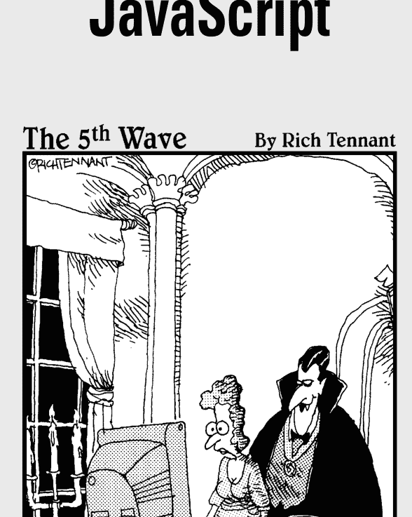

"看看我的网站吧，卡鲁瑟斯女士。深深注视它旋转的螺旋，旋转，旋转，将你拉入它的漩涡，更深……更深……"

### 本部分内容……

你将进入 JavaScript 编程的世界。你在本部分学到的编程类型适用于任何编程语言。你将能够毫无困难地将这些概念移植到任何主流语言。当然，示例和重点都基于 JavaScript。

第 1 帮助你收集工具。专业的 JavaScript 编程所需的大部分工具都是完全免费的。了解你在编辑器、浏览器和插件方面需要什么。

第 2 带你入门 JavaScript。你将把数据存储在变量中，处理文本数据，并进行一些基本的输入和输出操作。

第 3 将你带入决策的精彩世界。你将学习如何生成随机数，然后用它们来试验几种决策机制。你的程序将做出最棒的决策。

第 4 介绍循环这个强大的概念。你的程序将能够按需重复执行任意次数，并能在需要时立即停止。循环也可能导致难以发现的逻辑问题，因此本章还介绍了一些调试技术。

第 5 帮助你通过组合元素来构建更强大的程序。你可以组合变量来创建数组，也可以组合语句来创建函数。你还将学习如何组合指令和数据来创建对象，包括强大的 JSON 对象。


## 第一章：将网络提升至新高度

### 本章内容

- 回顾HTML、XHTML和CSS
- 探讨JavaScript和AJAX的作用
- 探索JavaScript和AJAX能为网页增添哪些功能
- 选择编辑器
- 构建你的浏览器工具包

网络举足轻重。创建网页充满乐趣，几乎每家 businesses 都需要它们。随着网络的发展和变化，人们对网页是什么、能做什么的期望也发生了改变。如果你已经了解HTML或XHTML，你就知道如何创建网络文档——如果需要复习，请查看配套网站 www.dummies.com/go/javascriptandajaxfd 或我个人网站 www.aharrisbooks.net/jad 上的附录第一章。

随着网络的演变，用于创建网页和文档的工具也在不断发展。JavaScript和AJAX是创建动态网络文档的两大强大工具。本章将介绍构建网页的一些主要技术，助你入门。

### 构建炫酷应用

本书旨在为网页添加单纯使用HTML和CSS无法实现的功能。

请明确；我们这里谈论的是编程——编程比单纯的老式网页开发要难一些。然而，正如图1-1所示的示例页面所展示的，这一切都非常值得。

为了保持示例简洁，我使用了一些外部库。这些库将在本书第四部分进行讲解，但现在，请欣赏这里正在发生的激动人心的事情。

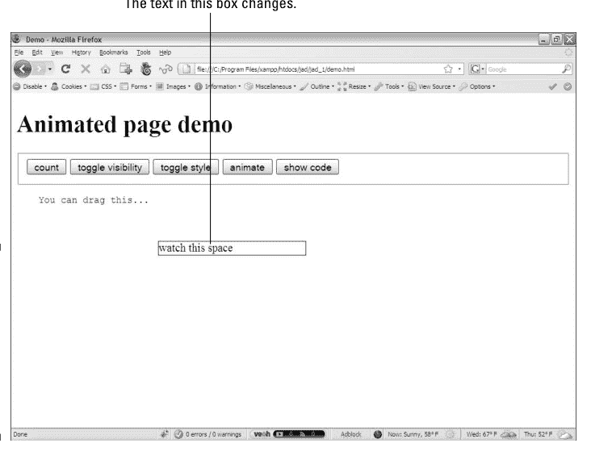

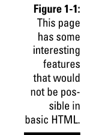

此程序需要活动的互联网连接才能正常工作。查看第10章了解连接外部库的一些替代方案。

> **提示** 如果你想看看这个页面的实际运行效果（你真的应该看看），请访问本书的配套网站：www.aharrisbooks.net/jad 或 www.dummies.com/go/javascriptandajaxfd。本书中的这个程序以及其他所有程序和示例都可以在该网站上找到。

乍一看，这个网页似乎很简单，但当你在自己的浏览器中打开它（你应该这样做）并开始操作时，很快就会发现它蕴含着许多惊喜。这个非常简单的页面阐明了你为何应该学习JavaScript和AJAX的许多原因。

- **按钮具有功能。** 你可能已经掌握了如何在纯HTML中创建表单元素（如按钮和文本字段），但HTML无法对按钮和文本字段进行任何操作；这就是为什么你需要编程语言。

如果你希望发生一些有趣的事情，你需要编程语言。每个按钮都使用JavaScript来执行一些有趣的工作，但页面现在可以交互，这本身就是一个巨大的变化。有了JavaScript，你可以构建*应用程序*，而不仅仅是页面。

- **计数按钮动态改变页面。** 当你点击计数按钮时，新内容会自动添加到页面上。一个程序会计数计数按钮被按下的次数，并将文本添加到“关注此区域”部分。随着用户与页面的交互，页面上会出现原本不在服务器上的内容。

当然，这个例子很简单，但你将能够动态地向任何网页元素添加任何类型的文本。这是一项非常强大的功能。图1-2显示了我点击几次计数按钮后页面的样子。

计数按钮

用户每次点击计数按钮，都会在此部分添加一行新内容。

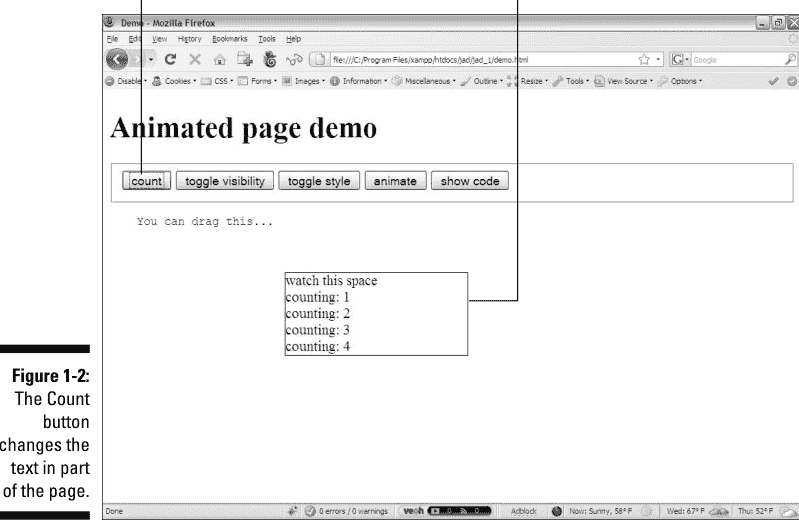

我点击了切换可见性按钮，输出内容消失了。

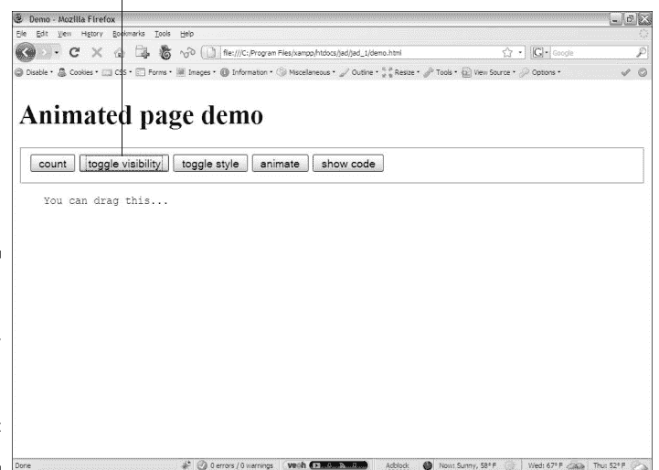

- **图1-3：** 点击切换可见性按钮，使包含输出的面板重新出现。

- **切换可见性按钮控制内容的显隐。** 在HTML中，你确实无法真正修改内容的显示或隐藏。在CSS中可以一定程度上实现，但JavaScript为你提供了一套更强大的工具，可以随时更改页面的哪些部分对用户可见。查看图1-3，看看输出部分被隐藏时的页面。

- **切换样式按钮即时改变页面部分的外观。** 你可以使用JavaScript更改页面任何部分的内容（即HTML）——但你*也可以*使用JavaScript实时修改外观（CSS）。在这个例子中，我创建了一个特殊的CSS类 `funky`，每次用户点击按钮时，该类会被添加到输出框或从输出框中移除。这种方法适用于任何CSS类。（很神奇，对吧？）图1-4显示了应用 `funky` 类后的页面。

如果你需要复习CSS或XHTML，请查看网站上的附录章节：www.dummies.com/go/javascriptandjaxfd 或 www.aharrisbooks.net/jad。

我在本章的一些图中添加了标注，以描述正在发生的事情。仅凭本书中的图片不足以理解页面的功能。请到 www.dummies.com/go/javascriptandjaxfd 或 www.aharrisbooks.net/jad 找到该程序并亲自查看。

切换样式按钮

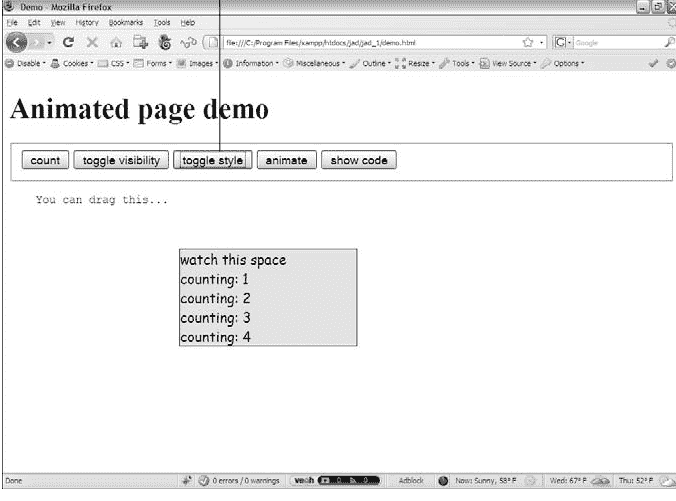

图1-4：你可以动态改变任何页面元素的外观。

- **动画按钮更有趣。** 动画按钮对输出框进行一系列渐进式更改，随时间改变其大小、形状和外观。（你真的应该试试；截图无法充分展现其效果。）

- **显示代码按钮从外部文件引入文本。** 此按钮使用一种简单的AJAX形式，将外部文件实时加载到页面中。这是构建模块化页面的简便方法。实际上，我引入的是JavaScript代码的副本，这样你就可以看到它的工作原理。如果你还不理解，请不要担心。这就是本书的目的！图1-5展示了此操作的实际效果。

- **允许用户拖动代码。** 用户可以拿起代码并将其移动到任何想要的位置。这是普通网页中闻所未闻的另一种功能。

> **提示** 不，通常你不会向用户显示你的代码。我只是说明从服务器引入任意文本文件相当容易。既然你现在是一名程序员，我选择将代码预览作为我引入的文本文件展示给你看。

这些能力意义深远，而且仅仅是个开始。学习编程将把你的网页从静态文档转变为能够以新颖、令人兴奋的方式与用户互动的动态应用程序。

> **提示** 请随意查看此项目的代码。它实际上包含三个文件：`demo.html`、`demo.css` 和 `demo.js`。所有文件都可以在本书配套网站的第1章文件夹中找到。当页面在浏览器中显示时，使用“查看源代码”可以查看HTML文件的源代码。

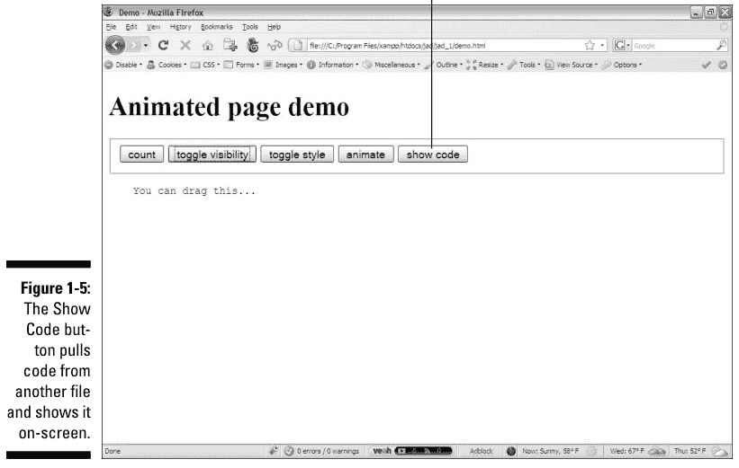

点击查看来自另一个文件的代码。

图1-5：显示代码按钮从另一个文件中拉取代码并将其显示在屏幕上。

我在代码中添加了大量注释，以帮助你了解正在发生的事情，即使你还没有完全掌握所有细节也没关系。将此视为你将在本书中学习的内容的预览。

### 开始学习

让你的页面实现所有这些功能看起来很有趣，而且确实如此。有很多内容需要掌握，但不要惊慌；我会带你逐步完成一切。第一步是回顾JavaScript和AJAX所基于的核心技术，并了解它们如何与你最终需要的一些其他（更高级的）技术相关联。

### 核心技术概述

尽管功能强大，但JavaScript和AJAX并非独立存在。它们只在网页的上下文中有意义，因此依赖于各种网络技术。如果你想构建JavaScript应用程序，你还需要其他几项技术：


## 第一章：将网络推向新高度

-   **HTML**：HTML（超文本标记语言）是描述网页的基础标记语言。它是一种相对简单的网站构建技术，仅需纯文本编辑器即可完成。

-   **XHTML**：XHTML通常被视为HTML的后续版本。由于它不允许使用某些标签，实际上XHTML是一种更小、更易使用的语言。通常XHTML页面比HTML更依赖CSS，因为许多HTML标签被CSS工具所替代。

-   **CSS**：CSS（层叠样式表）是一种为HTML或XHTML页面添加特定样式信息的方法。HTML和XHTML提供通用框架，而CSS则描述颜色和布局。

-   **JavaScript**：JavaScript是一种嵌入所有现代Web浏览器的编程语言。它专为与网页交互而设计；你可以使用它从页面的某些部分提取信息，并实时操作页面。

-   **AJAX**：（异步JavaScript和XML）是一种允许JavaScript与Web服务器更直接通信的技术。它在Web浏览器和Web服务器之间建立了一种有趣的新关系。本书约有一半内容专门讲解AJAX。

-   **PHP**：（PHP超文本预处理器）是用于Web服务器的几种重要语言之一。虽然它不是本书的主要关注点，但PHP语言能完成JavaScript无法实现的功能。AJAX经常被用来连接JavaScript应用程序和PHP程序。你将在第14章获得PHP的简要介绍。

-   **Java**：Java是一种与JavaScript完全不同的语言（尽管名称相似）。虽然Java在客户端-服务器关系的客户端和服务器端都有用处，但它不是本书的主要关注点。

当你在线寻求JavaScript帮助时，请务必咨询Java*Script*专家，而不是*Java*程序员。尽管这两种语言名称相似，但它们是完全不同的语言。Java程序员喜欢表现得高人一等，如果你在Java论坛提问JavaScript问题，他们可能会让你难堪。如有疑问，可以在我的网站（www.aharrisbooks.net）上提问。我可以帮助你解决这两种语言的问题，即使你有些困惑，我也不会介意（或因此烦扰你）。

## *选择你的计算机*

当然，你需要一台计算机。幸运的是，它不必是任何特别的东西。任何可用于查看网页的计算机也可以用来创建它们。任何主要操作系统（Windows、Mac和Linux）都完全没问题。我的大部分工作都是在Linux（Fedora Core）和Windows XP的组合上完成的，但本书中的所有程序在任何足够现代的计算机上都能完全正常运行。

在某个时候，你会希望你的网页能在互联网上访问。虽然你可以在家用计算机上安装服务器，但通常最好使用在线托管服务。你通常可以非常便宜甚至免费获得非常好的在线托管。如果你想为你的网站指定一个特定的名称（例如`www.mySite.com`），那么你需要每年支付约10美元来注册域名。托管服务通常使用Linux，但你可能会使用一个隐藏所有细节的在线界面。

合适的工具使任何工作变得更容易，但对于Web开发，许多真正优秀的软件工具都是完全免费的。因为这些工具是开源的（根据鼓励分发的许可证提供），所以使用它们是完全合法的，无需付费，不像通过非法方法获得的商业程序。

你可以使用任何带有文本编辑器和浏览器的计算机进行基本的Web开发。随着你的Web调整技能变得更加成熟，你可能需要更强大的工具。继续阅读，了解一些完全免费的优秀工具。

### 选择编辑器

网页、JavaScript、HTML和CSS最终都是文本形式。你实际上不需要任何特定的程序来编写它们。不过，拥有完全合适的工具可以让你的生活轻松很多。既然你要花大量时间与你的Web工具打交道，你应该了解你的选择。

### 避免有问题的工具

使用错误的工具确实会让你的生活变得困难。以下是一些不太适合Web开发工作的工具：

-   **Microsoft Word**：文字处理程序很棒（我正在用它写这本书），但它们并非真正为创建网页而设计。Word（以及所有其他文字处理器）在文件中存储了大量纯文本以外的信息。所有这些格式设置对于非Web文档来说很棒，但HTML和CSS有自己的管理这些数据的方法，其他东西反而碍事。即使“另存为HTML”命令也有问题。虽然它以HTML形式存储页面，但Word的格式设置极其笨重且难以处理。生成的页面将不适合改编为JavaScript。

-   **记事本**：这是大多数Windows版本内置的经典工具。它以纯文本形式保存页面，因此对于Web开发来说比Word更好，但记事本对于任何认真的工作都过于简单。它缺乏行号这样的基本功能——而且不能一次处理多个文档。作为Web开发工具，你很快就会超越记事本。

-   **TextEdit**：Mac上的默认文本编辑器是一个非常强大的工具，但它更像是一个文字处理器，而不是我所说的真正的文本编辑器。当你在TextEdit中保存HTML文件时，它通常不会以你需要的方式存储：你不会看到代码的结果，而是会看到代码本身。如果你想将TextEdit用于HTML或JavaScript，请确保在保存文件之前选择Format⇄Make Plain Text。

-   **图形编辑器**：一些高端图形编辑器，如Adobe Photoshop、Adobe Fireworks和Gimp，也具有导出为HTML的能力，但它们生成的代码不容易处理。最好使用这些程序编辑你的图形，并使用专门的文本编辑器处理你的代码。

### 使用WYSIWYG编辑器

WYSIWYG（“所见即所得”）编辑的承诺非常诱人。文字处理程序多年来一直具有这种功能。当你在屏幕上编辑文档时，可以实时准确地看到它在纸上的样子。许多工具承诺为网页提供这种功能：Adobe Dreamweaver是最受欢迎的，其次是Microsoft FrontPage及其替代品ExpressionWeb。尽管这些工具在传统Web开发中很受欢迎，但在本书中我们所做的交互式工作方面，它们存在一些缺点：

-   **WYSIWYG是一个谎言。** WYSIWYG的整个假设在输出是*在打印机上打印的纸质文档*时效果很好。你可以预测输出将如何工作。网页则不同，因为输出显示在别人拥有的显示器上。你不知道它会有多大，支持什么颜色，或者安装了什么字体。你也不知道用户将使用哪个浏览器查看页面，这可能会对页面的输出产生重大影响。

-   **编辑器隐藏了你需要的细节。** 可视化编辑器试图保护你免受Web开发某些细节的困扰。这在开始时没问题，但在某个时候你会需要那种级别的控制。大多数使用Dreamweaver的专业人士将大部分时间花在代码视图中，忽略了可视化编辑器的优势。为什么要为那些你将忽略的功能付费？

-   **可视化编辑器假设文档是静态的。** 可视化编辑器基于网页是普通文档的理念。我们在本书中构建的页面远不止于此。你将（例如）编写代码来动态创建和修改Web文档。你需要知道如何手动构建Web文档，以便编写动态构建和更改它们的代码。


### 程序员编辑器简介

许多专业编辑器应运而生，旨在填补纯文本编辑器与所见即所得工具之间的空白。这些编辑器以纯文本方式编写，但具备针对程序员的额外功能，包括：

- **语言感知：** 程序员编辑器通常知道你正在使用哪种语言编写，并能自适应，无论你是在编写 HTML、JavaScript 还是 CSS 代码，都能提供帮助。大多数通用程序员编辑器原生支持所有这些语言，而且通常还能帮助更多其他语言。

- **语法高亮：** 各种元素以不同颜色显示，这样你就能区分哪些是纯文本，哪些是 HTML 标签的一部分，等等。这个简单的功能可以让你更容易发现缺少引号之类的问题，并快速查看页面的整体结构。

- **语法支持：** 程序员编辑器通常提供某种帮助来记住你所用语言的语法。这种提升可以体现为处理常见代码的按钮和宏、标准布局和模式的预编写模板，以及语法补全（它会查看你输入的内容，并根据你当前使用的语言建议补全）。

- **多文档支持：** 高级 Web 应用程序通常需要同时编辑多个不同的文档。你可能有十几个网页，加上几个 CSS 样式表和一两个外部 JavaScript 文件。程序员编辑器允许你同时查看和编辑所有这些文件。许多编辑器还允许你生成*项目文件*，这样你就可以自动保存所有相关文件，并一次性加载它们。

- **宏工具：** 编程通常需要重复性的输入任务。具备录制和回放按键序列作为*宏*（简短的自动化操作）的功能，会非常有帮助。

- **调试和预览支持：** 大多数程序员编辑器都有在浏览器中预览代码的工具（有时直接在编辑器中预览）。这些编辑器通常还有预测某些错误或在错误发生时响应错误的工具。至少，你需要能够直接跳转到代码的特定行或部分。

- **缩进支持：** 大多数程序员使用缩进作为强大的工具，帮助他们理解正在构建的 Web 文档的结构。一个好的编辑器可以协助你进行缩进，还能帮助你在文档结构出错时识别出来。

### 熟悉一些重要的编辑器

有几款多用途程序员编辑器立刻浮现在脑海中。你应该考虑研究以下这些免费程序中的一个或多个：

- **vi 和 emacs：** 它们是所有文本编辑器的鼻祖。两者在 Unix/Linux 环境中非常常见。它们也有 Windows 和 Mac 版本。尽管功能极其强大，但 vi 和 emacs 是在现代可用性理念尚未成熟的时代开发的。如果你已经知道如何使用其中一个工具，请务必研究一下现代变体。（坦白说，我仍然使用 emacs 作为我的主要文本编辑器，尽管我不知道在今天有这么多更简单选择的情况下，我是否还会学习它。）图 1-6 展示了使用 emacs 编辑网页的情景。

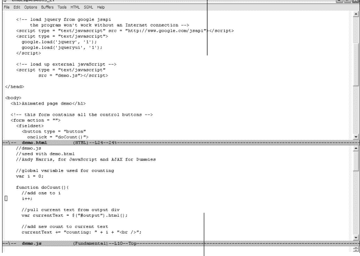

- **Notepad++：** 这才是 Windows 记事本应有的样子。它继承了 Windows 记事本的速度和简洁性，但为程序员添加了海量功能。我特别喜欢它内置的页面验证支持。这是少数几个在我的桌面上获得永久快捷方式的程序之一。遗憾的是，它只支持 Windows。图 1-7 展示了同一页面在 Notepad++ 中编辑的情景。

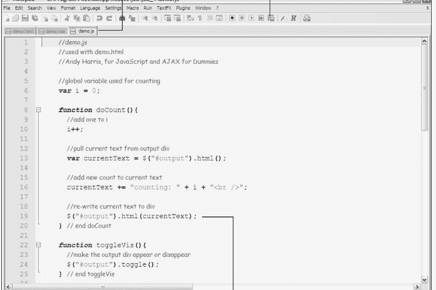

- **Bluefish：** Bluefish 文本编辑器正迅速成为 Web 开发者的最爱工具。它快速而强大，拥有大量面向 Web 开发者的出色功能。一个特别强大的工具是 CSS 生成器，它通过菜单系统帮助你开发样式表，这样你就不必记住任何语法。它还有一个出色的默认模板生成器，这让构建 XHTML-strict 网页变得更加容易。Bluefish 适用于所有主流平台（对于 Windows 版本，你还需要安装免费的 GTK 库）。你可以在图 1-8 中看到 Bluefish 的运行效果。

**图 1-8：** Bluefish 是一款非常优秀的 XHTML 和 JavaScript 编辑器。

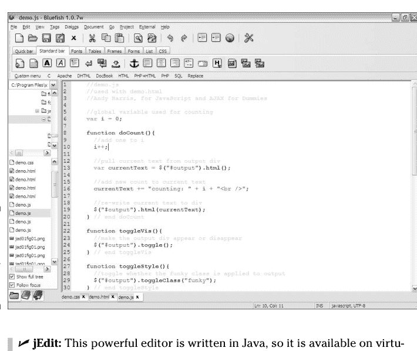

- **jEdit：** 这款强大的编辑器用 Java 编写，因此几乎适用于所有平台。它的基本格式就是一个非常强大的编辑器，但其最佳特性是广泛的插件库，允许你根据自己的需求进行定制。如果你安装了免费的 XML 库，jEdit 对 HTML 和 XHTML 的支持将令人惊叹。图 1-9 展示了示例程序在 jEdit 中编辑的情景。

**图 1-9：** jEdit 是一款用 Java 编写的快速而强大的编辑器。

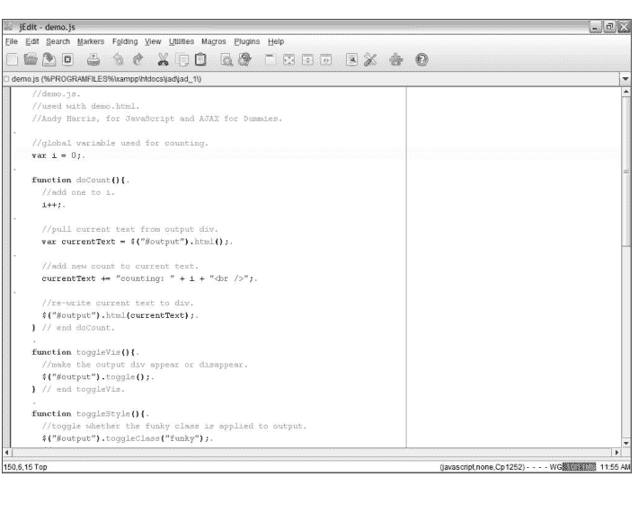

```javascript
//demo.js
//used with demo.html.
//Andy Harris, for JavaScript and AJAX for Dummies.

//global variable used for counting.
var i = 0;

function doCount(){
	//add one to i.
	i++;

	//pull current text from output div.
	var currentText = $("#output").html();

	//add new count to current text.
	currentText += "counting: " + i + "<br />";

	//re-write current text to div.
	$("#output").html(currentText);
} // end doCount.

function toggleVis(){
	//make the output div appear or disappear.
	$("#output").toggle();
} // end toggleVis.

function toggleStyle(){
	//toggle whether the funky class is applied to output.
	$("#output").toggleClass("funky");
```

- **CodeTetch：** 这款编辑器的独特之处在于，它并非独立的编辑器，而是流行 Firefox 浏览器的一个扩展。它拥有与其他编辑器相同的大部分功能，而且方便之处在于它已经是浏览器的一部分。它的可配置性不如其他一些工具，但仍然非常实用。你可以在图 1-10 中看到 CodeTetch 的运行效果。

**图 1-10：** Firefox 的 CodeTetch 插件是一款完整的 Web 编辑器。

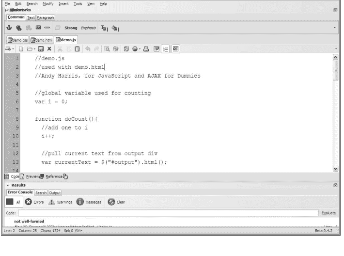

```javascript
//demo.js
//used with demo.html
//Andy Harris, for JavaScript and AJAX for Dummies

//global variable used for counting
var i = 0;

function doCount(){
	//add one to i
	i++;

	//pull current text from output div
	var currentText = $("#output").html();
```

### Aptana 简介

近年来，有一款程序员编辑器真正占据了 Web 开发领域的主导地位。Aptana 是一款功能齐全的程序员编辑器，基于强大而流行的 Java 编程 Eclipse 编辑器。Aptana 有很多值得推荐的地方：

- **对 Web 语言的广泛内置支持：** Aptana 开箱即支持 HTML/XHTML、CSS、JavaScript 和 AJAX。

- **语法高亮：** 大多数程序员编辑器都有语法高亮功能，但 Aptana 在这方面尤为出色。有时同一个物理文档中同时激活了三种或更多不同的语言，而 Aptana 通常能通过上下文判断你是在编写 CSS、XHTML 还是 JavaScript 代码。

- **代码补全：** 这是 Aptana 最令人印象深刻的功能之一。当你开始编写一行代码时，Aptana 会弹出一个建议菜单。这有助于你避免错误，这样你就不必准确记住所有各种 CSS 属性和 JavaScript 命令。

- **错误检测：** Aptana 可以在你创建文档时检查它，并实时高亮某些区域。这个功能可以帮助你编写更好的代码，还可以帮助你磨练编写代码的技能。

- **AJAX 支持：** AJAX 是一项相对较新的技术，大多数编辑器并不直接支持它。Aptana 有许多帮助你使用 AJAX 的功能，包括对所有主要 AJAX 库的内置支持。

Aptana 完全免费。我在本书的网站上放置了 Aptana 的链接（事实上这里提到的所有工具都有链接）。你可以在图 1-11 中看到 Aptana 的运行效果。

我的个人设置因机器而异，但通常我使用 Aptana 进行重度编程，在 Windows 上使用 Notepad++ 作为快速编辑器，在 Linux 或 Mac 机器上使用 emacs 作为我的主要基础文本编辑器。当然，随着你的使用，你会形成自己的偏好。所有这些编辑器都是免费的，可在 www.aharrisbooks.net/jad 获取，因此它们值得你进行一些尝试。


图 1-11：Aptana 可能是性价比最高的 Web 编辑器。

-   自动语法高亮和代码补全
-   多文档支持
-   集成文件管理工具
-   用于调试和错误信息的控制台区域
-   自动生成显示页面或程序主要部分的地图

### 创建你的浏览器集合

网页存在于 Web 浏览器的上下文中。每个浏览器对 HTML 和 CSS 的解释都略有不同，而当你开始谈论 JavaScript 和 AJAX 时，这些差异会被放大。浏览器支持你代码的方式存在细微（有时并非那么细微）的差异，这可能非常重要。

#### 设立标准

每个 Web 浏览器都有自己独特的显示网页的方式。尽管这些方式非常相似，但差异有时会成为问题。更糟的是，当你开始编写 JavaScript 代码时，你会发现每个浏览器对代码的解释都不同。这可能真的会一团糟。

幸运的是，近年来在标准化方面取得了很大进展。各大浏览器开发者一直在共同商定由一个名为*万维网联盟* (W3C) 的中心团队提出的各种标准。当浏览器实现 JavaScript 时，它现在（至少理论上）同意遵守一套行为标准。只要你的代码遵循相同的标准，你就可以期望一切都能很好地工作。（至少大多数时候是这样。）

> **提示：** 在本书中，我遵循大多数开发者所采用的公认 JavaScript 标准。本书中的所有代码都在 Windows 版 IE7、Windows 版 Firefox 3 和 Linux 版 Firefox 3 上进行了测试。任何时候代码可能引起特定浏览器问题时，我都会尝试指出具体问题。

#### 选择一两个浏览器

以下是一些你应该了解的浏览器：

-   **旧版浏览器：** 你会发现许多旧版浏览器仍在互联网上使用。有些人一直坚持使用他们购买机器时自带的浏览器，多年未曾升级。早于 IE6 或 Firefox 的浏览器尤其成问题，因为在 Web 早期，浏览器对 Web 标准*以及* JavaScript 的支持非常不均衡。在很大程度上，本书假设你的用户将使用至少是有点现代的浏览器。

    特别是 AJAX 在非常古老的浏览器上无法运行。

-   **Microsoft Internet Explorer 6：** 这是一款非常常见的浏览器，仍然广泛使用。它曾一度是互联网上的主流浏览器，但近年来已失宠，被微软的较新产品以及 Firefox 和 Opera 等竞争对手的产品所取代。该浏览器因其许多不符合社区标准的“特性”而闻名。其使用率正在下降，但截至撰写本文时，你仍然必须考虑支持它；很多用户仍在使用。

-   **Firefox：** Mozilla 的 Firefox Web 浏览器通过提供多年来微软首次遇到的有力竞争，重新点燃了所谓的“浏览器大战”。Firefox 以其令人印象深刻的功能真正让人眼前一亮：标签页浏览、改进的安全性和集成搜索。对于开发者来说，Firefox 是最早真正严肃支持 Web 标准的浏览器之一。Firefox 对开发者特别重要，因为它的扩展架构允许程序员将 Firefox 转变为功能强大的开发工具。请参阅本章下一节，了解一些可添加到 Firefox 的优秀扩展建议。

> **记住：**

## 第一部分：JavaScript 编程

-   **Microsoft Internet Explorer 7 和 8：** IE7 可以被视为对 Firefox 的致敬，因为它包含了許多相同的功能。在编写本书时，IE8 推出，并增加了一些改进。尽管 IE7 和 IE8 对标准的支持不如当前其他一些浏览器完善，但它们比 IE 的任何早期版本都要好得多。

-   **Opera：** Opera 是一款重要的浏览器，因为它是最早积极支持 Web 标准的浏览器之一。它在某些圈子中非常流行，但从未获得广泛普及。由于它支持 Web 标准，因此通常可以运行任何为符合标准的浏览器编写的代码。

-   **Safari：** Safari 是 Mac OS 附带的 Web 浏览器。它是一款功能非常强大的符合标准的浏览器。现在已有 Windows 版本可用。iPhone 内置的 Web 浏览器使用与 Safari 相同的引擎，因此如果你正在为移动设备构建应用程序，这是一个重要的考虑因素。

-   **Chrome：** 这款较新的浏览器由 Google 创建。它高度符合标准，并且在处理 JavaScript 和 AJAX 方面尤其强大。这并不奇怪，考虑到 Google 是率先使用 AJAX 并积极推广其使用的公司之一。Chrome 拥有通用使用的最快的 JavaScript 解释器之一。

-   **其他浏览器：** 今天还有许多其他浏览器在使用，包括各种 Linux 形式、手机和 PDA 上的专用浏览器。几乎不可能支持所有这些浏览器，但许多浏览器现在至少尝试支持 Web 标准。

> 我更喜欢主要使用 Firefox 3 进行测试，因为它具有非常好的标准支持以及一套用于改进和调试代码的优秀工具。然后我再在包括 IE6、IE7 和 Chrome 在内的其他浏览器上检查我的页面。

#### 将 Firefox 变成开发利器

Firefox 对于 Web 开发者来说是一款特别重要的浏览器。它具有许多吸引人的功能，包括其在 HTML 和 JavaScript 方面出色的标支持。然而，Firefox 作为开发者工具的最重要优势可能是它对扩展的支持。许多商业浏览器将其代码视为高度机密，并且非常难以扩展。Firefox 从一开始就被设计为可扩展其功能——许多非常聪明的程序员为该工具添加了令人难以置信的扩展。其中一些扩展已成为 Web 开发者的“必备品”：

#### Web Developer Toolbar

Chris Pederick 的 Web Developer Toolbar 是一个令人难以置信的工具。它在 Firefox 中添加了一个新的工具栏，具有许多极其有用的功能：

-   **编辑 CSS：** 你可以弹出一个小型窗口并输入 CSS 代码。CSS 会立即实时生效，因此你可以确切看到你的 CSS 对页面视图的影响。

-   **显示标尺：** 这个非常方便的工具允许你在页面上绘制一把标尺，以确切查看各种元素的大小。这对于调试 Web 布局非常有用。

-   **轮廓化表格：** 此工具帮助你理解基于表格的布局。它是查看复杂表格设计如何创建的好方法。

    最好避免基于表格的布局，但有时你不得不查看别人的页面。

-   **调整大小菜单：** “调整大小”菜单让你可以看到你的页面在许多其他标准尺寸下的样子。当你在设计布局时，这可能非常有用。

-   **验证工具：** Web Developer 包含许多非常方便的工具，用于验证你的 Web 页面。它包含用于验证 HTML 和 CSS 以及主要可访问性标准的链接。

#### HTML Validator 扩展

这个令人难以置信的扩展将 W3C 使用的相同验证引擎带到你的浏览器中。它会对你查看的任何页面的有效性提供快速反馈。它还会向 Firefox 的“查看源代码”页面添加更多信息，包括关于你具体存在哪些验证错误的反馈。（常规的“查看源代码”页面不提供验证信息。）修复错误的提示实际上很有帮助，还有一个工具可以使用优秀的 HTML Tidy 程序自动修复代码。HTML 是你的 JavaScript 代码的基础，无效的 HTML 提供了一个有缺陷的框架。有了 HTML Validator，就没有理由拥有无效的页面。图 1-12 显示了改进后的“查看源代码”窗口，其中包含警告选项卡以及使用 HTML Tidy 修复代码的按钮。


 ## 28 第一部分：使用 JavaScript 编程

查看源代码窗口

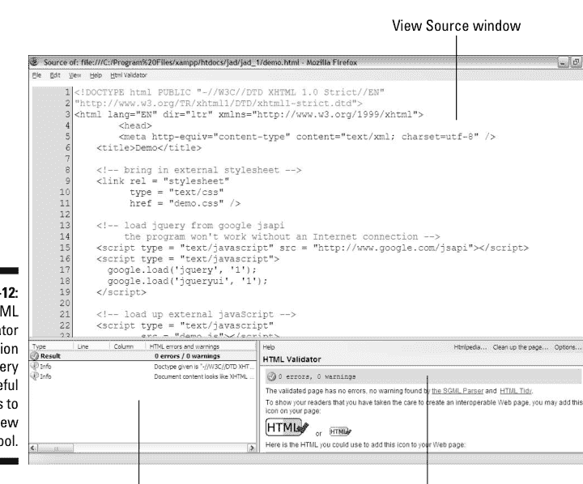

图 1-12：HTML Validator 扩展为"查看源代码"工具添加了许多实用功能。

验证器错误会显示在此窗口中。

Validator 扩展提供了有用的错误信息。

#### Firebug

Firebug 扩展是 Web 开发中最重要的工具之一。它能将 Firefox 变成一个完整的调试工具。Firebug 有几个特别有用的功能：

- **检查窗口：** 这个神奇的工具让你可以将鼠标移到页面中的任何元素上，并立即在另一个面板中看到创建该部分的代码。这是一种非常轻松的页面分析和调试方式。你还可以即时查看哪些 CSS 应用于特定的代码片段，并高亮代码以查看对应的输出。
- **CSS 查看和编辑：** 你可以在一个面板中查看页面的 CSS，预览任何颜色，并编辑数值。你将实时看到页面上的结果。
- **JavaScript 调试：** 即使是专业人士也会犯错——到目前为止，适用于 JavaScript 程序员的调试工具寥寥无几。Firebug 的错误捕获机制比浏览器自带的更好，它还内置了一个非常出色的调试器，能在程序运行时真正帮助你找到错误。
- **AJAX 监控：** AJAX 编程基于与服务器之间的一系列往返请求。Firebug 帮助你追踪这些请求，观察数据的传输。
- **实时代码视图：** 大多数浏览器的普通"查看源代码"菜单只能让你看到最初从服务器传来的代码。在 JavaScript 编程中，你经常动态地修改页面代码。Firebug 向你展示页面的真实状态，即使它正被 JavaScript 修改。这是一个非常实用的功能。
- **Firebug 精简版：** 这是 Firebug 的一个变体，可在 IE 和其他浏览器中运行。它将 Firebug 的大部分功能添加到任何浏览器中。

图 1-13 显示了 Firebug 的检查模式。当用户将鼠标移到页面的某个部分时，相关的代码段会出现在代码窗口中。

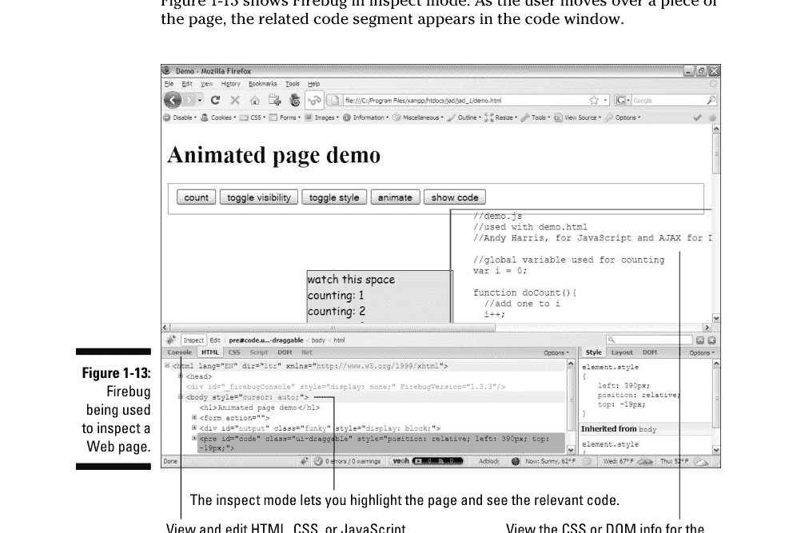

# 第 2 章

## 编写你的第一个程序

- 将 JavaScript 代码添加到你的页面中
- 为 JavaScript 设置开发环境
- 创建变量
- 使用模态对话框进行输入和输出
- 使用拼接来构建文本数据
- 理解基本数据类型
- 使用字符串方法和属性
- 使用转换函数

网页从 XHTML 代码开始。这种基本代码提供了框架。CSS 为基本结构添加装饰，但要让你的页面真正"歌舞升平"，你需要学习一门编程语言。

JavaScript 语言是一种非常流行的入门语言，因为它专为与网页交互而设计，而且已经内置在大多数 Web 浏览器中。它相对容易学习，而且功能非常强大。

学习编程语言的想法可能看起来令人望而生畏，但别担心。编程其实并没有那么难。在本章中，我将向你展示如何开始。你很快就能像专业人士一样编写代码。

### 成为程序员

JavaScript 最初由 Netscape 通信公司开发。现在它几乎已成为每台浏览器的标准。关于 JavaScript，有几件事你应该立即了解：

- **它是一门真正的编程语言。** 有时，使用 C++ 和 VB.NET 等其他语言编程的人会嘲笑 JavaScript，声称它不是"真正的"编程语言，因为它缺少某些功能。这些功能（特别是与本地文件系统通信的能力）是故意省略的，以确保 JavaScript 的安全性。（本书后半部分将向你介绍一些提供这些功能的 AJAX 替代方案。）JavaScript 是一门真正的语言，而且它是开始学习编程的一个非常好的选择。
- **它不是 Java。** 还有另一门流行的编程语言叫 Java（没有 script 部分），它也用于 Web 编程。JavaScript 和 Java 是完全不同的语言（尽管名称相似）。确保你不要去 Java 论坛问 JavaScript 的问题。那些 Java 程序员可能会显得有些傲慢和优越感。（他们不应该这样；我也用 Java 编程。这只是一门语言。）
- **它是一门脚本语言。** JavaScript 是一门相当容易掌握的语言。它不像某些其他语言那么严格（我在说你呢，Java），而且它对事物持相对宽松的态度（首先，它对什么类型的数据放在哪里要求不那么苛刻）。这让你可以更专注于解决问题，而不必过于担心代码的具体写法。它仍然是一门编程语言，所以有一些规则你必须遵守，但像 JavaScript 这样的脚本语言往往比那些庞大的"怪兽"语言对初学者友好得多。

### 选择 JavaScript 编辑器

JavaScript（与 XHTML 和 CSS 一样）本质上只是文本。你可以在与 XHTML 和 CSS 相同的编辑器中修改 JavaScript 代码。如果你之前用过 Aptana（第 1 章中提到过）并且喜欢它，你现在会更喜欢这个编辑器。当然，如果你愿意，也可以继续使用其他编辑器。

JavaScript 是一门完全不同的语言，使用与 HTML 和 CSS 不同的语法。它不难学，但任何真正的编程语言都有很多内容要学。Aptana 有许多非常出色的功能，在你编写 JavaScript 代码时能提供巨大帮助：

- **语法高亮：** 与 HTML 和 CSS 一样，Aptana 会自动调整代码颜色，帮助你了解程序中的情况。正如本章稍后所示，当事情变得复杂时，这能带来很大的好处。
- **代码补全：** 当你输入对象名称时，Aptana 会提供可能的补全列表。这非常有用，让你不必记住各种函数和命令的所有细节。
- **帮助文件：** My Aptana 页面（如果你之前关闭了，可从文件菜单找到）提供了指向 HTML、CSS 和 JavaScript 优质帮助页面的链接。这些文档实际上比你在网上找到的一些资料更易读。
- **集成帮助：** 将鼠标指针悬停在 JavaScript 命令或方法上，会弹出一个精巧的小文本框，精确解释它的工作原理。通常框中还包括一两个示例。
- **错误警告：** 当 Aptana 发现某些地方不对劲时，它会尝试给出错误信息，并在可疑代码下方标上红色波浪线（就像拼写检查器使用的那种）。

我不知道有任何比它更好的 JavaScript 编辑器，而 Aptana 是免费的，所以实在没有理由使用其他工具。当然，如果你不需要这些功能，也可以使用任何你喜欢的文本编辑器。

> 我注意到 Aptana 有一个奇怪的特点："预览"选项卡检查 JavaScript 代码的可靠性不如检查 XHTML 和 CSS 那么高。我发现直接在浏览器中运行代码，或使用"运行"按钮让 Aptana 在外部浏览器中运行代码，效果会更好。

### 选择你的测试浏览器

除了编辑器之外，你还应该根据测试 JavaScript 代码时的表现来仔细选择浏览器。

所有主流浏览器都支持 JavaScript，而且在各浏览器中的工作方式相对相似（至少在更高级的内容出现之前是这样）。然而，在测试代码方面，并非所有浏览器都一样。

> 编写 JavaScript 代码时总会出错，而浏览器负责告诉你出了什么问题。Firefox 在报告错误方面远胜于 IE。Firefox 的错误信息更易读、更易懂，而且 Firefox 支持一项称为 *JavaScript 控制台*（第 4 章介绍）的功能，这让查看情况变得容易得多。如果可能，请使用 Firefox 测试你的代码，然后在 IE 中检查差异。

第 4 章将为你提供更多关于查找和修复错误的内容——以及 Firefox 和 Aptana 中一些出色的工具，让这项重要的工作变得更轻松。

铺垫已经足够多了。拿出你的编辑器，开始编写一个真正的程序吧。开始其实非常简单。任何 JavaScript 程序的基础都是一个标准的网页。


### 将脚本添加到你的页面

JavaScript 程序的上下文是网页，因此请通过向一个基础网页添加一些内容来开启你的 JavaScript 之旅。如果你不熟悉 XHTML 或 CSS（用于基础网页开发的语言），请查阅本书配套网站上提供的额外章节（www.dummies.com/go/javascriptandajaxfd 或 www.aharrisbooks.net/jad），或者参考更完整的参考资料，例如 *HTML, XHTML, and CSS All-in-One Desk Reference For Dummies*（Wiley 出版）。

将 JavaScript 代码添加到你的页面非常简单。图 2-1 展示了任何计算机语言中最经典的入门程序。

这个页面包含一个非常简单的 JavaScript 程序，它会在一个名为*对话框*的特殊元素中弹出 "Hello, World!" 这句话。这很酷。

以下是代码的概览，随后我会一步一步详细解释。

```
<!DOCTYPE html PUBLIC "-//W3C//DTD XHTML 1.0 Strict//EN"
"http://www.w3.org/TR/xhtml1/DTD/xhtml1-strict.dtd">
<html lang="EN" dir="ltr" xmlns="http://www.w3.org/1999/xhtml">
  <head>
    <meta http-equiv="content-type" content="text/xml;
    charset=utf-8" />
    <title>HelloWorld.html</title>
    <script type="text/javascript">
      //<![CDATA[
      // Hello, world!
      alert("Hello, World!");
      //]]>
    </script>
  </head>

  <body>

  </body>
</html>
```

如你所见，这个页面的 HTML 主体中完全没有内容。你可以（而且将会）稍后将 JavaScript 与 XHTML 内容结合起来。不过现在，你可以简单地将 JavaScript 代码放在网页 head 区域的一个特殊标签中，让它运行起来。

### Hello, World？

在编程语言中，有一个悠久的传统：你在任何语言中的第一个程序都应该只输出 "Hello, World!"，仅此而已。这个习惯实际上有一个非常充分的实际理由。"Hello, World" 是你能编写的最简单、且可以证明其正常工作的程序。"Hello, World" 程序用于帮助你理解编程环境的运作机制——程序如何编写、需要执行哪些特殊步骤来运行代码，以及它是如何工作的。在你确认能让代码弹出来说声"你好"之前，编写更复杂的程序是没有意义的。

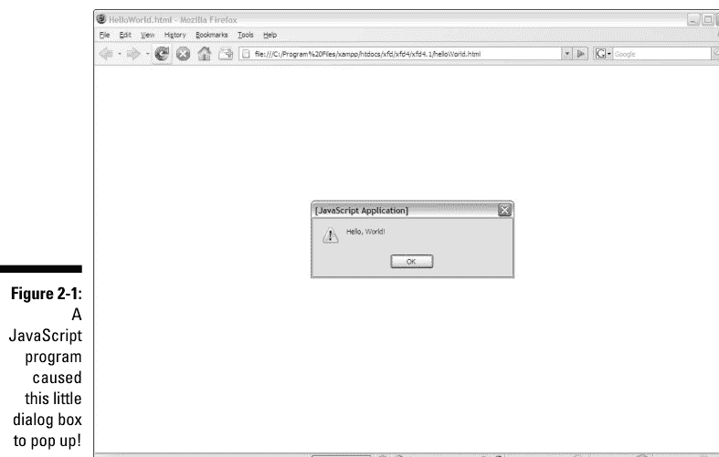

### 嵌入你的 JavaScript 代码

JavaScript 代码通过 `<script>` 标签放置到你的网页中。JavaScript 代码被放在 `<script></script>` 标签对内部。`<script>` 标签有一个必需的属性 type，通常会是 `text/javascript`。（其他类型也是可能的，但很少使用。）

上一节代码中另一个有趣的东西是那些奇怪的 CDATA 内容。在 `<script>` 标签内部紧接的下一行是：

```
// <![CDATA[
```

这行古怪的代码是一个特殊标记，说明接下来的代码是字符数据，不应被解释为 XHTML。脚本末尾用以下代码结束字符数据标记：

```
// ]]>
```

在现代浏览器中，将你的 JavaScript 代码标记为字符数据是个好主意。如果不这样做，XHTML 验证器有时会感到困惑，并声称你有错误，而实际上你没有。

那 `CDATA` 的内容确实很奇怪。很难记住，我知道，但只要多打几遍，你就会记住的。

很多较旧的书籍和网站并不包含这个字符数据技巧，但它非常值得掌握。你为了构建符合标准的页面已经付出了太多努力，不应该因为浏览器将你的 JavaScript 误认为格式不良的 XHTML 而导致不应得的错误消息弹出。

### 创建注释

与 XHTML 和 CSS 一样，在 JavaScript 中包含注释很重要。由于编程代码可能比 XHTML 或 CSS 更难理解，在 JavaScript 中添加注释比其他两个环境更加重要。JavaScript 中的注释字符是两个斜杠（`//`）。浏览器会忽略从两个斜杠到该行末尾的所有内容。你也可以使用多行注释（`/* */`），就和 CSS 中的用法一样。

### 使用 alert() 方法进行输出

JavaScript 有多种输出数据的方式。在这个示例中，我使用了 `alert()` 方法。这个方法会弹出一个包含文本供用户阅读的小对话框。警告框是*模态对话框*的一个例子。模态对话框会中断程序的流程，直到用户注意到它们。在用户通过点击 OK 按钮确认对话框之前，程序中不会发生任何其他事情。用户在点击按钮之前无法与页面交互。

模态对话框可能显得有些粗鲁。事实上，一旦你学会了一些其他的输入和输出技术后，你可能就不会经常使用它们了。对话框要求注意力的特性使得它在你开始编程时是非常容易使用的工具。当你掌握了基本的编程概念后，我会向你展示与网页交互的更优雅的方式。

### 添加分号

JavaScript 中的每条命令都以分号（;）字符结束。分号在大多数计算机语言中的作用就像英语中的句号：它表示一个完整意思的结束。通常代码中的每一行也是文本编辑器中的一行。

说实话，即使你省略分号，JavaScript 通常也能正常工作，但你还是应该加上它们，因为它们可以明确你的意图。此外，大多数其他语言（如第 14 章介绍的 PHP）都要求使用分号。你现在就应该养成一个好习惯。

### 引入变量

计算机程序通过处理信息来获得强大的功能。图 2-2 展示了一个从用户那里获取数据并用于个性化问候的程序。

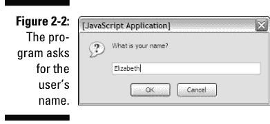

这个程序引入了一种新的对话框，允许用户输入一些数据。这些信息被存储在程序中以便后续使用。图 2-3 顶部展示了响应的第一部分。用户必须点击 OK 才能在第二个警告对话框中看到完整的问候语，如图 2-3 底部所示。

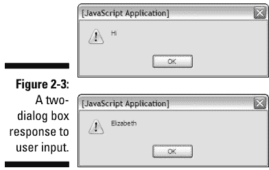

输出可能看起来并不那么惊人，但看看源代码就能明白发生了什么：

```
<!DOCTYPE html PUBLIC "-//W3C//DTD XHTML 1.0 Strict//EN"
"http://www.w3.org/TR/xhtml1/DTD/xhtml1-strict.dtd">
<html lang="EN" dir="ltr" xmlns="http://www.w3.org/1999/xhtml">
<head>
<meta http-equiv="content-type" content="text/xml;
charset=utf-8" />
<title>prompt.html</title>
<script type="text/javascript">
//<![CDATA[

var person = "";
person = prompt("What is your name?");
alert("Hi");
alert(person);

//]]>
</script>
</head>
<body>
</body>
</html>
```

### 创建用于数据存储的变量

这个程序很有趣，因为它允许用户交互。用户可以输入一个名字，该名字被存储在计算机中，然后在问候语中返回。这个程序的关键是一个名为*变量*的特殊元素。变量就是内存中用于保存数据的位置。任何时候你希望计算机程序"记住"某件事，你都可以创建一个变量并将信息存储在其中。

变量通常具有以下特征：

- **The `var` 语句。** 使用 `var` 命令表明你正在创建一个变量。
- **一个名称。** 创建变量时，你必须为其命名。
- **一个初始值。** 为每个变量立即赋予一个值是很有用的。
- **一个数据类型。** JavaScript 会自动确定变量中的数据类型（稍后会详细介绍），但你应该清楚自己期望某个特定变量包含什么类型的数据。

### 向用户询问信息

当变量包含信息时，它们会变得更有趣。JavaScript 有一个简单的工具叫做 `prompt`，它可以让你轻松地向用户提出问题，并将答案存储在变量中。以下是 prompt.html 中的相关行：

```
person = prompt("What is your name?");
```

`prompt` 语句做了几件有趣的事情：

- **它弹出一个对话框。** `prompt()` 方法创建一个模态对话框，与前面讨论的 `alert` 技术非常相似。
- **它询问一个问题。** `prompt` 命令要求你向用户提出问题。
- **它提供了输入响应的空间。** 对话框中有一个供用户输入某种响应的空间，以及按钮用于表明用户已完成或想要取消操作。
- **它将信息传递给变量。** `prompt` 命令的目的是从用户那里获取数据，因此 `prompt` 几乎总是与变量关联的。当代码执行完成后，变量将包含所指示的值。

### 响应用户

这个程序使用 `alert()` 方法开始向用户致意。第一个 alert 与 `helloWorld` 程序中的工作方式完全相同：

```
alert("Hi");
```

括号中的内容是你希望用户看到的文本。在这种情况下，你希望用户看到字面量值 "Hi"。

第二个 `alert` 语句稍有不同：

```
alert(person);
```

这个 `alert` 语句有一个不带引号的参数。由于没有引号，JavaScript 理解你并不是真的想说 "person" 这个文本。相反，它会寻找一个名为 `person` 的变量，并返回该变量的值。

因此，变量可以接收任何名称，将其存储，然后返回个性化的问候。


第一部分：JavaScript 编程

### 使用拼接来创建更友好的问候语

将问候语和人的名字分成两行显示似乎有些别扭。图 2-4 展示了一个更好的解决方案。程序再次询问姓名，并将其存储在一个变量中。这一次，问候语合并到了一个警告对话框中，看起来好多了：

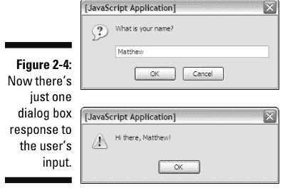

图 2-4 的秘密在于计算世界中那些美妙的瑰宝之一：一个极其简单的想法却有着极其复杂的名称。看看代码，你会发现将变量与文本结合起来并不那么复杂：

```
<script type = "text/javascript">
//<![CDATA[
// from concat.html

var person = "";
person = prompt("What is your name?");
alert("Hi there, " + person + "!");

//]]>
</script>
```

> 为了简洁起见，我只包含了 <script> 标签及其内容；本页的其余部分是一个标准的空白 XHTML 页面。（一如既往，完整的文档可以在网站上找到：www.aharrisbooks.net/jad）。我在本章中采用这种方法，但在每个 JavaScript 代码片段中都包含一条注释，以指明你可以在网站的哪个位置获取完整的文件。

### 拼接与你的编辑器

拼接中最困难的部分是弄清楚文本的哪一部分是字面值，哪一部分是字符串。用不了多久，你就会在努力理解引号该放哪里时感到眼花缭乱。

现代文本编辑器（如 Aptana）有一个很棒的特性可以帮助你。它们以不同的颜色为不同种类的文本着色。默认情况下，Aptana 将变量名显示为黑色，将字面文本显示为深绿色（至少在你编辑 JavaScript 时如此——在 HTML 中，字面文本是蓝色的）。

就我个人而言，我发现很难区分深绿色和黑色，所以我更改了 Aptana 的颜色方案：我让字符串字面量在 JavaScript 和 HTML 中都显示为蓝色。有了这个设置，我可以轻松看出语句的哪一部分是字面文本，哪一部分被识别为变量名。这让拼接变得容易多了。

要在 Aptana 中更改颜色方案，点击窗口→首选项。在弹出的对话框中你会看到一个可展开的大纲。点击 Aptana→编辑器→JavaScript 编辑器→颜色。然后你可以向下滚动，找到任何类型数据的颜色设置。我在"字面量"下找到了"字符串"（文本的另一个术语），并将我的文本字符串颜色从深绿色更改为蓝色。

如果你犯了错误，有一个按钮可以恢复到默认值。

大多数具有语法高亮功能的编辑器都允许你更改设置以适应你的需求。不要害怕使用这些工具来帮助你更好地编程。

### 比较字面量与变量

在这个程序中，实际上有两种不同的文本。整个表达式 "Hi there, " 是一个*字面量*文本值。也就是说，你确实想要说 "Hi there"。另一方面，`person` 是一个变量；你可以将任何人的名字放入其中。如果你愿意，可以将字面量值和变量组合在一个短语中：

```
alert("Hi there, " + person + "!");
```

这段代码的秘诀在于跟随引号。"Hi there, " 是一个字面量值，因为它在引号中。在这一行中，`person` 是一个变量名（因为它*不在*引号中），而 "!" 是一个字面量值。你可以使用加号将任意数量的文本片段组合在一起，如前面的代码所示。

使用加号来组合文本被称为*拼接*。（我说过，这是一个简单想法的复杂词汇。）

### 在拼接的短语中包含空格

你可能会对输出行中逗号和引号之间的额外空格感到好奇：

```
alert("Hi there, " + person + "!");
```

这很重要，因为你希望输出看起来像一个正常的句子。如果没有空格，计算机不会自动添加一个，输出就会像这样：

Hi there,Benjamin!

请确保按照屏幕上应该显示的样子来构造输出，包括空格和标点符号。

### 理解字符串对象

前面程序中使用的 person 变量用于保存文本。程序员（毕竟是程序员）设计了他们自己神秘的术语来指代文本。在编程中，文本被称为**字符串**数据。

> 术语"字符串"源于文本在计算机内存中的存储方式。每个字符存储在内存中自己的单元中，一个单词或短语中的所有字符让早期程序员想起了串在绳子上的珠子。（对于一群极客来说，这还挺有诗意的，对吧？）

### 介绍面向对象编程（以及奶牛）

JavaScript（以及许多其他现代编程语言）使用一种强大的模型，称为面向对象编程（OOP）。这种编程风格有许多优点。对于初学者来说最重要的是，它允许你访问一些非常强大的对象，这些对象开箱即用就能做很多有趣的事情。

对象用于描述可能具有许多特征的复杂事物——例如，一头奶牛。你无法真正将奶牛充分的描述放入一个整数变量中。

在许多面向对象的环境中，对象可以具有以下特征（想象一个奶牛对象的例子）：

- 属性：对象的特征，如品种和年龄。
- 方法：对象可以做的事情，如 moo() 和 giveMilk()。
- 事件：对象响应的刺激，如 onTip()。

这些概念中的每一个都将在需要时进行描述，因为并非所有对象都支持所有这些特征。

如果你有一个 `cow` 类型的变量，它描述了一个相当复杂的事物。这个事物可能有属性、方法和事件。所有这些都可以一起使用，来构建一个好的奶牛表示。（信不信由你，我在职业生涯中不止一次构建过奶牛编程结构——而你还以为编程很枯燥呢。）

JavaScript 中的大多数变量类型实际上都是对象——而且大多数 JavaScript 对象都有完整的属性和方法集合（许多甚至还有事件处理程序）。当你掌握了所有这些东西的工作原理，你就拥有了一个强大而引人注目的编程环境。

好吧，在有人给我发愤怒的电子邮件之前，我知道关于 JavaScript 是否*真正*是面向对象的语言存在一些争论。我不打算在本书中讨论这些（坦率地说，无聊且不太重要的）细节。我们现在称它为面向对象的，因为对于初学者来说已经足够接近了。如果这让你困扰，你可以将 JavaScript 称为基于对象的*语言。几乎所有人都同意这一点。关于这个主题的更多信息贯穿全书，你可以在第五章学习如何构建自己的对象，在第六章学习如何使用 HTML 元素作为对象。

### 探究字符串的长度

当你将文本赋值给一个变量时，JavaScript 会自动将该变量视为字符串对象。该对象立即具备了字符串对象的特性。字符串有几个属性和一堆方法。对于初学者来说，一个有趣的属性是 `length`。看看图 2-5 中的例子，看看 `length` 属性的实际应用：

**图 2-5：** 这个程序报告任何文本的长度。

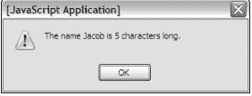

这挺酷的。更酷的是它的工作方式。一旦你将文本值赋值给一个变量，JavaScript 就将该变量视为字符串，而既然它是一个字符串，它现在就具有了 `length` 属性。这个属性以字符数返回字符串的长度。以下是代码中的实现方式：

```
<script type = "text/javascript">
//<![CDATA[
//from nameLength.html

var person = prompt("Please enter your name.");
var length = person.length;

alert("Hi, " + person + "!");
alert("The name " + person + " is " + length + "
      characters long.");

//]]>
</script>
```

这段代码将 `length` 属性当作一个特殊的子变量来使用。例如，在前面的例子中，`person` 是一个变量——而 `person.length` 是 `person` 变量的 `length` 属性。在 JavaScript 中，对象和变量通过一个点（不带空格）连接。

> **技术细节**
> JavaScript 中的字符串对象只有另外两个属性（`constructor` 和 `prototype`）。这两个属性只在高级编程中才需要，所以我暂时跳过它们。

### 使用字符串方法来操作文本

`length` 属性挺酷的，但字符串对象还有更多的本领。对象还有*方法*（对象可以做的事情）。JavaScript 中的字符串有各种各样的方法。以下是我最喜欢的几个：

- ✅ `toUpperCase()`：生成字符串的完全大写副本。
- ✅ `toLowerCase()`：生成字符串的完全小写副本。
- ✅ `substring()`：返回字符串的特定部分。
- ✅ `indexOf()`：确定一个字符串是否出现在另一个字符串中。

> **技术细节**
> 字符串对象还有许多其他方法，但我强调这些是因为它们对初学者有用。许多字符串方法——如 `big()` 和 `fontColor()`——只是向文本添加 HTML 代码。它们不常用，因为它们生成的 HTML 代码无法通过验证，而且它们也没有真正节省多少精力。其他一些方法——如 `search()`、`replace()` 和 `slice()`——使用数组和正则表达式等高级结构，这些对初学者来说不是必需的。（要了解更多关于使用数组的内容，请参阅第五章。你将在第七章中了解更多关于正则表达式的内容。）


### 为什么是前三个字符（0, 3）？

在你了解这个秘密之前，JavaScript（以及大多数编程语言）中字符的索引位置可能看起来有点奇怪。你可能以为 `text.substring(1,3)` 会返回变量 `text` 的前三个字符，但我却用了 `text.substring(0,3)` 来完成这个工作。原因如下：索引并不对应字符的编号；相反，它们是字符*之间*的索引。

| a | b | c | d |
|---|---|---|---|
| 0 | 1 | 2 | 3 | 4

因此，如果我想获取字符串 `"abcd"` 的前三个字符，我会使用 `substring(0,3)`。如果我想获取 `"cd"` 部分，则是 `substring(2,4)`。

别只听我这么说。查阅 Aptana 在线帮助文档（或众多其他在线 JavaScript 参考资料之一）中的 JavaScript 字符串对象，看看它有哪些属性和方法。

与属性类似，方法也是通过使用一个点号附加到对象上的。方法通过一对括号来区分，括号中有时包含称为*参数*的特殊信息。参数是传递给方法的信息，以便它能完成其工作。有些方法需要参数，有些则不需要。一旦你开始使用方法，这一切就都说得通了。

查看方法工作原理的最佳方式是观察一些实际的运行示例。查看 `stringMethods.html` 的代码：

```
<script type = "text/javascript">
//<![CDATA[
//from stringMethods.html

var text = prompt("Please enter some text.");

alert("I'll shout it out:");
alert(text.toUpperCase());

alert("Now in lowercase...");
alert(text.toLowerCase());

alert("The first 'a' is at letter...");
alert(text.indexOf("a"));

alert("The first three letters are ...");
alert(text.substring(0, 3));

//]]>
</script>
```

此程序产生的输出如图 2-6 所示。

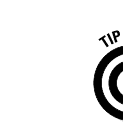

**提示：** 这是 Aptana 的另一个酷炫功能：当你输入 `text.`（包括点号）时，Aptana 会明白你指的是一个字符串变量，并自动弹出所有可能的属性和方法列表。（我希望我刚开始做这个的时候就有这个功能。）

从这段代码你可以看出，方法使用起来相当容易。当你有一个字符串变量时，你可以调用变量名，后跟一个点号和方法名。其中一些方法需要更多信息来完成它们的工作。具体如下：

- `toUpperCase()` 和 `toLowerCase()`：获取变量的值并将其完全转换为指定的大小写。当你不关心变量的大小写时，经常使用这个。
- `indexOf(substring)`：返回子字符串在变量中的字符位置。如果变量不包含该子字符串，则返回值 -1。
- `substring(begin, end)`：返回变量中从起始字符位置到结束位置的子字符串。

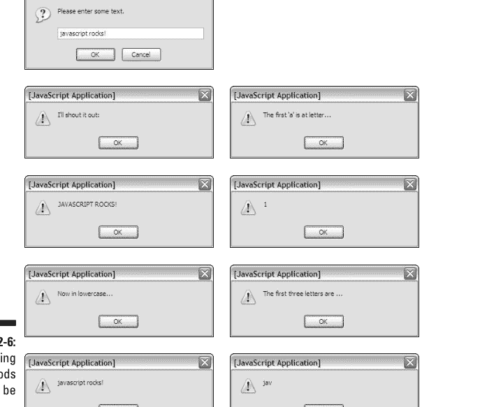

图 2-6：字符串方法可以很有趣....

### 理解变量类型

JavaScript 并不太在乎变量包含的是文本还是数字，但这种区分仍然很重要，因为这些东西在内存中的存储方式*确实*有差异，这种差异可能导致一些令人惊讶的问题。

#### 数字相加

为了了解当 JavaScript 误解数据类型时会出什么问题，让我们做一个小实验。首先，看看下面的程序（和本章往常一样，我只显示脚本部分，因为页面的其余部分是空白的）：

```
<script type = "text/javascript">
//<![CDATA[
//from addNumbers.html

var x = 5;
var y = 3;
var sum = x + y;

alert(x + " plus " + y + " equals " + sum);

//]]></script>
```

这个程序有三个变量。我将值 5 赋给了 x，将 3 赋给了 y。然后我将 x + y 相加，并将结果赋给第三个变量 sum。最后一行打印出结果，结果也如图 2-7 所示。

**图 2-7：**
此程序（正确地）将两个数字相加。

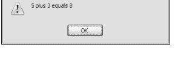

注意此示例中的几个重要事项：

- **你可以给变量赋值。** 最好将等号理解为“获得”，因此第一个赋值应读作“变量 x 获得值 5”。
- **数值不包含在引号中。** 当你引用文本字面值时，它总是包含在引号中。数字数据（如值 5）则不放在引号中。
- **你可以将数字值相加。** 由于 x 和 y 都包含数字值，你可以将它们相加。
- **运算的结果可以放在一个变量中。** 计算 x + y 的结果被放入一个名为 sum 的变量中。
- **一切按预期工作。** 程序按照你期望的方式运行。这很重要，因为正如你将在下一个示例中看到的，情况并非总是如此——我喜欢编写故意出错的代码！

```
var x = 5;
```

#### 将用户输入的数字相加

`addNumbers.html` 程序的自然扩展应该是一个功能，允许用户输入两个值，然后返回它们的和。这可以是简单加法器的基础。以下是 JavaScript 代码：

```
<script type = "text/javascript">
//<![CDATA[
//from addInputWrong.html

var x = prompt("first number:");
var y = prompt("second number:");
var sum = x + y;

alert(x + " plus " + y + " equals " + sum);

//]]>
</script>
```

这段代码看起来相当合理。它请求每个值并将它们存储在变量中。然后它将变量相加并返回结果，对吧？嗯，看看图 2-8，你会看到一个意外。

显然这里有些不对劲。要理解这个问题，你需要看看 JavaScript 如何猜测数据类型。

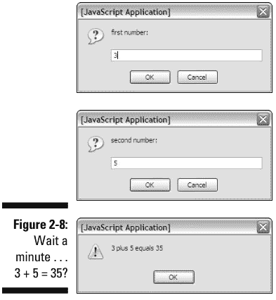

**图 2-8：** 等等... 3 + 5 = 35？

#### 动态数据带来的麻烦

最终，计算机中存储的所有信息，从音乐视频到电子邮件，都存储为一堆 1 和 0。相同的值 01000001 可能意味着各种事情：它可能表示数字 65 或字符 A。（事实上，在正确的上下文中，它*确实*表示这两者。）相同的二进制值如果解释为实数、颜色或音频文件的一部分，则可能意味着完全不同的东西。

这里的理论并非关键，但有一点非常重要：计算机必须知道存储在特定变量中的数据是什么类型。许多语言（如 C 和 Java）对此有各种各样的规则。如果你在这些语言中创建一个变量，你必须确切定义什么样的数据会放入该变量——而且你不能更改它。

JavaScript 对变量类型则随意得多。当你创建一个变量时，你可以在其中放入任何你想要的数据。事实上，数据类型可以改变。一个变量可以在某个时刻包含一个整数，而在程序的另一个部分可能包含文本。

JavaScript 使用上下文来确定如何解释特定变量中的数据。当你给变量赋值时，JavaScript 将数据分为以下类别之一：

- **整数**：整数是整数（没有小数部分）。它们可以是正值或负值。
- **浮点数**：浮点数有一个小数点，如 3.14。浮点值也可以用科学计数法表示，如 6.02e23（阿伏伽德罗常数：6.02 乘以 10 的 23 次方）。浮点数也可以是负数。
- **布尔值**：布尔值只能是 true 或 false。
- **字符串**：在编程语言中，文本通常被称为“字符串”数据。字符串值通常包含在引号中。
- **数组和对象**：这些是更复杂的数据类型，你现在可以忽略。它们将在第 5 章中深入介绍。

这些不同的数据类型是必要的，因为计算机使用不同的技术将不同类型的数据存储到所有计算机内存最终使用的二进制格式中。大多数时候，当你创建一个变量时，JavaScript 猜对了，你就没有问题。但有时 JavaScript 会做出一些错误的假设，事情就出错了。

#### 讨厌的加号

在本章中，我以两种不同的方式使用了加号。以下代码以一种方式使用了加号：

```
var x = "Hi, ";
var y = "there!";

result = x + y;
alert(result);
```

在这段代码中，`x` 和 `y` 是文本变量。`result = x + y` 这行被解释为“连接 `x` 和 `y`”，结果将是 "Hi, there!"。

奇怪的是：下面的代码几乎一模一样：

```
var x = 3;
var y = 5;

result = x + y;
alert(result);
```

加号的行为在这里却不同，即使语句 `result = x + y` 是完全相同的！

在第二种情况下，`x` 和 `y` 是数字。加号运算符有两个完全不同的工作。如果它被数字包围，它就相加。如果它被文本包围，它就连接！自动地。（哎呀。）


这就是第一个加法器程序（那个会出错的程序）发生的情况：当用户在提示对话框中输入数据时，JavaScript 会假定数据是文本。因此，当试图将 x 和 y 相加时，它反而"好心"地将两者连接起来了。

> 有一个高级的计算机科学术语来形容这种现象（一个运算符在不同情况下执行不同的操作）。那些在意这类事情的人将其称为 *重载运算符*。聪明人有时会激烈争论重载运算符是否是个好主意，因为它们可能会导致问题，比如当你期望程序进行加法运算时，它却进行了字符串连接。重载运算符在其他场景下也可能让事情变得更容易。我这里不打算参与这场辩论。只要你能在问题出现时发现并修复它，这没什么大不了的。

### 将变量更改为所需类型

如果 JavaScript 难以判断变量中数据的类型，你可以使用一些便捷的转换函数，友好地将其引导至正确的方向，如表 2-1 所示。

| **函数** | **从** | **到** | **示例** | **结果** |
| :--- | :--- | :--- | :--- | :--- |
| `parseInt()` | 字符串 | 整数 | `parseInt("23")` | 23 |
| `parseFloat()` | 字符串 | 浮点数 | `parseFloat("21.5")` | 21.5 |
| `toString()` | 任何变量 | 字符串 | `myVar.toString()` | 各异 |
| `eval()` | 表达式 | 结果 | `eval("5 + 3")` | 8 |
| `Math.ceil()` | 浮点数 | 整数 | `Math.ceil(5.2)` | 6 |
| `Math.floor()` | 浮点数 | 整数 | `Math.floor(5.2)` | 5 |
| `Math.round()` | 浮点数 | 整数 | `Math.round(5.2)` | 5 |

### 使用变量转换工具

这些转换函数功能极其强大，但只有在自动转换导致问题时才需要它们。以下是它们的工作原理：

- `parseInt()`：用于将文本转换为整数。如果你在括号内放入一个文本值，该函数会返回一个整数值。如果字符串包含浮点表示（例如 "4.3"），则会返回一个整数值（4）。
- `parseFloat()`：将文本转换为浮点值。
- `toString()`：接受任何变量类型并创建其字符串表示。请注意，通常不需要使用此函数，因为它通常在需要时会自动调用。
- `eval()`：这是一个特殊的方法，它接受一个字符串作为输入。然后它会尝试将该字符串作为 JavaScript 代码进行求值并返回输出。你可以将其用于变量转换或作为简单的计算器——`eval("5 + 3")` 将返回整数 8。
- `Math.ceil()`：将浮点数转换为整数的几种方法之一。此技术总是向上取整，因此 `Math.ceil(1.2)` 的结果是 2，`Math.ceil(1.8)` 的结果也是 2。
- `Math.floor()`：与 `Math.ceil` 类似，不同之处在于它总是向下取整，因此 `Math.floor(1.2)` 和 `Math.floor(1.8)` 的结果都是 1。
- `Math.round()`：其工作方式类似于小学时学的标准四舍五入技术。任何小于 .5 的小数部分都会向下取整，大于或等于 .5 的会向上取整，因此 `Math.round(1.2)` 的结果是 1，而 `Math.round(1.8)` 的结果是 2。

### 修复 addInput 代码

掌握了所有这些转换知识后，修复 `addInput` 程序使其正常工作就相当容易了。只需使用 `parseFloat()` 在相加之前强制将两个输入都转换为浮点值。请注意，你不必显式地将结果转换为字符串。当你调用 `alert()` 方法时，这会自动完成：

```
//<![CDATA[
// from addInput.html

var x = prompt("first number:");
var y = prompt("second number:");
var sum = parseFloat(x) + parseFloat(y);

alert(x + " plus " + y + " equals " + sum);

//]]>
```

你可以在图 2-9 中看到程序正常运行。

转换方法允许你确保数据完全处于你想要的格式。

## 第 2 章：编写你的第一个程序

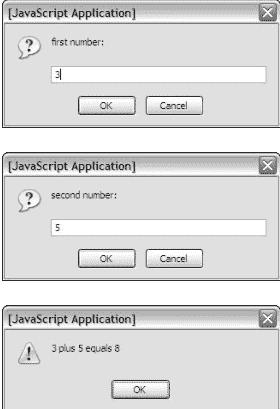

图 2-9：
现在程序请求输入并正确地返回了总和。

# 第 I 部分 54：JavaScript 编程

# 第 3 章

## 使用条件改变程序行为

### 本章内容

- 生成随机数并将其转换为整数
- 理解条件
- 使用 if-else 结构
- 管理多个条件
- 使用 switch 结构
- 处理特殊情况

计算机最重要的特性之一是其明显能够做出决策。计算机可以根据情况改变其行为。在本章中，你将学习如何在 JavaScript 中创建随机数，以及几种让程序根据数字骰子的结果做出决策的方法。

### 使用随机数

随机数是计算的重要组成部分。它们为游戏增加了不确定性，但也被用于严肃的应用，如模拟、安全和逻辑。在本章中，你将生成随机数来模拟骰子，然后探索根据掷骰结果修改计算机行为的各种方法。

大多数语言都有创建随机数的功能，JavaScript 也不例外。`Math.random()` 函数返回一个介于 0 和 1 之间的随机浮点值。

**56** 第 I 部分：JavaScript 编程

> 从技术上讲，计算机无法产生 *真正* 的随机数。相反，它们使用一个复杂的公式，从一个值开始，创建第二个半可预测的值。在 JavaScript 中，第一个值（称为随机 *种子*）取自系统时钟的毫秒数，因此随机数调用的结果看起来是真正随机的。

### 创建令人称道的骰子

创建介于 0 和 1 之间的随机浮点数非常容易，因为这正是 `Math.random()` 函数所做的。如果你想要一个特定范围内的整数呢？例如，你可能想模拟掷一个六面骰子。如何从 0 到 1 的浮点值得到一个 1 到 6 的整数？

以下是标准方法：

1. **获取一个随机浮点值。**
   使用 `Math.random()` 函数获取一个介于 0 和 1 之间的浮点值。
2. **将零到一的值乘以 6。**
   这会给你一个介于 0 和 5.9999 之间（但永远不会达到 6）的浮点值。
3. **使用 `Math.ceil()` 向上取整。**
   这就是你需要将数字转换为整数的地方。在第 2 章中，我提到了三个将浮点数转换为整数的函数。`Math.ceil()` 总是向上取整，这意味着你总会得到一个介于 1 和 6 之间的整数。

### 掷骰子

看看 `RollDie.html` 代码，它掷出你的数字骰子：

```
<!DOCTYPE html PUBLIC "-//W3C//DTD XHTML 1.0 Strict//EN"
"http://www.w3.org/TR/xhtml1/DTD/xhtml1-strict.dtd">
<html lang="EN" dir="ltr" xmlns="http://www.w3.org/1999/xhtml">
    <head>
        <meta http-equiv="content-type" content="text/xml;
            charset=utf-8" />
        <title>rollDie.html</title>
        <script type = "text/javascript">
            //<![CDATA[
            // from rollDie.html
```

## 第 3 章：使用条件改变程序行为

```
var number = Math.random();
alert(number);

var biggerNumber = number * 6;
alert(biggerNumber);

var die = Math.ceil(biggerNumber);
alert(die);

//]]>
</script>
</head>

<body>
<div id="output">

</div>
</body>
</html>
```

如你所见，我直接将上一节的策略转换为了 JavaScript 代码：

1. **创建一个随机浮点值。**

   `Math.random()` 函数创建一个随机浮点数并将其存储在变量 `number` 中。

2. **将数字乘以 6。**

   为了将数字移动到适当的范围（6 个值），我将其乘以 6，并将结果存储在 `biggerNumber` 中。

3. **向上取整。**

   我使用了 `Math.ceil()` 函数将数字向上取整到下一个最高的整数。

图 3-1 展示了程序的运行情况。

你可能需要多次运行 `rollDice.html` 页面以确认它如预期般工作。

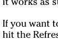

> 如果你想重新运行已经加载到浏览器中的程序，只需点击浏览器工具栏上的刷新按钮。

图 3-1：
本程序生成一个介于 1 到 6 之间的值。

### 使用 if 控制流程

如果你能掷骰子，你最终会希望在不同情况下发生不同的事情。图 3-2 展示了一个名为 `deuce.html` 的简单游戏的两次不同运行。

图 3-2：
掷出 5 点时没有任何反应，但掷出 2 点时会发生一些令人兴奋的事情。

好吧，这并*不*是那么令人兴奋。我承诺在后续版本中加入跳舞的河马。不管怎样，`"You got a deuce"` 这条消息只会在你掷出 2 点时出现。这段代码简单但意义深远：

```
<script type = "text/javascript">
//<![CDATA[
// from deuce.html
// get a random number
// If it's a two, you win

var die = Math.ceil(Math.random() * 6);
alert(die);
if (die == 2){
    alert ("You got a Deuce!");
} // end if

//]]>
</script>
```

像往常一样，这里我只展示 `<script>` 标签及其内容，因为页面的其余部分是空白的。

### 当且仅当

这个程序的关键在于朴素的 `if` 语句。这个强大的命令做了许多重要的事情：

- **它设定了一个条件。** 关于条件的更多内容稍后介绍，但主要思想是这样的：条件是一个非真即假的问题。`if` 语句总是包含括号内的某种条件。
- **它开始了一个代码块。** `if` 语句设置了一段不会总是执行的代码。`if` 行的末尾包含一个左花括号（`{`）。
- **它通常下面有缩进的代码。** `if` 语句后面紧跟着的一行或多行属于该代码块，因此它们被缩进以表明其特殊性。
- **它在几行之后结束。** `if` 语句的结束实际上是下方代码中的右花括号（`}`）。本质上，`if` 语句*包含*其他代码。
- **它是缩进的。** 惯例是将 `if` 语句和其结束花括号之间的所有代码缩进。

虽然不是必需的，但通常会在右花括号处添加注释，表明该花括号结束了一个 `if` 语句。在类 C 语言中，相同的符号（`}`）用于结束许多事物，因此提醒自己正在结束什么是个好主意。

### 使用条件

条件是 `if` 语句和其他几种重要结构的核心部分。条件值得单独给予一点尊重。条件是*一个可以求值为真或假的表达式*。条件主要有三种类型：

- **比较：** 这是迄今为止最常见的条件类型。通常你将一个变量与一个值进行比较，或将两个变量相互比较。表 3-1 描述了多种不同类型的比较。
- **布尔变量：** 布尔变量是只包含 `true` 或 `false` 值的变量。在 JavaScript 中，任何变量都可以是布尔变量，只要你为其赋 `true` 或 `false` 值。没有必要将布尔变量与其他任何东西进行比较，因为它已经是真或假的了。
- **布尔函数：** 有时你会有一个返回 `true` 或 `false` 值的函数。这种类型的函数也可以用作条件。

顺便说一下，布尔变量是大多数语言中唯一首字母大写的变量类型。这是因为它们是以人名命名的，乔治·布尔（George Boole）。他是十九世纪的数学家，发展了一种二进制算术形式。他临终前认为自己的逻辑研究是失败的。他的工作最终成为现代计算的基础。在下次计算机科学聚会上提一下乔治，能赚不少极客点数。

### 比较运算符

JavaScript 支持多种不同类型的比较，总结于表 3-1：

| 名称 | 运算符 | 示例 | 说明 |
|------|--------|------|------|
| 等于 | == | `(x==3)` | 适用于所有变量类型，包括字符串 |
| 不等于 | != | `(x != 3)` | 如果值不相等则为真 |
| 小于 | < | `(x < 3)` | 数值或字母顺序比较 |
| 大于 | > | `(x > 3)` | 数值或字母顺序比较 |
| 小于或等于 | <= | `(x <= 3)` | 数值或字母顺序比较 |
| 大于或等于 | >= | `(x >= 3)` | 数值或字母顺序比较 |

使用条件时，你应该注意以下几点：

- **确保变量类型兼容。** 如果将浮点值与字符串进行比较，你会得到不可预测的结果。
- **你可以比较字符串值。** 在 JavaScript 中，不等运算符可用于确定两个值的字母顺序，而且你可以与其他变量使用相同的等号符号（==）来比较字符串。（这在所有编程语言中并不成立。）
- **相等使用双等号。** 单等号（=）用于表示*赋值*。比较变量时，请改用双等号（==）。

不要混淆赋值和比较！如果你不小心写了 `(x = 3)` 而不是 `(x == 3)`，你的代码不会崩溃，但也不会正常工作。第一条语句只是将值 3 赋给变量 `x`。如果赋值成功（它会成功的），它返回 `true` 值。你以为自己在比较 x 和 3，但实际上你是在把 3 赋给 x，条件将永远为真。这是个噩梦。我偶尔还会犯这个错。

### 照我说的做，否则

Deuce 游戏相当令人兴奋，但如果掷出 2 点时显示一条消息，掷出其他点数时显示另一条消息，那就更好了。`else-if` 结构旨在让你指定条件为真时的一种行为，以及条件为假时的另一种行为。图 3-3 展示了一个具有这种行为的确切程序。

本程序使用相同类型的条件，但增加了一个重要部分：

```
<script type = "text/javascript">
//<![CDATA[
// from deuceOrNot.html

var die = Math.ceil(Math.random() * 6);
if (die == 2){
    alert("You got a deuce!");
} else {
    alert("It's only a " + die + ".");
} // end if

//]]>
</script>
```

`if` 语句没有变化，但现在有了一个 `else` 子句。它的工作原理如下：

- **`if` 语句设定了一个条件：** `if` 标志着一个代码分支的开始，并为条件做准备。
- **条件建立了一个测试：** 条件是非真即假的表达式，因此条件将指示某个可以为真或假的事情。
- **如果条件为*真*：** 条件和 `else` 子句之间的代码运行。此代码执行完毕后，程序控制会移到 `if` 结构的末尾。（也就是说，计算机会跳过 `else` 子句，执行 `if` 结构外的下一行代码。）
- **如果条件为*假*：** 取而代之的是 `else` 和 `if` 结束之间的代码运行。

`else` 子句就像岔路口。代码会走其中一条路径或另一条路径（取决于条件），但永远不会同时走两条。

你可以在 `if` 或 `else` 子句中放入任意数量的代码，包括更多的 `if` 语句！

`else` 只能在 `if` 语句的上下文中使用。不能单独使用 `else`。

### 使用 else-if 进行更复杂的交互

`if-else` 结构在只有两个分支时非常有用，但如果你想拥有几种不同的选项呢？例如，假设你想为每个可能的骰子值输出不同的内容。你需要一种 `if` 结构的变体来实现这一点。我接下来会展示这样的工具，但首先，看看一个使用此技术的程序。图 3-4 展示了一个只有极客才会喜欢的骰子。它的所有值都以二进制表示输出。


 ## 二进制？

二进制是所有计算机数据的基础结构。它使用1和0来存储其他数字，这些数字可以组合成你在计算机上看到的一切，从图形、文本到音乐视频和冒险游戏。这里有一个快速转换表，方便你读懂骰子：

001 = 1
011 = 3
101 = 5

010 = 2
100 = 4
110 = 6

即使不懂二进制，你也可以过得很好（除非你是计算机科学专业——那样你就得在*梦里*都用二进制了）。不过，了解一下事物的真正运作方式还是蛮酷的。

**图 3-4：**
给真正极客玩家的骰子。

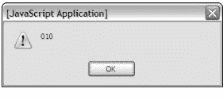

这里简单的*if-else*结构并不够用，因为你有六种不同的选项，而*if-else*只能给你两种选择。下面是使用*if*和*else*另一种变体的代码：

```
<script type = "text/javascript">
//<![CDATA[
// from binaryDice.html

var die = Math.ceil(Math.random() * 6);
if (die == 1){
    alert("001");
} else if (die == 2){
    alert("010");
} else if (die == 3){
    alert("011");
} else if (die == 4){
    alert("100");
} else if (die == 5){
    alert("101");
} else if (die == 6){
    alert("110");
} else {
    alert("something strange is happening...");
} // end if

//]]>
</script>
```

## 第一部分：用 JavaScript 编程

这个程序以普通的`if`语句开头，但它有多个`else`子句。只要每个子句都有自己的条件，你就可以包含任意多个`else`子句。

例如，假设计算机生成了值3。过程如下：

1. 第一个条件（`die == 1`）为假，所以程序立即跳转到下一个`else`。
2. 这设置了另一个条件（`die == 2`），也是假的，所以程序控制转到下一个`else`子句。
3. 这个子句又有另一个条件（`die == 3`）——这个是真的！这个子句内的代码被执行（弹出警告值"011"）。
4. 条件终于被触发了——所以计算机跳过所有其他`else`条件，移动到`end if`之后的行。
5. 这是最后一行代码——所以程序结束。

### 多余 else 的奥秘

当你使用多个条件时，你仍然可以（而且应该）在最后保留一个不带条件的普通`else`子句。这个特殊的条件设置了当其他条件都没有被触发时应该执行的代码。它就像一个"垃圾回收"功能，以防你在`else if`子句中没有预料到某些情况。

如果你仔细想想二进制骰子程序，`else`子句似乎是多余的。它其实并非必要！你费了那么大功夫创建了一个随机数方案，保证你会得到1到6之间的整数。如果所有六个值你都检查过了，为什么还要`else`子句呢？它应该永远不会被用到。

*应该*发生的情况和*实际*发生的情况之间有很大区别。即使你以为自己覆盖了每一种情况，偶尔也会遇到意外。如果你使用多重`if`结构，你应该始终加上一个`else`子句来检查意外情况。它不需要做太多，只需要告诉你有严重的问题发生了。

### 是时候转换你的思路了

骰子问题是一种特殊的分支类型，你有一个表达式（骰子）可能有多个值（1到6）。许多编程语言都包含一个恰好适用于这种情况的便捷工具。看看图3-5，你会看到骰子程序的另一个变体。

## 第3章：用条件改变程序行为

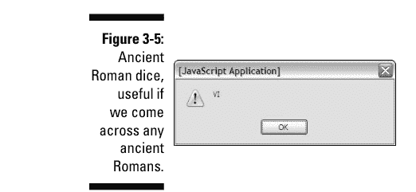

我再次从普通的1到6整数开始，并根据原始掷骰结果赋值。这次我使用了另一种专门针对"一个表达式有多个值"情况的结构。看看代码：

```
<script type = "text/javascript">
//<![CDATA[
// from RomanDice.html
var die = Math.ceil(Math.random() * 6);
var output = "";
switch(die){
    case 1:
        output = "I";
        break;
    case 2:
        output = "II";
        break;
    case 3:
        output = "III";
        break;
    case 4:
        output = "IV";
        break;
    case 5:
        output = "V";
        break;
    case 6:
        output = "VI";
        break;
    default:
        output = "PROBLEM!!!";
} // end switch
```

### 创建表达式

`switch`结构的组织方式与一堆`else if`的`if Osteoporosisif`有所不同。

`switch`关键字后面紧跟括号中的表达式。这个表达式通常是一个可能有多个值的变量。然后`switch`结构提供一系列测试值和每种情况下要执行的代码。

以下是创建`switch`语句的方法：

1. **以`switch`关键字开头。**
   这会建立结构。你会缩进所有内容，直到结束`switch`结构的右大括号（`}`）。

2. **指明表达式。**
   这通常是你想要与多个值比较的变量。变量放在括号内，后面跟着左大括号（`{`）。

3. **标识第一个 case。**
   指明你想要比较变量的第一个值。确保 case 的类型与变量相同。

4. **以冒号（`:`）结束 case 描述。**
   小心！case 行以冒号结束（表示 case 的开始），而不是更常见的分号。很容易忘记这一点。

5. **为 case 编写代码。**
   你可以编写任意多行代码。只有当表达式等于给定的 case 时，这段代码才会被执行。通常 case 中的所有代码都会缩进。

6. **用`break`语句指示 case 结束。**
   `break`语句告诉计算机在评估完这个 case 后立即跳出`switch`结构（这几乎总是你想要的）。

7. **对其他 case 重复上述步骤。**
   为你想要测试的所有其他 case 构建类似的代码。

8. **用`default`子句捕捉意外情况。**
   特殊的`default` case 类似于`else if`结构中的`else`。它处理所有未被捕捉的情况。即使你以为自己面面俱到，还是应该放置一些默认代码以防万一。

你不需要在`default`子句中放`break`语句，因为它总是发生在`switch`结构的末尾。

### 优雅地使用 switch

`switch`结构很强大，但可能有点 tricky，因为它的格式有些奇怪。以下是一些值得记住的实用技巧：

- **你可以比较任何类型的表达式。** 如果你用过其他语言（如 C 或 Java），你可能学过 switch 只适用于数值。JavaScript 的 switch 可以用于任何数据类型。
- **确保类型正确是你的责任。** 如果你在使用数值变量却将其与字符串值比较，你可能得不到预期的结果。
- **别忘了冒号。** 在大多数行的末尾，`switch`语句像大多数其他 JavaScript 命令一样使用分号。但描述 case 的行以冒号（`:`）结尾。真的很容易搞混。
- **每个 case 都要 break。** 使用`break`语句结束每个 case，否则你会得到奇怪的结果。


如果你有一些编程经验，你可能会争辩说另一种涉及所谓*数组*的选项对这个问题来说是更好的解决方案。我倾向于同意，但那请期待第5章。switch 和`if - else if`结构也有它们的用武之地。

### 嵌套 if 语句

可以以各种疯狂的方式组合条件。一个决策可能包含其他决策，而这些决策可能又包含其他决策。你可以将`if`语句相互嵌套，以管理这种（有时复杂的）逻辑。

| 这个 L337 是什么？ |
|:---|
| Leet（L337）是一种主要起源于网络游戏社区的疯狂社交现象。最初，人们试图为多人游戏创建独特的屏幕名称。例如，如果你想叫自己"gamer"，通常会发现这个名字已经被占用了。有创意的玩家开始用外观相似的字母和数字（有时还有创意拼写）来创建仍然可读的原创新名字。这种做法传播开来，现在它与短信和在线聊天快捷方式结合，成为一种极客代码。懂了吗？L337 94m3r 就是"Leet Gamer"，即"Elite Gamer"。在你问之前，我也不知道为什么裁判有时是冲浪者，有时是 L337 94m3r。一定是某种童年时期的古怪经历。 |


## 第三章：使用条件改变程序行为

### 构建嵌套条件

图3-6展示了一个特别奇特的例子。想象一下，你正在你最喜欢的体育赛事上观看抛硬币。当然，硬币可以是正面或反面。仅仅为了讨论，裁判也有复杂的性格。有时他是冲浪者，有时他是 L337 94m3r（翻译：精英玩家）。图中展示了几次抛硬币的结果。

这变得相当奇怪，所以你不妨看看一些代码：

```
<script type = "text/javascript">
  //<![CDATA[
  // from coinToss.html
  coin = Math.ceil(Math.random() * 2);
  character = Math.ceil(Math.random() * 2);
  if (character == 1){
    //It's a surfer referee
    if (coin == 1){
      alert("You got heads, Dude.");
    } else {
      alert("Dude! It's totally tails!");
    } // end coin if

  } else {
    //now it's a L337 Referee
    if (coin == 1){
      alert("h34D$ r0xx0r$");
    } else {
      alert("741L$ ruL3");
    } // end coin if
  } // end character if

  //]]>
</script>
```

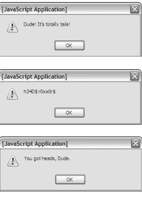

**图3-6：** 正面还是反面？冲浪者还是玩家？

一旦你理解了嵌套的`if`结构如何工作，你就能明白这一切是如何结合在一起的。以下指的是前一节中的示例：

1. **你抛了一枚硬币。**
   我只是使用了掷骰子技术的一个变体。硬币只能是正面或反面，所以我掷出了一个值，这个值将是1或2，用于`coin`变量。

2. **再抛一枚硬币来决定性格。**
   裁判的性格将通过另一个1到2之间的随机值来反映。

3. **检查是否是冲浪者。**
   如果`character`掷出的值是1，我们得到的就是冲浪者，所以设置一个`if`语句来处理冲浪者的输出。

4. **如果是冲浪者，检查抛硬币结果。**
   现在你知道是冲浪者在说话，你需要检查硬币是正面还是反面。你需要另一个`if`语句来完成这个操作。

5. **用冲浪者的语言回应抛硬币结果。**
   使用`alert()`语句以冲浪者方言输出结果。

6. **处理L337角色。**
   外部的`if`结构决定了哪个角色在说话。如果`character`不是1，那么这个例子中的`else`子句将会执行，所以所有LEET的东西都放在`else`子句里。

7. **再次检查硬币。**
   现在你知道你在用玩家代码说话，通过在另一个`if`语句中咨询硬币来决定说什么。

### 理解嵌套的if语句

正如你所看到的，嵌套的`if`结构并非那么困难，但它们可能会变得混乱，特别是当你深入几层时（最终你会的）。这里有一批提示，确保一切都有意义：

> ⚠️ **注意你的缩进。** 缩进是判断你代码层级的好方法，但要警惕你选择的缩进方案。像Aptana这样的编辑器可以自动缩进你的代码，这是一个很大的优势。

- 使用注释。在嵌套条件的逻辑中很容易迷失方向。大量添加注释，以便提醒自己在逻辑中的位置。注意在本章的示例中，我指出了哪个if语句正在结束。
- 测试你的代码。仅仅因为你认为它能工作，并不意味着它真的能。意外是会发生的。彻底测试以确保代码执行你认为它应该做的操作。

## 第四章：循环和调试

*本章内容*

- 创建for循环
- 了解for循环变体
- 构建灵活的while循环
- 使while循环行为良好
- 识别有问题的循环
- 使用调试工具捕获崩溃
- 捕获逻辑错误
- 使用Aptana逐行调试器
- 使用Firebug调试器
- 监视变量和条件

计算机程序可以轻松地执行重复性任务。这是通过一系列称为*循环*的构造来实现的。循环是一种允许你重复一段代码的结构。在本章中，你将学习管理循环的两种主要技术。

循环很强大，但它们也可能是危险的。创建行为不当的循环是可能的，而这些问题非常难以诊断。但不用担心。我将展示一些非常强大的技术，用于检查你的代码以找出发生了什么。

### 使用for构建计数循环

一种非常标准的循环类型是`for`循环。当你想要将代码重复特定次数时，就会使用这些循环。图4-1展示了一个`for`循环的工作过程：

它看起来像是十个不同的`alert()`语句，但实际上只有一个。它只是被重复了十次。

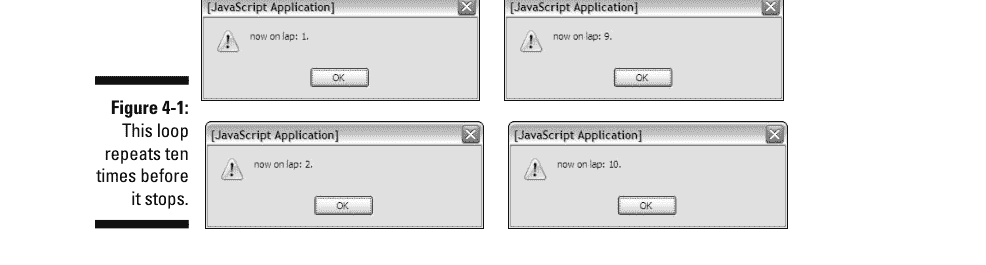

> 在图4-1和本章的其他一些循环演示中，我展示了前几个对话框和最后一个。你应该能明白大概。一定要在配套网站（www.dummies.com/go/javascriptandajaxfd 或 www.aharrisbooks.net/jad）上查看实际程序，看看它到底是如何工作的。

### 构建标准的for循环

通过研究代码可以了解for循环的结构：

```
<script type = "text/javascript">
//<![CDATA[
//from BasicFor.html
for (lap = 1; lap <= 10; lap++){
    alert("now on lap: " + lap + ".");
} // end for
//]]>
</script>
```

for循环基于一个整数（有时称为哨兵变量）。在这个例子中，`lap`充当哨兵变量。哨兵变量通常用于计算循环重复的次数。

for语句有三个不同的部分：

- **初始化：** 这段（`lap = 1`）设置了哨兵的初始值。
- **条件：** 条件（`lap <= 10`）是一个普通条件（尽管在这种情况下不需要括号）。只要条件的求值结果为真，循环就会重复。
- **修改：** for结构的最后一部分（`lap++`）表示哨兵将在整个循环中以某种方式被修改。在这个例子中，我每次循环时都给`lap`变量加一。

`for`结构有一对花括号，其中包含将被重复的代码。像往常一样，这个结构内部的所有代码都被缩进。你可以在循环中放入任意多的代码。

`lap++`运算符是一种特殊的快捷方式。给变量加一非常常见，所以`lap++`操作表示“给lap加一”。你也可以写成`lap = lap + 1`，但`lap++`听起来酷多了。

当程序员决定改进C语言时，他们称新语言为C++。明白了吗？它比C好一点！这些计算机科学家真是一群古怪的人！

`for`循环在你知道某件事应该发生多少次时非常有用。

### 制作一个向后循环

你可以修改基本的`for`循环使其倒数计数。图4-2展示了这种行为的一个例子。

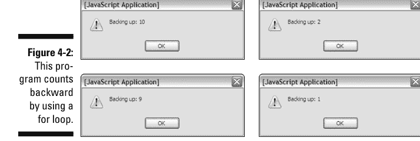

`for`循环的倒数版本使用与正向版本相同的一般结构，但参数略有不同：

```
<script type = "text/javascript">
//<![CDATA[
//from backwards.html

for (lap = 10; lap >= 1; lap--){
  alert("Backing up: " + lap);
} // end for

//]]>
</script>
```

如果你想倒数，只需修改`for`语句的三个部分：

- **将哨兵初始化为一个较大的数字：** 如果你在倒数，你需要从一个大于0或1的数字开始。
- **只要哨兵*大于*某个值就继续：** 循环内部的代码将在条件为真时执行。数字将继续变小，所以确保你使用的是“大于”或“大于或等于”比较。
- **递减哨兵：** 如果你想让数字变小，你需要从中减去一些东西。`--`运算符是实现这一点的快捷方式。它从变量中减去1。

### 每次计数五个

你可以使用`for`循环来制作其他类型的计数循环。例如，如果你想以5为单位计数，你可以使用以下变体：

```
<script type = "text/javascript">
//<![CDATA[

//from byFive.html
for (i = 5; i <= 25; i += 5){
    alert(i);
} // end for

//]]>
</script>
```

这段代码将`i`初始化为5，只要`i`小于或等于25就重复，并在每次循环时给`i`加5。图4-3展示了这段代码的实际效果。

如果你想让`for`循环跳过数字，你只需对一般模式稍作修改。

- **将哨兵初始化为5：** 我希望循环从5开始，所以这是初始值。
- **将哨兵与25进行比较：** 对于一个以5为单位的循环，在5的倍数处结束是有意义的。我希望这个循环持续到我们达到25，所以只要`i`小于或等于25，循环就会继续。
- **每次循环给`i`加5：** 语句`i += 5`给`i`加5。（这就像说`i = i + 5`一样。）


## 第四章：循环与调试

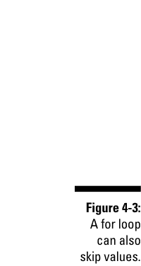

构建`for`循环的关键在于记住这三个要素，并确保它们协同工作：建立一个哨兵变量，给它一个合理的初始值，检查条件，并在每次遍历时修改变量。

这在`for`循环中很容易实现，因为所有这些元素都包含在`for`循环结构内。不过，如果你发现循环没有按预期工作，你可能需要查看本章后面介绍的调试技巧。

### 循环一段时间

`for`循环很有用，但它有一个更为方便近亲，叫做`while`循环。`while`循环并不限于特定的重复次数。它只会在条件为真时不断重复。

### 创建基本的 while 循环

基本的`while`循环看似简单得令人惊讶。下面是一个例子：

```html
<script type = "text/javascript">
//<!CDATA[
// from while.html

answer = "-99";
while (answer != "5"){
  answer = prompt("What is 3 + 2?");
  if (answer == "5"){
    alert("great!");
  } else {
    alert("try again...");
  } // end if
} // end while

//]]>
</script>
```

这个脚本向用户提出一个简单的数学问题——并且会持续提问直到用户回答正确。你可以在图4-4中看到它的实际效果。

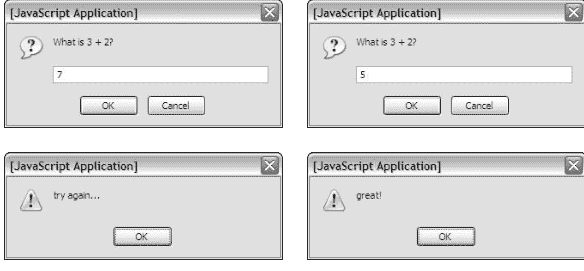

while循环的运行方式非常容易理解。以下是这个数学程序的工作原理：

1. **创建一个名为`answer`的变量。** 这将作为循环的哨兵变量。
2. **初始化变量。** 变量的初始值设置为"-99"，这不可能是正确答案。这样做确保了循环至少会执行一次。
3. **评估`answer`变量中的内容。** 在这个特定的程序中，正确答案是5。如果`answer`的值不是5，循环就会继续。我已经将`answer`的值预设为"-99"，所以你知道它至少会执行一次。
4. **向用户提出一道有挑战性的数学题。** 好吧，反正是一道数学题。重要的是改变`answer`的值，这样才有可能让`answer`变成5，从而退出循环。
5. **给用户一些反馈。** 让用户知道她的表现如何可能是件好事，所以要提供某种反馈。

### 避免循环错误

`while`循环看起来比`for`循环简单，但`while`有着完全相同的基本要求：

- **通常有一个关键的哨兵变量。** `while`循环通常（但并非总是）由某个关键变量控制。
- **哨兵变量必须初始化。** 如果要让循环正常工作，哨兵变量仍然必须正确初始化。在大多数情况下，你要确保循环至少发生一次。
- **必须有一个条件。** 与`for`循环一样，`while`循环基于条件。只要条件为真，循环就会继续。
- **必须有改变哨兵变量的机制。** 在循环的某个地方，你需要有一行代码来改变哨兵变量的值。确保有可能使条件在逻辑上变为假，否则你将永远困在循环里！

如果你忘记了这些步骤中的任何一个，`while`循环可能就无法正确工作。`while`循环很容易出错。不幸的是，这些错误通常不会导致崩溃。相反，循环可能要么完全拒绝运行，要么无限期地继续运行。

### 介绍一些糟糕的循环

有时循环不听话。即使你语法正确，你的循环也可能就是不能按你想要的方式工作。有两种主要的循环错误很常见：永远不起作用的循环，以及永远停不下来的循环。

#### 处理不情愿的循环

你可能写了一些代码，然后发现循环*似乎*永远不会运行。以下是一段说明这种悲惨状况的程序：

```html
<script type =志愿填报"text/javascript">
  //<![CDATA[

  //from never.html
  //Warning! this script has a deliberate error!

  i = 1;
  while (i > 10){
    i++;
  } // end while

  //]]>
</script>
```

这段代码看起来人畜无害，但如果你运行它，你会感到困惑。它没有崩溃，但也似乎什么都不做。如果你一步一步地跟踪代码，你最终会明白原因。我将`i`初始化为1，然后在`i`大于10时重复。看到问题了吗？`i`在一开始就是小于10的，所以条件*一开始就是假的*，循环永远不会执行！我可能想让条件是`(i < 10)`。这是个粗心的错误，但正是我经常会犯的那种愚蠢错误。

#### 处理停不下来的循环

另一种坏脾气的循环与上述相反。这一个启动得很好，但永远不会消失！

以下代码展示了一个无限循环：

```html
<script type = "text/javascript">
  //<![CDATA[

  //from endless.html
  // Warning: this program has a deliberate
  // error! You will have to stop the browser
  // to end the loop.

  i = 0;
  j = 0;

  while (i < 10){
    j++;
    alert(j);
  } // end while

  //]]>
</script>
```

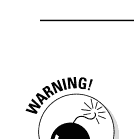

如果你决定运行endless.html，请注意它不会正常工作。更糟糕的是，停止它的唯一方法是通过任务管理器程序终止你的浏览器。在本章后面，我会告诉你如何在一个"安全"环境中运行此类代码，以便你找出它的问题所在。

这段代码只是可怕的无限循环的一个例子。这种循环通常语法完全正确，但逻辑错误阻止了它正常运行。逻辑错误通常是以下之一：

- ✔ **变量未正确初始化。** 哨兵变量的初始值阻止了循环正确开始。
- ✔ **条件检查的是不可能发生的事情。** 要么是条件中有错误，要么是其他东西阻止了它触发。
- ✔ **循环内部没有更新哨兵变量。** 如果你简单地忘记修改哨兵变量，就会得到无限循环。如果你修改了变量，但*在*循环完成之后才做，你也会得到无限循环。如果你以错误的格式请求输入，你也可能得到一个难以诊断的无限循环。

### 调试你的代码

如果你一直在编写JavaScript代码，你也一直在遇到错误。这是程序员生活的一部分。循环尤其麻烦，因为即使没有语法错误，它们也可能导致问题。幸运的是，有一些非常棒的技巧可以帮助你追踪棘手的bug。

#### 让 Aptana 帮忙

如果你使用Aptana编写代码，你已经可以获得一些很棒的帮助。它为你提供与编写XHTML和CSS时相同的语法高亮和代码完成功能。

此外，Aptana通常可以实时发现JavaScript错误。图4-5展示了一个有故意错误的程序。

这些标记指示代码中的错误。

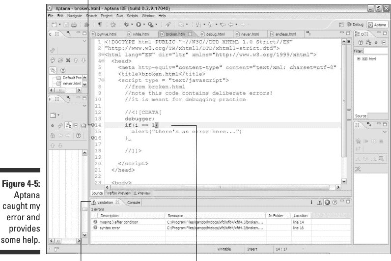

点击错误可跳转到编辑器中的对应行。

验证窗格列出所有已知错误。

Aptana通过几种机制通知你代码中的错误：

- **可疑代码下方有红色波浪线。** 就像文字处理软件的拼写检查器对可疑单词做的那样。
- **红色圆圈指示有问题的行。** 你可以扫描页边空白，快速看到错误在哪里。
- **所有错误都在验证窗格中汇总。** 你可以看到错误以及每个错误的行号。双击错误跳转到代码中的该位置。
- **你可以将鼠标悬停在错误上以获取更多帮助。** 将鼠标指针悬停在错误上，可以获得错误的摘要。

Aptana可以捕获一些错误，但它最有用的地方在于*预防*错误，凭借其自动缩进和代码辅助功能。浏览器是你通常会发现逻辑错误和错误的地方。在发现和修复问题方面，有些浏览器比其他浏览器更有帮助。


## 第四章：循环与调试

#### 在 IE 上调试 JavaScript

微软 Internet Explorer 在处理 JavaScript 错误时行为不可预测。IE6 会把你带到某种编辑器中，但这些编辑器多年来已经更换过多次，并且在你安装新软件时会被修改（在你不知情或未授权的情况下）。IE7 和 IE8（至少在默认情况下）则什么都不做。你看不到任何错误，也不会有任何错误提示。（否认——我最喜欢的应对机制。）

以下是强制 IE 给你一点帮助的方法：

- 1. **选择 工具 ▸ Internet 选项 ▸ 高级。**

  你会看到一个如图 4-6 所示的对话框。

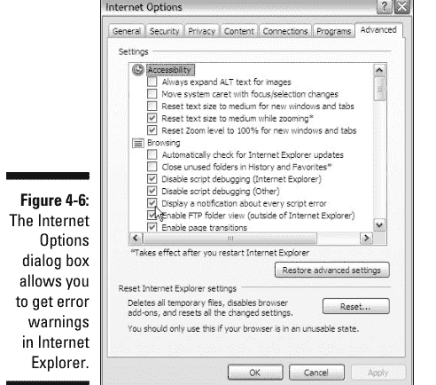

**图 4-6：** Internet 选项对话框允许你在 Internet Explorer 中获取错误警告。

- 2. **选择"显示每个脚本错误的通知"。**

  暂时不要修改其他设置。是的，我们仍然要禁用脚本调试，因为它效果不太好。本章后面我会向你展示一种更好的技术（参见"使用 Firebug 调试器"部分）。

现在，当你在 IE 中重新加载`broken.html`时，你会看到类似图 4-7 的内容。

82 第一部分：JavaScript 编程

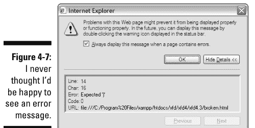

这其实是个好消息，因为至少你知道有问题了，而且你有了一些修复的线索。在这个特定的案例中，错误消息相当有用。有时确实如此，但有时错误消息看起来像是外星人写的。

一定要在 IE 中开启错误通知，这样你就能立即知道错误。当然，你还需要在 Firefox 中检查你的代码，它有大量优秀的代码检查工具。

#### 在 Firefox 中查找错误

Firefox 默认的错误处理比 IE 稍好，你还可以通过加载项将其变成一个强大的调试工具。在默认设置下，错误通知非常有限。如果你怀疑有 JavaScript 错误，请打开 JavaScript 错误窗口。你可以通过从"工具"菜单中选择"错误控制台"，或者在地址栏中输入`javascript:`来打开。图 4-8 展示了运行`broken.html`后的错误控制台。

我通常发现 Firefox 控制台中的错误消息比 IE 提供的更有帮助。

> 错误控制台在你加载新页面时不会自动清空。当你打开它时，里面可能有一堆旧的错误消息。一定要清除历史记录（使用错误控制台的"清除"按钮）并刷新页面，以查看当前页面上实际发生的错误。

#### 使用 Firebug 捕捉语法错误

Firefox 最好的特性之一就是其加载项架构。一些非常聪明的人创建了非常有用的加载项，增添了出色的功能。Firebug 就是一个例子。这个加载项（可在`https://addons.mozilla.org/en-US/firefox/addon/1843`下载）极大地扩展了你的编辑工具箱。

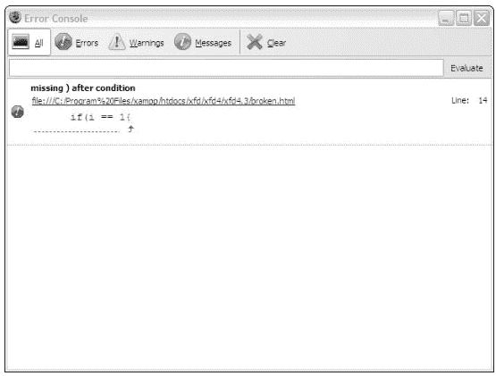

Firebug（在第一章中首次介绍）对 HTML 和 CSS 编辑很有用，但当你尝试调试 JavaScript 代码时，它才真正发挥其价值。

当 Firebug 处于活动状态时，它会在浏览器窗口底部显示一个小图标。如果有任何 JavaScript 错误，会出现一个红色的错误图标。点击这个图标，Firebug 窗口就会出现，描述问题。图 4-9 展示了它的运作方式。

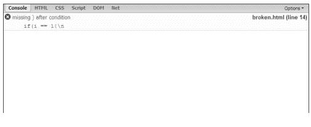

如果你点击有问题的代码片段，可以在上下文中查看它。这很有用，因为错误可能并不在指示的那一行上。通常，如果我在做任何复杂的 JavaScript 工作，我都会开启 Firebug 来捕捉任何问题。

**84** 第一部分：JavaScript 编程

> 提示：Firebug 的 Lite 版本可以在其他浏览器（IE、Chrome 和 Safari）中使用。这个版本以*书签工具*的方式访问，意味着你可以将代码链接放在书签中，在这些其他浏览器中使用这个程序来获得 Firebug 的大部分功能。详情请查看 http://getfirebug.com/lite.html。

#### 捕捉逻辑错误

你在`broken.html`中看到的那种戏剧性错误实际上相当容易修复。它在代码的特定部分导致浏览器崩溃，所以你能很好地了解哪里出了问题。崩溃通常会导致错误消息，这些消息一般会提供一些关于问题所在的线索。大多数情况下，是语法问题。你拼错了某个词、忘记了一些标点符号，或者其他一旦你知道问题所在就很容易修复的事情。

循环和分支往往会导致一种更隐蔽的问题，称为*逻辑错误*（相对于*语法错误*）。逻辑错误发生在你的代码没有语法问题，但仍然没有做你想做的事情时。这些错误可能更难定位，因为你得不到太多信息。

当然，如果你有合适的工具，你最终可以追踪到最棘手的 bug。关键是要清楚地看到你的变量内部发生了什么——那些用户通常看不到的东西。

#### 使用 Firebug 将日志输出到控制台

Firebug 还有一个妙招：你可以向 Firebug 控制台发送快速消息。看看`log.html`：

```
<script type = "text/javascript">
//<![CDATA[
// from log.html
// note this program requires firebug on firefox

for (i = 1; i <= 5; i++){
    console.log(i);
} // end for loop

//another loop with a fancier output
for (i = 1; i <= 5; i++){
    console.log("i is now %d.", i);
}
console.info("This is info");
console.warn("This is a warning");
console.error("This is an error");

//]]>
</script>
```

这段代码很特殊，因为它包含多个对`console`对象的引用。这个对象仅在安装了 Firebug 扩展的 Firefox 浏览器中可用。当你使用 Firebug 运行程序并查看 Console 标签页时，你会看到类似图 4-10 的内容。

`console`对象允许你写入特殊的消息，这些消息只会被程序员在控制台中看到。这是测试代码和查看发生了什么的好方法，尤其是在事情没有按你预期工作的时候。

如果你想在 IE 中测试代码，有一个 Firebug 版本（称为 Firebug Lite）可以在其他浏览器上工作。如果你想在这些浏览器上使用控制台命令，请查看 Firebug 主页下载并安装此工具。注意，使用 Firebug Lite 时，使用控制台的语法可能略有不同。详情请查看主站。

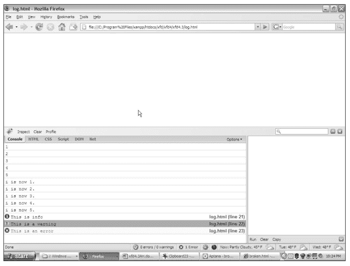

#### 查看控制台输出

以下是其工作原理：

- **第一个循环将`i`的值打印到控制台。** 在第一个循环的每次迭代中，`console.log`函数都会打印出`i`的当前值。如果（例如）循环没有正常工作，这将是非常有用的信息。你可以使用`console.log()`方法来打印任何变量的值。

- **第二个循环演示了一种更精细的打印方式。** 有时你想清楚地说明发送到控制台的确切值是什么。Firebug 支持一种称为*格式化打印*的特殊语法来简化这个过程。

```
console.log("i is now %d", i);
```

文本字符串`"i is now %d"`指定了你想在控制台中写入的内容。特殊字符`%d`表示你将在此位置放置一个数字变量。在逗号之后，你可以指定要插入到文本中的变量。

还有其他格式化字符可以使用。`%s`用于字符串，`%o`用于对象。如果你熟悉 C 语言中的`printf`，你会发现这种技术很熟悉。


- **你可以指定更紧急级别的日志。** 如果你愿意，可以使用`console.log`的替代方法来传达消息的紧急程度。如果你将`log.html`中的代码与图 4-10 的输出进行比较，你会看到信息、警告和错误消息是如何格式化的。

当你的程序不能正常工作时，尝试使用控制台命令来描述每个变量的具体情况。这通常能帮助你发现问题并修正它们。

当你的程序正常运行后，别忘了把控制台命令删掉！要么移除它们，要么用注释符使其失效。控制台命令会在任何未安装 Firebug 的浏览器中导致错误。通常，你的用户不会安装这个扩展（他们也不应该需要！你已经为他们调试好了一切！）。


#### 使用交互式调试器

传统编程语言通常具有特殊的调试工具来修复特别棘手的问题。一个典型的调试器具有以下功能：

✔ **在程序运行时暂停程序的能力：** 逻辑错误很难发现，因为程序会一直运行下去。通过调试器，你可以将某一行设置为*断点*。当调试器遇到断点时，程序会进入"暂停"模式。它既没有完全运行，也没有完全停止。

✔ **逐行执行代码的机制：** 你通常可以逐行单步执行代码，检查每一步的情况。

✔ **查看所有变量和表达式的值的方法：** 了解变量中的情况通常很重要。（例如，某个变量是否在你预期它应该变化的时候发生了变化？）调试器应该让你能够查看所有变量的值。

✔ **停止失控进程的能力：** 一旦你开始创建循环，就会发现自己意外地创建了无限循环。在典型的浏览器中，退出无限循环的唯一方法是通过任务管理器（或某些操作系统中的进程管理器）关闭浏览器。这有点过于极端了。调试器可以让你在不需要访问任务管理器的情况下停止失控的循环。

调试器非常方便，在大多数编程语言中都非常常见。JavaScript 程序员过去很少能使用调试工具，因为嵌入式语言的技术限制使得这很困难。

幸运的是，Firebug 和 Aptana 都提供了交互式调试器，具备所有这些功能。更棒的是，它们可以协同工作，为你提供大量有用的帮助。


Aptana 内置了调试器。最初，这需要一个特殊的 Firefox 插件将信息发送回 Aptana。Firebug 和 Aptana 的开发人员现在正在合作，使 Firebug 能够直接与 Aptana 配合工作。当你使用 Aptana 调试器时，它会自动与 Firebug 协同工作。

为了测试调试器，我编写了一个包含故意错误的程序，如果没有调试器，这个错误将很难发现：

```
//from debug.html
//has a deliberate error

var i = 0;
var j = 0;
while (i <= 10) {
    console.log(i);
    j++;
} // end while
```

## 第一部分：JavaScript 编程

这是本章前面 `endless.html` 程序的另一个版本。你可能一眼就能发现问题。如果不能，请继续关注；在运行调试器时你会看到它。即使你能看出哪里有问题，也请跟着一起操作，以便在需要时学会如何使用调试器。

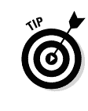

在这个程序中，我使用 `console.log()` 进行输出，只是为了避免在浏览器和编辑器之间来回切换来处理对话框。

要使用 Aptana 调试器逐步执行程序，首先需要将文件加载到调试器中。

#### 添加断点

到目前为止，你的 JavaScript 程序都相当小，但它们将会变得更大。你通常不希望从头开始逐行调试，因此你需要指定一个*断点*。当你在调试模式下运行程序时，它会以正常速度运行，直到到达断点——然后暂停，以便你能更直接地进行控制。

要设置断点，请在代码编辑器中右键点击某一行号。

图 4-11 显示了我在 `debug.html` 代码的第 12 行设置断点。

#### 运行调试器

调试器要求你以与平时不同的方式运行程序。由于你的程序通常由浏览器运行（而不是 Aptana），你需要一种机制将信息从浏览器传回 Aptana。

1. **点击调试图标启动调试器。**
   它看起来像一个小虫子。
2. **自动安装 Aptana Firefox 插件。**
   当你第一次调试 JavaScript 程序时，Aptana 会请求许可安装一个额外的 Firefox 插件。点击"是"完成安装。你只需要做一次。
3. **切换到调试视图。**
   Aptana 会弹出一个消息框，询问你是否要切换到调试视图。选择"是"将 Aptana（临时）切换为调试配置。

已在第 12 行添加了断点。

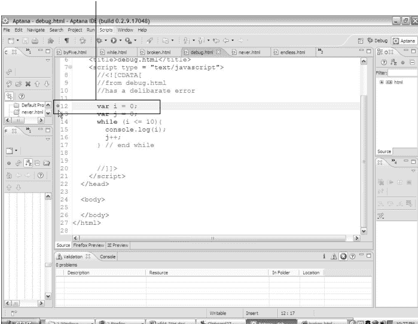

#### 使用调试视图

当 Aptana 用于调试时，它引入了一种新的布局（在 Aptana 中称为视图）。这改变了屏幕的外观，并针对调试模式优化了编辑器。图 4-12 显示了在调试视图中的 `debug.html` 程序。

调试视图改变了编辑器以强调调试：

- **代码自动补全窗口消失了。** 调试时不需要此功能，因此被移除了。你需要屏幕空间来显示其他有用的工具。
- **文件管理窗口同样不见了。** 同样，你在调试模式下不会进行大量文件操作，因此这个窗口也消失了。（别担心；当你返回正常编辑模式时，它会恢复。）

调试面板

变量面板

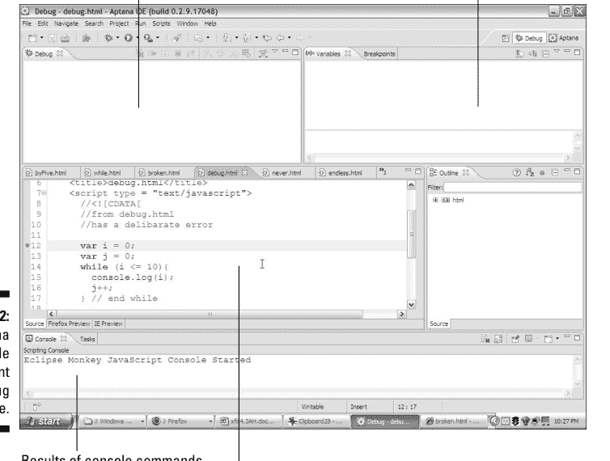

**图 4-12：** Aptana 在调试视图下看起来略有不同。

控制台命令的结果

你可以设置断点的普通代码窗口。

- **你有了一个新的调试窗口。** 此窗口显示你的活动线程。它最重要的部分是顶部的按钮。
- **你还有一个显示断点和变量的窗口。** 这个功能强大的新窗口描述了程序运行时所有变量的值。
- **大多数其他窗口保持不变。** 你仍然有代码窗口、控制台和大纲窗口，但它们的排列方式与正常模式略有不同。当然，你可以根据需要进行调整。

> 一旦你成功运行了一次调试模式，Aptana 界面的右上角会出现一个小小的调试图标。当这个快捷按钮可用时，你可以用它来切换到调试模式。使用 Aptana 按钮返回普通编辑模式。

#### 在暂停的程序中检查调试模式

当你通过调试器运行代码时，Aptana 会启动一个新的 Firefox 实例，并将你的程序加载到其中。当你的程序暂停进行调试时，你会看到一些新的细节，如图 4-13 所示。

当你的程序暂停时，你可以看到几个重要的新指示器：

- **调试窗口显示当前活动的脚本。** 目前你的程序只有一个脚本，但之后会有更多。线程窗口告诉你当前哪个脚本正在被处理器处理。
- **调试窗口中的按钮已激活。** 将鼠标悬停在每个新按钮上可以查看其工具提示。我将在接下来的单步执行代码部分解释这些按钮。

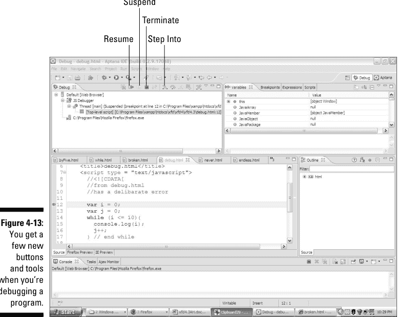

92  **第一部分：JavaScript 编程**

- **断点面板有了更多窗格。** 除了断点和变量窗格外，你会看到一些新的窗格，包括表达式和脚本。
- **变量面板让你可以看到页面知道的所有变量。** 即使这个程序只包含两个显式定义的变量，看起来似乎远不止这些。每个 JavaScript 程序都内置了大量特殊变量。（我将在本章后面解释如何使用此面板。）
- **断点面板允许你管理断点。** 这是你查看项目中所有断点的好地方。你可以从这个面板启用或禁用断点。
- **表达式面板允许你跟踪特定的变量或表达式。** 这是一个极其强大的工具。我将在本章后面演示其用法。
- **当前代码行被高亮显示。** 如果你在第 12 行设置了断点，你会看到该行被高亮显示。（在图 4-13 中可能不太容易看清。）当你在代码中移动时，你会看到这个高亮标记随之移动。这将帮助你跟踪逻辑。

> 在某些版本的 Aptana 中，调试程序时有时会出现以 `TypeError: request.loadGroup has no properties` 开头的消息。这不是你代码中的错误，似乎也不会造成任何问题。你可以安全地忽略这个错误。我还偶尔遇到过"socket connection"错误。通常重启 Firefox 就能解决这个问题。

#### 单步执行程序

这是最精彩的部分。你可以以超级慢动作运行程序，看到其行为的每个方面。

1. **迈出一步。**
   点击调试面板上的"单步进入"按钮。（它看起来像一个弯曲的箭头指向两个点之间，或者直接使用 F5 键。）

2. **查看代码。**
   高亮标记已移动到下一行（第 13 行）。

3. **将鼠标悬停在变量上。**
   将鼠标指针悬停在代码中的两个变量（*i* 和 *j*）上。你会看到一个对话框描述每个变量的当前值。

4. **再多走几步。**
   再多次点击"单步进入"按钮。观察高亮标记如何在程序中移动，进行循环。


 ## 查看表达式数据

调试的全部意义在于发现棘手的问题。通常，这些问题都是那些没有按预期运行的变量。Aptana 提供了一个 Variables（变量）标签页，可以显示程序中所有变量的值，但它 surprisingly difficult to use（出奇地难用）。JavaScript 程序中往往捆绑着数百个变量。如果你深入挖掘，最终可以找到 i 和 j 变量。（在变量面板中向下滚动即可找到它们。）每执行一步，你都必须再次向下滚动才能查看值，或者将鼠标悬停在代码中的变量上。

幸运的是，Aptana 提供了一种更为简便的方法。用鼠标选中一个变量并右键单击。在弹出的菜单中，选择 Watch（监视）。图 4-14 展示了在我选择监视这两个变量并运行了几次循环后的调试器界面。

在这种模式下，你可以看到所选跟踪变量的确切值。当变量值发生变化时，你可以立即看到。

Expression（表达式）窗口还有另一个很酷的技巧：你可以用它监视复杂的表达式，而不仅仅是变量。在这个程序中，你想知道循环为什么没有退出。高亮显示条件 `(i <= 10)`，并像处理变量一样将其添加到监视表达式中。

现在逐步执行程序，同时观察变量和条件。有了这些信息，我的编码错误就变得显而易见：我在条件中使用了变量 i，但却没在循环内部修改它。相反，我修改的是 j 的值，而 j 与循环毫无关系！

## 94 第一部分：使用 JavaScript 编程

显示任何表达式或变量的值

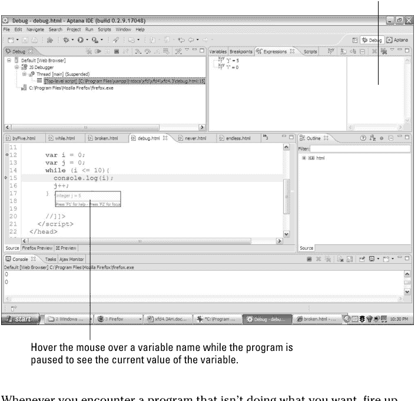

当程序暂停时，将鼠标悬停在变量名上即可查看该变量的当前值。

每当你遇到程序没有按预期运行时，就启动调试器，监视关键值，并逐行逐步执行代码。这通常会帮助你找到哪怕是最困难的错误。

### 使用 Firebug 调试器

Aptana 调试器非常好用，但我发现它有点 temperamental（喜怒无常）。如果 Firebug 的版本不完全匹配，它就会抱怨，而且有时它还会与其他扩展产生冲突。幸运的是，Firebug 内置了一个与 Aptana 同样出色的调试器（除了一项显著的限制）。图 4-15 展示了正在运行中的 Firebug 调试器。

#### 在 Firebug 的脚本面板中添加断点。监视面板

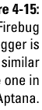

Firebug 调试器的工作方式与 Aptana 调试器大体相同。以下是其使用方法：

1. **在 Firefox 中打开可疑文件。**

   当然，你需要先加载该文件。

2. **打开 Firebug 的 `<script>` 标签。**

   你可能需要为本地文件启用脚本。

3. **设置断点。**

   单击想要设置断点的行号。会出现一个红点，表示断点已设置。

4. **重新加载页面。**

   使用 F5 键或重新加载按钮在调试模式下重新加载页面。

## 第一部分：使用 JavaScript 编程

5. **观察页面在断点处暂停。**

与 Aptana 调试器一样，你会被置于暂停模式，程序停留在断点处。

6. **使用 Step Into（步入）和 Step Over（步过）按钮在代码中移动。**

Firebug 调试器具有与 Aptana 调试器相同的 Step Into 和 Step Over 按钮。使用它们逐行遍历你的代码。

7. **在监视表达式菜单中输入变量名或条件。**

这样可以跟踪任何给你带来麻烦的特定变量或条件。

Firebug 调试器非常易于使用，但它有一个显著的缺陷：它只能在程序加载到内存后使用。如果程序立即进入无限循环（如本章中的 `endless.html` 所示），程序将不会停止执行，你也永远无法访问调试会话。

大多数 JavaScript 程序的编写方式都能避免这个问题（有关如何预加载 JavaScript 代码的信息，请参阅第 6 章）。然而，你可能无法使用 Firebug 调试器调试遇到的每一个程序。

> **提示**
>
> 当然，你根本不需要调试器也可以。JavaScript 调试器相对来说是比较新的工具，人们在编写 JavaScript 时多年来都没有使用过它们。你完全可以采用老派方法：使用老旧的 `alert()` 语句。如果你不确定代码中发生了什么，就用 alert 显示每个变量的值。当然，完成后别忘了移除那些 `alert()` 语句。

---


音乐家们称其为“路线图”，这个名字非常贴切。它提供了歌曲进行过程的高级概览。在路线图中，你无需担心具体某一段主歌或副歌的细节。路线图展示了整体结构，而你可以单独查看每一段主歌或副歌的细节。

### 构建 antsFunction.html 程序

看一下 `antsFunction.html` 的代码，看看它如何类似于乐谱：

```
<script type = "text/javascript">
//<![CDATA[
//from antsFunction.html

function chorus() {
  var text = "...and they all go marching down\n";
  text += "to the ground \n";
  text += "to get out \n";
  text += "of the rain. \n";
  text += " \n";
  text += "boom boom boom boom boom boom boom boom\n";
  alert(text);
} // end chorus

function verse1(){
  var text = "The ants go marching 1 by 1 hurrah, hurrah \n";
  text += "The ants go marching 1 by 1 hurrah, hurrah \n";
  text += "The ants go marching 1 by 1 \n";
  text += " The little one stops to suck his thumb\n";
  alert(text);
} // end verse1

function verse2(){
  var text = "The ants go marching 2 by 2 hurrah, hurrah \n";
  text += "The ants go marching 2 by 2 hurrah, hurrah \n";
  text += "The ants go marching 2 by 2 \n";
  text += " The little one stops to tie his shoe\n";
  alert(text);
} // end verse2
```

```
//main code
verse1();
chorus();
verse2();
chorus();

//]]>
</script>
```

程序代码将歌曲的各个部分拆分为与乐谱相同的片段。以下是 `antsFunction.html` 的一些有趣特点：

- **我创建了一个名为 `chorus()` 的函数。** 函数本质上是带名称的代码行集合。

- **所有副歌的代码都放入了这个函数。** 任何我想作为打印副歌一部分执行的操作，都放入 `chorus()` 函数中。之后，当我想打印副歌时，只需调用 `chorus()` 函数，它就会执行我存储在其中的所有代码。

- **每一段主歌也有一个函数。** 我也将每段主歌的代码拆分到各自的函数中。

- **主代码是路线图。** 在所有细节委托给函数后，主代码只负责控制函数的调用顺序。

- **细节隐藏在函数中。** 主代码处理整体框架。细节（如何打印副歌或主歌）则隐藏在函数内部。

函数是控制复杂性的非常有用的工具。你可以将一个庞大、复杂的程序拆分为几个较小的部分。每个部分独立存在，解决整体问题的特定部分。

你可以将每个函数视为一个微型程序。你可以在函数中定义变量、放置循环和分支，并执行程序能做的任何其他操作。使用函数的程序本质上就是一个充满子程序的程序。

技术细节：当你定义了函数后，它们就像新的 JavaScript 命令。从某种意义上说，当你添加函数时，你就是在向 JavaScript 添加自己的新命令。

### 向函数传入和传出数据

函数在逻辑上与主程序分离。这是一件好事，因为这种分离可以防止某些类型的错误。然而，有时你希望将信息传入函数。你也可能希望函数返回某种类型的值。`antsParam.html` 页面以一种利用函数输入和输出的方式重写了“蚂蚁”之歌：

```
<script type = "text/javascript">
//<![CDATA[
//from antsParam.html
```

我没有提供展示此程序的图示，因为它对用户来说看起来与 `antsFunction.py` 完全一样。这就是函数的优点之一：你可以改善程序的底层行为，而不会改变用户的体验。代码现在看起来是这样的：

```
function chorus() {
  var text = "...and they all go marching down\n";
  text += "to the ground \n";
  text += "to get out \n";
  text += "of the rain. \n";
  text += " \n";
  text += "boom boom boom boom boom boom boom boom\n";
  return text;
} // end chorus

function verse(verseNum){
  var distraction = "";
  if (verseNum == 1){
    distraction = "suck his thumb.";
  } else if (verseNum == 2){
    distraction = "tie his shoe.";
  } else {
    distraction = "I have no idea.";
  }

  var text = "The ants go marching ";
  text += verseNum + " by " + verseNum + " hurrah, hurrah \n";
  text += "The ants go marching ";
  text += verseNum + " by " + verseNum + " hurrah, hurrah \n";
  text += "The ants go marching ";
  text += verseNum + " by " + verseNum;
  text += " the little one stops to ";
  text += distraction;
  return text;
} // end verse

//main code
alert(verse(1));
alert(chorus());
alert(verse(2));
alert(chorus());

//]]>
</script>
```

这段代码中有一些重要的新概念（请记住这只是概述——具体细节将在接下来的几节中介绍）：

- **这些函数返回一个值。** 这些函数不再执行自己的 alert 语句。相反，它们创建一个值并将其返回给主程序。

- **只有一个主歌函数。** 因为所有主歌都非常相似，所以只用一个主歌函数是有意义的。这个改进的函数需要知道它正在处理哪一段主歌以处理差异。

### 检查主代码

主代码在一个重要方面发生了变化。在上一个程序中，主代码调用函数，而函数完成所有工作。这一次，函数本身并不执行输出。相反，它们收集信息并将其传回主程序。在主代码内部，每个函数都像变量一样被对待。

你之前已经见过这种行为：`prompt()` 方法返回一个值。现在 `chorus()` 和 `verse()` 方法也返回值。你可以对这个值做任何你想做的事情，包括打印它或将其与某个其他值进行比较。

通常认为，像我这样将数据的创建与其使用分离是一个好主意。这样你就有更多的灵活性。在函数创建了一些信息之后，你可以将其打印到屏幕上，将其存储在网页上，放入数据库，或做其他任何事情。

### 查看副歌部分

副歌已被修改为返回一个值。再看一下 `chorus()` 函数，看看我的意思：

```
function chorus() {
  var text = "...and they all go marching down\n";
  text += "to the ground \n";
  text += "to get out \n";
  text += "of the rain. \n";
  text += " \n";
  text += "boom boom boom boom boom boom boom boom\n";
  return text;
} // end chorus
```

以下是变化之处：

- **函数的目的改变了。** 该函数不再仅仅设计用于向屏幕输出某个值。相反，它现在向主程序提供文本，主程序可以随心所欲地处理结果。

- **有一个名为 `text` 的变量。** 这个变量将包含要发送给主程序的所有文本。（之前也是如此，但现在更加重要。）

- **`text` 变量在几行中连接。** 我使用字符串连接来构建一个复杂的值。注意使用换行符 (`\n`) 来强制回车。

- **`return` 语句将 `text` 发送回主程序。** 当你希望函数返回某个值时，只需使用 `return` 后跟一个值或变量即可。注意，`return` 应该是函数的最后一行。

### 处理主歌

`verse()` 函数非常有趣：为了使主歌如此多用途（你懂的——主歌多功能！），它必须从主程序接收输入并返回输出。它具有以下特点：

- **它比之前的函数更灵活。** 同一个函数可用于生成许多不同的主歌。

- **它接收输入以确定要打印哪段主歌。** 路线图将主歌编号发送给函数。

- **它根据输入修改主歌。** 主歌编号用于确定主歌其余部分应如何创建。

- **它返回一个值，就像 `chorus()` 一样。** 该函数的输出被传回主程序，以便它可以对新生成的主歌做些什么。

### 向 verse() 函数传递数据

首先，请注意 `verse()` 函数总是通过在括号内放置一个值来调用。例如，主程序说 `verse(1)` 来调用第一段主歌，说 `verse(2)` 来调用第二段。括号内的值称为*参数*。


### 确定分心的内容

`verse()`函数的设计必须能够接收一个参数。看第一行，你就会明白我是如何实现的：

```
function verse(verseNum) {
```

我在函数定义中包含了一个变量名`verseNum`。在函数内部，这个变量被称为*形参*（不要纠结于术语。人们经常将"形参"和"实参"这两个词互换使用）。重要的概念是：每当调用`verse()`函数时，它就会自动拥有一个名为`verseNum`的变量。你从主程序发送给`verse()`函数的无论什么实参，都会成为函数内部变量`verseNum`的值。

你可以根据需要定义任意数量参数的函数。每个参数都为你提供了向函数传递一条信息的机会。

如果你知道诗句的编号，就可以确定歌曲中"小家伙"因为什么而分心。有几种方法可以做到这一点，但一个简单的`if / else if`结构对这个例子来说已经足够：

```
var distraction = "";
if (verseNum == 1){
  distraction = "suck his thumb.";
} else if (verseNum == 2){
  distraction = "tie his shoe.";
} else {
  distraction = "I have no idea.";
}
```

这里我将变量`distraction`初始化为空。如果`verseNum`为1，将`distraction`设置为"suck his thumb."。如果`verseNum`为2，`distraction`应为"tie his shoe"。对于`verseNum`的任何其他值，由`else`子句视为错误处理。

如果你是有经验的程序员，可能会对程序大喊大叫。我知道，这仍然不是最优的。在本章稍后，我会展示一个使用数组处理这种情况的更好解决方案。


当这段代码执行完毕时，`verseNum`和`distraction`都已具有合法的值。

*创建文本*

在了解这些变量（`verseNum`和`distraction`）之后，构建输出文本就变得相当简单了：

```
var text = "The ants go marching ";
text += verseNum + " by " + verseNum + " hurrah,
    hurrah \n";
text += "The ants go marching ";
text += verseNum + " by " + verseNum + " hurrah,
    hurrah \n";
text += "The ants go marching ";
text += verseNum + " by " + verseNum;
text += " the little one stops to ";
text += distraction;
return text;
} // end verse1
```

这里进行了大量的字符串拼接，但本质上与原始的`verse()`函数相同。只是这个版本更加灵活，因为它可以处理任意诗句。（当然，前提是该函数已经预先加载了如何处理特定诗句编号的知识。关于这一点很快会详细介绍。）

### 管理作用域

函数非常像一个独立的小型程序。你在函数内部创建的任何变量只在函数内部有意义。当函数执行完毕后，它的变量就会消失！这其实是一件非常好的事情。一个大型程序可能有数百个变量，它们可能非常难以跟踪。可能会无意中重复使用变量名，或者意外更改某个值。当你将代码拆分成函数时，每个函数都有自己独立的变量集。你不必担心这些变量是否会在其他地方引起问题。

106 第 I 部分：使用 JavaScript 编程

### 介绍局部变量和全局变量

你也可以在主（脚本）级别定义变量。这些变量被视为全局变量。全局变量在主级别和每个函数内部都可用。局部变量（在函数内部定义的变量）只在函数内部有意义。局部与全局函数的概念有时被称为作用域。

局部变量有点像地方警察，他们的管辖范围有限，但在这个范围内非常有用。他们熟悉 neighborhoods。有时你会遇到跨越地方管辖范围的情况。这就是需要州警或联邦调查局的情况。局部变量是地方警察，而全局变量是联邦调查局。


一般来说，尽量让你的变量尽可能本地化。你真正需要全局变量的唯一时刻，是当你希望某些信息在多个函数中使用时。

### 检查变量作用域

为了理解变量作用域的含义，让我们来看看`scope.html`：

```html
<script type = "text/javascript">
//<!CDATA[
//from scope.html
var globalVar = "I'm global!";

function myFunction(){
    var localVar = "I'm local";
    console.log(localVar);
}

myFunction();

//]]></script>
```

这个程序定义了两个变量。`globalVar`在主代码中定义，`localVar`在函数内部定义。如果你在调试模式下运行程序并观察变量，你可以看到它们的行为。图 5-2 展示了程序运行初期的情况。

注意`localVar`在函数被调用之前没有意义，因此在计算机到达代码的该部分之前它保持未定义状态。向前推进几行，你会看到`localVar`有了值，如图 5-3 所示。

> 务必使用"步入"技术来单步执行程序，而不是"步过"。当"步过"遇到函数时，它会将整个函数作为一行运行。如果你想查看函数内部发生了什么（就像你在这里做的那样），请使用"步入"。如果你需要复习如何使用调试模式，请参阅第 4 章。

`globalVar`有值，但`localVar`没有，因为程序尚未到达包含`localVar`的函数。

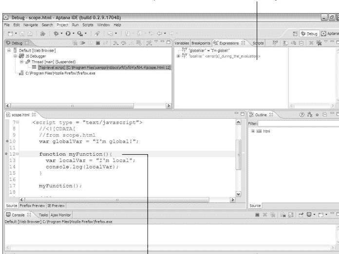

图 5-2：这里`globalVar`已定义，但`localVar`尚未定义。

```html
<script type = "text/javascript">
//<![
CDATA[
//from scope.html
var globalVar = "I'm global!";
function myFunction(){
    var localVar = "I'm local";
    console.log(localVar);
}
myFunction();
```

控制权尚未传递给函数。

108 第 I 部分：使用 JavaScript 编程

务必步入函数以查看内部情况，而不是步过函数。

步过
步入

全局变量仍然有意义，局部变量有了值。

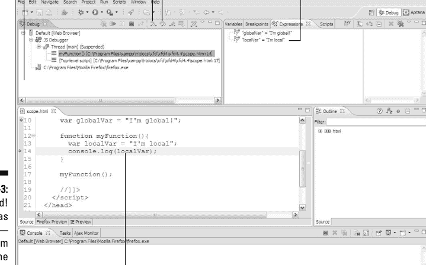

图 5-3：看！`localVar`有值了——因为我在函数内部。

程序控制现在在函数内部。

注意`globalVar`仍然有值——`localVar`也有值，因为它在函数内部。

如果你在代码中继续向下移动几步，你会发现当函数结束时`localVar`不再有值。这在图 5-4 中得到了说明。

变量作用域是一件好事，因为它意味着你只需要跟踪全局变量和当前函数内部定义的变量。作用域的另一个好处是你可以重复使用变量名。你可以有十个不同的函数都使用相同的变量名，它们不会相互干扰，因为每个都是完全不同的变量。

现在局部变量没有意义因为它的函数不再在内存中。

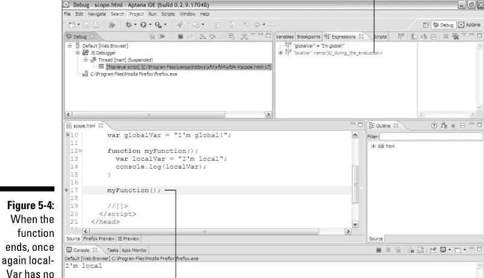

控制权再次移出函数。

### 构建基本数组

如果说函数是一组带有名称的代码行，那么*数组*也是类似的；它是一组带有名称的变量。数组实际上是一种特殊的变量，用于管理复杂性。当你想要处理相似数据类型的列表时，请使用数组。

#### 在数组中存储数据列表

以下代码展示了数组的基本演示：

```html
<script type = "text/javascript">
//<!CDATA[
//from genres.html

//creating an empty array
var genre = new Array(5);

//storing data in the array
genre[0] = "flight simulation";
genre[1] = "first-person shooters";
genre[2] = "driving";
genre[3] = "action";
genre[4] = "strategy";

//returning data from the array
alert ("I like " + genre[4] + " games.");

// ]]>
</script>
```

110 第 I.pages_IMAGE_AND code_part Programming with JavaScript

变量`genre`是一个特殊的变量，因为它包含许多不同的值。本质上，它是一个游戏类型列表。`new Array(5)`构造在内存中创建了五个变量的空间，都命名为`genre`。

#### 访问数组数据

在指定数组后，你可以使用方括号语法来处理单个元素。数组的每个元素都由一个整数标识。索引通常从 0 开始：

```
genre[0] = "flight simulation";
```

这行代码的意思是：将文本值"flight simulation"赋值给`genre`数组变量在位置 0 的元素。

大多数语言要求所有数组元素都是相同的类型。JavaScript 对此非常宽容。你可以在 JavaScript 数组中组合各种内容。这有时非常有用，但要注意这个技巧并非在所有语言中都有效。一般来说，我尽量让数组的所有成员保持相同的类型。不要忘记数组索引通常从 0 开始。

在将数据存储到数组中后，你可以使用相同的方括号语法来读取信息。

这行代码

```
alert ("I like " + genre[4] + " games.");
```


 ## 在 for 循环中使用数组

使用数组的主要原因是为了方便。当数组中存储大量信息时，你可以编写代码来快速处理数据。每当拥有一个数据数组时，通常都想要对其中的每个元素执行某些操作。看看 `games.html` 了解这是如何实现的：

```
<script type = "text/javascript">
//<![CDATA[
//from games.html

//pre-loading an array
var gameList = new Array("Flight Gear",
    "Sauerbraten",
    "Future Pinball", "Racer", "TORCS", "Orbiter",
    "Step Mania", "NetHack",
    "Marathon", "Crimson Fields");

var text = "";
for (i = 0; i < gameList.length; i++){
    text += "I love " + gameList[i] + "\n";
} // end for loop
alert(text);

//]]>
</script>
```

这段代码有一些值得注意的地方：

- **它包含一个名为** `gameList` **的数组**。该数组包含一些我最喜欢的免费游戏的名称。
- **数组预先加载了值。** 如果在创建数组时提供值列表，JavaScript 会简单地用你指定的值预先加载数组。如果预先加载了数组，则无需指定数组的大小。
- **`for` 循环遍历数组。** 数组和 for 循环是天然的好搭档。`for` 循环逐步遍历数组的每个元素。
- **数组的长度用于** `for` **循环的条件。** 我没有指定值 10，而是在 `for` 循环中使用了数组的 `length` 属性。这是好的做法，因为如果添加或删除元素，循环会自动调整以适应数组的大小。
- **它对每个元素执行操作#.** 因为 `i` 从 0 到 9（这些是数组索引），所以我可以轻松打印出数组的每个值。在这个示例中，我只是简单地添加到输出字符串。
- **注意换行符。** `\n` 组合是一个特殊字符。它告诉 JavaScript 添加一个回车（就像按下 Enter 键）。

当 `games.html` 运行时，它看起来如图 5-6 所示。

**提示** 如果你想彻底毁掉自己的生产力，不妨用 Google 搜索一下图 5-6 中显示的一些游戏名称。它们绝对令人难以置信，而且每一个都是免费的。这再好不过了。（看，即使你没有从这本书中学到如何编程，你也能获得*一些好处*！）

### 再访问一次蚂蚁歌

就在你将那首蚂蚁歌从脑海中赶出去的时候，再看一个变体。这个版本使用数组和循环进一步简化了代码！

```
<script type = "text/javascript">
//<![CDATA[
//from antsArray.html

var distractionList = new Array("", "suck his
    thumb", "tie his shoe");

function chorus() {
    var text = "...and they all go marching down\n";
    text += "to the ground \n";
    text += "to get out \n";
    text += "of the rain. \n";
    text += " \n";
    text += "boom boom boom boom boom boom boom boom\n";
    return text;
} // end chorus

function verse(verseNum) {
  //pull distraction from array
  var distraction = distractionList[verseNum];

  var text = "The ants go marching ";
  text += verseNum + " by " + verseNum + " hurrah, hurrah\n";
  text += "The ants go marching ";
  text += verseNum + " by " + verseNum + " hurrah, hurrah\n";
  text += "The ants go marching ";
  text += verseNum + " by " + verseNum;
  text += " the little one stops to ";
  text += distraction;
  return text;
} // end verse

//main code is now a loop
for (verseNum = 1; verseNum < distractionList.length; verseNum++) {
  alert(verse(verseNum));
  alert(chorus());
} // end for loop

//]]>
</script>
```

这段代码与之前显示的 `antsParam` 程序略有不同。

- **它有一个名为** `distractionList` **的数组。** 这个数组（尽管名字有误导性）是一个分心的列表。我将第一个（元素 0）设为空白，以便诗句编号能够正确对齐。
- **`verse()` 函数查找一个分心活动。** 因为现在分心活动都在数组中，所以 `verseNum` 可以用作索引来查找特定的分心活动。将这个函数与 `antsParam` 中的 `verse()` 函数进行比较。虽然数组比代码结构需要更多的规划，但它们可以极大地提高代码的可读性。
- **主程序在一个循环中。** 我逐步遍历 `distractionList` 数组的每个元素，打印出相应的诗句和副歌。
- **`chorus()` 函数保持不变。** 没有必要更改 `chorus()`。

### 使用二维数组

在处理数据列表时，数组非常有用。有时你会遇到最适合用表格来想象的数据。例如，假设你想构建一个距离计算器，用于计算两个城市之间的距离。原始数据可能如表 5-1 所示。

| | 0) Indianapolis | 1) New York | 2) Tokyo | 3) London |
|---|---|---|---|---|
| 0) Indianapolis | 0 | 648 | 6476 | 4000 |
| 1) New York | 648 | 0 | 6760 | 3470 |
| 2) Tokyo | 6476 | 6760 | 0 | 5956 |
| 3) London | 4000 | 3470 | 5956 | 0 |

想想如何使用这个表格来计算距离。例如，如果你想从纽约前往伦敦，你会选择纽约行和伦敦列，然后找出它们的交点。该单元格中的数据就是距离（3,470 英里）。

当你在任何类型的表格中查找信息时，实际上是在使用*二维数据结构*。这是一个花哨的术语，但它的意思只是"表格"。如果你想在表格中查找某些内容，你需要两个索引，一个用于确定行，另一个用于确定列。

如果这难以理解，想想老游戏"战舰"。游戏场地是一个方格网格。你宣布"I-5"（意思是"I 列，5 行"），然后你的对手查看该网格，发现你击沉了他的战舰。在编程中，通常两个索引都使用整数，但除此之外完全相同：每当你有二维数据时，你都用两个索引来访问它。

通常我们称这些索引为*行*和*列*， language processing model霍华德·增长 with you of北京北京 me to abandon帮我继续好的，我继续完成翻译：

通常我们称这些索引为*行*和*列*，帮助你将其想象成表格。有时会有更好的名称，更清楚地描述行为的工作方式。看看图 5-7，你会看到 `distance.html` 程序询问两个城市，并根据数据表返回距离。

是的，在编程中可以有 3 维、4 维和*n*维数组，但暂时不要担心这个。（它可能会让你的头爆炸。）大多数时候，1 维或 2 维就是你所需要的全部。

图 5-7：这是"双城记"。你甚至能得到它们之间的距离！

这个程序比一些其他的程序稍长一些，所以我将它分成几个部分以便易于消化。请务必在配套网站上查看完整的程序：www.dummies.com/go/javascriptandajaxfd 或 www.aharrisbooks.net/jad。

### 设置数组

这个程序的关键在于数据组织。第一步是设置两个数组，如下所示：

```
<script type = "text/javascript">
  //<![CDATA[
  //from distance.html

  //cityName has the names of the cities
  cityName = new Array("Indianapolis", "New York",
      "Tokyo", "London");

  //create a 2-dimension array of distances
  distance = new Array (
    new Array (0, 648, 6476, 4000),
    new Array (648, 0, 6760, 3470),
    new Array (6476, 6760, 0, 5956),
    new Array (4000, 3470, 5956, 0)
  );
```

第一个数组是一个普通的单维城市名称数组。我一直小心地保持城市顺序一致，所以每当我提到城市 0 时，我指的是印第安纳波利斯（我的家乡）。纽约将始终在位置 1，以此类推。

在你的数据设计中，要注意始终保持顺序一致。务必在输入计算机之前在纸上组织好数据，这样你就能理解哪个值放在哪里。

`cityName` 数组有两个作用。首先，它提醒我所有城市的顺序，其次，它让我在知道索引时轻松获取城市名称。例如，我知道 `cityName[2]` 将始终是 "Tokyo"。

`distance` 数组非常有趣。如果你眯着眼睛看，它很像表 5-1。这是因为它*就是*表 5-1，只是格式略有不同。

请记住，`distance` 是一个数组。JavaScript 数组几乎可以容纳任何东西，包括其他数组！这就是 `distance` 所做的：它保存了一个行数组。`distance` 数组的每个元素都是另一个（未命名的）数组，保存该行的所有数据。如果你想从数组中提取信息，需要两条信息。首先你需要行。然后，因为该行是一个数组，你需要该数组内的列号。所以 `distance[1][3]` 的意思是，"转到名为 `distance` 的数组的第 1 行（纽约）。在该行内，转到元素 3（伦敦）并返回结果值（3470）。"很酷吧？

### 获取城市

程序要求你询问两个城市。你希望用户输入城市编号而不是名称，而且你想做两次。这听起来像是使用函数的好时机：

```
function getCity(){
  // presents a list of cities and gets a number
  // corresponding
  // to the city name
  var theCity = "";  //will hold the city number

  var cityMenu = "Please choose a city by typing a
  number: \n";
  cityMenu += "0) Indianapolis \n";
  cityMenu += "1) New York \n";
  cityMenu += "2) Tokyo \n";
  cityMenu += "3) London \n";

  theCity = prompt(cityMenu);
  return theCity;
} // end getCity
```

这里 `getCity()` 函数会打印出一个城市选择的小小菜单，并请求输入。然后返回该输入。

改进 `getCity()` 的方法多种多样。比如，它可能应该重复执行，直到你输入一个有效的数字，这样用户就不会输入城市名或做出其他奇怪的事情。目前我先让它保持简单。下一章将向你展示如何使用用户界面的元素来帮助用户只提交有效的输入。

### 创建 main() 函数

`main()` 函数处理程序的大部分代码。它看起来是这样的：

```
function main() {
    var output = "";
    var from = getCity();
    var to = getCity();
    var result = distance[from][to];
    output = "The distance from " + cityName[from];
    output += " to " + cityName[to];
    output += " is " + result + " miles.";
    alert(output);
} // end main

main();
```

在这段代码中，`main()` 函数控制着流程。它的工作方式如下：

1. **创建一个输出变量。**
   这个函数的目的是创建一些描述距离的文本输出。我首先创建一个名为 `output` 的变量，并将其初始值设置为空。

2. **获取出发城市。**
   幸运的是，你有一个非常棒的函数 `getCity()`，它处理所有以正确格式获取城市的细节。调用这个函数，并将其值赋给新变量 `from`。

3. **获取目的城市。**
   那个 `getCity()` 函数确实很方便。再次使用它来获取你将称之为 `to` 的城市编号。

4. **获取距离。**
   因为你知道两个索引，并且知道它们格式正确，所以你可以直接在表中查找它们。查找 `distance[from][to]` 并将其存储在变量 `result` 中。

5. **输出响应。**
   使用连接来构建合适的响应字符串，并将其发送给用户。

6. **从 `cityNames` 数组获取城市名称。**
   程序使用数字索引来表示城市，但这些对用户来说没有任何意义。使用 `cityNames` 数组来检索输出的两个城市名称。

7. **运行 `main()` 函数。**
   只有一行代码不在函数中。该行代码调用 `main()` 函数并启动整个程序。

> **提示**
> 我实际上并不是按照我向你展示的顺序编写这个程序的。有时候采用“由内而外”的方式编写程序更有意义，这里就是这种情况：我实际上先创建了数据结构（纸上的一个普通表格），然后构建了 `main()` 函数。这使我明显需要一个 `getCity()` 函数，并给我提供了一些关于 `getCity` 应如何工作的线索（即，它应该呈现一个城市列表，然后提示输入一个数字）。

### 创建你自己的对象

到目前为止，你已经在 JavaScript 中使用了很多奇妙的对象——但这仅仅是开始。事实上，你也可以构建自己的对象，这些对象可以非常强大和灵活。对象通常有两个重要的组成部分：*属性* 和 *方法*。*属性* 就像与对象关联的一个变量，它描述了对象。*方法* 就像与对象关联的一个函数，它描述了对象能做的事情。

> **记住**
> 函数允许你将代码片段组合在一起；数组允许你将变量组合在一起；对象允许你将代码片段和变量（实际上是函数和数组）放在同一个大的构造体中。

#### 构建一个基本对象

JavaScript 使得构建一个对象变得极其简单。因为变量可以包含任何值，所以你只需开始将变量当作对象对待，它就变成了对象。

图 5-8 展示了一个具有属性的小生物。

**图 5-8：**
这个警报框实际上是在使用一个对象。

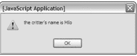

看看下面的代码：

```
//from basicObject.html
//create the critter
var critter = new Object();

//add some properties
critter.name = "Milo";
critter.age = 5;

//view property values
alert("the critter's name is " + critter.name + ".");
```

其工作原理并不难理解：

1. **创建一个新对象。**
   JavaScript 有一个内置对象叫做 `Object`。用 `new Object()` 语法创建一个变量，你就会构建出一个全新的标准对象。

2. **向对象添加属性。**
   属性就像一个子变量。它不过是一个附加到特定对象上的变量。例如，当你给 `critter.name` 赋值时，你就是在指定 `critter` 有一个名为 name 的属性，同时也在给它一个初始值。

3. **一个对象可以有任意数量的属性。**
   继续添加属性即可。这允许你将多个变量组合到一个更大的对象中。

4. **每个属性可以包含任何类型的数据。**
   与数组（其中所有元素通常包含完全相同类型的数据）不同，每个属性可以有不同的类型。

5. **使用点语法来查看或更改属性。**
   如果 `critter` 对象有一个 name 属性，你可以将 `critter.name` 用作一个变量。像其他变量一样，你可以通过给 `critter.name` 赋一个新值来更改其值，也可以读取属性的内容。

如果你习惯于像 Java 这样更严格的面向对象语言，你会发现 JavaScript 随和的态度相当奇怪，甚至可能有点草率。其他语言确实有更多关于对象如何创建和使用的规则，但 JavaScript 的方法确实有其魅力。不要过于纠结于差异。JavaScript 处理对象的方式既强大又令人耳目一新。

### 向对象添加方法

除了属性，对象还有其他特性。它们还可以有 *方法*。方法就是附加到对象上的一个函数。要理解我的意思，请看这个例子：

```
//create the critter
//from addingMethods.html
var critter = new Object();

//add some properties
critter.name = "Milo";
critter.age = 5;

//create a method
critter.talk = function(){
  msg = "Hi! My name is " + this.name;
  msg += " and I'm " + this.age;
  alert(msg);
}; // end method

// call the talk method
critter.talk();
```

这个例子扩展了上一节描述的 `critter` 对象。除了属性，新的 `critter` 还有一个 `talk()` 方法。如果属性描述了对象的一个特征，那么方法描述了对象能做的事情。图 5-9 展示了 `critter` 在炫耀它的 `talk()` 方法。

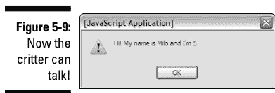

其工作原理如下：

1. **构建一个具有你需要的任何属性的对象。**
   首先构建一个对象并给它一些属性。

2. **像定义属性一样定义一个方法。**
   事实上，在 JavaScript 中方法就是属性，但不要过于纠结这一点——这会让你头疼的。

3. **你可以将一个预先构建的函数赋给一个方法。**
   如果你已经创建了一个想用作方法的函数，你可以直接赋值。

4. **你也可以创建一个匿名函数。**
   更常见的是，你希望立即创建你的方法。你可以使用 `function() {` 语法立即创建一个函数。

5. **`this` 关键字指的是当前对象。**
   在函数内部，你可能想访问对象的属性。`this.name` 指的是当前对象的 `name` 属性。

6. **然后你可以直接引用该方法。**
   定义了一个具有方法的对象后，你就可以调用它。例如，如果 `critter` 对象有一个 `talk()` 方法，就使用 `critter.talk()` 来调用这个方法。

### 构建一个可重用的对象

这些对象很不错，但如果你想要构建几个具有相同定义的对象怎么办？JavaScript 支持一种叫做 `构造函数` 的概念，它允许你定义一个对象模式并重用它。

这里有一个例子：

```
//building a constructor
//from constructor.html
function Critter(lName, lAge){
  this.name = lName;
  this.age = lAge;
  this.talk = function(){
    msg = "Hi! My name is " + this.name;
    msg += " and I'm " + this.age;
    alert(msg);
  } // end talk method
} // end Critter class def

function main(){
  //build two critters

  critterA = new Critter("Alpha", 1);


## 第122页 第一部分：JavaScript编程

```
critterB = new Critter("Beta", 2);
critterB.name = "Charlie";
critterB.age = 3;

//让它们“说话”
critterA.talk();
critterB.talk();

} // main函数结束
main();
```

这个示例涉及创建一个类（一种生成对象的模式）并重用该定义来构建两个不同的生物。首先，看看类定义是如何工作的：

**1. 构建一个普通函数。**
JavaScript类被定义为函数的扩展。函数名也将是类名。请注意，类函数的名称通常以大写字母开头。当一个函数以这种方式用于描述对象时，该函数被称为对象的**构造函数**。如果你愿意，构造函数可以接受参数，但它通常不返回任何值。在我这个特定的例子中，我添加了用于姓名和年龄的参数。

**2. 使用`this`定义属性。**
添加你想要的任何属性，包括默认值。请注意，如果你愿意，你稍后可以更改这些值。每个属性都应该以`this`和一个句点开头，因此如果你希望你的对象有一个颜色属性，你会说类似`this.color = "blue"`这样的话。我的示例使用局部参数来定义属性。这是一个非常常见的做法，因为这是预加载重要属性的简单方法。

**3. 使用`this`定义你想要的任何方法。**
如果你希望你的对象有方法，请使用`this`运算符后跟`function() {`关键字来定义它们。你可以添加任意多的函数。

JavaScript定义和使用对象的方式很简单，但有点非标准。大多数其他支持面向对象编程的语言采用与这里描述的技术不同的方式。有些人会争辩说JavaScript不是真正的OOP语言，因为它不支持一个叫做*继承*的特性，而是使用一个叫做*原型*的特性。这种区别并不是那么关键；JavaScript中大多数OOP的使用都是非常简单的对象，就像这里描述的或者本章后面描述的JSON那样。只需理解这里对面向对象编程的介绍非常粗略，但足以让你入门。

### 使用你崭新的对象

当你定义了一个类，你就可以重用它。再次查看`main`函数，看看我是如何使用我新创建的`Critter`类的：

```
function main(){
    //创建两个生物

    critterA = new Critter("Alpha", 1);

    critterB = new Critter("Beta", 2);
    critterB.name = "Charlie";
    critterB.age = 3;

    //让它们“说话”
    critterA.talk();
    critterB.talk();

} // main函数结束
main();
```

在定义了类之后，你可以将其用作一种新的数据类型。这是一个非常强大的能力。以下是它的工作原理：

1. **确保你可以访问该类。**
   除非JavaScript已经知道该类，否则该类是无用的。在这个例子中，该类是在代码中定义的。

2. **使用`new`关键字创建该类的一个实例。**
   `new`关键字表示你想要基于该定义制作一个特定的`critter`。通常你会将其赋值给一个变量。我的构造函数期望提供姓名和年龄，因此它会自动创建一个具有给定姓名和年龄的`critter`。

3. **根据需要修改类属性。**
   你可以更改任何类属性的值。在我的例子中，我更改了第二个`critter`的姓名和年龄，只是为了演示如何操作。

4. **调用类方法。**
   因为`Critter`类有一个`talk()`方法，所以当你想要某个特定的`critter`说话时，你可以随时使用它。

### 介绍JSON

JavaScript对象和数组极其灵活。事实上，它们因其强大和易用性而广为人知，以至于一种名为JSON（JavaScript对象表示法）的特殊数据格式现在已被许多其他语言采用。

JSON主要用于存储复杂数据（尤其是多维数组）并在程序之间传递数据。JSON本质上是JavaScript对象格式的另一种描述复杂数据的方式。当你用JSON描述数据时，通常不需要构造函数，因为数据本身被用来确定类的结构。

JSON数据正在成为Web编程中非常重要的一部分，因为它提供了一种在程序和编程语言之间传输数据的简单机制。贯穿本书（特别是在关于AJAX和jQuery库的部分），你将看到JSON被广泛用于轻松管理复杂数据。

#### 以JSON格式存储数据

为了了解JSON的工作原理，首先看这个简单的代码片段：

```
var critter = {
    "name": "George",
    "age": 10
};
```

这段代码描述了一个具有两个属性的生物：姓名和年龄。这个生物看起来很像一个数组，但它不是使用数字索引（如大多数数组那样），而是使用字符串值作为索引。事实上，它是一个对象。

你可以使用类似数组的语法来引用各个元素，像这样：

```
alert(critter["name"]);
```

你也可以使用所谓的点表示法（如对象中使用的），像这样：

```
alert(critter.age);
```

两种表示法的工作方式相同。大多数内置JavaScript对象使用点表示法，但两种方式都是可以接受的。

## 第5章：函数、数组和对象 125

JavaScript数组如此有用的原因在于它们实际上是对象。当你在JavaScript中创建一个数组时，你正在构建一个具有数字属性名的对象。这就是为什么你可以使用数组或对象语法来管理JSON对象属性。

查看我网站（www.aharrisbooks.net/jad）上的`jsonDistance.html`，看看本节的代码实际运行情况。我没有在这里展示图表，因为所有有趣的工作都发生在代码中。

以下是如何以JSON表示法存储数据：

1. **创建变量。**
   你可以像使用任何其他变量一样使用`var`语句。

2. **将内容包含在花括号（`{}`）内。**
   这与你用于创建预加载数组的机制相同（如本章前面所述）。

3. **指定一个键。**
   对于`critter`，我希望属性被命名为"name"和"age"——即使用单词而不是数字索引。对于每个属性，我从属性名开始。键可以是字符串或整数。

4. **键后跟一个冒号（`:`）。**
   键后面跟着冒号字符。

5. **创建与该键关联的值。**
   然后你可以将任何类型的值与该键关联起来。在这个例子中，我将值"George"与键"name"关联起来。

6. **用逗号（`,`）分隔每个键值对。**
   你可以添加任意多的键值对。

如果你熟悉其他编程语言，你可能会认为JSON结构类似于哈希表或关联数组。JavaScript确实像使用这些其他结构一样使用JSON结构，但说JSON是一个哈希*或*一个关联数组并不完全准确。它就是一个对象。（但如果你想把它看作其中任何一个，我不会告诉任何人。）

### 构建更复杂的JSON结构

JSON很方便，因为它可以用于处理相当复杂的数据结构。例如，看看以下（奇怪地熟悉）的用JSON格式编写的距离数据结构：

## 第126页 第一部分：JavaScript编程

```
var distance = {
  "Indianapolis" :
    { "Indianapolis": 0,
      "New York": 648,
      "Tokyo": 6476,
      "London": 4000 },

  "New York" :
    { "Indianapolis": 648,
      "New York": 0,
      "Tokyo": 6760,
      "London": 3470 },

  "Tokyo" :
    { "Indianapolis": 6476,
      "New York": 6760,
      "Tokyo": 0,
      "London": 5956 },

  "London" :
    { "Indianapolis": 4000,
      "New York": 3470,
      "Tokyo": 5956,
      "London": 0 },
};
```

这个数据结构是表示用于描述二维数组的距离数据的另一种方式。这是另一个二维数组，但与之前描述的那个略有不同。

- `distance`**是一个JSON对象**。整个数据结构存储在一个变量中。这个变量是一个包含键值对的JSON对象。
- `distance`**对象有四个键**。这些对应于原始图表的四行。
- **键是实际的城市名称**。原始的二维数组使用数字索引，这很方便但有点人为化。在JSON结构中，索引是实际的城市名称。
- **每个条目的值是另一个JSON对象**。JSON元素的值可以是任何东西，包括另一个JSON对象。非常复杂的关系可以在单个变量中进行概括。
- **每一行都被概括为一个JSON对象**。例如，与`Indianapolis`关联的值是从印第安纳波利斯到各个城市的距离列表。
- **整个声明是代码的“一行”**。尽管在编辑器中为了清晰起见放在了多行上，但整个定义实际上只是一行代码。


以这种方式设置数据看起来有点繁琐，但使用起来非常方便。城市名称被直接用于提取数据，因此你可以使用类似数组的语法来查找两个城市之间的距离：

```
alert(distance["Indianapolis"]["London"]);
```

如果你喜欢的话，也可以使用点号语法：

```
alert(distance.Indianapolis.Tokyo);
```

你甚至可以使用某种混合写法：

```
alert(distance["London"].Tokyo);
```

JSON 作为一种数据格式具有许多重要优势：

- **它具有自描述性。** 即使你只看到数据结构本身，周围没有任何代码，你也能明白它的含义。
- **使用字符串作为索引使代码更具可读性。** `distance["Indianapolis"]["London"]` 比 `distance[0][3]` 要容易理解得多。
- **JSON 数据可以以文本形式存储和传输。** 这对 Web 编程有着深远的影响，特别是在 AJAX（本书其他章节介绍的技术）中。
- **JSON 可以描述复杂的关系。** 这里展示的示例是一个简单的二维数组，但 JSON 格式可以用来描述更复杂的关系——包括完整的数据库。
- **许多语言支持 JSON 格式。** 现在许多 Web 语言都直接支持 JSON。其中最重要的是 PHP，它在 AJAX 应用中经常与 JavaScript 配合使用。
- **JSON 比 XML 更紧凑。** 另一种称为 XML 的数据格式也经常用于传输复杂数据。然而，JSON 比 XML 更紧凑，也不那么"冗长"。
- **JavaScript 可以原生读取 JSON。** 某些类型的数据在使用前必须进行翻译。而 JavaScript 程序一旦能够访问 JSON 数据，就可以直接使用。


你可能会想知道是否可以在 JSON 对象中嵌入方法。答案是可以的，但在使用 JSON 传输信息时通常不会这样做。在本书关于 AJAX 的第三部分中，你会看到方法经常被添加到 JSON 对象中作为*回调函数*，但在你对事件更加熟悉之前，这种用法还不会有什么意义。要开始了解这方面的内容，请翻到第 14 章。

## 第一部分：使用 JavaScript 编程

## 第二部分：使用 JavaScript 增强你的页面


### 本部分概述……

JavaScript 作为一种操作 Web 页面的语言而诞生。利用本部分来学习 JavaScript 如何与 Web 页面直接交互。

第 6 章介绍了强大的文档对象模型（DOM），以及这一机制如何让你的 JavaScript 程序与 Web 页面交互。你将学习如何监听按钮事件，以及如何动态更改页面的部分内容。

第 7 章介绍了获取更可靠输入的方法。首先你将学习如何使用列表框和单选按钮等专用用户界面元素。其次，你将学习如何使用正则表达式来确保文本字段的值处于正确的格式。

第 8 章教你如何让你的页面动起来。你将学习如何在用户或程序控制下移动页面元素。你将学习如何使元素产生动画效果，以及如何预加载图片以实现更高效的动画。你还将学习如何读取键盘和鼠标输入。

## 第 6 章：与页面对话

*本章内容*

- 介绍文档对象模型
- 响应表单事件
- 将按钮连接到函数
- 从文本字段中检索数据
- 更改文本字段中的文本
- 向页面发送数据
- 使用其他与文本相关的表单元素
- 查看动态生成代码的源码

JavaScript 很有趣，但它存在于 Web 浏览器中是有原因的：让你能够更改 Web 页面。JavaScript 最棒的地方在于它帮助你控制页面。你可以使用 JavaScript 从用户那里读取有用的信息，并动态地更改页面。

### 理解文档对象模型

JavaScript 程序通常存在于 Web 页面的上下文中。页面的内容通过一种称为*文档对象模型（DOM）*的机制提供给 JavaScript 程序。

DOM 是一组特殊的复杂变量，封装了整个 Web 页面的内容。你可以使用 JavaScript 从 DOM 中读取并确定元素的状态。你也可以修改 DOM 变量，从 JavaScript 代码内部更改页面。

### 浏览 DOM

感受 DOM 最简单的方式是在 Firefox 中加载一个页面，然后查看 Firebug 窗口的 DOM 选项卡。我在图 6-1 中就是这样做的。为了查看 DOM 的运行情况，我使用了 Firebug 扩展。如果需要回顾如何使用 Firebug，请查看第 1 章。还需注意，某些版本的 Firebug（特别是在 Mac 上）略有不同，但总体思路是一样的。

当你查看一个非常简单的页面的 DOM 时，很容易感到不知所措。你会看到列出了大量的变量。从技术上讲，这些都是一个名为 `window` 的特殊对象的元素。`window` 对象有大量的子对象，全部列在 DOM 视图中。表 6-1 描述了一些重要的 `window` 变量。

#### 表 6-1：主要 DOM 对象

| 变量 | 描述 | 备注 |
|------|------|------|
| `document` | 表示 XHTML 页面 | 最常用于脚本编程的元素。 |
| `location` | 描述当前 URL | 更改 location.href 可导航到新页面。 |
| `history` | 最近访问过的页面列表 | 访问此项可查看之前的页面。 |
| `status` | 浏览器状态栏 | 更改此项可在状态栏中设置消息。 |

### 使用 Firebug 更改 DOM 属性

为了展示 DOM 的强大功能，在 Firefox 中尝试以下实验：

1. **加载任意页面。**

   使用什么页面都无关紧要。我将使用 `simple.html`，一个只有 `<h1>` 标题的非常基础的页面。

2. **启用 Firebug 扩展。**

   你可以通过多种方式操作 DOM，但 Firebug 扩展是最简单且最强大的实验工具之一。

3. **启用 DOM 选项卡。**

   这将显示所有顶层变量的列表。


图 6-1：即使是简单的页面也有复杂的 DOM。

你可以查看 DOM 并与其实时交互。

4. 向下滚动直到看到 `status` 元素。找到 `status` 元素后，双击它。

5. 输入一条你想对自己说的话。在出现的对话框中输入内容并按回车键。

6. 查看浏览器底部。浏览器窗口底部的状态栏现在应该包含你输入的消息！

7. 自己动手试试。试试 DOM 列表中的各种元素。其中许多都可以被修改。尝试将 `window.location.href` 更改为任意 URL 并观察会发生什么。（别担心——你不会在这里永久性地破坏任何东西。）


提示：这个 DOM 实验并不总是有效的。你可能安装了阻止 DOM 的扩展，或者它可能不会完全按你期望的那样工作。如果这个实验不成功，就继续往下看。你以后再也不会以这种方式操作 DOM 了。一旦你学会通过代码操作 DOM 是多么容易，那将是你唯一想要使用的方式。

### 查看 document 对象

如果 `window` 对象很强大，那么它的子对象——`document` 对象——则更加令人惊叹。

同样，感受这个对象的最好方式是进行一些探索：

1. **重新加载** `simple.html`。

   如果之前的实验导致情况变得很奇怪，你可能需要重启 Firefox。确保 Firebug 扩展显示的是 DOM 选项卡。

2. **找到** `document` **对象。**

   它通常在 `window` 列表的前面。当你选择 `document` 时，它会展开，显示大量的子元素。

3. **找到** `document.body`。

   在 `document` 的某个地方你会看到 `body`。选择它，看看你能发现什么。

4. **找到** `document.body.style`。

   `document` 对象有一个 `body` 对象，而 `body` 对象有一个 `style` 子对象。这难道没有尽头吗？

5. **浏览 style 元素。**

   有些样式可能不太熟悉，但继续看下去，你会看到一些老朋友。

6. **双击** `backgroundColor`。

   每个 CSS 样式属性在 DOM 中都有一个对应（但不完全相同）的属性。哇。输入一种新颜色（使用颜色名称或十六进制颜色值）看看会发生什么。

7. **感叹一下自己的聪明才智。**

   你可以浏览 DOM 来对页面进行各种更改。如果你能在这里操作某些东西，你也可以编写代码来实现它。

如果你在这里迷失了方向，图 6-2 显示了我修改文档的 body 的 style 的 backgroundColor（这就像树上的鸟的翅膀上的某个东西——层层嵌套）。不过，一张图无法真正完整地展示这个过程。你必须自己动手实验。但不要被吓倒。你其实不需要掌握 Firebug DOM 功能的所有细节。只要知道它的存在即可，因为它是你接下来所有酷炫操作的基础。


### 通过 JavaScript 驾驭 DOM

当然，用 Firebug 来捣鼓你的网页确实很极客，但你为什么要关心这些呢？DOM 的全部目的就是为了给 JavaScript 提供**魔法般**访问页面所有内部运作的能力。

### JavaScript 风格的忧郁蓝调

当你开始编写 JavaScript 代码来访问 DOM 时，一切变得有趣起来。看看图 6-3 中的 `blue.html`。

#### 不应该叫 "background-color" 吗？

如果你深入研究过 DOM 风格的元素，你会发现一些有趣的事情。首先，很多元素名称看起来很熟悉，但又不完全一样：`background-color` 变成了 `backgroundColor`，`font-weight` 变成了 `fontWeight`。CSS 使用连字符来表示单词分隔，而 DOM 则将单词合并并使用首字母大写来提高清晰度。你会发现所有你熟悉的老朋友 CSS 元素，但名称按照这种非常可预测的公式发生了变化。不过，如果你感到困惑，只需使用 Firebug 的 DOM 检查器来查看各种样式元素。

这个页面有白色文字和蓝色背景，但没有 CSS！相反，它有一个小脚本直接改变 DOM，通过代码来控制页面颜色。脚本如下：

```
<!DOCTYPE html PUBLIC "-//W3C//DTD XHTML 1.0 Strict//EN"
"http://www.w3.org/TR/xhtml1/DTD/xhtml1-strict.dtd">
<html lang="EN" dir="ltr" xmlns="http://www.w3.org/1999/
xhtml">
  <head>
    <meta http-equiv="content-type" content="text/xml;
    charset=utf-8" />
    <title>blue.html</title>
  </head>

  <body>
    <h1>I've got the JavaScript Blues</h1>
    <script type = "text/javascript">
      //<![CDATA[

      // use javascript to set the colors
      document.body.style.color = "white";
      document.body.style.backgroundColor = "blue";

      //]]>
    </script>
  </body>
</html>
```

在本书的前几章中，我专注于 JavaScript 而完全不关心 HTML。那些程序中的 HTML 代码并不重要，所以我也没有在代码清单中包含它们。本章是关于如何将代码与 HTML 集成的，所以现在我把 HTML 和 JavaScript 片段都包含进来。有时我仍然会将代码分块打印出来，所以（一如既往）尽量在它们的自然栖息地——通过浏览器访问任一配套网站（www.aharrisbooks.net/jad 或 www.dummies.com/go/javascriptandajaxfd）来查看代码。

#### 编写 JavaScript 代码来改变颜色

这个页面非常简单，但它有几个新特点：

- **它没有 CSS。** 一种 CSS 形式将通过代码动态创建。
- **脚本在 body 中。** 我不能把这个特定的脚本放在头部，因为它引用的是 body。

当浏览器第一次看到脚本时，必须已经有一个 body 供文本改变。如果我把脚本放在 head 中，浏览器读取代码时还没有 body，所以它会感到困惑。如果我把脚本放在 body 中，那么就*有*一个 body，所以脚本可以改变它。（如果你一开始不理解这个细微差别，真的没关系。这可能就是你唯一一次看到这个特定的技巧，因为在下一个例子中我会展示一个更好的方法。）

- **使用 DOM 引用来改变样式颜色。** 那串长长的"面包屑痕迹"语法带你从 document 一路穿过 body 到 style，最后到 color。繁琐但全面。
- **将前景色设为白色。** 你可以将 color 属性改为任何有效的 CSS 颜色值（颜色名称或十六进制值）。这就像 CSS，因为你*确实*在影响 CSS。
- **将背景色设为蓝色。** 同样，这就像设置 CSS 一样。

### 管理按钮事件

当然，没有什么好的理由去写像 `blue.html` 这样的代码。构建 CSS 和编写 JavaScript 一样简单。优势在于当你使用 DOM 动态地改变页面加载完成后的行为时。

图 6-4 展示了一个名为 `"backgroundColors.html"` 的页面。

页面设置为默认的白色背景色。上面有两个按钮，可以改变 body 的背景颜色。点击蓝色按钮，你会看到它有效，如图 6-5 所示。

同样，颜色变化在黑白书籍中并不太有说服力。你应该能从图中看出颜色确实改变了，但请在网站上查看真正的颜色变化效果。一些真正令人兴奋的事情刚刚发生了：

- **页面有一个表单。** 如果你需要回顾表单元素，请查看任一配套网站（www.dummies.com/go/javascriptandajaxfd 或 www.aharrisbooks.net/jad）上的 Bonus Chapter 1。
- **按钮做了一些事情。** 普通的 XHTML 表单实际上什么都不做；你必须编写某种编程代码来实现功能。这个程序就在你眼前做了些事情。
- **有一个 setColor() 函数。** 页面有一个函数，接受一个颜色名称并将其应用于背景样式。
- **两个按钮都将信息传递给 setColor() 函数。** 颜色名称将作为参数传递给 setColor() 函数。

#### 搭建游乐场

那是一个概览。仔细看看代码：

```
<!DOCTYPE html PUBLIC "-//W3C//DTD XHTML 1.0 Strict//EN"
"http://www.w3.org/TR/xhtml1/DTD/xhtml1-strict.dtd">
<html lang="EN" dir="ltr" xmlns="http://www.w3.org/1999/xhtml">
<head>
<meta http-equiv="content-type" content="text/xml; charset=utf-8" />
<title>backgroundColors</title>
<script type = "text/javascript">
//<![CDATA[
// from backgroundColors

function changeColor(color){
    document.body.style.backgroundColor = color;
} // end changeColor

//]]>
</script>
</head>
```

```
<body>
    <h1>Click a button to change the color</h1>
    <form action = "">
      <fieldset>
        <input type = "button"
               value = "blue"
               onclick = "changeColor('blue')"/>

        <input type = "button"
               value = "white"
               onclick = "changeColor('white')" />
      </fieldset>

    </form>
  </body>
</html>
```

大多数网页实际上将 XHTML 页面视为用户界面，而 JavaScript 则是底层的事件操作代码。因此，先作为游乐场来查看 HTML 代码是有道理的。

- **它包含一个表单。** 注意表单的 `action` 属性仍然是空的。直到第 14 章处理服务器之前，你都不会用到它。
- **表单有一个 fieldset。** 输入元素需要放在某个东西里面，而 `fieldset` 似乎是一个非常自然的选择。
- **页面有两个按钮。** 页面上的两个按钮没有什么新奇的，但它们以前从未做过任何事情。
- **两个按钮都有 onclick 属性。** 这个特殊属性可以接受一行 JavaScript 代码。通常这行代码调用一个函数，就像我在这个程序中所做的那样。
- **每个按钮调用相同的函数，但使用不同的参数。** 两个按钮都调用 `changeColor()`，但一个传递值 "blue"，另一个传递 "white"。
- ** presumably, changeColor 会改变颜色。** 这正是它要做的。事实上，它会改变背景颜色。

通常我先写 XHTML 代码，然后再写脚本。如你所见，表单提供了各种有用的信息，将帮助我编写脚本。具体来说，很明显我需要编写一个名为 `changeColor()` 的函数，这个函数应该接受一个颜色名称作为参数，并且应该将背景改为指定的颜色。有了这些信息的指导，函数就完成一半了！


### 在引号中嵌套引号

仔细查看`onclick`行。这里有一个你可能未注意到的重要问题：`onclick`是XHTML参数，其值必须用引号括起来。而该参数恰好是一个传递字符串值的函数调用。字符串值同样需要用引号括起来。如果到处都使用双引号，可能会非常混乱，因为浏览器无法识别引号的嵌套关系。如果你的代码像这样……

```
onclick = "changeColor("white")" />
```

……那么XHTML会认为`onclick`参数包含的值是"changeColor)"，并且完全无法理解`white")"`是什么。

幸运的是，JavaScript对此有简单的解决方法：如果你想在引号内嵌套引号，只需改用单引号即可。该行代码应将参数写在单引号内：

```
onclick = "changeColor('white')" />
```

### 编写changeColor函数

`changeColor()`函数非常容易编写。请看……

```
<script type = "text/javascript">
//<!CDATA[
// from backgroundColors

function changeColor(color){
    document.body.style.backgroundColor = color;
} // end changeColor

//]]>
</script>
```

它通常放在头部区域。这只是一个接受名为`color`的参数的函数。主体的`backgroundColor`属性被设置为`color`。

这次我可以在头部编写引用主体的JavaScript代码，因为头部代码全部位于函数内部。该函数在主体加载前就被*读取*，但直到用户点击按钮时才会*激活*。此时主体已经存在——因此没有问题。

142 第二部分：使用JavaScript增强页面效果

### 与文本输入和输出交互

DOM最引人入胜的应用或许是让用户通过网页与程序通信，而无需使用那些烦人的对话框。图6-6展示了一个包含两个文本框和按钮的Web表单页面。


当你点击按钮时，会发生令人兴奋的事情，如图6-7所示。


显然，基于表单的输入输出比不断打断流程的对话框更优。

### 介绍事件驱动编程

图形用户界面通常使用一种称为*事件驱动编程*的技术。其思想很简单：

- 1. **创建用户界面。**
    在网页中，用户界面通常由XHTML和CSS构建。
- 2. **确定程序应响应的事件。**
    如果你有一个按钮，用户会点击它。（如果你想确保他们点击，就在按钮上放"发射导弹"的文本。我不知道为什么，但这总是有效。）按钮几乎总是有事件。其他一些元素也是。
- 3. **编写响应每个事件的函数。**
    对于每个你想测试的事件，编写一个执行所需操作的函数。
- 4. **从表单元素获取信息。**
    现在你正在访问表单元素的内容以获取用户信息。你需要一种从文本字段和其他表单元素获取信息的机制。
- 5. **使用表单元素进行输出。**
    对于这个简单示例，我也使用表单元素进行输出。输出将放入第二个文本框，尽管我并不打算让用户在那里输入任何文本。

### 创建XHTML表单

第一步是创建XHTML框架。以下是XHTML代码：

```
<title>textBoxes.html</title>
<link rel = "stylesheet"
      type = "text/css"
      href = "textBoxes.css" />
</head>
<body>
<h1>Text Box Input and Output</h1>
<form action = "">
  <fieldset>
    <label>Type your name: </label>
    <input type = "text"
           id = "txtName" />
    <input type = "button"
           value = "click me"
           onclick = "sayHi()"/>
    <input type = "text"
           id = "txtOutput" />
  </fieldset>
</form>
</body>
</html>
```

查看代码时，请注意几个重要思想：

**144** 第二部分：使用JavaScript增强页面效果

- ✓ **页面使用外部CSS。** CSS样式很好，但在此讨论中并不重要。它安全地封装在自己的文件中。当然，你可以查看或更改它。
- ✓ **页面大部分是表单。** 所有表单元素必须在表单内。
- ✓ **使用fieldset来包含表单元素。** `input`元素需要在某种块级元素内，而`fieldset`是自然选择。
- ✓ **有一个名为** `txtName` **的文本字段。** 该文本字段将包含姓名。我以`txt`开头提醒自己这是一个文本框。
- ✓ **第二个元素是按钮。** 不必给按钮ID（因为它不会在代码中被引用），但它确实有`onclick()`事件。
- ✓ **按钮的** `onclick()` **事件引用一个（尚未定义的）函数。** `onclick()`事件命名为"sayHi()"。
- ✓ **第二个文本框将包含问候语。** 这第二个文本框称为`txtOutput`，因为它是用于输出的文本字段。

设置好HTML页面后，函数就很容易编写了，因为你已经确定了所有主要构造。你知道需要一个名为`sayHi()`的函数，该函数将从`txtName`字段读取文本并写入`txtOutput`字段。

### 使用getElementById()访问页面

XHTML是一回事，JavaScript是另一回事。你需要某种方式将HTML表单元素转换为JavaScript可以读取的内容。神奇的`getElementById()`方法正是如此。首先，查看`sayHi()`函数（通常在头部定义）的前两行：

```
function sayHi() {
    var txtName = document.getElementById("txtName");
    var txtOutput = document.
        getElementById("txtOutput");
```

你在网页中创建的每个元素都可以通过遍历DOM来提取。在旧时代，我们就是这样访问表单元素的。它既丑陋又乏味。现代浏览器有出色的`getElementById()`函数。这个函数会搜索DOM并返回对具有请求ID的对象的引用。

引用只是一个指示器，表明指定对象在内存中的位置。你可以将引用存储在变量中。操作此变量会操作其表示的对象。如果你想，可以将其视为将文本框变成一个变量。

请注意，我将变量命名为`txtName`，因此其名称与原始文本框相同。此变量指的是表单中的文本字段，而不是该文本字段的值。当我有一个文本字段对象的引用时，我可以使用其方法和属性从中提取数据并发送新值。

### 操作文本字段

当你访问文本字段时，可以使用`value`属性操作这些字段的值：

```
var name = txtName.value;
txtOutput.value = "Hi there, " + name + "!"
```

文本字段（实际上所有输入字段）都有一个`value`属性。你可以像读取普通字符串变量一样读取此值。你也可以写入此属性，文本字段将即时更新。

此代码通过以下步骤处理数据输入输出：

- 1. **为姓名创建一个变量。**
    这是一个普通的字符串变量。
- 2. **将文本框的值复制到变量中。**
    现在你有一个代表文本框的变量，可以访问其`value`属性以获取用户输入的值。
- 3. **使用普通字符串连接为用户创建消息。**
- 4. **将消息发送到输出文本框。**
    你也可以将文本写入`value`属性，这会改变屏幕上文本字段的内容。

文本字段始终返回字符串值（就像提示框一样）。如果你想从文本字段提取数值，可能需要使用`parseInt()`或`parseFloat()`函数进行转换。


## 第二部分：使用 JavaScript 增强页面

### 向文档写入内容

表单元素非常适合从用户那里获取输入，但它们并不适合用于输出。将输出放在一个可编辑字段中确实没什么意义。更理想的做法是直接修改 Web 文档。

DOM 正好支持这样一种技术。大多数 XHTML 元素都具有一个 `innerHTML` 属性。这个属性描述了元素内部的 HTML 代码。在大多数情况下，它可以被读取和写入。

> 那么例外情况有哪些呢？单元素标签（如 `` 和 `<input>`）不包含任何 HTML，因此读取或修改其内部 HTML 显然是没有意义的。表格元素通常可以被读取，但不能直接修改。

图 6-8 展示了一个带有基本表单的程序。


这个表单没有用于输出的表单元素。输入一个名字并点击按钮，你将在图 6-9 中看到结果。


令人惊讶的是，这个页面可以动态地修改自身。它不只是更改表单字段的值，而是更改 HTML 本身。

#### 准备 HTML 框架

要了解这是如何实现的，首先查看 `innerHTML.html` 的 XHTML body 部分：

```
<body>
  <h1>Inner HTML Demo</h1>
  <form action = "">
    <fieldset>
      <label>Please type your name</label>
      <input type = "text"
             id = "txtName" />
      <button type = "button"
              onclick = "sayHi()">
        Click Me
      </button>
    </fieldset>
  </form>

  <div id = "divOutput">
    Watch this space.
  </div>
</body>
```

这段代码有几个有趣的特点：

- **程序包含一个表单。** 这个表单非常标准。它有一个用于输入的文本字段和一个按钮，但没有输出元素。
- **按钮将调用一个 `sayHi()` 函数。** 页面需要一个同名的函数。大概它会以某种方式打招呼。
- **有一个用于输出的 `div`。** 主体中的一个 `div` 元素被指定用于输出。
- **该 `div` 有一个 ID。** `id` 属性通常用于 CSS 样式，但也可以被 DOM 使用。

任何将被动态脚本化的 HTML 元素都应该有一个 `id` 字段。

##### 编写 JavaScript

修改 inner HTML 的 JavaScript 代码非常简单：

```
<script type = "text/javascript">
//<![CDATA[
//from innerHTML.html
function sayHi() {
    txtName = document.getElementById("txtName");
    divOutput = document.getElementById("divOutput");

    name = txtName.value;

    divOutput.innerHTML = "<em>" + name + "</em>";
    divOutput.innerHTML += " is a very nice name.";
}
//]]>
</script>
```

第一步（与 Web 表单通常的做法一样）是从输入元素中提取数据。请注意，我可以创建任何 DOM 元素的变量表示形式，而不仅仅是表单元素。divOutput 变量是 DOM div 元素的 JavaScript 表示形式。

#### 找到你的 innerHTML

与表单元素一样，div 也有其他可以修改的有趣属性。innerHTML 属性允许你更改 div 显示的 HTML 代码。你可以在 innerHTML 属性中放置任何有效的 XHTML 代码，甚至是 HTML 标签。请确保你仍然遵循 XHTML 规则，以便你的代码有效。

> 即使有了 CDATA 元素，验证器也会被正斜杠（如 <em> 标签中的那个）搞混。每当你要在 JavaScript 字符串中使用 / 字符时，请在前面加上一个反斜杠（\/）。这样做有助于验证器理解你打算在下一个位置放置一个斜杠字符。


### 使用其他文本元素

当你知道如何处理文本字段时，你就掌握了大约一半的表单元素。其他一些表单元素的工作方式与文本字段完全相同，包括以下几种：

- **密码字段：** 回想一下，密码字段会用星号隐藏用户的输入，但它会保留文本。
- **隐藏字段：** 这些允许你在页面上存储信息，而不向用户显示。（它们在客户端编码中会用到一点，但在 JavaScript 中几乎从不使用。）
- **文本区域：** 这些是多行文本框。它们可以调整大小以处理多行输入。

图 6-10 是一个页面，其中所有这些元素都显示在同一个表单中。


**图 6-10：** 密码字段、隐藏字段和文本区域在 JavaScript 看来都是一样的。

当用户点击按钮时，所有字段（甚至包括密码和隐藏字段）的内容都会显示在页面的底部，如图 6-11 所示。


**图 6-11：** 现在你可以看到所有内容了。

### 构建表单

以下是生成该表单的 XHTML：

```
<body>
  <h1>Text Input Devices</h1>
  <form action = "">
    <fieldset>
      <label>Normal Text field</label>
      <input type = "text"
             id = "txtNormal" />
      <label>Password field</label>
      <input type = "password"
             id = "pwd" />
      <label>Hidden</label>
      <input type = "hidden"
             id = "hidden"
             value = "I can't tell you" />
      <textarea id = "txtArea"
                rows = "10"
                cols = "40">
This is a big text area.
It can hold a lot of text.
      </textarea>
      <button type = "button"
              onclick = "processForm()">
        Click Me
      </button>
    </fieldset>
  </form>

  <div id = "output">

  </div>
</body>
```

这段代码你应该很熟悉（如果需要更多关于表单元素的信息，请查看附录章节 1）。对于这个示例，有几点值得注意：

- 这里有一个普通的文本字段。只是为了比较。它有一个 id，以便可以在 JavaScript 中识别它。
- 下一个字段是密码字段。密码显示星号，但会存储实际输入的文本。这个密码的 id 是 `pwd`。
- 隐藏字段有点奇怪。隐藏字段可用于在页面上存储信息，而不向用户显示该信息。与其他类型的文本字段不同，用户无法修改隐藏字段。（她通常甚至不知道它的存在。）这个隐藏字段的 id 是 `secret`，并有一个值（`"I can't tell you"`）。
- **文本区域具有不同的格式。** `input` 元素都是单标签元素，但 `textarea` 元素旨在包含大量文本，因此它有开始和结束标签。文本区域的 id 是 `txtArea`。
- **按钮启动所有操作。** 和往常一样，大多数元素只是在那里收集数据，但按钮有一个关联的 `onclick` 事件，该事件调用一个函数。
- **外部 CSS 将它全部美化。** 页面有一些最小的 CSS 来使其整洁。（CSS 不是本讨论的核心，因此我不会复制它。）请注意，页面上可能会有一个 `dl`，所以我为它准备了一个 CSS 样式，即使它默认情况下没有出现。

密码和隐藏字段看起来很安全，但事实并非如此。任何查看页面源代码的人都能读取隐藏字段的值，并且密码是以明文形式传输其信息的。你真的不应该使用 Web 技术（尤其是这种类型）来传输核发射密码或你秘方酱的配方。（嗯——也许秘方酱的配方*就是*发射密码——听起来像是一部糟糕的间谍电影。）

当我创建文本字段时，我常常会暂停我的缩进规则，因为文本字段会保留其内部的所有内容，包括任何缩进。

### 编写函数

现在你只需要一个函数。好消息是：JavaScript 以完全相同的方式处理所有这些元素！处理密码字段、隐藏字段或文本区域的方法与处理常规文本字段的技术是相同的。以下是代码：

```
<script type = "text/javascript">
//<![CDATA[

// from otherText.html
function processForm(){
  //grab input from form
  var txtNormal = document.
    getElementById("txtNormal");
  var pwd = document.getElementById("pwd");
  var hidden = document.getElementById("hidden");
  var txtArea = document.getElementById("txtArea");

  var normal = txtNormal.value;
  var password = pwd.value;
  var secret = hidden.value;
  var bigText = txtArea.value;
```


## 152 第二部分：使用 JavaScript 增强你的页面

```javascript
//create output
var result = ""
result += "<dl> \n";
result += " <dt>normal<\/dt> \n";
result += " <dd>" + normal + "<\/dd> \n";
result += " \n";
result += " <dt>password<\/dt> \n";
result += " <dd>" + password + "<\/dd> \n";
result += " \n";
result += " <dt>secret<\/dt> \n";
result += " <dd>" + secret + "<\/dd> \n";
result += " \n";
result += " <dt>big text<\/dt> \n";
result += " <dd>" + bigText + "<\/dd> \n";
result += "<\/dl> \n";

var output = document.getElementById("output");
output.innerHTML = result;

} // end function
```

`processForm()` 函数比本章中的其他函数稍长一些，但遵循完全相同的模式：从字段中提取数据，构造一个用于输出的字符串，然后将该输出写入页面中 `div` 的 `innerHTML` 属性。

这段代码没有什么新内容，但仍有一些特性值得注意：

- **为每个表单元素创建一个变量。** 使用 `document.getElementById` 机制。
- **创建一个包含每个元素内容的字符串变量。** 别忘了：`getElementById` 技巧返回的是一个对象。要看到对象内部的内容，你必须提取 `value` 属性。
- **创建一个大的字符串变量来管理输出。** 当输出像这样变得冗长而复杂时，拼接一个大变量，然后一次性输出它。
- **HTML 是你的好帮手。** 这个输出有点复杂，但 `innerHTML` 包含 HTML，所以你可以使用任何你想要的 HTML 样式来格式化你的代码。`return` 字符串实际上是一个完整的定义列表。文本框中的任何内容（在本例中）都被复制为 HTML 文本；如果我想换行或格式化，我必须用代码来添加。
- **别忘了转义斜杠。** 验证器会被结束标签搞混，所以请在 JavaScript 字符串变量中出现的任何结束标签前添加反斜杠字符（`</dl>` 变成 `<\/dl>`）。

**换行字符（`\n`）可以清理输出。** 如果我在写普通的 HTML 定义列表，我会把每一行放在新的一行。我试图让我的程序写出和我一样规范的代码，所以我在普通 HTML 中需要回车的地方都添加了换行字符。

### 理解生成的源代码

当你运行程序时，你的 JavaScript 代码实际上会改变它所存在的页面。那些并非来自你的服务器而是由你的程序创建的代码有时被称为 `generated source`。生成代码的技术很强大，但它可能有一个严重的问题。尝试以下实验来看看我的意思：

1. **重新加载页面，查看表单内容未显示时的状态。**
   现在查看源代码。
2. **注意一切都是正常的。**
   源代码显示的内容与你所写完全一致。
3. **点击 Click Me 按钮。**
   你的函数将运行，页面将发生变化。你明显添加了 HTML 到 `output` div，因为你可以直接在屏幕上看到输出。
4. **再次查看源代码。**
   你会感到惊讶。`output` div 将是空的，即使你能清楚地看到它已经发生了变化。
5. **验证器不会检查生成的代码。**
   使用 HTML 验证器扩展或 `w3` 验证器都不会检查你生成代码中的错误。你必须自己检查，但很难看到代码！

图 6-12 说明了这个问题。

Here's what's going on: The `view source` command (on most browsers) doesn't *actually* view the source of the page as it currently stands. It goes back to the server and retrieves the page, but displays it as source rather than as rendered output. That means the `view source` command isn't useful for telling you how the page has changed dynamically. Likewise, the page validators check the page as it occurs on the server without taking into account things that could have happened dynamically. 

（发生的情况是：大多数浏览器中的 `view source` 命令并不算*真正*查看页面当前状态的源代码。它会返回服务器并重新获取页面，但将其显示为源代码而非渲染后的输出。这意味着 `view source` 命令无法告诉你页面动态变化后如何。同样，页面验证器检查的是服务器上的页面，不会考虑可能发生过的动态变化。）

## 第二部分：使用 JavaScript 增强你的页面

源代码中的 output div 仍然是空的。


即使源代码显示为空，div 显然有内容！

当你构建常规网页时，这不是问题，因为常规网页不会改变。动态生成的页面可以即时变化，而浏览器预料不到这一点。如果你在 HTML 中犯了错误，你不能简单地查看源代码来看看脚本生成的代码哪里出错了。幸运的是，有两个简单的解决方案可通过 Firefox 插件实现：

- **Web Developer 工具栏。** 这个工具栏有一个很棒的工具叫做 `view generated source`，位于 `view source` 菜单中。这允许你以当前状态查看当前页面的源代码，包括任何由 JavaScript 动态生成的代码。
- **Firebug。** 当页面打开时打开 Firebug 窗口，并用 HTML 标签浏览你的页面。Firebug 会给你提供页面内容的准确视图，即使它们是动态改变的。这可能非常有用。

当你试图弄清楚为什么生成的代码没有正确运行时，这些工具会让你保持理智。（我希望我多年前就有这些工具……）

图 6-13 展示了 Firebug 工具栏——显示了动态生成的内容。

div 的内容由代码动态改变了。


Firebug 检查器显示代码当前的状态，即使它被 JavaScript 代码修改过（就像本例中那样）。

# 第 7 章
## 获取有效输入

### 本章内容
- 从下拉列表中提取数据
- 管理多选列表
- 从复选框获取数据
- 从单选按钮组获取信息
- 使用正则表达式验证输入
- 使用字符、边界和重复运算符
- 使用模式记忆

能够从用户那里获取输入固然很好，但有时用户会犯错。如果有更好的方法让用户的操作更轻松并防止某些类型的错误，那将非常棒。

当然，正好有为此目的设计的工具。在本章中，你将了解两种改进用户输入的主要策略：专用输入元素和模式匹配。这些工具 together 可以帮助你确保用户输入的数据是有用且有效的。

### 从下拉列表获取输入

确保用户输入有效内容的最明显方法是提供有效的选项。下拉列表是实现这一点的明显而简单的方式，如图 7-1 所示。

下拉列表框方法相比文本字段输入有很多优势：

- **用户可以用鼠标输入。** 这比打字更快更简单。
- **没有拼写错误。** 因为用户不需要键入响应。
- **所有答案都是可预见的。** 用户知道哪些响应可用，因为它们在列表中。
- **你可以确保它是有效答案。** 因为你提供了可能的响应。
- **用户响应可以映射到更复杂的值。** 例如，你可以向用户显示 "red"，而让列表框返回十六进制值 "#FF0000"。


如果你需要复习如何使用 XHTML select 对象构建列表框，请参阅任一网站上的 Bonus Chapter 2：www.aharrisbooks.net/jad 或 www.dummies.com/go/javascriptandajaxfd。

### 构建表单

最好先创建 HTML 表单，因为它定义了函数所需的所有元素。代码是一个标准表单：

```html
<body>
  <form action = "">
    <h1>Please select a color</h1>
    <fieldset>
      <select id = "selColor">
        <option value = "#FFFFFF">White</option>
        <option value = "#FF0000">Red</option>
        <option value = "#FFCC00">Orange</option>
        <option value = "#FFFF00">Yellow</option>
        <option value = "#00FF00">Green</option>
        <option value = "#0000FF">Blue</option>
        <option value = "#663366">Indigo</option>
        <option value = "#FF00FF">Violet</option>
      </select>
```


 ```
<input type = "button"
       value = "change color"
       onclick = "changeColor()" />
</fieldset>
</form>

</body>
</html>
```

`select` 对象的默认行为是提供一个下拉列表。列表中的第一个元素会显示出来，但当用户点击列表时，其他选项就会出现。

在代码中引用的 `select` 对象应该有一个 `id` 字段。

在本章以及本章的大多数示例中，我添加了外部 CSS 样式来美化每个表单。如果你想了解样式是如何实现的，请务必查看网站（www.aharrisbooks.net/jad 或 www.dummies.com/go/javascriptandajaxfd）上的样式。

表单中的另一个元素是按钮。当按钮被点击时，`changeColor()` 函数将会被触发。

因为这个表单中唯一的元素就是 `select` 对象，你可能希望不需要按下按钮就能立即更改背景颜色。你可以通过在 `select` 对象上直接添加事件处理程序来实现，像这样：

```
<select id = "selColor"
        onchange = "changeColor()">
```

这将导致一旦用户更改 `select` 对象的值，`changeColor()` 函数就会被触发。通常只有 `select` 是表单中唯一的元素时才会这样做。如果有多个元素，通常等用户通过点击按钮发出准备就绪的信号后才会进行处理。

### 读取列表框

幸运的是，标准下拉列表非常容易读取。以下是 JavaScript 代码：

```
<script type = "text/javascript">
  //<![CDATA[
  // from drop-downList.html
function changeColor(){
    var selColor = document.
        getElementById("selColor");
    var color = selColor.value;
    document.body.style.backgroundColor = color;
} // end function
//]]>
</script>
```

如你所见，读取 `select` 对象的过程与处理文本字段非常相似：

1. 创建一个变量来表示 `select` 对象。
    `document.getElementById()` 的技巧在这里同样适用于文本字段。
2. 提取 `select` 对象的 `value` 属性。
    `select` 对象的 `value` 属性将反映当前选中 `option` 的 `value` 属性。因此，如果用户选择了 "yellow"，`selColor` 的值将是 "#FFFF00"
3. 设置文档的背景颜色。
    使用 DOM 机制将 body 的背景颜色设置为选定的值。

### 管理多选

`select` 对象可以用更强大的方式使用：图 7-2 显示了一个具有多选列表框的页面。要实现多选功能，你必须对 HTML 和 JavaScript 代码都进行一些更改。


#### 编写多选 select 对象的代码

要实现多选，你需要以两种方式修改 `select` 代码：

- **指示允许多选。** 默认情况下，`select` 框只有一个值。你需要设置一个开关，告诉浏览器允许选择多个项目。
- **使其成为多行选择。** 当需要多选时，标准下拉行为没有意义，因为用户必须同时看到所有选项。大多数浏览器会自动切换到多行模式——但你应该直接控制这个过程以确保可靠。

`multiSelect.html` 的 XHTML 代码与 `drop-downList` 页面相似，但请注意几个变化：

```
<body>
    <h1>Multiple Selections</h1>
    <form action = "">
        <fieldset>
            <label>
                Select the language(s) you know.
                (ctrl-click to select multiple lines)
            </label>
            <select id = "selLanguage"
                    multiple = "multiple"
                    size = "10">
                <option value = "XHTML">XHTML</option>
                <option value = "CSS">CSS</option>
                <option value = "JavaScript">JavaScript</option>
                <option value = "PHP">PHP</option>
                <option value = "MySQL">MySQL</option>
                <option value = "Java">Java</option>
                <option value = "VB.NET">VB.NET</option>
                <option value = "Python">Python</option>
                <option value = "Flash">Flash</option>
                <option value = "Perl">perl</option>
            </select>
            <button type = "button"
                    onclick = "showChoices()">
                Submit
            </button>
        </fieldset>
    </form>

    <div id = "output"></div>

</body>
</html>
```

这段代码并不令人意外，但有几个重要的特点需要注意：

- **`select` 对象名为 `selLanguage`。** 像往常一样，表单元素需要 `id` 属性，以便在 JavaScript 中读取。
- **向 `select` 对象添加 `multiple = "multiple"` 属性。** 这会告诉浏览器接受多个输入，使用 Shift-click（用于连续选择）或 Control-click（用于更精确的选择）。
- **将 `size` 设置为 10。** `size` 表示要显示的行数实现处理多选的 JavaScript 逻辑，重点是如何在界面中动态反映用户的选择。假设你正在为一位学习 JavaScript 中 DOM 操作和事件处理的 Web 开发者编写教程。请务必解释多选列表的细微差别，特别是如何遍历选项并确定哪些已被选中。使用提供的 HTML 结构，特别要确保通过按钮元素上的内联 `onclick` 事件触发 `showChoices` 函数；脚本应将结果填充到指定的输出区域。在你的回答中，首先提供完整的教程内容，然后包含一个完整的、可工作的 HTML 文件的代码块，以演示用户界面和交互。

### 编写 JavaScript 代码

读取多选列表框的 JavaScript 代码与标准选择代码略有不同。`value` 属性只会返回一个值，但多选列表框通常会返回多个结果。

关键是要认识到 `select` 对象内部的 `option` 对象列表实际上是一种数组。你可以更仔细地查看对象列表，看看哪些被选中了。这本质上就是 `showChoices()` 函数所做的：

```
<script type = "text/javascript">
//<!![CDATA[
//from multi-select.html
function showChoices(){
  //retrieve data
  var selLanguage = document.
    getElementById("selLanguage");

  //set up output string
  var result = "<h2>Your Languages<\/h2>";
  result += "<ul> \n";

  //step through options
  for (i = 0; i < selLanguage.length; i++){
    //examine current option
    currentOption = selLanguage[i];

    //print it if it has been selected
    if (currentOption.selected == true){
      result += "  <li>" + currentOption.value +
      "<\/li> \n";
      } // end if
      } // end for loop

      //finish off the list and print it out
      result += "<\/ul> \n";

      output = document.getElementById("output");
      output.innerHTML = result;
    } // end showChoices
    //]]>
</script>
```

乍一看代码似乎令人生畏，但如果拆解开来，并不难理解。

##### 1. 创建一个变量来表示整个 `select` 对象。

标准的 `document.getElementById()` 技术效果很好：

```
var selLanguage = document.getElementById("selLanguage");
```

##### 2. 创建一个字符串变量来保存输出。

当你构建复杂的 HTML 输出时，使用字符串变量比直接向元素写入代码要容易得多：

```
var result = "<h2>Your Languages<\/h2>";
```

##### 3. 构建一个无序列表来显示结果。

无序列表是输出结果的好方法，所以我在 `result` 变量中创建一个：

```
result += "<ul> \n";
```

##### 4. 将 `selLanguage` 当作数组一样遍历。

使用 `for` 循环逐行检查列表框：

```
for (i = 0; i < selLanguage.length; i++){
```

注意 `selLanguage` 具有类似数组的 `length` 属性。

##### 5. 将当前元素赋值给临时变量。

随着循环的进行，`currentOption` 变量将引用原始 `select` 对象中的每个 `option` 元素：

```
currentOption = selLanguage[i];
```

现在，这是完整的、可工作的 HTML 文件：

```html
<!DOCTYPE html>
<html lang="en">
<head>
    <meta charset="UTF-8">
    <meta name="viewport" content="width=device-width, initial-scale=1.0">
    <title>Multiple Selections Demo</title>
    <style>
        body {
            font-family: Arial, sans-serif;
            margin: 20px;
        }
        fieldset {
            border: 2px solid #ccc;
            padding: 15px;
            border-radius: 5px;
        }
        label {
            display: block;
            margin-bottom: 10px;
            font-weight: bold;
        }
        #output {
            margin-top: 20px;
            padding: 10px;
            border: 1px dashed #999;
            min-height: 50px;
        }
    </style>
</head>
<body>
    <h1>Multiple Selections</h1>
    <form action = "">
        <fieldset>
            <label>
                Select the language(s) you know.
                (ctrl-click to select multiple lines)
            </label>
            <select id = "selLanguage"
                    multiple = "multiple"
                    size = "10">
                <option value = "XHTML">XHTML</option>
                <option value = "CSS">CSS</option>
                <option value = "JavaScript">JavaScript</option>
                <option value = "PHP">PHP</option>
                <option value = "MySQL">MySQL</option>
                <option value = "Java">Java</option>
                <option value = "VB.NET">VB.NET</option>
                <option value = "Python">Python</option>
                <option value = "Flash">Flash</option>
                <option value = "Perl">perl</option>
            </select>
            <button type = "button"
                    onclick = "showChoices()">
                Submit
            </button>
        </fieldset>
    </form>

    <div id = "output"></div>

    <script type = "text/javascript">
    //<![CDATA[
    function showChoices(){
        //retrieve data
        var selLanguage = document.
          getElementById("selLanguage");

        //set up output string
        var result = "<h2>Your Languages<\/h2>";
        result += "<ul> \n";

        //step through options
        for (i = 0; i < selLanguage.length; i++){
          //examine current option
          currentOption = selLanguage[i];

          //print it if it has been selected
          if (currentOption.selected == true){
            result += "  <li>" + currentOption.value +
            "<\/li> \n";
          }
        }

        //finish off the list and print it out
        result += "<\/ul> \n";

        output = document.getElementById("output");
        output.innerHTML = result;
    }
    //]]>
    </script>
</body>
</html>
```


##### 6. 检查当前元素是否已被选中。

这里 `currentOption` 是一个对象，它有一个 `selected` 属性。这个属性告诉你该对象是否已被用户选中。`selected` 是一个布尔属性，因此其可能的值只有 `true` 或 `false`。

```
if (currentOption.selected == true){
```

##### 7. 如果元素已被选中，则向输出列表添加一个条目。

如果用户选中了这个对象，请在 `result` 变量所包含的无序列表中创建一个条目：

```
result += " <li>" + currentOption.value + "</li> \n";
```

##### 8. 关闭列表。

当循环遍历完所有对象后，你可以关闭正在构建的无序列表：

```
result += "</ul> \n";
```

##### 9. 将结果打印到输出 div 中。

`output` div 的 `innerHTML` 属性是打印无序列表的绝佳位置：

```
output = document.getElementById("output");
output.innerHTML = result;
```

这里有些有趣的地方。选择框的选项表现得像一个数组。无序列表也很像数组，而数组又很像选择框。没错！它们*就是*数组，只是形式不同。任何列表数据都可以看作一个数组。有时你将其组织成列表（用于显示），有时组织成数组（用于内存中的存储），有时则是一个选择组（用于用户输入）。现在你开始像程序员一样思考了！

### 请检查一下 — 阅读复选框

复选框提供了另一个有用的数据输入功能：任何时候你拥有布尔数据时，它们都很有用。如果某个值可以是 `true` 或 `false`，那么复选框就是一个很好的工具。图 7-3 展示了一个响应复选框的页面。

理解复选框彼此独立这一点很重要。尽管它们通常成组出现，但任何一个复选框都可以被选中或取消选中，无论其相邻复选框的状态如何。

请随意选择任意多个复选框。

点披萨按钮

当你点击“点披萨”按钮时，选中的内容会显示在这里。

### 构建复选框页面

通常，首先查看 HTML：

```
<body>
  <h1>What do you want on your pizza?</h1>
  <form action = "">
    <fieldset>
      <input type = "checkbox"
             id = "chkPepperoni"
             value = "pepperoni" />
      <label for = "chkPepperoni">Pepperoni</label>

      <input type = "checkbox"
             id = "chkMushroom"
             value = "mushrooms" />
      <label for = "chkMushroom">Mushrooms</label>

      <input type = "checkbox"
             id = "chkSausage"
             value = "sausage" />
      <label for = "chkSausage">Sausage</label>

      <button type = "button"
              onclick = "order()">
          Order Pizza
      </button>
    </fieldset>
  </form>
  <h2>Your order:</h2>
  <div id = "output">

  </div>
</body>
```

每个复选框都是一个独立的 `input` 元素。请注意，`checkbox` 的 `value` 不会显示出来。相反，一个标签（或类似的文本）通常放在复选框的*之后*。一个按钮调用一个 `order()` 函数。

> 看看这些标签。它们各自都有一个 `for` 属性，用于将标签与对应的复选框关联起来。虽然这不是必需的，但它是一个很好的实践，因为这样用户可以点击整个标签来激活复选框。

### 响应复选框

复选框不需要太多的关照。当你提取一个 `checkbox` 对象时，它有两个关键属性：

- **`value` 属性**：与其他 `input` 元素一样，`value` 属性可用于存储与复选框关联的值。
- **`checked` 属性**：这个属性是一个布尔值，指示复选框当前是否被选中。

`order()` 函数的代码展示了如何实现：

```
<script type = "text/javascript">
// <![CDATA[
//from checkBoxes.html

function order(){
    //get variables
    var chkPepperoni = document.
        getElementById("chkPepperoni");
    var chkMushroom = document.
        getElementById("chkMushroom");
    var chkSausage = document.
        getElementById("chkSausage");

    var output = document.getElementById("output");
    var result = "<ul> \n";

    if (chkPepperoni.checked) {
        result += "<li>" + chkPepperoni.value + "</li> \n";
    } // end if

    if (chkMushroom.checked) {
        result += "<li>" + chkMushroom.value + "</li> \n";
    } // end if

    if (chkSausage.checked) {
        result += "<li>" + chkSausage.value + "</li> \n";
    } // end if

    result += "</ul> \n";
    output.innerHTML = result;
} // end function

//]]>
</script>
```

对于每个复选框，请确保使用其两个属性：

1. **确定复选框是否被选中。** 使用 `checked` 属性作为条件。
2. **如果复选框被选中，则返回与该复选框关联的 `value` 属性。**

> 在实践中，`value` 属性常常被省略。重要的是复选框是否被选中。很明显，如果 `chkMushroom` 被选中，用户就想要蘑菇，所以你可能不需要在 `checkbox` 本身中显式存储该数据。

### 使用单选按钮

单选按钮组看起来很简单，但比它们表面的样子更复杂。图 7-4 展示了一个使用单选按钮选择的页面。

> 关于单选按钮最重要的规则是——就像角马和健步走者一样——它们必须成组出现。每组单选按钮中将只有一个按钮是活动的。该组应设置为一开始就有某个按钮是活动的，因此组中始终恰好有一个活动按钮。

**图 7-4：** 一次只能选择一个单选按钮组的成员。

你在 XHTML 代码中指定单选按钮组。组中的每个元素都可以有一个 `id` 属性（尽管在这个应用中 `id` 并非必需）。这里更重要的是 `name` 属性。查看代码，你会注意到一个有趣的现象：所有单选按钮都有相同的名称！

```
<body>
    <h1>With what weapon will you fight the dragon?</h1>
    <form action = "">
        <fieldset>
            <input type = "radio"
                   name = "weapon"
                   id = "radSpoon"
                   value = "spoon"
                   checked = "checked" />
            <label for = "radSpoon">Spoon</label>

            <input type = "radio"
                   name = "weapon"
                   id = "radFlower"
                   value = "flower" />
            <label for = "radFlower">Flower</label>

            <input type = "radio"
                   name = "weapon"
                   id = "radNoodle"
                   value = "wet noodle" />
            <label for = "radNoodle">Wet Noodle</label>
            <button type = "button"
                    onclick = "fight()">
                fight the dragon
            </button>
        </fieldset>
    </form>
    <div id = "output">

    </div>
</body>
```

当其他所有东西都有 `id` 时，有一个 `name` 属性似乎有点奇怪，但这是有充分理由的。`name` 属性用于指示单选按钮的*组*。因为这个组中所有按钮的名称相同...

- 所有这些按钮都是相关的，并且其中只有一个会被选中。
- 浏览器识别这种行为，当某个按钮被选中时，会自动取消选择组中的其他按钮。
- 我添加了一个标签来描述每个单选按钮的含义。（对于用户和故障排除者等人类来说非常方便。）标签也提高了可用性，因为现在用户可以点击标签或按钮来激活按钮。

> 通过 `checked = "checked"` 属性预设其中一个单选按钮为 `true` 很重要。如果你没有这样做，你就必须添加代码来处理根本没有答案的可能性。

### 解释单选按钮

从一组单选按钮获取信息需要一种与用于大多数表单元素略有不同的技术。与 `select` 对象不同，这里没有一个容器对象可以返回一个简单的值。你也不能只是遍历页面上的每一个单选按钮，因为可能不止一个组。（例如，想象一个包含多项选择题的页面。）

这就是 `name` 属性发挥作用的地方。虽然 `id` 必须是唯一的，但页面上的多个元素可以有相同的 `name`。如果它们有，这些元素就可以被视为一个数组。

查看代码，我展示了它是如何工作的：

```
<script type = "text/javascript">
  <![CDATA[
  // from radioGroup.html
  function fight(){

    var weapon = document.getElementsByName("weapon");

    for (i = 0; i < weapon.length; i++){
      currentWeapon = weapon[i];

      if (currentWeapon.checked){
        var selectedWeapon = currentWeapon.value;
      } // end if

    } // end for

  }
//]]>
</script>
```


### 代码分析

```javascript
var output = document.getElementById("output");
var response = "<h2>You defeated the dragon with a ";
response += selectedWeapon + "<\/h2> \n";
output.innerHTML = response;
} // end function

//]]>
</script>
```

这段代码看起来与本章其他代码非常相似，但通过以下步骤会发现一个隐蔽的差异：

1.  **使用 `getElementsByName` 检索具有此名称的元素数组。**

    既然你已经熟悉了 `getElementById`，我现在要给你设置一个障碍。注意它是复数形式——`getElementsByName`（`Elements` 带有一个 s）——因为这个工具用于提取一个元素数组。它将返回一个元素数组（在本例中，是武器组中的所有单选按钮）。

2.  **将结果作为数组处理。**

    生成的变量（本例中为 `weapon`）是一个数组。通常，对数组最常做的操作是使用循环来处理它们。使用 `for` 循环遍历数组中的每个元素。

3.  **将数组的每个元素赋值给 `currentWeapon`。**

    此变量保存对当前单选按钮的引用。

4.  **检查当前武器是否被选中。**

    `checked` 属性表示任何单选按钮是否当前被选中。

5.  **如果当前武器被选中，则保留单选按钮的值。**

    如果当前单选按钮被选中，其值将成为组的当前值，因此将其存储在变量中以供以后使用。

6.  **输出结果。**

    现在你可以像处理任何其他来源的数据一样处理结果了。

## 使用正则表达式

拥有正确类型的表单元素可能非常有帮助，但事情仍可能出错。有时你*必须*让用户输入信息，而这些信息必须采用特定格式。作为示例，请查看图 7-5。


如果有一种机制可以检查表单中的输入是否符合正确格式，那就太好了。这可以使用字符串函数来完成，但这可能非常混乱。想象一下，要在本页上强制执行以下规则需要多少个 `if` 语句和字符串方法：

1.  **每个字段必须有条目。**
    这个相对简单：只需检查非空值即可。

2.  **电子邮件必须采用有效格式。**
    即，它必须包含几个字符、一个与符号（@）、几个字符、一个句点和一个两到四个字符的域名。这检查起来会非常麻烦。

3.  **电话号码也必须采用有效格式。**
    格式有多种，但假设你需要一个带括号的区号，后跟一个可选的空格，然后是三个数字、一个破折号和四个数字。所有数字必须作为数字字符输入（这似乎是显而易见的，但你会感到惊讶）。

虽然可以强制执行这些规则，但使用普通的字符串操作工具来实现将是极其困难的。

JavaScript 字符串有一个 `match` 方法，可帮助在较大的字符串中查找子字符串。这很好，但我们不仅仅是在寻找特定文本，而是寻找文本模式。例如，我们想知道某个东西是否是电子邮件地址（文本，一个 @，更多文本，一个句点，以及另外两到四个字符）。

想象一下编写这段代码会有多困难……然后看看 `validate.html` 页面的代码：

```html
<script type = "text/javascript">
    function validate(){
        // get inputs
        name = document.getElementById("txtName").value;
        email = document.getElementById("txtEmail").value;
        phone = document.getElementById("txtPhone").value;

//create an empty error message
errors = "";

//check name - It simply needs to exist
if (name == ""){
  errors += "please supply a name \n";
} // end if

//check email
emailRE = /^.+@.+\..{2,4}$/;
if (email.match(emailRE)){
  //console.log("email match");
  //do nothing.
} else {
  //console.log("email not a match");
  errors += "please check email address \n";
} // end if

//check phone number
phoneRE = /^\(\d{3}\) *\d{3}-\d{4}/;
if (phone.match(phoneRE)){
  //console.log("phone matches");
  //do nothing
} else {
  //console.log("phone problem");
  errors += "please check phone #\n";
} // end phone if

//check for errors
if (errors == ""){
  alert ("now processing data");
  //process the form
} else {
  alert(errors);
} // end if

} // end function

</script>
```

我这里只展示 JavaScript 代码以节省空间。请访问网站查看 HTML 和 CSS 的编写方式。

惊讶吧！代码实际上并没有那么难！以下是正在发生的事情：

1.  让代码以通常的方式从表单中提取数据。

2.  创建一个变量来保存错误消息。

    错误变量开始时为空（因为最初没有错误）。当我在检查代码时，我会将任何错误文本添加到此变量中。如果没有错误，错误变量将保持为空。

3.  **执行姓名检查。**

    这应该非常简单；唯一可能出错的情况是没有姓名。

4.  **如果姓名错误，则向错误变量添加有用的提醒。**

    如果姓名不存在，只需向错误变量添加一条消息。稍后我们将向用户报告此问题（以及其他任何问题）。

5.  **构建一个模式。**

    所有这些看起来都很简单——直到你看到包含 `emailRE = /^.+@.+\..{2,4}$/;` 的那一行。它看起来像一个骂人的漫画家在画。这是一个模式，表示它是否是合法的电子邮件地址。我在下一节中解释如何构建它，但现在只需相信它，以便你能看到大局。

6.  **注意我们正在尝试将电子邮件与 emailRE 进行匹配。**

    无论 emailRE 是什么（我保证我很快会解释），下一行清楚地表明我们正在尝试将电子邮件地址与那个东西匹配。这最终是一个布尔运算。如果为 true，则电子邮件与模式匹配。

7.  **如果模式匹配成功，则不执行任何操作。**

    如果电子邮件地址有效，则继续进行其他处理。（注意，我最初放了一个控制台日志命令用于调试，但我注释掉了那段代码。）

8.  **如果模式匹配不成功，则添加另一条错误消息。**

    错误变量累积所有错误消息。如果匹配不成功，则意味着电子邮件地址格式无效，因此我们将向错误变量添加适当的提示。

9.  **检查电话号码。**

    同样，电话号码检查很简单，除了 phoneRE 部分，它也同样神秘：`/^\(\d{3}\) *\d{3}-\d{4}/`。（说真的，是谁编出这东西的？）同样，如果匹配成功，则不执行任何操作，但如果有问题，则向错误变量添加报告。

10. **如果一切正常，则处理表单。**

    错误变量的状态表明是否存在问题。如果错误变量仍然为空，则所有输入都有效，因此是时候处理表单了。

11. **必要时报告任何错误。**

    如果你向错误变量写入了任何内容，则不应处理表单。而是向用户显示错误变量的内容。

通常，你会在将信息传递给服务器上的程序之前，先在 JavaScript 中进行验证。这样，你的服务器程序在收到数据时就已经知道数据是有效的，从而减少了服务器上的拥堵。JavaScript 程序通常通过 AJAX 机制将信息传递给服务器，这是本书第三部分的重点。

### 介绍正则表达式

当然，秘密是解码 `match` 语句中使用的神秘表达式。它们实际上根本不是字符串，而是非常强大的文本处理技术，称为*正则表达式解析*。正则表达式已从 Unix 世界迁移到许多编程语言中，包括 JavaScript。正则表达式是一种强大的小型语言，用于搜索和替换——特别是文本模式——甚至是复杂的模式。这是一种看起来很奇怪的语言，但在你习惯阅读这些神秘的表达式后，它具有某种魅力。

正则表达式通常在 JavaScript 中与字符串 `match()` 方法一起使用，但也可以与 `replace()` 方法和其他一些地方一起使用。

表 7-1 总结了 JavaScript 正则表达式中的主要运算符。

| 运算符 | 描述 | 示例模式 | 匹配 | 不匹配 |
|----------|-------------|----------------|---------|---------------|
| . (句点) | 除换行符外的任何单个字符 | . | E | \n |
| ^ | 字符串开头 | ^a | apple | banana |
| $ | 字符串结尾 | a$ | banana | apple |
| [字符] | 花括号中字符列表中的任何字符 | [abcABC] | A | D |
| [字符范围] | 范围内的任何字符 | [a-zA-Z] | F | 9 |
| \d | 任何单个数字字符 | \d\d\d-\d\d\d\d | 123-4567 | The-thing |
| \b | 单词边界 | \bthe\b | the | theater |


| 运算符 | 描述 | 示例模式 | 匹配 | 不匹配 |
|----------|-------------|----------------|---------|---------------|
| + | 前一个字符出现一次或多次 | \d+ | 1234 | text |
| * | 前一个字符出现零次或多次 | [a-zA-Z]\d* | B17, g | 7 |
| {digit} | 将前一个字符重复*digit*次 | \d{3}-\d{4} | 123-4567 | 999-99-9999 |
| {min, max} | 将前一个字符重复至少*min*次，但不超过*max*次 | {2,4} | ca, com, info | watermelon |
| (pattern segment) | 将结果存储在模式内存中，并通过代码返回 | ^(.).*\1$ | gig, wallow | Bobby |

不要死记硬背这张表！在本章的其余部分，我会详细解释它的工作原理。把这一页放在手边作为参考就行了。

要查看它是如何工作的，请看图7-6中的`regex.html`。


顶部的`textbox`元素接受一个正则表达式，第二个文本字段包含你要检查的文本。练习以下示例，看看正则表达式是如何工作的。当你掌握它们之后，它们真的非常有用。在浏览示例时，请在这个测试器中尝试它们。（我已经把它放在网页上了，但这里没有展示代码。）

### 正则表达式中的字符

使用正则表达式主要做的就是搜索文本。假设你在`bigCorp`公司工作，你需要获取员工的电子邮件地址。你可以制作一个表单，只接受包含`bigCorp`一词的电子邮件地址。你可以用以下代码来实现：

```
if (email.match(/bigCorp/)){
  alert("match");
} else {
  alert("no match");
} // end if
```

这是最简单的匹配类型。我只是在干草堆（存储在`email`中的电子邮件地址）中查找针（`bigCorp`）是否存在。如果文本中任何位置找到了`bigCorp`，则匹配为真，我就可以执行我想要的操作（通常是在服务器上处理表单）。更常见的情况是，你会想要捕获错误，并提醒用户需要修正什么。

注意，`match()`方法中的文本被包裹在正斜杠（`/`）中，而不是引号中。这很重要，因为"bigCorp"在这里并不真正是要作为字符串值。斜杠表示该文本应被视为正则表达式，这需要解释器进行额外处理。

如果你不小心将正则表达式用引号而不是斜杠包裹起来，表达式大多数时候仍然能工作。JavaScript会尝试静默地将文本转换为正则表达式。然而，这个过程并不总是按计划工作。不要依赖自动转换过程，而应将所有正则表达式用斜杠而不是引号包裹起来。


### 标记行的开头和结尾

你可能想要改进搜索，因为你真正想要的是以"bigCorp.com"结尾的地址。你可以在匹配字符串中放入一个特殊字符来指示行的结尾应该在哪里：

```
if (email.match(/bigCorp.com$/)){
  alert("match");
} else {
  alert("no match");
} // end if
```


匹配字符串末尾的美元符号表示文本的这一部分应该出现在搜索字符串的末尾，所以`andy@bigCorp.com`会匹配，但`"bigCorp.com announces a new Web site"`不会匹配。

如果你已经是正则表达式高手，你知道这个示例有一个小问题，但这非常吹毛求疵；我稍后解释。现在，只需欣赏你可以将字符串的结尾作为搜索参数。

同样，你可以使用脱字符（^）来表示字符串的开头。

如果你想确保一个文本字段只包含短语`oogie boogie`（为什么不呢？），你可以加上开头和结尾标记。`/^oogie boogie$/`只有在短语中没有其他内容时才会真正匹配。

### 使用特殊字符

除了普通文本，你还可以使用一堆特殊字符符号来进行更灵活的匹配。

### 用点号匹配字符

最强大的字符是点号（.），它代表一个字符。任何单个字符（除了换行符\n）都会与点号匹配。

这可能看起来很傻，但它实际上非常强大。表达式`/b.g/`会匹配`big`、`bag`和`bug`。实际上，它会匹配任何包含b后跟任意单个字符再跟g的短语，所以`bxg`、`b g`和`b9g`也是匹配的。

### 使用字符类

你可以在方括号中指定一个字符列表，如果其中任何一个字符匹配，JavaScript就会匹配。这个字符列表有时被称为*字符类*。例如，`b[aeiou]g`会匹配`bag`、`beg`、`big`、`bog`或`bug`。这是检查大量潜在匹配的非常快捷的方式。

你还可以用范围指定字符类。例如，范围`[a-zA-Z]`检查所有字母，但不包括标点符号或数字。

### 指定数字

最常见的技巧之一是查找数字。特殊字符\d代表一个数字（0到9的整数位）。你可以用这个模式来检查美国电话号码（不含区号——尚未涉及）：

```
\d\d\d-\d\d\d\d
```

这查找三个数字、一个破折号和四个数字。

### 标记标点字符

你可以看出正则表达式使用了很多特殊字符，比如点号和大括号。如果你要搜索这些字符之一怎么办？只需使用反斜杠（\）来表示你在查找实际字符，而不是将它用作修饰符。例如，搜索电子邮件地址时，使用/bigCorp\.com/会更好，因为这指定必须有一个点号。如果你不使用反斜杠，正则表达式工具会将点号解释为"任意字符"，从而允许类似bigCorpucom的内容。对大多数标点符号使用这个反斜杠技巧，比如括号、大括号、点号和斜杠。

如果你想包含带括号的区号，只需使用反斜杠来表示括号：/\(\d\d\d\) \d\d\d-\d\d\d\d/。

### 查找词边界

有时你想知道某个东西是不是一个词。假设你在搜索单词"the"，但你不希望在"breathe"或"theater"上出现误匹配。\b字符表示"词的边界"，所以/\bthe\b/会匹配"the"，但不会匹配内部包含"the"的词。

### 重复操作

所有字符修饰符都是一次针对一个特定字符。有时你想一次处理多个字符。有几种运算符可以帮助你完成这个过程。

### 查找一个或多个元素

加号（+）表示前一个字符出现"一次或多次"，所以模式`/ab+c/`会匹配`abc`、`abbbbbbbc`或`abbbbbbbbbbc`，但不会匹配`ac`（必须至少有一个`b`）或`afc`（必须是`b`）。

### 匹配零个或多个元素

星号表示前一个字符出现"零次或多次"。所以`/I'm .* happy/`会匹配`I'm happy`（"I'm"和"happy"之间零次出现任意字符）。它也会匹配`I'm not happy`（因为中间有字符）。

`.*`组合特别有用，因为你可以用它来改进电子邮件地址的匹配：`/^.*@bigCorp\.com$/`在我们的虚构公司中能很好地匹配电子邮件地址。

### 指定匹配次数

你可以使用大括号（{}）来指示前一个字符应该重复的具体次数。例如，你可以这样重写电话号码模式：`/\(\d{3}\)\s*\d{3}-\d{4}/`。这表示"括号内的三个数字，后跟任意数量的空格（零个或多个），然后是三个数字、一个破折号和四个数字"。使用这个模式，你就能判断用户输入的电话号码格式是否有效。

你还可以指定最小和最大匹配次数，所以`/[aeiou]{1,3}/`表示"至少一个且不超过三个元音"。

现在你可以改进电子邮件模式，使其包含任意数量的字符、一个@符号，并以点号和两到四个字母结尾：`/^.*@.*\..{2,4}$/`。

### 使用模式记忆

有时你会想要"记住"模式的一部分并重新使用它。括号用于对模式的一块进行分组并记住它。例如，`/(foo){2}/`不匹配`foo`，但匹配`foofoo`。是整个片段被重复了两次。

 ## 回忆你的记忆

你可以在表达式后面引用已存储的模式。模式 /^(.) .*\1$/ 匹配任何以相同字符开头和结尾的单词。\1 符号代表字符串中的第一个模式，\2 代表第二个，依此类推。

### 使用存储在记忆中的模式

在模式匹配之后，记忆下来的模式仍然可以在特殊变量中使用。$1 是第一个，$2 是第二个，依此类推。你可以用这个技巧来查找 HTML 标签并报告找到了什么标签：匹配 /^(.*)>.*<\/\1>$/，然后打印出 $1 来查看标签是什么。

关于正则表达式还有很多需要学习的内容，但这个基本概述应该足够让你写出一些强大且有用的模式了。

# 第 8 章

# 动起来吧

### 本章内容

- 在屏幕上移动对象
- 响应键盘输入
- 读取鼠标输入
- 重复运行代码
- 碰壁反弹
- 使用图像切换和复合图像
- 复用代码
- 使用外部脚本文件

JavaScript 有严肃的一面，但它也可以很有趣。你可以轻松地使用 JavaScript 让东西动起来、产生动画效果、摇摆起来。在本章中，你将让你的页面舞动起来。即使你对动画不感兴趣，也应该浏览一下本章，了解一些关于如何更高效地设计页面和代码的重要理念。

### 让东西动起来

你可能认为需要 Flash 或 Java 才能在页面中加入动画，但事实并非如此。你可以使用 JavaScript 创建一些非常有趣的运动效果。先来看看图 8-1。

> 提示：因为本章是关于动画的，所以大多数页面都包含动态效果。你真的必须在浏览器中查看这些页面才能获得效果，因为静态截图无法真正展现这些程序的魅力。

这个页面的总体结构为其他类型的动画提供了基础：

> ✓ **HTML 相当简单。** 当你打开代码看一看时会发现，HTML 代码其实并没有多少内容。就是几个 div 和一些按钮。

- **小球位于一个特殊的** `div` **中，这个** `div` **叫做** `sprite`。游戏开发者将屏幕上移动的小图像称为 *sprite*（精灵），所以我使用了同样的术语。
- **`sprite` `div` 具有局部样式。** JavaScript 动画需要定义局部样式。
- **`sprite` `div` 采用绝对定位。** 因为我想要这个东西在屏幕上移动，所以 `sprite` `div` 采用绝对定位是合理的。
- **代码和 CSS 尽可能地模块化。** 当你开始制作动画时，事情可能会变得有点复杂，所以在本章中我会尽可能简化。CSS 样式定义为外部样式，JavaScript 代码也是导入的。
- **代码设计为可复用的。** 本章中的许多程序彼此非常相似。为了节省精力，我尽可能地设计代码，避免重复编写。

### 查看 HTML

以下 move.html 程序的 HTML 代码提供了基本基础：

```
<!DOCTYPE html PUBLIC "-//W3C//DTD XHTML 1.0 Strict//EN"
"http://www.w3.org/TR/xhtml1/DTD/xhtml1-strict.dtd">
<html lang="EN" dir="ltr" xmlns="http://www.w3.org/1999/xhtml">
  <head>
    <meta http-equiv="content-type" content="text/xml; charset=utf-8" />
    <title>movement.html</title>
    <link rel = "stylesheet"
          type = "text/css"
          href = "movement.css" />

    <script type = "text/javascript"
            src = "movement.js">
    </script>
  </head>
  <body onload = "init()">
    <h1>Click buttons to move ball</h1>
    <div id = "surface">
      <div id = "sprite"
           style = "position: absolute;
                    top: 100px;
                    left: 100px;
                    height: 25px;
                    width: 25px;" >
        
      </div>
    </div>
    <form action = ""
          id = "controls">
      <fieldset>
        <button type = "button"
                onclick = "moveSprite(-5, 0)">
          left
        </button>
        <button type = "button"
                onclick = "moveSprite(5, 0)">
          right
        </button>
      </fieldset>
    </form>
    <p id = "output">
      x = 100, y = 100
    </p>
  </body>
</html>
```

## 第二部分：使用 JavaScript 增强你的页面

关于这段代码，你应该注意几个有趣的地方：

它有一个外部样式表。大多数 CSS（定义 surface 和表单的样式）被移到了外部样式表中。有些 CSS 必须局部定义，但我尽可能将更多的 CSS 代码放在外部。

```
<link rel = "Servlet"
      type = "text/css"
      src = "movement.js">
</script>
```

`<body>` 标签调用了一个方法。在动画（和其他高级 JavaScript）中，你可能有一些希望立即运行的代码。body 有一个 onload 事件。你可以给它传递一个函数名称（就像你对按钮的 onclick 事件所做的那样）。在这种情况下，我希望名为 init() 的函数在 body 加载到计算机内存后立即运行。

```
<body onload = "init()">
```

黄色的盒子是一个名为 surface 的 div。它不是绝对必需的，但当你在屏幕上有东西移动时，有一个边界是很好的，这样用户就知道她可以将精灵移动到哪里。

surface 里面有一个 sprite div。这个 sprite 将是实际在屏幕上移动的东西。

```
<div id = "sprite"
     style = "position: absolute;
              top: 100px;
              left: 100px;
              height: 25px;
              width: 25px;" >
     
</div>
```

sprite div 具有局部样式。你的代码只能更改已局部定义的样式。sprite div 的局部样式指定了绝对位置、top 和 left 属性。

- **有一个按钮表单。** 这个特定的程序使用按钮来判断用户的意图。当你使用按钮时，应该将它们放在表单中（尽管在这种情况下表单并不是绝对必需的）。

```
<button type = "button"
        onclick = "moveSprite(-5, 0)">
  left
</button>
```

- **每个按钮调用 `moveSprite()` 方法。** `moveSprite()` 方法定义在 `movement.js` 文件中。它接受两个参数：`dx` 决定精灵在 x 轴（左右方向）上应该移动多少，`dy` 控制精灵在 y 轴（垂直方向）上将移动多少。

### JavaScript 概览

由于 JavaScript 代码变得越来越复杂，我建议你牢记以下编程概念，以便提高编程效率：

- **将代码移到外部文件中。** 与 CSS 代码一样，当 JavaScript 开始变得复杂时，最好将其移到自己的文件中，这样更易于管理和复用。
- **将代码封装在函数中。** 与其编写一个冗长复杂的函数，不如尝试将代码拆分成更小的函数，每个函数解决单个问题。如果你将这些函数设计得好，你的代码将更容易编写、理解和复用。
- **创建少量全局变量。** 一些关键变量将在整个代码中被重复使用。为这些关键项目创建全局变量，但不要将不需要全局化的东西设为全局。
- **为清晰起见定义常量。** 有时将一些关键值存储在特殊变量中很方便。在 `movement.html` 中，我创建了一些常量来帮助我跟踪视觉表面的边界。

### 创建全局变量

本文档的第一部分只是定义了我在整个程序中使用的全局变量：

```
//movement.js
//global variables
var sprite;
var x, y;   //position variables
```


```
//constants
var MIN_X = 15;
var MAX_X = 365;
var MIN_Y = 85;
var MAX_Y = 435;
```

移动程序有三个主要的全局变量：

- sprite：表示将在屏幕上移动的 div 元素。
- x：sprite 的 x（水平）位置。
- y：sprite 的 y（垂直）位置。

不必立即为全局变量赋值，但你应该在任何函数外部定义它们，这样它们的值才能被所有函数访问。（关于函数和变量作用域的更多信息，请查看第 5 章。）

请注意，在计算机图形学中，y 轴的工作方式与数学中不同。零是屏幕的顶部，y 值随着你在页面上向下移动而增大。（使用这种系统是因为它模拟了大多数显示设备从上到下的模式。）

该程序还具有一些特殊的常量。常量是一个（通常是全局的）变量，其值在程序运行过程中不会改变。使用常量几乎总是为了提高代码的清晰度。

通过实验，我发现球的 x 值永远不应小于 15 或大于 365。通过定义具有这些值的特殊常量，我可以清楚地表明这些值代表什么。（请查看"移动精灵"部分中的边界检查代码，以了解其实际工作原理。）

程序员传统上将常量全部用大写字母表示。许多语言有用于创建常量的特殊修饰符，但 JavaScript 没有。如果你想让某个值成为常量，只需创建一个大写名称的变量，并将其视为常量。（不要在程序运行过程中更改它。）

### 初始化

init() 函数虽小但功能强大：

```
function init(){
  sprite = document.getElementById("sprite");
} // end init
```

它完成了一项简单但重要的工作：加载 `sprite` div 并将其存储在名为 `sprite` 的变量中。因为 `sprite` 是全局变量，所有其他函数都可以访问 `sprite` 变量并对其进行操作。

你经常会使用 `init()` 函数来初始化程序中的关键变量。你也可以使用此函数来设置更高级的事件处理程序，正如你在本章后面键盘和鼠标示例中看到的那样。

#### 移动精灵

当然，程序中最有趣的函数是那个在屏幕上移动精灵的函数。先看看它，然后再阅读我的解释。

```
function moveSprite(dx, dy){
  var surface = document.getElementById("surface");

  x = parseInt(sprite.style.left);
  y = parseInt(style.top);

  x += dx;
  y += dy;

  checkBounds();

  // move ball to new position
  sprite.style.left = x + "px";
  sprite.style.top = y + "px";

  //describe position
  var output = document.getElementById("output");
  output.innerHTML = "x: " + x + ", y: " + y;
} // end MoveSprite
```

该函数的基本工作原理是首先确定精灵应在 x 和 y 方向上移动多少，然后操作其样式的 `left` 和 `top` 属性。

1. **接受 `dx` 和 `dy` 作为参数。**

该函数需要两个参数：`dx` 代表 *delta-x*，`dy` 代表 *delta-y*。（你也可以将它们理解为 *x 方向的差值* 和 *y 方向的差值*，但我喜欢听起来像 NASA 科学家。）这些参数告诉精灵在每个方向上应该移动多少：

```
function moveSprite(dx, dy){
```

你可能想知道为什么我要同时使用 `dx` 和 `dy`，而这个对象只在水平方向移动。你看，我在提前考虑。我将在接下来的几个程序中重用此函数。虽然我现在还不需要垂直移动，但很快就会用到，所以我包含了这个功能。

2. **获取 surface 的引用。**

使用普通的 `document.getElementById` 技巧从页面中提取精灵。确保你正在动画的精灵具有绝对定位，并在局部样式中定义了 `top` 和 `left` 属性。

```
var surface = document.getElementById("surface");
```

3. **提取精灵的 x 和 y 参数。**

水平位置存储在 `left` 属性中。CSS 样式以字符串形式存储，并包含度量单位。例如，精灵原始的 `left` 值是 `100px`。对于程序，我们只需要数字部分。`parseInt()` 函数仅提取 `left` 属性的数字部分并将其转换为整数，然后存储在 `x` 中。对 `y` 值执行相同操作。

```
x = parseInt(sprite.style.left);
y = parseInt(sprite.style.top);
```

4. **递增 x 和 y 变量。**

现在你已经将 `x` 和 `y` 值存储为整数变量，你可以对它们进行运算了。这并不复杂。只需将 `dx` 加到 `x` 上，将 `dy` 加到 `y` 上。这样你就可以让对象在 `x` 和 `y` 轴上移动用户想要的像素数。

```
x += dx;
y += dy;
```

5. **检查边界。**

如果你有年幼的孩子，你就知道这个规则：当有东西可以移动时，它就会越界。如果你让精灵移动，它将离开你指定的空间。检查边界并不困难，但这是另一项任务，所以我在这里只是调用一个函数。我将在下一节中描述 `checkBounds()`，但基本上它只是检查精灵是否正在离开表面，并调整其位置以保持在边界内。

```
checkBounds();
```

6. **移动球。**

更改 `x` 和 `y` 属性并不能真正移动精灵。要做到这一点，你需要将整数转换回 CSS 格式。如果 `x` 是 120，你需要将 `left` 设置为 `120px`。只需在每个变量末尾连接 `"px"` 即可。

```
// move ball to new position
sprite.style.left = x + "px";
sprite.style.top = y + "px";
```

7. **打印位置。**

出于调试目的，我喜欢确切地知道 `x` 和 `y` 的位置，所以我构建了一个字符串并将其打印到输出面板。

```
//describe position
var output = document.getElementById("output");
output.innerHTML = "x: " + x + ", y: " + y;
```

### 检查边界

当对象离开游戏区域时，你可以用多种方式来处理。我选择的是*环绕*，这是最简单的技术之一。如果某物离开了最右边的边界，只需让它直接跳到最左边。

该代码处理所有四个边界：

```
function checkBounds(){
  //wrap
  if (x > MAX_X){
    x = MIN_X;
  } // end if
  if (x < MIN_X){
    x = MAX_X;
  } // end if
  if (y > MAX_Y){
    y = MIN_Y;
  } // end if
  if (y < MIN_Y){
    y = MAX_Y;
  } // end if
} // end function
```

`checkBounds()` 函数依赖于常量。这在几个方面都有帮助。当你查看代码时，很容易就能看出发生了什么：

```
if (x > MAX_X){
  x = MIN_X;
} // end if
```

如果 `x` 大于 `x` 的最大值，就将其设置为最小值。你几乎无法写得比这更清晰了。如果游戏区域的大小发生变化，你只需更改常量的值即可。

这一切都很好，但你可能想知道我是如何得出常量的实际值的。在某些语言中，你可以使用巧妙的数学技巧来准确预测最大值和最小值应该是多少。在 JavaScript 中，这种技巧有点棘手，因为环境精度不够。

### 你不应该从 surface 获取尺寸值吗？

在理想情况下，我本应该从游戏区域本身提取位置值。不幸的是，JavaScript/DOM 不是一个完美的动画框架。HTML 5 支持一个名为 canvas 的出色标签，它可以作为完美的绘图和动画平台，但它目前并非在所有浏览器上都可用。

因为我使用的是绝对定位，精灵的位置不是附加到 surface 上（像它应该的那样），而是附加到主屏幕上。这有点烦人，但通过一些实验可以帮助你找到正确的值。请记住，一旦你开始在页面上使用绝对定位，你就基本上被绑定了。如果你像这样使用动画，你可能想要在所有地方都使用绝对定位，或者使用其他技巧来确保精灵停留在你想要的位置，而不覆盖页面的其他部分。无论如何，使用常量使代码易于阅读和维护，即使你不得不做一些调整来找到所需的特定值。

我选择了一种简单但有效的技术。我暂时移除了 `checkBounds()` 调用，然后查看输出以了解 x 和 y 的值是什么。我观察了 x 应该多大时精灵会环绕，并将值写在纸上。同样，我找到了 y 的最大值和最小值。

当我确定了这些值后，我就将它们放入常量中。我并不真正在意 x 的最大值是 365。我只是想知道，当我在调整 x 时，我不希望它超过 `MAX_X` 的值。

如果游戏区域的大小发生变化，我只需更改常量，一切都会正常运作。

如果你感兴趣，以下是精灵即将离开可视区域时你可以使用的其他技术：

- **反弹：** 对象从墙上反弹。这是通过反转 `dx` 或 `dy` 的值来实现的（取决于它是垂直墙还是水平墙）。
- **停止：** 对象在碰到墙时直接停止移动。将 `dx` 和 `dy` 设置为 0 即可实现此效果。
- **继续：** 即使对象已经看不见，它仍然继续移动。这有时用于空中交通控制模拟（可视化位置是游戏的一部分）或轨道模拟（假定对象将会返回）。
- **组合：** 有时你会看到组合技术，例如文明系列游戏通过在顶部和底部停止、在两侧滚动来模拟圆柱形地图。
```


### 从键盘读取输入

你可以使用 JavaScript 直接从键盘读取输入。在很多情况下，读取键盘输入都非常有用，但在动画和简单的游戏应用中尤其方便。

图 8-2 展示了一个带有另一个移动球体的程序。


`keyboard.html` 页面没有按钮，因为使用方向键来管理所有的输入。

> **提示** 你知道我要说什么。在浏览器中查看这个示例，因为除非你运行它并猛按方向键，否则它毫无魅力可言。

#### 构建键盘页面

键盘页面与本章前面展示的 movement.html 页面非常相似。

192 第 II 部分：使用 JavaScript 增强你的页面

```
<!DOCTYPE html PUBLIC "-//W3C//DTD XHTML 1.0 Strict//EN"
"http://www.w3.org/TR/xhtml1/DTD/xhtml1-strict.dtd">
<html lang="EN" dir="ltr" xmlns="http://www.w3.org/1999/xhtml">
  <head>
    <meta http-equiv="content-type" content="text/xml;
    charset=utf-8" />
    <title>keyboard.html</title>

    <link rel="stylesheet"
          type="text/css"
          href="keyboard.css" />

    <script type="text/javascript"
            src="movement.js">
    </script>
    <script type="text/javascript"
            src="keyboard.js">
    </script>

  </head>

  <body onload="init()">
    <h1>Use arrow keys to move ball</h1>

    <div id="surface">
      <div id="sprite"
           style="position: absolute;
                    top: 100px;
                    left: 100px;
                    height: 25px;
                    width: 25px;">
        
      </div>
    </div>

    <p id="output">
      x = 100, y = 100
    </p>
  </body>
</html>
```

`keyboard.html` 页面与本章前面描述的 `movement.html` 页面非常相似。在这种情况下，构建可复用代码的价值就体现出来了。我基本上复制了 `movement.html` 页面，并做了几个小而重要的改动：

- 导入 `movement.js` 脚本。该页面使用与 `movement.html` 页面相同的函数，所以直接导入该脚本即可。
- 添加另一个专门用于读取键盘的脚本。你需要进行一些修改，这些修改放在名为 `keyboard.js` 的第二个脚本文件中。
- **保持页面的其余部分类似。** 仍然在 body 加载时调用 `init()`，仍然希望保持相同的视觉设计，只是去掉了按钮。`surface` 和 `sprite` div 与 `movement.html` 的设计完全相同。
- **去掉表单。** 该页面响应键盘输入，所以不再需要表单。

#### 查看 keyboard.js 脚本

请记住，该程序从 `movement.js` 脚本开始。对于浏览器来说，整个脚本文件在 `keyboard.js` 脚本出现之前已经加载完毕。`movement` 已经提供了基本的基础。`keyboard` 脚本只处理使键盘支持正常工作的修改。

#### 重写 init() 函数

使用键盘仍然需要一些初始化工作。我需要在 `init()` 函数中多做一点工作，因此创建一个新版本，替换在 `movement.js` 中创建的版本。

```
//assumes movement.js

function init(){
  sprite = document.getElementById("sprite");
  document.onkeydown = keyListener;
} // end init
```

导入脚本的顺序很重要。如果你重复定义函数，浏览器只会解释它读取的最后一个。

#### 设置事件处理器

在我的 `init()` 函数中，我仍然希望初始化精灵（正如我在 `movement.js` 中所做的）。当你想要读取键盘输入时，需要利用浏览器的*事件处理*机制。浏览器提供对基于页面的事件（如 `body.onload` 和 `button.onclick`）的基本支持，同时也为更基础的输入（如键盘和鼠标输入）提供更底层的支持。

如果你想读取这种底层输入，需要指定一个函数来响应输入。

```
document.onkeydown = keyListener;
```

这行代码指定了一个名为 `keyListener` 的特殊函数，每当用户按下按键时就会调用它。在创建这种类型的事件处理器时，请记住以下几点：

1.  **事件处理器应在 `init()` 中调用。**

    你可能希望键盘处理功能立即可用，所以应该在 `init()` 函数中设置事件处理器。

2.  **函数以类似变量的方式调用。**

    这种语法与你之前看到的略有不同。当在 HTML 中创建函数处理器时，你只需提供一个表示函数名的字符串，并包含完整的参数（`button onclick = "doSomething()"`）。当在 JavaScript 中调用函数时（不同于在 HTML 中调用函数），函数名实际上非常像一个变量，所以不需要引号。

    如果你想知道真相，在 JavaScript 中函数*就是*变量。下次有人告诉你 JavaScript 是一种"玩具语言"时，提一下它支持函数指针的自动解引用。然后在那个人问你那是什么意思之前赶紧跑掉。（我就是这么做的。）

3.  **你需要创建一个指定名称的函数。**

    如果你在 `init` 中有这段代码，浏览器会在每次按键时调用名为 `keyListener()` 的函数。（你可以给函数取别的名字，但 `keyListener()` 是个相当不错的名字，因为它监听按键。）

#### 响应按键

设置好事件处理器后，你需要编写函数来响应按键，这是一项相当简单的任务。下面是 `keyListener` 代码（位于 `keyboard.js` 中）：

```
function keyListener(e){
  // if e doesn't already exist, we're in IE so make it

  if (!e){
    e = window.event;
  } // end IE-specific code

  //left
  if (e.keyCode == 37){
    moveSprite(-10, 0);
  } // end if

//up
if (e.keyCode == 38){
    moveSprite(0, -10);
} // end if

//right
if (e.keyCode == 39){
    moveSprite(10, 0);
} // end if

//down
if (e.keyCode == 40){
    moveSprite(0, 10);
} // end if

} // end keyListener
```

这段代码在需要时获取一个事件对象，然后分析该对象以确定按下了哪个（如果有的话）键。然后调用 `moveSprite()` 函数来移动精灵。以下是详细说明：

1.  **事件函数具有事件对象。**

    仅仅知道发生了事件是不够的。你需要知道用户按下了*哪个*键。幸运的是，所有浏览器都有一个可用的*事件*对象，告诉你发生了什么。

2.  **许多浏览器将事件作为参数传递。**

    当你创建事件函数时，浏览器会自动为函数分配一个特殊参数。这个参数（通常称为 e）代表事件。只需使用名为 e 的参数创建函数，大多数浏览器就会自动创建 e。

    ```
    function keyListener(e){
    ```

3.  **Internet Explorer 需要多一点帮助。**

    IE 不会自动为你创建事件对象，所以你需要专门创建它。

    ```
    // if e doesn't already exist, we're in IE so make
    //      it

    if (!e){
        e = window.event;
    } // end IE-specific code
    ```

4.  **你可以使用 e 来确定用户按下了哪个键。**

    e 对象有一些很棒的属性，包括 `keyCode`。该属性返回一个数字，告诉你用户按下了哪个键。

196 第 II 部分：使用 JavaScript 增强你的页面

快速搜索一下 *JavaScript event object*，了解其他类型的事件技巧。我在这里展示的是最关键的功能，但这只是你可以用事件做的许多有趣事情的入门介绍。

5.  **将事件对象的 `keyCode` 属性与你感兴趣的键对应的键码进行比较。**

    你可以找出键盘上任何键的键码，并使用基本的 `if` 语句做出适当的响应。（我将在下一节解释键码。）

    ```
    //left
    if (e.keyCode == 37){
        moveSprite(-10, 0);
    } // end if
    ```

6.  **调用 `moveSprite` 的适当变体。**

    如果用户按下了左方向键，将精灵向左移动。你可以使用 `movement.js` 中定义的 `moveSprite()` 函数来实现这一点。

#### 破解键码之谜

当你查看 `keyListener` 函数中的代码时，会发现一些奇怪的数字。例如，查找左方向键的代码实际上是将 `e.keyCode` 与值 37 进行比较。最大的谜团是上一节中 `keyListener` 函数里所有数字的来源。

这些数字称为*键码*。它们是键盘上物理按键的数字表示。键盘上的每个物理按键都有一个对应的键码。键码映射到物理按键，这意味着即使键盘映射被更改（例如改为外语或备用输入设置），按键对应的键码仍然相同。

我怎么知道左方向键对应键码 37？其实很简单。我写了一个程序来告诉我。图 8-3 展示了 `readKeys.html` 的运行效果。


运行 `readKeys` 并按几个键。这样你就能轻松确定哪个键码对应哪个键。如果你有些困惑，也可以浏览一下这种格式的代码；因为所有代码都在一处，你会发现它比移动示例更容易阅读。

> **提示**
如果你使用笔记本电脑或国际键盘，请注意某些键码可能是非标准的，尤其是数字小键盘上的键。如果你想确保程序在所有键盘上都能正常工作，请尽量使用标准键。

### 跟随鼠标

你可以创建一个事件处理器来读取鼠标。图 8-4 展示了这样一个程序。


**图 8-4：** 现在精灵图会跟随鼠标。

当你知道如何读取键盘后，实现这种效果其实相当简单，因为它们的工作方式几乎完全相同。

#### 浏览 HTML

`followMouse.html` 的代码非常简单，所以我将其保持在一个文件中。

198 第二部分：使用 JavaScript 增强你的页面

```
<!DOCTYPE html PUBLIC "-//W3C//DTD XHTML 1.0 Strict//EN"
"http://www.w3.org/TR/xhtml1/DTD/xhtml1-strict.dtd">
<html lang="EN" dir="ltr" xmlns="http://www.w3.org/1999/xhtml">
<head>
    <meta http-equiv="content-type" content="text/xml; charset=utf-8" />
    <title>followMouse.html</title>
    <script type="text/javascript">
        var sprite;

        function init(){
            sprite = document.getElementById("sprite");
            document.onmousemove = mouseListener;
        } // end init

        function mouseListener(e){
            if (!e){
                e = window.event;
            } // end IE catch

            //get width and height
            height = parseInt(sprite.style.height);
            width = parseInt(sprite.style.width);

            //move center of sprite to mouse
            x = e.pageX - (width/2);
            y = e.pageY - (height/2);

            sprite.style.left = x + "px";
            sprite.style.top = y + "px";
        } // end function
    </script>
</head>

<body onload="init()">
    <h1>Move the mouse and the ball will follow</h1>
    <div id="sprite"
         style="position: absolute;
                  left: 100px;
                  top: 100px;
                  width: 50px;
                  height: 50px;">
        
    </div>
</body>
</html>
```

#### 设置 HTML

这个 HTML 页面很简单。这次我让鼠标占据整个页面。不需要边框，因为精灵图不会离开页面。（当鼠标离开页面时，它不再发送事件消息。）

只需像往常一样创建一个带有图像的精灵图，并确保在 body 加载时调用 `init()`。

#### 初始化代码

初始化非常简单：

1. **为精灵图创建一个全局变量。**
   在所有函数之外定义 `sprite` 变量，这样所有函数都可以使用它。

   ```
   var sprite;
   ```

2. **在 `init()` 中构建精灵图。**
   `init()` 函数是创建精灵图的好地方。

   ```
   function init() {
       sprite = document.getElementById("sprite");
       document.onmousemove = mouseListener;
   }
   ```

3. **为鼠标移动设置事件处理器。**
   在 `init()` 中设置事件处理器。这次你监听的是鼠标事件，所以将其命名为 `mouseListener`。

   ```
   document.onmousemove = mouseListener;
   ```

#### 构建鼠标监听器

鼠标监听器的工作方式与键盘监听器非常相似。每当鼠标移动时，鼠标监听器就会被调用，它检查事件对象以确定鼠标当前位置。然后使用该值来放置精灵图：

1. **获取事件对象。**
   使用跨平台技术获取事件对象。

   ```
   function mouseListener(e) {
       if (!e) {
           e = window.event;
       } // end IE catch
   ```

2. **确定精灵图的宽度和高度。**
   `top` 和 `left` 属性将指向精灵图的左上角。让鼠标位于精灵图的中心看起来更自然。要计算中心位置，你需要 `height` 和 `width` 值。不要忘记将这些值添加到精灵图的本地样式中。

   ```
   //get width and height
   height = parseInt(sprite.style.height);
   width = parseInt(sprite.style.width);
   ```

3. **使用 `e.pageX` 和 `e.pageY` 获取鼠标位置。**
   这些属性返回鼠标在页面上的当前位置。

4. **确定鼠标光标下的 `x` 和 `y` 坐标。**
   从鼠标的 `x` 值（`e.pageX`）中减去精灵图宽度的一半，这样精灵图的水平位置就会居中于鼠标。对 `y` 位置也重复此操作。

   ```
   //move center of sprite to mouse
   x = e.pageX - (width/2);
   y = e.pageY - (height/2);
   ```

5. **将鼠标移动到新的 `x` 和 `y` 坐标。**
   使用转换技术将精灵图移动到新位置。

   ```
   sprite.style.left = x + "px";
   sprite.style.top = y + "px";
   ```

> **提示：** 另一个有趣的特效是让精灵图*受到*鼠标的影响。不要让它直接跟随鼠标，而是检查鼠标与精灵图的相对位置。例如，当鼠标在精灵图上方时，让精灵图向上移动。

### 自动运动

你可以通过给对象附加一个特殊的计时器来让精灵图自动移动。图 8-5 展示了球在页面上自主移动的效果。

`Timer.html` 出奇地简单，因为它几乎借用了其他代码的所有内容。

200 第二部分：使用 JavaScript 增强你的页面

```
<!DOCTYPE html PUBLIC "-//W3C//DTD XHTML 1.0 Strict//EN"
"http://www.w3.org/TR/xhtml1/DTD/xhtml1-strict.dtd">
<html lang="EN" dir="ltr" xmlns="http://www.w3.org/1999/xhtml">
<head>
<meta http-equiv="content-type" content="text/xml; charset=utf-8" />
<title>timer.html</title>
<link rel="stylesheet"
      type="text/css"
      href="keyboard.css" />
<script type="text/javascript"
        src="movement.js">
</script>
<script type="text/javascript">
    function init(){
        sprite = document.getElementById("sprite");
        setInterval("moveSprite(5, 3)", 100);
    } // end init
</script>
</head>

<body onload="init()">
    <h1>Timer-based movement</h1>

    <div id="surface">
        <div id="sprite"
            style="position: absolute;
                     top: 100px;
                     left: 100px;
                     height: 25px;
                     width: 25px;">
            
        </div>
    </div>

    <p id="output">
        x = 100, y = 100
    </p>
</body>
</html>
```

HTML 和 CSS 与 `button.html` 的代码完全相同。大部分 JavaScript 来自 `movement.js`。唯一真正新颖的内容是 `init()` 方法中一个微小但关键的更改。

JavaScript 包含一个非常有用的函数，叫做 `setInterval`，它接受两个参数：

- **一个函数调用：** 创建一个包含函数调用及其参数的字符串。
- **以毫秒为单位的时间间隔：** 你可以指定以千分之一秒为单位的间隔。如果间隔是 500，则给定的函数每秒被调用两次；50 毫秒则是每秒 20 次调用；以此类推。

202 第二部分：使用 JavaScript 增强你的页面


> **技术说明**
你可以将间隔设置为任意速度，但这并不保证事情会以该速度运行。如果你在一个函数中放入复杂的代码，并告诉浏览器每秒执行 1000 次，它可能无法跟上（尤其是当用户的机器比你的慢时）。

浏览器按照指定的间隔调用指定的函数。将任何你希望重复执行的代码放入给定的函数中。

> **警告！**
不要在间隔函数中放置任何不必要的内容。因为这段代码每秒执行多次，它被称为*关键路径*，这里的任何浪费性处理都可能严重拖慢整个程序。尽量使间隔函数中的代码尽可能简洁。（这就是为什么我将 `sprite` 设为全局变量。我不希望每秒重新创建精灵图 20 次，使我的程序无法在较慢的浏览器上运行。）

通过使用自动移动的对象，你有机会尝试其他类型的边界检测。如果你想了解如何让物体在碰到边缘时反弹，请查看配套网站（www.aharrisbooks.net/jad 或 www.dummies.com/go/javascriptandajaxfd）上的 `bounce.html` 和 `bounce.js`，以及本章中的其他代码。


### 图像交换动画

你可以做的另一种动画涉及快速更换图像。请查看图8-6，其中展示了一帧动画图像。


动画效果很难通过静态截图来展示，因此图8-7展示了用于构建踢腿精灵的图像序列。


你可以使用任何你想要的图像系列。我从一个名为Reiner's Tilesets的网站（http://reinerstileset.4players.de/englisch.html）获取了这些图像。该网站包含大量精灵图像，每个精灵都有多个动画。这些动画被称为Freya。

##### 准备图像

你可以自行创建图像，或者从像Reiner's Tilesets这样的网站获取。无论哪种方式，在构建图像动画时，有几点需要注意：

- **保持图像小巧。** 较大的图像下载时间会很长，并且不如小图像切换得那么平滑。我的图像是128 x 128像素，这是一个很好的尺寸。
- **考虑添加透明度。** Reiner's Tilesets的图像带有棕色背景。我使用我最喜欢的图形编辑器（GIMP）将背景设为了透明。
- **更改文件格式。** 这些图像原本是`.bmp`格式，这种格式效率不高且不支持透明度。我将它们保存为`.gif`图像，以减小文件大小并启用背景透明。
- **考虑更改文件名。** 我重命名了这些图像，使文件名更简单并消除了文件名中的空格。我将这些图像命名为`kick00.gif`到`kick12.gif`。
- **将动画图像放在子目录中。** 对于普通的页面图像，我常常觉得子目录没什么帮助。但当你开始构建动画时，很容易会有一大堆小图像文件。这时使用子目录就是一个好主意。
- **确保你有权使用这些图像。** 仅仅因为你能够使用一张图像，并不意味着你应该使用。请尝试获得图像所有者的许可，注明出处，并将图像托管在自己的服务器上。这只是作为良好网络公民的体现。

#### 构建页面

动画的代码只是使用了你已经熟悉的东西的变体：一个`setInterval`函数和一些DOM操作。

```html
<!DOCTYPE html PUBLIC "-//W3C//DTD XHTML 1.0 Strict//EN"
"http://www.w3.org/TR/xhtml1/DTD/xhtml1-strict.dtd">
<html lang="EN" dir="ltr" xmlns="http://www.w3.org/1999/xhtml">
  <head>
    <meta http-equiv="content-type" content="text/xml; charset=utf-8" />
    <title>imageSwap.html</title>
    <script type = "text/javascript">
    //<![CDATA[
    var imgList = new Array (
      "freya/kick00.gif",
      "freya/kick01.gif",
      "freya/kick02.gif",
      "freya/kick03.gif",
      "freya/kick04.gif",
      "freya/kick05.gif",
      "freya/kick06.gif",
      "freya/kick07.gif",
      "freya/kick08.gif",
      "freya/kick09.gif",
      "freya/kick10.gif",
      "freya/kick11.gif",
      "freya/kick12.gif"
    );

    var frame = 0;
    var spriteImage;

    function init(){
      setInterval("animate()", 100);
      spriteImage = document.getElementById("image");
    } // end init

    function animate(){
      frame += 1;
      if (frame > imgList.length){
        frame = 0;
      } // end if
      spriteImage.src = imgList[frame];
    }
    //]]>
    </script>
  </head>

  <body onclick = "init()">
    <div id = "sprite">
      
    </div>
  </body>
</html>
```

HTML代码极其简单：

1.  **在body上设置`init()`方法。** 和往常一样，body的`onclick`事件调用一个`init()`方法来启动一切。
2.  **创建一个名为`sprite`的div。** 构建一个名为`sprite`的div。因为你暂时不会改变这个`div`的位置，所以不需要担心局部样式。
3.  **为`img`命名。** 在这个程序中，你想对`div`内的`img`进行动画，所以你需要给它一个`id`。

#### 构建全局变量

JavaScript代码不太难，但需要思考一下：

1.  **创建一个图像文件名数组。**

    你有一个图像列表需要处理。支持这一点的最简单方法是使用一个图像文件名数组。数组的每个元素都是一个图像的文件名。将它们按你希望动画帧显示的顺序排列。

    ```javascript
    var imgList = new Array (
        "freya/kick00.gif",
        "freya/kick01.gif",
        "freya/kick02.gif",
        "freya/kick03.gif",
        "freya/kick04.gif",
        "freya/kick05.gif",
        "freya/kick06.gif",
        "freya/kick07.gif",
        "freya/kick08.gif",
        "freya/kick09.gif",
        "freya/kick10.gif",
        "freya/kick11.gif",
        "freya/kick12.gif"
    );
    ```

2.  **构建一个`frame`变量来保存当前帧号。**

    因为这个动画有12帧，所以`frame`变量将从0变化到11。

    ```javascript
    var frame = 0;
    ```

3.  **设置`spriteImage`。**

    这个变量将是对`sprite`标签内的`img`标签的引用。

    ```javascript
    var spriteImage;
    ```

#### 设置时间间隔

`init()`函数将`spriteImage`变量关联到图像对象，并设置`animate()`方法每秒运行十次。

```javascript
function init() {
    setInterval("animate()", 100);
    spriteImage = document.getElementById("image");
} // end init
```

#### 动画化精灵

实际的动画发生在（你猜对了）`animate()`函数中。

该函数很直接：

1.  **递增帧计数器。**

    给frame变量加一。

    ```javascript
    frame += 1;
    ```

2.  **检查边界。**

    每当你改变一个变量时，都应该考虑它是否会超出边界。我使用`frame`作为`imgList`数组的索引，所以我检查确保`frame`始终小于`imgList`的长度。

    ```javascript
    if (frame > imgList.length){
        frame = 0;
    } // end if
    ```

3.  **必要时重置帧。**

    如果帧计数器变得太大，将其重置为0并重新开始动画。

4.  **将图像文件名从数组复制到`spriteImage`对象的`src`属性。**

    这一步使得指定的文件得以显示。

    ```javascript
    spriteImage.src = imgList[frame];
    ```

#### 通过预加载改进动画

当你运行图像交换程序时，在第一次加载所有图像时会有一些延迟。（将图像变小并保存为`.gif`或`.png`格式有助于减少延迟。）大多数浏览器会将图像存储在本地，因此在第一次加载后，动画会变得平滑。

如果你想要更平滑的动画，可以使用一种称为预加载的技术。这会在动画开始前加载所有图像。`Preload.html`文件做了一些修改来预加载图像。（我没有展示图片，因为它对用户来说看起来就像`imageswap`一样。）

HTML代码没有变化。唯一的改变在JavaScript代码中：

```javascript
var imgFiles = new Array (
    "freya/kick00.gif",
    "freya/kick01.gif",
    "freya/kick02.gif",
    "freya/kick03.gif",
    "freya/kick04.gif",
    "freya/kick05.gif",
    "freya/kick06.gif",
    "freya/kick07.gif",
    "freya/kick08.gif",
    "freya/kick09.gif",
    "freya/kick10.gif",
    "freya/kick11.gif",
    "freya/kick12.gif"
);

var frame = 0;
var spriteImage;
var images = new Array(12);

function init(){
    setInterval("animate()", 100);
    spriteImage = document.getElementById("image");
    loadImages();
} // end init

function animate(){
    frame += 1;
    if (frame >= images.length){
        frame = 0;
    } // end if
    spriteImage.src = images[frame].src;
} // end animate

function loadImages(){
    //预加载所有图像以实现更快的显示。
    for (i=0; i < images.length; i++){
        images[i] = new Image();
        images[i].src = imgFiles[i];
    } // 结束循环
} // 结束loadImages
```

以下是预加载的工作原理：

1.  **将数组名更改为`imgFiles`。**

    这个区别很微妙但很重要：这个数组不代表实际的图像，而是图像的文件名。你需要创建另一个数组来保存实际的图像数据。


2. 创建一个图片数组。

JavaScript 有一种专门用于存储图像数据的数据类型。`images` 数组保存的是实际的图像数据（不仅仅是文件名，而是实际的图片）。`images` 数组应该是全局的。

3. 创建一个函数来填充 `images` 数组。

`loadImages()` 函数创建图像数据数组。从 `init()` 中调用 `loadImages()`。

4. 构建一个循环，遍历 `imgFiles` 数组的每个元素。

你需要为每个文件名构建一个图像对象，因此两个数组的长度需要相同。

5. 为每个文件名构建一个新的图像对象。

使用 `new Image()` 构造函数来构建一个图像对象，表示与特定文件相关联的图像数据。

6. 将该图像对象附加到 `images()` 数组。

此数组现在包含所有图像数据。

7. 修改 `animate()`，使其从 `images()` 数组读取。

`animate()` 函数现在从 `images()` 数组读取。由于图像数据已经预加载到数组中，显示应该会更加流畅。

> 预加载图像并不会让动画更快。它只是将动画推迟到所有图像都加载到缓存中，使其看起来更流畅。有些浏览器仍然会在缓存加载完成之前播放动画，但这项技术仍然有好处。

即使你不喜欢动画，这些技巧也可能很有用。你可以将 `setInterval()` 技巧用于任何你可能想要的重复性代码，包括菜单或其他页面元素的动态显示。事实上，在 CSS 成为首选技术之前，大多数动态菜单都使用 JavaScript 动画。

#### 处理组合图像

图像切换动画的另一种常见方法是将所有图像合并到单个图形文件中，并使用 CSS 技术仅显示该图像的一部分。图 8-8 展示了我的意思。

**210** 第二部分：使用 JavaScript 增强你的页面


这个图像文件包含了几张直升机的图像。每个子图像显示了主旋翼和尾旋翼的不同位置。`compound.html` 页面显示了这张图像，但每次只显示图像的一个片段。显示的图像部分会快速变化，从而产生动画效果。这种技术有一些优点：

- ✓ 单张图像比多张单独的图像加载更高效。
- ✓ 整个图像一次性加载，消除了与多张图像相关的延迟。
- ✓ 你可以用这种方式组合非常复杂的图像与多重动画。

完成的 HTML 看起来如图 8-9 所示（当然，在真实页面上你可以看到直升机旋翼在旋转）。


##### 准备图像

以这种方式准备图像确实需要一些小心。你必须提前规划，以确保图像易于动画：

- **将所有图像合并到单个文件中。** 使用图像编辑工具，如 Gimp 或 Photoshop。
- **确保所有子图像大小相同。** 如果所有图像尺寸一致，你的工作会更容易。所有直升机图像都是 64 像素高、132 像素宽。
- **使所有子图像之间的间距相同。** 图像之间都是相隔 132 像素。
- **将图像排列成行或列。** 如果你只有一个动画，将其放在一行或一列中以简化计算。你可以组合更多图像以实现更复杂的动画（例如，每个方向的行走循环序列）。

本例中使用的特定图像来自 Ari's SpriteLib（www.flyingyogi.com/funspritlib.html），这是一个优秀的开源游戏图形资源。我对图像进行了轻微修改以用于本示例。

##### 设置 HTML 和 CSS

与许多动画示例一样，HTML 代码相当简洁。只需要一个带有 `id` 属性的 `div`：

```html
<body onload="init()">
  <h1>Compound Image Demo</h1>
  <div id="chopper">
  </div>
</body>
```

如你所见，`div` 中甚至没有图像。图像是通过 CSS 的 `background-image` 属性来放置和操作。

CSS 同样非常简单：

```css
<style type="text/css">
  #chopper {
    background-image: url("heli.gif");
    height: 64px;
    width: 128px;
    background-position: 0px 0px;
  }
</style>
```

212 第二部分：使用 JavaScript 增强你的页面

CSS 完成了若干重要任务：

1. **应用图像。**
   整个图像被应用为 `div` 的背景图像。
2. **调整 `div` 大小。**
   `div` 的大小被调整为单个子图像的尺寸。如果你此时查看 HTML，`div` 看起来就像一张普通图像，只显示直升机的第一个子图像。
3. **设置初始背景位置。**
   只显示第一个直升机，但整个图像（包含四个直升机）都附加到了 `div` 上。我使用 CSS 移动图像，使动画的不同帧显示在 `div` 的可见空间中。初始位置是 `0px 0px`，意味着图像的左上角与 `div` 的左上角对齐。

> 这整个直升机动画可能看起来像很多不必要的麻烦。你可能会问，既然可以直接使用动画 GIF 图像，为什么还要这么麻烦。答案是控制。我可以使用那些替代方案，而且有时它们会是更好的选择。然而，如果你知道如何通过 JavaScript 直接控制动画，你就可以做到一些否则无法做到的事情，比如改变动画速度或冻结在特定帧。

##### 编写 JavaScript

总体策略是运行一个普通的动画循环，但每帧改变 `div` 的背景位置，使其显示动画的不同帧。动画的第二帧位于第 132 像素处，所以如果你将背景图像向左移动 132px，就会看到第二帧。我将显示每帧所需的位置存储在一个名为 offset 的数组中。这个程序的大部分看起来与之前的图像切换代码相似。

###### 设置全局变量

首先定义一些将在整个应用程序中使用的全局变量：

```javascript
var offsetList = new Array(0, -132, -264, -396);
var frame = 0;
var chopper;
```

1. **创建 `offsetList` 数组。**
   此数组保存显示列表中每个图像所需的坐标。使用图像编辑器来检查位置。

2. **创建 frame 变量。**
   这个整数描述动画当前显示的是哪一帧。它将用作数组索引来显示各种动画帧。

3. **创建变量来保存 `div`。**
   `chopper` 变量将保存对 `div` 的引用。改变 `chopper` 变量的样式将会改变可见图像。

###### 构建 init() 函数

初始化函数设置动画：

```javascript
function init(){
  chopper = document.getElementById("chopper");
  setInterval("animate()", 100);
} // end init
```

`init()` 函数由 body 的 `onload` 事件调用。它有两个任务：

1. **创建对 `chopper` `div` 的引用。**
   记住，`div` 直到 body 加载完成后才存在，所以你必须在函数中填充 `chopper` 变量。`init()` 函数是进行这类工作的理想场所。

2. **使用 `setInterval()` 创建动画循环。**
   程序每 100 毫秒调用一次 `animate()` 函数，也就是每秒十次。

###### 动画精灵

实际的动画比准备工作更容易。

```javascript
function animate(){
  frame++;
  if (frame >= offsetList.length){
    frame = 0;
  } // end if
  
  offset = offsetList[frame] + "px 0px";
  chopper.style.backgroundPosition = offset;
} // end animate
```

要让动画最终工作起来，请按照以下步骤操作：

**214** 第二部分：使用 JavaScript 增强你的页面

1. **递增帧计数器。**
   这一步表明你要进入新帧。

2. **检查帧是否在范围内。**
   `frame` 变量将用作 `offsetList` 数组的索引，因此你需要确保它小于数组的长度。如果太大，可以直接将其重置为 0。

3. **创建 `offset` 值。**
   `offset` 值从 `offsetList` 数组生成。注意，数组只包含 x 值。将其与 "px 0px" 连接，以创建 CSS 合法格式的偏移值。（查看原始 CSS 中的 background-position 了解该格式。）

4. **将偏移应用到 `chopper` 变量。**
   使用 `style` 属性的 `backgroundPosition` 属性来动态改变背景图像的位置。

### 移动与切换

你可以将运动效果与图像切换结合起来，让图像在屏幕上以动画运动的方式移动。图 8-10 试图展示这种效果，但你需要使用浏览器才能真正看到它。

制作这个程序根本不需要任何新东西。它只是本章中使用的技术的组合。图 8-11 显示了用于让 Freya 奔跑的图像列表。（我再次添加了箭头，以便你可以看到运动是如何工作的。）

#### 构建 HTML 框架

这里的 HTML（像往常一样）相当简洁：

```html
<!DOCTYPE html PUBLIC "-//W3C//DTD XHTML 1.0 Strict//EN"
"http://www.w3.org/TR/xhtml1/DTD/xhtml1-strict.dtd">
<html lang="EN" dir="ltr" xmlns="http://www.w3.org/1999/xhtml">
  <head>
    <meta http-equiv="content-type" content="text/xml;
           charset=utf-8" />
    <title>run.html</title>
    <script type="text/javascript"
            src="run.js"></script>
  </head>
```


#### 构建代码

当你想要创建移动图片切换动画时，请按以下步骤操作：

1. **导入脚本。**
   你可以在本地构建脚本（就像我在上一个示例中做的那样），但只要脚本变得复杂，将其放在外部文件中可能会更好。
2. **调用 `init()` 方法。**
   大多数动画都需要一个从 `body.onload()` 调用的 `init()` 方法，这个动画也不例外。
3. **命名精灵（sprite）。**
   精灵是一个会移动的 `div`，因此它需要绝对定位、`top` 和 `left` 属性，所有这些都要定义为局部样式。
4. **命名图片。**
   你还想要对精灵内部的图片进行动画处理。这里唯一会改变的属性是 `src`，所以这里不需要局部样式。

JavaScript 代码看起来很熟悉，因为所有元素都可以从之前的程序中借用。以下是 `run.js`（由 `run.html` 使用）的完整代码。

```javascript
//run.js

var frame = 0;
var imgList = new Array(
  "freya/run0.gif",
  "freya/run1.gif",
  "freya/run2.gif",
  "freya/run3.gif",
  "freya/run4.gif",
  "freya/run5.gif",
  "freya/run6.gif",
  "freya/run7.gif"
);

var sprite;
var spriteImage;
var MAX_X = 500;

function init(){
  sprite = document.getElementById("sprite");
  spriteImage = document.getElementById("image");
  setInterval("animate()", 100);
} // end init

function animate(){
    updateImage();
    updatePosition();
} // end animate

function updateImage(){
    frame++;
    if (frame > imgList.length){
        frame = 0;
    } // end if
    spriteImage.src = imgList[frame];
} // end updateImage

function updatePosition(){
    sprite = document.getElementById("sprite");
    var x = parseInt(sprite.style.left);
    x += 10;
    if (x > MAX_X){
        x = 0;
    } // end if
    sprite.style.left = x + "px";
} // end function
```

#### 定义全局变量

你在上一节的代码中有一些全局变量：

- `frame`：帧编号。它是一个从 0 到 11 的整数，用作 `imgList` 数组的索引。
- `imgList`：包含动画图片文件名的数组。
- `sprite`：将在屏幕上移动的 `div`。
- `spriteImage`：`sprite` 的 `img` 元素。这是将要切换的图片。
- `MAX_X`：一个保存 X 最大值的常量。在这个程序中，我只朝一个方向移动，所以唯一需要担心的边界是 MAX_X。如果精灵朝其他方向移动，我会添加其他常量来表示其他边界条件。

#### 初始化数据

`init()` 函数执行其常规任务：设置精灵变量，并定时调用 `animate()` 函数。

```javascript
function init(){
    sprite = document.getElementById("sprite");
    spriteImage = document.getElementById("image");

    setInterval("animate()", 100);
} // end init
```


当你移动和切换图片时，有时必须调整偏动画间隔和每帧移动的距离，以使动画看起来正确。否则精灵看起来可能像是在滑行，而不是在奔跑。

#### 动画图片

我其实同时在进行两种动画，因此按照封装的优良传统，`animate()` 函数将其工作委托给另外两个函数：

```javascript
function animate(){
    updateImage();
    updatePosition();
} // end animate
```

#### 更新图片

`updateImage()` 函数处理图片切换的职责：

```javascript
function updateImage(){
    frame++;
    if (frame > imgList.length){
        frame = 0;
    } // end if
    spriteImage.src = imgList[frame];
} // end updateImage
```

#### 移动精灵

精灵在 `updatePosition()` 函数中移动：

```javascript
function updatePosition(){
    sprite = document.getElementById("sprite");
    var x = parseInt(sprite.style.left);
    x += 10;
    if (x > MAX_X) {
        x = 0;
    } // end if
    sprite.style.left = x + "px";
} // end function
```

我知道你在想什么：你可以用这些东西制作一个非常酷的游戏。确实如此。你可以用 JavaScript 制作游戏，但最终会遇到 JavaScript 的设计限制。我更倾向于使用 Flash 和 Python 作为游戏开发语言。说到这儿，我正好为 Wiley 写过关于这些主题的书：*Flash Game Programming For Dummies* 和 *Game Programming: The L Line。* 到时候见！


# 第三部分

## 进阶到 AJAX


> "好吧，我想我忘了提这一点，但我们现在有一个网站管理功能，当水族馆网站上出现失效链接时会自动提醒我们。"

### 在本部分中……

每隔一段时间，就会出现一项可能改变一切的技术。AJAX 就是这样一项技术。在本部分中，你将了解所有关于它的 hype 以及为什么 AJAX 如此重要。你将学习如何手动发出自己的 AJAX 请求，然后你用有趣而强大的 jQuery 库做一些真正的 Web 2.0 工作。

第 9 章描述了 AJAX 的细节——它是如何工作的，这个缩写是多么没有意义，以及一切。看看如何手动构建 AJAX 连接（但看过一次之后，要像其他人一样使用库）。

第 10 章介绍了别致的 jQuery 库。这个免费工具包极大地简化了 AJAX，并为 JavaScript 添加了惊人的新功能。学习如何将 jQuery 集成到你的页面中，并开始使用这个令人难以置信的工具包。

第 11 章展示了如何使用 jQuery 的许多酷炫动画功能。你将让各种元素玩捉迷藏、四处滑动、淡入淡出和动画。这真的很有趣。

第 12 章介绍了令人难以置信的 jQuery 用户界面工具包。这个有趣的工具允许你创建和使用漂亮的 CSS 主题。你还可以学习如何为页面上的任何元素添加拖动、放置和调整大小的行为。

第 13 章描述了更多 jQuery 用户界面的内容，特别是改善可用性的元素。你将学习如何轻松构建手风琴和标签界面，并了解自动日历、可排序列表、滚动器和自定义对话框。

第 14 章解释了 jQuery 如何帮助处理更高级的 AJAX 功能，特别是处理数据。首先，你会对使用 PHP 的传统服务器端编程有一个概述。然后，你了解 AJAX 如何简化这一流程，以及如何以 XML 和 JSON 等专业格式管理数据。

# 第 9 章

## AJAX 基础

### 在本章中

- 理解 AJAX
- 使用 JavaScript 管理 HTTP 请求
- 创建 XMLHttpRequest 对象
- 构建同步 AJAX 请求
- 从 AJAX 请求中检索数据
- 管理异步 AJAX 请求

如果你一直在关注 Web 趋势，你无疑听说过 AJAX。这项技术引起了很多兴趣。取决于你听谁说，它要么会"改变互联网"，要么"被过度炒作"。在本书中，我向你展示 AJAX 到底是什么，如何使用它，以及如何使用特定的 AJAX 库来为你的网页注入强大动力。

### AJAX：重返特洛伊

好吧，AJAX 与《*伊利亚特*》的续集无关（尽管那会很酷）。但既然我引起了你的注意，让我们来讨论 AJAX，这项强大且真实的 Web 技术。首先要做的是弄清楚 AJAX 到底是什么，以及它不是什么。它不是……：

- **编程语言。** 不是。它不是又一个要塞进你脑袋的语言（连同你遇到的其他许多语言）。
- **新的。** 不是。AJAX 中的大部分技术其实并不那么新。不同的是它的使用方式。
- ** remarkably different。** 并不完全是。在很大程度上，AJAX 其实与你的书中其他部分看到的东西相同。它是关于构建与使用者交互的合规网页。


224 第三部分：进阶 AJAX

你不禁要思考，为何人们对 AJAX 如此兴奋。它看似简单，却有潜力改变人们对互联网开发的思维方式。以下是它的实质、特点与作用：

- **直接控制客户端与服务器通信。** AJAX 不再依赖网站和服务器端程序之间自动发生的客户端-服务器通信，而是更直接地管理这种关系。
- **使用 `XMLHttpRequest` 对象。** 这是一个早已内置于所有主流浏览器 DOM 中的特殊对象，但过去并未被广泛使用。AJAX 真正的创新之处在于，为这个曾经不起眼的工具找到了富有创意（或许是无心插柳）的用途。
- **客户端与服务器端编程的紧密关系。** 迄今为止，客户端程序（通常是 JavaScript）和服务器端程序（如 PHP）大多各自行事，彼此知之甚少。AJAX 有助于这两类编程更好地协同工作。
- **一系列促进通信的库。** AJAX 使用起来并不困难，但确实涉及许多细节。一些优秀的库应运而生，简化了 AJAX 技术的使用。你会发现针对客户端语言（如 JavaScript）和服务器端语言（如 PHP）的 AJAX 库。此外，这些库通常还包含其他优秀特性，使 JavaScript 编程更轻松、更强大。

假设你正在使用购物车机制进行在线购物。

在典型的（AJAX 出现前的）系统中，整个网页会被下载到用户的计算机。可能会有一些基于 JavaScript 的有限交互，但任何需要数据请求的操作都必须发回服务器。例如，你在购物网站上看到一个中意的毛绒内衬鱼缸，想了解更多信息，可能会点击“更多信息”按钮。这一点击会向服务器发送请求，服务器会为你构建一个全新的网页，包含你的新请求。

每次发出请求，系统都会即时生成一个全新的页面。客户端和服务器就像在进行“异地恋”。

过去要管理网站内容，你不得不刷新每个网页——这至少可以说很耗时。但有了 AJAX，你无需刷新页面即可更新内容。服务器不再为更新几个字而发送整个页面的响应，它只发送你想更新的那几个字，别无其他。

如果你使用支持 AJAX 的购物车，你可能还是会点击鱼缸图片。一个 AJAX 请求会发送到服务器，并获取关于鱼缸的信息。关键的好处在于：这些信息会立即显示在当前页面上，无需完全刷新整个页面。

AJAX 技术允许你向服务器发送请求，服务器随后只更改页面的一小部分。借助 AJAX，你可以让大量小请求持续不断地发生，而不是几个需要重建整个页面、造成大量干扰性活动的大请求。

对用户而言，这使得网页看起来更像传统的应用程序。这就是 AJAX 的巨大吸引力：它让 Web 应用能够表现得更像桌面应用，即使这些 Web 应用具有复杂的功能（例如远程数据库访问）。

谷歌的 Gmail 是第一个采用 AJAX 的大型应用，它让人们惊叹不已，因为它在浏览器内运行起来感觉就像一个常规应用程序。

### AJAX 名称解析

技术人员喜欢简洁的缩写。没有什么比发明一个新术语更令人陶醉的了。*AJAX* 就是一个自成一体的术语。像许多计算机缩写一样，它是个有趣的词，但实际意义不大。AJAX 代表 Asynchronous JavaScript And XML（异步 JavaScript 和 XML）。我猜选择这些词是为了组成一个可读的缩写，而非出于准确性或与 AJAX 工作原理的相关性。（但我又懂什么呢？）

#### *A* 代表 Asynchronous（异步）

异步事务（至少在 AJAX 术语中）是指可以同时发生多件事情。例如，你可以在处理表单其余部分的同时，让一个 AJAX 调用处理请求。AJAX 请求并非绝对*必须*是异步的，但它们通常是。（如果你没完全理解也没关系。这不是理解 AJAX 的关键部分，但缩写里有个元音字母总是好的。）

在 Web 开发中，*异步*意味着你可以独立地发送和接收任意多个不同的请求。数据可能在任何时候开始传输，而不会影响其他数据传输。你可以有一个表单，在用户填写完每个字段后立即将其保存到数据库。或者可能有一系列下拉列表，根据你刚刚选择的值生成另一个下拉列表。

在本章中，我将向你展示如何实现 AJAX 的同步和异步版本。

#### *J* 代表 JavaScript

如果你想发起一个 AJAX 调用，只需编写一些 JavaScript 代码来模拟一个表单。然后你可以访问隐藏在 DOM 中的一个特殊对象（`XMLHttpRequest` 对象），并使用它的方法将请求发送给用户。你的程序就像一个表单在工作，即使那里根本没有表单。从这个意义上说，当你编写 AJAX 代码时，你实际上在使用 JavaScript。当然，你也可以使用任何其他能与 DOM 对话的客户端编程语言，包括 Flash 和（在较小程度上）Java。JavaScript 是主流技术，所以它出现在缩写中。

很多时候，你也使用 JavaScript 来解码 AJAX 请求的响应。

#### *A* 代表... And（和）？

我觉得在缩写中用“和”有点牵强，但 AJX 可不如 AJAX 酷。我猜他们没问过我。

#### *And X* 代表... 数据？

X 实际上是 XML 的缩写，它是在服务器之间来回传递数据的一种方式。

因为我们使用的对象是 `XMLHttpRequest` 对象，它请求 XML 是合理的。没错，它确实可以这样做，但它也能获取*任何*类型的文本数据。你可以使用 AJAX 检索各种内容：

- **纯文本：** 有时你只想从服务器获取一些文本。也许你有一个包含每日名言的文本文件之类的。
- **格式化的 HTML：** 你可以让服务器以 HTML/XHTML 代码片段的形式存储文本，并使用 AJAX 将这个页面片段加载到你的浏览器中。这为你提供了一种强大的方式，通过一系列较小的片段来构建页面。你可以用此来重用页面的部分内容（比如标题或菜单），而无需在服务器上重复存储。
- **XML 数据：** XML 是传递数据的绝佳方式（这正是它被发明出来的目的）。你可能会向一个程序发送请求，该程序访问数据库，进行查询，然后以 XML 格式返回结果。
- **JSON 数据：** 一种名为 JSON（JavaScript Object Notation，JavaScript 对象表示法，在第 5 章介绍）的新标准正作为格式化数据传输的 XML 替代方案兴起。它具有一些有趣的优势。

在本章中，我将坚持使用纯文本和 HTML。第 14 章将描述在 AJAX 中处理 XML 和 JSON 数据的机制。

### 创建基本的 AJAX 连接

AJAX 以你可能不熟悉的方式使用了 Web 上一些相当技术性的部分。请通读本章其余部分，了解 AJAX 在做什么，但不要陷入细节。没有人是手动完成这些的！（除了编写 AJAX 库或关于如何使用 AJAX 的书籍的人。）在第 10 章，我将展示一个为你完成所有工作的库。如果所有这些细节让你感到迷茫，可以直接跳到下一章，等你准备好了解所有这些魔法如何运作时再回来看。

图 9-1 所示的 `basicAJax.html` 程序展示了 AJAX 的工作情况。


当用户点击链接时，会弹出一个如图 9-2 所示的小弹窗。

如果你将此文件下载到自己的机器上，它可能无法正确运行。这是因为 AJAX 的魔法依赖于 Web 服务器。AJAX 代码只有位于 Web 服务器上才能正常工作。如果你想测试 AJAX，需要将其上传到 Web 主机或在自己的机器上安装一个服务器。第 14 章概述了这个过程。示例在我的网站上运行，你可以随时查看：`www.aharrisbooks.net/jad`。


# 第228章 第三部分：进阶到AJAX

如果你没听懂这个笑话，那就去租借*《蒙提·派森与圣杯》*吧。这可是极客文化的一部分。相信我。事实上，你真应该收藏一份。

让JavaScript弹出对话框非常容易，但这里有趣的是文本的来源：数据存储在服务器上的一个文本文件中。没有AJAX，就无法在不重新加载整个页面的情况下轻松地从服务器获取数据。

你可能会说HTML框架允许你从服务器拉取数据，但框架在XHTML中已经被*弃用*（标记为过时），因为它们会引起很多其他问题。你可以使用框架从服务器加载数据，但你无法像使用AJAX那样，对基于框架的数据进行所有其他炫酷的操作。即使框架被允许，AJAX在大多数情况下也是更好的解决方案。

这个特定的示例使用了一些捷径以便于理解：

- **它不是完全异步的。** 程序在获取数据时会暂停。作为用户，你甚至不会注意到这一点，但正如你将看到的，这可能会带来严重的缺点。它更简单一些，所以我从这个例子开始，然后扩展它以实现异步版本。
- **它不完全跨浏览器兼容。** 我在这个程序中使用的AJAX技术在IE 7和8以及所有版本的Firefox（和大多数其他符合标准的浏览器）中都能正常工作。然而，在IE 6及更早版本中不能正常工作。我建议你使用jQuery或另一个库（在第10章中描述）以实现跨浏览器兼容性。

检查一下代码，你会发现它相当合理：

```
<!DOCTYPE html PUBLIC
"-//W3C//DTD XHTML 1.0 Strict//EN"
"http://www.w3.org/TR/xhtml1/DTD/xhtml1-strict.dtd">
<html lang = "EN" xml:lang = "EN" dir = "ltr">
<head>
<meta http-equiv="content-type" content="text/xml;
         charset=utf-8" />

<title>Basic AJAX</title>
<script type = "text/javascript">
//<![CDATA[

function getAJAX(){
    var request = new XMLHttpRequest();
    request.open("GET", "beast.txt", false);
    request.send(null);

    if (request.status == 200){
        //we got a response
        alert(request.responseText);
    } else {
        //something went wrong
        alert("Error- " + request.status + ": " + request.
              statusText);
    } // end if
} // end function
//]]></script>

</head>

<body>
<h1>Basic AJAX</h1>

<form action = "">
    <p>
        <button type = "button"
                onclick = "getAJAX()">
            Summon the vicious beast of Caerbannog
        </button>
    </p>
</form>

</body>
</html>
```

### 构建HTML表单

对于AJAX，你绝对不*需要*一个HTML表单，但我这里有一个简单的表单，带有一个按钮。请注意，这个表单与服务器没有任何关联。代码如下：

```
<form action = "">
  <p>
    <button type = "button"
            onclick = "getAJAX()">
      Summon the vicious beast of Caerbannog
    </button>
  </p>
</form>
```

按钮关联到一个名为`getAJAX()`的JavaScript函数。

你真正需要的只是某种能够触发JavaScript函数的结构。

> **提示** AJAX并不是一项复杂的技术，但它确实借鉴了几种其他技术。如果这些材料对你来说不熟悉，你可能需要回顾一些早期的JavaScript章节。虽然这些示例不需要PHP，但它们涉及像PHP那样的服务器端响应，因此AJAX通常由已经熟悉JavaScript和PHP的人来学习。我在第14章简要概述了PHP及其与AJAX一起使用的方式。

### 创建XMLHttpRequest对象

AJAX的关键是一个称为`XMLHttpRequest`对象的特殊对象。所有主要浏览器都有它，知道如何在代码中使用它是AJAX工作的关键。使用`new`关键字可以很容易地创建它：

```
var request = new XMLHttpRequest();
```

> **警告！** Internet Explorer的第5和第6版本有一种完全不同的方式来调用`XMLHttpRequest`对象——涉及一种称为*ActiveX*的技术。如果你想支持这些旧浏览器，请使用第10章中提到的库之一。（我决定在这个介绍性章节中不考虑它们。）

这一行创建了`XMLHttpRequest`对象的一个实例。你将使用该对象的方法和属性来控制向服务器的请求（如表9-1所示）。

## 第三部分：进阶到AJAX

AJAX其实不过就是HTTP，即你的浏览器和服务器一直静默用于彼此通信的协议。你可以这样想象一个AJAX请求：想象你有一个篮子，篮柄上绑着一个气球和一根长线。当你在城市中行走时，你可以在一个特定的窗户下放飞篮子，让它升上去。窗户（服务器）会在篮子里放些东西，然后你可以收线把篮子放下来并取回内容物。

表1-1 XMLHttpRequest对象的有用成员

| 成员 | 描述 | 篮子类比 |
|---|---|---|
| `open(protocol, URL, synchronization)` | 打开到服务器上指定文件的连接。 | 站在一个特定的窗户下。 |
| `send(parameters)` | 使用给定的参数（或null）发起事务。 | 放飞篮子但抓住绳子。 |
| `status` | 返回服务器返回的HTTP状态码（200表示成功）。 | 检查错误代码（"窗户关闭"、"气球破裂"、"绳子断裂"或"一切顺利"）。 |
| `statusText` | HTTP状态的文本形式。 | 状态码的文本形式，status返回的数字错误代码的文本翻译。 |
| `responseText` | 事务响应的文本。 | 获取篮子中的内容物。 |
| `readyState` | 描述事务的当前状态（4表示完成）。 | 篮子是空的、正在上升、正在下降，还是在这里准备获取内容物？ |
| `onReadyStateChange` | 事件处理程序。将一个函数附加到此参数，当`readyState`发生变化时，该函数将自动调用。 | 当篮子的状态发生变化时我应该做什么？例如，当我取回篮子时我应该做些什么吗？ |

不要担心这个表格中的所有细节。我会在文本中根据你的需要描述这些东西。此外，其中一些元素仅适用于异步连接，因此你并非总是需要它们全部。

### 打开与服务器的连接

`XMLHttpRequest`对象有几个有用的方法。其中最重要的是`open()`方法。以下是它实际应用的样子：

```
request.open("GET", "beast.txt", false);
```

`open()`方法打开与服务器的连接。就服务器而言，此连接与用户单击链接或提交表单时建立的连接完全相同。`open()`方法接受三个参数：

- **`request`方法**：`request`方法描述服务器应如何处理请求。典型值为`GET`和`POST`。这些值的使用在第14章中描述。
- **文件或程序名称**：第二个参数是服务器上文件或程序的名称。这通常是与当前页面在同一目录中的程序或文件。
- **同步触发器**：AJAX可以以同步或异步模式执行。（是的，我知道，那样就会是AJAX或SJAX了，但请跟着我的思路。）同步形式更容易理解，所以我首先使用它。下一个示例（以及本书中的所有其他示例）将使用异步方法。

在这个例子中，我使用`GET`机制以同步模式从服务器加载一个名为`beast.txt`的文件。

### 发送请求和参数

一旦你打开了请求，就需要将该请求传递给服务器。`send()`方法执行此任务。它还为你提供了一种向服务器发送数据的机制。如果请求是发送给PHP程序（或服务器上的其他程序），这种安排才有意义。因为我只是请求一个普通的文本文档，所以我向服务器发送`null`值：

```
request.send(null);
```


这是一个同步连接，因此程序会在此处暂停，直到服务器发送请求的文件。如果服务器始终没有响应，页面将会挂起。（这正是通常采用异步连接的原因。）然而，由于这只是一个测试程序，假设一切都会顺利进行，我们继续。

回到篮子的比喻，`send()` 方法会释放篮子，使其漂浮上升到窗口。在同步连接中，我们假设篮子会被装满并自动降下来。在篮子回到地面之前，下一步不会发生。（但如果出了问题，下一步可能永远不会发生，因为篮子可能再也回不来了。)

### 检查状态

下一行代码在服务器返回某种响应之前不会执行。任何 HTTP 请求之后都会跟随一个数字代码。通常，你的浏览器会自动检查这些代码，你看不到它们。偶尔，在常规的 Web 浏览过程中，你会遇到 HTTP 错误代码，如 404（文件未找到）或 500（内部服务器错误）。如果服务器能够响应请求，它会返回一个状态码 200。（在普通浏览中你永远不会看到 200 状态码，因为这意味着页面请求成功，所以你会看到页面。）`XMLHttpRequest` 对象有一个名为 `status` 的属性，它返回 HTTP 状态码。如果 `status` 是 200，那么一切正常，你可以继续。如果 `status` 是任何其他值，则发生了某种错误。

#### 有趣的 HTTP 响应代码

| **代码** | **描述** |
| :--- | :--- |
| **200 = OK：** | 这是一个成功代码。一切正常，你的响应已被返回。 |
| **400 = Bad Request：** | 这是一个客户端错误代码。它意味着用户端出了问题。请求格式错误，无法被理解。 |
| **404 = Not Found：** | 这是一个客户端错误代码。用户请求的页面不存在或无法找到。 |
| **408 = Request Timeout：** | 这是一个客户端错误代码。服务器放弃等待用户的计算机完成其请求。 |
| **500 = Internal Server Error：** | 这是一个服务器错误代码。它意味着服务器出错，无法满足请求。 |

### 现在全部在一起：使连接异步化

在运行依赖于请求的代码之前，你需要确保请求的状态是成功的。如果你愿意，可以检查所有各种状态代码，但对于这个简单的例子，我只确保状态为 200：

```
if (request.status == 200){
  //we got a response
  alert(request.responseText);
} else {
  //something went wrong
  alert("Error- " + request.status + ": " + request.
     statusText);
} // end if
```

request.status 属性将包含服务器的响应。如果此值为 200，我想对结果做一些处理。在这个例子中，我只是在警告框中显示文本。如果请求不是 200，我使用 statusText 属性来确定出了什么问题，并将该信息通过警告传递给用户。

使用 status 属性就像在篮子返回后查看它：容器中可能有请求的数据，或者可能有某种说明（类似“抱歉，窗户关了。我无法满足你的请求。”）。如果数据没有成功返回，处理它没有太大意义。

当然，我可以对数据做更多处理。如果它已经是 HTML 代码格式，我可以使用第 6 章描述的 innerHTML DOM 技巧在页面的任何部分显示代码。如果我处理的是其他类型的格式化数据（XML 或 JSON），我可以使用 JavaScript 操作它，并随心所欲地使用它。这种技术在第 14 章中描述。

上一节描述的同步 AJAX 连接易于理解，但它有一个主要缺点：在等待服务器响应时，客户端的页面 *完全停止处理*。乍一看，这似乎不是什么大问题，但确实如此。如果外星人攻击 Web 服务器，它将无法建立连接，页面的其余部分将永远不会激活。用户的浏览器将无限期挂起。在大多数情况下，用户将不得不使用 Ctl+Alt+Del（或其他操作系统上的类似程序）关闭浏览器进程。显然，最好防止这种错误的发生。

这就是为什么大多数 AJAX 调用使用异步技术。主要区别在于：当你发送异步请求时，客户端会继续处理页面的其余部分。当请求完成时，事件处理程序会处理该事件。如果服务器宕机，浏览器不会挂起（尽管页面可能不会按你预期的方式工作）。

换句话说，`readyState` 属性就像查看篮子的进展。篮子可能空着放在那里，因为你还没有开始这个过程。它可能正在升向窗口，被装满，正在降下来，或者可能已经降下并且准备使用。你只关心最后的状态（就绪），因为这意味着数据已准备好。

> 我没有提供一个图表来展示异步版本，因为对用户来说，它看起来与同步连接完全相同。请务必将此代码放在你自己的服务器上亲自检查一下。（或者当然只是在我的服务器上查看。）

异步版本在前端看起来完全一样，但代码结构略有不同：

```
<!DOCTYPE html PUBLIC
"-//W3C//DTD XHTML 1.0 Strict//EN"
"http://www.w3.org/TR/xhtml1/DTD/xhtml1-strict.dtd">
<html lang = "EN" xml:lang = "EN" dir = "ltr">
<head>
<meta http-equiv="content-type" content="text/xml;
        charset=utf-8" />

<title>asynch.html</title>
<script type = "text/javascript">
//<![CDATA[

var request;  //make request a global variable

function getAJAX(){
    request = new XMLHttpRequest();
    request.open("GET", "beast.txt");
    request.onreadystatechange = checkData;
    request.send(null);
} // end function

function checkData(){
    if (request.readyState == 4) {
      // if state is finished
      if (request.status == 200) {
        // and if attempt was successful
        alert(request.responseText);
      } // end if
    } // end if
} // end checkData


//]]>

</script>

</head>

<body>
<h1>Asynchronous AJAX transmission</h1>
<form action = "">
  <p>
    <button type = "button"
            onclick = "getAJAX()">
      Summon the beast of Caerbannogh
    </button>
  </p>
</form>
</body>
</html>
```

### 设置程序

这个程序的总体设置与之前的 AJAX 示例类似。HTML 是一个简单的按钮，它调用 getAJAX() 函数。

现在 JavaScript 代码有两个函数。getAJAX() 函数设置请求，但一个单独的函数 (checkData()) 响应请求。在异步 AJAX 模型中，通常将请求和响应分离在不同的函数中。

注意在 JavaScript 代码中，我通过在任何函数外声明 XMLHttpRequest 对象——即请求对象——使其成为全局变量。我通常避免使用全局变量，但在此情况下是合理的，因为我有两个不同的函数需要请求对象。如果你需要复习全局变量的优缺点，请查看第 5 章。

### 构建 getAJAX() 函数

getAJAX() 函数设置并执行与服务器的通信。

```
function getAJAX() {
    request = new XMLHttpRequest();
    request.open("GET", "beast.txt");
    request.onreadystatechange = checkData;
    request.send(null);
} // end function
```

这个函数中的代码非常简单。你要做的是：

- 1. 创建 `request` 对象。
  `request` 对象的创建方式与第一个示例中完全相同。
- 2. 调用请求的 `open()` 方法来打开连接。
  注意这次我省略了同步参数，这会创建（默认的）异步连接。
- 3. 分配一个事件处理程序来捕获响应。
  你可以使用类似于 DOM 中的事件处理程序。在这个特定情况下，我告诉 `request` 对象在请求状态发生变化时调用一个名为 `checkData` 的函数。
  你无法在使用此特定机制调用函数时轻松传递参数。这就是为什么我将 `request` 设为全局变量。
- 4. 发送请求。
  与之前一样，`send()` 方法开始这个过程。因为现在是异步连接，页面的其余部分将继续处理。一旦请求的状态发生变化（希望是因为传输成功），`checkData()` 函数就会被激活。

### 读取响应

当然，现在你需要一个函数来处理从服务器返回的响应。这是通过检查响应的就绪状态来工作的。任何 HTTP 请求都有一个就绪状态，这是一个简单的整数值，描述请求当前所处的状态。有许多就绪状态，但我们唯一关心的是 4，因为它意味着请求已完成并准备好处理。


### 准备就绪，readyState！

`request`对象的`readyState`属性表示请求的就绪状态。它有五个可能的值：

- **0 = 未初始化：** `request`对象已创建，但尚未调用`open()`方法。
- **1 = 加载中：** `request`对象已创建，已调用`open()`方法，但尚未调用`send()`方法。
- **2 = 已加载：** `request`对象已创建，已调用`open()`方法，已调用`send()`方法，但服务器的响应尚不可用。
- **3 = 交互中：** `request`对象已创建，已调用`open()`方法，已调用`send()`方法，服务器已开始返回响应，但尚未全部接收完毕。
- **4 = 已完成：** `request`对象已创建，已调用`open()`方法，已调用`send()`方法，响应已完全接收，`request`对象已完成所有请求/响应任务。

每当请求的`readyState`属性发生变化时，映射到`readyStateChanged`的函数就会被调用。在典型的AJAX程序中，每个事务会发生四次。在事务完成之前读取数据没有意义，而当事务完成时`readyState`的值将等于4。

检查响应的基本策略是在 aptly-named 的`request.readyState`属性中检查就绪状态。如果就绪状态为4，则检查状态码以确保没有错误。如果就绪状态为4且状态码为200，那么一切就绪，你就可以处理表单了。代码如下：

```
function checkData(){
    if (request.readyState == 4) {
        // 如果状态已完成
        if (request.status == 200) {
            // 并且请求成功
            alert(request.responseText);
        } // end if
    } // end if
} // end checkData
```

同样，你可以对收到的文本进行任何处理。我这里只是将其打印出来，但数据可以被整合到页面中，或以任何你想要的方式进行处理。

# 第10章

# 用 jQuery 改进 Java adversarialQuery

### 本章内容

- 下载并引入 jQuery 库
- 使用 jQuery 发起 AJAX 请求
- 使用组件选择器
- 为组件添加事件
- 使用 jQuery 创建一个简单的内容管理系统

JavaScript 具有惊人的功能。它本身就很有用，加上 AJAX 后变得更加强大。然而，JavaScript 也可能很繁琐。需要记住的东西很多，处理多平台问题更是令人头疼。有些任务（如 AJAX）颇为复杂，需要多个步骤。无论是什么任务，总是要面对浏览器兼容性问题。

AJAX 库的出现解决了这些问题，而 jQuery 库尤其是一个简化 AJAX 的强大工具。本章将解释 JavaScript 库能做什么，并向你介绍目前最流行的库之一。

### JavaScript 库简介

出于这些原因，Web 程序员开始将常用函数编译成可复用的库。这些库随时间推移变得越来越强大，其中一些现已成为 Web 开发的基础。

随着这些库变得更加强大，它们不仅增加了 AJAX 功能，许多库开发者还为 JavaScript/DOM 编程添加了曾经只在传统编程语言中才有的特性。许多库不仅实现了新的视觉美学，还增强了技术能力。事实上，大多数被认为是 Web 2.0 革命一部分的应用都在一定程度上基于这些库之一。

### 什么是 Web 2.0？

我几乎不愿在这里提及"Web 2.0"这个词，因为它并不是一个真正有用的描述。实际上人们有三种主要方式来描述 Web 2.0（如果这种东西真的存在的话）。

有些人将 Web 2.0 描述为一种设计范式（大量留白、简洁的配色方案和圆角）。我视觉趋势会演变为其他形式，而 Web 2.0 理念的其他方面将产生更持久的影响。

Web 2.0 的技术方面（大量使用 AJAX 和库，使 Web 编程更像传统编程）比视觉方面更重要。这些技术使得构建 Web 应用的方式与现在创建桌面应用的方式非常相似。

我个人认为 Web 最重要的新兴模式是通信范式的转变。Web 2.0 不再是一种自上而下的广播式通信模式，而更多是网站或系统用户之间的对话。虽然视觉和技术方面很重要，但信息生产者和使用者之间关系的变化可能更为深远。

设计和通信方面令人着迷，但本书聚焦于技术方面。当你能够实际运用 Web 2.0 技术时，你可以自行决定如何在视觉和社交层面表达这些技术。我迫不及待想看到你的成果。

有许多非常强大的 JavaScript/AJAX 库可供选择。它们都使基础 JavaScript 更容易使用，每个都有自己的学习曲线。没有库会为你写代码，但一个好的库可以处理一些繁琐的工作，让你专注于程序的创造性方面。JavaScript 库可以让你在比纯 JavaScript 更高的层次上工作，因此你能用更短的时间编写更复杂的页面。

有几个重要的 JavaScript/AJAX 库可供选择。以下是一些最突出的：

- **DOJO** (www.dojotoolkit.org/): 一个非常强大的库，包含一系列用户界面组件（如 Visual Basic 和 Java 中的组件）以及 AJAX 功能。
- **MochiKit** (http://mochikit.com/): 一套优秀的底层 JavaScript 函数集，用于改进 JavaScript 编程。它使 JavaScript 的行为更像 Python 语言，并带有交互式解释器。
- **Prototype** (www.prototypejs.org/): 最早流行起来的 AJAX 库之一。包含出色的 AJAX 支持和用户界面对象扩展（通过 scriptaculous 扩展）。
- **YUI Yahoo! Interface Library** (http://developer.yahoo.com/yui/): 这是 Yahoo! 用于其所有 AJAX 应用的库。它已将这个令人印象深刻的库作为开源发布。
- **jQuery** (http://jquery.com/): jQuery 已成为最受欢迎的 JavaScript 和 AJAX 库之一。它是本书重点介绍的库。

### 了解 jQuery

本书重点介绍 jQuery 库。虽然有许多优秀的 AJAX/JavaScript 库可供选择，但 jQuery 迅速成为最突出的之一。jQuery 的流行有许多原因：

- **它是一个强大的库。** jQuery 系统可以做各种令人印象深刻的事情，让你的 JavaScript 更容易编写。
- **它轻量级。** 你需要在需要它的每个文件中引入对该库的引用。整个 jQuery 库只有 55K，比许多图像文件还小。它不会对下载速度产生显著影响。
- **它支持灵活的选择机制。** jQuery 极大地简化和扩展了对 DOM 操作至关重要的 `document.getElementById` 机制。
- **它有出色的动画支持。** 你可以使用 jQuery 让元素出现和淡入淡出、移动和滑动。
- **它使 AJAX 查询变得简单。** 你会惊讶于使用 jQuery 进行 AJAX 操作是多么容易。
- **它有增强的事件机制。** JavaScript 对事件的支持非常有限。jQuery 为几乎任何元素添加事件处理程序提供了非常强大的工具。
- **它提供跨平台支持。** jQuery 库尝试为你管理浏览器兼容性问题，因此你不必过于担心正在使用的是哪种浏览器。
- **它支持用户界面组件。** jQuery 附带了一个强大的用户界面库，包含 HTML 没有的工具，如拖放控件、滑块和日期选择器。
- **它高度可扩展。** jQuery 有一个插件库，支持各种可选功能，包括新组件以及音频集成、图片库、菜单等更多工具。


## 第242部分 第三部分：进阶至AJAX

- **它引入了强大的新编程思想。** jQuery是一个极佳的工具，能帮助你学习一些非常有趣的概念，比如函数式编程和链式对象。我会在你遇到这些概念时进行解释。
- **它是免费且开源的。** 它在开源许可下提供，这意味着使用它无需付费，并且你可以查看代码，甚至根据需要进行修改。
- **它具有相当的典型性。** 即使你选择使用其他AJAX库，你在jQuery中学到的思路依然能够迁移应用。

### 安装jQuery

jQuery库易于安装和使用。只需访问http://jquery.com并下载当前版本（截至本文撰写时为1.3.2）。将生成的.js文件（jQuery-1.3.2.min.js）保存到你的工作目录中。

你可能会有多个版本的文件可供选择。我推荐使用压缩版。为了使这个文件尽可能小，所有不必要的字符（包括空格和回车符）都已被移除。这个文件非常紧凑，但难以阅读。如果你确实想阅读代码，可以下载未压缩版本，但通常在你的程序中包含压缩版本更为合适。

基本上就是这些了。下载文件并将其放置到你希望工作的目录中。

要将该库纳入你的页面，只需将其作为外部JavaScript文件链接即可：

```
<script type = "text/javascript" src = "jquery-1.3.2.min.js"></script>
```

请确保在编写或引入任何引用jQuery的代码之前，先包含此脚本。

### 从Google导入jQuery

尽管下载jQuery很容易，但还有另一种无需下载任何文件就能为你的页面添加jQuery（以及其他AJAX库）支持的好方法。Google公开提供了多个重要库（包括jQuery）的版本，你可以从Google服务器下载。这种方法有几个有趣的优势：

- **你不必安装任何库文件。** 所有库文件都保存在Google的服务器上。
- **库会自动更新。** 你始终可以访问库的最新版本，而无需对代码进行任何更改。
- **库加载可能更快。** 当你的页面第一次从Google服务器读取该库时，你需要等待完整下载，但之后该库会存储在缓存（一种浏览器内存形式）中，因此后续请求基本上是立即完成的。

以下是具体操作方法：

```
<script type = "text/javascript"
        src="http://www.google.com/jsapi"></script>
<script type = "text/javascript">
  //<![CDATA[
  // 加载 jQuery
  google.load("jquery", "1");

  //你的代码写在这里

  //]]>
</script>
```

本质上，从Google加载jQuery是一个两步过程：

1. **从Google加载Google API。**

   使用第一个`<script>`标签引用Google AJAX API服务器。这让你能够访问`google.load()`函数。

2. **调用`google.load()`来加载jQuery。**

   第一个参数是你想要加载的库的名称。第二个参数是版本号。如果你留空此参数，你将获得最新版本。如果你指定一个数字，Google会提供该版本的最新变体。在我的示例中，我想要版本1的最新变体，但不是版本2。虽然版本2尚不存在，但我预计它会有重大变化，不希望出现意外情况。

请注意，使用Google方法你无需在本地安装任何文件。

### 在Aptana中使用jQuery

Aptana编辑器非常出色。它最令人印象深刻的特性之一是它能够帮助你使用多个库构建AJAX应用程序。它内置了对jQuery的支持，并且使用起来相当容易。请按照以下步骤在Aptana中创建一个jQuery项目：

1. **创建一个新的默认Web项目。**

   许多开发者忽略了Aptana中的项目机制，只是创建单独的文件。项目工具允许你将一系列文件分组。Web项目向导（在你创建新Web项目时调用）允许自动集成AJAX库。

2. **从库向导中选择jQuery。**

   在为你的项目输入名称后，你会看到一个可以添加到项目中的AJAX库列表，如图10-1所示。从该列表中选择jQuery。

3. **不要创建托管站点。**

   托管站点选项允许你在Aptana的服务器结构（*云*）中同时创建你站点的在线版本。虽然这对于商业站点来说是一个极好的选项，但你需要支付服务器访问费用，而当你刚起步时，这并非必要。

4. **查看你的新项目。**

   Aptana为你的项目创建了目录结构。它自动包含了对jQuery源文件的访问。

5. **在你的`index.html`文档中添加script标签。**

   当你开始编写`src`属性时，自动完成功能会帮助你包含jQuery文件。

6. **现在你的编辑器支持jQuery函数了。**

   当你编写JavaScript代码时，Aptana会为你提供jQuery函数的代码补全提示，就像它们内置于JavaScript中一样。如果你运行的是最新版本的Aptana，它已经包含了最新版本的jQuery并将其附加到你的项目中。

7. **请注意，你现在是在一个项目中工作。**

   Aptana的项目机制允许你保存整个文件组（包括jQuery库），这样你就可以将它们作为一个整体打开。

> 所有这些管理jQuery的选项可能会让人眼花缭乱。选择最适合你的技术。我个人更喜欢使用本地代码，而不是Google或Aptana的解决方案，因为我发现它更容易，并且即使我离线也能使用。对于较小的项目（比如本章中的示例），我不喜欢Aptana解决方案的开销或Google的在线要求。在本章中，我只是引用一个本地的jQuery文件副本。

### 编写你的第一个jQuery应用

作为jQuery的入门，我将向你展示如何构建一个你已经能够用JavaScript/DOM创建的应用程序。以下章节将向你介绍jQuery的一些强大功能。图10-2展示了`change.html`页面运行时的样子，但有趣的部分（一如既往）隐藏在底层。

#### 设置页面

起初，这个jQuery应用看起来与你已经编写的任何其他HTML/JavaScript代码没有太大区别，但JavaScript代码确实有些不同。看看jQuery如何简化这段JavaScript代码：

```
<!DOCTYPE html PUBLIC "-//W3C//DTD XHTML 1.0 Strict//EN"
"http://www.w3.org/TR/xhtml1/DTD/xhtml1-strict.dtd">
<html lang="EN" dir="ltr" xmlns="http://www.w3.org/1999/
      xhtml">
<head>
  <meta http-equiv="content-type" content="text/xml;
        charset=utf-8" />

  <title>change.html</title>
  <script type = "text/javascript"
          src = "jquery-1.3.2.min.js"></script>

  <script type = "text/javascript">
    //<![CDATA[
    function changeMe(){
      $("#output").html("I changed");
    }

    //]]>
  </script>
</head>
<body onload = "changeMe()">
  <h1>Basic jQuery demo</h1>
  <div id = "output">
    Did this change?
  </div>
</body>
</html>
```

如果你已经熟悉jQuery，可能会对我在这个例子中使用body onload感到惊讶。jQuery提供了一种替代onload机制的绝佳方式，但我想一次只引入一个大的新概念。下一个示例将阐述jQuery对body onload的替代方案，并解释为什么它是一个如此大的改进。

change.html的基本功能完全不令人意外：

- HTML中有一个名为`output`的`div`。这个div最初显示"Did this change?"。代码应该将其内容更改为其他内容。
- 当主体加载完成时，HTML调用一个名为`changeMe()`的函数。这是DOM编程中常用的一种机制，尽管你在下一节中将看到一种新的实现方式。


## 第三部分：进阶 AJAX

#### 认识 jQuery 节点对象

jQuery 强大功能背后的秘密是其底层数据模型。jQuery 拥有独特的 DOM 视角，比标准对象模型更为强大。理解其工作原理是使用 jQuery 进行高效编程的关键。

jQuery *节点*是一个特殊对象，它为普通 DOM 元素添加了大量功能。网页上的任何元素（任何链接、div、标题等）都可以被定义为 jQuery 节点。你也可以根据标签类型创建 jQuery 节点列表，例如存储页面中所有段落的 jQuery 对象，或者包含所有具有特定类名元素的 jQuery 对象。jQuery 对象拥有非常实用的方法，比如 `html()`，用于更改元素的 `innerHTML` 属性。


jQuery 节点基于基本 DOM 节点构建，因此可以从任何 DOM 元素创建。然而，它还添加了许多重要的新特性。这是面向对象编程理念的一个很好的例子。

你可以通过多种方式创建 jQuery 对象，但最简单的方式是通过特殊的 `$()` 函数。你可以在函数中放置一个标识符（与 CSS 标识符非常相似）来基于某个元素构建 jQuery 对象。例如，

```
var jqOutput = $("#output");
```

创建了一个名为 `jqOutput` 的变量，其中包含一个基于 `output` 元素的 jQuery 对象。它类似于

```
var DOMoutput = document.getElementById("output");
```

jQuery 的方式更简洁一些，它不是获取 DOM 对象的引用（如 `getElementById` 技术那样），而是创建一个名为 jQuery 对象的新对象，这是一个增强的 DOM 对象。如果一开始不太容易理解也没关系，慢慢就会习惯的。

因为 `jQoutput` 是一个 jQuery 对象，所以它拥有一些强大的方法。你可以用 `html()` 方法更改对象的内容。以下两行代码是等效的：

```
jQoutput.html("I've changed"); //jQuery version
DOMoutput.innerHTML = "I've changed"; //ordinary JS / DOM
```

jQuery 不要求你为每个对象创建变量，所以 `changeMe()` 函数中的代码可以这样写：

```
//build a variable and then modify it
var jQoutput = $("#output");
jQoutput.html("I've changed");
```

或者你可以简写为：

```
$("#output").html("I changed");
```

最后这个版本才是程序实际的写法。使用 `$(" ")` 机制引用一个对象并立即对该对象执行方法，这种写法非常常见，就像这里演示的一样。

- **需要引用 jQuery 库**。任何使用 jQuery 的页面都必须通过本章前面描述的某种机制来加载它。
- **changeme() 函数看起来确实很怪异**。运行程序后，你就能看出它的作用。代码获取 `output` div 的引用，并将其 `innerHTML` 属性更改为一个新值（"I changed"）。然而，这种语法确实是全新的。所有功能都被浓缩到了一行（看起来很奇特的）代码中。

#### 创建初始化函数

许多页面需要一个初始化函数。这是一个在页面早期运行以设置其余部分的函数。在 DOM/JavaScript 中，`body onload` 机制常用于在文档开始加载后尽快加载页面。我在第 8 章中描述了这一技术。虽然 `body onload` 能很好地完成这项工作，但传统技术存在一些问题：

- 它需要修改 HTML。实际上 JavaScript 代码应该与 HTML 完全分离。你的 HTML 不应该为了配合 JavaScript 而做任何改动。
- 时机仍然不太准确。在 `body onload` 中指定的代码要等到整个页面显示后才执行。如果代码在 DOM 加载完成后、页面显示之前注册，效果会更好。

#### 使用 $(document).ready()

jQuery 提供了一个替代 `body onload` 的绝佳方案，克服了它的缺点。看看 `ready.html` 的代码，了解它是如何工作的：

```
<!DOCTYPE html PUBLIC "-//W3C//DTD XHTML 1.0 Strict//EN"
"http://www.w3.org/TR/xhtml1/DTD/xhtml1-strict.dtd">
<html lang="EN" dir="ltr" xmlns="http://www.w3.org/1999/xhtml">
<head>
<meta http-equiv="content-type" content="text/xml; charset=utf-8" />
<title>ready.html</title>
<script type="text/javascript" src="jquery-1.3.2.min.js"></script>
<script type="text/javascript">
//<![CDATA[
$(document).ready(changeMe);

function changeMe(){
    $("#output").html("I changed");
}

//]]>
</script>
</head>
<body>
<h1>Using the document.ready mechanism</h1>
<div id="output">
Did this change?
</div>
</body>
</html>
```

这段代码与 change.html 类似，但它使用了 jQuery 的技术来运行初始化代码：

- **<body> 标签不再有 onload 属性。** 这是 jQuery 编程的一个常见特点。HTML 不再直接链接到 JavaScript，因为 jQuery 允许 JavaScript 代码自行附加到网页上。
- **初始化函数通过 $(document).ready() 函数创建。** 这种技术告诉浏览器在 DOM 加载完成后（这样它就能访问所有表单元素）、但在页面显示之前（这样表单的任何效果对用户来说都是即时的）执行一个函数。
- **$(document) 从整个文档创建 jQuery 对象。** 通过在 $() 函数中指定 document，可以将整个文档转换为 jQuery 对象。注意在这种情况下不要使用引号。
- **指定的函数会自动运行。** 在这个特定的例子中，我想运行 `changeMe()` 函数，所以我把它放在 `ready()` 方法的参数中。注意我将 `changeMe` 作为变量引用，所以它没有引号或括号。（关于将函数作为变量引用的更多讨论，请参见第 8 章。）

你可能会在其他几个地方（特别是在事件处理中）看到 jQuery 期望一个函数作为参数。这样的函数通常被称为*回调*函数，因为它在某种事件发生后被调用。你可能还会注意到响应键盘事件、鼠标移动和 AJAX 请求完成的回调函数。


#### 探索 document.ready 的替代方案

程序员有时使用快捷方式来替代 `document.ready`，因为运行初始化代码是非常常见的操作。你可以将

```
$(document).ready(changeMe);
```

简写为以下代码：

```
$(changeMe);
```

如果这段代码没有定义在函数内部，并且 `changeMe` 是页面上定义的一个函数，jQuery 会自动直接运行该函数，就像 `document.ready` 方式一样。

也可以直接创建匿名函数：

```
$(document).ready(function(){
    $("#output").html("I changed");
});
```

我认为这种方法比较繁琐，但 jQuery 代码中经常使用这种技术。

#### 深入了解 jQuery 对象

jQuery 对象之所以有趣，是因为它可以轻松地从各种 DOM 元素创建，并且为这些元素添加了出色的新特性。

#### 更改元素的样式

如果你能动态更改元素的 CSS，你就能对它做很多事情。jQuery 使这个过程变得非常简单。当你拥有一个 jQuery 对象时，可以使用 css 方法来添加或更改对象的任何 CSS 属性。请参看图 10-3 中所示的 styleElement.html 示例。


这段代码展示了 jQuery 代码常见的简洁风格：

```
<!DOCTYPE html PUBLIC "-//W3C//DTD XHTML 1.0 Strict//EN"
"http://www.w3.org/TR/xhtml1/DTD/xhtml1-strict.dtd">
<html lang="EN" dir="ltr" xmlns="http://www.w3.org/1999/xhtml">
<head>
  <meta http-equiv="content-type" content="text/xml;
    charset=utf-8" />
  <script type="text/javascript"
    src="jquery-1.3.2.min.js"></script>

  <script type="text/javascript">
  //<![CDATA[
  $(init);

  function init() {
    $("h1").css("backgroundColor", "yellow");

    $("#myParagraph").css({"backgroundColor":"black",
      "color":"white"});

    $(".bordered").css("border", "1px solid black");
  }
  //]]>
  </script>
  <title>styleElements.html</title>
```


## 第三部分：进阶至AJAX

```
</head>
<body>
    <h1>I'm a level one heading</h1>
    <p id = "myParagraph">
        I'm a paragraph with the id "myParagraph."
    </p>

    <h2 class = "bordered">
        I have a border.
    </h2>

    <p class = "bordered">
        I have a border too.
    </p>
</body>
</html>
```

这段程序包含几个有趣的内容。我们来看一下这段HTML代码。

- **它包含一个`<h1>`标签。** 我知道这没什么太令人兴奋的，但我用它来展示如何通过DOM类型来定位元素。
- **一个段落拥有ID `myParagraph`。** 这个段落用于说明如何通过ID来定位元素。
- **两个元素拥有类`bordered`。** 在常规的DOM操作中，你很难轻松地将代码应用于所有特定类的元素，但jQuery使其变得简单。
- **多个元素有自定义CSS，但未定义任何CSS。** jQuery代码动态地改变了所有的CSS。

`init()` 函数被指定为文档加载完毕后运行的函数。在这个函数中，我使用了强大的CSS方法来动态改变每个元素的CSS。稍后我会再详细讲CSS，但首先注意各种元素是如何被选中的。

### 选择jQuery对象

jQuery提供了多种方法从DOM元素创建jQuery对象。通常，你在jQuery中选择对象所用的规则与在CSS中使用的相同：

- **DOM元素被直接定位。** 你可以在`$("")`机制中包含任何DOM元素来定位所有相似的元素。例如，使用`$("h1")`来引用所有h1对象，或使用`$("p")`来引用所有段落。
- **使用`#`标识符来定位特定的ID。** 这与CSS中的工作方式完全相同。如果你有一个ID为`myThing`的元素，可以使用这段代码：`$("#myThing")`。
- **使用`.`标识符来定位类的成员。** 这同样是CSS中的机制，因此所有带有`bordered`类的元素都可以通过以下代码进行修改：`$(".bordered")`。
- **你甚至可以使用复合标识符。** 你可以使用像`$("li img")`这样的复杂CSS标识符；这个标识符只定位列表项内的图片。

这些选择方法（都借鉴自熟悉的CSS符号）为你的代码增添了极大的灵活性。现在你可以根据在CSS中识别元素所使用的相同规则，在JavaScript代码中轻松地选择元素。

### 修改样式

在你识别出一个或一组对象后，就可以应用jQuery方法。一个非常强大且简单的方法是`css()`方法。这个方法的基本形式接受两个参数：一个样式规则和值。例如，要将所有`h1`对象的背景色设为黄色，我使用了以下代码：

```
$("h1").css("backgroundColor", "yellow");
```

如果你将样式规则应用于一组对象（如所有`h1`对象或所有带有`bordered`类的对象），相同的规则会立即应用于所有对象。

一个更强大的样式规则变体允许你一次应用多种CSS样式。它接受一个JSON符号（在第5章中描述的JavaScript对象表示法）表示的单一对象作为其参数：

```
$("#myParagraph").css({"backgroundColor":"black", "color":"white"});
```

这个例子使用了一个由一系列规则/值对定义的JSON对象。如果你需要复习JSON对象的工作方式，请查看第5章。

### 为对象添加事件

jQuery库为JavaScript增加了另一个极其强大的功能。它允许你轻松地为任何jQuery对象附加事件。作为一个例子，请查看`hover.html`，如图10-4所示。

当你将鼠标指针移动到任何列表项上时，该项周围会出现一个边框。在普通的DOM/JavaScript中实现这种效果会比较困难，但在jQuery中却相当容易实现。

### 添加hover事件

查看代码以了解其工作原理：

```
<!DOCTYPE html PUBLIC "-//W3C//DTD XHTML 1.0 Strict//EN"
"http://www.w3.org/TR/xhtml1/DTD/xhtml1-strict.dtd">
<html lang="EN" dir="ltr" xmlns="http://www.w3.org/1999/xhtml">
<head>
    <meta http-equiv="content-type" content="text/xml;
           charset=utf-8" />

    <script type = "text/javascript"
            src = "jquery-1.3.2.min.js"></script>

    <script type = "text/javascript">
    //<![CDATA[
    $(init);

    function init(){
        $("li").hover(border, noBorder);
    } // end init

    function border(){
        $(this).css("border", "1px solid black");
    }

    function noBorder(){
        $(this).css("border", "0px none black");
    }

    //]]>
    </script>

    <title>hover.html</title>
</head>
<body>
    <h1>Hover Demo</h1>
    <ul>
        <li>alpha</li>
        <li>beta</li>
        <li>gamma</li>
        <li>delta</li>
    </ul>
</body>
</html>
```

 recyclerecycle

HTML代码非常简单：它是一个无序列表。JavaScript代码也不复杂。它由三个单行函数组成。

- **init():** 此函数在文档准备就绪时被调用。它为所有列表项创建jQuery对象，并将hover事件附加到它们上。hover接受两个参数。第一个参数是当鼠标悬停在对象上时调用的函数。第二个参数是当鼠标离开对象时调用的函数。
- **border():** 此函数为当前元素绘制一个边框。`$(this)`选择器用于指定当前对象。在这个例子中，我使用css函数来为对象绘制边框。
- **noBorder():** 它与border()函数非常相似，但它的作用是从当前对象移除边框。

在这个例子中，我使用了三个不同的函数。许多jQuery程序员更喜欢使用匿名函数（有时称为lambda函数）将所有功能封装在一个长行中：

```
$("li").hover(
    function() {
        $(this).css("border", "1px solid black");
    },
    function() {
        $(this).css("border", "0px none black");
    }
);
```

请注意，从技术上讲，这仍然是一行代码。我没有引用两个已经创建好的函数，而是在需要的地方直接构建函数。每个函数定义都是hover()方法的一个参数。

### jQuery事件

jQuery支持许多其他事件。任何jQuery节点都可以读取以下事件：

- **change**: 元素的内容发生变化。
- **click**: 用户单击元素。
- **dblClick**: 用户双击元素。
- **focus**: 用户选中元素。
- **keydown**: 用户在元素获得焦点时按下按键。
- **hover**: 鼠标悬停在元素上——当鼠标离开元素时调用第二个函数。
- **mouseDown**: 在元素上按下鼠标按钮。
- **select**: 用户在文本型输入框中选择文本。

如果你是计算机科学家，你可能会争辩说这不是lambda函数的完美例子，你是对的。重要的是要注意，函数式编程的一些思想（如lambda函数）正在悄然进入主流AJAX编程，这是一个令人兴奋的发展。如果你只是嘟囔一声“lambda”然后走开，人们会认为你是某种古怪的计算机科学家。还有什么比这更有趣的呢？

虽然我完全习惯使用匿名函数，但我经常发现使用具名函数的方法更易于阅读，因此我倾向于更多地使用完整的具名函数。

### 动态更改类

jQuery支持另一个出色的功能。你可以定义一个CSS样式，然后动态地从元素添加或删除该样式。图10-5展示了一个能够动态修改任何列表项边框的页面。

**图10-5：**
单击一个列表项以切换其边框的开启和关闭。

| 类演示 |
|:---|
| • alpha |
| • beta |
| • gamma |
| • delta |


`class.html`的代码展示了添加这类功能是多么简单：

```
<!DOCTYPE html PUBLIC "-//W3C//DTD XHTML 1.0 Strict//EN"
"http://www.w3.org/TR/xhtml1/DTD/xhtml1-strict.dtd">
<html lang="EN" dir="ltr" xmlns="http://www.w3.org/1999/xhtml">
<head>
  <meta http-equiv="content-type" content="text/xml; charset=utf-8" />
  <style type = "text/css">
    .bordered {
      border: 1px solid black;
    }
  </style>
  <script type = "text/javascript" src = "jquery-1.3.2.min.js"></script>

  <script type = "text/javascript">
  //<![CDATA[
  $(init);

  function init(){
    $("li").click(toggleBorder);
  } // end init

  function toggleBorder(){
    $(this).toggleClass("bordered");
  }
  //]]>
  </script>

  <title>class.html</title>
</head>
<body>
  <h1>Class Demo</h1>
  <ul>
    <li>alpha</li>
    <li>beta</li>
    <li>gamma</li>
    <li>delta</li>
  </ul>

</body>
</html>
```

以下是制作这个程序的步骤：

1.  **从一个基本的HTML页面开始。**
    所有趣味的功能都体现在CSS和JavaScript中，因此页面的实际内容并不那么关键。

2.  创建一个你想添加和移除的类。
    我创建了一个名为`bordered`的CSS类，它只是在元素周围绘制一个边框。当然，如果你愿意，可以创建更复杂的CSS类，包含各种各样的格式化效果。

3.  **链接一个`init()`方法。**
    正如你逐渐了解到的，大多数jQuery应用都需要某种初始化。我通常将第一个函数命名为`init()`。

4.  **每当用户点击列表项时，调用`toggleBorder()`函数。**
    `init()`方法只是设置一个事件处理程序。每当列表项接收到`click`事件（即列表项被点击）时，`toggleBorder()`函数就会被激活。

5.  **`toggleBorder()`函数，顾名思义，切换边框。**
    jQuery有多种方法可以操作元素的类。`addClass()`为元素分配一个类，`removeClass()`从元素中移除一个类定义，`toggleClass()`则切换类（如果当前没有该类则添加，如果有则移除）。

### 使用jQuery发起AJAX请求

像jQuery这样的AJAX库的主要目的是简化AJAX请求。难以置信使用jQuery实现AJAX竟如此简单。图10-6展示了`ajax.html`，一个包含基本AJAX查询的页面。


### 使用AJAX包含文本文件

`ajax.html`程序在功能上与第9章中描述的`asynch.html`程序非常相似，但代码要简洁得多：

```
<!DOCTYPE html PUBLIC "-//W3C//DTD XHTML 1.0 Strict//EN"
"http://www.w3.org/TR/xhtml1/DTD/xhtml1-strict.dtd">
<html lang="EN" dir="ltr" xmlns="http://www.w3.org/1999/xhtml">
    <head>
        <meta http-equiv="content-type" content="text/xml; charset=utf-8" />
        <title>ajax.html</title>
        <script type = "text/javascript"
                src = "jquery-1.3.2.min.js"></script>

        <script type = "text/javascript">
            //<![CDATA[
            $(document).ready(getAJAX);

            function getAJAX(){
                $("#output").load("hello.txt");
            }
            //]]>
        </script>

    </head>

    <body>
        <div id = "output"></div>
    </body>
</html>
```

HTML非常简洁（正如你对jQuery示例所期望的那样）。它只是创建了一个名为output的空div。

JavaScript代码也不复杂。一个标准的`$(document).ready`函数在文档准备就绪时立即调用`getAJAX()`函数。`getAJAX()`函数只是基于output div创建一个jQuery节点，并通过基本的AJAX请求加载文件`hello.txt`。

这个示例确实使用了AJAX，因此如果它不工作，你可能需要回顾AJAX的工作原理。你应该通过Web服务器运行使用AJAX的程序，而不是仅从本地文件运行。此外，被读取的文件应该与发起AJAX请求的程序位于同一服务器上。


我将在第14章介绍更高级的AJAX技术。`load()`机制适用于一种基本场景，即你想将纯文本或HTML代码片段加载到页面中。

### 使用AJAX构建简易内容管理系统

即使没有服务端编程，AJAX和jQuery也可以成为构建高效网站的非常有用的方式。一个网站通常基于一系列可以互换和复用的较小元素。这种技术被称为CMS（内容管理系统）。你可以使用AJAX构建一个框架，方便地复用和修改Web内容。

作为一个示例，来看一下图10-7中展示的cmsAJAX。


**图10-7：** 这个页面实际上是使用AJAX和jQuery动态创建的。

虽然从用户的角度来看这个页面并没有什么令人惊讶的，但查看代码会发现一些惊喜：

```
<!DOCTYPE html PUBLIC "-//W3C//DTD XHTML 1.0 Strict//EN"
"http://www.w3.org/TR/xhtml1/DTD/xhtml1-strict.dtd">
<html lang="EN" dir="ltr" xmlns="http://www.w3.org/1999/xhtml">
<head>
<meta http-equiv="content-type" content="text/xml; charset=utf-8" />
<title>CMS Standard Template</title>
<link rel = "stylesheet"
       type = "text/css"
       href = "cmsStd.css" />
<script type = "text/javascript"
       src = "jquery-1.3.2.min.js"></script>
<script type = "text/javascript">
  //<![CDATA[
  $(init);

  function init(){
    $("#heading").load("head.html");
    $("#menu").load("menu.html");
    $("#content1").load("story1.html");
    $("#content2").load("story2.html");
    $("#footer").load("footer.html");
  };
  //]]>
</script>
</head>

<body>
  <div id = "all">
    <!-- This div centers a fixed-width layout -->
    <div id = "heading">
    </div><!-- end heading div -->

    <div id = "menu">
    </div> <!-- end menu div -->

    <div class = "content"
         id = "content1">
    </div> <!-- end content div -->

    <div class = "content"
         id = "content2">
    </div> <!-- end content div -->

    <div id = "footer">
    </div> <!-- end footer div -->

  </div> <!-- end all div -->
</body>
</html>
```

这段代码有以下有趣的特点：

-   **页面没有任何内容！** 所有`div`都是空的。图10-7中显示的文本都不在此文档中，所有内容都是从较小的文件中动态拉取的。
-   **页面由空的、有名称的`div`组成。** 页面不是包含特定内容，而是由带有ID的占位符组成。
-   **它使用jQuery。** jQuery库被用来大大简化通过AJAX调用加载数据的过程。
-   **所有内容都在单独的文件中。** 该目录包含非常简单的HTML文件，其中包含页面的小部分。例如，`story1.html`如下所示：

```
<h2>HTML / XHTML CSS All in One for Dummies</h2>

<p>
This book begins at the very beginning, teaching you how to build
great web pages with XHTML and CSS. You'll learn how to build
standards-compliant pages, and how to dress them up with CSS.
You also learn how to add interactivity with JavaScript, how to
harness the power of server-side programming with PHP, and how to build
databases with MySQL. All the tools necessary are included free on
the CD-ROM.
</p>

<p><em>
<a href = "http://www.aharrisbooks.net/xfd">
http://www.aharrisbooks.net/xfd</a>
</em></p>
```

-   **`init()`方法在`document.ready`上运行。** 当文档准备就绪时，页面运行`init()`方法。
-   **`init()`方法使用AJAX调用来动态加载内容。** 它不过是一系列jQuery的`load()`方法。

这种方法看起来可能工作量很大，但它有一些非常有趣的特点。如果你正在构建一个包含多个页面的大型网站，通常你会希望只设计一次外观，然后反复重用相同的通用模板。此外，你可能还有一些元素（如菜单和标题）在多个页面中保持一致。你可以简单地创建一个默认文档，然后为每个页面复制粘贴，但这种方法会变得很乱。如果你已经按照一个模板创建了100个页面，然后需要向菜单添加内容或更改标题，该怎么办？你需要在100个不同的页面上进行更改。

模板化方法的优点在于代码复用。就像使用外部样式表可以让你在数百个文档中共享一个样式表一样，设计一个不含内容的模板允许你将代码片段存储在较小的文件中并复用它们。所有100个页面都指向同一个菜单

## 1. 为整个网站创建单一模板。

构建基础的 HTML 和 CSS，以管理整个网站的整体外观和风格。暂时不用担心内容，只需为页面的所有组件构建占位符。确保为每个元素指定 ID，并编写 CSS 将各元素定位到你期望的位置。

## 2. 添加 jQuery 支持。

链接到 jQuery 库，并创建一个默认的 `init()` 方法。编写代码来处理那些始终保持一致的部分的填充。（我使用的模板与这里展示的完全一致。）

## 3. 复制模板。

当你了解模板的工作原理后，为网站的每个页面制作一份副本。

## 4. 通过修改 `init()` 函数来自定义每个页面。

模板中唯一变化的部分是 `init()` 函数。所有页面都完全相同，只是它们拥有自定义的 `init()` 函数，用于加载不同的内容。

## 5. 使用 AJAX 将自定义内容加载到 `div` 中。

使用 `init()` 函数将内容加载到每个 `div` 中。将更多内容构建为小型文件，以创建新页面。

这是一种管理内容的好方法，但它还不是一套完整的内容管理系统。即使 AJAX 也无法让你真正在 Web 上*存储*内容。更复杂的内容管理系统使用数据库而非文件来处理内容。你需要某种服务器端编程语言（如 PHP）以及通常还需要一个数据库（如 mySQL）来处理这类工作。我在第 14 章中介绍这些主题。

**264** 第三部分：进阶 AJAX

## 第 11 章：jQuery 动画

### 本章内容

- 设置动画
- 使用 jQuery 隐藏和显示元素
- 淡入淡出元素
- 为过渡效果添加回调函数
- 理解对象链式调用
- 修改元素
- 使用选择器过滤器

jQuery 库简化了许多 JavaScript 编码工作。它最大的优点之一是允许你添加一些在普通 JavaScript 和 DOM（文档对象模型）编程中难以实现的功能。本章将教你如何让你的程序动起来——识别特定对象、移动它们，以及让它们出现、滑动和淡入淡出。

### 为动画做好准备

要开启你的 jQuery 动画之旅，先来看看 `hideShow.html`，如图 11-1 所示。

`hideShow` 程序乍一看很简单，但它做了一些非常有趣的事情。所有的二级标题实际上都是按钮，所以当你点击它们时，有趣的事情就会发生：

- **Show 按钮显示先前隐藏的元素。** 图 11-2 展示了新内容。
- **Hide 按钮隐藏内容。** `hide` 按钮的行为相当明显。如果内容正在显示，点击按钮会让它立即消失。
- **Toggle 按钮切换内容的可见性。** 如果内容当前可见，点击按钮会隐藏它。如果内容被隐藏，点击按钮会让它显示出来。

266 第三部分：进阶 AJAX


图 11-1：
起初，页面几乎不显示任何内容。

- **Slide Down 按钮让内容以过渡效果进入。** slide down 过渡效果就像拉下窗帘一样，通过基本动画让内容可见。
- **Slide Up 按钮将内容以过渡效果收起。** 这个动画看起来就像拉上窗帘来隐藏内容。
- **Fade In 按钮让元素逐渐显现。** 这个动画看起来非常像视频中使用的淡入效果。与滑动动画一样，你可以控制动画的速度。
    当淡入完成时会调用一个特殊函数。在这个例子中，淡入一完成我就调用了一个名为 `present` 的函数。这是一个回调函数，我稍后会解释。
- **Fade Out 按钮将元素淡出到背景色。** 这种技术逐渐修改元素的不透明度，使其逐渐消失。

以下是几个需要注意的细节：

- **你可以调整过渡动画的播放速度。** 例如，`hideShow` 程序以慢速播放 slide down，而 slide up 则更快。你甚至可以精确指定过渡所需的时间，单位为毫秒（1/1000 秒）。
- **任何过渡都可以附加一个*回调*函数。** 回调函数是指在过渡完成后触发的函数。


当然，`showHide` 示例依赖于动画，这在静态书籍中不容易看出来。请务必在我的网站上查看这个以及所有其他示例页面：www.aharrisbooks.net。更好的是，将它们安装到你自己的机器上，摆弄我的代码，直到你理解它们为止。


**图 11-2：** 内容元素现在可见了。

本章示例中展示的动画在你想要选择性地隐藏和显示页面部分时非常有用。能够显示和隐藏元素在许多情况下都很有用。菜单就是一个明显的用途。你可以选择将菜单结构存储为一系列嵌套列表，仅在父菜单被激活时显示部分菜单。这项技术的另一个常见用途是设置简短的预告句，当用户点击或将鼠标指针悬停在上面时展开显示更多信息。这种技术通常用于博客和新闻网站，让用户预览大量主题，有点像基于文本的缩略图。

jQuery 库内置了对过渡效果的支持，使这些效果相当容易实现。在深入了解细节之前，先浏览整个 `hideShow.html` 程序。

```
<!DOCTYPE html PUBLIC "-//W3C//DTD XHTML 1.0 Strict//EN"
"http://www.w3.org/TR/xhtml1/DTD/xhtml1-strict.dtd">
<html lang="EN" dir="ltr" xmlns="http://www.w3.org/1999/xhtml">
<head>
<meta http-equiv="content-type" content="text/xml;
                charset=utf-8" />
<style type = "text/css">
#content {
width: 300px;
height: 200px;
font-size: 200%;
background-color: yellow;
position: absolute;
left: 300px;
top: 100px;
}
h2 {
width: 10em;
border: 5px double black;
background-color: lightgray;
text-align: center;
font-family: sans-serif
}
</style>

<script type = "text/javascript"
           src = "jquery-1.3.2.min.js"></script>

<script type = "text/javascript">
//<!CDATA[
$(init);

function init(){
    $("#content").hide();
    $("#show").click(showContent);
    $("#hide").click(hideContent);
    $("#toggle").click(toggleContent);
    $("#slideDown").click(slideDown);
    $("#slideUp").click(slideUp);
    $("#fadeIn").click(fadeIn);
    $("#fadeOut").click(fadeOut);
} // end init

function showContent(){
    $("#content").show();
} // end showContent

function hideContent(){
    $("#content").hide();
} // end hideContent

function toggleContent(){
    $("#content").toggle();
} // end toggleContent

function slideDown(){
    $("#content").slideDown("medium");
} // end slideDown

function slideUp(){
  $("#content").slideUp(500);
} // end slideUp

function fadeIn(){
  $("#content").fadeIn("slow", present);
} // end fadeIn

function fadeOut(){
  $("#content").fadeOut("fast");
} // end fadeOut.

function present(){
  alert("I'm here");
} // end present
//]]>
</script>
<title>hideShow.html</title>
</head>
<body>
  <h1>Hide and show</h1>
  <h2 id = "show">Show</h2>
  <h2 id = "hide">Hide</h2>
  <h2 id = "toggle">Toggle</h2>
  <h2 id = "slideDown">Slide Down</h2>
  <h2 id = "slideUp">Slide Up</h2>
  <h2 id = "fadeIn">Fade In</h2>
  <h2 id = "fadeOut">Fade Out</h2>

  <p id = "content">
    This is the content. It is hidden at first, but it is
           hidden and
    shown with jQuery techniques.
  </p>

</body>
</html>
```

这个示例乍一看可能又长又复杂，但当你把它拆分成小块来理解时，其实并不难。以下各节将帮助你熟悉这个示例。

### 编写 HTML 和 CSS 基础

本示例中使用的 HTML 非常简洁，这在 jQuery 开发中很常见。它包含一个一级标题、一系列二级标题和一个段落。在本示例中，二级标题将用作按钮。我使用 CSS 样式让 `<h2>` 标签看起来更像按钮（添加边框和背景色）。我为每个按钮添加了 `id` 属性，以便稍后添加 jQuery 事件。


第三部分 第270页：进阶到AJAX

如果我想让`h2`元素看起来和表现得像按钮，为什么不一开始就使用button标签来制作它们？这是一个非常好的问题。从某种程度上说，我应该使用语义清晰的`button`标签来制作按钮。然而，在这个示例中，我想专注于jQuery，并尽可能保持HTML的简单。jQuery可以帮助你让*任何*元素表现得像一个按钮，所以我就是这样做的。用户不期望`h2`元素是可点击的，因此你需要做一些样式设置（就像我做的那样）来帮助用户理解他们可以点击该元素。作为比较，本章的其他两个示例使用的是实际的HTML按钮。

HTML的另一个有趣部分是`content` div。在这个示例中，实际内容并不重要，但我确实添加了一些CSS，以便在内容弹出时非常容易看到。从编程的角度来看，HTML最关键的部分是包含了`id`属性。这个属性使得jQuery脚本可以轻松操作该组件，使其以各种方式隐藏和重新出现。请注意，HTML和CSS本身并不隐藏内容。它将完全通过jQuery代码来隐藏（和显示）。

### 初始化页面

初始化序列只是设置场景并分配一系列事件处理程序：

```
$(init);

function init{
    $("#content").hide();
    $("#show").click(showContent);
    $("#hide").click(hideContent);
    $("#toggle").click(toggleContent);
    $("#slideDown").click(slideDown);
    $("#slideUp").click(slideUp);
    $("#fadeIn").click(fadeIn);
    $("#fadeOut").click(fadeOut);
} // 结束init
```

使用jQuery的模式现在应该很熟悉了：

1.  **设置初始化函数。**
    使用第12章描述的`$(document).ready()`机制或这个更简洁的快捷方式来指定初始化函数。

2.  **隐藏`content` div。**
    当用户首次访问页面时，`content` div`应该是隐藏的。

3.  **为每个h2按钮附加事件处理程序。**
    这个程序是一系列小函数。init()函数将每个函数附加到相应的按钮上。注意我是如何仔细命名函数和按钮，以便所有连接都易于理解的。

### 使用回调函数

当你浏览hideShow.html中的JavaScript和jQuery代码时，你可能会发现一个模式。init()函数为页面上的几个元素添加了事件处理程序。这些事件处理程序指定了各种函数的名称。其余的JavaScript代码只是这些函数的定义。

这种技术在jQuery编程中被大量使用。当你定义一个事件时，你通常会指定一个在该事件触发时应被调用的函数。这样的函数通常被称为*回调函数*。

在这个上下文中，函数名被视为变量，因此不需要像通常引用函数时那样使用括号。

### 隐藏和显示内容

前面图11-1中显示的所有页面效果都基于隐藏和显示content div。hide()和show()方法说明了jQuery动画是如何工作的。

```
function showContent() {
    $("#content").show();
} // 结束showContent

function hideContent() {
    $("#content").hide();
} // 结束hideContent
```

这些函数中的每一个都以相同的基本方式工作：

1.  **识别content div。**
    基于content div创建一个jQuery节点。如果你需要更多关于创建jQuery节点对象的信息，请查看第10章。

2.  **隐藏或显示节点。**
    jQuery对象具有用于隐藏和显示的内置方法。

`hide()`和`show()`方法会立即执行。如果元素当前可见，`show()`方法没有任何效果。同样，`hide()`对已经隐藏的元素也没有效果。

以下部分描述了一些用于显示或隐藏元素的有趣技巧。

### 切换可见性

除了`hide()`和`show()`之外，jQuery对象还支持一个`toggle()`方法。该方法会查看元素的当前状态并进行更改。如果元素当前是隐藏的，单击按钮会使其可见。如果它当前是可见的，单击按钮会隐藏它。`toggleContent()`函数演示了如何使用此方法：

```
function toggleContent(){
  $("#content").toggle();
} // 结束toggleContent
```

### 滑动元素

jQuery支持一种*百叶窗*效果，允许你为元素的出现和消失制作动画。通常的方法与`hide()`和`show()`非常相似，但效果有一个额外的转折：

```
function slideDown(){
  $("#content").slideDown("medium");
} // 结束slideDown

function slideUp(){
  $("#content").slideUp(500);
} // 结束slideUp
```

`slideDown()`方法使元素出现，就像向下拉动的百叶窗。`slideUp()`方法以类似的方式使元素消失。这些函数接受一个速度参数，指示动画发生的速度。速度可以是字符串值（`"fast"`、`"medium"`或`"slow"`）或以毫秒为单位的数值（以千分之一秒为单位）。值`500`表示500毫秒，或半秒。如果省略速度参数，默认值为`"medium"`。

`show()`、`hide()`和`toggle()`方法也接受速度参数。在这些函数中，对象会以指定的速度缩小和放大。

还有一个`slideToggle()`函数可用，它使用滑动动画技术切换元素的可见性。

### 淡入淡出元素

另一种动画类型由`fade`方法提供。这些技术调整元素的不透明度。代码现在看起来应该很熟悉了：

```
function fadeIn(){
  $("#content").fadeIn("slow", present);
} // 结束fadeIn

function fadeOut(){
  $("#content").fadeOut("fast");
} // 结束fadeOut

function present(){
  alert("I'm here");
} // 结束present
```

`fadeIn()`和`fadeOut()`的工作方式就像 `隐藏和滑动()技术一样。淡入淡出技术调整元素的不透明度，然后将其移除，而不是像滑动和显示技术那样动态改变元素的大小。

我在`fadeIn()`函数中添加了一个额外的元素。如果你为`fadeIn()`方法（或者实际上是本节中描述的任何动画方法）提供一个函数名作为第二个参数，该函数就是一个回调函数，意味着它在动画完成时被调用。当你单击淡入按钮时，`content` div会慢慢淡入，当它完全可见时，`present()`函数会被调用。在这个示例中，这个函数并没有做太多事情——它只是弹出一个警报——但它可以用于在元素可见后处理某种指令。

如果元素已经可见，回调方法将立即触发。

### 使用jQuery更改元素的位置

jQuery库还具有更改元素任何特征的有趣功能，包括其位置。图11-3所示的`animate.html`页面展示了一些有趣的动画技术。

> 你知道我要说什么，对吧？这个程序会移动东西。你在书中看不到这一点。请务必查看实际页面。相信我；它比这张屏幕截图看起来有趣得多。

第274页 第三部分：进阶到AJAX

图11-3：
单击按钮，元素就会移动。（我添加了箭头以指示运动。）

此页面（animate.html）演示了如何通过修改CSS来移动jQuery元素。（如果不熟悉CSS，请查看网站上的附赠第2章。）它还演示了一个重要的jQuery技术——对象链式调用，以及一个非常有用的动画方法，使你能够随时间创建平滑的运动。首先浏览整个代码，然后在接下来的部分中，我将其分成几个部分进行更仔细的审查：

```
<!DOCTYPE html PUBLIC "-//W3C//DTD XHTML 1.0 Strict//EN"
"http://www.w3.org/TR/xhtml1/DTD/xhtml1-strict.dtd">
<html lang="EN" dir="ltr" xmlns="http://www.w3.org/1999/xhtml">
<head>
    <meta http-equiv="content-type" content="text/xml; charset=utf-8" />
    <style type = "text/css">
    #content {
        width: 300px;
        height: 200px;
        font-size: 200%;
        background-color: yellow;
        position: absolute;
        left: 300px;
        top: 100px;
        padding-left: .5em;
    }
```


## 第三部分：进阶到 AJAX

```html
<!DOCTYPE html>
<html>
<head>
<style>
</style>
<script type="text/javascript"
       src="jquery-1.3.2.min.js"></script>

<script type="text/javascript">
//<![CDATA[
$(init);

function init(){
  $("#move").click(move);
  $("#glide").click(glide);
  $("#left").click(left);
  $("#right").click(right);
} // end init

function move(){
  $("#content").css("left", "50px")
   .css("top", "100px");
} // end move

function glide(){
  //move to initial spot
  $("#content").css("left", "50px")
   .css("top", "100px");

  //slide to new spot
  $("#content").animate({
     "left": "400px",
     "top": "200px"
  }, 2000);
} // end glide

function left(){
  $("#content").animate({"left": "-=10px"}, 100);
} // end left

function right(){
  $("#content").animate({"left": "+=10px"}, 100);
} // end left
//]]>
</script>

<title>Animate.html</title>
</head>
<body>
<h1>Animation Demo</h1>
<form action="">
  <fieldset>
    <button type="button"
            id="move">
      move
    </button>
    <button type="button"
            id="glide">
      glide
    </button>
    <button type="button"
            id="left">
      &lt;--
    </button>
    <button type="button"
            id="right">
      -->
    </button>
  </fieldset>
</form>

<p id="content">
    This content will move in response to the controls.
</p>
</body>
</html>
```

### 创建 HTML 框架

HTML 始终是 JavaScript 程序的基础。`animate.html` 页面与前面章节中介绍的 `hideShow` 页面类似，但我决定使用带有按钮的真实表单作为控制面板。按钮使用起来并不困难，但编码稍显繁琐，因为它们必须放在表单元素以及块级元素内部，而且相比 h2 元素需要更多的代码。

注意，我在其中一个按钮标题中使用了 `&lt;`。（你可以在 `animate.html` 列表的末尾附近找到它。）这个 HTML 实体用于显示小于号。如果我直接使用实际符号（<），浏览器会认为我正在开始一个新的 HTML 标签，从而产生混淆。

所有按钮都有 `id` 属性，但我没有使用 `onclick` 属性为它们附加函数。当你使用 jQuery 时，采用 jQuery 的方式并使用 jQuery 的事件处理技术是合理的选择。

另一个重要的 HTML 元素是 `content` div。同样，这个元素只是一个占位符，但我添加了 CSS 样式使其在移动时更加明显。重要的是要将此元素设置为绝对定位，因为它的位置将在代码中被动态更改。

### 设置事件

初始化工作主要是为各个按钮设置事件处理器。首先定义一个 `init()` 函数，在文档就绪时调用。该函数包含各种事件的回调函数（如 move 和 glide），用于在用户按下按钮时将请求导向正确的函数：

```javascript
function init(){
    $("#move").click(move);
    $("#glide").click(glide);
    $("#left").click(left);
    $("#right").click(right);
} // end init
```

像往常一样，命名约定使代码易于理解。

### 不要链式调用到一半……

jQuery 支持一个非常棒的功能，称为*节点链式调用*，它允许你将多个步骤合并到一行代码中。这使你的代码更容易编写，并且可以让你一次性对某个元素或一组元素执行多项操作。例如，再看一下 `animate.html` 中定义的 `move()` 函数。

`move` 函数其实并不复杂。它所做的只是使用第 10 章介绍的 `css()` 方法来改变元素的位置。毕竟，位置只是一个 CSS 属性，对吧？嗯，实际上比这复杂一些。元素的位置实际上存储在*两个*属性中：`top` 和 `left`。你第一次尝试编写的 `move` 函数可能看起来像这样：

```javascript
function move(){
    $("#content").css("left", "50px");
    $("#content").css("top", "100px");
} // end move
```

虽然这种方法确实有效，但它有一个微妙的问题：它分两步移动元素。虽然大多数浏览器的速度足够快，不会导致问题，但节点链式调用允许你将多个 jQuery 步骤合并到一行中。

几乎所有 jQuery 方法都会返回一个 jQuery 对象作为副作用。因此，这一行

```javascript
$("#content").text("changed");
```

不仅更改了 content 节点的文本，而且实际上创建了一个新节点。如果你愿意，可以将该节点附加到一个变量中，像这样：

```javascript
var newNode = $("#content").text("changed");
```

然而，大多数 jQuery 程序员所做的只是简单地将新功能附加到先前定义的节点末尾，像这样：

```javascript
$("#content").text("changed").click(hiThere);
```

这一新行代码获取由 `$("#content")` 创建的节点并更改其文本值。然后它获取这个新节点（文本已更改的那个），并为其添加点击事件，当 content 元素被点击时调用 `hiThere()` 函数。通过这种方式，你可以通过在彼此之上链式添加节点来构建越来越复杂的节点。


这些节点链可能难以阅读，因为它们可能导致大量代码出现在同一物理行中。不过 JavaScript 并不太关心换行符，因为它使用分号来确定逻辑行的结束。你可以将复杂的链式调用行改写，使其适应文本编辑器中的多行，像这样：

```javascript
$("#content")
    .text("changed")
    .click(hiThere);
```

注意，只有最后一行才有分号，因为所示内容虽然是编辑器中的三行，但实际上只是一个逻辑行。

### 使用链式调用构建 move() 函数

对象链式调用使得构建 move 函数变得容易，可以同时移动 content 的 left 和 top 属性：

```javascript
function move(){
    $("#content").css("left", "50px")
    .css("top", "100px");
} // end move
```

该函数使用 `css()` 方法将 left 属性更改为 50px Monsters 2000年上映了一部关于怪物公司的动画电影。等等，我正在翻译技术文档，不应该偏离主题。

该函数使用 `css()` 方法将 left 属性更改为 50px。得到的对象被赋予第二个 `css()` 方法调用来将 top 属性更改为 100px。就用户而言，top 和 left 元素同时被更改。

### 使用 animate() 构建基于时间的动画

使用 `css()` 方法是在屏幕上移动元素的好方法，但移动是瞬时的。jQuery 支持一个强大的方法，称为 `animate()`，它允许你在指定的时间段内更改任何 DOM 特性。`animate.html` 上的 glide 按钮在两秒内平滑地将 `content` div 从 (50, 100) 移动到 (400, 200)。

```javascript
function glide(){
    //move to initial spot
    $("#content").css("left", "50px")
             .css("top", "100px");

    //slide to new spot
    $("#content").animate({
        "left": "400px",
        "top": "200px"
    }, 2000);
} // end glide
```

该函数首先使用链式 `css()` 方法立即将元素移动到初始位置。然后使用 `animate()` 方法来控制动画。该方法最多可以有三个参数：

- **用于描述要动画化的属性的 JSON 对象：** 第一个参数是一个 JSON 表示法的对象，描述名称/值属性对。在这个例子中，我告诉 jQuery 将 `left` 属性从其当前值更改为 400px，并将 `top` 值更改为 200px。任何你可以通过 DOM 更改的数值都可以包含在此 JSON 对象中。除了数值之外，你还可以使用 "hide"、"show" 或 "toggle" 来指定动作。如果你不熟悉 JSON 对象，请回顾第 5 章以获取更多相关信息。
- **速度属性：** 速度参数的定义方式与淡入淡出和滑动动画的速度相同。有三个预定义速度："slow"、"medium" 和 "fast"；速度也可以以毫秒为单位指定（因此 2000 表示 2 秒）。
- **回调函数：** 这个可选参数描述动画完成时要调用的函数。我为本章前面"元素的淡入淡出"一节中描述了回调函数的使用。


 ## 移动一点点：相对运动

你可以使用动画机制来相对于当前位置移动一个对象。箭头按钮及其相关函数执行此任务：

```
function left(){
  $("#content").animate({"left": "-=10px"}, 100);
} // end left

function right(){
  $("#content").animate({"left": "+=10px"}, 100);
} // end left
```

这些函数同样使用 `animate()` 方法，但位置参数存在细微差别。`+=` 和 `-=` 修饰符表示我想要在当前值的基础上增加或减少，而不是指定绝对位置。当然，你可以在 JSON 对象中添加任意多个参数，但这些已足够起步。

请注意，由于我只移动很小的距离（十像素），我希望动作相对迅速。每个动作持续 100 毫秒。

jQuery 的 `animation()` 方法还支持另一个选项：*easing*（缓动）。*缓动* 一词指的是动画在其整个生命周期中的相对速度。 cloud; 请注如果仔细观察 `animate.html` 页面上的动画，你会发现动作开始时较慢，逐渐加速，最后又慢下来。这提供了一种自然的动画感受。默认情况下，jQuery 动画使用所谓的 `swing` 缓动样式（两端慢、中间快，就像孩子在秋千上一样）。如果你希望速度更加一致，可以将第四个参数指定为 `"linear"`，动画将以恒定速度运行。你还可以安装插件来实现更高级的缓动效果。

### 即时修改元素

jQuery 库支持第三种主要的页面修改方式：动态添加和删除内容。这是一种强大的页面操作方式。此功能的关键在于 jQuery 另一项最强大的工具：其灵活的选择引擎。你已经了解了如何使用标准 CSS 风格的选择器来选择 jQuery 节点，但你还可以使用众多属性来修改节点。`changeContent.html` 页面展示了这些工具的部分强大功能（见图 11-4）。

当然，这些按钮允许用户动态地对页面进行更改。按下 Add Text 按钮会向内容区域添加更多文本，如图 11-5 所示。

Clone 按钮很有趣，因为它允许你复制一个元素并将其放置到文档层次结构的其他位置。多次按下 Clone 按钮可以得到类似于图 11-6 的页面。

可以将 HTML 元素包裹在任何现有元素周围。Wrap in Div 按钮会在每个克隆元素外包裹一个 `div`（带有红色边框）。你可以多次按下此按钮，为任何元素添加多层包裹。图 11-7 展示了我在包裹几次后的效果。

为了可读性，有时你希望能够交替列表和表格的样式。jQuery 提供了一种简便的方法来选择一组元素中的每隔一个元素，并为其应用样式。Change Alternate Paragraphs 按钮激活一些代码，将所有奇数段落变为白色文本配绿色背景。请查看图 11-8 的演示。

最后，Reset 按钮展示了如何重置你用其他按钮所做的所有更改。

changeContent.html 的代码看起来复杂，但它遵循了本章前面展示的那些 jQuery 编程通用模式。和往常一样，先通览整个代码，然后我再逐步分解。

```
<!DOCTYPE html PUBLIC "-//W3C//DTD XHTML 1.0 Strict//EN"
"http://www.w3.org/TR/xhtml1/DTD/xhtml1-strict.dtd">
<html lang="EN" dir="ltr" xmlns="http://www.w3.org/1999/xhtml">
<head>
  <meta http-equiv="content-type" content="text/xml;
                                   charset=utf-8" />

  <style type = "text/css">
  #content {
    width: 300px;
    background-color: yellow;
    left: 300px;
    top: 100px;
    padding-left: .5em;

    border: 0px none black;
  }

  div {
    border: 2px solid red;
    padding: 3px;
  }
  </style>

  <script type = "text/javascript"
          src = "jquery-1.3.2.min.js"></script>

  <script type = "text/javascript">
    //<![CDATA[
    $(init);

    function init(){
      $("#reset").click(reset);
      $("#addText").click(addText);
      $("#wrap").click(wrap);
      $("#clone").click(clone);
      $("#oddGreen").click(oddGreen);
    } // end init

    function reset(){
      //remove all but the original content
      $("p:gt(0)").remove();
      $("div:not(#content)").remove();
      //reset the text of the original content
      $("#content").html("<p>This is the original content</p>");
    } // end reset

    function addText(){
      $("p:first").append(" ...and this was added later.");
    } // end addContent

    function wrap(){
      $("p:gt(0)").wrap("<div></div>");
    } // end wrap

    function clone(){
      $("p:first").clone()
      .insertAfter("p:last")
      .css("backgroundColor", "lightblue");
    } // end clone

    function oddGreen(){
      //turn alternate (odd numbered) paragraph elements green
      $("p:odd").css("backgroundColor", "green")
      .css("color", "white");
    } // end oddGreen
    //]]>
  </script>
  <title>changeContent.html</title>
</head>
<body>
  <h1>Adding Content Demo</h1>
  <form action = "">
    <fieldset>
      <button type = "button"
             id = "reset">
             reset
      </button>

      <button type = "button"
             id = "addText">
             add text
      </button>

      <button type = "button"
             id = "clone">
             clone
      </button>

      <button type = "button"
             id = "wrap">
             wrap in div
      </button>

      <button type = "button"
             id = "oddGreen">
             change alternate paragraphs
      </button>
    </fieldset>
  </form>

  <div id = "content">
    <p>
      This is the original content
    </p>
  </div>
</body>
</html>
```

我承认，这个程序有很多代码，但当你考虑到这个页面拥有的功能时，其实并不算太糟。把它分成更小的部分来看，就都能理解了。

### 构建基础页面

和往常一样，从检查 HTML 开始。本页面的基本代码搭建了实验场地。

- 1. **创建一个带按钮的表单。**
  此表单将成为控制面板。为每个要添加的功能添加一个按钮。确保每个按钮都有 ID，但不需要指定 onclick 函数，因为 init() 函数会处理这些。

- 2. **构建一个原型内容 div。**
  构建一个名为 content 的 div，并在其中添加一个段落。

务必小心处理初始 HTML 结构，这一点非常重要。你在本章中尝试的操作和选择技巧依赖于对初始页面结构的透彻理解。请确保你完全理解页面的设置方式，这样才能理解如何进行操作。如果你的标准 XHTML 页面（在添加任何 JavaScript/jQuery 代码之前）无法通过验证，那么你的代码很可能无法按预期工作。

#### 初始化代码

初始化部分非常直观。设置一个 init() 函数并用它来启动按钮：

```
$(init);

function init(){
	$("#reset").click(reset);
	$("#addText").click(addText);
	$("#wrap").click(wrap);
	$("#clone").click(clone);
	$("#oddGreen")..click(oddGreen);
} // end init
```

#### 添加文本

向组件添加文本非常简单。`append()` 方法将文本附加到 jQuery 节点的末尾。表 11-1 展示了其他一些向节点添加文本的方法。

| 表 11-1 | 向 jQuery 节点添加内容 |
|---|---|
| **方法** | **说明** |
| append(text) | 将文本（或 HTML）添加到选定元素的末尾。 |
| prepend(text) | 在选定元素的开头添加内容。 |
| insertAfter(text) | 在选定元素之后添加文本（元素外部）。 |
| insertBefore(text) | 在选定元素之前添加文本（元素外部）。 |

还有更多可用的方法，但这些是我觉得最有用的。请务必查看 http://docs.jquery.com 上的官方文档以了解其他选项。

```
function addText(){
	$("p:first").append(" ...and this was added later.");
} // end addContent
```

288 第三部分：迈入AJAX的殿堂

`append()` 方法会将新文本添加到元素内部已有文本的末尾，因此它会成为包含在 `content` div 中段落的一部分。例如，如果你有这个元素：`<div>one</div>`，并向 div 追加 `two`，你将得到 `<div>onetwo</div>`，而不是 `<div>one</div>two`。

这段代码更有趣的部分是选择器。它可能这样读：

```
$("p").append(" ...and this was added later.");
```

这会将文本添加到段落的末尾。默认文本只有一个段落，所以这很有道理。如果有更多段落（也会有的），`p` 选择器将选中它们所有，同时将文本添加到所有段落。通过指定 `p:first`，我使用了一个特殊的过滤器来确定具体哪个段落应该受到影响。本页的许多示例都使用了 jQuery 过滤器，所以我将在本节的其他地方描述它们。现在，请注意 `p:first` 表示第一个段落。当然，也有 `p:last` 以及其他更多选择器。请继续阅读……

### 克隆来袭

你可以克隆（复制）任何你确定是 jQuery 节点的东西。这种克隆会复制节点而不改变原始节点。克隆的节点不会立即在屏幕上显示。你需要将其放置到某个位置，通常使用 `append()`、`prepend()`、`insertBefore()` 或 `insertAfter()` 方法。

看看 `clone()` 函数是如何工作的：

```
function clone(){
  $("p:first").clone()
  .insertAfter("p:last")
  .css("backgroundColor", "lightblue");
} // end clone
```

1.  选择第一个段落。
    第一个段落就是我想要复制的那个。（一开始只有一个，但情况很快会改变。）

2.  使用 `clone()` 方法进行复制。
    即使这一步进行了复制，它仍然不可见。使用链式操作对这个副本做一些有趣的事情。（我在本章前面的“别搞链式调用……”部分解释了链式操作。）

3.  将新元素添加到最后一个段落之后。
    `p:last` 标识符是最后一个段落，所以 `insertAfter("p:last")` 意味着将新段落放在文档中可用的最后一个段落之后。

4.  更改 CSS。
    仅为娱乐，在新元素上链式调用 `css()` 方法，并将背景颜色更改为浅蓝色。这仅仅强化了你可以通过链式操作继续向节点添加命令的概念。

请注意，段落仍然在 `content` div 内。当然，我本可以通过仔细使用选择器将它们放在其他地方，但这就是我想要它们的位置。

> 提示
> 跟踪页面上的变化很困难，因为标准的“查看源代码”命令显示的是*原始*源代码，而不是被你的 jQuery 魔法改变后的代码。jQuery 在内存中更改页面的 HTML，但不会更改包含你页面的文本文件。如果你的页面没有按预期工作，你需要查看脚本生成的源代码以了解实际发生的情况。Firefox 插件是轻松调试的关键。Web 开发者工具栏有一个很棒的功能叫做“查看生成的源代码”（在“查看源代码”菜单下可用），它显示页面在内存中当前存在的源代码。如果你更喜欢 Firebug 扩展，其检查模式也会检查页面当前显示的状态。这两个工具在第 1 章中都有描述。

请注意，第一个段落的内容是连同其当前内容和样式信息一起被克隆到新元素中的。如果你克隆一个段落，然后向其中添加内容并再次克隆它，第一个克隆副本将具有默认文本，而第二个克隆副本将包含附加的文本。如果你修改一个元素的 CSS，然后克隆它，克隆副本也会继承原始节点的任何样式特征。

### 包装起来

有时你想将一个对象嵌入到另一个元素（或两个元素）中。例如，`changeContent` 页面上的 `wrap` 按钮会用一对 `<div></div>` 包围每个克隆的段落。我在 CSS 中定义了 `<div>` 标签以包含红色边框。反复点击 Wrap 按钮会给所有克隆的段落加上红色边框。在普通的 DOM 和 JavaScript 中实现这种效果会非常繁琐，但 jQuery 使它变得相当容易。

```
function wrap() {
    $("p:gt(0)").wrap("<div></div>");
} // end wrap
```

`wrap` 方法很容易理解。如果你给它任何容器标签，它就会将该容器包裹在选定的节点周围。你也可以使用多个元素，所以如果你想将一个段落封装到一个无序列表项中，你可以这样做：

```
$("p").wrap("<ul><li></li></ul>");
```

290 第三部分：迈入AJAX的殿堂

生成的代码将用无序列表和列表项包围每个段落。

回到 `wrap` 函数，我决定不为每个段落都用 `div` 包裹，只为那些被克隆的段落包裹。（主要是这样做是为了向你展示一些其他很酷的选择过滤器。）选择器 `p:gt(0)` 意思是“选择所有索引大于零的段落”。换句话说，忽略第一个段落，但将以下方法应用于所有其他段落。还有一个小于过滤器（`:lt`），用于隔离索引小于某个值的元素，以及一个等于过滤器（`:eq`），用于隔离具有某个索引的元素。

### 交替样式

人们经常在长列表或数据表格中交替背景颜色，但这在普通的 CSS 和 JavaScript 中可能是一个繁琐的效果。毫不奇怪，jQuery 选择器使这成为一项相当轻松的工作：

```
function oddGreen() {
    //将交替（奇数编号）的段落元素变为绿色
    $("p:odd").css("backgroundColor", "green")
            .css("color", "white");
} // end oddGreen
```

`:odd` 选择器只选择索引为奇数的元素，并返回一个 jQuery 节点，该节点可以通过链式操作进行进一步操作。当然，你可以使用 `:even` 选择器来处理偶数编号的节点。这段代码的其余部分只是 CSS 样式。

### 重置页面

如果你能对页面进行所有这些修改，你也需要能够将其恢复到原始状态。一个快速的 jQuery 函数可以轻松解决这个问题：

```
function reset() {
    //移除除原始内容以外的所有内容
    $("p:gt(0)").remove();
    $("div:not(#content)").remove();
    //重置原始内容的文本
    $("#content").html("<p>This is the original content</p>");
} // end reset
```

这个函数回顾了本章展示的许多 jQuery 和选择技巧。

1.  移除除第一个段落外的所有段落。
    任何索引大于零的段落都是克隆副本，所以需要移除。`remove()` 方法移除与当前选择器关联的所有 jQuery 节点。

2.  移除除原始内容外的所有 div。
    本可以再次使用 `:gt` 选择器，但我使用了另一个有趣的选择器：`:not`。这个选择器的意思是“移除每一个不是主要内容 div 的 div”。使用这个选择器会移除通过 `wrap` 函数添加的所有 div。

3.  将原始 `content div` 重置为默认文本。
    将默认文本设置回其原始状态，以便页面被重置。

老实说，我真正需要的只是最后一行代码。更改 `content div` 的 HTML 会用包含的任何内容替换当前内容，所以在这个特定上下文中，前两行代码并非完全必要。尽管如此，知道如何在需要时移除元素是非常有用的。

### 更多选择器和过滤器的乐趣

jQuery 选择器和过滤器真的很有趣且功能强大。表 11-2 描述了更多过滤器以及你可以如何使用它们。

**表 11-2**
**常见的 jQuery 过滤器**

| 过滤器 | 描述 |
|--------|-------------|
| `:header` | 任何标题标签（h1, h2, h3）。 |
| `:animated` | 当前正在进行动画的任何元素。 |
| `:contains(text)` | 包含指定文本的任何元素。 |
| `:empty` | 元素为空。 |
| `:parent` | 此元素包含其他某些元素。 |
| `:attribute=value` | 元素具有指定值的属性。 |
| `:input, :text, :radio, :image, :button` 等 | 匹配特定元素类型（对于表单元素特别有用，它们都是 input 标签的变体）。 |

请注意，这是一个有代表性的列表。请务必查看官方文档 http://docs.jquery.com 以获取更完整的过滤器列表。


292 第三部分：进阶至 AJAX

## 第 12 章：使用 jQuery 用户界面工具包

### 本章内容

- 探索 jQuery 用户界面
- 安装 UI 和模板
- 添加日期选择器、对话框和图标
- 拖放操作
- 使用滚动条
- 构建排序机制
- 创建手风琴页面
- 构建基于标签页的界面

jQuery 库是简化 JavaScript 编程的绝佳工具。该库非常流行且功能强大，以至于开发者开始添加新功能以使其更加实用。其中最重要的功能之一就是 jQuery UI（用户界面）框架。该工具为 Web 开发添加了以下受欢迎的功能：

- **新的用户界面元素：** 作为现代用户界面工具，HTML 缺少一些重要的功能。大多数现代可视化语言都内置了对滚动条、专用日期选择器和多标签工具等组件的支持。jQuery UI 添加了这些功能以及更多。
- **高级用户交互：** jQuery 小部件为用户提供全新且令人兴奋的页面交互方式。使用 UI 工具包，你可以轻松地让用户通过拖放元素以及展开和收缩页面部分来进行选择。
- **灵活的主题模板：** jQuery UI 包含一个控制元素视觉外观的模板机制。你可以从数十种预构建主题中进行选择，也可以使用工具创建自己的独特外观。你还可以重用此模板库来管理其他页面元素的外观（不仅仅是库定义的那些）。

294 第三部分：进阶至 AJAX

- **完整的图标库：** jQuery UI 拥有一个可在 Web 开发中使用的图标库。它有箭头、按钮和许多其他小部件，你可以根据模板进行修改以适配。
- **简洁、现代的外观：** 使用 jQuery UI 可以轻松构建具有前瞻性的视觉设计。它支持圆角和许多特殊视觉效果。
- **jQuery 的强大功能：** 作为 jQuery 的扩展，jQuery UI 增添了 jQuery 语言的卓越功能。
- **开源价值：** jQuery UI（与 jQuery 本身一样）是一个拥有相当活跃社区的开源项目。你可以修改其免费库以满足你的需求。

### 浏览 ThemeRoller

jQuery UI 网站（http://jqueryui.com）是查找 jQuery 最新信息的 helpful 地方，它还展示了出色的 ThemeRoller 工具。图 12-1 显示了该主页，展示了许多优秀的 jQuery 功能。

在使用 ThemeRoller 更改主题之前，先用它来熟悉 UI 元素。图中有几个有用的工具：

- **手风琴（Accordion）：** 页面左上部分有三个段落（第 1 节、第 2 节和第 3 节）。通过点击某节标题，用户可以展开该部分并折叠其他部分。
- **滑块（Slider）：** 滑块（或滚动条）是让用户使用直观的可视化工具选择数值的基本用户界面元素。你可以通过多种方式调整 jQuery 滑块，以实现简单无误的输入。
- **日期选择器（Date picker）：** 确保用户正确输入日期是很困难的。极其有用的日期选择器控件会自动在页面上弹出日历，让用户操作日历以选择日期。
- **进度条（Progress bar）：** 务必设计你的代码以减少延迟，但如果程序的某个部分需要一些时间才能完成，进度条是一个有用的提醒，表明正在处理中。
- **标签页（Tabs）：** 手风琴技术是隐藏和显示页面部分的一种方式，而标签页是另一种流行的技术。你可以使用此机制来构建功能强大的多标签文档，而无需做太多工作。

第 12 章：使用 jQuery 用户界面工具包

295

日期选择器是一个自动日历。

标签页允许你组织大量内容。

滑块是一个滚动条。


图 12-1：ThemeRoller 让你可以浏览许多 jQuery UI 元素并修改其外观。

此部分是一个手风琴。

进度条允许你查看事件的进度。

向下滚动页面，你会看到更多有趣的工具。图 12-2 展示了其中一些小部件的实际效果。

这些小部件展示了 jQuery UI 库更多的强大功能：

- **对话框（Dialog）：** 按下"打开对话框"按钮会弹出一个看似对话框的窗口。它的作用类似于 JavaScript 的 alert，但外观更加美观，且具有更多高级功能。
- **格式化工具：** jQuery UI 包含特殊工具，用于将页面的某些部分设置为警告、突出显示文本，或添加阴影和透明度效果。
- **图标：** jQuery UI 附带大量可在页面中使用的图标。将鼠标悬停在 ThemeRoller 中的每个图标上以查看描述。你可以轻松使用这些图标来实现各种用户交互。


### 参观主题乐园

尽管所有 jQuery UI 小部件都令人印象深刻，但它们只是故事的一部分。jQuery 支持*主题*的概念，主题本质上是视觉规则集。主题本质上是一个复杂的 CSS 文档（以及一些相关的图形文件），设计用于与 UI 库配合使用。回到 ThemeRoller 页面顶部，查看左栏。如果你点击"图库"标签页（是的，它使用了 jQuery UI 的标签页界面），你可以看到预构建主题的列表。图 12-3 展示了 ThemeRoller 页面应用了完全不同的主题。

内置主题令人印象深刻，但你当然也可以制作自己的主题。虽然你总是可以手动编辑 CSS，但 ThemeRoller 应用程序的全部意义在于使这一过程更加简便。

第 12 章：使用 jQuery 用户界面工具包


如果你回到"自定义主题"标签页，你会看到一个手风琴选择器，可用于挑选各种主题选项。你可以更改字体、选择圆角、选择各种配色方案等等。你可以随意调整这些选项，创建自己的视觉风格。然后你可以保存该主题并在自己的项目中使用。

### 想拖拽吗？拖放元素

是时候构建些东西了。我给你展示的第一个示例是一个简单的应用程序，让用户可以使用鼠标拾取页面元素并移动它。虽然我在第 8 章已经介绍了如何使用 JavaScript 和文档对象模型（DOM）来实现这一点，但你会发现使用 jQuery UI 可以轻松创建相同的效果。图 12-4 展示了该页面的实际效果。

298 第三部分：进阶至 AJAX


这个示例是使用 jQuery UI 库的一个很好的起点，因为它很容易让项目运行起来。通常，编写 jQuery UI 应用程序最困难的部分是建立与库的连接。完成之后（这并不*难*），其余的编程就简单得不可思议了。看看下面的代码片段，你就会明白我的意思：

```
<!DOCTYPE html PUBLIC "-//W3C//DTD XHTML 1.0 Strict//EN"
"http://www.w3.org/TR/xhtml1/DTD/xhtml1-strict.dtd">
<html lang="EN" dir="ltr" xmlns="http://www.w3.org/1999/xhtml">
<head>
    <meta http-equiv="content-type" content="text/xml; charset=utf-8" />
    <style type = "text/css">
    #dragMe {
        width: 100px;
        height: 100px;
        border: 1px solid blue;
        text-align: center;
    }
    </style>
    <script type = "text/javascript"
            src = "jquery-1.3.2.min.js"></script>
    <script type = "text/javascript"
            src = "jquery-ui-1.7.2.custom.min.js"></script>
    <script type = "text/javascript">
      $(init);
      function init(){
        $("#dragMe").draggable();
      }
    </script>
    <title>drag.html</title>
</head>

<body>
    <h1>Drag Demo</h1>
    <div id = "dragMe">
        Drag me
    </div>
</body>
</html>
```

这个程序的基本理念与我在第 13 章中描述的 jQuery 概念完全一致。页面使用简单的 HTML 代码。初始化函数创建一个特殊的 jQuery 节点并赋予其功能。这就是全部。

以下是基本步骤：

1. **创建基本的 HTML 文档。**

   你可以使用标准文档。我创建了一个 ID 为 dragMe 的 `div`，这是我要使其可拖动的 `div`。（当然，你可以对任何能用 jQuery 选择的元素应用拖动功能。）

2. **添加标准的 jQuery 库。**

   第一个 `<script>` 标签导入标准 jQuery 库。UI 库要求先加载 jQuery。

### ThemeRoller 示例

ThemeRoller 让你可以很好地了解 jQuery UI 库，同时也是一个展示 Web 发展方向的好例子。它与其说是一个网页，不如说是一个恰好用 Web 技术编写的应用程序。请注意，页面的功能（动态更改样式）使用了许多 jQuery 和 jQuery UI 技巧：标签页、手风琴和对话框等。这种编程方式几乎可以肯定是 Web 开发的发展方向，而且可能确实会成为未来应用程序的主要形式。当然，使用这种用户界面风格以及 AJAX 进行数据通信和存储的应用程序似乎将会很重要，并且会持续相当长的一段时间。


## 300 第三部分：进阶 AJAX

+   3. **添加 jQuery UI 库的链接。**
   第二个 `<script>` 标签用于导入 jQuery UI 库。（有关如何获取此库的详细信息，请参阅"下载库"部分。）

+   4. **创建初始化函数。**
   使用标准的 jQuery 技术为你的页面构建一个初始化函数。（像往常一样，我将其命名为 `init()`。）

+   5. **构建可拖动的节点。**
   使用标准的 jQuery 选择技术来隔离你想要使其可拖动的元素。使用 `draggable()` 方法使该元素可拖动。

+   6. **测试。**
   信不信由你，就这么简单。只要一切设置正确，你的元素就可以被拖动了！用户可以用鼠标拖动它，并将其放置在屏幕上的任何位置。

### 下载库

编写 jQuery UI 代码并不难，但获取库中你需要的部分可能会有些令人困惑。jQuery UI 库比标准的 jQuery 包大得多，所以如果你不需要，可能不想包含整个包。jQuery UI 的先前版本允许你下载整个包，但将每个不同的元素存储在单独的 JavaScript 文件中。你通常需要激活大约半打不同的 `script` 标签才能将各种元素就位。更糟糕的是，存在一些依赖性问题，因此你必须确保在可以使用其他包之前安装了某些包——所有这些都使得一个简单的库使用起来相当复杂。

幸运的是，最新版本的 jQuery UI 使这个过程变得简单多了。每当你开始一个项目时，你选择（或创建）一个视觉主题，选择你想要的小部件和工具，然后下载一个根据你的确切需求定制的库的自定义版本。使用此机制，你的代码会简单得多，因为无论你使用多少界面工具和小部件，你只链接一个 JavaScript 库用于 UI（尽管你仍然需要首先链接标准的 jQuery 库）。


> 也可以使用此技术来构建多个主题，以便你可以通过更改主题文件轻松切换程序的外观。

第 12 章：使用 jQuery 用户界面工具包

301

### 基于主题调整大小

本节演示了 jQuery UI 包中的两个重要概念：

+   可调整大小的元素：用户可以拖动元素的底部或右侧边框来更改其大小。使元素可调整大小类似于使其可拖动。
+   主题：jQuery 提供一系列自定义的视觉样式。

你可以从图 12-5 中看到页面有明确的视觉风格。元素具有独特的字体和背景，标题采用特定的视觉样式。虽然这些样式并非惊天动地（毕竟只是 CSS），但令人兴奋的消息是它们由主题定义。你可以轻松选择另一个主题（手动创建或使用 ThemeRoller），所有这些元素的视觉外观将反映新主题。主题为你的网站提供了更高层次的抽象，使得更改整体视觉风格比手动修改 CSS 容易得多。

可以通过拖动边缘或角落来调整小部件的大小。


图 12-5：用户可以更改这个可爱元素的大小。

一个使用相同小部件格式的普通 div。

## 302 第三部分：进阶 AJAX

图 12-6 显示了"调整我"元素更改大小后的页面，你可以看到页面的其余部分重新格式化自身以适应新调整大小的元素。


以下代码段揭示了图 12-6 中大多数有趣的视觉效果都是简单的 CSS 编码，而调整大小只是更多 jQuery UI 的魔法：

```
<!DOCTYPE html PUBLIC "-//W3C//DTD XHTML 1.0 Strict//EN"
"http://www.w3.org/TR/xhtml1/DTD/xhtml1-strict.dtd">
<html lang="EN" dir="ltr" xmlns="http://www.w3.org/1999/xhtml">
<head>
  <meta http-equiv="content-type" content="text/xml;
charset=utf-8" />
  <link rel = "stylesheet"
type = "text/css"
href = "jquery-ui-1.7.2.custom.css" />
  <style type = "text/css">
  h1 {
    text-align: center;
  }
```

```
#resizeMe {
  width: 300px;
  height: 300px;
  text-align: center;
}
#sample {
  width: 200px;
  height: 200px;
  margin: 1em;
}

</style>
<script type = "text/javascript"
    src = "jquery-1.3.2.min.js"></script>
<script type = "text/javascript"
    src = "jquery-ui-1.7.2.custom.min.js"></script>
<script type = "text/javascript">
  //<![CDATA[
  $(init);
  function init(){
    $("#resizeMe").resizable();
    themify();
  } // end init

  function themify(){
    //add theme-based CSS to the elements
    $("div").addClass("ui-widget")
    .addClass("ui-widget-content")
    .addClass("ui-corner-all");
    $(":header").addClass("ui-widget-header")
    .addClass("ui-corner-all");
    $("#resizeMe")
    .append('<span class = "ui-icon ui-icon-star"></
        span>');
  }
  //]]>
  </script>
  <title>resize.html</title>
</head>

<body>
  <h1>Resize Demo</h1>
  <div id = "resizeMe">
    <h2>Resize me</h2>
    <p>
      Drag the right or bottom to resize.
    </p>
  </div>

  <div id = "sample">
    <h2>Sample Widget</h2>
    <p>
```

```
This is made to look like a widget
with the theme css code.
</p>
</div>

</body>
</html>
```

### 检查 HTML 和标准 CSS

与往常一样，上一节代码示例中使用的 HTML 是整个页面的基础。它简洁明了，展示了页面的一般结构。HTML 仅包含三个主要元素：一个标题和两个 `div`。每个 `div` 包含自己的二级标题和一个段落。给 `div` 赋予 ID 以便于设置样式。

我还在示例中包含了一个基本的 CSS 部分来处理页面的整体布局。因为我想让小部件具有特定的初始大小，所以我使用普通的 CSS 来创建这种效果。

### 导入文件

jQuery 应用程序需要导入 JavaScript 代码库。在这个（以及大多数）jQuery UI 应用程序中，我导入了这三个文件：

- **主 jQuery 库**：这个必要的 jQuery 基础库按照第 11 章所述作为普通的 JavaScript 文件导入。
- **jQuery UI 库**：此文件也是一个标准的 JavaScript 库。要获取此文件的自定义版本，请参阅本章前面的"下载库"部分。
- **主题 CSS 文件**：当你使用 ThemeRoller 创建主题时，会提供一个 CSS 文件。此文件就是你的主题。因为它是一个 CSS 文件而不是一段 JavaScript 代码，所以使用 `link` 标签将其附加到你的页面。


并非所有 jQuery UI 示例都需要主题，但大多数都需要。正如你在这个示例中看到的，主题还提供了一些其他出色的效果，因此在你想要使用 jQuery UI 时，包含一个主题 CSS 文件是值得的。

第 12 章：使用 jQuery 用户界面工具包

305

### 创建可调整大小的元素

令人惊讶的是，这个项目中最简单的部分是让可调整大小的元素具有可调整大小的行为，如本例所示：

```
$(init);
function init(){
    $("#resizeMe").resizable();
    themify();
} // end init
```

这是一个标准的 jQuery UI 技巧。请按照以下步骤操作：

+   1. **从初始化函数开始。**
   与所有好的 jQuery 代码一样，此示例以标准初始化开始。
2. **使元素可调整大小。**
   将 `resizeMe` div 识别为一个 jQuery 节点，并使用 `resizable()` 方法使其可调整大小。就这么简单。
3. **调用第二个函数为元素添加主题。**
   虽然可调整大小的方法不需要使用 jQuery 主题，但主题可以改善元素的外观。

### 为你的元素添加主题

jQuery Theme 工具帮助你非常容易地使用 CSS 来装饰你的元素。jQuery 主题的突出特点是它们是*语义化*的：你指定元素的一般用途，然后让主题应用适当的特定 CSS。你可以使用 ThemeRoller 应用程序轻松创建新主题或修改现有主题。通过这种方式，你可以为你的网站创建相当复杂的外观，并且自己编写的 CSS 量极少。许多 jQuery 界面元素（如本章其他地方描述的 Accordion 和 Tab 工具）会自动使用当前的 CSS 主题。当然，你也可以将主题应用于你自己的任何元素，以创建一致的外观。

主题只是一组预定义的 CSS 类。要将 CSS 主题应用于元素，你只需向对象添加一个特殊的类。例如，你可以通过向段落添加这段代码，使其看起来像 `ui-widget` 的当前定义：

```
<div class = "ui-widget">
My div now looks like a widget
</div>
```


 306 第三部分：进阶 AJAX

当然，在 HTML 中添加类违背了语义设计的一条原则，所以你可以更高效地在 JavaScript 中使用 jQuery 来完成这项工作：

```
function themify(){
    //add theme-based CSS to the elements
    $("div").addClass("ui-widget")
        .addClass("ui-widget-content")
        .addClass("ui-corner-all");
    $(":header").addClass("ui-widget-header")
        .addClass("ui-corner-all");
    $("#resizeMe")
        .append('<span class = "ui-icon ui-icon-star"></span>');
}
```

`themify()` 函数使用主题定义的 CSS，将所有的主题样式添加到页面中的元素上。我使用 jQuery 技巧来简化这个过程。

- 1. **使用 jQuery 识别所有 div。**

  要将页面中的所有 div 样式设置为小组件，请使用 jQuery 来识别所有 div 元素。

- 2. **为所有 div 添加 ui-widget 类。**

  这个类是在主题中定义的。所有 jQuery 主题都定义了这个类，但具体的特征（例如颜色和字体大小）因主题而异。这样，你可以更换主题来改变外观，而代码仍然有效。ui-widget 类将元素定义为一个小组件。

- 3. **添加 ui-widget-content。**

  div 需要附加两个类，所以我使用链式调用来指定 div 也应该属于 ui-widget-content 类。这个类表示小组件的内容（而不仅仅是类本身）应该被样式化。

- 4. **指定圆角。**

  圆角已成为 Web 2.0 视觉设计的一个标准特性。使用 jQuery 实现这种效果极其简单：只需将 ui-corner-all 类添加到任何你想要圆角的元素上。


圆角使用 CSS3，而并非所有浏览器都支持它。你的页面在大多数 Internet Explorer 版本中不会显示圆角，但除此之外页面仍能正常工作。

- 5. **使所有标题符合 widget-header 样式。**

  jQuery 主题包含了一个引人注目的标题样式。你可以轻松地让所有的标题标签（从 `<h1>` 到 `<h6>`）遵循这个主题。使用 :header 筛选器来识别所有标题，并将 ui-widget-header 和 ui-corner-all 类应用到这些标题上。

jQuery UI 包支持许多有趣的类，如表 12-1 所述。

表 12-1：jQuery UI 包支持的类

| 类 | 用于 | 作用 |
|---|---|---|
| `ui-widget` | 小组件的外部容器 | 使元素看起来像一个小组件 |
| `ui-widget-header` | 标题元素 | 应用独特的标题外观 |
| `ui-widget-content` | 小组件 | 将小组件内容样式应用到元素及其子元素 |
| `ui-state-default` | 可点击元素 | 显示标准（未点击）状态 |
| `ui-state-hover` | 可点击元素 | 显示悬停状态 |
| `ui-state-focus` | 可点击元素 | 当元素获得键盘焦点时显示焦点状态 |
| `ui-state-active` | 可点击元素 | 当鼠标点击元素时显示激活状态 |
| `ui-state-highlight` | 任何小组件或元素 | 指定元素被高亮显示 |
| `ui-state-error` | 任何小组件或元素 | 指定元素包含错误消息或警告消息 |
| `ui-state-error text` | 文本元素 | 允许错误高亮显示而不改变其他元素（主要用于表单验证） |
| `ui-state-disabled` | 任何小组件或元素 | 表示小组件被禁用 |
| `ui-corner-all`, `ui-corner-tl` (等) | 任何小组件或元素 | 为元素添加当前角的大小；通过 tl、tr、bl、br、top、bottom、left、right 指定角 |
| `ui-widget-shadow` | 任何小组件 | 为小组件应用阴影效果 |

请注意，UI 主题中还定义了其他一些类，但表中的这些是最常用的。更多详情请参见当前的 jQuery UI 文档。

### 添加图标

请注意图 12-6 中 `resizeMe` 元素内部显示的小星星。这个元素是一个 jQuery UI 图标的例子。所有 jQuery 主题都支持一组标准图标，它们是小图像（16 像素见方）。图标集包括标准箭头图标，以及菜单和工具栏中常用的图像（例如保存、加载或新建文件）。一些 jQuery UI 元素会自动使用图标，但你也可以直接添加它们。

要在程序中使用图标，请按照以下步骤操作：

- 1. **包含 jQuery UI 主题。**

  图标是主题包的一部分。包含与主题对应的 CSS 样式表（如果你按照第 10 章中的指示操作，你已经这样做了）。

- 2. **确保图像可访问。**

  当你下载主题包时，它包含一个图像目录。其中包含的图像用于创建自定义背景和图标。CSS 文件期望在与 CSS 相同的目录中有一个名为 `images` 的目录。这个目录应该包含几个以 `ui-icons` 开头的图像。这些图像包含了所有必要的图标。如果图标图像文件不可用，图标将不会显示。

- 3. **在想要显示图标的位置创建一个 span。**

  在 HTML 中任何你想要图标出现的位置放置一个空的 span 元素。你可以直接将 span 放在 HTML 中，或者使用 jQuery 添加它。我更倾向于使用 jQuery 添加 UI 元素，以保持 HTML 尽可能纯净。

- 4. **将 `ui-icon` 类附加到 span 上。**

  这一步告诉 jQuery 将 span 作为图标处理。span 的内容被隐藏，并且 span 的大小被调整为容纳一个 16 像素见方的图标图像。

- 5. **附加第二个类以指定具体的图标。**

  查看 ThemeRoller 页面以了解可用的图标。当你将鼠标悬停在该页面上的图标时，你会看到与该图标相关联的类名。

你可以直接在你的 HTML 中添加代码：

```
<p id = "myPara">
  This is my text
  <span class = "ui-icon ui-icon-star"></span>
</p>
```

或者，你可以使用 jQuery 将适当的代码添加到你的元素中：

```
$("#myPara").append('<span class = "ui-icon ui-icon-star"></span>');
```

### 拖动、放下和回调

jQuery 元素的视觉效果不错，但它们还具有有趣的功能特性。大多数 jQuery UI 对象可以对特定事件做出响应。例如，查看图 12-7 所示的 `dragDrop.html` 页面。


当你将一个元素放到目标上时，目标的颜色和内容会发生变化，如图 12-8 所示。

当一个可拖动元素被放到目标上时，目标会呈现新的样式。


该程序演示了 jQuery 如何简化处理多个元素的任务。

在查看其较小的片段之前，先看看整个程序：

```
<!DOCTYPE html PUBLIC "-//W3C//DTD XHTML 1.0 Strict//EN"
"http://www.w3.org/TR/xhtml1/DTD/xhtml1-strict.dtd">
<html lang="EN" dir="ltr" xmlns="http://www.w3.org/1999/xhtml">
<head>
  <meta http-equiv="content-type" content="text/xml;
    charset=utf-8" />
  <link rel = "stylesheet"
        type = "text/css"
        href = "jquery-ui-1.7.2.custom.css" />
  <style type = "text/css">
  .dragMe {
    width: 100px;
    height: 100px;
    border: 1px solid blue;
    text-align: center;
    background-color: white;
    position: absolute;
    z-index: 100;
  }
  #target {
    width: 200px;
    height: 200px;
    border: 1px solid red;
    text-align: center;
    position: absolute;
```

## 第 12 章：使用 jQuery 用户界面工具包

```
left: 300px;
top: 100px;
z-index: 0;
}
</style>
<script type = "text/javascript"
    src = "jquery-1.3.2.min.js"></来自原文的script标签
<script type = "text/javascript"
    src = "jquery-ui-1.7.2.custom.min.js"></script>
<script type = "text/javascript">
//<![CDATA[
    $(init);

    function init(){
        // make some clones of dragMe
        cloneDragMe();

        //make all drag me elements draggable
        $(".dragMe").draggable();

        //set target as droppable
        $("#target").droppable();

        //bind events to target
        $("#target").bind("drop", changeTarget);
        $("#target").bind("dropout", resetTarget);

    } // end init

    function cloneDragMe(){
        for (i = 1; i <=4; i++){
            zValue = (101 + i) + "";
            yPos = 100 + (i * 20) + "px";

            $("div:first").clone()
            .insertAfter("div:first")
            .css("top", yPos)
            .css("zIndex", zValue)
            .append(" #" + i);
        } // end for loop
    } // end cloneDragMe

    function changeTarget(event, ui){
        $("#target").addClass("ui-state-highlight")
        .html("Dropped ")
        .append(ui.draggable.text());
    } // end changeTarget

    function resetTarget(event, ui){
        $("#target").removeClass("ui-state-highlight")
        . periods.html("Drop on me");
    } // end reset
```


 312 第三部分：进阶到 AJAX

```
//]]>
</script>
<title>dragDrop.html</title>
</head>
<body>
<h1>拖放演示</h1>
<div class = "dragMe">
    拖动我
</div>
<div id = "target">
    放到我这里
</div>
</body>
</html>
```

### 构建基础页面

正如 jQuery 的典型做法，此页面上的 HTML 代码看似异常简单。例如，它明显只有一个 `dragMe` 元素。与其用纯 HTML 手动构建所有元素，不如在 HTML 中构建一个元素，然后使用 jQuery 和 JavaScript 按需复制多个副本，这样更简单。页面上还有一个 `target` 元素。我添加了基本的 CSS（边框）以使元素易于辨识，并将所有元素设置为绝对定位，以便我能控制它们的初始位置。注意，我给目标元素附加了一个 ID（因为页面上只有一个目标），并将 `dragMe` 设为类名（因为我希望页面上有多个可拖动元素）。

### 初始化页面

初始化过程稍微复杂一些，但理解起来仍不困难。主要新增的是其响应某些特殊事件的能力：

```
$(init);

function init(){
    // 克隆一些 dragMe 元素
    cloneDragMe();

    // 使所有 dragMe 元素可拖动
    $(".dragMe").draggable();

    // 将目标设置为可放置元素
    $("#target").droppable();

    // 为目标绑定事件
    $("#target").bind("drop", changeTarget);
    $("#target").bind("dropout", resetTarget);
} // end init
```

请遵循以下步骤：

- 1. **克隆 `dragMe` 元素**。

   此步骤并非关键。（实际上，我在测试了单个元素后才添加它。）然而，如果你想要有多个可拖动元素的副本，可以使用一个方法来封装此过程。

- 2. **使所有 `dragMe` 元素可拖动**。

   对所有具有 `dragMe` 类的元素使用 jQuery 的 `draggable()` 方法。

- 3. **将目标设为可放置元素**。

   `droppable()` 方法设置一个元素，使其在接收到可拖动元素被拖放到其上时能触发事件。注意，仅将某物设为可放置本身并不会产生任何特定效果。有趣的部分发生在你为元素绑定事件时。

- 4. **为目标绑定一个放置事件**。

   可放置元素可以像任何 jQuery 对象一样附加事件。然而，为界面对象附加事件的机制与标准 jQuery 事件机制（涉及每个事件的自定义函数）略有不同。使用 `bind` 方法指定在特定事件发生时要调用的函数。当用户将可拖动元素拖放到目标元素上时（`drop` 事件），调用 `changeTarget()` 函数。

- 5. **为目标绑定一个 `dropout` 事件**。

   你可以绑定另一个事件 `dropout`，当用户将所有可拖动元素从目标移开时触发。我告诉示例程序在此事件触发时调用 `resetTarget()` 函数。

你经常看到程序员使用此过程的快捷方式。有时函数在 `bind` 调用中以匿名方式定义，有时事件函数作为 JSON 对象直接附加在 `droppable()` 方法的赋值中。如果你熟悉这些技术，请随意使用。我选择我的技术是基于它是一个最清晰的理解模型。

### 处理放置

当用户拖动一个 `dragMe` 元素并将其放到目标上时，目标的背景色会改变，程序会报告被拖动元素的文本。代码易于理解：

```
function changeTarget(event, ui){
    $("#target").addClass("ui-state-highlight")
    .html("已放置 ")
    .append(ui.draggable.text());
} // end changeTarget
```

要响应 `drop` 事件，请遵循以下步骤：

- 1. **创建一个对应于 `drop` 事件的函数**。

   `drop` 事件绑定到函数 `changeTarget`，因此你需要创建这样一个函数。

- 2. **包含两个参数**。

   绑定的事件函数需要两个参数。第一个是封装事件的对象（类似于常规 DOM 编程中的事件对象），第二个是名为 `ui` 的元素，它封装了关于用户界面的信息。你使用 `ui` 对象来确定哪个可拖动元素被放置在了目标上。

- 3. **高亮显示目标**。

   你应该指示目标状态已改变。你可以直接更改 CSS（使用 jQuery）或使用 jQuery 主题应用预定义的高亮类。我选择使用 jQuery 主题技术，只需将 `ui-state-highlight` 类添加到 `target` 对象上。

- 4. **更改文本以指示新状态**。

   你通常需要做些操作来指示放置了什么。例如，如果是一个购物应用，可以将元素添加到数组中，以便记住用户想要购买什么。在这个例子中，我只是更改了目标的文本以指示元素已被放置。

- 5. **使用 `ui.draggable` 访问被拖放的元素**。

   `ui` 对象包含关于用户界面的信息。`ui.draggable` 属性是指向触发当前函数的可拖动元素的链接。它是一个 jQuery 元素，因此你可以对其使用任何你想要的 jQuery 方法。在这个例子中，我从可拖动元素中提取文本并将其附加到目标文本的末尾。

### 离开目标可能很有趣

另一个函数用于处理 `dropout` 条件，当可拖动元素不再位于目标上时发生。我将 `resetTarget` 函数绑定到此事件：

```
function resetTarget(event, ui){
    $("#target").removeClass("ui-state-highlight")
    .html("放到我这里");
} // end reset
```

- 1. **从目标移除高亮类**。

   主题类很容易移除。移除高亮类，目标将恢复其原始外观。

- 2. **重置 HTML 文本**。

   现在目标已清空，重置其 HTML 以提示用户放置新元素。

### 克隆元素

你可以直接运行程序（使用单个 `dragMe` 类的副本），但拖放更常用于多个元素。例如，你可以允许用户从你的目录中拖动各种图标到购物车。基础的 `jQuery` 库提供了按需复制任意数量元素所需的所有功能。复制元素只需使用 jQuery 的 `clone()` 方法即可。更复杂的代码用于确保各个元素正确显示：

```
function cloneDragMe(){
  for (i = 1; i <=4; i++){
    zValue = (101 + i) + "";
    yPos = 100 + (i * 20) + "px";

    $("div:first").clone()
    .insertAfter("div:first")
    .css("top", yPos)
    .css("zIndex", zValue)
    .append(" #" + i);
  } // end for loop
} // end cloneDragMe
```

要构建可拖动元素的多个副本，请遵循以下步骤：

- 1. **创建一个 for 循环**。

   每当你需要执行重复性操作时，for 循环都是一个可能的工具。要制作四个编号为 1 到 4 的克隆体（如示例所示），你可以定义一个变量 `i`，其值从 1 变化到 4。

- 2. **为元素创建一个 zValue 变量**。

   CSS 的 `zIndex` 属性用于指示元素的堆叠顺序。值越高，看起来越靠近用户。在示例中，我给了每个元素超过 100 的 `zOrder`，以确保每个元素都显示在目标之上。（如果你不指定 `zIndex`，被拖动的元素可能会被放置在目标下方而不可见。`zValue` 变量被映射到 `zIndex`。）

- 3. **确定元素的 Y 位置**。

   我希望 `dragMe` 元素的每个后续副本都比前一个低一点。将 `i` 乘以 20 确保每个元素与前一个元素相隔 20 像素。加上 100 像素是为了将新的元素组移到原始元素附近。

- 4. **克隆第一个元素**。

   使用 `clone()` 方法克隆第一个 `div`。（使用 `:first` 过滤器指定要复制哪个 `div`。）

- 5. **记得插入新克隆的元素**。

   克隆的元素在被添加到页面之前仅存在于内存中。我选择将该元素添加到第一个元素之后。

- 6. **使用 yPos 变量设置元素的顶部位置**。

   使用你在此函数中计算的 `yPos` 变量来设置新生成元素的垂直位置。使用 `css()` 方法将 `yPos` 变量应用到元素的 `top` CSS 规则。（*注意：原文为 `left`，此处根据上下文和代码逻辑修正为 `top`，因为代码中设置的是垂直位置。*）

- 7. **设置 zIndex**。

   与 y 位置一样，你创建的 `zValue` 变量被映射到一个 CSS 值。在这种情况下，`zValue` 被映射到 `zIndex` 属性。

- 8. **在元素文本中添加索引**。

   使用 `append()` 方法将 `i` 的值添加到元素的 HTML 中。这样，你就可以分辨哪个元素是哪个。


## 第 13 章

## 使用 jQuery 提升可用性

### *本章内容*

- 创建手风琴页面
- 构建基于标签页的界面
- 使用滚动条
- 管理可选项
- 构建排序机制
- 使用对话框工具

jQuery UI 为你的网页增添了一些出色的功能。其中最有趣的工具是*组件*，它们是标准 HTML 中未提供的用户界面元素。其中一些元素通过提供更便捷的输入方式来补充 HTML。例如，让用户以可预测的方式输入日期可能相当困难。`datePicker` 组件的界面对于程序员来说易于添加，对于用户来说易于使用。jQuery UI 提供的另一类重要工具有助于管理复杂页面，方法是在需要之前隐藏内容。

## *多元素设计*

如何处理页面复杂性的问题一直是 Web 开发中的难题。随着页面变得更长更复杂，导航也变得更加困难。早期版本的 HTML 几乎没有解决这个问题的方案。框架（frames）之所以流行，是因为它允许程序员将导航信息放在一个框架中，将内容放在另一个框架中。然而，框架带来了可用性问题，因此已逐渐失宠。尽管动态 HTML 和 AJAX 似乎是完美的替代技术，但实现起来可能很困难，特别是要以可靠的方式实现跨浏览器兼容。

jQuery UI 提供了两个出色的工具来管理较大的页面：

- **手风琴工具**：创建一个较大的页面，但一次只显示其中较小的部分。
- **标签页工具**：轻松地将一个较大的页面转换为带有标签菜单的页面。

这些工具使用起来极其简单，极大地丰富了你的页面开发选项。这两个工具都有助于自动简化操作 DOM（文档对象模型）和 AJAX 的任务，而这是构建具有动态内容的大型页面所必需的。

### 使用 Accordion 组件

一些最强大的 jQuery 工具也是最容易使用的。Accordion 组件已成为 jQuery UI 工具集中极为流行的一部分。查看图 13-1 中的 `accordion.html`，了解它的工作原理。


查看图 13-1，你会看到本书前三章的标题。第一章的详细内容可见，但其他章节的详细内容被隐藏了。如果你点击第二章的标题，你会看到如图 13-2 所示的屏幕，其中第一章的目录被折叠，第二章的目录被展开。


这种奇妙的效果让用户能够专注于较大上下文中的特定部分，同时还能看到整体概览。它之所以被称为*手风琴*，是因为各个部分可以展开和收缩，使用户能够关注页面的一部分而不丢失其在整体中的位置。可折叠内容已成为一种重要的可用性工具，由 Mac OS 中的系统栏以及其他流行的可用性工具推广开来。

使用 jQuery 实现手风琴效果非常简单：

```
<!DOCTYPE html PUBLIC "-//W3C//DTD XHTML 1.0 Strict//EN"
"http://www.w3.org/TR/xhtml1/DTD/xhtml1-strict.dtd">
<html lang="EN" dir="ltr" xmlns="http://www.w3.org/1999/xhtml">
<head>
  <meta http-equiv="content-type" content="text/xml; charset=utf-8" />
  <link rel="stylesheet"
        type="text/css"
        href="jquery-ui-1.7.2.custom.css" />

<script type="text/javascript"
        src="jquery-1.3.2.min.js"></script>
<script type="text/javascript"
        src="jquery-ui-1.7.2.custom.min.js"></script>
<script type="text/javascript">
  //<![CDATA[

  $(init);

  function init() {
    $("#accordion").accordion();
  }
  //]]>
  </script>

<title>accordion.html</title>
</head>
<body>
<h1>Accordion Demo</h1>

<div id="accordion">
  <h2><a href="#">1 - Gathering Your Tools</a></h2>
    <ul>
      <li>Picking your computer</li>
      <li>Choosing an editor</li>
      <li>Working with Internet Explorer</li>
      <li>Using Firefox</li>
      <li>Adding extensions to Firefox</li>
      <li>Using other Browsers</li>
    </ul>
  <h2><a href="#">2 Getting Started with JavaScript</a></h2>
    <ul>
      <li>Writing your first JavaScript program</li>
      <li>Introducing variables</li>
      <li>Using concatenation</li>
      <li>Understanding String objects</li>
      <li>Managing variable types</li>
    </ul>
    <h2><a href="#">3 Making Decisions with Conditions</a></h2>
    <ul>
      <li>Working with random numbers</li>
      <li>Using <em>if</em> to control flow</li>
      <li>Using the <em>else</em> clause</li>
      <li>Using <em>switch</em> for more complex branching</li>
      <li>Nesting <em>if</em> statements</li>
    </ul>
</div>
</body>
</html>
```

通过查看这段代码，你可以看到它主要由 HTML 组成。手风琴效果很容易实现——按照以下步骤操作：

1. **导入所有必要的资源。** 导入 jQuery 和 jQuery UI 的 JavaScript 文件以及一个主题 CSS 文件。（请回顾第 12 章。）此外，确保 CSS 可以访问包含图标和背景的图片目录，因为 CSS 会自动使用其中的一些图片。
2. **以正常方式构建你的 HTML 页面。** 构建一个 HTML 页面，并注意你想要折叠的部分。通常你应该为每个元素设置一个标题标签，且都处于同一级别（在我的示例中是二级标题）。
3. **创建一个包含所有可折叠内容的 div。** 将所有可折叠内容放在一个带有 id 的 div 中。你将把这个 div 转换为手风琴 jQuery 元素。
4. **在每个要指定为可折叠的标题周围添加锚点。** 在每个要用作可折叠标题的标题周围放置一个空的锚点标签（`<a href="#"></a>`）。# 号表示锚点将调用当前页面，并被 jQuery UI 引擎用作占位符。你可以直接在 HTML 中添加锚点，也可以使用 jQuery 代码添加。
5. **创建 jQuery init() 函数。** 使用通常的技术（在第 10 章中描述）来构建 jQuery 初始化函数。
6. **将 accordion() 方法应用于 div。** 使用 jQuery 识别包含可折叠内容的 div，并对其应用 accordion()：

```
function init(){
    $("#accordion").accordion();
}
```

手风琴工具会根据标题元素自动将页面分成各个部分。请查阅 jQuery UI 文档了解其他选项的详细信息。你可以设置其他元素来指示分隔，允许所有元素同时折叠，以及其他有趣的效果。

### 构建标签页界面

Web 开发中另一个重要的技术是使用标签页界面。用户可以通过选择一系列标签页之一来更改某个区域的内容。图 13-3 展示了一个示例。


图 13-3：查看那个令人印象深刻的熟悉目录的另一种方式。

在标签页界面中，一次只能看到一个元素，但所有标签页都是可见的。标签页界面比手风琴稍微可预测一些，因为标签页（不同于手风琴的标题）始终保持在固定位置。标签页会改变颜色来指示哪个标签页被选中，标签页还会改变状态来指示用户正在将鼠标悬停在其上。当你点击另一个标签页时，组件的主要内容区域会被替换为相应的内容。图 13-4 展示了用户点击第三章标签页时发生的情况。


与手风琴一样，标签页效果也非常容易实现。查看以下代码：

```
<!DOCTYPE html PUBLIC "-//W3C//DTD XHTML 1.0 Strict//EN"
"http://www.w3.org/TR/xhtml1/DTD/xhtml1-strict.dtd">
<html lang="EN" dir="ltr" xmlns="http://www.w3.org/1999/xhtml">
<head>
  <meta http-equiv="content-type" content="text/xml; charset=utf-8" />
  <link rel="stylesheet" type="text/css" href="jquery-ui-1.7.2.custom.css" />
  <script type="text/javascript" src="jquery-1.3.2.min.js"></script>
  <script type="text/javascript" src="jquery-ui-1.7.2.custom.min.js"></script>
  <script type="text/javascript">
    //<!CDATA[
    $(init);
    function init() {
```


## 第三部分 进阶 AJAX

```html
$("#tabs").tabs();
}
//]]>
</script>
<title>tabs.html</title>
</head>
<body>
<h1 class = "ui-state-default">Tab Demo</h1>
<div id = "tabs">
<ul>
<li><a href = "#chap1">Chapter 1</a></li>
<li><a href = "#chap2">Chapter 2</a></li>
<li><a href = "#chap3">Chapter 3</a></li>
</ul>
<div id = "chap1">
<h2>1 - Gathering Your Tools</h2>
<ul>
<li>Picking your computer</li>
<li>Choosing an editor</li>
<li>Working with Internet Explorer</li>
<li>Using Firefox</li>
<li>Adding extensions to Firefox</li>
<li>Using other Browsers</li>
</ul>
</div>
<div id = "chap2">
<h2>2 Getting Started with JavaScript</h2>
<ul>
<li>Writing your first JavaScript program</li>
<li>Introducing variables</li>
<li>Using concatenation</li>
<li>Understanding String objects</li>
<li>Managing variable types</li>
</ul>
</div>
<div id = "chap3">
<h2>3 Making Decisions with Conditions</h2>
<ul>
<li>Working with random numbers</li>
<li>Using <em>if</em> to control flow</li>
<li>Using the <em>else</em> clause</li>
<li>Using <em>switch</em> for more complex branching</li>
<li>Nesting <em>if</em> statements</li>
</ul>
</div>
</div>
</body>
</html>
```

构建标签页界面的机制与手风琴折叠面板的机制非常相似。请按照以下步骤操作：

1.  **添加所有必要的文件。**
    与大多数 jQuery UI 效果一样，你需要 jQuery 和 jQueryUI 以及主题 CSS 文件。你还需要能够访问主题背景图形的图片目录。

2.  **像平常一样构建 HTML。**
    如果你已经在构建一个结构良好的网页，那么你离标签页所需的组织结构已经很近了。

3.  **构建一个包含所有标签页数据的 `div`。**
    你将对这个元素施加 jQuery 的"魔法"。

4.  **将主要内容区域放置在带名称的 `div` 中。**
    将要作为页面显示的每部分内容放入一个带有描述性 `id` 的 `div` 中。将每个 `div` 放入标签页的 `div` 中。（如果感到困惑，请参考前面的代码清单了解组织方式。）

5.  **添加指向内容的本地链接列表。**
    构建一个链接菜单，将其放在标签页 `div` 的顶部。每个链接应该是指向其中一个 `div` 的本地链接。例如，我的索引如下所示：

6.  **像平常一样构建初始化函数。**
    使用常规的 jQuery 技术。

7.  **在主 `div` 上调用 `tabs()` 方法。**
    令人难以置信的是，一行 jQuery 代码就能完成所有工作！

```html
<ul>
  <li><a href = "#chap1">Chapter 1</a></li>
  <li><a href = "#chap2">Chapter 2</a></li>
  <li><a href = "#chap3">Chapter 3</a></li>
</ul>
```

### 在标签页中使用 AJAX

使用 jQuery 标签页界面还有一种更简单的方式。与其将所有代码放在单个文件中，不如将每个面板的 HTML 代码放在单独的 HTML 文件中。然后，你可以使用简化形式的标签页机制，通过 AJAX 调用自动导入各种代码片段。下面的 `AJAXtabs.html` 代码就是一个示例：

## 第三部分 进阶 AJAX

```html
<!DOCTYPE html PUBLIC "-//W3C//DTD XHTML 1.0 Strict//EN"
"http://www.w3.org/TR/xhtml1/DTD/xhtml1-strict.dtd">
<html lang="EN" dir="ltr" xmlns="http://www.w3.org/1999/xhtml">
<head>
    <meta http-equiv="content-type" content="text/xml; charset=utf-8" />
    <link rel="stylesheet" type="text/css" href="jquery-ui-1.7.2.custom.css" />

    <script type="text/javascript" src="jquery-1.3.2.min.js"></script>
    <script type="text/javascript" src="jquery-ui-1.7.2.custom.min.js"></script>
    <script type="text/javascript">
    //<![CDATA[

        $(init);

        function init() {
            $("#tabs").tabs();
        }
    //]]>
    </script>

    <title>AJAXtabs.html</title>
</head>
<body>
    <h1>AJAX tabs</h1>
    <div id="tabs">
        <ul>
            <li><a href="chap1.html">Chapter 1</a></li>
            <li><a href="chap2.html">Chapter 2</a></li>
            <li><a href="chap3.html">Chapter 3</a></li>
        </ul>
    </div>
</body>
</html>
```

**注意：** 我没有为 `AJAXtabs.html` 页面提供截图，因为它对用户来说看起来和 `tabs.html` 完全一样（参见图 13-4）。

这个版本的代码不包含任何实际内容。相反，jQuery 构建标签页结构，然后使用链接发出 AJAX 请求来加载内容。默认情况下，它会查找第一个标签页指定的内容（`chap1.html`）并将其加载到显示区域中。下面这段代码展示了 `chap1.html` 的内容：

```html
<h2>1 - Gathering Your Tools</h2>
<ul>
    <li>Picking your computer</li>
    <li>Choosing an editor</li>
    <li>Working with Internet Explorer</li>
    <li>Using Firefox</li>
    <li>Adding extensions to Firefox</li>
    <li>Using other Browsers</li>
</ul>
```

如你所见，`chap1.html` 只是一个代码片段。它不需要完整的网页包装（如文档类型声明或页头），因为它旨在作为更大页面的一部分被引入。

这项技术非常出色，因为它让你可以轻松构建模块化系统——你可以单独构建这些代码页面，然后将它们包含在更大的页面中。这样，你就为内容管理系统打下了良好的基础。

### 提升可用性

虽然 UI 小部件外观精美且使用起来很有趣，但这些工具的另一个重要方面是它们如何提升可用性。通常，网页用于从用户那里获取信息。某些类型的信息用户可能很难正确输入。jQuery UI 元素包含许多工具来帮助你解决这个特定问题。如图 13-5 所示的 `UItools.html` 页面展示了一些这样的技术。

这个页面上有很多内容，但标签页界面确实将其整理得井井有条，让用户一次只专注于一个主题。使用标签页界面可以简化用户的操作。

这个页面有点长，因为它包含多个部分。我将代码分段展示，以便于管理。请务必访问网站（`www.dummies.com/go/javascriptandajaxfd` 或 `www.aharrisbooks.net/jad`）查看完整代码。

## 第三部分 进阶 AJAX

以下是主要的 HTML 代码，以便你了解页面的整体结构：

```html
<h1>UI tools</h1>
<div id = "tabs">
  <ul>
    <li><a href = "#datePickerTab">datePicker</a></li>
    <li><a href = "#sliderTab">slider</a></li>
    <li><a href = "#selectableTab">selectable</a></li>
    <li><a href = "#sortableTab">sortable</a></li>
    <li><a href = "#dialogTab">dialog</a></li>
  </ul>
```

一个名为 `tabs` 的主 `div` 包含了指向各个将包含演示内容的 `div` 的链接列表。我将在本章后续的相应部分中描述这些 `div`。该页面还导入了 `jQuery`、`jQueryUI` 和主题 CSS。`init()` 方法包含了大部分 jQuery 代码：

```javascript
$(init);

function init(){
    $("h1").addClass("ui-widget-header");

    $("#tabs").tabs();
    $("#datePicker").datepicker();

    $("#slider").slider()
    .bind("slide", reportSlider);

    $("#selectable").selectable();

    $("#sortable").sortable();

    $("#dialog").dialog();

    //initially close dialog
    $("#dialog").dialog("close");

} // end init
```

`init()` 函数的详细说明将在以下各节中介绍。

### 日期选择游戏

假设你正在编写一个需要出生日期或其他日期信息的程序。从用户那里获取日期信息可能是一个特别棘手的问题，因为存在太多的变化形式。例如，用户可能使用数字、月份名称或缩写来表示月份。有些人使用月/日/年的格式，而另一些人使用日/月/年的格式。有些人通过输入两个字符来表示年份，而另一些人使用四个字符。更糟糕的是，在面前没有日历的情况下挑选一个日期是很困难的。

日期选择器对话框是整个 jQuery UI 库中最酷的元素之一。当你在文本框中添加 `datepicker()` 功能时，文本框就变成了一个日期选择器。当用户点击日期框时，会自动弹出一个日历，如图 13-6 所示。

330 第三部分：进阶到 AJAX


图 13-6：datePicker 元素可以将任何文本字段转换为日历。

用户在日历中点击一个日期……然后该日期会出现在文本框中。

用户在日历上选择日期后，日期会以标准格式放置在文本框中——这是从用户那里获取日期输入的最佳方式。构建一个日期选择器再简单不过了。请按照以下步骤操作：

1.  从一个 jQuery UI 页面开始。你需要 jQuery、jQuery UI 和一个主题才能使用 datePicker。

2.  构建一个包含文本字段的表单。任何标准的文本输入元素都可以。请确保为该元素提供一个 id，以便你可以在 JavaScript 中引用它：

```
<div id = "datePickerTab">
  <h2>date picker</h2>
  <input type = "text"
         id = "datePicker" />
</div>
```

3.  使用 jQuery 隔离文本输入元素。从 input 元素构建一个标准的 jQuery 节点。

4.  添加 `datepicker()` 功能。使用 `datePicker()` 方法将文本节点转换为日期选择器。其余的魔法会自动发生。当用户选择文本区域时，它会自动转换为日历。当用户在日历上选择一个日期后，该元素会转换回文本区域，并显示相应的日期。

```
$("#datePicker").datepicker();
```

5.  以正常方式从表单元素中检索数据。当用户选择一个日期时，它会自动放置在文本字段中。就你的程序而言，文本字段仍然是一个普通的文本字段。像处理普通文本字段一样检索数据即可。

> 日期选择器是一个功能强大的工具，拥有大量附加选项。请查看 jQuery UI 文档，了解如何使用它来选择日期范围、生成特定日期格式以及进行更多操作。

### 使用滑块选择数字

数字输入是另一个重要的可用性问题。当你希望用户输入数字信息时，确保数据确实是数字，并且在你想要的范围内，可能相当困难。传统程序员通常使用 *滑块*（有时称为 *滚动条*）来简化数字输入的处理。图 13-7 展示了滑块的实际效果。

滑块，和许多 jQuery UI 对象一样，设置起来很容易。以下是相关的 HTML 代码片段：

```
<div id = "sliderTab">
  <h2>slider</h2>
  <div id = "slider"></div>
  <div id = "slideOutput">0</div>
</div>
```

滑块标签是一个基本的 `div`。它包含另外两个 `div`。`slider` `div` 是空的。当 jQuery 激活时，它会被滑块元素替换。此部分中的另一个 `div` 用于输出滑块的当前值。

在 `init()` 函数中使用一些可预测的 jQuery 代码创建滑块元素：

```
$("#slider").slider();
```

`slider()` 方法将任何 jQuery 元素转换为滑块，将其内容替换为可视滑块。

332 第三部分：进阶到 AJAX


请注意，你可以添加一个 JSON 对象作为参数来设置滑块的各种选项。有关自定义滑块的示例，请参阅本书网站（www.dummies.com/go/javascriptandajaxfd 或 www.aharrisbooks.net/jad）上的 rgbSlider.html。

你可以设置一个回调方法，每当滑块移动时就会被调用。在我的示例中，我将此回调代码链接到最初创建滑块的代码上：

```
$(\"#slider\").slider()
.bind("slide", reportSlider);
```

使用 bind 方法将 reportSlider 函数（接下来描述）绑定到 slide 事件。

reportSlider() 函数读取滑块的值并在输出 div 中报告它：

```
function reportSlider(){
  var sliderVal = $("#slider").slider("value");
  $("#slideOutput").html(sliderVal);
} // end reportSlider
```

要读取滑块的值，请识别 jQuery 节点并再次调用其 `slider()` 方法。这次，传递单个词 *value*，你就会得到滑块的值。你可以将结果值传递给一个变量，就像我做的那样，然后对该变量进行任何你想要的操作。

### 可选择元素

你可能遇到需要用户从元素列表中进行选择的情况。`selectable` 小部件是从普通列表创建此功能的有用方式。用户可以拖动或按住 Ctrl 键单击项目来选择它们。特殊的 CSS 类会自动应用于表示项目已被选中或正在考虑选择。图 13-8 展示了选择过程。


**图 13-8：** 你可以轻松地用鼠标选择可选择的项目。

将鼠标拖过这些元素会改变它们的样式并将其标记为已选中。

要创建一个可选择元素，请按照以下步骤操作：

1.  从一个无序列表开始。

2.  在你的 HTML 中构建一个标准的无序列表。为 `ul` 提供一个 `id`，以便它可以被识别为 jQuery 节点：

```
<div id = "selectableTab">
  <h2>selectable</h2>
  <ul id = "selectable">
    <li>alpha</li>
    <li>beta</li>
    <li>gamma</li>
    <li>delta</li>
  </ul>
</div>
```

3.  为选择和已选状态添加 CSS 类。如果你希望在项目被选择或已被选中时具有特定的外观，请添加 CSS 类：

```
<style type = "text/css">
  h1 {
    text-align: center;
  }

  #selectable .ui-selecting {
    background-color: gray;
  }
  #selectable .ui-selected {
    background-color: black;
    color: white;
  }
</style>
```

4.  在 `init()` 函数中，将列表指定为可选择节点。使用标准的 jQuery 语法：`selectable()`：

```
$("#selectable").selectable();
```

`ui-selected` 类会附加到所有已被选中的元素上。请务必为此类添加某种 CSS，否则你无法判断项目是否已被选中。

如果你想对所有已选中的项目进行操作，只需使用 `ui-selected` 类创建一个 jQuery 元素组即可：

```
var selectedItems = $(".ui-selected");
```

### 构建可排序列表

有时，你希望用户能够更改列表的顺序，这可以使用 `sortable` 小部件轻松完成。图 13-9 顶部显示了默认配置下的可排序列表。用户可以“抓住”列表成员并更改它们的顺序（见图 13-9 底部）。


创建可排序列表很容易。请按照以下步骤操作：

1.  构建一个常规列表。添加一个 `id`。可排序元素通常是列表。该列表是一个常规列表，但带有一个 id：

```
<div id = "sortableTab">
  <h2>sortable</h2>
  <ul id = "sortable">
    <li>alpha</li>
    <li>beta</li>
    <li>gamma</li>
    <li>delta</li>
  </ul>
</div>
```

2.  通过向 `init()` 方法添加以下代码，将其转换为可排序节点：

```
$("#sortable").sortable();
```

### 创建自定义对话框

尽管 JavaScript 提供了一些对话框（alert 和 prompt 对话框），但它们相当丑陋且相对不灵活。jQuery UI 包含一种将任何 div 转换为虚拟对话框的技术。该对话框遵循主题，并且可以调整大小和移动。图 13-10 展示了一个对话框的实际效果。


**图 13-10：** 此对话框是一个 jQuery UI 节点。

构建对话框并不困难，但你需要能够通过代码来开关它。请按照以下步骤操作：

1.  创建你打算用作对话框的 div。创建一个 div 并为其提供一个 id，以便你可以将其转换为对话框节点。添加 title 属性，标题会显示在对话框的标题栏上：

```
<div id = "dialog"
     title = "my dialog">
  <p>
   The dialog class allows you to have a movable,
        sizable
    customized dialog box consistent with the
        installed
    page theme.
  </p>
</div>
```

2.  将 div 转换为对话框。在 init() 函数中使用 dialog() 方法将 div 转换为 jQuery 对话框节点：

```
$("#dialog").dialog();
```

3.  默认情况下隐藏对话框。通常，你不希望对话框在事件发生之前可见。在此特定示例中，我不希望对话框在用户点击按钮之前出现。我在 init() 函数中添加了一些代码来关闭对话框，这样对话框在被调用之前就不会出现。

4.  关闭对话框。引用对话框节点并在其上再次调用 dialog() 方法。这次，传递单个值 "close" 作为参数，对话框会立即关闭：

```
//initially close dialog
$("#dialog").dialog("close");
```

5.  点击 x 关闭对话框。对话框有一个小的 x 图标，看起来像大多数窗口系统中的关闭图标。用户可以通过单击此图标来关闭对话框。


 ## 第14章

### 使用 AJAX 数据

### 本章内容

- 了解服务器端编程的优势
- 认识 PHP
- 编写用于标准 PHP 处理的表单
- 用 AJAX 构建虚拟表单
- 提交交互式 AJAX 请求
- 处理 XML 数据
- 响应 JSON 数据

AJAX 和 jQuery 非常有用，但 AJAX 最重要的作用可能是作为网页与服务器端程序之间的通道。在本章中，你将了解 Web 服务器上的编程工作原理。首先介绍传统的服务器端程序，然后解释 AJAX 如何改变这一等式。你还会学习服务器发送数据的主要形式，以及如何用 jQuery 和 JavaScript 解释这些数据。

## 服务器端编程概览

本书中大部分 JavaScript 编程主要在 Web 浏览器——即*客户端*——上运行。然而，所有 Web 编程都与托管网页的机器——即*服务器*——有关联。在截至目前为止的示例中，网页从服务器检索后，其中的 JavaScript 程序由客户端机器执行。这是一种非常强大的方法，但确实存在局限性。最重要的是，出于安全考虑，客户端代码无法存储数据或访问外部程序。

幸运的是，我们有解决办法。你还可以编写驻留在 Web 服务器上的程序。它们的工作方式与客户端程序略有不同。服务器端程序在 Web 服务器上运行，完成后生成一个普通的网页。该网页随后被发送到客户端，由浏览器解析。

服务器端程序在数据传输到浏览器*之前*处理，而客户端程序在传输*之后*处理。

你可以在服务器上进行客户端不允许的操作，包括存储数据和访问外部程序。这两件事正是客户端程序无法做到的，所以服务器端编程与本书介绍的客户端技能完美互补。

### PHP 简介

服务器端编程有多种语言。其中最受欢迎的是 PHP、Java 和 ASP.NET。本书的示例主要集中于 PHP：

- **它非常流行。** PHP 被成千上万个网站使用，在程序员中拥有庞大的追随者。
- **它相当强大。** 尽管 PHP 不如某些语言强大，但它足以支持一些非常大的网站（如 Facebook 和 Flickr）。
- **完全免费。** PHP 是一种开源语言，意味着它无需任何费用，可以自由修改。你也不需要购买任何特殊编辑器来编写 PHP——你已经在使用的文本编辑器就完全够用。
- **随处可用以对仗齐来。** 几乎所有商业服务器甚至一些免费服务器都支持 PHP。一般来说，你需要为定制服务器支付更多费用才能处理 Java 或 ASP.NET。
- **相当容易。** 虽然 PHP 不完全等同于 JavaScript，但两者非常相似。你只需注意一些细节，就能将大部分编程知识迁移到 PHP 上。

虽然你可以在独立计算机上练习 JavaScript，但 PHP 只能通过 Web 服务器工作。如果你想尝试 PHP，必须有权访问安装了 PHP 的 Web 服务器。主要有两种方式：

- 获取在线账户。如果你有托管网页的账户，很可能已经支持 PHP。你可能需要查看控制面板，了解是否有任何限制或需要注意的细节。许多免费账户包含 PHP 访问权限，因此你可以零成本尝试 PHP，看看是否喜欢它。（我使用的托管服务提供相当不错的免费 PHP 访问服务。请查看 http://freehostia.com。）
- 安装自己的 Web 服务器。如果你想在自己的计算机上练习，可以安装自己的 Web 服务器。最好的方式是使用完整的安装包，如 XAMPP（www.apachefriends.org/en/xampp.html）。XAMPP 包包含你需要的所有工具的完整安装，包括 Web 服务器（Apache）、编程语言（PHP 和 Perl）、数据库包（MySQL）以及一些其他好东西，全部配置好以便协同工作。XAMPP 适用于所有主流操作系统，但如果你运行的是 Linux，可能已经拥有所需的一切。

注意，你可以在任何计算机上用与其他 Web 编程相同的文本编辑器编写 PHP 程序，但只有当程序直接通过 Web 服务器运行时，你才能测试 PHP 程序。这是必要的，因为 Web 服务器在用户看到页面之前实际运行 PHP。如果没有 Web 服务器（或未正确配置），PHP 代码将不会执行。

Aptana（见第1章）有很好的 PHP 模式，但你需要下载免费插件才能获得此功能。转到"我的 Aptana"窗口（从窗口菜单中），点击"插件"选项卡。你应该会看到下载并安装 PHP 插件的链接。安装插件后，你将拥有与其他 Web 语言相同的 PHP 功能（语法高亮、语法补全、集成帮助等）。

### 编写用于 PHP 处理的表单

了解服务器端编程（和 PHP）工作原理的最佳方式是查看一个简单的示例。图 14-1 展示了一个带有表单的基本 XHTML 网页。

页面看起来并不复杂，但确实有一个有趣的转折。此表单中没有 JavaScript 代码。当用户点击按钮时，信息被发送到服务器，服务器找到一个新程序。该程序（greetUser.php）检查表单内容并回复组成一个新页面，如图 14-2 所示。

这个示例指出了客户端与服务器端处理之间的关键区别：在客户端（JavaScript 中），你的代码驻留在网页上并修改同一页面。在服务器端编程（如 PHP）中，请求表单和响应是完全不同的页面。典型的 PHP 代码涉及从头开始构建一个全新的页面作为结果。

首先看看 XHTML 源代码：

```
<!DOCTYPE html PUBLIC "-//W3C//DTD XHTML 1.0 Strict//EN"
"http://www.w3.org/TR/xhtml1/DTD/xhtml1-strict.dtd">
<html lang="EN" dir="ltr" xmlns="http://www.w3.org/1999/xhtml">
<head>
<meta http-equiv="content-type"
content="text/xml; charset=utf-8" />
<title>nameForm.html</title>
</head>

<body>
<h1>Typical HTML Form</h1>
<form action = "greetUser.php"
method = "get">
<fieldset>
```

```
<input type = "text"
       name = "userName"
       value = "Andy" />
<button type = "submit">
    submit
</button>
</fieldset>
</form>
</body>
</html>
```

这并不令人惊讶，但如果你习惯为 JavaScript 编写表单，你会看到为服务器端处理编写表单时有一些不同之处：

1. **不需要 JavaScript。**
   可以同时使用客户端和服务器端编程技术（事实上，这正是 AJAX 的目的），但这并非必需。对于本示例，所有代码都将在服务器上处理。

2. **在表单的 `action` 属性中指定目标程序。**
   为 JavaScript 创建表单时，`action` 属性为空，表示所有处理将在当前页面进行。对于服务器端处理，需要在 `action` 属性中指明将读取表单数据的程序名称（本例中为 `greetUser.php`）。

3. **确定传输方法。**
   将表单数据传输到接收程序主要有两种方式。`get` 机制将数据嵌入 URL 中。这种技术对调试很有用（因为数据可见），但对于大型表单会变得麻烦。`post` 技术更受大型表单的青睐，因为它通过不太可见的机制发送数据。

4. **为表单字段添加 `name` 属性。**
   在客户端编程中，通常使用 `id` 属性来标识字段。服务器端程序更喜欢使用 `name` 标识符。你可以（并且经常）同时使用两者。在本示例中，我将单个文本字段命名为 `userName`。

5. **包含 `submit` 按钮。**
   对于客户端处理，通常使用标准按钮。服务器端编程通常需要使用 `submit` 按钮。当用户点击 `submit` 按钮时，表单中的所有数据会自动打包并发送到表单 `action` 属性中指定的程序。


第三部分：迈向 AJAX

如果提交程序时收到错误消息，请确保您运行正确。如果浏览器中的 URL 以 `file://` 开头，则您绕过了服务器。这种方法在客户端编程中没问题，但当您需要与服务器交互时就行不通了。您需要使用以 `http://` 开头的地址，才能使服务器端程序正常工作。

### 响应请求

当用户点击 `nameForm.html` 的 `submit` 按钮时，表单信息会被打包并传递给 `greetUser.php` 程序。如果您查看这个程序的代码，可能会发现它出奇地熟悉：

```
<!DOCTYPE html PUBLIC "-//W3C//DTD XHTML 1.0 Strict//EN"
"http://www.w3.org/TR/xhtml1/DTD/xhtml1-strict.dtd">
<html lang="EN" dir="ltr" xmlns="http://www.w3.org/1999/xhtml">
    <head>
        <meta http-equiv="content-type" 
              content="text/xml; charset=utf-8" />
        <title>greetUser.php</title>
    </head>
    <body>
        <h1>Greet user Response</h1>
        <?php
        $userName = $_REQUEST['userName'];
        print "<p>Hi, $userName!</p>";
        ?>
    </body>
</html>
```

在很大程度上，PHP 程序看起来很像 XHTML 页面，因为本质上它就是。其基本结构与 XHTML 相同。只有几个关键区别。

- **1. 文件名必须以 `.php` 结尾。** 这向服务器表明该页面不是普通 HTML，而是需要在发送给用户之前通过 PHP 解释器处理。

- **2. `<?php` 标记表示切换到 PHP 语法。** 此页面的大部分内容是标准的 XHTML（也可以包含 CSS 和 JavaScript）。在页面中间，我指示一段代码应由 PHP 处理。我使用 `<?php` 符号来表示这一点。（偶尔您会看到其他变体，但这几乎总是有效的。）

- **3. 创建一个名为 `$userName` 的变量。**

PHP 支持变量，就像 JavaScript 一样，但 PHP 变量名总是以美元符号 ($) 开头。这被证明非常有用（您稍后就会看到）。

```
$userName = $_REQUEST["userName"];
```

- **4. 从上一个表单中获取 userName 字段的值。**

PHP 有一个名为 $_REQUEST 的结构，它是从表单发送的所有数据的集合。您可以通过查找 $_REQUEST["userName"] 来找到名为 userName 的字段中的数据。

- **5. 将表单数据复制到 PHP 变量中。**

现在我有了一个名为 $userName 的变量，它包含上一个表单中 userName 字段的数据。对于您想从表单中检索的每个表单变量，请重复此过程。

- **6. 打印一些新内容。**

PHP 中的 print 语句将文本打印到 HTML 中的当前位置。本质上，它允许您动态自定义页面的部分内容。在这种情况下，我想添加一个带有问候语的段落。注意，您仍然应该在 print 语句中力求有效的 XHTML。

```
print "<p>Hi, $userName!</p> ";
```

- **7. 变量插值。**

注意我是如何直接在 print 语句中添加 $userName 变量的。这种技术称为插值。如果 PHP 看到一个以美元符号开头的术语被打印，它就知道它正在处理一个变量，并将变量名替换为其值。

- **8. 用 ?> 结束 PHP 代码段。**

此符号表示 PHP 处理的结束，并让您回到 XHTML 模式。

> 显然，这只是对 PHP 非常粗略的概述。它是一门完整的语言，其潜力远超过我在这个基本示例中展示的。如果您想了解更多，有许多关于 PHP 的书籍可以带您深入了解（包括我自己编写的一些。）。请查看 www.php.net 或我自己的网站 (www.aharrisbooks.net) 获取更多关于 PHP 语言的信息。您也可以访问 www.wiley.com 找到更多充满 PHP 信息的优秀书籍。

### AJAX 风格的发送请求

到目前为止，本书中的所有 AJAX 工作都涉及导入预格式化的 HTML 文件。这是 AJAX 的一个很好的应用，但 AJAX 真正令人兴奋的方面在于它如何加强客户端和服务器之间的关系。图 14-3 显示了一个名为 AJAXtest.html 的页面，它使用 JavaScript 函数调用 PHP 程序并将结果整合到同一页面中。

第三部分：迈向 AJAX

图 14-3：此页面无需表单即可从 PHP 获取数据！

### 发送数据

此程序的 AJAX 版本很有趣，因为它没有表单，使用与 nameForm.html 完全相同的 PHP 程序，并将 PHP 程序的结果直接整合到同一页面上。首先查看代码：

```
<!DOCTYPE html PUBLIC "-//W3C//DTD XHTML 1.0 Strict//EN"
"http://www.w3.org/TR/xhtml1/DTD/xhtml1-strict.dtd">
<html lang="EN" dir="ltr" xmlns="http://www.w3.org/1999/xhtml">
<head>
<meta http-equiv="content-type" content="text/xml; charset=utf-8" />
<script type = "text/javascript" src = "jquery-1.3.2.min.js"></script>
```

```
<script type = "text/javascript">
//<![CDATA[

$(init);

function init(){
    $.get("greetUser.php", { "userName": "Andy" },
                 processResult);
}

function processResult(data, textStatus){
    $("#output").html(data);
}
//]]></script>

<title>AJAXTest.html</title>
</head>
<body>
<h1>AJAX Test</h1>

<div id = "output">
    This is the default output
</div>

</body>
</html>
```

这个程序使用 jQuery 函数来模拟表单。它生成自己的虚拟表单并将其直接传递给 PHP 程序。然后 PHP 程序处理表单数据并生成文本结果，这些结果可供 JavaScript 直接处理。本质上，JavaScript 和 jQuery 直接管理服务器请求（而不是让浏览器自动完成），因此程序员对过程有更多控制。

工作原理如下：

- **1. 从 XHTML 框架开始。**
    
    与往常一样，X构成了任何 Web 程序的骨架。这里的 XHTML 相当简单：一个标题和一个用于输出的 `div`。请注意，此示例不包含表单。

- **2. 包含 jQuery 库。**
    
    不使用 jQuery 也可以做 AJAX，但没有太大理由这样做。jQuery 库使生活更轻松，并且还能处理跨浏览器问题。如果您选择，还可以包含 jQuery UI 和主题，但它们并非绝对必要。

- **3. 按照惯例初始化。**
    
    此程序一运行，就会从服务器获取数据。（在下一个示例中，我将向您展示如何使此过程更具交互性。）按照正常方式设置一个 `init()` 函数，以便在页面加载后立即执行。

- **4. 使用 `.get()` 函数设置 AJAX 调用。**
    
    jQuery 有许多有趣的 AJAX 函数。`.ajax` 函数是管理各种 AJAX 请求的强大工具，但 jQuery 还包含许多实用程序函数，可以简化特定类型的请求。这里使用的 `.get()` 函数设置了一个请求，该请求在服务器看来就像是使用 `get` 方法提交的表单。（是的，还有一个 `post()` 函数，其作用类似于 `post` 表单。）

- **5. 指定接收请求的程序。**
    
    通常，您的 AJAX 请求会指定一个程序来响应请求。我使用的是 `greetUser.php`，与更简单的 `nameForm.html` 页面调用的程序完全相同。

- **6. 将表单数据作为 JSON 对象传递。**
    
    将您要发送给程序的所有数据封装为一个 JSON 对象。（有关 JSON 的复习，请查看第 5 章。）通常这是一系列名/值对。在这个例子中，我简单地指示了一个名为 `userName` 的字段，其值为 "Andy"。

- **7. 指定回调函数。**
    
    通常您会想要处理 AJAX 调用的结果。使用回调函数来指示当 AJAX 调用完成时应该执行哪个函数。在这个例子中，一旦服务器返回表单数据，我就调用 `processResult` 函数。

### 响应结果

服务器上的 `greetUser.php` 程序将由 `AJAXTest.html` 页面运行。就 `greetUser.php` 而言，数据来自一个普通表单。这意味着我可以使用与前面示例完全相同的程序来处理 AJAX 请求。我没有在此处重新创建 PHP 代码，因为它没有改变。

回到 HTML，我需要一个函数来在 AJAX 请求从服务器返回后处理其结果。`processResult()` 函数已被指定为回调函数，因此让我们再次查看该函数：


这个功能用 jQuery 实现起来非常简单：

+   1. **接受两个参数。**

    AJAX 回调函数接受两个参数。第一个是包含服务器发送的任何输出的字符串（在本例中，来自 `processResult.php` 的问候语）。第二个参数包含 HTTP 状态结果的文本版本。状态信息在 AJAX 请求不成功时对于测试很有用。

+   2. **确定输出区域。**

    我只需从 `output` div 创建一个 jQuery 节点。

+   3. **将数据传递给输出区域。**

    有时你可能需要对 AJAX 结果进行更复杂的处理，但目前我的结果只是纯 HTML，可以直接复制到 `div` 中。

### 构建更具交互性的表单

虽然 AJAX 可以取代表单机制，但它通常与普通表单结合使用，以实现原本难以达到的效果。例如，你可能见过这样的表单：它根据你输入的前几个字符来猜测你的数据，并为你填写一些信息。虽然在客户端实现实时交互相当容易，但在服务器端程序中实现这种效果要困难得多，因为服务器通常每次都会重建整个页面。使用 AJAX，你可以兼具客户端编程的快速交互性和服务器端编程的强大功能。图 14-4 所示的 `interactiveForm.html` 演示展示了这个概念的一个简单变体。


此示例在每次按键时都会产生一个完整的服务器往返。对于这个简单的示例（用普通 JavaScript 也能实现）来说，这有点大材小用，但想象一下它可能有多强大。在每次服务器往返中，程序都可以在一个包含数百个名字的列表中检查我的名字，并且一旦有足够的字母就能提供提示。服务器端程序可以对庞大的数据库执行数据搜索。你可能在用过的页面上见过这种效果。要实现完整效果，你需要比这本书能提供的更多关于服务器端编程和数据库的知识，但你可以从这个例子中清楚地看到 AJAX 部分是如何工作的。

## 第三部分：迈向 AJAX


### 创建 AJAX 表单

你可以像创建任何其他表单一样创建一个用于 AJAX 的表单。以下是 `interactiveForm.html` 的完整代码：

```html
<!DOCTYPE html PUBLIC "-//W3C//DTD XHTML 1.0 Strict//EN"
"http://www.w3.org/TR/xhtml1/DTD/xhtml1-strict.dtd">
<html lang="EN" dir="ltr" xmlns="http://www.w3.org/1999/xhtml">
<head>
<meta http-equiv="content-type" content="text/xml; charset=utf-8" />
<script type="text/javascript"
src="jquery-1.3.2.min.js"></script>
<script type="text/javascript">
//<!CDATA[
function getGreeting(){
var userName = $("#userName").val();
$.get("simpleGreet.php", { "userName": userName },
        processResult);
}

function processResult(data, textStatus){
    $("#output").html(data);
}
//]]>
</script>

<title>InteractiveForm.html</title>
</head>
<body>
<h1>Interactive Form</h1>

<form action="">
    <fieldset>
        <input type="text"
               id="userName"
               value="Andy"
               onkeyup="getGreeting()" />
    </fieldset>
</form>

<div id="output">
    This is the default output
</div>

</body>
</html>
```

查看 XHTML 代码时，你会注意到这个表单的设置更偏向 JavaScript 而不是服务器端处理：

+   1. **包含 jQuery。**

    我提过 jQuery 有多酷吗？

+   2. **表单操作可以为空。**

    这次你将在 JavaScript 中读取表单并生成 AJAX 请求。表单操作可以（并且应该）为空，因为你希望由 JavaScript 提交请求，而不是浏览器。

+   3. **无需在表单中指定传输方法。**

    就表单而言，它是一个客户端表单，因此无需指定是以 `get` 还是 `post` 请求发送。（AJAX 调用会处理这个。）

+   4. **输入元素有 id 属性但没有 name。**

    它可以有 name，但不是必需的，因为服务器不会直接处理它。你使用 `id` 属性来访问此元素，然后打包你自己的 JSON 对象，通过 AJAX 发送给 PHP 程序。

+   5. **当文本字段变化时触发事件。**

    通常 AJAX 请求旨在自动发生，无需用户按下提交按钮。要获得这种效果，你可以使用 `onkeyup` 事件处理程序。此事件处理程序在指定元素获得焦点且按键被按下并释放时调用一个函数。

### 编写 JavaScript 代码

JavaScript 代码比通常的还要简单。一方面，这个特定程序不需要 `init()` 函数，因为没有任何需要初始化的东西。当然，你可能有一个更复杂的项目，可能涉及初始化（例如，使用 jQuery UI 元素），但为了清晰起见，我把这个例子保持简单。

`getGreeting()` 函数从表单中提取数据并用于发送 AJAX 请求：

```javascript
function getGreeting(){
    var userName = $("#userName").val();
    $.get("simpleGreet.php", { "userName": userName },
        processResult);
}
```

`getGreeting()` 函数封装了发送表单的过程。

+   1. **提取 `userName` 字段的值。**

    从 `userName` 字段创建一个 jQuery 节点，并使用 `val()` 方法提取其值。

+   2. **将值存储在变量中。**

    将值存储在名为 `userName` 的变量中。

+   3. **使用 `get()` 方法设置 AJAX 调用。**

    jQuery 的 `get()` 方法模拟通过 `get` 方法发送表单。（当然，如果你愿意，也有 `post()` 方法。）

+   4. **指定将响应数据的程序。**

    对于此示例，我使用 `greetUser.php` 程序的一个变体，名为 `simpleGreet.php`。查看下一节了解 AJAX 如何简化你的 PHP 代码。

+   5. **将表单字段作为 JSON 对象发送。**

    这个虚拟表单（在此示例中基于真实表单）有一个名为 `userName` 的字段。我将 `userName` 变量的值发送给它。

+   6. **指定一个回调函数。**

    大多数 AJAX 调用都有一个在数据传输完成时应执行的回调函数。在此示例中，我使用 `processResult` 函数。

### 处理结果

在本例中，处理非常简单，因为我只想将 PHP 程序的结果直接复制到 `output` div：

```php
function processResult(data, textStatus){
    $("#output").html(data);
}
```

`data` 参数包含从 AJAX 调用返回的文本数据。我只需获取该文本并将其传递给 `output` div。

### 为 AJAX 简化 PHP

AJAX 的一个好处是它简化了你的服务器端编程。如果你回顾一下 `greetUser.php`，你会看到它创建了一个完整的 XHTML 页面。大多数 PHP 程序都是这样工作的，每次都会创建一个完整的页面。然而，因为你使用的是 AJAX，PHP 结果不必是一个完整的网页。PHP 可以简单地创建一小段 HTML。

看看 `simpleGreet.php`，你会看到它非常精简：

```php
<?php
$userName = $_REQUEST["userName"];
print "<p>Hi, $userName!</p> ";
?>
```

### 处理 XML 数据

服务器端工作通常涉及数据存储，因为这是服务器上容易做而客户端难以做的一件事。数据可以用多种方式存储：纯文本文件、HTML 或 XHTML，或者一种称为 *关系数据库* 的专用系统（一种允许你高效存储和查询数据的专用程序）。数据库方法最常见，因为它非常强大和灵活。通常程序员使用 PHP 程序从网页请求信息，然后使用此信息用一种称为 SQL（结构化查询语言）的特殊语言准备数据库请求。数据请求被传递给数据库管理系统，后者将某种结果集返回给 PHP 程序。PHP 程序然后通常构建一个 HTML 页面并将该页面传回浏览器。

数据管理超出了本书的范围。有关创建自己的数据库的更多信息，请访问我的网站：www.aharrisbooks.net。

当你使用 AJAX 时，这个过程可以变得更简单，因为 PHP 程序不必创建一个完整的网页。真正需要传递回 JavaScript 程序的只是数据查询的结果。通常，你使用一种特殊的数据格式来实现这一点，以便 JavaScript 程序可以轻松地管理数据。

### XML 复习

XML 格式已成为在客户端和服务器之间封装数据以进行传输的重要工具。如果你使用 XHTML，你已经熟悉 XML。XHTML 只是遵循更严格 XML 标准的 HTML。

然而，XML 远不止于 XHTML。它实际上可用于存储任何类型的数据。例如，看看以下文件（`pets.xml`）：


## 第三部分：进阶至 AJAX

### 创建 HTML

与大多数 jQuery 程序一样，`readXML.html` 页面以一个基本的 HTML 框架开始。这个框架特别简单：一个标题和一个列表。列表具有一个 `id` 属性（以便通过 jQuery 轻松识别）以及一个元素（该元素将被来自 XML 文件的数据替换）。

### 检索数据

`init()` 函数设置了一个 AJAX 请求：

```
$(init);

function init(){
    $.get("pets.xml", processResult);
} // end init
```

该函数使用 `get()` 函数来请求数据：

1.  **使用 jQuery 的 get() 机制来设置请求。** 由于我仅仅是请求一个静态文件（而非 PHP 程序），因此 `get()` 函数是设置该请求的最佳 AJAX 工具。
2.  **指定文件或程序。** 通常您会调用 PHP 程序来检索数据，但在此示例中，我直接从 `pets.xml` 文件提取数据。`get()` 机制可用于检索纯文本、HTML 或 XML 数据。我的程序将期望 XML 数据，因此我应该调用一个 XML 文件或一个生成 XML 输出的程序。
3.  **设置回调函数。** 当 AJAX 完成后，指定要调用的函数。在我的示例中，AJAX 传输完成后将调用 `processResult` 函数。

### 处理结果

`processResult()` 函数接受两个参数：`data` 和 `textStatus`。

```
function processResult(data, textStatus){
    //clear the output
    $("#output").html("");
    //find the pet nodes...
    $(data).find("pet").each(printPetName);
} // end processResult
```

processResult() 函数执行一些简单的任务：

1.  清除输出的 ul。

输出元素是一个无序列表（ul）。使用其 html() 方法清除默认列表项。

2.  从数据创建 jQuery 节点。

传递为参数的数据可以转换为 jQuery 节点。使用 `$(data)` 来完成此过程。

3.  查找每个 pet 节点。

使用 find() 方法识别数据中的 pet 节点。

4.  指定对每个元素执行的操作。

使用 each() 方法指定要单独应用于每个 pet 元素的函数。本质上，这创建了一个循环，对每个元素调用一次该函数。each 机制是一个称为**函数式编程**的概念示例。（把这个小知识抛给下一个计算机科学场合吧。）

5.  对每个元素运行 printPetName 函数。

printPetName 是一个回调函数。

### 输出宠物名称

printPetName 函数将为 XML 数据中的每个 pet 元素调用一次。在函数内部，`$(this)` 元素将当前元素作为 jQuery 节点引用。

```
function printPetName(){
    //isolate the name text of the current node
    thePet = $(this).find("name").text();

    //add list item elements around it
    thePet = "<li>" + thePet + "</li>";

    //add item to the list
    $("#output").append(thePet);
} // end printPetName
```

1.  **检索宠物的名称。**
    使用 `find()` 方法查找当前 pet 节点的 name 元素。
2.  **从节点提取文本。**
    名称仍然是一个 jQuery 对象。要获取实际文本，请使用 `text()` 方法。
3.  **将文本转换为列表项。**
    我只是使用了字符串拼接，将宠物名称的纯文本转换为列表项。
4.  **将宠物名称列表项追加到列表。**
    `append()` 方法非常适合此任务。

当然，您可以对数据执行更复杂的操作，但这只是使用 jQuery 提取所需数据，然后将其转换为 HTML 输出的过程。

### 使用 JSON 数据

一种名为 JSON 的新数据格式正变得越来越重要。事实上，有人建议 JSON 将取代 XML 成为 AJAX 的标准数据传输格式。

XML 一直被认为是在 AJAX 中处理数据的标准方式（事实上，AJAX 中的 X 就代表 XML）。尽管 XML 对于人类（和计算机程序）来说易于阅读，但它有点冗长。所有那些结束标签可能会有些繁琐，并且会不必要地增加数据块的文件大小。虽然 XML 在客户端上并不难处理，但它确实需要一些适应过程。

### 理解 JSON

AJAX 程序员正开始转向使用 JSON（JavaScript Object Notation，JavaScript 对象表示法）作为数据传输机制。JSON 无非就是第 5 章中描述的 JavaScript 对象表示法，并在本书中广泛使用。JSON 具有许多非常有趣的优势：

- **数据以纯文本形式发送。** 与 XML 一样，JSON 数据可以以纯文本格式发送，易于传输、阅读和解释。
- **数据已经可用。** 客户端程序通常使用 JavaScript 编写。由于数据已经采用 JavaScript 格式，因此可以立即使用，无需像 XML 那样进行操作处理。


第14章：处理AJAX数据 **361**

- 数据比XML更紧凑。JavaScript标记法没有结束标签，因此体积更小。如果需要，也可以写成更节省空间的形式（但会牺牲一些可读性）。
- 许多语言都能使用它。任何语言都可以将JSON数据作为长文本字符串发送。然后你可以对JSON数据应用JavaScript的`eval()`函数，将其转换为变量。
- PHP现在对JSON有原生支持。PHP 5.2及更高版本支持`json_encode()`函数，该函数可以自动将PHP数组（即使是非常复杂的数组）转换为JSON对象。
- jQuery有一个`getJSON()`方法。这个方法的工作原理类似于`get()`或`post()`方法，但它专门优化用于接收JSON值。

如果一个程序使用`eval()`函数将结果字符串转换为JSON对象，就存在潜在的安全隐患：字符串中的任何代码都会被视为JavaScript代码，因此不法分子可能会在其中植入一些恶意代码。请确保你信任提供JSON数据的来源。

在pets.xml中描述的宠物数据，当组织成JSON变量时，看起来像这样：

```
{
  "Lucy": { "animal": "Cat",
             "breed": "American Shorthair",
             "note": "She raised me"},
  "Homer": { "animal": "Cat",
             "breed": "unknown",
             "note": "Named after a world-famous bassoonist"},
  "Muchacha": { "animal": "Dog",
             "breed": "mutt",
             "note": "One of the ugliest dogs I've ever met"}
}
```

请注意，JSON格式的数据比XML格式更紧凑。另外，请注意，这里不需要一个总的变量类型（如XML数据中的`pets`），因为整个实体就是一个变量（很可能叫做`pets`）。JSON利用了JavaScript在对象方面的灵活性：

1. 对象用花括号（`{}`）包裹。
   主对象由一对花括号表示。
2. 对象由键/值对组成。
   在我的数据中，我使用了动物名称作为节点键。请注意，键是一个字符串值。
3. **节点的内容可以是另一个节点。**
   每个动物包含另一个JSON对象，该对象保存了该动物的数据。你可以像嵌套XML节点一样嵌套JSON节点，因此它们具有构建复杂数据结构的潜力。
4. **整个元素是一个大的变量。**
   JavaScript会将整个元素视为一个大的JavaScript对象，可以存储在单个变量中。这使得在客户端处理JSON对象变得相当容易。

### 使用jQuery读取JSON数据

正如你可能预料到的，jQuery提供了一些功能来简化管理JSON数据的（本来已经很容易的）过程。

图14-6展示了`readJSON.html`，这是一个读取JSON数据并以良好格式返回结果的程序。

以下是readJSON.html的完整代码：

```
<!DOCTYPE html PUBLIC "-//W3C//DTD XHTML 1.0 Strict//EN"
"http://www.w3.org/TR/xhtml1/DTD/xhtml1-strict.dtd">
<html lang="EN" dir="ltr" xmlns="http://www.w3.org/1999/xhtml">
<head>
<meta http-equiv="content-type" content="text/xml;
    charset=utf-8" />
<style type = "text/css"
dt {
    font-weight: bold;
    float: left;
    width: 5em;
    margin-left: 1em;
    clear: left;
}
</style>
<script type = "text/javascript"
    src = "jquery-1.3.2.min.js"></script>

<script type = "text/javascript"
//<![CDATA[

$(init);

function init(){
    $.getJSON("pets.json", processResult);
} // end init

function processResult(data){
    $("#output").text("");
    for(petName in data){
        var pet = data[petName];
        $("#output").append("<h2>" + petName + "<h2>");
        $("#output").append("<dl>");
        for (detail in pet){
            $("#output").append(" <dt>" + detail +
                "</dt>");
            $("#output").append(" <dd>" + pet[detail] +
                "</dd>");
        } // end for
        $("#output").append("</dl>");

    } // end for
} // end processResults

//]]>
</script>

<title>readJSON.html</title>
</head>
```

362 第三部分：迈向AJAX

```
<body>
<h1>Reading JSON</h1>

<div id = "output">
 This is the default output
</div>

</body>
</html>
```

### 管理框架

这个程序的基础是标准的XHTML和CSS。以下是详细说明：

1. **构建一个基本的XHTML页面。**
   大部分工作发生在JavaScript中，所以一个`h1`和一个输出`div`基本上就是你需要的全部。
2. **在输出div中放置默认文本。**
   在输出`div`中放置某种文本。如果AJAX不工作，你会看到这个文本。如果AJAX工作正常，输出`div`的内容将被定义列表替换。
3. **为定义列表添加CSS。**
   我将打印每个宠物的信息作为定义列表，但我不喜欢`<dl>`的默认格式。我添加了自己的CSS来收紧定义的显示效果。（我喜欢将`<dt>`和`<dd>`放在同一行输出。）

### 检索JSON数据

jQuery库有一个用于检索JSON数据的特殊AJAX函数。`getJSON()`函数发起一个AJAX调用，并期望返回JSON数据。

```
$(init);

function init(){
 $.getJSON("pets.json", processResult);
} // end init
```

使用jQuery获取JSON数据并不困难：

1. **设置标准的init()函数。**
   在这个例子中，我一等页面加载完成就立即拉取JSON数据。
2. **使用getJSON()函数。**
   这个工具从服务器获取JSON数据。
3. **从pets.json拉取数据。**
   通常你会向一个PHP程序发出请求，该程序执行某种数据库请求并将结果作为JSON对象返回。对于这个简单的例子，我只是从一个用文本编辑器编写的JSON文件中抓取数据。
4. **指定一个回调函数。**
   像大多数AJAX方法一样，`getJSON()`允许你指定一个回调函数，该函数在数据传输到客户端后触发。

### 处理结果

JSON请求返回的数据已经是有效的JavaScript格式，所以你只需要一些`for`循环来提取数据。过程如下：

```
function processResult(data){
  $("#output").text("");
  for(petName in data){
    var pet = data[petName];
    $("#output").append("<h2>" + petName + "<h2>");
    $("#output").append("<dl>");
    for (detail in pet){
      $("#output").append("  <dt>" + detail +
      "</dt>");
      $("#output").append("  <dd>" + pet[detail] +
      "</dd>");
    } // end for
    $("#output").append("</dl>");
  } // end for
} // end processResults
```

1. **创建回调函数。**
   这个函数期望一个数据参数（像大多数AJAX请求一样）。在这种情况下，数据对象将包含一个完整的JSON对象，封装了请求中的所有数据。
2. **清空输出。**
   我将用一系列定义列表替换输出。

```
$("#output").text("");
```

3. **遍历列表中的每个`petName`。**
   这种特殊形式的`for`循环查找列表中的每个元素。在这种情况下，它获取在数据元素中找到的每个宠物名称。

```
for(petName in data){
```

4. **将宠物提取为变量。**
   这种特殊形式的`for`循环实际上并不直接获取宠物，而是获取与每个宠物关联的键。使用该宠物名称通过数组查找来找到一个宠物，并将其设为一个变量。

```
var pet = data[petName];
```

5. **用宠物名称构建标题。**
   用`<h2>`标签将宠物名称包裹起来以形成一个标题，并将其附加到输出。

```
$("#output").append("<h2>" + petName + "<h2>");
```

6. **为每个宠物创建一个定义列表。**
   用`<dl>`标签开始列表。当然，你可以使用任何你喜欢的格式，但我喜欢用定义列表来表示这种名称/值的数据。

```
$("#output").append("<dl>");
```

7. **从宠物中获取详细信息名称。**
   宠物本身是一个JSON对象，因此使用另一个`for`循环来提取其每个详细信息名称（动物、品种和备注）。

```
for (detail in pet){
```

8. **将详细信息名称设置为定义项。**
   用`<dt></dt>`对包裹每个详细信息名称。

```
$("#output").append("  <dt>" + detail + "</dt>");
```

9. **用`<dd></dd>`包裹定义值。**
   这一步为定义值提供适当的格式。

```
$("#output").append("  <dd>" + pet[detail] + "</dd>");
```

10. **关闭定义列表。**
    在内部`for`循环完成后，你描述完一个宠物了，所以关闭定义列表。

```
$("#output").append("</dl>");
```

正如你所看到的，JSON用起来相当容易，因此作为一种数据传输机制正变得越来越普遍。


## 第四部分

## 十大功能荟萃

### 在本部分中……

十大功能荟萃是*达人迷*（*For Dummies*）系列丛书的特色，不过我把一些最精彩的内容留到了最后。

第15章重点介绍了许多jQuery插件。这些工具为JavaScript添加了令人难以置信的功能，例如自动将页面翻译成外语、图片画廊、图表插件等等。

第16章列出了许多其他获取进一步信息的绝佳途径。了解其他库、在线社区和优秀的参考网站。

## 第15章

## 十个令人惊叹的jQuery插件

jQuery库本身就足够出色，但它还有一个更美妙的惊喜：一个出色的插件接口，使得添加新的插件或扩展库变得轻而易举。

这些插件功能多样，从改变页面的外观到嵌入音频以及简化某些AJAX调用。本章包含了一些我认为有用的jQuery插件示例，但在jQuery主站（`http://plugins.jquery.com/`）上还有更多可用的插件。

### 使用插件

每个插件都有所不同，但使用它们的一般方法是相同的：

1. **访问相应的网页。**

   在jQuery主站上查看jQuery插件列表（`http://plugins.jquery.com`）。你可以从jQuery站点下载每个插件，或者获取插件主页的链接，在那里你通常会找到更完整的帮助信息。

2. **下载插件。**

   大多数插件只是JavaScript文件。通常还有其他支持材料可用，包括文档、CSS文件和示例。确保将所需文件安装到工作目录中。

3. **创建一个基本的XHTML页面。**

   查看文档了解需要哪些元素。大多数jQuery插件会修改或替换网页中的某些现有元素。

4. **添加一个`init()`函数。**

   大多数jQuery函数（包括插件）都需要某种初始化函数。

5. **调用相应的jQuery函数。**

   大多数插件只是为jQuery添加新函数。在大多数情况下，你会将这些函数应用到jQuery节点上，就像正常使用jQuery一样。

6. **自定义。**

   在本介绍中，为了简洁起见，我倾向于展示每个插件最基本的形式。请务必查看每个插件的文档，了解如何进行自定义；许多插件的功能远比我在本章中有空间展示的要多得多。

我在本章中倾向于包含更简单、更具代表性的插件。我遗漏了一些特别有用的插件，因为它们要么需要特殊许可（如Google Maps插件），要么需要数据库或PHP支持（如许多更酷的AJAX插件）。花些时间在`http://plugins.jquery.com/`上浏览，看看那里提供的令人惊叹的丰富插件种类。

### ipwEditor

一种非常流行的AJAX技术是让网页的一部分可编辑。ipwEditor插件（www.spacebug.com/IPWEditor_In-Place_WYSIWYG_Editor）结合了两种不同的方法，可以轻松将普通页面变成简单的内容管理系统。首先，来看一下`editable`插件（随`ipwedit`附带或单独提供）。

### 使用editable添加基本编辑器

首先，来看一个非常基本的编辑器，如图15-1所示。

当你点击该段落时，它会变成一个可编辑的文本区域。用户可以输入自己的文本或HTML，然后点击"完成"按钮保存文本。查看图15-2，了解编辑器在实际操作中的样子。

所做的更改不是永久性的，但你可以轻松地添加一个AJAX函数，将新数据发送到服务器端脚本，以对页面进行永久性更改。

显然，你不希望随便任何人都能够更改页面。你可能需要某种登录系统，以确保只有授权人员才能访问启用了编辑功能的页面版本。

图15-1：此页面有一个隐藏功能。

点击此处查看隐藏功能。

图15-2：编辑器自动弹出，让用户可以更改页面。

```html
<!DOCTYPE html PUBLIC "-//W3C//DTD XHTML 1.0 Strict//EN"
"http://www.w3.org/TR/xhtml1/DTD/xhtml1-strict.dtd">
<html lang="EN" dir="ltr" xmlns="http://www.w3.org/1999/xhtml">
<head>
    <meta http-equiv="content-type" content="text/xml; charset=utf-8" />

    <script type = "text/javascript"
            src = "jquery-1.3.2.js"></script>
    <script type = "text/javascript"
            src = "jquery.editable.wysiwyg-1.3.3.1.js"></script>
    <script type = "text/javascript">
    //<![CDATA[

    $(init);

    function init(){

        //create the simple editor
        $("#basicEdit").editable({submit: 'done'});
    }
    //]]>
    </script>
</head>
<body>
<h1>Basic Editing Demo</h1>
<h2>Basic Edit</h2>
<p id="basicEdit">Click me for a basic edit</p>
</body>
</html>
```

以下是集成简单编辑器的步骤：

1. **包含`jquery.editable`或`jquery.editable.wysiwyg`脚本。**

   本示例所需的所有功能都由`jquery.editable`插件提供。但是，`jquery.editable.wysiwyg`插件同时包含了此脚本和更复杂的`wysiwyg`编辑器。

2. **创建一个用于编辑的HTML区域。**

   在本示例中，我编辑了一个名为`basicEdit`的div。在生产环境中，你可能会让每个`div`或段落都可编辑。

3. **应用`editable`函数。**

   在`editable`插件可用后，你只需将`editable`函数应用到所有希望具有可编辑行为的jQuery元素上即可。

4. **指定按钮文本。**

   插件的第二个参数是出现在提供的按钮上的文本。

5. **保存数据。**

   这个特定示例对更改后的文本不做任何处理，因此功能有限。在程序的生产版本中，你可能会编写一些AJAX代码来打包所有新文本，并将其发送到服务器端程序进行处理和保存。

### 使用FCKedit集成更高级的编辑功能

ipwEditor包含了简单的插件（称为jquery editable插件）和第二个更复杂的插件。第二个插件允许出现更复杂的编辑器界面，具有类似文字处理器的用户界面。如果你曾经使用过内容管理系统，那么你很可能见过这种界面，如图15-3所示。

本示例保留了基本编辑器，但如果你点击第二段，会出现一个更复杂的编辑器，如图15-4所示。

图15-4：这个编辑器看起来很像文字处理器。

wysiwyg插件添加了另一个非常流行的库FCKedit（www.fckeditor.net/）的功能。这个流行的编辑器在许多内容管理系统中使用，功能强大且易于修改。FCKedit库已包含在ipwEditor插件中。editable.wysiwyg插件可以轻松地将FCKedit添加到你的页面中。代码如下：

```html
<!DOCTYPE html PUBLIC "-//W3C//DTD XHTML 1.0 Strict//EN" "http://www.w3.org/TR/xhtml1/DTD/xhtml1-strict.dtd">
<html lang="EN" dir="ltr" xmlns="http://www.w3.org/1999/xhtml">
<head>
  <meta http-equiv="content-type" content="text/xml; charset=utf-8" />

  <script type = "text/javascript"
          src = "jquery-1.3.2.js"></script>
  <script type = "text/javascript"
          src = "jquery.editable.wysiwyg-1.3.3.1.js"></script>
  <script type="text/javascript"
          src="fckeditor/fckeditor.js"></script>
  <script type = "text/javascript">
    //<![CDATA[

    $(init);

    function init(){
```


```
«/content»

这部分内容看起来是OCR识别错误产生的乱码，我将忽略它并正确处理前面的文档内容。

```javascript
//创建一个fckeditor实例（仅wysiwyg版本需要）

var myFCKeditor = new FCKeditor('editor');
myFCKeditor.BasePath = "/fckeditor/";

//创建简单编辑器
$("#basicEdit").editable({submit: 'done'});

//设置wysiwyg版本
$("#wysiwygEdit").editable(
  {type: "wysiwyg",
   editor: myFCKeditor,
   onSubmit: finished,
   submit: "done"
  });

} // 初始化结束

function finished(content){
  alert(content.current);
} // finished结束

//]]>
</script>

<title>editor.html</title>
</head>
<body>
<h1>就地编辑演示</h1>

<h2>基本编辑</h2>
<div id = "basicEdit">
点击我进行基本编辑
</div>

<h2>所见即所得编辑</h2>
<div id = "wysiwygEdit">
点击我使用完整编辑器进行编辑
</div>

</body>
</html>
```

这段代码比标准的 `editable` 插件稍显复杂，因为它需要初始化（已附带的）fckEdit 库。以下是其工作原理：

1.  确保你的工作目录中有 fckeditor 文件夹。

    该库已随 `jquery.editable.wysiwyg` 一同下载。

2.  创建带有可编辑区域的网页。

    按照常规方式构建你的 XHTML 页面，并考虑哪些部分需要可编辑。

3.  引入 `fckeditor` 脚本。

    `fckeditor` 脚本是 `fckeditor` 文件夹中的一个 `js` 文件。引入此脚本后，你的页面就可以使用该编辑器了。

4.  创建一个 `fckeditor` 类的实例。

    在初始化函数中，创建一个 `fckeditor` 变量。这将初始化 `fckeditor`。

5.  指定 `fckeditor` 的基础路径。

    这有助于 `fckeditor` 在子目录中找到其所有辅助文件。

6.  对任何你想要设为可编辑的元素应用 `editable` 函数。

    此过程与基本的 `editable` 插件完全相同。

7.  将类型设置为 `wysiwyg`。

    `editable` 插件的 `wysiwyg` 版本增加了更改编辑器类型的能力。

8.  应用编辑器。

    将 editor 参数设置为你在步骤 4 中创建的 `fckeditor` 变量。

9.  设置提交按钮的文本。

    与较简单的 `editable` 区域一样，提交按钮会自动出现。使用此参数设置该按钮的文本。

10. 如果需要，设置回调函数。

    你可以为可编辑对象应用回调函数；它指示在提交完成后发送的函数。通常，此函数会进行一些错误检查，然后通过 AJAX 将新内容发送到服务器端脚本。我的版本只是显示新内容。

任何编辑的结果仍然是 HTML，最终是纯文本。你应该谨慎对待允许用户所做的任何更改，因为恶意用户可能会给你带来一些大麻烦。

### jQuery Cookies

Cookies 是一种有用的 Web 工具，即使它们在某种程度上被误解了。Cookie 是一条简单的文本消息，可以由客户端或服务器程序在客户端进行存储和接收。其数据类型受到严格限制，但这仍然是一个非常有用的工具：

-   每个 cookie 都是一个名称/值对：你可以将 cookie 视为可以在客户端保存的变量。

-   Cookie 只是文本数据：如果你需要存储其他类型的数据，请将其转换为文本格式进行存储。

-   Cookie 保存在一个大的文本文件中：不同的浏览器有不同的机制，但本质上，特定用户在特定浏览器中保存的所有 cookie 都保存在一个文本文件中。

-   Cookie 有大小限制：将（例如）整个数据库存储在 cookie 中是不合适的。更常见的做法是保持登录状态，以便系统可以向服务器端数据库发出请求。

-   Cookie 主要用于存储状态数据：Cookie 最常见的用途是跟踪用户与应用程序的状态。通常服务器承担所有繁重的工作。

管理 cookie 并不困难，但有一些工具可以让它变得更加容易。有一个很棒的插件叫做 jquery.cookies (http://code.google.com/p/cookies/)，它使得这项工作变得极其轻松。

看一下 cookies.html 的代码，它使用了这个插件：

```html
<!DOCTYPE html PUBLIC "-//W3C//DTD XHTML 1.0 Strict//EN"
"http://www.w3.org/TR/xhtml1/DTD/xhtml1-strict.dtd">
<html lang="EN" dir="ltr" xmlns="http://www.w3.org/1999/xhtml">
<head>
    <meta http-equiv="content-type" content="text/xml; charset=utf-8" />

    <script type = "text/javascript"
            src = "jquery-1.3.2.min.js"></script>
    <script type = "text/javascript"
            src = "jquery.cookies.2.1.0.js"></script>
    <script type = "text/javascript">
    //<![CDATA[

    $(init);

    function init(){
        $.cookies.set("myCookie", "Hi there!");
        $("#output").html($.cookies.get("myCookie"));
    }
    //]]>
    </script>

    <title>cookies.html</title>
</head>
<body>
```

```
<h1>jQuery cookies 演示</h1>
<div id = "output">
default content
</div>
</body>
</html>
```

整个过程非常简单：

1.  引入 `jquery.cookies` 脚本。

    一如既往，需要引入 jQuery 和该插件的脚本。

2.  使用 `$.cookies` 函数管理 cookie。

    该函数封装了 cookie 库的内容。

3.  使用 `$.cookies.set()` 创建一个 cookie 并设置其值。

    如果 cookie 不存在，则会创建它，并将指定的值添加到 cookie 中。

4.  使用 `$.cookies.get()` 获取 cookie 的值。

    `get()` 函数是从 cookie 中检索数据的简便方法。

5.  查阅文档了解更多选项。

    cookie 库具有更多功能——包括检查浏览器是否接受 cookie、确定 cookie 是否存在、删除 cookie 等。

我没有为这个程序提供截图，因为所有有趣的内容都在幕后发生。请在本书的网页上查看 `cookies.html` 以查看其实际效果。

### flot

有时你的网页需要显示某种数据。你可以使用各种强大的图表插件来实现这一目的。一个简单而强大的选择叫做 `flot`，可在 `http://code.google.com/p/flot/` 获取。图 15-5 展示了该工具的实际效果。

要使用 `flot` 构建图表，你需要有一个可用的数据集。在这个简单的示例中我只是虚构了一个数据集，但通常你会从数据库或其他应用程序中获取数据。先看一下代码：

```
<!DOCTYPE html PUBLIC "-//W3C//DTD XHTML 1.0 Strict//EN"
"http://www.w3.org/TR/xhtml1/DTD/xhtml1-strict.dtd">
<html lang="EN" dir="ltr" xmlns="http://www.w3.org/1999/xhtml">
<head>
  <meta http-equiv="content-type" content="text/xml; charset=utf-8" />
  <style type = "text/css">
    #simpleChart{
      height: 300px;
      width: 600px;
    }
  </style>
  <script type = "text/javascript"
         src = "jquery-1.3.2.min.js"></script>
  <script type = "text/javascript"
         src = "jquery.flot.js"></script>
  <script type = "text/javascript">
    //<![CDATA[

    $(init);

    function init(){
      var myData = {
        data: [[1,10], [2,12], [3,9], [4, 14], [5, 13]],
        color: "red"
      };
      $.plot($("#simpleChart"), [myData]);
    }
    //]]>
  </script>

  <title>flot.html</title>
</head>
```

```
<body>
<h1>flot 图表演示</h1>

<div id = "simpleChart"></div>
</body>
</html>
```

以下是总体流程：

1.  **引入库文件。**

    需要 jQuery 不会令你惊讶。你还需要引入 `jquery.flot` 脚本。请注意，`flot` 还包含一些其他脚本，你需要确保它们可用（特别是 `excanvas`，它在 IE 浏览器上模拟 `<canvas>` 标签）。

2.  **构建你的页面。**

    与往常一样，页面不需要太多内容。只需添加一个空的 `div`，它将成为你的图表。

3.  **生成数据。**

    `flot` 中的数据集是 jQuery 对象。每个对象必须包含一些数据，但也可以包含其他属性。

4.  **注意数据本身是一个二维数组。**

    每个数据点是由两个整数组成的数组，而数据集则是这些对象的数组。

5.  **你还可以指定数据的颜色和其他属性。**

    查阅 `flot` 文档了解更多可修改的属性。

6.  **使用 `$.plot()` 函数绘制图表。**

    注意，语法与你之前使用的并不完全相同。使用 jQuery 的 `$.plot()` 函数在特定的 jQuery 节点上绘制图表。

7.  **添加任意数量的数据集。**

    我的示例只有一个数据集，但 `plot()` 函数期望的是一个数据范围的数组，因此你可以根据需要添加更多数据集。

正如你可能猜测的那样，`flot` 插件还具有许多更令人难以置信的效果。

### 标签云

近年来，提供*数据可视化*或展示数据的方式变得流行起来。其中一种机制就是*标签云*。本质上，该工具将许多词语放置在半随机的位置上。在典型的标签云中，词语的位置、大小和颜色被用来表示相对


### 标签云

术语的强度和关联性。图 15-6 是一个标签云的简单示例。这里的文本原本是一个无序列表。标签云会根据一个排序值来改变每个元素的大小和深浅。


使用 `jquery 标签云插件` (http://code.google.com/p/jquery-tagcloud/) 可以非常容易地构建你自己的基础标签云。代码如下：

```
<!DOCTYPE html PUBLIC "-//W3C//DTD XHTML 1.0 Strict//EN"
"http://www.w3.org/TR/xhtml1/DTD/xhtml1-strict.dtd">
<html lang="EN" dir="ltr" xml:lang="http://www.w3.org/1999/xhtml">
<head>
<meta http-equiv="content-type" content="text/xml; charset=utf-8" />
<link rel = "stylesheet"
      type = "text/css"
      href = "jquery-ui-1.7.2.custom.css" />

<script type = "text/javascript"
        src = "jquery-1.3.2.min.js"></script>
<script type = "text/javascript"
        src = "jquery.tagcloud.min.js"></script>
<script type = "text/javascript"
        src = "jquery.tinysort.min.js"></script>
<script type = "text/javascript">
//<!CDATA[

$(init);

function init(){
    $("#techList").tagcloud({height: 100,
                            width: 100})
                .css("width", "200px");
}
//]]>
</script>

<title>tagCloud.html</title>
</head>
<body>
<h1>标签云演示</h1>

<ul id = "techList">
  <li value = "4">HTML</li>
  <li value = "9">XHTML</li>
  <li value = "6">CSS</li>
  <li value = "10">JavaScript</li>
  <li value = "7">DOM</li>
  <li value = "9">AJAX</li>
  <li value = "4">PHP</li>
  <li value = "3">MySQL</li>
</ul>

</body>
</html>
```

构建一个标签云是相当有趣的：

1.  导入库。
    你需要 `jquery` 和 `jquery.tagcloud` 脚本。
2.  创建一个列表。
    标签云库支持有序列表和无序列表。
3.  为列表项添加数值（如果你希望的话）。
    如果你想让元素具有不同的权重，就为每个元素添加一个 `value` 属性。值较小的元素颜色会非常浅，并且显示为非常小的字号。值较大的元素颜色会更深，字体也更大。
4.  使用 jQuery 为 `ul` 添加 `tagcloud()` 函数。
    使用标准机制，将基于 `ul` 的 jQuery 节点转换为标签云。

请注意，`value` 属性不是标准的 XHTML 属性，因此你的页面将不再能通过严格的 XHTML 验证。大多数情况下，值是通过 JavaScript 代码赋值的。（例如，统计一个单词在文档中出现的次数，并将其作为该术语的值。）因为主要的验证发生在代码执行之前，所以你不会看到任何验证问题。

### 表格排序器

AJAX 程序通常涉及检索数据，这些数据经常显示在 HTML 表格中。`tablesorter` 插件 (http://tablesorter.com/docs/) 允许用户通过点击标题轻松地对表格进行排序。图 15-7 的上半部分显示了一个标准的 HTML 表格。当用户点击“名字”标题时，表格会按名字的字母顺序排序，如图 15-7 的下半部分所示。

**表格排序器演示**

| 名字 | 姓氏 |
| --- | --- |
| Fred | Flintstone |
| Barney | Rubble |
| Scooby | Doo |
| George | Jetson |

**表格排序器演示**

| 名字 | 姓氏 |
| --- | --- |
| Barney | Rubble |
| Fred | Flintstone |
| George | Jetson |
| Scooby | Doo |

**图 15-7:** 这是一个基础表格。

再次点击“名字”标题，将按名字的倒序排序。`tablesorter` 插件的默认行为允许你按任何标题字段进行排序。代码如下：

```
<!DOCTYPE html PUBLIC "-//W3C//DTD XHTML 1.0 Strict//EN"
"http://www.w3.org/TR/xhtml1/DTD/xhtml1-strict.dtd">
<html lang="EN" dir="ltr" xmlns="http://www.w3.org/1999/xhtml">
<head>
<meta http-equiv="content-type" content="text/xml; charset=utf-8" />
<link rel = "stylesheet"
      type = "text/css"
      href = "jquery-ui-1.7.2.custom.css" />

<script type = "text/javascript"
       src = "jquery-1.3.2.min.js"></script>
<script type = "text/javascript"
       src = "jquery.tablesorter.min.js"></script>
<script type = "text/javascript">
 //<![CDATA[

 $(init);

 function init(){
   $("#myTable").tablesorter();
 }
 //]]>
</script>

 <title>tablesorter.html</title>
</head>
<body>
<h1>表格排序器演示</h1>

<table id = "myTable"
       border = "1">
  <thead>
    <tr>
      <th>姓氏</th>
      <th>名字</th>
    </tr>
  </thead>

  <tbody>
    <tr>
      <td>Fred</td>
      <td>Flintstone</td>
    </tr>

    <tr>
      <td>Barney</td>
      <td>Rubble</td>
    </tr>

    <tr>
      <td>Scooby</td>
      <td>Doo</td>
    </tr>

    <tr>
      <td>George</td>
      <td>Jetson</td>
    </tr>
  </tbody>
</table>
</body>
</html>
```

这个过程是标准的 jQuery 魔法：

1.  **导入 `jquery` 和 `jquery.tablesorter` 脚本。**
    `tablesorter` 插件也可以与 jQuery UI 配合使用，以获得外观更佳的表格。

2.  **构建一个表格。**
    插件要求你的表格标题必须被 `<thead></thead>` 对包围，表格主体则被 `<tbody></tbody>` 对包围。除此之外，你可以随心所欲地构建你的表格。

3.  **将 `tablesorter()` 添加到表格的 jQuery 节点。**
    在 `init()` 函数中，只需将表格指定为一个 `tablesorter` 节点，就大功告成了。

`tablesorter` 插件有数十种选项，使其成为一个功能强大的工具。请查看官方文档 http://tablesorter.com/docs/。

请注意，`tablesorter` 的一种形式先前包含在 jQuery UI 中，但现在它是一个独立的插件。

### jquery-translate

`jQuery translate` 插件 (http://code.google.com/p/jquery-translate/) 是一个非常有用的语言翻译工具。看一下图 15-8 上半部分显示的基本页面。当用户点击段落时，看看会发生什么（见图 15-8 的下半部分）。

386 第四部分：十大精选


**图 15-8:** 用户可以将此段落从英文更改为西班牙文！

`translate` 插件连接到 Google 语言 API，并自动将其节点的文本翻译成多种语言之一。实现这个功能的代码如下：

```
<!DOCTYPE html PUBLIC "-//W3C//DTD XHTML 1.0 Strict//EN"
"http://www.w3.org/TR/xhtml1/DTD/xhtml1-strict.dtd">
<html lang="EN" dir="ltr" xmlns="http://www.w3.org/1999/xhtml">
<head>
  <meta http-equiv="content-type" content="text/xml; charset=utf-8" />

  <script type = "text/javascript"
          src = "jquery-1.3.2.min.js"></script>
  <script type = "text/javascript"
          src = "jquery.translate-1.3.9.min.js"></script>
  <script type = "text/javascript">
  //<![CDATA[

  $(init);

  function init(){
    $("#contents").bind("click", translate);
  } // end init

  function translate(){
    $("#contents").translate("Spanish");
  } // end translate

  //]]>
  </script>

  <title>translate.html</title>
</head>
<body>
<h1>翻译演示</h1>

<div id = "contents">
此 div 包含一些英文文本。点击它以将其更改为
西班牙文。
</div>

</body>
</html>
```

考虑到这个技巧的强大功能，它的实现却简单得令人尴尬：

1.  **包含 `jquery` 和 `jquery.translate` 脚本。**
    和往常一样，这个程序使用 jQuery 和一个额外的插件来实现其功能。

2.  **创建要翻译的内容。**
    翻译 API 一次只能处理有限数量的字符，所以不要试图一次性翻译整个页面。相反，发送较小的块（例如一个 `div` 或段落）。在这个例子中，我只翻译了一个 `div`。

3.  **为你的元素绑定 `click` 事件。**
    在这个例子中，我希望我的 `div` 以英文开始，当用户点击它时切换到西班牙文。我将 `click` 事件绑定到一个名为 `translate()` 的函数上。

4.  **`translate()` 函数调用语言 API，并发送内容。**
    你可以确定原始语言以及目标语言。有数十种语言可供选择。`div` 的内容将被翻译后的文本替换。


机器翻译的能力仅此而已。通常，信息的大致意图可以被识别出来，但其可靠性远不如人工翻译。该 API 在处理口语和技术术语时尤其困难。


这个插件有很多实用的参数。请查阅 `http://code.google.com/p/jquery-translate/` 处的文档并自行尝试！

### Droppy

下拉菜单已成为网站中一项重要的易用性工具。处理此功能的 jQuery 插件有数百种。我喜欢 `droppy`（`http://onehackoranother.com/projects/jquery/droppy/`），因为它非常易于使用。

图 15-9 展示了 `droppy` 运行时的一个简单版本。


大多数导航系统最终都是嵌套的链接列表。`droppy` 插件简单地将一个包含大量链接（按需深层嵌套）的无序列表转换为一个格式精美的下拉菜单。来看一下代码：

```
<!DOCTYPE html PUBLIC "-//W3C//DTD XHTML 1.0 Strict//EN"
"http://www.w3.org/TR/xhtml1/DTD/xhtml1-strict.dtd">
<html lang="EN" dir="ltr" xmlns="http://www.w3.org/1999/xhtml">
<head>
  <meta http-equiv="content-type" content="text/xml; charset=utf-8" />
  <link rel = "stylesheet"
       type = "text/css"
       href = "droppy.css" />

  <script type = "text/javascript"
         src = "jquery-1.3.2.min.js"></script>
  <script type = "text/javascript"
         src = "jquery.droppy.js"></script>
  <script type = "text/javascript">
    //<![CDATA[

    $(init);

    function init(){
      $("#nav").droppy();
    }
    //]]>
  </script>

  <title>droppy.html</title>
</head>
<body>
<h1>Droppy drop-down menu demo</h1>

<ul id = "nav">
  <li><a href = "#">English</a>
    <ul>
      <li><a href = "#">One</a></li>
      <li><a href = "#">Two</a></li>
      <li><a href = "#">Three</a></li>
    </ul>
  </li>
  <li>Japanese
    <ul>
      <li><a href = "#">Ichi</a></li>
TH Canonical PAUL the DE MICHIGAN a Democratic the PA

      <li><a href = "#">Ni</a></li>
      <li><a href = "#">San</a></li>
    </ul>
  </li>
</ul>

<div>
- lorem ipsum filler text deleted for space -
</div>

</body>
</html>
```

现在，通用流程您应该已经很熟悉了，但这里还是列出来：

1.  **引入必要的脚本。**
    此插件需要 `jquery.js` 和 `jquery.droppy.js`。它还需要一个（已包含的）名为 `droppy.css` 的 CSS 文件。
2.  **为导航创建一个无序列表。**
    在您的 HTML 代码中，将无序列表放置在您希望菜单出现的位置（通常是在页面顶部；`droppy` 会创建水平菜单）。
3.  **将每个顶层元素设置为锚点。**
    `droppy` 插件使用锚点 `<a></a>` 标签进行格式化，因此请确保顶层元素（在我的示例中是语言名称）嵌入在锚点中。锚点放在哪里并不重要，因此将锚点设置为使用 # 字符链接回当前页面即可。
4.  **也将每个内部元素设置为链接。**
    通常，内部元素将是您系统中其他位置（或外部页面）的链接。在我的示例中，我将它们设为空链接，但重要的是它们包含链接元素。
5.  **确保您的列表有效。**
    如果您的嵌套列表不规范，插件将难以理解您想要实现的功能，并且很可能会失败。
6.  **如果您愿意，可以构建另一级菜单。**
    您可以根据需要构建任意深度的导航结构。
7.  **修改 CSS 进行自定义。**
    您可以更改 `droppy.css` 文件，使菜单更符合您的需求。最常见的更改是颜色和字体，以适应安装菜单的网站的整体外观。

### galleria

图片画廊是另一个非常流行的插件主题。有许多图片画廊可供尝试。我在此演示 `galleria`（http://devkick.com/lab/galleria/），因为它很流行、功能强大，并且不需要任何服务器端脚本。图 15-10 展示了这个美丽工具的运行效果。


默认图片画廊具有一些很棒的功能：

- **图片预加载。** 每张图片在页面初始化时就加载到内存中，因此用户在切换图片时不会有延迟。
- **`galleria` 工具自动创建缩略图。** 较小的索引（缩略）图像会自动创建并添加到页面。
- **点击缩略图可将其展开到查看区域。** 较大的查看区域包含当前图片的较大版本。
- **点击查看区域可查看下一张图片。** 默认行为允许您通过鼠标点击轻松循环浏览图片。
- **输出基于 CSS。** 使用包含的 CSS 文件来管理页面的显示，包括缩略图的位置和方式、显示图像的大小等。
- **它有许多选项。** `galleria` 插件具有高度可定制性。它提供了许多高级选项。请查阅文档了解更多。

galleria 插件我最喜欢的部分是它易于使用。来看一下代码：

```
<!DOCTYPE html PUBLIC "-//W3C//DTD XHTML 1.0 Strict//EN"
"http://www.w3.org/TR/xhtml1/DTD/xhtml1-strict.dtd">
<html lang="EN" dir="ltr" xmlns="http://www.w3.org/1999/xhtml">
<head>
  <meta http-equiv="content-type" content="text/xml; charset=utf-8" />
  <style type = "text/css">
  body {
    color: white;
    background-color: black;
  }
  </style>

  <link rel = "stylesheet"
        type = "text/css"
        href = "galleria.css" />

  <script type = "text/javascript"
          src = "jquery-1.3.2.min.js"></script>
  <script type = "text/javascript"
          src = "jquery.galleria.js"></script>
  <script type = "text/javascript">
    //<![CDATA[

    $(init);

    function init(){
      $("ul.gallery").galleria();
    }
    //]]>
  </script>

  <title>galleria.html</title>
</head>
<body>
<h1>Galleria Image Viewer Demo</h1>

<ul class = "gallery">
  <li></li>
  <li></li>
  <li></li>
  <li></li>
</ul>

</body>
</html>
```

使用 `galleria` 与使用任何其他 jQuery 插件非常相似。添加相应的脚本，编写一些基本 HTML，然后添加一个神奇的 jQuery 节点：

1.  **导入脚本。**
    像往常一样，您需要 `jquery`，以及 `jquery.galleria` 和 `galleria.css` CSS 样式表。
2.  **创建一个图片列表。**
    让每个列表项成为一张图片。
3.  **向列表添加 `galleria()` 节点。**
    这就是您需要做的全部！
4.  **尝试各种选项。**
    查看文档以了解一些很棒的选项，包括使用自定义缩略图、指定您自己的输出容器，以及在用户选择图片或缩略图时运行回调函数的能力。

### jmp3

网络已成为一个非凡的多媒体体验，但缺少一些重要工具。HTML 5 承诺（终于）提供一个音频标签，允许您直接将音频添加到网页中。到目前为止，将音频（和其他多媒体元素）集成到网页中一直非常复杂。大多数页面使用某种插件技术（如 Flash 或各种媒体播放器）。`jmp3` 插件（www.sean-o.com/jquery/jmp3/）是一个绝佳的折中方案。它使用一个非常小的 Flash 组件（预构建——您无需了解任何 Flash 知识）来加载您指定的音频文件，并将其放置到您的页面中。

图 15-11 展示了一个嵌入了 mp3 文件的页面。

mp3 文件实际上由一个小型 Flash 程序播放，您可以配置多种方式——设置颜色和宽度，并确定播放器是否包含下载按钮。请查看代码以了解其工作原理：

```
<!DOCTYPE html PUBLIC "-//W3C//DTD XHTML 1.0 Strict//EN"
"http://www.w3.org/TR/xhtml1/DTD/xhtml1-strict.dtd">
<html lang="EN" dir="ltr" xmlns="http://www.w3.org/1999/xhtml">
<head>
<meta http-equiv="content-type" content="text/xml; charset=utf-8" />
<script type = "text/javascript" src = "jquery-1.3.2.min.js"></script>
<script type = "text/javascript" src = "jquery.jmp3.js"></script>
<script type = "text/javascript">
//<![CDATA[
$(init);

function init(){
  $("#song").jmp3();
  $("#external").jmp3({
    filepath: "http://www.aharrisbooks.net/jad/",
    backcolor: "000066",
    forecolor: "ffffff",
    showdownload: "true",
    width: 300
```


#### jmp3 演示

<div>
  <h2 id="song">Do You Know Him.mp3</h2>
  <p>
    这首歌由我的一位朋友 Daniel Rassum 创作并演唱。
    他拥有演唱蓝调的资格——他歌唱生活的艰辛与救赎。如果你喜欢这首歌，我鼓励你去<a href="http://www.noisetrade.com/blog/index.php?p=316">www.
    noisetrade.com</a>查看他的专辑。
    这是一个“自由交易”音乐网站，你可以根据你认为公平的价格为艺术家的作品付费。
  </p>
  <h2>外部链接版本</h2>
  <p id="external">Do You Know Him.mp3</p>
</div>

使用 **jmp3** 遵循一个熟悉的模式：

##### 1. 包含必要的文件。

**jmp3** 使用 `jquery` 和 `jquery.jmp3`。它还要求（已包含的）`singlemp3player.swf` 文件在工作目录中可用。最简单的方法是将 mp3 文件也放在当前目录，但这并非绝对必要。

##### 2. 创建包含文件名的元素。

插件使用元素的文本来确定歌曲文件。节点除了 mp3 文件的文件名外，不能包含任何其他内容。请确保使用适当的大小写。

##### 3. 将 `jmp3()` 方法应用于适当的元素。

将 `jmp3()` 方法应用于包含 mp3 文件的 jquery 节点。（将此方法应用于整个类也是完全可行的，因为文件名是由元素的内容决定的，而不是 jquery 参数。）

##### 4. 添加您喜欢的任何参数。

您可以通过将 JSON 对象附加到 `jmp3()` 调用来添加参数。

##### 5. 更改颜色。

您可以指定前景色和背景色（但请注意非标准的颜色语法：使用 `forecolor` 而不是 `color`，并且颜色编号前不要使用 `#` 符号）。

##### 6. 设置宽度。

您还可以确定 Flash 元素的宽度。非默认宽度还会包含一个小滑动条，以便用户可以找到歌曲的特定部分。

##### 7. 指定文件路径。

`filepath` 参数允许您链接到远程服务器上的文件。请确保您已获得文件所有者的许可才能这样做。当用户播放文件时，Flash 播放器将开始渐进式下载文件，并在文件有足够部分可用时开始播放。

##### 8. 允许下载。

`showdownload` 功能允许您在 Flash 播放器中添加一个小部件。如果用户点击此按钮，她可以选择保存 mp3 文件。
与以往一样，使用此选项前，请确保您拥有分发该文件的权利。


## 第 16 章

## 十大优秀资源

JavaScript 和 AJAX 是强大的工具，但 Web 开发中最有趣（也最令人沮丧）的方面之一是它变化之快——以及需要学习的内容之多。这里列出十个有趣的资源供进一步探索。有些是参考网站；有些是你可能想研究的其他库和框架。所有这些资源我都认为你可能会喜欢。

祝你玩得开心！

### jQuery PHP 库

http://jquery.hohli.com/

你经常会用服务端语言（通常是 PHP）编写 AJAX 代码。这个库为 PHP 添加了一个 `jquery` 对象。你可以在 PHP 中使用 jQuery 风格的语法，该库会自动编写 jQuery 代码并将其发送到你的浏览器。

### JSAN — JavaScript 档案网络

www.openjsan.org/index.html

这个 JavaScript 代码库提供了一个简化多脚本导入的库。如果你想尝试用 JavaScript 做些什么，可以在这里查看是否已经有人做过了。如果你想出了一个巧妙的新技巧，请发布在这里与社区分享。

### W3Schools 教程和示例

www.w3schools.com/default.asp

W3Schools 已成为教程的首选网站。有很多关于许多主题的教程。质量参差不齐，但大多数都相当不错。请注意，有些教程已经过时了。标准多年来一直在变化，很难分辨哪些教程遵循的是多年前的标准，哪些使用的是当前的最佳实践。尽管如此，这是一个值得收藏的网站，如果你在本书中找不到你需要的东西，也许能在那里找到。

### Google AJAX APIs

http://code.google.com/apis/ajax/

Google 一直非常致力于 AJAX 和开源运动。该公司发布了许多令人惊叹的 API，允许开发者访问强大的 Google 工具。研究如何连接 Google 地图、Google 搜索、可视化工具，甚至 Google Earth！

### Aflax

www.aflax.org/

这个非常有前景的 Flash/JavaScript 项目将 Flash 的功能带入了 JavaScript 环境。

### MochiKit

http://mochikit.com/

一个受 Python 影响深远的完整 JavaScript 库。支持函数式编程、简化语法和交互式解释器。如果你是 Python 程序员，你会喜欢 MochiKit。如果不是，你可能仍然可以浏览一下，看看大家都在讨论什么。

### Dojo

www.dojotoolkit.org/

作为 jQuery 的一个强大替代品，Dojo 拥有一个非常强大的用户界面库。Dojo 小部件（*dijits*）是 Dojo 对用户界面对象的回应。Dojo 中许多非常强大的 dijits 包括日期和时间输入工具、数据表格（它可以从 AJAX 请求自动检索数据，然后填充 HTML 表格）以及菜单系统。

### Ext JS

http://extjs.com/products/extjs/

如果你超出了 jQuery 的功能范围（虽然难以置信，但确实会发生），extJS 可能满足你的需求。这个功能极其强大的 JavaScript/AJAX 工具包比 jQuery 稍微复杂一些，但它几乎能做所有事情。

### yui

http://developer.yahoo.com/yui/

随着 Yahoo 构建尖端的 AJAX 应用程序，它也发布了供程序员使用的开发库。Yahoo 用户界面（YUI）是一个功能极其强大的应用工具，支持 DOM、事件管理和大量组件。

### DZone

www.dzone.com/links/index.html

我最喜欢的这个优秀的开发者新闻网站的功能是它的参考卡片。该网站拥有一个巨大的图书馆，包含几乎任何你可能考虑的开发主题的快速参考卡片。每张卡片都可以免费下载为 PDF。（实际上我写了 XHTML 参考卡。）

## 第四部分：十大系列

## 索引

### 符号和数字
- @（& 符号），171
- *（星号），179
- \（反斜杠），148, 178
- ^（字符串开头字符），174, 176–177
- :（冒号），66–67
- //（注释字符），36
- {}（花括号），179
- $（字符串结尾字符），174, 176–177
- ==（等于运算符），60–61
- /（正斜杠），148, 176
- $ () 函数，247–249
- >（大于运算符），60
- >=（大于等于运算符），60
- {（左花括号），59
- <（小于运算符），60
- <=（小于等于运算符），60
- /* */（多行注释字符），36
- !=（不等于运算符），60
. （点号），174, 177
+ （加号），50–51, 179
} （右花括号），59
; （分号），37
[ ] （方括号），110
200 HTTP 响应代码，233
400 HTTP 响应代码，233
404 HTTP 响应代码，233
408 HTTP 响应代码，233
500 HTTP 响应代码，233

### A
- <a> 标签，B1–12
- 绝对定位，B2–31, B2–32, B2–33, B2–34
- 手风琴效果，319–321
- 手风琴工具，294, 318–321
- accordion.html 程序，318–320
- 帐户，PHP，341
- action 属性，343
- 操作按钮，B1–27
- 活动状态，307
- ActiveX 技术，230
- addClass() 方法，258
- addInput 程序，52
- 加色混合，B2–13
- Adobe 图形编辑器，17
- AJAX
  - 关于本书，4–5
  - 异步事务，225–228, 234–235
  - 基本描述，15
  - 客户端-服务器通信，224
  - CMS（内容管理系统），260–263
  - 连接，227–229
  - 概述，224.225
  - 技术进步，1–2
  - 用途，226
  - 是什么，224
  - 不是什么，223
- ajax.html 程序，258–259
- AJAXtabs.html 程序，325–327

### A
- 警告对话框，37
- alert() 方法，36, 52, 96
- Alfax 网站，398
- 对齐，文本，B2–19
- 字母顺序比较，60
- & 符号 (@)，171
- 动画按钮，12
- animate() 方法，206–207, 218, 279
- :animated 过滤器，291
- 动画
  - 复合图像，209–213
  - 淡入淡出技术，272
  - 图像交换，203–209
  - 自然感，280
  - 定位技术，273–277
  - 相对运动，280
  - 滑动动画技术，272
  - 速度参数，272, 279
  - 摆动缓动样式，280
  - 基于时间，279
- append() 方法，287–288
- Aptana 编辑器
  - 基本描述，23
  - 代码补全，32
  - 调试透视图，89–93
  - 目录结构，245
  - 错误警告，33, 79–80
  - 示例，24
  - 帮助文件，33
  - 集成帮助选项，33
  - 使用 jQuery 库，243–245
  - 语法高亮，32
  - Web 项目向导，244
- 归档，397
- 参数，函数，103–104
- Ari SpriteLib 网站，211


# JavaScript 与 AJAX 入门经典

### A

- 数组
  - 访问数据，110
  - 定义，97, 109
  - 长度，112
  - 使用 `for` 循环，111–113
  - 预加载值，111
  - 存储数据列表，109–110
  - 二维，114–118
- 赋值运算符，61
- 星号 (*)，179
- `async.html` 程序，258
- 异步 JavaScript 和 XML。参见 AJAX
- 异步事务，225–228, 234–235
- `:attribute=value` 过滤器，291
- 自动移动，200–202
- `\b`（单词边界字符），174, 178
- 背景颜色，134, 137
- 背景图像，B2–21, B2–22, B2–23
- `backgroundColor` 变量，134
- `background-image` 属性，211–212
- `backgroundPosition` 属性，214
- 反向 `for` 循环，73–74
- 反斜杠 (\\)，148, 178
- 错误请求 HTTP 响应代码，233
- `basicAjax.html` 程序，227–229
- 字符串起始字符 (^)，174, 176–177
- `big()` 方法，44
- 二进制格式，49–50
- 二进制表示法，63
- `bind` 调用，313, 332
- `block` 元素，B2–27
- Bluefish 编辑器，20
- `body` `onload` 值，248
- `<body>` 标签，184, 249, B1–6
- 粗体字体，B2–18
- 书签脚本，84
- 边框，B2–20
- `border()` 函数，255
- 弹跳运动，190
- `break` 语句，66–67
- 断点，87–88
- 浏览器
  - Chrome，26
  - 跨浏览器兼容性，228
  - Firefox，25–29, 33, 82
  - Internet Explorer 6，25
  - Internet Explorer 7 和 8，26
  - 旧版，25
  - Opera，26
  - Safari，26
  - 选择考量，33
  - 专有功能，26
  - 标准化，24–25
- 浏览器大战，25
- 按钮
  - JavaScript 与，10
  - 单选按钮，167–168, 170
- 按钮事件，137–139
- `:button` 过滤器，291
- `button` 标签，270

### B

- 缓存，243
- 回调函数，127, 250, 266, 271
- 回车符，112
- 层叠样式表。参见 CSS
- 大小写敏感
  - 标签，355
  - XHTML，B1–3
- `CDATA` 标记，36
- 链式调用
  - 节点，277–278
  - 对象，274, 278
- 更改交替段落按钮，282
- `change` 事件，256
- `changeColor()` 函数，140–141, 159
- `changeContent.html` 程序，284–286
- `changeTarget()` 函数，313
- 字符
  - 标点符号，178
  - 正则表达式中的，176
  - 特殊字符，177–178
- 字符类，177
- 字符数据，36
- 字符集，B1–8
- 速查表，6
- 复选框
  - 基本描述，164
  - 构建页面，165–166
  - 如何构建，B1–25
  - 响应，166–167
- `checkBounds()` 函数，188–189
- `checkData()` 函数，236
- `checked` 属性，166
- Chrome 浏览器，26
- 类
  - 定义，122
  - jQuery UI 支持，307
  - 方法，258
  - 名称，122
  - 作为新数据类型，123
  - 段落，B2–9
- `class` 属性，B2–10
- `class.html` 程序，256–257
- 简洁代码，B1–1
- `click` 事件，256
- 客户端-服务器
  - 通信，224, 234, 237–238
  - 客户端程序，339–340
  - 模式，B1–18, B1–19
  - 函数，99, 101–103
  - Hello, World! 程序，34
- 克隆按钮，282
- `clone()` 函数，288–289, 315–316
- 云，244
- CMS（内容管理系统），260–263
- 代码
  - 折叠面板效果，319–320
  - accordion.html 程序，319–320
  - addInput 程序，52
  - ajax.html 程序，259
  - AJAXtabs.html 程序，325–327
  - 数组，109–110
  - 异步事务，235–236
  - 自动移动，200–201
  - 反向 for 循环，73
  - basicAjax.html 程序，228
  - 起始块，59
  - changeContent.html 程序，284–286
  - 复选框，165–166
  - class.html 程序，257
  - 简洁，B1–1
  - 复合图像，211–214
  - 内容管理系统，261
  - cookies.html 程序，377–378
  - DOM，139–140
  - 拖放，298–299
  - dragDrop.html 程序，310–312
  - 下拉列表，158–159
  - dropPy 插件，389
  - 嵌入，35–36
  - 无限循环，78
  - followMouse.html 程序，197–198
  - galleria 插件，392
  - getAJAX() 函数，236–237
  - hideShow 程序，267–269
  - hover.html 程序，254–255
  - if else 语句，63
  - 图像切换动画，204–208
  - 图像，添加，B1–9
  - interactiveForm.html 程序，350–351
  - ipwEditor 插件，371–372
  - jmp3 插件，394–395
  - JSON 格式，124
  - 键盘页面，192
  - 长度属性，44
  - 方法示例，45
  - move() 函数，278
  - move.html 程序，183
  - 多选列表框，161
  - 嵌套 if 语句，68
  - 数字，相加，48
  - 对象，118–119
  - "一个表达式有多个值"的情况，64–65
  - order() 函数，166–167
  - 单选按钮，168–170
  - 随机数生成，56–57
  - readXML.html 程序，356–357
  - request.readyState 属性，238
  - reset() 方法，290
  - 调整元素大小，302–304
  - run.js 程序，216–217
  - setInterval() 函数，204–205
  - 精灵动画，187
  - styleElement.html 程序，251–252
  - 选项卡界面，323–324
  - 表格结构，B1–16
  - tablesorter 插件，383–385
  - 标签云插件，381–382
  - 翻译插件，386–387
  - 有效，B1–2
  - while 循环，75–76
  - XHTML 框架，143–144
- 代码补全，23, 32
- codetch 编辑器，21–22
- 可折叠内容，319–321
- 冒号 (:)，66–67
- 颜色
  - 加法，B2–13
  - 背景，134, 137
  - 边框，B2–20
  - `changeColor()` 函数，140–141, 159
  - 文档，134, 136
  - 字体，44
  - 前景，137
  - 十六进制，B2–13, B2–14, B2–15
  - 命名，B2–4
  - `setColor()` 函数，139
  - 减法，B2–13
  - 变量，41
- 组合运动，190
- 注释
  - HTML，B1–6
  - 多行，36
  - 嵌套 if 语句和，70
- 注释字符 (//)，36
- 比较运算符，60–61
- 完成值，238
- 复杂关系，JSON 格式，127
- 复合图像
  - 基本描述，209–210
  - 示例，210
  - 全局变量，212–213
  - HTML 和 CSS 设置，211–212
  - 图像准备，211
  - 初始化，213
  - 行和列，211
  - 大小，211
  - 精灵动画，213–214
- 计算机
  - 选择考量，15–16
  - 所需配置，2
- 字符串连接，40–42
- 条件
  - 布尔函数，60
  - 布尔变量，60
  - break 语句，66–67
  - 比较运算符，60–61
  - 流程控制，58–61
  - for 循环，72
  - if else 语句，61–64
  - 多重，64
  - "一个表达式有多个值"的情况，64–65
  - 随机数生成，55–57
  - switch 语句，65–67
- 常量，186
- 构造函数，121
- 构造函数属性，44
- 容器标签，355
- `:contains` 过滤器，291
- 内容管理系统 (CMS)，260–263
- 继续运动，190
- 转换函数，51–52
- Cookie
  - cookies.html 程序，377–378
  - 定义，376
  - 名称/值对，377
  - 大小，377
- 圆角，306
- 计数按钮，11
- 关键路径，202
- 跨浏览器兼容性，228
- CSS（层叠样式表）
  - 基本描述，15
  - 简洁代码，B2–3
  - 简介，B2–1
  - 级别，B2–10
  - 概览，B2–2
  - 复习，12
- `css()` 方法，277–278
- CSS 主题，305
- CSS 查看和编辑选项 (Firebug)，28
- 花括号 ({ })，179
- 自定义对话框，336–338

### D

- `\d`（单个数字字符），174, 178
- 数据模型，jQuery 库，247
- 数据参数，358, 365
- 数据类型
  - 数组和对象，50
  - 基本描述，38
  - 布尔型，50
  - 浮点数，50
  - 整数，50
  - 新类作为，123
  - 字符串，50
- 数据可视化，380–381
- 数据库
  - MySQL，341
  - 关系型，354
- 日期格式，329–330
- 日期选择器工具，294, 329–331
- `datepicker()` 函数，329, 331
- `dblClick` 事件，256
- 调试器
  - `alert()` 方法，96
  - Aptana 调试透视图，89–93
  - 基本描述，86
  - 断点，87–88
  - 功能，87
  - Firebug，94–96
  - 暂停模式，87
  - 运行，88
  - 支持，18
  - 测试，87
- 定义列表，364
- delta-x 参数，187
- delta-y 参数，187
- 设计，多元素，317–318
- 对话框
  - 警告，37
  - 自定义，336–338
  - 模态，36
  - 提示语句，39
- `dialog()` 方法，337
- dijit（Dojo 小部件），399
- 禁用小部件，307
- Div 按钮，282
- div 元素，147
- divOutput 变量，148
- 文档类型，355, B1–3
- 文档
  - 颜色，134, 136
  - 多文档支持，18
  - 写入，146–148
- 文档对象，132
- 文档对象模型。参见 DOM
- `document.ready` 参数，250
- DOJO 库，240
- Dojo 小部件 (dijit)，399
- DOM（文档对象模型）
  - 基本描述，131
  - 代码，139–140
  - 文档变量，132
  - 在 Firefox 中，132–133
  - 历史变量，132
  - 位置变量，132
  - 主要对象，132
  - 属性，132–133
  - 状态变量，132
  - 窗口对象，134
- 域名注册，16
- 点表示法，124, 127
- 拖放
  - 构建页面，312
  - dragDrop.html 程序，309–312
  - 可拖动元素副本，315–316
  - 放置元素，315
  - 示例，297–300
  - 初始化，312–313
  - 页面演示，13
  - 响应事件，314
- `dragDrop.html` 程序，309–312
- `draggable()` 方法，300, 313
- dragme 元素，313
- 下拉列表
  - 代码，158–159
  - 提取数据，157–159
  - 如何构建，B1–23
  - 读取，159–160
- 放置元素，315
- `droppable()` 方法，313
- droppy 插件，388–390
- dx 属性，187
- dy 属性，187

### E

- `e` 参数，195
- `each()` 方法，359
- 缓动，280
- 编辑器
  - Aptana，23–24, 32–33, 244
  - Bluefish，20
  - codetch，21–22
  - emacs，19
  - 图形，17
  - jEdit，21–22
  - notepad++，20
  - 程序员，18
  - vi，19
  - 可视化，17
  - 所见即所得，17
- `else` 语句，62–63
- emacs 编辑器，19
- 嵌入代码，35–36
- 空元素，291
- `:empty` 过滤器，291
- 字符串结束字符 ($)，174, 176–177
- 结束标签，B1–4
- 无限循环，78–79
- 相等运算符 (==)，60–61
- 错误。另见调试器
  - Aptana 错误通知，79–80
  - 调试支持，18
  - Firebug 错误处理，82–83
  - Firefox 错误处理，82
  - 高亮显示，307
  - HTTP 错误代码，233
  - IE 错误指示，81–82
  - 逻辑，84–86
- 错误检测，23
- 错误警告，33
- `eval()` 方法，52, 361
- 事件
  - 添加到对象，252–256
  - 按钮，137–139
  - change，256
  - click，256
  - dblClick，256
  - 定义，42
  - focus，256
  - hover，256
  - jQuery，256
  - keydown，256
  - mouseDown，256
  - select，256
- 事件驱动编程，142–143
- 事件处理，193–194
- 专家，JavaScript，15
- extJS 网站，399

### F

- 淡入按钮，266
- 淡出按钮，266
- `fadeIn()` 方法，272
- `fadeOut()` 方法，272
- 快速速度参数，279
- FCKedit 库，373–376
- `<fieldset>` 标签
- 文件路径参数，396
- 过滤器，jQuery 库，291
- `find()` 方法，359–360
- Firebug 功能
  - AJAX 监控选项，29
  - CSS 查看和编辑功能，28
  - 调试器，94–96
  - 错误处理，82–83
  - Firebug lite 选项，29, 84
  - 格式化打印语法，86
  - 检查窗口功能，28
  - JavaScript 调试选项，28–29
  - 实时代码视图，29
  - 逻辑错误处理，84–85
  - 查看源代码，154–155
- Firefox 浏览器
  - 优点，26–27
  - 基本描述，25
  - DOM，132–133
  - 错误处理，82
  - Firebug 扩展，28–29
  - HTML 验证器扩展，27–28
  - JavaScript 控制台功能，33


## 406 JavaScript & AJAX For Dummies

Firefox 浏览器（续）
查看源代码页面，27
Web Developer 工具栏，27

500 HTTP 响应代码，233
Flash Game Programming For Dummies（Harris 著），219
Flash 程序，393
Flash/JavaScript 项目，398
float 属性，B2–28
浮动定位，B2–24，B2–25，B2–26
浮点数，50，52
flot 插件，378–380
流程控制，58–61
focus 事件，256
focus 状态，307
字体
颜色，44
大小，B1–5
样式，B2–18
fontColor() 方法，44

for 循环
配合数组使用，111–113
反向版本，73–74
基本描述，71
条件，72
每次递增五的示例，74–75
初始化，72
lap++ 运算符，73
修改，72

前景色，137

表单
代码，B1–18，B1–19
frameset，B1–3
HTML，230
交互式，349–353
用于布局，B1–2
外边距，B2–29
PHP 语言，341–344
请求响应，344–345
严格模式，B1–3
标签，B1–21
传输方法，351

表单元素，146–148，152
&lt;form&gt; 标签，B1–21
格式化 HTML，226
格式化打印语法，86
格式化工具，ThemeRoller 工具，295
正斜杠（/），148，176

400 HTTP 响应代码，233
404 HTTP 响应代码，233
408 HTTP 响应代码，233

frame 变量，206，217
frameset 表单，B1–3

函数。另见方法
$()，247–249
参数，103–104
布尔值，60
边框，255
将代码分解为，97–99
回调函数，127，250，266，271
changeColor()，140–141
changeTarget()，313
checkBounds()，188–189
checkData()，236
clone()，288–289，315–316
代码示例，99，101–103
转换，51–52
datepicker()，329，331
定义，97
getAJAX()，230，236，259
getGreeting()，352–353
init()，255
初始化函数，248–250
jQuery 函数，245
json_encode()，361
keyListener()，194
lambda 函数，255–256
loadImages()，209
Math.random()，55–56
move()，277–278
moveSprite()，195–196
名称，122
命名函数方式，256
noBorder()，255
order()，166–167
参数，104
数据的传入和传出，100–105
plot()，380
present()，272
processResult()，348–349，358–359
reportSlider()，332
resetTarget()，313
返回值，101–102
作用域，105–108
setColor()，139
setInterval()，201
showChoices()，162
结构，98–99
themify()，306
toggleBorder()，258
translate()，387
updateImage()，218
updatePosition()，218–219
函数调用，201
函数式编程，359

### G

galleria 插件，390–393
Gallery 选项卡（ThemeRoller 工具），296
Game Programming: The L*Line*（Harris 著），219
生成源代码，153–155
生成代码技术，153–154
get 属性，343，352
getAJAX() 函数，230，236–237，259
getElementById() 方法，144–145
getGreeting() 函数，352–353
getJSON() 方法，361，364–365
Gimp 图形编辑器，17
全局变量
基本描述，106
复合图像，212–213
图像切换动画，206
移动示例，185–186
Google Ajax API，398
Google Earth，398
Google Maps，398
图形编辑器，17
大于运算符（`>`），60
大于或等于运算符（`>=`），60
问候语，40–42，352–353

### H

&lt;h2&gt; 标签，269–270
Harris, Andy
Flash Game Programming For Dummies，219
Game Programming: The L Line，219
HTML, XHTML, and CSS All-in-One Desk Reference For Dummies，2，34，B1–5
网站，4–6
&lt;head&gt; 标签，B1–5
:header 筛选器，291
header 标签，291
标题，269–270，307，B1–6
Hello, World! 程序，34–35
帮助文件（Aptana 编辑器），33
十六进制颜色，B2–13，B2–14，B2–15
隐藏字段，148–150
Hide 按钮，265
hide() 方法，271–272
hideShow 程序
代码，267–269
Fade In 按钮，266
Fade Out 按钮，266
Hide 按钮，265
Show 按钮，265
Slide Down 按钮，266
Slide Up 按钮，266
Toggle 按钮，265
高亮元素，307
高亮显示
错误，307
语法，18，23
history 对象，132
&lt;h1&gt; 标签，252
托管服务，16
hover 事件，256
hover 状态，307
hover.html 程序，253–255
href 属性，B1–12

HTML（超文本标记语言）
基本描述，9，15
基本页面示例，B1–4
注释，B1–6
表单，230
格式化，226
innerHTML 属性，146，148
结构，B1–2
XHTML 与 HTML 对比，B1–2
html() 方法，247，359
HTML Tidy 程序，27–28
HTML Validation 程序，27–28
HTML, XHTML, and CSS All-in-One Desk Reference For Dummies（Harris 著），2，34，B1–5
HTTP 错误代码，233
&lt;h2&gt; 标签，269–270
超文本标记语言。见 HTML

### I

图标
关于本书，5
添加到页面，308–309
图标库，jQuery UI，294–295
ID，252
id 元素，150
IE（Internet Explorer），81–82
if else 语句，61–63
if 语句，59，67–70
图像
添加，B1–10
背景，B2–21，B2–22，B2–23
background-image 属性，211–212
复合，209–213
预加载，391
图像画廊，390–393
图像切换动画
animate() 方法，206–207
构建页面，204–205
文件格式，204
frame 变量，206
全局变量，206
预加载，207–209
准备工作注意事项，203–204
setInterval() 函数，204
小图像，204
spriteImage 变量，206
透明度，204
&lt;img&gt; 标签，B1–10
imgList 变量，217
缩进
if 语句后的行，59
嵌套 if 语句，69
支持，18
indexOf() 方法，44，46
继承，122
init() 方法
复合图像，213
jQuery 对象，255
键盘移动，193
移动，186–187
初始化
复合图像，213
拖放，312–313
for 循环，72
鼠标控制移动，199
移动图像切换动画，218
初始化函数，248–250
innerHTML 属性，146，148
:input 筛选器，291
insertAfter() 方法，287
insertBefore() 方法，287
Inspect Window 功能（Firebug），28
安装，jQuery 库，242
整数
将浮点数转换为，52
将文本转换为，51
整数数据类型，50
交互式表单，349–353
交互式值，238
interactiveForm.html 程序，350–351
内部服务器找到 HTTP 响应代码，233
国际键盘，197
Internet Explorer 6 浏览器，25
Internet Explorer 7 浏览器，26
Internet Explorer 8 浏览器，26
Internet Explorer（IE），81–82
插值，345
ipwEditor 插件
editable 插件，370–372
可编辑文本区域，370
FCKedit 库，373–376

### J

Java 语言，15，32
JavaScript
关于本书，3，5
优势，32
基本描述，15
发展，31
专家，15
使用原因，10–12
技术进步，1–2
JavaScript Archive Network（JSAN）网站，397
JavaScript 控制台功能，33
JavaScript 对象表示法。见 JSON
jEdit 编辑器，21–22
jmp() 方法，395
jmp3 插件，393–396
jqOutput 变量，247–248

jQuery 库
优势，241–242
animate() 方法，279
动画支持，241
基本描述，241
回调函数，250
cookie，376–378
跨平台支持，241
数据模型，247
下载，242，300
droppy 插件，388–390
增强的事件机制，241
事件，256
筛选器，291
灵活的选择机制，241，280–281
flot 插件，378–380
函数，245
galleria 插件，390–392
hideShow 程序，265–269
从 Google 导入，242–243
初始化函数，248–250
安装，242
入门应用，245–248
ipwEditor 插件，370–376
jmp3 插件，393–396
节点，247–248
节点链式操作，277–278
对象，250–253
PHP 库，397
插件，使用方法，369–370
定位技术，273–277
项目，使用 Aptana 构建，243–245
选择其中对象，252–253
tablesorter 插件，383–385
标签云，380–382
translate 插件，385–388
用户界面组件支持，241
百叶窗效果，272

jQuery UI（用户界面）
Accordion 工具，318–321
高级用户交互，293
支持的类，307
Date Picker 工具，329–331
功能，293–294
格式化工具，295
图标库，294
导入文件，304
新用户界面元素，293
开源价值，294
强大功能，294
可调整大小元素，301
选择器和筛选器，291
Tabs 工具，318
ThemeRoller 工具，294–297
网站，294

JSAN（JavaScript Archive Network）网站，397

JSON（JavaScript 对象表示法）
优势，127，360–361
基本描述，124
回调函数，127
复杂结构示例，125–126
数据检索，364–365
纯文本数据，360
readJSON.html 程序，362–364
结果处理，365–366
存储数据，124–125
支持，127
json_encode() 函数，361

### K

键盘移动，191–195
键盘页面，191–193
键盘脚本，193
keyboard.html 页面，192
keyboard.js 脚本文件，192
键码，196–197
keyCode 属性，195
keydown 事件，256
keyListener() 函数，194
按键响应，194–196
键/值对，361

### L

&lt;label&gt; 标签，B1–21
lambda 函数，255–256
语言，B1–7
lap++ 运算符，73
Leet（L337）玩家，67
左花括号（{ }），59
left 属性，187
左箭头键，196
旧版浏览器，25
&lt;legend&gt; 标签，B1–21

长度
数组，112
字符串，43–44

length 属性，43–44
小于运算符（&lt;），60
小于或等于运算符（&lt;=），60

库
目录结构，245
DOJO，240
FCKedit，373–376
jQuery，241
MochiKit，240
Prototype，240
参考，241
可重用，239
更新，243
YUI Yahoo! Interface，241

许可证，插件，370
linear 参数，280
链接，B1–11，B1–12，B1–13
link 标签，304

列表
交替样式，282
构建，B1–13，B1–14，B1–15
定义，364
下拉，B1–23
可排序，335–336

字面量，41
Live code view（Firebug），29
load() 方法，259
loaded 值，238
loadImages() 函数，209
loading 值，238
局部变量，106
location 对象，132
逻辑错误，84–86

循环
不良循环，77–79
无限循环，78–79
for，71–75
不情愿的循环，77–78
while，75–77

小写，44，46

### M

宏，18
main() 函数，117
外边距，B2–29

匹配
模式，179–180
指定数量，179

match() 方法，174，176
Math.ceil() 方法，52，56–57
Math.floor() 方法，52
Math.random() 函数，55–56
Math.round() 方法，52
MAX_X 变量，217
medium speed 参数，279
内存，模式匹配，179–180
菜单，267
meta 标签，B1–8

方法。另见函数
addClass()，258
添加到对象，120–121
alert()，36，52，96
animate()，206–207，218，279
append()，287–288
big()，44
类，258
代码示例，45


410 JavaScript与AJAX入门经典

### 方法（续）

- css()，277–278
- 定义，42
- dialog()，337
- draggable()，300，313
- droppable()，313
- each()，359
- eval()，52，361
- fadeIn()，272
- fadeOut()，272
- find()，359–360
- fontColor()，44
- getElementById()，144–145
- getJSON()，361，364–365
- hide()，271–272
- html()，247，359
- indexOf()，44，46
- init()，184，186–187
- insertAfter()，287
- insertBefore()，287
- jmp()，395
- load()，259
- match()，174，176
- Math.ceil()，52，56–57
- Math.floor()，52
- Math.round()，52
- object，118
- onload()，216，249
- onReadyStateChange()，230
- open()，230，232
- parameter，45
- parseFloat()，52
- parseInt()，51，145
- prepend()，287
- processForm()，152
- readyState()，230，235，238
- removeClass()，258
- replace()，44，174
- reset()，290–291
- resizable()，305
- responseText()，230
- search()，44
- send()，230
- show()，271–272
- slice()，44
- slideDown()，272
- slider()，331–332
- slideToggle()，272
- slideUp()，272
- status()，230，233–234
- statusText()，230
- string，44–46
- substring()，44，46
- tabs()，325
- text()，360
- 文本操作，44–46
- toggle()，272
- toggleClass()，258
- toLowerCase()，44，46
- toString()，52
- toUpperCase()，44，46
- val()，352
- wrap()，289

Microsoft Word 文字处理器，16

MochiKit 库
- 基本描述，240
- 概述，398
- 网站，240，398

模态对话框，36

鼠标控制移动
- followMouse.html 程序，197–198
- HTML 设置，199
- 初始化，199
- 鼠标监听器，199–200

mouseDown 事件，256

move() 函数，277–278

移动
- 自动，200–202
- 反弹，190
- 弹跳球示例，182
- 边界检查，189–190
- 组合，190
- 复合图像，209–213
- 继续，190
- 拖放，297–300
- 全局变量，185–186
- 图像交换动画，203–209
- init() 方法，186–187
- 键盘，191–195
- 鼠标控制，197–200
- move.html 程序示例，183
- 将移动代码移至外部文件，185
- 移动图像交换动画，214–218
- 相对，280
- 精灵，187–189
- 停止，190
- 基于计时器，200–202

moveSprite() 函数，195–196

mp3 文件，393–394

多元素设计，317–318

多行注释字符（/* */），36

多行文本框，B1–22

多重条件，64

多选列表框，160–162

MySQL 数据库，341

### N

\n（换行符），112，177

名称
- 类，122
- cookie，377
- 函数，122
- 变量，38

name 属性，169

命名段落，B2–9

嵌套 if 语句
- 基本描述，67
- 代码，68
- 注释使用，70
- 使用方法，69
- 缩进与，69
- 测试，70

换行符（\n），112，177

noBorder() 函数，255

节点链式调用，277–278

节点，jQuery 库，247–248

不等于运算符（!=），60

未找到 HTTP 响应代码，233

笔记本键盘，197

Notepad++ 编辑器，20

记事本工具，16–17

数字
- 相加，47–48
- 二进制格式，49–50
- 浮点数，50
- 整数，50
- 向下取整，52
- 向上取整，52

数字特殊字符，178

数值比较运算符，60

数值索引，124

数值输入，331–333

### O

对象。另请参见 JSON
- 为对象添加事件，252–256
- 为对象添加方法，120–121
- 基本代码示例，118–119
- 基本描述，42–43
- 类，122
- 构造函数，121
- document，132
- 事件，42，195
- history，132
- 继承，122
- jQuery 库，250–253
- location，132
- 方法，42，118
- 属性，42，118
- 原型，122
- 可重用，121
- select，159，162
- status，132
- window，134
- XMLHTTPRequest，230–232

对象链式调用，274，278

面向对象编程（OOP），42–43

offset 变量，214

offsetList 变量，212

onclick 参数，141

onkeyup 事件处理器，352

在线托管服务，16

onload() 方法，216，249

onReadyStateChange() 方法，230

OOP（面向对象编程），42–43

open() 方法
- 描述，230
- 文件/程序名称，232
- request() 方法，232
- 同步触发器，232

Opera 浏览器，26

操作系统，2

运算符
- 比较，60
- 重载，51
- 正则表达式，174–175
- 重复，178–179

order() 函数，166–167

本书组织结构，3–4

输出数据
- div 元素，147
- divOutput 变量，148
- jQueryOutput 变量，247–248

重载运算符，51

### P

padding 属性，B2-30

段落
- 向段落末尾添加文本，288
- 在类中，B2–9
- 命名，B2–9
- 奇数编号，282
- 普通，B2–8

参数
- 函数，104
- 方法，45

:parent 过滤器，291

parseFloat() 方法，52，145

parseInt() 方法，51，145

密码字段，148–150，B1-22

模式匹配，179–180

调试器暂停模式，87

Pederick, Christ（Web Developer Toolbar），27

句点（.），174，177

Photoshop 图形编辑器，17

PHP 语言
- 账户，341
- 可用性，340
- 基本描述，15
- 易用性，340
- 免费使用，340
- 概述，340–341
- 流行度，340
- 请求响应，344–345
- 编写表单，341–344

PHP 库（jQuery 库），397

纯文本数据，360

plot() 函数，380

插件
- droppy，388–390
- flot，378–380
- galleria，390–392
- 使用方法，369–370
- ipwEditor，370–376
- jmp3，393–396
- 许可证，370
- tablesorter，383–385
- 标签云，380–382
- 翻译，385–388
- 所见即所得（wysiwyg），374

加号（+），50–51，179

post 属性，343，352

预加载图像，391

prepend() 方法，287

present() 函数，272

打印，359–360

processForm() 方法，152

processResult() 函数，348–349，358–359

程序。另请参见 代码

进度条，ThemeRoller 工具，294

项目文件，18

提示语句，39

属性
- 定义，42
- DOM，132–133
- 对象，118

Prototype 库，240

prototype 属性，44

原型，122

标点字符，178

pwd 元素，150

### Q

引号，141

### R

单选按钮
- 添加，B1–26
- 基本描述，167–168
- 代码，168–170
- 组，169
- name 属性，169

:radio 过滤器，291

随机数生成
- 应用，55
- 代码，56–57
- 浮点值，56
- Math.ceil() 函数，56–57
- Math.random() 函数，55–56
- 随机种子，56

readJSON.html 程序，363–364

readKeys 参数，197

readXML.html 程序，356–357

readyState() 方法，230，235，238

红色圆形错误指示器，80

红色波浪线错误指示器，80

引用，145，241

注册，域名，16

正则表达式
- 基本描述，170–171
- 字符，176
- 运算符，174–175
- 文本框元素，175
- 验证，171–173

Reiner's Tilesets 网站，203

关系数据库，354

相对运动，280

removeClass() 方法，258

重复运算符，178–179

重复任务。另请参见 循环

replace() 方法，44，174

reportSlider() 函数，332

request() 方法，232

请求响应，344–345，348–349

请求，发送，345–347

请求超时 HTTP 响应代码，233

request.readyState 属性，238

request.status 属性，234

重置按钮，282

reset() 方法，290–291

resetTarget() 函数，313

重置页面，290–291

resizable() 方法，305

调整大小菜单（Web Developer Toolbar），27

调整大小，主题，301–302

响应，对请求，39，344–345

responseText() 方法，230

结果，353

右花括号（}），59

Roll Your Own 选项卡（ThemeRoller 工具），297

圆角，306

向下取整，52

向上取整，52

标尺，27

run.js 程序，216–217

### S

Safari 浏览器，26

作用域，105–108

<script> 标签，35

滚动条，331

search() 方法，44

种子，随机，56

select 事件，256

select 对象，159，162

可选择元素，333–334

选择机制
- jQuery 库，280–281

语义主题，305

分号（;），37

send() 方法
- 购物篮比喻，233
- 描述，230
- 发送请求和参数，232–233

sentry 变量，72，77

服务器
- 客户端-服务器通信，232，234
- 云结构，244
- 打开与服务器的连接，232

服务器端程序，339–340

setColor() 函数，139

setInterval() 函数，201，204

阴影，307

显示按钮，265

显示代码按钮，13

show() 方法，271–272

showChoices() 函数，162

showdownload 功能，396

单个数字字符（\d），174，178

网站。另请参见 Web site

大小
- 复合图像，211
- cookie，377
- 字体，B1–5

slice() 方法，44

下滑按钮，266

上滑按钮，266

slideDown() 方法，272

slider() 方法，331–332

滑块，ThemeRoller 工具，294

slideToggle() 方法，272

slideUp() 方法，272

滑动动画技术，272

慢速参数，279

可排序列表，335–336

源代码，查看，154

拼接短语中的空格，41–42

特殊字符，177–178

特殊浏览器，26

速度，动画，272，279

精灵移动，187–189

sprite 变量，217

spriteImage 变量，206，217

方括号（[ ]），110

src 属性，245

语句
- break，66–67
- else，62–63
- if，59，67–68
- if else，61–64
- switch，65–67

静态文档，13

status() 方法
- 描述，230
- HTTP 错误代码，233
- request.status 属性，234

status 对象，132

statusText() 方法，230

停止移动，190

严格表单，B1–3

字符串
- 定义，42
- 长度，43–44
- 方法，44–46
- 子串，46
- 文本操作方法，44–46

字符串数据，42

字符串数据类型，50

样式
- 交替，290
- 边框，B2–20
- 元素，251–252
- 字体，B2–18
- 列表，282
- 表格，282

style 属性，214

样式表，B2–17

styleElement.html 程序，251–252

submit 属性，343

substring() 方法，44，46

减色，B2–13

sum 变量，48

支持
- 调试，18
- 缩进，18
- JSON 格式，127
- 多文档，18
- 语法，18

摇摆缓动样式，280

switch 语句，65–67

同步触发器，232

语法错误。另请参见 错误

语法高亮，18，23

语法支持，18

### T

标签云插件，380–381

选项卡式界面，322–325

表格
- 交替样式，282
- 构建，B1–13，B1–14，B1–15
- 用于布局，B1–2
- 结构，B1–17

目录（TOC），319

tablesorter 插件，383–385

tabs() 方法，325

Tabs 工具（jQuery UI），318

标签
- <a>，B1–12
- <body>，184，249
- button，270
- 大小写敏感，355
- 容器，355


## 414
JavaScript & AJAX For Dummies

- tag（*续*）
  - end, B1–4
  - `<fieldset>`, B1–21
  - `<form>`, B1–21
  - `<h1>`, 252
  - `<h2>`, 269–270
  - `<head>`, B1–5
  - header, 291
  - `<label>`, B1–21
  - `<legend>`, B1–21
  - `link`, 304
  - meta, B1–8
  - `<script>`, 35
  - single-element, 146
  - `<title>`, B1–6
- target element, 312
- technological
  - advancement, 1
- template, 262–263
- testing
  - debugger, 87
  - nested `if` statement, 70
- text
  - adding new, 287–288
  - alignment, B2–19
  - bold, B2–18
  - converting to floating-point value, 52
  - converting to integer, 51
  - font color, 44
  - font size, B1–5
  - indicated, 291
  - multi-line text box, B1–22
  - plain text data, 360
  - underlined, B2–19
  - wrapped, 289–290
- text area, 148–149, 151
- text editor, 17
- text field
  - hidden field, 148–150
  - password field, 148–150
  - text area, 148, 151, 1479
- text input, B1–21
- `text()` method, 360
- `text-alignment` attribute, B2–30
- `textarea` element, 151
- `textbox` element, 175
- TextEdit text editor, 17
- `textStatus` parameter, 358
- theme
  - adding to element, 305–306
  - built-in, 296–297
  - CSS, 305
  - resizing on a, 301–302
  - rounded corner, 306
  - semantic, 305
- ThemeRoller tool
  - Accordion tool, 294
  - date picker tool, 294
  - Gallery tab, 296
  - progress bar, 294
  - Roll Your Own tab, 297
  - Sliders, 294
  - tabs, 294
- `themify()` function, 306
- thumbnail view, 391
- Tidy program (HTML), 27
- time interval, 201别有一番风趣，我们常常会看到一些有趣的现象，比如，一些人在使用电脑时，总是喜欢用一些奇怪的字体，或者在网页上添加一些华丽的特效，这些看似无害的行为，却可能会影响到网页的加载速度和用户体验。为了追求美观而牺牲性能，往往得不偿失。在网页设计中，我们应该追求的是简洁、高效，而不是盲目追求花哨的效果。当然，适当的装饰可以提升用户体验，但过犹不及，关键在于把握好度。

让我继续翻译剩余的部分：

- time-based animation, 279
- timer-based movement, 200–202
- `title` attribute, 337
- `<title>` tag, B1–6
- TOC (table of contents), 319
- Toggle button, 265
- `toggle()` method, 272
- Toggle Style button, 12
- Toggle Visibility button, 11
- `toggleBorder()` function, 258
- `toggleClass()` method, 258
- toggling visibility, 272
- `toLowerCase()` method, 44, 46
- toolbar, Web Developer, 27
- `top` property, 187
- `toString()` method, 52
- `toUpperCase()` method, 44, 46
- `translate()` function, 387
- translate plugin, 385–388
- transparency, 204
- tutorial, 398
- 200 HTTP response code, 233
- two-dimensional array
  - defined, 114
  - distance calculator example, 114–116
  - `main()` function, 117
  - setting up, 115–116
- `txtArea` element, 151
- `txtName` variable, 145
- `type` attribute, 35

### U

- `ui-corner-all` class, 307
- `ui-corner-tl` class, 307
- ui-`icon` class, 308
- `ui-state-active` class, 307
- `ui-state-default` class, 307
- `ui-state-disabled` class, 307
- `ui-state-error` class, 307
- `ui-state-error text` class, 307
- `ui-state-focus` class, 307
- `ui-state-highlight` class, 307
- `ui-state-hover` class, 307
- `ui-widget` class, 307
- `ui-widget-content` class, 307
- `ui-widget-header` class, 307
- `ui-widget-shadow` class, 307
- unclicked state, 307
- underlined text, B2–19
- uninitialized value, 238
- update, library, 243
- `updateImage()` function, 218
- `updatePosition()` function, 218–219
- uppercase, 44, 46
- usability improvement, 327–329
- user information, 39
- `userName` variable, 352–353
- `val()` method, 352
- valid code, B1–2
- validation, 27–28, B1–28
- validation tool (Web Developer Toolbar), 27
- `value` property, 166
- `var` statement, 38
- variable
  - assigning value to, 48
  - basic description of, 37
  - Boolean, 60
  - characteristic, 38
  - color, 41
  - combining with text example, 40
  - constant, 186
  - conversion function, 51–52
  - creating for data storage, 38
  - data type, 38
  - global, 106
  - initial value, 38
  - literal comparison, 41
  - local, 106
  - name, 38
  - name re-use, 108
  - `prompt` statement, 39
  - sentry, 72, 77
  - `sum`, 48
- variable scope, 106–108

### V

- vi editor, 19
- `view source` command, 153
- View Source page (Firefox), 27
- visibility, 272
- visual editor, 17

### W

- Web browser. *参见* browser
- Web Developer Toolbar
  - Edit CSS option, 27
  - outline table design, 27
  - Resize menu, 27
  - ruler options, 27
  - source code view, 154
  - validation tool, 27
- Web Project Wizard, 244
- Web site
  - Aflax, 398
  - Ari SpriteLib, 211
  - DOJO, 240
  - DZone, 399
  - extJS, 399
  - Harris, Andy, 4–6
  - jQuery UI, 294
  - JSAN (JavaScript Archive Network), 398
  - MochiKit, 240, 398
  - Prototype, 240
  - Reiner's Tilesets, 203
  - YUI (Yahoo User Interface), 399
- Web 2.0 technology, 240
- what you see is what you get (WYSIWYG) editor, 17
- `while` loop, 75–77
- widget
  - content style, 307
  - disabled, 307
  - making element look like, 307
- width, border, B2–20
- window blind effect, 272
- window object, 134
- word boundary character (`\b`), 174, 178
- word processor, 16
- Wrap button, 282
- `wrap()` method, 289
- wrapping, 189
- W3C (World Wide Web Consortium), 25
- W3Schools tutorial, 398
- wysiwyg plug-in, 374
- WYSIWYG (what you see is what you get) editor, 17

### X

- `x` variable, 186
- XAMPP package, 341
- XHTML
  - basic description of, 15
  - basic page creation, B1–7
  - case-sensitivity
    - HTML versus, B1–2
    - refresher on, 12
- XHTML framework, 143–144
- XML data
  - doctype, 355
  - file example, 354–356
  - `readXML.html` program, 356–357
- `XMLHTTPRequest` object
  - `onReadyStateChange()` method, 230
  - `open()` method, 230, 232
  - overview, 230
  - `readyState()` method, 230
  - `responseText()` method, 230
  - `send()` method, 230, 232–233
  - `status()` method, 230, 233–234
  - `statusText()` method, 230
- `y` variable, 186
- yPos variable, 316
- YUI Yahoo! Interface Library, 241
- YUI (Yahoo User Interface) Web site, 399
- zero or more element, 179
- zIndex property, 316
- Zone Web site, 399
- zOrder property, 316
- zValue property, 316

Programming Languages/JavaScript

## 学会同时使用这些强大的工具，构建功能完善的网站

如果你想构建能为网站访问者提供真正价值的网页，JavaScript 和 AJAX 是首选工具。即使你刚接触 Web 编程，这本书也能帮助你创建出任何设计师都会欣赏的网站。通过易于理解的步骤和对免费工具的强调，你可以立即开始使用与专业人士相同的技术构建网站。

- **回归基础** — 熟悉 JavaScript，选择编辑器并设置测试浏览器
- **管理复杂性** — 使用函数、数组和对象创建更复杂的程序
- **页面魔法** — 发现如何控制页面上发生的事情，为对象添加动画，让页面动起来
- **提升美观** — 使用 jQuery User Interface 库为网站添加滑块、标签页界面和自定义对话框
- **精通 AJAX** — 将 AJAX 请求构建到程序中，使用 jQuery，并处理 AJAX 数据

## 打开书，你会发现：

- 如何选择测试浏览器
- 如何一本正经地讨论字符串拼接
- 调试代码的技巧
- 如何向下拉列表添加有用信息
- 为什么 AJAX 连接应该是异步的
- jQuery 库的激动人心的可能性
- 如何使用 Aptana 编辑器
- JavaScript 程序员的在线资源

访问配套网站 [www.dummies.com/go/javascriptandajaxfd](http://www.dummies.com/go/javascriptandajaxfd)，可以找到额外两章以及书中使用的所有编程代码。

**前往 Dummies.com®**
获取视频、分步示例、操作指南文章，或购物！

For Dummies®
A Branded Imprint of
WILEY

**Andy Harris** 是印第安纳大学/普渡大学印第安纳波利斯分校的计算机科学讲师。他在开发该校应用计算机科学证书项目方面发挥了重要作用，并讲授了 Web 开发以及多种编程语言的课程。

$29.99 美元 / $35.99 加元 / £21.99 英镑
ISBN 978-0-470-41799-7


