# Web 开发者的数据结构与算法 JavaScript 指南


## 算法及其复杂度

所有这些图表向我们展示了函数的内存和时间消耗如何随输入而增长。两个不同的数组排序算法可能完成相同的排序任务，但一个需要 `O(n * log(n))` 的时间，另一个则需要 `O(n^2)` 的时间。如果可以选择，我们会倾向于选择第一个而非第二个。

通过大 O 表示法，我们可以根据大 O 值来比较算法（函数、程序），而不受其运行硬件的限制。

以下是一些最常见的大 O 表示法列表，以及它们在不同输入数据规模下的性能对比。这将让你对不同算法复杂度（时间和内存消耗）可能有多大的差异有一个直观的感受。

| 大 O 表示法 | 10 个元素的计算次数 | 100 个元素的计算次数 | 1000 个元素的计算次数 |
|---|---|---|---|
| O(1) | 1 | 1 | 1 |
| O(log(n)) | 3 | 6 | 9 |
| O(n) | 10 | 100 | 1000 |
| O(n log(n)) | 30 | 600 | 9000 |
| O(n^2) | 100 | 10000 | 1000000 |
| O(2^n) | 1024 | 1.26e+29 | 1.07e+301 |
| O(n!) | 3628800 | 9.3e+157 | 4.02e+2567 |

## 大 O 表示法示例

让我们继续来看一些大 O 表示法的其他示例。

### O(1) 示例

让我们编写一个将数字提升到指定幂次的函数：

01-algorithms-and-their-complexities/fastPower.js

```
/**
 * Raise number to the power.
 *
 * Example:
 * number = 3
 * power = 2
 * output = 3^2 = 9
 *
 * @param {number} number
 * @param {number} power
 * @return {number}
 */
export function fastPower(number, power) {
  return number ** power;
}
```

它的时间和空间复杂度是多少？

让我们思考一下函数的输入将如何影响它所执行的操作次数。对于每一个输入，函数都只执行一次操作。这意味着该函数的时间复杂度为：

时间复杂度：O(1)

现在让我们粗略分析一下计算这个函数需要多少内存。在这种情况下，我们操作的变量数量不依赖于输入。因此空间复杂度为：

空间复杂度：O(1)

### O(n) 示例

现在让我们以迭代方式实现同样的幂函数：

01-algorithms-and-their-complexities/iterativePower.js

```
/**
 * Raise number to the power.
 *
 * Example:
 * number = 3
 * power = 2
 * output = 3^2 = 9
 *
 * @param {number} number
 * @param {number} power
 * @return {number}
 */
export function iterativePower(number, power) {
  let result = 1;

  for (let i = 0; i < power; i += 1) {
    result *= number;
  }

  return result;
}
```

该函数所做的工作仍然相同。但让我们看看它根据输入会执行多少次操作。

for() 循环外部和内部的所有操作都需要恒定的时间和空间。只涉及赋值、乘法和返回操作。但 for() 循环本身充当了内部代码时间复杂度的乘数，因为它会使循环体执行 power 次。因此该函数的时间复杂度可以表示为其各部分代码时间复杂度之和，即 O(1) + power * O(1) + O(1)。其中等式中的第一个和最后一个 O(1) 分别对应赋值和返回操作。去掉非主导项如 O(1)，并将 power 移入 O() 括号内，我们得到的时间复杂度为：

时间复杂度：O(power)

注意我们写的是 O(power) 而不是 O(number)。这很重要，因为它表明函数的执行时间直接取决于 power 输入。大的数字输入不会拖慢函数，但大的幂次输入会。

从空间复杂度的角度来看，我们可以得出结论：更大的输入不会导致函数创建额外的变量或栈层。它消耗的内存量不会改变。

空间复杂度：O(1)

### O(n) 递归示例

在数学中，非负整数 n 的阶乘用 n! 表示，是所有小于等于 n 的正整数的乘积。例如：

5! = 1 * 2 * 3 * 4 * 5 = 120

让我们编写一个递归阶乘函数：

```
/**
 * Calculate factorial.
 *
 * Example:
 * number = 5
 * output = 120
 *
 * @param {number} number
 * @return {number}
 */
export function factorial(number) {
  if (number === 0) {
    return 1;
  }

  return factorial(number - 1) * number;
}
```

如果我们不考虑递归，我们会说函数内部所有操作的时间复杂度都是 O(1)，因此总的时间复杂度也是 O(1)（所有 O(1) 之和，去掉非主导项）。但我们在函数的最后一行*确实*有递归调用。让我们分析一下，看看 4! 的递归调用树：

factorial(4)
    ◻︎ factorial(3) * 4
        ◻︎ factorial(2) * 3
            ◻︎ factorial(1) * 2

你可以看到，从时间的角度来看，我们的递归就像上一个示例中的 for() 循环，将函数体的时间复杂度乘以 number。因此时间复杂度计算如下：

时间复杂度：O(number)

你可能还注意到，递归使函数调用栈与 number 成正比地增长。这是因为要计算 factorial(4)，计算机需要先计算 factorial(3)，依此类推。因此，在计算栈中的下一个调用之前，所有中间计算结果和变量都必须存储在内存中。这将引导我们得出结论：空间复杂度与 number 成线性比例。一次函数调用的空间复杂度必须乘以函数调用的次数。由于调用一次 factorial() 函数需要恒定的内存（因为变量的数量和大小是恒定的），所以我们可以按如下方式计算总的递归空间复杂度：

空间复杂度：O(number)

### O(n²) 示例

让我们编写一个函数，从给定的字母中生成所有可能的字母对：

```
01-algorithms-and-their-complexities/pairs.js
```

```
/**
 * Get all possible pairs out of provided letters.
 *
 * Example:
 * letter = ['a', 'b']
 * output = ['aa', 'ab', 'ba', 'bb']
 *
 * @param {string[]} letters
 * @return {string[]}
 */
export function pairs(letters) {
  const result = [];

  for (let i = 0; i < letters.length; i += 1) {
    for (let j = 0; j < letters.length; j += 1) {
      result.push(`${letters[i]}${letters[j]}`);
    }
  }

  return result;
}
```

现在我们有两个嵌套的 *for()* 循环，它们充当内部代码的乘数。循环内部是执行时间为恒定 O(1) 的代码——仅仅是向数组中添加元素。因此让我们将函数各部分的时间复杂度相加来计算时间复杂度：O(1) + letters.length * letters.length * O(1) + O(1)。去掉非主导项后，我们得到最终的时间复杂度：

时间复杂度：O(letters.length^2)

这意味着我们的函数会随着输入字母数量的平方而相应变慢。

你可能还注意到，我们提供给函数的字母越多，它生成的字母对就越多。所有这些字母对都存储在 *pairs* 数组中。因此该数组将消耗与字母数量的平方成正比的内存。

空间复杂度：O(letters.length^2)

### 空间复杂度与辅助空间复杂度示例

除了*空间复杂度*之外，还有*辅助空间复杂度*。这两个术语经常被混用。

它们之间的区别在于，辅助空间复杂度*不包括存储输入数据所需的内存量*。辅助空间复杂度仅显示算法解决问题所需的*额外*内存。而空间复杂度则同时考虑两者：存储输入数据所需的内存以及算法所需的额外内存。

空间复杂度 = 输入 + 辅助空间复杂度

让我们通过以下示例来理解。这是一个将数组所有元素乘以特定值的函数：

# 01-algorithms-and-their-complexities/multiplyArrayInPlace.js

```
/**
 * Multiply all values of the array by certain value in-place.
 *
 * Example:
 * array = [1, 2, 3]
 * multiplier = 2
 * output = [2, 4, 6]
 *
 * @param {number[]} array
 * @param {number} multiplier
 * @return {number[]}
 */
export function multiplyArrayInPlace(array, multiplier) {
  for (let i = 0; i < array.length; i += 1) {
    array[i] *= multiplier;
  }

  return array;
}
```

此函数的空间复杂度与输入数组的大小成线性比例。因此，输入数组越大，该函数消耗的内存就越多。

空间复杂度：O(array.length)

接下来我们分析额外空间。我们可以看到，函数的所有操作都是原地执行的，没有分配任何*额外*的内存。

辅助空间复杂度：O(1)

有时修改函数参数可能是不可接受的。我们可能希望先克隆输入数组，而不是原地修改它。下面我们来看看如何修改数组乘法函数以防止输入参数被修改。

**01-algorithms-and-their-complexities/multiplyArray.js**

```
/**
 * Multiply all values of the array by certain value with allocation
 * of additional memory to prevent input array modification.
 *
 * Example:
 * array = [1, 2, 3]
 * multiplier = 2
 * output = [2, 4, 6]
 *
 * @param {number[]} array
 * @param {number} multiplier
 * @return {number[]}
 */
export function multiplyArray(array, multiplier) {
  const multipliedArray = [...array];

  for (let i = 0; i < multipliedArray.length; i += 1) {
    multipliedArray[i] *= multiplier;
  }

  return multipliedArray;
}
```

在这个版本的函数中，我们为克隆输入数组分配了额外的内存。因此，我们的空间复杂度变为 O(2 * array.length)。在忽略非主导部分之后，我们得到如下结果：

空间复杂度：O(array.length)

因为我们的算法现在分配了额外的内存，所以辅助空间复杂度也发生了变化：

辅助空间复杂度：O(array.length)

理解这种区别很重要，这样才不会在空间复杂度评估中产生混淆。辅助空间复杂度在其他场景中也很有用，例如当我们想要在空间维度上比较标准排序算法时。使用辅助空间复杂度比使用空间复杂度更好，因为它能使算法之间的差异更加清晰。归并排序使用 O(n) 的辅助空间，插入排序和堆排序使用 O(1) 的辅助空间。但与此同时，所有这些排序算法的空间复杂度都是 O(n)。

## 其他示例

你将在本书的后续章节中找到其他大 O 示例，如 O(log(n))、O(n * log(n))。

# 测验

*Q1：时间复杂度能回答一个算法需要多少毫秒才能完成吗？*

*Q2：哪种时间复杂度意味着更快的执行时间：$O(n)$ 还是 $O(\log(n))$？*

*Q3：时间复杂度更好的算法空间复杂度也更好，这是真的吗？*

# 链表

- 难度：简单

## 链表及其常见操作

链表是一种实体不按顺序存储的集合。相反，每个实体都有一个指向下一个实体的指针。每个实体（也称为节点）由数据和对序列中下一个节点的引用（即链接）组成。

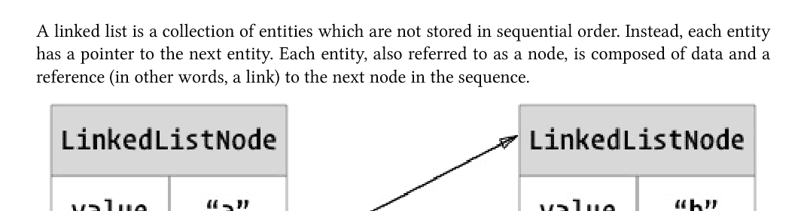

这种结构允许在遍历过程中高效地在序列中的任意位置插入或删除节点。更复杂的链表实现会添加额外的链接，从而允许从任意节点引用高效地进行插入或删除。链表的一个缺点是访问时间是线性的。无法实现更快的访问，例如随机访问。

**链表的主要操作**有：

- prepend - 在列表开头添加一个节点
- append - 在列表末尾添加一个节点
- delete - 从列表中删除一个节点
- deleteTail - 删除列表中的最后一个节点
- deleteHead - 删除列表中的第一个节点
- find - 在列表中查找一个节点

## 应用

链表是许多其他数据结构的良好基础，如队列、栈和哈希表。我们将在 JavaScript 中创建的链表实现将用于本书中我们将学习的许多其他数据结构。

# 实现

我们的 LinkedList 实现将由两部分组成：

- 一个 LinkedListNode 类
- 一个 LinkedList 类

我们将在以下各节中探讨这两个类的详细内容。

# LinkedListNode

我们的 `LinkedListNode` 类是一个表示集合中单个元素的类。`LinkedListNode` 有两个重要属性：

1. this.value
2. this.next

`this.value` 包含我们想要存储在节点中的实际值（一个数字、另一个对象、一个字符串等）。`this.next` 是指向我们节点列表中下一个节点的指针。

# 什么是指针？

JavaScript 中的对象是键值对的字典。键始终是字符串，值可以是布尔值、字符串、数字和对象。当我说我们的 `LinkedListNode` 类中的 `next` 属性是一个"指针"时，我们真正的意思是 `this.next` 的值是对另一个 JavaScript 对象——另一个 `LinkedListNode` 对象的引用。

# constructor

我们的 `LinkedListNode` 类的构造函数方法为 `this.value` 和 `this.next` 设置初始值——两者都设置为 null。

```
02-linked-list/LinkedListNode.js
constructor(value, next = null) {
    this.value = value;
    this.next = next;
}
```

# toString

我们的 `toString` 方法是一个便捷方法，当我们想要查看链表中每个节点包含的内容时使用。

```
02-linked-list/LinkedListNode.js
toString(callback) {
  return callback ? callback(this.value) : `${this.value}`;
}
```

# LinkedList

LinkedList 类包含一些重要的方法来操作我们的 LinkedListNode 对象集合。让我们看看每个方法的作用：

# constructor

我们的 LinkedList 类包含两个属性：`this.head` 和 `this.tail`。每个属性都指向一个 `LinkedListNode` 对象。它们分别是 LinkedListNode 集合的起点和终点。

```
02-linked-list/LinkedList.js
constructor() {
  /** @var LinkedListNode */
  this.head = null;

  /** @var LinkedListNode */
  this.tail = null;
}
```

# prepend

prepend 方法将一个 `LinkedListNode` 对象添加到 `LinkedList` 的开头。首先，我们创建一个新的 `LinkedListNode` 对象。

```
02-linked-list/LinkedList.js
prepend(value) {
  // Make new node to be a head.
  const newNode = new LinkedListNode(value, this.head);
```

然后我们将 `this.head` 指向新创建的 `LinkedListNode` 对象。如果这是我们 `LinkedList` 中的第一个元素，我们还必须将 `this.tail` 指向新对象，因为它也是我们 `LinkedList` 中的最后一个元素。

```
02-linked-list/LinkedList.js
19    this.head = newNode;
20
21    // If there is no tail yet let's make new node a tail.
22    if (!this.tail) {
23      this.tail = newNode;
24    }
```

最后，我们返回被添加到 LinkedList 中的值。

```
02-linked-list/LinkedList.js
25    return this;
26  }
```

# append

append 方法将一个 LinkedListNode 对象添加到 LinkedList 的末尾。首先，我们创建一个新的 LinkedListNode 对象。

```
02-linked-list/LinkedList.js
33    append(value) {
34      const newNode = new LinkedListNode(value);
```

如果 LinkedList 中没有其他元素，那么我们需要将 this.head 指向新节点。

```
02-linked-list/LinkedList.js
35      // If there is no head yet let's make new node a head.
36      if (!this.head) {
37        this.head = newNode;
38        this.tail = newNode;
39
40        return this;
41      }
```

然后，我们获取 this.tail 的值，并将该对象的 next 属性设置为我们新创建的 LinkedListNode 对象。

最后，我们将 `this.tail` 设置为新的 `LinkedListNode` 对象。

```
const currentTail = this.tail;
currentTail.next = newNode;
// Attach new node to the end of linked list.
```

```
this.tail = newNode;

return this;
```

## delete

我们的 `delete` 方法在链表中查找一个元素并将其移除。首先，我们通过检查 `this.head` 是否为 null 来判断链表是否为空。如果为空，则返回 `null`。

```
delete(value) {
  if (!this.head) {
    return null;
  }
```

如果链表包含元素，我们创建一个 `deletedNode` 变量，它将作为占位符，用于存储最终从 delete 方法返回的结果节点。

```
let deletedNode = null;
```

在遍历链表之前，我们首先检查 `this.head` 的值是否与我们要删除的值匹配。如果匹配，我们将 `deletedNode` 变量设置为 `this.head`，然后将 `this.head` 移动到链表的下一个元素。

```
02-linked-list/LinkedList.js

62  // If the head must be deleted then make next node that is different
63  // from the head to be a new head.
64  while (this.head && this.head.value === value) {
65    deletedNode = this.head;
66    this.head = this.head.next;
67  }
```

为了遍历链表，我们需要创建一个占位符变量 `currentNode`，用于跟踪我们在链表中的当前位置。我们将 `currentNode` 的值设置为 `this.head`，以确保从链表的开头开始遍历。

```
02-linked-list/LinkedList.js

70  let currentNode = this.head;
```

然后我们检查确保 `currentNode` 不为 null。如果不为 null，我们启动 while 循环。当我们到达一个节点，其 `this.next` 属性为 null 时（即不指向另一个 `LinkedListNode` 对象），我们将跳出 while 循环。

```
02-linked-list/LinkedList.js

72  if (currentNode !== null) {
73    while (currentNode.next) {
74      if (currentNode.next.value === value) {
```

接下来，我们检查 `currentNode.next` 对象的值是否等于我们要删除的值。如果匹配，我们将 `deletedNode` 变量设置为 `currentNode.next`。同时，我们将 `currentNode.next` 指针设置为 `currentNode.next` 对象所指向的对象。如果不匹配，我们继续移动到链表的下一个元素。

```
02-linked-list/LinkedList.js

72  if (currentNode !== null) {
73    while (currentNode.next) {
74      if (currentNode.next.value === value) {
```

最后，我们必须检查链表尾部的值是否与我们要删除的值匹配。如果匹配，我们将 `this.tail` 设置为 `currentNode`。请参阅以下图示，了解调用 delete 方法时发生的操作：

## 调用 delete 方法之前的链表

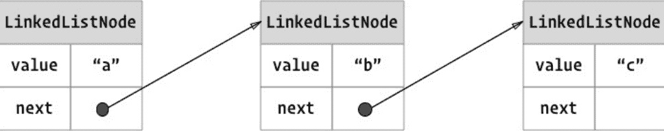

调用 delete 方法

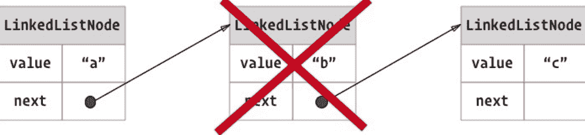

## 调用 delete 方法之后的链表

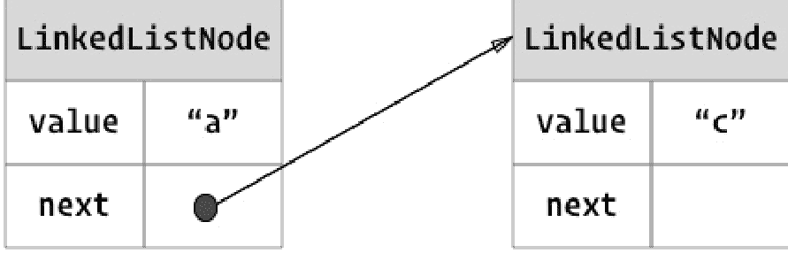

## deleteTail

对于我们的 deleteTail 方法，我们首先创建一个变量 `deletedTail` 并将其设置为 `this.tail`，这样在方法返回时我们就可以返回被删除的对象。

```
02-linked-list/LinkedList.js

deleteTail() {
  const deletedTail = this.tail;
```

我们有两种场景需要编写代码：

1. 链表中只有一个元素
2. 链表中有多个元素

对于场景 1，`this.head.value` 和 `this.tail.value` 是相同的，因此我们将 `this.head` 和 `this.tail` 都设置为 null，然后返回 `deletedTail`。

```
if (this.head === this.tail) {
  // There is only one node in linked list.
  this.head = null;
  this.tail = null;

  return deletedTail;
}
```

对于场景 2，我们需要遍历整个列表以获取链表中倒数第二个 `LinkedListNode`。我们通过检查 `currentNode.next.next` 的值是否为 null 来将倒数第二个 `LinkedListNode` 设置为 `this.tail`。如果 `currentNode.next.next` 为 null，我们就知道 `currentNode.next` 是我们要设置为 `this.tail` 的对象。

```
// If there are many nodes in linked list...
// Rewind to the last node and delete "next" link for the node before the last one.
let currentNode = this.head;
while (currentNode.next) {
  if (!currentNode.next.next) {
    currentNode.next = null;
  } else {
    currentNode = currentNode.next;
  }
}

this.tail = currentNode;

return deletedTail;
```

最后，我们从方法中返回 `deletedTail` 对象：

```
02-linked-list/LinkedList.js

## deleteHead

我们的 deleteHead 方法移除列表中的第一个元素。与 deleteTail 方法类似，我们需要为几种场景编写代码来删除链表的头部：

1. 列表中没有元素
2. 列表中只有 1 个元素
3. 列表中有多个元素

对于场景 1，我们检查 `this.head` 是否为 null，如果为 null，我们从方法中返回 null。

```
02-linked-list/LinkedList.js
deleteHead() {
    if (!this.head) {
        return null;
    }
}
```

对于场景 2 和场景 3，我们首先创建一个变量 `deletedHead` 并将其设置为 `this.head`，这样在方法返回时我们就可以返回被删除的对象。

```
02-linked-list/LinkedList.js
const deletedHead = this.head;
```

同样对于场景 2 和场景 3，我们将逻辑合并到一个 if/else 语句中。如果 `this.head.next` 不为 null，我们知道列表中有超过 1 个元素，我们将 `this.head` 设置为 `this.head.next`，从而移除列表中的第一个元素。如果 `this.head.next` 为 null，我们知道列表中只有 1 个元素，我们将 `this.head` 和 `this.tail` 都设置为 null，因为链表中不再有元素。

```
if (this.head.next) {
  this.head = this.head.next;
} else {
  this.head = null;
  this.tail = null;
}
```

最后，我们从方法中返回 deletedHead 对象：

```
return deletedHead;
}
```

## find

find 方法遍历链表中的元素，定位第一个与我们要查找的值匹配的 `LinkedListNode` 对象。该方法接受一个包含两个键值对的对象，一个 `value` 和一个 `callback`：

```
find({ value = undefined, callback = undefined }) {
```

与之前的方法一样，我们首先检查 `this.head` 是否为 null。如果为 null，我们从方法中返回，因为链表为空。

```
if (!this.head) {
  return null;
}
```

接下来，我们创建一个变量 `currentNode` 来跟踪我们在链表中的当前位置，并将其设置为 `this.head` 以从链表的开头开始。

```

```

然后我们创建一个 while 循环来遍历链表中的所有节点，调用作为参数传递的回调函数，或者检查当前节点的值是否与我们要查找的值匹配。如果找到匹配项，我们返回该节点。

```
02-linked-list/LinkedList.js

155: while (currentNode) {
156:   // If callback is specified then try to find node by callback.
157:   if (callback && callback(currentNode.value)) {
158:     return currentNode;
159:   }
160: 
161:   // If value is specified then try to compare by value..
162:   if (value !== undefined && currentNode.value === value) {
163:     return currentNode;
164:   }
165: 
166:   currentNode = currentNode.next;
167: }
```

最后，如果我们遍历完整个链表都没有找到我们要查找的值，我们从方法中返回 null。

```
02-linked-list/LinkedList.js

169: return null;
```

至此，我们已经实现了链表的基本方法。接下来我们将实现两个辅助方法，以便更方便地测试和调试我们的链表。

## toArray

`toArray` 方法将链表中的所有节点放入一个数组中。为了将它们放入数组，我们创建一个名为 `nodes` 的新数组。然后遍历链表中的所有节点，将每个节点推入数组。

```
02-linked-list/LinkedList.js

175: toArray() {
176:   const nodes = [];
177: 
178:   let currentNode = this.head;
179:   while (currentNode) {
180:     nodes.push(currentNode);
181:     currentNode = currentNode.next;
182:   }
183: 
184:   return nodes;
185: }
```


## toString

`toString`方法接收一个链表（LinkedList），并打印出该链表的字符串表示形式。该方法首先将链表转换为数组（使用上面描述的`toArray`方法）。然后调用`map`数组方法来处理列表中的每个链表节点（LinkedListNode）。调用每个链表节点的`toString`方法，然后再调用数组的`toString`方法来打印出整个链表节点数组。

```
toString(callback) {
    return this.toArray().map(node => node.toString(callback)).toString();
}
```

## 复杂度

| 访问 | 搜索 | 插入 | 删除 |
| :--- | :--- | :--- | :--- |
| O(n) | O(n) | O(1) | O(1) |

## 问题示例

以下是一些在面试中可能遇到的相关问题：

- [环形链表 II](https://leetcode.com/problems/linked-list-cycle-ii/)
- [相交链表](https://leetcode.com/problems/intersection-of-two-linked-lists/)

## 测验

Q1：在 JavaScript 的链表中，`this.next`指的是什么？

Q2：链表中的 deleteTail 和 deleteHead 方法有什么区别？

## 参考资料

- 维基百科上的链表 [https://en.wikipedia.org/wiki/Linked_list](https://en.wikipedia.org/wiki/Linked_list)
- YouTube 上的链表 [https://www.youtube.com/watch?v=njTh_OwMljA](https://www.youtube.com/watch?v=njTh_OwMljA)
- [5] https://leetcode.com/problems/linked-list-cycle-ii/
- [6] https://leetcode.com/problems/intersection-of-two-linked-lists/
- [7] https://en.wikipedia.org/wiki/Linked_list
- [8] https://www.youtube.com/watch?v=njTh_OwMljA
- 链表示例和测试用例 https://github.com/trekhleb/javascript-algorithms/tree/master/src/data-structures/linked-list
- 双向链表实现 https://github.com/trekhleb/javascript-algorithms/tree/master/src/data-structures/doubly-linked-list

# 队列

*难度：简单*

## 队列及其常见操作

**队列**是一种实体集合，其中的实体按*先进先出（FIFO）*的顺序排列。在 FIFO 数据结构中，第一个添加到队列的元素是第一个被移除的。当一个元素被添加到队列时，所有在它之前添加的元素必须在新元素被移除之前先被移除。现实世界中常见的实现是超市的排队，最先排队的顾客先被服务，排在第一位顾客后面的其他人随后被服务。

**队列的主要操作**包括：- *入队（enqueue）* —— 将一个实体添加到队尾位置（在超市排队时加入队伍末尾），- *出队（dequeue）* —— 从队首位置移除一个实体（服务排队的第一个顾客），- *查看（peek）* —— 读取队列前端的实体而不将其出队（询问下一个排队的顾客是谁）。

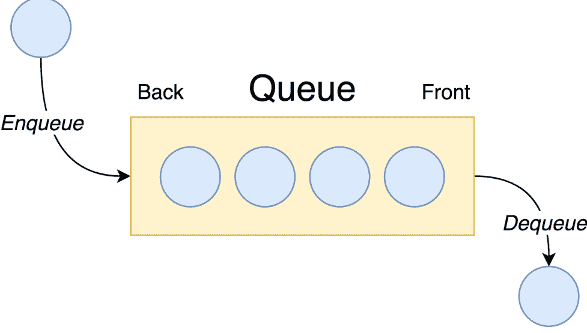

*搜索*或*更新*元素等操作在队列中并不常见。在处理队列时，我们只关心两件事：队列的开端和末端。

## 何时使用队列

队列存在于各种*消息应用*中，在这些应用中，消息的产生速度通常快于处理速度。例如，当你想要解析大量网页或发送大量电子邮件时，你可能希望将这些网页或电子邮件放入队列中，以便逐一处理，而无需担心某些数据丢失或消息被丢弃。

队列还被用作许多其他算法的组成部分。队列用于图或树的*广度优先搜索*，例如，当我们需要存储稍后需要处理的节点列表时。每次我们处理一个节点时，就将其相邻节点或子节点添加到队列末尾。使用队列使我们能够按照访问顺序来处理节点。

## 使用示例

在继续实现队列类之前，让我们假设已经实现了一个队列，并使用上述基本方法。这将帮助我们更好地理解我们要实现的内容。

让我们实现一个简单的消息系统，将需要处理的所有消息存储在队列中。在下面的代码中，我们实例化一个新的`Queue`对象，并使用与该对象相关的方法来`enqueue`和`dequeue`队列中的消息，以及使用`peek`来查看下一个消息是什么。我们还使用`toString`和`isEmpty`方法来查看队列中当前有什么，并检查队列是否为空。

```
03-queue/example.js

// 首先，我们需要导入我们的 Queue 类。
import { Queue } from './Queue';

// 然后我们需要实例化一个队列。
const messageQueue = new Queue();

// 队列现在是空的，没有要处理的消息。
messageQueue.isEmpty(); // => true
messageQueue.toString(); // => ''

// 让我们向队列添加一条新消息。
messageQueue.enqueue('message_1');
messageQueue.isEmpty(); // => false
messageQueue.toString(); // => 'message_1'
messageQueue.peek(); // => 'message_1'

// 让我们再添加一条消息。
messageQueue.enqueue('message_2');
messageQueue.isEmpty(); // => false
messageQueue.toString(); // => 'message_1,message_2'
messageQueue.peek(); // => 'message_2'

// 现在让我们处理这些消息。
messageQueue.dequeue(); // => 'message_1'
messageQueue.dequeue(); // => 'message_2'

messageQueue.isEmpty(); // => true
```

## 实现

队列可以用链表来实现。链表的结构和操作与队列相似。我们的链表类有*append*方法和*delete head*方法，这些方法对实现队列都很有用。我们将在队列的 *enqueue* 和 *dequeue* 方法中使用这些方法。

首先，让我们导入 LinkedList 类：

```
03-queue/Queue.js
import LinkedList from '../02-linked-list/LinkedList';
```

## constructor

在 Queue 类的构造函数中，我们创建一个新的 LinkedList 对象来存储我们的数据：

```
03-queue/Queue.js
constructor() {
  // 我们将基于 LinkedList 来实现 Queue。
  this.linkedList = new LinkedList();
}
```

## enqueue

现在让我们实现 enqueue() 操作。该方法将新元素追加到队列末尾。我们将调用 LinkedList 对象的 append 方法，将我们的项目添加到队列末尾：

```
03-queue/Queue.js
/**
 * @param {*} value
 */
enqueue(value) {
  // 入队意味着排队。因此让我们在链表开头添加一个新值。
  // 它需要等待，直到之前所有的节点都被处理完。
  this.linkedList.append(value);
}
```

## dequeue

当我们想要 dequeue() 元素时，我们从 LinkedList 中取第一个元素（列表的头部）并返回它。我们调用 LinkedList 对象的 removeHead 方法，如果该方法返回的节点为 null，则返回 null。否则，返回该节点的值。

```
03-queue/Queue.js
/**
 * @return {*}
 */
dequeue() {
  // 让我们尝试从链表中删除第一个节点（头部）。
  // 如果链表没有头部（即为空），则直接返回 null。
  const removedHead = this.linkedList.deleteHead();
  return removedHead ? removedHead.value : null;
}
```

## peek

为了实现 peek() 操作，我们不会从列表中移除任何元素，只获取 LinkedList 对象头部的值并返回它。

```
03-queue/Queue.js
/**
 * @return {*}
 */
peek() {
  if (!this.linkedList.head) {
    // 如果链表为空，则没有可供 peek 的元素。
    return null;
  }

  // 只读取链表头部的值，不删除它。
  return this.linkedList.head.value;
}
```

至此，我们已经实现了主要的队列方法。让我们实现几个辅助方法，使我们的队列使用更加方便。

## isEmpty

让我们实现一个检查队列是否为空的方法。为此，我们只需检查链表的头部，确保没有元素存在：

```
03-queue/Queue.js
/**
 * @return {boolean}
 */
isEmpty() {
  // 如果队列的链表没有尾部，则队列为空。
  return !this.linkedList.head;
}
```

## toString

让我们也实现 toString() 方法，使我们 Queue 类的测试和调试更加方便。该方法将复用我们 LinkedList 类的 toString() 方法。它将接受可选的 callback() 函数，该函数可用于将每个链表元素转换为字符串。如果我们要在队列中存储对象，这可能会很有用。


```markdown
03-queue/Queue.js

```
50 /**
51  * @param [callback]
52  * @return {string}
53  */
54 toString(callback) {
55   // Return string representation of the queue's linked list.
56   return this.linkedList.toString(callback);
57 }
```

至此，Queue 类的基本实现已经完成。你可以在 `code/src/03-queue/Queue.js` 文件中找到完整的类代码示例。

## 复杂度

| 访问 | 搜索 | 插入（入队） | 删除（出队） |
| :--- | :--- | :--- | :--- |
| O(n) | O(n) | O(1) | O(1) |

当队列像上面的示例一样使用 LinkedList 实现时，对元素的访问和搜索是通过链表的搜索方法完成的，该方法会遍历列表中的所有元素。因此，这些操作的时间复杂度为 O(n)。

插入（入队）和删除（出队）操作很快。对于链表来说，在列表开头添加一个新值或删除列表尾部只需要恒定的时间 O(1)。

## 问题示例

以下是一些你在面试中可能遇到的相关问题：

- 用栈实现队列[^11]
- 设计循环队列[^12]

[^11]: https://leetcode.com/problems/implement-queue-using-stacks/
[^12]: https://leetcode.com/problems/design-circular-queue/

## 测验

> Q1：队列是先进先出还是先进后出？

*Q2：队列的基本操作是 `peek()` / `enqueue()` / `dequeue()` 还是 `peek()` / `push()` / `pop()`？*

*Q3：队列中 `enqueue()` 操作的时间复杂度是多少？*

## 参考资料

Wikipedia 上的队列 <https://en.wikipedia.org/wiki/Queue_(abstract_data_type)>

YouTube 上的队列 <https://www.youtube.com/watch?v=wjI1WNcIntg>¹³

队列示例和测试用例 <https://github.com/trekhleb/javascript-algorithms/tree/master/src/data-structures/queue>¹⁴

## 栈

- 难度：*简单*

## 栈及其常见操作

**栈**是一种线性数据结构，以堆叠或 pile 的方式保存其数据。如果一个数据结构的元素形成序列，则称其为线性的。让我们想想一副面向下方的扑克牌。每张牌都是这副牌（或"栈"）所持有数据的一个单元。它们是面向下的，因为你通常不会访问牌堆中间的牌，而是操作栈的顶部。你可以对这样一副扑克牌进行以下基本操作：

- 你可以将一张新牌*推*到牌堆顶部，
- 你可以从牌堆顶部*弹出*一张牌，
- 你可以*查看*牌堆顶部的一张牌，但将其留在牌堆中。

这是你通常使用栈的三个最基本操作。

栈使用*LIFO*（*后进先出*）的顺序，这意味着你最后推入栈的项目会首先被处理。所有推入栈的旧项目都需要等待，直到所有新项目都被处理完毕。

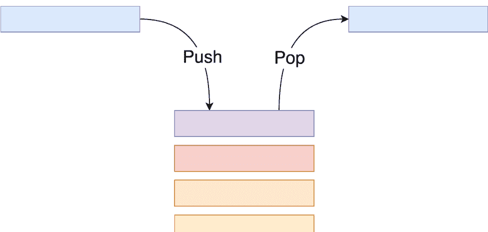

像*搜索*或*更新*元素这样的操作对于栈来说并不典型。我们只对操作栈的顶部感兴趣。

## 应用场景

栈数据结构*用于解决许多算法问题*，例如：

- 图拓扑排序，
- 查找图中的强连通分量，
- 汉诺塔问题，
- 记住部分完成的任务，
- 撤销（回溯）操作
- 等等。

当你需要在递归时将临时数据推入栈，但在回溯时又要将它们移除时，栈通常在递归算法中很有用。栈提供了一种直观的方式来完成这个操作。

*底层编程语言也使用栈数据结构*来存储函数参数和局部变量，例如在一个函数中调用另一个函数时。你可能从臭名昭著的"Stack Overflow"错误中了解到这一点。该错误与栈的使用有关，可能是由过深或无限递归引起的，在这种情况下，函数调用自身太多次，导致存储每次调用相关的变量和信息所需的空间超过了栈的容量。

## 使用示例

在继续实现栈类之前，让我们假设已经有一个实现好的栈，并尝试使用上面提到的基本方法。这将帮助我们更好地理解我们要实现的内容。假设我们想使用栈来反转数组：

```
04-stack/example.js
// 导入 Stack 类。
import { Stack } from './Stack';

// 创建栈实例。
const stack = new Stack();

// 创建我们想要反转的数组。
const arrayToReverse = ['a', 'b', 'c'];

stack.isEmpty(); // => true
stack.toString(); // => ''
stack.toArray(); // => []
```

```
13 
14 // 让我们向栈中添加项目。
15 stack.push(arrayToReverse[0]);
16 stack.isEmpty(); // => false
17 stack.toString(); // => 'a'
18 stack.toArray(); // => ['a']
19 
20 // 向栈中添加更多项目。
21 stack.push(arrayToReverse[1]);
22 stack.push(arrayToReverse[2]);
23 stack.toString(); // => 'c,b,a'
24 stack.toArray(); // ['c', 'b', 'a']
25 
26 // 查看下一个元素。
27 stack.peek(); // => 'c'
28 
29 // 从栈中弹出。
30 stack.pop(); // => 'c'
31 stack.pop(); // => 'b'
32 stack.pop(); // => 'a'
33 
34 stack.isEmpty(); // => true
```

## 实现

栈可以用链表实现。我们可以使用 `LinkedList` 类中的 `append` 和 `deleteTail` 操作来实现栈的 `push` 和 `pop` 操作。思路是，当你想将项目*推入*栈时，将其*追加*到链表末尾；当你想从栈中*弹出*项目时，*删除*链表的尾部。

由于我们要基于链表构建栈，让我们先导入它：

```
04-stack/Stack.js
import LinkedList from '../02-linked-list/LinkedList';
```

## 构造函数

让我们创建 Stack 类：

```
04-stack/Stack.js
export class Stack {
```

接下来，我们创建 LinkedList 对象，它将保存所有栈数据：

```
04-stack/Stack.js
constructor() {
  // 我们将基于 LinkedList 实现 Queue，因为这两种
  // 结构非常相似。比较 Stack 的 push/pop 操作
  // 与 LinkedList 的 prepend/deleteHead 操作。
  this.linkedList = new LinkedList();
}
```

## push

如果我们想向栈中推入某些内容，需要将数据追加到链表末尾。在这种情况下，栈的顶部就是链表的尾部：

```
04-stack/Stack.js
/**
 * @param {*} value
 */
push(value) {
  // 推入意味着将值放在栈的顶部。因此让我们直接在
  // 链表的头部添加新值。
  this.linkedList.prepend(value);
}
```

## pop

如果我们想从栈中弹出元素，需要删除链表的尾部并返回它：

```
04-stack/Stack.js

/**
 * @return {*}
 */
pop() {
  // 让我们尝试从链表中删除第一个节点（头部）。
  // 如果链表中没有头部（即为空），则直接返回 null。
  const removedHead = this.linkedList.deleteHead();
  return removedHead ? removedHead.value : null;
}
```

## peek

另一个常见的栈操作是检查栈顶是什么，而实际上不提取数据。在这种情况下，我们只需要读取链表的尾部：

```
04-stack/Stack.js

/**
 * @return {*}
 */
peek() {
  if (this.isEmpty()) {
    // 如果链表为空，则没有可查看的内容。
    return null;
  }

  // 只读取链表的头部值，不删除它。
  return this.linkedList.head.value;
}
```

至此，我们已经完成了栈的必需操作。现在让我们继续实现一些辅助方法，使 Stack 类的使用更加方便。

## isEmpty

让我们实现 isEmpty() 方法，用于检查栈是否为空。为此，我们只需要检查链表是否有头部：

```
04-stack/Stack.js
11 /**
12  * @return {boolean}
13  */
14 isEmpty() {
15   // 如果链表的 linked list 没有 head，则队列为空。
16   return !this.linkedList.head;
17 }
```

## toArray

另一个有用的方法是 toArray()，它将我们的栈转换为数组。为此，我们需要：

1. 将链表转换为数组，
2. 提取每个链表节点的值，因为我们不希望 Stack 类的使用者直接处理链表节点。通过这样做，我们封装了类的实现，
3. 反转链表数组，使列表的尾部成为数组的第一个元素，头部成为数组的最后一个元素。这不是强制的，但出于方便考虑这样做。

代码如下所示：

```
04-stack/Stack.js
51 /**
52  * @return {*[]}
53  */
54 toArray() {
55   return this.linkedList
56     .toArray()
57     .map(linkedListNode => linkedListNode.value);
58 }
```

## toString

我们要实现的最后一个方法是 toString()，它将基于 toArray() 并将栈转换为其字符串表示：


04-stack/Stack.js

```
/**
 * @param {function} [callback]
 * @return {string}
 */
toString(callback) {
  return this.linkedList.toString(callback);
}
}
```

最后一个花括号是 Stack 类的闭合括号。

至此，我们的 Stack 类的基本实现已经完成。你可以在 code/src/04-stack/Stack.js 文件中找到完整的类代码示例。

## 复杂度

| 访问 | 搜索 | 插入（push） | 删除（pop） |
|--------|--------|------------------|----------------|
| O(n) | O(n) | O(1) | O(1) |

如果 Stack 是通过链表实现的（如上面的示例），那么访问和搜索元素需要通过链表的搜索方法完成，该方法会遍历列表中的所有元素。因此这些操作的时间复杂度为 O(n)。

插入（push）和删除（pop）操作是快速的，因为对于链表来说，将新值追加到列表末尾或删除列表尾部所需的时间是恒定的 O(1)。

## 问题示例

以下是你在面试中可能会遇到的一些相关问题：

- [使用队列实现栈](https://leetcode.com/problems/implement-stack-using-queues/)
- [爬楼梯](https://leetcode.com/problems/climbing-stairs/)

## 测验

> *问1：栈是先进先出还是先进后出？*
> 
> *问2：栈有哪些基本操作：* `peek()` / `enqueue()` / `dequeue()` *还是* `peek()` / `push()` / `pop()`？
> 
> *问3：栈中* `push()` *操作的时间复杂度是多少？*

## 参考资料

维基百科上的 Stack <https://en.wikipedia.org/wiki/Stack_(abstract_data_type)>

YouTube 上的 Stack <https://www.youtube.com/watch?v=wjI1WNcIntg>

Stack 示例和测试用例 <https://github.com/trekhleb/javascript-algorithms/tree/master/src/data-structures/stack>

<sup>17</sup> https://www.youtube.com/watch?v=wjI1WNcIntg
<sup>18</sup> https://github.com/trekhleb/javascript-algorithms/tree/master/src/data-structures/stack

# 哈希表

- 难度：中等

**哈希表**（或**哈希映射**）是一种实现了*关联数组抽象数据类型*的数据结构，它可以*将键映射到值*。例如，你的*姓名*（键）可以用作*电话簿*（哈希映射）中你*电话号码*（值）的唯一标识符。在电话簿中操作你电话的*常用操作*如下所示：

```
src/05-hash-table/HashTable.js

// Import HashTable class.
import { HashTable } from './HashTable';

// Create hash table instance.
const phoneBook = new HashTable();

// Add several contacts to the phone book.
phoneBook.set('John Smith', '+112342345678');
phoneBook.set('Bill Jones', '+111111111111');

// Now we may access each contact's phone in O(1) time.
phoneBook.get('John Smith'); // => '+112342345678'
phoneBook.get('Bill Jones'); // => '+111111111111'

// Delete phone number.
phoneBook.delete('John Smith');
phoneBook.get('John Smith'); // => undefined
```

理想情况下，哈希表允许我们在 O(1) 时间内完成所有这些操作。相比之下，链表需要遍历列表中的*所有*节点才能获取 John Smith 的电话号码，查找时间为 O(n)。

高效的查找是哈希表的主要优势。

但在最坏的情况下，哈希表*确实*可能出现 O(n) 的查找时间。我们将在本章后面讨论这种情况。

那么，我们如何在哈希表中实现快速的 O(1) 查找呢？我们分配一个*桶*或*槽位*数组来存储所有哈希表的数据。然后我们需要将值的键映射到存储该值的桶的特定编号（索引或地址）。通过这样做，我们就可以通过桶地址以 O(1) 的时间在哈希表中创建、读取和删除记录。

构建哈希表存在一定的限制。桶的数量具有*固定大小*。这是因为任何程序都有一定的内存限制，我们不能假设有无限的内存来存放我们的哈希表。

我们要映射到桶地址的键可能具有任意大小（例如 John Smith 或只是 Jimmy）。当桶的数量有限时，我们如何将任意大小的键映射到一个数字（索引或地址）？提示已经隐藏在"哈希表"这个数据结构名称中了！方法就是使用**哈希函数**。

## 哈希函数

**哈希函数**是一种可以将*任意大小*的数据映射到*固定大小*数据的函数。哈希函数返回的值称为*哈希值*、*哈希码*、*摘要*，或简称为*哈希*。

在我们的情况下，哈希函数必须接受键（例如 John Smith）作为输入，并输出给定范围内桶的索引（例如，如果我们为桶分配了大小为 5 的数组，则范围为 0 到 5）。在现实世界中，桶的数量要大得多。它应该与我们要存储在哈希表中的信息量成正比。

哈希函数由两部分组成：

1. 将字符串转换为哈希码——理想情况下是键的唯一数字表示。
2. 使用取模运算符将哈希码映射到特定的桶单元格（因为我们有有限的桶大小）。

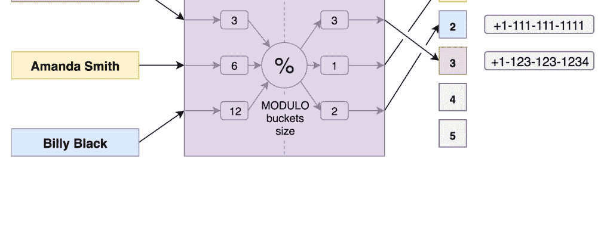

## 哈希函数示例

有多种方法可以将字符串哈希为索引或地址。计算字符串哈希的最简单方法之一是将字符串中所有字符的 ASCII 码相加。

### 什么是 ASCII 码？

ASCII 是美国信息交换标准代码的缩写，它是一种将英文字符表示为数字的代码。计算机只能理解 1 和 0，这种代码将我们输入的字母转换为计算机可以理解的数字。

让我们创建一个名为 `hash` 的 JavaScript 函数，它接受键和桶数量作为参数。

**05-hash-table/hash.js**

```
export function hash(key, bucketsNumber) {
```

我们将遍历字符串中的每个字符，并使用 JavaScript 字符串方法 `charCodeAt` 获取每个字符的整数值。`charCodeAt` 方法返回字符的 ASCII 码。我们将所有字符的代码相加来计算哈希码。

**05-hash-table/hash.js**

```
let hashCode = 0;
// Let's go through all key characters and add their code to hash
for (let characterIndex = 0; characterIndex < key.length; characterIndex += 1) {
  hashCode += key.charCodeAt(characterIndex);
}
```

然后，为了确保我们的索引是哈希表的有效索引，我们使用取模运算符计算正确的桶索引并返回值。

**05-hash-table/hash.js**

```
// Reduce hash number so it would fit buckets table size.
return hashCode % bucketsNumber;
}
```

例如，假设我们使用 `ab` 作为字符串，100 作为桶大小来调用函数。调用哈希函数会返回什么结果？

hash('ab', 100)

a 的 ASCII 码是 97，b 的 ASCII 码是 98。97 + 98 = 195。195 % 100 = 95，这就是哈希函数返回的值。95 是值将存储在哈希表中的数组索引。

你可能还想使用更复杂的方法，如*多项式字符串哈希*，使哈希码更加独特。我们不会涵盖这些更复杂的方法，但如果你想了解更多关于不同哈希函数技术的信息，可以查看本章末尾的脚注。

## 碰撞解决

理想情况下，哈希函数会将每个键分配到唯一的桶中，但大多数哈希表设计都采用了不完美的哈希函数，这可能导致哈希碰撞，即哈希函数为多个键生成相同的索引。

例如：

```
ASCII for 'a' is 97, for 'd' is 100.

Hash for `a`: (97) % 100 = 97
Hash for `ad`: (97 + 100) % 100 = 97
```

这些碰撞必须以某种方式处理，否则 `write` 操作会覆盖 `a` 和 `ad` 的值。你可能会在想要获取 `ad` 的值时获取到 `a` 的值，反之亦然。

### 链地址法

链地址法是一种将每个桶转换为链表的技术。这样每个桶就可以存储多个值，而不仅仅是一个。如果发生碰撞，我们将新值附加到桶的链表尾部。

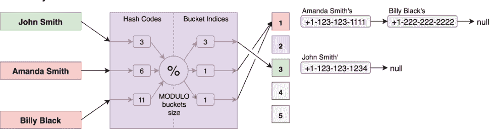

`read` 操作首先计算桶编号，然后通过键在桶的链表中进行查找。以下是使用链表作为桶从上面的示例中获取 Billy Black 电话号码的步骤：

1. 计算 `Billy Black` 键的哈希码。假设 `Billy Black` 键的哈希码为 11。


 - 通过取模运算计算桶索引。在有5个桶的情况下，我们将得到桶索引等于 11 % 5 = 1。
- 从索引为1的单元格中获取链表，并遍历其中的每个值，将每个值的键与我们需要查找的键进行比较（在本例中是 Billy Black）。一旦找到包含 Billy Black 键的链表节点，我们就返回它。

哈希函数冲突是导致哈希表基本操作（如读取、写入、更新和删除）的时间复杂度从 O(1) 降级为 O(n) 的主要原因。在最坏的情况下，如果桶的数量很少且哈希函数不够完善，所有值可能都存储在一个桶中。这将使哈希表表现得像链表。

## 实现

让我们采用上述提到的哈希表基本操作，以及分离链接冲突解决方法，并使用链表章节中的 LinkedList 类来实现哈希表。

首先，我们需要导入 Linked List 类，以便在哈希表中使用。哈希表中的每个桶都将有一个链表作为值，我们将把每个键/值对的值放在其中。

```
import LinkedList from '../02-linked-list/LinkedList';
```

接下来，我们设置桶的大小：

```
// 桶的数量直接影响冲突的数量。
// 桶的数量越大，我们遇到的冲突就越少。
// 为了演示目的，我们将哈希表大小设置为
// 较小的数字，以展示如何处理冲突。
const defaultBucketsNumber = 32;
```

## constructor

让我们开始创建 HashTable 类：

```
export class HashTable {
```

在我们的构造函数方法中，有相当多的函数链式调用。让我们分解每一部分，以便更好地理解正在发生的事情。

```
/**
 * @param {number} bucketsNumber - 用于存储哈希表数据的桶数量。
 */
constructor(bucketsNumber = defaultBucketsNumber) {
  // 创建特定大小的哈希表，并用空链表填充每个桶。
  this.buckets = Array(bucketsNumber).fill(null).map(() => new LinkedList());
}
```

首先，我们创建一个新数组并用 bucketsNumber 值初始化它：

```
this.buckets = new Array(bucketsNumber)
```

然后，我们用 null 值填充数组，以便可以对其进行遍历：

```
this.buckets = new Array(bucketsNumber).fill(null)
```

最后，我们将数组中新创建的值都设置为 LinkedList 对象：

```
this.buckets = new Array(bucketsNumber).fill(null).map(() => new LinkedList());
```

## hash

`hash()` 方法将字符串键转换为我们需要用于存储指定键的值的桶索引。正如上文所述，我们将使用简单的方法，基于键中每个字符的 ASCII 码值之和来计算哈希值。

```
src/05-hash-table/HashTable.js

18  /**
19   * 将键字符串转换为哈希数字。
20   *
21   * @param {string} key
22   * @return {number}
23   */
24  hash(key) {
25    let hashCode = 0;
26
27    // 遍历所有键字符并将其代码添加到哈希中
28    for (let characterIndex = 0; characterIndex < key.length; characterIndex += 1) {
29      hashCode += key.charCodeAt(characterIndex);
30    }
31
32    // 缩小哈希数字，使其适合桶表大小。
33    return hashCode % this.buckets.length;
34  }
```

首先我们使用 for 循环遍历所有字符并计算它们的和。

```
for (let characterIndex = 0; characterIndex < key.length; characterIndex += 1) {
  hashCode += key.charCodeAt(characterIndex);
}
```

接下来，我们应用取模运算符 `%`，将生成的哈希值范围限制为可用桶的数量：

```
// 缩小哈希数字，使其适合桶表大小。
return hashCode % this.buckets.length;
```

如果我们的 hashCode 值等于 97，而 `this.buckets.length` 等于 50，那么函数将返回 97 % 50 = 47。我们将使用索引为 47 的桶来存储键 'ab' 的值。

## set

我们根据键和值向哈希表中添加元素。

```
src/05-hash-table/HashTable.js

/**
 * 通过键添加或更新值。
 *
 * @param {string} key
 * @param {*} value
 */
set(key, value) {
  // 计算桶索引。
  const keyHash = this.hash(key);
  // 获取特定桶索引的链表。
  const bucketLinkedList = this.buckets[keyHash];
  // 在链表中执行"按键查找"操作。
  const node = bucketLinkedList.find({ callback: nodeValue => nodeValue.key === key });

  // 检查具有指定键的值是否已存在于链表中。
  if (!node) {
    // 插入新的链表节点。
    bucketLinkedList.append({ key, value });
  } else {
    // 更新现有链表节点的值。
    node.value.value = value;
  }
}
```

我们首先计算所提供键的哈希值。这个哈希值将指向特定的桶索引。

`const keyHash = this.hash(key);`

接下来，我们获取存储在所需桶中的链表。

`const bucketLinkedList = this.buckets[keyHash];`

此时，我们需要检查哈希表中是否已经存在具有指定键的值。首先，我们将尝试通过使用键/值对在链表中查找它。我们将使用 `LinkedList.find` 方法并传入一个自定义回调函数。这个自定义回调函数会将存储在 `LinkedList` 节点中的键/值对与我们尝试用于存储新值的键进行比较。

```
const node = bucketLinkedList.find({ callback: nodeValue => nodeValue.key === key });
```

现在我们需要决定是在 LinkedList 中创建一个新节点还是更新现有节点。如果我们尝试设置的值已经存在于 LinkedList 中，那么我们需要更新它。否则，我们需要将新值追加到 LinkedList 的末尾。

每个 LinkedList 节点都有一个 `value` 属性，它可以是任何类型的数据（字符串、对象、数字等）。对于我们的哈希表，LinkedList 中节点的 `value` 属性将是一个包含键/值对的对象。我们必须同时保存 `key` 和 `value`，以便能够区分一个节点和另一个节点。如果当哈希函数应用于两个键时，它们解析到同一个桶，我们需要知道根据键要检索哪个值。

```
if (!node) {
  bucketLinkedList.append({ key, value });
} else {
  node.value.value = value;
}
```

## get

使用键从哈希表中获取值的操作与 `set` 方法类似。唯一的区别是，在检查值是否存在于 LinkedList 之后，我们要么返回其值，要么返回 `undefined`。

```
src/05-hash-table/HashTable.js
─────────────────────────────────────────────────
60  /**
61   * 通过键获取值。
62   *
63   * @param {string} key
64   * @return {*}
65   */
66  get(key) {
67    // 计算桶索引。
68    const keyHash = this.hash(key);
69    // 获取特定桶索引的链表。
70    const bucketLinkedList = this.buckets[keyHash];
71    // 在链表中执行"按键查找"操作。
72    const node = bucketLinkedList.find({ callback: nodeValue => nodeValue.key === key });
73  
74    // 检查具有指定键的值是否已存在于链表中。
75    return node ? node.value.value : undefined;
76  }
```

## delete

当我们从哈希表中删除值时，我们使用与 set 方法一些相同的步骤。我们首先计算所提供键的哈希值，然后获取桶的 LinkedList。最后，我们检查要删除的值是否存在于 LinkedList 中。如果存在，我们使用 LinkedList 的 delete 方法并返回 true。否则，我们返回 false，表明没有可删除的内容。

```
src/05-hash-table/HashTable.js

/**
 * 通过键删除值。
 *
 * @param {string} key
 * @return {boolean}
 */
delete(key) {
  // 计算桶索引。
  const keyHash = this.hash(key);

  // 获取特定桶索引的链表。
  const bucketLinkedList = this.buckets[keyHash];

  // 在链表中执行"按键查找"操作。
  const node = bucketLinkedList.find({ callback: nodeValue => nodeValue.key === key });

  // 如果节点存在于链表中，则删除它。
  if (node) {
    bucketLinkedList.delete(node.value);

    return true;
  }

  return false;
}
```

我们 `HashTable` 类的基本实现现在已经完成。您可以在 code/src/05-hash-table/HashTable.js 文件中找到完整的类代码示例。

## 操作时间复杂度

| 情况 | 搜索 | 插入 | 删除 | 说明 |
| :--- | :--- | :--- | :--- | :--- |
| 平均 | O(1) | O(1) | O(1) | 使用良好的哈希函数和足够的桶数量 |
| 最坏情况 | O(n) | O(n) | O(n) | 使用糟糕的哈希函数和太少的桶数量 |


## 哈希表

以下是面试中可能会遇到的一些相关问题：

- [设计哈希集合](https://leetcode.com/problems/design-hashset/)
- [设计哈希映射](https://leetcode.com/problems/design-hashmap/)

## 测验

*Q1：与链表相比，哈希表的主要优势是什么？*

*Q2：哈希表中`get()`操作的时间复杂度是多少？*

*Q3：哈希表中的冲突是什么？*

*Q4：你知道哪些处理冲突的方法？*

## 参考资料

维基百科上的哈希表 [https://en.wikipedia.org/wiki/Hash_table](https://en.wikipedia.org/wiki/Hash_table)

YouTube 上的哈希表 [https://www.youtube.com/watch?v=shs0KM3wKv8](https://www.youtube.com/watch?v=shs0KM3wKv8)

哈希表示例与测试用例 [https://github.com/trekhleb/javascript-algorithms/tree/master/src/data-structures/hash-table](https://github.com/trekhleb/javascript-algorithms/tree/master/src/data-structures/hash-table)

## 二叉搜索树（BST）

*难度：中等*

在深入讨论二叉搜索树之前，我们首先需要了解什么是*树*和*二叉树*数据结构。

## 树

**树数据结构**被定义为由节点组成的集合（从*根节点*开始），其中每个节点是一个数据结构，包含一个值和指向节点的引用列表（即"子节点"），并且限制条件为：不存在重复的引用，也没有引用指向根节点。这些引用通常被称为**边**。

### 什么是节点？

> 节点是计算机科学中使用的基本单元。节点是更大数据结构的独立组成部分，例如链表和树数据结构。节点包含数据，也可能链接到其他节点。节点之间的链接通常通过指针实现。——维基百科

树数据结构中的每个节点（根节点除外）都通过一条边与恰好一个其他节点相连。所有节点形成*父节点 -> 子节点*的关系，并且树中不存在环路。

下面是一个树的示例：

在这个示例中，树由一组**节点** {"a", "b", "c", ..., "i"} 和一组**边** {"ab", "ac", "bd", ..., "fi"} 组成，这些节点和边在节点之间形成了父子关系。节点"a"是树的**根节点**，它没有父节点，但有两个**子节点**——节点"b"和"c"。本示例中的节点"f"有一个**父节点**"c"和三个子节点"g"、"h"和"i"。没有子节点的节点称为**叶节点**。在本示例中，节点"d"、"e"、"g"、"h"、"i"是叶节点。

树的**大小**是它包含的节点数量。在上面的示例中，树的大小为 9。

节点的**高度**是从该节点到最远叶节点的最长路径（边的数量）。根节点的高度就是**树的高度**。在上面的示例中，节点"c"的高度为 2，因为从它到最深的叶节点有两条边（即"cf"和"fg"）。而树的高度为 3。

以下是几个**不是树**的示例，因为某些节点有两个以上的父节点，或者某些节点形成了环路。

## 二叉树

**二叉树**是一种每个节点*最多有两个子节点*的树，这两个子节点分别称为*左子节点*和*右子节点*。

下面是一个二叉树的示例：

**根节点**"5"有**左子节点**"15"和**右子节点**"21"。节点"21"只有一个右子节点（节点"3"），这并不违反二叉树的定义。

## 二叉树的类型

二叉树有以下几种类型：

- **满**二叉树是一种所有节点都有 0 个或 2 个子节点的二叉树。
- **完全**二叉树是一种除最深层外，所有层都被节点完全填满的二叉树。最深层可能只部分填充，但所有节点必须从左开始连续填充，不能留有间隙。
- **完美**二叉树是一种所有内部节点都有两个子节点且所有叶节点深度相同的二叉树。
- **平衡**二叉树是一种对于所有节点，其左右子树的高度差不超过 1 的二叉树。
- **病态**（或**退化**）二叉树是一种每个节点最多只有一个子节点的二叉树。这种类型的树性能表现类似于链表。

## 二叉搜索树

**二叉搜索树**（或 BST）是一种每个节点（叶节点除外）满足以下规则的二叉树：

- 节点*右子树*中的所有值必须*大于*节点本身的值，
- 节点*左子树*中的所有值必须*小于*节点本身的值。

叶节点的子节点为 null，因此我们不对它们应用这些规则。
下面是一个二叉搜索树的示例：

这棵树的根值为 9，根的右子节点值为 13，大于根值。当我们继续深入右子树时，可以看到右子树中的所有值都大于根节点的值。根的左子节点值为 5，小于根值。当我们继续深入左子树时，可以看到左子树中的所有值都小于根节点的值。这些规则可以递归地应用于树中的所有节点。

## 应用

二叉搜索树可用于需要维护*动态变化*的数据集并保持*有序*的情况，适用于某些可排序的数据。

## 基本操作

### 搜索（查找）

二叉搜索树是一种有序树，这一特性使得我们可以对树应用*二分搜索*方法，从而实现*快速查找*。

假设我们想在上述二叉搜索树中找到值为 7 的节点。查找算法如下：

1. 从根节点开始（将根节点视为当前节点）。
2. 如果当前节点的值大于 7，则向左走（将左子节点设为当前节点）。否则，向右走（将右子节点设为当前节点）。
3. 重复步骤 1 和 2，直到找到节点或当前节点没有子节点为止。

每次查找迭代后，我们都忽略大约一半的树（或子树），而专注于另一半。由于只关注树的一半，并且每次迭代都将搜索区域缩小一半，因此查找操作的时间复杂度为 O(log(n))。

## 自平衡

二叉搜索树中查找操作的性能很大程度上取决于树的形状。例如，如上所述，平衡的二叉搜索树查找特定值需要 O(log(n)) 的时间。但对于病态二叉搜索树，同样的操作需要 O(n) 的时间，因为这样的树类似于链表。

在添加或删除节点时保持二叉搜索树的平衡，可以维持查找操作的快速性能。有几种数据结构建立在二叉搜索树之上，但增加了每次修改后平衡树的特性：[AVL 树](https://github.com/trekhleb/javascript-algorithms/tree/master/src/data-structures/tree/avl-tree)、[红黑树](https://github.com/trekhleb/javascript-algorithms/tree/master/src/data-structures/tree/red-black-tree)等。

在本章中，我们将介绍二叉搜索树的基本实现，但不包含重新平衡的特性。

## 插入

要将新节点插入二叉搜索树，我们需要递归地将当前节点的值与新节点的值进行比较。如果新节点的值大于当前节点的值，我们需要向右走（将右子节点设为当前节点）。否则，我们需要向左走（将左子节点设为当前节点）。一旦下一个子节点为空，意味着我们已经到达叶节点，此时可以将新节点放置到其正确的位置。


# 二叉搜索树（BST）

## 删除节点

从二叉搜索树中删除节点稍微复杂一些。首先，我们需要找到要删除的节点（参见上文的查找操作）。可能有几种情况：

- **删除叶子节点** - 这是最简单的情况，我们直接删除该节点。
- **删除只有一个子节点的节点** - 我们让该子节点成为当前节点父节点的子节点。
- **删除有两个子节点的节点** - 我们需要找到下一个最大的值（右子树中的最小值），并用该值替换当前节点。

以下是当节点有两个子节点时的最后一种情况的图示说明。

## 遍历

遍历是以特定顺序访问树中所有节点的过程。

在本章中，我们将实现中序遍历，以将二叉搜索树转换为有序数组。

## 使用示例

在继续讨论二叉搜索树的具体 JavaScript 实现之前，让我们先看看我们的 `BinarySearchTree` 类的一个用例，并描述如何使用它。

假设我们有一个购物物品集合。我们希望以下所有操作都能快速执行（在 O(log(n)) 时间内）：

- 按特定价格获取物品，
- 插入新物品，
- 删除现有物品，
- 获取集合中最便宜的物品，
- 获取集合中最贵的物品。

```
06-binary-search-tree/example.js

// Import dependencies
import BinarySearchTree from './BinarySearchTree';

// Create binary search tree instance.
const bstCollection = new BinarySearchTree();

// Add shopping items to our binary search tree collection.
// We will use items price as a keys.
bstCollection.insert(1220, { title: 'Phone' });
bstCollection.insert(3455, { title: 'TV' });
bstCollection.insert(8200, { title: 'Notebook' });
bstCollection.insert(120, { title: 'Remote Control' });

// Let's find the cheapest and most expensive items so far.
const minItem = bstCollection.findMin().data; // -> { title: 'Remote Control' }
const maxItem = bstCollection.findMax().data; // -> { title: 'Notebook' }
```

```
// Let's find the item with the price 8200.
const item = bstCollection.find(3455).data; // -> { title: 'TV' }

// Remove the item from collection by price.
bstCollection.remove(120);
// Check what is the cheapest item at the moment.
const newMinItem = bstCollection.findMin().data; // -> { title: 'Phone' }

// Now we may use the data we've just fetched anyhow.
// eslint-disable-next-line no-console
console.log(minItem, maxItem, item, newMinItem);
```

我们将把实现分为两部分。首先，我们将实现 `BinarySearchTreeNode` 类，该类将表示二叉搜索树的节点及其功能。这个类将包含核心功能。然后，我们将实现 `BinarySearchTree` 类，它只是 `BinarySearchTreeNode` 类的包装器，将使二叉搜索树的使用更加容易。

## BinarySearchTreeNode

### 构造函数

让我们创建这个类。

06-binary-search-tree/BinarySearchTreeNode.js

```
export default class BinarySearchTreeNode {
```

我们的构造函数将接受一个 `value` 参数，我们将使用它作为键来定义当前节点在树中的位置。所有节点比较都将使用这个 `value` 参数。`data` 参数作为一个数据包，可以包含任何类型的数据。例如，它可能包含一个包含特定价格所有购物物品的链表，或者可能包含一个包含姓名、电话号码等信息的用户对象。

在构造函数中，我们还将创建指向左子节点和右子节点的指针，以及指向父节点的指针。对于树的根节点，父节点始终为 `null`。

```
06-binary-search-tree/BinarySearchTreeNode.js

/**
 * @param {*} [value] - node value.
 * @param {*} [data] - node data (could be anything).
 */
constructor(value = null, data = null) {
  this.left = null; // Pointer to the left child.
  this.right = null; // Pointer to the right child.
  this.parent = null; // Pointer to the parent node.
  this.value = value;
  this.data = data;
}
```

### find()

此方法通过值（键）在整个树中查找节点。它执行上文解释中的二叉搜索树查找操作。提醒一下，要在二叉搜索树中按其键查找节点，我们需要递归地将其值与当前节点进行比较，然后如果当前节点的值大于我们要查找的值，则向左走（到左子节点）。否则，我们需要向右走（到右子节点）。对于下一个节点（左或右子节点）重复相同的过程。

```
06-binary-search-tree/BinarySearchTreeNode.js

/**
 * @param {*} value
 * @return {BinarySearchTreeNode}
 */
find(value) {
  // Check the root.
  if (this.value === value) {
    return this;
  }

  if (value < this.value && this.left) {
    // Check left nodes.
    return this.left.find(value);
  }

  if (value > this.value && this.right) {
    // Check right nodes.
    return this.right.find(value);
  }

  return null;
}
```

### insert()

要向二叉搜索树插入新节点，我们执行与查找类似的操作 - 我们将新节点值与当前节点值进行比较，如果新值大于当前节点值，我们向右走（到右子节点）。否则，我们向左走（到左子节点）。我们重复这个过程，直到找不到下一个节点（它为 `null`）。当我们到达一个 `null` 值时，我们就找到了新节点应插入的正确位置，并将这个 `null` 指针分配给新节点。新节点实例使用带有 `value` 和 `data` 参数的 `BinarySearchTreeNode` 构造函数创建。

此方法使用其他辅助方法，如 `setLeft()` 和 `setRight()`，这些将在下面实现。

```
06-binary-search-tree/BinarySearchTreeNode.js

/**
 * @param {*} value
 * @param {*} [data] - node data (could be anything).
 * @return {BinarySearchTreeNode}
 */
insert(value, data) {
  if (this.value === null) {
    this.value = value;
    this.data = data;

    return this;
  }

  if (value < this.value) {
    // Insert to the left.
    if (this.left) {
      return this.left.insert(value, data);
    }

    const newNode = new BinarySearchTreeNode(value, data);
    this.setLeft(newNode);

    return newNode;
  }
```

```
if (value > this.value) {
  // Insert to the right.
  if (this.right) {
    return this.right.insert(value, data);
  }

  const newNode = new BinarySearchTreeNode(value, data);
  this.setRight(newNode);

  return newNode;
}

return this;
}
```

### remove()

在删除节点之前，我们需要使用上面描述的 `find()` 函数在树中找到它。找到正确的节点后，可能有几种情况：

- 删除叶子节点 - 从父节点中移除指向此节点的指针。
- 删除只有一个子节点的节点 - 让唯一的一个子节点成为当前节点父节点的直接子节点。
- 删除有两个子节点的节点 - 找到下一个最大的值（右子树中的最小值），并用该下一个最大值节点替换当前节点。

此方法使用其他辅助方法，如 `removeChild()`、`findMin()`、`setValue()`、`setRight()`、`replaceChild()`、`copyNode()`，这些将在下面实现。

# 06-binary-search-tree/BinarySearchTreeNode.js

```
/**
 * @param {*} value
 * @return {boolean}
 */
remove(value) {
  const nodeToRemove = this.find(value);

  if (!nodeToRemove) {
    throw new Error('Item not found in the tree');
  }
```

```
const { parent } = nodeToRemove;

if (!nodeToRemove.left && !nodeToRemove.right) {
  // Node is a leaf and thus has no children.
  if (parent) {
    // Node has a parent. Just remove the pointer to this node from the parent.
    parent.removeChild(nodeToRemove);
  } else {
    // Node has no parent. Just erase current node value.
    nodeToRemove.setValue(undefined);
  }
} else if (nodeToRemove.left && nodeToRemove.right) {
  // Node has two children.
  // Find the next biggest value (minimum value in the right branch)
  // and replace current value node with that next biggest value.
  const nextBiggerNode = nodeToRemove.right.findMin();
  if (nextBiggerNode !== nodeToRemove.right) {
    this.remove(nextBiggerNode.value);
    nodeToRemove.setValue(nextBiggerNode.value);
  } else {
    // In case if next right value is the next bigger one and it doesn't have left child
    // then just replace node that is going to be deleted with the right node.
    nodeToRemove.setValue(nodeToRemove.right.value);
    nodeToRemove.setRight(nodeToRemove.right.right);
  }
} else {
  // Node has only one child.
  // Make this child to be a direct child of current node's parent.
  /** @var BinarySearchTreeNode */
  const childNode = nodeToRemove.left || nodeToRemove.right;

  if (parent) {
    parent.replaceChild(nodeToRemove, childNode);
  } else {
    BinarySearchTreeNode.copyNode(childNode, nodeToRemove);
  }
}

// Clear the parent of removed node.
nodeToRemove.parent = null;
```

 return true;

}

## traverseInOrder()

此方法以递归方式对 BST 进行中序遍历。它首先遍历根节点的左子树，然后将根节点的值连接到已遍历的数组中，接着继续遍历根节点的右子树。该方法将返回一个按排序顺序排列的 BST 节点值数组。

**06-binary-search-tree/BinarySearchTreeNode.js**

```javascript
/**
 * @return {*[]}
 */
traverseInOrder() {
  let traverse = [];

  // Add left node.
  if (this.left) {
    traverse = traverse.concat(this.left.traverseInOrder());
  }

  // Add root.
  traverse.push(this.value);

  // Add right node.
  if (this.right) {
    traverse = traverse.concat(this.right.traverseInOrder());
  }

  return traverse;
}
```

## setLeft()

此方法将为当前节点设置左子节点。它还会通过将左子节点的父指针指向当前节点来处理左子节点的父指针。

**06-binary-search-tree/BinarySearchTreeNode.js**

```javascript
/**
 * @param {BinarySearchTreeNode} node
 * @return {BinarySearchTreeNode}
 */
setLeft(node) {
  // Reset parent for left node since it is going to be detached.
  if (this.left) {
    this.left.parent = null;
  }

  // Attach new node to the left.
  this.left = node;

  // Make current node to be a parent for new left one.
  if (this.left) {
    this.left.parent = this;
  }

  return this;
}
```

## setRight()

此方法将为当前节点设置右子节点。它还会通过将右子节点的父指针指向当前节点来处理右子节点的父指针。

**06-binary-search-tree/BinarySearchTreeNode.js**

```javascript
/**
 * @param {BinarySearchTreeNode} node
 * @return {BinarySearchTreeNode}
 */
setRight(node) {
  // Reset parent for right node since it is going to be detached.
  if (this.right) {
    this.right.parent = null;
  }

  // Attach new node to the right.
  this.right = node;

  // Make current node to be a parent for new right one.
  if (node) {
    this.right.parent = this;
  }

  return this;
}
```

## setData()

setData 是一个辅助函数，用于设置节点数据。我们返回 this 对象以允许方法链式调用。此方法使树的操作更加便捷。我们可以这样做：bst.setValue(5).setData('User name')。

**06-binary-search-tree/BinarySearchTreeNode.js**

```javascript
/**
 * @param {*} data
 * @return {BinarySearchTreeNode}
 */
setData(data) {
  this.data = data;

  return this;
}
```

## setValue()

这是一个辅助函数，用于设置节点值。我们返回 this 对象以允许方法链式调用。

**06-binary-search-tree/BinarySearchTreeNode.js**

```javascript
/**
 * @param {*} value
 * @return {BinarySearchTreeNode}
 */
setValue(value) {
  this.value = value;

  return this;
}
```

## contains()

这是一个辅助方法，返回 `true` 或 `false`，表示树中是否存在具有指定 `value` 的节点。

**06-binary-search-tree/BinarySearchTreeNode.js**

```javascript
/**
 * @param {*} value
 * @return {boolean}
 */
contains(value) {
  return !!this.find(value);
}
```

## removeChild()

此方法从当前节点移除子节点。它接受将要通过 `nodeToRemove` 参数移除的 `node`。然后它会将将要移除的 `node` 与当前节点的左子节点和右子节点进行比较，以决定应该移除哪一个。如果在子节点中找到了 `nodeToRemove`，则将该子节点设为 `null`，并且函数返回 `true` 作为移除成功的标志。否则，此方法返回 `false`，意味着 `nodeToRemove` 不在当前节点的子节点中。

**06-binary-search-tree/BinarySearchTreeNode.js**

```javascript
/**
 * @param {BinarySearchTreeNode} nodeToRemove
 * @return {boolean}
 */
removeChild(nodeToRemove) {
  if (this.left && this.left === nodeToRemove) {
    this.left = null;
    return true;
  }

  if (this.right && this.right === nodeToRemove) {
    this.right = null;
    return true;
  }

  return false;
}
```

## replaceChild()

这是一个辅助方法，用 `replacementNode` 替换子节点 `nodeToReplace`。首先，它尝试在当前节点的子节点中找到 `nodeToReplace`。如果找不到该节点，方法将返回 `false`。否则，它将更改子指针以指向新节点。

**06-binary-search-tree/BinarySearchTreeNode.js**

```javascript
/**
 * @param {BinarySearchTreeNode} nodeToReplace
 * @param {BinarySearchTreeNode} replacementNode
 * @return {boolean}
 */
replaceChild(nodeToReplace, replacementNode) {
  if (!nodeToReplace || !replacementNode) {
    return false;
  }

  if (this.left && this.left === nodeToReplace) {
    this.left = replacementNode;
    return true;
  }

  if (this.right && this.right === nodeToReplace) {
    this.right = replacementNode;
    return true;
  }

  return false;
}
```

## copyNode()

这是一个静态辅助方法，将一个节点的属性克隆到另一个节点。

**06-binary-search-tree/BinarySearchTreeNode.js**

```javascript
/**
 * @param {BinarySearchTreeNode} sourceNode
 * @param {BinarySearchTreeNode} targetNode
 */
static copyNode(sourceNode, targetNode) {
  targetNode.setValue(sourceNode.value);
  targetNode.setData(sourceNode.data);
  targetNode.setLeft(sourceNode.left);
  targetNode.setRight(sourceNode.right);
}
```

## findMin()

此方法以递归方式查找具有最小值的节点。可以通过从根节点开始，沿着每个节点的左子节点递归查找来找到该节点。这将引导我们到达树中最左下方的节点。

**06-binary-search-tree/BinarySearchTreeNode.js**

```javascript
/**
 * @return {BinarySearchTreeNode}
 */
findMin() {
  if (!this.left) {
    return this;
  }

  return this.left.findMin();
}
```

## findMax()

此方法以递归方式查找具有最大值的节点。可以通过从根节点开始，沿着每个节点的右子节点递归查找来找到该节点。这将引导我们到达树中最右下方的节点。

**06-binary-search-tree/BinarySearchTreeNode.js**

```javascript
/**
 * @return {BinarySearchTreeNode}
 */
findMax() {
  if (!this.right) {
    return this;
  }

  return this.right.findMax();
}
```

## toString()

这是一个辅助方法，返回 BST 的字符串表示形式。它首先进行中序遍历，将树转换为已排序的值数组，然后将已排序的值数组转换为字符串。

**06-binary-search-tree/BinarySearchTreeNode.js**

```javascript
/**
 * @return {string}
 */
toString() {
  return this.traverseInOrder().toString();
}
```

## BinarySearchTree

BinarySearchTree 类只是对 BinarySearchTreeNode 类的一个轻量级包装，它隐藏了所有辅助方法，并使 BST 的使用在语义上更加正确。

**06-binary-search-tree/example.js**

```javascript
import BinarySearchTreeNode from './BinarySearchTreeNode';

export default class BinarySearchTree {
  constructor() {
    this.root = new BinarySearchTreeNode(null);
  }

  /**
   * Find the node by its value.
   * @param {*} value
   * @return {BinarySearchTreeNode}
   */
  find(value) {
    return this.root.find(value);
  }

  /**
   * Find the node with min value.
   * @return {BinarySearchTreeNode}
   */
  findMin() {
    return this.root.findMin();
  }

  /**
   * Find the node with max value.
   * @return {BinarySearchTreeNode}
   */
  findMax() {
    return this.root.findMax();
  }

  /**
   * Insert the new node in a tree.
   * @param {*} value
   * @param {*} [data] - node data (could be anything).
   * @return {BinarySearchTreeNode}
   */
  insert(value, data = null) {
    return this.root.insert(value, data);
  }
}
```


 ```
43    /**
44     * 检查树中是否包含具有特定值的节点。
45     * @param {*} value
46     * @return {boolean}
47     */
48    contains(value) {
49      return this.root.contains(value);
50    }
51
52    /**
53     * 按值从树中移除节点。
54     * @param {*} value
55     * @return {boolean}
56     */
57    remove(value) {
58      return this.root.remove(value);
59    }
60
61    /**
62     * 将树转换为字符串。
63     * @return {string}
64     */
65    toString() {
66      return this.root.toString();
67    }
68  }
```

## 操作的时间复杂度

| 访问 | 查找 | 插入 | 删除 | 备注 |
| --- | --- | --- | --- | --- |
| O(log(n)) | O(log(n)) | O(log(n)) | O(log(n)) | 针对平衡树 |

这里的时间复杂度为 O(log(n))，因为每次在树中搜索/插入/删除时，操作次数与树的高度成正比，而在平衡树的情况下，树的高度可以表示为 log(n)。

由于每次搜索/插入/删除操作都是迭代进行的，并且每次迭代都会大约排除掉一半的树。这使得我们获得了 O(log(n)) 的时间复杂度。

## 题目示例

以下是面试中可能会遇到的一些相关题目：

- [将有序链表转换为二叉搜索树](https://leetcode.com/problems/convert-sorted-list-to-binary-search-tree/)
- [不同的二叉搜索树](https://leetcode.com/problems/unique-binary-search-trees/)

## 问答

问1：树中的根节点是否有父节点？
问2：二叉树数据结构中是否允许节点只有一个右子节点？
问3：哪种类型的二叉搜索树查找速度更快：平衡的还是非平衡的？

## 参考资料

维基百科上的二叉搜索树 https://en.wikipedia.org/wiki/Binary_search_tree
YouTube 上的二叉搜索树 https://www.youtube.com/watch?v=wcIRPqTR3Kc
二叉搜索树可视化 https://www.cs.usfca.edu/~galles/visualization/BST.html
二叉搜索树示例和测试用例 https://github.com/trekhleb/javascript-algorithms/tree/master/src/data-structures/tree/binary-search-tree

## 二叉堆

- 难度：*中等*

**二叉堆**是一种满足两个额外约束条件的二叉树：

- *形状属性*：二叉堆是一棵*完全二叉树*；也就是说，除了最后一层（最深的一层）之外，树的所有层都完全填满，如果最后一层没有完全填满，则该层的节点从左到右依次填充。
- *堆属性*：如果 `P` 是子节点 `C` 的父节点，则 `P` 的值要么*大于或等于*（在**最大堆**中）`C` 的键值，要么*小于或等于*（在**最小堆**中）`C` 的键值。

请看下面这个二叉**最小堆**的示例。由于 `1` 是堆中最小的数字，它被放置在堆的根部。根节点的所有子节点都大于根节点。子节点也是如此：根节点的左子节点小于它的子节点，以此类推。树本身是一棵完全二叉树，因为它的所有层都已填满（除了最后一层从左到右填充）。

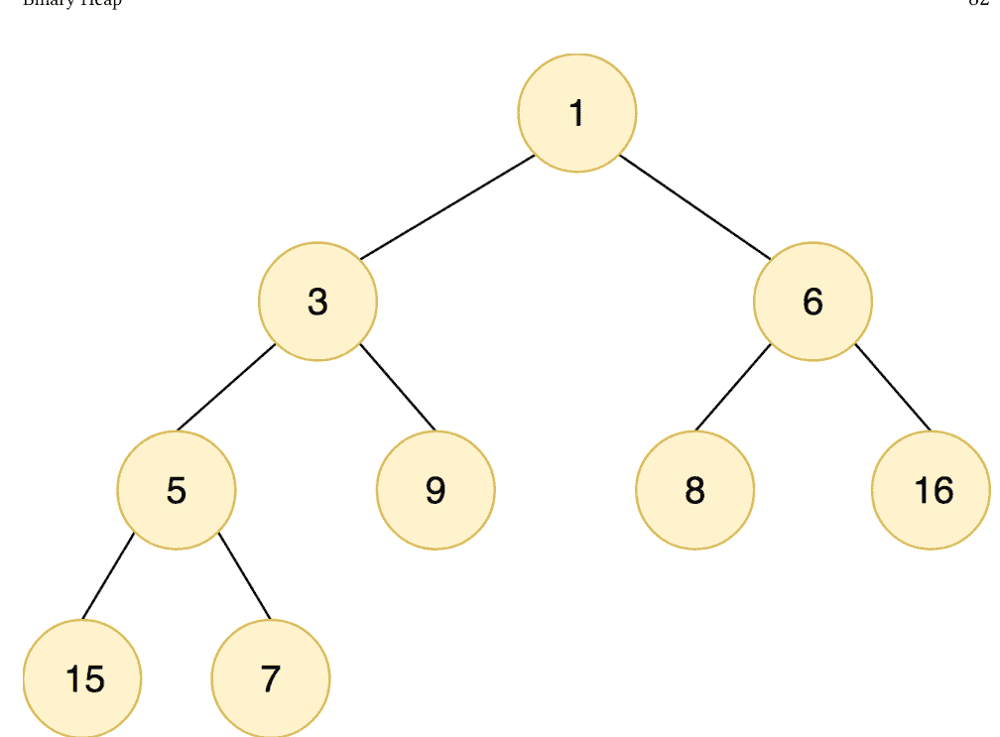

以下是二叉**最大堆**的示例。100 是堆中所有数字中最大的，因此它被放置在堆的根部。根节点的所有子节点都小于根节点。子节点也是如此：根节点的左子节点小于它的子节点，以此类推。树本身也是完全二叉树，因为它的所有层都已填满（除了最后一层从左到右填充）。

### 应用

堆的直接应用之一是**堆排序**算法（最好的排序方法之一，支持原地排序且没有最坏情况下的二次时间复杂度）。二叉堆由 J. W. J. Williams 于 1964 年引入，作为一种特别用于堆排序算法的数据结构。

你可能已经从上面的图示中注意到，堆使我们能够快速访问一组值中的最小/最大值。堆的这一特性使其在实现一种称为**优先队列**的抽象数据类型时非常高效。在优先队列中，高优先级的元素会在低优先级的元素之前被服务。通过将元素的优先级存储在堆中，我们将能够快速访问队列中下一个最重要的元素。

堆还被**图算法**所使用，例如 *Prim 最小生成树*算法和 *Dijkstra 最短路径*算法。

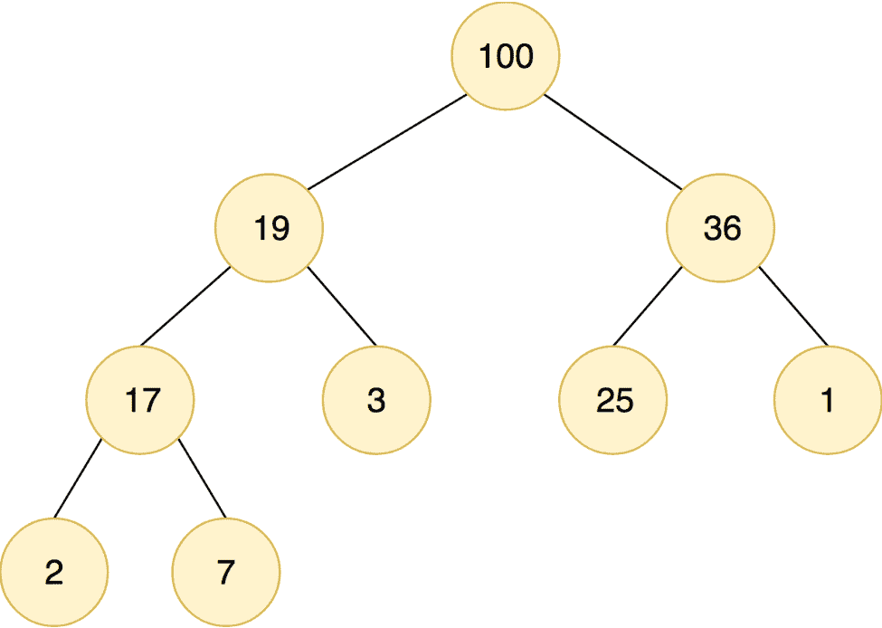

## 基本操作

以下是堆通常执行的基本操作：

- **Peek（查看）** - 返回堆的最小（对于最小堆）或最大（对于最大堆）元素，但不将其取出。
- **Poll（取出）** - 从堆中取出最小（对于最小堆）或最大（对于最大堆）元素。
- **Add（添加）** - 向堆中添加新元素。
- **Remove（移除）** - 按值从堆中移除元素。

在本章后面，我们将详细介绍每个操作的具体实现。但值得一提的是，对于修改堆的操作（如 "poll"、"add" 或 "remove"），我们首先尝试保持堆的*形状属性*。然后我们尝试修改堆的二叉树结构，以使*堆属性*也得到满足。因此还有两个常见的堆操作：**向上堆化**和**向下堆化**。这些操作是内部操作，不会被直接使用。这两个操作的唯一目的是在堆被修改后保持堆属性。

## 使用示例

在我们进入实际实现之前，让我们假设已经有一个 `MinHeap` 类被实现了，并使用它。这将帮助我们更好地理解我们将要实现的每个类方法的含义。

```
07-heap/example.js
1  // 导入 MinHeap 类。
2  import { MinHeap } from './MinHeap';
3
4  // 创建最小堆实例。
5  const minHeap = new MinHeap();
6
7  minHeap.isEmpty(); // => true
8
9  // 向最小堆添加新元素。
10 minHeap.add(5);
11 minHeap.isEmpty(); // => false
12 minHeap.peek(); // => 3
13 minHeap.toString(); // => '5'
14
15  // 添加更多元素。
16 minHeap.add(3);
```

```
17  // peek 操作始终返回堆中的最小元素。
18  minHeap.peek(); // => 3
19  minHeap.toString(); // => '3,5'
20
21  minHeap.add(10);
22  minHeap.peek(); // => 3
23  minHeap.toString(); // => '3,5,10'
24
25  // 从堆中取出最小值。
26  minHeap.poll(); // => 3
27  minHeap.peek(); // => 5
28  minHeap.toString(); // => '5,10'
29
30  // 从堆中移除元素。
31  minHeap.remove(10);
32  minHeap.peek(); // => 5
33  minHeap.toString(); // => '5'
```

## 实现

### 将堆存储为数组

我们将把堆构建为一棵*完全二叉树*。这意味着它是一棵二叉树，除了最后一层可能没有完全填满外，每一层都完全填满，并且所有节点都尽可能靠左。

*堆的元素通常存储在数组中。*任何二叉树都可以存储在数组中，但由于二叉堆始终是完全二叉树，因此可以紧凑地存储（没有任何空单元格）。不需要指针的空间；相反，每个节点的父节点和子节点可以通过对数组索引进行算术运算来找到。

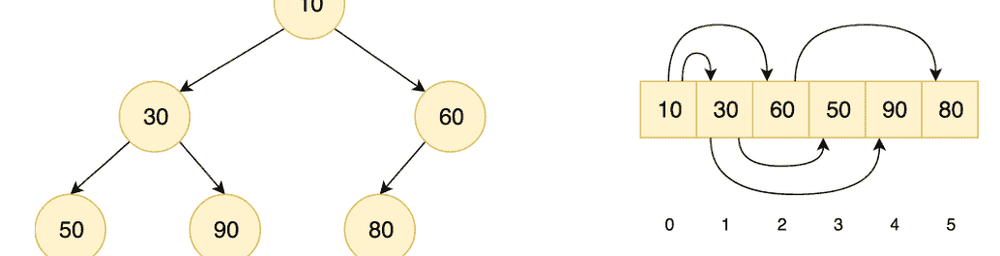

将堆保存为数组后，我们可以轻松计算每个节点的子节点和父节点的索引。设 `n` 为堆中的元素数量，`i` 为存储堆的数组的任意有效索引。如果树的根位于索引 `0`，有效索引范围为 `0` 到 `n - 1`，则索引 `i` 处的每个元素 a 具有：

- *子节点*位于索引 `2i + 1` 和 `2i + 2`，
- 其*父节点*位于索引 `floor((i - 1) / 2)`。

上面提到的 `floor()` 函数接受一个实数 `x` 作为输入，输出小于或等于 `x` 的最大整数。例如 `floor(5.4)` 等于 5。

例如：

- 根节点（`i = 0`）的左子节点位于索引 1（因为 `2 * 0 + 1 = 1`），右子节点位于索引 2（因为 `2 * 0 + 2 = 2`）。
- 根节点的左子节点位于索引 1（正如我们刚刚发现的），它的左子节点位于索引 3（因为 `2 * 1 + 1 = 3`），右子节点位于索引 4（因为 `2 * 1 + 2 = 4`）。
- 索引 `i = 4` 的节点的父节点索引为 1（因为 `floor(4 - 1 / 2) = floor(1.5) = 1`）

### 在堆中存储对象

有时可能需要在堆中存储的不仅仅是纯数字，还包括对象。例如，我们可能希望将用户对象（如 `{name: 'Paul', priority: 5}` 和 `{name: 'Jane', priority: 3}` 等）存储在堆中，以便下一次调用 `poll()` 方法时返回优先级更高的用户（在我们的示例中是 `{name: 'Paul', priority: 5}`）。为了实现这一点，我们需要提供一种自定义的对象比较方式。因此，我们将实现一个通用的 `Comparator` 工具类，它将提供一个通用的对象比较接口。之后我们将使用 `Comparator` 工具来实现 `MinHeap` 类。

### 类 `Comparator`

让我们声明这个类。

utils/comparator/Comparator.js

```
export default class Comparator {
```

## constructor

`Comparator` 构造函数将接受一个比较函数回调作为参数。该函数接受两个用于比较的值。如果两个对象相等则返回 0，如果第一个对象小于第二个对象则返回 -1，如果第一个对象大于第二个对象则返回 1。

`Comparator` 类本身不会了解任何比较逻辑。它只提供一个通用接口（即我们将在下面实现的方法）供使用。

`compareFunction` 是 `Comparator` 构造函数的可选参数。如果未提供 `compareFunction`，我们将回退到 `defaultCompareFunction()` 函数。

```
utils/comparator/Comparator.js

/**
 * @param {function(a: *, b: *)} [compareFunction] - It may be custom compare function that, let's
 * say may compare custom objects together.
 */
constructor(compareFunction) {
  this.compare = compareFunction || Comparator.defaultCompareFunction;
}
```

## defaultCompareFunction()

这是默认的回退比较函数，它将两个参数 a 和 b 视为字符串或数字，并对其应用常见的比较运算符，如 `===`、`<` 和 `>`。

```
utils/comparator/Comparator.js

/**
 * Default comparison function. It just assumes that "a" and "b" are strings or numbers.
 * @param {(string|number)} a
 * @param {(string|number)} b
 * @returns {number}
 */
static defaultCompareFunction(a, b) {
  if (a === b) {
    return 0;
  }

  return a < b ? -1 : 1;
}
```

## equal()

此函数检查两个变量是否相等。

```
utils/comparator/Comparator.js

/**
 * Checks if two variables are equal.
 * @param {*} a
 * @param {*} b
 * @return {boolean}
 */
equal(a, b) {
  return this.compare(a, b) === 0;
}
```

## lessThan()

此函数检查变量 a 是否小于 b。

```
utils/comparator/Comparator.js

/**
 * Checks if variable "a" is less than "b".
 * @param {*} a
 * @param {*} b
 * @return {boolean}
 */
lessThan(a, b) {
  return this.compare(a, b) < 0;
}
```

## greaterThan()

此函数检查变量 a 是否大于 b。

```
utils/comparator/Comparator.js

44  /**
45   * Checks if variable "a" is greater than "b".
46   * @param {*} a
47   * @param {*} b
48   * @return {boolean}
49   */
50  greaterThan(a, b) {
51    return this.compare(a, b) > 0;
52  }
```

## lessThanOrEqual()

此函数检查变量 a 是否小于或等于 b。

```
utils/comparator/Comparator.js

54  /**
55   * Checks if variable "a" is less than or equal to "b".
56   * @param {*} a
57   * @param {*} b
58   * @return {boolean}
59   */
60  lessThanOrEqual(a, b) {
61    return this.lessThan(a, b) || this.equal(a, b);
62  }
```

## greaterThanOrEqual()

此函数检查变量 a 是否大于或等于 b。

```
utils/comparator/Comparator.js

64  /**
65   * Checks if variable "a" is greater than or equal to "b".
66   * @param {*} a
67   * @param {*} b
68   * @return {boolean}
69   */
70  greaterThanOrEqual(a, b) {
71    return this.greaterThan(a, b) || this.equal(a, b);
72  }
```

## MinHeap 类

让我们继续实现 `MinHeap` 类。

首先导入依赖。我们将在类构造函数中使用 `Comparator` 实例，以便允许类使用者更改堆元素之间的比较方式。

```
4-heap/Heap.js

// Import dependencies.
import Comparator from '../utils/comparator/Comparator';
```

### constructor

让我们声明 `MinHeap` 类：

```
4-heap/Heap.js

export class MinHeap {
```

在类构造函数中，我们需要创建一个数组来保存所有堆数据。为了提高 `has()` 操作的性能，我们还创建了 `heapElements` 映射，它将保存所有堆元素，并允许我们在 $O(1)$ 时间内检查元素是否存在于堆中。

```
4-heap/Heap.js

/**
 * @constructs MinHeap
 * @param {Function} [comparatorFunction]
 */
```

```
constructor(comparatorFunction) {
  // Array representation of the heap.
  this.heapContainer = [];

  // A map of heap elements for fast lookup.
  this.heapElements = new Map();

  // Allow class consumers to change the way the heap elements are compared with each other.
  // This is particularly useful when we want to save objects in a heap.
  this.compare = new Comparator(comparatorFunction);
}
```

## 辅助方法

在继续实现主要的堆操作之前，让我们先实现几个辅助方法，它们将帮助我们遍历堆。

### getLeftChildIndex

此辅助方法将根据父节点的索引返回左子节点的索引。如果 i 是父节点索引，则左子节点索引的公式为 `2 * i + 1`。

```
4-heap/Heap.js

24 /**
25  * @param {number} parentIndex
26  * @return {number}
27  */
28 getLeftChildIndex(parentIndex) {
29   return (2 * parentIndex) + 1;
30 }
```

### getRightChildIndex

此辅助方法将根据父节点的索引返回右子节点的索引。如果 i 是父节点索引，则右子节点索引的公式为 `2 * i + 2`。

```
4-heap/Heap.js

32 /**
33  * @param {number} parentIndex
34  * @return {number}
35  */
36 getRightChildIndex(parentIndex) {
37   return (2 * parentIndex) + 2;
38 }
```

### getParentIndex

此辅助方法将根据子节点的索引返回父节点的索引。如果 i 是子节点索引，则父节点索引的公式为 `floor((i - 1) / 2)`。

```
4-heap/Heap.js

40 /**
41  * @param {number} childIndex
42  * @return {number}
43  */
44 getParentIndex(childIndex) {
45   return Math.floor((childIndex - 1) / 2);
46 }
```

### hasParent

此辅助方法用于指示索引为 `childIndex` 的节点是否有父节点。如果我们使用公式 `floor((i - 1) / 2)` 计算出的父节点索引为非负数，则返回 true。否则，该方法返回 false（当前节点是根节点）。

```
4-heap/Heap.js

48 /**
49  * @param {number} childIndex
50  * @return {boolean}
51  */
52 hasParent(childIndex) {
53   return this.getParentIndex(childIndex) >= 0;
54 }
```

### has

此辅助方法检查该项目是否存在于堆中。

```
4-heap/Heap.js

123 /**
124  * @param {*} item
125  * @return {boolean}
126  */
127 has(item) {
128   return !!this.heapElements.get(item);
129 }
```

### hasLeftChild

此辅助方法用于指示索引为 `parentIndex` 的节点是否有左子节点。如果子节点索引大于 `heapContainer` 数组的长度，则当前节点没有左子节点。

```
4-heap/Heap.js

56 /**
57  * @param {number} parentIndex
58  * @return {boolean}
59  */
60 hasLeftChild(parentIndex) {
61     return this.getLeftChildIndex(parentIndex) < this.heapContainer.length;
62 }
```

### hasRightChild

此辅助方法用于指示索引为 `parentIndex` 的节点是否有右子节点。如果子节点索引大于 `heapContainer` 数组的长度，则表示当前节点没有右子节点。

```
4-heap/Heap.js

64 /**
65  * @param {number} parentIndex
66  * @return {boolean}
67  */
68 hasRightChild(parentIndex) {
69     return this.getRightChildIndex(parentIndex) < this.heapContainer.length;
70 }
```

### leftChild

此辅助方法返回节点的左子节点。

```
4-heap/Heap.js

72 /**
73  * @param {number} parentIndex
74  * @return {*}
75  */
76 leftChild(parentIndex) {
77     return this.heapContainer[this.getLeftChildIndex(parentIndex)];
78 }
```

### rightChild

此辅助方法返回节点的右子节点。

```
4-heap/Heap.js

/**
 * @param {number} parentIndex
 * @return {*}
 */
rightChild(parentIndex) {
  return this.heapContainer[this.getRightChildIndex(parentIndex)];
}
```

### parent

此辅助方法返回子节点的父节点。

```
4-heap/Heap.js

/**
 * @param {number} childIndex
 * @return {*}
 */
parent(childIndex) {
  return this.heapContainer[this.getParentIndex(childIndex)];
}
```

### swap

此辅助方法交换 `heapContainer` 数组中的两个元素。

```
4-heap/Heap.js

/**
 * @param {number} indexOne
 * @param {number} indexTwo
 */
swap(indexOne, indexTwo) {
  const tmp = this.heapContainer[indexTwo];
  this.heapContainer[indexTwo] = this.heapContainer[indexOne];
  this.heapContainer[indexOne] = tmp;
}
```

### isEmpty

此辅助方法检查 `heapContainer` 数组中是否至少有一个元素。


## find

此辅助方法根据值查找堆中元素的位置。堆中可能存在重复值，因此此方法返回位置数组，而不仅仅是单个数字（即我们正在搜索的元素的位置）。堆中两个元素的相等性是通过使用 `comparator()` 函数来检查的。

## toString

此辅助方法通过调用 `heapContainer` 数组的 `toString()` 方法来返回堆的字符串表示形式。

```
4-stack/Stack.js

/**
 * @return {boolean}
 */
isEmpty() {
  return !this.heapContainer.length;
}
```

```
4-stack/Stack.js

/**
 * @param {*} item
 * @param {Comparator} [comparator]
 * @return {Number[]}
 */
find(item, comparator = this.compare) {
  const foundItemIndices = [];

  for (let itemIndex = 0; itemIndex < this.heapContainer.length; itemIndex += 1) {
    if (comparator.equal(item, this.heapContainer[itemIndex])) {
      foundItemIndices.push(itemIndex);
    }
  }

  return foundItemIndices;
}
```

```
4-stack/Stack.js

/**
 * @return {string}
 */
toString() {
  return this.heapContainer.toString();
}
```

## 保持堆属性的内部方法

本节中的方法：`heapifyUp` 和 `heapifyDown` 负责在任何堆修改后保持堆属性。使用 `heapifyUp` 和 `heapifyDown` 的堆修改方法——`peek`、`poll`、`add`、`remove`——将在下一节中解释。

### heapifyUp

此方法确保在将新元素添加到最小堆之后，堆的堆属性得到满足。新元素可能小于其父元素。为了修正这种情况，我们获取堆容器中的最后一个元素（数组中的最后一个或树中的左下角元素），并将其向上提升，直到它与其父元素处于正确的顺序关系。

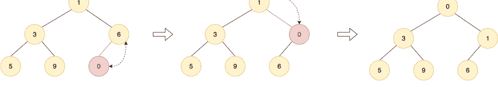

我们还将通过添加任意参数 `customStartIndex` 来提供对堆中任意元素执行“堆上移”操作的可能性。`remove()` 方法需要用到此功能。

```
4-stack/Stack.js

/**
 * @param {number} [customStartIndex]
 */
heapifyUp(customStartIndex) {
  // 获取堆容器中的最后一个元素（数组中的最后一个或树中的左下角元素）
  // 并将其向上提升，直到它与其父元素处于正确的顺序关系。
  let currentIndex = customStartIndex || this.heapContainer.length - 1;

  while (
```

```
    this.hasParent(currentIndex)
    && this.compare.greaterThan(this.parent(currentIndex), this.heapContainer[currentIndex])
  ) {
    this.swap(currentIndex, this.getParentIndex(currentIndex));
    currentIndex = this.getParentIndex(currentIndex);
  }
}
```

### heapifyDown

此方法确保在堆的根节点被移除后，堆的堆属性得到满足。在这种情况下，常见的行为是用 `heapContainer` 的最后一个元素替换堆的根节点。但新的头元素可能大于其子节点。在这种情况下，我们需要将父元素与其子节点进行比较，并将父节点与适当的子节点（对于最小堆是最小子节点，对于最大堆是最大子节点）进行交换。交换后，我们需要对下一个子节点执行相同的操作。

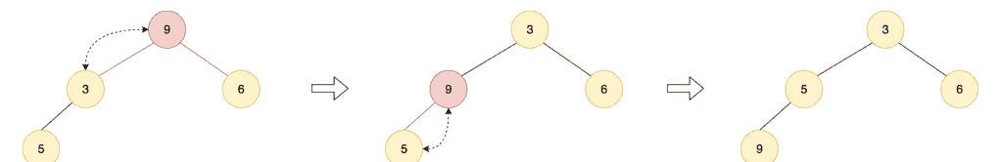

我们还将通过添加任意参数 `customStartIndex` 来提供对堆中任意元素执行“堆下移”操作的可能性。`remove()` 方法需要用到此功能。

```
4-stack/Stack.js

/**
 * @param {number} [customStartIndex]
 */
heapifyDown(customStartIndex = 0) {
  // 将父元素与其子节点进行比较，并将父节点与适当的子节点（对于最小堆是最小子节点，
  // 对于最大堆是最大子节点）进行交换。
  // 交换后，对下一个子节点执行相同的操作。
  let currentIndex = customStartIndex;
  let nextIndex = null;

  while (this.hasLeftChild(currentIndex)) {
    if (
      this.hasRightChild(currentIndex)
```

```
      && this.compare.lessThanOrEqual(this.rightChild(currentIndex), this.leftChild(currentIndex))
    ) {
      nextIndex = this.getRightChildIndex(currentIndex);
    } else {
      nextIndex = this.getLeftChildIndex(currentIndex);
    }

    if (this.compare.lessThanOrEqual(
      this.heapContainer[currentIndex],
      this.heapContainer[nextIndex],
    )) {
      break;
    }

    this.swap(currentIndex, nextIndex);
    currentIndex = nextIndex;
  }
}
```

## 主要堆方法

现在我们已经实现了一系列辅助方法，让我们继续添加堆的主要方法。

### peek

此方法将返回堆的头节点，而不实际移除它。当我们只需要检查最小堆的最小元素时，此方法非常有用。堆的头节点是 `heapContainer` 数组的第一个元素。

```
4-stack/Stack.js

/**
 * @return {*}
 */
peek() {
  // 检查堆是否为空。
  if (this.heapContainer.length === 0) {
    // 如果堆为空，则没有可查看的元素。
    return null;
  }
```

```
  // 返回堆数组的第一个元素（头节点）。
  return this.heapContainer[0];
}
```

### poll

此方法将移除并返回堆的头节点。当我们需要获取最小堆的最小元素时，此方法非常有用。堆的头节点是 `heapContainer` 数组的第一个元素。

在移除堆的头节点后，我们需要将 `heapContainer` 的最后一个元素移动到头节点位置。此操作将保持堆的*形状属性*（堆的树必须是一棵完全二叉树）。

将堆的最后一个元素移动到头节点位置后，我们保持了*形状属性*。但此时堆属性可能被违反，最小堆的头节点可能大于其子节点。为修正此问题，我们调用 `heapifyDown()` 方法，该方法将反过来保持*堆属性*。我们将很快实现它。

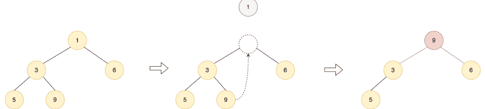

```
4-stack/Stack.js

/**
 * @return {*}
 */
poll() {
  if (this.heapContainer.length === 0) {
    // 如果堆为空，则没有可移除的元素。
    return null;
  }

  if (this.heapContainer.length === 1) {
    // 如果堆只包含一个元素，则直接取出。
    return this.heapContainer.pop();
  }
```

```
  // 记住我们要返回的值。
  const item = this.heapContainer[0];

  // 将最后一个元素从末尾移动到头部以保持“形状属性”。
  this.heapContainer[0] = this.heapContainer.pop();

  // 对堆进行下移操作以保持“堆属性”。
  this.heapifyDown();

  return item;
}
```

### add

此方法将新元素添加到最小堆中。为了保持堆的形状属性，新元素被添加到 `heapContainer` 数组的末尾。添加新元素后，新添加的元素可能小于其父元素。在这种情况下，堆属性被违反。为修正此问题，我们调用 `heapifyUp()` 方法，该方法会将新元素在树结构中向上提升，直到满足堆属性。

## 二叉堆

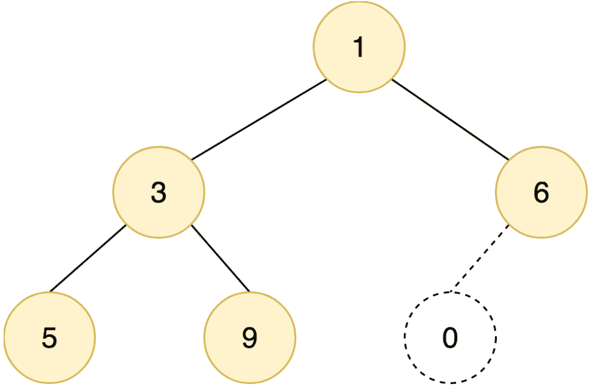

```
4-stack/Stack.js

/**
 * @param {*} item
 * @return {MinHeap}
 */
add(item) {
  // 将新元素添加到堆的末尾（形状属性得以保持）。
  this.heapContainer.push(item);

  // 将当前元素添加到堆元素的映射中以实现快速访问。
  this.heapElements.set(item, item);

  // 确保在元素小于其父元素时通过向上移动元素来保持堆属性。
  this.heapifyUp();

  return this;
}
```

### remove

此方法根据值从堆中移除元素。为了移除元素，我们需要执行以下操作：

- 查找堆中所有具有指定值的元素（可能存在重复，需要全部移除）
- 遍历所有需要移除的元素。
  - 将堆的最后一个元素移动到空缺（已移除）的位置。
  - 对于我们刚刚移动的元素，我们需要获取其新的父节点和子节点，以决定堆属性是否未被违反。
  - 如果堆属性被违反，我们需要调用 `heapifyUp()`（如果父节点大于新元素值）或 `heapifyDown()`（如果元素值大于其任一子节点的值）方法。

该函数将返回 `this`，以便能够链式调用命令，例如 `heap.remove(10).add(5)`，仅为方便起见。

```
4-stack/Stack.js

/**
 * @param {*} item
 * @param {Comparator} [comparator]
 * @return {MinHeap}
 */
remove(item, comparator = this.compare) {
  // 查找要移除的项目数量。
  const numberOfItemsToRemove = this.find(item, comparator).length;

  // 从堆元素的映射中移除当前项目。
  this.heapElements.delete(item);

  for (let iteration = 0; iteration < numberOfItemsToRemove; iteration += 1) {
    // 每次移除后我们需要重新查找项目索引，因为每次堆化过程后索引都会发生变化。
    const indexToRemove = this.find(item, comparator).pop();

    // 如果需要移除堆中的最后一个子节点，则直接移除。
    // 之后无需对堆进行堆化操作。
    if (indexToRemove === (this.heapContainer.length - 1)) {
      this.heapContainer.pop();
    } else {
      // 将堆中的最后一个元素移动到空缺（已移除）的位置。
      this.heapContainer[indexToRemove] = this.heapContainer.pop();

      // 获取父节点。
```


const parentItem = this.parent(indexToRemove);

// 如果没有父节点，或者父节点与待删除节点的顺序正确
// 则向下堆化。否则向上堆化。
if (
    this.hasLeftChild(indexToRemove)
    && (
        !parentItem
        || parentItem <= this.heapContainer[indexToRemove]
    )
) {
    this.heapifyDown(indexToRemove);
} else {
    this.heapifyUp(indexToRemove);
}

return this;
```

## 复杂度

| 查看（Peek） | 弹出（Poll） | 添加（Add） | 移除（Remove） |
|---|---|---|---|
| O(1) | O(log(n)) | O(log(n)) | O(log(n)) |

从队列中*弹出*、添加和移除元素的时间复杂度为 O(log(n))，因为每次执行这些操作都需要重新堆化堆的二叉树。在最坏情况下，这可能需要访问树中一个分支的所有元素。

*查看*的时间复杂度为 O(1)，因为我们只访问堆数组的第一个元素（根节点）。

## 问题示例

以下是你在面试中可能遇到的一些相关问题：

- [检查二叉树是否完全二叉树](https://leetcode.com/problems/check-completeness-of-a-binary-tree/)
- [二叉树插入器](https://leetcode.com/problems/complete-binary-tree-inserter/)

> 33 https://leetcode.com/problems/check-completeness-of-a-binary-tree/
> 34 https://leetcode.com/problems/complete-binary-tree-inserter/

## 测验

*问1：每个二叉堆必须满足哪两个约束条件？*

*问2：当我们对堆执行 $pull$ 操作并提取头部元素时，必须用什么值来填补被提取元素的位置？*

*问3：在 $MinHeap$ 中，$pull()$ 操作的时间复杂度是多少？*

## 参考文献

维基百科上的堆 [https://en.wikipedia.org/wiki/Heap(data_structure)](https://en.wikipedia.org/wiki/Heap(data_structure))

YouTube 上的堆 [https://www.youtube.com/watch?v=t0Cq6VNRBA](https://www.youtube.com/watch?v=t0Cq6VNRBA) [35]

堆的示例与测试用例 [https://github.com/trekhleb/javascript-algorithms/tree/master/src/data-structures/heap](https://github.com/trekhleb/javascript-algorithms/tree/master/src/data-structures/heap) [36]

---

[35] https://www.youtube.com/watch?v=t0Cq6VNRBA

[36] https://github.com/trekhleb/javascript-algorithms/tree/master/src/data-structures/heap

## 优先队列

- 难度：中等

**优先队列**是一种类似于普通队列或栈的数据结构，但其中每个元素都关联了一个“优先级”。在优先队列中，高优先级的元素在低优先级的元素之前被服务（或者根据队列的设置反之亦然）。

虽然优先队列通常用堆来实现，但它们在概念上与堆是不同的。优先队列是一种抽象概念，就像“一个列表”或“一个映射”；正如一个列表可以用链表或数组来实现，一个优先队列可以用堆或其他方法（如无序数组）来实现。

使用堆数据结构来实现优先队列的想法，基于堆的特性：当从堆中轮询数据时，总是返回最低（最小堆的情况）或最高（最大堆的情况）的元素。一旦我们改变堆的行为，使其尊重每个元素的优先级而非其值，我们就得到了一个优先队列。

在下面的示例中，你可以看到从优先队列中轮询元素的顺序。`poll()` 操作从队列中获取下一个最高优先级的元素，并将队列减少一个元素。

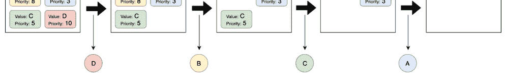

通常，优先队列的实现方式是，具有更高优先级属性值的元素首先被轮询出队列。但实现优先队列的另一种方式是将较小的数字视为更高的优先级，这样优先级为0的元素将在优先级为8的元素之前被拉取。我们采取哪种方式并不那么重要。但既然我们已经在之前的章节中实现了 `MinHeap` 类，就让我们来实现一个反向版本的优先队列。

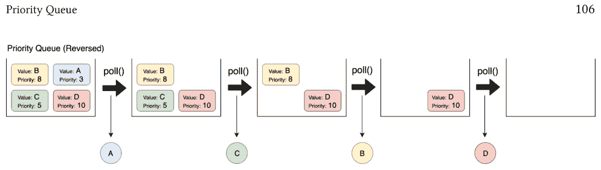

## 应用

优先队列被用作迪杰斯特拉算法（在图中寻找最短路径）、普里姆算法（寻找连通无向图的最小生成树）、排序算法等的一部分。

## 基本操作

以下是对优先队列通常执行的基本操作：

- **弹出（Poll）** - 根据其优先级从队列中提取下一个最重要的元素（在我们的情况下，我们将首先获取优先级值较低的元素）。
- **查看（Peek）** - 返回队列中下一个最高优先级的元素，但不将其提取出来。
- **添加（Add）** - 向队列中添加一个具有特定优先级的新元素。
- **移除（Remove）** - 按值从队列中移除元素。
- **更改优先级（Change Priority）** - 更改优先队列中元素的优先级。
- **检查值是否存在（Has Value）** - 检查队列中是否存在具有特定值的元素。

## 使用示例

在我们继续进行 `PriorityQueue` 类的实际实现之前，让我们假设我们已经有了它的实现并尝试使用它。这将帮助我们理解 `PriorityQueue` 类的工作接口。

举个例子，我们可以使用 `PriorityQueue` 进行一个简单的技巧，将城市数组按人口数量升序排序。

```javascript
// 07-priority-queue/example.js

// 导入依赖。
import { PriorityQueue } from './PriorityQueue';

// 让我们初始化一个空的优先队列。
const priorityQueue = new PriorityQueue();

// 让我们初始化一个包含人口（单位：百万）的美国城市数组。
const notSortedCities = [
  { name: 'New York', population: 8.6 },
  { name: 'Chicago', population: 2.7 },
  { name: 'San Francisco', population: 0.84 },
  { name: 'Houston', population: 2 },
];

// 让我们将所有城市添加到优先队列中，将人口视为优先级。
notSortedCities.forEach(city => priorityQueue.add(city, city.population));

// 现在让我们从优先队列中逐个获取城市并放入
// sortedCities 数组中。我们期望城市按人口升序
// 被轮询出来。
const sortedCities = [];
while (priorityQueue.peek()) {
  // 当我们能够从队列中查看到某些内容时，意味着队列尚不为空。
  sortedCities.push(priorityQueue.poll());
}

// 我们期望 sortedCities 真正按人口升序排序。
// eslint-disable-next-line no-console
console.log(sortedCities);

/*
输出结果将是：

[
  { name: 'San Francisco', population: 0.84 },
  { name: 'Houston', population: 2 },
  { name: 'Chicago', population: 2.7 },
  { name: 'New York', population: 8.6 },
]
*/
```

## 实现

我们将基于 MinHeap 类来构建 PriorityQueue 类，正如上面所解释的。MinHeap 类支持自定义比较函数。因此，我们将使用 Comparator 实例来改变 MinHeap 中的比较算法，使其比较元素的优先级而不是值。关于 MinHeap 和 Comparator 实现的更多细节，请参阅本书的“堆”章节。

让我们导入我们将要使用的依赖。

```javascript
// 07-priority-queue/PriorityQueue.js

// 导入依赖。
import { MinHeap } from '../07-heap/MinHeap';
import Comparator from '../utils/comparator/Comparator';
```

让我们声明 PriorityQueue 类并将其扩展自 MinHeap 类。

```javascript
// 07-priority-queue/PriorityQueue.js

export class PriorityQueue extends MinHeap {
```

### constructor()

在构造函数中，我们将首先通过调用 super() 来调用 MinHeap 类的父构造函数。接下来，我们将创建一个优先级映射 this.priorities。这个映射存储了所有优先队列元素的优先级值，以元素本身为键。例如，this.priorities 可能看起来像 {itemA: 10, itemB: 14}，其中 itemA 和 itemB 是元素的键，10 和 14 是元素的优先级。同时，我们还将创建一个自定义的 this.compare() 函数。这是我们改变 MinHeap 行为主要的地方，使得 MinHeap 方法尊重元素的优先级而不是元素的值。你可以看到我们在这里提供了一个自定义的 this.comparePriority() 函数作为主要的比较函数。这个函数将在下面解释。


## 优先队列

```javascript
// 07-priority-queue/PriorityQueue.js

constructor() {
  // Call MinHeap constructor first.
  super();

  // Setup priorities map.
  this.priorities = new Map();

  // Use custom comparator for heap elements that will take element priority
  // instead of element value into account.
  this.compare = new Comparator(this.comparePriority.bind(this));
}
```

## comparePriority()

该函数根据两个元素的优先级进行比较。它从 `this.priorities` 映射中获取元素 a 和 b 的优先级。如果两者优先级相等则返回 0，如果 a 的重要性低于 b 则返回 -1（元素顺序不正确），否则返回 1（元素顺序正确）。

```javascript
// 07-priority-queue/PriorityQueue.js

/**
 * Compares priorities of two items.
 * @param {*} a
 * @param {*} b
 * @return {number}
 */
comparePriority(a, b) {
  if (this.priorities.get(a) === this.priorities.get(b)) {
    return 0;
  }
  return this.priorities.get(a) < this.priorities.get(b) ? -1 : 1;
}
```

## compareValue()

该方法与 `comparePriority()` 方法功能相同，但比较的是元素本身而非优先级。

```javascript
// 07-priority-queue/PriorityQueue.js

/**
 * Compares values of two items.
 * @param {*} a
 * @param {*} b
 * @return {number}
 */
compareValue(a, b) {
  if (a === b) {
    return 0;
  }
  return a < b ? -1 : 1;
}
```

## add()

该方法根据优先级值将元素添加到优先队列中。它首先在 `this.priorities` 映射中设置新的优先级值，然后调用 `super.add()` 方法将元素添加到堆中。

```javascript
// 07-priority-queue/PriorityQueue.js

/**
 * Add item to the priority queue.
 * @param {*} item - item we're going to add to the queue.
 * @param {number} [priority] - items priority.
 * @return {PriorityQueue}
 */
add(item, priority = 0) {
  this.priorities.set(item, priority);
  super.add(item);
  return this;
}
```

## remove()

该方法从优先队列中移除元素。它接受两个参数：要移除的 `item`，以及可选的 `customFindingComparator` 回调函数，允许自定义在堆中查找元素的方式。当我们需要在优先队列中存储对象并希望实现自定义查找逻辑时（例如按对象的 name 属性查找），这非常有用。

```javascript
// 07-priority-queue/PriorityQueue.js

/**
 * Remove item from priority queue.
 * @param {*} item - item we're going to remove.
 * @param {Comparator} [customFindingComparator] - custom function for finding the
 * item to remove
 * @return {PriorityQueue}
 */
remove(item, customFindingComparator) {
  super.remove(item, customFindingComparator);
  this.priorities.delete(item);
  return this;
}
```

## changePriority()

该方法更改队列中元素的优先级。由于每次更改优先级后都需要重新构建堆，以便元素在堆中占据正确的位置，因此我们首先从堆中移除该元素，然后以更新后的优先级重新添加。我们也可以在不移除元素的情况下重新构建堆，但为了简单起见，我们采用这种方式。

```javascript
// 07-priority-queue/PriorityQueue.js

/**
 * Change priority of the item in a queue.
 * @param {*} item - item we're going to re-prioritize.
 * @param {number} priority - new item's priority.
 * @return {PriorityQueue}
 */
changePriority(item, priority) {
  this.remove(item, new Comparator(this.compareValue));
  this.add(item, priority);
  return this;
}
```

## 复杂度

由于优先队列基于 MinHeap 类，其主要方法只是封装了 MinHeap 类的主要方法并修改了比较器函数，因此我们可以认为优先队列类的时间复杂度与 MinHeap 类相同。另外需要注意，所有对 `this.priorities` 映射的操作都在 O(1) 时间内完成。

| 查看队首 | 弹出 | 添加 | 移除 |
|---|---|---|---|
| O(1) | O(log(n)) | O(log(n)) | O(log(n)) |

## 问题示例

以下是一些你可能在面试中遇到的相关问题：

- 按高度重建队列[^37]
- 有序队列[^38]

## 测验

*Q1: 如果我们想实现一个优先返回优先级值更高的元素的队列，我们需要对优先队列类的实现做哪些修改？*

*Q2: 优先队列中 poll() 操作的时间复杂度是多少？*

## 参考资料

- 维基百科上的优先队列 https://en.wikipedia.org/wiki/Priority_queue[^39]
- YouTube 上的优先队列 https://www.youtube.com/watch?v=wptevk0bshY[^40]
- 优先队列示例和测试用例 https://github.com/trekhleb/javascript-algorithms/tree/master/src/data-structures/priority-queue[^41]

[^37]: https://leetcode.com/problems/queue-reconstruction-by-height/
[^38]: https://leetcode.com/problems/orderly-queue/
[^39]: https://en.wikipedia.org/wiki/Priority_queue
[^40]: https://www.youtube.com/watch?v=wptevk0bshY
[^41]: https://github.com/trekhleb/javascript-algorithms/tree/master/src/data-structures/priority-queue

## 图

- 难度：简单

**图**（Graph）是由顶点和边组成的集合，边将所有或部分顶点连接在一起。

图可以是**有向**的或**无向**的。在**有向**图中，每条边都有方向（类似单行道）。你可以从起始节点访问终止节点，但不能反过来。在**无向**图中，边没有特定的方向（类似双向街道），因此任何两个相互连接的顶点都可以互相访问。

## 什么是顶点？

顶点是图中用于表示数据的基本单元。术语"节点"和"顶点"可以互换使用，用来描述图中数据的表示方式。顶点（vertex 的复数形式）通过边相互连接。

另一种说明有向图和无向图区别的方式是联想社交网络。如果每个顶点是一个"用户"，那么在有向图中，每条边就是一种"关注"关系——你可以关注某人，但这并不意味着对方也关注你。而在无向图中，边就像"好友"关系——如果某人在你的好友列表中，那就自动意味着你也在对方的好友列表中。

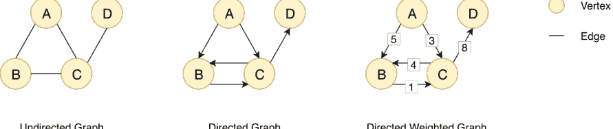

在上面的例子中，我们有三个不同的图，它们都有顶点和边。所有图都有一组顶点 {A, B, C, D}，也各有一组边。无向图的边集为：{AB, BC, AC, CD}。有向图的边集为：{AB, BC, CB, AC, CD}。注意，对于有向图，要使顶点 B 和 C 在两个方向上都连通，边集中需要有 BC 和 CB 两条边。

如果两个顶点通过一条边相互连接，我们称这两个顶点是**相邻的**或**邻居**。例如，在上面的无向图中，顶点 A 和 B 是邻居，顶点 A 和 C 也是邻居。但顶点 B 和 D 不是邻居，因为这些顶点需要通过多条边才能连接（B 连接到 C，C 再连接到 D）。

两个顶点之间的边序列称为**路径**。在上面的有向图中，从 *D* 到 *A* 没有路径，但从 *A* 到 *D* 有路径，该路径是边的集合：*{AC, CD}*。

图中的顶点不一定都需要相互连接。当存在*不可达*的顶点时，我们称这种图为**非连通图**。如果图中的每一对顶点之间都有边，则称为**连通图**。

图还可以包含环。如果一个图没有环，则称为**无环图**。

**带权图**是每条边都关联一个权重的图。根据上下文，边的权重可以表示不同的概念，如"距离"、"交通量"、"费用"、"阻力"等。

## 应用

- **地图**应用使用图来计算顶点（地址、城市、地点）之间的最短路径。
- **社交网络**使用图来实现好友推荐算法。
- **包管理器**使用图来根据依赖关系计算包的正确安装顺序。
- **搜索引擎**使用图来分析页面相关性。在搜索引擎使用的图中，网页是顶点，从一个网页指向另一个网页的链接是有向边。
- **网络提供商**使用图来分析网络流量和安全性。在这种情况下，每个顶点都有一个 IP 地址，每条边表示在不同 IP 地址之间流动的网络数据包。

## 图的表示

图通常用*邻接表*或*邻接矩阵*来表示。让我们以本章开头的图为例。

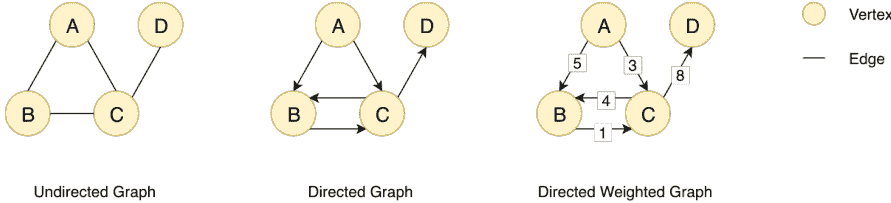

## 邻接矩阵

一个具有 *n* 个顶点的图也可以表示为一个大小为 *n* × *n* 的二值（*0* 或 *1*）邻接矩阵。在这样的矩阵中，位置 *(i, j)* 处的值 *1* 表示顶点 *i* 和 *j* 之间存在一条边。如果值为 *0*，则表示这两个顶点之间没有边。


## 无向图邻接矩阵示例

对于无向图，其邻接矩阵将是对称的。

|   | A | B | C | D |
|---|---|---|---|---|
| **A** | 0 | 1 | 1 | 0 |
| **B** | 1 | 0 | 1 | 0 |
| **C** | 1 | 1 | 0 | 1 |
| **D** | 0 | 0 | 1 | 0 |

## 有向图邻接矩阵示例

对于有向图，其邻接矩阵可能不是对称的。

|   | A | B | C | D |
|---|---|---|---|---|
| **A** | 0 | 1 | 1 | 0 |
| **B** | 0 | 0 | 1 | 0 |
| **C** | 0 | 1 | 0 | 1 |
| **D** | 0 | 0 | 0 | 0 |

## 有向加权图邻接矩阵示例

对于加权图，可以用边的权重代替布尔值 0/1。

|   | A | B | C | D |
|---|---|---|---|---|
| **A** | 0 | 5 | 3 | 0 |
| **B** | 0 | 0 | 1 | 0 |
| **C** | 0 | 4 | 0 | 8 |
| **D** | 0 | 0 | 0 | 0 |

## 邻接列表

表示图的一种流行方式是将节点（或顶点）实体存储为对象，该对象包含所有相邻节点的列表。

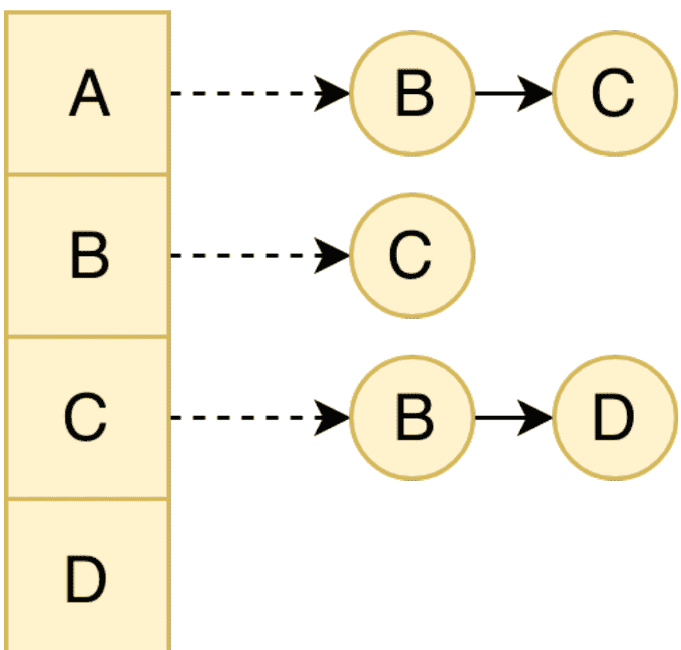

有时，可以使用边实体列表代替相邻节点列表。边实体存储 startNode、endNode 和 weight 属性。当我们需要为边存储一些元数据（如权重）时，这种方法可能更方便。

```
class Node {
  constructor() {
    /** @type {Edge[]} */
    this.edges = [];
  }
}

class Edge {
  constructor() {
    /** @type {Node} */
    this.startVertex = null;
    /** @type {Node} */
    this.endVertex = null;
    this.weight = null;
  }
}

class Graph {
  constructor() {
    /** @type {Node[]} */
    this.nodes = [];
  }
}
```

我们还需要一个单独的 `Graph` 类来支持不连通的图（它们包含独立的节点）。

在本章中，我们将使用邻接列表方法来实现图。

## 邻接矩阵与邻接列表的比较

与图相关的算法可以使用邻接矩阵或邻接列表互换实现。区别在于，对于某些算法，根据将要对图执行的操作，一种实现图的方式可能比另一种更高效。

邻接矩阵的主要问题是其空间复杂度为 *O(n<sup>2</sup>)*。对于稀疏图，大量的矩阵空间将被浪费（填充 *0*）。而在邻接列表中，空间复杂度将与顶点和边的数量成正比。

在邻接列表中，我们可以遍历顶点的邻居。在邻接矩阵中，我们需要遍历图中的所有顶点才能获取某个顶点的所有邻居。邻接矩阵具有快速查找功能，可以检查特定边的存在或缺失。

在大多数现实世界的问题中，我们处理的是稀疏且大型的图，这更适合我们将在本章中实现的邻接列表表示。

## 基本操作

最常见和最基本的图操作包括：

-   向图中添加/删除顶点。
-   在两个顶点之间添加/删除边（连接）。
-   获取顶点的所有邻居。
-   检查两个顶点是否相连。
-   通过值查找顶点。

## 使用示例

在我们实现图的 JavaScript 版本之前，让我们假设我们已经有了 Graph、GraphVertex 和 GraphEdge 类，并描述我们如何使用它们。

假设我们想要创建一个非常简单的社交网络模型。我们希望能够注册新用户，创建"好友"关系，并查看特定用户的好友列表。

```
08-graph/example.js

// Import dependencies.
import Graph from './Graph';
import GraphVertex from './GraphVertex';
import GraphEdge from './GraphEdge';

// Create a network.
const network = new Graph();

// Create users.
const bill = new GraphVertex('Bill');
const mary = new GraphVertex('Mary');
const john = new GraphVertex('John');
const jane = new GraphVertex('Jane');

// Register users in our network.
network
  .addVertex(bill)
  .addVertex(mary)
  .addVertex(john)
  .addVertex(jane);

// Check if users have been registered successfully.
network.getVertexByKey('Bill'); // -> bill
network.getVertexByKey('Mary'); // -> mary

// Establish friendship connections.
network
  .addEdge(new GraphEdge(bill, mary))
  .addEdge(new GraphEdge(john, jane))
  .addEdge(new GraphEdge(jane, mary));

// Check if specific users are friends.
network.findEdge(bill, mary); // -> GraphEdge entity
network.findEdge(john, jane); // -> GraphEdge entity
network.findEdge(bill, john); // -> null

// Get all friends of specific user.
// eslint-disable-next-line no-unused-expressions
mary.getNeighbors().length; // -> 2
mary.getNeighbors(); // -> [bill, jane]
```

## 实现

让我们将实现分为三个部分。首先，实现 GraphEdge 和 GraphVertex 类，然后将它们封装到 Graph 类中。

### GraphEdge

让我们创建这个类。

```
08-graph/GraphEdge.js
export default class GraphEdge {
```

### constructor

构造函数将接受 startVertex 和 endVertex 以及 weight 参数。边实例将表示 startVertex 和 endVertex 之间的连接。对于有向图，参数的顺序（startVertex 和 endVertex）很重要，因为如果您还记得介绍中的内容，有向图中的边是"单行道"——它们只能朝一个方向走。对于无向图，参数的顺序不重要。

```
08-graph/GraphEdge.js

/**
 * GraphEdge constructor.
 * @param {GraphVertex} startVertex
 * @param {GraphVertex} endVertex
 * @param {number} [weight=1]
 */
constructor(startVertex, endVertex, weight = 0) {
  this.startVertex = startVertex;
  this.endVertex = endVertex;
  this.weight = weight;
}
```

### getKey()

此方法将返回由起始顶点和终止顶点键组成的唯一边键。此键将在后面的 Graph 类中用于快速查找图的边。我们将在下面为 GraphVertex 实例实现 getKey() 方法。键值看起来类似于 A_B，这意味着这条边将顶点 A 和 B 连接在一起。

```
08-graph/GraphEdge.js

/**
 * Get string representation of the edge key.
 * @return {string}
 */
getKey() {
  const startVertexKey = this.startVertex.getKey();
  const endVertexKey = this.endVertex.getKey();

  return `${startVertexKey}_${endVertexKey}`;
}
```

### toString()

此方法将返回边的字符串表示。为简单起见，这里返回边键。

```
08-graph/GraphEdge.js

/**
 * Convert edge to string.
 * @return {string}
 */
toString() {
  return this.getKey();
}
```

### GraphVertex

我们将使用前面章节中的 LinkedList 类来存储顶点的所有相邻边。让我们先导入依赖项。

```
08-graph/GraphVertex.js

// Import dependencies.
import LinkedList from '../02-linked-list/LinkedList';
```

现在让我们创建一个类。

```
08-graph/GraphVertex.js

export default class GraphVertex {
```

### constructor

构造函数将接受顶点的值。此外，在此方法中，我们将使用 LinkedList 类创建一个空的 edges，用于存储所有相邻边。

```
08-graph/GraphVertex.js

/**
 * Graph vertex constructor.
 * @param {*} value
 */
constructor(value) {
  this.value = value;
  this.edges = new LinkedList();
}
```

### addEdge()

此方法向当前顶点添加新边。它通过简单地将边附加到边链表来实现。该方法返回 this 指针以允许链式调用其他方法（例如，vertex.addEdge(edgeAB).addEdge(edgeBA)）。

```
08-graph/GraphVertex.js

/**
 * Add new edge to the vertex.
 * @param {GraphEdge} edge
 * @returns {GraphVertex}
 */
addEdge(edge) {
  this.edges.append(edge);

  return this;
}
```

### deleteEdge()

此方法从 `LinkedList` 对象中删除边。

```
08-graph/GraphVertex.js

/**
 * Delete vertex edge.
 * @param {GraphEdge} edge
 */
deleteEdge(edge) {
  this.edges.delete(edge);
}
```

### getEdges()

此方法返回顶点所有相邻边的数组。为此，它将边的 `LinkedList` 转换为链表顶点数组，然后使用 `map()` 函数遍历每个链表顶点并从中olded从它们中提取值。这些值就是我们的顶点边实体。

```
08-graph/GraphVertex.js
/**
 * 获取顶点所有边的数组。
 * @return {GraphEdge[]}
 */
getEdges() {
  return this.edges.toArray().map(linkedListNode => linkedListNode.value);
}
```

## hasEdge()

此方法检查顶点是否具有特定的边实例。为此，它使用了链表的 `find()` 方法。我们向 `find()` 方法传入一个函数作为参数。在该函数内部，我们通过使用 `===` 对对象进行严格比较来查找正确的边。如果找到该边，我们通过使用 `!!` 将对象双重转换为布尔值来将其转换为布尔类型。

```
08-graph/GraphVertex.js
/**
 * 检查顶点是否连接到特定边。
 * @param {GraphEdge} requiredEdge
 * @returns {boolean}
 */
hasEdge(requiredEdge) {
  const edgeNode = this.edges.find({
    callback: edge => edge === requiredEdge,
  });

  return !!edgeNode;
}
```

## getNeighbors()

此方法返回当前顶点所有相邻顶点的数组。为此我们需要：

-   遍历所有相邻的边，
-   对于每条边，我们需要检查 `startVertex` 和 `endVertex`，并返回不等于当前顶点的那个顶点。

我们需要这样做，因为无法保证当前顶点在边中存储为 `startVertex`。例如，考虑顶点 A 和 B 以及边 AB 的情况。在这种情况下，边 AB 将同时添加到顶点 A 和 B。对于顶点 A，它将是边 AB 中的 `startVertex`，但对于顶点 B，它将是 `endVertex`。这两种情况都需要处理。

08-graph/GraphVertex.js

```
33  /**
34   * 获取顶点的邻居列表。
35   * @returns {GraphVertex[]}
36   */
37  getNeighbors() {
38    const edges = this.edges.toArray();
39
40    /** @param {LinkedListNode} node */
41    const neighborsConverter = (node) => {
42      const edge = node.value;
43      const neighbor = edge.startVertex === this ? edge.endVertex : edge.startVertex;
44
45      // 将边属性添加到邻居顶点，
46      // 以便此方法的消费者可以立即访问边的属性，如权重。
47      neighbor.edge = edge;
48
49      return neighbor;
50    };
51
52    // 返回起始顶点或结束顶点。
53    // 对于无向图，当前顶点可能是结束顶点。
54    return edges.map(neighborsConverter);
55  }
```

## hasNeighbor()

此方法检查当前顶点是否具有特定邻居。为此，它使用链表的 `find()` 方法来查找连接当前顶点到指定邻居顶点的边。然后，使用 `!!` 序列将 `find()` 操作的结果转换为布尔值。如果存在从当前顶点到指定邻居顶点的边，此方法将返回 `true`。否则，它将返回 `false`。

08-graph/GraphVertex.js

```
/**
 * 检查特定顶点是否是当前顶点的邻居。
 * @param {GraphVertex} vertex
 * @returns {boolean}
 */
hasNeighbor(vertex) {
  const edgeToNeighbor = this.edges.find({
    callback: edge => edge.startVertex === vertex || edge.endVertex === vertex,
  });

  return !!edgeToNeighbor;
}
```

## findEdge()

此方法查找连接当前顶点到指定顶点的边。为此，它使用链表的 `find()` 方法，并以 `edgeFinder()` 作为回调。在 `edgeFinder()` 回调中，我们尝试查找 `startVertex` 或 `endVertex` 被设置为 `findEdge()` 函数参数中指定的 `vertex` 对象的边。如果找到边，此方法将返回其值。否则，它将返回 `null`。

08-graph/GraphVertex.js

```
/**
 * 查找连接当前顶点到指定顶点的边。
 * @param {GraphVertex} vertex
 * @returns {(GraphEdge|null)}
 */
findEdge(vertex) {
  const edgeFinder = (edge) => {
    return edge.startVertex === vertex || edge.endVertex === vertex;
  };

  const edge = this.edges.find({ callback: edgeFinder });

  return edge ? edge.value : null;
}
```

## deleteAllEdges()

此方法删除所有连接到当前顶点的边。它只是遍历所有边，并对每条边执行 `deleteEdge()` 方法。

08-graph/GraphVertex.js

```
/**
 * 删除连接到顶点的所有边。
 * @return {GraphVertex}
 */
deleteAllEdges() {
  this.getEdges().forEach(edge => this.deleteEdge(edge));

  return this;
}
```

## getKey()

此方法返回顶点的键。我们使用顶点的值作为唯一键。我们稍后在 `Graph` 类中需要这个键，以便将所有顶点存储在映射中以快速查找顶点。

08-graph/GraphVertex.js

```
/**
 * 获取顶点的字符串键。
 * @returns {string}
 */
getKey() {
  return this.value;
}
```

## toString()

此方法创建顶点的字符串表示形式。我们打印出顶点的值。

08-graph/GraphVertex.js

```
/**
 * 获取图顶点的字符串表示形式。
 * @returns {string}
 */
toString() {
  return `${this.value}`;
}
```

## Graph

最后，我们可以创建 `Graph` 类。此类用于支持非连通图，其中可能有几个未连接的顶点。

08-graph/Graph.js

```
export default class Graph {
```

## constructor

为了支持有向图和无向图，构造函数方法将接受一个 `isDirected` 标志。我们还创建了空的 `this.vertices` 和 `this.edges` 映射（对象），它们将用于存储添加到图中的所有顶点和边。

08-graph/Graph.js

```
/**
 * Graph 构造函数。
 * @param {boolean} isDirected
 */
constructor(isDirected = false) {
  this.vertices = {};
  this.edges = {};
  this.isDirected = isDirected;
}
```

## addVertex()

此方法将顶点实例添加到图中。它只是在 `this.vertices` 对象中创建一个唯一的键，并将 `newVertex` 实例存储在其中。

08-graph/Graph.js

```
/**
 * 向图中添加新顶点。
 * @param {GraphVertex} newVertex
 * @returns {Graph}
 */
addVertex(newVertex) {
  this.vertices[newVertex.getKey()] = newVertex;

  return this;
}
```

## getVertexByKey()

此方法根据键从 `this.vertices` 对象返回顶点。

08-graph/Graph.js

```
23  /**
24   * 根据键获取顶点。
25   * @param {string} vertexKey
26   * @returns GraphVertex
27   */
28  getVertexByKey(vertexKey) {
29    return this.vertices[vertexKey];
30  }
```

## getAllVertices()

此方法返回所有图顶点。为此，它使用 `Object.values()` 方法将 `this.vertices` 对象转换为数组。

08-graph/Graph.js

```
32  /**
33   * 获取所有图顶点的列表。
34   * @return {GraphVertex[]}
35   */
36  getAllVertices() {
37    return Object.values(this.vertices);
38  }
```

## getAllEdges()

此方法返回所有图边的列表。为此，它使用 `Object.values()` 方法将 `this.edges` 对象转换为数组。

08-graph/Graph.js

```
40  /**
41   * 获取所有图边的列表。
42   * @return {GraphEdge[]}
43   */
44 chos
45    return Object.values(this.edges);
46  }
```

## addEdge()

此方法向图中添加特定的边实例。添加新边时，我们需要处理几件事。

首先，我们需要检查边中的一些（或所有）顶点是否已经被添加到图中。如果边中的一些（或所有）顶点之前没有添加到 `this.vertex` 对象中，我们需要添加它们。为了检查顶点是否存在，我们使用 `getVertexByKey()` 方法。如果它返回 `undefined`，意味着我们需要使用 `addVertex()` 方法创建一个顶点。

其次，我们需要检查边是否已经被添加到 `this.edges` 对象中。如果边已经被添加，我们抛出一个错误。否则，我们将边添加到 `this.edges` 对象中。

最后，如果图是有向图，那么我们需要将此边仅添加到 `startVertex` 实例。否则，此边将被添加到 `startVertex` 和 `endVertex` 两个实例。

08-graph/Graph.js

```
/**
 * 向图中添加新边。
 * @param {GraphEdge} edge
 * @returns {Graph}
 */
addEdge(edge) {
  // 尝试查找起始顶点和结束顶点。
  let startVertex = this.getVertexByKey(edge.startVertex.getKey());
  let endVertex = this.getVertexByKey(edge.endVertex.getKey());

  // 如果起始顶点未被插入，则插入它。
  if (!startVertex) {
    this.addVertex(edge.startVertex);
    startVertex = this.getVertexByKey(edge.startVertex.getKey());
  }

  // 如果结束顶点未被插入，则插入它。
  if (!endVertex) {
    this.addVertex(edge.endVertex);
    endVertex = this.getVertexByKey(edge.endVertex.getKey());
  }

  // 检查边是否已经被添加。
  if (this.edges[edge.getKey()]) {
    throw new Error('Edge has already been added before');
  } else {
    this.edges[edge.getKey()] = edge;
```

75 }
76
77 // 将边添加到顶点。
78 if (this.isDirected) {
79   // 如果图是有向的，则只将边添加到起始顶点。
80   startVertex.addEdge(edge);
81 } else {
82   // 如果图是无向的，则将边添加到两个顶点。
83   startVertex.addEdge(edge);
84   endVertex.addEdge(edge);
85 }
86
87 return this;
88 }

## deleteEdge()

此方法从图中删除指定的边。我们需要先从 this.edges 对象中删除该边，然后还需要从相关的顶点（startVertex 和 endVertex）中删除它。

```
/**
 * Delete specific edge from the graph.
 * @param {GraphEdge} edge
 */
deleteEdge(edge) {
  // Delete edge from the list of edges.
  if (this.edges[edge.getKey()]) {
    delete this.edges[edge.getKey()];
  } else {
    throw new Error('Edge not found in graph');
  }

  // Try to find and end start vertices and delete edge from them.
  const startVertex = this.getVertexByKey(edge.startVertex.getKey());
  const endVertex = this.getVertexByKey(edge.endVertex.getKey());

  startVertex.deleteEdge(edge);
  endVertex.deleteEdge(edge);
}
```

## findEdge()

此方法通过 startVertex 和 endVertex 实例来查找一条边。它本质上是检查图中的两个顶点是否相连。为此，它首先尝试在顶点列表中查找 startVertex。如果找不到 startVertex，则方法返回 null。如果找到了 startVertex，则它尝试使用 findEdge() 方法查找连接 startVertex 与 endVertex 的边。

```
/**
 * Find the edge by start and end vertices.
 * @param {GraphVertex} startVertex
 * @param {GraphVertex} endVertex
 * @return {(GraphEdge|null)}
 */
findEdge(startVertex, endVertex) {
  const vertex = this.getVertexByKey(startVertex.getKey());

  if (!vertex) {
    return null;
  }

  return vertex.findEdge(endVertex);
}
```

## toString()

此方法返回图的字符串表示。为此，它先将 this.vertices 转换为图顶点实例的数组，然后将该数组转换为字符串。
如果图由两个键分别为 'A' 和 'B' 的顶点组成，则字符串将类似于 'A,B'。

```
/**
 * Convert graph to string.
 * @return {string}
 */
toString() {
  return Object.keys(this.vertices).toString();
}
```

## 操作的时间复杂度

| 实现方式 | 添加顶点 | 删除顶点 | 添加边 | 删除边 |
| :--- | :--- | :--- | :--- | :--- |
| 邻接表 | O(1) | O(E+V) | O(1) | O(E) |
| 邻接矩阵 | O(V<sup>2</sup>) | O(V<sup>2</sup>) | O(1) | O(1) |

其中：V - 图中顶点的数量，E - 图中边的数量。

## 问题示例

以下是一些你可能在面试中遇到的与图相关的问题：

- 寻找小镇的法官<sup>42</sup>
- 克隆图<sup>43</sup>
- 课程表<sup>44</sup>

## 测验

*问题 1：树数据结构是图的一种类型吗？*

*问题 2：我们可以把顶点集 {A, B} 和空边集 {} 称为一个图吗？*

*问题 3：你知道哪些在代码中表示图的方式？*

## 参考资料

Wikipedia 上的图 <https://en.wikipedia.org/wiki/Graph_(abstract_data_type)>

YouTube 上的图 <https://www.youtube.com/watch?v=gXgEDyodOJU><sup>45</sup>

图的示例和测试用例 <https://github.com/trekhleb/javascript-algorithms/tree/master/src/data-structures/graph><sup>46</sup>

<sup>42</sup>https://leetcode.com/problems/find-the-town-judge/
<sup>43</sup>https://leetcode.com/problems/clone-graph/
<sup>44</sup>https://leetcode.com/problems/course-schedule/
<sup>45</sup>https://www.youtube.com/watch?v=gXgEDyodOJU
<sup>46</sup>https://github.com/trekhleb/javascript-algorithms/tree/master/src/data-structures/graph

# 位运算

- 难度：简单

## 介绍

在计算机中，比特（bit，是 "binary digit" 的缩写）是计算机最基本的数据表示形式。一个二进制位可以是两个值之一：0 或 1。

我们使用 1 和 0 的组合来用比特表示数字。例如，十进制数字 10 用二进制表示如下：

```
1010
```

我们是如何得到这个数字的呢？如果我们想将一个整数转换为二进制，我们将该数字除以 2，然后使用余数来确定该位置是使用 1 还是 0：

10/2 = 5 余 0
5/2 = 2 余 1
2/2 = 1 余 0
1/2 = 0 余 1

然后我们按计算的逆序排列结果 - 1010，这就是 10 的二进制表示。

JavaScript 使用 64 位来表示数字。因此对于数字 10 的二进制表示，它将是 1010 前面加上 60 个 0：

```
0000000000000000000000000000000000000000000000000000000000001010
```

在处理二进制数字时，我们可以使用几种运算，我们将在代码示例中使用每种运算。下表解释了每种运算：

| 运算符 | 名称 | 描述 |
| :--- | :--- | :--- |
| & | AND（与） | 如果两位都为 1，则将每一位设置为 1 |
| \| | OR（或） | 如果两位中有一位为 1，则将每一位设置为 1 |
| ^ | XOR（异或） | 如果两位中只有一位为 1，则将每一位设置为 1 |
| ~ | NOT（非） | 反转所有位 |
| << | 零填充左移 | 从右侧推入零进行左移，最左边的位被丢弃 |
| >> | 有符号右移 | 从左侧推入最左边位的副本进行右移，最右边的位被丢弃 |
| >>> | 零填充右移 | 从左侧推入零进行右移，最右边的位被丢弃 |

JavaScript 中任何时候使用这些类型的运算符时，JavaScript 都会将数字转换为 32 位，然后以 64 位有符号数字的形式返回结果。

## 什么是带符号的数字？

二进制数字只是 1 和 0。不像十进制数字那样有办法判断一个数字是正数还是负数。带符号的二进制数字使用最左边的位（也称为"最高有效位"或 MSB）来判断该数字是正数还是负数。如果最左边的位是 1，则该数字为负数。如果最左边的位是 0，则该数字为正数。

## 应用

当在 JavaScript 中执行位运算时，数字会从 64 位数字转换为 32 位有符号整数。例如，如果你对 6 使用 NOT 运算符，像这样：

~6

6 的 64 位表示如下：

0000000000000000000000000000000000000000000000000000000000000110

当你对这个数字执行 NOT 运算时，该数字会被转换为 32 位有符号整数：

00000000000000000000000000000110

运算结果如下所示：

1111111111111111111111111111111111111111111111111111111111111001

~6 的结果是 -7。为什么？当你使用 NOT 运算符翻转所有位时，返回的数字是补码格式的带符号数字。

## 什么是补码？

补码是二进制数字的一种格式，它是带符号数字的轻微修改版本。最高有效位仍然用于判断数字是正数还是负数，0 表示正数，1 表示负数。要计算补码格式中负数的值，你需要反转所有位并加 1。使用补码格式表示带符号数字的优点是没有"双重零"问题，如下表所示：

| 十进制 | 带符号表示 | 补码表示 |
| :--- | :--- | :--- |
| +7 | 0111 | 0111 |
| +6 | 0110 | 0110 |
| +5 | 0101 | 0101 |
| +4 | 0100 | 0100 |
| +3 | 0011 | 0011 |
| +2 | 0010 | 0010 |
| +1 | 0001 | 0001 |
| +0 | 0000 | 0000 |
| -0 | 1000 | - |
| -1 | 1001 | 1111 |
| -2 | 1010 | 1110 |
| -3 | 1011 | 1101 |
| -4 | 1100 | 1100 |
| -5 | 1101 | 1011 |
| -6 | 1110 | 1010 |
| -7 | 1111 | 1001 |

在 Java 中，位运算符适用于整数。JavaScript 没有整数类型，它只有双精度浮点数。因此，位运算符会将其操作数转换为整数，执行运算，然后再转换回去。在大多数语言中，这些运算符非常接近硬件且非常快。而在 JavaScript 中，它们远离硬件且非常慢。JavaScript 很少用于位运算操作。- Douglas Crockford，《JavaScript 语言精粹》

尽管在实践中 JavaScript 不是进行位运算最理想的编程语言，但它仍然是一个重要的学习概念。以下部分将解释所有不同类型的位运算以及它们在 JavaScript 中的实现方式。为了简化说明，我们将使用 6 位数字而不是 64 位二进制数字来解释不同的位运算。所有位运算在左右移位时都使用从零开始的索引。

## 代码

### 获取比特

要从二进制数字中获取相关的位，我们首先需要将相关位移到第零位，然后使用 AND 运算来判断该位是 1 还是 0。

例如，数字 5 的二进制表示如下：

`000101`

如果我们想找出第二位的值，我们首先将该位移动 2 个位置，如下所示：

shift 1 -> 000010
shift 2 -> 000001

一旦我们将位移位了正确的位数，我们就使用 `&`（与）操作来确定该位是1还是0。记住，使用 `&` 操作时，只有当两个数字的对应位都是1时，结果才会返回1。在本例中，当我们以数字5和2调用 `getBit` 函数时：

```
let result = getBit(5, 2)
```

结果等于1。

```js
// 09-bit-manipulation/getBit.js

/**
 * @param {number} number
 * @param {number} bitPosition - 从零开始。
 * @return {number}
 */
export default function getBit(number, bitPosition) {
  return (number >> bitPosition) & 1;
}
```

## 设置位（Set Bit）

要在二进制数中设置一个位，我们首先必须将数字1移到正确的位置，然后与该数字进行或运算。

要设置数字5的第3个位置上的位，我们首先取数字1，并将其第0位的数字移位3次，如下所示：

```
000001 <- 1的初始二进制表示
000010 <- 第一次移位
000100 <- 第二次移位
001000 <- 第三次移位
```

然后我们对数字5执行 `|`（或）操作来设置该位。

```
000101 | 001000 = 001101
```

```js
// 09-bit-manipulation/setBit.js

/**
 * @param {number} number
 * @param {number} bitPosition - 从零开始。
 * @return {number}
 */
export default function setBit(number, bitPosition) {
  return number | (1 << bitPosition);
}
```

## 清除位（Clear Bit）

要清除特定位置的位，我们首先使用数字1创建一个掩码，然后对该掩码进行非运算，并与该数字进行与运算。

例如，如果我们想清除数字5第二位置上的位，我们首先取数字1并将位移到第二位：

```
000001 <- 1的初始二进制表示
000010 <- 第一次移位
000100 <- 第二次移位
```

然后，我们对这个数字执行 `~`（非）操作，得到以下结果：

```
111011
```

最后，我们使用 `&` 操作与原始数字进行运算，以清除正确位置上的位：

```
000101 & 111011 = 000001
```

```js
// 09-bit-manipulation/clearBit.js

/**
 * @param {number} number
 * @param {number} bitPosition - 从零开始。
 * @return {number}
 */
export default function clearBit(number, bitPosition) {
  const mask = ~(1 << bitPosition);

  return number & mask;
}
```

## 更新位（Update Bit）

此方法是 `clearBit` 和 `setBit` 方法的组合。

```js
// 09-bit-manipulation/updateBit.js

/**
 * @param {number} number
 * @param {number} bitPosition - 从零开始。
 * @param {number} bitValue - 0 或 1。
 * @return {number}
 */
export default function updateBit(number, bitPosition, bitValue) {
  // 规范化位值。
  const bitValueNormalized = bitValue ? 1 : 0;
```

## 判断偶数（isEven）

此方法判断提供的数字是否为偶数。对于奇数，最右边的数字（或最低有效位）是1；对于偶数，最低有效位是0。

```
Number: 5 = 000101
isEven: false

Number: 4 = 000100
isEven: true
```

通过执行与1的按位与操作，我们可以确定数字是偶数还是奇数。

```
000101 & 000001 === 000001 (奇数)
000100 & 000001 === 000000 (偶数)
```

```js
// 09-bit-manipulation/isEven.js

/**
 * @param {number} number
 * @return {boolean}
 */
export default function isEven(number) {
  return (number & 1) === 0;
}
```

## 判断正数（isPositive）

此方法判断数字是否为正数。如果最高有效位（最左边的位）是0，则数字为正，函数返回 `true`。如果最高有效位是1，则数字为负，函数返回 `false`。

```
Number: 1 = 000001
isPositive: true

Number: -1 = 100001
isPositive: false
```

要获取最高有效位，我们将最左边的位移位31次，然后与1进行与运算，以确定它是1还是0。

```
shift 1  -> 10000000000000000000000000000001
shift 2  -> 01000000000000000000000000000000
....
shift 31 -> 00000000000000000000000000000001
```

```
00000000000000000000000000000001 & 000001 = 000001 <- 负数
```

```js
// 09-bit-manipulation/isPositive.js

/**
 * @param {number} number - 32位整数。
 * @return {boolean}
 */
export default function isPositive(number) {
  // 零既不是正数也不是负数。
  if (number === 0) {
    return false;
  }

  // 第32位最高有效位可用于判断数字是否为正。
  return ((number >> 31) & 1) === 0;
}
```

## 乘以二（Multiply By Two）

此方法将原始数字向左移位一位。通过将所有位向左移动，这相当于将数字乘以二。

```
000101 <- 5的初始二进制表示
001010 <- 向左移位一次
```

```
001010 = 10
```

```js
// 09-bit-manipulation/multiplyByTwo.js

/**
 * @param {number} number
 * @return {number}
 */
export default function multiplyByTwo(number) {
  return number << 1;
}
```

## 除以二（Divide By Two）

要将二进制数除以二，我们将原始数字向右移位一位。通过将所有位向右移动，这相当于将数字除以2。

```
5的初始二进制表示 -> 000101
向右移位一次 -> 000010
```

```
000010 = 2
```

```js
// 09-bit-manipulation/divideByTwo.js

/**
 * @param {number} number
 * @return {number}
 */
export default function divideByTwo(number) {
  return number >> 1;
}
```

## 符号切换（Switch Sign）

此方法将正数切换为负数，将负数切换为正数。为此，它使用“二进制补码”方法，即反转数字的所有位并向其加1。

| 二进制 | 十进制 |
|--------|---------|
| 1101   | -3      |
| 1110   | -2      |
| 1111   | -1      |
| 0000   | 0       |
| 0001   | 1       |
| 0010   | 2       |
| 0011   | 3       |

将5切换为-5：

```
000101 = 5
```

反转位：

```
111010
```

加1：

```
111011
```

然后将-5切换回5：

```
111011 = -5
```

反转位：

```
000100
```

加1：

```
000101
```

```js
// 09-bit-manipulation/switchSign.js

/**
 * 使用“二进制补码”方法切换数字的符号。
 * @param {number} number
 * @return {number}
 */
export default function switchSign(number) {
  return ~number + 1;
}
```

## 有符号数相乘（Multiply Two Signed Numbers）

此方法使用按位运算符乘以两个有符号整数。此方法基于以下事实：

a * b 可以写成以下格式：

```
0                          如果 a 为零或 b 为零或两者都为零
2a * (b/2)                 如果 b 是偶数
2a * (b - 1)/2 + a         如果 b 是奇数且为正
2a * (b + 1)/2 - a         如果 b 是奇数且为负
```

这种方法的优点是在每个递归步骤中，其中一个操作数减少到其原始值的一半。因此，运行时间复杂度为 O(log(b))，其中 b 是在每个递归步骤中减少到一半的操作数。

```js
// 09-bit-manipulation/multiply.js

import multiplyByTwo from './multiplyByTwo';
import divideByTwo from './divideByTwo';
import isEven from './isEven';
import isPositive from './isPositive';

/**
 * 使用位运算乘以两个有符号数。
 *
 * 如果 a 为零或 b 为零或两者都为零：
 * multiply(a, b) = 0
 *
 * 如果 b 是偶数：
 * multiply(a, b) = multiply(2a, b/2)
 *
 * 如果 b 是奇数且 b 为正：
 * multiply(a, b) = multiply(2a, (b-1)/2) + a
 *
 * 如果 b 是奇数且 b 为负：
 * multiply(a, b) = multiply(2a, (b+1)/2) - a
 *
 * 时间复杂度：O(log b)
 *
 * @param {number} a
 * @param {number} b
 * @return {number}
 */
export default function multiply(a, b) {
  // 如果 a 为零或 b 为零或两者都为零，则乘积也为零。
  if (b === 0 || a === 0) {
    return 0;
  }

  // 否则，我们将有四种不同的情况，如上所述。
  const multiplyByOddPositive = () => multiply(multiplyByTwo(a), divideByTwo(b - 1)) + a;
  const multiplyByOddNegative = () => multiply(multiplyByTwo(a), divideByTwo(b + 1)) - a;

  const multiplyByEven = () => multiply(multiplyByTwo(a), divideByTwo(b));
  const multiplyByOdd = () => (isPositive(b) ? multiplyByOddPositive() : multiplyByOddNegative());
}
```

## 无符号数相乘（Multiply Two Unsigned Numbers）

此方法使用按位运算符乘以两个整数。此方法基于“每个数字都可以表示为2的幂之和”。

按位乘法的主要思想是每个数字都可以分解为2的幂之和：

```
19 = 2^4 + 2^1 + 2^0
```

然后将数字x乘以19等同于：

```
x * 19 = x * 2^4 + x * 2^1 + x * 2^0
```

现在我们需要记住，x * 2^4 等同于将x向左移位4位（x << 4）。

```js
// 09-bit-manipulation/multiplyUnsigned.js

/**
 * 使用按位运算符乘以两个无符号数。
 *
 * 按位乘法的主要思想是每个数字都可以分解为
 * 2的幂之和：
 *
 * 即 19 = 2^4 + 2^1 + 2^0
 *
 * 然后将数字x乘以19等同于：
 *
 * x * 19 = x * 2^4 + x * 2^1 + x * 2^0
 *
 * 现在我们需要记住 (x * 2^4) 等同于将x向左移位4位
 * (x << 4)。
 *
 * @param {number} number1
 * @param {number} number2
 * @return {number}
 */
export default function multiplyUnsigned(number1, number2) {
  let result = 0;
```


## 统计置位比特数

此方法使用位运算符来统计一个数字中置位比特（值为 1 的比特）的数量。当数字仍然大于 0 时，我们每次将数字右移一位，并将该数字与 1 进行 AND 运算，以判断该位是否被置位。

5 的初始二进制表示 -> 000101 置位比特数：1 右移 1 -> 000010 置位比特数：1 右移 2 -> 000001 置位比特数：2 右移 3 -> 000000 置位比特数：2

此时数字为 0，因此终止 while 循环。置位比特数为 2。

```
// Let's treat number2 as a multiplier for the number1.
let multiplier = number2;

// Multiplier current bit index.
let bitIndex = 0;

// Go through all bits of number2.
while (multiplier !== 0) {
    // Check if current multiplier bit is set.
    if (multiplier & 1) {
        // In case if multiplier's bit at position bitIndex is set
        // it would mean that we need to multiply number1 by the power
        // of bit with index bitIndex and then add it to the result.
        result += (number1 << bitIndex);
    }

    bitIndex += 1;
    multiplier >>= 1;
}

return result;
}
```

```
09-bit-manipulation/countSetBits.js

/**
 * @param {number} originalNumber
 * @return {number}
 */
export default function countSetBits(originalNumber) {
  let setBitsCount = 0;
  let number = originalNumber;

  while (number) {
    // Add last bit of the number to the sum of set bits.
    setBitsCount += number & 1;

    // Shift number right by one bit to investigate other bits.
    number >>= 1;
  }

  return setBitsCount;
}
```

## 统计比特差异

此方法用于确定两个数字之间有多少位不同。通过使用 XOR（异或）运算，我们可以确定两个数字之间不同的比特数，然后使用 countBit 函数来得到总数。

```
000101 ^ 000001 = 000100
Count of Bits to be Flipped: 1
```

```
09-bit-manipulation/bitsDiff.js

import countSetBits from './countSetBits';

/**
 * Counts the number of bits that need to be change in order
 * to convert numberA to numberB.
 *
 * @param {number} numberA
 * @param {number} numberB
 * @return {number}
 */
export default function bitsDiff(numberA, numberB) {
  return countSetBits(numberA ^ numberB);
}
```

## 统计一个数字的有效比特数

要计算有效比特数，我们需要每次将 1 左移一位，然后检查移位后的数字是否大于输入数字。

5 = 000101 1 的初始二进制表示 -> 000001 比特计数：0 000010 <- 左移 1 位，2 < 5 000100 <- 左移 2 位，4 < 5 001000 <- 左移 3 位，8 > 5

有效比特数为：3 当我们将 1 左移四位时，它就大于 5 了。

```
09-bit-manipulation/bitLength.js

/**
 * Return the number of bits used in the binary representation of the number.
 *
 * @param {number} number
 * @return {number}
 */
export default function bitLength(number) {
  let bitsCounter = 0;

  while ((1 << bitsCounter) <= number) {
    bitsCounter += 1;
  }

  return bitsCounter;
}
```

## 相关题目示例

以下是你在面试中可能会遇到的一些相关题目：

- [翻转比特](https://leetcode.com/problems/reverse-bits/)
- [数字范围按位与](https://leetcode.com/problems/bitwise-and-of-numbers-range/)

## 小测验

Q1：*-5 在补码二进制格式下是什么样的？*
Q2：*如果我们将数字 5 的二进制表示中第 0 位的比特清除，结果是什么？*

## 参考资料

YouTube 上的位运算讲解 [https://www.youtube.com/watch?v=NLKQEOgBAnw](https://www.youtube.com/watch?v=NLKQEOgBAnw)

YouTube 上的负数二进制表示 [https://www.youtube.com/watch?v=4qH4unVtJkE](https://www.youtube.com/watch?v=4qH4unVtJkE)

stanford.edu 上的位运算技巧 [https://graphics.stanford.edu/~seander/bithacks.html](https://graphics.stanford.edu/~seander/bithacks.html)

位运算示例和测试用例 [https://github.com/trekhleb/javascript-algorithms/tree/master/src/algorithms/math/bits](https://github.com/trekhleb/javascript-algorithms/tree/master/src/algorithms/math/bits)

## 阶乘

难度：简单

### 简介

在数学中，一个非负整数 n 的阶乘，用 n! 表示，是所有小于或等于 n 的正整数的乘积。例如：

```
5! = 5 * 4 * 3 * 2 * 1 = 120
```

| n  | n!            |
|----|---------------|
| 0  | 1             |
| 1  | 1             |
| 2  | 2             |
| 3  | 6             |
| 4  | 24            |
| 5  | 120           |
| 6  | 720           |
| 7  | 5 040         |
| 8  | 40 320        |
| 9  | 362 880       |
| 10 | 3 628 800     |
| 11 | 39 916 800    |
| 12 | 479 001 600   |
| 13 | 6 227 020 800 |
| 14 | 87 178 291 200 |
| 15 | 1 307 674 368 000 |

### 应用

阶乘函数可用于计算对象的不同排列组合。例如，假设一个小组中有三个人——Sally、Susan 和 Sarah——我们想要确定这些人站成一排有多少种不同的排列方式。

你可以把它们列出来：

Sally, Susan, Sarah
Sally, Sarah, Susan
Susan, Sarah, Sally
Susan, Sally, Sarah
Sarah, Sally, Susan
Sarah, Susan, Sally

### 递归

使用编程来计算一个数的阶乘是演示递归概念的常见问题。在下面的代码中，你会看到我们有两种不同的方法来解决这个问题——使用递归和非递归方法。

在本书的许多章节中，**我们将使用递归来解决问题**。递归在计算机科学中经常被使用，是一个重要的（虽然有些令人困惑的）概念。基本思想是：我们有一个函数，而在函数定义内部，我们再次调用该函数。我们还必须在函数中包含一个**基本情形**，以强制函数停止调用自身。如果没有基本情形，函数将无限运行，直到系统内存耗尽。

### 代码

#### 递归实现

计算阶乘的递归实现在函数中只有一行代码，但这个函数中有很多值得深入理解的内容，让我们一步一步来分析。

要实现阶乘，我们使用三元运算符来判断是否继续调用函数。

```
10-factorial/factorialRecursive.js

/**
 * @param {number} number
 * @return {number}
 */
export default function factorialRecursive(number) {
  return number > 1 ? number * factorialRecursive(number - 1) : 1;
}
```

#### 三元运算符回顾

JavaScript 中的三元运算符是一种简化代码行数的方式。与其使用 if/else 语句：

```
if(someTrueValue){
    return someValue;
}else{
    return aDifferentValue;
}
```

我们可以将这个逻辑合并为一行：

```
return someTrueValue ? someValue : aDifferentValue;
```

三元运算符的第一部分是一个真/假表达式，第二部分（在 ? 和 : 之间）是表达式为真时返回的值，最后一部分是表达式为假时返回的值。

对于我们的阶乘函数，三元运算符的第一部分（真/假表达式）判断我们使用的数字是否大于 1。

```
number > 1
```

如果正在计算的数字大于 1，则执行三元运算符的第二部分。在这里，函数以比当前数字小 1 的数字调用自身，并将该函数调用的结果与当前数字相乘。

```
? number * factorialRecursive(number - 1)
```

最后是三元运算符的最后一部分，即我们的**基本情形**。当值为 1 时，我们返回 1。

如果我们用数字 5 来调用函数，"底层"的执行过程是什么样的？

```
return factorialRecursive(5);
```

- 5 大于 1 吗？是的，返回 5 * factorialRecursive(4)
- 4 大于 1 吗？是的，返回 4 * factorialRecursive(3)
- 3 大于 1 吗？是的，返回 3 * factorialRecursive(2)
- 2 大于 1 吗？是的，返回 2 * factorialRecursive(1)

1 大于 1 吗？不是，返回 1 <- 这就是我们的基本情形。我们完成了函数调用，可以返回之前每次调用的结果：

return 2 * 1
return 3 * 2（上一次调用的结果 2 * 1）
return 4 * 6（上一次调用的结果 3 * 2）
return 5 * 24（上一次调用的结果 4 * 6）

最终结果：120


## 非递归实现

对于非递归实现，我们首先创建一个变量来存储结果，并将其初始化为 1：

```javascript
export default function factorial(number) {
  let result = 1;
```

接下来，我们创建一个 for 循环，从 2 开始，持续循环直到达到我们要计算的数字。

```javascript
for (let i = 2; i <= number; i += 1) {
```

在 for 循环内部，我们将 `i` 乘以我们的 `result`：

```javascript
for (let i = 2; i <= number; i += 1) {
  result *= i;
}
```

最后，当跳出 for 循环时，我们返回结果。

```javascript
return result;
```

## 问题示例

以下是面试中可能遇到的一些相关问题：

- [笨拙的阶乘](https://leetcode.com/problems/clumsy-factorial/)^(53)
- [阶乘后的零](https://leetcode.com/problems/factorial-trailing-zeroes/)^(54)

## 测验

*Q1: 在 6! 的递归实现中，`factorialRecursive` 函数会被调用多少次？*

## 参考资料

[维基百科上的阶乘](https://en.wikipedia.org/wiki/Factorial)^(55)

[阶乘实现示例和测试用例](https://github.com/trekhleb/javascript-algorithms/tree/master/src/algorithms/math/factorial)^(56)

## 斐波那契数

*难度：简单*

在数学中，斐波那契数是以下整数序列中的数字，称为斐波那契序列，其特点是每个数字（前两个之后）都是前两个数字之和：

0, 1, 1, 2, 3, 5, 8, 13, 21, 34, 55, 89, 144, . . .

用边长为连续斐波那契数的正方形进行铺砖

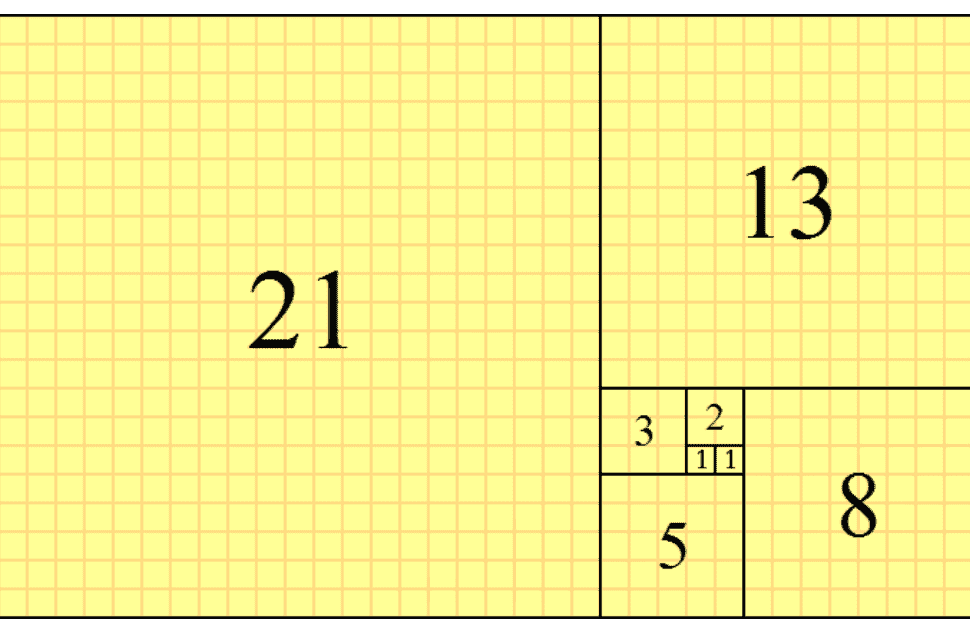

**斐波那契**

斐波那契螺旋线：通过在斐波那契铺砖中正方形的对角角之间绘制圆弧来近似黄金螺旋线；此图使用了大小为 1, 1, 2, 3, 5, 8, 13 和 21 的正方形。

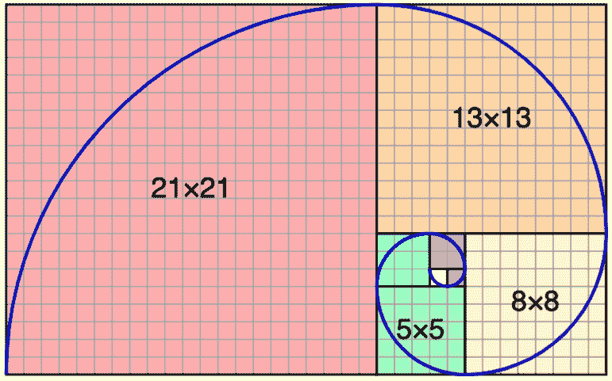

## 应用

斐波那契序列在自然界中无处不在——花朵、松果，甚至昆虫和人类都具有斐波那契序列的元素。例如，松果的种子荚按斐波那契序列排列，同样向日葵中的种子也按斐波那契序列排列。

## 代码

### 创建斐波那契数数组

要创建包含 N 个斐波那契数的数组，我们首先创建一个包含一个值的数组，即数字 1。

11-fibonacci/fibonacci.js

```javascript
export default function fibonacci(n) {
  const fibSequence = [1];
```

然后我们创建两个变量，一个用于保存当前正在处理的数字，另一个用于保存前一个数字。

```javascript
let currentValue = 1;
let previousValue = 0;
```

如果我们只想要斐波那契序列中的第一个数字（1），我们立即返回该数组：

```javascript
if (n === 1) {
  return fibSequence;
}
```

如果我们想要斐波那契序列中多于第一个的数字，我们创建一个 `iterationsCounter` 变量来跟踪已添加到数组中的数字数量。由于我们的数组中已经包含了 1，我们将 `iterationsCounter` 设置为 n-1：

```javascript
let iterationsCounter = n - 1;
```

然后我们创建一个 while 循环，持续到 `iterationsCounter` 达到 0 为止。我们将当前值和之前计算的值相加，并将其放入数组中。

```javascript
while (iterationsCounter) {
  currentValue += previousValue;
  previousValue = currentValue - previousValue;

  fibSequence.push(currentValue);

  iterationsCounter -= 1;
}
```

最后，当我们跳出 while 循环时，返回我们的数组。

```javascript
return fibSequence;
}
```

## 计算第 N 个斐波那契数

计算第 N 个斐波那契数与创建斐波那契数数组非常相似。我们不将数字放入数组中，当达到第 N 个数字时，我们直接返回它。

```javascript
export default function fibonacciNth(n) {
  let currentValue = 1;
  let previousValue = 0;

  if (n === 1) {
    return 1;
  }

  let iterationsCounter = n - 1;

  while (iterationsCounter) {
    currentValue += previousValue;
    previousValue = currentValue - previousValue;

    iterationsCounter -= 1;
  }
```

## 计算第 N 个斐波那契数（使用比内公式）

比内公式是一种数学方法，可以不使用 for 或 while 循环来计算第 N 个斐波那契数。

首先，我们计算 5 的平方根并将其保存到一个变量中：

```javascript
// 计算 √5 以便在后续公式中复用。
const sqrt5 = Math.sqrt(5);
```

接下来我们计算 φ （≈ 1.61803）的值，并将其保存到一个变量中

```javascript
// 计算 φ 常数 (≈ 1.61803)。
const phi = (1 + sqrt5) / 2;
```

最后，我们使用这两个值来计算第 N 个斐波那契数。你会注意到我们使用的是在 EcmaScript 2017 中引入的幂运算符 (**)，而不是 Math.pow()。

```javascript
// 11-fibonacci/fibonacciNthClosedForm.js
// 使用比内公式计算斐波那契数。
return Math.floor((phi ** position) / sqrt5 + 0.5);
```

## 问题示例

以下是面试中可能遇到的一些相关问题：

- [最长斐波那契子序列的长度](https://leetcode.com/problems/length-of-longest-fibonacci-subsequence/)^(57)
- [将数组拆分成斐波那契序列](https://leetcode.com/problems/split-array-into-fibonacci-sequence/)^(58)

## 参考资料

- [维基百科上的斐波那契序列](https://en.wikipedia.org/wiki/Fibonacci_number)^(59)
- [YouTube 上的斐波那契序列](https://www.youtube.com/watch?v=T8xgfVzef_E)^(60)
- [斐波那契序列实现示例和测试用例](https://github.com/trekhleb/javascript-algorithms/tree/master/src/algorithms/math/fibonacci)^(61)

---

^(57) https://leetcode.com/problems/length-of-longest-fibonacci-subsequence/
^(58) https://leetcode.com/problems/split-array-into-fibonacci-sequence/
^(59) https://en.wikipedia.org/wiki/Fibonacci_number
^(60) https://www.youtube.com/watch?v=T8xgfVzef_E
^(61) https://github.com/trekhleb/javascript-algorithms/tree/master/src/algorithms/math/fibonacci

## 素性测试

*难度：简单*

**素数**（或**质数**）是一个大于 1 的自然数，不能通过两个较小的自然数相乘得到。

自然数是任何大于或等于 0 且不是分数或小数的有理数。

大于 1 的非素自然数称为合数。例如，5 是素数，因为将其表示乘积的唯一方式 1 × 5 或 5 × 1 都涉及 5 本身。然而，6 是合数，因为它是两个都小于 6 的数（2 × 3）的乘积。

| 素数 | 合数 |
|------|------|
| 2    | 4    |
| 3    | 6    |
| 5    | 8    |
| 7    | 9    |
| 11   | 10   |
|      | 12   |

**素性测试**是一种用于确定输入数字是否为素数的算法。

## 应用

素性测试在密码学等数学领域中有广泛应用。

## 代码

要确定一个数字是否为素数，我们将使用取模运算符，也称为余数运算符。该运算符计算两个数相除时的余数。首先，我们通过使用取模运算符确保该数字不是分数或小数。如果该数字除以 1 的余数不是 0，那么我们知道它是一个分数或小数，因此不是素数。

```javascript
// 12-primality-test/trialDivision.js

export default function trialDivision(number) {
  // 素数只能是整数
  if (number % 1 !== 0) {
    return false;
  }
```

接下来，我们检查该数字是否小于 1，如果是，它不是素数。

```javascript
  if (number <= 1) {
    // 任何小于或等于 1 的数都不是素数
    return false;
  }
```

如果该数字小于或等于 3，那么该数字是素数（2 和 3 是素数）。

```javascript
  if (number <= 3) {
    // 2 和 3 是素数
    return true;
  }
```

如果该数字能被 2 整除，那么它是偶数，而偶数中不存在素数（它们都可以被 2 整除）。


## 12-primality-test/trialDivision.js

```js
// If the number is divisible by 2, then it is not a prime number
if (number % 2 === 0) {
  return false;
}
```

最后，如果代码执行到了这里，我们就可以进行一些计算了：

我们计算待检测数字的平方根，然后判断从 3 到该平方根之间是否存在能整除的数。如果待检测数字除以其中任何一个数的余数为 0，我们就知道它不是质数。

## 12-primality-test/trialDivision.js

```js
// If there is no dividers up to square root of n then there is no higher dividers as well.
const dividerLimit = Math.sqrt(number);
for (let divider = 3; divider <= dividerLimit; divider += 2) {
  if (number % divider === 0) {
    return false;
  }
}

return true;
```

## 为什么使用数字的平方根？

我们使用数字的平方根，是因为任何大于该平方根的因数，都会对应一个小于该平方根的因数，两者相乘得到原数。

例如，36 的平方根是 6。

```
1 * 36 = 36
2 * 18 = 36
3 * 12 = 36
4 * 9 = 36
5 * 7.2 = 36
6 * 6 = 36
7 * 5.15 = 36  <- 第二个操作数小于 36 的平方根；我们不需要再检查大于平方根的数了。
```

## 相关问题示例

以下是面试中可能遇到的一些相关问题：

- [Prime Palindrome](https://leetcode.com/problems/prime-palindrome/)
- [Count Primes](https://leetcode.com/problems/count-primes/)

## 测验

Q1：32 是质数吗？请按照上述代码的逻辑进行推导。

Q2：31 是质数吗？请按照上述代码的逻辑进行推导。

## 参考资料

- 维基百科上的质数：https://en.wikipedia.org/wiki/Primality_test
- 维基百科上的素性测试：https://en.wikipedia.org/wiki/Primality_test
- 素性测试示例与测试用例：https://github.com/trekhleb/javascript-algorithms/tree/master/src/algorithms/math/primality-test

---

# 是否为 2 的幂

- 难度：简单

## 任务描述

给定一个正整数，编写一个函数来判断它是否是 2 的幂。

## 朴素解法

在朴素解法中，我们首先检查该数字是否大于 1，如果小于 1，则它不是 2 的幂。

```js
// 14-is-power-of-two/isPowerOfTwo.js
export default function isPowerOfTwo(number) {
  // 1 (2^0) is the smallest power of two.
  if (number < 1) {
    return false;
  }
}
```

然后，我们将该数字除以 2 并检查余数是否为 0。如果余数不为 0，则该数字不是 2 的幂。如果我们不断除以 2 最终得到 1，那么该数字就是 2 的幂。

```js
// 14-is-power-of-two/isPowerOfTwo.js
// Let's find out if we can divide the number by two
// many times without remainder.
let dividedNumber = number;
while (dividedNumber !== 1) {
  if (dividedNumber % 2 !== 0) {
    // For every case when remainder isn't zero we can say that this number
    // couldn't be a result of power of two.
    return false;
  }
  dividedNumber /= 2;
}

return true;
}
```

## 位运算解法

2 的幂在二进制表示中总是只有一个位为 1。唯一的例外是有符号整数（例如，一个值为 -128 的 8 位有符号整数看起来像：10000000）

```
1: 0001
2: 0010
4: 0100
8: 1000
```

要检查一个数是否是 2 的幂，我们首先将该数字减 1。例如，数字 8 的二进制表示如下：

```
1000
```

8 - 1 的二进制表示如下：

```
0111
```

任何 2 的幂减 1 之后，除了最高有效位之外其余位全为 1。将数字减 1 后，我们将其与原数字进行按位与运算。如果按位与的结果为 0，则该数字是 2 的幂。如果结果不为 0，则不是 2 的幂。

```
1000
& 0111
----
0000
```

## 是否为 2 的幂（续）

165

14-is-power-of-two/isPowerOfTwoBitwise.js

```js
export default function isPowerOfTwoBitwise(number) {
  // 1 (2^0) is the smallest power of two.
  if (number < 1) {
    return false;
  }

  /*
   * Powers of two in binary look like this:
   * 1: 0001
   * 2: 0010
   * 4: 0100
   * 8: 1000
   *
   * Note that there is always exactly 1 bit set. The only exception is with a signed
   * integer.
   *   * e.g. An 8-bit signed integer with a value of -128 looks like:
   *   * 10000000
   *
   * So after checking that the number is greater than zero, we can use a clever little bit
   * hack to test that one and only one bit is set.
   */
  return (number & (number - 1)) === 0;
}
```

## 相关问题示例

以下是面试中可能遇到的一些相关问题：

- [Power of Four](https://leetcode.com/problems/power-of-four/)
- [Reordered Power of Two](https://leetcode.com/problems/reordered-power-of-2/)

## 测验

Q1：32 是 2 的幂吗？请使用朴素解法进行推导。

Q2：31 是 2 的幂吗？请使用位运算解法进行推导。

## 参考资料

- GeeksForGeeks 上的位运算解法：[https://www.geeksforgeeks.org/program-to-find-whether-a-no-is-power-of-two/](https://www.geeksforgeeks.org/program-to-find-whether-a-no-is-power-of-two/)
- Stanford 上的位运算解法：[http://www.graphics.stanford.edu/~seander/bithacks.html#DetermineIfPowerOf2](http://www.graphics.stanford.edu/~seander/bithacks.html#DetermineIfPowerOf2)
- YouTube 上的二进制数减法讲解：[https://www.youtube.com/watch?v=S9LJknZTyos](https://www.youtube.com/watch?v=S9LJknZTyos)
- 位运算解法示例与测试用例：[https://github.com/trekhleb/javascript-algorithms/tree/master/src/algorithms/math/is-power-of-two](https://github.com/trekhleb/javascript-algorithms/tree/master/src/algorithms/math/is-power-of-two)

---

# 查找。线性查找。

- 难度：简单

## 任务描述

在列表（或数组）中查找特定元素的位置。

列表未排序，可能包含字符串、数字或对象。元素在列表中的分布是未知的，我们无法确定它是否已排序。

## 算法

**线性查找**算法是一种在列表中查找元素的方法。它按顺序逐个检查列表中的每个元素，直到找到匹配项或遍历完整个列表。

## 查找 1

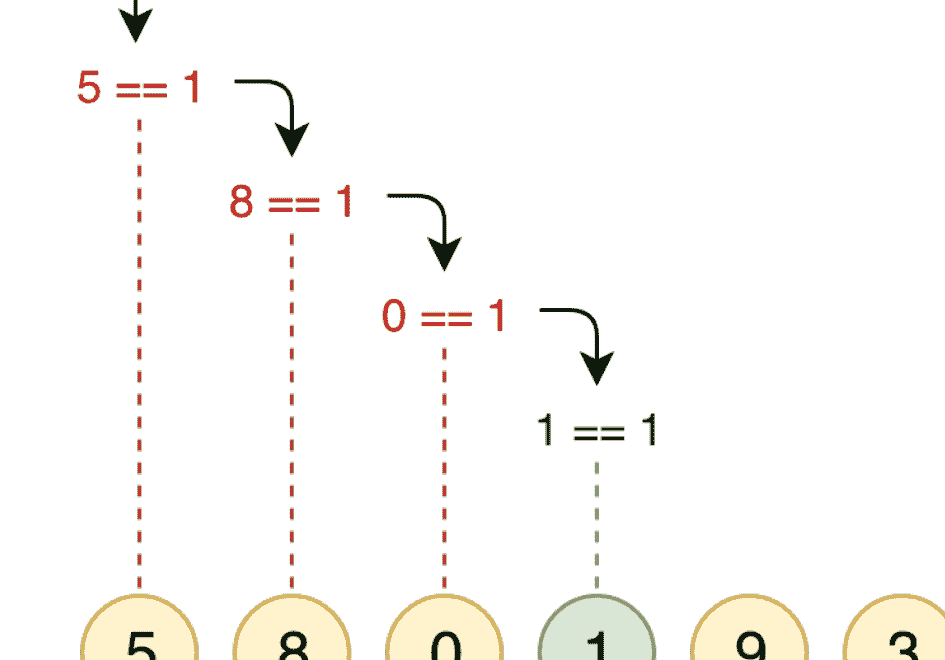

## 应用场景

如果我们需要在未排序的数组中查找一个值，线性查找算法是一个不错的选择。如果需要在同一个数组中查找多个值，那么先对数组进行预处理（例如先使用排序算法排序），然后使用其他搜索算法（如二分查找算法）会是更好的方案。

## 使用示例

假设我们要对一个包含用户列表（包含姓名和电话的对象）的通讯录数组实现线性查找。

为了让线性查找更加实用，我们将使其不仅能处理数字和字符串，还能处理对象。这个特性将使我们在搜索数组时更加灵活。

15-linear-search/example.js

```js
// Import dependencies.
import linearSearch from './linearSearch';

// Create people objects.
const tim = { name: 'Tim', phone: '+11111111112' };
const jane = { name: 'Jane', phone: '+11111111111' };
const bill = { name: 'Bill', phone: '+11111111113' };
const janeNamesake = { name: 'Jane', phone: '+11111111114' };
const peter = { name: 'Peter', phone: '+11111111115' };

// Add people to the phone book.
const phoneBook = [tim, jane, bill, janeNamesake];

// Create custom comparator function that can compare two person
// and decide whether they are equal or not.
const personComparator = (person1, person2) => {
  return person1.name === person2.name ? 0 : -1;
};

// Let's try to find Jane in the phone book using linear search.
// Notice that we have two persons with the same name Jane in the phone book and
// our comparision function takes only the person name into account so we are
// expecting to have two indices in the output.

linearSearch(phoneBook, jane, personComparator); // -> [1, 3]

// Now let's try to find Peter. He is not in the phone book so we expect an empty array.

linearSearch(phoneBook, peter, personComparator); // -> []
```

## 实现

在上面的示例中，我们使用了自定义比较函数。为了支持这种比较函数，我们需要将线性查找算法拆分为两部分。首先，我们将实现

一个通用的比较器工具类，它将提供用于对象比较的公共接口。其次，我们将继续实现 `linearSearch()` 函数本身，该函数将在内部使用比较器工具类。

## 比较器

让我们创建这个类。

```
utils/comparator/Comparator.js
export default class Comparator {

}
```

## constructor

比较器构造函数将接受 `compareFunction` 回调函数作为参数。该函数接受两个值进行比较。如果两个对象相等，它将返回 0；如果第一个对象小于第二个，则返回 -1；如果第一个对象大于第二个，则返回 1。

比较器类本身对比较逻辑一无所知。它只提供一个公共接口（我们将在下面实现的方法）来使用。

`compareFunction` 是比较器构造函数的一个可选参数。如果未提供 `compareFunction`，我们将回退到 `defaultCompareFunction()` 函数。

```
utils/comparator/Comparator.js
/**
 * @param {function(a: *, b: *)} [compareFunction] - It may be custom compare function that, let's say may compare custom objects together.
 */
constructor(compareFunction) {
  this.compare = compareFunction || Comparator.defaultCompareFunction;
}
```

## defaultCompareFunction()

这是默认的后备比较函数，它将两个参数 `a` 和 `b` 视为字符串或数字，并应用常见的比较运算符，如 `===`、`<` 和 `>`。

```
utils/comparator/Comparator.js
/**
 * Default comparison function. It just assumes that "a" and "b" are strings or numbers.
 * @param {(string|number)} a
 * @param {(string|number)} b
 * @returns {number}
 */
static defaultCompareFunction(a, b) {
  if (a === b) {
    return 0;
  }

  return a < b ? -1 : 1;
}
```

**equal()**

此函数检查两个变量是否相等。

```
utils/comparator/Comparator.js
/**
 * Checks if two variables are equal.
 * @param {*} a
 * @param {*} b
 * @return {boolean}
 */
equal(a, b) {
  return this.compare(a, b) === 0;
}
```

**lessThan()**

此函数检查变量 `a` 是否小于 `b`。

```
utils/comparator/Comparator.js
/**
 * Checks if variable "a" is less than "b".
 * @param {*} a
 * @param {*} b
 * @return {boolean}
 */
lessThan(a, b) {
  return this.compare(a, b) < 0;
}
```

## greaterThan()

此函数检查变量 `a` 是否大于 `b`。

```
utils/comparator/Comparator.js
/**
 * Checks if variable "a" is greater than "b".
 * @param {*} a
 * @param {*} b
 * @return {boolean}
 */
greaterThan(a, b) {
  return this.compare(a, b) > 0;
}
```

## lessThanOrEqual()

此函数检查变量 `a` 是否小于或等于 `b`。

```
utils/comparator/Comparator.js
/**
 * Checks if variable "a" is less than or equal to "b".
 * @param {*} a
 * @param {*} b
 * @return {boolean}
 */
lessThanOrEqual(a, b) {
  return this.lessThan(a, b) || this.equal(a, b);
}
```

## greaterThanOrEqual()

此函数检查变量 `a` 是否大于或等于 `b`。

```
utils/comparator/Comparator.js
/**
 * Checks if variable "a" is greater than or equal to "b".
 * @param {*} a
 * @param {*} b
 * @return {boolean}
 */
greaterThanOrEqual(a, b) {
  return this.greaterThan(a, b) || this.equal(a, b);
}
```

## linearSearch()

现在我们已经实现了比较器工具类，让我们来实现 `linearSearch()` 函数。

`linearSearch()` 函数将数组中的每个元素与我们要查找的元素进行比较。比较使用比较器类完成。一旦找到该元素，其位置就会记录在 `foundIndices` 数组中。

15-linear-search/linearSearch.js

```
export default function linearSearch(array, seekElement, comparatorCallback) {
  const comparator = new Comparator(comparatorCallback);
  const foundIndices = [];

  array.forEach((element, index) => {
    if (comparator.equal(element, seekElement)) {
      foundIndices.push(index);
    }
  });

  return foundIndices;
}
```

## 复杂度

# 查找. 线性查找.

| 空间 | 最坏情况性能 | 最佳情况性能 | 平均性能 |
| --- | --- | --- | --- |
| O(1) | O(n) | O(1) | O(n) |

该算法迭代地遍历列表。它不使用额外的数据结构，因此**空间复杂度**是 O(1)。

性能的**最坏情况**是当我们要查找的元素不存在于数组中时。在这种情况下，算法需要遍历所有列表元素。因此，最坏情况下的时间复杂度为 O(n)。

在**最佳情况**下，我们要查找的元素位于列表的最开头。在这种情况下，时间复杂度将是 O(1)。在我们的实现中，复杂度仍然是 O(n)，因为我们假设数组可能有重复项，并且我们希望找到所有重复项的位置（如果有的话）。

在**平均情况**下，如果我们知道找到数组中每个元素的概率相等，那么时间复杂度将是 O(n/2)。如果我们不知道找到数组中每个元素的概率是否相等，那么平均情况的时间复杂度是 O(n)。

## 问题示例

以下是一些您在面试中可能遇到的相关的题目：

- [山脉数组的峰顶索引](https://leetcode.com/problems/peak-index-in-a-mountain-array/)
- [在排序数组中查找元素的第一个和最后一个位置](https://leetcode.com/problems/find-first-and-last-position-of-element-in-sorted-array/)

## 测验

*Q1: 线性查找算法的时间复杂度是多少？*

*Q2: 对于大型列表，我们应该应用线性查找算法，这是真的吗？*

## 参考

维基百科上的线性查找 [https://en.wikipedia.org/wiki/Linear_search](https://en.wikipedia.org/wiki/Linear_search)

线性查找示例和测试用例 [https://github.com/trekhleb/javascript-algorithms/tree/master/src/algorithms/search/linear-search](https://github.com/trekhleb/javascript-algorithms/tree/master/src/algorithms/search/linear-search)

73 https://leetcode.com/problems/peak-index-in-a-mountain-array/
74 https://leetcode.com/problems/find-first-and-last-position-of-element-in-sorted-array/
75 https://en.wikipedia.org/wiki/Linear_search
76 https://github.com/trekhleb/javascript-algorithms/tree/master/src/algorithms/search/linear-search

# 查找. 二分查找.

- 难度：中等

## 任务

在 *已排序* 的数组中查找特定元素的位置。

## 算法

**二分查找**是一种在已排序数组中查找项目的高效算法。它通过执行以下步骤来工作：

1. 获取数组的中间元素（它将数组分成两半）。
2. 检查中间元素是否等于我们要查找的元素。
3. 如果中间元素等于要查找的元素，那么我们就找到了它。只需返回当前元素的索引。
4. 如果中间元素大于要查找的元素，则放弃数组的右半部分（后半部分）。我们可以这样做，因为数组是已排序的。
5. 将剩余的一半数组视为一个新数组，然后返回步骤 1。

算法最终会找到要查找元素的位置，或者如果右半部分或左半部分只包含一个不等于要查找元素的元素，则返回 `null` 或 `-1`。

请看下面的插图，它展示了在已排序数组中查找数字 8 的流程。

## 算法复杂度

### 时间复杂度

在上面的示例中，我们可以看到每次比较迭代后，我们都会放弃一半的数组。例如，在第一次比较（12 是否大于 8？）之后，我们决定向左走（放弃索引从 4 到 8 的元素）。我们这样做是因为中间元素 12 大于 8。由于数组是已排序的，不可能在数组的右半部分找到 8。我们不断重复这个过程，直到找到 8。*这就是二分查找高效的原因。它的时间复杂度是 O(log(n))，其中 n 是数组中元素的数量。*

为了说明该算法的时间复杂度是 *O(log(n))*，让我们思考一下最坏的情况，即我们要查找的元素不存在于数组中。在这种情况下，在下一个半部分只有一个元素之前，我们将数组分成两半多少次？在我们的例子中，我们有一个包含 9 个元素的数组：

```
Math.floor(9 / 2); // -> 4
Math.floor(4 / 2); // -> 2
Math.floor(2 / 2); // -> 1
```


可能的分割次数与某个 2 的幂成正比，该幂次给出了数组中元素的总数（或至少接近总数）。我们可以用以下公式来表示这个关系：

$2^x = n \rightarrow x = \log(n)$

其中 $x$ 就是我们的时间复杂度。

为了理解 $O(\log(n))$ 时间复杂度对于二分搜索来说有多高效，让我们将其与线性搜索的 $O(n)$ 时间复杂度进行比较。第谷星表包含了银河系中最明亮的 **2,539,913** 颗恒星的信息。假设我们想在该星表中按名称查找一颗恒星。在最坏情况下，线性搜索需要进行 **2,539,913** 次迭代。而对于二分搜索，在最坏情况下，如果所有恒星都按名称排序，只需 **22** 次迭代即可（$\log_2(2539913) = 21.27$）。

## 空间复杂度

算法可以通过迭代方式或递归方式（为每次递归调用分配额外内存）来实现，具体实现方式不同，空间复杂度也会有所不同。在本章中，我们将使用简单的迭代方式，不创建数组副本。因此，这种情况下空间复杂度为 $O(1)$。

## 应用

- 二分搜索用于在已排序数组中进行**快速搜索操作**。
- 二分搜索方法用于**二叉搜索树**的实现。
- 二分搜索方法可用于在提交历史中快速**定位引入 bug 的提交**。只需将提交历史从中间拆分。如果 "中间" 的提交中已经存在 bug，则向左移动到更早的提交，拆分左半部分。否则，如果该提交中没有 bug，则向右移动到更晚的提交。
- 二分搜索方法可用于在程序中快速**定位有 bug 的代码行**。只需注释掉一半代码，观察 bug 是否仍然存在。如果存在则向上移动，否则向下移动。

## 使用示例

在本章前面的内容中，我们讨论了在第谷星表中按名称搜索恒星有多快（假设星表已按名称排序）。相比于线性的 **2,539,913** 次迭代，二分搜索只需 **22** 次迭代即可找到目标恒星。

假设我们已经在脚本中拥有了这个已排序的星表，下面来看看如何应用二分搜索。

搜索。二分搜索。

15-binary-search/example.js

```
// Import dependencies.
import binarySearch from './binarySearch';

// Let's create a really simple and small demo version of our sorted stars catalog.
const sortedArrayOfStars = [
  { name: 'Alpha Centauri A', position: {} },
  { name: 'Alpha Centauri B', position: {} },
  { name: 'Betelgeuse', position: {} },
  { name: 'Polaris', position: {} },
  { name: 'Rigel', position: {} },
  { name: 'Sirius', position: {} },
  // And 2.5 millions more records here :)
];

// Our custom object comparator for binary search function.
// We will use string comparison here. For example 'Polaris' is smaller than 'Rigel'.
const comparator = (star1, star2) => {
  if (star1.name === star2.name) return 0;
  return star1.name < star2.name ? -1 : 1;
};

// Now let's search for the stars.
binarySearch(sortedArrayOfStars, { name: 'Not Existing Name' }, comparator); // -> -1
binarySearch(sortedArrayOfStars, { name: 'Alpha Centauri A' }, comparator); // -> 0
binarySearch(sortedArrayOfStars, { name: 'Alpha Centauri B' }, comparator); // -> 1
binarySearch(sortedArrayOfStars, { name: 'Polaris' }, comparator); // -> 3
```

## 实现

在上面的示例中，我们使用了自定义比较函数来对星体对象进行比较。为此，我们将复用在*线性搜索*章节中已经实现的 Comparator 工具类。请参阅*线性搜索*章节以获取 Comparator 类实现的详细信息。这是一个非常简单的类，为对象比较提供了通用接口。

首先让我们导入依赖。

```
16-binary-search/binarySearch.js

// Import dependencies.
import Comparator from '../utils/comparator/Comparator';
```

现在我们可以开始实现二分搜索函数了。

```
16-binary-search/binarySearch.js

/**
 * Binary search implementation.
 *
 * @param {*[]} sortedArray
 * @param {*} seekElement
 * @param {function(a, b)} [comparatorCallback]
 * @return {number}
 */
export default function binarySearch(sortedArray, seekElement, comparatorCallback) {
  // Let's create comparator from the comparatorCallback function.
  // Comparator object will give us common comparison methods like equal() and lessThan().
  const comparator = new Comparator(comparatorCallback);

  // These two indices will contain current array (sub-array) boundaries.
  let startIndex = 0;
  let endIndex = sortedArray.length - 1;

  // Let's continue to split array until boundaries are collapsed
  // and there is nothing to split anymore.
  while (startIndex <= endIndex) {
    // Let's calculate the index of the middle element.
    const middleIndex = startIndex + Math.floor((endIndex - startIndex) / 2);

    // If we've found the element just return its position.
    if (comparator.equal(sortedArray[middleIndex], seekElement)) {
      return middleIndex;
    }

    // Decide which half to choose for seeking next: left or right one.
    if (comparator.lessThan(sortedArray[middleIndex], seekElement)) {
      // Go to the right half of the array.
      startIndex = middleIndex + 1;
    } else {
      // Go to the left half of the array.
      endIndex = middleIndex - 1;
    }
  }

  // Return -1 if we have not found anything.
  return -1;
}
```

## 题目示例

以下是一些二分搜索相关的面试题目：

- 搜索插入位置<sup>77</sup>
- 两数相除<sup>78</sup>
- 搜索旋转排序数组<sup>79</sup>

## 小测验

*Q1：二分搜索能否应用于未排序的数组？*
*Q2：二分搜索算法的时间复杂度是多少？*

## 参考资料

二分搜索 - 维基百科 [https://en.wikipedia.org/wiki/Binary_search_algorithm](https://en.wikipedia.org/wiki/Binary_search_algorithm)<sup>80</sup>
二分搜索 - YouTube [https://www.youtube.com/watch?v=P3YID7liBug](https://www.youtube.com/watch?v=P3YID7liBug)<sup>81</sup>
二分搜索示例与测试用例 [https://github.com/trekhleb/javascript-algorithms/tree/master/src/algorithms/search/binary-search](https://github.com/trekhleb/javascript-algorithms/tree/master/src/algorithms/search/binary-search)<sup>82</sup>

<sup>77</sup>https://leetcode.com/problems/search-insert-position/
<sup>78</sup>https://leetcode.com/problems/divide-two-integers/
<sup>79</sup>https://leetcode.com/problems/search-in-rotated-sorted-array/
<sup>80</sup>https://en.wikipedia.org/wiki/Binary_search_algorithm
<sup>81</sup>https://www.youtube.com/watch?v=P3YID7liBug
<sup>82</sup>https://github.com/trekhleb/javascript-algorithms/tree/master/src/algorithms/search/binary-search

## 集合。笛卡尔积。

- 难度：简单

### 集合

笛卡尔积算法使用集合来计算多个元素的集合。在使用集合时，有一些基本术语需要先了解。

在数学中，**集合**是一组互不相同的对象的全体，被视为一个独立的对象。例如数字 2、1、0 和 14 可以组成一个数字集合 {2, 1, 0, 14}。字符串 'apple'、'banana' 和 'grape' 可以组成一个字符串/水果集合 {'apple', 'banana', 'grape'}。在 JavaScript 中，我们可以使用数组来创建集合。

```
const setOfNumbers = [2, 1, 0, 14];
const setOfStrings = ['apple', 'banana', 'grape'];
```

构成集合的对象称为集合的**元素**。

### 笛卡尔积

**笛卡尔积**是一种数学运算，它从多个集合返回一个集合（也称为**积集**或**乘积**）。对于两个集合 A 和 B，积集 A×B 将包含所有可能的有序对 (a, b)，其中 a 是集合 A 的元素，b 是集合 B 的元素。

例如，两个集合 A = {x, y, z} 和 B = {1, 2, 3} 的笛卡尔积为以下集合：

{(x, 1), (x, 2), (x, 3), (y, 1), (y, 2), (y, 3), (z, 1), (z, 2), (z, 3)}

下图展示了两个集合的笛卡尔积的形成过程示例：


两个集合 A 和 B 的**笛卡尔积（即乘积集）** A×B 的元素数量可以计算为集合 A 和集合 B 长度的乘积，即 |A|×|B|。在上面的例子中，我们有两个长度为 3 的集合。这些集合的乘积包含 3 * 3 = 9 个元素。

我们也可以创建超过两个集合的笛卡尔积。例如，我们有一组毛衣颜色 COLORS = {蓝色, 红色, 黄色}，一组领口款式 NECK_FORMS = {圆领, V领, polo领}，以及一组尺码 SIZE = {XS, S, M, L, XL, XXL}，那么这三个集合的笛卡尔积将是 {(蓝色,圆领,XS), (蓝色,圆领,S), (蓝色,圆领,M), ..., (黄色,polo领,XXL)}。

## 应用

**一副扑克牌**是笛卡尔积应用于牌面点数集合 {A, K, Q, J, 10, 9, 8, 7, 6, 5, 4, 3, 2} 和牌花色集合 {♠, ♥, ♦, ♣} 的一个例子。这两个集合的乘积构成了标准的52张牌一副的牌组 {(A,♠), (A,♥), (A,♦), ..., (2,♣)}。

**一个二维坐标系**也是两个集合 ℝ×ℝ 的乘积集，其中 ℝ 表示实数集。

一般来说，笛卡尔积可用于**生成不同实体的所有可能对（子集）**。我们可以想象为汽车价目表生成 (*型号*, *颜色*) 属性对，或者为毛衣目录生成 (*领口款式*, *尺码*, *颜色*) 子集，等等。

## 使用示例

让我们使用我们的 `cartesianProduct()` 函数来生成一副扑克牌。

```
// 导入依赖。
import cartesianProduct from './cartesianProduct';

// 初始化牌面点数和花色集合。
const cardRanks = ['A', 'K', 'Q', 'J', '10', '9', '8', '7', '6', '5', '4', '3', '2'];
const cardSuits = ['♦', '♥', '♠', '♣'];

// 生成一副扑克牌。
const cardDeck = cartesianProduct(cardRanks, cardSuits);

// 检查牌组。
// eslint-disable-next-line no-console
console.log(cardDeck); // -> [['A', '♦'], ['A', '♥'], ..., ['2', '♣']]
```

## 实现

为了实现 `cartesianProduct()` 函数，我们首先需要检查输入。如果输入不正确且某些输入集合为空，则函数将返回 `null`。然后，我们通过使用两个嵌套的 for 循环，从两个输入集合 setA 和 setB 中生成所有元素对。

```
/**
 * 生成两个集合的笛卡尔积。
 * @param {*[]} setA
 * @param {*[]} setB
 * @return {*[]}
 */
export default function cartesianProduct(setA, setB) {
  // 检查输入集合是否非空。
  // 否则返回 null，因为我们无法从中生成笛卡尔积。
  if (!setA || !setB || !setA.length || !setB.length) {
    return null;
  }

  // 初始化乘积集。
  const product = [];

  // 现在，让我们遍历第一个和第二个集合的所有元素，并形成所有可能的对。
  for (let indexA = 0; indexA < setA.length; indexA += 1) {
    for (let indexB = 0; indexB < setB.length; indexB += 1) {
      // 将当前乘积对添加到乘积集。
      product.push([setA[indexA], setB[indexB]]);
    }
  }

  // 返回笛卡尔积集。
  return product;
}
```

## 复杂度

如果我们生成两个集合 A 和 B 的乘积集，那么两个嵌套的 for 循环将给我们 |A| * |B| 次循环，其中 |A| 是集合 A 中的元素数量，|B| 是集合 |B| 中的元素数量。因此，**时间复杂度**为 O(|A| * |B|)。

**额外的空间复杂度**也是 O(|A| * |B|)，因为我们分配了一个新数组来存放所有笛卡尔积元素。

## 问题示例

以下是您在面试中可能遇到的一些相关问题：

- [电话号码的字母组合](https://leetcode.com/problems/letter-combinations-of-a-phone-number/)
- [子集 II](https://leetcode.com/problems/subsets-ii/)

## 测验

> 问题1：两个集合 A = ['a', 'b'] 和 B = ['c', 'd'] 的笛卡尔积有多少个元素？

问题2：是否可以生成四个集合的笛卡尔积？

问题3：笛卡尔积算法的时间复杂度是什么？

## 参考资料

维基百科上的笛卡尔积 [https://en.wikipedia.org/wiki/Cartesian_product](https://en.wikipedia.org/wiki/Cartesian_product)^85

笛卡尔积示例和测试用例 [https://github.com/trekhleb/javascript-algorithms/tree/master/src/algorithms/sets/cartesian-product](https://github.com/trekhleb/javascript-algorithms/tree/master/src/algorithms/sets/cartesian-product)^86

> ^85https://en.wikipedia.org/wiki/Cartesian_product
> ^86https://github.com/trekhleb/javascript-algorithms/tree/master/src/algorithms/sets/cartesian-product

## 集合. 幂集.

- 难度：中等

在数学中，一个集合 S 的**幂集**是 S 的所有子集的集合，包括空集和集合 S 本身。集合 S 的幂集表示为 P(S)。子集中元素的顺序无关紧要，这意味着集合 {a, b} 与 {b, a} 相同。

例如，对于一个集合 {a, b, c}：

- 空集是 {}（也可以表示为 ∅ 或 *空集*），
- 单元素子集是：{a}、{b} 和 {c}，
- 双元素子集是：{a, b}、{a, c} 和 {b, c}，
- 原始集合 {a, b, c} 也被计为一个子集。

总结所有，我们可以说集合 {a, b, c} 的幂集是以下集合：

```
P({a, b, c}) = {
    {},
    {a}, {b}, {c},
    {a, b}, {a, c}, {b, c},
    {a, b, c}
}
```

下图以图形方式说明了生成集合 {x, y, z} 幂集的过程。

## 子集总数

对于有 n 个成员的集合 S，其幂集 P(S) 中的子集总数记为_TLV(S)|，等于 |P(S)| = 2^n。

例如，假设我们有一个集合 S = {a, b, c}，有 3 个成员，那么子集总数是 2^3 = 8。

为什么幂集的成员数是 2 的幂次？*幂集本质上是二元的。* 让我们列出 8 个二进制数的表格。在这种情况下，每个二进制数将由三位组成，每位对应集合 S 中的一个元素。如果位设置为 1，则该元素包含在子集中。如果位设置为 0，则该元素不在子集中。请看下面的图片和表格，以获得对这个概念的直观理解。

| 数字 | abc | 子集 |
|---|---|---|
| 0 | 000 | {} |
| 1 | 001 | {c} |
| 2 | 010 | {b} |
| 3 | 011 | {b, c} |
| 4 | 100 | {a} |
| 5 | 101 | {a, c} |
| 6 | 110 | {a, b} |
| 7 | 111 | {a, b, c} |

因此，从 0 到 2^n 的位组合描述了幂集的所有可能子集。因此，每个幂集总共有 2^n 个子集，其中 n 是原始集合中的元素数量。

## 使用示例

在我们进入幂集算法实现之前，让我们假设我们已经有一个 `bwPowerSet()` 函数，并使用它来生成水果沙拉的所有可能配料组合。这将帮助我们理解该函数需要什么类型的输入和输出。

```
// 导入依赖。
import bwPowerSet from './bwPowerSet';

// 设置配料。
const ingredients = ['香蕉', '橙子', '苹果'];

// 从我们的配料中生成所有可能的沙拉组合。
const saladMixes = bwPowerSet(ingredients);

// eslint-disable-next-line no-console
console.log(saladMixes);

/*
  输出将是：

  [
    [],
    ['香蕉'],
    ['橙子'],
    ['香蕉', '橙子'],
    ['苹果'],
    ['香蕉', '苹果'],
    ['橙子', '苹果'],
    ['香蕉', '橙子', '苹果'],
  ]
*/
```

## 实现

我们将使用两种方法实现幂集生成器：我们上面讨论过的位运算方法，以及将在下一节描述的回溯方法。

## 位运算方法

在位运算方法中，我们将利用这样一个事实：数字最多到 2^n（其中 n 是集合的大小）的二进制表示将作为原始集合的位掩码，从而生成子集。

请看下面的实现：


# 幂集

## 位运算法

我们的函数只接受一个参数：`originalSet`，它是一个数组。然后创建一个 `subSets` 数组，用于保存幂集的所有生成子集。
以下代码计算组合数。该数字同时也是我们用作位掩码的数值范围中的最大值。要将数字提升到幂次，我们使用 `**` 运算符。

```js
const numberOfCombinations = 2 ** originalSet.length;
```

第一个 `for` 循环遍历范围 `[0, numberOfCombinations]` 中的每个数字。每次迭代中，它会创建一个新的幂集 `subSet` 数组，用于保存与当前 `combinationIndex` 对应的当前子集的所有元素。
在内部 `for` 循环中，我们遍历原始集合的元素，以确定是否需要包含每个特定元素。这通过检查 `combinationIndex` 中相应位来决定。
如果 `setElementIndex` 位置的位被置位，则需要将索引为 `setElementIndex` 的元素添加到 `subSet` 中。否则，忽略它。
位检查通过以下代码实现：

```js
if (combinationIndex & (1 << setElementIndex)) {
  // Add the element to the subset.
}
```

这里我们将 1 向左移动 `setElementIndex` 位（即如果 `setElementIndex` 是 4，则 `0b1 << 4` 会得到 `0b10000`）。然后执行逻辑 *与* 运算，检查 `combinationIndex` 中相应位是否被置位（即如果 `combinationIndex` 是 `0b0100`，执行 `0b0100 & 0b1000` 结果为 0，说明 `combinationIndex` 的第 4<sup>th</sup> 位未被置位）。

```js
/**
 * 使用位运算求集合的幂集。
 *
 * @param {*[]} originalSet
 * @return {*[][]}
 */
export default function bwPowerSet(originalSet) {
  const subSets = [];

  // 我们将有 2^n 种可能的组合（其中 n 是原始集合的长度）。
  // 这是因为对于原始集合的每个元素，我们都要决定是否将其包含在内
  //（每个集合元素有 2 种选择）。
  const numberOfCombinations = 2 ** originalSet.length;

  // 从 0 到 2^n 范围内的每个数字的二进制表示恰好实现了我们需要的功能：
  // 它通过其位（0 或 1）来显示是否包含集合中的相关元素。
  // 例如，对于集合 {1, 2, 3}，二进制数 0b010 表示我们需要将
  // 仅 "2" 包含到当前集合中。
  for (let combinationIndex = 0; combinationIndex < numberOfCombinations; combinationIndex += 1) {
    const subSet = [];

    for (let setElementIndex = 0; setElementIndex < originalSet.length; setElementIndex += 1) {
      // 决定是否需要将当前元素包含到子集中。
      if (combinationIndex & (1 << setElementIndex)) {
        subSet.push(originalSet[setElementIndex]);
      }
    }

    // 将当前子集添加到所有子集的列表中。
    subSets.push(subSet);
  }

  return subSets;
}
```

## 回溯法

在*回溯法*中，我们尝试生成所有可能的解，但每次生成下一个解时，我们会测试它是否满足所有条件（或尝试使其满足所有条件），然后才继续生成后续解。否则，回退并走上一条不同的求解路径。
在我们的示例中，每次迭代时我们都会添加一个有效的元素。有效性在我们的场景中由一个规则定义：子集中不允许出现重复元素。因此，在每次迭代中，我们可以添加原始集合中除了已添加元素之外的任何元素。
这种方法可以用以下*决策树*来说明。

决策树帮助我们决定在此特定时刻可以包含哪些元素。如果没有可选项，让我们回退一步（回溯），尝试另一个有效选项。
那么，例如，让我们以*深度优先*的方式追踪决策树：

1. 在树的顶部，我们只有一个选项，即"添加空集"。我们现在可以将空集 {} 记录为一个"幂集"子集，然后继续尝试向空集添加更多元素。
2. 下一个可以添加到当前子集的有效元素是 a。因此将子集 {a} 记录为一个有效的"幂集"子集，然后继续尝试向 {a} 添加新元素。
3. 此时我们可以添加 b，因为它尚未被添加到当前子集中。将子集 {a, b} 记录为一个有效的"幂集"子集，然后继续尝试向 {a, b} 添加更多有效元素。
4. 现在可以添加 c，因为它尚未被添加过。将 {a, b, c} 记录为一个有效子集，然后继续。
5. 此时我们没有其他元素可以添加到 {a, b, c} 中，否则会出现重复。现在回溯！移除最后添加的元素（在决策树中向上一步）。当前子集变为 {a, b}。
6. 此时我们仍然没有其他元素可以添加，因为 c 元素之前已经添加过了。再次回溯！在决策树中向上一步。当前子集现在是 {a}。
7. 此时 b 元素已经在步骤 3 中添加过了，所以我们现在不能添加它。但我们可以添加 c。因此我们可以将当前子集 {a, c} 记录为一个有效的"幂集"子集。
8. 依此类推...

现在让我们尝试用代码实现这种方法：

```js
/**
 * 使用回溯法求集合的幂集。
 *
 * @param {*[]} originalSet - 我们要生成幂集的原始元素集合。
 * @param {*[][]} allSubsets - 迄今为止已形成的所有子集（默认包含
 * 空子集）。
 * @param {*[]} currentSubSet - 当前正在形成的子集。
 * @param {number} startAt - 我们开始形成当前子集的原始集合中的位置。
 * @return {*[][]} - 原始集合的所有子集。
 */
export default function btPowerSet(
  originalSet,
  allSubsets = [[]],
  currentSubSet = [],
  startAt = 0,
) {
  // 让我们遍历可以添加到子集中的 originalSet 元素，
  // 而不会产生重复。startAt 的值用于防止添加重复元素。
  for (let position = startAt; position < originalSet.length; position += 1) {
    // 将当前元素推入子集
    currentSubSet.push(originalSet[position]);

    // 当前子集已经有效，让我们记录它。
    // 我们在这里使用数组解构来保存 currentSubSet 的克隆。
    // 我们需要保存克隆，因为原始的 currentSubSet 将在
    // 后续的递归调用中被修改。
    allSubsets.push([...currentSubSet]);

    // 让我们尝试为当前子集生成所有其他子集。
    // 将位置加一以避免子集中出现重复。
    btPowerSet(originalSet, allSubsets, currentSubSet, position + 1);

    // 回溯。从子集中移除最后一个元素，并尝试下一个有效元素。
    currentSubSet.pop();
  }

  // 返回集合的所有子集。
  return allSubsets;
}
```

## 复杂度分析

### 位运算法

在位运算法中，我们遍历 $2^n$ 个数字，对于每个数字，我们遍历大小为 $n$ 的原始集合以决定当前子集中包含哪些元素。因此该方法的**时间复杂度**为 $O(n * 2^n)$，其中 $n$ 是原始集合中的元素数量。

### 回溯法

在回溯法中，我们遍历一个具有 $2^n$ 个节点的决策树。因此该方法的**时间复杂度**为 $O(2^n)$，其中 $n$ 是原始集合中的元素数量。

## 相关问题示例

以下是面试中可能遇到的一些相关问题：

- [子集](https://leetcode.com/problems/subsets/)
- [子集 II](https://leetcode.com/problems/subsets-ii/description/)

## 小测

*问题一：空集是幂集的一部分吗？*

*问题二：集合 {a, b, c, d} 的幂集有多少个元素？*


 ## 参考资料

维基百科上的幂集 [https://en.wikipedia.org/wiki/Power_set](https://en.wikipedia.org/wiki/Power_set)<sup>89</sup>

"Math is Fun" 上的幂集 [https://www.mathsisfun.com/sets/power-set.html](https://www.mathsisfun.com/sets/power-set.html)<sup>90</sup>

幂集示例与测试用例 [https://github.com/trekhleb/javascript-algorithms/tree/master/src/algorithms/sets/power-set](https://github.com/trekhleb/javascript-algorithms/tree/master/src/algorithms/sets/power-set)<sup>91</sup>

<sup>89</sup>https://en.wikipedia.org/wiki/Power_set
<sup>90</sup>https://www.mathsisfun.com/sets/power-set.html
<sup>91</sup>https://github.com/trekhleb/javascript-algorithms/tree/master/src/algorithms/sets/power-set

## 集合与排列

- 难度：中等

假设我们有一个**集合**或**整体**（数字、字母、水果、硬币等的集合），我们需要从这个集合中**挑选元素**来组成另一个集合。例如，想象你在选彩票号码，从可用数字集合 {0, 1, 2, 3, 4, 5, 6, 7, 8, 9} 中选出 {4, 5, 9}。或者你在从可用水果集合 {orange, apple, banana, grape} 中挑选水果来做水果沙拉，选出了 {apple, banana}。又或者你在尝试猜锁的密码，从集合 {0, 1, 2, 3, 4, 5, 6, 7, 8, 9} 中选择 3 个数字，通过组成子集如 {1, 1, 2}、{1, 1, 3}、{1, 1, 4}、... 来猜测正确密码。在所有这些情况中，你都是按照某种规则从一个集合中创建出另一个集合。而这些规则决定了你的新集合是**排列**还是**组合**。

如果新集合中元素的**顺序很重要**，那么你处理的就是**排列**。在锁密码的例子中，集合 {1, 1, 2} 与集合 {2, 1, 1} 是不同的。如果顺序不重要，那么你做的就是**组合**。例如，在组合水果 {apple, banana} 来做沙拉时，先挑苹果还是先挑香蕉并不重要。

> **排列**是将集合的所有成员排列成某种序列或顺序，或者如果集合已经是有序的，则重新排列（重排）其元素。

你的新**集合可能包含也可能不包含重复项**。例如在锁密码中，你被允许使用重复数字，但当你处理赛跑获胜者集合 {Black, Smith, Brown} 时，你不能有重复，因为同一个人同时出现在两个名次上是没有意义的。

在本章中，我们将专注于实现排列。在下一章中，我们将讨论组合。

## 含重复的排列

让我们用一个简单的例子来组成集合 S = {A, B} *含*重复的所有排列。当我们说重复时，我们指的是同一个字母可以出现在不同的位置。在这种情况下，排列大小为 2 的排列集合 P 如下所示：

```
S = {A, B}

P = {
    {A, A},
    {A, B},
    {B, A},
    {B, B},
}
```

让我们将这个例子推广，并计算 P 中子集的数量。假设我们有一个大小为 n 的原始集合 S，我们需要为它生成所有可能的含重复排列（集合 P），大小为 r。那么集合 P 将由长度为 r 的子集组成。*对于 P 中子集的每个位置，我们都有 n 个可能元素的选项。*在上面的例子中，对于每个排列位置，我们从两个可能的元素 A 和 B 中选择。这意味着排列中第一个位置有 n 个选项，第二个位置同样有 n 个选项，以此类推直到第 r<sup>个</sup>位置：

$P(n, r) = n \times n \times \dots \times n = n^{r}$

在上面的例子中，$n = 2$ 且 $r = 2$，所以我们有 4 个排列。

## 不含重复的排列

让我们再举一个简单的例子，组成集合 $S = \{A, B, C\}$ *不*含重复的所有排列。这意味着同一个字母不能出现在多个位置。每个位置必须使用一个唯一的字母。在这种情况下，排列大小为 3 的排列集合 $P$ 如下所示：

$S = \{A, B, C\}$

$P = \{$
$\quad \{A, B, C\},$
$\quad \{A, C, B\},$
$\quad \{B, A, C\},$
$\quad \{B, C, A\},$
$\quad \{C, A, B\},$
$\quad \{C, B, A\},$
$\}$

我们也将这个例子进行推广，计算 $P$ 中子集的数量。假设我们有一个大小为 $n$ 的原始集合 $S$，我们需要为它生成所有可能的不含重复排列（集合 $P$），大小为 $r$。那么集合 $P$ 将由长度为 $r$ 的子集组成。*对于 $P$ 中子集的每个位置，我们都需要减少可能元素的数量。*在上面的例子中（$n = 3$ 且 $r = 3$），对于第一个排列位置，我们从三个可能的元素 $A$、$B$ 和 $C$ 中选择。但对于第二个位置，我们只能从第一个位置未使用的剩余元素中选择：

$3 \times 2 \times 1 = 6$

换句话说，当 $n$ 和 $r$ 相等时，排列数可以按如下方式计算：
$(n) \times (n - 1) \times (n - 2) \times \dots \times 1$

这实际上就是 *n 的阶乘* 的公式！让我们反转乘法顺序，使这个等式看起来更传统和更容易辨认：
$1 \times 2 \times 3 \times \dots \times (n - 1) \times (n) = n!$

在上面的例子中，$n = 3$，所以 $3! = 6$，我们有 6 个可能的不含重复排列。

但如果 $r$ 小于 $n$ 呢？假设我们有一个包含 20 个元素的集合，需要从中生成大小为 3 的排列。在这种情况下，我们将有 $20 \times 19 \times 18 = 6840$ 个排列。为了推广这个计算，我们可以在第一个阶乘公式上运用一个技巧。

```
20 × 19 × 18 × 17 × 16 × ...
--------------------------- = 20 × 19 × 18
         17 × 16 × ...
```

这个计算的公式如下：

## $P(n, r) = \frac{n!}{(n - r)!}$

如果 $n = 20$ 且 $r = 3$，那么 $20! / (20 - 3)! = 20! / 17! = 6840$，正如我们上面计算的 $20 \times 19 \times 18 = 6840$。如果 $n$ 和 $r$ 相等，那么公式回归为 $n! / 0! = n! / 1 = n!$。

### 应用

排列和组合在解决与**概率**相关的问题时非常有用。由于我们可以为特定情况生成所有可能的选项（或至少计算可能选项的数量），我们也可以推断每个选项出现的概率。这可能是一些简单的场景，比如预测彩票中奖的概率，但也可以延伸到更科学的领域。

**在计算机科学中**，排列用于分析排序算法；**在量子物理学中**，用于描述粒子的状态；**在生物学中**，用于描述 RNA 序列。

### 使用示例

在继续排列实现之前，让我们假设我们已经有了 `permutateWithoutRepetitions()` 和 `permutateWithRepetitions()` 函数的实现，尝试使用一下。通过使用 `permutateWithRepetitions()`，我们将尝试生成锁的所有可能密码。通过使用 `permutateWithoutRepetitions()`，我们将尝试生成三名选手比赛所有可能的结果（假设数组中*第 0<sup>个</sup>*位置表示该选手获得第一名）。

*19-permutations/example.js*

```
// 导入依赖。
import permutateWithoutRepetitions from './permutateWithoutRepetitions';
import permutateWithRepetitions from './permutateWithRepetitions';

// 含重复排列示例。
// 让我们使用含重复排列来生成所有可能的密码组合。
const possiblePasswordSymbols = ['A', 'B', 'C'];
const passwordLength = 3;
```

```
const allPossiblePasswords = permutateWithRepetitions(possiblePasswordSymbols, passwordLength);

// eslint-disable-next-line no-console
console.log(allPossiblePasswords);
/*
输出结果为：
[
  ['A', 'A', 'A'],
  ['A', 'A', 'B'],
  ['A', 'A', 'C'],
  ['A', 'B', 'A'],
  ['A', 'B', 'B'],
  ['A', 'B', 'C'],
  ['A', 'C', 'A'],
  ['A', 'C', 'B'],
  ['A', 'C', 'C'],
  ['B', 'A', 'A'],
  ['B', 'A', 'B'],
  ['B', 'A', 'C'],
  ['B', 'B', 'A'],
  ['B', 'B', 'B'],
  ['B', 'B', 'C'],
  ['B', 'C', 'A'],
  ['B', 'C', 'B'],
  ['B', 'C', 'C'],
  ['C', 'A', 'A'],
  ['C', 'A', 'B'],
  ['C', 'A', 'C'],
  ['C', 'B', 'A'],
  ['C', 'B', 'B'],
  ['C', 'B', 'C'],
  ['C', 'C', 'A'],
  ['C', 'C', 'B'],
  ['C', 'C', 'C'],
]
*/
```

```
// 不含重复排列示例。
// 现在让我们为三名选手生成所有可能的比赛结果。
const racers = ['John', 'Bill', 'Jane'];
const racingResults = permutateWithoutRepetitions(racers);
```


console.log(racingResults);
/*
  The output will be:
  [
    ['John', 'Bill', 'Jane'],
    ['Bill', 'John', 'Jane'],
    ['Bill', 'Jane', 'John'],
    ['John', 'Jane', 'Bill'],
    ['Jane', 'John', 'Bill'],
    ['Jane', 'Bill', 'John'],
  ]
*/

## 实现

## 可重复排列

我们将递归地解决这个问题。例如，如果我们需要为集合 {A, B, C} 找出所有大小为 3 的可重复排列，我们执行以下步骤：

-   记住集合的第一个元素 A，
-   为集合 S = {A, B, C} 找出所有大小为 r = 1 的排列，
-   将 A 与上一步中所有更小的排列拼接起来，
-   记住集合的第二个元素 B，
-   为集合 S = {A, B, C} 找出所有大小为 r = 1 的排列，
-   将 B 与上一步中所有更小的排列拼接起来，
-   以此类推……

对于大小为 1 的排列，每个元素都是一个排列。因此对于集合 {A, B, C}，大小为 1 的排列将是 {A}、{B} 和 {C}。这将作为我们递归函数的基准情况。

## 集合。排列。

请查看下面该算法的 JavaScript 实现。

**19-permutations/permutateWithRepetitions.js**

```javascript
/**
 * @param {*[]} permutationOptions
 * @param {number} permutationLength
 * @return {*[]}
 */
export default function permutateWithRepetitions(
  permutationOptions,
  permutationLength = permutationOptions.length,
) {
  // If permutation length is equal to 1 than every element of the permutationOptions
  // is a permutation subset.
  if (permutationLength === 1) {
    return permutationOptions.map(permutationOption => [permutationOption]);
  }

  // Init permutations array.
  const permutations = [];

  // Get permutations of smaller size that made of all permutation options.
  const smallerPermutations = permutateWithRepetitions(
    permutationOptions,
    permutationLength - 1,
  );

  // Recursively go through all options and join it to the smaller permutations.
  permutationOptions.forEach((currentOption) => {
    // Concatenate current options to smaller permutations.
    smallerPermutations.forEach((smallerPermutation) => {
      permutations.push([currentOption].concat(smallerPermutation));
    });
  });

  // Return permutations.
  return permutations;
}
```

我们使用 `concat()` 函数将两个数组连接在一起。

## 不可重复排列

我们将递归地解决这个问题。这意味着我们用更小规模的排列来生成更大规模的排列。例如，如果我们需要为集合 `S = {A, B, C, D}` 生成所有大小为 `r = 3` 的不可重复排列，我们执行以下步骤：

-   从集合中提取第一个元素 A，
-   为集合 `S = {B, C, D}` 找出所有大小为 `r = 2` 的排列，
-   将 A 与上一步中所有更小的排列拼接起来，
-   从集合中提取第二个元素 B，
-   为集合 `S = {C, D}` 找出所有大小为 `r = 2` 的排列，
-   将 B 与上一步中所有更小的排列拼接起来，
-   以此类推……

如果我们继续递归地应用这种逻辑，在每次迭代中排除一个元素，并用剩余元素集合来形成排列，我们最终会生成只有一个元素的排列。一个元素的排列就是该元素本身。这将是我们递归的基准情况，因为我们需要进一步的递归调用来计算排列。

### {A, B, C} 的大小为 3 的排列

### {B, C} 的大小为 2 的排列

### {C} 的大小为 1 的排列

请查看下面该算法的 JavaScript 实现。

**19-permutations/permuteWithoutRepetitions.js**

```javascript
/**
 * @param {*[]} permutationOptions
 * @return {*[]}
 */
export default function permuteWithoutRepetitions(permutationOptions) {
  // If we have only one element to permute then this element is already a permutation of itself.
  if (permutationOptions.length === 1) {
    return [permutationOptions];
  }

  // Init permutations array.
  const permutations = [];

  // Get all permutations for permutationOptions excluding the first element.
  // By doing this we're excluding the first element from all further smaller permutations.
  const smallerPermutations = permuteWithoutRepetitions(permutationOptions.slice(1));

  // Insert first option into every possible position of every smaller permutation.
  const firstOption = permutationOptions[0];
  for (let permIndex = 0; permIndex < smallerPermutations.length; permIndex += 1) {
    const smallerPermutation = smallerPermutations[permIndex];

    // Insert first option into every possible position of smallerPermutation.
    for (let positionIndex = 0; positionIndex <= smallerPermutation.length被列入黑名单; positionIndex += 1) {
      const permutationPrefix = smallerPermutation.slice(0, positionIndex);
      const permutationSuffix = smallerPermutation.slice(positionIndex);
      permutations.push(permutationPrefix.concat([firstOption], permutationSuffix));
    }
  }

  // Return all permutations.
  return permutations;
}
```

我们使用 `concat()` 函数将两个数组连接在一起。

## 问题示例

以下是一些你在面试中可能遇到的相关问题：

-   [克隆图](https://leetcode.com/problems/clone-graph/)
-   [判断二分图](https://leetcode.com/problems/is-graph-bipartite/)
-   [岛屿数量](https://leetcode.com/problems/number-of-islands/)

## 测验

Q1: 排列集合时，元素的顺序重要吗？

Q2: 如果我们需要从一个大小为 4 的集合中生成所有大小为 2 的不可重复排列，总共有多少个排列？

## 参考资料

维基百科上的排列 [https://en.wikipedia.org/wiki/Permutation](https://en.wikipedia.org/wiki/Permutation)

"Math is Fun" 上的排列 [https://www.mathsisfun.com/combinatorics/combinations-permutations.html](https://www.mathsisfun.com/combinatorics/combinations-permutations.html)

Medium 上的排列 [https://medium.com/@trekhleb/permutations-combinations-algorithms-cheat-sheet-68c14879aba5](https://medium.com/@trekhleb/permutations-combinations-algorithms-cheat-sheet-68c14879aba5)

排列示例和测试用例 [https://github.com/trekhleb/javascript-algorithms/tree/master/src/algorithms/sets/permutations](https://github.com/trekhleb/javascript-algorithms/tree/master/src/algorithms/sets/permutations)

## 集合。组合。

-   *难度：中等*

在数学中，**组合**是从集合中选取项目的一种方式，其中（与排列不同）*选取的顺序不重要*。更正式地说，一个大小为 n 的集合 S 的 **r-组合** 是 S 的 r 个不同元素的子集。

例如，假设我们有 5 名（*n = 5*）Web 开发人员 `{Bill, John, Kate, Mike, Julia}`。当你需要从 5 人中选出 3 人（*r = 3*）来参与新项目时，你选择的顺序并不重要。唯一重要的是该开发人员是否被选中。结果你可能得到组合 `{John, Kate, Julia}`，这实际上与 `{Kate, John, Julia}` 相同，因为顺序不重要。这是 **不可重复组合** 的一个例子，因为你不能两次选择同一位开发人员（集合 `{Bill, Bill}` 是不可能的，也没有意义）。

组合的另一个例子是你从口袋里的硬币中生成的找零组合。假设你有一组硬币 `{1, 1, 5, 5, 5, 10, 10, 10}`，你需要找零 27。你有 3 种不同的元素 `{1, 5, 10}`（*n = 3*），并且你可以多次选择同一个元素。你可能得到组合 `{10, 10, 5, 1, 1}`（*r = 5*），这与 `{1, 10, 10, 1, 5}` 相同，因为顺序不重要。这是 **可重复组合** 的一个例子，因为你可以多次将同一个元素包含到组合中（硬币集合 `{1, 1, 1}` 是可能的，而且合理）。

## 不可重复组合

让我们举一个简单的例子，从集合 S = `{A, B, C}`（*n = 3*）中形成大小为 *r = 2* 的*不可重复*组合。在这种情况下，组合集 `C` 将如下所示：

S = {A, B, C}
r = 2

C = {
    {A, B},
    {A, C},
    {B, C},
}

现在，让我们尝试将这个例子推广，找出一个大小为 $n$ 的集合中，大小为 $r$ 的**无重复组合**的数量公式。我们可以通过以下两个步骤来实现：

- 假设顺序**确实**重要（如同排列一样），计算大小为 $r$ 的无重复排列的数量。
- 随后假设顺序**不**重要，消除所有重复的组合。

从关于排列的章节中，我们已经知道，对于大小为 $n$ 的集合，大小为 $r$ 的无重复排列数可以计算为 $P(n, r) = \frac{n!}{(n - r)!}$。如果我们处理的是集合 $S = \{A, B, C\}$ 中大小为 $r = 2$ 的排列，我们将得到 $P(n, r) = \frac{n!}{(n - r)!} = \frac{3!}{(3 - 2)!} = 3! = 6$ 种排列：

S = {A, B, C}
r = 2

P = {
    {A, B},
    {B, A},
    {A, C},
    {C, A},
    {B, C},
    {C, B},
}

这个集合 P 是一个排列。如果我们忽略顺序，将集合 P 的子集视为组合会怎样？我们会发现 P 有重复的组合。

```
P = {
    {A, B},
    {B, A}, <-- 重复组合

    {A, C},
    {C, A}, <-- 重复组合

    {B, C},
    {C, B}, <-- 重复组合
}
```

现在我们需要弄清楚有多少重复的组合，并将它们从计算中消除。为此，我们需要找出对于大小为 $n = 2$ 的集合，有多少种方式可以生成大小为 $r = 2$ 的无重复排列。例如，集合 $\{A, B\}$ 有两个无重复排列，它们是 $\{A, B\}$ 和 $\{B, A\}$。

从关于排列的章节中，我们知道在这种情况下（当 $r = n$ 时）存在 $r!$ 种排列。这是因为我们有 $r$ 个选项来选择排列的第一个元素。然后我们有 $r - 1$ 个选项来选择排列的第二个元素，依此类推。结果我们将有 $r \times (r-1) \times (r-2) \times \dots \times 1 = r!$ 种排列。

最后，为了找出我们有多少种无排列的组合，我们需要将无重复排列的数量除以重复组合的数量。

$C(n, r) = \frac{n!}{(n - r)!} \times \frac{1}{r!} = \frac{n!}{r!(n - r)!}$

因此，根据这个公式，集合 $S = \{A, B, C\}$ 中大小为 $r = 2$ 的无重复组合数等于 $C(n, r) = \frac{3!}{2!(3-2)!} = \frac{3!}{2!} = \frac{6}{2} = 3$。

## 有重复的组合

让我们看一个简单的例子，从集合 $S = \{A, B, C\}$（$n = 3$）中形成大小为 $r = 2$ 的*有*重复组合。在这种情况下，组合集 $C$ 将如下所示：

S = {A, B, C}
r = 2

C = {
    {A, A},
    {A, B},
    {A, C},
    {B, B},
    {B, C},
    {C, C},
}

结果发现，*有*重复组合的数量等于*无*重复组合的数量，但针对的是长度为 $r + (n - 1)$ 的虚拟集合 $S$。这个事实的证明超出了本文的范围，但最终公式如下所示：

```
$C(n, r) = \frac{(r + n - 1)!}{r!(n - 1)!}$
```

## 应用

排列和组合在解决与**概率**相关的问题时非常有用。由于我们可以为特定情况生成所有可能的选项（或者至少计算可能选项的数量），我们还可以得出每个选项发生的概率。这可能是简单的案例，如预测中彩票的概率，但也可以扩展到更科学的领域。

## 使用示例

在我们继续实现组合之前，让我们想象一下我们已经有了 `combineWithoutRepetitions()` 和 `combineWithRepetitions()` 函数的实现，让我们尝试使用它们。我们将使用 `combineWithoutRepetitions()` 来尝试从可用开发人员列表中生成所有可能的开发团队组成。并使用 `combineWithRepetitions()` 来尝试生成所有可能的冰淇淋球组合。

集合. 组合.

211

```
20-combinations/example.js
1 // 导入依赖。
2 import combineWithoutRepetitions from './combineWithoutRepetitions';
3 import combineWithRepetitions from './combineWithRepetitions';
4 
5 // 无重复组合。
6 // 让我们生成所有可能在下一个项目中工作的团队组成。
7 const teamSize = 3;
8 const candidates = ['Bill', 'John', 'Kate', 'Jane', 'Mike'];
9 const possibleTeams = combineWithoutRepetitions(candidates, teamSize);
10 
11 // eslint-disable-next-line no-console
12 console.log(possibleTeams);
13 /*
14 输出将是：
15 [
16   ['Bill', 'John', 'Kate'],
17   ['Bill', 'John', 'Jane'],
18   ['Bill', 'John', 'Mike'],
19   ['Bill', 'Kate', 'Jane'],
20   ['Bill', 'Kate', 'Mike'],
21   ['Bill', 'Jane', 'Mike'],
22   ['John', 'Kate', 'Jane'],
23   ['John', 'Kate', 'Mike'],
24   ['John', 'Jane', 'Mike'],
25   ['Kate', 'Jane', 'Mike'],
26 ]
27 */
28 
29 // 有重复组合。
30 // 让我们生成所有可能的冰淇淋球组合。
31 const iceCreamFlavours = ['banana', 'mint', 'pistachio', 'vanilla'];
32 const numberOfScoops = 3;
33 const scoopCombinations = combineWithRepetitions(iceCreamFlavours, numberOfScoops);
34 
35 // eslint-disable-next-line no-console
36 console.log(scoopCombinations);
37 /*
38 输出将是：
39 [
40   ['banana', 'banana', 'banana'],
41   ['banana', 'banana', 'mint'],
42   ['banana', 'banana', 'pistachio'],
43   ['banana', 'banana', 'vanilla'],
44   ['banana', 'mint', 'mint'],
45   ['banana', 'mint', 'pistachio'],
46   ['banana', 'mint', 'vanilla'],
47   ['banana', 'pistachio', 'pistachio'],
48   ['banana', 'pistachio', 'vanilla'],
49   ['banana', 'vanilla', 'vanilla'],
50   ['mint', 'mint', 'mint'],
51   ['mint', 'mint', 'pistachio'],
52   ['mint', 'mint', 'vanilla'],
53   ['mint', 'pistachio', 'pistachio'],
54   ['mint', 'pistachio', 'vanilla'],
55   ['mint', 'vanilla', 'vanilla'],
56   ['pistachio', 'pistachio', 'pistachio'],
57   ['pistachio', 'pistachio', 'vanilla'],
58   ['pistachio', 'vanilla', 'vanilla'],
59   ['vanilla', 'vanilla', 'vanilla'],
60 ]
61 */
```

## 实现

## 无重复的组合

这个问题可以递归地解决。这意味着我们从较小大小的组合生成较大小的组合。例如，如果我们需要为集合 S = {A, B, C, D} 生成大小为 r = 3 的所有无重复组合，我们执行以下操作：

- 从集合中提取第一个元素 A，
- 找出集合 S = {B, C, D} 中大小为 r = 2 的所有组合，
- 将 A 与前一步中的所有较小组合连接，
- 从集合中提取第二个元素 B，
- 找出集合 S = {C, D} 中大小为 r = 2 的所有组合，
- 将 B 与前一步中的所有较小组合连接，
- 依此类推……

我们递归的基本情况是当需要为集合生成长度为 r = 1 的组合时。在这种情况下，集合的每个元素就是我们寻找的组合，因此不需要进一步的递归调用。

查看下面的完整递归调用树，以更好地理解该算法。

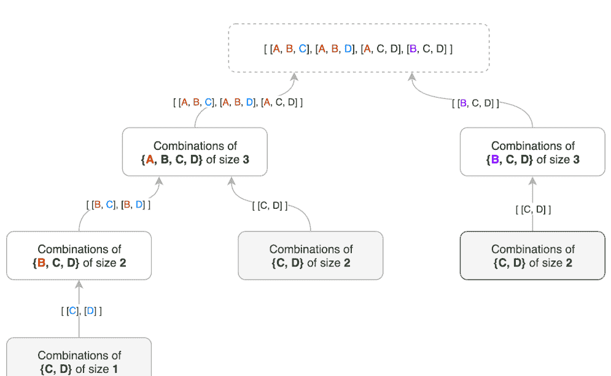

以下是此算法在 JavaScript 中的实现示例。

```
20-combinations/combineWithoutRepetitions.js
/**
 * @param {*[]} comboOptions - 我们将从中提取元素的原始集合。
 * @param {number} comboLength - 我们要生成的组合的长度。
 * @return {*[]}
 */
export default function combineWithoutRepetitions(comboOptions, comboLength) {
  // 如果组合的长度为 1，则原始集合的每个元素都是一个组合。
  if (comboLength === 1) {
    return comboOptions.map(comboOption => [comboOption]);
  }

  // 初始化组合数组。
  const combos = [];

  // 逐个提取字符并将它们连接到较小大小的组合。
  // 我们需要提取字符，因为我们不想有重复。
  comboOptions.forEach((currentOption, optionIndex) => {
    // 从原始集合中获取所有不包含当前元素的较小组合。
```


## 带重复的组合

这个问题可以通过递归解决。这意味着我们可以用较小尺寸的组合生成较大尺寸的组合。例如，如果需要为集合 S = {A, B, C} 生成所有大小为 r = 2 的带重复组合，我们执行以下步骤：

- 记住集合的第一个元素 A，
- 为集合 S = {A, B, C} 找出所有大小为 r = 1 的组合，
- 将 A 与上一步中的所有较小组合连接起来，
- 记住集合的第二个元素 B，
- 为集合 S = {A, B, C} 找出所有大小为 r = 1 的组合，
- 将 B 与上一步中的所有较小组合连接起来，
- 依此类推...

递归的基本情况是当需要为集合生成大小为 r = 1 的组合时。在这种情况下，集合的每个元素都是我们寻找的组合，因此不需要进一步的递归调用。

与*不*重复组合的算法的主要区别在于，我们只是记住元素，而不是从集合中提取元素。由于允许重复，因此不需要提取。

请查看下面的完整递归调用树以更好地理解该算法。

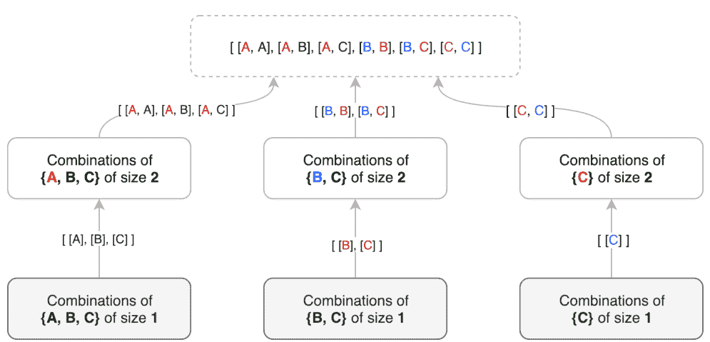

以下是该算法在 JavaScript 中的实现示例。

```
20-combinations/combineWithRepetitions.js

/**
 * @param {*[]} comboOptions - 原始集合，我们将从中获取元素。
 * @param {number} comboLength - 我们将制作的组合的长度。
 * @return {*[]}
 */
export default function combineWithRepetitions(comboOptions, comboLength) {
  // 如果组合的长度为1，则原始集合的每个元素都是一个组合。
  if (comboLength === 1) {
    return comboOptions.map(comboOption => [comboOption]);
  }

  // 初始化组合数组。
  const combos = [];

  // 遍历原始集合的每个字符，并将其连接到较小尺寸的组合。
  comboOptions.forEach((currentOption, optionIndex) => {
    // 获取所有包含当前元素的较小组合。
    const smallerCombos = combineWithRepetitions(
      comboOptions.slice(optionIndex),
      comboLength - 1,
    );

    // 将当前元素（选项）连接到所有较小组合。
    smallerCombos.forEach((smallerCombo) => {
      combos.push([currentOption].concat(smallerCombo));
    });
  });

  // 返回所有组合。
  return combos;
}
```

## 问题示例

以下是在面试中可能遇到的一些相关问题：

- [组合](https://leetcode.com/problems/combinations/)
- [组合总和 III](https://leetcode.com/problems/combination-sum-iii/)
- [组合总和 IV](https://leetcode.com/problems/combination-sum-iv/)

## 测验

Q1: 形成组合时，元素的顺序重要吗？
Q2: 如果我们需要从大小为 4 的集合中生成所有大小为 2 的不重复组合，我们将有多少个组合？

## 参考资料

- [维基百科上的组合](https://en.wikipedia.org/wiki/Combination)
- ["Math is Fun"上的组合](https://www.mathsisfun.com/combinatorics/combinations-permutations.html)
- [Medium上的组合](https://medium.com/@trekhleb/permutations-combinations-algorithms-cheat-sheet-68c14879aba5)
- [组合示例和测试用例](https://github.com/trekhleb/javascript-algorithms/tree/master/src/algorithms/sets/combinations)

---

# 排序：快速排序

- 难度：中等

## 任务

将一个无序的值数组按升序排序。例如，一个未排序的数组 [10, 3, 0, 15, 10, 18, 2, 7, 11] 按升序排序后应该是这样：[0, 2, 3, 7, 10, 10, 11, 15, 18]。

除了对数字排序，我们还希望能够对对象数组进行排序。为了实现这一点，我们的算法将实现一个比较回调函数。例如，应该能够按年龄升序排序数组 [{name: "Bill", age: 23}, {name: "Jane", age: 18}]，得到数组 [{name: "Jane", age: 18}, {name: "Bill", age: 23}]。

在我们的任务描述中，我们只提到了按升序排序。一旦你理解了快速排序算法的工作原理，你将能够更改算法以支持降序排序。

## 算法

**快速排序**是一种 O(n * log(n)) 的高效且常用的排序算法。快速排序是一种*比较排序*，意味着它可以对定义了"小于"关系的任何类型的项目进行排序。快速排序是一种*分治*算法。这意味着它将原始问题分成较小的子问题，并尝试先解决它们。然后，它将较小问题的解决方案组合起来，以得出最终解决方案。在我们的例子中，我们将把数组分成两部分，然后先对较小的数组进行排序，最后将它们合并成一个最终的排序数组。

该算法包括三个递归（对子问题重复）步骤：

- **枢轴选择**：从数组中选择一个元素，称为枢轴（通常选择第一个、中间或最后一个元素）。
- **分区**：将数组分成三个子数组：`left`（包含所有小于枢轴元素的元素）、`center`（包含所有等于枢轴元素的元素）和 `right`（包含所有大于枢轴元素的元素）。
- **递归**：通过为它们选择新的枢轴元素并进一步分区，将前两个步骤应用于较小的数组 `left` 和 `right`。我们不需要将这些步骤应用于 `center` 数组，因为它已经排序且包含所有相等的元素。

该算法的基本情况是仅对包含一个元素的数组进行排序。数组中只有一个元素，无需排序，因此我们直接返回该值。

快速排序算法的递归步骤如下图所示：

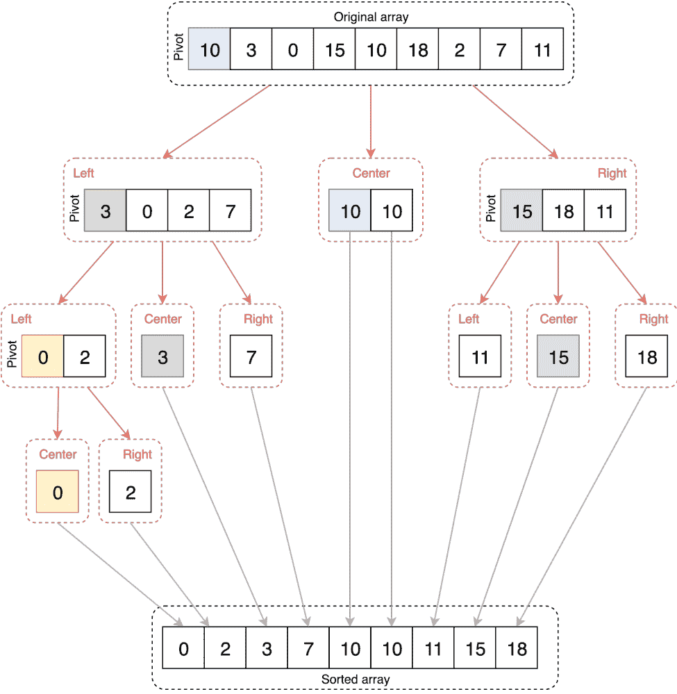

## 使用示例

在继续 `quickSort()` 函数实现之前，让我们想象一下我们已经有一个实现了，并让我们用它来对用户名列表进行排序，时间复杂度为 O(n * log(n))。这将帮助我们理解函数需要哪些参数，以及算法完成后的结果是什么。在这个例子中，我们将使用一个比较函数对数组进行排序。这允许我们在对对象数组排序时使用自定义的比较逻辑。

**21-quicksort/example.js**

```
// 导入依赖项。
import quickSort from './quickSort';

// 让我们按年龄在 O(n * log(n)) 时间内对用户列表进行排序。

// 初始化用户列表。
const notSortedUserList = [
  { age: 18, name: 'Bill' },
  { age: 20, name: 'Kate' },
  { age: 20, name: 'Tom' },
  { age: 24, name: 'Cary' },
  { age: 37, name: 'Mike' },
  { age: 42, name: 'Ben' },
  { age: 50, name: 'Jane' },
  { age: 60, name: 'Julia' },
];

// 创建比较函数，用于比较两个用户对象。
const userComparator = (user1, user2) => {
  if (user1.age === user2.age) {
    return 0;
  }

  return user1.age > user2.age ? 1 : -1;
};

// 对用户列表进行排序。
const sortedUserList = quickSort(notSortedUserList, userComparator);

// eslint-disable-next-line no-console
console.log(sortedUserList);
/*
  输出将是：
  [
    { age: 18, name: 'Bill' },
    { age: 20, name: 'Kate' },
    { age: 20, name: 'Tom' },
    { age: 24, name: 'Cary' },
    { age: 37, name: 'Mike' },
    { age: 42, name: 'Ben' },
    { age: 50, name: 'Jane' },
    { age: 60, name: 'Julia' },
  ]
*/
```

## 实现

实现快速排序算法有几种方式。它们在两个方面有所不同：如何选择枢轴点（第一个元素、中间元素、最后一个元素）以及分区如何发生（原地、非原地）。你可以在 [JavaScript 算法仓库](https://github.com/trekhleb/javascript-algorithms) 中找到不同的实现。

在本章中，我们将通过选择第一个元素作为枢轴点来实现快速排序，并且我们将进行"非原地"分区，以使算法实现更清晰、更易读。

由于我们希望我们的 `quickSort()` 函数不仅能够对数字排序，还能够对对象排序，因此我们将重用我们在"线性搜索"章节中已经实现的 `Comparator` 工具类。请参阅"线性搜索"章节以获取 `Comparator` 类实现的详细信息。这是一个简单的类，它为对象比较提供了通用的 `equal()`、`lessThan()` 和 `greaterThan()` 方法接口。

```
21-quicksort/quickSort.js
---
/**
 * @param {[*[]]} originalArray - 待排序的数组。
 * @param {function} comparatorCallback - 比较两个元素的函数
 * @return {[*[]]} - 排序后的数组
 */
export default function quickSort(originalArray, comparatorCallback = null) {
  // 让我们从 comparatorCallback 函数创建比较器。
  // Comparator 对象将为我们提供 equal() 和 lessThan() 等通用比较方法。
  const comparator = new Comparator(comparatorCallback);

  // 克隆原始数组以防止其被修改。
  // 我们在本示例中不进行原地排序，因此我们不希望有副作用。
  const array = [...originalArray];

  // 如果数组包含少于或等于一个元素，则它已经排序。
```

106 https://github.com/trekhleb/javascript-algorithms


```
## 复杂度

| 最佳 | 平均 | 最差 |
| :--- | :--- | :--- |
| O(n * log(n)) | O(n * log(n)) | O(n<sup>2</sup>) |

**最差情况**下时间复杂度为 $O(n^{2})$，这可能发生在数组已经按升序排列且我们总是选择数组第一个元素作为基准点的情况下。在这种情况下，经过分区步骤后，所有元素都将位于 `right` 数组中，而 `left` 数组为空。这种情况将在后续所有递归分区中持续存在，我们将经历 $(n - 1)$ 个递归步骤，在每个步骤中对子数组进行完整遍历，最终导致 $O(n^{2})$ 的时间复杂度。

**最佳情况**下时间复杂度为 $O(n * log(n))$，这发生在基准点将数组划分为几乎相等的 `left` 和 `right` 两部分时。在这种情况下，快速排序图示（参见上方图解）中将有 $log(n)$ 层，每层都对子数组进行完整遍历，从而得到 $O(n * log(n))$ 的时间复杂度。

## 问题示例

以下是面试中可能遇到的一些相关问题：

- [排序链表](https://leetcode.com/problems/sort-list/)
- [数组中的第K个最大元素](https://leetcode.com/problems/kth-largest-element-in-an-array/)

## 测验

*问题1：快速排序算法的平均时间复杂度是多少？*

*问题2：我们可以如何修改 quickSort() 函数使其按降序排列元素？*

## 参考资料

维基百科上的快速排序 [https://en.wikipedia.org/wiki/Quicksort](https://en.wikipedia.org/wiki/Quicksort)

YouTube 上的快速排序 [https://www.youtube.com/watch?v=SLauY6PpjW4](https://www.youtube.com/watch?v=SLauY6PpjW4)

快速排序示例和测试用例 [https://github.com/trekhleb/javascript-algorithms/tree/master/src/algorithms/sorting/quick-sort](https://github.com/trekhleb/javascript-algorithms/tree/master/src/algorithms/sorting/quick-sort)

# 树。深度优先搜索。

- 难度：中等

### 任务

假设我们有一棵节点树，我们想要：

- 检查某个特定节点是否存在于树中（即对节点"E"执行*搜索*操作），
- 检查两个节点是否相连（即在节点"A"和"E"之间*寻找路径*），
- 通过访问树的所有节点来进行节点清点（即将树转换为数组）。

为了完成所有这些任务，我们需要使用*树遍历算法*。换句话说，我们需要编写一些代码来遍历树中的每个节点。

在本章中，我们将遍历一棵*二叉*树（即每个节点最多有*两个*子节点的树）。一旦你理解了二叉树深度优先遍历的思想，你就能将其扩展到每个节点可能有更多子节点的树。

我们将要遍历的树是对某些现实世界数据的抽象。它可能是一棵包含连续"是/否"问题的二叉树，你可能想找出哪些"是/否"答案会引导你到达位于树的某个叶子节点上的最终建议/结论。你也可以将其想象为*国际象棋走法*，它以树的形式呈现，其中节点的子节点是所有可能的走法。每一步走法会引导你到达下一个节点，而下一个节点又会有一组新的可能走法。你可能想找出哪一步走法会引导你到达树的"获胜"叶子节点。

## 算法

解决上述任务的方法之一是深度优先搜索算法。

**深度优先搜索（DFS）**是一种用于遍历树或图数据结构的算法。该算法的思想是从某个特定节点（通常是根节点）开始，沿着每条分支尽可能深入地探索，然后再回溯。

*回溯*一词意味着当我们沿着树的分支深入探索时，如果当前路径上没有更多节点可以探索，我们就回退到树的上层，找到下一个最近的未探索子分支（节点）并进行探索。

下方的图示展示了使用深度优先搜索算法进行二叉树遍历的顺序。

可以将这个算法想象成你在迷宫中行走。当你行走时，你会遇到迷宫中的交叉路口——这些就像我们树中的节点。每个交叉路口有三个选择：向*右*转、向*左*转或*返回*到之前的交叉路口（回溯）。假设我们制定了一个策略，优先尝试右转。于是我们选择向右走，并用画笔将右转标记为"已访问"以避免将来重复走这条路径。如果我们在迷宫中走到了死胡同（叶子节点），我们就回溯，直到到达一个已经走过右转的交叉路口。然后我们向左走，并用画笔将左转标记为"已访问"。一旦我们到达一个两个转向都已被标记为"已访问"的交叉路口，我们就需要回退（回溯）到之前的交叉路口，找到第一个未访问的转向。如此反复，直到我们到达迷宫的出口。

这个算法可以使用**栈**以递归方式实现（关于该数据结构的详细说明请参阅栈章节）。使用栈实现深度优先搜索的思路如下：

1. 选取起始节点，将其所有子节点放入栈中。
2. 从栈中弹出一个节点作为下一个要访问的节点，并将其所有子节点压入栈中。
3. 返回步骤2（重复此过程直到栈为空）。

## 使用示例

在开始深度优先搜索算法的实际实现之前，让我们假设已经有一个 `depthFirstSearch()` 函数。这个函数允许我们遍历使用简单 `BinaryTreeNode` 类实现的二叉树节点。通过这样做，我们将更好地理解要向 `depthFirstSearch()` 函数传递什么参数以及期望从中获得什么输出。

在这个使用示例中，我们将使用一个回调函数作为 `depthFirstSearch()` 函数的第二个参数。该回调函数会在函数每次访问树中的一个节点时被调用。这使我们能够在访问每个节点时添加自定义逻辑。

```js
// Import dependencies.
import { depthFirstSearch } from './depthFirstSearch';
import { BinaryTreeNode } from '../06-binary-search-tree/BinaryTreeNode';

// Create tree nodes.
const nodeA = new BinaryTreeNode('A');
const nodeB = new BinaryTreeNode('B');
const nodeC = new BinaryTreeNode('C');
const nodeD = new BinaryTreeNode('D');
const nodeE = new BinaryTreeNode('E');

// Form a binary tree out of created nodes.
nodeA
  .setLeft(nodeB)
  .setRight(nodeC);

nodeB
  .setLeft(nodeD)
  .setRight(nodeE);

// Init the array that will contain all traversed nodes of the tree.
```


树。深度优先搜索。

```js
const traversedNodes = [];

// Create visiting node callback.
const visitNodeCallback = (visitedNode) => {
  // Once we visit the node let's add it to the list of traversed nodes.
  traversedNodes.push(visitedNode);
};

// Perform depth-first tree traversal.
depthFirstSearch(nodeA, visitNodeCallback);

// eslint-disable-next-line no-console
console.log(traversedNodes);
/*
  The output will be:
  [nodeA, nodeB, nodeD, nodeE, nodeC]
*/
```

## 实现

为了遍历我们的树，我们首先需要创建一个 `BinaryTreeNode` 类来表示二叉树的节点。在类的构造函数中，我们将为节点赋一个值。我们的 `setLeft()` 和 `setRight()` 方法允许我们为节点附加左子节点和右子节点。出于易用性的考虑，我们将从 `setLeft()` 和 `setRight()` 方法中返回 `this`，以便能够像 `nodeA.setLeft(nodeB).setRight(nodeC)` 这样进行链式调用。

`06-binary-search-tree/BinaryTreeNode.js`

```js
export class BinaryTreeNode {
  /**
   * @param {*} [value]
   */
  constructor(value = null) {
    this.left = null;
    this.right = null;
    this.value = value;
  }

  /**
   * @param {BinaryTreeNode} node
   */
  setLeft(node) {
    this.left = node;
    return this;
  }

  /**
   * @param {BinaryTreeNode} node
   */
  setRight(node) {
    this.right = node;
    return this;
  }
}
```

一旦我们实现了 BinaryTreeNode 类，就可以实现 `depthFirstSearch()` 函数来遍历 BinaryTreeNode 实例。该函数将起始节点作为第一个参数，`visitNodeCallback()` 作为第二个参数。每次在 DFS 路径上遇到新节点时，都会调用 `visitNodeCallback()`。

我们将使用递归实现 `depthFirstSearch()` 函数。这意味着如果当前节点存在左子节点和右子节点，我们将分别对其调用 `depthFirstSearch()` 函数。

`22-tree-depth-first-search/depthFirstSearch.js`

```js
/**
 * Perform depth-first search (DFS) traversal of the rootNode.
 *
 * @param {BinaryTreeNode} node - The starting node to be traversed.
 * @param {callback} [visitNodeCallback] - Visiting node callback.
 */
export function depthFirstSearch(node, visitNodeCallback = () => {}) {
  // Call the visiting node callback.
  visitNodeCallback(node);

  // Traverse left branch.
  if (node.left) {
    depthFirstSearch(node.left, visitNodeCallback);
  }

  // Traverse right branch.
  if (node.right) {
    depthFirstSearch(node.right, visitNodeCallback);
  }
}
```

前面提到过，深度优先搜索算法可以使用*栈*数据结构来实现。但是查看 `depthFirstSearch()` 函数的代码时，你可能会疑惑为什么我们没有使用栈章节中实现的 `Stack` 类。原因是我们确实使用了栈，只是形式略有不同。我们没有直接使用 `Stack` 类，而是使用了 `depthFirstSearch()` 函数的调用栈。由于这里涉及递归调用，函数从自身内部调用自身，第一个函数调用在后续函数调用完成之前无法结束。因此，所有未完成的函数调用都被放入*函数调用栈*中。

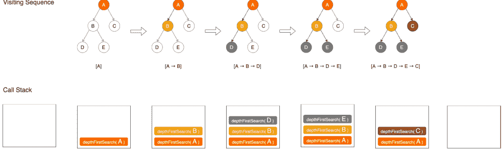

## 复杂度

### 时间复杂度

上面实现的深度优先搜索算法会恰好访问树中的每个节点一次。如果我们遍历的树有 |N| 个节点，那么 `depthFirstSearch()` 函数将被递归调用 |N| 次（每个树节点调用一次）。因此我们可以说，使用深度优先方法进行树遍历的时间复杂度为 `O(|N|)`，其中 |N| 是树中节点的总数。

### 辅助空间复杂度

在最坏的情况下，我们将遇到一棵不平衡的树，其形状类似于链表（树的每个节点只有*一个左子节点*（或*仅有一个右子节点*））。由于我们使用递归方法实现 `depthFirstSearch()` 函数，每次新的递归调用（每个新节点）都会使函数调用栈增长。因此，在最坏的情况下，我们的递归函数调用栈将需要 `O(|N|)` 的辅助内存空间。

## 问题示例

以下是面试中可能遇到的一些相关问题：

- 相同的树<sup>112</sup>
- 二叉树的最大深度<sup>113</sup>
- 验证二叉搜索树<sup>114</sup>

## 测验

*Q1：深度优先搜索算法的时间复杂度是多少？*

*Q2：在实现 depthFirstSearch() 函数时，我们能否避免使用递归？*

## 参考资料

- 维基百科上的深度优先搜索（DFS） https://en.wikipedia.org/wiki/Depth-first_search<sup>115</sup>
- 树的深度优先搜索示例和测试用例 https://github.com/trekhleb/javascript-algorithms/tree/master/src/algorithms/tree/depth-first-search<sup>116</sup>

<sup>112</sup> https://leetcode.com/problems/same-tree/

<sup>113</sup> https://leetcode.com/problems/maximum-depth-of-binary-tree/

<sup>114</sup> https://leetcode.com/problems/validate-binary-search-tree/

<sup>115</sup> https://en.wikipedia.org/wiki/Depth-first_search

<sup>116</sup> https://github.com/trekhleb/javascript-algorithms/tree/master/src/algorithms/tree/depth-first-search

## 树。广度优先搜索。

*难度：中等*

### 任务

假设我们有一个节点树，我们想要：

- 检查某个特定节点是否存在于树中（即对节点 "E" 执行*搜索*操作），
- 通过访问树的所有节点来清点节点（即将树转换为数组）。

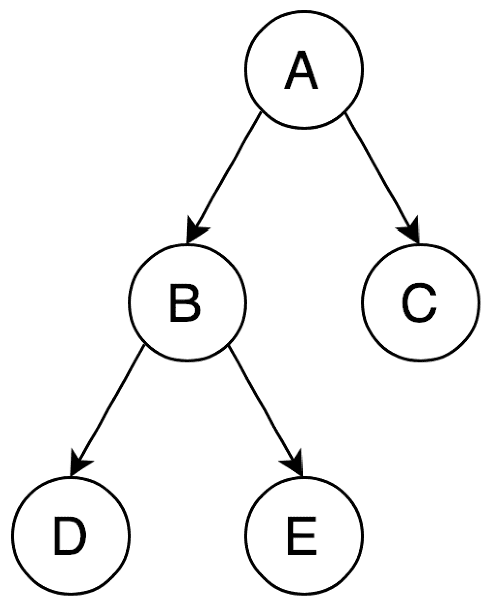

为了完成所有这些任务，我们需要利用树的遍历算法。换句话说，我们需要编写一些代码来访问树中的每个节点。

在本章中，我们将遍历一棵*二叉*树（每个节点最多有*两个*子节点的树）。一旦你理解了二叉树深度优先遍历的思想，你就能将其扩展到每个节点可能有两个以上子节点的树。

## 算法

解决上述任务的方法之一是广度优先搜索算法。

**广度优先搜索（BFS）**是一种用于遍历或搜索树或图数据结构的算法。它从树的根节点开始，在深入到下一个深度级别之前，先探索当前深度的所有相邻节点。

*广度优先搜索（BFS）*和*深度优先搜索（DFS）*算法非常相似，因为它们都在遍历树，但它们采用了两种不同的方式。**BFS 向宽处扩展**，它先探索树中某一层级的所有节点，然后才深入一层探索下一层级的节点。**DFS 向深处探索**，它沿着树的分支一直深入到叶节点，然后回溯并尝试另一条分支，直到到达叶节点。

下面的图示展示了使用广度优先搜索算法进行二叉树遍历的顺序。

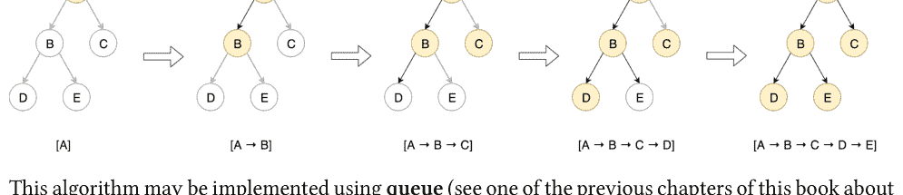

该算法可以使用**队列**来实现（参见本书前面关于队列数据结构的章节）。使用队列实现广度优先搜索算法的思路如下：

1. 选取起始节点并将其放入节点队列。
2. 从队列中弹出下一个节点，并将其所有子节点添加到队列中以便稍后访问。
3. 回到步骤 2（重复此过程直到队列为空）。

## 使用示例

在继续进行广度优先搜索算法的实际实现之前，让我们假设我们已经有了一个 `breadthFirstSearch()` 函数的实现。该函数允许我们遍历使用简单的 `BinaryTreeNode` 类实现的二叉树节点。通过这样做，我们将更好地理解我们想要传递给 `breadthFirstSearch()` 函数的参数以及我们期望的输出。

在这个使用示例中，我们将使用一个回调函数作为 `breadthFirstSearch()` 函数的第二个参数。每次函数访问树中的一个节点时，都会调用此回调。这使我们能够在访问每个节点时添加自定义逻辑。

`23-tree-breadth-first-search/example.js`

```js
// Import dependencies.
import { BinaryTreeNode } from '../06-binary-search-tree/BinaryTreeNode';
import { breadthFirstSearch } from './breadthFirstSearch';

// Create tree nodes.
const nodeA = new BinaryTreeNode('A');
const nodeB = new BinaryTreeNode('B');
const nodeC = new BinaryTreeNode('C');
const nodeD = new BinaryTreeNode('D');
const nodeE = new BinaryTreeNode('E');

// Form a binary tree out of created nodes.
nodeA
  .setLeft(nodeB)
  .setRight(nodeC);

nodeB
  .setLeft(nodeD)
  .setRight(nodeE);

// Init the array that will contain all traversed nodes of the tree.
const traversedNodes = [];

// Create visiting node callback.
const visitNodeCallback = (visitedNode) => {
  // Once we visit the node let's add it to the list of traversed nodes.
  traversedNodes.push(visitedNode);
};

// Perform breadth-first tree traversal.
breadthFirstSearch(nodeA, visitNodeCallback);

// Check that traversal happened in correct order.
expect(traversedNodes).toEqual([
  nodeA, nodeB, nodeC, nodeD, nodeE,
]);
```


## 实现

既然我们要遍历二叉树，那么我们先来创建一个简单的 `BinaryTreeNode` 类，用来表示二叉树的节点。我们将通过类构造函数为节点赋值。同时，通过使用 `setLeft()` 和 `setRight()` 方法，我们能够将左右子节点连接到该节点上。为了方便使用，`setLeft()` 和 `setRight()` 方法将返回 `this`，这样我们就可以像 `nodeA.setLeft(nodeB).setRight(nodeC)` 这样进行链式调用。

```javascript
// 06-binary-search-tree/BinaryTreeNode.js
export class BinaryTreeNode {
  /**
   * @param {*} [value]
   */
  constructor(value = null) {
    this.left = null;
    this.right = null;
    this.value = value;
  }

  /**
   * @param {BinaryTreeNode} node
   */
  setLeft(node) {
    this.left = node;
    return this;
  }

  /**
   * @param {BinaryTreeNode} node
   */
  setRight(node) {
    this.right = node;
    return this;
  }
}
```

由于广度优先遍历使用队列来存储所有待访问的节点，我们首先导入一个队列类。

```javascript
// 23-tree-breadth-first-search/breadthFirstSearch.js

// 导入依赖项。
import { Queue } from '../03-queue/Queue';
```

一旦我们实现了 `BinaryTreeNode` 类并导入了 `Queue` 作为依赖项，我们就可以开始实现 `breadthFirstSearch()` 函数了，该函数将遍历 `BinaryTreeNode` 的实例。这个函数将接受起始的 `rootNode` 作为第一个参数，`visitNodeCallback()` 作为第二个参数。在我们的 BFS 路径上，每当我们遇到一个新节点时，`visitNodeCallback()` 就会被调用。

在 `breadthFirstSearch()` 函数内部我们需要做的是：

1.  创建一个空的队列实例 `nodeQueue`，
2.  将 `rootNode`（我们将从它开始 BFS 遍历的节点）添加到队列实例 `nodeQueue` 中，
3.  弹出队列中的下一个节点并赋值给 `currentNode` 变量，
4.  调用 `visitNodeCallback()` 回调函数，以通知观察者/订阅者我们正在访问新节点，
5.  将 `currentNode` 的所有子节点添加到队列中，以便稍后访问它们，
6.  重复步骤 3，直到 `nodeQueue` 为空。

以下是该函数的实现：

```javascript
// 23-tree-breadth-first-search/breadthFirstSearch.js

/**
 * 对 rootNode 执行广度优先搜索 (BFS) 遍历。
 *
 * @param {BinaryTreeNode} rootNode - 要遍历的起始节点。
 * @param {callback} [visitNodeCallback] - 访问节点的回调函数。
 */
export function breadthFirstSearch(rootNode, visitNodeCallback = () => {}) {
  // 初始化队列。
  // 我们需要先将 rootNode 添加到队列中，以便从它开始遍历过程。
  const nodeQueue = new Queue();
  nodeQueue.enqueue(rootNode);

  // 访问队列中的所有节点，直到队列为空。
  while (!nodeQueue.isEmpty()) {
    // 获取下一个要访问的节点。
    const currentNode = nodeQueue.dequeue();

    // 调用访问节点的回调函数。
    visitNodeCallback(currentNode);

    // 将左子节点添加到遍历队列中。
    if (currentNode.left) {
      nodeQueue.enqueue(currentNode.left);
    }

    // 将右子节点添加到遍历队列中。
    if (currentNode.right) {
      nodeQueue.enqueue(currentNode.right);
    }
  }
}
```

### 时间复杂度

上面实现的广度优先搜索算法会精确地访问树的每一个节点一次。这是通过使用一个队列实例来实现的。由于树不可能有环状连接（即两个节点共享同一个子节点），我们可以确定每个节点只会被放入队列一次。然后，通过访问操作，每个节点也只会从队列中取出一次。因此，我们可以得出结论，使用广度优先方法进行树遍历的时间复杂度是 O(|N|)，其中 |N| 是树中的节点总数。

### 辅助空间复杂度

在最坏的情况下，我们会得到一个不平衡的树，它看起来像一个链表（如果树的每个节点都只有左子节点或只有右子节点）。由于我们使用队列来存储待访问的节点列表，在最坏的情况下，这个队列可能包含树的所有节点。因此，在最坏的情况下，我们的队列实例将需要 O(|N|) 的辅助内存空间。

## 题目示例

以下是一些你在面试中可能遇到的同类问题：

- [排列序列](https://leetcode.com/problems/permutation-sequence/)
- [字母大小写全排列](https://leetcode.com/problems/letter-case-permutation/)
- [下一个排列](https://leetcode.com/problems/next-permutation/)

## 小测

*问1：广度优先搜索算法的时间复杂度是多少？*

*问2：为了支持树节点拥有两个以上的子节点，应该如何调整 `depthFirstSearch()` 函数？*

## 参考资料

维基百科上的广度优先搜索 (BFS) [https://en.wikipedia.org/wiki/Breadth-first_search](https://en.wikipedia.org/wiki/Breadth-first_search)

树 BFS 示例和测试用例 [https://github.com/trekhleb/javascript-algorithms/tree/master/src/algorithms/tree/breadth-first-search](https://github.com/trekhleb/javascript-algorithms/tree/master/src/algorithms/tree/breadth-first-search)

## 图。深度优先搜索。

- *难度：中等*

### 任务描述

假设我们有一个图，并且我们想要：

- 检查图中是否存在特定的顶点（即，执行顶点 "John" 的 *查找* 操作），
- 检查两个节点是否相连（即，找到顶点 "Bill" 和 "Tom" 之间的 *连接路径*），
- 通过访问图的所有顶点来对顶点进行盘点（即将图转换为一个数组），
- 其他（更多用例请参见下面的应用部分）。

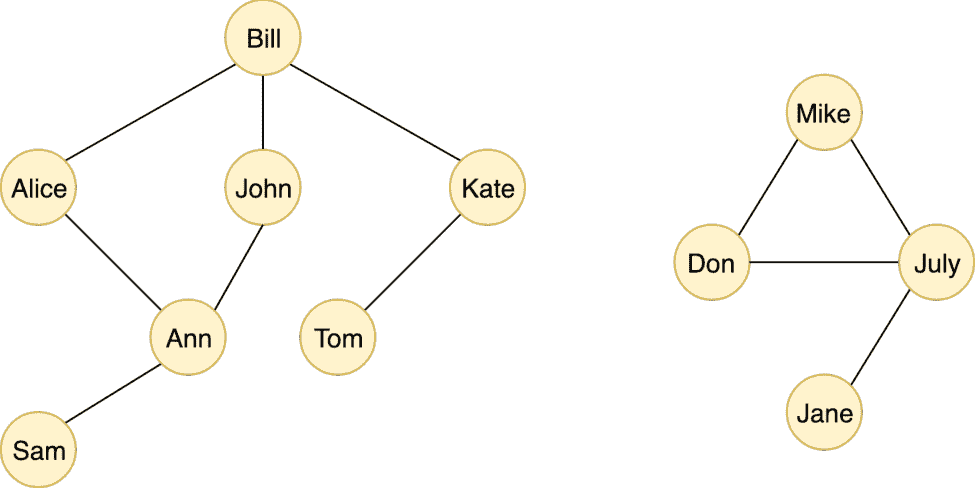

为了完成所有这些任务，我们需要利用一种 *图遍历算法*。换句话说，我们需要编写一个算法，该算法将访问从特定顶点可达的所有顶点。

### 算法

解决上述任务的一种方法是深度优先搜索算法。

**深度优先搜索 (DFS)** 是一种用于遍历或搜索树或图数据结构的算法。该算法的思想是从某个特定节点（或顶点）开始，尽可能深地探索每条分支，然后再回溯。

这里的 *回溯* 意味着，当我们沿着图的分支向更深处移动，且当前路径上没有更多节点可以探索时，我们会向后退，找到另一个最近的、未探索的子分支（顶点），然后去探索它。

下面的插图展示了使用深度优先搜索算法遍历图的顺序。

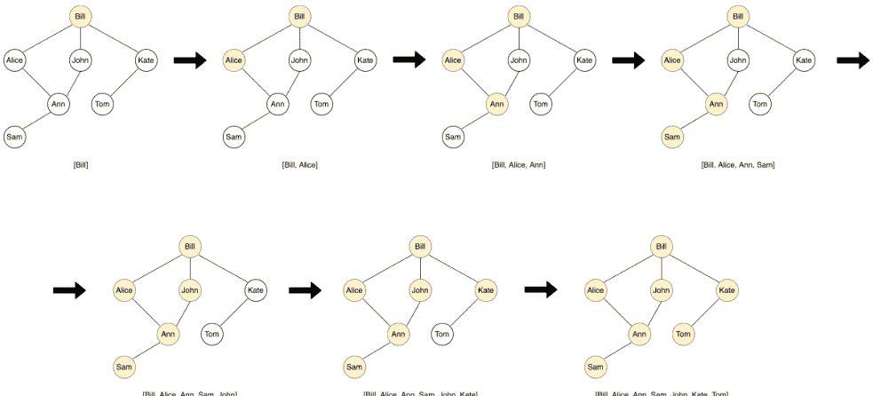

为了更好地理解深度优先搜索算法，你可以想象一下在迷宫中行走的过程。图就是迷宫，图的边是路径，图的顶点是迷宫路径的交叉点。当你到达一个交叉点时，你会标记你打算走的那条路，以避免将来再走同一条路。一旦你到达一个所有路径都已标记为“已访问”的交叉点，你就会返回上一个交叉点（回溯），并选择下一条尚未访问的路径。这个过程会一直重复，直到你找到迷宫的出口。

这个算法可以使用 **栈** 来递归实现（参见本书前面关于栈数据结构的章节）。使用栈来实现深度优先搜索的思路如下：

1.  选择起始顶点并将其加入栈中。
2.  从栈中弹出下一个顶点并“访问”它（即，调用回调函数或在该顶点上执行某些操作）。
3.  将当前顶点的所有 *未访问* 的邻居顶点压入栈中。


## 应用

深度优先搜索算法是其他图相关算法的构建基础，例如：

- 查找连通分量，
- 拓扑排序，
- 查找图的桥，
- 检测图中的环，
- 路径查找，
- 求解只有唯一解的谜题（如迷宫），
- 迷宫生成可以使用随机化深度优先搜索，
- 等等。

## 使用示例

在实现 `depthFirstSearch()` 函数之前，让我们先看看如何使用它以及需要传递哪些参数。`depthFirstSearch()` 函数需要知道要遍历的图以及从哪个起始顶点开始遍历过程。同时，我们希望向函数传递一个回调函数，每当访问一个新的顶点时就会调用它。考虑到这些，让我们使用本书"图"章节中的 `Graph` 类创建一个非常简单的社交网络，然后对其进行遍历。

以下是我们要实现的网络结构。

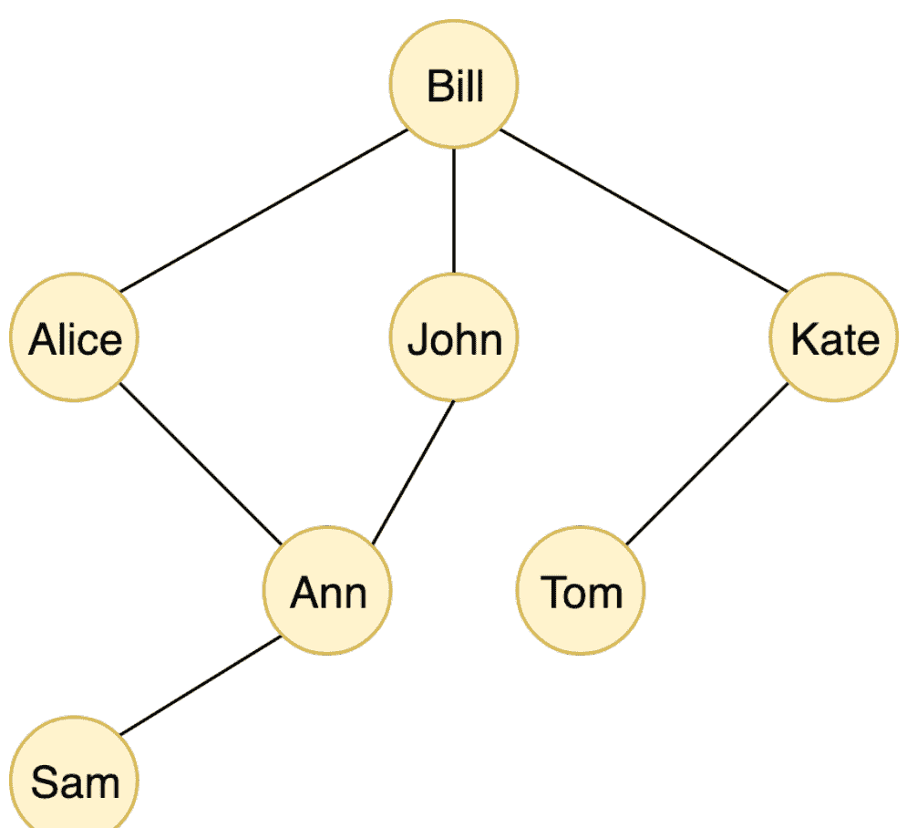

让我们从 Bill 开始，遍历所有直接或通过其他用户与 Bill 相连的用户。首先，我们将创建一个图（社交网络的类比）。接下来，我们将创建图的顶点（在网络中注册用户的类比）。然后，我们将在图的节点之间创建图的边（将用户添加到好友列表的类比）。最后，我们将从 Bill 开始遍历所有用户。

```javascript
// Import dependencies.
import Graph from '../08-graph/Graph';
import GraphVertex from '../08-graph/GraphVertex';
import GraphEdge from '../08-graph/GraphEdge';
import { depthFirstSearch } from './depthFirstSearch';

// Create a demo-version of our overly-simplified social network.
const socialNetwork = new Graph();

// Let's register several users in our network.
const bill = new GraphVertex('Bill');
const alice = new GraphVertex('Alice');
const john = new GraphVertex('John');
const kate = new GraphVertex('Kate');
const ann = new GraphVertex('Ann');
const tom = new GraphVertex('Tom');
const sam = new GraphVertex('Sam');

// Now let's establish friendship connections between the users of our network.
socialNetwork
  .addEdge(new GraphEdge(bill, alice))
  .addEdge(new GraphEdge(bill, john))
  .addEdge(new GraphEdge(bill, kate))
  .addEdge(new GraphEdge(alice, ann))
  .addEdge(new GraphEdge(ann, sam))
  .addEdge(new GraphEdge(john, ann))
  .addEdge(new GraphEdge(kate, tom));

// Now let's traverse the network in depth-first manner staring from Bill
// and add all users we will encounter to the userVisits array.
const userVisits = [];
depthFirstSearch(socialNetwork, bill, (user) => {
  userVisits.push(user);
});

// Now let's see in what order the users have been traversed.
// eslint-disable-next-line no-console
console.log(userVisits);
/*
  The output will be:
  [bill, alice, ann, sam, john, kate, tom]
*/
```

## 实现

### 函数参数

如上所述，`depthFirstSearch()` 函数接受三个参数：

- graph - 要遍历的图（Graph 类的实例），
- startVertex - 用作起点的顶点（GraphVertex 类的实例），
- enterVertexCallback - 每次访问顶点时调用的回调函数。

### 已访问顶点的记忆化

当我们实现树的深度优先搜索算法时，我们并不关心在遍历过程中从不同的父节点访问到同一节点的情况。这是因为根据定义，树的节点不可能有两个或更多个父节点，否则它就变成了图。因此在树中，我们只有*一种方式*来*进入*一个节点。但当我们处理图时，需要记住同一个图顶点可能从许多相邻顶点被*多次*访问。这样，同一个顶点可能被多次添加到遍历栈中。这会使整个遍历过程效率低下，甚至可能导致无限循环。这就是为什么在遍历图时我们需要*标记所有已访问的顶点*，以避免重复访问同一个顶点。我们将使用 `visitedVertices` 对象来实现这一点。已访问的图顶点的键值将作为 `visitedVertices` 对象的键。这将帮助我们以 O(1) 的时间复杂度高效地检查节点是否已被访问过。

### 递归闭包

在我们的 `depthFirstSearch()` 函数内部，让我们实现一个递归的 `depthFirstSearchRecursive()` 函数。该函数将包含主要的遍历逻辑。`depthFirstSearchRecursive()` 函数是一个闭包，这意味着它可以访问 `depthFirstSearch()` 函数的所有变量和参数。因此我们只需向它传递一个参数，即当前正在遍历的顶点（`currentVertex` 参数）。

`depthFirstSearchRecursive()` 所做的就是简单地调用 `enterVertexCallback()` 函数，获取 `currentVertex` 的所有*未访问*的邻居，将它们标记为已访问，然后对 `currentVertex` 的每个未邻居再次调用自身。

### 实现示例

```javascript
/**
 * Traverse the graph in depth-first manner.
 *
 * @param {Graph} graph - Graph that is going to be traversed.
 * @param {GraphVertex} startVertex - Vertex that we will use as a starting point.
 * @param {function} enterVertexCallback - Callback that will be called on every vertex visit.
 */
export function depthFirstSearch(graph, startVertex, enterVertexCallback) {
  // In order to prevent the visiting of the same vertex twice
  // we need to memorize all visited vertices.
  const visitedVertices = {};

  // Since we're going to visit startVertex first let's add it to the visited list.
  visitedVertices[startVertex.getKey()] = true;

  /**
   * Recursive implementation of depth-first search.
   *
   * @param {GraphVertex} currentVertex - Graph vertex that is currently being traversed.
   */
  const depthFirstSearchRecursive = (currentVertex) => {
    // Call the callback to notify subscribers about the entering a new vertex.
    enterVertexCallback(currentVertex);

    // Iterate over every neighbor of currently visited vertex.
    currentVertex
      .getNeighbors()
      .forEach((nextVertex) => {
        // In case if the neighbor vertex was not visited before let's visit it.
        if (!visitedVertices[nextVertex.getKey()]) {
          // Memorize current neighbor to avoid visiting it again in the feature.
          visitedVertices[nextVertex.getKey()] = true;
          // Visit the next neighbor vertex.
          depthFirstSearchRecursive(nextVertex);
        }
      });
  };

  // Start graph traversal by calling recursive function.
  depthFirstSearchRecursive(startVertex);
}
```

### 栈的使用

如上所述，深度优先搜索算法可以使用栈数据结构来实现。我们可以*显式*或*隐式*地使用栈来实现 DFS 算法。

对于*显式栈使用*，我们需要从本书的"栈"章节（或任何其他栈实现，包括普通的 JavaScript 数组）导入 `Stack` 类实现，并使用栈实例来存储所有要遍历的顶点。当栈不为空时，我们需要从中 `pop()` 出最后添加的顶点，获取该顶点的所有未访问邻居，将它们 `push()` 到栈中，然后重复。显式栈使用不需要递归，`while` 循环是一个很好的替代方案。

但在上面的 `depthFirstSearch()` 函数中，我们使用递归*隐式*地使用了栈。尽管我们没有显式导入 Stack 类，但我们仍然在以递归*函数调用栈*的形式使用栈。每当 `depthFirstSearchRecursive()` 函数调用自身时，JavaScript 引擎就会将当前函数变量（状态）压入内存栈中。

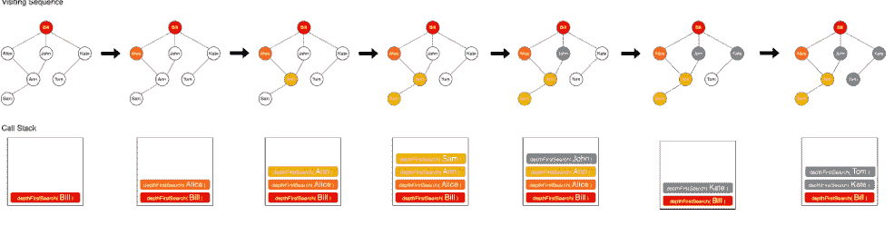

## 复杂度

### 时间复杂度

`depthFirstSearch()` 函数的时间复杂度主要由其内部递归函数 `depthFirstSearchRecursive()` 的时间复杂度决定。因为 `depthFirstSearchRecursive()` 之外的所有操作都是常数时间操作。在 `depthFirstSearchRecursive()` 函数内部，我们执行以下操作：

- 获取当前顶点的所有邻居。为此，我们需要遍历所有与当前顶点相连的边。因此，边的数量会影响此步骤的性能。
- 遍历当前顶点的所有未访问邻居。顶点越多，此步骤所需的迭代就越多。


 综合以上分析，我们可以得出结论：图深度优先搜索算法的时间复杂度为 O(|V| + |E|)，其中 |V| 是图中顶点的总数，|E| 是图中边的总数。

## 辅助空间复杂度

在当前 `depthFirstSearch()` 函数的实现中，我们使用了递归。每次递归调用都会增加函数调用栈的深度。在最坏情况下，当图看起来像链表时，`depthFirstSearchRecursive()` 函数的调用栈深度将与图中顶点的数量 |V| 成正比。此外，我们还使用 `visitedVertices` 映射来跟踪已访问的顶点。这个映射需要空间来存储所有 |V| 个顶点。

综合以上分析，我们可以得出结论：当前 DFS 实现的辅助空间复杂度为 O(|V|)，其中 |V| 是图中顶点的总数。

## 问题示例

以下是您在面试中可能遇到的一些相关问题：

- [克隆图](https://leetcode.com/problems/clone-graph/)
- [判断二分图](https://leetcode.com/problems/is-graph-bipartite/)
- [岛屿数量](https://leetcode.com/problems/number-of-islands/)

## 测验

*Q1:* 图深度优先搜索算法的时间复杂度是多少？

*Q2:* 哪种数据结构最适合实现图深度优先搜索算法：栈还是队列？

## 参考资料

维基百科上的深度优先搜索（DFS）[https://en.wikipedia.org/wiki/Depth-first_search](https://en.wikipedia.org/wiki/Depth-first_search)

深度优先搜索可视化 [https://www.cs.usfca.edu/~galles/visualization/DFS.html](https://www.cs.usfca.edu/~galles/visualization/DFS.html)

图的 DFS 示例和测试用例 [https://github.com/trekhleb/javascript-algorithms/tree/master/src/algorithms/graph/depth-first-search](https://github.com/trekhleb/javascript-algorithms/tree/master/src/algorithms/graph/depth-first-search)

## 图. 广度优先搜索.

- 难度：中等

## 任务

假设我们有一个图，我们想要：

- 检查图中是否存在特定顶点（即对顶点 "John" 执行*搜索*操作），

- 通过访问图的所有顶点来进行顶点盘点（即将图转换为数组）。

- 等等（更多用例请参见下面的应用部分）。

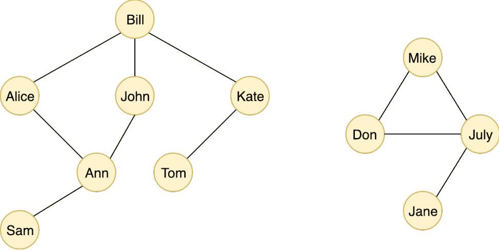

要完成所有这些任务，我们需要*找到图遍历算法*。换句话说，我们需要找到一种算法，用于访问从某个特定顶点可达的图中所有顶点。

## 算法

解决上述任务的方法之一是广度优先搜索算法。

图. 广度优先搜索。

249

**广度优先搜索（BFS）**是一种用于遍历或搜索树或图数据结构的算法。它从图的某个任意顶点开始，在移动到下一深度的节点之前，先探索当前深度的所有相邻顶点。

它使用与深度优先搜索相反的策略，后者先探索最深层的节点，然后才被迫回溯并扩展较浅的节点。

下图展示了使用广度优先搜索算法进行图遍历的顺序。

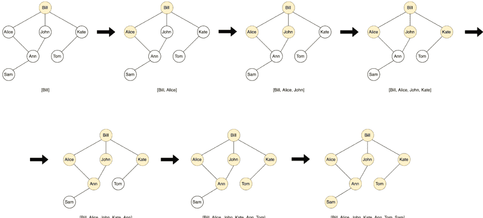

该算法可以使用**队列**来实现（参见本书前面关于队列数据结构的章节）。队列数据结构将为我们提供所需的 FIFO（先进先出）图顶点访问顺序，这样我们就能横向扩展而不是纵向深入。FIFO 顺序基本上意味着，一旦我们将当前顶点的所有邻居添加到队列中，我们就会从邻居到邻居进行遍历，先访问第一个邻居，然后是第二个邻居，依此类推，然后再深入到下一级邻居的子节点。这与我们用于实现深度优先遍历的栈的 LIFO（后进先出）方法相反，在深度优先遍历中，我们每次访问的是最后添加到栈中的节点。通过这种方式，我们并不是从邻居到邻居移动，而是先从父节点到子节点。

使用队列进行广度优先搜索的思路如下：

1. 选择起始顶点并将其放入待访问队列。
2. 从队列中取出下一个顶点并"访问"它（即调用回调函数或对顶点执行某些操作）。
3. 将当前顶点的所有*未访问*邻居添加到队列中，以便稍后访问。
4. 转到步骤 2（重复此过程直到队列为空）。

**哈希映射**数据结构可用于高效检查顶点是否已被访问。顶点必须具有唯一的键值，该键值用作哈希映射的键。

广度优先搜索算法用于查找图中两个节点之间的最短路径。由于图可以表示现实世界中的数据，如道路网络、社交网络、计算机网络，因此可以找到许多 BFS 算法的应用：

- **GPS 导航** - 查找从您的位置（地图图中的顶点）到特定城市（地图图中的另一个顶点）的最短路径（地图图中边的组合）。
- **计算机网络** - P2P 客户端（即 Torrent 客户端）遍历点对点（P2P）网络，以找到拥有所需文件的"最近"主机。
- **社交网络** - 查找与某人给定距离内的其他人。
- **网络爬虫** - 通过从主页跟踪链接，然后跟踪内部页面的链接来遍历网站内容。通过使用 BFS，可以设置网站抓取的期望深度。

广度优先搜索算法还用作其他图相关算法的构建模块，例如 Cheney 算法（复制垃圾回收）、Cuthill-McKee 网格编号、Ford-Fulkerson 方法（用于计算流网络中的最大流量）等。

## 使用示例

在实现 `breadthFirstSearch()` 函数之前，让我们先看看如何使用它以及我们要传递哪些参数给它。`breadthFirstSearch()` 函数需要知道要遍历哪个图以及从哪个起始顶点开始遍历过程。我们还希望向函数传递一个回调函数，每次访问新顶点时都会调用该回调函数。考虑到所有这些，让我们使用本书"图"章节中的 `Graph` 类创建一个非常简单的社交网络，然后对其进行遍历。

以下是我们要实现的网络结构。

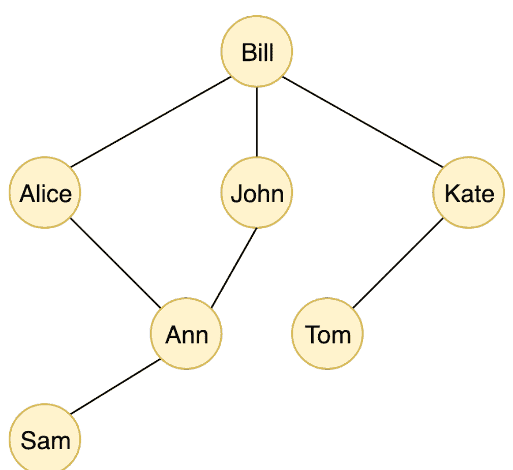

让我们从 Bill 开始，遍历所有直接或间接与 Bill 连接的用户。首先，我们将创建一个图（社交网络的类比）。接下来，我们将创建图的顶点（注册网络用户的类比）。然后，我们将在图节点之间创建边（将用户添加到好友列表的类比）。最后，我们将从 Bill 开始遍历所有用户。

## 25-graph-breadth-first-search/example.js

```
// Import dependencies.
import Graph from '../08-graph/Graph';
import GraphVertex from '../08-graph/GraphVertex';
import GraphEdge from '../08-graph/GraphEdge';
import { breadthFirstSearch } from './breadthFirstSearch';

// Create a demo-version of our overly-simplified social network.
const socialNetwork = new Graph();

// Let's register several users in our network.
const bill = new GraphVertex('Bill');
const alice = new GraphVertex('Alice');
const john = new GraphVertex('John');
const kate = new GraphVertex('Kate');
const ann = new GraphVertex('Ann');
const tom = new GraphVertex('Tom');
const sam = new GraphVertex('Sam');

// Now let's establish friendship connections between the users of our network.
socialNetwork
  .addEdge(new GraphEdge(bill, alice))
  .addEdge(new GraphEdge(bill, john))
  .addEdge(new GraphEdge(bill, kate))
  .addEdge(new GraphEdge(alice, ann))
  .add hingedEdge(new GraphEdge(ann, sam))
  .addEdge(new GraphEdge(john, ann))
  .addEdge(new GraphEdge(kate, tom));

// Now let's traverse the network in breadth-first manner staring from Bill
// and add all users we will encounter to the userVisits array.
const userVisits = [];
breadthFirstSearch(socialNetwork, bill, (user) => {
  userVisits.push(user);
});

// Now let's see in what order the users have been traversed.
// eslint-disable-next-line no-console
console.log(userVisits);
/*
  The output will be:
  [bill, alice, john, kate, ann, tom, sam]
*/
```


## 实现

**函数参数**

如上所述，`breadthFirstSearch()` 函数将接受三个参数：

- graph - 要遍历的图（`Graph` 类的实例），
- startVertex - 作为起点的顶点（`GraphVertex` 类的实例），
- enterVertexCallback - 每次访问顶点时调用的回调函数。

**已访问顶点的记录**

当我们在树上实现广度优先搜索算法时，我们并不关心遍历过程中同一个节点可能从不同的父节点被访问两次的情况。这是因为树的节点根据定义不可能拥有两个或更多的父节点，否则它就变成了图。所以在树中，我们只有一种方式可以进入一个节点。但当我们处理图的时候，需要注意同一个图顶点可能会被多个邻居顶点多次访问。这样同一个顶点可能会被多次添加到遍历栈中。这会导致整个遍历过程效率低下，甚至可能引起死循环。这就是为什么在遍历图的时候，我们需要标记所有已访问的顶点，以避免反复访问同一个顶点。我们将使用 `visitedVertices` 对象来实现这一点。已访问图顶点的键值将作为 `visitedVertices` 对象的键。这将帮助我们以 O(1) 的时间高效地检查节点是否已被访问过。

**队列的使用**

正如上面"算法"部分所提到的，我们将使用队列来存储所有待访问的节点，以实现广度优先遍历。我们可以使用 JavaScript 数组作为简单的队列，用 `unshift()` 方法向队列添加元素，用 `pop()` 方法从队列取出元素。但由于我们已经在本书前面实现了 `Queue` 类，所以这里我们将直接使用它。

然后使用 `while` 循环从队列中访问所有顶点，直到队列为空。每次访问一个新顶点时，我们调用 `enterVertexCallback()` 并将当前顶点 `currentVertex` 的所有未访问邻居添加到 `vertexQueue` 中。

25-graph-breadth-first-search/breadthFirstSearch.js

```js
// Import dependencies.
import { Queue } from '../03-queue/Queue';
```

## 实现示例

我们将从初始化 `vertexQueue` 和 `visitedVertices` 映射表开始实现 `breadthFirstSearch()`。`vertexQueue` 用于存放所有待访问的顶点，`visitedVertices` 用于存放所有已访问顶点的键以防止重复访问。由于我们要从 `startVertex` 开始遍历图，因此需要先将其添加到 `vertexQueue` 和 `visitedVertices` 中。

25-graph-breadth-first-search/breadthFirstSearch.js

```js
/**
 *  Traverse the graph in breadth-first manner.
 *
 * @param {Graph} graph - Graph that is going to be traversed.
 * @param {GraphVertex} startVertex - Vertex that we will use as a starting point.
 * @param {function} enterVertexCallback - Callback that will be called on every vertex visit.
 */
export function breadthFirstSearch(graph, startVertex, enterVertexCallback) {
  // Init vertex queue. Whenever we will meet a new vertex it will be
  // added to the Queue for further exploration.
  const vertexQueue = new Queue();

  // Add startVertex to the queue since we're going to visit it first.
  vertexQueue.enqueue(startVertex);

  // In order to prevent the visiting of the same vertex twice
  // we need to memorize all visited vertices.
  const visitedVertices = {};

  // Since we're going to visit startVertex first let's add it to the visited list.
  visitedVertices[startVertex.getKey()] = true;

  // Traverse all vertices from the queue while it is not empty.
  while (!vertexQueue.isEmpty()) {
    // Get the next vertex from the queue.
    const currentVertex = vertexQueue.dequeue();

    // Call the callback to notify subscribers about the entering a new vertex.
    enterVertexCallback(currentVertex);

    // Add all neighbors to the queue for future traversals.
    currentVertex.getNeighbors().forEach((nextVertex) => {
      if (!visitedVertices[nextVertex.getKey()]) {
        // Memorize current neighbor to avoid visiting it again in the future.
        visitedVertices[nextVertex.getKey()] = true;
        // Add nextVertex to the queue for further visits.
        vertexQueue.enqueue(nextVertex);
      }
    });
  }
}
```

## 复杂度

### 时间复杂度

`breadthFirstSearch()` 函数的时间复杂度主要由 `while` 循环决定，因为 `while` 循环之外的所有语句都以 O(1) 时间执行。记住，通过使用 `visitedVertices` 哈希表，我们防止了同一个顶点被多次添加到 `vertexQueue` 中。因此我们可以假设 `while` 循环恰好执行 |V| 次，其中 |V| 是我们正在遍历的图中连通顶点的数量。我们还需要考虑到，我们通过调用 `currentVertex.getNeighbors()` 来遍历每个顶点的边以获取顶点的邻居。所以我们的函数也会访问所有 |E| 条图的边。最后需要提到的是，在 `while` 循环内部，我们有队列相关的 `enqueue()` 和 `dequeue()` 操作，这些操作以 O(1) 时间执行，因为我们使用的是基于链表实现的队列（更多细节请参阅队列数据结构章节）。

综合以上分析，我们可以得出 `breadthFirstSearch()` 函数的时间复杂度为 O(|V| + |E|)，其中 |E| 是图的边数，|V| 是图的顶点数。

### 辅助空间复杂度

在 `breadthFirstSearch()` 函数的当前实现中，我们使用了以下额外变量：

- `vertexQueue` 队列 - 存储所有 |V| 个图顶点，
- `visitedVertices` 哈希表 - 存储所有 |V| 个图顶点的键，
- `currentVertex` 变量 - 仅存储一个当前顶点实例。

由于 `vertexQueue` 和 `visitedVertices` 变量是空间消耗最大的，我们可以得出 `breadthFirstSearch()` 函数的辅助空间复杂度为 O(|V|)，其中 |V| 是图的顶点数。

## 题目示例

以下是面试中可能遇到的一些相关题目：

- [克隆图](https://leetcode.com/problems/clone-graph/)
- [判断图是否为二分图](https://leetcode.com/problems/is-graph-bipartite/)
- [被围绕的区域](https://leetcode.com/problems/surrounded-regions/)

## 测验

问1：图的广度优先搜索算法的时间复杂度是多少？
问2：哪种数据结构最适合用于实现图的广度优先搜索算法：栈还是队列？

## 参考资料

广度优先搜索（BFS）维基百科页面 [https://en.wikipedia.org/wiki/Breadth-first_search](https://en.wikipedia.org/wiki/Breadth-first_search)

广度优先搜索可视化演示 [https://www.cs.usfca.edu/~galles/visualization/BFS.html](https://www.cs.usfca.edu/~galles/visualization/BFS.html)

图广度优先搜索示例和测试用例 [https://github.com/trekhleb/javascript-algorithms/tree/master/src/algorithms/graph/breadth-first-search](https://github.com/trekhleb/javascript-algorithms/tree/master/src/algorithms/graph/breadth-first-search)

## Dijkstra 算法

- 难度：困难

### 任务描述

给定一个图和图中的一个源顶点，找出从源顶点到图中所有顶点的最短路径。

**示例**

图的一个很好的例子是一张包含不同城市（顶点）和连接它们的道路（边）的地图。如果图是有向的，意味着连接两个城市的道路是单行道。如果图是无向的，那么所有道路都是双向的。此外，图可以是带权的。边的权重可以看作两个地点之间的距离。权重越大，两个城市之间的距离越长。

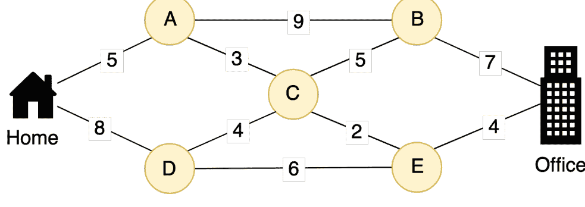

假设我们想从 `Home`（家）顶点出发，找到到达地图上每个地点的最短距离。有了这些信息，我们就可以，例如，找到从 `Home` 到 `Office`（办公室）的最短路径。


## 算法

### 算法定义

**Dijkstra 算法**是一种用于查找图中节点之间最短路径的算法，例如图可以表示道路网络。它由计算机科学家 Edsger W. Dijkstra 于 1956 年提出。

Dijkstra 最初的变体查找的是两个节点之间的最短路径，但更常见的变体是从源节点到图中所有其他节点的最短路径。

### 算法步骤

该算法包含以下步骤：

1.  为所有顶点分配一个**暂定距离**值：将起始顶点设为 `0`（因为我们已经到达它），所有其他顶点设为 `Infinity`（因为此时它们对我们来说似乎是不可达的）。
2.  创建一个**已访问顶点集合**。我们将用它来避免遍历顶点时产生无限循环。
3.  创建一个**顶点访问队列**并将起始顶点放入该队列。我们将使用优先队列，以到顶点的距离作为优先级因子（优先级的概念在之前的章节中有解释）。顶点到起始顶点的距离越短，其优先级越高。
4.  从队列中**取出最近的下一个顶点**（距离源最近的顶点）。优先队列将允许我们执行此操作。
5.  **遍历当前顶点的每个未访问邻居**。对每个邻居计算 `distanceToTheCurrentVertex + distanceFromCurrentVertexToNeighbor`。如果该距离小于邻居的暂定距离，则将其替换为这个新值。
6.  当我们处理完当前顶点的所有邻居后，**将当前顶点标记为已访问**。
7.  **返回第 4 步**并重复，直到顶点访问队列为空。

### 优先队列在算法中的使用

在 Dijkstra 算法中，每次我们取出下一个要访问的顶点（第 4 步）时，它必须是一个之前未被访问过且*到起始顶点距离最短*的节点。

但如何基于距离来执行这种取出操作呢？

如果我们使用之前章节中实现的 Queue 类，Queue 会遵循 FIFO（先进先出）顺序，但它不会考虑距离。例如，如果我们先添加一个距离为 20 的顶点，然后再添加一个距离为 10 的顶点到队列中，那么 `poll()` 操作将返回距离为 20 的顶点，因为它先进入队列——而不是距离更短的 10。因此使用 Queue 行不通。

另一种方法是将顶点访问队列存储为数组，每次需要从中取出下一个顶点时，我们可以遍历整个数组并找到/返回距离最短的下一个顶点。这种方法可行，但时间复杂度为 O(n)。

能否让取出操作更快？

可以，使用优先队列即可实现。在这种情况下，取出操作的时间复杂度为 O(log(n))，从而使算法运行更快。

你可以在本书的"优先队列"章节中找到 PriorityQueue 类的完整描述及实现示例。

### 逐步示例

让我们以上面的图为例，尝试使用 Dijkstra 算法查找从 `Home` 顶点到所有顶点的最短路径。

### 第 1 步

初始化所有顶点的暂定距离。`startingVertex`（在我们的例子中是 `Home` 顶点）的暂定距离为 0，意味着到达 `Home` 不需要任何成本，因为我们已经在那里了。所有其他顶点的暂定距离设为 `Infinity`，因为我们不知道它们距离 `Home` 有多远，甚至不知道它们是否可达。

同时，将 `Home` 顶点添加到顶点优先队列中，以便从它开始遍历图。

### 第 2 步

从优先队列中取出下一个顶点。请记住，每次我们从优先队列中取出顶点时，它都会返回距离 startingVertex 最近的顶点。在我们的例子中，优先队列中只有一个节点，即 Home 顶点。因此当前顶点是 Home。

获取 Home 的所有邻居，并使用公式 distanceToHome + distanceFromHomeToNeighbor 设置到它们的距离。在我们的例子中，对于顶点 A 设置距离 0 + 5 = 5，对于顶点 D 设置距离 0 + 8 = 8。这意味着目前到 A 的最短距离是 5，到 D 的最短距离是 8。

将顶点 A 和 D 推入优先队列。

遍历完 Home 顶点的所有邻居后，我们可以将其标记为已访问（你会在下一张图中看到 Home 节点被标记为黑色，这意味着它已被访问）。

### 第 3 步

从我们的顶点优先队列中获取距离 Home 更近的下一个未访问顶点。在我们的例子中，队列中只有两个顶点 A 和 D。由于顶点 A 距离 Home 更近（距离为 5），我们先访问它。

获取 A 的所有尚未访问的邻居。邻居是顶点 B 和顶点 C。让我们使用公式 `distanceToA + distanceFromAtoNeighbor` 计算到邻居的最短路径。顶点 B 的距离计算为 5 + 9 = 14。顶点 C 的距离计算为 5 + 3 = 8。

将新的邻居 B 和 C 添加到顶点优先队列。

由于 A 的所有邻居都已被访问，我们将 A 标记为已访问（它将在下一张图中变为黑色）。

### 第 4 步

从我们的顶点优先队列中获取距离 Home 更近的下一个未访问顶点。在我们的例子中，队列中只有三个顶点 D、C 和 B。由于 D 和 C 顶点距离 Home 最近（距离为 8），让我们选择先被添加到队列中的那个顶点。那就是顶点 D。

获取 D 的所有邻居（顶点 C 和 E），并计算到它们的最短距离。对于 C 我们得到 8 + 4 = 12，对于 E 得到 8 + 6 = 14。注意顶点 C 已经有一个计算好的距离。如果我们从顶点 A 到顶点 C，那么从 Home 到顶点 C 的距离是 8。由于通过顶点 D 从 Home 到顶点 C 的总距离比之前找到的更长（12 > 8），因此我们放弃刚找到的距离（通过顶点 D），保留最短路径方案（通过顶点 A）。所以顶点 C 的距离在此时保持不变。

将新的邻居 E 添加到顶点优先队列。无需将 C 添加到队列中，因为它已经在队列中了。

将顶点 D 标记为已访问。

### 第 5 步

从顶点优先队列中获取距离 Home 最近的顶点。在我们的例子中是顶点 C。

获取 C 的所有未访问邻居（在我们的例子中是 B 和 E）。计算从 C 到 B 和 E 的最短距离。顶点 B 的距离计算为 8 + 5 = 13，E 的距离是 8 + 2 = 10。注意我们刚刚找到了一条到 B 的更短路径。之前通过 A 从 Home 到 B 的距离是 14，但现在我们发现通过 C 从 Home 到 B 的距离更短，等于 13。在这种情况下，我们需要将到 B 的距离更新为 13，*同时还需要更新优先队列中顶点 B 的优先级*。

将 C 的所有未访问邻居添加到优先队列。

将顶点 C 标记为已访问。

### 第 6 步

从顶点优先队列中获取距离 Home 最近的顶点。在我们的例子中是顶点 E。

获取 E 的所有未访问邻居并更新它们的距离。在我们的例子中，只有一个未访问邻居 Office，到它的距离是 10 + 4 = 14。

将 Office 顶点添加到优先队列。

将顶点 E 标记为已访问。

### 第 7 步

从顶点优先队列中获取距离 Home 最近的顶点。在我们的例子中是顶点 B。

获取 B 的所有未访问邻居并更新它们的距离。在我们的例子中，只有一个未访问邻居 Office，到它的距离是 13 + 7 = 20。由于它大于我们在上一步中找到的到 Office 的距离（20 > 14），我们忽略它。

将顶点 B 标记为已访问。


## 第 8 步

我们终于到达队列中的最后一个节点，且该节点没有未访问的邻接节点。这意味着我们可以停止了，并且我们已经找到了从 Home 顶点到所有顶点的最短路径。

## 应用

Dijkstra 算法可应用于以下领域：

- 在 GIS（地理信息系统）中，查找地图上地理点之间的最短路径（交通和距离可表示为图边的权重）。
- 在计算机网络中（例如，点对点应用），查找机器 A 和 B 之间的最短路径。

## 使用示例

在我们开始实现 `dijkstra()` 函数之前，先假设我们已经实现了它，看看我们希望它如何工作，以及它应该具有怎样的接口（输入参数和输出值）。

我们采用上面“任务”部分的图，尝试查找从 `Home` 顶点到所有其他顶点的最短路径，特别是从 `Home` 到 `Office` 的最短路径。

调用 `dijkstra()` 函数时，我们希望传入要遍历的 `graph` 以及起始顶点 `startVertex`。

该函数应返回 `distances` 对象，其中包含从 `startVertex` 到所有顶点的最短路径。该对象可以是一个映射，以顶点键作为键，最短距离作为值。例如：

```
{
  Home: 0,
  A: 4,
  Office: 10,
  ...
}
```

这意味着从 `startVertex` 到键为 `Office` 的节点的最短距离是 10。从 `startVertex` 到键为 `A` 的节点的最短距离是 4。`Home` 的最短距离为 0，因为我们的 `startVertex` 的键是 `Home`，而我们已经在那里了，不需要任何操作。

但 `distances` 映射无法让我们了解到达 `Office` 的最短路径是什么。我们知道到达那里需要 10 个距离单位（假设为英里），但我们不知道该走哪条路径。因此，我们需要 `dijkstra()` 函数还返回另一个对象，我们称之为 `previousVertices`。该对象的想法是：它也是一个映射，键与图的顶点键匹配，但该对象包含的是构成最短路径的前一个顶点的链接，而不是距离。例如：

```
{
  Office: spotE,
  E: spotC,
  C: spotA,
  A: spotHome,
  Home: null,
}
```

在上面的示例中，spotE、spotC、spotA、spotHome 是 GraphVertex 类的实例，而 Office、E、C、A、Home 只是图中每个顶点的字符串键。

```
// 导入依赖。
import GraphVertex from '../08-graph/GraphVertex';
import GraphEdge from '../08-graph/GraphEdge';
import Graph from '../08-graph/Graph';
import dijkstra from './dijkstra';

// 让我们在想象地图上创建地点。
const spotHome = new GraphVertex('Home');
const spotA = new GraphVertex('A');
const spotB = new GraphVertex('B');
const spotC = new GraphVertex('C');
const spotD = new GraphVertex('D');
const spotE = new GraphVertex('E');
const spotOffice = new GraphVertex('Office');

// 现在让我们用特定长度的道路连接这些地点。
const roadHomeA = new GraphEdge(spotHome, spotA, 5);
const roadHomeD = new GraphEdge(spotHome, spotD, 8);
const roadAB = new GraphEdge(spotA, spotB, 9);
const roadAC = new GraphEdge(spotA, spotC, 3);
const roadCB = new GraphEdge(spotC, spotB, 5);
const roadDC = new GraphEdge(spotD, spotC, 4);
const roadCE = new GraphEdge(spotC, spotE, 2);
const roadDE = new GraphEdge(spotD, spotE, 6);
const roadOfficeB = new GraphEdge(spotOffice, spotB, 7);
const roadOfficeE = new GraphEdge(spotOffice, spotE, 4);

// 我们将创建双向道路，这意味着我们的图将是无向的。
const isDirected = false;
const graph = new Graph(isDirected);

// 现在让我们将刚刚创建的地点和道路添加到图中。
// 这就像将关于地点和道路的所有信息放在地图上。
// 请记住，我们不需要同时添加顶点及其之间的边。
// 我们可以只添加边，顶点会自动添加到图中
//（有关图实现的更多详细信息，请参阅图章节）。
graph
  .addEdge(roadHomeA)
  .addEdge(roadHomeD)
  .addEdge(roadAB)
  .addEdge(roadAC)
  .addEdge(roadCB)
  .addEdge(roadDC)
  .addEdge(roadCE)
  .addEdge(roadDE)
  .addEdge(roadOfficeB)
  .addEdge(roadOfficeE);
```

```
// 现在我们准备好启动 Dijkstra 算法，并找出从家到所有其他节点
// 以及特别是到办公室的最短路径是什么。
const { distances, previousVertices } = dijkstra(graph, spotHome);
```

```
/* eslint-disable no-console */
```

```
// 现在让我们打印并查看到地图上每个地点的最短距离。
console.log(distances);
/*
 输出将是：

{
  Home: 0,
  A: 5,
  B: 13,
  C: 8,
  D: 8,
  E: 10,
  Office: 14,
}

这意味着从 Home 到 Office 的最短距离是 14。
*/

// 现在当我们知道了从 Home 到 Office 的最短距离后，
// 让我们找出具有最短距离的最短路径是什么。
console.log(previousVertices.Office.getKey()); // -> 'E'
console.log(previousVertices.E.getKey()); // -> 'C'
console.log(previousVertices.C.getKey()); // -> 'A'
console.log(previousVertices.A.getKey()); // -> 'Home'

// 所以从 Home 到 Office 的最短路径是：
// Home -> A -> C -> E -> Office
```

dijkstra() 函数的输出将允许我们找到从 Home 到 Office 以及到图中任何其他顶点的最短路径。

## 实现

## 导入依赖

由于我们将使用 PriorityQueue 类来跟踪顶点访问顺序，让我们将其作为依赖导入。

26-dijkstra/dijkstra.js

```
// 导入依赖。
import { PriorityQueue } from '../07-priority-queue/PriorityQueue';
```

## 描述类型

首先，让我们创建 `ShortestPaths` 类型定义，我们将在描述 `dijkstra()` 函数的返回值时使用它。

```
26-dijkstra/dijkstra.js
/**
 * @typedef {Object} ShortestPaths
 * @property {Object} distances - 到所有顶点的最短距离
 * @property {Object} previousVertices - 到所有顶点的最短路径。
 */
```

## 实现 `dijkstra()` 函数

现在我们可以在 `dijkstra()` 的 JSDoc 部分中使用这个类型定义来描述函数的输入和输出。描述函数的 JSDoc 不是强制的，但这将帮助函数的使用者更好地理解函数接受什么参数以及返回什么。

`dijkstra()` 函数将接受以下参数：

- `graph` - 我们要遍历的图（`Graph` 类的实例，实现细节请参阅"图"章节）。
- `startVertex` - 我们将用作遍历起始点的图顶点（`GraphVertex` 类的实例，实现细节请参阅"图"章节）。

`dijkstra()` 函数首先初始化辅助变量：

- `distances` - 此映射用于存储从 `startVertex` 到每个顶点的最短距离。它可能看起来像 `{A: 5, D: 8}`，意味着从 `startVertex` 到 A 的最短距离是 5，到 D 是 8。最初，我们将到所有顶点的距离设置为 `Infinity`，因为我们还没有到达它们。
- `visitedVertices` - 此映射用于跟踪已访问的顶点，避免同一顶点被访问多次。它可能看起来像 `{A: true, D: true}`，意味着顶点 A 和 D 已经被访问过。
- `previousVertices` - 此映射将存储关于哪个顶点是当前顶点的前一个顶点的信息，以便构成最短路径。例如，此映射可能看起来像 `{A: B, B: D, D: StartVertex}`，意味着到 A 的最短路径经过 B，到 B 的最短路径经过 D，而到 D 的最短路径是从 `StartVertex` 的直接路径。此映射将允许我们恢复图中任何连通顶点的最短路径。
- `queue` - `PriorityQueue` 的实例，我们将用它来跟踪接下来需要访问哪个顶点。每次我们需要决定接下来访问哪个顶点时，我们需要取离 `StartVertex` 最近的未访问顶点。


## 附录 A：测验答案

### 算法及其复杂度

- *Q1*：不是的，时间复杂度表示的是函数执行时间与函数输入之间的比率（比例）

- *Q2*：O(log(n)) 更快。例如 O(1000) = 1000，但 O(log(1000)) = 9

- *Q3*：这并不正确。有时这是一种权衡取舍，你可以通过消耗更多内存来使算法运行得更快。

### 链表

- *Q1*：它是对链表中下一个对象的引用

- *Q2*：deleteTail 删除链表中的最后一个元素，deleteHead 删除第一个元素

### 队列

- *Q1*：队列是先进先出的

- *Q2*：队列的基本操作有 `peek()`、`enqueue()` 和 `dequeue()`

- *Q3*：时间复杂度为 O(1)

### 栈

- *Q1*：栈是先进后出的

- *Q2*：栈的基本操作有 `peek()`、`push()` 和 `pop()`

- *Q3*：时间复杂度为 O(1)

### 哈希表

- *Q1*：哈希表的主要优势是快速查找

- *Q2*：时间复杂度为 O(1)（在拥有良好的哈希函数和足够数量的桶的前提下）

- *Q3*：冲突是指当我们试图将两个具有不同键的值存储到同一个桶中时发生的情况，原因可能是哈希函数不够理想，也可能是可用桶的数量不足

- *Q4*：处理冲突的方式之一是链地址法（Separate Chaining），即使用链表来存储每个桶中的信息

### 二叉搜索树（BST）

---

## 复杂度

假设我们要遍历的图有 |V| 个顶点和 |E| 条边。

## 时间复杂度

在我们的 `dijkstra()` 函数中，我们首先进行初始设置，然后遍历队列。让我们来分析这两个步骤。

**初始设置**（创建队列、填充 `distances` 和 `previousVertices`）。这些步骤的复杂度为 O(|V|)，因为我们遍历了图中所有的顶点。

**遍历队列。** `while` 循环内的代码将被调用 |V| 次，因为通过在 `visitedVertices` 映射中跟踪已访问的顶点，我们恰好访问每个顶点一次。因此我们将会用到 `while` 循环内代码时间复杂度的 |V| 倍。

让我们来分析在 `while` 循环内执行的步骤：

- **从队列中轮询下一个顶点。** 该操作使用 `MinHeap` 类的 `poll()` 方法，其时间复杂度为 O(log(|V|))（有关 `poll()` 方法复杂度计算的更多细节，请参阅"堆"章节）。
- **遍历当前顶点的未访问邻居。** 在最坏情况下，当图是完全连通的且每个顶点都有 |V| - 1 条边时，此步骤将花费 O(|E|) 时间。
  - **更新顶点距离。** 此步骤涉及对 `distances` 映射的操作，因此具有 O(1) 的时间复杂度。
  - **在需要时更改顶点优先级。** 这是与 `MinHeap` 类相关的操作，以 O(log(|V|)) 的时间完成，因为我们正在从堆树中移除和添加元素，并在此过程中调用 `heapifyUp()` 和 `heapifyDown()` 方法。
  - **检查顶点是否已在队列中。** 该操作使用哈希映射完成，因此耗时 O(1)。
  - **将顶点添加到队列中。** 该操作耗时 O(log(|V|))，因为需要调用 `MinHeap` 类的 `heapifyUp()` 方法来重建堆。
  - **将当前顶点标记为已访问。** 这是 O(1) 操作，因为我们在此处处理的是更新 `visitedVertices` 映射。

如果我们将上述所有步骤的复杂度综合考虑，我们将得到 `dijkstra()` 函数的最终时间复杂度，即 O(|E| * |V| * log(|V|))，其中 |V| 是图的顶点数，|E| 是图的边数。

## 辅助空间复杂度

我们使用了辅助数据结构，如映射（`distances`、`visitedVertices`、`previousVertices` 变量）、优先队列（`queue` 变量）来使 `dijkstra()` 函数运行。所有这些数据结构的大小都与图的顶点数成正比。因此我们可以认为辅助空间复杂度为 O(|V|)。

---

dijkstra() 函数的 while 循环模拟了上面"算法步骤"部分中描述的算法步骤：

1. **轮询下一个最近的顶点**（距源点距离较短的顶点），使用 PriorityQueue 实例的 poll() 方法。
2. **遍历当前顶点的每个未访问邻居**，使用 Graph 实例的 getNeighbors() 方法。对于每个邻居，我们计算 distanceToNeighborFromCurrent。如果该距离小于 existingDistanceToNeighbor，则用这个新值替换它，并使用 changePriority() 方法更改该邻居在队列中的优先级。
3. **将当前顶点标记为已访问。**
4. **返回步骤 1**，并重复执行直到顶点访问队列为空。队列是否为空通过使用 PriorityQueue 实例的 isEmpty() 方法来检查。

以下是 dijkstra() 函数的一种实现示例。

```
26-dijkstra/dijkstra.js

/**
 * Implementation of Dijkstra algorithm of finding the shortest paths to graph nodes.
 * @param {Graph} graph - graph we're going to traverse.
 * @param {GraphVertex} startVertex - traversal start vertex.
 * @return {ShortestPaths}
 */
export default function dijkstra(graph, startVertex) {
  // Init helper variables that we will need for Dijkstra algorithm.
  const distances = {};
  const visitedVertices = {};
  const previousVertices = {};
  const queue = new PriorityQueue();

  // Init all distances with infinity assuming that currently we can't reach
  // any of the vertices except the start one.
  graph.getAllVertices().forEach((vertex) => {
    distances[vertex.getKey()] = Infinity;
    previousVertices[vertex.getKey()] = null;
  });

  // We are already at the startVertex so the distance to it is zero.
  distances[startVertex.getKey()] = 0;

  // Init vertices queue.
  queue.add(startVertex, distances[startVertex.getKey()]);

  // Iterate over the priority queue of vertices until it is empty.
  while (!queue.isEmpty()) {
    // Fetch next closest vertex.
    const currentVertex = queue.poll();

    // Iterate over every unvisited neighbor of the current vertex.
    currentVertex.getNeighbors().forEach((neighbor) => {
      if (!visitedVertices[neighbor.getKey()]) {
        const edgeWeight = neighbor.edge.weight;
        const existingDistanceToNeighbor = distances[neighbor.getKey()];
        const distanceToNeighborFromCurrent = distances[currentVertex.getKey()] + edgeWeight;

        // If we've found shorter path to the neighbor - update it.
        if (distanceToNeighborFromCurrent < existingDistanceToNeighbor) {
          distances[neighbor.getKey()] = distanceToNeighborFromCurrent;

          // Change priority of the neighbor in a queue since it might have become closer.
          if (queue.has(neighbor)) {
            queue.changePriority(neighbor, distances[neighbor.getKey()]);
          }

          // Remember previous closest vertex.
          previousVertices[neighbor.getKey()] = currentVertex;
        }

        // Add neighbor to the queue for further visiting.
        if (!queue.has(neighbor)) {
          queue.add(neighbor, distances[neighbor.getKey()]);
        }
      }
    });

    // Add current vertex to visited ones to avoid visiting it again later.
    visitedVertices[currentVertex.getKey()] = true;
  }

  // Return the set of shortest distances and paths to all vertices.
  return { distances, previousVertices };
}
```

---

## 题目示例

以下是你在面试中可能会遇到的一些相关问题：

- 网络延迟时间
- K 站中转内最便宜的航班

## 参考资料

维基百科上的 Dijkstra 算法 https://en.wikipedia.org/wiki/Dijkstra%27s_algorithm

YouTube 上的 Dijkstra 算法 https://www.youtube.com/watch?v=gdmfOwyQlcI

Dijkstra 算法示例和测试用例 https://github.com/trekhleb/javascript-algorithms/tree/master/src/algorithms/graph/dijkstra

- https://leetcode.com/problems/network-delay-time/
- https://leetcode.com/problems/cheapest-flights-within-k-stops/
- https://en.wikipedia.org/wiki/Dijkstra%27s_algorithm
- https://www.youtube.com/watch?v=gdmfOwyQlcI
- https://github.com/trekhleb/javascript-algorithms/tree/master/src/algorithms/graph/dijkstra


# 二叉堆

- *Q1*：**“形状性质”**和**“堆性质”**
- *Q2*：我们需要将堆的最后一个元素（树中左下角的元素）移到堆顶，然后执行堆向下调整操作。
- *Q3*：`O(log(n))`

# 优先队列

- *Q1*：我们需要使用`MaxHeap`而不是`MinHeap`。
- *Q2*：`O(log(n))`

# 图

- *Q1*：是的。树是**有向连通无环图**的特例。
- *Q2*：是的。在这种情况下，我们将得到一个仅由两个顶点构成的非连通图（顶点）。
- *Q3*：表示图有两种常见方式：邻接表和邻接矩阵。

# 位操作

- *Q1*：`111011`
- *Q2*：`000101 & 111110 = 000100`

# 阶乘

- *Q1*：`7`

# 素数测试

- *Q1*：不是，`32/2`余数为`0`。
- *Q2*：是的，`31/2`余数为`1`。31的平方根是5.56776436283 – `31/3 = 10.3`，`31/4 = 7.75`，`31/5 = 6.2`。

# 是否为2的幂

- *Q1*：是的，32/2 = 16, 16/2 = 8, 8/2 = 4, 4/2 = 2, 2/2 = 1
- *Q2*：不是，01111 & 11110 = 01110

# 查找。线性查找。

- *Q1*：在最坏和平均情况下，时间复杂度为O(n)。
- *Q2*：不是。由于O(n)的时间复杂度，通常的做法是将该算法应用于小规模列表。

# 查找。二分查找。

- *Q1*：不是。二分查找本质上只对**有序数组**有效。否则，我们无法在每一步中舍弃一半的数组。
- *Q2*：时间复杂度为O(log(n))。这是由于我们每次迭代都舍弃一半的数组。

# 集合。笛卡尔积。

- *Q1*：它有4个元素：['ac', 'ad', 'bc', 'bd']。公式是 |A| * |B|。
- *Q2*：是的，有可能。如果我们有四个集合A、B、C和D，那么笛卡尔积集合中的每个元素都将由四个元素组成（a, b, c, d）。
- *Q3*：时间复杂度为O(|A|*|B|)。

# 集合。幂集。

- *Q1*：是的，空集是幂集的一部分。
- *Q2*：它有2<sup>4</sup>=16个元素，其中4是原始集合{a, b, c, d}的大小。

# 集合。排列。

- *Q1*：是的，顺序很重要。这是排列与组合相比的显著特征。
- *Q2*：我们将得到 4! / (4 - 2)! = 4! / 2! = 24 / 2 = 12 种排列。

# 集合。组合。

- *Q1*：不是，顺序不重要。这是组合与排列相比的显著特征。
- *Q2*：我们将得到 4! / (2! * (4 - 2)!) = 4! / (2! * 2!) = 24 / 4 = 6 种组合。

# 排序：快速排序

- *Q1*：快速排序的平均时间复杂度为O(n * log(n))。
- *Q2*：我们只需要将大于基准元素的元素添加到左侧数组（而不是右侧），并将小于基准元素的元素添加到右侧数组（而不是左侧）。

# 树。深度优先搜索。

- *Q1*：DFS的时间复杂度为O( |N| )，其中|N|是树中节点的总数。
- *Q2*：是的，我们可以通过使用之前实现的`Stack`类来避免递归。在这种情况下，每次访问节点时，我们需要将其所有子节点（而不仅仅是两个）放入栈中。然后从栈顶获取下一个要遍历的节点。

# 树。广度优先搜索。

- *Q1*：BFS的时间复杂度为O( |N| )，其中|N|是树中节点的总数。
- *Q2*：我们不是在`while`循环内只将'左'和'右'子节点添加到队列，而是需要获取节点的所有子节点并将它们全部添加到队列中。

# 图。深度优先搜索。

- *Q1*：图的DFS时间复杂度为O( |V| + |E| )，其中|V|是顶点总数，|E|是图中的边总数。
- *Q2*：栈最适合实现DFS算法。

# 图。广度优先搜索。

- *Q1*：图的BFS时间复杂度为O( |V| + |E| )，其中|V|是顶点总数，|E|是图中的边总数。
- *Q2*：队列最适合实现BFS。

# 附录 B：大O时间复杂度比较

下图包含算法分析中常用函数，显示了每个函数的操作次数与输入元素数量的关系。

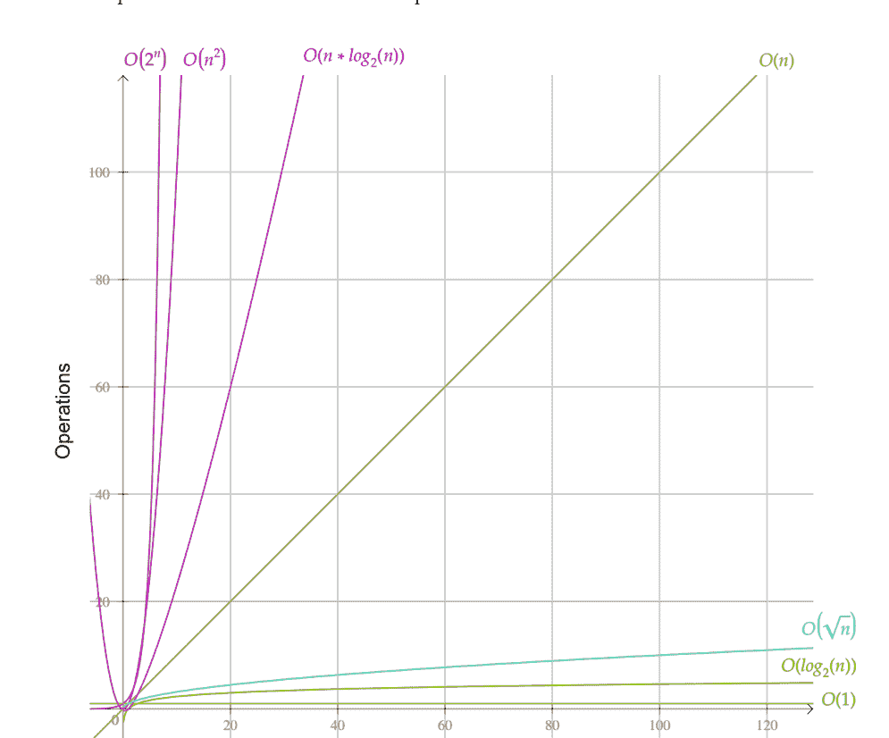

下表包含一些最常见的大O表示法及其在不同输入数据大小下的性能比较。这将让你感受到不同算法复杂度（时间和内存消耗）可能有多大差异。

| 大O表示法 | 10个元素的计算次数 | 100个元素的计算次数 | 1000个元素的计算次数 |
|---|---|---|---|
| O(1) | 1 | 1 | 1 |
| O(log(n)) | 3 | 6 | 9 |
| O(n) | 10 | 100 | 1000 |
| O(n log(n)) | 30 | 600 | 9000 |
| O(n²) | 100 | 10000 | 1000000 |
| O(2ⁿ) | 1024 | 1.26e+29 | 1.07e+301 |
| O(n!) | 3628800 | 9.3e+157 | 4.02e+2567 |

# 附录 C：数据结构操作复杂度

## 常见数据结构操作复杂度

| 数据结构 | 访问 | 搜索 | 插入 | 删除 | 备注 |
|---|---|---|---|---|---|
| 数组 | 1 | n | n | n | |
| 栈 | n | n | 1 | 1 | |
| 队列 | n | n | 1 | 1 | |
| 链表 | n | n | 1 | 1 | |
| 哈希表 | - | n | n | n | 如果哈希函数完美，代价为O(1) |
| 二叉搜索树 | n | n | n | n | 如果是平衡树，代价为O(log(n)) |
| B树 | log(n) | log(n) | log(n) | log(n) | |
| 红黑树 | log(n) | log(n) | log(n) | log(n) | |
| AVL树 | log(n) | log(n) | log(n) | log(n) | |
| 布隆过滤器 | - | 1 | 1 | - | 搜索时可能出现假阳性 |

## 图操作复杂度

| 实现方式 | 添加顶点 | 移除顶点 | 添加边 | 移除边 |
|---|---|---|---|---|
| 邻接表 | O(1) | O(E+V) | O(1) | O(E) |
| 邻接矩阵 | O(V²) | O(V²) | O(1) | O(1) |

其中：V - 图中顶点数量，E - 图中边的数量

## 堆操作复杂度

| 查看堆顶 | 取出堆顶 | 添加元素 | 移除元素 |
|---|---|---|---|
| O(1) | O(log(n)) | O(log(n)) | O(log(n)) |

# 附录 D：数组排序算法复杂度

| 名称 | 最佳情况 | 平均情况 | 最坏情况 | 内存消耗 | 稳定性 | 备注 |
|------|------|---------|-------|--------|--------|----------|
| 冒泡排序 | n | n<sup>2</sup> | n<sup>2</sup> | 1 | 是 | |
| 插入排序 | n | n<sup>2</sup> | n<sup>2</sup> | 1 | 是 | |
| 选择排序 | n<sup>2</sup> | n<sup>2</sup> | n<sup>2</sup> | 1 | 否 | |
| 堆排序 | n log(n) | n log(n) | n log(n) | 1 | 否 | |
| 归并排序 | n log(n) | n log(n) | n log(n) | n | 是 | |
| 快速排序 | n log(n) | n log(n) | n<sup>2</sup>log(n) | 否 | 通常原地进行，需要O(log(n))的栈空间 |
| 希尔排序 | n log(n) | 取决于间隔序列 | n (log(n))<sup>2</sup> | 否 | |
| 计数排序 | n + r | n + r | n + r | n + r | 是 | r - 数组中最大数字 |
| 基数排序 | n * k | n * k | n * k | n + k | 是 | k - 最长键的长度 |

# 更新日志

## 版本 2 (2019-11-25)

预发布版本 2

## 版本 1 (2019-10-29)

书籍初始预发布版本
