# JavaScript 算法

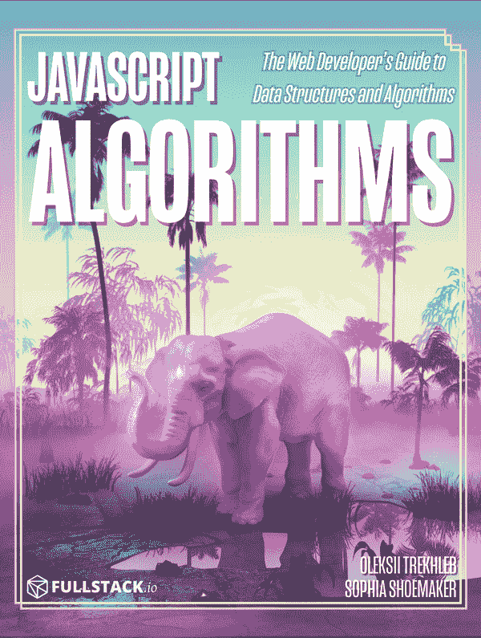


## 指南

1. 开始阅读

### 书籍修订

版本 1 - 早期发布 - 2019-11-25

### 早期发布版本

本书的此版本为早期发布版本。大部分但并非所有章节已经过编辑。内容在正式版发布前可能会发生变化。

### 加入我们的 Discord

在官方的 newline Discord 频道中与其他读者一起聊天：

点击加入：[`newline.co/discord/algorithms`](https://newline.co/discord/algorithms)

### 报告

如果你想报告任何 Bug、拼写错误或建议，请发送邮件给我们：`us@fullstack.io`。

### 通过 Twitter 获取更新通知

如果你想在 Twitter 上接收本书的更新通知，请关注我们的 [@fullstackio](https://twitter.com/fullstackio)。

### 我们渴望听听你的反馈！

你喜欢这本书吗？你觉得它有帮助吗？我们乐意将你的评价加入我们网站的证言列表中！请发送邮件至：`us@fullstack.io`。

### 引言

作为一名 JavaScript 开发者，你可能认为不需要学习数据结构或算法。

你知道 JavaScript 本身（运行时+浏览器）使用了栈（stack）、堆（heap）和队列（queue）等吗？你对每天使用的 JavaScript 越了解，就越能驾驭它的力量并减少错误。如果你认为算法和数据结构只是一门对于 JavaScript 开发者来说并非必需的计算机科学课程，请重新考虑！

### 如何阅读这本书

每一章都涵盖了一个你可能在工作或面试中遇到的算法。你可以逐一研究这些算法，也可以自由跳读。

## 算法及其复杂度

### 什么是算法

在本书中，我们将编写`algorithms`——即为我们解决特定问题的步骤集合。

我们在日常生活中不断使用`algorithms`。例如，如果我们在某条街上，想回到住在 20 层的公寓？为了实现这一目标，我们可以采取以下操作：

```
1. 走路回到家里。
2. 使用楼梯上到第 20 层。
```

这就是一个算法。我们定义并使用了一组解决“回家”任务的步骤。

### 算法复杂度

让我们以上一节的“回家”问题为例。还有其他解决方法吗？有的，我们实现了不同的步骤（阅读“算法”部分）来实现该目标：

```
1. 打一辆出租车送你回家。
2. 使用电梯上到第 20 层。
```

现在，让我们考虑在这两个算法中应该选择哪一个：

首先，我们需要明确我们的限制条件（我们有多少钱、我们多急需回家、我们的健康状况如何），并`从这些限制条件的角度评估算法`。

如你所见，这两种算法都需要不同的时间和资源。第一种需要更多的时间和精力，但钱较少。第二种需要的时间和精力较少，但钱更多。如果我们没钱且身体健康，我们需要选择第一种算法并享受步行。否则，如果我们有足够的钱且急需回家，第二种方案更好。

我们刚刚所做的就是评估`每个算法的复杂度（complexity of each algorithm）`。

#### 时间空间复杂度

在上例中，我们评估了每个算法所需的时间和资源（即金钱和或健康）。我们将这些评估称为`时间复杂度（time complexity）`和`资源复杂度（resource complexity）`。这两个特征对于我们决定哪种算法适合我们的需求至关重要。

在书中，我们不会从日常计划规划的角度来处理“回家”问题（在这种情况下我们可能只应用直觉）。相反，我们将采用更具数学的方法。

### 大 O 表示

#### 大 O 表示定义

*大 O 表示用于根据算法运行时间或空间增长的情况对算法进行分类。*

这里的关键在于，大 O 表示是一种相对指标，显示了算法的执行时间根据输入的大小增长有多快。时间和内存的绝对值随硬件而异，因此我们需要使用相对指标。同一个程序在某台计算机上可能执行需 1 秒，而在另一台上可能需要 10 秒。因此，当你比较两个算法的时间复杂度时，要求它们在相同的定义的硬件配置上运行，这并不方便，有时也无法实现。

大 O 表示定义了`输入大小 → 耗时`的时间复杂度以及`输入大小 → 消耗内存`的空间复杂度。它根据增长率来表征程序（函数）：相同增长率的不同程序可以使用相同的 O 表示。

使用字母 O 是因为程序（函数）的增长率也被称为函数的阶数（order of the function）。

#### 大 O 表示解释

让我们通过上述“回家”算法来说明大 O 概念，特别是算法中的“爬楼梯”部分。

想象我们有两个男人：一个是年轻且快速的奥运冠军，另一个是典型的中年男性。我们刚刚同意，我们希望爬楼梯算法的复杂度对这两个来说是相同的，因此它不应该取决于人的速度，而应该取决于他们爬得有多高。在计算机方面，我们的算法分析不取决于硬件，而取决于软件问题本身。这两个男人到达第 20 层需要走多少步？嗯，假设每层之间有 20 台阶。这意味着他们需要走`20 * 20 = 400`步才能到达第 20 层。让我们为`n`层进行泛化：

```
输入：(20 * n) 步
输出：(20 * n) 步（移动）
```

你看到这里的规律了吗？爬楼梯的时间复杂度与楼层数呈线性依赖关系。在 Big O 语法中，这种关系写如下：

```
O(20 * n)
```

这里有一个重要的规则需要理解：

> 在使用 Big O 表示法描述复杂度时，我们必须始终舍弃非主导部分：`O(n + 1)`变为`O(n)`，`O(n + n²)`变为`O(n²)`，`O(n + log(n))`变为`O(n)`，以此类推。

为什么呢？因为 Big O 描述的是函数的阶，而不是它消耗的精确毫秒或兆字节。它描述的是趋势而非绝对值。因此，非主导常数并不重要。非主导常数是在`n`取值巨大时我们可以丢弃的部分。例如，在`n = 10000`的情况下，这两个部分中哪一个对最终结果的影响更大：`20`还是`n = 10000`？显而易见，`n`对最终结果的影响是常数`20`的`500`倍。因此，我们可以舍弃它，“爬楼梯”算法的时间复杂度如下：

```
O(n)
```

这是一个线性依赖的例子，但也存在其他类型的依赖关系：`O(log(n))`、`O(n * log(n))`、`O(n²)`、`O(2^n)`、`O(n!)`等。

查看算法分析中常用的函数图表，它们展示了每个函数的操作次数`N`与输入规模`n`的关系。

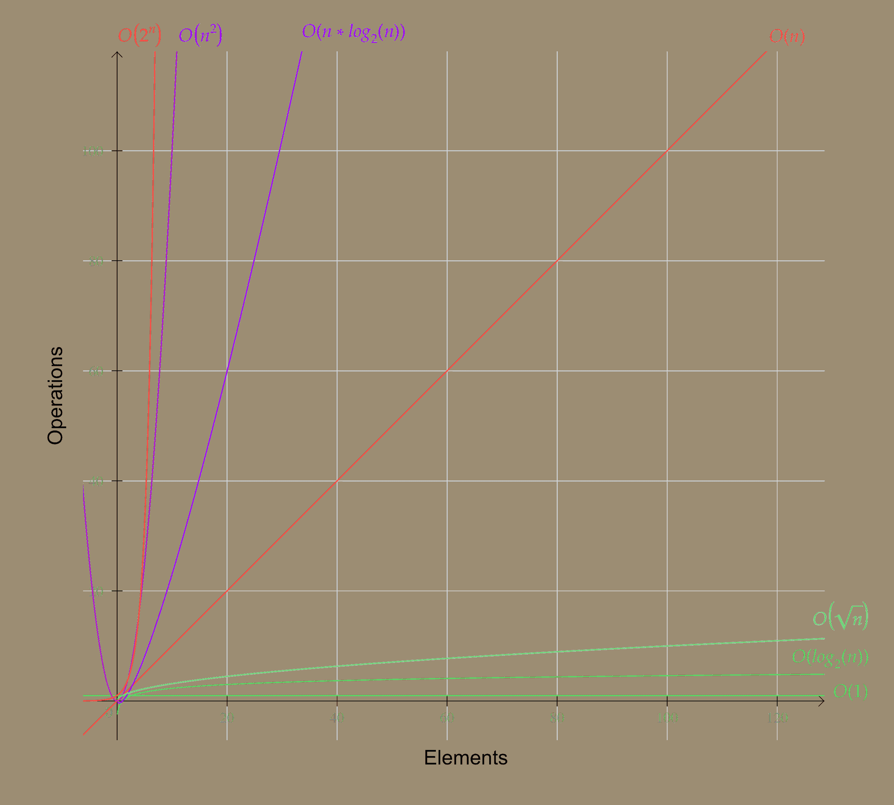

所有这些图表向我们展示了函数的时间和消耗取决于输入增长得有多快。两个不同的数组排序算法可能完成相同的排序任务，但一个耗时为`O(n * log(n))`，另一个为`O(n²)`。如果有选择，我们会倾向于选择第一个而不是第二个。

*使用 Big O 表示法，我们可以根据 Big O 值对算法（函数、程序）进行比较，而独立于它们运行的硬件。*

查看一些常见的 Big O 表示法列表以及针对不同规模输入数据的性能对比。这将让你对不同算法的复杂度（时间和内存消耗）可能是什么样的有一个直观的感受。

| Big O Notation | 10 个元素的计算次数 | 100 个元素的计算次数 | 1000 个元素的计算次数 |
| --- | --- | --- | --- |
| `O(1)` | 1 | 1 | 1 |
| `O(log(n))` | 3 | 6 | 9 |
| `O(n)` | 10 | 100 | 1000 |
| `O(n log(n))` | 30 | 600 | 9000 |
| `O(n²)` | 100 | 10000 | 1000000 |
| `O(2^n)` | 1024 | 1.26e+29 | 1.07e+301 |
| `O(n!)` | 3628800 | 9.3e+157 | 4.02e+2567 |

## Big O 表示法示例

让我们继续看其他一些 Big O 表示法的例子。

### O(1) 示例

让我们写一个将数字提升到指定幂的函数：

```javascript
/**
 * 将数字提升到幂。
 *
 * 示例：
 * number = 3
 * power = 2
 * output = 3² = 9
 *
 * @param {number} number
 * @param {number} power
 * @return {number}
 */
export function fastPower(number, power) {
  return number ** power;
}
```

`01-algorithms-and-their-complexities/fastPower.js`

它的时间复杂度和空间复杂度是多少？

思考函数的输入将如何影响它完成的操作次数。对于每一个输入，函数都只执行一次操作。这意味着该函数的时间复杂度为：

```
Time complexity: O(1)
```

现在让我们粗略分析评估此函数需要多少内存。在这种情况下，我们操作的变量数量不取决于输入。因此，空间复杂度为：

```
Space complexity: O(1)
```

### O(n) 示例

现在让我们用迭代的方式来实现相同的幂函数：

```javascript
/**
 * 从提供的字母中获取所有可能的组合。
 *
 * Example:
 * letter = ['a', 'b']
 * output = ['aa', 'ab', 'ba', 'bb']
 *
 * @param {string[]} letters
 * @return {string[]}
 */
export function pairs(letters) {
  const result = [];

  for (let i = 0; i < letters.length; i += 1) {
    for (let j = 0; j < letters.length; j += 1) {
      result.push(`${letters[i]}${letters[j]}`);
    }
  }

  return result;
}
```

`01-algorithms-and-their-complexities/pairs.js`

现在有两个嵌套的`for()`循环，它们的作用相当于循环内部代码的倍器。在循环内部，我们有执行时间为常数的`O(1)`代码——只是向数组中推送元素。因此，我们将时间复杂度计算为函数各个部分时间复杂度之和：`O(1) + letters.length * letters.length * O(1) + O(1)`。在去掉非主导部分后，我们得到最终的时间复杂度：

```
Time complexity: O(letters.length²)
```

这意味着我们的函数运行速度将根据我们提供的输入字母数量的平方成比例变慢。

你可能还会注意到，提供给函数的字母越多，生成的组合就越多。所有这些组合都存储在`pairs`数组中。因此，该数组消耗的内存与字母数量的平方成正比。

```
Space complexity: O(letters.length²)
```

## 空间复杂度与辅助空间复杂度示例

此外，除了空间复杂度（space complexity），还有辅助空间复杂度（auxiliary space complexity）。由于这两个术语经常被误用。

它们之间的区别在于，辅助空间复杂度**不包括我们存储输入数据所需的内存量**。辅助空间复杂度仅显示算法解决问题需要多少`额外`的内存。相反，空间复杂度同时考虑了这两点：存储输入数据所需的内存量以及算法所需的额外内存量。

> 空间复杂度 = 输入 + 辅助空间复杂度

让我们来看下面的示例。这里有一个将数组中所有元素乘以特定值的函数：

```javascript
/**
 * 原地将数组中的所有值乘以特定值。
 *
 * Example:
 * array = [1, 2, 3]
 * multiplier = 2
 * output = [2, 4, 6]
 *
 * @param {number[]} array
 * @param {number} multiplier
 * @return {number[]}
 */
export function multiplyArrayInPlace(array, multiplier) {
  for (let i = 0; i < array.length; i += 1) {
    array[i] *= multiplier;
  }

  return array;
}
```

`01-algorithms-and-their-complexities/multiplyArrayInPlace.js`

该函数的空间复杂度与输入数组的大小成线性正比。因此，输入数组越大，该函数消耗的内存就越多。

```
Space complexity: O(array.length)
```

现在让我们分析额外空间。我们可以看到函数所有的操作都是原地完成的，没有分配任何`额外`内存。

```
Auxiliary space complexity: O(1)
```

有时，修改函数参数是不可接受的。与其原地修改输入数组参数，我们可能想先克隆它。让我们看看如何更改数组乘法函数以防止修改输入参数。

```javascript
/**
 * 在分配额外内存以防止修改输入数组的情况下，
 * 将数组中的所有值乘以特定值。
 *
 * Example:
 * array = [1, 2, 3]
 * multiplier = 2
 * output = [2, 4, 6]
 *
 * @param {number[]} array
 * @param {number} multiplier
 * @return {number[]}
 */
export function multiplyArray(array, multiplier) {
  const result = [...array];
  for (let i = 0; i < result.length; i += 1) {
    result[i] *= multiplier;
  }

  return result;
}
```

`01-algorithms-and-their-complexities/multiplyArray.js`

## 链表

链表是一个不按顺序存储的实体集合。相反，每个实体都有指向下一个实体的指针。

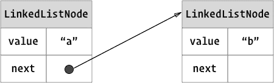

这种结构允许在迭代期间进行高效的插入或删除。每个实体（也称为节点）由数据和指向下一个节点的链接组成。链表的缺点是访问时间是线性的。

**链表的主要操作有：**

* `prepend` - 在链表开头添加节点
* `append` - 在链表末尾添加节点
* `delete` - 从链表中删除节点
* `deleteTail` - 从链表删除最后一个节点
* `deleteHead` - 从链表删除第一个节点
* `find` - 在链表中查找节点

### 应用

链表被用作许多数据结构（如队列、栈和哈希表）良好的基础。我们在 JavaScript 中创建的链表实现将用于学习的许多其他数据结构。

# 实现

我们的 LinkedList 实现由两部分组成：

* `LinkedListNode`类
* `LinkedList`类

我们将在后续章节中探讨这些类的细节。

#### `LinkedListNode`

我们的`LinkedListNode`类将代表我们集合中的一个项目。`LinkedListNode`有两个重要的属性：

1. `this.value`
2. `this.next`

`this.value`包含了我们想要存储在节点中的实际值。`this.next`是指向我们链表中下一个节点的指针。

##### 什么是指针？

JavaScript 中的对象是键值对的字典。键始终是字符串。当我们说`LinkedListNode`类中的`next`属性是“指针”时，我们真正的意思是`this.next`的值是对另一个对象的引用——另一个`LinkedListNode`对象。

##### `constructor`

我们`LinkedListNode`构造方法设置了`this.value`和`this.next`的初始值——两者都设置为`null`。

```javascript
constructor(value, next = null) {
  this.value = value;
  this.next = next;
}
```

`02-linked-list/LinkedListNode.js`

### `toString`

我们的`toString`方法是一个便利方法，当我们想要查看链表中每个节点包含的内容时可以使用。

```javascript
toString(callback) {
  return callback ? callback(this.value) : `${this.value}`;
}
```

`02-linked-list/LinkedListNode.js`

### `LinkedList`

`LinkedList`类包含了一些重要的方法，用于操作我们的`LinkedListNode`对象的集合。让我们来看看每个方法的作用：

#### `constructor`

我们的`LinkedList`类包含两个属性：`this.head`和`this.tail`。这两个属性都指向一个`LinkedListNode`对象。它们是我们`LinkedListNodes`集合的开始和结束。

```javascript
constructor() {
  /** @var LinkedListNode */
  this.head = null;

  /** @var LinkedListNode */
  this.tail = null;
}
```

`02-linked-list/LinkedList.js`

### `prepend`

`prepend`方法将一个`LinkedListNode`对象添加到我们的`LinkedList`的开头。首先，我们创建一个新的`LinkedListNode`对象。

```javascript
prepend(value) {
  // 创建一个新节点作为头部。
  const newNode = new LinkedListNode(value, this.head);
```

`02-linked-list/LinkedList.js`

然后我们将`this.head`指向我们新创建的`LinkedListNode`对象。如果这是我们`LinkedList`中的第一个项，我们还必须将`this.tail`指向该新对象，因为它也是我们`LinkedList`中的最后一个项。

```javascript
this.head = newNode;

// 如果还没有尾节点，让新节点成为尾节点。
if (!this.tail) {
  this.tail = newNode;
}
```

`02-linked-list/LinkedList.js`

最后，我们返回添加到我们的`LinkedList`中的值。

```javascript
return this;
}
```

`02-linked-list/LinkedList.js`

### `append`

`append`方法将一个`LinkedListNode`对象添加到我们的`LinkedList`的末尾。首先，我们创建一个新的`LinkedListNode`对象。

```javascript
append(value) {
  const newNode = new LinkedListNode(value);
```

`02-linked-list/LinkedList.js`

如果我们的`LinkedList`中没有其他项，那么我们需要将`this.head`指向我们的新节点。

```javascript
// 如果还没有头部，让新节点成为头部。
if (!this.head) {
  this.head = newNode;
  this.tail = newNode;

  return this;
}
```

`02-linked-list/LinkedList.js`

然后，我们获取`this.tail`的值，并将该对象的`next`属性设置为我们新创建的`LinkedListNode`对象。

```javascript
const currentTail = this.tail;
currentTail.next = newNode;
// 将新节点附加到链表的末尾。
```

`02-linked-list/LinkedList.js`

最后，我们将`this.tail`设置为新的`LinkedListNode`对象。

```javascript
this.tail = newNode;

return this;
}
```

`02-linked-list/LinkedList.js`

### `delete`

我们的`delete`方法在`LinkedList`中找到一个项并将其删除。首先，我们通过检查`this.head`是否为`null`来检查我们的`LinkedList`是否为空。如果是，我们返回`null`。

```javascript
delete(value) {
  if (!this.head) {
    return null;
  }
```

`02-linked-list/LinkedList.js`

如果我们的`LinkedList`包含项，我们会创建一个`deletedNode`变量，它将作为占位符，用于最终作为`delete`方法的结果返回节点。

```javascript
let deletedNode = null;
```

`02-linked-list/LinkedList.js`

在遍历`LinkedList`之前，我们首先检查`this.head`的值是否与我们要删除的值匹配。如果是，我们将`deletedNode`变量设置为`this.head`，然后将`this.head`移动到`LinkedList`中的下一个项。

```javascript
// 如果必须删除头部，则让与头部不同的
// 下一个节点成为新的头部。
while (this.head && this.head.value === value) {
  deletedNode = this.head;
  this.head = this.head.next;
}
```

`02-linked-list/LinkedList.js`

为了遍历`LinkedList`，我们需要创建一个占位符变量`currentNode`来跟踪我们在`LinkedList`中的位置。我们将`currentNode`的值设置为`this.head`以确保我们从开始开始。

```javascript
let currentNode = this.head;
```

`02-linked-list/LinkedList.js`

然后我们检查`currentNode`不为`null`。如果不是，我们就启动循环。当我们到达一个`next`为`null`的节点时，我们将跳出循环。

```javascript
while (currentNode.next) {
  if (currentNode.next.value === value) {
    deletedNode = currentNode.next;
    this.tail = currentNode;
    currentNode.next = null;
    return deletedNode;
  } else {
    currentNode = currentNode.next;
  }
}
```

`02-linked-list/LinkedList.js`

### `deleteTail`

对于我们的`deleteTail`方法，我们首先创建一个变量`deletedTail`并设置为`this.tail`，以便在从方法返回时可以返回被删除的对象。

```javascript
deleteTail() {
  const deletedTail = this.tail;
```

`02-linked-list/LinkedList.js`

我们有两种情况需要编写代码：

1. 我们的`LinkedList`中只有一个项
2. `LinkedList`中有多个项

对于情况 1，`this.head.value`和`this.tail.value`相同，因此我们将`this.head`和`this.tail`都设置为`null`并返回`deletedTail`。

```javascript
if (this.head === this.tail) {
  // 链表中只有一个节点。
  this.head = null;
  this.tail = null;
  return deletedTail;
}
```

`02-linked-list/LinkedList.js`

对于情况 2，我们需要遍历整个列表以获取倒数第二个`LinkedListNode`。我们将通过检查`currentNode.next.next`值是否为`null`，将倒数第二个`LinkedListNode`设置为`this.tail`。如果`currentNode.next.next`为`null`，我们就知道`currentNode.next`是我们要设置为`this.tail`的对象。

```javascript
  // 如果链表中有很多节点...
  // 回到最后一个节点，并删除倒数节点前一个节点的 "next" 链接
  let currentNode = this.head;
  while (currentNode.next) {
    if (!currentNode.next.next) {
      currentNode.next = null;
    } else {
      currentNode = currentNode.next;
    }
  }

  this.tail = currentNode;

  return deletedTail;
}
```

`02-linked-list/LinkedList.js`

### `deleteHead`

我们的`deleteHead`方法删除列表中的第一个项。与我们的`deleteTail`方法类似，我们有几种情况需要编写代码来删除`LinkedList`的头部：

1. 列表中没有项
2. 列表中只有 1 个项
3. 列表中有多个项

对于场景 1，我们检查`this.head`是否为`null`，如果是`null`，我们从方法中返回`null`。

```javascript
deleteHead() {
  if (!this.head) {
    return null;
  }
```

`02-linked-list/LinkedList.js`

对于场景 2 和 3，我们必须先创建一个变量：`deletedHead`并将其设置为`this.head`，这样当我们从此方法返回时，就可以返回被删除掉的对象。

```javascript
  const deletedHead = this.head;
```

`02-linked-list/LinkedList.js`

同样对于场景 2 和 3，我们将逻辑合并到一个 if/else 语句中。如果`this.head.next`不为`null`，我们知道列表中有超过 1 个元素，我们将`this.head.next`设置为等于`this.head`，这就删除了列表中的第一个元素。如果`this.head.next`为`null`，那么我们知道列表中只有 1 个元素，我们将`this.head`和`this.tail`都设置为`null`，因为我们的`LinkedList`中不再有更多元素了。

```javascript
  if (this.head.next) {
    this.head = this.head.next;
  } else {
    this.head = null;
    this.tail = null;
  }
```

`02-linked-list/LinkedList.js`

最后，我们从方法中返回我们的`deletedHead`对象：

```javascript
  return deletedHead;
}
```

`02-linked-list/LinkedList.js`

### `find`

`find`方法遍历`LinkedList`中的项，并找到第一个与我们想要的值匹配的`LinkedListNode`对象。该方法接受一个包含两个键值对的对象：`value`和`callback`：

```javascript
find({ value = undefined, callback = undefined }) {
```

`02-linked-list/LinkedList.js`

与我们之前的方法一样，我们首先检查`this.head`是否为`null`。如果是`null`，我们从方法中返回，因为`LinkedList`是空的。

```javascript
  if (!this.head) {
    return null;
  }
```

`02-linked-list/LinkedList.js`

接下来，我们创建一个变量`currentNode`来跟踪我们在`LinkedList`中的位置，并将其设置为`this.head`以从`LinkedList`的开始。

```javascript
  let currentNode = this.head;
```

`02-linked-list/LinkedList.js`

然后我们创建一个`while`循环来遍历`LinkedList`中的所有节点，并调用作为参数传递的`callback`函数，或者检查当前节点的值看是否匹配我们正在寻找的值。如果有匹配，我们就返回该节点。

```javascript
  while (currentNode) {
    // 如果指定了 callback，则尝试通过 callback 查找节点。
    if (callback && callback(currentNode.value)) {
      return currentNode;
    }

    // 如果指定了 value，则尝试通过值比较。
    if (value !== undefined && currentNode.value === value) {
      return currentNode;
    }

    currentNode = currentNode.next;
  }
```

`02-linked-list/LinkedList.js`

最后，如果我们遍历了整个`LinkedList`且没有找到我们寻找的值，我们就返回`null`。

```javascript
  return null;
```

`02-linked-list/LinkedList.js`

在此之后，我们已经实现了`LinkedList`方法。现在我们将实现两个辅助方法来方便测试和调试`LinkedList`：`toArray`和`toString`。

### `toArray`

`toArray`方法将`LinkedList`中的所有项放入数组中。为了将它们放入数组，我们遍历`LinkedList`并将每个项放入数组。

```javascript
toArray() {
  const nodes = [];
  let currentNode = this.head;
  while (currentNode) {
    nodes.push(currentNode);
    currentNode = currentNode.next;
  }
  return nodes;
}
```

`02-linked-list/LinkedList.js`

### `toString`

`toString`方法遍历`LinkedList`并打印`LinkedList`的字符串表示。该方法遍历`LinkedList`并通过`toString`方法打印出字符串表示。对于`LinkedList`中的每个`LinkedListNode`。

```javascript
toString() {
  let result = "";
  let currentNode = this.head;
  while (currentNode) {
    result += currentNode.value + " -> ";
    currentNode = currentNode.next;
  }
  return result + "null";
}
```

`02-linked-list/LinkedList.js`

## 队列

让我们来实现一个简单的消息系统，将所有需要处理的消息存储在队列中。在下面的代码中，我们实例化一个新的`Queue`对象，并使用与对象相关的方法对队列进行`enqueue`（入队）和`dequeue`（出队），同时使用`peek`查看下一个将是哪个消息。我们还使用`toString`和`isEmpty`方法来查看队列中当前的内容，并检查队列是否为空。

```javascript
// 首先，我们需要导入 Queue 类。
import { Queue } from './Queue';

// 然后，我们需要实例化队列。
const messageQueue = new Queue();

// 现在队列是空的，没有消息需要处理。
messageQueue.isEmpty(); // => true
messageQueue.toString(); // => ''

// 向队列添加一条新消息。
messageQueue.enqueue('message_1');
messageQueue.isEmpty(); // => false
messageQueue.toString(); // => 'message_1'
messageQueue.peek(); // => 'message_1'

// 再添加一条消息。
messageQueue.enqueue('message_2');
messageQueue.isEmpty(); // => false
messageQueue.toString(); // => 'message_1,message_2'
messageQueue.peek(); // => 'message_2'

// 现在来处理这些消息。
messageQueue.dequeue(); // => 'message_1'
messageQueue.dequeue(); // => 'message_2'

messageQueue.isEmpty(); // => true
```

`03-queue/example.js`

### 实现

队列可以用链表（Linked List）来实现。链表的结构和操作与队列相似。我们的`LinkedList`类拥有一个`append`方法和一个`deleteHead`方法，这两个方法对于实现队列都是非常有用的。我们将使用这些方法来构建`Queue`类中的`enqueue`和`dequeue`方法。

首先，让我们导入`LinkedList`类：

```javascript
import LinkedList from '../02-linked-list/LinkedList';
```

`03-queue/Queue.js`

### `constructor`

在`Queue`类的构造函数中，我们创建了一个新的`LinkedList`对象用于存储数据：

```javascript
constructor() {
  // 我们将基于 LinkedList 实现 Queue。
  this.linkedList = new LinkedList();
}
```

`03-queue/Queue.js`

### `enqueue`

现在让我们来实现`enqueue()`操作。该方法将一个新元素添加到队列的末尾。我们将调用`LinkedList`对象的`append`方法将项目添加到队列末尾：

```javascript
/**
 * @param {*} value
 */
enqueue(value) {
  // 入队意味着排队。因此，我们只需要在链表的开头
  // 添加新值即可。它需要等待
  // 直到所有之前的节点被处理完毕。
  this.linkedList.append(value);
}
```

`03-queue/Queue.js`

### `dequeue`

当我们想要`dequeue()`元素时，我们从链表中取出第一个元素（链表的`head`）并将其返回。我们调用`LinkedList`对象的`deleteHead`方法，如果该方法返回的节点为`null`，则返回`null`。否则，返回节点的值。

```javascript
/**
 * @return {*}
 */
dequeue() {
  // 尝试从链表中删除第一个节点（头部）。
  // 如果链表中没有头部（为空），则直接返回 null。
  const removedHead = this.linkedList.deleteHead();
  return removedHead ? removedHead.value : null;
}
```

`03-queue/Queue.js`

### `peek`

为了实现`peek()`操作，我们不会从列表中移除任何元素，只需从`LinkedList`对象的头部获取值并返回它。

```javascript
/**
 * @return {*}
 */
peek() {
  if (!this.linkedList.head) {
    // 如果链表为空，则没有内容可以查看。
    return null;
  }

  // 直接从链表末尾读取值而不删除它。
  return this.linkedList.head.value;
}
```

`03-queue/Queue.js`

到此时，我们已经实现了主要的队列方法。让我们来实现几个辅助方法，让队列的使用变得更加方便。

### `isEmpty`

让我们实现一个检查队列是否为空的方法。为了做到这一点，我们只需要检查链表的头部并确保不存在元素：

```javascript
/**
 * @return {boolean}
 */
isEmpty() {
  // 如果其链表没有头部，则队列为空。
  return !this.linkedList.head;
}
```

`03-queue/Queue.js`

### `toString`

我们也来实现`toString()`方法来让队列的使用更加方便。它将接受一个可选的`callback`。

```javascript
/**
 * @param {*} callback
 * @return {string}
 */
toString(callback) {
  // 队列的字符串表示。
  return this.linkedList.toString(callback);
}
```

`03-queue/Queue.js`

## 栈

对于栈来说，`searching`或`updating`元素等操作并不典型。我们只对操作栈顶端感兴趣。

### 应用

`Stack`数据结构用于解决许多算法任务，例如：

* 图的拓扑排序
* 寻找图中的强连通分量
* 汉诺塔问题
* 记住部分完成的任务
* 撤销（从操作中回溯）
* 以及更多其他任务。

在递归算法中，栈通常非常有用，因为你需要在递归时将临时数据推入栈中，然后在回溯时将其移除。栈为这种操作提供了一种直观的方法。

低级编程语言也使用栈数据结构在从一个函数调用另一个函数时从内存中存储函数参数和局部变量。你可能通过臭名昭著的“Stack Overflow”（栈溢出）错误知道这一点。该错误与栈的使用有关，可能是由过深或无限递归引起的，在这种情况下，函数自调次数过多，导致存储变量和与每次调用相关信息的空间超过了栈的承受范围。

## 使用示例

在我们继续实现`Stack`类之前，让我们假设我们已经实现了一个类，并尝试使用上面提到的基本方法。这将帮助我们更好地理解将要实现的内容。假设我们想用栈来反转数组：

```javascript
// 导入 Stack 类。
import { Stack } from './Stack';

// 创建栈实例。
const stack = new Stack();

// 创建我们想要反转的数组。
const arrayToReverse = ['a', 'b', 'c'];

stack.isEmpty(); // => true
stack.toString(); // => ''
stack.toArray(); // => []

// 向栈添加项。
stack.push(arrayToReverse[0]);
stack.isEmpty(); // => false
stack.toString(); // => 'a'
stack.toArray(); // => ['a']

// 向栈添加更多项。
stack.push(arrayToReverse[1]);
stack.push(arrayToReverse[2]);
stack.toString(); // => 'c,b,a'
stack.toArray(); // => ['c', 'b', 'a']

// 检查下一步操作。
stack.peek(); // => 'c'

// 从栈中弹出。
stack.pop(); // => 'c'
stack.pop(); // => 'b'
stack.pop(); // => 'a'

stack.isEmpty(); // => true
```

`04-stack/example.js`

# 实现

栈可以用链表实现。我们可以使用`LinkedList`类中的`prepend`和`deleteHead`操作来实现栈的`push`和`pop`操作。其思路是：当你想要向栈`push`一个项时，将该项`prepend`到链表头部；当你想要从栈中`pop`一个项时，`delete`链表的头部。由于我们要基于链表构建栈，让我们先开始导入它：

```javascript
import LinkedList from '../02-linked-list/LinkedList';
```

`04-stack/Stack.js`

#### `constructor`

让我们创建`Stack`类：

```javascript
export class Stack {
  constructor() {
    // 我们将基于链表结构实现
    // 非常相似结构。比较 Stack 的 push/pop 操作
    // 与 LinkedList 的 prepend/deleteHead 操作。
    this.linkedList = new LinkedList();
  }
}
```

`04-stack/Stack.js`

#### `push`

如果我们想向栈中推入某些东西，我们需要将数据`prepend`到链表的头部。在这种情况下，栈顶就是链表的头部：

```javascript
/**
 * @param {*} value
 */
push(value) {
  // Pushing 意味着将值放在栈的顶部。因此，让我们在
  // 链表的头部添加新值。
  this.linkedList.prepend(value);
}
```

`04-stack/Stack.js`

#### `pop`

如果我们想从栈中弹出元素，我们需要`delete`链表头部并返回它：

```javascript
/**
 * @return {*}
 */
pop() {
  // 让我们尝试删除链表中的第一个节点（头部）。
  // 如果链表中没有头部（它为空），则直接返回 null。
  const removedHead = this.linkedList.deleteHead();
  return removedHead ? removedHead.value : null;
}
```

`04-stack/Stack.js`

#### `peek`

另一个常见的栈操作是检查栈顶是什么，而无需实际提取数据。在这种情况下，我们只需要读取链表的头部：

```javascript
/**
 * @return {*}
 */
peek() {
  if (this.isEmpty()) {
    // 如果链表为空，则没有可以 peek 的内容。
    return null;
  }
  // 仅从链表的头部读取值而不删除它。
  return this.linkedList.head.value;
}
```

`04-stack/Stack.js`

到此，我们已经完成了强制性的栈操作。现在，让我们继续实现一些辅助方法，这将使`Stack`类的使用更加方便。

#### `isEmpty`

实现`isEmpty()`方法来检查栈是否为空。要实现这一点，我们只需要检查链表是否有头部：

```javascript
/**
 * @return {boolean}
 */
isEmpty() {
  // 如果链表没有头部，则栈为空。
  return !this.linkedList.head;
}
```

`04-stack/Stack.js`

#### `toArray`

另一个有用方法是`toArray()`，将我们的栈转换为数组。要实现这一点，我们需要：

1. 将链表转换为数组，
2. 提取每个链表节点的值，因为我们不希望`Stack`类的使用者去处理链表节点。通过这样做，我们封装了类的实现，
3. 反转链表数组，以便链表的尾部成为数组的第一个元素，头部成为数组的最后一个元素。这不是强制性的，但是为了方便起见而做的。

代码如下：

```javascript
/**
 * @return {[]}
 */
toArray() {
  return this.linkedList
    .toArray()
    .map(linkedListNode => linkedListNode.value);
}
```

`04-stack/Stack.js`

#### `toString`

最后一个实现的方法是`toString()`，它基于`toArray()`并将栈转换为字符串表示：

```javascript
/**
 * @param {function} [callback]
 * @return {string}
 */
toString(callback) {
  return this.linkedList.toString(callback);
}
```

`04-stack/Stack.js`

最后一个大括号是`Stack`类的结束括号。到此时，我们`Stack`类的基础实现已经就绪。你可以在`code/src/04-stack/Stack.js`文件中找到完整的类代码示例。

### 参考文献

Wikipedia 上的栈 [https://en.wikipedia.org/wiki/Stack_(abstract_data_type)](https://en.wikipedia.org/wiki/Stack_(abstract_data_type))

YouTube 上的栈 [`www.youtube.com/watch?v=wjI1WNcIntg`](https://www.youtube.com/watch?v=wjI1WNcIntg)

示例与测试用例 [`github.com/trekhleb/javascript-algorithms/tree/master/src/data-structures/stack`](https://github.com/trekhleb/javascript-algorithms/tree/master/src/data-structures/stack)

## 哈希表 (Hash Table)

难度：中

`hash table`（或哈希映射）是一种实现`关联数组抽象数据类型`的数据结构，这种结构可以`将键映射到值`。例如，在`电话簿`（哈希表）中，你的`name`（键）可以作为你的`phone number`（值）的唯一标识符。在电话簿中处理手机的`常用操作`如下：

```javascript
// HashTable 类。
import { HashTable } from './HashTable';

// 创建哈希表实例。
const phoneBook = new HashTable();

// 向电话簿添加几个联系人。
phoneBook.set('John Smith', '+112342345678');
phoneBook.set('Bill Jones', '+111111111111');

// 现在我们可以在 O(1) 时间内访问每个联系人的电话。
phoneBook.get('John Smith'); // => '+112342345678'
phoneBook.get('Bill Jones'); // => '+111111111111'

// 删除电话号码。
phoneBook.delete('John Smith');
phoneBook.get('John Smith'); // => undefined
```

`src/05-hash-table/HashTable.js`

理想情况下，哈希表允许我们以`O(1)`的时间完成所有这些操作。相比之下，`Linked List`（链表）需要我们遍历列表中的`所有`节点来获取 John Smith 的电话号码，查找时间为`O(n)`。

极高效的查找是哈希表的主要优势。

但在最坏的情况下，哈希表的查找时间可能会达到`O(n)`。我们将在本章节的后面部分讨论这种情况。

那么，我们该如何在哈希表中实现快速的`O(1)`查找呢？我们分配一个包含`buckets`（桶）或`slots`（槽）的数组，用于存储所有的哈希表数据。然后，我们需要将值的键映射到存储该值的桶的特定数字（索引或地址）。通过这种方式，我们只需要通过桶地址在`O(1)`时间内访问即可在哈希表中创建、读取和删除记录。

构建哈希表存在某些局限性。桶的数量将有一个`固定大小`。这是因为任何程序都有特定的内存限制，我们不能假设为哈希表拥有无限的内存。

我们要映射到桶地址的键的大小可能是`任意的`（例如，`John Smith`或仅为`Jimmy`）。在桶数量有限的情况下，我们如何将任意大小的键映射到一个数字（索引或地址）？提示已经隐藏在“Hash Table”这个数据结构的名称中了！那就是通过使用`hash function`（哈希函数）。

### 哈希函数 (Hash Function)

`hash function`是一种可以将`任意大小`的数据映射到`固定大小`数据的函数。哈希函数返回的值称为`hash values`（哈希值）、`hash codes`（哈希码）、`digests`或简称为`hashes`。

在我们的情况下，哈希函数必须接受键（例如`John Smith`）作为输入，并输出给定范围内的桶索引（例如，如果我们为桶分配一个大小为 5 的数组，则从`0`到`5`）。在现实世界中，桶的数量要多得多。它应该与我们要存储在哈希表中的信息量成比例。

哈希函数由两部分组成：

1. 将字符串转换为哈希码——理想情况下转换为键的唯一数值表示。
2. 使用模运算符将哈希码映射到特定的桶单元（因为桶的大小是有限的）。

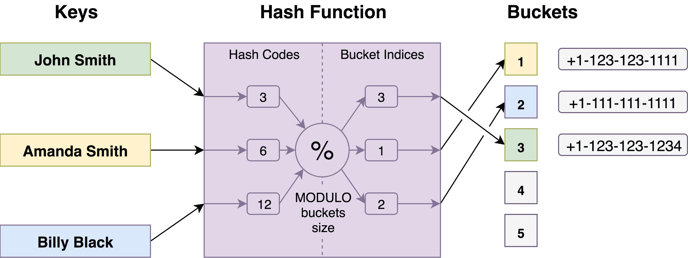

#### 哈希函数示例

有许多将字符串哈希为索引或地址的方法。计算字符串哈希的最简单方法之一是字符串中所有字符的 ASCII 码和。

> 什么是 ASCII 码？

ASCII 代表美国信息交换标准（American Standard Code for Information Interchange），它是用数字表示英语字符的代码。计算机只理解 1 和 0，这种代码将我们输入的字母转换为计算机可以理解的数字。

让我们创建一个名为`hash`的 JavaScript 函数，将键和桶的数量作为参数。

```javascript
export function hash(key, bucketsNumber) {
```

`05-hash-table/hash.js`

我们将遍历字符串中的每个字符，并使用 JavaScript 的`charCodeAt`方法获取 ASCII 值。我们将这些代码相加得到`hashCode`。

```javascript
  let hashCode = 0;
  for (let characterIndex = 0; characterIndex < key.length; characterIndex++) {
    hashCode += key.charCodeAt(characterIndex);
  }

  // 减少哈希值以适应桶的大小。
  return hashCode % bucketsNumber;
}
```

`05-hash-table/hash.js`

### 冲突解决 (Collision Resolution)

理想情况下，哈希函数会将每个键分配到唯一的桶，但大多数哈希表设计采用不完美的哈希函数，这会导致哈希冲突，即哈希函数为多个键生成相同的索引。

分离链法（Separate chaining）是一种技术，我们将每个桶转换为链表。这样每个桶就可以存储多个值而不仅仅是一个。如果发生冲突，我们将新值附加到桶链表的尾部。

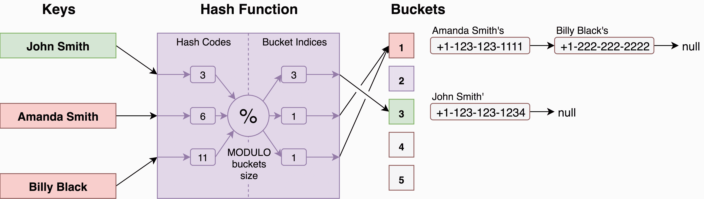

`read`操作首先计算桶数，然后通过键在桶的链表中进行查找。在上面的示例中，使用链表获取 Billy Black 的电话号码所需的步骤如下：

1. 计算`Billy Black`键的哈希码。假设`Billy Black`键的哈希码为`11`。
2. 通过模运算计算桶索引。如果有`5`个桶，我们得到的桶索引为`11 % 5 = 1`。
3. 从索引`1`的单元获取链表，并遍历它的每个值，将每个值的键与我们需要的键（在本例中为`Billy Black`）进行比较。一旦找到具有`Billy Black`键的链表节点，我们就直接返回它。

哈希冲突是导致哈希表基本操作（如`read`、`write`、`update`和`delete`）的时间复杂度可能从`O(1)`降至`O(n)`的主要原因。在最坏的情况下，由于桶的数量较少且哈希函数不完美，所有值都可能存储在`一个`桶中。这将导致哈希表变得像一个链表。

# 实现

让我们结合上述哈希表基本操作以及分离链法冲突解决方法，并使用“链表”章节中的`LinkedList`类来实现哈希表。

首先，我们需要导入链表类以便在哈希表中使用。哈希表中的每个桶将拥有一个`LinkedList`作为值，我们可以在其中存储每个键值对对应的值。

```javascript
import LinkedList from '../02-linked-list/LinkedList';
```

`src/05-hash-table/HashTable.js`

接下来，我们将设置桶的大小：

```javascript
// 桶的数量直接影响冲突的数量。
// 桶的数量越大，冲突就越少。
// 为了演示，我们将哈希表的大小设置为一个
// 较小的数字，以展示如何处理冲突。
const defaultBucketsNumber = 32;
```

`src/05-hash-table/HashTable.js`

### `constructor`

让我们从创建`HashTable`类开始：

```javascript
export class HashTable {
```

`src/05-hash-table/HashTable.js`

在构造方法中，我们串联了许多函数。让我们分解每个部分发生的情况，以便更好地理解正在发生什么。

```javascript
  /**
   * @param {number} bucketsNumber - 存储哈希表数据的桶的数量。
   */
  constructor(bucketsNumber = defaultBucketsNumber) {
    // 创建特定大小的哈希表，并在每个桶中填充空链表。
    this.buckets = Array(bucketsNumber).fill(null).map(() => new LinkedList());
  }
```

`src/05-hash-table/HashTable.js`

首先，我们创建一个新数组并用`bucketsNumber`值初始化它：

```javascript
this.buckets = new Array(bucketsNumber)
```

然后，我们用`null`值填充数组，以便对其进行遍历：

```javascript
this.buckets = new Array(bucketsNumber).fill(null)
```

最后，我们将数组中所有新创建的值都设置为一个`LinkedList`对象：

```javascript
this.buckets = new Array(bucketsNumber).fill(null).map(() => new LinkedList());
```

### `hash`

`hash()`方法将字符串`key`转换为我们需要的桶索引，该索引用于存储指定`key`的值。如上所述，我们将使用一种简单的方法，根据键中每个字符的 ASCII 值之和来计算哈希。

```javascript
  /**
   * 将键字符串转换为哈希数字。
   *
   * @param {string} key
   * @return {number}
   */
  hash(key) {
    let hashCode = 0;

    // 遍历所有键字符，并将它们的代码加到哈希中。
    for (let characterIndex = 0; characterIndex < key.length; characterIndex += 1) {
      hashCode += key.charCodeAt(characterIndex);
    }

    // 缩小哈希数字以适应桶表的大小。
    return hashCode % this.buckets.length;
  }
```

`src/05-hash-table/HashTable.js`

首先，我们使用`for`循环遍历所有字符并计算它们的和。

```javascript
for (let characterIndex = 0; characterIndex < key.length; characterIndex += 1) {
  hashCode += key.charCodeAt(characterIndex);
}
```

接下来，我们应用取模运算符`%`，这将把我们生成的哈希范围限制在可用桶的数量之内：

```javascript
// 缩小哈希数字以适应桶表的大小。
return hashCode % this.buckets.length;
```

如果我们的`hashCode`值等于 97 且`this.buckets.length`等于 50，函数将返回`97 % 50 = 47`。我们将使用索引为 47 的桶来存储键`'ab'`的值。

### `set`

我们根据键和值向哈希表中添加元素。

```javascript
  /**
   * 通过键添加或更新值。
   *
   * @param {string} key
   * @param {*} value
   */
  set(key, value) {
    // 计算桶索引。
    const keyHash = this.hash(key);
    // 获取特定桶索引的链表。
    const bucketLinkedList = this.buckets[keyHash];
    // 在链表中执行“按键查找”操作。
    const node = bucketLinkedList.find({ callback: nodeValue => nodeValue.key === key });

    // 检查带有指定键的值是否已存在于链表中。
    if (!node) {
      // 插入新节点。
      bucketLinkedList.append({ key, value });
    } else {
      // 更新现有节点。
      node.value = value;
    }
  }
```

`src/05-hash-table/HashTable.js`

我们开始计算键的哈希。该哈希值将指向桶索引。

```javascript
const keyHash = this.hash(key);
```

接下来，获取存储在桶中的链表。

```javascript
const bucketLinkedList = this.buckets[keyHash];
```

此时，我们需要检查正在尝试设置的值是否已存在于链表中。我们将使用`find`方法。

```javascript
const node = bucketLinkedList.find({ callback: nodeValue => nodeValue.key === key });
```

### `get`

使用键从哈希表中获取值的操作与`set`方法相似。唯一的区别是，在检查链表中是否存在该值后，返回其值或`undefined`。

```javascript
  /**
   * 通过键获取值。
   *
   * @param {string} key
   * @return {*}
   */
  get(key) {
    // 计算桶索引。
    const keyHash = this.hash(key);
    // 获取特定桶索引的链表。
    const bucketLinkedList = this.buckets[keyHash];
    // 在链表中执行“按键查找”操作。
    const node = bucketLinkedList.find({ callback: nodeValue => nodeValue.key === key });

    // 检查带有指定键的值是否已存在于链表中。
    return node ? node.value.value : undefined;
  }
```

`src/05-hash-table/HashTable.js`

### `delete`

当我们从哈希表中删除值时，我们使用与`set`方法相似的一些步骤。我们首先计算提供的键的哈希，然后获取桶的链表。最后，我们检查要删除的值是否存在于链表中。如果存在，我们使用`LinkedList`的`delete`方法并返回`true`。否则，我们返回`false`，表示没有可删除的内容。

```javascript
  /**
   * 根据键删除值。
   *
   * @param {string} key
   * @return {boolean}
   */
  delete(key) {
    // 计算哈希桶索引。
    const keyHash = this.hash(key);
    // 获取特定哈希桶索引的链表。
    const bucketLinkedList = this.buckets[keyHash];
    // 在链表中执行“按键查找”操作。
    const node = bucketLinkedList.find({ callback: nodeValue => nodeValue.key === key });

    // 如果链表中存在该节点，则删除该节点。
    if (node) {
      bucketLinkedList.delete(node.value);

      return true;
    }

    return false;
  }
```

`src/05-hash-table/HashTable.js`

目前我们的`HashTable`类的基本实现已经就绪。你可以在`code/src/05-hash-table/HashTable.js`文件中找到完整的类代码示例。

### 操作时间复杂度

| 情况 | 搜索 | 插入 | 删除 | get |
| --- | --- | --- | --- | --- |
| **平均** | O(1) | O(1) | O(1) | 具有良好的哈希函数和足够的哈希桶数量 |
| **最坏情况** | O(n) | O(n) | O(n) | 哈希函数较差且哈希桶数量过小 |

### 示例

以下是一些你在面试过程中可能会遇到的相关问题：

* [设计一个 HashSet](https://leetcode.com/problems/design-hashset/)
* [设计一个 HashMap](https://leetcode.com/problems/design-hashmap/)

### 测验

* Q1: 哈希表与链表相比，主要优势是什么？
* Q2: 哈希表中`get()`操作的时间复杂度是多少？
* Q3: 哈希表中的冲突是什么？
* Q4: 你知道哪些处理冲突的方法？

### 参考文献

Wikipedia 上的哈希表 [`en.wikipedia.org/wiki/Hash_table`](https://en.wikipedia.org/wiki/Hash_table)

YouTube 上的哈希表 [`www.youtube.com/watch?v=shs0KM3wKv8`](https://www.youtube.com/watch?v=shs0KM3wKv8)

哈希表示例和测试用例 [`github.com/trekhleb/javascript-algorithms/tree/master/src/data-structures/hash-table`](https://github.com/trekhleb/javascript-algorithms/tree/master/src/data-structures/hash-table)

## 二叉搜索树 (BST)

*难度：中等*

在我们深入学习二叉搜索树主题之前，首先需要理解什么是`tree`（树）和二叉树数据结构。

### 树

`树数据结构`被定义为节点的集合（从`根节点`开始），其中每个节点都是由一个值和一个指向节点的引用列表（“子节点”）组成的数据结构，限制条件是没有重复引用，且没有引用指向根节点。这些引用通常被称为`边`。

#### 什么是节点？

> 节点是计算机科学中使用的基本单元。节点是更大数据结构（如链表和树数据结构）的组成部分。节点包含数据，并可能链接到其他节点。节点之间的链接通常通过指针实现。-[Wikipedia](https://en.wikipedia.org/wiki/Node_(computer_science))

树数据结构中的每个节点（根节点除外）都通过一条边与另一个节点连接。所有节点形成`parent -> child`（父子）关系，树中没有循环。

这里是一个树的示例：

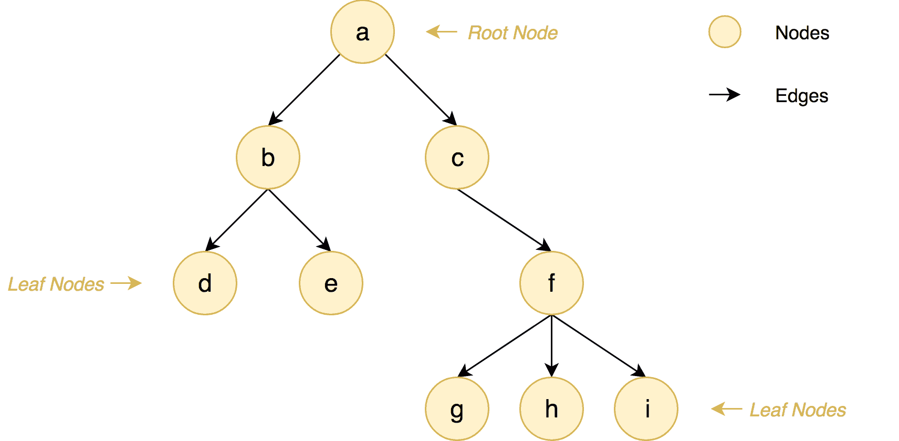

在这个示例中，树由一组`nodes`{"a", "b", "c", …, "i"}和一组`edges`{"ab", "ac", "bd", …, "fi"}组成，在节点之间形成父子关系。节点"a"是树的`root`，它没有父节点但有两个`child`节点——"b"和"c"。示例中的节点"f"有一个`parent`"c"和三个子节点"g"、"h"和"i"。没有子节点的节点被称为`leaf nodes`（叶子节点）。在示例中，节点"d"、"e"、"g"、"h"、"i"是叶子。

树的`size`（大小）是它包含的节点数量。在上面的示例中，树的大小为 9。

节点的`height`（高度）是从它到最远叶节点的最长路径（边的数量）。根节点的高度就是`height of tree`。在上面的示例中，节点"c"的高度为 2，因为从它到最深叶节点有两条边。

### 二叉树

`二叉树`是每个节点最多有两个子节点的树。


### 二叉搜索树

`binary search tree`(或`BST`)是一种二叉树，其中每个节点（叶子节点除外）满足以下规则：

* 节点`right subtree`的所有值必须`greater`节点本身，
* 节点`left subtree`的所有值必须`less`节点本身。

叶子节点的子节点为`null`，因此我们不对它们应用这些规则。

这里是一个二叉搜索树的示例：

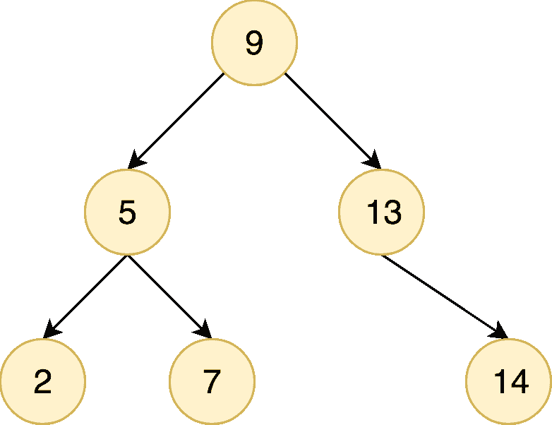

该树的根值为`9`，其右子节点值为`13`，大于根值。当我们向右子树移动时，发现右子树中的所有值都大于根节点。根节点的左子节点值为`5`，小于根值。当我们向左子树移动时，发现左子树中的所有值都小于根节点。这些规则可以递归地应用于树中的所有节点。

### 应用

当我们需要以`sorted`顺序维护`dynamically changing`的数据集时，可以使用二叉搜索树。

### 基本操作

#### 搜索 (查找)

二叉搜索树是排序的这一事实使得对树应用`binary search`方法并进行`fast lookup`成为可能。假设要在上面的树中查找值为`7`的节点。查找算法如下：

1. 从根节点开始（将根节点视为当前节点）。
2. 如果当前节点值大于`7`，则向左（将左子节点变为当前节点）。否则，向右（将右子节点变为当前节点）。
3. 重复步骤 1 和 2，直到找到节点或当前节点没有剩余子节点。

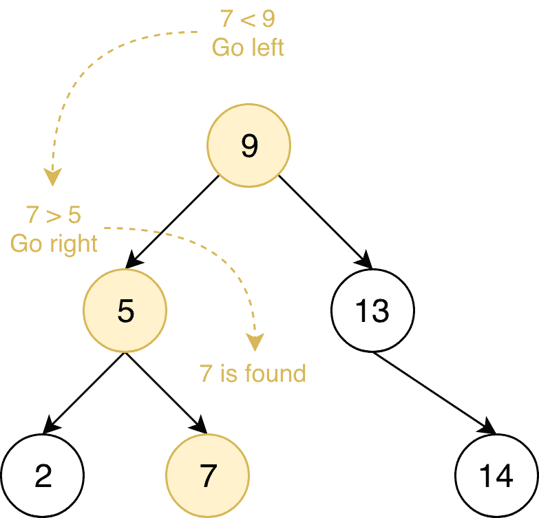

在每次查找迭代后，我们都会忽略大约一半的树（或子树），并关注另一半部分。通过每次只关注树的一半部分并在每次迭代中将搜索范围缩小一倍，查找操作的时间复杂度为`O(log(n))`。

## 自平衡

二叉搜索树中查找操作的性能紧密取决于树的形状。例如，如上所述，平衡的二叉搜索树在树中查找特定值需要`O(log(n))`时间。但对于病态的二叉搜索树，相同的操作需要`O(n)`时间，因为该树类似于链表。

在添加或删除节点时保持二叉搜索树的平衡可以维持查找操作的快速性能。有几种数据结构构建在二叉搜索树之上，但具有每次修改后平衡树的额外功能：[AVL 树](https://github.com/trekhleb/javascript-algorithms/tree/master/src/data-structures/tree/avl-tree)、[红黑树](https://github.com/trekhleb/javascript-algorithms/tree/master/src/data-structures/tree/red-black-tree)等。

在本章中，我们将介绍二叉搜索树的基础实现，但不包含重平衡功能。

## 插入

要向二叉搜索树中插入一个新节点，我们需要递归地将当前节点值与新节点值进行比较。如果新节点值大于当前节点值，我们需要向右移动（将右子节点设置为当前节点）。否则，我们需要向左移动（将左子节点设置为当前节点）。一旦下一个子节点为空，意味着我们已经到达了叶子节点，并准备好将新节点放置在它的正确位置。

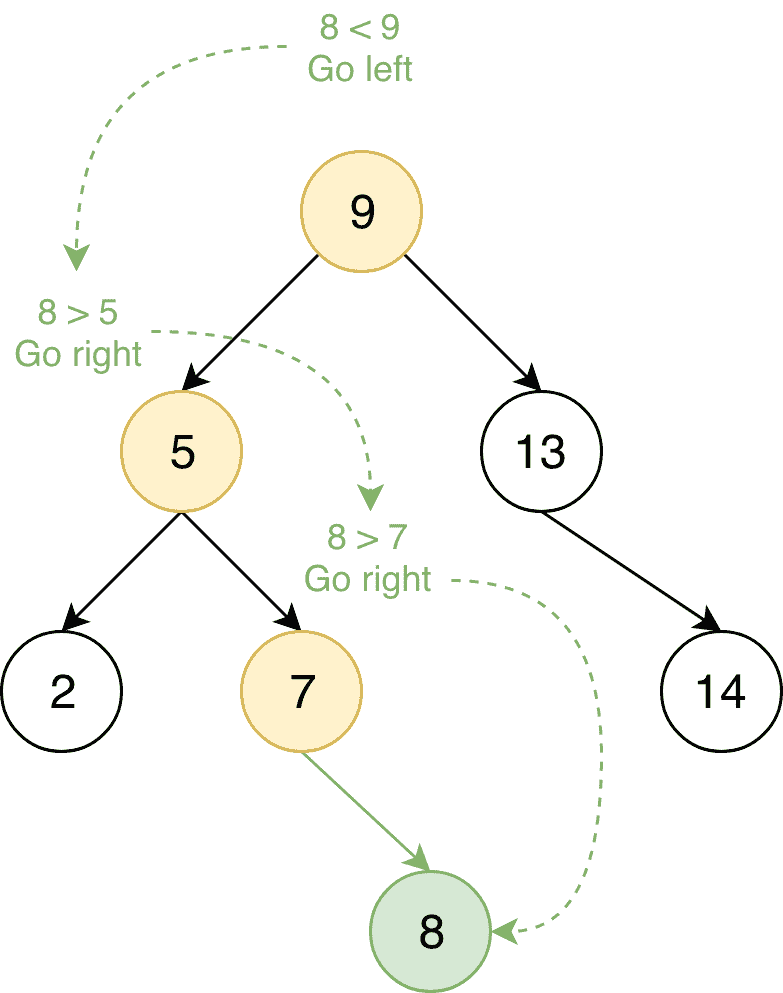

## 移除

从二叉搜索树中删除节点要复杂一些。首先，我们需要找到想要删除的节点（参见上文的查找操作）。可能存在几种情况：

* `删除叶子节点` - 最简单的情况，我们直接删除该节点。
* `删除带子节点的节点` - 我们让该子节点成为当前节点父节点的子节点。
* `删除有两个子节点的节点` - 我们需要找到下一个最大值（右分支中的最小值），并用该下一个较大值的节点替换当前节点。

这里是节点具有两个子节点时的最后一种情况的示例。

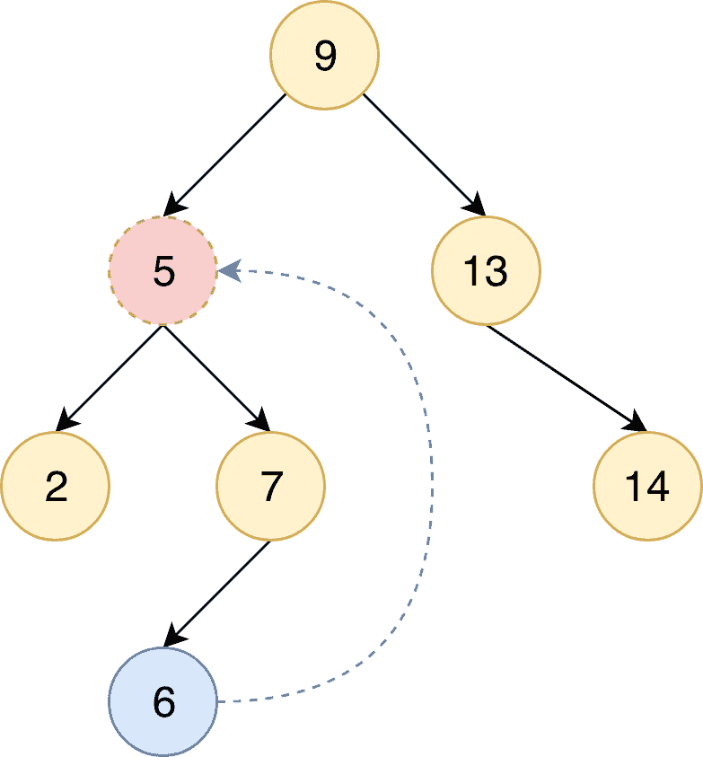

## 遍历

遍历是按照特定顺序访问树的所有节点。

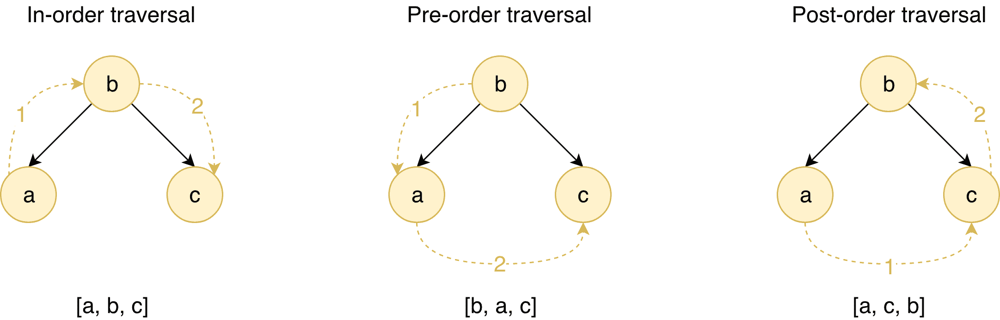

在本章中，我们将实现中序遍历，将二叉搜索树转换为排序数组。

## 使用示例

在继续实现二叉搜索树的具体 JavaScript 代码之前，让我们先看一个`BinarySearchTree`类的用例，并描述我们将如何使用它。

假设我们有一组购物商品。我们希望所有以下操作都能快速执行（在`O(log(n))`时间内）：按特定价格获取商品、插入新商品、移除现有商品、从集合中获取最便宜的商品、获取最昂贵的商品。

```javascript
// 导入依赖项
import BinarySearchTree from './BinarySearchTree';

// 创建二叉搜索树实例。
const bstCollection = new BinarySearchTree();

// 将商品添加到我们的二叉搜索树中。
// 我们将价格作为键。
bstCollection.insert(220, { title: 'Phone' });
bstCollection.insert(3455, { title: 'TV' });
bstCollection.insert(8200, { title: 'Notebook' });
bstCollection.insert(120, { title: 'Remote Control' });

// 找到目前为止最便宜和最贵的商品。
const minItem = bstCollection.findMin().data; // { title: 'Remote Control' }
const maxItem = bstCollection.findMax().data; // { title: 'Notebook' }

// 找到价格为 3455 的商品。
const item = bstCollection.find(3455).data; // { title: 'TV' }

// 按价格移除商品。
bstCollection.remove(120);
// 检查目前最便宜的商品是什么。
const newMinItem = bstCollection.findMin().data; // { title: 'Phone' }

// 现在我们可以以任何方式使用获取到的数据。
// eslint-disable-next-line
console.log(minItem, maxItem, item, newMinItem);
```

`06-binary-search-tree/example.js`

# 实现

我们将实现分为两个部分。首先，我们将实现`BinarySearchTreeNode`类，它将代表二叉搜索树的节点及其功能。该类将包含核心功能。然后，我们将实现`BinarySearchTree`类，它只是`BinarySearchTreeNode`类的封装，将使操作二叉搜索树变得简单一点。

### BinarySearchTreeNode

#### 构造函数

让我们创建这个类。

```javascript
export default class BinarySearchTreeNode {
```

`06-binary-search-tree/BinarySearchTreeNode.js`

我们的构造函数将接受`value`参数，我们将将其作为键来定义当前节点应该放在树的什么位置。所有的节点比较将使用此`value`参数进行。`data`参数作为数据包，包含任何类型的数据。例如，它可能包含一个带有所有特定价格购物商品的链表，也可能包含一个带有名称、电话号码等的用户对象。

在构造函数中，我们将创建指向左、右子节点的指针以及一个指向父节点的指针。对于树中的根节点，父节点始终为`null`。

```javascript
  /**
   * @param {*} value - 节点值。
   * @param {*} data - 节点数据（可以是任何内容）。
   */
  constructor(value = null, data = null) {
    this.left = null; // 指向左子节点的指针。
    this.right = null; // 指向右子节点的指针。
    this.parent = null; // 指向父节点的指针。
    this.value = value;
    this.data = data;
  }
```

`06-binary-search-tree/BinarySearchTreeNode.js`

#### `find()`

该方法通过`value`在整个树中查找节点。它执行了上文提到的二叉搜索查找操作。提醒一下，在二叉搜索树中通过键查找节点，我们需要递归地将其与当前节点进行比较，如果当前节点值比我们要找的值大，则向左移动（到左子节点）。否则，我们需要向右移动（到右节点）。相同的过程在下一个节点（左或右子节点）上重复。

```javascript
  /**
   * @param {*} value
   * @return {BinarySearchTreeNode}
   */
  find(value) {
    // 检查根节点。
    if (this.value === value) {
      return this;
    }

    if (value < this.value && this.left) {
      // 检查左节点。
      return this.left.find(value);
    }

    if (value > this.value && this.right) {
      // 检查右节点。
      return this.right.find(value);
    }

    return null;
  }
```

`06-binary-search-tree/BinarySearchTreeNode.js`

#### `insert()`

该方法使用了其他辅助方法，如`setLeft()`和`setRight()`，这些方法将在下方实现。

```javascript
  /**
   * @param {*} value
   * @param {*} [data] - 节点数据（可以是任何内容）。
   * @return {BinarySearchTreeNode}
   */
  insert(value, data) {
    if (this.value === null) {
      this.value = value;
      this.data = data;

      return this;
    }

    if (value < this.value) {
      // 插入到左侧。
      if (this.left) {
        return this.left.insert(value, data);
      }

      const newNode = new BinarySearchTreeNode(value, data);
      this.setLeft(newNode);

      return newNode;
    }

    if (value > this.value) {
      // 插入到右侧。
      if (this.right) {
        return this.right.insert(value, data);
      }

      const newNode = new BinarySearchTreeNode(value, data);
      this.setRight(newNode);

      return newNode;
    }

    return this;
  }
```

`06-binary-search-tree/BinarySearchTreeNode.js`

### `remove()`

在删除节点之前，我们先使用上面描述的`find()`函数在树中找到它。当我们找到正确的节点后，可能会出现以下几种情况：

- **删除叶子节点**：从父节点中移除指向该节点的指针。
- **删除只有一个子节点的节点**：将该唯一的子节点变为当前节点父节点的直接子节点。
- **删除有两个子节点的节点**：找到下一个较大的值（右分支中的最小值），并用该下一个较大的值节点替换当前节点。

该方法使用了其他辅助方法，如`removeChild()`、`findMin()`、`setValue()`、`setRight()`、`replaceChild()`和`copyNode()`，这些方法将在下方实现。

```javascript
  /**
   * @param {*} value
   * @return {boolean}
   */
  remove(value) {
    const nodeToRemove = this.find(value);

    if (!nodeToRemove) {
      throw new Error('树中未找到该项目');
    }

    const { parent } = nodeToRemove;

    if (!nodeToRemove.left && !nodeToRemove.right) {
      // 节点是叶子节点，因此没有子节点。
      if (parent) {
        // 节点有父节点。只需从父节点移除指向该节点的指针。
        parent.removeChild(nodeToRemove);
      } else {
        // 节点没有父节点。只需擦除当前节点的值。
        nodeToRemove.setValue(undefined);
      }
    } else if (nodeToRemove.left && nodeToRemove.right) {
      // 节点有两个子节点。
      // 找到下一个较大的值（右分支中的最小值）
      // 并用该下一个较大的值替换当前值节点。
      const nextBiggerNode = nodeToRemove.right.findMin();
      if (nextBiggerNode !== nodeToRemove.right) {
        this.remove(nextBiggerNode.value);
        nodeToRemove.setValue(nextBiggerNode.value);
      } else {
        // 万一下一个右侧的值是下一个较大的值且它没有左子节点
        // 则只需用右侧节点替换要删除的节点。
        nodeToRemove.setValue(nodeToRemove.right.value);
        nodeToRemove.setRight(nodeToRemove.right.right);
      }
    } else {
      // 节点只有一个子节点。
      // 将该子节点变为当前节点父节点的直接节点。
      /** @var BinarySearchTreeNode */
      const childNode = nodeToRemove.left || nodeToRemove.right;

      if (parent) {
        parent.replaceChild(nodeToRemove, childNode);
      } else {
        BinarySearchTreeNode.copyNode(childNode, nodeToRemove);
      }
    }

    // 清除被删除节点的父节点。
    nodeToRemove.parent = null;

    return true;
  }
```

`06-binary-search-tree/BinarySearchTreeNode.js`

### `traverseOrder()`

该方法对二叉搜索树进行中序遍历，返回一个排序后的数组。它首先遍历左子树，然后是根节点，最后是右子树。

```javascript
  /**
   * @return {Array}
   */
  traverseOrder() {
    let traverse = [];
    if (this.left) {
      traverse = traverse.concat(this.left.traverseOrder());
    }
    traverse.push(this.value);

    if (this.right) {
      traverse = traverse.concat(this.right.traverseOrder());
    }
    return traverse;
  }
```

`06-binary-search-tree/BinarySearchTreeNode.js`

### `setLeft()`

该方法设置节点的左子节点。它会处理`parent`指针将其指向当前节点。

```javascript
  /**
   * @param {BinarySearchTreeNode} node
   * @return {BinarySearchTreeNode}
   */
  setLeft(node) {
    this.left = node;
    if (this.left) {
      this.left.parent = this;
    }
    return this;
  }
```

`06-binary-search-tree/BinarySearchTreeNode.js`

### `setRight()`

该方法设置节点的右子节点。它会处理`parent`指针将其指向当前节点。

```javascript
  /**
   * @param {BinarySearchTreeNode} node
   * @return {BinarySearchTreeNode}
   */
  setRight(node) {
    this.right = node;
    if (this.right) {
      this.right.parent = this;
    }
    return this;
  }
```

`06-binary-search-tree/BinarySearchTreeNode.js`

### `setData()`

`setData`是一个我们用于设置节点`data`的辅助函数。我们返回`this`对象以允许链式调用。此方法使得操作树更加方便。我们可以像这样做：`bst.setValue(5).setData('User name')`。

```javascript
  /**
   * @param {*} data
   * @return {BinarySearchTreeNode}
   */
  setData(data) {
    this.data = data;

    return this;
  }
```

`06-binary-search-tree/BinarySearchTreeNode.js`

### `setValue()`

`setValue`是一个我们用于设置节点`value`的辅助函数。我们返回`this`对象以允许链式调用。

```javascript
  /**
   * @param {*} value
   * @return {BinarySearchTreeNode}
   */
  setValue(value) {
    this.value = value;

    return this;
  }
```

`06-binary-search-tree/BinarySearchTreeNode.js`

### `contains()`

这是一个辅助方法，返回`true`或`false`，显示树中是否存在具有指定`value`的节点。

```javascript
  /**
   * @param {*} value
   * @return {boolean}
   */
  contains(value) {
    return !!this.find(value);
  }
```

`06-binary-search-tree/BinarySearchTreeNode.js`

### `removeChild()`

此方法从当前节点中移除子节点。它通过`nodeToRemove`参数接收要删除的节点。然后，它会将要删除的节点与当前节点的左、右子节点进行比较，以决定移除哪一个。如果在子节点中找到了`nodeToRemove`，则将该子节点设置为`null`，函数返回`true`表示移除过程成功。否则，此方法返回`false`，意味着`nodeToRemove`不在当前节点的子节点中。

```javascript
  /**
   * @param {BinarySearchTreeNode} nodeToRemove
   * @return {boolean}
   */
  removeChild(nodeToRemove) {
    if (this.left && this.left === nodeToRemove) {
      this.left = null;
      return true;
    }

    if (this.right && this.right === nodeToRemove) {
      this.right = null;
      return true;
    }

    return false;
  }
```

`06-binary-search-tree/BinarySearchTreeNode.js`

### BinarySearchTree

`BinarySearchTree`类只是对`BinarySearchTreeNode`类的一个薄层封装，它隐藏了所有的辅助方法，并使得二叉搜索树（BST）的操作在语义上更加符合逻辑。

```javascript
import BinarySearchTreeNode from './BinarySearchTreeNode';

export default class BinarySearchTree {
  constructor() {
    this.root = null;
  }

  /**
   * 根据值查找节点。
   * @param {*} value
   * @return {BinarySearchTreeNode}
   */
  find(value) {
    return this.root.find(value);
  }

  /**
   * 查找最小值的节点。
   * @return {BinarySearchTreeNode}
   */
  findMin() {
    return this.root.findMin();
  }

  /**
   * 查找最大值的节点。
   * @return {BinarySearchTreeNode}
   */
  findMax() {
    return this.root.findMax();
  }

  /**
   * 在树中插入新节点。
   * @param {*} value
   * @param {*} data
   * @return {BinarySearchTreeNode}
   */
  insert(value, data = null) {
    this.root.insert(value, data);
  }

  /**
   * 检查树是否包含特定值。
   * @param {*} value
   * @return {boolean}
   */
  contains(value) {
    return this.root.contains(value);
  }

  /**
   * 通过值从树中移除节点。
   * @param {*} value
   * @return {boolean}
   */
  remove(value) {
    return this.root.remove(value);
  }

  /**
   * 将树转换为字符串。
   * @return {string}
   */
  toString() {
    return this.root.toString();
  }
}
```

`06-binary-search-tree/BinarySearchTree.js`

## 堆 (Heap)

**堆属性**：如果`P`是子节点`C`的父节点，那么`P`的值要么`大于等于`（在**最大堆**中），要么`小于等于`（在**最小堆**中）`C`的键值。

请看下面这个二叉**最小堆**示例。由于`1`是堆中最小的数字，它被放置在堆的根节点。根的所有孩子都大于根节点。子节点也是如此：根节点的左孩子比它的子节点小，以此类推。这棵树本身是一个完全二叉树，因为它所有的层都是满的（除了最后一层是从左到右填充的）。

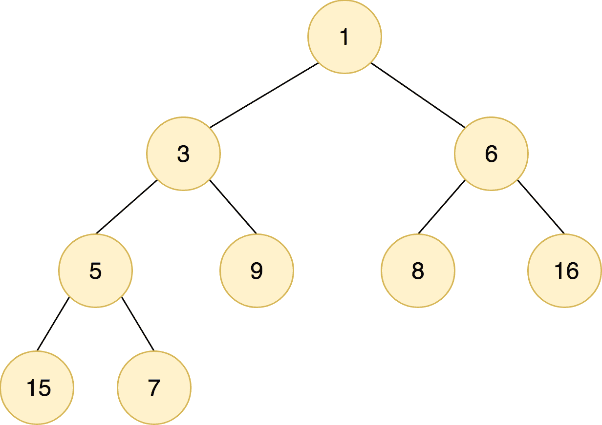

这是一个二叉**最大堆**示例。`100`是堆中所有数字中最大的，因此它被放在堆的根节点。根的所有孩子都小于根节点。子节点也是如此：根节点的左孩子比它的子节点小，以此类推。这棵树本身也是完全二叉树，因为它所有的层都是满的（除了最后一层是从左到右填充的）。

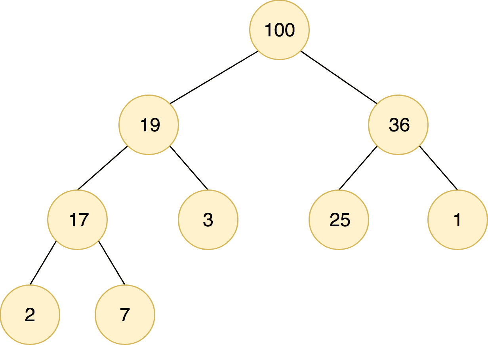

### 应用

堆的一个直接应用是**堆排序**算法（它是最好的排序方法之一，它是就地的且没有平方级最坏情况）。二叉堆由 J. W. J. Williams 于 1964 年引入，是一种专门用于堆排序算法的数据结构。

你可能已经从上面的插图中注意到，堆允许我们快速访问一组值的最小值/最大值。堆的这种属性使其在实现名为**优先级队列**的抽象数据类型时非常高效。在优先级队列中，高优先级的元素会在低优先级元素之前处理。通过在堆中存储元素的优先级，我们能够快速访问队列中下一个最重要的元素。

堆也用于**图算法**，如`Prim 最小生成树`算法和`Dijkstra 最短路径`算法。

### 基础操作

以下是通常在堆上执行的基本操作：

* **Peek**（查看） - 在不提取元素的情况下，返回堆的最小（对于最小堆）或最大（对于最大堆）元素。
* **Poll**（弹出） - 从堆中提取最小（对于最小堆）或最大（对于最大堆）元素。
* **Add**（添加） - 将新元素添加到堆中。
* **Remove**（移除） - 根据值从堆中移除元素。

在本章后面的部分，我们将介绍这些操作的具体实现，你将看到细节。但值得注意的是，对于修改堆的操作（如`poll`、`add`或`remove`），我们首先尝试保持堆的**形状属性**。然后我们尝试修改堆的二叉树结构，使其也满足**堆属性**。因此还有两种常见的堆操作：**向上调整**（heapify up）和**向下调整**（heapify down）。这些操作是内部的，不直接使用。这两个操作的唯一目的是在堆修改后保持堆属性。

## 使用示例

在继续实际实现之前，让我们假设我们已经实现了一个`MinHeap`类并来使用它。这将帮助我们更好地理解即将实现的每个类方法的含义。

```javascript
// 导入 MinHeap 类。
import { MinHeap } from './MinHeap';

// 创建最小堆实例。
const minHeap = new MinHeap();

minHeap.isEmpty(); // => true

// 向最小堆添加新元素。
minHeap.add(5);
minHeap.isEmpty(); // => false
minHeap.peek(); // => 5
minHeap.toString(); // => '5'

// 添加更多元素。
minHeap.add(3);
// Peek 操作将始终返回堆的最小元素。
minHeap.peek(); // => 3
minHeap.toString(); // => '3,5'

minHeap.add(10);
minHeap.peek(); // => 3
minHeap.toString(); // => '3,5,10'

// 从堆中提取最小值。
minHeap.poll(); // => 3
minHeap.peek(); // => 5
minHeap.toString(); // => '5,10'

// 从堆中移除元素。
minHeap.remove(10);
minHeap.peek(); // => 5
minHeap.toString(); // => '5'
```

`07-heap/example.js`

# 实现

#### 使用数组存储堆

我们将构建一个**完全二叉树**作为堆。这意味着它是一个二叉树，除了最后一层外，每一层都是满的，并且所有节点都尽可能靠左对齐。

*堆的元素通常存储在数组中*。任何二叉树都可以存储在数组中，但二叉堆总是完全二叉树。


将堆保存为数组后，我们可以轻松地找到任何节点的父节点和孩子。对于索引为`i`的节点，父节点位于索引`floor((i - 1) / 2)`，左孩子位于`2 * i + 1`，右孩子位于`2 * i + 2`。

#### 在堆中存储对象

有时需要在堆中存储对象不仅是数字。例如，我们可能希望堆中存储`{name: 'Paul', priority: 5}`和`{name: 'Jane', priority: 3}`用户对象，以便下次调用`poll()`方法时返回优先级更高的用户。为了实现这一点，我们需要提供一种在堆中比较对象的自定义方法。因此我们将实现一个通用的`Comparator`工具类，为对象比较提供通用接口。之后我们将使用`Comparator`工具类来实现`MinHeap`类。

###### `Comparator`类

让我们声明这个类。

```javascript
export default class Comparator {
```

`utils/comparator/Comparator.js`

##### `constructor`

`Comparator`构造函数接受一个比较回调函数作为参数。该函数接受两个值进行比较。如果两个对象相等，返回`0`；如果第一个对象小于第二个，返回`-1`；如果第一个对象大于第二个，返回`1`。

`Comparator`类本身并不感知任何比较逻辑。它只是提供一个通用接口（即我们将在下面实现的方法）来工作。

`compareFunction`是`Comparator`构造函数的可选参数。如果未提供`compareFunction`，我们将回退到`defaultCompareFunction()`函数。

```javascript
  /**
   * @param {function(a: *, b: *)} [compareFunction] - 可能是自定义的比较函数，
   * 比如可以比较自定义对象。
   */
  constructor(compareFunction) {
    this.compare = compareFunction || Comparator.defaultCompareFunction;
  }
```

`utils/comparator/Comparator.js`

##### `defaultCompareFunction()`

这是一个默认的回退比较函数，它将两个参数`a`和`b`视为字符串或数字，并对它们应用常用的比较运算符，如`===`、`<`和`>`。

```javascript
  /**
   * 默认比较函数。它仅假设 "a" 和 "b" 是字符串或数字。
   * @param {(string|number)} a
   * @param {(string|number)} b
   * @returns {number}
   */
  static defaultCompareFunction(a, b) {
    if (a === b) {
      return 0;
    }

    return a < b ? -1 : 1;
  }
```

`utils/comparator/Comparator.js`

### `equal()`

此函数检查两个变量是否相等。

```javascript
  /**
   * 检查两个变量是否相等。
   * @param {*} a
   * @param {*} b
   * @return {boolean}
   */
  equal(a, b) {
    return this.compare(a, b) === 0;
  }
```

`utils/comparator/Comparator.js`

### `lessThan()`

此函数检查变量`a`是否小于`b`。

```javascript
  /**
   * 检查变量 "a" 是否小于 "b"。
   * @param {*} a
   * @param {*} b
   * @return {boolean}
   */
  lessThan(a, b) {
    return this.compare(a, b) < 0;
  }
```

`utils/comparator/Comparator.js`

### `greaterThan()`

此函数检查变量`a`是否大于`b`。

```javascript
  /**
   * 检查变量 "a" 是否大于 "b"。
   * @param {*} a
   * @param {*} b
   * @return {boolean}
   */
  greaterThan(a, b) {
    return this.compare(a, b) > 0;
  }
```

`utils/comparator/Comparator.js`

### `lessThanOrEqual()`

此函数检查变量`a`是否小于或等于`b`。

```javascript
  /**
   * 检查变量 "a" 是否小于或等于 "b"。
   * @param {*} a
   * @param {*} b
   * @return {boolean}
   */
  lessThanOrEqual(a, b) {
    return this.lessThan(a, b) || this.equal(a, b);
  }
```

`utils/comparator/Comparator.js`

### `greaterThanOrEqual()`

此函数检查变量`a`是否大于或等于`b`。

```javascript
  /**
   * 检查变量 "a" 是否大于或等于 "b"。
   * @param {*} a
   * @param {*} b
   * @return {boolean}
   */
  greaterThanOrEqual(a, b) {
    return this.greaterThan(a, b) || this.equal(a, b);
  }
```

`utils/comparator/Comparator.js`

### 类 `MinHeap`

让我们继续实现`MinHeap`类。

首先导入依赖项。我们将在类构造函数中使用`Comparator`实例，以便允许类的使用者更改堆元素之间的比较方式。

```javascript
// 导入依赖项。
import Comparator from '../utils/comparator/Comparator';
```

`07-heap/MinHeap.js`

### `constructor`

让我们声明`MinHeap`类：

```javascript
export class MinHeap {
```

`07-heap/MinHeap.js`

在类构造函数中，我们需要创建一个数组来存储所有堆数据。为了提高`has()`操作的性能，我们还创建了`heapElements` Map，它将存储所有的堆元素，并允许我们在`O(1)`时间内检查元素是否存在于堆中。

```javascript
  /**
   * @constructs MinHeap
   * @param {Function} [comparatorFunction]
   */
  constructor(comparatorFunction) {
    // 堆的数组表示法。
    this.heapContainer = [];

    // 用于快速查找的堆元素 Map。
    this.heapElements = new Map();

    // 允许类的使用者更改堆元素之间的比较方式。
    // 这在我们想要在堆中保存对象时特别有用。
    this.compare = new Comparator(comparatorFunction);
  }
```

`07-heap/MinHeap.js`

### 辅助方法

在继续实现主要的堆操作之前，让我们先实现几个帮助我们遍历堆的辅助方法。

#### `getLeftChildIndex`

此辅助方法通过父节点索引返回左子节点的索引。如果`i`是父节点索引，那么左子节点的公式为`2 * i + 1`。

```javascript
  /**
   * @param {number} parentIndex
   * @return {number}
   */
  getLeftChildIndex(parentIndex) {
    return (2 * parentIndex) + 1;
  }
```

`07-heap/MinHeap.js`

#### `getRightChildIndex`

此辅助方法通过父节点索引返回右子节点的索引。如果`i`是父节点索引，那么右子节点的公式为`2 * i + 2`。

```javascript
  /**
   * @param {number} parentIndex
   * @return {number}
   */
  getRightChildIndex(parentIndex) {
    return (2 * parentIndex) + 2;
  }
```

`07-heap/MinHeap.js`

### `getParentIndex`

此辅助方法通过子节点索引返回父节点索引。如果`i`是子节点索引，那么父节点的公式为`(i - 1) / 2`。

```javascript
  /**
   * @param {number} childIndex
   * @return {number}
   */
  getParentIndex(childIndex) {
    return Math.floor((childIndex - 1) / 2);
  }
```

`07-heap/MinHeap.js`

### `hasParent`

此辅助方法检查索引`childIndex`是否有父节点。如果`floor((i - 1) / 2)`为正数，则返回`true`。

```javascript
  /**
   * @param {number} childIndex
   * @return {boolean}
   */
  hasParent(childIndex) {
    return this.getParentIndex(childIndex) >= 0;
  }
```

`07-heap/MinHeap.js`

### `has`

此辅助方法检查`item`是否存在于堆中。

```javascript
  /**
   * @param {*} item
   * @return {boolean}
   */
  has(item) {
    return this.heapElements.has(item);
  }
```

`07-heap/MinHeap.js`

### `hasLeftChild`

此辅助方法检查索引`parentIndex`是否有左子节点。如果索引大于`heapContainer`的长度，则该节点没有左子节点。

```javascript
  /**
   * @param {number} parentIndex
   * @return {boolean}
   */
  hasLeftChild(parentIndex) {
    return this.getLeftChildIndex(parentIndex) < this.heapContainer.length;
  }
```

`07-heap/MinHeap.js`

### `hasRightChild`

此辅助方法检查索引`parentIndex`是否有右子节点。如果索引大于`heapContainer`的长度，则意味着当前节点没有右子节点。

```javascript
  /**
   * @param {number} parentIndex
   * @return {boolean}
   */
  hasRightChild(parentIndex) {
    return this.getRightChildIndex(parentIndex) < this.heapContainer.length;
  }
```

`07-heap/MinHeap.js`

### `leftChild`

此辅助方法返回节点的左子节点。

```javascript
  /**
   * @param {number} parentIndex
   * @return {*}
   */
  leftChild(parentIndex) {
    return this.heapContainer[this.getLeftChildIndex(parentIndex)];
  }
```

`07-heap/MinHeap.js`

### `rightChild`

此辅助方法返回节点的右子节点。

```javascript
  /**
   * @param {number} parentIndex
   * @return {*}
   */
  rightChild(parentIndex) {
    return this.heapContainer[this.getRightChildIndex(parentIndex)];
  }
```

`07-heap/MinHeap.js`

### `parent`

此辅助方法返回子节点的父节点。

```javascript
  /**
   * @param {number} childIndex
   * @return {*}
   */
  parent(childIndex) {
    return this.heapContainer[this.getParentIndex(childIndex)];
  }
```

`07-heap/MinHeap.js`

### `swap`

此辅助方法交换`heapContainer`数组中的两个元素。

```javascript
  /**
   * @param {number} indexOne
   * @param {number} indexTwo
   */
  swap(indexOne, indexTwo) {
    const tmp = this.heapContainer[indexTwo];
    this.heapContainer[indexTwo] = this.heapContainer[indexOne];
    this.heapContainer[indexOne] = tmp;
  }
```

`07-heap/MinHeap.js`

### `isEmpty`

此辅助方法检查`heapContainer`数组中是否至少有一个元素。

```javascript
/**
 * @return {boolean}
 */
isEmpty() {
  return !this.heapContainer.length;
}
```

`07-heap/MinHeap.js`

### `find`

此辅助方法通过值查找堆中元素的位置。堆可能包含重复值，因此该方法返回一个位置数组，而不是仅仅是一个数字（我们正在搜索的元素的位置）。堆中两个元素之间的相等性通过使用`comparator()`函数进行检查。

```javascript
/**
 * @param {*} item
 * @param {Comparator} [comparator]
 * @return {Number[]}
 */
find(item, comparator = this.compare) {
  const foundItemIndices = [];

  for (let itemIndex = 0; itemIndex < this.heapContainer.length; itemIndex += 1) {
    if (comparator.equal(item, this.heapContainer[itemIndex])) {
      foundItemIndices.push(itemIndex);
    }
  }

  return foundItemIndices;
}
```

`07-heap/MinHeap.js`

### `toString`

此辅助方法通过直接调用`heapContainer`数组的`toString()`方法返回堆的字符串表示。

```javascript
/**
 * @return {string}
 */
toString() {
  return this.heapContainer.toString();
}
```

`07-heap/MinHeap.js`

#### 保持堆属性的内部方法

本节中的方法：`heapifyUp`和`heapifyDown`负责在任何堆修改后保持堆属性。使用`heapifyUp`和`heapifyDown`的堆修改方法——`peek`、`poll`、`add`、`remove`将在下一节中解释。

###### `heapifyUp`

此方法确保在向最小堆添加新元素后，满足堆的属性。新元素可能比其父元素小。为了修复这种情况，我们取出堆容器中的最后一个元素（数组中的最后一个元素或树中左下角的元素），并将其向上移动，直到它相对于其父元素处于正确的顺序。

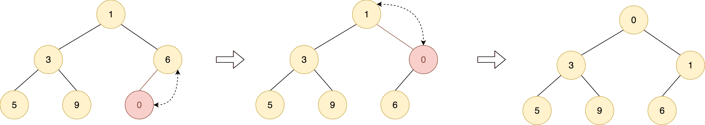

我们还将通过向函数添加任意参数`customStartIndex`，提供对堆中任何元素执行“向上调整”操作的可能性。我们在`remove()`方法中需要此功能。

```javascript
/**
 * @param {number} [customStartIndex]
 */
heapifyUp(customStartIndex) {
  // 取出堆容器中的最后一个元素（数组中的最后一个元素或树中左下角的元素）
  // 并将其向上移动，直到它相对于其父元素处于
  // 正确的顺序。
  let currentIndex = customStartIndex || this.heapContainer.length - 1;

  while (
    this.hasParent(currentIndex)
    && this.compare.greaterThan(this.parent(currentIndex), this.heapContainer[currentIndex])
  ) {
    this.swap(currentIndex, this.getParentIndex(currentIndex));
    currentIndex = this.getParentIndex(currentIndex);
  }
}
```

`07-heap/MinHeap.js`

###### `heapifyDown`

此方法确保在堆根被弹出后，满足堆的属性。在这种情况下，常见的行为是将堆的根替换为`heapContainer`的最后一个元素。但新的头部元素可能大于其子元素。在这种情况下，我们需要将父元素与其子元素进行比较，并将父元素与适当的子元素交换（最小堆取最小子元素，最大堆取最大子元素）。在交换后，我们需要对下一个子元素执行相同的操作。

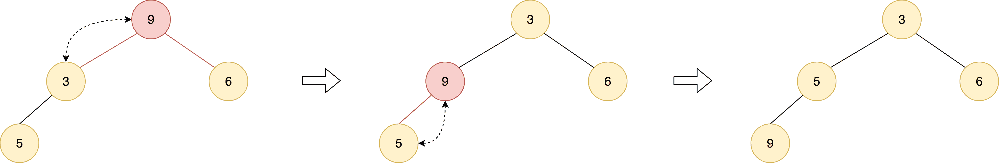

我们还将通过向函数添加任意参数`customStartIndex`，提供对堆中任何元素执行“向下调整”操作的可能性。我们在`remove()`方法中需要此功能。

```javascript
/**
 * @param {number} [customStartIndex]
 */
heapifyDown(customStartIndex = 0) {
  // 比较父元素与其子元素，并将父元素与适当的
  // 子元素交换（MinHeap 取最小子元素，MaxHeap 取最大子元素）。
  // 交换后对下一个子元素执行相同操作。
  let currentIndex = customStartIndex;
  let nextIndex = null;

  while (this.hasLeftChild(currentIndex)) {
    if (
      this.hasRightChild(currentIndex)
      && this.compare.lessThanOrEqual(this.rightChild(currentIndex), this.leftChild(currentIndex))
    ) {
      nextIndex = this.getRightChildIndex(currentIndex);
    } else {
      nextIndex = this.getLeftChildIndex(currentIndex);
    }

    if (this.compare.lessThanOrEqual(this.heapContainer[currentIndex], this.heapContainer[nextIndex])) {
      break;
    }

    this.swap(currentIndex, nextIndex);
    currentIndex = nextIndex;
  }
}
```

`07-heap/MinHeap.js`

#### 主方法

现在我们已经实现了一批辅助方法，让我们继续添加堆的主方法。

###### `peek`

此方法将返回堆的头部但不移除它。当我们只需要检查最小堆的最小元素时，它是很有用的。堆的头部是`heapContainer`数组的第一个元素。

```javascript
/**
 * @return {*}
 */
peek() {
  // 检查堆是否为空。
  if (this.heapContainer.length === 0) {
    // 如果堆为空则无内容。
    return null;
  }
  // 返回堆的第一个元素
  return this.heapContainer[0];
}
```

`07-heap/MinHeap.js`

###### `poll`

此方法将移除并返回堆的头部。当我们需要获取最小堆的最小元素时，它是很有用的。堆的头部是`heapContainer`数组的第一个元素。

在移除堆头部后，我们将`heapContainer`的最后一个元素移动到头部。此操作将保持形状属性（树必须是完全树）。但此时堆属性可能被违反，且最小堆的头部大于其子元素。为了修复这一点，我们调用`heapifyDown()`方法，它反过来将保持堆属性。我们将很快实现它。

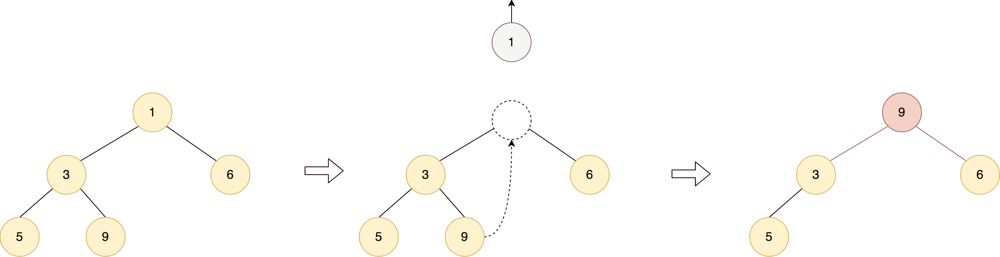

```javascript
/**
 * @return {*}
 */
poll() {
  if (this.heapContainer.length === 0) {
    // 如果堆为空则无法弹出。
    return null;
  }
  if (this.heapContainer.length === 1) {
    // 如果堆只有一个元素则直接提取。
    return this.heapContainer.pop();
  }
  // 记住我们要返回的值。
  const item = this.heapContainer[0];
  // 将最后一个元素移动到头部以保持形状属性。
  this.heapContainer[0] = this.heapContainer.pop();

  // 为了保持堆属性，对堆进行向下调整。
  this.heapifyDown();

  return item;
}
```

`07-heap/MinHeap.js`

###### `add`

此方法向最小堆添加新元素。为了保持堆的形状属性，新元素被添加到`heapContainer`数组的末尾。在添加新元素后，新元素可能比其父元素小。在这种情况下，堆属性被违反。为了修复这一点，我们调用`heapifyUp()`方法，它会将新元素在树结构中向上移动，直到满足堆属性。

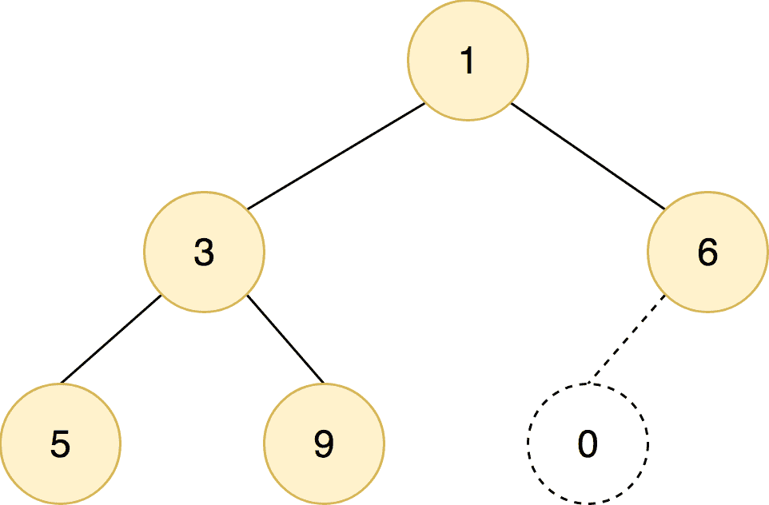

```javascript
/**
 * @param {*} item
 * @return {MinHeap}
 */
add(item) {
  // 将新元素添加到堆的末尾（保持形状属性）。
  this.heapContainer.push(item);

  // 将当前元素添加到堆元素映射中，以便快速访问。
  this.heapElements.set(item, item);

  // 如果元素小于其父节点，则通过向上堆化来确保
  // 堆属性被保持。
  this.heapifyUp();

  return this;
}
```

`07-heap/MinHeap.js`

#### `remove`

该方法通过值从堆中删除元素。为了删除元素，我们需要执行以下操作：

* 在堆中找到所有具有指定值的元素（可能存在重复元素，且它们都需要被删除）
* 遍历所有需要删除的元素。
  – 将堆的最后一个元素移动到空缺（被删除）的位置。
  – 对于刚刚移动的元素，我们需要获取它的新父节点和子节点，以决定是否违反了堆属性。
  – 如果违反了堆属性，我们需要调用`heapifyUp()`（如果父节点大于新元素值）或`heapifyDown()`（如果元素值大于其任何子节点的值）方法。

函数将返回`this`，以便方便地进行如`heap.remove(10).add(5)`的链式命令。

```javascript
/**
 * @param {*} item
 * @param {Comparator} [comparator]
 * @return {MinHeap}
 */
remove(item, comparator = this.compare) {
  // 找到需要删除元素的数量。
  const numberOfItemsToRemove = this.find(item, comparator).length;

  // 从堆元素映射中删除当前元素。
  this.heapElements.delete(item);

  for (let iteration = 0; iteration < numberOfItemsToRemove; iteration += 1) {
    // 每次删除后都需要重新找到要删除的元素索引，
    // 因为索引在每次堆化过程后都会发生变化。
    const indexToRemove = this.find(item, comparator).pop();

    // 如果需要删除堆中的最后一个元素，直接删除即可。
    // 之后不需要对堆进行堆化。
    if (indexToRemove === (this.heapContainer.length - 1)) {
      this.heapContainer.pop();
    } else {
      // 将堆中的最后一个元素移动到空缺（被删除）的位置。
      this.heapContainer[indexToRemove] = this.heapContainer.pop();

      // 获取父节点。
      const parentItem = this.parent(indexToRemove);

      // 如果没有父节点或者父节点与要删除的节点顺序正确，
      // 则向下堆化。否则向上堆化。
      if (
        this.hasLeftChild(indexToRemove)
        && (
          !parentItem
          || parentItem <= this.heapContainer[indexToRemove]
        )
      ) {
        this.heapifyDown(indexToRemove);
      } else {
        this.heapifyUp(indexToRemove);
      }
    }
  }

  return this;
}
```

`07-heap/MinHeap.js`

### 复杂度

| Peek | Poll | Add | Remove |
| --- | --- | --- | --- |
| O(1) | O(log(n)) | O(log(n)) | O(log(n)) |

*Polling*（弹出）、从队列中添加和删除元素的时间复杂度为`O(log(n))`，因为我们每次执行这些操作时，都需要对堆树重新进行堆化。这在最坏情况下会导致我们需要访问树分支中的所有元素。

*Peeking*（查看）的时间复杂度为`O(1)`，因为我们只需要访问堆数组的第一个元素（根节点）。

### 问题示例

以下是你在面试过程中可能会遇到的相关问题：

* [判断二叉树的完整性](https://leetcode.com/problems/check-completeness-of-a-binary-tree/)
* [二叉树插入器](https://leetcode.com/problems/complete-binary-tree-inserter/)

### 测验

*Q1: 每个二叉堆必须满足哪两个约束？*

*Q2: 当对堆执行`poll`操作并提取头部时，必须将什么值放在被提取元素的位置？*

*Q3: `MinHeap`中`poll()`的时间复杂度是多少？*

## 优先级队列

```javascript
// 导入依赖。
import { PriorityQueue } from './PriorityQueue';

// 初始化一个空优先级队列。
const priorityQueue = new PriorityQueue();

// 初始化一个美国城市数组，人口以百万为单位指定。
const notSortedCities = [
  { name: 'New York', population: 8.6 },
  { name: 'Chicago', population: 2.7 },
  { name: 'San Francisco', population: 0.84 },
  { name: 'Houston', population: 2 },
];

// 将所有城市添加到优先级队列，将人口视为优先级。
notSortedCities.forEach(city => priorityQueue.add(city, city.population));

// 现在我们从优先级队列中逐个获取城市，并将它们放入
// sortedCities 数组中。我们期望城市按人口从小到大的顺序被弹出。
const sortedCities = [];
while (priorityQueue.peek()) {
  // 只要我们还能从队列中查看元素，就意味着队列尚未为空。
  sortedCities.push(priorityQueue.poll());
}

// 我们期望 sortedCities 确实按人口从小到大的顺序排序。
// eslint-disable-next-line no-console
console.log(sortedCities);

/*
  输出将是：

  [
    { name: 'San Francisco', population: 0.84 },
    { name: 'Houston', population: 2 },
    { name: 'Chicago', population: 2.7 },
    { name: 'New York', population: 8.6 },
  ]
*/
```

`07-priority-queue/example.js`

### 实现

我们将根据上面解释的`MinHeap`类来构建`PriorityQueue`类。`MinHeap`类支持自定义比较函数。因此，我们将使用`Comparator`实例来修改`MinHeap`中的比较算法，使其比较元素的优先级而不是值。关于`MinHeap`和`Comparator`实现的更多细节，请参考本书的“堆（Heap）”章节。

让我们导入将要到的依赖。

```javascript
// 导入依赖。
import { MinHeap } from '../07-heap/MinHeap';
import Comparator from '../utils/comparator/Comparator';
```

`07-priority-queue/PriorityQueue.js`

让我们声明`PriorityQueue`类并继承自`MinHeap`类。

```javascript
export class PriorityQueue extends MinHeap {
```

`07-priority-queue/PriorityQueue.js`

#### `constructor()`

在构造函数中，我们首先通过调用`super()`调用`MinHeap`类的父构造函数。

接下来，我们将创建一个优先级映射`this.priorities`。这个映射存储了所有优先级队列项的优先级值，并以元素本身作为键。例如`this.priorities`可能看起来像`{itemA: 10, itemB: 14}`，其中`itemA`和`itemB`是元素键，`10`和`14`是元素的优先级。

我们还会创建一个自定义的`this.compare()`函数。这是修改`MinHeap`行为的主要地方，使`MinHeap`方法遵循元素的优先级而不是元素的值。你可能会在这里看到我们提供了一个自定义的`this.comparePriority()`函数作为主比较函数。该函数将在下方解释。

```javascript
  constructor() {
    // 先调用 MinHeap 构造函数。
    super();

    // 设置优先级映射。
    this.priorities = new Map();

    // 使用自定义比较器处理堆元素，考虑元素的优先级
    // 而不是元素值。
    this.compare = new Comparator(this.comparePriority.bind(this));
  }
```

`07-priority-queue/PriorityQueue.js`

#### `comparePriority()`

此函数根据它们的优先级比较两个元素。为此，它从`this.priorities`映射中获取元素`a`和`b`的优先级。如果两个优先级都相等，则返回`0`；如果`a`比`b`不重要，则返回`-1`（元素顺序不正确），否则返回`1`（元素顺序正确）。

```javascript
  /**
   * 比较两个元素的优先级。
   * @param {*} a
   * @param {*} b
   * @return {number}
   */
  comparePriority(a, b) {
    if (this.priorities.get(a) === this.priorities.get(b)) {
      return 0;
    }
    return this.priorities.get(a) < this.priorities.get(b) ? -1 : 1;
  }
```

`07-priority-queue/PriorityQueue.js`

#### `compareValue()`

此方法与`comparePriority()`相同，但它比较的是值而不是优先级。

```javascript
  /**
   * 比较值。
   * @param {*} a
   * @param {*} b
   */
  compareValue(a, b) {
    if (a === b) {
      return 0;
    }
    return a < b ? -1 : 1;
  }
```

`07-priority-queue/PriorityQueue.js`

#### `add()`

此方法根据它们的优先级将元素添加到优先级队列中。它首先将优先级值设置为`this.priorities`，然后调用`super.add()`。

```javascript
  /**
   * 将元素添加到优先级队列。
   * @param {*} item - 要添加的元素。
   * @param {number} priority - 优先级。
   */
  add(item, priority = 0) {
    this.priorities.set(item, priority);
    super.add(item);
  }
```

`07-priority-queue/PriorityQueue.js`

#### `remove()`

此方法从优先级队列中移除元素。它接受两个参数：要移除的`item`以及可选的`customFindingComparator`（允许自定义在堆中搜索元素）。

```javascript
  /**
   * 从优先级队列中移除元素。
   * @param {*} item - 要移除的元素。
   * @param {Function} customFindingComparator - 自定义回调。
   */
  remove(item, customFindingComparator) {
    super.remove(item, customFindingComparator);
    this.priorities.delete(item);
  }
```

`07-priority-queue/PriorityQueue.js`

#### `changePriority()`

此方法更改队列元素的优先级。由于每次更改优先级都需要重新构建堆以便元素处于正确的位置，我们先从堆中移除元素，然后使用更新后的优先级将其添加。我们可以在不移除元素的情况下重建堆，但为了简单起见，我们保持这种做法。

```javascript
  /**
   * 更改队列中元素的优先级。
   * @param {*} item - 要重新调级的元素。
   * @param {number} priority - 新的优先级。
   * @return {PriorityQueue}
   */
  changePriority(item, priority) {
    this.remove(item, new Comparator(this.compareValue));
    this.add(item, priority);
    return this;
  }
```

`07-priority-queue/PriorityQueue.js`

### 复杂度

由于`PriorityQueue`基于`MinHeap`类，且其主要方法只是通过修改比较函数来封装`MinHeap`类的主要方法，因此我们可以假设`PriorityQueue`类的时间复杂度与`MinHeap`类相同。此外注意，对`this.priorities`映射的所有操作都在`O(1)`时间内完成。

| Peek | Poll | Add | Remove |
| --- | --- | --- | --- |
| O(1) | O(log(n)) | O(log(n)) | O(log(n)) |

### 参考文献

Wikipedia 上的优先级队列 [`en.wikipedia.org/wiki/Priority_queue`](https://en.wikipedia.org/wiki/Priority_queue)

YouTube 上的优先级队列 [`www.youtube.com/watch?v=wptevk0bshY`](https://www.youtube.com/watch?v=wptevk0bshY)

优先级队列示例与测试用例 [`github.com/trekhleb/javascript-algorithms/tree/master/src/data-structures/priority-queue`](https://github.com/trekhleb/javascript-algorithms/tree/master/src/data-structures/priority-queue)

## 图

*难度：简单*

`Graph`是顶点和边的集合，边连接了所有或部分顶点。

`Graph`可以是有向的(`directed`)或是无向的(`undirected`)。在有向图中，每条边都有一个方向（类似于单行道）。你可以从起始节点访问终点，但反之则不行。在无向图中，边没有特定的方向（类似于双行道），因此任何两个连接在一起的顶点都可以相互访问。

### 什么是顶点？

> 顶点（vertex）是图中表示数据的基本单位。“节点”（node）和“顶点”（vertex）这两个术语可以通用，用于描述图中数据表示的方式。顶点（vertex 的复数）通过边连接。

另一种说明有向图和无向图区别的方法是考虑社交网络。如果每个顶点都是一个“用户”，那么在有向图中每条边都是一种“关注”关系——你可以关注某人，但这并不意味着对方也会关注你。而在无向图中，边就像“朋友”关系——如果某人在你的朋友列表中，那么自动意味着你也在那个人的朋友列表中。

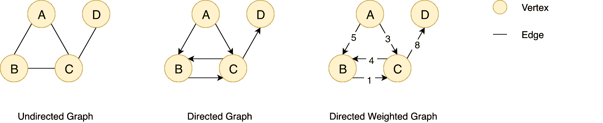

在上面的示例中，我们有三个不同的图，它们都包含顶点和边。所有的图都有顶点集合`{A, B, C, D}`且都有一个边集合。无向图有一个边集合：`{AB, BC, AC, CD}`。有向图也有一个边集合：`{AB, BC, CB, AC, CD}`。注意，为了在有向图中双向连接顶点`B`和`C`，集合中有了两条边`BC`和`CB`。

如果两个顶点通过一条边相互连接，我们称这些顶点为相邻的(`adjacent`)或“邻居”(`neighbors`)。例如，在上面的无向图中，顶点`A`和`B`是邻居，顶点`A`和`C`也是。但顶点`B`和`D`不是邻居，因为这些顶点通过多条边连接（`B`连接到`C`，`C`再连接到`D`）。

两个顶点之间的边序列称为路径(`path`)。在上面的有向图中没有从`D`到`A`的路径，但存在从`A`到`D`的路径，该路径是边的集合：`{AC, CD}`。

图中的所有顶点并不都需要连接。当存在无法到达的(`unreachable`)顶点时，我们将这种图称为不连通图(`disconnected graph`)。如果图中每对顶点之间都有边，则被称为连通图(`connected graph`)。

图也可以包含循环。如果一个图没有循环，则被称为无环图(`acyclic graph`)。

加权图(`weighted graph`)是图中每条边都关联有一个权重的图。根据上下文，边权重可能代表不同的概念，如“距离”、“流量”、“成本”、“电阻”等。

### 应用

- **地图 (Maps)** 应用使用图来计算顶点（地址、城市、位置）之间的最短路径。
- **社交网络 (Social networks)** 使用图进行朋友推荐算法。
- **包管理器 (Package managers)** 使用图根据依赖关系计算安装包的正确顺序。
- **搜索引擎 (Search engines)** 使用图分析页面相关性。在搜索引擎使用的图中，网页是一个顶点，从该网页到另一个网页的链接是有向边。
- **网络提供商 (Network providers)** 使用图分析网络流量和安全性。在这种情况下，每个顶点都有一个`IP`地址，每条边代表在不同 IP 地址之间流动的网络包。

### 图表示

图通常被表示为邻接列表(`adjacency lists`)或邻接矩阵(`adjacency matrices`)。让我们以本章开始的图为例。


#### 邻接矩阵

具有`n`个顶点的图也可以表示为大小为`n × n`的二进制值（`0`或`1`）的邻接矩阵。在这样的矩阵中，位置`(i, j)`处的值`1`表示顶点`i`和`j`之间存在边。否则，如果值为`0`，则这些顶点之间没有边。

**无向图邻接矩阵示例**

对于无向图，邻接矩阵是对称的。

| | A | B | C | D |
| --- | --- | --- | --- | --- |
| **A** | 0 | 1 | 1 | 0 |
| **B** | 1 | 0 | 1 | 0 |
| **C** | 1 | 1 | 0 | 1 |
| **D** | 0 | 0 | 1 | 0 |

**有向图邻接矩阵示例**

对于有向图，邻接矩阵可能不对称。

| | A | B | C | D |
| --- | --- | --- | --- | --- |
| **A** | 0 | 1 | 1 | 0 |
| **B** | 1 | 0 | 1 | 0 |
| **C** | 0 | 1 | 0 | 1 |
| **D** | 0 | 0 | 1 | 0 |

**加权图邻接矩阵示例**

对于加权图，可以使用边的权重来代替布尔值。

| | A | B | C | D |
| --- | --- | --- | --- | --- |
| **A** | 0 | 5 | 3 | 0 |
| **B** | 0 | 0 | 4 | 0 |
| **C** | 0 | 2 | 0 | 6 |
| **D** | 0 | 0 | 0 | 0 |

#### 邻接列表

图的一种流行表示方法是使用一个包含所有顶点的对象列表。


有时，不是使用顶点列表，而是使用`Edge`实体的列表。`Edge`实体存储起始顶点、终点顶点和权重。当我们需要存储某些元数据时，这种方法可能更方便。

```javascript
class Node {
  constructor() {
    /** @type {Edge[]} */
    this.edges = [];
  }
}

class Edge {
  constructor() {
    /** @type {Node} */
    this.startVertex = null;
    /** @type {Node} */
    this.endVertex = null;
    this.weight = null;
  }
}

class Graph {
  constructor() {
    /** @type {Node[]} */
    this.nodes = [];
  }
}
```

我们还需要一个独立的`Graph`类来支持不连通的图。在本章中，我们将使用邻接列表方法来实现图。

#### 邻接矩阵与邻接列表对比

图相关的算法可以交替使用邻接矩阵或邻接列表来实现。区别在于，根据对图执行的操作，一种实现图的方式可能比另一种更高效。

### 使用示例

在我们实现图的 JavaScript 版本之前，让我们先假设我们已经有了`Graph`、`GraphVertex`和`GraphEdge`类，并描述我们打算如何使用它们。

假设我们想创建一个非常简单的社交网络模型。我们希望能够注册新用户、创建“朋友”关系，并查看特定用户的好友列表。

```javascript
// 导入依赖。
import Graph from './Graph';
import GraphVertex from './GraphVertex';
import GraphEdge from './GraphEdge';

// 创建网络。
const network = new Graph();

// 创建用户。
const bill = new GraphVertex('Bill');
const mary = new GraphVertex('Mary');
const john = new GraphVertex('John');
const jane = new GraphVertex('Jane');

// 在我们的网络中注册用户。
network
  .addVertex(bill)
  .addVertex(mary)
  .addVertex(john)
  .addVertex(jane);

// 检查用户是否注册成功。
network.getVertexByKey('Bill'); // -> bill
network.getVertexByKey('Mary'); // -> mary

// 建立朋友连接。
network
  .addEdge(new GraphEdge(bill, mary))
  .addEdge(new GraphEdge(john, jane))
  .addEdge(new GraphEdge(jane, mary));

// 检查特定用户是否是朋友。
network.findEdge(bill, mary); // -> GraphEdge 实体
network.findEdge(john, jane); // -> GraphEdge 实体
network.findEdge(bill, john); // -> null

// 获取特定用户的所有朋友。
// eslint-disable-next-line no-unused-expressions
mary.getNeighbors().length; // -> 2
mary.getNeighbors(); // -> [bill, jane]
```

`08-graph/example.js`

# 实现

我们将实现分为三个部分。首先，实现`GraphEdge`和`GraphVertex`类，然后将它们封装进`Graph`类中。

## GraphEdge

让我们创建这个类。

```javascript
export default class GraphEdge {
```

`08-graph/GraphEdge.js`

### `constructor`

构造方法将接受`startVertex`、`endVertex`以及`weight`参数。边的实例将表示`startVertex`和`endVertex`之间的连接。对于有向图，参数的顺序（`startVertex`和`endVertex`）很重要，因为如果你还记得引言中提到的，有向图中的边是“单行道”——它们只能向一个方向。对于无向图，参数的顺序并不重要。

```javascript
  /**
   * GraphEdge 构造函数。
   * @param {GraphVertex} startVertex
   * @param {GraphVertex} endVertex
   * @param {number} [weight=1]
   */
  constructor(startVertex, endVertex, weight = 0) {
    this.startVertex = startVertex;
    this.endVertex = endVertex;
    this.weight = weight;
  }
```

`08-graph/GraphEdge.js`

### `getKey()`

此方法将返回一个唯一的边键，它由起始顶点和终点顶点键组成。该键稍后将在`Graph`类中用于快速查找图的边。我们将在下方为`GraphVertex`实例实现`getKey()`方法。键值看起来像`A_B`，这意味着这条边连接了顶点`A`和`B`。

```javascript
  /**
   * 获取边键的字符串表示。
   * @return {string}
   */
  getKey() {
    const startVertexKey = this.startVertex.getKey();
    const endVertexKey = this.endVertex.getKey();

    return `${startVertexKey}_${endVertexKey}`;
  }
```

`08-graph/GraphEdge.js`

### `toString()`

此方法将返回边的字符串表示。为了简单起见，我们在这里返回边的键。

```javascript
  /**
   * 将边转换为字符串。
   * @return {string}
   */
  toString() {
    return this.getKey();
  }
```

`08-graph/GraphEdge.js`

## GraphVertex

我们将使用之前章节中的`LinkedList`类来存储顶点的所有相邻边。让我们先导入我们的依赖项。

```javascript
// 导入依赖。
import LinkedList from '../02-linked-list/LinkedList';
```

`08-graph/GraphVertex.js`

现在让我们创建一个类。

```javascript
export default class GraphVertex {
```

`08-graph/GraphVertex.js`

### `constructor`

构造方法将接受顶点的`value`。此外，在此方法中，我们将使用`LinkedList`类创建一个空的`edges`列表，用于存储所有相邻边。

```javascript
  /**
   * 顶点构造函数。
   * @param {*} value
   */
  constructor(value) {
    this.value = value;
    this.edges = new LinkedList();
  }
```

`08-graph/GraphVertex.js`

### `addEdge()`

此方法将新边添加到当前顶点。它通过追加操作来实现。该方法返回`this`以允许链式调用。

```javascript
  /**
   * 向顶点添加新边。
   * @param {GraphEdge} edge
   * @returns {GraphVertex}
   */
  addEdge(edge) {
    this.edges.append(edge);

    return this;
  }
```

`08-graph/GraphVertex.js`

### `deleteEdge()`

此方法从`LinkedList`中删除边。

```javascript
  /**
   * 删除顶点边。
   * @param {GraphEdge} edge
   */
  deleteEdge(edge) {
    this.edges.delete(edge);
  }
```

`08-graph/GraphVertex.js`

### `getEdges()`

此方法返回顶点的所有相邻边的数组。为了做到这一点，它将边的`LinkedList`转换为数组，然后使用`map()`函数遍历并提取值。这些值是顶点实体。

```javascript
  /**
   * 获取所有顶点边数组。
   * @return {GraphEdge[]}
   */
  getEdges() {
    return this.edges.toArray().map(linkedListNode => linkedListNode.value);
  }
```

`08-graph/GraphVertex.js`

### `hasEdge()`

此方法检查顶点是否有特定的边实例。为了做到这一点，它使用了`LinkedList`的`find()`方法。我们将一个函数作为参数传递给`find()`方法。在函数内部，我们通过严格比较`===`来查找正确的边。如果找到了边，我们通过双重`!!`将其转换为布尔值。

```javascript
  /**
   * 检查顶点是否连接了特定的边。
   * @param {GraphEdge} requiredEdge
   * @returns {boolean}
   */
  hasEdge(requiredEdge) {
    const edgeNode = this.edges.find({
      callback: edge => edge === requiredEdge,
    });

    return !!edgeNode;
  }
```

`08-graph/GraphVertex.js`

### `getNeighbors()`

此方法返回当前顶点的所有相邻顶点的数组。为了做到这一点，我们需要：

* 遍历所有相邻边，
* 对于每条边，我们需要检查`startVertex`和`endVertex`，并返回不等于当前顶点的顶点。

我们需要这样做是因为我们无法保证当前顶点存储为边中的`startVertex`。例如，考虑我们有顶点*A*和*B*以及边*AB*的情况。在这种情况下，边*AB*将被添加到顶点*A*和*B*中。对于顶点*A*，它是边*AB*的`startVertex`，但对于顶点*B*，它是`endVertex`。这两种情况都需要处理。

```javascript
  /**
   * 获取顶点邻居列表。
   * @returns {GraphVertex[]}
   */
  getNeighbors() {
    const edges = this.edges.toArray();

    /** @param {LinkedListNode} node */
    const neighborsConverter = (node) => {
      const edge = node.value;
      const neighbor = edge.startVertex === this ? edge.endVertex : edge.startVertex;

      // 将边的属性添加到邻居中，以便此方法的调用者
      // 可以访问边的属性（如权重）。
      neighbor.edge = edge;

      return neighbor;
    };

    // 返回起始或结束顶点。
    // 对于无向图，当前顶点可能是结束顶点。
    return edges.map(neighborsConverter);
  }
```

`08-graph/GraphVertex.js`

##### `hasNeighbor()`

此方法检查当前顶点是否具有特定的邻居顶点。为了实现这一点，它使用链表的`find()`方法来查找连接当前顶点与指定邻居顶点的边。然后，使用`!!`序列将`find()`操作的结果转换为布尔值。如果从当前顶点到指定的邻居顶点存在边，则该方法将返回`true`。否则将返回`false`。

```javascript
  /**
   * 检查特定顶点是否为当前顶点的邻居。
   * @param {GraphVertex} vertex
   * @returns {boolean}
   */
  hasNeighbor(vertex) {
    const edgeToNeighbor = this.edges.find({
      callback: edge => edge.startVertex === vertex || edge.endVertex === vertex,
    });

    return !!edgeToNeighbor;
  }
```

`08-graph/GraphVertex.js`

##### `findEdge()`

此方法查找连接当前顶点与指定顶点的边。为了实现这一点，它使用了`LinkedList`的`find()`方法并带有`edgeFinder()`回调函数。在`edgeFinder()`回调中，我们尝试寻找一个`startVertex`或`endVertex`被设置为来自`findEdge()`函数参数的指定`vertex`对象的顶点。如果找到了该边，此方法将返回它的值。否则，将返回`null`。

```javascript
  /**
   * 查找连接当前顶点与指定顶点的边。
   * @param {GraphVertex} vertex
   * @returns {(GraphEdge|null)}
   */
  findEdge(vertex) {
    const edgeFinder = (edge) => {
      return edge.startVertex === vertex || edge.endVertex === vertex;
    };

    const edge = this.edges.find({ callback: edgeFinder });

    return edge ? edge.value : null;
  }
```

`08-graph/GraphVertex.js`

##### `deleteAllEdges()`

此方法删除所有连接到当前顶点的边。它简单地遍历所有的边并对每条边执行`deleteEdge()`方法。

```javascript
  /**
   * 删除所有连接到顶点的边。
   * @return {GraphVertex}
   */
  deleteAllEdges() {
    this.getEdges().forEach(edge => this.deleteEdge(edge));

    return this;
  }
```

`08-graph/GraphVertex.js`

##### `getKey()`

此方法返回顶点的键（key）。我们使用顶点的值作为唯一键。稍后在`Graph`类中，我们需要这个键来将所有顶点存储在映射（map）中，以便快速查找顶点。

```javascript
  /**
   * 获取顶点的字符串键。
   * @returns {string}
   */
  getKey() {
    return this.value;
  }
```

`08-graph/GraphVertex.js`

##### `toString()`

此方法创建顶点的字符串表示。我们打印顶点的值。

```javascript
  /**
   * 获取图顶点的字符串表示。
   * @returns {string}
   */
  toString() {
    return `${this.value}`;
  }
```

`08-graph/GraphVertex.js`

#### Graph

最后，我们可以创建`Graph`类。这个类用于支持不连通的图，图中我们可能拥有多个不相连的顶点。

```javascript
export default class Graph {
```

`08-graph/Graph.js`

##### `constructor`

为了支持有向图和无向图，构造方法将接受一个`isDirected`标志。我们还创建了空的`this.vertices`和`this.edges`映射（对象），我们将它们用于存储所有添加到图中的顶点和边。

```javascript
  /**
   * 图的构造函数。
   * @param {boolean} isDirected
   */
  constructor(isDirected = false) {
    this.vertices = {};
    this.edges = {};
    this.isDirected = isDirected;
  }
```

`08-graph/Graph.js`

##### `addVertex()`

此方法向图添加一个顶点实例。它简单地在`this.vertices`对象中创建一个唯一的键，并将`newVertex`实例存储其中。

```javascript
  /**
   * 向图添加新顶点。
   * @param {GraphVertex} newVertex
   * @returns {Graph}
   */
  addVertex(newVertex) {
    this.vertices[newVertex.getKey()] = newVertex;

    return this;
  }
```

`08-graph/Graph.js`

##### `getVertexByKey()`

此方法根据键从`this.vertices`对象返回顶点。

```javascript
  /**
   * 根据键获取顶点。
   * @param {string} vertexKey
   * @returns GraphVertex
   */
  getVertexByKey(vertexKey) {
    return this.vertices[vertexKey];
  }
```

`08-graph/Graph.js`

##### `getAllVertices()`

此方法返回所有的顶点。为了实现这一点，它使用`Object.values()`方法将`this.vertices`对象转换为数组。

```javascript
  /**
   * 获取所有顶点的列表。
   * @return {GraphVertex[]}
   */
  getAllVertices() {
    return Object.values(this.vertices);
  }
```

`08-graph/Graph.js`

##### `getAllEdges()`

此方法返回所有的边的列表。为了实现这一点，它使用`Object.values()`方法将`this.edges`对象转换为数组。

```javascript
  /**
   * 获取所有边的列表。
   * @return {GraphEdge[]}
   */
  getAllEdges() {
    return Object.values(this.edges);
  }
```

`08-graph/Graph.js`

##### `addEdge()`

此方法向图添加一个特定的边实例。在添加新边时，我们需要注意以下几点：

*首先*，我们需要检查边中的某些（或所有）顶点是否已添加到图中。如果边的某些（或所有）顶点之前尚未添加到`this.vertices`对象，我们需要添加它们。我们使用`getVertexByKey()`方法来检查顶点是否存在。如果它返回`undefined`，说明我们需要通过`addVertex()`方法创建一个顶点。

*其次*，我们需要检查该边是否已经添加到`this.edges`对象中。如果边已经添加，则抛出错误。否则，我们将边添加到`this.edges`对象中。

*最后*，如果图是有向的，我们只需要将此边添加到`startVertex`实例中。否则，该边将同时添加到`startVertex`和`endVertex`实例中。

```javascript
/**
 * 向图中添加一条新边。
 * @param {GraphEdge} edge
 * @returns {Graph}
 */
addEdge(edge) {
  // 尝试查找起始和终点顶点。
  let startVertex = this.getVertexByKey(edge.startVertex.getKey());
  let endVertex = this.getVertexByKey(edge.endVertex.getKey());

  // 如果起始顶点不存在，则插入。
  if (!startVertex) {
    this.addVertex(edge.startVertex);
    startVertex = this.getVertexByKey(edge.startVertex.getKey());
  }

  // 如果终点顶点不存在，则插入。
  if (!endVertex) {
    this.addVertex(edge.endVertex);
    endVertex = this.getVertexByKey(edge.endVertex.getKey());
  }

  // 检查边是否已经添加。
  if (this.edges[edge.getKey()]) {
    throw new Error('Edge has already been added before');
  } else {
    this.edges[edge.getKey()] = edge;
  }

  // 将边添加到顶点中。
  if (this.isDirected) {
    // 如果图是有向的，则只将边添加到起始顶点。
    startVertex.addEdge(edge);
  } else {
    // 如果图是无向的，则将边添加到两个顶点。
    startVertex.addEdge(edge);
    endVertex.addEdge(edge);
  }

  return this;
}
```

`08-graph/Graph.js`

### `deleteEdge()`

此方法从图中删除特定的边。我们需要先从`this.edges`对象中删除该边。然后，我们还需要从相关的顶点（`startVertex`和`endVertex`）中将其删除。

```javascript
/**
 * 从图中删除特定的边。
 * @param {GraphEdge} edge
 */
deleteEdge(edge) {
  // 从边列表中删除边。
  if (this.edges[edge.getKey()]) {
    delete this.edges[edge.getKey()];
  } else {
    throw new Error('Edge not found in graph');
  }

  // 尝试查找起始和终点顶点并从中删除边。
  const startVertex = this.getVertexByKey(edge.startVertex.getKey());
  const endVertex = this.getVertexByKey(edge.endVertex.getKey());

  startVertex.deleteEdge(edge);
  endVertex.deleteEdge(edge);
}
```

`08-graph/Graph.js`

### `findEdge()`

此方法通过`startVertex`和`endVertex`实例查找边。它基本上是检查图中的两个顶点是否连接。为了做到这一点，它首先尝试在顶点列表中查找`startVertex`。如果没有找到`startVertex`，则方法返回`null`。如果找到了`startVertex`，它将尝试使用`findEdge()`方法查找连接`startVertex`和`endVertex`的边。

```javascript
/**
 * 通过起始顶点和终点顶点查找边。
 * @param {GraphVertex} startVertex
 * @param {GraphVertex} endVertex
 * @return {(GraphEdge|null)}
 */
findEdge(startVertex, endVertex) {
  const vertex = this.getVertexByKey(startVertex.getKey());

  if (!vertex) {
    return null;
  }

  return vertex.findEdge(endVertex);
}
```

`08-graph/Graph.js`

### `toString()`

此方法返回图的字符串表示。为了实现这一点，它将`this.vertices`转换为图顶点实例的数组。然后将此数组转换为字符串。

如果图包含两个键为`'A'`和`'B'`的顶点，该字符串看起来将像`'A,B'`。

```javascript
/**
 * 将图转换为字符串。
 * @return {string}
 */
toString() {
  return Object.keys(this.vertices).toString();
}
```

`08-graph/Graph.js`

### 操作时间复杂度

| 实现方式 | 添加顶点 | 删除顶点 | 添加边 | 删除边 |
| --- | --- | --- | --- | --- |
| 邻接列表 | O(1) | O(E+V) | O(1) | O(E) |
| 邻接矩阵 | O(V²) | O(V²) | O(1) | O(1) |

其中`V`是顶点数，`E`是边数。

### 题目

- [寻找小镇法官](https://leetcode.com/problems/find-the-town-judge/)：你可能会遇到一些图相关的问题。
- [克隆图](https://leetcode.com/problems/clone-graph/)
- [课程表](https://leetcode.com/problems/course-schedule/)

### 测试

- Q1: 什么是树结构？
- Q2: 什么是集合？
- Q3: 什么是图？

### 参考文献

- 维基百科上的图：[https://en.wikipedia.org/wiki/Graph](https://en.wikipedia.org/wiki/Graph)
- YouTube 上的图：[https://www.youtube.com/watch?v=g](https://www.youtube.com/watch?v=g)
- GitHub 上的算法：[https://github.com/master/data](https://github.com/master/data)

## 位运算

难度：简单

### 引言

在计算机中，位（bit）是 0 或 1 的表示。二进制使用 0 或 1。

我们如何得到二进制？我们将一个数字除以 2 得到：

- 10 / 2 = 5
- 5 / 2 = 2
- 2 / 2 = 1
- 1 / 2 = 0

数字 10 在二进制中看起来像`1010`。

JavaScript 使用 64 位来表示这些数字：

```
0000000000000000000000000000000000000000000000000000000000001010
```

在处理二进制数字时，我们可以使用这些操作。下表解释了每种操作：

| 运算符 | 名称 | 描述 |
| --- | --- | --- |
| `&` | 与 | 如果两个位都为 1 则为 1 |
| `|` | 或 | 如果任意一位为 1 则为 1 |
| `^` | 异或 | 如果只有其中一位为 1 则为 1 |
| `~` | 取反 | 反转所有位 |
| `<<` | 左移 | 向左移动并补 0 |
| `>>` | 符号右移 | 向右移动并保留左侧位 |
| `>>>` | 无符号右移 | 向右移动并补 0 |

任何时候使用这些类型的运算符时，JavaScript 都会将数字转换为 32 位，然后返回 64 位符号数。

### 什么是符号数？

二进制数字只是 1 和 0。无法像十进制那样确定数字是正数还是负数。符号二进制数使用左侧位（也称为“最高位”或 MSB）来确定数字的正负。如果左侧位是 1，则为负数。如果左侧位是 0，则为正数。

### 应用

在 JavaScript 中执行位运算时，数字会从 64 位数字转换为 32 位符号整数。例如，如果你对 6 使用`~`运算符：`~6`

6 在 64 位中看起来像：

```
0000000000000000000000000000000000000000000000000000000000000110
```

当你对这个数字执行`NOT`操作时，数字会被转换为 32 位符号整数：

```
00000000000000000000000000000110
```

操作结果看起来像这样：

```
1111111111111111111111111111111111111111111111111111111111111001
```

`~6`的结果是`-7`。为什么？当你使用`NOT`运算符来翻转所有位时，返回的数字是补码格式的有符号数。

## 什么是补码？

补码是二进制数的一种格式，它是有符号数的略微修改版本。最高位（most significant bit）仍用于判断数字是正数还是负数，0 为正，1 为负。要计算补码格式下负数的值，需要反转所有位并加 1。对于有符号数，使用补码格式的优势在于不存在“双零”问题，正如下表所示：

| 十进制 | 有符号数 | 补码 |
| --- | --- | --- |
| +7 | 0111 | 0111 |
| +6 | 0110 | 0110 |
| +5 | 0101 | 0101 |
| +4 | 0100 | 0100 |
| +3 | 0011 | 0011 |
| +2 | 0010 | 0010 |
| +1 | 0001 | 0001 |
| +0 | 0000 | 0000 |
| -0 | 1000 | - |
| -1 | 1001 | 1111 |
| -2 | 1010 | 1110 |
| -3 | 1011 | 1101 |
| -4 | 1100 | 1100 |
| -5 | 1101 | 1011 |
| -6 | 1110 | 1010 |
| -7 | 1111 | 1001 |

> 在 Java 中，位运算符与整数一起工作。JavaScript 没有整数。它只有双精度浮点数。因此，位运算符会将数字操作数转换为整数，执行操作，然后将其转换回来。在大多数语言中，这些运算符非常接近硬件且速度非常快。在 JavaScript 中，它们离硬件非常远且速度非常慢。JavaScript 很少用于位操作。 - Douglas Crockford, Javascript: The Good Parts

尽管在实践中 JavaScript 并不是执行位操作的最理想编程语言，但它仍然是一个重要的概念。接下来的部分解释了所有类型的位操作以及它们在 JavaScript 中是如何实现的。为了简单起见，我们没有使用 64 位二进制数，而是使用 6 位数来解释不同的位操作。所有的位操作在向左右移动位时都使用从零开始的索引。

## Code

### 获取位 (Get Bit)

要从二进制数获取相关的位，我们首先想将相关位移动到第零位，然后使用`&`运算判断该位是 1 还是 0。

例如，数字 5 的二进制形式如下：

`000101`

如果我们想找到第二个位置位的值，首先将该位向右移动 2 位，如下：

移动 1 –> `000010`
移动 2 –> `000001`

一旦我们将位移动了正确的位数，就使用`&`（与门）运算来判断该位是 1 还是 0。记住，当使用`&`运算时，只有当两个数字都是 1 时，运算结果才会返回 1。在这种情况下，当我们用数字 5 和 2 调用`getBit`函数时：

`let result = getBit(5,2)`

`result`等于 1。

```javascript
/**
 * @param {number} number
 * @param {number} bitPosition - 从零开始。
 * @return {number}
 */
export default function getBit(number, bitPosition) {
  return (number >> bitPosition) & 1;
}
```

`09-bit-manipulation/getBit.js`

### 设置位 (Set Bit)

要在二进制数中设置某位，我们必须先将数字 1 移动到正确的位置，然后将其与该数字进行 OR（或）运算。

要设置数字 5 的第 3 位，我们首先取数字 1，并将第 0 位移动 3 次，如下：

`000001` <– 1 的初始二进制表示
`000010` <– 移动 1
`000100` <– 移动 2
`001000` <– 移动 3

然后我们与数字 5 执行`|`（或）运算来设置该数字。

`000101` | `001000` = `001101`

```javascript
/**
 * @param {number} number
 * @param {number} bitPosition - 从零开始。
 * @return {number}
 */
export default function setBit(number, bitPosition) {
  return number | (1 << bitPosition);
}
```

`09-bit-manipulation/setBit.js`

### 清除位 (Clear Bit)

要清除特定位置的位，我们首先使用数字 1 创建一个掩码，然后对掩码进行 NOT（取反）操作并与数字进行 AND（与）运算。

例如，如果我们想清除数字 5 的第二个位置位，我们首先取数字 1 并将其位移动到第二个位置：

`000001` <– 1 的初始二进制表示
`000010` <– 移动 1
`000100` <– 移动 2

然后我们对该数字使用`~`（NOT）运算，得到如下结果：

`111011`

最后，我们与数字使用`&`运算来清除位：

`000101` & `111011` = `000001`

```javascript
/**
 * @param {number} number
 * @param {number} bitPosition - 从零开始。
 * @return {number}
 */
export default function clearBit(number, bitPosition) {
  const mask = ~(1 << bitPosition);
  return number & mask;
}
```

`09-bit-manipulation/clearBit.js`

### 更新位 (Update Bit)

该方法是`clearBit`和`setBit`方法的结合。

```javascript
/**
 * @param {number} number
 * @param {number} bitPosition - 从零开始。
 * @param {number} bitValue - 0 或 1。
 * @return {number}
 */
export default function updateBit(number, bitPosition, bitValue) {
  // 归一化值。
  const bitValueNormalized = bitValue ? 1 : 0;
  // 掩码。
  const clearMask = ~(1 << bitPosition);
  // 清除位并设置值。
  return (number & clearMask) | (bitValueNormalized << bitPosition);
}
```

`09-bit-manipulation/updateBit.js`

### 是否为偶数 (isEven)

该方法判断提供的数字是否为偶数。对于奇数，右侧数字（最低位）为 1，对于偶数，最低位为 0。

```
Number: 5 = 000101
isEven: false

Number: 4 = 000100
isEven: true
```

通过与 1 执行位`AND`运算，我们可以判断一个数字是偶数还是奇数。

`000101` & `000001` === `000001` (奇数)
`000100` & `000001` === `000000` (偶数)

```javascript
/**
 * @param {number} number
 * @return {boolean}
 */
export default function isEven(number) {
  return (number & 1) === 0;
}
```

`09-bit-manipulation/isEven.js`

### 是否为正数 (isPositive)

该方法判断数字是否为正。如果最高位（最左位）为 0，则函数返回 true。如果最高位为 1，则数字为负，函数返回 false。

```
Number: 1 = 000001
isPositive: true

Number: -1 = 100001
isPositive: false
```

为了获取最高位，我们将最左位移动 31 次，然后与 1 进行 AND 运算以判断它是 1 还是 0。

移动 1 –> `10000000000000000000000000000001`
移动 2 –> `01000000000000000000000000000000`
….
移动 31 –> `00000000000000000000000000000001`

`00000000000000000000000000000001` & `000001` = `000001` <– 正数

```javascript
/**
 * @param {number} number - 32 位整数。
 * @return {boolean}
 */
export default function isPositive(number) {
  // 0 既不是正数也不是负数。
  if (number === 0) {
    return false;
  }
  // 最高第 32 位可用于判断数字是否为正。
  return ((number >> 31) & 1) === 0;
}
```

`09-bit-manipulation/isPositive.js`

### 乘以二 (Multiply By Two)

该方法将原始数字向左移动一位。通过将所有位向左移动，可以将数字乘以二。

`000101` <– 5 的初始二进制表示
`001010` <– 移动 1

`001010` = 10

```javascript
/**
 * @param {number} number
 * @return {number}
 */
export default function multiplyByTwo(number) {
  return number << 1;
}
```

`09-bit-manipulation/multiplyByTwo.js`

### 除以二 (Divide By Two)

要将二进制数除以二，我们将原始数字向右移动一位。通过将所有位向右移动，可以将该数字除以 2。

5 的初始二进制表示 –> `000101`
移动 1 –> `000010`

`000010` = 2

```javascript
/**
 * @param {number} number
 * @return {number}
 */
export default function divideByTwo(number) {
  return number >> 1;
}
```

`09-bit-manipulation/divideByTwo.js`

### 切换符号

此方法将正数转换为负数，将负数转换为正数。为了实现这一点，它使用了“补码”方法，通过反转数字的所有位并加 1。

```
1101 -3
1110 -2
1111 -1
0000  0
0001  1
0010  2
0011  3
```

将 5 切换为 -5：

`000101` = 5

反转位：

`111010`

加 1：

`111011`

然后将 -5 切换回 5：

`111011` = -5

反转位：

`000100`

加 1：

`000101`

```javascript
/**
 * 使用“补码”方法切换数字符号。
 * @param {number} number
 * @return {number}
 */
export default function switchSign(number) {
  return ~number + 1;
}
```

`09-bit-manipulation/switchSign.js`

### 两个符号数相乘

此方法使用位运算符对两个符号整数进行乘法。此方法基于以下事实：

```
a * b 可以写为以下格式：
  0                     如果 a 为零或 b 为零或 a 和 b 均为零
  2a * (b/2)            如果 b 为偶数
  2a * (b - 1)/2 + a    如果 b 为奇数且为正数
  2a * (b + 1)/2 - a    如果 b 为奇数且为负数
```

这种方法的优点是在每个递归步骤中，其中一个操作数都会减少到原值的一半。因此，运行时间复杂度为`O(log(b))`，其中`b`是每个递归步骤中减半的操作数。

```javascript
import multiplyByTwo from './multiplyByTwo';
import divideByTwo from './divideByTwo';
import isEven from './isEven';
import isPositive from './isPositive';

/**
 * 使用位运算执行两个符号数的乘法。
 *
 * 如果 a 为零或 b 为零或如果 a 和 b 均为零：
 * multiply(a, b) = 0
 *
 * 如果 b 为偶数：
 * multiply(a, b) = multiply(2a, b/2)
 *
 * 如果 b 为奇数且为正数：
 * multiply(a, b) = multiply(2a, (b-1)/2) + a
 *
 * 如果 b 为奇数且为负数：
 * multiply(a, b) = multiply(2a, (b+1)/2) - a
 *
 * 时间复杂度: O(log b)
 *
 * @param {number} a
 * @param {number} b
 * @return {number}
 */
export default function multiply(a, b) {
  // 如果 a 为零或 b 为零或如果 a 和 b 均为零，则结果也是零。
  if (b === 0 || a === 0) {
    return 0;
  }

  // 否则我们将面临上述的四种不同情况。
  const multiplyByOddPositive = () => multiply(multiplyByTwo(a), divideByTwo(b - 1)) + a;
  const multiplyByOddNegative = () => multiply(multiplyByTwo(a), divideByTwo(b + 1)) - a;

  const multiplyByEven = () => multiply(multiplyByTwo(a), divideByTwo(b));
  const multiplyByOdd = () => (isPositive(b) ? multiplyByOddPositive() : multiplyByOddNegative());

  return isEven(b) ? multiplyByEven() : multiplyByOdd();
}
```

`09-bit-manipulation/multiply.js`

### 两个无符号数相乘

此方法使用位运算符对两个整数相乘。此方法基于“每个数字都可以表示为 2 的幂之和”。

位乘法的核心思想是每个数字都可以被拆分为 2 的幂之和：

```
19 = 2⁴ + 2¹ + 2⁰
```

然后将数字`x`乘以`19`等同于：

```
x * 19 = x * 2⁴ + x * 2¹ + x * 2⁰
```

现在我们需要记住`x * 2⁴`等同于将`x`向左移动`4`位。

```javascript
/**
 * 使用位运算符相乘无符号数。
 * 位乘法的核心思想是每个数字都可以被拆分为
 * 2 的幂之和：
 * 19 = 2⁴ + 2¹ + 2⁰
 * 那么将数字 x 乘以 19 等同于：
 * x * 19 = x * 2⁴ + x * 2¹ + x * 2⁰
 * 现在我们需要记住 (x * 2⁴) 等同于将 x 移动 4 位 (x << 4)。
 * @param {number} number1
 * @param {number} number2
 */
export default function multiplyUnsigned(number1, number2) {
  let result = 0;
  let bitIndex = 0;
  let multiplier = number2;
  // 遍历 number2 的位。
  while (multiplier !== 0) {
    // 检查当前位是否设置。
    if (multiplier & 1) {
      // 如果 multiplier 的 bitIndex 位设置
      // 我们需要将 number1 左移 bitIndex 加到结果中。
      result += number1 << bitIndex;
    }
    bitIndex += 1;
    multiplier >>= 1;
  }
  return result;
}
```

`09-bit-manipulation/multiplyUnsigned.js`

### 计算置位

此方法使用位运算符统计数字中的置位（1）。当数字大于 0 时，我们每次将数字向右移一位并与 1 进行`AND`运算，以确定该位是否设置。

5 的二进制表示 -> `000101`
置位计数：0
移 1 位 -> `000010`
置位计数：1
移 2 位 -> `000001`
置位计数：2
移 3 位 -> `000000`

数字现在为 0，停止循环。

置位计数为 2。

```javascript
/**
 * @param {number} originalNumber
 * @return {number}
 */
export default function countSetBits(originalNumber) {
  let setBitsCount = 0;
  let number = originalNumber;
  while (number) {
    // 将数字的位加到置位计数。
    setBitsCount += number & 1;

    // 向右移一位检查其他位。
    number >>= 1;
  }
  return setBitsCount;
}
```

`09-bit-manipulation/countSetBits.js`

### 计算位差异

此方法确定两个数字之间不同的位。通过使用`XOR`运算，我们可以确定两个数字之间不同的位，然后使用`countSetBits`函数获取总数。

```
000101 ^ 000001 = 000100
需要翻转的位数：1
```

```javascript
import countSetBits from './countSetBits';

/**
 * 统计为了将 numberA 转换为 numberB
 * 需要改变的位。
 *
 * @param {number} numberA
 * @param {number} numberB
 * @return {number}
 */
export default function bitsDiff(numberA, numberB) {
  return countSetBits(numberA ^ numberB);
}
```

`09-bit-manipulation/bitsDiff.js`

### 计算数字有效位数

为了计算有效位数，我们需要每次将`1`向左移一位，并查看移动后的数字是否大于输入数字。

5 = `000101`
1 的初始二进制表示 -> `000001`
位计数：0
移 1 位 -> `000010` (2 < 5)
移 2 位 -> `000100` (4 < 5)
移 3 位 -> `001000` (8 > 5)

有效位数是：3。当我们移动 4 次时，它就大于 5 了。

```javascript
/**
 * 返回二进制表示中使用的位数。
 * @param {number} number
 * @return {number}
 */
export default function bitLength(number) {
  let bitsCounter = 0;
  while ((1 << bitsCounter) <= number) {
    bitsCounter += 1;
  }
  return bitsCounter;
}
```

`09-bit-manipulation/bitLength.js`

### 参考文献

YouTube 上的位操作 [`www.youtube.com/watch?v=NLKQEOgBAnw`](https://www.youtube.com/watch?v=NLKQEOgBAnw)

YouTube 上的二进制中的负数 [`www.youtube.com/watch?v=4qH4unVtJkE`](https://www.youtube.com/watch?v=4qH4unVtJkE)

stanford.edu 上的位技巧 [`graphics.stanford.edu/~seander/bithacks.html`](https://graphics.stanford.edu/~seander/bithacks.html)

位操作示例与测试用例 [`github.com/trekhleb/javascript-algorithms/tree/master/src/algorithms/math/bits`](https://github.com/trekhleb/javascript-algorithms/tree/master/src/algorithms/math/bits)

## 阶乘

难度：简单

### 介绍

在数学中，非负整数`n`的阶乘表示为`n!`，是所有小于或等于`n`的正整数的乘积。例如：

```
5! = 5 * 4 * 3 * 2 * 1 = 120
```

| n | n! |
| --- | --- |
| 0 | 1 |
| 1 | 1 |
| 2 | 2 |
| 3 | 6 |
| 4 | 24 |
| 5 | 120 |
| 6 | 720 |
| 7 | 5 040 |
| 8 | 40 320 |
| 9 | 362 880 |
| 10 | 3 628 800 |
| 11 | 39 916 800 |
| 12 | 479 001 600 |
| 13 | 6 227 020 800 |
| 14 | 87 178 291 200 |
| 15 | 1 307 674 368 000 |

### 应用

阶乘函数用于计算不同对象的集合，例如，假设我们组里有三个人——Sally、Susan 和 Sarah——我们想确定这些人排成一排的唯一数量。

你可以这样写出来：

Sally, Susan, Sarah
Sally, Sarah, Susan
Susan, Sarah, Sally
Susan, Sally, Sarah
Sarah, Sally, Susan
Sarah, Susan, Sally

写下这个列表需要很短的时间，但如果我们有 10 个人或 20 个人呢？我们将花很长时间写出所有可能的组合。通过计算组中人数的阶乘，我们不需要写出每种组合。

### 递归

使用编程解决数字的阶乘是一个常用的演示递归概念的问题。在下面的代码中，你将看到我们有两种不同的解决此问题的方法——使用递归和非递归方法。

在本书的许多章节中，我们将使用递归来解决问题。递归在计算机科学中被频繁使用，是一个重要（尽管有些令人困惑）的概念。其基本思想是我们有一个函数，在函数定义内部，我们再次调用该函数。我们还必须在函数中包含一个基准情况（base case），强制使我们的函数停止调用自己。如果没有基准情况，我们的函数将无限运行，直到我们的系统耗尽内存。

### 代码

#### 递归实现

计算数字阶乘的递归实现在我们的函数中只有一行，但该函数中有很多内容需要解析，所以让我们逐步进行。

为了实现阶乘，我们使用三元运算符来确定是否继续调用我们的函数。

```javascript
/**
 * @param {number} number
 * @return {number}
 */
export default function factorialRecursive(number) {
  return number > 1 ? number * factorialRecursive(number - 1) : 1;
}
```

`10-factorial/factorialRecursive.js`

##### 关于三元运算符的提示

JavaScript 中的三元运算符简化编写行数的方法。而不是 if/else 语句：

```javascript
if(someTrue){
  return someValue;
}else{
  return aDifferentValue;
}
```

我们可以将此逻辑合并为一行：

```javascript
return someTrue ? someValue : aDifferentValue;
```

三元运算符的第一部分是一个真/假表达式，第二部分（`?`和`:`之间）是表达式为真时返回的值，最后部分是表达式为假时返回的内容。对于我们的`factorial`函数，三元运算符的第一部分（真/假表达式）决定我们正在使用的数字是否大于 1。

```javascript
number > 1
```

如果我们正在计算的数字大于 1，则获取三元运算符的第二部分。这就是我们的函数用小于当前数字的数字再次调用自己。我们将该函数的结果与当前数字相乘。

```javascript
? number * factorialRecursive(number - 1)
```

最后，我们到达三元运算符的最后部分，即我们的基准情况。当我们到达 1 时，我们返回 1。如果我们想在数字为 1 时返回 1。当我们用 5 调用我们的函数时，底层看起来像什么？

```javascript
factorialRecursive(5);
```

5 大于 1？是，返回 5 * factorial(4)

4 大于 1？是，返回 4 * factorial(3)

3 大于 1？是，返回 3 * factorial(2)

2 大于 1？是，返回 2 * factorial(1)

1 大于 1？否，返回 1 —— 这是我们的基准情况。我们完成了调用函数并返回了每次调用的值：

最终结果：120

#### 非递归实现

对于非递归实现，我们首先创建一个存储结果的变量并将其初始化为 1：

```javascript
export default function factorial(number) {
  let result = 1;
```

`10-factorial/factorial.js`

接下来，我们创建一个从 2 开始的`for`循环，直到达到我们要计算的数字。

```javascript
for (let i = 2; i <= number; i++) {
```

`10-factorial/factorial.js`

在`for`循环内部，我们将`i`乘以`result`：

```javascript
for (let i = 2; i <= number; i++) {
  result *= i;
}
```

`10-factorial/factorial.js`

最后，当我们退出`for`循环时，我们返回结果。

```javascript
return result;
}
```

`10-factorial/factorial.js`

### 问题示例

以下是你在面试中可能会遇到的相关问题：

* [笨拙阶乘](https://leetcode.com/problems/clumsy-factorial/)
* [阶乘末尾零](https://leetcode.com/problems/factorial-trailing-zeroes/)

### 测验

Q1：在 6! 的递归实现中，`factorialRecursive`函数会被调用几次？

### 参考文献

维基百科上的阶乘 [`en.wikipedia.org/wiki/Factorial`](https://en.wikipedia.org/wiki/Factorial)

阶乘实现示例与测试用例 [`github.com/trekhleb/javascript-algorithms/tree/master/src/algorithms/math/factorial`](https://github.com/trekhleb/javascript-algorithms/tree/master/src/algorithms/math/factorial)

## 斐波那契数

难度：简单

在数学中，斐波那契数字是一个整数序列，其特征是前两个之后的每一个数字都是前两个数字之和：

`0, 1, 1, 2, 3, 5, 8, 13, 21, 34, 55, 89, 144, ...`

边长为连续斐波那契数的正方形铺

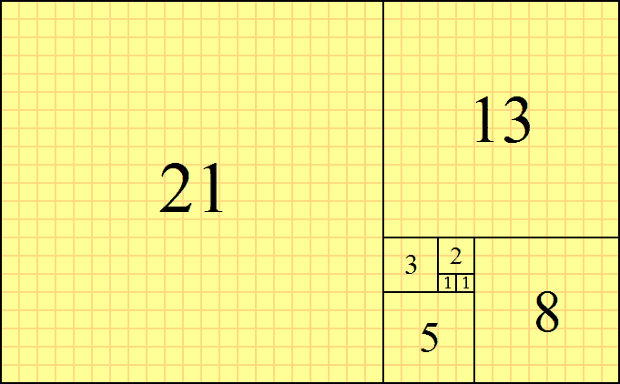

斐波那契螺旋：通过连接斐波那契铺图中正方形的对角的圆弧创建的黄金螺旋近似；这使用了大小为 1, 1, 2, 3, 5, 8, 13 和 21 的正方形。

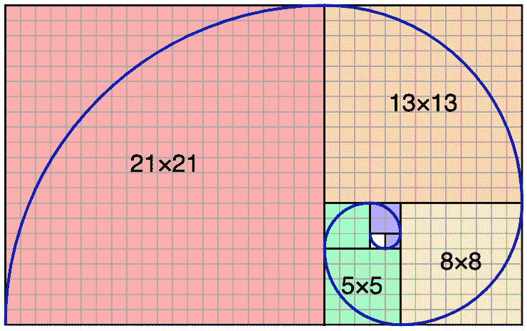

### 应用

斐波那契数列随处可见——花、松果、甚至昆虫和人类都有斐波那契数列的元素。例如，松果的种子按照斐波那契数列排列，向日葵的种子也按照斐波那契数列排列。

### 代码

#### 创建斐波那契数组

为了创建一个 N 个斐波那契数的数组，我们必须创建一个包含一个值的数组，即数字 1。

```javascript
export default function fibonacci(n) {
  const fibSequence = [1];
```

`11-fibonacci/fibonacci.js`

然后我们创建两个变量，一个用于存储当前正在处理的数字，另一个用于存储上一个数字。

```javascript
  let currentValue = 1;
  let previousValue = 0;
```

`11-fibonacci/fibonacci.js`

如果我们只需要斐波那契数列中的第一个数字 (1)，那么直接返回数组：

```javascript
  if (n === 1) {
    return fibSequence;
  }
```

`11-fibonacci/fibonacci.js`

如果我们想要获取斐波那契数列中第一个数字以外的数字，我们创建一个`iterationsCounter`变量来跟踪我们已经添加到数组中的数字。由于我们已经在数组中包含了 1，所以我们将`iterationsCounter`设置为`n-1`：

```javascript
  let iterationsCounter = n - 1;
```

`11-fibonacci/fibonacci.js`

然后我们创建一个`while`循环，该循环会持续运行直到`iterationsCounter`达到 0。我们将当前值和之前计算的值相加，并将结果放入数组中。

```javascript
  while (iterationsCounter) {
    currentValue += previousValue;
    previousValue = currentValue - previousValue;

    fibSequence.push(currentValue);

    iterationsCounter -= 1;
  }
```

`11-fibonacci/fibonacci.js`

最后，当我们跳出`while`循环后，返回我们的数组。

```javascript
  return fibSequence;
}
```

`11-fibonacci/fibonacci.js`

### 计算第 N 斐波那契数

计算第 N 个斐波那契数与创建一个斐波那契数组非常相似。与其将数字放入数组中，当我们到达第 N 个数字时，直接返回它。

```javascript
export default function fibonacciNth(n) {
  let currentValue = 1;
  let previousValue = 0;

  if (n === 1) {
    return 1;
  }

  let iterationsCounter = n - 1;

  while (iterationsCounter) {
    currentValue += previousValue;
    previousValue = currentValue - previousValue;

    iterationsCounter -= 1;
  }

  return currentValue;
}
```

`11-fibonacci/fibonacciNth.js`

### 计算第 N 斐波那契数（使用 Binet 公式）

Binet 公式是一种计算第 N 个斐波那契数的数学方法，而无需使用`for`或`while`循环。

首先，我们计算 5 的平方根并将其保存到变量中：

```javascript
  // 计算 √5 以在后续公式中使用。
  const sqrt5 = Math.sqrt(5);
```

`11-fibonacci/fibonacciNthClosedForm.js`

接下来，我们计算`φ`(≈ 1.61803)的值并将其保存到变量中

```javascript
  // 计算 φ 常数 (≈ 1.61803)。
  const phi = (1 + sqrt5) / 2;
```

`11-fibonacci/fibonacciNthClosedForm.js`

最后，我们使用这两个值来计算第 N 个斐波那契数。你会注意到，我们使用了 EcmaScript 2017 中引入的幂运算符(`**`)，而不是`Math.pow()`。

```javascript
  // 使用 Binet 公式计算斐波那契数。
  return Math.floor((phi ** position) / sqrt5 + 0.5);
```

`11-fibonacci/fibonacciNthClosedForm.js`

### 题目示例

以下是一些你在面试过程中可能会遇到的相关问题：

* [最长斐波那契数列长度](https://leetcode.com/problems/length-of-longest-fibonacci-subsequence/)
* [将数组拆分为斐波那契数列](https://leetcode.com/problems/split-array-into-fibonacci-sequence/)

### 参考文献

Wikipedia 上的斐波那契数列 [`en.wikipedia.org/wiki/Fibonacci_number`](https://en.wikipedia.org/wiki/Fibonacci_number)

YouTube 上的斐波那契数列 [`www.youtube.com/watch?v=T8xgfVzef_E`](https://www.youtube.com/watch?v=T8xgfVzef_E)

斐波那契数列实现示例和测试例 [`github.com/trekhleb/javascript-algorithms/tree/master/src/algorithms/math/fibonacci`](https://github.com/trekhleb/javascript-algorithms/tree/master/src/algorithms/math/fibonacci)

## 素数测试

*难度：简单*

**质数**（或称为**素数**）是一个大于`1`的自然数，它不能通过两个较小的自然数相乘得到。

> 自然数是任何大于等于 0 且不是分数或小数的数字

大于 1 的非质数自然数称为合数。例如，`5`是质数，因为将其写为乘积的唯一方式（`1 × 5`或`5 × 1`）涉及`5`本身。然而，`6`是合数，因为它是两个数字`(2 × 3)`的乘积。

### 素数测试

**素数测试**是一种用于判断给定整数是否为质数的算法。

### 应用

素数测试用于密码学等许多领域。

### 代码

要判断一个数字是否为质数，我们首先确保该数字不能被 2 整除。如果能被 2 整除，则它不是质数。

```javascript
function isPrime(number) {
  if (number <= 1) return false;
  if (number === 2) return true;
  if (number % 2 === 0) return false;
```

接下来，我们检查该数字是否被其平方根范围内任何奇数整除。如果任何数字的余数为 0，我们就知道它不是质数。

```javascript
  const limit = Math.sqrt(number);
  for (let i = 3; i <= limit; i += 2) {
    if (number % i === 0) return false;
  }
  return true;
}
```

最后，如果我们一直运行到这里，就可以得出该数字是质数的结论。

### 为什么我们要使用数字的平方根？

我们使用数字的平方根，是因为任何大于数字平方根的数字都会有一个对应的小于平方根的数字被使用。例如，36 的平方根是 6。

1 * 36 = 36

2 * 18 = 36

3 * 12 = 36

4 * 9 = 36

5 * 7.2 = 36


6 * 6 = 36 – 第二个操作数小于 36 的平方根；我们不需要检查高于平方根的数字。

素性测试示例及用例 [`github.com/trekhleb/javascript-algorithms/tree/master/src/algorithms/math/primality-test`](https://github.com/trekhleb/javascript-algorithms/tree/master/src/algorithms/math/primality-test)

# 是否为 2 的幂

*难度：简单*

### 任务

给定一个正整数，编写一个函数来判断它是否为 2 的幂。

### 朴素解（暴力解）

在素解中，我们首先检查该数字是否大于 1，如果小于 1，则它不是 2 的幂。

```
5 export default function isPowerOfTwo(number) {
6   // 1 (2⁰) 是最小的 2 的幂。
7   if (number < 1) {
8     return false;
9   }
```

`14-is-power-of-two/isPowerOfTwo.js`

然后，我们将数字除以 2 并检查余数是否为 0。如果余数不是 0，则该数字不是 2 的幂。如果我们继续除法并达到 1，我们就知道该数字是 2 的幂。

```
11   // 让我们看看是否可以多次将数字除以二
12   // 而没有余数。
13   let dividedNumber = number;
14   while (dividedNumber !== 1) {
15     if (dividedNumber % 2 !== 0) {
16       // 对于任何余数不为 0 的情况，我们可以说这个数字
17       // 不可能是 2 的幂的结果。
18       return false;
19     }
20 
21     dividedNumber /= 2;
22   }
23 
24   return true;
25 }
```

`14-is-power-of-two/isPowerOfTwo.js`

### 位运算解

二进制形式的 2 的幂始终只有一个位。唯一的例外是符号整数（例如，值为 -128 的 8 位符号整数看起来像：`10000000`）

```
1 1: 0001
2 2: 0010
3 4: 0100
4 8: 1000
```

要检查一个数字是否为 2 的幂，我们首先从该数字减去 1。

例如，数字 8 在二进制中看起来如下：

```
1 1000
```

8 - 1 在二进制中看起来如下：

```
1 0111
```

任何 2 的幂减 1 都除了最高位外全为 1。在从数字减去 1 后，我们将其与该数字进行与（AND）运算。如果与运算的结果为 0，我们就知道它是 2 的幂。如果与运算的结果为 1，那么它不是 2 的幂。

```
1   1000
2 & 0111
3   ----
4   0000 
```

```
 5 export default function isPowerOfTwoBitwise(number) {
 6   // 1 (2⁰) 是最小的 2 的幂。
 7   if (number < 1) {
 8     return false;
 9   }
10 
11   /*
12    * 二进制形式的 2 的幂看起来如下：
13    * 1: 0001
14    * 2: 0010
15    * 4: 0100
16    * 8: 1000
17    *
18    * 注意始终有一个 1 位被设置。唯一的例外是符号
19    * 整数。
20    * 例如，值为 -128 的 8 位符号整数看起来像：
21    * 10000000
22    *
23    * 所以在检查数字大于 0 后，我们可以使用一种巧妙的位
24    * 技巧来测试是否只有一个位
25    * 位被设置。
26    */
27   return (number & (number - 1)) === 0;
```

`14-is-power-of-two/isPowerOfTwoBitwise.js`

### 题目示例

以下是一些在面试中可能会遇到的的相关问题：

* [4 的幂](https://leetcode.com/problems/power-of-four/)

* [重排后的 2 的幂](https://leetcode.com/problems/reordered-power-of-2/)

### 测验

*Q1: 32 是 2 的幂吗？使用朴素解找出答案*

*Q2: 31 是 2 的幂吗？使用位运算解找出答案*

### 参考文献

GeeksForGeeks 上的位运算解 [`www.geeksforgeeks.org/program-to-find-whether-a-no-is-power-of-two/`](https://www.geeksforgeeks.org/program-to-find-whether-a-no-is-power-of-two/)

Stanford 上的位运算解 [`www.graphics.stanford.edu/~seander/bithwise-operations/`](http://www.graphics.stanford.edu/~seander/bithwise-operations/) （注：原文 URL 不完整，已根据上下文修正）

```javascript
  /**
   * @param {function(a: *, b: *)} [compareFunction] - 这可能是一个自定义的比较函数，让我们
   * 比如可能会比较自定义对象。
   */
  constructor(compareFunction) {
    this.compare = compareFunction || Comparator.defaultCompareFunction;
  }
```

`utils/comparator/Comparator.js`

### `defaultCompareFunction()`

这是默认的备用比较函数，它将两个参数 `a` 和 `b` 视为字符串或数字，并对它们应用常用的比较运算符如 `===`、`<` 和 `>`。

```javascript
  /**
   * 默认比较函数。它假设 "a" 和 "b" 是字符串或数字。
   * @param {(string|number)} a
   * @param {(string|number)} b
   * @returns {number}
   */
  static defaultCompareFunction(a, b) {
    if (a === b) {
      return 0;
    }

    return a < b ? -1 : 1;
  }
```

`utils/comparator/Comparator.js`

### `equal()`

此函数检查两个变量是否相等。

```javascript
  /**
   * 检查两个变量是否相等。
   * @param {*} a
   * @param {*} b
   * @return {boolean}
   */
  equal(a, b) {
    return this.compare(a, b) === 0;
  }
```

`utils/comparator/Comparator.js`

### `lessThan()`

此函数检查变量 `a` 是否小于 `b`。

```javascript
  /**
   * 检查变量 "a" 是否小于 "b"。
   * @param {*} a
   * @param {*} b
   * @return {boolean}
   */
  lessThan(a, b) {
    return this.compare(a, b) < 0;
  }
```

`utils/comparator/Comparator.js`

### `greaterThan()`

此函数检查变量 `a` 是否大于 `b`。

```javascript
  /**
   * 检查变量 "a" 是否大于 "b"。
   * @param {*} a
   * @param {*} b
   * @return {boolean}
   */
  greaterThan(a, b) {
    return this.compare(a, b) > 0;
  }
```

`utils/comparator/Comparator.js`

### `lessThanOrEqual()`

此函数检查变量 `a` 是否小于或等于 `b`。

```javascript
  /**
   * 检查变量 "a" 是否小于或等于 "b"。
   * @param {*} a
   * @param {*} b
   * @return {boolean}
   */
  lessThanOrEqual(a, b) {
    return this.lessThan(a, b) || this.equal(a, b);
  }
```

`utils/comparator/Comparator.js`

### `greaterThanOrEqual()`

此函数检查变量 `a` 是否大于或等于 `b`。

```javascript
  /**
   * 检查变量 "a" 是否大于或等于 "b"。
   * @param {*} a
   * @param {*} b
   * @return {boolean}
   */
  greaterThanOrEqual(a, b) {
    return this.greaterThan(a, b) || this.equal(a, b);
  }
```

`utils/comparator/Comparator.js`

### `linearSearch()`

既然我们已经实现了 `Comparator` 工具类，现在让我们来实现 `linearSearch()` 函数吧。

`linearSearch()` 函数将数组中的每个元素与我们尝试查找的元素进行比较。比较是通过 `Comparator` 类完成的。一旦找到元素，其位置就会记录在 `foundIndices` 数组中。

```javascript
export default function linearSearch(array, seekElement, comparatorCallback) {
  const comparator = new Comparator(comparatorCallback);
  const foundIndices = [];

  array.forEach((element, index) => {
    if (comparator.equal(element, seekElement)) {
      foundIndices.push(index);
    }
  });

  return foundIndices;
}
```

$2^x = n \implies x = \log(n)$

这里的 `x` 是我们的时间复杂度。

> 为了理解 `O(log(n))` 时间复杂度对于二分查找是有多高效，让我们将其与线性查找的 `O(n)` 时间复杂度进行比较。Tycho-2 星表包含了关于我们银系中最明亮的 `2,539,913` 颗恒星的信息。假设我们想在该星表中通过名称查找某颗恒星。在线性查找的最坏情况下，我们需要进行 `2,539,913` 次迭代。在二分查找的最坏情况下，如果所有恒星都按名称排序，只需要 `22` 次迭代（`log_2(2539913) = 21.27`）。

## 空间复杂度

该算法可以通过不同的方式实现，使用迭代方法或递归方法（为每个递归调用分配额外的内存）。取决于实现方式，空间复杂度可能会不同。在本章中，我们将使用简单的迭代方法，而不创建数组副本。因此，在这种情况下，空间复杂度将是 `O(1)`。

### 应用

*   二分查找用于在有序数组中进行`快速搜索操作`。

*   二分查找法用于 `二分搜索树` 的实现。

*   二分查找法可以用于在提交历史中快速`找到 bug commit`。只需将提交历史一分为两半。如果 bug 已经存在于“中间”提交，则向左移动到更早的提交并再次平分左半。否则，如果 bug 不存在则向右移动到较后的提交。

*   二分查找法可以用于在程序中快速`找到错误的代码行`。只需注释掉一半的代码并查看 bug 是否仍然存在。如果存在，则向上移动，否则向下移动。

## 使用示例

在本章较早之前，我们讨论了如果 Tycho-2 星表按名称排序，通过名称在星表中查找恒星会有有多快。与其线性 `2,539,913` 次迭代相比，它只需为我们提供 `22` 次迭代（`22` 次）就能找到那颗恒星。

假设我们已经在脚本中有了这个排好序的恒星星表，看看我们将如何对其应用二分查找。

```
 1 导入依赖。
 2 import binarySearch from './binarySearch';
 3 
 4 // 让我们为我们的有序恒星表创建一个非常简单且小的演示版本。
 5 const sortedArrayOfStars = [
 6   { name: 'Alpha Centauri A', position: {} },
 7   { name: 'Alpha Centauri B', position: {} },
 8   { name: 'Betelgeuse', position: {} },
 9   { name: 'Polaris', position: {} },
10   { name: 'Rigel', position: {} },
11   { name: 'Sirius', position: {} },
12   // 这里还有额外的 250 万条记录 :)
13 ];
14 
15 // 我们用于二分查找函数的自定义对象比较器。
16 // 我们在这里使用字符串比较。例如，'Polaris' 比 'Rigel' 小。
17 const comparator = (star1, star2) => {
18   if (star1.name === star2.name) return 0;
19   return star1.name < star2.name ? -1 : 1;
20 };
21 
22 // 现在让我们搜索恒星。
23 binarySearch(sortedArrayOfStars, { name: 'Not Existing Name' }, comparator); // -> -1
24 binarySearch(sortedArrayOfStars, { name: 'Alpha Centauri A' }, comparator); // -> 0
25 binarySearch(sortedArrayOfStars, { name: 'Alpha Centauri B' }, comparator); // -> 1
26 binarySearch(sortedArrayOfStars, { name: 'Polaris' }, comparator); // -> 3
```

`15-binary-search/example.js`

# 实现

在上面的示例中，我们使用了一个自定义比较函数来对恒星对象进行相互比较。为了实现这一点，我们将重用一个在恒星对象之间进行比较的自定义比较函数。为了使其可行，我们将重用在“线性查找”章节实现的 `Comparator` 类。请查看 `Comparator` 类的实现细节。

```
// 导入依赖。
import Comparator from '../utils/Comparator';
```

`16-binary-search/binarySearch.js`

现在让我们看看如何实现二分查找。

```
/**
 * 二分查找。
 * @param {Array} sortedArray 有序数组
 * @param {Object} target 要查找的目标对象
 * @param {Function} comparator 比较函数
 * @returns {number} 找到的索引或 -1
 */
export default function binarySearch(sortedArray, target, comparator) {
  // 使用 Comparator
  const comp = new Comparator(comparator);
  let left = 0;
  let right = sortedArray.length - 1;

  while (left <= right) {
    // 计算中间索引
    const mid = Math.floor((left + right) / 2);

    // 如果找到目标
    if (comp.equal(sortedArray[mid], target) === 0) {
      return mid;
    }
    // 如果目标更小，在左半部分查找
    if (comp.lessThan(sortedArray[mid], target)) {
      right = mid - 1;
    } 
    // 如果目标更大，在右半部分查找
    else {
      left = mid + 1;
    }
  }

  return -1;
}
```

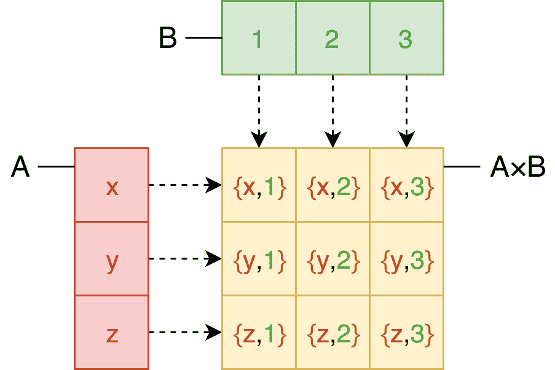

两个集合 `A` 和 `B` 的积集 `A×B` 中的元素数量可以计算为集合 `A` 和 `B` 长度的乘积 `|A|×|B|`。在上面的示例中，我们有两个长度为 3 的集合。这两个集合的乘积包含 `3 * 3 = 9` 个元素。

也可以创建两个集合的笛卡尔积。例如，我们有一个毛衣颜色集合 `COLORS = {blue, red, yellow}`、领口形状集合 `NECK_FORMS = {round-neck, V−neck, polo−neck}` 以及一个尺寸集合 `SIZE = {XS, S, M, L, XL, XXL}`，那么这三个集合的笛卡尔积看起来就像 `{(blue,round-neck,XS), (blue,round-neck,S), (blue,round-neck,M), ..., (yellow,polo−neck,XXL)}`。

### 应用

扑克牌是笛卡尔积应用于花牌等级集合 `{A, K, Q, J, 10, 9, 8, 7, 6, 5, 4, 3, 2}` 和花色集合 `{♠︎, ♣, ︎♥, ︎♦︎}` 的示例。这两个集合的乘积形成了标准的 52 张牌牌 `{(A,♠), (A,♣), (A,♥), ..., (2,♦)}`。

二维坐标系也是两个集合 `R×R` 的积集，其中 `R` 表示实数集。

通常，笛卡尔积可用于生成不同实体之间所有可能的配对（子集）。我们可以认为为汽车价格表生成 `(model, color)` 属性对，或者为毛衣目录生成 `(neck_form, size, color)` 属性子集等等。

## 使用示例

让我们使用我们的 `cartesianProduct()` 函数来生成一副扑牌。

```
 1 // 导入依赖。
 2 import cartesianProduct from './cartesianProduct';
 3 
 4 // 初始化牌等级和花色的集合。
 5 const cardRanks = ['A', 'K', 'Q', 'J', '10', '9', '8', '7', '6', '5', '4', '3', '2'];
 6 const cardSuits = ['♠', '♣', '♥', '♦'];
 7 
 8 // 生成一副扑牌。
 9 const cardDeck = cartesianProduct(cardRanks, cardSuits);
10 
 11 // 检查牌组。
 12 // eslint-disable-next-line no-console
 13 console.log(cardDeck); // -> [['A', '♠'], ['A', '♣'], ..., ['2', '♦']]
```

17-cartesian-product/example.js

# 实现

为了实现 `cartesianProduct()` 函数，我们首先需要检查输入。如果输入错误且某些输入集合为空，函数将返回 `null`。然后，我们使用两个嵌套的 `for` 循环从两个输入集合 `setA` 和 `setB` 生成所有元素配对。

```
 1 /**
 2  * 生成两个集合的笛卡尔积。
 3  * @param {*[]} setA
 4  * @param {*[]} setB
 5  * @return {*[]}
 6  */
 7 export default function cartesianProduct(setA, setB) {
 8   // 检查输入集合是否为空。
 9   // 否则返回 null，因为我们无法从它们生成笛卡尔积。
10   if (!setA || !setB || !setA.length || !setB.length) {
 11     return null;
 12   }
 13 
 14   // 初始化积集。
 15   const product = [];
 16 
 17   // 现在，遍历第一个和第二个集合的所有元素并形成所有可能\
18 ble pairs。
19   for (let indexA = 0; indexA < setA.length; indexA += 1) {
20     for (let indexB = 0; indexB < setB.length; indexB += 1) {
21       // 将当前积配对添加到积集。
22       product.push([setA[indexA], setB[indexB]]);
23     }
24   }
 25 
 26   // 返回笛卡尔积集。
 27   return product;
 28 }
```

17-cartesian-product/cartesianProduct.js

### 复杂度

如果我们生成两个集合 `A` 和 `B` 的积集，那么两个嵌套的 `for` 循环将产生 `|A| * |B|` 次循环，其中 `|A|` 是集合 `A` 中的元素数量，`|B|` 是集合 `|B|` 中的元素数量。因此时间复杂度为 O(|A| * |B|)。

额外的空间复杂度也是 O(|A| * |B|)，因为我们分配了一个新数组来存放所有的笛卡尔积元素。

### 问题示例

这里是一些你可能感兴趣的相关问题：

我们将使用两种方法来实现幂集生成器：一种是我们在上面讨论过的位运算方法，另一种是将在下一节中描述的回溯方法。

### 位运算方法 (Bitwise Approach)

在位运算方法中，我们将利用这样一个事实：直到 `2^n`（其中 `n` 是集合的大小）的数字的二进制表示将作为原始集合的位掩码，从而产生子集。

查看下面的实现代码：

```javascript
 1 /**
 2  * 使用位运算方法查找集合的幂集。
 3  *
 4  * @param {*[]} originalSet
 5  * @return {*[][]}
 6  */
 7 export default function bwPowerSet(originalSet) {
 8   const subSets = [];
 9 
10   // 我们会有 2^n 种可能的组合（n 是原始集合的长度）。
11 // 对于原始集合中的每个元素，我们都要决定是否包含\
12 de
13   // 它或不包含（每个集合元素有 2 种选择）。
14   const numberOfCombinations = 2 ** originalSet.length;
15 
16   // 0 到 2^n 范围内每个二进制表示的数字都完全符合我们的需求:\
17  we: 它通过其位（0 或 1）显示是否包含集合中的相关元素 o\
19 r 不是。
20   // 例如，对于集合 {1, 2, 3}，二进制数 0b010 意味着 w\
21 e 需要
22   // 只将 "2" 加入当前集合中。
23   for (let combinationIndex = 0; combinationIndex < numberOfCombinations; combinatio\
24 nIndex += 1) {
25     const subSet = [];
26 
27     for (let setElementIndex = 0; setElementIndex < originalSet.length; setElementIn\
28 dex += 1) {
29       // 决定我们是否需要将当前元素包含在子集中。
30       if (combinationIndex & (1 << setElementIndex)) {
31         subSet.push(originalSet[setElementIndex]);
32       }
33     }
34 
35     // 将当前子集添加到所有子集的列表中。
36     subSets.push(subSet);
37   }
38 
39   return subSets;
40 }
```

`18-power-set/bwPowerSet.js`

我们的函数只接受一个参数：`originalSet`，它是一个数组。然后它创建一个 `subSets` 数组，用于存放所有生成的幂集子集。

接下来的行计算组合数。这个数字也是我们用位掩码的数字范围内的最大值。为了对数字求幂，我们使用 `**` 运算符。

```javascript
const numberOfCombinations = 2 ** originalSet.length;
```

第一个 `for` 循环遍历我们范围 `[0, numberOfCombinations]` 内的每一个数字。在每次迭代中，它都会创建一个新的幂集数组 `subSet`，该将将与当前 `combinationIndex` 对应的当前子集的所有元素。

在内部 `for` 循环中，我们遍历原始集合元素，以查看是否需要包含每个特定元素。这是通过检查 `combinationIndex` 中的相应位来决定的。如果 `setElementIndex` 位置的位被设置了，则我们需要将索引为 `setElementIndex` 的元素添加到 `subSet` 中。否则，我们忽略它。

位检查是通过以下结构完成的：

```javascript
if (combinationIndex & (1 << setElementIndex)) {
  // 将元素添加到子集中。
}
```

在这里，我们将 `1` 向左移动 `setElementIndex` 位（例如，如果 `setElementIndex` 是 4，那么 `0b1 << 4` 将给我们得到 `0b1000`）。然后我们执行逻辑*与*（and）操作，以检查 `combinationIndex` 中的相应位是否被设置（例如，如果 `combinationIndex` 是 `0b0100` 且我们正在执行 `0b0100 & 0b1000`，这将得到 `0`，表示 `combinationIndex` 的第 4 位未被设置）。

### 回溯方法 (Backtracking Approach)

在回溯方法中，我们尝试生成所有可能的解决方案，但每当我们生成下一个解决方案时，都会测试它是否满足所有条件（或尝试让它满足我们的所有条件），然后才继续生成后续解决方案。否则，回溯并进入寻找解决方案的另一路径。

在我们的示例的每次迭代中，我们都会多添加一个有效元素。在我们案例中，有效性由规则定义：我们不希望子集中有重复项。因此，在每次迭代中，我们可以添加原始集合中的任何元素，已经添加过的元素除外。

这种方法可以使用以下决策树进行插说明。

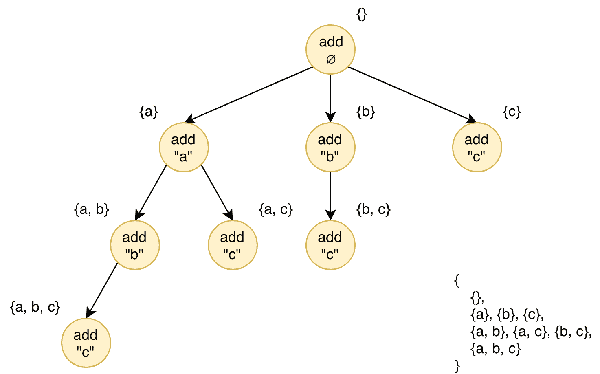

这个决策树帮助我们决定在此时此刻可能包含哪些元素。如果没有选项了，让我们后退一步（回溯）并尝试另一个有效选项。

所以，例如，让我们以深度优先的方式溯溯决策树：

1. 在顶端，我们只有一个选择，就是添加空集合。记录 `{}`。

2. 下一个可以添加的元素是 `a`。记录 `{a}`。

3. 我们可以添加 `b`。记录 `{a, b}`。

4. 我们可以添加 `c`。记录 `{a, b, c}`。

5. 此时没有其他元素可以添加了。回溯！

6. 当前子集是 `{a}`。

7. 但我们可以添加 `c`。记录 `{a, c}`。

8. 等等

现在让我们尝试用代码实现这种方法：

```javascript
 1 /**
  * 使用回溯方法查找集合的幂集。
 2  *
 3  * @param {*[]} originalSet - 正在形成的原始集合。
 4  * @param {*[][]} allSubsets - 目前为止形成的所有子集（默认包含
 5  * 空集）。
 6  * @param {*[]} currentSubSet - 正在形成的当前子集。
 7  * @param {number} startAt - 原始集合中开始形成
 8  * 当前子集的位置。
 9  * @return {*[][]} - 所有子集。
10 */
11 export default function btPowerSet(
12   originalSet,
13   allSubsets = [[]],
14   currentSubSet = [],
15   startAt = 0,
16 ) {
17   // 遍历原始集合中可以添加到子集且
188 不产生重复的元素。startAt 的值防止添加重复。
19   for (let position = startAt; position < originalSet.length; position += 1) {
20     // 将当前元素推入子集
21     currentSubSet.push(originalSet[position]);
22 
23     // 当前子集已经是有效的，所以记录它。
24     // 我们在这里使用解构来保存 currentSubSet 的克隆。
25     // 我们需要保存克隆，因为原始 currentSubSet 将在进一步的递归
26      调用中被修改。
27     allSubsets.push([...currentSubSet]);
28 
29     // 尝试为当前子集生成所有其他子集。
30     // 我们增加位置一以避免子集中的重复。
31       递归调用中。
32 
33     // 回溯。从子集中排除最后一个元素并尝试下一个有效元素。
34     currentSubSet.pop();
35   }
36 
37   // 返回集合的所有子集。
38   return allSubsets;
39 }
```

### 复杂度

在位运算方法中，我们遍历 `2<sup>n</sup>` 个数字，对于每个数字，我们都会遍历大小为 `n` 的原始集合，以决定将哪些元素包含在子集中。因此，这种方法的**时间复杂度**为 `O(n * 2<sup>n</sup>)`，其中 `n` 是原始集合中元素的数量。

### 回溯法

在回溯法中，我们正在遍历一个拥有 `2<sup>n</sup>` 个节点的决策树。因此，这种方法的**时间复杂度**为 `O(2<sup>n</sup>)`，其中 `n` 是原始集合中元素的数量。

### 题目示例

以下是一些你在面试过程中可能会遇到的相关问题：

* [子集](https://leetcode.com/problems/subsets/)

* [子集 II](https://leetcode.com/problems/subsets-ii/description/)

### 测验答题

*Q1: 空集是幂集的一部分吗？*

*Q2: 集合 {a, b, c, d} 的幂集有多少个元素？*

### 参考文献

Wikipedia 上的幂集 [`en.wikipedia.org/wiki/Power_set`](https://en.wikipedia.org/wiki/Power_set)

“Math is Fun” 上的幂集 [`www.mathsisfun.com/sets/power-set.html`](https://www.mathsisfun.com/sets/power-set.html)

幂集的示例与测试用例 [`github.com/trekhleb/javascript-algorithms/tree/master/src/algorithms/sets/power-set`](https://github.com/trekhleb/javascript-algorithms/tree/master/src/algorithms/sets/power-set)

## 集合。排列。

*难度：中等*

假设我们有一些东西的**集合**或**类**（数字、字母、水果、硬币等的集合），我们需要从一个集合中**挑选物品**来形成另一个集合。例如，想象你正在抽取乐票号码，从可用数字集合 `{0, 1, 2, 3, 4, 5, 6, 7, 8, 9}` 中选出 `{4, 5, 9}`。或者你正从可用水果集合 `{orange, apple, banana, grape}` 中挑选水果来制作一份由 `{apple, banana}` 组成的沙拉。或者你正在尝试猜测锁密码，从集合 `{0, 1, 2, 3, 4, 5, 6, 7, 8, 9}` 中选择 3 个数字，通过形成如 `{1, 1, 2}, {1, 1, 3}, {1, 1, 4}, …` 等子集合来猜测正确密码。在所有这些情况下，你都是遵循某些规则从一个集合创建一个另一个集合。这些规则决定了你的新集合是**排列**还是**组合**。

如果你的新集合中元素的**顺序****很重要**，那么你处理的就是**排列**。在锁密码的情况下，`{1, 1, 2}` 集合与 `{2, 1, 1}` 集合是不一样的。如果顺序不重要，那么你做的**组合**。例如，在用水果 `{apple, banana}` 制作沙拉的组合中，先选苹果还是选香蕉并不重要。

> **排列**将集合的所有成员排列成某种序列或顺序，或者如果集合已经排序，则对其重新排列（重排序）其元素。

你的新**集合可能包含也不包含重复（或重复）**。例如，在锁密码中，你允许使用重复数字，但当你处理比赛获者集合 `{Black, Smith, Brown}` 时，你不允许出现重复，因为让同一个人同时出现在两个位置是没有意义的。

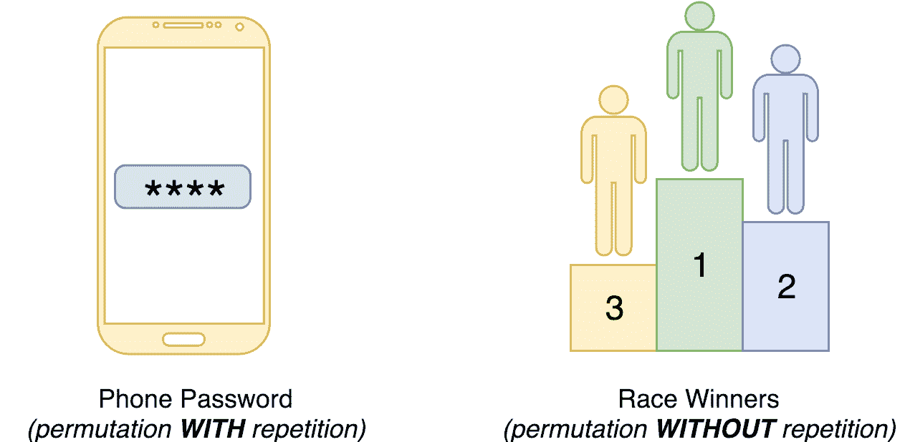

在本章中，我们将专注于实现排列。在下一章中，我们将处理组合。

### 重复排列

让我们来看一个简单的例子，形成集合 `S = {A, B}` 的所有**带**重复的排列。当我们说重复时，指的是同一个字母可以用于不同的位置。在这种情况下，排列大小为 `2` 的排列集 `P` 如下：

```
S = {A, B}

P = {
    {A, A},
    {A, B},
    {B, A},
    {B, B},
}
```

让我们泛化这个例子，并计算 `P` 中子集的数量。假设我们有一个大小为 `n` 的原始集合 `S`，我们需要为它生成所有大小为 `r` 的可能重复排列（集合 `P`）。因此，集合 `P` 将由长度为 `r` 的子集组成。*对于 P 中子集的每一个位置，我们都有 `n` 种可能的元素供选择。*在上面的示例中，对于每个排列位置，我们从两个可能的元素 `A` 和 `B` 中选择。这意味着排列的第一位置有 `n` 种选择，第二个位置也有 `n` 种选择，以此类推，直到第 `r<sup>th</sup>` 位置：

> **$P(n, r) = n \times n \times \dots$**

#### 无排列

让我们来看一个简单的例子，形成集合 `S = {A, B}` 的所有**不带**重复的排列。当我们说重复时，指的是同一个字母可以用于不同的位置。在这种情况下，排列大小为 `2` 的排列集 `P` 如下：

```
S = {A, B}

P = {
    {A, B},
    {B, A},
}
```

在我们开始实现排列算法之前，让我们假设我们已经实现了 `permutateWithoutRepetitions()` 和 `permutateWithRepetitions()` 函数，并尝试使用它们。通过使用 `permutateWithRepetitions()`，我们将尝试生成锁的所有可能密码。而通过使用 `permutateWithoutRepetitions()`，我们将尝试生成三位参赛者比赛赛次结果的所有可能变体（假设数组中的 `0<sup>th</sup>` 位置表示该参赛者获得第一）。

```javascript
 1 // 导入依赖。
 2 import permutateWithoutRepetitions from './permutateWithoutRepetitions';
 3 import permutateWithRepetitions from './permutateWithRepetitions';
 4 
 5 // 重复排列示例。
 6 // 使用重复排列生成所有可能的密码组合。
\
 7 tions.
 8 const possiblePasswordSymbols = ['A', 'B', 'C'];
 9 const passwordLength = 3;
10 const allPossiblePasswords = permutateWithRepetitions(possiblePasswordSymbols, passw\
11 ordLength);
12 
13 // eslint-disable-next-line no-console
14 console.log(allPossiblePasswords);
15 /*
16   输出将是：
17   [
18     ['A', 'A', 'A'],
19     ['A', 'A', 'B'],
20     ['A', 'A', 'C'],
21     ['A', 'B', 'A'],
22     ['A', 'B', 'B'],
23     ['A', 'B', 'C'],
24     ['A', 'C', 'A'],
25     ['A', 'C', 'B'],
26     ['A', 'C', 'C'],
27     ['B', 'A', 'A'],
28     ['B', 'A', 'B'],
29     ['B', 'A', 'C'],
30     ['B', 'B', 'A'],
31     ['B', 'B', 'B'],
32     ['B', 'B', 'C'],
33     ['B', 'C', 'A'],
34     ['B', 'C', 'B'],
35     ['B', 'C', 'C'],
36     ['C', 'A', 'A'],
37     ['C', 'A', 'B'],
38     ['C', 'A', 'C'],
39     ['C', 'B', 'A'],
40     ['C', 'B', 'B'],
41     ['C', 'B', 'C'],
42     ['C', 'C', 'A'],
43     ['C', 'C', 'B'],
44     ['C', 'C', 'C'],
45   ]
46  */
47 
48 // 非重复排列示例。
49 // 现在我们为三位参赛者生成所有可能的比赛结果。
50 const racers = ['John', 'Bill', 'Jane'];
51 const racingResults = permutateWithoutRepetitions(racers);
53 
54 // eslint-disable-next-line no-console
54 console.log(racingResults);
55 /*
56   输出将是：
57   [
58     ['John', 'Bill', 'Jane'],
59     ['Bill', 'John', 'Jane'],
60     ['Bill', 'Jane', 'John'],
61     ['John', 'Jane', 'Bill'],
62     ['Jane', 'John', 'Bill'],
63     ['Jane', 'Bill', 'John'],
64   ]
65 */
```

19-permutations/example.js

# 实现

#### 重复排列

我们将通过递归来解决这个问题。例如，如果我们需要为大小为 `3` 的集合 `{A, B, C}` 找到所有重复排列，我们执行以下操作：

* 记住集合中的第一个元素 `A`，

* 为集合 `S = {A, B, C}` 找到大小为 `r = 1` 的所有排列，

* 将 `A` 与上一步中所有较小的排列进行拼接，

* 记住集合中的第二个元素 `B`，

* 为集合 `S = {A, B, C}` 找到大小为 `r = 1` 的所有排列，

* 将 `B` 与上一步中所有较小的排列进行拼接，

* 依此类推……

对于大小为 1 的排列，每个元素都是一个排列。因此，对于集合 `{A, B, C}`，大小为 `1` 的排列将是 `{A}`、`{B}` 和 `{C}`。这将是我们递归函数的基础情况。

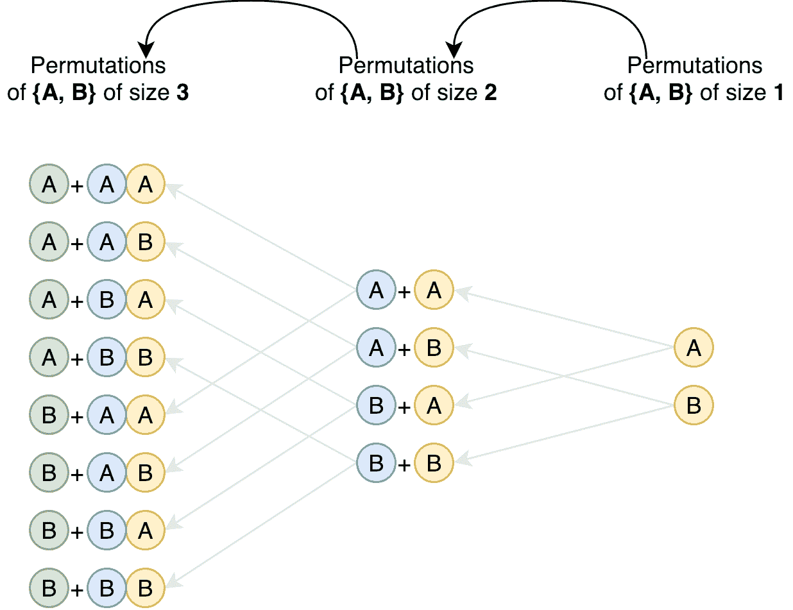

查看下方该算法的 JavaScript 实现。

```javascript
 1 /**
 2  * @param {*[]} permutationOptions
 3  * @param {number} permutationLength
 4  * @return {*[]}
 5  */
 6 export default function permutateWithRepetitions(
 7   permutationOptions,
 8   permutationLength = permutationOptions.length,
 9 ) {
10   // 如果排列长度等于 1，则 permutationOptions 中的每个元素
11   // 都是一个排列。
12   if (permutationLength === 1) {
13     return permutationOptions.map(permutationOption => [permutationOption]);
14   }
15 
16   // 初始化数组。
17   const permutations = [];
18 
19   // 获取较小规模的排列。
20   const smallerPermutations = permutateWithRepetitions(
21     permutationOptions,
22     permutationLength - 1,
23   );
24 
25   // 遍历所有选项。
26   permutationOptions.forEach((currentOption) => {
27     // 将当前选项与较小的排列拼接。
28     smallerPermutations.forEach((smallerPermutation) => {
29       permutations.push([currentOption].concat(smallerPermutation));
30     });
31   });
32 
33   // 返回排列。
34   return permutations;
35 }
```

19-permutations/permutateWithRepetitions.js

#### 非重复排列

我们将通过递归解决这个问题。例如，如果我们需要找到大小为 3 的集合的所有非重复排列，我们执行以下操作：

* 提取集合的第一个元素 `A`，

* 为集合 `S = {B, C}` 找到大小为 `2` 的所有排列，

* 将 `A` 与上一步中所有较小的排列进行拼接，

* 提取集合的第二个元素 `B`，

* 为集合 `S = {A, C}` 找到大小为 `2` 的所有排列，

* 将 `B` 与上一步中所有较小的排列进行拼接，

* 依此类推……

对于大小为 1 的排列，每个元素都是一个排列。因此，对于集合 `{A, B, C}`，大小为 `1` 的排列将是 `{A}`、`{B}` 和 `{C}`。这将是我们递归函数的基础情况。这意味着通过每次迭代弹出一个元素，最终形成所有排列。单个元素的排列就是元素本身。

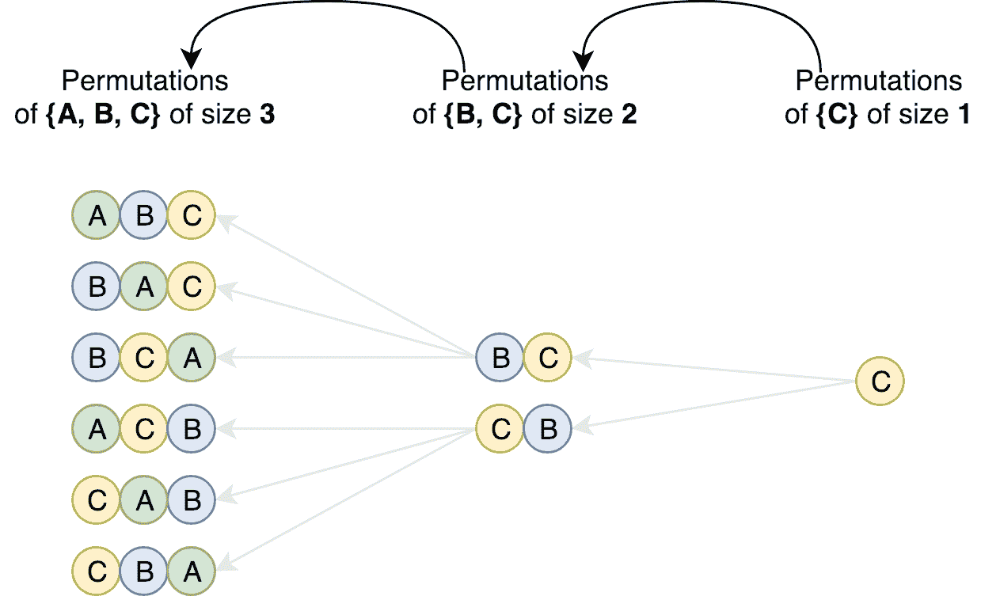

查看下方该算法的 JavaScript 实现。

```javascript
1 /**
 * @param {*[]} permutationOptions
 * @return {*[]}
 */
export default function permutateWithoutRepetitions(permutationOptions) {
 // 如果只有一个元素需要排列，那么该元素就是排列本身。
  if (permutationOptions.length === 1) {
    return [permutationOptions];
  }
 // 初始化排列数组。
  const permutations = [];
 
 // 获取排除第一个元素后 permutationOptions 的排列。
 // 通过这样做我们从后续的所有排列中排除第一个元素。
  const smallerPermutations = permutateWithoutRepetitions(permutationOptions.slice(1));
 
 // 将第一个选项插入到较小排列的所有可能位置。
  const firstOption = permutationOptions[0];
  for (let permIndex = 0; permIndex < smallerPermutations.length; permIndex++) {
    const smallerPermutation = smallerPermutations[permIndex];
 
    // 在 smallerPermutation 的每个可能位置插入第一个选项。
    for (let positionIndex = 0; positionIndex <= smallerPermutation.length; positionIndex++) {
      const permutationPrefix = smallerPermutation.slice(0, positionIndex);
      const permutationSuffix = smallerPermutation.slice(positionIndex);
      permutations.push(permutationPrefix.concat([firstOption], permutationSuffix));
    }
  }
 
 // 返回所有排列。
  return permutations;
}
```

# Q2: 如果我们需要从一个大小为 4 的集合生成所有大小为 `2` 的不重复排列，我们会有多少个排列？

### 参考文献

- Wikipedia 上的排列 [`en.wikipedia.org/wiki/Permutation`](https://en.wikipedia.org/wiki/Permutation)

- “Math is Fun”上的排列 [`www.mathsisfun.com/combinatorics/combinations-permutations.html`](https://www.mathsisfun.com/combinatorics/combinations-permutations.html)

- Medium 上的排列 [`medium.com/@trekhleb/permutations-combinations-algorithms-cheat-sheet-68c14879aba5`](https://medium.com/@trekhleb/permutations-combinations-algorithms-cheat-sheet-68c14879aba5)

- 排列示例与测试用例 [`github.com/trekhleb/javascript-algorithms/tree/master/src/algorithms/sets/permutations`](https://github.com/trekhleb/javascript-algorithms/tree/master/src/algorithms/sets/permutations)

## 集合。组合。

难度：中等

在数学中，`combination`（组合）是从集合中选取项目，其中（与排列不同）`选择的顺序并不重要`。更正式地说，一个大小为 `n` 的集合 `S` 的 `r-combination`（r 阶组合）是 `S` 中 `r` 个不同元素的子集。

例如，假设我们有 5 个（`n = 5`）Web 开发者集合 `{Bill, John, Kate, Mike, Julia}`。当你需要从 5 人中选择 3 个（`r = 3`）Web 开发者来负责新项目时，你选择他们的顺序并不重要。唯一重要的是该开发者是否被选中了。在结果中，你可能会得到组合 `{John, Kate, Julia}`，这实际上等同于 `{Kate, John, Julia}`，因为顺序不重要。这是一个`combination without repetition`（不重复组合）的示例，因为不能重复选择同一个开发者（集合 `{Bill, Bill}` 是可能的且没有意义的）。

组合的另一个例子是你根据口袋里的硬币集合生成的找零组合。假设你有一组硬币 `{1, 1, 5, 5, 5, 10, 10, 10}`，你需要找 27 元硬币的零。你有一个包含 3 个唯一元素的集合 `{1, 5, 10}`（`n = 3`），并且允许多次选取同一个元素。你可能会得到组合 `{10, 10, 5, 1, 1}`（`r = 5`），这等同于 `{1, 10, 10, 1, 5}`，因为顺序不重要。这是一个`combination with repetition`（重复组合）的示例，因为你可以将同一个元素多次包含组合（硬币集合 `{1, 1, 1}` 是可能的且有意义的）。

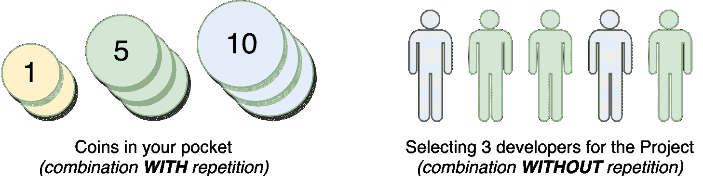

### 不重复组合

让我们通过简单的例子，从集合 `S = {A, B, C}`（`n = 3`）中形成大小为 `r = 2` 的*不*重复组合。在这种情况下，组合集合 `C` 如下所示：

```
S = {A, B, C}
r = 2

C = {
    {A, B},
    {A, C},
    {B, C},
}
```

现在，让我们尝试泛化这个例子，并找出大小为 `n` 的集合中有多少个不重复（大小为 `r`）的组合。我们可以通过以下两个步骤来实现：

* 假设顺序**是**重要的（就像排列一样），并计算不重复的、为 `r` 的排列数量。

* 之后假设顺序**不**重要，并消除所有重复的组合。

从排列的章节中，我们已经知道大小为 `n` 的集合的大小为 `r` 的不重复排列数可以计算为 $P(n, r) = \frac{n!}{(n - r)!}$。如果我们处理集合 `S = {A, B, C}` 大小为 `r = 2` 的排列，我们将得到 $P(n, r) = \frac{n!}{(n - r)!} = \frac{3!}{(3 - 2)!} = 3! = 6$ 个排列：

```
S = {A, B, C}
r = 2

P = {
    {A, B},
    {B, A},
    {A, C},
    {C, A},
    {B, C},
    {C, B},
}
```

这个集合 `P` 是一个排列。如果我们忽略顺序，并将集合 `P` 的子集视为组合呢？我们会发现 `P` 包含重复的组合。

```
P = {
    {A, B},
    {B, A}, <-- 重复组合

    {A, C},
    {C, A}, <-- 重复组合

    {B, C},
    {C, B}, <-- 重复组合
}
```

现在我们需要确定有多少个重复，并从我们的计算中消除它们。

```javascript
 1 // 依赖。
 2 import combineWithoutRepetitions from './combineWithoutRepetitions';
 3 import combineWithRepetitions from './combineWithRepetitions';
 4 
 5 // 不重复的组合。
 6 // 让我们生成所有可能用于下一个项目的所有团队组合。
 7 const teamSize = 3;
 8 const candidates = ['Bill', 'John', 'Kate', 'Jane', 'Mike'];
 9 const possibleTeams = combineWithoutRepetitions(candidates, teamSize);
10 
11 // eslint-disable-next-line no-console
12 console.log(possibleTeams);
13 /*
14  输出将是：
15  [
16       ['Bill', 'John', 'Kate'],
17       ['Bill', 'John', 'Jane'],
18       ['Bill', 'John', 'Mike'],
19       ['Bill', 'Kate', 'Jane'],
20       ['Bill', 'Kate', 'Mike'],
21       ['Bill', 'Jane', 'Mike'],
22       ['John', 'Kate', 'Jane'],
23       ['John', 'Kate', 'Mike'],
24       ['John', 'Jane', 'Mike'],
25       ['Kate', 'Jane', 'Mike'],
26  ]
27  */
28 
29 // 重复的组合。
30 // 让我们生成冰淇淋球的所有可能组合。
31 const iceCreamFlavours = ['banana', 'mint', 'pistachio', 'vanilla'];
32 const numberOfScoops = 3;
33 const scoopCombinations = combineWithRepetitions(iceCreamFlavours, numberOfScoops);
34 
35 // eslint-disable-next-line no-console
36 console.log(scoopCombinations);
37 /*
38  输出将是：
39  [
40       ['banana', 'banana', 'banana'],
41       ['banana', 'banana', 'mint'],
42       ['banana', 'banana', 'pistachio'],
43       ['banana', 'banana', 'vanilla'],
44       ['banana', 'mint', 'mint'],
45       ['banana', 'mint', 'pistachio'],
46       ['banana', 'mint', 'vanilla'],
47       ['banana', 'pistachio', 'pistachio'],
48       ['banana', 'pistachio', 'vanilla'],
49       ['banana', 'vanilla', 'vanilla'],
50       ['mint', 'mint', 'mint'],
51       ['mint', 'mint', 'pistachio'],
52       ['mint', 'mint', 'vanilla'],
53       ['mint', 'pistachio', 'pistachio'],
54       ['mint', 'pistachio', 'vanilla'],
55       ['mint', 'vanilla', 'vanilla'],
56       ['pistachio', 'pistachio', 'pistachio'],
57       ['pistachio', 'pistachio', 'vanilla'],
58       ['pistachio', 'vanilla', 'vanilla'],
59       ['vanilla', 'vanilla', 'vanilla'],
60  ]
61  */
```

`20-combinations/example.js`

# 实现

#### 不重复的组合

这个问题可以通过递归解决。这意味着我们从较小尺寸的组合生成更大尺寸的组合。例如，如果我们需要为集合 `S = {A, B, C, D}` 生成所有不重复的尺寸为 `r = 3` 的组合，我们执行以下操作：

* 从集合中提取第一个元素 `A`，

* 为集合 `S = {B, C, D}` 找到所有尺寸为 `r = 2` 的组合，

* 将 `A` 与上一步中所有较小的组合拼接在一起，

* 从集合中提取第二个元素 `B`，

* 为集合 `S = {C, D}` 找到所有尺寸为 `r = 2` 的组合，

* 将 `B` 与上一步中所有较小的组合拼接在一起，

* 依此类推……

我们递归的基准情况是我们需要为一个集合生成尺寸为 `r = 1` 的组合。在这种情况下，集合中的每个元素都是我们寻找的组合，因此不需要进一步的递归调用。

请查看下面的完整递归调用树，以更好地理解该算法。

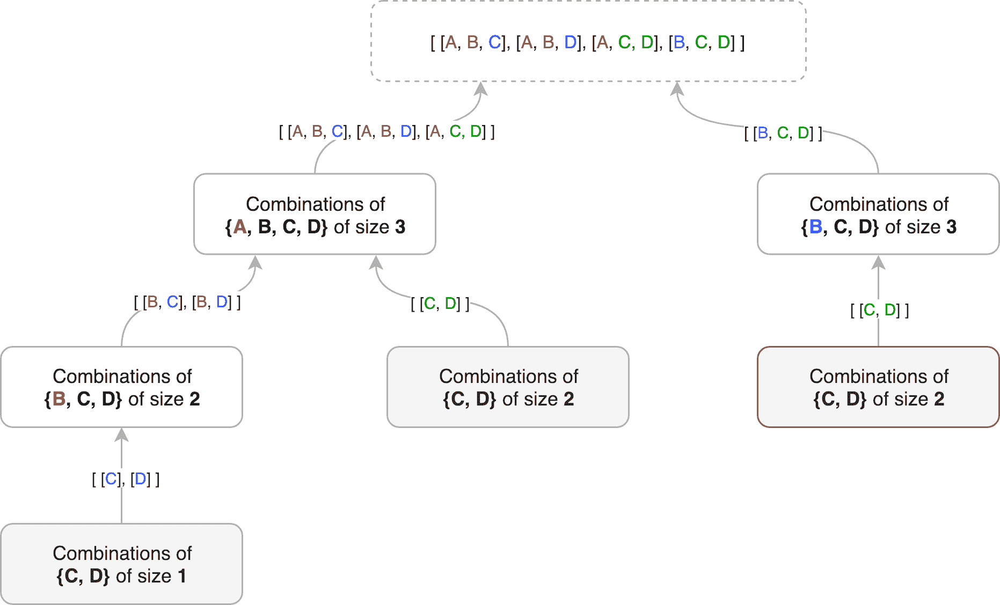

以下是用 JavaScript 实现该算法的示例。

```javascript
 1 /**
2  * @param {*[]} comboOptions - 我们从中提取元素的原始集合。
3  * @param {number} comboLength - 我们要创建的组合长度。
4  * @return {*[]}
5  */
6 export default function combineWithoutRepetitions(comboOptions, comboLength) {
7   // 如果组合的长度为 1，则原始集合中的每个元素都是一个组合 i\
8   ation。
9   if (comboLength === 1) {
10     return comboOptions.map(comboOption => [comboOption]);
11   }
12 
13   // 初始化组合数组。
14   const combos = [];
15 
16   // 逐个提取字符并将其拼接到较小尺寸的组合中\
17   ize.
18   // 我们不需要提取字符。
19   comboOptions.forEach((currentOption, optionIndex) => {
20     // 从集合中获取所有组合。
21     const smallerCombos = combineWithoutRepetitions(
22       comboOptions.slice(optionIndex + 1),
23       comboLength - 1,
24     );
25 
26     // 将当前元素与所有较小的组合拼接。
27     smallerCombos.forEach((smallerCombo) => {
28       combos.push([currentOption].concat(smallerCombo));
29     });
30   });
31 
32   // 返回组合。
33   return combos;
34 }
```

`20-combinations/combineWithoutRepetitions.js`

#### 重复的组合

这个问题可以通过递归解决。这意味着我们从较小尺寸的组合生成更大尺寸的组合。例如，如果我们需要为集合 `S = {A, B, C, D}` 生成所有重复的尺寸为 `r = 3` 的组合，我们执行以下操作：

* 第一个元素 `A`，

* 为集合 `S = {B, C, D}` 找到所有尺寸为 `r = 2` 的组合，

* 将 `A` 与上一步中所有较小的组合拼接在一起，

* 第二个元素 `B`，

* 为集合 `S = {C, D}` 找到所有尺寸为 `r = 2` 的组合，

* 将 `B` 与上一步中所有较小的组合拼接在一起，

* 依此类推……

我们递归的基准情况是我们需要为一个集合生成尺寸为 `r = 1` 的组合。在这种情况下，集合中的每个元素都是我们寻找的组合，因此不需要进一步的递归调用。

请查看下面的完整递归调用树，以更好地理解该算法。

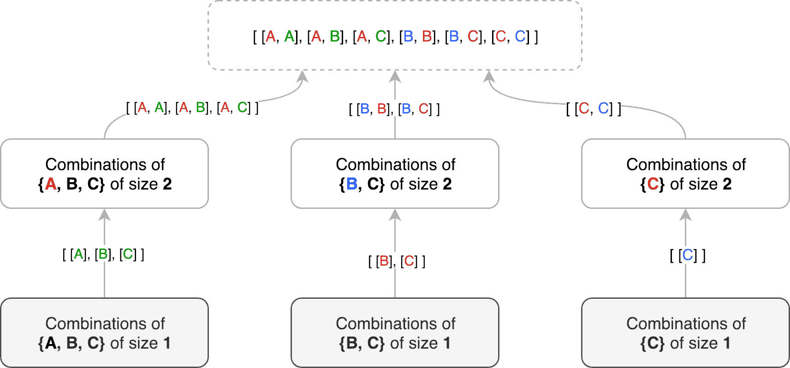

以下是用 JavaScript 实现该算法的示例。

```javascript
 1 /**
2  * @param {*[]} comboOptions - 我们从中提取元素的原始集合。
3  * @param {number} comboLength - 我们要创建的组合长度。
4  * @return {*[]}
5  */
6 export default function combineWithRepetitions(comboOptions, comboLength) {
7   // 如果组合的长度为 1，则原始集合中的每个元素都是一个组合 i
8   nation。
9   if (comboLength === 1) {
10     return comboOptions.map(comboOption => [comboOption]);
11   }
12 
13   // 初始化组合数组。
14   const combos = [];
15 
16   // 遍历原始集合的每个字符并将其拼接到较小尺寸\
17   的组合中。
18   // 因为我们允许重复。
19   comboOptions.forEach((currentOption, optionIndex) => {
20     // 获取包含当前元素的原始集合的所有组合。
21     const smallerCombos = combineWithRepetitions(
22       comboOptions.slice(optionIndex),
23       comboLength - 1,
24     );
25 
26     // 将当前元素（选项）与所有较小的组合拼接。
27     smallerCombos.forEach((smallerCombo) => {
28       combos.push([currentOption].concat(smallerCombo));
29     });
30   });
31 
32   // 返回所有组合。
33   return combos;
34 }
```

`20-combinations/combineWithRepetitions.js`

### 问题示例

以下是一些你在面试中可能会遇到的相关问题：

* [组合](https://leetcode.com/problems/combinations/)

* [组合之 III](https://leetcode.com/problems/combination-sum-iii/)

* [组合之 IV](https://leetcode.com/problems/combination-sum-iv/)

### 问答

*Q1: 在形成组合时，元素的顺序重要吗？*

*Q2: 如果我们需要从大小为 4 的集合中生成所有不重复的尺寸为 2 的组合，会有多少组合？*

### 参考文献

- [Wikipedia 上的组合](https://en.wikipedia.org/wiki/Combination)

- [“Math is Fun”上的组合](https://www.mathsisfun.com/combinatorics/combinations-permutations.html)

- [Medium 上的组合](https://medium.com/@trekhleb/permutations-combinations-algorithms-cheat-sheet-68c14879aba5)

- [组合示例与测试用例](https://github.com/trekhleb/javascript-algorithms/tree/master/src/algorithms/sets/combinations)

## 排序：快速排序 (Quicksort)

难度：中等

### 任务

将一个无序数值数组按升序排序。例如，一个无序数组 `[10, 3, 0, 15, 10, 18, 2, 7, 11]` 升序排序后将变为：`[0, 2, 3, 7, 10, 10, 11, 15, 18]`。

除了排序数字，我们还希望能够对对象数组进行排序。为了实现这一点，我们将在算法中实现一个比较回调函数。例如，应该能够按年龄对数组 `[{name: "Bill", age: 23}, {name: "Jane", age: 18}]` 进行升序排序，得到数组 `[{name: "Jane", age: 18}, {name: "Bill", age: 23}]`。

在任务描述中，我们只提到了按升序排序。不过一旦你理解了快速排序算法的原理，你就能修改算法来支持升序排序。

### 算法

`Quicksort` 是一种效率为 `O(n * log(n))` 且常用的排序算法。快速排序是一种**比较排序**，这意味着它可以对任何定义了“小于”关系的类型项目进行排序。快速排序是一种**分治**算法。这意味着它将原始问题拆分成更小的子问题并尝试先解决这些子问题。然后合并较小问题的解决方案以得出最终解决方案。在我们例中，我们将数组分为两个部分，先排序较小的数组，然后再将它们合并成一个最终的排序数组。

该算法由三个递归（在子问题上重复）步骤组成：

- **基准选择 (Pivot selection)**：从数组中选择一个元素，称为 `pivot`（通常取第一个、中间或最后一个）。

- **分区 (Partitioning)**：将数组分成三个子数组：`left`（包含所有小于基准元素的元素）、`center`（包含所有等于基准元素的元素）和 `right`（包含所有大于基准元素的元素）。

- **递归 (Recurse)**：为它们选择新的基准元素并进一步分区，对较小的数组 `left` 和 `right` 应用之前的两个步骤。我们不需要对 `center` 数组应用这些步骤，因为它已经是排序的并且包含了所有的相等元素。

该算法的基准情况是排序仅有一个元素的数组。当数组中只有一个元素时，不需要进行排序，因此我们返回该值。

快速排序算法的递归步骤如图所示：

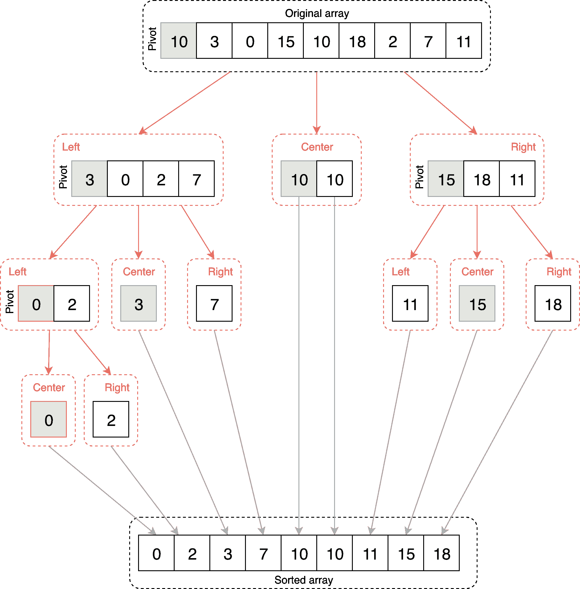

## 使用示例

在实现 `quickSort()` 函数之前，让我们假设我们已经实现了一个，并用它来在 `O(n * log(n))` 时间内排序用户名列表。这将帮助我们理解函数需要哪些参数，以及算法完成后结果将是什么。在这个示例中，我们将使用一个比较函数来排序数组。这允许我们在排序对象数组时使用自定义的比较逻辑。

```javascript
 1 // 导入依赖项。
 2 import quickSort from './quickSort';
 3 
 4 // 让我们用 O(n * log(n)) 时间按年龄排序用户列表。
 5 
 6 // 初始化用户列表。
 7 const notSortedUserList = [
 8   { age: 18, name: 'Bill' },
 9   { age: 20, name: 'Kate' },
10   { age: 20, name: 'Tom' },
11   { age: 24, name: 'Cary' },
12   { age: 37, name: 'Mike' },
13   { age: 42, name: 'Ben' },
14   { age: 50, name: 'Jane' },
15   { age: 60, name: 'Julia' },
16 ];
 17 
18 // 创建一个比较两个用户对象的比较函数。
19 const userComparator = (user1, user2) => {
20   if (user1.age === user2.age) {
21     return 0;
22   }
 23 
24   return user1.age > user2.age ? 1 : -1;
25 };
26 
27 // 排序用户列表。
28 const sortedUserList = quickSort(notSortedUserList, userComparator);
29 
30 // eslint-disable-next-line no-console
31 console.log(sortedUserList);
32 /*
33   输出将为：
34   [
35       { age: 18, name: 'Bill' },
36       { age: 20, name: 'Kate' },
37       { age: 20, name: 'Tom' },
38       { age: 24, name: 'Cary' },
39       { age: 37, name: 'Mike' },
40       { age: 42, name: 'Ben' },
41       { age: 50, name: 'Jane' },
42       { age: 60, name: 'Julia' },
43   ]
44  */
```

21-quicksort/example.js

# 实现

实现快速排序算法有多种方法。它们在两个方面有所不同：基准点的选择方式（第一个元素、中间元素、最后一个元素）以及分区的方式（就地、非原地）。你可以在 [JavaScript Algorithms 仓库](https://github.com/trekhleb/javascript-algorithms) 中找到不同的实现。

在本章中，我们将通过选择第一个元素作为基准点来实现快速排序，并采用“非原地”分区，以使算法的实现更加清晰易读。

由于我们希望 `quickSort()` 函数不仅对数字排序，还能对对象排序，因此我们将重用已经在“二分查找”章节中实现的 `Comparator` 工具类。请参考“二分查找”章节以获取 `Comparator` 类的实现细节。这是一个简单的类，通过 `equal()`、`lessThan()` 和 `greaterThan()` 方法为对象比较提供通用的接口。

```javascript
/**
 * @param {*[]} originalArray - 需要排序的数组。
 * @param {function} comparatorCallback - 比较两个元素的函数
 * @return {*[]} - 排序后的数组
 */
export default function quickSort(originalArray, comparatorCallback = null) {
  // 根据 comparatorCallback 函数创建一个比较器。
  // Comparator 对象将为我们提供常用的比较方法，如 equal() 和 lessThan()。
  const comparator = new Comparator(comparatorCallback);

  // 克隆原始数组以防止修改。
  // 在此示例中我们不进行原地排序，因此不希望产生副作用。
  const array = [...originalArray];

  // 如果数组元素少于或等于一个，说明它已经是有序的。
  // 这是我们递归的边界情况。
  if (array.length <= 1) {
    return array;
  }

  // 初始化左右两个数组。
  const leftArray = [];
  const rightArray = [];

  // 取数组的第一个元素作为基准（pivot），并初始化中间数组。
  const pivotElement = array.shift();
  const centerArray = [pivotElement];

  // 将所有数组元素分到左、中、右数组中。
  // 由于我们是从数组中提取元素，只需检查数组长度来停止循环。
  while (array.length) {
    // 从未排序数组中提取第一个元素。
    const currentElement = array.shift();

    // 将提取的元素与基准比较，以决定它属于哪个子数组
    //（左、中或右）。
    if (comparator.equal(currentElement, pivotElement)) {
      centerArray.push(currentElement);
    } else if (comparator.lessThan(currentElement, pivotElement)) {
      leftArray.push(currentElement);
    } else {
      rightArray.push(currentElement);
    }
  }

  // 递归地排序左右数组。
  const leftArraySorted = quickSort(leftArray, comparatorCallback);
  const rightArraySorted = quickSort(rightArray, comparatorCallback);

  // 现在将排序后的左数组与中间数组以及排序后的右数组合并。
  return leftArraySorted.concat(centerArray, rightArraySorted);
}
```

`quicksort/quickSort.js`

### 复杂度

| 最优 | 平均 | 最差 |

| --- | --- | --- |

| O(n * log(n)) | O(n * log(n)) | O(n<sup>) |

时间复杂度为 `O(n²)` 的**最坏情况**可能会发生在：如果我们的数组已经按升序排列好，并且我们总是选择数组的第一个元素作为基准点。在这种情况下，经过分区步骤后，所有元素将位于 `right` 数组中，导致 `left` 数组为空。这种情况将在后续的所有递归分区中持续，我们最终会有 `(n - 1)` 个递归步骤，在这些步骤中会对子数组进行完整遍历，导致 `O(n²)` 的时间复杂度。

时间复杂度为 `O(n * log(n))` 的**最佳情况**发生在：当基准点将数组划分为两个几乎相等的 `left` 和 `right` 部分。在这种情况下，快速排序图中会有 `log(n)` 层（见上方的插图），配合完整的子数组遍历，为我们提供了 `O(n * log(n))` 的时间复杂度。

### 题目示例

这里是你在面试过程中可能会遇到的一些相关问题：

* [排序列表](https://leetcode.com/problems/sort-list/)

* [数组中的第 K 大元素](https://leetcode.com/problems/kth-largest-element-in-an-array/)

### 测验

*Q1: 平均而言，快速排序算法的时间复杂度是多少？

*Q2: 我们如何修改修改 `quickSort()` 函数来让它按降序排列元素？

### 参考文献

Wikipedia 上的快速排序 [`en.wikipedia.org/wiki/Quicksort`](https://en.wikipedia.org/wiki/Quicksort)

YouTube 上的快速排序 [`www.youtube.com/watch?v=SLauY6PpjW4`](https://www.youtube.com/watch?v=SLauY6PpjW4)

快速排序示例和测试用例 [`github.com/trekhleb/javascript-algorithms/tree/master/src/algorithms/sorting/quick-sort`](https://github.com/trekhleb/javascript-algorithms/tree/master/src/algorithms/sorting/quick-sort)

## 树。深度优先搜索（Depth-First Search）。

*难度：中等*

### 任务

假设我们有一个节点树，并且想要：

* 检查特定节点是否存在于树中

* 检查两个节点是否相连

* 访问树中的所有节点

### 算法

解决上述任务的方法之一是深度优先搜索。

**深度优先搜索 (DFS)** 是一种用于遍历树或图结构的算法。该算法的思想是从某个特定节点（通常是根节点）开始，沿着每个分支尽可能深地进行探索，然后回溯。

*回溯*（backtracking）一词意味着，当我们沿着分支深入移动且没有更多节点可以探索时，我们将沿树向上移动以寻找下一个未探索的分支。

下方的插图展示了二叉树遍历的序列。

images/22-tree-depth-search.png)

将这个算法想象成你正在穿过迷宫。当你行走时，会遇到迷宫中的交叉路口——这些就像我们树的节点。每个路口有三个选择：向*右*转、向*左*转或*返回*上一个交叉路口（回溯）。假设我们想了一种策略，优先尝试右转。因此我们选择向右转，并用画笔将右转标记为“已访问”，以避免以后再次进入。如果我们遇到迷宫的死胡同（叶子节点），我们会回溯，直到到达一个曾向右过的交叉路口。然后我们向左转，并用画笔将左转标记为“已访问”。当我们到达交叉路口的两个方向都被标记为“已访问”时，我们需要回溯到上一个交叉路口并寻找第一个未访问的转弯。

该算法可以通过递归使用**栈**来实现（关于此数据结构的深入解释，请参见栈章节）。使用栈进行深度优先搜索的思想如下：

1. 选择起始节点并将其所有子节点放入栈中。

2. 从栈中弹出节点以选择下一个访问节点，将其所有子节点放入栈中。

3. 返回第 2 步（重复此过程直到栈为空）。

## 使用示例

在开始实现深度优先搜索算法之前，让我们先假设我们已经实现了一个 `depthFirstSearch()` 函数。该函数允许我们遍历使用简单 `BinaryTreeNode` 类实现的二叉树节点。通过这种方式，我们将更好地理解想要传递给 `depthFirstSearch()` 函数的参数应该什么，以及我们期望从它得到的输出是什么。

在这个用例示例中，我们将使用一个回调函数作为 `depthFirstSearch()` 函数的第二个参数。每当该函数访问树中的一个节点时，该回调函数就会被调用一次。这允许我们在访问每个节点时添加自定义逻辑。

```javascript
 1 // 导入依赖。
 2 import { depthFirstSearch } from './depthFirstSearch';
 3 import { BinaryTreeNode } from '../06-binary-search-tree/BinaryTreeNode';
 4 
 5 // 创建树节点。
 6 const nodeA = new BinaryTreeNode('A');
 7 const nodeB = new BinaryTreeNode('B');
 8 const nodeC = new BinaryTreeNode('C');
 9 const nodeD = new BinaryTreeNode('D');
10 const nodeE = new BinaryTreeNode('E');
 1 
12 // 使用创建的节点形成二叉树。
13 nodeA
14   .setLeft(nodeB)
15   .setRight(nodeC);
16 
17 nodeB
18   .setLeft(nodeD)
19   .setRight(nodeE);
20 
21 // 初始化包含树中所有遍历节点的数组。
22 const traversedNodes = [];
23 
24 // 创建访问节点回调函数。
25 const visitNodeCallback = (visitedNode) => {
26   // 一旦访问该节点，将其添加到遍历节点列表中。
27   traversedNodes.push(visitedNode);
28 };
29 
30 // 执行深度优先树遍历。
31 depthFirstSearch(nodeA, visitNodeCallback);
32 
33 // eslint-disable-next-line no-console
34 console.log(traversedNodes);
35 /*
36   输出将是：
37   [nodeA, nodeB, nodeD, nodeE, nodeC]
38 */
```

`22-tree-depth-first-search/example.js`

# 实现

为了遍历我们的树，我们必须首先创建一个 `BinaryTreeNode` 类，用于表示二叉树的节点。在类构造函数中，我们将为节点分配值。我们的 `setLeft()` 和 `setRight()` 方法允许我们向其附加左、右节点。为了易用性，我们将从 `setLeft()` 和 `setRight()` 方法返回 `this`，以便能够像 `nodeA.setLeft(nodeB).setRight(nodeC)` 这样进行链式调用。

```javascript
 1 export class BinaryTreeNode {
 2   /**
 3    * @param {*} [value]
 4    */
 5   constructor(value = null) {
 6     this.left = null;
 7     this.right = null;
 8     this.value = value;
 9   }
10 
11   /**
12    * @param {BinaryTreeNode} node
13    */
14   setLeft(node) {
15     this.left = node;
16     return this;
17   }
18 
19   /**
20    * @param {BinaryTreeNode} node
21    */
22   setRight(node) {
23     this.right = node;
24     return this;
25   }
26 }
```

`06-binary-search-tree/BinaryTreeNode.js`

一旦我们实现了 `BinaryTreeNode` 类，就可以实现 `depthFirstSearch()` 函数，用于遍历 `BinaryTreeNode` 实例。该函数接受起始 `node` 作为第一个参数，并将 `visitNodeCallback()` 作为第二个参数。每当我们在 DFS 路径上遇到新节点时，`visitNodeCallback()` 就会被调用。

我们将使用递归来实现 `depthFirstSearch()` 函数。这意味着，如果当前 `node` 的左、右节点存在，我们将对它们调用 `depthFirstSearch()` 函数。

```javascript
 1 /**
 2  * 对 rootNode 执行深度优先搜索 (DFS) 遍历。
 3  *
 4  * @param {BinaryTreeNode} node - 要遍历的起始节点。
 5  * @param {callback} [visitNodeCallback] - 访问节点回调。
 6  */
 7 export function depthFirstSearch(node, visitNodeCallback = () => {}) {
 8   // 调用访问节点回调。
 9   visitNodeCallback(node);
10 
11   // 遍历左分支。
12   if (node.left) {
13     depthFirstSearch(node.left, visitNodeCallback);
14   }
15 
16   // 遍历右分支。
17   if (node.right) {
18     depthFirstSearch(node.right, visitNodeCallback);
19   }
20 }
```

`22-tree-depth-first-search/depthFirstSearch.js`

之前提到过深度优先搜索算法可以使用 `stack`（栈）数据结构来实现。但观察 `depthFirstSearch()` 函数的代码，你可能会疑惑为什么我们没有使用栈。

### 复杂度

#### 时间复杂度

深度优先搜索算法访问每个节点一次。因此，我们可以说时间复杂度为 `O(N)`。

#### 辅助空间

在最坏的情况下，递归调用栈需要 `O(N)`。

### 题目示例

这里是一些你在面试中可能会遇到的相关问题：

*   [相同树](https://leetcode.com/problems/same-tree/)

*   [二叉树的最大深度](https://leetcode.com/problems/maximum-depth-of-binary-tree/)

*   [验证二叉搜索树](https://leetcode.com/problems/validate-binary-search-tree/)

### 测试

*Q1 深度优先搜索的时间复杂度是多少？*

*Q2 实现 depthFirstSearch 时可以避免递归吗？*

### 参考文献

维基百科上的深度优先搜索 [`en.wikipedia.org/wiki/Depth-first_search`](https://en.wikipedia.org/wiki/Depth-first_search)

树的 DFS 示例和测试用例 [`github.com/trekhleb/javascript-algorithms/tree/master/src/algorithms/tree/depth-first-search`](https://github.com/trekhleb/javascript-algorithms/tree/master/src/algorithms/tree/depth-first-search)

`广度优先搜索 (BFS)` 和 `深度优先搜索 (DFS)` 算法在某些方面非常相似，它们都是在遍历树，但实现方式不同。`BFS 这种方式是宽广`，它通过探索树中某一层上的所有节点，然后才向深一层并探索下一层的节点。`DFS 这种方式是深入`，它通过一直向下树的叶子节点来探索树的所有节点，然后回溯并尝试另一个分支，直到到达叶子节点。

下面的图展示了使用广度优先搜索算法遍历二叉树的序列。

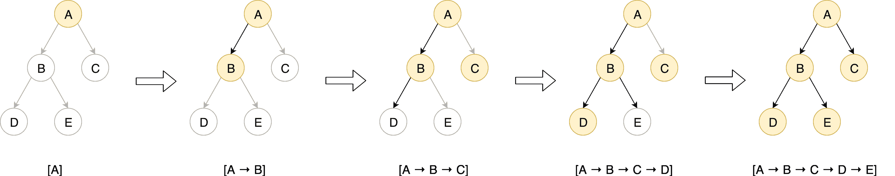

该算法可以使用 `queue` 实现（参见此书之前关于 `Queue` 数据结构的其中一个章节）。使用队列实现广度优先搜索算法的思路如下：

1. 选取起始节点并将其放入节点队列。

2. 从队列中弹出下一个节点，将其所有子节点添加到队列中以便稍后访问。

3. 回到第 2 步（重复此过程直到队列为空）。

## 使用示例

在继续实现广度优先搜索算法之前，让我们假设我们已经实现了一个 `breadthFirstSearch()` 函数。该函数允许我们遍历使用简单 `BinaryTreeNode` 类实现的二叉树节点。通过这种方式，我们将更好地理解想要传递给 `breadthFirstSearch()` 函数的参数，以及我们期望它返回的输出。

在这个用用示例中，我们将使用一个回调函数作为 `breadtFirstSearch()` 函数的第二个参数。每当函数访问树中的一个节点时，该回调就会被调用一次。这允许我们在访问每个节点时添加自定义逻辑。

```
 1 // 导入依赖项。
 2 import { BinaryTreeNode } from '../06-binary-search-tree/BinaryTreeNode';
 3 import { breadthFirstSearch } from './breadthFirstSearch';
 4 
 5 // 创建树节点。
 6 const nodeA = new BinaryTreeNode('A');
 7 const nodeB = new BinaryTreeNode('B');
 8 const nodeC = new BinaryTreeNode('C');
 9 const nodeD = new BinaryTreeNode('D');
10 const nodeE = new BinaryTreeNode('E');
 11 
 12 // 由创建的节点构建一个二叉树。
 13 nodeA
 14   .setLeft(nodeB)
 15   .setRight(nodeC);
 16 
 17 nodeB
 18   .setLeft(nodeD)
 19   .setRight(nodeE);
 20 
 21 // 初始化包含树中所有遍历节点的数组。
 22 const traversedNodes = [];
 23 
 24 // 创建访问节点回调。
 25 const visitNodeCallback = (visitedNode) => {
 26   // 一旦访问该节点，我们就将其添加到节点列表中。
 27   traversedNodes.push(visitedNode);
 28 };
 29 
 30 // 执行广度优先遍历。
 31 breadthFirstSearch(nodeA, visitNodeCallback);
 32 
 33 // 检查遍历是否按顺序发生。
 34 expect(traversedNodes).toEqual([
 35   nodeA, nodeB, nodeC, nodeD, nodeE,
 36 ]);
 37 
 38 // eslint-disable-next-line
 39 console.log(traversedNodes);
 40 /*
 41   输出将是：
 42   [nodeA, nodeB, nodeC, nodeD, nodeE]
 43 */
```

`23-tree-breadth-first-search/example.js`

# 实现

由于我们要遍历二叉树，让我们创建一个简单的 `BinaryTreeNode` 类来表示二叉树的节点。使用 `constructor` 我们将值赋值给节点。此外，通过 `setLeft()` 和 `setRight()` 方法，我们能够附加左节点和右节点。为了方便使用，我们将从 `setLeft()` 和 `setRight()` 方法返回 `this`，以便能够像 `nodeA.setLeft(nodeB).setRight(nodeC)` 这样的链式调用。

```
 1 export BinaryTreeNode {
 2   /**
 3    @param {*} [value]
 4    */
 5   constructor(value = null) {
 6     this.left = null;
 7     this.right = null;
 8     this.value = value;
 9   }
 10 
 11   /**
 12    @param {BinaryTreeNode} node
 13    */
 14   setLeft(node) {
 15     this.left = node;
 16     return this;
 17   }
 18 
 19   /**
 20    @param {BinaryTreeNode} node
 21    */
 22   setRight(node) {
 23     this.right = node;
 24     return this;
 25   }
 26 }
```

`06-binary-search-tree/BinaryTreeNode.js`

由于广度优先遍历使用队列来存储所有应该访问的节点，让我们先导入 `Queue` 类。

```
// 导入依赖项。
import { Queue } from '../03-queue';
```

`23-tree-breadth-first-search/breadthFirstSearch.js`

由于我们要遍历二叉树，广度优先遍历使用队列来存储所有应该访问的节点，让我们先导入 `Queue` 类。

一旦我们实现了 `BinaryTreeNode` 类并导入了 `Queue`，我们就可以开始 `breadthFirstSearch()` 函数的实现，该函数将接收 `rootNode` 作为第一个参数，`visitNodeCallback` 作为第二个参数。在 `breadthFirstSearch()` 函数内部我们需要：

1. 创建一个空队列实例 `nodeQueue`，

2. 将 `rootNode` 放入队列以开始遍历，

3. 从队列中弹出下一个节点并赋值给 `currentNode` 变量，

4. 调用 `visitNodeCallback()` 回调以通知订阅者节点，

5. 直到 `nodeQueue` 为空。

以下是该函数的实现：

```
 4 /**
5  * 执行广度优先搜索 (BFS) 遍历。
6  *
7  * @param {BinaryTreeNode} rootNode - 起始节点。
8  * @param {callback} [visitNodeCallback] - 访问回调。
9  */
10 export function breadthFirstSearch(rootNode, visitNodeCallback = () {}) {
11   // 队列设置。
12   const nodeQueue = new Queue();
13   // 将起始节点放入队列。
14   nodeQueue.enqueue(rootNode);
15 
16   // 直到队列为空访问队列的所有节点。
17   while (!nodeQueue.isEmpty()) {
18     // 获取下一个访问的节点。
19     const currentNode = nodeQueue.dequeue();
20 
21     // 调用访问回调。
22     visitNodeCallback(currentNode);
23 
24     // 将左节点加入遍历队列。
25     if (currentNode.left) {
26       nodeQueue.enqueue(currentNode.left);
27     }
28 
29     // 将右节点加入遍历队列。
30     if (currentNode.right) {
31       nodeQueue.enqueue(currentNode.right);
32     }
33   }
34 }
```

`23-tree-breadth-first-search/breadthFirstSearch.js`

### 复杂度

#### 时间复杂度

上述实现的广度优先搜索算法恰好访问树中的每个节点一次。这是通过使用 `Queue` 实例实现的。由于树不能有循环连接（即两个节点共享同一个子节点），我们可以说每个节点只放入队列一次。然后通过访问它从队列中提取每个节点一次。因此，我们可以说使用广度方法遍历树的时间复杂度为 `O(|N|)`，其中 `|N|` 是树中的节点总数。

#### 辅助空间复杂度

在最坏情况下，我们将有一个类似于链表的非平衡树（如果树的每个节点只有一个左孩子或右孩子）。由于我们使用队列来存储将被访问的节点列表，队列在最坏情况下可能包含树的所有节点。因此，在最坏情况下，我们的队列实例需要 `O(|N|)` 的辅助内存空间。

Q2: 如何调整函数 `depthFirstSearch()` 以支持树节点拥有两个及以上的子节点？

### 参考文献

- Wikipedia 上的度优先搜索 (BFS) [`en.wikipedia.org/wiki/Breadth-first_search`](https://en.wikipedia.org/wiki/Breadth-first_search)

- 树的 BFS 示例和测试用例 [`github.com/trekhleb/javascript-algorithms/tree/master/src/algorithms/tree/breadth-first-search`](https://github.com/trekhleb/javascript-algorithms/tree/master/src/algorithms/tree/breadth-first-search)

## 图形。深度优先搜索。

*难度中等*

### 任务

假设我们有一个图，并且想要：

- 检查特定顶点是否存在于图中（即对顶点“John”执行 `search` 操作），

- 检查两个节点是否连通（即：在顶点“Bill”和“Tom”之间 `find connection path`），

- 通过访问图中的所有顶点来对顶点进行盘点（即将图转换为数组），

- 等等（更多用例请参见下文的应用程序部分）。

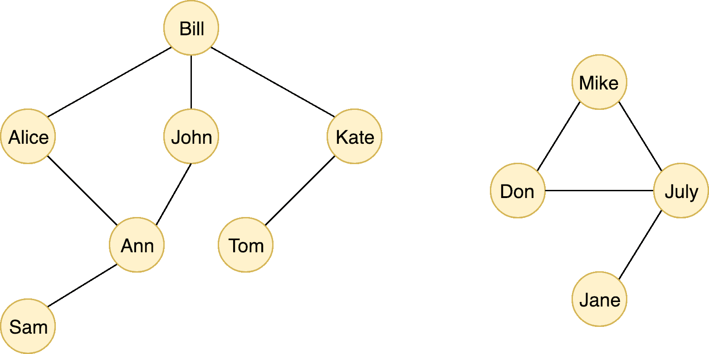

为了完成所有这些任务，我们需要利用`graph traversal algorithm`。换句话说，我们需要编写一种算法，能够访问从特定顶点可以到达图的所有顶点。

### 算法

解决上述任务的方法之一是深度优先搜索算法。

**深度优先搜索 (DFS)** 是一种用于遍历或搜索树或图数据结构的算法。该算法的核心思想是从某个特定节点（或顶点）开始，沿着每个分支尽可能深地探索，然后进行回溯。

在这里，`backtracking`（回溯）一词意味着当我们沿着图的分支深入移动并且当前路径上没有更多节点可以探索时，我们将向后移动，寻找另一个最近的未探索子分支（顶点），然后对其探索。

下面的插图展示了使用深度优先搜索算法进行图遍历的序列。

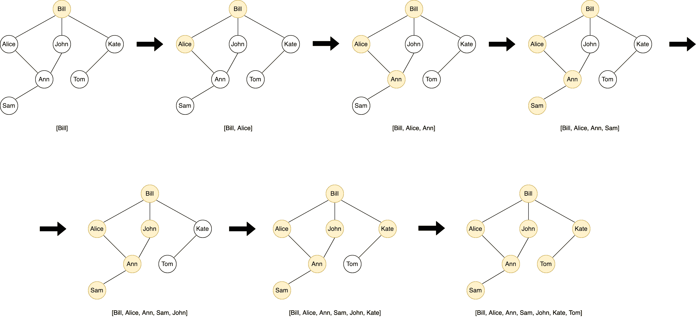

为了更好地理解深度优先搜索算法，你可以将其想象成穿过迷宫的过程。图是迷宫，图的边是路径，图的顶点是迷宫路径的交叉口。当你到达一个交叉口时，标记你打算走的路径，以避免将来再次走同一条路。当你到达一个所有路径都被标记为“已访问”的交叉口时，你会回到上一个交叉口（回溯），并选择另一条尚未过的路径。这个过程不断重复，直到你到达迷宫的出口。

该算法可以使用 `stack` 递归实现（参见本书中关于 `Stack` 数据结构的之前的章节）。使用栈进行深度优先搜索的想法如下：

1. 选择起始顶点并将其添加到栈中。

2. 从栈中弹出下一个顶点并“访问”它（即：调用回调函数或对该顶点执行某些操作）。

3. 将当前顶点的所有 `unvisited`（未访问）邻居推入栈中。

4. 回到第 2 步（重复此过程直到栈为空）。

也可以使用 **Hash map**（哈希表）数据结构来高效检查顶点是否已经过访问。顶点必须具有一个唯一的 `key` 值，用作哈希表的键。

### 应用

深度优先搜索算法是与其他图相关算法的构建模块，例如：

- 寻找连通分量，

- 拓排序，

- 寻找图的桥，

- 检测图中的环，

- 路径查找，

- 解决只有一个解的谜题（如迷宫），

- 迷宫生成可能会使用随机深度优先搜索

- 等等。

## 使用示例

在实现 `depthFirstSearch()` 函数之前，让我们看看将如何使用它以及我们将向它传递哪些参数。`depthFirstSearch()` 函数需要知道要遍历哪个图，以及从哪个起始顶点开始遍历过程。此外，我们还想向函数传递一个回调函数，该函数将在每次访问一个新顶点时被调用。考虑到这些点，让我们使用书书中“图形（Graphs）”章节中的 `Graph` 类创建一个非常基础的社交网络，然后遍历它。

这是我们要实现的网络结构。


让我们从 `Bill` 开始，遍历所有直接连接或通过其他用户连接到 `Bill` 的用户。首先我们将创建一个图（类比社交网络）。接下来，我们将创建图顶点（类比在网络中注册用户）。然后，将在图节点之间创建图边（类比将用户添加到好友列表）。然后，我们将从 `Bill` 开始遍历所有用户。

```
 1 // 导入依赖项。
 2 import Graph from '../08-graph/Graph';
 3 import GraphVertex from '../08-graph/GraphVertex';
 4 import GraphEdge from '../08-graph/GraphEdge';
 5 import { depthFirstSearch } from './depthFirstSearch';
 6 
 7 // 创建我们过度简化的社交网络的演示版本。
 8 const socialNetwork = new Graph();
 9
10 // 让在我们的网络中注册几个用户。
11 const bill = new GraphVertex('Bill');
12 const alice = new GraphVertex('Alice');
13 const john = new GraphVertex('John');
14 const kate = new GraphVertex('Kate');
15 const ann = new GraphVertex('Ann');
16 const tom = new GraphVertex('Tom');
17 const sam = new GraphVertex('Sam');
18
19 // 现在在用户之间建立友谊关系。
20 socialNetwork
21   .addEdge(new GraphEdge(bill, alice))
22   .addEdge(new GraphEdge(bill, john))
23   .addEdge(new GraphEdge(bill, kate))
24   .addEdge(new GraphEdge(alice, ann))
25   .addEdge(new GraphEdge(ann, sam))
26   .addEdge(new GraphEdge(john, ann))
27   .addEdge(new GraphEdge(kate, tom));
28
29 // 现在让我们以深度优先的方式遍历网络
30 // 并我们将遇到的所有用户添加到 userVisits。
31 const userVisits = [];
32 depthFirstSearch(socialNetwork, bill, (user) => {
33   userVisits.push(user);
34 });
35
36 // 现在让我们看看用户是以什么顺序遍历的。
37 // eslint-disable-line no-console
38 console.log(userVisits);
39 /*
40   输出将是
41   [bill, alice, ann, sam, john, kate]
42 */
```

24-graph-depth-first-search/example.js

# 实现

**函数参数**

如上所述，`depthFirstSearch()` 函数接受三个参数：

- `graph` - 要遍历的图（`Graph` 类的实例），

- `startVertex` - 我们将作为起始点的顶点（`GraphVertex` 类的实例），

- `enterVertexCallback` - 在每次访问顶点时调用的回调函数。

**访问顶点记忆化**

当我们为树实现深度优先搜索算法时，我们并不担心同一个节点在不同父节点处被访问两次的情况。这是因为树节点根据定义不能有两个或多个父节点，否则它就会变成图。因此，在树中我们只有一种进入节点的方式。但当我们处理图时，我们需要记住同一个图顶点可能会从许多邻居顶点被访问多次。这样同一个顶点可能会被多次添加到我们的遍历栈中。这使得整个遍历过程效率低下，甚至可能导致无限循环。这就是为什么我们在遍历图时需要标记所有访问过的顶点，以避免重复访问同一个顶点。我们将使用 `visitedVertices` 对象来实现。已访问图顶点的 `key` 值将是 `visitedVertices` 对象的键。这将帮助我们以 `O(1)` 时间高效地检查节点是否已经过访问。

**递归闭包**

在我们的 `depthFirstSearch()` 函数内部，让我们实现一个递归的 `depthFirstSearchRecursive()` 函数。该函数将包含主要的遍历逻辑。`depthFirstSearchRecursive()` 函数是一个闭包，这意味着它可以访问 `depthFirstSearch()` 函数的所有变量和参数。因此，我们只需要向它传递一个参数，该参数是当前正准备遍历的顶点（`currentVertex` 参数）。

`depthFirstSearchRecursive()` 的作用仅仅是调用 `enterVertexCallback()` 函数，获取 `currentVertex` 的所有 `unvisited` 邻居，将它们标记为已访问，并对 `currentVertex` 的每个未访问的邻居再次调用自身。

### 实现示例

```
 1 /**
 2  * 以深度优先的方式遍历图。
 3  *
 4  * @param {Graph} graph - 准备被遍历的图。
 5  * @param {GraphVertex} startVertex - 我们将用作起始点的顶点。
 6  * @param {function} enterVertexCallback - 在每次访问顶点时调用的回调函数。\
 7 tex visit.
 8  */
 9 export function depthFirstSearch(graph, startVertex, enterVertexCallback) {
10   // 为了防止重复访问同一个顶点
11   // 我们需要记住所有已访问的顶点。
12   const visitedVertices = {};
13 
14   // 因为我们要先访问 startVertex，所以先将其添加到访问列表。
15   visitedVertices[startVertex.getKey()] = true;
16 
17   /**
 18    * 深度优先搜索的递归实现。
 19    *
 20    * @param {GraphVertex} currentVertex - 当前正在遍历的图顶点\
 21  rsed.
 22    */
 23   const depthFirstSearchRecursive = (currentVertex) => {
 24     // 调用回调通知订阅者进入了新顶点。
 25     enterVertexCallback(currentVertex);
 26 
 27     // 遍历当前访问顶点的每个邻居。
 28     currentVertex
 29       .getNeighbors()
 30       .forEach((nextVertex) => {
 31         // 如果邻居顶点之前未被访问，则访问它。
 32         if (!visitedVertices[nextVertex.getKey()]) {
 33           // 记住当前邻居，以避免以后再次访问。
 34           visitedVertices[nextVertex.getKey()] = true;
 35           // 访问下一个邻居顶点。
 36           depthFirstSearchRecursive(nextVertex);
 37         }
 38       });
 39   };
 40 
 41   // 通过调用递归函数开始图遍历。
 42   depthFirstSearchRecursive(startVertex);
 43 }
```

`24-graph-depth-first-search/depthFirstSearch.js`

###栈（Stack）的使用

上面提到过深度优先搜索算法可以使用 `Stack` 数据结构来实现。我们可以使用 `Stack` `显式地`（explicitly）或 `隐式地`（implicitly）实现 DFS 算法。

对于`显式栈的使用`，我们需要从书中的“Stack”章节导入一个 `Stack` 类实现（或任何其他栈的实现，包括普通的 JavaScript 数组），并使用栈实例来存储我们要遍历的所有顶点。只要栈不空，我们就从它中 `pop()` 最后添加的顶点，获取该顶点的所有未访问邻居，将它们 `push()` 到栈中并重复此过程。显式栈的使用不需要递归，`while` 循环可能是更好的选择。

但在上面的 `depthFirstSearch()` 函数中，我们通过递归`隐式地`使用了栈。虽然我们没有显式地导入 `Stack` 类，但我们仍然以递归`函数调用栈`的形式在处理栈。每当 `depthFirstSearchRecursive()` 函数调用自身时，JavaScript 引擎就会将当前函数的变量（状态）推入内存栈中。

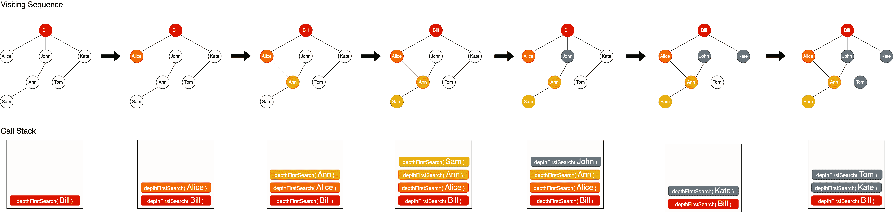

### 复杂度

#### 时间复杂度

`depthFirstSearch()` 函数的时间复杂度主要由其内部递归函数 `depthFirstSearchRecursive()` 的时间复杂度决定。因为 `depthFirstSearchRecursive()` 之外的所有操作都是常数操作。在 `depthFirstSearchRecursive()` 函数内部，我们执行了以下操作：

* 获取当前顶点的所有邻居。为了做到这一点，我们需要遍历连接到当前顶点的所有边。因此，边的数量将影响这一步骤的性能。

* 遍历当前顶点的所有未访问邻居。顶点越多，此步骤需要的迭代就越多。

考虑到所有因素，我们可以得出图的深度优先搜索算法的时间复杂度为 `O(|V| + |E|)`，其中 `|V|` 是图中顶点的总数，`|E|` 是图中边的总数。

#### 辅助空间复杂度

在 `depthFirstSearch()` 函数的当前实现中，我们使用了递归。每次递归调用都会增加函数调用栈。在最坏的情况下（即图类似于链表），函数 `depthFirstSearchRecursive()` 的调用栈将与图中顶点数量 `|V|` 成正比。此外，我们使用 `visitedVertices` map 来跟踪已访问的顶点。该 map 需要存储所有 `|V|` 个顶点的空间。

考虑到所有因素，我们可以得出辅助空间复杂度为 `O(|V|)`。

### 结论

图的深度优先搜索算法的时间复杂度为 `O(|V| + |E|)`，其中 `|V|` 是图中顶点的总数，`|E|` 是图中边的总数。辅助空间复杂度为 `O(|V|)`。

该算法可以使用 `queue` 实现（参见本书之前章节关于 `Queue` 数据结构的章节之一）。`Queue` 数据结构将为我们提供期望的 FIFO（先进先出）图顶点访问顺序，这样我们就会向宽度方向而非深度方向进行扩展。FIFO 顺序基本上意味着，一旦我们将当前顶点的所有邻居添加到 `Queue` 中，我们将首先在邻居之间进行移动，先访问第一个邻居，然后是第二个邻居，依此类推，最后移动到下一层邻居的子节点。这与我们实现深度优先遍历时使用的 `Stack` 的 LIFO（后进先出）方法相反，在深度优先遍历中，我们每次访问的是栈中添加的最后一个节点。通过这种方式，我们移动的不是从邻居到邻居，而是先从父节点到孩子。

使用队列进行广度优先搜索的想法如下：

1. 选择起始顶点并将其放入访问队列。

2. 从队列中获取下一个顶点并“访问”它（即调用回调函数或对顶点执行某些操作）。

3. 将当前顶点的所有 `unvisited` 邻居添加到队列中以便稍后访问。

4. 回到步骤 2（重复此过程直到队列为空）。

可以使用 `Hash map` 数据结构来高效地检查顶点是否已经被访问。顶点必须有一个唯一的 `key` 值，该值用作哈希映射的键。

### 应用

广度优先搜索算法用于寻找图中两个节点之间的最短路径。由于图可以表示现实世界的数据，如道路网络、社交网络、计算机网络，因此找到许多 BFS 算法的应用：

* **GPS 导航** - 寻找从你的位置（图中的顶点）到特定城市（图中的另一个顶点）的最短路径（地图图中边的组合）。

* **计算机网络** - 通过 P2P 客户端（即 Torrent 客户端）遍历点对点（P2P）网络，以找到所需文件的“最近”主机。

* **社交网络** - 寻找与他人具有给定距离的人。

* **网络爬虫** - 通过遵循从首页以及从内部页的链接来遍历网站内容。使用 BFS 可以设置网站爬取所需的特定深度。

广度优先搜索算法还是其他图相关算法的构建模块，例如 Cheney 算法（复制垃圾收集）、Cuthill–McKee 网格编号、用于计算流网络最大流的 Ford–Fulkerson 方法等。

## 使用示例

在实现 `breadthFirstSearch()` 函数之前，让我们看看将如何使用它以及将向它传递哪些参数。`breadthFirstSearch()` 函数需要知道遍历哪一个图以及从哪个起始顶点开始遍历过程。此外，我们还想向函数传递一个回调，该回调将在每次访问新顶点时被调用。考虑到所有这些，让我们使用本书“图”（Graphs）章节中的 `Graph` 类创建一个非常简单的社交网络，然后遍历它。

这是我们要实现的网络结构。

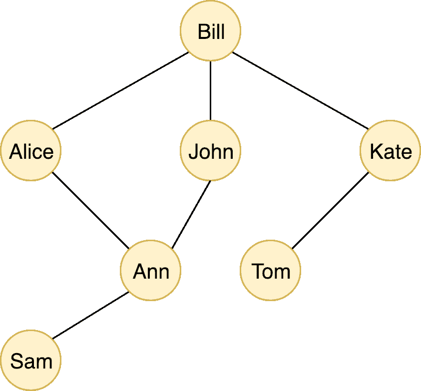

让我们从 `Bill` 开始，遍历所有直接或通过其他用户连接到 `Bill` 的用户。首先我们将创建一个图（社交网络的类比）。接下来，我们将创建图顶点（类比在网络中注册用户）。然后，将在图节点之间创建图边（类比将用户添加到好友列表）。最后，我们将从 `Bill` 开始遍历所有用户。

```javascript
 1 // 依赖。
 2 import Graph from '../08-graph/Graph';
 3 import GraphVertex from '../08-graph/GraphVertex';
 4 import GraphEdge from '../08-graph/GraphEdge';
 5 import { breadthFirstSearch } from './breadthFirstSearch';
 6 
 7 // 创建我们过度简化的社交网络的演示版本。
 8 const socialNetwork = new Graph();
 9 
10 // 在我们的网络中注册几个用户。
11 const bill = new GraphVertex('Bill');
12 const alice = new GraphVertex('Alice');
13 const john = new GraphVertex('John');
14 const kate = new GraphVertex('Kate');
15 const ann = new GraphVertex('Ann');
16 const tom = new GraphVertex('Tom');
17 const sam = new GraphVertex('Sam');
 18 
19 // 现在让我们网络中的用户之间建立友谊连接。
20 socialNetwork
21   .addEdge(new GraphEdge(bill, alice))
 22   .addEdge(new GraphEdge(bill, john))
 23   .addEdge(new GraphEdge(bill, kate))
 24   .addEdge(new GraphEdge(alice, ann))
 25   .addEdge(new GraphEdge(ann, sam))
 26   .addEdge(new GraphEdge(john, ann))
 27   .addEdge(new GraphEdge(kate, tom));
 28 
29 // 现在让我们从 Bill 开始以广度优先的方式遍历网络
30 // 并我们将遇到的所有用户添加到 userVisits 数组中。
31 const userVisits = [];
32 breadthFirstSearch(socialNetwork, bill, (user) => {
33   userVisits.push(user);
34 });
35 
36 // 现在看看用户是以什么顺序被遍历的。
37 console.log(userVisits);
38 // 输出将是：
39 [bill, alice, john, kate, ann, tom, sam]
```

```javascript
/**
 *  以广度优先的方式遍历图。
 *
 * @param {Graph} graph - 将要遍历的图。
 * @param {GraphVertex} startVertex - 我们将用作起始点的顶点。
 * @param {function} enterVertexCallback - 每次访问顶点时都会调用的回调函数。
 */
export function breadthFirstSearch(graph, startVertex, enterVertexCallback) {
  // 初始化顶点队列。每当我们遇到一个新顶点时，它会被
  // 添加到队列中以便进一步探索。
  const vertexQueue = new Queue();

  // 将 startVertex 加入队列，因为我们将首先访问它。
  vertexQueue.enqueue(startVertex);

  // 为了防止重复访问同一个顶点，
  // 我们需要记住所有访问过的顶点。
  const visitedVertices = {};

  // 既然我们要首先访问 startVertex，就把它添加到已访问列表中。
  visitedVertices[startVertex.getKey()] = true;

  // 只要队列不为空就遍历队列中的所有顶点。
  while (!vertexQueue.isEmpty()) {
    // 从队列中获取下一个顶点。
    const currentVertex = vertexQueue.dequeue();

    // 调用回调函数通知订阅者进入了新顶点。
    enterVertexCallback(currentVertex);

    // 将所有邻居加入队列以供后续遍历。
    currentVertex.getNeighbors().forEach((nextVertex) => {
      if (!visitedVertices[nextVertex.getKey()]) {
        // 记住当前邻居以避免未来再次访问它。
        visitedVertices[nextVertex.getKey()] = true;

        // 将 nextVertex 加入队列以便后续访问。
        vertexQueue.enqueue(nextVertex);
      }
    });
  }
}
```

`graph-breadth-first-search/breadthFirstSearch.js`

### 复杂度

#### 时间复杂度

`breadthFirstSearch()` 函数的时间复杂度主要由 `while` 循环决定，因为 `while` 循环之外的所有行执行时间均为 `O(1)`。记住，通过使用 `visitedVertices` 哈希表，我们防止了同一个顶点被多次添加到 `vertexQueue` 中。因此我们可以假设进入 `while` 循环恰好 `|V|` 次，其中 `|V|` 是我们正在遍历的图中连通顶点的数量。我们还需要考虑到，我们遍历了每一个顶点边并通过调用 `currentVertex.getNeighbors()` 来获取顶点的邻居。因此，我们的函数也会访问所有的 `|E|` 条图边。最后需要说明的是，在 `while` 循环内部我们有与队列相关的 `enqueue()` 和 `dequeue()` 操作，这些操作的执行时间为 `O(1)`，因为我们处理的是基于链表的 `Queue` 实现（更多细节请参阅关于队列数据结构的章节）。

考虑到以上因素，我们可以得出结论：breadthFirstSearch()` 函数的时间复杂度为 `O(|V| + |E|`，其中 `|E|` 是图边的数量，`|V|` 是图中顶点的数量。

#### 辅助空间复杂度

在 `breadthFirstSearch()` 函数当前的实现中，我们使用了以下额外变量：

* `vertexQueue` 队列 - 保存所有的 `|V|` 个图顶点，

* `visitedVertices` 哈希表 - 保存所有的 `|V|` 个图顶点键，

* `currentVertex` 变量 - 仅保留一个当前顶点实例。

由于 `vertexQueue` 和 `visitedVertices` 变量最消耗空间，我们可以得出：breadthFirstSearch()` 函数的辅助空间复杂度为 `O(|V|)`，其中 `|V|` 是图中顶点的数量。

### 题目示例

这里是你在面试过程中可能会遇到的一些相关问题：

* [克隆图](https://leetcode.com/problems/clone-graph/)

* [图是二分图吗？](https://leetcode.com/problems/is-graph-bipartite/)

* [被围绕的区域](https://leetcode.com/problems/surrounded-regions/)

### 测验

* *Q1: 图广度优先搜索算法的时间复杂度是多少？*

* *Q2: 哪种数据结构最适合实现图广度优先搜索算法：栈（Stack）还是队列（Queue）？*

### 参考文献

Wikipedia 广度优先搜索 (BFS) [`en.wikipedia.org/wiki/Breadth-first_search`](https://en.wikipedia.org/wiki/Breadth-first_search)

广度优先搜索可视化 [`www.cs.usfca.edu/~galles/visualization/BFS.html`](https://www.cs.usfca.edu/~galles/visualization/BFS.html)

图 BFS 示例和测试案例 [`github.com/trekhleb/javascript-algorithms/tree/master/src/algorithms/graph/breadth-first-search`](https://github.com/trekhleb/javascript-algorithms/tree/master/src/algorithms/graph/breadth-first-search)

## Dijkstra 算法

* *难度：困难 (hard)*

### 任务

*给定一个图和一个源顶点，找到从源点的最短路径。*

**示例**

图的一个良好例子是包含城市（顶点）和连接它们的道路（边）的地图。如果图是有向的，意味着道路是单程的。如果图是无向的，则道路是双向的。此外，图可以是加权的。

### 算法

#### 算法定义

**Dijkstra 算法**是一种寻找图中节点间最短路径的算法，图中可以代表路网。它由计算机科学家 Edsger W. Dijkstra 于 1956 年提出。

Dijkstra 的原始变体寻找两个节点之间的最短路径，但更常见的变体是寻找从源点到所有节点的最短路径。

#### 算法步骤

该算法包含以下步骤：

1. 为所有顶点分配一个**临时距离**值：将起始顶点设置为 `0`（因为我们已经到达了），并将所有其他顶点设置为无穷大 `Infinity`（此时它们看起来是不可及的）。

2. 创建**已访问顶点集合**。我们将用它来避免遍历顶点时出现死循环。

3. 创建一个**顶点访问队列**并将起始顶点放入队列。我们将使用以顶点距离作为优先因子的优先级队列（优先级在之前的章节中解释过）。到起始点的距离越短，优先级越高。

4. **从队列中弹出最近的顶点**（距离源点最近的顶点）。优先级队列允许我们实现这一点。

5. **遍历当前顶点的每个未访问邻居**。对于每个邻居，计算`到当前顶点的距离 + 当前顶点到邻居的距离`。如果此距离小于邻居的临时距离，则将其替换为新值。

6. 当考虑完当前顶点的所有邻居后，**将当前顶点标记为已访问**。

7. **返回步骤 4** 并重复，直到顶点访问队列为空。

#### 算法中优先级队列的使用

在 Dijkstra 算法中，每当我们弹出要访问的顶点时（步骤 4），它必须是一个之前未访问过且*距离起始点距离最短*的节点。

但我们如何实现这种基于距离的弹出操作呢？

如果我们使用之前一个章节中实现的 `Queue` 类，那么 `Queue` 将遵循 FIFO（先入先出）顺序，但它不会考虑距离。例如，如果我们向队列中添加一个距离为 `20` 的顶点，然后向队列中添加一个距离为 `10` 的顶点，那么 `poll()` 操作将返回我们距离为 `20` 的顶点，因为它是先放入队列的——而不是距离较短的 `10` 顶点。因此，使用 `Queue` 是行不通的。

另一种方法是将顶点访问队列存储为数组，每当我们我们需要从中获取下一个顶点时，可以遍历整个数组，并找到/返回具有最短距离的下一个顶点。这种方法可行，但时间复杂度为 `O(n)`。

## 我们能让获取（polling）更快吗？

是的，通过使用优先级队列（priority queue）可以。在这种情况下，获取操作的时间复杂度将为 `O(log(n))`，这使得算法运行得更快。

你可以在本书的“优先级队列”章节中找到 `PriorityQueue` 类的完整描述以及实现示例。

## 逐步示例

让我们采用上面的图，尝试应用 Dijkstra 算法寻找从 `Home` 顶点到所有顶点的最短路径。

### 第 1 步

初始化所有顶点的临时距离。`startingVertex`（在我们案例中是 `Home` 顶点）的临时距离将为 `0`，这意味着到达 `Home` 不需要努力，因为我们已经在那里了。所有其他顶点的临时距离都被设置为 `Infinity`，因为我们不知道它们距离 `Home` 有多远，甚至不知道它们是否可达。

我们将 `Home` 顶点添加到顶点优先级队列中，以便从它开始遍历图。

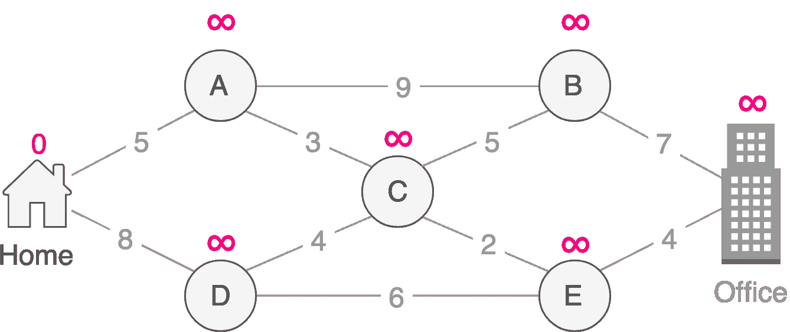

### 第 2 步

从优先级队列中获取下一个顶点。记住，每当我们从优先级队列中获取顶点时，它都会返回距离 `startingVertex` 最近的顶点。在我们的案例中，优先级队列中只有一个节点，就是 `Home` 顶点。因此当前顶点是 `Home`。

获取 `Home` 的所有邻居，并使用公式 `distanceToHome + distanceFromHomeToNeighbor` 设置它们的距离。在我们案例中，对于顶点 `A`，我们将距离设置为 `0 + 5 = 5`；对于顶点 `D`，我们将距离设置为 `0 + 8 = 8`。这意味着目前到 `A` 的最短距离是 `5`，到 `D` 的最短距离是 `8`。

将顶点 `A` 和 `D` 推入优先级队列。

一旦我们遍历了 `Home` 顶点的所有邻居，就可以将其标记为 `visited`（已访问）（你会看到下一个插图中 `Home` 节点被标记为黑色，这意味着它已被访问）。

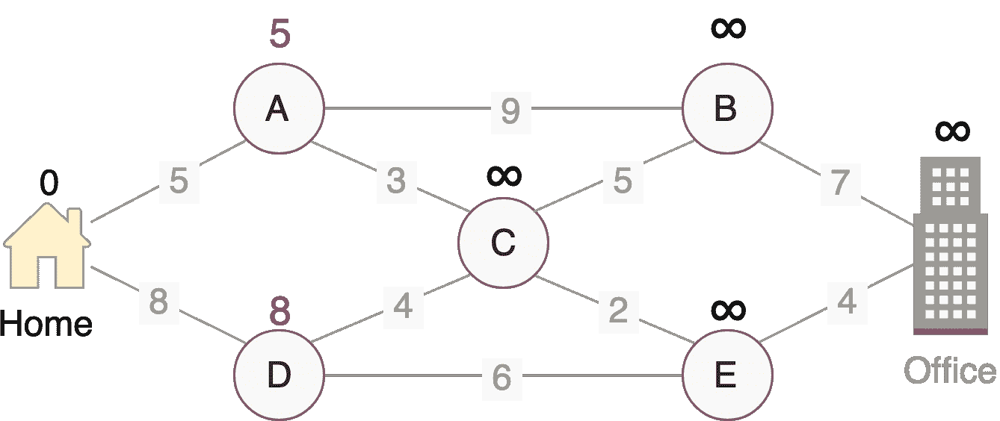

### 第 3 步

从我们的顶点优先级队列中获取下一个离 `Home` 最近的未访问顶点。在我们案例中，队列中只有两个顶点，分别是 `A` 和 `D`。由于 `A` 顶点更离 `Home` 顶点（距离为 `5`），我们先访问它。

获取 `A` 的所有未访问的邻居。邻居是顶点 `B` 和顶点 `C`。让我们使用公式 `distanceToA + distanceFromAtoNeighbor` 计算到邻居的最短路径。对于顶点 `B`，距离计算为 `5 + 9 = 14`。对于顶点 `C`，距离计算为 `5 + 3 = 8`。

将新邻居 `B` 和 `C` 添加到顶点优先级队列。

由于 `A` 的所有邻居已被访问，我们将 `A` 标记为已访问（它将在下一个插图中变为黑色）。

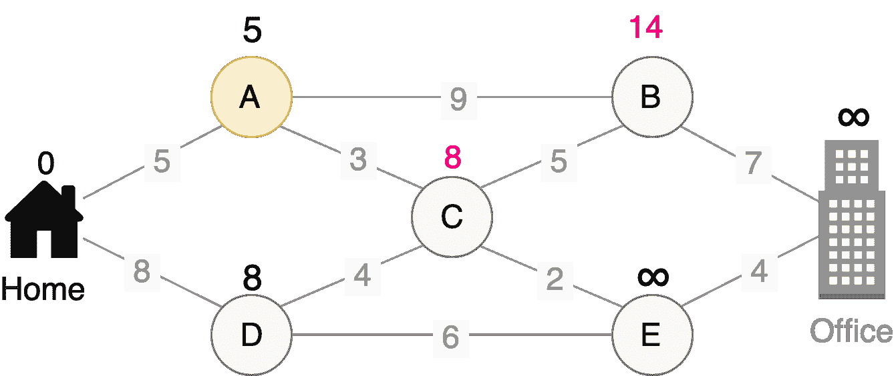

### 第 4 步

从我们的顶点优先级队列中获取下一个离 `Home` 最近的未访问顶点。在我们案例中，队列中只有三个顶点，分别是 `D`、`C` 和 `B`。由于 `D` 和 `C` 顶点离 `Home` 最近（距离为 `8`），让我们查看它们中先添加到队列的顶点。它将是顶点 `D`。

获取 `D` 的所有邻居（顶点 `C` 和 `E`），并计算到它们的最短距离。对于 `C`，我们将得到 `8 + 4 = 12`，对于 `8 + 6 = 14`。注意，顶点 `C` 已经有一个计算出的距离了。如果我们从顶点 `A` 去顶点 `C`，那么从 `Home` 到顶点 `C` 的距离将是 `8`。由于通过顶点 `D` 从 `Home` 到顶点 `C` 的总距离比我们之前发现的长（`12 > 8`），因此我们放弃刚刚发现的距离（通过顶点 `D`），而采用最短路径方案（通过顶点 `A`）。因此此时顶点 `C` 的距离保持不变。

将新邻居 `E` 添加到顶点优先级队列。没有需要将 `C` 加入队列，因为它已经在那里了。

将顶点 `D` 标记为已访问。

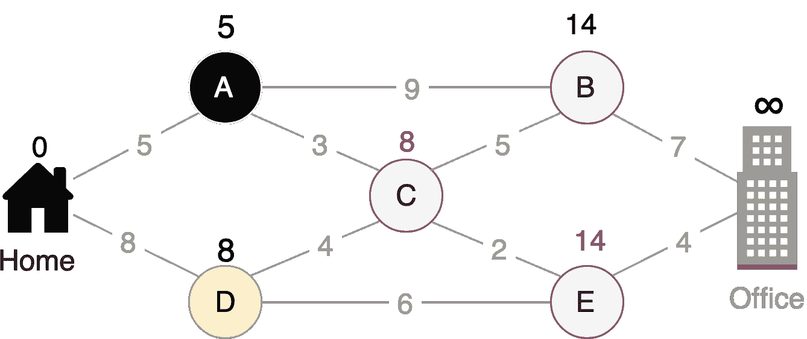

### 第 5 步

从顶点优先级队列中获取离 `Home` 最近的下一个顶点。在我们案例中是顶点 `C`。

获取 `C` 的所有未访问邻居（在我们案例中是 `B` 和 `E`）。计算从 `C` 到它们的最短距离。对于 `B`，我们将得到 `8 + 5 = 13`，对于 `E`，我们将得到 `8 + 2 = 10`。注意，我们刚刚发现了到 `B` 的更短路径。之前通过 `A` 到 `B` 的距离是 `14`，但现在我们发现通过 `C` 到 `B` 的距离更短，等于 `13`。这意味着我们需要更新优先级队列中 `B` 的距离为 `13`。

将 `C` 的所有未访问邻居添加到优先级队列。

将顶点 `C` 标记为已访问。

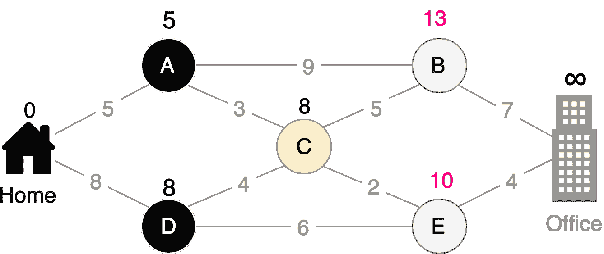

### 第 6 步

从顶点优先级队列中获取离 `Home` 最近的下一个顶点。在我们案例中是顶点 `E`。

获取 `E` 的所有未访问邻居（在我们案例中是 `D` 和 `Office`）。计算从 `E` 到 `D` 和 `Office` 的最短距离。对于 `D`，我们将得到 `10 + 2 = 12`，对于 `Office`，我们将得到 `10 + 4 = 14`。注意，顶点 `D` 已经有一个计算出的距离了。

将 `Office` 添加到队列。

将顶点 `E` 标记为已访问。

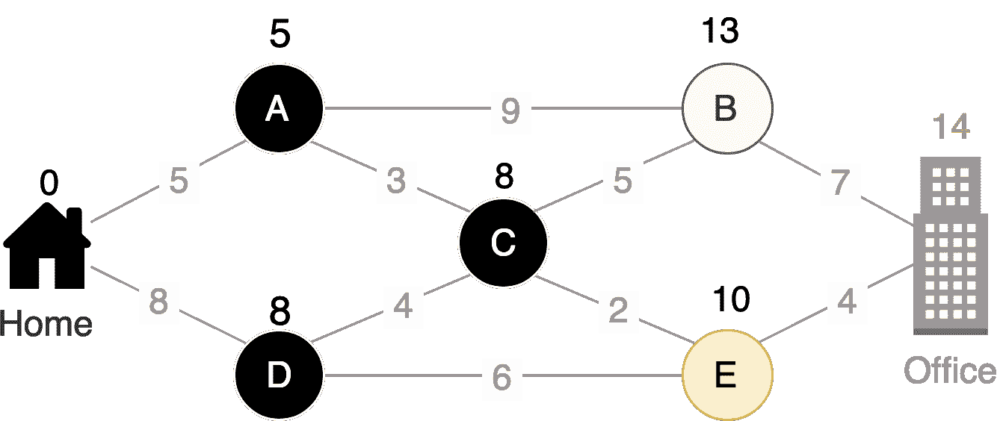

### 第 7 步

从顶点优先级队列中获取离 `Home` 最近的下一个顶点。在我们案例中是顶点 `B`。

获取 `B` 的所有未访问邻居并更新它们的距离。在我们案例中只有一个未访问邻居 `Office`，其距离为 `13 + 7 = 20`。由于它比之前发现的 `Office` 距离大（`20 > 14`），我们忽略它。

将顶点 `B` 标记为已访问。

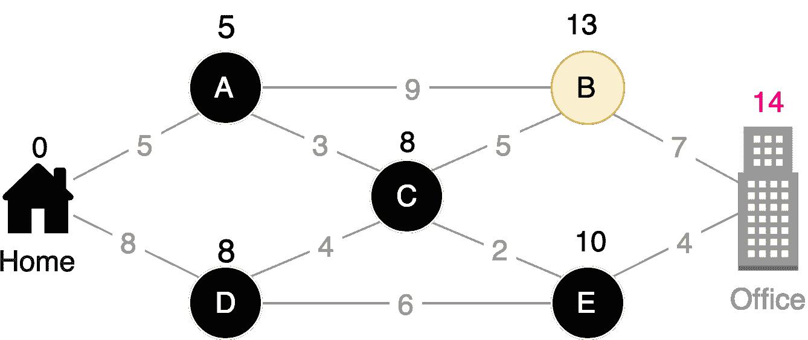

### 第 8 步

最后我们到达队列中的最后一个节点，该节点没有未访问的邻居。这意味着我们可以停止，并且刚刚找到了从 `Home` 顶点到所有顶点的最短路径。

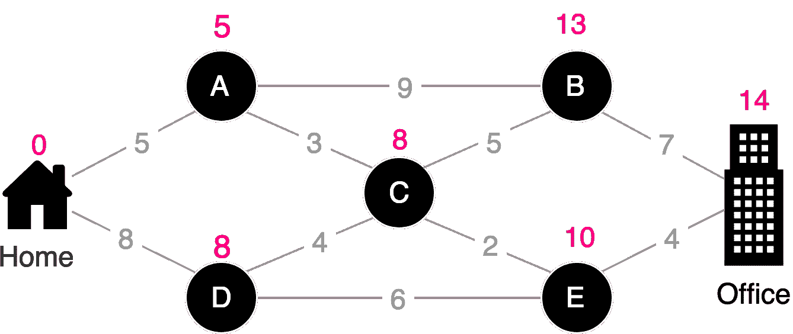

### 应用

Dijkstra 算法可以应用于以下领域：

*   在 **GIS（地理信息系统）** 中，寻找地图上地理位置之间的最短路径（交通和距离可以表示为图权重）。

*   在 **计算机网络** 中（例如，点对点应用），寻找机器 A 和 B 之间的最短路径。

## 使用示例

在我们开始实现 `dijkstra()` 函数之前，让我们假设已经实现了它，并看看我们希望它如何工作以及它应该什么样的接口（输入参数和返回值）。

让我们采用上面“任务”部分的图，尝试寻找从 `Home` 顶点到所有顶点的最短路径，特别是从 `Home` 到 `Office` 的最短路径。

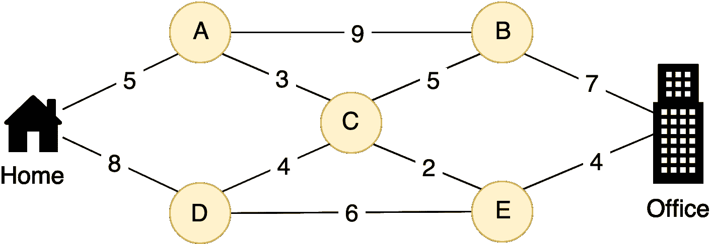

在在调用 `dijkstra()` 函数时，我们希望传递我们要遍历的 `graph` 以及起始顶点 `startVertex`。

该函数应该返回我们一个 `distances` 对象，其中包含从 `startVertex` 到所有顶点的最短路径。该对象可以是一个以顶点为键、最短距离为值的 map。例如：

```
{
  Home: 0,
  A: 4,
  Office: 10,
  ...
}
```

这意味着从 `startVertex` 到键为 `Office` 的节点的最短距离为 `10`。从 `startVertex` 到键为 `A` 的节点的最短距离为 `4`。在这种情况下，到 `Home` 的最短距离为零，因为我们的 `startVertex` 键就是 `Home`，我们不需要做任何操作即可到达，因为我们已经在那里了。

但 `distances` 映射无法让我们了解到 `Office` 的最短路径是什么。我们知道到达那里需要 `10` 个距离单位（假设是英里），但不知道应该走哪条路。因此，我们需要 `dijkstra()` 函数也返回另一个对象，我们称之为 `previousVertices`。这个对象的思路是也是一个映射，其键与图顶点键匹配，但它包含的不是距离，而是形成最短路径的前一个顶点链接。例如：

```
{
  Office: spotE,
  E: spotC,
  C: spotA,
  A: spotHome,
  Home: null,
} 
```

在上面的示例中，`spotE`、`spotC`、`spotA`、`spotHome` 是 `GraphVertex` 类的实例，而 `Office`、`E`、`C`、`A`、`Home`只是图中每个顶点的字符串键。

```
 1 // 导入依赖。
 2 import GraphVertex from '../08-graph/GraphVertex';
 3 import GraphEdge from '../08-graph/GraphEdge';
 4 import Graph from '../08-graph/Graph';
 5 import dijkstra from './dijkstra';
 6 
 7 // 让我们在虚拟地图上创建这些点。
 8 const spotHome = new GraphVertex('Home');
 9 const spotA = new GraphVertex('A');
10 const spotB = new GraphVertex('B');
11 const spotC = new GraphVertex('C');
12 const spotD = new GraphVertex('D');
13 const spotE = new GraphVertex('E');
14 const spotOffice = new GraphVertex('Office');
15 
16 // 现在用特定长度的道路连接这些点。
17 const roadHomeA = new GraphEdge(spotHome, spotA, 5);
18 const roadHomeD = new GraphEdge(spotHome, spotD, 8);
19 const roadAB = new GraphEdge(spotA, spotB, 9);
20 const roadAC = new GraphEdge(spotA, spotC, 3);
21 const roadCB = new GraphEdge(spotC, spotB, 5);
22 const roadDC = new GraphEdge(spotD, spotC, 4);
23 const roadCE = new GraphEdge(spotC, spotE, 2);
24 const roadDE = new GraphEdge(spotD, spotE, 6);
25 const roadOfficeB = new GraphEdge(spotOffice, spotB, 7);
26 const roadOfficeE = new GraphEdge(spotOffice, spotE, 4);
27 
28 // 我们创建双向道路，这意味着我们的图是无向的。
29 const isDirected = false;
30 const graph = new Graph(isDirected);
31 
32 // 现在我们将刚刚创建的点和道路添加到图中。
33 // 这就像是把地图上所有关于点和道路的信息放上去。
34 // 记住，我们不需要同时添加它们之间的顶点和边。
35 // 我们只需要添加边，顶点将自动添加到图中
36 // (关于 Graph 实现的更多细节，请参阅图的章节)。
37 graph
38   .addEdge(roadHomeA)
39   .addEdge(roadHomeD)
40   .addEdge(roadAB)
41   .addEdge(roadAC)
42   .addEdge(roadCB)
43   .addEdge(roadDC)
44   .addEdge(roadCE)
45   .addEdge(roadDE)
46   .addEdge(roadOfficeB)
47   .addEdge(roadOfficeE);
48 
49 // 现在我们准备好运行 Dijkstra 算法，并找出从家到所有其他节点
50 以及到办公室的最短路径。
51 const { distances, previousVertices } = dijkstra(graph, spotHome);
52 
53 /* eslint-disable no-console */
54 
55 // 现在让我们打印并查看地图上每个点的最短距离。
56 console.log(distances);
57 /*
58  输出将是：
59 
60  {
61    Home: 0,
62    A: 5,
63    B: 13,
64    C: 8,
65    D: 8,
66    E: 10,
67    Office: 14,
68  }
69 
70  这意味着从 Home 到 Office 的最短距离是 14。
71  */
72 
73 // 现在既然我们知道了从 Home 到 Office 的最短距离
74 // 让我们找出最短距离的最短路径。
75 // ...（剩余文本）
```

4. 回到步骤 1 且顶点访问队列为空。队列是否为空通过使用 `PriorityQueue` 实例的 `isEmpty()` 方法进行检查。

以下是 `dijstra()` 函数的一种实现示例。

```
10 /**
11  * Dijkstra 算法实现，用于寻找到图节点的最短路径。
12  * @param {Graph} graph - 我们要遍历的图。
13  * @param {GraphVertex} startVertex - 遍历起始顶点。
14  * @return {ShortestPaths}
15  */
16 export default function dijkstra(graph, startVertex) {
17   // 初始化 Dijkstra 算法所需的辅助变量。
18   const distances = {};
19   const visitedVertices = {};
20   const previousVertices = {};
21   const queue = new PriorityQueue();
22 
23   // 初始化所有距离为无穷大，假设目前我们无法到达
24   // 除起始顶点外的任何顶点。
25   graph.getAllVertices().forEach((vertex) => {
26     distances[vertex.getKey()] = Infinity;
27     previousVertices[vertex.getKey()] = null;
28   });
29 
30   // 我们已经在起始顶点，所以到它的距离为零。
31   distances[startVertex.getKey()] = 0;
32 
33   // 初始化顶点队列。
34   queue.add(startVertex, distances[startVertex.getKey()]);
35 
36   // 遍历顶点优先级队列直到它为空。
37   while (!queue.isEmpty()) {
38     // 获取下一个最近的顶点。
39     const currentVertex = queue.poll();
40 
41     // 遍历当前顶每个未访问的邻居。
42     currentVertex.getNeighbors().forEach((neighbor) => {
43       if (!visitedVertices[neighbor.getKey()]) {
44         const edgeWight = neighbor.edge.weight;
45         const existingDistanceToNeighbor = distances[neighbor.getKey()];
46         const distanceToNeighborFromCurrent = distances[currentVertex.getKey()] + ed\
47 geWight;
48 
49         // 如果找到了到邻居的更短路径 - 更新它。
50         if (distanceToNeighborFromCurrent < existingDistanceToNeighbor) {
51           distances[neighbor.getKey()] = distanceToNeighborFromCurrent;
52 
53           // 修改邻居在队列中的优先级，因为它可能已经变成了 c\
54           loser.
55           if (queue.has(neighbor)) {
56             queue.changePriority(neighbor, distances[neighbor.getKey()]);
57           }
58 
59           // 记录上一个最近的顶点。
60           previousVertices[neighbor.getKey()] = currentVertex;
61         }
62 
63         // 将邻居加入队列以便后续访问。
64         if (!queue.has(neighbor)) {
65           queue.add(neighbor, distances[neighbor.getKey()]);
66         }
67       }
68     });
69 
70     // 将当前顶点加入已列表，以避免以后再次访问。
71     visitedVertices[currentVertex.getKey()] = true;
72   }
73 
74   // 返回所有顶点的最短距离和路径的集合。
75   return { distances, previousVertices };
76 }
```

26-dijkstra/dijkstra.js

### 复杂度

假设我们要遍历的图有 `|V|` 个顶点和 `|E|` 条边。

#### 时间复杂度

在我们的 `dijkstra()` 函数中，首先进行初始设置，然后遍历队列。让我们分析这两个步骤。

**初始设置**（创建 `queue`、填充 `distances` 和 `previousVertices`）。这些步骤的复杂度为 `O(|V|)`，因为我们遍历了图中的所有顶点。

**遍历队列**。`while` 循环内部的代码会被调用 `|V|` 次，因为通过在 `visitedVertices` map 中跟踪已访问的顶点，我们恰好访问每个图顶点一次。因此，我们将使用 `while` 循环内部代码时间复杂度的 `|V|` 倍数。

让我们分析在 `while` 循环内部执行的步骤：

*   **从队列中弹出下一个顶点**。此操作使用了 `MinHeap` 类的 `poll()` 方法，该方法的时间复杂度为 `O(log(|V|))`（请参见“堆”章节，了解有关如何计算 `poll()` 方法复杂度的细节）。

*   **遍历当前顶点未访问的邻居**。在图全连接且每个顶点都有 `|V| - 1` 条边的最情况下，此步骤将需要 `O(|E|)` 时间。

    *   **更新顶点距离**。此步骤涉及对 `distances` map 的操作，因此它们的时间复杂度为 `O(1)`。

    *   **根据需要更改顶点优先级**。这是与 `MinHeap` 类相关的操作，在 `O(log(|V|))` 时间内完成，因为我们需要从堆树中移除并添加元素，并在过程中调用了 `heapifyUp()` 和 `heapifyDown()` 方法。

    *   **检查顶点优先级**。

#### 辅助复杂度

返回所有顶点的最短距离和路径集合。

### 问题

这里是一些相关问题：

*   [网络延迟时间](https://leetcode.com/problems/network-delay-time/)

*   [K 站内最廉价机票](https://leetcode.com/problems/cheapest-flights-within-stops/)

### 参考

Wikipedia 上的 Dijkstra 算法 `https://en.wikipedia.org/wiki/Dijkstra%27s_algorithm`

YouTube 上的 Dijkstra 算法 `https://www.youtube.com/watch?v=gdmfOwylcI`

Dijkstra 算法示例和测试用例 `https://github.com/trekhleb/javascript-algorithms/tree/master/src/graph`

## 附录 A：测试答案

**算法及其复杂度**

*   Q1: 不是，时间复杂度显示函数时间与函数输入的速率（比例）。

*   Q2: `O(log(n))` 更快。例如 `O(1000) = 1000`，但 `O(log(1000)) = 9`。

*   Q3: 不，这不是真的。有时这是一种权衡，你通过消耗更多内存来让算法运行更快。

**链表**

*   Q1: 它是链表中下一个对象的引用。

*   Q2: `deleteTail` 移除链表中的最后一个项，`deleteHead` 移除第一个。

**队列**

*   Q1: 队列是先进先出的。

*   Q2: 队列的基本操作是 `peek()`、`enqueue()` 和 `dequeue()`。

*   Q3: 时间复杂度是 `O(1)`。

**栈**

*   Q1: 栈是后进先出的。

*   Q2: 栈的基本操作是 `peek()`、`push()` 和 `pop()`。

*   Q3: 时间复杂度是 `O(1)`。

**哈希表**

*   Q1: 哈希表的主要优势是查找速度快。

*   Q2: 时间复杂度为 `O(1)`（在良好的哈希函数和足够的桶数量的情况下）。

*   Q3: 冲突是我们尝试将具有不同键的值保存到同一个桶时，可能是因为哈希函数不理想，也因为可用桶不足。

*   Q4: 处理冲突的方法之一是链地址法，即我们使用链表在每个桶中存储信息。

**二叉搜索树 (BST)**

* **Q1:** 不是。根据定义，根节点是树中没有父节点的节点。

* **Q2:** 是的，这是允许的。二叉树中的节点可能有零到两个子节点。

* **Q3:** 平衡二叉搜索树将具有更快的 `O(log(n))` 查询。如果树是不平衡的，在最坏情况下（病态树），它的表现会像链表，查找时间为 `O(n)`。

## 二叉堆

* **Q1:** “形状属性”和“堆属性”

* **Q2:** 我们需要将堆的最后一个元素（树的最左下角元素）移动到头部，然后执行下堆化操作

* **Q3:** `O(log(n))`

## 优先队列

* **Q1:** 我们需要使用 `MaxHeap` 而不是 `MinHeap`。

* **Q2:** `O(log(n))`

## 图

* **Q1:** 是的。树是有有向连通无环图的一种特例。

* **Q2:** 是的。在这种情况下，我们将得到一个仅包含两个顶点（vertices）的非连通图。

* **Q3:** 表示图的两种常用方法：邻接表和邻接矩阵。

## 位操作

* **Q1:** `111011`

* **Q2:** `000101 & 111110 = 000100`

## 阶

* **Q1:** `7`

## 质性测试

* **Q1:** 不是，`32/2` 的余数为 `0`

* **Q2:** 是的，`31/2` 的余数为 `1`。`31` 的平方根是 `5.56776436283` – `31/3 = 10.3`, `31/4 = 7.75`, `31/5 = 6.2`

## 是否是 2 的幂

* **Q1:** 是的，`32/2 = 16`，`16/2 = 8`，`8/2 = 4`，`4/2 = 2`，`2/2 = 1`

* **Q2:** 不的，`01111 & 11110 = 01110`

## 搜索。线性搜索。

* **Q1:** 最坏和平均情况下的时间复杂度为 `O(n)`。

* **Q2:** 不。由于 `O(n)` 的时间复杂度，通常做法是将该算法应用于小型列表。

## 搜索。二分搜索。

* **Q1:** 不是。从本质上说，二分搜索只适用于有序数组。否则我们无法每一步都放弃数组的一半。

* **Q2:** 时间复杂度为 `O(log(n))`。这是因为我们在每次迭代中都会放弃数组的一半。

## 集合。笛卡尔积。

* **Q1:** 它有 4 个元素：`['ac', 'ad', 'bc', 'bd']`。公式为 `|A| * |B|`。

* **Q2:** 是的，可能的。如果有四个集合 `A`、`B`、`C` 和 `D`，那么笛卡尔积集的每个元素将由四个元素 `(a, b, c, d)` 组成。

* **Q3:** 时间复杂度为 `O(|A|*|B|)`。

## 集合。幂集。

* **Q1:** 是的，空集是幂集的一部分。

* **Q2:** 它有 2<sup>4</sup>=16 个元素，其中 4 是原始集合 `{a, b, c, d}` 的大小。

## 集合。排列。

* **Q1:** 是的，顺序很重要。这是排列与组合的区别性特征。

* **Q2:** 我们将有 `4! / (4 - 2)! = 4! / 2! = 24 / 2 = 12` 种排列。

## 集合。组合。

* **Q1:** 不是，顺序不重要。这是组合与排列的区别。

* **Q2:** 我们将有 `4! / (2! * (4 - 2)!) = 4! / (2! * 2!) = 24 / 4 = 6` 种组合。

## 排序：快速排序

* **Q1:** 快速排序的平均时间复杂度为 `O(n * log(n))`。

* **Q2:** 我们只需要将大于基准元素的元素添加到左侧数组（而不是右侧），将小于基准元素的元素添加到右侧数组（而不是左侧）。

## 树。深度优先搜索。

* **Q1:** DFS 的时间复杂度为 `O(|N|)`，其中 `|N|` 是树中的节点总数。*

* **Q2:** 是的，我们可以通过使用之前实现的 `Stack` 类来避免递归。在这种情况下，每当我们访问一个节点时，我们需要将其所有的子节点（而不只是两个）都放入栈中。然后从栈顶获取下一个节点进行遍历。

## 树。广度优先搜索。

* **Q1:** BFS 的时间复杂度为 `O(|N|)`，其中 `|N|` 是树中的节点总数。

* **Q2:** 我们不需要在 `while` 循环中仅添加“左”和“右”子节点，我们需要获取节点的所有子节点并将它们添加到队列。

## 图。深度优先搜索。

* **Q1:** 图的 DFS 时间复杂度为 `O(|V| + |E|)`（注：原文此处为|V|，通常指顶点），其中 `|V|` 是顶点总数，`|E|` 是边总数。

* **Q2:** `Stack` 适合实现 DFS。

## 图。广度优先搜索。

* **Q1:** 图的 BFS 时间复杂度为 `O(|V| + |E|)`，其中 `|V|` 是顶点总数，`|E|` 是边总数。

* **Q2:** `Queue` 适合实现 BFS。

##附录 B：Big O 时间

下包含了分析中常用的函数，显示了相对于输入元素的操作次数。images/28-big-o.png

下表包含了一些常见的 Big O 表示法及其针对不同规模的性能。这将告诉你不同算法的耗时间和内存消耗。

| Big O 表示法 | 10 个元素的计算 | 100 个元素的计算 | 1000 个元素的计算 |

| :--- | :--- | :--- | :--- |

| `O(1)` | 1 | 1 | 1 |

| `O(log(n))` | 3 | 6 | 9 |

| `O(n)` | 10 | 100 | 1000 |

| `O(n log(n))` | 30 | 600 | 9000 |

| `O(n²)` | 100 | 10000 | 1000000 |

| `O(2^n)` | 1024 | 1.26e+29 | 1.07e+301 |

| `O(n!)` | 3628800 | 9.3e+157 | 4.02e+257 |

附录 C：数据结构

### 常用数据结构复杂度

| 数据结构 | 访问 | 搜索 | 插入 | 删除 | 备注 |

| :--- | :--- | :--- | :--- | :--- | :--- |

| `Array` | 1 | n | n | n | |

| `Stack` | n | n | 1 | 1 | |

| `Queue` | n | n | 1 | 1 | |

| `Linked List` | n | n | 1 | 1 | |

| `Hash Table` | - | n | n | n | Perfect 哈希函数为 `O(1)` |

| `Binary Search Tree` | n | n | n | n | 平衡树为 `O(log(n))` |

| `B-Tree` | log(n) | log(n) | log(n) | log(n) | |

| `Red-Black Tree` | log(n) | log(n) | log(n) | log(n) | |

| `AVL Tree` | log(n) | log(n) | log(n) | log(n) | |

| `Bloom Filter` | - | 1 | 1 | - | 搜索时存在误报 |

### 图操作复杂度

| 实现 | 添加顶点 | 删除顶点 | 添加边 | 删除边 |

| :--- | :--- | :--- | :--- | :--- |

| 邻接表 | `O(1)` | `O(E+V)` | `O(1)` | `O(E)` |

| 邻接矩阵 | `O(V²)` | `O(V²)` | `O(1)` | `O(1)` |

其中：`V` - 图中的顶点数，`E` - 图中的边数

### 堆操作复杂度

| Peek | Poll | Add | Remove |

| :--- | :--- | :--- | :--- |

| `O(1)` | `O(log(n))` | `O(log(n))` | `O(log(n))` |

附录 D：数组排序算法复杂度

|  way | 最好 | 平均 | 最坏 | 内存 | 稳定性 | 备注 |

| :--- | :--- | :--- | :--- | :--- | :--- | :--- |

| `Bubble sort` | n | n² | n² | 1 | 是 | |

| `Insertion sort` | n | n² | n² | 1 | 是 | |

| `Selection sort` | n² | n² | n² | 1 | 否 | |

| `Heap sort` | n log(n) | n log(n) | n log(n) | 1 | 否 | |

| `Merge sort` | n log(n) | n log(n) | n log(n) | n | 是 | |

| `Quick sort` | n log(n) | n log(n) | n² | log(n) | 否 | 快速排序通常在原地进行，使用 `O(log(n))` 栈空间 |

| `Shell sort` | n log(n) | 取决于间隔序列 | n(log n)² | 1 | 否 | |

| `Counting sort` | n + r | n + r | n + r | n + r | 是 | r - 数组中的最大数 |

| `Radix sort` | n * k | n * k | n * k | n + k | 是 | k - 最长键的长度 |

 更新日志

### 版本 2 (2019-11-25)

预发布版本 2

### 版本 1 (2019-10-29)

书籍初始预发布版本
