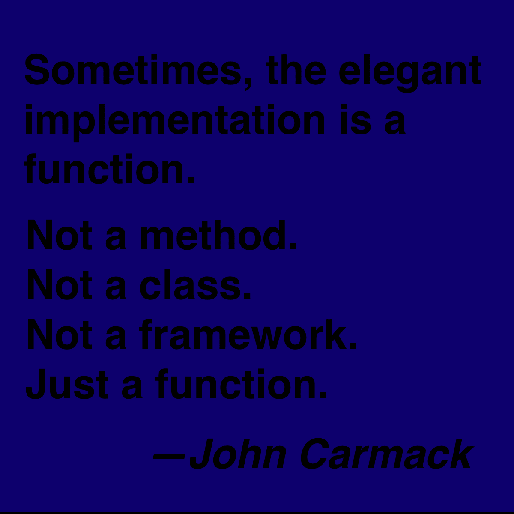
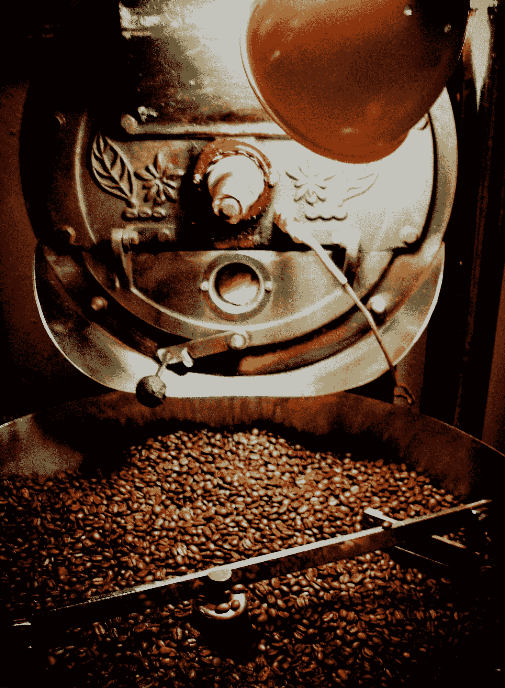

# JavaScript Allongé：深入函数、组合子和装饰器


本书献给我的女儿 Clara Maude Braithwaite。

> “Café Allongé，也称为 Espresso Lungo，是一种浓度介于意式浓缩和美式之间的饮料。它有两种不同的制作方法。第一种，也是我喜欢的，是在双份或四份的意式浓缩咖啡（Ristretto）中加入少量热水。就像向威士忌中加一点水一样，少量的稀释能释放出口中更复杂的层次。”

> “第二种方法是萃取一份超长双份浓缩。这种方法实现的油水比例与稀释法大致相同，但由于萃取时间更长，会释放出不同的风味组合。有些人抱怨长萃取会让味道更苦，损害咖啡最佳的特性；另一些人则认为它释放了更多的复杂性。”

> “重要的是，无论哪种准备方法都不应该使用过多的水导致咖啡变成像病态、苍白的浓缩幽灵。凡事适度。”

## Michael Fogus 序言

作为一个终身书迷和 Reg 在线作品的长期关注，当他开始写书时，我非常兴奋。然而，我对书籍非常保守——可以说，如果有一种闻起来像“旧书店”精髓的须后水，我会是第一个排队买的人。所以正如你想象的，对于将 *JavaScript Allongé* 作为一种持续更新的、随心付费模式的电子书发布，我持“怀疑”态度。然而，Reg 给我寄了一本书，我深受感动。这不仅是一本好书，也是一种编写和分发书籍的极佳方式。我自己写过书，我知道征求和接收反馈的痛苦。

写作是一个迭代过程，（非常经常）具有紧密的修订循环。然而，征求反馈、收集响应、发送副本、等待人们真正阅读（如果他们真的读的话）、接收反馈并最终理解如何使用它的过程需要几周，有时是几个月的时间。在多次情况下，我发现自己正试图用已经不存在或已改变得无法辨认的内容来实现反馈。然而，通过 Leanpub 模式，“阅读-反馈-修改”的过程极其高效，留下的是本高质量的书籍，并随着他人无限的阅读和评论，这本书不断变得更好。

在 *JavaScript Allongé* 的案例中，你会发现 Leanpub 模式是高效的典范。Reg 不仅从鉴赏家的角度创作（并持续创作）了一本有趣的书，还对他艺术中一些最有趣的方面进行了趣味性的探索。无论你认为自己有多么专家，*JavaScript Allongé* 都有东西可以教给你……关于咖啡。我开个玩笑的。

作为函数式编程的坚定支持者，Reg 写的很多内容对我来说是非常深刻的。虽然这并不是一本专门关于函数式编程的书，但 *JavaScript Allongé* 将为函数技术提供坚实的基础。然而，你不会被教条打得头晕脑胀。相反，每一章节都由相关的对话驱动，并以有说服力的源码示例进行强化。作为一名编程书籍的作者，我佩服 Reg 所取得的成就，并对通过互联网扩张丛林中的某个阴暗通道发现 *JavaScript Allongé* 并第一次阅读它的优秀读者感到羡慕。

祝阅读愉快。

– Fogus, [fogus.me](http://www.fogus.me)

## Matthew Knox 序言

作为一个终身书迷和 Reg 在线作品的长期关注，当他开始写书时，我非常兴奋。然而，我对书籍非常保守——可以说，如果有一种闻起来像“旧书店”精髓的须后水，我会是第一个排队买的人。所以正如你想象的，对于将 *JavaScript Allongé* 作为一种持续更新的、随心付费模式的电子书发布，我持“怀疑”态度。然而，Reg 给我寄了一本书，我深受感动。这不仅是一本好书，也是一种编写和分发书籍的极佳方式。我自己写过书，我知道征求和接收反馈的痛苦。

写作是一个迭代过程，（非常经常）具有紧密的修订循环。然而，征求反馈、收集响应、发送副本、等待人们真正阅读（如果他们真的读的话）、接收反馈并最终理解如何使用它的过程需要几周，有时是几个月的时间。在多次情况下，我发现自己正试图用已经不存在或已改变得无法辨认的内容来实现反馈。然而，通过 Leanpub 模式，“阅读-反馈-修改”的过程极其高效，留下的的是本高质量的书籍，并随着他人无限的阅读和评论，这本书不断变得更好。

在 *JavaScript Allongé* 的案例中，你会发现 Leanpub 模式是高效的典范。Reg 不仅从鉴赏家的角度创作（并持续创作）了一本有趣的书，还对他艺术中一些最有趣的方面进行了趣味性的探索。无论你认为自己有多么专家，*JavaScript Allongé* 都有东西可以教给你……关于咖啡。我开个玩笑的。

作为函数式编程的坚定支持者，Reg 写的很多内容对我来说是非常深刻的。虽然这并不是一本专门关于函数式编程的书，但 *JavaScript Allongé* 将为函数技术提供坚实的基础。然而，你不会被教条打得头晕脑胀。相反，每一章节都由相关的对话驱动，并以有说服力的源码示例进行强化。作为一名编程书籍的作者，我佩服 Reg 所取得的成就，并对通过互联网扩张丛林中的某个阴暗通道发现 *JavaScript Allongé* 并第一次阅读它的优秀读者感到羡慕。

祝阅读愉快。

– Knox, [mattknox.com](http://mattknox.com)

## 为什么选择 JavaScript Allongé？

`JavaScript Allongé` 是一本关于函数编程的书，因为 [JavaScript](https://developer.mozilla.org/en-US/docs/JavaScript) 是一种基于灵活强大函数的编程语言。`JavaScript Allongé` 从基础开始，从值和表达式开始，并在此基础上讨论类型、标识、函数、闭包、作用域等，一直到类和实例。在每种情况下，`JavaScript Allongé` 都会解释事物是如何运作的，这样当你遇到问题时，就会知道发生了什么以及如何修复。

其次，`JavaScript Allongé` 提供了使用函数编写软件的配方，比以对象或以代码为中心的方法更简单、简洁且不复杂。函数组合器和装饰器等 JavaScript 特性利用了 JavaScript 的力量，使代码更容易阅读、修改、调试和重构，从而在问题发生前避免它们。

`JavaScript Allongé` 教你如何处理复杂代码，它也教你如何简化代码。因此，`JavaScript Allongé` 是一本内容丰富的读物，释放了 JavaScript 的许多微妙之处，就像深受咖啡爱好者爱的 Café Allongé 一样。

### 书的结构

`JavaScript Allongé` 每一章介绍函数编程的新方面，详细解释 JavaScript 的工作原理。每一章中的代码示例都很小，侧重于解释而非作为日常使用的模式。

每一章之后是一系列配方，旨在以实用形式展示章节思想的应用。虽然每一章的内容自然地建立在前一章讨论内容的基础上，但配方可能会调用 JavaScript 编程语言的任何方面。

## 关于配方的个人心里话

正如前面提到的，`JavaScript Allongé` 交替出现描述 JavaScript 函数语义的章节和包含用函数编写程序的配方章节。你可以按顺序读这本书，也可以先读解释 JavaScript 的章节，然后再回来读配方。

这些配方有一个共同的主题：它们源于一种受创建相互组合的小函数的编程风格。通过这些配方，你将学会何时适合编写：

```
return mapWith(maybe(getWith('name')))(customerList);
```

而不是：

```
return customerList.map(function (customer) {
  if (customer) {
    return customer.name
  }
});
```

以及它是如何工作的，以及在你需要时如何重构它。这种编程风格在 JavaScript 中可能不是人们最常用的做法，因此有人可能会认为，提供更“实用”或“常见”的配方会有帮助。如果你从不读过任何其他关于 JavaScript 的书，如果你避开了关于 JavaScript 的博客文章和屏幕演示，如果你不参加关于 JavaScript 的研讨会或演讲，那么我同意这并不是一本“统治一切之书”。

但考虑到市面上还有其他资源，而且程序员是对比个人成长有着永不满足渴求的好奇生物，我们选择提供你可能在其他任何地方都找不到的、如此集中的这类配方。这些配方强化了书中关于 JavaScript 函数的教课程。

你可以在 [`allong.es`](http://allong.es) 在线找到所有的配方。它们在 MIT 许可证下免费共享。

[Reginald Braithwaite](http://braythwayt.com)

`reg@braythwayt.com`

`@raganwald`

## 图例 (Legend)

文本中等宽字体的内容（如文本中的 `this`）表示正在讨论的代码。单独成行的等宽字体代码也表示正在讨论的代码：

```
this.async = do (async = undefined) ->

  async = (fn) ->
    (argv..., callback) ->
      callback(fn.apply(this, argv))
```

有时它会包含一些让你自己输入的代码。当这样做时，输入内容的结果通常会使用 `//=>` 显示，如下：

```
2 + 2
  //=> 4
```

|  | 像这样标记的段落是“关键事实”。它总结了一个观点，而没有添加任何新内容。 |

|  | 像这样标记的段落是一个建议你自己执行的练习。 |

像这样标记的段落是旁注。可以安全地忽略。它包含了奇思妙想和其他极不严肃的废话，这些内容*不会*出现在考试中。

## 引言：值与表达式 (Prelude: Values and Expressions)

*以下材料非常基础，但就像大多数故事一样，最好的开始是从头开始。*

想象我们正在访问我们最喜欢的咖啡馆。他们可以为你制作你想要的任何饮品，从短而浓的意式浓咖啡（ristretto）到干式卡布奇诺，再到那些含有各种浓缩糖浆和牛奶的咖啡味甜点。（你容忍含糖饮料的存在，是因为它们为店铺提供了足够的利润空间，让你能够整天待在那里使用他们的 WiFi，并每隔几小时点一杯 3 美元的饮料。）

你在柜台的一端表达你的订单，柜台后面的人们施展魔法，并在另一端交付你所价值的咖啡。这正是 JavaScript 环境为了本书之目的所的工作方式。我们将抛弃网络服务器、浏览器和其他复杂性，处理这个简单的模型：你给计算机一个[表达式](https://en.wikipedia.org/wiki/Expression_ "computer_science")，它返回一个[值](https://en.wikipedia.org/wiki/Value_ "computer_science")就像你向咖啡师表达愿望并换回咖啡一样。

### 值与表达式

所有的值都是表达式。假设你递给咖啡师一杯古巴式咖啡（café Cubano）。是的，你递过去了一杯注入了部分焦糖糖的咖啡。你说：“我要这一个。”咖啡师并不傻，她直接把咖啡还给了你，你得到了你完全想要的东西。因此，一杯古巴咖啡既是一个表达式（你可以用它来下单），也是一个值（你从咖啡师那里拿回了它）。

让我们用计算机易于理解的东西再试一下：

```
42
```

这是一个表达式吗？一个值吗？两者都不是？或者两者都是？

答案是，这既是一个表达式*也是*一个值。判断它两者皆是的方法非常简单：当你把它输入 JavaScript 中时，你会得到相同的结果，就像我们的那杯古巴咖啡一样：

```
42
  //=> 42
```

所有的值都是表达式。这很简单！还有其他种类的表达式吗？当然有！让我们回到咖啡馆。与其说递上做好的咖啡，我们可以递上原料。让我们递上一些磨咖啡加一些沸水。

敏锐的读者会意识到我们漏掉了什么。祝贺你！喝一口意式咖啡。我们稍后会提到那个。

现在咖啡师给了我们一杯意式浓咖啡。如果我们递上意式浓咖啡，我们就立刻拿回意式浓咖啡。所以，沸水加磨咖啡是一个表达式，但它不是一个值。沸水是一个值。磨咖啡是一个值。意式浓咖啡是一个值。沸水加磨咖啡是一个表达式。

让我们也用另一个计算机易于理解的东西试一下：

```
"JavaScript" + " " + "Allonge"
  //=> "JavaScript Allonge"
```

现在我们看到“字符串”是值，你可以用字符串和运算符 `+` 组成一个表达式。由于字符串是值，它们本身也是表达式。但带有运算符的字符串不是值，它们是表达式。

### 值的相等性 (Values and identity)

在 JavaScript 中，我们测试两个值是否相等（使用 `===` 运算符），以及是否不相等（使用 `!==` 运算符）：

```
2 === 2
  //=> true

'hello' !== 'goodbye'
  //=> true
```

`===` 到底是如何工作的？想象你看到一杯咖啡。然后你看到了另一杯咖啡。这两杯“相等吗？”在 JavaScript 中，有四种可能性：

首先，有时杯的种类不同。一个是小杯，另一个是大杯。这对应于比较不同*类型*的对象。例如，字符串 `"2"` 不是数字 `2`。字符串和数字是不同的类型，所以它们永远不相等：

```
2 === '2'
  //=> false

true !== 'true'
  //=> true
```

其次，有时杯相同——可能都是咖啡杯——但它们的内容不同。这对应于比较具有相同类型但“内容”不同的值。例如，数字 `5` 不是数字 `2`。

```
true === false
  //=> false

2 !== 5
  //=> true
  
'two' === 'five'
  //=> false
```

如果杯的类型相同*且*内容相同呢？那么 JavaScript 的第三和第四种可能性涵盖了这种情况。

#### 值类型 (Value types)

第三，某些类型的杯没有区分标记。如果它们是同种杯，且内容相同，我们没有办法区分它们。我们目前为止看到的字符串、数字和布尔值都是如此。

```
2 + 2 === 4
  //=> true

(2 + 2 === 4) === (2 !== 5)
  //=> true
```

注意这些示例中发生的现象：即使当我们通过评估表达式得到字符串、数字或布尔值时，它与相同类型相同“内容”的值也是相等的。字符串、数字和布尔值是 JavaScript 所谓的“值”或“原始”类型的示例。我们会交叉使用这两个术语。

稍微扩展一下比喻，某些类型的杯底部有序列号。所以，即使你有两个相同类型的杯，且内容相同，你仍然可以区分它们。


玛奇朵咖啡（Cafe Macchiato）也是一种很好的饮品，尤其是当关注意大利国家队的战况或环意车赛的排名时。

## 引用类型

那么，哪些值可能类型相同且内容相同，但在 JavaScript 中并不被认为是相等的呢？让我们认识一种在现代编程语言中非常常见的数据结构：数组 `Array`（其他语言有时称之为 `List` 或 `Vector`）。

数组看起来像这样：`[1, 2, 3]`。这是一个表达式，你可以将 `[]` 与其他表达式组合。尽情尝试类似这样的操作：

```
[2-1, 2, 2+1]
[1, 1+1, 1+1+1]
```

注意，你生成的数组始终具有相同的内容。但它们是否像每个 `42` 值都与其他 `42` 值相等那样相等呢？自己着试一下：

```
[2-1, 2, 2+1] === [1,2,3]
[1,2,3] === [1, 2, 3]
[1, 2, 3] === [1, 2, 3]
```

结果如何！当你输入 `[1, 2, 3]` 或它的任何变体时，你输入的是一个表达式，它会生成一个自己的**唯一**数组，这个数组与任何其他数组都不相等，即使另一个数组看起来也像 `[1, 2, 3]`。这就像是 JavaScript 在底部生成了带有序列号的新咖啡一样。

数组看起来极其简单，但“引用”（reference）这个词包含了太多可能性，以至于有一整章都在专门讨论重新绑定与引用。尝试输入这段代码：

```
var ouroboros = [];
ouroboros[0] = ouroboros;
  //=> [ [Circular] ]
```

你刚刚创建了一个[奥罗波斯](https://en.wikipedia.org/wiki/Ouroboros) 数组，一个包含它自身的数组。

它们看起来是一样的，但如果你用 `===` 检查它们，你会发现它们是不同的。每当你评估一个表达式（包括输入某些内容）来创建一个数组时，你都在创建一个新的、不同的值，即使它看起来与某个其他数组值相同。正如我们将看到的，这种情况也适用于许多其他类型的值，包括函数 `functions`，它是本书的主题。



# 1 第一口：基础函数



完美的长式咖啡始于正确的咖啡豆和适当的烘焙。JavaScript 长式咖啡始于经过恰当剖析的函数。

## 关于函数，越少越好，但并非不少

在 JavaScript 中，函数是值，但它们远比简单的数字、字符串，甚至是树或映射等复杂数据结构。函数代表了要执行的计算。就像数字、字符串和数组一样，它们也有表示形式。让我们从最简单的函数开始。在 JavaScript 中，它看起来像这样：

```
function () {}
```

这是一个没有应用于任何值且不产生任何值的函数。我们如何在 JavaScript 中表示“无值”呢？我们稍后就会知道。首先，让我们验证我们的函数是一个值：

```
(function () {})
  //=> [Function]
```

什么！？为什么它没有为我们返回 `function () {}` ？这似乎违反了我们的规则：如果一个表达式也是一个值，JavaScript 将向我们返回相同的值。发生什么了？最简单易懂的答案是，尽管 JavaScript 解释器确实返回了那个值，但在屏幕上显示它它是另一回事了。`[Function]` 是 Node.js 编写者做出的选择，Node.js 是托管 JavaScript REPL 的环境。如果你在浏览器中尝试相同的操作，你会看到你输入的代码。

我更倾向于看到其他结果，但我必须接受屏幕上返回给我们的内容是任意的，而重要的是它对人类阅读来说某种有用处。但我们必须理解，无论我们看到的是 `[Function]` 还是 `function () {}`，JavaScript 内部都有一个完整且正确的函数。

### 函数与等等性

你记得在等等性方面，我们有两种类型的值：值类型和引用类型。如果值类型具有相同的内容，它们就共享相同的等等性。引用类型不是。

函数属于哪种？让我们试 true。为了取悦 JavaScript 解析器，我们将函数封装在括号中：

```
(function () {}) === (function () {})
  //=> false
```

就像数组一样，每当你评估一个表达式来产生函数时，你都会得到一个新的函数，它与任何其他函数都不相等，即使你使用相同的表达式来生成它。“函数”是一种引用类型。

### 应用函数

让函数工作起来。我们使用函数的方式是将它们应用于零或多个称为 `arguments` 的值。就像 `2 + 2` 产生一个值（在这种情况下是 `4`）一样，应用函数也会产生一个值。

## undefined

在 JavaScript 中，值的缺失是 `undefined`。就像数字、布尔值和字符串一样，`undefined` 是它自己的值类型。

```
undefined === undefined
  //=> true
(function {})() === (function {})()
  //=> true
(function {})() === undefined
  //=> true
```

你可能认为 JavaScript 中的 `undefined` 相当于 SQL 中的 `NULL`。不是。在 SQL 中，两个 `NULL` 是不等的，因为两个未知数无法相等。在 JavaScript 中，每个 `undefined` 都与其他 `undefined` 相等。

### void

我们已经看到 JavaScript 通过输入 `undefined` 来表示无值，我们通过两种方式生成了 `undefined` 值：

1. 通过评估一个不返回值的函数 `(function {})()`，以及；

2. 我们自己编写 `undefined`。

还有第三种方法，使用 JavaScript 的 `void` 运算符。看：

```
void 0
  //=> undefined
void 1
  //=> undefined
void (2 + 2)
  //=> undefined
```

`void` 是一个接受任何值并始终求值为 `undefined` 的运算符。所以，当我们故意想要一个 `undefined` 值时，应该使用哪种形式？答案是，使用 `void`。按照习惯，使用 `void 0`。

第一种形式可行但很麻烦。第二种形式大多数情况下有效，但可以通过重新给 `undefined` 赋值不同的值来破坏它，我们将在赋值与修改中讨论这一点。第三种形式保证始终有效，所以这就是我们将使用的。

### 无参数的函数及其函数体

回到我们的函数。我们评估了这里：

```
(function {})()
  //=> undefined
```

让我们记得我们正将函数 `function () {}` 应用于没有参数（因为 `()` 里面什么都没有）。所以我们如何知道要预期 `undefined` 呢？这很简单：

当我们定义一个函数时，我们写下 `function` 单词。接着我们放入一个（可能是空的）参数列表，然后给函数一个用大括号 `{...}` 包围的 `body`（体）。函数体是用分号分隔的（可能是空的）JavaScript `statements`（语句）列表。

例如：`{ statement¹; statement²; statement³; … ; statement^n }`

我们还没有讨论过这些 `statements`。什么是语句呢？

JavaScript 语句有许多种类，但第一种我们已经见过了。表达式（expression）就是一种 JavaScript 语句。虽然它们并不实用，但以下所有都是有效的 JavaScript 函数，并且在被调用时都会求值为 `undefined`：

```
(function () { 2 + 2 })

(function () { 1 + 1; 2 + 2 })
```

你也可以用换行符分隔语句。惯例是使用某种形式的一致缩进：

```
(function () {
  1 + 1; 
  2 + 2 
})

(function () { 
  (function () { 
    (function () { 
      (function () {
      }) 
    }) 
  }); 
  (function () {
  }) 
})
```

最后一个非常复杂，但由于函数体可以包含一个语句，而语句可以是一个表达式，而函数又是一个表达式……你明白意思意思。

那么，我们如何让函数在被调用时返回一个值呢？使用 `return` 关键字和任何表达式：

```
(function () { return 0 })()
  //=> 0
  
(function () { return 1 })()
  //=> 1
  
(function () { return 'Hello ' + 'World' })()
  // 'Hello World'
```

`return` 关键字创建了一个返回语句，它会立即终止函数调用并返回其表达式求值的结果。

### 求值为函数的函数

如果一个求值为函数的表达式，嗯，它是一个表达式，而且如果返回语句的右侧可以是任何表达式…… *我们可以在一个函数表达式的右侧放一个求值为函数的表达式吗？*

可以：

```
function () {
  return (function () {}) 
}
```

这是一个函数！它在被调用时求值为函数，而该函数在被调用时求值为 `undefined`。让我们使用更简单的术语。我们不再说“被调用时求值为 _____”，而是会说“给出 _____”。与其说“给出 undefined”，我们会说“没有给出任何东西”。

所以我们有一个函数，它给出函数，而该函数没有给出任何东西。同样地：

```
function () { 
  return (function () { 
    return true 
  }) 
}
```

这是一个函数，它给出函数，该函数给出 `true`：

```
(function () { 
  return (function () { 
    return true 
  }) 
})()()
  //=> true
```

好了。我们一直很聪明，但到目前为止这一切看起来都非常抽象。晶体的衍射本身是美丽且有趣的，但你不能责怪我们想要看到它的实际用途，比如能够确定数百万光年外一颗恒星的成分。所以……在下一章“我想和你辩论一下”中，我们将看到如何让函数变得实用。

### 啊。我想和你辩论一下。

到目前为止，我们看了没有参数的函数。我们甚至没有说明参数*是什么*，只是说我们的函数没有任何参数。

大多数程序员对参数（通常称为“parameters”）非常熟悉。中学数学就讨论过这一点。所以你知道它们是什么，我也知道你知道，但请对这个解释保持耐心！

让我们写一个带参数的函数：

```
function (room) {}
```

这个函数有一个参数 `room`，并且没有体。这里有一个两个参数且没有体的函数：

```
function (room, board) {}
```

我确定你完全理解这个函数有两个参数 `room` 和 `board` 的想法。人们用参数做什么呢？当然是在函数体中使用它们。你认为这是什么？

```
function (diameter) { return diameter * 3.14159265 }
```

这是一个给定直径计算圆周的函数。我把它大声读出来：“当应用于一个代表直径的值时，这个函数*返回*直径乘以 3.14159265。”

记住，为了调用一个没有参数的函数，我们写的是 `(function () {})()`。为了调用带参数（或多个参数）的函数，我们将参数（或多个参数）放在括号内，如下：

```
(function (diameter) { return diameter * 3.14159265 })(2)
  //=> 6.2831
```

但学习 `antidisestablishmentarianism` 这个词还有另一个原因：我们可能会学习到英语语法中前缀和后缀是如何运作的。`function (x) { return (function (y) { return x }) }` 的情况也是一样。它本身有其特定的意义，而且也是学习关于返回函数的函数、环境、变量等等内容的绝佳借口。

为了讨论它的工作原理，我们应该对几个术语达成一致（你可能已经知道它们，但让我们一起检查一下并“同步我们的字典”）。第一个 `x`，即 `function (x) ...` 中的那一个，是一个 `argument`（参数）。`function (y) ...` 中的 `y` 是另一个参数。第二个 `x`，即 `{ return x }` 中的那一个，并不是参数，*它是一个引用变量的表达式*。无论我们谈论的是 `function (x) { return (function (y) { return x }) }` 还是简单的 `function (x) { return x }`，参数和变量的工作方式都是相同的。

每当函数被调用（“invoked”意味着“应用于零个或多个参数”）时，都会创建一个新的 `environment`（环境）。环境是一个（可能为空的）字典，通过名称将变量映射到值。在我们称之为“变量”的表达式中的 `x` 本身也是一个表达式，通过查找环境中的值来对其求值。

值是如何放入环境的呢？对于参数来说，这非常简单。当你将函数应用于参数时，每个参数都会在字典中放置一个条目。所以当我们写下时：

```
(function (x) { return x })(2)
  //=> 2
```

发生的情况是：

1. JavaScript 将整个内容解析为一个由几个子表达式组成的表达式。

2. 接着它开始求值该表达式，包括对子表达式进行求值。

3. 一个子表达式 `function (x) { return x }` 求值为一个函数。

4. 另一个子表达式 `2` 求值为数字 2。

5. JavaScript 现在求值将函数应用于参数 `2`。有趣的地方就在这里……

6. 创建了一个环境。

7. 值‘2’被绑定到环境中的名称‘x’上。

8. 表达式‘x’（函数的右侧）在我们刚刚创建的环境中进行求值。

9. 变量在环境中求值时的值，就是绑定到该环境中变量名称的值，即‘2’。

10. 这就是我们的结果。

当我们谈论环境时，我们将使用一种[意料之外的语法](http://json.org/)来显示它们的绑定：`{x: 2, ...}`。这意味着环境是一个字典，值 `2` 被绑定到名称 `x`，并且该字典可能还有我们目前没有讨论的其他内容。

### 共享传递 (Call by sharing)

早些时候我们区分了 JavaScript 的 `value types`（值类型）和 `reference types`（引用类型）。那时，我们查看了 JavaScript 如何区分相同对象和不同对象。现在是时候再次观察值类型和引用类型的区别了。

JavaScript 有一个严格维护的属性：当一个值——任何值——被作为参数传递给函数时，绑定在环境中的值必须与原始值相同。

我们说过 JavaScript 将名称绑定到值，但我们没有说将名称绑定到值意味着什么。现在我们可以详细说明：当 JavaScript 将一个值类型绑定到一个名称上时，它会创建该值的副本并将副本放在环境中。正如你所记得的，字符串和数字等值类型如果内容相同，它们彼此就是相等的。因此 JavaScript 可以根据需要创建任意数量的字符串、数字或布尔值的副本。

引用类型呢？JavaScript 不会在任何环境中放置引用值的副本。JavaScript 将引用类型的 `references`（引用）放在环境中，当需要使用该值时，JavaScript 使用引用来获取原始值。

由于许多引用可以共享同一个值，而且 JavaScript 将引用作为参数传递，可以说 JavaScript 实现了“共享传递”（call by sharing）语义。共享传递通常被理解为值传递（call by value）的一种特化，它解释了为什么某些值被称为值类型，而其他值被称为引用类型。

到此，我们准备好查看 `closures`（闭包）了。当我们把值类型、引用类型、参数和闭包的知识结合起来，我们将理解为什么无论你应用什么参数，这个函数始终求值为 `true`：

```
function (value) {
  return (function (copy) {
    return copy === value
  })(value)
}
```

### 闭包与作用域

是时候看看函数内部的函数是如何工作的了：

```
(function (x) {
  return function (y) {
    return x
  }
})(1)(2)
  //=> 1
```

首先，让我们使用上面学到的知识。给定 `(some function)(some argument)`，我们知道我们将函数应用于参数，创建一个环境，将参数的值绑定到名称上，并求值函数的表达式。所以我们先对这段代码进行操作：

```
(function (x) {
  return function (y) {
    return x
  }
})(1)
  //=> [Function]
```

签名为 `function (x) ...` 的函数的环境变为 `{x: 1, ...}`，结果是一个函数。

从这里我们学到了一点：纯函数可以包含闭包。

|  | 如果纯函数可以包含闭包，那么闭包可以包含纯函数吗？仅使用我们目前所学的知识，尝试组合出一个包含纯函数的闭包。如果你无法做，请给出你认为这不可行的理由。 |

纯函数始终意味着相同的结果，因为它们所有的“输入”都由其参数完全定义。闭包并非如此。如果向你展示这个纯函数 `function (x, y) { return x + y }`，我们确切知道它对 `(2, 2)` 做了什么。但这个闭包呢：`function (y) { return x + y }`？在不理解求值自由变量 `x` 的魔法机制的情况下，我们无法判断它对参数 `(2)` 会做什么。

### 它始终是环境

为了理解闭包是如何被求值的，我们需要重新回顾环境（environments）。正如我们之前所说，所有函数都与一个环境相关。我们在描述环境时还进行了一些模糊化处理。还记得我们说过 `(function (x) { return (function (y) { return x }) })(1)` 的环境是 `{x: 1, ...}`，而 `(function (y) { return x })(2)` 的环境是 `{y: 2, ...}` 吗？让我们填补空白吧！

`(function (y) { return x })(2)` 的环境*实际上*是 `{y: 2, '..': {x: 1, ...}}`。`'..'` 意味着类似于“父级”、“包围”或“超环境”。它是 `function (x) ...` 的环境，因为函数 `function (y) { return x }` 位于 `function (x) ...` 的体内部。因此，每当函数被应用参数时，它的环境始终包含对其父级环境的引用。

现在你可以猜到我们如何在环境 `{y: 2, '..': {x: 1, ...}}` 中求值 `(function (y) { return x })(2)` 了。变量 `x` 不在 `function (y) ...` 的直接环境中，但它在其父级环境中，所以它的求值为 `1`，这就是 `(function (y) { return x })(2)` 返回的结果，尽管它最终忽略了自己的参数。

`function (x) { return x }` 被称为 I 组合子或恒等函数。`function (x) { return (function (y) { return x }) }` 被称为 K 组合子或 Kestrel（隼）。有些人对此非常兴奋，甚至为它们写了整本书，有些非常[优秀](http://www.amzn.com/0192801422?tag=raganwald001-2)，有些——我该怎么说呢——如果你使用 Ruby，它们就很有[趣](https://leanpub.com/combinators "Kestrels, Quirky Birds, and Hopeless Egocentricity")。

函数也可以有祖父级：

```
function (x) {
  return function (y) {
    return function (z) {
      return x + y + z
    }
  }
}
```

这个函数的作用与下面的代码非常相同：

```
function (x, y, z) {
  return x + y + z
}
```

只是你调用它时用的是 `(1)(2)(3)` 而不是 `(1, 2, 3)`。另一个大区别是，你可以用 `(1)` 调用它并返回一个函数，稍后可以用 `(2)(3)` 调用它。

第一个函数是对第二个函数进行[柯里化](https://en.wikipedia.org/wiki/Currying) 后的结果。用部分参数调用柯里化函数有时被称为[部分应用](https://en.wikipedia.org/wiki/Partial_application)。某些编程语言会自动对函数进行柯里化和部分求值，而不需要手动嵌套。

### 来自影子星球的变量

当变量与祖先环境的变量同名时，会发生有趣的事情。考虑：

```
function (x) {
  return function (x, y) {
    return x + y
  }
}
```

函数 `function (x, y) { return x + y }` 是一个纯函数，因为它的 `x` 定义在自己的环境中。尽管它的父级也定义了一个 `x`，但在求值 `x + y` 时它被忽略了。JavaScript 总是从函数的自己的环境开始查找，然后逐个查找父级环境，直到找到为止。同样的情况也适用于：

```
function (x) {
  return function (x, y) {
    return function (w, z) {
      return function (w) {
        return x + y + z
      }
    }
  }
}
```

求值 `x + y + z` 时，JavaScript 在祖父作用域找到 `x` 和 `y`，在父作用域找到 `z`。曾祖父作用域中的 `x` 被忽略，两个 `w` 也同样被忽略。当变量与祖先环境的绑定同名时，被称为它*遮蔽*（shadow）了祖先。

这通常是一件好事。

先有鸡还是先有蛋？

纯函数和闭包的这种行为产生了许多后果，可以被利用来编写软件。

JavaScript 程序员经常使用编写一个表示函数的表达式，并立即将其应用于参数的思路。为了解释这种模式，Ben Alman 将其命名为[立即调用函数表达式](http://www.benalman.com/news/2010/11/immediately-invoked-function-expression/)，通常缩写为“IIFE”。正如我们等将看到的，IIFE 并不一定需要参数：

```
(function () {
  // ... 在此处执行某些操作...
})();
```

当一个 IIFE 将值绑定到名称上时（就像我们上面使用 `Pi` 那样），老派的（retro-grouch）程序员通常称之为“let”。令人混淆的是，JavaScript 的后续版本也支持一个 `let` 关键字，它具有类似的绑定行为。

## var

使用 IIFE 来绑定名称非常有效，但只有受虐狂才会在 JavaScript 中以这种方式编写程序。除了多余的字符外，它还存在一个根本性的语义问题：名称 `Pi` 与我们绑定到它的值 `3.14159265` 之间存在着巨大的视觉距离。它们应该更近一些。还有其他方法吗？

是的。

编写我们的“周长”函数的另一种方法是将 `Pi` 与直径参数一起传递，如下所示：

```
function (diameter, Pi) {
  return diameter * Pi
}
```

你可以像这样使用它：

```
(function (diameter, Pi) {
  return diameter * Pi
})(2, 3.14159265)
  //=> 6.2831853
```

这与我们上面的示例不同之处在于它只有一个环境，而不是两个。我们在环境中有一个表示普通参数的绑定，另一个是表示我们的“常量”。这样效率更高，而且这几乎就是我们一直以来想要的：一种将 `3.14159265` 绑定到可读名称的方法。

JavaScript 给了我们一种实现该点的方法，即 `var` 关键字。我们将在未来的章节中学习更多关于 `var` 的知识，但这里有你可以使用 `var` 执行的最重要的事情：

```
function (diameter) {
  var Pi = 3.14159265;

  return diameter * Pi
}
```

`var` 关键字在当前函数的环境中引入了一个或多个绑定。它的工作方式正如我们所希望的那样：

```
(function (diameter) {
  var Pi = 3.14159265;

  return diameter * Pi
})(2)
  //=> 6.2831853
```

你可以绑定任何表达式。函数是表达式，所以你可以绑定辅助函数：

```
function (d) {
  var calc = function (diameter) {
    var Pi = 3.14159265;

    return diameter * Pi
  };

  return "The circumference is " + calc(d)
}
```

注意 `calc(d)` 吗？这强调了我们所说的：如果你有一个求值结果为函数的表达式，你就用 `()` 来调用它。绑定到函数的名称是一个求值结果为函数的有效表达式。如此重要的思想——为函数命名——竟然可以用寥几句话解释解释。这强调了 JavaScript 真正正确的一点：函数是“一等公民”。函数是值，可以像任何其他值一样绑定到名称上、作为参数传递、从其他函数返回，反之亦然。

你可以通过逗号隔开它们来绑定多个名称-值对。为了可读性，大多数人每行放置一个绑定：

```
function (d) {
  var Pi   = 3.14119265,
      calc = function (diameter) {
        return diameter * Pi
      };
  return "The circumference is " + calc(d)
}
```

这些示例使用 `var` 关键字在与我们的函数相同的环境中绑定名称。如果我们想在函数的一部分绑定某些名称，也可以使用 IIFE 创建一个新的作用域：

```
function foobar () {

  // 在没有 foo 或 bar 的情况下执行某些操作

  (function () {
    var foo = 'foo',
        bar = 'bar';

    // ... 使用 foo 和 bar 执行某些操作
  })();

  // 在没有 foo 或 bar 的情况下执行其他操作
}
```

## 命名函数

让我们直接进入正题。这段代码没有命名函数：

```
var repeat = function (str) {
  return str + str
};
```

它没有将函数命名为“repeat”，原因与 `var answer = 42` 没有命名数字 `42` 相同。那段代码将一个匿名函数绑定到环境中的一个名称上，但函数本身仍然是匿名的。

JavaScript 确实有命名函数的语法，它看起来如下：

```
var bindingName = function actualName () {
  //...
};
```

在这个表达式中，`bindingName` 是环境中的名称，但 `actualName` 是函数的实际名称。这是一个具名函数表达式。这看起来可能很困惑，但请将绑定名称视为环境的属性，而不是函数本身。事实上，名称确实是一个属性：

```
actualName.name
  => 'actualName'
```

在调试器中，当你查看调用堆栈时，如果函数是命名的，你就能看到它的名称；如果函数是匿名的，你就会看到 `anonymous`。这就是为什么为函数命名如此重要。这强调了 JavaScript 真正正确的一点：函数是“一等公民”。函数是值，可以像任何其他值一样绑定到名称上、作为参数传递、从其他函数返回，反之亦然。

```
// function declarations should not happen inside of 
// a block and/or be conditionally executed
if (frobbishes.arePizzled()) {
  function complainToFactory () {
    // ...
  }
}
```

这种表达式最大的问题在于，它们在你的测试环境中可能运行良好，但在生产环境中的行为却不同。或者它们在今天运行方式正常，当 JavaScript 引擎更新（例如引入新的优化）时就会以另一种方式运行。

另一个注意事项是，函数声明不能存在于`any`表达式内部，否则它就变成了函数表达式。所以这是一个函数声明：

```
function trueDat () { return true }
```

但这个不是：

```
(function trueDat () { return true })
```

括号使得它变成了一个表达式。

# 组合器与函数装饰器

## 高阶函数

正如我们所见，JavaScript 函数接受值作为参数并返回值。JavaScript 函数是值，因此 JavaScript 函数可以接受函数作为参数、返回函数，或者两者兼顾。泛而言之，一个接受函数作为参数或返回函数（或两者兼顾）的函数被称为“高阶”函数。

这里有一个非常简单的高阶函数，接受一个函数作为参数：

```
function repeat (num, fn) {
  var i, value;
  
  for (i = 1; i <= num; ++i)
    value = fn(i);
  
  return value;
}

repeat(3, function () { 
  console.log('Hello') 
})
  //=>
    'Hello'
    'Hello'
    'Hello'
    undefined
```

高阶函数在*JavaScript Allongé*中占据主地位。但在继续之前，我们将讨论一些特定类型的高阶函数。

## 组合器 (Combinators)

“combinator”（组合器）一词在数学中有一个精确的技术含义：

> “组合器是一种高阶函数，它仅通过函数应用和早期定义的组合器从其参数定义结果。”–[Wikipedia](https://en.wikipedia.org/wiki/Combinatory_logic "组合逻辑")

如果我们在学习组合逻辑（Combinatorial Logic），我们将从最基础的组合器如 `S`、`K` 和 `I` 开始，逐步进到实用的组合器。我们将了解到基础组合器是以鸟命名的，这遵循了 Raymond Smullyan 的名著[嘲弄一只鸣鸣鸟](http://www.amazon.com/gp/product/B00A1P096Y/ref=as_li_ss_tl?ie=UTF8&camp=1789&creative=390957&creativeASIN=B00A1P096Y&linkCode=as2&tag=raganwald001-20)。

在本书中，我们将使用一个较宽松的“组合器”定义：仅接受函数作为参数并返回函数的高阶纯函数。我们不会严格限制在构建这些组合器时仅使用之前定义的组合器。

让我们从一个实用的组合器开始：大多数程序员称之为 `Compose`（组合），尽管逻辑学家称之为 `B` 组合器或“Bluebird”（蓝松鸟）。以下是典型的编程实现：

```
function compose (a, b) {
  return function (c) {
    return a(b(c))
  }
}
```

假设我们有：

```
function addOne (number) {
  return number + 1
}

function doubleOf (number) {
  return number * 2
}
```

使用 `compose`，在任何你需要写下

```
function doubleOfAddOne (number) {
  return doubleOf(addOne(number))
}
```

你也可以写成：

```
var doubleOfAddOne = compose(doubleOf, addOne);
```

这当然只是许多示例中的一个。你将在阅读本书中的食谱时发现更多。虽然有些程序员认为“应该只有一种实现方式”，但在谨慎使用时，提供组合器以及使用大量的符号和关键字显式地写出内容具有某些优势。

## 关于组合器的平衡论述

使用大量组合器的代码倾向于命名动词和副词（如 `doubleOf`、`addOne` 和 `compose`），同时避免语言关键字和名词名称（如 `number`）。因此，一种观点是：当你想要强调你在做什么以及它们是如何结合在一起的时，组合器是有用的；而当你想要强调你正在处理什么时，更显式的代码是有用的。

## 函数装饰器

*函数装饰器*（function decorator）是一种高阶函数，它接受一个函数作为参数，返回另一个函数，且返回的函数是参数函数的变体。这里有一个装饰器的荒谬示例：

```
function not (fn) {
  return function (argument) {
    return !fn(argument)
  }
}
```

所以，与其写 `!someFunction(42)`，你可以写 `not(someFunction)(42)`。几乎没有进展。但像 `compose` 一样，你可以写任何一种：

```
function something (x) {
  return x
}
```

# 构建块

当你观察函数时，JavaScript 的强大之处在于你可以做任何事。弱点在于你会这样做。

## 组合 (Composition)

这些构建块中最基础的之一是*组合*：

```
function cookAndEat (food) {
  return eat(food)
}
```

就如此简单。当你将两个或多个函数链在一起时，你就在进行组合。你可以像我们在组合器与装饰器中看到的那样通过显式代码来组合它们：

```
function compose (a, b) {
  return function (c) {
    return a(b(c))
  }
}

var cookAndEat = compose(eat, cook);
```

如果只有这样组合就没有意义了。但正如许多模式一样，在适用的地方使用它只有 20%的收益来自于组织代码以便能够各种方式组合。

在食谱中，我们将查看一个名为 `once` 的装饰器：它确保函数只被执行一次。之后，它什么都不做。这对于确保某些副作用不会发生很有用。我们还将查看 `maybe`：它确保如果函数没有收到任何参数（如 `null` 或 `undefined`），它将什么都不做。

当然，你不需要使用组合器来实现这些想法，你可以使用 `if` 语句。但 `once` 和 `maybe` 是组合的，所以你可以根据需要将它们链在一起：

```
function actuallyTransfer(from, to, amount) {
  // do something
}

invokeTransfer = once(maybe(actuallyTransfer));
```

## 部分应用 (Partial Application)

另一个基础构建块是*部分应用*。当一个函数接受多个参数时，我们通过对所有参数求值来“应用”函数，产生一个值。但如果我们只提供部分参数呢？在这种情况下，我们无法获得最终值，但可以获得一个代表我们应用一部分的函数。

用代码表示比用语言更容易。[Underscore](http://underscorejs.org) 库提供了一个名为 *map* 的高阶函数。它将另一个函数应用到数组的每个元素，如下：

```
_.map([1, 2, 3], function (n) { return n * n })
  //=> [1, 4, 9]
```

这段代码通过将函数 `function (n) { return n * n }` 作为第二个参数，实现了对 `map` 函数的部分应用（partial application）：

```
function squareAll (array) {
  return _.map(array, function (n) { return n * n })
}
```

生成的函数——`squareAll`——仍然是 `map` 函数，只是我们已经应用了它的两个参数中的一个。`squareAll` 很好用，但为什么我们每次想对一个 `map` 函数进行部分应用时，都要手写一个函数呢？我们可以再往上抽象一层层。`mapWith` 接收任何函数作为参数，并返回一个部分应用的 `map` 函数。

```
function mapWith (fn) {
  return function (array) {
    return _.map(array, fn)
  }
}

var squareAll = mapWith(function (n) { return n * n });

squareAll([1, 2, 3])
  //=> [1, 4, 9]
```

我们将在食谱中再次讨论 `mapWith`。重要的是看到部分应用与组合（composition）是正交的，它们可以很好地结合：

```
var safeSquareAll = mapWith(maybe(function (n) { return n * n }));

safeSquareAll([1, null, 2, 3])
  //=> [1, null, 4, 9]
```

我们通过 `compose` 组合器泛化了组合。部分应用也有一个组合器，我们将在 partial 食谱中看到。

### 我还想要一些参数。再次。

正如我们所讨论过的，当函数被应用于参数上（或被“调用”）时，JavaScript 会将参数的值绑定到为函数执行时创建的环境中的函数参数名上。我们没有讨论的是，JavaScript 除了你放入参数列表的任何名称外，还会绑定一些“魔法”名称。

你永远不要尝试针对这些名称定义你自己的绑定。请始终将它们视为只读的。第一个被称为 `this`，它被绑定到被称为函数上下文的东西上。我们将在开始讨论对象和类时探索它。第二个非常有趣，它被称为 `arguments`，它最有趣的地方在于它包含一个传递给函数的参数列表：

```
function plus (a, b) {
  return arguments[0] + arguments[1]
}

plus(2,3)
  //=> 5
```

尽管 `arguments` 看起来像一个数组，但它并不是数组：它更像是一个对象，恰好将某些值绑定到看起来像从零开始的整数的属性上：

```
function args (a, b) {
  return arguments
}

args(2,3)
  //=> { '0': 2, '1': 3 }
```

`arguments` 总是包含传递给函数的所有参数，无论声明了多少个。因此，我们可以这样写 `plus`：

```
function plus () {
  return arguments[0] + arguments[1]
}

plus(2,3)
  //=> 5
```

在讨论对象时，我们将深入讨论属性。这里关于 `arguments` 的一点说明：

```
function howMany () {
  return arguments.length
}

howMany()
  //=> 0

howMany('hello', 'predators')
  //=> 2
```

`arguments` 绑定最常见的用途是构建可以接受可数量参数的函数。我们将在许多食谱中看到它的用法，从部分应用和省略号开始。

### 总结

| 函数 |

| :--- |

| 函数是值，可以作为其他函数的一部分，以此此类推。 |

| 函数是引用值。 |

| 参数是通过共享传递的，这被称为“按值传递”（pass by value）。 |

| 函数体包含零或多个表达式。 |

| 函数应用会评估 `return` 关键字返回的内容，或 `undefined`。 |

| 函数应用会创建一个作用域。作用域是嵌套且自由引用的（free over）。 |

| `let` 是一种惯用法，我们创建一个函数并立即调用它，以便将值绑定到名称。 |

| JavaScript 使用 `var` 在函数作用域内绑定变量。 |

## 2 快速查表

在食谱中，你可能会看到这里使用了一个或多个以下 JavaScript 结构，这里是一些简短的解释帮助你过关：

#### apply and call

函数通过 `()` 应用。但它们也有方法可以将它们应用于参数。在讨论函数上下文中时，我们会解释 `.call` 和 `.apply`，这里是一些例子：

```
function plus (a, b) {
  return a + b
}

plus(2, 3)
  //=> 5

plus.call(this, 2, 3)
  //=> 5

plus.apply(this, [2, 3])
  //=> 5
```

#### slice

数组有一个 `.slice` 方法。`slice` 返回一个通过接收者与其参数连接创建的数组。`arguments` 伪变量不是数组，但你可以这样使用 `.slice` 来获取全部或部分参数：

```
Array.prototype.slice.call(arguments, 0)
  //=> 返回数组形式的参数。

function butFirst () {
  return Array.prototype.slice.call(arguments, 1)
}

butFirst('a', 'b', 'c', 'd')
  //=> ['b', 'c', 'd']
```

为了简单和提高速度，`slice` 通常绑定到一个局部变量：

```
var __slice = Array.prototype.slice;

function butFirst () {
  return __slice.call(arguments, 1)
}
```

甚至：

```javascript
var __slice = Array.prototype.slice;

function slice (list, from, to) {
  return __slice.call(list, from, to)
}

function butFirst () {
  return __slice.call(arguments, 1)
}
```

#### concat

数组有另一个有用的方法 `.concat`。`concat` 返回一个通过接收者与其参数连接的数组：

```
[1, 2, 3].concat([2, 1])
  //=> [1, 2, 3, 2, 1]
```

#### function lengths

函数有一个 `.length` 属性，计算声明的参数个数：

```
function (a, b, c) { return a + b + c }.length
  //=> 3
```

## 3 基础函数的食谱


在组合食材之前，从那些如此纯净的实现开始。

在看了基础纯函数和闭包之后，我们将看到一些以返回函数的函数为前提的实用食谱。

### 免责声明

食谱是为了实用性而编写的，它们的实现可能会引入在此为止未讨论过的 JavaScript 特性，例如方法和/或原型。每个食谱的整体*用法*将符合到目前讨论的语言精神，即使实现可能不符合。

### 部分应用

在构建块中，我们讨论了部分应用，但我们没有为它编写通用的食谱。这是一个常见的工具，许多库都提供了某种形式的部分应用工具。你可以在这里找到示例。

这两个配方用于快速、简单地应用单个参数，即最左侧或最右侧的参数。如果你想绑定多个参数，或者想在参数列表中留一个“空隙”，将需要使用泛化部分配方，或者反复应用参数。它是上下文无关的。

```javascript
var __slice = Array.prototype.slice;

function callFirst (fn, larg) {
  return function () {
    var args = __slice.call(arguments, 0);
    
    return fn.apply(this, [larg].concat(args))
  }
}

function callLast (fn, rarg) {
  return function () {
    var args = __slice.call(arguments, 0);
    
    return fn.apply(this, args.concat([rarg]))
  }
}

function greet (me, you) {
  return "Hello, " + you + ", my name is " + me
}

var heliosSaysHello = callFirst(greet, 'Helios');

heliosSaysHello('Eartha')
  //=> 'Hello, Eartha, my name is Helios'
  
var sayHelloToCeline = callLast(greet, 'Celine');

sayHelloToCeline('Eartha')
  //=> 'Hello, Celine, my name is Eartha'
```

如上所述，我们的部分配方允许我们创建感知函数的部分应用。如果我们想创建对象方法的部分应用，我们需要不同的配方。

### 省略号和改进的部分应用

CoffeeScript 编程语言有一个非常有用的特性：如果方法的参数以尾随省略号编写，它会将参数列表收集到一个数组中。它可以以多种方式使用，CoffeeScript 译器会进行一些模式匹配来处理这些，但 80% 的用法是在不使用 `arguments` 伪变量的情况下收集数量数量的参数，而 19% 的用法是收集尾随参数列表。

以下是收集可数量参数和尾随参数的写法：

```javascript
callLeft = (fn, args...) ->
  (remainingArgs...) ->
    fn.apply(this, args.concat(remainingArgs))
```

这些是非常实用的特性。这里是我们尝试编写自己的 mapper 函数的拙劣尝试：

```javascript
mapper = (fn, elements...) ->
  elements.map(fn)

mapper ((x) -> x*x), 1, 2, 3
  #=> [1, 4, 9]

squarer = callLeft mapper, (x) -> x*x

squarer 1, 2, 3
  #=> [1, 4, 9]
```

JavaScript 不支持省略号（即 CoffeeScript 用于将参数收集到数组中的尾随点）。JavaScript 是一种函数式语言，因此这里有一个将尾随参数收集到数组中的函数配方：

```javascript
var __slice = Array.prototype.slice;

function variadic (fn) {
  var fnLength = fn.length;

  if (fnLength < 1) {
    return fn;
  }
  else if (fnLength === 1)  {
    return function () {
      return fn.call(
        this, __slice.call(arguments, 0))
    }
  }
  else {
    return function () {
      var numberOfArgs = arguments.length,
          namedArgs = __slice.call(
            arguments, 0, fnLength - 1),
          numberOfMissingNamedArgs = Math.max(
            fnLength - numberOfArgs - 1, 0),
          argPadding = new Array(numberOfMissingNamedArgs),
          variadicArgs = __slice.call(
            arguments, fn.length - 1);

      return fn.apply(
        this, namedArgs
              .concat(argPadding)
              .concat([variadicArgs]));
    }
  }
};

function unary (first) {
  return first
}

unary('why', 'hello', 'there')
  //=> 'why'
  
variadic(unary)('why', 'hello', 'there')
  //=> [ 'why', 'hello', 'there' ]
  
function binary (first, rest) {
  return [first, rest]
}

binary('why', 'hello', 'there')
  //=> ['why', ['hello', 'there']]
```

`tap` 是一个借自各种 Unix shell 命令的传统名称。它接收一个值并返回一个始终返回该值的函数，但如果你向它传递一个函数，它执行该函数以产生副作用。让我们来看看它如何作为一个“简易调试器”来工作：

```
var drink = tap('espresso')(function (it) {
  console.log("Our drink is", it) 
});

// 控制台输出 "Our drink is 'espresso'"
```

它可以很容易关闭：

```
var drink = tap('espresso')();

// 控制台不输出任何内容
```

像 [Underscore](http://underscorejs.org) 这样的库使用了“未柯里化”版本的 `tap`：

```
var drink = _.tap('espresso', function () { 
  console.log("Our drink is", this) 
});
```

让我们增强这个配方，使其双向工作：

```
function tap (value, fn) {
  if (fn === void 0) {
    return curried
  }
  else return curried(fn);
  
  function curried (fn) {
    if (typeof(fn) === 'function') {
      fn(value)
    }
    return value
  }
}
```

现在你可以这样写：

```
var drink = tap('espresso')(function (it) { 
  console.log("Our drink is", it) 
});
```

或者：

```
var drink = tap('espresso', function (it) { 
  console.log("Our drink is", it) 
});
```

如果你希望它完全什么都不做，你可以写下面任意一种形式：

```
var drink = tap('espresso')();
```

或者：

```
var drink = tap('espresso', null);
```

`tap` 的作用不仅仅是作为调试辅助工具。它在处理对象和实例方法时也很有用。

### 也许

编程中的一个常见问题是检查 `null` 或 `undefined`（下文称为“无”，而包括 `0`、`[]` 和 `false` 在内的其他值称为“有”）。JavaScript 等语言并不强制要求特定变量或特定属性必须为“有”，因此编写程序时经常考虑可能为“无”的值。

这个配方涉及一种非常常见的模式：函数 `fn` 接收一个值作为参数，其设计行为如果参数为“无”，则什么都不做：

```
function isSomething (value) {
  return value !== null && value !== void 0;
}

function checksForSomething (value) {
  if (isSomething(value)) {
    // 函数的真实逻辑
  }
}
```

或者，该函数可能旨在处理任何值，但调用该函数的代码希望在给定“无”时模拟设计上什么都不做的行为：

```
var something = isSomething(value) ? 
  doesntCheckForSomething(value) : value;
```

自然，这有一个对应的配方，它是借自了 Haskell 的 [maybe monad](https://en.wikipedia.org/wiki/Monad_(functional_programming)#The_Maybe_monad)、Ruby 的 [andand](https://github.com/raganwald/andand) 以及 CoffeeScript 的存在性方法调用：

```
function maybe (fn) {
  return function () {
    var i;
    
    if (arguments.length === 0) {
      return
    }
    else {
      for (i = 0; i < arguments.length; ++i) {
        if (arguments[i] == null) return
      }
      return fn.apply(this, arguments)
    }
  }
}
```

`maybe` 将检查“无”的逻辑简化为一个函数调用，如下：

```
var checksForSomething = maybe(function (value) {
  // 函数的真实逻辑
});
```

或者：

```
var something = maybe(doesntCheckForSomething)(value);
```

作为额外，`maybe` 与实例方法配合得非常好，我们将在稍后讨论它们：

```
function Model () {};

Model.prototype.setSomething = maybe(function (value) {
  this.something = value;
});
```

如果某些代码尝试用“无”调用 `model.setSomething`，该操作将被跳过。

## 4 焕发生机的暂停：重新绑定与引用


咖啡好喝是不够的。它的制作和消费的每一个都应该反映咖啡的美感。

### 一个简单的问题

考虑这段代码：

```
var x = 'June 14, 1962',
    y = x;
    
x === y
  //=> true
```

这显而易见。

这显而易见，是因为 `x` 是字符串 `June 14, 1962`，且 `y` 被赋值为相同的字符串。因此 `x === y` 求值结果为 `true`。

### 参数与数组

在 JavaScript 中，数组是对象。这意味着你可以向它们添加属性，但这通常不是一个好主意。

```javascript
var a = [1, 2, 3];
a.foo = 'bar';
console.log(a.length); // 3
```

`length` 属性不会自动更新。

JavaScript 中的数组是特殊类型的对象。它们有一个 `length` 属性，可以自动跟踪元素的数量。

```javascript
var a = [1, 2, 3];
a.push(4);
console.log(a.length); // 4
```

# 引用与对象

JavaScript 也提供了对象。“对象（object）”一词在编程界非常流行，这是因为“面向对象编程”这一术语被广泛使用。该术语由 Alan Kay 创造，但从以来对不同的人来说有许多不同的含义。

在 JavaScript 中，一个 `object` 是从名称到值的映射，非常像环境。创建对象的常用语法非常简单：

通过这种方式创建的对象具有不同的身份，就像数组一样：

```
{ year: 2012, month: 6, day: 14 } === { year: 2012, month: 6, day: 14 }
  //=> false
```

使用 `[]` 配合字符串通过名称访问值：

```
{ year: 2012, month: 6, day: 14 }['day']
  //=> 14
```

对象中包含的值的工作方式与数组中包含的值完全相同：

```
var unique = function () {
                return function () {}
              },
    x = unique(),
    y = unique(),
    z = unique(),
    o = { a: x, b: y, c: z };

o['a'] === x && o['b'] === y && o['c'] === z
  //=> true
```

名称不需要是字母数字字符串。对于其他任何情况，用引号括标签：

```
{ 'first name': 'reginald', 'last name': 'lewis' }['first name']
  //=> 'reginald'
```

如果名称是符合变量名规则的字母数字字符串，则有访问值的简化语法：

```
{ year: 2012, month: 6, day: 14 }['day'] ===
    { year: 2012, month: 6, day: 14 }.day
  //=> true
```

所有容器都可以包含任何值，包括函数或其他容器：

```
var Mathematics = {
  abs: function (a) {
         return a < 0 ? -a : a
       }
};

Mathematics.abs(-5)
  //=> 5
```

提一下 `Mathematics` 挺奇的。如果你还记得，JavaScript 提供了一个全局环境，其中包含一些现有对象，带有你可以使用的方便函数。其中一个被称为 `Math`，它包含了 `abs`、`max`、`min` 以及许多其他函数。由于它是始终可用的，只要你不遮蔽 `Math`，你可以在任何环境中使用它。

```
Math.abs(-5)
  //=> 5
```

# 重新赋值与变更

和大多数命令式编程语言一样，JavaScript 允许你重新为变量赋值。这种语法对于大多数流行语言的用户来说是熟悉的：

```
var age = 49;
age = 50;
age
  //=> 50
```

花时间仔细研究环境中的绑定发生了什么。让我们花时间探索对变量重新赋值会发生什么。关键在于理解，我们正在相同环境中向相同的名称重新绑定一个不同的值。

所以让我们考虑一下被遮蔽变量会发生什么：

```
(function () {
  var age = 49;
  (function () {
    var age = 50;
  })();
  return age;
})()
  //=> 49
```

在内部环境中为 `age` 绑定 `50` 不会改变外部环境中的 `age`，因为内部环境中 `age` 的绑定遮蔽了外部环境中对 `age` 的绑定。我们从：

```
{age: 49, '..': global-environment}
```

变为：

```
{age: 50, '..': {age: 49, '..': global-environment}}
```

然后回到：

```
{age: 49, '..': global-environment}
```

然而，如果我们没有通过显式使用 `var` 来遮蔽 `age`，在嵌套环境中对其进行重新赋值会改变原始值：

```
(function () {
  var age = 49;
  (function () {
    age = 50;
  })();
  return age;
})()
  //=> 50
```

就像评估变量标签一样，当绑定被重新绑定时，JavaScript 会在当前环境中查找绑定，然后逐个查找祖先环境，直到找到一个。它会在该环境中重新绑定名称。


杯测研磨

## 变更与别名

现在我们可以重新赋值东西了，还有另一个需要考虑的因素：某些值可以*变更*。它们的身份保持不变，但结构不是。具体来说，数组和对象可以发生变更。记得你可以使用 `[]` 从数组或对象内部访问值。你也可以使用 `[]` 重新赋值值：

```
var oneTwoThree = [1, 2, 3];
oneTwoThree[0] = 'one';
oneTwoThree
  //=> [ 'one', 2, 3 ]
```

你甚至可以添加一个值：

```
var oneTwoThree = [1, 2, 3];
oneTwoThree[3] = 'four';
oneTwoThree
  //=> [ 'one', 2, 3, 'four' ]
```

# 如何用 var 射自己脚

正如我们所见，JavaScript 的环境和绑定是非常强大的：你可以使用函数参数或用 `var` 的变量来绑定并重新绑定名称。结论是，在使用得当的情况下，`var` 关键字是一个很好的工具。

在使用得当的情况下。让我们看看一些*不恰当*的使用方法。

### 松散使用

`var` 关键字的作用域是包裹它的函数。这是合理的，因为绑定是在环境中进行的，而环境与函数调用相关联。所以如果你写：

```
function foo (bar) {
  var baz = bar * 2;
  
  if (bar > 1) {
    var blitz = baz - 100;
    
    // ...
  }
}
```

名称 `blitz` 实际上的作用域是函数 `foo`，而不是 `if` 语句的后续代码块。大约有两种流派。一种思路是这样的：既然 `blitz` 的作用域是函数 `foo`，你应该这样写代码：

```
function foo (bar) {
  var baz = bar * 2,
      blitz;
  
  if (bar > 1) {
    blitz = baz - 100;
    
    // ...
  }
}
```

我们将“声明”与“赋值”分离开来，并明确了 `blitz` 的作用域是整个函数。另一种观点是，程序员有责任理解工具是如何工作的，而且即使你用第一种方式编写代码，阅读这段代码的其他程序员也应该知道它是如何运行的。

所以这里有一个问题：这两种编写代码的方式等价的吗？让我们建立一个用例来区分它们。我们将尝试一些别名操作：

```
var questionable = 'outer';

(function () {
  alert(questionable);
  
  if (true) {
    var questionable = 'inner';
    alert(questionable)
  }
})()
```

如果我们把这段代码输入浏览器控制台，会发生什么？一种理论认为它会先弹出 `outer` 然后是 `inner`，因为在评估第一个 `alert` 时，`questionable` 还没有绑定到函数的环境中，所以它将在闭包环境中进行查找。然后一个别名被绑定，遮蔽了外部绑定，接着它会弹出 `inner`。

这个理论是错的！它实际上会弹出 `undefined` 然后是 `inner`。尽管我们在代码后部写了 `var` 语句，但 JavaScript 的行为就像是在我们在函数顶部声明了它一样。即使我们从未执行过 `var` 语句，也是如此：

```
var questionable = 'outer';

(function () {
  return questionable;
  
  var questionable = 'inner'
})()

  //=> undefined
```

所以，是的，这两种编写代码的方式效果是一样的，但只有一种方式直接且直观地代表了它的工作原理。由于这个原因，我们总是将 `var` 声明放在每个函数的顶部。

### 为了 pete 的 sake

JavaScript 提供了一个 `for` 循环供你迭代的乐趣和便利。它看起来非常像 C 语言中的 `for` 循环：

```
var sum = 0;
for (var i = 1; i <= 100; i++) {
  sum = sum + i
}
sum
  #=> 5050
```

希望你能想到一种更快的办法来计算这个和。也许你已经注意到 `var i = 1` 被收了起来，而不是像我们喜欢的那样放在顶部。但这会成为问题吗？

是的。考虑这个变体：

```
var introductions = [],
    names = ['Karl', 'Friedrich', 'Gauss'];
  
for (var i = 0; i < 3; i++) {
  introductions[i] = "Hello, my name is " + names[i]
}
introductions
  //=> [ 'Hello, my name is Karl',
  //     Hello, my name is Friedrich',
  //     'Hello, my name is Gauss' ]
```

到为止还好。嘿，记得 JavaScript 中的函数是值吗？让我们来点花样吧！

```
var introductions = [],
    names = ['Karl', 'Friedrich', 'Gauss'];
  
for (var i = 0; i < 3; i++) {
  introductions[i] = function (soAndSo) {
    return "Hello, " + soAndSo + ", my name is " + names[i]
  }
}
introductions
  //=> [Function],
  //     [Function],
  //     [Function] ]
```

到为止还好。让我们尝试一下其中一个函数：

```
introductions[1]('Raganwald')
  //=> 'Hello, Raganwald, my name is undefined'
```

哪里出错了？为什么它没有给我们返回‘Hello, Raganwald, my name is Friedrich’？答案是那个讨厌的 `var i`。记得 `i` 是绑定在周围环境中，所以就像是我们写了这样的代码：

```
var introductions = [],
    names = ['Karl', 'Friedrich', 'Gauss'],
    i;
  
for (i = 0; i < 3; i++) {
  introductions[i] = function (soAndSo) {
    return "Hello, " + soAndSo + ", my name is " + names[i]
  }
}
introductions
```

现在，在我们创建每个函数时，`i` 有一个合理的值，比如 `0`、`1` 或 `2`。但在我们调用其中一个时，`i` 的值是 `3`，这就是循环终止的原因。所以当函数被调用时，JavaScript 在它的周围环境（闭包）中查找 `i`，得到了值 `3`。这完全不是我们想要的。

这是修复方法，再次以 `let` 作为我们的指南：

```
var introductions = [],
    names = ['Karl', 'Friedrich', 'Gauss'];
  
for (var i = 0; i < 3; i++) {
  (function (i) {
    introductions[i] = function (soAndSo) {
      return "Hello, " + soAndSo + ", my name is " + names[i]
    }
  })(i)
}
introductions[1]('Raganwald')
  //=> 'Hello, Raganwald, my name is Friedrich'
```

这里我们做了什么？通过将 `i` 传递到立即执行函数（IIFE），我们为每次迭代创建了新的作用域，从而保护了 `i` 的值。

你可能记得在命名函数表达式中，我们看到当你创建一个命名函数表达式时，你将函数名称绑定到它的体内部，而不是绑定到函数表达式的环境中，这意味着你可以写：

```
var even = function myself (num) {
  return (num === 0) || !(myself(num - 1))
}

divisibleByTwo = even;
even = void 0;

divisibleByTwo(0)
  //=> true
  
divisibleByTwo(1)
  //=> false
  
divisibleByTwo(42)
  //=> true
```

这种情况不同，因为函数没有引用闭包环境中绑定的名称，而是引用它自身内部绑定的名称。它现在是一个纯函数。事实上，你甚至可以将其绑定到闭包环境中完全相同的名称上，它仍然可以工作：

```
var even = function even (num) {
  return (num === 0) || !(even(num - 1))
}

divisibleByTwo = even;
even = void 0;

divisibleByTwo(0)
  //=> true
  
divisibleByTwo(1)
  //=> false
  
divisibleByTwo(42)
  //=> true
```

函数内部的 `even` 指的是通过命名函数表达式在函数内部绑定的名称。它的名称可能与闭包环境中绑定的 `even` 相同，但它们是两个不同环境两个不同绑定。因此，在闭包环境中重新绑定该名称不会破坏函数。

你可能会问，如果我们在函数内部重新绑定 `even` 会怎样？现在它会崩溃吗？

```
var even = function even (num) {
  even = void 0;
  return (num === 0) || !(even(num - 1))
}

divisibleByTwo = even;
even = void 0;

divisibleByTwo(0)
  //=> true
  
divisibleByTwo(1)
  //=> false
  
divisibleByTwo(42)
  //=> true
```

奇怪的是，它不会崩溃。由命名函数表达式绑定的名称是只读的。为什么我们说“奇怪”呢？因为其他像函数声明那样的准声明，其行为*不是*这样的。

所以，当我们想要创建一个递归函数时，最安全的做法是使用命名函数表达式。

### 局限性

命名函数表达式是有限制的。这里是一个限制：你可以进行简单的递归，但不能进行相互递归。例如：

```
var even = function (num) { return (num === 0) || odd( num - 1) };
var odd  = function (num) { return (num  >  0) && even(num - 1) };

odd = 'unusual';

even(0)
  //=> true

even(1)
  //=> TypeError
```

使用命名函数表达式对我们这里没有帮助，因为 `even` 和 `odd` 需要被绑定在一个彼此可以访问的环境中，而不仅仅是它们自身。你必须避免重新绑定这些函数的名称，或者使用闭包来构建一个模块：

```
var operations = (function () {
      var even = function (num) { return (num === 0) || odd( num - 1) };
      var odd  = function (num) { return (num  >  0) && even(num - 1) };
      return {
        even: even,
        odd:  odd
      }
    })(),
    even = operations.even,
    odd = operations.odd;
```

现在你可以重新绑定其中一个而不影响另一个，因为闭包外部的重新赋值对闭包内部的绑定没有影响：

```
odd = 'unusual';

even(0)
  //=> true
  
even(1)
  //=> false
  
even(42)
  //=> true
```

|  | 正如人们经常提到的，重构*为*某种模式比*使用*某种模式进行设计更为重要。所以，不要急急于用这种方式编写所有的递归函数，但要熟悉这项技术，以便在当以及当你遇到微妙的 bug 时，能够识别问题并知道如何修复它。 |

### 从 let 到模块

### 瞬态 let

在 let 和 Var 章节中，我们学习了通过将函数定义与函数调用相结合，随时随地创建一个新环境，如下：

```
(function () {
  //
})();
```

因为这个函数被调用了，如果它包含语句，它将求值为：

每当我们调用 `formatDate` 时，JavaScript 都会创建一个全新的 `unformattedDate` 函数。这是没有必要的，因为它是一个纯函数。从理论上说，足够智能的解释器会注意到并只创建一个函数。在实践中，我们可以重写它，使用私有闭包并仅只创建一个辅助函数：

```
var formatDate = (function () {
  return function (time) {
    var date;

    if (time) {
      date = unformattedDate(time);
      //必须处理日期，因为我们无法根据服务器提供的 GMT
      // 创建日期

      if (!(/-\d\d:\d\d/.test(time))) {
        date.setHours(date.getHours() - date.getTimezoneOffset()/60);
      }

      var diff = ((new Date()).getTime() - date.getTime()) / 1000;
      day_diff = Math.floor(diff / 86400);

      if ( isNaN(day_diff) || day_diff < 0  )
        return;

      return '<span title="' + date.toUTCString() + '">' + (day_diff == 0 && (
          diff < 60 && "just now" ||
          diff < 120 && "1 minute ago" ||
          diff < 3600 && Math.floor( diff / 60 ) + " minutes ago" ||
          diff < 7200 && "1 hour ago" ||
          diff < 86400 && Math.floor( diff / 3600 ) + " hours ago") ||
        day_diff == 1 && "Yesterday" ||
        day_diff < 7 && day_diff + " days ago" ||
        day_diff < 31 && Math.ceil( day_diff / 7 ) + " weeks ago" ||
        (day_diff < 360 && day_diff >= 31) && Math.ceil(day_diff / 31) +
          ' month' + (day_diff == 31 ? '' : 's') + ' ago' ||
          day_diff > 360 && Math.floor( day_diff / 360) + 
          " years " + Math.floor(day_diff%360/32) + " months ago") + '</span>';
    }
    else return '-'
  }
  
  function unformattedDate (time) {
    return new Date((time || "").replace(/[-+]/g,"/").replace(/[TZ]/g," ").replace(/\/\d\d:\d\d/, ''));
  }
})();
```

`unformattedDate` 函数对 `formatDate` 仍然私有的，但现在我们不再需要在每次调用 `formatDate` 时都构建一个全新的函数了。

## 模块

一旦体验过通过 let（或“立即调用函数表达式”）创建新环境的魔威力，很快你就会发现自己开始使用 let 来构建模块了。模块是任何具有某些私有元素和某些公开元素的函数集合。

考虑一个设计在虚拟屏幕上绘制某些位点的模块。公共 API 由一系列绘制函数组成。私有 API 包含一系列辅助函数。这与私有闭包完全一样，唯一的区别在于我们想要返回多个公共函数，而不仅仅是一个。

它看起来像这样：

```
var DrawModule = (function () {
  
  return {
    drawLine: drawLine,
    drawRect: drawRect,
    drawCircle: drawCircle
  }
  
  // 公共方法
  var drawLine = function (screen, leftPoint, rightPoint) { ... }
  var drawRect = function (screen, topLeft, bottomRight) { ... }
  var drawCircle = function (screen, center, radius) { ... }
  
  // 私有辅助
  function bitBlt (screen, ...) { ... }
  function resize (screen, ...) { ... }
  
})();
```

然后你可以使用 `DrawModule.drawCircle(...)` 调用公共函数。这个概念可以扩展到包含状态的概念（例如设置默认线条样式），但当你观察它时，它实际上只是私有闭包，只是以返回一个包含多个函数的对象的形式稍微复杂了一点。

### 总结

|  |  |

### 重新绑定

- JavaScript 允许变量重新赋值/重新绑定。
- 数组和对象是可变的。
- 引用允许引用类型的别名。
- 我们可能需要特别注意，以防止意外破坏递归函数。
- for 循环非常方便，但需要小心以避免作用域 bug。

## 带有重绑定和引用的 5 个配方


多伦多小意大利的 Diplomatico 咖啡馆

让我们考虑一种情况：假设我们有一个自己的 `map` 函数，它可能来自 [allong.es](http://allong.es) 库，也可能来自 [Underscore](http://underscorejs.org)。我们可以写出类似这样的函数：

```
function mapWith (fn) {
  return function (list) {
    return map.call(list, fn);
  };
};
```

观察这段代码，我们发现自己将两个不同的转换混淆了。首先，我们反转了参数的顺序。你可以看到，如果我们对它进行简化：

```
function mapWith (fn, list) {
  return map.call(list, fn);
};
```

其次，我们对函数进行了“柯里化”（currying），使其不再定义一个接受两个参数的函数，而是返回一个接受第一个参数的函数，然后再返回一个接受第二个参数并应用这两个者的函数，如下：

```
function mapCurried (list) {
  return function (fn) {
    return map(list, fn);
  };
};
```

让我们回到那个同时实现了这两者的实现：

```
function mapWith (fn) {
  return function (list) {
    return map.call(list, fn);
  };
};
```

现在我们给它包上一个包装：

```
function wrapper () {
  return function (fn) {
    return function (list) {
      return map.call(list, fn);
    };
  };
};
```

抽象化参数名：

```
function wrapper () {
  return function (first) {
    return function (second) {
      return map.call(second, first);
    };
  };
};
```

最后，将函数提取为参数：

```
function wrapper (fn) {
  return function (first) {
    return function (second) {
      return fn.call(second, first);
    };
  };
};
```

我们现在拥有了一个接收一个函数并“翻转”其参数顺序，然后对其进行柯里化的函数：

```
function flip (fn) {
  return function (first) {
    return function (second) {
      return fn.call(this, second, first);
    };
  };
};
```

这太棒了。现在考虑我们如何定义 `mapWith`：

```
var mapWith = flip(map);
```

漂亮得多！

还有一个最后的装饰。有时我们可能想要翻转一个函数，但保留同时使用两个参数调用它的灵活性。没问题：

```
function flip (fn) {
  return function (first, second) {
    if (arguments.length === 2) {
      return fn.call(this, second, first);
    }
    else {
      return function (second) {
        return fn.call(this, second, first);
      };
    };
  };
};
```

现在你可以调用 `mapWith(fn, list)` 或 `mapWith(fn)(list)`，随你喜欢。

### 扩展

通过向对象添加属性来“扩展”一个对象是非常常见的：

```
var inventory = {
  apples: 12,
  oranges: 12
};

inventory.bananas = 54;
inventory.pears = 24;
```

将一个对象的属性添加到另一个对象的[浅拷贝](https://en.wikipedia.org/wiki/Object_copy#Shallow_copy) 也是常见的：

```
for (var fruit in shipment) {
  inventory[fruit] = shipment[fruit]
}
```

这两个需求都可以通过这个 `extend` 的配方满足：

```
var extend = variadic( function (consumer, providers) {
  var key,
      i,
      provider;
  
  for (i = 0; i < providers.length; ++i) {
    provider = providers[i];
    for (key in provider) {
      if (provider.hasOwnProperty(key)) {
        consumer[key] = provider[key]
      }
    }
  }
  return consumer
});
```

你可以通过扩展一个空对象来拷贝对象：

```
extend({}, {
  apples: 12,
  oranges: 12
})
  //=> { apples: 12, oranges: 12 }
```

你可以用一个对象扩展另一个对象：

```
var inventory = {
  apples: 12,
  oranges: 12
};

var shipment = {
  bananas: 54,
  pears: 24
}

extend(inventory, shipment)
  //=> { apples: 12,
  oranges: 12,
  bananas: 54,
  pears: 24 }
```

当我们讨论原型时，我们将使用 `extend` 来处理这个：

```
var Queue = function () {
  array = [];
  head = 0;
  tail = -1
};

extend(Queue.prototype, {
  pushTail: function (value) {
    array[tail] = value
    tail++
  },
  pullHead: function () {
    if (isEmpty()) return null
    var value = array[head]
    head++
    return value
  },
  isEmpty: function () {
    return tail === -1
  }
});
```

> 在计算机科学中，信息隐藏（information hiding）是将计算机程序中最可能改变的设计决策进行隔离的原则，从而在设计决策发生变化时，保护程序的其他部分免受大量修改。这种保护通过提供一个稳定的接口来实现，保护程序的其余部分不受实现（最可能改变的细节）的影响。

> 换句话说法，信息隐藏是能够使用编程语言特性（如私有变量）或显式导出策略，防止类或软件组件的某些方面被其客户端访问的能力。

> –[维基百科](https://en.wikipedia.org/wiki/Information_hiding "信息隐藏")

考虑一个[栈](https://en.wikipedia.org/wiki/Stack_ "data_structure")数据结构。它有三个基本操作：向栈顶压入值（`push`）、从栈顶弹出一个值（`pop`）以及测试栈是否为空（`isEmpty`）。这三个操作就是稳定的接口。

许多栈使用一个数组来存储栈的内容。这是相对稳定的。你可以替换为链表，但在 JavaScript 中，数组是非常高效的。你可能需要一个索引，也可能不需要。你可以增大或缩小数组，也可以分配固定大小并使用索引来跟踪数组已使用量。跟踪列表头部的设计选择通常是由性能考虑驱动的。

如果你暴露了实现细节，例如是否存在索引，早晚会有某个程序员发现直接使用索引的用处。例如，她可能需要知道栈的大小。理想的选择是添加一个 `size` 函数来继续隐藏实现。但她急着使用，所以她直接读取了 `index`。现在她的代码与索引的存在耦合在了一起，因此如果我们想更改实现以动态增大或缩小数组，就会破坏她的代码。

避免这种情况的方法是将数组和索引从其他代码中隐藏起来，只暴露我们认为是稳定的操作。当且当某人需要知道栈的大小时，我们会添加一个 `size` 函数并也将其暴露出来。

隐藏信息（或“状态”）是允许我们限制软件组件之间耦合性的设计原则。

#### 我们如何使用 JavaScript 隐藏状态？

我们已经接触了 JavaScript 的对象，并且很容易看出，对象可以用来模拟其他编程语言中（以不同称呼的）的记录（records）、结构体（structs）、帧（frames）或各类的东西。鉴于它们的元素是可变的，它们显然可以模拟状态。

给定一个持有我们状态（一个数组和一个索引）的对象，我们可以很容易地将这三个操作实现为函数。将函数与状态打包不需要任何特殊的“魔法”特性。JavaScript 对象可以拥有任何类型的元素，包括函数：

```
var stack = (function () {
  var obj = {
    array: [],
    index: -1,
    push: function (value) {
      return obj.array[obj.index += 1] = value
    },
    pop: function () {
      var value = obj.array[obj.index];
      obj.array[obj.index] = void 0;
      if (obj.index >= 0) { 
        obj.index -= 1 
      }
      return value
    },
    isEmpty: function () {
      return obj.index < 0
    }
  };
  
  return obj;
})();

stack.isEmpty()
  //=> true
stack.push('hello')
  //=> 'hello'
stack.push('JavaScript')
 //=> 'JavaScript'
stack.isEmpty()
  //=> false
stack.pop()
 //=> 'JavaScript'
stack.pop()
  //=> 'hello'
stack.isEmpty()
  //=> true
```

#### 方法论

在本文中，从“属于对象的函数”转向了“方法”。其他语言严格区分方法和函数，但在 JavaScript 中每个方法都是函数，但并非所有函数都是方法。

本书的观点是，如果一个函数属于一个对象并某种方式与该对象交互，它就是该对象的方法。实现栈的操作函数都是栈的方法。

但这两个不是方法。尽管它们“属于”一个对象，但它们没有交互：

```
{
  min: function (x, y) {
    if (x < y) {
      return x
    }
    else {
      return y
    }
  }
  max: function (x, y) {
    if (x > y) {
      return x
    }
    else {
      return y
    }
  }
```

#### 隐藏状态

我们的栈将函数封装在一起，但它没有隐藏状态。“外部”代码可能会干扰它的数组或索引。那么我们如何隐藏这些呢？我们已经有了闭包，用用它吧：

```
var stack = (function () {
  var array = [],
      index = -1;
      
  return {
    push: function (value) {
      array[index += 1] = value
    },
    pop: function () {
      var value = array[index];
      if (index >= 0) {
        index -= 1
      }
      return value
    },
    isEmpty: function () {
      return index < 0
    }
  }
})();

stack.isEmpty()
  //=> true
stack.push('hello')
  //=> 'hello'
stack.push('JavaScript')
  //=> 'JavaScript'
stack.isEmpty()
  //=> false
stack.pop()
 //=> 'JavaScript'
stack.pop()
  //=> 'hello'
stack.isEmpty()
  //=> true
```

隐藏信息（或“状态”）是允许我们限制软件组件之间耦合性的设计原则。


咖啡生长

我们不想在每次需要栈时都重复这段代码，所以让我们自己做一个“栈制造器”。诱是将是将内容封装在一个函数里：

```
var StackMaker = (function () {
  return (function () {
    var array = [],
        index = -1;
      
    return {
      push: function (value) {
        array[index += 1] = value
    },
    pop: function () {
      var value = array[index];
      if (index >= 0) {
        index -= 1
      }
      return value
    },
    isEmpty: function () {
      return index < 0
    }
  }
  })()
};
```

但有一种更简单的方法 :-)

```
var StackMaker = function () {
  var array = [],
      index = -1;
      
  return {
    push: function (value) {
      array[index += 1] = value
    },
    pop: function () {
      var value = array[index];
      if (index >= 0) {
        index -= 1
      }
      return value
    },
    isEmpty: function () {
      return index < 0
    }
  }
};

stack = StackMaker()
```

现在我们可以自由地创建栈，并且隐藏了它们的内部数据元素。我们有了方法和封装，并且我们是用 JavaScript 的基础函数和对象构建了它们。在实例与类中，我们将查看 JavaScript 对类对象编程的支持以及函数为这里带来的一些用法。

#### 封装是“面向对象”的吗？

我们构建了具有隐藏内部状态和“方法”的东西，完全不需要特殊的 `def` 或 `private` 关键字。请注意，我们还没有包含各种复杂的机制来支持继承、混入（mixins）以及其他讨论互联网上“唯一真实的面向对象风格”本质的机会。

尽管如此，经验丰富的程序员重复的关键教训（尽管这往往充耳不闻）是[组合优于继承](http://www.c2.com/cgi/wiki?CompositionInsteadOfInheritance)。所以也许我们并没有错过什么。

### 组合与扩展

#### 组合

一种非常基础的做法是由更小的组件来构建组件。将一个组件拆分为更小组件的选择被称为`重构`。

在 JavaScript 中构建更小组件最简单且容易的方法是：每个组件是一个值，可以将它们放入单个对象中，或者通过闭包封装。

这是一个由两个栈（见封装）支持撤销和重做什么的抽象“模型”，使用了普通的 JavaScript 对象（Plain Old Object）：

```javascript
// 辅助函数
//
// 在生产环境中，考虑如何处理
// 深度拷贝和键
var shallowCopy = function (source) {
  var dest = {},
      key;
      
  for (key in source) {
    dest[key] = source[key]
  }
  return dest
};

// 模型构造器
var ModelMaker = function (initialAttributes) {
  var attributes = shallowCopy(initialAttributes || {}), 
      undoStack = StackMaker(), 
      redoStack = StackMaker(),
      obj = {
        set: function (attrsToSet) {
          var key;
          
          undoStack.push(shallowCopy(attributes));
          if (!redoStack.isEmpty()) {
            redoStack = StackMaker()
          }
          for (key in (attrsToSet || {})) {
            attributes[key] = attrsToSet[key]
          }
          return obj
        },
        undo: function () {
          if (!undoStack.isEmpty()) {
            redoStack.push(shallowCopy(attributes));
            attributes = undoStack.pop()
          }
          return obj
        },
        redo: function () {
          if (!redoStack.isEmpty()) {
            undoStack.push(shallowCopy(attributes));
            attributes = redoStack.pop()
          }
          return obj
        },
        get: function (key) {
          return attributes(key)
        },
        has: function (key) {
          return attributes.hasOwnProperty(key)
        },
        attributes: function () {
          shallowCopy(attributes)
        }
      };
    return obj
  };
```

用于封装的技术与组合配合得很好。在这种情况下，我们有一个隐藏了其属性存储以及由撤销栈和重做栈组成的实现。

### 扩展

许多人认为的基础做法是`扩展`一个实现。这意味着他们希望通过向现有的数据结构添加新的操作和语义来定义一个新的数据结构。

考虑一个[队列](http://duckduckgo.com/Queue_data_structure)：

```javascript
var QueueMaker = function () {
  var array = [], 
      head = 0, 
      tail = -1;
  return {
    pushTail: function (value) {
      return array[tail += 1] = value
    },
    pullHead: function () {
      var value;
      
      if (tail >= head) {
        value = array[head];
        array[head] = void 0;
        head += 1;
        return value
      }
    },
    isEmpty: function () {
      return tail < head
    }
  }
};
```

现在，我们希望通过向我们的队列添加 `pullTail` 和 `pushHead` 操作来创建一个[双端队列](https://en.wikipedia.org/wiki/Double-ended_queue)。不幸的是，封装阻止了我们添加与隐藏数据结构交互的操作。

这并不令人意外：封装的整个目的在于创建一个不透明的数据结构，只能通过其公共接口进行操作。封装与扩展的设计目标之间始终存在紧张关系。

让我们“取消封装”我们的队列：

```javascript
var QueueMaker = function () {
  var queue = {
    array: [], 
    head: 0, 
    tail: -1
  };
  return {
    pushTail: function (value) {
      return queue.array[queue.tail += 1] = value
    },
    pullHead: function () {
      var value;
      
      if (queue.tail >= queue.head) {
        value = queue.array[queue.head];
        queue.array[queue.head] = void 0;
        queue.head += 1;
        return value
      }
    },
    isEmpty: function () {
      return queue.tail < queue.head
    }
  }
};
```

```javascript
var AmnesiacQueueMaker = function () {
  return {
    array: [], 
    head: 0, 
    tail: -1,
    pushTail: function (myself, value) {
      return myself.array[myself.tail += 1] = value
    },
    pullHead: function (myself) {
      var value;
      if (myself.tail >= myself.head) {
        value = myself.array[myself.head];
        myself.array[myself.head] = void 0;
        myself.head += 1;
        return value
      }
    },
    isEmpty: function (myself) {
      return myself.tail < myself.head
    }
  }
};

var queueWithAmnesia = AmnesiacQueueMaker();
queueWithAmnesia.pushTail(queueWithAmnesia, 'Hello');
queueWithAmnesia.pushTail(queueWithAmnesia, 'JavaScript')
```

`AmnesiacQueueMaker` 创建了具有“失忆”的队列：它们不知道自己是谁，所以每当我们调用它们的其中任何一个函数时，都必须告诉它们它们是谁。你可以通过一个思想实验来推导出复制队列的含义：我们不需要担心环境，因为每个函数都是在你传递进去的队列上操作的。

当然，致命的缺点是，必须确保在每次调用函数时都传递了正确的队列。该怎么办？

## `this` 到底是什么？

每当我们必须反复又一次地做同一件事情时，我们工业化的人类就会尝试建造一台机器来为我们完成。JavaScript 就是其中一种机器：

```javascript
var BanksQueueMaker = function () {
  return {
    array: [], 
    head: 0, 
    tail: -1,
    pushTail: function (value) {
      return this.array[this.tail += 1] = value
    },
    pullHead: function () {
      var value;
      if (this.tail >= this.head) {
        value = this.array[this.head];
        this.array[this.head] = void 0;
        this.head += 1;
        return value
      }
    },
    isEmpty: function () {
      return this.tail < this.head
    }
  }
};

var banksQueue = BanksQueueMaker();
banksQueue.pushTail('Hello');
banksQueue.pushTail('JavaScript') 
```

每当你调用一个对象的成员函数时，JavaScript 都会将该对象绑定到函数环境中的 `this` 名称上，就像它是一个参数一样。现在我们可以轻松地进行复制：

```javascript
var copyOfQueue = extend({}, banksQueue)

copyOfQueue.array = []
for (var i = 0; i < 2; ++i) {
  copyOfQueue.array[i] = banksQueue.array[i]
}

banksQueue.pullHead()
//=> 'Hello'

copyOfQueue.pullHead()
//=> 'Hello'
```

太棒，我们现在有了复制数组的方法。通过消除闭包并利用 `this`，我们让函数在对象之间变得更容易迁移，代码也更加简单。

关于 `this` 的内容比我们在这里讨论的要多。我们稍后将在“当我们调用函数时适用何种上下文？”中进行更详细的探讨。

|  | 闭包将函数与其创建的环境紧密耦合，限制了它们的灵活性。使用 `this` 缓解了这种耦合。复制对象只是这种灵活性所需的一个例子。 |

### 当我们调用函数时适用何种上下文？

在“这个与那个”中，我们学习到，当函数作为对象方法被调用时，`this` 名称在它的环境中绑定到充当“接收者”的对象上。例如：

```javascript
var someObject = {
  returnMyThis: function () {
    return this;
  }
};

someObject.returnMyThis() === someObject
//=> true
```

我们构造了一个方法，它在被调用时返回绑定到 `this` 的任何值。正如所述，它在被调用时返回了该对象。

#### 这取决于函数被调用的方式

JavaScript 程序员谈论函数在被调用时具有“上下文”。`this` 绑定到该上下文。需要理解的关键点是：被调用的函数的上下文是由函数的调用方式决定的，而不是由函数本身。

这是一个重要的区别。考虑闭包：被调用的函数的上下文是由函数的调用方式决定的，而不是由函数本身。

但现在我们彻底理解了 `a.b()` 的真正含义：它等同于 `a.b.call(a)`。而在浏览器中，`c()` 等同于 `c.call(window)`。

## apply, arguments 与上下文化

JavaScript 在每个函数的环境中都有另一个“自动魔法”的绑定。`arguments` 是一个特殊的对象，它的行为有点像数组。

例如：

```
var third = function () {
  return arguments[2]
}

third(77, 76, 75, 74, 73)
  //=> 75
```

先等一下这个念头。JavaScript 还提供了第四种为函数设置上下文的方法。`apply` 是每个函数都实现的方法，它接收一个上下文作为第一个参数，并接收一个数组或类数组的参数列表作为第二个参数。这听起来有点绕口，让我们来看个例子：

```
third.call(this, 1,2,3,4,5)
  //=> 3

third.apply(this, [1,2,3,4,5])
  //=> 3
```

现在让我们把两者结合起来。这里有另一个悲剧：

```
var a = [1,2,3],
    accrete = a.concat;
    
accrete([4,5])
  //=> 乱七八糟！
```

我们得到了将 `[4,5]` 拼接到包含全局环境的数组上的结果。这并不是我们想要的！看：

```
var contextualize = function (fn, context) {
  return function () {
    return fn.apply(context, arguments);
  }
}

accrete = contextualize(a.concat, a);
accrete([4,5]);
  //=> [ 1, 2, 3, 4, 5 ]
```

我们的 `contextualize` 函数返回一个新函数，该函数以固定的上下文调用另一个函数。它可以修复我们在上面遇到的一些意外结果。考虑一下：

```
var aFourthObject = {},
    returnThis = function () { return this; };
    
aFourthObject.uncontextualized = returnThis;
aFourthObject.contextualized = contextualize(returnThis, aFourthObject);

aFourthObject.uncontextualized() === aFourthObject
  //=> true
aFourthObject.contextualized() === aFourthObject
  //=> true
```

两者都是 `true`，因为我们通过 `aFourthObject.` 访问了它们。现在我们写：

```
var uncontextualized = aFourthObject.uncontextualized,
    contextualized = aFourthObject.contextualized;
    
uncontextualized() === aFourthObject;
  //=> false
contextualized() === aFourthObject
  //=> true
```

当我们在不使用 `aFourthObject.` 的调用这些函数时，只有上下文化的版本保持了 `aFourthObject` 的上下文。

我们稍后会在“绑定（Binding）”章节重新回到上下文化方法。但在深入研究方法的特殊处理之前，我们需要再花一点时间研究函数和方法的工作原理。

### 方法装饰器

在函数装饰器中，我们学习到装饰器接收一个函数作为参数，返回一个函数，并且两者之间存在语义关系。如果函数是一个动词，那么装饰器就是一个副词。

装饰器可以用于装饰方法，前提是它们必须仔细地保留函数的上下文。例如，这里有一个针对单个参数的 `maybe` 的简单版本：

```
function maybe (fn) {
  return function (argument) {
    if (argument != null) {
      return fn(argument)
    }
  }
}
```

这个版本没有保留上下文，因此它不能作为方法装饰器。相反，我们必须写：

```
function maybe (fn) {
  return function (argument) {
    if (argument != null) {
      return fn.call(this, argument)
    }
  }
}
```

现在我们可以写类似这样的代码：

```
someObject = {
  setSize: maybe(function (size) {
    this.size = size;
    return this
  })
}
```

并且 `this` 被正确设置了：

```
someObject.setSize(5)
  //=> { setSize: [Function], size: 5 }
```

使用 `.call` 或 `.apply` 以及 `arguments` 实际上比编写不设置上下文的函数装饰器要慢得多，因此有时编写不能作为方法装饰器的函数装饰器可能是正确的。然而，在实践中，未能通过装饰器传递上下文而引入缺陷的概率远比引入性能退化的概率要大，因此默认选择应该是以此方式编写所有函数装饰器，使它们是“上下文无关（context agnostic）”。

在某些情况下，编写方法装饰器还有其他考虑。如果装饰器引入了任何类型的状态（如 `once` 和 `memoize` 所做的那样），当多个对象通过原型机制或共享同一个函数的引用来共享相同方法时，必须仔细管理这种情况。

### 总结

#### 对象、变异与状态

- 状态可以使用闭包封装。
- 状态可以被组合聚合。
- 状态可以被扩展。
- `this` 绑定可以很方便。
- 函数可以被命名。

#### 递归函数的记忆化

#### 记忆化（memoize）

我们可以将 `memoized` 应用于函数，并返回一个新函数，该函数会对其结果进行缓存（memoize），这样它永远不需要重复计算相同的值。你可以将 `memoize` 应用于各种类型的“等幂”纯函数，即给定相同参数总是返回相同结果的函数。例如 `fibonacci`：

让我们试一下：

```
var fastFibonacci = memoized( function (n) {
  if (n < 2) {
    return n
  }
  else {
    return fastFibonacci(n-2) + fastFibonacci(n-1)
  }
});

fastFibonacci(45)
  //=> 1134903170
```

我们立即得到了结果。它有效了！你可以对所有的“等幂”纯函数使用 `memoize`。默认情况下，它适用于任何接受可以通过 JavaScript 标准库函数转换为 JSON 的参数的函数。如果你有另一种策略将参数转换为字符串键，可以将其作为第二个参数提供。

#### 为什么那么慢？嗯，它有反复计算相同结果的坏习惯。我们可以调整计算以避免这一点，但让我们空间换时间。我们想要做的是使用查找表。当我们需要结果时，进行查找。如果没有，我们就计算并将结果写入表中供以后使用。如果有了，我们就返回结果。

这是我们的配方：

```
function memoized (fn, keymaker) {
  var lookupTable = {}, 
      key;
    
  keymaker || (keymaker = function (args) {
    return JSON.stringify(args)
  });
    
  return function () {
    var key = keymaker.call(this, arguments);
    
    return lookupTable[key] || (
      lookupTable[key] = fn.apply(this, arguments)
    )
  }
}
```

我们可以将 `memoized` 应用于一个函数，并返回一个新函数，该函数会对其结果进行缓存，这样它永远不需要重复计算相同的值。它只适用于“等幂”纯函数，即给定相同参数总是返回相同结果的函数。比如 `fibonacci`：

这是一个没有使用命名的实现：

```
fibonacci = function (n) {
  if (n < 2) {
    return n
  }
  else {
    return fibonacci(n-2) + fibonacci(n-1)
  }
}
```

我们测试一下：

```
s = (new Date()).getTime()
fibonacci(45)
(new Date()).getTime() - s / 1000
  //=> 28.565
```

我们特意选择了一个递归函数来演示记忆化（memoize），因为它展示了将装饰器与具命名函数表达式结合时的一个陷阱。考虑这个使用具命名函数表达式实现：

```
var fibonacci = function fibonacci (n) {
  if (n < 2) {
    return n
  }
  else
    return fibonacci(n-2) + fibonacci(n-1)
  }
}
```

如果我们尝试对它进行记忆化，并不会获得预期的加速：

```
var fibonacci = memoized( function fibonacci (n) {
  if (n < 2) {
    return n
  }
  else
    return fibonacci(n-2) + fibonacci(n-1)
  }
});
```

这是因为在外部环境中绑定到名称 `fibonacci` 的函数已经被记忆化了，但具命名函数表达式在未记忆化的函数内部绑定了名称 `fibonacci`，因此对 `fibonacci` 的任何递归调用都从未被记忆化。因此，我们必须这样写：

```
var fibonacci = memoized( function (n) {
  if (n < 2) {
    return n
  }
  else
    return fibonacci(n-2) + fibonacci(n-1)
  }
});
```

如果我们需要防止重新绑定破坏函数，将需要使用模块模式。

### getWith

`getWith` 是一个非常简单的函数。它接收属性的名称并返回一个函数，该函数从对象中提取该属性的值：

```
function getWith (attr) {
  return function (object) { return object[attr]; }
}
```

你可以这样使用它：

```
var inventory = {
  apples: 0,
  oranges: 144,
  eggs: 36
};

getWith('oranges')(inventory)
  //=> 144
```

这还不上是一个配方。但让我们把它和 `mapWith` 结合起来：

```
var inventories = [
  { apples: 0, oranges: 144, eggs: 36 },
  { apples: 240, oranges: 54, eggs: 12 },
  { apples: 24, oranges: 12, eggs: 42 }
];

mapWith(getWith('oranges'))(inventories)
  //=> [ 144, 54, 12 ]
```

这比“手写”出来要漂亮得多：

```
mapWith(function (inventory) { return inventory.oranges })(inventories)
  //=> [ 144, 54, 12 ]
```

`getWith` 与 `maybe` 也配合得很好。考虑一个稀疏数组。你可以使用：

```
mapWith(maybe(getWith('oranges')))
```

从列表中所有非空库存中获取橙子数量。

#### 名字代表什么？

为什么这叫 `getWith`？考虑这个函数，它在拥有函数和字典但没有方法的语言中很常见：

```
function get (object, attr) {
  return object[attr];
};
```

你可能会问：“为什么要用函数而不是直接用 `[]`？”答案是，我们可以以无法操作语法的方式来操作函数。例如，你还记得 `flip` 中提到我们可以从 `map` 定义出 `mapWith` 吗？

```
var mapWith = flip(map);
```

我们可以用 `getWith` 做同样的事，这就是它这样命名：

```
var getWith = flip(get)
```

### pluckWith

这种 `mapWith` 和 `getWith` 结合的模式在 JavaScript 中非常频繁，以至于我们可以向上抽象：

```
function pluckWith (attr) {
  return mapWith(getWith(attr))
}
```

或者更好的：

```
var pluckWith = compose(mapWith, getWith);
```

现在我们可以写：

```
pluckWith('eggs')(inventories)
  //=> [ 36, 12, 42 ]
```

像 [Underscore](http://underscorejs.org) 这样的库提供了 `pluck`，它是 `pluckWith` 的反转版本：

```
var pluckWith = flip(pluck);
```

当你想要给一个函数命名时，我们的配方更简洁：

```
eggsByStore = pluck('eggs');
```

对比：

```
function eggsByStore (inventories) {
  return pluck(inventories, 'eggs')
}
```

### Deep Mapping

`mapWith` 是一个极佳的工具，但有时你会发现自己在处理数组而不是列表。例如，这里有一个从报告提取的部分列表。它是以某种方式分组的，我们需要对报告中的每项进行操作。

```
var report =
  [ [ { price: 1.99, id: 1 },
    { price: 4.99, id: 2 },
    { price: 7.99, id: 3 },
    { price: 1.99, id: 4 },
    { price: 2.99, id: 5 },
    { price: 6.99, id: 6 } ],
  [ { price: 5.99, id: 21 },
    { price: 1.99, id: 22 },
    { price: 7.99, id: 23 },
    { price: 10.99, id: 24 },
    { price: 9.99, id: 25 },
    { price: 9.99, id: 226 } ],
  // ...
  [ { price: 7.99, id: 221 },
    { price: 4.99, id: 222 },
    { price: 7.99, id: 223 },
    { price: 10.99, id: 224 },
    { price: 9.99, id: 225 },
    { price: 9.99, id: 226 } ] ];
```

我们可以嵌套一些 `mapWith`，但人类是工具使用者。如果我们可以用木子从洞里取出美味的蚂来吃，我们就可以自动化处理数组：

```
function deepMapWith (fn) {
  return function innerMapWith (tree) {
    return Array.prototype.map.call(tree, function (element) {
      if (Array.isArray(element)) {
        return innerMapWith(element);
      }
      else return fn(element);
    });
  };
};
```

现在我们可以像对扁数组使用 `mapWith` 一样对对树使用 `deepMapWith`：

```
deepMapWith(getWith('price'))(report)
  //=> [ [ 1.99,
            4.99,
            7.99,
            1.99,
            2.99,
            6.99 ],
          [ 5.99,
            1.99,
            1.99,
            1.99,
            5.99 ],

          // ...
                     [ 7.99,
            4.99,
            7.99,
            10.99,
            9.99,
            9.99 ] ]
```

## 8 完成杯子：实例与类


其他语言将它们的对象称为“豆子”，但为了满足所有人的而提供极淡的咖啡

正如在重新绑定和引用中讨论的，以及在封装状态中再次讨论的，JavaScript 对象非常简单，但对象、函数和闭包的组合可以创建强大的数据结构。尽管如此，某些语言功能是无法通过普通 JavaScript 对象、函数和闭包实现的。

之一就是继承。在 JavaScript 中，继承为扩展数据结构、领域模型以及任何你表示为状态和操作组合提供了一种更清晰、更简单的机制。

### 原型很简单，困难的是解释

正如你在我们在使对象可扩展代码中所见的，我们写了一个返回普通 JavaScript 对象的函数。这种函数的通俗术是“工厂函数”。

让我们把函数简化到最核心：

```
var Ur = function () {};
```

这看起来不像一个工厂函数：它在被调用时没有产生普通 JavaScript 对象的表达式。然而，有一种方法从它创建一个对象。看 `new` 关键字的力量：

```
new Ur()
  //=> {}
```

我们得到了一个对象！我们可以关于这个对象发现什么？

```
new Ur() === new Ur()
  //=> false
```

每当我们使用 `new` 调用函数并返回一个对象时，我们得到一个独特的对象。我们可以把这些称为“使用 new 关键字创建的对象”，但这样太繁琐了。

由于我们在讨论完原型之后才会解释原因，我们还会说 `Ur` 是 `i` 的 `constructor`，并且 `Ur` 是一个 `constructor function`。因此，实例是通过使用 `new` 关键字作用于构造函数创建的对象，而该函数就是实例的构造函数。

### 原型 (Prototypes)

远不止于此。这里有一些关于函数你可能不知道的事实：

```
Ur.prototype
  //=> {}
```

这个原型是什么？让我们运行一下标准测试：

```
(function () {}).prototype === (function () {}).prototype
  //=> false
```

每个函数都初始化了自己独有的 `prototype`。它有什么用呢？让我们尝试一下：

```
Ur.prototype.language = 'JavaScript';

var continent = new Ur();
  //=> {}
continent.language
  //=> 'JavaScript'
```

这非常有趣！实例的行为似乎就像它们拥有与其构造函数原型相同的元素一样。让我们尝试几件事：

```
continent.language = 'CoffeeScript';
continent
  //=> {language: 'CoffeeScript'}
continent.language
  //=> 'CoffeeScript'
Ur.prototype.language
  'JavaScript'
```

你可以设置实例的元素，它们会“覆盖”构造函数的原型，但实际上并不会改变构造函数的原型。让我们再创建一个实例并尝试一些其他操作。

```
var another = new Ur();
  //=> {}
another.language
  //=> 'JavaScript'
```

新实例不会获得对其他实例所做的任何更改。这很合理。而且：

```
Ur.prototype.language = 'Sumerian'
another.language
  //=> 'Sumerian'
```

更有趣的是：改变构造函数的原型会改变其所有实例的行为。这强烈暗示了实例与其构造函数之间存在一种动态关系，而不是某种通过复制来创建对象的机制。

提到原型，还有另一非常有趣的事：

```
continent.constructor
  //=> [Function]
  
continent.constructor === Ur
  //=> true
```

每个实例都会获得一个 `constructor` 元素，该元素被初始化为它们的构造函数。即使对于我们自己在代码中没有用 `new` 创建的对象也是如此：

```
{}.constructor
  //=> [Function: Object]
```

如果这是真的，那么原型呢？它们有构造函数吗？

```
Ur.prototype.constructor
  //=> [Function]
Ur.prototype.constructor === Ur
  //=> true
```

非常有趣！我们将在讨论类扩展时再次查看 `constructor` 元素。

### 回顾队列的 `this` 概念

让我们使用 `new` 和 `.prototype` 来重写我们的 `Queue`，并使用 `this` 以及我们在《组合与扩展》中用过的 `extends` 辅助函数：

```
var Queue = function () {
  extend(this, {
    array: [],
    head: 0,
    tail: -1
  })
};
  
extend(Queue.prototype, {
  pushTail: function (value) {
    return this.array[this.tail += 1] = value
  },
  pullHead: function () {
    var value;
    
    if (!this.isEmpty()) {
      value = this.array[this.head]
      this.array[this.head] = void 0;
      this.head += 1;
      return value
    }
  },
  isEmpty: function () {
    return this.tail < this.head
  }      
})
```

你记得当我们第一次看 `this` 时，只涵盖了属于对象的被调用这种情况。现在我们看到了另一种情况：当函数被 `new` 运算符调用时，`this` 会被设置为正在创建的新对象。因此，我们的 `Queue` 代码初始化了队列。

你可以看出为什么 `this` 在 JavaScript 中如此好用：如果 JavaScript 不给我们提供一种简单的方法来引用实例本身，我们就无法在原型中定义作用于实例的函数了。

### 处处都是对象？

现在你已经了解了原型，是时候承认一些连小孩子都知道的事情了：JavaScript 中的一切行为都像一个对象，JavaScript 中的一切行为都像一个函数的实例，因此，JavaScript 中的一切行为都像是从其构造函数的原型中继承了一些方法，和/或拥有自己的一些元素。

例如：

```
3.14159265.toPrecision(5)
  //=> '3.14159'
  
'FORTRAN, SNOBOL, LISP, BASIC'.split(', ')
  //=> [ 'FORTRAN',
  #     'SNOBOL',
  #     'LISP',
  #     'BASIC' ]
  
['FORTRAN',
  'SNOBOL',
  'LISP',
  'BASIC' ].length
//=> 4
```

函数拥有方法。当你对值进行类似对象的操作时，JavaScript 会检查该值是否实际上是一个对象。如果该值是一个原始类型，JavaScript 会临时创建一个该原始类型的副本，该副本拥有方法，你会被误认为 `"Spence Olham"` 有 `.split` 方法。

这些副本被称为 `String` 实例，而不是 `String` 原始类型。实例拥有方法，而原始类型没有。JavaScript 如何从原始类型创建实例？当然是使用 `new`。让我们尝试：

```
new String("Spence Olham")
  //=> "Spence Olham"
```

字符串实例看起来和我们的字符串原始类型一样。但它的行为像字符串原始类型吗？完全不像：

```
new String("Spence Olham") === "Spence Olham"
  //=> false
```

哈！它是一个拥有独立身份的对象，而字符串原始类型的行为则像是有一个规范表示法。如果我们不在乎它们的身份，那就不是问题。但如果我们认为自己在认为拥有字符串原始类型的地方粗地使用了字符串实例，我们可能会遇到一个微妙的 bug：

```
if (userName === "Spence Olham") {
  getMarried();
  goCamping()
}
```

如果我们不小心将 `new String("Spence Olham")` 绑定到 `userName` 而不是原始值 `"Spence Olham"`，那么这段代码将无法按照预期工作。

这种基本问题——实例具有唯一身份，但内容相同的原始类型具有相同的身份——适用于所有原始类型，包括数字和布尔值：如果你用 `new` 创建任何东西的实例，它都会获得自己的身份。

还有更多陷阱需要注意。考虑字符串、数字和布尔值原始类型的真值性（truthiness）：

```
'' ? 'truthy' : 'falsy'
  //=> 'falsy'
0 ? 'truthy' : 'falsy'
  //=> 'falsy'
false ? 'truthy' : 'falsy'
  //=> 'falsy'
```

将此与其对应的实例进行对比：

```
new String('') ? 'truthy' : 'falsy'
  //=> 'truthy'
new Number(0) ? 'truthy' : 'falsy'
  //=> 'truthy'
new Boolean(false) ? 'truthy' : 'falsy'
  //=> 'truthy'
```

我们对“真值”（truthiness）和“假值”（falsiness）的理解是：所有实例都是真值，即使是对应于假值原始类型的字符串、数字和布尔实例也是如此。

解决“JavaScript 冒充者综合征”有一个确切的治疗方法。正如 `new PrimitiveType(...)` 创建的实例是原始类型的冒充者一样，`PrimitiveType(...)` 则会从原始类型或原始对象的实例创建一个原始的、规范化的原始类型。

例如：

```
String(new String("Spence Olham")) === "Spence Olham"
  //=> true
```

通过巧妙的设计，我们可以这样写：

```
var original = function (unknown) {
  return unknown.constructor(unknown)
}
    
original(true) === true
  //=> true
original(new Boolean(true)) === true
  //=> true
```

当然，除非你非常仔细地模拟相同的行为，否则 `original` 对你自己的创建的内容将不起作用。但它对于字符串、数字和布尔值是有效的。

### 将函数绑定到上下文

回想在“当我们调用函数时应用了什么上下文？”中，我们推迟了对设置函数上下文的探讨，而是看了一个 `contextualize` 辅助函数：

```
var contextualize = function (fn, context) {
  return function () {
    return fn.apply(context, arguments)
  }
},
a = [1,2,3],
accrete = contextualize(a.concat, a);
    
accrete([4,5])
  //=> [ 1, 2, 3, 4, 5 ]
```

这在实践中如何帮助我们呢？考虑构建一个事件驱动的应用程序。例如，一个 MVC 应用会在模型发生变化时将某些视图绑定到更新事件。[Backbone](http://backbonejs.org) 框架就是这样使用事件的：

```
var someView = ...,
    someModel = ...;

someModel.on('change', function () {
  someView.render()
});
```

这告诉 `someModel`，当它触发 `change` 事件时，应该调用匿名函数，而该函数反过来调用 `someView` 的 `.render` 方法。直接写成这样难道不是更简单吗：

```
someModel.on('change', someView.render);
```

这样写会更好，但 `.on` 和类似的框架方法的实现看起来如下：

```
Model.prototype.on = function (eventName, callback) { ... callback() ... }
```

虽然 `someView.render()` 正确地将方法的上下文设置为 `someView`，但 `callback()` 则不会。在不像我们上面那样将 `someView.render()` 封装在函数调用中的情况下，我们可以做什么？

#### 绑定方法

在列举方法之前，让我们描述一下我们正在尝试做什么。我们要获取一个方法调用并将其视为函数。现在，方法在 JavaScript 中确实是函数，但正如我们通过观察上下文学到的，方法调用涉及调用函数*以及*将函数调用的上下文设置为方法调用的接收者。

当我们写类似下面的代码时：

```
var unbound = someObject.someMethod;
```

我们正在将名称 `unbound` 绑定到方法的函数，但我们没有对接收者的标识做任何操作。在大多数编程语言中，这类方法被称为“未绑定方法”，因为它们没有与预期的接收者关联或“绑定”在一起。

所以，我们真正想要做的是获取一个*已绑定*的方法，即与特定接收者关联的方法。我们在上面看到了实现这一点的一种显而易见的方法，将方法调用封装在另一个函数中。当然，我们负责复制被绑定的方法的*参数个数*（arity）。例如：

```
var boundSetter = function (value) {
  return someObject.setSomeValue(value);
};
```

现在，我们的绑定方法接受一个参数，就像它所调用的函数一样。我们可以在任何地方使用绑定方法：

```
someDomField.on('update', boundSetter);
```

这种模式非常方便，但它需要跟踪这些已绑定方法。我们可以做的之一是“原地”绑定方法，使用如下所示的 `let` 模式：

```
someObject.setSomeValue = (function () {
  var unboundMethod = someObject.setSomeValue;
  
  return function (value) {
    return unboundMethod.call(someObject, value);
  }
})();
```

现在我们知道在哪里找到它了：

```
someDomField.on('update', boundSetter);
```

这种非常方便，而且不仅仅是为了绑定上下文！

|  | 为方法获取正确的上下文至关重要。常用的术语是我们想要绑定方法而不是未绑定方法。当前的 JavaScript 版本提供了 `.bind` 方法来帮助，像 Underscore 这样的框架也提供了方便绑定方法的辅助方法。 |

### 部分应用、绑定和柯里

现在我们已经了解了函数上下文是如何工作的，可以重新回顾部分应用的主题。回顾我们通用的左部分应用配方：

```
var callLeft = variadic( function (fn, args) {


## 部分应用、绑定与柯里化

`Function.prototype.bind` 有时可以完成相同的工作，但速度会快得多。例如，而不是使用：

```
function add (verb, a, b) { 
  return "The " + verb + " of " + a + ' and ' + b + ' is ' + (a + b) 
}

var sumFive = callLeft(add, 'sum', 5);

sumFive(6)
  //=> 'The sum of 5 and 6 is 11'
```

你可以这样写：

```
var totalSix = add.bind(null, 'total', 6);

totalSix(5)
  //=> 'The total of 6 and 5 is 11'
```

陷阱在于 `.bind` 的第一个参数：它设置了上下文（context）。如果你编写的函数没有上下文（例如我们的 `.add`），你可以使用 `.bind` 来实现左偏应用（left partial application）。但如果你想对必须保留上下文的方法或其他函数进行部分偏应用，就不能使用 `.bind`。你可以使用 *JavaScript Allongé* 中提供的方案，因为它们能正确地保留上下文。

通常，当你想要对方法执行部分偏应用时，上下文是非常关重要的。因此对于一个极其简单的例子，我们经常使用 `Array.prototype.slice` 将 `arguments` 转换为数组。所以与其：

```
var __slice = Array.prototype.slice;

var array = __slice.call(arguments, 0);
```

我们可以这样写：

```
var __copy = callFirst(Array.prototype.slice, 0);

var array = __copy.call(arguments)
```

另一个陷阱是 `.bind` 只执行左偏求值。如果你想执行右偏应用，你需要 `callLast` 或 `callRight`。

### 柯里化 (Currying)

“部分偏应用”（partial application）和“柯里化”（currying）术语密切相关但并不等同。柯里化是将一个接受多个参数的函数转换为接受单个参数的等价函数。这种函数是如何等价？只要它返回一个部分应用的函数，它就能工作。

代码通常比文字清晰得多。回顾：

```
function add (verb, a, b) { 
  return "The " + verb + " of " + a + ' and ' + b + ' is ' + (a + b) 
}

add('sum', 5, '6')
  //=> 'The sum of 5 and 6 is 11'
```

这里是柯里化的版本：

```
function addCurried (verb) {
  return function (a) {
    return function (b) {
      return "The " + verb + " of " + a + ' and ' + b + ' is ' + (a + b) 
    }
  }
}

addCurried('total')(6)(5)
  //=> 'The total of 6 and 5 is 11'
```

手动柯里化是一项巨大的工程，但它与部分偏应用的紧密关系意味着，如果你有左偏应用，就可以推导出柯里化；或者，如果你有柯里化，就可以推导出左偏应用。让我们从 `callFirst` 推导出柯里化。回溯：

```
var __slice = Array.prototype.slice;

function callFirst (fn, larg) {
  return function () {
    var args = __slice.call(arguments, 0);
    
    return fn.apply(this, [larg].concat(args))
  }
}
```

这是一个可以对任何接受两个参数的函数进行柯里化的函数：

```
function curryTwo (fn) {
  return function (x) {
    return callFirst(fn, x)
  }
}

function add2 (a, b) { return a + b }

curryTwo(add)(5)(6)
  //=> 11
```

从那里，我们可以对一个接受三个参数的函数进行柯里化：

```
function curryThree (fn) {
  return function (x) {
    return curryTwo(callFirst(fn, x))
  }
}

function add3 (verb, a, b) { 
  return "The " + verb + " of " + a + ' and ' + b + ' is ' + (a + b) 
}

curryThree(add3)('sum')(5)(6)
  //=> 'The sum of 5 and 6 is 11'
```

我们将在方案中开发一个通用的柯里化函数。但为了总结柯里化和部分偏应用的区别，柯里化是一种将接受两个或多个参数的函数转换为接受单个参数的函数的操作，并将其部分应用到该函数，然后对剩余参数进行柯里化。

## 任何其他名称的类

JavaScript 拥有“类”（classes），基于对“类”的某种定义。你已经见过它们了，它们是设计为配合 `new` 关键字工作的构造函数，并在它们的 `.prototype` 元素具有行为。你可以随心随时创建一个：

1. 编写构造函数，使其对 `this` 执行任何初始化，并且：
2. 将所有的方法定义放在它的原型中。

让我们再看一遍：这是一个待办事项的类：

```
function Todo (name) {
  this.name = name || 'Untitled';
  this.done = false;
};

Todo.prototype.do = function () {
  this.done = true;
};

Todo.prototype.undo = function () {
  this.done = false;
};
```

```javascript
var stack = (function () {
  var obj = {
    array: [],
    index: -1,
    push: function (value) {
      return obj.array[obj.index += 1] = value
    },
    pop: function () {
      var value = obj.array[obj.index];
      obj.array[obj.index] = void 0;
      if (obj.index >= 0) { 
        obj.index -= 1 
      }
      return value
    },
    isEmpty: function () {
      return obj.index < 0
    }
  };

  return obj;
})();
```

虽然它们没有引用对象，但 `push`、`pop` 和 `isEmpty` 在语义上与对象所表示的不透明数据结构交互，因此它们也是对象方法。

### 实例中的对象方法

构造函数的实例也可以拥有对象方法。通常，对象方法是在构造函数中添加的。这里是一个示例，一个具有只读 `id` 的组件模型：

```javascript
var WidgetModel = function (id, attrs) {
  extend(this, attrs || {});
  this.id = function () { return id }
}

extend(WidgetModel.prototype, {
  set: function (attr, value) {
    this[attr] = value;
    return this;
  },
  get: function (attr) {
    return this[attr]
  }
});
```

`set` 和 `get` 是实例方法，但 `id` 是对象方法：每个对象都有自己的 `id` 闭包，其中 `id` 通过构造函数中的参数 `id` 绑定到组件的 id 上。这种方法的优点是实例可以拥有不同的对象方法，或者拥有具有独立闭包的对象方法（如本例所示）。缺点是每个对象都有自己的方法，这比所有实例共享的实例方法消耗多多的内存。

> 对象方法定义在对象内部。因此，如果你有同一个对象的多个不同“实例”，那么每个对象都将有一个对象方法。对象方法可以与任何对象关联，而不只是使用 `new` 关键字创建的对象。实例方法适用于实例（即使用 `new` 关键字创建的对象）。实例方法定义在原型中，并被所有实例共享。

### 使用继承扩展类

你可能从组合与扩展中记得，我们扩展了一个普通的 JavaScript 队列（Queue）来创建一个普通的 JavaScript 双队列（Deque）。但如果我们决定使用 JavaScript 的原型和 `new` 关键字，而不是普通的 JavaScript 对象呢？我们如何将队列扩展为双队列呢？

这是我们的 `Queue`：

```javascript
var Queue = function () {
  extend(this, {
    array: [],
    head: 0,
    tail: -1
  })
};

extend(Queue.prototype, {
  pushTail: function (value) {
    return this.array[this.tail += 1] = value
  },
  pullHead: function () {
    var value;

    if (!this.isEmpty()) {
      value = this.array[this.head]
      this.array[this.head] = void 0;
      this.head += 1;
      return value
    }
  },
  isEmpty: function () {
    return this.tail < this.head
  }
});
```

在我们把这些部分连接起来之前，我们的 `Deque` 看起来是这样的：

```javascript
var Dequeue = function () {
  Queue.prototype.constructor.call(this)
};

Dequeue.INCREMENT = 4;

extend(Dequeue.prototype, {
  size: function () {
    return this.tail - this.head + 1
  },
  pullTail: function () {
    var value;

    if (!this.isEmpty()) {
      value = this.array[this.tail];
      this.array[this.tail] = void 0;
      this.tail -= 1;
      return value
    }
  },
  pushHead: function (value) {
    var i;

    if (this.head === 0) {
      for (i = this.tail; i >= this.head; --i) {
        this.array[i + INCREMENT] = this.array[i]
      }
      this.tail += this.constructor.INCREMENT;
      this.head += this.constructor.INCREMENT
    }
    this.array[this.head -= 1] = value
  }
});
```

我们显然想要完成 `Queue` 的所有初始化，因此……（此处省略中间逻辑描述，保留核心结构）

让我们将该机制转换为函数：

```javascript
var child = function (parent, child) {
  var proxy = function () {
    this.constructor = child
  }
  proxy.prototype = parent.prototype;
  child.prototype = new proxy();
  return child;
}
```

并在 `Dequeue` 中使用它：

```javascript
var Dequeue = child(Queue, function () {
  Queue.prototype.constructor.call(this)
});

Dequeue.INCREMENT = 4;

extend(Dequeue.prototype, {
  size: function () {
    return this.tail - this.head + 1
  },
  pullTail: function () {
    var value;

    if (!this.isEmpty()) {
      value = this.array[this.tail];
      this.array[this.tail] = void 0;
      this.tail -= 1;
      return value
    }
  },
  pushHead: function (value) {
    var i;

    if (this.head === 0) {
      for (i = this.tail; i >= this.head; --i) {
        this.array[i + INCREMENT] = this.array[i]
      }
      this.tail += this.constructor.INCREMENT;
      this.head += this.constructor.INCREMENT
    }
    this.array[this.head -= 1] = value
  }
});
```

## 未来方向

有些人就是喜欢构建属于自己的机制。当一切顺利时，他们会作为框架创建者和开源思想领袖而闻名；当一切不顺利时，他们会创建内部专有的一次性方案，到处都是抽象，模糊了应用与框架之间的界限。

如果你热于学习，可以尝试改进上述代码以处理扩展构造函数属性、自动调用父构造函数等。或者你也可以认为手动这样做并不难，那么为什么要费劲给它包上一层薄薄的封装呢？

这取决于你。虽然 JavaScript 不是最简洁的语言，但它并不繁琐到构建继承本体论时需要数百行晦涩难懂的代码。

### 总结

### 实例与类

* `new` 关键字将任何函数转换为创建 `instances`（实例）的 `constructor`（构造函数）。
* 所有函数都有一个 `prototype`（原型）元素。
* 实例的行为就像其构造函数原型上的元素是自身的元素一样。
* 实例可以在不改变其构造函数原型的情况下覆盖它。
* 实例与其构造函数原型之间的关系是动态的。
* `this` 与在原型中定义的方法无缝工作。
* 一切行为都像一个对象一样。
* JavaScript 可以将原始类型转换为实例，并转换回原始类型。
* 对象方法通常在构造函数中创建，并且对每个对象私有。
* 原型可以链式调用以允许扩展实例。

最重要的一：

* JavaScript 拥有类和方法，只是在语言语法中没有正式地称为类和方法。

## 9 个关于实例与类的配谱

### 免责声明

这些配谱是为了实用性而编写的，它们的实现可能会引入到为止尚未讨论过的 JavaScript 特性，例如方法和/或原型。每个配谱的整体 `use`（使用）将符合目前为止讨论的语言精神，即使实现可能并不符合。

### 柯里化 (Currying)

我们在闭包和部分应用、绑定与柯里化中过柯里化。这里是一个对参数函数进行柯里化的高阶函数的食。它适用于任何固定长度的函数，并允许提供任意数量的参数。

```javascript
var __slice = Array.prototype.slice;

function curry (fn) {
  var arity = fn.length;
  
  return given([]);
  
  function given (argsSoFar) {
    return function helper () {
      var updatedArgsSoFar = argsSoFar.concat(__slice.call(arguments, 0));
      
      if (updatedArgsSoFar.length >= arity) {
        return fn.apply(this, updatedArgsSoFar)
      }
      else return given(updatedArgsSoFar)
    }
  }
}

function sumOfFour (a, b, c, d) { return a + b + c + d }

var curried = curry(sumOfFour);

curried(1)(2)(3)(4)
  //=> 10

curried(1,2)(3,4)
  //=> 10

curried(1,2,3,4)
  //=> 10
```

```
InventoryRecord.prototype.add = function (item, amount) {
  this.record[item] || (this.record[item] = 0);
  this.record[item] += amount;
  return this;
}

mapWith(bound('add', 'eggs', 12))(inventories).map(
  function (boundmethod) { 
    return boundmethod() 
  }
)
  //=> [ { record: 
  //       { apples: 0,
  //         oranges: 144,
  //         eggs: 48 } },
  //     { record: 
  //       { apples: 240,
  //         oranges: 54,
  //         eggs: 24 } },
  //     { record: 
  //       { apples: 24,
  //         oranges: 12,
  //         eggs: 54 } } ]
```

### 解绑 (Unbinding)

`Function.prototype.bind` 的规范之一是，它会创建一个无法被覆盖的绑定。换句话说：

```
function myName () { return this.name }

var harpo   = { name: 'Harpo' },
    chico   = { name: 'Chico' },
    groucho = { name: 'Groucho' };
    
var fh = myName.bind(harpo);
fh()
  //=> 'Harpo'

var fc = myName.bind(chico);
fc()
  //=> 'Chico'
```

这看起来很棒。但如果我们尝试用 `bind` 或 `.call` 重新绑定一个已绑定的函数会发生什么呢？

```
var fhg = fh.bind(groucho);
fhg()
  //=> 'Harpo'
  
fc.call(groucho)
  //=> 'Chico'
  
fh.apply(groucho, [])
  //=> 'Harpo'
```

哔！你无法覆盖一个已经绑定的函数的上下文，即使你通过 `.bind` 创建了一个新函数也是如此。你也不想自己实现一个允许重新绑定的 `bind` 函数，否则会被某些期望该绑定函数无法重新绑定的代码所反噬。（其中一种情况是绑定的函数——例如回调函数——被存储在数组中。评估 `callbacks[index]()` 将用数组覆盖绑定的上下文，除非该上下文不可被覆盖。）

#### 食方 (Recipe)

我们版本的 `bind` 对原始函数进行了备忘处理，这样你稍后就可以调用 `unbind` 来恢复它以便重新绑定。

```
var unbind = function unbind (fn) {
  return fn.unbound ? unbind(fn.unbound()) : fn
};

function bind (fn, context, force) {
  var unbound, bound;
  
  if (force) {
    fn = unbind(fn)
  }
  bound = function () {
    return fn.apply(context, arguments)
  };
  bound.unbound = function () {
    return fn;
  };
  
  return bound;
}

function myName () { return this.name }

var harpo   = { name: 'Harpo' },
    chico   = { name: 'Chico' },
    groucho = { name: 'Groucho' };
    
var fh = bind(myName, harpo);
fh()
  //=> 'Harpo'
  
var fc = bind(myName, chico);
fc()
  //=> 'Chico'
  
var fhg = bind(fh, groucho);
fhg()
  //=> 'Harpo'
  
var fhug = bind(fh, groucho, true);
fhug()
  //=> 'cho'
  
var fhug2 = bind(unbind(fh), groucho);
fhug()
  //=> 'cho'
  
fc.unbound().call(groucho)
  //=> 'cho'
  
unbind(fh).apply(groucho, [])
  //=> 'cho'
```

### 发送 (Send)

之前，我们看到 `bound` 食方可以用于从实例中获取一个绑定的方法。遗憾的是，调用这样的方法有点杂乱：

```
mapWith(bound('eggs'))(inventories).map(
  function (boundmethod) { 
    return boundmethod() 
  }
)
  //=> [ 36, 12, 42 ]
```

正如我们所指出的，写这种代码很难看：

```
function (boundmethod) { 
  return boundmethod() 
}
```

因此，我们写了一个新的写法：

```
var send = variadic( function (args) {
  var fn = bound.apply(this, args);
  
  return function (instance) {
    return fn(instance)();
  }
})

mapWith(send('apples'))(inventories)
//=> [ 0, 240, 24 ]
```

`send('apples')` 的工作非常类似于 Ruby 编程语言中的 `&:apples`。你可能会问，为什么要保留 `bound`？嗯，有时我们需要这个函数但不想立即执行它，例如创建回调函数。`bound` 很好地做到了。

这是一个不依赖 `bound` 的健壮版本：

```
var send = variadic( function (methodName, leftArguments) {
  return variadic( function (receiver, rightArguments) {
    return receiver[methodName].apply(receiver, rightArguments)
  })
});
```

### 调用 (Invoke)

之前，我们看到 `bound` 食方可以从实例中获取一个绑定的方法。遗憾的是，调用这样的方法有点杂乱：Ruby 编程语言中有一个叫做 `instance_exec` 的方便功能。我们有时我们需要这个函数但不想立即执行它，例如创建回调函数。`bound` 很好地做到了。

这里有一个不依赖 `bound` 的健壮版本：

```
var slice = Array.prototype.slice;

function invoke (fn) {
  var args = slice.call(arguments);
  
  return function (instance) {
    return fn.apply(instance, args)
  }
}
```

`Send` 有用在调用一个对象的成员函数，但它并不完全像数组。例如：

```
var data = [
  { 0: 'zero', 
    1: 'one',
    2: 'two',
    foo: 'foo',
    length: 3 },
  // ...
];
```

我们可以使用部分应用、绑定和柯里化的模式创建一个依赖上下文的拷贝函数：

```
var __copy = callFirst(Array.prototype.slice, 0);
```

假设某人的代码给了你一组像数组但并不完全是数组的对象。比如：

```
[
  { 0: 'zero', 
    1: 'one',
    2: 'two',
    foo: 'foo',
    length: 3 },
  // ...
]
```

现在我们可以将 `mapWith` 与 `invoke` 组合，将数据转换为数组：

```
mapWith(invoke(__copy))(data)
  //=> ['zero', 'one', 'two'], // ... ]
```

### 流式 (Fluent)

对象和实例方法可以分为两类：查询某些内容的方法和更新某些内容的方法。大多数设计哲学让更新方法返回被更新的值。例如：

```
function Cake () {}

extend(Cake.prototype, {
  setFlavour: function (flavour) { 
    return this.flavour = flavour 
  },
  setLayers: function (layers) { 
    return this.layers = layers 
  },
  bake: function () {
    // do some baking
  }
});

var cake = new Cake();
cake.setFlavour('chocolate');
cake.setLayers(3);
cake.bake();
```

让 `setFlavour` 等方法返回被设置的值模仿了赋值的行为，其中 `cake.flavour = 'chocolate'` 是一个在设置属性的同时也会求值为 `'chocolate'` 的表达式。

流式风格假设大多数时候当你执行更新时，你对对接收者的其他操作比对作为参数传递的值感兴趣，因此规则是返回接收者，除非该方法是查询。

```javascript
function Cake () {}

extend(Cake.prototype, {
  setFlavour: function (flavour) { 
    this.flavour = flavour;
    return this
  },
  setLayers: function (layers) { 
    this.layers = layers;
    return this
  },
  bake: function () {
    // do some baking
    return this
  }
});
```

现在处理蛋糕的代码变得更易读且重复性更低：

```javascript
var cake = new Cake().
  setFlavour('chocolate').
  setLayers(3).
  bake();
```

对于像设置属性这样的单行代码，这样做是可以的。但有些函数很长，我们希望在方法顶部就表明方法的意图，而不是将其埋在底部。通常这是通过方法名称来实现的，但链式接口很少编写包含像 `setLayersAndReturnThis` 这样的方法。

`fluent` 方法装饰器解决了了这个问题：

```javascript
function fluent (methodBody) {
  return function () {
    methodBody.apply(this, arguments);
    return this
  }
}
```

现在你可以像这样写方法：

```javascript
Cake.prototype.bake = fluent( function () {
  // do some baking
  // 使用许多行代码
  // 并且可能有多个返回
});
```

一眼就能看出这个方法是“链式的（fluent）”。

### 再次强调

正如我们在查看执行一次配方时注意到的，你必须小心是否多次调用了 `once` 返回的函数。如果你一直调用 `once`，你会得到一个只执行一次的新函数，因此你会不断地调用你的函数：

```javascript
once(function () {
  return 'sure, why not?'
})()
  //=> 'sure, why not?'

once(function () {
  return 'sure, why not?'
})()
  //=> 'sure, why not?'
```

这是预期的结果，但有时并不是我们想要的。与其使用简单的实现，我们可以使用命名的 `once`：

```javascript
function once (fn) {
  var done = false,
      testAndSet;
  
  if (!!fn.name) {
    testAndSet = function () {
      this["__once__"] || (this["__once__"] = {})
      if (this["__once__"][fn.name]) return true;
      this["__once__"][fn.name] = true;
      return false
    }
  }
  else  {
    testAndSet = function (fn) {
      if (done) return true;
      done = true;
      return false
    }
  }
  
  return function () {
    return testAndSet.call(this) ? void 0 : fn.apply(this, arguments)
  }
}
```

如果你只传入一个函数调用它，它的行为与我们的第一个配方完全一致。但如果你提供一个命名的函数，就会得到不同的行为：

```javascript
once(function askedOnDate () {
  return 'sure, why not?'
})()
  //=> 'sure, why not?'  

once(function askedOnDate () {
  return 'sure, why not?'
})()
  //=> undefined
```

命名的 `once` 会在调用函数的上下文中添加一个属性 `__once__`，并用它来跟踪哪些命名函数已经运行，哪些还没有运行。一个非常强大的用途是定义应该只求值一次的对象方法，例如初始化方法。通常这是在构造函数中完成的，但你可以编写一个“链式”对象，允许你调用各种 setter：

```javascript
function Widget () {};

Widget.prototype.setVolume = function setVolume (volume) {
  this.volume = volume;
  return this
}

Widget.prototype.setDensity = function setDensity (density) {
  this.density = density;
  return this
}

Widget.prototype.setLength = function setLength (length) {
  this.length = length;
  return this
}

Widget.prototype.initialize = once(function initialize() {
  // 执行一些初始化
  return this;
});

var w = new Widget()
  .setVolume(...)
  .setDensity)(...)
  .setLength(...)
  .initialize();
```

如果你稍后调用 `w.initialize()`，它不会再次被初始化。你需要一个命名的 `once`，因为普通的 `once` 会为每个共享相同原型的实例调用一次，而命名的 `once` 会跟踪它是否已为每个实例单独运行过。

注意：每个实例都将有一个 `__once__`。

在上一节中，我们提到 JavaScript 拥有“类”（classes）以符合“类”一词的定义，并展示了 JavaScript 如何提供在其他“面向对象语言”中常见的许多特性。对于那些希望获得更全面解释的人，本节将详细介绍 JavaScript 的“原型”（prototypes）与 Ruby 等语言中的类之间有何不同。理解 JavaScript 编程并不非要阅读本节，但在与那些更习惯于讨论“类”的程序员讨论 JavaScript 时，这可能会有所帮助。

尽管每种“面向对象”编程语言都有自己特定的语义集，但大多数流行的语言都拥有“类”。类是一个负责创建对象和定义对象行为的实体。类本身也可以是对象，但如果是的话，它们与其它类型的对象不同。例如，Ruby 中的 `String` 类本身并不是一个字符串，而是一个类为 `Class` 的对象。在“经典”系统中，所有对象都有一个类，而它们的类就是“类”。

这听起来像是同义反复，直到我们看到 JavaScript 为止。但让我们先从快速回顾一种流行的基于类的语言——Ruby 开始。

### Ruby

在 Ruby 中，类是对象，但它们是特殊的对象。例如，这里与 Ruby 类 `String` 关联的一些方法：

```
String.methods
  #=> [:try_convert, :allocate, :new, :superclass, :freeze, :===, :==,
       :<=>, :<, :<=, :>, :>=, :to_s, :included_modules, :include?, :name, 
       :ancestors, :instance_methods, :public_instance_methods, 
       :protected_instance_methods, :private_instance_methods, :constants, 
       :const_get, :const_set, :const_defined?, :const_missing, 
       :class_variables, :remove_class_variable, :class_variable_get, 
       :class_variable_set, :class_variable_defined?, :public_constant, 
       :private_constant, :module_exec, :class_exec, :module_eval, :class_eval, 
       :method_defined?, :public_method_defined?, :private_method_defined?, 
       :protected_method_defined?, :public_class_method, :private_class_method, 
       # ...
       :!=, :instance_eval, :instance_exec, :__send__, :__id__] 
```

这里是与字符串实例关联的一些方法：

```
String.new.methods
  #=> [:<=>, :==, :===, :eql?, :hash, :casecmp, :+, :*, :%, :[],
       :[]=, :insert, :length, :size, :bytesize, :empty?, :=~,
       :match, :succ, :succ!, :next, :next!, :upto, :index, :rindex,
       :replace, :clear, :chr, :getbyte, :setbyte, :byteslice,
       :to_i, :to_f, :to_s, :to_str, :inspect, :dump, :upcase,
       :downcase, :capitalize, :swapcase, :upcase!, :downcase!,
       :capitalize!, :swapcase!, :hex, :oct, :split, :lines, :bytes,
       :chars, :codepoints, :reverse, :reverse!, :concat, :<<,
       :prepend, :crypt, :intern, :to_sym, :ord, :include?,
       :start_with?, :end_with?, :scan, :ljust, :rjust, :center,
       # ...
       :instance_eval, :instance_exec, :__send__, :__id__]
```

如你所见，Ruby 中的“类”与“该类的实例”非常不同。类的方法与该类实例的方法的方法也非常不同。

以下是在 Ruby 中定义 `Queue` 的方式：

```ruby
class Queue
  def initialize
    @array, @head, @tail = [], 0, -1
  end
  
  def pushTail value
    @array[@tail += 1] = value
  end
  
  def pullHead
    if !@isEmpty
      @array[@head]).tap { |value|
        @array[@head] = null
        @head += 1
      }
    end
  end
  
  def isEmpty
    !!(@tail < @head)
  end
end
```

定义类有特殊的语法，定义实例的行为也有特殊的语法。在基于类的语言中，定义创建新实例的方式有。Ruby 使用一个名为 `initialize` 的“魔法方法”。现在让我们来看看 JavaScript。

### JavaScript 有构造函数和原型

JavaScript 对象没有正式的类，因此没有特殊的语法来定义如何创建实例或定义其行为。

JavaScript 实例通过 `constructor` 创建。实例的构造函数是一个用 `new` 调用的函数。

```javascript
function Queue() {
  this.array = [];
  this.head = 0;
  this.tail = -1;
}

Queue.prototype.pushTail = function(value) {
  this.array[this.tail += 1] = value;
};

Queue.prototype.pullHead = function() {
  var value;
  
  if (!this.isEmpty()) {
    value = this.array[this.head];
    this.array[this.head] = null;
    this.head += 1;
  }
  return value;
};

Queue.prototype.isEmpty = function() {
  return this.tail < this.head;
};
```

JavaScript 原型与 Ruby 类不同的第一个点是原型是一个普通对象，恰恰包含了我们预期在实例中找到的属性：方法 `pushTail`、`pullHead` 和 `isEmpty`。

第二个点是，*任何*对象都可以是原型。它可以拥有函数（充当方法），它可以拥有其他值（如数字、布尔值、对象或字符串）。它可以是你正用于其他用途的对象：账户、视图、如果你在浏览器中则是 DOM 对象，任何东西都可以。

在大多数“经典”语言中，“类”是对象，但它们是特殊的对象。在 JavaScript 中，原型不是一种特殊的对象，它们只是对象。

#### 类与原型区别的总结

在正式的基于类的语言中，类可以是对象，但它是一个具有特殊属性和方法的特殊对象。它负责创建新实例以及定义实例的行为。

在基于类的语言中，实例的行为用特殊语法定义。如果允许动态更改，则是通过特殊语法和/或在类上调用的特殊方法完成的。

JavaScript 将实例的责任分为构造函数和原型。JavaScript 中的构造函数可以是任何函数。构造函数负责创建新实例。

JavaScript 中的原型可以是任何对象。原型负责定义实例的行为。原型没有特殊的方法或属性。

JavaScript 中的实例行为是通过直接修改原型（prototype）来定义的，例如通过向其添加属性来添加函数。定义类或修改类没有特殊的语法。

## 那么为什么这本书说 JavaScript 在某种对“类”的定义下拥有“类”呢？

因为，如果（`if`）：

1. 你将函数作为构造函数，并且；
2. 你使用原型来定义实例方法，并且；
3. 原型被严格用于定义实例方法，不做其他任何事情；

那么（`Then`）：

你将拥有一个工作起来就像简单的基于类的系统，其中构造函数和它的原型充当了“类”。

但如果你想要更多，你拥有一个灵活的系统，它允许你做很多很多更多。这取决于你。

## 与 new 无关的构造函数 (New-Agnostic Constructors)

JavaScript 在某些事情上是不灵活的。其中之一就是在构造函数上调用 `new`。在我们的许多配方中，我们可以编写可以处理可数量参数的函数，并使用 `.apply` 来调用函数。例如：

```
function fluent (methodBody) {
  return function () {
    methodBody.apply(this, arguments);
    return this
  }
}
```

你不能通过调用构造函数来实现相同的事情。这样做是不可行的：

```
function User (name, password) {
  this.name = name || 'Untitled';
  this.password = password
};

function withDefaultPassword () {
  var args = Array.prototype.slice.call(arguments, 0);
  args[1] = 'swordfish';
  return new User.apply(this, args);
} 

withDefaultPassword('James')
  //=> TypeError: function apply() { [native code] } is not a constructor
```

构造函数的另一个缺点是，如果你不使用 `new` 调用它们，通常会得到乱八糟的结果：

```
User('James', 'swordfish')
  //=> undefined
```

在 David Herman 的 Effective JavaScript 中，他描述了“与 new 无关的构造函数模式”。他提供了几种变体，但简单的是：

```
function User (name, password) {
  if (!(this instanceof User)) {
    return new User(name, password);
  }
  this.name = name || 'Untitled';
  this.password = password
};
```

现在你可以在不使用 `new` 关键字的情况下调用构造函数：

```
User('James', 'swordfish')
  //=> { name: 'James', password: 'swordfish' }
```

这反过来开启了对构造函数进行动态操作的可能性，而这些操作在你被强制使用 `new` 时是无法实现的：

```
function withDefaultPassword () {
  var args = Array.prototype.slice.call(arguments, 0);
  args[1] = 'swordfish';
  return User.apply(this, args);
} 

withDefaultPassword('James')
  //=> { name: 'James', password: 'swordfish' }
```

（上面的模式有一个权衡：它在所有情况下都有效，但当你想要设置继承层级时除外。）

## 另一种一种与 new 无关的构造函数模式

这里是另一种编写与 new 无关构造函数的方法：

```
function User (name, password) {
  var self = this instanceof User ? this : new User();
  if (name != null) {
    self.name = name;
    self.password = password;
  }
  return self;
};
```

其原理是构造函数初始化一个赋值给变量 `self` 的对象并返回它。当你用 `new` 调用构造函数时，`self` 将被赋值为当前上下文。但如果你作为标准函数调用此构造函数，它将不带参数地调用自己并将新创建的 User 赋值给 `self`。

## 混合 (Mixins)

在任何其他名字类中，我们看到可以使用我们的 `extend` 函数模拟“混合（mixins）”。现在我们重新回到这个主题，花更多时间研究如何将功能混合到类中。

首先快速回顾一下：在 JavaScript 中，“类”是通过构造函数及其原型实现的。类的实例是通过通过使用 `new` 调用构造函数来创建的。它们从构造函数的 `prototype` 属性中“继承”共享行为。共享分散在多个类中的行为，或者通过将其从沉重的原型中提取出来来解耦行为的一种方法，是使用混合（mixin）来扩展原型。

这是我们之前看到的的一个进化的待办事项类：

```
function Todo (name) {
  var self = this instanceof Todo
             ? this
             : new Todo();
  self.name = name || 'Untitled';
  self.done = false;
};
```

### 什么是“混合（mixin）”？

就像“类”一样，“混合”这个词对不同的人有不同的含义。Ruby 用户会谈论模块（modules）。而 JavaScript 用户可能会说一切都是对象，我们只是在扩展其中一个（它恰好是原型）。一个适用于大多数用途的简单定义是：将混合器定义为可以添加到类中的行为的集合。上面的 `Colouroded` 就是这样一个混合器。

### 函数式混合 (Functional Mixins)

我们上面的混合器可以正常工作，但我们的小配方有两个不同的步骤：定义混合器，然后扩展类。Angus Croll 指出，将混合器定义为函数比对象优雅得多。他将其称为函数式混合。这是我们用函数形式重塑的 `Colouroded`：

```
function becomeCoded (target) {
  target.setColourRGB = fluent( function (r, g, b) {
    this.colourCode = { r: r, g: g, b: b };
  });
  
  target.getColourRGB = function () {
    return this.colourCode;
  };
  
  return target;
};

becomeCoded(Todo.prototype);

Todo.prototype;
  //=> { do: [Function],
    undo: [Function],
       setColourRGB: [Function],
       getColourRGB: [Function] }
```

注意我们将功能混合到了原型。这使得我们的混合保持灵活：如果你愿意，也可以将功能直接混合到对象中。Twitter 的 Flight 框架使用了这种技术的变体，目标是混合函数的上下文：

```
function asColourCoded () {
  this.setColourRGB = fluent( function (r, g, b) {
    this.colourCode = { r: r, g: g, b: b };
  });
  
  this.getColourRGB = function () {
    return this.colourCode;
  };
  
  return this;
};

asColourCoded.call(Todo.prototype);
```

这种方法有一些细微的处：例如，你可以将混合器作为方法使用。可以编写与上下文无关的函数式混合：

```
function colourCoded () {
  if (arguments[0] !== void 0) {
    return colourCoded.call(arguments[0]);
  }
  this.setColourRGB = fluent( function (r, g, b) {
    this.colourCode = { r: r, g: g, b: b };
  });
  
  this.getColourRGB = function () {
    return this.colourCode;
  };
  
  return this;
};
```

好极！

## 类装饰器

函数混入看起来和我们见过的函数和方法装饰器相似。主要的区别在于，混入会修改它的主体，而函数装饰器返回一个包装了旧函数的新函数。如果我们希望某些 `Todo` 对象不进行颜色编码，且不希望有复杂的继承层级结构，或者我们希望动态地向类中混入功能，这种方法就会非常有用。

> 有一个非常重要的警告：此时，JavaScript 在动态参数化对构造函数的调用方面并不灵活。因此，这里讨论的函数装饰器模式仅适用于与 new 关键字字无关且能够创建“空对象”的构造函数。

再次回到我们的 `Todo` 类：

```
function Todo (name) {
  var self = this instanceof Todo
             ? this
             : new Todo();
  self.name = name || 'Untitled';
  self.done = false;
};

Todo.prototype.do = fluent( function () {
  this.done = true;
});

Todo.prototype.undo = fluent( function () {
  this.done = false;
});

Todo.prototype;
  //=> { do: [Function], undo: [Function] }
```

这是我们作为类装饰器使用的 `ColourCoded`：它返回一个新类而不是修改 `ToDo`：

```
function AndColourCoded (clazz) {
  function Decorated  () {
    var self = this instanceof Decorated
               ? this
               : new Decorated();
    
    return clazz.apply(self, arguments);
  };
  Decorated.prototype = new clazz();
  
  Decorated.prototype.setColourRGB = fluent( function (r, g, b) {
    this.colourCode = { r: r, g: g, b: b };
  });
  
  Decorated.prototype.getColourRGB = function () {
    return this.colourCode;
  };
  
  return Decorated;
};

var ColourTodo = AndColourCoded(Todo);

Todo.prototype;
  //=> { do: [Function], undo: [Function] }

var colourTodo = new ColourTodo('Write more JavaScript');
colourTodo.setColourRGB(255, 255, 0);
  //=> { name: 'Write more JavaScript',
  //     done: false,
  //     colourCode: { r: 255, g: 255, b: 0 } }
  
colourTodo instanceof Todo
  //=> true
  
colourTodo instanceof ColourTodo
  //=> true
```

尽管实现方式更为微妙，但当你希望避免破坏性地修改现有的原型时，类装饰器可以作为函数混入的改进方案。

## 间歇：乌龟、兔子与会传送的乌龟

在很久以前（互联网初创公司的第一个时代），有人问我一个经典的算法面试题。问题是：“写一个算法，在常数空间内检测链表中的环。”

我并不特别惊讶自己当时在几分钟内没有想出答案。考虑到面试官的表现，他没有在现场终止面试，而是让我描述我脑海中在想的事情。

我想我告诉他，我正在尝试看是否可以采用一种哈希算法，例如将所有内容进行异或运算。这是解决从列表中寻找缺失整数问题的“技巧性答案”，所以我在尝试那个旧的元算法——“将此转换为你已经解决的问题”。之后我们继续聊了别的，他并没有揭晓那个“解决方案”。

我回到家里思考了这个问题。我想解决它。最后，我想出了一个办法并在家里的电脑上进行了尝试（使用 Java 语言！）。给他发了一封邮件分享我的结果，以证明我有坚持到底的能力。然后我忘记了它段时间。过了一会儿，我被正确答案是：

```
var LinkedList, list, tortoiseAndHareLoopDetector;

LinkedList = (function() {
  function LinkedList(content, next) {
    this.content = content;
    this.next = next ? next : 0;
  }
  LinkedList.prototype.appendTo = function(content) {
    this.next = new LinkedList(content, this);
   return this.next;
  };
  LinkedList.prototype.tailNode = function() {
    var nextThis;
    return nextThis = this.next ? nextThis : 0;
  };
  return LinkedList;
})();

tortoiseAndHareLoopDetector = function(list) {
  var hare, tortoise, nextHare;
  tortoise = list;
  hare = list.next;
  while (tortoise != null && hare != null) {
    if (tortoise === hare) {
      return true;
    }
    tortoise = tortoise.next;
    hare = hare.next ? hare : 0;
  }
  return false;
};
```

多年后，我偶然看到了一个关于该算法的讨论，传送乌龟的传说。在某些情况下，它似乎更快，这取决于循环的大小以及某些操作的相对成本。

前面有两条路。一种是为每种数据结构实现一个通用的 `reduce` 或 `fold` 方法。另一种是为每种数据结构编写一个 Iterator，并编写我们的 `sum` 函数接受迭代器作为参数。让我们使用迭代器吧，尤其是当我们对同一个数据结构需要两个不同的迭代器时，因此单个对象方法是不方便的。

由于底层 JavaScript 引擎尚未内置迭代器，我们将把迭代器写成函数的形式：

```
var LinkedList, list;

LinkedList = (function() {

  function LinkedList(content, next) {
    this.content = content;
    this.next = next != null ? next : void 0;
  }

  LinkedList.prototype.appendTo = function(content) {
    return new LinkedList(content, this);
  };

  LinkedList.prototype.tailNode = function() {
    var nextThis;
    return ((nextThis = this.next) != null ? nextThis.tailNode() : void 0) || this;
  };

  return LinkedList;

})();

function ListIterator (list) {
  return function() {
    var node;
    node = list != null ? list.content : void 0;
    list = list != null ? list.next : void 0;
    return node;
  };
};

function sum (iter) {
  var number, total;
  total = 0;
  number = iter();
  while (number != null) {
    total += number;
    number = iter();
  }
  return total;
};

list = new LinkedList(5).appendTo(4).appendTo(3).appendTo(2).appendTo(1);

sum(ListIterator(list));
  //=> 15

function ArrayIterator (array) {
  var index;
  index = 0;
  return function() {
    return array[index++];
  };
};

sum(ArrayIterator([1, 2, 3, 4, 5]));
  //=> 15
```

对包含嵌套数组的数组进行求和增加了复杂性。编写一个递归遍历数据结构的函数是一个有趣的问题，这在支持协程的语言中是轻而易举的。由于我们还没有生成器（Generators），而且我们不想尝试反转循环检测逻辑，我们将通过维护自己的栈来手动实现（Greenspun）自己的协程。

> 这种管理自己堆栈的操作对任何 1970 年以后出生的人可能看起来很奇怪，但老古董们怀怀地记得，在暴风雪中赤脚走完大学上坡后，当天的面试脑筋转弯题是用像 BASIC 这样没有重入子程序的语言编写一个“汉诺塔”求解器。

```
function LeafIterator (array) {
  var index, myself, state;
  index = 0;
  state = [];
  myself = function() {
    var element, tempState;
    element = array[index++];
    if (element instanceof Array) {
      state.push({
        array: array,
        index: index
      });
      array = element;
      index = 0;
      return myself();
    } else if (element === void 0) {
      if (state.length > 0) {
        tempState = state.pop(), array = tempState.array, index = tempState.index;
        return myself();
      } else {
        return void 0;
      }
    } else {
      return element;
    }
  };
  return myself;
};

sum(LeafIterator([1, [2, [3, 4]], [5]]));
  //=> 15
```

我们成功地将“对数据做什么”与“如何遍历元素”的问题分离开了。

### 折叠 (Folding)

正如纯函数式程序员喜欢谈论单子（monads）一样，多范式语言中函数式编程的新手往往迷于 folding，也称为映射/注入/还原。我们只差一个抽象层：

```
function fold (iter, binaryFn, seed) {
  var acc, element;
  acc = seed;
  element = iter();
  while (element != null) {
    acc = binaryFn(acc, element);
    element = iter();
  }
  return acc;
};
```

一个从种子开始并将其扩展为数据结构的函数被称为 *unfold*（展开）。它是 `fold` 的相反操作。

### 展开与迭代器

迭代器是遍历结构的函数。我们可以从 `take` 开始，这是一个简单的函数，返回一个只返回固定数量元素的迭代器：

```
take = function(iter, numberToTake) {
  var count;
  count = 0;
  return function() {
    if (++count <= numberToTake) {
      return iter();
    } else {
      return void 0;
    }
  };
};

oneToFive = take(NumberIterator(1), 5);

oneToFive();
  //=> 1
oneToFive();
  //=> 2
oneToFive();
  //=> 3
oneToFive();
  //=> 4
oneToFive();
  //=> 5
oneToFive();
  //=> undefined
```

通过 `take`，我们可以实现诸如返回前五个数字平方的操作：

```
square(take(NumberIterator(1), 5))

  //=> [ 1,
       4,
       9,
       16,
       25 ]
```

那么前五个数字中奇数的平方呢？

```
square(odds(take(NumberIterator(1), 5)))
  //=> TypeError: object is not a function
```

砰！我们的 `odds` 函数返回的是数组，而不是迭代器。

```
square(take(odds(NumberIterator(1)), 5))
  //=> RangeError: Maximum call stack size exceeded
```

你根本无法获取前五个奇数，因为 `odds` 试图获取整个数字集合并将奇数累积到数组中。这是可以修复的。对于展开和其他无限迭代器，我们需要更多将一个迭代器转换为另一个迭代器的函数：

```
function iteratorMap (iter, unaryFn) {
  return function() {
    var element;
    element = iter();
    if (element != null) {
      return unaryFn.call(element, element);
    } else {
      return void 0;
    }
  };
};

function squaresIterator (iter) {
  return iteratorMap(iter, function(n) {
    return n * n;
  });
};

function iteratorFilter (iter, unaryPredicateFn) {
  return function() {
    var element;
    element = iter();
    while (element != null) {
      if (unaryPredicateFn.call(element, element)) {
        return element;
      }
      element = iter();
    }
          void 0;
  };
};

function oddsFilter (iter) {
  return iteratorFilter(iter, odd);
};
```

现在我们可以执行此类操作，例如计算斐波纳契数前五个奇数平方之和：

```
foldingSum(take(oddsFilter(squaresIterator(FibonacciIterator())), 5))
  //=> 205
```

这种解决方案组合了我们已有的部分，而不是编写一段带有 `if`、`while` 和边界条件的复杂代码。

### 总结

将“如何遍历数据”与“对数据做什么”这两个关注点解耦开来，引导我们思考迭代器并直接与迭代器工作。例如，我们可以对迭代器进行映射和过滤，而不是尝试为每种数据结构编写单独的 map 和 filter 函数或方法。这使得处理延迟或无限迭代器成为可能。

### 注意事项

请注意，与本书中讨论的大多数函数不同，迭代器是**有状态的**（`stateful`）。有状态函数有一些重要的影响。其中，像 `take(...)` 这样的函数表面上创建了一个全新的迭代器，但实际上它们返回的是对原始迭代器的装饰器引用。因此，当你遍历这个新装饰器时，你正在改变原始迭代器的状态！

出于所有意考虑，一旦你将迭代器传递给一个函数，你就可以预期自己不再“拥有”该迭代器了，它的状态要么已经改变，将会发生改变。

### 重构为函数式迭代器

在 Tortoises, Hares, and Teleporting Turtles 中，我们研究了用于检测链表的“龟兔赛”算法。像许多此类算法一样，它“交织”了两个不同的关注点：

1. 遍历列表的机制。
2. 检测列表中循环的算法。

```
var LinkedList = (function() {

  function LinkedList(content, next) {
    this.content = content;
    this.next = next != null ? next : void 0;
  }

  LinkedList.prototype.appendTo = function(content) {
    return new LinkedList(content, this);
  };

  LinkedList.prototype.tailNode = function() {
    var nextThis;
    return ((nextThis = this.next) != null ? nextThis.tailNode() : void 0) || this;
  };

  return LinkedList;

})();

function tortoiseAndHareLoopDetector (list) {
  var hare, tortoise, nextHare;
  tortoise = list;
  hare = list.next;
  while ((tortoise != null) && (hare != null)) {
    if (tortoise === hare) {
      return true;
    }
    tortoise = tortoise.next;
    hare = (nextHare = hare.next) != null ? nextHare.next : void 0;
  }
  return false;
};
```

#### 函数式迭代器

我们接着讨论了如何使用函数式迭代器来解耦此类关注点。函数式迭代器是一个遍历数据结构的有状态函数。每当你调用它时，它都会返回数据结构中的下一个元素。当且当完成遍历时，它会返回 `undefined`。

例如，这里有一个接收数组并返回该数组的函数式迭代器的函数：

```
function ArrayIterator (array) {
  var index = 0;
  return function() {
  return array[index++];
  };
};
```

迭代器允许我们编写（或重构）作用于迭代器而非数据结构的函数。这增加了可重用性。我们还可以编写直接作用于迭代器的高阶函数，如映射和选择。这允许我们编写延迟性算法。

### 重构龟兔赛

现在我们将重构龟兔赛，使用迭代器而不是直接操作链表。我们将为链表添加一个 `.iterator()` 方法，并重写循环检测函数，使其接收一个“可迭代对象”而不是列表：

```
LinkedList.prototype.iterator = function() {
  var list = this;
  return function() {
    var value = list != null ? list.content : void 0;
    list = list != null ? list.next : void 0;
    return value;
  };
};

function tortoiseHareLoopDetector (iterable) {
  var tortoise = iterable.iterator(),
      hare = iterable.iterator(),
      tortoiseValue,
      hareValue;
  while (((tortoiseValue = tortoise()) != null) && ((hareValue = hare()) != null)) {
    if (tortoiseValue === hareValue) {
      return true;
    }
  }
  return false;
};

list = new LinkedList(5).appendTo(4).appendTo(3);

tortoiseHareLoopDetector(list);
  //=> false

list.tailNode().next = list.next;

tortoiseHareLoopDetector(list);
  //=> true
```

```javascript
var DIRECTION_TO_DELTA = {
  N: [1, 0],
  E: [0, 1],
  S: [-1, 0],
  W: [0, -1]
};

var Game = (function () {
  function Game (size) {
    var i,
        j;
    this.size = size
              ? Math.floor(Math.random() * 8) + 8
              : size ;
    this.board = [];
    for (i = 0; i < this.size; ++i) {
      this.board[i] = [];
      for (j = 0; j < this.size; ++j) {
        this.board[i][j] = 'NSEW'[Math.floor(Math.random() * 4)];
      }
    }
    this.initialPosition = [
      2 + Math.floor(Math.random() * (this.size - 4)), 
      2 + Math.floor(Math.random() * (this.size - 4))
    ];
    return this;
  };
  
  Game.prototype.contains = function (position) {
    return position[0] >= 0 && position[0] < this.size && position[1] >= 0 && position[1] < this.size;
  };
  
  Game.prototype.iterator = function () {
    var position = [this.initialPosition[0], this.initialPosition[1]];
    return function () {
      var direction;
      if (this.contains(position)) {
        direction = this.board[position[0]][position[1]];
        position[0] += DIRECTION_TO_DELTA[direction][0];
        position[1] += DIRECTION_TO_DELTA[direction][1];
        return direction;
      }
      else {
        return void 0;
      }
    }.bind(this);
  };
  
  return Game;
})();

var i = new Game().iterator();
//=> [Function]

i();
//=> 'N'

i();
//=> 'S'

i();
//=> 'N'

i();
//=> 'S'
//   ...
```

在上面的示例中，我们得到了最短可能的重复路径：棋子在两个方格之间来回移动。当游戏不终止时，这种情况并不总是显而易见的。

### 有状态映射 (Stateful mapping)

我们的目标是将方向的迭代转换为龟兔算法（Tortoise and Hare）可以用于检测重复访问同一格子的迭代。我们的方法是将方向转换为偏移量，表示棋子相对于其起始位置的位置。

我们将使用一个 `statefulMap`：

```javascript
function statefulMap (iter, binaryFn, initial) {
  var state = initial;
  return function () {
    element = iter();
    if (element == null) {
      return element;
    }
    else {
      if (state === void 0) {
        return (state = element);
      }
      else return (state = binaryFn.call(element, state, element));
    }
  }
};
```

`statefulMap` 接收一个迭代器并将其映射到一个新的迭代器。与“普通”的 `map` 不同，它是按需计算元素的，因此当给一个代表无限循环棋子的迭代时，它不会无限运行。我们需要一个有状态的映射，是因为即使在反复给定相同方向时，我们也在追踪一个随时间变化的位置。

以下是我们使用 `statefulMap` 的方式：

```javascript
function RelativeIterator (directionIterator) {
  return statefulMap(directionIterator, function (relativePositionStr, directionStr) {
    var delta = DIRECTION_TO_DELTA[directionStr],
        matchData = relativePositionStr.match(/(-?\d+) (-?\d+)/),
        relative0 = parseInt(matchData[1], 10),
        relative1 = parseInt(matchData[2], 10);
    return "" + (relative0 + delta[0]) + " " + (relative1 + delta[1]);
  }, "0 0");
};

var i = RelativeIterator(new Game().iterator());

i();
//=> '-1 0'

i();
//=> '-1 -1'

i();
//=> '-2 -1'

i();
//=> '-2 0'

i();
//=> '-2 1'

i();
//=> '-3 1'

i();
//=> '-3 2'

i();
//=> '-3 3'
```

我们快成功了！重构后的 `tortoiseHareLoopDetector` 期望一个“可迭代对象”，即实现了 `iterator()` 方法的对象。让我们重构 `RelativeIterable`，使其接受一个游戏并返回一个可迭代对象，而不是接受一个迭代并返回一个迭代：

```javascript
function RelativeIterable (game) {
  return {
    iterator: function () {
      return statefulMap(game.iterator(), function (relativePositionStr, directionStr) {
        var delta = DIRECTION_TO_DELTA[directionStr],
        matchData = relativePositionStr.match(/(-?\d+) (-?\d+)/),
        relative0 = parseInt(matchData[1], 10),
        relative1 = parseInt(matchData[2], 10);
        return "" + (relative0 + delta[0]) + " " + (relative1 + delta[1]);
      }, "0 0");
    }
  };
};

var i = RelativeIterable(new Game()).iterator();

i();
//=> '-1 0'

i();
//=> '-1 -1'

i();
//=> '-2 -1'

i();
//=> '-2 0'
```

### 解决方案 (Solution)

所以，我们可以获取一个 `Game` 实例并产生一个表示相对位置的可迭代对象。如果它自身终止，游戏就会终止。而如果它陷入循环，游戏则不会终止。

编写一个 `terminates` 函数非常简单：

```javascript
function terminates (game) {
  return !tortoiseHareDetector(RelativeIterable(game));
}

terminates(new Game(4));
//=> false
terminates(new Game(4));
//=> true
terminates(new Game(4));
//=> false
terminates(new Game(4));
//=> false
```

### 初步结论 (Preliminary conclusion)

通过追踪链表的移动路径来检测循环，让我们重用龟兔算法来解决路径循环的问题。

### 无额外结论 (No-charge extra conclusion)

我们是否也可以重构“瞬移兔子”算法以接收一个可迭代对象？如果是这样，我们应该能够在不重写一切的情况下切换游戏检测。让我们试试：

```javascript
function teleportingLoopDetector (list) {
  var i, rabbit, turtle;
  speed = 1;
  turtle = rabbit = list;
  while (true) {
    for (i = 0; i <= speed; ++i) {
      rabbit = rabbit.next;
      if (rabbit == null) {
        return false;
      }
      if (rabbit === turtle) {
        return true;
      }
    }
    turtle = rabbit;
      speed *= 2;
  }
  return false;
};

list = new LinkedList(5).appendTo(4).appendTo(3).appendTo(2).appendTo(1);
teleportingLoopDetector(list);
//=> false
list.tailNode().next = list.next;
teleportingLoopDetector(list);
//=> true
```

并将其重构为：

```javascript
function teleportingLoopDetector (iterable) {
  var i, rabbit, rabbitValue, speed, turtleValue;
  speed = 1;
  rabbit = iterable.iterator();
  rabbitValue = rabbitValue = rabbit();
  while (true) {
    for (i = 0; i <= speed; ++i) {
      rabbitValue = rabbit();
      if (rabbitValue == null) {
        return false;
      }
      if (rabbitValue === turtleValue) {
        return true;
      }
    }
    turtleValue = rabbitValue;
    speed *= 2;
  }
  return false;
};

list = new LinkedList(5).appendTo(4).appendTo(3).appendTo(2).appendTo(1);
teleportingLoopDetector(list);
//=> false
list.tailNode().next = list.next;
teleportingLoopDetector(list);
//=> true
```

现在我们可以将其接入我们的终止检测器中：

```javascript
function terminates (game) {
  return !teleportingLoopDetector(RelativeIterable(game));
}

terminates(new Game(4));
//=> false
terminates(new Game(4));
//=> false
terminates(new Game(4));
//=> false
terminates(new Game(4));
//=> true
```

将算法重构为支持迭代器，允许我们使用相同的算法解决不同的问题，并为同一个问题切换算法。这是很自然的，我们创建了一种抽象，允许将不同的项插入到接口的任何一。

## 蹦床（Trampolining）

> 蹦床是一个循环，它迭代地调用返回 thunk 的函数（延续传递风格）。单个蹦床就足以表达程序所有的控制转移；以此方式表达的程序就是蹦床化的，或者说处于蹦床风格；将程序转换为蹦床风格就是蹦床化。蹦床函数可以用于在栈导型编程语言中实现尾递归函数调用——Wikipedia

这段描述正是在考试中回答“定义蹦床化”这一问题时应该采用的方式，因为它证明了你彻底掌握了该主题。但如果被要求解释蹦床化，则需要一种更侧重于教程的方法。

让我们从一个用例开始。

### 递归，参见递归

考虑以递归风格实现 `factorial`：

```
function factorial (n) {
  return n
  ? n * factorial(n - 1)
  : 1
}
```

这种实现的直接局限性是，由于它调用自己 `n` 次，为了得到结果，在典型的基于栈的编程语言实现中，你需要拥有 `n` 个栈帧的栈。而 JavaScript 就是这种实现。

这产生了两个问题：首先，我们需要为所有栈帧准备 `O(n)` 的空间。这就像在我们进行任何计算之前，实际上写出了 `1 x 1 x 2 x 3 x 4 x ...`。其次，大多数语言对栈大小的限制远小于数据所需内存的限制。

例如：

```
factorial(10)
  //=> 3628800
factorial(32768)
  //=> RangeError: Maximum call stack size exceeded
```

我们可以很容易地将其重写为迭代风格，但还有其他函数并不适合这样重写，使用一个简单的例子允许我们关注机制而非“领域”。

### 尾调用消除

以前的 Lisp 程序员会将这样的函数重写为“尾递归形式”，这使得他们的编译器能够执行尾调用优化。这意味着，当一个函数返回其自用的结果时，语言实际上并没有执行另一个函数调用，而是将整个过程转换为一个循环。

我们需要做的是取表达式 `n * factorial(n - 1)` 并将其推入一个函数，这样我们就可以带参数调用它。当函数被调用时，会创建一个 `stack frame`（栈帧），它包含了使用结果继续执行所需的所有信息。栈帧持有指向继续评估位置的指针、函数参数以及其他簿记录信息。

如果我们使用符号 `_` 来表示表达式中计划放置结果的“洞”，那么每当 `factorial` 调用自己时，它都需要记住 `n * _`，以便当它得到结果时，可以将其乘以 `n` 并返回。所以，当它第一次调用自己时，它记得 `10 * _`，第二次调用自己时，它记得 `9 * _`，当我们调用 `factorial(10)` 时，所有这些东西堆叠如下：

```
 1  1 * _
 2  2 * _
 3  3 * _
 4  4 * _
 5  5 * _
 6  6 * _
 7  7 * _
 8  8 * _
 9  9 * _
10 10 * _
```

最后，我们调用 `factorial(0)`，它返回 `1`。然后栈顶被弹出，于是我们计算 `1 * 1`。它再次返回 `1`，我们计算 `2 * 1`。它返回 `2`，我们计算 `3 * 2`，依此类推向上栈，直到我们返回 `10 * 362880` 并返回 `3628800`，最后打印。

我们如何绕过这个问题？想象一下，如果计算中没有用于返回的洞。在这种情况下，我们就不需要在栈上“记住”任何东西。为了让这种情况发生，我们需要要么返回一个值，要么返回调用另一个函数的结果而不进行任何进一步计算。

这种调用被称为处于“尾位置”并且是一个“尾调用”。尾调用消除的“消除”意味着我们不执行包括设置新栈帧在内的完整调用。我们执行的是等同于“跳转”的操作。

例如：

```
function factorial (n) {
  var _factorial = function myself (acc, n) {
    return n
  ? myself(acc * n, n - 1)
    : acc
  };
  
  return _factorial(1, n);
}
```

现在我们的函数要么返回一个值，要么返回调用另一个函数的结果而不进行任何进一步计算。

嗯，现在运行需要很长时间，但它将为我们提供正确的结果，我们可以将其作为字符串打印出来，所以让它在另一个进程中继续计算运行吧。

这里展示的实现的局限性在于，因为它测试的是函数是否返回一个函数，因此它不适用于返回函数的函数。如果你想对一个返回函数的函数进行蹦跳（trampolining），你需要一种更复杂的机制，但基本原理是相同的：函数将返回一个闭包（thunk）而不是值，而蹦跳循环将测试返回的闭包，判断它代表一个值还是另一个待求值的计算。

### 蹦跳递归函数（co-recursive functions）

如果蹦跳仅用于递归函数，那么它的价值将极其有限：所有此类函数都可以重写为迭代形式，并且会快得多（尽管可能不够优雅）。然而，蹦跳消除了所有尾位置的调用，包括对其他函数的调用。

考虑这个关于两个互递归函数的极其简单示例：

```
function even (n) {
  return n == 0
    ? true
    : odd(n - 1);
};

function odd (n) {
  return n == 0
    ? false
    : even(n - 1);
};
```

就像我们的 `factorial` 一样，它消耗了 `even` 和 `odd` 交替调用的 `n` 栈空间：

```
even(32768);
  //=> RangeError: Maximum call stack size exceeded
```

显然，我们可以用取模运算解决这个问题，但请考虑，这展示的是一对在尾位置调用其他函数的函数，而不仅仅是调用自身。与 `factorial` 一样，我们将未蹦跳的公共接口与蹦跳实现分离离开：

```
var even = trampoline(_even),
    odd  = trampoline(_odd);

function _even (n) {
  return n == 0
    ? true
    : function () { return _odd(n - 1); };
};

function _odd (n) {
  return n == 0
    ? false
    : function () { return _even(n - 1); };
};
```

大功告成：

```
even(32768);
  //=> true
```

蹦跳适用于互递归函数，或者说适用于任何可以重写为尾调用形式的函数。

### 总结

蹦跳是一种实现尾调用消除的技术。这意味着，如果你取一个函数（无论是递归、互递归还是任何其他形式）并将其重写为尾调用形式，你就可以消除为每次“调用”创建栈帧的需要。

蹦跳在像 `JavaScript` 这样的语言中非常有用，因为它允许你使用递归风格编写函数，而不必担心栈大小的限制。

# 12 个新想法的配方

> “人类与咖啡关系的整个历史，是一次徒劳的尝试，试图让味道的现实配得上其香气的承诺。”

### 之前

用于的组合器具有无限的目的和效果。方法组合器也是如此，但无论是出于内在用途还是自定义，某些主题已经浮出水。其中一个是原始 `Lisp Flavors` 系统以及 `面向切面编程` 运动的核心部分，即对方法进行装饰，以便在方法体求值之前执行某些功能。

例如，使用我们的 `fluent` 配方：

```
function () {
  this.ingredients = {}
}

extend(Cake.prototype, {
  setFlavour: fluent ( function (flavour) { 
    this.flavour = flavour
  }),
  setLayers: fluent ( function (layers) { 
    this.layers = layers;
  }),
  add: fluent ( function (ingredientMap) {
    var ingredient;
    
    for (ingredient in ingredientMap) {
      this.ingredients[ingredient] || 0);
      this.ingredients[ingredient] = ingredientMap[ingredient];
    }
  }),
  mix: fluent ( function () {
    // 混合原料
  }),
  rise: fluent ( function (duration) {
    // 让原料发
  }),
  bake: fluent ( function () {
    // 进行一些烘焙
  })
});
```

这个特定的示例可能更适合作为状态机，但我们想要编码的是：在允许面团发酵或烘焙蛋糕之前，我们必须混合原料。直接编写这种逻辑的方法是：

```
  rise: fluent ( function (duration) {
    this.mix();
    // 让原料发
  }),
  bake: fluent ( function () {
    this.mix();
    // 进行一些烘焙
  })
```

这没有问题，但它将次要关注点——前提条件，干扰了上升和烘焙的核心功能。对于日志或权限检查等横切关注点也存在类似的问题：你希望函数更小、更集中，但将其分解为更小的方法很丑：

```
reallyRise: function (duration) {
  // 让原料发
},
rise: fluent (function (duration) {
  this.mix();
  this.reallyRise()
}),
reallyBake: function () {
  // 进行一些烘焙
},
bake: fluent( function () {
  this.mix();
  this.reallyBake()
})
```

#### before 配方

此配方用于将函数转换为方法装饰器的组合器。装饰器在求值基础方法之前执行函数。如下：

```
function before (decoration) {
  return function (method) {
    return function () {
      decoration.apply(this, arguments);
      return method.apply(this, arguments)
    }
  }
}
```

在这里我们将其结合 `fluent` 使用，展示了组合器的威力：

```
var mixFirst = before(function () {
  this.mix()
});

extend(Cake.prototype, {

  // 其他方法...

  mix: fluent ( function () {
    // 混合原料
  }),
  rise: fluent ( mixFirst( function (duration) {
    // 让原料发
  })),
  bake: fluent( mixFirst( function () {
    // 进行一些烘焙
    return this
  }))
});
```

装饰器就像关键字或注释，记录了方法的行为，但将这些次要关注点与方法的逻辑分离离开。

（`before`、`after` 以及更多构建方法装饰器的组合器可以在 `method combinators` 模块中找到。）

### 之后

函数的组合器具有无限的目的和效果。方法组合器也是如此，无论是出于内在用途还是自定义，某些主题已经浮出水。其中一个是原始 `Lisp Flavors` 系统以及 `面向切面编程` 运动的核心部分，即对方法进行装饰，以便在方法体求值之后执行某些功能。

例如，考虑这个“类”：

```
Todo = function (name) {
  this.name = name || 'Untitled';
  this.done = false
}

extend(Todo.prototype, {
  do: fluent( function {
    this.done = true
  }),
  undo: fluent( function {
    this.done = false
  }),
  setName: fluent( maybe( function (name) {
    this.name = name
  }))
});
```

如果我们要自己实现模型类，可能会混入 Backbone.Events。现在，我们可以让视图监听我们的待办事项，并在发生变化时重新渲染自己。由于我们已经看过了 before，我们将直接跳转到 `after` 的配方，它是一个将函数转换为方法装饰器的组合器（combinator）：

```
function after (decoration) {
  return function (method) {
    return function () {
      var value = method.apply(this, arguments);
      decoration.call(this, value);
      return value
    }
  }
}
```

这里是它的用法，用于在我们的 `Todo` “类”上触发变化事件。我们将更加高级并对装饰器进行参数化。

```
extend(Todo.prototype, Backbone.Events);

function changes (propertyName) {
  return after(function () {
    this.trigger('changed changed:'+propertyName, this[propertyName])
  })
}

extend(Todo.prototype, {
  do: fluent( changes('done')( function {
    this.done = true
  })),
  undo: fluent( changes('done')( function {
    this.done = false
  })),
  setName: fluent( changes('name')( maybe( function (name) {
    this.name = name
  })))
});
```

装饰器的作用就像关键字或注解，记录了方法的行为，但清晰地将这些次要关注的问题与方法的核心逻辑分离开。

（before、after 以及许多用于构建方法装饰器的组合器可以在 method combinators 模块中找到。）

### Provided 和 Except

before 和 after 装饰器实际上无法在不抛出异常的情况下终止评估。正常执行始终会导致基础方法被评估。`provided` 和 `excepting` 配方是组合器，它们产生的方法装饰器会在评估基础方法体之前应用一个先决条件。如果先决条件失败，则返回任何内容。

`provided` 组合器将函数转换为方法装饰器。只有当函数求值为真（truthy）时，基础方法才会被评估：

```
function provided (predicate) {
  return function(base) {
    return function() {
      if (predicate.apply(this, arguments)) {
        return base.apply(this, arguments);
      }
    };
  };
};
```

`provided` 可以用于创建 `maybe` 这样的命名装饰器：

```
var maybe = provided( function (value) {
  return value != null
});
  
SomeModel.prototype.setAttribute = maybe( function (value) {
  this.attribute = value
});
```

你可以构建自己的特定领域装饰器：

```
var whenNamed = provided( function (record) {
  return record.name && record.name.length > 0
})
```

`except` 的工作原理相同，但逻辑是反的。

```
function except (predicate) {
  return function(base) {
    return function() {
      if (!predicate.apply(this, arguments)) {
        return base.apply(this, arguments);
      }
    };
  };
};

var exceptAdmin = except( function (user) {
  return user.role.isAdmin()
});
```

### 函数式 Mixin 工

Functional Mixins 扩展现有类的原型。让我们从这里开始：

```
function Todo (name) {
  var self = this instanceof Todo
             ? this
             : new Todo();
  self.name = name || 'Untitled';
  self.done = false;
};

Todo.prototype.do = fluent( changes('done')( function {
    this.done = true
  })),
  
Todo.prototype.undo = fluent( changes('done')( function {
    this.done = false
  })),
  
Todo.prototype.setName = fluent( changes('name')( maybe( function (name) {
    this.name = name
  })));
```

```
var AndColourCoded = classDecorator({
  setColourRGB: fluent( function (r, g, b) {
    this.colourCode = { r: r, g: g, b: b };
  }),
  getColourRGB: function () {
    return this.colourCode;
  }
});

var ColourTodo = AndColourCoded(Todo);

new ColourTodo('Use More Decorators').setColourRGB(0, 255, 0);
  //=> { name: 'Use More Decorators',
  //     done: false,
  //     colourCode: { r: 0, g: 255, b: 0 } }
```

成功！我们的 `classDecorator` 函数可以创建类装饰器。

# 迭代器教程

## 用于标准数据结构的迭代器

注意：尽管名称首字母大写，但迭代器并不是为了配合 `new` 关键字而设计的。

```javascript
function FlatArrayIterator (array) {
  var index;
  index = 0;
  return function() {
    return array[index++];
  };
};

function RecursiveArrayIterator (array) {
  var index, myself, state;
  index = 0;
  state = [];
  myself = function() {
    var element, tempState;
    element = array[index++];
    if (element instanceof Array) {
      state.push({
        array: array,
        index: index
      });
      array = element;
      index = 0;
      return myself();
    } else if (element === void 0) {
      if (state.length > 0) {
        tempState = state.pop(), array = tempState.array, index = tempState.index;
        return myself();
      } else {
        return void 0;
      }
    } else {
      return element;
    }
  };
  return myself;
};
```

## 展开迭代器

```javascript
function NumberIterator (base) {
  var number;
  if (base == null) {
    base = 0;
  }
  number = base;
  return function() {
    return number++;
  };
};

function FibonacciIterator () {
  var current, previous;
  previous = 0;
  current = 1;
  return function() {
    var value, tempValues;
    value = current;
    tempValues = [current, current + previous], previous = tempValues[0], current = tempValues[1];
    return value;
  };
};
```

## 用于切片迭代器的装饰器

```javascript
function take (iter, numberToTake) {
  var count = 0;
  return function() {
    if (++count <= numberToTake) {
      return iter();
    } else {
      return void 0;
    }
  };
};

function drop (iter, numberToDrop) {
  while (numberToDrop-- !== 0) {
    iter();
  }
  return iter;
};

function slice (iter, numberToDrop, numberToTake) {
  var count = 0;
  while (numberToDrop-- !== 0) {
    iter();
  }
  if (numberToTake != null) {
    return function() {
      if (++count <= numberToTake) {
        return iter();
      } else {
        return void 0;
      }
    };
  }
};
```

许可协议允许这种选择，但我看来，这与利用他们的资源和工作去做一些与其使命不符的事情的分享与开放精神背道而驰。当然，他们可能并不在乎这种想法，我不知道，我不想破坏这项在帮助人们编写优秀技术书籍方面所提供的巨大服务。

## 很棒的书！我可以分享它吗？

我也希望你以这种形式（PDF 或其他形式）分享它。尽情发挥吧，只需遵循许可协议中的署名规则。

## 很棒的书！我还可以买吗？

是的，请购买。

## 我不想买，但我想通过小费表示“感谢”。

没问题，你可以通过 PayPal 向 `reg@braythwayt.com` 发送捐赠，或者点击此按钮捐赠 10 美元来帮助我写作。

## 嘿，我有一个利用这个赚钱的好办法……

去干吧，你可以自由对作品进行商业用途。例如，你可以在你的网站上托管它并通过广告盈利，或者编写一个 JS 工具并将书籍作为帮助内容的一部分。

这些都没问题，只需遵循许可条款。在技术上，在 LeanPub 上创建一个完全相同的书籍副本是可能的。我不禁止这种活动，但我从个人角度请求你，问问自己是否可以做得更好，例如通过添加你自己的注释、扩展和评论来增加价值。我很想看到一个“注释版 JavaScript Allongé”。

我也很想看到译本、大字版或任何能为世界带来新事物的东西。很多人要求纸质版。谁会是第一个在 `lulu.com` 上开店的人？

## 我发现了一个拼写错误！如何告诉你？

我的邮箱收件箱是个灾难区，所以让我们把书当作开源一样对待。按照我的偏好顺序，你应该：

1. 创建一个 issue，fork 该仓库，修复问题，然后向我发送一个 pull request。（最好！）

2. fork 该仓库，修复到你满意，然后向我发送一个 pull request。（更好！）

3. 创建一个 issue。（可以。）

谢谢！

## 如何运行示例

如果你按照 nodejs.org 说明安装 NodeJS 和 JavaScript，你只需在命令行中输入 `node` 即可运行一个交互式的 JavaScript REPL。这就是书中示例的测试方式，也是许多程序员将会做的。

在 OS X 上，你可以选择从命令行运行 Safaris 的 JavaScript 引擎，或者安装 TextMate 扩展包。我们没有使用这种方法来测试示例，请自担风险。但玩得开心！

几乎所有的浏览器都有作为 JavaScript REPL 的机制，允许你将 JavaScript 表达式输入调试控制台。

## 谢谢！

### Daniel Friedman 和 Matthias Felleisen

*JavaScript Allongé* 的灵感源于 Daniel Friedman 和 Matthias Felleisen 写的 The Little Schemer。但 *The Little Schemer* 的主要重点是递归，而 *JavaScript Allongé* 的主要重点是函数作为一等值。

### Richard Feynman

QED: 光与物质的奇异理论。Richard Feynman 的 QED 是另一个灵感来源：一本用简单的方便方法解释量子电动力学和“历史之和”方法的书。

*   [咖啡冲测](http://www.flickr.com/photos/tangysd/5953453156/) (c) 2011 Dennis Tang. [保留部分权利](http://creativecommons.org/licenses/by-sa/2.0/deed.en).

*   [三台咖啡烘焙机](http://www.flickr.com/photos/digitalcolony/4000837035/) (c) 2009 Michael Allen Smith. [保留部分权利](http://creativecommons.org/licenses/by-sa/2.0/deed.en).

*   [蓝色 Diedrich 烘焙机](http://www.flickr.com/photos/digitalcolony/4309812256/) (c) 2010 Michael Allen Smith. [保留部分权利](http://creativecommons.org/licenses/by-sa/2.0/deed.en).

*   [红色 Diedrich 烘焙机](http://www.flickr.com/photos/bike/3237859728/) (c) 2009 Richard Masoner. [保留部分权利](http://creativecommons.org/licenses/by-sa/2.0/deed.en).

*   [带树叶的烘焙机](http://www.flickr.com/photos/lacerabbit/2102801319/) (c) 2007 ting. [保留部分权利](http://creativecommons.org/licenses/by-nd/2.0/deed.en).

*   [半醉](http://www.flickr.com/photos/nalundgaard/4785922266/) (c) 2010 Nicholas Lundgaard. [保留部分权利](http://creativecommons.org/licenses/by-sa/2.0/deed.en).

*   [期待](http://www.flickr.com/photos/paulmccoubrie/6828131856/) (c) 2012 Paul McCoubrie. [保留部分权利](http://creativecommons.org/licenses/by-nd/2.0/deed.en).

*   [噢！](http://www.flickr.com/photos/mikecogh/7676649034/) (c) 2012 Michael Coghlan. [保留部分权利](http://creativecommons.org/licenses/by-sa/2.0/deed.en).

*   [浓缩咖啡机内部](http://www.flickr.com/photos/yellowskyphotography/5641003165/) (c) 2011 Angie Chung. [保留部分权利](http://creativecommons.org/licenses/by-sa/2.0/deed.en).

*   [Bezzera 浓缩咖啡机](http://www.flickr.com/photos/andynash/6204253236/) (c) 2011 Andrew Nash. [保留部分权利](http://creativecommons.org/licenses/by-sa/2.0/deed.en). [枝头上的咖啡豆](http://www.flickr.com/photos/28705377@N04/5306009552/) (c) 2008 John Pavelka. [保留部分权利](http://creativecommons.org/licenses/by/2.0/deed.en).

*   [Gazotta Della Sport 上的玛奇朵咖啡](http://www.flickr.com/photos/shavejonathan/2343081208/) (c) 2008 Jon Shave. [保留部分权利](http://creativecommons.org/licenses/by/2.0/deed.en).

*   [咖啡罐](http://www.flickr.com/photos/ilovememphis/7103931235/) (c) 2012 Memphis CVB. [保留部分权利](http://creativecommons.org/licenses/by-nd/2.0/deed.en).

*   [咖啡饮料种类](http://www.flickr.com/photos/mikecogh/7561440544/) (c) 2012 Michael Coghlan. [保留部分权利](http://creativecommons.org/licenses/by-sa/2.0/deed.en).

*   [咖啡树](http://www.flickr.com/photos/dtownsend/6171015997/) (c) 2011 Dave Townsend. [保留部分权利](http://creativecommons.org/licenses/by-sa/2.0/deed.en).

*   [巴西咖啡](http://www.flickr.com/photos/93425126@N00/313053257/) (c) 2003 Temporalata. [保留部分权利](http://creativecommons.org/licenses/by-sa/2.0/deed.en).

*   [棕色杯](http://www.flickr.com/photos/digitalcolony/2833809436/) (c) 2007 Michael Allen Smith. [保留部分权利](http://creativecommons.org/licenses/by-sa/2.0/deed.en).

*   [幻影](http://www.flickr.com/photos/citizenhelder/5006428256/) (c) 2010 Helder. [保留部分权利](http://creativecommons.org/licenses/by-sa/2.0/deed.en).

11. 你可能也会听到“非局部变量”这个术语。两者都是正确的。

12. 严谨地说，如今 Lisp 的两个主分支都定义了一个名为“let”的特殊结构。其中，Scheme 使用 `define-syntax` 将 `let` 重写为了一个立即调用的函数表达式，并将参数绑定到值上，如上所示。另一个分支 Common Lisp 则将如何实现 `let` 交由具体实现方案来决定。

13. 我们已经进入第二章了，而且我们终于给函数命名了。谢天谢地。

14. 文学中的导语（lead 或 lede）段是指文章、论文、新闻故事或书籍章节的第一段。在新闻学中，没能在第一段提到故事中最重要、有趣或引人注目的元素有时被称为“埋没重点”（burying the lede）。

15. 这里的许多注意事项在 Jyrly Zaytsev 的优秀文章命名函数表达式揭秘中曾被描述过。

16. 正如我们稍后讨论的，这种 B 组合器的实现在 Scheme 等语言中是正确的，但为了在 JavaScript 中实现真正的通用，它需要正确地管理函数上下文。

17. 现代 JavaScript 实现为数组提供了 `map` 方法，但如果你正在处理那些令人头疼的旧浏览器兼容问题，Underscore 的实现对旧浏览器同样有效。

18. 传统上我们将不包含任何函数的对象称为“POJOs”，即纯旧 JavaScript 对象（Plain Old JavaScript Objects）。

19. `callFirst` 和 `callLast` 的灵感源自 Michael Fogus 的 Lemonad。感谢！

20. 所有当代语言中的数组存储的引用而非拷贝，所以我们期望它们在 JavaScript 中以相同的方式运行是可以被原谅的。尽管如此，为自己进行测试仍然是一个有用的练习。

21. 关于卡尔·弗里德里希·高斯（Karl Friedrich Gauss）小学时期有一个广为人知的故事。他的老师对班发火，让他们把 1 到 100 的数字相加，并在下课前给出答案。大约 30 秒后，高斯就给了答案。其他孩子还在这样相加：`1 + 2 + 3 + . . . . + 99 + 100 = ?` 但高斯重新排列了数字，这样相加：`(1 + 100) + (2 + 99) + (3 + 98) + . . . + (50 + 51) = ?` 如果你注意到每对数字加起来都是 101。共有 50 对对数字，所以答案是 `50*101 = 5050`。当然，高斯得出答案比其他孩子快了大约 20 倍。

22. 为什么要提供 map 函数？嗯，JavaScript 是一门不断演变的语言，当你编写在浏览器中运行的代码时，你可能希望支持不支持 `map` 的旧版本 JavaScript。一种方法是将该方法“垫”（shim）进 `Array` 类中，另一种是使用库。如果可用，大多数实现将默认使用它。

23. 如果我们总是对数组进行映射，我们可以写 `list.map(fn)`。然而，有些对象具有 `length` 属性和 `[]` 访问器，可以被映射，但没有 `map` 方法。`map` 对这些对象也有效。这指向了一个更大的问题，即容器是否真的实现了像 `map` 这样的方法。

24. “一种便于将数据与操作该数据的方法（或其他函数）封装的语言结构。”——Wikipedia

25. 是的，还有另一种跟踪数组大小的方法，但我们不需要它来演示封装和状态的隐藏。

26. 当你取一个已经重构的组件并重新排列，使其被重构为一组不同的子组件而不改变其行为时，你正在进行重构。

27. 在你开始怀疑双端队列（deque）是否是队列之前，我们还没有提到过类型和类。这种关系被称为“基于……实现（implemented in terms of）”。

28. JavaScript 还对 `this` 做了其他事情，但我们现在只关心这些。

29. 可遗憾的是语言将上下文绑定到 `this` 而不是 `context`！

30. 足够令人沮丧，坦率地说！

31. 由于我们目前为止展示的 JavaScript 是计算完备的，可以使用现有功能执行任何计算。因此，理论上不需要任何语言特性；如果我们需要宏、延续、泛型函数、静态类型或其他任何功能，我们可以自己实现。但在实践中，这样做是有 bug 的、低效，并给我们的开发者带来了巨大的挑战。

32. 对于许多程序员来说，动态关系和拷贝机制之间的区别细微到不必担心。然而，它使得许多动态修改成为可能。

33. 记得字符串、数字、布尔值等是值类型和原始。我们在这里称它们为原始。

34. Isnotlupus 在 Reddit 上提出了反对“弱绑定”函数的观点。

35. 另一种适用于 JavaScript 5 及后续的方法是基于 `Object.create` 构建类。

36. 本书并不盲目支持在面试中要求程序员解决这个问题或任何抽象问题。

37. 你知道“bookkeeping”是英语中唯一包含三个连续字母字母对的单词吗？不客气。

38. 使用第三方大整数库对于理解蹦床（trampolining）并不是必需的。

39. 将 NodeJS 和 JavaScript 等模块安装到桌面计算机的指令超出了本书的范围，特别是考虑到技术发展的速度之快。幸运的是，网上总有最新的指令。
