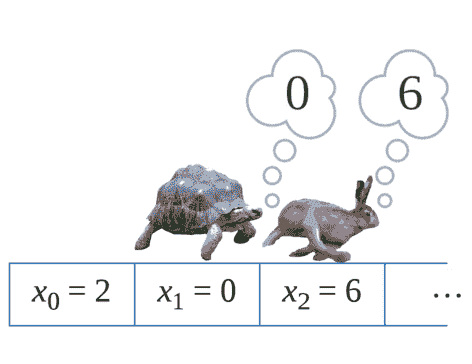
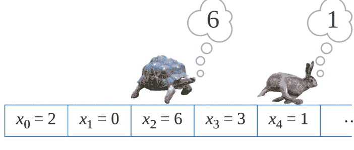
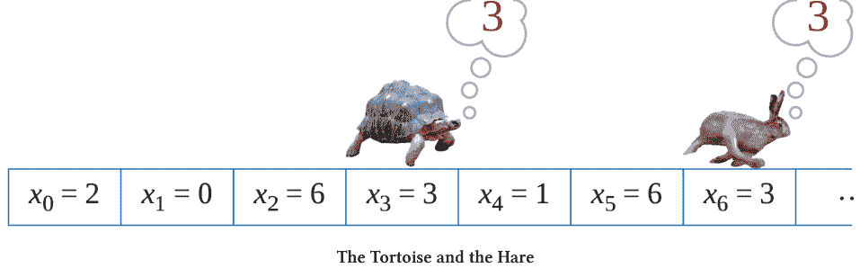
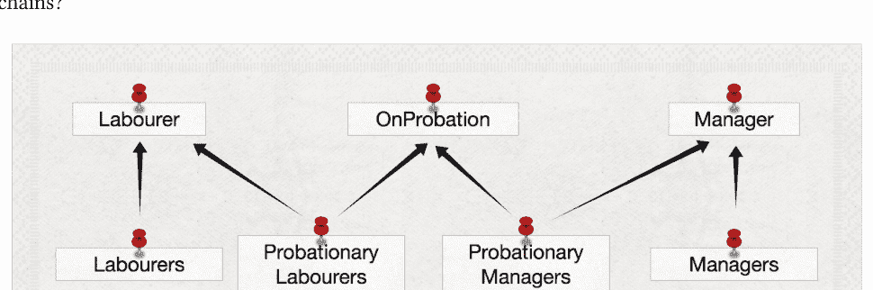

# JavaScript Allongé：从函数到类的 ECMAScript 2015 编程


## Reg "raganwald" Braithwaite 的其他著作

- Kestrels, Quirky Birds, and Hopeless Egocentricity
- What I've Learned From Failure
- How to Do What You Love & Earn What You're Worth as a Programmer
- Steal Raganwald's Book!
- CoffeeScript Ristretto

### 咖啡馆打烊：结语


# 目录

- **金色的克雷玛：附录与后记** ............ 478
- 如何运行示例 ............ 479
- 致谢！ ............ 481
- 在 Kindle 上阅读《JavaScript Allongé》 ............ 483
- 版权声明 ............ 484
- 关于作者 ............ 488

### 拉动手柄：序言


> Café Allongé，也被称为特浓美式咖啡，是一种介于意式浓缩（Espresso）和美式咖啡（Americano）之间的饮品。制作它有两种不同的方法。第一种，也是我偏爱的一种，是向一份双倍或四倍浓缩咖啡（Espresso Ristretto）中加入少量热水。就像在威士忌中兑入少许水一样，少量的稀释能释放出口中更复杂的风味。

第二种方法是萃取一份额外长的双份意式浓缩。这种方法能达到与稀释法大致相同的油脂与水的比例，但由于萃取时间更长，也会释放出不同的风味混合物。有人抱怨这种长萃取更苦，损害了咖啡的最佳风味，也有人认为它释放了更多的复杂性。

重要的是，这两种制作方法都不应使用过多的水，以至于制成一杯味道令人不快、颜色惨淡如鬼魂般的意式浓缩。凡事适度为佳。

### 关于《JavaScript Allongé》

《JavaScript Allongé》首先是一本关于*函数式编程*的书。它使用 JavaScript 编写，因为 JavaScript 完美地兼具了广泛使用和拥有具备词法作用域的一等函数这两个特点。如果这些术语听起来陌生，别担心：《JavaScript Allongé》非常乐意解释它们的含义及其重要性。

*《JavaScript Allongé》*从头开始，从值和表达式讲起，并由此逐步深入讨论类型、身份、函数、闭包、作用域、集合、迭代器以及更多主题，直至讲解类和实例的使用。

它还提供了使用函数编写软件的方案，这些软件比以对象为中心或以代码为中心的替代方法更简单、更清晰、更不复杂。诸如函数组合子（function combinators）和装饰器（decorators）之类的 JavaScript 惯用法，利用 JavaScript 的强大功能使代码更易于阅读、修改、调试和重构。

*《JavaScript Allongé》*教你如何处理复杂的代码，也教你如何在不使代码变得笨拙的前提下简化代码。因此，*《JavaScript Allongé》*是一本内容丰富的读物，揭示了 JavaScript 的许多微妙之处，就像全世界咖啡爱好者钟爱的 Café Allongé 一样。

### 为什么是“第六版”？

ECMAScript 2015（以前称为 ECMAScript 6 或 “ES6”）正在引入大量的改进，让程序员能够编写小型、强大的组件，并将它们组合成功能更完善的程序。诸如解构、块级作用域变量、可迭代对象、生成器以及 `class` 关键字等特性，将使 JavaScript 编程更具表达力。

在 ECMAScript 2015 之前，JavaScript 缺少许多程序员发现对于编写优秀软件至关重要的特性。例如，JavaScript 不包含块级作用域变量。随着时间的推移，程序员们发现了自己实现这些重要特性版本的方法。

例如，块级作用域语言允许我们这样写：

```
for (int i = 0; i < array.length; ++i) {
    // ...
}
```

变量 `i` 的作用域被限制在花括号内的代码中。在 ECMAScript 2015 之前，JavaScript 不支持块级作用域，因此程序员们借鉴了 Scheme 编程语言的一个技巧，会这样写：

```
var i;

for (i = 0; i < array.length; ++i) {
  (function (i) {
    // ...
  })(i)
}
```

通过立即调用函数表达式（IIFE）来创建相同的作用域。

同样，许多编程语言允许函数具有可变数量的参数，并将这些参数收集到一个数组变量中。在 Ruby 中，我们可以这样写：

```
def foo (first, *rest)
  # ...
end
```

在 ECMAScript 2015 之前，JavaScript 不支持将可变数量的参数收集到一个参数中，因此程序员们会利用一个笨拙的变通方法，像这样写：

```
function foo () {
  var first = arguments[0],
      rest  = [].slice.call(arguments, 1);

  // ...
}
```

《JavaScript Allongé》第一版解释了这些以及许多其他在 JavaScript 中编写灵活且可组合程序的模式，但其目的并非解释如何绕过 JavaScript 缺失的功能：其目的是解释为什么这种由缺失功能所体现的编程风格很重要。

绕过这些缺失的功能是一种必要的妥协。

但现在，JavaScript 正在获得许多重要特性，部分原因是 JavaScript 的管理机构观察到程序员们不断在绕过同一组限制。有了 ECMAScript 2015，我们可以这样写：

```
for (let i = 0; i < array.length; ++i) {
  // ...
}
```

变量 `i` 的作用域被限定在 for 循环内。我们也可以这样写：

```
function foo (first, ...rest) {
  // ...
}
```

瞧，`rest` 参数收集了其余的参数，无需再进行涉及 `arguments` 切片的繁琐操作。不再需要变通这些缺失的功能，使得《JavaScript Allongé》成为一本*更好的书*，因为它能够专注于*为什么*要做某事以及*何时*做，而不是如何让它运作。

《JavaScript Allongé，第六版》将《JavaScript Allongé》的所有优点打包进一个全新的、更新的版本中，与使用（或计划使用）最新版本 JavaScript 的程序员息息相关。

#### 这很好。但这就是唯一的原因吗？

实际上，不止如此。

如果仅仅涉及更新语法，原版的《JavaScript Allongé》本可以简单地迭代更新，慢慢用新语法替换旧语法。它将继续讲述大致相同的内容，只是使用新的语法。

*但远不止于此。* 原版《JavaScript Allongé》不仅是为了教授 JavaScript 而编写的：它是为了阐述编程中的某些理念：使用小型的、独立的实体，通过组合来构建更大的程序。因此，重点在于诸如编写装饰器（decorators）等内容。

如前所述，选择 JavaScript 作为《Allongé》的语言，是因为它拥有庞大的程序员受众，并且其某些语言特性恰好非常适合这种编程风格，达到了一个完美的平衡点。

ECMAScript 2015 不仅仅是简单地更新语言，用更简洁的语法处理一些事情，并帮助我们避免缺陷。它使得许多有趣的编程技术易于解释和使用。而这些技术与《Allongé》专注于组合实体和使用函数的理念完美契合。

因此，“第六版”引入了[类](https://example.com/classes)和[混入](https://example.com/mixins)。它引入了使用[符号](https://example.com/symbols)实现私有属性的概念。它引入了[迭代器和生成器](https://example.com/iterators)。但贯穿所有这些内容的一条共同主线是：由于它们都是简单的对象和简单的函数，我们可以使用同一套“函数式编程”技术，通过组合小型、灵活且解耦的实体来构建程序。

我们只是将其中一些函数称为[构造函数](https://example.com/constructors)，另一些称为[装饰器](https://example.com/decorators)，还有一些称为[函数式混入](https://example.com/functional-mixins)，以及另外一些称为[策略](https://example.com/policies)。

引入如此多的新概念确实需要对本书的组织结构进行重大反思。引入这些新概念也确实显著增加了其篇幅。但即便如此，在某种意义上，它仍在阐释与最初完全相同的理念：程序是由小型、灵活的函数组合而成的。


### JavaScript Allongé 是什么。以及不是什么。


JavaScript Allongé 是一本关于思考程序的书。

JavaScript Allongé 是一本关于使用函数进行编程的书。从函数中衍生出许多思想，从装饰器到方法，再到委托和混入，以及沿着许多富有成果的方向继续发展。

本书的重点在于底层思想，即我们可能称之为基本原理的东西，以及它们如何结合形成新的思想。其目的是改善我们思考程序的方式。这是一件好事。

但是，尽管《JavaScript Allongé》试图具有启发性，它并不是*指令性*的。本书绝对没有暗示这里展示的任何技术是做某事的唯一方式、最佳方式，甚至是编写旨在供他人使用、阅读和维护的程序的可接受方式。

软件开发是一个复杂的领域。开发中的选择通常受到社会因素的驱动。人们常说软件应该写给人读。但这难道不取决于相关的人吗？由一小群专家编写的代码，应该与由不断变化、经验不足的实习生团队维护的代码使用相同的技术和模式吗？

软件开发中的选择也常常受到所开发软件类型特定需求的驱动。例如，内部编写的业务软件与作为开源公开分发的库软件有着非常不同的需求。

软件开发的选择还必须考虑一致性问题。如果一个特定的代码库使用大量以主题为先的辅助函数编写，就像这样：

```
const mapWith = (iterable, fn) =>
  ({
    [Symbol.iterator]: function* () {
      for (let element of iterable) {
        yield fn(element);
      }
    }
  });
```

那么，添加以动词为先编写的新辅助函数可能会显得格格不入，就像这样：

```
const filterWith = (fn, iterable) =>
  ({
    [Symbol.iterator]: function* () {
      for (let element of iterable) {
        if (!!fn(element)) yield element;
      }
    }
  });
```

第二种形式更灵活是有原因的，特别是当与部分应用结合使用时，但这是否能抵消让整个代码库以第一种或第二种方式一致地执行所有操作的好处呢？

最后，软件开发的选择不能忽视用于创建和维护软件的工具。使用具有集成功能的源代码控制系统会奖励进行某些类型的集中更改。使用代码检查工具¹ 使得检查某些类型的不良代码变得非常廉价。调试器鼓励使用具有显式或隐式名称的函数。持续集成鼓励与自动化测试套件的创建同步并便于其创建地开发软件。

《JavaScript Allongé》并未试图在更广泛的软件开发背景下解决 JavaScript 最佳实践的问题，因为《JavaScript Allongé》不是一本关于实践的书，而是一本关于思考的书。

### 本书的组织结构

《JavaScript Allongé》在每一章中都引入了函数式编程的新方面，并准确解释了 JavaScript 的工作原理。每章中的代码示例都很小，强调的是阐释，而不是作为日常使用的模式。

¹https://en.wikipedia.org/wiki/Lint_

在某些章节之后，是一系列食谱，旨在以实际形式展示本章思想的应用。虽然每章的内容都自然地建立在前一章讨论的基础上，但这些食谱可能涉及 JavaScript 编程语言的任何方面。

### "Six" 版前言

ECMAScript 6（简称：ES6；官方名称：ECMAScript 2015）于 6 月 17 日被批准为标准。达到这一步花了一些时间——从某种意义上说，ES6 的起源可以追溯到 2000 年：在 ECMAScript 3 完成后，TC39（负责发展 JavaScript 的委员会）开始着手制定 ECMAScript 4。该版本计划包含许多新功能（接口、命名空间、包、多方法等），这些功能本将使 JavaScript 变成一门全新的语言。在内部冲突之后，2008 年 7 月达成了一项解决方案，并制定了新计划——放弃 ECMAScript 4，代之以两次升级：

- 一次较小的升级将为 ECMAScript 3 带来一些小的增强。这次升级成为了 ECMAScript 5。
- 一次较大的升级将实质性地改进 JavaScript，但不会像 ECMAScript 4 那样激进。这次升级成为了 ECMAScript 6（最初讨论的一些功能将在稍后，在即将推出的 ECMAScript 版本中出现）。

ECMAScript 6 有三大功能组：

- 为已存在的功能提供更好的语法（例如通过库）。例如：类和模块。
- 标准库中的新功能。例如：
  - 字符串和数组的新方法
  - Promises（用于异步编程）
  - Maps 和 Sets
- 全新的功能。例如：生成器（Generators）、代理（Proxies）和 WeakMaps。

随着 ECMAScript 6 的推出，JavaScript 作为一门语言变得庞大了许多。*《JavaScript Allongé, "Six" Edition》* 既是对其功能的全面巡礼，也是为了更好利用这些功能而提供的丰富技巧集。你将学到许多关于函数式编程和面向对象编程的知识。并且，你将通过 ES6 代码来学习，这些代码以易于消化的小块形式呈现给你。

> – Axel Rauschmayer 博客²、培训师³ 以及 *Exploring ES6⁴* 作者

²http://www.2ality.com
³http://ecmanauten.de
⁴http://exploringjs.com

### 第一版序言

#### Michael Fogus

作为一个终身书虫和 Reg 网上作品的长期追随者，当他开始写书时，我感到非常兴奋。然而，我对书非常保守——可以说，如果有以“二手书店”精髓为香氛的须后水，我一定会第一个排队购买。所以你可以想象，我对《JavaScript Allongé》决定以持续更新的电子书形式发布，并采用“随意付费”模式持“怀疑”态度。但是，Reg 给了我一本他的书，我深感惭愧。这不仅是一本很棒的书，而且也是一种很棒的写书和分发书籍的方式。我自己也写过书，我知道征集和接收反馈的痛苦。

写作的过程是一个迭代的过程，（通常）有紧凑的修订循环。然而，征集反馈、收集回复、寄出副本、等待人们真正阅读（如果他们真的读了）、接收反馈，然后最终理解如何运用这些反馈，这个过程需要数周甚至数月。我曾不止一次发现自己试图用那些已不复存在或已面目全非的内容来具象化反馈。然而，借助 Leanpub 模式，阅读-反馈-更改的过程极其高效，并留下了一本高质量的书籍，随着其他人同样地阅读和评论，这本书不断变得更好。

就《JavaScript Allongé》而言，你会发现 Leanpub 模式是有效性的光辉典范。Reg 精心打造（并且仍在精心打造）了一本从鉴赏家角度看很有趣的书，同时也是对他艺术中最有趣方面的一次引人入胜的探索。无论你认为自己是多么专家，*JavaScript Allongé* 都有东西可以教你……关于咖啡。我开玩笑的。

作为函数式编程的坚定倡导者，Reg 写的许多内容都引起了我的共鸣。虽然这不是一本完全关于函数式编程的书，但《JavaScript Allongé》将为函数式技术打下坚实的基础。然而，你不会被教条的条条框框所束缚。相反，每一节都由相关的对话驱动，并用令人信服的源代码示例加以强化。作为编程书籍的作者，我很欣赏 Reg 所取得的成就，我也很羡慕那些通过互联网扩张的某些隐秘渠道发现《JavaScript Allongé》并第一次阅读它的优秀读者。

享受阅读吧。

– Fogus, [fogus.me](http://www.fogus.me)

#### Matthew Knox

一种不同的语言需要一本不同的书。

JavaScript 拥有令人惊讶的深度——它的作用域规则既不严格是词法作用域，也不完全是动态作用域，它支持过程式、面向对象（有多种风格！）和函数式编程。许多

非《JavaScript Allongé》。它从值、函数和对象的基本概念讲起，然后通过探索性的代码片段，由内而外地引导你深入理解 JavaScript 的作用域、组合子、上下文、状态、原型和构造函数。

就像 JavaScript 本身一样，这本书给你一个温和的开场，然后再向你展示它的全部深度；也像一杯 *Café Allongé*（长咖啡），喝完总是意犹未尽。尽情享受吧！

——Matthew Knox, [mattknox.com](http://mattknox.com)⁶

⁶http://mattknox.com

### 序曲：咖啡时光里的值与表达式

接下来的内容极其基础，不过正如大多数故事一样，最好的开始方式就是从最开头讲起。

想象我们正在光顾最喜欢的咖啡店。他们几乎能为你调制任何你想要的饮品，从浓郁强劲的短萃意式浓缩，到一杯干卡布奇诺，再到那些以各种浓缩糖浆和牛奶调配而成的咖啡风味甜点饮品。（你容忍这些含糖饮料的存在，是因为它们能为店家带来足够的利润，从而资助你整天泡在那里，蹭着 WiFi，每隔几个小时点一杯 3 美元的饮品。）

你在柜台的一端表达点单，柜台后面的伙计们施展魔法，然后在另一端递上你心仪的咖啡。这正是本书中 JavaScript 环境的运作方式。我们将抛开 Web 服务器、浏览器等各种复杂性，只处理这个简单的模型：你给计算机一个[表达式](https://en.wikipedia.org/wiki/Expression_)，它返回一个[值](https://en.wikipedia.org/wiki/Value_)；就像你向咖啡师表达你的愿望，然后收到一杯咖啡作为回报。

### 值即表达式

所有的值都是表达式。假设你递给咖啡师一杯古巴咖啡。当然，那里面确实有些咖啡。

```
42
```

这是一个表达式吗？一个值？都不是？还是两者皆是？

答案是，这**既是**一个表达式*也是*一个值。

```
42
//=> 42
```

所有的值都是表达式。这很简单！还有其他种类的表达式吗？当然！让我们回到咖啡店。与其递上一杯成品咖啡，我们可以递上原料。让我们递上一些研磨咖啡粉和沸水。

> 细心的读者会意识到我们遗漏了些什么。恭喜！！来一口浓缩咖啡吧。我们稍后会讲到。

现在咖啡师还给我们一杯浓缩咖啡。而如果我们递上浓缩咖啡，我们会直接收回浓缩咖啡。所以，沸水加研磨咖啡粉是一个表达式，但它不是一个值。¹⁰ 沸水是一个值。研磨咖啡粉是一个值。浓缩咖啡是一个值。沸水加研磨咖啡粉是一个表达式。

让我们再用计算机容易理解的其他东西来试试：

```
"JavaScript" + " " + "Allongé"
//=> "JavaScript Allongé"
```

现在我们看到"字符串"是值，而且你可以用字符串和 `+` 运算符构成一个表达式。既然字符串是值，它们本身也是表达式。但带运算符的字符串不是值，它们是表达式。现在我们知道之前的"咖啡粉加热水"例子缺了什么了。咖啡粉是一个值，沸水是一个值，而它们之间的"加"运算符让整个东西变成了一个不是值的表达式。

⁹严格来说，它是用 Base10 记数法对值的*表示*，但在本书中我们不必为此担心。你我都明白这表示"42"，计算机也一样。

¹⁰在某些语言中，表达式本身就是一种值，可以被操作。这类语言的鼻祖是 Lisp。JavaScript 不是这样的语言，表达式本身不是值。

### 值与同一性

在 JavaScript 中，我们用 `===` 运算符测试两个值是否相同，用 `!==` 运算符测试它们是否不同：

```
2 === 2
//=> true
```

```
'hello' !== 'goodbye'
//=> true
```

`===` 究竟是如何工作的？想象一下，有人给你看一杯咖啡。然后又给你看另一杯咖啡。这两杯咖啡是"相同的"吗？在 JavaScript 中，有四种可能：

首先，有时候，杯子是不同种类的。一个是德米塔斯杯，另一个是马克杯。这对应于比较 JavaScript 中不同*类型*的两个东西。例如，字符串 `"2"` 和数字 `2` 不是同一个东西。字符串和数字是不同的类型，所以字符串和数字永远不会相同：

```
2 === '2'
//=> false
```

```
true !== 'true'
//=> true
```

其次，有时候，杯子是同一类型——比如两个浓缩咖啡杯——但它们的内容不同。一杯是单份，另一杯是双份。这对应于比较 JavaScript 中类型相同但"内容"不同的两个值。例如，数字 `5` 和数字 `2` 不是同一个东西。

```
true === false
//=> false
```

```
2 !== 5
//=> true
```

```
'two' === 'five'
//=> false
```

如果杯子是同一类型*并且*内容也相同呢？好，JavaScript 的第三和第四种可能性涵盖了这种情况。

### 值类型

第三种情况是，有些杯子没有任何可区分的标记。如果它们是同一种杯子，装着同样的内容，我们没有办法区分它们。我们目前见过的字符串、数字和布尔值就是这种情况。

```
2 + 2 === 4
  //=> true
```

```
(2 + 2 === 4) === (2 !== 5)
  //=> true
```

请注意这些例子中发生了什么：即使我们是通过求值表达式得到字符串、数字或布尔值，它也与另一个同类型同"内容"的值相同。字符串、数字和布尔值就是 JavaScript 所称的"值类型"或"原始类型"的例子。我们将交替使用这两个术语。

我们还没有遇到第四种可能性。略微延伸一下这个比喻，有些杯子的底部有序列号。所以即使你有两个同一类型的杯子，它们的内容相同，你仍然可以区分它们。


咖啡玛奇朵也是一款不错的饮品，尤其在关注意大利国家队的比赛运势或环意自行车赛的排名时。

### 引用类型

那么，什么样的值可能类型相同、内容也相同，但在 JavaScript 中却不被认为是相同的呢？让我们来认识一种在当代编程语言中非常常见的数据结构——*数组*（其他语言有时称之为列表或向量）。

数组看起来是这样的：`[1, 2, 3]`。这是一个表达式，而且你可以将 `[]` 与其他表达式组合。尽情尝试这样的写法：

```
[2-1, 2, 2+1]
[1, 1+1, 1+1+1]
```

注意，你总是在生成内容相同的数组。但它们是否与每一个 `42` 都等同于任何其他 `42` 一样，以相同的方式等同呢？你自己试试吧：

```
[2-1, 2, 2+1] === [1,2,3]
[1,2,3] === [1, 2, 3]
[1, 2, 3] === [1, 2, 3]
```

结果如何！当你输入 `[1, 2, 3]` 或它的任何变体时，你正在输入一个表达式，它生成自己*独一无二*的数组，这个数组与任何其他数组都不相同，即使那个其他数组看起来也是 `[1, 2, 3]`。就好像 JavaScript 在生成底部带序列号的新咖啡杯一样。

它们看起来一样，但如果你用 `===` 检查，就会发现它们是不同的。每次你求值一个表达式（包括输入某些内容）来创建数组时，你都在创建一个全新的、不同的值，即使它*看起来*与某个其他数组值相同。正如我们将要看到的，这对许多其他种类的值也成立，包括本书的主要主题——*函数*。


## 馥郁芬芳：基础数字

数学与咖啡

> 在计算机科学中，字面量（literal）是一种在源代码中表示固定值的记法。几乎所有编程语言都有表示原子值的记法，如整数、浮点数和字符串，通常还有布尔值和字符；有些语言还支持枚举类型元素以及复合值（如数组、记录和对象）的记法。匿名函数则是函数类型的一种字面量。——维基百科[^1]

与大多数语言一样，JavaScript 也有一组字面量。我们看到，仅由数字组成的表达式，如 `42`，就是一个字面量。它表示四十二这个数字，即十进制的 42。并非所有数字都是十进制。如果我们以零开头，那就是一个八进制字面量。因此字面量 `042` 是八进制的 42，实际上等于十进制的 34。

在内部，`042` 和 `34` 具有相同的表示形式，即[双精度浮点数](http://en.wikipedia.org/wiki/Double-precision_floating-point_format)。理解计算机对数字的内部表示方式很重要。机器对数字的表示几乎永远不会与我们对数字行为的理解完全吻合，因此，如果我们不了解计算机"底层"在做什么，它的行为有时会让我们感到意外。

例如，JavaScript 能安全处理的最大整数是 `9007199254740991`，即 2^53 - 1。与大多数编程语言一样，JavaScript 不允许我们使用逗号来分隔数字分组。

### 浮点数

大多数程序员从未遇到过整数大小的限制。但我们提到，数字在内部是以浮点数形式表示的，这意味着它们不必只是整数。例如，我们可以写 `1.5` 或 `33.33`，JavaScript 会将这些字面量表示为浮点数。

我们很容易认为，现在已经有处理金额等事务所需的一切了，但正如已故的约翰·贝鲁西所说："Nooooooooooooooooooooo。"计算机对浮点数的内部表示是二进制的，而我们的字面数字是十进制的。这对整数没有实质影响，但对分数却有影响，因为某些十进制分数在二进制中没有精确表示。

最常被提及的例子之一如下：

```
1.0
  //=> 1
1.0 + 1.0
  //=> 2
1.0 + 1.0 + 1.0
  //=> 3
```

然而：

```
0.1
  //=> 0.1
0.1 + 0.1
  //=> 0.2
0.1 + 0.1 + 0.1
  //=> 0.30000000000000004
```

在进行允许一定偏差的计算时，这种"不精确性"可以被忽略。例如，在将某些文本居中于页面时，只要你的手算结果与 JavaScript 计算结果之间的差异小于一个像素，就不会出现可观察到的误差。

但一般来说，如果你需要处理实数，你应该对[IEEE 浮点数算术标准](https://en.wikipedia.org/wiki/IEEE_floating_point)有不止肤浅的了解。专业程序员几乎从不使用浮点数来表示货币金额。例如，"$43.21" 几乎总是表示为两个数字：43 代表美元，21 代表美分，而不是 `43.21`。在本书中，我们无需考虑这些细节，但在本书之外，我们必须这样做。

### 数字运算

如我们所见，JavaScript 有许多常见的算术运算符。我们可以创建看起来非常像数学表达式的表达式，例如我们可以写 `1 + 1`、`2 * 3`、`42 - 34`，甚至 `6 / 2`。这些可以组合成更复杂的表达式，如 `2 * 5 + 1`。

在 JavaScript 中，运算符具有优先级顺序，旨在模仿人类通常解析书面算术的方式。因此：

```
2 * 5 + 1
  //=> 11
1 + 5 * 2
  //=> 11
```

JavaScript 将这些表达式视为我们写了 `(2 * 5) + 1` 和 `1 + (5 * 2)`，因为 `*` 运算符的*优先级高于* `+` 运算符。JavaScript 还有更多运算符。在某种意义上，它们的行为就像小函数。如果我们写 `1 + 2`，这在概念上类似于写 `plus(1, 2)`（假设我们有一个将两个数字相加的函数绑定到名称 `plus`，当然）。

除了常见的 `+`、`-`、`*` 和 `/`，JavaScript 还支持取模运算 `%` 和一元取反 `-`：

```
-(457 % 3)
//=> -1
```

还有更多可用于数字的运算符，包括位运算符如 `|` 和 `&`，它们允许你直接对数字的二进制表示进行操作，以及许多其他执行赋值或逻辑比较的运算符，我们将在后面讨论。

### 第一口：基础函数

一杯完美的 Café Allongé 始于正确的咖啡豆，经过恰当的烘焙。JavaScript Allongé 始于函数。

## 关于函数，尽可能少，但绝不少

在 JavaScript 中，函数是值，但它们也远不止简单的数字、字符串，甚至像树或映射这样的复杂数据结构。函数代表要执行的计算。与数字、字符串和数组一样，它们有一种表示形式。让我们从第二简单的函数开始。¹⁵ 在 JavaScript 中，它看起来像这样：

```
() => ∅
```

这是一个不应用于任何值并返回 ∅ 的函数。让我们验证一下我们的函数是否像所有其他值一样是一个值：

```
(() => ∅)
//=> [Function]
```

什么！？为什么它没有为我们输回 `() => ∅` 呢？这似乎*打破了*我们的规则：如果一个表达式也是一个值，JavaScript 会将相同的值返回给我们。发生了什么？最简单且最容易理解的答案是，虽然 JavaScript 解释器确实返回了该值，但在屏幕上显示它是另一回事。`[Function]` 是编写 Node.js（托管 JavaScript REPL 的 JavaScript 环境）的人所做的选择。如果你在浏览器中尝试同样的事情，你可能会看到其他内容。

¹⁵最简单的函数是 `() => {}`，我们稍后会看到。

> 我更喜欢别的输出，但我必须接受，屏幕上返回给我们的内容是任意的，真正重要的是它对人阅读来说多少有点用处。但我们必须理解，无论我们看到 `[Function]` 还是 `() => 0`，在内部 JavaScript 都有一个完整且适当的函数。

### 函数与恒等性

你还记得，关于恒等性我们有两种类型的值：值类型和引用类型。如果内容相同，值类型共享相同的恒等性。引用类型则不然。

函数属于哪一种？让我们试一试看看。为了安抚 JavaScript 解析器，我们将把函数用括号括起来：

```
(() => 0) === (() => 0)
//=> false
```

与数组一样，每次你计算一个表达式以产生函数时，你都会得到一个新函数，它与任何其他函数都不相同，即使你使用相同的表达式来生成它。"函数"是一种引用类型。

### 应用函数

让我们让函数发挥作用。我们使用函数的方式是将它们*应用*于零个或多个称为*参数*的值。正如 `2 + 2` 产生一个值（这里是 4），将函数应用于零个或多个参数也会产生一个值。

以下是我们如何在 JavaScript 中将函数应用于某些值：假设 `fn_expr` 是一个表达式，当计算时，会产生一个函数。我们称参数为 `args`。以下是将函数应用于一些参数的方法：

`fn_expr(args)`

目前，我们只知道一个这样的表达式：`() => 0`，所以让我们使用它。我们将把它放在括号<sup>16</sup>中以保持解析器满意，就像我们上面做的那样：`(() => 0)`。由于我们不给它任何参数，我们只需在表达式后写 `()`。所以我们写：

```
(() => 0)()
//=> 0
```

<sup>16</sup>如果你习惯其他编程语言，你可能已经内化了这样一个想法：有时括号用于在表达式中分组操作（如数学），有时用于将函数应用于参数。如果没有……欢迎来到 ALGOL 编程语言家族！

[^1]: https://en.wikipedia.org/wiki/Literal_(computer_programming)

## 返回值与求值表达式的函数

我们已经见过 `() => 0`。我们知道 `(() => 0)()` 会返回 0，这不足为奇。同样，以下所有用法都理应显而易见：

```
(() => 1)()
//=> 1
(() => "Hello, JavaScript")()
//=> "Hello, JavaScript"
(() => Infinity)()
//=> Infinity
```

嗯，最后一个可能有点费解，但总体思路是这样的：我们可以通过将值放在箭头右侧来创建一个返回该值的函数。

在前言中，我们探讨过表达式。像 0 这样的值是表达式，像 40 + 2 这样的也是表达式。我们能在箭头右侧放一个表达式吗？

```
(() => 1 + 1)()
//=> 2
(() => "Hello, " + "JavaScript")()
//=> "Hello, JavaScript"
(() => Infinity * Infinity)()
//=> Infinity
```

是的，我们可以。我们可以在箭头右侧放置任何表达式。例如，`(() => 0)()` 本身就是一个表达式。我们能否把它放在箭头右侧，像这样：`() => (() => 0)()`？

让我们试试：

```
(() => (() => 0)())()
//=> 0
```

是的，我们可以！函数可以返回对另一个函数求值的结果。

当处理包含大量相同字符（如括号）的表达式时，你可能会发现格式化代码以突出显示内容会有所帮助。所以，我们也可以这样写：

```
(() =>
    (() => 0
    )()
)()
//=> 0
```

它的求值结果是一样的，都是 0。

### 逗号

JavaScript 中的逗号运算符很有趣。它接受两个参数，对两者都进行求值，其自身求值结果为右侧参数的值。换句话说：

```
(1, 2)
//=> 2

(1 + 1, 2 + 2)
//=> 4
```

我们可以将逗号与函数结合使用，来创建对多个表达式求值的函数：

```
(() => (1 + 1, 2 + 2))()
//=> 4
```

在尝试执行可能涉及 *副作用* 的操作时，这很有用，但我们稍后会讨论这一点。在大多数情况下，JavaScript 并不关心元素之间是用空格、制表符还是换行符分隔。所以，我们也可以这样写：

```
() =>
    (1 + 1, 2 + 2)
```

或者甚至：

```
() => (
    1 + 1,
    2 + 2
)
```

### 最简单的代码块

还有一种东西可以放在箭头右侧，那就是 *代码块*。一个代码块包含零条或多条 *语句*，由分号分隔。[^17]

所以，这是一个有效的函数：

```
() => {}
```

它返回对一个没有语句的代码块求值的结果。那会是什么结果呢？让我们试试：

```
(() => {})()
  //=> undefined
```

这个 `undefined` 是什么？

### undefined

在 JavaScript 中，值的缺失写作 `undefined`，它表示“没有值”。它还会再次出现。`undefined` 是一种独立的值类型，其行为类似于值类型：

```
undefined
  //=> undefined
```

与数字、布尔值和字符串一样，JavaScript 可以打印出 `undefined` 值。

```
undefined === undefined
  //=> true
(() => {})() === (() => {})()
  //=> true
(() => {})() === undefined
  //=> true
```

无论你如何对 `undefined` 求值，都会得到相同的值。`undefined` 是一个表示“我没有值”的值。但它仍然是一个值 :-)

> 你可能认为 JavaScript 中的 `undefined` 等价于 SQL 中的 `NULL`。并非如此。在 SQL 中，两个 `NULL` 既不相等也身份不同，因为两个未知数无法比较。在 JavaScript 中，每个 `undefined` 都与其他所有 `undefined` 完全相同。

[^17]: 有时，你会发现 JavaScript 语句用换行符分隔而没有分号。这之所以可行，是因为 JavaScript 有一个特性，可以在大多数情况下推断出分号应该放置的位置。我们不会利用这个特性，但了解其存在会有所帮助。

### void

我们已经看到 JavaScript 通过输入 `undefined` 来表示未定义的值，而且我们已经用两种方式生成了未定义的值：

1.  通过对不返回值的函数求值（`() => {}()`）；以及
2.  我们自己写下 `undefined`。

还有第三种方式，即使用 JavaScript 的 `void` 运算符。请看：

```
void 0
//=> undefined
void 1
//=> undefined
void (2 + 2)
//=> undefined
```

`void` 是一个运算符，它接受任何值，并且 *总是* 求值为 `undefined`。那么，当我们明确需要一个未定义值时，应该使用第一种、第二种还是第三种形式？[^18] 答案是使用 `void`。按照惯例，使用 `void 0`。

第一种形式有效但很笨拙。第二种形式在大多数情况下有效，但通过将 `undefined` 重新赋值为不同的值有可能破坏它，这一点我们将在 [重新赋值与变更](Reassignment%20and%20Mutation) 中讨论。第三种形式保证总是有效，因此这就是我们将使用的。[^19]

[^18]: 经验丰富的 JavaScript 程序员知道还有第四种方式，即使用函数参数。这实际上是 `void` 普及之前首选的机制。
[^19]: 作为读者的练习，我们建议你友善地咨询你身边的编程语言设计师或人因工程专家，解释为什么一个名为 `void` 的关键字用于生成 `undefined` 值，而不是将它们都称为 `void` 或都称为 `undefined`。我们也不知道原因。

### 回到代码块

回到我们的函数。我们对以下代码求值：

```
(() => {})
//=> undefined
```

我们说过，该函数返回对一个 *代码块* 求值的结果，我们还说过代码块是一个（可能为空的）由分号分隔的 JavaScript *语句* 列表。[^20]

类似于：`{ statement₁; statement₂; statement₃; ... ; statementₙ }`

我们还没有讨论这些 *语句*。什么是语句？

JavaScript 语句有很多种，但第一种是我们已经遇到过的。表达式就是一种 JavaScript 语句。虽然它们不太实用，但这些是有效的 JavaScript 函数，并且在应用时返回 undefined：

```
() => { 2 + 2 }
() => { 1 + 1; 2 + 2 }
```

正如我们在上面逗号部分看到的，当我们觉得这样更具可读性时，可以将这些函数重新排列到多行上：

```
() => {
    1 + 1;
    2 + 2
}
```

但无论我们如何安排，包含一个或多个表达式的代码块仍然求值为 undefined：

```
(() => { 2 + 2 })()
//=> undefined

(() => { 1 + 1; 2 + 2 })()
//=> undefined

(() => {
    1 + 1;
    2 + 2
})()
//=> undefined
```

如你所见，包含一个表达式的代码块的行为与表达式不同，包含多个表达式的代码块的行为也不同于使用逗号运算符构建的表达式：

```
(() => 2 + 2)()
//=> 4
(() => { 2 + 2 })()
//=> undefined

(() => (1 + 1, 2 + 2))()
//=> 4
(() => { 1 + 1; 2 + 2 })()
//=> undefined
```

那么，我们如何让一个对代码块求值的函数在应用时返回一个值呢？使用 `return` 关键字和任何表达式：

```
(() => { return 0 })()
//=> 0

(() => { return 1 })()
//=> 1

(() => { return 'Hello ' + 'World' })()
// 'Hello World'
```

`return` 关键字创建了一个 *return 语句*，它立即终止函数应用并返回对其表达式求值的结果。例如：

```
(() => {
    1 + 1;
    return 2 + 2
})()
//=> 4
```

以及：

```
(() => {
    return 1 + 1;
    2 + 2
})()
//=> 2
```

return 语句是我们遇到的第一种语句，它的行为与表达式不同。例如，你不能在简单函数中将其用作表达式，因为它不是一个表达式：

[^20]: 你也可以用换行符来分隔语句。经常关注网络论战的读者可能听说过一种叫做 [自动分号插入](https://en.wikipedia.org/wiki/Automatic_semicolon_insertion) 的东西。基本上，JavaScript 有一步骤会查看你的代码并遵循一些规则来猜测你本意是想在何处放置分号，如果你漏掉了的话。这个特性最初是作为一种有帮助的错误纠正功能而创建的。一些程序员辩称，由于它是语言定义的一部分，编写利用它的代码是公平的，因此他们会故意省略任何 JavaScript 会为他们插入的分号。


```markdown
(() => return 0)()
//=> ERROR
```

语句属于块，且只属于块。有些语言通过将所有内容都变成表达式来简化这一点，但 JavaScript 保持了这种区分，因此当我们学习 JavaScript 时，我们也会学习诸如函数声明、for 循环、if 语句等语句。稍后我们会再看到其中一些。

### 求值为函数的函数

如果一个求值为函数的表达式，嗯，是一个表达式，而且如果 return 语句的右侧可以有任意表达式……*我们能否将一个求值为函数的表达式放在函数表达式的右侧？*

可以：

```
() => () => 0
```

那是一个函数！它是一个函数，当被调用时，求值为一个函数，当被调用时，求值为 0。所以我们有*一个函数，返回一个函数，返回零*。同样地：

```
() => () => true
```

那是一个函数，返回一个函数，返回 `true`：

```
(() => () => true)()()
  //=> true
```

当然，如果我们愿意，也可以用块来做同样的事：

```
() => () => { return true; }
```

但我们通常不会这么做。

好吧。我们一直很聪明，但到目前为止这一切似乎都很抽象。晶体的衍射本身就很美很有趣，但你不能怪我们想要看到它的实际用途，比如能够确定数百万光年外一颗恒星的成分。那么……在下一章，"[请给我一份参数，谢谢](link-to-chapter)"中，我们将看到如何让函数变得实用。

### 啊。请给我一份参数，谢谢。

到目前为止，我们看到的都是没有参数的函数。我们甚至还没说参数*是什么*，只说我们的函数没有参数。

> 大多数程序员对参数（通常称为"形参"）都非常熟悉。中学数学就讨论过这个。所以你知道它们是什么，我也知道你知道它们是什么，但请耐心听我解释！

让我们创建一个带参数的函数：

```
(room) => {}
```

这个函数有一个参数 `room`，以及一个空的主体。这是一个有两个参数且主体为空的函数：

```
(room, board) => {}
```

我相信你对这个函数有两个参数 `room` 和 `board` 的想法完全没问题。用参数来做什么呢？当然是在主体中使用它们。你觉得这是什么？

```
(diameter) => diameter * 3.14159265
```

这是一个给定直径计算圆周长的函数。我这样读："当应用于一个表示直径的值时，这个函数*返回*直径乘以 3.14159265。"

记住，要调用一个没有参数的函数，我们写 `(() => {})()`。要调用一个带参数（或多个参数）的函数，我们将参数放在括号内，像这样：

```
((diameter) => diameter * 3.14159265)(2)
  //=> 6.2831853
```

看到如何编写并调用一个带两个参数的函数，你不会感到惊讶：

```
((room, board) => room + board)(800, 150)
//=> 950
```


### 函数和主体的快速总结

从示例中，参数如何在主体表达式中使用可能对你来说是完全显而易见的，特别是如果你使用过任何编程语言（除了我记得中学时学的 BASIC 方言——它不允许在调用过程时传递参数）。

表达式由值的表示（如 3.14159265、true 和 undefined）、组合表达式的运算符（如 3 + 2）、一些特殊形式（如 [1, 2, 3] 用于从表达式创建数组），或 function (arguments) {body-statements} 用于创建函数。

重要的可能语句之一是 return 语句。return 语句接受任何有效的 JavaScript 表达式。

这个宽松的定义是递归的，所以我们可以直觉地（或利用我们对其他语言的经验）推断，由于函数可以包含带有表达式的 return 语句，我们可以编写返回函数的函数，或包含另一个数组表达式的数组。或者返回数组的函数、函数数组、返回函数数组的函数，等等：

```
() => () => {};

() => [ 1, 2, 3];

[1, [2, 3], 4];

() => [
	() => 1,
	() => 2,
	() => 3
];
```

### 按值调用

与大多数当代编程语言一样，JavaScript 使用"按值调用"的[求值策略](https://en.wikipedia.org/wiki/Evaluation_strategy)。这意味着当你编写一些看似将函数应用于一个或多个表达式的代码时，JavaScript 会先求值所有这些表达式，然后将函数应用于得到的值。

所以当你写：

```
((diameter) => diameter * 3.14159265)(1 + 1)
//=> 6.2831853
```

内部发生的是表达式 1 + 1 首先被求值，结果为 2。然后我们的圆周长函数被应用于 2。²³

稍后我们会看到，虽然 JavaScript 总是按值调用，但"值"的概念还有额外的微妙之处。但在那之前，让我们先看看变量。

### 变量和绑定

现在一切看起来都很简单明了，我们可以继续详细讨论参数了。我们将从 `(diameter) => diameter * 3.14159265` 逐步深入到像这样的函数：

`(x) => (y) => x`

> `(x) => (y) => x` 看起来很疯狂，就像我们在把英语作为第二语言学习，老师向我们承诺很快我们将使用像 *antidisestablishmentarianism*（反对政教分离主义）这样的词。除了想用长词来显得 impressive 之外，在我们发现自己想要讨论英国国教在 19 世纪英国政治中的角色之前，这不会显得有吸引力。

但学习 *antidisestablishmentarianism* 这个词还有另一个原因：我们可能会了解英语语法中前缀和后缀是如何工作的。`(x) => (y) => x` 也是同样的道理。它本身有某种重要的意义，而且它也是学习创建函数的函数、环境、变量等的绝佳借口。

为了讨论这是如何工作的，我们应该就几个术语达成一致（你可能已经知道它们，但让我们一起确认一下，"同步我们的字典"）。第一个 `x`，也就是 `(x) => ...` 中的那个，是一个*参数*。`function (y) ...` 中的 `y` 是另一个参数。第二个 `x`，也就是 `=> x` 中的那个，不是参数，*它是一个引用变量的表达式*。无论我们讨论的是 `(x) => (y) => x` 还是简单的 `(x) => x`，参数和变量的工作方式都是一样的。

每次函数被调用时（"调用"意味着"应用于零个或多个参数"），都会创建一个新的*环境*。环境是一个（可能为空的）字典，通过名称将变量映射到值。我们在表达式中称为"变量"的 `x` 本身就是一个表达式，通过查找环境中的值来求值。

值是如何进入环境的呢？对于参数来说，这非常简单。当你将函数应用于参数时，会为每个参数在字典中放置一个条目。所以当我们写：

```
((x) => x)(2)
//=> 2
```

发生的是这样的：

1. JavaScript 将整个内容解析为由多个子表达式组成的表达式。
2. 然后开始求值表达式，包括求值子表达式。
3. 一个子表达式 `(x) => x` 求值为一个函数。
4. 另一个子表达式 `2` 求值为数字 2。
5. JavaScript 现在求值将函数应用于参数 2。这里变得有趣了……
6. 创建了一个环境。
7. 值 `2` 被绑定到环境中的名称 `x`。
8. 表达式 `x`（函数的右侧）在我们刚刚创建的环境中求值。
9. 变量在环境中求值时的值，是在该环境中绑定到变量名称的值，即 `2`。
10. 这就是我们的结果。

当我们讨论环境时，我们将使用一种[ unsurprising syntax ](http://json.org/)²⁴ 来展示它们的绑定：`{x: 2, ...}`。意思是，环境是一个字典，值 2 被绑定到名称 `x`，而且那个字典中可能还有其他我们现在不讨论的东西。

### 按共享调用

早些时候，我们区分了 JavaScript 的*值类型*和*引用类型*。那时，我们看了 JavaScript 如何区分相同对象和不同对象。现在是时候重新审视值类型和引用类型之间的区别了。

JavaScript 严格保持这样一个属性：当一个值——任何值——作为参数传递给函数时，在函数环境中绑定的值必须与原始值相同。

我们说 JavaScript 将名称绑定到值，但我们没有说将名称绑定到值意味着什么。现在我们可以详细说明：当 JavaScript 将一个值类型绑定到名称时，它会复制该值并将副本放入环境中。如你所记得的，如果字符串和数字具有相同的内容，它们就是相同的。所以 JavaScript 可以随意复制任意多的字符串、数字或布尔值。

那引用类型呢？JavaScript 不会在任何环境中放置引用值的副本。JavaScript 在环境中放置对引用类型的*引用*，当需要使用该值时，JavaScript 使用引用来获取原始值。

²⁴ http://json.org/


由于多个引用可以共享同一个值，而且 JavaScript 将引用作为参数传递，因此可以说 JavaScript 实现了“按共享调用”（call by sharing）的语义。按共享调用通常被认为是按值调用的一种特化，这也解释了为什么有些值被称为**值类型**，而另一些值被称为**引用类型**。

至此，我们已经准备好探讨闭包了。当我们把对值类型、引用类型、参数和闭包的理解结合起来时，就能明白为什么下面这个函数无论传入什么参数²⁵，其结果总是为 true：

```
(value) =>
    ((ref1, ref2) => ref1 === ref2)(value, value)
```

²⁵除非参数是 NaN，它不等于任何值，*包括它自身*。JavaScript 中的 NaN 行为与 SQL 中的 NULL 非常相似。

### 闭包与作用域

是时候了解函数嵌套函数的工作原理了：

```
((x) => (y) => x)(1)(2)
//=> 1
```

首先，让我们运用上面学到的知识。给定（某个函数）（某个参数），我们知道要将函数应用于参数，创建一个环境，将参数的值绑定到名称上，然后求值函数的表达式。所以我们先对这段代码做如下处理：

```
((x) => (y) => x)(1)
//=> [Function]
```

属于签名 `(x) => …` 的函数的环境变为 `{x: 1, …}`，而应用该函数的结果是另一个函数值。结果值是一个函数，这很合理，因为 `(x) => …` 的函数体表达式是：

```
(y) => x
```

所以我们现在有一个表示该函数的值。然后我们要取该函数的值，并将其应用于参数 2，大致如下：

```
((y) => x)(2)
```

所以我们似乎得到了一个新的环境 `{y: 2, …}`。在该函数的环境中，表达式 `x` 将如何求值？它的环境中没有 `x`，它一定来自别处。

> 顺便说一句，这是 JavaScript 及其同族语言最显著的特征之一：它们是否允许函数等内容相互嵌套，如果是，如何处理函数外部在函数内部被引用的变量。例如，以下是 Ruby 中的等效代码：

```
lambda { |x|
  lambda { |y| x }
}[1][2]
#=> 1
```

现在让我们在继续之前，先享受一杯悠闲的 Allongé！

### 如果无自由变量的函数是纯函数，那么闭包是不纯的吗？

函数 `(y) => x` 很有趣。它包含一个*自由变量* `x`。²⁶ 自由变量是指在函数内部未被绑定的变量。到目前为止，我们只见过一种“绑定”变量的方式，即传入同名参数。由于函数 `(y) => x` 没有名为 `x` 的参数，变量 `x` 在此函数中没有被绑定，因此它是“自由的”。

现在我们知道函数中使用的变量要么是绑定的，要么是自由的，因此我们可以将函数分为两类：有自由变量的和没有自由变量的：

- 不包含自由变量的函数称为*纯函数*。
- 包含一个或多个自由变量的函数称为*闭包*。

纯函数最容易理解。无论在哪里使用它们，它们总是表达相同的含义。以下是我们已经见过的一些纯函数：

```
() =>
{}

(x) =>
  

(x) =>
  (y) =>
    

```

第一个函数没有任何变量，因此没有自由变量。第二个没有自由变量，因为它的唯一变量是绑定的。第三个实际上是两个函数，一个嵌套在另一个内部。`(y) => …` 有一个自由变量，但整个表达式指的是 `(x) => …`，它没有自由变量：其主体中唯一的变量是 `x`，而 `x` 确实在 `(x) => …` 中被绑定。

由此，我们学到了一个道理：纯函数可以包含闭包。

> 如果纯函数可以包含闭包，那么闭包可以包含纯函数吗？仅运用到目前为止所学的内容，尝试构造一个包含纯函数的闭包。如果做不到，请给出你认为不可能的理由。

纯函数总是表达相同的含义，因为它们的所有“输入”都由参数完全定义。闭包则不同。如果我向你展示这个纯函数 `(x, y) => x + y`，我们完全知道它对 `(2, 2)` 会做什么。但这个闭包呢：`(y) => x + y`？如果不理解求值自由变量 `x` 的奥秘，我们就无法说清它对参数 `(2)` 会做什么。

### 总是环境

要理解闭包是如何求值的，我们需要重新审视环境。如前所述，所有函数都与一个环境相关联。在描述环境时，我们还含糊其辞了一些东西。还记得我们说 `((x) => (y) => x)(1)` 的环境是 `{x: 1, …}`，而 `((y) => x)(2)` 的环境是 `{y: 2, …}` 吗？现在我们来填补空白！

`((y) => x)(2)` 的环境实际上是 `{y: 2, '…': {x: 1, …}}`。`'…'` 大致表示“父级”或“封装”或“超环境”。它是 `(x) => …` 的环境，因为函数 `(y) => x` 位于 `(x) => …` 的主体内部。因此，每当函数被应用于参数时，其环境总是引用其父环境。

现在你可以猜到我们是如何在环境 `{y: 2, '…': {x: 1, …}}` 中求值 `((y) => x)(2)` 的了。变量 `x` 不在 `(y) => …` 的直接环境中，但它在其父环境中，因此它求值为 1，这就是 `((y) => x)(2)` 返回的结果，尽管它最终忽略了自己的参数。

> `(x) => x` 被称为 I 组合子，或*恒等函数*。`(x) => (y) => x` 被称为 K 组合子，或*黑鸢*。有些人对此如此着迷，以至于为此写整本书，有些很棒ᵃ，有些——我该怎么说呢——如果你使用 Ruby 的话，也挺有趣的ᵇ。

ᵃ http://www.amzn.com/0192801422?tag=raganwald001-20
ᵇ https://leanpub.com/combinators

函数也可以有祖父母：

```
(x) =>
    (y) =>
        (z) => x + y + z
```

这个函数与下面这个函数做的事情大致相同：

```
(x, y, z) => x + y + z
```

只是你用 `(1)(2)(3)` 而不是 `(1, 2, 3)` 来调用它。另一个很大的区别是，你可以用 `(1)` 来调用它，得到一个函数，稍后可以用 `(2)(3)` 来调用。

> 第一个函数是对第二个函数进行[currying/柯里化](https://en.wikipedia.org/wiki/Currying)ᵃ的结果。用只有部分参数的调用方式来调用柯里化函数，有时被称为[部分应用](https://en.wikipedia.org/wiki/Partial_application)ᵇ。有些编程语言会自动对函数进行柯里化和部分求值，无需手动嵌套。

ᵃ https://en.wikipedia.org/wiki/Currying
ᵇ https://en.wikipedia.org/wiki/Partial_application

### 来自暗影行星的暗影变量

当一个变量与其祖先环境中的变量同名时，会发生有趣的事情。考虑：

```
(x) =>
  (x, y) => x + y
```

函数 `(x, y) => x + y` 是一个纯函数，因为它的 `x` 是在自己的环境中定义的。虽然它的父作用域也定义了一个 `x`，但在求值 `x + y` 时，那个 `x` 会被忽略。JavaScript 总是从函数自身的环境开始搜索绑定，然后依次搜索每个父环境，直到找到一个为止。以下代码也是如此：

```
(x) =>
  (x, y) =>
    (w, z) =>
      (w) =>
        x + y + z
```

在求值 `x + y + z` 时，JavaScript 会在曾祖父作用域中找到 `x` 和 `y`，在父作用域中找到 `z`。曾祖父的祖父作用域中的 `x` 被忽略，两个 `w` 也是如此。当一个变量与其祖先环境中的绑定同名时，它被称为*遮蔽*（shadow）祖先环境中的变量。

这通常是一件好事。

### 先有鸡还是先有蛋？

纯函数和闭包的这种特性有许多、许多的后果可以被利用来编写软件。我们将详细探讨这些，并了解 JavaScript 提供的一些其他处理变量和可变状态的机制。

但在那之前，还有一个最终问题：祖先关系从哪里开始？如果文件中没有其他代码，`(x) => x` 的父环境是什么？

 JavaScript 总是至少存在一个我们无法控制的环境概念：一个全局环境，其中绑定着许多有用的东西，比如充满标准函数的库。因此，当你在 REPL 中调用 `((x) => x)(1)` 时，它的完整环境看起来是这样的：{x: 1, '...': *全局环境*}。

有时候，程序员希望避免这种情况。如果你不希望你的代码直接在全局环境中运行，你能做什么呢？当然是为它创建一个环境。许多程序员选择将每个 JavaScript 文件写成这样：

```
// 文件顶部
(() => {

  // ... 大量 JavaScript ...

})();
// 文件底部
```

这样做的效果是在全局环境和你的函数之间插入一个新的、空的环境：{x: 1, '...': {'...': *全局环境*}}。正如我们在讨论可变状态时将会看到的，这有助于防止程序员意外改变程序中所有代码共享的全局状态。

### 那持续的咖啡渴望

到目前为止，我们真正看到的都是*匿名函数*，即没有名字的函数。这与大多数其他语言中的编程感觉非常不同，在那些语言中，重点是给函数、方法和过程命名。命名是编程中至关重要的一部分，但到目前为止我们只看到了如何给参数命名。

在 JavaScript 中还有其他命名方式，但在学习那些之前，让我们看看如何用我们已经掌握的知识来命名事物。让我们 revisit 一个非常简单的例子：

```
(diameter) => diameter * 3.14159265
```

这个 "3.14159265" 是什么数字？显然是 PI<sup>27</sup>。我们希望能给它命名，这样我们就可以写成：

```
(diameter) => diameter * PI
```

为了将 3.14159265 绑定到名称 PI，我们需要一个以 PI 为参数的函数，并将其应用于参数 3.14159265。如果我们将函数表达式放在括号中，就可以将其应用于参数 3.14159265：

```
((PI) => 
    // ???
)(3.14159265)
```

在我们的新函数中，当求值时，我们该放什么来将 3.14159265 绑定到名称 PI？当然是我们的周长函数：

```
((PI) => 
    (diameter) => diameter * PI
)(3.14159265)
```

这个表达式在求值时，返回一个计算周长的函数。这听起来很糟糕，但仔细想想，`(diameter) => diameter * 3.14159265` 也是一个表达式，在求值时返回一个计算周长的函数。我们所有的"函数"都是表达式。这个只是多了几个可动部件，仅此而已。但我们可以像使用 `(diameter) => diameter * 3.14159265` 一样使用它。

让我们来测试一下：

```
((diameter) => diameter * 3.14159265)(2)
//=> 6.2831853
```

```
((PI) =>
    (diameter) => diameter * PI
)(3.14159265)(2)
//=> 6.2831853
```

成功了！我们可以通过将我们想要的绑定包装在一个立即调用并传入我们想要绑定的值的函数中，来在表达式中绑定任何东西。

#### 由内而外

还有另一种方法可以创建一个将 3.14159265 绑定到名称 PI 的函数，然后在表达式中使用它。我们可以把绑定放在计算直径的函数内部，将其"翻转"：

```
(diameter) =>
    ((PI) =>
        diameter * PI)(3.14159265)
```

它产生的结果与我们之前的直径计算函数表达式相同：

```
((diameter) => diameter * 3.14159265)(2)
//=> 6.2831853
```

```
((PI) =>
    (diameter) => diameter * PI
)(3.14159265)(2)
//=> 6.2831853
```

```
((diameter) =>
    ((PI) =>
        diameter * PI)(3.14159265))(2)
//=> 6.2831853
```

哪个更好？嗯，第一个看起来最简单，但半个世纪的经验告诉我们，命名很重要。像 3.14159265 这样的"魔法字面量"对可持续软件开发来说是可憎的。

第三个对大多数人来说最容易阅读。它很好地分离了关注点："外部"函数描述了它的参数：

```
(diameter) =>
    // ...
```

其他所有内容都封装在它的主体中。这正是应有的方式，给 PI 命名是它的事，不是我们的。另一种写法：

```
((PI) =>
    // ...
)(3.14159265)
```

首先"暴露"了给 PI 命名，我们必须往里面看才能知道为什么我们在乎。那么，我们应该总是写成这样吗？

```
(diameter) =>
    ((PI) =>
        diameter * PI)(3.14159265)
```

好吧，这种做法的问题在于，通常情况下，调用函数比求值表达式要昂贵得多。每当我们调用外部函数时，我们都会调用内部函数。我们可以通过写成下面这样来解决这个问题：

```
((PI) =>
    (diameter) => diameter * PI
)(3.14159265)
```

但那样我们就混淆了我们的代码，我们不想这样做，除非绝对必要。如果语言能给我们一种在块内绑定名称而不产生函数调用成本的方式，那就太好了。而 JavaScript 确实提供了。

#### const

编写我们"周长"函数的另一种方式是将 PI 与直径参数一起传递，像这样：

```
(diameter, PI) => diameter * PI
```

我们可以这样使用：

```
((diameter, PI) => diameter * PI)(2, 3.14159265)
  //=> 6.2831853
```

这与我们上面的例子不同之处在于，只有一个环境，而不是两个。我们在环境中有一个绑定代表我们的常规参数，另一个代表我们的"常量"。这更高效，而且*几乎*正是我们一直想要的：一种将 `3.14159265` 绑定到一个可读名称的方式。

JavaScript 给了我们一种方法来实现这一点，那就是 `const` 关键字。我们将在后面的章节中更多地了解 `const`，但以下是我们可以用它做的最重要的事情：

```
(diameter) => {
  const PI = 3.14159265;

  return diameter * PI
}
```

`const` 关键字在其包围的块中引入一个或多个绑定。它不会产生函数调用的成本。这很好。更好的是，它将符号（如 `PI`）放在靠近值（`3.14159265`）的地方。这比之前的写法好多了。

我们在 *const 语句*中使用 `const` 关键字。`const` 语句出现在块内部，当我们在主体为表达式的胖箭头函数中时不能使用它们。

它正如我们所愿地工作。而不是：

```
((diameter) =>
  ((PI) =>
    diameter * PI)(3.14159265))(2)
```

或者：

```
((diameter, PI) => diameter * PI)(2, 3.14159265)
  //=> 6.2831853
```

我们写成：

### 第一口：基础函数

```
((diameter) => {
  const PI = 3.14159265;

  return diameter * PI
})(2)
  //=> 6.2831853
```

我们可以绑定任何表达式。函数是表达式，所以我们可以绑定辅助函数：

```
(d) => {
  const calc = (diameter) => {
    const PI = 3.14159265;

    return diameter * PI
  };

  return "The circumference is " + calc(d)
}
```

注意到 `calc(d)` 了吗？这强调了我们所说的：如果我们有一个求值为函数的表达式，我们用 `()` 来应用它。绑定到函数的名称是一个有效的求值为函数的表达式。

> 令人惊叹的是，这样一个重要的概念——命名函数——竟能*顺便*用寥寥数语解释清楚。这突出了 JavaScript 真正做得非常正确的一点：函数作为"一等实体"。函数是可以像任何其他值一样绑定到名称、作为参数传递、从其他函数返回的值，等等。

我们可以通过用逗号分隔来绑定多个名称-值对。为了可读性，大多数人每行放一个绑定：

```
(d) => {
  const PI    = 3.14159265,
      calc = (diameter) => diameter * PI;

  return "The circumference is " + calc(d)
}
```

#### 嵌套块

到目前为止，我们只见过用作函数主体的块。但还有其他种类的块。可以找到块的地方之一是 if 语句中。在 JavaScript 中，if 语句看起来像这样：

istema```
(n) => {
  const even = (x) => {
    if (x === 0)
      return true;
    else
      return !even(x - 1);
  }
  return even(n)
}
```

而且它对相当小的数字有效：

```
((n) => {
  const even = (x) => {
    if (x === 0)
      return true;
    else
      return !even(x - 1);
  }
  return even(n)
})(13)
//=> false
```

if 语句是一个语句，不是表达式（一个不幸的设计选择），它的子句是语句或块。所以我们也可以写成这样：

```
(n) => {
  const even = (x) => {
    if (x === 0)
      return true;
    else {
      const odd = (y) => !even(y);

      return odd(x - 1);
    }
  }
  return even(n)
}
```


这样写也能行：

```
((n) => {
  const even = (x) => {
    if (x === 0)
      return true;
    else {
      const odd = (y) => !even(y);

      return odd(x - 1);
    }
  }
  return even(n)
})(42)
//=> true
```

我们在 `else` 子句中使用了块语句，由于它是一个块，所以我们在其中放置了一条 `const` 语句。

### const 与词法作用域

这看起来非常直观，但遗憾的是，若要随心所欲地使用 `const`，我们需要了解一些关于名称绑定的语义。首先要问自己的是，如果我们用 `const` 将两个不同的值绑定到"同一个"名称上，会发生什么？

让我们退一步，重新思考闭包的工作原理。如果我们用参数将两个不同的值绑定到同一个名称上，会发生什么？

以下是我们直径函数的第二种写法，通过 IIFE 绑定到一个名称：

```
((diameter_fn) =>
  // ...
)(
  ((PI) =>
    (diameter) => diameter * PI
  )(3.14159265)
)
```

这有些绕来绕去，但它将 `((PI) => (diameter) => diameter * PI)(3.14159265)` 绑定到 `diameter_fn`，然后计算我们省略掉的表达式。我们可以在其中使用任意表达式，而该表达式可以调用 `diameter_fn`。例如：

```
((diameter_fn) =>
  diameter_fn(2)
)(
  ((PI) =>
    (diameter) => diameter * PI
  )(3.14159265)
)
//=> 6.2831853
```

我们从[闭包](https://example.com/closures)一章中知道这一点：尽管在我们通过计算 `diameter_fn(2)` 调用 `diameter_fn` 时，`PI` 并未绑定，但在我们计算 `(diameter) => diameter * PI` 时，`PI` 已经绑定了，因此当我们计算 `diameter_fn` 时，表达式 `diameter * PI` 能够访问 `PI` 和 `diameter` 的值。

这被称为[词法作用域](https://en.wikipedia.org/wiki/Scope_(computer_science)#Lexical_scope_vs._dynamic_scope)<sup>30</sup>，因为我们可以通过查看程序的源代码来发现某个名称是在哪里绑定的。我们可以看到 `PI` 是在环绕 `(diameter) => diameter * PI` 的环境中绑定的，我们不需要知道 `diameter_fn` 是在哪里被调用的。

我们可以通过故意制造一个"冲突"来验证这一点：

```
((diameter_fn) =>
  ((PI) =>
    diameter_fn(2)
  )(3)
)(
  ((PI) =>
    (diameter) => diameter * PI
  )(3.14159265)
)
//=> 6.2831853
```

尽管我们在环绕 `diameter_fn(2)` 的环境中将 `3` 绑定到了 `PI`，但起决定作用的值是 `3.14159265`，即我们在环绕 `(diameter) => diameter * PI` 的环境中绑定到 `PI` 的值。

从闭包的工作方式出发，我们可以仔细推导出这一点。那么 `const` 的工作方式是否相同呢？让我们来验证一下：

<sup>30</sup>https://en.wikipedia.org/wiki/Scope_(computer_science)#Lexical_scope_vs._dynamic_scope

```
((diameter_fn) => {
  const PI = 3;

  return diameter_fn(2)
})(
  (() => {
    const PI = 3.14159265;

    return (diameter) => diameter * PI
  })()
)
//=> 6.2831853
```

是的。使用 `const` 将值绑定到名称与使用参数调用绑定值的方式一样，它使用的是词法作用域。

### const 也来自一个阴影星球吗？

我们刚刚看到，与用参数绑定的值一样，用 `const` 绑定的值也使用词法作用域。它们在其声明的环境中进行查找。而且我们知道函数会创建环境。参数在我们创建函数时声明，因此参数绑定到函数调用时创建的环境是合理的。

但 `const` 语句可以出现在块内部，而且我们看到块可以出现在其他块内部，包括函数体。那么 `const` 变量绑定在哪里？在函数环境中？还是在与块对应的环境中？

我们可以通过制造另一个冲突来验证这一点。但与其在两个不同的地方将两个不同的变量绑定到同一个名称上，不如将一个环境中的两个不同值绑定到同一个名称上，而其中一个环境完全包含在另一个环境中。

如上所述，我们先用参数来做这个。我们从以下内容开始：

```
((PI) =>
  (diameter) => diameter * PI
)(3.14159265)
```

然后，为了能将 `PI` 绑定到其他值上，我们将其 gratuitously 包裹在另一个 IIFE 中：

```
((PI) =>
  ((PI) =>
    (diameter) => diameter * PI
  )(3.14159265)
)(3)
```

这仍然会得到一个计算直径的函数：

```
((PI) =>
  ((PI) =>
    (diameter) => diameter * PI
  )(3.14159265)
)(3)(2)
  //=> 6.2831853
```

我们可以看到 `diameter * PI` 表达式使用的是最接近的父环境中的 `PI` 绑定。但有一个问题：将 `3.14159265` 绑定到 `PI` 会以某种方式改变"外部"环境中的绑定吗？我们稍微改写一下：

```
((PI) => {
  ((PI) => {})(3);

  return (diameter) => diameter * PI;
})(3.14159265)
```

现在我们在一个绑定 `3.14159265` 到 `PI` 的 IIFE 内部，又将 `3` 绑定到了 `PI`。这种绑定会"覆盖"外部的绑定吗？我们的函数会返回 `6` 还是 `6.2831853`？这是一本书，你已经浏览到后面了，所以你知道答案是**不**，内部绑定不会覆盖外部绑定：

```
((PI) => {
  ((PI) => {})(3);

  return (diameter) => diameter * PI;
})(3.14159265)(2)
  //=> 6.2831853
```

我们说，当我们在另一个绑定内部使用参数绑定变量时，内部绑定*遮蔽*了外部绑定。它在自己的作用域内生效，但不会影响包含作用域中的绑定。

那么 `const` 呢？它的工作方式相同吗？

是的，用 `const` 绑定的名称会像参数一样遮蔽外部绑定。但是等等！还有更多！！！

参数只有在我们调用函数时才会绑定。这就是为什么我们要用所有这些 IIFE。但 `const` 语句可以出现在块内部。当我们在块内部使用 `const` 时会发生什么？

我们需要一个 gratuitous 块。既然我们已经见过 `if` 语句，还有什么比下面这个更 gratuitous 的呢：

```
if (true) {
  // 一个立即执行块语句（IIBS）
}
```

让我们试试：

```
((diameter) => {
  const PI = 3;

  if (true) {
    const PI = 3.14159265;

    return diameter * PI;
  }
})(2)
//=> 6.2831853
```

```
((diameter) => {
  const PI = 3.14159265;

  if (true) {
    const PI = 3;
  }
  return diameter * PI;
})(2)
//=> 6.2831853
```

啊哈！`const` 语句不仅会遮蔽函数创建的环境中绑定的值，还会遮蔽块创建的环境中绑定的值！

这极其重要。考虑一下另一种情况：如果 `const` 可以在块内部声明，但它总是将名称绑定在函数的作用域中。在这种情况下，我们会看到这样的情况：

```
((diameter) => {
  const PI = 3.14159265;

  if (true) {
    const PI = 3;
  }
  return diameter * PI;
})(2)
//=> 如果 const 具有函数作用域，将返回 6
```

如果 `const` 总是将其值绑定到函数环境中定义的名称，那么在块内部放置一条 `const` 语句只会重新绑定现有名称，覆盖其旧内容。那将令人超级困惑。而且这段代码会"工作"：

```
((diameter) => {
  if (true) {
    const PI = 3.14159265;
  }
  return diameter * PI;
})(2)
//=> 如果 const 具有函数作用域，将返回 6.2831853
```

同样令人困惑。通常，我们希望将名称绑定在尽可能靠近使用它们的地方。这条设计原则被称为[最小权限原则](https://en.wikipedia.org/wiki/Principle_of_least_privilege)，它对质量和安全都有影响。能够在块内部绑定名称意味着，如果该名称只在块内需要，我们就不会将其绑定"泄漏"到不需要与之交互的其他代码部分。

### 重新绑定

默认情况下，JavaScript 允许我们*重新绑定*新值到通过参数绑定的名称。例如，我们可以写：

```
const evenStevens = (n) => {
  if (n === 0) {
    return true;
  }
  else if (n == 1) {
    return false;
  }
  else {
    n = n - 2;
    return evenStevens(n);
  }
}
```

```
evenStevens(42)
//=> true
```

`n = n - 2;` 这一行*重新绑定*了一个新值到名称 `n`。我们将在"重新赋值"一章中更详细地讨论这一点，但在那之前，让我们先用 `const` 绑定的名称尝试类似的操作。我们已经用 `const` 绑定了 `evenStevens`，让我们尝试重新绑定它：

```
evenStevens = (n) => {
  if (n === 0) {
    return true;
  }
  else if (n == 1) {
    return false;
  }
  else {
    return evenStevens(n - 2);
  }
}
//=> ERROR, evenStevens is read-only
```

JavaScript 不允许我们重新绑定已通过 `const` 绑定的名称。我们通过使用 `const` 声明新的绑定，可以在新的函数或块作用域中*遮蔽*它，但我们不能在现有作用域中重新绑定已通过 `const` 绑定的名称。

这很有价值，因为它大大简化了程序的分析——一眼就能看出，当某物通过 `const` 绑定时，我们完全不必担心它的值可能会改变。


## 函数命名

我们直奔主题。下面这段代码*并未*为函数命名：

```javascript
const repeat = (str) => str + str
```

它没有将函数命名为“repeat”，原因与`const answer = 42`没有将数字42命名为`answer`相同。这种语法将一个匿名函数绑定到环境中的一个名称上，但函数本身仍然是匿名的。

### `function` 关键字

JavaScript *确实*有一种为函数命名的语法，那就是使用`function`关键字。在ECMAScript 2015出现之前，`function`是编写函数的常规语法。

这是我们用“胖箭头”语法编写的`repeat`函数：

```javascript
(str) => str + str
```

而这是（几乎）完全相同的函数，使用`function`关键字编写：

```javascript
function (str) { return str + str }
```

我们来看看明显的区别：

1. 我们使用`function`关键字来引入函数。
2. 接下来要讨论的某个部分是可选的。
3. 参数用括号括起来，就像胖箭头函数一样。
4. 我们没有胖箭头，直接进入函数体。
5. 我们总是使用块（block），不能写成`function (str) str + str`。这意味着如果我们希望函数返回一个值，总是需要使用`return`关键字。

如果我们省略`function`关键字后面那个“可选的部分”，就可以将我们见过的所有胖箭头函数转换为`function`关键字函数，例如：

```javascript
(n) => (1.618**n - -1.618**-n) / 2.236
```

可以写成：

```javascript
function (n) {
  return (1.618**n - -1.618**-n) / 2.236;
}
```

这仍然没有*命名*函数，但正如我们上面提到的，用`function`关键字编写的函数有一个可选的“其他部分”。那个“其他部分”能为函数命名吗？当然可以。<sup>32</sup>

以下是我们为示例函数命名的写法：

```javascript
const repeat = function repeat (str) {
  return str + str;
};
```

```javascript
const fib = function fib (n) {
  return (1.618**n - -1.618**-n) / 2.236;
};
```

在`function`关键字和参数列表之间放置一个名称，就为函数命名了。令人困惑的是，函数的名称与我们可能选择绑定到函数值的名称并不完全相同。例如，我们可以这样写：

```javascript
const double = function repeat (str) {
  return str + str;
}
```

在这个表达式中，`double`是环境中的名称，但`repeat`是函数的实际名称。这是一个*具名函数表达式*。这可能看起来令人困惑，但请将绑定名称视为环境的属性，而不是函数的属性。而函数的名称是函数的属性，不是环境的属性。

确实，名称*就是*一个属性：

```javascript
double.name
//=> 'repeat'
```

本书不深入探讨JavaScript的工具链，比如浏览器内置的调试器，但我们会指出，当你在所有现代工具中导航调用栈时，函数的绑定名称会被忽略，但其实际名称会被显示出来。因此，即使函数没有获得正式的绑定，为其命名也是非常有用的，例如：

```javascript
someBackboneView.on('click', function clickHandler () {
  // ...
});
```

现在，函数的实际名称对其使用的环境没有影响。具体来说：

```javascript
const bindingName = function actualName () {
  // ...
};

bindingName
  //=> [Function: actualName]

actualName
  //=> ReferenceError: actualName is not defined
```

所以，“actualName”在我们使用具名函数表达式的环境中并没有被绑定。它在其他地方被绑定了吗？是的。这是一个判断正整数是否为偶数的函数。我们将在一个IIFE（立即调用函数表达式）中使用它，这样就不必用const将其绑定到一个名称：

```javascript
(function even (n) {
  if (n === 0) {
    return true
  }
  else return !even(n - 1)
})(5)
  //=> false

(function even (n) {
  if (n === 0) {
    return true
  }
  else return !even(n - 1)
})(2)
  //=> true
```

显然，名称`even`在*函数体内部*绑定到了函数。它在函数体外部绑定到函数了吗？

```javascript
even
//=> Can't find variable: even
```

`even`在函数本身内部被绑定，但在外部没有。这对于创建递归函数很有用，正如我们在上面所看到的，它体现了最小权限原则：如果你不*需要*在其他地方为它命名，那就不必命名。

### 函数声明

还有另一种命名和/或定义函数的语法。它被称为*函数声明语句*，看起来很像具名函数表达式，只是我们将其用作语句：

```javascript
function someName () {
  // ...
}
```

它的行为*有点*像：

```javascript
const someName = function someName () {
  // ...
}
```

因为它在环境中将一个名称绑定到一个具名函数。然而，有两个重要的区别。首先，函数声明会被*提升*到其所在函数的顶部。

考虑这个例子，我们尝试在用`const`将函数绑定到变量`fizzbuzz`之前，就将该变量作为函数使用：

```javascript
(function () {
  return fizzbuzz();

  const fizzbuzz = function fizzbuzz () {
    return "Fizz" + "Buzz";
  }
})()
  //=> undefined is not a function (evaluating 'fizzbuzz()')
```

我们在尝试使用`fizzbuzz`时，实际上还没有将函数绑定到该名称，因此得到了错误。但函数*声明*的行为有所不同：

```javascript
(function () {
  return fizzbuzz();

  function fizzbuzz () {
    return "Fizz" + "Buzz";
  }
})()
//=> 'FizzBuzz'
```

尽管`fizzbuzz`是在函数后面声明的，但JavaScript的行为就好像我们写了：

```javascript
(function () {
  const fizzbuzz = function fizzbuzz () {
    return "Fizz" + "Buzz";
  }

  return fizzbuzz();
})()
```

`fizzbuzz`的定义被“提升”到了其包含作用域（本例中是一个IIFE）的顶部。这种行为是JavaScript设计有意为之，以支持一种将主要逻辑放在前面，“辅助函数”放在底部的编程风格。在JavaScript中不一定要用这种方式声明函数，但理解这种语法及其行为（尤其是与`const`的不同之处）对于处理生产代码至关重要。

#### 函数声明的注意事项

函数声明理论上只应该出现在我们可能称为函数的“顶层”。尽管一些JavaScript环境允许以下代码，但这个例子在技术上是非法的，绝对是个坏主意：

```javascript
(function (camelCase) {
  return fizzbuzz();

  if (camelCase) {
    function fizzbuzz () {
      return "Fizz" + "Buzz";
    }
  }
  else {
    function fizzbuzz () {
      return "Fizz" + "Buzz";
    }
  }
})(true)
  //=> 'FizzBuzz'? 或者 报错：找不到变量：fizzbuzz？
```

> 此处讨论的许多注意事项在Jyry Zaytsev的优秀文章《具名函数表达式揭秘》中有所描述。

函数声明不应该出现在代码块内部。像这样的表达式带来的大麻烦是，它们在你的测试环境中可能运行良好，但在生产环境中却以不同的方式工作。或者今天以一种方式工作，当JavaScript引擎更新（例如采用新的优化）时，明天又可能以另一种方式工作。

另一个注意事项是，函数声明不能存在于*任何*表达式内部，否则它就是函数表达式了。所以这是一个函数声明：

```javascript
function trueDat () { return true }
```

但这不是：

```javascript
(function trueDat () { return true })
```

括号使其成为了一个表达式，而不是函数声明。

### 高阶函数

正如我们所见，JavaScript函数接收值作为参数并返回值。JavaScript函数本身就是值，因此JavaScript函数可以接收函数作为参数、返回函数，或者两者兼有。一般来说，一个接收函数作为参数、返回函数，或者两者兼有的函数，被称为“高阶”函数。

这是一个非常简单的高阶函数，它接收一个函数作为参数：

```javascript
const repeat = (num, fn) =>
    (num > 0)
        ? (repeat(num - 1, fn), fn(num))
        : undefined

repeat(3, function (n) {
    console.log(`Hello ${n}`)
})
    //=>
        'Hello 1'
        'Hello 2'
        'Hello 3'
        undefined
```

高阶函数在《JavaScript Allongé》中占据重要地位。但在继续之前，我们将讨论一些特定类型的高阶函数。

#### 组合子

“组合子”这个词在数学中有精确的技术含义：

> “组合子是一个高阶函数，它仅使用函数应用和先前定义的组合子来根据其参数定义结果。”——维基百科³⁴

如果我们学习组合逻辑，我们会从最基本的组合子开始，如S、κ和I，然后逐步学习实用的组合子。我们会了解到，基本的组合子是以鸟类命名的，这遵循了Raymond Smullyan著名著作《To Mock a Mockingbird》³⁵的先例。

---
³⁴ https://en.wikipedia.org/wiki/Combinatory_logic
³⁵ http://www.amazon.com/gp/product/B00A1P096Y/ref=as_li_ss_tl?ie=UTF8&camp=1789&creative=390957&creativeASIN=B00A1P096Y&linkCode=as2&tag=raganwald001-20


在本书中，我们将使用一个较为宽松的"组合子"定义：即以纯函数为参数并返回函数的高阶纯函数。我们不会严格要求在构造它们时仅使用先前定义过的组合子。

让我们从一个有用的组合子开始：大多数程序员称之为 *Compose*，尽管逻辑学家称之为 B 组合子或"蓝鸟"（Bluebird）。以下是典型的编程实现：$^{36}$

```
const compose = (a, b) =>
  (c) => a(b(c))
```

假设我们有：

```
const addOne = (number) => number + 1;
```

```
const doubleOf = (number) => number * 2;
```

使用 `compose`，在任何你原本会写

```
const doubleOfAddOne = (number) => doubleOf(addOne(number));
```

的地方，你也可以写成：

```
const doubleOfAddOne = compose(doubleOf, addOne);
```

当然，这只是众多例子中的一个。浏览本书中的配方时，你会发现更多。虽然一些程序员信奉"应该只有一种方式来做这件事"，但谨慎地使用组合子，以及用大量符号和关键字显式地写出代码，各有一些优势。

### 关于组合子的平衡观点

使用大量组合子的代码倾向于命名动词和副词（如 `doubleOf`、`addOne` 和 `compose`），同时避免语言关键字和名词（如 `number`）的命名。因此，一种观点是：当你想强调**正在做什么**以及**如何组合**时，组合子很有用；而当你想强调**正在处理什么**时，更明确的代码更有用。

### 函数装饰器

*函数装饰器*（function decorator）是一种高阶函数，它接受一个函数作为参数，返回另一个函数，且返回的函数是参数函数的一种变体。这里有一个极其简单的装饰器：$^{37}$

```
const not = (fn) => (x) => !fn(x)
```

所以，与其写 !someFunction(42)，我们可以写 not(someFunction)(42)。这 hardly 是进步。
但就像 compose 一样，我们可以写：

```
const something = (x) => x != null;
```

然后在别处写：

```
const nothing = (x) => !something(x);
```

或者我们可以写：

```
const nothing = not(something);
```

`not` 是一个函数装饰器，因为它修改了一个函数，同时与原始函数的语义保持紧密联系。你会在配方中看到其他函数装饰器，如 `once` 和 `maybe`。函数装饰器不严格要求是纯函数，因此相比组合子，装饰器有更大的自由度。

### 构建块

当你观察 JavaScript 中嵌套的函数时，它看起来有点像"意大利面条式代码"。JavaScript 的强大之处在于你可以做任何事。弱点在于你会去做。if 语句、for 循环、return，所有东西都被乱七八糟地扔在一起。虽然你不必要把自己限制在少数简单模式之内，但理解这些模式会有所帮助，这样你就可以围绕一些基本构建块来组织代码。

#### 组合

这些构建块中最基本的一个就是*组合*（composition）：

```
const cookAndEat = (food) => eat(cook(food));
```

就是这么简单：每当你把两个或更多函数链式调用时，你就是在组合它们。你可以像我们刚才那样用显式的 JavaScript 代码来组合。你也可以用我们在[组合子与装饰器](#)中看到的 B 组合子或"compose"来泛化组合：

```
const compose = (a, b) => (c) => a(b(c));
```

```
const cookAndEat = compose(eat, cook);
```

如果仅此而已，组合就不太重要了。但就像许多模式一样，在适用时使用它只带来了 20% 的好处。另外 80% 来自于组织你的代码以便能够使用它：编写可以以各种方式组合的函数。

在配方中，我们会看一个名为 [once](#) 的装饰器：它确保函数只能执行一次。之后，它什么都不做。`once` 有助于确保某些副作用不会重复。我们还会看 [maybe](#)：它确保函数在传入的参数为空（如 `null` 或 `undefined`）时不执行任何操作。

当然，你不必要用组合子来实现这些想法，你可以用 if 语句。但 `once` 和 `maybe` 可以组合，所以你可以按需将它们链式组合：

```
const actuallyTransfer= (from, to, amount) =>
  // do something
```

```
const invokeTransfer = once(maybe(actuallyTransfer(...)));
```

### 部分应用

另一个基本构建块是*部分应用*（partial application）。当一个函数接受多个参数时，我们通过对所有参数求值来"应用"函数，产生一个值。但如果我们只提供部分参数呢？在这种情况下，我们无法得到最终值，但我们可以得到一个代表我们应用的*部分*的函数。

代码比文字更容易说明这个问题。[Underscore](http://underscorejs.org) 库提供了一个名为 *map* 的高阶函数。它将另一个函数应用到数组的每个元素上，像这样：

```
_.map([1, 2, 3], (n) => n * n)
  //=> [1, 4, 9]
```

我们不想老是写 `_.`，所以可以这样使用：

```
const map = _.map;
```

这段代码通过对 map 函数的部分应用，将函数 `(n) => n * n` 作为其第二个参数：

```
const squareAll = (array) => map(array,  (n) => n * n);
```

得到的函数——`squareAll`——仍然是 map 函数，只是我们已经应用了它的两个参数之一。`squareAll` 不错，但为什么每次我们想对 map 做部分应用时都要写一个函数呢？我们可以把这再抽象一层。`mapWith` 接受任意函数作为参数，返回一个部分应用的 map 函数。

```
const mapWith = (fn) =>
  (array) => map(array, fn);

const squareAll = mapWith((n) => n * n);

squareAll([1, 2, 3])
  //=> [1, 4, 9]
```

我们之后会再次讨论 `mapWith`。重要的是要看到，部分应用与组合是正交的，而且它们可以很好地协同工作：

> http://underscorejs.org

现代 JavaScript 实现为数组提供了 map 方法，但如果你要处理旧浏览器的兼容性问题，Underscore 的实现对你也有帮助。

如果我们不想引入 [Underscore](http://underscorejs.org)，我们也可以写：`const map = (a, fn) => a.map(fn);`，并相信它是有效的，尽管我们还没有讨论过方法。

### 第一口：基本函数

50

```
const safeSquareAll = mapWith(maybe((n) => n * n));
```

```
safeSquareAll([1, null, 2, 3])
//=> [1, null, 4, 9]
```

我们用 compose 组合子泛化了组合。部分应用也有一个组合子，我们将在 partial 配方中看到它。

### 魔法名称

当一个函数被应用到参数上时（或者说"被调用"时），JavaScript 会将参数的值绑定到函数参数名上，这是在一个为函数执行而创建的环境中。到目前为止我们还没有讨论的是，JavaScript 除了绑定你在参数列表中放置的名称外，还会将值绑定到一些"魔法"名称上。⁴¹

### function 关键字

这些"魔法"名称有两套独立的规则，一套适用于使用 `function` 关键字调用函数时，另一套适用于使用"胖箭头"定义的函数。我们先从使用 `function` 关键字定义的函数开始讲起。

第一个魔法名称是 `this`，它被绑定到所谓的函数[上下文](#)。当我们开始讨论对象和类时，会更详细地探索 `this`。第二个魔法名称非常有趣，它叫 `arguments`，最有趣的是它包含了传递给函数的参数列表：

```
const plus = function (a, b) {
  return arguments[0] + arguments[1];
}

plus(2,3)
  //=> 5
```

虽然 `arguments` 看起来像数组，但它不是数组：它更像一个[对象](#)⁴²，只是恰好将一些值绑定到从零开始的整数名称的属性上：

```
const args = function (a, b) {
  return arguments;
}

args(2,3)
  //=> { '0': 2, '1': 3 }
```

`arguments` 始终包含传递给函数的所有参数，无论声明了多少个。因此，我们可以这样写 `plus`：

> ⁴¹你永远不应该尝试为 JavaScript 为你绑定的"魔法"名称定义自己的绑定。始终将它们视为只读的是明智之举。

> ⁴²我们后面会深入探讨[数组](#)和[普通旧 JavaScript 对象](#)。


 ```
const plus = function () {
  return arguments[0] + arguments[1];
}

plus(2,3)
//=> 5
```

在讨论对象时，我们会更深入地探讨属性。关于 `arguments` 有一个有趣的地方：

```
const howMany = function () {
  return arguments['length'];
}

howMany()
//=> 0

howMany('hello')
//=> 1

howMany('sharks', 'are', 'apex', 'predators')
//=> 4
```

`arguments` 绑定最常见的用途是构建可以接受可变数量参数的函数。我们将在许多示例中看到它的使用，从[偏函数应用](https://leanpub.com/js-allonge/read#leanpub-auto-partial-application)和省略号开始。

### 魔法名称与胖箭头

当你调用使用胖箭头定义的函数时，魔法名称 `this` 和 `arguments` 会有不同的行为：它们不是在函数被调用时绑定，而是胖箭头函数始终从其封闭作用域获取 `this` 和 `arguments` 的绑定，就像任何其他绑定一样。

例如，当这个表达式中的内部函数使用 `function` 定义时，`arguments[0]` 指的是它的唯一参数 "inner"：

```
(function () {
  return (function () { return arguments[0]; })('inner');
})('outer')
//=> "inner"
```

但如果我们使用胖箭头，`arguments` 将在外部环境中定义，即使用 `function` 定义的那个环境。因此 `arguments[0]` 将指向 "outer"，而不是 "inner"：

```
(() => {
  return (() => arguments[0])('inner');
})('outer')
//=> "outer"
```

虽然两种语法具有不同语义似乎有些不切实际，但考虑到设计目标，这是合理的：胖箭头函数被设计得非常轻量，经常与 `map` 或回调等结构一起使用，以模拟语法。

举一个刻意设计的例子，这个函数接受一个数字，并返回一个表示假设乘法表中某一行的数组。它使用了 `mapWith`，我们在[构建块](https://github.com)中讨论过。我们将使用 `arguments` 来展示使用胖箭头与 `function` 关键字之间的区别：

```
const row = function () {
  return mapWith((column) => column * arguments[0])(
    [1, 2, 3, 4, 5, 6, 7, 8, 9, 10, 11, 12]
  )
}
```

```
row(3)
//=> [3, 6, 9, 12, 15, 18, 21, 24, 27, 30, 33, 36]
```

这工作得很好，因为 `arguments[0]` 指的是我们传递给函数 `row` 的 `3`。我们的"胖箭头"函数 `(column) => column * arguments[0]` 在被调用时不会绑定 `arguments`。但如果我们将 `row` 重写为使用 `function` 关键字，它就不再工作了：

```
const row = function () {
  return mapWith(function (column) { return column * arguments[0] })(
    [1, 2, 3, 4, 5, 6, 7, 8, 9, 10, 11, 12]
  )
}
```

```
row(3)
//=> [1, 4, 9, 16, 25, 36, 49, 64, 81, 100, 121, 144]
```

现在我们的内部函数每次被调用时都会绑定 `arguments[0]`，所以我们得到的结果与写成 `function (column) { return column * column }` 时相同。

虽然这个例子显然不切实际，但有一个通用的设计原则值得关注。有时，一个函数是作为大写 F 的函数来使用的。它有名字，被代码的不同部分调用，是代码中的一等实体。

是的，我们在别处也使用 `mapWith` 这个名称来处理普通集合。如果我们正在编写一个函数库，我们将不得不使用特殊名称、命名空间或模块来区分两种映射函数。但为了讨论概念的目的，我们可以在两个不同的上下文中使用相同的名字两次。毕竟，这是同一个概念。

但有时，一个函数是小写 f 的函数。它是一个待计算表达式的简单表示。在我们上面的例子中，`row` 是一个大写 F 的函数，但 `(column) => column * arguments[0]` 是一个小写 f 的函数，它存在的意义只是给 `mapWith` 提供一个可应用的东西。

让魔法变量适用于大写 F 的函数而不适用于小写 f 的函数，使得使用小写 f 的函数作为语法变得更加容易，将它们视为可以传递给 `mapWith` 等函数的表达式或块。

### 总结

#### 函数

- 函数是可以作为表达式的一部分、从其他函数返回等等的值。

- 函数是*引用值*。

- 函数被应用于参数。

- 参数通过共享传递，这也称为"按值传递"。

- 胖箭头函数以表达式或块作为其函数体。

- `function` 关键字函数始终以块作为其函数体。

- 函数体包含零个或多个语句。

- 表达式体的求值结果为该表达式的值。

- 块体的求值结果为使用 `return` 关键字返回的值，或 `undefined`。

- JavaScript 使用 `const` 将值绑定到块作用域内的名称。

- JavaScript 使用函数声明将函数绑定到函数作用域内的名称。函数声明会被"提升"。

- 函数应用创建一个作用域。

- 如果 `const` 语句在块内，块也会创建作用域。

- 作用域是嵌套的，自由变量引用被闭包捕获。

- 变量可以遮蔽封闭作用域中的变量。

### 基本函数实战示例


在混合食材之前，先从干净得闪闪发光的工具开始。

在了解了基本的纯函数和闭包之后，我们将看到一些实用的示例，重点讨论返回函数的函数这一前提。

#### 免责声明

这些示例为实用性而编写，其实现可能会引入本文至此尚未讨论的 JavaScript 特性，例如方法和/或原型。每个示例的整体*使用*将符合迄今为止讨论的语言精神，即使实现可能不完全如此。

### 偏函数应用

在[构建块](https://github.com Zeus/lemonad)中，我们讨论了偏函数应用，但没有为其编写一个通用的示例。这是一个非常常见的工具，许多库都提供了某种形式的偏函数应用。你可以在 Michael Fogus 的 [Lemonad](https://github.com/fogus/lemonad)⁴⁴、Oliver Steele 的 [Functional JavaScript](http://osteele.com/sources/javascript/functional/)⁴⁵ 以及 James Halliday 的简洁但实用的 [node-ap](https://github.com/substack/node-ap)⁴⁶ 中找到示例。

这两个示例用于快速简单地应用单个参数，要么是最左边的，要么是最右边的。⁴⁷ 如果你想绑定多个参数，或者想在参数列表中留一个"空洞"，你将需要使用[通用偏函数示例](https://github.com/fogus/lemonad)，或者需要重复应用参数。它们是[上下文](http://osteele.com/sources/javascript/functional/)无关的。

```
const callFirst = (fn, larg) =>
  function (...rest) {
    return fn.call(this, larg, ...rest);
  }
```

```
const callLast = (fn, rarg) =>
  function (...rest) {
    return fn.call(this, ...rest, rarg);
  }
```

```
const greet = (me, you) =>
  `Hello, ${you}, my name is ${me}`;
```

```
const heliosSaysHello = callFirst(greet, 'Helios');
```

```
heliosSaysHello('Eartha')
  //=> 'Hello, Eartha, my name is Helios'
```

```
const sayHelloToCeline = callLast(greet, 'Celine');
```

```
sayHelloToCeline('Eartha')
  //=> 'Hello, Celine, my name is Eartha'
```

如上所述，我们的偏函数示例允许我们创建那些对上下文感知函数进行偏应用的函数。如果我们希望创建对象方法的偏应用，我们需要不同的示例。

我们更进一步，可以使用收集和展开来实现多个参数的偏函数应用：

### 基本函数实战示例

```
const callLeft = (fn, ...args) =>
  (...remainingArgs) =>
    fn(...args, ...remainingArgs);

const callRight = (fn, ...args) =>
  (...remainingArgs) =>
    fn(...remainingArgs, ...args);
```


### Unary

"Unary" 是一个函数装饰器，用于修改函数接受的参数数量：Unary 接受任何函数，并将其转换为仅接受一个参数的函数。

最常见的用例是解决一个已知问题。JavaScript 为数组提供了 `.map` 方法，许多库也提供了具有相同语义的 map 函数。以下是它的使用示例：

```
['1', '2', '3'].map(parseFloat)
//=> [1, 2, 3]
```

在这个例子中，它看起来和大多数语言中的映射函数完全一样：你传给它一个函数，它会用一个参数（数组元素）调用该函数。然而，情况并非完全如此。JavaScript 的 map 实际上会用*三个*参数调用每个函数：元素、元素在数组中的索引，以及数组本身。

让我们试试看：

```
[1, 2, 3].map(function (element, index, arr) {
  console.log({element: element, index: index, arr: arr})
})
//=> { element: 1, index: 0, arr: [ 1, 2, 3 ] }
//   { element: 2, index: 1, arr: [ 1, 2, 3 ] }
//   { element: 3, index: 2, arr: [ 1, 2, 3 ] }
```

如果你传入一个只接受一个参数的函数，它会简单地忽略多余的参数。但是有些函数有可选的第二个甚至第三个参数。例如：

```
['1', '2', '3'].map(parseInt)
//=> [1, NaN, NaN]
```

这行不通，因为 `parseInt` 的定义是 `parseInt(string[, radix])`。它接受一个可选的基数（radix）参数。当你用 `map` 调用 `parseInt` 时，索引被解释为基数。这可不好！我们希望将 `parseInt` 转换为一个只接受一个参数的函数。

我们可以写 `['1', '2', '3'].map((s) => parseInt(s))`，或者我们可以设计一个装饰器来帮我们完成这项工作：

```
const unary = (fn) =>
  fn.length === 1
    ? fn
    : function (something) {
        return fn.call(this, something)
      }
```

现在我们可以这样写了：

```
['1', '2', '3'].map(unary(parseInt))
//=> [1, 2, 3]
```

搞定！

### Tap

最基本的组合子之一是 "K 组合子"，绰号 "Kestrel"：

```
const K = (x) => (y) => x;
```

它有一些令人惊讶的应用。其中之一是当你想对一个值进行某些操作以产生副作用，但又要保留该值时。请看：

```
const tap = (value) =>
  (fn) => (
    typeof(fn) === 'function' && fn(value),
    value
  )
```

`tap` 是一个从各种 Unix shell 命令借用而来的传统名称。它接受一个值并返回一个函数，该函数总是返回该值，但如果你传给它一个函数，它会执行该函数以产生副作用。让我们看看它如何作为一个简易的调试器来使用：

```
tap('espresso')((it) => {
  console.log(`Our drink is '${it}'`)
});
//=> Our drink is 'espresso'
    'espresso'
```

要关闭它也很容易：

```
tap('espresso')();
  //=> 'espresso'
```

像 Underscore⁴⁸ 这样的库使用了一个"非柯里化"版本的 tap：

```
_.tap('espresso', (it) =>
  console.log(`Our drink is '${it}'`)
);
  //=> Our drink is 'espresso'
      'espresso'
```

让我们增强我们的配方，使其两种方式都能工作：

### 包含基础函数的配方

```
const tap = (value, fn) => {
  const curried = (fn) => (
    typeof(fn) === 'function' && fn(value),
    value
  );

  return fn === undefined
    ? curried
    : curried(fn);
}
```

现在我们可以这样写：

```
tap('espresso')((it) => {
  console.log(`Our drink is '${it}'`)
});
//=> Our drink is 'espresso'
    'espresso'
```

或者：

```
tap('espresso', (it) => {
  console.log(`Our drink is '${it}'`)
});
//=> Our drink is 'espresso'
    'espresso'
```

如果我们希望它什么都不做，我们可以写 `tap('espresso')()` 或 `tap('espresso', null)`。

p.s. tap 的作用不仅仅是作为调试辅助工具。它对于处理对象和实例方法也很有用。

### Maybe

编程中一个常见的问题是检查 `null` 或 `undefined`（以下统称为 "nothing"，而所有其他值，包括 `0`、`[]` 和 `false`，则称为 "something"）。像 JavaScript 这样的语言并不强烈强制特定变量或属性必须为 "something"，因此程序通常需要编写代码来处理可能为 "nothing" 的值。

这个配方涉及一种非常常见的模式：一个函数 `fn` 接受一个值作为参数，其设计行为是当参数为 "nothing" 时什么都不做：

```
const isSomething = (value) =>
  value !== null && value !== void 0;

const checksForSomething = (value) => {
  if (isSomething(value)) {
    // 函数的真实逻辑
  }
}
```

或者，该函数可能设计为处理任何值，但调用该函数的代码希望模拟在给定 "nothing" 时设计上什么都不做的行为：

```
var something =
  isSomething(value)
    ? doesntCheckForSomething(value)
    : value;
```

自然地，有一个函数装饰器配方可以处理这个情况，它借鉴了 Haskell 的 maybe monad⁴⁹、Ruby 的 andand⁵⁰ 以及 CoffeeScript 的存在性方法调用：

```
const maybe = (fn) =>
  function (...args) {
    if (args.length === 0) {
      return
    }
    else {
      for (let arg of args) {
        if (arg == null) return;
      }
      return fn.apply(this, args)
    }
  }
```

maybe 将检查 "nothing" 的逻辑简化为一次函数调用：

```
maybe((a, b, c) => a + b + c)(1, 2, 3)
//=> 6

maybe((a, b, c) => a + b + c)(1, null, 3)
//=> undefined
```

作为额外好处，maybe 与实例方法配合得非常好，我们稍后会讨论这些：

```
function Model () {};

Model.prototype.setSomething = maybe(function (value) {
  this.something = value;
});
```

如果有代码尝试用 "nothing" 调用 `model.setSomething`，该操作将被跳过。

### Once

`once` 是一个极其有用的组合子。它确保一个函数只能被调用，嗯，*一次*。这是它的配方：

```
const once = (fn) => {
  let done = false;

  return function () {
    return done ? void 0 : ((done = true), fn.apply(this, arguments))
  }
}
```

非常简单！你传给它一个函数，然后你得到一个函数作为返回。那个函数会调用你的函数一次，此后无论何时被调用都会返回 `undefined`。让我们试试：

```
const askedOnBlindDate = once(
  () => "sure, why not?"
);
```

```
askedOnBlindDate()
  //=> 'sure, why not?'

askedOnBlindDate()
  //=> undefined

askedOnBlindDate()
  //=> undefined
```

看来有些人只愿意尝试一次相亲。

（注：像 `once` 这样的装饰器有一些微妙之处，涉及状态与方法的交叉。我们将在 [有状态的方法装饰器](.) 中再次讨论这一点。）

### Left-Variadic 函数

一个 *可变参数函数* 是一种设计为接受可变数量参数的函数。在 JavaScript 中，你可以通过收集参数来创建可变参数函数。例如：

```
const abccc = (a, b, ...c) => {
  console.log(a);
  console.log(b);
  console.log(c);
};

abccc(1, 2, 3, 4, 5)
  1
  2
  [3,4,5]
```

在编写某些类型的解构算法时，这可能很有用。例如，我们可能想要一个函数来构建某种团队记录。它接受一个教练、一个队长和任意数量的球员。在 ECMAScript 2015 中很简单：

```
function team(coach, captain, ...players) {
  console.log(`${captain} (captain)`);
  for (let player of players) {
    console.log(player);
  }
  console.log(`squad coached by ${coach}`);
}

team('Luis Enrique', 'Xavi Hernández', 'Marc-André ter Stegen',
    'Martín Montoya', 'Gerard Piqué')
  //=>
    Xavi Hernández (captain)
    Marc-André ter Stegen
    Martín Montoya
    Gerard Piqué
    squad coached by Luis Enrique
```

但我们不能反过来做：

> 英语和 JavaScript 一样不一致：具有固定数量参数的函数可以是一元的、二元的、三元的，等等。但它们能是 "variary" 吗？不行！它们必须是 "variadic"。

```
function team2(...players, captain, coach) {
  console.log(`${captain} (captain)`);
  for (let player of players) {
    console.log(player);
  }
  console.log(`squad coached by ${coach}`);
}
//=> Unexpected token
```

ECMAScript 2015 只允许从参数列表的*末尾*收集参数。不允许从开头收集。那该怎么办？

#### 一段历史课

在 "Ye Olde Days"⁵²，JavaScript 无法收集参数，我们不得不使用 `arguments` 和 `.slice` 来折腾，或者编写一个可变参数装饰器，将参数收集到最后一个声明的参数中。以下是它在 ECMAScript-5 时代的完整版本：

```
var __slice = Array.prototype.slice;

function rightVariadic (fn) {
  if (fn.length < 1) return fn;

  return function () {
    var ordinaryArgs = (1 <= arguments.length ?
          __slice.call(arguments, 0, fn.length - 1) : []),
        restOfTheArgsList = __slice.call(arguments, fn.length - 1),
        args = (fn.length <= arguments.length ?
          ordinaryArgs.concat([restOfTheArgsList]) : []);

    return fn.apply(this, args);
  }
};

var firstAndButFirst = rightVariadic(function test (first, butFirst) {
  return [first, butFirst]
});

firstAndButFirst('why', 'hello', 'there', 'little', 'droid')
//=> ["why","hello","there","little","droid"]
```

我们不再需要 `rightVariadic`，因为有了更好的方法：

> ⁵²另一段历史课。"Ye Olde" 中的 "Ye"，在古代实际上不是用 "Y" 拼写的，它用的是一个 "thorn" 字符，发音为 "the"。另一个词 "Ye of little programming faith" 中的 "Ye"，发音为 "ye"，但它完全是另一个词。


### 突破限制

有进展固然很好。但如上所述，我们无法写出：

```javascript
const butLastAndLast = (...butLast, last) =>
  [butLast, last];
```

这是一个*左侧可变参数函数*。所有左侧可变参数函数都有一或多个固定参数，其余参数被收集到最左侧的参数中。JavaScript 不支持这种写法。但如果我们想编写左侧可变参数函数，能否创建一个 `leftVariadic` 装饰器，将一个带有一个或多个参数的函数转换为左侧可变参数函数呢？

当然可以，利用 `rightVariadic` 中的技术就行。注意，我们可以利用现代 JavaScript 来简化代码：

```javascript
const leftVariadic = (fn) => {
  if (fn.length < 1) {
    return fn;
  }
  else {
    return function (...args) {
      const gathered = args.slice(0, args.length - fn.length + 1),
            spread   = args.slice(args.length - fn.length + 1);

      return fn.apply(
        this, [gathered].concat(spread)
      );
    }
  }
}
```

```javascript
const butLastAndLast = leftVariadic((butLast, last) => [butLast, last]);

butLastAndLast('why', 'hello', 'there', 'little', 'droid')
  //=> [["why","hello","there","little"],"droid"]
```

我们的 leftVariadic 函数是一个装饰器，它将任何函数转换为*从左侧*收集参数的函数，而非从右侧。

### 左侧可变参数解构

为函数收集参数是 JavaScript *解构*数组的方式之一。另一种方式是在给变量赋值时使用，如下所示：

```javascript
const [first, ...butFirst] = ['why', 'hello', 'there', 'little', 'droid'];

first
  //=> 'why'
butFirst
  //=> ["hello","there","little","droid"]
```

与参数一样，在解构数组时，我们无法从左侧收集值：

```javascript
const [...butLast, last] = ['why', 'hello', 'there', 'little', 'droid'];
  //=> Unexpected token
```

我们可以用笨办法借助 leftVariadic 来实现：

```javascript
const [butLast, last] = leftVariadic((butLast, last) => [butLast, last])(...['why', 'hello', 'there', 'little', 'droid']);

butLast
  //=> ['why', 'hello', 'there', 'little']

last
  //=> 'droid'
```

但我们也可以运用相同的原理，编写自己的左侧收集函数工具，无需那么繁琐：

```javascript
const leftGather = (outputArrayLength) => {
  return function (inputArray) {
    return [inputArray.slice(0, inputArray.length - outputArrayLength + 1)].concat(
      inputArray.slice(inputArray.length - outputArrayLength + 1)
    )
  }
};

const [butLast, last] = leftGather(2)(['why', 'hello', 'there', 'little', 'droid']);

butLast
//=> ['why', 'hello', 'there', 'little']

last
//=> 'droid'
```

使用 `leftGather` 时，我们需要提供期望结果数组的长度，它会将多余的参数从左侧收集进来，就像 `leftVariadic` 为函数收集多余的参数一样。

### 组合与管道

这是我们在[组合子与装饰器](https://)中看到的 B 组合子，也就是 compose：

```javascript
const compose = (a, b) =>
  (c) => a(b(c))
```

如前所述，给定：

```javascript
const addOne = (number) => number + 1;
```

```javascript
const doubleOf = (number) => number * 2;
```

我们不必写成：

```javascript
const doubleOfAddOne = (number) => doubleOf(addOne(number));
```

而是可以写成：

```javascript
const doubleOfAddOne = compose(doubleOf, addOne);
```

### 可变参数的组合与递归

如果我们想实现一个 compose3，可以这样写：

```javascript
const compose3 = (a, b, c) => (d) =>
  a(b(c(d)))
```

或者注意到它实际上等价于：

```javascript
const compose3 = (a, b, c) => compose(a, (compose(b, c)))
```

当我们需要 compose4 时，就会思考是否有更好的方式。例如，如果我们有一个*可变参数的 compose*，就能写 `compose(a, b)`、`compose(a, b, c)` 或 `compose(a, b, c, d)`。

我们可以用递归来实现可变参数的 compose。推导递归组合最简单的方式是从最小的或*退化*情况开始。如果 compose 只接受一个参数，它看起来像这样：

```javascript
const compose = (a) => a
```

接下来需要一种方式从问题中拆分出一部分。我们可以通过一个可变参数函数来实现：

```javascript
const compose = (a, ...rest) =>
    "to be determined"
```

我们可以测试是否处于退化情况：

```javascript
const compose = (a, ...rest) =>
    rest.length === 0
        ? a
        : "to be determined"
```

如果不是退化情况，我们需要将已有的部分与剩余部分的解结合起来。换句话说，我们需要将 fn 与 compose(...rest) 组合。怎么做呢？考虑 compose(a, b)。我们知道 compose(b) 是退化情况，它就是 b。我们也知道 compose(a, b) 是 (c) => a(b(c))。

那么用 compose(b) 替代 b：

compose(a, compose(b)) === (c) => a(compose(b)(c))

再用 ...rest 替代 b：

compose(a, compose(...rest)) === (c) => a(compose(...rest)(c))

这就是我们的解：

```javascript
const compose = (a, ...rest) =>
    rest.length === 0
        ? a
        : (c) => a(compose(...rest)(c))
```

当然还有其他方式。compose 可以用迭代或 `.reduce` 来实现，例如：

```javascript
const compose = (...fns) =>
    (value) =>
        fns.reverse().reduce((acc, fn) => fn(acc), value);
```

但核心行为是相同的：将一系列函数组合在一起，创建一个新的函数。其价值也是一样的：我们可以编写更小的、单一用途的函数，然后以不同的方式将它们组合在一起。

### 组合的语义

使用 compose 时，我们通常是在创建一个新函数。虽然它完全可行，但我们不需要在行内写 compose(double, addOne)(3) 来得到结果 8。直接写 double(addOne(3)) 更简单明了。

另一方面，当使用方法装饰器之类的东西时，这样写会很有帮助：

```javascript
const setter = compose(fluent, maybe);
```

```javascript
// ...
```

```javascript
SomeClass.prototype.setUser = setter(function (user) {
  this.user = user;
});
```

```javascript
SomeClass.prototype.setPrivileges = setter(function (privileges) {
  this.privileges = privileges;
});
```

这清楚地表明 setter 为其装饰的每个方法添加了 fluent 和 maybe 的行为，而且读 `const setter = compose(fluent, maybe);` 有时比读以下代码更轻松：

```javascript
const setter = (fn) => fluent(maybe(fn));
```

要点是：当我们定义一个新函数，需要组合现有函数的效果时，compose 非常有用。

### 管道

compose 极其方便，但它有一点不足：无法清晰地表达操作的顺序。compose 之所以这样写，是因为它与 JavaScript 和大多数其他语言中显式组合函数的方式一致：当你写 a(b(...)) 时，a 在 b 之后执行。

有时按数据流的顺序组合函数更合理，即"值先流过 a，然后流过 b"。为此，我们可以使用 pipeline 函数：

```javascript
const pipeline = (...fns) =>
  (value) =>
    fns.reduce((acc, fn) => fn(acc), value);

const setter = pipeline(addOne, double);
```

比较 `pipeline` 和 `compose`，pipeline 表示"给数字加一，然后乘以二"。compose 表示"将数字加一的结果乘以二"。两者做的是同一件事，但以相反的方式表达其意图。

### 盐泉岛烘焙工坊

### 挑选咖啡豆：选择与真值

#### 脱咖啡因与解药

我们已经看过了作用于数值的运算符，比如 + 和 %。除了数字，我们还经常需要表示一个更基本的概念：真或假。这个数组是否为空？这个人是否有中间名？这个用户是否已登录？

JavaScript 确实有"布尔"值，写作 `true` 和 `false`：

```javascript
true
//=> true
```

```javascript
false
//=> false
```

`true` 和 `false` 是值类型。所有 `true` 的值都与所有其他 `true` 的值 `===`。我们可以通过查看布尔值上的一些运算符来验证这一点：`!`、`&&` 和 `||`。首先，`!` 是一元前缀运算符，用于对其参数取反。所以：


### 真值与三元运算符

在 JavaScript 中，存在“真值”的概念。每个值要么是“真值”，要么是“假值”。显然，`false` 是假值。`null` 和 `undefined` 也是假值，它们在语义上表示“没有值”。`NaN` 也是假值，它代表计算结果不是数字。⁵³ 还有更多：`0` 是假值，代表“没有某个东西”。空字符串 `''` 也是假值，代表没有字符。

除了上述的 `false`、`null`、`undefined`、`NaN`、`0` 和 `''` 之外，JavaScript 中所有其他值都是“真值”。（许多其他具有真值概念的语言认为 `0` 和空字符串是真值，而非假值，因此要小心盲目地将代码从一种语言转译到另一种语言！）

真值之所以重要，是因为各种逻辑运算符（以及 `if` 语句）实际上是基于真值进行操作，而不是基于布尔值。这影响了 `!`、`&&` 和 `||` 运算符的工作方式。我们稍后会讨论它们，但首先，我们来看另一个运算符。

JavaScript 从 C 语言家族继承了一个运算符：三元运算符。它是唯一一个接受三个参数的运算符。它看起来像这样：`first ? second : third`。它会计算 `first`，如果 `first` 是“真值”，它会计算 `second` 并将其作为结果值。如果 `first` 不是真值，它会计算 `third` 并将其作为结果值。

这很像 `if` 语句，然而它是一个 *表达式*，而不是一个语句，这可能非常有价值。它也不引入花括号，这对于我们想要引入新作用域或使用语句来说，可能是帮助也可能是障碍。

以下是三元运算符的一些简单示例：

```
true ? 'Hello' : 'Good bye'
  //=> 'Hello'

0 ? 'Hello' : 'Good bye'
  //=> 'Good bye'

[1, 2, 3, 4, 5].length === 5 ? 'Pentatonic' : 'Quasimodal'
  //=> 'Pentatonic'
```

只计算第二个或第三个（但不是两个都计算）表达式这一事实可能产生重要影响。考虑这个假设示例：

```
const status = isAuthorized(currentUser) ? deleteRecord(currentRecord) : 'Forbidden';
```

我们当然不希望 JavaScript 尝试计算 `deleteRecord(currentRecord)`，除非 `isAuthorized(currentUser)` 返回 `true`。

> ⁵³ 我们在本书中不会深入讨论 JavaScript 的数值行为，但最重要的是要知道它实现了 IEEE 浮点算术标准（IEEE 754），这是一个由电气和电子工程师协会（IEEE）于 1985 年建立的浮点计算技术标准。

### 真值与运算符

我们的逻辑运算符 `!`、`&&` 和 `||` 比我们上面示例暗示的要微妙一些。`!` 是最简单的。如果其参数是真值，它总是返回 `false`；如果其参数不是真值，它返回 `true`：

```
!5
  //=> false

!undefined
  //=> true
```

程序员经常利用这种行为来观察到，如果 `someExpression` 是真值，`!!(someExpression)` 的结果将总是 `true`，如果它不是真值，则为 `false`。因此在 JavaScript（以及其他具有类似语义的语言）中，当你看到像 `!!currentUser()` 这样的东西时，这是一种惯用法，意思是“如果 `currentUser` 是真值则为 true”。因此，像 `currentUser()` 这样的函数可以自由地返回 `null`、`undefined` 或 `false`，如果没有当前用户的话。

因此，`!!` 是我们在 JavaScript 中书写“是真值”的方式。那么 `&&` 和 `||` 呢？我们还没有讨论什么？

首先，与 `!` 不同，`&&` 和 `||` 不一定计算为 `true` 或 `false`。准确地说：

- `&&` 计算其左侧表达式。
    - 如果其左侧表达式计算为假值，`&&` 返回其左侧表达式的值，而不计算其右侧表达式。
    - 如果其左侧表达式计算为真值，`&&` 计算其右侧表达式并返回右侧表达式的值。
- `||` 计算其左侧表达式。
    - 如果其左侧表达式计算为真值，`||` 返回其左侧表达式的值，而不计算其右侧表达式。
    - 如果其左侧表达式计算为假值，`||` 计算其右侧表达式并返回右侧表达式的值。

如果我们看上面的例子，当我们向 `&&` 和 `||` 传递 `true` 和 `false` 时，我们确实得到了 `true` 或 `false` 作为结果。但当我们传递其他值时，我们不再得到 `true` 或 `false`：

```
1 || 2
  //=> 1

null && undefined
  //=> null

undefined && null
  //=> undefined
```

在 JavaScript 中，`&&` 和 `||` 在逻辑意义上不是布尔逻辑运算符。它们不是严格地对逻辑值进行操作，而且它们不满足交换律：`a || b` 不总是等于 `b || a`，`&&` 也是如此。

这不是一个微妙的区别。

### || 和 && 是控制流运算符

我们已经看到了三元运算符：它是一个 *控制流* 运算符，而不是逻辑运算符。`&&` 和 `||` 也是如此。考虑这个用于确定正整数是否为偶数的尾递归函数：

例如：

```
const even = (n) =>
  n === 0 || (n !== 1 && even(n - 2))

even(42)
//=> true
```

如果 `n === 0`，JavaScript 不会计算 `(n !== 1 && even(n - 2))`。这非常重要！想象一下，如果 JavaScript 在确定 `||` 运算符的值之前计算了两侧的表达式。`n === 0` 会是 `true`。那么 `(n !== 1 && even(n - 2))` 呢？嗯，它会计算 `even(n - 2)`，也就是 `even(-2)`。

这将导致我们再次计算 `n === 0 || (n !== 1 && even(n - 2))`，而这一次我们最终会计算 `even(-4)`。然后是 `even(-6)`，依此类推，直到 JavaScript 放弃并耗尽堆栈空间。

但事实并非如此。`||` 和 `&&` 具有 *短路语义*。在这种情况下，如果 `n === 0`，JavaScript 不会计算 `(n !== 1 && even(n - 2))`。同样，如果 `n === 1`，JavaScript 会将 `n !== 1 && even(n - 2)` 计算为 `false`，而根本不会计算 `even(n - 2)`。

这不仅仅是一个优化。最好将 `||` 和 `&&` 视为控制流运算符。左侧的表达式总是被计算，其值决定了右侧的表达式是否被计算。

### 函数参数是即时求值的

与三元运算符、`||` 和 `&&` 的行为相反，函数参数总是 *即时求值* 的：

```
const or = (a, b) => a || b

const and = (a, b) => a && b

const even = (n) =>
  or(n === 0, and(n !== 1, even(n - 2)))

even(42)
//=> Maximum call stack size exceeded.
```

现在我们的表达式 `or(n === 0, and(n !== 1, even(n - 2)))` 调用函数，而 JavaScript 总是在将值传递给函数进行调用之前计算参数表达式。这导致了我们担心的无限递归。

如果我们需要具有控制流语义的函数，我们可以传递匿名函数。显然，对于 `or` 和 `and`，我们不需要任何类似的东西，但为了演示这个技巧：

```
const or = (a, b) => a() || b()

const and = (a, b) => a() && b()

const even = (n) =>
  or(() => n === 0, () => and(() => n !== 1, () => even(n - 2)))

even(7)
  //=> false
```

这里我们传递了包含我们想要计算的表达式的函数，现在我们可以编写自己的函数来延迟求值。

### 总结

- 逻辑运算符基于真值和假值，而不是严格的 `true` 和 `false` 值。
- `!` 是一个逻辑运算符，它总是返回 `true` 或 `false`。
- 三元运算符（`?:`）、`||` 和 `&&` 是控制流运算符，它们不总是返回 `true` 或 `false`，并且具有短路语义。
- 函数调用使用即时求值，所以如果我们需要实现自己的控制流语义，我们应该传递函数，而不是表达式。


### 数据的组合与分解


叠放的杯子

> 递归是计算的根基，因为它用描述换时间。——艾伦·佩利斯，[《编程格言》⁵⁴](http://www.cs.yale.edu/homes/perlis-alan/quotes.html)

### 数组与解构参数

虽然我们之前简要提到过数组，但还没有深入探讨过。数组是 JavaScript 中列表的“原生”表示。字符串之所以重要，是因为它们代表书写。列表之所以重要，是因为它们代表事物的有序集合，而有序集合是理解现实世界的基本抽象。

#### 数组字面量

JavaScript 有一种用于创建数组的字面量语法：`[` 和 `]` 字符。我们可以创建一个空数组：

```
[]
//=> []
```

我们可以通过在方括号之间放置一个或多个*元素*，并用逗号分隔各项来创建一个数组。空白字符是可选的：

```
[1]
//=> [1]

[2, 3, 4]
//=> [2, 3, 4]
```

任何表达式都可以使用：

```
[ 2,
  3,
  2 + 2
]
//=> [2, 3, 4]
```

包括表示另一个数组的表达式：

```
[[[[[]]]]]
```

这是一个包含一个元素的数组，这个元素是一个包含一个元素的数组，这个元素又是一个包含一个元素的数组，这个元素又是一个包含一个元素的数组，而这个元素是一个空数组。虽然这看起来像是没人会构建的东西，但许多学生在探索从集合论构建算术的各种方法时，曾处理过几乎完全相同的东西。

任何表达式都可以，包括名称：

```
const wrap = (something) => [something];

wrap("lunch")
//=> ["lunch"]
```

数组字面量是表达式，数组是*引用类型*。我们可以看到，每次对数组字面量求值时，即使它包含完全相同的元素，我们也会得到一个新的、不同的数组：

```
[] === []
//=> false

[2 + 2] === [2 + 2]
//=> false

const array_of_one = () => [1];

array_of_one() === array_of_one()
//=> false
```

#### 元素引用

数组元素可以使用 `[` 和 `]` 作为后缀运算符来提取。我们传递一个整数作为要提取元素的索引：

```
const oneTwoThree = ["one", "two", "three"];

oneTwoThree[0]
//=> 'one'

oneTwoThree[1]
//=> 'two'

oneTwoThree[2]
//=> 'three'
```

正如我们所见，JavaScript 数组是[基于零的](https://en.wikipedia.org/wiki/Zero-based_numbering)。

我们知道每个数组都是其自身独特的实体，有其独特的引用。那么数组的内容呢？它存储的是我们给它的事物的引用，还是某种副本？

```
const x = [],
      a = [x];

a[0] === x
  //=> true, 数组存储的是你放入其中的事物的引用。
```

#### 解构数组

还有另一种从数组中提取元素的方法：*解构*，这是一种可以追溯到 Common Lisp（甚至更早）的特性。我们看到了如何使用 `[`、表达式、`,` 和 `]` 来构造数组字面量。这是一个使用名称的数组字面量示例：

```
const wrap = (something) => [something];
```

让我们展开它，使用一个块和一个额外的名称：

```
const wrap = (something) => {
  const wrapped = [something];

  return wrapped;
}
```

```
wrap("package")
  //=> ["package"]
```

`const wrapped = [something];` 这一行很有趣。左边是一个待绑定的名称，右边是一个数组字面量，一个用于构造数组的模板，非常像一个准字面量字符串。

在 JavaScript 中，我们实际上可以*反转*这个语句，将模板放在左边，值放在右边：

```
const unwrap = (wrapped) => {
  const [something] = wrapped;

  return something;
}
```

```
unwrap(["present"])
  //=> "present"
```

`const [something] = wrapped;` 这个语句*解构*了由 `wrapped` 表示的数组，将其单个元素的值绑定到名称 `something`。我们可以用多个元素做同样的事情：

```
const surname = (name) => {
  const [first, last] = name;

  return last;
}
```

```
surname(["Reginald", "Braithwaite"])
//=> "Braithwaite"
```

我们也可以用 `(name) => name[1]` 来做同样的事情，但解构是类似于它所消耗的数据的代码，这是一种宝贵的编码风格。

解构可以嵌套：

```
const description = (nameAndOccupation) => {
  const [[first, last], occupation] = nameAndOccupation;

  return `${first} is a ${occupation}`;
}
```

```
description([["Reginald", "Braithwaite"], "programmer"])
//=> "Reginald is a programmer"
```

#### 收集

有时我们需要从数组中提取数组。这是最常见的模式：从数组中提取头部（第一个元素），并收集除头部以外的所有元素：

```
const [car, ...cdr] = [1, 2, 3, 4, 5];
```

```
car
//=> 1
cdr
//=> [2, 3, 4, 5]
```

`car` 和 `cdr`^56^ 是源自在 IBM 704 计算机上运行的 Lisp 实现的古老术语。其他一些语言称它们为 `first` 和 `butFirst`，或 `head` 和 `tail`。我们将遵循凯尔·辛普森的示例^57^，使用一个常见的约定，将收集的变量称为 `rest`，但将 `...` 操作称为“收集”。

唉，`...` 符号并不提供通用的模式匹配能力。例如，我们不能写：

```
const [...butLast, last] = [1, 2, 3, 4, 5];
  //=> 错误
```

```
const [first, ..., last] = [1, 2, 3, 4, 5];
  //=> 错误
```

现在，当我们引入解构时，我们看到它在某种程度上是数组字面量的逆操作。所以如果：

```
const wrapped = [something];
```

那么：

```
const [unwrapped] = something;
```

收集的逆操作是什么？我们知道：

```
const [car, ...cdr] = [1, 2, 3, 4, 5];
```

它的逆操作是什么？那应该是：

```
const cons = [car, ...cdr];
```

让我们试试：

```
const oneTwoThree = ["one", "two", "three"];
```

```
["zero", ...oneTwoThree]
  //=> ["zero", "one", "two", "three"]
```

它有效了！我们可以使用 `...` 将一个数组的元素放入另一个数组中。我们说，使用 `...` 进行解构称为“收集”，而在字面量中使用它来插入元素称为“展开”。

#### 解构不是模式匹配

其他一些语言有某种叫做*模式匹配*的东西，那时我可以写类似于解构赋值的东西，而语言会决定“模式”是否匹配。如果匹配，则会在适当的位置进行赋值。

在这样的语言中，如果你写了类似：

```
const [what] = [];
```

这样的匹配会失败，因为数组没有元素可以赋值给 `what`。但 JavaScript 不是这样工作的。JavaScript 会尽力赋值，如果没有适合的值，JavaScript 会将 `undefined` 绑定到该名称。因此：

```
const [what] = [];
```

what
//=> undefined

```
const [which, what, who] = ["duck feet", "tiger tail"];
```

who
//=> undefined

如果使用 `...` 时没有可赋值的项，JavaScript 会赋值一个空数组：

```
const [...they] = [];
```

they
//=> []

```
const [which, what, ...they] = ["duck feet", "tiger tail"];
```

they
//=> []

从诞生之初，JavaScript 就努力避免灾难性错误。因此，它经常强制转换值、传递 `undefined` 或尽其所能地继续执行而不失败。这通常意味着我们必须编写自己的代码来检测故障条件，因为我们无法依赖语言来指出我们何时在做语义上无意义的事情。

#### 解构与返回值

一些语言支持多返回值：一个函数可以同时返回多个值，比如一个值和一个错误代码。这在 JavaScript 中可以通过解构轻松模拟：

```
const description = (nameAndOccupation) => {
  if (nameAndOccupation.length < 2) {
    return ["", "occupation missing"]
  }
  else {
    const [[first, last], occupation] = nameAndOccupation;

    return [`${first} is a ${occupation}`, "ok"];
  }
}

const [reg, status] = description([["Reginald", "Braithwaite"], "programmer"]);

reg
  //=> "Reginald is a programmer"

status
  //=> "ok"
```

#### 解构参数

考虑一下我们如何向参数传递参数：

```
foo()
bar("smaug")
baz(1, 2, 3)
```

这非常像一个数组字面量。再考虑一下我们如何将值绑定到参数名：

```
const foo = () => ...
const bar = (name) => ...
const baz = (a, b, c) => ...
```

它*看起来*像解构。它的行为像解构。只有一个区别：我们还没有尝试收集。让我们来做：

 const numbers = (...nums) => nums;

numbers(1, 2, 3, 4, 5)
//=> [1,2,3,4,5]

const headAndTail = (head, ...tail) => [head, tail];

headAndTail(1, 2, 3, 4, 5)
//=> [1, [2,3,4,5]]

收集操作适用于参数！这确实非常有用，我们马上会看到更多相关内容。<sup>58</sup>

58在参数中进行收集有着悠久的历史，通常的术语是将收集称为"模式匹配"（pattern matching），而将绑定到收集值的名称称为"剩余参数"（rest parameter）。"剩余"（rest）一词与"收集"（gather）完全兼容："剩余"是名词，"收集"是动词。我们*收集*参数的*剩余*部分。

### 自相似性

> 递归是计算的根源，因为它用描述换取时间。——艾伦·珀利斯，《编程警句》⁵⁹

在[数组与解构参数](https://example.com)中，我们探讨了一个基本思想：用字面量数组表达式将数组组合起来，与用解构赋值将其拆开，这两种操作互为逆运算。

我们看到，用字面量数组表达式将数组组合起来，与用解构赋值将其拆开，这两种操作互为逆运算。

让我们说得更具体一些。某些数据结构，比如列表，显然可以看作是一组项目的集合。有些列表为空，有些有三个项目，有些有四十二个，有些包含数字，有些包含字符串，有些包含混合元素，列表的种类繁多。

但我们也可以通过描述构建列表的规则来定义列表。其中最简单、在计算机科学中历史最悠久的一种说法是：

- 1. 为空；或者
- 2. 由一个元素与另一个列表拼接而成。

让我们将这些规则转换为数组字面量。第一条规则很简单：`[]` 就是一个列表。第二条规则呢？我们可以用展开运算符来表达。给定一个元素 `e` 和一个列表 `list`，`[e, ...list]` 就是一个列表。我们可以手动构建一个列表来验证这一点：

```
[]
//=> []

["baz", ...[]]
//=> ["baz"]

["bar", ...["baz"]]
//=> ["bar", "baz"]

["foo", ...["bar", "baz"]]
//=> ["foo", "bar", "baz"]
```

由于数组字面量 + 展开运算符与解构 + 剩余参数之间存在对应关系，我们也可以使用相同的规则来分解列表：

### 组合与分解数据

```
const [first, ...rest] = [];
first
//=> undefined
rest
//=> []

const [first, ...rest] = ["foo"];
first
//=> "foo"
rest
//=> []

const [first, ...rest] = ["foo", "bar"];
first
//=> "foo"
rest
//=> ["bar"]

const [first, ...rest] = ["foo", "bar", "baz"];
first
//=> "foo"
rest
//=> ["bar", "baz"]
```

为了本次探讨的目的，我们假设如下：⁶⁰

```
const isEmpty = ([first, ...rest]) => first === undefined;

isEmpty([])
//=> true

isEmpty([0])
//=> false

isEmpty([[]])
//=> false
```

有了我们对空列表的定义，再加上已经学到的知识，我们可以构建大量操作数组的函数。我们知道可以使用 `.length` 属性获取数组的长度。但作为练习，如果仅使用我们已有的知识，如何编写一个可变的长度函数呢？⁶⁰

首先，我们选择一个所谓的*终止情况*（terminal case）。空数组的长度是多少？0。所以我们从这样一个观察开始我们的函数：如果数组为空，长度为 0：

```
const length = ([first, ...rest]) =>
  first === undefined
    ? 0
    : // ???
```

当数组不为空时，我们需要做些什么。如果数组不为空，我们将其分成两部分：first 和 rest，那么我们数组的长度将是 `length(first) + length(rest)`。嗯，first 的长度是 1，前面只有一个元素。但我们不知道 rest 的长度。如果有一个函数可以调用就好了……比如 length！

```
const length = ([first, ...rest]) =>
  first === undefined
    ? 0
    : 1 + length(rest);
```

让我们试试！

```
length([])
  //=> 0

length(["foo"])
  //=> 1

length(["foo", "bar", "baz"])
  //=> 3
```

我们的 `length` 函数是*递归的*，它调用自身。这很合理，因为我们对列表的定义是递归的，如果列表是自相似的，那么创建同样自相似的算法也是自然而然的。

### 线性递归

"递归"有时看起来像一种精心设计的派对把戏。甚至还有一个关于它的笑话：

> 当有前途的学生试图在纯数学和应用工程之间做出选择时，他们会接受一个两部分的能力测试。在第一部分中，他们被带到实验台前，被告知按照卡片上的说明操作。他们找到一个本生灯、一个点火器、一个水龙头、一个空烧杯、一个支架，以及一张写着"烧开水"的说明卡。

当然，所有学生都知道该怎么做：他们将烧杯装满水，将支架放在本生灯上，再将烧杯放在支架上，然后打开本生灯，用点火器点燃火焰。过了一会儿水烧开了，他们关掉本生灯，然后被带到第二张实验台前。

同样，有一张卡片写着"烧开水"。但这一次，烧杯已经在支架上，放在本生灯上方，就像之前的学生留下的那样。工程师们立刻点燃了本生灯。而数学家们则把烧杯从支架上拿下来倒掉水，从而将情况*化归*为一个他们已经解决过的问题。

递归解决方案不仅仅是调用自身的函数。递归算法遵循"分而治之"的策略来解决问题：

- 1. 将问题分解为更小的子问题
- 2. 如果子问题可解，则解决该子问题
- 3. 如果子问题不可解，则对该子问题继续分而治之
- 4. 当所有子问题都解决后，将解决方案组合成一个大的解决方案

分而治之的核心要素包括：将问题分解为子问题的方法、判断最小问题的测试，以及将各部分重新组合的手段。我们的解决方案稍微简单一些，因为我们并不真的将问题分解为多个部分，而是从问题中剥离出一个可能可解也可能不可解的部分，先解决它，再将其与剩余问题的解决方案拼接起来。

这种更简单的"分而治之"形式称为*线性递归*（linear recursion）。它非常有用且易于理解。让我们再看一个例子。有时我们想要扁平化一个数组，也就是说，将一个数组的数组转换为一个所有元素都不是数组的单一数组。

我们已经知道如何将数组分解为更小的部分。如何判断一个子问题是否可解？我们需要一个终止情况的测试。幸运的是，JavaScript 为我们提供了这样的工具：

```
Array.isArray("foo")
//=> false

Array.isArray(["foo"])
//=> true
```

通常的"终止情况"是：扁平化空数组将产生空数组。下一个终止情况是：如果一个元素不是数组，我们不需要扁平化它，可以直接将其与解决方案的其余部分组合。而如果一个元素是数组，我们会将其扁平化，再与解决方案的其余部分组合。

所以我们对 `flatten` 函数的第一次尝试看起来是这样的：⁶¹

---
⁶⁰嗯，*实际上*，原型和类的区别就像样板房和蓝图的区别。但原型并不像样板房。事实上，对象与其原型之间的关系是*委托*（delegation）。所以如果样板房有一个厨房，你让建筑商用样板房作为原型为你建造一所房子，你可以定制自己的厨房。但如果你不想有自己的定制厨房，你只需使用样板房的厨房来做你所有的烹饪。样板房与房屋之间的关系有时被描述为*拼接式继承*（concatenative inheritance），JavaScript 也允许你这样做。

⁶¹flatten 是一个非常简单的展开（unfold），它是一个接受种子值并将其转换为数组的函数。展开可以被看作是数据结构中的一条"路径"，而扁平化一棵树等价于深度优先遍历。


 ```
const flatten = ([first, ...rest]) => {
  if (first === undefined) {
    return [];
  }
  else if (!Array.isArray(first)) {
    return [first, ...flatten(rest)];
  }
  else {
    return [...flatten(first), ...flatten(rest)];
  }
}
```

```
flatten(["foo", [3, 4, []]])
//=> ["foo", 3, 4]
```

再一次，这个解决方案直接展示了重要的要素：将问题分解为子问题、检测基本情况、解决基本情况，以及从已解决的部分组合出解决方案。

### 映射

另一个常见问题是将函数应用到数组的每个元素。JavaScript 为此内置了一个函数，但让我们用线性递归来编写我们自己的。

如果我们想对列表中的每个数字求平方，我们可以这样写：

```
const squareAll = ([first, ...rest]) => first === undefined
                                       ? []
                                       : [first * first, ...squareAll(rest)];
```

```
squareAll([1, 2, 3, 4, 5])
//=> [1, 4, 9, 16, 25]
```

而如果我们想对列表中的每个元素进行"真值化"，我们可以这样写：

```
const truthyAll = ([first, ...rest]) => first === undefined
                                       ? []
                                       : [!!first, ...truthyAll(rest)];
```

```
truthyAll([null, true, 25, false, "foo"])
//=> [false, true, true, false, true]
```

这种线性递归的特定情况被称为**"映射"**，我们不必每次都重复写出相同的模式。函数可以将函数作为参数，所以让我们把对每个元素要执行的操作"提取"出来，将其与/specific/从拆解数组、执行操作和重新组合数组的工作中分离出来。

给定签名：

```
const mapWith = (fn, array) => // ...
```

我们可以使用三元运算符来写出它。即使在这个小函数中，我们也能识别出终止条件、被拆分的部分以及重新组合解决方案的过程。

```
const mapWith = (fn, [first, ...rest]) =>
    first === undefined
        ? []
        : [fn(first), ...mapWith(fn, rest)];
```

```
mapWith((x) => x * x, [1, 2, 3, 4, 5])
//=> [1, 4, 9, 16, 25]
```

```
mapWith((x) => !!x, [null, true, 25, false, "foo"])
//=> [false, true, true, false, true]
```

### 折叠

除了最开始的长度示例之外，我们到目前为止的例子都涉及使用展开运算符重建解决方案。但这不是必需的。一个计算数字列表平方和的函数可能看起来像这样：

```
const sumSquares = ([first, ...rest]) => first === undefined
                                          ? 0
                                          : first * first + sumSquares(rest);
```

```
sumSquares([1, 2, 3, 4, 5])
//=> 55
```

`sumSquares`和我们上面的映射函数之间有两个区别：

1. 给定空列表的基本情况，我们返回 0 而不是空列表；
2. 我们将每个元素的平方连接到对剩余元素应用 `sumSquares` 的结果上。

让我们重写 `mapWith`，使我们能够用它来求平方和。

```
const foldWith = (fn, terminalValue, [first, ...rest]) =>
    first === undefined
        ? terminalValue
        : fn(first, foldWith(fn, terminalValue, rest));
```

现在我们可以提供一个比我们的映射函数稍微复杂一点的函数：

```
foldWith((number, rest) => number * number + rest, 0, [1, 2, 3, 4, 5])
//=> 55
```

我们的 `foldWith` 函数是我们 `mapWith` 函数的泛化。我们可以将映射表示为折叠，我们只需要提供数组重建代码：

```
const squareAll = (array) => foldWith((first, rest) => [first * first, ...rest], [], array);

squareAll([1, 2, 3, 4, 5])
//=> [1, 4, 9, 16, 25]
```

如果我们愿意，我们还可以用 `foldWith` 来编写 `mapWith`：

```
const mapWith = (fn, array) => foldWith((first, rest) => [fn(first), ...rest], [], array),
    squareAll = (array) => mapWith((x) => x * x, array);

squareAll([1, 2, 3, 4, 5])
//=> [1, 4, 9, 16, 25]
```

回到我们的第一个例子，我们版本的 `length` 可以写成折叠：

```
const length = (array) => foldWith((first, rest) => 1 + rest, 0, array);

length([1, 2, 3, 4, 5])
//=> 5
```

### 总结

线性递归是算法的基本构建块。它的基本形式与列表等线性数据结构的构造方式平行：这有助于使其易于理解。它的映射和折叠的特殊情况特别有用，可以用来构建其他函数。最后，虽然折叠是线性递归的特殊情况，但映射是折叠的特殊情况。

### 尾调用（和默认参数）

我们在[自相似性](Self-Similarity)中编写的 `mapWith` 和 `foldWith` 函数有助于说明使用递归处理自相似数据结构的基本原理，但它们不是"可用于生产环境"的实现。它们不能用于生产环境的原因之一是，它们消耗的内存与被折叠数组的大小成正比。

让我们看看是怎么回事。这是我们极其简单的 `mapWith` 函数：

```
const mapWith = (fn, [first, ...rest]) =>
  first === undefined
    ? []
    : [fn(first), ...mapWith(fn, rest)];

mapWith((x) => x * x, [1, 2, 3, 4, 5])
  //=> [1, 4, 9, 16, 25]
```

让我们逐步执行它。首先，调用 `mapWith((x) => x * x, [1, 2, 3, 4, 5])`。`first` 不是 undefined，所以它计算 `[fn(first), ...mapWith(fn, rest)]`。要做到这一点，它必须计算 `fn(first)` 和 `mapWith(fn, rest)`，然后计算 `[fn(first), ...mapWith(fn, rest)]`。

这大致相当于：

```
const mapWith = function (fn, [first, ...rest]) {
  if (first === undefined) {
    return [];
  }
  else {
    const _temp1 = fn(first),
          _temp2 = mapWith(fn, rest),
          _temp3 = [_temp1, ..._temp2];

    return _temp3;
  }
}
```

注意，在计算 `mapWith(fn, rest)` 时，JavaScript 必须保留值 `first` 或 `fn(first)`，以及一些 housekeeping 信息，以便在获得结果时记住如何处理 `mapWith(fn, rest)`。JavaScript 不能丢弃 `first`。所以我们知道 JavaScript 将会保留 1。

接下来，JavaScript 调用 `mapWith(fn, rest)`，这在语义上等价于 `mapWith((x) => x * x, [2, 3, 4, 5])`。同样的事情发生了：JavaScript 必须保留 2（或 4，或两者，取决于实现），以及一些 housekeeping 信息，以便在获得结果时记住如何处理该值，同时它调用等价于 `mapWith((x) => x * x, [3, 4, 5])` 的函数。

这不断发生，以至于当 JavaScript 调用 `mapWith((x) => x * x, [])` 时，它已经收集了值 1、2、3、4 和 5 以及 housekeeping 信息。它可以开始组装结果数组，并开始丢弃正在保存的信息。

这些信息保存在一个*调用栈*上，而且代价相当高。此外，将数组长度加倍将使栈上所需的空间加倍，同时加倍为每次调用设置和拆除 housekeeping 数据所需的所有工作（这些称为*调用帧*，它们包括函数被调用的位置、环境等等）。

实际上，使用这种方法处理超过大约 50 个元素的数组可能会导致某些实现运行非常缓慢、内存耗尽并冻结，或导致错误。

```
mapWith((x) => x * x, [
  0,  1,  2,  3,  4,  5,  6,  7,  8,  9,
 10, 11, 12, 13, 14, 15, 16, 17, 18, 19,
 20, 21, 22, 23, 24, 25, 26, 27, 28, 29,
 30, 31, 32, 33, 34, 35, 36, 37, 38, 39,
 40, 41, 42, 43, 44, 45, 46, 47, 48, 49,
 50, 51, 52, 53, 54, 55, 56, 57, 58, 59,
 60, 61, 62, 63, 64, 65, 66, 67, 68, 69,
 70, 71, 72, 73, 74, 75, 76, 77, 78, 79,
 80, 81, 82, 83, 84, 85, 86, 87, 88, 89,
 90, 91, 92, 93, 94, 95, 96, 97, 98, 99,
  0,  1,  2,  3,  4,  5,  6,  7,  8,  9,
 10, 11, 12, 13, 14, 15, 16, 17, 18, 19,
 20, 21, 22, 23, 24, 25, 26, 27, 28, 29,
 30, 31, 32, 33, 34, 35, 36, 37, 38, 39,
 40, 41, 42, 43, 44, 45, 46, 47, 48, 49,
 50, 51, 52, 53, 54, 55, 56, 57, 58, 59,
 60, 61, 62, 63, 64, 65, 66, 67, 68, 69,
 70, 71, 72, 73, 74, 75, 76, 77, 78, 79,
 80, 81, 82, 83, 84, 85, 86, 87, 88, 89,
 90, 91, 92, 93, 94, 95, 96, 97, 98, 99
])
//=> ???
```

有更好的方法吗？有的。事实上，有几种更好的方法。使算法更快是计算机科学中研究非常深入的领域。我们这里要探讨的方法称为*尾调用优化*，或"TCO"。


### 尾调用优化

当一个函数的最后一个动作是调用另一个函数，然后返回该函数的返回值时，就发生了"尾调用"。例如，考虑 `maybe` 函数装饰器：

```
const maybe = (fn) =>
  function (...args) {
    if (args.length === 0) {
      return;
    }
    else {
      for (let arg of args) {
        if (arg == null) return;
      }
      return fn.apply(this, args);
    }
  }
```

它有三个返回点。前两个不返回任何东西，它们无关紧要。但第三个是 `fn.apply(this, args)`。这是一个尾调用，因为它调用了另一个函数并返回其结果。这很有趣，因为在确定了要提供的参数（this, args）之后，JavaScript 可以丢弃当前栈帧中的所有内容。它不会再做任何工作，所以它可以丢弃现有的栈帧。

事实上，它确实这么做了：它丢弃了栈帧，在进行 `maybe` 包装的调用时不消耗额外的内存。这是 JavaScript 的一个非常重要的特性：**如果一个函数在尾位置调用另一个函数，JavaScript 会优化掉函数调用开销和栈空间。**

这很了不起，但一次包装并不算什么。我们什么时候会真正关心？考虑 `length` 的这个实现：

```
const length = ([first, ...rest]) =>
  first === undefined
    ? 0
    : 1 + length(rest);
```

`length` 函数调用了自身，但它不是尾调用，因为它返回的是 1 + `length(rest)`，而不是 `length(rest)`。

这个问题可以这样表述，以至于答案是显而易见的：`length` 没有在尾位置调用自身，因为它需要做两件工作，虽然其中一件是在对 `length` 的递归调用中，但另一件发生在递归调用之后。

显而易见的解决方案是什么？

### 将非尾调用转换为尾调用

显而易见的解决方案是将 1 + 这部分工作推入到对 `length` 的调用中。这是我们的第一个版本：

```
const lengthDelaysWork = ([first, ...rest], numberToBeAdded) =>
  first === undefined
    ? 0 + numberToBeAdded
    : lengthDelaysWork(rest, 1 + numberToBeAdded)

lengthDelaysWork(["foo", "bar", "baz"], 0)
//=> 3
```

这个 `lengthDelaysWork` 函数在尾位置调用自身。1 + 这部分工作在调用自身之前完成，当它到达终止位置时，它已经有了答案。现在我们已经知道它如何工作了，我们可以清理掉 0 + `numberToBeAdded` 这部分。但当我们这样做时，每次调用都要记住传入零，这很烦人。让我们修复它：

```
const lengthDelaysWork = ([first, ...rest], numberToBeAdded) =>
  first === undefined
    ? numberToBeAdded
    : lengthDelaysWork(rest, 1 + numberToBeAdded)

const length = (n) =>
  lengthDelaysWork(n, 0);
```

或者我们可以使用偏应用：

```
const callLast = (fn, ...args) =>
  (...remainingArgs) =>
    fn(...remainingArgs, ...args);

const length = callLast(lengthDelaysWork, 0);

length(["foo", "bar", "baz"])
//=> 3
```

这个版本的 `length` 调用使用了 `lengthDelaysWork`，JavaScript 优化了它，使其不会占用与数组长度成比例的内存。我们可以将这种技术用于 `mapWith`：

```
const mapWithDelaysWork = (fn, [first, ...rest], prepend) =>
  first === undefined
    ? prepend
    : mapWithDelaysWork(fn, rest, [...prepend, fn(first)]);

const mapWith = callLast(mapWithDelaysWork, []);
```

```
mapWith((x) => x * x, [1, 2, 3, 4, 5])
  //=> [1, 4, 9, 16, 25]
```

我们可以用它处理巨大的数组：

```
mapWith((x) => x * x, [
     0,    1,    2,    3,    4,    5,    6,    7,    8,    9,
    10,   11,   12,   13,   14,   15,   16,   17,   18,   19,
    20,   21,   22,   23,   24,   25,   26,   27,   28,   29,
    30,   31,   32,   33,   34,   35,   36,   37,   38,   39,
    40,   41,   42,   43,   44,   45,   46,   47,   48,   49,
    50,   51,   52,   53,   54,   55,   56,   57,   58,   59,
    60,   61,   62,   63,   64,   65,   66,   67,   68,   69,
    70,   71,   72,   73,   74,   75,   76,   77,   78,   79,
    80,   81,   82,   83,   84,   85,   86,   87,   88,   89,
    90,   91,   92,   93,   94,   95,   96,   97,   98,   99,

// ...

 2980, 2981, 2982, 2983, 2984, 2985, 2986, 2987, 2988, 2989,
 2990, 2991, 2992, 2993, 2994, 2995, 2996, 2997, 2998, 2999 ])
```

```
//=> [0, 1, 4, 9, 16, 25, 36, 49, 64, 81, 100, 121, 144, 169, 196, ...
```

太棒了！我们可以映射大型数组而不会产生非尾调用的所有内存和性能开销。这种将不做尾调用的递归函数，转换为在尾位置调用自身的递归函数的基本转换，是使用包含尾调用优化语言的程序员的基本功。

### 阶乘

递归介绍中经常提到计算阶乘：

在数学中，一个非负整数 n 的阶乘，记作 n!，是所有小于等于 n 的正整数的乘积。例如：

5! = 5 x 4 x 3 x 2 x 1 = 120.

计算正整数阶乘的朴素函数直接来自定义：

```
const factorial = (n) =>
  n == 1
    ? n
    : n * factorial(n - 1);
```

```
factorial(1)
//=> 1
```

```
factorial(5)
//=> 120
```

虽然这在数学上很优雅，但在计算上却很繁琐<sup>62</sup>。

同样，它不是尾递归的，它需要在每次调用时保存栈，以便获取返回的结果并计算 n * factorial(n - 1)。我们可以做同样的转换，将待完成的工作传入：

```
const factorialWithDelayedWork = (n, work) =>
  n === 1
    ? work
    : factorialWithDelayedWork(n - 1, n * work);
```

```
const factorial = (n) =>
  factorialWithDelayedWork(n, 1);
```

或者我们可以使用偏应用：

```
const callLast = (fn, ...args) =>
    (...remainingArgs) =>
        fn(...remainingArgs, ...args);
```

```
const factorial = callLast(factorialWithDelayedWork, 1);
```

```
factorial(1)
//=> 1
```

```
factorial(5)
//=> 120
```

像之前一样，我们编写了一个 factorialWithDelayedWork 函数，然后使用偏应用（callLast）来创建一个只接受一个参数并提供初始工作值的 factorial 函数。

### 默认参数

我们的问题是，我们可以直接写：

```
const factorial = (n, work) =>
    n === 1
    ? work
    : factorial(n - 1, n * work);

factorial(1, 1)
    //=> 1

factorial(5, 1)
    //=> 120
```

但总是需要添加一个 1 参数是很丑陋的，我们会要求每个使用 factorial 函数的人都知道我们使用的是尾递归实现。我们真正想要的是这样：我们想写 factorial(6)，然后让 JavaScript 自动知道我们实际指的是 factorial(6, 1)。但当它调用自身时，它会调用 factorial(5, 6)，而那不意味着 factorial(5, 1)。JavaScript 提供了这个确切的语法，它被称为默认参数，看起来像这样：

```
const factorial = (n, work = 1) =>
    n === 1
    ? work
    : factorial(n - 1, n * work);

factorial(1)
    //=> 1

factorial(6)
    //=> 720
```

通过将参数列表写为 (n, work = 1) =>，我们声明了如果未提供第二个参数，则 work 应绑定到 1。我们可以对其他尾递归函数做类似的事情：

```
const length = ([first, ...rest], numberToBeAdded = 0) =>
  first === undefined
    ? numberToBeAdded
    : length(rest, 1 + numberToBeAdded)

length(["foo", "bar", "baz"])
  //=> 3

const mapWith = (fn, [first, ...rest], prepend = []) =>
  first === undefined
    ? prepend
    : mapWith(fn, rest, [...prepend, fn(first)]);

mapWith((x) => x * x, [1, 2, 3, 4, 5])
  //=> [1,4,9,16,25]
```

现在我们不需要使用两个函数了。默认参数简洁且可读。

### 默认值与解构

我们之前看到解构参数的工作方式与解构赋值相同。现在我们学习到可以创建默认参数。我们可以创建默认的解构赋值吗？

```
const [first, second = "two"] = ["one"];

`${first} . ${second}`
  //=> "one . two"

const [first, second = "two"] = ["primus", "secundus"];

`${first} . ${second}`
  //=> "primus . secundus"
```

这非常有用：就像参数的默认值一样，也可以为解构赋值提供默认值。


 # 垃圾，到处都是垃圾

垃圾日

我们现在知道了如何使用尾调用来以常量空间执行 `mapWith`：

```
const mapWith = (fn, [first, ...rest], prepend = []) =>
  first === undefined
    ? prepend
    : mapWith(fn, rest, [...prepend, fn(first)]);

mapWith((x) => x * x, [1, 2, 3, 4, 5])
//=> [1,4,9,16,25]
```

但是当我们对非常大的数组尝试它时，我们发现它*仍然*非常慢。比数组的内置 `.map` 方法慢得多。找出它仍然很慢的正确工具是内存分析器，但对程序进行简单的检查就会揭示以下问题：

每次我们调用 `mapWith` 时，我们都在调用 `[...prepend, fn(first)]`。为了做到这一点，我们取 `prepend` 中的数组，将 `fn(first)` 推送到末尾，创建一个新数组，该数组将被传递给 `mapWith` 的下一次调用。

更糟糕的是，JavaScript 引擎实际上是将 `prepend` 中的元素逐个复制到新数组中。这是非常费力的。⁶³

我们之前在 `prepend` 中的数组不再被使用。在 GC 环境中，它被标记为不再使用，最终垃圾回收器会回收它所使用的内存。清洗、漂洗、重复：每次调用 `mapWith` 时，我们都在创建一个新数组，将 `prepend` 中的所有元素复制到新数组中，然后我们就不再使用 `prepend` 了。

我们可能没有创建 3,000 个栈帧，但我们在创建三千个新数组并将元素复制到每一个数组中。虽然最大内存使用量没有增长，但创建短生命周期数组所带来的抖动非常严重，而且我们花费了大量工作将元素从一个数组复制到另一个数组。

**关键点**：我们使用 `[first, ...rest]` 的递归方式很慢，因为它创建了大量临时数组，并且花费了大量时间将元素复制到最终被丢弃的数组中。

那么问题来了：如果这是一种如此慢的方式，为什么一些"函数式"算法的示例恰恰采用这种方式工作？

⁶³并不总是如此：程序员们已经开发了专门的数据结构，使得这类操作变得廉价，通常是通过让结构默认共享公共元素，只在进行更改时才进行复制。但 JavaScript 的内置数组并非如此。

### 一些历史

很久很久以前，有一门名为 [Lisp](https://en.wikipedia.org/wiki/Lisp)[^64] 的编程语言，是 LISt Processing（列表处理）的缩写。[^65] Lisp 是最早的高级语言之一，第一个实现是为 [IBM 704](https://en.wikipedia.org/wiki/IBM_704)[^66] 计算机编写的。（第一个 FORTRAN 实现也是为 704 编写的）。

704 有一个 36 位的字，这意味着存储和检索 36 位的值非常快。CPU 的指令集有两个重要的宏：`CAR` 会获取寄存器地址部分的 15 位内容（Contents of the Address part of the Register），而 `CDR` 会获取寄存器减量部分的内容（Contents of the Decrement part of the Register）。

大致来说，这意味着一个 36 位的字可以存储两个独立的 15 位值，而且保存和检索成对的值非常快。如果你有两个 15 位的值并希望将它们写入寄存器，`CONS` 宏会取这些值并写入一个 36 位的字中。

因此，`CONS` 将两个值组合在一起，`CAR` 提取一个，`CDR` 提取另一个。Lisp 的基本数据类型通常被认为是列表，但实际上它是"cons cell"（cons 单元格），这是用来描述存储在一个字中的两个 15 位值的术语。15 位的值被用作指向内存中某个位置的指针，因此实际上，cons 单元格是一个有两个指向其他 cons 单元格的指针的小型数据结构。

列表被表示为 cons 单元格的链表，每个单元格的头部指向一个元素，尾部指向另一个 cons 单元格。

> 这些指令的高速对于早期的设计者来说非常重要：他们正在开发最早的高级语言之一（其他的是 COBOL 和 FORTRAN），而 1950 年代末的计算机以今天的标准来看极其小且慢。虽然 704 使用了磁芯存储器，但其逻辑仍然使用真空管。因此，编程语言和算法的设计受到有限内存和性能的驱动。

这是 JavaScript 中的方案，使用双元素数组来表示 cons 单元格：

```
const cons = (a, d) => [a, d],
      car = ([a, d]) => a,
      cdr = ([a, d]) => d;
```

我们可以通过反复调用 `cons` 来创建一个列表，并用 `null` 来终止它：

```
const oneToFive = cons(1, cons(2, cons(3, cons(4, cons(5, null)))));
```

```
oneToFive
//=> [1, [2, [3, [4, [5,null]]]]]
```

注意，虽然 JavaScript 将我们的列表显示为像俄罗斯套娃一样由嵌套数组组成的结构，但实际上数组之间是通过引用相互引用的，所以 `[1, [2, [3, [4, [5,null]]]]]` 实际上更像是：

```
const node5 = [5,null],
      node4 = [4, node5],
      node3 = [3, node4],
      node2 = [2, node3],
      node1 = [1, node2];

const oneToFive = node1;
```

这是一个[链表](https://en.wikipedia.org/wiki/Linked_list)^67，只是早期的 Lisp 程序员使用了硬件指令的名称 `car` 和 `cdr`，而今天我们使用 `data` 和 `reference` 这样的词。但它的运作方式相同：如果我们想获取列表的头部，我们对它调用 `car`：

```
car(oneToFive)
//=> 1
```

`car` 非常快，它只是从 cons 单元格中提取第一个元素。

那么列表的其余部分呢？`cdr` 就能搞定：

```
cdr(oneToFive)
//=> [2, [3, [4, [5,null]]]]
```

同样，它只是从 cons 单元格中提取一个引用，非常快。在 Lisp 中，它快得惊人，因为这是在硬件层面完成的。不需要复制数组，`cdr` 一个有五个元素的列表所需的时间与 `cdr` 一个有 5,000 个元素的列表相同，而且不需要临时数组。在 JavaScript 中，从链表中获取除头部以外的所有元素仍然比从数组中获取快得多得多得多。获取一个指向已存在结构的引用比复制大量元素要快得多。

所以现在我们理解了在 Lisp 中，很多东西使用链表，部分原因是硬件使之成为可能。

回到 JavaScript，当我们写 `[first, ...rest]` 来收集或展开数组时，我们是在模拟 `car` 和 `cdr` 的语义，而不是实现。与使用像 Lisp 那样（以及我们现在仍然可以选择使用的）链表相比，我们在做一些费力且内存效率低下的事情。

话虽如此，它容易理解，并帮助我们掌握字面量和解构的工作方式，以及递归算法应该如何反映它们所操作的数据结构的自相似性。因此，像 JavaScript 这样的语言如今拥有难以分割为等效的 `car`/`cdr` 对的数组，但递归程序的教学示例仍然保留着它们 Lisp 起源的痕迹。

我们将在讨论[朴素 JavaScript 对象](https://www.google.com/search?q=Plain+Old+JavaScript+Objects)时再次查看链表。

### 那为什么用数组

如果 `[first, ...rest]` 如此之慢，为什么 JavaScript 使用数组而不是将所有东西都做成链表？

嗯，链表在一些事情上很快，比如取出列表的前端元素，以及取出列表的剩余部分。但在遍历列表方面并非如此：通过内存进行指针追踪比递增索引慢得多。除了解引用指针的额外获取之外，指针追踪还受到缓存未命中的影响。而且如果你想从列表中获取任意项，你必须逐个元素地遍历列表，而使用索引数组你只需获取它即可。

我们一直避免讨论重新绑定和修改值，但如果我们想改变列表的元素，朴素的链表实现也会遇到问题：当我们对链表取 `cdr` 时，我们是在共享元素。如果我们做除了在前端 cons 新元素之外的任何更改，我们就是在同时改变新列表和旧列表。

数组通过悲观地复制所有引用来避免这个问题——每当我们从数组中提取一个或一系列元素时都会这样做（我们将在[变更](#mutation)中看到对此的解释）。

由于这些和其他原因，如今几乎所有语言都提供了快速的数组或向量类型来优化迭代，即使是 Lisp 现在也拥有了针对特定用例优化的各种数据结构。

### 总结

虽然我们展示了如何使用尾调用来对数组进行映射和折叠（使用 `[first, ...rest]`），但实际上这不是正确的做法。但它是递归如何工作的一个极其简单的演示，特别是当你拥有自相似的数据结构构建方式时。


### 普通的 JavaScript 对象

列表并不是表示事物集合的唯一方式，但它们是高级语言历史上"最古老"的数据结构，因为它们与计算机硬件的组织方式非常接近。列表显然非常适合同构集合，比如购物清单：

```
const remember = ["the milk", "the coffee beans", "the biscotti"];
```

它们也可以用来以各种层次结构存储异构数据：

```
const user = [["Reginald", "Braithwaite"], [ "author", ["JavaScript Allongé", "JavaScript Spessore", "CoffeeScript Ristretto"]]];
```

记住名称是第一个元素容易出错，而且期望看到 `user[0][1]` 就知道我们说的是姓氏也不合理。所以在列表还是唯一可用手段的时候，程序员会引入常量来让自己方便一些：

```
const NAME = 0,
    FIRST = 0,
    LAST = 1,
    OCCUPATION = 1,
    TITLE = 0,
    RESPONSIBILITIES = 1;
```

```
const user = [["Reginald", "Braithwaite"], [ "author", ["JavaScript Allongé", "JavaScript Spessore", "CoffeeScript Ristretto"]]];
```

现在他们可以写 `user[NAME][LAST]` 或 `user[OCCUPATION][TITLE]`，而不是 `user[0][1]` 或 `user[1][0]`。随着时间推移，这种通过名称访问成员来构建异构数据结构的需求逐渐演变成了[字典](https://en.wikipedia.org/wiki/Associative_array)⁶⁸ 数据类型，即从一组唯一的对象到另一组对象的映射。

字典存储键值对，因此我们不必将 `NAME` 绑定到 `0` 再将姓名存储在索引为 `0` 的数组中，而是可以直接将名称绑定到字典中的键，然后让 JavaScript 去处理底层实现是键值对列表、哈希集合、某种树结构，还是其他任何形式。

JavaScript 有字典，它称之为"对象"。"对象"这个词在编程圈中含义丰富，因为"面向对象编程"这一术语被广泛使用——它由 Alan Kay 创造，但此后对许多不同的人来说有了各种各样的含义。

在 JavaScript 中，对象是从字符串键到值的映射。

> ⁶⁸ https://en.wikipedia.org/wiki/Associative_array

### 字面量对象语法

JavaScript 有用于创建对象的字面量语法。这个对象将值映射到键 year、month 和 day：

```
{ year: 2012, month: 6, day: 14 }
```

通过两次独立求值创建的两个对象具有不同的标识，就像数组一样：

```
{ year: 2012, month: 6, day: 14 } === { year: 2012, month: 6, day: 14 }
  //=> false
```

对象使用 [] 通过字符串名称来访问值：

```
{ year: 2012, month: 6, day: 14 }['day']
  //=> 14
```

对象中包含的值与数组中包含的值工作方式相同，我们通过引用来访问原始值：

```
const unique = () => [],
      x = unique(),
      y = unique(),
      z = unique(),
      o = { a: x, b: y, c: z };
```

```
o['a'] === x && o['b'] === y && o['c'] === z
  //=> true
```

名称不一定是字母数字字符串。对于其他情况，请将标签用引号括起来：

```
{ 'first name': 'reginald', 'last name': 'lewis' }['first name']
  //=> 'reginald'
```

如果名称是符合与变量名相同规则的字母数字字符串，则有简化的语法来访问值：

```
const date = { year: 2012, month: 6, day: 14 };

date['day'] === date.day
  //=> true
```

表达式也可以用作键。语法是将键的表达式放在 [ 和 ] 中：

```
{
  ["p" + "i"]: 3.14159265
}
  //=> {"pi":3.14159265}
```

所有容器都可以包含任何值，包括函数或其他容器，比如胖箭头函数：

```
const Mathematics = {
  abs: (a) => a < 0 ? -a : a
};

Mathematics.abs(-5)
  //=> 5
```

或者普通函数：

```
const SecretDecoderRing = {
  encode: function (plaintext) {
    return plaintext
      .split('')
      .map( char => char.charCodeAt() )
      .map( code => code + 1 )
      .map( code => String.fromCharCode(code) )
      .join('');
  },
  decode: function (cyphertext) {
    return cyphertext
      .split('')
      .map( char => char.charCodeAt() )
      .map( code => code - 1 )
      .map( code => String.fromCharCode(code) )
      .join('');
  }
}
```

或者命名函数表达式：

```
const SecretDecoderRing = {
  encode: function encode (plaintext) {
    return plaintext
      .split('')
      .map( char => char.charCodeAt() )
      .map( code => code + 1 )
      .map( code => String.fromCharCode(code) )
      .join('');
  },
  decode: function decode (cyphertext) {
    return cyphertext
      .split('')
      .map( char => char.charCodeAt() )
      .map( code => code - 1 )
      .map( code => String.fromCharCode(code) )
      .join('');
  }
}
```

将命名函数表达式与对象中的键关联是非常常见的做法，并且有一种"简洁方法语法"用于将命名函数表达式绑定到关键字：

```
const SecretDecoderRing = {
  encode (plaintext) {
    return plaintext
      .split('')
      .map( char => char.charCodeAt() )
      .map( code => code + 1 )
      .map( code => String.fromCharCode(code) )
      .join('');
  },
  decode (cyphertext) {
    return cyphertext
      .split('')
      .map( char => char.charCodeAt() )
      .map( code => code - 1 )
      .map( code => String.fromCharCode(code) )
      .join('');
  }
}
```

（将命名函数表达式与使用简洁方法语法之间还有一些其他技术差异，但它们与本文无关。我们通常会尽可能优先使用简洁方法语法。）

### 解构对象

正如我们在数组中看到的那样，我们可以使用字面量对象语法编写解构赋值。所以，我们可以写：

```
const user = {
  name: { first: "Reginald",
          last: "Braithwaite"
  },
  occupation: { title: "Author",
                responsibilities: [ "JavaScript Allongé",
                                    "JavaScript Spessore",
                                    "CoffeeScript Ristretto"
                ]
  }
};
```

```
user.name.last
//=> "Braithwaite"
```

```
user.occupation.title
//=> "Author"
```

我们还可以写：

```
const {name: { first: given, last: surname}, occupation: { title: title } } = user;
```

```
surname
//=> "Braithwaite"
```

```
title
//=> "Author"
```

当然，我们还可以解构参数：

```
const description = ({name: { first: given }, occupation: { title: title } }) =>
  `${given} is a ${title}`;
```

```
description(user)
//=> "Reginald is a Author"
```

语法不太好，大小写也不规范，但我们继续往下看。在解构对象时，像 `title: title` 这样的写法非常常见。当标签是一个有效的变量名时，它通常也是最直观的变量名。因此 JavaScript 支持进一步的语法优化：

```
const description = ({name: { first }, occupation: { title } }) =>
  `${first} is a ${title}`;
```

```
description(user)
//=> "Reginald is a Author"
```

同样的语法也适用于字面量：

```
const abbrev = ({name: { first, last }, occupation: { title } }) => {
  return { first, last, title};
}
```

```
abbrev(user)
//=> {"first":"Reginald","last":"Braithwaite","title":"Author"}
```

### 重新审视链表

之前，我们使用双元素数组作为链表中的节点：

```
const cons = (a, d) => [a, d],
      car  = ([a, d]) => a,
      cdr  = ([a, d]) => d;
```

本质上，这个简单实现使用函数创建了一个具有命名元素的抽象层。但既然我们已经了解了对象，就可以用对象代替双元素数组。同时，我们使用更现代的命名方式。因此我们的链表节点将由 `{ first, rest }` 构成。

这样的话，包含数字 1、2 和 3 的链表看起来像这样：`{ first: 1, rest: { first: 2, rest: { first: 3, rest: EMPTY } } }`。

然后我们可以通过直接属性访问器来执行等同于 `[first, ...rest]` 的操作：


### 数据的组合与分解

```
const EMPTY = {};
const OneTwoThree = { first: 1, rest: { first: 2, rest: { first: 3, rest: EMPTY } } };
```

```
OneTwoThree.first
  //=> 1
```

```
OneTwoThree.rest
  //=> {"first":2,"rest":{"first":3,"rest":{}}}
```

```
OneTwoThree.rest.rest.first
  //=> 3
```

获取链表的长度很简单：

```
const length = (node, delayed = 0) =>
  node === EMPTY
    ? delayed
    : length(node.rest, delayed + 1);
```

```
length(OneTwoThree)
  //=> 3
```

那么映射呢？嗯，让我们从最简单的事情开始，制作一个列表的*副本*。如上所见，并在[到处都是垃圾](#)中讨论过的，链表向前迭代很快。但天真地复制一个列表则不然：

```
const slowcopy = (node) =>
  node === EMPTY
    ? EMPTY
    : { first: node.first, rest: slowcopy(node.rest)};
```

```
slowcopy(OneTwoThree)
  //=> {"first":1,"rest":{"first":2,"rest":{"first":3,"rest":{}}}}
```

这里的问题在于链表是从后向前构建的，但我们要从前往后遍历它们。因此，要复制一个列表，我们必须保存调用栈上的所有信息，然后在所有递归调用返回时从后向前构建列表。

我们可以采用延迟工作的策略。让我们天真地编写它：

```
const copy2 = (node, delayed = EMPTY) =>
    node === EMPTY
        ? delayed
        : copy2(node.rest, { first: node.first, rest: delayed });
```

```
copy2(OneTwoThree)
//=> {"first":3, "rest":{"first":2, "rest":{"first":1, "rest":{}}}}
```

哎呀呀。我们无意中反转了列表。这是有道理的，如果列表是从后向前构建的，而我们在遍历它们时从中构建链表，我们将得到一个列表的反向副本。这无论如何都不是一件坏事。让我们给它一个正确的名字：

```
const reverse = (node, delayed = EMPTY) =>
    node === EMPTY
        ? delayed
        : reverse(node.rest, { first: node.first, rest: delayed });
```

现在，我们可以制作一个反转映射：

```
const reverseMapWith = (fn, node, delayed = EMPTY) =>
    node === EMPTY
        ? delayed
        : reverseMapWith(fn, node.rest, { first: fn(node.first), rest: delayed });
```

```
reverseMapWith((x) => x * x, OneTwoThree)
//=> {"first":9, "rest":{"first":4, "rest":{"first":1, "rest":{}}}}
```

然后，常规的 mapWith 如下：

```
const reverse = (node, delayed = EMPTY) =>
    node === EMPTY
        ? delayed
        : reverse(node.rest, { first: node.first, rest: delayed });
```

```
const mapWith = (fn, node, delayed = EMPTY) =>
    node === EMPTY
        ? reverse(delayed)
        : mapWith(fn, node.rest, { first: fn(node.first), rest: delayed });
```

```
mapWith((x) => x * x, OneTwoThree)
//=> {"first":1, "rest":{"first":4, "rest":{"first":9, "rest":{}}}}
```

我们的 `mapWith` 函数花费的时间是直接迭代的两倍，因为它要遍历整个列表两次，一次用于映射，一次用于反转列表。同样，它消耗的内存也是两倍，因为它在丢弃之前构建了期望结果的反转。

请注意，这仍然比制作数组的部分副本快得多，快得多。对于长度为 $n$ 的列表，我们创建了 $n$ 个多余的节点并复制了 $n$ 个多余的值。而我们天真的数组算法创建了 $2n$ 个多余的数组并复制了 $n^2$ 个多余的值。

### 变异

在 JavaScript 中，几乎每种类型的值都可以*变异*。它们的标识保持不变，但结构会变。具体来说，数组和对象可以变异。回想一下，你可以使用 [] 从数组或对象中访问一个值。你可以使用 [] = 重新赋值一个值：

```
const oneTwoThree = [1, 2, 3];
oneTwoThree[0] = 'one';
oneTwoThree
//=> [ 'one', 2, 3 ]
```

你甚至可以添加一个值：

```
const oneTwoThree = [1, 2, 3];
oneTwoThree[3] = 'four';
oneTwoThree
//=> [ 1, 2, 3, 'four' ]
```

对于访问对象的两种语法，你也可以做同样的事情：

```
const name = {firstName: 'Leonard', lastName: 'Braithwaite'};
name.middleName = 'Austin'
name
//=> { firstName: 'Leonard',
//    lastName: 'Braithwaite',
//    middleName: 'Austin' }
```

我们已经确定，JavaScript 的语义允许两个不同的绑定引用同一个值。例如：

```
const allHallowsEve = [2012, 10, 31]
const halloween = allHallowsEve;
```

halloween 和 allHallowsEve 在本地环境中都绑定到同一个数组值。此外：

```
const allHallowsEve = [2012, 10, 31];
(function (halloween) {
  // ...
})(allHallowsEve);
```

有两个嵌套的环境，每个环境都将一个名称绑定到完全相同的数组值。在这些例子中，我们都为同一个值创建了两个*别名*。在我们能够重新赋值之前，最重要的一点是它们的标识是相同的，因为它们是同一个值。

这一点至关重要。考虑我们已经知道的关于遮蔽的内容：

```
const allHallowsEve = [2012, 10, 31];
(function (halloween) {
  halloween = [2013, 10, 31];
})(allHallowsEve);
allHallowsEve
//=> [2012, 10, 31]
```

外部 allHallowsEve 的值没有改变，因为我们所做的只是在内部环境中重新绑定了名称 halloween。然而，如果我们在内部环境中*变异*值，会发生什么？

```
const allHallowsEve = [2012, 10, 31];
(function (halloween) {
  halloween[0] = 2013;
})(allHallowsEve);
allHallowsEve
//=> [2013, 10, 31]
```

这就不一样了。我们没有将内部名称重新绑定到不同的变量，而是变异了两个绑定共享的值。现在我们已经了解了变异和别名，让我们来看看它。

> JavaScript 允许将新值重新赋值给现有绑定，也允许将新值重新赋值或赋值给容器（如数组和对象）的元素。当两个绑定是同一值的别名时，变异现有对象具有特殊的影响。

> 请注意：声明变量 const 并不能防止我们变异其值，只能防止我们重新绑定其名称。这是一个重要的区别。

#### 变异与数据结构

变异是一个出人意料的复杂主题。不使用任何变异现有实体的手段，也可以计算任何东西。像 [Haskell](https://en.wikipedia.org/wiki/Haskell) 这样的语言根本不允许变异。一般来说，变异使某些算法写起来更短，可能更快，但更难推理。

许多人遵循的一种模式是在构建数据时自由地使用变异，但在消费数据时保守地使用变异。让我们回顾一下[普通的 JavaScript 对象](https://en.wikipedia.org/wiki/Haskell)中的链表。当我们在执行 mapWith 函数时，我们正在构建一个新的链表。按照这种模式，我们会在运行 mapWith 时乐于使用变异来构建列表。

但在返回新列表之后，我们对变异变得保守。这也是有道理的：链表通常使用结构共享。例如：

```
const EMPTY = {};
const OneToFive = { first: 1,
                      rest: {
                        first: 2,
                        rest: {
                          first: 3,
                          rest: {
                            first: 4,
                            rest: {
                              first: 5,
                              rest: EMPTY } } } } };
```

OneToFive
  //=> {"first":1,"rest":{"first":2,"rest":{"first":"three","rest":{"first":"four","rest":{"first":"five","rest":{}}}}}}

```
const ThreeToFive = OneToFive.rest.rest;
```

ThreeToFive
  //=> {"first":3,"rest":{"first":4,"rest":{"first":5,"rest":{}}}}

```
ThreeToFive.first = "three";
ThreeToFive.rest.first = "four";
ThreeToFive.rest.rest.first = "five";
```

ThreeToFive
  //=> {"first":"three","rest":{"first":"four","rest":{"first":"five","rest":{}}}}

OneToFive
  //=> {"first":1,"rest":{"first":2,"rest":{"first":"three","rest":{"first":"four","rest":{"first":"five","rest":{}}}}}}

对 ThreeToFive 的更改会影响 OneToFive，因为它们共享相同的结构。当我们写 `ThreeToFive = OneToFive.rest.rest;` 时，我们并没有创建 `{"first":3,"rest":{"first":4,"rest":{"first":5,"rest":{}}}}` 的一个全新副本，我们获得的是对同一个节点链的引用。

这种结构共享使得链表在获取列表除第一项之外的所有元素时非常快：我们没有创建一个新列表，我们只是使用了旧列表的一部分。而使用 `[first, ...rest]` 解构数组确实会创建一个副本，所以：


```
const OneToFive = [1, 2, 3, 4, 5];

OneToFive
//=> [1,2,3,4,5]

const [a, b, ...ThreeToFive] = OneToFive;

ThreeToFive
//=> [3, 4, 5]

ThreeToFive[0] = "three";
ThreeToFive[1] = "four";
ThreeToFive[2] = "five";

ThreeToFive
//=> ["three", "four", "five"]

OneToFive
//=> [1,2,3,4,5]
```

收集操作 `[a, b, ...ThreeToFive]` 较慢，但*"更安全"*。

因此回到避免可变性的主题。总的来说，不变化的数据更容易推理。我们不必在将其作为值传递给函数或从中提取数据时，特意记住要使用复制操作。我们只需使用数据，而且我们越少修改它，就越少需要考虑做出更改是否*"安全"*。

### 使用可变性构建结构

如前所述，当构建数据结构时，一种模式是更灵活地使用可变性。考虑我们的复制算法。如果没有可变性，链表的副本可以通过反转链表的反转在常数空间内完成：

```
const reverse = (node, delayed = EMPTY) =>
  node === EMPTY
    ? delayed
    : reverse(node.rest, { first: node.first, rest: delayed });

const copy = (node) => reverse(reverse(node));
```

如果我们想要复制一个链表而不遍历它两次，并且不制作稍后丢弃的副本，我们可以使用可变性：

```
const copy = (node, head = null, tail = null) => {
  if (node === EMPTY) {
    return head;
  }
  else if (tail === null) {
    const { first, rest } = node;
    const newNode = { first, rest };
    return copy(rest, newNode, newNode);
  }
  else {
    const { first, rest } = node;
    const newNode = { first, rest };
    tail.rest = newNode;
    return copy(node.rest, head, newNode);
  }
}
```

这个算法在遍历过程中复制节点，并修改列表中的最后一个节点，以便将下一个节点拼接上去。向现有列表添加节点是有风险的，正如我们在考虑 `OneToFive` 和 `ThreeToFive` 共享相同节点时所看到的。但当我们在创建全新列表的过程中，我们并没有与任何其他列表共享任何节点，因此我们可以更灵活地使用可变性来节省空间和/或时间。

有了这个基本的复制实现，我们可以编写 `mapWith`：

```
const mapWith = (fn, node, head = null, tail = null) => {
  if (node === EMPTY) {
    return head;
  }
  else if (tail === null) {
    const { first, rest } = node;
    const newNode = { first: fn(first), rest };
    return mapWith(fn, rest, newNode, newNode);
  }
  else {
    const { first, rest } = node;
    const newNode = { first: fn(first), rest };
    tail.rest = newNode;
    return mapWith(fn, node.rest, head, newNode);
  }
}

mapWith((x) => 1.0 / x, OneToFive)
```

```
//=> {"first":1,"rest":{"first":0.5,"rest":{"first":0.3333333333333333,"rest":{"first":0.25,"rest":{"first":0.2,"rest":{}}}}}}
```

### 重新赋值

与一些命令式编程语言一样，JavaScript 允许你重新赋值绑定到参数的值。我们之前在重新绑定中看到过这一点：

默认情况下，JavaScript 允许我们*重新绑定*新值到通过参数绑定的名称。例如，我们可以写：

```
const evenStevens = (n) => {
  if (n === 0) {
    return true;
  }
  else if (n == 1) {
    return false;
  }
  else {
    n = n - 2;
    return evenStevens(n);
  }
}

evenStevens(42)
//=> true
```

`n = n - 2` 这一行*重新绑定*了一个新值到名称 `n`。我们将在"重新赋值"中更详细地讨论这个问题，但在那之前，让我们尝试对使用 `const` 绑定的名称做类似的事情。我们已经使用 `const` 绑定了 `evenStevens`，让我们尝试重新绑定它：

```
evenStevens = (n) => {
  if (n === 0) {
    return true;
  }
  else if (n == 1) {
    return false;
  }
  else {
    return evenStevens(n - 2);
  }
}
//=> ERROR, evenStevens is read-only
```

JavaScript 不允许我们重新绑定已使用 `const` 绑定的名称。我们可以通过使用 `const` 声明一个新的绑定来*遮蔽*它，从而创建一个新的函数或块作用域，但我们无法在现有作用域中重新绑定使用 `const` 绑定的名称。

通常应避免重新绑定参数，那么在函数内部重新绑定我们声明的名称呢？我们想要的是一个像 `const` 一样工作但允许我们重新绑定变量的语句。JavaScript 有这样的东西，它叫做 `let`：

```
let age = 52;

age = 53;
age
  //=> 53
```

我们花时间仔细研究了环境中绑定的工作原理。现在我们花时间探索重新赋值给变量时会发生什么。关键是要明白，我们是在同一环境中的同一作用域内将不同的值重新绑定到同一个名称。

因此，让我们来考虑遮蔽变量时会发生什么：

```
(() => {
  let age = 49;

  if (true) {
    let age = 50;
  }
  return age;
})()
  //=> 49
```

在代码块内使用 `let` 将 `50` 绑定到 `age` 并不会改变外层环境中 `age` 的绑定，因为代码块内 `age` 的绑定遮蔽了外层环境中 `age` 的绑定，就像 `const` 一样。我们从：

```
{age: 49, '...': global-environment}
```

变成：

```
{age: 50, '...': {age: 49, '...': global-environment}}
```

然后再回到：

```
{age: 49, '...': global-environment}
```

然而，如果我们不用 `let` 遮蔽 `age`，在代码块内重新赋值会改变原始值：

```
(() => {
  let age = 49;

  if (true) {
    age = 50;
  }
  return age;
})()
//=> 50
```

与求变量标签的值时一样，当绑定被重新绑定时，JavaScript 在当前环境中搜索绑定，然后依次在每个祖先环境中搜索，直到找到一个为止。然后它在那个环境中重新绑定该名称。

### 混合使用 let 和 const

一些程序员不喜欢刻意遮蔽变量。其论点是，遮蔽变量会造成代码混乱。如果你认同这个观点，那么 JavaScript 中遮蔽的工作方式就是为了保护我们在移动代码时不小心遮蔽变量。

如果你不喜欢刻意遮蔽变量，那么你可能对混合使用 `const` 和 `let` 语义来遮蔽变量持更加*反感*的态度：

```
(() => {
  let age = 49;

  if (true) {
    const age = 50;
  }
  age = 51;
  return age;
})()
//=> 51
```

用 `const` 遮蔽 `let` 并不会改变我们在原始作用域中重新绑定该变量的能力。而：

```
(() => {
  const age = 49;

  if (true) {
    let age = 50;
  }
  age = 52;
  return age;
})()
  //=> ERROR: age is read-only
```

用 `let` 遮蔽 `const` 并不会允许它在原始作用域中被重新绑定。

### var

JavaScript 还有*一种*将名称绑定到值的方式：`var`。⁷⁰

`var` 看起来很像 `let`：

```
const factorial = (n) => {
  let x = n;
  if (x === 1) {
    return 1;
  }
  else {
    --x;
    return n * factorial(x);
  }
}

factorial(5)
  //=> 120
```

```
const factorial2 = (n) => {
  var x = n;
  if (x === 1) {
    return 1;
  }
  else {
    --x;
    return n * factorial2(x);
  }
}
```

> ⁷⁰到目前为止我们看到了多少种？嗯，参数绑定名称。函数声明绑定名称。命名函数表达式绑定名称。`const` 和 `let` 绑定名称。所以到目前为止有五种不同的方式。而且还有更多！

```
factorial2(5)
  //=> 120
```

但当然，它不完全像 `let`。它刚好有足够的不同来造成困惑。首先，`var` 不是块级作用域，而是函数级作用域，就像函数声明一样：

```
(() => {
  var age = 49;

  if (true) {
    var age = 50;
  }
  return age;
})()
  //=> 50
```

声明两次 `age` 不会导致错误（！），而且内部声明不会遮蔽外部声明。所有 `var` 声明的行为就好像它们被提升到函数的顶部，有点像函数声明。

但是，再次强调，期望一致性是不明智的。函数声明可以出现在函数内的任何位置，但声明和定义都会被提升。请注意这个使用辅助函数的函数示例：

```
const factorial = (n) => {

  return innerFactorial(n, 1);

  function innerFactorial (x, y) {
    if (x == 1) {
      return y;
    }
    else {
      return innerFactorial(x-1, x * y);
    }
  }
}

factorial(4)
  //=> 24
```

JavaScript 将这段代码解释为好像我们写的是：
```


 ```
const factorial = (n) => {
  let innerFactorial = function innerFactorial (x, y) {
    if (x == 1) {
      return y;
    }
    else {
      return innerFactorial(x-1, x * y);
    }
  }

  return innerFactorial(n, 1);
}
```

JavaScript 会提升 `let` 及其赋值。但 `var` 则不然：

```
const factorial = (n) => {

  return innerFactorial(n, 1);

  var innerFactorial = function innerFactorial (x, y) {
    if (x == 1) {
      return y;
    }
    else {
      return innerFactorial(x-1, x * y);
    }
  }
}
```

```
factorial(4)
//=> undefined is not a function (evaluating 'innerFactorial(n, 1)')
```

JavaScript 提升声明，但不提升赋值。就好像我们写的是：

```
const factorial = (n) => {

  let innerFactorial = undefined;

  return innerFactorial(n, 1);

  innerFactorial = function innerFactorial (x, y) {
    if (x == 1) {
      return y;
    }
    else {
      return innerFactorial(x-1, x * y);
    }
  }
}
```

```
factorial(4)
  //=> undefined is not a function (evaluating 'innerFactorial(n, 1)')
```

从这一点来看，`var` 有点像 `const` 和 `let`，我们应该总是在使用之前声明并绑定名称。但它又不像 `const` 和 `let`，因为它是函数作用域，而不是块级作用域。

### 为什么要发明 `const` 和 `let`

`const` 和 `let` 是 JavaScript 近期新增的语法。在近二十年的时间里，变量都是用 `var` 声明的（当然，不包括参数和函数声明）。然而，它的函数作用域是一个问题。

我们还没看过，但 JavaScript 提供了一个 `for` 循环，供你迭代时愉悦和方便地使用。它看起来很像 C 语言中的 `for` 循环。这里是使用 `var` 的写法：

```
var sum = 0;
for (var i = 1; i <= 100; i++) {
  sum = sum + i
}
sum
  //=> 5050
```

希望你想得到更快计算这个和的方法。而且你可能已经注意到 `var i = 1` 被 tucked away 了，而不是像我们喜欢的那样放在顶部。但这真的有问题吗？

71有一个关于卡尔·弗里德里希·高斯在小学时的著名故事。他的老师对全班发火，让他们把 1 到 100 的数字加起来，并在下课前给他答案。大约 30 秒后，高斯给出了答案。其他孩子是这样加数字的：1 + 2 + 3 + . . . + 99 + 100 = ? 但高斯重新排列了数字，这样加：(1 + 100) + (2 + 99) + (3 + 98) + . . . + (50 + 51) = ? 如果你注意到每一对数字加起来都是 101。一共有 50 对数字，所以答案是 50*101 = 5050。当然，高斯想出答案的速度比其他孩子快大约 20 倍。

是的。考虑这个变体：

```
var introductions = [],
    names = ['Karl', 'Friedrich', 'Gauss'];

for (var i = 0; i < 3; i++) {
  introductions[i] = "Hello, my name is " + names[i]
}
introductions
  //=> [ 'Hello, my name is Karl',
  //    'Hello, my name is Friedrich',
  //    'Hello, my name is Gauss' ]
```

到目前为止，一切顺利。嘿，还记得 JavaScript 中的函数是值吗？让我们玩点高级的！

```
var introductions = [],
    names = ['Karl', 'Friedrich', 'Gauss'];

for (var i = 0; i < 3; i++) {
  introductions[i] = (soAndSo) =>
    `Hello, ${soAndSo}, my name is ${names[i]}`
}
introductions
  //=> [ [Function],
  //    [Function],
  //    [Function] ]
```

再次，到目前为止，一切顺利。让我们试试其中一个函数：

```
introductions[1]('Raganwald')
  //=> 'Hello, Raganwald, my name is undefined'
```

出什么问题了？为什么没有得到 'Hello, Raganwald, my name is Friedrich'？答案就是那个烦人的 var i。记住，i 是在周围环境中绑定的，所以就好像我们写了：

### 组合与分解数据

```
var introductions = [],
    names = ['Karl', 'Friedrich', 'Gauss'],
    i = undefined;

for (i = 0; i < 3; i++) {
  introductions[i] = function (soAndSo) {
    return "Hello, " + soAndSo + ", my name is " + names[i]
  }
}
introductions
```

现在，在我们创建每个函数时，i 有一个合理的值，比如 0、1 或 2。但当我们*调用*其中一个函数时，i 的值是 3，这就是循环终止的原因。所以当函数被调用时，JavaScript 在其封闭环境中查找 i（显然是它的闭包），得到的值是 3。这完全不是我们想要的结果。

如果我们一开始就用 `let`，这个错误根本不会存在

```
let introductions = [],
    names = ['Karl', 'Friedrich', 'Gauss'];

for (let i = 0; i < 3; i++) {
  introductions[i] = (soAndSo) =>
    `Hello, ${soAndSo}, my name is ${names[i]}`
}
introductions[1]('Raganwald')
  //=> 'Hello, Raganwald, my name is Friedrich'
```

这个小错误经常引起困惑，在没有块级作用域 `let` 的年代，程序员需要知道如何模拟它，通常使用立即执行函数表达式（IIFE）：

```
var introductions = [],
    names = ['Karl', 'Friedrich', 'Gauss'];

for (var i = 0; i < 3; i++) {
  ((i) => {
    introductions[i] = (soAndSo) =>
      `Hello, ${soAndSo}, my name is ${names[i]}`
    }
  })(i)
}
introductions[1]('Raganwald')
  //=> 'Hello, Raganwald, my name is Friedrich'
```

现在我们创建了一个新的内部参数 `i`，并将其绑定到外部 `i` 的值。这能工作，但 `let` 简单干净得多，以至于它被加入到了 ECMAScript 2015 规范中。

在这本书中，我们会尽量少用函数声明，并且完全不使用 `var`。但这并不意味着你在自己的代码中应该遵循完全相同的做法：这本书的目的是阐述某些编程原则。你自己的代码的目的是把事情做成。这两个目标经常一致，但并非总是如此。

### 写时复制

*咖啡牛*

我们已经看到了如何用数组和链表构建列表。我们触及了它们之间的一个重要区别：

- 当你用解构（`[first, ...rest]`）取数组的剩余部分时，你得到的是数组元素的*副本*。
- 当你用引用取链表的剩余部分时，你得到的是原始列表元素的完全相同节点。

这样做的结果是，如果你有一个数组，你取它的"剩余部分"，你的"子"数组是父数组元素的副本。因此，对父数组的修改不会影响子数组，对子数组的修改也不会影响父数组。

而如果你有一个链表，你取它的"剩余部分"，你的"子"列表与"父"列表共享节点。因此，对父列表的修改也会修改子列表，对子列表的修改也会修改父列表。

让我们确认一下我们的理解：

```
const parentArray = [1, 2, 3];
const [aFirst, ...childArray] = parentArray;

parentArray[2] = "three";
childArray[0] = "two";

parentArray
//=> [1, 2, "three"]
childArray
//=> ["two", 3]

const EMPTY = { first: {}, rest: {} };
const parentList = { first: 1, rest: { first: 2, rest: { first: 3, rest: EMPTY }}};
const childList = parentList.rest;

parentList.rest.rest.first = "three";
childList.first = "two";

parentList
//=> {"first":1,"rest":{"first":"two","rest":{"first":"three","rest":{"first":{},"rest":{}}}}}
childList
//=> {"first":"two","rest":{"first":"three","rest":{"first":{},"rest":{}}}}
```

这是非常不安全的。如果我们*知道*一个列表不与其他列表共享任何元素，我们就可以安全地修改它。但我们怎么跟踪这一点呢？添加一堆簿记来跟踪引用？我们最终会发现自己在重新发明引用计数和垃圾回收。

### 一些工具函数

在继续之前，让我们写一些简单的列表工具函数，这样我们就能在稍微高一点的抽象层次上工作了：

### 组合与分解数据

```
const copy = (node, head = null, tail = null) => {
  if (node === EMPTY) {
    return head;
  }
  else if (tail === null) {
    const { first, rest } = node;
    const newNode = { first, rest };
    return copy(rest, newNode, newNode);
  }
  else {
    const { first, rest } = node;
    const newNode = { first, rest };
    tail.rest = newNode;
    return copy(node.rest, head, newNode);
  }
}
```

```
const first = ({first, rest}) => first;
const rest = ({first, rest}) => rest;
```

```
const reverse = (node, delayed = EMPTY) =>
  node === EMPTY
    ? delayed
    : reverse(rest(node), { first: first(node), rest: delayed });
```

```
const mapWith = (fn, node, delayed = EMPTY) =>
  node === EMPTY
    ? reverse(delayed)
    : mapWith(fn, rest(node), { first: fn(first(node)), rest: delayed });
```

```
const at = (index, list) =>
  index === 0
    ? first(list)
    : at(index - 1, rest(list));
```

```
const set = (index, value, list, originalList = list) =>
  index === 0
    ? (list.first = value, originalList)
    : set(index - 1, value, rest(list), originalList)
```

```
const parentList = { first: 1, rest: { first: 2, rest: { first: 3, rest: EMPTY }}};
const childList = rest(parentList);
```


### 读时复制

那么回到结构共享的问题。一种避免问题的策略是悲观处理。每当我们获取列表的剩余部分时，就进行复制。

```
const rest = ({first, rest}) => copy(rest);
```

```
const parentList = { first: 1, rest: { first: 2, rest: { first: 3, rest: EMPTY }}};
const childList = rest(parentList);
```

```
const newParentList = set(2, "three", parentList);
set(0, "two", childList);
```

parentList
  //=> {"first":1,"rest":{"first":2,"rest":{"first":"three","rest":{"first":{},"rest":{}}}}}
childList
  //=> {"first":"two","rest":{"first":3,"rest":{"first":{},"rest":{}}}}

这种策略被称为“读时复制”，因为当我们试图“读取”父列表中某个子项的值时，我们会复制该子项并读取副本。此后，我们可以自由地向父列表或子列表副本写入数据。

正如我们所预期的，进行复制让我们可以修改副本而不影响原始数据。然而，这是有代价的。有时我们不需要复制，因为我们不会修改列表。如果我们每次调用`rest(node)`都进行复制，我们的`mapWith`函数将变得非常昂贵。此外还有一个问题：当我们修改列表的第一个元素时会发生什么？但在修复这个问题之前，让我们先尝试延迟复制。

### 写时复制

我们为什么要复制？以防我们修改子列表。那么，如果我们这样做：在我们知道要修改列表时才进行复制。我们什么时候知道？当我们调用`set`时。我们将恢复`rest`的原始定义，但修改`set`：

```
const rest = ({first, rest}) => rest;

const set = (index, value, list) =>
  index === 0
    ? { first: value, rest: list.rest }
    : { first: list.first, rest: set(index - 1, value, list.rest) };

const parentList = { first: 1, rest: { first: 2, rest: { first: 3, rest: EMPTY }}};
const childList = rest(parentList);

const newParentList = set(2, "three", parentList);
const newChildList = set(0, "two", childList);
```

我们原始的父列表和子列表保持不变：

```
parentList
//=> {"first":1,"rest":{"first":2,"rest":{"first":3,"rest":{"first":{},"rest":{}}}}
}
childList
//=> {"first":2,"rest":{"first":3,"rest":{"first":{},"rest":{}}}}
```

但我们新的父列表和子列表是包含所需修改的副本，彼此互不干扰：

```
newParentList
//=> {"first":1,"rest":{"first":2,"rest":{"first":"three","rest":{"first":{},"rest":{}}}}}
newChildList
//=> {"first":"two","rest":{"first":3,"rest":{"first":{},"rest":{}}}}
```

现在，像`mapWith`这样只复制但不修改任何内容的函数就能全速运行了。
这种等待写入时才复制的策略称为写时复制，或“COW”：

> 写时复制是指每当任务试图修改共享信息时，应首先创建该信息的独立（私有）副本，以防止其修改对其他所有任务可见的策略。—— 维基百科<sup>72</sup>

与所有策略一样，它需要进行权衡：当你进行少量不频繁的修改时，它比悲观复制结构便宜得多，但如果你倾向于对某些非共享的数据进行大量修改，它的代价就更高了。

再次查看代码，你会发现`copy`函数并不是在写时复制：它遵循的模式是，在构建某样东西时，我们拥有它并可以随意修改。一旦我们完成并将其交给其他人，我们需要保守一些，并采用读时复制或写时复制这样的策略。

> 72https://en.wikipedia.org/wiki/Copy-on-write

### 乌龟、兔子和瞬移乌龟

很久以前（互联网初创的第一时代），有人问了我一个经典的算法问题。问题是：“编写一个算法，在常数空间内检测链表中的环。”
我几分钟内想不出答案，这并不特别令人意外。面试官做得很好，他没有当场终止面试，而是让我描述一下我脑中在想什么。

我想我当时告诉他，我在试图弄清楚是否可以改编一个哈希算法，比如将所有元素进行异或运算。这是一个关于从列表中找出缺失整数问题的“巧妙答案”，所以我在尝试旧的“将其转化为一个你已经解决过的问题$^{73}$”的元算法。我们从那里继续，他没有透露“解决方案”。

我回家后思考这个问题。我想解决它。最终，我想到一个办法，并在我家的电脑上尝试了（用Java！）。我给他发了一封邮件分享我的结果，以展示我坚持到底的能力。然后我就把这件事忘了。过了一段时间，我被告知正确的解决方案是：

```
const EMPTY = null;

const isEmpty = (node) => node === EMPTY;

const pair = (first, rest = EMPTY) => ({first, rest});

const list = (...elements) => {
  const [first, ...rest] = elements;

  return elements.length === 0
    ? EMPTY
    : pair(first, list(...rest))
}

const forceAppend = (list1, list2) => {
  if (isEmpty(list1)) {
    return "FAIL!"
  }
  if (isEmpty(list1.rest)) {
    list1.rest = list2;
  }
  else {
    forceAppend(list1.rest, list2);
  }
}
```

$^{73}$ http://www-users.cs.york.ac.uk/susan/joke/3.htm#boil

```
const tortoiseAndHare = (aPair) => {
  let tortoisePair = aPair,
      harePair = aPair.rest;

  while (true) {
    if (isEmpty(tortoisePair) || isEmpty(harePair)) {
      return false;
    }
    if (tortoisePair.first === harePair.first) {
      return true;
    }

    harePair = harePair.rest;

    if (isEmpty(harePair)) {
      return false;
    }
    if (tortoisePair.first === harePair.first) {
      return true;
    }

    tortoisePair = tortoisePair.rest;
    harePair = harePair.rest;
  }
};
```

```
const aList = list(1, 2, 3, 4, 5);

tortoiseAndHare(aList)
//=> false

forceAppend(aList, aList.rest.rest);

tortoiseAndHare(aList);
//=> true
```

这个算法被称为“乌龟和兔子”，由罗伯特·弗洛伊德在1960年代发现。你有两个节点引用，其中一个以另一个两倍的速度遍历列表。无论列表有多大，最终快速的引用会等于慢速的引用，从而检测到环。

当时，我想不出任何使用哈希解决这个问题的方法，所以我放弃了，试图将其适配到二的幂次算法中。我的第一个尝试很笨拙，但大致等同于这个：

```
const teleportingTurtle = (list) => {
  let speed = 1,
      rabbit = list,
      turtle = rabbit;

  while (true) {
    for (let i = 0; i <= speed; i += 1) {
      rabbit = rabbit.rest;
      if (rabbit == null) {
        return false;
      }
      if (rabbit === turtle) {
        return true;
      }
    }
    turtle = rabbit;
    speed *= 2;
  }
  return false;
};

const aList = list(1, 2, 3, 4, 5);

teleportingTurtle(aList)
  //=> false

forceAppend(aList, aList.rest.rest);

teleportingTurtle(aList);
  //=> true
```

多年后，我遇到了关于这个算法的讨论，[瞬移乌龟的故事](http://www.penzba.co.uk/Writings/TheTeleportingTurtle.html)[^74]。根据环的大小和某些操作的相对成本，它在某些情况下似乎更快。

这两个算法的有趣之处在于，它们都*混淆*了两个独立的关注点：如何遍历数据结构，以及如何处理遇到的元素。在[函数式迭代器](http://www.penzba.co.uk/Writings/TheTeleportingTurtle.html)中，我们将研究一种分离这些关注点的模式。

> 74http://www.penzba.co.uk/Writings/TheTeleportingTurtle.html


 ## 函数式迭代器

让我们考虑一个非常简单的问题：求数组元素的和。在尾递归风格中，它看起来像这样：

```
const arraySum = ([first, ...rest], accumulator = 0) =>
  first === undefined
    ? accumulator
    : arraySum(rest, first + accumulator)

arraySum([1, 4, 9, 16, 25])
  //=> 55
```

正如我们之前看到的，这把遍历数组的机制与求和业务逻辑纠缠在一起。所以我们可以用 `fold` 将它们分离：

```
const callLeft = (fn, ...args) =>
    (...remainingArgs) =>
      fn(...args, ...remainingArgs);

const foldArrayWith = (fn, terminalValue, [first, ...rest]) =>
  first === undefined
    ? terminalValue
    : fn(first, foldArrayWith(fn, terminalValue, rest));

const arraySum = callLeft(foldArrayWith, (a, b) => a + b, 0);

arraySum([1, 4, 9, 16, 25])
  //=> 55
```

这样做的好处是，`arraySum` 的定义主要关注求和，而不是遍历数据集合。但它仍然依赖于 `foldArrayWith`，因此只能对数组求和。

当我们想对一个数字树或数字链表求和时，会发生什么？

嗯，我们使用数组调用 `arraySum`，而它内部固化了遍历数组的方法。也许我们可以将两者都提取出来。让我们稍微重新安排一下代码：

```
const callRight = (fn, ...args) =>
  (...remainingArgs) =>
    fn(...remainingArgs, ...args);

const foldArrayWith = (fn, terminalValue, [first, ...rest]) =>
  first === undefined
    ? terminalValue
    : fn(first, foldArrayWith(fn, terminalValue, rest));

const foldArray = (array) => callRight(foldArrayWith, array);

const sumFoldable = (folder) => folder((a, b) => a + b, 0);

sumFoldable(foldArray([1, 4, 9, 16, 25]))
  //=> 55
```

我们所做的就是通过 `const foldArray = (array) => callRight(foldArrayWith, array);` 将一个数组转换成一个折叠数组的函数。`sumFoldable` 函数并不关心我们拥有哪种数据结构，只要它是可折叠的就行。

这是它对一个数字树求和的例子：

```
const callRight = (fn, ...args) =>
  (...remainingArgs) =>
    fn(...remainingArgs, ...args);

const foldTreeWith = (fn, terminalValue, [first, ...rest]) =>
  first === undefined
    ? terminalValue
    : Array.isArray(first)
      ? fn(foldTreeWith(fn, terminalValue, first), foldTreeWith(fn, terminalValue, rest))
      : fn(first, foldTreeWith(fn, terminalValue, rest));

const foldTree = (tree) => callRight(foldTreeWith, tree);

const sumFoldable = (folder) => folder((a, b) => a + b, 0);

sumFoldable(foldTree([1, [4, [9, 16]], 25]))
  //=> 55
```

我们找到了另一种方式来表达将数据结构的遍历与我们希望在该数据结构上执行的操作分离的原则。我们已经完全将如何求和的知识与如何折叠数组或树（或任何其他东西）的知识分离开来。

### 迭代

折叠是一种通用操作，并且只要足够仔细，我们完全可以用折叠来完成任何可以用结构化编程中的支柱——for 循环——完成的任务。尽管如此，将某些算法表达为迭代仍然具有一定的价值。

JavaScript 有一个特别底层的 for 循环版本，模仿了 C 语言的语义。对数组元素求和可以通过以下方式完成：

```
const arraySum = (array) => {
  let sum = 0;

  for (let i = 0; i < array.length; ++i) {
    sum += array[i];
  }
  return sum
}
```

```
arraySum([1, 4, 9, 16, 25])
//=> 55
```

我们再次把遍历数组的代码与计算求和的代码混在一起。最糟糕的是，我们还陷入了一些非常底层的细节，比如要知道数组的元素是用从 0 开始的连续整数索引的。

我们可以用稍微不同的方式写这个，使用 while 循环：

```
const arraySum = (array) => {
  let done,
      sum = 0,
      i = 0;

  while ((done = i == array.length, !done)) {
    const value = array[i++];
    sum += value;
  }
  return sum
}
```

```
arraySum([1, 4, 9, 16, 25])
//=> 55
```

注意，在循环内部，我们绑定了 `done` 和 `value` 这两个名字。我们可以把它们放到一个 POJO（[Plain Old JavaScript Object](http://en.wikipedia.org/wiki/Plain_Old_Java_Object)）中。这会有点别扭，但我们要有耐心：

```
const arraySum = (array) => {
  let iter,
      sum = 0,
      index = 0;

  while (
    (eachIteration = {
        done: index === array.length,
        value: index < array.length ? array[index] : undefined
    },
    ++index,
    !eachIteration.done)
  ) {
    sum += eachIteration.value;
  }
  return sum;
}
```

```
arraySum([1, 4, 9, 16, 25])
//=> 55
```

通过这段代码，我们创建了一个具有 `done` 和 `value` 键的 POJO。所有求和代码需要知道的只是加上 `eachIteration.value`。现在我们可以把这些凌乱的东西提取到一个单独的函数中：

```
const arrayIterator = (array) => {
  let i = 0;

  return () => {
    const done = i === array.length;

    return {
      done,
      value: done ? undefined : array[i++]
    }
  }
}
```

```
const iteratorSum = (iterator) => {
  let eachIteration,
      sum = 0;

  while ((eachIteration = iterator(), !eachIteration.done)) {
    sum += eachIteration.value;
  }
    }
    return sum;
}

iteratorSum(arrayIterator([1, 4, 9, 16, 25]))
//=> 55
```

现在这变得很不一样了。`arrayIterator` 函数接受一个数组并返回一个我们可以反复调用以获取数组元素的函数。`iteratorSum` 函数通过重复调用 `iterator` 函数来迭代元素，直到它返回 `{ done: true }`。

我们可以为不同的数据结构编写不同的迭代器。这是一个用于链表的：

```
const EMPTY = null;

const isEmpty = (node) => node === EMPTY;

const pair = (first, rest = EMPTY) => ({first, rest});

const list = (...elements) => {
    const [first, ...rest] = elements;

    return elements.length === 0
        ? EMPTY
        : pair(first, list(...rest))
}

const print = (aPair) =>
    isEmpty(aPair)
        ? ""
        : `${aPair.first} ${print(aPair.rest)}`

const listIterator = (aPair) =>
    () => {
        const done = isEmpty(aPair);
        if (done) {
            return {done};
        }
        else {
            const {first, rest} = aPair;

            aPair = aPair.rest;
            return { done, value: first }
        }
    }
```

```
  }
}
```

```
const iteratorSum = (iterator) => {
  let eachIteration,
      sum = 0;;

  while ((eachIteration = iterator(), !eachIteration.done)) {
    sum += eachIteration.value;
  }
  return sum
}
```

```
const aListIterator = listIterator(list(1, 4, 9, 16, 25));
```

```
iteratorSum(aListIterator)
  //=> 55
```

### 展开与惰性求值

迭代器是函数。当它们遍历数组或链表时，它们是在遍历已经存在的东西。但它们同样可以在运行过程中生成数据。让我们考虑最简单的例子：

```
const NumberIterator = (number = 0) =>
  () => ({ done: false, value: number++ })
```

```
fromOne = NumberIterator(1);
```

```
fromOne().value;
  //=> 1
fromOne().value;
  //=> 2
fromOne().value;
  //=> 3
fromOne().value;
  //=> 4
fromOne().value;
  //=> 5
```

这是另一个：

```
const FibonacciIterator = () => {
  let previous = 0,
      current = 1;

  return () => {
    const value = current;

    [previous, current] = [current, current + previous];
    return {done: false, value};
  };
};

const fib = FibonacciIterator()

fib().value
  //=> 1
fib().value
  //=> 1
fib().value
  //=> 2
fib().value
  //=> 3
fib().value
  //=> 5
```

一个从种子开始并将其扩展成数据结构的函数被称为 *unfold*。它是 fold 的反面。编写一个通用的展开机制是可能的，但让我们先看看使用展开的迭代器我们能做些什么。

首先，我们可以对迭代器进行 `map` 操作，就像我们对集合进行 map 一样：

```
const mapIteratorWith = (fn, iterator) =>
  () => {
    const {done, value} = iterator();

    return ({done, value: done ? undefined : fn(value)});
  }

const squares = mapIteratorWith((x) => x * x, NumberIterator(1));

squares().value
  //=> 1
squares().value
```


### 用函数构造数据


CERN 粒子加速器提供的咖啡

到目前为止，在我们的代码中，我们一直使用数组和对象来表示数据的结构，并且大量使用三元运算符来编写在到达基本情形时终止的算法。例如，这个 length 函数使用函数来将值绑定到名称，使用普通 JavaScript 对象（POJO）来构建节点，并使用三元函数来检测基本情形——空列表。

```
const EMPTY = {};
const OneTwoThree = { first: 1, rest: { first: 2, rest: { first: 3, rest: EMPTY } } };
```

```
OneTwoThree.first
//=> 1
```

```
OneTwoThree.rest.first
//=> 2
```

```
OneTwoThree.rest.rest.first
//=> 3
```

```
const length = (node, delayed = 0) =>
  node === EMPTY
    ? delayed
    : length(node.rest, delayed + 1);
```

```
length(OneTwoThree)
//=> 3
```

很久以前，像阿隆佐·邱奇（Alonzo Church）、摩西·肖恩芬克尔（Moses Schönfinkel）、艾伦·图灵（Alan Turing）和哈斯凯尔·柯里（Haskell Curry）这样的数学家们自问，是否真的需要所有这些特性来进行计算。他们寻找了一组根本性地更为简单的工具，却能够完成所有相同的事情。他们证明了任意计算都可以由一小套公理化的组件来表示。例如，我们不需要用数组来表示列表，甚至不需要用普通 JavaScript 对象来表示链表中的节点。我们仅用函数就可以建模列表。

《*To Mock a Mockingbird*》<sup>75</sup> 为组合子建立了鸣禽的隐喻，从那以后，逻辑学家们就把 K 组合子称为"红隼"（kestrel），B 组合子称为"蓝知更鸟"（bluebird），以此类推。

[oscin.es](http://oscin.es)<sup>76</sup> 库包含了所有标准组合子的代码，以及使用标准记号进行实验的功能。

让我们从组合逻辑的一些基本构件开始，即 K、I 和 V 组合子，它们分别昵称为"Kestrel"、"Idiot Bird"和"Vireo"：

```
const K = (x) => (y) => x;
const I = (x) => (x);
const V = (x) => (y) => (z) => z(x)(y);
```

#### 红隼与傻子

**常量函数**是一种无论给定什么参数总是返回相同结果的函数。例如，`(x) => 42` 是一个常量函数，它总是求值为 42。红隼，或者说 K，是一个制造常量函数的函数。你给它一个值，它返回一个返回该值的常量函数。

例如：

```
const K = (x) => (y) => x;

const fortyTwo = K(42);

fortyTwo(6)
  //=> 42

fortyTwo("Hello")
  //=> 42
```

**恒等函数**是一种求值为所传入参数本身的函数。因此 `I(42) => 42`。非常简单，但很有用。现在我们再向前推进一步：向 K 传入一个值会得到一个函数，再向那个函数传入一个值会得到一个值。

就像这样：

```
K(6)(7)
  //=> 6

K(12)(24)
  //=> 12
```

这非常有趣。给定两个值，我们可以说 K 总是返回**第一个**值：`K(x)(y) => x`（这不是有效的 JavaScript，但这本质上是它的工作原理）。

现在，当我们把函数相互传递时，有趣的事情发生了。考虑 `K(I)`。根据我们刚才写的，`K(x)(y) => x`，所以 `K(I)(x) => I`。说得通。现在我们再加上一次调用：`K(I)(x)(y)` 是什么？如果 `K(I)(x) => I`，那么 `K(I)(x)(y) === I(y)`，也就是 y。

因此，`K(I)(x)(y) => y`：

```
K(I)(6)(7)
  //=> 7

K(I)(12)(24)
  //=> 24
```

#### 反向性

啊哈！给定两个值，`K(I)` 总是返回**第二个**值。

如果我们不觉得这有什么学术气息，我们可以给我们的函数命名：

这非常有趣。给定两个值，我们可以说 `K` 总是返回**第一个**值，而给定两个值，`K(I)` 总是返回**第二个**值。

我们的 `first` 和 `second` 函数与大多数人在谈论访问数据的函数时所习惯的不太一样。如果我们将一对值表示为数组，我们会这样写：

```
K("primus")("secundus")
  //=> "primus"

K(I)("primus")("secundus")
  //=> "secundus"
```

```
const first = K,
      second = K(I);

first("primus")("secundus")
  //=> "primus"

second("primus")("secundus")
  //=> "secundus"
```

组合与分解数据 160

```
const first = ([first, second]) => first,
        second = ([first, second]) => second;

const latin = ["primus", "secundus"];

first(latin)
  //=> "primus"

second(latin)
  //=> "secundus"
```

或者如果我们使用普通 JavaScript 对象，我们会这样写：

```
const first = ({first, second}) => first,
        second = ({first, second}) => second;

const latin = {first: "primus", second: "secundus"};

first(latin)
  //=> "primus"

second(latin)
  //=> "secundus"
```

在这两种情况下，函数 `first` 和 `second` 都知道数据是如何表示的，无论是数组还是对象。你把数据传给这些函数，它们从中提取。但我们用 `K` 和 `I` 构建的 `first` 和 `second` 不是这样工作的。你调用它们并传入各个部分，它们选择返回什么。因此如果我们想把它们用于一个双元素数组，我们需要有一段代码来调用一些代码。这是第一次尝试：

```
const first = K,
        second = K(I);

const latin = (selector) => selector("primus")("secundus");

latin(first)
  //=> "primus"

latin(second)
  //=> "secundus"
```


## 绿鹃

我们的 `latin` 数据结构不再是一个简单的数据结构，而是一个函数。我们不再把 `latin` 传给 `first` 或 `second`，而是把 `first` 或 `second` 传给 `latin`。这*完全颠倒*了我们编写操作数据的函数的方式。

既然我们的 `latin` 数据表示为函数 `(selector) => selector("primus")("secundus")`，那么下一步显然就是创建一个用于生成数据的函数。对于数组，我们会写 `cons = (first, second) => [first, second]`。对于对象，我们会写：`cons = (first, second) => {first, second}`。在这两种情况下，我们都接受两个参数，并返回数据的形式。

对于用 `K` 和 `K(I)` 访问的"数据"，我们的"结构"是函数 `(selector) => selector("primus")("secundus")`。让我们把这些提取成参数：

```
(first, second) => (selector) => selector(first)(second)
```

为了与组合子函数仅接受一个参数的写法保持一致，我们将对这个函数进行`柯里化`<sup>77</sup>：

```
(first) => (second) => (selector) => selector(first)(second)
```

我们来试试，我们用 `pair` 这个词来表示生成数据的函数（当我们需要引用特定的 pair 时，默认使用名称 `aPair`）：

```
const first = K,
    second = K(I),
    pair = (first) => (second) => (selector) => selector(first)(second);

const latin = pair("primus")("secundus");

latin(first)
//=> "primus"

latin(second)
//=> "secundus"
```

成功了！那么这个 `pair` 函数是什么呢？如果我们把名称改成 `x`、`y` 和 `z`，就得到：`(x) => (y) => (z) => z(x)(y)`。这就是 V 组合子，即绿鹃（Vireo）！所以我们可以写成：

```
const first = K,
      second = K(I),
      pair = V;

const latin = pair("primus")("secundus");

latin(first)
  //=> "primus"

latin(second)
  //=> "secundus"
```

顺便一提，绿鹃有点像 JavaScript 的 .apply 函数。它说的是"取这两个值，然后把它们应用到这个函数上"。还有其他类似的、将值应用到函数上的组合子。一个著名的例子是"画眉鸟"或 T 组合子：它取一个值并将其应用到一个函数上。大多数程序员知道它是 .tap。

仅仅凭借 K、I 和 V，我们就能构建一个容纳两个值的小数据结构，也就是 Lisp 的 cons 单元和链表节点。没有数组，没有对象，只有函数。我们最好实践一下来验证。

## 用函数作为数据的列表

这里再用 POJO 来看一下链表。我们用 rest 这个词代替 second，但除此之外与上面的相同：

```
const first = ({first, rest}) => first,
      rest  = ({first, rest}) => rest,
      pair = (first, rest) => ({first, rest}),
      EMPTY = ({});

const l123 = pair(1, pair(2, pair(3, EMPTY)));

first(l123)
  //=> 1

first(rest(l123))
  //=> 2

first(rest(rest(l123)))
  //=3
```

我们可以为它编写 length 和 mapWith 函数：

```
const length = (aPair) =>
  aPair === EMPTY
    ? 0
    : 1 + length(rest(aPair));
```

```
length(l123)
//=> 3
```

```
const reverse = (aPair, delayed = EMPTY) =>
  aPair === EMPTY
    ? delayed
    : reverse(rest(aPair), pair(first(aPair), delayed));
```

```
const mapWith = (fn, aPair, delayed = EMPTY) =>
  aPair === EMPTY
    ? reverse(delayed)
    : mapWith(fn, rest(aPair), pair(fn(first(aPair)), delayed));
```

```
const doubled = mapWith((x) => x * 2, l123);
```

```
first(doubled)
//=> 2
```

```
first(rest(doubled))
//=> 4
```

```
first(rest(rest(doubled)))
//=> 6
```

我们用函数构建的链表也能做到同样的事吗？可以：

```
const first = K,
      rest  = K(I),
      pair = V,
      EMPTY = (() => {});
```

```
const l123 = pair(1)(pair(2)(pair(3)(EMPTY)));
```

```
l123(first)
//=> 1
```

```
l123(rest)(first)
//=> 2
```

```
return l123(rest)(rest)(first)
//=> 3
```

我们以一种反向的方式编写它们，但似乎奏效。length 怎么样？

```
const length = (aPair) =>
  aPair === EMPTY
    ? 0
    : 1 + length(aPair(rest));
```

```
length(l123)
//=> 3
```

那么 mapWith 呢？

```
const reverse = (aPair, delayed = EMPTY) =>
  aPair === EMPTY
    ? delayed
    : reverse(aPair(rest), pair(aPair(first))(delayed));
```

```
const mapWith = (fn, aPair, delayed = EMPTY) =>
  aPair === EMPTY
    ? reverse(delayed)
    : mapWith(fn, aPair(rest), pair(fn(aPair(first)))(delayed));
```

```
const doubled = mapWith((x) => x * 2, l123)
```

```
doubled(first)
//=> 2
```

```
doubled(rest)(first)
//=> 4
```

```
doubled(rest)(rest)(first)
//=> 6
```

瞧，**我们可以用纯函数来表示链表**。而且如果小心运用，我们能做出惊人的事情，比如用函数表示数字，构建更复杂的数据结构如树，事实上，任何可计算的东西都只用函数就能计算出来。

但不用一路构建到用 JavaScript 函数和没有其他数据结构来写 JavaScript 解释器这种疯狂的程度，让我们换个稍微不同的方向再推进一步。

## 说"请"

我们用函数替代了数组和 POJO，但我们仍然使用 JavaScript 的内置运算符来测试相等性（`===`）和进行分支 `?:`。

我们在函数中一直使用相同的模式：`aPair === EMPTY ? doSomething : doSomethingElse`。这遵循了我们用于数据结构的哲学：干活的函数检查数据结构。

我们可以把这个反过来：与其问一个 pair 是否为空然后决定怎么做，我们可以让 pair 替我们做。这是 `length`：

```
const length = (aPair) =>
  aPair === EMPTY
    ? 0
    : 1 + length(aPair(rest));
```

假设我们使用一个稍高层次的抽象，我们称其为 `list`。与其写 `length(list)` 然后检查列表，我们会写成这样：

```
const length = (list) => list(
  () => 0,
  (aPair) => 1 + length(aPair(rest))
);
```

现在我们需要为 list 编写 `first` 和 `rest` 函数，但这些名字会与我们为 pair 写的 `first` 和 `rest` 冲突。所以让我们把名字区分清楚：

```
const pairFirst = K,
    pairRest  = K(I),
    pair = V;

const first = (list) => list(
    () => "ERROR: Can't take first of an empty list",
    (aPair) => aPair(pairFirst)
  );

const rest = (list) => list(
    () => "ERROR: Can't take first of an empty list",
    (aPair) => aPair(pairRest)
  );
```

```
const length = (list) => list(
    () => 0,
    (aPair) => 1 + length(aPair(pairRest))
);
```

我们还会编写一个方便的列表打印器：

```
const print = (list) => list(
    () => "",
    (aPair) => `${aPair(pairFirst)} ${print(aPair(pairRest))}`
);
```

这一切如何运作呢？从显而易见的开始。什么是空列表？

```
const EMPTYLIST = (whenEmpty, unlessEmpty) => whenEmpty()
```

那列表的节点呢？

```
const node = (x) => (y) =>
    (whenEmpty, unlessEmpty) => unlessEmpty(pair(x)(y));
```

来试试：

```
const l123 = node(1)(node(2)(node(3)(EMPTYLIST)));
```

```
print(l123)
//=> 1 2 3
```

我们也可以写 reverse 和 mapWith。我们在模拟组合逻辑方面不是非常严格，会使用默认参数：

```
const reverse = (list, delayed = EMPTYLIST) => list(
    () => delayed,
    (aPair) => reverse(aPair(pairRest), node(aPair(pairFirst))(delayed))
);
```

```
print(reverse(l123));
//=> 3 2 1
```

```
const mapWith = (fn, list, delayed = EMPTYLIST) =>
    list(
        () => reverse(delayed),
        (aPair) => mapWith(fn, aPair(pairRest), node(fn(aPair(pairFirst)))(delayed))
    );

    print(mapWith(x => x * x, reverse(l123)))
        //=> 9 4 1
```

我们成功提供了与 `===` 和 `?:` 完全相同的功能，但仅用函数就实现了。

## 函数并非真正的重点

有很多类似的文本解释如何用函数构建复杂的语义。你可以证明 `K` 和 `K(I)` 可以表示 `true` 和 `false`，用[邱奇数](https://en.wikipedia.org/wiki/Church_encoding)或[超现实数](https://en.wikipedia.org/wiki/Surreal_number)建模数量，并一路构建出打印 FizzBuzz。表面的结论大概是这样的：

> 函数是计算的基本构建块。它们是组合逻辑的"公理"，可以用来计算 JavaScript 能计算的任何东西。

然而，这里值得注意的不是这个。实际上，像 JavaScript 这样的语言已经提供了带有映射和折叠方法、选择操作以及其他丰富构造的数组。知道如何用函数制作链表对实际工作的程序员来说并非真正必要。（另一方面，知道这是*可以*做到的，对理解计算机科学非常重要。）

知道如何只用函数制作列表，有点像知道光子是电磁力的[规范玻色子](https://en.wikipedia.org/wiki/Gauge_boson)。它是物理学的 QED，支撑着编程的麦克斯韦方程组。极其重要，但当你造桥时不实用。

那么*什么*是有趣的呢？当我们搞定这些之后，入睡时什么在脑海中萦绕不去？

## 回归逆向思维

为了让 pair 工作，我们*反过来*做了，我们把 `first` 和 `rest` 函数传给 pair，然后 pair 调用我们的函数。碰巧的是，pair 是由绿鹃（或 V 组合子）构成的：`(x) => (y) => (z) => z(x)(y)`。

但我们完全可以做完全不同的事。我们可以编写一个将元素存储在数组中的 pair，或者一个将元素存储在 POJO 中的 pair。我们所知道的就是，我们可以给 pair 函数传一个我们自己的函数，它会被 pair 的元素调用。

pair 的确切实现对于使用 pair 的代码是隐藏的。这里，我们来证明：


### 数据食谱

多伦多小意大利区的 Café Diplomatico

#### 免责声明

这些食谱出于实用性编写，其实现可能会引入此前正文中尚未讨论的 JavaScript 特性，例如方法和/或原型。每个食谱的整体*用途*将符合截至目前讨论的 JavaScript 语言精神，即使实现方式可能不完全一致。

### mapWith

在 JavaScript 中，数组有一个 `.map` 方法。`map` 接收一个函数作为参数，将其应用于数组的每个元素，然后将结果返回到另一个数组中。例如：

```
[1, 2, 3, 4, 5].map(x => x * x)
//=> [1, 4, 9, 16, 25]
```

如果需要，我们可以编写一个行为类似于 `.map` 方法的函数：

```
const map = (list, fn) =>
  list.map(fn);
```

这个食谱不是关于 `map` 的，而是关于 `mapWith` 的——一个围绕 `map` 的包装函数，能将任何其他函数转换为一个映射器（mapper）。`mapWith` 非常简单：<sup>81</sup>

```
const mapWith = (fn) => (list) => list.map(fn);
```

`mapWith` 与 `map` 有两点不同。它反转了参数顺序，先接收函数，再接收数组。它还对函数进行了"柯里化"（currying）：不再接收两个参数，而是接收一个参数并返回另一个接收参数的函数。

这意味着你可以向 `mapWith` 传递一个函数，并得到一个能将该映射应用于任何数组的函数。例如，我们可能需要一个函数来返回数组中各元素的平方。与其编写 `.map` 的包装器：

```
const squaresOf = (list) =>
  list.map(x => x * x);
```

```
squaresOf([1, 2, 3, 4, 5])
//=> [1, 4, 9, 16, 25]
```

我们可以一步调用 `mapWith`：

<sup>81</sup> 是的，我们在其他地方处理普通集合时也用了 `mapWith` 这个名字。如果我们是在编写函数库，就不得不通过特殊名称、命名空间或模块来区分这两种映射函数。但出于讨论理念的目的，我们可以在两种不同的上下文中使用同一个名字。毕竟，这是同一个概念。

```
const squaresOf = mapWith(n => n * n);

squaresOf([1, 2, 3, 4, 5])
//=> [1, 4, 9, 16, 25]
```

如果我们不使用 `mapWith`，也可以用 `callRight` 配合 `map` 来达到同样的效果：

```
const squaresOf = callRight(map, n => n * n);

squaresOf([1, 2, 3, 4, 5])
//=> [1, 4, 9, 16, 25]
```

这两种模式都能让我们达到同样的目标：用常见的片段组合函数，而非完全从头构建。`mapWith` 是一种非常方便的抽象，对应着非常常见的模式。

*mapWith 由 ludicast 提出*<sup>82</sup>

<sup>82</sup> http://github.com/ludicast

### Flip

我们这样编写 `mapWith`：

```
const mapWith = (fn) => (list) => list.map(fn);
```

让我们考虑这样一种情况：我们有一个自己的 `map` 函数，可能来自 [allong.es](https://github.com/raganwald/allong.es) 库，也可能来自 [Underscore](http://underscorejs.org)。我们可以这样编写函数：

```
const mapWith = (fn) => (list) => map(list, fn);
```

观察这段代码，我们发现它混淆了两个独立的转换。首先，我们反转了参数顺序。如果将其简化就能看出来：

```
const mapWith = (fn, list) => map(list, fn);
```

其次，我们对函数进行了"柯里化"，使得原来定义一个接收两个参数的函数，变成返回一个函数：该函数接收第一个参数，再返回一个接收第二个参数并应用两者的函数，如下：

```
const mapper = (list) => (fn) => map(list, fn);
```

让我们回到依赖 `map` 函数而非方法的 `mapWith` 实现：

```
const mapWith = (fn) => (list) => map(list, fn);
```

我们将通过对函数进行重构来Parameterized `map`，从而提取这两个操作。第一步是给参数起通用名称：

```
const mapWith = (first) => (second) => map(second, first);
```

然后将整个函数包装起来，并提取 `map`：

```
const wrapper = (fn) =>
  (first) => (second) => fn(second, first);
```

现在我们得到一个函数，它接收一个函数，"翻转"其参数顺序，然后进行柯里化。所以让我们称它为 `flipAndCurry`：

```
const flipAndCurry = (fn) =>
  (first) => (second) => fn(second, first);
```

有时你想要翻转，但不想柯里化：

```
const flip = (fn) =>
  (first, second) => fn(second, first);
```

这就很妙了。看看我们现在如何定义 `mapWith`：

```
var mapWith = flipAndCurry(map);
```

简洁多了！

#### 自柯里化 flip

有时我们想要翻转一个函数，但仍保留灵活性：可以用柯里化形式调用（传递一个参数），也可以用非柯里化形式调用（传递两个参数）。我们*可以*将其整合进 `flip`：

```
const flip = (fn) =>
  function (first, second) {
    if (arguments.length === 2) {
      return fn(second, first);
    }
    else {
      return function (second) {
        return fn(second, first);
      };
    }
  };
```

现在如果我们写 `mapWith = flip(map)`，就可以选择调用 `mapWith(fn, list)` 或 `mapWith(fn)(list)`。

#### 翻转方法

当我们学习了上下文和方法后，会发现 `flip` 丢弃了当前上下文，因此不能用于翻转方法。一个小小的改动就能解决这个问题：

```
const flipAndCurry = (fn) =>
  (first) =>
    function (second) {
      return fn.call(this, second, first);
    }

const flip = (fn) =>
  function (first, second) {
    return fn.call(this, second, first);
  }

const flip = (fn) =>
  function (first, second) {
    if (arguments.length === 2) {
      return fn.call(this, second, first);
    }
    else {
      return function (second) {
        return fn.call(this, second, first);
      };
    };
  };
```


## Object.assign

将属性分配给一个对象以“扩展”该对象的需求非常普遍：

```
const inventory = {
  apples: 12,
  oranges: 12
};

inventory.bananas = 54;
inventory.pears = 24;
```

将一个对象的属性分配给另一个对象的需求也同样普遍：

```
for (let fruit in shipment) {
  inventory[fruit] = shipment[fruit]
}
```

这两种需求都可以通过标准函数 `Object.assign` 来满足。你可以通过扩展一个空对象来复制一个对象：

```
Object.assign({}, {
  apples: 12,
  oranges: 12
})
  //=> { apples: 12, oranges: 12 }
```

你可以用一个对象扩展另一个对象：

```
const inventory = {
  apples: 12,
  oranges: 12
};

const shipment = {
  bananas: 54,
  pears: 24
}

Object.assign(inventory, shipment)
  //=> { apples: 12,
  //    oranges: 12,
  //    bananas: 54,
  //    pears: 24 }
```

当我们讨论原型时，我们将使用 `Object.assign` 将以下代码：

```
const Queue = function () {
  this.array = [];
  this.head = 0;
  this.tail = -1
};

Queue.prototype.pushTail = function (value) {
  // ...
};
Queue.prototype.pullHead = function () {
  // ...
};
Queue.prototype.isEmpty = function () {
  // ...
}
```

转变为：

```
const Queue = function () {
  Object.assign(this, {
    array: [],
    head: 0,
    tail: -1
  })
};

Object.assign(Queue.prototype, {
  pushTail (value) {
    // ...
  },
  pullHead () {
    // ...
  },
  isEmpty () {
    // ...
  }
});
```

将属性从一个对象分配给另一个对象（也称为“克隆”或“浅拷贝”）是一个基本构件，我们稍后将用它来实现更高级的模式，如混入。

### 为什么？

这是 [典范的 Y 组合子](https://en.wikipedia.org/wiki/Fixed-point_combinator#Example_in_JavaScript)：

```
const Y = (f) =>
  ( x => f(v => x(x)(v)) )(
    x => f(v => x(x)(v))
  );
```

你可以这样使用它：

```
const factorial = Y(function (fac) {
  return function (n) {
    return (n == 0 ? 1 : n * fac(n - 1));
  }
});

factorial(5)
//=> 120
```

为什么？它允许你创建递归函数，而无需在环境中将函数绑定到一个名称。这在 JavaScript 中几乎没有实际用途，但在组合子逻辑中至关重要：有了定点组合子，无需绑定名称就能计算所有可计算的东西。

那么，再次回到问题：为什么要包含这个配方？嗯，除了组合子提供的所有实际应用之外，还有一件小事叫做*弄明白事情的乐趣*。

网上有很多关于 Y 组合子机制的解释，但请抵制住阅读它们的诱惑：自己把它弄明白。把它当作一个借口，去熟悉你开发环境的调试工具。

一个技巧是使用 JavaScript 来命名事物。例如，你可以从写这个开始：

```
const Y = (f) => {
  const something = x => f(v => x(x)(v));

  return something(something);
};
```

这个 something 是什么，它是如何工作的？另一个友好的提示：将其内部的一些箭头函数改为命名函数表达式，以帮助你解析堆栈跟踪。

**自己弄明白！**

### 一杯热茶：基础字符串与准字面量

咖啡与一本书

> 表达式是任何解析为值的合法代码单元。—Mozilla 开发者网络：表达式和运算符

像大多数编程语言一样，JavaScript 也有字符串字面量，比如 `fubar` 或 `fizzbuzz`。可以通过*转义序列*在字符串字面量中包含特殊字符。例如，转义序列 `\n` 会在字符串字面量中插入一个换行符，就像这样：`first line\nsecond line`。

有一些运算符可以用于字符串。最常见的是 `+`，它执行*连接*：

```
'fu' + 'bar'
//=> 'fubar'
```

字符串操作在编程中极其普遍。写作是构成我们人类的重要部分，而字符串是 JavaScript 和大多数其他语言表示书写的方式。

#### 准字面量

JavaScript 支持*准字面量*字符串，也称为“模板字符串”或“字符串插值表达式”。准字面量字符串看起来像字符串字面量，但实际上是一个表达式。准字面量字符串用反引号表示，并且大多数可以表示为字面量的字符串与准字面量具有完全相同的含义，例如。

```
`foobar`
//=> 'foobar'
```

```
`fizz` + `buzz`
//=> 'fizzbuzz'
```

准字面量的功能远不止于此。一个准字面量可以包含一个待求值的表达式。老派的 Lispers 称之为“反引号”，更现代的术语是“插值”。一个未加引号的表达式通过 `${expression}` 插入到准字面量中。表达式被求值，结果被强制转换为字符串，然后插入到准字符串中。

例如：

```
`A popular number for nerds is ${40 + 2}`
//=> 'A popular number for nerds is 42'
```

一个准字面量在计算上等同于一个使用 `+` 的表达式。所以上面的表达式也可以写成：

```
'A popular number for nerds is ' + (40 + 2)
  //=> 'A popular number for nerds is 42'
```

然而，准字面量和表达式之间有一个很大的语义差异。准字面量是类似于其结果的表达式。它们更易于阅读，也更容易避免以下错误：

```
'A popular number for nerds is' + (40 + 2)
  //=> 'A popular number for nerds is42'
```

#### 求值时间

像任何其他表达式一样，准字面量是*延迟*求值的，即在该行或多行代码被求值时才进行。

例如，

```
const name = "Harry";

const greeting = (name) => `Hello my name is ${name}`;

greeting('Arthur Dent')
  //=> 'Hello my name is Arthur Dent'
```

JavaScript 在函数被调用时对准字面量求值，函数体内的准字面量在此时被求值。因此，name 不是绑定到 "Harry"，而是绑定到 'Arthur Dent'，即函数调用时参数的值。

如果我们这样写，结果完全符合预期：

```
const greeting = (name) => 'Hello my name is ' + name;

greeting('Arthur Dent')
  //=> 'Hello my name is Arthur Dent'
```

### 搅拌阿洛涅：对象与状态

用咖啡勺丈量的生活

到目前为止，我们讨论了许多人所谓的“纯函数式”编程，其中每个表达式都必然是[幂等的](https://en.wikipedia.org/wiki/Idempotence)，因为我们使用所研究的工具无法在程序内改变状态。

我们也探索了那些在自身内部重新绑定名称作为计算一部分的函数。我们还简要触及了在构建对象时对其进行变异的概念。但我们避免了那些旨在被改变的对象，那些模拟*状态*的对象。

是时候改变*一切*了。

### 用闭包封装状态

> 对我来说，OOP 意味着仅仅是消息传递、状态过程的局部保留、保护和隐藏，以及所有事物的极端延迟绑定。–Alan Kay

我们将研究使用 JavaScript 的函数和对象进行封装。请注意，我们不会称其为面向对象编程，因为那会引发一场漫长的辩论。这只是纯粹的封装，带有一点信息隐藏。

#### 什么是状态过程隐藏，它为什么重要？

在计算机科学中，信息隐藏是一种设计原则，它隔离了计算机程序中最可能发生变化的设计决策，从而在设计决策发生改变时保护程序的其他部分免受大量修改。这种保护涉及提供一个稳定的接口，以保护程序的其余部分免受实现细节（最可能发生变化的部分）的影响。

换句话说，信息隐藏是使用编程语言特性（如私有变量）或显式导出策略，防止类的某些方面或软件组件的某些方面被其客户端访问的能力。

> –Wikipedia

考虑一个栈数据结构。有三个基本操作：将值压入栈顶（push），将值从栈顶弹出（pop），以及测试栈是否为空（isEmpty）。这三个操作构成了稳定的接口。

许多栈使用一个数组来保存其内容。这是相对稳定的。你可以用链表代替，但在 JavaScript 中，数组效率很高。你可能需要一个索引，也可能不需要。你可以让数组增长和收缩，或者分配一个固定大小的数组，并使用索引来跟踪数组的使用情况。跟踪列表头部的设计选择通常由性能考量驱动。

如果你暴露实现细节，比如是否存在索引，迟早会有程序员发现直接使用索引的优势。例如，她可能需要知道栈的大小。理想的选择是添加一个 size 函数，继续隐藏实现细节。但她很赶时间，所以她直接读取索引。现在她的代码与索引的存在耦合了，所以如果我们希望更改实现以让数组增长和收缩，我们将破坏她的代码。


避免这种情况的方法是将数组和索引对其他代码隐藏，只暴露我们认为稳定的操作。如果且当有人需要知道栈的大小时，我们将添加一个`size`函数并将其也暴露出来。

隐藏信息（或“状态”）是允许我们限制软件组件之间耦合的设计原则。

### 我们如何使用 JavaScript 隐藏状态？

我们已经介绍了 JavaScript 的对象，并且很容易看出对象可以用于建模其他编程语言所谓的记录、结构体、帧或诸如此类的东西。并且鉴于它们的元素是可变的，它们显然可以建模状态。

给定一个持有我们状态（一个数组和一个索引⁹²）的对象，我们可以很容易地将我们的三个操作实现为函数。将函数与状态打包在一起不需要任何特殊的“魔法”特性。JavaScript 对象可以拥有任何类型的元素，包括函数。

为了让我们的栈工作，我们需要一种方法让我们的函数引用我们的栈。我们将通过确保它有一个名称来做到这一点。我们可以用一个 IIFE 来做到这一点：

```js
const stack = (() => {
  const obj = {
    array: [],
    index: -1,
    push (value) {
      return obj.array[obj.index += 1] = value
    },
    pop () {
      const value = obj.array[obj.index];

      obj.array[obj.index] = undefined;
      if (obj.index >= 0) {
        obj.index -= 1
      }
      return value
    },
    isEmpty () {
      return obj.index < 0
    }
  };

  return obj;
})();
```

⁹² 是的，还有另一种方法来跟踪数组的大小，但我们不需要它来演示封装和隐藏状态。

```js
stack.isEmpty()
//=> true
stack.push('hello')
//=> 'hello'
stack.push('JavaScript')
//=> 'JavaScript'
stack.isEmpty()
//=> false
stack.pop()
//=> 'JavaScript'
stack.pop()
//=> 'hello'
stack.isEmpty()
//=> true
```

### 方法论

在本文中，我们从谈论“属于对象的函数”转向“方法”。其他语言可能将方法与函数严格区分开，但在 JavaScript 中，每个方法都是一个函数，但并非所有函数都是方法。

本书采取的观点是，如果一个函数属于某个对象并与该对象以某种方式交互，那么它就是该对象的方法。因此，实现栈操作的函数都绝对是栈的方法。

但以下两个不会是方法。尽管它们“属于”一个对象，但它们并不与之交互：

```js
{
  min: (x, y) =>
    x < y ? x : y,
  max: (x, y) =>
    x > y ? x : y
}
```

### 隐藏状态

我们的栈确实将函数与数据捆绑在一起，但它没有隐藏其状态。“外部”代码可能会干扰其数组或索引。那么我们如何隐藏这些呢？我们已经有一个闭包，让我们利用它：

```js
const stack = (() => {
  let array = [],
      index = -1;

  const obj = {
    push (value) { return array[index += 1] = value },
    pop () {
      const value = array[index];

      array[index] = undefined;
      if (index >= 0) {
        index -= 1
      }
      return value
    },
    isEmpty () { return index < 0 }
  };

  return obj;
})();

stack.isEmpty()
//=> true
stack.push('hello')
//=> 'hello'
stack.push('JavaScript')
//=> 'JavaScript'
stack.isEmpty()
//=> false
stack.pop()
//=> 'JavaScript'
stack.pop()
//=> 'hello'
stack.isEmpty()
//=> true
```


咖啡确实长在树上

我们不想每次需要一个栈时都重复这段代码，所以让我们创建一个“栈生成器”。将上述内容包装在函数中的诱惑很大：

```js
const Stack = () =>
(() => {
  let array = [],
      index = -1;

  const obj = {
    push (value) { return array[index += 1] = value },
    pop () {
      const value = array[index];

      array[index] = undefined;
      if (index >= 0) {
        index -= 1
      }
      return value
    },
    isEmpty () { return index < 0 }
  };

  return obj;
})();
```

但有一个更简单的方法 :-)

```js
const Stack = () => {
    const array = [];
    let index = -1;

    return {
        push (value) { return array[index += 1] = value },
        pop () {
            const value = array[index];

            array[index] = undefined;
            if (index >= 0) {
                index -= 1
            }
            return value
        },
        isEmpty () { return index < 0 }
    }
}

const stack = Stack();
stack.push("Hello");
stack.push("Good bye");

stack.pop()
//=> "Good bye"
stack.pop()
//=> "Hello"
```

现在我们可以自由地创建栈，并且我们已经隐藏了它们的内部数据元素。我们有了方法和封装，并且是用 JavaScript 的基本函数和对象构建的它们。在[构造函数与类](Constructors and Classes)中，我们将探讨 JavaScript 对基于类的编程的支持以及函数带来的一些惯用法。

> **封装是“面向对象的”吗？**

我们构建了具有隐藏内部状态和“方法”的东西，所有这些都不需要特殊的`def`或`private`关键字。请注意，我们没有包含各种复杂的机制来支持继承、混入以及其他在网络上辩论唯一真正的面向对象风格本质的机会。

话又说回来，经验丰富的程序员反复强调的关键教训——尽管它常常被忽视——是[组合优于继承](http://www.c2.com/cgi/wiki?CompositionInsteadOfInheritance)⁹⁴。所以也许我们并没有错过太多。

⁹⁴ http://www.c2.com/cgi/wiki?CompositionInsteadOfInheritance

### 组合与扩展

#### 组合

一个非常根本的实践是将组件构建为更小组件。如何将组件划分为更小组件的选择被称为*分解*，这是数论⁹⁵中的一个操作。

在 JavaScript 中，从更小组件构建组件的最简单、最直接的方法也是最明显的：每个组件都是一个值，这些组件可以组合成一个单一的对象，或者用一个闭包封装起来。

这是一个支持撤销和重做的抽象“模型”，由一对栈（参见[封装状态](Encapsulating State)）和一个普通旧 JavaScript 对象组合而成：

我们可以设置和获取模型上的属性

```js
// 辅助函数
//
// 对于生产环境使用，请考虑如何处理
// 深拷贝和自身属性
const shallowCopy = (source) => {
  const dest = {};

  for (let key in source) {
    dest[key] = source[key]
  }
  return dest
};

const Stack = () => {
  const array = [];
  let index = -1;

  return {
    push (value) {
      array[index += 1] = value
    },
    pop () {
      let value = array[index];
      if (index >= 0) {
        index -= 1
      }
      return value
    },
    isEmpty () {
      return index < 0
    }
  }
}

const Model = function (initialAttributes) {
  const redoStack = Stack();
  let attributes = shallowCopy(initialAttributes || {});

  const undoStack = Stack(),
      obj = {
        set: (attrsToSet) => {
          undoStack.push(shallowCopy(attributes));
          if (!redoStack.isEmpty()) {
            redoStack.length = 0;
          }
          for (let key in (attrsToSet || {})) {
            attributes[key] = attrsToSet[key]
          }
          return obj
        },
        undo: () => {
          if (!undoStack.isEmpty()) {
            redoStack.push(shallowCopy(attributes));
            attributes = undoStack.pop()
          }
          return obj
        },
        redo: () => {
          if (!redoStack.isEmpty()) {
            undoStack.push(shallowCopy(attributes));
            attributes = redoStack.pop()
          }
          return obj
        },
        get: (key) => attributes[key],
        has: (key) => attributes.hasOwnProperty(key),
        attributes: () => shallowCopy(attributes)
      };
```

⁹⁵ 当你对一个已经分解的组件进行重新排列，使其被分解成不同的子组件集合而不改变其行为时，你就是在*重构*。


```
return obj
};
```

```
const model = Model();
model.set({"Doctor": "de Grasse"});
model.set({"Doctor": "Who"});
model.undo()
model.get("Doctor")
//=> "de Grasse"
```

用于封装的技巧与组合配合得很好。在本例中，我们有一个"模型"，它隐藏了自己的属性存储以及由撤销栈和重做栈组成的实现。

### 扩展

另一种被许多人视为基础的实践是*扩展*实现。也就是说，他们希望定义一种新的数据结构，通过向现有数据结构添加新操作和语义来实现。

考虑一个队列⁴：

```
const Queue = () => {
  let array = [],
      head = 0,
      tail = -1;

  return {
    pushTail: (value) => array[++tail] = value,
    pullHead: () => {
      if (tail >= head) {
        const value = array[head];

        array[head] = undefined;
        ++head;
        return value
      }
    },
    isEmpty: () => tail < head
  }
};
```

```
const queue = Queue();
queue.pushTail("Hello");
queue.pushTail("JavaScript");
queue.pushTail("Allongé");

queue.pullHead()
  //=> "Hello"
queue.pullHead()
  //=> "JavaScript"
```

现在我们希望通过添加`pullTail`和`pushHead`操作来创建一个[双端队列](https://en.wikipedia.org/wiki/Double-ended_queue)。不幸的是，封装阻止我们添加与隐藏数据结构交互的操作。

这其实并不令人惊讶：封装的全部意义在于创建一个不透明的数据结构，只能通过其公共接口进行操作。封装和扩展的设计目标始终处于紧张关系中。

让我们"去封装"我们的队列：

```
const Queue = function () {
  const queue = {
    array: [],
    head: 0,
    tail: -1,
    pushTail: (value) =>
      queue.array[++queue.tail] = value,
    pullHead: () => {
      if (queue.tail >= queue.head) {
        const value = queue.array[queue.head];

        queue.array[queue.head] = undefined;
        queue.head += 1;
        return value
      }
    },
    isEmpty: () =>
      queue.tail < queue.head
  };
  return queue
};
```

⁹⁵https://en.wikipedia.org/wiki/Double-ended_queue

⁹⁶在你开始纠结双端队列是否"是一个"队列之前，我们还没提到类型和类。这种关系称为 was-a，或者说"由……实现"。

现在我们可以将队列扩展为双端队列：

```
const extend = function (consumer, ...providers) {
  for (let i = 0; i < providers.length; ++i) {
    const provider = providers[i];
    for (let key in provider) {
      if (provider.hasOwnProperty(key)) {
        consumer[key] = provider[key]
      }
    }
  }
  return consumer
};

const Dequeue = function () {
  const deque = Queue(),
        INCREMENT = 4;

  return Object.assign(deque, {
    size: () => deque.tail - deque.head + 1,
    pullTail: () => {
      if (!deque.isEmpty()) {
        const value = deque.array[deque.tail];

        deque.array[deque.tail] = undefined;
        deque.tail -= 1;
        return value
      }
    },
    pushHead: (value) => {
      if (deque.head === 0) {
        for (let i = deque.tail; i <= deque.head; i++) {
父亲的父亲 = 父亲的父亲的父亲;
        }
        deque.tail += INCREMENT
        deque.head += INCREMENT
      }
      return deque.array[deque.head -= 1] = value
    }
  })
};
```

瞧，我们通过扩展实现了复用，代价是牺牲了封装。

🔑 封装与扩展处于一种自然的紧张状态。具有精心设计的封装的程序能够抵抗破坏，但另一方面也可能难以用其他方式重构。要注意何时最适合**组合**，何时最适合**扩展**。

### This 与 That

让我们再来看[可扩展对象](link)。下面是一个队列：

```
const Queue = () => {
  const queue = {
    array: [],
    head: 0,
    tail: -1,
    pushTail (value) {
      return queue.array[++queue.tail] = value
    },
    pullHead () {
      if (queue.tail >= queue.head) {
        const value = queue.array[queue.head];

        queue.array[queue.head] = undefined;
        queue.head += 1;
        return value
      }
    },
    isEmpty () {
      return queue.tail < queue.head;
    }
  };
  return queue
};

const queue = Queue();
queue.pushTail('Hello');
queue.pushTail('JavaScript');
```

让我们使用`Object.assign`来复制队列：

```
const copyOfQueue = Object.assign({}, queue);

queue !== copyOfQueue
  //=> true
```

等一下。我们知道数组值是引用。所以很可能它复制的是原始数组的引用。那我们也复制一下数组：

```
copyOfQueue.array = [];
for (let i = 0; i < 2; ++i) {
  copyOfQueue.array[i] = queue.array[i]
}
```

现在让我们从原始队列中取出头部：

```
queue.pullHead()
//=> 'Hello'
```

如果我们正确地复制了所有内容，从副本中取出头部时应该得到完全相同的结果：

```
copyOfQueue.pullHead()
//=> 'JavaScript'
```

什么！？尽管我们仔细地复制了数组以防止别名问题，但我们的两个队列似乎表现得像彼此的别名。问题在于，虽然我们仔细地复制了数组和其他元素，但闭包都共享同一个环境，因此`copyOfQueue`中的函数都在第一个队列的私有数据上操作，而不是在副本上。

> 这是闭包的一个普遍问题。闭包将函数与环境耦合在一起，这使它们在小型场景中非常优雅，也非常适合创建不透明数据结构。可惜，它们在小型场景中的优势恰恰是大型场景中的弱点。当你试图创建可复用组件时，这种耦合有时会成为障碍。

让我们进行一次不可能乐观的空想：

```
const AmnesiacQueue = () =>
  ({
    array: [],
    head: 0,
    tail: -1,
    pushTail (myself, value) {
      return myself.array[myself.tail += 1] = value
    },
    pullHead (myself) {
      if (myself.tail >= myself.head) {
        let value = myself.array[myself.head];

        myself.array[myself.head] = void 0;
        myself.head += 1;
        return value
      }
    },
    isEmpty (myself) {
      return myself.tail < myself.head
    }
  });
```

```
const queueWithAmnesia = AmnesiacQueue();

queueWithAmnesia.pushTail(queueWithAmnesia, 'Hello');
queueWithAmnesia.pushTail(queueWithAmnesia, 'JavaScript');
queueWithAmnesia.pullHead(queueWithAmnesia)
//=> "Hello"
```

`AmnesiacQueue`创建的是患有失忆症的队列：它们不知道自己是谁，所以每次调用它们的函数时，我们都得告诉它们自己是谁。你可以作为思考实验来推导复制队列的含义：我们不必担心环境，因为每个函数都在你传入的队列上操作。

当然，致命的缺点是必须确保每次调用函数时都传入正确的队列。该怎么办呢？

### 这一切是什么？

每当我们不得不一遍又一遍又一遍地重复做同样的事情时，我们工业化的人类就试图建造一台机器来替我们做。JavaScript就是这样一台机器。当我们使用紧凑方法语法编写函数表达式（或者使用`function`关键字而不是胖箭头），然后使用 . 符号调用该函数时，JavaScript会将"方法调用"的"接收者"绑定到特殊名称`this`。

我们的`AmnesiacQueue`已经使用了紧凑方法语法。所以，我们将从参数列表中移除`myself`，并在每个函数体内将其重命名为`this`：

```
const BetterQueue = () =>
({
  array: [],
  head: 0,
  tail: -1,
  pushTail (value) {
    return this.array[this.tail += 1] = value
  },
  pullHead () {
    if (this.tail >= this.head) {
      let value = this.array[this.head];

      this.array[this.head] = undefined;
      this.head += 1;
      return value
    }
  },
  isEmpty () {
    return this.tail < this.head
  }
});
```

现在我们依赖JavaScript在我们使用 . 或 [ 和 ] 运算符调用这些函数时设置`this`的值。
换句话说，当我们写：

```
const betterQueue = BetterQueue();

betterQueue.pushTail('Hello');
betterQueue.pushTail('JavaScript');
betterQueue.pullHead()
```

我们期望JavaScript会调用绑定到`pushTail`和`pullHead`的函数，并在其中自动将`betterQueue`绑定到名称`this`。而它确实如此：每次你调用作为对象成员函数时，JavaScript都会将该对象绑定到函数环境中的名称`this`，就好像它是一个参数一样。<sup>97</sup>

现在，这解决了我们的原始问题吗？我们能复制一个对象吗？回顾一下问题：当我们使用闭包作为私有数据时，复制对对象函数的引用意味着我们使用的是仍然指向原始闭包的函数，因此共享相同的私有数据。

<sup>97</sup>JavaScript还会对`this`做其他处理，但目前我们只关心这些。
```


### 调用函数时适用什么上下文？

在[这个与那个](This and That)中，我们了解到当一个函数使用 `function` 关键字定义，并作为对象方法被调用时，名称 `this` 会在其环境中绑定到充当“接收者”的对象。例如：

```javascript
const someObject = {
  returnMyThis () {
    return this;
  }
};

someObject.returnMyThis() === someObject
//=> true
```

我们构造了一个方法，它返回被调用时绑定到 `this` 的任何值。正如描述的那样，当被调用时，它返回该对象。

#### 这完全取决于函数的调用方式

JavaScript 程序员在谈论函数被调用时的“上下文”。`this` 被绑定到该上下文。<sup>98</sup> 需要理解的重要一点是，函数被调用时的上下文是由函数的调用方式决定的，而不是函数本身。

这是一个重要的区别。考虑闭包：正如我们在[闭包与作用域](Closures and Scope)中讨论的，函数的自由变量是通过在其外层函数的环境中查找来解析的。通过检查 JavaScript 程序的源代码，你总是可以确定定义自由变量的函数，这就是为什么这种机制被称为[词法作用域]<sup>99</sup>。

函数的上下文无法通过检查 JavaScript 程序的源代码来确定。让我们再看一下我们的例子：

```javascript
const someObject = {
  someFunction () {
    return this;
  }
};
```

```javascript
someObject.someFunction() === someObject
//=> true
```

函数 `someObject.someFunction` 的上下文是什么？不要说是 someObject！看看这个：

```javascript
const someFunction = someObject.someFunction;

someFunction === someObject.someFunction
//=> true

someFunction() === someObject
//=> false
```

更奇怪的是：

```javascript
const anotherObject = {
  someFunction: someObject.someFunction
}

anotherObject.someFunction === someObject.someFunction
//=> true

anotherObject.someFunction() === anotherObject
//=> true

anotherObject.someFunction() === someObject
//=> false
```

所以可以归结为：完全相同的函数可以用两种不同的方式调用，最终得到两个不同的上下文。如果你使用 `someObject.someFunction()` 语法调用它，上下文就被设置为接收者。如果你使用任何其他表达式来解析函数的值（例如 `someFunction()`），你会得到其他东西。

让我们研究一下：

有趣！

```javascript
const name = 'someFunction';

someObject[name]() === someObject
//=> true
```

```javascript
(someObject.someFunction)() === someObject
//=> true

someObject['someFunction']() === someObject
//=> true
```

```javascript
let baz;

(baz = someObject.someFunction)() === this
//=> true
```

怎么样：

```javascript
const arr = [ someObject.someFunction ];

arr[0]() == arr
//=> true
```

看起来无论你使用 a.b() 还是 a['b']() 还是 a[n]() 或 (a.b)()，你都会得到上下文 a。

```javascript
const returnThis = function () { return this };

const aThirdObject = {
  someFunction () {
    return returnThis()
  }
}

returnThis() === this
//=> true

aThirdObject.someFunction() === this
//=> true
```

而如果你不使用 a.b() 或 a['b']() 或 a[n]() 或 (a.b)()，你会得到全局环境作为上下文，而不是执行调用的任何函数的上下文。为了简化，当你使用 . 或 [] 访问调用函数时，你会得到一个对象作为上下文；否则你会得到全局环境。

#### 设置你自己的上下文

实际上还有另外两种方法可以设置函数的上下文。同样，这两种方法都是由调用者决定的。在[无处不在的对象？](objects everywhere?)的最后，我们将看到 JavaScript 中的一切都表现得像对象，包括函数。我们将了解到函数本身也有方法，其中之一就是 call。

以下是 call 的实际应用：

```javascript
returnThis() === aThirdObject
//=> false

returnThis.call(aThirdObject) === aThirdObject
//=> true

anotherObject.someFunction.call(someObject) === someObject
//=> true
```

当你使用 call 调用函数时，你通过将其作为第一个参数传递来设置上下文。其他参数以正常方式传递给函数。像这样的 call 把戏可以产生很多乐趣：

```javascript
const a = [1,2,3],
    b = [4,5,6];

a.concat([2,1])
//=> [1,2,3,2,1]

a.concat.call(b,[2,1])
//=> [4,5,6,2,1]
```

但现在我们彻底理解了 a.b() 真正意味着什么：它等同于 a.b.call(a)。而在浏览器中，c() 等同于 c.call(window)。

#### arguments

JavaScript 在每个函数的环境中还有另一个自动绑定。`arguments` 是一个特殊对象，其行为有点像数组。<sup>100</sup>

例如：

```javascript
const third = function () {
  return arguments[2]
}

third(77, 76, 75, 74, 73)
  //=> 75
```

使用 `...` 收集参数可以完成大多数人对使用 `arguments` 特殊绑定的用例，并且，收集参数既适用于箭头函数也适用于 `function` 关键字，而 `arguments` 仅适用于 `function` 关键字。

有一些事情是 `arguments` 能做而收集参数做不到的，例如如果你声明一个函数为 `function (a, b, c) { ... }`，即使你没有声明要收集的参数，`arguments` 也会保存传递给函数的参数。它与声明的参数并存。

但总的来说，本书中我们将使用参数收集。

#### 应用与上下文化

稍等一下。JavaScript 还提供了第四种设置函数上下文的方法。`apply` 是每个函数都实现的一个方法，它接受一个上下文作为第一个参数，并接受一个参数的数组或类数组作为第二个参数。这有点绕口，让我们看一个例子：

```javascript
third.call(this, 1,2,3,4,5)
  //=> 3

third.apply(this, [1,2,3,4,5])
  //=> 3
```

现在让我们把两者结合起来。这是另一种滥用：

```javascript
const a = [1,2,3],
      accrete = a.concat;

accrete([4,5])
  //=> 一团糟！
```

我们得到的是将 `[4,5]` 连接到一个包含全局环境的数组上的结果。不是我们想要的！看这个：

```javascript
const contextualize = (fn, context) =>
    (...args) =>
        fn.apply(context, args)

const accrete2 = contextualize(a.concat, a);
accrete2([4,5]);
//=> [ 1, 2, 3, 4, 5 ]
```

我们的 `contextualize` 函数返回一个新函数，该函数使用固定的上下文调用函数。它可以用来修复我们上面遇到的一些意外结果。考虑：

```javascript
var aFourthObject = {},
    returnThis = function () { return this; };

aFourthObject.uncontextualized = returnThis;
aFourthObject.contextualized = contextualize(returnThis, aFourthObject);

aFourthObject.uncontextualized() === aFourthObject
//=> true
aFourthObject.contextualized() === aFourthObject
//=> true
```

两者都为真，因为我们是使用 `aFourthObject` 访问它们的。现在我们写：

```javascript
var uncontextualized = aFourthObject.uncontextualized,
    contextualized = aFourthObject.contextualized;

uncontextualized() === aFourthObject;
//=> false
contextualized() === aFourthObject
//=> true
```

当我们不使用 `aFourthObject.` 调用这些函数时，只有 contextualized 版本保持了 `aFourthObject` 的上下文。

我们稍后将在[绑定](#)中回到上下文化方法。但在我们过于深入地探讨方法的特殊处理之前，我们需要再花点时间看看函数和方法是如何工作的。

现在我们的函数引用对象的成员，并使用 `this` 来确保它们引用的是接收消息的对象。让我们看看这是否确实允许我们复制对象：

```javascript
const copyOfQueue = Object.assign({}, betterQueue)
copyOfQueue.array = []
for (let i = 0; i < 2; ++i) {
  copyOfQueue.array[i] = betterQueue.array[i]
}

betterQueue.pullHead()
  //=> 'Hello'

copyOfQueue.pullHead()
  //=> 'Hello'
```

瞧，我们现在有了复制数组的方法。通过摆脱闭包并利用 `this`，我们得到了更容易在对象间移植的函数，代码也更简单。**这非常重要。** 能够复制对象是一个更大关注点的例子：能够在对象之间共享函数。这就是类的工作原理。这就是扩展对象的工作原理。能够共享函数意味着能够组合和重用功能。

关于 `this`，我们这里讨论的只是冰山一角。我们稍后将在[调用函数时适用什么上下文？](#)中更详细地探讨。

> 闭包将函数紧密地耦合到它们被创建的环境，限制了它们的灵活性。使用 `this` 可以缓解这种耦合。复制对象只是需要这种灵活性的一个例子。


### 方法装饰器

在函数装饰器中，我们了解到装饰器接受一个函数作为参数，返回一个函数，并且两者之间存在语义关系。如果函数是动词，那么装饰器就是副词。

只要装饰器谨慎地保留函数的上下文，就可以用来装饰方法。例如，下面是一个针对单个参数的`maybe`的朴素版本：

```
const maybe = (fn) =>
  x => x != null ? fn(x) : x;
```

我们这样使用它：

```
const plus1 = x => x + 1;

plus1(1)
  //=> 2
plus1(0)
  //=> 1
plus1(null)
  //=> 1
plus1(undefined)
  //=> null

const maybePlus1 = maybe(plus1);

maybePlus1(1)
  //=> 2
maybePlus1(0)
  //=> 1
maybePlus1(null)
  //=> null
maybePlus1(undefined)
  //=> undefined
```

这个版本不保留上下文，因此不能用作方法装饰器。相反，我们必须将装饰从胖箭头转换为`function`函数：

```
const maybe = (fn) =>
  function (x) {
    return x != null ? fn(x) : x;
  };
```

然后使用`.call`来保留`this`：

```
const maybe = (fn) =>
  function (x) {
    return x != null ? fn.call(this, x) : x;
  };
```

现在我们有了一个"真正的函数"，还可以处理可变参数函数和方法。这个变体只有在所有参数都不是`null`或`undefined`时才会调用被装饰的函数：

```
const maybe = (fn) =>
  function (...args) {
    for (const i in args) {
      if (args[i] == null) return args[i];
    }
    return fn.apply(this, args);
  };
```

但回到基础。只要我们通过一、使用函数，二、用`.call(this, ...)`或`.apply(this, ...)`调用被装饰函数来正确保留`this`，我们就可以装饰方法以及函数。
现在我们可以这样写：

```
const someObject = {
  setSize: maybe(function (size) {
    this.size = size;
  })
}
```

而且`this`被正确设置：

```
someObject.setSize(5);
someObject
  //=> { setSize: [Function], size: 5 }

someObject.setSize(null);
someObject
  //=> { setSize: [Function], size: 5 }
```

使用.call或.apply以及arguments比编写不设置上下文的函数装饰器要慢得多，所以有时编写不能用作方法装饰器的函数装饰器可能是正确的。然而，在实践中，你因未能将上下文传递通过装饰器而引入缺陷的可能性，远大于引入性能劣化的可能性，因此默认选择应该是以"上下文无关"的方式编写所有函数装饰器。

在某些情况下，编写方法装饰器还有其他考虑。如果装饰器引入了任何类型的状态（如`once`和`memoize`所做的），当多个对象通过原型机制或通过共享对同一函数的引用而共享同一方法时，必须仔细管理这种情况。

### 总结

### 🔑 对象、突变与状态

- 状态可以通过闭包封装/隐藏。
- 封装可以通过组合进行聚合。
- 封装抵抗扩展。
- 自动绑定`this`促进了函数的共享。
- 函数可以被命名并用名称声明。

### 对象、突变与状态的食谱


#### 免责声明

这些食谱是为实用性而编写的，它们的实现可能会引入到目前为止正文中尚未讨论的JavaScript特性，例如方法和/或原型。每个食谱的整体*使用*将符合到目前为止所讨论的语言精神，即使实现可能不符合。

### Memoize

考虑那个古老的面试题，编写一个递归斐波那契函数（当然，还有其他方法可以推导斐波那契数）。这里是一个不使用命名函数表达式的实现。省略的原因将在后面解释：

```
const fibonacci = (n) =>
  n < 2
    ? n
    : fibonacci(n-2) + fibonacci(n-1);

[0,1,2,3,4,5,6,7,8].map(fibonacci)
//=> [0,1,1,2,3,5,8,13,21]
```

我们来计时：

```
s = (new Date()).getTime()
fibonacci(45)
( (new Date()).getTime() - s ) / 1000
//=> 15.194
```

为什么这么慢？嗯，它有一个讨厌的习惯，就是一遍又一遍地重复计算相同的结果。我们可以重新安排计算来避免这种情况，但让我们偷懒，用空间换时间。我们想做的是使用查找表。每当我们想要一个结果时，我们就查找它。如果我们没有，我们就计算它并将结果写入表中供将来使用。如果我们有，我们就返回结果而不重新计算。

这是我们的食谱：

```
const memoized = (fn) => {
  const lookupTable = {};

  return function (...args) {
    const key = JSON.stringify(this, args);

    return lookupTable[key] || (lookupTable[key] = fn.apply(this, args));
  }
}
```

我们可以将`memoized`应用于一个函数，我们会得到一个新的函数，该函数"记忆"其结果，从而永远不必重新计算相同的值两次。它仅适用于"幂等"的函数，即给定相同的参数总是返回相同结果的函数。比如斐波那契：

让我们试试：

```
const fastFibonacci = memoized(
  (n) =>
    n < 2
      ? n
      : fastFibonacci(n-2) + fastFibonacci(n-1)
);
```

```
fastFibonacci(45)
//=> 1134903170
```

我们瞬间得到了结果。它奏效了！你可以将memoize与各种"幂等"的纯函数一起使用。默认情况下，它适用于任何接受可以使用JavaScript标准库函数转换为此目的的JSON的参数的函数。

如果你有另一种将参数转换为字符串键的策略，我们需要制作一个允许你提供可选的keymaker函数的版本：

```
const memoized = (fn, keymaker = JSON.stringify) => {
  const lookupTable = {};

  return function (...args) {
    const key = keymaker.apply(this, args);

    return lookupTable[key] || (lookupTable[key] = fn.apply(this, args));
  }
}
```

### 记忆化递归函数

我们故意选择了一个递归函数来记忆化，因为它展示了将装饰器与命名函数表达式结合时的一个陷阱。考虑这个使用命名函数表达式的实现：

```
var fibonacci = function fibonacci (n) {
  if (n < 2) {
    return n
  }
  else {
    return fibonacci(n-2) + fibonacci(n-1)
  }
}
```

如果我们尝试记忆化它，我们不会得到预期的加速：

```
var fibonacci = memoized( function fibonacci (n) {
  if (n < 2) {
    return n
  }
  else {
    return fibonacci(n-2) + fibonacci(n-1)
  }
});
```

这是因为绑定到外部环境中名称`fibonacci`的函数已经被记忆化了，但命名函数表达式将名称`fibonacci`绑定在未记忆化的函数内部，所以对`fibonacci`的递归调用*永远*不会被记忆化。因此我们必须写：

```
var fibonacci = memoized( function (n) {
  if (n < 2) {
    return n
  }
  else {
    return fibonacci(n-2) + fibonacci(n-1)
  }
});
```

如果我们需要防止重新绑定破坏函数，我们需要使用模块模式。

### getWith

getWith是一个非常简单的函数。它接受一个属性的名称，并返回一个从对象中提取该属性值的函数：

```
const getWith = (attr) => (object) => object[attr]
```

你可以这样使用它：

```
const inventory = {
  apples: 0,
  oranges: 144,
  eggs: 36
};
```

```
getWith('oranges')(inventory)
  //=> 144
```

这还算不上一个完整的食谱。但让我们将它与mapWith结合：

```
const inventories = [
  { apples: 0, oranges: 144, eggs: 36 },
  { apples: 240, oranges: 54, eggs: 12 },
  { apples: 24, oranges: 12, eggs: 42 }
];
```

```
mapWith(getWith('oranges'))(inventories)
  //=> [ 144, 54, 12 ]
```

这比"冗长"地写出来要好：

```
mapWith((inventory) => inventory.oranges)(inventories)
  //=> [ 144, 54, 12 ]
```

getWith与maybe也能很好地配合。考虑一个稀疏数组。你可以使用：

```
mapWith(maybe(getWith('oranges')))
```

来获取列表中所有非空库存的橙子数量。

### 名字里有什么？

为什么这被称为getWith？考虑这个在拥有函数和字典但没有方法的语言中常见的函数：


```
const get = (object, attr) => object[attr];
```

你可能会问，“为什么用一个函数，而不是直接使用 `[]`？” 答案是，我们可以用操作函数的方式来操作语法无法操作的东西。例如，你还记得从 `flip` 那里，我们可以从 `map` 定义出 `mapWith` 吗？

```
var mapWith = flip(map);
```

我们可以对 `getWith` 做同样的事情，这就是它这样命名的原因：

```
var getWith = flip(get)
```

### pluckWith

这种将 `mapWith` 和 `getWith` 结合起来的模式在 JavaScript 代码中非常常见。常见到我们可以将其提升到另一个层次：

```
const pluckWith = (attr) => mapWith(getWith(attr));
```

或者更好的方式：

```
const pluckWith = compose(mapWith, getWith);
```

现在我们可以这样写：

```
const inventories = [
  { apples: 0, oranges: 144, eggs: 36 },
  { apples: 240, oranges: 54, eggs: 12 },
  { apples: 24, oranges: 12, eggs: 42 }
];
```

```
pluckWith('eggs')(inventories)
  //=> [ 36, 12, 42 ]
```

像 Underscore^101 这样的库提供了 `pluck`，它是 `pluckWith` 的翻转版本：

```
_.pluck(inventories, 'eggs')
  //=> [ 36, 12, 42 ]
```

当你想给一个函数命名时，我们的写法更简洁：

```
const eggsByStore = pluckWith('eggs');
```

对比：

```
const eggsByStore = (inventories) =>
  _.pluck(inventories, 'eggs');
```

当然，如果我们有 `pluck`，我们可以用 `flip` 来推导出 `pluckWith`：

```
const pluckWith = flip(_.pluck);
```

### 深度映射

`mapWith` 是一个出色的工具，但有时你会发现自己处理的是表示树而非列表的数组。例如，这是一个从某种报告中提取的部分销售列表。它以某种神秘的方式分组，我们需要操作报告中的每一项。

```
const report = 
[ [ { price: 1.99, id: 1 },
  { price: 4.99, id: 2 },
  { price: 7.99, id: 3 },
  { price: 1.99, id: 4 },
  { price: 2.99, id: 5 },
  { price: 6.99, id: 6 } ],
[ { price: 5.99, id: 21 },
  { price: 1.99, id: 22 },
  { price: 1.99, id: 23 },
  { price: 1.99, id: 24 },
  { price: 5.99, id: 25 } ],

// ...

[ { price: 7.99, id: 221 },
  { price: 4.99, id: 222 },
  { price: 7.99, id: 223 },
  { price: 10.99, id: 224 },
  { price: 9.99, id: 225 },
  { price: 9.99, id: 226 } ] ];
```

我们可以嵌套使用一些 `mapWith`，但我们人类是善于使用工具的。如果我们能用一根棍子从洞里挖出美味的蚂蚁来吃，我们也能自动化处理数组：

```
const deepMapWith = (fn) => 
  function innerdeepMapWith (tree) {
    return Array.prototype.map.call(tree, (element) =>
      Array.isArray(element)
        ? innerdeepMapWith(element)
        : fn(element)
    );
  };
```

现在我们可以像在扁平数组上使用 `mapWith` 那样，在树上使用 `deepMapWith`：

### 关于对象、变更和状态的实践

```
deepMapWith(getWith('price'))(report)
//=> [ [ 1.99,
        4.99,
        7.99,
        1.99,
        2.99,
        6.99 ],
      [ 5.99,
        1.99,
        1.99,
        1.99,
        5.99 ],

      // ...

      [ 7.99,
        4.99,
        7.99,
        10.99,
        9.99,
        9.99 ] ]
```

我们将在讨论[集合](#)的 TreeIterators 时再次审视数据树。

## 咖啡工厂：“面向对象编程”

使用对象和类的编程始于 1960 年代末的挪威，始于 Simula^102 编程语言。它的创造者 Ole-Johan Dahl 和 Kristen Nygaard 并没有用那些词来描述最终将成为计算领域主流范式的东西。

十年后，Alan Kay 博士创造了“面向对象编程”一词，并共同创建了 Smalltalk^103 编程语言。他有句名言，对他来说，“OOP”就是对象之间通过消息进行通信，而其他语言从 Smalltalk 中复制了不重要的东西，却忽略了他认为重要的东西。

从那时起，语言要么在现有范式之上强行添加了类似对象的思想（如 Object Pascal^104 和 OCaml^105），要么将它们与其他范式一起烘焙（如 JavaScript），要么完全拥抱对象。

话虽如此，关于“面向对象”真的没有一个统一的定义。首先，关于“对象”就没有一个统一的定义。

#### 对象

有些语言，如 Smalltalk 和 Ruby^106，将对象视为一个完全封装的实体。无法访问对象的私有状态，你唯一能做的就是调用它的某个方法。其他语言，如 Java，允许对象访问彼此的状态。

有些语言（再次，如 Java）的对象和类非常死板，在运行时为对象添加新方法或属性是不可能的或很笨拙的。有些语言在运行时添加方法和属性方面很灵活。还有一些语言将对象视为字典，可以随意添加、修改或删除属性甚至方法。

所以我们可以看到，“对象”的概念在不同语言中是灵活的。

#### 类

“类”的概念在不同语言中也是灵活的。面向对象的语言对于类是否必要、更不用说它们如何工作，并未达成一致。例如，Common Lisp 对象系统用类来定义行为，也用泛型函数来定义行为。[Self](https://en.wikipedia.org/wiki/Self_) 和 [NewtonScript](https://en.wikipedia.org/wiki/NewtonScript) 语言使用原型而非类。

所以一些“OO”语言有对象，但没有类。

C++ 有类，但它们不是“一等实体”。你不能将一个类赋值给一个变量或传递给一个函数。然而，你可以操作类的构造函数，即创建新对象的函数。但你不能操作这些构造函数来改变已经构建的对象的行为，实例行为默认是早期绑定的。

Ruby 有类，并且它们是一等实体。你可以询问一个对象它的类是什么，你可以将一个类放入变量中，传递给一个方法，或从一个方法返回它，就像语言中的任何其他实体一样。Ruby 和 Smalltalk 中的类甚至有自己的类，它们是 Class 的实例！^109^ 实例行为是晚期绑定的，并且是开放扩展的。^110^

#### 构造函数

有些语言允许程序独立地构建对象，其他语言（尤其是那些以类为中心的语言）要求对象总是由其类来构建。有些语言允许任何函数或方法用作构造函数，其他语言则要求构造函数使用特殊的语法或声明。

#### 原型不是类

像 Self 和 NewtonScript 这样的原型语言完全摒弃了类，使用*原型*来为一组对象定义共同行为。原型和类之间的区别类似于样板房和房屋蓝图之间的区别。

你可以对建筑商说，“给我造一个和那个样板房一模一样的房子”，建筑商就会给你造一个和样板房有很多共同点的房子。然后你可以用额外的个性化装饰你的房子。但样板房本身就是一个房子。虽然你可能选择让它空着，但原则上你可以让一个家庭搬进去。这不同于要求建筑商根据蓝图给你造一个房子。蓝图可能规定了房子的特性，但它本身不是房子。它永远不能被用作房子。

原型就像样板房，而类就像蓝图。类并不像它们所描述的对象。^111^

^107^ https://en.wikipedia.org/wiki/Self_

^108^ https://en.wikipedia.org/wiki/NewtonScript

^109^ 如果一个类的类是 Class，那么 Class 的类又是什么类？在 Ruby 中，`Class.class == Class`。在 Smalltalk 中，它是 MetaClass，这为以更深层次的方式改变类的行为提供了可能性。

^110^ 通过扩展内置类的行为来滥用这一特性是一个有争议的话题。

^111^ 嗯，*实际上*，原型和类之间的区别就像样板房和蓝图之间的区别。但原型并不像样板房。实际上，对象和其原型之间的关系是一种*委托*。所以如果一个样板房有一个厨房，而你要求建筑商以该模型为原型为你造一个房子，你可以定制你自己的厨房。但如果你不想要自己的定制厨房，你就会直接使用样板房的厨房来做你所有的烹饪。样板房和房子之间的关系有时被描述为[连接式继承](https://en.wikipedia.org/wiki/Concatenative_inheritance)，JavaScript 也允许你这样做。
```


 ## “面向对象编程”几乎可以有各种含义

从这场“面向对象编程”的旋风式概览中，我们可以看到，“面向对象编程”背后的思想在编程语言历史上有一些共同的根源，但每种语言都以自己独特的方式实现了各自的特色。

因此，当我们在 JavaScript 中谈论“对象”、“原型”和“类”时，我们谈论的是 JavaScript 所实现的对象、原型和类。我们必须牢记，其他语言对这些概念可能有着截然不同的理解。

### JavaScript 的方式

JavaScript 拥有对象，默认情况下，这些对象是字典。默认情况下，对象可以直接操作彼此的状态。方法可以在运行时添加或移除。

JavaScript 的原型是可选的。原型是对象，就像样板房是房子一样。

在 JavaScript 中，对象字面量和数组字面量分别构造出将行为委托给标准库的对象原型和数组原型的对象。JavaScript 还支持使用 `Object.create` 来构造带有或不带原型的对象，以及使用 `new` 通过构造函数来构造对象。

利用原型和构造函数，JavaScript 程序可以模拟其他语言中类的许多特性。JavaScript 还有一个 `class` 关键字，它为以声明式风格编写构造函数和原型提供了语法糖。

默认情况下，JavaScript 的类是一个与其关联的原型对象组合而成的构造函数。这可以通过 `class` 关键字表示，通过操作函数的默认 `.prototype` 属性，或者独立地组合函数和对象来实现。

JavaScript 的类是构造函数，但它们比 C++ 的构造函数功能更多，因为对其原型的操作可以扩展或修改它们所创建的实例的行为。JavaScript 的类对面向对象采取了一种极简主义的方式，就像 JavaScript 的对象对面向对象采取极简主义方式一样。例如，行为可以通过完全相同的机制混入对象、原型或类中，因为对象、原型和构造函数的原型都是可扩展的对象。

总之，JavaScript 并不完全像任何其他面向对象编程语言，它的类也不像任何其他具有类的语言，但话说回来，也没有任何其他面向对象编程语言是完全相同的，也没有任何其他类是完全相同的。

## 壶中乾坤：集合


Antti Nurmesniemi 设计的不同尺寸和颜色的咖啡壶，也许是他最著名的设计作品。

### 迭代与可迭代对象


Salt Spring 咖啡加工厂的咖啡豆标签

JavaScript 中的许多对象可以模拟事物的集合。集合就像一个装有物品的盒子。有时你只想把盒子搬来搬去。但有时你想打开它并对其内容进行操作。

比如“给这个盒子里的每袋咖啡贴上标签”，或者“打开盒子，取出所有低因咖啡袋，然后做一个只装低因咖啡的新盒子”，又或者“翻遍这个盒子里的袋子，取出第一个标记为‘Espresso’且含有至少 454 克咖啡豆的袋子”。

所有这些操作都涉及逐一查看内容。对集合的元素逐一进行操作称为*迭代内容*，而 JavaScript 有一种标准的方式来迭代集合的内容。

### 回顾函数式迭代器

在讨论函数时，我们探讨了编写[函数式迭代器](Functional Iterators)的好处。我们可以对对象做同样的事情。下面是一个具有自己的函数式迭代器方法的栈：

```
const Stack1 = () =>
  ({
    array: [],
    index: -1,
    push (value) {
      return this.array[this.index += 1] = value;
    },
    pop () {
      const value = this.array[this.index];

      this.array[this.index] = undefined;
      if (this.index >= 0) {
        this.index -= 1
      }
      return value
    },
    isEmpty () {
      return this.index < 0
    },
    iterator () {
      let iterationIndex = this.index;

      return () => {
        if (iterationIndex > this.index) {
          iterationIndex = this.index;
        }
        if (iterationIndex < 0) {
          return {done: true};
        }
        else {
          return {done: false, value: this.array[iterationIndex--]}
        }
      }
    }
  });

const stack = Stack1();

stack.push("Greetings");
stack.push("to");
stack.push("you!")

const iter = stack.iterator();
```

```
iter().value
  //=> "you!"
iter().value
  //=> "to"
```

按照我们编写 `.iterator` 方法的方式，每个对象都知道如何为自己返回一个迭代器。

> `.iterator()` 方法是用简写形式定义的，等价于 `iterator: function iterator() { ... }`。请注意，它使用了 `function` 关键字，所以当我们用 `stack.iterator()` 调用它时，JavaScript 会将 `this` 设置为 `stack` 的值。但是 `.iterator()` 返回的函数呢？它是用胖箭头 `() => { ... }` 定义的。该函数中的 `this` 值是什么？

由于 JavaScript 不会在胖箭头函数中绑定 `this`，我们遵循与任何其他变量名相同的变量作用域规则：我们在函数的外围环境中查找。虽然 `.iterator()` 方法已经返回，但它的环境正是包围我们的 `() => { ... }` 函数的环境，而 `this` 就是在那里绑定到 `stack` 的值的。

因此，由 `.iterator()` 方法返回的迭代器函数将 `this` 绑定到 `stack` 对象，即使我们是用 `iter()` 调用它的。

下面是实现为对函数式迭代器进行折叠的求和函数：

```
const iteratorSum = (iterator) => {
  let eachIteration,
      sum = 0;

  while ((eachIteration = iterator(), !eachIteration.done)) {
    sum += eachIteration.value;
  }
  return sum
}
```

我们可以将它与我们的栈一起使用：

```
const stack = Stack1();

stack.push(1);
stack.push(2);
stack.push(3);

iteratorSum(stack.iterator())
// => 6
```

我们可以更进一步，编写 `collectionSum`，一个可以对任何对象进行折叠的函数，前提是对象实现了 `.iterator` 方法：

```
const collectionSum = (collection) => {
  const iterator = collection.iterator();

  let eachIteration,
      sum = 0;

  while ((eachIteration = iterator(), !eachIteration.done)) {
    sum += eachIteration.value;
  }
  return sum
}
```

```
collectionSum(stack)
// => 6
```

如果我们基于“一切皆对象”的假设来编写程序，我们就可以编写适用于对象的 map、fold 和 filter。我们只需向对象请求一个迭代器，然后对迭代器进行操作。我们的函数不需要了解对象如何实现迭代的任何细节，而且我们还能获得惰性遍历对象的好处。

这是一件好事。

### 迭代器对象

函数和对象的迭代已经存在很多很多年了。对于数组、链表、栈和队列等简单的线性集合来说，函数式迭代器是实现迭代器最简单、最容易的方式。

在涉及大量对象集合的程序中，将迭代器实现为对象而非函数会很有用。这样，迭代的机制就可以使用系统中用于分解所有其他对象机制的相同工具来进行分解。

幸运的是，迭代器对象几乎和迭代器函数一样简单。你不是调用一个函数来获取下一个元素，而是拥有一个具有 `.next()` 方法的对象。像这样：

```
const Stack2 = () =>
  ({
    array: [],
    index: -1,
    push (value) {
      return this.array[this.index += 1] = value;
    },
    pop () {
      const value = this.array[this.index];
      this.array[this.index] = undefined;
      if (this.index >= 0) {
        this.index -= 1
      }
      return value
    },
    isEmpty () {
      return this.index < 0
    },
    iterator () {
      let iterationIndex = this.index;
      return {
        next () {
          if (iterationIndex > this.index) {
            iterationIndex = this.index;
          }
          if (iterationIndex < 0) {
            return {done: true};
          }
          else {
            return {done: false, value: this.array[iterationIndex--]}
          }
        }
      }
    }
  });
```


const stack = Stack2();

stack.push(2000);
stack.push(10);
stack.push(5)

const collectionSum = (collection) => {
  const iterator = collection.iterator();

  let eachIteration,
    sum = 0;

  while ((eachIteration = iterator.next(), !eachIteration.done)) {
    sum += eachIteration.value;
  }
  return sum
}

collectionSum(stack)
//=> 2015

现在我们的 `.iterator()` 方法返回的是一个迭代器对象。在处理对象时，我们采用对象的方式行事。但由于我们最初是从构建函数式迭代器开始的，我们能够理解对象脚手架底层发生了什么。

### 可迭代对象（iterables）

自 JavaScript 于 1990 年代末首次发布以来，人们就一直在编写迭代器。由于没有特定的标准方式，人们使用了各种各样的方法，而这些方法返回的东西也五花八门：具有各种接口的对象、函数式迭代器，应有尽有。

因此，当 JavaScript 语言新增了编写迭代器的标准方式时，使用 `.iterator()` 这样的方法名就没有意义了：这会与现有代码产生冲突。相反，语言鼓励新代码为集合对象用于返回其迭代器的方法使用一个不同的名称。

为确保该方法不会与任何现有代码冲突，JavaScript 提供了 `symbol`（符号）。Symbol 是唯一的常量，保证不会与现有字符串冲突。Symbol 是编程中一项由来已久的技术，可追溯到 Lisp，其中的 `GENSYM` 函数生成的是……你猜对了……Symbol。

表达式 `Symbol.iterator` 求值结果是一个特殊的 symbol，它代表对象在返回迭代器对象时应使用的方法名称。

112 你可以在 Axel Rauschmayer 的《ECMAScript 2015 中的 Symbol》中了解更多关于 JavaScript Symbol 的内容。

我们的栈实现了这一点，因此我们不将现有的迭代器方法绑定到名称 `iterator`，而是将其绑定到 `Symbol.iterator`。我们将使用 [ ] 语法来实现，该语法允许将表达式用作对象字面量的键：

```
const Stack3 = () =>
  ({
    array: [],
    index: -1,
    push (value) {
      return this.array[this.index += 1] = value;
    },
    pop () {
      const value = this.array[this.index];

      this.array[this.index] = undefined;
      if (this.index >= 0) {
        this.index -= 1
      }
      return value
    },
    isEmpty () {
      return this.index < 0
    },
    [Symbol.iterator] () {
      let iterationIndex = this.index;

      return {
        next () {
          if (iterationIndex > this.index) {
            iterationIndex = this.index;
          }
          if (iterationIndex < 0) {
            return {done: true};
          }
          else {
            return {done: false, value: this.array[iterationIndex--]}
          }
        }
      }
    }
  });

const stack = Stack3();
```

```
stack.push(2000);
stack.push(10);
stack.push(5)
```

```
const collectionSum = (collection) => {
  const iterator = collection[Symbol.iterator]();

  let eachIteration,
      sum = 0;

  while ((eachIteration = iterator.next(), !eachIteration.done)) {
    sum += eachIteration.value;
  }
  return sum
}
```

```
collectionSum(stack)
//=> 2015
```

使用 [Symbol.iterator] 而不是 `.iterator` 看起来像是平白无故地增加了一个额外的部分。我们得到了什么回报吗？确实得到了。请看 `for...of` 循环：

```
const iterableSum = (iterable) => {
  let sum = 0;

  for (const num of iterable) {
    sum += num;
  }
  return sum
}
```

```
iterableSum(stack)
//=> 2015
```

`for...of` 循环可直接用于任何可迭代对象，也就是说，它适用于任何具有 `Symbol.iterator` 方法并返回对象迭代器的对象。下面是另一个链表，这个是可迭代的：

```
const EMPTY = {
  isEmpty: () => true
};

const isEmpty = (node) => node === EMPTY;

const Pair1 = (first, rest = EMPTY) =>
  ({
    first,
    rest,
    isEmpty () { return false },
    [Symbol.iterator] () {
      let currentPair = this;

      return {
        next () {
          if (currentPair.isEmpty()) {
            return {done: true}
          }
          else {
            const value = currentPair.first;

            currentPair = currentPair.rest;
            return {done: false, value}
          }
        }
      }
    }
  });

const list = (...elements) => {
  const [first, ...rest] = elements;

  return elements.length === 0
    ? EMPTY
    : Pair1(first, list(...rest))
}

const someSquares = list(1, 4, 9, 16, 25);

iterableSum(someSquares)
//=> 55
```

如我们所见，我们可以像使用栈一样轻松地将 `for...of` 用于链表。还有一点：你记得展开运算符（`...`）可以在数组字面量中展开数组的元素，或在函数调用中作为参数展开。

现在是时候注意，我们可以展开任何可迭代对象。因此我们可以将可迭代对象的元素展开到数组字面量中：

```
['some squares', ...someSquares]
  //=> ["some squares", 1, 4, 9, 16, 25]
```

我们也可以将数组字面量的元素展开为参数：

```
const firstAndSecondElement = (first, second) =>
  ({first, second})

firstAndSecondElement(...stack)
  //=> {"first":5,"second":10}
```

这非常有用。

展开可迭代对象时有一个注意事项：JavaScript 会从可迭代对象的元素中创建一个数组。对于极大的集合来说，这可能非常浪费。例如，如果我们只是为了在集合中查找一个元素而展开一个大集合，直接使用其迭代器遍历元素可能是更明智的做法。

而如果我们有一个无限集合，展开操作将会彻底失败，正如我们即将看到的那样。

### 无限可迭代对象

可迭代对象不必代表有限集合：

```
const Numbers = {
  [Symbol.iterator] () {
    let n = 0;

    return {
      next: () =>
        ({done: false, value: n++})
    }
  }
}
```

使用代表无限大集合的可迭代对象可以做一些有用的事情。但让我们指出哪些事情是不能做的：

```
['all the numbers', ...Numbers]
//=> 无限循环！

firstAndSecondElement(...Numbers)
//=> 无限循环！
```

尝试将一个无限可迭代对象展开到数组中始终会失败。

### 有序集合

我们讨论的可迭代对象代表的是*有序集合*。有序集合的语义属性之一是，每次迭代时，你都会按顺序从头开始获取其元素。例如：

```
const abc = ["a", "b", "c"];

for (const i of abc) {
  console.log(i)
}
//=>
//  a
//  b
//  c

for (const i of abc) {
  console.log(i)
}
//=>
//  a
//  b
//  c
```

这在我们自己的集合中是这样实现的：每次调用 `[Symbol.iterator]` 时都返回一个全新的迭代器，并确保我们的迭代器从开头开始并向前遍历。可迭代对象不必代表有序集合。我们可以创建一个代表随机数的无限可迭代对象：

```
const RandomNumbers = {
    [Symbol.iterator]: () =>
        ({
            next () {
                return {value: Math.random()};
            }
        })
}

for (const i of RandomNumbers) {
    console.log(i)
}
//=>
    0.494052127469331
    0.83545944206208
    0.1408337657339871
    ...

for (const i of RandomNumbers) {
    console.log(i)
}
//=>
    0.7845381607767195
    0.4956772483419627
    0.20259276474826038
    ...
```

无论你是反复使用同一个迭代器，还是每次都获取一个新的可迭代对象，你得到的都将是新的随机数。因此，`RandomNumbers` 不是一个有序集合。目前我们只关注有序集合。重申一下，有序集合代表一个（可能无限的）按某种顺序排列的元素集合。每次从有序集合获取迭代器时，我们都是从开头开始迭代。

### 有序集合上的操作

让我们定义一些有序集合上的操作。这是 `mapWith`，它接受一个有序集合，并返回另一个有序集合，代表对原始集合的映射：^[113]

^[113] 是的，我们在其他地方也使用了 `mapWith` 这个名称来处理普通集合。如果我们编写一个函数库，就需要用特殊名称、命名空间或模块来区分这两种映射函数。但为了讨论概念的目的，我们可以在两个不同的上下文中使用相同的名称。毕竟，这是同一个思想。


### from

遍历一个集合之后，我们是否只能使用 `for..do`，或者把元素收集到数组字面量中，又或者把元素收集到函数的参数里？不，当然不是，我们可以对这些元素做任何我们想做的事。

一个有用的做法是编写一个 `.from` 函数，将一个可迭代对象收集到特定的集合类型中。JavaScript 内置的 `Array` 类已经有一个这样的方法：

```
Array.from(UpTo1000) 
//=> [1,81,121,361,441,841,961]
```

我们也可以用我们自己的集合来实现同样的功能。如你所知，函数是可变对象。我们可以用 `.` 甚至 `[` 和 `]` 来给函数分配属性。如果我们把一个函数分配给一个属性，我们就创建了一个方法。
让我们来这样做：

```
Stack3.from = function (iterable) {
  const stack = this();
  for (let element of iterable) {
    stack.push(element);
  }
  return stack;
}

Pair1.from = (iterable) =>
  (function iterationToList (iteration) {
    const {done, value} = iteration.next();
    return done ? EMPTY : Pair1(value, iterationToList(iteration));
  })(iterable[Symbol.iterator]())
```

现在我们可以"端到端"地工作了。如果我们想把一个数字链表映射到某些数字的平方的链表，我们可以这样做：

```
const numberList = Pair1.from(untilWith((x) => x > 10, Numbers));

Pair1.from(Squares)
//=> {"first":0,
     "rest":{"first":1,
       "rest":{"first":4,
         "rest":{ ...
```

### summary

迭代器是 JavaScript 的一项特性，它让我们能够将**如何遍历一个集合**与**如何处理集合中的元素**这两个关注点分离开来。*可迭代的*有序集合可以被遍历，或者被收集到另一个集合中。
用迭代器来分离关注点体现了 JavaScript 的根本特性：这是一门*希望*用小型、单一职责的部件来组合功能的语言，无论这些部件是函数还是用函数构建的对象。

### Generating Iterables


可迭代对象看起来很酷，但话说回来，当给你精心挑选的例子时，一切看起来都很惊人。它们有什么做得不好的地方呢？

让我们来考虑它们的工作原理。无论 it's a simple functional iterator, or an iterable object with a `.next()` method, 迭代器是我们反复调用，直到它告诉我们已经完成的某个东西。

迭代器必须自己安排状态，以便当你调用它们时，它们计算并返回下一个元素。这似乎显而易见且简单。例如，如果你想要数字，你写：

```
const Numbers = {
  [Symbol.iterator]: () => {
    let n = 0;

    return {
      next: () =>
        ({done: false, value: n++})
    }
  }
};
```

这个 Numbers 可迭代对象返回一个对象，该对象更新一个可变变量 n 来逐个提供数字。这能有多难呢？
好吧，我们把我们的迭代器写成了一个*服务器*。它等待直到收到请求，然后恰好返回一个元素。接着它等待下一个请求。不存在从迭代器*推送*数字出去的概念，只是等待直到某个消费数字的代码从迭代器中*拉取*一个数字。

当然，当我们有一些代码要生成一堆东西时，我们通常不会那样写。我们通常只是写点像这样的东西：

```
let n = 0;

while (true) {
  console.log(n++)
}
```

然后，数字就会神奇地涌出来。我们会*生成*数字。让我们把它放在迭代器代码旁边，去掉可迭代的脚手架：

```
// 迭代
let n = 0;

() =>
  ({done: false, value: n++})
```

```
// 生成
let n = 0;

while (true) {
  console.log(n++)
}
```


### 递归迭代器

迭代器维护状态，这是它们的功能。生成器也必须管理完全相同数量的状态，但有时，在生成器中管理这种状态要容易得多。其中一种情况是我们必须递归地枚举某些内容。

例如，遍历一棵树。给定一个可能包含数组的数组，假设我们想生成所有"叶子"元素，即元素本身不可迭代。

```javascript
// 生成方式
const isIterable = (something) =>
  !!something[Symbol.iterator];

const generate = (iterable) => {
  for (let element of iterable) {
    if (isIterable(element)) {
      generate(element)
    }
    else {
      console.log(element)
    }
  }
}

generate([1, [2, [3, 4], 5]])
//=>
1
2
3
4
5
```

非常简单。现在看看迭代版本。为了简单起见，我们将编写一个函数式迭代器，但很容易看出这个基本问题的结构：

```javascript
// 迭代方式
const isIterable = (something) =>
  !!something[Symbol.iterator];

const treeIterator = (iterable) => {
  const iterators = [ iterable[Symbol.iterator]() ];

  return () => {
    while (!!iterators[0]) {
      const iterationResult = iterators[0].next();

      if (iterationResult.done) {
        iterators.shift();
      }
      else if (isIterable(iterationResult.value)) {
        iterators.unshift(iterationResult.value[Symbol.iterator]());
      }
      else {
        return iterationResult.value;
      }
    }
    return;
  }
}

const i = treeIterator([1, [2, [3, 4], 5]]);
let n;

while (n = i()) {
  console.log(n)
}
//=>
1
2
3
4
5
```

如果我们剥离掉 `isIterable`，忽略迭代版本使用 `[Symbol.iterator]` 和 `.next` 的方式，剩下的事实是生成版本递归调用自身，而迭代版本维护一个显式栈。本质上，生成和迭代实现都有栈，但生成版本的栈是隐式的，而迭代版本的栈是显式的。

一个不那么友善的说法是，迭代版本在做一些我们编程语言内置功能的"手工打造"：我们在重新发明使用栈来管理递归，因为将我们的代码写成响应函数调用，使得我们将一个简单的递归算法里外颠倒了。

### 状态机

一些可迭代对象可以被建模为状态机。让我们再来看看斐波那契数列。一种定义方式是：

- 斐波那契数列的第一个元素是零。
- 斐波那契数列的第二个元素是一。
- 斐波那契数列的每个后续元素是前两个元素之和。

让我们写一个生成器：

```javascript
// 生成方式
const fibonacci = () => {
  let a, b;

  console.log(a = 0);

  console.log(b = 1);

  while (true) {
    [a, b] = [b, a + b];
    console.log(b);
  }
}

fibonacci()
//=>
0
1
1
2
3
5
8
13
21
34
55
89
144
...
```

这里要注意的是，我们的 `fibonacci` 生成器有三个状态：生成 0，生成 1，以及生成之后的所有内容。这对于迭代器来说不是一个好的选择，因为迭代器只有一个函数入口点，因此我们必须显式地表示这三个状态，也许可以使用[状态模式](https://en.wikipedia.org/wiki/State_pattern)¹¹⁴：

我们会保持简单：

```javascript
// 迭代方式
let a, b, state = 0;

const fibonacci = () => {
  switch (state) {
    case 0:
      state = 1;
      return a = 0;
    case 1:
      state = 2;
      return b = 1;
    case 2:
      [a, b] = [b, a + b];
      return b
  }
};

while (true) {
  console.log(fibonacci());
}
//=>
0
1
1
2
3
5
8
13
21
34
55
89
144
...
```

¹¹⁴ https://en.wikipedia.org/wiki/State_pattern

再次强调，这并不特别糟糕，但就像递归示例一样，我们在显式地"手工打造"自然的线性状态。在生成器中，我们写"做这个，然后做这个，然后做这个。"在迭代器中，我们必须把这些包装起来，并显式地跟踪我们进行到了哪一步。

所以我们看到了同样的事情：生成版本有状态，但它是 JavaScript 线性控制流中隐含的。而迭代版本必须使该状态显式化。

### JavaScript 的生成器

如果我们有时能写一个被调用的 `.next()` 方法作为迭代器，有时能写出一个生成器，那将会非常好。鉴于本章的标题，JavaScript 使这成为可能并不令人惊讶。

我们可以编写一个迭代器，但使用生成风格的编程。以生成风格编写的迭代器称为*生成器*。要编写生成器，我们编写一个函数，但要做两个改动：

1. 我们使用 `function *` 语法声明函数。不是箭头函数。也不是普通的 `function`。
2. 我们不 `return` 值或将其输出到 `console.log`。我们使用 `yield` 关键字来"产生"值。

当我们调用该函数时，会得到一个迭代器对象。让我们从退化示例 `empty` 迭代器开始：¹¹⁵

```javascript
function * empty () {};
```

```javascript
empty().next()
//=>
  {"done":true}
```

当我们调用 `empty` 时，会得到一个没有元素的迭代器。这是合理的，因为 `empty` 从不产生任何东西。我们调用它的 `.next()` 方法，但它立即就完成了。
生成函数可以接受参数。让我们用这个来说明 `yield`：

> ¹¹⁵ 我们写了一个*生成器声明*。我们也可以写 `const empty = function * () {}` 将匿名生成器绑定到 `empty` 关键字，但这里我们不需要这样做。

```javascript
function * only (something) {
  yield something;
};
```

```javascript
only("you").next()
  //=>
    {"done": false, value: "you"}
```

调用 `only("you")` 返回一个我们可以用 `.next()` 调用的迭代器，它产生 "you"。多次调用 only 会每次给我们新的迭代器：

```javascript
only("you").next()
  //=>
    {"done": false, value: "you"}
```

```javascript
only("the lonely").next()
  //=>
    {"done": false, value: "the lonely"}
```

我们可以调用同一个迭代器两次：

```javascript
const sixteen = only("sixteen");
```

```javascript
sixteen.next()
  //=>
    {"done": false, value: "sixteen"}
```

```javascript
sixteen.next()
  //=>
    {"done": true}
```

它产生 `something` 的值，然后就完成了。

### 生成器是协程

这是一个产生三个数字的生成器：

```javascript
const oneTwoThree = function * () {
    yield 1;
    yield 2;
    yield 3;
};
```

```javascript
oneTwoThree().next()
//=>
    {"done":false, value: 1}
```

```javascript
oneTwoThree().next()
//=>
    {"done":false, value: 1}
```

```javascript
oneTwoThree().next()
//=>
    {"done":false, value: 1}
```

```javascript
const iterator = oneTwoThree();
```

```javascript
iterator.next()
//=>
    {"done":false, value: 1}
```

```javascript
iterator.next()
//=>
    {"done":false, value: 2}
```

```javascript
iterator.next()
//=>
    {"done":false, value: 3}
```

```javascript
iterator.next()
//=>
    {"done":true}
```

这是生成器行为与普通函数截然不同的地方。语义上发生了什么？

1. 我们调用 `oneTwoThree()` 并得到一个迭代器。
2. 迭代器处于初生或"新生"状态。
3. 当我们调用 `iterator.next()` 时，生成器的主体开始被求值。
4. 生成器的主体运行直到它返回、结束，或遇到一个 `yield` 语句，这里是 `yield 1;`。
   - 迭代器*挂起其执行*。
   - 迭代器将 `1` 包装在 `{done: false, value: 1}` 中，并从对 `.next()` 的调用中返回。
   - 程序的其余部分继续执行，直到它再次调用 `iterator.next()`。
   - 迭代器从产生上一个值的位置*恢复执行*。
5. 生成器的主体运行直到它返回、结束，或遇到下一个 `yield` 语句，这里是 `yield 2;`。
   - 迭代器*挂起其执行*。
   - 迭代器将 `2` 包装在 `{done: false, value: 2}` 中，并从对 `.next()` 的调用中返回。
   - 程序的其余部分继续执行，直到它再次调用 `iterator.next()`。
   - 迭代器从产生上一个值的位置*恢复执行*。
6. 生成器的主体运行直到它返回、结束，或遇到下一个 `yield` 语句，这里是 `yield 3;`。
   - 迭代器*挂起其执行*。
   - 迭代器将 `3` 包装在 `{done: false, value: 3}` 中，并从对 `.next()` 的调用中返回。
   - 程序的其余部分继续执行，直到它再次调用 `iterator.next()`。
   - 迭代器从产生上一个值的位置*恢复执行*。
7. 生成器的主体运行直到它返回、结束，或遇到下一个 `yield` 语句。没有更多的代码行了，所以它结束了。
   - 迭代器从对 `.next()` 的调用返回 `{done: true}`，并且从此以后对该迭代器的任何 `.next()` 方法的调用都将返回 `{done: true}`。

这种行为并非 JavaScript 独有，在其他语言中生成器被称为[协程](https://en.wikipedia.org/wiki/Coroutine)：

> 协程是计算机程序组件，它通过允许多个挂起和在特定位置恢复执行的入口点，概括了用于非抢占式多任务处理的子程序。协程非常适合实现更熟悉的程序组件，如协作任务、异常、事件循环、迭代器、无限列表和管道。

我们不是认为存在一个执行上下文，而是可以想象存在两个执行上下文。对于迭代器，我们可以将它们称为*生产者*和*消费者*。迭代器是生产者，而遍历它的代码是消费者。当消费者调用 `.next()` 时，它会"挂起"，然后生产者开始运行。当生产者 `yield` 一个值时，生产者挂起，消费者开始运行，并从调用 `.next()` 的结果中获取该值。

当然，生成器不必完全按照协程来实现。例如，一个"转译器"可能会将 `oneTwoThree` 实现为一个状态机，有点像这样（生成器还有更多内容，但我们将稍后看到）：


```javascript
const oneTwoThree = function () {
    let state = 'newborn';

    return {
        next () {
            switch (state) {
                case 'newborn':
                    state = 1;
                    return {value: 1};
                case 1:
                    state = 2;
                    return {value: 2};
                case 2:
                    state = 3;
                    return {value: 3};
                case 3:
                    return {done: true};
            }
        }
    };
};
```

但无论 JavaScript 如何实现它，我们的心智模型是：生成器函数返回一个迭代器，当我们调用 `.next()` 时，它会运行直到返回、结束或产出。如果它产出，它会暂停自身的执行，然后消费代码恢复执行，直到再次调用 `.next()`，此时迭代器从它产出的地方恢复自身的执行。

### 生成器和可迭代对象

我们的生成器函数 `oneTwoThree` 不是迭代器。它是一个在调用时返回迭代器的函数。我们编写函数来 `yield` 值，而不是 `return` 单个值，JavaScript 负责将其转换为一个带有可调用 `.next()` 函数的对象。

如果我们多次调用生成器函数，我们会得到新的迭代器。如上所述，我们调用了 `oneTwoThree` 三次，每次都得到了一个从 1 开始计数到 3 的迭代器。回想我们编写有序集合的方式，我们可以创建一个使用生成器函数的集合：

```javascript
const ThreeNumbers = {
  [Symbol.iterator]: function * () {
    yield 1;
    yield 2;
    yield 3;
  }
}

for (const i of ThreeNumbers) {
  console.log(i);
}
//=>
  1
  2
  3

[...ThreeNumbers]
  //=>
    [1,2,3]

const iterator = ThreeNumbers[Symbol.iterator]();

iterator.next()
  //=>
    {"done":false, value: 1}

iterator.next()
  //=>
    {"done":false, value: 2}

iterator.next()
  //=>
    {"done":false, value: 3}

iterator.next()
  //=>
    {"done":true}
```

现在我们可以在 `for...of` 循环中使用它，将其展开到数组字面量中，或者展开到函数调用中，因为我们编写了一个使用 *生成器* 从其 `[Symbol.iterator]` 方法返回迭代器的 *可迭代对象*。

这种模式是受到鼓励的，以至于 JavaScript 为对象编写生成器方法提供了简洁的语法：

```javascript
const ThreeNumbers = {
  *[Symbol.iterator]() {
    yield 1;
    yield 2;
    yield 3;
  }
}
```

这个对象声明了一个使其可迭代的 `[Symbol.iterator]` 函数。因为它被声明为 `*[Symbol.iterator]`，它是一个 *生成器* 而不是 *迭代器*。

所以总结一下，*ThreeNumbers* 是一个我们通过为 `[Symbol.iterator]` 编写 *生成器* 方法使其 *可迭代* 的对象。

### 更多生成器

生成器可以产生无限的值流：

```javascript
const Numbers = {
  *[Symbol.iterator]() {
    let i = 0;

    while (true) {
      yield i++;
    }
  }
};

for (const i of Numbers) {
  console.log(i);
}
//=>
0
1
2
3
4
5
6
7
8
9
10
…
```

我们的 `OneTwoThree` 示例使用了隐式状态来按顺序输出数字。回想一下我们使用显式状态编写的斐波那契数列：

```javascript
const Fibonacci = {
  [Symbol.iterator]: () => {
    let a = 0, b = 1, state = 0;

    return {
      next: () => {
        switch (state) {
          case 0:
            state = 1;
            return {value: a};
          case 1:
            state = 2;
            return {value: b};
          case 2:
            [a, b] = [b, a + b];
            return {value: b};
        }
      }
    }
  }
};

for (let n of Fibonacci) {
  console.log(n)
}
//=>
0
1
1
2
3
5
8
13
21
34
55
89
144
...
```

这是使用生成器方法实现的斐波那契有序集合：

```javascript
const Fibonacci = {
    *[Symbol.iterator]() {
        let a, b;

        yield a = 0;

        yield b = 1;

        while (true) {
            [a, b] = [b, a + b]
            yield b;
        }
    }
}

for (const i of Fibonacci) {
    console.log(i);
}
//=>
0
1
1
2
3
5
8
13
21
34
55
89
144
…
```

我们编写了一个返回迭代器的函数，但我们使用了一个生成器来实现它。生成器的语法允许我们使用 JavaScript 自然的状态管理，而不是不断地自己构建状态管理。

当然，我们也可以很容易地为斐波那契数编写一个生成器函数：

```javascript
function * fibonacci () {
  let a, b;

  yield a = 0;

  yield b = 1;

  while (true) {
    [a, b] = [b, a + b]
    yield b;
  }
}

for (const i of fibonacci()) {
  console.log(i);
}
//=>
0
1
1
2
3
5
8
13
21
34
55
89
144
…
```

### 产出可迭代对象

这是一个初步尝试，编写一个返回用于遍历树的可迭代对象的函数：

```javascript
const isIterable = (something) =>
  !!something[Symbol.iterator];

const TreeIterable = (iterable) =>
  ({
    [Symbol.iterator]: function * () {
      for (const e of iterable) {
        if (isIterable(e)) {
          for (const ee of TreeIterable(e)) {
            yield ee;
          }
        }
        else {
          yield e;
        }
      }
    }
  })

for (const i of TreeIterable([1, [2, [3, 4], 5]])) {
  console.log(i);
}
//=>
  1
  2
  3
  4
  5
```

我们在这里采用了完整的可迭代对象方案，一个 `TreeIterable(iterable)` 返回一个将 `iterable` 视为树的可迭代对象。它工作正常，但正如我们刚刚看到的，一个返回可迭代对象的函数通常可以更简单地写成生成器，而不是返回可迭代对象的函数：¹¹⁷

> ¹¹⁷这可能**不**适用于各种转译器和其他不完整的 ECMAScript 2015 实现。请查阅文档。例如，你必须在 BabelJS 中启用 "high-reslatency" 模式。该模式默认关闭，以便为不需要使用此类功能的代码库提供尽可能高的性能。

```javascript
function * tree (iterable) {
  for (const e of iterable) {
    if (isIterable(e)) {
      for (const ee of tree(e)) {
        yield ee;
      }
    }
    else {
      yield e;
    }
  }
};

for (const i of tree([1, [2, [3, 4], 5]])) {
  console.log(i);
}
//=>
  1
  2
  3
  4
  5
```

我们以简单直接的方式利用 `for...of` 循环：对于每个元素 `e`，如果它是可迭代的，就将其视为一棵树并遍历它，产出它的每个元素。如果 `e` 不是可迭代的，就产出 `e`。

JavaScript 使用自己的执行栈为我们处理递归。这显然比试图维护自己的栈并记住我们是在使用 shift/unshift 还是 push/pop 要简单得多。

但既然说到这里，让我们看看这段代码的一部分：

```javascript
for (const ee of tree(e)) {
  yield ee;
}
```

这三行本质上说的是，“按顺序产出 `TreeIterable(e)` 的所有元素。” 当我们拥有由其他集合组成的复合集合时，这很常见。

考虑对可迭代对象的这个操作：

由 Pot 提供：集合

262

```javascript
function * append (...iterables) {
  for (const iterable of iterables) {
    for (const element of iterable) {
      yield element;
    }
  }
}

const lyrics = append(["a", "b", "c"], ["one", "two", "three"], ["do", "re", "me"]);

for (const word of lyrics) {
  console.log(word);
}
  //=>
    a
    b
    c
    one
    two
    three
    do
    re
    me
```

`append` 逐个元素地遍历可迭代对象的集合。像数组这样的东西可以很容易地连接起来，但 `append` 是惰性遍历的，所以不需要构造中间结果。其中隐藏着同样的三行习语，用于产出可迭代对象的每个元素。这有一个简写，我们可以使用 `yield *` 来产出可迭代对象的所有元素：

```javascript
function * append (...iterables) {
  for (const iterable of iterables) {
    yield * iterable;
  }
}

const lyrics = append(["a", "b", "c"], ["one", "two", "three"], ["do", "re", "me"]);

for (const word of lyrics) {
  console.log(word);
}
  //=>
    a
```

### 重写可迭代操作

既然我们已经了解了可迭代对象，就可以将迭代操作重写为生成器。我们可以把：

```javascript
const mapWith = (fn, iterable) =>
  ({
    [Symbol.iterator]: () => {
      const iterator = iterable[Symbol.iterator]();

      return {
        next: () => {
          const {done, value} = iterator.next();

          return ({done, value: done ? undefined : fn(value)});
        }
      }
    }
  });
```

改写成：

```javascript
function * mapWith (fn, iterable) {
  for (const element of iterable) {
    yield fn(element);
  }
}
```

无需显式构造一个具有 `[Symbol.iterator]` 方法的对象。无需返回一个带有 `.next()` 方法的对象。无需纠结于 `{done}` 或 `{value}`，只需直接 `yield` 值即可。

我们可以对 `filterWith` 和 `untilWith` 等其他操作做同样的事情。下面是将我们的可迭代方法重写为生成器后的代码：

```javascript
function * mapWith(fn, iterable) {
  for (const element of iterable) {
    yield fn(element);
  }
}
```

```javascript
function * filterWith (fn, iterable) {
  for (const element of iterable) {
    if (!!fn(element)) yield element;
  }
}
```

```javascript
function * untilWith (fn, iterable) {
  for (const element of iterable) {
    if (fn(element)) break;
    yield fn(element);
  }
}
```

`first` 直接作用于迭代器，保持不变，但 `rest` 可以重写为生成器：

```javascript
const first = (iterable) =>
  iterable[Symbol.iterator]().next().value;

function * rest (iterable) {
  const iterator = iterable[Symbol.iterator]();

  iterator.next();
  yield * iterator;
}
```

`yield*` 在编写操作或创建可迭代对象的生成器函数时非常方便。

### 小结

生成器是定义时使用 `function *` 并使用 `yield`（或 `yield *`）来生成值的函数。使用生成器代替编写具有 `.next()` 方法的迭代器对象，使我们能够编写更简洁的代码，尤其适用于递归迭代或状态模式等场景。而且我们不需要担心将值包装在具有 `.done` 和 `.value` 属性的对象中。这对于创建可迭代对象尤其有用。

### 惰性集合与及早集合

对可迭代对象的操作非常有价值，但让我们重申一下我们为什么在意：在 JavaScript 中，我们构建单一职责的对象和单一职责的函数，并将它们组合在一起，以构建功能更完善的对象和算法。

> 将可迭代对象与 `mapIterable` 方法组合，将"如何映射"的职责与链表和栈之间的繁琐差异分离开来

在旧式的面向对象编程中，我们构建的是"胖"对象。每个集合都知道如何映射自己（`.map`）、如何折叠自己（`.reduce`）、如何过滤自己（`.filter`）以及如何在其中查找一个元素（`.find`）。如果我们想把集合扁平化为数组，我们会为每种集合类型编写一个 `.toArray` 方法。

随着时间的推移，这种非正式的集合"接口"通过累积不断膨胀。有些方法只添加到少数几个集合中，有些则添加到所有集合中。但我们的对象变得越来越臃肿。我们告诉自己，嗯，集合应该知道如何映射自己。

但最终，我们在创建的每个 `.map` 方法、每个 `.reduce` 方法、每个 `.filter` 方法和每个 `.find` 方法中重复创建相同的代码片段。每个方法都有自己的变体，但整体形式是相同的。这表明我们应该在更高的抽象层次上工作，而使用可迭代对象就是那个更高的抽象层次。

这种"胖对象"风格源于一种误解：当我们说一个集合应该知道如何对自己执行映射时，我们并不需要集合处理每一个细节。这就像说当我们向银行柜员要现金时，他们亲自印刷每一张钞票。

### 用迭代实现方法

面向对象的集合确实应该有映射、归约、过滤和查找的方法。而且它们应该知道如何实现预期的结果，但应该通过尽可能多地将工作委托给 `mapWith` 等操作来实现。

将可迭代对象与 `mapIterable` 方法组合，将"如何映射"的职责与链表和栈之间的繁琐差异分离开来。而且如果我们想创建便捷方法，可以复用通用的部分。

下面是 `LazyCollection`，一个可用于任何有序且可迭代的集合的混入（mixin）：

```javascript
const extend = function (consumer, ...providers) {
  for (let i = 0; i < providers.length; ++i) {
    const provider = providers[i];
    for (let key in provider) {
      if (provider.hasOwnProperty(key)) {
        consumer[key] = provider[key]
      }
    }
  }
  return consumer
};

const LazyCollection = {
  map(fn) {
    return Object.assign({
      [Symbol.iterator]: () => {
        const iterator = this[Symbol.iterator]();

        return {
          next: () => {
            const {
              done, value
            } = iterator.next();

            return ({
              done, value: done ? undefined : fn(value)
            });
          }
        }
      }
    }, LazyCollection);
  },

  reduce(fn, seed) {
    const iterator = this[Symbol.iterator]();
    let iterationResult,
    accumulator = seed;

    while ((iterationResult = iterator.next(), !iterationResult.done)) {
      accumulator = fn(accumulator, iterationResult.value);
    }
    return accumulator;
  },

  filter(fn) {
    return Object.assign({
      [Symbol.iterator]: () => {
        const iterator = this[Symbol.iterator]();

        return {
          next: () => {
            do {
              const {
                done, value
              } = iterator.next();
            } while (!done && !fn(value));
            return {
              done, value
            };
          }
        }
      }
    }, LazyCollection)
  },

  find(fn) {
    return Object.assign({
      [Symbol.iterator]: () => {
        const iterator = this[Symbol.iterator]();

        return {
          next: () => {
            let {
              done, value
            } = iterator.next();

            done = done || fn(value);

            return ({
              done, value: done ? undefined : value
            });
          }
        }
      }
    }, LazyCollection)
  },

  until(fn) {
    return Object.assign({
      [Symbol.iterator]: () => {
        const iterator = this[Symbol.iterator]();

        return {
          next: () => {
            let {
              done, value
            } = iterator.next();

            done = done || fn(value);

            return ({
              done, value: done ? undefined : value
            });
          }
        }
      }
    }, LazyCollection)
  },

  first() {
    return this[Symbol.iterator]().next().value;
  },

  rest() {
    return Object.assign({
      [Symbol.iterator]: () => {
        const iterator = this[Symbol.iterator]();

        iterator.next();
        return iterator;
      }
    }, LazyCollection);
  },

  take(numberToTake) {
    return Object.assign({
      [Symbol.iterator]: () => {
        const iterator = this[Symbol.iterator]();
        let remainingElements = numberToTake;

        return {
          next: () => {
            let {
              done, value
            } = iterator.next();

            done = done || remainingElements-- <= 0;

            return ({
              done, value: done ? undefined : value
            });
          }
        }
      }
    }, LazyCollection);
  }
}
```

要使用 `LazyCollection`，我们将其混入任何可迭代对象。为了简单起见，我们将展示如何将其混入到 `Numbers` 和 `Pair` 中。但它也可以混入到原型（又称"类"）、特质或其他面向对象构造中：

```javascript
const Numbers = Object.assign({
  [Symbol.iterator]: () => {
    let n = 0;

    return {
      next: () =>
        ({done: false, value: n++})
    }
  }
}, LazyCollection);
```

```javascript
// Pair，又称链表

const EMPTY = {
  isEmpty: () => true
};

const isEmpty = (node) => node === EMPTY;
```


`const Pair = (car, cdr = EMPTY) =>`
  `Object.assign({`
    `car,`
    `cdr,`
    `isEmpty: () => false,`
    `[Symbol.iterator]: function () {`
      `let currentPair = this;`

      `return {`
        `next: () => {`
          `if (currentPair.isEmpty()) {`
            `return {done: true}`
          `}`
          `else {`
            `const value = currentPair.car;`

            `currentPair = currentPair.cdr;`
            `return {done: false, value}`
          `}`
        `}`
      `}`
    `}`
  `}, LazyCollection);`

`Pair.from = (iterable) =>`
  `(function iterationToList (iteration) {`
    `const {done, value} = iteration.next();`

    `return done ? EMPTY : Pair(value, iterationToList(iteration));`
  `})(iterable[Symbol.iterator]());`

// 栈

`const Stack = () =>`
  `Object.assign({`
    `array: [],`
    `index: -1,`
    `push: function (value) {`
      `return this.array[this.index += 1] = value;`
    `},`
    `pop: function () {`
      `const value = this.array[this.index];`

由 Pot 提供支持：集合 272

      `this.array[this.index] = undefined;`
      `if (this.index >= 0) {`
          `this.index -= 1`
      `}`
      `return value`
    `},`
    `isEmpty: function () {`
        `return this.index < 0`
    `},`
    `[Symbol.iterator]: function () {`
        `let iterationIndex = this.index;`

        `return {`
            `next: () => {`
                `if (iterationIndex > this.index) {`
                    `iterationIndex = this.index;`
                `}`
                `if (iterationIndex < 0) {`
                    `return {done: true};`
                `}`
                `else {`
                    `return {done: false, value: this.array[iterationIndex--]}`
                `}`
            `}`
        `}`
    `}`
  `}, LazyCollection);`

`Stack.from = function (iterable) {`
    `const stack = this();`

    `for (let element of iterable) {`
        `stack.push(element);`
    `}`
    `return stack;`
`}`

// Pair 和 Stack 的实战应用

`Stack.from([1, 2, 3, 4, 5, 6, 7, 8, 9, 10])`
    `.map((x) => x * x)`
    `.filter((x) => x % 2 == 0)`
    `.first()`

//=> 100

`Pair.from([1, 2, 3, 4, 5, 6, 7, 8, 9, 10])`
  `.map((x) => x * x)`
  `.filter((x) => x % 2 == 0)`
  `.reduce((seed, element) => seed + element, 0)`

//=> 220

### 惰性集合操作

“懒惰”一词用于形容人时，往往带有贬义。但在算法效率方面，它可能是一种极佳的策略。让我们精确一点：*惰性*是指在知道需要结果之前，不执行任何工作的特性。

这里有一个例子。比较以下两者：

```
[1, 2, 3, 4, 5, 6, 7, 8, 9, 10]
  .map((x) => x * x)
  .filter((x) => x % 2 == 0)
  .reduce((seed, element) => seed + element, 0)

Pair.from([1, 2, 3, 4, 5, 6, 7, 8, 9, 10])
  .map((x) => x * x)
  .filter((x) => x % 2 == 0)
  .reduce((seed, element) => seed + element, 0)
```

两个表达式的结果都是 220。实际上，数组更快，因为它是一种内置数据类型，在引擎中执行工作，而链表则在 JavaScript 中完成工作。

但剖析一个重要的区别仍然具有说明性：数组的 `.map` 和 `.filter` 方法将结果收集到新数组中。因此，调用 `.map .filter .reduce` 会产生两个临时数组，在 `.reduce` 执行最终计算时被丢弃。

而 `Pair` 上的 `.map` 和 `.filter` 方法则使用迭代器。它们产生可迭代对象，这些对象回指原始的迭代过程。这减少了内存占用。在处理非常大的集合和许多操作时，这可能很重要。

当我们使用 `first`、`until` 或 `take` 等方法时，效果更加明显：

```
Stack.from([ 0, 1, 2, 3, 4, 5, 6, 7, 8, 9,
            10, 11, 12, 13, 14, 15, 16, 17, 18, 19,
            20, 21, 22, 23, 24, 25, 26, 27, 28, 29])
  .map((x) => x * x)
  .filter((x) => x % 2 == 0)
  .first()
```

这个表达式从一个包含 30 个元素的栈开始。最上面的两个是 29 和 28。它映射了所有 30 个数字的平方，但我们用于映射迭代的代码返回的是一个可迭代对象，该对象可以遍历数字的平方，而不是平方的数组或栈。`.filter` 也是如此，我们得到一个可迭代对象，可以遍历偶数的平方，而不是实际的栈或数组。

最后，我们获取该过滤后的、平方后的可迭代对象的第一个元素，此时 JavaScript 实际上开始遍历栈的元素，并且只需要对其中两个元素（29 和 28）进行平方，就能返回答案。

我们可以确认这一点：

```
Stack.from([ 0, 1, 2, 3, 4, 5, 6, 7, 8, 9,
            10, 11, 12, 13, 14, 15, 16, 17, 18, 19,
            20, 21, 22, 23, 24, 25, 26, 27, 28, 29])
  .map((x) => {
    console.log(`squaring ${x}`);
    return x * x
  })
  .filter((x) => {
    console.log(`filtering ${x}`);
    return x % 2 == 0
  })
  .first()

//=>
  squaring 29
  filtering 841
  squaring 28
  filtering 784
  784
```

如果我们用数组写几乎相同的东西，会得到不同的行为：

```
[ 0, 1, 2, 3, 4, 5, 6, 7, 8, 9,
10, 11, 12, 13, 14, 15, 16, 17, 18, 19,
20, 21, 22, 23, 24, 25, 26, 27, 28, 29]
  .reverse()
  .map((x) => {
    console.log(`squaring ${x}`);
    return x * x
  })
  .filter((x) => {
    console.log(`filtering ${x}`);
    return x % 2 == 0
  })[0]
```

```
//=>
  squaring 0
  squaring 1
  squaring 2
  squaring 3
  ...
  squaring 28
  squaring 29
  filtering 0
  filtering 1
  filtering 4
  ...
  filtering 784
  filtering 841
  784
```

数组采用读时复制策略，因此每次执行 map 或 filter 时，我们都会得到一个新数组并执行所有计算。这可能代价高昂。

你记得我们之前简要提到过无限集合的概念吗？让我们来制作可迭代的数字。它们*必须*是惰性的，否则我们就无法写出这样的代码：

```
const Numbers = Object.assign({
  [Symbol.iterator]: () => {
    let n = 0;

    return {
      next: () =>
        ({done: false, value: n++})
    }
  }
}, LazyCollection);
```

```
const firstCubeOver1234 =
  Numbers
    .map((x) => x * x * x)
    .filter((x) => x > 1234)
    .first()
```

```
//=> 1331
```

与其灵活性相对应，我们的“惰性集合”使用了结构共享。如果我们取出可迭代对象后修改了集合，可能会得到意想不到的结果。这就是为什么像 Haskell 这样的“纯粹”函数式语言将惰性语义与不可变集合相结合，以及为什么即使是像 Clojure 这样的“非纯粹”语言也强调使用不可变集合的原因。

### 急切集合

急切集合（如数组）从其每个方法返回自身类型的集合。我们可以从任何可聚集的集合（即具有 `.from` 方法的集合）构建一个急切集合：

```
const extend = function (consumer, ...providers) {
  for (let i = 0; i < providers.length; ++i) {
    const provider = providers[i];
    for (let key in provider) {
      if (provider.hasOwnProperty(key)) {
        consumer[key] = provider[key]
      }
    }
  }
  return consumer
};
```

```
const EagerCollection = (gatherable) =>
  ({
    map(fn) {
      const original = this;

      return gatherable.from(
        (function* () {
          for (let element of original) {
            yield fn(element);
          }
        })()
      );
    },

    reduce(fn, seed) {
      let accumulator = seed;

      for(let element of this) {
        accumulator = fn(accumulator, element);
      }
      return accumulator;
    },

    filter(fn) {
      const original = this;

      return gatherable.from(
        (function* () {
          for (let element of original) {
            if (fn(element)) yield element;
          }
        })()
      );
    },

    find(fn) {
      for (let element of this) {
        if (fn(element)) return element;
      }
    },

    until(fn) {
      const original = this;

      return gatherable.from(
        (function* () {
          for (let element of original) {
            if (fn(element)) break;
            yield element;
          }
        })()
      );
    },

    first() {
      return this[Symbol.iterator]().next().value;
    },

    rest() {
      const iteration = this[Symbol.iterator]();

      iteration.next();
      return gatherable.from(
        (function* () {
          yield * iteration;
        })()
      );
      return gatherable.from(iterable);
    },

    take(numberToTake) {
      const original = this;
      let numberRemaining = numberToTake;

      return gatherable.from(
        (function* () {
          for (let element of original) {
            if (numberRemaining-- <= 0) break;
            yield element;
          }
        })()
      );
    }
  });
```

这是我们的 Pair 实现。Pair 是可聚集的，因为它实现了 `.from()`。我们混合

将 `EagerCollection(Pair)` 导入其中，这便赋予了我们集合的所有方法，每个方法都返回一个新的键值对列表：

```javascript
const EMPTY = {
  isEmpty: () => true
};

const isEmpty = (node) => node === EMPTY;

const Pair = (car, cdr = EMPTY) =>
  Object.assign({
    car,
    cdr,
    isEmpty: () => false,
    [Symbol.iterator]: function () {
      let currentPair = this;

      return {
        next: () => {
          if (currentPair.isEmpty()) {
            return {done: true}
          }
          else {
            const value = currentPair.car;

            currentPair = currentPair.cdr;
            return {done: false, value}
          }
        }
      }
    }
  }, EagerCollection(Pair));

Pair.from = (iterable) =>
  (function iterationToList (iteration) {
    const {done, value} = iteration.next();

    return done ? EMPTY : Pair(value, iterationToList(iteration));
  })(iterable[Symbol.iterator]());

Pair.from([1, 2, 3, 4, 5]).map(x => x * 2)
//=>
{"car": 2,
    "cdr": {"car": 4,
        "cdr": {"car": 6,
            "cdr": {"car": 8,
                "cdr": {"car": 10,
                    "cdr": {}
                }
            }
        }
    }
}
```

### 插曲：木匠的面试经历

"木匠"是一位JavaScript程序员，以其对细节的极致关注和对纯手工、精妙拼接代码的热爱而闻名。木匠通常通过私人推荐工作，但偶尔也会有招聘人员突破他的筛选。鲍勃·普利斯肯就是这样一位招聘人员。鲍勃在Python社区很有名，但他的客户通常需要其他语言的经验。

普利斯肯为木匠安排了与旧金山一家资金雄厚初创公司的技术面试。木匠提前到达与"Thing软件"的会面地点，并被带到了13号会议室。几分钟后，公司的一位开发人员克里斯汀加入了他。

#### 问题

在简短的寒暄之后，克里斯汀解释说，他们喜欢让候选人在白板上编写一些代码。尽管木匠经验丰富、资历深厚，但他并不介意被要求证明他确实是简历上描述的那个人。

许多公司利用白板编码作为与候选人进行技术对话的借口，而木匠则认为被要求白板编码是与未来同事进行技术对话的借口。他心想："双赢。"

克里斯汀像背诵一样提出了问题：

> 假设有一个未知大小的有限棋盘。在每个方格上，我们随机放置一个指向其四个边之一的箭头。一个棋子被随机放置在棋盘上。每次移动包括将棋子按照其所在方格箭头指示的方向移动一个方格。如果箭头导致棋子移出棋盘边缘，则游戏停止。
>
> 问题是：游戏板对我们隐藏。一个玩家按照规则移动棋子。在移动棋子时，他们喊出移动方向，例如"↑, →, ↑, ↓, ↑, →..."。编写一个算法，仅根据喊出的方向，在有限的时间和空间内，确定游戏是否停止。

"那么，"木匠问道，"我需要编写一个算法，它接受一个可能无限的..."

克里斯汀打断了他。"为了节省时间，我们已经用ECMAScript 2015符号为你写好了一个解题模板。请填空。你的代码不应假设游戏板的大小或内容，只知道在while循环的每次迭代中都会给出一个箭头。你可以使用[babeljs.io](https://babeljs.io)¹¹⁹或[ES6Fiddle](https://www.es6fiddle.net)¹²⁰来检查你的工作。"

¹¹⁸ https://www.flickr.com/photos/stigrudeholm/6710684795
¹¹⁹ http://babeljs.io
¹²⁰ http://www.es6fiddle.net

克里斯汀迅速在白板上写下了：

```javascript
const Game = (size = 8) => {

  // initialize the board
  const board = [];
  for (let i = 0; i < size; ++i) {
    board[i] = [];
    for (let j = 0; j < size; ++j) {
      board[i][j] = '🡕🡖🡓🡒'[Math.floor(Math.random() * 4)];
    }
  }

  // initialize the position
  let initialPosition = [
    2 + Math.floor(Math.random() * (size - 4)),
    2 + Math.floor(Math.random() * (size - 4))
  ];

  // ???
  let [x, y] = initialPosition;

  const MOVE = {
    "🡕": ([x, y]) => [x - 1, y],
    "🡖": ([x, y]) => [x + 1, y],
    "🡓": ([x, y]) => [x, y - 1],
    "🡒": ([x, y]) => [x, y + 1]
  };
  while (x >= 0 && y >=0 && x < size && y < size) {
    const arrow = board[x][y];

    // ???

    [x, y] = MOVE[arrow]([x, y]);
  }
  // ???
};
```

克里斯汀问道："你会用什么代码来替换三个`// ???`占位符，以确定游戏是否停止？"

### 木匠的解答

木匠对这个问题并不感到惊讶。鲍勃·普利斯肯是个狡猾的、近乎爬行动物般的招聘人员，靠信息和秘密交易为生。每当鲍勃推荐候选人去面试，他事后都会向他们汇报，并让他们透露面试中问了哪些问题。然后，他指导后来的候选人，让他们对公司的招牌技术问题给出完善的答案。

正如公司通常选择一个问题，以便他们有充分的空间讨论其他方法并确定候选人的经验深度一样，木匠也喜欢勾勒出解决方案，为判断面试者的经验提供机会，并为讨论公司的软件设计方法提供一个简单的借口。

事实上，鲍勃曾警告过木匠，"Thing"公司喜欢问两个问题中的一个或两个：如何检测链表中的循环，以及判断棋盘游戏是否会停止。为了节省时间，木匠为这两个问题准备了相同的答案。

木匠轻轻咳嗽了一声，然后开始说道："首先，我将把一个游戏转换成一个生成箭头的可迭代对象，使用生成器的`'*'`符号。我会稍微重构一下，让事情更清晰，例如，我会提取棋盘以便更容易测试："

```javascript
const MOVE = {
  "\u2190": ([x, y]) => [x - 1, y],
  "\u2192": ([x, y]) => [x + 1, y],
  "\u2191": ([x, y]) => [x, y + 1],
  "\u2193": ([x, y]) => [x, y - 1]
};

const Board = (size = 8) => {

  // initialize the board
  const board = [];
  for (let i = 0; i < size; ++i) {
    board[i] = [];
    for (let j = 0; j < size; ++j) {
      board[i][j] = '\u2190\u2192\u2191\u2193'[Math.floor(Math.random() * 4)];
    }
  }

  // initialize the position
  const position = [
    Math.floor(Math.random() * size),
    Math.floor(Math.random() * size)
  ];

  return {board, position};
};

const Game = ({board, position}) => {

    const size = board[0].length;

    return ({
        *[Symbol.iterator] () {
            let [x, y] = position;

            while (x >= 0 && y >=0 && x < size && y < size) {
                const direction = board[y][x];

                yield direction;
                [x, y] = MOVE[direction]([x, y]);
            }
        }
    });
};
```

"现在我们有了一个可迭代对象，就可以将箭头的可迭代对象转换成位置的可迭代对象了。"木匠快速地勾画着。"我们需要获取箭头并将其转换为位置。为此，我们将把Game的可迭代对象映射到位置。`statefulMap`是一个惰性映射，它保留了从一次迭代到下一次迭代的状态。这正是我们需要的，因为我们需要知道当前位置才能将每次移动映射到下一个位置。"

"这是一个我们可以从库中获得的标准模式，我们不需要重复造轮子。为了清晰起见，我在这里展示它："

```javascript
const statefulMapWith = (fn, seed, iterable) =>
    ({
        *[Symbol.iterator] () {
            let value,
                state = seed;

            for (let element of iterable) {
                [state, value] = fn(state, element);
                yield value;
            }
        }
    });
```


“有了它，将一个可迭代的方向序列映射为表示位置的可迭代的字符串序列就很简单了：”

```javascript
const positionsOf = (game) =>
  statefulMapWith(
    (position, direction) => {
      const [x, y] = MOVE[direction](position);
      position = [x, y];
      return [position, `x: ${x}, y: ${y}`];
    },
    [0, 0],
    game);
```

卡彭特沉思道。“将游戏循环变成可迭代对象后，我们现在可以看到，游戏是否终止的问题与检测给定的位置是否会重复的问题*同构*：如果棋子回到了它之前访问过的位置，它就会无限循环。”

“我们可以将位置画为图中的节点，用表示箭头的弧来连接。检测游戏是否终止等价于检测图中是否包含环。”










**龟兔赛跑**

“有个老笑话说，数学家就是那种会把一个五分钟的问题变成花一个小时证明它等价于anotherivier的问题的人。我就是带着这种精神来处理这个问题的。既然我们现在已经创建了一个可以用 `===` 比较的值的可迭代对象，我就可以给你看这个函数了：”

## 由锅端出：集合

```javascript
const tortoiseAndHare = (iterable) => {
  const hare = iterable[Symbol.iterator]();
  let hareResult = (hare.next(), hare.next());

  for (let tortoiseValue of iterable) {

    hareResult = hare.next();

    if (hareResult.done) {
      return false;
    }
    if (tortoiseValue === hareResult.value) {
      return true;
    }

    hareResult = hare.next();

    if (hareResult.done) {
      return false;
    }
    if (tortoiseValue === hareResult.value) {
      return true;
    }
  }
  return false;
};
```

> “很久很久以前，”卡彭特解释道，“有人在面试中问了我一个问题。我从未忘记那个问题，也从未忘记其解决方案的大致形式。问题是，*给定一个链表，检测它是否包含环。使用常量空间。*”

> “当然，这是最常见的解决方案，即[Floyd 判圈算法](https://en.wikipedia.org/wiki/Cycle_detection#Tortoise_and_hare)^[121]，尽管学术界对于 Robert Floyd 是否真的发现了该算法，还是被 Knuth 错误地归因于他，存在一些争议。”

> “因此，游戏问题的解决方案是：”

^[121] https://en.wikipedia.org/wiki/Cycle_detection#Tortoise_and_hare

```javascript
const terminates = (game) =>
    tortoiseAndHare(positionsOf(game))

const test = [
    ["□", "□", "□", "□"],
    ["□", "□", "□", "□"],
    ["□", "□", "□", "□"],
    ["□", "□", "□", "□"]
];

terminates(Game({board: test, position: [0, 0]}))
    //=> false
terminates(Game({board: test, position: [3, 0]}))
    //=> true
terminates(Game({board: test, position: [0, 3]}))
    //=> false
terminates(Game({board: test, position: [3, 3]}))
    //=> false
```

“这个解决方案使用了可迭代对象和单个工具函数`statefulMapWith`。它还干净地将游戏的机制与检测图中环的算法分离开来。”

## 余波

卡彭特坐下来等待。这类解决方案提供了一个绝佳的机会来探讨惰性求值与及早求值、迭代器与原生迭代的性能、单一职责设计，以及许多其他丰富的话题。

卡彭特确信，尽管不会有人在生产环境中写这段确切的代码，但 prospective employers 也会认识到，同样不会有人在生产环境中尝试检测跳棋游戏是否会终止。这都只是开启一段有趣对话的借口，对吧？

克里斯汀看着白板上的解决方案，皱了皱眉，又瞥了一眼墙上的时钟。“*哎呀，时间都去哪儿了？*”

“我们 Thing Software 公司非常感谢您能抽出时间来拜访我们，但很遗憾，今天的时间就到这里了。如果我们想进一步与您交谈，会与您联系的。”

卡彭特再也没有收到他们的回复，但第二天他收到了一封邮件，里面有一份来自 Friends of Ghosts（“FOG”）的丰厚合同，这是一家做有趣工作的隐形初创公司的代号，Thing 的面试也就被遗忘了。

一段时间后，卡彭特在当地的技术聚会上遇到了鲍勃·普利森。“约翰！Thing 那边怎么了？”鲍勃想知道，“我问他们对你的看法，他们只说，*写的代码难以理解。* 我以为十拿九稳了！我以为你终于能从纽约逃出去了。”

卡彭特笑了。“我把他们忘了，已经有一段时间了。那么，*They Live*吗？”


## 又一杯酒之后

几杯酒之后，卡彭特正在讲他的 Thing 故事，一位名叫 Kidu 的工程师做了自我介绍。

[122] https://www.flickr.com/photos/jlhopgood/6795353385

“我在 Thing 工作，克里斯汀跟我们讲了你的解决方案。我看了一眼你留在白板上的代码。当然，面试时的白板编程 notoriously 不可靠，所以小的缺陷并不重要。但我忍不住注意到，你的解决方案实际上出于另一个原因并没有满足 stated 的要求：”

“`hasCycle`函数，也就是龟兔赛跑，需要两个独立的迭代器来完成工作。而问题描述中涉及的是单一的方向流。你本质上是在要求玩家 clone 自己，然后并行喊出方向。”

卡彭特想了一会儿。“Kidu，你说得对，这是一个 fantastic 的观察。我应该用 Teleporting Tortoise！”

```javascript
// 实现 Teleporting Tortoise
// 判圈算法。
const hasCycle = (iterable) => {
  let iterator = iterable[Symbol.iterator](),
      teleportDistance = 1;

  while (true) {
    let {value, done} = iterator.next(),
        tortoise = value;
    if (done) return false;

    for (let i = 0; i < teleportDistance; ++i) {
      let {value, done} = iterator.next(),
          hare = value;
      if (done) return false;

      if (tortoise === hare) return true;
    }
    teleportDistance *= 2;
  }
  return false;
};
```

Kidu 耸了耸肩。“你知道，要求的是有限空间算法，不是常量状态算法。如果有限空间就足够了，选择更快的有限空间算法不是更合理吗？有限空间足够的话，常量空间就没有优势了。”

```javascript
const hasCycle = (orderedCollection) => {
  const visited = new Set();

  for (let element of orderedCollection) {
    if (visited.has(element)) {
      return true;
    }
    visited.add(element);
  }
  return false;
};
```

卡彭特盯着 Kidu 的解决方案。“我想，”他承认，“有时候确实没必要把一个解决方案搞得那么 awesome，以至于要让火星幽灵也满意。”

### 交互式生成器

我们使用生成器来构建维护隐式状态的迭代器。我们看到了如何将它们用于递归展开和状态机。但还有其他时候我们想构建维护隐式状态的函数。让我们从一个可以写成有状态形式的非常简单的函数例子开始。


**咖啡与国际象棋**

例如，考虑一局中游戏中的走法。玩家走的棋是值的流，就像数组的内容也可以被视为值的流一样。但当然，遍历走法的流需要我们等到游戏结束才能知道走了什么棋。

让我们来看一个非常简单的例子，[井字棋](https://en.wikipedia.org/wiki/naughts-and-crosses)^[123]（我们真的应该下国际象棋之类的，但那一章可能有点 out of scope 了）。为了节省空间，我们将忽略旋转和反射，并将第一位玩家的走法建模为流。

第一位玩家总是 o，他们总是把棋子放在左上角，巧合的是编号也为 o：

^[123] https://en.wikipedia.org/wiki/naughts-and-crosses


```
o |   |
---+---+---
   |   |
---+---+---
   |   |
```

如果忽略镜像翻转的情况，第二位玩家有五种可能的走法：

```
o | 1 | 2
---+---+---
   | 4 | 5
---+---+---
   |   | 8
```

让我们考虑走法 1。这将产生如下棋盘：

```
o | x |  
---+---+---
   |   |  
---+---+---
   |   |  
```

我们会始终下在位置 6：

```
o | x |  
---+---+---
   |   |  
---+---+---
o |   |  
```

x 有六种可能的走法，但实际上只有两种选择：位置 3 和其他任意位置：

```
o | x | 2
---+---+---
3 | 4 | 5
---+---+---
o | 7 | 8
```

如果 x 走 2、4、5、7 或 8，我们就走 3 并获胜。但如果 x 走 3，我们就走 8：

```
o | x |
---+---+---
x |   |
---+---+---
o |   | o
```

x 现在有三种重要的走法：4、7 和其他任意位置：

```
o | x | 2
---+---+---
x | 4 | 5
---+---+---
x | 7 | 8
```

如果 x 走 4，我们就走 7 并获胜。如果 x 走其他任何位置，包括 7，我们就走 4 并获胜。

### 将井字棋表示为无状态函数

我们可以将井字棋作为无状态函数来运行。我们以某种方式对棋盘的每个位置进行编码，然后构建一个从棋盘状态到走法的字典。例如，以下棋盘对应的条目：

```
o | x |
---+---+---
x |   |
---+---+---
o |   |
```

是 8，产出：

```
o | x |
---+---+---
x |   |
---+---+---
o |   | o
```

而以下棋盘的条目：

```
o | x |
---+---+---
  | x |
---+---+---
o |   |
```

是 3，产出：

```
o | x |
---+---+---
o | x |
---+---+---
o |   |
```

我们可以用多种不同的方式来编码棋盘。我们可以使用带有格式的多行字符串，就像我们在这里写的一样，但将展示与建模耦合在一起是一种设计上的坏味道。我们的函数在电传打字机上使用，和在使用 `<table>` 的 DOM 游戏或在 Canvas 上绘制的浏览器游戏的后端一样有用。

让我们使用数组。所以这个：

```
o | x |
---+---+---
  |   |
---+---+---
  |   |
```

将被表示为：

```
[
  ['o', 'x', ' '],
  [' ', ' ', ' '],
  [' ', ' ', ' ']
]
```

而这个：

将被表示为：

```
[
  'o', 'x', ' ',
  'x', ' ', ' ',
  'o', ' ', ' '
]
```

我们可以使用 POJO 来构建从棋盘状态到走法的映射。我们将使用 `[]` 符号作为键，它允许我们使用任意表达式作为键，JavaScript 会将其转换为字符串。所以如果我们写：

```
const moveLookupTable = {
  [[
    ' ', ' ', ' ',
    ' ', ' ', ' ',
    ' ', ' ', ' '
  ]]: 0,
  [[
    'o', 'x', ' ',
    ' ', ' ', ' ',
    ' ', ' ', ' '
  ]]: 6,
  [[
    'o', 'x', 'x',
    ' ', ' ', ' ',
    'o', ' ', ' '
  ]]: 3,
  [[
    'o', 'x', ' ',
    'x', ' ', ' ',
    'o', ' ', ' '
  ]]: 8,
  [[
    'o', 'x', ' ',
    ' ', 'x', ' ',
    'o', ' ', ' '
  ]]: ...
```

```
]]: 3,
[[
  'o', 'x', ' ',
  ' ', ' ', 'x',
  'o', ' ', ' '
]]: 3,
[[
  'o', 'x', ' ',
  ' ', ' ', ' ',
  'o', 'x', ' '
]]: 3,
[[
  'o', 'x', ' ',
  ' ', ' ', ' ',
  'o', ' ', 'x'
]]: 3

// ...
};
```

我们得到：

```
{
  "o,x, , , , , , ":6,
  "o,x,x, , ,o, , ":3,
  "o,x, ,x, , ,o, ":8,
  "o,x, , ,x, ,o, ":3,
  "o,x, , , ,x,o, ":3,
  "o,x, , , , ,o,x, ":3,
  "o,x, , , , ,o, ,x":3
}
```

如果我们想查询应该走哪一步，我们可以这样写：

```
moveLookupTable[[
  'o', 'x', ' ',
  ' ', ' ', ' ',
  'o', 'x', ' '
]]
  //=> 3
```

由此，一个无状态的井字棋函数就非常简单了：

```
statelessNaughtsAndCrosses([
  'o', 'x', ' ',
  ' ', ' ', ' ',
  'o', 'x', ' '
])
//=> 3
```

### 将井字棋表示为有状态函数

我们的 `statelessNaughtsAndCrosses` 函数将跟踪游戏状态的工作推给了玩家——也就是我们自己。如果我们想与函数交互走棋呢？那样的话，我们需要一个有状态的函数。我们的"API"将这样工作：当我们想要开始一局新游戏时，我们调用一个函数，它将返回一个游戏函数。我们反复调用这个游戏函数，传入我们的走法，并从中获取对手的走法。

大致像这样：

```
const aNaughtsAndCrossesGame = statefulNaughtsAndCrosses();

// our opponent makes the first move
aNaughtsAndCrossesGame()
  //=> 0

// then we move, and get its next move back
aNaughtsAndCrossesGame(1)
  //=> 6

// then we move, and get its next move back
aNaughtsAndCrossesGame(4)
  //=> 3
```

我们可以基于 `statelessNaughtsAndCrosses` 函数来构建它：

```
const statefulNaughtsAndCrosses = () => {
  const state = [
    ' ', ' ', ' ',
    ' ', ' ', ' ',
    ' ', ' ', ' '
  ];

  return (x = false) => {
    if (x) {
      if (state[x] === ' ') {
        state[x] = 'x';
      }
      else throw "occupied!"
    }
    let o = moveLookupTable[state];
    state[o] = 'o';
    return o;
  }
};

const aNaughtsAndCrossesGame = statefulNaughtsAndCrosses();

// our opponent makes the first move
aNaughtsAndCrossesGame()
  //=> 0

// then we move, and get its next move back
aNaughtsAndCrossesGame(1)
  //=> 6

// then we move, and get its next move back
aNaughtsAndCrossesGame(4)
  //=> 3
```

让我们回顾一下我们已经做了什么：我们得到了一个有状态的函数，但它是通过将无状态函数包装在一个基于我们提供的走法来更新状态的函数中而构建的。状态完全编码在数据中。

### 这似乎很熟悉

当我们研究生成器时，我们看到某些迭代器天生就是有状态的，但有时以完全无状态的方式来表示它们是很笨拙的。有时候，状态机自然地隐含在 JavaScript 的控制流中，而不是显式地编码在数据中。

我们在这里做的井字棋游戏几乎完全相同。这样的游戏绝对是一个状态机，而我们将那些状态显式地编码进了查找表中。这让我们想到：是否有一种方法能*隐含地*将这些状态编码在 JavaScript 控制流中？

如果我们完全控制交互过程，将游戏玩法编码为决策树而不是查找表将会很容易。例如，我们可以在浏览器中这样做：

```
function browserNaughtsAndCrosses () {
  const x1 = parseInt(prompt('o plays 0, where does x play?'));
  switch (x1) {

    case 1:
      const x2 = parseInt(prompt('o plays 6, where does x play?'));
      switch (x2) {

        case 2:
        case 4:
        case 5:
        case 7:
        case 8:
          alert('o plays 3');
          break;

        case 3:
          const x3 = parseInt(prompt('o plays 8, where does x play?'));
          switch (x3) {

            case 2:
            case 5:
            case 7:
              alert('o plays 4');
              break;

            case 4:
              alert('o plays 7');
              break;
          }
      }
      break;

    // ...
  }
}
```

井字棋足够简单，以至于查找函数看起来要简洁得多，部分原因是线性代码不太适合表示树形结构。但我们可以清楚地看到，如果愿意的话，我们可以在决策树中隐含地表示程序的状态。

然而，我们的解决方案反转了控制权。不是我们带着走法调用函数，而是函数调用我们。对于迭代器，我们使用 `function *` 编写了一个生成器函数，然后使用 `yield` 在保持生成器控制流隐含状态的同时产出值。

我们能在这里做同样的事情吗？乍一看，不行。我们怎样才能把玩家的走法传递给生成器函数呢？但第一眼是有欺骗性的，因为我们只看到了目前为止所见过的东西。让我们看看它实际上是如何工作的。

### 交互式生成器

到目前为止，我们使用 `.next()` 来调用迭代器（和生成器）。但如果我们向 `.next()` 传递一个值呢？如果我们可以这样做，一个下井字棋的生成器函数将看起来像这样：

如果它*确实*可能的话，它会如何工作？

```
function* generatorNaughtsAndCrosses () {
  const x1 = yield 0;
  switch (x1) {

    case 1:
      const x2 = yield 6;
      switch (x2) {

        case 2:
        case 4:
        case 5:
        case 7:
        case 8:
          yield 3;
          break;

        case 3:
          const x3 = yield 8;
          switch (x3) {

            case 2:
            case 5:
            case 7:
              yield 4;
              break;
```


case 4:
      yield 7;
      break;
  }
}
break;

// ...
}
}
```

```javascript
const aNaughtsAndCrossesGame = generatorNaughtsAndCrosses();
```

随后，我们可以通过调用 `.next()` 获取第一步。此后，我们调用 `.next(...)` 并传入我们的落子（第一次调用必须是 `.next()` 且不带任何参数，因为生成器尚未启动。如果我们想在生成器开始前传递一些状态，可以通过参数来实现。）：

```javascript
aNaughtsAndCrossesGame.next().value
    //=> 0

aNaughtsAndCrossesGame.next(1).value
    //=> 6

aNaughtsAndCrossesGame.next(3).value
    //=> 8

aNaughtsAndCrossesGame.next(7).value
    //=> 4
```

我们的生成器函数在其控制流中隐式地维护状态，但返回一个我们可调用迭代器，而不是它来调用我们。它不是一个集合，如果我们试图将其展开为参数或作为 `for...of` 块的主体，它是没有意义的。

但生成器函数允许我们隐式地维护状态。有时，我们希望使用隐式状态，而不是显式地将状态存储在数据中。

### 总结

我们已经了解了生成器作为遍历静态集合的迭代器的方式，其中状态通过控制流隐式建模。但正如我们在这里看到的，也可以交互式地使用生成器，传入值并接收返回值，就像普通函数一样。

同样，重要的区别在于"交互式"生成器是有状态的，并且将其状态体现在控制流中。

### 可迭代对象的基本操作

以下是我们为可迭代对象定义的操作。如前所述，它们保留了给定可迭代对象的集合语义：

#### 将一个可迭代对象转换为另一个可迭代对象的操作

```javascript
function * mapWith(fn, iterable) {
  for (const element of iterable) {
    yield fn(element);
  }
}
```

```javascript
function * mapAllWith (fn, iterable) {
  for (const element of iterable) {
    yield * fn(element);
  }
}
```

```javascript
function * filterWith (fn, iterable) {
  for (const element of iterable) {
    if (!!fn(element)) yield element;
  }
}
```

```javascript
function * compact (iterable) {
  for (const element of iterable) {
    if (element != null) yield element;
  }
}
```

```javascript
function * untilWith (fn, iterable) {
  for (const element of iterable) {
    if (fn(element)) break;
    yield fn(element);
  }
}
```

```javascript
function * rest (iterable) {
  const iterator = iterable[Symbol.iterator]();

  iterator.next();

  yield * iterator;
}
```

```javascript
function * take (numberToTake, iterable) {
  const iterator = iterable[Symbol.iterator]();

  for (let i = 0; i < numberToTake; ++i) {
    const { done, value } = iterator.next();
    if (!done) yield value;
  }
}
```

#### 将两个或多个可迭代对象组合为一个可迭代对象的操作

```javascript
function * zip (...iterables) {
  const iterators = iterables.map(i => i[Symbol.iterator摄取器]();

  while (true) {
    const pairs = iterators.map(j => j.next()),
          dones = pairs.map(p => p.done),
          values = pairs.map(p => p.value);

    if (dones.indexOf(true) >= 0) break;
    yield values;
  }
};
```

```javascript
function * zipWith (zipper, ...iterables) {
  const iterators = iterables.map(i => i[Symbol.iterator]());

  while (true) {
    const pairs = iterators.map(j => j.next()),
          dones = pairs.map(p => p.done),
          values = pairs.map(p => p.value);

    if (dones.indexOf(true) >= 0) break;
    yield zipper(...values);
  }
};
```

注意：zip 也是 zipWith 的以下特例：

```javascript
const zip = callFirst(zipWith, (...values) => values);
```

#### 将可迭代对象转换为值的操作

```javascript
const reduceWith = (fn, seed, iterable) => {
  let accumulator = seed;

  for (const element of iterable) {
    accumulator = fn(accumulator, element);
  }
  return accumulator;
};
```

```javascript
const first = (iterable) =>
  iterable[Symbol.iterator]().next().value;
```

#### 缓存可迭代对象

```javascript
function memoize (generator) {
  const memos = {},
        iterators = {};

  return function * (...args) {
    const key = JSON.stringify(args);
    let i = 0;

    if (memos[key] == null) {
      memos[key] = [];
      iterators[key] = generator(...args);
    }

    while (true) {
      if (i < memos[key].length) {
        yield memos[key][i++];
      }
      else {
        const { done, value } = iterators[key].next();

        if (done) {
          return;
        } else {
          yield memos[key][i++] = value;
        }
      }
    }
  }
}
```

### 咖啡馆闲话：符号

"唯一性"在社会和程序中都是重要的品质。

程序员经常花费大量时间试图定义"相同"：JavaScript 程序员知道 `"foo" === "foo"` 总是 true，但 `new String("foo") === new String("foo")` 总是 false，而且当我们说 `{ foo: "bar" }` 与 `{ foo: "bar" }` *语义等价* 时，很难定义我们的确切含义。

程序员对此思考得不多，但实体之间彼此不同也很重要。我们知道 `function () {} !== function () {}`。但拥有我们知道彼此不同的对象可能非常有用。

> 任何足够复杂的 C 或 Fortran 程序都包含一个临时的、非正式规范的、充满 bug 的、缓慢的实现，实现了 Common Lisp 的一半功能。——格林斯潘第十定律<sup>124</sup>

### 规则<sup>124</sup>

在旧版本的 JavaScript 中，程序员会使用时间戳、GUID、计数器和其他技巧来拼凑唯一的对象。这些方法单独来看都没有错，但当有 99 种不同的方式来做同一件事，而每个人都最终这样做时，我们代码中重要的部分就会被我们临时的、非正式规范的、充满 bug 的、缓慢实现的 Common Lisp 的 gensym<sup>125</sup> 所掩盖。

因此，Symbol 被加入到了语言中。在最简单的形式中，Symbol 是一个返回唯一实体的函数。没有两个 symbol 是相同的，永远：

```javascript
Symbol() !== Symbol()
```

Symbol 有字符串表示形式，尽管它们可能看起来难以理解：<sup>126</sup>

```javascript
Symbol().toString()
//=> Symbol(undefined)_u.mwf0blvw5
Symbol().toString()
//=> Symbol(undefined)_s.niklxrko8m
Symbol().toString()
//=> Symbol(undefined)_s.mbsi4nduh
```

你可以添加自己的文本以帮助理解：

```javascript
Symbol("Allongé").toString()
//=> Symbol(Allongé)_s.52x692eab
Symbol("Allongé").toString()
//=> Symbol(Allongé)_s.q6hq51x01p
Symbol("Allongé").toString()
//=> Symbol(Allongé)_s.jii7eyiyza
```

JavaScript 有一些方式让 symbol 特别方便。例如，使用 symbol 作为属性名。

#### 用 symbol 实现隐私

当我们使用 symbol 作为属性名时，它会自动成为唯一的且不可枚举的。仍然可以发现其存在并获取其值，但不可能意外访问或覆盖使用 symbol 作为键的属性。

因此，我们可以用 symbol 为对象提供私有属性。考虑这个例子：

```javascript
const Queue = () =>
  ({
    array: [],
    head: 0,
    tail: -1,
    pushTail (value) {
      return this[array][this[tail] += 1] = value
    },
    pullHead () {
      if (this[tail] >= this[head]) {
        let value = this[array][this[head]];

        this[array][this[head]] = undefined;
        this[head] += 1;
        return value
      }
    },
    isEmpty () {
      return this[tail] < this[head]
    }
  });

let q = Queue();
q.pushTail('hello');
q.pushTail('symbols');

q.pullHead()
  //=> 'hello'

q
  //=> {"array":["hello","symbols"],"head":0,"tail":1}

q.tail
  //=> 1
```

因为我们使用了紧凑方法语法，pushTail、pullHead 和 isEmpty 属性不是"可枚举的"，所以它们不会显示在控制台中。但其他代码可以访问它们。array、head 和 tail 属性是可枚举且可访问的。

让我们改用 symbol 来表示这些属性：


```js
const array = Symbol(),
    head  = Symbol(),
    tail  = Symbol();

const Queue = () =>
  ({
    [array]: [],
    [head]: 0,
    [tail]: -1,
    pushTail (value) {
      return this[array][this[tail] += 1] = value
    },
    pullHead () {
      if (this[tail] >= this[head]) {
        let value = this[array][this[head]];

        this[array][this[head]] = undefined;
        this[head] += 1;
        return value
      }
    },
    isEmpty () {
      return this[tail] < this[head]
    }
  });

let q = Queue();
q.pushTail('hello');
q.pushTail('symbols');

q.pullHead()
  //=> 'hello'

q
  //=> {}

q.tail
  //=> undefined
```

现在，`array`、`head` 和 `tail` 属性是不可枚举的，而且也无法通过这些名称来访问它们，因为它们实际上是被赋值给 `array`、`head` 和 `tail` 变量的 symbol。

### 种植园生活：元对象


^127 *Krups 机器* (c) 2010 Shadow Becomes White, 保留部分权利

### 为什么需要元对象？

> 在计算机科学中，元对象是一个用于操作、创建、描述或实现其他对象（包括自身）的对象。元对象所描述的对象被称为基础对象。元对象可能存储的一些信息包括基础对象的类型、接口、类、方法、属性、解析树等。

——维基百科¹²⁸

仅使用对象来编写软件是完全可行的。当我们需要为一个对象赋予行为时，可以通过将函数绑定到对象的键上来为其添加方法：

```js
const sam = {
  firstName: 'Sam',
  lastName: 'Lowry',
  fullName () {
    return this.firstName + " " + this.lastName;
  },
  rename (first, last) {
    this.firstName = first;
    this.lastName = last;
    return this;
  }
}
```

我们称这种对象为"朴素"对象。它有状态和行为，但缺乏状态与行为之间的职责分离。

这种分离不足有两个弊端。首先，它将属于模型领域的属性（如 `firstName`）与属于实现领域的方法（以及可能的其他属性，尽管此处未展示）混杂在一起。其次，当我们需要共享公共行为时，可以让对象共享公共函数，但这种方式无法扩展：没有组织结构，没有将共享公共职责的对象和函数进行分组归类。

元对象通过将对象的领域特定属性与其实现特定属性以及代表其行为的函数分离开来，解决了缺乏分离的问题。

元对象的基本原则是将行为的机制与基础对象的领域属性分离。这带来了直接的工程效益，也是使用正式类、期望和委托来设计程序的基础。

### 混入、转发与委托

JavaScript 中最简单的元对象是*混入*。来看我们的朴素对象：

```js
const sam = {
  firstName: 'Sam',
  lastName: 'Lowry',
  fullName () {
    return this.firstName + " " + this.lastName;
  },
  rename (first, last) {
    this.firstName = first;
    this.lastName = last;
    return this;
  }
}
```

我们可以将其领域属性与行为分离：

```js
const sam = {
  firstName: 'Sam',
  lastName: 'Lowry'
};
```

```js
const Person = {
  fullName () {
    return this.firstName + " " + this.lastName;
  },
  rename (first, last) {
    this.firstName = first;
    this.lastName = last;
    return this;
  }
};
```

然后使用 `Object.assign` 将行为混入：

```js
Object.assign(sam, Person);

sam.rename
  //=> [Function]
```

这使我们能够将行为与属性在代码中分离。
我们的 `Person` 对象是一个*混入*，它提供可被混入到对象中的功能，使用 `Object.assign` 等函数即可实现。混入并非以创建每个函数全新副本的方式"复制"到对象中：`Object.assign` 将混入中每个函数的*引用*复制到目标对象中。
我们可以自行验证：

```js
sam.fullName === Person.fullName
  //=> true

sam.rename === Person.rename
  //=> true
```

如果我们想将相同的行为用于另一个对象，可以这样做：

```js
const peck = {
  firstName: 'Sam',
  lastName: 'Peckinpah'
};

Object.assign(peck, Person);
```

当然，该对象同样获得了对原始函数的引用：

```js
sam.fullName === peck.fullName
  //=> true

sam.rename === peck.rename
  //=> true
```

这样，许多对象可以混入同一个对象。
事情还不止于此：一个对象可以混入多个对象：

#### 转发

由于多个对象都可以混入同一个对象，且一个对象可以混入多个对象，因此对象与混入之间存在*多对多*的关系。

构建为另一个对象定义行为的元对象的另一种方式是让对象将一个或多个方法调用*转发*给元对象。

```js
function forward (receiver, metaobject, ...methods) {
  methods.forEach(function (methodName) {
    receiver[methodName] = (...args) => metaobject[methodName](...args)
  });

  return receiver;
};
```

该函数将方法*转发*给另一个对象。可以是任何对象——可以是专门设计用于定义行为的元对象，也可以是具有其他职责的领域对象。与混入一样，一个对象可能将方法调用转发给多个元对象。

在这个示例中，我们首先创建一个投资组合元对象，它有一个 `netWorth` 方法：

```js
const HasCareer = {
  career () {
    return this.chosenCareer;
  },
  setCareer (career) {
    this.chosenCareer = career;
    return this;
  }
};

Object.assign(peck, Person, HasCareer);

peck.setCareer('Director');
```

```js
const portfolio = (function () {
    const investments = Symbol();

    return {
        [investments]: [],
        addInvestment(investment) {
            this[investments].push(investment);
        },
        netWorth() {
            return this[investments].reduce(
                function (acc, investment) {
                    return acc + investment.value;
                },
                0
            );
        }
    };
})();
```

接下来我们创建一个拥有投资组合的投资者：

```js
const investor = forward({}, portfolio, "addInvestment", "netWorth");

investor.addInvestment({ type: "art", value: 1000000 })
investor.addInvestment({ type: "art", value: 2000000 })
investor.netWorth()
//=> 3000000
```

#### 转发

转发是接收方法调用的接收者对象与提供者对象之间的一种关系。它们可以是同等的对等体。提供者可能被消费者包含，或者提供者也可能是一个元对象。

在转发中，提供者对象拥有自己的状态。没有特殊的函数上下文绑定，而是消费者对象拥有自己的方法，这些方法转发给提供者并返回结果。我们上面的 `forward` 函数处理了所有这些，它遍历提供者的属性并在消费者中创建转发方法。

关键要点在于，在转发中，提供者对象在*自身的上下文*中处理每个方法。并且由于消费者对象中有一个转发方法，提供者中有一个处理方法，两者可以独立变化。每个转发函数按*名称*调用提供者中的方法。因此我们可以这样做：

```js
portfolio.netWorth = function () {
  return "I'm actually bankrupt!";
}
```

我们覆盖了 `portfolio` 对象中的方法，但没有覆盖转发函数。所以现在，我们的 `investor` 对象会将 `netWorth` 的调用转发给新的函数，而不是原来的那个。

我们说混入是"早期绑定"的，而转发是"延迟绑定"的：我们将在方法被调用时才查找它。

#### 共享转发

混入的前提是，每次将元对象的行为混入对象时，接收者都持有被混入行为的状态。因此，你可以将同一个元对象混入多个对象，而它们各自拥有自己的状态。

转发则不是这样工作的。当对象 A 和 B 都转发到 C 时，C 的私有状态保存在 C 中，因此 A 和 B 共享状态。有时这正是我们想要的，但如果不是，我们必须非常小心地使用索引。

#### 总结目前已知的内容

至此我们有了两种方式：混入混入对象，以及转发到一等对象。我们已经看到混入*在接收者的上下文中执行*，而转发是*延迟绑定*的。

这就引出了一个问题：什么是在接收者上下文中求值的，但又是延迟绑定而非早期绑定的？

#### 委托

让我们来构建它。下面是 `forward` 函数的一个版本，经过修改后可以在接收者的上下文中求值方法调用：

```js
function delegate (receiver, metaobject, ...methods) {
  methods.forEach(function (methodName) {
    receiver[methodName] = (...args) => metaobject[methodName].apply(receiver, args)
  });

  return receiver;
};
```

这个新的 `delegate` 函数所做的事与 `forward` 函数完全一样，但执行委托的那一行看起来是这样的：

 ```
receiver[methodName] = (...args) => metaobject[methodName].apply(receiver, args)
```

它使用接收者（receiver）作为上下文，而不是提供者（provider）。当然，这和我们混入（mixin）有着完全相同的耦合问题。而且它引入了额外的间接层。但与混入不同，和转发（forwarding）类似，这种间接层为我们提供了一些后期绑定，使我们能够在将接收者的行为委托给元对象*之后*，仍然可以修改元对象的方法。

### 委托与转发的区别

委托和转发非常相似。一个有助于区分它们的比喻是：想象你收到一封邮件，请求你向一个值得捐赠的慈善机构捐款。

- 如果你将邮件*转发*给朋友，朋友捐款的话，朋友是在捐自己的钱，并且会收到自己的税收收据。
- 如果你将回复*委托*给你的会计，会计会捐*你*的钱给慈善机构，而你会收到税收收据。

在这两种情况下，当你收到邮件时，都是另一个实体来完成工作。

### 后期绑定

在比较混入与委托时，我们注意到混入是早期绑定的，而委托是后期绑定的。具体来说：给定：

```
const Incrementor = {
  increment () {
    ++this._value;
    return this;
  },
  value (optionalValue) {
    if (optionalValue != null) {
      this._value = optionalValue;
    }
    return this._value;
  }
};

const counter = Object.assign({}, Incrementor);
```

我们将 `Incrementor` 混入到 `counter` 中。之后某个时刻，我们遇到：

```
counter.value(42);
```

什么函数处理 `.value` 的调用？因为我们把 `Incrementor` 混入了 `counter`，所以它与 `Incrementor.value` 是同一个函数。我们在执行 `counter.value(42)` 时不会再去查找它，因为在我们扩展 `counter` 时就已经绑定到 `counter.value` 了。这就是早期绑定。

然而，给定：

```
const counter = {};

delegate(counter, Incrementor);

// ...时间流逝...

counter.value(42);
```

我们很可能仍然是在调用 `Incrementor.value`，但现在我们是在*执行 `counter.value(42)` 的那一刻*来确定这一点的。我们将委托的目标 `Incrementor` 绑定到了 `counter`，但我们要到实际调用时才会去查找 `Incrementor.value` 的具体属性。这就是后期绑定，它的好处在于我们可以在委托设置完成之后对 `Incrementor` 进行一些修改，比如添加一些日志记录。

不必按照非常特定的顺序来做这类事情，这一点非常好：当事情必须按照特定顺序来完成时，它们就*在时间上是耦合的*。后期绑定是一种解耦技术。

### 等等，还有更多

但我们可以做到*更加后期绑定*。虽然具体的函数是后期绑定的，但委托的目标 `Incrementor` 是早期绑定的。我们也可以把它变成后期绑定！这是 `delegate` 的一个变体：

```
function delegateToOwn (receiver, propertyName, ...methods) {
  methods.forEach(function (methodName) {
    receiver[methodName] = function () {
      const metaobject = receiver[propertyName];
      return metaobject[methodName].apply(receiver, arguments);
    };
  });

  return receiver;
};
```

这个函数设置了一个机制，使得一个对象可以将其方法委托给自己的某个属性，而不是任意对象。对象将自己的方法转发给自身的一个属性，这是非常常见的模式。通过这种方式，对象可以使用*组合*来构建。

让我们再看一下投资者（investor）的例子。这是我们之前使用的 `portfolio`，修改后像混入一样使用接收者的上下文：

```
const portfolio = (function () {
  const investmentsProperty = Symbol();

  return {
    addInvestment (investment) {
      this[investmentsProperty] || (this[investmentsProperty] = []);
      return this[investmentsProperty].push(investment);
    },
    netWorth () {
      this[investmentsProperty] || (this[investmentsProperty] = []);
      return this[investmentsProperty].reduce(
        function (acc, investment) {
          return acc + investment.value;
        },
        0
      );
    }
  };
})();
```

接下来我们让这成为投资者的一个属性，并按名称委托给 `nestEgg` 属性，而不是对象本身：

```
const investor = {
  nestEgg: portfolio
}

delegateToOwn(investor, 'nestEgg', 'addInvestment', 'netWorth');

investor.addInvestment({ type: "art", value: 1000000 })
investor.addInvestment({ type: "art", value: 2000000 })
investor.netWorth()
  //=> 3000000
```

我们的 `investor` 对象将 `addInvestment` 和 `netWorth` 方法委托给它自己的 `nestEgg` 属性。到目前为止，这与上面提到的 `delegate` 方法是一样的。但请考虑一下，如果我们要给投资者分配一个新的投资组合会发生什么：

```
const companyRetirementPlan = {
  netWorth () {
    return 1500000;
  }
}

investor.nestEgg = companyRetirementPlan;

investor.netWorth()
  //=> 1500000
```

`delegateToOwn` 的委托现在委托给了 `companyRetirementPlan`，因为它是绑定到属性名称的，而不是原始对象。这对于投资组合来说似乎有些可疑——当你分配新投资组合时，旧的组合怎么办？——但对于建模那些动态变化的行为类别有着巨大的应用价值。

### 状态机

这种委托的一个非常常见的用例是构建[有限状态机](https://en.wikipedia.org/wiki/Finite-state_machine)¹²⁹。正如 Corey Haines 在[《理解简单设计的四条规则》](https://leanpub.com/4rulesofsimpledesign)¹³⁰一书中所描述的，你*可以*使用 if 语句来实现[康威的生命游戏](https://en.wikipedia.org/wiki/Conway%27s_Game_of_Life)¹³¹。匆忙地对系统的其他部分挥手示意，你可能会得到：

```
const Universe = {
  // ...
  numberOfNeighbours (location) {
    // ...
  }
};

const thisGame = Object.assign({}, Universe);

const Cell = {
  alive () {
    return this._alive;
  },
  numberOfNeighbours () {
    return thisGame.numberOfNeighbours(this._location);
  },
  aliveInNextGeneration () {
    if (this.alive()) {
      return (this.numberOfNeighbours() === 3);
    }
    else {
      return (this.numberOfNeighbours() === 2 || this.numberOfNeighbours() === 3);
    }
  }
};

const someCell = Object.assign({
  _alive: true,
  _location: {x: -15, y: 12}
}, Cell);
```

[《理解简单设计的四条规则》](https://leanpub.com/4rulesofsimpledesign)¹³² 的一个重要洞见是，在方法中间使用 `if (alive())` 这样的结构是一个提示，表明细胞是具有状态的。

我们可以通过委托给属性来将其提取为状态机：

```
const Alive = {
  alive () {
    return true;
  },
  aliveInNextGeneration () {
    return (this.numberOfNeighbours() === 3);
  }
};
```

```
const Dead = {
  alive () {
    return false;
  },
  aliveInNextGeneration () {
    return (this.numberOfNeighbours() === 2 || this.numberOfNeighbours() === 3);
  }
};
```

```
const FsmCell = {
  numberOfNeighbours () {
    return thisGame.numberOfNeighbours(this._location);
  }
}
```

```
delegateToOwn(Cell, '_state', ['alive', 'aliveInNextGeneration']);
```

```
const someFsmCell = Object.assign({
  _state: Alive,
  _location: {x: -15, y: 12}
}, FsmCell);
```

`someFsmCell` 将 `alive` 和 `aliveInNextGeneration` 委托给它的 `_state` 属性，你可以通过赋值来改变它的状态：

```
someFsmCell._state = Dead;
```

在实践中，状态会批量分配，但这展示了最简单的状态机之一。在实际应用中，大多数业务对象都是状态机，有时具有多个松散耦合的状态。员工可以是：

- 在岗或不在岗；
- 试用期、合同工或正式工；
- 兼职或全职。

委托给代表状态的属性利用后期绑定的优势，将行为分解为 Responsibility 定义更清晰、更小的组件。

### 后期绑定的转发

完全相同的技术可以用于转发给属性，而且转发给属性也可以用于某些类型的状态机。转发给属性比委托的耦合度更低，在适当的情况下应优先使用。


## 通过原型进行委托

至此，我们已经讨论了使用元对象将行为与对象属性分离，同时避免了对原型的讨论。这是有意为之的，因为我们所取得的成就是，发展出一套用于描述原型是什么的词汇。

让我们回顾一下目前所知的内容：

```javascript
const Person = {
  fullName: function () {
    return this.firstName + " " + this.lastName;
  },
  rename: function (first, last) {
    this.firstName = first;
    this.lastName = last;
    return this;
  }
};
```

到目前为止，这就像我们用于混入的任何其他元对象一样，或者也可能用于委托。

```javascript
const sam = Object.create(Person);
sam
//=> {}
```

这有所不同。我们不是先创建一个对象，然后使用 `Object.assign` 从一个元对象中合并行为，而是使用 `Object.create`，这是一个内置方法，它在创建对象的同时，将其与一个原型关联起来。

方法 `fullName` 和 `rename` 并未出现在其字符串表示中。我们稍后会发现原因。

```javascript
sam.fullName
//=> [Function]
sam.rename
//=> [Function]
sam.rename('Samuel', 'Ballard')
//=> { firstName: 'Samuel', lastName: 'Ballard' }
sam.fullName()
//=> 'Samuel Ballard'
```

然而，它们看起来像是 `sam` 的属性，并且我们可以像往常一样调用它们。此外，我们还可以发现，当方法被调用时，当前上下文被设置为接收者 `sam`：这就是为什么调用 `rename` 会设置 `sam.firstName` 和 `sam.lastName`。

到目前为止，这与使用混入或委托几乎完全相同，但不同于私有混入或转发，因为方法是在 `sam` 的作用域中求值的。唯一的区别似乎是 `sam` 在控制台中的显示方式。我们记得，混入和委托之间的主要区别在于方法是早期绑定还是后期绑定的。

因此，如果我们*更改* `Person` 中的一个方法，那么如果是早期绑定的原型，`sam` 的行为将不会改变。而如果是后期绑定的方法，`sam` 的行为将会改变。让我们试试看：

```javascript
Person.fullName = function () {
  return this.lastName + ', ' + this.firstName;
};

sam.fullName()
//=> 'Ballard, Samuel'
```

啊哈！原型具有*委托语义*：它们是后期绑定的，并在接收者的上下文中求值。这正是为什么许多程序员说原型是一种委托机制。我们已经看到通过*方法代理*实现的委托。现在我们看到通过原型实现的委托。

### 原型是严格的一对多关系

委托是一种多对多的关系。一个对象可以直接委托给多个元对象，并且多个对象可以直接委托给同一个元对象。原型的情况则并非如此：`Object.create` 只允许你为正在创建的对象指定*一个*原型。你可以使用 `Object.setPrototypeOf` *更改*对象的原型，但每个对象一次只能有一个原型。

### 共享原型

多个对象可以共享一个原型：

```javascript
const sam = Object.create(Person);
const saywhatagain = Object.create(Person);
```

`sam` 和 `saywhatagain` 都共享 `Person` 原型，因此它们都共享 `rename` 和 `fullName` 方法。但它们各自有自己的属性，因此：

```javascript
sam.rename('Samuel', 'Ballard');
saywhatagain.rename('Samuel', 'Jackson');
```

```javascript
sam.fullName()
  //=> 'Samuel Ballard'
```

```javascript
saywhatagain.fullName()
  //=> 'Samuel Jackson'
```

当我们考虑需要组合的行为时，这种方案的局限性就变得显而易见。给定 `Person`、`IsAuthor` 和 `HasBooks`，如果我们有一些人是作者，一些人有孩子，一些人不是作者也没有孩子，还有一些作者有孩子，那么原型无法在不重复的情况下直接管理这些行为。

### 原型是开放扩展的

在转发和委托中，被代理的方法体是后期绑定的，因为它在调用方法时按名称查找。这与混入不同，在混入中，方法体在元对象被混入时通过引用早期绑定。

```javascript
const methodNames = (object) =>
  Object.keys(object).filter(key => typeof(object[key]) == 'function')

function delegate (receiver, metaobject, ...methods = methodNames(metaobject)) {
  methods.forEach(function (methodName) {
    receiver[methodName] = (...args) => metaobject[methodName].apply(receiver, args)
  });

  return receiver;
};
```

```javascript
const lowry = {};
delegate(lowry, Person);
lowry.rename('Sam', 'Lowry');
```

```javascript
Person.fullName = function () {
  return this.firstName[0] + '. ' + this.lastName;
};
lowry.fullName();
  //=> 'S. Lowry'
```

原型和委托都允许你在元对象绑定到对象之后更改方法体。

但是，如果我们向元对象添加一个全新的方法会怎样？

```javascript
Person.surname = function () {
  return this.lastName;
}
```

一个使用我们方法代理的对象*不会*将新方法委托给其元对象，因为我们从未为 `surname` 创建方法代理：

```javascript
lowry.surname()
  //=> TypeError: Object #<Object> has no method 'surname'
```

而一个使用原型的对象*会*将新方法委托给原型：

```javascript
sam.surname()
  //=> 'Ballard'
```

原型后期绑定方法体*并且*后期绑定被委托的方法标识符。因此，你可以向原型添加和移除方法，所有绑定到该原型的对象的行为都将改变。

我们说*原型是开放扩展的*，因为你可以*在*使用它们创建对象*之后*扩展其行为。我们说*混入是封闭的*，因为添加到混入的行为不会改变任何已经包含它的对象。

### 总结

原型是内置于 JavaScript 中的一种特殊委托机制。通过原型进行委托：

1.  方法体是后期绑定的，就像通过方法代理进行委托一样；
2.  方法标识符是后期绑定的，这比通过方法代理进行委托更优越；
3.  在接收者的上下文中求值，就像委托一样；
4.  是开放扩展的，不同于混入、转发和显式委托。

原型通常是许多开发者在 JavaScript 中学习的第一种元对象形式，而且往往也是最后一种。

### ……还有一件事！

通过原型进行委托与通过方法代理进行委托还有另一个重要的不同之处。我们从上面回忆到，委托给原型的对象在控制台中的显示方式与通过方法代理委托的对象不同：

```javascript
sam
  //=> { firstName: 'Samuel', lastName: 'Ballard' }
```

```javascript
lowry
  //=>
    { fullName: [Function],
      rename: [Function],
      firstName: 'Sam',
      lastName: 'Lowry' }
```

原因非常简单：在控制台中表示对象的代码会遍历其“自有”属性，即属于对象本身而非其原型的属性。对于 `sam`，这些是 `firstName` 和 `lastName`，但不是 `fullName` 或 `rename`，因为它们是原型的属性。

而在 `lowry` 的情况下，`fullName` 和 `rename` 是 `Person` 的属性，但也有作为 `lowry` 对象自身属性的函数代理。

我们可以使用 `.hasOwnProperty` 方法自己测试：

```javascript
sam.hasOwnProperty('fullName');
  //=> false
lowry.hasOwnProperty('fullName');
  //=> true
```

元object的目标之一是将领域属性（如 `firstName`）与行为（如 `.fullName()`）分离。我们所有的元对象技术都允许我们在编写的代码中做到这一点，但原型在对象本身的运行时结构中极其有效地做到了这一点。

这非常有用。

### 共享原型

我们可以创建一个非常简单的对象并将其与一个原型关联：

```javascript
const Person = {
  fullName () {
    return this.firstName + " " + this.lastName;
  },
  rename (first, last) {
    this.firstName = first;
    this.lastName = last;
    return this;
  }
};

const sam = Object.create(Person);
```

这将行为与我们的对象关联起来：

```javascript
sam.rename('sam', 'hill');
sam.fullName();
//=> 'sam hill'
```

无法将多个原型关联到同一个对象，但我们可以将多个对象关联到同一个原型：

```javascript
const bewitched = Object.create(Person);
bewitched.rename('Samantha', 'Stephens');
```

尽管它们共享原型，但它们各自的属性（通过 `this` 访问）是分开的：

```javascript
sam
//=> { firstName: 'sam', lastName: 'hill' }
bewitched
//=> { firstName: 'Samantha', lastName: 'Stephens' }
```

这非常方便。

### 原型链

考虑我们的 `HasCareer` 混入：


### 种植园生活：元对象

```javascript
const HasCareer = {
  career () {
    return this.chosenCareer;
  },
  setCareer (career) {
    this.chosenCareer = career;
    return this;
  }
};
```

我们当然可以将其用作原型。但我们已经想把 `Person` 用作原型了。那该怎么办呢？显然，我们可以将 `Person` 和 `HasCareer` 合并为一个名为 `PersonWithCareer` 的"胖原型"。这并不理想，软件的一条通用原则是：实体应当具有单一且明确定义的职责。

即使我们不纠结于单一职责原则，还有另一个问题：并非所有人都有职业，因此我们需要一个用于人的原型，以及另一个用于有职业的人的原型。

但问题是，良好设计的另一条原则是：每一条知识都应该有且仅有一个明确的表示。关于"是什么构成了一个人"的知识就属于这一类。如果我们向 `Person` 添加了一个新方法，我们能记得也把它添加到 `PersonWithCareer` 中吗？

让我们从两条原则出发：

1. 任何对象都可以拥有一个对象作为其原型，任何对象也都可以成为原型。
2. 一个对象的行为由其自身的所有行为加上其原型的所有行为组成。

当我们说*任何*对象都可以有原型时，这是否包括用作原型的对象？是的。用作原型的对象也可以拥有自己的原型。

让我们来试试。首先：

```javascript
const PersonWithCareer = Object.create(Person);
```

现在我们将 `HasCareer` 混入 `PersonWithCareer`：

```javascript
Object.assign(PersonWithCareer, HasCareer);
```

然后我们可以将 `PersonWithCareer` 用作原型：

```javascript
const goldie = Object.create(PersonWithCareer);
goldie.rename('Samuel', 'Goldwyn');
goldie.setCareer('Producer');
```

为什么这样可行？

假设我们正在编写一个 JavaScript（或其他面向对象的）语言实现。方法调用极其复杂，充斥着各种特殊的优化等等，但也许我们只有十天时间来完成它，所以我们可能会这样处理，甚至不去考虑原型链：

```javascript
function invokeMethod(receiver, methodName, listOfArguments) {
  return invokeMethodWithContext(receiver, receiver, methodName, listOfArguments);
}

function invokeMethodWithContext(context, receiver, methodName, listOfArguments) {
  const prototype;

  if (receiver.hasOwnProperty(methodName)) {
    return receiver[methodName].apply(context, listOfArguments);
  }
  else if (prototype = Object.getPrototypeOf(receiver)) {
    return invokeMethodWithContext(context, prototype, methodName, listOfArguments);
  }
  else {
    throw 'Method Missing ' + methodName;
  }
}
```

非常简单：如果对象实现了该方法，就用 `.apply` 调用它。如果对象没有实现该方法但有原型，就让原型在原始接收者的上下文中实现它。

如果原型也没有实现该方法但有自己的原型呢？那我们也会递归地尝试那个对象。从概念上讲，当我们写下这段代码时，发生的就是这样的事情：

```javascript
goldie.fullName()
  //=> 'Samuel Goldwyn'
```

从理论上讲，JavaScript 引擎会沿着一条链向上查找，从 goldie 对象开始，接着是我们的 PersonWithCareer 原型，然后是我们的 Person 原型。

### 树

链式原型是一种有用的技术，但它有一些局限性。因为对象只能有一个原型，所以你无法仅通过原型链来建模所有职责组合。经典的例子被称为"W 模式"：

让我们考虑三个用于工厂员工的原型：`Laborer`、`Manager` 和 `OnProbation`。

所有员工要么是 `Laborer`，要么是 `Manager`，但不能同时是两者。到目前为止很简单，它们可以作为原型。有些劳工同时也是试用期员工，经理中也有一些是试用期的。我们如何用原型链来处理这个问题？



*劳工、经理和试用期员工*

我们不能让 `Laborer` 或 `Manager` 共享 `OnProbation` 作为原型，因为那样*所有*劳工和经理都会处于试用期。如果我们将 `OnProbation` 的原型设为 `Laborer`，那么就没办法让一个经理同时处于试用期而不让它也成为劳工，这是不允许的。

简单来说，树结构不足以建模这种关系。

原型链建模的是树结构，但大多数领域职责无法用树来表示，因此我们必须要么退回到使用"胖原型"，要么找到其他方式来表示职责，比如将元对象混入原型。

### 原型和混入

我们已经看到了如何使用 `Object.assign` 将功能直接混入对象。原型也是对象，因此我们同样可以将功能混入原型。我们在创建 `PersonWithCareer` 共享原型时就使用了这种技术。

当遇到原型链的局限性时，我们可以扩展这种技术：

```javascript
const Laborer = {
  // ...
};
const Manager = {
  // ...
};
const Probationary = {
  // ...
};

const LaborerOnProbation = Object.assign({}, Laborer, Probationary);
const ManagerOnProbation = Object.assign({}, Manager, Probationary);
```

通过混入，我们创建了将劳工/管理与试用期状态组合在一起的原型。

### 程序员须知

无论我们使用的是原型链还是混入，我们都在引入耦合。正如在《混入、转发与委托》中所讨论的，通过放置在同一链中或混入同一对象中而彼此靠近的原型会产生深度耦合，因为它们都能通过 `this` 完全访问对象的私有内部状态。

为了减少这种耦合，我们必须找到一种方法来隔离彼此的原型。像转发这样的技术虽然可以直接在对象上或通过单例原型来使用，但在共享原型中使用时需要特殊处理。

我们将在讨论类时对此进行更详细的讨论。

### 无咖啡因版：冒名顶替者


低因浓缩咖啡

既然我们已经对对象进行了一定深度的探讨，是时候承认一个连小孩子都知道的事实了：JavaScript 中的一切都表现得像一个对象，JavaScript 中的一切都表现得像一个函数的实例，因此 JavaScript 中的一切都表现得好像它从某个原型继承了一些方法和/或拥有自己的某些元素。

例如：

```javascript
3.14159265.toPrecision(5)
//=> '3.1415'
```

```javascript
'FORTRAN, SNOBOL, LISP, BASIC'.split(', ')
//=> [ 'FORTRAN',
      'SNOBOL',
      'LISP',
      'BASIC' ]
```

```javascript
[ 'FORTRAN',
  'SNOBOL',
  'LISP',
  'BASIC' ].length
//=> 4
```

函数本身也是实例，它们也有方法。例如，每个函数都有一个 `call` 方法。`call` 的第一个参数是一个**上下文**：当你在一个函数上调用 `.call` 时，它会调用该函数，将 `this` 设置为该上下文，并将其余参数传递给该函数。看来 JavaScript 中对象无处不在！

你可能已经注意到，我们使用了"模糊措辞"来描述 JavaScript 中的一切*表现得像*一个对象。一切都*表现得好像*它将行为委托给了某个原型。

完整的解释是这样的：如你所知，JavaScript 有"值类型"，如 `String`、`Number` 和 `Boolean`。如第一章所述，值类型也被称为*原始类型*，而 JavaScript 实现原始类型的方式所带来的一个后果是它们不是对象。这意味着它们可以与相同类型、相同内容的其他值相等，但某些设计决策的结果是值类型实际上没有方法或原型。

那么，值类型没有方法或原型。然而：

```javascript
"Spence Olham".split(' ')
//=> ["Spence", "Olham"]
```

不知怎么回事，当我们写下 `"Spence Olham".split(' ')` 时，字符串 `"Spence Olham"` 不是一个对象，它没有方法，但它却出色地伪装成了一个拥有 `String` 原型的对象。`"Spence Olham"` 是如何冒充对象的呢？

JavaScript 使了一些障眼法。当你做一些将值当作对象来对待的操作时，JavaScript 会检查该值是否真的是对象。如果该值实际上是一个原始类型，JavaScript 会临时创建一个与该原始类型"差不多"的副本，而这个副本拥有方法，于是你暂时被愚弄了，以为 `"Spence Olham"` 拥有 `.split` 方法。

> 回想一下，字符串、数字、布尔值等是值类型和原始类型。我们在这里称它们为原始类型。


这些类似但不完全相同的副本被称为 String *实例*，而非 String *原始值*。实例拥有方法，而原始值则没有。JavaScript 如何从原始值创建实例呢？当然是用 `new`。¹³⁴ 让我们试试看：

字符串实例看起来和我们的字符串原始值一模一样。但它表现得像字符串原始值吗？并不完全一样：

```
new String("Spence Olham") === "Spence Olham"
//=> false
```

啊哈！它是一个具有自身标识的对象，这与表现得如同拥有规范表示的字符串原始值不同。如果我们不关心它们的标识，这或许不是问题。但如果我们不经意地在认为应该是字符串原始值的地方使用了字符串实例，就可能遇到一个微妙的 bug：

```
if (userName === "Spence Olham") {
  getMarried();
  goCamping()
}
```

如果我们意外地将 `userName` 绑定为 `new String("Spence Olham")`，而不是原始值 `"Spence Olham"`，这段代码就不会按预期工作。

这个基本问题——实例具有唯一标识，而具有相同内容的原始值具有相同标识——对所有原始类型都适用，包括数字和布尔值：如果你用 `new` 创建任何东西的实例，它都会获得自己的标识。

还有更多陷阱需要留意。考虑字符串、数字和布尔原始值的真实性：

```
'' ? 'truthy' : 'falsy'
//=> 'falsy'
0 ? 'truthy' : 'falsy'
//=> 'falsy'
false ? 'truthy' : 'falsy'
//=> 'falsy'
```

将此与它们对应的实例进行比较：

```
new String('') ? 'truthy' : 'falsy'
  //=> 'truthy'
new Number(0) ? 'truthy' : 'falsy'
  //=> 'truthy'
new Boolean(false) ? 'truthy' : 'falsy'
  //=> 'truthy'
```

我们对“真实性”和“虚假性”的概念是，所有实例都是真实的，即使对应于虚假原始值的字符串、数字和布尔实例也是如此。

有一个确保能治愈“JavaScript 冒牌综合症”的方法。正如 `new PrimitiveType(...)` 创建一个冒充原始值的实例，`PrimitiveType(...)` 则从原始值或原始对象的实例创建一个原始的、规范化的原始值。

例如：

```
String(new String("Spence Olham")) === "Spence Olham"
  //=> true
```

更巧妙一点，我们可以这样写：

```
const original = function (unknown) {
  return unknown.constructor(unknown)
}

original(true) === true
  //=> true
original(new Boolean(true)) === true
  //=> true
```

当然，`original` 对你自己的创造并不适用，除非你非常小心地模拟相同的行为。但它确实适用于字符串、数字和布尔值。

### 干了这杯：构造函数与其他语言


其他语言称其对象为“豆子”，但却提供极淡的咖啡，试图取悦所有人

正如[封装状态](Encapsulating%20State)中所讨论的，JavaScript 对象非常简单，但对象、函数和闭包的组合可以创建强大的数据结构。我们还了解了如何使用[元对象](Metaobjects)将行为与领域属性分离，并在许多不同对象之间共享功能。最后，我们看到一种特定类型的元对象——*原型*——为我们提供了一个强大的委托模型。

在本节中，我们将回到原型，并了解如何使用 JavaScript 的 `class` 关键字来编写一种“面向对象”的 JavaScript。

### 构造函数与 new

让我们将一个函数剥离到最基本的要素：

```
const Ur = function () {};
```

或者等价的：

```
function Ur () {};
```

这看起来与对象和构建事物毫无关系：它没有一个在函数应用时产生普通旧 JavaScript 对象的表达式。然而，有一种方法可以从它创建一个对象。见识一下 `new` 关键字的威力：

```
new Ur()
//=> {}
```

我们得到了一个对象！我们能发现关于这个对象的什么信息？

```
new Ur() === new Ur()
//=> false
```

每次我们用一个函数调用 `new` 并得到一个对象时，我们都会得到一个唯一的对象。我们可以称这些为“用 `new` 关键字创建的对象”，但这很繁琐。所以我们将称它们为 *实例*。什么的实例？创建它们的函数的实例。因此，给定 `const i = new Ur()`，我们说 `i` 是 `Ur` 的一个实例。

我们也说 `Ur` 是 `i` 的 *构造函数*，并且 `Ur` 是一个 *构造函数*。因此，实例是通过在构造函数上使用 `new` 关键字创建的对象，而该函数就是该实例的构造函数。

> 实例是通过在构造函数上使用 `new` 关键字创建的对象，而该函数就是该实例的构造函数。

#### 构造函数、实例和原型

还有更多。这里有一些你可能不知道的关于函数的事情：每个函数默认都有一个 `.prototype` 属性：

```
Ur.prototype
//=> {}
```

我们记得原型。我们知道每个函数的原型属性是什么吗？让我们运行我们的标准测试：

```
(function () {}).prototype === (function () {}).prototype
//=> false
```

每个函数都以自己的唯一值初始化其 `.prototype` 属性。它有什么作用？它与我们在元对象中看到的原型有关吗？让我们试试：

```
Ur.prototype.language = 'JavaScript';

const continent = new Ur();
//=> {}
continent.language
//=> 'JavaScript'
```

这非常有趣！实例的行为似乎像是*委托*给其构造函数的原型，就好像我们使用 `Object.create(Ur.prototype)` 创建它们一样。我们实际上可以直接测试这一点：

```
Ur.prototype.isPrototypeOf(continent)
//=> true
```

并且我们可以直接检查 `continent` 的原型：

```
Object.getPrototypeOf(continent) === Ur.prototype
//=> true
```

让我们试几件事：

```
continent.language = 'CoffeeScript';
continent
//=> {language: 'CoffeeScript'}
continent.language
//=> 'CoffeeScript'
Ur.prototype.language
'JavaScript'
```

你可以设置实例的元素，它们会“覆盖”构造函数的原型，但实际上并没有改变构造函数的原型。让我们再创建一个实例，尝试其他事情。

```
const another = new Ur();
//=> {}
another.language
//=> 'JavaScript'
```

新实例不会获取对其他实例所做的任何更改。这很合理。并且：

```
Ur.prototype.language = 'Sumerian'
another.language
//=> 'Sumerian'
```

更有趣的是：改变构造函数的原型会改变其所有实例的行为。这*就是*我们已经通过 `Object.create` 看到的原型/委托关系。

说到原型，这里还有一些非常有趣的事情：

```
continent.constructor
//=> [Function]
continent.constructor === Ur
//=> true
```

我们用 `new` 创建的每个实例都会获得一个初始化为它们构造函数的 `constructor` 元素。我们不使用 `new` 创建的对象仍然有一个 `constructor` 元素，它是一个内置函数：

```
{}.constructor
//=> [Function: Object]
```

如果这是真的，那么原型呢？它们有构造函数吗？

```
Ur.prototype.constructor
  //=> [Function]
Ur.prototype.constructor === Ur
//=> true
```

非常有趣！

#### 重新审视队列的概念

让我们重写我们的队列以使用 `new` 和 `.prototype`，使用 `this` 和 `Object.assign`：

```
const Queue = function () {
  Object.assign(this, {
    array: [],
    head: 0,
    tail: -1
  })
};

Object.assign(Queue.prototype, {
  pushTail (value) {
    return this.array[this.tail += 1] = value
  },
  pullHead () {
    let value;

    if (!this.isEmpty()) {
      value = this.array[this.head]
      this.array[this.head] = void 0;
      this.head += 1;
      return value
    }
  },
  isEmpty () {
    return this.tail < this.head
  }
});
```

你记得当我们第一次讨论 `this` 时，我们只涵盖了函数属于某个对象并被调用的情况。现在我们看到另一种情况：当函数通过 `new` 操作符调用时，`this` 被设置为正在创建的新对象。因此，我们的 `Queue` 代码初始化了队列。


你可以明白为什么在 JavaScript 中这如此方便：如果 JavaScript 没有给我们一种简单的方式来引用实例本身，我们将无法在原型中定义能够作用于实例的函数。

### 构造函数与 Object.create 相比如何？

让我们总结一下已知内容：
当我们将 `new` 关键字与函数一起使用时，我们构造了一个对象。该函数被调用时，其上下文（`this`）被设置为新对象，并且新对象将行为委托给函数 `.prototype` 属性中的任何对象。
当我们使用 `Object.create` 时，我们创建了一个新对象，该对象将其行为委托给我们传递给 `Object.create` 的任何对象。如果我们想对对象进行任何其他初始化，可以在单独的步骤中完成。
大致来说，我们可以使用 `Object.create` 来模拟 `new` 关键字的明显特性。让我们尝试一下。我们将从 `worksLikeNew` 开始，这是一个接受构造函数和一些可选参数的函数，其行为类似于 `new` 关键字：

```javascript
function worksLikeNew (constructor, ...args) {
  const instance = Object.create(constructor.prototype);

  instance.constructor = constructor;

  const result = constructor.apply(instance, args);

  return result === undefined ? instance : result;
}

function NamedContinent (name) {
  this.name = name;
}
NamedContinent.prototype.description = function () { return `A continent named "${this.name}"` };

const na = worksLikeNew(NamedContinent, "North America");

na.description()
//=> A continent named "North America"
```

既然我们可以模拟它，那么我们还需要 `new` 关键字吗？嗯，有人可能会争辩说，我们甚至不需要正整数的乘法：

```javascript
const times = (a, b) =>
  a === 0
    ? 0
    : b + times(a-1, b);
```

编程是一个选择和构建抽象的过程，将构造函数与 `new` 关键字结合提供了一个单一的抽象，处理了多个职责：

- 构造函数的原型提供了一个元对象，用于描述用该构造函数创建的每个实例的行为。
- 每个实例的 `.constructor` 属性提供了一个标识符，用于将实例与构造函数关联。
- 构造函数自身的代码为每个实例提供初始化。

我们可以用 `Object.create` 完成所有这些事情，但如果我们只想做这些事情，而很少其他事情，`new` 和构造函数更容易、更简单，并且对其他 JavaScript 程序员来说一眼就能熟悉。

但当我们想做更多或不同的事情时，直接使用 `Object.create` 可能更好。

### 为什么 JavaScript 中需要类？

JavaScript 程序员使用构造函数已经有很长时间了。时间长到足以注意到它们的一些缺点：

1. "活动部件"太多。为什么需要先定义构造函数，然后在单独的步骤中操作其原型属性？
2. 为什么原型链如此复杂？

有经验的 JavaScript 程序员通常朝着两个方向之一发展：一些程序员注意到直接使用原型比用构造函数做所有事情更简单，因此倾向于直接使用 `Object.create`，使用我们在元对象部分讨论过的技术。

这种方法比使用构造函数更灵活、更强大，然而，对于被教导对象应该始终与类层次结构相关联的人来说，这通常显得*陌生*。

### 抽象工程

其他有经验的 JavaScript 程序员接受了类，但通过构建自己的类抽象来掩盖构造函数和原型的尴尬。例如：

```javascript
const clazz = (...args) => {
  let superclazz, properties, constructor;

  if (args.length === 1) {
    [superclazz, properties] = [Object, args[0]];
  }
  else [superclazz, properties] = args;

  if (properties.constructor) {
    constructor = function (...args) {
      return properties.constructor.apply(this, args)
    }
  }
  else constructor = function () {};

  constructor.prototype = Object.create(superclazz.prototype);
  Object.assign(constructor.prototype, properties);
  Object.defineProperty(
    constructor.prototype,
    'constructor',
    { value: constructor }
  );

  return constructor;
}
```

使用这个 `clazz` 函数，我们可以这样编写一个 Queue：

```javascript
const Queue = clazz({
  constructor: function () {
    Object.assign(this, {
      array: [],
      head: 0,
      tail: -1
    });
  },
  pushTail: function (value) {
    return this.array[this.tail += 1] = value
  },
  pullHead: function () {
    if (!this.isEmpty()) {
      let value = this.array[this.head]
      this.array[this.head] = void 0;
      this.head += 1;
      return value
    }
  },
  isEmpty: function () {
    return this.tail < this.head
  }
});
```

我们可以这样编写一个"继承" Queue 的 Dequeue：

### 喝完这杯：构造函数与类

```javascript
const Dequeue = clazz(Queue, {
  constructor: function () {
    Queue.prototype.constructor.call(this)
  },
  size: function () {
    return this.tail - this.head + 1
  },
  pullTail: function () {
    if (!this.isEmpty()) {
      let value = this.array[this.tail];
      this.array[this.tail] = void 0;
      this.tail -= 1;
      return value
    }
  },
  pushHead: function (value) {
    if (this.head === 0) {
      for (let i = this.tail; i >= this.head; --i) {
        this.array[i + this.constructor.INCREMENT] = this.array[i]
      }
      this.tail += this.constructor.INCREMENT;
      this.head += this.constructor.INCREMENT
    }
    this.array[this.head -= 1] = value
  }
});

Dequeue.INCREMENT = 4;
```

原型链为我们处理好了，我们可以在一步中设置构造函数和原型的方法。而且用原型构建"类"有很多好处。因为原型"只是对象"，方法"只是函数"，我们可以重用很多已经为对象和函数开发的技术来处理我们的原型和方法。

### 为什么原型是对象是一个优势

例如，我们可以使用 `Object.assign` 将功能混入我们的类中：

351

```javascript
const HasManager = {
  setManager: function (manager) {
    this.removeManager();
    this.manager = manager;
    manager.addReport(this);
    return this;
  },
  removeManager: function () {
    if (this.manager) {
      this.manager.removeReport(this);
      this.manager = undefined;
    }
    return this;
  }
};

const Manager = clazz(Person, {
  constructor: function (first, last) {
    Person.call(this, first, last);
  },
  addReport: function (report) {
    this.reports().add(report);
    return this;
  },
  removeReport: function (report) {
    this.reports().delete(report);
    return this;
  },
  reports: function () {
    return this._reports || (this._reports = new Set());
  }
});

const MiddleManager = clazz(Manager, {
  constructor: function (first, last) {
    Manager.call(this, first, last);
  }
});
Object.assign(MiddleManager.prototype, HasManager);

const Worker = clazz(Person, {
  constructor: function (first, last) {
    Person.call(this, first, last);
  }
});
```

或者更声明式地：

```javascript
const HasManager = {
  setManager: function (manager) {
    this.removeManager();
    this.manager = manager;
    manager.addReport(this);
    return this;
  },
  removeManager: function () {
    if (this.manager) {
      this.manager.removeReport(this);
      this.manager = undefined;
    }
    return this;
  }
};

const Manager = clazz(Person, {
  constructor: function (first, last) {
    Person.call(this, first, last);
  },
  addReport: function (report) {
    this.reports().add(report);
    return this;
  },
  removeReport: function (report) {
    this.reports().delete(report);
    return this;
  },
  reports: function () {
    return this._reports || (this._reports = new Set());
  }
});

const MiddleManager = clazz(Manager, Object.assign({
  constructor: function (first, last) {
    Manager.call(this, first, last);
  }
```


 ```javascript
}, HasManager));

const Worker = clazz(Person, Object.assign({
  constructor: function (first, last) {
    Person.call(this, first, last);
  }
}, HasManager));
```

同样，使用这些"类"来装饰方法，与装饰任何其他方法一样简单：

```javascript
const fluent = (methodBody) =>
  function (...args) {
    methodBody.apply(this, args);
    return this;
  }

const Manager = clazz(Person, {
  constructor: function (first, last) {
    Person.call(this, first, last);
  },
  addReport: fluent(function (report) {
    this.reports().add(report);
  }),
  removeReport: fluent(function (report) {
    this.reports().delete(report);
  }),
  function reports () {
    return this._reports || (this._reports = new Set());
  }
});

const MiddleManager = clazz(Manager, Object.assign({
  constructor: function (first, last) {
    Manager.call(this, first, last);
  }
}, HasManager));

const Worker = clazz(Person, Object.assign({
  constructor: function (first, last) {
    Person.call(this, first, last);
  }
}, HasManager));
```

### 自己实现类的问题

构建抽象是编程中的一项基本活动。因此，使用原型等基础工具并在此基础上进行构建并没有错。

然而，JavaScript 是一门简洁而优雅的语言，能够用大约 20 行代码写出类似 `clazz` 的东西是很棒的。阅读 20 行代码来弄清楚某样东西是如何工作的，这并不困难。除非每次阅读新程序时，你都得阅读 20 行代码。

如果每个人，或者非常大量的人，都在构建大致相同的抽象，但方式略有不同，那么每个程序本身都很好，但整个生态系统却是一片混乱。每次我们阅读新程序时，都必须弄清楚它们使用的是原始构造函数、自己实现的类抽象，还是来自各种库的类。

由于这个原因（也许还有其他原因），`class` 关键字被添加到了 JavaScript 语言中。

### 使用 `class` 的类


JavaScript 现在有一种简单的方式来编写"类"。这是用 `clazz` 编写的一个简单类：

```javascript
const Person = clazz({
  constructor: function (first, last) {
    this.rename(first, last);
  },
  fullName: function () {
    return this.firstName + " " + this.lastName;
  },
  rename: function (first, last) {
    this.firstName = first;
    this.lastName = last;
    return this;
  }
});
```

这是使用 `class` 关键字的版本：

```javascript
class Person {
  constructor (first, last) {
    this.rename(first, last);
  }
  fullName () {
    return this.firstName + " " + this.lastName;
  }
  rename (first, last) {
    this.firstName = first;
    this.lastName = last;
    return this;
  }
};
```

下面是一个 Dequeue 来展示"继承"：

```javascript
class Dequeue extends Queue {
  constructor() {
    Queue.prototype.constructor.call(this)
  }
  size() {
    return this.tail - this.head + 1
  }
  pullTail() {
    if (!this.isEmpty()) {
      let value = this.array[this.tail];
      this.array[this.tail] = void 0;
      this.tail -= 1;
      return value
    }
  }
  pushHead(value) {
    if (this.head === 0) {
      for (let i = this.tail; i >= this.head; --i) {
        this.array[i + this.constructor.INCREMENT] = this.array[i]
      }
      this.tail += this.constructor.INCREMENT;
      this.head += this.constructor.INCREMENT
    }
    this[this.head - 1] = value
  }
};

Dequeue.INCREMENT = 4;
```

Dequeue 的有趣之处在于，无论我们的 Queue 是这样写的：

```javascript
function Queue () {
    Object.assign(this, {
        array: [],
        head: 0,
        tail: -1
    });
}

Object.assign(Queue.prototype, {
    pushTail: function (value) {
        return this.array[this.tail += 1] = value
    },
    pullHead: function () {
        if (!this.isEmpty()) {
            let value = this.array[this.head]
            this.array[this.head] = void 0;
            this.head += 1;
            return value
        }
    },
    isEmpty: function () {
        return this.tail < this.head
    }
});
```

还是这样写的：

```javascript
const Queue = clazz({
  constructor: function () {
    Object.assign(this, {
      array: [],
      head: 0,
      tail: -1
    });
  },
  pushTail: function (value) {
    return this.array[this.tail += 1] = value
  },
  pullHead: function () {
    if (!this.isEmpty()) {
      let value = this.array[this.head]
      this.array[this.head] = void 0;
      this.head += 1;
      return value
    }
  },
  isEmpty: function () {
    return this.tail < this.head
  }
});
```

甚至是这样写的：

```javascript
class Queue {
  constructor () {
    Object.assign(this, {
      array: [],
      head: 0,
      tail: -1
    });
  }
  pushTail (value) {
    return this.array[this.tail += 1] = value
  }
  pullHead () {
    if (!this.isEmpty()) {
      let value = this.array[this.head]
      this.array[this.head] = void 0;
      this.head += 1;
      return value
    }
  }
  isEmpty () {
    return this.tail < this.head
  }
}
```

事实证明，JavaScript 中的"类"与构造函数和原型完全兼容。这是因为在底层，它们*几乎无法区分*。在基本使用中，`class` 关键字只是编写带原型的构造函数函数的语法糖。

对于处理 `super`（以及一些其他不错的特性，如 getter 和 setter）有一些额外的魔法，但按照设计，并且为了最大化与现有代码库的兼容性，`class` 关键字是一种声明式的方式来编写函数和原型。

### 类是值

当我们编写：

```javascript
class Person {
  constructor (first, last) {
    this.rename(first, last);
  }
  fullName () {
    return this.firstName + " " + this.lastName;
  }
  rename (first, last) {
    this.firstName = first;
    this.lastName = last;
    return this;
  }
};
```

看起来我们创建了一个名为 `Person` 的全局类。其他一些语言有时会有这样的想法：类名具有特殊意义，它们总是全局的，尽管你可以通过某些方式对它们进行命名空间，而类名和命名空间背后的机制与变量绑定背后的机制不同。

JavaScript 不这样做。`Person` 是一个在我们评估代码的环境中绑定的名称。所以是的，在最顶层，那段代码创建了一个全局绑定。

但我们也可以编写这样的代码，利用[使用符号实现隐私](privacy with symbols)：

```javascript
const PrivatePerson = (() => {
  const firstName = Symbol('firstName'),
        lastName  = Symbol('lastName');

  return class Person {
    constructor (first, last) {
      this.rename(first, last);
    }
    fullName () {
      return this[firstName] + " " + this[lastName];
    }
    rename (first, last) {
      this[firstName] = first;
      this[lastName] = last;
      return this;
    }
  };
})();
```

这是做什么的？它创建了一些符号，然后在同一环境中创建一个类（也命名为 Person），并使用这些符号来创建私有属性。然后它返回新创建的类，我们将其绑定到名称 PrivatePerson。这将对其他代码隐藏 firstName 和 lastName 符号。

还要注意，我们*返回*了类。这暗示（正确地）`class` 关键字创建了一个*类表达式*，而表达式是一个可以在任何地方使用的值，就像命名函数表达式一样。

当然，我们可以将 IIFE 返回的值绑定到任何我们喜欢的名称，甚至是 Person，但我们给它一个不同的名称，只是为了表明我们有一个值，就像任何其他值一样，我们将其绑定到环境中的名称，就像环境中的任何其他名称一样。在这种情况下，甚至名称 Person 也被封装在 IIFE 内。

在 JavaScript 中，"类"和"类表达式"就像任何其他值一样是值，这意味着我们可以对它们做任何我们可以对其他值做的事情，比如从函数中返回它们、将它们传递给函数，以及根据需要将它们绑定到不同的名称。


### 对象方法

*实例方法*是在构造函数的原型中定义的函数。每个实例都会获得此行为，除非被“覆盖”。实例方法通常与实例有一些交互，例如引用`this`或其他与实例交互的方法。*构造方法*是属于构造函数本身的函数。

还有第三种方法，任何对象（显然包括所有实例）都可以拥有。*对象方法*是在对象本身中定义的函数。与实例方法类似，对象方法通常与对象有一些交互，例如引用`this`或其他与对象交互的方法。

使用普通旧 JavaScript 对象（Plain Old JavaScript Objects）创建对象方法非常简单，因为这是你可以使用的唯一方法类型。回顾[This and That](#)：

```
const BetterQueue = () =>
  ({
    array: [],
    head: 0,
    tail: -1,
    pushTail: function (value) {
      return this.array[this.tail += 1] = value
    },
    pullHead: function () {
      if (this.tail >= this.head) {
        let value = this.array[this.head];
        
        this.array[this.head] = void 0;
        this.head += 1;
        return value
      }
    },
    isEmpty: function () {
      this.tail < this.head
    }
  });
```

`pushTail`、`pullHead`和`isEmpty`是对象方法。同样，来自[encapsulation](#)：

尽管它们没有引用对象，但`push`、`pop`和`isEmpty`在语义上与对象表示的不透明数据结构交互，因此它们也是对象方法。

#### 实例中的对象方法

构造函数的实例也可以有对象方法。通常，对象方法是在构造函数中添加的。这是一个无端的例子，一个具有只读`id`的部件模型：

```
const WidgetModel = function (id, attrs) {
  Object.assign(this, attrs || {});
  this.id = function () { return id }
}

Object.assign(WidgetModel.prototype, {
  set: function (attr, value) {
    this[attr] = value;
    return this;
  },
  get: function (attr) {
    return this[attr]
  }
});
```

`set`和`get`是实例方法，但`id`是对象方法：每个对象都有自己`id`闭包，其中`id`通过构造函数的参数`id`绑定到部件的id。这种方法的优点是实例可以有不同的对象方法，或者像本例中具有自己闭包的对象方法。缺点是每个对象都有自己 的方法，这比在所有实例间共享的实例方法消耗更多的内存。

对象方法是在对象内部定义的。因此，如果你有几个同一对象的不同“实例”，每个对象都会有一个对象方法。对象方法可以与任何对象关联，而不仅仅是那些用`new`关键字创建的对象。实例方法适用于实例，即用`new`关键字创建的对象。实例方法在原型中定义，并由所有实例共享。

### 为什么不用类？

类很流行，如果类能完美地映射我们希望建模的方式，我们就应该使用它们。
话虽如此，还是有一些注意事项需要理解。

#### `class`关键字是最小的表示法

根据设计，`class`关键字提供了实现“类”所需的最基本功能集。其他一切都必须用其他方式完成。例如，如果你直接编写构造函数或原型，你可以使用方法装饰器（如前所见）：

```
const fluent = (methodBody) =>
  function (...args) {
    methodBody.apply(this, args);
    return this;
  }

const Manager = clazz(Person, {
  constructor: function (first, last) {
    Person.call(this, first, last);
  },
  addReport: fluent(function (report) {
    this.reports || (this.reports = new Set());
    this.reports.add(report);
  }),
  removeReport: fluent(function (report) {
    this.reports || (this.reports = new Set());
    this.reports.delete(report);
  }),
  reports: function () {
    return this.reports || (this.reports = new Set());
  }
});
```

但此时，当你使用`class`语法时，你不能使用方法装饰器。有计划为此引入新的、专门设计的装饰器语法，这突出了`class`语法的一个问题：通过在 JavaScript 之上编写一种等效的新语言，它不可避免地要重新发明 JavaScript 中已经可能实现的所有东西。

#### 类鼓励构建类层次结构

使用类容易做的事情是创建[类层次结构](https://en.wikipedia.org/wiki/Class_hierarchy)^135。这些是通过链式原型实现的。而链式原型存在一个问题：它们将类彼此耦合。

类层次结构

当一个类扩展另一个类时，它的方法可以访问原型链上任何位置定义的任何属性和方法。给定设计为树状的层次结构，对一个类的更改可能会破坏其下方或上方树中任何类的行为。

当两个或多个元对象通过[开放递归](https://en.wikipedia.org/wiki/Open_recursion#Open_recursion)^136访问同一个基础对象时，它们会变得紧密耦合，因为它们可以通过设置和读取所有基础对象的属性来交互。不可能将它们的交互限制在定义良好的方法集上。

这种耦合存在于包含开放递归的所有元对象模式中，例如混入（mixins）、委托和通过原型的委托。特别是，当朴素原型链形成类层次结构时，这种耦合会导致[脆弱基类问题](https://en.wikipedia.org/wiki/Fragile_base_class)^137。

> **脆弱基类问题**是面向对象编程系统的一个基本架构问题，其中基类（超类）被认为是“脆弱的”，因为对基类看似安全的修改，当被派生类继承时，可能导致派生类出现故障。程序员不能仅通过单独检查基类的方法来确定基类的更改是否安全。 - [维基百科](https://en.wikipedia.org/wiki/Fragile_base_class)^138

在 JavaScript 中，原型链是脆弱的，因为更改一个原型的行为可能会破坏同一链中另一个原型的行为。

在下一节中，我们将研究一种[减少类之间耦合](reducing coupling between classes)的技术。并且我们将研究使用混入来避免深层层次结构。

### 总结

#### 实例与类

- `new`关键字将任何函数变成创建*实例*的*构造函数*。
- 所有函数都有一个`prototype`元素。
- 实例的行为就好像它们构造函数的原型中的元素是它们自己的元素一样。
- `class`关键字充当编写构造函数的*语法糖*。
- 用`class`关键字创建的类实际上是带有可选链式原型的构造函数。
- 类应谨慎使用，其语法故意限制了灵活性，并且类层次结构可能导致过度耦合的代码。

### 构造函数和类的用法示例

这些食谱正在被完美地烘烤。

#### 免责声明

这些食谱是出于实用性编写的，其实现可能会引入文本到目前为止尚未讨论的 JavaScript 特性，例如方法和/或原型。每个食谱的整体*用法*将符合迄今为止讨论的语言精神，即使实现可能不符合。

### 绑定

早些时候，我们看到了一个能很好地处理属性的[getWith](getWith)食谱：

```
const getWith = (attr) => (object) => object[attr]
```

简单而有用。但既然我们花了一些时间研究带有方法的对象，我们可以看到`get`（和`pluck`）有一个失败模式。具体来说，如果我们想获取一个*方法*，它就不是很有用，因为我们会丢失上下文。考虑一些假设的类：

```
function InventoryRecord (apples, oranges, eggs) {
  this.record = {
    apples: apples,
    oranges: oranges,
    eggs: eggs
  }
}
```

```
InventoryRecord.prototype.apples = function apples () {
  return this.record.apples
}
```

```
InventoryRecord.prototype.oranges = function oranges () {
  return this.record.oranges
}
```

```
InventoryRecord.prototype.eggs = function eggs () {
  return this.record.eggs
}
```

```
const inventories = [
  new InventoryRecord( 0, 144, 36 ),
  new InventoryRecord( 240, 54, 12 ),
  new InventoryRecord( 24, 12, 42 )
];
```

现在我们如何获取所有的鸡蛋计数？


```markdown
mapWith(getWith('eggs'))(inventories)
//=> [ [Function: eggs],
//     [Function: eggs],
//     [Function: eggs] ]
```

而如果我们尝试应用这些函数...

```
mapWith(getWith('eggs'))(inventories).map(
    unboundmethod => unboundmethod()
)
    //=> TypeError: Cannot read property 'eggs' of undefined
```

这行不通，因为这些是我们从每个对象中“获取”的未绑定方法。上下文已经丢失了！这是一个能与方法良好配合的 `get` 新版本：

```
const bound = (messageName, ...args) =>
    (args === [])
        ? instance => instance[messageName].bind(instance)
        : instance => Function.prototype.bind.apply(
                instance[messageName], [instance].concat(args)
            );
```

```
mapWith(bound('eggs'))(inventories).map(
    boundmethod => boundmethod()
)
    //=> [ 36, 12, 42 ]
```

`bound` 是按名称从对象获取绑定方法的配方。它还有其他用途，例如回调。`bound('render')(aView)` 等同于 `aView.render.bind(aView)`。它有一个选项可以添加可变数量的额外参数，由以下代码处理：

```
instance => Function.prototype.bind.apply(
        instance[messageName], [instance].concat(args)
    );
```

具体行为将在[绑定函数到上下文](Binding Functions to Contexts)中介绍。你可以这样使用它来向待求值的绑定函数添加参数：

```
InventoryRecord.prototype.add = function (item, amount) {
  this.record[item] || (this.record[item] = 0);
  this.record[item] += amount;
  return this;
}

mapWith(bound('add', 'eggs', 12))(inventories).map(
  boundmethod => boundmethod()
)
//=> [ { record:
//        { apples: 0,
//          oranges: 144,
//          eggs: 48 } },
//     { record:
//        { apples: 240,
//          oranges: 54,
//          eggs: 24 } },
//     { record:
//        { apples: 24,
//          oranges: 12,
//          eggs: 54 } } ]
```

### Send

之前，我们看到配方 [bound](#) 可用于从实例获取绑定方法。不幸的是，调用这样的方法有点麻烦：

```
mapWith(bound('eggs'))(inventories).map(
  boundmethod => boundmethod()
)
  //=> [ 36, 12, 42 ]
```

正如我们指出的，这样写很难看：

```
boundmethod => boundmethod()
```

因此，我们编写一个新的配方：

```
const send = (methodName, ...args) =>
  (instance) => instance[methodName].apply(instance, args);

mapWith(send('apples'))(inventories)
  //=> [ 0, 240, 24 ]
```

`send('apples')` 的工作方式与 Ruby 编程语言中的 `&:apples` 非常相似。你可能会问，为什么要保留 `bound`？嗯，有时我们想要该函数但不想立即求值，例如创建回调时。`bound` 在这方面做得很好。

### Invoke

`Send` 在调用作为对象成员（或实例原型成员）的函数时很有用。但我们有时想调用一个设计为在对象上下文中执行的函数。这通常发生在我们想要从一个“类”中“借用”一个方法并在另一个对象上使用时。

这不是一个前所未有的用例。Ruby 编程语言有一个方便的功能叫做 `instance_exec`。它允许你在任何对象的上下文中执行任意代码块。听起来熟悉吗？JavaScript 也有这个完全相同的特性，我们只是称之为 `.apply`（或根据情况称为 `.call`）。我们可以在任何任意对象的上下文中执行任何函数。

`.apply` 唯一的麻烦是，作为一个方法，它不能像组合子那样与其他函数良好组合。因此，我们创建一个允许我们将其用作组合子的函数：

```
const invoke = (fn, ...args) =>
  instance => fn.apply(instance, args);
```

例如，假设别人给你的代码给你一个对象数组，这些对象部分但不完全像数组。类似于：

```
const data = [
  { 0: 'zero',
    1: 'one',
    2: 'two',
    length: 3},
  { 0: 'none',
    length: 1 },
  // ...
];
```

如果它们是数组，并且我们想复制它们，我们会使用：

```
mapWith(send('slice', 0))(data)
```

因为数组有 `.slice` 方法。但我们的准数组没有这样的东西。所以... 我们想从数组借用 `.slice` 方法，但让它在我们的数据上工作。`invoke([].slice, 0)` 可以做到这一点：

```
mapWith(invoke([].slice, 0))(data)
  //=> [
        ["zero","one","two"],
        ["none"],
        // ...
      ]
```

### instance eval

`invoke` 在你有函数并正在寻找实例时很有用。它可以“反过来写”，用于当你有实例并正在寻找函数时：

```
const instanceEval = instance =>
  (fn, ...args) => fn.apply(instance, args);
```

### Fluent

对象和实例方法可以分为两类：查询类方法和更新类方法。大多数设计理念安排事物的方式是，更新方法返回被更新的值。例如：

```
class Cake {
  setFlavour (flavour) {
    return this.flavour = flavour
  },
  setLayers (layers) {
    return this.layers = layers
  },
  bake () {
    // do some baking
  }
}

const cake = new Cake();
cake.setFlavour('chocolate');
cake.setLayers(3);
cake.bake();
```

像 `setFlavour` 这样的方法返回被设置的值，模拟了赋值的行为，其中 `cake.flavour = 'chocolate'` 是一个表达式，除了设置属性外，其求值结果也为值 `'chocolate'`。
流式风格假定大多数时候，当你执行更新操作时，你对接收者（receiver）要做的其他事情比传递给函数的参数更感兴趣。因此，规则是返回接收者，除非该方法是一个查询：

```
class Cake {
  setFlavour (flavour) {
    this.flavour = flavour;
    return this;
  },
  setLayers (layers) {
    this.layers = layers;
    return this;
  },
  bake () {
```

[^140^]: https://en.wikipedia.org/wiki/Fluent_interface

现在处理蛋糕的代码更易读且更少重复：

```
const cake = new Cake().
             setFlavour('chocolate').
             setLayers(3).
             bake();
```

对于像设置属性这样的单行方法，这很好。但有些函数较长，我们希望在方法顶部标注意图，而不是埋在底部。通常这是通过方法名完成的，但流式接口很少被写成包含像 `setLayersAndReturnThis` 这样的方法。

当我们编写自己的原型时，`fluent` 方法装饰器解决了这个问题：

```
const fluent = (methodBody) =>
  function (...args) {
    methodBody.apply(this, args);
    return this;
  }
```

现在你可以这样编写方法：

```
function Cake () {}
```

```
Cake.prototype.setFlavour = fluent( function (flavour) {
  this.flavour = flavour;
});
```

一眼就能看出这个方法是“流式的”。

当我们使用 `class` 关键字时，我们可以以类似的方式装饰函数：

```
class Cake {
  setFlavour (flavour) {
    this.flavour = flavour;
  },
  setLayers (layers) {
    this.layers = layers;
  },
  bake () {
    // do some baking
  }
}
Cake.prototype.setFlavour = fluent(Cake.prototype.setFlavour);
Cake.prototype.setLayers = fluent(Cake.prototype.setLayers);
Cake.prototype.bake = fluent(Cake.prototype.bake);
```

或者，我们可以编写一个稍微不同的变体：

```
const fluent = (methodBody) =>
  function (...args) {
    methodBody.apply(this, args);
    return this;
  }

const fluentClass = (clazz, ...methodNames) => {
  for (let methodName of methodNames) {
    clazz.prototype[methodName] = fluent(clazz.prototype[methodName]);
  }
  return clazz;
}
```

现在我们可以简单地写：

```
fluentClass(Cake, 'setFlavour', 'setLayers', 'bake');
```

### 彩色马克杯：对称、色彩与魅力


Pantone 咖啡杯

我们已经看到函数是 *一等实体*。这意味着我们可以将它们存储在数据结构中，传递给其他函数，并从函数中返回它们。作为函数是一等实体的结果，涌现出了大量非常强大的编程技术。

我们也看到，我们可以利用函数作为一等实体来编写像 [maybe](#) 这样的装饰器：
```


### 蓝色和黄色函数

如果函数真的像那样工作，装饰器将会变得非常混乱。我们将不得不制作颜色编码的装饰器，比如一个蓝色的 `maybe` 和一个黄色的 `maybe`。我们必须仔细追踪哪些函数具有哪些颜色，就像法语等性别化语言中，你需要知道所有无生命物体的性别，以便在谈论它们时使用正确的性语法。

这听起来很糟糕，对于编程工具来说确实如此。¹⁴¹ 一般原则是：** kinds of similar things 要少于类似事物的种类，但要允许你已有的东西以灵活的方式组合。** 你不能只是移除东西，你还必须让组合变得非常容易。函数作为一等实体就是一个很好的例子，因为它们允许你以灵活的方式组合函数。

带颜色的函数将是一个反面教材，因为你会通过将函数巴尔干化来使组合变得更困难。¹⁴²

在 JavaScript 中，函数没有颜色。但有些东西具有这种不对称性，使事情同样令人尴尬。例如，JavaScript 中的方法是函数。但是，当你调用它们时，必须正确设置 `this`。你必须：

+   1. 将方法作为对象的属性调用。例如 `foo.bar(baz)` 或 `foo['bar'](baz)`。
+   2. 在调用之前将对象绑定到方法，例如 `bar.bind(foo)`。
+   3. 使用 `.call` 或 `.apply` 调用方法，例如 `bar.call(foo, baz)`。

因此，我们可以想象直接调用函数（例如 `bar(baz)`）是蓝色的，调用函数并设置 `this`（例如 `bar.call(foo, baz)`）是黄色的。

换句话说，函数是蓝色的，而方法是黄色的。

### 可组合性问题

我们经常用蓝色，也就是纯函数式风格编写装饰器。下面是一个装饰器，如果其参数不是有限数，则使函数抛出异常：

```javascript
const requiresFinite = (fn) =>
  (n) => {
    if (Number.isFinite(n)){
      return fn(n);
    }
    else throw "Bad Wolf";
  }
```

```javascript
const plusOne = x => x + 1;
```

```javascript
plus1(1)
  //= 2

plus1([])
  //= 1 搞什么!?
```

```javascript
const safePlusOne = requiresFinite(plusOne);
```

```javascript
safePlusOne(1)
//=> 2

safePlusOne([])
//=> throws "Bad Wolf"
```

但它对方法不起作用。这里有一个 `Circle` 类，它有一个不安全的 `.scaleBy` 方法：

```javascript
class Circle {
  constructor (radius) {
    this.radius = radius;
  }
  diameter () {
    return Math.PI * 2 * this.radius;
  }
  scaleBy (factor) {
    return new Circle(factor * this.radius);
  }
}

const two = new Circle(2);

two.scaleBy(3).diameter()
//=> 37.69911184307752

two.scaleBy(null).diameter()
//=> 0 搞什么!?
```

让我们来装饰 `scaleBy` 方法以检查其参数：

```javascript
Circle.prototype.scaleBy = requiresFinite(Circle.prototype.scaleBy);

two.scaleBy(null).diameter()
//=> throws "Bad Wolf"
```

看起来不错，让我们把它投入生产：

```javascript
Circle.prototype.scaleBy = requiresFinite(Circle.prototype.scaleBy);
```

```javascript
two.scaleBy(3).diameter()
//=> undefined is not an object (evaluating 'this.radius')
```

哎呀，我们忘记了方法调用是"黄色"代码，所以我们"蓝色"的 `requiresFinite` 装饰器对方法不起作用。这就是"黄色"和"蓝色"代码冲突的问题。

### 用"绿色"代码组合函数

幸运的是，我们可以用一种风格编写高阶函数，如装饰器和组合器，使其同时适用于"纯"函数和方法。我们必须使用 `function` 关键字以便绑定 `this`，然后使用 `.call` 调用我们装饰的函数，这样我们就可以传递 `this`。

下面是采用这种风格编写的 `requiresFinite`，我们称之为"绿色"。它可以同时装饰方法*和*函数：

```javascript
const requiresFinite = (fn) =>
  function (n) {
    if (Number.isFinite(n)){
      return fn.call(this, n);
    }
    else throw "Bad Wolf";
  }
```

```javascript
Circle.prototype.scaleBy = requiresFinite(Circle.prototype.scaleBy);
```

```javascript
two.scaleBy(3).diameter()
//=> 37.69911184307752
```

```javascript
two.scaleBy("three").diameter()
//=> throws "Bad Wolf"
```

```javascript
const safePlusOne = requiresFinite(x => x + 1);
```

```javascript
safePlusOne(1)
//=> 2
```

```javascript
safePlusOne([])
//=> throws "Bad Wolf"
```

我们可以用"绿色"风格编写所有的装饰器和组合器。例如，与其用函数式（"蓝色"）风格这样编写 `maybe`：

```javascript
const maybe = (fn) =>
  (...args) => {
    for (let arg of args) {
      if (arg == null) return arg;
    }
    return fn(...args);
  }
```

我们可以用同时适用于函数和方法的风格（"绿色"）这样编写：

```javascript
const maybe = (method) =>
  function (...args) {
    for (let arg of args) {
      if (arg == null) return arg;
    }
    return method.apply(this, args);
  }
```

再比如，与其用函数式（"蓝色"）风格这样编写简单的 `compose`：

```javascript
const compose = (a, b) =>
  (x) => a(b(x));
```

我们可以用同时适用于函数和方法的风格（"绿色"）这样编写：

```javascript
const compose = (a, b) =>
  function (x) {
    return a.call(this, b.call(this, x));
  }
```

使 JavaScript 可忍受的是，绿色处理同时适用于函数式（"蓝色"）和方法调用（"黄色"）代码。但在编写大型代码库时，我们必须注意有些函数是蓝色的，有些是黄色的，因为如果我们编写一个大部分是蓝色的程序，我们可能会因蓝色装饰器和组合器而满足于现状多年。但如果引入了一个"黄色"方法，它与我们的蓝色组合器不能很好地配合，一切都会崩溃。

安全的做法是使用"绿色"风格编写所有高阶函数，使它们同时适用于函数和方法。这就是为什么我们在介绍一个概念时可能会讨论更简单的"蓝色"形式，但在将其作为具体实现时，我们会写出更完整的"绿色"形式。

### 红色函数 vs. 对象工厂

JavaScript 类（以及等效的原型模式）依赖于使用 `new` 关键字创建对象。正如我们在上面的例子中看到的：

```javascript
class Circle {
  constructor (radius) {
    this.radius = radius;
  }
  diameter () {
    return Math.PI * 2 * this.radius;
  }
  scaleBy (factor) {
    return new Circle(factor * this.radius);
  }
}

const round = new Circle(1);

round.diameter()
  //=> 6.2831853
```

那个 `new` 关键字引入了*又一种*颜色的函数，构造函数是"红色"函数。我们不能使用"蓝色"函数调用来创建圆：

```javascript
const round2 = Circle(2);
  //=> Cannot call a class as a function

[1, 2, 3, 4, 5].map(Circle)
  //=> Cannot call a class as a function
```

而且我们肯定不能对它们使用装饰器：

```javascript
const CircleRequiringFiniteRadius = requiresFinite(Circle);

const round3 = new CircleRequiringFiniteRadius(3);
  //=> Cannot call a class as a function
```

一些有经验的开发者因为这个原因不喜欢 `new`：它引入了又多一种函数，无法与我们现有的装饰器和组合器整齐地组合。

我们可以通过使用原型和 `Object.create` 来消除"红色"函数，而不是使用 `class` 和 `new` 关键字。"工厂函数"是创建新对象的函数。所以我们不写 `Circle` 类，而是写一个 `CirclePrototype` 和一个 `CircleFactory` 函数：

> ¹⁴¹当然，对编程语言来说是这样。法语是一门可爱的人类语言。

> ¹⁴² 参见前文链接的 *The Symmetry of JavaScript Functions*


### 受魔法保护（charmed）的函数

请看：

```javascript
const likesToDrink = (whom) => {
  switch (whom) {
    case 'Bob':
      return 'Ristretto';
    case 'Carol':
      return 'Cappuccino';
    case 'Ted':
      return 'Allongé';
    case 'Alice':
      return 'Cappuccino';
  }
}

likesToDrink('Alice')
  //=> 'Cappuccino'

likesToDrink('Peter')
 -antwort- undefined;
```

这是一个非常直接的函数，它将 Bob、Carol、Ted 和 Alice 映射到饮品 'Ristretto'、'Cappuccino' 和 'Allongé'。这个映射被隐式地编码在代码的 switch 语句中。

我们可以将它与其他函数组合使用。例如，我们可以找出某人喜欢的饮品的首字母是不是 "c"：

```javascript
const startsWithC = (something) => !!something.match(/^c/i)

startsWithC(likesToDrink('Alice'))
  //=> true

const likesSomethingStartingWithC =
  compose(startsWithC, likesToDrink);

likesSomethingStartingWithC('Ted')
  //=> false
```

到目前为止，这都是良好的、干净的蓝色函数工作方式。但还有另一种“函数调用”。如果你是数学家，这也是一种映射：

```javascript
const personToDrink = {
  Bob: 'Ristretto',
  Carol: 'Cappuccino',
  Ted: 'Allongé',
  Alice: 'Cappuccino'
}

personToDrink['Alice']
  //=> 'Cappuccino'

personToDrink['Ted']
  //=> 'Allongé'
```

`personToDrink` 也将名字 'Bob'、'Carol'、'Ted' 和 'Alice' 映射到饮品 'Ristretto'、'Cappuccino' 和 'Allongé'，就像 `likesToDrink` 一样。但尽管它做的事情和函数一样，我们不能把它当作函数来使用：

```javascript
const personMapsToSomethingStartingWithC =
  compose(startsWithC, personToDrink);

personMapsToSomethingStartingWithC('Ted')
  //=> undefined is not a function (evaluating 'b.call(this, x)')
```

如你所见，`[` 和 `]` 有点像 `(` 和 `)`，因为我们可以把 `Alice` 传给 `personToDrink` 并得到 `Cappuccino`。但它们又有那么一点点不同，以至于我们无法写成 `personToDrink(...)`。对象（以及 ECMAScript 2015 的 Map 和 Set）就是"**受魔法保护的函数**"（charmed functions）。

而且你需要不同的代码来配合它们。我们得写这样的东西：

```javascript
const composeBlueWithCharm =
  (blueFunction, charmedFunction) =>
    (arg) =>
      blueFunction(charmedFunction[arg]);

const composeCharmWithBlue =
  (charmedFunction, blueFunction) =>
    (arg) =>
      charmedFunction[blueFunction(arg)];

// ...
```

这很快就会让人厌烦。

### 适配红色函数和受魔法保护的函数

我们可以通过编写*适配器*来解决一些这些跨颜色和魔法的问题——适配器是将红色函数和受魔法保护的函数包装成蓝色函数的包装器。正如我们在上面看到的，"工厂函数"是以正常方式调用的函数，并返回一个新创建的对象。

如果我们想创建一个 `CircleFactory`，我们可以像上面那样使用 `Object.create`。我们也可以把 `new Circle(...)` 包装在一个函数里：

```javascript
class Circle {
  constructor (radius) {
    this.radius = radius;
  }
  diameter () {
    return Math.PI * 2 * this.radius;
  }
  scaleBy (factor) {
    return new Circle(factor * this.radius);
  }
}

const CircleFactory = (radius) =>
  new Circle(radius);

CircleFactory(2).scaleBy(3).diameter()
//=> 37.69911184307752
```

通过一些参数上的小花招，我们可以将 `Circle` 从 `CircleFactory` 中抽象出来，并构造一个制造工厂的工厂，即 `FactoryFactory`：

我们会写一个 `CircleFactory` 函数：

```javascript
const FactoryFactory = (clazz) =>
  (...args) =>
    new clazz(...args);

const CircleFactory = FactoryFactory(Circle);

CircleFactory(5).diameter()
//=> 31.4159265
```

`FactoryFactory` 将任何"红色"类转换成"蓝色"函数。所以我们可以在任何地方使用它：

```javascript
[1, 2, 3, 4, 5].map(FactoryFactory(Circle))
//=>
    [{"radius":1},{"radius":2},{"radius":3},{"radius":4},{"radius":5}]
```

遗憾的是，我们仍然必须记住 `Circle` 是一个类，并确保在需要将它作为函数使用时用 `FactoryFactory` 包装它，但这样确实可以工作。

我们可以对"受魔法保护的"映射（以及数组）做类似的事情。下面是 `Dictionary`，一个将对象和数组（我们的"受魔法保护的"函数）转换成普通（"蓝色"）函数的函数：

```javascript
const Dictionary = (data) => (key) => data[key];

const personToDrink = {
  Bob: 'Ristretto',
  Carol: 'Cappuccino',
  Ted: 'Allongé',
  Alice: 'Cappuccino'
}

['Bob', 'Ted', 'Carol', 'Alice'].map(Dictionary(personToDrink))
//=> ["Ristretto","Allongé","Cappuccino","Cappuccino"]
```

`Dictionary` 让我们更容易使用所有用于组合和操作数组和对象函数的工具，就像我们对普通函数所做的那样。

#### 作为代理的字典

正如 David Nolen¹⁴³ 指出的，像 Clojure 这样的语言中的映射可以自动作为函数调用。这比将映射包装在普通函数中更优越，因为底层映射仍然可以被迭代并以其他方式作为映射处理。一旦我们将映射包装在函数中，它就变得不透明了，除了作为函数调用之外毫无用处。

如果我们愿意，我们可以创建一个作为底层集合对象部分代理的字典函数。例如，这里有一个 `IterableDictionary`，它将集合转换成一个函数，如果其底层数据对象是可迭代的，那么这个函数也是可迭代的：

```javascript
const IterableDictionary = (data) => {
  const proxy = (key) => data[key];
  proxy[Symbol.iterator] = function* (...args) {
    yield * data[Symbol.iterator](...args);
  }
  return proxy;
}

const people = IterableDictionary(['Bob', 'Ted', 'Carol', 'Alice']);
const drinks = IterableDictionary(personToDrink);

for (let name of people) {
  console.log(`${name} prefers to drink ${drinks(name)}`)
}

//=> 
Bob prefers to drink Ristretto
Ted prefers to drink Allongé
Carol prefers to drink Cappuccino
Alice prefers to drink Cappuccino
```

这种技术有局限性。例如，JavaScript 中的对象默认不是可迭代的。所以我们不能写：

```javascript
for (let [name, drink] of personToDrink) {
  console.log(`${name} prefers to drink ${drink}`)
}

//=> undefined is not a function (evaluating 'personToDrink[Symbol.iterator]()')
```

我们可以写：

```javascript
for (let [name, drink] of Object.entries(personToDrink)) {
  console.log(`${name} prefers to drink ${drink}`)
}

//=>
Bob prefers to drink Ristretto
Carol prefers to drink Cappuccino
Ted prefers to drink Allongé
Alice prefers to drink Cappuccino
```

要让 `Object.entries(IterableDictionary(personToDrink))` 工作将是一个巨大的 hack。顺便说一下，我们怎么让 `.length` 工作呢？函数实现的 `.length` 是它们接受的参数数量。数组实现的 `.length` 是它们持有的条目数量。如果我们将一个数组包装在字典中，它的 `.length` 是什么？

```javascript
const CirclePrototype = {
  diameter () {
    return Math.PI * 2 * this.radius;
  },
  scaleBy (factor) {
    return CircleFactory(factor * this.radius);
  }
};

const CircleFactory = (radius) =>
  Object.create(CirclePrototype, {
    radius: { value: radius, enumerable: true }
  })

CircleFactory(2).scaleBy(3).diameter()
  //=> 37.69911184307752
```

现在我们有了一个"蓝色"的 `CircleFactory` 函数，我们拥有了对象和方法的好处，以及像任何其他函数一样装饰和组合工厂的好处。例如：

```javascript
const requiresFinite = (fn) =>
  function (n) {
    if (Number.isFinite(n)){
      return fn.call(this, n);
    }
    else throw "Bad Wolf";
  }

const FiniteCircleFactory = requiresFinite(CircleFactory);

FiniteCircleFactory(2).scaleBy(3).diameter()
  //=> 37.69911184307752

FiniteCircleFactory(null).scaleBy(3).diameter()
  //=> throws "Bad Wolf"
```

话虽如此，使用工厂函数而不是类和 `new` 进行编程并不是万能的。除了失去一些便利性和其他开发者的熟悉感之外，我们还必须极度自律，因为担心意外引入一些"红色"类会破坏我们精心构建的"绿色中的蓝色"应用程序。

最终，无法避免需要知道哪些函数是函数，哪些实际上是类。工具可以提供帮助：一些 linting 应用可以强制执行命名约定，其中类以大写字母开头，函数以小写字母开头。


### 代理集合

代理集合，意指“创建一个行为类似于集合的对象”，这在特定且有限的场景下有效，但若试图创建一个同时充当函数的通用代理，则会变得异常脆弱。

### 总结

JavaScript 的优雅之处在于其拥有一个简单的概念——函数，这些函数可以通过多种灵活的方式组合。函数组合方式的例外情况，如 `new` 关键字、`this` 的处理以及 `[ . . . ]`，使得组合变得笨拙，但我们可以通过编写适配器将这些例外转换为常规函数调用来规避此问题。

### 康宝蓝：组合类行为


康宝蓝咖啡将甜奶油融入浓郁的咖啡中

由于原型只是对象，并且“类”实际上在底层使用原型，因此在处理原型时，我们可以使用所有已掌握的关于操作对象的技术。

### 使用混入扩展类

我们已经看到，“类”只是一个与原型关联的构造函数，而 `class` 关键字是一种声明式编写我们自己的构造函数和原型的方式。当我们使用 `new` 关键字时，我们是在调用一个机制，该机制会创建一个委托给原型的新对象，就像 `Object.create` 一样，然后构造函数接管并执行我们所需的任何初始化。

因为“类”使用完全相同的将行为委托给原型的模型，所以我们学到的关于原型的所有内容都适用于类。我们已经看到，我们可以通过链接原型来创建“子类”。

我们也可以通过将功能混入类中，以更灵活的方式在类之间共享行为。当然，这与将功能混入原型是完全相同的事情。

回顾一下 `Person`：

```js
class Person {
  constructor (first, last) {
    this.rename(first, last);
  }
  fullName () {
    return this.firstName + " " + this.lastName;
  }
  rename (first, last) {
    this.firstName = first;
    this.lastName = last;
    return this;
  }
}

const misterRogers = new Person('Fred', 'Rogers');
misterRogers.fullName()
//=> Fred Rogers
```

我们可能正在构建一些企业级应用，需要 `Manager` 和 `Worker`：

```js
class Manager extends Person {
  constructor (first, last) {
    super(first, last)
  }
  addReport (report) {
    this.reports().add(report);
    return this;
  }
  removeReport (report) {
    this.reports().delete(report);
    return this;
  }
  reports () {
    return this._reports || (this._reports = new Set());
  }
}
```

```js
class Worker extends Person {
  constructor (first, last) {
    super(first, last);
  }
  setManager (manager) {
    this.removeManager();
    this.manager = manager;
    manager.addReport(this);
    return this;
  }
  removeManager () {
    if (this.manager) {
      this.manager.removeReport(this);
      this.manager = undefined;
    }
    return this;
  }
}
```

这对我们的公司很有效，以至于我们发展并产生了令人畏惧的“中层经理”，他们既管理其他人，自己也有经理。我们可以用 MiddleManager 来继承 Manager，但 Worker 和 MiddleManager 如何共享拥有经理的功能呢？

当然是通过混入：

```js
const HasManager = {
  setManager (manager) {
    this.removeManager();
    this.manager = manager;
    manager.addReport(this);
    return this;
  },
  removeManager () {
    if (this.manager) {
      this.manager.removeReport(this);
      this.manager = undefined;
    }
    return this;
  }
};

class Manager extends Person {
  constructor (first, last) {
    super(first, last)
  }
  addReport (report) {
    this.reports().add(report);
    return this;
  }
  removeReport (report) {
    this.reports().delete(report);
    return this;
  }
  reports () {
    return this._reports || (this._reports = new Set());
  }
}

class MiddleManager extends Manager {
  constructor (first, last) {
    super(first, last);
  }
}
Object.assign(MiddleManager.prototype, HasManager);

class Worker extends Person {
  constructor (first, last) {
    super(first, last);
  }
}
Object.assign(Worker.prototype, HasManager);
```

我们可以像将功能混入对象一样轻松地将功能混入“类”的原型，因为原型*就是*对象，而 JavaScript 正是基于原型构建其“类”的。

如果“类”像其他语言中那样是“别的东西”，我们将会获得许多在 JavaScript 中无法享受的优势，但同时也会放弃在原型上使用与对象相同工具和技术的灵活性。

#### 函数式混入

在“使用混入扩展类”一节中，我们看到你可以通过 `Object.assign` 在类上模拟“混入”。我们现在将重新探讨这个主题，并花更多时间研究如何将功能混入类中。

首先，快速回顾一下：在 JavaScript 中，无论你是直接编写还是使用 `class` 关键字，“类”都是通过构造函数及其原型来实现的。类的实例通过使用 `new` 调用构造函数来创建。它们从构造函数的原型属性“继承”共享行为。¹⁴⁴

#### 对象混入模式

一种共享分散在多个类中的行为，或者通过将其从超负荷的原型中提取出来以理清行为的方法，就是用*混入*来扩展原型。

这是一个待办事项项的类：

```js
class Todo {
  constructor (name) {
    this.name = name || 'Untitled';
    this.done = false;
  }
  do () {
    this.done = true;
    return this;
  }
  undo () {
    this.done = false;
    return this;
  }
}
```

以及一个负责颜色编码的“混入”：

```js
const Coloured = {
  setColourRGB ({r, g, b}) {
    this.colourCode = {r, g, b};
    return this;
  },
  getColourRGB () {
    return this.colourCode;
  }
};
```

将颜色编码混入我们的 Todo 原型非常简单：

```js
Object.assign(Todo.prototype, Coloured);
```

```js
new Todo('test')
  .setColourRGB({r: 1, g: 2, b: 3})
  //=> {"name":"test","done":false,"colourCode":{"r":1,"g":2,"b":3}}
```

到目前为止，非常容易且简单。这是一个*模式*，一个使用特定代码组织来解决特定问题的方案。

#### 函数式混入

我们上面的对象混入工作正常，但我们的小方案有两个不同的步骤：定义混入，然后扩展类原型。Angus Croll 指出，将混入定义为一个函数而不是一个对象会更优雅。他称之为[函数式混入](https://javascriptweblog.wordpress.com/2011/05/31/a-fresh-look-at-javascript-mixins/)。这是 `Coloured` 的函数式版本：

```js
const Coloured = (target) =>
  Object.assign(target, {
    setColourRGB ({r, g, b}) {
      this.colourCode = {r, g, b};
      return this;
    },
    getColourRGB () {
      return this.colourCode;
    }
  });
```

```js
Coloured(Todo.prototype);
```

我们可以为自己创建一个同时命名该模式的*工厂函数*：

> ¹⁴⁵https://javascriptweblog.wordpress.com/2011/05/31/a-fresh-look-at-javascript-mixins/

```js
const FunctionalMixin = (behaviour) =>
  target => Object.assign(target, behaviour);
```

这使我们能够清晰地定义函数式混入：

```js
const Coloured = FunctionalMixin({
  setColourRGB ({r, g, b}) {
    this.colourCode = {r, g, b};
    return this;
  },
  getColourRGB () {
    return this.colourCode;
  }
});
```

#### 可枚举性

如果我们查看 `class` 定义原型的方式，会发现定义的方法默认是不可枚举的。这解决了一个常见错误，即程序员遍历实例的键时未能测试 `.hasOwnProperty`。

我们的对象混入模式则不同，混入中定义的方法默认是可枚举的，即使我们仔细地将它们定义为不可枚举，`Object.assign` 也不会将它们混入目标原型，因为 `Object.assign` 只分配可枚举属性。

因此：

```js
Coloured(Todo.prototype)
```

```js
const urgent = new Todo("finish blog post");
urgent.setColourRGB({r: 256, g: 0, b: 0});
```

```js
for (let property in urgent) console.log(property);
  // =>
    name
    done
    colourCode
    setColourRGB
    getColourRGB
```

如我们所见，`setColourRGB` 和 `getColourRGB` 方法被枚举了，而 `do` 和 `undo` 方法则没有。这在简单代码中可能是一个问题：我们并不总能重写所有*其他*代码来仔细使用 `.hasOwnProperty`。

函数式混入的一个好处是，我们可以解决这个问题，并透明地使混入的行为像 `class` 一样：


 ```
const FunctionalMixin = (behaviour) =>
  function (target) {
    for (let property of Reflect.ownKeys(behaviour))
      if (!target[property])
        Object.defineProperty(target, property, {
          value: behaviour[property],
          writable: true
        })
    return target;
  }
```

将这种模式手写出来的话会非常繁琐且容易出错。将行为封装到函数中是一个小小的进步。

### mixin 的职责

与类一样，mixin 也是元对象：它们为实例定义行为。除了以方法形式定义行为外，类还负责初始化实例。但有时，类和元对象还会承担额外的职责。

例如，有时某个特定概念会与一些广为人知的常量相关联。使用类时，将这些值命名空间化地放在类本身中会非常实用：

```
class Todo {
  constructor (name) {
    this.name = name || Todo.DEFAULT_NAME;
    this.done = false;
  }
  do () {
    this.done = true;
    return this;
  }
  undo () {
    this.done = false;
    return this;
  }
}

Todo.DEFAULT_NAME = 'Untitled';

// 如果我们坚持使用只读常量，可以这样写：
// Object.defineProperty(Todo, "DEFAULT_NAME", {value: 'Untitled'});
```

我们无法对简单的 mixin 做同样的事情，因为简单 mixin 中的所有属性最终都会被默认混合到我们创建的实例的原型中。例如，假设我们想定义 `Coloured.RED`、`Coloured.GREEN` 和 `Coloured.BLUE`。但我们不希望任何具体的彩色实例定义 RED、GREEN 或 BLUE。

同样，我们可以通过构建一个函数式 mixin 来解决这个问题。我们的 `FunctionalMixin` 工厂函数将接受一个可选的只读 mixin 属性字典：

```
function FunctionalMixin (behaviour, sharedBehaviour = {}) {
  const instanceKeys = Reflect.ownKeys(behaviour);
  const sharedKeys = Reflect.ownKeys(sharedBehaviour);

  function mixin (target) {
    for (let property of instanceKeys)
      if (!target[property])
        Object.defineProperty(target, property, {
          value: behaviour[property],
          writable: true
        });
    return target;
  }
  for (let property of sharedKeys)
    Object.defineProperty(mixin, property, {
      value: sharedBehaviour[property],
      enumerable: sharedBehaviour.propertyIsEnumerable(property)
    });
  return mixin;
}
```

现在我们可以这样写：

```
const Coloured = FunctionalMixin({
  setColourRGB ({r, g, b}) {
    this.colourCode = {r, g, b};
    return this;
  },
  getColourRGB () {
    return this.colourCode;
  }
}, {
  RED:   { r: 255, g: 0,   b: 0   },
  GREEN: { r: 0,   g: 255, b: 0   },
  BLUE:  { r: 0,   g: 0,   b: 255 },
});
```

```
Coloured(Todo.prototype)

const urgent = new Todo("finish blog post");
urgent.setColourRGB(Coloured.RED);

urgent.getColourRGB()
//=> {"r":255, "g":0, "b":0}
```

### mixin 的方法

这类属性不一定是值。有时，类有自己的方法。同样，有时 mixin 拥有自己的方法也是合理的。一个例子涉及 `instanceof`。

在 ECMAScript 的早期版本中，`instanceof` 是一个检查实例原型是否与构造函数原型匹配的操作符。它对"class"工作正常，但并不能直接用于 mixin：

```
urgent instanceof Todo
//=> true

urgent instanceof Coloured
//=> false
```

为了处理这种情况，以及一些程序员创建自己的动态类型概念，或用 `Object.create` 和 `Object.setPrototypeOf` 直接管理原型的其他场景，ECMAScript 2015 提供了一种覆盖内置 `instanceof` 行为的方式：对象可以定义一个与著名符号 `Symbol.hasInstance` 相关联的方法。

我们可以快速测试一下：

```
Coloured[Symbol.hasInstance] = (instance) => true
urgent instanceof Coloured
//=> true
{} instanceof Coloured
//=> true
```

当然，这在语义上并不正确。但使用这种技术，我们可以这样写：

```
function FunctionalMixin (behaviour, sharedBehaviour = {}) {
  const instanceKeys = Reflect.ownKeys(behaviour);
  const sharedKeys = Reflect.ownKeys(sharedBehaviour);
  const typeTag = Symbol("isA");

  function mixin (target) {
    for (let property of instanceKeys)
      if (!target[property])
        Object.defineProperty(target, property, {
          value: behaviour[property],
          writable: true
        })
    target[typeTag] = true;
    return target;
  }
  for (let property of sharedKeys)
    Object.defineProperty(mixin, property, {
      value: sharedBehaviour[property],
      enumerable: sharedBehaviour.propertyIsEnumerable(property)
    });
  Object.defineProperty(mixin, Symbol.hasInstance, { value: (instance) => !!instance[typeTag] });
  return mixin;
}
```

```
urgent instanceof Coloured
  //=> true
{} instanceof Coloured
  //=> false
```

你需要实现 instanceof 吗？很可能不需要。"自己造一套多态机制"通常是最后的选择。但它在编写测试用例时会很有用，而且一些大胆的框架开发人员可能正在研究多分发和函数的模式匹配。

### 总结

对象 mixin 模式的魅力在于其简洁性：它确实不需要在对象字面量和 Object.assign 外面再加一层抽象。

然而，用 mixin 模式定义的行为与用 class 关键字定义的行为*略有*不同。两个例子就是可枚举性和 mixin 属性（例如常量以及像 [Symbol.hasInstance] 这样的 mixin 方法）。

函数式 mixin 提供了实现这类功能的机会，代价是创建函数式 mixin 的 `FunctionalMixin` 函数会有一些复杂性。

一般来说，最好让领域代码中的行为尽可能相似，这有时确实需要基础设施代码承担一些额外的复杂性。但这更多是一个指导原则，而不是硬性规则，因此对象 mixin 模式*和*函数式 mixin 在 JavaScript 中都有一席之地。

### 模拟多重继承

如果你想将行为混入类中，mixin 非常胜任。但有时，人们想要更多。他们想要**多重继承**。也就是说，他们真正想要的是创建一个同时继承 Todo*和* Coloured 的新类。

如果 JavaScript 有多重继承，我们可以通过让类继承多个超类来实现这一点：

```
class Todo {
  constructor (name) {
    this.name = name || 'Untitled';
    this.done = false;
  }

  do () {
    this.done = true;
    return this;
  }

  undo () {
    this.done = false;
    return this;
  }

  toHTML () {
    return this.name; // 非常不安全
  }
}

class Coloured {
  setColourRGB ({r, g, b}) {
    this.colourCode = {r, g, b};
    return this;
  }

  getColourRGB () {
    return this.colourCode;
  }
}

let yellow = {r: 'FF', g: 'FF', b: '00'},
    red     = {r: 'FF', g: '00', b: '00'},
    green   = {r: '00', g: 'FF', b: '00'},
    grey    = {r: '80', g: '80', b: '80'};

let oneDayInMilliseconds = 1000 * 60 * 60 * 24;

class TimeSensitiveTodo extends Todo, Coloured {
  constructor (name, deadline) {
    super(name);
    this.deadline = deadline;
  }

  getColourRGB () {
    let slack = this.deadline - Date.now();

    if (this.done) {
      return grey;
    }
    else if (slack <= 0) {
      return red;
    }
    else if (slack <= oneDayInMilliseconds){
      return yellow;
    }
    else return green;
  }

  toHTML () {
    let rgb = this.getColourRGB();

    return `<span style="color: #${rgb.r}${rgb.g}${rgb.b};">${super.toHTML()}</span>`;
  }
}
```

这个假设的 `TimeSensitiveTodo` 同时继承了 `Todo` 和 `Coloured`，它覆盖了 `Todo` 中的 `toHTML` 以及 `Coloured` 中的 `getColourRGB`。

### 子类工厂

然而，JavaScript 并没有"真正的"多重继承，因此这段代码无法工作。但我们可以模拟这种情况下的多重继承。方法是退一步问自己："如果没有 mixin 或多重继承，我们会怎么做？"

答案是，我们会强行把一个方形的多重继承钉子塞进圆形的单继承孔里，就像这样：

```
class Todo {
  // ...
}

class ColouredTodo extends Todo {
  // ...
}

class TimeSensitiveTodo extends ColouredTodo {
  // ...
}
```

通过让`ColouredTodo`继承`Todo`，`TimeSensitiveTodo`可以继承`ColouredTodo`并覆盖来自两者的方法。这正是大多数程序员会做的事，而且我们知道这是一种反模式，因为它会导致类行为重复和深层次的类继承结构。

但是。

与其手动创建这种继承层次，如果我们使用简单的混入（mixin）来替我们完成呢？我们可以利用[类是表达式](http://raganwald.com/2015/06/04/classes-are-expressions.html)¹⁴⁷这一特性，就像这样：

```
let Coloured = FunctionalMixin({
  setColourRGB ({r, g, b}) {
    this.colourCode = {r, g, b};
    return this;
  },

  getColourRGB () {
    return this.colourCode;
  }
});
```

```
let ColouredTodo = Coloured(class extends Todo {});
```

这样一来，我们有了一个可以`ColouredTodo`继承和覆盖的`Coloured`子类，同时我们的`Coloured`行为也存在于一个混入中，我们可以在任何需要的地方使用它，而无需在代码中重复其功能。完整的解决方案如下：

### Con Panna：组合类行为

410

```
class Todo {
  constructor (name) {
    this.name = name || 'Untitled';
    this.done = false;
  }

  do () {
    this.done = true;
    return this;
  }

  undo () {
    this.done = false;
    return this;
  }

  toHTML () {
    return this.name; // highly insecure
  }
}
```

```
let Coloured = FunctionalMixin({
  setColourRGB ({r, g, b}) {
    this.colourCode = {r, g, b};
    return this;
  },

  getColourRGB () {
    return this.colourCode;
  }
});
```

```
let ColouredTodo = Coloured(class extends Todo {});
```

```
let yellow = {r: 'FF', g: 'FF', b: '00'},
    red    = {r: 'FF', g: '00', b: '00'},
    green  = {r: '00', g: 'FF', b: '00'},
    grey   = {r: '80', g: '80', b: '80'};
```

```
let oneDayInMilliseconds = 1000 * 60 * 60 * 24;
```

```
class TimeSensitiveTodo extends ColouredTodo {
  constructor (name, deadline) {
    super(name);
    this.deadline = deadline;
  }

  getColourRGB () {
    let slack = this.deadline - Date.now();

    if (this.done) {
      return grey;
    }
    else if (slack <= 0) {
      return red;
    }
    else if (slack <= oneDayInMilliseconds){
      return yellow;
    }
    else return green;
  }

  toHTML () {
    let rgb = this.getColourRGB();

    return `<span style="color: #${rgb.r}${rgb.g}${rgb.b};">${super.toHTML()}</span>`;
  }
}
```

```
let task = new TimeSensitiveTodo('Finish JavaScript Allongé', Date.now() + oneDayInMilliseconds);
```

```
task.toHTML()
//=> <span style="color: #FFFF00;">Finish JavaScript Allongé</span>
```

关键代码片段是`let ColouredTodo = Coloured(class extends Todo {});`，它将行为转换为一个可以被继承和覆盖的子类。

### 子类工厂

我们可以将这个模式转换为一个函数：

```
const SubclassFactory = (behaviour) => {
  let mixBehaviourInto = FunctionalMixin(behaviour);

  return (superclazz) => mixBehaviourInto(class extends superclazz {});
}
```

使用`SubclassFactory`，我们包装想要扩展的类，而不是声明中的类。像这样：

```
const SubclassFactory = (behaviour) => {
  let mixBehaviourInto = FunctionalMixin(behaviour);

  return (superclazz) => mixBehaviourInto(class extends superclazz {});
}
```

```
const ColouredAsWellAs = SubclassFactory({
  setColourRGB ({r, g, b}) {
    this.colourCode = {r, g, b};
    return this;
  },

  getColourRGB () {
    return this.colourCode;
  }
});
```

```
class TimeSensitiveTodo extends ColouredAsWellAs(ToDo) {
  constructor (name, deadline) {
    super(name);
    this.deadline = deadline;
  }

  getColourRGB () {
    let slack = this.deadline - Date.now();

    if (this.done) {
      return grey;
    }
    else if (slack <= 0) {
      return red;
    }
    else if (slack <= oneDayInMilliseconds){
      return yellow;
    }
    else return green;
  }

  toHTML () {
    let rgb = this.getColourRGB();

    return `<span style="color: #${rgb.r}${rgb.g}${rgb.b};">${super.toHTML()}</span>\n`;
  }
}
```

`class TimeSensitiveTodo extends ColouredAsWellAs(ToDo)`的语法精确表达了我们想表达的：我们既在扩展`Coloured`行为，又在扩展`ToDo`。¹⁴⁸

> ¹⁴⁸Justin Fagnani 在他的文章《"Real" Mixins with JavaScript Classes》中将这种模式命名为"subclass factory"。这篇文章非常值得阅读，他的实现还涉及了其他问题，例如在现代 JavaScript 引擎上优化性能。

### 防止属性冲突

当我们将行为混入到类中时（同样地，当链接原型或扩展继承层次时），我们实际上是在进行[开放递归](https://en.wikipedia.org/wiki/Open_recursion#Open_recursion)<sup>149</sup>。每个混入（或链中的原型）中的方法都具有相同的上下文，因此引用的是相同的属性。

当链接原型或扩展类时，这通常不会导致两个函数意外地将同一属性用于两个不同的用途。例如，如果我们写：

```
class Person {
  constructor (first, last) {
    this.rename(first, last);
  }
  fullName () {
    return this.firstName + " " + this.lastName;
  }
  rename (first, last) {
    this.firstName = first;
    this.lastName = last;
    return this;
  }
};
```

```
class Bibliophile extends Person {
  addToCollection (name) {
    this.collection().push(name);
    return this;
  },
  collection () {
    return this._books || (this._books = []);
  }
}
```

后来如果我们想写：

```
class Author extends Bibliophile {
  // ...
}
```

我们不太可能尝试使用相同的`._books`属性来同时指代作者写的书和藏书爱好者收藏的书。出于某种奇怪的原因，我们的本体论认为所有作者也都是藏书爱好者，所以自然我们会在设计`Author`时查看`Bibliophile`超类，而且根据定义，所有对`Author`的测试都会在`Bibliophile`的实例上进行。

但是，对于混入来说情况并非如此。如果我们写：

```
const IsBibliophile = {
  addToCollection (name) {
    this.collection().push(name);
    return this;
  },
  collection () {
    return this._books || (this._books = []);
  }
};
```

而一位同事写了：

```
const IsAuthor = {
  addBook (name) {
    this.books().push(name);
    return this;
  },
  books () {
    return this._books || (this._books = []);
  }
};
```

这段代码可能会正常运作数月甚至数年。`IsAuthor`可以独立于`Bibliophile`进行测试，两者似乎都能正确运行。直到命运的那一天，有人写了类似这样的代码：

```
class BookLovingAuthor extends Person {
}

Object.assign(BookLovingAuthor.prototype, IsBibliophile, IsAuthor);

new BookLovingAuthor('Isaac', 'Asimov')
  .addBook('I Robot')
  .addToCollection('The Mysterious Affair at Styles')
  .collection()
  //=> ["I Robot","The Mysterious Affair at Styles"]
```

砰！我们遇到了属性冲突：艾萨克·阿西莫夫写过的书和收藏的书纠缠在了一起，因为两个混入引用了同一个属性。

### 用符号解耦混入

避免这些属性冲突最简单的方法就是使用符号（symbol）作为属性名：

```
class Person {
    constructor (first, last) {
        this.rename(first, last);
    }
    fullName () {
        return this.firstName + " " + this.lastName;
    }
    rename (first, last) {
        this.firstName = first;
        this.lastName = last;
        return this;
    }
};
```

```
const IsAuthor = (function () {
    const books = Symbol();

    return {
        addBook (name) {
            this.books().push(name);
            return this;
        },
        books () {
            return this[books] || (this[books] = []);
        }
    };
})();
```

```
const IsBibliophile = (function () {
    const books = Symbol();

    return {
        addToCollection (name) {
            this.collection().push(name);
            return this;
        },
        collection () {
            return this[books] || (this[books] = []);
        }
    };
})();
```


```javascript
};
})();

class BookLovingAuthor extends Person {
}

Object.assign(BookLovingAuthor.prototype, IsBibliophile, IsAuthor);

new BookLovingAuthor('Isaac', 'Asimov')
  .addBook('I Robot')
  .addToCollection('The Mysterious Affair at Styles')
  .collection()
    //=> ["The Mysterious Affair at Styles"]
  .books().
    //=> ["I Robot"]
```

使用 symbol 作为属性键可以消除混入之间的属性冲突。

### 降低耦合

当类以层次结构构建，或混入分散在代码库中时，耦合会随着时间自然产生。通常，随着代码库的演进，每一轮迭代的程序员都会使用前几轮迭代累积成果所提供的方法和属性。

随着时间推移，方法和属性的数量不断增加，每一段新的行为都会触及越来越多的方法和属性。当需要重构代码库时，将行为拆分分离会变得非常困难，因为许多部分自然地相互依赖。

抵御这种耦合自然倾向的一种方式是确保每个元对象只暴露它赋予接收者的方法。所有其他方法和属性都应保持私有。

注意，将属性设为私有并非意识形态问题：这不是"面向对象理论中纯粹性"的问题。这是实际问题：它关乎最小化元对象的接口面积，以最小化它与其他对象产生耦合的方式。

### 使用 symbol 减少耦合属性

我们已经看到，使用 symbol 作为属性键可以防止混入意外地为不同目的共享相同的属性名称。它们还可以帮助防止程序员*故意*为不同目的使用相同的属性名称。

以下是我们关注此问题的原因。考虑：

```
class Person {
  constructor (first, last) {
    this.rename(first, last);
  }
  fullName () {
    return this.firstName + " " + this.lastName;
  }
  rename (first, last) {
    this.firstName = first;
    this.lastName = last;
    return this;
  }
}

class Bibliophile extends Person {
  constructor (first, last) {
    super(first, last);
```

```
this._books = [];
}
addToCollection (name) {
  this._books.push(name);
  return this;
}
hasInCollection (name) {
  return this._books.indexOf(name) >= 0;
}
}
```

```
const bezos = new Bibliophile('jeff', 'bezos')
  .addToCollection("The Everything Store: Jeff Bezos and the Age of Amazon")
  .hasInCollection("Matthew and the Wellington Boots")
  //=> false
```

```
bezos
  .hasInCollection("The Everything Store: Jeff Bezos and the Age of Amazon")
  //=> true
```

注意 ._books 是一个数组。现在考虑：

```
class BookGlutton extends Bibliophile {
  buyInBulk (...names) {
    this.books().push(...names);
    return this;
  }
}
```

藏书狂可以批量购买书籍，普通爱书人不能。到目前为止一切正常。但我们的书籍收藏实现非常简单粗暴：数组是一种线性数据结构，`hasInCollection` 的性能为 O(n)。一旦某个爱书人拥有一个非常大的收藏，操作就会变得极其缓慢。

大大简化地说，如果我们重构 `Bibliophile` 使用 Set 呢？

```
class Bibliophile extends Person {
  constructor (first, last) {
    super(first, last);
    this._books = new Set();
  }
  addToCollection (name) {
    this._books.add(name);
    return this;
  }
  hasInCollection (name) {
    return this._books.has(name);
  }
}
```

速度大大提升，但我们刚刚破坏了 `BookGlutton` 子类。这是一个非常小且刻意构造的例子，但这种现象非常真实，而且类层次结构越大，就越容易出现。`BookGlutton` 子类的作者将 `BookGlutton` 耦合到了 `Bibliophile` 的一个实现细节。这是开放递归的一个"特性"，但防止这种情况发生是更明智的做法。

当然，我们可以使用与防止意外属性冲突相同的技术来防止子类的故意耦合：Symbol。

```
const Bibliophile = (function () {
  const books = Symbol("books");

  return class Bibliophile extends Person {
    constructor (first, last) {
      super(first, last);
      this[books] = [];
    }
    addToCollection (name) {
      this[books].push(name);
      return this;
    }
    hasInCollection (name) {
      return this[books].indexOf(name) >= 0;
    }
  }
})();
```

现在，任何继承 `Bibliophile` 的子类都被强烈阻止直接访问 "books" 属性：

```
class BookGlutton extends Bibliophile {
  buyInBulk (...names) {
    for (let name of names) {
      this.addToCollection(name);
    }
    return this;
  }
}
```

问题解决了。

## 更多装饰器


咖啡的乐趣在于它将你带到另一个世界

（本附录章节正在编写中）

### 有状态方法装饰器

正如在[方法装饰器](...)中所述，以及在[对称、色彩与魅力](...)中再次提到的，简单的函数装饰器在普通函数上工作得很好。但在 JavaScript 中，函数可以以不同的方式调用，其中一些方式彼此之间略有不兼容。

我们非常关注的是 JavaScript 中的*方法*，即用于定义实例行为的函数。当一个函数作为方法被调用时，名称 `this` 会被绑定到该实例，大多数方法都依赖该绑定才能正常工作。

例如，考虑简单的装饰器 `requireAll`，如果函数调用时传入的参数少于声明的参数数量，它会抛出异常：

```
const requireAll = (fn) =>
  function (...args) {
    if (args.length < fn.length)
      throw new Error('missing required arguments');
    else
      return fn(...args);
  }
```

`requireAll` 与普通函数配合得非常好，即我们所谓的"蓝色"调用。但如果我们想将 `requireAll` 用于方法，我们必须以保留 `this` 的方式来编写它，使其在调用底层函数时保持正确的上下文：

```
const requireAll = (fn) =>
  function (...args) {
    if (args.length < fn.length)
      throw new Error('missing required arguments');
    else
      return fn.apply(this, args);
  }
```

现在它能正常工作了，包括正确处理未传递所有参数的调用。但在编写高阶函数时，你必须非常小心，确保它们既能作为函数装饰器，也能作为方法装饰器工作。

我们将这种风格的装饰器称为"绿色"装饰器，因为它同时处理蓝色（普通函数）和黄色（方法）调用。

### 状态问题

正确处理 `this` 并非普通函数装饰器与方法装饰器的唯一区别。有些装饰器是有状态的，比如 `once`。这是一个正确设置 `this` 的版本：

## 更多装饰器

```
const once = (fn) => {
  let hasRun = false;

  return function (...args) {
    if (hasRun) return;
    hasRun = true;
    return fn.apply(this, args);
  }
}
```

假设我们只允许一个人的名字被设置一次，我们可能会写：

```
const once = (fn) => {
  let hasRun = false;

  return function (...args) {
    if (hasRun) return;
    hasRun = true;
    return fn.apply(this, args);
  }
}
```

```
class Person {
  setName (first, last) {
    this.firstName = first;
    this.lastName = last;
    return this;
  }
  fullName () {
    return this.firstName + " " + this.lastName;
  }
};
```

```
Object.defineProperty(Person.prototype, 'setName', { value: once(Person.prototype.setName) });
```

```
const logician = new Person()
                   .setName('Raymond', 'Smullyan')
                   .setName('Haskell', 'Curry');
```

```
logician.fullName()
  //=> Raymond Smullyan
```

## 更多装饰器

正如我们所预期的，只有第一次调用 `.setName` 生效，而且它在方法上正常工作。但存在一个微妙的 bug，很容易在编写单元测试时被忽略：

```
const logician = new Person()
                       .setName('Raymond', 'Smullyan');

const musician = new Person()
                       .setName('Miles', 'Davis');
```

```
logician.fullName()
  //=> Raymond Smullyan
```

```
musician.fullName()
  //=> Raymond Smullyan
```

!?!?!?

这里发生的情况是，当我们写 `Object.defineProperty(Person.prototype, 'setName', { value: once(Person.prototype.setName) });` 时，我们包装了一个绑定到 `Person.prototype` 的函数。该函数在所有 Person 实例之间共享。这是故意的，这是原型继承的全部意义所在（以及 JavaScript 基于原型构建的"基于类的继承"）。

由于我们的 once 装饰器返回的装饰函数带有私有状态（`hasRun` 变量），所有实例共享相同的私有状态，因此产生了这个 bug。

### 编写有状态方法装饰器

如果我们不需要将同一个装饰器同时用于函数和方法，我们可以重写装饰器，使用 [WeakSet](https://developer.mozilla.org/en-US/docs/Web/JavaScript/Reference/Global_Objects/WeakSet) 来追踪某个方法是否已被某个实例调用过：

```
const once = (fn) => {
  let invocations = new WeakSet();

  return function (...args) {
    if (invocations.has(this)) return;
    invocations.add(this);
    return fn.apply(this, args);
  }
}
```

```
const logician = new Person()
```


```
.setName('Raymond', 'Smullyan');

logician.setName('Haskell', 'Curry');

const musician = new Person()
              .setName('Miles', 'Davis');

logician.fullName()
  //=> Raymond Smullyan

musician.fullName()
  //=> Miles Davis
```

现在每个实例都会在 WeakSet 中存储是否调用了 `.setName`，因此 `logician` 和 `musician` 可以共享该方法而无需共享其状态。

### 不兼容性

为了处理方法，我们引入了“意外的复杂性”来处理方法和状态。更糟糕的是，我们为方法实现的 `once` 在“严格”模式下无法与普通函数正常工作：

```
"use strict"

const hello = once(() => 'hello!');

hello()
  //=> undefined is not an object!
```

如果你没有将其作为方法调用，在严格模式下，`this` 会被绑定到 `undefined`，而 `undefined` 无法添加到 WeakSet 中。

修正我们的装饰器以处理 `undefined` 很简单：

```
const once = (fn) => {
  let invocations = new WeakSet(),
      undefinedContext = Symbol('undefined-context');

  return function (...args) {
    const context = this === undefined
              ? undefinedContext
              : this;
    if (invocations.has(context)) return;
    invocations.add(context);
    return fn.apply(this, args);
  }
}
```

然而，我们正在添加更多的意外复杂性来处理函数调用和方法调用之间的差异（就像区分蓝色和卡其色一样）。

最终，我们要么编写专门为方法设计的特殊装饰器，要么容忍在同一个装饰器中处理方法调用和函数调用所带来的额外复杂性。

151 参见前面链接的 [JavaScript 函数的对称性](The Symmetry of JavaScript Functions)

### 超越 ES6/ECMAScript 2015 的类装饰器

在函数混入中，我们讨论了将功能*混入* JavaScript 类并修改类。我们观察到，当应用于可能在其他地方使用的类时，这种方法有缺陷，但作为从头开始构建类的技巧时是完全可行的。严格用于构建类时，混入帮助我们将类分解为具有专注职责的更小实体，这些实体可以根据需要在类之间共享。

让我们回顾一下制作函数混入的辅助函数：

```
function FunctionalMixin (behaviour, sharedBehaviour = {}) {
  const instanceKeys = Reflect.ownKeys(behaviour);
  const sharedKeys = Reflect.ownKeys(sharedBehaviour);
  const typeTag = Symbol("isA");

  function mixin (target) {
    for (let property of instanceKeys)
      if (!target[property])
        Object.defineProperty(target, property, {
          value: behaviour[property],
          writable: true
        })
    target[typeTag] = true;
    return target;
  }
  for (let property of sharedKeys)
    Object.defineProperty(mixin, property, {
      value: sharedBehaviour[property],
      enumerable: sharedBehaviour.propertyIsEnumerable(property)
    });
  Object.defineProperty(mixin, Symbol.hasInstance, { value: (instance) => !!instance[typeTag] });
  return mixin;
}
```

这创建了一个函数，可以将行为混入任何目标，无论是类原型还是独立对象。它具有创建函数的“静态”或“共享”属性的便捷功能，甚至还添加了一些简单的 `hasInstance` 处理，以便 `instanceof` 操作符能够工作。

这里我们在类的原型上使用它：

## 更多装饰器

```
const BookCollector = FunctionalMixin({
  addToCollection (name) {
    this.collection().push(name);
    return this;
  },
  collection () {
    return this._collected_books || (this._collected_books = []);
  }
});
```

```
class Person {
  constructor (first, last) {
    this.rename(first, last);
  }
  fullName () {
    return this.firstName + " " + this.lastName;
  }
  rename (first, last) {
    this.firstName = first;
    this.lastName = last;
    return this;
  }
};
```

```
BookCollector(Person.prototype);

const president = new Person('Barak', 'Obama')

president
  .addToCollection("JavaScript Allongé")
  .addToCollection("Kestrels, Quirky Birds, and Hopeless Egocentricity");

president.collection()
  //=> ["JavaScript Allongé","Kestrels, Quirky Birds, and Hopeless Egocentricity"]
```

### 针对类的混入

我们的混入支持任何类型的目标非常好，但让我们使它们专门针对类：

## 更多装饰器

```
function ClassMixin (behaviour, sharedBehaviour = {}) {
  const instanceKeys = Reflect.ownKeys(behaviour);
  const sharedKeys = Reflect.ownKeys(sharedBehaviour);
  const typeTag = Symbol("isA");

  function mixin (clazz) {
    for (let property of instanceKeys)
      if (!clazz.prototype[property])
        Object.defineProperty(clazz.prototype, property, {
          value: behaviour[property],
          writable: true
        });
    clazz.prototype[typeTag] = true;
    return clazz;
  }
  for (let property of sharedKeys)
    Object.defineProperty(mixin, property, {
      value: sharedBehaviour[property],
      enumerable: sharedBehaviour.propertyIsEnumerable(property)
    });
  Object.defineProperty(mixin, Symbol.hasInstance, { value: (instance) => !!instance[typeTag] });
  return mixin;
}
```

这个版本的 `mixin` 函数将实例行为混入类的原型，因此我们以牺牲灵活性为代价获得了便利：

```
const BookCollector = ClassMixin({
  addToCollection (name) {
    this.collection().push(name);
    return this;
  },
  collection () {
    return this._collected_books || (this._collected_books = []);
  }
});

class Person {
  constructor (first, last) {
    this.rename(first, last);
  }
  fullName () {
    return this.firstName + " " + this.lastName;
  }
  rename (first, last) {
    this.firstName = first;
    this.lastName = last;
    return this;
  }
};
```

```
BookCollector(Person);
```

```
const president = new Person('Barak', 'Obama')
```

```
president
  .addToCollection("JavaScript Allongé")
  .addToCollection("Kestrels, Quirky Birds, and Hopeless Egocentricity");
```

```
president.collection()
  //=> ["JavaScript Allongé", "Kestrels, Quirky Birds, and Hopeless Egocentricity"]
```

到目前为止还不错，但感觉有点事后才添加上的。让我们利用类是表达式152这一事实：

```
const BookCollector = ClassMixin({
  addToCollection (name) {
    this.collection().push(name);
    return this;
  },
  collection () {
    return this._collected_books || (this._collected_books = []);
  }
});
```

```
const Person = BookCollector(class {
  constructor (first, last) {
    this.rename(first, last);
  }
  fullName () {
    return this.firstName + " " + this.lastName;
  }
  rename (first, last) {
```

152 http://raganwald.com/2015/06/04/classes-are-expressions.html

这在结构上更优，它在一个表达式中将行为的混入与类声明绑定在一起，因此我们摆脱了在类创建之后再混入事物的想法。

但是（总是有但是），我们的模式有三个不同的元素（被绑定的名称、混入和被声明的类）。如果我们想混入两种或更多行为，我们就必须像这样嵌套函数：

```
const Author = ClassMixin({
  writeBook (name) {
    this.books().push(name);
    return this;
  },
  books () {
    return this._books_written || (this._books_written = []);
  }
});
```

```
const Person = Author(BookCollector(class {
  // ...
}));
```

有些人觉得这“一目了然”，认为这是一个利用 JavaScript 简洁性的简单表达式。混入背后的代码简单易懂，如果你理解原型，你就理解了这个表达式中的一切。

但其他人希望语言能提供“魔力”，一种他们从外部学习的抽象。目前，JavaScript 在将功能混入类方面没有“魔力”。但如果有的话呢？

### 类装饰器

有一个备受推崇的提议153，未来将在 JavaScript 中添加 Python 风格的类装饰器，昵称为“ES.later”。154

装饰器是一个作用于类的函数。这是来自前述实现的一个非常简单的例子：

153 https://github.com/wycats/javascript-decorators

154 这里的“ES.later”我们指的是未来某个版本的 ECMAScript，它最终可能会被批准，但目前仅存在于 Babel 等转译器中。显然，在生产环境中使用任何 ES.later 特性是一个复杂的决定，需要考虑的因素远超过本书所能列举的。
```


 ## 更多装饰器

```
function annotation(target) {
  // Add a property on target
  target.annotated = true;
}

@annotation
class MyClass {
  // ...
}

MyClass.annotated
  //=> true
```

如你所见，*annotation* 是一个类装饰器，它接受一个类作为参数。该函数可以做任何事情，包括修改类或类的原型。如果装饰器函数没有返回任何内容，类的名称将绑定到修改后的类。¹⁵⁵

一个类通过与定义前加上 `@` 和计算结果为装饰器的表达式来“装饰”该函数。在简单的示例中，我们使用了一个变量名。

嗯哼。一个修改类的函数，你是说？让我们试试：

```
const BookCollector = ClassMixin({
  addToCollection (name) {
    this.collection().push(name);
    return this;
  },
  collection () {
    return this._collected_books || (this._collected_books = []);
  }
});

@BookCollector
class Person {
  constructor (first, last) {
    this.rename(first, last);
  }
  fullName () {
    return this.firstName + " " + this.lastName;
  }
  rename (first, last) {
    this.firstName = first;
    this.lastName = last;
    return this;
};

const president = new Person('Barak', 'Obama')

president
  .addToCollection("JavaScript Allongé")
  .addToCollection("Kestrels, Quirky Birds, and Hopeless Egocentricity");

president.collection()
  //=> ["JavaScript Allongé","Kestrels, Quirky Birds, and Hopeless Egocentricity"]
```

你还可以使用装饰器来混入多种行为：

```
const BookCollector = ClassMixin({
  addToCollection (name) {
    this.collection().push(name);
    return this;
  },
  collection () {
    return this._collected_books || (this._collected_books = []);
  }
});

const Author = ClassMixin({
  writeBook (name) {
    this.books().push(name);
    return this;
  },
  books () {
    return this._books_written || (this._books_written = []);
  }
});

@BookCollector @Author
class Person {
  constructor (first, last) {
    this.rename(first, last);
  }
  fullName () {
    return this.firstName + " " + this.lastName;
  }
  rename (first, last) {
    this.firstName = first;
    this.lastName = last;
    return this;
  }
};
```

类装饰器提供了一种紧凑的、"魔法般的"语法，与类的构造紧密相连。它们还需要理解另外一种语法。但有些人认为，为不同的事物使用不同的语法有助于提高可理解性，并且同时拥有用于装饰的 `@foo` 和用于函数调用的 `bar(...)` 是一种优势。

装饰器尚未被正式批准，不过目前已经有多种实现可用于将装饰器语法转译为 ES5 语法。这些示例是使用 [Babel](http://babeljs.io) 进行求值的。

> ¹⁵⁵虽然这个例子没有展示，但如果它返回一个构造函数，那将会被赋值给类的名称。这允许创建纯功能的混入以及其他超出本文范围的有趣技术。

### 超越 ES6/ECMAScript 2015 的方法装饰器

在 ES6/ECMAScript 2015 之前，我们以一种简单直接的方式装饰方法。给定一个像 `fluent`（又名 chain）这样的方法装饰器：

```
const fluent = (method) =>
  function (...args) {
    method.apply(this, args);
    return this;
  }
```

我们会用装饰器包装函数，并将它们绑定到名称以创建方法，就像这样：

```
const Person = function () {};

Person.prototype.setName = fluent(function setName (first, last) {
  this.firstName = first;
  this.lastName = last;
});

Person.prototype.fullName = function fullName () {
  return this.firstName + " " + this.lastName;
};
```

有了 `class` 关键字，我们有一种更优雅的方式可以一步到位：

```
class Person {

  setName (first, last) {
    this.firstName = first;
    this.lastName = last;
    return this;
  }

  fullName () {
    return this.firstName + " " + this.lastName;
  }

}
```

由于 ECMAScript 2015 的类语法没有提供任何Advertisement

在声明方法时装饰它的任何方式，我们不得不在声明 Person 之后引入这种丑陋的“事后装饰”：

```
Object.defineProperty(Person.prototype, 'setName', { value: fluent(Person.prototype.setName) });
```

这有两个弱点。首先，它很丑陋且充满偶然复杂性。其次，在定义类之后修改原型，将两个在概念上应该在一起的事物分离开来。类关键字给予了，但它也拿走了。

#### es.later 方法装饰器

为了解决由 ECMAScript 2015 造成的问题，方法装饰器¹⁵⁷已被提议用于未来版本的 JavaScript（昵称为 "ES.later"）。¹⁵⁸语法类似于类装饰器，但类装饰器接受一个类作为参数并返回相同（或不同）的类，而方法装饰器实际上在原型上定义属性时进行干预。

ES.later 装饰器版本的 fluent 看起来像这样：

```
function fluent (target, name, descriptor) {
  const method = descriptor.value;

  descriptor.value = function (...args) {
    method.apply(this, args);
    return this;
  }
}
```

我们会这样使用它：

```
class Person {

  @fluent
  setName (first, last) {
    this.firstName = first;
    this.lastName = last;
  }

  fullName () {
    return this.firstName + " " + this.lastName;
  }

};
```

这要好得多：它让我们使用新的类语法，也让我们能够用方法装饰器来分解功能。最重要的是，当我们以"声明式"的方式编写类时，我们也以声明式的方式编写装饰器。

请注意，我们又一次创建了两种装饰器：一种用于函数，一种用于方法，结构不同。我们需要一种新的颜色！

但并非所有的优雅都丧失了。由于装饰器是表达式，我们可以用一个适配器来缓解痛苦：

```
const wrapWith = (decorator) =>
  function (target, name, descriptor) {
    descriptor.value = decorator(descriptor.value);
  }

function fluent (method) {
  return function (...args) {
    method.apply(this, args);
    return this;
  }
}

class Person {

  @wrapWith(fluent)
  setName (first, last) {
    this.firstName = first;
    this.lastName = last;
  }

  fullName () {
    return this.firstName + " " + this.lastName;
  }

};
```

或者如果我们更喜欢：

（虽然 ES.later 尚未被批准，但在转译工具中对 ES.later 方法装饰器有广泛的支持。本文中的示例是使用 Babel¹⁵⁹ 进行求值的。）

¹⁵⁹ [http://babeljs.io](http://babeljs.io)

### 轻量级 Traits

> **trait** 是面向对象编程中使用的一个概念：trait 代表一组方法，可用于扩展类的功能。本质上，trait 类似于一个仅由具体方法组成的类，用于以类似于多重继承的机制扩展另一个类，但需要注意名称冲突，因此需要语言对合并时使用的名称冲突解决策略提供一些支持。——[维基百科](https://en.wikipedia.org/wiki/Trait_)

trait 类似于 [mixin](https://en.wikipedia.org/wiki/Mixin)，但使用 trait 时，我们不仅可以定义新行为，还可以定义扩展或覆盖现有行为的方式。Traits 是 [Scala](http://www.scala-lang.org) 等语言中的一等特性。Traits 在其他语言中也作为标准库可用，如 [Racket](http://docs.racket-lang.org/reference/trait.html)。最有趣的是，traits 是 [Self](https://en.wikipedia.org/wiki/Self_(programming_language)#Traits) 编程语言的一个特性，而 Self 是 JavaScript 的灵感来源之一。

Traits 在撰写本文时还不是 JavaScript 的特性，但我们可以用 JavaScript 已有的特性轻松制作出轻量级的 traits。

我们的问题是，我们希望能够从共享行为中覆盖或扩展功能，无论该共享行为是定义为类还是要混入的功能。

#### 通过 [子类工厂](https://humanwhocodes.com/blog/2015/02/making-javascript-oop-faster-proposing-subclass-factory-function/) 解决

从头开始回顾，我们有一个 Todo 类：

```
class Todo {
    constructor (name) {
        this.name = name || 'Untitled';
        this.done = false;
    }

    do () {
        this.done = true;
        return this;
    }
}
```


## 更多装饰器

```javascript
undo () {
  this.done = false;
  return this;
}

toHTML () {
  return this.name; // 非常不安全
}
```

我们还有“带颜色的事物”这一概念：

```javascript
let toSixteen = (c) => '0123456789ABCDEF'.indexOf(c),
    toTwoFiftyFive = (cc) => toSixteen(cc[0]) * 16 + toSixteen(cc[1]);

class Coloured {
  setColourRGB ({r, g, b}) {
    this.colourCode = {r, g, b};
    return this;
  }

  luminosity () {
    let {r, g, b} = this.getColourRGB();

    return 0.21 * toTwoFiftyFive(r) +
           0.72 * toTwoFiftyFive(g) +
           0.07 * toTwoFiftyFive(b);
  }

  getColourRGB () {
    return this.colourCode;
  }
}
```

我们想要创建一个对时间敏感的待办事项，其颜色根据是否逾期、接近截止日期，还是有充足时间来决定。如果我们有多重继承，我们可以这样写：

```javascript
let yellow = {r: 'FF', g: 'FF', b: '00'},
    red    = {r: 'FF', g: '00', b: '00'},
    green  = {r: '00', g: 'FF', b: '00'},
    grey   = {r: '80', g: '80', b: '80'};

let oneDayInMilliseconds = 1000 * 60 * 60 * 24;

class TimeSensitiveTodo extends Todo, Coloured {
  constructor (name, deadline) {
    super(name);
    this.deadline = deadline;
  }

  getColourRGB () {
    let slack = this.deadline - Date.now();

    if (this.done) {
      return grey;
    }
    else if (slack <= 0) {
      return red;
    }
    else if (slack <= oneDayInMilliseconds){
      return yellow;
    }
    else return green;
  }

  toHTML () {
    let rgb = this.getColourRGB();

    return `<span style="color: #${rgb.r}${rgb.g}${rgb.b};">${super.toHTML()}</span>`;
  }
}
```

但我们没有多重继承。在难以混入功能的语言中，我们可以通过让 `ColouredTodo` 继承 `Todo` 来伪造一个解决方案：

```javascript
class ColouredTodo extends Todo {
  setColourRGB ({r, g, b}) {
    this.colourCode = {r, g, b};
    return this;
  }

  luminosity () {
    let {r, g, b} = this.getColourRGB();

    return 0.21 * toTwoFiftyFive(r) +
           0.72 * toTwoFiftyFive(g) +
           0.07 * toTwoFiftyFive(b);
  }

  getColourRGB () {
    return this.colourCode;
  }
}
```

```javascript
class TimeSensitiveTodo extends ColouredTodo {
  constructor (name, deadline) {
    super(name);
    this.deadline = deadline;
  }

  getColourRGB () {
    let slack = this.deadline - Date.now();

    if (this.done) {
      return grey;
    }
    else if (slack <= 0) {
      return red;
    }
    else if (slack <= oneDayInMilliseconds){
      return yellow;
    }
    else return green;
  }

  toHTML () {
    let rgb = this.getColourRGB();

    return `<span style="color: #${rgb.r}${rgb.g}${rgb.b};">${super.toHTML()}</span>`;
  }
}
```

这种方法的缺点是，我们无法让其他种类的事物变成“带颜色的”，除非它们同时也是待办事项。例如，如果在时间管理应用中有带颜色的会议，我们就必须写：

```javascript
class Meeting {
  // ...
}

class ColouredMeeting extends Meeting {
  setColourRGB ({r, g, b}) {
    this.colourCode = {r, g, b};
    return this;
  }

  luminosity () {
    let {r, g, b} = this.getColourRGB();

    return 0.21 * toTwoFiftyFive(r) +
           0.72 * toTwoFiftyFive(g) +
           0.07 * toTwoFiftyFive(b);
  }

  getColourRGB () {
    return this.colourCode;
  }
}
```

这迫使我们在整个代码库中重复“带颜色”的功能。但多亏了混入（mixin），我们可以两全其美：我们可以让 `ColouredAsWellAs` 成为一种混入，它创建一个新的子类，然后将功能混入该子类。我们称之为“子类工厂”：

```javascript
function ClassMixin (behaviour) {
  const instanceKeys = Reflect.ownKeys(behaviour);

  return function mixin (clazz) {
    for (let property of instanceKeys)
      Object.defineProperty(clazz.prototype, property, {
        value: behaviour[property],
        writable: true
      });
    return clazz;
  }
}
```

```javascript
const SubclassFactory = (behaviour) =>
  (superclazz) => ClassMixin(behaviour)(class extends superclazz {});
```

```javascript
const ColouredAsWellAs = SubclassFactory({
  setColourRGB ({r, g, b}) {
    this.colourCode = {r, g, b};
    return this;
  },

  luminosity () {
    let {r, g, b} = this.getColourRGB();

    return 0.21 * toTwoFiftyFive(r) +
           0.72 * toTwoFiftyFive(g) +
           0.07 * toTwoFiftyFive(b);
  },

  getColourRGB () {
    return this.colourCode;
  }
});
```

```javascript
class TimeSensitiveTodo extends ColouredAsWellAs(Todo) {
  constructor (name, deadline) {
    super(name);
    this.deadline = deadline;
  }

  getColourRGB () {
    let slack = this.deadline - Date.now();

    if (this.done) {
      return grey;
    }
    else if (slack <= 0) {
      return red;
    }
    else if (slack <= oneDayInMilliseconds){
      return yellow;
    }
    else return green;
  }

  toHTML () {
    let rgb = this.getColourRGB();

    return `<span style="color: #${rgb.r}${rgb.g}${rgb.b};">${super.toHTML()}</span>`;
  }
}
```

这使我们能够同时覆盖 `Todo` 的方法和 `ColouredAsWellAs` 的方法。而在其他地方，我们可以写：

```javascript
const ColouredMeeting = ColouredAsWellAs(Meeting);
```

或者：

```javascript
class TimeSensitiveMeeting extends ColouredAsWellAs(Meeting) {
  // ...
}
```

总结一下，我们的问题是希望能够覆盖或扩展来自共享行为的功能，无论该共享行为是定义为类还是定义为要混入的功能。子类工厂是解决该问题的一种方法。

现在我们将用特质（trait）来解决同样的问题。

### 定义轻量级特质

让我们从 `ClassMixin` 开始。我们稍微修改一下，让它绝不尝试定义已存在的方法，并用它创建 `Coloured`——一个定义两个方法的函数：

```javascript
function Define (behaviour) {
  const instanceKeys = Reflect.ownKeys(behaviour);

  return function define (clazz) {
    for (let property of instanceKeys)
      if (!clazz.prototype[property]) {
        Object.defineProperty(clazz.prototype, property, {
          value: behaviour[property],
          writable: true
        });
      }
      else throw `illegal attempt to override ${property}, which already exists.`
  }
}

const Coloured = Define({
  setColourRGB ({r, g, b}) {
    this.colourCode = {r, g, b};
    return this;
  },

  luminosity () {
    let {r, g, b} = this.getColourRGB();

    return 0.21 * toTwoFiftyFive(r) +
           0.72 * toTwoFiftyFive(g) +
           0.07 * toTwoFiftyFive(b);
  },

  getColourRGB () {
    return this.colourCode;
  }
});
```

Coloured 现在是一个修改类的函数，添加两个方法，前提是它们在类中尚不存在。

但我们需要一个变体来“覆盖”`getColourRGB`。我们可以写一个 `Define` 的变体，它总是覆盖目标的方法，并将原始方法作为第一个参数传入。这类似于“环绕式”[方法增强][ma-mj]：

```javascript
function Override(behaviour) {
  const instanceKeys = Reflect.ownKeys(behaviour);

  return function overrides(clazz) {
    for (let property of instanceKeys)
      if (!!clazz.prototype[property]) {
        let overriddenMethodFunction = clazz.prototype[property];

        Object.defineProperty(clazz.prototype, property, {
          value: function (...args) {
            return behaviour[property].call(this, overriddenMethodFunction.bind(this), ...args);
          },
          writable: true
        });
      }
      else throw `attempt to override non-existent method ${property}`;
    return clazz;
  }
}

const DeadlineSensitive = Override({
  getColourRGB () {
    let slack = this.deadline - Date.now();

    if (this.done) {
      return grey;
    }
    else if (slack <= 0) {
      return red;
    }
    else if (slack <= oneDayInMilliseconds){
      return yellow;
    }
    else return green;
  },

  toHTML (original) {
    let rgb = this.getColourRGB();

    return `<span style="color: #${rgb.r}${rgb.g}${rgb.b};">${original()}</span>`;
  }
});
```


Define 和 Override 是*协议*：它们定义了方法之间是否可能发生冲突，以及如果发生冲突，如何解决冲突。Define 禁止冲突，迫使我们选择其他协议。Override 允许我们编写一个方法来覆盖现有方法，并（可选地）调用原始方法。

### 组合协议

我们*现在可以*这样写：

```
const TimeSensitiveTodo = DeadlineSensitive(
  Coloured(
    class TimeSensitiveTodo extends Todo {
      constructor (name, deadline) {
        super(name);
        this.deadline = deadline;
      }
    }
  )
);
```

或者：

```
@DeadlineSensitive
@Coloured
class TimeSensitiveTodo extends Todo {
  constructor (name, deadline) {
    super(name);
    this.deadline = deadline;
  }
}
```

但是，如果我们想多次将 DeadlineSensitive 和 Coloured 一起使用，我们可以用管道函数创建一个轻量级的 trait：

```
const SensitizeTodos = pipeline(Coloured, DeadlineSensitive);

@SensitizeTodos
class TimeSensitiveTodo extends Todo {
  constructor (name, deadline) {
    super(name);
    this.deadline = deadline;
  }
}
```

现在 SensitizeTodos 结合了定义方法和覆盖现有方法：我们通过组合协议构建了一个轻量级的 trait。

这就是 trait 的全部：协议的组合。我们不需要一大堆新的关键字或装饰器（如 @overrides）来实现它，我们只需使用 JavaScript 中简单自然的函数式组合。

### 其他协议

我们可以整合其他协议。最常见的两个是在现有方法*之前*添加行为，或在现有方法*之后*添加行为：

```
function Prepends (behaviour) {
  const instanceKeys = Reflect.ownKeys(behaviour);

  return function prepend (clazz) {
    for (let property of instanceKeys)
      if (!!clazz.prototype[property]) {
        let overriddenMethodFunction = clazz.prototype[property];

        Object.defineProperty(clazz.prototype, property, {
          value: function (...args) {
            const prependValue = behaviour[property].apply(this, args);

            if (prependValue === undefined || !!prependValue) {
              return overriddenMethodFunction.apply(this, args);
            }
          },
          writable: true
        });
      }
      else throw `attempt to override non-existant method ${property}`;
    return clazz;
    }
}

function Append (behaviour) {
  const instanceKeys = Reflect.ownKeys(behaviour);

  function append (clazz) {
    for (let property of instanceKeys)
      if (!!clazz.prototype[property]) {
        let overriddenMethodFunction = clazz.prototype[property];

        Object.defineProperty(clazz.prototype, property, {
          value: function (...args) {
            const returnValue = overriddenMethodFunction.apply(this, args);

            behaviour[property].apply(this, args);
            return returnValue;
          },
          writable: true
        });
      }
      else throw `attempt to override non-existant method ${property}`;
    return clazz;
  }
}
```

我们可以使用 Define、Override、Prepend 和 Append 的任何组合来组合轻量级 trait，组合由 `pipeline`（一个简单的函数组合工具）处理。轻量级 trait 不过是以简单易懂的方式组合的协议。然后以直接明了的方式应用于简单的类。

### 更多装饰器方案


出于对咖啡的热爱：一个合集

> “人类与咖啡关系的整个历史，就是一场徒劳的尝试，试图让其味道的实际体验达到其香气所承诺的境界。”

### 方法后置建议

考虑这个 Todo 类的基本结构，我们可能将其用作前端应用程序中 ViewModel 的一部分。许多前端库都有特殊功能，允许视图或其他模型将更改持久化到一个或多个实际模型和/或数据存储。

我们将简单地假设存在一个 `persist` 方法。它可能是混入的或继承的，我们将其绘制出来以作说明：

```
class Todo {
    constructor (name) {
        this.name = name || 'Untitled';
        this.done = false
    }

    do () { this.done = true; }

    undo () { this.done = false; }

    setName (name) { this.name = name; }

    persist () {
        // persist changes to model(s) and/or
        // data stores...
    }
}
```

自然地，更新一个待办事项应该持久化更改。因此我们可以这样写：

```
class Todo {
    constructor (name) {
        this.name = name || 'Untitled';
        this.done = false
    }

    do () {
        this.done = true;
        this.persist();
    }

    undo () {
        this.done = false;
        this.persist();
    }

    setName (name) {
        this.name = name;
        this.persist();
    }

    persist () {
        // persist changes to model(s) and/or
        // data stores...
    }
}
```

这与使方法流式化非常相似。我们正在用横切关注点模糊方法的主要职责。我们可以而且应该将持久化抽象为 ES.next 装饰器：

```
const persists = function (target, name, descriptor) {
  const method = descriptor.value;

  descriptor.value = function (...args) {
    const value = method.apply(this, args);

    this.persist();
    return value;
  }
}
```

```
class Todo {
  constructor (name) {
    this.name = name || 'Untitled';
    this.done = false
  }

  @persists
  do () {
    this.done = true;
  }

  @persists
  undo () {
    this.done = false;
    }

    @persists
    setName (name) {
        this.name = name;
    }

    persist () {
        console.log(`persisting ${this.name}`);
    }
}
```

### 装饰器之后

函数的组合子有无限多样的用途和效果。方法组合子也是如此，但无论是出于内在效用还是自定义，某些主题已经浮现出来。其中一个构成了原始 [Lisp Flavors](https://en.wikipedia.org/wiki/Flavors_) 系统的核心部分，也是 [面向切面编程](https://en.wikipedia.org/wiki/Aspect-oriented_programming) 运动的核心，即在方法体执行*之后*装饰一些功能来执行。

我们上面看到的就是这种模式：我们想用一些功能装饰一个方法。与其每次都从头编写装饰器，不如将包装抽象为一个组合子，制作一个 ES.next 方法装饰器：

```
const after = (...fns) =>
    function (target, name, descriptor) {
        const method = descriptor.value;

        descriptor.value = function (...args) {
            const value = method.apply(this, args);

            for (let fn of fns) {
                fn.apply(this, args);
            }
            return value;
        }
    }
```

现在我们可以这样写：

> [165] https://en.wikipedia.org/wiki/Flavors_
> [166] https://en.wikipedia.org/wiki/Aspect-oriented_programming

### 更多装饰器方案

```
const persists = after(function () { this.persist(); });
```

或者我们可以这样写：

```
const persists = after(Todo.prototype.persist);
```

或者我们甚至可以内联编写这些内容：

```
class Todo {
  constructor (name) {
    this.name = name || 'Untitled';
    this.done = false
  }

  @after(Todo.prototype.persist)
  do () {
    this.done = true;
  }

  @after(Todo.prototype.persist)
  undo () {
    this.done = false;
  }

  @after(Todo.prototype.persist)
  setName (name) {
    this.name = name;
  }

  persist () {
    console.log(`persisting ${this.name}`);
  }
}
```

Todo.prototype.persist 有点笨拙。我们可以特别处理 `after`，允许我们像一些库那样写 `@after('persist')`，但组合子的美妙之处在于它们，嗯，*组合*。回想一下 `send`。它非常适合这里：


### 更多装饰器技巧

```javascript
const send = (methodName, ...args) =>
  (instance) => instance[methodName].apply(instance, args);

class Todo {
  constructor (name) {
    this.name = name || 'Untitled';
    this.done = false
  }

  @after(send('persist'))
  do () {
    this.done = true;
  }

  @after(send('persist'))
  undo () {
    this.done = false;
  }

  @after(send('persist'))
  setName (name) {
    this.name = name;
  }

  persist () {
    console.log(`persisting ${this.name}`);
  }
}
```

`after` 是一个组合器，用于创建 ES.later 方法装饰器，它对于关注点分离非常有用。

### 前置方法增强（Before Method Advice）

正如我们经常希望用[后置增强](link)来装饰方法一样，我们也经常希望在方法调用之前添加一些行为。最典型（同时也被极度滥用）的例子是记录调用日志。不过让我们考虑另一个例子，一个 Person 类：

```javascript
const firstName = Symbol('firstName'),
      lastName = Symbol('lastName');

class Person {
  constructor (first, last) {
    this[firstName] = first;
    this[lastName] = last;
  }

  fullName () {
    return this[firstName] + " " + this[lastName];
  }

  rename (first, last) {
    this[firstName] = first;
    this[lastName] = last;
    return this;
  }
};
```

如果我们希望让 `rename` 成为一个可撤销的操作呢？让我们添加一个栈。出于某些只有企业级架构师秘密小团体才知道的原因，我们希望让撤销栈延迟初始化，就像这样：

```javascript
const firstName = Symbol('firstName'),
      lastName = Symbol('lastName'),
      undoStack = Symbol('undoStack'),
      redoStack = Symbol('redoStack');

class Person {
  constructor (first, last) {
    this[firstName] = first;
    this[lastName] = last;
  }

  fullName () {
    return this[firstName] + " " + this[lastName];
  }

  rename (first, last) {
    this[undoStack] || (this[undoStack] = []);
    this[undoStack].push({
      [firstName]: this[firstName],
      [lastName]: this[lastName]
    });
    this[firstName] = first;
    this[lastName] = last;
    return this;
  }

  undo () {
    this[undoStack] || (this[undoStack] = []);
    let oldState = this[undoStack].pop();

    if (oldState != null) Object.assign(this, oldState);
    return this;
  }
};

const b = new Person('barak', 'obama');

b.rename('Barak', 'Obama');
b.fullName()
  //=> 'Barak Obama'

b.undo();
b.fullName()
  //=> 'barak obama'
```

我们可以按照后置增强的模式来做：将通用功能提取到一个装饰器中。我们将编写 `before` 组合器来辅助：

### 更多装饰器技巧

```javascript
const before = (...fns) =>
  function (target, name, descriptor) {
    const method = descriptor.value;

    descriptor.value = function (...args) {
      for (let fn of fns) {
        fn.apply(this, args);
      }
      return method.apply(this, args);
    }
  }
```

```javascript
const firstName = Symbol('firstName'),
      lastName = Symbol('lastName'),
      undoStack = Symbol('undoStack'),
      redoStack = Symbol('redoStack');
```

```javascript
const usingUndoStack = before(function () {
  this[undoStack] || (this[undoStack] = []);
})
```

```javascript
class Person {
  constructor (first, last) {
    this[firstName] = first;
    this[lastName] = last;
  }

  fullName () {
    return this[firstName] + " " + this[lastName];
  }

  @usingUndoStack
  rename (first, last) {
    this[undoStack].push({
      [firstName]: this[firstName],
      [lastName]: this[lastName]
    });
    this[firstName] = first;
    this[lastName] = last;
    return this;
  }

  @usingUndoStack
  undo () {
    let oldState = this[undoStack].pop();

    if (oldState != null) Object.assign(this, oldState);
    return this;
  }
};

const b = new Person('barak', 'obama')
b.rename('Barak', 'Obama')
console.log(b.fullName())
b.undo()
console.log(b.fullName())
```

当然，我们也可以将功能抽象到一个方法中，然后用 `@after(send('usingUndoStack'))` 来调用，就像我们在后置增强示例中所做的那样。

### Provided 和 Unless

`before` 和 `after` 这两种 ES.later 方法装饰器实际上都不会在不抛出异常的情况下终止执行。正常执行总是会导致基础方法被调用。`provided` 和 `unless` 这两个技巧是产生方法装饰器的组合器，它们为执行基础方法体应用前置条件。

`provided` 组合器将一个函数转换为 ES.later 方法装饰器。该函数（或多个函数）在基础方法之前接收方法参数，并且只有当函数返回真值时，基础方法才会被执行。`unless` 组合器功能相同，但逻辑相反：装饰函数必须不返回真值：

```javascript
const provided = (...fns) =>
  function (target, name, descriptor) {
    const method = descriptor.value;

    descriptor.value = function (...args) {
      for (let fn of fns) {
        const result = fn.apply(this, args);

        if (!result) return;
      }
      return method.apply(this, args);
    }
  }
```

```javascript
const unless = (...fns) =>
  function (target, name, descriptor) {
    const method = descriptor.value;

    descriptor.value = function (...args) {
      for (let fn of fns) {
        const result = fn.apply(this, args);

        if (result) return;
      }
      return method.apply(this, args);
    }
  }
```

`provided` 可以用来检查是否为名称提供了非空字符串：

> 注意，验证名称是一项艰巨的任务。在将此类想法用于生产环境之前，请先阅读《程序员关于名称的错误认知》。例如，许多人**没有**姓氏。

### 更多装饰器技巧

```javascript
const firstName = Symbol('firstName'),
      lastName = Symbol('lastName');

const nonEmptyStrings = (...strs) =>
  strs.reduce((truth, str) =>
    truth
      && (str instanceof String || typeof str === 'string')
      && str !== '',
    true);

class Person {
  constructor (first, last) {
    this[firstName] = first;
    this[lastName] = last;
  }

  fullName () {
    return this[firstName] + " " + this[lastName];
  }

  @provided(nonEmptyStrings)
  rename (first, last) {
    this[firstName] = first;
    this[lastName] = last;
    return this;
  }
};

const b = new Person('barak', 'obama')
b.rename('Barak', 'Obama')
console.log(b.fullName())
b.undo()
console.log(b.fullName())
```

你可能会奇怪为什么我们没有装饰构造器。唉，我们不能在构造器上使用方法装饰器，因为它**不是**方法。它只是*看起来像*一个方法。它仍然是一个构造器函数，如果我们想要修改它，就必须么编写一个类装饰器，要么将构造的所有工作委托给一个方法，就像这样：

```javascript
class Person {
  constructor (first, last) {
    this.rename(first, last);
  }

  fullName () {
    return this[firstName] + " " + this[lastName];
  }

  @provided(nonEmptyStrings)
  rename (first, last) {
    this[firstName] = first;
    this[lastName] = last;
    return this;
  }
};
```

检查方法前置条件的装饰器有很多变体。例如，可以创建一个在前置条件失败时抛出异常而不是静默跳过方法调用的装饰器。

我们可以用这些模式做很多事情。JavaScript 非常灵活！

### 方法增强（Method Advice）

我们之前见过这样的方法装饰器：

```javascript
const once = (fn) => {
  let invocations = new WeakSet();

  return function (...args) {
    if (invocations.has(this)) return;
    invocations.add(this);
    return fn.apply(this, args);
  }
}
```

```javascript
const logician = new Person()
                     .setName('Raymond', 'Smullyan');

logician.setName('Haskell', 'Curry');

const musician = new Person()
                  .setName('Miles', 'Davis');

logician.fullName()
  //=> Raymond Smullyan

musician.fullName()
  //=> Miles Davis
```

我们还看到，如果我们的工具支持 ES.later<sup>168</sup> 装饰器，我们可以这样写：

```javascript
const wrapWith = (decorator) =>
  function (target, name, descriptor) {
    descriptor.value = decorator(descriptor.value);
  }

function fluent (method) {
  return function (...args) {
    method.apply(this, args);
    return this;
  }
}
```

<sup>168</sup>所谓 "ES.later"，是指某个未来版本的 ECMAScript，它最终可能会被批准，但目前仅存在于 Babel 等转译器中。显然，在生产环境中使用任何 ES.later 特性都是一个复杂的决定，需要考虑许多书中无法一一列举的因素。


```
    }
}

class Person {

    @wrapWith(fluent)
    setName (first, last) {
        this.firstName = first;
        this.lastName = last;
    }

    fullName () {
        return this.firstName + " " + this.lastName;
    }

};
```

`wrapWith` 函数接受一个普通的方法装饰器，并将其转换成一个 ES.later 方法装饰器。

### 方法装饰器解决了什么问题？

ES.later 方法装饰器将装饰直接放置在方法体旁边。这使得回答“这个方法的确切行为是什么？”这个问题变得非常容易。

但有时，这并非你想要的。考虑像身份验证这样的职责。让我们想象一下，我们在模型类中验证权限。我们可能会写出类似这样的代码：

```
const wrapWith = (decorator) =>
    function (target, name, descriptor) {
        descriptor.value = decorator(descriptor.value);
    }

const mustBeMe = (method) =>
    function (...args) {
        if (currentUser() && currentUser().person().equals(this))
            return method.apply(this, args);
        else throw new PermissionsException("Must be me!");
    }

class Person {

    @wrapWith(mustBeMe)
    setName (first, last) {
        this.firstName = first;
        this.lastName = last;
    }

    fullName () {
        return this.firstName + " " + this.lastName;
    }

    @wrapWith(mustBeMe)
    setAge (age) {
        this.age = age;
    }

    @wrapWith(mustBeMe)
    age () {
        return this.age;
    }

};
```

(显然，真实的权限系统涉及角色和各种其他重要事项。)

现在我们可以查看 `setName`，看到用户只能设置自己的名字，同样，如果我们查看 `setAge`，我们会看到用户只能设置自己的年龄。

在一个微小的玩具示例中，下一个问题很容易回答：*哪些方法只能由本人调用？*我们一眼就能看出答案是 `setName`、`setAge` 和 `age`。

但随着类的增长，这变得越来越难以回答。如果我们使用 mixin 来分解类，这尤其变得困难。例如，如果 `setAge` 和 `age` 来自一个 [class mixin](https://google.com) 会怎样：

```
const Person = HasAge(class {

  @wrapWith(mustBeMe)
  setName (first, last) {
    this.firstName = first;
    this.lastName = last;
  }

  fullName () {
    return this.firstName + " " + this.lastName;
  }

});
```

由 `HasAge` 提供的方法是否被 `mustBeMe` 包装了？很可能没有，因为 mixin 负责定义行为。权限的设置由模型类决定。但你怎么知道它们是否被设置了呢？

方法装饰器使得回答“这个方法的行为是什么？”这个问题变得容易。但它们不容易回答“哪些方法共享这种行为？”这个问题。

这个问题很重要，因为在分解职责时，我们经常决定像权限这样的*横切*职责应该与存储姓名这样的实现职责分开。

### 横切方法装饰器

装饰方法还有另一种方式：我们可以在单个声明中装饰多个方法。这被称为提供*方法建议*。

在 JavaScript 中，我们可以通过装饰整个类来实现方法建议。我们已经有了用于创建类 mixin 的组合器，它是一个接受类作为参数并返回相同或不同类的函数。我们可以使用相同的技术来编写一个类装饰器，用来装饰传入类的一个或多个方法。（我们将使用 ES.later 语法，但函数式语法同样有效）：

```
const aroundAll = (behaviour, ...methodNames) =>
  (clazz) => {
    for (let methodName of methodNames)
      Object.defineProperty(clazz.prototype, methodName, {
        value: behaviour(clazz.prototype[methodName]),
        writable: true
      });
    return clazz;
  }
```

```
@HasAge
@aroundAll(mustBeMe, 'setName', 'setAge', 'age')
class Person {

  setName (first, last) {
    this.firstName = first;
    this.lastName = last;
  }

  fullName () {
    return this.fullName + " " + this.lastName;
  }
}
```

现在当你查看 `setName` 时，你看不到适用的权限。然而，当我们查看 `@aroundAll(mustBeMe, 'setName', 'setAge', 'age')` 时，我们看到我们用 `mustBeMe` 包装了 `setName`、`setAge` 和 `age`。

这将权限的职责集中在一个地方。当然，我们可以让事情变得更简单。一方面，有些操作只在方法*之前*执行，有些只在方法*之后*执行。我们可以创建像我们的 `before` 和 `after` 方法装饰器一样工作的类装饰器：

```
const beforeAll = (behaviour, ...methodNames) =>
  (clazz) => {
    for (let methodName of methodNames) {
      const method = clazz.prototype[methodName];

      Object.defineProperty(clazz.prototype, methodName, {
        value: function (...args) {
          behaviour.apply(this, args);
          return method.apply(this, args);
        },
        writable: true
      });
    }
    return clazz;
  }
```

```
const afterAll = (behaviour, ...methodNames) =>
  (clazz) => {
    for (let methodName of methodNames) {
      const method = clazz.prototype[methodName];

      Object.defineProperty(clazz.prototype, methodName, {
        value: function (...args) {
          const returnValue = method.apply(this, args);
          behaviour.apply(this, args);
          return returnValue;
        },
        writable: true
      });
    }
    return clazz;
  }
```

像 `mustBeMe` 这样的前置条件检查是 `beforeAll` 的好候选者。这是设置为使用 `beforeAll` 的 `mustBeLoggedIn` 和 `mustBeMe`。由于 `beforeAll` 处理了包装，它们变得简单多了：

```
const mustBeLoggedIn = () => {
    if (currentUser() == null)
      throw new PermissionsException("Must be logged in!");
  }

  const mustBeMe = () => {
    if (currentUser() == null || !currentUser().person().equals(this))
      throw new PermissionsException("Must be me!");
  }

  @HasAge
  @beforeAll(mustBeMe, 'setName', 'setAge', 'age')
  @beforeAll(mustBeLoggedIn, 'fullName')
  class Person {

    setName (first, last) {
      this.firstName = first;
      this.lastName = last;
    }

    fullName () {
      return this.firstName + " " + this.lastName;
    }

  };
```

这种将装饰方法的职责移到单个声明的风格，对 Ruby on Rails 开发者来说会显得很熟悉。如你所见，它不需要“深奥的魔法”或复杂的库，它是一个可以用几行代码写出来的模式。

请注意，总有改进和精益求精的空间。我们可以增强 `beforeAll`、`afterAll` 和 `aroundAll`，以包含便利功能，例如使用正则表达式匹配方法名，或者像 `except:` 或 `only:` 这样的特殊声明，如果我们愿意的话。

尽管批量装饰方法已经出现在其他语言和范式中，但它并非 JavaScript 专属或陌生的东西，它实际上是我们反复看到的相同模式：通过组合小型和单一职责的实体进行编程，并使用函数来转换和组合这些实体以形成最终形式。

### 关于 ES6 的一点说明

如果我们不想使用 ES.later 装饰器，我们可以将完全相同的装饰器用作*普通函数*，像这样：

```
const mustBeLoggedIn = () => {
    if (currentUser() == null)
      throw new PermissionsException("Must be logged in!");
  }

  const mustBeMe = () => {
    if (currentUser() == null || !currentUser().person().equals(this))
      throw new PermissionsException("Must be me!");
  }

  const Person =
    HasAge(
    beforeAll(mustBeMe, 'setName', 'setAge', 'age')(
    beforeAll(mustBeLoggedIn, 'fullName')(
      class {
        setName (first, last) {
          this.firstName = first;
          this.lastName = last;
        }

        fullName () {
          return this.firstName + " " + this.lastName;
        }
      }
    )
    )
  );
```

组合（Composition）也可以提供帮助：

### 更多装饰器模式

```
const mustBeLoggedIn = () => {
    if (currentUser() == null)
        throw new PermissionsException("Must be logged in!");
}
```

```
const mustBeMe = () => {
    if (currentUser() == null || !currentUser().person().equals(this))
        throw new PermissionsException("Must be me!");
}
```

```
const Person = compose(
    HasAge,
    beforeAll(mustBeMe, 'setName', 'setAge', 'age'),
    beforeAll(mustBeLoggedIn, 'fullName'),
)(class {
    setName (first, last) {
        this.firstName = first;
        this.lastName = last;
    }

    fullName () {
        return this.firstName + " " + this.lastName;
    }
});
```

### 咖啡店打烊：结语

**咖啡的未来是黑咖啡**

我们以编程中最基础的概念开始了这本书：什么是值？什么是值的引用？什么是函数？什么是用值来调用或执行函数？

然后我们探讨了 JavaScript 与其他强大语言共享的"大创意"之一：函数也是值的思想，因此你可以用一个函数作为参数来调用另一个函数，也可以从一个函数中返回另一个函数。

这直接引出了函数组合的思想：通过组合代表更小行为片段的函数来创建新的函数。函数装饰器的思想自然地从这种方法中衍生出来。

在此基础上，我们继续探索了对象和方法，但在探索过程中，我们不断重新发现一件事：我们可以用同样的方式来编程对象——将行为组合成更小的行为片段，比如通过委托来组合对象行为。

### 超越 ES6/ECMAScript 2015 的 JavaScript

在撰写本书时，ECMAScript 2015 已经标准化，其几乎所有功能都可以通过 Babel 等转译工具和垫片来使用。一些 2015 年之后的功能，比如方法装饰器和类装饰器，尚未被纳入语言规范，但可以在转译器中使用。

其他功能，如完全私有属性、混入和 trait，已经过讨论和/或已提出提案。当你阅读本书时，这些功能可能已可实验性使用、正式批准，甚至广泛可用。

你可能已经注意到，随着本书的深入，我们探讨了如何实现编程语言中的思想，如方法装饰器、混入和 trait。有些书可能会实现一个待办事项列表、一个内容管理系统或一个 MMORPG 来提供编写示例代码的机会。本书选择通过实现这些思想来解释 JavaScript，希望在你阅读本书时，这些思想已经成为标准功能。

许多其他计算机科学教科书也做同样的事情：它们讲解如何制作一个"玩具"操作系统、一个编译器，或者如何用 Lisp 实现一个 Lisp。正如你所了解到的，JavaScript 是一门足够强大的语言，能够用自身来实现它的许多思想。

通过实现装饰器、混入和 trait 等功能的简单版本，我们研究了如何以轻量级的方式编程，并且对函数、方法、类、委托和行为的语义有了更深入的理解。

无论我们是否在生产中使用这些功能，这都是有价值的。无论这些功能是否被加入 JavaScript，这同样是有价值的。

**浓缩咖啡，空杯**

### 轻量级方式

在创建新的抽象时（例如 [trait](https://...)），有两种方式：重量级方式和轻量级方式。

正如本书通篇所阐述的，轻量级方式试图尽可能"JavaScript 化"。例如，使用函数来实现协议，并将它们组合在一起。使用轻量级方式，一切仍然是函数，或对象，或仅仅是带有原型的类。轻量级代码可以 100% 与其他库的代码互操作。轻量级方式可以逐步添加到现有代码库中，在这里重构一点，在那里重构一点。

重量级方式则会[创建](https://...)¹⁶⁹一个内置 trait 支持的特殊类层次结构。重量级方式产生的"类"不容易与其他库或代码互操作，因此你无法渐进式地做出改变：你必须"倾覆整个海洋"，完全投入新的方式。重量级方式通常要求在构建流程中使用新型工具。

当我们采用轻量级方式时，我们对其收益所做的押注非常小。我们可以轻松改变主意，放弃这种方式而选择其他方式。因为我们沿途做出了小的押注，所以我们可以持续收获小的收益：例如，我们不必启动对代码库的大规模重写才能开始使用轻量级 trait。我们只需根据需要或多或少地使用它们，就能立即从中受益。

> "一门不影响你编程思维方式的语言，不值得学习。"——Alan J. Perlis

每种工具都会影响我们的编程思维方式。但重量级工具迫使我们思考重量级工具本身。这种思维方式不一定能迁移到其他工具或代码库。

而轻量级工具是简单的事物，以简单的方式组合在一起。如果我们换到不同的代码库或工具，我们可以把使用简单事物的经验带走。以轻量级 trait 为例，我们不是在教自己"如何用 trait 编程"，而是在教自己"如何分解行为"、"如何组合函数"以及"如何编写装饰实体的函数"。

这些都是基本思想，适用于任何地方，即使我们最终没有用它们来构建像 trait 这样的功能。轻量级思维具有可迁移性和面向未来的特性。

完

## 金色油脂层：附录与后记

La Marzocco

### 如何运行示例

在撰写本书时，ECMAScript 2015 尚未广泛可用。本书中的所有示例都使用 [Google Traceur 编译器](https://github.com/google/traceur-compiler)^170^、[Babel](http://babeljs.io/)^171^ 或两者兼用来进行测试。Traceur 和 Babel 都是*转译器*，它们通过解析 ECMAScript 2015 代码，然后输出产生相同语义的有效 ECMAScript-5 代码。

例如，这段 ECMAScript 2015 代码：

```
const before = (decoration) =>
  (method) =>
    function () {
      decoration.apply(this, arguments);
      return method.apply(this, arguments)
    };
```

被翻译成这段 ECMAScript-5 代码：

```
"use strict"

var before = function (decoration) {
  return function (method) {
    return function () {
      decoration.apply(this, arguments);
      return method.apply(this, arguments);
    };
  };
};
```

Babel "在线试用"页面

如果我们写得更加地道，可以这样写：

```
const before = (decoration) =>
  (method) =>
    function (...args) {
      decoration.apply(this, args);
      return method.apply(this, args)
    };
```

它会被"转译"为：

```
var before = function (decoration) {
  return function (method) {
    return function () {
      for (let _len = arguments.length, args = Array(_len), _key = 0; _key < _len; _key++) {
          args[_key] = arguments[_key];
      }

      decoration.apply(this, args);
      return method.apply(this, args);
    };
  };
};
```

两个工具都提供在线平台，你可以在网页浏览器中输入 ECMAScript 代码，查看其 ECMAScript-5 等效代码，并且还可以运行代码。要查看表达式的结果，你可能需要使用浏览器的控制台。

因此，与其直接写：

```
(() => 2 + 2)()
```

然后显示 4，你需要写：

```
console.log(
  (() => 2 + 2)()
)
```

然后 4 会出现在浏览器的开发控制台中。

你也可以在开发系统上安装这些转译器，并在命令行上配合 Node[^172] 使用[^173]。`node` 和 `npm` 的安装与使用超出了本书的范围，但两个工具都为已经安装了 `node` 的用户提供了清晰的说明。

[^172]: http://nodejs.org/
[^173]: https://en.wikipedia.org/wiki/REPL

### 致谢！

Daniel Friedman 和 Matthias Felleisen

*JavaScript Allongé* 的灵感来源于 Daniel Friedman 和 Matthias Felleisen 所著的 [The Little Schemer](http://www.amzn.com/0262560992?tag=raganwald001-20)<sup>174</sup>。但 *The Little Schemer* 的主要关注点是递归，而 *JavaScript Allongé* 的主要关注点是**函数作为一等值**。


### 理查德·费曼

QED：光和物质的奇妙理论

理查德·费曼的QED[^175]是另一个灵感来源：这本书通过一个简单的方式来解释量子电动力学和"历史求和"方法论——即解释光如何从镜面反射，并展示我们以为正在发生的大多数事情——比如光沿直线传播、反射角等于折射角、光束只与镜面的一小部分发生作用、或者光从平面反射——实际上都是错误的。而且所有内容都以简洁明了的术语来解释，层层递进，逻辑严密。

### 在Kindle上阅读《JavaScript Allongé》

《JavaScript Allongé》有400多页和大量图片。因此，该书的.mobi版本文件过大，无法通过电子邮件发送到你的Kindle，而这正是LeanPub在你购买书籍时所使用的方式。

发送到Kindle

所以，如果你想在Kindle上阅读《JavaScript Allongé》：

- 将其下载到你的Windows或OS X设备（即"PC"或"Macintosh"）。
- 使用[Send to Kindle for PC](http://www.amazon.com/gp/sendtokindle/pc)¹⁷⁶或[Send to Kindle for Mac](http://www.amazon.com/gp/sendtokindle/mac)¹⁷⁷将其发送到Kindle。
- 在编辑过程中，偶尔会有未经压缩的图片混入手稿。当这种情况发生时，.mobi文件可能会超过Send to Kindle桌面应用程序的50MB限制。如果发生这种情况，请用USB数据线将Kindle连接到电脑并直接同步。

谢谢！

¹⁷⁶ http://www.amazon.com/gp/sendtokindle/pc
¹⁷⁷ http://www.amazon.com/gp/sendtokindle/mac

### 版权声明

本书中的原创文字版权归Reginald Braithwaite所有，(c) 2012-2019，采用[知识共享署名-相同方式共享3.0未本地化版本许可协议](https://creativecommons.org/licenses/by-sa/3.0/deed.en_US)^178^授权。你可以自由地：

- 分享——复制、传播和传播本作品
- 演绎——改编本作品
- 商业性使用——将本作品用于商业用途

前提是你要遵守[许可条款](https://creativecommons.org/licenses/by-sa/3.0/deed.en_US)^179^。

### 图片

- 作者照片版权归(c) 2008 [Joseph Hurtado](http://www.flickr.com/photos/trumpetca/)^180^所有，保留所有权利。
- [封面图片](http://www.flickr.com/photos/avlxyz/4907262046)^181^ (c) 2010, avlxyz。[部分权利保留](https://creativecommons.org/licenses/by-sa/2.0/deed.en)^182^。
- [Double ristretto菜单](http://www.flickr.com/photos/digitalcolony/5054568279/)^183^ (c) 2010, Michael Allen Smith。[部分权利保留](https://creativecommons.org/licenses/by-sa/2.0/deed.en)^184^。
- [白色钝柄杯中的浓缩咖啡](http://www.flickr.com/photos/everydaylifemodern/1353570874/)^185^ (c) 2007, EVERYDAYLIFEMODERN。[部分权利保留](https://creativecommons.org/licenses/by-nd/2.0/deed.en)^186^。
- [caffe molinari杯中的浓缩咖啡](http://www.flickr.com/photos/everydaylifemodern/434299813/)^187^ (c) 2007, EVERYDAYLIFEMODERN。[部分权利保留](https://creativecommons.org/licenses/by-nd/2.0/deed.en)^188^。
- [袋中咖啡豆](http://www.flickr.com/photos/the_rev/2295096211/)^189^ (c) 2008, Stirling Noyes。[部分权利保留](https://creativecommons.org/licenses/by/2.0/deed.en)^190^。
- [免费样品](http://www.flickr.com/photos/thedigitelmyr/6199419022/)^191^ (c) 2011, Myrtle Bech Digitel。[部分权利保留](https://creativecommons.org/licenses/by-sa/2.0/deed.en)^192^。
- [免费咖啡](http://www.flickr.com/photos/sagamiono/4391542823/)^193^ 图片 (c) 2010, Michael Francis McCarthy。[部分权利保留](https://creativecommons.org/licenses/by-sa/2.0/deed.en)^194^。
- [La Marzocco](http://www.flickr.com/photos/digitalcolony/3924227011/)^195^ (c) 2009, Michael Allen Smith。[部分权利保留](https://creativecommons.org/licenses/by-sa/2.0/deed.en)^196^。
- [Cafe Diplomatico](http://www.flickr.com/photos/15481483@N06/6231443466/)^197^ (c) 2011, Missi。[部分权利保留](https://creativecommons.org/licenses/by-sa/2.0/deed.en)^198^。
- [Sugar Service](http://www.flickr.com/photos/tjgfernandes/2785677276/)^199^ (c) 2008 Tiago Fernandes。[部分权利保留](https://creativecommons.org/licenses/by/2.0/deed.en)^200^。
- 架子上的意式脆饼^201^ (c) 2010 Kirsten Loza。部分权利保留^202^。
- 咖啡勺^203^ (c) 2010 Jenny Downing。部分权利保留^204^。
- 绘制一杯Doppio^205^ (c) 2008 Osman Bas。部分权利保留^206^。
- 杯测咖啡^207^ (c) 2011 Dennis Tang。部分权利保留^208^。
- 三台咖啡烘焙机^209^ (c) 2009 Michael Allen Smith。部分权利保留^210^。
- 蓝色Diedrich烘焙机^211^ (c) 2010 Michael Allen Smith。部分权利保留^212^。
- 红色Diedrich烘焙机^213^ (c) 2009 Richard Masoner。部分权利保留^214^。
- 树叶旁的烘焙机^215^ (c) 2007 ting。部分权利保留^216^。
- 半杯饮品^217^ (c) 2010 Nicholas Lundgaard。部分权利保留^218^。
- 期待^219^ (c) 2012 Paul McCoubrie。部分权利保留^220^。
- 哦！^221^ (c) 2012 Michael Coghlan。部分权利保留^222^。
- 浓缩咖啡机内部结构^223^ (c) 2011 Angie Chung。部分权利保留^224^。
- Bezzera浓缩咖啡机^225^ (c) 2011 Andrew Nash。部分权利保留^226^。
- 枝条上成熟的咖啡豆^227^ (c) 2008 John Pavelka。部分权利保留^228^。
- Gazotta Della Sport上的焦糖玛奇朵^229^ (c) 2008 Jon Shave。部分权利保留^230^。
- 咖啡豆罐^231^ (c) 2012 Memphis CVB。部分权利保留^232^。
- 各类咖啡饮品^233^ (c) 2012 Michael Coghlan。部分权利保留^234^。
- 咖啡树^235^ (c) 2011 Dave Townsend。部分权利保留^236^。

^178^ http://creativecommons.org/licenses/by-sa/3.0/deed.en_US
^179^ http://creativecommons.org/licenses/by-sa/3.0/deed.en_US
^180^ http://www.flickr.com/photos/trumpetca/
^181^ http://www.flickr.com/photos/avlxyz/4907262046
^182^ http://creativecommons.org/licenses/by-sa/2.0/deed.en
^183^ http://www.flickr.com/photos/digitalcolony/5054568279/
^184^ http://creativecommons.org/licenses/by-sa/2.0/deed.en
^185^ http://www.flickr.com/photos/everydaylifemodern/1353570874/
^186^ http://creativecommons.org/licenses/by-nd/2.0/deed.en
^187^ http://www.flickr.com/photos/everydaylifemodern/434299813/
^188^ http://creativecommons.org/licenses/by-nd/2.0/deed.en
^189^ http://www.flickr.com/photos/the_rev/2295096211/
^190^ http://creativecommons.org/licenses/by/2.0/deed.en
^191^ http://www.flickr.com/photos/thedigitelmyr/6199419022/
^192^ http://creativecommons.org/licenses/by-sa/2.0/deed.en
^193^ http://www.flickr.com/photos/sagamiono/4391542823/
^194^ http://creativecommons.org/licenses/by-sa/2.0/deed.en
^195^ http://www.flickr.com/photos/digitalcolony/3924227011/
^196^ http://creativecommons.org/licenses/by-sa/2.0/deed.en
^197^ http://www.flickr.com/photos/15481483@N06/6231443466/
^198^ http://creativecommons.org/licenses/by-sa/2.0/deed.en
^199^ http://www.flickr.com/photos/tjgfernandes/2785677276/
^200^ http://creativecommons.org/licenses/by/2.0/deed.en
^201^ http://www.flickr.com/photos/kirstenloza/4805716699/
^202^ http://creativecommons.org/licenses/by/2.0/deed.en
^203^ http://www.flickr.com/photos/jenny-pics/5053954146/
^204^ http://creativecommons.org/licenses/by/2.0/deed.en
^205^ http://www.flickr.com/photos/33388953@N04/4017985434/
^206^ http://creativecommons.org/licenses/by/2.0/deed.en
^207^ http://www.flickr.com/photos/tangysd/5953453156/
^208^ http://creativecommons.org/licenses/by-sa/2.0/deed.en
^209^ http://www.flickr.com/photos/digitalcolony/4000837035/
^210^ http://creativecommons.org/licenses/by-sa/2.0/deed.en
^211^ http://www.flickr.com/photos/digitalcolony/4309812256/
^212^ http://creativecommons.org/licenses/by-sa/2.0/deed.en
^213^ http://www.flickr.com/photos/bike/3237859728/
^214^ http://creativecommons.org/licenses/by-sa/2.0/deed.en
^215^ http://www.flickr.com/photos/lacerabbit/2102801319/
^216^ http://creativecommons.org/licenses/by-nd/2.0/deed.en
^217^ http://www.flickr.com/photos/nalundgaard/4785922266/
^218^ http://creativecommons.org/licenses/by-sa/2.0/deed.en
^219^ http://www.flickr.com/photos/paulmccoubrie/6828131856/
^220^ http://creativecommons.org/licenses/by-nd/2.0/deed.en
^221^ http://www.flickr.com/photos/mikecogh/7676649034/
^222^ http://creativecommons.org/licenses/by-sa/2.0/deed.en
^223^ http://www.flickr.com/photos/yellowskyphotography/5641003165/
^224^ http://creativecommons.org/licenses/by-sa/2.0/deed.en
^225^ http://www.flickr.com/photos/andynash/6204253236/
^226^ http://creativecommons.org/licenses/by-sa/2.0/deed.en
^227^ http://www.flickr.com/photos/28705377@N04/5306009552/
^228^ http://creativecommons.org/licenses/by/2.0/deed.en
^229^ http://www.flickr.com/photos/shavejonathan/2343081208/
^230^ http://creativecommons.org/licenses/by/2.0/deed.en
^231^ http://www.flickr.com/photos/ilovememphis/7103931235/
^232^ http://creativecommons.org/licenses/by-nd/2.0/deed.en
^233^ http://www.flickr.com/photos/mikecogh/7561440544/
^234^ http://creativecommons.org/licenses/by-sa/2.0/deed.en
^235^ http://www.flickr.com/photos/dtownsend/6171015997/
^236^ http://creativecommons.org/licenses/by-sa/2.0/deed.en


 # 金色咖啡脂：附录与后记 486

- Café do Brasil^(237) (c) 2003 Temporalata。保留部分权利^(238)。
- Brown Cups^(239) (c) 2007 Michael Allen Smith。保留部分权利^(240)。
- Mirage^(241) (c) 2010 Mira Helder。保留部分权利^(242)。
- 带弹孔的咖啡车^(243) (c) 2006 Jon Crel。保留部分权利^(244)。
- 拆解的 Elektra^(245) (c) 2009 Nicholas Lundgaard。保留部分权利^(246)。
- Nederland Buffalo Bills 咖啡店^(247) (c) 2009 Charlie Stinchcomb。保留部分权利^(248)。
- 为了对咖啡乂咖啡的热爱^(249) (c) 2007 Lotzman Katzman。保留部分权利^(250)。
- Saltspring 加工厂图片^(251) (c) 2011 Kris Krug。保留部分权利^(252)。
- 咖啡与数学^(253) (c) 2007 保留部分权利^(254)。
- 咖啡与书^(255) (c) 2009 保留部分权利^(256)。
- 堆叠的咖啡杯^(257) (c) 2010 Sankarshan Sen。保留部分权利^(258)。
- 咖啡牛^(259) (c) 2012 Candy Schwartz^(260) 保留部分权利^(261)。
- CERN 咖啡^(262) (c) 2005 Karoly Lorentey^(263) 保留部分权利^(264)。
- 咖啡标签^(265) (c) 2011 Kris Krüg 保留部分权利^(266)。
- banco do café^(267) (c) 2008 Fernando Mafra 保留部分权利^(268)。
- 咖啡壶^(269) (c) 2009 Jonas Forth 保留部分权利^(270)。
- 5 桶烘焙机^(271) (c) 2013 David Lytle 保留部分权利^(272)。

^(237) http://www.flickr.com/photos/93425126@N00/313053257/
^(238) http://creativecommons.org/licenses/by-sa/2.0/deed.en
^(239) http://www.flickr.com/photos/digitalcolony/2833809436/
^(240) http://creativecommons.org/licenses/by-sa/2.0/deed.en
^(241) http://www.flickr.com/photos/citizenholder/5006498068/
^(242) http://creativecommons.org/licenses/by/2.0/deed.en
^(243) http://www.flickr.com/photos/joncrel/237026246/
^(244) http://creativecommons.org/licenses/by-nd/2.0/deed.en
^(245) http://www.flickr.com/photos/nalundgaard/3163852170/
^(246) http://creativecommons.org/licenses/by-sa/2.0/deed.en
^(247) http://www.flickr.com/photos/47000103@N05/6525288841/
^(248) http://creativecommons.org/licenses/by-sa/2.0/deed.en
^(249) http://www.flickr.com/photos/lotzman/978418891/
^(250) http://creativecommons.org/licenses/by/2.0/deed.en
^(251) http://www.flickr.com/photos/kk/sets/72157626168201654/with/5484839102/
^(252) http://creativecommons.org/licenses/by-sa/2.0/deed.en
^(253) https://www.flickr.com/photos/kellan/434503323
^(254) http://creativecommons.org/licenses/by/2.0/deed.en
^(255) https://www.flickr.com/photos/whitneyinchicago/3835218626
^(256) http://creativecommons.org/licenses/by/2.0/deed.en
^(257) https://www.flickr.com/photos/sankarshan/5165312159
^(258) http://creativecommons.org/licenses/by-sa/2.0/deed.en
^(259) https://www.flickr.com/photos/candy-s/7619358284
^(260) https://www.flickr.com/photos/candy-s/
^(261) http://creativecommons.org/licenses/by/2.0/deed.en
^(262) https://www.flickr.com/photos/lorentey/22193876
^(263) https://www.flickr.com/photos/lorentey/
^(264) http://creativecommons.org/licenses/by/2.0/deed.en
^(265) https://www.flickr.com/photos/kk/5484876862
^(266) http://creativecommons.org/licenses/by-sa/2.0/deed.en
^(267) https://www.flickr.com/photos/f_mafra/2956649121
^(268) http://creativecommons.org/licenses/by-sa/2.0/deed.en
^(269) https://www.flickr.com/photos/jforth/3360599750/
^(270) http://creativecommons.org/licenses/by-nd/2.0/deed.en
^(271) https://www.flickr.com/photos/dlytle/8720139854
^(272) http://creativecommons.org/licenses/by/2.0/deed.en

- Pantone 马克杯^(273) (c) 2011 Joe Wolf [保留部分权利](http://creativecommons.org/licenses/by-nd/2.0/deed.en)^(274)。
- 咖啡与国际象棋^(275) (c) 2013 Adam Tinworth [保留部分权利](http://creativecommons.org/licenses/by-nd/2.0/deed.en)^(276)。
- 真空壶上室^(277) (c) 2007 Michael Allen Smith [保留部分权利](http://creativecommons.org/licenses/by-sa/2.0/deed.en)^(278)。
- 低因浓缩咖啡^(279) (c) 2009 Aris Vrakas [保留部分权利](http://creativecommons.org/licenses/by/2.0/deed.en)^(280)。
- Con Panna（康帕纳）^(281) (c) 2013 Vee Satayamas [保留部分权利](http://creativecommons.org/licenses/by/2.0/deed.en)^(282)。
- Tiny's 咖啡馆^(283) (c) 2004 Peter Merholz [保留部分权利](http://creativecommons.org/licenses/by-sa/2.0/deed.en)^(284)。
- 思考编程^(285) (c) 2011 Renaud Camus [保留部分权利](http://creativecommons.org/licenses/by/2.0/deed.en)^(286)。
- Biscotti og kaffe（意式脆饼与咖啡）^(287) (c) 2008 [保留部分权利](http://creativecommons.org/licenses/by-sa/2.0/deed.en)^(288)。
- Espresso, Empty（空浓缩咖啡杯）^(289) (c) 2012 Till Westermayer [保留部分权利](http://creativecommons.org/licenses/by-sa/2.0/deed.en)^(290)。
- 尾声^(291) (c) 2013 peddhapati [保留部分权利](http://creativecommons.org/licenses/by/2.0/deed.en)^(292)。
- 咖啡的未来是黑色的^(293) (c)2013 mjaysplanet [保留部分权利](http://creativecommons.org/licenses/by-sa/2.0/deed.en)^(294)。

^(273): https://www.flickr.com/photos/joebehr/5504285781
^(274): http://creativecommons.org/licenses/by-nd/2.0/deed.en
^(275): https://www.flickr.com/photos/adders/8372085101
^(276): http://creativecommons.org/licenses/by-nd/2.0/deed.en
^(277): https://www.flickr.com/photos/digitalcolony/2843767532
^(278): http://creativecommons.org/licenses/by-sa/2.0/deed.en
^(279): https://www.flickr.com/photos/arisvrakas/4217869291
^(280): http://creativecommons.org/licenses/by/2.0/deed.en
^(281): https://www.flickr.com/photos/vscript/8708520929
^(282): http://creativecommons.org/licenses/by/2.0/deed.en
^(283): https://www.flickr.com/photos/peterme/1271652
^(284): http://creativecommons.org/licenses/by-sa/2.0/deed.en
^(285): https://www.flickr.com/photos/renaud-camus/6165559492
^(286): http://creativecommons.org/licenses/by/2.0/deed.en
^(287): https://www.flickr.com/photos/cyclonebill/2606398721
^(288): http://creativecommons.org/licenses/by-sa/2.0/deed.en
^(289): https://www.flickr.com/photos/tillwe/8154272083
^(290): http://creativecommons.org/licenses/by-sa/2.0/deed.en
^(291): https://www.flickr.com/photos/peddhapati/11671457605
^(292): http://creativecommons.org/licenses/by/2.0/deed.en
^(293): https://www.flickr.com/photos/mjaysplanet/8416343475
^(294): http://creativecommons.org/licenses/by-sa/2.0/deed.en

### 关于作者

当他不在交付面向数百万用户扩展的 JavaScript、Ruby、CoffeeScript 和 Java 应用程序时，Reg "Raganwald" Braithwaite 已经编写了用于 JavaScript、CoffeeScript 和 Ruby 编程的[库](http://github.com/raganwald)，例如 Allong.es、Method Combinators、Katy、JQuery Combinators、YouAreDaChef、andand 等。

他在 "[Raganwald](http://raganwald)" 上撰写关于编程的文章，以及在 "[Braythwayt Dot Com](http://braythwayt.com)" 上发表一般性的思考。

#### 联系方式

推特：[@raganwald](https://twitter.com/raganwald) 邮箱：[reg@braythwayt.com](mailto:reg@braythwayt.com)

Reg "Raganwald" Braithwaite
