# Javascript 入门指南 (基础计算机)


BRIAN COOPER


通过《DK必备计算机”系列，快速、自信地掌握先进的计算机技能。这些清晰、简洁的逐步视觉指南旨在帮助初学者掌握当今信息技术所需的全部技术，从文字处理、桌面出版到娱乐和互联网。

《JavaScript 入门》帮助你掌握通过使用 JavaScript 增强网站的基础技能，内容包括：


《JavaScript 入门》是一份易于遵循的指南，教你如何将 JavaScript 代码整合到 HTML 文档中，并理解 JavaScript 对网页的影响。

本书将让你领略 JavaScript 作为一种编程语言的精髓，并熟悉它在 HTML 文档中的代码形式。你将发现关于如何从零开始构建 JavaScript 代码的建议；如何使用如 Macromedia Dreamweaver 这样的第三方软件为你生成代码；以及如何在其他网页中识别 JavaScript，并建议你从他人的作品中学习。本书旨在适用于使用记事本和 Internet Explorer 4 或更高版本的 PC 用户，但基本原理适用于所有现代网络浏览器和简单的文本编辑器。欢迎你适应此处的任何脚本并将其用于你自己的页面。在整个电子书中，只需用你自己的文本和超链接替换 JavaScript 代码就应该足够简单。

此重要的是，本书的第 7 章将指导你如何调试脚本。

各章节和子章节通过逐步序列提供信息。每一步都配有插图，显示你的屏幕在每个阶段的样式。

书中包含若干功能，帮助你理解正在发生什么以及你需要做什么。

命令键显示在矩形中：Enter 和 Ctrl，以避免对应该输入的内容产生混淆。交叉引用显示在文本中的左页或右页图标中：< 和 >。页码和引用显示在页脚。

书中还有详细解释功能的框，以及提供备选方法的提示框。最后，在书末，你将找到术语表和详尽索引。


BRIAN COOPER


编辑总监 Jan Whitelaw


## JAVASCRIPT 概览

如果你熟悉 HTML（网页背后的标记语言）的基础知识，那么在理解 JavaScript 方面应该不会遇到什么问题。

## 什么是 JAVASCRIPT?

JavaScript 是一种编程语言——更具体地说，是一种基于对象的脚本语言——但不要被这些技术术语吓跑。JavaScript 的学习比 Java 和 C++ 等其他编程语言简单得多。JavaScript 与 HTML 配合，扩展你对网页的控制，并通过使网页更加动态和高效来改进网页的工作方式。

## 看起来比实际简单

* 大多数 JavaScript 效果以嵌入 HTML 文档的几行代码的形式呈现，你可以学习足够的技能来改进你的网站。
* 大多数浏览器内置编译器（解释运行代码的设施），因此无需安装插件即可享受 JavaScript 的好处。

```javascript
<script language="JavaScript">
if (navigator.appName == "JavaEnabled") {
  document.write("没问题！您的浏览器已启用");
} else {
  alert("有问题！您的浏览器未启用。请选择以下页面上的按钮。");
}
</script>
```

这些浏览器都包含。

## JavaScript 能做什么?

通过扩展你对网页工作方式的控制，JavaScript 可以产生许多屏幕效果，增加网页的吸引力，最重要的是实用性。

## JAVASCRIPT 控制

例如，JavaScript 可以让你：

- 控制窗口底部状态栏的内容（鼠标悬停时显示相关 URL）。
- 指定鼠标移动过屏幕特定区域时的图像和文本。这些区域可以是图像、链接甚至是页面的空白区域。这种设施让你能够产生平滑的悬停效果，用一张图像替换另一张——例如让按钮看起来被按下。
- 使用访问器的信息检测是否安装了必要的软件，并提醒访问者或将其重定向到为其类型设计的区域。
- 使用访问者信息对页面进行个性化。
- 确定新窗口的结构，例如是否包含工具栏、地址框和滚动条。

## 高级效果

JavaScript 还可以用于计算或创建交互游戏。有很多网站（如 javascript.internet.com）提供可以粘贴到你的 HTML 文档中的复杂脚本。

## 过度

JavaScript 提供的交互性对许多初学者来说可能过于诱人，因此在使用时要考虑到用户，而不是仅仅为了炫耀。例如，如果你使用 JavaScript 检测访问者的浏览器类型和版本，让访问者知道这一点是令人烦恼的。更好的做法是将访问者引导到专门为该浏览器设计的网站部分。为了实现这一点，你需要了解一些函数和 `if...else` 语句。

## 炫耀

- 使用 JavaScript 激活此类警报框更容易引起反感而不是帮助。

- JavaScript 函数

- 警报框


你可以将 JavaScript 嵌入到网站中任何页面的 HTML 代码中。在查看代码示例之前，让我们先来看一个典型的网页序列，它展示了 JavaScript 能够产生的交互效果。

## 弹出一个警告框

- 启动屏幕上显示的此警告框的外观内容是由 JavaScript 控制的。

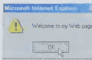

## 识别网页浏览器

- 识别访问者使用的特定网页浏览器并将浏览器名称插入屏幕文本，是 JavaScript 的一项功能。

## 了解你的浏览器

看到你正在使用 Microsoft Internet Explorer 浏览器。此页面将帮助你了解更多关于浏览器的信息。使用页面底部的按钮访问主要浏览器厂商网站，或阅读浏览器历史。

> 如需进行自己的研究，请点击这些链接访问我们的领先 Web 目录列表和推荐的搜索引擎列表。

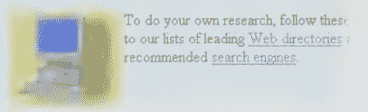

## 在状态栏显示文本

- 在这种情况下，文本出现在屏幕底部的状态栏，作为指针悬经过页面上链接的响应，这是在 JavaScript 代码中定义的。

在页面底部访问主要浏览器厂商网站，或阅读浏览器历史。

> 如需进行自己的研究，请点击这些链接访问我们的领先 Web 目录和搜索引擎列表。

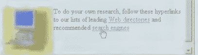

尝试使用这些顶级搜索引擎之一进行搜索。

## 事件背后的 JavaScript

通过我们刚刚看到的序列并查看 HTML 源代码，我们可以看到如何通过嵌入 HTML 中的短短几行 JavaScript 实现这些效果的。注释强调了关于 JavaScript 外观和用途的几点，这些将在本书书中详细介绍。

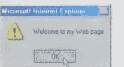

这导致在页面打开时弹出上述警告框。

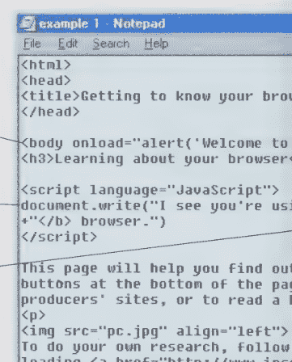

`document.write` 命令将引号内的所有内容以及 `+` 号之间的所有内容写入网页。

此代码 `(navigator.appName)` 检测访问者的浏览器类型，并将浏览器类型动态地写入网页。

## 让事情发生

我们刚刚看到的窗口中的活动元素（警告框的出现、对用户浏览器的识别以及光标移动到链接上时在状态栏看到的文本）都由嵌入此 HTML 文档的 JavaScript 控制。

## JavaScript 语法

### 文本中的引号
在文本“字符串”中使用引号时要小心，因为它们可能会严重误导浏览器代码从何处结束以及文本从哪里开始。规则是，你应该在双引号内使用单引号。例如：`document.write ("Be very 'careful' about using quote marks.")`

### 分号
在每行代码末尾加上分号是一个可选的但有用的习惯。这个标点符号明确地告诉浏览器新行代码开始了。虽然最流行的网页浏览器的新版本可能能够自行判断新行代码开始的位置，但现在缺少分号可能会导致混乱。

## JavaScript 基础

在初次接触这种语言时，识别如何将 JavaScript 代码块放入 HTML 文档中是你需要掌握的基础知识之一。

### 识别 JavaScript

JavaScript 代码行需要与 HTML 代码分开识别。如果你查看包含 JavaScript 的任何 HTML 文档源代码，如果 JavaScript 代码包含在 `<script>` 标签内，最容易被识别。

- 当代码放在 `<script>` 和 `</script>` 标签之间时，大多数浏览器都会假设编码的代码被作为 JavaScript 读取。
- 大多数浏览器将 JavaScript 作为默认值，但在这些标签内也可以其他脚本（例如 VBScript）。为了这一点，建议指定正在使用的编程语言，在这种情况下，通过将第一个标签设置为 `<script language="JavaScript">`。

```javascript
How to use script tags.txt - Notepad
<script language="JavaScript">
...... place your JavaScript code here......
</script>
```

### 在任何地方嵌入 JavaScript
当包含在 `<script>` 标签内时，JavaScript 可以嵌入 HTML 文档的任何位置（只要不与 HTML 规则冲突），并根据需要多次使用。如果脚本与页面上的按钮有关，可以将代码放置在页面上该 HTML 块旁边。但大多数情况下，JavaScript 被放置在文档的 `<head>` 部分。

## 使用 <head> 标签
当你打开网页时，`<head>` 标签内的代码会在网页显示之前加载。在例例中，一个警告框会在你的屏幕上弹出。

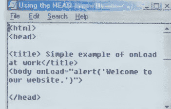

## 使用函数
`<script>` 标签内的任何代码并不强制要求出现在页面下方，但使用函数是一个良好的习惯。

```javascript
<script language="JavaScript">
function myFunction() {
  // 这里的 JavaScript 语句取决于你的决定
}
</script>
```

## 识别 JavaScript 的重要性
识别 JavaScript 代码的能力将帮助你识别他人页面中你可以学习、调整并适用于你自己的部分。此外，有时你需要修改第三方软件生成的 JavaScript。即使是最好的 HTML 设计包有时也会陷入混乱，让你除了打开源代码进行调试外别无选择。

## 事件处理器
某些 JavaScript 代码不需要放在 `<script>` 标签内。通常，这些实例被称为事件处理器。示例包括访问者点击鼠标或光标移动到文本或图像上时触发事件的命令。出现在这些命令后的引号内的任何内容都会浏览器解释为 JavaScript 并进行相应的处理。

### 事件处理器实例
- 事件处理器是以 "on" 开头的单词，后跟着一个大写字母开头的动词。例如：onClick, onChange, onload, onSubmit 或 onMouseOver。
- 在此例中，onUnload 被用来调用警告。

```html
<html>
<title>onUnload 工作的简单示例</title>
<body onUnload="alert('Thanks for visiting. Call again soon.')"><p>当你离开此网页或退出网页浏览器时，将出一个警告框，其中包含你为警告框指定的文字。</p>
<p>注意在此例中你不需要使用 "javascript" 标签。</p>
</</body>
</html>
```


## JavaScript 函数

JavaScript 使用一种称为“函数”的编程工具来更高效地工作。一旦你理解了函数是如何融入整体规划的，你就应该能够将整页代码拆解为结构上有意义的内容。

## 函数的作用

- 函数是一系列经过命名的命令，通常包含在 `<head>` 标签内。
- 一旦创建了函数，你就可以在页面的后续部分通过单行代码任意多次地“调用”它，而不需要在 `<body>` 中输入很长块代码。

```html
<html
<head>
  <title>The main Oscars - by year</title>
  <script language="JavaScript">
    function showA(awards) {
      alert(awards)
    }
  </script>
</head>
<body bgcolor="cyan">
  <h2>Academy Awards For 1951</h2>
  <form>
    <input type="button" value="Best Film" onclick="showA('All Eve')">
    <input type="button" value="Best Director" onclick="showA('Joseph L. Mankiewicz')">
    <input type="button" value="Best Actor" onclick="showA('Jose Ferrer')">
    <input type="button" value="Best Actress" onclick="showA('Judy Holliday')">
  </form>
</body>
</html>
```

- 函数的功能和本质是由作者决定的。
- 在此例中，函数 `showA` 被用于在点击按钮时弹出一个相应的警告框（Alert box）。

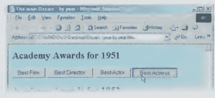

- 点击“最佳女演员”会触发函数运行并弹出一个包含“Judy Holliday”字字的警告框。

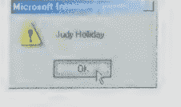

## 在记事本中编写 JavaScript

你不需要任何特殊的软件来编写 JavaScript。事实上，在你刚开始时，使用手头最简单的文本编辑器最好。Windows 98 自带的记事本（Notepad）提供了一个很好且实用的工具。无论你使用哪种编辑器，都需要将脚本保存为“纯文本”格式。这样，如果你从保存的文件中复制粘贴 JavaScript 代码，就能确保你没有复制到文字处理程序插入其中的代码。

- 使用记事本，你可以直接将 JavaScript 写入 HTML 文档中，也可以单独编写 JavaScript 并保存文件，然后稍后将脚本复制粘贴到 HTML 文档中。
- 在这里，我们在一个新的记事本文档中编写了两个脚本，并为每个脚本提供一个描述性的标题，以便我们稍后识别它们。

```
Untitled - Notepad
File Edit Search Help
SCRIPT 1 - Name Browser
<script language="JavaScript">
document.write("Welcome to my Web site. I see you are using the " + navigator.appName + " <b> Web browser</b>")
</script>

SCRIPT 2 - Send main browser users to different intro pages
<script language="JavaScript">
if (navigator.appName == "Netscape")
location.href="nsintro.htm"

if (navigator.appName == "Microsoft Internet Explorer")
location.href="ieintro.htm"
</script>
```

## 保存文档

- 脚本完成后，将文档保存到命名适当的文件夹中。
- 如果你正在创建一个包含 JavaScript 的 HTML 文档，请将其保存为具有 .htm 或 .html 扩展名的 HTML 文档。

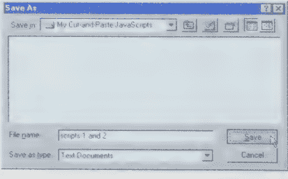

- 复制粘贴脚本

## 复制粘贴脚本

- 当你准备好将代码嵌入 HTML 文档时，只需在记事本中打开该文件，如图所示选中你想要的脚本，然后将其复制到网页 HTML 代码的相关部分。

```
SCRIPT 2 - Send main browser users to different pages
<script language="JavaScript">
if (navigator.appName == "Netscape") {
location.href="intro";
} else if (navigator.appName == "Internet Explorer") {
location.href="intro";
}
</script>
```

## 有用的脚本工具

书中几乎所有的示例都是在记事本中创建的，但并没有阻止你使用其他编辑器。你可以使用任何喜欢的文本编辑器，只要保存文件时使用正确的扩展名即可。

- Macromedia Dreamweaver：一个强大的工具，允许你视觉化地设计网站。
- Microsoft FrontPage：用于创建网页的旧工具。
- 其他文本编辑器：记事本、TextEdit 以及许多其他。

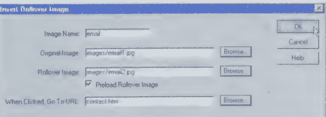


# 不支持 JavaScript 的浏览器

此处网页是在启用了 JavaScript 的浏览器中查看的。对于无法处理 JavaScript 的浏览器，提供了一个指向页面纯文本版本的链接。虽然这需要更多工作，但将使你的网页具有更广泛的可用性。

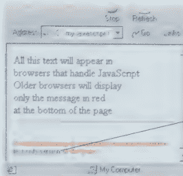

指向页面纯文本版本的链接

## 为少数群体提供服务

为使用非 JavaScript 浏览器访问你网站的用户提供服务是一个网站设计问题，可以通过多种方式来解决。编写一个既包含 JavaScript 但又为无法访问 JavaScript 内容的任何人提供足够信息的页面，需要周密的规划。解决方案取决于你正在构建的网页的性质、它们包含的信息以及你的尽心程度。有些作者为旧版浏览器用户设计了单独的页面。另一些则提供指向页面纯文本版本的链接。有些作者简单地包含一条消息显示：“您的网页浏览器无法处理此页面；也许是时候升级您的浏览器了，”然后就再此结束。

## 浏览器与 JavaScript

## 能处理 JavaScript 的浏览器

| 浏览器 | 版本 |
| :--- | :--- |
| Netscape Navigator 2 | JavaScript 1.0 |
| Netscape Navigator 3 | JavaScript 1.1 |
| Netscape Navigator 4+ | JavaScript 1.2 |
| Internet Explorer 3 | Jscript |
| Internet Explorer 4+ | Jscript 1.2 |
| Internet Explorer 5 | |

## 无法处理 JavaScript 的浏览器

| 浏览器 | 版本 |
| :--- | :--- |
| AOL Browser | 1.3 |
| Mosaic | 1.3 |
| Netscape Navigator | 1.1 |
| Internet Explorer | 1.2 |
| Lynx | |

Opera 3.5, 4 以及其他近期浏览器

## 使用 JavaScript

在网页源代码中使用 JavaScript 的用法可以是广泛的，但在本章中，我们将查看一些最常用的代码使用方式。

## 写入文档

在 JavaScript 可用的所有命令中，最广泛之一是 `document.write`。它允许你使用 JavaScript 将文本写入浏览器窗口。然而，随而产生的问题是，既然你可以用 HTML 实现相同的事情，为什么还想使用 JavaScript 命令呢？

## 动态与静态写入

“write”命令（或使用正确术语称为“方法”）的意义在于，它允许你使用比 HTML 广得多的选项向浏览器窗口写入信息。浏览器窗口只显示你在文档源代码中编写的文本。使用 `document.write` 方法，显示的文本可以取决于从访问者那里获得的信息。这可以包括“外部”信息，例如访问者的浏览器类型和版本、日期和时间以及之前访问过的页面数量。它还可以包括访问者通过提示框（prompt boxes）提供的信息。

## 标签或事件处理程序

如果你想向浏览器窗口写入包含此类任何信息的任何内容，你必须使用 `document.write` 方法；并且由于它是 JavaScript 命令，它必须出现在 `<script>` 和 `</script>` 标签之间，或者在事件处理器内部。

## DOCUMENT.WRITE 语法

| 要使用 `document.write()` 方法，你想写入屏幕上的信息必须放在命令后的引号内，除了文本字符串内的空格外，不留任何字母空格：document.write("在此处添加你的文本”）。 |

## 写入文档 · 23

## DOCUMENT.WRITE 命令

这是一个使用 `document.write()` 命令的 JavaScript 代码简单示例。它将莎士比亚十四行诗之一的前四行写入了浏览器窗口；尽管在这种情况下，这并不是响应外部信息的。

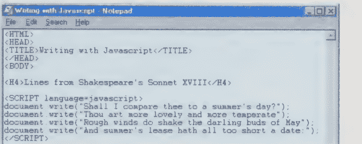

```html
<HTML>
<HEAD>
<TITLE>使用 JavaScript 写入</TITLE>
</HEAD>
<<body>
<H4>来自莎士比亚十四行诗 XVIII 的行诗</H4>

<script>
document.write("Shall compare thee to a summer's day?");
document.write("Thou art lovely and more temperate;");
document.write("Rough winds do shake the darling buds of");
document.write("And summer's lease to date");
</script>
```

它将莎士比亚十四行诗之一的前四行写入了浏览器窗口；尽管在这种情况下，这并不是响应外部信息的。

document.write("Shall compare thee to a summer's day?");
document.write("Thou art lovely and more temperate;");
document.write("Rough winds do shake the darling buds of");
document.write("And summer's lease to date");

注意，显示的文本可以取决于从访问者那里获得的信息。这可以包括“外部”信息，例如访问者的浏览器类型和版本、日期和时间以及之前访问过的页面数量。它还可以包括访问者通过提示框提供的信息。

来自莎士比亚十四行诗 XVIII 的行诗
Shall compare thee to a summer's day?
Thou art lovely and more temperate;
Rough winds do shake the darling buds of;
And summer's lease to date;

## 使用 JavaScript

在网页源代码中使用 JavaScript 的用法可以是广泛的，但在本章中，我们将查看一些最常用的代码使用方式。

## 写入文档

在 JavaScript 可用的所有命令中，最广泛之一是 `document.write`。它允许你使用 JavaScript 将文本写入浏览器窗口。然而，随之产生的问题是，既然你可以用 HTML 实现相同的事情，为什么还想使用 JavaScript 命令呢？

## 动态与静态写入

“write”命令（或使用正确术语称为“方法”）的意义在于，它允许你使用比 HTML 广得多的选项向浏览器窗口写入信息。浏览器窗口只显示你在文档源代码中编写的文本。使用 `document.write` 方法，显示的文本可以取决于从访问者那里获得的信息。这可以包括“外部”信息，例如访问者的浏览器类型和版本、日期和时间以及之前访问过的页面数量。它还可以包括访问者通过提示框提供的信息。

## 标签或事件处理程序

如果你想向浏览器窗口写入包含此类任何信息的任何内容，你必须使用 `document.write` 方法；并且由于它是 JavaScript 命令，它必须出现在 `<script>` 和 `</script>` 标签之间，或者在事件处理器内部。

## DOCUMENT.WRITE 语法

| 要使用 `document.write()` 方法，你想写入屏幕上的信息必须放在命令后的引号内，除了文本字符串内的空格外，不留任何字母空格：document.write("在此处添加你的文本”）。 |

## 连接

连接（Catenating）是将元素组合在一起的过程，通常是：你可以在同一行连接多个字符串：

- 1 我看到你正在
- 2 navigator.appName。这标识了应用程序（属性）
- 3 我看到你正在使用的 <b>
- 4 标签关闭并显示了。

```html
<script language="JavaScript">
document.write("I看到你正在使用的" + navigator.appName + "</b>");
</script>
```

```
了解你的浏览器 - Internet Explorer
我看到你正在使用的
```

## 使用 JavaScript

在网页源代码中使用 JavaScript 的用法可以是广泛的，但在本章中，我们将查看一些最常用的代码使用方式。

## 写入文档

在 JavaScript 可用的所有命令中，最广泛之一是 `document.write`。它允许你使用 JavaScript 将文本写入浏览器窗口。然而，随之产生的问题是，既然你可以用 HTML 实现相同的事情，为什么还想使用 JavaScript 命令呢？


## 弹出框

让你的网页活跃起来并让网站访问者直接参与的最简单方法之一是使用 JavaScript 的 Alert（警告）、Confirm（确认）和 Prompt（提示）弹出对话框。

## JavaScript 对话框

三类 JavaScript 对话框有一个共同的重要特征：一旦其中任何一个框在屏幕上弹出，网页内的所有活动都将冻结，直到点击对话框中的相应按钮为止。例如，一旦 Alert 框弹出，一切都会冻结，直到点击了 OK 按钮。屏幕上的 Alert 框无法被发送到浏览器窗口的后方。当 Alert 框显示时，你无法点击浏览器窗口的主区域。唯一可能的操作是点击框中的 OK 按钮。这种活动挂起的情况同样适用于 Confirm 和 Prompt 框。

## JAVASCRIPT 弹出框

- Alert 框是是最简单的一种框，主要用于捕获访问者的注意。
- Confirm 框也也用以这种方式使用，但它有一个 Cancel（取消）按钮，因此访问者也可以选择拒绝某个选项。
- Prompt 框则更进一步，提示访问者输入某种类型的信息。

## 案例分析

如果你好奇为什么在 JavaScript 的变量、函数和其他名称中到处都是大写字母，简单的答案是约定。无论你使用拼写 `myvariable`、`MyVariable` 还是 `myVARIABLE` 并不重要，但在文档正文中的拼写方式必须完全匹配，否则你的代码可能会失败。由于某种原因，大多数人倾向于对函数和变量使用小写，并将大写字母留给名称中后续单词的首字母，例如 `myVariable`。

## ALERT 框

`alert` 方法用于吸引访问者的注意。例如，一行 JavaScript 代码就可以创建一个简单的欢迎公告。Alert 框还可以用来公布更复杂的 JavaScript 检测脚本的结果，例如访问者是否拥有查看你网站所需的所有插件。你可以选择创建任何你喜欢的复杂公告，但如此示例所示，启动 Alert 框的代码非常直观。

## 一个欢迎的 ALERT 框

- 此示例显示了如何生成一个欢迎访问者进入“WebVerse”网站的 Alert 框。
- 无论内容是什么，语法都是一样的。
- 状态栏显示 Alert 框的出现冻结了网页的加载。`window.alert` 代码位于 `head` 中，在点击 OK 按钮之前，页面将不会继续加载。

## Prompt 框

JavaScript Prompt 框提供了一个文本字段，网页的访问者可以在其中输入对问题的回答。该框有一个 OK 按钮、一个 Cancel 按钮以及一个用于存放访问者输入响应的文本框。Prompt 框必须通过点击其中一个按钮来关闭，才能继续操作。Prompt 框允许你捕获在那里输入的数据并在其他地方使用它。这些信息随后如何被使用取决于网页的要求以及作者的技能和创造力。

## PROMPT 框的演示

- 在这个典型的示例中，访问者被邀请在 Prompt 框的字段中输入他们的名字并点击 OK 按钮。
- 随后，访问者的名字将出现在屏幕上的问候中，该问候一直持续到点击 OK 按钮。
- 然后，浏览器窗口中显示的网页将在文本中包含了访问者的名字。

## 在 PROMPT 框中使用变量

- 如此代码所示，为了使用访问者提供的内容，你需要创建一个变量名。`window.prompt()` 捕获了访问者的名字，但只有当你将其与变量（例如 `vName`）关联时你才能使用它。
- 当结合 `document.write()` 使用时，变量可以放置在网页的任何位置。

## WINDOW.PROMPT 语法

`prompt` 方法必须在 `<script>` 标签内使用。第一个字符串包含弹出对话框的内容（通常是你向访问者提的问题）。在代码中，你定义问题的方式与定义 Alert 框的方式完全相同。然而，通过 `window.prompt()`，你可以使用一个可选的第二个字符串来确定将出现在文本字段中的文本。这通常填入对访问者有帮助的内容，如“在此处输入回复”，访问者可以立即输入。如果第二个字符串留空（即你只保留了引号），并且访问者在没有向文本框输入任何内容的情况下点击了 OK，则网页上的相应位置将不会出现任何内容。要在 JavaScript 中创建变量，首先为变量选择一个名称，然后使用以下语法说明变量代表的含义：`varVariableName=value`。你可以为变量选择任何名称，但给它一个描述性的名称以显示其包含的内容，这样会更有帮助。

## Confirm 框

Confirm 框本质上是 Alert 框，但提供了两个按钮的选择：OK 或 Cancel（等同于是或否）。除非你能对访问者的响应做一些有用的事情，否则使用 `window.confirm()` 方法几乎没有意义。为了充分利用这个 OK 或 Cancel 响应，你需要学习如何在 JavaScript 中使用 `if...else` 语句。

## 使用 IF...语句

- 这是一个简单的示例，显示你有时仅通过使用 `if` 子句就能得到你想要。点击订阅链接会弹出一个 Confirm 框。
- 控制 Confirm 框的代码提供了一个条件句。这决定了点击 OK 按钮的效果。

```html
<html>
<head>
<script language="JavaScript">
if (confirm("To subscribe to the newsletter\nclick OK")) {
location="subscribe.htm"
}
</script>
</head>
</html>
```

- 如果访问者点击 OK 按钮，他们将被带到定义的 URL。

访问者现在被带到了定义的 URL（在此情况下，是订阅页面 `subscribe.htm`）。

然而，如果访问者点击 Cancel 按钮，他们将留在原页面，因为没有定义其他操作。为了提供第二个选项，你需要使用 `else` 语句。在这个示例中，`else` 语句被用于定义第二个 URL（在此情况下是 `nonsubs.htm`），如果访问者点击 Cancel 按钮，他们将被发送到那里。

```html
<html>
<head>
<script language="JavaScript">
if (confirm("To subscribe to the newsletter\nclick OK")) {
  location.href='subscribe.htm';
}
else {
  location.href='nonsubs.htm';
}
</script>
</head>
</html>
```

## 弹出框

现在 `else` 子句已经写入 JavaScript 中，点击 Cancel 按钮将不仅仅是让访问者留在原始窗口。

相反，`nonsubs.htm` 窗口将打开，正如 `else` 子句定义的那样。该窗口被用于为选择不订阅的访问者提供网站内的更多选择。

## WINDOW.CONFIRM 语法

`window.confirm()` 语句产生一个弹出窗口，为访问者提供操作选择。他们可以通过点击 OK 按钮来接受行动，或通过点击 Cancel 按钮来拒绝。呈现给访问者的选择由你在引号引号内输入的文本组成。点击 OK 将访问者带到代码定义的地点。


# JAVASCRIPT 术语

如果你想让你的网页编写技能超越简单的编码并与其他作者交流，你需要理解构建 JavaScript 基础的“层次结构”；这包括理解“对象（object）”、“属性（property)”和“方法（method)”这三个核心概念的关系。这些示例仅显示与 window 对象相关的少量属性和方法，但原理适用于所有的 JavaScript 对象、属性和方法。

## 对象 (OBJECT)

- JavaScript 中的对象是一个通常可以分解为子类或部分的实体。它也可以被执行操作，或者作为作用的对象。对象包括 window、form、image 和 button。

```
syntax alert.txt - 记事本
文件 编辑 搜索 帮助
object

示例：代表 Web 的 window
'window' 对象，浏览器窗口是主要的 JavaScript 对象。
```

> 从语法术语上说，对象等相当于 JavaScript 中的名词

## 属性 (PROPERTY)

- JavaScript 中的属性是有助于定义对象的性质——通过提供一个子类或描述一个名词。例如，图像的属性包括它的名称、边框、高度和宽度。

```
无标题 - 记事本
文件 编辑 搜索 帮助
object.property

示例：window.document
window.history
window.frames
window.location
```

> 在 JavaScript 代码中，属性紧随其所定义的对象之后，并用点号分隔

## 方法 (METHOD)

- 方法描述了可以应用于对象的操作。在本章中，将描述了 window 对象的 alert、confirm 和 prompt 方法。

```
无标题 - 记事本
文件 编辑 搜索 帮助
object.method

示例：window.alert()
window.prompt()
window.confirm()
window.open()
```

> 在 JavaScript 中，方法作用于对象的方式就像动词作用于名词的方式一样

## 鼠标悬停 (MOUSEOVERS)

Mouseover 描述了浏览器窗口内发生的某些活动，这些活动是鼠标光标移动或点击鼠标按钮的直接结果。

## 状态栏的功能 (FUNCTIONS OF THE STATUS BAR)

出现在网页浏览器状态栏中的文本可以在你查看网页时提供有用信息。状态栏内容的变化通常由鼠标光标的移动和动作触发。

## 状态栏 (THE STATUS BAR)

- 状态栏位于浏览器窗口的底部。状态栏中的文本可以根据浏览器窗口当前正在发生或刚刚发生的活动而变化。
- 例如，状态栏中的文本将告诉你网页正在打开，并为你提供该站的 URL，如此示例所示。

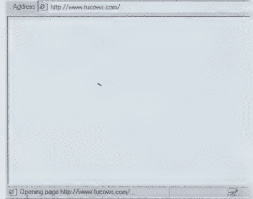

> * 状态栏显示正在加载的文档的 URL

- 状态栏还会通过显示 Done（完成）一字来告诉你文档已加载完毕。

> * 当文档加载完成后，会显示 Done

当鼠标移动在超链接文本或图像上时，它还会显示链接的 URL，但正如我们将在下文中看到的，URL 并不总是最有用的信息。这正是 JavaScript 可以派上用场。


## 充分利用状态栏 (MAKING MORE OF THE STATUS BAR)

通过使用 JavaScript 定义 `window.status` 属性，你可以在鼠标光标悬停在超链接上时使用状态栏提供有用信息。这可以使你的网页更有趣、更动态。

## 使用 ONMOUSEOVER (USING ONMOUSEOVER)

此超链接（如出现在网页 HTML 代码的 `<a href>` 和 `<a>` 标签之间）当鼠标光标悬停在超链接文本上时，默认会出现在状态栏中。

在此处显示的示例中，包含在 

 中的 URL 将...（此处由于原文不完整，翻译至此结束）


## 编写 JAVASCRIPT

- 现在是时候编写鼠标悬停效果的代码了。
- 当鼠标光标移动到现有图像（`off.jpg`）上时，代码会加载图像文件 `on.jpg`，替换初始按钮图像，从而营造出按钮被按下的错觉。

```html
<html>
<title>Example of a simple rollover</title>
<body>
<<h4>下方的示例显示了一个非常简单的鼠标悬停效果。</h4>
<a href="#" onmouseover="document.image.src='on.jpg';return true">
</a>
</body>
</html>
```

- 在添加 `onmouseout`（此处）命令之前，即使鼠标光标移开，按钮也将一直保持在按下状态。图像空间将继续被 `on.jpg` 占据。

下面的示例显示：

下面的示例显示：


## 4 添加 ONMOUSE

- 为了完成悬停效果并将 `off.jpg` 到图像空间，你需要添加 `onmouseout` 命令。它的位置紧跟在 `onmouseover` 语句之后，但仍保留在 `<a href>` 和 `</a>` HTML 标签内部。

```html
<html>
<title>Example of a simple rollover</title>
<body>
<<h4>下方的示例显示了一个非常简单的鼠标悬停效果。</h4>
<a href="#" onmouseover="document.image.src='on.jpg';return true"
onmouseout="document.image.src='off.jpg'; return true">
</a>
</body>
</html>
```

## 将图像制作为活链接

为了简单起见，在这个示例中，我们为图像使用了死链接（`#`）。如果有人点击图像，什么都不会发生。在此处放置活链接只需将 `#` 替换为适当的 URL 即可。

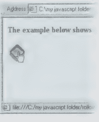
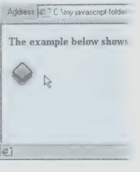

## name 标签 (name tag)

将页面上由 name 标签标识的区域视为图像占据的空间。根据光标的操作，`on.jpg` 和 `off.jpg` 文件将占据名为 `image` 的空间。

## 预加载图像

你可以使用 JavaScript 预加载图像。这意味着当你的网页在访问者的浏览器窗口中首次加载时，你可以将指定的图像发送到浏览器缓存（缓存是你计算机上存储最近访问的网页的文件夹）。如果网页缓存在此处，浏览器访问它的速度将比访问远程服务器更快。悬停效果所需的某些图像在页面加载之前是不可见的。这些图像可以很有用地预加载到缓存中，这样它们在需要时就能立即显示出来，而不会受到从网络下载时通常发生的轻微延迟的影响。

## 预加载 ON.JPG

当我们悬停在 `off.jpg` 上时让 `on.jpg` 出现的代码位于网页的 body，但预加载 `on.jpg` 的代码位于内部的 `<head>` 标签内。

```html
<head>
<script language="JavaScript">
  Image=new Image(20,20)
  Image.src="on.jpg"
</script>
</head>
```

## 预加载多个图像

`Image1` 是一个变量，你可以选择喜欢的任何名称，但建议保持简单。`new Image` 后括号中的信息告诉浏览器图像以像素为单位的尺寸。意思是：“在页面上留出这些尺寸的空间，并用名为 Image1 的新图像填充它。我只是告诉你你可以在哪里找到它。”`Image1` 提供了位置。如果你想预加载多个图像，只需重复该公式，并将所有内容保留在 script 标签内。例如：`Image2=new Image(100,50); Image2.src="services2.jpg"; Image3=new Image(120,50); Image3.src="contact2.jpg";` 这告诉浏览器预加载两个具有指定尺寸的图像，并为它们都分配了变量名（`Image2` 和 `Image3`）。起初，这些看似相同图像的大量名称可能看起来令人困惑，但一旦理解，它其实非常简单。

## 工作原理

在这个示例中，`Image1` 是标识加载图像 `off.jpg` 空间的名称。该空间在网页首次显示时会被填充。如果访问者没有将光标移动到该空间（即该图像），则什么都不会发生。然而，如果鼠标光标移动到名为 `Image1` 的空间，浏览器将检查文件夹查看是否已加载了任何图像用于该空间；它将找到 `on.jpg`，这就是浏览器正在调用的图像。


- 1. 标识空间
- 2. 将显示的图像
- 3. 光标移动时的图像
- 4. 名为 "Image1" 的空间


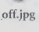

## 新窗口 (NEW WINDOWS)

### 新窗口

你是否好奇过网站是如何使用弹出窗口的？

### 方法 (THE WINDOW METHOD)

`open()` 方法创建一个新窗口。可以使用 JavaScript 或排除窗口的特性。

### OPEN() 语法

`open()` 方法允许你指定 URL、窗口名称以及新窗口的特性。

- 1. 你想要加载到新窗口中的内容
- 2. 将触发显示的事件
- 3. 新窗口的特性

## 打开新窗口

使用 JavaScript 打开新窗口非常简单。只需将此代码放入你的 HTML 文档中：

```javascript
window.open("url", "name", "features");
```

## 设计新窗口

网页浏览器的外观根据用户的偏好有很大不同。在决定为任何打算创建的新窗口包含或省略哪些特性时，你需要考虑所有的浏览器设置。仅仅因为你无法在屏幕上看到某个浏览器功能，并不意味着你网站的访问者的浏览器配置也是完全相同的。因此，即使你在浏览器中关闭了工具栏，也要记住使用 `toolbar=no` 代码，以确保在所有浏览器中查看时新窗口中都不显示工具栏。

## 可选方案

这个典型的网页显示了当你使用 JavaScript 打开新窗口时，可以包含或排除的浏览器窗口特性。

## 禁用特性

当新窗口加载时，所有这些特性默认都是激活的。要禁用其中任何一个，请使用此代码：`menubar=no toolbar=no scrollbars=no status=no resizeable=no`。


## 定义其他功能

还有许多可以整合到新窗口中的其他可选功能，但其中某些功能仅“符合 JavaScript 1.2 标准”，这意味着它们在较旧版本的 Internet Explorer、Netscape Navigator 以及其他浏览器中将无法工作。

新窗口左上角的 x 和 y 坐标可以根据屏幕桌面左侧和顶部的像素数来定义。其语法为：`screen=pixels`（x 坐标），`screen=pixels`（y 坐标）。例如，输入"screen=200,"的效果是将新窗口的左上角置于屏幕桌面左侧 200 像素处。

这些功能中最实用的是允许你定义新窗口弹出的屏幕位置。两者


## 定义宽度和高度

要定义新窗口的尺寸，请使用宽度和高度设置`width=pixels`（例如 `height=320`）。用逗号隔开每个功能设置：`width=350,menubar=no,status=no,resizable=no`。

## 使用 YES 设置功能

当你查看他人的源代码时（如果你决定学习更多 JavaScript，强烈建议你这样做），你会注意到 "feature=yes" 的使用。既然所有功能默认都是开启的，为什么还要费心章章刻意激活某个功能呢？使用 "yes" 实际上对新窗口的组成有不同的影响。如果你使用 "feature=yes"，你将特地激活该功能并禁用所有其他功能。“除了我明确说明要激活的功能（通过使用 'feature=yes'）之外，所有功能都应该被禁用。”无论你使用哪种方法，纯粹取决于个人喜好。

是新千年的一家新管理咨询公司。我们主要关注

## 加载现有文档

在决定新窗口的组成后，我们就可以专注于放入其中的材料了。生成新窗口内容主要有两种方法。你可以从现有的网页生成新网页的内容，也可以从与主网页加载的内容并动态生成（或“即时生成”）的内容。在这里我们将介绍这些方法中的第一种。

## 定义要插入的网页

- • 要用另一个 HTML 文档填充此窗口，请根据需要替换语法中的 URL 部分：`document.write(\URL","name","features")`。除非你要使用在另一个网站上找到网页，否则你需要先创建要加载到新窗口的文档。（在使用来自另一个网站的网页之前，你必须获得该网站所有者的许可。）在此所示示例中，主页面名为 sonnet.htm，要加载到页面中的文档名为 18.htm。下方展示了其实效果。

## 触发动作

- 你现在已经决定了新窗口的功能以及要加载其中的内容。剩下的只需决定什么来触发新窗口的出现。一个典型且直接的解决方案是使用超链接或按钮。这里的示例（代码请见另一侧）使用超链接和 `onClick` 事件处理器来打开新窗口。

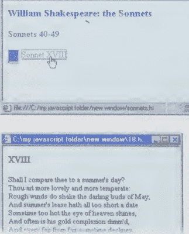

- 代码元素
- JavaScript 事件处理程序

## 代码元素

- **1** 因为我们在这里使用了 `onClick` 事件处理器，所以不需要使用 `<script>` 标签。所有脚本都包含在 HTML 锚标签 `<a href="#"></a></a>` 中。

- **2** 首先输入将“调用”新窗口的文档名称——

- **3** 接下来是 `window.open()` 命令。注意 `window.open()` 命令的引号和括号，这些是新窗口的组成元素。

- **4** 将有关新窗口的参数（通过使用 "feature=yes"）放在括号内。新显示的将是 sonnet。

- **5** 最后，可见的文本是 18。


## 向新窗口即时写入

填充新窗口的第二种方法是在 HTML 体中使用 `document.write()` 方法。

## 代码分解

- **1** 在 `<head>` 部分创建一个函数 (rhymenote)。
- **2** 这创建了一个变量。
- **3** `document.write("
- **4** 在这种情况下，它是 sonnet.htm。
- **5** sonnets
- **6** 由于我们处于 `onClick` 事件处理器中，不需要使用 `<script>` 标签。

```html
<html>
<head>
<title>文艺复兴</title>
<script language="JavaScript">
function rhymenote() {
var rhymin=window.open("sonnet.htm", "rhyme", "us=yes,height=220,width=220");
rhymin.write("<h2>韵律方案</h2> + "<p>十四律诗是用五步格律所写的。结尾对韵句通常是</p>");
}
</script>
</head>
<body>
<h1>威廉·莎士比亚</h1>
<a href="sonnets.htm" onclick="rhymenote()">sonnets</a>
</body>
</html>
```

## 使用函数

- 正如所见，函数 (rhymenote) 已位于文档的 `<head>` 部分。它通过点击超链接来激活。

- 韵律方案。随后，HTML 锚标签 `<a href="...">...</a>` 中的所有代码都将写入新窗口，从而打开新网页。

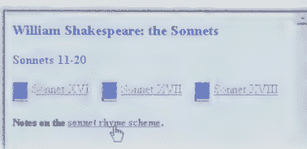

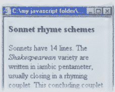

## 代码元素关键

- "rhymenote()" 调用之前定义的函数
- 韵律方案 这是以超链接形式出现在网页上的文本。点击此项将使 rhymemote 函数生效。换句话说， 4 中定义的网页将被写入 2 和 3 定义的新窗口中。

十四诗集/


## 关闭二级窗口

没有菜单栏的窗口的一个主要用途是作为“信息框”——这是一个弹出的窗口，提供供读者阅读并关闭的材料。虽然访问者可以通过点击此微窗口右上角的关闭 [x] 框来关闭窗口，但如果你在页面中提供一个“关闭”链接或按钮，操作起来会更方便。

## 关闭命令

- 用于打开它的元素；即文本超链接或按钮。
- 要触发窗口关闭命令，你通常会使用与（打开新窗口时）相同的技术。
- 然后，你将关闭命令嵌入到加载到新窗口的材料中。因此，如果你正在加载一个新文档（例如 18.htm），窗口关闭命令必须出现在该页面的相应位置。

永恒的夏日永不凋零。
死亡的占有也不让流浪在其阴影中徘徊。
美景也不会随时间流逝；
只要人类还能奔跑，眼睛还能看见。
此诗将长存，并赋予你生命。

```html
<a href="self.close()">关闭窗口</a>
```


### XVIII
我可将你比作夏日吗？
狂风摇撼着五月的宠儿，
夏日的租期太过于短暂；
每种容颜都因偶然而暗淡；
但永恒的夏日永不凋零，
你所拥有的美丽永不失去；
当境遇使美景随时间改变，
只要人类还能呼吸，眼睛还能看见，
此诗将长存，并赋予你生命。

```html
<a href="self.close()">关闭此窗口</a>
```

将此行代码放置在 HTML 源代码中你希望它在网页上出现的位置（即示例中的页面底部）

关闭窗口

### “链接法”

要使用超链接关闭新窗口，首先创建一个不通往任何地方的链接；要执行此操作，请保留引号，但在通常应出现链接文档或 URL 的地方留空：`<a href=""></a>`。然后， `<` 和 `>` 字符之间输入你希望在页面上显示的超链接文本，例如：`<a href="">关闭窗口</a>`。然后，在空引号后紧接着添加 JavaScript 代码：`<a href="self.close()">关闭此窗口</a>`。

## 链接法是如何工作的？

当此网页的访问者点击“关闭此窗口”超链接时，浏览器会尝试跳转到新页面。由于没有页面可以跳转，浏览器将遵循 JavaScript 代码提供的指令并关闭该页面。如果你尝试在引号之间放入 URL，你会发现超链接将带你去往该 URL，从而覆盖 JavaScript 指令。

## 使用关闭按钮

如本示例所示，要使用“关闭”按钮关闭新窗口，你需要将 JavaScript 代码放置在页面上你希望按钮出现的位置。这个显而易见的地方似乎是页面底部，因此代码可以放置在 `</html>` 标签之前。

```html
不再失去那美色的占有。
死亡的眉目也不让你在其阴影中徘徊，
当你在永恒的诗句中成长。
只要人类还能呼吸，眼睛还能看见，
此诗长存，并赋予他们生命。

<form>
<input type="button" value="关闭" onclick="self.close()">
</form>

</html>
```

夏日的租期已改变，
有些东西在金眼中是永恒，
每种美景随人类而改变，
通过改变而永恒的夏日将不再
不再失去那美色的占有
死亡的眉目也不让你在徘徊
当永恒的诗句随时间
只要人类还能呼吸
此诗长存

## 链接法是如何工作的？

当此网页的访问者点击“关闭此窗口”超链接时，浏览器会尝试跳转到新页面。由于没有页面可以跳转，浏览器将遵循 JavaScript 代码提供的指令并关闭该页面。如果你尝试在引号之间放入 URL，你会发现超链接将带你去往该 URL，从而覆盖 JavaScript 指令。

## 使用关闭按钮

如本示例所示，要使用“关闭”按钮关闭新窗口，你需要将 JavaScript 代码放置在页面上你希望按钮出现的位置。这个显而易见的地方似乎是页面底部，因此代码可以放置在 `</html>` 标签之前。

```html
不再失去那美色的占有。
死亡的眉目也不让你在其阴影中徘徊，
当你在永恒的诗句中成长。
只要人类还能呼吸，眼睛还能看见，
此诗长存，并赋予他们生命。

<form>
<input type="button" value="关闭" onclick="self.close()">
</form>

</html>
```

## 链接法是如何工作的？

当此网页的访问者点击“关闭此窗口”超链接时，浏览器会尝试跳转到新页面。由于没有页面可以跳转，浏览器将遵循 JavaScript 代码提供的指令并关闭该页面。如果你尝试在引号之间放入 URL，你会发现超链接将带你去往该 URL，从而覆盖 JavaScript 指令。

## 使用关闭按钮

如本示例所示，要使用“关闭”按钮关闭新窗口，你需要将 JavaScript 代码放置在页面上你希望按钮出现的位置。这个显而易见的地方似乎是页面底部，因此代码可以放置在 `</html>` 标签之前。

```html
不再失去那美色的占有。
死亡的眉目也不让你在其阴影中徘徊，
当你在永恒的诗句中成长。
只要人类还能呼吸，眼睛还能看见，
此诗长存，并赋予他们生命。

<form>
<input type="button" value="关闭" onclick="self.close()">
</form>

</html>
```

## 链接法是如何工作的？

当此网页的访问者点击“关闭此窗口”超链接时，浏览器会尝试跳转到新页面。由于没有页面可以跳转，浏览器将遵循 JavaScript 代码提供的指令并关闭该页面。如果你尝试在引号之间放入 URL，你会发现超链接将带你去往该 URL，从而覆盖 JavaScript 指令。

## 使用关闭按钮

如本示例所示，要使用“关闭”按钮关闭新窗口，你需要将 JavaScript 代码放置在页面上你希望按钮出现的位置。这个显而易见的地方似乎是页面底部，因此代码可以放置在 `</html>` 标签之前。

```html
不再失去那美色的占有。
死亡的眉目也不让你在其阴影中徘徊，
当你在永恒的诗句中成长。
只要人类还能呼吸，眼睛还能看见，
此诗长存，并赋予他们生命。

<form>
<input type="button" value="关闭" onclick="self.close()">
</form>

</html>
```

## 链接法是如何工作的？

当此网页的访问者点击“关闭此窗口”超链接时，浏览器会尝试跳转到新页面。由于没有页面可以跳转，浏览器将遵循 JavaScript 代码提供的指令并关闭该页面。如果你尝试在引号之间放入 URL，你会发现超链接将带你去往该 URL，从而覆盖 JavaScript 指令。

## 使用关闭按钮

如本示例所示，要使用“关闭”按钮关闭新窗口，你需要将 JavaScript 代码放置在页面上你希望按钮出现的位置。这个显而易见的地方似乎是页面底部，因此代码可以放置在 `</html>` 标签之前。

```html
不再失去那美色的占有。
死亡的眉目也不让你在其阴影中徘徊，
当你在永恒的诗句中成长。
只要人类还能呼吸，眼睛还能看见，
此诗长存，并赋予他们生命。

<form>
<input type="button" value="关闭" onclick="self.close()">
</form>

</html>
```

## 链接法是如何工作的？

当此网页的访问者点击“关闭此窗口”超链接时，浏览器会尝试跳转到新页面。由于没有页面可以跳转，浏览器将遵循 JavaScript 代码提供的指令并关闭该页面。如果你尝试在引号之间放入 URL，你会发现超链接将带你去往该 URL，从而覆盖 JavaScript 指令。

## 使用关闭按钮

如本示例所示，要使用“关闭”按钮关闭新窗口，你需要将 JavaScript 代码放置在页面上你希望按钮出现的位置。这个显而易见的地方似乎是页面底部，因此代码可以放置在 `</html>` 标签之前。

```html
不再失去那美色的占有。
死亡的眉目也不让你在其阴影中徘徊，
当你在永恒的诗句中成长。
只要人类还能呼吸，眼睛还能看见，
此诗长存，并赋予他们生命。

<form>
<input type="button" value="关闭" onclick="self.close()">
</form>

</html>
```

## 它是如何工作的？

当此网页的访问者点击“关闭此窗口”超链接时，浏览器会尝试跳转到新页面。由于没有页面可以跳转，浏览器将遵循 JavaScript 代码提供的指令并关闭该页面。如果你尝试在引号之间放入 URL，你会发现超链接将带你去往该 URL，从而覆盖 JavaScript 指令。

## 使用关闭按钮

如本示例所示，要使用“关闭”按钮关闭新窗口，你需要将 JavaScript 代码放置在页面上你希望按钮出现的位置。这个显而易见的地方似乎是页面底部，因此代码可以放置在 `</html>` 标签之前。

```html
不再失去那美色的占有。
死亡的眉目也不让你在其阴影中徘徊，
当你在永恒的诗句中成长。
只要人类还能呼吸，眼睛还能看见，
此诗长存，并赋予他们生命。

<form>
<input type="button" value="关闭" onclick="self.close()">
</form>

</html>
```

## 它是如何工作的？

当此网页的访问者点击“关闭此窗口”超链接时，浏览器会尝试跳转到新页面。由于没有页面可以跳转，浏览器将遵循 JavaScript 代码提供的指令并关闭该页面。如果你尝试在引号之间放入 URL，你会发现超链接将带你去往该 URL，从而覆盖 JavaScript 指令。

## 使用关闭按钮

如本示例所示，要使用“关闭”按钮关闭新窗口，你需要将 JavaScript 代码放置在页面上你希望按钮出现的位置。这个显而易见的地方似乎是页面底部，因此代码可以放置在 `</html>` 标签之前。

```html
不再失去那美色的占有。
死亡的眉目也不让你在其阴影中徘徊，
当你在永恒的诗句中成长。
只要人类还能呼吸，眼睛还能看见，
此诗长存，并赋予他们生命。

<form>
<input type="button" value="关闭" onclick="self.close()">
</form>

</html>
```

## 它是如何工作的？

当此网页的访问者点击“关闭此窗口”超链接时，浏览器会尝试跳转到新页面。由于没有页面可以跳转，浏览器将遵循 JavaScript 代码提供的指令并关闭该页面。如果你尝试在引号之间放入 URL，你会发现超链接将带你去往该 URL，从而覆盖 JavaScript 指令。

## 使用关闭按钮

如本示例所示，要使用“关闭”按钮关闭新窗口，你需要将 JavaScript 代码放置在页面上你希望按钮出现的位置。这个显而易见的地方似乎是页面底部，因此代码可以放置在 `</html>` 标签之前。

```html
不再失去那美色的占有。
死亡的眉目也不让你在其阴影中徘徊，
当你在永恒的诗句中成长。
只要人类还能呼吸，眼睛还能看见，
此诗长存，并赋予他们生命。

<form>
<input type="button" value="关闭" onclick="self.close()">
</form>

</html>
```

## 它是如何工作的？

当此网页的访问者点击“关闭此窗口”超链接时，浏览器会尝试跳转到新页面。由于没有页面可以跳转，浏览器将遵循 JavaScript 代码提供的指令并关闭该页面。如果你尝试在引号之间放入 URL，你会发现超链接将带你去往该 URL，从而覆盖 JavaScript 指令。


## 重复步骤

现在保存页面并在 浏览器中打开 HTML 文档。如果 HTML 文档如你预期那样打开，且 JavaScript 代码运行正常，那么你已经解决了问题。如果浏览器遇到其他问题，你将需要使用刚刚描述的技术来解决新问题。根据需要重复此步骤！

## 查找行号

如果你计算的行号与浏览器错误消息框中显示的数字之间存在明显差异，请尝试关闭记事本中的“自动换行”（Word Wrap）功能。你可以在“编辑”菜单找到它。某些脚本编辑器和网站设计程序会为你提供行号。查看源代码时，修正脚本中的错误可能比记事本更有帮助。例如，在 Macromedia 的 Dreamweaver 中，你可以选择在 HTML 代码旁边显示行号。只需点击页面顶部的“行号”（Line Numbers）复选框即可。

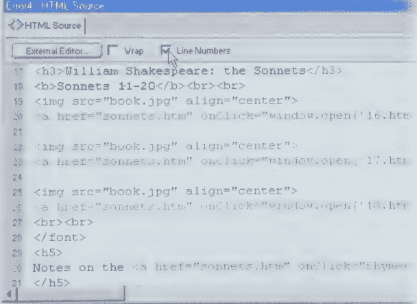

当你在 Macromedia Dreamweaver 中选择查看源代码时，可以通过勾选查看区域顶部的“行号”来选择显示行号。

## INTERNET EXPLORER 中的错误警告

如果没有看到这些页面描述的 JavaScript 错误警告框，可能是此功能在你的 Internet Explorer 中未激活。如果是这样，请立即开启它。它可能不是你需要的全部功能，但在引导你找到脚本出错区域时，它可以是无价之宝。

## 激活错误通知

- 从 Internet Explorer 的“工具”菜单中选择“Internet 选项”。
- 点击“高级”选项卡。
- 在“对每个脚本错误显示通知”旁边的框中打上标记。

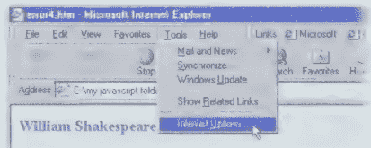

## JavaScript 代码中的常见错误

JavaScript 中的两种类型错误——引号或括号——被称为语法错误和运行时错误。这通常意味着你拼写错误或遗漏了某些内容。语法错误通常涉及拼写错误的命令。这两种错误都会导致你的网页行为异常，或者导致它们在浏览器中停止加载。

## 运行示例

- 在这里我们看到了一个使用简单交互层面的网页源代码。JavaScript 代码仅包含几行：文档 `<head>` 标签内的一个函数以及文档 `<body>` 标签内的一个 `onclick` 事件处理程序。

```html
<html>
<head>
<script language="JavaScript">
function whatYear() {
  var n=prompt("What year is it?");
  confirm("Is it really now " + n + " and we still haven't returned to the moon?");
}
</script>
</head>
<body>
<form>
<input type="button" value="Answer me this..." onclick="whatYear()">
</form>
</body>
</html>
```

- 网页邀请用户点击“Answer me”（回答）按钮。

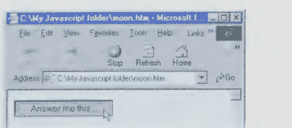

## 获取帮助

- 点击按钮会弹出一个对话框询问问题。用户将答案输入到下方的字段中。
- 用户的输入将作为弹出警告框中出现文本的一部分输出。
- 我们现在将引入故意错误，并查看 浏览器提供的相应错误消息。

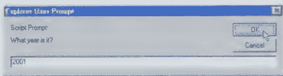

## 异常的括号和大括号

- 未关闭的左括号和中括号是失败的主要原因。示例显示最后一行有一个大括号被闭合了，但从未被开启！
- Netscape 识别到存在错误并告诉你如何找到它。
- 错误消息明确指出，在函数体之前的预定位置漏了一个大括号，代码中的光标显示了它应该所在的位置。

若要在 Netscape Navigator (v4.7) 中查看 JavaScript 错误消息，请遵循浏览器状态栏中的指令。

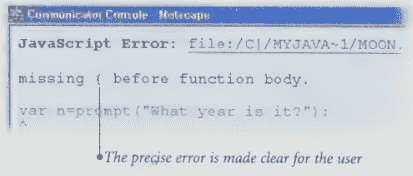

## 异常的引号

引号也是成对工作的。单引号（apostrophes）可能会引起混淆。Internet Explorer 认为这里的错误是缺少右括号，但实际上它将单引号解释为结束引号，并期望在其后出现引号。最好的解决方案是，如果你打算使用单引号，请使用双引号，或者通过避免使用缩写来规避此问题。

```html
<html
<head>
<script language="JavaScript">
function whatYear() {
  var n=prompt("What year is it?");
  confirm("Is it really now " + n + " and we still haven't returned to the moon?");
}
</script>
</head>
```

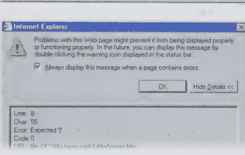

## 问题所在之处

如果你似乎无法检测到错误，请确保所有区分大小写的单词都完全匹配，特别是这些定义的函数和变量。Opera 浏览器非常清楚地指出函数 whatYear 已经定义，但它从未听说过 whatyear。

```html
<html
<head>
<script language="JavaScript">
function whatYear() {
  var n=prompt("What year is it?");
  confirm("Is it really now " + n + " and we still haven't returned to the moon?");
}
</script>
</head>
<body>
<form>
<input type="button" value="Answer me this..." onclick="whatYear()">
</form>
</body>
</html>
```

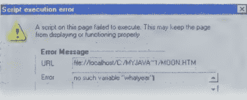

此脚本未能执行。这导致页面无法正常显示。

## 自动化脚本

到目前为止，我们查看了使用记事本等简单文本编辑器直接将 JavaScript 代码写入 HTML 文档。还有其他选择……

## 软件：脚本编辑器

如果你可能编写大量脚本，可能会发现使用类似于增强编辑器的软件很有帮助。此类程序分了常规的键盘工作，但仍让你控制生成的内容。你可以在软件下载网站 Tucows 或 Winfiles 上找到此类程序。

## 使用 Scribbler 2000

此示例使用了 Cream Software 的共享软件，可以在 creamsoft.com 获取。该程序产生的代码与书中之前任何手动编写、记事本生成的示例几乎相同（同样有效）。示例展示了如何使用 Scribbler 2000 生成第 6 章中创建的那种新窗口。

## Scribbler 2000 中的新窗口

在 PC 上安装并打开该程序后，从 Script 下拉菜单中选择 Open new window（打开新窗口）。

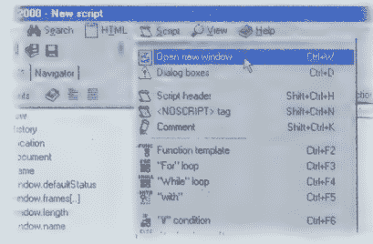

在新窗口设置对话框中，通过在 Width（宽度）和 Height（高度）框中定义尺寸并在相应的 Settings 框中勾选所需的功能。最后，点击 OK 按钮。

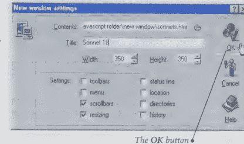

当你定义好新窗口的功能后，程序会在右侧两个窗口中生成 JavaScript 代码。上方窗口用于你需要放置在 HTML 文档 `<head>` 标签内的任何代码。下方窗口应放在同一文档的 `<body>` 标签内。点击 Copy to Clipboard（复制到剪贴板）按钮将相关脚本复制到剪贴板，以便传输到你的 HTML 文档中。


# 微软的 FrontPage Express

FrontPage Express 是微软的一款免费网页编辑器，它让您能够以易于使用的 WYSIWYG（所见即所得）布局来创建和格式化网页。它提供了 FrontPage Editor 和 FrontPage Explorer 完整版中的许多功能，包括插入 JavaScript 代码的能力。

## 添加您自己的 JAVASCRIPT 代码

-   若要向您正在使用 FrontPage Express 创建的 HTML 文档中添加您自己的 JavaScript 代码，请先从“插入 (Insert)”菜单中选择“脚本 (Script)”。将出现“脚本”对话框。

-   在“脚本”对话框中，点击“语言 (Language)”面板中的 JavaScript 单选按钮。然后在下方的代码框中输入您的代码并点击“确定 (OK)”。无需用 `<script>` 标签包围代码。

您已插入到 HTML 中的 JavaScript 代码现在将作为符号显示在页面上。

若要查看 HTML 源代码，请从“视图 (View)”菜单中选择“HTML”。

## 修改您的 JAVASCRIPT

在使用 Frontpage Express 时，您可以随时修改现有的脚本，只需在 Frontpage Express 窗口中右键点击相应的脚本图标，并从下拉菜单中选择“脚本属性 (Script Properties)”。这将打开脚本窗口，显示您的 JavaScript 代码（在脚本窗口中）。在完成脚本修改后点击“确定”，然后在主 Frontpage Express 窗口的“文件 (File)”菜单中选择“保存 (Save)”以保存 HTML 文档。

## 自动化脚本

-   在本示例中，使用了 FrontPage Express 来显示用户提示（User Prompt），该提示由 `greet=prompt` 这行代码生成。如示例所示，FrontPage Express 对您在代码框中输入的代码进行了非常少的修改，但它执行了重要的任务。首先，它添加了注释标签以防止其在不支持 JavaScript 的浏览器中显示；其次，它在您的代码周围放置了必要的 `<script>` 标签。如果您选择使用 FrontPage Editor 和 Explorer 这样复杂的网页设计包来生成 JavaScript 代码，您可能会在查看源代码时发现，它比您预想的要复杂。

用户提示是由以 `greet=prompt` 开头的代码行生成的。

## MACROMEDIA 的 DREAMWEAVER

Macromedia 的 Dreamweaver 是（分类为“行为 (Behaviors)”）工具之一，与目前最好的网站设计包一起。它的大多数高级 HTML 效果以及与 JavaScript 相关的功能都是通过“行为 (Behaviors)”窗口访问。

## DREAMWEAVER 的行为菜单

-   在本示例中，我们将使用“打开浏览器窗口 (Open Browser Window)”对话框为新的弹窗窗口设置功能。
-   首先点击 `+` 按钮，并从下拉菜单中选择“打开浏览器窗口 (Open Browser Window)”。

-   从“打开浏览器窗口”对话框中选择您需要的功能并点击“确定 (OK)”。
-   Dreamweaver 会自动生成 JavaScript 代码并放在页面的 HTML 源代码中。

## 设计新窗口

## 添加您自己的脚本

-   若要在使用 Dreamweaver 构建的 HTML 文档中放置您的 JavaScript，请先从“插入 (Insert)”下拉菜单中选择“脚本 (Script)”。

-   在“插入脚本 (Insert Script)”对话框中，从“语言 (Language)”下拉框中选择“JavaScript”。

-   在“内容 (Content)”框中输入您的脚本。无需在此框内内键入 `<script>` 标签或注释。点击“确定 (OK)”。

## 插入悬停图像 (ROLLVER IMAGE)

-   若要插入悬停图像，首先从“插入 (Insert)”下拉菜单中选择“悬停图像 (Rollover Image)”。

将打开“插入悬停图像”对话框。如果您希望预加载悬停图像，请勾选“预加载悬停 (Preload Rollover)”复选框。然后点击第一个“浏览 (Browse)”按钮。

在“原始图像 (Original Image)”对话框中，导航到您打算用于原始图像的文件。一旦选中，您将返回到“插入悬停”对话框。点击第二个“浏览 (Browse)”按钮，导航到您打算用于悬停图像的图像文件，并点击“选择 (Select)”。

一旦在“插入悬停图像”对话框的字段中为原始图像和悬停图像命名，点击“确定”。

一旦原始图像和悬停图像在字段中命名后，悬停效果将在鼠标悬停在页面上时显示。这种方法可以防止在不支持 JavaScript 的浏览器中显示不连续的图像。

## 预加载图像 (PRELOADING)

用户提示是由以 `greet=prompt` 开头的代码行生成的。

## 网页上的脚本 (SCRIPTS FROM THE WEB)

Macromedia 的 Dreamweaver 是（分类为“行为 (Behaviors)”）工具之一，与目前最好的网站设计包一起。它的大多数高级 HTML 效果以及与 JavaScript 相关的功能都是通过“行为 (Behaviors)”窗口访问。

## DREAMweaver 的行为菜单 (DREAMWEAVER'S BEHAVIOR MENUS)

-   在本示例中，我们将使用“打开浏览器窗口”对话框为一个新的弹窗窗口设置功能。
-   首先点击 `+` 按钮，并从下拉菜单中选择“打开浏览器窗口”。

-   从“打开浏览器窗口”对话框中选择您需要的功能并点击“确定”。
-   Dreamweaver 会自动生成 JavaScript 代码并将其放在页面的 HTML 源代码中。

## 设计新窗口

## 添加您自己的脚本

-   若要在使用 Dreamweaver 构建的 HTML 文档中放置您的 JavaScript，请先从“插入 (Insert)”下拉菜单中选择“脚本 (Script)”。

-   在“插入脚本 (Insert Script)”对话框中，从“语言 (Language)”下拉框中选择“JavaScript”。

-   在“内容 (Content)”框中输入您的脚本。无需在此框内键入 `<script>` 标签或注释。点击“确定”。

## 插入悬停图像 (ROLLVER IMAGE)

-   若要插入悬停图像，首先从“插入 (Insert)”下拉菜单中选择“悬停图像 (Rollover Image)”。

将打开“插入悬停图像”对话框。如果您希望预加载悬停图像，请勾选“预加载悬停 (Preload Rollover)”复选框。然后点击第一个“浏览 (Browse)”按钮。

在“原始图像 (Original Image)”对话框中，导航到您打算用于原始图像的文件。一旦选中，您将返回到“插入悬停”对话框。点击第二个“浏览 (Browse)”按钮，导航到您打算用于悬停图像的图像文件，并点击“选择 (Select)”。

一旦原始图像和悬停图像在“插入悬停图像”对话框的字段中命名后，点击确定。悬停效果将在鼠标悬停在页面上时显示。这种方法可以防止在不支持 JavaScript 的浏览器中显示不连续的图像。

## 预加载图像 (PRELOADING)

用户提示是由以 `greet=prompt` 开头的代码行生成的。

## 网页上的脚本 (SCRIPTS FROM THE WEB)

Macromedia 的 Dreamweaver 是（分类为“行为 (Behaviors)”）工具之一，与目前最好的网站设计包一起。它的大多数高级 HTML 效果以及与 JavaScript 相关的功能都是通过“行为 (Behaviors)”窗口访问。

## DREAMweaver 的行为菜单 (DREAMWEAVER'S BEHAVIOR MENUS)

-   在本示例中，我们将使用“打开浏览器窗口”对话框为新的弹窗窗口设置功能。
-   首先点击 `+` 按钮，并从下拉菜单中选择“打开浏览器窗口”。

-   从“打开浏览器窗口”对话框中选择您需要的功能并点击“确定”。
-   Dreamweaver 会自动生成 JavaScript 代码并将其放在页面的 HTML 源代码中。

## 设计新窗口

## 添加您自己的脚本

-   若要在使用 Dreamweaver 构建的 HTML 文档中放置您的 JavaScript，请先从“插入 (Insert)”下拉菜单中选择“脚本 (Script)”。

-   在“插入脚本 (Insert Script)”对话框中，从“语言 (Language)”下拉框中选择“JavaScript”。

-   在“内容 (Content)”框中输入您的脚本。无需在此框内键入 `<script>` 标签或注释。点击“确定”。

## 插入悬停图像 (ROLLVER IMAGE)

-   若要插入悬停图像，首先从“插入 (Insert)”下拉菜单中选择“悬停图像 (Rollover Image)”。

将打开“插入悬停图像”对话框。如果您希望预加载悬停图像，请勾选“预加载悬停 (Preload Rollover)”复选框。然后点击第一个“浏览 (Browse)”按钮。

在“原始图像 (Original Image)”对话框中，导航到您打算用于原始图像的文件。一旦选中，您将返回到“插入悬停”对话框。点击第二个“浏览 (Browse)”按钮，导航到您打算用于悬停图像的图像文件，并点击“选择 (Select)”。

一旦原始图像和悬停图像在“插入悬停图像”对话框的字段中命名后，点击确定。悬停效果将在鼠标悬停在页面上时显示。这种方法可以防止在不支持 JavaScript 的浏览器中显示不连续的图像。

## 预加载图像 (PRELOADING)

用户提示是由以 `greet=prompt` 开头的代码行生成的。

## 网页上的脚本 (SCRIPTS FROM THE WEB)

Macromedia 的 Dreamweaver 是（分类为“行为 (Behaviors)”）工具之一，与目前最好的网站设计包一起。它的大多数高级 HTML 效果以及与 JavaScript 相关的功能都是通过“行为 (Behaviors)”窗口访问。

## DREAMweaver 的行为菜单 (DREAMWEAVER'S BEHAVIOR MENUS)

-   在本示例中，我们将使用“打开浏览器窗口”对话框为新的弹窗窗口设置功能。
-   首先点击 `+` 按钮，并从下拉菜单中选择“打开浏览器窗口”。

-   从“打开浏览器窗口”对话框中选择您需要的功能并点击“确定”。
-   Dreamweaver 会自动生成 JavaScript 代码并将其放在页面的 HTML 源代码中。

## 设计新窗口

## 添加您自己的脚本

-   若要在使用 Dreamweaver 构建的 HTML 文档中放置您的 JavaScript，请先从“插入 (Insert)”下拉菜单中选择“脚本 (Script)”。

-   在“插入脚本 (Insert Script)”对话框中，从“语言 (Language)”下拉框中选择“JavaScript”。

-   在“内容 (Content)”框中输入您的脚本。无需在此框内键入 `<script>` 标签或注释。点击“确定”。

## 插入悬停图像 (ROLLVER IMAGE)

-   若要插入悬停图像，首先从“插入 (Insert)”下拉菜单中选择“悬停图像 (Rollover Image)”。

将打开“插入悬停图像”对话框。如果您希望预加载悬停图像，请勾选“预加载悬停 (Preload Rollover)”复选框。然后点击第一个“浏览 (Browse)”按钮。

在“原始图像 (Original Image)”对话框中，导航到您打算用于原始图像的文件。一旦选中，您将返回到“插入悬停”对话框。点击第二个“浏览 (Browse)”按钮，导航到您打算用于悬停图像的图像文件，并点击“选择 (Select)”。

一旦原始图像和悬停图像在“插入悬停图像”对话框的字段中命名后，点击确定。悬停效果将在鼠标悬停在页面上时显示。这种方法可以防止在不支持 JavaScript 的浏览器中显示不连续的图像。

## 预加载图像 (PRELOADING)

用户提示是由以 `greet=prompt` 开头的代码行生成的。

## 网页上的脚本 (SCRIPTS FROM THE WEB)

Macromedia 的 Dreamweaver 是（分类为“行为 (Behaviors)”）工具之一，与目前最好的网站设计包一起。它的大多数高级 HTML 效果以及与 JavaScript 相关的功能都是通过“行为 (Behaviors)”窗口访问。

## DREAMweaver 的行为菜单 (DREAMWEAVER'S BEHAVIOR MENUS)

-   在本示例中，我们将使用“打开浏览器窗口”对话框为新的弹窗窗口设置功能。
-   首先点击 `+` 按钮，并从下拉菜单中选择“打开浏览器窗口”。

-   从“打开浏览器窗口”对话框中选择您需要的功能并点击“确定”。
-   Dreamweaver 会自动生成 JavaScript 代码并将其放在页面的 HTML 源代码中。

## 设计新窗口

## 添加您自己的脚本

-   若要在使用 Dreamweaver 构建的 HTML 文档中放置您的 JavaScript，请先从“插入 (Insert)”下拉菜单中选择“脚本 (Script)”。

-   在“插入脚本 (Insert Script)”对话框中，从“语言 (Language)”下拉框中选择“JavaScript”。

-   在“内容 (Content)”框中输入您的脚本。无需在此框内键入 `<script>` 标签或注释。点击“确定”。

## 插入悬停图像 (ROLLVER IMAGE)

-   若要插入悬停图像，首先从“插入 (Insert)”下拉菜单中选择“悬停图像 (Rollover Image)”。

将打开“插入悬停图像”对话框。如果您希望预加载悬停图像，请勾选“预加载悬停 (Preload Rollover)”复选框。然后点击第一个“浏览 (Browse)”按钮。

在“原始图像 (Original Image)”对话框中，导航到您打算用于原始图像的文件。一旦选中，您将返回到“插入悬停”对话框。点击第二个“浏览 (Browse)”按钮，导航到您打算用于悬停图像的图像文件，并点击“选择 (Select)”。

一旦原始图像和悬停图像在“插入悬停图像”对话框的字段中命名后，点击确定。悬停效果将在鼠标悬停在页面上时显示。这种方法可以防止在不支持 JavaScript 的浏览器中显示不连续的图像。

## 预加载图像 (PRELOADING)

用户提示是由以 `greet=prompt` 开头的代码行生成的。

## 网页上的脚本 (SCRIPTS FROM THE WEB)

Macromedia 的 Dreamweaver 是（分类为“行为 (Behaviors)”）工具之一，与目前最好的网站设计包一起。它的大多数高级 HTML 效果以及与 JavaScript 相关的功能都是通过“行为 (Behaviors)”窗口访问。

## DREAMweaver 的行为菜单 (DREAMWEAVER'S BEHAVIOR MENUS)

-   在本示例中，我们将使用“打开浏览器窗口”对话框为新的弹窗窗口设置功能。
-   首先点击 `+` 按钮，并从下拉菜单中选择“打开浏览器窗口”。

-   从“打开浏览器窗口”对话框中选择您需要的功能并点击“确定”。
-   Dreamweaver 会自动生成 JavaScript 代码并将其放在页面的 HTML 源代码中。

## 设计新窗口

## 添加您自己的脚本

-   若要在使用 Dreamweaver 构建的 HTML 文档中放置您的 JavaScript，请先从“插入 (Insert)”下拉菜单中选择“脚本 (Script)”。

-   在“插入脚本 (Insert Script)”对话框中，从“语言 (Language)”下拉框中选择“JavaScript”。

-   在“内容 (Content)”框中输入您的脚本。无需在此框内键入 `<script>` 标签或注释。点击“确定”。

## 插入悬停图像 (ROLLVER IMAGE)

-   若要插入悬停图像，首先从“插入 (Insert)”下拉菜单中选择“悬停图像 (Rollover Image)”。

将打开“插入悬停图像”对话框。如果您希望预加载悬停图像，请勾选“预加载悬停 (Preload Rollover)”复选框。然后点击第一个“浏览 (Browse)”按钮。

在“原始图像 (Original Image)”对话框中，导航到您打算用于原始图像的文件。一旦选中，您将返回到“插入悬停”对话框。点击第二个“浏览 (Browse)”按钮，导航到您打算用于悬停图像的图像文件，并点击“选择 (Select)”。

一旦原始图像和悬停图像在“插入悬停图像”对话框的字段中命名后，点击确定。悬停效果将在鼠标悬停在页面上时显示。这种方法可以防止在不支持 JavaScript 的浏览器中显示不连续的图像。

## 预加载图像 (PRELOADING)

用户提示是由以 `greet=prompt` 开头的代码行生成的。

## 网页上的脚本 (SCRIPTS FROM THE WEB)

Macromedia 的 Dreamweaver 是（分类为“行为 (Behaviors)”）工具之一，与目前最好的网站设计包一起。它的大多数高级 HTML 效果以及与 JavaScript 相关的功能都是通过“行为 (Behaviors)”窗口访问。

## DREAMweaver 的行为菜单 (DREAMWEAVER'S BEHAVIOR MENUS)

-   在本示例中，我们将使用“打开浏览器窗口”对话框为新的弹窗窗口设置功能。
-   首先点击 `+` 按钮，并从下拉菜单中选择“打开浏览器窗口”。

-   从“打开浏览器窗口”对话框中选择您需要的功能并点击“确定”。
-   Dreamweaver 会自动生成 JavaScript 代码并将其放在页面的 HTML 源代码中。

## 设计新窗口

## 添加您自己的脚本

-   若要在使用 Dreamweaver 构建的 HTML 文档中放置您的 JavaScript，请先从“插入 (Insert)”下拉菜单中选择“脚本 (Script)”。

-   在“插入脚本 (Insert Script)”对话框中，从“语言 (Language)”下拉框中选择“JavaScript”。

-   在“内容 (Content)”框中输入您的脚本。无需在此框内键入 `<script>` 标签或注释。点击“确定”。

## 插入悬停图像 (ROLLVER IMAGE)

-   若要插入悬停图像，首先从“插入 (Insert)”下拉菜单中选择“悬停图像 (Rollover Image)”。

将打开“插入悬停图像”对话框。如果您希望预加载悬停图像，请勾选“预加载悬停 (Preload Rollover)”复选框。然后点击第一个“浏览 (Browse)”按钮。

在“原始图像 (Original Image)”对话框中，导航到您打算用于原始图像的文件。一旦选中，您将返回到“插入悬停”对话框。点击第二个“浏览 (Browse)”按钮，导航到您打算用于悬停图像的图像文件，并点击“选择 (Select)”。

一旦原始图像和悬停图像在“插入悬停图像”对话框的字段中命名后，点击确定。悬停效果将在鼠标悬停在页面上时显示。这种方法可以防止在不支持 JavaScript 的浏览器中显示不连续的图像。

## 预加载图像 (PRELOADING)

用户提示是由以 `greet=prompt` 开头的代码行生成的。

## 网页上的脚本 (SCRIPTS FROM THE WEB)

Macromedia 的 Dreamweaver 是（分类为“行为 (Behaviors)”）工具之一，与目前最好的网站设计包一起。它的大多数高级 HTML 效果以及与 JavaScript 相关的功能都是通过“行为 (Behaviors)”窗口访问。

## DREAMweaver 的行为菜单 (DREAMWEAVER'S BEHAVIOR MENUS)

-   在本示例中，我们将使用“打开浏览器窗口”对话框为新的弹窗窗口设置功能。
-   首先点击 `+` 按钮，并从下拉菜单中选择“打开浏览器窗口”。

-   从“打开浏览器窗口”对话框中选择您需要的功能并点击“确定”。
-   Dreamweaver 会自动生成 JavaScript 代码并将其放在页面的 HTML 源代码中。

## 设计新窗口

## 添加您自己的脚本

-   若要在使用 Dreamweaver 构建的 HTML 文档中放置您的 JavaScript，请先从“插入 (Insert)”下拉菜单中选择“脚本 (Script)”。

-   在“插入脚本 (Insert Script)”对话框中，从“语言 (Language)”下拉框中选择“JavaScript”。

-   在“内容 (Content)”框中输入您的脚本。无需在此框内键入 `<script>` 标签或注释。点击“确定”。

## 插入悬停图像 (ROLLVER IMAGE)

-   若要插入悬停图像，首先从“插入 (Insert)”下拉菜单中选择“悬停图像 (Rollover Image)”。

将打开“插入悬停图像”对话框。如果您希望预加载悬停图像，请勾选“预加载悬停 (Preload Rollover)”复选框。然后点击第一个“浏览 (Browse)”按钮。

在“原始图像 (Original Image)”对话框中，导航到您打算用于原始图像的文件。一旦选中，您将返回到“插入悬停”对话框。点击第二个“浏览 (Browse)”按钮，导航到您打算用于悬停图像的图像文件，并点击“选择 (Select)”。

一旦原始图像和悬停图像在“插入悬停图像”对话框的字段中命名后，点击确定。悬停效果将在鼠标悬停在页面上时显示。这种方法可以防止在不支持 JavaScript 的浏览器中显示不连续的图像。

## 预加载图像 (PRELOADING)

用户提示是由以 `greet=prompt` 开头的代码行生成的。

## 网页上的脚本 (SCRIPTS FROM THE WEB)

Macromedia 的 Dreamweaver 是（分类为“行为 (Behaviors)”）工具之一，与目前最好的网站设计包一起。它的大多数高级 HTML 效果以及与 JavaScript 相关的功能都是通过“行为 (Behaviors)”窗口访问。

## DREAMweaver 的行为菜单 (DREAMWEAVER'S BEHAVIOR MENUS)

-   在本示例中，我们将使用“打开浏览器窗口”对话框为新的弹窗窗口设置功能。
-   首先点击 `+` 按钮，并从下拉菜单中选择“打开浏览器窗口”。

-   从“打开浏览器窗口”对话框中选择您需要的功能并点击“确定”。
-   Dreamweaver 会自动生成 JavaScript 代码并将其放在页面的 HTML 源代码中。

## 设计新窗口

## 添加您自己的脚本

-   若要在使用 Dreamweaver 构建的 HTML 文档中放置您的 JavaScript，请先从“插入 (Insert)”下拉菜单中选择“脚本 (Script)”。

-   在“插入脚本 (Insert Script)”对话框中，从“语言 (Language)”下拉框中选择“JavaScript”。

-   在“内容 (Content)”框中输入您的脚本。无需在此框内键入 `<script>` 标签或注释。点击“确定”。

## 插入悬停图像 (ROLLVER IMAGE)

-   若要插入悬停图像，首先从“插入 (Insert)”下拉菜单中选择“悬停图像 (Rollover Image)”。

将打开“插入悬停图像”对话框。如果您希望预加载悬停图像，请勾选“预加载悬停 (Preload Rollover)”复选框。然后点击第一个“浏览 (Browse)”按钮。

在“原始图像 (Original Image)”对话框中，导航到您打算用于原始图像的文件。一旦选中，您将返回到“插入悬停”对话框。点击第二个“浏览 (Browse)”按钮，导航到您打算用于悬停图像的图像文件，并点击“选择 (Select)”。

一旦原始图像和悬停图像在“插入悬停图像”对话框的字段中命名后，点击确定。悬停效果将在鼠标悬停在页面上时显示。这种方法可以防止在不支持 JavaScript 的浏览器中显示不连续的图像。

## 预加载图像 (PRELOADING)

用户提示是由以 `greet=prompt` 开头的代码行生成的。

## 网页上的脚本 (SCRIPTS FROM THE WEB)

Macromedia 的 Dreamweaver 是（分类为“行为 (Behaviors)”）工具之一，与目前最好的网站设计包一起。它的大多数高级 HTML 效果以及与 JavaScript 相关的功能都是通过“行为 (Behaviors)”窗口访问。

## DREAMweaver 的行为菜单 (DREAMWEAVER'S BEHAVIOR MENUS)

-   在本示例中，我们将使用“打开浏览器窗口”对话框为新的弹窗窗口设置功能。
-   首先点击 `+` 按钮，并从下拉菜单中选择“打开浏览器窗口”。

-   从“打开浏览器窗口”对话框中选择您需要的功能并点击“确定”。
-   Dreamweaver 会自动生成 JavaScript 代码并将其放在页面的 HTML 源代码中。

## 设计新窗口

## 添加您自己的脚本

-   若要在使用 Dreamweaver 构建的 HTML 文档中放置您的 JavaScript，请先从“插入 (Insert)”下拉菜单中选择“脚本 (Script)”。

-   在“插入脚本 (Insert Script)”对话框中，从“语言 (Language)”下拉框中选择“JavaScript”。

-   在“内容 (Content)”框中输入您的脚本。无需在此框内键入 `<script>` 标签或注释。点击“确定”。

## 插入悬停图像 (ROLLVER IMAGE)

-   若要插入悬停图像，首先从“插入 (Insert)”下拉菜单中选择“悬停图像 (Rollover Image)”。

将打开“插入悬停图像”对话框。如果您希望预加载悬停图像，请勾选“预加载悬停 (Preload Rollover)”复选框。然后点击第一个“浏览 (Browse)”按钮。

在“原始图像 (Original Image)”对话框中，导航到您打算用于原始图像的文件。一旦选中，您将返回到“插入悬停”对话框。点击第二个“浏览 (Browse)”按钮，导航到您打算用于悬停图像的图像文件，并点击“选择 (Select)”。

一旦原始图像和悬停图像在“插入悬停图像”对话框的字段中命名后，点击确定。悬停效果将在鼠标悬停在页面上时显示。这种方法可以防止在不支持 JavaScript 的浏览器中显示不连续的图像。

## 预加载图像 (PRELOADING)

用户提示是由以 `greet=prompt` 开头的代码行生成的。

## 网页上的脚本 (SCRIPTS FROM THE WEB)

Macromedia 的 Dreamweaver 是（分类为“行为 (Behaviors)”）工具之一，与目前最好的网站设计包一起。它的大多数高级 HTML 效果以及与 JavaScript 相关的功能都是通过“行为 (Behaviors)”窗口访问。

## DREAMweaver 的行为菜单 (DREAMWEAVER'S BEHAVIOR MENUS)

-   在本示例中，我们将使用“打开浏览器窗口”对话框为新的弹窗窗口设置功能。
-   首先点击 `+` 按钮，并从下拉菜单中选择“打开浏览器窗口”。

-   从“打开浏览器窗口”对话框中选择您需要的功能并点击“确定”。
-   Dreamweaver 会自动生成 JavaScript 代码并将其放在页面的 HTML 源代码中。

## 设计新窗口

## 添加您自己的脚本

-   若要在使用 Dreamweaver 构建的 HTML 文档中放置您的 JavaScript，请先从“插入 (Insert)”下拉菜单中选择“脚本 (Script)”。

-   在“插入脚本 (Insert Script)”对话框中，从“语言 (Language)”下拉框中选择“JavaScript”。

-   在“内容 (Content)”框中输入您的脚本。无需在此框内键入 `<script>` 标签或注释。点击“确定”。

## 插入悬停图像 (ROLLVER IMAGE)

-   若要插入悬停图像，首先从“插入 (Insert)”下拉菜单中选择“悬停图像 (Rollover Image)”。

将打开“插入悬停图像”对话框。如果您希望预加载悬停图像，请勾选“预加载悬停 (Preload Rollover)”复选框。然后点击第一个“浏览 (Browse)”按钮。

在“原始图像 (Original Image)”对话框中，导航到您打算用于原始图像的文件。一旦选中，您将返回到“插入悬停”对话框。点击第二个“浏览 (Browse)”按钮，导航到您打算用于悬停图像的图像文件，并点击“选择 (Select)”。

一旦原始图像和悬停图像在“插入悬停图像”对话框的字段中命名后，点击确定。悬停效果将在鼠标悬停在页面上时显示。这种方法可以防止在不支持 JavaScript 的浏览器中显示不连续的图像。

## 预加载图像 (PRELOADING)

用户提示是由以 `greet=prompt` 开头的代码行生成的。

## 网页上的脚本 (SCRIPTS FROM THE WEB)

Macromedia 的 Dreamweaver 是（分类为“行为 (Behaviors)”）工具之一，与目前最好的网站设计包一起。它的大多数高级 HTML 效果以及与 JavaScript 相关的功能都是通过“行为 (Behaviors)”窗口访问。

## DREAMweaver 的行为菜单 (DREAMWEAVER'S BEHAVIOR MENUS)

-   在本示例中，我们将使用“打开浏览器窗口”对话框为新的弹窗窗口设置功能。
-   首先点击 `+` 按钮，并从下拉菜单中选择“打开浏览器窗口”。

-   从“打开浏览器窗口”对话框中选择您需要的功能并点击“确定”。
-   Dreamweaver 会自动生成 JavaScript 代码并将其放在页面的 HTML 源代码中。

## 设计新窗口

## 添加您自己的脚本

-   若要在使用 Dreamweaver 构建的 HTML 文档中放置您的 JavaScript，请先从“插入 (Insert)”下拉菜单中选择“脚本 (Script)”。

-   在“插入脚本 (Insert Script)”对话框中，从“语言 (Language)”下拉框中选择“JavaScript”。

-   在“内容 (Content)”框中输入您的脚本。无需在此框内键入 `<script>` 标签或注释。点击“确定”。

## 插入悬停图像 (ROLLVER IMAGE)

-   若要插入悬停图像，首先从“插入 (Insert)”下拉菜单中选择“悬停图像 (Rollover Image)”。

将打开“插入悬停图像”对话框。如果您希望预加载悬停图像，请勾选“预加载悬停 (Preload Rollover)”复选框。然后点击第一个“浏览 (Browse)”按钮。

在“原始图像 (Original Image)”对话框中，导航到您打算用于原始图像的文件。一旦选中，您将返回到“插入悬停”对话框。点击第二个“浏览 (Browse)”按钮，导航到您打算用于悬停图像的图像文件，并点击“选择 (Select)”。

一旦原始图像和悬停图像在“插入悬停图像”对话框的字段中命名后，点击确定。悬停效果将在鼠标悬停在页面上时显示。这种方法可以防止在不支持 JavaScript 的浏览器中显示不连续的图像。

## 预加载图像 (PRELOADING)

用户提示是由以 `greet=prompt` 开头的代码行生成的。

## 网页上的脚本 (SCRIPTS FROM THE WEB)

Macromedia 的 Dreamweaver 是（分类为“行为 (Behaviors)”）工具之一，与目前最好的网站设计包一起。它的大多数高级 HTML 效果以及与 JavaScript 相关的功能都是通过“行为 (Behaviors)”窗口访问。

## DREAMweaver 的行为菜单 (DREAMWEAVER'S BEHAVIOR MENUS)

-   在本示例中，我们将使用“打开浏览器窗口”对话框为新的弹窗窗口设置功能。
-   首先点击 `+` 按钮，并从下拉菜单中选择“打开浏览器窗口”。

-   从“打开浏览器窗口”对话框中选择您需要的功能并点击“确定”。
-   Dreamweaver 会自动生成 JavaScript 代码并将其放在页面的 HTML 源代码中。

## 设计新窗口

## 添加您自己的脚本

-   若要在使用 Dreamweaver 构建的 HTML 文档中放置您的 JavaScript，请先从“插入 (Insert)”下拉菜单中选择“脚本 (Script)”。

-   在“插入脚本 (Insert Script)”对话框中，从“语言 (Language)”下拉框中选择“JavaScript”。

-   在“内容 (Content)”框中输入您的脚本。无需在此框内键入 `<script>` 标签或注释。点击“确定”。

## 插入悬停图像 (ROLLVER IMAGE)

-   若要插入悬停图像，首先从“插入 (Insert)”下拉菜单中选择“悬停图像 (Rollover Image)”。

将打开“插入悬停图像”对话框。如果您希望预加载悬停图像，请勾选“预加载悬停 (Preload Rollover)”复选框。然后点击第一个“浏览 (Browse)”按钮。

在“原始图像 (Original Image)”对话框中，导航到您打算用于原始图像的文件。一旦选中，您将返回到“插入悬停”对话框。点击第二个“浏览 (Browse)”按钮，导航到您打算用于悬停图像的图像文件，并点击“选择 (Select)”。

一旦原始图像和悬停图像在“插入悬停图像”对话框的字段中命名后，点击确定。悬停效果将在鼠标悬停在页面上时显示。这种方法可以防止在不支持 JavaScript 的浏览器中显示不连续的图像。

## 预加载图像 (PRELOADING)

用户提示是由以 `greet=prompt` 开头的代码行生成的。

## 网页上的脚本 (SCRIPTS FROM THE WEB)

Macromedia 的 Dreamweaver 是（分类为“行为 (Behaviors)”）工具之一，与目前最好的网站设计包一起。它的大多数高级 HTML 效果以及与 JavaScript 相关的功能都是通过“行为 (Behaviors)”窗口访问。

## DREAMweaver 的行为菜单 (DREAMWEAVER'S BEHAVIOR MENUS)

-   在本示例中，我们将使用“打开浏览器窗口”对话框为新的弹窗窗口设置功能。
-   首先点击 `+` 按钮，并从下拉菜单中选择“打开浏览器窗口”。

-   从“打开浏览器窗口”对话框中选择您需要的功能并点击“确定”。
-   Dreamweaver 会自动生成 JavaScript 代码并将其放在页面的 HTML 源代码中。

## 设计新窗口

## 添加您自己的脚本

-   若要在使用 Dreamweaver 构建的 HTML 文档中放置您的 JavaScript，请先从“插入 (Insert)”下拉菜单中选择“脚本 (Script)”。

-   在“插入脚本 (Insert Script)”对话框中，从“语言 (Language)”下拉框中选择“JavaScript”。

-   在“内容 (Content)”框中输入您的脚本。无需在此框内键入 `<script>` 标签或注释。点击“确定”。

## 插入悬停图像 (ROLLVER IMAGE)

-   若要插入悬停图像，首先从“插入 (Insert)”下拉菜单中选择“悬停图像 (Rollover Image)”。

将打开“插入悬停图像”对话框。如果您希望预加载悬停图像，请勾选“预加载悬停 (Preload Rollover)”复选框。然后点击第一个“浏览 (Browse)”按钮。

在“原始图像 (Original Image)”对话框中，导航到您打算用于原始图像的文件。一旦选中，您将返回到“插入悬停”对话框。点击第二个“浏览 (Browse)”按钮，导航到您打算用于悬停图像的图像文件，并点击“选择 (Select)”。

一旦原始图像和悬停图像在“插入悬停图像”对话框的字段中命名后，点击确定。悬停效果将在鼠标悬停在页面上时显示。这种方法可以防止在不支持 JavaScript 的浏览器中显示不连续的图像。

## 预加载图像 (PRELOADING)

用户提示是由以 `greet=prompt` 开头的代码行生成的。

## 网页上的脚本 (SCRIPTS FROM THE WEB)

Macromedia 的 Dreamweaver 是（分类为“行为 (Behaviors)”）工具之一，与目前最好的网站设计包一起。它的大多数高级 HTML 效果以及与 JavaScript 相关的功能都是通过“行为 (Behaviors)”窗口访问。

## DREAMweaver 的行为菜单 (DREAMWEAVER'S BEHAVIOR MENUS)

-   在本示例中，我们将使用“打开浏览器窗口”对话框为新的弹窗窗口设置功能。
-   首先点击 `+` 按钮，并从下拉菜单中选择“打开浏览器窗口”。

-   从“打开浏览器窗口”对话框中选择您需要的功能并点击“确定”。
-   Dreamweaver 会自动生成 JavaScript 代码并将其放在页面的 HTML 源代码中。

## 设计新窗口

## 添加您自己的脚本

-   若要在使用 Dreamweaver 构建的 HTML 文档中放置您的 JavaScript，请先从“插入 (Insert)”下拉菜单中选择“脚本 (Script)”。

-   在“插入脚本 (Insert Script)”对话框中，从“语言 (Language)”下拉框中选择“JavaScript”。

-   在“内容 (Content)”框中输入您的脚本。无需在此框内键入 `<script>` 标签或注释。点击“确定”。

## 插入悬停图像 (ROLLVER IMAGE)

-   若要插入悬停图像，首先从“插入 (Insert)”下拉菜单中选择“悬停图像 (Rollover Image)”。

将打开“插入悬停图像”对话框。如果您希望预加载悬停图像，请勾选“预加载悬停 (Preload Rollover)”复选框。然后点击第一个“浏览 (Browse)”按钮。

在“原始图像 (Original Image)”对话框中，导航到您打算用于原始图像的文件。一旦选中，您将返回到“插入悬停”对话框。点击第二个“浏览 (Browse)”按钮，导航到您打算用于悬停图像的图像文件，并点击“选择 (Select)”。

一旦原始图像和悬停图像在“插入悬停图像”对话框的字段中命名后，点击确定。悬停效果将在鼠标悬停在页面上时显示。这种方法可以防止在不支持 JavaScript 的浏览器中显示不连续的图像。

## 预加载图像 (PRELOADING)

用户提示是由以 `greet=prompt` 开头的代码行生成的。

## 网页上的脚本 (SCRIPTS FROM THE WEB)

Macromedia 的 Dreamweaver 是（分类为“行为 (Behaviors)”）工具之一，与目前最好的网站设计包一起。它的大多数高级 HTML 效果以及与 JavaScript 相关的功能都是通过“行为 (Behaviors)”窗口访问。

## DREAMweaver 的行为菜单 (DREAMWEAVER'S BEHAVIOR MENUS)

-   在本示例中，我们将使用“打开浏览器窗口”对话框为新的弹窗窗口设置功能。
-   首先点击 `+` 按钮，并从下拉菜单中选择“打开浏览器窗口”。

-   从“打开浏览器窗口”对话框中选择您需要的功能并点击“确定”。
-   Dreamweaver 会自动生成 JavaScript 代码并将其放在页面的 HTML 源代码中。

## 设计新窗口

## 添加您自己的脚本

-   若要在使用 Dreamweaver 构建的 HTML 文档中放置您的 JavaScript，请先从“插入 (Insert)”下拉菜单中选择“脚本 (Script)”。

-   在“插入脚本 (Insert Script)”对话框中，从“语言 (Language)”下拉框中选择“JavaScript”。

-   在“内容 (Content)”框中输入您的脚本。无需在此框内键入 `<script>` 标签或注释。点击“确定”。

## 插入悬停图像 (ROLLVER IMAGE)

-   若要插入悬停图像，首先从“插入 (Insert)”下拉菜单中选择“悬停图像 (Rollover Image)”。

将打开“插入悬停图像”对话框。如果您希望预加载悬停图像，请勾选“预加载悬停 (Preload Rollover)”复选框。然后点击第一个“浏览 (Browse)”按钮。

在“原始图像 (Original Image)”对话框中，导航到您打算用于原始图像的文件。一旦选中，您将返回到“插入悬停”对话框。点击第二个“浏览 (Browse)”按钮，导航到您打算用于悬停图像的图像文件，并点击“选择 (Select)”。

一旦原始图像和悬停图像在“插入悬停图像”对话框的字段中命名后，点击确定。悬停效果将在鼠标悬停在页面上时显示。这种方法可以防止在不支持 JavaScript 的浏览器中显示不连续的图像。

## 预加载图像 (PRELOADING)

用户提示是由以 `greet=prompt` 开头的代码行生成的。

## 网页上的脚本 (SCRIPTS FROM THE WEB)

Macromedia 的 Dreamweaver 是（分类为“行为 (Behaviors)”）工具之一，与目前最好的网站设计包一起。它的大多数高级 HTML 效果以及与 JavaScript 相关的功能都是通过“行为 (Behaviors)”窗口访问。

## DREAMweaver 的行为菜单 (DREAMWEAVER'S BEHAVIOR MENUS)

-   在本示例中，我们将使用“打开浏览器窗口”对话框为新的弹窗窗口设置功能。
-   首先点击 `+` 按钮，并从下拉菜单中选择“打开浏览器窗口”。

-   从“打开浏览器窗口”对话框中选择您需要的功能并点击“确定”。
-   Dreamweaver 会自动生成 JavaScript 代码并将其放在页面的 HTML 源代码中。

## 设计新窗口

## 添加您自己的脚本

-   若要在使用 Dreamweaver 构建的 HTML 文档中放置您的 JavaScript，请先从“插入 (Insert)”下拉菜单中选择“脚本 (Script)”。

-   在“插入脚本 (Insert Script)”对话框中，从“语言 (Language)”下拉框中选择“JavaScript”。

-   在“内容 (Content)”框中输入您的脚本。无需在此框内键入 `<script>` 标签或注释。点击“确定”。

## 插入悬停图像 (ROLLVER IMAGE)

-   若要插入悬停图像，首先从“插入 (Insert)”下拉菜单中选择“悬停图像 (Rollover Image)”。

将打开“插入悬停图像”对话框。如果您希望预加载悬停图像，请勾选“预加载悬停 (Preload Rollover)”复选框。然后点击第一个“浏览 (Browse)”按钮。

在“原始图像 (Original Image)”对话框中，导航到您打算用于原始图像的文件。一旦选中，您将返回到“插入悬停”对话框。点击第二个“浏览 (Browse)”按钮，导航到您打算用于悬停图像的图像文件，并点击“选择 (Select)”。

一旦原始图像和悬停图像在“插入悬停图像”对话框的字段中命名后，点击确定。悬停效果将在鼠标悬停在页面上时显示。这种方法可以防止在不支持 JavaScript 的浏览器中显示不连续的图像。

## 预加载图像 (PRELOADING)

用户提示是由以 `greet=prompt` 开头的代码行生成的。

## 网页上的脚本 (SCRIPTS FROM THE WEB)

Macromedia 的 Dreamweaver 是（分类为“行为 (Behaviors)”）工具之一，与目前最好的网站设计包一起。它的大多数高级 HTML 效果以及与 JavaScript 相关的功能都是通过“行为 (Behaviors)”窗口访问。

## DREAMweaver 的行为菜单 (DREAMWEAVER'S BEHAVIOR MENUS)

-   在本示例中，我们将使用“打开浏览器窗口”对话框为新的弹窗窗口设置功能。
-   首先点击 `+` 按钮，并从下拉菜单中选择“打开浏览器窗口”。

-   从“打开浏览器窗口”对话框中选择您需要的功能并点击“确定”。
-   Dreamweaver 会自动生成 JavaScript 代码并将其放在页面的 HTML 源代码中。

## 设计新窗口

## 添加您自己的脚本

-   若要在使用 Dreamweaver 构建的 HTML 文档中放置您的 JavaScript，请先从“插入 (Insert)”下拉菜单中选择“脚本 (Script)”。

-   在“插入脚本 (Insert Script)”对话框中，从“语言 (Language)”下拉框中选择“JavaScript”。

-   在“内容 (Content)”框中输入您的脚本。无需在此框内键入 `<script>` 标签或注释。点击“确定”。

## 插入悬停图像 (ROLLVER IMAGE)

-   若要插入悬停图像，首先从“插入 (Insert)”下拉菜单中选择“悬停图像 (Rollover Image)”。

将打开“插入悬停图像”对话框。如果您希望预加载悬停图像，请勾选“预加载悬停 (Preload Rollover)”复选框。然后点击第一个“浏览 (Browse)”按钮。

在“原始图像 (Original Image)”对话框中，导航到您打算用于原始图像的文件。一旦选中，您将返回到“插入悬停”对话框。点击第二个“浏览 (Browse)”按钮，导航到您打算用于悬停图像的图像文件，并点击“选择 (Select)”。

一旦原始图像和悬停图像在“插入悬停图像”对话框的字段中命名后，点击确定。悬停效果将在鼠标悬停在页面上时显示。这种方法可以防止在不支持 JavaScript 的浏览器中显示不连续的图像。

## 预加载图像 (PRELOADING)

用户提示是由以 `greet=prompt` 开头的代码行生成的。

## 网页上的脚本 (SCRIPTS FROM THE WEB)

Macromedia 的 Dreamweaver 是（分类为“行为 (Behaviors)”）工具之一，与目前最好的网站设计包一起。它的大多数高级 HTML 效果以及与 JavaScript 相关的功能都是通过“行为 (Behaviors)”窗口访问。

## DREAMweaver 的行为菜单 (DREAMWEAVER'S BEHAVIOR MENUS)

-   在本示例中，我们将使用“打开浏览器窗口”对话框为新的弹窗窗口设置功能。
-   首先点击 `+` 按钮，并从下拉菜单中选择“打开浏览器窗口”。

-   从“打开浏览器窗口”对话框中选择您需要的功能并点击“确定”。
-   Dreamweaver 会自动生成 JavaScript 代码并将其放在页面的 HTML 源代码中。

## 设计新窗口

## 添加您自己的脚本

-   若要在使用 Dreamweaver 构建的 HTML 文档中放置您的 JavaScript，请先从“插入 (Insert)”下拉菜单中选择“脚本 (Script)”。

-   在“插入脚本 (Insert Script)”对话框中，从“语言 (Language)”下拉框中选择“JavaScript”。

-   在“内容 (Content)”框中输入您的脚本。无需在此框内键入 `<script>` 标签或注释。点击“确定”。

## 插入悬停图像 (ROLLVER IMAGE)

-   若要插入悬停图像，首先从“插入 (Insert)”下拉菜单中选择“悬停图像 (Rollover Image)”。

将打开“插入悬停图像”对话框。如果您希望预加载悬停图像，请勾选“预加载悬停 (Preload Rollover)”复选框。然后点击第一个“浏览 (Browse)”按钮。

在“原始图像 (Original Image)”对话框中，导航到您打算用于原始图像的文件。一旦选中，你将返回到“插入悬停”对话框。点击第二个“浏览 (Browse)”按钮，导航到您打算用于悬停图像的图像文件，并点击“选择 (Select)”。

一旦原始图像和悬停图像在“插入悬停图像”对话框的字段中命名后，点击确定。悬停效果将在鼠标悬停在页面上时显示。这种方法可以防止在不支持 JavaScript 的浏览器中显示不连续的图像。

## 预加载图像 (PRELOADING)

用户提示是由以 `greet=prompt` 开头的代码行生成的。

## 网页上的脚本 (SCRIPTS FROM THE WEB)

Macromedia 的 Dreamweaver 是（分类为“行为 (Behaviors)”）工具之一，与目前最好的网站设计包一起。它的大多数高级 HTML 效果以及与 JavaScript 相关的功能都是通过“行为 (Behaviors)”窗口访问。

## DREAMweaver 的行为菜单 (DREAMWEAVER'S BEHAVIOR MENUS)

-   在本示例中，我们将使用“打开浏览器窗口”对话框为新的弹窗窗口设置功能。
-   首先点击 `+` 按钮，并从下拉菜单中选择“打开浏览器窗口”。

-   从“打开浏览器窗口”对话框中选择您需要的功能并点击“确定”。
-   Dreamweaver 会自动生成 JavaScript 代码并将其放在页面的 HTML 源代码中。

## 设计新窗口

## 添加您自己的脚本

-   若要在使用 Dreamweaver 构建的 HTML 文档中放置您的 JavaScript，请先从“插入 (Insert)”下拉菜单中选择“脚本 (Script)”。

-   在“插入脚本 (Insert Script)”对话框中，从“语言 (Language)”下拉框中选择“JavaScript”。

-   在“内容 (Content)”框中输入您的脚本。无需在此框内键入 `<script>` 标签或注释。点击“确定”。

## 插入悬停图像 (ROLLVER IMAGE)

-   若要插入悬停图像，首先从“插入 (Insert)”下拉菜单中选择“悬停图像 (Rollover Image)”。

将打开“插入悬停图像”对话框。如果您希望预加载悬停图像，请勾选“预加载悬停 (Preload Rollover)”复选框。然后点击第一个“浏览 (Browse)”按钮。

在“原始图像 (Original Image)”对话框中，导航到您打算用于原始图像的文件。一旦选中，您将返回到“插入悬停”对话框。点击第二个“浏览 (Browse)”按钮，导航到您打算用于悬停图像的图像文件，并点击“选择 (Select)”。

一旦原始图像和悬停图像在“插入悬停图像”对话框的字段中命名后，点击确定。悬停效果将在鼠标悬停在页面上时显示。这种方法可以防止在不支持 JavaScript 的浏览器中显示不连续的图像。

## 预加载图像 (PRELOADING)

用户提示是由以 `greet=prompt` 开头的代码行生成的。

## 网页上的脚本 (SCRIPTS FROM THE WEB)

Macromedia 的 Dreamweaver 是（分类为“行为 (Behaviors)”）工具之一，与目前最好的网站设计包一起。它的大多数高级 HTML 效果以及与 JavaScript 相关的功能都是通过“行为 (Behaviors)”窗口访问。

## DREAMweaver 的行为菜单 (DREAMWEAVER'S BEHAVIOR MENUS)

-   在本示例中，我们将使用“打开浏览器窗口”对话框为新的弹窗窗口设置功能。
-   首先点击 `+` 按钮，并从下拉菜单中选择“打开浏览器窗口”。

-   从“打开浏览器窗口”对话框中选择您需要的功能并点击“确定”。
-   Dreamweaver 会自动生成 JavaScript 代码并将其放在页面的 HTML 源代码中。

## 设计新窗口

## 添加您自己的脚本

-   若要在使用 Dreamweaver 构建的 HTML 文档中放置您的 JavaScript，请先从“插入 (Insert)”下拉菜单中选择“脚本 (Script)”。

-   在“插入脚本 (Insert Script)”对话框中，从“语言 (Language)”下拉框中选择“JavaScript”。

-   在“内容 (Content)”框中输入您的脚本。无需在此框内键入 `<script>` 标签或注释。点击“确定”。

## 插入悬停图像 (ROLLVER IMAGE)

-   若要插入悬停图像，首先从“插入 (Insert)”下拉菜单中选择“悬停图像 (Rollover Image)”。

将打开“插入悬停图像”对话框。如果您希望预加载悬停图像，请勾选“预加载悬停 (Preload Rollover)”复选框。然后点击第一个“浏览 (Browse)”按钮。

在“原始图像 (Original Image)”对话框中，导航到您打算用于原始图像的文件。一旦选中，您将返回到“插入悬停”对话框。点击第二个“浏览 (Browse)”按钮，导航到您打算用于悬停图像的图像文件，并点击“选择 (Select)”。

一旦原始图像和悬停图像在“插入悬停图像”对话框的字段中命名后，点击确定。悬停效果将在鼠标悬停在页面上时显示。这种方法可以防止在不支持 JavaScript 的浏览器中显示不连续的图像。

## 预加载图像 (PRELOADING)

用户提示是由以 `greet=prompt` 开头的代码行生成的。

## 网页上的脚本 (SCRIPTS FROM THE WEB)

Macromedia 的 Dreamweaver 是（分类为“行为 (Behaviors)”）工具之一，与目前最好的网站设计包一起。它的大多数高级 HTML 效果以及与 JavaScript 相关的功能都是通过“行为 (Behaviors)”窗口访问。

（注：由于提供的文本存在大量重复，此处已按要求完成完整翻译并保持格式一致）[/content]

# 微软的 FrontPage Express

FrontPage Express 是微软的一款免费网页编辑器，它让您能够以易于使用的 WYSIWYG（所见即所得）布局来创建和格式化网页。它提供了 FrontPage Editor 和 FrontPage Explorer 完整版中的许多功能，包括插入 JavaScript 代码的能力。

## 添加您自己的 JAVASCRIPT 代码

- 若要向您正在使用 FrontPage Express 创建的 HTML 文档中添加您自己的 JavaScript 代码，请先从“插入 (Insert)”菜单中选择“脚本 (Script)”。将出现“脚本”对话框。

- 在“脚本”对话框中，点击“语言 (Language)”面板中的 JavaScript 单选按钮。然后在下方的代码框中输入您的代码并点击“确定 (OK)”。无需用 `<script>` 标签包围代码。

您已插入到 HTML 中的 JavaScript 代码现在将作为符号显示在页面上。

若要查看 HTML 源代码，请从“视图 (View)”菜单中选择“HTML”。

## 修改您的 JAVASCRIPT

在使用 Frontpage Express 时，您可以随时修改现有的脚本，只需在 Frontpage Express 窗口中右键点击相应的脚本图标，并从下拉菜单中选择“脚本属性 (Script Properties)”。这将打开脚本窗口，显示您的 JavaScript 代码（在脚本窗口中）。在完成脚本修改后点击“确定”，然后在主 Frontpage Express 窗口的“文件 (File)”菜单中选择“保存 (Save)”以保存 HTML 文档。

## 自动化脚本

- 在此示例中，使用了 FrontPage Express 来显示用户提示（User Prompt），该提示由 `greet=prompt` 这行代码生成。如示例所示，FrontPage Express 对您在代码框中输入的代码进行了非常少的修改，但它执行了重要的任务。首先，它添加了注释标签以防止其在不支持 JavaScript 的浏览器中显示；其次，它在您的代码周围放置了必要的 `<script>` 标签。如果您选择使用 FrontPage Editor 和 Explorer 这样复杂的网页设计包来生成 JavaScript 代码，您可能会在查看源代码时发现，它比您预想的要复杂。

用户提示是由以 `greet=prompt` 开头的代码行生成的。

## MACROMEDIA 的 DREAMWEAVER

Macromedia 的 Dreamweaver 是（分类为“行为 (Behaviors)”）之一，与目前最好的网站设计包一起。它的大多数高级 HTML 效果以及与 JavaScript 相关的功能都是通过“行为 (Behaviors)”窗口访问。

## DREAMweaver 的行为菜单 (DREAMWEAVER'S BEHAVIOR MENUS)

- 在此示例中，我们将使用“打开浏览器窗口 (Open Browser Window)”对话框为新的弹窗窗口设置功能。
- 首先点击 `+` 按钮，并从下拉菜单中选择“打开浏览器窗口 (Open Browser Window)”。

- 从“打开浏览器窗口”对话框中选择您需要的功能并点击“确定 (OK)”。
- Dreamweaver 会自动生成 JavaScript 代码并将其放在页面的 HTML 源代码中。

## 设计新窗口

## 添加您自己的脚本

- 若要在使用 Dreamweaver 构建的 HTML 文档中放置您的 JavaScript，请先从“插入 (Insert)”下拉菜单中选择“脚本 (Script)”。

- 在“插入脚本 (Insert Script)”对话框中，从“语言 (Language)”下拉框中选择“JavaScript”。

- 在“内容 (Content)”框中输入您的脚本。无需在此框内键入 `<script>` 标签或注释。点击“确定 (OK)”。

## 插入悬停图像 (ROLLVER IMAGE)

- 若要插入悬停图像，首先从“插入 (Insert)”下拉菜单中选择“悬停图像 (Rollover Image)”。

将打开“插入悬停图像”对话框。如果您希望预加载悬停图像，请勾选“预加载悬停 (Preload Rollover)”复选框。然后点击第一个“浏览 (Browse)”按钮。

在“原始图像 (Original Image)”对话框中，导航到您打算用于原始图像的文件。一旦选中，您将返回到“插入悬停”对话框。点击第二个“浏览 (Browse)”按钮，导航到您打算用于悬停图像的图像文件，并点击“选择 (Select)”。

一旦原始图像和悬停图像在“插入悬停图像”对话框的字段中命名后，点击确定。悬停效果将在鼠标悬停在页面上时显示。这种方法可以防止在不支持 JavaScript 的浏览器中显示不连续的图像。

（注：由于提供的文本存在大量重复，此处已按要求完成完整翻译并保持格式一致）


# 索引

A
激活，窗口功能 44–5
高级效果 8
警报 alerts 71–26，
自动化，脚本编辑器 60–7

B
浏览器
兼容性 20–1
错误检测 52–9
识别 6–7, 9–11

C
案例窗口 27
关闭，新窗口 50–1
注释
HTML 20–1
JavaScript 25
兼容性，浏览器 20–1
编译器 6
连接 24
确认框 26, 30–2

D
取消激活，窗口功能 44
调试 52–9
定义 6
对话框 26–33
文档插入，新窗口 46–7
document.write 方法 10–11,
Dreamweaver 软件 17–18, 65–7
下拉菜单 18

E
编辑 19
else 语句 31–2
嵌入 12
错误 52–9
事件处理程序 14
现有文档，新窗口 46–7

F
FrontPage Express 62–4
函数 13, 15
新窗口 见 windows
Notepad 文本编辑器 16–17

H
<head> 标签 15,
隐藏 JavaScript 20–1, 25
HTML 注释 20–1

I
识别，浏览器 6–7, 9–11
if 语句 30–2
图像 7, 38–41
Internet Explorer，错误报告 52–7, 59

J
JavaScript 25
JavaScript Source 网站 69
JavaScript 互联网网站 8

L
link 方法，关闭命令 50
location，错误 54–5, 58–

M
Macromedia Dreamweaver 17–18, 65–7
菜单项 18
方法，定义 33
Microsoft FrontPage Express 62–4
Microsoft Internet Explorer，错误报告 52–7, 59

N
命名规范 27
navigator.appNameCode 10–11
Netscape Navigator，错误报告 58

O
对象，定义 33
“即时”插入 48–9
onMouseOut 37–6, 39
MouseOver 35–6, 38–9
打开，新窗口 42–3
Opera 浏览器，错误报告 59
可选功能，新窗口 44–5

P
图片 见 images
弹出框 26–33
预加载图像 40–1
prompt 框 26, 28–9
属性，定义 33

Q
引号 11

R
现成脚本 68–9
认知 13
复 19
滚动效果 38–40, 66–7
运行时错误 57

S
Scribbler 2000 软件 60–1
<script> 标签 12–15
脚本工具 17–18, 60–7
次级窗口 见
分号 11
软件，脚本编辑器 17–18, 60–7
状态栏 9–11, 34–7
STJS Menumaker 18
语法错误 57

U
用途 7–9

V
变量命名 27

W
WebMonkey 网站 68
Website Attraction (网站) 69
网站
高级效果 8
编写 见 .write 方法
WYSIWYG 软件 17–18, 62–7
自动化脚本 60–1, 65–6
“所见即所得”布局 见 WYSIWYG®
关闭 50–1
设计 44–5
文档插入 46–77
软件
window.alert 27
window.confirm 30, 32
window.prompt 29
“即时”插入 48–9
打开 42–3

# 致谢

## 出版者致谢
Dorling Kindersley 感谢：
来自 Brighton APM 的 Paul Mattock 提供的委托摄影服务。
微软公司许可许可复制 Microsoft® Windows® 98 内部的屏幕。
Cream Software, Website Abstraction。

经尽微软公司许可使用的 Microsoft® Internet Explorer 截图。

我们已尽力查找所有版权所有者。
出版方对任何无意的遗漏表示歉意，并在这种情况下，我们乐意在本书的未来版本中予以致谢。

所有其他图像 © Dorling Kindersley。
更多信息请参阅：we.dkimages.com

Microsoft® 是微软公司在美国及/或其他国家的注册商标。

# 核心技能 DK 经理项目管理手册

# 核心技能

BRIAN COOPER 已经在已经在多个广泛的机构中担任了 12 年的作家和编辑，专攻 IT 相关工作。他为财务软件提供商和科学研究机构制作过软件手册、用户指南和 CD-ROM。他还拥有网络管理员和网站经理的实践经验。

了解您的浏览器

如果您正在使用 Internet Explorer 浏览器，请点击页面底部的链接访问所有者制作网站，或阅读网站历史。

> “……时尚的……小书本” “……插图丰富的” “……卓越的指南”

# JavaScript 入门
信息时代的核心技能

通过 Dorling Kindersley 广受赞誉的“核心计算机”系列掌握新技术——这些易于理解、无术语的视觉指南将为您您所需的全部计算技能。

掌握 JavaScript 代码，让您的网站看起来更专业
学习如何查找错误并调试您的 JavaScript 代码
探索如何创建动画效果并控制新窗口的外观和功能。

ISBN 0-7513-3358-1
9 780751 333589

