# JavaScript 与 AJAX 入门指南

## 在 Dummies.com® 获取更多资源并做更多事情

从**免费**的速查表开始。速查表包含：

- 清单
- 图表
- 常用指令
- 以及其他实用内容！

要获取专为本书创建的速查表，请访问 `www.dummies.com/cheatsheet/javascriptandajax`。

## 在 Dummies.com 变得更聪明

Dummies.com 通过数千个解答让你的生活更轻松，内容涵盖从去除墙纸到使用最新版 Windows 的所有问题。

查看我们的：

- 视频
- 图文文章
- 分步操作指南

此外，每月参与 Dummies.com 抽奖活动，您有机会赢取丰厚奖品。*

想每周获取 Dummies 资讯？订阅以下主题的电子报：

- 数码摄影
- 微软 Windows 与 Office
- 个人理财与投资
- 健康与养生
- 计算机、iPod 和手机
- eBay
- 互联网
- 美食、家居与园艺

## 在 Dummies.com 了解“如何做”

*抽奖活动并非在所有国家/地区都可用；请访问 Dummies.com 查看官方规则。


# JavaScript & AJAX 入门经典

作者：Andy Harris


Wiley Publishing, Inc.

## 关于作者

**Andy Harris** 开始他的教学生涯时是一名特殊教育教师。在教有严重残疾的年轻人时，他自学了足够的计算机编程知识，通过自由编程来支持他的教学工作。那是在计算机开始拥有硬盘驱动器的激动人心的日子，一些计算机开始通过一种被称为互联网的神秘机制相互通信。

在此期间，Andy 一直兼职教授计算机科学。他于 1995 年加入印第安纳大学-普渡大学印第安纳波利斯分校计算机科学系。他担任高级讲师，教授新生入门课程以及 Web 开发、通用编程和游戏编程的众多课程。作为流媒体实验室的经理，他开发了许多基于在线视频的课程，并参与了多个国际远程教育项目，包括帮助在马其顿共和国泰泰沃开设计算机科学项目。

Andy 是其他几本计算机书籍的作者，包括《HTML、X/xhtml 和 CSS 全能参考手册》、《Flash 游戏编程入门经典》和《游戏编程：L 线》。他欢迎您的评论和问题，请发送至 `andy@aharrisbooks.net`，您可以访问他的主站，查找博客、论坛以及其他书籍的链接：`http://www.aharrisbooks.net`。

## 献词

我将此书献给耶稣基督，我的个人救主，以及 Heather，我生命中的喜悦。我还将此项目献给 Elizabeth、Matthew、Jacob 和 Benjamin。我爱你们每一个人。

## 作者致谢

首先感谢 Heather。虽然书中所有的文字都是我打出来的，但这本书就像我们生活中的其他部分一样，是真正的合作伙伴关系。感谢您成为我最好的朋友和伴侣。也感谢您在我写作模式下承担所有维持家庭所需的工作。

感谢 Mark Enochs。能有一位理解我并愿意对项目感到兴奋的编辑真是太棒了。我真的很享受与您合作。

非常感谢 Steve Hayes。与您一起构思这个想法，并看到它从有点混乱演变为我们都引以为豪的项目，这非常有趣。我期待与您更多的合作。

感谢文字编辑：Barry Childs-Helton、Virginia Sanders 和 Rebecca Whitney。感谢你们努力把我那些晦涩的文字变成可读的内容。谢谢你们改进我的写作。

特别感谢 Jeff Noble 的技术编辑。我感谢您的警惕。您帮助使这本书在技术上尽可能准确。

感谢 Wiley 众多为此类项目做出贡献的人。作者只见过少数人，但更多的人参与了这个过程。非常感谢你们为使这个项目成为现实所做的一切。

衷心感谢开源社区，他们创造了如此多令人难以置信的工具并使其对所有人可用。我特别想感谢 Firefox、Firebug、Aptana、HTML Validator、Web Developer 工具栏、Notepad++、PHP、Apache、jQuery 以及各种 jQuery 插件的创建者。这是一个了不起且慷慨的社区努力。

最后，我要感谢 IUPUI 计算机科学大家庭多年来对各种项目的支持。特别感谢我所有现在和过去的学生。我从你们那里学到的远比我教给你们的那一点点要多。感谢你们让我成为你们教育的一部分。

## 出版者致谢

我们为这本书感到自豪；请通过位于 `http://dummies.custhelp.com` 的在线注册表单向我们发送您的意见。如有其他意见，请在美国境内联系我们的客户关怀部，电话 877-762-2974，美国境外请拨打 317-572-3993，或传真 317-572-4002。

以下人员帮助本书成功出版：

**策划、编辑与媒体开发**

**高级项目编辑：** Mark Enochs

**执行编辑：** Steve Hayes

**文字编辑：** Barry Childs-Helton, Virginia Sanders, Rebecca Whitney

**技术编辑：** Jeff Noble

**编辑经理：** Leah Cameron

**媒体开发项目总监：** Laura Moss-Hollister

**媒体开发助理项目总监：** Jenny Swisher

**媒体开发助理制作人：** Josh Frank, Shawn Patrick

**编辑助理：** Amanda Graham

**高级编辑助理：** Cherie Case

**漫画：** Rich Tennant (www.the5thwave.com)

**排版服务**

**项目协调员：** Kristie Rees

**排版与图形：** Carl Byers, Melissa K. Jester, Christine Williams

**校对员：** John Greenough, Content Editorial Services

**索引编制：** Sharon Shock

---

## 技术类 For Dummies 出版与编辑

**Richard Swadley**，副总裁兼执行集体出版人

**Andy Cummings**，副总裁兼出版人

**Mary Bednarek**，执行策划总监

**Mary C. Corder**，编辑总监

## 消费者类 For Dummies 出版

**Diane Graves Steele**，副总裁兼出版人

## 排版服务

**Debbie Stailey**，排版服务总监

### 简介

万维网在我开始写这本书时刚刚正式庆祝了它的 20 岁生日。从某种意义上说，很难相信这项技术已经存在了这么长时间。从另一个角度来看，这么短的时间内发生了如此多的事情，令人惊叹不已。当我开始教授和撰写关于互联网的文章时（远在网络变得实用之前），我们谁也没有想到它有一天会变成什么样子。

如果你正在阅读这本书，我不用说你也知道网络是件大事。它经历了漫长的历程，如今正做着非常有趣的事情。我想在这本书中展示的是网络的发展方向。网络技术的变革比以往任何时候都快，不了解这些变化的人将很难跟上步伐。

在网络早期，我们谈论的是网页，仿佛互联网只是一组由链接连接的普通文档。这在当时是事实（现在很大程度上仍然是），但我认为这已经不是思考网络的最佳方式了。如今的网络不是关于文档的，而是关于应用程序的。用户和开发者期望他们的页面能够执行操作，而不仅仅是被美化的文档。

本书描述了两种关键且相互关联的技术：JavaScript 和 AJAX。自网络相对早期以来，JavaScript 就一直是网络的一部分。它是一种简单但功能强大的编程语言，从一开始就设计为在网页文档的上下文中工作。虽然 JavaScript 已经伴随我们很长时间了，但最近它以 AJAX 的形式重新引起了人们的兴趣。这项新技术承诺了很多很酷的功能，但它仍然根植于 JavaScript 和 HTML 的传统之中。

JavaScript 和 AJAX 的伟大之处在于它们赋予你的强大能力。如果你已经了解 HTML 或 XHTML，你就知道如何创建网页文档，但这些文档相对来说是缺乏生命力的、静态的。

JavaScript 是一种真正的编程语言，它允许你为页面添加真正的编程能力。如果你以前从未编程过，这是一个很好的起点。JavaScript 对初学者来说是一种友好且相对容易的语言。它使用熟悉的网页作为用户界面，这使得开发表单和用户界面变得容易。如果你已经是一名程序员，你会发现你之前的知识很容易延伸到 JavaScript，而且你很快就能熟练运用这项技能。

## 2 JavaScript & AJAX For Dummies

AJAX 以仍在探索中的新方式扩展了 JavaScript 的能力。从某种意义上说，AJAX 库有助于使用菜单和滑块等新界面元素创建出色的用户体验。从另一个意义上说，AJAX 允许一些非常重要的功能，如执行客户端包含（使页面更高效的非常实用的工具）以及直接控制服务器端脚本。

如果你读完了整本书，你将能够用网页做出惊人的事情。你将能够从用户那里获取输入、验证用户输入的有效性、为页面添加动画效果，以及与 Web 服务器进行交互。

#### 你需要什么

JavaScript 的一大优点就是入门非常容易。你不需要太多东西就可以开始：

- **任何计算机都可以。** 如果你的计算机相对较新（例如可以运行 Firefox 或 Safari），你就足够进行 Web 开发了。上网本也没问题。理论上你可以在手机上进行 Web 开发，但我不想长时间这样做。
- **任何操作系统都可以。** 我写这本书时使用了一台 Windows XP 和一台 Fedora Core Linux 机器。我推荐的大多数程序都有 Windows、Mac 和 Linux 版本。
- **所有最好的工具都是免费的。** 不必为 Web 开发购买任何昂贵的软件。你需要的所有工具都是免费的。你不需要 DreamWeaver 或 Expression Web 这样的花哨编辑器。虽然这些工具有其用武之地，但它们并非必需。我在本书中展示的所有内容都使用完全免费的工具。
- **不需要编程经验。** 如果你已经了解某种其他语言的计算机编程，你学习 JavaScript 和 AJAX 将毫无困难。但如果你以前完全没有编程过，这也是一个很好的起点。如果你已经是程序员，JavaScript 是一门很容易上手的语言。如果不是，它是一个很好的起点。我预计你已经熟悉 XHTML 和 CSS，并且知道如何将你的网页上传到服务器。（如果你想了解更多关于这些主题的信息，请参阅我的著作《HTML, XHTML, and CSS All-in-One Desk Reference For Dummies》）。我还在网站上添加了两章额外内容：一章关于 HTML 和 XHTML，另一章关于 CSS。如果你需要复习，请访问 `www.aharrisbooks.net/jad` 和 `www.dummies.com/go/javascriptandajaxfd`。

那么*你*到底需要什么？想象力、毅力和一点时间。

#### 本书的组织方式

我编写这本书的方式是租用了一台超级计算机，并应用了一种多线性贝叶斯人工智能算法。不，我没有。我甚至不知道那是什么意思。我其实只是在开会假装认真听讲的时候随手画了个大纲。无论如何，本书分为若干部分，描述了使用 JavaScript 和 AJAX 进行 Web 开发的各个方面。

和 For Dummies 系列的其他书籍一样，你可以根据自己的已有知识和学习需求，以多种方式使用这本参考书。本书的每一章都描述了 JavaScript 或 AJAX 编程的某个特定方面。你可以按照任意顺序阅读各章，尤其是当你已经具备一定知识并希望查找特定技能的时候。不过，各章的内容复杂度确实是从前往后逐步递增的，所以如果你发现后面的某个章节看不懂，可能需要回头复习一下前面的章节。（在学习过程中，我会指出你可能需要的内容的具体位置。）如果你是初学者，从头到尾按顺序阅读可能是最简单的，但最重要的是动手实践并享受其中的乐趣。

# 第一部分：JavaScript 编程

如果你以前从未编写过计算机程序，就把这里当作你的训练营吧。（不过这是一个比较有趣的训练营，比大多数训练营多一点搞怪——而且不用在雨中做俯卧撑。）首先，构建你的工具箱，获取强大且免费的工具和应用程序。在这里，你将了解编程的本质——以 JavaScript 作为首选语言。你将结识一些新朋友，比如变量、条件语句、循环、数组和对象。

# 第二部分：使用 JavaScript 增强页面效果

人们使用 JavaScript 的主要原因就是让网页变得更酷炫。在这一部分中，你将学习如何编写与所在网页进行交互的程序。你的程序将能够读取用户输入、验证输入内容，并在屏幕上翩翩起舞。这非常有趣。

##### 第三部分：进阶 AJAX

如果你经常和 Web 技术爱好者打交道，你可能听说过 AJAX。它是一件大事，有潜力改变 Web 开发的工作方式。了解这项技术的真正内涵。手动创建一些 AJAX 请求，然后使用强大的 jQuery 库进行更高级的编程。了解 jQuery 如何引入全新的编程思维方式，以及如何使用 jQuery 用户界面扩展来打造流畅的用户体验。你还将学习如何处理各种类型的数据，从 PHP 程序到 XML 和 JSON。非常棒。

# 第四部分：十大精选

没有 Dummies 系列的十大精选部分就不完整。我对这些章节非常兴奋。其中一章将带你探索我最喜欢的十个 jQuery 插件。这些出色的工具可以轻松地为你的网站添加令人惊叹的功能。你会看到用于自动排序表格、将文本翻译成外语、构建图表、展示图片库、播放 mp3 文件等各种功能的插件。另一章将为你推荐一些网上非常棒的学习资源，帮助你学到更多。

#### 还有配套网站！

本书有几个配套网站，对理解本书至关重要。Web 编程的核心就是让网页*做*事情，而仅靠一本书你无法看到所有这些效果。在学习本书的过程中，我强烈建议你访问 `www.dummies.com/go/javascriptandajaxfd` 或我的个人网站：`www.aharrisbooks.net/jad`。这两个网站上都有书中每个程序的运行版本。你还可以在自然环境中查看每个程序的源代码——在 Web 上运行的状态。

`www.aharrisbooks.net/jad` 网站也是你收集工具和库的绝佳起点。我在本书中介绍的每个工具或库都附有该网页的链接，所以你一定要去看看。我还有一个论坛，很乐意回答你的问题并与你分享项目。期待在那里见到你。

#### 本书使用的图标

偶尔会有一些重要的概念值得特别关注。本书使用了一些页边图标来标示某些特殊信息。

- **记住** —— 这是额外的信息片段，你应该思考或者至少记在心里。
- **技术细节** —— 有时候我会忍不住展现“自命不凡的计算机科学讲师”的本性，提供一些技术背景知识。这些东西有趣但非关键，所以如果你愿意可以跳过。不过你可能想在下次参加计算机科学鸡尾酒派对前记住几条，保证你会成为派对上的焦点。
- **提示** —— 提示是让事情变得更简单的建议。
- **警告！** —— 一定要阅读标有此图标的内容。不这样做可能会导致青蛙泛滥、黑烟滚滚，或者你的程序无法按预期运行。

#### 接下来怎么做

在开始编写代码之前，先评估一下你的需求。如果你从未接触过 JavaScript 或 AJAX，可能需要从第一部分开始。如果你了解 JavaScript 但不了解 AJAX，可以直接跳到第四部分。如果你想温习 JavaScript 知识，请翻阅第二和第三部分。

好了，动手实践，享受乐趣吧！

- **浏览全书。** 获取整体概览，浏览插图，感受其中的乐趣。
- **访问配套网站。** 你无法在一本食谱书中品尝菜肴，也无法在一本计算机书籍中真正感受 Web 程序的效果。前往 `www.aharrisbooks.net/jad` 或 `www.dummies.com/go/javascriptandajaxfd` 任意一个配套网站，试玩示例程序。请注意，这些配套网站上还有两章关于 HTML 和 CSS 编程的额外内容，以及贯穿全书的所有程序代码。
- **查看速查卡。** 位于 `www.dummies.com/cheatsheet/javascriptandajax` 的速查卡是常用编程变量和编码杂项的便捷参考。
- **挑选一个位置开始深入学习。** 如果你已经熟悉 JavaScript 编程，可以翻看第三部分关于 AJAX 的内容。如果不熟悉，可能需要退回到更合适的位置。如果拿不准，你总是可以从头到尾按顺序学习（不过这样有什么乐趣呢？）
- **享受乐趣。** 编程是一件严肃的事情。你可以靠这门手艺谋生。但它也非常有趣。玩得开心，放松心情，享受让你的网页做到你从未想过能做的事情的乐趣。

#### 最后的话

感谢你购买这本书。我真心希望你觉得它既有趣又实用。我写这本书的时候非常开心，相信你使用它的时候也会很愉快。我期待收到你的来信，看看你能用在这里学到的技能做出什么成果。请发邮件到 `andy@aharrisbooks.net` 告诉我你的进展！

# 第一部分：JavaScript 编程

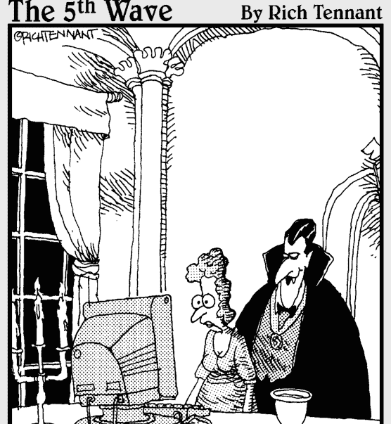

### 本部分内容 . . .

你将进入 JavaScript 编程的世界。你在这一部分学到的编程知识适用于任何编程语言。你将能够轻松地将这些理念应用到任何主流语言中。当然，示例和重点都是围绕 JavaScript 的。

第 1 章帮助你收集工具。专业 JavaScript 编程所需的大部分工具都是完全免费的。了解你需要哪些编辑器、浏览器和插件。

第 2 章带你入门 JavaScript。你将学习如何将数据存储在变量中、处理文本数据，以及进行一些基本的输入和输出操作。

第 3 章带你进入精彩的决策世界。你将学习如何生成随机数，然后利用它们来试验几种决策机制。你的程序将做出最好的决策。

第 4 章介绍循环这一强大概念。你的程序将能够按照你的需要重复任意次数，并能随时停止。循环也可能导致难以察觉的逻辑问题，因此本章还介绍了若干调试技巧。

第 5 章帮助你通过组合元素来构建更强大的程序。你可以组合变量来创建数组，也可以组合语句来创建函数。你还将学习如何同时组合指令和数据来创建对象，包括功能强大的 JSON 对象。

## 第 1 章

## 将 Web 提升到新高度

### 本章内容

- 回顾 HTML、XHTML 和 CSS
- 审视 JavaScript 和 AJAX 的角色
- 探索 JavaScript 和 AJAX 能为网页增添什么功能
- 选择一款编辑器
- 构建你的浏览器工具包

Web 是一件相当了不起的大事。创建网页非常有趣，而且几乎每家企业都需要网页。随着 Web 的发展和变化，人们对网页是什么、能做什么的期望也在不断改变。如果你已经了解 HTML 或 XHTML，你就知道如何创建 Web 文档——如果需要复习，可以查看配套网站 `www.dummies.com/go/javascriptandajaxfd` 上的附加章节 1，或者访问我的个人网站 `www.aharrisbooks.net/jad`。

随着 Web 的演进，用于创建网页和文档的工具也在不断发展。JavaScript 和 AJAX 是创建动态 Web 文档的两大强大工具。本章将带你了解构建网页的一些主要技术，作为入门。

### 构建炫酷的东西

本书讲述的是为网页添加单纯使用 HTML 和 CSS 无法实现的功能。

不要搞错；我们在这里讨论的是编程——编程比单纯的 Web 开发稍微难一点。然而，这一切都非常值得，正如图 1-1 中的示例页面所展示的那样。


为了保持示例的简洁，我使用了一些外部库。这些库将在本书第四部分中讲解，但现在你只需知道这里正在发生一些令人兴奋的事情。

这个框中的文字会发生变化。

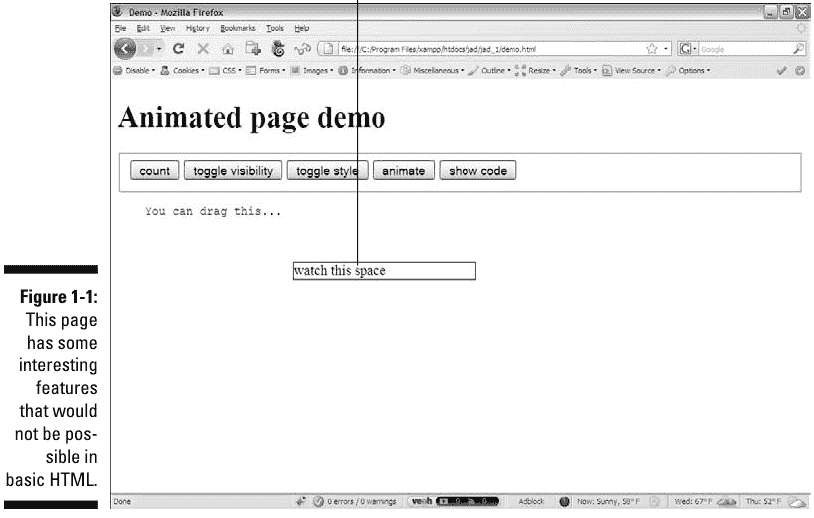

> 图 1-1：此页面具有一些在基础 HTML 中无法实现的有趣功能。

本程序需要你拥有有效的互联网连接才能正常运行。请查阅第 10 章，了解连接外部库的一些替代方案。

如果你想查看此页面的实际运行效果（你确实应该去看一下），请访问本书的配套网站：`www.aharrisbooks.net/jad` 或 `www.dummies.com/go/javascriptandajaxfd`。本书中的这个程序以及所有其他程序和示例都可以在该网站上找到。

乍一看，这个网页非常简单，但当你在自己的浏览器中打开它（你应该这样做）并开始尝试交互时，你很快就会发现它包含了很多惊喜。这个非常简单的页面说明了你应该学习 JavaScript 和 AJAX 的许多理由。

- **按钮具有交互功能。** 你可能已经掌握了在纯 HTML 中创建表单元素（如按钮和文本框）的方法，但 HTML 无法对按钮和文本框做任何事情；这就是为什么你需要一门编程语言。如果你想让一些有趣的事情发生，你需要一门编程语言。这些按钮中的每一个都使用 JavaScript 来完成一些有趣的工作，但页面现在可以交互本身就是一个巨大的变化。借助 JavaScript，你可以构建*应用程序*，而不仅仅是页面。
- **Count 按钮可以动态更改页面。** 当你点击 Count 按钮时，新的内容会自动添加到页面中。程序会统计 Count 按钮被点击的次数，并向“关注此处”区域添加文本。随着用户与页面交互，页面会呈现出原本不在服务器上的内容。当然，这个示例很简单，但你将能够动态地向任何 Web 元素添加任何类型的文本。这是一种非常强大的能力。图 1-2 展示了我多次点击 Count 按钮后的页面效果。

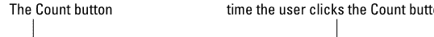

> 图 1-2：Count 按钮改变了页面中部分区域的文本。

- **Toggle Visibility 按钮可以让元素出现和消失。** 在 HTML 中你无法真正修改元素的显示或隐藏。你可以在一定程度上通过 CSS 实现，但 JavaScript 为你提供了更强大的工具集，可以随时更改页面中哪些部分对用户可见。请查看图 1-3，了解隐藏输出部分后的页面效果。


我点击了 Toggle Visibility 按钮，输出内容就消失了。

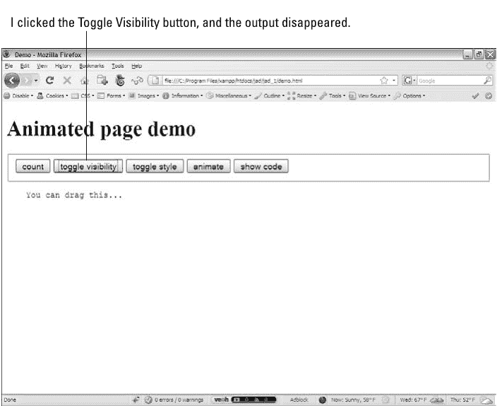

- **Toggle Style 按钮可以即时更改页面中部分内容的外观。** 你可以使用 JavaScript 更改页面任何部分的内容（即 HTML）——但你*也可以*使用 JavaScript 实时修改外观（即 CSS）。在这个示例中，我创建了一个名为 `funky` 的特殊 CSS 类，每次用户点击按钮时，该类会被添加或移除出输出框。这种方法适用于任何 CSS 类。（是不是很神奇？）图 1-4 展示了应用 `funky` 类后的页面效果。

如果你需要复习 CSS 或 XHTML，请查看网站上的附加章节：`www.dummies.com/go/javascriptandajaxfd` 或 `www.aharrisbooks.net/jad`。

我在本章的一些图表中添加了标注来描述正在发生的事情。仅凭本书中的图片不足以理解页面的功能。请在 `www.dummies.com/go/javascriptandajaxfd` 或 `www.aharrisbooks.net/jad` 上找到程序并亲自查看。

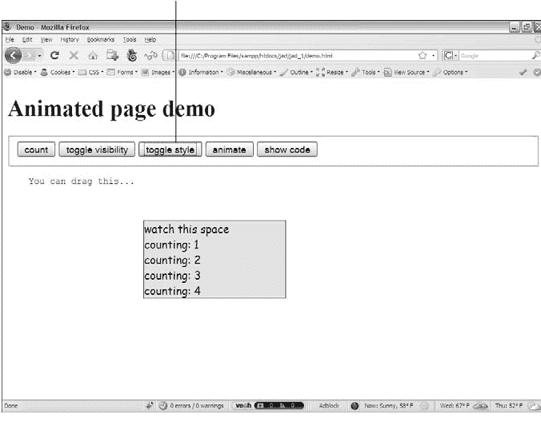

- **Animate 按钮更有趣。** Animate 按钮会对输出框进行一系列渐进式更改，随时间改变其大小、形状和外观。（你真的必须亲自试试；截屏无法展示其全部效果。）

Toggle Style 按钮

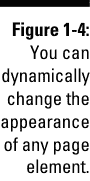

- **Show Code 按钮可以从外部文件引入文本。** 该按钮使用一种简单的 AJAX 形式，实时将外部文件加载到页面中。这是构建模块化页面的简便方法。在这个例子中，我实际上引入了 JavaScript 代码的副本，以便你能看到它的工作原理。如果现在还不理解也不用担心。这正是本书存在的意义！图 1-5 展示了此操作的运行效果。

点击查看来自另一个文件的代码。

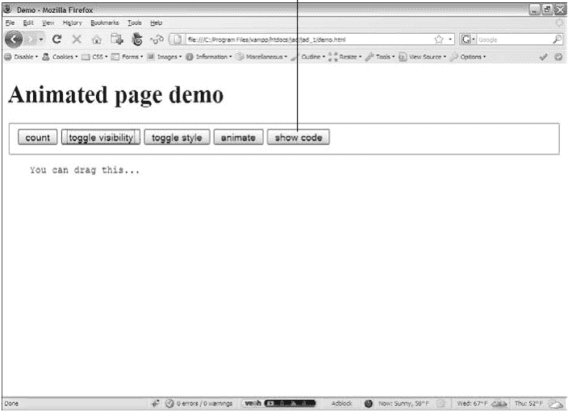

> 图 1-5：Show Code 按钮从另一个文件中提取代码并显示在屏幕上。

- **允许用户拖拽代码。** 用户可以拿起代码并将其移动到任何位置。这是普通网页中闻所未闻的另一种功能。

> 不，你通常不会向用户展示自己的代码。我只是在说明从服务器获取任意文本文件是相当容易的。既然你现在是一名程序员，我选择将引入的文本文件展示为一段代码预览给你看。

这些功能意义深远，而且仅仅是开始。学会编程将把你的网页从静态文档转变为可以与用户以全新且令人兴奋的方式进行交互的活的应用程序。

> 请随意查看这个项目的代码。它实际上包含三个文件：`demo.html`、`demo.css` 和 `demo.js`。所有文件都可以在本书配套网站的 Chapter 1 文件夹中找到。当页面在浏览器中显示时，使用“查看源代码”来查看 HTML 文件的源代码。

我在代码中添加了大量注释来帮助你理解其中的逻辑，但如果你还没有完全掌握所有细节也没关系。可以把这当作是本书中你将要学习的内容的预览。

### 入门

让你的页面实现所有这些功能看起来很有趣，事实也确实如此。有很多东西需要掌握，但不要惊慌；我会带你一步步完成。第一步是回顾 JavaScript 和 AJAX 所基于的核心技术，并了解它们与你最终需要的其他（更高级的）技术之间的关系。

### 核心技术概览

JavaScript 和 AJAX 虽然功能强大，但并非独立存在的。它们只有在网页的上下文中才有意义，因此依赖于各种 Web 技术。如果你想构建 JavaScript 应用程序，你还需要掌握其他几项技术：

## 第一章：将网络提升至新高度

- **HTML：** HTML（超文本标记语言）是描述网页的基础标记语言。它是一种构建网站的相对简单技术，只需一个纯文本编辑器即可完成。
- **XHTML：** XHTML 常被视为 HTML 的后续版本。由于它不允许某些类型的标签，实际上是一种更小、稍易于使用的语言。通常，XHTML 页面比 HTML 更依赖 CSS，因为许多 HTML 标签被 CSS 工具取代。
- **CSS：** CSS（层叠样式表）是为 HTML 或 XHTML 页面添加特定样式信息的一种方式。HTML 和 XHTML 提供整体框架，而 CSS 则描述颜色和布局。
- **JavaScript：** JavaScript 是一种嵌入在所有现代网络浏览器中的编程语言。它专为与网页交互而设计；你可以用它从页面的某些部分提取信息，并实时操作页面。
- **AJAX：** （异步 JavaScript 和 XML）是一种允许 JavaScript 更直接地与 Web 服务器通信的技术。它在 Web 浏览器和 Web 服务器之间建立了一种有趣的新关系。本书大约有一半内容专门讲解 AJAX。
- **PHP：** （PHP 超文本预处理器）是用于 Web 服务器工作的几种重要语言之一。尽管它不是本书的主要重点，但 PHP 语言能完成 JavaScript 无法完成的任务。AJAX 常被用来将 JavaScript 应用程序连接到 PHP 程序。你将在第 14 章简要介绍 PHP。
- **Java：** Java 是一种与 JavaScript 完全不同的语言（尽管名称相似）。尽管 Java 在客户端-服务器关系的客户端和服务器端都很有用，但它不是本书的主要重点。

> **提示** 当你寻找关于 JavaScript 的在线帮助时，请务必向 JavaScript 专家咨询，而不是 Java 程序员。尽管这两种语言名称相似，但它们是完全不同的语言。Java 程序员喜欢表现得高人一等，如果你在 Java 论坛中提出 JavaScript 问题，他们可能会给你带来困扰。如有疑问，请在我的网站（`www.aharrisbooks.net`）上提问。我可以帮助你解决这两种语言的问题，而且如果你有点困惑，我不会介意（也不会因此责怪你）。

## 16 第一部分：使用 JavaScript 编程

在某个时刻，你会希望你的网页能在互联网上可用。虽然你可以在家用计算机上安装服务器，但通常最好使用在线托管服务。你经常可以以非常低廉的价格甚至免费获得很好的在线托管服务。如果你想为你的网站附加一个特定的名称（例如 `www.mySite.com`），那么你需要每年支付大约 10 美元来注册域名。托管服务通常使用 Linux，但你可能会使用一个在线界面，它会隐藏所有细节。

合适的工具使任何工作都更容易，但对于 Web 开发，许多真正优秀的软件工具完全可以免费使用。因为这些工具是开源的（提供鼓励分发的许可证），所以使用它们完全合法，无需付费，不像通过非法手段获得的商业程序。

你可以使用任何带文本编辑器和浏览器的计算机进行基本的 Web 开发。随着你的 Web 调整技巧变得更加熟练，你可能需要更强大的工具。继续阅读，了解一些完全免费的优秀工具。

### 选择你的计算机

当然，你需要一台计算机。幸运的是，它不必是什么特别的东西。任何可以用来查看网页的计算机也可以用来创建它们。任何主要的操作系统（Windows、Mac 和 Linux）都完全没问题。我大部分工作是在 Linux（Fedora Core）和 Windows XP 的组合上完成的，但本书中的所有程序在任何合理的现代计算机上运行方式都完全相同。

### 选择编辑器

网页、JavaScript、HTML 和 CSS 本质上都是文本形式。你实际上不需要任何特定的程序来编写它们。然而，拥有完全合适的工具可以让你的工作轻松很多。由于你将花大量时间使用你的 Web 工具，你应该了解你的选择。

#### 避免使用错误的工具

使用错误的工具完成工作确实会让你的生活变得困难。以下是一些不太适合 Web 开发工作的工具：

- **Microsoft Word：** 文字处理器很棒（我正在使用一个来写这本书），但它们并非真正为创建网页而设计。Word（以及所有其他文字处理器）在文件中存储大量信息，而不仅仅是纯文本。所有这些格式设置对于非 Web 文档来说都很好，但 HTML 和 CSS 有自己的管理这些数据的方式，而其他东西会碍事。即使是“另存为 HTML”命令也有问题。尽管它以 HTML 形式存储页面，但 Word 的格式设置非常笨重且难以处理。生成的页面将不适合改编为 JavaScript。
- **Notepad：** 这是大多数 Windows 版本内置的经典工具。它以纯文本形式保存页面，因此对于 Web 开发来说比 Word 更好，但对于任何严肃的工作来说，Notepad 太简单了。它缺少行号等基本功能——而且它无法同时处理多个文档。作为 Web 开发工具，你很快就会觉得 Notepad 不够用。
- **TextEdit：** Mac 上的默认文本编辑器是一个非常强大的工具，但它更像文字处理器，而不是我所说的真正的文本编辑器。当你在 TextEdit 中保存 HTML 文件时，它通常不会以你需要的方式存储；你不会看到代码的结果，而是看到代码本身。如果你想将 TextEdit 用于 HTML 或 JavaScript，请确保在保存文件之前选择“格式▸制作纯文本”。
- **图形编辑器：** 一些高端图形编辑器，如 Adobe Photoshop、Adobe Fireworks 和 Gimp，也具有导出为 HTML 的功能，但它们生成的代码不易处理。最好使用这些程序来编辑图形，并使用专用的文本编辑器来处理代码。

##### 使用所见即所得编辑器

所见即所得（“你看到的就是你得到的”）编辑的承诺非常诱人。文字处理程序多年来一直具有这种功能。当你在屏幕上编辑文档时，你可以实时看到它打印在纸上的确切样子。许多工具承诺为网页提供这种功能：Adobe Dreamweaver 是最受欢迎的，其次是 Microsoft FrontPage 及其替代品 ExpressionWeb。尽管这些工具在传统 Web 开发中很受欢迎，但当涉及到我们在本书中做的那种交互式工作时，它们有一些缺点：

- **所见即所得是一个谎言。** 所见即所得的整个假设在输出是在打印机上打印的纸质文档时运行良好。你可以预测输出的结果。网页则不同，因为输出显示在别人的显示器上。你不知道它会有多大，支持什么颜色，或者安装了什么字体。你也不知道用户会使用哪种浏览器查看页面，这可能会对页面的输出产生重大影响。
- **编辑器隐藏了你需要的细节。** 可视化编辑器试图保护你免受 Web 开发某些细节的困扰。这在开始时没问题，但在某个时刻你需要那种控制水平。大多数使用 Dreamweaver 的专业人士大部分时间都在代码视图中工作，忽略了可视化编辑器的优势。为什么要为那些你将忽略的功能付费？
- **可视化编辑器假设文档是静态的。** 可视化编辑器基于网页是普通文档的理念。我们在本书中构建的页面远不止于此。你将（例如）编写代码来动态创建和修改 Web 文档。你需要知道如何手动构建 Web 文档，这样你才能编写代码来动态构建和更改它们。

##### 介绍程序员专用编辑器

许多专业编辑器应运而生，旨在弥补纯文本编辑器与所见即所得工具之间的空白。这些编辑器以纯文本方式编写，但为程序员提供了额外功能，包括：

- **语言感知：** 程序员编辑器通常能识别你正在编写的语言并相应调整，无论你编写的是 HTML、JavaScript 还是 CSS 代码。大多数通用程序员编辑器都能原生处理所有这些语言，并且通常还能辅助更多语言。
- **语法高亮：** 各种元素以不同颜色显示，让你能分辨出纯文本内容、HTML 标签的部分等等。这个简单的功能能让你更容易发现诸如引号缺失之类的问题，并能快速查看页面的整体结构。
- **语法支持：** 程序员编辑器通常会提供某种形式的帮助，以便你记忆所用语言的语法。这种增强可以以按钮和宏的形式出现，用于处理常见代码；也可以是为标准布局和模式预写的模板；还可以是语法补全功能（它会查看你正在输入的内容，并根据你当前使用的语言建议补全内容）。
- **多文档支持：** 高级 Web 应用程序通常涉及同时编辑多个不同的文档。你可能有十几个 Web 页面、几个 CSS 样式表和一两个外部 JavaScript 文件。程序员编辑器允许你同时查看和编辑所有这些文件。许多编辑器还允许你生成一个*项目文件*，这样你就可以自动保存所有相关文件并一次性加载它们。
- **宏工具：** 编程经常需要重复的输入任务。拥有一个可以录制并回放一系列击键序列作为*宏*（短小的自动化操作）的功能，会非常有帮助。
- **调试和预览支持：** 大多数程序员编辑器都有一个工具，可以在浏览器中（有时直接在编辑器中）预览你的代码。编辑器通常还有工具用于预测某些错误，或在错误发生时做出响应。至少，你需要具备直接跳转到代码特定行或部分的能力。
- **缩进支持：** 大多数程序员使用缩进作为强大的工具，以帮助他们理解正在构建的 Web 文档的结构。一个优秀的编辑器可以协助你处理这种缩进，并帮助你识别文档结构中的错误。

##### 熟悉一些重要的编辑器

有几个多功能的程序员编辑器会立即浮现在脑海中。你应该考虑研究以下一个或多个免费程序：

- **vi 和 emacs：** 这些是所有文本编辑器的鼻祖。两者在 Unix/Linux 环境中都非常常见。它们也适用于 Windows 和 Mac。虽然功能极其强大，但 vi 和 emacs 是在现代可用性理念尚不实用的时期开发的。如果你已经知道如何使用这些工具中的任何一种，那么一定要研究一下现代变体。（坦率地说，我仍然将 emacs 作为我的主要文本编辑器，尽管我不知道在如今有这么多更简单的选择时，我是否还会去学习它。）图 1-6 显示了使用 emacs 编辑网页的情景。

    无按钮或小部件的简洁界面

    **图 1-6：** Emacs 并不漂亮，但功能非常强大。使用它可以增加极客分数。

    你可以同时打开多个文件，也可以查看同一文件中的两个位置。

- **Notepad++：** 这才是 Windows 记事本应有的样子。它继承了 Windows 记事本的速度和简洁性，但为程序员添加了大量功能。我特别喜欢内置的页面验证支持。这是少数几个在我桌面上赢得永久快捷方式的程序之一。不幸的是，它只适用于 Windows。图 1-7 显示了在 Notepad++ 中编辑同一页面的情景。
- **Bluefish：** Bluefish 文本编辑器正迅速成为 Web 开发人员的最爱工具。它快速而强大，并为 Web 开发人员提供了许多出色的功能。一个特别强大的工具是 CSS 生成器，它通过菜单系统帮助你开发样式表，这样你就不必记忆任何语法。它还有一个很棒的默认模板生成器，使得构建 XHTML 严格格式的 Web 页面变得更加容易。Bluefish 适用于所有主要平台（对于 Windows 版本，你还需要安装免费的 GTK 库）。你可以在图 1-8 中看到 Bluefish 运行的样子。

    用于文本编辑的广泛命令集和工具

    支持多文档

    对数十种语言自动进行语法高亮

    **图 1-7：** 你会发现 Notepad++ 是记事本一个非常强大的替代品。

- **jEdit：** 这款强大的编辑器是用 Java 编写的，因此几乎可以在所有平台上使用。它在基本格式下就是一个功能非常强大的编辑器，但其最佳特性是丰富的插件库，允许你根据自己的需求进行定制。如果你安装了免费的 XML 库，jEdit 对 HTML 和 XHTML 的支持令人难以置信。图 1-9 显示了在 jEdit 中编辑示例程序的情景。
- **codetch：** 这个编辑器的独特之处在于，它不是一个独立的编辑器，而是流行的 Firefox 浏览器的一个扩展程序。它拥有与其他编辑器大多数相同的功能，而且因为它已经是你浏览器的一部分，所以使用起来非常方便。它不像其他一些工具那样可配置，但仍然极其方便。你可以在图 1-10 中看到 codetch 的实际应用。

    **图 1-9：** jEdit 是一款用 Java 编写的快速且功能强大的编辑器。

    **图 1-10：** Firefox 的 codetch 插件是一个完整的 Web 编辑器。

##### 介绍 Aptana

近年来，一款特定的程序员编辑器真正接管了 Web 开发世界。Aptana 是一个功能齐全的程序员编辑器，基于强大且流行的 Eclipse Java 编程编辑器。Aptana 有很多值得推荐的地方：

- **对 Web 语言的广泛内置支持：** Aptana 开箱即支持 HTML/XHTML、CSS、JavaScript 和 AJAX。
- **语法高亮：** 大多数程序员编辑器都有语法高亮功能，但 Aptana 在这方面尤为出色。有时你会遇到同一个物理文档中有三种或更多不同语言同时活跃的情况，而 Aptana 通常能通过上下文判断你是在编写 CSS、XHTML 还是 JavaScript 代码。
- **代码补全：** 这是 Aptana 最令人印象深刻的特性之一。当你开始编写一行代码时，Aptana 会弹出一个建议菜单。这有助于你避免错误，这样你就无需精确记忆所有不同的 CSS 属性和 JavaScript 命令。
- **错误检测：** Aptana 可以在你创建文档时检查你的文档，并实时高亮显示某些区域。此功能可以帮助你编写更好的代码，也可以帮助你磨练编写代码的技能。
- **AJAX 支持：** AJAX 是一项相对新的技术，大多数编辑器不直接支持它。Aptana 具有许多帮助你处理 AJAX 的功能，包括对所有主要 AJAX 库的内置支持。

Aptana 是完全免费的。我已经在本书的网站上放置了 Aptana（实际上还包括此处提到的所有工具）的链接。你可以在图 1-11 中看到 Aptana 的实际应用。

我的个人设置因机器而异，但通常我使用 Aptana 进行繁重的编程工作，使用 Notepad++ 作为 Windows 上的快速编辑器，使用 emacs 作为 Linux 或 Mac 机器上的主要基本文本编辑器。当然，随着你的使用，你会形成自己的偏好。所有这些编辑器都是免费的，可以在 `www.aharrisbooks.net/jad` 下载，因此值得你尝试一下。

图 1-11：Aptana 可能是市面上最出色的 Web 编辑器，无论价格如何。

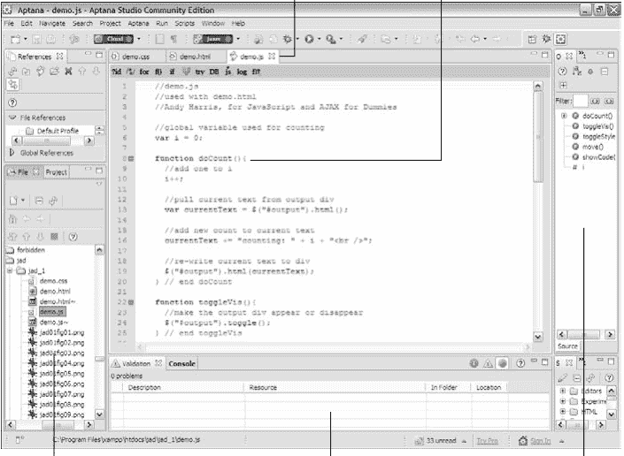

自动语法高亮和代码补全

多文档支持

集成的文件管理工具

用于调试和错误信息的控制台区域

自动生成显示页面或程序主要部分的地图

### 创建你的浏览器收藏集

网页存在于 Web 浏览器的环境中。每个浏览器对 HTML 和 CSS 的解释都有些不同，而当你开始谈论 JavaScript 和 AJAX 时，这些差异会被放大。浏览器支持你代码的方式中那些细微的（有时并不那么细微的）差异可能非常重要。

#### 制定标准

每个 Web 浏览器都有自己独特的方式来显示网页。尽管这些方式非常相似，但差异有时会成为问题。更糟糕的是，当你开始编写 JavaScript 代码时，你会发现每个浏览器对代码的解释都不同。这可能会一团糟。

幸运的是，近年来在标准化方面取得了巨大进展。各种浏览器开发者一直在合作，并同意遵守一个名为万维网联盟（W3C）的中央团队制定的各项标准。当一个浏览器实现 JavaScript 时，它现在同意（至少理论上如此）遵守一套关于行为的标准。只要你的代码遵循相同的标准，你就可以期望一切都能运行良好。（至少大多数时候是这样。）

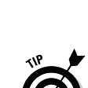

在本书中，我遵循大多数开发者实践所接受的 JavaScript 标准。本书中的所有代码都在 Windows 上的 IE7、Windows 上的 Firefox 3 和 Linux 上的 Firefox 3 上进行了测试。每当代码可能引起特定浏览器问题时，我都会尝试指出具体问题。

#### 选择一两个浏览器

以下是你应该了解的一些浏览器：

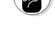

- **旧版浏览器：** 你会发现互联网上仍在使用许多旧版浏览器。有些人一直坚持使用他们电脑上原有的浏览器，多年没有升级。早于 IE6 或 Firefox 的浏览器是一个特别大的问题，因为在 Web 早期，对 Web 标准和 JavaScript 的支持非常不均衡。在大多数情况下，本书假设你的用户将使用至少还算现代的浏览器。

  特别是 AJAX 在非常老的浏览器上无法工作。

- **Microsoft Internet Explorer 6：** 这是一个非常常见的浏览器，仍然很流行。它曾一度是互联网上的主导浏览器，但近年来已失宠，被微软更新的产品以及 Firefox 和 Opera 等竞争对手所取代。该浏览器因其许多不符合社区标准的“特性”而闻名。其使用率正在下降，但截至本文撰写时，你仍然需要考虑支持它；很多用户仍在使用它。
- **Firefox：** Mozilla 的 Firefox 网络浏览器通过提供多年来第一个来自微软的重要竞争者，重新开启了所谓的“浏览器战争”。Firefox 凭借其令人印象深刻的功能确实令人耳目一新：标签页浏览、改进的安全性和集成搜索。对于开发者来说，Firefox 是最早真正严肃支持 Web 标准的浏览器之一。Firefox 对开发者尤其重要，因为它支持扩展架构，允许程序员将 Firefox 变成强大的开发工具。有关于一些优秀扩展的建议，请查看本章下一节。
- **Microsoft Internet Explorer 7 和 8：** IE7 可以被视为对 Firefox 的致敬，因为它包含了許多相同的功能。在编写本书时，IE8 发布，并增加了更多改进。尽管 IE7 和 IE8 对标准的支持不如当前其他一些浏览器那么完整，但它们比 IE 的任何早期版本都要好得多。
- **Opera：** Opera 是一个重要的浏览器，因为它是最早积极支持 Web 标准的浏览器之一。它在某些圈子非常流行，但从未获得广泛的普及。由于它支持 Web 标准，它通常可以运行任何为符合标准的浏览器编写的代码。
- **Safari：** Safari 是随 Mac OS 打包的网络浏览器。它是一个功能非常强大的符合标准的浏览器。现在也有 Windows 版本可用。iPhone 内置的网络浏览器使用与 Safari 相同的引擎，因此如果你正在为移动设备构建应用程序，这是一个重要的考虑因素。
- **Chrome：** 这个较新的浏览器是由 Google 创建的。它高度符合标准，并且在处理 JavaScript 和 AJAX 方面尤其强大。这并不奇怪，考虑到 Google 是 AJAX 使用的先驱公司之一，并且正在积极推广其使用。Chrome 拥有目前常用最快的 JavaScript 解释器之一。
- **其他浏览器：** 当今还有许多其他浏览器在使用中，包括各种形式的 Linux、手机和 PDA 上的专用浏览器。几乎不可能支持所有这些浏览器，但许多浏览器现在至少尝试支持 Web 标准。

我更喜欢使用 Firefox 3 进行大部分测试，因为它具有非常好的标准支持以及一组用于改进和调试代码的优秀工具。然后我再在其他浏览器（包括 IE6、IE7 和 Chrome）上检查我的页面。


#### 将 Firefox 变成开发机器

Firefox 对于 Web 开发者来说是一个特别重要的浏览器。它具有许多吸引人的功能，包括其在 HTML 和 JavaScript 方面的出色标准支持。然而，Firefox 作为开发者工具最重要的优势可能是它对扩展的支持。许多商业浏览器对其代码严格保密，并且非常难以扩展。Firefox 从一开始就被设计成可以扩展其功能——许多非常聪明的程序员为这个工具添加了令人难以置信的扩展。其中一些扩展已成为 Web 开发者的“必备品”：

##### Web Developer 工具栏

Chris Pederick 的 Web Developer 工具栏是一个令人难以置信的工具。它为 Firefox 添加了一个新的工具栏，具有许多极其有用的功能：

- **编辑 CSS：** 你可以弹出一个小窗口并输入 CSS 代码。CSS 将实时立即生效，因此你可以准确地看到 CSS 对页面视图的影响。
- **显示标尺：** 这个极其方便的工具允许你在页面上绘制标尺，以准确查看各个元素的大小。这对于调试 Web 布局非常有用。
- **表格轮廓：** 此工具帮助你理解基于表格的布局。它是查看复杂表格设计如何创建的好方法。
- **调整大小菜单：** “调整大小”菜单可让你查看页面在其他几种标准尺寸下的外观。这在设计布局时非常有用。
- **验证工具：** Web Developer 包含许多非常方便的工具来验证你的网页。它包含用于验证 HTML 和 CSS 的链接，以及主要的可访问性标准。


##### HTML Validator 扩展

这个令人难以置信的扩展将 W3C 使用的相同验证引擎带到了你的浏览器中。它可以对你查看的任何页面的有效性提供快速反馈。它还为 Firefox 的“查看源代码”页面添加了更多信息，包括关于你具体有哪些验证错误的反馈。（普通的“查看源代码”页面不提供验证信息。）修复错误的提示实际上很有帮助，还有一个工具可以使用出色的 HTML Tidy 程序自动修复代码。HTML 是 JavaScript 代码的基础，无效的 HTML 会提供错误的框架。有了 HTML Validator，就没有理由让页面无效了。图 1-12 显示了改进后的“查看源代码”窗口，其中包含警告选项卡和使用 HTML Tidy 修复代码的按钮。

## 第一部分：JavaScript 编程

查看源代码窗口

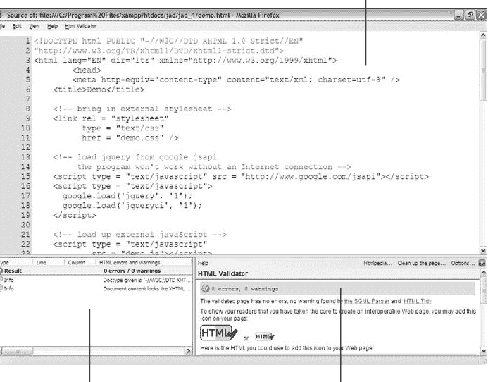

**图 1-12：** HTML Validator 扩展为“查看源代码”工具增加了非常实用的功能。

验证器错误会显示在此窗口中。

验证器扩展提供有用的错误提示信息。

#### Firebug

Firebug 扩展是 Web 开发中最重要的工具之一。它将 Firefox 变成了一个完整的调试工具。Firebug 有几个特别有用的功能：

- **检查窗口：** 这个不可思议的工具允许你将鼠标悬停在页面的任何元素上，并立即在另一个面板中看到创建该部分的代码。这是分析和调试页面的一种非常简单的方法。你还可以即时查看应用于特定代码片段的 CSS，并高亮显示代码以查看相应的输出。
- **CSS 查看和编辑：** 你可以在一个面板中查看页面的 CSS，预览任何颜色，并编辑数值。你会在页面上实时看到结果。
- **JavaScript 调试：** 即使是专业人士也会犯错——而到目前为止，JavaScript 程序员可用的调试工具很少。Firebug 拥有比浏览器更好的错误捕获机制，它还集成了一个非常好的调试器，可以在程序运行时真正帮助你找到错误。
- **AJAX 监控：** AJAX 编程基于一系列与服务器之间的来回请求。Firebug 帮助你跟踪这些请求并观察数据的流动。
- **实时代码视图：** 大多数浏览器的普通“查看源代码”菜单帮助你查看最初从浏览器获取的代码。在 JavaScript 编程中，你经常需要动态地更改页面代码。Firebug 向你展示页面的真实状态，即使它正被 JavaScript 修改。这是一个非常有用的功能。
- **Firebug lite：** 这是 Firebug 的一个变体，可在 IE 和其他浏览器中使用。它将 Firebug 的大部分功能添加到任何浏览器中。

图 1-13 显示了 Firebug 处于检查模式下的情况。当用户移动到页面的某一部分时，相关的代码段会出现在代码窗口中。

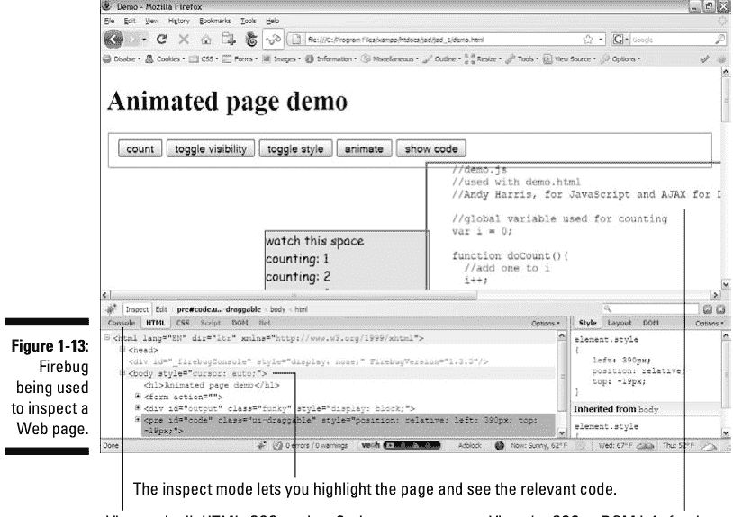

查看和编辑 HTML、CSS 或 JavaScript

查看当前选定窗口的 CSS 或 DOM 信息。

## 第 2 章：编写你的第一个程序

**本章内容**

- 将 JavaScript 代码添加到页面中
- 设置 JavaScript 开发环境
- 创建变量
- 使用模态对话框进行输入和输出
- 使用连接操作构建文本数据
- 理解基本数据类型
- 使用字符串方法和属性
- 使用转换函数

网页始于 XHTML 代码。这些基础代码提供了框架。CSS 为基础结构添加装饰，但要让你的页面真正“活”起来，你需要学习一门编程语言。

JavaScript 语言是一门非常流行的入门语言，因为它被设计用于与网页交互，并且已经内置于大多数 Web 浏览器中。它相对容易学习，并且功能非常强大。

学习一整门编程语言的想法可能看起来令人生畏，但不用担心。编程其实并不那么难。在本章中，我将向你确切地展示如何开始。你很快就能像专业人士一样编写代码了。

### 成为一名程序员

JavaScript 最初是由 Netscape 通信公司开发的一种编程语言。现在它几乎是所有浏览器上的标准。关于 JavaScript，有几件事你需要立即了解：

**第一部分：JavaScript 编程**

- ✓ **它是一门真正的编程语言。** 有时，使用其他语言（如 C++ 和 VB.NET）编程的人会嘲笑 JavaScript，声称它不是一门“真正的”编程语言，因为它缺少一些功能。这些功能（特别是与本地文件系统通信的能力）是为了保持 JavaScript 的安全性而故意省略的。（在本书的后半部分，你会接触到一些提供这些功能的 AJAX 替代方案。）JavaScript 是一门真正的语言，而且它是开始学习编程的一个非常好的起点。
- ✓ **它不是 Java。** 还有另一种流行的编程语言叫做 Java（没有 script 部分），它也用于 Web 编程。JavaScript 和 Java 是*完全不同*的语言（尽管名字相似）。确保你不会跑到 Java 论坛上去问 JavaScript 的问题。那些 Java 程序员可能会有点自以为是和优越感。（他们不应该这样；我也用 Java 编程。这只是一门语言而已。）
- ✓ **它是一门脚本语言。** JavaScript 是一门相当容易上手的语言。它不像某些其他语言（我说的就是你，Java）那样严格，并且对事物的看法相对宽松（例如，它对于数据类型和位置的要求不那么严格）。这让你可以更专注于解决问题，而不是担心代码到底怎么写。它仍然是一门编程语言，所以有一些规则你必须遵守，但像 JavaScript 这样的脚本语言往往比那些大型的“怪兽”语言对初学者更宽容。

### 选择 JavaScript 编辑器

JavaScript（就像 XHTML 和 CSS 一样）实际上只是文本。你可以在用于 XHTML 和 CSS 的同一个编辑器中修改 JavaScript 代码。如果你之前使用过 Aptana（在第 1 章中提到过）并且喜欢它，那么你现在会爱上这个编辑器。当然，如果你愿意，你可以继续使用其他编辑器。

JavaScript 是一门完全不同的语言，其语法与 HTML 和 CSS 不同。它学起来不难，但任何一门真正的编程语言都有很多东西要学。Aptana 有许多非常好的功能，在编写 JavaScript 代码时对你有极大帮助：

- ✓ **语法高亮：** 就像 HTML 和 CSS 一样，Aptana 会自动调整代码颜色，帮助你理解程序中发生的事情。正如你将在本章后面看到的，当情况变得复杂时，这会是一个很大的好处。
- ✓ **代码补全：** 当你输入一个对象的名称时，Aptana 会为你提供一个可能的补全列表。这真的很有帮助，这样你就不必记住所有函数和命令的细节。
- **帮助文件：** My Aptana 页面（如果你关闭了它，可以从文件菜单访问）有指向 HTML、CSS 和 JavaScript 优秀帮助页面的链接。这些文档实际上比你在网络上找到的一些文档更容易阅读。
- **集成帮助：** 将鼠标指针悬停在 JavaScript 命令或方法上，一个漂亮的文本框会弹出，准确地解释其工作原理。通常，该框中会包含一两个示例。
- **错误警告：** 当 Aptana 能够检测到问题时，它会尝试给你一条错误消息，并在可疑代码下方放置一条红色的波浪线（就像拼写检查器使用的那样）。

我不知道还有什么更好的 JavaScript 编辑器，无论价格如何，而且 Aptana 是免费的，所以实在没有很好的理由去使用其他编辑器。当然，如果你不想要或不需要这些功能，你可以使用任何你喜欢的文本编辑器。

我在 Aptana 中发现了一个奇怪的特性：与 XHTML 和 CSS 相比，预览选项卡对于检查 JavaScript 代码来说不是一个那么可靠的方法。我发现直接在浏览器中运行代码，或者使用“运行”按钮让 Aptana 在外部浏览器中为我运行代码，效果更好。

### 选择你的测试浏览器

除了编辑器之外，你还需要根据浏览器在测试 JavaScript 代码时的表现来仔细选择它。

所有主要浏览器都支持 JavaScript，并且其工作方式在不同浏览器之间相对相似（至少在事情变得有点复杂之前是这样）。然而，在测试你的代码时，浏览器并非完全平等。

当你编写 JavaScript 代码时，事情会出错，浏览器负责告诉你哪里出了问题。在错误报告方面，Firefox 遥遥领先于 IE。Firefox 的错误信息更容易阅读和理解，并且 Firefox 支持一个叫做 JavaScript 控制台（在第 4 章中描述）的功能，这使得更容易了解发生了什么。如果可能的话，使用 Firefox 来测试你的代码，然后在 IE 中检查差异。

第 4 章将为你提供更多关于查找和修复错误的信息——以及 Firefox 和 Aptana 中一些很棒的工具，让这项重要的工作变得更容易。

以上是足够的准备工作。拿出你的编辑器，开始编写一个真正的程序吧。开始是相当简单的。任何 JavaScript 程序的基础都是一个标准的网页。

34 第一部分：使用 JavaScript 编程

### 向页面添加脚本

JavaScript 程序的运行环境是网页，因此你可以从向一个基础网页添加内容开始你的 JavaScript 之旅。如果你不熟悉 XHTML 或 CSS（用于基础网页开发的语言），请查阅本书配套网站上提供的额外章节（`www.dummies.com/go/javascriptandajaxfd` 或 `www.aharrisbooks.net/jad`），或者参考更完整的参考书如《HTML、XHTML 和 CSS 全能参考手册》（Wiley 出版）。

向页面中添加 JavaScript 代码非常容易。图 2-1 展示了任何计算机语言中的经典入门程序。

这个页面包含一个非常简单的 JavaScript 程序，它会在一个名为*对话框*的特殊元素中弹出“Hello, World!”这句话。非常酷。

以下是代码的概览，然后我将一步步解释所有细节。

```
<!DOCTYPE html PUBLIC "-//W3C//DTD XHTML 1.0 Strict//EN"
"http://www.w3.org/TR/xhtml1/DTD/xhtml1-strict.dtd">
<html lang="EN" dir="ltr" xmlns="http://www.w3.org/1999/xhtml">
  <head>
    <meta http-equiv="content-type" content="text/xml; charset=utf-8" />
    <title>HelloWorld.html</title>
    <script type="text/javascript">
    //<![CDATA[
      // Hello, world!
      alert("Hello, World!");
    //]]>
    </script>
  </head>

  <body>

  </body>
</html>
```

如你所见，这个页面的 HTML 主体中完全没有内容。你可以（并且将会）将 JavaScript 与 XHTML 内容结合起来。不过目前，你可以简单地将 JavaScript 代码放在网页 head 区域的一个特殊标签中使其运行。

#### Hello, World?

在编程语言中有一个悠久的传统，即用任何语言编写的第一个程序都应该简单地说一句“Hello, World!”，不做其他任何事情。实际上，这个习惯有一个非常实用的理由。“Hello World”是你可以编写的、能够证明其正常工作的最简单的程序。“Hello World”程序用于帮助你理解编程环境的机制——程序是如何编写的、需要执行哪些特殊步骤来运行代码、以及它是如何工作的。在你知道能够让代码弹出并打招呼之前，编写更复杂的程序是没有意义的。

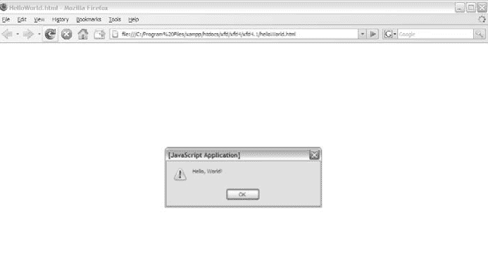

图 2-1：这个 JavaScript 程序让这个小对话框弹了出来！

#### 嵌入你的 JavaScript 代码

JavaScript 代码通过 `<script>` 标签放置在网页中。JavaScript 代码放在 `<script></script>` 标签对内部。`<script>` 标签有一个必需属性 `type`，通常值为 `text/javascript`。（其他类型也是可能的，但很少使用。）

前面代码中的另一个有趣之处是那个奇怪的 CDATA 部分。在 `<script>` 标签内紧接的下一行是

```
//<![CDATA[
```

这行奇怪的代码是一个特殊标记，用于说明后续代码是字符信息，不应被解释为 XHTML。脚本末尾用以下代码结束字符数据标记：

```
//]]>
```

在现代浏览器中，将 JavaScript 代码标记为字符数据是个好主意。如果不这样做，XHTML 验证器有时会混淆，并错误地声称你有错误，而实际上并没有。

那个 CDATA 确实很怪异。它很难记，我知道，但多打几次，你就能记住它了。

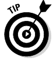

很多旧的书籍和网站不包含这个字符数据的技巧，但它很值得掌握。你已经为构建符合标准的页面付出了太多努力，不应该因为浏览器将你的 JavaScript 误认为格式错误的 XHTML 而出现不应有的错误消息。

#### 创建注释

与 XHTML 和 CSS 一样，JavaScript 注释也很重要。因为编程代码可能比 XHTML 或 CSS 更难理解，所以在 JavaScript 中注释代码比在那两种环境中更加重要。JavaScript 中的注释字符是两个斜杠（`//`）。浏览器会忽略从两个斜杠到行尾的所有内容。你也可以使用多行注释（`/* */`），与 CSS 中的相同。

#### 使用 alert() 方法输出

JavaScript 中有多种输出数据的方式。在这个示例中，我使用 `alert()` 方法。这种技术会弹出一个包含文本的小对话框供用户阅读。警告框是*模态对话框*的一个例子。模态对话框会中断程序的执行流程，直到用户注意到它们。在用户通过点击 OK 按钮确认对话框之前，程序中不会发生其他任何操作。用户必须先点击按钮，然后才能与页面交互。

模态对话框可能看起来有点粗鲁。事实上，一旦你学会了其他输入和输出技术，可能就不会经常使用它们了。对话框需要引起注意这一特性，使得它在你刚开始编程时是一个非常容易使用的工具。当你掌握了基本的编程概念后，我会向你展示与网页交互的更优雅的方式。

#### 添加分号

JavaScript 中的每条命令都以分号（`;`）字符结尾。在大多数计算机语言中，分号的作用就像英文中的句号：它标志着一个逻辑思想的结束。通常代码中的每一行也是文本编辑器中的一行。

说实话，如果你省略分号，JavaScript 通常也能正常运行，但你还是应该加上它们，因为它们可以明确你的意图。此外，大多数其他语言（如第 14 章介绍的 PHP）都需要分号。你不妨现在就开始养成好习惯。

### 介绍变量

计算机程序通过处理信息来获得强大的功能。图 2-2 展示了一个从用户获取数据并将其用于个性化问候的程序。

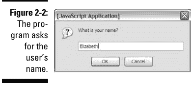

这个程序引入了一种新的对话框，允许用户输入一些数据。这些信息被存储在程序中供以后使用。图 2-3 顶部显示了响应的第一部分。用户必须点击 OK 才能在第二个警告对话框中看到完整的问候语，如图 2-3 底部所示。

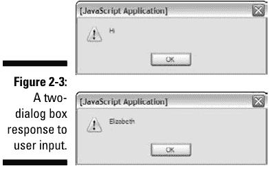

## 第一部分：使用 JavaScript 编程

输出可能看起来不那么惊人，但看看源代码就能明白发生了什么：

```
<!DOCTYPE html PUBLIC "-//W3C//DTD XHTML 1.0 Strict//EN"
"http://www.w3.org/TR/xhtml1/DTD/xhtml1-strict.dtd">
<html lang="EN" dir="ltr" xmlns="http://www.w3.org/1999/xhtml">
<head>
  <meta http-equiv="content-type" content="text/xml;
  charset=utf-8" />
  <title>prompt.html</title>
  <script type = "text/javascript">
  //<!--CDATA[
    var person = '';
    person = prompt("What is your name?");
    alert("Hi");
    alert(person);
  //]]>
  </script>
</head>
<body>
</body>
</html>
```

#### 创建变量用于数据存储

这个程序的有趣之处在于它允许用户交互。用户可以输入一个名字，该名字被存储在计算机中，然后在问候语中返回。这个程序的关键是一个称为*变量*的特殊元素。变量只是内存中用于保存数据的位置。任何时候你希望计算机程序“记住”某些信息，都可以创建一个变量并将你的信息存储在其中。

变量通常具有以下特征：

- **`var` 语句。** 使用 `var` 命令表示你正在创建一个变量。
- **名称。** 创建变量时，你必须给它一个名称。
- **初始值。** 为每个变量立即赋予一个值是很有用的。
- **数据类型。** JavaScript 会自动确定变量中数据的类型（稍后会详细介绍），但你应该对自己期望某个特定变量包含什么类型的数据有清晰的认识。

#### 向用户询问信息

变量在包含信息时会变得更有趣。JavaScript 有一个简单的工具叫做 `prompt`，它允许你轻松提问并将答案存储在变量中。以下是来自 `prompt.html` 的相关代码行：

```
person = prompt("What is your name?");
```

`prompt` 语句做了几件有趣的事情：

- **它会弹出一个对话框。** `prompt()` 方法创建一个模态对话框，非常类似于之前讨论的 `alert` 技术。
- **它会提出一个问题。** `prompt` 命令要求你向用户提问。
- **它提供响应空间。** 对话框中有一个空间供用户输入某种响应，还有按钮表示用户已完成或想取消操作。
- **它将信息传递给变量。** `prompt` 命令的目的是从用户那里获取数据，因此提示几乎总是与变量关联。当代码执行完毕时，变量将包含指定的值。

#### 响应用户

这个程序使用 `alert()` 方法开始向用户打招呼。第一个 alert 与 `helloWorld` 程序中的类似：

```
alert("Hi");
```

括号中的内容是你希望用户看到的文本。在这种情况下，你希望用户看到字面值 "Hi"。

第二个 `alert` 语句有点不同：

```
alert(person);
```

这个 `alert` 语句有一个没有引号的参数。由于没有引号，JavaScript 明白你并不是真的想说文本 "person"。相反，它会查找名为 `person` 的变量，并返回该变量的值。

因此，变量可以采用任何名称，存储它，并返回一个定制的问候语。

#### 使用连接构建更好的问候语

将问候语和人的名字放在两行中似乎有点笨拙。图 2-4 展示了一个更好的解决方案。程序再次请求一个名字并将其存储在变量中。这次，问候语被组合到一个 alert 对话框中，看起来好多了：

图 2-4：现在只有一个对话框响应用户的输入。

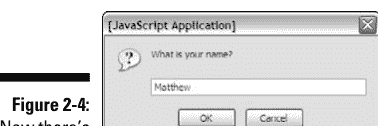

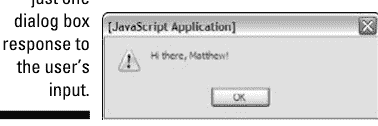

图 2-4 的秘诀是计算机领域中那些美妙瑰宝之一：一个真正简单的想法，却有一个非常复杂的名字。看看代码，你会发现将变量与文本组合并没有那么复杂：

```
<script type = "text/javascript">
//<!CDATA[
// from concat.html

var person = "";
person = prompt("What is your name?");
alert("Hi there, " + person + "!");

//]]>
</script>
```

为了简洁起见，我只包含了 `<script>` 标签及其内容；页面的其余部分是一个标准的空白 XHTML 页面。（一如既往，请在网站 `www.harrisbooks.net/jad` 上查看完整文档。）我在整个章节中都使用这种方法，但也在每个 JavaScript 代码片段中包含注释，以指示你可以在网站上获取整个文件。

#### 连接和你的编辑器

连接的困难部分是弄清楚文本的哪部分是字面值，哪部分是字符串。过不了多久，你就会开始感到困惑，试图理解引号应该放在哪里。

现代文本编辑器（如 Aptana）有一个很棒的功能可以帮助你。它们将不同类型的文本用不同颜色显示。默认情况下，Aptana 将变量名显示为黑色，字面文本显示为深绿色（至少在 JavaScript 中是这样——在 HTML 中，字面文本是蓝色的）。

如果你犯了错误，有一个按钮可以恢复到默认值。

就我个人而言，我发现很难区分深绿色和黑色，所以我更改了 Aptana 的配色方案：我让它将字符串字面值显示为蓝色，无论我是在 JavaScript 还是 HTML 中。有了这个设置，我可以轻松地看到语句中哪部分是字面文本，哪部分被读作变量名。这使得连接变得容易多了。

要在 Aptana 中更改配色方案，请单击 Window > Preferences。你将在结果对话框中看到一个可扩展的大纲。单击 Aptana > Editors > JavaScript Editor > Colors。然后你可以向下滚动，找到任何数据类型的设置。我在 "literals" 下找到了 "string"（文本的另一个术语），并将我的文本字符串的颜色从深绿色更改为蓝色。

大多数具有语法高亮显示的编辑器都允许你更改设置以适应你的需求。不要害怕使用这些工具来帮助你更好地编程。

#### 比较字面值和变量

在这个程序中，实际上有两种不同类型的文本。整个表达式 "Hi there, " 是一个*字面*文本值。也就是说，你真的是想说 "Hi there."。另一方面，*person* 是一个变量；你可以在其中放入任何人的名字。如果你愿意，可以在一个短语中组合字面值和变量：

```
alert("Hi there, " + person + "!");
```

这段代码的秘诀是遵循引号。"Hi there, " 是一个字面值，因为它在引号中。在这行代码中，*person* 是一个变量名（因为它*没有*在引号中），而 "!" 是一个字面值。你可以使用加号如前面的代码所示，将任意数量的文本片段组合在一起。

使用加号组合文本称为*连接*。（我告诉过你，这是一个简单想法的复杂词汇。）

#### 在连接的短语中包含空格

你可能对输出行中逗号和引号之间的额外空格感到好奇：

```
alert("Hi there, " + person + "!");
```

这很重要，因为你希望输出看起来像一个正常的句子。如果你没有空格，计算机不会添加一个，输出会看起来像：

```
Hi there,Benjamin!
```

> **记住** 一定要按照屏幕上应该显示的样子构造输出，包括空格和标点符号。

### 理解字符串对象

在上一个程序中使用的 `person` 变量旨在保存文本。程序员（毕竟是程序员）发明了他们自己的神秘术语来指代文本。在编程中，文本被称为*字符串*数据。

> **提示** *字符串*这个术语来自文本在计算机内存中的存储方式。每个字符都存储在自己的内存单元中，单词或短语中的所有字符让早期的程序员想起了绳子上的珠子。（对一群极客来说，这真是令人惊讶的诗意，不是吗？）

#### 介绍面向对象编程（和奶牛）

JavaScript（以及许多其他现代编程语言）使用一种称为*面向对象编程（OOP）*的强大模型。这种编程风格有许多优点。对初学者来说最重要的是，它让你可以访问一些非常强大的对象，这些对象开箱即用就能执行有趣的操作。

对象用于描述可能具有许多特征的复杂事物——例如，一头奶牛。你无法真正用一个整数变量来充分描述一头奶牛。

在许多面向对象的环境中，对象可以具有这些特征（以 `cow` 对象为例）：

- **属性：** 关于对象的特征，例如 `breed` 和 `age`。
- **方法：** 对象可以执行的操作，例如 `moo()` 和 `giveMilk()`。
- **事件：** 对象响应的刺激，例如 `onTip()`。

每个概念将在需要时进行描述，并非所有对象都支持所有这些特征。

如果你有一个 `cow` 类型的变量，它描述的是一个相当复杂的东西。这个东西可能具有属性、方法和事件。所有这些都可以一起使用来构建奶牛的良好表示。（信不信由你，我一生中不止一次构建过奶牛编程结构——你以为编程很无聊。）

JavaScript 中的大多数变量类型实际上都是对象——大多数 JavaScript 对象都具有完整的属性和方法（许多甚至有事件处理程序）。当你掌握了所有这些是如何工作的，你就拥有了一个强大而引人入胜的编程环境。

> 好了，在有人给我发愤怒的邮件之前，我知道关于 JavaScript 是否是*真正的*面向对象语言存在一些争论。我不打算在本书中讨论这些（坦率地说，枯燥且不太重要的）细节。我们现在称之为面向对象，因为它对初学者来说足够接近了。如果这让你困扰，你可以将 JavaScript 称为*基于对象*的语言。几乎所有人都同意这一点。更多关于此主题的信息将在整本书中找到，你将在第 5 章学习如何构建自己的对象，在第 6 章学习如何将 HTML 元素用作对象。

#### 探索字符串的长度

当你将文本赋值给变量时，JavaScript 会自动将该变量视为字符串对象。该对象立即具有字符串对象的特征。字符串有一些属性和一堆方法。至少对初学者来说，一个有趣的属性是 `length`。查看图 2-5 中的示例，看看 `length` 属性的实际应用：

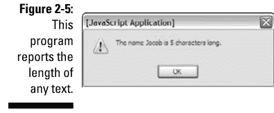

这有点酷。更酷的是它的工作方式。一旦你将文本值赋给变量，JavaScript 就会将该变量视为字符串，由于它是字符串，现在它就具有了 `length` 属性。此属性返回字符串的字符长度。以下是代码中的实现方式：

# 第一部分：JavaScript 编程

```
<script type = "text/javascript">
//<![CDATA[
//来自 nameLength.html

var person = prompt("Please enter your name.");
var length = person.length;

alert("Hi, " + person + "!");
alert("The name " + person + " is " + length + " characters long.");

//]]>
</script>
```

这段代码将 `length` 属性当作一个特殊的子变量来使用。例如，在前面的示例中 `person` 是一个变量——而 `person.length` 是 `person` 变量的 `length` 属性。在 JavaScript 中，对象和变量之间通过一个点（没有空格）连接。

JavaScript 中的字符串对象只有另外两个属性（`constructor` 和 `prototype`）。这两个属性只在高级编程中才需要，所以这里我先跳过它们。

### 使用字符串方法操作文本

`length` 属性挺酷的，但字符串对象的本事远不止于此。对象还有*方法*（对象能够做的事情）。JavaScript 中的字符串有各种各样的方法。以下是我最喜欢的几个：

- `toUpperCase()`：创建一个字符串的全大写副本。
- `toLowerCase()`：创建一个字符串的全小写副本。
- `substring()`：返回字符串的特定部分。
- `indexOf()`：判断一个字符串是否包含在另一个字符串中。

字符串对象还有许多其他方法，但我这里重点介绍这些是因为它们对初学者很有用。许多字符串方法——比如 `big()` 和 `fontColor()`——只是在文本中添加 HTML 代码。它们不常用，因为它们生成的 HTML 代码无法通过验证，而且实际上也省不了多少功夫。其他一些方法——比如 `search()`、`replace()` 和 `slice()`——使用了诸如数组和正则表达式等对初学者来说不必要的高级构造。（要了解更多关于数组的知识，请参见第 5 章。要了解更多关于正则表达式的内容，请参见第 7 章。）

#### 为什么前三个字符是 (0, 3)？

JavaScript（以及大多数编程语言）中字符的位置索引，在你知道那个秘密之前，可能会让你觉得有些奇怪。你可能期望 `text.substring(1,3)` 返回变量 `text` 的前三个字符，但我却用了 `text.substring(0,3)` 来完成这项工作。原因是：索引号不对应字符编号；相反，它们是字符*之间*的索引。

所以，如果我想要字符串 "abcd" 的前三个字符，我使用 `substring(0,3)`。如果我想要 "cd" 部分，就使用 `substring(2,4)`。


别光听我说。去查阅 Aptana 在线帮助（或其他众多在线 JavaScript 参考资料）中的 JavaScript 字符串对象，看看它有哪些属性和方法。

与属性一样，方法也是通过一个点附加到对象上的。方法的特点是有一对圆括号，有时圆括号中包含称为*参数*的特殊信息。参数是传递给方法以便它完成工作的信息。有些方法需要参数，有些则不需要。一旦你开始使用方法，这一切就都合情合理了。

了解方法如何工作的最好方式是看一些实例。看看 `stringMethods.html` 的代码：

```
<script type = "text/javascript">
//<![CDATA[
//来自 stringMethods.html

var text = prompt("Please enter some text.");

alert("I'll shout it out:");
alert(text.toUpperCase());

alert("Now in lowercase...");
alert(text.toLowerCase());

alert("The first 'a' is at letter...");
alert(text.indexOf("a"));

alert("The first three letters are ...");
alert(text.substring(0, 3));

//]]>
</script>
```

该程序产生的输出如图 2-6 所示。

Aptana 还有一个很酷的地方：当你输入 `text.`（包含那个点）时，Aptana 会理解你在讨论一个字符串变量，并自动弹出一个包含所有可能属性和方法的列表。（真希望我刚开始做这个的时候就有这功能。）

从这段代码可以看出，方法非常容易使用。当你有一个字符串变量时，你可以调用该变量的名称，后跟一个点和方法的名称。有些方法需要更多信息来完成其工作。具体如下：

- `toUpperCase()` 和 `toLowerCase()`：获取变量的值，并将其完全转换为给定的大小写。当你不关心变量的大小写时，经常使用这个。
- `indexOf(substring)`：返回子字符串在变量中的字符位置。如果变量不包含该子字符串，则返回值 -1。
- `substring(begin, end)`：返回从开始字符值到结束字符值的子字符串。

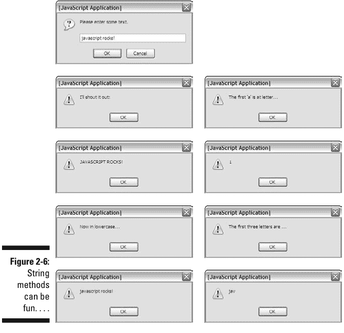

**图 2-6：** 字符串方法可以是**有趣的。...**

### 理解变量类型

JavaScript 并不太在意变量包含的是文本还是数字，但这种区分仍然很重要，因为这些东西在内存中的存储方式存在差异，而这种差异可能会导致一些令人惊讶的问题。

#### 数字相加

要看看当 JavaScript 误解数据类型时会出什么问题，可以做一个小实验。首先，看下面的程序（像本章通常一样，我只显示脚本部分，因为页面的其余部分是空白的）：

```
<script type = "text/javascript">
//<![CDATA[
//来自 addNumbers.html

var x = 5;
var y = 3;
var sum = x + y;

alert(x + " plus " + y + " equals " + sum);

//]]>
</script>
```

这个程序涉及三个变量。我将值 5 赋给了 `x`，将 3 赋给了 `y`。然后我将 `x + y` 相加，并将结果赋给第三个变量 `sum`。最后一行打印出结果，如图 2-7 所示。

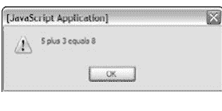

图 2-7：这个程序（正确地）将两个数字相加。

注意这个例子中几个重要的事项：

第一部分：JavaScript 编程

- **你可以为变量赋值。** 最好将等号读作“得到”，因此第一个赋值语句应读作“变量 x 得到值 5。”

```
var x = 5;
```

- **数字值不加引号。** 当你引用一个文本字面量值时，它总是被引号括起来。数字数据（比如值 5）则不放在引号中。
- **你可以将数字值相加。** 由于 x 和 y 都包含数字值，你可以将它们相加。
- **操作的结果可以放入一个变量中。** 计算 `x + y` 的结果被放入一个名为 `sum` 的变量中。
- **一切按预期工作。** 程序按照你预期的方式运行。这很重要，因为情况并非总是如此，正如你将在下一个示例中看到的那样——我*喜欢*写会故意出错的代码！

#### 添加用户的数字

`addNumbers.html` 程序的自然延伸是一个允许用户输入两个值然后返回总和的功能。这可以作为简单加法器的基础。以下是 JavaScript 代码：

```
<script type = "text/javascript">
//<![CDATA[
//来自 addInputWrong.html

var x = prompt("first number:");
var y = prompt("second number:");
var sum = x + y;

alert(x + " plus " + y + " equals " + sum);

//]]>
</script>
```

这段代码看起来相当合理。它询问每个值并将它们存储在变量中。然后它将变量相加并返回结果，对吧？嗯，看看图 2-8，你会看到一个意外的情况。

这里显然有些不对劲。要理解这个问题，你需要了解 JavaScript 是如何猜测数据类型的。

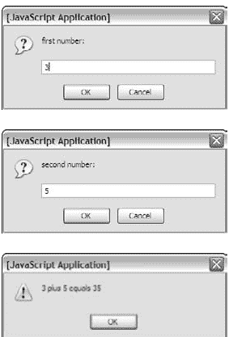

图 2-8：等一下... 3 + 5 = 35？

#### 动态数据的麻烦

归根结底，计算机中存储的所有信息，从音乐视频到电子邮件，都是以一堆 0 和 1 的形式存储的。同样的值 01000001 可能意味着各种各样的事情：它可能意味着数字 65 或字符 A。（事实上，在特定的上下文中，它*确实*同时代表这两者。）如果同样的二进制值被解释为一个实数、一种颜色或音频文件的一部分，它可能意味着完全不同的东西。

这里的理论并不关键，但有一点非常重要：计算机必须知道存储在特定变量中的是哪种数据。许多语言（如 C 和 Java）对此有各种规则。如果你在这些语言中创建一个变量，你必须精确定义该变量将存放哪种数据——而且你不能更改它。

JavaScript 对变量类型要宽容得多。当你创建一个变量时，你可以在其中放入任何你想要的数据。事实上，数据类型可以改变。一个变量在某个时刻可以包含一个整数，在程序的另一部分可能包含文本。

JavaScript 使用上下文来确定如何解释特定变量中的数据。当你为变量赋值时，JavaScript 会将数据归入以下类别之一：

## 第一部分：用 JavaScript 编程

- **整数：** 整数是完整的数字（没有小数部分）。它们可以是正数或负数。
- **浮点数：** 浮点数带有小数点，比如 3.14。浮点值也可以用科学计数法表示，比如 6.02e23（阿伏伽德罗常数：6.02 乘以 10 的 23 次方）。浮点数也可以是负数。
- **布尔值：** 布尔值只能是 `true`（真）或 `false`（假）。
- **字符串：** 文本在编程语言中通常被称为“字符串”数据。字符串值通常用引号包裹。
- **数组和对象：** 这些是一些更复杂的数据类型，目前可以先忽略。它们在第 5 章中有深入的讲解。

这些不同的数据类型是必要的，因为计算机使用不同的技术将不同类型的数据存储到二进制格式中，而所有计算机内存最终都使用二进制。大多数时候，当你创建一个变量时，JavaScript 能猜对，不会出问题。但有时 JavaScript 会做出一些错误的假设，导致问题出现。

#### 棘手的加号

我在本章中以两种不同的方式使用了加号。下面的代码以第一种方式使用加号：

```
var x = "Hi, ";
var y = "there!";

result = x + y;
alert(result);
```

在这段代码中，x 和 y 是文本变量。`result = x + y` 这一行被解释为“将 x 和 y 连接起来”，结果将是 "Hi, there!"。

奇怪的是：下面的代码几乎完全相同：

```
var x = 3;
var y = 5;

result = x + y;
alert(result);
```

这里加号的行为不同，尽管语句 `result = x + y` 是相同的！

在第二种情况下，x 和 y 是数字。加号运算符有两个完全不同的职责。如果它被数字包围，它就相加。如果它被文本包围，它就连接！自动地。（天哪。）

这就是第一个加法器程序（那个崩掉的）发生的情况：当用户在提示对话框中输入数据时，JavaScript 假设数据是文本。所以当我尝试将 x 和 y 相加时，它“热心地”进行了连接。

有一个花哨的计算机科学术语来描述这种现象（运算符在不同情况下做不同的事情）。那些在乎这种事的人称之为*重载运算符*。聪明人有时会为运算符重载是不是个好主意而激烈争论，因为它们可能导致问题，比如你以为程序会相加，它却连接了。运算符重载在其他情况下也可能让事情更简单。我不打算在这里参与那场辩论。这不是什么大问题，只要你能看出问题并在发生时修复它。


### 将变量转换为期望的类型

如果 JavaScript 难以确定变量中的数据类型，你可以用一些方便的转换函数给它一个友好的助推，如表 2-1 所示。

| 函数 | 从 | 到 | 示例 | 结果 |
|----------|------|-----|---------|--------|
| `parseInt()` | String | Integer | `parseInt("23")` | 23 |
| `parseFloat()` | String | Floating-point | `parseFloat("21.5")` | 21.5 |
| `toString()` | Any variable | String | `myVar.toString()` | varies |
| `eval()` | Expression | Result | `eval("5 + 3")` | 8 |
| `Math.ceil()` | Floating-point | Integer | `Math.ceil(5.2)` | 6 |
| `Math.floor()` | Floating-point | Integer | `Math.floor(5.2)` | 5 |
| `Math.round()` | Floating-point | Integer | `Math.round(5.2)` | 5 |

#### 使用变量转换工具

转换函数非常强大，但只有在自动转换给你带来问题时才需要使用。它们的工作原理如下：

- **`parseInt()`：** 用于将文本转换为整数。如果在括号内放入文本值，该函数会返回整数值。如果字符串带有浮点表示（例如 "4.3"），将返回整数值（4）。
- **`parseFloat()`：** 将文本转换为浮点值。
- **`toString()`：** 接受任何变量类型并创建字符串表示。注意通常不需要使用这个函数，因为在需要时它通常会自动调用。
- **`eval()`：** 这是一个特殊的方法，接受字符串作为输入。然后它尝试将字符串作为 JavaScript 代码进行求值并返回输出。你可以用它进行变量转换或作为简单的计算器——`eval("5 + 3")` 将返回整数 8。
- **`Math.ceil()`：** 这是将浮点数转换为整数的几种方法之一。这种技术总是向上取整，所以 `Math.ceil(1.2)` 将是 2，`Math.ceil(1.8)` 也将是 2。
- **`Math.floor()`：** 类似于 `Math.ceil`，只是它总是向下取整，所以 `Math.floor(1.2)` 和 `Math.floor(1.8)` 都将求值为 1。
- **`Math.round()`：** 工作原理类似于小学使用的标准四舍五入技术。任何小于 .5 的小数值将向下取整，大于或等于 .5 的将向上取整，所以 `Math.round(1.2)` 是 1，`Math.round(1.8)` 是 2。

#### 修复 addInput 代码

掌握了这些转换知识后，修复 addInput 程序使其正确运行就相当简单了。只需使用 `parseFloat()` 在相加之前强制将两个输入转换为浮点值。注意你不必显式地将结果转换为字符串。这在调用 `alert()` 方法时会自动完成：

```
// from addInput.html

var x = prompt("first number:");
var y = prompt("second number:");
var sum = parseFloat(x) + parseFloat(y);

alert(x + " plus " + y + " equals " + sum);
```

你可以在图 2-9 中看到程序正确运行。

转换方法让你可以确保数据完全处于你想要的格式中。

## 第 2 章：编写你的第一个程序

图 2-9：现在程序请求输入并正确返回总和。

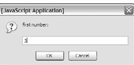

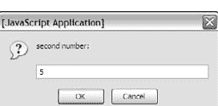

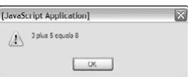

## 第 3 章：用条件改变程序行为

### 本章内容

- 生成随机数并将其转换为整数
- 理解条件
- 使用 if-else 结构
- 管理多个条件
- 使用 switch 结构
- 处理异常情况

计算机最重要的特性之一是它们表面上能够做出决策。计算机可以根据情况改变其行为。在本章中，你将学习如何在 JavaScript 中创建随机数，以及通过几种方式让你的程序根据数字骰子的点数来改变行为。

### 使用随机数

随机数是计算的重要组成部分。它们为游戏增添了不确定性，但也用于模拟、安全和逻辑等严肃应用。在本章中，你生成随机数来模拟骰子，然后探索根据点数改变计算机行为的各种方式。

大多数语言都有生成随机数的功能，JavaScript 也不例外。`Math.random()` 函数返回一个 0 到 1 之间的随机浮点值。

严格来说，计算机无法生成*真正*随机的数。相反，它们使用一个复杂的公式，从一个起始值出发创建第二个半可预测的值。在 JavaScript 中，第一个值（称为随机*种子*）取自系统时钟的毫秒数，所以随机数调用的结果看起来是真正随机的。

#### 创建一个令人梦寐以求的骰子

创建一个 0 到 1 之间的随机浮点数非常容易，因为这就是 `Math.random()` 函数所做的事。如果你想得到一个特定范围内的整数呢？例如，你可能想模拟掷一个六面骰。如何从 0 到 1 的浮点值得到 1 到 6 的整数？

这是标准方法：

1. **获取一个随机浮点值。**

   使用 `Math.random()` 函数获取 0 到 1 之间的浮点值。

2. **将零到一的值乘以 6。**

   这给你一个 0 到 5.999 之间的浮点值（但永远不会是 6）。

3. **使用 `Math.ceil()` 向上取整。**

   这里你需要将数字转换为整数。在第 2 章中我提到了三个从浮点数转换为整数的函数。`Math.ceil()` 总是向上取整，这意味着你将始终得到 1 到 6 之间的整数。

#### 掷骰子

看看 `RollDie.html` 代码，它滚动你的数字骰子：

```html
<!DOCTYPE html PUBLIC "-//W3C//DTD XHTML 1.0 Strict//EN"
   "http://www.w3.org/TR/xhtml1/DTD/xhtml1-strict.dtd">
<html lang="EN" dir="ltr" xmlns="http://www.w3.org/1999/
   xhtml">
  <head>
    <meta http-equiv="content-type" content="text/xml;
        charset=utf-8" />
    <title>rollDie.html</title>
    <script type = "text/javascript"
    //<![CDATA[
    // from rollDie.html
```

## 第一部分：JavaScript 编程

正如你所见，我直接将上一节的策略转换为了 JavaScript 代码：

1. **生成一个随机浮点值。**

`Math.random()` 函数创建一个随机浮点数，并将其存储在变量 `number` 中。

2. **将该数字乘以 6。**

为了将数字移至合适的范围内（6 个值），我将其乘以 6，并将结果存储在 `biggerNumber` 中。

3. **向上取整。**

我使用 `Math.ceil()` 函数将数字向上舍入到下一个最高的整数。

图 3-1 展示了程序的运行情况。

你可能需要多次运行 `rollDice.html` 页面，以确认其工作是否符合预期。

如果你想重新运行一个已经加载到浏览器中的程序，只需点击浏览器工具栏上的刷新按钮即可。

### 使用 if 控制流程

如果你能掷骰子，最终你会希望在不同情况下发生不同的事情。图 3-2 展示了一个名为 `deuce.html` 的简单游戏的两次不同运行。

好吧，这并不那么激动人心。我保证在后续版本中会加入跳舞的河马。无论如何，“你掷出了二点”这条消息只在掷出 2 时才会出现。代码简单却意义深远：

```javascript
<script type = "text/javascript">
//<!CDATA[
// 摘自 deuce.html
// 获取一个随机数
// 如果是二，你就赢了

var die = Math.ceil(Math.random() * 6);
alert(die);
if (die == 2){
    alert("You got a Deuce!");
} // end if

//]]>
</script>
```

像往常一样，我这里只展示了 `<script>` 标签及其内容，因为页面的其余部分是空白的。

#### 当且仅当

这个程序的关键在于不起眼的 `if` 语句。这个强大的命令完成了许多重要任务：

- **它设定一个条件。** 关于条件稍后会详细介绍，但主要思想是：条件是一个关于真或假的问题。`if` 语句总是在括号中包含某种类型的条件。
- **它开始一个代码块。** `if` 语句设置了一段不总是执行的代码。`if` 行的末尾包含一个左大括号（`{`）。
- **它下面通常有缩进的代码。** `if` 语句之后的紧邻行是该块的一部分，因此它们被缩进以表明其特殊性。
- **它在几行后结束。** `if` 语句的结束实际上是代码中几行下的右大括号（`}`）。本质上，一个 `if` 语句*包含*其他代码。
- **它是缩进的。** 惯例是将 `if` 语句与其结束大括号之间的所有代码进行缩进。

虽然不是必需的，但通常会放一个注释来表明右大括号结束了 `if` 语句。在类 C 语言中，相同的符号（`}`）用于结束许多东西，所以提醒自己在这里结束什么是件好事。

#### 使用条件

条件是 `if` 语句和一些其他重要结构的核心部分。条件本身值得一点尊重。条件是*一个可以被评估为真或假的表达式*。条件主要有三种类型：

- **比较：** 这是迄今为止最常见的条件类型。通常你会将一个变量与一个值进行比较，或者将两个变量相互比较。表 3-1 描述了几种不同类型的比较。
- **布尔变量：** 布尔变量是只包含 `true` 或 `false` 值的变量。在 JavaScript 中，如果你给一个变量赋值 `true` 或 `false`，任何变量都可以成为布尔类型。没有必要将布尔值与其他任何东西进行比较，因为它本身就是真或假。
- **布尔函数：** 有时你会有一个返回 `true` 或 `false` 值的函数。这种类型的函数也可以用作条件。

> 顺便提一下，布尔变量是大多数语言中唯一需要大写的变量类型。这是因为它们是以一个人的名字命名的，乔治·布尔。他是一位十九世纪的数学家，发展了一种二进制算术形式。他去世时认为自己的逻辑研究是失败的。他的工作最终成为了现代计算的基础。在你下一次的计算机科学聚会上提到乔治，可以赢得很多极客分数。

#### 比较运算符

JavaScript 支持多种不同类型的比较，总结在表 3-1 中：

| 名称 | 运算符 | 示例 | 注意事项 |
|------|----------|---------|-------|
| 等于 | `==` | `(x==3)` | 适用于所有变量类型，包括字符串 |
| 不等于 | `!=` | `(x != 3)` | 如果值不相等则为真 |
| 小于 | `<` | `(x < 3)` | 数值或字母顺序比较 |
| 大于 | `>` | `(x > 3)` | 数值或字母顺序比较 |
| 小于或等于 | `<=` | `(x <= 3)` | 数值或字母顺序比较 |
| 大于或等于 | `>=` | `(x >= 3)` | 数值或字母顺序比较 |

处理条件时，你应该考虑几件事：

- **确保变量类型兼容。** 如果你将一个浮点值与一个字符串进行比较，你会得到不可预测的结果。
- **可以比较字符串值。** 在 JavaScript 中，不等式运算符可用于确定两个值的字母顺序，并且你可以对字符串使用与其他变量相同的等于符号（`==`）。（这在所有编程语言中并非如此。）
- **相等性使用双等号。** 单等号（`=`）用于表示*赋值*。当你在比较变量时，请使用双等号（`==`）代替。

> **警告！** 不要混淆赋值和比较！如果你不小心说 `(x = 3)` 而不是 `(x == 3)`，你的代码不会崩溃，但它不会正常工作。第一条语句只是将值 3 赋给变量 x。如果赋值成功（它会是的），它将返回值 `true`。你会认为你正在将 x 与 3 进行比较，但你实际上是将 x 赋值为 3，而条件将永远为真。这是一个噩梦。我仍然偶尔会犯这个错误。

### 按我说的做，否则

Deuce 游戏相当令人兴奋，但如果你掷出 2 时有一条评论，掷出其他数字时有另一条评论，那会更好。`else-if` 结构旨在让你指定当条件为真时的一种行为，当条件为假时的另一种行为。图 3-3 展示了一个具有此行为的程序。

这个程序使用了相同类型的条件，但它增加了一个重要的部分：

```javascript
<script type = "text/javascript">
//<!CDATA[
// 摘自 deuceOrNot.html

var die = Math.ceil(Math.random() * 6);
if (die == 2){
    alert("You got a deuce!");
} else {
    alert("It's only a " + die + ".");
} // end if

//]]>
</script>
```

`if` 语句没有改变，但现在有了一个 `else` 子句。以下是其工作原理：

- **`if` 语句设置一个条件**：`if` 表示代码分支的开始，并为条件做好准备。
- **条件建立一个测试**：条件是真或假的表达式，因此条件将指示一些可以是真或假的内容。
- **如果条件为 `true`**：条件和 `else` 子句之间的代码将运行。此代码完成后，程序控制将移到 `if` 结构的末尾之后。（即，计算机跳过 `else` 子句并执行 `if` 结构之外的下一行代码。）
- **如果条件为 `false`**：`else` 和 `if` 结束之间的代码将代为运行。

`else` 子句就像一个分叉路口。代码将沿着一条路径或另一条路径走（取决于条件），但永远不会同时走两条。

你可以在 `if` 或 `else` 子句中放入任意多的代码，包括更多的 `if` 语句！

你只能在 `if` 语句的上下文中使用 `else`。你不能单独使用 `else`。

#### 使用 else-if 实现更复杂的交互

当你只有两个分支时，`if-else` 结构非常有用，但如果你想有多个不同的选项怎么办？例如，想象一下你想为每个可能的骰子值输出一个不同的值。你需要一个 `if` 结构的变体来实现这一点。我接下来将展示这样一个工具，但首先，看一个使用此技术的程序。图 3-4 展示了一个只有极客才会喜欢的骰子。它的所有值都以二进制表示法输出。

# 第三章：用条件改变程序的行为

#### 二进制？

二进制表示法是计算机中所有数据的基础结构。它使用 1 和 0 来存储其他数字，这些数字可以组合形成你在计算机上看到的一切，从图形到文本，再到音乐视频和冒险游戏。下面是一个快速换算表，这样你就能看懂骰子了：

| 001 = 1 | 011 = 3 | 101 = 5 |
| 010 = 2 | 100 = 4 | 110 = 6 |

不知道二进制你也完全能活下去（除非你是计算机科学专业的——那就得*用二进制做梦*了）。不过，了解事物的运作原理还是挺酷的。

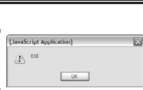

简单的 `if-else` 结构在这里是不够的，因为你有六个不同的选项，而 `if-else` 只给你两个选择。下面是一段使用 `if` 和 `else` 另一种变体的代码：

```
<script type = "text/javascript">
//<![CDATA[
// from binaryDice.html

var die = Math.ceil(Math.random() * 6);
if (die == 1){
  alert("001");
} else if (die == 2){
  alert("010");
} else if (die == 3){
  alert("011");
} else if (die == 4){
  alert("100");
} else if (die == 5){
  alert("101");
} else if (die == 6){
  alert("110");
} else {
  alert("something strange is happening...");
} // end if

//]]>
</script>
```

这个程序以一个普通的 `if` 语句开头，但它有许多 `else` 子句。只要每个子句包含自己的条件，你可以包含任意多个 `else` 子句。

例如，假设计算机生成了值 3。过程看起来是这样的：

1. 第一个条件（`die == 1`）为假，所以程序立即跳转到下一个 `else`。
2. 这里设置了另一个条件（`die == 2`），也为假，所以程序控制权转到下一个 `else` 子句。
3. 这里又有一个条件（`die == 3`）——为真！该子句内的代码被执行（弹出值 `"011"`）。
4. 终于触发了一个条件——所以计算机跳过所有其他 `else` 条件，移动到 `end if` 之后的行。
5. 这是最后一行代码——所以程序结束。

#### 多余的 else 之谜

当你使用多个条件时，你仍然可以（也应该）在最后加上一个没有条件的普通 `else` 子句。这个特殊条件设置了当其他条件都没有被触发时应该执行的代码。它作为“垃圾回收”功能很有用，以防你在 `else if` 子句中遗漏了某种情况。

如果你仔细思考二进制骰子程序，`else` 子句似乎多余了。它确实不是必需的！你费了那么大劲创建了一个随机数方案，*保证*你能得到一个 1 到 6 之间的整数。如果你已经检查了所有六个值，为什么还要有 `else` 子句呢？它应该永远用不上。

*应该*发生的事情和*实际*发生的事情之间有很大差别。即使你认为已经覆盖了每一种情况，偶尔还是会遇到意外。如果你使用多重 `if` 结构，你应该始终加上一个 `else` 子句来处理意外情况。它不需要做太多，只需通知你出了大问题。

### 是时候转换思路了

骰子问题是分支的一种特殊类型，你有一个表达式（骰子），它可以有多个值（1 到 6）。许多编程语言恰好为这种情况提供了一个便捷的工具。看看图 3-5，你会看到骰子投掷器的又一种变体。

图 3-5：古罗马骰子，如果我们遇到古罗马人的话会很有用。

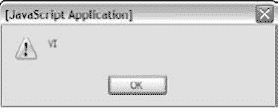

同样，我从一个普通的 1 到 6 的整数开始，然后根据原始投掷结果赋予一个新值。这次我使用另一种专门用于“一个表达式有多个值”情况的结构。看看代码：

```
<script type = "text/javascript">
//<![CDATA[
// from RomanDice.html
var die = Math.ceil(Math.random() * 6);
var output = "";
switch(die){
  case 1:
    output = "I";
    break;
  case 2:
    output = "II";
    break;
  case 3:
    output = "III";
    break;
  case 4:
    output = "IV";
    break;
  case 5:
    output = "V";
    break;
  case 6:
    output = "VI";
    break;
  default:
    output = "PROBLEM!!!";
} // end switch
```

#### 创建表达式

`switch` 结构的组织方式与一堆 `else if` 的 `if` 结构有些不同。

`switch` 关键字后面紧跟一个括号中的表达式。表达式通常是一个有多个可能值的变量。然后 `switch` 结构提供一系列测试值和在每种情况下要执行的代码。

以下是创建 `switch` 语句的方法：

1. **以 `switch` 关键字开头。**

   这建立了整个结构。你将缩进所有内容，直到结束 `switch` 结构的右花括号（`}`）。

2. **指明表达式。**

   这通常是你想与多个值进行比较的变量。变量放在括号内，后面跟着一个左花括号（`{`）。

3. **确定第一个 case。**

   指明你想将变量与之比较的第一个值。确保 case 与变量是相同类型。

4. **用冒号（`:`）结束 case 描述。**

   注意！case 行以冒号结尾（表示一个 case 的开始），而不是更常见的分号。很容易忘记这一点。

5. **为该 case 编写代码。**

   你可以编写任意多行代码。这些代码只在表达式等于给定的 case 时才会被执行。通常一个 case 中的所有代码都是缩进的。

6. **用 `break` 语句表示 case 的结束。**

   `break` 语句告诉计算机在该 case 评估完成后立即跳出 `switch` 结构（这几乎总是你想要的）。

7. **为其他 case 重复以上步骤。**

   为你想要测试的所有其他 case 编写类似的代码。

8. **用 `default` 子句捕捉意外情况。**

   特殊的 `default` case 的作用类似于 `else if` 结构中的 `else`。它处理所有尚未被捕获的 case。即使你认为已经面面俱到，也应该放一些 `default` 代码以备不时之需。


你不需要在 `default` 子句中放 `break` 语句，因为它总是在 `switch` 结构的末尾执行。

第三章：用条件改变程序的行为 67

#### 优雅地使用 Switch

`switch` 结构功能强大，但可能有点棘手，因为它的格式有点奇怪。这里有一些实用技巧要记住：

- 你可以比较**任何类型的表达式**。如果你使用过其他语言（如 C 或 Java），你可能学过 switch 只能用于数值。JavaScript 的 switch 可以用于任何数据类型。
- **确保类型正确是你的责任。** 如果你使用数值变量却将它与字符串值比较，你可能得不到预期的结果。
- **不要忘记冒号。** 在大多数行的末尾，`switch` 语句像其他大多数 JavaScript 命令一样使用分号。而描述 case 的行则以冒号（`:`）结尾。真的很容易搞混。
- **为每个 case 使用 break。** 使用 `break` 语句来结束每个 case，否则你会得到奇怪的结果。


如果你有一些编程经验，你可能会认为另一种涉及*数组*（`arrays`）的方案对这个特定问题来说是更好的解决方案。我倾向于同意，但请参阅第五章。Switch 和 `if - else if` 结构也有它们的用武之地。

### 嵌套 if 语句

可以用各种方式组合条件。一个决定可能包含其他决定，而这些决定又可能包含更多决定。你可以将 `if` 语句放在彼此内部来管理这种（有时很复杂的）逻辑。

#### 这个 L337 是什么？

Leet（L337）是一种古怪的社会现象，主要起源于在线游戏社区。最初它是人们试图为多人游戏创建独特屏幕名称时产生的。例如，如果你想叫自己“gamer”，通常会发现这个名字已经被占用了。有创意的玩家开始用外观相似的字母和数字（有时还有创意拼写）来替代，以创造既新颖又大致可读的名称。这种做法传播开来，现在与短信和在线聊天快捷方式相结合，成为一种极客代码。懂了吗？L337 94m3r 就是“Leet Gamer”，也就是“精英玩家”。在你问之前，我不知道为什么裁判有时是冲浪者，有时又是 L337 94m3r。一定是某种奇怪的童年经历。

# 68 第一部分：JavaScript 编程

图 3-6 展示了一个特别奇特的例子。想象你正在观看你最喜欢的体育赛事中的抛硬币环节。当然，硬币可以是正面或反面。仅作为讨论，裁判还有一个复杂的性格。有时他是个冲浪手，有时他是个 L337 94m3r（翻译：精英玩家）。该图显示了几次抛硬币的结果。

这变得相当奇怪，所以你不妨看一些代码：

```
<script type = "text/javascript">
//<![CDATA[
// from coinToss.html
coin = Math.ceil(Math.random() * 2);
character = Math.ceil(Math.random() * 2);
if (character == 1){
    //It's a surfer referee
    if (coin == 1){
        alert("You got heads, Dude.");
    } else {
        alert("Dude! It's totally tails!");
    } // end coin if
} else {
    //now it's a L337 Referee
    if (coin == 1){
        alert("h34D$ r0xx0r$");
    } else {
        alert("741L$ ruL3");
    } // end coin if
} // end character if
//]]>
</script>
```

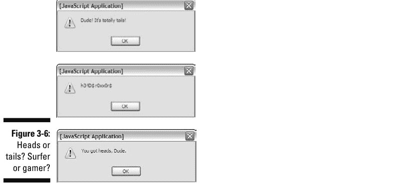

#### 构建嵌套条件

一旦你理解了嵌套的 `if` 结构是如何工作的，你就会明白这一切是如何组合在一起的。以下内容参考了上一节中的例子：

1. **你抛硬币。**

   我只是使用了掷骰子技巧的一个变体。一枚硬币只能是正面或反面，所以我掷出了一个会是 1 或 2 的值给 `coin` 变量。

2. **为性格抛另一枚硬币。**

   裁判的性格将通过另一个 1 到 2 之间的随机值来反映。

3. **检查是否为冲浪手。**

   如果 `character` 掷出的值是 1，那么我们有一个冲浪手，因此设置一个 `if` 语句来处理冲浪手的输出。

4. **如果是冲浪手，则检查硬币抛掷结果。**

   现在你知道是冲浪手在说话，你需要检查硬币是正面还是反面。你需要另一个 `if` 语句来完成这个。

5. **用冲浪手的口吻回应硬币抛掷结果。**

   使用 `alert()` 语句以冲浪手方言输出结果。

6. **处理 L337 角色。**

   外部的 `if` 结构决定了哪个角色在说话。当 `character` 不等于 1 时，此案例的 `else` 子句会发生，因此所有 LEET 相关的内容都放在 `else` 子句中。

7. **再次检查硬币。**

   现在你知道你是在用玩家代码说话，在另一个 `if` 语句中查看硬币来决定说什么。

#### 理解嵌套 if

如你所见，嵌套的 `if` 结构并不那么困难，但它们可能会变得很混乱，尤其是当你深入到几个层次时（最终你会遇到）。以下是一些建议，以确保一切清晰明了：

> ☞ **注意缩进。** 缩进是判断你当前代码层级的好方法，但要警惕你选择的缩进方案。像 Aptana 这样能自动缩进代码的编辑器是一个很大的优势。

# 70 第一部分：JavaScript 编程

- **使用注释。** 在嵌套条件的逻辑中很容易迷失方向。大量添加注释，以便提醒自己在逻辑中的位置。请注意，在本章的示例中，我指明了哪个 `if` 语句正在结束。
- **测试你的代码。** 仅因为你认为它是对的，并不意味着它就是对的。意外会发生。彻底测试以确保代码执行你认为它应该执行的操作。

# 第 4 章

## 循环与调试

### 本章内容

- 创建 for 循环
- 学习 for 循环的变体
- 构建灵活的 while 循环
- 制作行为良好的 while 循环
- 识别有问题的循环
- 使用调试工具捕获崩溃
- 捕获逻辑错误
- 使用 Aptana 逐行调试器
- 使用 Firebug 调试器
- 监视变量和条件

计算机程序可以轻松地完成重复性任务。这是通过一系列称为*循环*的结构来实现的。循环是一种允许你重复一段代码的结构。在本章中，你将学习管理循环的两种主要技术。

循环功能强大，但也可能很危险。有可能创建出行为不当的循环，而这些问题非常难以诊断。但别担心。我将展示一些非常强大的技术来检查你的代码，找出发生了什么。

### 使用 for 构建计数循环

一种非常标准的循环类型是 `for` 循环。当你想将代码重复特定次数时，你会使用这些循环。图 4-1 展示了 `for` 循环的工作情况：

它看起来像十个不同的 `alert()` 语句，但实际上只有一个。它只是被重复了十次。

# 72 第一部分：JavaScript 编程

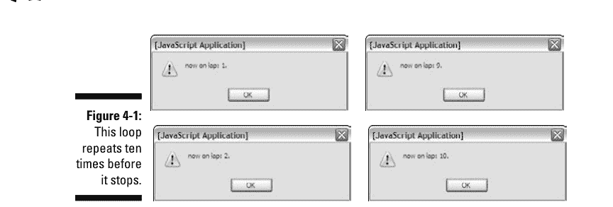

> 提醒：在图 4-1 和本章的一些其他循环演示中，我展示了前几个对话框和最后一个。你应该能理解这个意思。务必查看配套网站（`www.dummies.com/go/javascriptandajaxfd` 或 `www.aharrisbooks.net/jad`）上的实际程序，看看它是如何真正工作的。

#### 构建标准的 for 循环

通过研究代码可以看出 `for` 循环的结构：

```
<script type = "text/javascript">
//<![CDATA[
//from BasicFor.html
for (lap = 1; lap <= 10; lap++){
    alert("now on lap: " + lap + ".");
} // end for
//]]>
</script>
```

`for` 循环基于一个整数（有时称为*哨兵变量*）。在这个例子中，`lap` 充当哨兵变量。哨兵变量通常用于计算通过循环的重复次数。

`for` 语句有三个不同的部分：

- **初始化：** 这部分（`lap = 1`）设置哨兵的初始值。
- **条件：** 条件（`lap <= 10`）是一个普通条件（尽管在此上下文中它不需要括号）。只要条件被求值为真，循环就会重复。
- **修改：** `for` 结构的最后一部分（`lap++`）表明哨兵在循环过程中会以某种方式被修改。在这种情况下，每次循环我都将 `lap` 变量加一。

`for` 结构有一对花括号，其中包含将被重复的代码。像往常一样，此结构内的所有代码都进行了缩进。你可以在循环内放置任意多的代码。

`lap++` 操作符是一个特殊的快捷方式。将变量加一非常常见，所以 `lap++` 操作意味着“将 lap 加一”。你也可以写成 `lap = lap + 1`，但 `lap++` 听起来酷多了。


当程序员决定改进 C 语言时，他们将新语言称为 C++。明白了吗？它比 C 好一等！那些计算机科学家真是一群古怪的家伙！


当你知道某件事应该发生多少次时，`for` 循环非常有用。

#### 制作倒退循环

你可以修改基本的 `for` 循环，使其倒退计数。图 4-2 展示了这种行为的一个例子。

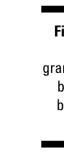

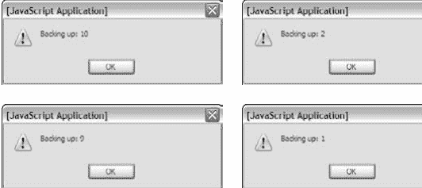

`for` 循环的倒退版本使用与前进版本相同的基本结构，但参数略有不同：

```
<script type = "text/javascript">
//<![CDATA[
//from backwards.html

for (lap = 10; lap >= 1; lap--){
    alert("Backing up: " + lap);
} // end for

//]]></script>
```

74 第一部分：JavaScript 编程

如果你想倒退计数，只需修改 `for` 语句的三个部分：

- ✓ **将哨兵初始化为一个较大的数字：** 如果你要倒计时，你需要从一个大于 0 或 1 的数字开始。
- ✓ **只要哨兵*大于*某个值就继续：** 循环内的代码将在条件为真时执行。这个数字会继续变小，所以确保你在进行“大于”或“大于或等于”的比较。
- ✓ **递减哨兵：** 如果你希望数字变小，你需要从中减去一些东西。`--` 操作符是执行此操作的快速方法。它从变量中减去 1。

#### 每次计数五个

你可以使用 `for` 循环制作其他类型的计数循环。例如，如果你想每次计数 5，你可以使用以下变体：

```
<script type = "text/javascript">
//<![CDATA[

//from byFive.html
for (i = 5; i <= 25; i += 5){
    alert(i);
} // end for

//]]>
</script>
```

这段代码将 `i` 初始化为 5，在 `i` 小于或等于 25 时重复，并在每次循环中将 `i` 加 5。图 4-3 演示了这段代码的运行情况。

如果你想让 `for` 循环跳过数字，你只需对通用模式进行一些更改。

- ✓ **将哨兵初始化为 5：** 我希望循环从 5 开始，所以这是初始值。
- ✓ **将哨兵与 25 进行比较：** 对于 5 的循环来说，结束在 5 的倍数是有意义的。我希望这个循环持续到 25，所以只要 `i` 小于或等于 25，循环就会继续。
- ✓ **在每次循环中将 5 加到 `i`：** 语句 `i += 5` 将 5 加到 `i` 上。（这就像说 `i = i + 5` 一样。）

# 图 4-3：

`for` 循环也可以跳过某些值。

构建 `for` 循环的关键在于记住这三个要素，并确保它们协同工作：创建一个哨兵变量，赋予其合理的初始值，检查条件，并在每次循环中修改该变量。

在 `for` 循环中实现这一点很容易，因为所有这些元素都包含在 `for` 循环的结构中。不过，如果你发现循环没有按预期工作，你可能需要查看本章后面描述的调试技巧。

### 循环一段时间

`for` 循环很有用，但它还有一个更便捷的表亲，称为 `while` 循环。`while` 循环不固定特定的重复次数，只要其条件为真，它就会一直重复。

#### 创建一个基本的 while 循环

构建基本的 `while` 循环看似简单，实则容易出错。下面是一个例子：

```
    <script type = "text/javascript">
      //<![CDATA[
      // from while.html
      answer = "-99";
      while (answer != "5"){
          answer = prompt("What is 3 + 2?");
          if (answer == "5"){
              alert("great!");
          } else {
              alert("try again...");
          } // end if
      } // end while
      //]]>
    </script>
```

这个脚本向用户提出一个简单的数学问题——并且会持续询问，直到用户正确回答。你可以在图 4-4 中看到它的实际运行效果。

`while` 循环的操作非常容易理解。以下是这个数学程序的工作原理：

1. **创建一个名为 `answer` 的变量。**

   它将充当循环的哨兵变量。

2. **初始化变量。**

   变量的初始值设置为 `"-99"`，这个值肯定不正确。这样做可以确保循环至少执行一次。

3. **评估 `answer` 变量中的值。**

   在这个特定程序中，正确答案是 5。如果 `answer` 的值不是 5，循环就会继续。我将 `answer` 的值预设为 `"-99"`，所以你知道它至少会执行一次。

4. **向用户提出一个有挑战性的数学问题。**

   嗯，反正是一道数学题。重要的是改变 `answer` 的值，以便有可能得到 5 并退出循环。

5. **给用户一些反馈。**

   让用户知道她的表现如何可能是个好主意，所以提供某种反馈。

### 避免循环错误

`while` 循环似乎比 `for` 循环更简单，但 `while` 循环有完全相同的基本要求：

- **通常有一个关键的哨兵变量。** `while` 循环通常（但不总是）由某个关键变量控制。
- **哨兵必须被初始化。** 如果循环要正常工作，哨兵变量仍然必须正确初始化。在大多数情况下，你希望保证循环至少发生一次。
- **必须有一个条件。** 与 `for` 循环一样，`while` 循环是基于条件的。只要条件为真，循环就会继续。
- **必须有一个修改哨兵的机制。** 在循环中的某个地方，你需要有一行代码来改变哨兵的值。确保条件可能变为逻辑上的假，否则你会永远困在循环中！

如果你忘记了其中一个步骤，`while` 循环可能无法正常工作。使用 `while` 循环时很容易出错。不幸的是，这些错误通常不会导致崩溃。相反，循环可能完全拒绝运行，或者无限期地继续运行。

#### 介绍一些错误的循环

有时循环行为异常。即使你语法正确，循环也可能不按你的预期工作。两种主要的循环错误很常见：一种是循环从不执行，另一种是循环永不终止。

##### 处理不情愿的循环

你可能编写了一些代码，发现循环似乎*从不*运行。下面是一段说明这种糟糕情况的程序片段：

```
<script type = "text/javascript">
  //<![CDATA[
    //from never.html
    //Warning! this script has a deliberate error!
    i = 1;
    while (i > 10){
      i++;
    } // end while
  //]]>
</script>
```

这段代码看起来很无害，但如果你运行它，你会感到困惑。它没有崩溃，但似乎也没有做任何事情。如果你一步一步地跟踪代码，最终会明白原因。我将 i 初始化为 1，然后只要 i 大于 10 就重复。看出问题了吗？i 一开始小于 10，所以条件从一开始就是假的，循环从未执行！我可能本意是条件为 `(i < 10)`。这是一个粗心的错误，但正是我经常犯的那种愚蠢错误。

##### 处理强迫性的循环

另一种坏脾气的循环与不情愿的循环相反。这个循环启动得很好，但就是不停下来！

以下代码展示了一个无限循环：

```
<script type = "text/javascript">
  //<![CDATA[
    //from endless.html
    // Warning: this program has a deliberate
    // error! You will have to stop the browser
    // to end the loop.
    i = 0;
    j = 0;
    while (i < 10){
      j++;
      alert(j);
    } // end while
  //]]>
</script>
```

如果你决定运行 `endless.html`，请注意它不会正常工作。更糟糕的是，唯一停止它的方法是通过任务管理器程序终止你的浏览器。我将在本章后面向你展示如何在“安全”环境中运行此类代码，以便你能找出问题所在。

这段代码只是可怕的*无限循环*的一个例子。这种循环通常语法完全正确，但逻辑错误会阻止其正常运行。逻辑错误通常是以下情况之一：

- **变量未正确初始化。** 哨兵的初始值阻止了循环正确开始。
- **条件检查的是不可能发生的事情。** 要么条件本身有错误，要么有其他东西阻止了它的触发。
- **哨兵在循环内未被更新。** 如果你只是忘记修改哨兵变量，你会得到一个无限循环。如果你修改了变量，但在循环完成*之后*才做，你也会得到一个无限循环。如果你以错误的格式请求输入，你可能也会遇到一个难以诊断的无限循环。

### 调试你的代码

如果你一直在编写 JavaScript 代码，那你肯定也遇到过错误。这是程序员生活的一部分。循环尤其麻烦，因为即使没有语法错误，它们也可能导致问题。幸运的是，有一些非常棒的技巧可以帮助你追踪烦人的 bug。

#### 让 Aptana 提供帮助

如果你使用 Aptana 编写代码，你已经有一些很好的帮手了。它为你提供了与编写 XHTML 和 CSS 时相同的语法高亮和代码完成功能。

此外，Aptana 通常可以实时发现 JavaScript 错误。图 4-5 展示了一个包含故意错误的程序。

# 图 4-5：Aptana 捕获了我的错误并提供了一些帮助。

这些标记指示了代码中的错误。

单击一个错误，会被带到编辑器中的那一行。

验证窗格列出了所有已知错误。

Aptana 通过几种机制通知你代码中的错误：

- **可疑代码下方有红色波浪线。** 就像文字处理程序的拼写检查器为你标记可疑单词一样。
- **红色圆圈指示了有问题的行。** 你可以扫描边距，快速看到错误所在。
- **所有错误都总结在验证窗格中。** 你可以看到错误及其对应的行号。双击一个错误，会被带到代码中的相应位置。
- **你可以将鼠标悬停在错误上以获取更多帮助。** 将鼠标指针悬停在错误上，可以查看错误的摘要。

Aptana 可以捕获一些错误，但它在*预防*错误方面最有用，这得益于其自动缩进和代码辅助功能。浏览器是你通常发现逻辑和运行时错误的地方。在发现和修复问题方面，有些浏览器比其他浏览器更有帮助。

#### 在 IE 上调试 JavaScript

微软 Internet Explorer 在处理 JavaScript 错误时表现得难以预测。IE6 会将你引导到某种编辑器中，但多年来这些编辑器一直在变化，而且在你安装新软件时会被修改（在你不知情或未允许的情况下）。IE7 和 IE8（至少在默认情况下）则什么也不会做。你不会看到任何错误，也不会有任何指示表明发生了错误。（否认——我最喜欢的应对机制。）

以下是你强制 IE 提供一些帮助的方法：

1. 选择**工具 -> Internet 选项 -> 高级。**

你会看到一个如图 4-6 所示的对话框。

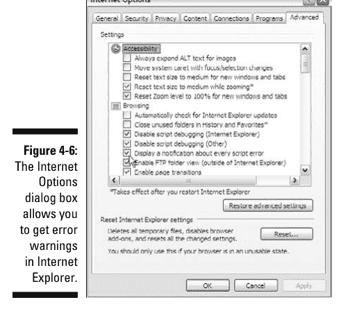

2. 选择“显示每个脚本错误的通知。”

暂时保持所有其他设置不变。是的，我们将保持脚本调试处于禁用状态，因为它效果不太好。本章稍后我会向你展示一种更好的技术（参见“使用 Firebug 调试器”部分）。

现在，当你在 IE 中重新加载 `broken.html` 时，你会看到类似图 4-7 的内容。

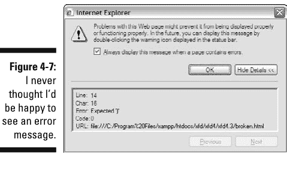

图 4-7：我从没想过看到错误消息会让人这么高兴。

这实际上是个好消息，因为至少你知道了问题的存在，并且有了一些修复的线索。在这个特定情况下，错误消息非常有用。有时候确实如此，有时候错误消息看起来像是外星人写的。

请务必在 IE 中开启错误通知，以便你立即发现错误。当然，你还需要在 Firefox 中检查你的代码，它拥有大量优秀的代码检查工具。

#### 在 Firefox 中查找错误

Firefox 默认的错误处理比 IE 稍好一些，你可以使用插件将其变成一个调试利器。在默认设置下，错误通知是最低限度的。如果你怀疑有 JavaScript 错误，请打开 JavaScript 错误窗口。你可以通过选择工具菜单中的“错误控制台”来实现，或者在地址栏中输入 `javascript:`。图 4-8 显示了运行 `broken.html` 后的错误控制台。

我通常发现 Firefox 控制台中的错误消息比 IE 提供的更有帮助。


错误控制台在你加载新页面时不会自动清除。当你打开它时，里面可能有一堆旧的错误消息。请务必清除历史记录（使用错误控制台的清除按钮）并刷新页面，以准确查看当前页面发生了哪些错误。

##### 使用 Firebug 捕捉语法错误

Firefox 最棒的特性之一是其插件架构。一些非常聪明的人创建了非常有用的插件，增添了出色的功能。Firebug 就是一个例子。这个插件（可在 `https://addons.mozilla.org/en-US/firefox/addon/1843` 获取）极大地扩展了你的编辑技巧工具箱。

Firebug（在第 1 章中首次介绍）对 HTML 和 CSS 编辑很有用，但在调试 JavaScript 代码时它才真正大显身手。

当 Firebug 处于活动状态时，它会在浏览器窗口底部显示一个小图标。如果有任何 JavaScript 错误，会出现一个红色的错误图标。点击此图标，Firebug 窗口就会出现，描述问题所在。图 4-9 展示了它的工作方式。

**图 4-9：** Firebug 工具显示了一个错误。点击错误行可在上下文中查看。

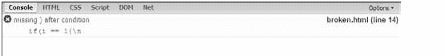

如果你点击有问题的代码片段，你可以在上下文中查看它。这很有用，因为错误可能并不在指示的行上。通常，如果我在做任何复杂的 JavaScript，我都会开启 Firebug 以捕捉任何问题。

**图 4-8：** Firefox 错误控制台相当有用。

Firebug 的 Lite 版本可以在其他浏览器（IE、Chrome 和 Safari）中使用。这个版本通过书签工具访问，意味着你可以将代码链接放在书签中，并使用这个程序在这些其他浏览器中获得 Firebug 的大部分功能。详情请查看 `http://getfirebug.com/lite.html`。

##### 捕捉逻辑错误

你在 `broken.html` 中看到的那种戏剧性错误实际上相当容易修复。它会在代码的特定部分导致浏览器崩溃，因此你能很好地了解哪里出了问题。崩溃通常会产生错误消息，这些消息通常能提供一些关于出了什么问题的线索。大多数情况下，这是语法问题。你拼错了什么，忘记了某些标点符号，或者一旦你知道问题所在，就很容易修复的其他问题。

循环和分支常常会导致一种更隐蔽的问题，称为*逻辑错误*（与*语法错误*相对）。逻辑错误发生在你的代码没有任何语法问题，但仍然没有按照你的预期运行时。这些错误可能更难定位，因为你得到的信息更少。

当然，如果你有合适的工具，你最终可以追踪到最棘手的 bug。秘诀是准确地看到你的变量内部发生了什么——用户通常看不到的东西。

##### 使用 Firebug 将日志输出到控制台

Firebug 还有一个巧妙的技巧：你可以向 Firebug 控制台发送快速消息。来看看 `log.html`：

```javascript
<script type = "text/javascript">
//<!CDATA[
// from log.html
// note this program requires firebug on firefox

for (i = 1; i <= 5; i++){
    console.log(i);
} // end for loop

//another loop with a fancier output
for (i = 1; i <= 5; i++){
    console.log("i is now %d.", i);
}

console.info("This is info");
console.warn("This is a warning");
console.error("This is an error");

//]>
</script>
```

这段代码很特别，因为它包含对 `console` 对象的多次引用。这个对象仅对安装了 Firebug 扩展的 Firefox 浏览器可用。当你使用 Firebug 运行程序并查看控制台选项卡时，你会看到类似图 4-10 的内容。

`console` 对象允许你编写特殊消息，这些消息只会在控制台中显示给程序员。这是测试代码和查看运行情况的好方法，特别是当事情没有按你期望的方式工作时。

如果你想在 IE 中测试代码，有一个叫 Firebug Lite 的 Firebug 版本可以在其他浏览器中工作。如果你想在这些浏览器中使用控制台命令，请查看 Firebug 主页下载并安装此工具。请注意，使用 Firebug Lite 时，使用控制台的语法可能略有不同。详情请查看主站点。

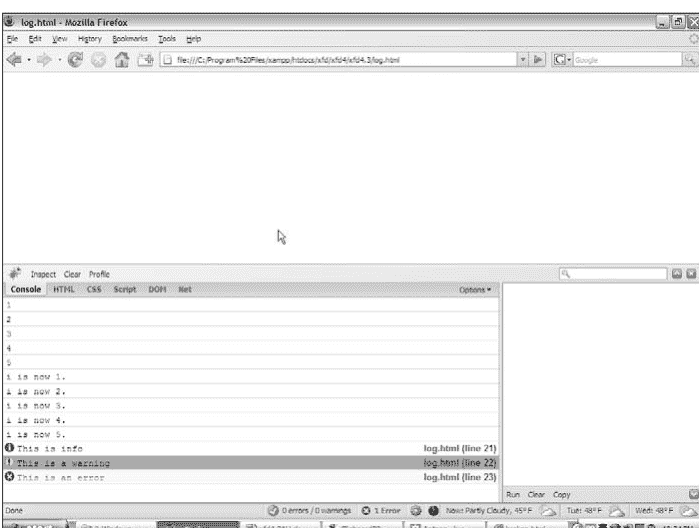

图 4-10：Firebug 控制台显示了很多新信息。

#### 查看控制台输出

其工作原理如下：

1. **第一个循环将 i 的值打印到控制台。** 在第一个循环的每次迭代中，`console.log` 函数都会打印出 i 的当前值。如果（例如）循环没有正常工作，这些信息将非常有用。你可以使用 `console.log()` 方法打印任何变量的值。
2. **第二个循环展示了一种更精细的打印方式。** 有时你会想清楚地表明你发送给控制台的是什么值。Firebug 支持一种叫做*格式化打印*的特殊语法来简化这个过程。
3. **你可以指定更紧急的日志类型。** 如果你愿意，你可以使用 `console.log` 的替代方法来为消息传达更多的紧急性。如果你将 `log.html` 中的代码与图 4-10 的输出进行比较，你将看到信息、警告和错误消息是如何格式化的。

```javascript
console.log("i is now %d.", i);
```

文本字符串 "i is now %d" 表示你想要在控制台中写入的内容。特殊字符 `%d` 指定你将在此位置放置一个数字变量。在逗号之后，你可以指定要插入到文本中的变量。

还有其他你可以使用的格式化字符。`%s` 用于字符串，`%o` 用于对象。如果你熟悉 C 语言中的 `printf`，你会觉得这种技术很眼熟。

当你的程序运行不正常时，尝试使用控制台命令来精确描述每个变量的状态。这通常能帮助你发现问题并纠正它们。


当你的程序正常运行后，别忘了移除控制台命令！要么删除它们，要么用注释字符使其失效。控制台命令会在任何未安装 Firebug 的浏览器中导致错误。通常，你的用户不会有这个扩展（他们也不需要！你已经为他们调试好了一切！）。

#### 使用交互式调试器

传统编程语言通常具有专门的调试工具来修复特别棘手的问题。典型的调试器具有以下功能：

# 第 4 章：循环与调试 87

- 在程序运行时暂停程序的能力：逻辑错误难以捕捉，因为程序会继续运行。使用调试器，你可以将某一行设置为*断点*。当调试器遇到断点时，程序进入“暂停”模式。它不是完全在运行，也不是完全停止。
- 逐行执行代码的机制：你可以通常逐行执行代码，检查发生了什么。
- 查看所有变量和表达式值的方法：了解变量中发生了什么通常很重要。（例如，某个变量是否按你预期的方式变化？）调试器应该能让你查看所有变量的值。
- 停止失控进程的能力：一旦你开始创建循环，就会发现自己会意外创建无限循环。在典型的浏览器中，摆脱无限循环的唯一方法是通过任务管理器（或某些操作系统中的进程管理器）结束浏览器。这有点极端。调试器可以让你停止失控的循环，而无需访问任务管理器。

调试器非常有用，而且在大多数编程语言中都很常见。过去，JavaScript 程序员没有太多调试工具的访问权限，因为嵌入式语言的技术考虑使得这一点很困难。

幸运的是，Firebug 和 Aptana 都有交互式调试器，提供所有这些功能。更好的是，它们协同工作，为你提供大量有用的帮助。

Aptana 内置了调试器。最初，这涉及一个特殊的 Firefox 插件，将信息发送回 Aptana。现在，Firebug 和 Aptana 的开发人员正在合作，让 Firebug 能够直接与 Aptana 一起工作。当你使用 Aptana 调试器时，它会自动与 Firebug 配合工作。


为了测试调试器，我编写了一个带有故意错误的程序，没有调试器很难找到这个错误：

```
/*<! [CDATA[
//from debug.html
//has a deliberate error

var i = 0;
var j = 0;
while (i <= 10) {
    console.log(i);
    j++;
} // end while

//]]>
</script>
```

# 第一部分：JavaScript 编程

这是本章前面 `endless.html` 程序的另一个版本。你可能马上就能看出问题所在。如果看不出来，请继续阅读；当你运行调试器时就会看到。即使你能看出哪里出了问题，也请跟着做，这样你就能学习如何在需要时使用调试器。

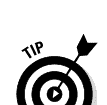

> 我在这个程序中使用 `console.log()` 进行输出，只是为了避免在浏览器和编辑器之间来回切换处理对话框。

要使用 Aptana 调试器逐步执行程序，首先将文件加载到调试器中。

##### 添加断点

到目前为止，你的 JavaScript 程序还相当小，但它们会变得更大。你通常不会想从一开始就进行逐行调试，因此你需要指定一个*断点*。当你在调试模式下运行程序时，它以正常速度运行，直到遇到断点——然后暂停，以便你能更直接地控制它。

要设置断点，在代码编辑器中右键单击行号。

图 4-11 显示了我在 `debug.html` 代码的第 12 行设置断点。

##### 运行调试器

调试器要求你以不同于惯常方式运行程序。由于你的程序通常由浏览器（而非 Aptana）运行，因此你需要某种机制将信息从浏览器传回 Aptana。

1. **点击调试图标启动调试器。**

   它看起来像一个小虫子。

2. **自动安装 Aptana Firefox 插件。**

   当你第一次调试 JavaScript 程序时，Aptana 会请求允许安装额外的 Firefox 插件。点击“是”完成安装。你只需要执行一次。

3. **切换到调试透视图。**

   Aptana 会弹出消息框询问是否切换到调试透视图。回答“是”以将 Aptana（暂时）更改为调试配置。

已在第 12 行添加断点。

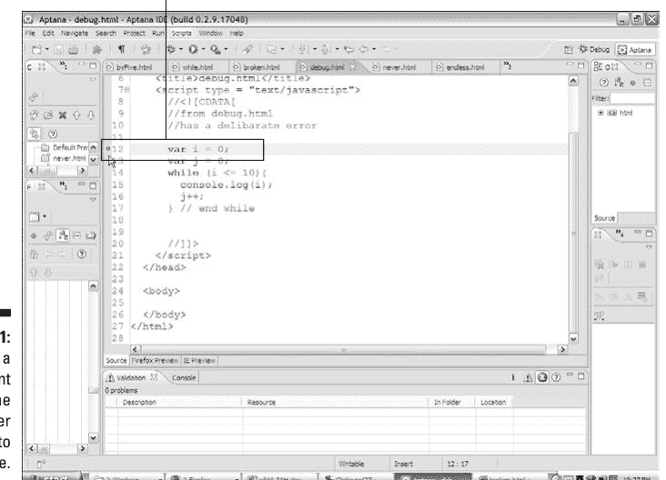

## 图 4-11：使用断点告诉调试器在哪里暂停

##### 使用调试透视图

当 Aptana 用于调试时，它会引入一种新的布局（在 Aptana 中称为*透视图*）。这会改变屏幕的外观，并将编辑器优化为调试模式。图 4-12 显示了调试透视图中的 `debug.html` 程序。

调试透视图会改变编辑器以强调调试：

- **代码补全窗口消失了。** 调试时不需要此功能，因此它被移除。你需要屏幕空间来显示其他好东西。
- **文件管理窗口也不见了。** 同样，在调试模式下你不会进行大量文件操作，因此该窗口也消失了。（别担心；当你返回正常编辑模式时会恢复它。）

# 90 第一部分：JavaScript 编程

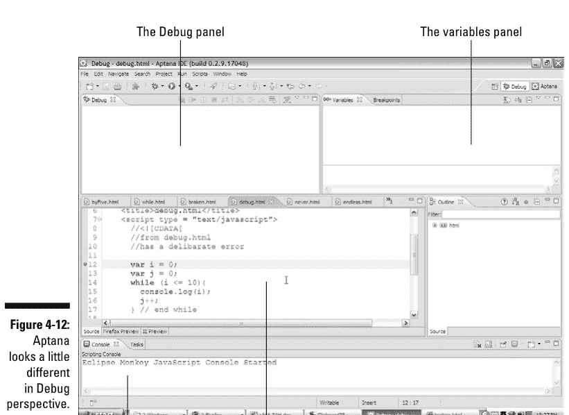

- **你会有一个新的调试窗口。** 此窗口显示你的活动线程。最重要的是顶部的按钮。
- **你还有一个显示断点和变量的窗口。** 这个强大的新窗口描述了程序运行时所有变量的值。
- **大多数其他窗口保持不变。** 你仍然有代码窗口、控制台和大纲窗口，但它们的排列方式与正常情况略有不同。当然，你可以根据需要调整它们。

> 一旦调试模式运行过一次，你会在 Aptana 界面右上角看到一个小的调试图标。当这个快捷按钮可用时，你可以使用它切换到调试模式。使用 Aptana 按钮返回普通编辑模式。

##### 检查暂停程序时的调试模式

当你通过调试器运行代码时，Aptana 会启动一个新的 Firefox 实例，并将你的程序加载到其中。当程序暂停调试时，你会看到一些新的细节，如图 4-13 所示。

当程序暂停时，你可以看到几个重要的新指示器：

- 调试窗口显示哪个脚本处于活动状态。现在你的程序只有一个脚本，但以后会有更多。线程窗口告诉你哪个脚本当前占用了处理器的注意力。
- 调试窗口中的按钮处于激活状态。将鼠标悬停在每个新按钮上查看其工具提示。我将在接下来关于逐步执行代码的部分中解释这些按钮。


**图 4-13：** 调试程序时，你会得到一些新的按钮和工具。

# 第一部分：JavaScript 编程

- 断点面板有更多窗格。除了断点和变量窗格外，你还会看到一些新的窗格，包括表达式和脚本。
- 变量面板让你查看页面知道的所有变量。尽管这个程序只包含两个显式定义的变量，但似乎还有更多。每个 JavaScript 程序都有大量内置的特殊变量。（我将在本章后面解释如何使用此面板。）
- 断点面板允许你管理断点。这是查看项目中所有断点的好地方。你可以从此面板启用或禁用断点。
- 表达式面板允许你跟踪特定变量或表达式。这是一个非常强大的工具。我将在本章后面演示其用法。
- 当前代码行会高亮显示。如果你在第 12 行设置了断点，你会看到该行被高亮显示。（在图 4-13 中可能难以看清。）当你逐步执行代码时，你会看到这个高亮移动。这将帮助你理解逻辑。

> 在某些版本的 Aptana 中，调试程序时有时会出现以 `TypeError: request.loadGroup has no properties` 开头的消息。这不是你代码中的错误，而且似乎不会造成任何问题。你可以安全地忽略此错误。我还偶尔遇到过 "socket connection" 错误。通常你可以重新启动 Firefox 来解决此问题。

##### 逐步执行程序

这是最好的部分。你可以以超慢动作运行程序，查看其行为的每个方面。

1. **执行一步。**

   点击调试面板上的“步入”按钮。（它看起来像一个弯曲的箭头，指向两个点之间，或者直接使用 **F5** 键。）

2. **查看代码。**

   高亮已移动到下一行（第 13 行）。

3. **鼠标悬停在变量上。**

   将鼠标指针悬停在代码中的两个变量（i 和 j）上。你会看到一个对话框，描述每个变量的当前值。

4. **再执行几步。**

   再使用几次“步入”按钮。观察高亮如何在程序中移动、循环。

5. **再次检查变量。**

   在循环执行几次后，再次查看变量，你就会开始发现这段代码的问题所在：`j` 在递增，而 `i` 仍然停留在 0。

6. **停止调试会话。**

   如果你认为自己理解了问题，可以点击红色方块的终止按钮来停止调试会话。（在这个程序中你必须这样做，因为它是一个无限循环，永远不会自行结束。）Aptana 将关闭生成的 Firefox 实例。

> 提示：如果调试器没有正常运行，请确保你已经设置了断点。如果没有断点，程序不会停止。同时，确保你使用了调试按钮来启动程序。使用运行程序或直接在浏览器中查看页面不会激活调试器。

##### 查看表达式数据

调试的全部意义在于发现棘手的问题。通常，这些问题就是变量没有按预期执行。Aptana 提供了一个变量选项卡，可以显示程序中所有变量的值，但它出奇地难以使用。JavaScript 程序通常捆绑了数百个变量。如果你仔细查找，最终可以找到 `i` 和 `j` 变量。（在变量面板中向下滚动以找到它们。）每当你再执行一步，你必须再次向下滚动才能看到值，或者将鼠标悬停在代码中的变量上。

幸运的是，Aptana 提供了一种更简单的方法。用鼠标选中一个变量并右键单击。在出现的菜单中，选择监视。图 4-14 显示了我已经选择监视两个变量并运行循环几次后的调试器。

在这种模式下，你可以看到你选择跟踪的变量的确切值。当变量的值发生变化时，你可以立即看到它。

表达式窗口还有一个很酷的技巧：你可以用它来监视复杂的表达式，而不仅仅是变量。在这个程序中，你想知道循环为什么没有退出。高亮显示条件（`i <= 10`）并将其添加到监视表达式中，就像添加变量一样。

现在，一边监视变量和条件，一边单步执行程序。有了所有这些信息，我的编码错误变得很明显：我在条件中使用了变量 `i`，但我在循环内部从未改变它。相反，我改变了 `j` 的值，而 `j` 与循环毫无关系！

#### 使用 Firebug 调试器

显示任何表达式或变量的值

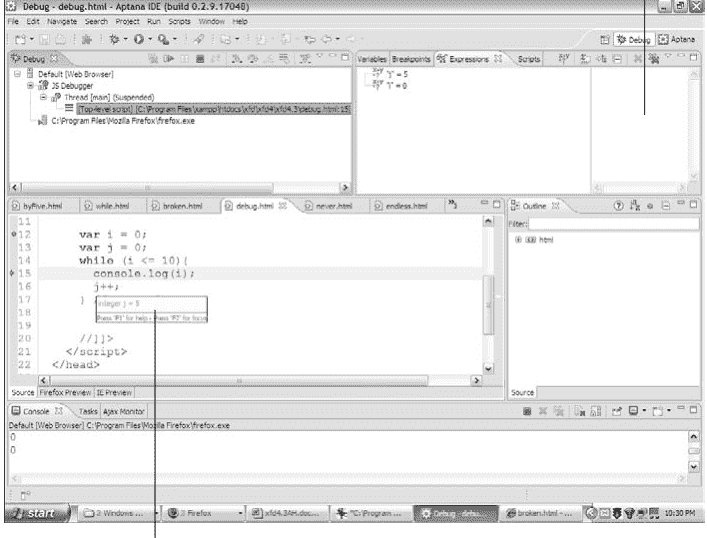

当程序暂停时，将鼠标悬停在变量名上即可查看该变量的当前值。

每当你遇到一个程序没有按你期望的方式运行时，就启动调试器，监视关键值，并单步执行代码。这通常能帮助你找到即使是最难的错误。

Aptana 调试器非常好，但我发现它有点挑剔。如果 Firebug 的版本不是完全正确，它会报错，有时还会与其他扩展产生冲突。幸运的是，Firebug 有一个与 Aptana 一样好的调试器（除了一个显著的局限性）。图 4-15 显示了正在运行的 Firebug 调试器。

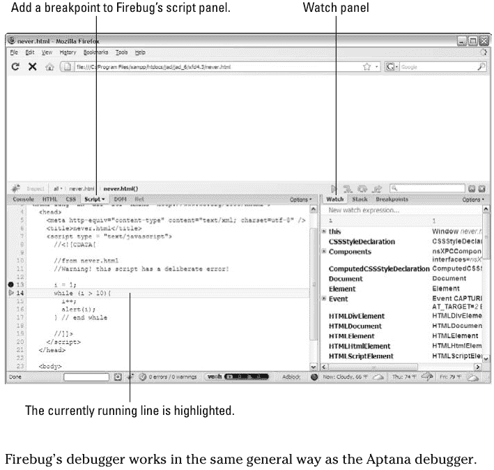

当前正在运行的行被高亮显示。

Firebug 调试器的工作方式与 Aptana 调试器大致相同。以下是使用方法：

1. 在 Firefox 中打开有问题的文件。

   当然，你需要在操作之前加载该文件。

2. 打开 Firebug 的 `<script>` 标签。

   你可能需要为本地文件启用脚本。

3. 设置断点。

   点击你想设置断点的行号。会出现一个红点，表示断点。

4. 重新加载页面。

   使用 F5 键或重新加载按钮以调试模式重新加载页面。

5. 观察页面在断点处暂停。

   与 Aptana 调试器一样，你会进入一个暂停模式，程序停留在断点处。

6. 使用“单步进入”和“单步跳过”按钮遍历代码。

   Firebug 调试器具有与 Aptana 调试器相同的“单步进入”和“单步跳过”按钮。使用它们来逐行遍历你的代码。

7. 在监视表达式菜单中输入变量名或条件。

   这允许你跟踪任何给你带来麻烦的特定变量或条件。

Firebug 调试器非常易于使用，但它有一个显著的缺陷：它只能在程序加载到内存后使用。如果一个程序立即进入无限循环（正如本章中的 `endless.html` 那样），程序永远不会停止执行，你也永远无法访问调试会话。

大多数 JavaScript 程序的编写方式都避免了这个问题（关于如何预加载 JavaScript 代码，请参阅第 6 章）。然而，你可能无法使用 Firebug 调试器调试你遇到的每一个程序。

> 当然，你不一定需要调试器。JavaScript 调试器相对较新，而人们在没有它们的情况下编写 JavaScript 已经有很多年了。你总是可以用老式的方法：使用旧式的 `alert()` 语句。如果你不确定代码中发生了什么，就 alert 每个变量以查看其值。当然，完成调试后别忘了移除 `alert()` 语句。

# 第一部分：JavaScript 编程

# 第 5 章

# 函数、数组和对象

### 本章内容

- 使用函数使代码更易于管理
- 将参数传递给函数
- 从函数返回值
- 探究函数和变量作用域
- 创建基本数组
- 从数组中检索数据
- 构建多维数组
- 创建具有属性和方法的自定义对象
- 构建对象构造函数
- 构建 JSON 数据结构

你的代码很快就会变得复杂起来。很快，你就会发现自己想要编写更复杂的程序。当程序规模变大时，你需要新的组织结构来处理增加的复杂性。

你可以将几行代码捆绑到一个容器中，并给这个新代码块起个名字。这就叫做一个*函数*。你也可以把一堆变量放到一个容器中，并给它起个名字。这就叫做一个*数组*。

本章将向你展示如何以函数和数组的形式处理更多的代码和更多的数据，而不会感到混乱。

### 将代码分解为函数

代码很快就会变得复杂。如果有某种工具来管理这种复杂性并使代码更容易处理，那将是很好的。这正是*函数*这个概念为你所做的。

#### 邀请蚂蚁来野餐

为了更好地解释函数，让我们回想一首古老的篝火歌曲。图 5-1 以 JavaScript 格式重新为你呈现了这首经典歌曲。（在查看此程序时，你可能想要烤一个棉花糖。）

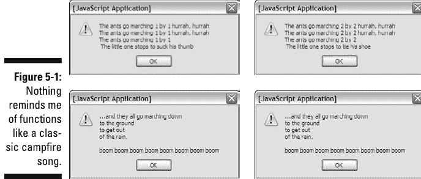

如果你不熟悉这首歌，它简单地讲述了一群蚂蚁的故事。最小的那只显然有某种注意力问题（但我们仍然爱它）。在每一节中，小蚂蚁都会被与节号押韵的东西分心。真正的歌通常有十节，但为了演示，我只做了两节。

#### 思考歌曲（和程序）的结构

在看代码之前，先想想这首歌的结构。像许多歌曲一样，它有两个主要部分。*副歌*是在整首歌中重复多次的一个短语。这首歌有几个*主歌*，它们彼此相似，但又不完全相同。

想想在篝火边传递的歌单。（我饿得想吃一个烤棉花糖夹心饼了。）副歌通常只列出一次，每个主歌都会被列出。有时你可能会在歌单的某个地方看到这样一段：

```
主歌 1
副歌
主歌 2
副歌
```

音乐家们称这个东西为“路线图”，这是一个很棒的名字。它是你如何进行这首歌的更高层次的视图。在路线图中，你不用担心特定主歌或副歌的细节。路线图展示了大局，而你可以查看每个主歌或副歌的细节。

#### 构建 antsFunction.html 程序

看看 antsFunction.html 的代码，看看它如何类似于歌单：

```
<script type = "text/javascript">
//<![CDATA[
//来自 antsFunction.html

function chorus() {
    var text = "...它们都行进去了\n";
    text += "到地面上\n";
    text += "为了出来\n";
    text += "避开雨水。\n";
    text += " \n";
    text += "砰 砰 砰 砰 砰 砰 砰 砰 \n";
    alert(text);
} // 结束副歌

function verse1(){
    var text = "蚂蚁们一二一地行进 万岁，万岁 \n";
    text += "蚂蚁们一二一地行进 万岁，万岁 \n";
    text += "蚂蚁们一二一地行进 \n";
    text += " 小蚂蚁停下来吮它的拇指 \n";
    alert(text);
} // 结束主歌1

function verse2(){
    var text = "蚂蚁们两两成对地行进 万岁，万岁 \n";
    text += "蚂蚁们两两成对地行进 万岁，万岁 \n";
    text += "蚂蚁们两两成对地行进 \n";
    text += " 小蚂蚁停下来系它的鞋带 \n";
    alert(text);
} // 结束主歌1
```

## 第一部分：使用 JavaScript 编程

```javascript
//主代码
verse1();
chorus();
verse2();
chorus();

//]>
</script>
```

这段程序代码将歌曲的各个部分拆分成了与歌谱相同的片段。以下是 antsFunction.html 的一些有趣特性：

- **我创建了一个名为 `chorus()` 的函数。** 函数就是带有名称的代码行集合。
- **副歌的所有代码都放入了这个函数中。** 任何我想要作为打印副歌一部分的操作都会放入 `chorus()` 函数中。之后，当我想打印副歌时，只需调用 `chorus()` 函数，它就会执行我存储在那里的所有代码。
- **每个 verse（主歌）也都有一个函数。** 我也将每个主歌的代码拆分到了各自的函数中。
- **主代码就像一张路线图。** 在所有细节都委托给函数之后，代码的主体部分只控制函数调用的顺序。
- **细节隐藏在函数中。** 主代码处理大局。细节（如何打印副歌或主歌）隐藏在函数内部。

函数是控制复杂度的非常有用工具。你可以将一个庞大、复杂的程序拆分成几个较小的部分。每个部分独立存在，解决整体问题中的特定部分。

你可以将每个函数视为一个微型程序。你可以在函数中定义变量，放入循环和分支，以及做任何其他程序能做的事情。使用函数的程序基本上就是一个充满子程序的程序。

当你定义好函数后，它们就像新的 JavaScript 命令一样。从某种意义上说，当你添加函数时，就是在向 JavaScript 添加你自己的新命令。

#### 向函数传入数据和从函数传出数据

函数在逻辑上与主程序分离。这是件好事，因为这种分离可以防止某些类型的错误。然而，有时你想向函数发送信息。你也可能希望函数返回某种类型的值。`antsParam.html` 页面以利用函数输入和输出的方式重写了“蚂蚁”歌曲：

```html
<script type = "text/javascript">
//<!CDATA[
//来自 antsParam.html
```

我不会提供显示这个程序的图，因为它对用户来说看起来和 `antsFunction.py` 完全一样。这就是函数的优势之一：你可以改进程序的底层行为，而不强制改变用户体验。现在的代码看起来是这样的：

```javascript
function chorus() {
  var text = "...and they all go marching down\n";
  text += "to the ground \n";
  text += "to get out \n";
  text += "of the rain. \n";
  text += " \n";
  text += "boom boom boom boom boom boom boom boom \n";
  return text;
} // end chorus

function verse(verseNum){
  var distraction = "";
  if (verseNum == 1){
    distraction = "suck his thumb.";
  } else if (verseNum == 2){
    distraction = "tie his shoe.";
  } else {
    distraction = "I have no idea.";
  }

  var text = "The ants go marching ";
  text += verseNum + " by " + verseNum + " hurrah, hurrah \n";
  text += "The ants go marching ";
  text += verseNum + " by " + verseNum + " hurrah, hurrah \n";
  text += "The ants go marching ";
  text += verseNum + " by " + verseNum;
  text += " the little one stops to ";
  text += distraction;
  return text;
} // end verse1

//主代码
alert(verse(1));
alert(chorus());
alert(verse(2));
alert(chorus());

//]]>
</script>
```

这段代码中有几个重要的新思想（请记住，这只是概述——具体细节将在接下来的几节中介绍）：

- **这些函数返回一个值。** 函数不再自己执行 `alert` 语句。相反，它们创建一个值并将其返回给主程序。
- **只有一个 verse 函数。** 因为各个主歌都非常相似，所以只有一个主歌函数是合理的。这个改进后的函数需要知道它正在处理哪个主歌，以处理差异之处。

##### 检查主代码

主代码在一个重要方面发生了变化。在上一个程序中，主代码调用函数，由函数完成所有工作。这次，函数实际上不自己执行输出。相反，它们收集信息并将其传回主程序。在主代码内部，每个函数都被当作一个变量处理。

你之前已经见过这种行为：`prompt()` 方法返回一个值。现在 `chorus()` 和 `verse()` 方法也返回值。你可以对这个值做任何想做的事，包括将其打印出来或与其他值进行比较。

像我这样将数据的创建与其使用分离开来，通常被认为是好的做法。这样你就有了更大的灵活性。在函数创建了一些信息之后，你可以将其打印到屏幕上、存储在网页上、放入数据库中，或做任何其他操作。


##### 查看副歌代码行

副歌已被改为返回一个值。再仔细看看 `chorus()` 函数，你就会明白我的意思：

```javascript
function chorus() {
  var text = "...and they all go marching down\n";
  text += "to the ground \n";
  text += "to get out \n";
  text += "of the rain. \n";
  text += " \n";
  text += "boom boom boom boom boom boom boom boom \n";
  return text;
} // end chorus
```

变化如下：

- **函数的目的已经改变。** 该函数不再仅仅设计为向屏幕输出某些值。相反，它现在向主程序提供文本，主程序可以对结果做任何想做的事。
- **有一个名为 `text` 的变量。** 这个变量将包含要发送给主程序的所有文本。（之前也是如此，但现在更加重要了。）
- **`text` 变量在多行上进行拼接。** 我使用字符串拼接来构建一个复杂的值。注意使用换行符（`\n`）来强制回车。
- **`return` 语句将 `text` 发送回主程序。** 当你希望函数返回某个值时，只需使用 `return` 后跟一个值或变量。注意 `return` 应该是函数的最后一行。

##### 处理主歌

`verse()` 函数非常有趣：为了使主歌如此通用（懂了吗？——VERSE-atile，与 versatile“通用的”谐音！），它必须从主程序接收输入并返回输出。它具有以下特性：

- **它比之前的函数更灵活。** 同一个函数可以用来生成许多不同的主歌。
- **它接收输入以确定要打印哪个主歌。** 路线图向函数发送一个主歌编号。
- **它根据输入修改主歌。** 主歌编号用于确定其余部分应该如何创建。
- **它返回一个值，就像 `chorus()` 一样。** 这个函数的输出被传回主程序，以便主程序可以用这个新创建的主歌做点什么。

##### 向 `verse()` 函数传递数据

首先，注意 `verse()` 函数总是带着括号内的值被调用。例如，主程序说 `verse(1)` 来调用第一个主歌，`verse(2)` 来调用第二个主歌。括号内的值称为*实参*（argument）。

`verse()` 函数必须被设计为接受一个实参。看看第一行，你就会知道我是怎么做的：

```javascript
function verse(verseNum) {
```

我在函数定义中包含了一个变量名 `verseNum`。在函数内部，这个变量被称为*形参*（parameter）。（不要被术语困扰。人们经常交替使用“形参”和“实参”这两个术语。）重要的思想是：每当调用 `verse()` 函数时，它自动拥有一个名为 `verseNum` 的变量。你从主程序发送到 `verse()` 函数的任何实参都将成为函数内部变量 `verseNum` 的值。

你可以定义带有任意多个形参的函数。每个形参都为你提供了向函数发送一条信息的机会。

##### 确定分心的内容

如果你知道主歌编号，就能确定歌曲中“小家伙”被什么分心。有几种方法可以做到这一点，但简单的 `if / else if` 结构对这个例子来说已经足够：

```javascript
var distraction = "";
if (verseNum == 1){
  distraction = "suck his thumb.";
} else if (verseNum == 2){
  distraction = "tie his shoe.";
} else {
  distraction = "I have no idea.";
}
```

这里我将变量 `distraction` 初始化为空。如果 `verseNum` 是 1，将 `distraction` 设置为 `"suck his thumb."`。如果 `verseNum` 是 2，`distraction` 应该是 `"tie his shoe"`。任何其他 `verseNum` 值都被 `else` 子句视为错误。

如果你是有经验的程序员，你可能会对这段程序大喊大叫。我知道，它仍然不是最优的。在本章后面，我将展示一个更好的解决方案，用数组来处理这种特定情况。


当这个代码段完成时，`verseNum` 和 `distraction` 都有了合法的值。

##### 创建文本

当你知道这些变量（`verseNum` 和 `distraction`）后，构建输出文本就非常简单了：

```
var text = "The ants go marching ";
text += verseNum + " by " + verseNum + " hurrah, hurrah \n";
text += "The ants go marching ";
text += verseNum + " by " + verseNum + " hurrah, hurrah \n";
text += "The ants go marching ";
text += verseNum + " by " + verseNum;
text += " the little one stops to ";
text += distraction;
return text;
} // end verse1
```

这里进行了大量的拼接操作，但它本质上和原来的 `verse()` 函数代码是一样的。只不过这个版本要灵活得多，因为它可以处理任何一段歌词。（好吧，前提是要预先加载函数以了解如何处理特定的歌词段落。稍后会详细介绍。）

### 管理作用域

函数就像一个独立的小型程序。你在函数内部创建的任何变量只在该函数内部有意义。当函数执行完毕后，其变量就会消失！这其实是一件非常好的事。一个大型程序会有数百个变量，它们可能非常难以追踪。你可能会在不知不觉中重用一个变量名，或者某个值被意外更改。当你把代码拆分成函数时，每个函数都有自己独立的变量集。你不必担心这些变量是否会在其他地方引起问题。

#### 介绍局部变量和全局变量

你也可以在主（脚本）级别定义变量。这些变量被视为*全局*变量。全局变量在主级别和每个函数内部都可以使用。*局部*变量（在函数内部定义的变量）只在该函数内部有意义。局部变量与全局变量的概念有时被称为*作用域*。

局部变量有点像地方警察，管辖范围有限，但在该区域内非常有用。他们熟悉社区情况。有时你会遇到跨辖区的情况。这种情况就需要州警或联邦调查局来处理。局部变量就像地方警察，而全局变量就像联邦调查局。

一般来说，尽量让你的变量尽可能多地使用局部变量。真正需要使用全局变量的情况，是你希望某些信息在多个函数中使用时。

#### 检查变量作用域

要理解变量作用域的含义，请查看 `scope.html`：

```
<script type = "text/javascript">
//<!CDATA[
//from scope.html
var globalVar = "I'm global!";

function myFunction(){
    var localVar = "I'm local";
    console.log(localVar);
}

myFunction();

//]]>
</script>
```

这个程序定义了两个变量。`globalVar` 在主代码中定义，`localVar` 在函数内部定义。如果你在调试模式下运行程序并观察变量，可以看到它们的行为。图 5-2 展示了程序运行初期的样子。

注意 `localVar` 在函数被调用之前是没有意义的，所以在计算机执行到该部分代码之前，它一直保持未定义状态。向前执行几行，你会看到 `localVar` 有了一个值，如图 5-3 所示。

> **提示** 对于本示例，请务必使用“单步进入”（Step Into）技术来逐步执行程序，而不是“单步跳过”（Step Over）。当“单步跳过”遇到函数时，它会将整个函数作为一行来执行。如果你想深入函数查看其内部发生了什么（就像这里一样），请使用“单步进入”。如果你需要复习调试模式的使用方法，请参阅第 4 章。

`globalVar` 有值，但 `localVar` 没有，因为程序还没有到达包含 `localVar` 的函数。

控制权尚未传递给该函数。

务必使用“单步进入”来查看函数内部的情况，而不是“单步跳过”函数。

单步跳过 / 单步进入

全局变量仍然有意义，局部变量有了一个值。

程序控制权现在位于函数内部。

注意 `globalVar` 仍然有一个值——`localVar` 也有，因为它在函数内部。

如果你再向下执行几行代码，你会发现当函数结束时 `localVar` 不再有值。这在图 5-4 中有所展示。

变量作用域是一件好事，因为这意味着你只需要追踪全局变量和当前函数内部定义的变量。作用域的另一个好处是可以重用变量名。你可以让十个不同的函数都使用相同的变量名，它们不会互相干扰，因为每个都是完全不同的变量。

现在局部变量没有意义了，因为它的函数已经不在内存中了。

图 5-4：当函数结束时，`localVar` 再次没有意义了。

控制权再次移到了函数外部。

### 构建基本数组

如果函数是一组有名称的代码行，那么*数组*与之类似；它是一组有名称的变量。数组实际上是一种用于管理复杂性的特殊变量。当你需要处理一组相似数据类型的数据列表时，可以使用数组。

#### 在数组中存储数据列表

以下代码展示了数组的基本用法：

```
<script type = "text/javascript">
//<!CDATA[
//from genres.html

//creating an empty array
var genre = new Array(5);

//storing data in the array
genre[0] = "flight simulation";
genre[1] = "first-person shooters";
genre[2] = "driving";
genre[3] = "action";
genre[4] = "strategy";

//returning data from the array
alert ("I like " + genre[4] + " games.");

//]-->
</script>
```

变量 `genre` 是一个特殊变量，因为它包含许多不同的值。本质上，它是一个游戏类型列表。`new Array(5)` 构造函数在内存中为五个变量分配了空间，它们都名为 `genre`。

#### 访问数组数据

定义数组后，你可以使用方括号语法来操作各个元素。数组中的每个元素由一个整数标识。索引通常从 0 开始：

```
genre[0] = "flight simulation";
```

这行代码的意思是：将文本值 `"flight simulation"` 赋值给 `genre` 数组变量中位置为 0 的元素。

**技术说明** 大多数语言要求所有数组元素的类型相同。JavaScript 对此非常宽容。你可以在 JavaScript 数组中组合各种类型的数据。这有时非常有用，但要注意这种技巧在所有语言中并不通用。一般来说，我会尽量保持数组中的所有成员类型相同。不要忘记数组索引通常从 0 开始。

将数据存储到数组中后，你可以使用同样的方括号语法来读取信息。

这行代码

```
alert ("I like " + genre[4] + " games.");
```

的意思是“找到 `genre` 数组中的第 4 个元素，并将其包含在输出消息中。”

运行 `genre.html` 时，你会看到图 5-5 中的内容。

#### 在 for 循环中使用数组

使用数组的主要原因是方便。当你在数组中有大量信息时，可以编写代码快速处理这些数据。当你有一个数据数组时，通常需要对数组中的每个元素执行某些操作。看看 `games.html` 了解如何实现：

```
<script type = "text/javascript">
//<!CDATA[
//from games.html

//pre-loading an array
var gameList = new Array("Flight Gear",
    "Sauerbraten",
    "Future Pinball", "Racer", "TORCS", "Orbiter",
    "Step Mania", "NetHack",
    "Marathon", "Crimson Fields");

var text = "";
for (i = 0; i < gameList.length; i++){
    text += "I love " + gameList[i] + "\n";
} // end for loop
alert(text);

//]]>
</script>
```

这段代码有几点值得注意：

- **它包含一个名为 gameList 的数组。** 这个数组包含了一些我最喜欢的免费游戏的名称。
- **数组在创建时就预加载了值。** 如果你在创建数组时提供一个值列表，JavaScript 会直接用你指定的值预加载数组。如果预加载了数组，就不需要指定数组的大小。
- **for 循环遍历数组。** 数组和 for 循环是天然的搭档。for 循环会遍历数组的每个元素。

## 112 第一部分：JavaScript 编程

- **数组的长度被用作 for 循环的条件。** 我没有指定值 10，而是在 for 循环中使用了数组的 `length` 属性。这样做很好，因为如果我添加或删除元素，循环会自动调整以适应数组的大小。
- **它对每个元素都执行操作。** 由于 i 从 0 到 9 变化（这些都是数组索引），我可以轻松地打印出数组的每个值。在这个示例中，我只是将一个输出字符串进行拼接。
- **注意换行符。** `\n` 组合是一个特殊字符。它告诉 JavaScript 添加一个回车（就像按下了 Enter 键）。

当 games.html 运行时，它看起来如图 5-6 所示。


如果你想彻底毁掉自己的工作效率，你或许想在 Google 上搜索一下图 5-6 中显示的一些游戏名称。它们绝对令人难以置信，而且每一个都是免费的。这简直太棒了。（看，即使你没有在这本书中学到如何编程，你也从中得到了*一些*好东西！）

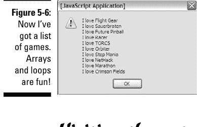

#### 再来拜访一次蚂蚁

就在你终于把那首蚂蚁歌从脑子里赶走的时候，再看一个变体。这个版本使用数组和循环来进一步简化代码！

```
<script type = "text/javascript">
//<!CDATA[
//from antsArray.html

var distractionList = new Array("", "suck his thumb", "tie his shoe");

function chorus() {
  var text = "...and they all go marching down\n";
  text += "to the ground \n";
  text += "to get out \n";
  text += "of the rain. \n";
  text += " \n";
  text += "boom boom boom boom boom boom boom boom\n";
  return text;
} // end chorus

function verse(verseNum){
  //pull distraction from array
  var distraction = distractionList[verseNum];

  var text = "The ants go marching ";
  text += verseNum + " by " + verseNum + " hurrah, hurrah\n";
  text += "The ants go marching ";
  text += verseNum + " by " + verseNum + " hurrah, hurrah\n";
  text += "The ants go marching ";
  text += verseNum + " by " + verseNum;
  text += " the little one stops to ";
  text += distraction;
  return text;
} // end verse1

//main code is now a loop
for (verseNum = 1; verseNum < distractionList.length; verseNum++){
  alert(verse(verseNum));
  alert(chorus());
} // end for loop

//]]>
</script>
```

这段代码与之前展示的 antsParam 程序只有一点不同。

- 它有一个名为 `distractionList` 的数组。这个数组（尽管名称具有误导性）是一个分心事的列表。我将第一个（元素 0）留空，以便诗句编号能够正确对齐。
- `verse()` 函数查找一个分心事。由于分心事现在都在一个数组中，`verseNum` 可以作为索引来查找特定的分心事。将这个函数与 antsParam 中的 `verse()` 函数进行比较。虽然数组比代码结构需要更多的规划，但它们可以极大地提高代码的可读性。
- 主程序在一个循环中。我逐步遍历 `distractionList` 数组的每个元素，打印出相应的诗句和副歌。
- `chorus()` 函数保持不变。没有必要更改 `chorus()`。

第一部分：JavaScript 编程

### 使用二维数组

数组在处理数据列表时非常有用。有时你会遇到最适合用表格来想象的数据。例如，假设你想构建一个距离计算器，用于确定两个城市之间的距离。原始数据可能如表 5-1 所示。

**表 5-1：主要城市之间的距离**

|                | 0) 印第安纳波利斯 | 1) 纽约 | 2) 东京 | 3) 伦敦 |
| :---           | :---            | :---        | :---     | :---      |
| 0) 印第安纳波利斯 | 0               | 648         | 6476     | 4000      |
| 1) 纽约     | 648             | 0           | 6760     | 3470      |
| 2) 东京        | 6476            | 6760        | 0        | 5956      |
| 3) 伦敦       | 4000            | 3470        | 5956     | 0         |

想想你会如何使用这个表格来计算距离。例如，如果你想从纽约前往伦敦，你会找出纽约的行和伦敦的列，然后确定它们相交的位置。该单元格中的数据就是距离（3,470 英里）。

当你在任何表格中查找信息时，你实际上是在处理一个*二维数据结构*。这是一个花哨的术语，但它只是意味着“表格”。如果你想在表格中查找某些内容，你需要两个索引，一个用于确定行，另一个用于确定列。

如果这难以理解，想想老式游戏“战舰”。游戏场地是一个由方格组成的网格。你宣布 "I-5"（意思是“I 列，5 行”），然后你的对手查看该网格，发现你击沉了他的战舰。在编程中，通常两个索引都使用整数，但除此之外完全相同：任何时候你有二维数据，都用两个索引来访问它。

我们经常会将这些索引用*行*和*列*来称呼，帮助你将其想象成一个表格。有时会有更好的名称，能更清楚地描述行为的工作方式。看一下图 5-7，你会看到 distance.html 程序要求输入两个城市，并根据数据表返回一个距离。

是的，在编程中可以有三维、四维和*n*维数组，但先不要担心那个。（这可能会让你的脑袋爆炸。）大多数时候，一维或二维就是你所需要的全部。

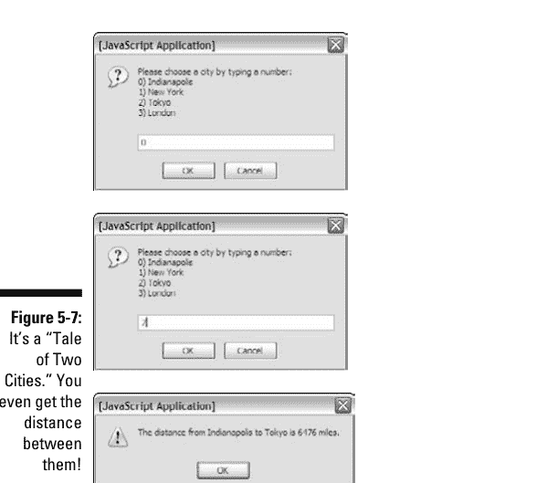

这个程序比其他一些程序稍长一些，所以我将其分成几个部分以便消化。请务必在以下任一配套网站上查看完整程序：`www.dummies.com/go/javascriptandajaxfd` 或 `www.aharrisbooks.net/jad`。

#### 设置数组

这个程序的关键在于数据组织。第一步是设置两个数组，如下所示：

```
<script type = "text/javascript">
//<!CDATA[
//from distance.html

//cityName has the names of the cities
cityName = new Array("Indianapolis", "New York",
    "Tokyo", "London");

//create a 2-dimension array of distances
distance = new Array (
  new Array (0, 648, 6476, 4000),
  new Array (648, 0, 6760, 3470),
  new Array (6476, 6760, 0, 5956),
  new Array (4000, 3470, 5956, 0)
) ;
```

116 第一部分：JavaScript 编程

第一个数组是一个普通的单维城市名称数组。我一直注意将所有城市保持在相同的顺序，所以每当我提到城市 0 时，我指的是印第安纳波利斯（我的家乡）。纽约总是在位置 1，以此类推。

在你的数据设计中，要注意始终保持事物的顺序相同。务必在输入计算机之前先在纸上组织好数据，这样你就能理解哪个值放在哪里。

`cityNames` 数组有两个作用。首先，它提醒我所有城市的顺序，其次，它为我提供了一种在知道索引时获取城市名称的便捷方法。例如，我知道 `cityName[2]` 永远是 "Tokyo"。

`distance` 数组非常有趣。如果你稍微眯着眼看，它看起来很像是表 5-1。这是因为它*就是*表 5-1，只是格式略有不同。

请记住，`distance` 是一个数组。JavaScript 数组几乎可以容纳任何东西，包括其他数组！这就是 `distance` 所做的：它保存了一个行数组。`distance` 数组的每个元素都是另一个（未命名的）数组，保存着该行的所有数据。如果你想从数组中提取信息，你需要两条信息。首先你需要行号。然后，因为该行是一个数组，你需要该数组中的列号。所以 `distance[1][3]` 的意思是：“转到名为 `distance` 的数组的第 1 行（纽约）。在该行内，转到第 3 个元素（伦敦）并返回结果值（3470）。”很酷吧？

#### 获取城市

该程序要求你输入两个城市。你希望用户输入城市编号而不是名称，而且你想做两次。这听起来是一个使用函数的好时机：

```
function getCity(){
    // presents a list of cities and gets a number corresponding
    // to the city name
    var theCity = "";  //will hold the city number

    var cityMenu = "Please choose a city by typing a number: \n";
    cityMenu += "0) Indianapolis \n";
    cityMenu += "1) New York \n";
    cityMenu += "2) Tokyo \n";
    cityMenu += "3) London \n";

    theCity = prompt(cityMenu);
    return theCity;
} // end getCity
```

这里 `getCity()` 函数会打印出一个城市选择的菜单，然后请求输入。接着返回该输入。


改进 `getCity()` 的方式有很多。例如，也许它应该在用户输入无效数字时重复提示，防止用户输入城市名称或进行其他不合理的操作。目前我先保持其简单。下一章将展示如何使用用户界面元素来帮助用户只提交有效输入。

#### 创建 main() 函数

`main()` 函数处理程序中的大部分代码。下面是它的样子：

```
function main(){
    var output = "";
    var from = getCity();
    var to = getCity();
    var result = distance[from][to];
    output = "The distance from " + cityName[from];
    output += " to " + cityName[to];
    output += " is " + result + " miles.";
    alert(output);
} // end main

main();
```

在这段代码中，`main()` 函数掌控着整个流程。它的工作方式如下：

1. **创建一个输出变量。**

   这个函数的目的是创建一段描述距离的文本输出。首先创建一个名为 `output` 的变量，并将其初始值设为空。

2. **获取出发城市。**

   幸运的是，你有一个非常棒的函数 `getCity()`，它处理了以正确格式获取城市的所有细节。调用这个函数，并将其值赋给新变量 `from`。

3. **获取目的城市。**

   那个 `getCity()` 函数确实很方便。再次使用它来获取城市编号，命名为 `to`。

4. **获取距离。**

   因为你已经知道两个索引，并且确认它们的格式正确，所以可以直接在表中查找。查找 `distance[from][to]` 并将其存储在变量 `result` 中。

5. **输出结果。**

   使用拼接来构建合适的响应字符串，并将其发送给用户。

6. **从 `cityNames` 数组中获取城市名称。**

   程序使用数字索引来表示城市，但这些对用户来说没有意义。使用 `cityNames` 数组来获取两个城市名称用于输出。

7. **运行 `main()` 函数。**

   只有一行代码不在函数内部。这一行调用 `main()` 函数并启动整个程序。

> 提示

> 我实际上并不是按照展示给你们的顺序来编写这个程序的。有时候“由内向外”地进行编程会更合理，这里就是这种情况：我实际上是先创建了数据结构（纸上的普通表格），然后才构建 `main()` 函数。这让我清楚地意识到需要一个 `getCity()` 函数，并给了我一些关于 `getCity` 应如何工作的线索（即它应该展示一个城市列表，然后提示输入数字）。

### 创建你自己的对象

到目前为止，你在 JavaScript 中使用了很多优秀的对象——但这只是个开始。事实上你也可以构建自己的对象，而且这些对象可以非常强大和灵活。对象通常有两个重要组成部分：*属性*和*方法*。*属性*就像是与对象关联的变量，它描述了对象。*方法*就像是与对象关联的函数，它描述了对象能做的事情。

> 记住

> 函数允许你将代码片段组合在一起；数组允许你将变量组合在一起；对象允许你将代码片段和变量（实际上还包括函数和数组）放在同一个大型构造中。

#### 构建基本对象

JavaScript 使得构建对象变得极其简单。因为变量可以包含任何值，你只需开始将变量当作对象使用，它就变成了对象。

图 5-8 展示了一个具有属性的小生物。

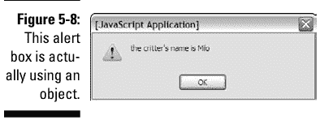

看看以下代码：

```
//from basicObject.html
//create the critter
var critter = new Object();

//add some property
critter.name = "Milo";
critter.age = 5;

//view property values
alert("the critter's name is " + critter.name + ".");
```

其工作方式并不难理解：

1. **创建一个新对象。**

   JavaScript 有一个内置对象叫做 `Object`。使用 `new Object()` 语法创建一个变量，你就能构建一个全新的标准对象。

2. **为对象添加属性。**

   属性就像是子变量。它不过是附加在特定对象上的变量。例如，当你给 `critter.name` 赋值时，你是在指定 `critter` 有一个名为 name 的属性，同时也在给它一个初始值。

3. **一个对象可以拥有任意数量的属性。**

   不断添加属性即可。这让你可以将多个变量组合成一个更大的对象。

4. **每个属性可以包含任意类型的数据。**

   与数组不同——数组中通常所有元素都包含完全相同类型的数据——每个属性可以有不同的类型。

5. **使用点语法来查看或更改属性。**

   如果 `critter` 对象有一个 name 属性，你可以将 `critter.name` 当作变量使用。与其他变量一样，你可以通过给 `critter.name` 赋新值来更改它，也可以读取该属性的内容。

如果你习惯于 Java 等更严格的面向对象语言，你会发现 JavaScript 随和的态度相当奇怪，也许还有点草率。其他语言确实对对象的创建和使用有更多规则，但 JavaScript 的方式确实有其独特魅力。不要太纠结于这些差异。JavaScript 处理对象的方式既强大又令人耳目一新。

#### 为对象添加方法

除了属性之外，对象还有其他特征。它们还可以拥有方法。方法就是附加在对象上的函数。要看我在说什么，请看下面的例子：

```
//create the critter
//from addingMethods.html
var critter = new Object();

//add some properties
critter.name = "Milo";
critter.age = 5;

//create a method
critter.talk = function(){
  msg = "Hi! My name is " + this.name;
  msg += " and I'm " + this.age;
  alert(msg);
}; // end method

// call the talk method
critter.talk();
```

这个例子扩展了上一节描述的 `critter` 对象。除了属性之外，新的 `critter` 还有一个 `talk()` 方法。如果属性描述了对象的特征，那么方法描述的就是对象能做的事情。图 5-9 展示了 `critter` 在展示它的 `talk()` 方法。

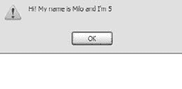

它的工作方式如下：

1. 构建一个具有所需属性的对象。

   首先构建一个对象并赋予它一些属性。

2. **定义方法的方式与定义属性类似。**

   事实上，方法在 JavaScript 中就是属性，但不要想太多——否则会让你头大的。

3. **你可以将预先创建的函数赋值给一个方法。**

   如果你已经创建了一个想用作方法的函数，直接赋值即可。

4. **你也可以创建匿名函数。**

   更常见的是，你会想立即创建方法。你可以使用 `function() {` 语法立即创建一个函数。

5. **`this` 关键字指向当前对象。**

   在函数内部，你可能想访问对象的属性。`this.name` 指向当前对象的 `name` 属性。

6. **然后你可以直接调用该方法。**

   在定义了一个带方法的对象后，你可以调用它。例如，如果 `critter` 对象有一个 `talk()` 方法，使用 `critter.talk()` 来调用这个方法。

#### 构建可复用的对象

这些对象很好，但如果你想用相同的定义构建多个对象怎么办？JavaScript 支持一种叫做*构造函数*的概念，它允许你定义一个对象模式并重复使用它。

下面是一个例子：

```
//building a constructor
//from constructor.html
function Critter(lName, lAge){
  this.name = lName;
  this.age = lAge;
  this.talk = function(){
    msg = "Hi! My name is " + this.name;
    msg += " and I'm " + this.age;
    alert(msg);
  } // end talk method
} // end Critter class def

function main(){
  //build two critters

  critterA = new Critter("Alpha", 1);
```

# 第一部分：JavaScript 编程

```javascript
critterB = new Critter("Beta", 2);
critterB.name = "Charlie";
critterB.age = 3;

//让它们说话
critterA.talk();
critterB.talk();

} // end main
main();
```

这个示例涉及创建一个类（一种生成对象的模式），并重用该定义来构建两个不同的“生物”。首先，我们来看一下类定义是如何工作的：

1. **构建一个普通函数**。JavaScript 的类被定义为函数的扩展。函数名也将成为类名。请注意，类函数的名称通常以大写字母开头。当函数以这种方式用于描述对象时，该函数被称为对象的构造函数。构造函数可以接受参数（如果你愿意的话），但它通常不返回任何值。在我特定的示例中，我添加了 `name` 和 `age` 参数。
2. **使用 `this` 来定义属性**。添加你想要的任何属性，包括默认值。请注意，你稍后可以随意更改这些值。每个属性都应以 `this` 和一个点开头，所以如果你希望你的对象有一个颜色属性，你应该说类似 `this.color = "blue";` 的话。我的示例使用了局部参数来定义属性。这是一种非常常见的做法，因为这是预加载重要属性的一种简单方式。
3. **使用 `this` 来定义你想要的任何方法**。如果你希望你的对象有方法，请使用 `this` 操作符后跟 `function() {` 关键字来定义它们。你可以添加任意多个函数。

JavaScript 定义和使用对象的方式很简单，但有点非标准。大多数其他支持面向对象编程的语言，其做法与这里描述的技术不同。有人可能会说 JavaScript 不是真正的 OOP 语言，因为它不支持一种叫做继承的特性，而是使用一种叫做原型的特性。这个区别并非至关重要；JavaScript 中大多数 OOP 的用法都是非常简单的对象，就像这里描述的或本章稍后描述的 JSON 那样。只要理解这里对面向对象编程的介绍非常粗略，但足以让你入门即可。

#### 使用你崭新的对象

当你定义了一个类，就可以重用它。再次查看 `main` 函数，看看我如何使用我新创建的 `Critter` 类：

```javascript
function main(){
  //build two critters

  critterA = new Critter("Alpha", 1);

  critterB = new Critter("Beta", 2);
  critterB.name = "Charlie";
  critterB.age = 3;

  //have 'em talk
  critterA.talk();
  critterB.talk();

} // end main
main();
```

在类被定义之后，你可以将其用作一种新的数据类型。这是一个非常强大的能力。以下是其工作原理：

1. **确保你可以访问该类**。除非 JavaScript 已经知道该类，否则它是无用的。在本示例中，类是在代码内部定义的。
2. **使用 `new` 关键字创建类的实例**。`new` 关键字意味着你想基于该定义创建一个特定的 `critter`。通常你会将其赋值给一个变量。我的构造函数期望提供 `name` 和 `age`，所以它会自动创建一个具有给定名称和年龄的 `critter`。
3. **根据需要修改类属性**。你可以更改任何类属性的值。在我的示例中，我更改了第二个 `critter` 的 `name` 和 `age`，只是为了演示如何操作。
4. **调用类方法**。因为 `Critter` 类有一个 `talk()` 方法，所以当你想让特定的 `critter` 说话时，你可以随时调用它。

### 介绍 JSON

JavaScript 对象和数组极其灵活。事实上，它们因其强大性和易用性而广为人知，以至于一种名为 JSON（JavaScript Object Notation，JavaScript 对象表示法）的特殊数据格式现在已被许多其他语言采用。

JSON 主要用作存储复杂数据（特别是多维数组）并在程序之间传递数据的方式。本质上，JSON 是用 JavaScript 对象格式描述复杂数据的另一种方式。当你在 JSON 中描述数据时，通常不需要构造函数，因为数据本身被用来确定类的结构。

JSON 数据正成为 Web 编程中非常重要的一部分，因为它提供了一种在程序和编程语言之间轻松传输数据的机制。在本书中（尤其是在关于 AJAX 和 jQuery 库的部分），你会看到 JSON 被广泛用于轻松管理复杂数据。

#### 以 JSON 格式存储数据

要了解 JSON 是如何工作的，首先看这个简单的代码片段：

```javascript
var critter = {
    "name": "George",
    "age": 10
};
```

这段代码描述了一个具有两个属性的 `critter`：一个 `name` 和一个 `age`。这个 `critter` 看起来很像一个数组，但它不是使用数字索引（如大多数数组那样），而是使用字符串值作为索引。它实际上是一个对象。

你可以使用类似数组语法的变体来引用各个元素，像这样：

```javascript
alert(critter["name"]);
```

你也可以使用所谓的点表示法（如在对象中使用），像这样：

```javascript
alert(critter.age);
```

这两种表示法的工作方式相同。大多数内置 JavaScript 对象使用点表示法，但两种都是可接受的。

JavaScript 数组如此有用的原因在于，它们实际上是对象。当你在 JavaScript 中创建一个数组时，你是在构建一个具有数字属性名的对象。这就是为什么你可以使用数组或对象语法来管理 JSON 对象属性。

查看我网站（`www.aharrisbooks.net/jad`）上的 `jsonDistance.html`，以查看本节代码的实际效果。这里不展示图表，因为所有有趣的工作都发生在代码中。

以下是将数据存储在 JSON 表示法中的方法：

1. **创建变量**。你可以像使用任何变量一样使用 `var` 语句。
2. **将内容包含在花括号（`{}`）内**。这与你用来创建预加载数组的机制相同（如本章前面所述）。
3. **指定一个键**。对于 `critter`，我希望属性命名为 "name" 和 "age"——也就是说，用单词而不是数字索引。对于每个属性，我以属性名开始。键可以是字符串或整数。
4. **键后跟一个冒号（`:`）**。键后面跟着冒号字符。
5. **创建与该键关联的值**。然后你可以将任何类型的值与该键关联。在这个例子中，我将值 `"George"` 与键 `"name"` 关联起来。
6. **用逗号（`,`）分隔每个名/值对**。你可以添加任意多个名/值对。

如果你熟悉其他编程语言，你可能会认为 JSON 结构类似于哈希表或关联数组。JavaScript 确实以与其他这些结构相同的方式使用 JSON 结构，但说 JSON 是哈希或关联数组并不完全准确。它只是一个对象。（但如果你想把它看作其中之一，我不会告诉任何人。）

#### 构建更复杂的 JSON 结构

JSON 很方便，因为它可以用来处理相当复杂的数据结构。例如，看看下面用 JSON 格式编写的（奇怪地熟悉的）数据结构：

```javascript
var distance = {
    "Indianapolis" :
        { "Indianapolis": 0,
          "New York": 648,
          "Tokyo": 6476,
          "London": 4000 },

    "New York" :
        { "Indianapolis": 648,
          "New York": 0,
          "Tokyo": 6760,
          "London": 3470 },

    "Tokyo" :
        { "Indianapolis": 6476,
          "New York": 6760,
          "Tokyo": 0,
          "London": 5956 },

    "London" :
        { "Indianapolis": 4000,
          "New York": 3470,
          "Tokyo": 5956,
          "London": 0 },
};
```

这个数据结构是表示用于描述二维数组的距离数据的另一种方式。这是另一个二维数组，但它与之前描述的那个有些不同。

- **`distance` 是一个 JSON 对象**。整个数据结构存储在一个变量中。这个变量是一个具有名/值对的 JSON 对象。
- **`distance` 对象有四个键**。这些对应于原始表格的四行。
- **键是实际的城市名称**。原始的 2D 数组使用数字索引，这很方便但有点人为。在 JSON 结构中，索引是实际的城市名称。
- **每个条目的值是另一个 JSON 对象**。JSON 元素的值可以是任何东西，包括另一个 JSON 对象。非常复杂的关系可以总结在一个变量中。
- **每一行被总结为一个 JSON 对象**。例如，与 `Indianapolis` 相关联的值是从印第安纳波利斯到各个城市的距离列表。
- **整个声明是代码的“一行”**。尽管在编辑器中为了清晰起见放在了多行，但整个定义实际上只是一行代码。

以这种方式设置数据看起来有点繁琐，但操作起来非常容易。城市名称被直接用于提取数据，因此你可以使用类似数组的语法来查找两个城市之间的距离：

```
alert(distance["Indianapolis"]["London"]);
```

如果你愿意，也可以使用点语法：

```
alert(distance.Indianapolis.Tokyo);
```

你甚至可以采用某种混合方式：

```
alert(distance["London"].Tokyo);
```

JSON 作为数据格式有许多重要优势：

- **它是自描述的。** 即使你在没有任何代码的情况下单独看到数据结构，也能理解它的含义。
- **使用字符串作为索引使代码更具可读性。** 理解 `distance["Indianapolis"]["London"]` 比解读 `distance[0][3]` 要容易得多。
- **JSON 数据可以作为文本存储和传输。** 这对 Web 编程产生了深远的影响，尤其是在 AJAX 中（本书其他部分描述的技术）。
- **JSON 可以描述复杂的关系。** 这里展示的示例是一个简单的二维数组，但 JSON 格式可以用来描述更复杂的关系——包括完整的数据库。
- **许多语言支持 JSON 格式。** 许多 Web 语言现在直接支持 JSON。其中最重要的是 PHP，它经常在 AJAX 应用程序中与 JavaScript 一起使用。
- **JSON 比 XML 更紧凑。** 另一种称为 XML 的数据格式经常用于传输复杂数据。然而，JSON 比 XML 更紧凑，也不那么“冗长”。
- **JavaScript 可以原生读取 JSON。** 某些类型的数据在使用前必须被转换。一旦你的 JavaScript 程序能够访问 JSON 数据，它就可以直接使用。

你可能会想知道是否可以在 JSON 对象中嵌入方法。答案是肯定的，但当你使用 JSON 传输信息时通常不会这样做。在本书第三部分关于 AJAX 的内容中，你会看到方法经常被添加到 JSON 对象中作为*回调函数*，但直到你更熟悉事件之后，这种用法才会有意义。要开始了解这方面内容，请翻到第 14 章。

## 128 第一部分：用 JavaScript 编程

## 第二部分

使用 JavaScript

增强你的页面

第五波

作者：Rich Tennant

> “显然，他在一次马拉松式的个人网站动画制作会话后因自然原因去世了。还有，Morganstern——这种讽刺意味我可没忽略。”

## 在本部分中……

JavaScript 是作为操作网页的语言而开发的。使用本部分来学习 JavaScript 如何与网页直接交互。

第 6 章描述了强大的文档对象模型，以及这种机制如何让你的 JavaScript 程序与网页交互。你将学习如何监听按钮事件，以及如何即时更改页面的部分内容。

第 7 章描述了获取更可靠输入的方法。首先，你将学习如何使用专门的用户界面元素，如列表框和单选按钮。其次，你将学习如何使用正则表达式来确保文本字段的值格式正确。

第 8 章教你如何为页面添加动画。你将学习如何在用户或程序控制下移动页面元素。你将学习如何制作元素动画，以及如何预加载图像以实现更高效的动画。你还将学习如何读取键盘和鼠标。

## 第 6 章

与页面对话

在本章中

- 介绍文档对象模型
- 响应表单事件
- 将按钮连接到函数
- 从文本字段检索数据
- 更改文本字段中的文本
- 向页面发送数据
- 处理其他与文本相关的表单元素
- 查看动态生成代码的源代码

JavaScript 很有趣，但它存在于 Web 浏览器中是有原因的：让你能够更改网页。JavaScript 最棒的地方在于它如何帮助你控制页面。你可以使用 JavaScript 从用户那里读取有用的信息，并即时更改页面。

### 理解文档对象模型

JavaScript 程序通常存在于网页的上下文中。页面内容通过一种称为文档对象模型（DOM）的机制对 JavaScript 程序可用。

DOM 是一组特殊的复杂变量，封装了整个网页的内容。你可以使用 JavaScript 从 DOM 读取信息并确定元素的状态。你也可以修改 DOM 变量并从 JavaScript 代码内部更改页面。

### 浏览 DOM

感受 DOM 最简单的方法是在 Firefox 中加载一个页面，查看 Firebug 窗口的 DOM 标签页。我正是这样做的，如图 6-1 所示。为了查看 DOM 的情况，我正在使用 Firebug 扩展。如果你需要复习如何使用 Firebug，请回顾第 1 章。还要注意，某些版本的 Firebug（尤其是 Mac 上的）略有不同，但总体思路是相同的。

当你查看一个非常简单的页面的 DOM 时，很容易感到不知所措。你会看到列出的大量变量。从技术上讲，这些都是一个称为 `window` 的特殊对象的所有元素。`window` 对象有大量子对象，全部列在 DOM 视图中。表 6-1 描述了一些重要的 `window` 变量。

| 变量 | 描述 | 说明 |
|----------|-------------|-------|
| `document` | 表示 XHTML 页面 | 最常用的脚本元素。 |
| `location` | 描述当前 URL | 更改 `location.href` 以跳转到新页面。 |
| `history` | 最近访问页面的列表 | 访问此对象以查看之前的页面。 |
| `status` | 浏览器状态栏 | 更改此值以在状态栏中设置消息。 |

### 使用 Firebug 更改 DOM 属性

为了说明 DOM 的强大功能，请在 Firefox 中尝试这个实验：

1. **加载任意页面。**

   你使用什么页面都没关系。我将使用 `simple.html`，一个非常基本的页面，只有一个 `<h1>` 标题。

2. **启用 Firebug 扩展。**

   你可以通过多种方式操作 DOM，但 Firebug 扩展是实验最容易、最强大的工具之一。

3. **启用 DOM 标签页。**

   这会向你显示所有顶级变量的列表。

4. **向下滚动直到看到 `status` 元素。**

   当你找到 `status` 元素时，双击它。

5. **输入一条给自己的消息。**

   在出现的对话框中，输入一些内容并按 Enter。

6. **查看浏览器底部。**

   浏览器窗口底部的状态栏现在应该包含你的消息！

7. **自行实验。**

   随意操作 DOM 列表中的各种元素。其中许多都可以修改。尝试将 `window.location.href` 更改为任何 URL，看看会发生什么。（别担心——你在这里不会永久破坏任何东西。）

这个 DOM 实验并不总是有效。你可能有一些会阻止 DOM 的扩展，或者它可能不会完全按照你的意愿工作。如果这个实验不起作用，就继续往下读。你永远不会真正再以这种方式操作了。一旦你了解到通过代码操作 DOM 是多么容易，那就是你唯一想要使用的方式。

### 检查 document 对象

如果说 `window` 对象很强大，那么它的后代——`document` 对象——就更加令人惊叹了。

同样，感受这个对象的最佳方式是进行一些探索：

1. **重新加载 `simple.html`。**

   如果你之前的实验导致情况变得很奇怪，你可能需要重启 Firefox。确保 Firebug 扩展显示的是 DOM 标签页。

2. **找到 `document` 对象。**

   这通常在 `window` 列表的靠前位置。当你选择 `document` 时，它会展开，显示大量的子元素。

3. **查找 `document.body`。**

   在 `document` 中的某个位置你会看到 `body`。选择它以查看你能发现什么。

4. **找到 `document.body.style`。**

   `document` 对象有一个 `body` 对象，而 `body` 对象有一个 `style` 子对象。这还有完没完？

5. **浏览样式元素。**

   有些样式可能会让你感到陌生，但继续往下看你也会看到一些老朋友。

6. **双击 `backgroundColor`。**

   每个 CSS 样式属性在 DOM 中都有一个对应的（但不完全相同）对应项。哇。输入一种新颜色（使用颜色名称或十六进制颜色）并看看会发生什么。

7. **惊叹于你的聪明才智。**

   你可以浏览 DOM 来对页面进行各种更改。如果你能在这里操作某个东西，你就可以编写代码来实现它。

如果你在这里感到迷茫，图 6-2 展示了我正在修改文档的 body 的 style 的 `backgroundColor`（在鸟翼上，在树枝上，在树上，在地面下的洞里）。不过，一张图无法真正展现这个过程。你必须亲自实验。但不要感到不知所措。你并不真正需要掌握 Firebug DOM 功能具体如何工作的细节。只要知道它在那里就行了，因为它是你接下来要做的所有酷炫事情的基础。

## 第六章：与页面对话

## 135

**图 6-2：** Firebug 让我直接修改页面的 DOM。

### 通过 JavaScript 驾驭 DOM

当然，用 Firebug 来调整你的网页是件很极客的事，但为什么要在乎它呢？DOM 的全部目的就是让 JavaScript 能够神奇地访问页面的所有内部工作机制。

#### 以 JavaScript 方式获得蓝色

当你开始编写 JavaScript 代码来访问 DOM 时，一切都会变得有趣起来。看一下图 6-3 中的 `blue.html`。

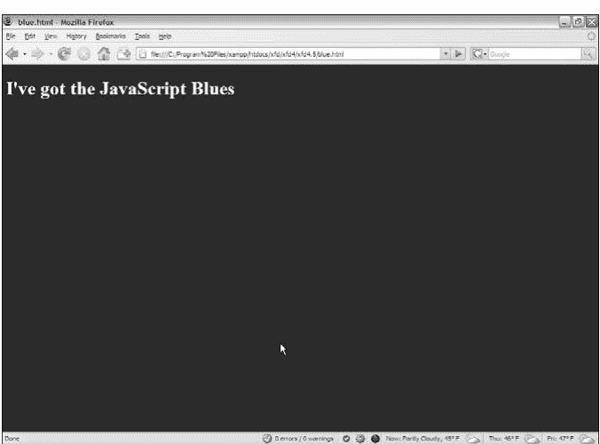

**图 6-3：** 这个页面是蓝色的（相信我，它是）。但是 CSS 在哪里呢？

#### 不应该是 "background-color" 吗？

如果你深入研究过 DOM 风格的元素，你会注意到一些有趣的事情。首先，许多元素名称都很熟悉，但并非完全相同：`background-color` 变成了 `backgroundColor`，而 `font-weight` 变成了 `fontWeight`。CSS 使用连字符来表示单词分隔，而 DOM 则将单词组合在一起，并使用大写字母来提高清晰度。你会发现所有你以前喜欢的 CSS 元素，但它们的名称都根据这个非常可预测的公式发生了变化。不过，如果你感到困惑，只需使用 Firebug 的 DOM 检查器来查看各种样式元素即可。

这个页面在蓝色背景上有白色文字，但没有 CSS！取而代之的是，它有一个小脚本直接修改 DOM，通过代码控制页面颜色。脚本如下所示：

```
<!DOCTYPE html PUBLIC "-//W3C//DTD XHTML 1.0 Strict//EN"
"http://www.w3.org/TR/xhtml1/DTD/xhtml1-strict.dtd">
<html lang="EN" dir="ltr" xmlns="http://www.w3.org/1999/
 xhtml">
  <head>
    <meta http-equiv="content-type" content="text/xml;
      charset=utf-8" />
    <title>blue.html</title>
  </head>

  <body>
    <h1>I've got the JavaScript Blues</h1>
    <script type = "text/javascript">
      //<![CDATA[

      // use javascript to set the colors
      document.body.style.color = "white";
      document.body.style.backgroundColor = "blue";

      //]]>
    </script>
  </body>
</html>
```

在本书的前几章中，我专注于 JavaScript，完全不担心 HTML。那些程序中的 HTML 代码并不重要，所以我在代码清单中没有包含它们。本章是关于如何将代码与 HTML 集成的，所以我现在将 HTML 和 JavaScript 代码段都包含进来。有时我仍然会将代码分开打印在不同的块中，所以（一如既往）请尝试在你的浏览器中，在配套网站（`www.aharrisbooks.net/jad` 或 `www.dummies.com/go/javascriptandajaxfd`）上查看代码在其自然环境中的样子。

#### 编写 JavaScript 代码来改变颜色

这个页面非常简单，但它有一些新特点：

- 它没有 CSS。一种 CSS 形式将通过代码动态创建。
- 脚本位于 body 中。我不能将这个特定的脚本放在 head 中，因为它引用了 body。当浏览器首次看到这个脚本时，必须有一个 body 存在，文本才能被更改。如果我把脚本放在 head 中，浏览器读取代码时还没有 body，它就会感到困惑。如果我把脚本放在 body 中，那么 body 就已经存在了，所以脚本可以更改它。（如果你一开始没理解这个细节也没关系。这可能是你最后一次看到这个特定技巧，因为我会在下一个示例中展示一种更好的方法。）
- 使用 DOM 引用来更改样式颜色。那个长长的“面包屑踪迹”语法将带你从 document 穿过 body 到 style，最后到 color。它虽然繁琐，但很彻底。
- 将前景色设置为白色。你可以将 color 属性更改为任何有效的 CSS 颜色值（颜色名称或十六进制值）。这就像 CSS 一样，因为你正在影响 CSS。
- 将背景色设置为蓝色。同样，这就像设置 CSS 一样。


### 管理按钮事件

当然，编写像 `blue.html` 这样的代码没有充分的理由。构建 CSS 和编写 JavaScript 一样容易。优势在于你可以使用 DOM 在页面加载完成后动态地更改其行为。

图 6-4 显示了一个名为 `backgroundColors.html` 的页面。

该页面默认设置为白色背景。它上面有两个按钮，应该可以改变 body 的背景颜色。点击蓝色按钮，你会看到它起作用了，如图 6-5 所示。

138 **第二部分：使用 JavaScript 增强你的页面**

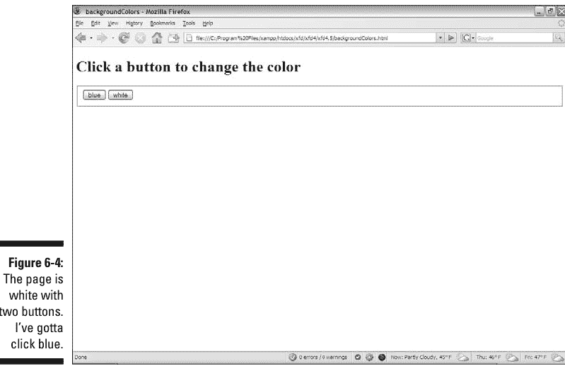

**图 6-4：** 页面是白色的，有两个按钮。我得点击蓝色那个。

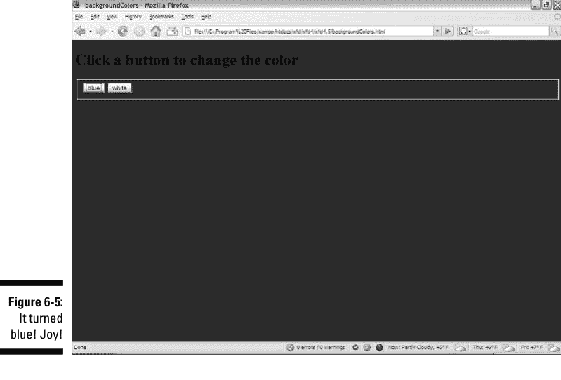

**图 6-5：** 它变成蓝色了！太棒了！

再次说明，颜色变化在黑白书中并不太明显。你应该能从图中看出颜色确实发生了变化，但请在网站上查看真正的颜色变化效果。这里发生了一些非常令人兴奋的事情：

- **页面有一个表单。** 如果你需要复习表单元素，请查看配套网站（`www.dummies.com/go/javascriptandajaxfd` 或 `www.aharrisbooks.net/jad`）上的补充章节 1。
- **按钮能做些事情。** 普通的 XHTML 表单实际上什么都不做；你必须编写某种程序代码来实现功能。这个程序会在你眼前做一些事情。
- **有一个 `setColor()` 函数。** 页面有一个函数，它接受一个颜色名称并将其应用到背景样式上。
- **两个按钮都向 `setColor()` 函数传递信息。** 颜色名称将作为参数传递给 `setColor()` 函数。

#### 设置操作台

以上是概述。我们来仔细看看代码：

```
<!DOCTYPE html PUBLIC "-//W3C//DTD XHTML 1.0 Strict//EN"
"http://www.w3.org/TR/xhtml1/DTD/xhtml1-strict.dtd">
<html lang="EN" dir="ltr" xmlns="http://www.w3.org/1999/xhtml">
<head>
    <meta http-equiv="content-type" content="text/xml;
            charset=utf-8" />
    <title>backgroundColors</title>
    <script type = "text/javascript">
    //<![CDATA[
        // from backgroundColors

        function changeColor(color){
            document.body.style.backgroundColor = color;
        } // end changeColor

    //]]>
    </script>
</head>
```

## 140 第二部分：使用 JavaScript 增强你的页面

```
<body>
  <h1>Click a button to change the color</h1>
  <form action = "">
    <fieldset>
      <input type = "button"
             value = "blue"
             onclick = "changeColor('blue')"/>

      <input type = "button"
             value = "white"
             onclick = "changeColor('white')" />
    </fieldset>
  </form>
</body>
</html>
```

大多数网页实际上将 XHTML 页面视为用户界面，而将 JavaScript 视为其下方的事件处理代码。因此，首先查看作为操作台的 HTML 代码是合理的。

- **它包含一个表单。** 注意表单的 `action` 属性仍然是空的。直到第 14 章你处理服务器时才会去修改它。
- **表单有一个 fieldset。** 输入元素需要放在某个容器内，`fieldset` 似乎是个相当自然的选择。
- **页面有两个按钮。** 页面上的这两个按钮没什么新奇的，但它们以前从未做过任何事情。
- **两个按钮都有 onclick 属性。** 这个特殊属性可以接受一行 JavaScript 代码。通常那行代码调用一个函数，就像我在这个程序中所做的那样。
- **每个按钮调用相同的函数，但参数不同。** 两个按钮都调用 `changeColor()`，但一个发送值 "blue"，另一个发送 "white"。
- **推测 changeColor 会更改颜色。** 这正是它将要做的。事实上，它将更改背景颜色。

通常我先编写 XHTML 代码，然后再编写脚本。如你所见，表单提供了各种有用的信息，这些信息将帮助我编写脚本。具体来说，很明显我需要编写一个名为 `changeColor()` 的函数，这个函数应该接受一个颜色名称作为参数，并应该将背景更改为指定的颜色。有了这种信息，这个函数就已经完成一半了！

#### 在引号中嵌套引号

仔细观察 `onclick` 行。这里有一个你可能没有注意到的重要问题：`onclick` 是一个 XHTML 参数，其值必须用引号括起来。而这个参数恰好是一个发送字符串值的函数调用。字符串值同样需要用引号括起来。如果你到处都使用双引号，这可能会让人非常困惑，因为浏览器无法分辨引号是嵌套的。如果你的代码是这样的……

```
onclick = "changeColor("white")" />
```

……那么 XHTML 会认为 `onclick` 参数的值是 `"changeColor()"`，而它根本不知道 `white")"` 是什么。

幸运的是，JavaScript 对这个问题有一个简单的解决办法：如果你想在一个引号内嵌套另一个引号，只需改用单引号即可。该行代码使用单引号来包裹参数：

```
onclick = "changeColor('white')" />
```

#### 编写 changeColor 函数

`changeColor()` 函数写起来非常简单。如下所示……

```
<script type = "text/javascript">
//<![CDATA[
// from backgroundColors

function changeColor(color){
  document.body.style.backgroundColor = color;
} // end changeColor

//]]>
</script>
```

它像往常一样放在头部区域。它只是一个接受一个名为 `color` 的参数的函数。页面主体的 `backgroundColor` 属性被设置为 `color`。

这次我可以在头部编写引用主体的 JavaScript，因为头部代码全部在一个函数中。该函数在主体加载之前就被*读取*，但直到用户点击按钮时才会被*激活*。此时主体已经加载完毕——所以没有任何问题。


### 与文本输入和输出交互

DOM 最引人入胜的应用或许是让用户通过网页与程序进行通信，而无需使用那些烦人的对话框。图 6-6 展示了一个包含两个文本框和一个按钮的网页表单。

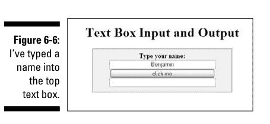

当你点击按钮时，会发生一些令人兴奋的事情，如图 6-7 所示。

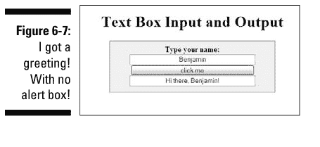

显然，基于表单的输入和输出要优于对话框的不断打断。

#### 介绍事件驱动编程

图形用户界面通常使用一种称为*事件驱动编程*的技术。其思想很简单：

1. **创建用户界面。**

   在网页中，用户界面通常由 XHTML 和 CSS 构建。

2. **确定程序应该响应的事件。**

   如果你有一个按钮，用户就会点击它。（如果你想确保他们点击它，就在按钮上写“发射导弹”。我不知道为什么，但这一招总是有效。）按钮几乎总是有事件的。其他一些元素也是。

3. **编写函数来响应每个事件。**

   对于你想要测试的每个事件，编写一个执行所需操作的函数。

4. **从表单元素获取信息。**

   现在你需要访问表单元素的内容以从用户那里获取信息。你需要一个从文本字段和其他表单元素获取信息的机制。

5. **使用表单元素进行输出。**

   在这个简单的示例中，我也使用表单元素进行输出。输出显示在第二个文本框中，即使我并不打算让用户在那里输入任何文本。

#### 创建 XHTML 表单

第一步是创建 XHTML 框架。以下是 XHTML 代码：

```
<title>textBoxes.html</title>

<link rel = "stylesheet"
            type = "text/css"
            href = "textBoxes.css" />

</head>

<body>
    <h1>Text Box Input and Output</h1>
    <form action = "">
        <fieldset>
            <label>Type your name: </label>
            <input type = "text"
                    id = "txtName" />

            <input type = "button"
                    value = "click me"
                    onclick = "sayHi()"/>

            <input type = "text"
                    id = "txtOutput" />
        </fieldset>
    </form>

</body>
</html>
```

在查看代码时，请注意几个重要的要点：

- 该页面**使用了外部 CSS**。CSS 样式虽然不错，但在本次讨论中并不重要。它安全地封装在自己的文件中。当然，你随时可以查看或修改它。
- **页面的大部分内容是一个表单**。所有表单元素必须在表单内部。
- 使用了 `fieldset` **来包含表单元素**。`input` 元素需要在某种块级元素内部，而 `fieldset` 是一个自然的选择。
- **有一个名为 `txtName` 的文本字段**。这个文本字段将包含姓名。我以 `txt` 开头来提醒自己这是一个文本框。
- **第二个元素是一个按钮**。不必给按钮一个 ID（因为它不会在代码中被引用），但它确实有一个 `onclick()` 事件。
- **按钮的 `onclick()` 事件引用了一个（尚未定义的）函数**。`onclick()` 事件被命名为 "sayHi()"。
- **第二个文本框将包含问候语**。这第二个文本框名为 `txtOutput`，因为它是用于输出的文本字段。

设置好 HTML 页面后，函数就变得很容易编写了，因为你已经确定了所有主要的结构。你知道你需要一个名为 `sayHi()` 的函数，这个函数将从 `txtName` 字段读取文本并写入 `txtOutput` 字段。


## 使用 `getElementById()` 访问页面

XHTML 是一回事，JavaScript 是另一回事。你需要某种方式将 HTML 表单元素转换为 JavaScript 可以读取的内容。神奇的 `getElementById()` 方法正是做这件事的。首先，看看 `sayHi()` 函数的前两行（像往常一样在头部定义）：

```
function sayHi(){
    var txtName = document.getElementById("txtName");
    var txtOutput = document.getElementById("txtOutput");
```

网页中创建的每个元素都可以通过遍历 DOM 来提取。在过去，这就是我们访问表单元素的方式。这种方式既丑陋又繁琐。现代浏览器提供了优秀的 `getElementById()` 函数。这个美妙的函数会搜索 DOM 并返回对具有所请求 ID 的对象的引用。


*引用*只是一个指示器，标明指定对象在内存中的位置。你可以将引用存储在变量中。操作这个变量就是操作它所代表的对象。如果你想的话，可以把它想象成把文本框变成了一个变量。

注意我将变量命名为 `txtName`，所以它的名字与原始文本框相同。这个变量引用的是表单中的文本字段，而不是该文本字段的值。当我拥有了文本字段对象的引用后，我就可以使用它的方法和属性来从中提取数据并发送新值。

## 操作文本字段

当你获取到文本字段的访问权限后，就可以使用 `value` 属性来操作这些字段的值：

```
var name = txtName.value;
txtOutput.value = "Hi there, " + name + "!"
```

文本字段（实际上所有输入字段）都有一个 `value` 属性。你可以像读取普通字符串变量一样读取这个值。你也可以写入这个属性，文本字段会即时更新。

以下步骤创建的代码处理数据的输入和输出：

1. **为姓名创建一个变量。**

   这是一个普通的字符串变量。

2. **将文本框的值复制到变量中。**

   现在你有了一个代表文本框的变量，你可以访问它的 `value` 属性来获取用户输入的值。

3. **使用普通的字符串拼接为用户创建一条消息。**

4. **将消息发送到输出文本框。**

   你也可以向 `value` 属性写入文本，这将更改屏幕上文本字段的内容。


> 文本字段始终返回字符串值（就像 `prompt` 一样）。如果你想从文本字段中获取数值，可能需要使用 `parseInt()` 或 `parseFloat()` 函数进行转换。

## 写入文档

表单元素非常适合获取用户输入，但不适合输出。将输出放在可编辑字段中并不合理。直接修改网页文档会更好。

DOM 正好支持这种技术。大多数 XHTML 元素都有一个 `innerHTML` 属性。该属性描述了元素内部的 HTML 代码。在大多数情况下，它可以被读取和写入。

> 那例外情况呢？单标签元素（如 `` 和 `<input>`）不包含任何 HTML，所以显然读取或修改它们的内部 HTML 没有意义。表格元素通常可以被读取，但不能直接修改。

图 6-8 展示了一个带有基本表单的程序。


这个表单没有用于输出的表单元素。输入姓名并点击按钮，你会看到图 6-9 所示的结果。


令人惊讶的是，这个页面可以动态地自我修改。它不仅仅是修改表单字段的值，而是修改 HTML。

### 准备 HTML 框架

要了解这是如何实现的，首先查看 `innerHTML.html` 的 XHTML 主体：

```
<body>
    <h1>Inner HTML Demo</h1>
    <form action = "">
        <fieldset>
            <label>Please type your name</label>
            <input type = "text"
                   id = "txtName" />
            <button type = "button"
                    onclick = "sayHi()">
                Click Me
            </button>
        </fieldset>
    </form>

    <div id = "divOutput">
        Watch this space.
    </div>
</body>
```

代码主体有几个有趣的特点：

- **程序包含一个表单。** 该表单非常标准。它有一个用于输入的文本字段和一个按钮，但没有输出元素。

- **按钮会调用 `sayHi()` 函数。** 页面需要一个具有此名称的函数。 presumably 它会以某种方式打招呼。

- **有一个用于输出的 `div`。** 主体中的一个 `div` 元素被指定用于输出。

- **该 `div` 有一个 ID。** `id` 属性通常用于 CSS 样式设置，但它也可以被 DOM 使用。

任何将被动态脚本化的 HTML 元素都应该有 `id` 字段。

## 编写 JavaScript

修改内部 HTML 的 JavaScript 代码非常简单：

```
<script type = "text/javascript">
    //<![CDATA[
    //from innerHTML.html
```

### 148 Part II: Using JavaScript to Enhance Your Pages

```
function sayHi(){
    txtName = document.getElementById("txtName");
    divOutput = document.getElementById("divOutput");

    name = txtName.value;

    divOutput.innerHTML = "<em>" + name + "<\/em>";
    divOutput.innerHTML += " is a very nice name.";
}
//]]>
</script>
```

第一步（与 Web 表单一样）是从输入元素中提取数据。注意，我可以创建任何 DOM 元素的变量表示，不仅仅是表单元素。`divOutput` 变量是 DOM `div` 元素的 JavaScript 表示。

## 找到你的 `innerHTML`

与 `form` 元素一样，`div` 也有其他可以修改的有趣属性。`innerHTML` 属性允许你更改 `div` 显示的 HTML 代码。你可以在 `innerHTML` 属性中放入任何有效的 XHTML 代码，甚至是 HTML 标签。确保你仍然遵循 XHTML 规则，以便你的代码有效。

即使有了 CDATA 元素，验证器仍会被正斜杠（如 `<em>` 标签中的斜杠）搞混。每当想在 JavaScript 字符串中使用 `/` 字符时，在其前面加一个反斜杠（`<\/em>`）。这样做有助于验证器理解你打算在下一个位置放置斜杠字符。

## 处理其他文本元素

当你知道如何处理文本字段时，你已经掌握了大约一半的表单元素。还有几种其他表单元素与文本字段的工作方式完全相同，包括：

- **密码字段**：回想一下，密码字段用星号遮蔽用户的输入，但保留文本。

- **隐藏字段**：这些字段允许你在页面中存储信息而不向用户显示。（它们在客户端编码中使用较少，但在 JavaScript 中几乎不用。）

- **文本区域**：这些是多行文本框。它们可以被调整大小以处理多行输入。

## 第 6 章：与页面对话

图 6-10 是一个在同一表单上提供所有这些元素的页面。


当用户点击按钮时，所有字段的内容（即使是密码和隐藏字段）都会显示在页面底部，如图 6-11 所示。


### 构建表单

以下是生成表单的 XHTML：

```
<body>
    <h1>Text Input Devices</h1>
    <form action = "">
        <fieldset>
            <label>Normal Text field</label>
            <input type = "text"
                   id = "txtNormal" />
            <label>Password field</label>
            <input type = "password"
                   id = "pwd" />
            <label>Hidden</label>
            <input type = "hidden"
                   id = "hidden"
                   value = "I can't tell you" />
            <textarea id = "txtArea"
                      rows = "10"
                      cols = "40">
This is a big text area.
It can hold a lot of text.
            </textarea>
            <button type = "button"
                    onclick = "processForm()">
                Click Me
            </button>
        </fieldset>
    </form>

    <div id = "output">

    </div>
</body>
```

这段代码你应该很熟悉（如需更多关于表单元素的信息，请查看 Bonus Chapter 1）。这个例子中有几点值得注意：

- **有一个普通文本字段。** 仅用于比较。它有 `id`，以便在 JavaScript 中识别。

- **下一个字段是密码字段。** 密码显示星号，但存储实际输入的文本。此密码的 `id` 为 `pwd`。

- **隐藏字段有点奇怪。** 隐藏字段可用于在页面上存储信息而不向用户显示。与其他类型的文本字段不同，用户无法修改隐藏字段。（她通常甚至不知道它存在。）此隐藏字段的 `id` 为 `secret`，值为 `"I can't tell you"`。

- **文本区域的格式不同。** `input` 元素都是单标签元素，但 `textarea` 元素设计用于包含大量文本，因此它有开始和结束标签。文本区域的 `id` 是 `txtArea`。

- **按钮启动所有乐趣。** 像往常一样，大多数元素只是坐在那里收集数据，但按钮有一个与之关联的 `onclick` 事件，该事件调用一个函数。

- **外部 CSS 美化一切。** 页面有一些最少的 CSS 来清理它。（CSS 不是本次讨论的重点，所以我不会复制它。）注意页面可能会有一个 `dl`，所以我为它有 CSS 样式，即使它默认不会出现。

密码和隐藏字段看似安全，但事实并非如此。任何查看页面源代码的人都能读取隐藏字段的值，密码会以明文传输其信息。你真的不应该使用 Web 技术（尤其是这种技术）来传输核发射密码或你的秘制酱料配方。（嗯——也许秘制酱料配方就是发射密码——听起来像是一部糟糕的间谍电影。）

当我创建文本字段时，我经常会暂停我的缩进规则，因为文本字段会保留其中的所有内容，包括任何缩进。

### 编写函数

现在你只需要一个函数。好消息是：JavaScript 对所有这些元素的处理方式完全相同！处理密码、隐藏字段或文本区域的方式与常规文本字段的技术完全相同。代码如下：

```
<script type = "text/javascript">
//<![CDATA[

// from otherText.html
function processForm(){
  //grab input from form
  var txtNormal = document.
      getElementById("txtNormal");
  var pwd = document.getElementById("pwd");
  var hidden = document.getElementById("hidden");
  var txtArea = document.getElementById("txtArea");

  var normal = txtNormal.value;
  var password = pwd.value;
  var secret = hidden.value;
  var bigText = txtArea.value;
```

```
var result = ""
result += "<dl> \n";
result += "  <dt>normal<\/dt> \n";
result += "  <dd>" + normal + "<\/dd> \n";
result += " \n";
result += "  <dt>password<\/dt> \n";
result += "  <dd>" + password + "<\/dd> \n";
result += " \n";
result += "  <dt>secret<\/dt> \n";
result += "  <dd>" + secret + "<\/dt> \n";
result += "   \n";
result += "  <dt>big text<\/dt> \n";
result += "  <dd>" + bigText + "<\/dt> \n";
result += "<\/dl> \n";

var output = document.getElementById("output");
output.innerHTML = result;

} // end function
```

`processForm()` 函数比本章其他函数稍长一些，但遵循完全相同的模式：从表单字段中提取数据，构造用于输出的字符串，然后将该输出写入页面中 `div` 的 `innerHTML` 属性。

这段代码没有什么新内容，但仍有几个点值得你注意：

- **为每个表单元素创建一个变量。** 使用 `document.getElementById` 机制。

- **创建一个字符串变量来包含每个元素的内容。** 别忘了：`getElementById` 返回的是一个对象。要查看对象内部的内容，你必须提取 `value` 属性。

- **创建一个大字符串变量来管理输出。** 当输出像这样变得冗长而杂乱时，拼接一个大变量，然后一次性输出。

- **HTML 是你的好帮手。** 这个输出有点复杂，但 `innerHTML` 包含的是 HTML，因此你可以使用任何 HTML 样式来格式化你的代码。`return` 字符串实际上是一个完整的定义列表。文本框中的任何内容（在本例中）都被复制为 HTML 文本；如果我想实现换行或格式，就得通过代码来添加。

- **别忘了转义斜杠。** 验证器会被结束标签搞混，所以在 JavaScript 字符串变量中出现的任何结束标签前都要添加反斜杠字符（`</dl>` 变成 `<\/dl>`）。

> **换行符（`\n`）可以清理输出。** 如果我在写普通的 HTML 定义列表，我会把每一行放在新的一行上。我尽量让我的程序像我写代码一样，所以在普通 HTML 中我使用回车换行的地方，我都添加换行符。

### 理解生成的源代码

当你运行程序时，你的 JavaScript 代码实际上会改变它所驻留的页面。那些不是来自你的服务器、而是由你的程序创建的代码有时被称为 `generated source`（生成源代码）。生成代码的技术很强大，但它可能会带来一个严重的问题。试试下面的实验，看看我的意思：

1. **重新加载页面，使其不显示表单内容。**

   现在查看源代码。

2. **注意一切如预期所示。**

   源代码显示的内容与你所写完全一致。

3. **单击 "Click Me" 按钮。**

   你的函数将运行，页面会发生变化。你明显向 `output div` 添加了 HTML，因为你就在屏幕上看到了输出。

4. **再次查看源代码。**

   你会大吃一惊。`output div` 将是空的，尽管你能清楚地看到它已经发生了变化。

5. **验证器不会检查生成的代码。**

   使用 HTML 验证器扩展程序或 W3C 验证器都不会检查你生成代码中的错误。你必须自己检查，但很难看到这些代码！

图 6-12 说明了这个问题。

情况是这样的：`view source`（查看源代码）命令（在大多数浏览器中）并不能*真正*查看页面当前状态的源代码。它会回到服务器重新获取页面，只是以源代码形式而非渲染后的输出显示。这意味着 `view source` 命令无法告诉你页面是如何动态变化的。同样，页面验证器检查的是服务器上的页面状态，没有考虑到可能动态发生的变化。

### 154 第二部分：使用 JavaScript 增强你的页面

源代码中的 `output div` 仍然是空的。


图 6-12：普通的查看源代码命令没有显示 `div` 的内容！


`div` 明显有内容，尽管源代码显示它是空的！

当你构建普通网页时，这不是问题，因为普通网页不会改变。动态生成的页面可以即时变化，而浏览器不会预期到这一点。如果你在 HTML 中犯了错误，你无法简单地通过查看源代码来了解脚本生成的代码哪里出了问题。幸运的是，有两个简单的解决方案可以通过 Firefox 插件实现：

- **Web Developer 工具栏。** 这个工具栏有一个很棒的工具叫做 `view generated source`（查看生成的源代码），在 `view source` 菜单中可以找到。这让你可以查看当前页面当前状态的源代码，包括任何由 JavaScript 动态生成的代码。

- **Firebug。** 当页面打开时，打开 Firebug 窗口并用 HTML 标签浏览你的页面。Firebug 能给你页面内容的准确视图，即使它们是动态变化的。这非常有用。

当你试图弄清楚为什么生成的代码不能正常工作时，这些工具会让你保持理智。（我好几年前就有这些工具就好了……）

图 6-13 展示了 Firebug 工具栏——显示了动态生成的内容。

`div` 的内容被代码动态改变了。


图 6-13：Firebug 显示页面的当前状态，即使它是动态修改的。

Firebug 检查器显示代码的当前存在状态，即使它是由 JavaScript 代码修改过的（正如本例所示）。

# 第 7 章

## 获取有效的输入

### 本章内容

- 从下拉列表中提取数据
- 管理多选列表
- 从复选框获取数据
- 从单选组获取信息
- 使用正则表达式验证输入
- 使用字符、边界和重复运算符
- 使用模式记忆

能够从用户那里获取输入固然很好，但有时用户会犯错误。如果能有一些更好的方法让用户的操作更简单，并防止某些类型的错误，那就太棒了。

当然，确实有正好用于此目的的工具。在本章中，你将了解两种改进用户输入的主要策略：专用输入元素和模式匹配。这些工具 together 可以帮助你确保用户输入的数据是有用且有效的。

## 从下拉列表获取输入

确保用户输入有效内容的最明显方法是提供有效的选项。下拉列表是实现这一点的明显而简便的方式，你可以从图 7-1 中看到。

下拉列表框方法相比文本字段输入有很多优势：

- **用户可以用鼠标输入。** 这比打字更快、更容易。
- **没有拼写错误。** 因为用户不需要输入答案。
- **所有答案都可用。** 用户知道哪些答案是可用的，因为它们都在列表中。
- **你可以确保答案是有效的。** 因为是你提供了可能的答案。
- **用户回答可以映射到更复杂的值。** 例如，你可以向用户显示 "red"，然后让列表框返回十六进制值 `"#FF0000"`。

### 158 第二部分：使用 JavaScript 增强你的页面


如果你需要复习如何使用 XHTML 的 `select` 对象构建列表框，请参考以下任一网站上的 Bonus Chapter 2：`www.aharrisbooks.net/jad` 或 `www.dummies.com/go/javascriptandajaxfd`。

### 构建表单

最好先创建 HTML 表单，因为它定义了函数所需的所有元素。代码是一个标准表单：

```html
<body>
  <form action = "">
    <h1>Please select a color</h1>
    <fieldset>
      <select id = "selColor">
        <option value = "#FFFFFF">White</option>
        <option value = "#FF0000">Red</option>
        <option value = "#FFCC00">Orange</option>
        <option value = "#FFFF00">Yellow</option>
        <option value = "#00FF00">Green</option>
        <option value = "#0000FF">Blue</option>
        <option value = "#663366">Indigo</option>
        <option value = "#FF00FF">Violet</option>
      </select>
```

```html
<input type = "button"
        value = "change color"
        onclick = "changeColor()" />
</fieldset>
</form>

</body>
</html>
```

`select` 对象的默认行为是提供一个下拉列表。列表中的第一个元素会显示出来，但当用户点击列表时，其他选项就会出现。

在代码中引用的 `select` 对象应具有一个 `id` 字段。

> **提示**

在本章的本例及大多数示例中，我都添加了外部 CSS 样式来美化每个表单。如果你想了解样式是如何实现的，请务必查看网站上的样式代码（`www.aharrisbooks.net/jad` 或 `www.dummies.com/go/javascriptandajaxfd`）。

表单中的另一个元素是按钮。当按钮被点击时，`changeColor()` 函数将被触发。

> **技术细节**

因为此表单中唯一的元素是 `select` 对象，所以你可能希望在不需要点击按钮的情况下立即更改背景颜色。你可以通过直接在 `select` 对象上添加事件处理程序来实现，如下所示：

```
<select id = "selColor"
        onchange = "changeColor()">
```

这将使 `changeColor()` 函数在用户更改 `select` 对象的值时立即被触发。通常只有当 `select` 是表单中唯一的元素时才会这样做。如果有多个元素，通常只有在用户点击按钮表示准备好之后才会进行处理。

### 读取列表框

幸运的是，标准的下拉列表非常容易读取。以下是 JavaScript 代码：

```
<script type = "text/javascript">
//<!CDATA[
// from drop-downList.html
function changeColor(){
    var selColor = document.
        getElementById("selColor");
    var color = selColor.value;
    document.body.style.backgroundColor = color;
} // end function
//]]>
</script>
```

如你所见，读取 `select` 对象的过程与处理文本字段非常相似：

1. **创建一个变量来表示 `select` 对象。** `document.getElementById()` 技巧在这里与处理文本字段一样适用。

2. **提取 `select` 对象的 `value` 属性。** `select` 对象的 `value` 属性将反映当前选定的 `option` 的 `value` 属性。因此，如果用户选择了 "yellow"，`selColor` 的值将是 `"#FFFF00"`。

3. **设置文档的背景颜色。** 使用 DOM 机制将 `body` 的背景颜色设置为所选值。

## 管理多选

`select` 对象可以以更强大的方式使用：图 7-2 展示了一个带有多选列表框的页面。要使多选功能生效，你需要对 HTML 和 JavaScript 代码进行一些修改。


### 编写多选 `select` 对象的代码

你需要以两种方式修改 `select` 代码以实现多选：

- **允许进行多选。** 默认情况下，`select` 框只有一个值。你需要设置一个开关来告诉浏览器允许选择多个项目。

- **将其设置为多行 `select`。** 当你想要多选时，标准的下拉行为就不合适了，因为用户需要同时看到所有选项。大多数浏览器会自动切换到多行模式——但你应该直接控制这一过程以确保正确。

`multiSelect.html` 的 XHTML 代码与 `drop-downList` 页面类似，但请注意几处更改：

```
<body>
    <h1>Multiple Selections</h1>
    <form action = "">
        <fieldset>
            <label>
                Select the language(s) you know.
                (ctrl-click to select multiple lines)
            </label>
            <select id = "selLanguage"
                multiple = "multiple"
                size = "10">
                <option value = "XHTML">XHTML</option>
                <option value = "CSS">CSS</option>
                <option value = "JavaScript">JavaScript</option>
                <option value = "PHP">PHP</option>
                <option value = "MySQL">MySQL</option>
                <option value = "Java">Java</option>
                <option value = "VB.NET">VB.NET</option>
                <option value = "Python">Python</option>
                <option value = "Flash">Flash</option>
                <option value = "Perl">perl</option>
            </select>
            <button type = "button"
                onclick = "showChoices()">
                Submit
            </button>
        </fieldset>
    </form>

    <div id = "output">
    </div>
</body>
</html>
```

这段代码并不令人惊讶，但它确实有一些重要的特性需要认识：

- **`select` 对象的名称为 `selLanguage`。** 与通常一样，表单元素需要一个 `id` 属性，以便你可以在 JavaScript 中读取它。

- **为 `select` 对象添加 `multiple = "multiple"` 属性。** 这告诉浏览器接受使用 Shift+点击（用于连续选择）或 Control+点击（用于更精确的选择）进行多选输入。

- **将 `size` 设置为 10。** `size` 表示将显示的行数。我将 `size` 设置为 10，因为列表中有 10 个选项。

- **创建一个按钮。** 使用多选功能时，你可能希望在用户完成选择之后才触发操作。一个单独的按钮是最简单的实现方式。

- **创建一个 `output` `div`。** 需要一个容器来存放响应结果。

### 编写 JavaScript 代码

读取多选列表框的 JavaScript 代码与标准的选择代码略有不同。`value` 属性只会返回一个值，但多选列表框通常会返回多个结果。

关键是要认识到 `select` 对象内部的 `option` 对象列表实际上是一种数组。你可以更仔细地查看对象列表，看看哪些被选中了。这基本上就是 `showChoices()` 函数所做的工作：

```
<script type = "text/javascript">
//<![CDATA[
//from multi-select.html
function showChoices(){
  //retrieve data
  var selLanguage = document.
    getElementById("selLanguage");

  //set up output string
  var result = "<h2>Your Languages<\/h2>";
  result += "<ul> \n";

  //step through options
  for (i = 0; i < selLanguage.length; i++){
    //examine current option
    currentOption = selLanguage[i];

    //print it if it has been selected
    if (currentOption.selected == true){
      result += "  <li>" + currentOption.value + "<\/li> \n";
    } // end if
  } // end for loop

  //finish off the list and print it out
  result += "<\/ul> \n";

  output = document.getElementById("output");
  output.innerHTML = result;
} // end showChoices
//]]>
</script>
```

乍一看这段代码似乎令人生畏，但如果你将其分解来看，就不那么复杂了。

1. **创建一个变量来表示整个 `select` 对象。** 标准的 `document.getElementById()` 技术完全适用：

```
var selLanguage = document.getElementById("selLanguage");
```

2. **创建一个字符串变量来保存输出。** 当你构建复杂的 HTML 输出时，使用字符串变量比直接向元素写入代码要方便得多：

```
var result = "<h2>Your Languages<\/h2>";
```

3. **构建一个无序列表来显示结果。** 无序列表是输出结果的好方法，因此我在 `result` 变量中创建了一个：

```
result += "<ul> \n";
```

4. **将 `selLanguage` 当作数组一样遍历。** 使用 `for` 循环逐行检查列表框：

```
for (i = 0; i < selLanguage.length; i++){
```

请注意，`selLanguage` 具有像数组一样的 `length` 属性。

5. **将当前元素赋值给一个临时变量。** `currentOption` 变量将在循环进行过程中保存对原始 `select` 对象中每个 `option` 元素的引用：

```
currentOption = selLanguage[i];
```

### 164 第二部分：使用 JavaScript 增强你的页面

6. **检查当前元素是否已被选中。**

这里 `currentOption` 是一个对象，它有一个 `selected` 属性。该属性告诉你对象是否已被用户高亮选中。`selected` 是一个布尔属性，因此唯一可能的值是 `true` 或 `false`。

```
if (currentOption.selected == true) {
```

7. **如果元素已被选中，向输出列表添加一项。**

如果用户已高亮选中此对象，则在 `result` 变量中存储的无序列表中创建一项：

```
result += " <li>" + currentOption.value + "<\/li> \n";
```

8. **关闭列表。**

当循环遍历完所有对象后，你可以关闭正在构建的无序列表：

```
result += "<\/ul> \n";
```

9. **将结果打印到 `output` `div`。**

`output` `div` 的 `innerHTML` 属性是打印无序列表的理想位置：

```
output = document.getElementById("output");
output.innerHTML = result;
```

这里有些奇怪的地方。下拉框的选项表现得像数组。无序列表很像数组，下拉框也很像数组。没错！它们*就是*数组，只是形式不同。任何列表数据都可以被视为数组。有时你以列表形式组织（用于显示），有时以数组形式组织（用于内存存储），有时它是一组选项（用于用户输入）。现在你开始像程序员一样思考了！

## 请结账 —— 读取复选框

复选框实现了另一种有用的数据输入功能：当你有布尔数据时，它们非常有用。如果某个值可以是 `true` 或 `false`，复选框是一个很好的工具。图 7-3 展示了响应复选框的页面。

务必理解复选框是相互独立的。虽然它们经常成组出现，但任何复选框都可以被选中或取消选中，而不受其相邻复选框状态的影响。

想选多少就选多少。

点披萨按钮


当你点击 "点披萨" 按钮时，所选输出会显示在这里。

### 构建复选框页面

照例，先从 HTML 开始看：

```
<body>
  <h1>What do you want on your pizza?</h1>
  <form action = "">
    <fieldset>
      <input type = "checkbox"
             id = "chkPepperoni"
             value = "pepperoni" />
      <label for = "chkPepperoni">Pepperoni</label>

      <input type = "checkbox"
             id = "chkMushroom"
             value = "mushrooms" />
      <label for = "chkMushroom">Mushrooms</label>

      <input type = "checkbox"
             id = "chkSausage"
             value = "sausage" />
      <label for = "chkSausage">Sausage</label>

      <button type = "button"
              onclick = "order()">
        Order Pizza
      </button>
    </fieldset>
  </form>
  <h2>Your order:</h2>
  <div id = "output">

  </div>
</body>
```

每个复选框都是一个独立的 `input` 元素。注意，复选框的值不会显示出来。相反，标签（或类似文字）通常放在复选框*后面*。一个按钮调用 `order()` 函数。

看看标签。它们每个都设置了 `for` 属性，将标签与对应的复选框关联起来。虽然这不是必需的，但这是一个贴心的设计，因为用户现在可以点击整个标签来激活复选框。


### 响应复选框

复选框不需要太多维护。当你提取复选框对象时，它有两个关键属性：

- **`value` 属性：** 与其他 `input` 元素一样，`value` 属性可用于存储与复选框关联的值。

- **`checked` 属性：** 该属性是一个布尔值，指示复选框当前是否被选中。

`order()` 函数的代码展示了它是如何实现的：

```
<script type = "text/javascript">
  //<![CDATA[
  //from checkBoxes.html

  function order(){
    //get variables
    var chkPepperoni = document.
      getElementById("chkPepperoni");
    var chkMushroom = document.
      getElementById("chkMushroom");
    var chkSausage = document.
      getElementById("chkSausage");

    var output = document.getElementById("output");
    var result = "<ul> \n";

    if (chkPepperoni.checked){
      result += "<li>" + chkPepperoni.value + "<\/li> \n";
    } // end if

    if (chkMushroom.checked){
      result += "<li>" + chkMushroom.value + "<\/li> \n";
    } // end if

    if (chkSausage.checked){
      result += "<li>" + chkSausage.value + "<\/li> \n";
    } // end if

    result += "<\/ul> \n";
    output.innerHTML = result;
  } // end function

  //]]>
</script>
```

对于每个复选框，请务必使用它的两个属性：

1. **确定复选框是否被选中。**

   将 `checked` 属性作为条件使用。

2. **如果复选框被选中，返回与该复选框关联的 `value` 属性。**

在实际操作中，`value` 属性经常被省略。重要的是复选框是否被选中。很明显，如果 `chkMushroom` 被选中，用户就想要蘑菇，所以你可能不需要将该数据显式存储在 `checkbox` 本身中。

## 使用单选按钮

单选按钮组看起来相当简单，但它们比乍看上去更复杂。图 7-4 展示了使用单选按钮选择的页面。

关于单选按钮最重要的一条规则是 —— 就像角马和竞走者一样 —— 它们必须成组出现。每组单选按钮将只有一个按钮被激活。该组应设置成最初就有一个按钮被激活，这样该组始终恰好有一个活动按钮。

### 168 第二部分：使用 JavaScript 增强你的页面


你在 XHTML 代码中指定单选按钮组。组中的每个元素可以有一个 `id` 属性（尽管在此应用中 ID 并非必需）。这里更重要的是 `name` 属性。查看代码，你会发现一件有趣的事：所有单选按钮都有相同的名称！

```
<body>
    <h1>With what weapon will you fight the dragon?</h1>
    <form action = "">
        <fieldset>
            <input type = "radio"
                   name = "weapon"
                   id = "radSpoon"
                   value = "spoon"
                   checked = "checked" />
            <label for = "radSpoon">Spoon</label>

            <input type = "radio"
                   name = "weapon"
                   id = "radFlower"
                   value = "flower" />
            <label for = "radFlower">Flower</label>

            <input type = "radio"
                   name = "weapon"
                   id = "radNoodle"
                   value = "wet noodle" />
            <label for = "radNoodle">Wet Noodle</label>
            <button type = "button"
                    onclick = "fight()">
                fight the dragon
            </button>
        </fieldset>
    </form>
    <div id = "output">

    </div>
</body>
```

当其他所有元素都有 `id` 时，`name` 属性似乎有点奇怪，但这是有充分理由的。`name` 属性用于指示单选按钮*组*。因为该组中的所有按钮都有相同的名称……

- 这些按钮都是相关的，并且其中只有一个会被选中。
- 浏览器识别这种行为，当选择其中一个按钮时自动取消该组中其他按钮的选中状态。
- 我添加了标签来描述每个单选按钮的含义。（对于用户和故障排查人员等人类来说非常方便。）标签还能提高可用性，因为现在用户可以点击标签或按钮来激活按钮。

> 使用 `checked = "checked"` 属性将其中一个单选按钮预设为 `true` 非常重要。如果你未能这样做，就必须添加代码来处理根本没有任何答案的可能性。

### 解读单选按钮

从一组单选按钮获取信息需要使用与大多数表单元素稍有不同的技术。与 `select` 对象不同，在这种情况下没有容器对象可以返回简单的值。你也不能简单地遍历页面上的每个单选按钮，因为可能有不止一组。（例如，想象一个包含多项选择题的页面。）

这就是 `name` 属性的用武之地。虽然 `id` 必须是唯一的，但页面上的多个元素可以拥有相同的 `name`。如果它们这样做，这些元素可以被当作数组处理。

查看代码，我来说明它是如何工作的：

```
<script type = "text/javascript">
//<![CDATA[
// from radioGroup.html
function fight(){

    var weapon = document.getElementsByName("weapon");

    for (i = 0; i < weapon.length; i++){
        currentWeapon = weapon[i];

        if (currentWeapon.checked){
            var selectedWeapon = currentWeapon.value;
        } // end if

    } // end for
```

### 170 第二部分：使用 JavaScript 增强页面

```
var output = document.getElementById("output");
var response = "<h2>You defeated the dragon with a ";
response += selectedWeapon + "</h2> \n";
output.innerHTML = response;
} // end function

//]]>
</script>
```

这段代码看起来与本章中的其他代码非常相似，但它有一个隐藏的区别，在以下步骤中显现：

1. **使用 `getElementsByName` 检索具有此名称的元素数组。**

   既然你已经熟悉了 `getElementById`，我来搅个局。注意它是复数形式——`getElementsByName`（`Elements` 带 `s`）——因为这个工具用于提取元素数组。它将返回一个元素数组（在本例中，`weapon` 组中的所有单选按钮）。

2. **将结果视为数组处理。**

   生成的变量（本例中为 `weapon`）是一个数组。通常，对数组最常用的操作是使用循环来处理它们。使用 `for` 循环遍历数组中的每个元素。

3. **将数组的每个元素赋值给 `currentWeapon`。**

   该变量保存对当前单选按钮的引用。

4. **检查当前武器是否被选中。**

   `checked` 属性指示是否有任何单选按钮当前被选中。

5. **如果当前武器被选中，保留单选按钮的值。**

   如果当前单选按钮被选中，其值将是该组的当前值，因此将其存储在变量中供稍后使用。

6. **输出结果。**

   你现在可以像处理来自任何其他资源的数据一样处理结果。

## 使用正则表达式

拥有合适类型的表单元素会非常有帮助，但事情仍可能出错。有时你*必须*让用户输入内容，而这些信息必须符合特定格式。例如，请看图 7-5。

### 第七章：获取有效输入 171


如果能有一种机制来检查表单输入的格式是否正确就好了。这可以通过字符串函数实现，但那可能会非常混乱。想象一下，要在这个页面上强制执行以下规则，需要多少个 `if` 语句和字符串方法：

1. **每个字段都必须有输入。**

   这个相对简单：只需检查非空值即可。

2. **电子邮件必须采用有效格式。**

   也就是说，它必须由几个字符、一个 `@`、几个更多字符、一个句点和两到四个字符的域名组成。要检查这个可真是件麻烦事。

3. **电话号码也必须采用有效格式。**

   有多种格式，但假设你要求区号加括号，后跟可选空格，然后是三位数字、连字符和四位数字。所有数字必须输入为数字字符（似乎显而易见，但你会惊讶地发现并非如此）。

虽然强制执行这些规则是可能的，但使用普通字符串操作工具来实现将极其困难。

JavaScript 字符串有一个 `match` 方法，有助于在较大字符串中查找子字符串。这很好，但我们并不是在查找特定文本，而是文本的模式。例如，我们想知道某物是否是电子邮件地址（文本、一个 `@`、更多文本、一个句点和两到四个更多字符）。

想象一下那会有多难写……然后看一下 `validate.html` 页面的代码：

```
<script type = "text/javascript">
  function validate(){
    // get inputs
    name = document.getElementById("txtName").value;
    email = document.getElementById("txtEmail").value;
    phone = document.getElementById("txtPhone").value;
```

```
//create an empty error message
errors = "";

//check name - It simply needs to exist
if (name == ""){
  errors += "please supply a name \n";
} // end if

//check email
emailRE = /^.+@.+\..{2,4}$/;
if (email.match(emailRE)){
  //console.log("email match");
  //do nothing.
} else {
  //console.log("email not a match");
  errors += "please check email address \n";
} // end if

//check phone number
phoneRE = /^\(\d{3}\) *\d{3}-\d{4}/;
if (phone.match(phoneRE)){
  //console.log("phone matches");
  //do nothing
} else {
  //console.log("phone problem");
  errors += "please check phone #\n";
} // end phone if

//check for errors
if (errors == ""){
  alert ("now processing data");
  //process the form
} else {
  alert(errors);
} // end if

} // end function

</script>
```

我只在这里展示 JavaScript 代码，以节省篇幅。在网站上查看 HTML 和 CSS 是如何编写的。

惊喜！代码其实并不那么难！以下是整个过程：

1. **让代码以通常的方式从表单中提取数据。**

2. **创建一个变量来保存错误消息。**

   错误变量开始时为空（因为一开始没有长痘）。当我检查代码时，我会将所有错误文本添加到这个变量中。如果没有错误，错误变量将保持为空。

### 第七章：获取有效输入

3. **进行姓名检查。**

   这应该非常简单；出错的唯一方式就是姓名为空。

4. **如果姓名有误，向错误变量添加一个友好的提示。**

   如果姓名不存在，只需向错误变量添加一条消息。我们稍后会把这个问题（连同任何其他问题）报告给用户。

5. **构建一个模式。**

   这一切看起来都很简单——直到你看到包含 `emailRE = /^.+@.+\..{2,4}$/;` 的那一行。它看起来就像愤怒的漫画家画的涂鸦。这是一个模式，指示它是否是合法的电子邮件地址。我将在下一节解释如何构建它，但现在请姑且相信它，这样你就能看到整体画面。

6. **注意我们正试图将电子邮件与 `emailRE` 匹配。**

   无论 `emailRE` 是什么（我保证很快会解释），下一行清楚地表明我们正试图将电子邮件地址与那个东西匹配。结果证明这是一个布尔操作。如果为真，则电子邮件匹配该模式。

7. **如果模式匹配成功，不做任何操作。**

   如果电子邮件地址有效，继续其他处理。（注意，我最初放置了一个 `console.log` 命令用于调试目的，但我将其注释掉了。）

8. **如果模式匹配失败，添加另一个错误消息。**

   错误变量会累积所有的错误消息。如果匹配失败，这意味着电子邮件地址格式无效，因此我们会向错误变量添加适当的提示。

9. **检查电话号码。**

   同样，电话号码检查很简单，除了 `phoneRE` 这个部分，它同样神秘：`/\(\d{3}\) *\d{3}-\d{4}/`。（说真的，这到底是谁编的？）再说一次，如果匹配成功，不做任何操作，但如果有问题，向错误变量添加一个报告。

10. **如果一切正常，处理表单。**

    错误变量的状态指示是否存在任何问题。如果错误变量仍然为空，所有输入都是有效的，因此是时候处理表单了。

### 174 第二部分：使用 JavaScript 增强页面

通常你会在将信息传递给服务器上的程序之前，用 JavaScript 进行验证。这样，你的服务器程序在收到数据时就已经知道数据是有效的，从而减轻服务器端的拥塞。JavaScript 程序通常通过 AJAX 机制将信息传递给服务器，这是本书第三部分的焦点。


### 介绍正则表达式

当然，秘诀在于解码 `match` 语句中使用的神秘表达式。它们根本不是真正的字符串，而是一种非常强大的文本操作技术，称为*正则表达式解析*。正则表达式已经从 Unix 世界迁移到许多编程语言中，包括 JavaScript。正则表达式是一种强大的迷你语言，用于搜索和替换——特别是文本模式——甚至是复杂的模式。这是一种看起来很奇怪的语言，但当你习惯了阅读这些神秘的表情后，它自有一种魅力。


正则表达式通常与字符串 `match()` 方法在 JavaScript 中一起使用，但它们也可以与 `replace()` 方法以及其他一些地方一起使用。

表 7-1 总结了 JavaScript 正则表达式中的主要运算符。

| 运算符 | 说明 | 模式示例 | 匹配 | 不匹配 |
| :--- | :--- | :--- | :--- | :--- |
| `.` (句点) | 除换行符外的任何单个字符 | `.` | `E` | `\n` |
| `^` | 字符串开头 | `^a` | `apple` | `banana` |
| `$` | 字符串结尾 | `a$` | `banana` | `apple` |
| `[characters]` | 大括号中列表中的任何字符 | `[abcABC]` | `A` | `D` |
| `[char range]` | 范围内的任何字符 | `[a-zA-Z]` | `F` | `9` |
| `\d` | 任何单个数字 | `\d\d\d-\d\d\d\d` | `123-4567` | `The-thing` |
| `\b` | 单词边界 | `\bthe\b` | `the` | `theater` |
| `+` | 前一字符出现一次或多次 | `\d+` | `1234` | `text` |
| `*` | 前一字符出现零次或多次 | `[a-zA-Z]\d*` | `B17`, `g` | `7` |
| `{digit}` | 前一字符重复 *digit* 次 | `\d{3}-\d{4}` | `123-4567` | `999-99-9999` |
| `{min, max}` | 前一字符至少重复 *min* 次，但不超过 *max* 次 | `{2,4}` | `ca`, `com`, `info` | `watermelon` |
| `(pattern segment)` | 将结果存储在模式记忆中，并随代码返回 | `^(.).*\1$` | `gig`, `wallow` | `Bobby` |

不要死记这张表！我将在本章的其余部分解释它是如何工作的。只需将这一页作为参考备查即可。

要查看此示例的工作原理，请参阅图 7-6 中的 `regex.html`。

**图 7-6：**

此工具允许你测试正则表达式。


顶部的 `textbox` 元素接受一个正则表达式，第二个文本字段包含你将检查的文本。练习以下示例，看看正则表达式是如何工作的。当你掌握窍门时，它们真的非常有用。在浏览示例时，可以在此测试器中尝试。（我已在网页上为你提供了它，但我在此不复制代码。）

### 176 第二部分：使用 JavaScript 增强你的页面

### 正则表达式中的字符

你用正则表达式做的主要事情是搜索文本。假设你在 `bigCorp` 公司工作，并且需要获取员工的电子邮件地址。你可能会创建一个只接受包含 `bigCorp` 术语的电子邮件地址的表单。你可以使用以下代码来实现：

```
if (email.match(/bigCorp/)){
    alert("match");
} else {
    alert("no match");
} // end if
```

这是最简单的匹配类型。我只是在草堆（存储在 `email` 中的电子邮件地址）中查找针（`bigCorp`）的存在。如果在文本中的任何位置找到文本 `bigCorp`，则匹配为 `true`，我就可以做我想做的事情（通常我是在服务器上处理表单）。更常见的是，你会想要捕获错误，并提醒用户需要修正什么。

注意，`match()` 方法内部的文本是用正斜杠（`/`）而不是引号括起来的。这很重要，因为文本 `"bigCorp"` 在这里并不是一个字符串值。斜杠表示该文本将被视为正则表达式，这需要解释器进行额外处理。

> 如果你不小心将正则表达式用引号而不是斜杠括起来，该表达式在大多数情况下仍然会工作。JavaScript 会尝试悄悄地将文本转换为正则表达式。但是，这个过程并不总是按计划进行。不要依赖自动转换过程，而是将所有正则表达式用斜杠而不是引号括起来。

#### 标记行的开头和结尾

你可能想改进搜索，因为你真正想要的是以 `bigCorp.com` 结尾的地址。你可以在匹配字符串中放置一个特殊字符来指示行的结束位置：

```
if (email.match(/bigCorp.com$/)){
    alert("match");
} else {
    alert("no match");
} // end if
```

匹配字符串末尾的美元符号表示这部分文本应出现在搜索字符串的末尾，因此 `andy@bigCorp.com` 会匹配，但 `"bigCorp.com announces a new Web site"` 则不会匹配。


如果你已经是正则表达式的高手，你会知道这个例子有一个小问题，但它相当挑剔；我稍后会解释。现在，只需理解你可以将字符串的结尾作为搜索参数包含即可。

同样，你可以使用脱字符（`^`）来表示字符串的开头。

如果你想确保文本字段只包含短语 `oogie boogie`（你为什么不想呢？），你可以附加开头和结尾标记。`/^oogie boogie$/` 只有在短语中没有其他内容时才会匹配。

#### 处理特殊字符

除了普通文本之外，你还可以使用一堆特殊字符符号来进行更灵活的匹配。

##### 使用句点匹配字符

最强大的字符是句点（`.`），它代表一个字符。除换行符（`\n`）之外的任何单个字符都会与句点匹配。

这可能看起来很愚蠢，但它实际上相当强大。表达式 `/b.g/` 将匹配 `big`、`bag` 和 `bug`。事实上，它将匹配任何包含 `b` 后跟任何单个字符然后 `g` 的短语，因此 `bxg`、`b g` 和 `b9g` 也会匹配。

##### 使用字符类

你可以在方括号中指定一个字符列表，如果其中任何一个字符匹配，JavaScript 就会匹配。这个字符列表有时称为*字符类*。例如，`b[aeiou]g` 将匹配 `bag`、`beg`、`big`、`bog` 或 `bug`。这是检查许多潜在匹配的非常快捷的方法。

你也可以使用范围指定字符类。例如，范围 `[a-zA-Z]` 检查所有字母，但不检查标点符号或数字。

### 178 第二部分：使用 JavaScript 增强你的页面

##### 指定数字

最常见的技巧之一是查找数字。特殊字符 `\d` 代表一个数字（从 0 到 9 的整数数字）。你可以使用此模式检查美国电话号码（暂不包含区号）：

```
\d\d\d-\d\d\d\d
```

这查找三个数字，一个破折号和四个数字。

##### 标记标点字符

你可以看出正则表达式使用了很多奇特的字符，比如句点和花括号。如果你正在搜索这些字符之一呢？只需使用反斜杠（`\`）来表示你正在寻找实际的字符，而不是将其用作修饰符。例如，电子邮件地址最好用 `/bigCorp\.com/` 进行搜索，因为这指定必须有一个句点。如果你不使用反斜杠，正则表达式工具会将句点解释为“任何字符”，并允许类似 `bigCorpucom` 的内容。对于大多数标点符号，如括号、花括号、句点和斜杠，都使用反斜杠技巧。

如果你想包含带括号的区号，只需使用反斜杠来表示括号：`/\(\d\d\d\) \d\d\d-\d\d\d\d/`。

##### 查找单词边界

有时你想知道某个东西是否是一个单词。假设你正在搜索单词 `"the"`，但你不想在 `"breathe"` 或 `"theater"` 上产生误报。`\b` 字符表示“单词的边缘”，因此 `/\bthe\b/` 将匹配 `"the"`，但不会匹配包含 `"the"` 的单词。

### 重复操作

所有字符修饰符一次指一个特定的字符。有时你想一次处理多个字符。有几个运算符可以帮助你完成这个过程。

##### 查找一个或多个元素

加号（`+`）表示前一字符的“一个或多个”，因此模式 `/ab+c/` 将匹配 `abc`、`abbbbbc` 或 `abbbbbbbc`，但不匹配 `ac`（必须至少有一个 `b`）或 `afc`（必须是 `b`）。

##### 匹配零个或多个元素

星号表示前一字符的“零个或多个”。所以 `/I'm .* happy/` 将匹配 `I'm happy`（`I'm` 和 `happy` 之间出现零次任何字符）。它也会匹配 `I'm not happy`（因为中间有字符）。

`.*` 组合特别有用，因为你可以用它来改进匹配，例如电子邮件地址：`/^.*@bigCorp\.com$/` 将能很好地匹配我们虚构公司中的电子邮件地址。

##### 指定匹配次数

你可以使用花括号（`{}`）来指示前一字符应该重复的特定次数。例如，你可以这样重写电话号码模式：`/(\d{3}) *\d{3}-\d\d\d\d/`。这意味着“括号中的三个数字，后跟任意数量的空格（零个或多个），然后三个数字，一个破折号和四个数字。”使用此模式，你将能够判断用户是否以有效格式输入了电话号码。

你还可以指定匹配的最小和最大数量，因此 `/[aeiou]{1,3}/` 意味着“至少一个且不超过三个元音。”

现在你可以改进电子邮件模式，使其包含任意数量的字符、一个 `@` 符号，并以句点和两个到四个字母结尾：`/^.*@.*\..{2,4}$/`

### 使用模式记忆

有时你会想要“记住”模式的一部分并重用它。括号用于将模式的一部分分组并记住它。例如，`/(foo){2}/` 不匹配 `foo`，但匹配 `foofoo`。整个部分被重复了两次。

##### 回忆你的记忆

你也可以在表达式中稍后引用一个存储的模式。模式 `/^(.).*\1$/` 匹配任何以相同字符开头和结尾的单词。符号 `\1` 代表字符串中的第一个模式，`\2` 代表第二个，依此类推。

##### 使用存储在内存中的模式

> **提示** 当你完成一个模式匹配时，记住的模式在特殊变量中仍然可用。`$1` 是第一个，`$2` 是第二个，依此类推。你可以使用这个技巧来查找 HTML 标签并报告找到了什么标签：匹配 `/^(.*).*<\/\1>$/` 然后打印出 `$1` 以查看标签是什么。

关于正则表达式还有很多要学习的，但这个基本概述应该能给你足够的基础来编写一些强大且有用的模式。

# 第 8 章

## 动态与趣味

### 本章内容

- 在屏幕上移动对象
- 响应键盘输入
- 读取鼠标输入
- 重复运行代码
- 从墙壁反弹
- 使用图像交换和复合图像
- 重用代码
- 使用外部脚本文件

JavaScript 有严肃的一面，但它也可以很有趣。你可以轻松使用 JavaScript 让事物移动、动画化和扭动。在本章中，你将让页面舞动起来。即使你对动画不感兴趣，你也应该浏览一下本章，了解一些关于如何更高效地设计页面和代码的重要想法。

## 让事物动起来

你可能认为需要 Flash 或 Java 才能在页面中加入动画，但事实并非如此。你可以使用 JavaScript 创建一些相当有趣的动态效果。先来看看图 8-1。

> 因为本章是关于动画的，所以大多数页面都展示了动态效果。你确实必须在浏览器中查看这些页面才能体验到效果，因为静态截图无法真正展现这些程序的魅力。

这个页面的通用结构为其他类型的动画提供了基础：

HTML 相当简单。当你查看代码时会发现，HTML 代码本身并不复杂。它只是几个 `div` 和一些按钮。

### 182 第二部分：使用 JavaScript 增强你的页面


**图 8-1：** 点击按钮，小球就会移动。

随着小球移动，其坐标显示在此处。

按下按钮移动小球。

- **小球位于一个名为 `sprite` 的特殊 `div` 中。** 游戏开发者将屏幕上移动的小图像称为*精灵*，所以我使用相同的术语。

- **`sprite` `div` 有一个局部样式。** JavaScript 动画需要局部定义的样式。

- **`sprite` `div` 使用绝对定位。** 因为我想让这个东西在屏幕上移动，所以 `sprite` `div` 使用绝对定位是有意义的。

- **代码和 CSS 尽可能模块化。** 开始制作动画时，事情可能会变得有点复杂，所以我在本章中尽量简化。CSS 样式是外部定义的，JavaScript 代码也是导入的。

- **代码设计为可重用。** 本章中的许多程序彼此非常相似。为了节省精力，我尽量设计得不需要重写代码。

### 查看 HTML 代码

以下 `move.html` 程序的 HTML 代码提供了基本框架：

```html
<!DOCTYPE html PUBLIC "-//W3C//DTD XHTML 1.0 Strict//EN"
"http://www.w3.org/TR/xhtml1/DTD/xhtml1-strict.dtd">
<html lang="EN" dir="ltr" xmlns="http://www.w3.org/1999/xhtml">
    <head>
        <meta http-equiv="content-type" content="text/xml; charset=utf-8" />
        <title>movement.html</title>
        <link rel="stylesheet"
              type="text/css"
              href="movement.css" />

        <script type="text/javascript"
                src="movement.js">
        </script>
    </head>
    <body onload="init()">
        <h1>Click buttons to move ball</h1>
        <div id="surface">
            <div id="sprite"
                 style="position: absolute;
                        top: 100px;
                        left: 100px;
                        height: 25px;
                        width: 25px;">
                
            </div>
        </div>
        <form action=""
              id="controls">
            <fieldset>
                <button type="button"
                        onclick="moveSprite(-5, 0)">
                    left
                </button>
                <button type="button"
                        onclick="moveSprite(5, 0)">
                    right
                </button>
            </fieldset>
        </form>
        <p id="output">
            x = 100, y = 100
        </p>
    </body>
</html>
```

你应该注意到这段代码中一些有趣的地方：

- **它有一个外部样式表。** 大部分的 CSS（定义表面和表单的部分）被移到了外部样式表中。有些 CSS 必须局部定义，但我已经尽可能地将 CSS 代码外部化了。

```html
<link rel="stylesheet"
      type="text/css"
      href="movement.css" />
```

- **JavaScript 也是外部化的。** `<script>` 标签有一个 `src` 属性，你可以用它来从外部文件加载 JavaScript 代码。浏览器会加载指定的文件并将其当作直接在代码中一样读取。（注意外部脚本仍然需要 `</script>` 标签。）这个程序的脚本来自一个名为 `movement.js` 的文件。

```html
<script type="text/javascript"
        src="movement.js">
</script>
```

- **`<body>` 标签调用了一个方法。** 在动画（以及其他高级 JavaScript）中，你可能有一些代码希望立即运行。`body` 有一个 `onload` 事件。你可以给它一个函数名（就像给按钮的 `onclick` 事件一样）。在这个例子中，我希望在 `body` 加载到计算机内存后立即运行名为 `init()` 的函数。

```html
<body onload="init()">
```

- **黄色方框是一个名为 `surface` 的 `div`。** 它不是绝对必要的，但当你有东西在屏幕上移动时，最好有一个边界，这样用户就知道她可以将精灵移动到哪里。

- **在 `surface` 内部有一个 `sprite` `div`。** 这个精灵将是实际移动的东西。

```html
<div id="sprite"
     style="position: absolute;
            top: 100px;
            left: 100px;
            height: 25px;
            width: 25px;">
    
</div>
```

- **`sprite` `div` 有一个局部样式。** 你的代码只能更改已局部定义的样式。`sprite` `div` 有一个指定绝对位置、上边距和左边距属性的局部样式。

- **有一个用于按钮的表单。** 这个特定程序使用按钮来识别用户的意图。当你使用按钮时，你应该将它们放在表单中（即使在这种情况下表单不是绝对必要的）。

```html
<button type="button"
        onclick="moveSprite(-5, 0)">
    left
</button>
```

- **每个按钮都调用了 `moveSprite()` 方法。** `moveSprite()` 方法在 `movement.js` 文件中定义。它接受两个参数：`dx` 决定精灵在 x 轴（左右）上移动多少，`dy` 控制精灵在 y 轴（垂直）上移动多少。

### 了解 JavaScript 概览

因为 JavaScript 代码变得越来越复杂，我建议你记住以下编程概念，以便提高编程效率：

- **将代码移至外部文件。** 与 CSS 代码一样，当 JavaScript 开始变得复杂时，将其移动到自己的文件中是个好主意，这样更容易管理和重用。

- **将代码封装在函数中。** 与其编写一个长而复杂的函数，不如尝试将代码分解成更小的函数来解决单个问题。如果你设计好这些函数，你的代码将更容易编写、理解和回收。

- **创建一些全局变量。** 一些关键变量将在整个代码中被重用。为这些关键项目创建全局变量，但不要将不需要的东西设为全局。

- **为清晰起见定义常量。** 有时将一些关键值存储在特殊变量中会很方便。在 `movement.html` 中，我创建了一些常量来帮助我跟踪视觉表面的边界。

### 创建全局变量

本文档的第一部分简单定义了我在整个程序中使用的全局变量：

```javascript
//movement.js
//global variables
var sprite;
var x, y; //position variables
```

### 186 第二部分：使用 JavaScript 增强你的页面

```
// 常量
var MIN_X = 15;
var MAX_X = 365;
var MIN_Y = 85;
var MAX_Y = 435;
```

移动程序有三个主要的**全局变量**：

- **`sprite`**：代表将在屏幕上移动的 `div`。
- **`x`**：精灵的 x（水平）位置。
- **`y`**：精灵的 y（垂直）位置。

不必立即给全局变量赋值，但你应该在所有函数**外部**定义它们，这样它们的值才能被所有函数访问。（有关函数和变量作用域的更多内容，请查看第 5 章。）

> **警告！**

> 注意，在计算机图形中，y 轴的工作方式与数学中的不同。零是屏幕的顶部，y 值随着你向下移动页面而增加。（使用这种系统是因为它模拟了大多数显示设备自上而下的模式。）

这个程序还包含一些特殊的**常量**。常量是一个值在程序运行过程中不会改变的变量（通常是全局变量）。常量几乎总是用来增加清晰度。

通过实验，我发现小球的 x 值不应小于 15 或大于 365。通过用这些值定义特殊常量，我可以清楚地表明这些值代表什么。（请继续阅读“移动精灵”部分中的边界检查代码，看看这究竟是如何工作的。）

> **提示**

> 程序员传统上将常量全部用大写字母表示。许多语言都有用于创建常量的特殊修饰符，但 JavaScript 没有。如果你想让某个东西成为常量，只需用一个全大写的名称创建一个变量，并**将其**视为常量。（在程序运行期间不要更改它。）

### 初始化

`init()` 函数虽小但功能强大：

```
function init(){
  sprite = document.getElementById("sprite");
} // end init
```

它做了一件简单但重要的工作：加载 `sprite` 的 `div` 并将其存储在一个名为 `sprite` 的变量中。因为 `sprite` 是一个全局变量，所有其他函数都能访问 `sprite` 变量并能够操作它。

你经常会使用 `init()` 函数来初始化程序中的关键变量。你还可以使用这个函数来设置更高级的事件处理程序，如本章后面键盘和鼠标示例中所示。

### 移动精灵

当然，程序中最有趣的函数是在屏幕上移动精灵的那个。先看一下它，然后再阅读我的解释。

```
function moveSprite(dx, dy){
  var surface = document.getElementById("surface");

  x = parseInt(sprite.style.left);
  y = parseInt(sprite.style.top);

  x += dx;
  y += dy;

  checkBounds();

  // 将球移动到新位置
  sprite.style.left = x + "px";
  sprite.style.top = y + "px";

  // 描述位置
  var output = document.getElementById("output");
  output.innerHTML = "x: " + x + ", y: " + y;
} // end MoveSprite
```

该函数本质上通过首先确定精灵在 x 和 y 方向应该移动多少，然后操作其样式的 `left` 和 `top` 属性来工作。

1. **接受 `dx` 和 `dy` 作为参数。**

   该函数需要两个参数：`dx` 代表 *delta-x*，`dy` 代表 *delta-y*。（你也可以将它们读作 *x 的差值*、*y 的差值*，但我喜欢听起来像 NASA 科学家。）这些参数告诉精灵在每个维度上应该移动多少：

```
function moveSprite(dx, dy){
```

   你可能会想为什么我要处理 `dx` *和* `dy`，而这个对象只水平移动。看，我在提前考虑。我打算在接下来的几个程序中重用这个函数。即使目前我还不需要垂直移动，但很快就会需要，所以我加入了这个功能。

2. **获取对表面的引用。**

   使用常规的 `document.getElementById` 技巧从页面中提取精灵。确保你要动画化的精灵具有绝对定位，并在本地样式中定义了 `top` 和 `left` 属性。

```
var surface = document.getElementById("surface");
```

3. **提取精灵的 x 和 y 参数。**

   水平位置存储在 `left` 属性中。CSS 样式以字符串形式存储，并包含度量单位。例如，精灵的原始 `left` 值是 `100px`。对于程序，我们只需要数字部分。`parseInt()` 函数只提取 `left` 属性的数字部分并将其转换为整数，然后存储在 `x` 中。对 `y` 值执行相同的操作。

```
x = parseInt(sprite.style.left);
y = parseInt(sprite.style.top);
```

4. **递增 x 和 y 变量。**

   既然你已经将 `x` 和 `y` 值存储为整数变量，你就可以对它们进行数学运算。这并不复杂。只需将 `dx` 加到 `x` 上，将 `dy` 加到 `y` 上。这允许你在 `x` 和 `y` 两个轴上按照用户想要的像素数移动对象。

```
x += dx;
y += dy;
```

5. **检查边界。**

   如果你有小孩，你知道这条规则：当你有可以移动的东西时，它会越界。如果你让你的精灵移动，它会离开你所指定的空间。检查边界并不难，但这是另一个任务，所以我这里只是调用了一个函数。我在下一节描述 `checkBounds()`，但基本上它只是检查精灵是否正在离开表面，并调整其位置以保持在边界内。

```
checkBounds();
```

6. **移动球。**

   改变 `x` 和 `y` 属性并不能真正移动精灵。要做到这一点，你需要将整数转换回 CSS 格式。如果 `x` 是 120，你需要将 `left` 设置为 `120px`。只需在每个变量末尾拼接上 `"px"` 即可。

```
// 将球移动到新位置
sprite.style.left = x + "px";
sprite.style.top = y + "px";
```

7. **打印出位置。**

   出于调试目的，我想确切知道 `x` 和 `y` 位置在哪里，所以我只是创建了一个字符串并将其打印到输出面板。

```
// 描述位置
var output = document.getElementById("output");
output.innerHTML = "x: " + x + ", y: " + y;
```

### 检查边界

当对象离开游戏区域时，你可以用多种方式响应。我选择了**环绕**，这是最简单的技术之一。如果某个东西离开了最右边的边界，只需让它直接跳到最左边。

代码处理所有四个边界：

```
function checkBounds() {
  // 环绕
  if (x > MAX_X) {
    x = MIN_X;
  } // end if
  if (x < MIN_X) {
    x = MAX_X;
  } // end if
  if (y > MAX_Y) {
    y = MIN_Y;
  } // end if
  if (y < MIN_Y) {
    y = MAX_Y;
  } // end if
} // end function
```

`checkBounds()` 函数依赖于常量。这在几个方面有帮助。当你查看代码时，很容易理解发生了什么：

```
if (x > MAX_X) {
  x = MIN_X;
} // end if
```

如果 `x` 大于 x 的最大值，就将其设置为最小值。你几乎无法比这写得更清楚了。如果游戏表面的大小发生变化，你只需更改常量的值。

这一切都很好，但你可能想知道我是如何得出常量的实际值的。在某些语言中，你可以用巧妙的数学技巧来精确预测最大和最小值应该是多少。在 JavaScript 中，这种技术有点棘手，因为环境没有那么精确。

### 190 第二部分：使用 JavaScript 增强你的页面

### 难道不应该从表面获取大小值吗？

在完美的世界中，我会从游戏表面本身提取位置值。不幸的是，JavaScript/DOM 并不是一个完美的动画框架。HTML 5 支持一个名为 `canvas` 的绝妙标签，它作为完美的绘图和动画平台，但尚未在所有浏览器上可用。因为我使用的是绝对定位，精灵的位置不是附加到表面上（应该是这样），而是附加到主屏幕上。这有点烦人，但通过一些实验可以帮助你找到正确的值。记住，一旦你在页面上开始使用绝对定位，你就基本承诺使用它了。如果你使用这样的动画，你可能希望到处都使用绝对定位，或者使用一些其他技巧来确保精灵停留在你想要它去的地方，而不会覆盖页面的其他部分。无论如何，即使你必须稍微 hack 一下才能找到所需的具体值，使用常量也能让代码易于阅读和维护。

我选择了一种简单但有效的技术。我暂时去掉了 `checkBounds()` 调用，只是查看输出以了解 `x` 和 `y` 的值是多少。我查看了在精灵环绕之前 `x` 应该多大，并将该值记在纸上。同样，我找到了 `y` 的最大值和最小值。

当我知道这些值后，我直接将它们放入常量中。我并不真的关心 `x` 的最大值是 365。我只想知道当我摆弄 `x` 时，我不想让它超过 `MAX_X` 值。

如果我的游戏表面大小发生变化，我可以只更改常量，一切都会正常工作。

如果你感兴趣，以下是当精灵即将离开可视区域时可以使用的其他技术：

- **反弹：** 物体从墙上弹开。这是通过反转 `dx` 或 `dy` 值（取决于它是垂直墙还是水平墙）来实现的。
- **停止：** 物体碰到墙时简单停止移动。将 `dx` 和 `dy` 设置为 0 即可实现此效果。
- **继续：** 即使物体已经看不见了，它仍然继续移动。这有时用于空中交通控制模拟（可视化位置是游戏的一部分）或轨道模拟（ presumably 物体会返回）。
- **组合：** 有时你会看到组合，比如模拟圆柱形地图的文明游戏，在顶部和底部停止，在两侧滚动。

### 第 8 章：移动与交互 191

## 从键盘读取输入

你可以使用 JavaScript 直接从键盘读取输入。从键盘读取输入在很多场景下都很有用，但在动画和简单游戏应用中尤其方便。

图 8-2 展示了一个带有移动小球的程序。


`keyboard.html` 页面没有任何按钮，因为方向键被用来管理所有输入。

> 你知道我要说什么了。在浏览器中看看这个东西吧，因为除非你运行它并按一些方向键，否则它真的毫无魅力。

### 构建键盘页面

`keyboard` 页面与本章前面展示的 `movement.html` 页面非常相似。

```
<!DOCTYPE html PUBLIC "-//W3C//DTD XHTML 1.0 Strict//EN"
"http://www.w3.org/TR/xhtml1/DTD/xhtml1-strict.dtd">
<html lang="EN" dir="ltr" xmlns="http://www.w3.org/1999/xhtml">
<head>
    <meta http-equiv="content-type" content="text/xml;
                    charset=utf-8" />
    <title>keyboard.html</title>

    <link rel = "stylesheet"
          type = "text/css"
          href = "keyboard.css" />

    <script type = "text/javascript"
            src = "movement.js">
    </script>
    <script type = "text/javascript"
            src = "keyboard.js">
    </script>

</head>

<body onload = "init()">
    <h1>Use arrow keys to move ball</h1>

    <div id = "surface">
        <div id = "sprite"
            style = "position: absolute;
                     top: 100px;
                     left: 100px;
                     height: 25px;
                     width: 25px;" >
            
        </div>
    </div>

    <p id = "output">
        x = 100, y = 100
    </p>
</body>
</html>
```

`keyboard.html` 页面与本章前面描述的 `movement.html` 页面非常相似。这种情况正是构建可复用代码真正发挥作用的时候。我基本上复制了 `movement.html` 页面，并做了一些小而重要的改动：

- **导入 `movement.js` 脚本。** 该页面使用与 `movement.html` 页面相同的函数，所以只需导入脚本即可。

- **添加另一个专门用于读取键盘的脚本。** 你需要一些修改，这些修改包含在一个名为 `keyboard.js` 的第二个脚本文件中。

- **保持页面其余部分相似。** 你仍然在页面加载时调用 `init()`，而且仍然希望保持相同的视觉设计，只是去掉了按钮。`surface` 和 `sprite` 这两个 `div` 与 `movement.html` 的设计完全相同。

- **移除表单。** 该页面响应键盘输入，所以你不再需要表单了。

### 查看 `keyboard.js` 脚本

记住，这个程序从 `movement.js` 脚本开始。就浏览器而言，在 `keyboard.js` 脚本出现之前，整个 `movement.js` 脚本文件已经被加载。基础框架已经由 `movement` 脚本搭建好了。`keyboard` 脚本只处理使键盘支持工作的修改部分。

### 覆写 `init()` 函数

使用键盘仍然需要一些初始化工作。我需要在 `init()` 函数中做更多工作，所以我创建了一个新版本来替换在 `movement.js` 中创建的版本。

```
//assumes movement.js

function init(){
  sprite = document.getElementById("sprite");
  document.onkeydown = keyListener;
} // end init
```


导入脚本的顺序很重要。如果你定义了一个重复的函数，浏览器只会解释它最后读到的那个。

### 设置事件处理器

在我的 `init()` 函数中，我仍然需要初始化精灵对象（就像我在 `movement.js` 中做的那样）。当你想读取键盘输入时，你需要利用浏览器的*事件处理*功能。浏览器提供对基于页面事件（如 `body.onload` 和 `button.onclick`）的基本支持，但它们也提供对更基本输入（如键盘和鼠标输入）的底层支持。

如果你想读取这种底层输入，你需要指定一个响应该输入的函数。

```
document.onkeydown = keyListener;
```

### 194 第二部分：使用 JavaScript 增强你的页面

这行代码指定了一个名为 `keyListener` 的特殊函数，每当用户按下键时都会调用它。创建这种事件处理器时，请记住以下几点：

1. **事件处理器应该在 `init()` 中调用。**

   你可能希望键盘处理功能立即可用，所以应该在 `init()` 函数中设置事件处理器。

2. **该函数的调用方式就像它是一个变量。**

   这与你之前见过的语法略有不同。当你在 HTML 中创建事件处理函数时，你只需提供一个代表函数名及其参数的字符串（`button onclick = "doSomething()"`）。当你在 JavaScript 中调用一个函数（与在 HTML 中调用函数不同）时，函数名实际上非常类似于一个变量，所以不需要引号。

   如果你想知道真相，函数在 JavaScript 中*就是*变量。下次有人告诉你 JavaScript 是一种“玩具语言”时，提到它支持函数指针的自动解引用。然后在那个人问你那是什么意思之前赶紧跑开。（我就是这么做的。）


3. **你需要创建一个指定名称的函数。**

   如果在 `init` 中有这段代码，每当按下键时，浏览器就会调用一个名为 `keyListener()` 的函数。（你也可以把函数命名为其他名字，但 `keyListener()` 是一个相当好的名字，因为它监听按键动作。）

### 响应按键

设置好事件处理器后，你需要编写函数来响应按键，这是一项相当简单的任务。下面是 `keyListener` 代码（位于 `keyboard.js` 中）：

```
function keyListener(e) {
    // if e doesn't already exist, we're in IE so make it

    if (!e) {
        e = window.event;
    } // end IE-specific code

    //left
    if (e.keyCode == 37) {
        moveSprite(-10, 0);
    } // end if
```

```
//up
if (e.keyCode == 38){
  moveSprite(0, -10);
} // end if

//right
if (e.keyCode == 39){
  moveSprite(10, 0);
} // end if

//down
if (e.keyCode == 40){
  moveSprite(0, 10);
} // end if
} // end keyListener
```

这段代码在需要时获取事件对象，然后分析该对象以确定按下了哪个键（如果有的话）。然后调用 `moveSprite()` 函数来移动精灵对象。以下是详细说明：

1. **事件函数拥有事件对象。**

   仅仅知道发生了事件是不够的。你需要知道用户按下了*哪个*键。幸运的是，所有浏览器都有一个可用的 *event* 对象，它会告诉你发生了什么。

2. **许多浏览器将事件作为参数传递。**

   当你创建事件函数时，浏览器会自动为该函数分配一个特殊参数。这个参数（通常称为 `e`）代表事件。只需创建一个带有参数 `e` 的函数，大多数浏览器就会自动创建 `e`。

```
function keyListener(e) {
```

3. **Internet Explorer 需要更多帮助。**

   IE 不会自动为你创建事件对象，所以你需要专门创建它。

```
// if e doesn't already exist, we're in IE so make
// it

if (!e){
  e = window.event;
} // end IE-specific code
```

4. **你可以使用 `e` 来确定用户按下了哪个键。**

   `e` 对象有一些很酷的属性，包括 `keyCode`。这个属性返回一个数字，告诉你用户按下了哪个键。

### 196 第二部分：使用 JavaScript 增强你的页面

快速搜索 *JavaScript event object* 以了解其他类型的事件技巧。我在这里展示的是最关键的功能，但这只是你可以用事件做的许多有趣事情的一个入门。

5. **将事件对象的 `keyCode` 属性与你感兴趣按键对应的键码进行比较。**

   你可以找出键盘上任意按键的键码，并且可以使用基本的 `if` 语句做出适当的响应。（我在下一节中解释键码。）

```
//left
if (e.keyCode == 37){
    moveSprite(-10, 0);
} // end if
```

6. **调用 `moveSprite` 的相应变体。**

   如果用户按下了左方向键，就将精灵对象向左移动。你可以使用在 `movement.js` 中定义的 `moveSprite()` 函数来实现。

### 解读键码之谜

当你查看 `keyListener` 函数中的代码时，你会看到一些奇怪的数字。例如，查找左方向键的代码实际上是将 `e.keyCode` 与值 37 进行比较。最大的谜团是 `keyListener` 函数（在上一节中）中的所有数字从何而来。

这些数字被称为*键码*。它们是键盘上物理按键的数字表示。键盘上的每个物理按键都有一个对应的键码。键码与物理按键相对应，这意味着即使键盘映射被更改（例如更改为外语或替代输入设置），按键对应的键码也是一样的。

我是怎么知道左方向键对应的键码是 37 的呢？其实很简单。我只是写了一个程序来告诉我。图 8-3 展示了 `readKeys.html` 的运行效果。


## 跟随鼠标

你可以创建一个读取鼠标的事件处理器。图 8-4 展示了这样一个程序。


当你知道如何读取键盘时，实现这个效果实际上相当简单，因为它的工作方式几乎完全相同。

### 查看 HTML 代码

`followMouse.html` 的代码足够简单，我将它保存在一个文件中。

```html
<!DOCTYPE html PUBLIC "-//W3C//DTD XHTML 1.0 Strict//EN"
"http://www.w3.org/TR/xhtml1/DTD/xhtml1-strict.dtd">
<html lang="EN" dir="ltr" xmlns="http://www.w3.org/1999/xhtml">
  <head>
    <meta http-equiv="content-type" content="text/xml;
      charset=utf-8" />
    <title>followMouse.html</title>
    <script type = "text/javascript">
      var sprite;

      function init(){
        sprite = document.getElementById("sprite");
        document.onmousemove = mouseListener;
      } // end init

      function mouseListener(e){
        if (!e){
          e = window.event;
        } // end IE catch

        //get width and height
        height = parseInt(sprite.style.height);
        width = parseInt(sprite.style.width);

        //move center of sprite to mouse
        x = e.pageX - (width/2);
        y = e.pageY - (height/2);

        sprite.style.left = x + "px";
        sprite.style.top = y + "px";
      } // end function
    </script>
  </head>

  <body onload = "init()">
    <h1>Move the mouse and the ball will follow</h1>
    <div id = "sprite"
      style = "position: absolute;
               left: 100px;
               top: 100px;
               width: 50px;
               height: 50px;">
      
    </div>
  </body>
</html>
```

### 198 第二部分：使用 JavaScript 增强你的页面

运行 `readKeys` 并按下几个键。然后你可以轻松确定哪个键码与哪个键相关联。如果你有点困惑，你可能还想以这种格式查看代码；因为所有代码都在一个地方，你可能会发现它比移动示例更容易阅读。

> **提示**

如果你使用笔记本电脑或国际键盘，请注意某些键码可能是非标准的，尤其是数字小键盘键。如果你想确保程序在所有键盘上都能正常工作，尽量坚持使用标准键。

### 设置 HTML

HTML 页面很简单。这次我让鼠标占据整个页面。不需要边框，因为精灵无法离开页面。（如果鼠标离开页面，它就不再发送事件消息。）

只需像往常一样创建一个带有图像的精灵，并确保在 `body` 加载时调用 `init()`。

### 初始化代码

初始化相当简单：

1. **为精灵创建一个全局变量。**

   在任何函数外部定义 `sprite` 变量，这样它将对所有函数可用。

   ```javascript
   var sprite;
   ```

2. **在 `init()` 中构建精灵。**

   `init()` 函数是创建精灵的好地方。

   ```javascript
   function init(){
       sprite = document.getElementById("sprite");
       document.onmousemove = mouseListener;
   ```

3. **为鼠标移动设置事件处理器。**

   在 `init()` 中设置事件处理器。这次你要监听鼠标事件，所以将这个命名为 `mouseListener`。

   ```javascript
   document.onmousemove = mouseListener;
   ```

### 构建鼠标监听器

鼠标监听器的工作方式与键盘监听器非常相似。每当鼠标移动时，就会调用鼠标监听器，它检查事件对象以确定鼠标的当前位置。然后使用该值来放置精灵：

1. **获取事件对象。**

   使用跨平台技术获取事件对象。

   ```javascript
   function mouseListener(e){
       if (!e){
           e = window.event;
       } // end IE catch
   ```

2. **确定精灵的宽度和高度。**

   `top` 和 `left` 属性将指向精灵的左上角。让鼠标位于精灵的中心看起来更自然。要计算中心，你需要高度和宽度值。不要忘记将这些值添加到精灵的局部样式中。

   ```javascript
   //get width and height
   height = parseInt(sprite.style.height);
   width = parseInt(sprite.style.width);
   ```

3. **使用 `e.pageX` 和 `e.pageY` 获取鼠标位置。**

   这些属性返回鼠标在页面上的当前位置。

4. **确定鼠标光标下方的 x 和 y 坐标。**

   从鼠标的 x 值（`e.pageX`）中减去精灵宽度的一半，使精灵的水平位置居中于鼠标。对 y 位置重复相同操作。

   ```javascript
   //move center of sprite to mouse
   x = e.pageX - (width/2);
   y = e.pageY - (height/2);
   ```

5. **将精灵移动到新的 x 和 y 坐标。**

   使用转换技术将精灵移动到新位置。

   ```javascript
   sprite.style.left = x + "px";
   sprite.style.top = y + "px";
   ```

另一个有趣的效果是让精灵*受*鼠标*影响*。不要让它直接跟随鼠标，而是检查鼠标相对于精灵的位置。例如，如果鼠标在精灵上方，就让精灵向上移动。

## 自动运动

你可以通过将特殊计时器附加到对象上来使精灵自动移动。图 8-5 展示了球在页面上自主移动。

`Timer.html` 出奇地简单，因为它几乎借用了其他代码的所有内容。

```html
<!DOCTYPE html PUBLIC "-//W3C//DTD XHTML 1.0 Strict//EN"
"http://www.w3.org/TR/xhtml1/DTD/xhtml1-strict.dtd">
<html lang="EN" dir="ltr" xmlns="http://www.w3.org/1999/
      xhtml">
 <head>
   <meta http-equiv="content-type" content="text/xml;
   charset=utf-8" />
   <title>timer.html</title>

   <link rel = "stylesheet"
       type = "text/css"
       href = "keyboard.css" />

   <script type = "text/javascript"
       src = "movement.js">
   </script>

   <script type = "text/javascript">
       function init(){
           sprite = document.getElementById("sprite");
           setInterval("moveSprite(5, 3)", 100);
       } // end init

   </script>
 </head>

 <body onload = "init()">
    <h1>Timer-based movement</h1>

    <div id = "surface">
        <div id = "sprite"
            style = "position: absolute;
                top: 100px;
                left: 100px;
                height: 25px;
                width: 25px;" >
            
        </div>
    </div>

    <p id = "output">
        x = 100, y = 100
    </p>
 </body>
</html>
```

HTML 和 CSS 与 `button.html` 代码完全相同。大部分 JavaScript 来自 `movement.js`。唯一真正新的内容是在 `init()` 方法中一个微小但关键的改变。

JavaScript 包含一个非常有用的函数 `setInterval`，它接受两个参数：

- **一个函数调用：** 创建一个包含函数调用的字符串，包括其任何参数。

- **以毫秒为单位的时间间隔：** 你可以以千分之一秒为单位指定间隔。如果间隔是 500，则给定的函数每秒被调用两次；50 毫秒是每秒 20 次调用；以此类推。

### 基于计时器的运动


你可以将间隔设置为任何你想要的速度，但这并不能保证事情会以那么快的速度运行。如果你在函数中放入复杂的代码，并告诉浏览器每秒执行 1000 次，它可能无法跟上（尤其是如果用户使用的机器比你的慢）。

浏览器以指定的间隔调用指定的函数。将任何你想要重复的代码放在给定的函数中。

不要在间隔函数中放入任何不需要放在那里的东西。因为这段代码每秒发生几次，它被称为*关键路径*，这里任何浪费的处理都可能严重拖慢整个程序。尽量使间隔函数中的代码尽可能简洁。（这就是为什么我将 `sprite` 创建为全局变量。我不想每秒重新创建精灵 20 次，使我的程序对于较慢的浏览器来说无法处理。）

通过使用自动移动的对象，你有机会尝试其他类型的边界检测。如果你想看看如何让物体在碰到边缘时反弹，请查看任一配套网站（`www.aharrisbooks.net/jad` 或 `www.dummies.com/go/javascriptandajaxfd`）上的 `bounce.html` 和 `bounce.js`，以及本章中介绍的其他代码。

## 图像交换动画

另一种可以实现的动画是快速更换图像。查看图 8-6，可以看到动画图形的一个帧。


动画在静态截图中永远无法完美呈现，因此图 8-7 展示了用于构建踢腿精灵的一系列图像。


你可以使用任意一系列图像。这些图像来自一个名为 Reiner's Tilesets（`http://reinerstileset.4players.de/englisch.html`）的网站。该网站包含大量精灵图像，每个精灵都有若干动画。这些动画被称为 Freya。

### 准备图像

你可以自行制作图像，也可以从类似 Reiner's Tilesets 的网站获取。无论哪种方式，在制作图像动画时都需要牢记以下几点：

- **保持图像小巧。** 较大的图像下载时间较长，且不如小图像切换流畅。我的图像大小为 128 x 128 像素，这是一个合适的尺寸。

- **考虑添加透明效果。** Reiner's Tilesets 的图像带有棕色背景。我使用了我最喜欢的图形编辑器（GIMP）将背景设为透明。

- **更改文件格式。** 这些图像采用 `.bmp` 格式，这种格式效率低下且不支持透明效果。我将它们保存为 `.gif` 格式，使其体积更小并支持背景透明。

- **考虑更改文件名。** 我重命名了这些图像，使文件名更简洁并消除空格。我将图像命名为 `kick00.gif` 到 `kick12.gif`。

- **将动画图像放在子目录中。** 对于普通的页面图像，使用子目录往往不太方便。但当你开始制作动画时，可能会有很多小图像四处散落。这时使用子目录就非常合适了。

- **确保你有权使用这些图像。** 能使用一张图像并不意味着你就可以随意使用。请尝试获得图像所有者的许可，注明图片来源，并将图像托管在你自己的服务器上。这是良好网络公民的表现。

### 构建页面

动画代码只是使用了你已经学过的一些知识的变体：`setInterval` 函数和一些 DOM 操作。

```html
<!DOCTYPE html PUBLIC "-//W3C//DTD XHTML 1.0 Strict//EN"
"http://www.w3.org/TR/xhtml1/DTD/xhtml1-strict.dtd">
<html lang="EN" dir="ltr" xmlns="http://www.w3.org/1999/xhtml">
    <head>
        <meta http-equiv="content-type" content="text/xml;
            charset=utf-8" />
        <title>imageSwap.html</title>
        <script type = "text/javascript">
        //<![CDATA[
        var imgList = new Array (
            "freya/kick00.gif",
            "freya/kick01.gif",
            "freya/kick02.gif",
            "freya/kick03.gif",
            "freya/kick04.gif",
            "freya/kick05.gif",
            "freya/kick06.gif",
            "freya/kick07.gif",
            "freya/kick08.gif",
            "freya/kick09.gif",
            "freya/kick10.gif",
            "freya/kick11.gif",
            "freya/kick12.gif"
        );

        var frame = 0;
        var spriteImage

        function init(){
          setInterval("animate()", 100);
          spriteImage = document.getElementById("image");
        } // end init

        function animate(){
          frame += 1;
          if (frame > imgList.length){
            frame = 0;
          } // end if
          spriteImage.src = imgList[frame];
        }
        //]]>
        </script>
    </head>

    <body onclick = "init()">
      <div id = "sprite">
        
      </div>
    </body>
</html>
```

HTML 代码极其简单：

1. **为 `body` 设置 `init()` 方法。**

   与以往一样，`body` 的 `onclick` 事件调用 `init()` 方法来启动一切。

2. **创建一个 `sprite` `div`。**

   构建一个名为 `sprite` 的 `div`。由于你暂时不会更改这个 `div` 的位置，所以无需担心局部样式。

3. **为 `img` 命名。**

   在这个程序中，你想要对 `div` 内部的 `img` 进行动画处理，因此需要给它一个 `id`。

### 构建全局变量

JavaScript 代码并不太难，但需要稍加思考：

1. **创建一个图像名称数组。**

   你有一组图像需要使用。最简单的方法是使用一个图像名称数组。数组的每个元素都是一个图像的文件名。按照你希望动画帧显示的顺序排列它们。

```javascript
var imgList = new Array (
  "freya/kick00.gif",
  "freya/kick01.gif",
  "freya/kick02.gif",
  "freya/kick03.gif",
  "freya/kick04.gif",
  "freya/kick05.gif",
  "freya/kick06.gif",
  "freya/kick07.gif",
  "freya/kick08.gif",
  "freya/kick09.gif",
  "freya/kick10.gif",
  "freya/kick11.gif",
  "freya/kick12.gif"
);
```

2. **构建一个 `frame` 变量来保存当前帧号。**

   由于这个动画有 12 帧，`frame` 变量的范围是 0 到 11。

```javascript
var frame = 0;
```

3. **设置 `spriteImage`。**

   该变量将作为 `sprite` 标签内 `img` 标签的引用。

```javascript
var spriteImage
```

### 设置定时器

`init()` 函数将 `spriteImage` 变量关联到图像对象，并设置 `animate()` 方法每秒运行十次。

```javascript
function init(){
  setInterval("animate()", 100);
  spriteImage = document.getElementById("image");
} // end init
```

## 动画精灵

实际的动画发生在（你猜到了）`animate()` 函数中。

该函数非常直观：

1. **递增帧计数器。**

   将 `frame` 变量加一。

```javascript
frame += 1;
```

2. **检查边界。**

   每次更改变量时，都应该考虑它是否会越界。我将 `frame` 作为 `imgList` 数组的索引使用，因此需要检查 `frame` 是否始终小于 `imgList` 的长度。

```javascript
if (frame > imgList.length){
    frame = 0;
} // end if
```

3. **在必要时重置帧。**

   如果帧计数器变得过大，将其重置为 0 并重新开始动画。

4. **将图像文件名从数组复制到 `spriteImage` 对象的 `src` 属性。**

   这一步会显示指定的文件。

```javascript
spriteImage.src = imgList[frame];
```

## 通过预加载改进动画

当你运行图像交换程序时，第一遍播放会有一些延迟，因为所有图像都在加载中。（将图像变小并保存为 `.gif` 或 `.png` 格式有助于减少延迟。）大多数浏览器会在本地缓存图像，因此第一遍之后动画会流畅播放。

```javascript
var imgFiles = new Array (
    "freya/kick00.gif",
    "freya/kick01.gif",
    "freya/kick02.gif",
    "freya/kick03.gif",
    "freya/kick04.gif",
    "freya/kick05.gif",
    "freya/kick06.gif",
    "freya/kick07.gif",
    "freya/kick08.gif",
    "freya/kick09.gif",
    "freya/kick10.gif",
    "freya/kick11.gif",
    "freya/kick12.gif"
);

var frame = 0;
var spriteImage
var images = new Array(12);

function init(){
    setInterval("animate()", 100);
    spriteImage = document.getElementById("image");
    loadImages();
} // end init

function animate(){
    frame += 1;
    if (frame >= images.length){
        frame = 0;
    } // end if
    spriteImage.src = images[frame].src;
} // end animate

function loadImages(){
    //preloads all the images for faster display.
    for (i=0; i < images.length; i++){
        images[i] = new Image();
        images[i].src = imgFiles[i];
    } // end for loop
} // end loadImages
```

以下是预加载的工作原理：

1. **将数组名称改为 `imgFiles`。**

   这个区别虽然微妙但很重要：该数组并不表示实际的图像，而是图像的文件名。你需要创建另一个数组来保存实际的图像数据。

2. **创建一个图像数组。**

   JavaScript 有一种专门用于保存图像数据的数据类型。`images` 数组保存实际的图像数据（不仅仅是文件名，而是真正的图像）。`images` 数组应该是全局变量。

3. **创建一个函数来填充 `images` 数组。**

   `loadImages()` 函数创建图像数据数组。从 `init()` 中调用 `loadImages()`。

4. **构建一个循环来遍历 `imgFiles` 数组的每个元素。**

   你为每个文件名构建一个图像对象，因此两个数组的长度需要相同。

5. **为每个文件名创建一个新的图像对象。**

   使用 `new Image()` 构造方式来创建一个图像对象，表示与特定文件关联的图像数据。

6. **将该图像对象附加到 `images` 数组。**

   该数组现在包含了所有图像数据。

7. **修改 `animate()` 使其从 `images` 数组读取。**

   `animate()` 函数现在从 `images` 数组读取数据。由于图像数据已被预加载到数组中，显示应该更加流畅。

> **提示**

> 预加载图像不会让动画变得更快。它只是将动画延迟到所有图像都加载到缓存后才开始播放，使动画看起来更流畅。有些浏览器仍会在缓存加载完成之前播放动画，但这种技术仍然有其优势。

> **记住**

> 即使你不喜欢动画，这些技术也会非常有用。你可以使用 `setInterval()` 技术来实现任何你可能需要的重复性代码，包括菜单或其他页面元素的动态显示。事实上，在 CSS 成为首选技术之前，大多数动态菜单都使用 JavaScript 动画。

## 使用复合图像

**图 8-8：** 直升机合成图像。

此图像文件包含多张直升机图片。每张子图像显示了主旋翼和尾旋翼的不同位置。`compound.html` 页面展示此图像，但每次只显示图像的一个部分。显示的图像部分会快速切换，从而产生动画效果。这种技术有一些优势：

- 单张图像比多张独立图像加载更高效。
- 整张图像一次性加载，消除了多张图像带来的延迟。
- 通过这种方式，你可以将非常复杂的图像与多个动画结合起来。

完成后的 HTML 效果如图 8-9 所示（当然，在实际页面中你可以看到直升机旋翼在旋转）。

**图 8-9：** 图像在 `div` 中移动以产生动画效果。

### 准备图像

以这种方式使用图像确实需要一些注意。你必须提前规划，确保图像便于制作动画：

- **将所有图像合并为单个文件。** 使用图像编辑工具，如 Gimp 或 Photoshop。
- **确保所有子图像大小相同。** 如果所有图像尺寸一致，你的工作会轻松很多。所有直升机图像都是 64 像素高、132 像素宽。
- **使所有子图像间距相同。** 所有图像之间的间距均为 132 像素。
- **将图像排列成行或列。** 如果你只有一个动画，将其排列成一行或一列可以简化计算。你可以组合更多图像来制作更复杂的动画（例如，每个方向的行走循环序列）。

本示例中使用的特定图像来自 Ari 的 SpriteLib（`www.flyingyogi.com/fun/spritelib.html`），这是一个优秀的开源游戏图形资源库。我对该图像进行了轻微修改以用于本示例。

### 设置 HTML 和 CSS

与许多动画示例一样，HTML 代码非常简洁。只需一个带有 `id` 属性的 `div` 即可：

```
<body onload = "init()">
  <h1>Compound Image Demo</h1>
  <div id = "chopper">
  </div>
</body>
```

如你所见，`div` 中甚至没有图片。图像通过 CSS 的 `background-image` 属性来放置和操控。

CSS 同样十分简单：

```
<style type = "text/css">
  #chopper {
    background-image: url("heli.gif");
    height: 64px;
    width: 128px;
    background-position: 0px 0px;
  }
</style>
```

CSS 完成了若干重要任务：

1. **应用图像。**

   整张图像作为 `div` 的背景图像被应用。

2. **调整 `div` 大小。**

   `div` 的尺寸被调整为单张子图像的大小。此时查看 HTML，`div` 看起来就像一张普通图片，只显示直升机的第一张子图像。

3. **设置初始背景位置。**

   虽然只显示第一架直升机，但整张图像（包含四架直升机）已附加到 `div` 上。我使用 CSS 来移动图像，使动画的不同帧出现在 `div` 的可见区域内。初始位置为 `0px 0px`，意味着图像的左上角与 `div` 的左上角对齐。

> **提示**

> 整个直升机动画看起来可能有不少不必要的麻烦。你可能会问，为什么不直接使用动画 GIF 图像呢？答案是控制权。我可以选择那些替代方案，而且有时它们确实是更好的选择。然而，如果你知道如何通过 JavaScript 直接控制动画，就能实现其他方式无法做到的效果，例如改变动画速度或暂停在某一帧。

### 编写 JavaScript

总体策略是运行一个普通的动画循环，但每帧改变 `div` 的背景位置，使其显示动画的不同帧。动画的第二帧位于像素 132 处，因此如果将背景图像向左移动 132px，就能看到第二帧。我将显示每帧所需的位置存储在一个名为 `offset` 的数组中。该程序的大部分内容与前面的图像交换代码类似。

#### 设置全局变量

首先定义一些在整个应用程序中使用的全局变量：

```
var offsetList = new Array(0, -132, -264, -396);
var frame = 0;
var chopper;
```

1. **创建 `offsetList` 数组。**

   此数组保存显示列表中每张图像所需的坐标。可使用图像编辑器来确认位置。

2. **创建帧变量。**

   此整数描述当前显示的是动画的第几帧。它将用作数组索引来显示各个动画帧。

3. **创建用于保存 `div` 的变量。**

   `chopper` 变量将保存对 `div` 的引用。修改 `chopper` 变量的样式即可改变可见图像。

#### 构建 `init()` 函数

初始化函数设置动画：

```
function init(){
    chopper = document.getElementById("chopper");
    setInterval("animate()", 100);
} // end init
```

`init()` 函数由 `body` 的 `onload` 事件调用。它有两个任务：

1. **创建对 `chopper` `div` 的引用。**

   请记住，`div` 在 `body` 加载完成之前并不存在，因此必须在函数中赋值 `chopper` 变量。`init()` 函数是执行此类工作的理想位置。

2. **使用 `setInterval()` 创建动画循环。**

   程序每 100 毫秒（即每秒十次）调用一次 `animate()` 函数。

#### 动画化精灵

实际的动画比准备工作更简单。

```
function animate(){
    frame++;
    if (frame >= offsetList.length){
        frame = 0;
    } // end if

    offset = offsetList[frame] + "px 0px";
    chopper.style.backgroundPosition = offset;
} // end animate
```

要使动画最终生效，请按以下步骤操作：

1. **递增帧计数器。**

   此步骤表示要进入新帧。

2. **检查帧是否在范围内。**

   `frame` 变量将用作 `offsetList` 数组的索引，因此需要确保它小于数组长度。如果超出范围，只需将其重置为 0。

3. **创建 `offset` 值。**

   `offset` 值从 `offsetList` 数组中生成。请注意数组仅包含 x 值。将其与 `"px 0px"` 拼接，生成符合 CSS 合法格式的偏移量。（可参考原始 CSS 中 `background-position` 的格式。）

4. **将偏移量应用到 `chopper` 变量。**

   使用 `style` 属性的 `backgroundPosition` 属性来动态改变背景图像的位置。

### 移动与交换

你可以将运动效果与图像交换结合起来，使图像在屏幕上以动画方式移动。图 8-10 尝试展示了这种效果，但你需要使用浏览器才能真正看到它。

制作此程序不需要任何全新技术，它只是本章所用技术的组合。图 8-11 展示了使 Freya 跑动所使用的图像列表。（我再次添加了箭头，以便你能看到移动的原理。）

### 构建 HTML 框架

这里的 HTML（一如既往）相当简洁：

```
<!DOCTYPE html PUBLIC "-//W3C//DTD XHTML 1.0 Strict//EN"
"http://www.w3.org/TR/xhtml1/DTD/xhtml1-strict.dtd">
<html lang="EN" dir="ltr" xmlns="http://www.w3.org/1999/xhtml">
  <head>
    <meta http-equiv="content-type" content="text/xml;
            charset=utf-8" />
    <title>run.html</title>
    <script type = "text/javascript"
            src = "run.js">
    </script>
  </head>
  <body onload = "init()">
    <div id = "sprite"
        style = "position: absolute;
                top: 100px;
                left: 100px;">
        
    </div>
  </body>
</html>
```

**图 8-10：** 跑起来吧，Freya！

**图 8-11：** 这些是来自 Reiner's Tilesets 的跑步图像。

**216** 第二部分：使用 JavaScript 增强你的页面

当你想要创建一个移动图像切换动画时，请按照以下步骤操作：

1. **导入脚本。**

   你可以在本地构建脚本（如我在上一个示例中所做的），但脚本变得复杂时，将其放在外部文件中可能会更好。

2. **调用 `init()` 方法。**

   大多数动画都需要一个从 `body.onload()` 调用的 `init()` 方法，这个动画也不例外。

3. **命名精灵。**

   精灵是一个将移动的 `div`，因此它需要在本地样式中定义绝对定位、`top` 和 `left` 属性。

4. **命名图像。**

   你还想对精灵内部的图像进行动画处理。你在这里唯一会改变的属性是 `src`，因此不需要本地样式。

### 构建代码

JavaScript 代码很熟悉，因为所有元素都可以从之前的程序中借鉴。以下是 `run.js`（由 `run.html` 使用）的完整代码。

```javascript
//run.js

var frame = 0;
var imgList = new Array(
    "freya/run0.gif",
    "freya/run1.gif",
    "freya/run2.gif",
    "freya/run3.gif",
    "freya/run4.gif",
    "freya/run5.gif",
    "freya/run6.gif",
    "freya/run7.gif"
);

var sprite;
var spriteImage;
var MAX_X = 500;

function init() {
    sprite = document.getElementById("sprite");
    spriteImage = document.getElementById("image");
    setInterval("animate()", 100);
} // end init

function animate(){
  updateImage();
  updatePosition();
} // end animate

function updateImage(){
  frame++;
  if (frame > imgList.length){
    frame = 0;
  } // end if
  spriteImage.src = imgList[frame];
} // end updateImage

function updatePosition(){
  sprite = document.getElementById("sprite");
  var x = parseInt(sprite.style.left);
  x += 10;
  if (x > MAX_X){
    x = 0;
  } // end if
  sprite.style.left = x + "px";
} // end function
```

### 定义全局变量

你在上一节的代码中有几个全局变量：

- `frame`：帧编号。它是一个从 0 到 11 的整数，用作 `imgList` 数组的索引。
- `imgList`：包含动画图像文件名的数组。
- `sprite`：将在屏幕上移动的 `div`。
- `spriteImage`：`sprite` 的 `img` 元素。这是将要切换的图像。
- `MAX_X`：一个常量，保存 X 的最大值。在这个程序中，我只朝一个方向移动，所以我唯一关心的边界是 `MAX_X`。如果精灵朝其他方向移动，我会为其他边界条件添加一些其他常量。

**218** 第二部分：使用 JavaScript 增强你的页面

### 初始化你的数据

`init()` 函数执行其常规任务：设置精灵变量并定期调用 `animate()` 函数。

```javascript
function init(){
  sprite = document.getElementById("sprite");
  spriteImage = document.getElementById("image");

  setInterval("animate()", 100);
} // end init
```

> **提示**

> 当你移动和切换图像时，有时需要调整动画间隔和每帧移动的距离，以使动画看起来正确。否则精灵可能看起来像是在滑行而不是在奔跑。

### 动画图像

我实际上同时有两种动画在运行，因此按照封装的传统，`animate()` 函数将其工作传递给另外两个函数：

```javascript
function animate(){
  updateImage();
  updatePosition();
} // end animate
```

### 更新图像

`updateImage()` 函数处理图像切换的职责：

```javascript
function updateImage(){
  frame++;
  if (frame > imgList.length){
    frame = 0;
  } // end if
  spriteImage.src = imgList[frame];
} // end updateImage
```

### 移动精灵

精灵在 `updatePosition()` 函数中移动：

```javascript
function updatePosition(){
  sprite = document.getElementById("sprite");
  var x = parseInt(sprite.style.left);
  x += 10;
  if (x > MAX_X) {
    x = 0;
  } // end if
  sprite.style.left = x + "px";
} // end function
```


我知道你在想什么：你可以用这些东西做一个非常酷的游戏。没错。你可以用 JavaScript 制作游戏，但你最终会遇到 JavaScript 的设计限制。我更倾向于使用 Flash 和 Python 作为游戏开发语言。顺便一提，我写过其他 Wiley 的书籍，正是关于这些主题的：*Flash Game Programming For Dummies* 和 *Game Programming: The L Line*。到时见！

# 第三部分：进阶到 AJAX


"好吧，我想我忘了提这个，但我们现在有一个网站管理功能，当水族馆网站上出现断链时会自动提醒我们。"

## 在本部分中……

**时**不时会出现一项威胁要改变一切的技术。AJAX 就是这样一种技术。在本部分中，你将了解所有的 fuss 是关于什么的，以及为什么 AJAX 如此重要。你将学习如何手工发出自己的 AJAX 请求，然后使用有趣而强大的 jQuery 库做一些真正的 Web 2.0 工作。

第 9 章描述了 AJAX 的细节——它是如何工作的，这个缩写是多么没有意义，以及一切。看看如何手工构建一个 AJAX 连接（但一旦你见识过一次，就像其他人一样使用库吧）。

第 10 章介绍了漂亮的 jQuery 库。这个免费工具包极大地简化了 AJAX，并为 JavaScript 添加了惊人的新功能。学习如何将 jQuery incorporated 到你的页面中，并开始使用这个令人难以置信的工具包。

第 11 章展示了如何使用 jQuery 的许多酷炫动画功能。你将让各种元素玩捉迷藏、滑动、淡入淡出和动画。这真的很有趣。

第 12 章介绍了令人难以置信的 jQuery 用户界面工具包。这个有趣的工具允许你创建和使用漂亮的 CSS 主题。你还将学习如何为页面上的任何元素添加拖动、放置和调整大小的行为。

第 13 章描述了更多 jQuery 用户界面的内容，特别是改善可用性的元素。你将学习如何轻松构建手风琴和标签式界面，并了解自动日历、可排序列表、滚动器和自定义对话框。

第 14 章解释 jQuery 如何帮助处理更高级的 AJAX 功能，特别是数据处理。首先，你将获得使用 PHP 的传统服务器端编程的概述。然后你将学习 AJAX 如何简化这个过程，以及如何以 XML 和 JSON 等特殊格式管理数据。

# 第 9 章：AJAX 基础

## 在本章中

- 理解 AJAX
- 使用 JavaScript 管理 HTTP 请求
- 闵行区 `XMLHttpRequest` 对象
- 构建同步 AJAX 请求
- 从 AJAX 请求中检索数据
- 管理异步 AJAX 请求

如果你一直在关注 Web 趋势，你 undoubtedly 听说过 AJAX。这项技术引起了很多 nons 的兴趣。根据你听谁的说法，它要么将要“改变互联网”，要么“只是夸大其词的炒作”。在本书中，我将展示 AJAX 到底是什么，如何使用它，以及如何使用特定的 AJAX 库来 supercharge 你的网页。

## AJAX：重返特洛伊

好吧，AJAX 与《伊利亚特》的续集无关（尽管那会很酷）。但既然我引起了你的注意，让我们讨论一下 AJAX，这个强大而非常真实的 Web 技术。首先要做的是弄清楚 AJAX 到底是什么，不是什么。它不是……：

- **一种编程语言。** 不是。它不是你要塞进脑袋里的又一种语言（连同你遇到的其他许多语言）。
- **新的。** 不是。AJAX 中的大部分技术并不是那么新。不同的是它被使用的方式。
- **特别不同。** 不完全是。在很大程度上，AJAX 真的与本书其余部分看到的同类事物相同。它是关于构建与用户交互的合规网页。

### 224 第三部分：进阶到 AJAX

因此你不得不思考为什么人们对 AJAX 如此兴奋。它是一个相对简单的技术，但有潜力改变人们对互联网开发的看法。以下是它的真实含义、具备的特性和实现的功能：

- **直接控制客户端-服务器通信。** AJAX 并非依赖网站和服务器端程序中客户端与服务器之间的自动通信，而是更直接地管理这种关系。

- **使用 `XMLHttpRequest` 对象。** 这是一个特殊的对象，内置于所有主要浏览器的 DOM 中已有一段时间，但并未被广泛使用。AJAX 的真正创新之处在于发现了这一此前鲜为人知的工具的创造性（或许是无意的）用途。

- **客户端与服务器端编程的紧密结合。** 迄今为止，客户端程序（通常是 JavaScript）和服务器端程序（PHP）各自为政，彼此了解不多。AJAX 帮助这两种类型的编程更好地协同工作。

- **一系列促进通信的库。** AJAX 使用起来并不太难，但它确实涉及许多细节。一些优秀的库应运而生，简化了 AJAX 技术的使用。你会发现既有针对客户端语言（如 JavaScript）的 AJAX 库，也有针对服务器端语言（如 PHP）的库。作为额外好处，这些库通常还包含其他优秀功能，使 JavaScript 编程更简单、更强大。

假设你正在使用购物车机制进行在线购物。

在典型的（AJAX 出现之前的）系统中，整个网页会被下载到用户的计算机上。可能会有一些基于 JavaScript 的有限交互性，但任何需要数据请求的操作都需要发送回服务器。例如，如果你在一个购物网站上，想获取更多关于你一直关注的那个毛绒鱼缸的信息，你可能会点击“更多信息”按钮。这样做会向服务器发送一个请求，服务器会为你构建一个全新的网页，其中包含你的新请求。

每次你提出请求时，系统都会即时构建一个全新的页面。客户端和服务器处于一种远距离关系之中。

过去，如果你想管理网站内容，你必须刷新每个网页——这至少可以说是耗时的。但有了 AJAX，你可以在不刷新页面的情况下更新内容。服务器不再发送整个页面的响应来更新几个词，而是只发送你想更新的词，别无其他。

如果你使用的是支持 AJAX 的购物车，你可能仍然会点击鱼缸图片。一个 AJAX 请求会发送到服务器并获取关于鱼缸的信息。关键在于：这些信息会立即出现在当前页面上，而无需完全刷新页面。

AJAX 技术允许你向服务器发送一个请求，服务器随后只更改页面的一小部分。有了 AJAX，你可以始终进行大量较小的请求，而不是少数几个重建页面的大请求，避免了大量干扰性的活动。

对用户来说，这使得网页看起来更像传统的应用程序。这就是 AJAX 的巨大吸引力所在：它让 Web 应用程序能够表现得更像桌面应用程序，即使 Web 应用程序具有复杂的功能（如远程数据库访问）。

谷歌的 Gmail 是第一个使用 AJAX 的主要应用程序，它让人们大为惊叹，因为它在浏览器中运行起来感觉非常像一个常规应用程序。

## AJAX 详解

技术人员喜欢简洁的缩写词。没有什么比发明一个术语更令人陶醉的了。*AJAX* 是一个自成一体的术语。与许多计算机缩写词一样，它是一个有趣的词，但其实并没有太多实际意义。AJAX 代表异步 JavaScript 和 XML。我怀疑选择这些术语是为了创造一个可发音的缩写词，而不是因为它们的准确性或与 AJAX 工作方式的相关性。（但我又懂什么呢？）

### A 代表异步

异步事务（至少在 AJAX 的语境下）是指可以同时发生多件事情。例如，你可以在处理表单其他部分的同时，让一个 AJAX 调用处理一个请求。AJAX 请求并非绝对*必须*是异步的，但它们通常是。（如果你没有完全理解这一点也没关系。这不是理解 AJAX 的关键部分，但缩写词中有元音总是不错的。）

在 Web 开发中，*异步*意味着你可以独立地发送和接收任意数量的不同请求。数据可能在任何时候开始传输，而不会对其他数据传输产生任何影响。你可以有一个表单，在每个字段填写完成后立即将其保存到数据库。或者，也许是一系列下拉列表，根据你刚刚选择的值生成另一个下拉列表。

在本章中，我将向你展示如何实现同步和异步版本的 AJAX。

### J 代表 JavaScript

如果你想进行 AJAX 调用，你只需编写一些模拟表单的 JavaScript 代码。然后你可以访问 DOM 中一个特殊对象（`XMLHttpRequest` 对象）并使用其方法将该请求发送给服务器。你的程序就像一个表单一样工作，即使那里根本没有表单。从这个意义上说，当你编写 AJAX 代码时，你实际上是在使用 JavaScript。当然，你也可以使用任何其他能够与 DOM 通信的客户端编程语言，包括 Flash 和（在较小程度上）Java。JavaScript 是主流技术，所以它出现在缩写词中。

很多时候，你还使用 JavaScript 来解码 AJAX 请求的响应。

### A 代表...和？

我认为在缩写词中使用“和”有点牵强，但 AJX 听起来远不如 AJAX 酷。我想他们没有问过我的意见。

### X 代表...数据？

X 实际上代表 XML，这是在服务器之间来回发送数据的一种方式。

因为我们使用的对象是 `XMLHttpRequest` 对象，所以它请求 XML 是合情合理的。是的，它可以做到这一点，但它也可以获取*任何*类型的文本数据。你可以使用 AJAX 来检索各种内容：

- **纯文本：** 有时你只是想从服务器获取一些文本。也许你有一个包含每日名言的文本文件之类的。

- **格式化的 HTML：** 你可以让服务器以 HTML/XHTML 代码片段的形式存储文本，并使用 AJAX 将此页面片段加载到你的浏览器中。这为你提供了一种强大的方式，通过一系列较小的片段来构建页面。你可以用它来重用页面的一部分（比如标题或菜单），而无需在服务器上重复它们。

- **XML 数据：** XML 是传递数据的一种好方式（它就是这样被发明出来的）。你可能会向一个程序发送请求，该程序访问数据库、发起请求并以 XML 形式返回结果。

- **JSON 数据：** 一种名为 JSON（JavaScript 对象表示法，第 5 章介绍）的新标准正在成为 XML 之外格式化数据传输的替代方案。它具有一些有趣的优势。

在本章中，我坚持使用纯文本和 HTML。第 14 章将介绍在 AJAX 中处理 XML 和 JSON 数据的机制。

## 建立基本的 AJAX 连接

> **提示** AJAX 以你可能不熟悉的方式使用了 Web 上一些非常技术性的部分。通读本章的其余部分，了解 AJAX 正在做什么，但不要陷入细节之中。没有人是手工完成的！（除了编写 AJAX 库或关于使用 AJAX 的书籍的人。）在第 10 章中，我将展示一个为你完成所有工作的库。如果所有这些细节让你感到困惑，就直接跳到下一章，等你准备好了解所有这些魔法是如何运作时再回来。

图 9-1 所示的 `basicAjax.html` 程序展示了 AJAX 的工作过程。


当用户点击链接时，会出现图 9-2 所示的小弹出窗口。

> **警告！** 如果你将此文件下载到自己的机器上，它可能无法正常运行。这是因为 AJAX 的魔法依赖于 Web 服务器。AJAX 代码只有放在 Web 服务器上才能正常工作。如果你想测试 AJAX，你需要将其发布到 Web 主机上或在自己的机器上安装服务器。第 14 章概述了此过程。示例在我的网站上可以正常工作，所以你随时可以访问：`www.aharrisbooks.net/jad`。

### 第三部分：进阶至 AJAX

#### 基础 AJAX

图 9-2：这段文本来自服务器。


如果你没看懂这个笑话，你需要去租一部*《巨蟒与圣杯》*（Monty Python and the Holy Grail）。这是极客文化的一部分。相信我。事实上，你真的应该拥有一部。

让 JavaScript 弹出一个对话框非常容易，但这里有趣的地方在于文本的来源：数据存储在服务器上的一个文本文件中。没有 AJAX，就无法在不重新加载整个页面的情况下从服务器获取数据。

你可能会声称 HTML 框架允许你从服务器拉取数据，但框架已经在 XHTML 中被*弃用*（标记为过时）了，因为它们会导致很多其他问题。你可以使用框架从服务器加载数据，但无法对基于框架的数据做所有其他酷炫的事情，而使用 AJAX 就可以。即使框架被允许，大多数情况下 AJAX 也是更好的解决方案。

这个特定的例子使用了一些快捷方式，以便更容易理解：

- **它不是完全异步的。** 程序在获取数据时会暂停。作为用户，你甚至不会注意到这一点，但正如你将看到的，这可能有一个严重的缺点。它稍微简单一些，所以我从这个例子开始，然后扩展它来实现异步版本。

- **它不是完全跨浏览器的。** 我在这个程序中使用的 AJAX 技术在 IE 7 和 8 以及所有版本的 Firefox（和大多数其他符合标准的浏览器）中都能正常工作。然而，它在 IE 6 及更早版本中无法正确工作。我建议你使用 jQuery 或其他库（在第 10 章中描述）来实现跨浏览器兼容性。

浏览一下代码，你会发现它相当合理：

```
<!DOCTYPE html PUBLIC
"-//W3C//DTD XHTML 1.0 Strict//EN"
"http://www.w3.org/TR/xhtml1/DTD/xhtml1-strict.dtd">
<html lang = "EN" xml:lang = "EN" dir = "ltr">
<head>
<meta http-equiv="content-type" content="text/xml;
          charset=utf-8" />

<title>Basic AJAX</title>
<script type = "text/javascript">
//<![CDATA[

function getAJAX(){
  var request = new XMLHttpRequest();
  request.open("GET", "beast.txt", false);
  request.send(null);

  if (request.status == 200){
    //we got a response
    alert(request.responseText);
  } else {
    //something went wrong
    alert("Error- " + request.status + ": " + request.
          statusText);
  } // end if
} // end function
//]]>

</script>

</head>

<body>
<h1>Basic AJAX</h1>

<form action = "">
  <p>
    <button type = "button"
            onclick = "getAJAX()">
      Summon the vicious beast of Caerbannog
    </button>
  </p>
</form>

</body>
</html>
```

#### 构建 HTML 表单

对于 AJAX 来说，你并不一定*需要*一个 HTML 表单，但我这里有一个简单的表单，还带有一个按钮。注意，这个表单并没有以任何方式连接到服务器。代码如下：

```
<form action = "">
  <p>
    <button type = "button"
            onclick = "getAJAX()">
      Summon the vicious beast of Caerbannog
    </button>
  </p>
</form>
```

这个按钮连接到一个名为 `getAJAX()` 的 JavaScript 函数。

你真正需要的只是某种能够触发 JavaScript 函数的结构。

AJAX 并不是一项复杂的技术，但它确实依赖于其他几种技术。如果这些内容对你来说不熟悉，你可能需要复习一些前面的 JavaScript 章节。虽然这些例子不需要 PHP，但它们确实涉及像 PHP 那样的服务器端响应，所以学习 AJAX 的人通常已经熟悉 JavaScript 和 PHP 两者。我在第 14 章中简要概述了 PHP 以及它如何与 AJAX 一起使用。

#### 创建 `XMLHttpRequest` 对象

AJAX 的核心是一个特殊的对象，称为 `XMLHttpRequest` 对象。所有主流浏览器都有它，而知道如何在代码中使用它正是 AJAX 工作的关键。使用 `new` 关键字创建它相当简单：

```
var request = new XMLHttpRequest();
```

Internet Explorer 在 5 和 6 版本中，调用 `XMLHttpRequest` 对象的方式完全不同——涉及一项名为 *ActiveX* 的技术。如果你想支持这些较旧的浏览器，请使用第 10 章中提到的某个库。（我决定在这个入门章节中不担心它们。）

这一行创建了一个 `XMLHttpRequest` 对象的实例。你将使用这个对象的方法和属性来控制对服务器的请求（如 表 9-1 所示）。

AJAX 实际上就是 HTTP，你的浏览器和服务器一直在后台使用的协议，用于彼此通信。你可以这样想象一个 AJAX 请求：你有一个篮子，篮柄上系着一个气球，还有一根长长的绳子。当你在城中漫步时，你可以把篮子放到某个特定的窗户下，让它升上去。窗户（服务器）会在篮子里放些东西，然后你可以拉绳子把篮子拉下来，取出里面的内容。

| **表 1-1** | **`XMLHttpRequest` 对象的有用成员** | |
|:---|:---|:---|
| **成员** | **描述** | **篮子类比** |
| `open(protocol, URL, synchronization)` | 打开与服务器上指定文件的连接。 | 站在某个特定的窗户下。 |
| `send(parameters)` | 用给定的参数启动事务（或为 `null`）。 | 释放篮子但抓住绳子。 |
| `status` | 返回服务器返回的 HTTP 状态码（200 表示成功）。 | 检查错误代码（"窗户关闭了"、"气球爆了"、"绳子断了"或"一切正常"）。 |
| `statusText` | HTTP 状态的文本形式。 | 状态码的文本形式，是 `status` 返回的数字错误代码的文本翻译。 |
| `responseText` | 事务响应的文本。 | 获取篮子的内容。 |
| `readyState` | 描述事务的当前状态（4 表示完成）。 | 篮子是空的、正在上升、正在下降，还是已经在这里可以取内容了？ |
| `onReadyStateChange` | 事件处理程序。将函数附加到此参数，当 `readyState` 改变时，该函数将自动被调用。 | 当篮子的状态改变时我应该做什么？例如，当我拿到篮子时，我应该做些什么吗？ |

> 不要担心这张表格中的所有细节。我会在正文中需要的时候描述这些内容。另外，其中一些元素仅与异步连接相关，所以你不会总是需要它们全部。

#### 打开与服务器的连接

`XMLHttpRequest` 对象有几个有用的方法。其中最重要的是 `open()` 方法。下面是它在实际中的应用：

```
request.open("GET", "beast.txt", false);
```

`open()` 方法打开与服务器的连接。就服务器而言，这个连接与用户点击链接或提交表单时建立的连接完全相同。`open()` 方法接受三个参数：

- **请求方法：** `request` 方法描述了服务器应该如何处理请求。典型的值有 `GET` 和 `POST`。这些值的使用在第 14 章中描述。

- **文件或程序名：** 第二个参数是服务器上文件或程序的名称。这通常是当前页面所在目录中的程序或文件。

- **同步触发器：** AJAX 可以在同步或异步模式下执行。（是的，我知道，那样就该叫 AJAX 或 SJAX 了，但先听我说。）同步形式更容易理解，所以我先用它。下一个例子（以及本书中的所有其他例子）将使用异步方法。

对于这个例子，我使用 `GET` 机制以同步模式从服务器加载一个名为 `beast.txt` 的文件。

#### 发送请求和参数

一旦你打开了一个请求，就需要将该请求传递给服务器。`send()` 方法执行这个任务。它还为你提供了一个向服务器发送数据的机制。这种安排只有在请求是发给 PHP 程序（或服务器上的其他程序）时才有意义。因为我只是请求一个普通的文本文档，所以我向服务器发送值 `null`：

```
request.send(null);
```

这是一个同步连接，因此程序会在此处暂停，直到服务器发送请求的文件。如果服务器永远不响应，页面将会挂起。（这正是通常采用异步连接的原因。）不过，由于这只是一个测试程序，假设一切都会正常工作，然后继续推进。

回到篮子的比喻，`send()` 方法释放篮子，篮子便飘向窗口。在同步连接中，我们假设篮子会被装满并自动返回。下一步要等到篮子回到地面后才会发生。（但如果出了问题，下一步可能永远不会发生，因为篮子可能永远回不来了。）

#### 检查状态

下一行代码要等到服务器返回某种响应后才会执行。任何 HTTP 请求都会得到一个数字状态码。通常，你的浏览器会自动检查这些代码，而你不会看到它们。在日常的网页浏览中，你偶尔会碰到 HTTP 错误代码，例如 404（文件未找到）或 500（内部服务器错误）。如果服务器能够对请求作出响应，它会返回状态码 200。（你在日常浏览中看不到 200 状态码，因为那意味着页面请求成功，所以你看到的是页面本身。）`XMLHttpRequest` 对象有一个名为 `status` 的属性，它会返回 HTTP 状态码。如果 `status` 是 200，说明一切正常，可以继续。如果 `status` 是任何其他值，说明发生了某种错误。

> **HTTP 响应代码的乐趣**

就像邮局在你的信封上盖成功/失败戳记一样，服务器也会随请求发回状态信息。你可以在万维网联盟的网站上查看所有可能的状态码，网址是 `www.w3.org/Protocols/rfc2616/rfc2616-sec10.html`，但刚开始时，重要的状态码如下：

- **200 = OK**：这是成功代码。一切顺利，你的响应已返回。
- **400 = Bad Request**：这是客户端错误代码。意味着用户端出了问题。请求格式不正确，无法理解。
- **404 = Not Found**：这是客户端错误代码。用户请求的页面不存在或找不到。
- **408 = Request Timeout**：这是客户端错误代码。服务器放弃了等待用户计算机完成其请求。
- **500 = Internal Server Error**：这是服务器错误代码。意味着服务器出现错误，无法完成请求。

**234 第 III 部分：进阶 AJAX**

在运行依赖请求结果的代码之前，你需要确保请求的状态是成功的。如果你想，可以检查所有各种状态码，但在这个简单示例中，我只是确保 `status` 为 200：

```
if (request.status == 200) {
    //we got a response
    alert(request.responseText);
} else {
    //something went wrong
    alert("Error- " + request.status + ": " + request.statusText);
} // end if
```

`request.status` 属性包含服务器的响应。如果这个值是 200，我想对结果做点什么。在本例中，我简单地在一个弹出框中显示文本。如果请求不是 200，我就使用 `statusText` 属性来确定出了什么问题，并通过弹出框将信息传递给用户。

使用 `status` 属性就像查看回来的篮子：篮子里可能有请求的数据，也可能有某种便条（大意是“抱歉，窗户关了。我无法完成你的请求。”）。如果数据没有成功返回，处理它就没有多大意义。

当然，我可以对数据做更多的事情。如果它已经格式化为 HTML 代码，我可以使用第 6 章中描述的 `innerHTML` DOM 技巧，在页面的任何部分显示代码。如果我处理的是其他类型的格式化数据（XML 或 JSON），我可以用 JavaScript 操作它，想做什么都行。这种技术在第 14 章中有描述。

## 综合起来：建立异步连接

上一节描述的同步 AJAX 连接很容易理解，但它有一个主要缺点：客户端页面在等待服务器响应时*完全停止处理*。乍一看这似乎不是什么大问题，但确实是个问题。如果外星人攻击了 Web 服务器，它连不上，页面的其余部分就永远不会激活。用户的浏览器将会无限期挂起。在大多数情况下，用户必须用 Ctrl+Alt+Del（或其他操作系统类似的程序）关闭浏览器进程。显然，最好防止这种错误。

这就是为什么大多数 AJAX 调用使用异步技术。最大的区别在于：当你发送异步请求时，客户端会继续处理页面的其余部分。请求完成后，事件处理器会处理该事件。如果服务器宕机，浏览器不会挂起（尽管页面可能不会按你的预期工作）。

换言之，`readyState` 属性就像查看篮子的进度。篮子可能是空的，因为你还没开始这个过程。它可能正在往窗口去、正在装填、正在回来，或者已经下来可以使用了。你只关心最后一个状态（就绪），因为这意味着数据准备好了。

> 我没有包含显示异步版本的图，因为对用户来说，它看起来和同步连接完全一样。务必把这段代码放到你自己的服务器上，亲自试试。（或者当然，直接在我的服务器上看。）

异步版本在前端看起来完全一样，但代码结构稍有不同：

```
<!DOCTYPE html PUBLIC
"-//W3C//DTD XHTML 1.0 Strict//EN"
"http://www.w3.org/TR/xhtml1/DTD/xhtml1-strict.dtd">
<html lang = "EN" xml:lang = "EN" dir = "ltr">
<head>
<meta http-equiv="content-type" content="text/xml;
				charset=utf-8" />

<title>asynch.html</title>
<script type = "text/javascript">
//<![CDATA[

var request;  //make request a global variable

function getAJAX(){
	request = new XMLHttpRequest();
	request.open("GET", "beast.txt");
	request.onreadystatechange = checkData;
	request.send(null);
} // end function

function checkData(){
	if (request.readyState == 4) {
		// if state is finished
		if (request.status == 200) {
			// and if attempt was successful
			alert(request.responseText);
		} // end if
	} // end if
} // end checkData
```

```
//]]>
</script>
</head>
<body>
<h1>Asynchronous AJAX transmission</h1>
<form action = "">
    <p>
        <button type = "button"
                onclick = "getAJAX()">Summon the beast of Caerbannogh</button>
    </p>
</form>
</body>
</html>
```

### 设置程序

这个程序的整体设置与前面的 AJAX 示例相同。HTML 是一个简单的按钮，调用 `getAJAX()` 函数。

JavaScript 代码现在有两个函数。`getAJAX()` 函数设置请求，但另一个独立的函数（`checkData()`）响应请求。在异步 AJAX 模型中，通常会将请求和响应分开放在不同的函数中。

注意，在 JavaScript 代码中，我将 `XMLHttpRequest` 对象——即 `request` 对象——变成了全局变量，办法是在所有函数之外声明它。我通常会避免创建全局变量，但在这个情况下是合理的，因为有两个不同的函数都需要这个 `request` 对象。如果你需要复习全局变量的优缺点，请查看第 5 章。

### 构建 `getAJAX()` 函数

`getAJAX()` 函数设置并执行与服务器的通信。

```
function getAJAX(){
    request = new XMLHttpRequest();
    request.open("GET", "beast.txt");
    request.onreadystatechange = checkData;
    request.send(null);
} // end function
```

这个函数中的代码非常直接。你要做的是：

1. **创建 `request` 对象。**

   `request` 对象的创建方式与第一个示例完全相同。

2. **调用 `request` 的 `open()` 方法来打开连接。**

   注意这一次我省略了同步参数，这样就创建了（默认的）异步连接。

3. **分配一个事件处理器来捕获响应。**

   你可以使用类似 DOM 中的事件处理器。在这个特定的例子中，我告诉 `request` 对象，每当请求状态改变时，就调用一个名为 `checkData` 的函数。

   使用这种机制调用函数时，不容易向函数传递参数。这就是为什么我把 `request` 设为全局变量。

4. **发送请求。**

   和之前一样，`send()` 方法启动这个过程。因为现在是异步连接，页面的其余部分会继续处理。一旦请求状态改变（希望是因为成功传输完成），`checkData()` 函数就会被激活。

### 读取响应

当然，你现在需要一个函数来处理从服务器返回的响应。这通过检查响应的就绪状态来实现。任何 HTTP 请求都有一个就绪状态，这是一个简单的整数值，描述请求当前所处的状态。就绪状态有很多种，但我们只关心 4，因为它意味着请求已完成，可以开始处理了。

## 准备，设置，就绪状态！

`request` 对象的 `readyState` 属性表示请求的就绪状态。它有五种可能的值：

- **0 = 未初始化：** `request` 对象已创建，但尚未在其上调用 `open()` 方法。
- **1 = 加载中：** `request` 对象已创建，`open()` 方法已调用，但 `send()` 方法尚未调用。
- **2 = 已加载：** `request` 对象已创建，`open()` 方法已调用，`send()` 方法已调用，但尚未从服务器获得响应。
- **3 = 交互中：** `request` 对象已创建，`open()` 方法已调用，`send()` 方法已调用，响应已开始从服务器传回，但尚未全部接收。
- **4 = 完成：** `request` 对象已创建，`open()` 方法已调用，`send()` 方法已调用，响应已完全接收，并且 `request` 对象已结束其所有请求/响应任务。

每当请求的 `readyState` 属性发生变化时，你映射到 `readyStateChanged` 的函数就会被调用。在典型的 AJAX 程序中，这将在每次事务中发生四次。在事务完成之前读取数据是没有意义的，而事务完成发生在 `readyState` 等于 4 时。

检查响应的基本策略是在名为 `request.readyState` 的属性中检查就绪状态。如果就绪状态是 4，则检查状态码以确保没有错误。如果就绪状态是 4 且状态是 200，那么你就可以处理数据了。以下是代码：

```
function checkData(){
  if (request.readyState == 4) {
    // 如果状态已完成
    if (request.status == 200) {
      // 并且如果尝试成功
      alert(request.responseText);
    } // 结束 if
  } // 结束 if
} // 结束 checkData
```

再次说明，你可以对接收到的文本做任何你想做的事情。我只是将其打印出来，但数据可以被整合到页面中或以任何你想要的方式进行处理。

# 第 10 章

## 使用 jQuery 改进 JavaScript 和 AJAX

### 本章内容

- 下载并包含 jQuery 库
- 使用 jQuery 发起 AJAX 请求
- 使用组件选择器
- 为组件添加事件
- 使用 jQuery 创建一个简单的内容管理系统

JavaScript 具有惊人的能力。它本身就很实用，而当你添加 AJAX 后，它会变得极其强大。然而，JavaScript 可能会显得繁琐。有很多东西需要记住，并且处理多平台问题可能真的很麻烦。一些任务（如 AJAX）有点复杂，需要很多步骤。无论是什么任务，总是会有浏览器兼容性问题需要处理。

AJAX 库应运而生，特别是 jQuery 库，它是简化 AJAX 的强大工具。本章解释了 JavaScript 库能做什么，并向你介绍了目前最流行的库之一。

## JavaScript 库简介

出于这些原因，Web 程序员开始将常用函数编译成可重用的库。这些库随着时间的推移变得更加强大，其中一些现在已成为 Web 开发的基础。

随着这些库变得越来越强大，库不仅增加了 AJAX 功能，许多库开发者还为 JavaScript/DOM 编程添加了曾经只有传统编程语言才有的功能。许多这些库还允许新的视觉美感以及增强的技术能力。事实上，大多数被认为是 Web 2.0 革命一部分的应用程序都部分基于这些库之一。

## 什么是 Web 2.0？

我几乎不愿意在这里提及 Web 2.0 这个术语，因为它实际上并不是一个非常有用的描述。人们描述 Web 2.0 的方式实际上有三种主要方式（如果这样的东西真的存在的话）。

有些人将 Web 2.0 谈论为一种设计范式（大量留白、简单的配色方案和圆角）。我相信视觉趋势会演变到其他东西，而 Web 2.0 感觉的其他方面会产生更持久的影响。

Web 2.0 的技术方面（大量使用 AJAX 和库使 Web 编程更像传统编程）比视觉方面更重要。这些技术使得以与创建桌面应用程序大致相同的方式构建 Web 应用程序成为可能。

我个人认为网络上最重要的新兴模式是通信范式的改变。Web 2.0 不再是自上而下的广播式通信模型，而更多是网站或系统用户之间的对话。尽管视觉和技术方面很重要，但信息生产者和用户之间不断变化的关系可能更为深远。

设计和通信方面很吸引人，但本书专注于技术方面。当你能够实际使用 Web 2.0 技术时，你可以自己决定如何在视觉和社会方面表达这项技术。我迫不及待地想看到你的成果。

许多非常强大的 JavaScript/AJAX 库可供使用。它们都使基本的 JavaScript 更容易，每个都有自己的学习曲线。没有库会为你编写代码，但一个好库可以处理一些繁重的工作，让你可以专注于程序的创造性方面。JavaScript 库可以让你比使用纯 JavaScript 更高层次地工作，从而用更少的时间编写更精细的页面。

有几个重要的 JavaScript/AJAX 库可供使用。以下是一些最著名的：

- **DOJO** (`www.dojotoolkit.org/`)：一个非常强大的库，包括一系列用户界面小部件（如 Visual Basic 和 Java 中的那些）以及 AJAX 功能。
- **MochiKit** (`http://mochikit.com/`)：一个很好的底层 JavaScript 函数集，用于改进 JavaScript 编程。它使 JavaScript 的行为更像 Python 语言，具有交互式解释器。
- **Prototype** (`www.prototypejs.org/`)：最早流行的 AJAX 库之一。包含对 AJAX 的出色支持以及对用户界面对象的扩展（通过 scriptaculous 扩展）。
- **YUI Yahoo! 界面库** (`http://developer.yahoo.com/yui/`)：这是 Yahoo! 用于其所有 AJAX 应用程序的库。他们已将这个令人印象深刻的库作为开源发布。
- **jQuery** (`http://jquery.com/`)：jQuery 已经成为更流行的 JavaScript 和 AJAX 库之一。这是我在本书中重点介绍的库。

## 了解 jQuery

本书专注于 jQuery 库。尽管有许多优秀的 AJAX/JavaScript 库可用，但 jQuery 已迅速成为最突出的库之一。jQuery 受欢迎的原因有很多：

- **它是一个强大的库。** jQuery 系统可以做各种令人印象深刻的事情，使你的 JavaScript 更容易编写。
- **它很轻量级。** 你将在每个需要它的文件中包含对该库的引用。整个 jQuery 库只有 55K，比许多图像文件还小。它不会对下载速度产生显著影响。
- **它支持灵活的选择机制。** jQuery 大大简化并扩展了作为 DOM 操作核心的 `document.getElementById` 机制。
- **它具有出色的动画支持。** 你可以使用 jQuery 使元素出现和淡出、移动和滑动。
- **它使 AJAX 查询变得微不足道。** 你会惊讶于使用 jQuery 进行 AJAX 是多么容易。
- **它具有增强的事件机制。** JavaScript 对事件的支持非常有限。jQuery 增加了一个非常强大的工具，可以将事件处理程序添加到几乎任何元素。
- **它提供跨平台支持。** jQuery 库试图为你管理浏览器兼容性问题，因此你不必过于担心具体使用的是哪个浏览器。
- **它支持用户界面小部件。** jQuery 附带了一个强大的用户界面库，包含 HTML 没有的工具，如拖放控件、滑块和日期选择器。
- **它高度可扩展。** jQuery 有一个插件库，支持各种可选功能，包括新的小部件和工具，如音频集成、图像库、菜单等等。

### 第三部分：迈向 AJAX

- **它引入了强大的编程思想。** jQuery 是学习一些非常有趣的思想（如函数式编程和可链式调用对象）的绝佳工具。我会在你遇到这些概念时加以解释。
- **它是免费且开源的。** 它基于开源许可证发布，这意味着你可以免费使用，也可以根据需要查看和修改源代码。
- **它相当具有代表性。** 如果你选择使用其他 AJAX 库，你在 jQuery 中学到的思想仍然可以迁移应用。

## 安装 jQuery

jQuery 库安装和使用都很简单。只需访问 `http://jquery.com` 并下载当前版本（截至本文撰写时为 1.3.2）。将下载得到的 `.js` 文件（`jquery-1.3.2.min.js`）保存到工作目录中。


你可能会看到该文件的多个版本可供选择。我推荐使用压缩版本。为使该文件尽可能小，所有不必要的字符（包括空格和换行符）都已被移除。这个文件非常紧凑，但难以阅读。如果你想实际阅读代码，可以下载非压缩版本，但通常在程序中包含压缩版本更为合适。

基本上就是这样。下载文件并将其放置在你想要工作的目录中。

要在页面中引入该库，只需将其作为外部 JavaScript 文件链接即可：

```html
<script type="text/javascript" src="jquery-1.3.2.min.js"></script>
```

请确保在编写或引入其他引用 jQuery 的代码之前包含此脚本。

### 从 Google 导入 jQuery

虽然下载 jQuery 很简单，但还有另一种绝佳的方式可以为你的页面添加 jQuery（以及其他 AJAX 库）支持，而无需下载任何内容。Google 提供了几个重要库（包括 jQuery）的公开可用版本，你可以从 Google 服务器下载。这种方法有几个有趣的优点：

- 你无需安装任何库。所有库文件都保留在 Google 服务器上。
- 库会自动更新。无需对代码做任何更改，你始终可以访问最新版本的库。
- 库可能加载得更快。当你的页面首次从 Google 服务器读取该库时，需要等待完整下载，但之后库会被存储在缓存（浏览器内存的一种形式）中，因此后续请求将基本上是即时的。

操作方法如下：

```html
<script type="text/javascript" src="http://www.google.com/jsapi"></script>
<script type="text/javascript">
    //<![CDATA[
    // 加载 jQuery
    google.load("jquery", "1");

    //你的代码写在这里

    //]]>
</script>
```

本质上，从 Google 加载 jQuery 是一个两步过程：

1. **从 Google 加载 Google API。** 使用第一个 `<script>` 标签引用 Google AJAX API 服务器。这使你能够访问 `google.load()` 函数。

2. **调用 `google.load()` 加载 jQuery。** 第一个参数是要加载的库的名称。第二个参数是版本号。如果将此参数留空，你将获得最新版本。如果指定一个数字，Google 会提供该版本的最新变体。在我的示例中，我想要版本 1 的最新变体，而不是版本 2。尽管版本 2 尚不存在，但我预计它会有重大变化，我不希望出现任何意外。

请注意，使用 Google 方式时，你无需在本地安装任何文件。

### 在 Aptana 中使用 jQuery

Aptana 编辑器令人惊叹。它最令人印象深刻的功能之一是它帮助你使用多个库构建 AJAX 应用程序的方式。它内置了对 jQuery 的支持，使用起来非常容易。按照以下步骤在 Aptana 中构建 jQuery 项目：

1. **创建一个新的默认 Web 项目。** 许多开发者忽略 Aptana 中的项目机制，只是创建单个文件。项目工具允许你将一系列文件分组。Web 项目向导（创建新 Web 项目时调用）允许自动集成 AJAX 库。

2. **从库向导中选择 jQuery。** 输入项目名称后，你会看到一个可以添加到项目中的 AJAX 库列表，如图 10-1 所示。从此列表中选择 jQuery。

3. **不要创建托管站点。** 托管站点选项允许你在 Aptana 的服务器结构（云端）中同时创建网站的在线版本。虽然这对商业网站来说是一个绝佳的选择，但你需要为服务器访问付费，而刚开始时这并不必要。


4. **查看你的新项目。** Aptana 为你的项目创建目录结构。它会自动包含对 jQuery 源文件的访问。

5. **在你的 `index.html` 文档中添加 `script` 标签。** 当你开始编写 `src` 属性时，自动完成功能会帮助你包含 jQuery 文件。

6. **你的编辑器现在支持 jQuery 函数。** 当你编写 JavaScript 代码时，Aptana 会像 jQuery 函数是内置在 JavaScript 中一样为你提供代码补全提示。如果你运行的是最新版本的 Aptana，它已经包含了最新版本的 jQuery，并将其附加到你的项目中。

7. **注意你现在是在项目中工作。** Aptana 的项目机制允许你保存整个文件组（包括 jQuery 库），这样你就可以将它们作为一个整体打开。

> 所有这些管理 jQuery 的选项可能会让人眼花缭乱。使用最适合你的技术即可。我比较喜欢使用本地代码，而不是 Google 或 Aptana 的解决方案，因为我觉得这样更简单，而且即使我离线时这种方法也能工作。对于较小的项目（如本章中的演示），我不喜欢 Aptana 解决方案的开销，也不喜欢 Google 方案的联网要求。在本章中，我只是引用本地的 jQuery 文件副本。

## 编写你的第一个 jQuery 应用

作为 jQuery 的入门，我将向你展示如何构建一个你已经可以用 JavaScript/DOM 创建的应用程序。以下各节将向你介绍 jQuery 的一些强大功能。图 10-2 展示了 `change.html` 页面的运行效果，但有趣的（像往常一样）是幕后的实现。


### 设置页面

起初，这个 jQuery 应用看起来与你已经写过的其他 HTML/JavaScript 代码没有太大不同，但 JavaScript 代码有些不同之处。来看看 jQuery 如何简化这段 JavaScript 代码：

```html
<!DOCTYPE html PUBLIC "-//W3C//DTD XHTML 1.0 Strict//EN"
"http://www.w3.org/TR/xhtml1/DTD/xhtml1-strict.dtd">
<html lang="EN" dir="ltr" xmlns="http://www.w3.org/1999/xhtml">
<head>
  <meta http-equiv="content-type" content="text/xml;
    charset=utf-8" />
  <title>change.html</title>
  <script type="text/javascript" src="jquery-1.3.2.min.js"></script>
  <script type="text/javascript">
    //<!CDATA[
    function changeMe(){
      $("#output").html("I changed");
    }
    //]]>
  </script>
</head>
<body onload="changeMe()">
    <h1>Basic jQuery demo</h1>
    <div id="output">
      Did this change?
    </div>
</body>
</html>
```

如果你已经熟悉 jQuery，你可能会对我这个例子中使用 `body onload` 感到震惊。jQuery 提供了 `onload` 机制的绝佳替代方案，但我想一次只介绍一个主要的新概念。下一个例子将展示 jQuery 替代 `body onload` 的方式，并解释为什么它是一种如此巨大的改进。

`change.html` 的基本特征完全不足为奇：

- **HTML 中有一个名为 `output` 的 `div`。** 这个 `div` 最初显示 "Did this change?" 代码应该将其内容更改为其他内容。

- **HTML 在 `body` 加载完成后调用名为 `changeMe()` 的函数。** 这是 DOM 编程中经常使用的一种机制，尽管你将在下一节看到一种新的实现方式。

### 第 10 章：使用 jQuery 改进 JavaScript 和 AJAX

- **需要引用 jQuery 库。** 任何使用 jQuery 的页面都必须通过本章前面介绍的某种机制来加载它。

- **`changeMe()` 函数看起来确实很奇特。** 运行程序时，你就能看出它的作用。这段代码获取对 `output` `div` 的引用，并将其 `innerHTML` 属性更改为一个新值（`"I changed"`）。然而，这种语法确实很新颖。所有这些功能都被打包进了一行（看起来很奇特的）代码中。

### 认识 jQuery 节点对象

jQuery 强大之处的秘密在于其底层数据模型。jQuery 有一套独特的 DOM 查看方式，比标准对象模型更强大。理解其工作原理是掌握 jQuery 强大编程能力的关键。

jQuery 节点是一个特殊的对象，它为普通的 DOM 元素添加了大量功能。网页上的任何元素（任何链接、`div`、标题或其他元素）都可以被定义为 jQuery 节点。你还可以根据标签类型创建 jQuery 节点列表，因此可以拥有一个 jQuery 对象来存储页面上所有段落，或所有具有特定类名的对象。jQuery 对象具有非常有用的方法，如 `html()`，用于更改元素的 `innerHTML` 属性。

jQuery 节点基于基本 DOM 节点，因此可以从任何 DOM 元素创建。不过，它还添加了重要的新功能。这是面向对象哲学的一个好例子。

你可以通过多种方式创建 jQuery 对象，但最简单的是通过特殊的 `$()` 函数。你可以在函数中放入一个标识符（与 CSS 标识符非常相似），以基于某个元素构建 jQuery 对象。例如，

```
var jqOutput = $("#output");
```

创建了一个名为 `jqOutput` 的变量，它包含一个基于 `output` 元素的 jQuery 对象。这类似于

```
var DOMoutput = document.getElementById("output");
```

jQuery 的方法更简洁一些，而且它没有获取 DOM 对象的引用（如 `getElementById` 技术所做的），而是创建了一个名为 jQuery 对象的新对象，这是一个增强的 DOM 对象。如果这有点难以理解，不用担心。习惯之后就会变得更简单。

### 第三部分：进阶到 AJAX

因为 `jqOutput` 是一个 jQuery 对象，它有一些强大的方法。你可以使用 `html()` 方法更改对象的内容。以下两行是等效的：

```
jqOutput.html("I've changed"); //jQuery 版本
DOMoutput.innerHTML = "I've changed"; //普通 JS / DOM
```

jQuery 不需要你为每个对象创建变量，因此 `changeMe()` 函数中的代码可以是这样的：

```
//构建一个变量，然后修改它
var jqOutput = $("#output");
jqOutput.html("I've changed");
```

或者你可以像这样缩短它：

```
$("#output").html("I changed");
```

最后这个版本就是程序实际编写的方式。使用 `$()` 机制引用对象并立即对该对象执行方法是非常常见的做法，正如我在这里所做的。

### 创建初始化函数

许多页面需要一个初始化函数。这是一个在早期运行以设置页面其余部分的函数。`body onload` 机制经常在 DOM/JavaScript 中使用，以使页面在文档开始加载后立即加载。我在第 8 章描述了这种技术。虽然 `body onload` 能很好地完成这项工作，但传统技术有几个问题：

- **它需要更改 HTML。** 实际上 JavaScript 代码应该与 HTML 完全分离。你不应该为了让它与 JavaScript 配合工作而更改 HTML。

- **时机仍然不太对。** 在 `body onload` 中指定的代码直到整个页面显示后才执行。更好的做法是在 DOM 加载完成后但页面显示之前注册代码。

#### 使用 `$(document).ready()`

jQuery 有一个替代 `body onload` 的好方法，克服了它的缺点。看看 `ready.html` 的代码，了解它是如何工作的：

### 第 10 章：使用 jQuery 改进 JavaScript 和 AJAX

```
<!DOCTYPE html PUBLIC "-//W3C//DTD XHTML 1.0 Strict//EN"
"http://www.w3.org/TR/xhtml1/DTD/xhtml1-strict.dtd">
<html lang="EN" dir="ltr" xmlns="http://www.w3.org/1999/xhtml">
<head>
<meta http-equiv="content-type" content="text/xml; charset=utf-8" />
<title>ready.html</title>
<script type = "text/javascript"
src = "jquery-1.3.2.min.js"></script>

<script type = "text/javascript">
//<!CDATA[
$(document).ready(changeMe);

function changeMe(){
$("#output").html("I changed");
}

//]]>
</script>
</head>
<body>
<h1>Using the document.ready mechanism</h1>
<div id = "output">
Did this change?
</div>
</body>
</html>
```

这段代码与 `change.html` 非常相似，但它使用了 jQuery 技术来运行初始化代码：

- **`<body>` 标签不再有 `onload` 属性。** 这是 jQuery 编程的一个常见特性。HTML 不再直接链接到 JavaScript，因为 jQuery 让 JavaScript 代码自己附加到网页上。

- **初始化函数是通过 `$(document).ready()` 函数创建的。** 这种技术告诉浏览器在 DOM 加载完成后（这样它就可以访问表单的所有元素）但在页面显示之前（这样表单的任何效果对用户来说都是即时的）执行一个函数。

- **`$(document)` 从整个文档创建一个 jQuery 对象。** 通过在 `$()` 函数中指定 `document`，整个文档可以转换为一个 jQuery 对象。注意在这种情况下不使用引号。

### 第三部分：进阶到 AJAX

指定的函数会自动运行。在这个特定的例子中，我想运行 `changeMe()` 函数，所以我把它放在 `ready()` 方法的参数中。注意，我是把 `changeMe` 作为变量来引用的，所以它没有引号或括号。（查看第 8 章了解更多关于将函数作为变量引用的讨论。）


你可能会在其他几个地方（特别是在事件处理中）看到 jQuery 期望一个函数作为参数。这样的函数通常被称为 *callback* 函数，因为它在某种事件发生后被调用。你可能还会注意到响应键盘事件、鼠标移动和 AJAX 请求完成的回调函数。

#### 探索 `document.ready` 的替代方案

程序员有时会使用 `document.ready` 的快捷方式，因为运行初始化代码非常常见。你可以将

```
$(document).ready(changeMe);
```

缩短为以下代码：

```
$(changeMe);
```

如果这段代码没有定义在函数内部，且 `changeMe` 是页面上定义的一个函数，jQuery 会自动直接运行该函数，就像 `document.ready` 方法一样。

也可以直接创建一个匿名函数：

```
$(document).ready(function(){
    $("#output").html("I changed");
});
```

我认为这种方法比较繁琐，但 jQuery 代码经常使用这种技术。

## 探究 jQuery 对象

jQuery 对象很有趣，因为它很容易从各种 DOM 元素创建，而且它为这些元素添加了精彩的新功能。

### 更改元素的样式

如果你能动态更改元素的 CSS，你就能对它做很多操作。jQuery 使这个过程变得相当简单。当你有一个 jQuery 对象时，你可以使用 `css` 方法来添加或更改该对象的任何 CSS 属性。看看 `styleElement.html`，如图 10-3 所示，作为一个例子。


代码展示了 jQuery 代码常见的简洁性：

```
<!DOCTYPE html PUBLIC "-//W3C//DTD XHTML 1.0 Strict//EN"
"http://www.w3.org/TR/xhtml1/DTD/xhtml1-strict.dtd">
<html lang="EN" dir="ltr" xmlns="http://www.w3.org/1999/xhtml">
<head>
<meta http-equiv="content-type" content="text/xml;
charset=utf-8" />
<script type="text/javascript"
src="jquery-1.3.2.min.js"></script>

<script type="text/javascript">
//<![CDATA[
$(init);

function init() {
$("h1").css("backgroundColor", "yellow");

$("#myParagraph").css({"backgroundColor":"black",
"color":"white"});

$(".bordered").css("border", "1px solid black");
}
//]]>
</script>
<title>styleElements.html</title>
```

### 第三部分：迈向 AJAX

```
</head>
<body>
    <h1>我是一个一级标题</h1>
    <p id = "myParagraph">
        我是一个ID为"myParagraph"的段落。
    </p>

    <h2 class = "bordered">
        我有一个边框。
    </h2>

    <p class = "bordered">
        我也有一个边框。
    </p>
</body>
</html>
```

这个程序有几个有趣的地方。我们来看看这段 HTML。

- 它包含一个 `<h1>` 标签。我知道这不太令人兴奋，但我用它来展示如何通过 DOM 类型来定位元素。

- 一个段落的 ID 是 `myParagraph`。这个段落用来说明如何通过 ID 来定位元素。

- 两个元素的 class 是 `bordered`。在普通的 DOM 操作中，你无法轻松地将代码应用于所有具有特定 class 的元素，但 jQuery 使其变得简单。

- 多个元素有自定义 CSS，但没有定义 CSS。jQuery 代码动态地更改了所有的 CSS。

`init()` 函数被指定为文档加载完毕后要运行的函数。在这个函数中，我使用强大的 `css` 方法来动态更改每个元素的 CSS。稍后我会再讨论 CSS，但首先请注意各个元素是如何被选中的。

#### 选择 jQuery 对象

jQuery 提供了多种方法，让你可以从 DOM 元素创建 jQuery 对象。通常，在 jQuery 中选择对象所使用的规则与在 CSS 中相同：

- **DOM 元素可以直接作为选择器。** 你可以在 `$(" ")` 机制中包含任何 DOM 元素，以定位所有类似的元素。例如，使用 `$("h1")` 来引用所有 `h1` 对象，或使用 `$("p")` 来引用所有段落。

- **使用 `#` 标识符来定位特定 ID 的元素。** 这与 CSS 的工作方式完全相同。如果你有一个 ID 为 `myThing` 的元素，请使用此代码：`$("#myThing")`。

- **使用 `.` 标识符来定位某个类的成员。** 这同样是 CSS 中使用的机制，因此所有带有 `bordered` 类的元素都可以通过此代码修改：`$(".bordered")`。

- **你甚至可以使用复杂的选择器。** 你可以使用像 `$("li img")` 这样复杂的 CSS 选择器；此选择器只定位列表项内的图像。

这些选择方法（全部借鉴自熟悉的 CSS 语法）为你的代码增添了难以置信的灵活性。现在，你可以轻松地在 JavaScript 代码中，按照与 CSS 中识别元素相同的规则来选择元素。

#### 修改样式

在你确定了对象或一组对象之后，就可以应用 jQuery 方法。一个非常强大且简单的方法是 `css()` 方法。此方法的基本形式接受两个参数：一个样式规则和一个值。例如，要将所有 `h1` 对象的背景色设置为黄色，我使用了以下代码：

```
$("h1").css("backgroundColor", "yellow");
```

如果你将一个样式规则应用于一组对象（比如所有 `h1` 对象或所有带有 `bordered` 类的对象），相同的规则会立即应用于所有这些对象。

样式规则的一个更强大的变体允许你同时应用多个 CSS 样式。它接受一个 JSON 表示法（第 5 章描述的 JavaScript 对象表示法）的单个对象作为其参数：

```
$("#myParagraph").css({"backgroundColor":"black",
                       "color":"white"});
```

此示例使用了一个定义为一系列规则/值对的 JSON 对象。如果你需要复习 JSON 对象的工作原理，请查看第 5 章。

### 为对象添加事件

jQuery 库为 JavaScript 添加了另一个极其强大的功能。它允许你轻松地将事件附加到任何 jQuery 对象上。作为一个例子，请看图 10-4 所示的 `hover.html`。

当你将鼠标指针移到任何列表项上时，该项周围会出现一个边框。这种效果在普通的 DOM/JavaScript 中很难实现，但在 jQuery 中却相当容易管理。

### 254 第三部分：迈向 AJAX

图 10-4：

当鼠标悬停在每个列表项上时，其周围会出现一个边框。

#### Hover 演示

- alpha
- beta
- gamma
- delta

#### 添加 hover 事件

查看代码以了解其工作原理：

```
<!DOCTYPE html PUBLIC "-//W3C//DTD XHTML 1.0 Strict//EN"
"http://www.w3.org/TR/xhtml1/DTD/xhtml1-strict.dtd">
<html lang="EN" dir="ltr" xmlns="http://www.w3.org/1999/xhtml">
<head>
    <meta http-equiv="content-type" content="text/xml; charset=utf-8" />
    <script type="text/javascript"
        src="jquery-1.3.2.min.js"></script>
    <script type="text/javascript">
        //<![CDATA[
        $(init);

        function init(){
            $("li").hover(border, noBorder);
        } // end init

        function border(){
            $(this).css("border", "1px solid black");
        }

        function noBorder(){
            $(this).css("border", "0px none black");
        }

        //]]>
    </script>

    <title>hover.html</title>
</head>
<body>
    <h1>Hover Demo</h1>
    <ul>
        <li>alpha</li>
        <li>beta</li>
        <li>gamma</li>
        <li>delta</li>
    </ul>
</body>
</html>
```

HTML 代码非常简单：它是一个无序列表。JavaScript 也不复杂。它由三个单行函数组成。

- **`init()`：** 此函数在文档加载完毕后调用。它为所有列表项创建 jQuery 对象，并将 `hover` 事件附加到它们上。`hover` 接受两个参数。第一个参数是鼠标悬停在对象上时要调用的函数。第二个参数是鼠标离开对象时要调用的函数。

- **`border()`：** 此函数在当前元素周围绘制一个边框。`$(this)` 选择器用于指定当前对象。在此示例中，我使用 `css` 函数为对象绘制边框。

- **`noBorder()`：** 它与 `border()` 函数非常相似，但它移除当前对象的边框。

在此示例中，我使用了三个不同的函数。许多 jQuery 程序员更喜欢使用匿名函数（有时称为 *lambda* 函数）将整个功能封装在一行代码中：

```
$("li").hover(
    function() {
        $(this).css("border", "1px solid black");
    },
    function() {
        $(this).css("border", "0px none black");
    }
);
```

请注意，这仍然在技术上是一行代码。我没有引用两个已经创建好的函数，而是直接在需要的地方构建了函数。每个函数定义都是 `hover()` 方法的一个参数。

### jQuery 事件

jQuery 支持许多其他事件。任何 jQuery 节点都可以读取以下任何事件：

- **`change`：** 元素的内容发生变化。
- **`click`：** 用户单击元素。
- **`dblClick`：** 用户双击元素。
- **`focus`：** 用户选中元素。
- **`keydown`：** 用户在元素获得焦点时按下键盘按键。
- **`hover`：** 鼠标在元素上时触发，当鼠标离开时调用第二个函数。
- **`mouseDown`：** 在元素上按下鼠标按钮。
- **`select`：** 用户在文本输入框中选择文本。

> 如果你是计算机科学家，你可能会说这不是 lambda 函数的完美例子，你是对的。重要的是要注意，函数式编程的一些思想（如 lambda 函数）正在悄悄进入主流 AJAX 编程，这是一个令人兴奋的发展。如果你只是咕哝一声“lambda”然后走开，人们会认为你是某种古怪的计算机科学家。还有什么比这更有趣的呢？

尽管我完全习惯使用匿名函数，但我经常发现使用命名函数的方法更易于阅读，因此我倾向于更经常地使用完整的命名函数。


#### 动态更改类

jQuery 支持另一个奇妙的功能。你可以定义一个 CSS 样式，然后动态地向元素添加或移除该样式。图 10-5 显示了一个能够动态修改任何列表项边框的页面。


#### 类演示

- alpha
- beta
- gamma
- delta

### 第 10 章：使用 jQuery 增强 JavaScript 和 AJAX

`class.html` 的代码展示了添加此类功能有多么简单：

```
<!DOCTYPE html PUBLIC "-//W3C//DTD XHTML 1.0 Strict//EN"
"http://www.w3.org/TR/xhtml1/DTD/xhtml1-strict.dtd">
<html lang="EN" dir="ltr" xmlns="http://www.w3.org/1999/xhtml">
<head>
    <meta http-equiv="content-type" content="text/xml; charset=utf-8" />
    <style type="text/css">
        .bordered {
            border: 1px solid black;
        }
    </style>
    <script type="text/javascript" src="jquery-1.3.2.min.js"></script>
    <script type="text/javascript">
    //<![CDATA[
    $(init);
    function init() {
        $("li").click(toggleBorder);
    } // end init
    function toggleBorder() {
        $(this).toggleClass("bordered");
    }
    //]]>
    </script>
    <title>class.html</title>
</head>
<body>
    <h1>Class Demo</h1>
    <ul>
        <li>alpha</li>
        <li>beta</li>
        <li>gamma</li>
        <li>delta</li>
    </ul>
</body>
</html>
```

下面是构建这个程序的步骤：

1. **从一个基本的 HTML 页面开始。**

   所有有趣的内容都发生在 CSS 和 JavaScript 中，因此页面的实际内容并不那么重要。

2. **创建你想要添加和移除的类。**

   我构建了一个名为 `bordered` 的 CSS 类，它只是在元素周围绘制一个边框。当然，如果你愿意，可以创建更复杂的 CSS 类，包含各种格式化效果。

3. **关联一个 `init()` 方法。**

   正如你开始看到的那样，大多数 jQuery 应用都需要某种初始化。我通常将第一个函数命名为 `init()`。

4. **每当用户点击列表项时，调用 `toggleBorder()` 函数。**

   `init()` 方法只是设置一个事件处理程序。每当列表项接收到 `click` 事件（即列表项被点击）时，`toggleBorder()` 函数就会被激活。

5. **`toggleBorder()` 函数，顾名思义，就是切换边框。**

   jQuery 提供了几种操作元素类的方法。`addClass()` 为元素分配一个类，`removeClass()` 从元素中移除一个类定义，`toggleClass()` 切换类（如果当前未附加该类则添加，否则移除）。

### 使用 jQuery 发起 AJAX 请求

像 jQuery 这样的 AJAX 库的主要目的是简化 AJAX 请求。很难相信使用 jQuery 可以如此简单。图 10-6 展示了 `ajax.html`，一个包含基本 AJAX 查询的页面。

**图 10-6：** 通过 AJAX 调用请求文本文件。


#### 使用 AJAX 包含文本文件

`ajax.html` 程序的功能与第 9 章描述的 `asynch.html` 程序非常相似，但代码要简洁得多：

```
<!DOCTYPE html PUBLIC "-//W3C//DTD XHTML 1.0 Strict//EN"
"http://www.w3.org/TR/xhtml1/DTD/xhtml1-strict.dtd">
<html lang="EN" dir="ltr" xmlns="http://www.w3.org/1999/
xhtml">
  <head>
    <meta http-equiv="content-type" content="text/xml;
charset=utf-8" />
    <title>ajax.html</title>
    <script type = "text/javascript"
          src = "jquery-1.3.2.min.js"></script>

    <script type = "text/javascript">
      //<![CDATA[
      $(document).ready(getAJAX);

      function getAJAX(){
        $("#output").load("hello.txt");
      }
      //]]>
    </script>

  </head>

  <body>
    <div id = "output"></div>
  </body>
</html>
```

HTML 非常简洁（正如你对 jQuery 示例的期望）。它只是创建了一个名为 `output` 的空 `div`。

JavaScript 代码也没有复杂多少。一个标准的 `$(document).ready` 函数在文档就绪后立即调用 `getAJAX()` 函数。`getAJAX()` 函数只是基于 `output` `div` 创建一个 jQuery 节点，并通过基本的 AJAX 请求加载文件 `hello.txt`。

这个示例确实使用了 AJAX，因此如果它无法正常工作，你可能需要回顾 AJAX 的工作原理。你应该通过 Web 服务器运行使用 AJAX 的程序，而不仅仅是从本地文件运行。此外，被读取的文件应该与发起 AJAX 请求的程序在同一台服务器上。

我将在第 14 章介绍更复杂的 AJAX 技术。`load()` 机制适用于将纯文本或 HTML 代码片段加载到页面中的基本场景。

### 260 第三部分：进阶 AJAX

#### 使用 AJAX 构建简易内容管理系统

AJAX 和 jQuery 即使在没有服务器端编程的情况下，也可以成为构建高效网站的非常有用的方式。通常，一个网站基于一系列较小的元素，这些元素可以被交换和重用。这种技术被称为 CMS（内容管理系统）。你可以使用 AJAX 来构建一个允许轻松重用和修改 Web 内容的框架。

例如，看一下图 10-7 中展示的 `cmsAJAX`。

虽然从用户的角度来看这个页面没有什么特别令人惊讶的地方，但查看代码会发现一些惊喜：

```
<!DOCTYPE html PUBLIC "-//W3C//DTD XHTML 1.0 Strict//EN"
"http://www.w3.org/TR/xhtml1/DTD/xhtml1-strict.dtd">
<html lang="EN" dir="ltr" xmlns="http://www.w3.org/1999/xhtml">
<head>
<meta http-equiv="content-type" content="text/xml;
charset=utf-8" />
```


```
<title>CMS Standard Template</title>
<link rel = "stylesheet"
           type = "text/css"
           href = "cmsStd.css" />
<script type = "text/javascript"
              src = "jquery-1.3.2.min.js"></script>
<script type = "text/javascript">
   //<![CDATA[
   $(init);

   function init(){
     $("#heading").load("head.html");
     $("#menu").load("menu.html");
     $("#content1").load("story1.html");
     $("#content2").load("story2.html");
     $("#footer").load("footer.html");
   };
   //]]>
</script>
</head>

<body>
  <div id = "all">
    <!-- This div centers a fixed-width layout -->
    <div id = "heading">
    </div><!-- end heading div -->

    <div id = "menu">
    </div> <!-- end menu div -->

    <div class = "content"
          id = "content1">
    </div> <!-- end content div -->

    <div class = "content"
          id = "content2">
    </div> <!-- end content div -->

    <div id = "footer">
    </div> <!-- end footer div -->

  </div> <!-- end all div -->
</body>
</html>
```

这段代码有以下有趣的特点：

- **页面没有内容！** 所有的 `div` 都是空的。图 10-7 中显示的所有文本都不在该文档中，而是全部从较小的文件中动态提取。

### 262 第三部分：进阶 AJAX

- **页面由空的、有名称的 `div` 组成。** 页面不是包含任何特定内容，而是由带有 ID 的占位符组成。

- **使用了 jQuery。** jQuery 库被用来大大简化通过 AJAX 调用加载数据的过程。

- **所有内容都在单独的文件中。** 目录中有非常简单的 HTML 文件，包含页面的各个小部分。例如，`story1.html` 如下所示：

```
<h2>HTML / XHTML CSS All in One for Dummies</h2>

<p>
This book begins at the very beginning, teaching you how to build
great web pages with XHTML and CSS. You'll learn how to build
standards-compliant pages, and how to dress them up with CSS.
You also learn how to add interactivity with JavaScript, how to
harness the power of server-side programming with PHP, and how to build
databases with MySQL. All the tools necessary are included free on
the CD-ROM.
</p>

<p><em>
<a href = "http://www.aharribooks.net/xfd">
http://www.harrisbooks.net/xfd</a>
</em></p>
```

- **`init()` 方法在 `document.ready` 时运行。** 当文档就绪时，页面运行 `init()` 方法。

- **`init()` 方法使用 AJAX 调用动态加载内容。** 它不过是一系列 jQuery 的 `load()` 方法。

这种方法看起来可能工作量很大，但它有一些非常有趣的特性。如果你正在构建一个包含多个页面的大型网站，你通常希望只设计一次视觉外观，然后反复重用相同的整体模板。此外，你可能会有一些元素（如菜单和标题）在多个页面上保持一致。你可以简单地创建一个默认文档，然后为每个页面复制粘贴，但这种方法会变得混乱。如果你已经按照模板创建了 100 个页面，然后需要向菜单中添加内容或更改标题，会怎样？你需要在 100 个不同的页面上做出更改。

模板式方法的优势在于代码重用。就像使用外部样式表可以将一个样式表应用到数百个文档上一样，设计一个无内容的模板允许你将代码片段存储在较小的文件中并重用它们。所有 100 个页面都指向同一个菜单文件，因此如果你想更改菜单，只需修改一个文件，所有地方都会随之改变。

### 第 10 章：利用 jQuery 改进 JavaScript 与 AJAX 263

下面介绍如何使用这种方法：

1. **为整个网站创建单一模板。**

   构建基础的 HTML 和 CSS 来管理整个网站的整体外观和风格。暂时不用担心内容，只需为页面的所有组件构建占位符。务必为每个元素指定 ID，并编写 CSS 将它们定位到合适的位置。

2. **添加 jQuery 支持。**

   链接到 jQuery 库，并创建一个默认的 `init()` 方法。编写代码来处理那些始终保持一致的部分的填充。（我在这里完全按照所示模板使用。）

3. **复制模板。**

   当你了解了模板的工作原理后，为网站的每个页面制作一个副本。

4. **通过修改 `init()` 函数来自定义每个页面。**

   模板中唯一变化的部分是 `init()` 函数。所有页面都是相同的，只是它们会有自定义的 `init()` 函数来加载不同的内容。

5. **使用 AJAX 将自定义内容加载到 `div` 中。**

   使用 `init()` 函数将内容加载到每个 `div` 中。将更多内容构建为小型文件以创建新页面。

> 这是一种管理内容的好方法，但它还不是完整的内容管理系统。即使 AJAX 也无法让你将内容存储在 Web 上。更复杂的内容管理系统使用数据库而非文件来处理内容。你需要某种服务器端编程（如 PHP），通常还需要一个数据库（如 mySQL）来完成这类工作。我将在第 14 章介绍这些主题。


# 第 11 章

## jQuery 动画

### 本章内容

- 为动画做准备
- 使用 jQuery 隐藏和显示元素
- 元素的淡入和淡出
- 为过渡效果添加回调函数
- 理解对象链式调用
- 修改元素
- 使用选择过滤器

jQuery 库简化了许多 JavaScript 编码工作。它最大的优点之一是允许你添加一些在普通 JavaScript 和 DOM（文档对象模型）编程中难以实现的功能。本章将教你如何让你的程序动起来——识别特定对象、移动它们，以及让它们出现、滑动和淡入淡出。

## 为动画做准备

要开启你的 jQuery 动画之旅，先来看看 `hideShow.html`，如图 11-1 所示。

`hideShow` 程序乍一看很简单，但它实现了一些非常有趣的功能。所有二级标题实际上都是按钮，所以当你点击它们时，有趣的事情就会发生：

- **Show 按钮显示先前隐藏的元素。** 图 11-2 展示了新的内容。

- **Hide 按钮隐藏内容。** `hide` 按钮的行为相当明显。如果内容正在显示，点击按钮会让它立即消失。

- **Toggle 按钮切换内容的可见性。** 如果内容当前可见，点击按钮会隐藏它。如果内容已隐藏，点击按钮会让它显示出来。


- **Slide Down 按钮让内容以过渡效果进入。** slide down 过渡效果就像拉下百叶窗一样，通过基础动画让内容可见。

- **Slide Up 按钮让内容以过渡效果退出。** 这个动画就像拉上百叶窗来隐藏内容。

- **Fade In 按钮让元素逐渐溶解进入可见状态。** 这个动画很像视频中使用的淡入效果。与滑动动画一样，你可以控制动画的速度。

当淡入完成时会调用一个特殊函数。在这个例子中，我在淡入完成时调用了一个名为 `present` 的函数。这是一个回调函数，我稍后会解释。

- **Fade Out 按钮将元素淡出到背景颜色。** 这种技术会逐渐修改元素的透明度，使其逐渐消失。

以下是一些需要记住的细节：

- **你可以调整过渡动画的播放速度。** 例如，`hideShow` 程序以较慢速度播放 slide down，而 slide up 则更快。你甚至可以用毫秒（1/1000 秒）精确指定过渡时间。

- **任何过渡都可以附加一个*回调*函数。** 回调函数是在过渡完成时触发的函数。

当然，`showHide` 示例依赖于动画，这在静态书籍中是很难看到的。请务必在我的网站上查看这个和其他所有示例页面：`www.aharrisbooks.net`。更好的是，将它们安装到你自己的机器上，摆弄我的代码，直到你理解它们为止。


图 11-2：内容元素现在可见。

本示例中所示的动画在你想选择性地隐藏和显示页面部分时非常有用。能够显示和隐藏元素在许多情况下都很有用。菜单是一个显而易见的用途。你可以选择将菜单结构存储为一系列嵌套列表，仅在父菜单被激活时显示部分菜单。这项技术的另一个常见用途是设置小型预告句子，当用户点击或将鼠标指针悬停在其上时展开显示更多信息。这种技术通常用于博客和新闻网站，让用户预览大量主题，有点像基于文本的缩略图图像。

jQuery 库内置了对过渡效果的支持，使这些效果非常容易实现。在深入研究细节之前，先浏览整个 `hideShow.html` 程序。


```html
<!DOCTYPE html PUBLIC "-//W3C//DTD XHTML 1.0 Strict//EN"
"http://www.w3.org/TR/xhtml1/DTD/xhtml1-strict.dtd">
<html lang="EN" dir="ltr" xmlns="http://www.w3.org/1999/xhtml">
<head>
<meta http-equiv="content-type" content="text/xml;
charset=utf-8" />
<style type = "text/css">
#content {
width: 300px;
height: 200px;
font-size: 200%;
background-color: yellow;
position: absolute;
left: 300px;
top: 100px;
}
h2 {
width: 10em;
border: 5px double black;
background-color: lightgray;
text-align: center;
font-family: sans-serif
}
</style>

<script type = "text/javascript"
       src = "jquery-1.3.2.min.js"></script>

<script type = "text/javascript">
  //<![CDATA[
  $(init);

  function init(){
    $("#content").hide();
    $("#show").click(showContent);
    $("#hide").click(hideContent);
    $("#toggle").click(toggleContent);
    $("#slideDown").click(slideDown);
    $("#slideUp").click(slideUp);
    $("#fadeIn").click(fadeIn);
    $("#fadeOut").click(fadeOut);
  } // end init

  function showContent(){
    $("#content").show();
  } // end showContent

  function hideContent(){
    $("#content").hide();
  } // end hideContent

  function toggleContent(){
    $("#content").toggle();
  } // end toggleContent

  function slideDown(){
    $("#content").slideDown("medium");
  } // end slideDown

  function slideUp(){
    $("#content").slideUp(500);
  } // end slideUp

  function fadeIn(){
    $("#content").fadeIn("slow", present);
  } // end fadeIn

  function fadeOut(){
    $("#content").fadeOut("fast");
  } // end fadeOut.

  function present(){
    alert("I'm here");
  } // end present
  //]]>
</script>
<title>hideShow.html</title>
</head>
<body>
    <h1>Hide and show</h1>
    <h2 id = "show">Show</h2>
    <h2 id = "hide">Hide</h2>
    <h2 id = "toggle">Toggle</h2>
    <h2 id = "slideDown">Slide Down</h2>
    <h2 id = "slideUp">Slide Up</h2>
    <h2 id = "fadeIn">Fade In</h2>
    <h2 id = "fadeOut">Fade Out</h2>

    <p id = "content">
        This is the content. It is hidden at first, but it is
        hidden and
        shown with jQuery techniques.
    </p>
</body>
</html>
```

这个示例乍一看可能又长又复杂，但当你把它拆分成部分来理解时并不难。以下各节将帮助你熟悉这个示例。

### 编写 HTML 和 CSS 基础

本示例中使用的 HTML 非常简洁，这在 jQuery 开发中很常见。它包含一个一级标题、一系列二级标题和一个段落。二级标题在本示例中将用作按钮。我使用 CSS 样式让 `<h2>` 标签看起来更像按钮（添加边框和背景色）。我为每个按钮添加了 `id` 属性，以便稍后添加 jQuery 事件。

如果我想要 `h2Annotate` 元素看起来和表现得像按钮，为什么不直接用 `button` 标签来创建呢？这是一个非常好的问题。从某种层面上说，我确实应该使用语义更清晰的 `button` 标签来制作按钮。不过，在这个示例中，我想要把重点放在 jQuery 上，并尽可能保持 HTML 的简洁。jQuery 可以帮助你让任何元素都表现得像按钮一样，所以这就是我所做的做法。用户不会期望 `h2` 元素是可点击的，因此你需要做一些样式设置（正如我所做的那样），来帮助用户理解他们可以点击该元素。作为对比，本章中的另外两个示例使用的是真正的 HTML 按钮。

HTML 中另一个有趣的部分是 `content` div。在这个示例中，实际内容并不重要，但我确实添加了一些 CSS，以便内容弹出时非常容易看到。从编程角度来看，HTML 中最关键的部分是 `id` 属性的使用。这个属性使得 jQuery 脚本能够轻松操控该组件，使其以各种方式隐藏和重新出现。请注意，HTML 和 CSS 本身并不会隐藏内容。它将完全通过 jQuery 代码来隐藏（和显示）。

#### 初始化页面

初始化过程只是搭建场景并分配一系列事件处理程序：

```
$(init);

function init(){
    $("#content").hide();
    $("#show").click(showContent);
    $("#hide").click(hideContent);
    $("#toggle").click(toggleContent);
    $("#slideDown").click(slideDown);
    $("#slideUp").click(slideUp);
    $("#fadeIn").click(fadeIn);
    $("#fadeOut").click(fadeOut);
} // end init
```

使用 jQuery 的模式现在应该已经很熟悉了：

1. **设置一个初始化函数。**

   使用第 12 章中描述的 `$(document).ready()` 机制，或这个更简洁的简写方式来指定初始化函数。

2. **隐藏 `content` div。**

   当用户首次访问该页面时，`content` div 应该是隐藏的。

3. **为每个 `h2` 按钮附加事件处理程序。**

这个程序是一系列小函数的组合。`init()` 函数将每个函数绑定到对应的按钮上。请注意我是如何精心命名函数和按钮，以便让所有的关联关系都易于理解的。

### 使用回调函数

当你浏览 `hideShow.html` 中的 JavaScript 和 jQuery 代码时，你可能会发现一个模式。`init()` 函数为页面上的多个元素添加了事件处理程序。这些事件处理程序指定了各个函数的名称。其余的 JavaScript 代码只是这些函数的定义。

这种技巧在 jQuery 编程中被广泛使用。当你定义一个事件时，通常会指定一个在该事件触发时应该被调用的函数。这样的函数通常被称为回调函数。

在这个上下文中，函数名被当作变量来处理，因此不需要使用你在调用函数时通常使用的括号。

### 隐藏和显示内容

前面图 11-1 中展示的页面上的所有效果都是基于隐藏和显示 `content` div 的。`hide()` 和 `show()` 方法展示了 jQuery 动画的工作原理。

```
function showContent(){
  $("#content").show();
} // end showContent

function hideContent(){
  $("#content").hide();
} // end hideContent
```

这两个函数的工作方式基本相同：

1. **识别 `content` div。**

   基于 `content` div 创建一个 jQuery 节点。如果你需要关于创建 jQuery 节点对象的更多信息，请参阅第 10 章。

2. **隐藏或显示该节点。**

   jQuery 对象内置了隐藏和显示的方法。

`hide()` 和 `show()` 方法是即时执行的。如果元素当前是可见的，`show()` 方法不会产生任何效果。同样，`hide()` 对已经隐藏的元素也不会产生效果。

以下章节介绍了一些有趣的显示或隐藏元素的技巧。

### 切换可见性

除了 `hide()` 和 `show()` 之外，jQuery 对象还支持 `toggle()` 方法。该方法会查看元素的当前状态并进行切换。如果元素当前是隐藏的，点击按钮会使其可见。如果元素当前是可见的，点击按钮会将其隐藏。`toggleContent()` 函数展示了如何使用该方法：

```
function toggleContent(){
    $("#content").toggle();
} // end toggleContent
```

### 滑动元素

jQuery 支持一种百叶窗效果，允许你对元素的出现和消失进行动画处理。其基本方法与 `hide()` 和 `show()` 非常相似，但该效果有一个额外的变化：

```
function slideDown(){
    $("#content").slideDown("medium");
} // end slideDown

function slideUp(){
    $("#content").slideUp(500);
} // end slideUp
```

`slideDown()` 方法使元素像被拉下的窗帘一样出现。`slideUp()` 方法使元素以类似的方式消失。这些函数接受一个速度参数，用来表示动画执行的快慢。速度可以是字符串值（`"fast"`、`"medium"` 或 `"slow"`），也可以是以毫秒为单位的数值（以千分之一秒计）。值 `500` 表示 500 毫秒，即半秒。如果省略速度参数，默认值为 `"medium"`。

`show()`、`hide()` 和 `toggle()` 方法也接受速度参数。在这些函数中，对象以指定的速度缩小和放大。

还有一个 `slideToggle()` 函数可用，它使用滑动动画技术来切换元素的可见性。

### 淡入和淡出元素

淡入淡出方法提供了另一种动画效果。这些技术通过调整元素的透明度来实现。以下代码现在应该看起来非常熟悉了：

```
function fadeIn(){
  $("#content").fadeIn("slow", present);
} // end fadeIn

function fadeOut(){
  $("#content").fadeOut("fast");
} // end fadeOut

function present(){
  alert("I'm here");
} // end present
```

`fadeIn()` 和 `fadeOut()` 的工作方式与 `hide()` 和 `slide()` 技术类似。淡入淡出技术通过调整元素的透明度来实现效果，而不是像滑动和显示技术那样动态改变元素的大小。

我在 `fadeIn()` 函数中添加了一个额外的元素。如果你向 `fadeIn()` 方法（实际上包括本节中描述的所有动画方法）提供一个函数名作为第二个参数，该函数就是一个回调函数，意味着它会在动画完成时被调用。当你点击淡入按钮时，`content` div 会慢慢淡入，当它完全可见后，`present()` 函数就会被调用。在这个示例中该函数的功能不多——它只是弹出一个提示框——但它可以用于在元素可见后执行某些操作指令。

如果元素已经可见，回调方法会被立即触发。

### 使用 jQuery 更改元素的位置

jQuery 库还具有更改元素任何特性的有趣功能，包括其位置。图 11-3 中展示的 `animate.html` 页面演示了许多有趣的动画技术。

> 你知道我要说什么，对吧？这个程序会让东西移动。你在书里是看不到效果的。一定要查看实际页面。相信我；它比截图中看起来要有趣得多。


这个页面（`animate.html`）展示了如何通过修改 CSS 来移动 jQuery 元素。（如果你不熟悉 CSS，请查看网站上的附赠第 2 章。）它还展示了一种重要的 jQuery 技术，称为对象链式调用，以及一种非常有用的动画方法，可以随时间创建平滑的运动效果。请先浏览整个代码，然后在接下来的章节中我会将其拆分为更小的部分进行仔细讲解：

```
<!DOCTYPE html PUBLIC "-//W3C//DTD XHTML 1.0 Strict//EN"
"http://www.w3.org/TR/xhtml1/DTD/xhtml1-strict.dtd">
<html lang="EN" dir="ltr" xmlns="http://www.w3.org/1999/xhtml">
<head>
  <meta http-equiv="content-type" content="text/xml;
         charset=utf-8" />

  <style type = "text/css">
  #content {
    width: 300px;
    height: 200px;
    font-size: 200%;
    background-color: yellow;
    position: absolute;
    left: 300px;
    top: 100px;
    padding-left: .5em;
  }
```

# 第三部分：进阶到 AJAX

#### 创建 HTML 框架

HTML 始终是 JavaScript 程序的根基。`animate.html` 页面与前面章节中展示的 `hideShow` 页面类似，但我决定使用一个带有按钮的真实表单作为控制面板。按钮使用起来并不困难，但编码会稍微繁琐一些，因为它们必须同时位于 `form` 元素和块级元素内部，而且相比 `h2` 元素，它们需要更多的代码来实现。

注意，我在其中一个按钮标题中使用了 `&lt;`。（你可以在 `animate.html` 代码清单的末尾附近找到它。）这个 HTML 属性用于显示小于号。如果我直接使用实际的符号（`<`），浏览器会误以为我要开始一个新的 HTML 标签，从而产生混淆。

所有按钮都有 `id` 属性，但我没有使用 `onclick` 属性为它们附加函数。既然你正在使用 jQuery，那么采用 jQuery 的方式并使用 jQuery 事件技术是更合理的选择。

唯一另一个重要的 HTML 元素是 `content` div。同样，这个元素仅仅是一个占位符，但我添加了 CSS 样式，使其在移动时更加明显。重要的是，你要将这个元素设置为绝对定位，因为它的位置将在代码中被动态改变。

#### 设置事件

初始化工作的核心是为各个按钮设置事件处理器。首先定义一个 `init()` 函数，在文档就绪时调用。该函数包含各种事件的回调函数（如 `move` 和 `glide`），当用户按下按钮时，将操作引导至正确的函数：

```javascript
function init() {
  $("#move").click(move);
  $("#glide").click(glide);
  $("#left").click(left);
  $("#right").click(right);
} // end init
```

像往常一样，命名约定让代码的逻辑一目了然。

#### 不要连锁……

jQuery 支持一个非常酷的特性，称为节点链式调用（node chaining），它允许你将多个步骤放入单行代码中。这不仅让你的代码更容易编写，还能让你同时对特定元素或元素组执行多项操作。举个例子，让我们再看看 `animate.html` 中定义的 `move()` 函数。

`move` 函数其实并不那么激进。它所做的只是使用第 10 章中描述的 `css()` 方法来改变元素的位置。毕竟，position 只是一个 CSS 属性，对吧？嗯，实际上比这稍微复杂一点。元素的位置实际上存储在两个属性中：`top` 和 `left`。你第一次尝试编写的 `move` 函数可能看起来像这样：

```javascript
function move() {
  $("#content").css("left", "50px");
  $("#content").css("top", "100px");
} // end move
```

虽然这种方法确实有效，但它有一个微妙的问题。它分两个独立的步骤移动元素。虽然大多数浏览器的速度都足够快，不至于让这成为问题，但节点链式调用允许你将多个 jQuery 步骤合并到单行代码中。

几乎所有 jQuery 方法都会返回一个 jQuery 对象作为副作用。因此，这行代码

```javascript
$("#content").text("changed");
```

不仅改变了 `content` 节点的文本，而且实际上创建了一个新节点。如果你愿意，可以将该节点附加到一个变量上，像这样：

```javascript
var newNode = $("#content").text("changed");
```

然而，大多数 jQuery 程序员所做的，是简单地将新功能附加到先前定义的节点末尾，像这样：

```javascript
$("#content").text("changed").click(hiThere);
```

这行新代码获取由 `$("#content")` 创建的节点并改变其文本值。然后它获取这个新节点（文本已更改的那个）并为其添加一个 `click` 事件，当 `content` 元素被点击时调用 `hiThere()` 函数。通过这种方式，你可以通过在彼此之上链式调用节点来构建一个越来越复杂的节点。

> 这些节点链可能难以阅读，因为它们可能导致大量代码出现在同一物理行上。不过 JavaScript 并不真正关心换行符，因为它使用分号来确定逻辑行的结束。你可以修改复杂的链式代码，使其适合文本编辑器中的多行显示，像这样：

```javascript
$("#content")
    .text("changed")
    .click(hiThere);
```

注意只有最后一行有分号，因为所示内容虽然出现在编辑器中的三行上，但逻辑上只是一行代码。

#### 使用链式调用构建 `move()` 函数

对象链式调用使得构建 `move` 函数变得简单，可以同时移动 `content` 的 `left` 和 `top` 属性：

```javascript
function move(){
    $("#content").css("left", "50px")
               .css("top", "100px");
} // end move
```

这个函数使用 `css()` 方法将 `left` 属性更改为 `50px`。返回的对象接着调用第二个 `css()` 方法，将 `top` 属性更改为 `100px`。就用户而言，`top` 和 `left` 元素是同时改变的。

#### 使用 `animate()` 构建基于时间的动画

使用 `css()` 方法是在屏幕上移动元素的好办法，但运动是瞬时的。jQuery 支持一个强大的方法叫做 `animate()`，它允许你在指定的时间跨度内改变任何 DOM 特性。`animate.html` 上的 `glide` 按钮将 `content` div 从 `(50, 100)` 平滑地移动到 `(400, 200)`，历时两秒钟。

```javascript
function glide(){
  //移动到初始位置
  $("#content").css("left", "50px")
  .css("top", "100px");

  //滑动到新位置
  $("#content").animate({
    "left": "400px",
    "top": "200px"
  }, 2000);
} // end glide
```

该函数首先通过链式调用的 `css()` 方法立即将元素移动到其初始位置。然后使用 `animate()` 方法来控制动画。该方法最多可以有三个参数：

- **描述要动画化的属性的 JSON 对象：** 第一个参数是一个 JSON 表示法的对象，描述名称/值属性对。在这个例子中，我告诉 jQuery 将 `left` 属性从其当前值更改为 `400px`，并将 `top` 值更改为 `200px`。任何你可以通过 DOM 更改的数值都可以包含在这个 JSON 对象中。除了数值，你还可以使用 `"hide"`、`"show"` 或 `"toggle"` 来指定一个动作。如果你不熟悉 JSON 对象，请回顾第 5 章了解更多内容。

- **速度属性：** 速度参数的定义方式与淡入淡出和滑动动画的速度相同。有三个预定义的速度：`"slow"`、`"medium"` 和 `"fast"`；速度也可以用毫秒表示（因此 `2000` 表示 2 秒）。

- **回调函数：** 这个可选参数描述动画完成时要调用的函数。我在本章前面“淡入淡出元素”一节中描述了回调函数的用法。

#### 微调：相对移动

你可以利用动画机制，让对象相对于其当前位置移动。方向按钮及其关联函数就是执行此任务：

```javascript
function left(){
  $("#content").animate({"left": "-=10px"}, 100);
} // end left

function right(){
  $("#content").animate({"left": "+=10px"}, 100);
} // end left
```

这些函数同样使用了 `animate()` 方法，但在位置参数上有一点小差异。`+=` 和 `-=` 修饰符表明我希望在当前值上进行加减，而不是指定一个绝对位置。当然，你可以在 JSON 对象中添加任意多的参数，但以上示例是一个良好的起点。

请注意，由于我移动的距离很小（十像素），我希望动作能相对快速。每次移动持续 100 毫秒。

jQuery 的 `animation()` 方法还支持一个额外的选项：缓动（easing）。缓动一词指的是动画在其生命周期内的相对速度。如果你仔细观察 `animate.html` 页面上的动画，你会发现动作开始时较慢，中间加速，最后再次减慢。这提供了一种自然感的动画。默认情况下，jQuery 动画使用所谓的 `swing` 缓动样式（两端慢，中间快，就像秋千上的孩子）。如果你想要更恒定的速度，可以将 `"linear"` 指定为第四个参数，动画就会以恒定速度运行。你也可以安装插件以获得更高级的缓动技术。


### 动态修改元素

jQuery 库支持第三种主要的页面修改方式：动态添加和删除内容。这是一种处理页面的强大方式。此功能的关键在于 jQuery 另一个功能强大的工具：其灵活的选择引擎。你已经了解了如何使用标准的 CSS 风格选择器来选择 jQuery 节点，但你也可以使用众多属性来修改节点。`changeContent.html` 页面展示了这些工具的一些强大功能（参见图 11-4）。

当然，这些按钮允许用户动态更改页面。按下 “Add Text” 按钮会在内容区域添加更多文本，如图 11-5 所示。

点击此处向内容区域添加更多文本。


图 11-4：`changeContent` 的默认状态有点单调。


图 11-5：可以在任何内容区域内追加更多文本。

“Clone” 按钮很有趣，因为它允许你复制一个元素并将其放置在文档层次结构中的其他位置。多次按下 “Clone” 按钮可以得到类似图 11-6 的页面。

可以将一个 HTML 元素包裹在任何现有元素周围。“Wrap in Div” 按钮会为每个克隆的元素包裹一个（带红色边框的）`div`。你可以多次按下此按钮为任何元素添加多个包裹。图 11-7 显示了我包裹几次后的效果。

为了可读性，有时你可能希望交替列表和表格的样式。jQuery 提供了一种简单的方法来选择一组中的每隔一个元素并为其设置样式。“Change Alternate Paragraphs” 按钮激活了一些代码，将所有奇数段落变为白色文本和绿色背景。请参阅图 11-8 了解演示。

最后，“Reset” 按钮演示了如何重置你用其他按钮所做的所有更改。

点击 “Clone” 按钮以复制内容。


点击以添加一个 div。


图 11-7：现在所有克隆元素都被一个带红色边框的 div 包裹着。

每个克隆都被添加了一个 div。（在此示例中，我点击了按钮三次。）

点击此按钮以交替样式。


图 11-8：所有奇数段落都有了新样式。

## 第三部分：进阶AJAX

`changeContent.html` 的代码看起来很复杂，但它遵循了本章前面向你展示的 jQuery 编程的一般模式。一如既往，先通览整个代码，然后我再进行分解。

```html
<!DOCTYPE html PUBLIC "-//W3C//DTD XHTML 1.0 Strict//EN"
"http://www.w3.org/TR/xhtml1/DTD/xhtml1-strict.dtd">
<html lang="EN" dir="ltr" xmlns="http://www.w3.org/1999/xhtml">

<head>
  <meta http-equiv="content-type" content="text/xml;
        charset=utf-8" />

  <style type = "text/css">
  #content {
    width: 300px;
    background-color: yellow;
    left: 300px;
    top: 100px;
    padding-left: .5em;

    border: 0px none black;
  }

div {
    border: 2px solid red;
    padding: 3px;
  }
  </style>

  <script type = "text/javascript"
         src = "jquery-1.3.2.min.js"></script>

  <script type = "text/javascript">
    //<![CDATA[
    $(init);

    function init(){
      $("#reset").click(reset);
      $("#addText").click(addText);
      $("#wrap").click(wrap);
      $("#clone").click(clone);
      $("#oddGreen").click(oddGreen);
    } // end init

    function reset(){
      //remove all but the original content
      $("p:gt(0)").remove();
      $("div:not(#content)").remove();
      //reset the text of the original content
```

```javascript
$("#content").html("<p>This is the original content</p>");
} // end reset

function addText(){
    $("p:first").append(" ...and this was added later.");
} // end addContent

function wrap(){
    $("p:gt(0)").wrap("<div></div>");
} // end wrap

function clone(){
    $("p:first").clone()
    .insertAfter("p:last")
    .css("backgroundColor", "lightblue");
} // end clone

function oddGreen(){
    //turn alternate (odd numbered) paragraph elements green
    $("p:odd").css("backgroundColor", "green")
    .css("color", "white");
} // end oddGreen

//]]>
</script>
<title>changeContent.html</title>
</head>
<body>
    <h1>Adding Content Demo</h1>
    <form action = "">
        <fieldset>
            <button type = "button"
                    id = "reset">
                reset
            </button>

            <button type = "button"
                    id = "addText">
                add text
            </button>

            <button type = "button"
                    id = "clone">
                clone
            </button>
```

```html
<button type = "button"
    id = "wrap">
    wrap in div
</button>

<button type = "button"
    id = "oddGreen">
    change alternate paragraphs
</button>
</fieldset>
</form>

<div id = "content">
    <p>
        This is the original content
    </p>
</div>
</body>
</html>
```

我承认，这个程序有很多代码，但考虑到这个页面有多少功能，其实还算不错。将其分解成小块来看，一切就都说得通了。

#### 构建基础页面

通常，首先检查 HTML。此页面的基本代码搭建了演示的舞台。

1. **创建一个带按钮的表单。**

   这个表单成为了控制面板。为你想添加的每个功能添加一个按钮。确保每个按钮都有一个 ID，但你不需要指定 `onclick` 函数，因为 `init()` 函数会负责处理。

2. **构建一个原型 `content` div。**

   构建一个名为 `content` 的 `div`，并向该 `div` 添加一个段落。

> 要小心你的初始 HTML 结构，这非常重要。你在本章中实验的操作和选择技巧都依赖于对初始页面结构的透彻理解。确保你完全理解页面的设置，这样你才能理解如何操作它。如果你的标准 XHTML 页面（在添加任何 JavaScript/jQuery 代码之前）无效，那么你的代码就不太可能按预期工作。


#### 初始化代码

初始化部分非常直接。设置一个 `init()` 函数，并用它为所有按钮分配事件处理程序：

```
$(init);

function init(){
    $("#reset").click(reset);
    $("#addText").click(addText);
    $("#wrap").click(wrap);
    $("#clone").click(clone);
    $("#oddGreen").click(oddGreen);
} // end init
```

#### 添加文本

向组件添加文本相当容易。`append()` 方法将文本附加到 jQuery 节点的末尾。表 11-1 展示了多种将文本添加到节点的其他方法。

| 方法 | 描述 |
|---|---|
| `append(text)` | 将文本（或 HTML）添加到选定元素的末尾。 |
| `prepend(text)` | 将内容添加到选定元素的开头。 |
| `insertAfter(text)` | 将文本添加到选定元素之后（元素外部）。 |
| `insertBefore(text)` | 将文本添加到选定元素之前（元素外部）。 |

还有更多方法可用，但这些是我发现最有用的方法。请务必查阅 http://docs.jquery.com 上的官方文档，了解其他选项。

```
function addText(){
    $("p:first").append(" ...and this was added later.");
} // end addContent
```

`append()` 方法将新文本添加到元素内已有文本的末尾，因此它成为 `content` div 内包含的段落的一部分。例如，如果你有这个元素：`<div>one</div>`，并且你将 `two` 追加到 div 中，你将得到 `<div>onetwo</div>`，而不是 `<div>one</div>` two。

这段代码更有趣的部分是选择器。它可以这样理解：

```
$("p").append(" ...and this was added later.");
```

这会将文本添加到段落的末尾。默认文本只有一个段落，所以这很有意义。如果有更多段落（将来会有），`p` 选择器将选中所有段落，同时将文本添加到所有段落中。通过指定 `p:first`，我使用了一个特殊的 `filter` 来确定具体应该影响哪个段落。本页上的许多示例都使用了 jQuery 过滤器，因此我在本节的其他地方描述它们。现在，请注意 `p:first` 表示第一个段落。当然，也有 `p:last` 以及更多。请继续阅读...

#### 克隆大作战

你可以克隆（复制）任何你能识别为 jQuery 节点的内容。这种克隆会在不改变原始节点的情况下创建该节点的副本。克隆的节点不会立即显示在屏幕上。你需要将其放置在某个位置，通常使用 `append()`、`prepend()`、`insertBefore()` 或 `insertAfter()` 方法。

看看 `clone()` 函数是如何工作的：

```
function clone(){
  $("p:first").clone()
    .insertAfter("p:last")
    .css("backgroundColor", "lightblue");
} // end clone
```

1. **选择第一个段落。**

   第一个段落是我想要复制的。（一开始只有一个，但这很快就会改变。）

2. **使用 `clone()` 方法创建一个副本。**

   即使这一步创建了副本，它仍然不可见。使用链式调用对这个副本执行一些有趣的操作。（我在本章前面的“不要链式调用...”部分解释了链式调用。）

3. **将新元素添加到页面中最后一个段落之后。**

   `p:last` 标识符是最后一个段落，因此 `insertAfter("p:last")` 意味着将新段落放在文档中最后一个可用段落之后。

4. **更改 CSS。**

   只是为了好玩，将 `css()` 方法链接到新元素上，并将背景颜色更改为浅蓝色。这仅仅是强化了你可以通过链式调用继续向节点添加命令。

请注意，这些段落仍然在 `content` div 内。当然，我本可以使用选择器仔细地将它们放在其他地方，但那就是我想要它们的位置。

跟踪页面上的更改很困难，因为标准的“查看源代码”命令显示的是原始源代码，而不是你的 jQuery 魔法修改后的代码。jQuery 在内存中更改页面的 HTML，但不更改包含页面的文本文件。如果你的页面没有按预期工作，你需要查看脚本生成的源代码以了解真正发生了什么。Firefox 插件是实现无头痛调试的关键。Web 开发者工具栏有一个很棒的功能叫做“查看生成的源代码”（在“查看源代码”菜单下），它显示页面当前在内存中的源代码。如果你喜欢 Firebug 扩展，它的检查模式也会检查页面当前显示的两种方式。两种工具都在第 1 章中有描述。

请注意，第一个段落的内容被克隆时，其当前内容和样式信息被复制到新元素。如果你克隆段落，然后向其中添加内容并再次克隆，第一个克隆具有默认文本，第二个克隆包含附加文本。如果你修改元素的 CSS，然后克隆它，克隆也会继承原始节点的任何样式特征。

#### 包裹起来

有时你想将对象嵌入到另一个元素（或两个）中。例如，`changeContent` 页面上的 `wrap` 按钮用一对 `<div></div>` 包围每个克隆的段落。我已在 CSS 中定义了 `<div>` 标签，使其包含红色边框。反复点击“包裹”按钮会为所有克隆的段落添加红色边框。在普通的 DOM 和 JavaScript 中实现这种效果会非常繁琐，但 jQuery 使其变得相当容易。

```
function wrap(){
  $("p:gt(0)").wrap("<div></div>");
} // end wrap
```

`wrap` 方法非常容易理解。如果你给它任何容器标签，它就会用该容器包裹选定的节点。你也可以使用多个元素，所以如果你想将段落封装到单个列表项中，你可以这样做：

```
$("p").wrap("<ul><li></li></ul>");
```

生成的代码将用一个无序列表和列表项包裹每个段落。

回到 `wrap` 函数，我决定不用 `div` 包裹每个段落，只包裹那些被克隆的段落。（主要这样做是为了向你展示一些其他很酷的选择过滤器。）选择器 `p:gt(0)` 表示“选择所有索引大于零的段落。”换句话说，忽略第一个段落，但将以下方法应用于所有其他段落。还有一个小于过滤器（`:lt`），用于隔离索引在某个值之前的元素，以及一个等于过滤器（`:eq`），用于隔离具有特定索引的元素。

#### 交替样式

人们经常在长列表或数据表中交替背景颜色，但这在普通的 CSS 和 JavaScript 中实现起来可能很繁琐。毫不奇怪，jQuery 选择器使这成为一项相当简单的工作：

```
function oddGreen(){
  //turn alternate (odd numbered) paragraph elements
  //green
  $("p:odd").css("backgroundColor", "green")
  .css("color", "white");
} // end oddGreen
```

`:odd` 选择器仅选择具有奇数索引的元素，并返回一个可以通过链式调用进一步操作的 jQuery 节点。当然，你可以使用 `:even` 选择器处理偶数编号的节点。这段代码的其余部分只是 CSS 样式。

#### 重置页面

如果你能对页面进行所有这些修改，那么你还需要能够将其恢复到原始状态。一个快速的 jQuery 函数可以轻松完成这个技巧：

```
function reset(){
  //remove all but the original content
  $("p:gt(0)").remove();
  $("div:not(#content)").remove();
  //reset the text of the original content
  $("#content").html("<p>This is the original content</p>");
} // end reset
```

此函数回顾了本章展示的许多 jQuery 和选择技巧。

1. **删除除第一个段落以外的所有段落。**

   任何索引大于零的段落都是克隆，因此需要将其移除。`remove()` 方法移除与当前选择器关联的所有 jQuery 节点。

2. **删除除原始内容 div 以外的所有 `div`。**

   我本可以再次使用 `:gt` 选择器，但我使用了另一个有趣的选择器：`:not`。此选择器表示“移除所有不是主要 `content` div 的 `div`。”使用此选择器可以移除通过 `wrap` 函数添加的所有 `div`。

3. **将原始 `content` div 重置为其默认文本。**

   将默认文本恢复到其原始状态，以便页面被重置。

老实说，这里我真正需要的只是最后一行代码。更改 `content` div 的 HTML 会将其当前内容替换为包含的任何内容，因此在此特定上下文中前两行并非完全必要。不过，了解如何在需要时移除元素仍然非常有用。

#### 选择器和过滤器的更多乐趣

jQuery 选择器和过滤器非常有趣且功能强大。表 11-2 描述了更多过滤器以及如何使用它们。

| 过滤器 | 描述 |
|---|---|
| `:header` | 任何标题标签（`h1`、`h2`、`h3`）。 |
| `:animated` | 当前正在进行动画的任何元素。 |
| `:contains(text)` | 包含指定文本的任何元素。 |
| `:empty` | 元素为空。 |
| `:parent` | 此元素包含其他一些元素。 |
| `:attribute=value` | 元素具有指定值的属性。 |
| `:Input`、`:text`、`:radio`、`:image`、`:button` 等 | 匹配特定元素类型（对于所有都是 `input` 标签变体的表单元素特别有用）。 |

请注意，这是一个代表性列表。请务必查阅 `http://docs.jquery.com` 上的官方文档，以获取更完整的过滤器列表。

# 第三部分：进阶到 AJAX

## 第 12 章

### 使用 jQuery 用户界面工具包

本章内容

- 探索 jQuery 用户界面
- 安装 UI 和模板
- 添加日期选择器、对话框和图标
- 拖放操作
- 使用滚动条
- 构建排序机制
- 创建手风琴式页面
- 构建基于标签页的界面

jQuery 库是简化 JavaScript 编程的绝佳工具。这个库如此流行且强大，以至于开发者开始为其添加新功能以使其更加实用。其中最重要的功能之一就是 jQuery UI（用户界面）框架。该工具为 Web 开发增添了以下受欢迎的功能：

- **新的用户界面元素：** 作为现代用户界面工具，HTML 缺少一些重要的功能。大多数现代可视化语言都为滚动条、专用日期选择器和多标签工具等组件提供内置支持。jQuery UI 增添了这些功能以及更多。
- **高级用户交互：** jQuery 控件为用户提供全新而激动人心的方式与您的页面交互。使用 UI 工具包，您可以轻松让用户通过拖放元素以及展开和折叠页面部分来进行选择。
- **灵活的主题模板：** jQuery UI 包含一种模板机制，用于控制元素的视觉外观和感觉。您可以从数十种预构建主题中进行选择，或使用工具构建自己的独特外观。您还可以重复使用此模板库来管理其他页面元素的外观（不仅仅是库定义的那些元素）。
- **完整的图标库：** jQuery UI 拥有供 Web 开发使用的图标库。它有箭头、按钮和许多其他小部件，您可以根据模板进行自定义。
- **简洁现代的外观：** 使用 jQuery UI，您可以轻松构建具有前瞻性的视觉设计。它支持圆角和大量特殊视觉效果。
- **jQuery 的强大功能：** 作为 jQuery 的扩展，jQuery UI 为 jQuery 语言的强大功能锦上添花。
- **开源价值：** jQuery UI（与 jQuery 本身一样）是一个开源项目，拥有一个相当活跃的社区。您可以修改其免费库以满足您的需求。

### 浏览 ThemeRoller

jQuery UI 网站（http://jqueryui.com）是获取 jQuery 最新信息的有用场所，它还提供了出色的 ThemeRoller 工具。图 12-1 显示了主页，该页面演示了许多出色的 jQuery 功能。

在使用 ThemeRoller 更改主题之前，先用它来熟悉 UI 元素。图中有几个有用的工具：

- **手风琴（Accordion）：** 页面的左上部分有三个部分（第 1 节、第 2 节和第 3 节）。通过单击某个部分的标题，用户可以展开该部分并折叠其他部分。
- **滑块（Slider）：** 滑块（或滚动条）是一种必不可少的用户界面元素，让用户可以使用简单的可视化工具选择数值。您可以通过多种方式调整 jQuery 滑块，以实现简便无误的输入。
- **日期选择器（Date picker）：** 确保用户正确输入日期是困难的。极其有用的日期选择器控件会自动在页面上弹出日历，让用户操作日历来选择日期。
- **进度条（Progress bar）：** 始终设计代码以减少延迟，但如果程序的某部分需要一些时间才能完成，进度条是一个很好的提醒，表明正在发生某些事情。
- **标签页（Tabs）：** 手风琴技术是隐藏和显示页面部分的一种方式，而标签页是另一种流行的技术。您可以使用这种机制来构建强大的多标签文档，而无需做太多工作。

标签页是个人们组织了大量内容。

日期选择器是一个自动的日历。

滑块是一个滚动条。

这一部分是利用人工智能技术创作的文本。

进度条可以让您查看事件的进度。

向下滚动页面，您会看到更多有趣的工具。图 12-2 展示了其中一些小部件的实际应用。

这些小部件展示了 jQuery UI 库更强大的功能：

- **对话框（Dialog）：** 按下“打开对话框”按钮会弹出一个看似对话框的界面。它的作用与 JavaScript 的 `alert` 非常相似，但外观更美观，且具有更高级的功能。
- **格式化工具：** jQuery UI 包含特殊工具，用于将页面的某些部分设置为警告、高亮文本，或添加阴影和透明度效果。
- **图标：** jQuery UI 附带大量可在页面中使用的图标。将鼠标悬停在 ThemeRoller 的每个图标上可查看描述。您可以轻松使用这些图标来实现各种用户交互。

**图 12-1：** ThemeRoller 让您可以浏览许多 jQuery UI 元素并修改其外观。

弹出对话框

自定义图标

带有阴影和高亮效果的元素

### 参观主题乐园

尽管所有 jQuery UI 小部件都令人印象深刻，但它们只是故事的一部分。jQuery 支持主题的概念，主题就是一些简单的视觉规则集。主题本质上是一个复杂的 CSS 文档（以及一些相关的图形文件），设计用于与 UI 库配合使用。返回 ThemeRoller 页面的顶部，查看左栏。如果单击“图库”标签页（是的，它使用了 jQuery UI 的标签页界面），您可以看到预构建主题的列表。图 12-3 显示了 ThemeRoller 页面，应用了完全不同的主题。

内置主题令人印象深刻，但当然您也可以创建自己的主题。虽然您随时可以手动编辑 CSS，但 ThemeRoller 应用程序的全部意义在于让这个过程变得更简单。

如果回到“自定义”标签页，您会看到一个手风琴选择器，可用于挑选各种主题选项。您可以更改字体、选择圆角、选择各种配色方案等等。您可以随意调整这些选项，创建自己的视觉风格。然后您可以保存该主题并在自己的项目中使用。

### 想拖吗？拖放元素

是时候构建些什么了。我向您展示的第一个示例是一个简单的应用程序，让用户可以使用鼠标拾取页面元素并移动它。虽然我在第 8 章中介绍了如何使用 JavaScript 和文档对象模型（DOM）来实现这一点，但您会发现使用 jQuery UI 可以轻松创建相同的效果。图 12-4 展示了该页面的实际效果。

图 12-4：用户可以简单地将方框拖动到页面上的任何位置。

这个示例是使用 jQuery UI 库的一个良好起点，因为让项目运行起来很容易。通常，编写 jQuery UI 应用程序最困难的部分是建立与库的连接。完成这一步后（这并不难），其余的编程就简单得离谱了。看看下面这段代码，看看我说的意思：

```
<!DOCTYPE html PUBLIC "-//W3C//DTD XHTML 1.0 Strict//EN"
"http://www.w3.org/TR/xhtml1/DTD/xhtml1-strict.dtd">
<html lang="EN" dir="ltr" xmlns="http://www.w3.org/1999/xhtml">
<head>
  <meta http-equiv="content-type" content="text/xml;
     charset=utf-8" />
  <style type = "text/css">
  #dragMe {
    width: 100px;
    height: 100px;
    border: 1px solid blue;
    text-align: center;
  }
  </style>
  <script type = "text/javascript"
          src = "jquery-1.3.2.min.js"></script>
  <script type = "text/javascript"
          src = "jquery-ui-1.7.2.custom.min.js"></script>
  <script type = "text/javascript">
  $(init);
  function init(){
    $("#dragMe").draggable();
  }
</script>
<title>drag.html</title>
</head>
<body>
  <h1>Drag Demo</h1>
  <div id = "dragMe">
    Drag me
  </div>
</body>
</html>
```

这个程序的基本理念与我在第 13 章中描述的 jQuery 概念完全一致。页面使用简单的 HTML 代码。初始化函数创建一个特殊的 jQuery 节点并赋予其功能。仅此而已。

以下是基本步骤：

1. **创建基本 HTML 文档。**

   您可以使用标准文档。我创建了一个 ID 为 `dragMe` 的 div，这是我要使其可拖动的 div。（当然，您可以对任何能够用 jQuery 选择的元素应用拖动功能。）

2. **添加标准 jQuery 库。**

   第一个 `<script>` 标签导入标准 jQuery 库。UI 库需要首先加载 jQuery。

#### ThemeRoller 示例

ThemeRoller 为您提供了 jQuery UI 库的良好概览，也是 Web 发展方向的一个绝佳示例。它与其说是一个网页，不如说是一个恰好用 Web 技术编写的应用程序。请注意，页面的功能（动态更改样式）使用了许多 jQuery 和 jQuery UI 技巧：标签页、手风琴和对话框等。这种编程方式几乎可以肯定是 Web 发展的方向，也许会成为未来应用程序的主要形式。当然，使用这种用户界面风格以及 AJAX 进行数据通信和存储的应用程序似乎将在相当长的一段时间内都很重要。

3. **添加 jQuery UI 库的链接。**

   第二个 `<script>` 标签用于导入 jQuery UI 库。（有关如何获取此库的详细信息，请参阅“下载库”一节。）

4. **创建初始化函数。**

   使用标准的 jQuery 技术为页面构建初始化函数。（像往常一样，我将我的命名为 `init()`。）

5. **构建可拖动节点。**

   使用标准的 jQuery 选择技术来隔离你想要使其可拖动的元素。使用 `draggable()` 方法使元素可拖动。

6. **测试。**

   信不信由你，就是这么简单。只要一切设置正确，你的元素就可以被拖动了！用户可以用鼠标拖动它，并将其放置在屏幕上的任何位置。

#### 下载库

编写 jQuery UI 代码并不困难，但要获取所需的库部分可能会有些令人困惑。jQuery UI 库比标准 jQuery 包大得多，所以如果你不需要它，可能不想包含整个包。以前版本的 jQuery UI 允许你下载整个包，但将各种元素存储在单独的 JavaScript 文件中。你通常需要激活六七个不同的 `script` 标签才能将各种元素放置到位。更糟糕的是，存在一些依赖性问题，所以你必须确保某些包已安装后才能使用其他包——所有这些都使得一个简单的库使用起来相当复杂。

幸运的是，最新版本的 jQuery UI 使这个过程变得简单多了。每当你开始一个项目时，你可以选择（或创建）一个视觉主题，选择你想要的 widgets 和工具，然后下载一个根据你的确切需求定制的库版本。使用这种机制，你的代码会简单得多，因为无论使用多少界面工具和小工具，你只需链接一个 JavaScript UI 库（尽管你仍然需要先链接标准的 jQuery 库）。

> 也可以使用此技术来构建多个主题，这样你就可以通过更改主题文件轻松切换程序的外观。

### 基于主题调整大小

本节演示了 jQuery UI 包中的两个重要概念：

- **可调整大小的元素：** 用户可以拖动元素的底部或右边框来改变其大小。使元素可调整大小与使其可拖动类似。
- **主题：** jQuery 提供了一系列定制化的视觉样式。

你可以在图 12-5 中看到，页面具有明确的视觉风格。元素具有独特的字体和背景，标题具有特定的视觉风格。虽然这些风格并不惊天动地（毕竟，这只是 CSS），但令人兴奋的是它们是由主题定义的。你可以轻松选择另一个主题（手工创建或使用 ThemeRoller 创建），所有这些元素的视觉外观都会反映新主题。主题为你的网站提供了更高层次的抽象，使得更改整体视觉风格比手工修改 CSS 容易得多。

该小部件可以通过拖动边缘或角来调整大小。


**图 12-5：** 用户可以更改这个漂亮元素的大小。

使用相同的小部件格式样式的普通 div。

图 12-6 显示了“调整我”元素更改大小后的页面，你可以看到页面的其余部分会重新格式化以适应新调整大小的元素。


以下代码块揭示了图 12-6 中大多数有趣的视觉效果都是简单的 CSS 编码，而调整大小只是更多的 jQuery UI 魔法：

```
<!DOCTYPE html PUBLIC "-//W3C//DTD XHTML 1.0 Strict//EN"
"http://www.w3.org/TR/xhtml1/DTD/xhtml1-strict.dtd">
<html lang="EN" dir="ltr" xmlns="http://www.w3.org/1999/xhtml">
<head>
  <meta http-equiv="content-type" content="text/xml;
        charset=utf-8" />
  <link rel = "stylesheet"
        type = "text/css"
        href = "jquery-ui-1.7.2.custom.css" />

  <style type = "text/css">
    h1 {
      text-align: center;
    }
```

```
#resizeMe {
  width: 300px;
  height: 300px;
  text-align: center;
}
#sample {
  width: 200px;
  height: 200px;
  margin: 1em;
}

</style>
<script type = "text/javascript"
    src = "jquery-1.3.2.min.js"></script>
<script type = "text/javascript"
    src = "jquery-ui-1.7.2.custom.min.js"></script>
<script type = "text/javascript">
  //<![CDATA[
  $(init);
  function init(){
    $("#resizeMe").resizable();
    themify();
  } // end init

  function themify(){
    //add theme-based CSS to the elements
    $("div").addClass("ui-widget")
    .addClass("ui-widget-content")
    .addClass("ui-corner-all");
    $(":header").addClass("ui-widget-header")
    .addClass("ui-corner-all");
    $("#resizeMe")
    .append('<span class = "ui-icon ui-icon-star"></
      span>');
  }
  //]]>
</script>
<title>resize.html</title>
</head>

<body>
  <h1>Resize Demo</h1>
  <div id = "resizeMe">
    <h2>Resize me</h2>
    <p>
      Drag the right or bottom to resize.
    </p>
  </div>

  <div id = "sample">
    <h2>Sample Widget</h2>
    <p>
```

```
This is made to look like a widget
with the theme css code.
</p>
</div>
</body>
</html>
```

#### 检查 HTML 和标准 CSS

像往常一样，上一节代码示例中使用的 HTML 是整个页面的基础。它很简洁，展示了页面的总体结构。HTML 只包含三个主要元素：一个标题和两个 div。每个 div 都包含自己的二级标题和段落。div 被赋予 ID 以便更容易设置样式。

我还在示例中包含了一个基本的 CSS 部分来处理页面的总体布局。因为我希望 widgets 具有特定的初始大小，所以我使用普通 CSS 来实现这一效果。

#### 导入文件

jQuery 应用程序需要导入 JavaScript 代码库。在这个（以及大多数）jQuery UI 应用程序中，我导入了这三个文件：

- **主 jQuery 库：** 这个基本的 jQuery 基础库按照第 11 章的描述导入，作为普通的 JavaScript 文件。
- **jQuery UI 库：** 这个文件也是一个标准的 JavaScript 库。要获取此文件的自定义版本，请参阅本章前面的“下载库”一节。
- **主题 CSS 文件：** 当你使用 ThemeRoller 创建主题时，你会获得一个 CSS 文件。这个文件就是你的主题。因为它是一个 CSS 文件而不是一块 JavaScript 代码，所以使用 `link` 标签将其附加到你的页面。

并非所有 jQuery UI 示例都需要主题，但大多数都需要。如你在此示例中所见，主题还提供了一些其他出色的效果，所以在你想要使用 jQuery UI 时包含主题 CSS 文件是值得的。


#### 使元素可调整大小

令人惊讶的是，项目中最简单的部分是让 `resizable` 元素具备可调整大小的行为，如本例所示：

```
$("init");
function init() {
    $("#resizeMe").resizable();
    themify();
} // end init
```

这是一个标准的 jQuery UI 技巧。按照以下步骤操作：

1. **从初始化函数开始。**

   像所有好的 jQuery 代码一样，本例从标准初始化开始。

2. **使元素可调整大小。**

   将 `resizeMe` div 识别为 jQuery 节点，并使用 `resizable()` 方法使其可调整大小。就是这么简单。

3. **调用第二个函数为元素添加主题。**

   虽然 `resizable` 方法不要求使用 jQuery 主题，但主题可以改善元素的外观。

#### 为元素添加主题

jQuery 主题工具帮助你相当容易地使用 CSS 装饰你的元素。jQuery 主题的突出特点是它们是语义化的：你指定元素的一般用途，然后让主题应用适当的具体 CSS。你可以使用 ThemeRoller 应用程序轻松创建新主题或修改现有主题。通过这种方式，你可以为你的网站创建相当复杂的外观和感觉，而自己编写的 CSS 却很少。许多 jQuery 界面元素（如本章其他地方描述的 Accordion 和 Tab 工具）会自动使用当前的 CSS 主题。当然，你也可以将主题应用到你自己的任何元素上，以创建一致的外观。

主题仅仅是一组预定义的 CSS 类。要将 CSS 主题应用于元素，你只需向对象添加一个特殊的类。例如，你可以通过向其中添加这段代码使段落看起来像当前的 `ui-widget` 定义：

```
<div class="ui-widget">
  My div now looks like a widget
</div>
```

当然，在 HTML 中添加类违反了语义设计的一个原则，因此你可以通过在 JavaScript 中使用 jQuery 更高效地完成这项工作：

```
function themify(){
  //add theme-based CSS to the elements
  $("div").addClass("ui-widget")
  .addClass("ui-widget-content")
  .addClass("ui-corner-all");
  $(":header").addClass("ui-widget-header")
  .addClass("ui-corner-all");
  $("#resizeMe")
  .append('<span class = "ui-icon ui-icon-star"></span>');
}
```

`themify()` 函数使用主题定义的 CSS 为页面上的所有元素添加主题。我使用 jQuery 技巧来简化这个过程。

1. **使用 jQuery 识别所有 `div`。**

   要将页面中的所有 `div` 样式化为小部件，请使用 jQuery 识别所有 `div` 元素。

2. **为所有 `div` 添加 `ui-widget` 类。**

   这个类在主题中定义。所有 jQuery 主题都定义了这个类，但具体的特征（例如颜色和字体大小）因主题而异。通过这种方式，你可以更换主题来改变外观，而代码仍然可以正常工作。`ui-widget` 类将一个元素定义为小部件。

3. **添加 `ui-widget-content`。**

   `div` 需要附加两个类，所以我使用链式调用来指定 `div` 也应该是 `ui-widget-content` 类的成员。这个类表示小部件的内容（而不仅仅是类本身）应该被样式化。

4. **指定圆角。**

   圆角已成为 Web 2.0 视觉设计的标准功能。使用 jQuery 实现这种效果极其简单：只需将 `ui-corner-all` 类添加到任何你想要具有圆角的元素上。

   圆角使用 CSS3，而 CSS3 尚未被所有浏览器支持。你的页面在大多数版本的 Internet Explorer 中不会显示圆角，但页面在其他方面仍然可以正常工作。

5. **使所有标题符合 `widget-header` 样式。**

   jQuery 主题包含一个有吸引力的标题样式。你可以轻松让所有标题标签（从 `<h1>` 到 `<h6>`）遵循这个主题。使用 `:header` 过滤器识别所有标题，并将 `ui-widget-header` 和 `ui-corner-all` 类应用到这些标题上。

jQuery UI 包支持许多有趣的类，如表 12-1 所述。

| 类 | 用于 | 作用 |
| --- | --- | --- |
| `ui-widget` | 小部件的外部容器 | 使元素看起来像小部件 |
| `ui-widget-header` | 标题元素 | 应用独特的标题外观 |
| `ui-widget-content` | 小部件 | 将小部件内容样式应用于元素及其子元素 |
| `ui-state-default` | 可点击元素 | 显示标准（未点击）状态 |
| `ui-state-hover` | 可点击元素 | 显示悬停状态 |
| `ui-state-focus` | 可点击元素 | 当元素具有键盘焦点时显示焦点状态 |
| `ui-state-active` | 可点击元素 | 当鼠标点击元素时显示激活状态 |
| `ui-state-highlight` | 任何小部件或元素 | 指定元素被高亮显示 |
| `ui-state-error` | 任何小部件或元素 | 指定元素包含错误消息或警告消息 |
| `ui-state-error text` | 文本元素 | 允许错误高亮显示而不更改其他元素（主要用于表单验证） |
| `ui-state-disabled` | 任何小部件或元素 | 表示小部件已禁用 |
| `ui-corner-all`, `ui-corner-tl`（等） | 任何小部件或元素 | 将当前圆角大小添加到元素；角通过使用 `tl`、`tr`、`bl`、`br`、`top`、`bottom`、`left`、`right` 指定 |
| `ui-widget-shadow` | 任何小部件 | 为小部件应用阴影效果 |

注意，UI 主题中还定义了一些其他类，但表中的这些是最常用的。更多详情请参阅当前的 jQuery UI 文档。

#### 添加图标

注意图 12-6 中 `resizeMe` 元素内出现的小星星。这个元素是 jQuery UI 图标的一个示例。所有 jQuery 主题都支持一组标准图标，这些图标是小图像（16 像素见方）。图标集包括箭头的标准图标，以及菜单和工具栏中常用的图像（例如保存和加载或新建文件）。一些 jQuery UI 元素会自动使用图标，但你也可以直接添加它们。

要在程序中使用图标，请按照以下步骤操作：

1. **包含 jQuery UI 主题。**

   图标是主题包的一部分。包含与主题对应的 CSS 样式表（如果你按照第 10 章的说明操作，你已经这样做了）。

2. **确保图像可访问。**

   当你下载主题包时，它包含一个图像目录。其中包含的图像用于创建自定义背景和图标。CSS 文件期望在与 CSS 相同的目录中有一个名为 `images` 的目录。该目录应包含几个以 `ui-icons` 开头的图像。这些图像包含所有必要的图标。如果图标图像文件不可用，图标将不会显示。

3. **在想要图标出现的位置创建一个 `span`。**

   在 HTML 中任何你想要图标出现的位置放置一个空的 `span` 元素。你可以直接在 HTML 中放置 `span`，或者使用 jQuery 添加它。我更喜欢使用 jQuery 添加 UI 元素，以保持 HTML 尽可能纯净。

4. **将 `ui-icon` 类附加到 `span` 上。**

   这一步告诉 jQuery 将 `span` 视为图标。`span` 的内容被隐藏，`span` 被调整大小以容纳一个 16 像素见方的图标图像。

5. **附加第二个类以标识特定图标。**

   查看 ThemeRoller 页面以查看可用的图标。当你将鼠标悬停在该页面上的图标上时，你会看到与该图标关联的类名。

你可以直接在你的 HTML 中添加代码：

```
<p id = "myPara">
    This is my text
    <span class = "ui-icon ui-icon-star"></span>
</p>
```

或者，你可以使用 jQuery 将适当的代码添加到你的元素中：

```
$("#myPara").append('<span class = "ui-icon ui-icon-star"></span>');
```

### 拖拽、放置和回调

jQuery 元素看起来不错，但它们也有有趣的功能。大多数 jQuery UI 对象可以响应专门的事件。例如，查看图 12-7 所示的 `dragDrop.html` 页面。

当你将一个元素拖放到目标上时，目标的颜色和内容会发生变化，如图 12-8 所示。

当一个可拖拽元素被拖放到目标上时，目标会采用新的样式。

该程序演示了 jQuery 如何简化处理多个元素的任务。

在查看较小的代码片段之前，先看一下整个程序：

```
<!DOCTYPE html PUBLIC "-//W3C//DTD XHTML 1.0 Strict//EN"
"http://www.w3.org/TR/xhtml1/DTD/xhtml1-strict.dtd">
<html lang="EN" dir="ltr" xmlns="http://www.w3.org/1999/xhtml">
<head>
  <meta http-equiv="content-type" content="text/xml;
       charset=utf-8" />
  <link rel = "stylesheet"
        type = "text/css"
        href = "jquery-ui-1.7.2.custom.css" />
  <style type = "text/css">
  .dragMe {
    width: 100px;
    height: 100px;
    border: 1px solid blue;
    text-align: center;
    background-color: white;
    position: absolute;
    z-index: 100;
  }
  #target {
    width: 200px;
    height: 200px;
    border: 1px solid red;
    text-align: center;
    position: absolute;
    left: 300px;
    top: 100px;
    z-index: 0;
  }
  </style>
  <script type = "text/javascript"
        src = "jquery-1.3.2.min.js"></script>
  <script type = "text/javascript"
        src = "jquery-ui-1.7.2.custom.min.js"></script>
  <script type = "text/javascript"><![CDATA[
   $(init);

   function init(){
      // make some clones of dragMe
      cloneDragMe();

      //make all drag me elements draggable
      $(".dragMe").draggable();

      //set target as droppable
      $("#target").droppable();

      //bind events to target
      $("#target").bind("drop", changeTarget);
      $("#target").bind("dropout", resetTarget);

   } // end init

   function cloneDragMe(){
      for (i = 1; i <=4; i++){
         zValue = (101 + i) + "";
         yPos = 100 + (i * 20) + "px";

         $("div:first").clone()
         .insertAfter("div:first")
         .css("top", yPos)
         .css("zIndex", zValue)
         .append(" #" + i);
      } // end for loop
   } // end cloneDragMe

   function changeTarget(event, ui){
      $("#target").addClass("ui-state-highlight")
      .html("Dropped ")
      .append(ui.draggable.text());
   } // end changeTarget

   function resetTarget(event, ui){
      $("#target").removeClass("ui-state-highlight")
      .html("Drop on me");
   } // end reset
```

# 第三部分：进阶至 AJAX

```html
//]]>
</script>
<title>dragDrop.html</title>
</head>
<body>
<h1>Drag and Drop Demo</h1>
<div class="dragMe">
    Drag me
</div>
<div id="target">
    Drop on me
</div>
</body>
</html>
```

#### 构建基础页面

与 jQuery 的特点一致，此页面上的 HTML 代码看似简单。例如，它仅有一个 `dragMe` 元素。在 HTML 中构建单个元素，然后使用 jQuery 和 JavaScript 复制出所需数量的元素，这比在纯 HTML 中手工构建所有元素要简单得多。该页面还有一个 `target` 元素。我添加了基础 CSS（边框）以使元素易于辨认，并将所有元素设置为绝对定位，以便控制它们的初始位置。请注意，我为 `target` 附加了 ID（因为页面上只有一个目标元素），并将 `dragMe` 设为类（因为我希望页面上有多个可拖动元素）。

#### 初始化页面

初始化过程有些复杂，但仍然不难理解。其主要新增功能是它能够响应一些特殊事件：

```javascript
$(init);

function init(){
  // 制作一些 dragMe 的克隆
  cloneDragMe();

  //使所有 drag me 元素可拖动
  $(".dragMe").draggable();

  //将目标设为可放置
  $("#target").droppable();
```

## 第 12 章：使用 jQuery 用户界面工具包

```javascript
//绑定事件到目标
$("#target").bind("drop", changeTarget);
$("#target").bind("dropout", resetTarget);

} // 结束 init
```

按以下步骤操作：

1. **复制 `dragMe` 元素。** 这一步并不关键。（事实上，我是在测试单个元素后添加的。）但是，如果你想拥有多个可拖动元素的副本，请使用一个方法来封装这一过程。

2. **使所有 `dragMe` 元素可拖动。** 对 `dragMe` 类的所有元素使用 jQuery 的 `draggable()` 方法。

3. **将目标元素设置为可放置。** `droppable()` 方法设置一个元素，使其能够在可拖动元素放置其上时接收事件。请注意，使某物可放置本身并不会产生任何特殊效果。有趣的部分发生在你将事件绑定到该元素时。

4. **将 `drop` 事件绑定到目标。** 可放置元素可以像任何 jQuery 对象一样附加事件。但是，将事件附加到用户界面对象的机制与标准 jQuery 事件机制略有不同，后者涉及每个事件的自定义函数。使用 `bind` 方法指定在特定事件发生时调用的函数。当用户将可拖动元素放置到目标元素上时（`drop` 事件），调用 `changeTarget()` 函数。

5. **将 `dropout` 事件绑定到目标。** 你可以绑定另一个事件 `dropout`，当用户将所有可拖动元素从目标上移开时触发。我告诉示例程序在触发此事件时调用 `resetTarget()` 函数。

> 你经常会看到程序员使用此过程的快捷方式。有时函数在 `bind` 调用中匿名定义，有时事件函数作为 JSON 对象直接附加在 `droppable()` 方法赋值中。如果你对这些技术感到熟悉，请随意使用。我选择的技术基于它是最清晰的模型，易于理解。

#### 处理放置

当用户拖动 `dragMe` 元素并将其放置到目标上时，目标的背景颜色会改变，程序会报告被拖动元素的文本。代码易于理解：

```javascript
function changeTarget(event, ui){
    $("#target").addClass("ui-state-highlight")
    .html("Dropped ")
    .append(ui.draggable.text());
} // 结束 changeTarget
```

要响应 `drop` 事件，请按以下步骤操作：

1. **创建一个与 `drop` 事件对应的函数。** `drop` 事件绑定到 `changeTarget` 函数，因此你需要创建这样一个函数。

2. **包含两个参数。** 绑定的事件函数需要两个参数。第一个是封装事件的对象（类似于常规 DOM 编程中的对象），第二个元素名为 `ui`，封装有关用户界面的信息。你使用 `ui` 对象来确定哪个可拖动元素被放置到了目标上。

3. **高亮目标。** 你应该表明目标的状态已改变。你可以直接使用 jQuery 更改 CSS，或使用 jQuery 主题化应用预定义的高亮类。我选择使用 jQuery 主题技术，只需将 `ui-state-highlight` 类添加到 `target` 对象即可。

4. **更改文本以指示新状态。** 通常你想做点什么来表明放置了什么。例如，如果是购物应用，将该元素添加到数组中，以便记住用户想要购买的物品。在此示例中，我只需更改目标的文本以表明元素已被放置。

5. **使用 `ui.draggable` 访问被放置的元素。** `ui` 对象包含有关用户界面的信息。`ui.draggable` 属性是指向触发当前函数的可拖动元素的链接。它是一个 jQuery 元素，因此你可以在其上使用任何 jQuery 方法。在本例中，我提取可拖动元素的文本并将其附加到目标文本的末尾。

#### 移出也可以很有趣

另一个函数用于处理 `dropout` 情况，当可拖动元素不再位于目标上时发生。我将 `resetTarget` 函数绑定到该事件：

```javascript
function resetTarget(event, ui){
    $("#target").removeClass("ui-state-highlight")
    .html("Drop on me");
} // 结束 reset
```

1. **从目标移除高亮类。** 主题类很容易移除。移除高亮类后，目标恢复其原始外观。

2. **重置 HTML 文本。** 既然目标为空，重置其 HTML 以便提示用户放置新元素。

#### 克隆元素

你可以直接按原样运行程序（仅使用 `dragMe` 类的一个副本），但拖放功能更常用于多个元素。例如，你可能允许用户从目录中拖动各种图标到购物车。基础的 jQuery 库提供了所有必要的功能，可以复制任意数量的元素。复制元素只需使用 jQuery 的 `clone()` 方法即可。更复杂的代码用于确保各个元素正确显示：

```javascript
function cloneDragMe(){
    for (i = 1; i <= 4; i++){
        zValue = (101 + i) + "";
        yPos = 100 + (i * 20) + "px";

        $("div:first").clone()
        .insertAfter("div:first")
        .css("top", yPos)
        .css("zIndex", zValue)
        .append(" #" + i);
    } // 结束 for 循环
} // 结束 cloneDragMe
```

要构建可拖动元素的多个副本，请按以下步骤操作：

1. **创建 `for` 循环。** 任何时候你在做重复的事情，`for` 循环都是合适的工具。如示例所示，要制作编号为 1 到 4 的四个克隆，命名一个变量 `i`，使其从 1 变化到 4。

2. **为元素创建 `zValue` 变量。** CSS `zIndex` 属性用于指示元素的重叠。值越高，看起来离用户越近。在示例中，我为每个元素指定了超过 100 的 `zOrder`，以确保每个元素显示在目标之上。（如果不指定 `zIndex`，被拖动的元素可能会被放置在目标下方而变得不可见。`zValue` 变量映射到 `zIndex`。）

3. **确定元素的 Y 位置。** 我希望 `dragMe` 元素的每个连续副本都比前一个略低。将 `i` 乘以 20 可确保每个元素与前一个元素相隔 20 像素。加上 100 像素以将新堆元素移到原元素附近。

4. **克隆第一个元素。** 使用 `clone()` 方法克隆第一个 `div`。（使用 `:first` 筛选器指定你要复制哪个 `div`。）

5. **记得插入新克隆的元素。** 克隆的元素只存在于内存中，直到以某种方式添加到页面。我选择将元素添加到第一个元素之后。

6. **使用 `yPos` 变量设置元素的 `top`。** 使用此函数前面计算的 `yPos` 变量来设置新创建元素的垂直位置。使用 `css()` 方法将 `yPos` 变量应用到元素的 `top` CSS 规则。

7. **设置 `zIndex`。** 与 Y 位置一样，创建的 `zValue` 变量映射到 CSS 值。在本例中，`zValue` 映射到 `zIndex` 属性。

8. **将索引添加到元素的文本。** 使用 `append()` 方法将 `i` 的值添加到元素的 HTML 中。这样，你就可以区分哪个元素是哪个。

## 第13章

## 使用 jQuery 提升可用性

本章内容

- 创建手风琴页面
- 构建标签页式界面
- 使用滚动条
- 管理可选项
- 构建排序机制
- 使用对话框工具

jQuery UI 为你的网页增添了一些出色的功能。其中一些最有趣的工具是组件，它们是标准 HTML 中未提供的用户界面元素。其中一些元素通过提供更便捷的输入选项来补充 HTML。例如，让用户以可预测的方式输入日期可能相当困难。`datePicker` 组件的界面便于程序员添加，也便于用户使用。jQuery UI 提供的另一类重要工具通过在需要之前隐藏内容来帮助管理复杂的页面。

### 多元素设计

如何处理页面复杂性的问题一直是 Web 开发中的常驻挑战。随着页面变得越来越长、越来越复杂，导航变得困难。早期版本的 HTML 对此问题的解决方案很少。使用框架（frames）一度很流行，因为它允许程序员将导航信息放在一个框架中，将内容放在另一个框架中。然而，框架增加了可用性问题，因此已经不再流行。虽然动态 HTML 和 AJAX 似乎是完美的替代技术，但它们可能难以实现，尤其是以可靠的跨浏览器方式。

jQuery UI 提供了两个出色的工具来管理较大的页面：

- **Accordion 工具：** 创建一个较大的页面，但一次只显示其中较小的部分。
- **Tabs 工具：** 轻松地将一个大页面转变为带有标签菜单的页面。

这些工具极其易用，并且极大地丰富了你的页面开发选项。这两个工具有助于自动化和简化操作 DOM（文档对象模型）和 AJAX 的任务，这对于构建包含动态内容的大型页面是必不可少的。

### 使用 Accordion 组件

一些最强大的 jQuery 工具也是最容易使用的。Accordion 组件已成为 jQuery UI 工具集中极其受欢迎的一部分。查看图 13-1 中的 `accordion.html` 了解其工作原理。


当你查看图 13-1 时，你会看到本书前三章的标题。第一章的详细信息可用，但其他章节的详细信息被隐藏了。如果你点击第二章的标题，你会看到如图 13-2 所示的屏幕，其中第一章的目录被最小化，第二章的目录被展开。


**图 13-2：** 第一章的目录被最小化；第二章的目录被展开。

这种奇妙的效果让用户能够专注于更大上下文中的特定部分，同时还能看到整体大纲。它被称为 accordion（手风琴），因为各个部分会展开和收缩，让用户能够专注于页面的一部分而不迷失其在整个页面中的位置。可折叠内容已成为一种重要的可用性工具，因 Mac OS 中的系统栏以及其他流行的可用性工具而广受欢迎。

使用 jQuery 实现 accordion 效果非常简单：

```
<!DOCTYPE html PUBLIC "-//W3C//DTD XHTML 1.0 Strict//EN"
"http://www.w3.org/TR/xhtml1/DTD/xhtml1-strict.dtd">
<html lang="EN" dir="ltr" xmlns="http://www.w3.org/1999/
	xhtml">
<head>
  <meta http-equiv="content-type" content="text/xml;
  charset=utf-8" />
  <link rel = "stylesheet"
  type = "text/css"
```

第三部分：迈向 AJAX

```
href = "jquery-ui-1.7.2.custom.css" />

<script type = "text/javascript"
          src = "jquery-1.3.2.min.js"></script>
<script type = "text/javascript"
          src = "jquery-ui-1.7.2.custom.min.js"></script>
<script type = "text/javascript">
   //<![CDATA[

   $(init);

   function init(){
      $("#accordion").accordion();
   }
   //]]>
   </script>

<title>accordion.html</title>
</head>
<body>
<h1>Accordion Demo</h1>

<div id = "accordion">
   <h2><a href = "#">1 - Gathering Your Tools</a></h2>
       <ul>
          <li>Picking your computer</li>
          <li>Choosing an editor</li>
          <li>Working with Internet Explorer</li>
          <li>Using Firefox</li>
          <li>Adding extensions to Firefox</li>
          <li>Using other Browsers</li>
       </ul>
   <h2><a href = "#">2 Getting Started with JavaScript</a></h2>
       <ul>
          <li>Writing your first JavaScript program</li>
          <li>Introducing variables</li>
          <li>Using concatenation</li>
          <li>Understanding String objects</li>
          <li>Managing variable types</li>
       </ul>
       <h2><a href = "#">3 Making Decisions with Conditions</a></h2>
          <ul>
             <li>Working with random numbers</li>
             <li>Using <em>if</em> to control flow</li>
             <li>Using the <em>else</em> clause</li>
             <li>Using <em>switch</em> for more complex branching</li>
             <li>Nesting <em>if</em> statements</li>
          </ul>
</div>
</body>
</html>
```

通过查看这段代码，你可以看出它主要由 HTML 组成。实现 accordion 效果很容易——按照以下步骤操作：

1. 导入所有常规依赖项。

2. 以正常方式创建你的 HTML 页面。

3. 创建一个 div，包含所有可折叠内容。

4. 在每个你想指定为可折叠的标题周围添加一个锚点。

5. 创建一个 jQuery `init()` 函数。

6. 对该 div 应用 `accordion()` 方法。

accordion 工具会自动根据标题元素将页面分成若干部分。有关其他选项的详细信息，请查阅 jQuery UI 文档。你可以设置其他元素来指示段落分隔，允许同时折叠所有元素，以及其他有趣的效果。

### 构建标签页式界面

Web 开发中的另一个重要技术是使用标签页式界面。用户可以通过选择一系列标签中的一个来更改某个区域的内容。图 13-3 展示了一个示例。


**图 13-3：** 查看那个令人难忘的熟悉目录的另一种方式。

在标签页式界面中，一次只显示一个元素，但所有标签都是可见的。标签页式界面比 accordion 更容易预测，因为标签（不像 accordion 的标题）保持在固定位置。标签会改变颜色以指示哪个标签被高亮显示，标签还会改变状态以指示用户将鼠标悬停在其上。每当你点击另一个标签，组件的主内容区域就会被替换为相应的内容。图 13-4 展示了当用户点击第三章标签时会发生什么。


图 13-4：点击标签会更改主内容和标签的外观。

与 accordion 类似，实现标签效果也非常简单。查看以下代码：

```
<!DOCTYPE html PUBLIC "-//W3C//DTD XHTML 1.0 Strict//EN" "http://www.w3.org/TR/xhtml1/DTD/xhtml1-strict.dtd">
<html lang="EN" dir="ltr" xmlns="http://www.w3.org/1999/
      xhtml">
<head>
  <meta http-equiv="content-type" content="text/xml;
    charset=utf-8" />
  <link rel = "stylesheet"
       type = "text/css"
       href = "jquery-ui-1.7.2.custom.css" />

  <script type = "text/javascript"
       src = "jquery-1.3.2.min.js"></script>
  <script type = "text/javascript"
       src = "jquery-ui-1.7.2.custom.min.js"></script>
  <script type = "text/javascript">
    //<![CDATA[

    $(init);

    function init(){
```

第三部分：迈向 AJAX

```
$("#tabs").tabs();
}
//]]>
</script>

<title>tabs.html</title>
</head>
<body>
<h1 class = "ui-state-default">Tab Demo</h1>

<div id = "tabs">
  <ul>
    <li><a href = "#chap1">Chapter 1</a></li>
    <li><a href = "#chap2">Chapter 2</a></li>
    <li><a href = "#chap3">Chapter 3</a></li>
  </ul>

  <div id = "chap1">
    <h2>1 - Gathering Your Tools</h2>
    <ul>
      <li>Picking your computer</li>
      <li>Choosing an editor</li>
      <li>Working with Internet Explorer</li>
      <li>Using Firefox</li>
      <li>Adding extensions to Firefox</li>
      <li>Using other Browsers</li>
    </ul>
  </div>

  <div id = "chap2">
  <h2>2 Getting Started with JavaScript</h2>
    <ul>
      <li>Writing your first JavaScript program</li>
      <li>Introducing variables</li>
      <li>Using concatenation</li>
      <li>Understanding String objects</li>
      <li>Managing variable types</li>
    </ul>
  </div>

  <div id = "chap3">
    <h2>3 Making Decisions with Conditions</h2>
    <ul>
      <li>Working with random numbers</li>
      <li>Using <em>if</em> to control flow</li>
      <li>Using the <em>else</em> clause</li>
      <li>Using <em>switch</em> for more complex branching</li>
      <li>Nesting <em>if</em> statements</li>
    </ul>
  </div>
</div>
</body>
</html>
```

构建基于标签页的界面的机制与手风琴效果的机制非常相似。请按照以下步骤操作：

1. **添加所有适当的文件。**

   与大多数 jQuery UI 效果一样，你需要 jQuery、jQuery UI 和一个主题 CSS 文件。你还需要能访问主题背景图形所在的 `images` 目录。

2. **正常构建 HTML。**

   如果你本来就打算构建一个结构良好的网页，那么你离标签页所需的结构已经很近了。

3. **构建一个包含所有标签页数据的 `div`。**

   这个元素就是你将施展 jQuery “魔法” 的地方。

4. **将主要内容区域放入命名的 `div` 中。**

   将每一块要作为页面显示的内容放入一个带有描述性 `id` 的 `div` 中。将每个这样的 `div` 放入标签页 `div` 中。（如果感到困惑，请参考前面的代码列表来了解组织结构。）

5. **添加指向内容的本地链接列表。**

   构建一个链接菜单，并将其放在标签页 `div` 的顶部。每个链接应该是一个指向某个 `div` 的本地链接。例如，我的索引看起来像这样：

6. **像往常一样构建初始化函数。**

   使用标准的 jQuery 技术。

7. **在主 `div` 上调用 `tabs()` 方法。**

   令人难以置信的是，一行 jQuery 代码就能完成所有工作！

```
<ul>
    <li><a href = "#chap1">Chapter 1</a></li>
    <li><a href = "#chap2">Chapter 2</a></li>
    <li><a href = "#chap3">Chapter 3</a></li>
</ul>
```

### 使用 AJAX 与标签页

你有更简单的方式来使用 jQuery 标签页界面。无需将所有代码放在单个文件中，而是将每个面板的 HTML 代码放在单独的 HTML 文件中。然后，你可以使用标签页机制的简化形式，通过 AJAX 调用自动导入各个代码片段。以下 `AJAXtabs.html` 代码是一个示例：

```
<!DOCTYPE html PUBLIC "-//W3C//DTD XHTML 1.0 Strict//EN" "http://www.w3.org/TR/xhtml1/DTD/xhtml1-strict.dtd">
<html lang="EN" dir="ltr" xmlns="http://www.w3.org/1999/xhtml">
<head>
  <meta http-equiv="content-type" content="text/xml; charset=utf-8" />
  <link rel = "stylesheet"
        type = "text/css"
        href = "jquery-ui-1.7.2.custom.css" />

  <script type = "text/javascript"
          src = "jquery-1.3.2.min.js"></script>
  <script type = "text/javascript"
          src = "jquery-ui-1.7.2.custom.min.js"></script>
  <script type = "text/javascript">
    //<![CDATA[

    $(init);

    function init(){
      $("#tabs").tabs();
    }
    //]]>
  </script>

  <title>AJAXtabs.html</title>
</head>
<body>
  <h1>AJAX tabs</h1>
  <div id = "tabs">
    <ul>
      <li><a href = "chap1.html">Chapter 1</a></li>
      <li><a href = "chap2.html">Chapter 2</a></li>
      <li><a href = "chap3.html">Chapter 3</a></li>
    </ul>
  </div>
</body>
</html>
```

**注意：** 我没有提供 `AJAXtabs.html` 页面的图片，因为它对用户来说看起来与 `tabs.html` 完全一样（参见图 13-4）。

此版本的代码不包含任何实际内容。相反，jQuery 构建标签页结构，然后使用链接发出 AJAX 请求以加载内容。默认情况下，它会找到第一个标签页指定的内容（`chap1.html`）并将其加载到显示区域。这段代码展示了 `chap1.html` 的内容：

```
<h2>1 - Gathering Your Tools</h2>
<ul>
    <li>Picking your computer</li>
    <li>Choosing an editor</li>
    <li>Working with Internet Explorer</li>
    <li>Using Firefox</li>
    <li>Adding extensions to Firefox</li>
    <li>Using other Browsers</li>
</ul>
```

如你所见，`chap1.html` 只是一个代码片段。它不需要完整的网页包装（如文档类型或标题），因为它旨在作为更大页面的一部分被引入。

这项技术非常出色，因为它让你可以轻松构建模块化系统——你可以单独构建这些代码页面，并将它们包含在更大的页面中。这样，你就为内容管理系统打下了良好的基础。

### 提高可用性

尽管 UI 小部件外观精美且使用有趣，但这些工具的另一个重要方面是它们如何提高可用性。通常，网页用于从用户那里获取信息。某些类型的信息可能难以让用户正确输入。jQuery UI 元素包含许多工具来帮助你解决这个具体问题。`UItools.html` 页面（如图 13-5 所示）说明了其中一些技术。

这个页面上发生了很多事情，但标签页界面确实让它变得整洁，让用户能够一次专注于一个想法。使用标签页界面可以简化用户的生活。

这个页面有点长，因为它包含多个部分。我分块演示代码以使其更易于管理。请务必查看网站（`www.dummies.com/go/javascriptandajaxfd` 或 `www.aharrisbooks.net/jad`）以获取完整代码。

以下是主要的 HTML 代码，以便你了解页面的总体结构：

```
<h1>UI tools</h1>
<div id = "tabs">
  <ul>
    <li><a href = "#datePickerTab">datePicker</a></li>
    <li><a href = "#sliderTab">slider</a></li>
    <li><a href = "#selectableTab">selectable</a></li>
    <li><a href = "#sortableTab">sortable</a></li>
    <li><a href = "#dialogTab">dialog</a></li>
  </ul>
```

一个名为 `tabs` 的主 `div` 包含指向将包含演示内容的各种 `div` 的链接列表。我将在本章后面的演示部分中描述每个这样的 `div`。该页面还导入了 `jQuery`、`jQuery UI` 和主题 CSS。`init()` 方法包含大部分 jQuery 代码：

```
$(init);

function init(){
  $("h1").addClass("ui-widget-header");

  $("#tabs").tabs();
  $("#datePicker").datepicker();

  $("#slider").slider()
  .bind("slide", reportSlider);

  $("#selectable").selectable();

  $("#sortable").sortable();

  $("#dialog").dialog();

  //initially close dialog
  $("#dialog").dialog("close");

} // end init
```

`init()` 函数的细节将在以下部分进行描述。

### 日期选择游戏

想象一下，你正在编写一个需要出生日期或其他日期信息的程序。从用户那里获取日期信息可能是一个特别混乱的问题，因为存在如此多的变化。例如，用户可能使用数字、月份名称或缩写来表示月份。有些人使用月/日/年的格式，而另一些人使用日/月/年。有些人通过输入两个字符来表示年份，而另一些人使用四个。更糟糕的是，在没有日历的情况下选择日期是很困难的。

日期选择器对话框是整个 jQuery UI 库中最酷的元素之一。当你将 `datepicker()` 功能添加到文本框时，文本框就变成了一个日期选择器。当用户选择日期框时，会自动弹出一个日历，如图 13-6 所示。

用户点击日历中的一个日期...

...日期出现在文本字段中。

用户在日历上选择日期后，日期会以标准格式放入文本框中——没有比这更好的方式来从用户那里获取日期输入了。构建日期选择器再简单不过了。请按照以下步骤操作：

1. **从 jQuery UI 页面开始。**

   你需要 jQuery、jQuery UI 和一个主题来使用 `datePicker`。

2. **构建一个带有文本字段的表单。**

   任何标准的文本输入元素都可以。请确保为元素提供一个 `id`，以便你可以在 JavaScript 中引用它：

3. **使用 jQuery 隔离文本输入元素。**

   为输入元素构建一个标准的 jQuery 节点。

```
<div id = "datePickerTab">
  <h2>date picker</h2>
  <input type = "text"
         id = "datePicker" />
</div>
```

4. **添加 `datepicker()` 功能。**

   使用 `datePicker()` 方法将文本节点转换为日期选择器。其余的魔法会自动发生。当用户选择文本区域时，它会自动转换为日历。当用户在日历上选择一个日期后，该元素会转换回文本区域，并自动填入相应的日期。

```
$("#datePicker").datepicker();
```

5. **以常规方式从表单元素中检索数据。**

   当用户选择一个日期时，它会自动放入文本字段中。就你的程序而言，该文本字段仍然是一个普通的文本字段。像处理普通文本字段一样检索数据即可。

日期选择器是一个功能强大的工具，拥有大量附加选项。请查阅 jQuery UI 文档，了解如何使用它来选择日期范围、生成特定日期格式以及实现更多功能。

### 使用滑块选择数字

数字输入是另一个重要的可用性问题。当你需要用户输入数字信息时，确保数据确实是数字，并且在你需要的范围内，可能相当困难。传统程序员经常使用滑块（有时称为滚动条）来简化数字输入的接收。图 13-7 展示了一个正在运行的滑块。

滑块与许多 jQuery UI 对象一样，设置起来很简单。以下是相关的 HTML 代码片段：

```
<div id = "sliderTab">
  <h2>slider</h2>
  <div id = "slider"></div>
  <div id = "slideOutput">0</div>
</div>
```

滑块选项卡是一个基本的 `div`。它包含两个其他的 `div`。`slider` `div` 是空的。当 jQuery 激活时，它会被滑块元素替换。此部分中的另一个 `div` 用于输出滑块的当前值。

在 `init()` 函数中使用一些可预测的 jQuery 代码创建滑块元素：

```
$("#slider").slider();
```

`slider()` 方法将任何 jQuery 元素转换为滑块，用可视滑块替换其内容。

> **图 13-7：** 使用滑块用鼠标选择数字。

请注意，你可以添加一个 JSON 对象作为参数来配置滑块的各种选项。有关自定义滑块的示例，请参阅本书网站上的 `rgbSlider.html`（[www.dummies.com/go/javascriptandajaxfd](http://www.dummies.com/go/javascriptandajaxfd) 或 [www.aharrisbooks.net/jad](http://www.aharrisbooks.net/jad)）。

你可以设置一个回调方法，每当滑块移动时调用。在我的示例中，我将此回调代码链接到了最初创建滑块的代码上：

```
$("#slider").slider()
  .bind("slide", reportSlider);
```

使用 `bind` 方法将 `reportSlider` 函数（下文描述）绑定到 `slide` 事件。

`reportSlider()` 函数读取滑块的值并在输出 `div` 中报告它：

```
function reportSlider(){
  var sliderVal = $("#slider").slider("value");
  $("#slideOutput").html(sliderVal);
} // end reportSlider
```

要读取滑块的值，请定位 jQuery 节点并再次调用其 `slider()` 方法。这次，传递单个单词 `value`，你就会得到滑块的值。你可以将结果值传递给一个变量，就像我做的那样，然后对该变量执行任何你想要的操作。

### 可选择元素

你可能遇到需要用户从元素列表中进行选择的情况。`selectable` 小部件是从普通列表创建此功能的一种有用方式。用户可以通过拖动或按住 Control 键单击项目来选择它们。特殊的 CSS 类会自动应用于指示项目已被选中或正在考虑被选中。图 13-8 说明了选择过程。

> **图 13-8：** 你可以轻松地用鼠标选择可选项目。

将鼠标拖过这些元素会更改它们的样式并将其标记为已选择。

要制作一个可选择元素，请按照以下步骤操作：

1. **从一个无序列表开始。**

   在你的 HTML 中构建一个标准的无序列表。给 `ul` 一个 `id`，以便可以将其识别为 jQuery 节点：

```
<div id = "selectableTab">
  <h2>selectable</h2>
  <ul id = "selectable">
    <li>alpha</li>
    <li>beta</li>
    <li>gamma</li>
    <li>delta</li>
  </ul>
</div>
```

2. **添加用于选择和选中状态的 CSS 类。**

   如果你希望项目在被选中或已被选中时具有特定的外观，请添加 CSS 类：

```
<style type = "text/css">
  h1 {
    text-align: center;
  }

  #selectable .ui-selecting {
    background-color: gray;
  }
  #selectable .ui-selected {
    background-color: black;
    color: white;
  }
</style>
```

3. **在 `init()` 函数中，将该列表指定为可选择节点。**

   使用标准的 jQuery 语法：`selectable()`：

```
$("#selectable").selectable();
```

当所有元素被选中时，`ui-selected` 类会附加到它们上。确保为此类添加某种 CSS 样式，否则你将无法分辨项目是否已被选中。

如果你想对所有已选中的项目执行某些操作，只需使用 `ui-selected` 类创建一个 jQuery 元素组：

```
var selectedItems = $(".ui-selected");
```

### 构建可排序列表

有时，你希望用户能够更改列表的顺序，使用 `sortable` 小部件可以轻松完成。图 13-9 的顶部显示了默认配置下的可排序列表。用户可以“抓住”列表的成员并更改它们的顺序（参见图 13-9 的底部）。

制作可排序列表很容易。请按照以下步骤操作：

1. **构建一个常规列表。**

2. **添加一个 `id`。**

   可排序元素通常是列表。该列表是一个普通列表，但带有 `id`：

```
<div id = "sortableTab">
  <h2>sortable</h2>
  <ul id = "sortable">
    <li>alpha</li>
    <li>beta</li>
    <li>gamma</li>
    <li>delta</li>
  </ul>
</div>
```

3. **通过向 `init()` 方法添加以下代码，将其转换为可排序节点：**

```
$("#sortable").sortable();
```

### 创建自定义对话框

虽然 JavaScript 提供了一些对话框（`alert` 和 `prompt` 对话框），但它们相当丑陋且相对不灵活。jQuery UI 包含一种技术，可以将任何 `div` 转换为虚拟对话框。该对话框遵循主题，并且可以调整大小和移动。图 13-10 展示了一个正在运行的对话框。

构建对话框并不困难，但你需要能够通过代码来开启和关闭它。请按照以下步骤操作：

1. **创建你打算用作对话框的 `div`。**

   创建一个 `div` 并为其分配一个 `id`，以便你可以将其转换为对话框节点。添加 `title` 属性，标题将显示在对话框的标题栏上：

```
<div id = "dialog"
     title = "my dialog">
  <p>
    对话框类允许你拥有一个可移动、可调整大小、
    可自定义且与已安装页面主题保持一致的对话框。
  </p>
</div>
```

2. **将 `div` 转换为对话框。**

   在 `init()` 函数中使用 `dialog()` 方法将 `div` 转换为 jQuery 对话框节点：

```
$("#dialog").dialog();
```

3. **默认隐藏对话框。**

   通常，你不希望对话框在事件发生前可见。在这个特定示例中，我不希望对话框在用户点击按钮之前出现。我在 `init()` 函数中添加了一些代码来关闭对话框，这样对话框在被调用之前就不会出现。

4. **关闭对话框。**

   引用对话框节点并再次调用其 `dialog()` 方法。这次，发送单个值 `"close"` 作为参数，对话框将立即关闭：

```
//initially close dialog
$("#dialog").dialog("close");
```

5. **点击 `x` 关闭对话框。**

   对话框有一个小的 `x` 图标，看起来像大多数窗口系统中的关闭图标。用户可以通过单击此图标来关闭对话框。

6. **编写代码来控制对话框的开闭。**

   我的“打开”和“关闭”按钮调用函数来控制对话框的行为。例如，下面这个函数绑定在“打开对话框”按钮上：

```
function openDialog(){
    $("#dialog").dialog("open");
} // end openDialog
```

## 第 14 章：使用 AJAX 数据

### 本章内容

- 了解服务器端编程的优势
- 初识 PHP
- 编写用于标准 PHP 处理的表单
- 使用 AJAX 构建虚拟表单
- 提交交互式 AJAX 请求
- 处理 XML 数据
- 响应 JSON 数据

AJAX 和 jQuery 非常有用，但 AJAX 最重要的用途或许是充当网页与服务器端程序之间的桥梁。在本章中，你将概览 Web 服务器上的编程工作方式。首先你会了解传统的服务器端程序，然后我会解释 AJAX 如何改变这一等式。你将了解从服务器发送数据的主要形式，以及如何使用 jQuery 和 JavaScript 解析这些数据。

### 服务器端编程概览

本书中你进行 JavaScript 编程的主要工作场所是 Web 浏览器——即客户端。然而，所有 Web 编程都与托管网页的机器——即服务器——存在关联。在前面的示例中，网页从服务器获取，然后页面内的 JavaScript 程序由客户端机器执行。这是一种非常强大的方法，但也存在局限性。最重要的是，出于安全考虑，客户端代码无法存储数据或访问外部程序。

好在有解决办法。你还可以编写驻留在 Web 服务器上的程序。它们的工作方式与客户端程序略有不同。服务器端程序在 Web 服务器上运行，完成后生成一个普通的网页。随后该网页被发送到客户端，由浏览器进行解析。


服务器端程序在数据传输到浏览器之前处理，而客户端程序在传输之后处理。

你可以在服务器上执行客户端不允许的操作，包括存储数据和访问外部程序。这两件事正是客户端程序无法做到的，因此服务器端编程与本书介绍的客户端技能形成了完美互补。

### PHP 简介

有多种语言可用于服务器端编程。其中最受欢迎的是 PHP、Java 和 ASP.NET。对于本书的示例，我专注于 PHP：

- **非常流行。** PHP 被成千上万的网站使用，在程序员中拥有庞大的追随者。
- **功能相当强大。** 尽管 PHP 不如某些语言强大，但它足够健壮，能够支持一些非常大的网站（如 Facebook 和 Flickr）。
- **完全免费。** PHP 是一种开源语言，这意味着它无需任何费用，可以自由修改。你也不需要购买任何特殊编辑器来编写 PHP——你已经在使用的文本编辑器就完全够用。
- **随处可用。** 几乎所有商业服务器甚至一些免费服务器都支持 PHP。对于 Java 或 ASP.NET，你通常需要为定制服务器支付更多费用。
- **相当简单。** 虽然 PHP 与 JavaScript 不完全相同，但两者非常相似。你能够将大部分编程知识迁移到 PHP，只需留意少量细节即可。

虽然你可以在独立计算机上练习 JavaScript，但 PHP 只能通过 Web 服务器工作。如果你想用 PHP 做实验，必须能够访问安装了 PHP 的 Web 服务器。主要有两种方式：

- 获取在线账户。如果你有网页托管账户，很可能已经支持 PHP。你可能需要查看控制面板，了解是否有任何限制或需要注意的细节。许多免费账户包含 PHP 访问权限，因此你可以零成本尝试 PHP，看看是否喜欢。（我使用的托管服务提供了相当不错的免费 PHP 服务。请访问 http://freehostia.com。）
- 安装你自己的 Web 服务器。如果你想在自己的计算机上练习，可以安装自己的 Web 服务器。最佳方式是使用完整安装包，如 XAMPP（www.apachefriends.org/en/xampp.html）。XAMPP 是一个完整工具包，包含 Web 服务器（Apache）、编程语言（PHP 和 Perl）、数据库软件（MySQL）以及一些其他好东西，全部配置为协同工作。XAMPP 适用于所有主流操作系统，但如果你运行的是 Linux，可能已经具备所需的一切。

注意，你可以在任何计算机上用与其他 Web 编程相同的文本编辑器编写 PHP 程序，但只能在程序直接通过 Web 服务器运行时测试 PHP 程序。这是必要的，因为 Web 服务器会在用户看到页面之前实际运行 PHP。如果没有 Web 服务器（或未正确配置），PHP 代码将无法执行。


Aptana（参见第 1 章）拥有出色的 PHP 模式，但你需要下载一个免费插件才能获得此功能。前往 My Aptana 窗口（从 Window 菜单），点击 Plugins 标签页。你应该能看到下载并安装 PHP 插件的链接。安装插件后，你就能在 PHP 中拥有与其他 Web 语言相同的功能（语法高亮、语法补全、集成帮助等）。

### 编写用于 PHP 处理的表单

了解服务器端编程（以及 PHP）工作方式的最佳途径是查看一个简单的例子。图 14-1 展示了一个带有表单的基本 XHTML 网页。

这个页面看起来并不复杂，但确实有一个有趣的特点。这个表单中没有 JavaScript 代码。当用户点击按钮时，信息被发送到服务器，服务器找到一个新的程序。该程序（`greetUser.php`）检查表单内容并组成一个新页面作为回复，如图 14-2 所示。


这个例子指出了客户端处理与服务器端处理之间的一个关键区别：在客户端（JavaScript 中），你的代码驻留在网页上并修改同一页面。在服务器端编程（如 PHP）中，请求表单和响应是完全不同的页面。典型的 PHP 代码涉及从头构建一个全新的页面作为结果。

首先看看 XHTML 源代码：

```
<!DOCTYPE html PUBLIC "-//W3C//DTD XHTML 1.0 Strict//EN"
"http://www.w3.org/TR/xhtml1/DTD/xhtml1-strict.dtd">
<html lang="EN" dir="ltr" xmlns="http://www.w3.org/1999/xhtml">
    <head>
        <meta http-equiv="content-type"
        content="text/xml; charset=utf-8" />
        <title>nameForm.html</title>
    </head>

<body>
    <h1>Typical HTML Form</h1>
    <form action = "greetUser.php"
        method = "get">
        <fieldset>
            <input type = "text"
                name = "userName"
                value = "Andy" />
            <button type = "submit">
                submit
            </button>
        </fieldset>
    </form>
</body>
</html>
```

这并不令人惊讶，但如果你习惯为 JavaScript 编写表单，会发现为服务器端处理编写表单时存在一些差异：

1. **不需要 JavaScript。**

   同时使用客户端和服务器端编程技术是可能的（事实上这就是 AJAX 的意义所在），但这并非必需。对于这第一个示例，所有代码都将在服务器上处理。

2. **在表单的 `action` 属性中指定目标程序。**

   当你为 JavaScript 用途创建表单时，`action` 属性为空，表示所有处理都将在当前页面进行。对于服务器端处理，需要在 `action` 属性中指明将读取表单数据的程序名称（本例中为 `greetUser.php`）。

3. **确定传输方法。**

   将表单数据传输到接收程序主要有两种方式。`get` 机制将数据嵌入 URL 中。这种技术对调试很有用（因为数据可见），但对于大型表单会变得笨拙。`post` 方法更适合大型表单，因为它通过一种不太显眼的机制发送数据。

4. **为表单字段添加 `name` 属性。**

   在客户端编程中，你通常使用 `id` 属性来标识字段。服务器端程序更倾向于使用 `name` 标识符。你可以（而且经常会）同时使用两者。在本例中，我将单个文本字段命名为 `userName`。

5. **包含一个 `submit` 按钮。**

   对于客户端处理，你通常使用标准按钮。服务器端编程通常需要使用 `submit` 按钮。当用户点击 `submit` 按钮时，表单中的所有数据会自动打包并发送到表单 `action` 属性所指定的程序。

如果你提交程序时收到错误提示，请确保运行方式正确。如果浏览器中的 URL 以 `file:///` 开头，说明你绕过了服务器。这种方式在客户端编程中没问题，但涉及服务器端操作时就行不通了。你需要使用以 `http://` 开头的地址，服务器端程序才能正确运行。

### 响应请求

当用户点击 `nameForm.html` 的 `submit` 按钮时，表单信息会被打包并传递给 `greetUser.php` 程序。如果你查看这段程序的代码，可能会发现它惊人地熟悉：

```
<!DOCTYPE html PUBLIC "-//W3C//DTD XHTML 1.0 Strict//EN"
"http://www.w3.org/TR/xhtml1/DTD/xhtml1-strict.dtd">
<html lang="EN" dir="ltr" xmlns="http://www.w3.org/1999/xhtml">
    <head>
        <meta http-equiv="content-type" content="text/xml; charset=utf-8" />
        <title>greetUser.php</title>
</head>

<body>
    <h1>Greet user Response</h1>
    <?php
    $userName = $_REQUEST["userName"];
    print "<p>Hi, $userName!</p>";
    ?>
</body>
</html>
```

在很大程度上，PHP 程序看起来很像 XHTML 页面，因为它本质上就是。整体结构与 XHTML 相同，只有几个关键区别。

1. **文件名必须以 `.php` 结尾。**

   这向服务器表明该页面不是普通 HTML，需要先经过 PHP 解释器处理，然后再发送给用户。

2. **`<?php` 标记表示切换到 PHP 语法。**

   该页面的大部分内容是标准 XHTML（也可以包含 CSS 和 JavaScript）。在页面中间，我通过 `<?php` 符号表明某段代码应由 PHP 处理。（偶尔你会看到其他变体，但这种几乎总是有效的。）

3. **创建一个名为 `$userName` 的变量。**

   PHP 支持变量，与 JavaScript 类似，但 PHP 变量名始终以美元符号（`$`）开头。这证明非常有用（稍后你会看到）。

```
$userName = $_REQUEST["userName"];
```

4. **从上一个表单中获取 `userName` 字段的值。**

   PHP 有一个名为 `$_REQUEST` 的结构，它包含了从表单发送的所有数据。你可以通过查找 `$_REQUEST["userName"]` 来找到名为 `userName` 的字段中的数据。

5. **将表单数据复制到 PHP 变量中。**

   现在我有一个名为 `$userName` 的变量，它包含了上一个表单中 `userName` 字段的数据。对需要从表单检索的每个表单变量重复此过程。

6. **打印一些新内容。**

   PHP 中的 `print` 语句将文本输出到 HTML 中的当前位置。本质上，它允许你动态自定义页面的某些部分。在这种情况下，我想添加一个问候段落。请注意，即使在 `print` 语句中，也应尽量保持有效的 XHTML。

```
print "<p>Hi, $userName!</p>";
```

7. **插值变量。**

   注意我是如何直接在 `print` 语句中添加 `$userName` 变量的。这种技术称为插值。如果 PHP 看到要打印的以美元符号开头的项，它就知道这是一个变量，并用其值替换变量名。

8. **用 `?>` 结束 PHP 段。**

   此符号表示 PHP 处理的结束，并使你回到 XHTML 模式。

显然，这只是对 PHP 的非常粗略的概述。它是一门完整的语言，潜力远大于我在这个基本示例中展示的内容。如果你想了解更多，有很多关于 PHP 的书籍可以带你走得更远（包括我写过的一些）。请访问 [www.php.net](http://www.php.net) 或我自己的网站（[www.aharrisbooks.net](http://www.aharrisbooks.net)）获取更多关于 PHP 语言的信息。你还可以访问 [www.wiley.com](http://www.wiley.com) 找到更多包含丰富 PHP 信息的优质书籍。

### 以 AJAX 方式发送请求

到目前为止，本书中所有的 AJAX 工作都涉及导入预格式化的 HTML 文件。这是 AJAX 的一个很好的用途，但 AJAX 真正令人兴奋的方面在于它如何加强客户端和服务器之间的关系。图 14-3 展示了一个名为 `AJAXtest.html` 的页面，它使用 JavaScript 函数调用 PHP 程序，并将结果整合到同一页面中。

#### 发送数据

这个程序的 AJAX 版本很有趣，因为它没有表单，使用的 PHP 程序与 `nameForm.html` 完全相同，并且将 PHP 程序的结果直接整合到同一页面中。先从查看代码开始：

```
<!DOCTYPE html PUBLIC "-//W3C//DTD XHTML 1.0 Strict//EN"
"http://www.w3.org/TR/xhtml1/DTD/xhtml1-strict.dtd">
<html lang="EN" dir="ltr" xmlns="http://www.w3.org/1999/xhtml">
<head>
<meta http-equiv="content-type" content="text/xml;
charset=utf-8" />
<script type="text/javascript"
src="jquery-1.3.2.min.js"></script>
```

```
<script type = "text/javascript">
  //<![CDATA[

  $(init);

  function init(){
    $.get("greetUser.php", { "userName": "Andy" },
          processResult);
  }

  function processResult(data, textStatus){
    $("#output").html(data);
  }
  //]]>
  </script>

  <title>AJAXTest.html</title>
</head>
<body>
<h1>AJAX Test</h1>

<div id = "output">
  This is the default output
</div>

</body>
</html>
```

这个程序使用 jQuery 函数来模拟表单。它生成自己的虚拟表单并直接传递给 PHP 程序。PHP 程序随后处理表单数据并生成文本结果，供 JavaScript 直接处理。本质上，JavaScript 和 jQuery 直接管理服务器请求（而不是让浏览器自动完成），因此程序员对过程有更多的控制权。

它的工作原理如下：

1. **以 XHTML 框架开始。**

   一如既往，XHTML 构成了任何 Web 程序的骨架。这里的 XHTML 非常简单：一个标题和一个用于输出的 `div`。请注意，此示例不包含表单。

2. **包含 jQuery 库。**

   不使用 jQuery 也可以实现 AJAX，但没什么理由这样做。jQuery 库使生活变得轻松得多，而且顺带管理了跨浏览器问题。你也可以选择整合 jQuery UI 和主题，但它们不是绝对必要的。

3. **像往常一样初始化。**

   此程序一旦运行，就会从服务器获取数据。（在下一个示例中，我将向你展示如何使此过程更具交互性。）以正常方式设置 `init()` 函数，以便页面加载后立即执行。

4. **使用 `.get()` 函数设置 AJAX 调用。**

   jQuery 有许多有趣的 AJAX 函数。`.ajax` 函数是一个功能非常强大的工具，用于管理各种 AJAX 请求，但 jQuery 还包含许多简化特定类型请求的实用函数。这里使用的 `.get()` 函数设置一个请求，对服务器来说它看起来就像使用 `get` 方法提交的表单。（是的，还有一个 `post()` 函数，它的作用类似于 `post` 表单。）

5. **指定接收请求的程序。**

   通常，你的 AJAX 请求会指定一个程序来响应请求。我使用的是 `greetUser.php`，与更简单的 `nameForm.html` 页面调用的程序完全相同。

6. **以 JSON 对象形式传递表单数据。**

   将要发送到程序的所有数据封装为 JSON 对象。（如需复习 JSON，请查看第 5 章。）通常这是一系列名称/值对。在此示例中，我只是指定了一个名为 `userName` 的字段，其值为 `"Andy"`。

7. **指定回调函数。**

   通常你会希望处理 AJAX 调用的结果。使用回调函数来指定 AJAX 调用完成后应执行哪个函数。在此示例中，服务器完成表单数据返回后，我调用 `processResult` 函数。

#### 响应结果

服务器上的 `greetUser.php` 程序将由 `AJAXTest.html` 页面运行。就 `greetUser.php` 而言，数据来自普通表单。这意味着我可以使用与上一个示例完全相同的程序来处理 AJAX 请求。这里没有重新创建 PHP 代码，因为它没有改变。

回到 HTML，我需要一个函数来处理 AJAX 请求从服务器返回后的结果。`processResult()` 函数已被指定为回调函数，所以再来看一下该函数：

```javascript
function processResult(data, textStatus){
    $("#output").html(data);
}
```

这个函数用 jQuery 实现起来非常简单：

1. **接受两个参数。**

   AJAX 回调函数接受两个参数。第一个是包含服务器发送的任何输出内容的字符串（在本例中，是来自 `processResult.php` 的问候语）。第二个参数包含 HTTP 状态结果的文本版本。该状态在 AJAX 请求不成功时可用于测试。

2. **确定输出区域。**

   我只需为 `output` div 创建一个 jQuery 节点。

3. **将数据传递到输出。**

   有时你需要对 AJAX 结果做更复杂的处理，但目前我的结果就是纯 HTML，可以直接复制到 `div` 中。

### 构建更具交互性的表单

虽然 AJAX 可以替代表单机制，但它通常与普通表单配合使用，以实现原本难以达到的效果。例如，你可能见过这样的表单：它根据你输入的前几个字符来猜测你的数据，并自动填充一些信息。虽然在客户端实现实时交互相当容易，但要用服务器端程序实现这种效果就困难得多，因为服务器通常每次都会重建整个页面。而使用 AJAX，你既能拥有客户端编程的快速交互，又能利用服务器端编程的强大功能。`interactiveForm.html` 演示如图 14-4 所示，展示了这个概念的一个简单变体。

> 本例在每次按键时都会向服务器发送一次完整的往返请求。对于这个简单示例（完全可以用普通 JavaScript 实现）来说，这确实有些大材小用，但想象一下它可能有多强大。每次向服务器发送请求时，程序都可以在数百个名字的列表中匹配我的名字，并在输入足够多的字母后立即给出提示。服务器端程序可以对大型数据库执行数据搜索。你可能在用过的网页中见过这种效果。要实现完整的效果，你需要比我本书能提供的更多关于服务器端编程和数据库的知识，但你可以从这个示例中清楚地看到 AJAX 部分的工作原理。


图 14-4：此页面包含一个表单。当用户输入数据时，该数据会被复制到输出区域。

#### 创建 AJAX 表单

你可以像创建其他任何表单一样创建用于 AJAX 的表单。以下是 `interactiveForm.html` 的完整代码：

```html
<!DOCTYPE html PUBLIC "-//W3C//DTD XHTML 1.0 Strict//EN"
"http://www.w3.org/TR/xhtml1/DTD/xhtml1-strict.dtd">
<html lang="EN" dir="ltr" xmlns="http://www.w3.org/1999/xhtml">
<head>
  <meta http-equiv="content-type" content="text/xml;
  charset=utf-8" />

  <script type="text/javascript"
                    src="jquery-1.3.2.min.js"></script>

  <script type="text/javascript">
    //<!CDATA[

      function getGreeting(){
        var userName = $("#userName").val();
        $.get("simpleGreet.php", { "userName": userName },
            processResult);
      }

      function processResult(data, textStatus){
        $("#output").html(data);
      }
    //]>
  </script>

  <title>InteractiveForm.html</title>
</head>
<body>
<h1>Interactive Form</h1>

<form action="">
  <fieldset>
    <input type="text"
           id="userName"
           value="Andy"
           onkeyup="getGreeting()" />
  </fieldset>
</form>

<div id="output">
  This is the default output
</div>

</body>
</html>
```

当你浏览 XHTML 代码时，你会注意到这个表单的设置更多是为了 JavaScript 而非服务器端处理：

1. **引入 jQuery。**

   我有没有提过 jQuery 有多酷？

2. **表单的 `action` 可以为空。**

   这次你要在 JavaScript 中读取表单并发起 AJAX 请求。表单的 `action` 可以（也应该）为空，因为你希望由 JavaScript 来提交请求，而不是浏览器。

3. **无需在表单中指定传输方法。**

   就表单而言，它是一个客户端表单，所以你不需要指定它是通过 `get` 还是 `post` 请求发送的。（AJAX 调用会处理这些。）

4. **`input` 元素有 `id` 属性但没有 `name`。**

   它可以有 `name`，但不是必须的，因为服务器不会直接处理它。你使用 `id` 属性来获取对该元素的访问，然后打包你自己的 JSON 对象，通过 AJAX 发送给 PHP 程序。

5. **当文本字段发生变化时触发事件。**

   AJAX 请求通常是自动发生的，不需要用户点击提交按钮。为了实现这种效果，你可以使用 `onkeyup` 事件处理程序。该事件处理程序在指定元素获得焦点且某个键被按下并释放时调用一个函数。

#### 编写 JavaScript 代码

这段 JavaScript 代码比普通的还要简单。首先，这个特定程序不需要 `init()` 函数，因为没有什么需要初始化的。当然，你可能会有一个更复杂的项目需要初始化（比如使用 jQuery UI 元素），但为了清晰起见，我把这个示例保持得很简单。

`getGreeting()` 函数从表单中提取数据并用它来发送 AJAX 请求：

```javascript
function getGreeting(){
  var userName = $("#userName").val();
  $.get("simpleGreet.php", { "userName": userName },
        processResult);
}
```

`getGreeting()` 函数封装了发送表单的过程。

1. **提取 `userName` 字段的值。**

   为 `userName` 字段创建一个 jQuery 节点，然后使用 `val()` 方法提取其值。

2. **将值存储在变量中。**

   将值存储在一个同样名为 `userName` 的变量中。

3. **使用 `get()` 方法设置 AJAX 调用。**

   jQuery 的 `get()` 方法模拟通过 `get` 方法发送表单。（当然，如果你喜欢的话，也有 `post()` 方法。）

4. **指定响应数据的程序。**

   在本例中，我使用了 `greetUser.php` 程序的一个变体，名为 `simpleGreet.php`。请查看下一节，了解 AJAX 如何简化你的 PHP 代码。

5. **以 JSON 对象的形式发送表单字段。**

   这个虚拟表单（在本例中基于一个真实表单）有一个名为 `userName` 的字段。我将 `userName` 变量的值发送过去。

6. **指定回调函数。**

   大多数 AJAX 调用都有一个回调函数，在数据传输完成后执行。在本例中，我使用的是 `processResult` 函数。

#### 处理结果

在本例中，处理非常简单，因为我只需要将 PHP 程序的结果直接复制到 `output` div 中：

```javascript
function processResult(data, textStatus){
  $("#output").html(data);
}
```

`data` 参数包含从 AJAX 调用返回的文本数据。我只需获取该文本并将其传递给 `output` div。

#### 为 AJAX 简化 PHP

AJAX 的一大优点是它能简化你的服务器端编程。如果你回顾一下 `greetUser.php`，你会发现它创建了整个 XHTML 页面。大多数 PHP 程序都是这样工作的，每次都创建整个页面。然而，因为你使用的是 AJAX，PHP 的结果不必是一个完整的网页。PHP 只需要创建一小段 HTML 片段即可。

看看 `simpleGreet.php`，你会发现它非常精简：

```php
<?php
$userName = $_REQUEST["userName"];
print "<p>Hi, $userName!</p> ";
?>
```

虽然这个程序的功能与 `greetUser.php` 相同，但它简单得多。它只需要获取用户名并将其打印出来。JavaScript 函数负责将代码放到正确的位置。没有 AJAX 的话，每个 PHP 程序都必须重新创建整个页面。当你使用 AJAX 时，HTML 页面留在客户端，JavaScript 向服务器发起更小的调用。PHP 更简单，代码传输通常也更小更快，因为重复的结构信息更少。

### 处理 XML 数据

服务器端工作通常涉及数据存储，因为这是服务器上容易实现而客户端上难以实现的事情。数据可以用多种方式存储：纯文本文件、HTML 或 XHTML，或者存储在称为关系数据库的专用系统中（一种允许你高效存储和查询数据的专用程序）。数据库方式最为常见，因为它功能极其强大且灵活。通常程序员使用 PHP 程序从网页请求信息，然后使用这些信息通过一种称为 SQL（结构化查询语言）的特殊语言准备数据库请求。数据请求被传递给数据库管理系统，后者向 PHP 程序返回某种结果集。PHP 然后通常构建一个 HTML 页面并将该页面传回浏览器。

> **提示**

数据管理超出了本书的范围。有关创建自己的数据库的更多信息，请参阅我的网站：www.aharrisbooks.net。

使用 AJAX 时，这个过程可以更简单，因为 PHP 程序不必创建整个网页。真正需要传递回 JavaScript 程序的只是数据查询的结果。通常，你使用一种特殊的数据格式来实现这一点，以便 JavaScript 程序可以轻松地管理数据。

#### XML 回顾

XML 格式已经成为在客户端和服务器之间传输数据时封装数据的重要工具。如果你使用 XHTML，你已经熟悉 XML 了。XHTML 只是遵循更严格的 XML 标准的 HTML。

然而，XML 远不止是 XHTML。它实际上可以用来存储任何类型的数据。例如，看看以下文件（`pets.xml`）：

```
<?xml version="1.0" encoding="utf-8"?>
<pets>
    <pet>
        <animal>cat</animal>
        <name>Lucy</name>
        <breed>American Shorthair</breed>
        <note>She raised me</note>
    </pet>
    <pet>
        <animal>cat</animal>
        <name>Homer</name>
        <breed>unknown</breed>
        <note>Named after a world-famous bassoonist</note>
    </pet>
    <pet>
        <animal>dog</animal>
        <name>Muchacha</name>
        <breed>mutt</breed>
        <note>One of the ugliest dogs I've ever met</note>
    </pet>
</pets>
```

如果你查看 `pets.xml`，会发现它看起来很像 HTML。HTML/XHTML 标签非常具体（只有少数是合法的），但 XML 标签可以是任意的，只要遵循几个简单（但熟悉）的规则：

1. **以文档类型声明开始。**

   正式的 XML 声明通常具有像 XHTML 文档类型定义一样复杂的文档类型，但基本的 XML 数据通常使用更简单的定义：

   `<?xml version="1.0" encoding="utf-8"?>`

   任何时候你创建自己的 XML 格式（就像我在这个例子中所做的），都可以使用这个通用的文档类型。

2. **为所有元素创建一个容器。**

   整个结构必须有一个容器标签。我使用 `pets` 作为我的容器。如果没有单一的容器，你的程序在读取 XML 数据时常常会遇到问题。

3. **构建你的基本数据节点。**

   在我这个简单的例子中，每只宠物都包含在一个 `pet` 节点内。每只宠物都有相同的数据元素（但这并不是必需的）。

4. **标签是区分大小写的。**

   在你的标签名称中要保持一致。为每个元素使用驼峰命名法和单个单词。

5. **你可以添加属性。**

   你可以像 XHTML 一样向 XML 元素添加属性。与 XHTML 中一样，属性是名称/值对，由等号（`=`）分隔，并且值必须始终用引号括起来。

6. **像 XHTML 一样嵌套元素。**

   要小心地像你在 XHTML 中那样将元素彼此嵌套。

你可以通过多种方式获取 XML 文件。大多数数据库都可以将数据导出为 XML 格式。更常见的情况是，PHP 程序从数据库中读取数据并创建一个长字符串作为 XML 输出。对于这个简单的介绍，我只是用文本编辑器编写了 XML 文件并将其保存为文件。

无论你是直接从文件获取 XML，还是通过 PHP 程序传递，都可以使用 JavaScript 以相同的方式操作 XML。

#### 使用 jQuery 操作 XML

XML 数据实际上很熟悉，因为你可以使用处理 XHTML 的工具。更好的是，通常用于从 XHTML 页面中提取元素的 jQuery 函数在处理 XML 数据时只需很少改动即可工作。你可以使用所有标准的 jQuery 选择器和工具来管理 XML 文件，就像你用来管理 HTML 页面各部分一样。

图 14-5 所示的 `readXML.html` 页面展示了一个 JavaScript/jQuery 程序，它读取 `pets.xml` 文件并对数据做一些有趣的处理。在这个例子中，它提取了所有的宠物名称并将它们放入一个无序列表中。（参见以下代码。）


## 第 14 章：使用 AJAX 数据

```
<!DOCTYPE html PUBLIC "-//W3C//DTD XHTML 1.0 Strict//EN"
"http://www.w3.org/TR/xhtml1/DTD/xhtml1-strict.dtd">
<html lang="EN" dir="ltr" xmlns="http://www.w3.org/1999/
         xhtml">
<head>
  <meta http-equiv="content-type" content="text/xml;
          charset=utf-8" />

  <script type = "text/javascript"
          src = "jquery-1.3.2.min.js"></script>

  <script type = "text/javascript">
    //<![CDATA[

    $(init);

    function init(){
      $.get("pets.xml", processResult);
    } // end init

    function processResult(data, textStatus){
      //clear the output
      $("#output").html("");
      //find the pet nodes...
      $(data).find("pet").each(printPetName);
    } // end processResult

    function printPetName(){
      //isolate the name text of the current node
      thePet = $(this).find("name").text();

      //add list item elements around it
      thePet = "<li>" + thePet + "</li>";

      //add item to the list
      $("#output").append(thePet);
    } // end printPetName
    //]]>
    </script>

   <title>readXML.html</title>
</head>
<body>
<h1>Reading XML</h1>

<ul id = "output">
  <li>This is the default output</li>
</ul>

</body>
</html>
```

##### 创建 HTML

像大多数 jQuery 程序一样，`readXML.html` 页面以基本的 HTML 框架开始。这个页面尤其简单：一个标题和一个列表。该列表具有一个 `id` 属性（这样可以通过 jQuery 轻松识别它）和一个元素（将被来自 XML 文件的数据替换）。

##### 检索数据

`init()` 函数设置了一个 AJAX 请求：

```
$(init);

function init() {
  $.get("pets.xml", processResult);
} // end init
```

该函数使用 `get()` 函数来请求数据：

1. **使用 jQuery 的 `get()` 机制来设置请求。**

   因为我只是请求一个静态文件（而不是 PHP 程序），所以 `get()` 函数是设置请求的最佳 AJAX 工具。

2. **指定文件或程序。**

   通常你会调用 PHP 程序来检索数据，但在这个例子中，我直接从 `pets.xml` 文件中提取数据。`get()` 机制可用于检索纯文本、HTML 或 XML 数据。我的程序将期望 XML 数据，所以我应该调用一个 XML 文件或一个产生 XML 输出的程序。

3. **设置回调函数。**

   当 AJAX 完成时，指定要调用的函数。我的例子在 AJAX 传输完成后调用 `processResult` 函数。

#### 处理结果

`processResult()` 函数接受两个参数：`data` 和 `textStatus`。

```
function processResult(data, textStatus){
    //clear the output
    $("#output").html("");
    //find the pet nodes...
    $(data).find("pet").each(printPetName);
} // end processResult
```

`processResult()` 函数执行几个简单的任务：

1. **清空输出的 `ul`。**

   `output` 元素是一个无序列表（`ul`）。使用它的 `html()` 方法清除默认的列表项。

2. **从数据创建 jQuery 节点。**

   作为参数传递的数据可以被转换为 jQuery 节点。使用 `$(data)` 来完成此过程。

3. **查找每个宠物节点。**

   使用 `find()` 方法来识别数据中的 `pet` 节点。

4. **指定要对每个元素执行的操作。**

   使用 `each()` 方法指定你希望将函数分别应用于每个 `pet` 元素。本质上，这会创建一个循环，对每个元素调用一次该函数。`each` 机制是一个称为函数式编程的概念示例。（在你下次计算机科学讨论中抛出那个小亮点吧。）

5. **对每个元素运行 `printPetName` 函数一次。**

   `printPetName` 是一个回调函数。

##### 输出宠物名称

对于 XML 数据中的每个 `pet` 元素，`printPetName` 函数将被调用一次。在函数内部，`$(this)` 元素指的是当前元素作为 jQuery 节点。

```
function printPetName(){
    //isolate the name text of the current node
    thePet = $(this).find("name").text();

    //add list item elements around it
    thePet = "<li>" + thePet + "</li>";

    //add item to the list
    $("#output").append(thePet);
} // end printPetName
```

1. **检索宠物的名称。**

   使用 `find()` 方法查找当前宠物节点的 `name` 元素。

2. **从节点中提取文本。**

   名称仍然是一个 jQuery 对象。要找到实际文本，使用 `text()` 方法。

3. **将文本转换为列表项。**

   我只是使用字符串拼接将宠物名称的纯文本转换为列表项。

4. **将宠物名称列表项追加到列表中。**

   `append()` 方法非常适合此任务。

当然，你可以对数据做更复杂的事情，但这只是使用 jQuery 提取你想要的数据，然后将其转换为 HTML 输出的问题。

### 使用 JSON 数据

一种称为 JSON 的新数据格式正变得越来越重要。事实上，有人建议 JSON 将取代 XML 成为 AJAX 的标准数据传输格式。

XML 一直被认为是 AJAX 中处理数据的标准方式（事实上，AJAX 中的 X 就代表 XML）。虽然 XML 对人类（和计算机程序）来说很容易阅读，但它有点冗长。所有那些结束标签可能会有些繁琐，并且会不必要地增加数据块的文件大小。虽然 XML 在客户端上处理起来不难，但确实需要一些时间来适应。

#### 理解 JSON

AJAX 程序员开始转向使用 JSON（JavaScript 对象表示法）作为数据传输机制。JSON 不过是第 5 章中描述并在本书中使用的 JavaScript 对象表示法。JSON 有许多非常有趣的优点：

- **数据以纯文本形式发送。** 与 XML 一样，JSON 数据可以以纯文本格式发送，易于传输、阅读和解释。
- **数据已经可用。** 客户端程序通常用 JavaScript 编写。因为数据已经是 JavaScript 格式，所以可以立即使用，无需像 XML 那样进行额外的处理。
- **数据比 XML 更紧凑一些。** JavaScript 表示法没有结束标签，因此体积更小。如果需要，还可以写得更加节省空间（代价是牺牲一些可读性）。
- **很多语言都可以使用它。** 任何语言都可以将 JSON 数据作为长文本字符串发送。然后你可以对 JSON 数据应用 JavaScript 的 `eval()` 函数，将其转换为一个变量。
- **PHP 现在原生支持 JSON。** PHP 5.2 及更高版本支持 `json_encode()` 函数，该函数可以自动将 PHP 数组（即使是复杂的数组）转换为 JSON 对象。
- **jQuery 有一个 `getJSON()` 方法。** 这个方法类似于 `get()` 或 `post()` 方法，但它专为接收 JSON 值而优化。

如果程序使用 `eval()` 函数将结果字符串转换为 JSON 对象，可能存在安全隐患：字符串中的任何代码都会被当作 JavaScript 代码执行，因此坏人可能会在代码中注入恶意内容。确保你信任提供 JSON 数据的来源。

`pets.xml` 中描述的宠物数据被组织为 JSON 变量时如下所示：

```
{
  "Lucy": { "animal": "Cat",
            "breed": "American Shorthair",
            "note": "She raised me"},
  "Homer": { "animal": "Cat",
             "breed": "unknown",
             "note": "Named after a world-famous\n  bassoonist"},
  "Muchacha": { "animal": "Dog",
              "breed": "mutt",
              "note": "One of the ugliest dogs I've ever\n  met"}
}
```

注意，JSON 格式的数据比 XML 格式更紧凑。另外，注意不需要一个总体的变量类型（如 XML 数据中的 `pets`），因为整个实体就是一个变量（很可能称为 `pets`）。JSON 利用了 JavaScript 在对象方面的灵活性：

1. **对象用大括号（`{}`）包围。**

   主对象由一对大括号表示。

2. **对象由键/值对组成。**

   在我的数据中，我使用动物名称作为节点键。注意键是字符串值。

3. **节点的内容可以是另一个节点。**

   每只动物包含另一个 JSON 对象，该对象保存关于该动物的数据。你可以嵌套 JSON 节点（类似于 XML 节点），因此它们具有构建复杂数据结构的潜力。

4. **整个元素就是一个大变量。**

   JavaScript 会将整个元素视为一个大的 JavaScript 对象，可以存储在单个变量中。这使得在客户端处理 JSON 对象变得非常容易。

#### 使用 jQuery 读取 JSON 数据

正如你所期望的，jQuery 提供了一些功能来简化（已经很简单的）JSON 数据管理过程。

图 14-6 展示了 `readJSON.html`，一个读取 JSON 数据并以良好格式返回结果的程序。

`readJSON.html` 的完整代码如下：

```
<!DOCTYPE html PUBLIC "-//W3C//DTD XHTML 1.0 Strict//EN"
"http://www.w3.org/TR/xhtml1/DTD/xhtml1-strict.dtd">
<html lang="EN" dir="ltr" xmlns="http://www.w3.org/1999/xhtml">
<head>
  <meta http-equiv="content-type" content="text/xml; charset=utf-8" />
  <style type="text/css">
    dt {
      font-weight: bold;
      float: left;
      width: 5em;
      margin-left: 1em;
      clear: left;
    }
  </style>
  <script type="text/javascript"
          src="jquery-1.3.2.min.js"></script>
  <script type="text/javascript">
  //<![CDATA[
  $(init);
  function init(){
    $.getJSON("pets.json", processResult);
  } // end init
  function processResult(data){
    $("#output").text("");
    for(petName in data){
      var pet = data[petName];
      $("#output").append("<h2>" + petName + "</h2>");
      $("#output").append("<dl>");
      for (detail in pet){
        $("#output").append("<dt>" + detail +
             "</dt>");
        $("#output").append("<dd>" + pet[detail] +
             "</dd>");
      } // end for
      $("#output").append("</dl>");
    } // end for
  } // end processResults
  //]]>
  </script>
  <title>readJSON.html</title>
</head>
```

```
<body>
<h1>Reading JSON</h1>
<div id = "output">
  This is the default output
</div>
</body>
</html>
```

#### 管理框架

这个程序的基础是标准的 XHTML 和 CSS。以下是详细说明：

1. **构建基础 XHTML 页面。**

   大部分工作在 JavaScript 中完成，所以一个 `h1` 和一个 `output` div 就是你真正需要的全部。

2. **在 `output` div 中放置默认文本。**

   在页面输出 div 中放一些文本。如果 AJAX 无法工作，你会看到这个文本。如果 AJAX 工作正常，`output` div 的内容将被定义列表替换。

3. **为定义列表添加 CSS。**

   我会将每只宠物的信息以定义列表的形式打印出来，但我不喜欢 `<dl>` 的默认格式。我添加了自己的 CSS 来收紧定义的外观。（我喜欢让 `<dt>` 和 `<dd>` 显示在同一行输出上。）

#### 获取 JSON 数据

jQuery 库有一个专门的 AJAX 函数用于获取 JSON 数据。`getJSON()` 函数发起 AJAX 调用并期望返回 JSON 数据。

```
$(init);

function init(){
  $.getJSON("pets.json", processResult);
} // end init
```

使用 jQuery 获取 JSON 数据并不困难：

1. **设置标准的 `init()` 函数。**

   在这个例子中，我稍微有点依赖父类的基本 XHTML 页面。

2. **使用 `getJSON()` 函数。**

   这个工具从服务器获取 JSON 数据。

3. **从 `pets.json` 拉取数据。**

   通常你会向 PHP 程序发起请求，该程序执行某种数据库请求并将结果返回为 JSON 对象。对于这个简单的例子，我只是从我用文本编辑器编写的 JSON 文件中获取数据。

4. **指定回调函数。**

   像大多数 AJAX 方法一样，`getJSON()` 允许你指定一个回调函数，该函数在数据传输到客户端完成后触发。

#### 处理结果

JSON 请求返回的数据已经是有效的 JavaScript 格式，所以你只需要一些 `for` 循环来提取数据。具体过程如下：

```
function processResult(data){
  $("#output").text("");
  for(petName in data){
    var pet = data[petName];
    $("#output").append("<h2>" + petName + "<h2>");
    $("#output").append("<dl>");
    for (detail in pet){
      $("#output").append("  <dt>" + detail +
        "</dt>");
      $("#output").append("  <dd>" + pet[detail] +
        "</dd>");
    } // end for
    $("#output").append("</dl>");
  } // end for
} // end processResults
```

1. **创建回调函数。**

   这个函数期望一个 `data` 参数（像大多数 AJAX 请求一样）。在这种情况下，`data` 对象将包含一个完整的 JSON 对象，封装了请求中的所有数据。

2. **清空输出。**

   我将用一系列定义列表替换输出内容。

```
$("#output").text("");
```

3. **遍历列表中的每个 `petName`。**

   这种特殊的 `for` 循环形式可以找到列表中的每个元素。在这种情况下，它获取在数据元素中找到的每个宠物名称。

```
for(petName in data) {
```

4. **将宠物提取为变量。**

   这种特殊的 `for` 循环形式实际上并不会检索宠物本身，而是获取与每个宠物关联的键。使用该宠物名称通过数组查找找到宠物并将其设为变量。

```
var pet = data[petName];
```

5. **使用宠物名称构建标题。**

   用 `<h2>` 标签包围宠物名称以创建标题，并将其追加到输出中。

```
$("#output").append("<h2>" + petName + "<h2>");
```

6. **为每只宠物创建定义列表。**

   用 `<dl>` 标签开始列表。当然，你可以使用你喜欢的任何格式，但我个人很喜欢用定义列表来展示这种名称/值数据。

```
$("#output").append("<dl>");
```

7. **从宠物中获取详细名称。**

   宠物本身也是一个 JSON 对象，因此使用另一个 `for` 循环来提取它的每个详细名称（`animal`、`breed` 和 `note`）。

```
for (detail in pet) {
```

8. **将详细名称设为定义术语。**

   用 `<dt></dt>` 对包围每个详细名称。

```
$("#output").append("  <dt>" + detail + "</dt>");
```

9. **用 `<dd></dd>` 包围定义值。**

   此步骤为定义值提供适当的格式。

```
$("#output").append("  <dd>" + pet[detail] + "</dd>");
```

10. **关闭定义列表。**

    内部 `for` 循环完成后，描述该宠物的工作就结束了，因此关闭定义列表。

```
$("#output").append("</dl>");
```

如你所见，JSON 非常容易使用，因此它作为数据传输机制正变得越来越普遍。

## 第四部分

## 十大要点

本章导读……

“十分条”（Part of Tens）是傻瓜书（For Dummies）系列的招牌特色，但我把最精彩的内容留到了最后。

第 15 章介绍了一系列 jQuery 插件。这些工具为 JavaScript 增添了令人难以置信的功能，例如自动将页面翻译成外语、图片画廊、图表插件等等系统中的许多功能。

第 16 章列出了许多获取更多信息的好去处。了解其他库、在线社区和优秀的参考网站。

## 第 15 章

## 十大精彩 jQuery 插件

jQuery 库本身已经足够惊艳，但它还暗藏着另一个惊喜：出色的插件接口，使得添加新插件或扩展库变得轻而易举。

这些插件功能繁多，从改变页面外观到添加音频、简化某些 AJAX 调用等应有尽有。本章包含了我发现的一些实用 jQuery 插件的示例，但还有更多插件可在 jQuery 主站点（http://plugins.jquery.com/）上找到。

### 使用插件

每个插件各不相同，但使用它们的一般方法是一样的：

1. **访问相应的网页。** 在 jQuery 主站点查看 jQuery 插件列表（http://plugins.jquery.com）。你可以从 jQuery 站点下载每个插件，或获取指向插件主页的链接，那里通常有更完整的帮助信息。

2. **下载插件。** 大多数插件就是简单的 JavaScript 文件。通常还有其他支持材料可用，包括文档、CSS 文件和示例。务必将所需文件安装到工作目录中。

3. **创建一个基本的 XHTML 页面。** 查看文档以了解你需要哪些元素。大多数 jQuery 插件会修改或替换网页中的某些现有元素。

4. **添加一个 `init()` 函数。** 大多数 jQuery 函数（包括插件）都需要某种初始化函数。

5. **调用适当的 jQuery 函数。**

   大多数插件只是为 jQuery 添加新函数。在大多数情况下，你会将这些函数应用于 jQuery 节点，就像正常使用 jQuery 一样。

6. **进行自定义。**

   在本章的介绍中，为了简洁起见，我倾向于展示每个插件最基本的形式。务必查看每个插件的文档，了解如何进行自定义；许多插件的功能远比我在本章中有空间展示的要丰富得多。

我在本章中倾向于收录更简单、更具代表性的插件。我遗漏了一些特别有用的插件，因为它们要么需要特殊许可证（如 Google Maps 插件），要么需要数据库或 PHP 支持（如许多更酷的 AJAX 插件）。花点时间访问 http://plugins.jquery.com/，看看那里数量惊人、种类繁多的可用插件。

### ipwEditor

一种非常流行的 AJAX 技术是让网页的某一部分可编辑。ipwEditor 插件（www.spacebug.com/IPWEditor_In-Place_WYSIWYG_Editor）结合了两种不同的方法来实现这一功能，使普通页面可以轻松变成简单的内容管理系统。首先，来看看 `editable` 插件（随 ipwedit 附带，也可单独获取）。

#### 使用 `editable` 添加基本编辑器

首先，看看图 15-1 中一个非常基本的编辑器。

当你点击该段落时，它会变成一个可编辑的文本区域。用户可以在该区域中输入自己的文本或 HTML，然后点击“完成”按钮保存文本。编辑器的实际效果请参见图 15-2。

所做的更改不是永久性的，但你可以轻松添加一个 AJAX 函数，将新数据发送到服务器端脚本，以对页面进行永久性更改。

你显然不会希望任何人都能修改页面。你可能需要某种登录系统，以确保只有授权人员才能访问启用了编辑功能的页面版本。


图 15-1：此页面隐藏了一个功能。

点击此处查看隐藏功能。


图 15-2：编辑器自动弹出，让用户可以修改页面。

```
<!DOCTYPE html PUBLIC "-//W3C//DTD XHTML 1.0 Strict//EN"
"http://www.w3.org/TR/xhtml1/DTD/xhtml1-strict.dtd">
<html lang="EN" dir="ltr" xmlns="http://www.w3.org/1999/xhtml">
<head>
    <meta http-equiv="content-type" content="text/xml; charset=utf-8" />
    <script type = "text/javascript"
            src = "jquery-1.3.2.js"></script>
    <script type = "text/javascript"
            src = "jquery.editable.wysiwyg-1.3.3.1.js"></script>
    <script type = "text/javascript">
    //<![CDATA[
    $(init);
    function init(){
        //create the simple editor
        $("#basicEdit").editable({submit: 'done'});
    }
```

```
//]]>
</script>
<title>basicEditor.html</title>
</head>
<body>
<h1>Basic Editing Demo</h1>
<h2>Basic Edit</h2>
<div id = "basicEdit">
Click me for a basic edit
</div>
</body>
</html>
```

以下是如何整合这个简单编辑器的步骤：

1. **包含 `jquery.editable` 或 `jquery.editable.wysiwyg` 脚本。**

   本示例所需的所有功能都由 `jquery.editable` 插件提供。不过，`jquery.editable.wysiwyg` 插件同时包含了该脚本和更复杂的 `wysiwyg` 编辑器。

2. **创建一个用于编辑的 HTML 区域。**

   在本示例中，我编辑了一个名为 `basicEdit` 的 `div`。在实际生产环境中，你可能会让每个 `div` 或段落都可编辑。

3. **应用 `editable` 函数。**

   `editable` 插件可用后，你即可将 `editable` 函数应用于所有希望具有可编辑行为的 jQuery 元素。

4. **指定按钮文本。**

   该插件的第二个参数是显示在提供按钮上的文本。

5. **保存数据。**

   这个特定示例对更改后的文本不做任何处理，因此功能有限。在程序的生产版本中，你可能会编写某种 AJAX 代码，将所有新文本打包并发送到服务器端程序进行处理和保存。

### 使用 FCKedit 整合更高级的编辑功能

ipwEditor 包含简单插件（称为 jquery editable 插件）和第二个更复杂的插件。第二个插件可以显示一个更复杂的编辑器，具有类似文字处理器的用户界面。如果你曾玩过内容管理系统，很可能已经见过这个界面，如图 15-3 所示。


本示例保留了基本编辑器，但如果你点击第二段，就会出现一个更复杂的编辑器，如图 15-4 所示。


`wysiwyg` 插件添加了另一个非常流行的库——FCKedit（www.fckeditor.net/）的功能。这个流行的编辑器在许多内容管理系统中都有使用，功能相当强大且易于修改。FCKedit 库随 ipwEditor 插件一起提供。`editable wysiwyg` 插件可以轻松地将 FCKedit 添加到你的页面中。代码如下：

```
<!DOCTYPE html PUBLIC "-//W3C//DTD XHTML 1.0 Strict//EN"
"http://www.w3.org/TR/xhtml1/DTD/xhtml1-strict.dtd">
<html lang="EN" dir="ltr" xmlns="http://www.w3.org/1999/xhtml">
<head>
  <meta http-equiv="content-type" content="text/xml; charset=utf-8" />
  <script type="text/javascript"
          src="jquery-1.3.2.js"></script>
  <script type="text/javascript"
          src="jquery.editable.wysiwyg-1.3.3.1.js"></script>
  <script type="text/javascript"
          src="fckeditor/fckeditor.js"></script>
  <script type="text/javascript">
    //<![CDATA[
    $(init);
    function init() {
```

```
//create an instance of fckeditor (only needed for wysiwyg version)
var myFCKeditor = new FCKeditor('editor');
myFCKeditor.BasePath = './fckeditor/';

//create the simple editor
$('#basicEdit').editable({submit: 'done'});

//set up the wysiwyg version
$('#wysiwygEdit').editable({
    type: 'wysiwyg',
    editor: myFCKeditor,
    onSubmit: finished,
    submit: 'done'
});

} // end init

function finished(content) {
    alert(content.current);
} // end finished

//]]>
</script>

<title>editor.html</title>
</head>

<body>
<h1>In-Place Editing Demo</h1>
<h2>Basic Edit</h2>
<div id="basicEdit">
    Click me for a basic edit
</div>

<h2>WYSIWYG Edit</h2>
<div id="wysiwygEdit">
    Click me to edit with a complete editor
</div>

</body>
</html>
```

这个代码比标准的 `editable` 插件要复杂一些，因为它需要初始化（包含的）fckEdit 库。其工作原理如下：

1. **确保工作目录中有 `fckeditor` 文件夹。** 该库随 `jquery.editable.wysiwyg` 下载包一起提供。

2. **构建一个带有可编辑区域的网页。**

   按常规方式构建你的 XHTML 页面，考虑好你要哪些部分可编辑。

3. **引入 `fckeditor` 脚本。**

   `fckeditor` 脚本是一个位于 `fckeditor` 文件夹中的 `js` 文件。引入这个脚本，以便你的页面能够使用该编辑器。

4. **创建 `fckeditor` 类的实例。**

   在你的初始化函数中，创建一个单独的 `fckeditor` 变量。这将初始化 `fckeditor`。

5. **指定 `fckeditor` 的基础路径。**

   这有助于 `fckeditor` 在其子目录中找到所有辅助文件。

6. **对你想要使其可编辑的任何元素应用 `editable` 函数。**

   这个过程与基本的 `editable` 插件完全相同。

7. **将类型设置为 `wysiwyg`。**

   `editable` 插件的 `wysiwyg` 版本增加了更改编辑器类型的功能。

8. **应用编辑器。**

   将 `editor` 参数设置为你第 4 步中创建的 `fckeditor` 变量。

9. **设置提交按钮的文本。**

   与较简单的 `editable` 区域一样，提交按钮会自动出现。使用此参数设置该按钮的文本。

10. **如果需要，设置一个回调函数。**

    你可以对可编辑对象应用回调函数；它指定在提交完成后要执行的函数。通常，该函数会进行一些错误检查，然后通过 AJAX 将新内容发送到服务器端脚本。我的版本只是显示新内容。

任何编辑的结果仍然是 HTML，而 HTML 本质上就是纯文本。你应该谨慎对待允许用户进行的任何更改，因为恶意用户可能会给你带来严重麻烦。

### jQuery Cookie 操作

Cookie 是一种有用的 Web 工具，即使它们有些被误解。Cookie 是一个简单的文本消息，可以由客户端或服务器程序在客户端上存储和读取。数据类型受到严格限制，但这仍然是一个非常有用的工具：

- **每个 Cookie 都是一个名称/值对**：你可以将 Cookie 视为保存在客户端上的一个变量。
- **Cookie 只是文本数据**：如果你想存储其他类型的数据，请将其转换为文本再进行存储。
- **Cookie 保存在一个大文本文件中**：不同的浏览器有不同的机制，但本质上，特定用户在特定浏览器上保存的所有 Cookie 都保存在一个文本文件中。
- **Cookie 有大小限制**：在 Cookie 中存储（例如）整个数据库是不合适的。更常见的用途是保存登录状态，以便系统可以向服务器端数据库发起请求。
- **Cookie 主要用于存储状态数据**：Cookie 最常见的用途是跟踪用户与应用程序的状态。通常，服务器承担所有繁重的工作。

管理 Cookie 并不难，但有几个工具让它变得更加简单。有一个出色的插件叫做 jquery.cookies（http://code.google.com/p/cookies/），它使这项工作变得极其轻松。

来看看 `cookies.html` 的代码，它使用了这个插件：

```
<!DOCTYPE html PUBLIC "-//W3C//DTD XHTML 1.0 Strict//EN"
"http://www.w3.org/TR/xhtml1/DTD/xhtml1-strict.dtd">
<html lang="EN" dir="ltr" xml:lang="http://www.w3.org/1999/xhtml">
<head>
<meta http-equiv="content-type" content="text/xml; charset=utf-8" />
<script type = "text/javascript" src = "jquery-1.3.2.min.js"></script>
<script type = "text/javascript" src = "jquery.cookies.2.1.0.js"></script>
<script type = "text/javascript"><!--
//<![CDATA[
$(init);
function init() {
  $.cookies.set("myCookie", "Hi there!");
  $("#output").html($.cookies.get("myCookie"));
}
//]]>
</script>
<title>cookies.html</title>
</head>
<body>
```

```
<h1>jQuery cookies Demo</h1>
<div id = "output">
default content
</div>
</body>
</html>
```

这个过程非常简单：

1. **引入 jquery.cookies 脚本。**

   像往常一样，引入 jQuery 和此插件的脚本。

2. **使用 `$.cookies` 函数来管理 Cookie。**

   此函数封装了 cookies 库的内容。

3. **使用 `$.cookies.set()` 创建 Cookie 并设置其值。**

   如果该 Cookie 不存在，则会创建它，并将指定的值添加到 Cookie 中。

4. **使用 `$.cookies.get()` 获取 Cookie 的值。**

   `get()` 函数是从 Cookie 中检索数据的简便方法。

5. **查看文档以获取更多选项。**

   cookies 库还有更多功能——包括检查浏览器是否接受 Cookie、确定 Cookie 是否存在、删除 Cookie 等功能。

我没有为这个程序提供截图，因为所有有趣的事情都发生在幕后。请访问本书的网页查看 `cookies.html` 的实际效果。

### flot

有时你的网页需要显示某种数据。为此，你可以使用各种功能强大的图表插件。一个简单且强大的选择叫做 flot，可在 http://code.google.com/p/flot/ 获取。图 15-5 展示了该工具的实际效果。

要使用 flot 构建图表，你需要有一个可用的数据集。在这个简单的例子中，我只是编造了一个数据集，但你通常会从数据库或其他应用程序中提取数据。首先看看代码：

**图 15-5：** 此图表是使用 jQuery 插件自动生成的。

```
<!DOCTYPE html PUBLIC "-//W3C//DTD XHTML 1.0 Strict//EN" "http://www.w3.org/TR/xhtml1/DTD/xhtml1-strict.dtd">
<html lang="EN" dir="ltr" xmlns="http://www.w3.org/1999/xhtml">
<head>
  <meta http-equiv="content-type" content="text/xml; charset=utf-8" />
  <style type = "text/css">
    #simpleChart{
      height: 300px;
      width: 600px;
    }
  </style>
<script type = "text/javascript"
        src = "jquery-1.3.2.min.js"></script>
<script type = "text/javascript"
        src = "jquery.flot.js"></script>
<script type = "text/javascript">
  //<![CDATA[
$(init);
function init(){
  var myData = {
    data: [[1,10], [2,12], [3,9], [4, 14], [5, 13]],
    color: "red"
  };
  $.plot($("#simpleChart"), [myData]);
}
//]]>
</script>
<title>flot.html</title>
</head>
```

```
<body>
<h1>flot charting demo</h1>
<div id = "simpleChart"></div>
</body>
</html>
```

一般流程如下：

1. **导入库。**

   不出所料，你需要 jQuery。你还需要引入 `jquery.flot` 脚本。请注意，`flot` 还包含一些其他脚本，你需要使它们可用（特别是 `excanvas`，它模拟 IE 浏览器上的 `<canvas>` 标签）。

2. **构建你的页面。**

   像往常一样，页面不需要太多东西。只需添加一个空的 `div`，它将成为你的图表。

3. **生成数据。**

   flot 中的数据集是 jQuery 对象。每个对象必须有一些数据，但也可以有其他属性。

4. **请注意，数据本身是一个二维数组。**

   每个数据点是一个包含两个整数的数组，而数据集是这些对象的数组。

5. **你还可以指定数据的颜色和其他属性。**

   请参阅 flot 文档以了解更多可修改的属性。

6. **使用 `$.plot()` 函数绘制图表。**

   请注意，语法与你之前使用的不完全相同。使用 jQuery 的 `$.plot()` 函数在特定的 jQuery 节点上绘制图表。

7. **添加任意数量的数据集。**

   我的例子只有一个数据集，但 `plot()` 函数期望一个数据范围数组，所以你可以根据需要添加更多。

正如你所想，flot 插件还有许多更不可思议的效果。

### 标签云

近年来，提供数据可视化或说明数据的方式越来越流行。其中一种机制就是标签云。本质上，该工具将多个单词放置在半随机位置。在典型的标签云中，单词的位置、大小和颜色用于表示相对的强度和术语之间的关系。参见图 15-6 中标签云的一个简单示例。这里文本最初在一个无序列表中。标签云根据排名值更改每个元素的大小和暗度。


`jquery tagcloud` 插件（http://code.google.com/p/jquery-tagcloud/）使得构建你自己的基本标签云变得相当容易。以下是代码：

```
<!DOCTYPE html PUBLIC "-//W3C//DTD XHTML 1.0 Strict//EN"
"http://www.w3.org/TR/xhtml1/DTD/xhtml1-strict.dtd">
<html lang="EN" dir="ltr" xml:lang="http://www.w3.org/1999/xhtml">
<head>
    <meta http-equiv="content-type" content="text/xml; charset=utf-8" />
    <link rel = "stylesheet"
          type = "text/css"
          href = "jquery-ui-1.7.2.custom.css" />
    <script type = "text/javascript"
            src = "jquery-1.3.2.min.js"></script>
    <script type = "text/javascript"
            src = "jquery.tagcloud.min.js"></script>
    <script type = "text/javascript"
            src = "jquery.tinysort.min.js"></script>
    <script type = "text/javascript">
    //<!CDATA[
    $(init);
    function init(){
        $("#techList").tagcloud({height: 100,
                               width: 100})
                        .css("width", "200px");
    }
    //]]>
    </script>
<title>tagCloud.html</title>
</head>
<body>
<h1>标签云演示</h1>
<ul id = "techList">
  <li value = "4">HTML</li>
  <li value = "9">XHTML</li>
  <li value = "6">CSS</li>
  <li value = "10">JavaScript</li>
  <li value = "7">DOM</li>
  <li value = "9">AJAX</li>
  <li value = "4">PHP</li>
  <li value = "3">MySQL</li>
</ul>
</body>
</html>
```

标签云是一个构建起来相当有趣的元素：

1. 导入库文件。
2. 构建一个列表。
3. 如果需要，为列表项添加数值。
4. 使用 jQuery 为 `ul` 添加 `tagcloud()` 函数。

请注意，`value` 属性并非标准 XHTML，因此你的页面将不再能通过严格的 XHTML 验证。大多数情况下，`value` 会通过 JavaScript 代码来赋值。（例如，统计一个词在文档中出现的次数并将其作为该术语的值。）因为主要的验证发生在代码执行之前，所以你不会看到任何验证问题。

### Tablesorter

AJAX 程序通常涉及检索数据，这些数据经常在 HTML 表格中显示。`tablesorter` 插件（http://tablesorter.com/docs/）允许用户通过点击标题轻松地对表格进行排序。图 15-7 的上半部分显示了一个标准的 HTML 表格。当用户点击“first name”标题时，表格按名字的字母顺序进行排序，如图 15-7 的下半部分所示。

表格排序器演示
| first name | last name |
|---|---|
| Fred | Flintstone |
| Barney | Rubble |
| Scooby | Doo |
| George | Jetson |

图 15-7：这是一个基本表格。

表格排序器演示
| first name | last name |
|---|---|
| Barney | Rubble |
| Fred | Flintstone |
| George | Jetson |
| Scooby | Doo |

再次点击“first name”标题，将按名字的逆序排序。`tablesorter` 插件的默认行为允许你按任何标题字段进行排序。以下是代码：

```
<!DOCTYPE html PUBLIC "-//W3C//DTD XHTML 1.0 Strict//EN"
"http://www.w3.org/TR/xhtml1/DTD/xhtml1-strict.dtd">
<html lang="EN" dir="ltr" xmlns="http://www.w3.org/1999/xhtml">
<head>
<meta http-equiv="content-type" content="text/xml; charset=utf-8" />
<link rel = "stylesheet"
type = "text/css"
href = "jquery-ui-1.7.2.custom.css" />
<script type = "text/javascript"
    src = "jquery-1.3.2.min.js"></script>
<script type = "text/javascript"
    src = "jquery.tablesorter.min.js"></script>
<script type = "text/javascript">
  //<!CDATA[
    $(init);
    function init(){
      $("#myTable").tablesorter();
    }
  //]]>
</script>
<title>tablesorter.html</title>
</head>
<body>
<h1>表格排序器演示</h1>
<table id = "myTable"
       border = "1">
  <thead>
    <tr>
      <th>last name</th>
      <th>first name</th>
    </tr>
  </thead>
  <tbody>
    <tr>
      <td>Fred</td>
      <td>Flintstone</td>
    </tr>
    <tr>
      <td>Barney</td>
      <td>Rubble</td>
    </tr>
    <tr>
      <td>Scooby</td>
      <td>Doo</td>
    </tr>
    <tr>
      <td>George</td>
      <td>Jetson</td>
    </tr>
  </tbody>
</table>
```

这个过程是标准的 jQuery 魔法：

1. **导入 `jquery` 和 `jquery.tablesorter` 脚本。** `tablesorter` 插件也可以与 jQuery UI 配合使用，以获得更美观的表格。
2. **构建一个表格。** 该插件要求你的表格标题被 `<thead></thead>` 对包围，表格内容被 `<tbody></tbody>` 对包围。除此之外，你可以按照自己的方式构建表格。
3. **为表格的 jQuery 节点添加 `tablesorter()`。** 在 `init()` 函数中，只需将表格指定为一个 `tablesorter` 节点，即可开始使用。

`tablesorter` 插件拥有数十种选项，使其成为一个真正的功能强大的工具。请查阅官方文档 http://tablesorter.com/docs/。

请注意，之前 `tablesorter` 的某种形式包含在 jQuery UI 中，但现在它是一个独立的插件。

### jQuery-translate

jQuery 的 `translate` 插件（http://code.google.com/p/jquery-translate/）是一个用于语言翻译的极其有用的工具。看看图 15-8 上半部分显示的基本页面。当用户点击该段落时，观察发生了什么（见图 15-8 的下半部分）。


**图 15-8：** 用户可以将这个段落从英文翻译成西班牙文！

`translate` 插件连接到 Google 语言 API，并自动将其节点的文本翻译成多种语言之一。实现这个功能的代码如下所示：

```
<!DOCTYPE html PUBLIC "-//W3C//DTD XHTML 1.0 Strict//EN"
"http://www.w3.org/TR/xhtml1/DTD/xhtml1-strict.dtd">
<html lang="EN" dir="ltr" xmlns="http://www.w3.org/1999/xhtml">
<head>
    <meta http-equiv="content-type" content="text/xml; charset=utf-8" />
    <script type = "text/javascript"
        src = "jquery-1.3.2.min.js"></script>
    <script type = "text/javascript"
        src = "jquery.translate-1.3.9.min.js"></script>
    <script type = "text/javascript">
        //<![CDATA[
        $(init);
        function init(){
            $("#contents").bind("click", translate);
        } // end init
        function translate(){
            $("#contents").translate("Spanish");
        } // end translate
    //]]>
    </script>
<title>translate.html</title>
</head>
<body>
<h1>翻译演示</h1>
<div id = "contents">
This div contains some text in English. Click it to change it to
Spanish.
</div>
</body>
</html>
```

考虑到这个功能的强大之处，它的实现过程几乎简单得令人尴尬：

1. **包含 `jquery` 和 `jquery.translate` 脚本。** 和往常一样，这个程序使用 jQuery 和一个额外的插件来实现其魔力。
2. **创建要翻译的内容。** 翻译 API 一次只能处理有限数量的字符，因此不要试图一次性翻译整个页面。相反，发送较小的文本块（例如一个 `div` 或段落）。在这个例子中，我只翻译一个 `div`。
3. **将 `click` 事件绑定到你的元素上。** 在这个例子中，我希望我的 `div` 初始为英文，当用户点击时切换到西班牙文。我将 `click` 事件绑定到一个名为 `translate()` 的函数上。
4. **`translate()` 函数调用语言 API，并发送内容。** 你可以确定原始语言和目标语言。有数十种语言可供选择。`div` 的内容将被替换为翻译后的文本。


机器生成的翻译能力有限。通常可以辨识出信息的大致意图，但其可靠性远不及人工翻译。该 API 在处理俚语和专业术语方面尤其困难。

这个插件有许多有用的参数。请查阅 http://code.google.com/p/jquery-translate/ 上的文档，并动手尝试！

### Droppy（下拉菜单）

下拉菜单已成为网站中重要的易用性工具。有数百个 jQuery 插件可以处理这个功能。我喜欢 `droppy` (http://onehackoranother.com/projects/jquery/droppy/)，因为它非常易于使用。

图 15-9 展示了一个简单版本的 `droppy` 运行效果。


图 15-9：`droppy` 插件将链接列表变成了漂亮的菜单。

大多数导航系统最终都是嵌套的链接列表。`droppy` 插件简单地接受一个包含一堆链接（可以按需任意深度嵌套）的无序列表，并将其转换为格式精美的下拉菜单。来看看代码：

```html
<!DOCTYPE html PUBLIC "-//W3C//DTD XHTML 1.0 Strict//EN"
"http://www.w3.org/TR/xhtml1/DTD/xhtml1-strict.dtd">
<html lang="EN" dir="ltr" xmlns="http://www.w3.org/1999/xhtml">
<head>
  <meta http-equiv="content-type" content="text/xml; charset=utf-8" />
  <link rel="stylesheet"
       type="text/css"
       href="droppy.css" />
  <script type="text/javascript"
       src="jquery-1.3.2.min.js"></script>
  <script type="text/javascript"
       src="jquery.droppy.js"></script>
  <script type="text/javascript">
    //<![CDATA[
    $(init);
    function init(){
      $("#nav").droppy();
    }
    //]]>
  </script>
  <title>droppy.html</title>
</head>
<body>
<h1>Droppy 下拉菜单演示</h1>
<ul id="nav">
  <li><a href="#">English</a>
    <ul>
      <li><a href="#">One</a></li>
      <li><a href="#">Two</a></li>
      <li><a href="#">Three</a></li>
    </ul>
  </li>
  <li>Japanese
    <ul>
      <li><a href="#">Ichi</a></li>
      <li><a href="#">Ni</a></li>
      <li><a href="#">San</a></li>
    </ul>
  </li>
</ul>
<div>
- 为节省空间，已删除 lorem ipsum 占位文本 -
</div>
</body>
</html>
```

通用流程现在您应该已经熟悉了，但这里还是列出一下：

1. **引入必要的脚本。**

   此插件需要 `jquery.js` 和 `jquery.droppy.js`。它还需要一个（已包含的）名为 `droppy.css` 的 CSS 文件。

2. **为导航创建一个无序列表。**

   在 HTML 代码中，将无序列表放在您想要菜单出现的位置（通常这会是页面顶部；`droppy` 会创建水平菜单）。

3. **将每个顶级元素设为锚点。**

   `droppy` 插件使用锚点 `<a></a>` 标签进行格式化，因此请确保顶级元素（在我的示例中是语言名称）被包含在锚点中。锚点放在哪里并不重要，因此使用 `#` 字符将锚点设置为链接回页面。

4. **将每个内部元素也设为链接。**

   通常，内部元素将是您系统中其他位置（或外部页面）的链接。在我的示例中，我将它们设为空链接，但重要的是它们包含链接元素。

5. **确保您的列表有效。**

   如果您的嵌套列表不规范，插件将难以理解您想要实现的效果，并且很可能会失败。

6. **如果喜欢，可以构建更多级菜单。**

   您可以将导航结构构建得任意深。

7. **修改 CSS 进行自定义。**

   您可以更改 `droppy.css` 文件，使菜单更符合您的需求。最常见的更改是颜色和字体，以适应菜单将要安装的网站的整体外观。

### Galleria（图片库）

图片库是另一个非常流行的插件主题。有许多图片库可以尝试。我正在演示 `galleria` (http://devkick.com/lab/galleria/)，因为它很流行、功能强大，并且不需要任何服务器端脚本。图 15-10 展示了这个漂亮工具的运行效果。

图 15-10：`galleria` 插件自动将图片列表转换为图片库。


默认图片库有一些很棒的功能：

- **图片预加载。** 每张图片在页面初始化时就加载到内存中，因此用户在图片间切换时不会有延迟。
- **`galleria` 工具自动创建缩略图。** 较小的索引（缩略）图片会自动创建并添加到页面中。
- **单击缩略图可将其展开到查看区域。** 较大的查看区域包含当前图片的较大版本。
- **单击查看区域可查看下一张图片。** 默认行为允许您通过鼠标点击轻松循环浏览图片。
- **输出基于 CSS。** 使用包含的 CSS 文件来管理页面的显示，包括缩略图的位置和方式、显示图片的大小等等。
- **它有许多选项。** `galleria` 插件非常可定制。它提供了许多高级选项。请查阅文档了解更多信息。

我最喜欢 `galleria` 插件的地方在于它易于使用。来看看代码：

```html
<!DOCTYPE html PUBLIC "-//W3C//DTD XHTML 1.0 Strict//EN"
"http://www.w3.org/TR/xhtml1/DTD/xhtml1-strict.dtd">
<html lang="EN" dir="ltr" xmlns="http://www.w3.org/1999/xhtml">
<head>
    <meta http-equiv="content-type" content="text/xml; charset=utf-8" />
    <style type="text/css">
    body {
        color: white;
        background-color: black;
    }
    </style>
    <link rel="stylesheet"
          type="text/css"
          href="galleria.css" />
    <script type="text/javascript"
            src="jquery-1.3.2.min.js"></script>
    <script type="text/javascript"
            src="jquery.galleria.js"></script>
    <script type="text/javascript">
    //<![CDATA[
    $(init);
    function init(){
        $("ul.gallery").galleria();
    }
    //]]>
    </script>
    <title>galleria.html</title>
</head>
<body>
<h1>Galleria 图片查看器演示</h1>
<ul class="gallery">
    <li></li>
    <li></li>
    <li></li>
    <li></li>
</ul>
</body>
</html>
```

### Jmp3（音频播放器）

使用 `galleria` 就像使用任何其他 jQuery 插件一样。添加适当的脚本，编写一些基本的 HTML，然后添加一个神奇的 jQuery 节点：

1. **导入脚本。**

   像往常一样，您需要 `jquery`，以及 `jquery.galleria` 和 `galleria.css` CSS 样式表。

2. **创建一个图片列表。**

   使每个列表项都是一张图片。

3. **向列表添加 `galleria()` 节点。**

   这真的就是您需要做的全部！

4. **尝试不同的选项。**

   查阅文档了解一些很棒的选项，包括使用自定义缩略图、指定您自己的输出容器、以及在用户选择图片或缩略图时运行回调函数的能力。

网络已成为一种非凡的多媒体体验，但一些重要的工具仍然缺失。HTML 5 终于承诺提供一个音频标签，允许您直接将音频添加到网页中。到目前为止，将音频（和其他多媒体元素）集成到网页中一直非常复杂。大多数页面使用某种插件技术（如 Flash 或各种媒体播放器）。`jmp3` 插件 (www.sean-o.com/jquery/jmp3/) 是一个绝妙的折中方案。它使用一个非常小的 Flash 组件（预构建的——您无需了解任何 Flash 知识）来加载您指定的音频文件，并将其放置在您的页面中。

图 15-11 展示了一个嵌入了 mp3 文件的页面。

mp3 文件实际上是由一个小型 Flash 程序播放的，您可以通过多种方式配置它——设置颜色和宽度，并决定播放器是否包含“下载”按钮。来看看代码，看看它是如何工作的：


```html
<!DOCTYPE html PUBLIC "-//W3C//DTD XHTML 1.0 Strict//EN"
"http://www.w3.org/TR/xhtml1/DTD/xhtml1-strict.dtd">
<html lang="EN" dir="ltr" xmlns="http://www.w3.org/1999/xhtml">
<head>
  <meta http-equiv="content-type" content="text/xml; charset=utf-8" />
  <script type="text/javascript"
        src="jquery-1.3.2.min.js"></script>
  <script type="text/javascript"
        src="jquery.jmp3.js"></script>
  <script type="text/javascript">
    //<![CDATA[
    $(init);
    function init(){
      $("#song").jmp3();
      $("#external").jmp3({
        filepath: "http://www.aharrisbooks.net/jad/",
        backcolor: "000066",
        forecolor: "ffffff",
        showdownload: "true",
        width: 300
```

```html
<script>
//<![CDATA[
$(document).ready(function() {
    init();
});

function init() {
    // ... 初始化代码 ...
} // init 结束

//]]></script>

<title>jmp3.html</title>
</head>

<body>
<h1>jmp3 演示</h1>
<div>
    <h2 id="song">Do You Know Him.mp3</h2>
    <p>
        这首歌由我的一位朋友 Daniel Rassum 创作并演唱。
        他拥有演唱布鲁斯的资格——他歌唱艰难的生活与救赎。如果您喜欢这首歌，我鼓励您前往
        <a href="http://www.noisetrade.com/blog/index.php?p=316">www.
        noisetrade.com</a> 查看他的专辑。
        这是一个“自由交易”音乐网站，您可以根据对艺术家作品的价值判断来支付费用。
    </p>
    <h2>外部链接版本</h2>
    <p id="external">Do You Know Him.mp3</p>
</div>
</body>
</html>
```

使用 `jmp3` 遵循一个熟悉的模式：

1. **包含必要的文件。**

   `jmp3` 依赖于 `jquery` 和 `jquery.jmp3`。它还需要（已包含的）`singlemp3player.swf` 文件存在于工作目录中。最方便的做法是将 mp3 文件也放在当前目录，但这不是绝对必要的。

2. **创建包含文件名的元素。**

   该插件使用元素的文本内容来确定歌曲文件。该节点只能包含 mp3 文件的文件名，不能有其他内容。请确保使用正确的大小写。

3. **将 `jmp3()` 方法应用于适当的元素。**

   将 `jmp3()` 方法应用于包含 mp3 文件的 `jquery` 节点。（将此方法应用于整个类也是完全可行的，因为文件名是由元素的内容而不是 `jquery` 参数决定的。）

4. **添加您喜欢的任何参数。**

   您可以通过将 JSON 对象附加到 `jmp3()` 调用来添加参数。

5. **更改颜色。**

   您可以指定前景色和背景色（但请注意非标准颜色语法：使用 `forecolor` 而不是 `color`，且颜色编号前没有 `#` 符号）。

6. **设置宽度。**

   您还可以确定 Flash 元素的宽度。非默认宽度还会包含一个小滑动条，以便用户可以定位到歌曲的特定部分。

7. **指定文件路径。**

   `filepath` 参数允许您链接到远程服务器上的文件。请确保您已获得文件所有者的许可才能这样做。当用户播放文件时，Flash 播放器将开始渐进式下载该文件，并在文件的足够部分可用后立即开始播放。

8. **允许下载。**

   `showdownload` 功能允许您向 Flash 播放器添加一个小部件。如果用户单击此按钮，她可以选择保存 mp3 文件。
   一如既往，在使用此选项之前，请确保您拥有分发该文件的权利。

## 第十六章：十个优秀资源

JavaScript 和 AJAX 是强大的工具，但 Web 开发中最有趣（也最令人沮丧）的方面之一是它的变化速度——以及需要学习的内容之多。以下是一份供您进一步探索的十个有趣资源的列表。有些是参考网站；有些是您可能想研究的其他库和框架。所有这些资源我认为您都会喜欢。

祝您探索愉快！

### jQuery PHP 库

```
http://jquery.hohli.com/
```

您经常会使用服务器端语言（通常是 PHP）编写 AJAX 代码。这个库向 PHP 添加了一个 `jquery` 对象。您可以在 PHP 中使用 jQuery 风格的语法，该库会自动编写 jQuery 代码并将其发送到您的浏览器。

### JSAN — JavaScript 档案网络

```
www.openjsan.org/index.html
```

这个 JavaScript 代码仓库提供了一个简化导入多个脚本的库。如果您想尝试某种 JavaScript 功能，请在此处查看是否已有人完成。如果您想出了一个巧妙的新技巧，请在此发布以供社区分享。

### W3Schools 教程和示例

```
www.w3schools.com/default.asp
```

W3Schools 已成为教程的首选网站。这里有很多关于很多主题的教程。质量参差不齐，但大多数相当不错。请注意，有些教程已经过时。标准多年来一直在变化，很难分辨哪些教程遵循的是多年前的标准，哪些使用的是当前的最佳实践。尽管如此，这是一个值得收藏的网站，如果您在本书中找不到您想要的内容，或许可以在那里找到。

### Google AJAX APIs

```
http://code.google.com/apis/ajax/
```

Google 一直致力于 AJAX 和开源运动。该公司发布了许多令人难以置信的 API，允许开发者访问强大的 Google 工具。研究如何连接到 Google 地图、Google 搜索、可视化工具，甚至 Google 地球！

### Aflax

```
www.aflax.org/
```

这个非常有前途的 Flash/JavaScript 项目将 Flash 的功能带入了 JavaScript 环境。

### MochiKit

```
http://mochikit.com/
```

一个深受 Python 影响的完整 JavaScript 库。支持函数式编程、简化语法和交互式解释器。如果您是 Python 程序员，您会喜欢 MochiKit。如果不是，您可能仍然会浏览一下，看看它的热门之处。

### Dojo

```
www.dojotoolkit.org/
```

作为 jQuery 的强大替代品，Dojo 拥有非常强大的用户界面库。Dojo 小部件（dijits）是 Dojo 对用户界面对象的回应。Dojo 中许多非常强大的 dijits 包括用于日期和时间输入、数据表格（自动从 AJAX 请求检索数据然后填充 HTML 表格）以及菜单系统的工具。

### Ext JS

```
http://extjs.com/products/extjs/
```

如果您超出了 jQuery 的能力范围（难以置信，但这确实会发生），extJS 可能满足您的需求。这个功能极其强大的 JavaScript/AJAX 工具包比 jQuery 稍微复杂一些，但它几乎可以做到所有事情。

### YUI

```
http://developer.yahoo.com/yui/
```

随着 Yahoo 构建尖端的 AJAX 应用程序，它也为程序员发布了自己开发的库。Yahoo 用户界面（YUI）是一个功能极其强大的应用程序工具，具有 DOM 支持、事件管理以及大量组件。

### DZone

```
www.dzone.com/links/index.html
```


# JavaScript & AJAX 入门经典

这个非常优秀的开发者新闻网站我最喜欢的功能是它的参考卡。该网站拥有一个庞大的快速参考卡库，涵盖您可能考虑的几乎任何开发主题。每张卡片都以免费、可下载的 PDF 形式提供。（我实际上编写了 XHTML 参考卡。）

## 索引

### 符号和数字

- `@`（ampersand），171
- `*`（星号），179
- `\`（反斜杠），148，178
- `^`（字符串起始字符），174，176–177
- `:`（冒号），66–67
- `//`（注释字符），36
- `{}`（花括号），179
- `$`（字符串结束字符），174，176–177
- `==`（等于运算符），60–61
- `/`（正斜杠），148，176
- `$()` 函数，247–249
- `>`（大于运算符），60
- `>=`（大于等于运算符），60
- `{`（左花括号），59
- `<`（小于运算符），60
- `<=`（小于等于运算符），60
- `/* */`（多行注释字符），36
- `!=`（不等于运算符），60
- `.`（点），174，177
- `+`（加号），50–51，179
- `}`（右花括号），59
- `;`（分号），37
- `[ ]`（方括号），110
- 200 HTTP 响应码，233
- 400 HTTP 响应码，233
- 404 HTTP 响应码，233
- 408 HTTP 响应码，233
- 500 HTTP 响应码，233

### A

- `<a>` 标签，B1–12
- 绝对定位，B2–31，B2–32，B2–33，B2–34
- 手风琴效果，319–321
- Accordion 工具，294，318–321
- `accordion.html` 程序，318–320
- 帐户，PHP，341
- `action` 属性，343
- 操作按钮，B1–27
- 活动状态，307
- ActiveX 技术，230
- `addClass()` 方法，258
- `addInput` 程序，52
- 加色原色，B2–13
- Adobe 图形编辑器，17
- AJAX
  - 关于本书，4–5
  - 异步事务，225–228，234–235
  - 基本描述，15
  - 客户端-服务器通信，224
  - CMS（内容管理系统），260–263
  - 连接，227–229
  - 概述，224，225
  - 技术进步，1–2
  - 用途，226
  - 它是什么，224
  - 它不是什么，223
- `ajax.html` 程序，258–259
- `AJAXtabs.html` 程序，325–327
- 警告对话框，37
- `alert()` 方法，36，52，96
- Aflax 网站，398
- 对齐，文本，B2–19
- 字母顺序比较，60
- `&` 符号（`@`），171
- Animate 按钮，12
- `animate()` 方法，206–207，218，279
- `:animated` 过滤器，291
- 动画
  - 复合图像，209–213
  - 淡入淡出技术，272
  - 图像切换，203–209
  - 自然感觉，280
  - 定位技术，273–277
  - 相对运动，280
  - 滑动动画技术，272
  - 速度参数，272，279
  - `swing` 缓动样式，280
  - 基于时间的，279
- `append()` 方法，287–288
- Aptana 编辑器
  - 基本描述，23
  - 代码完成，32
  - Debug 透视图，89–93
  - 目录结构，245
  - 错误警告，33，79–80
  - 示例，24
  - 帮助文件，33
  - 集成帮助选项，33
  - jQuery 库与，243–245
  - 语法高亮，32
  - Web 项目向导，244
- 档案，397
- 参数，函数，103–104
- Ari SpriteLib 网站，211

### B

- `array`（数组）
  - 在数组中访问数据，110
  - 定义，97，109
  - 长度，112
  - 与`for`循环，111–113
  - 数组中的预设值，111
  - 在数组中存储数据列表，109–110
  - 二维数组，114–118
- `assignment operator`（赋值运算符），61
- `asterisk`（`*`）（星号），179
- `asynch.html` 程序，258
- Asynchronous JavaScript And XML。参见AJAX
- `asynchronous transaction`（异步事务），225–228，234–235
- `:attribute=value` 筛选器，291
- `automatic movement`（自动移动），200–202

### C

- `\b`（单词边界字符），174，178
- `background color`（背景颜色），134，137
- `background image`（背景图片），B2–21，B2–22，B2–23
- `backgroundColor` 变量，134
- `background-image` 属性，211–212
- `backgroundPosition` 属性，214
- `backward for loop`（反向 `for` 循环），73–74
- `backward slash`（`\`）（反斜杠），148，178
- `bad request HTTP response code`（错误的 HTTP 请求响应代码），233
- `basicAjax.html` 程序，227–229
- `beginning of string character`（`^`）（字符串开头字符），174，176–177
- `big()` 方法，44
- `binary format`（二进制格式），49–50
- `binary notation`（二进制记数法），63
- `bind` 调用，313，332
- `block` 元素，B2–27
- Bluefish 编辑器，20
- `body onload` 值，248
- `<body>` 标签，184，249，B1–6
- `bold font`（粗体），B2–18
- `bookmarklet`（书签工具），84
- `border`（边框），B2–20
- `border()` 函数，255
- `bounce movement`（弹跳运动），190
- `break` 语句，66–67
- `breakpoint`（断点），87–88
- `browser`（浏览器）
  - Chrome，26
  - `cross-browser compatibility`（跨浏览器兼容性），228
  - Firefox，25–29，33，82
  - Internet Explorer 6，25
  - Internet Explorer 7 和 8，26
  - Legacy（旧版），25
  - Opera，26
  - Safari，26
  - 选择考虑因素，33
  - `specialty`（专用），26
  - `standardization`（标准化），24–25
- `browser war`（浏览器大战），25
- `button`（按钮）
  - JavaScript 和，10
  - `radio`（单选），167–168，170
- `button event`（按钮事件），137–139
- `:button` 筛选器，291
- `button` 标签，270

### D

- `cache`（缓存），243
- `callback function`（回调函数），127，250，266，271
- `carriage return`（回车符），112
- Cascading Style Sheet。参见CSS
- `case-sensitivity`（区分大小写）
  - 标签，355
  - XHTML，B1–3
- `CDATA` 标记，36
- `chaining`（链式操作）
  - 节点，277–278
  - 对象，274，278
- Change Alternate Paragraphs 按钮，282
- `change` 事件，256
- `changeColor()` 函数，140–141，159
- `changeContent.html` 程序，284–286
- `changeTarget()` 函数，313
- `character`（字符）
  - 标点符号，178
  - 正则表达式中的，176
  - 特殊字符，177–178
- `character class`（字符类），177
- `character data`（字符数据），36
- `character set`（字符集），B1–8
- Cheat Sheet（速查表），6
- `check box`（复选框）
  - 基本描述，164
  - 构建页面，165–166
  - 如何构建，B1–25
  - 响应复选框，166–167
- `checkBounds()` 函数，188–189
- `checkData()` 函数，236
- `checked` 属性，166
- Chrome 浏览器，26
- `class`（类）
  - 定义，122
  - jQuery UI 支持的，307
  - 方法，258
  - 名称，122
  - 作为新数据类型，123
  - 段落中的，B2–9
- `class` 属性，B2–10
- `class.html` 程序，256–257
- `clean code`（整洁代码），B1–1
- `click` 事件，256
- `client-server`（客户端-服务器）
  - 通信，224，234，237–238
- `client-side program`（客户端程序），339–340
- Clone 按钮，282
- `clone()` 函数，288–289，315–316
- `cloud`（云），244
- CMS（`content management system`，内容管理系统），260–263
- `code`（代码）
  - `accordion effect`（手风琴效果），319–320
  - `accordion.html` 程序，319–320
  - `addInput` 程序，52
  - `ajax.html` 程序，259
  - `AJAXtabs.html` 程序，325–327
  - 数组，109–110
  - 异步事务，235–236
  - 自动移动，200–201
  - 反向 `for` 循环，73
  - `basicAjax.html` 程序，228
  - 代码起始块，59
  - `changeContent.html` 程序，284–286
  - 复选框，165–166
  - `class.html` 程序，257
  - 整洁的，B1–1
  - 复合图像，211–214
  - 内容管理系统，261
  - `cookies.html` 程序，377–378
  - DOM，139–140
  - 拖放，298–299
  - `dragDrop.html` 程序，310–312
  - 下拉列表，158–159
  - droppy 插件，389
  - 嵌入，35–36
  - 无限循环，78
  - `followMouse.html` 程序，197–198
  - 表单，B1–18，B1–19
  - 函数，99，101–103
  - galleria 插件，392
  - `getAJAX()` 函数，236–237
  - Hello, World! 程序，34
  - `hideShow` 程序，267–269
  - `hover.html` 程序，254–255
  - `if else` 语句，63
  - 图片，添加，B1–9
  - 图片切换动画，204–208
  - `interactiveForm.html` 程序，350–351
  - ipwEditor 插件，371–372
  - jmp3 插件，394–395
  - JSON 格式，124
  - 键盘页面，192
  - `length` 属性，44
  - 方法示例，45
  - `move()` 函数，278
  - `move.html` 程序，183
  - 多选列表框，161
  - 嵌套 `if` 语句，68
  - 数字相加，48
  - 对象，118–119
  - "一个表达式多个值"情况，64–65
  - `order()` 函数，166–167
  - 单选按钮，168–170
  - 随机数生成，56–57
  - `readXML.html` 程序，356–357
  - `request.readyState` 属性，238
  - `reset()` 方法，290
  - 调整元素大小，302–304
  - `run.js` 程序，216–217
  - `setInterval()` 函数，204–205
  - 精灵移动，187
  - `styleElement.html` 程序，251–252
  - 标签页界面，323–324
  - 表格结构，B1–16
  - tablesorter 插件，383–385
  - tag cloud 插件，381–382
  - translate 插件，386–387
  - 有效的，B1–2
  - `while` 循环，75–76
  - XHTML 框架，143–144
- `code completion`（代码补全），23，32
- codetch 编辑器，21–22
- `collapsible content`（可折叠内容），319–321
- `colon`（`:`）（冒号），66–67
- `color`（颜色）
  - `additive`（加色），B2–13
  - `background`（背景），134，137
  - `border`（边框），B2–20
  - `changeColor()` 函数，140–141，159
  - `document`（文档），134，136
  - `font`（字体），44
  - `foreground`（前景），137
  - `hex`（十六进制），B2–13，B2–14，B2–15
  - `named`（命名颜色），B2–4
  - `setColor()` 函数，139
  - `subtractive`（减色），B2–13
  - 变量，41
- `combination movement`（组合运动），190
- `comment`（注释）
  - HTML，B1–6
  - 多行，36
  - 嵌套 `if` 语句和，70
- `comment character`（`//`）（注释字符），36
- `comparison operator`（比较运算符），60–61
- `completed value`（完成值），238
- `complex relationship`（复杂关系），JSON 格式，127
- `compound image`（复合图像）
  - 基本描述，209–210
  - 演示，210
  - 全局变量，212–213
  - HTML 和 CSS 设置，211–212
  - 图片准备，211
  - 初始化，213
  - 行和列，211
  - 大小，211
  - 精灵动画，213–214
- `computer`（计算机）
  - 选择考虑因素，15–16
  - 你需要什么，2
- `concatenation`（连接），40–42
- `condition`（条件）
  - Boolean 函数，60
  - Boolean 变量，60
  - `break` 语句，66–67
  - 比较运算符，60–61
  - 流程控制，58–61
  - `for` 循环，72
  - `if else` 语句，61–64
  - 多个条件，64
  - "一个表达式多个值"情况，64–65
  - 随机数生成，55–57
  - `switch` 语句，65–67
- `constant`（常量），186
- `constructor`（构造函数），121
- `constructor property`（构造函数属性），44
- `container tag`（容器标签），355
- `:contains` 筛选器，291
- `content management system`（CMS，内容管理系统），260–263
- `continue movement`（持续运动），190
- `conversion function`（转换函数），51–52
- `cookie`（Cookie）
  - `cookies.html` 程序，377–378
  - 定义，376
  - 名称/值对，377
  - 大小，377
- `corner`（圆角），`rounded`，306
- Count 按钮，11
- `critical path`（关键路径），202
- `cross-browser compatibility`（跨浏览器兼容性），228
- CSS（`Cascading Style Sheet`，层叠样式表）
  - 基本描述，15
  - 整洁代码，B2–3
  - 简介，B2–1
  - 级别，B2–10
  - 概述，B2–2
  - 复习，12
- `css()` 方法，277–278
- `CSS theme`（CSS 主题），305
- CSS View and Edit 选项（Firebug），28
- `curly brace`（`{ }`）（花括号），179
- `customized dialog box`（自定义对话框），336–338

### E

- `\d`（单个数字字符），174，178
- `data model`（数据模型），jQuery 库，247
- `data parameter`（数据参数），358，365
- `data type`（数据类型）
  - 数组和对象，50
  - 基本描述，38
  - Boolean（布尔），50
  - 浮点数，50
  - 整数，50
  - 新类作为，123
  - 字符串，50
- `data visualization`（数据可视化），380–381
- `database`（数据库）
  - MySQL，341
  - 关系型，354
- `date format`（日期格式），329–330
- Date Picker 工具，294，329–331
- `datepicker()` 函数，329，331
- `dblClick` 事件，256
- `debugger`（调试器）
  - `alert()` 方法，96
  - Aptana Debug 透视图，89–93
  - 基本描述，86
  - 断点，87–88
  - 功能，87
  - Firebug，94–96
  - 暂停模式，87
  - 运行调试器，88
  - 支持，18
  - 测试，87
- `definition list`（定义列表），364
- `delta-x` 参数，187
- `delta-y` 参数，187
- `design`（设计），`multi-element`（多元素），317–318
- `dialog box`（对话框）
  - `alert`（警告），37
  - 自定义，336–338
  - `modal`（模态），36
  - `prompt` 语句，39
- `dialog()` 方法，337
- `dijit`（Dojo 部件），399
- `disabled widget`（禁用的小部件），307
- Div 按钮，282
- `div` 元素，147
- `divOutput` 变量，148
- `doctype`，355，B1–3
- `document`（文档）
  - 颜色，134，136
  - 多文档支持，18
  - 写入文档，146–148
- `document` 对象，132
- Document Object Model。参见DOM
- `document.ready` 参数，250
- DOJO 库，240
- `Dojo widget`（`dijit`），399
- DOM（`Document Object Model`，文档对象模型）
  - 基本描述，131
  - 代码，139–140
  - `document` 变量，132
  - Firefox 中的，132–133
  - `history` 变量，132
  - `location` 变量，132
  - 主要对象，132
  - 属性，132–133
  - `status` 变量，132
  - `window` 对象，134
- `domain registration`（域名注册），16
- `dot notation`（点符号），124，127
- `drag and drop`（拖放）
  - 构建页面，312
  - `dragDrop.html` 程序，309–312
  - 可拖动元素复制，315–316
  - `dropout` 元素，315
  - 示例，297–300
  - 初始化，312–313
  - 页面演示，13
  - 响应事件，314
  - `dragDrop.html` 程序，309–312
  - `draggable()` 方法，300，313
  - `dragme` 元素，313
- `drop-down list`（下拉列表）
  - 代码，158–159
  - 从中提取数据，157–159
  - 如何构建，B1–23
  - 读取下拉列表，159–160
- `dropout` 元素，315
- `droppable()` 方法，313
- droppy 插件，388–390
- `dx` 属性，187
- `dy` 属性，187

### F

- `editor`（编辑器）
  - Aptana，23–24，32–33，244
  - Bluefish，20
  - codetch，21–22
  - emacs，19
  - 图形，17
  - jEdit，21–22
  - notepad++，20
  - 程序员，18
  - vi，19
  - 可视化，17
  - WYSIWYG，17
- `else` 语句，62–63
- emacs 编辑器，19
- `embedding code`（嵌入代码），35–36
- `empty element`（空元素），291
- `:empty` 筛选器，291
- `end of string character`（`$`）（字符串结尾字符），174，176–177
- `end tag`（结束标签），B1–4
- `endless loop`（无限循环），78–79
- `equal operator`（`==`）（相等运算符），60–61
- `error`（错误）。参见`debugger`
  - Aptana 错误通知，79–80
  - 调试支持，18
  - Firebug 错误处理，82–83
  - Firefox 错误处理，82
  - 高亮显示，307
  - HTTP 错误代码，233
  - IE 错误指示，81–82
  - 逻辑错误，84–86
- `error detection`（错误检测），23
- `error warning`（错误警告），33
- `eval()` 方法，52，361
- `event`（事件）
  - 添加到对象，252–256
  - 按钮，137–139
  - `change`，256
  - `click`，256
  - `dblClick`，256
  - 定义，42
  - `focus`，256
  - `hover`，256
  - jQuery，256
  - `keydown`，256
  - `mouseDown`，256
  - `select`，256
- `event` 对象，195
- `event-driven programming`（事件驱动编程），142–143
- `event-handling`（事件处理），193–194
- `expert`（专家），JavaScript，15
- extJS 网站，399

### G

- Fade In 按钮，266
- Fade Out 按钮，266
- `fadeIn()` 方法，272
- `fadeOut()` 方法，272
- `fast` speed 参数，279
- FCKedit 库，373–376
- `<fieldset>` 标签
- `filepath` 参数，396
- `filter`（筛选器），jQuery 库，291
- `find()` 方法，359–360
- Firebug 功能
  - AJAX Monitoring 选项，29
  - CSS View and Edit 功能，28
  - 调试器，94–96
  - 错误处理，82–83
  - Firebug lite 选项，29，84
  - 格式化打印语法，86
  - Inspect Window 功能，28
  - JavaScript Debugging 选项，28–29
  - 实时代码视图，29
  - 逻辑错误处理，84–85
  - 查看源代码，154–155
- Firefox 浏览器
  - 优点，26–27
  - 基本描述，25
  - DOM，132–133
  - 错误处理，82
  - Firebug 扩展，28–29
  - HTML Validator 扩展，27–28
  - JavaScript 控制台功能，33
  - 查看源代码页面，27
  - Web 开发者工具栏，27
- 500 HTTP 响应代码，233
- 《Flash 游戏编程宝典》（哈里斯），219
- Flash 程序，393
- Flash/Javascript 项目，398
- `float` 属性，B2–28
- 浮动位置，B2–24，B2–25，B2–26
- 浮点数，50，52
- flot 插件，378–380
- 流程控制，58–61
- `focus` 事件，256
- 焦点状态，307
- 字体
  - 颜色，44
  - 大小，B1–5
  - 样式，B2–18
- `fontColor()` 方法，44
- `for` 循环
  - 使用数组，111–113
  - 反向版本，73–74
  - 基本描述，71
  - 条件，72
  - 以五为增量的示例，74–75
  - 初始化，72
  - `lap++` 运算符，73
  - 修改，72
- 前景色，137
- 表单
  - 代码，B1–18，B1–19
  - 框架集，B1–3
  - HTML，230
  - 交互式，349–353
  - 用于布局，B1–2
  - 边距，B2–29
  - PHP 语言，341–344
  - 请求响应，344–345
  - 严格，B1–3
  - 标签，B1–21
  - 传输方法，351
- 表单元素，146–148，152
- `<form>` 标签，B1–21
- 格式化的 HTML，226
- 格式化的打印语法，86
- 格式化工具
  - ThemeRoller 工具，295
- 正斜杠（`/`），148，176
- 400 HTTP 响应代码，233
- 404 HTTP 响应代码，233
- 408 HTTP 响应代码，233
- `frame` 变量，206，217
- 框架集表单，B1–3
- 函数。另见方法
  - `$()`，247–249
  - 参数，103–104
  - 布尔型，60
  - 边框，255
  - 将代码分解为函数，97–99
  - 回调，127，250，266，271
  - `changeColor()`，140–141
  - `changeTarget()`，313
  - `checkBounds()`，188–189
  - `checkData()`，236
  - `clone()`，288–289，315–316
  - 代码示例，99，101–103
  - 转换，51–52
  - `datepicker()`，329，331
  - 定义，97
  - `getAJAX()`，230，236，259
  - `getGreeting()`，352–353
  - `init()`，255
  - 初始化，248–250
  - JQuery，245
  - `json_encode()`，361
  - `keyListener()`，194
  - `lambda`，255–256
  - `loadImages()`，209
  - `Math.random()`，55–56
  - `move()`，277–278
  - `moveSprite()`，195–196
  - 名称，122
  - 命名函数方法，256
  - `noBorder()`，255
  - `order()`，166–167
  - 参数，104
  - 向函数传入和传出数据，100–105
  - `plot()`，380
  - `present()`，272
  - `processResult()`，348–349，358–359
  - `reportSlider()`，332
  - `resetTarget()`，313
  - 返回值，101–102
  - 作用域，105–108
  - `setColor()`，139
  - `setInterval()`，201
  - `showChoices()`，162
  - 结构，98–99
  - `themify()`，306
  - `toggleBorder()`，258
  - `translate()`，387
  - `updateImage()`，218
  - `updatePosition()`，218–219
  - 函数调用，201
  - 函数式编程，359

### H

- galleria 插件，390–393
- 画廊选项卡（ThemeRoller 工具），296
- 《游戏编程：L线》（哈里斯），219
- 生成的源代码，153–155
- 生成代码技术，153–154
- `get` 属性，343，352
- `getAJAX()` 函数，230，236–237，259
- `getElementById()` 方法，144–145
- `getGreeting()` 函数，352–353
- `getJSON()` 方法，361，364–365
- Gimp 图像编辑器，17
- 全局变量
  - 基本描述，106
  - 复合图像，212–213
  - 图像切换动画，206
  - 移动示例，185–186
- Google Ajax API，398
- Google 地球，398
- 谷歌地图，398
- 图像编辑器，17
- 大于运算符（`>`），60
- 大于或等于运算符（`>=`），60
- 问候语，40–42，352–353

### I

- `<h2>` 标签，269–270
- 哈里斯，安迪
  - 《Flash 游戏编程宝典》，219
  - 《游戏编程：L线》，219
  - 《HTML、XHTML 和 CSS 一站式参考大全》，2，34，B1–5
  - 网站，4–6
- `<head>` 标签，B1–5
- `:header` 过滤器，291
- 标题标签，291
- 标题，269–270，307，B1–6
- Hello, World! 程序，34–35
- 帮助文件（Aptana 编辑器），33
- 十六进制颜色，B2–13，B2–14，B2–15
- 隐藏字段，148–150
- 隐藏按钮，265
- `hide()` 方法，271–272
- `hideShow` 程序
  - 代码，267–269
  - 淡入按钮，266
  - 淡出按钮，266
  - 隐藏按钮，265
  - 显示按钮，265
  - 向下滑动按钮，266
  - 向上滑动按钮，266
  - 切换按钮，265
- 高亮元素，307
- 高亮显示
  - 错误，307
  - 语法，18，23
- 历史对象，132
- `<h1>` 标签，252
- 托管服务，16
- 悬停事件，256
- 悬停状态，307
- `hover.html` 程序，253–255
- `href` 属性，B1–12
- HTML（超文本标记语言）
  - 基本描述，9，15
  - 基本页面示例，B1–4
  - 注释，B1–6
  - 表单，230
  - 格式化，226
  - `innerHTML` 属性，146，148
  - 结构，B1–2
  - XHTML 对比，B1–2
- `html()` 方法，247，359
- HTML Tidy 程序，27–28
- HTML 验证程序，27–28
- 《HTML、XHTML 和 CSS 一站式参考大全》（哈里斯），2，34，B1–5
- HTTP 错误代码，233
- `<h2>` 标签，269–270
- 超文本标记语言。参见HTML

### J

- 图标
  - 关于本书，5
  - 添加到页面，308–309
- 图标库，jQuery UI，294–295
- ID，252
- `id` 元素，150
- IE（Internet Explorer），81–82
- `if else` 语句，61–63
- `if` 语句，59，67–70
- 图像
  - 添加，B1–10
  - 背景，B2–21，B2–22，B2–23
  - `background-image` 属性，211–212
  - 复合，209–213
  - 预加载，391
- 图像画廊，390–393
- 图像切换动画
  - `animate()` 方法，206–207
  - 构建页面，204–205
  - 文件格式，204
  - 帧变量，206
  - 全局变量，206
  - 预加载，207–209
  - 准备注意事项，203–204
  - `setInterval()` 函数，204
  - 小图像，204
  - `spriteImage` 变量，206
  - 透明度，204
- `` 标签，B1–10
- `imgList` 变量，217
- 缩进
  - `if` 语句后的行，59
  - 嵌套 `if` 语句，69
  - 支持，18
- `indexOf()` 方法，44，46
- 继承，122
- `init()` 方法
  - 复合图像，213
  - jQuery 对象，255
  - 键盘移动，193
  - 移动，186–187
- 初始化
  - 复合图像，213
  - 拖放，312–313
  - `for` 循环，72
  - 鼠标控制移动，199
  - 移动图像切换动画，218
- 初始化函数，248–250
- `innerHTML` 属性，146，148
- `:input` 过滤器，291
- `insertAfter()` 方法，287
- `insertBefore()` 方法，287
- 检查窗口功能（Firebug），28
- 安装，jQuery 库，242
- 整数
  - 将浮点数转换为整数，52
  - 将文本转换为整数，51
- 整数数据类型，50
- 交互式表单，349–353
- 交互式值，238
- `interactiveForm.html` 程序，350–351
- 内部服务器发现 HTTP 响应代码，233
- 国际键盘，197
- Internet Explorer 6 浏览器，25
- Internet Explorer 7 浏览器，26
- Internet Explorer 8 浏览器，26
- Internet Explorer（IE），81–82
- 插值，345
- ipwEditor 插件
  - 可编辑插件，370–372
  - 可编辑文本区域，370
  - FCKedit 库，373–376

### K

- Java 语言，15，32
- JavaScript
  - 关于本书，3，5
  - 优点，32
  - 基本描述，15
  - 发展，31
  - 专家，15
  - 使用原因，10–12
  - 技术进步，1–2
- JavaScript Archive Network（JSAN）网站，397
- JavaScript 控制台功能，33
- JavaScript 对象表示法。参见JSON
- jEdit 编辑器，21–22
- `jmp()` 方法，395
- jmp3 插件，393–396
- `jQoutput` 变量，247–248
- jQuery 库
  - 优点，241–242
  - `animate()` 方法，279
  - 动画支持，241
  - 基本描述，241
  - 回调函数，250
  - cookie，376–378
  - 跨平台支持，241
  - 数据模型，247
  - 下载，242，300
  - droppy 插件，388–390
  - 增强的事件机制，241
  - 事件，256
  - 过滤器，291
  - 灵活的选择机制，241，280–281
  - flot 插件，378–380
  - 函数，245
  - galleria 插件，390–392
  - `hideShow` 程序，265–269
  - 从 Google 导入，242–243
  - 初始化函数，248–250
  - 安装，242
  - 入门应用，245–248
  - ipwEditor 插件，370–376
  - jmp3 插件，393–396
  - 节点，247–248
  - 节点链，277–278
  - 对象，250–253
  - PHP 库，397
  - 插件，如何使用，369–370
  - 定位技术，273–277
  - 项目，使用 Aptana 构建，243–245
  - 在 jQuery 中选择对象，252–253
  - tablesorter 插件，383–385
  - 标签云，380–382
  - translate 插件，385–388
  - 用户界面小部件支持，241
  - 窗帘效果，272
- jQuery UI（用户界面）
  - Accordion 工具，318–321
  - 高级用户交互，293
  - 支持的类，307
  - 日期选择器工具，329–331
  - 功能，293–294
  - 格式化工具，295
  - 图标库，294
  - 导入文件到，304
  - 新用户界面元素，293
  - 开源价值，294
  - 强大之处，294
  - 可调整大小元素，301
  - 选择器和过滤器，291
  - Tabs 工具，318
  - ThemeRoller 工具，294–297
  - 网站，294
- JSAN（JavaScript Archive Network）网站，397
- JSON（JavaScript Object Notation）
  - 优点，127，360–361
  - 基本描述，124
  - 回调函数，127
  - 复杂结构示例，125–126
  - 数据检索，364–365
  - 纯文本数据，360
  - `readJSON.html` 程序，362–364
  - 结果处理，365–366
  - 存储数据，124–125
  - 支持，127
- `json_encode()` 函数，361

### L

- 键盘移动，191–195
- 键盘页面，191–193
- 键盘脚本，193
- `keyboard.html` 页面，192
- `keyboard.js` 脚本文件，192
- `keycode`，196–197
- `keyCode` 属性，195
- `keydown` 事件，256
- `keyListener()` 函数，194
- 按键响应，194–196
- 键/值对，361

### M

- `<label>` 标签，B1–21
- `lambda` 函数，255–256
- `language`，B1–7
- `lap++` 运算符，73
- Leet（L337）gamer，67
- `left brace`（`{}`），59
- `left` 属性，187
- 左箭头键，196
- Legacy 浏览器，25
- `<legend>` 标签，B1–21
- `length`
  - 数组，112
  - 字符串，43–44
- `length` 属性，43–44
- 小于运算符（`<`），60
- 小于或等于运算符（`<=`），60
- `library`
  - 目录结构，245
  - DOJO，240
  - FCKedit，373–376
  - jQuery，241
  - MochiKit，240
  - Prototype，240
  - 参考，241
  - 可重用，239
  - 更新，243
  - YUI Yahoo! Interface，241
- `license`，插件，370
- `linear` 参数，280
- `link`，B1–11，B1–12，B1–13
- `link` 标签，304
- `list`
  - 交替样式，282
  - 构建，B1–13，B1–14，B1–15
  - 定义，364
  - 下拉，B1–23
  - 可排序，335–336
- `literal`，41
- Live code view（Firebug），29
- `load()` 方法，259
- `loaded` 值，238
- `loadImages()` 函数，209
- `loading` 值，238
- `local variable`，106
- `location` 对象，132
- `logic error`，84–86
- `loop`
  - 坏脾气的，77–79
  - 无限，78–79
  - `for`，71–75
  - 不情愿的，77–78
  - `while`，75–77
- `lowercase`，44，46

### N

- `macro`，18
- `main()` 函数，117
- `margin`，B2–29
- `match`
  - 模式，179–180
  - 指定匹配数量，179
- `match()` 方法，174，176
- `Math.ceil()` 方法，52，56–57
- `Math.floor()` 方法，52
- `Math.random()` 函数，55–56
- `Math.round()` 方法，52
- `MAX_X` 变量，217
- `medium` speed 参数，279
- `memory`，模式匹配，179–180
- `menu`，267
- `meta` 标签，B1–8
- 方法。另见函数
  - `addClass()`，258
  - 添加到对象，120–121
  - `alert()`，36，52，96
  - `animate()`，206–207，218，279
  - `append()`，287–288
  - `big()`，44
  - 类，258
  - 代码示例，45
  - `css()`，277–278
  - 定义，42
  - `dialog()`，337
  - `draggable()`，300，313
  - `droppable()`，313
  - `each()`，359
  - `eval()`，52，361
  - `fadeIn()`，272
  - `fadeOut()`，272
  - `find()`，359–360
  - `fontColor()`，44
  - `getElementById()`，144–145
  - `getJSON()`，361，364–365
  - `hide()`，271–272
  - `html()`，247，359
  - `indexOf()`，44，46
  - `init()`，184，186–187
  - `insertAfter()`，287
  - `insertBefore()`，287
  - `jmp()`，395
  - `load()`，259
  - `match()`，174，176
  - `Math.ceil()`，52，56–57
  - `Math.floor()`，52
  - `Math.round()`，52
  - 对象，118
  - `onload()`，216，249
  - `onReadyStateChange()`，230
  - `open()`，230，232
  - 参数，45
  - `parseFloat()`，52
  - `parseInt()`，51，145
  - `prepend()`，287
  - `processForm()`，152
  - `readyState()`，230，235，238
  - `removeClass()`，258
  - `replace()`，44，174
  - `reset()`，290–291
  - `resizable()`，305
  - `responseText()`，230
  - `search()`，44
  - `send()`，230
  - `show()`，271–272
  - `slice()`，44
  - `slideDown()`，272
  - `slider()`，331–332
  - `slideToggle()`，272
  - `slideUp()`，272
  - `status()`，230，233–234
  - `statusText()`，230
  - 字符串，44–46
  - `substring()`，44，46
  - `tabs()`，325
  - `text()`，360
  - 文本操作，44–46
  - `toggle()`，272
  - `toggleClass()`，258
  - `toLowerCase()`，44，46
  - `toString()`，52
  - `toUpperCase()`，44，46
  - `val()`，352
  - `wrap()`，289
- Microsoft Word 文字处理器，16
- MochiKit 库
  - 基本描述，240
  - 概述，398
  - 网站，240，398
- `modal dialog box`，36
- `mouse controlled movement`
  - `followMouse.html` 程序，197–198
  - HTML 设置，199
  - 初始化，199
  - 鼠标监听器，199–200
  - `mouseDown` 事件，256
  - `move()` 函数，277–278
- `movement`
  - 自动，200–202
  - 弹跳，190
  - 弹跳球示例，182
  - 边界，检查，189–190
  - 组合，190
  - 复合图像，209–213
  - 持续，190
  - 拖放，297–300
  - 全局变量，185–186
  - 图像切换动画，203–209
  - `init()` 方法，186–187
  - 键盘，191–195
  - 鼠标控制，197–200
  - `move.html` 程序示例，183
  - 将代码移至外部文件，185
  - 移动图像切换动画，214–218
  - 相对，280
  - 精灵，187–189
  - 停止，190
  - 基于计时器的，200–202
- `moveSprite()` 函数，195–196
- `mp3` 文件，393–394
- `multi-element design`，317–318
- `multi-line comment character`（`/* */`），36
- 多行文本框，B1–22
- `multiple condition`，64
- 多选列表框，160–162
- MySQL 数据库，341

### O

- `\n`（换行字符），112，177
- `name`
  - 类，122
  - Cookie，377
  - 函数，122
  - 变量，38
- `name` 属性，169
- `named paragraph`，B2–9
- 嵌套 `if` 语句
  - 基本描述，67
  - 代码，68
  - 注释使用，70
  - 如何使用，69
  - 缩进和，69
  - 测试，70
- `newline character`（`\n`），112，177
- `noBorder()` 函数，255
- `node chaining`，277–278
- `node`，jQuery 库，247–248
- 不等于运算符（`!=`），60
- `not found HTTP response code`，233
- 笔记本键盘，197
- notepad++ 编辑器，20
- Notepad 工具，16–17
- `number`
  - 相加，47–48
  - 二进制格式，49–50
  - 浮点数，50
  - 整数，50
  - 向下取整，52
  - 向上取整，52
  - 特殊字符，178
- `numeric comparison operator`，60
- `numeric index`，124
- `numeric input`，331–333

### P

- `object`。另见JSON
  - 添加事件到，252–256
  - 添加方法到，120–121
  - 基本代码示例，118–119
  - 基本描述，42–43
  - 类，122
  - 构造函数，121
  - `document`，132
  - `event`，42，195
  - `history`，132
  - 继承，122
  - jQuery 库，250–253
  - `location`，132
  - 方法，42，118
  - 属性，42，118
  - 原型化，122
  - 可重用，121
  - `select`，159，162
  - `status`，132
  - `window`，134
  - `XMLHTTPRequest`，230–232
- `object chaining`，274，278
- `object-oriented programming`（OOP），42–43
- `offset` 变量，214
- `offsetList` 变量，212
- `onclick` 参数，141
- `onkeyup` 事件处理器，352
- 在线托管服务，16
- `onload()` 方法，216，249
- `onReadyStateChange()` 方法，230
- OOP（`object-oriented programming`），42–43
- `open()` 方法
  - 描述，230
  - 文件/程序名，232
  - `request()` 方法，232
  - 同步触发器，232
- Opera 浏览器，26
- 操作系统，2
- `operator`
  - 比较，60
  - 重载，51
  - 正则表达式，174–175
  - 重复，178–179
- `order()` 函数，166–167
- 本书组织结构，3–4
- `output data`
  - `div` 元素，147
  - `divOutput` 变量，148
  - `jOutput` 变量，247–248
- `overloaded operator`，51

### Q

- `padding` 属性，B2–30
- `paragraph`
  - 在末尾添加文本，288
  - 在类中，B2–9
  - 命名，B2–9
  - 奇数编号，282
  - 普通，B2–8
- `parameter`
  - 函数，104
  - 方法，45
- `:parent` 过滤器，291
- `parseFloat()` 方法，52，145
- `parseInt()` 方法，51，145
- `password field`，148–150，B1–22
- `pattern match`，179–180
- `pause mode`，调试器，87
- Pederick, Christ（Web Developer Toolbar），27
- `period`（`.`），174，177
- Photoshop 图形编辑器，17
- PHP 语言
  - 帐户，341
  - 可用性，340
  - 基本描述，15
  - 易用性，340
  - 免费使用，340
  - 概述，340–341
  - 流行度，340
  - 请求响应，344–345
  - 编写表单，341–344
- PHP 库（jQuery 库），397
- `plain text data`，360
- `plot()` 函数，380
- `plugin`
  - droppy，388–390
  - flot，378–380
  - galleria，390–392
  - 如何使用，369–370
  - ipwEditor，370–376
  - jmp3，393–396
  - 许可证，370
  - tablesorter，383–385
  - tag cloud，380–382
  - translate，385–388
  - wysiwyg，374
- `plus sign`（`+`），50–51，179
- `post` 属性，343，352
- `pre-loaded image`，391
- `prepend()` 方法，287
- `present()` 函数，272
- 打印，359–360
- `processForm()` 方法，152
- `processResult()` 函数，348–349，358–359
- 程序。参见代码
- 进度条，ThemeRoller 工具，294
- 项目文件，18
- `prompt` 语句，39
- `property`
  - 定义，42
  - DOM，132–133
  - 对象，118
- Prototype 库，240
- `prototype` 属性，44
- 原型化，122
- `punctuation character`，178
- `pwd` 元素，150

### R

- `quote`，141

### S

- `radio button`
  - 添加，B1–26
  - 基本描述，167–168
  - 代码，168–170
  - 组，169
  - `name` 属性，169
  - `:radio` 过滤器，291
- `random number generation`
  - 使用的应用程序，55
  - 代码，56–57
  - 浮点值，56
  - `Math.ceil()` 函数，56–57
  - `Math.random()` 函数，55–56
  - 随机种子，56
- `readJSON.html` 程序，363–364
- `readKeys` 参数，197
- `readXML.html` 程序，356–357
- `readyState()` 方法，230，235，238
- 红色圆圈错误指示器，80
- 红色波浪线错误指示器，80
- `reference`，145，241
- 域名注册，16
- `regular expression`
  - 基本描述，170–171
  - 字符，176
  - 运算符，174–175
  - `textbox` 元素，175
  - 验证，171–173
- Reiner's Tilesets 网站，203
- `relational database`，354
- `relative motion`，280
- `removeClass()` 方法，258
- `repetition operator`，178–179
- 重复任务。参见循环
- `replace()` 方法，44，174
- `reportSlider()` 函数，332
- `request()` 方法，232
- 请求响应，344–345，348–349
- 发送请求，345–347
- `request timeout HTTP response code`，233
- `request.readyState` 属性，238
- `request.status` 属性，234
- Reset 按钮，282
- `reset()` 方法，290–291
- `resetTarget()` 函数，313
- 重置页面，290–291
- `resizable()` 方法，305
- Resize 菜单（Web Developer Toolbar），27
- 主题调整大小，301–302
- 请求响应，39，344–345
- `responseText()` 方法，230
- `result`，353
- `right brace`（`}`），59
- Roll Your Own 选项卡（ThemeRoller 工具），297
- `rounded corner`，306
- 向下取整，52
- 向上取整，52
- `ruler`，27
- `run.js` 程序，216–217

### T

- Safari 浏览器，26
- `scope`，105–108
- `<script>` 标签，35
- `scrollbar`，331
- `search()` 方法，44
- `seed`，随机，56
- `select` 事件，256
- `select` 对象，159，162
- `selectable element`，333–334
- 选择机制，jQuery 库，280–281
- 语义主题，305
- 分号（`;`），37
- `send()` 方法
  - 篮子类比，233
  - 描述，230
  - 发送请求和参数，232–233
- `sentinel variable`，72，77
- `server`
  - 客户端-服务器通信，232，234
  - 云结构，244
  - 打开连接，232
- `server-side program`，339–340
- `setColor()` 函数，139
- `setInterval()` 函数，201，204
- 阴影，307
- 显示按钮，265
- 显示代码按钮，13
- `show()` 方法，271–272
- `showChoices()` 函数，162
- `showdownload` 功能，396
- 单个数字字符（`\d`），174，178
- 站点。参见网站
- `size`
  - 组合图像，211
  - Cookie，377
  - 字体，B1–5
- `slice()` 方法，44
- 向下滑动按钮，266
- 向上滑动按钮，266
- `slideDown()` 方法，272
- `slider()` 方法，331–332
- 滑块，ThemeRoller 工具，294
- `slideToggle()` 方法，272
- `slideUp()` 方法，272
- 滑动动画技术，272
- `slow` 参数，279
- 可排序列表，335–336
- 源代码，查看，154
- 连接短语中的空格，41–42
- 特殊字符，177–178
- 专用浏览器，26
- 速度，动画，272，279
- 精灵移动，187–189
- 精灵变量，217
- `spriteImage` 变量，206，217
- 方括号（`[ ]`），110
- `src` 属性，245
- `statement`
  - `break`，66–67
  - `else`，62–63
  - `if`，59，67–68
  - `if else`，61–64
  - `switch`，65–67
- 静态文档，13
- `status()` 方法
  - 描述，230
  - HTTP 错误代码，233
  - `request.status` 属性，234
- `status` 对象，132
- `statusText()` 方法，230
- 停止移动，190
- 严格形式，B1–3
- `string`
  - 定义，42
  - 长度，43–44
  - 方法，44–46
  - 子字符串，46
  - 文本处理方法，44–46
- 字符串数据，42
- 字符串数据类型，50
- `style`
  - 交替，290
  - 边框，B2–20
  - 元素，251–252
  - 字体，B2–18
  - 列表，282
  - 表格，282
- `style` 属性，214
- 样式表，B2–17
- `styleElement.html` 程序，251–252
- `submit` 属性，343
- `substring()` 方法，44，46
- 减色，B2–13
- `sum` 变量，48
- `support`
  - 调试，18
  - 缩进，18
  - JSON 格式，127
  - 多文档，18
  - 语法，18
- `swing` 缓动样式，280
- `switch` 语句，65–67
- 同步触发器，232
- 语法错误。参见错误
- 语法高亮，18，23
- 语法支持，18

### U

- 标签云插件，380–381
- 标签页界面，322–325
- `table`
  - 交替样式，282
  - 构建，B1–13，B1–14，B1–15
  - 用于布局，B1–2
  - 结构，B1–17
- 目录（TOC），319
- tablesorter 插件，383–385
- `tabs()` 方法，325
- 标签页工具（jQuery UI），318
- `tag`
  - `<a>`，B1–12
  - `<body>`，184，249
  - `button`，270
  - 大小写敏感，355
  - 容器，355
  - 结束标签，B1–4
  - `<fieldset>`，B1–21
  - `<form>`，B1–21
  - `<h1>`，252
  - `<h2>`，269–270
  - `<head>`，B1–5
  - `header`，291
  - `<label>`，B1–21
  - `<legend>`，B1–21
  - `link`，304
  - `meta`，B1–8
  - `<script>`，35
  - 单元素，146
  - `<title>`，B1–6
- 目标元素，312
- 技术进步，1
- 模板，262–263
- `testing`
  - 调试器，87
  - 嵌套 `if` 语句，70
- `text`
  - 添加新文本，287–288
  - 对齐，B2–19
  - 粗体，B2–18
  - 转换为浮点值，52
  - 转换为整数，51
  - 字体颜色，44
  - 字体大小，B1–5
  - 指示的，291
  - 多行文本框，B1–22
  - 纯文本数据，360
  - 下划线，B2–19
  - 换行，289–290
- 文本区域，148–149，151
- 文本编辑器，17
- `text field`
  - 隐藏字段，148–150
  - 密码字段，148–150
  - 文本区域，148，151，1479
- 文本输入，B1–21
- `text()` 方法，360
- `text-alignment` 属性，B2–30
- `textarea` 元素，151
- `textbox` 元素，175
- TextEdit 文本编辑器，17
- `textStatus` 参数，358
- `theme`
  - 添加到元素，305–306
  - 内置，296–297
  - CSS，305
  - 调整大小，301–302
  - 圆角，306
  - 语义，305
- ThemeRoller 工具
  - Accordion 工具，294
  - 日期选择器工具，294
  - Gallery 选项卡，296
  - 进度条，294
  - Roll Your Own 选项卡，297
  - 滑块，294
  - 标签页，294
- `themify()` 函数，306
- 缩略图视图，391
- Tidy 程序（HTML），27
- 时间间隔，201
- 基于时间的动画，279
- 基于计时器的移动，200–202
- `title` 属性，337
- `<title>` 标签，B1–6
- TOC（目录），319
- 切换按钮，265
- `toggle()` 方法，272
- 切换样式按钮，12
- 切换可见性按钮，11
- `toggleBorder()` 函数，258
- `toggleClass()` 方法，258
- 切换可见性，272
- `toLowerCase()` 方法，44，46
- 工具栏，Web Developer，27
- `top` 属性，187
- `toString()` 方法，52
- `toUpperCase()` 方法，44，46
- `translate()` 函数，387
- translate 插件，385–388
- 透明度，204
- 教程，398
- 200 HTTP 响应代码，233
- 二维数组
  - 定义，114
  - 距离计算器示例，114–116
  - `main()` 函数，117
  - 设置，115–116
- `txtArea` 元素，151
- `txtName` 变量，145
- `type` 属性，35

### V

- `ui-corner-all` 类，307
- `ui-corner-tl` 类，307
- `ui-icon` 类，308
- `ui-state-active` 类，307
- `ui-state-default` 类，307
- `ui-state-disabled` 类，307
- `ui-state-error` 类，307
- `ui-state-error` 文本类，307
- `ui-state-focus` 类，307
- `ui-state-highlight` 类，307
- `ui-state-hover` 类，307
- `ui-widget` 类，307
- `ui-widget-content` 类，307
- `ui-widget-header` 类，307
- `ui-widget-shadow` 类，307
- 未点击状态，307
- 下划线文本，B2–19
- 未初始化的值，238
- 更新，库，243
- `updateImage()` 函数，218
- `updatePosition()` 函数，218–219
- 大写，44，46
- 可用性改进，327–329
- 用户信息，39
- `userName` 变量，352–353

### W

- `val()` 方法，352
- 有效代码，B1–2
- 验证，27–28，B1–28
- 验证工具（Web Developer Toolbar），27
- `value` 属性，166
- `var` 语句，38
- `variable`
  - 赋值，48
  - 基本描述，37
  - 布尔，60
  - 特性，38
  - 颜色，41
  - 与文本组合示例，40
  - 常量，186
  - 转换函数，51–52
  - 创建用于数据存储，38
  - 数据类型，38
  - 全局，106
  - 初始值，38
  - 字面量比较，41
  - 局部，106
  - 名称，38
  - 名称重用，108
  - `prompt` 语句，39
  - 哨兵，72，77
  - `sum`，48
- 变量作用域，106–108
- vi 编辑器，19
- 查看源代码命令，153
- 查看源代码页面（Firefox），27
- 可见性，272
- 可视化编辑器，17

### X

- Web 浏览器。参见浏览器
- Web Developer Toolbar
  - 编辑 CSS 选项，27
  - 表格轮廓设计，27
  - 调整大小菜单，27
  - 标尺选项，27
  - 源代码查看，154
  - 验证工具，27
- Web 项目向导，244
- 网站
  - Aflax，398
  - Ari SpriteLib，211
  - DOJO，240
  - DZone，399
  - extJS，399
  - Harris, Andy，4–6
  - jQuery UI，294
  - JSAN（JavaScript Archive Network），398
  - MochiKit，240，398
  - Prototype，240
  - Reiner's Tilesets，203
  - YUI（Yahoo User Interface），399
- Web 2.0 技术，240
- 所见即所得（WYSIWYG）编辑器，17
- `while` 循环，75–77
- `widget`
  - 内容样式，307
  - 禁用，307
  - 使元素看起来像，307
- 宽度，边框，B2–20
- 百叶窗效果，272
- `window` 对象，134
- 单词边界字符（`\b`），174，178
- 文字处理器，16
- Wrap 按钮，282
- `wrap()` 方法，289
- 包装，189
- W3C（万维网联盟），25
- W3Schools 教程，398
- wysiwyg 插件，374
- WYSIWYG（`what you see is what you get`）编辑器，17

### Y

- `x` 变量，186
- XAMPP 软件包，341
- XHTML
  - 基本描述，15
  - 基本页面创建，B1–7
  - 大小写敏感
  - HTML 与，B1–2
  - 复习，12
- XHTML 框架，143–144
- XML 数据
  - `doctype`，355
  - 文件示例，354–356
  - `readXML.html` 程序，356–357
- `XMLHttpRequest` 对象
  - `onreadystatechange()` 方法，230
  - `open()` 方法，230，232
  - 概述，230
  - `readyState()` 方法，230
  - `responseText()` 方法，230
  - `send()` 方法，230，232–233
  - `status()` 方法，230，233–234
  - `statusText()` 方法，230

### Z

- `y` 变量，186
- `yPos` 变量，316
- YUI Yahoo! Interface Library，241
- YUI（Yahoo User Interface）网站，399

## 学习协同使用这些强大工具，构建运行流畅的网站

如果你想构建能为网站访客提供真正价值的网页，JavaScript 和 AJAX 是完成这项工作的顶级工具。即使你是 Web 编程新手，本书也能帮助你创建令任何设计师都赞赏的网站。通过易于理解的步骤并强调使用免费工具，你将能够立即使用专业人士的相同技术来构建网站。

- **回归基础** — 熟悉 JavaScript 的使用环境，并选择一个编辑器和测试浏览器
- **管理复杂度** — 使用函数、数组和对象来创建更复杂的程序
- **页面魔力** — 探索如何控制页面上发生的事情、使对象动起来以及让页面动起来
- **变得美观** — 使用 jQuery 用户界面库为网站添加滑块、选项卡界面和自定义对话框
- **搞定 AJAX** — 将 AJAX 请求构建到你的程序中，使用 jQuery，并处理 AJAX 数据

- 如何选择测试浏览器
- 如何一本正经地讨论字符串连接
- 调试代码的技巧
- 如何为下拉列表添加有用信息
- 为什么 AJAX 连接应该是异步的
- jQuery 库的精彩可能性
- 如何使用 Aptana 编辑器
- 面向 JavaScript 程序员的在线资源

访问配套网站 www.dummies.com/go/javascriptandajaxfd，可找到两章额外内容及本书中使用的所有编程代码。

前往 Dummies.com 观看视频、分步示例、操作指南，或购物！

For Dummies®
WILEY 旗下品牌

Andy Harris 是印第安纳大学/普渡大学印第安纳波利斯分校的计算机科学讲师。他在开发该大学的应用计算机科学证书课程方面发挥了重要作用，并曾教授 Web 开发以及多种编程语言课程。

$29.99 US / $35.99 CN / £21.99 UK
ISBN 978-0-470-41799-7
